# John Pollock JavaScript 初学者指南 第三版 初学者指南 Osborn Mcgraw Hill 2009

# 关于作者

**John Pollock** 白天受雇于一家网站管理员，晚上则致力于网站和其他项目的开发。他运营着两个专注于Web开发和设计的网站——PageResource.com（www.pageresource.com）是一个开发教程网站，而JavaScript City（www.javascriptcity.com）则为Web开发者提供免费的JavaScript代码。John拥有Sam Houston State University的英语文学学士学位，目前与妻子Heather居住在德克萨斯州的New Waverly。

# 关于技术编辑

**Scott Duffy** 是一位驻多伦多的作家和顾问。他为中小型公司设计和开发网站。

# JavaScript

## 初学者指南

### 第三版

*John Pollock*

谨以此书献给我的妻子Heather Pollock，Bruce和Joy Anderson，以及J. D.和Linda Andrews博士。

纪念James D.和Livian Anderson，John William和Edith Hopkins，Burley T.和Aline Price，以及“Doc” Flores

*此页有意留白*

## JavaScript：初学者指南

# 2 在 HTML 文件中放置 JavaScript

- 使用 HTML 标签

    - 识别脚本语言

    - 调用外部脚本

    - 使用 `<noscript></noscript>` 标签

- 创建你的第一个脚本

    - 编写一个 "Hello World" 脚本

    - 为脚本创建 HTML 文档

    - 将脚本插入 HTML 文档

- 动手实践 2-1：将脚本插入 HTML 文档

- 使用外部 JavaScript 文件

    - 创建 JavaScript 文件

    - 创建 HTML 文件

    - 在浏览器中查看页面

- 动手实践 2-2：从 HTML 文档调用外部脚本

- 使用 JavaScript 注释

    - 插入单行注释

    - 添加多行注释

# 3 使用变量

- 理解变量

- 为什么变量很有用

    - 变量作为未知值的占位符

    - 变量节省时间

    - 变量使代码更清晰

- 为你的脚本定义变量

    - 声明变量

    - 为变量赋值

    - 变量命名

- 理解变量类型

    - 数字

    - 字符串

    - 布尔值

    - 空值

- 动手实践 3-1：声明变量

- 在脚本中使用变量

    - 调用变量

    - 将变量添加到文本字符串中

- 编写一个 JavaScript 页面

    - 创建框架

    - 定义变量

    - 添加命令

    - 修改页面

- 动手实践 3-2：创建带有 JavaScript 的 HTML 页面

# 4 使用函数

- 什么是函数

- 为什么函数很有用

- 构建函数结构

    - 声明函函数

    - 定义函数代码

    - 函数命名

    - 为函数添加参数

    - 为函数添加返回语句

- 在脚本中调用函数

    - 标签：头部部分还是主体部分

    - 从另一个函数调用函数

    - 使用参数调用函数

    - 使用返回语句调用函数

- 定义函数的其他方法

- 动手实践 4-1：创建带有函数的 HTML 页面

- 综合运用

- 动手实践 4-2：编写你自己的函数

# 5 JavaScript 运算符

- 理解运算符类型

- 理解数学运算符

    - 加法运算符 (+)

    - 减法运算符 (-)

    - 乘法运算符 (*)

    - 除法运算符 (/)

    - 取模运算符 (%)

    - 自增运算符 (++)

    - 自减运算符 (--)

    - 一元取反运算符 (-)

- 理解赋值运算符

    - 赋值运算符 (=)

    - 加后赋值运算符 (+=)

    - 减后赋值运算符 (-=)

    - 乘后赋值运算符 (*=)

    - 除后赋值运算符 (/=)

    - 取模后赋值运算符 (%=)

- 动手实践 5-1：调整变量值

- 理解比较运算符

    - 等于运算符 (==)

    - 不等于运算符 (!=)

    - 大于运算符 (>)

    - 小于运算符 (<)

    - 大于或等于运算符 (>=)

    - 小于或等于运算符 (<=)

    - 严格等于运算符 (===)

    - 严格不等于运算符 (!==)

- 理解逻辑运算符

    - 与运算符 (&&)

    - 或运算符 (||)

    - 非运算符 (!)

- 位运算符

- 特殊运算符

- 理解运算符优先级

- 动手实践 5-2：真还是假？

# 6 条件语句和循环

- 定义条件语句

    - 什么是条件语句？

    - 为什么条件语句很有用

    - 使用条件语句

        - 使用 if/else 语句块

        - 使用 switch 语句

        - 使用条件运算符

    - 动手实践 6-1：构建一个 if/else 块

- 定义循环

    - 什么是循环？

    - 为什么循环很有用

    - 使用循环

        - for

        - while

        - do while

        - for in

        - for each in

        - 使用 break 和 continue

    - 动手实践 6-2：使用 for 循环和 while 循环

# 7 事件处理程序

- 什么是事件处理程序？

- 为什么事件处理程序很有用

- 理解事件处理程序的位置和用途

    - 在 HTML 元素中使用事件处理程序

    - 在脚本代码中使用事件处理程序

    - 动手实践 7-1：创建一个按钮

- 学习事件处理程序

    - 中止事件 (onabort)

    - 失去焦点事件 (onblur)

    - 改变事件 (onchange)

    - 单击事件 (onclick)

    - 获得焦点事件 (onfocus)

    - 键按下事件 (onkeydown)

    - 键按下并释放事件 (onkeypress)

    - 键释放事件 (onkeyup)

    - 加载事件 (onload)

    - 鼠标按下事件 (onmousedown)

    - 鼠标移动事件 (onmousemove)

    - 鼠标悬停事件 (onmouseover)

    - 鼠标移出事件 (onmouseout)

    - 鼠标释放事件 (onmouseup)

    - 重置事件 (onreset)

    - 提交事件 (onsubmit)

    - 卸载事件 (onunload)

    - 动手实践 7-2：使用事件发送警告

- 使用事件处理程序创建脚本

    - 文本框消息

    - 按钮链接

- 注册事件的其他方法

    - addEventListener() 方法

    - attachEvent() 方法

# 8 对象

- 定义对象

    - 什么是对象？

    - 为什么对象很有用

- 创建对象

    - 命名

    - 对象结构

    - 添加方法

    - 对象操作语句

- 动手实践 8-1：创建一个计算机对象

- 理解预定义 JavaScript 对象

    - Navigator 对象

    - History 对象

- 动手实践 8-2：练习使用预定义的 Navigator 对象

# 9 文档对象

- 定义文档对象

- 使用文档对象模型

- 使用文档对象的属性

    - 颜色属性

    - anchors 属性（数组）

## 文档对象属性和方法

cookie 属性

dir 属性

domain 属性

formname 属性

forms 属性（数组）

images 属性（数组）

lastModified 属性

layers 属性（数组）

all 属性

links 属性（数组）

referrer 属性

title 属性

URL 属性

URLUnencoded 属性

## 使用文档对象的方法

getElementById() 方法

getElementsByClassName() 方法

getElementsByTagName() 方法

open() 和 close() 方法

write() 方法

writeln() 方法

## 创建方法

尝试 9-1：向文档中添加一个 DOM 节点

## 创建动态脚本

JavaScript 中的样式

编写动态脚本

innerHTML 属性

尝试 9-2：尝试属性更改

# 10 Window 对象

## Window 对象简介

## 使用 Window 对象的属性

closed 属性

defaultStatus 属性

frames 属性（数组）

innerHeight 和 innerWidth 属性

length 属性

location 属性

name 属性

opener 属性

parent 属性

self 属性

status 属性

top 属性

尝试 10-1：使用 location 和 innerWidth 属性

## 使用 Window 对象的方法

- alert() 方法

- confirm() 方法

- find() 方法

- home() 方法

- print() 方法

- prompt() 方法

- open() 方法

- close() 方法

- moveBy() 方法

- moveTo() 方法

- resizeBy() 方法

- resizeTo() 方法

- scrollBy() 方法

- scrollTo() 方法

- setInterval() 方法

- clearInterval() 方法

- setTimeout() 方法

- clearTimeout() 方法

尝试 10-2：使用 setTimeout() 和 confirm() 方法

# 11 JavaScript 数组

- 什么是数组？

- 为什么数组有用

- 定义和访问数组

  - 命名数组

  - 定义数组

  - 访问数组元素

  - 其他定义数组的方式

- 理解数组对象的属性和方法

  - 属性

  - 方法

  - 扩展数组方法

- 在循环中使用数组

  - 创建数组元素

  - 遍历数组

- 尝试 11-1：结合循环使用数组

- 使用关联数组

  - 定义关联数组

  - 访问关联数组

- 尝试 11-2：使用关联数组

# xvi JavaScript：初学者指南

# 12 Math、Number 和 Date 对象

## 使用 Math 对象

- 什么是 Math 对象？

- Math 对象如何有用

- 属性

- 方法

尝试 12-1：在页面上显示一个随机链接

## 理解 Number 对象

- 属性

- 方法

## 使用 Date 对象

- 属性

- 方法

- 获取值的方法

- 设置值的方法

- 其他方法

- 来一些日期脚本如何？

尝试 12-2：创建一个 JavaScript 时钟

# 13 处理字符串

## String 对象简介

- String 对象

- 字符串字面量

- 有什么区别？

## 使用 String 对象的属性

- constructor 属性

- length 属性

- prototype 属性

## 使用 String 对象的方法

- 添加 HTML 标筓的方法

- 其他方法

尝试 13-1：使用 charAt() 查找首字母

## 组合使用方法

尝试 13-2：使用 indexOf() 测试地址

## 使用正则表达式

- 创建正则表达式

- 使用正则表达式测试字符串

- 添加标志

- 创建强大的模式

- 分组表达式

- replace()、match() 和 search() 方法

- 更多信息

# 14 JavaScript 与表单

访问表单

- 使用 forms 数组

- 使用表单名称

- 使用 ID

使用表单对象的属性和方法

- 属性

- 方法

确保表单的可访问性

- 使用正确的元素和标签顺序

- 使用 `<label></label>` 标签

- 使用 `<field</parameter></thinking>set></fieldset>` 标签

- 不要假设客户端脚本的存在

表单验证

- onsubmit 与 return 语句

- 验证技术

动手试试 14-1：请求一个数字

使用表单进行导航

- 点击按钮导航

动手试试 14-2：构建选择框导航脚本

# 15 JavaScript 与框架

框架简介

- 框架的用途

- 框架背后的代码

- 框架选项

访问框架

- frames 数组

- 使用框架名称

更改框架

- 更改单个框架

- 更改多个框架

动手试试 15-1：更改框架

- 分步说明

框架导航

- 将选择框与框架结合使用

- 突破框架限制

- 将访问者导向框架

- 跨框架使用变量

动手试试 15-2：使用变量

# 16 高级技术简介

- 脚本调试

  - 错误类型

- JavaScript 与可访问性

  - 将内容与表现分离

  - 增强内容

- 动手试试 16-1：使此代码可访问

- 使用 Cookie

  - 设置 Cookie

  - 读取 Cookie

- 动手试试 16-2：记住一个名字

- 图像处理

  - 预加载

  - 鼠标悬停效果

- JavaScript 安全

  - 安全与签名脚本

  - 页面保护

- AJAX

- JavaScript 库

# A 自测题答案

- 第 1 章：JavaScript 简介

- 第 2 章：在 HTML 文件中放置 JavaScript

- 第 3 章：使用变量

- 第 4 章：使用函数

- 第 5 章：JavaScript 运算符

- 第 6 章：条件语句与循环

- 第 7 章：事件处理器

- 第 8 章：对象

- 第 9 章：Document 对象

- 第 10 章：Window 对象

- 第 11 章：JavaScript 数组

- 第 12 章：Math、Number 和 Date 对象

- 第 13 章：处理字符串

- 第 14 章：JavaScript 与表单

- 第 15 章：JavaScript 与框架

- 第 16 章：高级技术简介

# 索引

# 致谢

首先，我要感谢我出色的妻子，希瑟·波洛克（Heather Pollock），感谢她对我所做一切付出的爱、支持和鼓励。我爱你！

我要感谢我的父母，布鲁斯（Bruce）和乔伊·安德森（Joy Anderson），感谢他们的爱和指导，以及对我所有努力的始终支持。

我要感谢 J.D. 安德森博士（Dr. J. D. Anderson）和琳达·安德森（Linda Anderson），感谢他们的爱、指导和支持。

此外，我要感谢约翰和贝蒂·霍普金斯（John and Betty Hopkins，祖父母）、詹姆斯·D 和利维安·安德森（James D. and Livian Anderson，祖父母）、克利福德和胡安尼塔·艾多姆（Clifton and Juanita Idom，祖父母）、理查德·波洛克（Richard Pollock，兄弟）及其家人、米斯蒂·卡斯尔曼（Misty Castleman，姐妹）及其家人、沃伦·安德森（Warren Anderson，兄弟）及其家人、乔恩·安德森（Jon Andrews，兄弟）及其家人、丽莎和朱利安·欧文斯（Lisa and Julian Owens，阿姨/叔叔）及其家人，以及家族中的每一位阿姨、叔叔、表亲或其他亲属。你们都在我的人生中产生了巨大的影响。

我要感谢麦格劳-希尔专业出版社（McGraw-Hill/Professional）的所有编辑，感谢他们在本书撰写过程中提供的杰出帮助和支持。感谢简·布朗洛（Jane Brownlow）、乔伊·安东尼（Joya Anthony）、珍妮特·瓦尔登（Janet Walden）、斯米塔·拉詹（Smita Rajan）、比尔·麦克马纳斯（Bill McManus）、克莱尔·斯普兰（Claire Splan）、吉姆·库索（Jim Kussow）、杰夫·韦克斯（Jeff Weeks），以及所有参与本书各版编辑工作的文字编辑。

感谢我的技术编辑斯科特·达菲（Scott Duffy），他编辑和检查了本书所有技术方面，并帮助我清晰解释了所涵盖的主题。

我要感谢德克萨斯州亨茨维尔的山姆休斯顿州立大学（Sam Houston State University）的英语教授们，他们帮助我更好地理解了英语。感谢詹姆斯·J·丹特（James J. Dent）、海伦娜·哈尔马里（Helena Halmari）、道格拉斯·克林克（Douglas Krienke）、朱莉·霍尔（Julie Hall）、特蕾西·比尔辛（Tracy Bilsing）、菲利普·帕罗蒂（Phillip Parotti）、拉尔夫·皮斯（Ralph Pease）、保罗·拉芬（Paul Ruffin）和杰克·克尔（Jack Kerr）。此外，我感谢大学的所有其他教授，帮助我在诸多领域获取知识。

我要感谢我的朋友们，感谢你们容忍我，并在我需要时给予我鼓励。感谢唐·萨金特（Don Sargent）及其家人、德韦恩·莱西（Dwayne Lacy）、马蒂·J·里德（Marty J. Reeder）及其家人、加勒特·克拉杜克（Garrett Cradduck）及其家人，以及我所有的其他朋友，感谢你们的支持和指导。

我要感谢上帝，感谢他赐予我通过写作来帮助和教导他人的能力。“你一切所行的，都要认定他，他必指引你的路。”（箴言 3:6）。

# 引言

欢迎阅读*《JavaScript 入门经典（第三版）》*！多年前，我浏览网页时，注意到人们发布关于自己的页面，并称之为个人主页。在浏览了许多这样的页面后，我决定自己创建一个主页。我完全不知道从何入手，但通过不断试错，我摸索出了如何编写 HTML 并将我的文档发布到网络服务器上。随着时间的推移，我看到其他个人主页上使用的一些有趣效果（比如突然弹出的警告消息，或者当我将鼠标悬停在上面时会神奇变化的图片）。我很好奇，*必须*弄清楚为了创造这些效果而使用了什么方法。这些页面创建者是否使用了我不知道的 HTML 标签？

最终，有一个网站揭示了他们用来创造那些效果的方法：*JavaScript*。我开始在网上搜索相关信息，找到了一些教程和脚本。由于我曾使用其他语言（比如一种相对冷门的语言 Ada）进行过编程，通过查看这些教程和脚本，我能够相当快地掌握 JavaScript。

我学到了足够多的知识，于是决定创建一个网站，向初学者教授 HTML 和 JavaScript。项目一开始，我就收到了远超我能力范围的访问者提问——迫使我深入钻研 JavaScript。结果，我完全熟悉了这门脚本语言及其功能。你不仅可以为网页添加有趣的效果，还可以创建脚本来执行有用的任务，例如验证表单输入、为文档添加导航元素或响应用户事件。

本书的目标是帮助你以尽可能少的挫折和烦躁来学习 JavaScript 语言的基础知识。你不需要任何先前的编程经验就可以从本书中学习 JavaScript。你需要的只是 HTML 和/或 XHTML、层叠样式表（CSS）的知识，以及如何使用你喜欢的文本编辑器和网络浏览器（更多信息请参见第 1 章）。

## 本书涵盖的内容

本书的16个章节涵盖了JavaScript语言的特定主题。前两章涵盖了语言最基本的方面：它是什么，使用JavaScript需要了解什么，以及如何将JavaScript放入HTML文件中。本书的中间部分（第3-15章）涵盖了从变量到在框架中使用JavaScript的入门主题。最后一章（第16章）介绍了一些高级技术，并在你完成本书后，如果你想了解更多关于JavaScript的内容，为你指明了资源方向。

本书在每一章都包含了许多特殊功能，以帮助你学习JavaScript。这些功能包括：

- **关键技能与概念** 每章都以一组关键技能和概念开始，这些技能和概念将在章节结束时为你所理解。

- **专家问答** 专家问答部分提出了关于前文所述主题的常见问题，并附有作者的解答。

- **动手试试** 这些部分让你通过实践来运用所学知识。每个“动手试试”都会让你通过逐步指导来编写一个脚本，以实现目标。你可以在McGraw-Hill/Professional网站 www.mhprofessional.com/computingdownload 上找到每个项目的解决方案。

- **注释、提示和警告** 注释、提示和警告会提醒你注意一些值得注意的陈述，这些陈述在你学习章节内容时会很有帮助。

- **代码** 代码清单展示了脚本或程序中使用的示例源代码。

- **要点提示** 要点提示提供了关于示例代码的有用提示和注释，并指向代码中的相关行。

- **自我测试** 每章都以一个自我测试结束，这是一个包含15个问题的系列，用于检验你是否掌握了本章涵盖的主题。每个自我测试的答案可以在书末的附录中找到。

就是这样！现在你已经熟悉了本书的组织结构和特殊功能，可以开始你的JavaScript学习之旅了。如果你发现自己遇到困难需要帮助，可以随时上网访问Web Xpertz网站上的JavaScript讨论论坛 www.webxpertz.net/forums。这些论坛将让你能够与其他JavaScript程序员互动，他们可能能够帮助你解决问题。

现在是时候学习JavaScript了。准备好，开始，并享受乐趣吧！

## 第1章 JavaScript简介

## 关键技能与概念

- 使用文本编辑器、所见即所得编辑器和Web浏览器

- 定义JavaScript

- JavaScript与其他语言的区别

欢迎来到《*JavaScript：初学者指南，第三版*》！你显然对学习JavaScript感兴趣，但也许你不确定使用它需要了解什么。本章回答了一些关于JavaScript是什么的基本问题，讨论了它的优点和局限性，解释了如何使用它来创建更具动态性和吸引力的网页，并简要介绍了这门语言的历史。

JavaScript在万维网上无处不在。你可以使用JavaScript让网页更具交互性，使其能够对观众的操作做出反应，并为你的网页添加一些特殊效果（视觉或其他方面）。

JavaScript通常与超文本标记语言（HTML）一起被推荐给初学网页开发者（无论你是为企业还是为娱乐而构建网站）。当然，你可以仅使用HTML来构建网页，但JavaScript允许你添加静态HTML页面无法提供的额外功能，而无需某种脚本或编程辅助。

### 需要了解的知识

在开始学习JavaScript之前，你应该具备（或获取）以下方面的基础知识：

- HTML和层叠样式表（CSS）

- 文本编辑器

- Web浏览器

- JavaScript的不同版本

如果你具备这些基础知识（JavaScript的不同版本将在本章中讨论），那么在学习本书时你会做得很好。了解其他编程/脚本语言或以前使用JavaScript的经验并不是必需的。本书是JavaScript的入门指南。

如果你认为自己在上述某个领域的经验不足，仔细审视每个领域可能有助于你决定该怎么做。

### 基本的HTML和CSS知识

虽然你不需要成为HTML大师，但你需要知道在哪里放置某些元素（如head和body元素）以及如何添加你自己的属性。本书将引用head部分（在`<head>`和`</head>`标签之间）和body部分（在`<body>`和`</body>`标签之间）的脚本。

有时，你还需要为脚本正常运行给标签添加一个属性。例如，你可能需要使用id属性为表单元素命名，如下所示：

```
<input type="text" id="thename" />
```

如果你了解使用标筓和属性的基础知识，那么HTML部分应该不会对学习JavaScript构成任何问题。

如果你没有HTML的基础知识，可以通过多种媒介快速学习。例如，你可以买一本书或在网上寻找一些有用的信息。一本好书是Wendy Willard所著的《HTML：初学者指南，第四版》（McGraw-Hill Professional, 2009）。要在网上查找关于HTML的信息，请访问以下网站：www.pageresource.com/html 和 www.w3schools.com/html/default.asp。

有时，你需要使用CSS来添加或更改网页上的呈现功能。在本书中，我们将主要使用CSS通过JavaScript动态更改CSS属性。学习CSS的一个好地方是 www.w3schools.com/css/css_intro.asp。

### 基本文本编辑器和Web浏览器知识

在开始使用JavaScript编码之前，你必须能够使用文本编辑器或HTML编辑器，以及Web浏览器。你将使用这些工具来编写你的脚本。

### 文本编辑器

许多文本编辑器和HTML编辑器都支持JavaScript。如果你了解HTML，你可能已经使用过HTML编辑器来创建HTML文件，所以你可能不需要更换。

然而，一些HTML编辑器在添加JavaScript代码时存在问题（例如在保存文件时更改代码位置或更改代码本身）。你可能需要使用更简单的编辑器，或者寻找一个能轻松处理添加自定义JavaScript代码的HTML编辑器（如Adobe Dreamweaver）。文本编辑器的一些例子有记事本、TextPad和Simple Text。

### Web浏览器

同样，如果你一直在使用HTML编码，你可能不需要更换浏览器。但是，一些浏览器在处理较新版本的JavaScript时存在问题。Web浏览器的选择最终取决于你，只要它与JavaScript兼容即可。我推荐使用以下浏览器之一来测试你的JavaScript代码：

- Microsoft Internet Explorer 6.0或更高版本

- Mozilla Firefox 1.0或更高版本

- Opera 6.0或更高版本

这些浏览器的新版本持续推出。在撰写本文时，Internet Explorer 8、Firefox 3和Opera 9的非测试版本已经可用。为了让你对一些浏览器的外观有个概念，图1-1展示了在Microsoft Internet Explorer中查看的网页，图1-2展示了在Mozilla Firefox中查看的同一页面。如果你有一个较旧的浏览器并且无法升级，许多功能（主要在本书后面讨论）可能无法在该浏览器中运行。即便如此，本书仍然可以帮助你学习JavaScript语言本身，所以如果你有旧浏览器也不必放弃。表1-1列出了前面提到的三种浏览器及其支持的JavaScript版本。下一节“哪个版本？”更详细地解释了版本号的含义。一旦你确定满足了基本要求，就可以开始学习这门语言了。

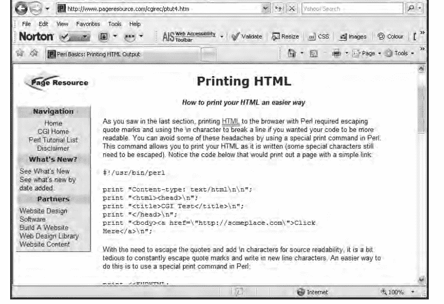

## 哪个版本？

在撰写本文时，本章前面推荐的浏览器应至少支持 JavaScript 1.5。（最新版本的 Firefox 支持 JavaScript 1.8。）

你可能还会看到或听说 JScript 或 ECMAScript。JScript 是 Microsoft Internet Explorer 使用的 JavaScript 版本（由于它是作为 Windows 脚本引擎实现的，因此具有额外功能；它可以使用服务器端语言执行更复杂的任务，例如更新数据库）。有关 JScript 的更多信息，请参见 http://msdn.microsoft.com/en-us/library/hbxc2t98.aspx。

ECMAScript 是 JavaScript 语言的国际标准名称和规范，因此它不是一种新语言，而是为 JavaScript 和 JScript 制定的标准。有关 ECMAScript 的更多信息，请参见 www.ecma-international.org/publications/standards/Ecma-262.htm。

| Microsoft Internet Explorer 版本 | Mozilla Firefox 版本 | Opera 版本 | 支持的 JavaScript 版本 |

| --- | --- | --- | --- |

| – | 3 | – | 1.8 |

| – | 2 | – | 1.7 |

| – | 1.5 | – | 1.6 |

| 5.5–8 | 1 | 6–9 | 1.5 |

| 4 | – | – | 1.3 |

表 1-1 三大浏览器支持的 JavaScript 版本

> ## 专家问答

>

> **问：你提到我可以使用我选择的文本编辑器或 HTML 编辑器，但我不太确定那是什么意思。什么是文本编辑器，在哪里可以找到它？**

>

> **答：** 文本编辑器是你用来保存和编辑书面文本的程序。文本编辑器从简单到复杂不等，有多种选择可用：记事本、写字板、Simple Text 和 Corel WordPerfect X4 等。你也可以从网上购买和下载一些，如 NoteTab 或 TextPad。

>

> HTML 编辑器要么是更复杂的文本编辑器，要么是允许你通过单击按钮或其他方式添加代码的编辑器——通常称为所见即所得（WYSIWYG）编辑器。我建议使用纯文本编辑器或不会更改你手动添加的任何代码的 HTML 编辑器。一些 HTML 编辑器的例子包括 Adobe Dreamweaver 和 Softpress Freeway。

>

> **问：关于使用文本编辑器，我到底需要知道什么？**

>

> **答：** 基本上，你只需要知道如何在编辑器中键入纯文本，将文件保存为 .html 或 .htm 扩展名，并能够在需要时重新打开并编辑它。不需要特殊功能，因为 HTML 文件由纯文本组成。

>

> **问：关于使用浏览器，我需要知道什么？**

>

> **答：** 你绝对需要知道的只是如何打开你计算机上（或网络上）的本地 HTML 文件，以及如何重新加载页面。如果你不知道如何从你自己的计算机打开 HTML 文件，请打开你的浏览器并转到文件菜单。寻打一个类似于打开或打开文件的选项，然后选择它。你应该能够像使用其他程序一样浏览要打开的文件。下图显示了 Microsoft Internet Explorer 中该选项的位置：

>

> **问：** 我在哪里可以得到你提到的那些浏览器？

>

> **答：** 以下是浏览器的链接：

>

> - **Microsoft Internet Explorer**  www.microsoft.com/ie

> - **Mozilla Firefox**  www.mozilla.com/firefox

> - **Opera**  www.opera.com

## 记住，它不是 Java

JavaScript 和 Java 是两种不同的语言。Java 是一种完整的编程语言，必须先编译（通过将高级代码转换为机器语言的程序运行程序）才能执行程序（通常称为 Java *applet*）。Java 功能更强大，但也更复杂。JavaScript 不需要编译器，在多个方面更为宽松，例如语法。

## 与其他语言的相似之处

JavaScript 确实与其他编程和脚本语言有相似之处。如果你有 Java、C++ 或 C 的经验，你会注意到语法上的一些相似之处，这可能有助于你更快地学习。因为它是一种脚本语言，JavaScript 也与 Perl 等语言有相似之处——它也可以通过解释器运行，而不是被编译。

如果你有任何编程或脚本语言的经验，它将使学习 JavaScript 更容易——但这并不是必需的。

## JavaScript 入门

JavaScript 是 Netscape Communications Corporation 和 Sun Microsystems, Inc. 共同努力的成果。这种新语言的新闻发布于 1995 年 12 月 4 日，当时 Netscape Navigator 2.0 仍处于测试版。JavaScript 1.0 版随新浏览器一起提供。（在以 JavaScript 名称发布之前，它被称为 LiveScript。）

JavaScript 是一种基于对象的客户端脚本语言，你可以用它来使网页更具动态性。为了理解这样的定义，让我们逐一看看它的重要部分。

### 基于对象

*基于对象*意味着 JavaScript 可以使用称为*对象*的项。然而，这些对象不是*基于类的*（意味着没有区分类和实例）；相反，它们只是通用对象。你将在第 8 章学习如何使用 JavaScript 对象。在了解语言的其他一些特性之前，你不需要详细理解它们。

### 客户端

*客户端*意味着 JavaScript 在查看者使用的*客户端*（软件）中运行，而不是在提供页面的网站 Web 服务器上运行。在这种情况下，客户端将是 Web 浏览器。为了更好地理解这一点，让我们看看服务器端语言和客户端语言是如何工作的。

### 服务器端语言

服务器端语言需要从网页或 Web 浏览器获取信息，将其发送到在主机服务器上运行的程序，然后将信息发回浏览器。因此，在浏览器看到程序结果之前，必须有一个中间步骤从服务器发送和检索信息。

服务器端语言通常为程序员提供客户端语言没有的选项，例如将信息保存在 Web 服务器上以供以后使用，或使用新信息更新网页并保存更新。

但是，服务器端语言在处理浏览器窗口的特殊功能方面可能受到限制，而这些功能可以通过客户端语言访问（例如网页上特特定位置的内容或表单提交到服务器之前的内容）。

### 客户端语言

客户端语言直接通过查看者使用的客户端运行。对于 JavaScript，客户端是 Web 浏览器。因此，JavaScript 直接在 Web 浏览器中运行，不需要经过从 Web 服务器发送和检索信息的额外步骤。

使用客户端语言，浏览器读取并解释代码，结果可以在不先从服务器获取信息的情况下提供给查看者。此过程可以使某些任务运行得更快。

客户端语言还可以访问浏览器窗口的特殊功能，这些功能可能无法通过服务器端语言访问。然而，客户端语言缺乏像服务器端语言那样将文件或文件更新保存到 Web 服务器上的能力。

> **注意**

>

> 使用 XMLHttpRequest 对象允许 JavaScript 从服务器请求数据。这将在第 16 章简要介绍。

客户端语言对于处理浏览器的部分或允许在将信息发送到服务器端程序或脚本之前验证信息的任务非常有用。例如，JavaScript 可以打开一个具有特定尺寸、特定功能（如地址栏或状态栏）和屏幕上特定放置点的窗口。

JavaScript 也可以用于在将表单发送到服务器端程序进行处理之前检查输入到表单中的信息。此信息检查可以通过防止提交不准确或不完整的信息来避免给 Web 服务器带来压力。与其在服务器上运行程序直到信息正确，不如将正确的信息一次性发送到服务器。

### 脚本语言

脚本语言不需要程序在运行前被编译。所有解释都是由客户端动态完成的。

使用常规编程语言，在运行你编写的程序之前，你必须使用特殊的编译器编译它，以确保没有语法错误。使用脚本语言，代码在加载到客户端时就会被解释。因此，你可以更快的测试代码结果。但是，错误在脚本运行之前不会被捕获，如果客户端不能很好地处理错误，可能会导致问题。对于 JavaScript，错误处理取决于查看者使用的浏览器。

## 综合运用

考虑到所有这些，你可能想知道 JavaScript 在浏览器中是如何运行的。你可能想知道在哪里编写 JavaScript 代码，以及什么告诉浏览器它与网页上的其他内容不同。目前的答案是通用的，但下一章将提供更详细的信息。

JavaScript 通过添加到现有的 HTML 文档中（直接添加或通过引用外部脚本文件）在浏览器中运行。你可以添加特殊标签和命令到

## 1. JavaScript 基础

HTML 代码会告知浏览器需要运行脚本。一旦浏览器看到这些特殊标签，它就会解释 JavaScript 命令，并按照代码中的指令执行。因此，只需编辑 HTML 文档，就可以开始在网页上使用 JavaScript 并看到结果。

例如，以下代码向 HTML 文件添加了一些 JavaScript，用于在网页上写入一些文本。注意添加的 `<script>` 和 `</script>` 标签。它们之间的代码就是 JavaScript。

```
<html>
<body>
<script type="text/javascript">
document.write("This writes text to the page");
</script>
</body>
</html>
```

下一章将介绍如何通过使用 `<script>` 和 `</script>` HTML 标签在 HTML 文件中添加 JavaScript。这将是你成为 JavaScript 程序员的第一步！

## 在线资源

要在线查找有关 JavaScript 的更多信息，这里有一些有用的资源：

- 一个可以找到包含结果示例的教程的地方：www.pageresource.com/javascript

- 一个优秀的教程网站，包含可复制粘贴的脚本：www.javascriptkit.com

- 一个可以向其他程序员咨询 JavaScript 问题的地方：www.webxpertz.net/forums

## 尝试练习 1-1 使用 JavaScript 写入文本

这个项目将通过在浏览器中加载 HTML 文档来展示 JavaScript 的实际效果。脚本使用 JavaScript 在浏览器中写入一行文本。

### 分步指南

1. 将此处显示的代码复制并粘贴到你的文本编辑器中：

```
<html>
<body>
<script type="text/javascript">
document.write("This text was written with JavaScript!");
</script>
</body>
</html
```

2. 将文件保存为 **pr1_1.html**，并在 Web 浏览器中打开它。你应该会看到一行用 JavaScript 写出的文本。

### 尝试练习总结

在这个项目中，你将一段代码复制并粘贴到了文本编辑器中，并保存了文件。当你在 Web 浏览器中打开保存的文件时，浏览器中会显示一行文本。这行文本是使用 JavaScript 在浏览器窗口中写入的。你将在第 2 章中了解更多关于此类脚本如何工作的内容。

## 第 1 章 自测

1. 要能使用 JavaScript，你必须知道以下哪项？

   A. Perl

   B. C++

   C. HTML

   D. SGML

2. 要使用 JavaScript，以下哪项是你应该拥有的？

   A. 一个 Web 浏览器

  

   B. 一个 C++ 编译器

   C. 一个 50GB 硬盘

   D. 一个 CD-RW 驱动器

3. Web 浏览器的选择取决于你，只要它与 ______ 兼容。

   A. Flash MX

   B. VBScript

   C. JavaScript

   D. Windows XP

4. JavaScript 和 Java 是同一种语言。

   A 正确

   B 错误

5. JavaScript 在诸如语法等多个方面比 Java 更 ________。

   A 复杂

   B 强大

   C 编译的

   D 宽容

6. JavaScript 与其他编程和脚本语言有相似之处。

   A 正确

   B 错误

7. 在发布为 JavaScript 之前，JavaScript 被称为 ________。

   A Java

   B JavaCup

   C LiveScript

   D EasyScript

8. JavaScript 是 ________。

   A 基于对象的

   B 面向对象的

   C 对象缺乏的

   D 不使用对象的语言

9. 客户端语言直接通过观众正在使用的 ________ 运行。

   A 服务器

   B 客户端

   C 显示器

   D 律师

10. 在网页上使用表单时，客户端语言如何提供帮助？

    A 它可以在服务器上保存信息。

    B 它可以在信息发送到服务器之前验证信息。

    C 它可以更新文件并保存带有新信息的文件。

    D 它根本无法提供帮助。

11. ________ 语言不需要程序在运行前被编译。

    A 编程

    B 服务器端

    C 脚本

    D 计算机

12. 使用脚本语言时，代码在加载到客户端时被解释。

    A 正确

    B 错误

13. 在 JavaScript 中，什么处理脚本中的错误？

    A Web 服务器

    B 编译器

    C Web 服务器上的程序

    D Web 浏览器

14. JavaScript 如何添加到网页中？

    A 它被写入浏览器中的特殊编辑器。

    B 它来自服务器上的编译程序。

    C 你将代码放在一个单独的文件中并打开该文件。

    D 它被添加到 HTML 文档中。

15. 要向网页插入 JavaScript 代码，需要添加什么？

    A `<script>` 和 `</script>` HTML 标签

    B JavaScript 代码字

    C `<javascript>` 和 `</javascript>` HTML 标签

    D `<java>` 和 `</java>` HTML 标签

## 第 2 章 将 JavaScript 放置在 HTML 文件中

## 关键技能与概念

- 使用 HTML 脚本标签

- 创建你的第一个脚本

- 使用外部 JavaScript 文件

- 使用 JavaScript 注释

既然你已经了解了 JavaScript，就可以开始编写代码了。由于 JavaScript 代码是从 HTML 文档中运行的，你需要知道如何告诉浏览器运行你的脚本。最常用的方法是在文档中使用 HTML `<script>` 和 `</script>` 标签来分隔脚本。你可以将脚本标签放在 HTML 文档的头部或主体部分。

本章首先将向你展示如何使用脚本标签来开始和结束一段 JavaScript 代码。然后，你将开始创建和运行你的第一个脚本。在本章末尾，你将学习如何添加 JavaScript 注释来记录你的脚本。

### 使用 HTML 脚本标签

脚本标签用于告诉浏览器在 HTML 文档中某种脚本语言从哪里开始和结束。在最基本的表单中，脚本标签看起来就像任何其他 HTML 标签一样：

```
<script>
JavaScript code here
</script>
```

如你所见，有开始的 `<script>` 标签、JavaScript 代码，然后是结束的 `</script>` 标签。当你像这样只使用基本的开始和结束标签时，许多浏览器会假定接下来的脚本语言是 JavaScript。然而，一些浏览器可能需要被告知正在使用哪种脚本语言。

除了为浏览器区分脚本的开始和结束位置外，脚本标签还可以告诉浏览器将使用哪种脚本语言，并定义外部 JavaScript 文件的地址。这些额外功能是通过 `type` 和 `src`（源）属性实现的。

### 识别脚本语言

开始和结束脚本标签之间的脚本语言可能是 JavaScript、VBScript 或其他语言。尽管 JavaScript 通常在浏览器中被设置为默认脚本语言，但可能有一些浏览器不默认使用 JavaScript。

为了安全起见，最好明确地将语言标识为 JavaScript。你可以通过将 `type` 属性的值设置为 `"text/javascript"` 添加到开始脚本标签来实现：

```
<script type="text/javascript">
JavaScript code here
</script>
```

开始脚本标签中的 `type` 属性在 XHTML 中也是必需的，以便网页能够验证。

在较旧版本的 HTML 中，脚本标签不区分大小写。但是，在 XHTML 中，脚本标签必须是小写。JavaScript 在所有版本中都是区分大小写的，因此你需要更加小心。在本书中，我将使用 XHTML 1.0 Transitional 作为 HTML 代码（所有标签和属性名称均为小写）。对于 JavaScript 代码，我将使用其正常工作所需的大小写形式。

### 调用外部脚本

如果你希望在文档中调用外部 JavaScript 文件，脚本标签也很有用。*外部 JavaScript 文件* 是一个只包含 JavaSCRIPT 代码的文本文件，并以 `.js` 文件扩展名保存。通过调用外部文件，你可以节省为每个需要脚本的页面编写或复制长脚本的时间。相反，你可以在每个页面上使用一行指向包含所有代码的 JavaScript 文件。

你可以通过将 `src`（源）属性添加到开始脚本标签来调用外部脚本：

```
<script type="text/javascript" src="yourfile.js"></script>
```

此示例从你放置此行的任何页面调用名为 yourfile.js 的 JavaScript 文件。确保开始和结束脚本标签之间没有空格或代码，因为这可能会导致脚本调用失败。

如果脚本非常长，使用 `src` 属性将脚本添加到多个页面可能比在每个页面上插入整个代码快得多。此外，浏览器会在第一次加载外部 JavaScript 文件时将其缓存，使使用该脚本的后续网页渲染更快。使用外部脚本也有助于处理页面验证和尝试将脚本代码与标记（HTML）代码分离。

### 使用 `<noscript></noscript>` 标签

为那些没有 JavaScript（或 JavaScript 被关闭）的用户提供替代内容的一种方法是使用 noscript 标签。`<noscript></noscript>` 标签可以放置在 HTML 文档中的任何位置，并且可以包含任何需要为那些没有 JavaScript 浏览的用户（例如使用 Blackberry 或 iPhone 等移动浏览器的用户）提供的内容。例如：

```
<script type="text/javascript">
  document.write("The color is red.");
</script>
<noscript>
  The color is red.
</noscript>
```

## 专家问答

**问：** 我是否总是需要使用 script 标签来向页面添加 JavaScript？

**答：** 可以使用事件处理程序，它允许你将简短的脚本写在 HTML 标签的事件处理属性中。你将在第 7 章学习事件处理程序。

**问：** 关于 `language` 属性呢？

**答：** 在 XHTML 中，`language` 属性已被 `type` 属性取代。使用 `language` 属性可能导致网页无法通过 XHTML 验证（在 XHTML strict 模式下），因此不再推荐使用。

**问：** 当我向页面添加脚本后，我的页面无法在 XHTML strict（或 transitional）模式下验证。我该如何让页面通过验证？

**答：** 如果脚本包含在 XHTML 中使用的字符，例如 `<`（在 JavaScript 中用作“小于”号，但在 XHTML 中被视作一个新标签的开始），那么脚本直接放在文档中将无法使页面通过验证，除非添加一个 CDATA 段：

```
<script type="text/javascript">
<! [CDATA[<!-- Begins the CDATA section
var x = 5;
var y = 10;
if (x < y) {
  window.alert("x is less than y");
}
]]><!-- Ends the CDATA section
</script>
```

这将使页面能够通过验证，但由于 `<![CDATA[` 和 `]]>` 字符出现在脚本中，脚本将不再起作用。要解决这个问题，你需要在脚本标签内，用 JavaScript 注释符（`/*` 和 `*/`）将这些字符包围起来：

```
<script type="text/javascript">
/*<! [CDATA[*<!-- Opening and closing JavaScript comments
var x = 5;       are placed around <![CDATA[
var y = 10;
if (x < y) {
  window.alert("x is less than y");
}
/*]]>*<!-- Opening and closing JavaScript
</script>          comments are placed around ]]>
```

正如你所见，这很快就会变得相当繁琐！通常，更好的选择是使用外部脚本文件，这样可以消除这个问题，因为在 XHTML 文档中只需要脚本标签本身。

此示例通过 JavaScript 或 `<noscript></noscript>` 标签中的文本，向查看者显示短语“The color is red.”。

> **注意**

> 一些较旧的浏览器可能无法正确处理 noscript 标签，并且不会显示任一部分的内容。如果你的用户使用较旧的浏览器，另一种选择是在页面上显示内容，然后使用 JavaScript 为能够使用 JavaScript 显示内容的用户增强该内容。

## 创建你的第一个脚本

现在你知道了如何使用 HTML script 标签来告知浏览器文档中的 JavaScript，你已准备好学习如何在那些脚本标签之间添加实际的 JavaScript 代码。通常用于教授任何语言的第一个编码示例是向默认输出区域（通常称为基本的“Hello World”脚本）写入某种文本。遵循这个惯例，你的第一个脚本将向网页写入一串文本。

### 编写一个“Hello World”脚本

此脚本不会写“Hello World”，而是使用另一行文本：“Yes! I am now a JavaScript coder!”这只需要一行代码，使用 `document.write()` 方法，该方法向文档写入一串文本：

```
<script type="text/javascript">
  document.write("Yes! I am now a JavaScript coder!");
</script>
```

请注意文本周围的圆括号和引号。圆括号是必需的，因为 `document.write()` 方法是一个 JavaScript *函数*，它接受一个包含在圆括号中的*参数*。你将在第 4 章学习更多关于 JavaScript 函数的知识。

引号表示一串*文本*。字符串是 JavaScript 中通过将其放在引号内来定义的一种变量类型。第 3 章提供了关于字符串和其他 JavaScript 变量类型的详细信息。

关于你的脚本，最后需要注意的是行末的分号。分号表示一个 JavaScript 语句的结束。*语句*是一段代码，其语法（形式和顺序）不需要添加任何东西就是完整的。语句可用于执行单个任务、执行多个任务，或调用脚本中执行多个语句的其他部分。大多数 JavaScript 语句以分号结尾，因此养成添加分号的习惯是个好主意。

> **注意**

> 在后面的章节中，你将看到各种行末没有分号的行，因为它们是代码块的开始或结束。此外，你遇到的许多脚本可能不会用分号结束语句。JavaScript 在大多数情况下对分号的使用很宽松；然而，最好使用分号来结束语句，因为它可以防止可能的错误并有助于以后调试（从脚本中移除错误）。

因此，要向页面写入文本字符串，你使用 `document.write()` 方法，后跟用引号括起来并包含在圆括号中的文本。用分号结束该行（语句）。JavaScript 将处理其余的工作。

### 为脚本创建 HTML 文档

为了使此示例完整并测试脚本，你需要将其插入到 HTML 文档中。首先，使用基本标签（使用任何你偏好的文本编辑器）创建以下 HTML 文档：

```
<!DOCTYPE html PUBLIC "-//W3C//DTD XHTML 1.0 Transitional//EN"
"http://www.w3.org/TR/xhtml1/DTD/xhtml1-transitional.dtd">
<html xmlns="http://www.w3.org/1999/xhtml">
<head>
<title>Untitled Document</title>
</head>
<body>
</body>
</html>
```

在文本编辑器中将文档保存为 `test1.html`。稍后你将用 Web 浏览器调用它以查看脚本的结果。接下来，你将向此 HTML 文档添加脚本，因此请保持文件打开。

### 将脚本插入到 HTML 文档中

现在你需要将脚本插入到文档中。它应该放在哪里？你可以将脚本放在 `<head>` 和 `</head>` 标签之间，或 `<body>` 和 `</body>` 标签之间。由于此示例将文本字符串直接写入页面，你需要将脚本插入到 `<body>` 和 `</body>` 标签之间，即你希望文本字符串出现的位置。它可以在页面上任何 HTML 代码之前、之后或之间。

为了清楚地展示脚本结果如何出现，你将添加 HTML 代码，在脚本前后写入文本行。脚本标签和脚本本身插入在那些行之间。在 `<body>` 和 `</body>` 标签之间添加如下所示的行：

```
This is the first line, before the script results.
<br />
<script type="text/javascript">
    document.write("Yes! I am now a JavaScript coder!");
</script>
<br />
This line comes after the script.
```

再次保存 `test1.html` 文档。你现在应该能够在 Web 浏览器中打开该文档以查看脚本的结果。图 2-1 显示了加载网页时文本在浏览器中的外观。

恭喜，你现在已经完成了你的第一个脚本！

> **注意**

> 本节中的示例代码使用了完整的 HTML 文档及其所有标签。为了尽可能保持内容相关，从现在开始，示例代码将只使用与脚本相关的 HTML 标签，而不是其全部标签。项目代码可根据需要使用完整的 HTML 文档。

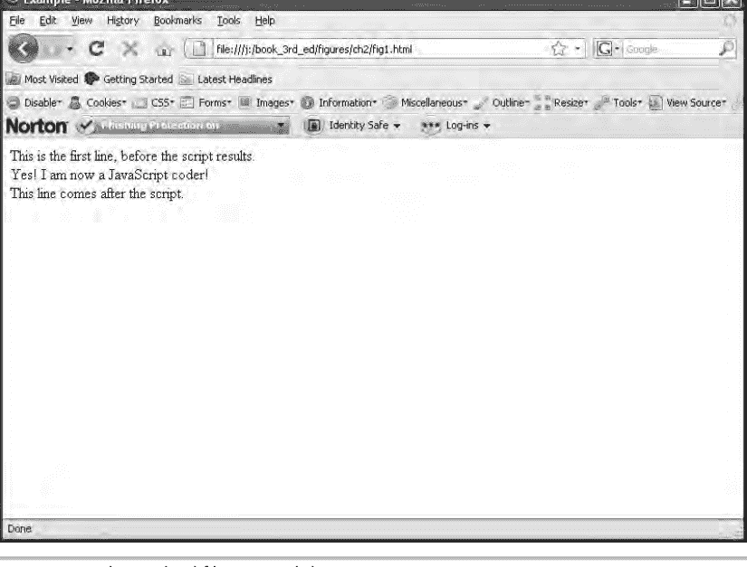

图 2-1 在 Web 浏览器中的 test.html 文件

## 专家问答

**问：** 为什么在 `document.write()` 命令中有一个点（.）？

**答：** Document 是 JavaScript 的预定义对象之一，而 `write()` 是 document 对象的一个预定义方法。这个点将对象和方法连接在一起，使函数工作。第 8 章解释了 JavaScript 对象，第 9 章专门讲解 document 对象。

**问：** 我如何知道何时将脚本添加到 head 部分，何时将其添加到 body 部分？

**答：** 将脚本添加到文档 body 部分的主要情况是你正在直接向页面写入内容时。在许多情况下，大部分脚本可以在 head 部分完成，因为你可以使用函数来调用 body 部分的代码。我们将在本书中经常使用外部脚本，这将消除很多困境，因为所有代码都将位于外部文件中。

## 动手实践 2-1 将脚本插入到 HTML 文档中

**pr2_1.html** 本项目让你练习向页面添加脚本。你将创建一个 HTML 文档，并插入一个在页面加载时在浏览器窗口中显示简短句子的脚本。

### 分步指南

- 1. 设置一个 HTML 文档，使你拥有一个简单的文件，`<body>` 和 `</body>` 标签之间目前没有任何内容。

- 2. 将以下文本行放入网页：I am part of the HTML document!

- 3. 在此行之后插入一个 `<br />` 标签（以便在页面上插入换行符）。

- 4. 在 `<br />` 标签之后，插入一个脚本，该脚本将在页面上写入以下行：This came from my script, and is now on the page!

- 5. 在脚本之后，添加另一个 `<br />` 标签。

- 6. 在最后一个 `<br />` 标签之后，将以下文本行放入网页，并使其强调显示：*I am also part of the HTML document, after the script results!*

7. 以下是你的 HTML 文档应有的样子：

```html
<!DOCTYPE html PUBLIC "-//W3C//DTD XHTML 1.0 Transitional//EN" "http://www.w3.org/TR/xhtml1/DTD/xhtml1-transitional.dtd">
<html xmlns="http://www.w3.org/1999/xhtml">
<head>
<title>JavaScript Project 2-1</title>
</head>
<body>
I am part of the HTML document!
<br />
<script type="text/javascript">
    document.write("This came from my script, and is now on the page!");
</script>
<br />
<em>I am also part of the HTML document, after the script results!</em>
</body>
</html>
```

8. 将文件保存为 pr2_1.html，并在浏览器中查看页面以查看结果。

### 尝试此摘要

在这个项目中，你创建了一个 HTML 文件。利用你在本章目前所学的知识，你在 HTML 文件中插入了一个脚本，该脚本会在页面上写入特定的一行文本。当 HTML 页面在 Web 浏览器中打开时，脚本的结果会显示在两行文本之间。

## 使用外部 JavaScript 文件

现在假设你想在多个页面上使用你的 "Hello World" 脚本（你在本章前面创建的那个），但不想在每个页面上都写一遍。你可以通过将脚本放在外部脚本文件中，并使用 script 标签的 src 属性来调用它来实现。对于这种方法，你需要创建一个 JavaScript 文本文件来保存你的脚本。你还需要一个或多个 HTML 文件，以便在其中放置 script 标签来调用你的外部脚本文件。

### 创建 JavaScript 文件

在这个示例中，你将创建一个只包含一行的 JavaScript 文件。在实际应用中，你会将此方法用于较长的脚本——脚本越长，此技术就越有用（尤其是当你试图验证你的网页或正在将脚本代码与标记分离时）。

在文本编辑器中打开一个新文件，并仅插入 JavaScript 代码（`document.write()` 语句）本身。外部 JavaScript 文件中不需要 script 标签。该文件应如下所示：

```javascript
document.write("Yes! I am now a JavaScript coder!");
```

在文本编辑器中将文件保存为 jsfile1.js。为此，你可能需要使用“文件”菜单上的“另存为”选项，并在文件名周围加上引号，如图 2-2 所示（在 Windows 中使用记事本）。

文件保存后，你可以继续下一步，即创建使用该脚本的 HTML 文件。

### 创建 HTML 文件

你将创建两个文件来放置你的脚本。这种技术应该适用于任意数量的 HTML 文件，只要你在每个文件中添加所需的 script 标签即可。

对于第一个文件，创建你的基础 HTML 文档，并将 script 标签插入文档的 body 部分，使用 src 属性指向 jsfile1.js 文件，并向页面的 body 添加一些 HTML 文本以将其标识为第一个 HTML 文档：

```html
<body>
<script type="text/javascript" src="jsfile1.js"></script>
<p>
    This is page 1, and the script works here!
</p>
</body>
```

在文本编辑器中将此文件保存为 jsext1.html。确保将其保存在与 jsfile1.js 文件相同的目录中。

第二个 HTML 文档与第一个看起来相同，只是 HTML 文本说它是第二页：

```html
<body>
<script type="text/javascript" src="jsfile1.js"></script>
<p>
    This is page 2, and the script also works here!
</p>
</body>
```

在文本编辑器中将此文件保存为 jsext2.html。同样，请确保将其放在与其他文件相同的目录中。

### 在浏览器中查看页面

在你的 Web 浏览器中打开 jsext1.html 文件。它应该如图 2-3 所示，其中的 JavaScript 是从外部脚本文件插入到页面中的。

接下来，在你的 Web 浏览器中打开 jsext2.html 文件。它应该如图 2-4 所示，与第一个文件的区别仅在于你添加到 HTML 文件中的文本表明这是第二页。JavaScript 应该会向此页面写入与写入第一个 HTML 页面相同的文本。虽然我们在本例中使用了一个简短的脚本，但它应该能让你了解在拥有大型脚本时，使用外部文件如何能大大节省时间。

**图 2-4** 调用 jsext2.html 文件（第二个 HTML 页面）中的脚本的结果

## 尝试 2-2 从 HTML 文档调用外部脚本

-   pr2_2.html

-   prjs2_2.js

这个项目将让你练习创建外部 JavaScript 文件并使用它们将脚本插入到网页中。

### 逐步操作

1.  创建一个简单的 HTML 文档，`<body>` 和 `</body>` 标签之间没有任何内容。

2.  在页面的 body 标签之间放置以下文本行：This text is from the HTML document!

3.  在此文本后放置一个 `<br />` 标签。如果你现在需要保存此文件，请将其保存为 pr2_2.html。

4.  创建一个外部 JavaScript 文件，当执行时，它将写入以下行：I love writing JavaScript and using external files!

5.  你的 JavaScript 文件应如下所示：`document.write("I love writing JavaScript, and using external files!");`

6.  将 JavaScript 文件保存为 prjs2_2.js。

7.  返回到 HTML 文档。将 script 标签放在文档中 `<br />` 标签之后，以便外部 JavaScript 文件能在页面上写入它的句子。

8.  你的 HTML 文档的 body 应如下所示：

    ```html
    <body>
    This text is from the HTML document!
    <br />
    <script type="text/javascript" src="prjs2_2.js"></script>
    </body>
    ```

9.  将此文件保存为 pr2_2.html，并在浏览器中查看结果。

### 尝试此摘要

在这个项目中，你创建了一个 HTML 页面。利用你从上一节中获得的关于外部 JavaScript 文件的知识，你创建了一个外部 JavaScript 文件，并将必要的代码放入 HTML 文件中以包含该外部 JavaScript 文件。当 HTML 文件在 Web 浏览器中显示时，会先显示一行纯文本，然后是外部 JavaScript 文件的结果。

## 使用 JavaScript 注释

你可能需要在 JavaScript 代码中做笔记，例如描述某行代码应该做什么。也有可能出于某种原因，你想要禁用脚本中的某一行。例如，如果你正在查找脚本中的错误，你可能想要禁用脚本中的某一行，看看它是否是导致错误的那一行。你可以通过使用 JavaScript 注释来完成这些任务。你可以插入出现在单行或跨越多行的注释。

### 插入单行注释

如果你想在代码中的单行添加注释，请在注释文本前放置一对正斜杠：

```javascript
// Your comment here
```

在这种格式中，该行中双斜杠之前的任何内容都是“活动”代码——将被执行的代码——而该行中斜杠之后的任何内容都会被忽略。例如，假设你在代码中写了这一行：

```javascript
document.write("This is cool!"); // writes out my opinion
```

浏览器将运行 `document.write()` 方法，因此文本 “This is cool!” 会被写入页面。但是，浏览器会忽略斜杠之后的注释。如果你将正斜杠放在行的开头，浏览器将忽略整行。假设你将上例中的斜杠移动到行的开头：

```javascript
// document.write("This is cool!"); writes out my opinion
```

在这种格式中，整行都被忽略，因为它以代表 JavaScript 注释的双斜杠开头。文本不会被写入页面，因为浏览器不会执行该代码。实际上，你正在禁用 `document.write()` 语句。如果包含此行的脚本有错误，并且你想知道是否是此行导致了问题，你可能希望这样做。

### 添加多行注释

由一对正斜杠表示的注释仅适用于它们所在的行；其效果在行末结束。要添加跨越任意行数的注释，你需要使用不同的注释格式：在注释开头使用一个正斜杠后跟一个星号，然后是注释的文本，最后在注释末尾使用一个星号后跟一个正斜杠。下面是一个例子：

```javascript
/*
My script will write some text into my HTML document!
All of this text is ignored by the browser.
*/
document.write("You can see me!");
```

使用此格式，你可以在一行开始注释并在另一行结束它。当你想插入较长的描述或其他文本时，多行注释会很方便，但使用它们时需要小心。看看这个例子，看你是否能发现其中的问题：

```html
<script type="text/javascript">
/*
This code won’t work for some reason.
```

你是否注意到 JavaScript 注释的结束符号缺失了？使用多行注释时，需要小心将其关闭。否则，你可能会意外注释掉需要执行的代码！在这个例子中，注释持续进行，看不到结束的迹象。要解决这个问题，你需要在使用 `document.write()` 方法之前关闭 JavaScript 注释：

```html
<script type="text/javascript">
/*
The JavaScript code is now working! This text is hidden.
*/
document.write("Now everyone can see me!");
</script>
```

在前面的例子中，你看到了注释如何用于提供关于每个脚本预期功能的文档说明。在第 16 章，你将学习使用注释如何帮助你调试 JavaScript 代码。目前，你应该养成在脚本中添加注释作为简短文档或说明的习惯。

## 第 2 章 自我测试

1.  `<script>` 和 `</script>` 标签的用途是什么？

    - A 告诉浏览器脚本的开始和结束位置

    - B 让浏览器知道要使用的脚本语言

    - C 指向外部 JavaScript 文件

    - D 以上所有

2.  为什么应该在脚本开始标签中使用 `type` 属性？

    - A 让浏览器知道你是什么类型的编码员

    - B 确保浏览器不会将你的 JavaScript 解释为其他脚本语言，并确保网页在 XHTML 中验证通过

    - C 创建一个类型化脚本

    - D 确保脚本不产生语法错误

3.  JavaScript 代码区分大小写吗？

    - A 是

    - B 否

4.  `noscript` 标签为那些没有 __________ 的人提供 __________。

5.  外部 JavaScript 文件通常使用文件扩展名 __________。

    - A .js

    - B .html

    - C .jav

    - D .java

6.  以下哪个选项正确地指向了名为 `yourfile.js` 的外部 JavaScript 文件？

    - A `<extscript type="text/javascript" src="yourfile.js"></extscript>`

    - B `<script type="text/javascript" src="yourfile.js"></script>`

    - C `<script language="yourfile.js"></script>`

    - D `<script type="text/javascript" link="yourfile.js"></script>`

7.  在旧版本的 HTML 中，`script` 标签不区分大小写。然而，在 XHTML 中，`script` 标签必须是 __________。

8.  __________ 表示一条 JavaScript 语句的结束。

    - A 冒号

    - B 句号

    - C 问号

    - D 分号

9.  要在网页上写入一段文本，使用 __________ 方法。

    - A `document.write()`

    - B `document.print()`

    - C `document,type()`

    - D `window.print()`

10. 在什么情况下使用外部 JavaScript 文件是个好主意？

    - A 当脚本很短或仅在一个 HTML 文档中使用时

    - B 当你的网站访问者使用较旧的浏览器时

    - C 当脚本很长或需要放在多个 HTML 文档时

    - D 外部文件不是一个好主意

11. JavaScript 注释对于 __________ 或 __________ 你的代码非常有用。

12. 在 JavaScript 代码中，以下哪个符号表示后面将跟随单行注释？

    - A `/*`

    - B `/-`

    - C `//`

    - D `<!--`

13. 在 JavaScript 代码中，以下哪个符号表示后面将跟随多行注释？

    - A `/*`

    - B `/-`

    - C `//`

    - D `<!--`

14. 以下哪个符号表示多行 JavaScript 注释的结束？

    - A `\\`

    - B `-->`

    - C `/*`

    - D `*/`

15. 使用多行 JavaScript 注释时，你需要小心 __________ 它们。

    - A 关闭

    - B 阅读

    - C 编程

    - D 编译

# 第 3 章 使用变量

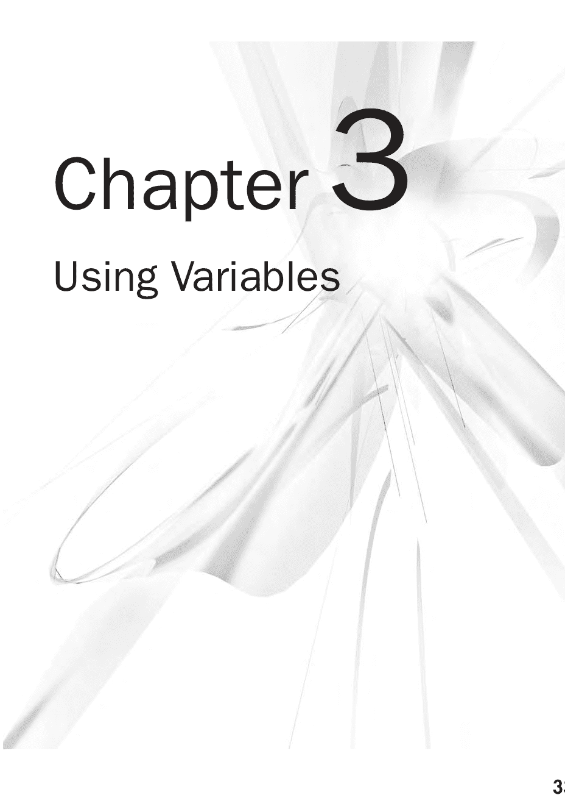

## 关键技能与概念

-   理解变量

-   变量为何有用

-   为你的脚本定义变量

-   理解变量类型

-   在脚本中使用变量

既然你已经学习了将 JavaScript 添加到网页的基础知识，是时候深入了解这门语言的内部工作原理了。由于变量是 JavaScript 编码的重要组成部分，你需要尽可能多地了解它们是什么以及为什么在脚本中有用。一旦你理解了变量的工作原理和它们能做什么，你就能继续学习基于使用各种类型变量的其他主题。

在本章中，你将首先学习变量是什么以及为什么它们有用。然后，你将了解用于声明变量的方法以及如何为变量赋值。最后，你将看到如何在脚本中使用变量。

## 理解变量

*变量* 代表或保存一个值。变量的实际值可以随时更改。要理解什么是变量，请思考一个你可能从代数课上回忆起的基本语句：

```
x = 2
```

字母 *x* 被用作变量的名称。它被赋值为 2。要更改值，你只需给 *x* 一个新赋值：

```
x = 4
```

变量的名称保持不变，但现在它代表一个不同的值。

将数学课的例子更进一步，你可能不得不解决这样的问题：

```
如果 x=2，那么 3+x=?
```

要得到答案，你需要在问题中将 2 的值代入变量 *x*，即 3+2=5。如果 *x* 的值改变，问题的答案也会改变。所以，如果 *x*=7，那么计算就变成了 3+7，现在结果是 10。

JavaScript 中的变量与数学中使用的变量非常相似。你给变量一个名称，然后根据需要为其赋值。如果变量的值改变，它将改变脚本中发生的事情。

## 变量为何有用

使用变量有几个好处：

-   它们可以在编写代码时其代表的值未知的地方使用。

-   它们可以节省你编写和更新脚本的时间。

-   它们可以使代码的目的更清晰。

### 变量作为未知值的占位符

通常，变量会在内存中为一个在编写脚本时未知的值保留一个位置。变量的值可能会根据观众输入的内容而改变，也可能会在脚本代码中由你稍后更改。

例如，你可能有一个函数根据用户输入接受某些值（函数将在第 4 章讨论）。由于用户输入的值在编写脚本时是未知的，因此可以使用变量来保存用户将要输入的值。这对于任何类型的用户输入都是如此，无论是 JavaScript 提示/确认框、表单中的输入字段还是其他输入方法。

### 变量作为省时工具

变量可以加快脚本编写速度，因为它们的值可以更改。当你在脚本开头为变量赋值时，脚本的其余部分可以简单地使用该变量来代替。如果你决定稍后更改值，你只需在一个地方更改代码——即你为变量赋值的地方——而不是在许多地方更改。

例如，假设在数学课上，你被要求解决这个问题：

```
如果 x=2，那么 3+x-1+2-x=?
```

你知道你需要用 2 的值替换每个出现的 x，即 3+2–1+2–2=4。现在如果老师想让你用不同的 x 值再次解决这个问题，就不需要重写整个问题。老师只需要给你以下指令：

```
对上述问题求解 x=4。
```

问题越长、越复杂，变量就越有用。与其一遍又一遍地重写相同的内容，你可以更改变量以提供全新的结果。

### 变量作为代码澄清器

由于变量代表某些东西，并且你可以给它们有意义的名称，因此当你阅读（和调试）脚本时，它们通常更容易识别。如果你只是添加数字，你可能会忘记它们代表什么。例如，考虑这行代码：

```
TotalPrice = 2.42 + 4.33;
```

这里，数字几乎可以表示任何东西。相反，你可以将 2.42 赋值给名为 `CandyPrice` 的变量，将 4.33 赋值给名为 `OilPrice` 的变量：

```
TotalPrice = CandyPrice + OilPrice;
```

现在，你不必试图记住数字的含义，你可以看到脚本正在将一些糖果的价格与一些油的价格相加。这在调试时也很有用，因为有意义的变量名称使查找错误更容易。

## 为你的脚本定义变量

既然你已经了解了变量是什么以及为什么你想使用它们，你需要学习如何让它们在你的脚本中工作。你通过 *声明* 来创建变量。然后你使用 JavaScript *赋值运算符* 为它们赋值。在为变量命名时，你需要遵循 JavaScript 中变量命名的规则，并考虑名称的意义。

### 声明变量

要将文本声称为变量，你使用 `var` 关键字，它告诉浏览器接下来的文本将是一个新变量的名称：

```javascript
var variablename;
```

例如，要将你的变量命名为 `coolcar`，声明如下所示：

```javascript
var coolcar;
```

在这个例子中，你有了一个名为 `coolcar` 的新变量。分号结束了语句。变量 `coolcar` 尚未被赋值。如下一节所述，你可以在声明变量的同时为其赋值，也可以在脚本中稍后为其赋值。

给变量命名的代码很简单，但对可用于变量的单词和字母大小写有一些限制。在了解如何为变量赋值后，你将学习更多关于 JavaScript 命名规则的知识。

### 为变量赋值

要为变量赋值，你使用 JavaScript 赋值运算符，即等于 (`=`) 符号。如果你想在同一行声明变量并为其赋值，请使用以下格式：

```javascript
var variablename = variablevalue;
```

# 第三章：使用变量

例如，要将你的变量命名为 `paycheck` 并赋予其数值 1200，请使用以下语句：

```javascript
var paycheck = 1200;
```

该语句以关键字 `var` 开头，后跟变量 `paycheck`，这与上一节描述的普通变量声明方式相同。接下来是赋值运算符（`=`），它告诉浏览器将运算符右侧的值赋给运算符左侧的变量。赋值运算符右侧是 1200，这是要赋给变量 `paycheck` 的数值。该行以分号结束，表示语句的结束。

#### 注意

请务必小心，不要将赋值运算符（`=`）理解为“等于”的意思。该运算符仅用于赋值。“等于”的运算符是两个等号连用（`==`），这将在第五章中学习。

要声明和赋值另一个变量，你使用相同的格式，将语句放在新行上。例如，要设置一个名为 `spending` 的变量来跟踪从 `paycheck` 变量中支出的金额，请使用以下语句：

```javascript
var paycheck = 1200;  // 为变量 paycheck 赋值 1200
var spending = 1500;  // 为变量 spending 赋值 1500
```

当然，你也会注意到这种财务状况即将陷入麻烦，因为 `spending` 变量中支出的金额超过了 `paycheck` 变量带来的收入。奇怪的是，这开始看起来像我网站的预算了！

你看到的示例说明了编码变量声明和赋值的正确且安全的方式。然而，事实是 JavaScript 在变量方面允许一定程度的灵活性。在许多情况下，即使不使用精确的编码语法，代码也能正常运行。例如，你可能会看到一些脚本在第一次使用变量时没有使用 `var` 关键字。JavaScript 通常会在第一次使用变量时声明它，即使它之前未声明。这里有一个示例：

```javascript
paycheck = 1200;
```

这是有效的，因为变量被赋予了一个值（JavaScript 会简单地声明该变量并赋予其值 1200）。然而，如果你想在没有赋值的情况下声明变量，以下代码是无效的：

```javascript
paycheck;
```

这个声明仍然需要 `var` 关键字才能有效，如以下代码所示：

```javascript
var paycheck;
```

你可能还会看到一个脚本省略了结尾的分号：

```javascript
var paycheck = 1200
```


在某些脚本中，变量赋值时会同时省略这两个特征：

```javascript
paycheck = 1200
```

所有这些快捷方式可能看起来很方便，但最好还是在使用变量之前定义每个变量，使用 `var` 关键字，并包含分号。不这样做可能会在某些浏览器中导致错误，并可能给人留下代码写得不好的印象。此外，如果你需要调试脚本，任何这些遗漏都可能非常麻烦。给变量正确的声明和赋值将避免问题，并且你的代码将更易于阅读和理解。

## 命名变量

在开始为自己的变量命名之前，你需要了解 JavaScript 的命名规则。选择名称时需要考虑的因素包括大小写敏感性、无效字符以及 JavaScript 保留的名称。此外，你还应该尽量给你的变量起既容易记住又有意义的名字。

### 变量中的大小写使用

JavaScript 变量是大小写敏感的——`paycheck`、`PAYCHECK`、`Paycheck` 和 `PaYcHeCk` 是四个不同的变量。创建变量时，你需要确保在脚本后续部分编写该变量名时使用相同的大小写。如果你改变了任何大小写，JavaScript 会将其视为一个新变量或返回错误。无论哪种方式，都可能导致脚本出现问题。

以下是一些关于在变量名中使用大小写的建议：

- 如果你使用的变量名只由一个单词组成，可能最简单的方法是整个名称都使用小写。这样输入会更快，而且你知道在后续使用时会全部输入小写。

- 对于包含两个单词的变量名，你可以决定将每个单词的首字母大写。例如，你可以将一个变量命名为 `MyCar` 或 `My_Car`（你将在下一节看到更多关于下划线字符 `_` 的信息）。

变量的大小写完全由你决定，因此你应该使用你最习惯的任何风格。最好你采用一种约定并持续使用它。例如，如果你使用全小写字符命名变量，你应该在整个脚本中都这样做，以避免在后续使用变量时意外切换大小写。在本书中，我仅使用小写字符作为变量名，以保持代码清晰。

### 使用允许的字符

变量名的第一个字符必须是字母（下划线除外）。变量名中的其他字符可以是字母、数字或下划线。变量名中不允许有空格。因此，以下变量名是有效的：

- `paycheck`

- `_paycheck`

- `pay2check`

- `pay_check`

- `pay_245`

但是，以下变量名是无效的：

- `#paycheck`

- `1paycheck`

- `pay check`

- `pay_check 2`

- `_pay check`

最难记住的规则可能是不能以数字开头（这是我最常忘记的一个）。虽然这样的名称看起来合理，但 JavaScript 不允许。

### 避免保留字

命名变量时要记住的另一条规则是避免使用 JavaScript 保留字。这些是在 JavaScript 中具有特定用途的特殊单词。例如，你已经知道保留字 `var` 用于声明 JavaScript 变量。将其用作变量名会导致脚本中出现许多问题，因为这个单词旨在以不同的方式使用。

表 3-1 列出了 JavaScript 中的保留字。请注意，所有这些单词都是全小写字母。在后面的章节中，你将学习如何使用这些保留字，因此它们会随着时间的推移而变得更加熟悉。

| abstract | delete | goto | null | throws |
| :--- | :--- | :--- | :--- | :--- |
| as | do | if | package | transient |
| boolean | double | implements | private | true |
| break | else | import | protected | try |
| byte | enum | in | public | typeof |
| case | export | instanceof | return | use |
| catch | extends | int | short | var |
| char | false | interface | static | void |
| class | final | is | super | volatile |
| const | finally | long | switch | while |
| continue | float | namespace | synchronized | with |
| debugger | for | native | this | |
| default | function | new | throw | |

**表 3-1** JavaScript 保留字

### 给变量有意义的名字

虽然 `x` 是一个可接受的变量名，但如果你以后需要调试程序，你不太可能记住它代表什么。此外，如果其他人试图帮你调试代码，他们的工作将更加困难。

你应该尝试给你的变量起尽可能清晰地描述它们所代表的名称。假设你想使用一个变量来保存页面上某个示例的编号。与其使用 `x`、`ex` 或其他简短的变量，不如使用更具描述性的名称：

```javascript
var example_number = 2;
```

变量 `example_number` 在以后会很容易被你识别，其他编码器也更可能快速理解其用途。

在脚本中使用的变量越多，使用有意义且易于记忆的名称就越重要。

## 理解变量类型

到目前为止，你已经看到变量值为数字的示例。在 JavaScript 中，变量值或类型可以包括数字、字符串、布尔值和 null。

与更严格的编程语言不同，JavaScript 不要求你在定义变量时声明其类型。相反，JavaScript 允许将几乎任何值赋给任何变量。虽然这为你在编码时提供了灵活性，但你需要小心，因为你可能会得到一些意想不到的结果——尤其是在进行数字加法时。

### 数字

数字变量就是数字。JavaScript 不要求数字被声明为整数、浮点数（小数）或任何其他数字类型。相反，任何数字都被视为另一个数字，无论是 7、–2、3.453 还是其他任何数字。除非你执行某种计算来改变类型，否则数字将保持相同的类型。例如，如果你在变量中使用整数，除非你执行某种计算来改变它（例如，进行不均等的除法），否则它不会突然出现小数位。

正如你所看到的，你使用关键字 `var` 定义一个数字变量：

```javascript
var variablename = number;
```

以下是一些示例：

```
var paycheck=1200;
var phonebill=29.99;
var savings=0;
var sparetime=-24.5;
```

如果你需要使用一个特别长的数字，JavaScript 有科学计数法。要表示指数部分，你需要在基数数字之后、指数之前使用字母 *e*。例如，要创建一个名为 `bignumber` 的变量并为其赋值 4.52 × 10^5 (452,000)，你需要将字母 *e* 放在数字和指数之间（代表“乘以 10 的几次方”这个短语）：

```
var bignumber=4.52e5;
```

#### 注意

JavaScript 可能会以科学计数法的形式返回计算结果（就像许多计算器一样）。

### 字符串

*字符串变量*是表示一串文本的变量。字符串可以包含字母、单词、空格、数字、符号，或者几乎任何你想要的内容。字符串的定义方式与数字略有不同，使用以下格式：

```
var variablename="stringtext";
```

以下是一些字符串变量的示例：

```
var mycar="Corvette";
var oldcar="Big Brown Station Wagon";
var mycomputer="Pentium 3, 500 MHz, 128MB RAM";
var oldcomputer="386 SX, 40 mHz, 8MB RAM";
var jibberish="what? cool! I am @ home 4 now. (cool, right?)";
```

正如你所看到的，字符串可以很短、很长，或者介于两者之间的任何长度。你可以在字符串变量中放置各种文本和其他字符。但是，需要考虑引号、一些特殊字符以及字符串的大小写敏感性。

### 引号的匹配

在 JavaScript 中，你通过将字符串放在引号（简称引号）内来定义它们，正如你在示例中看到的。JavaScript 允许你使用双引号或单引号来定义字符串值。但要注意的是，如果字符串以双引号开头，就必须以双引号结尾：

```
var mycar="Red Corvette";
```

单引号也是同样的道理：

```
var myhouse='small brick house';
```

尝试使用错误类型的引号来结束字符串，或者遗漏开头或结尾的引号，都会导致问题。

```
var mycar="Red Corvette';
var myhouse= 'small brick house";
var mycomputer="Pentium 3, 500 mHz, 128MB RAM;
```

这些错误将导致 Web 浏览器中出现“Unterminated String”（未终止的字符串）错误。

### 注意大小写

JavaScript 字符串是大小写敏感的。这现在看起来可能不重要，但当你需要比较字符串以检查是否匹配时，它就很重要了。只有一个字符的大小写不同，就会使字符串不同：

```
"My car is fun to drive!"
"my car is fun to drive!"
```

你将在第 5 章学到更多关于字符串比较的知识。

### 使用特殊字符

*特殊字符*使你能够向字符串中添加原本无法添加的内容。例如，假设你需要在字符串的每个单词之间添加一个制表符。如果你按下键盘上的 TAB 键，JavaScript 可能会将其视为一堆空格。相反，请使用特殊字符 `\t`，它可以在字符串中放置一个制表符，如本例所示：

```
var mypets="dog\tcat\tbird";
```

在特殊字符 `\t` 出现的每个位置，JavaScript 都会解释为一个制表符。所有特殊字符都以反斜杠字符 (`\`) 开头。因此，如果你想在字符串中使用单个反斜杠字符，你需要使用反斜杠的特殊代码：`\\`。例如，假设你想在网页上写以下句子：“Go to the directory c:\javascript on your computer.” 如果你直接使用该字符串，你的代码将如下所示：

```
<script type="text/javascript">
  document.write("Go to the directory c:\javascript on your computer.");
</script>
```

问题是，单个反斜杠不会被打印在网页上。它将显示为：

```
Go to the directory c:javascript on your computer
```

除非反斜杠后面跟着特殊字符的代码，否则 JavaScript 会照原样打印斜杠后的字符（你将在下一节讨论的转义技术中看到这一点）。要解决此问题，请使用特殊代码 `\\` 在页面上打印单个反斜杠：

```
<script type="text/javascript">
    document.write("Go to the directory c:\\javascript on your computer.");
</script>
```

现在你将得到想要打印到浏览器的句子，如下所示：

```
Go to the directory c:\\javascript on your computer.
```

JavaScript 中使用的特殊字符如表 3-2 所示。

假设你想在网页上打印一个带有强烈强调的句子。JavaScript 允许你在 `document.write()` 方法中将 HTML 代码作为字符串的一部分打印到页面上（你曾在第 2 章的第一个脚本中使用过该方法）。要打印粗体文本，你只需添加 HTML 的 `<strong>` 和 `</strong>` 标签，如本示例代码所示：

```
<script type="text/javascript">
    document.write("<strong>JavaScript Rules!</strong> This is fun.");
</script>
```

| 输出字符 | 需要使用的特殊代码 |
| --- | --- |
| 反斜杠 (\) | \\ |
| 双引号 (") | \" |
| 单引号 (') | \' |
| 退格 | \b |
| 换页 | \f |
| 换行 | \n |
| 回车 | \r |
| 制表符 | \t |
| 垂直制表符 | \v |

表 3-2 JavaScript 特殊字符

现在假设你希望代码本身在查看时显示在两行上，如下所示：

**JavaScript Rules!**

This is fun.

你可能会尝试通过向代码添加换行特殊字符来实现这一点：

```
<script type="text/javascript">
    document.write("<strong>JavaScript Rules!</strong>\n This is fun.");
</script>
```

`\n` 特殊代码在 JavaScript 中仅代表换行符；它不会导致 HTML 换行。JavaScript 的换行代码不会为浏览器显示中呈现的代码结果添加新行。因此，上述代码的最终结果是一个类似于下面的句子：

**JavaScript Rules!** This is fun.

如果你想在浏览器显示中添加换行符，你需要使用 HTML 的 `<br />` 标签来实现。

请记住，JavaScript 的换行符仅影响源代码的外观；它在最终结果中不起作用。但是，当你想要格式化 JavaScript 警告框和各种其他 JavaScript 构造的输出时，它会有所帮助。

### 转义字符

JavaScript 允许你*转义*某些字符，以便它们能够正确显示并避免引起错误。与特殊字符一样，转义序列使用反斜杠字符 (`\`)，它位于需要转义的字符之前。

如前所述，JavaScript 在渲染每个字符串之前会检查其中是否存在特殊字符。如果你想在字符串中包含引号，这很有用。例如，假设你想在网页上打印以下句子：

John said, "JavaScript is easy."

如果你直接将它放入 `document.write()` 命令中会发生什么？

```
<script type="text/javascript">
    document.write("John said, "JavaScript is easy."");
</script>
```

如果你查看 `document.write()` 行的末尾，你会看到两个双引号连在一起可能会导致问题，但浏览器实际上在那之前就会出错。当双引号用在 *JavaScript* 这个词之前时，浏览器认为你已经关闭了 `document.write()` 命令中使用的字符串，并期望出现右括号和分号。然而，后面还有更多文本，浏览器就混乱了。

要避免引号引起的问题，请使用反斜杠字符来转义字符串内部的引号。通过在每个内部双引号前放置一个反斜杠，

你强制将它们视为文本字符串的一部分，而不是 JavaScript 语句的一部分：

```
<script type="text/javascript">
    document.write("John said, \"JavaScript is easy.\"");
</script>
```

反斜杠允许内部引号成为字符串的一部分。

这修复了字符串的问题，句子将带有引号被打印出来。

#### 注意

还要注意字符串中的单引号和撇号。对于用单引号括起来的字符串，需要转义这些字符。

转义技术也适用于需要引号的 HTML 代码。例如，如果你想在页面上放置一个链接，你需要使用锚标筏并将 URL 放在引号中。如果你转义锚标签中的引号，JavaScript 允许你在 `document.write()` 方法中将 HTML 代码写入页面，如本例所示：

```
<script type="text/javascript">
    document.write("<a href=\"http://someplace.com\">Text</a>");
</script>
```

这可以达到目的，但如果你不想总是转义引号，还有更简单的方法。要避免在上面的代码中转义引号，你可以改用单引号将 URL 地址括起来，如本代码所示：

```
<script type="text/javascript">
    document.write("<a href='http://someplace.com'>Text</a>");
</script>
```

双引号内的单引号是可以的。

如果你更喜欢在外面使用单引号，也可以反过来做，如本例所示：

```
<script type="text/javascript">
    document.write('<a href="http://someplace.com">Text</a>');
</script>
```

单引号内的双引号也是可以的。

这里要记住的重点是，确保你不要在字符串内部使用与括起字符串相同类型的引号。如果你需要将引号嵌套超过一层，你就需要开始转义引号；因为如果你再次切换类型，就会终止字符串。例如，看看这段代码：

字符串。在那里放置双引号而不进行转义会导致字符串终止并产生错误。

如你所见，当需要在字符串中使用大量引号时，引号确实可能带来真正的麻烦。然而，记住在必要时使用反斜杠转引号，将在你寻找缺失的引号时为你省去不少头痛。我曾在代码中多次寻找缺失的引号，在几次这样的经历后，我的头脑都晕了！在本章后面，你将看到可以将字符串相加，这可以简化引号的使用。

### 布尔值

布尔变量是值为 true 或 false 的变量。以下是一些示例：

```javascript
var JohnCodes = true;
var JohnIsCool = false;
```

请注意，单词 *true* 和 *false* 不需要用引号括起来。这是因为它们是保留字，JavaScript 将其识别为布尔值。

JavaScript 除了使用 true 和 false 这两个单词外，还允许你使用数字 1 表示 true，数字 0 表示 false，如下所示：

```javascript
var JohnCodes = 1;   // 使用数字 1 等同于使用值 true
var JohnIsCool = 0;  // 使用数字 0 等同于使用值 false
```

布尔变量在你需要只能有 true 和 false 值的变量时非常有用，例如在事件处理程序（第 7 章介绍）中。

#### 注意

当我们谈论布尔变量的概念时，单词 *Boolean* 的首字母大写（因为它源自数学家乔治·布尔的名字）。然而，当你在脚本中使用关键字布尔时，JavaScript 保留字 boolean 是用全小写字母书写的。

### Null

*Null* 意味着变量没有值。它不是空格，也不是零；它就是什么都没有。如果你需要定义一个值为 null 的变量，可以使用如下声明：

```javascript
var variablename = null;
```

与布尔变量一样，你不需要像字符串值那样用引号将此值括起来，因为 JavaScript 将 null 识别为一个具有预定义值（无）的关键字。

当你在脚本中测试输入时，Null 变量很有用，你将在后面的章节中学习到这一点。

## 专家问答

**问：** 为什么我需要学习变量？难道我不能直接在我将要使用的地方放入我想要使用的数字或文本吗？

**答：** 你可以这样做；但是，它将使较长的脚本更难编写、阅读和调试。它还使得更新脚本变得更加困难，因为为了更改该数字或文本，你需要更改它出现的每一行。当你使用变量时，你只需修改一行代码就可以更改变量在所有使用位置的值。随着你获得更多 JavaScript 经验，你会看到变量是多么有用。

**问：** 为什么我在声明数字变量时不需要定义我所使用数字的类型（例如浮点数或整数）？

**答：** JavaScript 不要求这一点，根据你的观点，这可能是优点也可能是缺点。对于 JavaScript 来说，任何数字都只是一个数字，可以作为数字变量使用。

**问：** 为什么我需要在字符串中的文本周围加上引号？

**答：** 这样做是为了让 JavaScript 知道字符串从哪里开始以及在哪里结束。没有它，JavaScript 将无法确定字符串中应该包含什么以及不应该包含什么。

**问：** 但是分号不是结束语句吗？为什么不用它而丢掉引号呢？

**答：** 当使用加法运算符将两个字符串和/或变量相加时，变量声明或任何涉及字符串的命令可能会变得更加复杂。当这种情况发生时，JavaScript 需要知道在同一行中一个字符串何时结束以及另一个字符串何时开始。

**问：** 一般来说，反斜杠（\）字符有什么作用？

**答：** 如果反斜杠后面跟着一个创建特殊字符的代码，则会用该特殊字符替代其位置。否则，JavaScript 会将单个反斜杠后的第一个字符视为“原样”，并将其视为其所在字符串的一部分。

## 动手实践 3-1 声明变量

```html
pr3_1.html
```

这个项目让你有机会练习用各种值声明变量。它还在页面上打印一行简短的文本。

（续）

### 分步指南

1. 创建一个 HTML 页面，将 `<body>` 和 `</body>` 标签之间的空间留空。

2. 在 `<body>` 和 `</body>` 标签之间，如你在第 2 章所学，添加 `<script>` 和 `</script>` 标签。

3. 创建一个名为 chipscost 的数字变量，并赋值为 2.59。

4. 创建一个名为 istrue 的布尔变量，并赋值为 false。

5. 创建一个名为 nada 的变量，并赋值为 null。

6. 创建一条 JavaScript 语句，将以下字符串值写入网页。记得在必要时转义引号：

   John said, "This project is fun!"

7. 完成时，HTML 文档的 body 部分应如下所示：

8. 将文件保存为 pr3_1.html 并在你的 Web 浏览器中查看它。

```html
<body>
<script type="text/javascript">
    var chipscost = 2.59;
    var istrue = false;
    var nada = null;
    document.write("John said, \"This project is fun!\"");
</script>
</body>
```

你应该只看到用 document.write() 命令输出的文本。变量定义不会打印在浏览器屏幕上。你可以查看页面源代码，看看变量定义在代码中的样子。

### 动手实践总结

在这个项目中，你能够运用你的技能在脚本中声明不同类型的变量。该项目包括一个数字变量、一个布尔变量和一个值为 null 的变量。你还能够使用在第 2 章学到的技能，用 JavaScript 向页面写入一行文本。

## 在脚本中使用变量

要使变量有用，你需要做的不仅仅是仅仅在脚本中声明它。你需要在脚本中以某种方式稍后使用它，可能是打印它的值，或者甚至只是更改它的值。要使用变量，你需要在变量声明之后调用它。

### 调用变量

以下代码展示了如何使用 document.write() 方法将变量的值写入网页：

```html
<script language="JavaScript">
    var mycar = "Corvette";
    document.write(mycar);  // 将 mycar 变量的值打印到浏览器
</script>
```

脚本首先声明一个变量 mycar 并赋值为 “Corvette”。然后，在 document.write() 命令中，你看到只有变量名 mycar 被括在括号内。此脚本的结果只是将 “Corvette” 写入浏览器。写入页面的 mycar 变量周围没有引号。这样做的原因是 mycar 变量已经被赋予了一个字符串值，因此它不需要在引号内才能在 document.write() 命令中将其值打印到页面。你已经可以看到使用变量的优点是使简短的 document.write() 命令更容易编码。

### 将变量添加到文本字符串中

前面的代码只是在浏览器中打印变量的值。如果你希望该变量与字符串中的其他一些文本一起打印，document.write() 命令会变得更加复杂。如果文本字符串未定义为变量，则它需要用引号括起来，而变量需要单独存在。你使用加法运算符 (+) 将变量的值添加到字符串中，如本例所示：

```javascript
<script type="text/javascript">
    var mycar = "Corvette";
    document.write("I like driving my " + mycar);  // 变量被添加到写入浏览器的字符串中
</script>
```

此代码在浏览器窗口中打印以下句子：

```
I like driving my Corvette.
```

请注意代码中单词 “my” 后面的空格。这确保了在将变量添加到字符串之前出现一个空格。如果你使用这行代码

```javascript
document.write("I like driving my" + mycar);
```

结果将是

```
I like driving myCorvette.
```

在添加字符串时，你需要小心添加你希望在输出中出现的空格。

## 编写一个 JavaScript 页面

既然你已经了解了如何使用变量以及如何使用 JavaScript 向页面编写基本的 HTML 代码，你将创建一个几乎完全由 JavaScript 编写的页面（`<body>` 和 `</body>` 标记内的所有内容），以此巩固你迄今为止所学的技术。

加法运算符使你能够将变量放在字符串的前面、后面，甚至中间。要将变量插入字符串中间（以便其两侧都有文本显示），只需使用另一个加法运算符将需要的内容添加到变量的右侧，如下例所示：

```javascript
<script type="text/javascript">
    var mycar="Corvette";
    document.write("I like driving my "+mycar+" every day!");
</script>
```

现在变量位于两个文本字符串之间，将三个部分组合成一个字符串。此代码在浏览器中打印以下句子：

> I like driving my Corvette every day!

使用变量时，需要确保变量和加法运算符不在字符串的引号内。如果在引号内，你将无法得到预期的结果。例如，看看这段代码：

```javascript
<script type="text/javascript">
    var mycar="Corvette";
    document.write("I like driving my +mycar+ every day!");
</script>
```

JavaScript 不会识别这里的运算符和变量；因为它们在引号内，它们仅被视为文本字符串的一部分。JavaScript 没有使用变量，而是将所有内容按字面意思处理，并在浏览器中打印此句子：

> I like driving my +mycar+ every day!

为了使代码更易于编写，你可以将涉及的每个字符串放入一个变量中，这样你只需将变量值相加即可，而无需处理引号，如下所示：

```javascript
<script type="text/javascript">
    var firstString= "I like driving my ";
    var mycar="Corvette";
    var secondString= " every day!";
    document.write(firstString+mycar+secondString);
</script>
```

这会打印相同的句子，但允许你稍后更改其部分，而无需编辑 `document.write()` 命令。

你在本节中学到的技术将在你的字符串变得更复杂时变得非常有用，尤其是当你在字符串中使用 HTML 代码时。

### 创建框架

你需要的第一件事是页面的基本框架，这样你就知道在哪里插入脚本。由于你正在将信息写入页面，脚本标签将放置在 `<body>` 和 `</body>` 标签内。在这种情况下，将使用一个名为 `ch3_code.js` 的外部脚本文件。HTML 文档的 body 部分将如下所示：

```html
<body>
The script tags are inserted here to call the external JavaScript file
<script type="text/javascript" src="ch3_code.js"></script>
</body>
```

你放置在 `ch3_code.js` 文件中的代码将决定完成时在浏览器中显示的内容。

### 定义变量

开始编写脚本文件时，使用一些 JavaScript 代码来编写 HTML 标题。你可以将代码作为字符串直接写入 `document.write()` 命令中，如这里所示：

```javascript
document.write("<h1>A Page of JavaScript</h1>");
```

另一方面，你可以将字符串放入一个变量中，并在脚本后面的 `document.write()` 命令中使用该变量：

```javascript
var headingtext="<h1>A Page of JavaScript</h1>";
Other code may be placed here...
document.write(headingtext);
```

在这个例子中，你将采用第二种方法，因为它使用了一个变量。随着你对脚本的深入了解，你会看到这如何成为一个方便的功能。

事实上，除了 `headingtext` 变量之外，你还将创建一堆变量来保存要添加到页面的 HTML 代码字符串。下一个将为页面添加一个简短的介绍句子。介绍的变量声明将如下所示：

```javascript
var myintro="Hello, welcome to my JavaScript page!";
```

接下来，你将在页面中添加一个链接。链接的变量声明如下所示：

```javascript
var linktag="<a href=\"http://www.pageresource.com\">Link to a Site</a>";
```

接下来，你将放入一些红色文本以添加一些颜色。以下是 `redtext` 变量的定义：

```javascript
var redtext="<span style=\"color:red\">I am so colorful today!</span>";
```

最后，你将添加一些变量，这些变量仅包含开始和结束 strong 标签以及段落标签：

```javascript
var begineffect="<strong>";
var endeffect= "</strong>";
var beginpara="<p>";
var endpara="</p>";
```

`ch3_code.js` 文件中所有变量的代码如下：

```javascript
var headingtext="<h1>A Page of JavaScript</h1>";
var myintro="Hello, welcome to my JavaScript page!";
var linktag="<a href=\"http://www.pageresource.com\">Link to a Site</a>";
var redtext="<span style=\"color:red\">I am so colorful today!</span>";
var begineffect="<strong>";
var endeffect= "</strong>";
var beginpara="<p>";
var endpara="</p>";
```

### 添加命令

现在，按照变量声明之后，你可以向 `ch3_code.js` 文件添加一些 `document.write()` 命令，以将变量的内容写回 HTML 文档：

```javascript
document.write(headingtext);
document.write(begineffect+myintro+endeffect);
document.write(beginpara);
document.write(linktag);
document.write(endpara);
document.write(beginpara);
document.write(redtext);
document.write(endpara);
```

这会将标题写在页面顶部。将 `begineffect` 和 `endeffect` 变量添加到 `myintro` 变量的左右，会将介绍文本以粗体写在标题下方。之后是一个新段落，然后是一个链接，再之后是另一个新段落，最后是红色文本消息。

以下是到目前为止 `ch3_code.js` 文件的完整代码：

```javascript
var headingtext="<h1>A Page of JavaScript</h1>";
var myintro="Hello, welcome to my JavaScript page!";
var linktag="<a href=\"http://www.pageresource.com\">Link to a Site</a>";
var redtext="<span style=\"color:red\">I am so colorful today!</span>";
var begineffect="<strong>";
var endeffect= "</strong>";
var beginpara="<p>";
var endpara="</p>";
document.write(headingtext);
document.write(begineffect+myintro+endeffect);
document.write(beginpara);
document.write(linktag);
document.write(endpara);
document.write(beginpara);
document.write(redtext);
document.write(endpara);
```

这里声明并赋值了所有变量。这里将变量的值打印到浏览器。

保存 `ch3_code.js` 文件，然后加载你的 HTML 文档。此代码在浏览器中的最终结果显示在图 3-1 中。请注意粗体介绍文本以及各部分之间段落的使用。

### 修改页面

现在假设你不喜欢网页上出现的布局。相反，你希望强烈强调的介绍变为正常强调。如果你使用纯字符串而不是变量来编写 `document.write()` 命令，你需要搜索代码以找到 `<strong></strong>` 标签并将其更改为 `<em></em>` 标签。

然而，由于你使用了变量，你只需更改脚本文件顶部相应变量的值即可。你只需要更改变量的值，而不需要在一堆代码中查找 strong 标签。

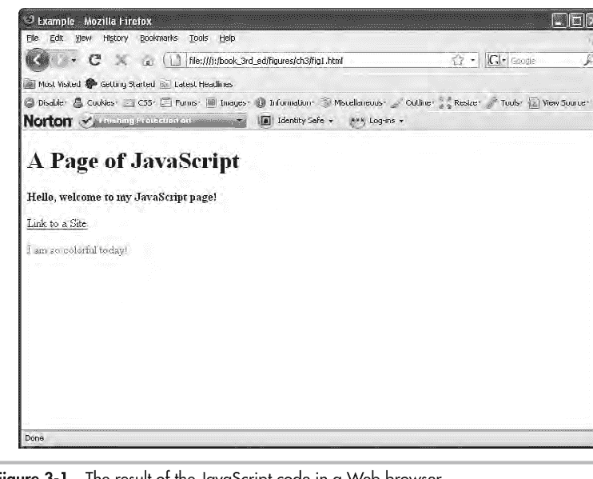

**图 3-1** JavaScript 代码在 Web 浏览器中的结果

以下代码展示了你可以对脚本文件进行的更改以获得新效果。注意你只需要更改 `begineffect` 和 `endeffect` 变量的值即可更改页面上的文本格式：

```javascript
var headingtext="<h1>A Page of JavaScript</h1>";
var myintro="Hello, welcome to my JavaScript page!";
var linktag="<a href=\"http://www.pageresource.com\">Link to a Site</a>";
var redtext="<span style=\"color:red\">I am so colorful today!</span>";
var begineffect="<em>"; // Changed to <em>
var endeffect="</em>"; // Changed to </em>
var beginpara="<p>";
var endpara="</p>";
document.write(headingtext);
document.write(begineffect+myintro+endeffect);
document.write(beginpara);
document.write(linktag);
document.write(endpara);
document.write(beginpara);
document.write(redtext);
document.write(endpara);
```

保存 `ch3_code.js` 文件并重新加载你的 HTML 文档。图 3-2 显示了这些更改如何影响页面在 Web 浏览器中的显示。

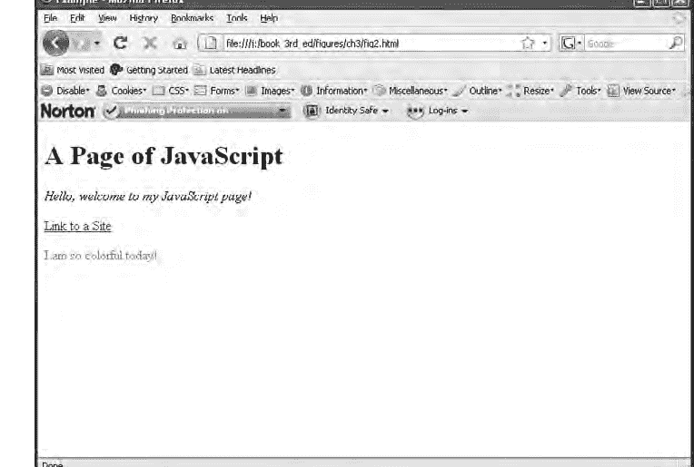

**图 3-2** 更改一些 JavaScript 变量后的页面

## 试试看 3-2 创建一个包含JavaScript的HTML页面

在这个项目中，你将创建一个包含JavaScript的HTML页面，类似于你在本章中创建的那个。变量将被赋予新的值，其差异应该是明显的。

```
pr3_2.html
prjs3_2.js
```

### 分步操作

1.  创建一个HTML页面，在 `<body>` 和 `</body>` 标签之间留出空白。

2.  在 `<body>` 和 `</body>` 标签之间，添加 `<script>` 和 `</script>` 标签以链接到名为 prjs3_2.js 的文件。将HTML文件保存为 pr3_2.html。

3.  打开一个文件用作你的JavaScript文件。将其保存为文件名 prjs3_2.js。使用此文件添加步骤4-10中的JavaScript代码。

4.  创建一个名为 `myheading` 的变量，并赋予它这个值：

    `This is My Web Page!`

5.  创建一个名为 `linktag` 的变量，并赋予它这个值：

    `<a href="http://www.javascriptcity.com">Web Site Link!</a>`

6.  创建一个名为 `sometext` 的变量，并赋予它这个值：

    `This text can be affected by other statements.`

7.  创建一个名为 `begineffect` 的变量，并赋予它值 `<em>`。

8.  创建一个名为 `endeffect` 的变量，并赋予它值 `</em>`。

9.  创建一个名为 `newsection` 的变量，并赋予它值 `<br />`。

10. 按此顺序将每个变量的值写回HTML文档：

    `myheading`

    `newsection`

    `begineffect`

    `sometext`

    `endeffect`

    `newsection`

    `linktag`

    `newsection`

    `sometext`

完成后，保存 prjs3_2.js 文件。它应该看起来像这样：

```javascript
var myheading="<h1>This is My Web Page!</h1>";
var linktag="<a href=\"http://www.javascriptcity.com\">Web Site Link!</a>";
var sometext="This text can be affected by other statements.";
var begineffect="<em>";
var endeffect="</em>";
var newsection="<br />";
document.write(myheading);
document.write(begineffect);
document.write(sometext);
document.write(endeffect);
document.write(newsection);
document.write(linktag);
document.write(newsection);
document.write(sometext);
```

11. 在你的Web浏览器中打开 pr3_2.html 页面并查看结果。

12. 重新打开 prjs3_2.js 文件并进行步骤13-14中的更改。

13. 将 `begineffect` 的值更改为 `<strong>`。

14. 将 `endeffect` 的值更改为 `</strong>`。

15. 完成后，保存 prjs3_2.js 文件。它应该看起来像这样：

```javascript
var myheading="<h1>This is My Web Page!</h1>";
var linktag="<a href=\"http://www.javascriptcity.com\">Web Site Link!</a>";
var sometext="This text can be affected by other statements.";
var begineffect="<strong>";
var endeffect="</strong>";
var newsection="<br />";
document.write(myheading);
document.write(begineffect);
document.write(sometext);
document.write(endeffect);
document.write(newsection);
document.write(linktag);
document.write(newsection);
document.write(sometext);
```

16. 在你的Web浏览器中重新加载 pr3_2.html 页面。注意JavaScript文件中变量值更改所带来的差异。

### 试试看总结

在这个项目中，你将使用变量的新技能与之前用JavaScript写入网页的技能结合起来。你创建了一个网页，其中包含一个使用变量来编写页面上HTML代码的脚本。然后你更改变了两个变量的值并重新保存了脚本文件。对变量的更改使页面发生了可见的变化。

## 第3章自测

1.  一个变量 __________ 或 __________ 一个值。

2.  使用变量的两个好处是什么？

    A  它们可以节省你编写和更新脚本的时间，并且可以使你代码的目的更清晰。

    B  它们使你代码的目的更清晰，并且使非编码人员更难理解脚本。

    C  它们可以节省你编写和更新脚本的时间，并且使非编码人员更难理解脚本。

    D  它们没有任何优势。

3.  要声明一个变量，你使用 __________ 关键字。

4.  JavaScript中用作赋值运算符的符号是什么？

    A  +

    B  -

    C  :

    D  =

5.  以下哪项声明了一个名为 `pagenumber` 的变量并赋值为240？

    A  `var PageNumber=240;`

    B  `pagenumber=220;`

    C  `var pagenumber=240;`

    D  `var integer named Pagenumber=240;`

6.  变量名不区分大小写。

    A  正确

    B  错误

7.  变量名必须以 ________ 或 ________ 字符开头。

8.  你应该避免使用JavaScript保留字作为变量名。

    A  正确

    B  错误

9.  以下哪项变量声明在JavaScript中使用了具有有效变量名的变量？

    A  `var default;`

    B  `var my_house;`

    C  `var my dog;`

    D  `var 2cats;`

10. 在JavaScript中，变量值或 ________ 可以包括数字、字符串、布尔值和null。

11. 要在JavaScript中表示指数，你在基数数字之后、指数之前使用字母 ________。

12. 以下哪项字符串声明是无效的？

    A  `var mytext="Here is some text!";`

    B  `var mytext='Here is some text!';`

    C  `var mytext= "Here is some text!";`

    D  `var mytext= "Here is \n some text!";`

13. 以下哪条语句在JavaScript中是有效的？

    A  `document.write("John said, "Hi!"");`

    B  `document.write('John said, "Hi!"');`

    C  `document.write("John said, "Hi!"");`

    D  `document.write("John said, \"Hi!\"");`

14. ________ 字符使你能够向字符串中添加无法以其他方式添加的内容。

15. 以下哪项通过将变量 `myhobby` 添加到一组字符串中成功打印了它？

    A  `document.write("I like to +myhobby+ every weekend");`

    B  `document.write("I like to " +myhobby+ " every weekend");`

    C  `document.write("I like to myhobby every weekend");`

    D  `document.write("I like to 'myhobby' every weekend");`

# 第4章

## 使用函数

## 关键技能与概念

- 什么是函数

- 为什么函数有用

- 构建函数

- 在脚本中调用函数

作为一名JavaScript编码者，你需要知道如何在脚本中使用函数。函数可以使你的脚本更具可移植性且更易于调试。

本章涵盖了使用函数的基础知识。首先，你将了解什么是函数以及为什么函数有用。然后，你将学习如何定义和构建函数。最后，你将学习如何在脚本中调用函数。

## 什么是函数

一个*函数*本质上是较大脚本中的一个小程序。它的目的是执行单个任务或一系列任务。函数的功能取决于你放置在其中的代码。例如，一个函数可能向浏览器写入一行文本，或者计算一个数值并将其返回给主脚本。

你可能从数学课上记得，函数可用于计算坐标平面上的值。你可能见过这样的计算：

```
f (x) =x+2
y=x+2
```

两者通常用于根据 *x* 坐标的值计算 *y* 坐标。如果需要在 *x* 等于3时得到 *y* 坐标，你可以将3代入 *x* 以得到 *y* 值：3+2=5。使用该函数，你会发现当 *x*=3 时，*y*=5。

函数本身只是静静地放在纸上（或者，在我们的例子中，是脚本上），直到你需要使用它来执行其任务。你可以根据需要多次使用它，通过从主脚本调用它。

## 为什么函数有用

函数有助于将脚本的各个部分组织成必须完成的不同任务。通过使用一个函数来编写文本，另一个函数来进行计算，你可以使你自己和他人更容易看到脚本每个部分的目的，从而更容易调试。

函数有用的另一个原因是它们的可重用性。它们可以在脚本中多次使用以执行其任务。你不必重写整个代码块，只需再次调该函数即可。

考虑简单的函数 `y=x+2`。如果你只使用它一次，该函数的作用不大。但是，如果你需要获取多个值，该函数就会变得越来越有用。你不必为每次计算都写出公式，只需在每次需要获取y值时替换x值即可。所以，如果你需要在x为3、4和5时获取y值，你可以使用该函数三次来获取y值。函数将分别计算出5、6和7。你只需编写一次函数内容，而不是三次，就可以得到三个答案。

函数可以执行复杂的任务，并且可能相当冗长。在本章及后续章节的示例中，你将看到它们在JavaScript中是多么有用且节省时间。

## 构建函数

既然你了解了函数是什么以及为什么想使用它们，你需要学习如何在脚本中构建它们。一个函数需要用其名称和代码来声明。还有一些可选的附加项可以使函数更有用。你可以将一个或多个变量导入函数，这些变量称为参数。你还可以使用 `return` 语句从函数返回一个值给主脚本。你将从了解函数如何开始。

### 声明函�

在函数的第一行，你将其声明为函数，为其命名，并指明它是否接受任何参数。要声明一个函数，你使用保留字 `function`，后跟其名称，然后是一组括号：

```
function functionname()
```

保留字 `function` 告诉浏览器你正在声明一个函数，并且后面会有更多信息。下一个信息是函数的名称。之后，括号表示函数是否接受任何参数。

例如，要将你的函数命名为 `reallycool` 并指明它不使用任何参数，第一行如下所示：

```
function reallycool()
```

因为该函数不使用任何参数，所以括号留空。与变量名一样，命名函数也有一些特殊注意事项。你将在讨论函数结构后了解这些注意事项。

你可能注意到这一行没有以分号结尾，不像你目前在本书中看到的其他代码行。分号缺失是因为你使用不同的技术来表示函数代码的开始和结束，如下所述。然而，

函数内的每一行独立代码都以分号结尾，正如本章示例中所示。

### 定义函数的代码

花括号（{ }）包围函数内部的代码。左花括号标记函数代码的开始；然后是代码；最后，右花括号标记函数的结束，格式如下：

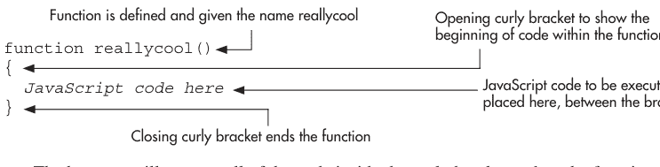

当函数被调用时（你将在本章稍后学到），浏览器将执行花括号内的所有代码。当浏览器遇到右花括�时，它知道函数已经结束。浏览器将移动到下一行代码，或者继续执行调用函数之前正在进行的任何操作。

在格式化花括号方面，你有一定的灵活性。有几种常见的方式将花括号放置到脚本中。前面示例中显示的格式将花括号“对齐”，使函数的开始和结束在代码的左边缘可见。如果你使用其他需要花括号的语句（你将在后面的章节中看到一些其他使用花括号的语句），这种方法很方便。通过缩进每组花括号，你可以轻松地看到哪些花括号嵌套在函数内部，哪些花括号开始和结束函数本身。

另一种常见格式是将左花括号放在与函数声明同一行，而不是下一行：

```
function reallycool() {
  JavaScript code here
}
```

在这种格式中，代码块的左花括号出现在右侧，右花括号出现在左侧。如果你希望计算一段代码中已打开和/或关闭了多少个花括号，这可能是一个有用的技术。

当然，如果你有一个特别短的函数，你甚至可以将整个函数放在一行中，像这样：

```
function reallycool() { JavaScript code here }
```

花括号之所以灵活，是因为出现在 JavaScript 令牌之间的空白、制表符和换行符会被忽略（令牌是诸如变量或函数名称、值、运算符、名称、关键字或其他必须保持完整的代码部分）。因此，以下代码将是有效的：

```
function reallycool() {
    var
        a
        =
        5; var b = 3; var c = 6; }
```

尽管它可能更难阅读，但 JavaScript 仍会将其视为有效代码，因为其他地方的语法是正确的。

你为花括号选择的格式可能取决于你的编程背景以及你希望代码如何呈现。所有样式对 JavaScript 解释器都是可接受的，因此请选择你感觉最舒适查看和编辑的样式。在本书的示例中，我将把左花括号放在与函数声明同一行（如本节第二个示例格式），并且如果函数特别短，我偶尔可能会将整个函数放在一行上（如本节第三个示例格式）。

### 命名函数

与变量一样，函数需要谨慎命名，以避免脚本出现问题。适用于变量命名的基本规则同样适用于函数命名：区分大小写、使用允的字符、避免保留字，以及给函数起易于记忆且有意义的名称。

> **注意**

如果你已经知道变量命名规则，你可能希望跳过本节，因为函数命名规则本质上是相同的。然而，关于为函数选择名称的一些细节，你可能会觉得有用。

#### 在函数名称中使用大小写

函数名称区分大小写，就像变量名称一样。这意味着 `reallycool`、`REALLYCOOL` 和 `ReallyCool` 代表不同的函数。请记住，你需要使用与声明函数时相同的字母大小写来调用函数。

#### 使用允许的字符并避免保留字

函数名称允许使用的字符与变量名称相同：

- 函数名称必须以字母或下划线字符（_）开头。

- 函数名称不能包含任何空格。

同样与变量名称一样，你不能将 JavaScript 保留字用作函数名称。这样做可能导致函数失败，这可能会在脚本中引发实际问题。有关 JavaScript 保留字的完整列表，请参阅第 3 章中的“避免保留字”部分。

64 JavaScript：入门指南

#### 给函数起有意义的名称

如果你选择反映其目的的名称，你的函函数将更容易记忆和调试。正如你在第 3 章所学，对于变量，你应该使用代表其值的名称，例如 `example_number` 代表页面上的示例编号。函数名称应该告诉你一些关于函数将要做什么的信息。例如，假设你创建了一个向页面写入一些文本的函数。它可能包含以下代码行：

```
document.write("<strong>This is a strong statement!</strong>");
```

你可以将函数命名为 `text`，但这可能不够描述性，因为可能有其他函数也向页面写入文本。相反，你可能将其命名为类似 `print_strong_text` 的名称，这样你就知道该函数用于向浏览器打印一段强调文本。完整的函数如下所示：

```
function print_strong_text() {
    document.write("<strong>This is a strong statement!</strong>");
}
```

这个名称有助于描述函数的用途。当函数被调用时，这一行代码将被执行。与变量一样，你在脚本中使用的函数越多，为它们使用有意义且易于记忆的名称就越重要。

### 向函数添加参数

*参数*用于允许函数从函数外部的某处导入一个或多个值。参数设置在函数第一行的圆括号内，格式如下：

```
function functionname(variable1, variable2)
```

作为参数引入的任何值都成为函数内的一个变量，使用你在圆括号内给出的名称。

例如，以下是定义一个带有参数（变量）`coolcar` 和 `coolplace` 的函数 `reallycool` 的方法：

参数添加在圆括号内的第一行

```
function reallycool(coolcar, coolplace) {
    JavaScript code here
}
```

请注意，在 JavaScript 中，设置函数参数时不需要使用 `var` 关键字。当参数被设置为函数参数时，JavaScript 会自动声明变量，因此这里不使用 `var` 关键字。例如，像这样的行是无效的：

```
function reallycool(var coolcar, var coolplace)
```

参数最初从哪里来？它们是在你进行函数调用时从函数外部获得的。你将在本章稍后看到这是如何工作的。现在，你只需要知道它们是如何用作 JavaScript 函数的参数即可。

**注意**

在其他语言中，通常要求变量在设置为参数时具有声明，但 JavaScript 会为你完成此操作。但是，当你在其他地方声变量时，需要使用 `var` 关键字。

#### 使用函数参数值

当你为函数分配参数时，可以像使用任何其他变量一样使用它们。例如，你可以通过赋值运算符将 `coolcar` 变量的值赋给另一个变量，如本例所示：

```
function reallycool(coolcar, coolplace) {
    var mycar = coolcar;
}
```

这将 `coolcar` 参数的值赋给一个名为 `mycar` 的变量。

你也可以不将其值赋给另一个变量，而直接在函数中使用 `coolcar` 参数，如本例所示：

```
function reallycool(coolcar, coolplace) {
    document.write("My car is a " + coolcar);
}
```

如果 `coolcar` 的值是 `Corvette`，那么当函数被调用时，它将向浏览器打印这一行：

```
My car is a Corvette
```

这里的 `coolcar` 参数被随意地赋予了一个值。在实际使用中，值必须来自脚本中的某处或另一个函数，否则变量将没有值。

#### 使用多个参数

你可能已经注意到前面的示例有两个参数，但只使用了一个参数。函数可以有任意数量的参数。当你分配多个函数参数时，函数不需要使用所有参数。它可以使用一个参数、几个或不使用。使用多少个取决于函数的功能及其调用方式。

唯一的规则是，如果你有多个参数，你需要用逗号分隔每个参数，以便浏览器知道该怎么做。

在前面的示例中，第二个参数没有被使用。以下是你可以如何更改函数以使用两个参数的方法：

```
function reallycool(coolcar, coolplace) {
    document.write("My car is a " + coolcar + " and I drive it to " + coolplace);
}
```

### 为函数添加 return 语句

return 语句用于确保函数向主脚本返回一个特定值，以供主脚本使用。你应将 return 语句置于函数体最后，在结束花括号之前，并以分号结尾。通常，返回的值是某个变量的值，格式如下：

```
return variablename;
```

例如，要返回变量 cooltext 的值，return 语句如下所示：

```
return cooltext;
```

这会将 cooltext 的值返回到主脚本中调用该函数的地方。

假设你想编写一个函数，返回两个字符串相加的结果。你可以使用 return 语句，如下例所示：

```
function get_added_text() {
  var textpart1="This is ";
  var textpart2="fun!";
  var added_text=textpart1+textpart2;
  return added_text;
}
```

在此函数中，前两个变量被赋予字符串值，而 added_text 变量被赋予这两个字符串相加的值。新值被发送回调用它的脚本。它会返回这个字符串：

```
This is fun!
```

这个返回值随后在主脚本中使用。按照当前形式，这个函数用处不大，因为字符串只是在函数内部定义，而不是作为参数传入。

除了返回变量值，你还可以返回一个简单值，甚至什么都不返回。以下都是有效的 return 语句：

```
return "This is cool"; <--- 返回一个字符串值
return 42; <--- 返回一个数值
return true; <--- 返回一个布尔值
return null; <--- 返回一个空值
return; <--- 不返回任何值
```

所有这些语句都会将控制权返回到函数调用之后的第一条 JavaScript 语句。返回空值时，不会发送任何值回去。

你还可以返回一个表达式，例如数字或字符串的加法（或任何你决定构建的其他表达式）。以下也是有效的 return 语句：

```
return "This is "+"cool"; <--- 返回两个字符串相加的结果
return 21+20+1; <--- 返回三个数字相加的结果
```

它们将分别返回值 “This is cool” 和 42。

你将在下一节看到更多使用参数和 return 语句的实用函数示例。

## 在脚本中调用函数

既然你已经了解了函数本身是如何工作的，接下来需要学习如何在脚本中调用一个函数。在 JavaScript 中调用一个函数很简单，只需写出函数名，后面跟着括号（括号内可以有参数，也可以没有），最后以分号结尾，就像一个普通的 JavaScript 语句一样：

```
functionname();
```

你可以在脚本代码的任何位置调用函数。你甚至可以在一个函数内部调用另一个函数。一个良好的实践是让函数定义在脚本中先于函数调用。确保函数定义先于调用的最简单方法是将所有函数定义尽可能地放在脚本的开头附近。

在调用函数之前先定义它，是一个良好编码实践的建议，而非严格规定。在 JavaScript 中，函数可以在任何地方被调用，但函数代码必须先被浏览器加载，函数才能工作。这就是为什么建议你在调用函数之前先定义它们。如果你调用一个定义在脚本底部的函数，它可能无法及时加载以供执行。因此，通常最好在调用函数之前先定义它。

## Script 标签：Head 部分还是 Body 部分

当将脚本直接添加到网页而不是使用外部文件时，确保变量和函数声明位于 head 部分，通常有助于确保它们在脚本于 body 部分中调用时可用。然而，由于 JavaScript 经常使用尚未加载的文档信息，这可能会导致问题。另一方面，在 body 部分包含大量 JavaScript 代码，在编辑 HTML 代码时也可能带来麻烦（如果 JavaScript 代码在 body 部分，它需要放在 JavaScript 所需信息的元素之后，以确保必要信息已加载）。最好将所有代码放入一个外部 JavaScript 文件中。然后，你可以决定是将 script 标签放在 head 部分还是 body 部分。

如果脚本不需要从文档获取信息，将 script 标签放在 head 部分效果很好。例如，你将创建一个脚本，在页面在浏览器中打开时立即向查看者发送一条警告消息。要在消息框中弹出消息，你可以使用一个叫做 window.alert 的 JavaScript 方法。

首先，你将学习如何创建 JavaScript 警告，然后你会看到如何构建一个使用该方法的函数，并在脚本中调用该函数。

## 创建 JavaScript 警告

你可以使用 window.alert 方法创建一个弹出消息框的 JavaScript 警告，而不是使用 document.write() 方法将内容写入屏幕。与 document.write() 方法类似，window.alert 方法将警告文本字符串作为参数，使用以下格式：

```
window.alert("alert_text");
```

文本字符串将显示在警告弹出框中。

例如，假设你想在弹出框中显示 “This is an alert!”。你应该在你的外部 JavaScript 文件（此示例我们将使用文件名 js_alert.js）中这样编写命令：

```
window.alert("This is an alert!");
```

现在你知道如何让警告弹出了，但如何让它在页面打开时立即出现呢？你可以通过确保脚本在网页 body 部分加载之前被调用实现这一点。通过将 script 标签放在文档的 <head> 和 </head> 标签内，如下所示，可以确保它在页面其余部分加载之前执行：

```
<head>
<title>Functions - Alert!</title>
<script type="text/javascript" src="js_alert.js"></script>
</head>
<body>
HTML code here
</body>
```

这一行调用了外部 JavaScript 文件。

页面的 HTML 内容将放在这里。

## 使用函数实现 JavaScript 警告

以下代码使用外部 JavaScript 文件中的一个函数来弹出警告框。在你的 js_alert.js 文件中，将代码更改为以下内容：

```
function show_message() {
    window.alert("This is an alert!");
}
show_message();
```

此示例创建了一个名为 show_message() 的函数来执行显示警告的任务。只有在该函数定义之后的某处调用了 show_message() 函数，警告才会显示。在此例中，函数在定义之后立即被调用。结果是弹出一个显示消息 “This is an alert!” 的小警告框。

> 注意

当警告框出现时，你可能会看到页面暂停，直到你点击“确定”按钮；或者它可能在等待你点击“确定”时继续加载。这取决于你的浏览器。

即使函数被首先定义，也并不意味着它会最先执行。函数在被调用之前不会执行；换句话说，JavaScript 在执行到脚本中的函数调用之前，不会使用该函数。

在函数调用之前的任何命令（且不是函数定义的一部分）都会在函数之前执行。例如，我们可以如下修改 JavaScript 文件中的代码：

```
function show_message() {
    window.alert("This is an alert!");
}
window.alert("I am first, ha!");
window.alert("I am second, ha ha!");
show_message();
```

本例在第一行定义了同一个函数 `show_message()`。该函数后面跟着两个独立的 `window.alert` 命令，然后是调用该函数的行。将包含此新代码的 `js_alert.js` 文件保存，然后在你的 Web 浏览器中重新加载 `js_alert.html` 文件。你应该会看到一个有趣的结果！

这两个独立的 alert 命令是 JavaScript 看到的前两个可执行语句，因此它们先执行。对我们函数的调用是最后被看到的，因此函数最后执行。结果是三个 alert，顺序如下：

- 用户会收到一个 alert，显示 "I am first, ha!"，需要点击 OK 按钮才能关闭它。

- 然后显示 "I am second, ha ha!" 的 alert 出现，查看者需要再次点击 OK。

- 最后，函数被执行，查看者看到 alert "This is an alert!"，需要第三次点击 OK 才能结束这场 alert 风暴。

尽管这个示例在其 alert 上有些过度，但它有助于你理解函数调用的工作原理。

如果你不担心 alert 显示的速度，脚本也可以在 body 部分调用。随着你编码经验的增加，选择将 script 标签放在 head 还是 body 部分会变得更容易。当脚本使用来自 HTML 文档 body 的信息时，script 标签通常要么放在 head 部分，并设置一个函数在页面加载时初始化变量和其他函数（这使用事件处理，将在第 7 章讨论），要么放在 body 部分（通常就在结束的 `</body>` 标签之前）。本书我将使用后一种方法。

## 从另一个函数调用函数

在另一个函数内调用函数可以是组织事件发生顺序的一种有用方式。通常，该函�被放在一个需要完成更大任务的函数内部。

当你在函数内放置函数调用时，你应该在定义调用它的函数之前，先定义被调用的函数，这遵循了函数应该在调用之前定义的早期建议。

这是一个两个函数的示例，其中第二个函数调用第一个函数：

```javascript
function update_alert() {
    window.alert("Welcome! This site is updated daily!");
}
function call_alert() {
    update_alert();
}
call_alert();
```

注意 `update_alert()` 函数是所有实际操作发生的地方。其他所有内容都是函数调用。`call_alert()` 函数所做的无非是调用 `update_alert()` 函数使其执行。最后，你看到启动整个序列的命令，即调用 `call_alert()` 函数。由于这是函数外的第一个 JavaScript 语句，它首先被执行。当它执行时，它只是调用 `update_alert()` 函数，该函数完成显示 alert 的工作。

#### 注意

大多数浏览器即使你在调用 `update_alert()` 函数之后才定义它，也能毫无问题地执行前面的示例。但是，一些较旧的浏览器可能不那么宽容，它们会要求函数在调用之前被定义。此外，如果函数定义在代码中太靠后以至于无法及时加载，它将无法正常工作。因此，通常最好在调用函数之前先定义它。

现在假设你想创建三个函数来执行三个任务。为了确保它们按正确的顺序发生，你可以从另一个函数内按顺序调用它们。以下是使用三个函数调用不同目的 alert 的此技术示例：

```javascript
function update_alert() {
    window.alert("Welcome! This site is updated daily!");
}
function section_alert() {
    window.alert("Please visit the picture section!");
}
function links_alert() {
    window.alert("Also, check out my links page!");
}
function get_messages() {
    update_alert();
    section_alert();
    links_alert();
}
get_messages();
```

代码首先定义三个函数以显示每个 alert。然后定义 `get_messages()` 函数，它只是调用前面三个函数。当然，`get_messages()` 函数必须被调用才能实际将其付诸实施。此调用作为函数外的第一个语句发生。

当然，创建一个弹出一条接一条消息的脚本通常不是你想做的事情。虽然该示例演示了函数调用的正确用法，但这样做的脚本可能会让你的观众感到恼火！你将在后面的章节中看到函数实际用例的示例。

## 使用参数调用函数

前面的示例使用三个不同的函数来显示三个 alert。虽然它有效，但如果你不需要为每个 alert 编写一个新函数，那将会很好。你可以通过使用参数来避免这样做。你可以创建一个可多次使用的函数来执行相同的操作，但每次使用来自参数的新信息。

正如本章前面提到的，变量通常用作参数。但是，你也可以使用值作为参数。你将首先了解不同类型的变量参数，然后看一下值参数。

如果你想将某些变量的值发送给函数，你必须首先声明变量，然后在发送之前确保它们具有所需的值。这里，变量的作用域变得很重要。变量的作用域决定了它在哪里有效以及在哪里无效。JavaScript 有全局变量和局部变量。

## 使用全局变量

全局变量是你在第 3 章中学到的变量。因为它们在任何函数外定义，所以可以在脚本中的任何地方（函数内部或外部）更改。全局变量在函数外的任何地方声明，如以下代码所示：

```javascript
var mycar="Honda";
var paycheck="1200";
```

此示例中的变量可以在脚本中的任何地方更改。这意味着它们甚至可能被函数意外覆盖或更改。

为了理解全局变量如何可能被函数影响，请考虑一个显示两个 alert 的示例。你希望一个 alert 告诉你需要多少钱才能买到某辆车，另一个 alert 告诉你目前有多少钱以及你现在拥有什么类型的车。如果使用以下代码会发生什么？

```javascript
var mycar="Honda";
var paycheck=1200;
function new_car() {
    mycar="Ferrari";
    paycheck=3500;
    window.alert("You need $"+paycheck+" to get a "+mycar);
}
new_car();
window.alert("You make $"+paycheck+" and have a "+mycar);
```

看起来好像你在函数内部创建了新变量，即使它们有相同的名称。然而，脚本会在两个 alert 中输出以下文本：

```
You need $3500 to get a Ferrari
You make $3500 and have a Ferrari
```

显然，这是不对的。

这个示例演示了为什么在声明变量时需要使用 `var` 关键字。没有 `var` 关键字，你不是在函数内创建新变量（这会使它们成为局部变量）。相反，你是在更改全局变量的值——你是在发出一个重新赋值命令，而不是一个新的变量命令。为了澄清这一点，你需要更改变量名中的一个，或者使用局部变量，如下一节所述。

## 使用局部变量

局部变量只能在声明它的函数内使用。它在该函数外不存在，除非你通过参数将其传递给另一个函数。

在函数中创建局部变量的关键是确保使用 `var` 关键字声明它。否则，同名的任何全局变量都可能被更改，正如你在前面的示例中看到的。要声明局部变量，你必须将其放在函数内并使用 `var` 关键字，如以下代码所示：

```javascript
function new_car() {
  var mycar="Ferrari";
  var paycheck=3500;
}
```

`mycar` 和 `paycheck` 变量现在是局部变量，只能由 `new_car()` 函数查看和更改。

因此，要更正上一节中的脚本，你只需要在函数内添加 `var` 关键字来声明局部变量，像这样：

```javascript
var mycar="Honda";
var paycheck=1200;
function new_car() {
  var mycar="Ferrari";
  var paycheck=3500;
  window.alert("You need $"+paycheck+" to get a "+mycar);
}
new_car();
window.alert("You make $"+paycheck+" and have a "+mycar);
```

现在 alert 应该按你的意图显示：

```
You need $3500 to get a Ferrari
You make $1200 and have a Honda
```

正如你所看到的，当你将某些变量作为参数发送给函数时，变量的作用域可能很重要。

## 使用变量作为函数参数

以下示例使用变量参数。它将一个全局变量发送给函数。然后它将该值赋给一个局部变量，以避免任何意外更改。

## JavaScript：初学者指南

脚本以 `check_alert()` 函数开始，该函数接收参数 `paycheck`。函数中的代码行将 `paycheck` 的值赋给一个局部变量 `pcheck`。这样，你可以在函数内部使用 `pcheck`，以避免更改全局变量 `paycheck`。随后，该函数用于显示一个使用 `pcheck` 值的警报。函数之后，在外部脚本中，全局变量 `paycheck` 被赋值为 1200。然后代码调用 `check_alert()` 函数，并将其 `paycheck` 变量的值发送给它。

前面的示例展示了一种避免更改全局变量的相当冗长的方法。由于函数参数是以变量值的形式传递的，你可以更改函数定义中括号内函数接受的变量名。这会从传递给函数的参数创建一个局部变量。以下是一个示例：

当此代码调用 `check_alert()` 函数时，它将 `paycheck` 变量的值发送给该函数。该值从函数本身中获取。你不是在这里将值命名为 "paycheck" 并将其赋给另一个变量，而是简单地在括号内使用另一个名称：`pcheck`。变量 `pcheck` 在 `check_alert()` 函数内部成为局部变量。由于代码发送了值为 1200 的 `paycheck`，因此 `pcheck` 将是 1200，除却你在函数后面更改它。

## 使用值参数

你也可以直接发送一个值作为参数。无需声明全局变量来传递参数，你可以直接发送一个值，该值将在函数内部转换为一个局部变量。这允许你即时发送一个值，并消除了需要随时准备一个全局变量的麻烦。需要记住的重要一点是，如果你发送的是字符串值，则需要用引号括起来。以下函数调用将一个字符串值 "something" 发送给名为 `text_alert()` 的函数：

```
text_alert("something");
```

例如，上一节中的最后一个示例可以进行修改，在使用值参数的同时添加更多信息，从而减少一行代码：

```
function check_alert(pcheck, car) {
  window.alert("You make $" + pcheck + " and have a " + car);
}
check_alert(1200, "Corvette");
```

该函数接收一个数字值和一个字符串值，而不是变量值。

在此示例中，函数调用向函数发送了两个参数。第一个是数字值，不需要引号。第二个值是字符串，需要用引号括起来。然后这些值被发送到函数中，在函数内作为局部变量 `pcheck` 和 `car` 被分别读取。现在可以在函数中使用它们来在警报中显示这个句子：

> You make $1200 and have a Corvette

参数也可以使用表达式发送，例如以下内容：

```
check_alert(500 + 700, "Cor" + "vette");
```

JavaScript 将计算每个表达式并将结果作为参数发送给函数。因此，前面的代码将具有相同的最终结果（500 加 700 等于 1200，"Cor" 加 "vette" 等于 "Corvette"）：

> You make $1200 and have a Corvette

## 参数是可选的

另一件需要提及的事情是，向函数发送参数是可选的。函数将尽力在没有传递参数值的情况下完成其工作。你可以不带任何参数调用 `check_alert()` 函数：

```
function check_alert(pcheck, car) {
  window.alert("You make $" + pcheck + " and have a " + car);
}
check_alert();
```

你的结果将类似于以下文本：

> You make $undefined and have a undefined

因此，最好设置一些代码来处理未发送参数的情况。这可以使用条件语句来完成。以下是检查参数是否已发送到 `check_alert()` 的一种方法：


```
function check_alert(pcheck, car) {
  if (pcheck && car) {
    window.alert("You make $" + pcheck + " and have a " + car);
  } else {
    window.alert("My parameters are missing!");
  }
}
check_alert();
```

这本质上是告诉 JavaScript 在将语句写入页面之前先检查参数是否存在。如果它们确实存在，则语句将使用参数值写入页面。如果它们不存在，则查看者会收到一个警报，提示 "My parameters are missing!"。逻辑运算符 `&&` 将在第 5 章更详细地讨论，`if/else` 语句将在第 6 章更详细地讨论。

## 使用 return 语句调用函数

要调用一个函数并在函数中使用 `return` 语句，你可以将函数的结果赋给一个变量。这样，变量将获得从函数返回的值，并可在脚本中后续使用。这是声明一个具有函数返回值的变量的格式：

```
var variablename = functionname();
```

考虑前面的示例，其中有一个函数返回两个文本字符串相加的值。你可以对其进行修改，使函数结果赋给一个变量，如下所示：

```
function get_added_text() {
  var textpart1 = "This is ";
  var textpart2 = "fun!";
  var added_text = textpart1 + textpart2;
  return added_text; // The result of the added text is returned to the script
}
var alert_text = get_added_text(); // The result of the function is assigned to a variable
window.alert(alert_text); // The value of the variable is used as the text for the alert
```

如你所见，函数将相加文本变量的值返回给脚本。通过将 `get_added_text()` 函数的结果赋给 `alert_text` 变量，你可以在脚本中后续使用该相加文本。该变量用于向用户发送一个包含相加文本结果的警报。警报消息显示：

> This is fun!

现在，这不是很有趣吗？当你在第 14 章学习表单验证时，你会看到 return 方法的一些更实际的应用。

## 定义函数的其他方式

在查看脚本或在编写新脚本时可能会发现有几种定义函数的方式：函数声明（已讨论）、函数构造函数和函数表达式。

### 函数声明

这是你到目前为止一直在使用的方法，也是本书中经常使用的方法。回想一下，你可以简单地如下声明函数：

```
function functionname() {
  Code for function here
}
```

你也可以如本章前面所述添加参数和/或 return 语句。

### 函数构造函数

函数构造函数创建一个函数对象，其方式与创建一个新对象实例相同（这将在第 8 章讨论）：

```
var functionname = new Function(arguments, code for function);
```

这将像其他函数一样工作，但此方法的主要缺点是其性能比其他方法差（每次使用时都会被求值，而不是只解析一次）。更多情况下，你会使用另外两种方法之一来定义函数。

### 函数表达式

函数表达式（也称为函数运算符）使用与函数声明相同的语法。它与函数声明的主要区别在于，函数声明创建一个与函数同名的变量，该变量可以在函数外部使用，而函数表达式只能在函数内部通过其名称访问变量。例如，以下代码使用函数声明，并可以使用函数名作为变量来输出警报（变量的值将是整个函数的代码）：

```
function send_alert() {
  var my_num = 1;
}
window.alert(send_alert);
```

另一方面，以下代码在运行时会给出错误：

```
var get_func = function send_alert() {
  var my_num = 1;
}
window.alert(send_alert);
```

如前面的代码所示，函数表达式也使用了一个函数名。但是，该函数名不能在函数外部用作变量。

> **注意**

> 在撰写本文时，Internet Explorer 7 中函数表达式的这种用法没有给出错误，而是给出了与函数声明相同的结果。要测试此差异，可以使用 Mozilla Firefox。

## 匿名函数

函数表达式的一种有效用法是将其作为匿名函数使用，即不为函数指定名称。匿名函数是创建后立即调用的函数，当您只希望在代码的某一处调用某个函数时（而不是在代码的其他地方声明该函数并通过多次调用重复使用），它非常有用。以下是匿名函数的通用格式：

```
var varname = function(parameters) {
    函数代码
};
```

这里使用了 `function` 关键字但未为函数命名。

匿名函数在处理 JavaScript 事件时非常有用。例如，要响应用户在网页上的鼠标点击，您可以为文档编写一个简单的点击事件函数并调用它，如下列代码所示：

```
function do_not_click() {
    window.alert("请勿点击我的页面！");
}
document.onclick = do_not_click;
```

这里先声明函数，然后（不带括号）调用它以处理点击事件。

然而，使用匿名函数可以将这两个步骤合二为一，如下所示：

```
document.onclick = function() {
    window.alert("请勿点击我的页面！");
};
```

由于对此事件的反应只会在 JavaScript 代码中的一个地方，因此匿名函数是一种便捷的处理事件的方式，无需在其他地方声明函数然后再调用它。这种技术以及用于事件处理的代码类型（例如上述代码清单中的代码）将在第7章中更详细地讨论。

> **专家答疑**

> **Q: 如果我在脚本中放了一个函数但决定不调用它，会有影响吗？**

> **A:** 除非被调用，否则函数不会执行。然而，拥有未使用的函数会使代码更难维护，并增加浏览者的下载时间（在拨号上网等慢速连接或需要优化代码下载时间的情况下可能会产生影响）。此外，如果函数包含语法错误，它可能会向浏览者发送 JavaScript 错误，并导致网页上的其他内容无法正常工作。

> **Q: 如果我后来决定从脚本中删除一个函数会怎样？**

> **A:** 如果您没有同时删除对该函数的所有调用，这可能会导致问题。脚本可能会引发 JavaScript 错误；或者它可能运行但产生意外的结果。此外，在删除函数之前，请确保它没有在脚本的某个地方执行必要的任务。

> **Q: 那么，如果我调用一个不存在的函数会发生什么？**

> **A:** 您会得到一个 JavaScript 错误，或者当调用该函数时浏览器什么也不做，因为它找不到该函数。

> **Q: 确定何时使用函数、何时直接将所需代码写入脚本的最佳方法是什么？**

> **A:** 在大多数情况下，如果函数内的代码在某种方式上是可重用的，您就想使用函数。例如，一个执行特定计算的函数可能在脚本中的不止一个地方有用。此外，如果您只是喜欢将代码组织得更整齐一些，函数会有所帮助。如果您决定该代码在脚本中只使用一次，您可能只需将代码直接放入脚本或为其使用匿名函数。

## 动手实践 4-1

### 创建包含函数的 HTML 页面

```
pr4_1.html
prjs4_1.js
```

在这个项目中，您将创建一个包含两个 JavaScript 函数的 HTML 页面。一个函数使用发送给它的参数弹出一个包含消息的警告框。另一个函数使用 `return` 语句将一个值返回给脚本。该返回值随后用于向浏览者显示警告消息。

### 分步指导

1. 创建一个 HTML 页面，在 `<body>` 和 `</body>` 标签之间留出空间。

2. 创建一个外部 JavaScript 文件，并将其保存为 `prjs4_1.js`。

3. 在 HTML 文档的 `<body>` 和 `</body>` 标签之间添加必要的 `<script>` 标签以包含此外部 JavaScript 文件。将 HTML 文件保存为 `pr4_1.html`。

4. 打开 `prjs4_1.js` 外部 JavaScript 文件，并执行步骤 5-10。

5. 创建一个名为 `car_cost()` 的函数，它接受两个参数 `mycar` 和 `paycheck`。创建一个 `window.alert` 命令，将显示一个包含以下消息的警告框：

    You have a `<mycar variable here>` and make `$<paycheck variable here>`

6. 创建一个名为 `get_added_text()` 的函数，该函数返回函数内部两个字符串相加的值。要相加的两个字符串是这两行独立的文本：

    This project`<space here>`

    is almost fun!

7. 在主脚本（函数定义之后）中，调用 `car_cost()` 函数，并将其参数值设置为 “Mustang” 和 1500。

8. 在主脚本（函数定义之后），将 `get_added_text()` 函数的结果赋给一个名为 `alert_text` 的变量。创建一个警告框，显示该变量的值。

9. 完成后，您的外部 JavaScript 文件应如下所示：

```
function car_cost(mycar, paycheck) {
    window.alert("You have a " + mycar + " and make $" + paycheck);
}
function get_added_text() {
    var textpart1 = "This project ";
    var textpart2 = "is almost fun!";
    var added_text = textpart1 + textpart2;
    return added_text;
}
car_cost("Mustang", 1500);
var alert_text = get_added_text();
window.alert(alert_text);
```

10. 保存外部 JavaScript 文件。

11. 打开 `pr4_1.html` 文件，并在浏览器中查看结果。

当您打开网页时，应该会看到两个警告消息：

You have a Mustang and make $1500

This project is almost fun!

### 动手实践总结

在这个项目中，您创建了一个使用两个 JavaScript 函数的脚本。第一个函数使用参数，并根据发送给函数的参数创建包含消息的警告框。第二个函数将两个字符串相加后，将一个值返回给脚本。脚本在浏览器中的结果是两个基于发送给第一个函数的信息和从第二个函数返回给脚本的信息的警告消息。

## 综合运用

既然您已经学习了使用函数的基础知识，请看下面这个相当长的页面。这个页面在 HTML 文档中添加了一些 JavaScript。尝试跟随它，看看它是如何工作的以及它将做什么。

```
<body>
<h1>"欢迎来到我的函数页面，"我说道。</h1>
<script type="text/javascript">
function get_added_text(textpart1, textpart2) {
    var added_text = textpart1 + " " + textpart2;
    return added_text;
}
function print_text() {
    var myfood = get_added_text("cheese", "bread");
    document.write(myfood);
}
var alert_text = get_added_text("soup", "crackers");
window.alert(alert_text);
print_text();
</script>
<p style="color:red">I'm seeing red!</p>
</body>
```

首先，您看到定义了两个函数。`get_added_text()` 函数用于将两段文本拼接起来，在它们之间加一个空格，并将该值返回到调用它的地方。`print_text()` 函数用于将一些文本作为参数发送给 `get_added_text()` 函数，将结果赋给名为 `myfood` 的变量，并将结果打印到页面本身。

执行的第一个命令是紧接在所有函数定义之后的那个。就是这一行：

```
var alert_text = get_added_text("soup", "crackers");
```

这行代码声明了一个名为 `alert_text` 的变量，并将其值赋为当 `get_added_text()` 函数接收 “soup” 和 “crackers” 作为参数时返回的值。结果将是两个参数值之间加一个空格。返回的字符串 “soup crackers” 现在被赋给 `alert_text` 变量。

下一行执行的是紧随其后的这一行，如下所示：

```
window.alert(alert_text);
```

警告框显示分配给 `alert_text` 变量的文本，这是从 `get_added_text()` 函数返回的拼接字符串。

接下来，调用 `print_text()` 函数使其运行。

`print_text()` 函数首先声明一个名为 `myfood` 的变量，并将从 `get_added_text()` 函数返回的值赋给它。它被发送的值是 “cheese” 和

"面包"作为参数。因此，返回的值是字符串"奶酪面包"，该值将被赋值给 `myfood` 变量。然后，`print_text()` 函数获取该值，并使用 `document.write()` 方法将其写入屏幕。

图 4-1 和图 4-2 展示了此脚本在浏览器中运行的结果。图 4-1 显示了首先弹出的警告框，图 4-2 显示了用户在警告框中单击“确定”后看到的页面。

此示例展示了如何使用你在本章学到的不同技巧来组织函数、为函数添加参数、在其他函数中调用函数以及使用 `return` 语句。这些都可以在单个脚本中结合使用，在需要时执行指定的任务。

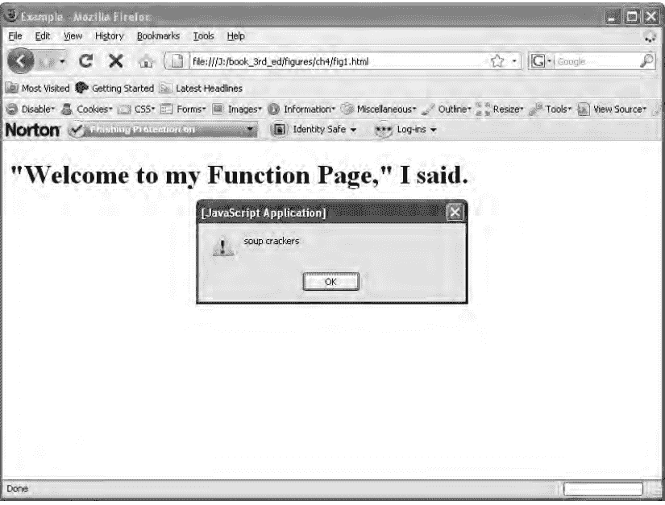

图 4-1  页面加载之前或加载过程中出现的警告框

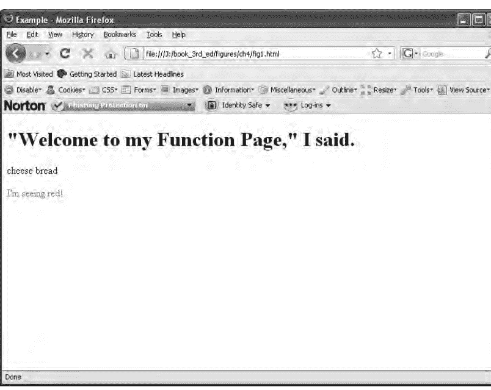

图 4-2  在警告框中单击“确定”按钮后出现的页面

## 动手实践 4-2  编写你自己的函数

在这个项目中，你将再次创建一个包含两个 JavaScript 函数的 HTML 页面，但这次你将使用自己的变量和函数名，并创建你自己的脚本版本。

### 分步指南

1.  创建一个 HTML 文件，并将其保存为 `pr4_2.html`。

2.  创建一个外部 JavaScript 文件，并将其保存为 `prjs4_2.js`。在步骤 3 到 6 中使用此文件。

3.  创建一个接受两个字符串作为参数的函数。让它返回两个字符串拼接在一起的值，但在它们之间加一个空格。

（续）

4.  创建第二个凭数，该函数获取第一个函数的结果并将其赋值给一个变量。将此变量的值直接写入 HTML 文档。要发送给第一个函数的参数是字符串 `"Hi"` 和 `"there!"`。

5.  在主脚本中，创建一个新变量，并将第一个函数的结果赋值给它。这一次，向函数传递两个字符串 `"Regular"` 和 `"text!"`。

6.  创建一个警告框，用于显示此变量的值。

7.  在 HTML 页面的 `body` 部分，在文档中放置脚本标签（指向 `prjs4_2.js` 文件），以便脚本在一行加粗文本 "This is some strong text." 之后写入第二个函数的结果。

8.  完成后，保存 HTML 和 JavaScript 文件，并在浏览器中查看 HTML 页面以查看其效果。

结果应该是一个显示 "Hi there!" 的警告框，然后在警告框中单击“确定”后页面打开。页面应显示一行加粗文本，内容为 "This is some strong text."。在下一行，应显示文本 "Regular text!"。

### 动手实践总结

在这个项目中，你运用了关于函数、参数和返回值的知识来创建一个脚本。脚本的结果是，你创建的 HTML 页面会弹出一个警告框，并根据你创建的两个函数的结果向页面写入文本。

## 第 4 章  自测

1.  通常，函数是一个较大的 __________ 内的一个小程序，用于执行单个 __________ 或一系列 __________。

2.  函数有用的两个原因是什么？

    A. 它们使简单的脚本变得更复杂，并且使非程序员更难阅读脚本。

    B. 它们提供了一种将脚本的各个部分组织成必须完成的不同任务的方法，并且可以重用。

    C. 它们使简单的脚本变得更复杂，并且可以重用。

    D. 它们提供了一种将脚本的各个部分组织成必须完成的不同任务的方法，并且使非程序员更难阅读脚本。

3.  在函数的第一行，你 __________ 它是一个函数， __________ 它，并指明它是否接受任何 __________。

4.  要声明一个函数，你使用保留字 ______________。

    A. `var`

    B. `switch`

    C. `function`

    D. `for`

5.  什么包围着函数内部的代码？

    A. 花括号 – {}

    B. 冒号 – ::

    C. 方括号 – []

    D. 无

6.  函数名区分大小写。

    A. 正确

    B. 错误

7.  JavaScript 保留字可以用作函数名。

    A. 正确

    B. 错误

8.  以下哪项是 JavaScript 中有效的函数名？

    A. `function my function()`

    B. `function if()`

    C. `function get_text()`

    D. `function 24hours()`

9.  ______________ 用于允函数从函数外部的某个地方导入一个或多个值。

10. 参数在函数的第一行设置，在一组 ______________ 内。

    A. 花括号 – {}

    B. 圆括号 – ()

    C. 方括号 – []

    D. 无

11. 多个参数用什么符号分隔？

    A. 句号

    B. 冒号

    C. 分号

    D. 逗号

12. 以下哪项是 `window.alert()` 方法的有效用法？

    A. `win.alt("This is text");`

    B. `window.alert("This is text);`

    C. `window.alert('This is text");`

    D. `window.alert("This is text");`

13. 以下哪项正确地调用名为 `some_alert()` 的函数并发送两个字符串值作为参数？

    A. `some_alert();`

    B. `some_alert("some","words");`

    C. `some_alert("some","words);`

    D. `SOME_alert("some","words");`

14. 以下哪项正确地将名为 `get_something()` 的函数的结果赋值给名为 `shopping` 的变量？

    A. `var shopping=get_something();`

    B. `var shopping="get_something";`

    C. `var Shopping=get_Something;`

    D. `shopping=getsomething;`

15. __________ 变量只能在其声明的函数内使用。

## 第 5 章

## JavaScript 运算符


## 核心技能与概念

-   理解运算符类型

-   理解数学运算符

-   理解赋值运算符

-   理解比较运算符

-   理解逻辑运算符

-   理解运算顺序

运算符在脚本中承担了大部分工作。在前面的章节中，你已经看到了赋值 (`=`) 和加法 (`+`) 运算符的使用示例。JavaScript 提供了许多其他类型的运算符来执行各种操作。本章首先向你介绍不同类型的 JavaScript 运算符。然后，你将学习每个运算符及其在脚本中的用法。最后，你将了解运算符的优先级顺序，这决定了哪些运算在其他运算之前执行。

## 理解运算符类型

*运算符* 是 JavaScript 中的一个符号或单词，它对一个或多个值执行某种计算、比较或赋值。在某些情况下，运算符提供了一种捷径来缩短代码，从减少你的输入量。常见的计算包括求两个数的和、连接两个字符串或计算两个数的商。一些常见的比较可能包括确定两个值是否相等，或者一个值是否大于另一个值。快捷赋值运算符可用于将新值分配给变量，这样就不需要输入两次变量名。JavaScript 使用几种不同类型的运算符：

-   **数学运算符** 这些运算符最常用于对两个值进行数学计算。数学运算符对你来说可能是最熟悉的。它们使用 `+`、`-` 和 `*` 等符号。

-   **赋值运算符** 这些运算符用于将新值赋给变量。正如你在第 3 章学到的，其中一个赋值运算符是符号 `=`。

-   **比较运算符** 这些运算符用于比较两个值、两个变量，或者可能两个更长的语句。它们使用 `>`（表示“大于”）和 `<`（表示“小于”）等符号。

-   **逻辑运算符** 这些运算符用于比较两个条件语句（或对单个语句进行操作）以确定结果是否为真，并相应地继续执行。它们使用 `&&`（如果运算符两侧的语句都为真，则返回真）和 `||`（如果运算符任一侧的语句为真，则返回真）等符号。

-   **位运算符** 这些是在位级别（1 和 0）上工作的逻辑运算符。它们使用 `<<`（表示左移位）和 `>>`（表示右移位）等符号。

-   **特殊运算符** 这些是执行其他自身特殊功能的运算符。

在本章中，你将学习所有这些类型的运算符。这将是对每种运算符功能的概述，以便你在稍后使用所有运算符时更好地了解它们的用途。首先，我们来看看 JavaScript 中的数学运算符。

## 理解数学运算符

对于数学计算，你需要使用数学运算符。你可以使用任何你喜欢的值。例如，你可以使用两个变量、两个数字，或者一个变量和一个数字。其中一些运算符能够对单个变量的值执行任务。

举个简单的例子，你会记得在前面的章节中使用加法运算符 (`+`) 将两个字符串连接在一起。以下是使用加法运算符组合两个字符串值的示例：

```
window.alert("I begin and "+"this is the end.");
```

当其中一个值是变量时，也可以使用加法运算符，如下例所示：

```
var part2="this is the end."
window.alert("I begin and "+part2);
```

当两个值都是变量时，加法运算符同样适用，如下一个示例所示：

```
var part1="I begin and ";
var part2="this is the end."
window.alert(part1+part2);
```

这些示例说明了如何将许多数学运算符与多个值和/或变量一起使用。这使你在编写脚本时具有一定的灵活性。

作用于单个值的三个运算符是增量、减量和一元取反运算符。增量和减量运算符实际上是加 1 或减 1 的快捷方式，因此学习如何使用它们可以节省一些编码时间。

数学运算符及其功能在表 5-1 中进行了总结。以下各节将更详细地讨论每个运算符。

## 加法运算符（+）

正如你所见，加法运算符可用于连接两个字符串。它也可用于数学计算中的数字相加。

### 用于存储加法结果的变量

加法运算符的一个用途是将两个数字相加以得到数学结果。在进行数值相加时，你通常会将结果赋值给一个变量，以便后续使用该结果。例如，要计算4加7的值并显示结果，你可以像这样编写代码：

```
var thesum=4+7;  ← 两个数字用加法运算符相加
window.alert(thesum);  ← 加法的结果作为警告提示给用户
```

结果是一个显示11的警告框。

为了使示例稍微复杂一点，你可以将其中一个数字更改为变量：

```
var num1=4;  ← 一个数字被赋值给一个变量
var thesum=num1+7;  ← 一个数字与该变量相加，总和被赋值给一个新变量
window.alert(thesum);
```

结果与前一个示例的代码相同：一个显示11的警告框。

进一步扩展这个示例，你可以将两个数字都设为变量：

```
var num1=4;
var num2=7;
var thesum=num1+num2;  ← 使用加法运算符将两个变量相加
window.alert(thesum);
```

这个示例提供了最大的灵活性，因为你可以更改两个数字变量的值并获得新结果，而无需深入修改脚本。

### 加法计算中的类型转换

需要注意的是JavaScript在处理数学运算符时如何执行类型转换。当你使用加法和其他数学运算符时，需要意识到JavaScript会自动将不同的值（例如整数（非十进数值）和浮点数（十进制数值））转换为适当的类型。例如，你可能有以下代码：

```
var num1=4.73; <!-- 此变量有小数位 -->
var num2=7; <!-- 此变量是整数 -->
var thesum=num1+num2; <!-- 这两个变量相加，JavaScript将显示带小数位的答案 -->
window.alert(thesum);
```

运行脚本时，你将看到一个显示结果的警告框。

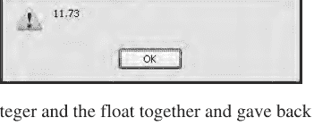

JavaScript将整数和浮点数相加并返回一个浮点数：11.73。JavaScript经常这样做，因此你需要确保在开始相加时使用正确类型的值。

例如，如果你将一个数字和一个字符串相加，结果将如同你连接了两个字符串一样。看这个例子：

```
var num1=4; <!-- 此变量是一个数字 -->
var num2="7"; <!-- 糟糕！此变量是一个字符串，不是数字 -->
var thesum=num1+num2; <!-- 当它们相加时，它们像字符串一样被连接 -->
window.alert(thesum);
```

这看起来像是将数字4和7相加，因为它们看起来都是数字。问题在于，这里的7是一个字符串，而不是数字，因为它被引号包裹。这导致4被转换为一个字符串，然后两个字符串被相加（连接）。警告框中显示的结果可能会让你惊讶。


你没有得到预期的答案11，而是得到了47。当两个值作为字符串相加时，它们是被拼接在一起，而不是进行数学加法。对于字符串，"4"+"7"=47。

#### 注意

除了加法运算符（+），其他数学运算符仅对数字有效，对字符串值无效。

其他数学运算符也会进行类型转换，与加法运算符类似。稍后当你学习如何在脚本中获取用户输入时，你会明白这为何重要。

## 减法运算符（-）

减法运算符用于将其左侧的值减去其右侧的值，与数学中一样。这里有一个示例：

```
var theresult=10-3;
window.alert(theresult);
```

这段代码简单地将3（运算符右侧的数字）从10（运算符左侧的数字）中减去。结果是一个显示7的警告框。

与加法运算符一样，你可以使用变量来存储你正在使用的数字，如本例所示：

```
var num1=10;
var num2=3;
var theresult=num1-num2;
window.alert(theresult);
```

结果与前一个示例相同：一个显示7的警告框。

变量与数学运算符的用法也适用于乘法、除法和取模运算符，这些将在下一节描述。

## 乘法运算符（*）

乘法运算符用于将其右侧的值乘以其左侧的值。同样，这就像数学乘法一样。下一个示例展示了这个运算符的实际用法：

```
var num1=4;
var num2=5;
var thetotal=num1*num2;
window.alert(thetotal);
```

这里，你得到一个显示20的警告框，即4乘以5的结果。这个运算符应该不会给你太多意外，所以让我们继续看除法运算符。

第5章：JavaScript运算符 93

## 除法运算符（/）

除法运算符用于将其左侧的值除以其右侧的值。例如，代码4/2表示4除以2，结果是2。

这里有一个JavaScript的实际示例：

```
var num1=10;
var num2=2;
var theresult=num1/num2;
window.alert(theresult);
```

两个数字使用除法运算符相除

这会给你一个显示5的警告框，即10除以2的结果。

### 除以零

使用除法运算符时，需要小心不要以某种方式除以零。如果发生这种情况，结果将是无穷大或未定义，具体取决于你的浏览器。下面的代码展示了一个这样的示例（尽管实际中不太可能完全这样发生）：

```
var num1=10;
var num2=0;
var theresult=num1/num2;
window.alert(theresult);
```

哦不！在这行代码中你正在除以零

这个警告将不会显示一个数字

如果你将此代码放在文档中，可能会看到如下警告框：

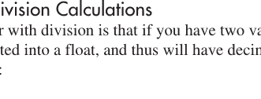

要避免除以零，请注意在除法运算符右侧放置的数字或变量。

### 除法计算中的类型转换

除法运算需要记住的另一件事是，如果你有两个不能整除的值，结果将被转换为浮点数，因此会有小数位。下面的代码展示了一个示例：

```
var num1=3;
var num2=4;
var theresult=num1/num2;
window.alert(theresult);
```

这个示例展示了一个简单的计算；但根据所使用的数字，结果可能变得很长。在后续章节中，你将学习一些格式化输出的技术，这样用户就不会最终看到类似.75664421004这样的东西。

## 取模运算符（%）

取模运算符用于将其左侧的数字除以其右侧的数字，然后给出除法后的整数余数。回想一下你学习长除法时，将余数作为答案的一部分，而不是转换为小数或分数。11除以2得到5余1。余数1就是当你写11%2时取模运算符给出的结果。

以下是JavaScript中的一个示例：

```
var num1=11;
var num2=2;
var theresult=num1%num2;
window.alert(theresult);
```

结果是一个显示余数值的警告框，即1。如果计算没有余数，结果将是0。

这是处理两个值同时运算的最后一个数学运算符。接下来的运算符一次只处理一个值。

## 自增运算符（++）

自增运算符可用于其操作的值的两侧。它将其操作的值增加1，就像给值加上1一样。实际结果取决于运算符是在其操作值（称为*操作数*）之前还是之后使用。这个运算符通常与变量一起使用，并且经常在循环中使用（第6章介绍）。

### 操作数前的自增运算符

当自增运算符放在操作数之前时，它先将操作数的值增加1，然后执行语句的其余部分。这里有一个示例：

```
var num1=2;
var theresult=++num1;
```

在这种情况下，变量num1初始值为2。然而，当代码将值赋给变量theresult时，它在赋值发生之前增加了num1的值。自增首先发生，因为自增运算符在操作数前面。所以，num1的值被设置为3（2+1），然后被赋值给变量theresult，后者获得值3。

### 操作数后的自增运算符

如果你将自增运算符放在操作数之后，它会在赋值之后改变操作数的值。考虑这个示例：

```
var num1=2;
var theresult=num1++;
```

## 减量运算符（--）

减量运算符的工作方式与增量运算符类似，但它是从操作数中减去1，而不是加上1。与增量运算符一样，将其放在操作数之前还是之后很重要。

如果你将减量运算符放在操作数之前，操作数会先减1，然后执行语句的其余部分。示例如下：

```javascript
var num1 = 2;
var theresult = --num1;
```

这里，变量 `num1` 被赋值为2。在下一行中，代码将 `num1` 减去1，然后将结果赋值给变量 `theresult`。因此，变量 `theresult` 最终的值为1（2-1）。

当你将运算符放在操作数之后时，如下面的示例所示，会先执行语句的其余部分，然后操作数再减1：

```javascript
var num1 = 2;
var theresult = num1--;
```

这一次，变量 `theresult` 被赋值为2，然后 `num1` 被减至1。如果你在这行之后使用 `num1`，它的值将是1。与增量运算符一样，当你使用循环时，减量运算符会变得很重要，这将在后面的章节中学习。

## 一元取负运算符（-）

一元取负是仅对单个操作数使用减号。此运算符创建一个负数或改变当前数字的正负号。以下是将负值赋给数字的示例：

```javascript
var negnum = -3;
```

这定义了一个值为-3的变量。基本上，该运算符告诉浏览器这个3是"非正数"，因为它通过在数字前放置取负运算符来否定了默认的正号。你也可以使用一元取负运算符来表示负数的加法或减法，如下例所示：

```javascript
var theresult = 4 + (-3);
```

注意语句中 `-3` 部分周围的括号。就像在数学中一样，你可以使用括号来设置运算顺序（正如你将在本章后面学到的），或者仅仅是为了在视觉上澄清顺序。这里，括号不是必需的，但它们有助于组织代码，以便你能看出它是将 -3 加到 4。你也可以将此代码写成：

```javascript
var theresult = 4 + -3;
```

这看起来不那么漂亮，但它仍然有效。你可能在想，还有一种更简单的方式来表达同样的意思：

```javascript
var theresult = 4 - 3;
```

你是对的，这是最简单的写法；但它使用的是减法而不是一元取负。为了更清晰地表示，你可以将此运算符用于变量值，它只是对变量所表示的数字取反：

```javascript
var x = 4;
var y = 3;
var z = -y;
```

这将变量 `z` 赋值为 `y` 的一元取负值，即 -3。现在你已经了解了算术运算符，是时候转向赋值运算符了。

## 理解赋值运算符

赋值运算符将值赋给变量。它们不比较两个项目，也不执行逻辑测试。

当你在第3章学习变量时，你看到了基本的赋值运算符——单等号（=）——是如何用于给变量赋予初始值或新值的，如下面的示例：

```javascript
var mytime = 0;
```

如你所知，这将值0赋给变量 `mytime`。

其他赋值运算符也给变量赋予新值，但它们的方式略有不同，因为它们还执行一个简单的计算。这些运算符在循环中特别有用，正如你将在后面的章节中学到的。

表5-2总结了赋值运算符，这些将在以下各节中更详细地讨论。

### 赋值运算符（=）

从第3章开始，你就一直在使用直接赋值运算符。它将运算符右侧的值赋给左侧的变量，如下面的示例：

```javascript
var population = 4500;
```

这将值4500赋给变量 `population`。

| 运算符 | 符号 | 功能 |

| :--- | :--- | :--- |

| 赋值 | = | 将运算符右侧的值赋给变量 |

| 加并赋值 | += | 将运算符右侧的值加到左侧的变量，然后将新值赋给变量 |

| 减并赋值 | -= | 从左侧的变量中减去运算符右侧的值，然后将新值赋给变量 |

| 乘并赋值 | *= | 将运算符右侧的值乘以左侧的变�，然后将新值赋给变量 |

| 除并赋值 | /= | 将左侧的变量除以运算符右侧的值，然后将新值赋给变量 |

| 取模并赋值 | %= | 计算左侧变量除以右侧值的整数余数，然后将新值赋给变量 |

*表5-2 赋值运算符*

### 加并赋值运算符（+=）

`+=` 运算符将运算符右侧的值加到左侧的变量，然后将这个新值赋给该变量。本质上，它是编写此类代码的快捷方式：

```javascript
var mymoney = 1000;
mymoney = mymoney + 1;
```

这里，创建了变量 `mymoney` 并赋值为1000。然后代码通过将变量重新赋值为自身加1来改变其值。赋给 `mymoney` 变量的值是1001。

为了不用多写一次变变量名，你可以使用加并赋值运算符来缩短代码。以下代码与前面的示例结果相同，但节省了一些输入：

```javascript
var mymoney = 1000;
mymoney += 1;
```

使用加并赋值运算符，此代码将1（右侧的值）加到 `mymoney`（左侧的变量），并将新值1001赋给变量 `mymoney`。

此运算符可用于添加任何值，而不仅仅是1。例如，你可以在赋值中添加5，如下例所示：

```javascript
var mymoney = 1000;
mymoney += 5;
```

这一次，`mymoney` 最终的值为1005。

你甚至可以在右侧使用变量而不是纯数字值，如下例所示：

```javascript
var mymoney = 1000;
var bonus = 300;
mymoney += bonus;
```

这里，`bonus` 的值为300，它被加到变量 `mymoney`，然后 `mymoney` 被赋值为结果1300。通过这种方式，`bonus` 变量的值可以改变以影响赋值的结果。

这个赋值运算符，就像加法算术运算符一样，也适用于字符串。因此，你可以使用此运算符在字符串值的末尾添加内容：

```javascript
var myname = "Bob";
myname += "by";
```

这将字符串 "by" 添加到字符串 "Bob" 的末尾，得到字符串 "Bobby"。

### 减法赋值运算符（`-=`）

`-=` 运算符的工作原理与 `+=` 运算符类似，不同之处在于它从运算符左侧的变量中减去运算符右侧的值，然后将结果赋值给该变量。以下是该运算符的使用示例：

```
var mymoney=1000;
var bills=800;
mymoney-=bills;
```

此示例从 `mymoney` 变量中减去 `bills` 变量的值（800），并将结果赋值给 `mymoney`。最终，`mymoney` 的值为 200。由于这与加法赋值运算符非常相似，我们继续看下一个（它也非常相似）。

### 乘法赋值运算符（`*=`）

`*=` 运算符将运算符左侧的变量乘以运算符右侧的值，然后将结果赋值给该变量。下一个示例展示了此运算符的工作过程：

```
var mymoney=1000;
var multby=2;
mymoney*=multby;
```

这里，变量 `mymoney` 乘以 `multby` 变量的值（即 2）。结果 2000 被赋值给变量 `mymoney`。

### 除法赋值运算符（`/=`）

`/=` 运算符将运算符左侧的变量除以运算符右侧的值，然后将结果赋值给该变量。示例如下：

```
var mymoney=1000;
var cutpayby=2;
mymoney/=cutpayby;
```

在此示例中，变量 `mymoney` 除以 `cutpayby` 变量的值（即 2）。结果 500 被赋值给 `mymoney` 变量。

### 取模赋值运算符（`%=`）

与其他执行数学运算的赋值运算符一样，`%=` 运算符为变量赋值执行计算。它将运算符左侧的变量除以运算符右侧的值，取除法的整数余数，并将结果赋值给该变量。以下是使用取模赋值运算符为 `mymoney` 变量赋值的示例：

```
var mymoney=1000;
var cutpayby=2;
mymoney%=cutpayby;
```

这里，变量 `mymoney` 除以 `cutpayby` 变量的值（即 2）。结果是 500 余 0，这意味着计算的最终结果是 0。因此，0 被赋值给变量 `mymoney`。（如果他们开始在任何地方这样削减工资，那可能就是离开的时候了！）

## 动手实践 5-1 调整变量值

| |

|---|

| pr5_1.html |

| prjs5_1.js |

在这个项目中，你将创建一个使用部分数学和赋值运算符的页面，并将结果显示在 HTML 页面上。

对于这些步骤中的许多操作，都有不止一种解决方案可以使用，所以请随意使用你偏好的方法。你也可以尝试找出哪种方法需要的键盘输入最少。确保使用 `document.write()` 命令将每次更改的结果写入页面。

### 分步指南

- 1. 创建一个 HTML 页面并将其保存为 `pr5_1.html`。在 `body` 部分内放置 `script` 标签，指向一个名为 `prjs5_1.js` 的脚本。

- 2. 创建一个外部 JavaScript 文件并将其保存为 `prjs5_1.js`。在步骤 3 到 10 中使用此文件。

- 3. 创建一个名为 `paycheck` 的变量，并将其初始值设为 2000。

- 4. 仅使用赋值运算符，将 `paycheck` 的值增加到 4000。

- 5. 使用数学运算符，将 `paycheck` 的值减少到 3500。

- 6. 使用数学运算符，将 `paycheck` 的值减少到 0。

- 7. 使用数学运算符，将 `paycheck` 的值增加到 500。

- 8. 最后，使用赋值运算符，将 `paycheck` 的值减少到 420。

- 9. 执行每个操后，在页面上写出 `paycheck` 变量的值。

- 10. 保存 HTML 和 JavaScript 文件，并在浏览器中查看 HTML 文件以查看结果。

- 11. JavaScript 文件的可能解决方案如下代码所示，但请记住有多种方法可以实现相同的结果：

```
var paycheck=2000;
document.write(paycheck+"<br />");
paycheck+=2000;
document.write(paycheck+"<br />");
paycheck=paycheck-500;
document.write(paycheck+"<br />");
paycheck=paycheck*0;
document.write(paycheck+"<br />");
paycheck=paycheck+500;
document.write(paycheck+"<br />");
paycheck-=80;
document.write(paycheck+"<br />");
```

### 动手实践小结

在这个项目中，你能够运用数学和赋值运算符的知识，在网页上显示几个计算的结果。这个项目可以通过多种方式完成，具体取决于你对各种运算符的使用偏好。

## 理解比较运算符

比较运算符通常与条件语句和循环一起使用，以便仅在满足特定条件时执行操作。由于这些运算符比较两个值，它们返回 `true` 或 `false` 值，具体取决于运算符两侧的值。在后面的章节中，你将学习如何创建一个仅在比较返回 `true` 时执行的代码块。

表 5-3 总结了比较运算符，这些将在以下各节中更详细地讨论。

| 运算符 | 符号 | 功能 |

| :--- | :--- | :--- |

| 等于 | == | 如果运算符两侧的值彼此相等，则返回 true |

| 不等于 | != | 如果运算符两侧的值彼此不相等，则返回 true |

| 大于 | > | 如果运算符左侧的值大于右侧的值，则 return true |

| 小于 | < | 如果运算符左侧的值小于右侧的值，则 return true |

| 大于或等于 | >= | 如果运算符左侧的值大于或等于右侧的值，则 return true |

| 小于或等于 | <= | 如果运算符左侧的值小于或等于右侧的值，则 return true |

| 严格等于 | === | 如果两侧的值相等且类型相同，则 return true |

| 严格不等于 | !== | 如果两侧的值不相等或类型不同，则 return true |

**表 5-3** 比较运算符

## 等于运算符（`==`）

要使 `==` 运算符返回 `true`，两侧的值或语句必须相等。它们不能只是接近；它们必须返回相等。如果值不相等，`==` 运算符将返回 `false`。请注意，像 `"4" == 4` 这样的语句将返回 `true`，因为 JavaScript 会自动将数字 4 转换为字符串 `"4"`。如果你希望此语句返回 `false`，应使用本章后面将讨论的严格等于运算符（`===`）。

下表显示了使用等于运算符的语句示例、它们的返回值以及返回 `true` 或 `false` 的原因。

| 比较 | 返回值 | 原因 |

| --- | --- | --- |

| 4 == 4 | True | 两个相等的数字 |

| (4+2) == (3+3) | True | 两侧的结果都是 6，且 6 等于 6 |

| "my socks" == "my socks" | True | 两个字符串完全相同 |

| ("my " + "socks") == ("my" + " socks") | True | 字符串连接的结果返回相等的字符串值 |

| 4 == 5 | False | 4 和 5 不是相等的数字 |

| (4+3) == (2+2) | False | 左侧结果是 7，右侧结果是 4，它们不相等 |

| "My socks" == "my socks" | False | 字符串不完全相同（大小写） |

| ("my" + "socks") == ("my " + "socks") | False | 左侧结果没有空格字符；右侧结果有，导致字符串不相等 |

> **注意**

> 你会注意到在前表以及后面的一些表中，某些语句周围添加了括号。这里它们主要用于提高可读性。在本章末尾，你将了解更多关于括号和运算顺序的知识。

与其他运算符一样，你可以将变量与比较运算符一起使用。如果变量的值相等，比较将返回 `true`。否则，它将返回 `false`。假设你已声明以下变量：

```
var num1=2;
var num2=5;
var num3=5;
```

以下比较将返回 true：

```
num2==num3
```

接下来的比较将返回 false：

```
num1==num3
```

> **注意**

请记住，相等运算符（==）是用于比较的。小心不要不小心使用赋值运算符（=）来替代它，因为这可能会导致你的脚本运行不正确。

## 不相等运算符 (!=)

!= 运算符是 == 运算符的反面。与相等运算符在两侧值相等时返回 true 不同，!= 运算符在两侧值*不*相等时返回 true。此运算符返回 false 的唯一情况是，它发现运算符两侧的值相等。下表展示了一些使用 != 运算符的语句示例、它们的返回值以及它们返回 true 或 false 的原因。

| 比较 | 返回值 | 原因 |

|---|---|---|

| 4!=3 | True | 4 和 3 不是相等的数字 |

| "Cool!"!="cool" | True | 字符串的大小写不同，因此它们不相等 |

| 4!=4 | False | 4 等于 4 |

| "cool"!="cool" | False | 字符串完全相同，因此它们相等 |

## 大于运算符 (>)

使用大于运算符时，只有当运算符左侧的值大于右侧的值时，比较才返回 true。与其他运算符一样，> 运算符也适用于字符串值以及数值。但是，一个字符串如何能大于另一个字符串呢？

在字符串的情况下，小写字母大于大写字母，大写字母大于数字。比较字符串时，JavaScript 首先检查字符串的第一个字母是否有差异。如果没有差异，它会继续检查下一个字符，然后是下一个，依此类推，直到找到差异或到达字符串的末尾。如果 > 运算符两侧的值相等，它将返回 false。如果右侧的值更大，这也会返回 false。下表展示了一些使用大于运算符的语句示例。

| 比较 | 返回值 | 原因 |

| --- | --- | --- |

| 5>2 | True | 5 大于 2 |

| 0>-2 | True | 0 大于负数，如 -2 |

| "a">"A" | True | 字符串中的小写字母大于字符串中的大写字母 |

| "A">"1" | True | 字符串中的字母大于字符串中的数字 |

| 5>7 | False | 5 小于 7，不大于 |

| -1>0 | False | 负数小于 0，不大于 |

| "Q">"q" | False | 字符串中的大写字母小于字符串中的小写字母 |

| "3">"B" | False | 字母大于数字，而非小于数字 |

| 2>2 | False | 它们相等，所以左侧的值不大于 |

## 小于运算符 (<)

小于运算符的工作方式与大于运算符相反。当运算符左侧的值小于右侧的值时，小于运算符返回 true。如果运算符左侧的值大于或等于右侧的值，则此比较运算符返回 false。同样，你可以通过查看此表中的示例来了解其工作原理。

| 比较 | 返回值 | 原因 |

| --- | --- | --- |

| 2<10 | True | 2 小于 10 |

| "A"<"a" | True | 字符串中的大写字母小于字符串中的小写字母 |

| 10<2 | False | 10 大于 2，不小于 |

| "a"<"A" | False | 字符串中的小写字母大于字符串中的大写字母，不小于 |

| 10<10 | False | 它们相等，所以左侧的值不小于 |

## 大于或等于运算符 (>=)

>= 运算符与您目前读到的比较运算符略有不同。此运算符增加了一个选项，即允许两侧的值相等，且比较仍返回 true。因此，要返回 true，运算符左侧的值必须大于或等于右侧的值。大于或等于比较仅在左侧的值小于右侧的值时返回 false。下表展示了一些使用大于或等于运算符的语句示例。

| 比较 | 返回值 | 原因 |

| :--- | :--- | :--- |

| 5>=2 | True | 5 大于 2 |

| 2>=2 | True | 2 等于 2 |

| "a">="A" | True | 小写字母大于大写字母 |

| "A">="A" | True | 字符串相等 |

| 1>=2 | False | 1 小于 2 |

| "A">="a" | False | 大写字母小于小写字母，而非大于或等于 |

## 小于或等于运算符 (<=)

与 >= 运算符非常类似，<= 运算符也增加了两侧的值可能相等的可能性。使用小于或等于运算符时，如果运算符左侧的值小于或等于右侧的值，则返回 true。下表展示了一些使用小于或等于运算符的语句示例。

| 比较 | 返回值 | 原因 |

| :--- | :--- | :--- |

| 2<=5 | True | 2 小于 5 |

| 2<=2 | True | 2 等于 2 |

| "A"<="a" | True | 大写字母小于小写字母 |

| "A"<="A" | True | 字符串相等 |

| 5<=2 | False | 5 大于 2，不小于或等于 |

| "a"<="A" | False | 小写字母大于大写字母，不小于或等于 |

## 严格相等运算符 (===)

此运算符在 JavaScript 1.5 中添加，因此为了使其工作，您的浏览器需要支持 JavaScript 1.5（请参阅第 1 章，表 1-1）。要使 === 运算符返回 true，两侧的值或语句必须相等且必须是同一类型。这意味着，如果您使用像 `3==="3"` 这样的语句，该运算符将返回 false，因为左侧的值是数字，右侧的值是字符串；这些值类型不同。而相等（==）运算符首先尝试将运算符两侧的值转换为相同类型，然后确定它们是否相等，而严格相等运算符则在值类型不同时自动返回 false。下表展示了一些使用 === 运算符的语句示例。

| 比较 | 返回值 | 原因 |

| :--- | :--- | :--- |

| 4===4 | True | 两个相等的数字 |

| (4+2)===(3+3) | True | 两侧结果都是 6，且两个值都是数字 |

| "my socks"==="my socks" | True | 两个值都是字符串，且完全相同 |

| ("my " + "socks")===("my"+" socks") | True | 字符串相加的结果返回相等的字符串值 |

| 4===5 | False | 4 和 5 不是相等的数字 |

| (4+3)==="7" | False | 左侧结果是 7，但右侧的 7 是字符串，因此值类型不同，从而不相等 |

| "My socks"==="my socks" | False | 字符串不完全相同（大小写） |

| "2"===(1+3) | False | 值类型不同，且 3+1 不等于 2 |

## 严格不相等运算符 (!==)

此运算符在 JavaScript 1.5 中添加，因此为了使其工作，您的浏览器需要支持 JavaScript 1.5（请参阅第 1 章，表 1-1）。要使 !== 运算符返回 true，两侧的值或语句必须不相等或必须不是同一类型。这意味着，如果您使用像 `3!=="3"` 这样的语句，该运算符将返回 true，因为左侧的值是数字，右侧的值是字符串；这些值类型不同（因此严格来说不相等）。而不相等（!=）运算符首先尝试将运算符两侧的值转换为相同类型，然后确定它们是否不相等，而严格不相等运算符（!==）则在值类型不同时自动返回 true。下表展示了一些使用 !== 运算符的语句示例。

| 比较 | 返回值 | 原因 |

| :--- | :--- | :--- |

| 4!==3 | True | 4 和 3 不是相等的数字 |

| "4"!==4 | True | 两侧的值类型不同 |

| 4!==4 | False | 4 等于 4 |

| "cool"!="cool" | False | 字符串完全相同，因此它们相等 |

在您学习第 6 章中的条件语句和循环时，您将使用此运算符和其他比较运算符进行一些练习。接下来是逻辑运算符，它们也用于检查条件。

| 运算符 | 符号 | 功能 |

| --- | --- | --- |

| 与 | && | 如果运算符两侧的语句都为真，则返回真 |

| 或 | \|\| | 如果运算符两侧的任一语句为真，则返回真 |

| 非 | ! | 如果运算符右侧的语句不为真，则返回真 |

**表 5-4** 逻辑运算符

## 理解逻辑运算符

这三个逻辑运算符允许你比较两个条件语句，以查看其中一个或两个语句是否为真，并据此进行操作。如果你想同时检查多个条件并使用结果，逻辑运算符会很有用。与比较运算符类似，逻辑运算符根据运算符两侧的值返回真或假。

表 5-4 总结了逻辑运算符，这些将在以下各节中进行讨论。

## 与运算符（&&）

逻辑运算符与（AND）在 && 运算符两侧的比较结果都为真时返回真。如果运算符一侧或两侧的比较结果有一个或两个为假，则返回假值。下表展示了一些使用与运算符的语句。

| 语句 | 返回值 | 原因 |

| --- | --- | --- |

| (1==1)&&(2==2) | 真 | 两侧的比较结果都为真：1 等于 1，并且 2 等于 2 |

| (2>1)&&(3<=4) | 真 | 两侧的比较结果都为真：2 大于 1，并且 3 小于等于 4 |

| ("A"<="A")&&("c"!="d") | 真 | 两侧的比较结果都为真："A" 等于 "A"，并且 "c" 不等于 "d" |

| (1==1)&&(2==3) | 假 | 右侧的比较结果为假 |

| ("a"!="a")&&("b"!="q") | 假 | 左侧的比较结果为假 |

| (2>7)&&(5>=20) | 假 | 两侧的比较结果都为假 |

## 或运算符（||）

逻辑运算符或（OR）在运算符任一侧的比较结果返回真时返回真。因此，要使其返回真，只需要其中一侧的语句之一求值为真即可。

要返回假，则运算符两侧的比较结果必须都返回假。下表展示了使用或运算符进行比较的一些示例。

| 语句 | 返回值 | 原因 |

| :--- | :--- | :--- |

| (2==2) \|\| (3>5) | 真 | 左侧的比较结果为真 |

| (5>17) \|\| (4!=9) | 真 | 右侧的比较结果为真 |

| (3==3) \|\| (7<9) | 真 | 两个比较结果都为真 |

| (4<3) \|\| (2==1) | 假 | 两个比较结果都为假 |

| (3!=3) \|\| (4>=8) | 假 | 两个比较结果都为假 |

## 非运算符（!）

逻辑运算符非（NOT）可以用于单个比较，表示“如果情况并非如此，则返回真。”基本上，它可以使通常返回假的表达式返回真，或者使通常返回真的表达式返回假。下表展示了该运算符的一些工作示例。

| 比较 | 返回值 | 原因 |

| :--- | :--- | :--- |

| !(3==3) | 假 | 3 等于 3 是真的，但非运算符使此语句为假 |

| !(2>5) | 真 | 2 大于 5 是假的；非运算符使此语句为真 |

现在你已经掌握了常规逻辑运算符，接下来快速了解一下按位逻辑运算符。

## 按位运算符

按位运算符是在位级别工作的逻辑运算符，那里有一堆 1 和 0。在本书介绍的示例中你不会用到它们，但你可能会在网上的某些脚本中看到它们。下表列出了一些按位运算符及其符号。此列表绝非详尽，但它应该能帮助你在看到按位运算符时识别出来。

| 运算符 | 符号 |

| :--- | :--- |

| 与 | & |

| 异或 | ^ |

| 或 | | |

| 非 | ~ |

| 左移 | << |

| 右移 | >> |

| 右移（零填充） | >>> |

| 运算符 | 符号 | 用途 |

| :--- | :--- | :--- |

| 条件 | ?: | 通常用作简短的 if/else 类型语句。条件放在问号 (?) 前，一个值放在冒号 (:) 的两侧。 |

| 逗号 | , | 求值运算符两侧的语句，并返回第二个语句的值。 |

| 删除 | delete | 用于删除对象、属性或数组中的元素。 |

| 属于 | in | 如果属性在指定的对象中，则返回真。 |

| 实例 | instanceof | 如果对象属于指定的对象类型，则返回真。 |

| 新建 | new | 创建一个对象的实例。 |

| 此 | this | 指代当前对象。 |

| 类型 | typeof | 返回一个字符串，告诉你正在求值的值的类型。 |

| 无值 | void | 允许对表达式求值而不返回值。 |

表 5-5 特殊运算符

## 特殊运算符

JavaScript 中有许多特殊运算符，用于执行特定任务或帮助缩短代码。表 5-5 列出了特殊运算符及其用途。

如果此表中使用的许多术语看起来很陌生，请不要气馁。对象、数组和其他不熟悉的术语将在后面的章节中讨论。许多这些运算符将在后面章节的适当时候重新引入，以便更清楚地表达其用途。

## 专家问答

**问：为什么有这么多赋值运算符？如果我可以写 `x=x+1` 而不是 `x+=1`，为什么我还需要了解额外的赋值运算符？**

**答：** 它们被提供作为快捷方式，这样你就不需要在同一行中第二次输入变量名。它们还减少脚本的整体大小，这有助于网页的加载时间。你可以使用任一种方法；这取决于你想在多大程度上减小脚本大小或避免额外的输入。此外，了解这些赋值运算符的作用是好的，这样你就能在脚本中识别它们的用途。

**问：我可以在一个语句中同时使用多个运算符吗？如果我这样做会发生什么？**

**答：** 是的，你可以在单个语句中使用多个运算符。运算符将根据其在运算顺序中的优先级执行，这将在下一节中介绍。

**问：** 所有这些括号是怎么回事？为什么在某些情况下使用它们，而在其他情况下不使用？它们有什么原因吗？

**答：** 到目前为止使用的括号是为了提高语句的可读性。在某些情况下，需要使用括号才能获得所需的结果。这是下一节中将介绍的另一个内容。

**问：** 使用所有这些运算符时是否有任何常见的拼写错误？

**答：** 通常，赋值运算符（=）会被误用作比较运算符（==），因为第二个等号被意外遗漏了。此外，忘记使用 && 而只输入 & 是另一个常见的拼写错误，可能导致脚本出现问题。逻辑或（||）和按位或（|）运算符也可能发生类似的错误。

## 理解运算顺序

在 JavaScript 中，运算符具有特定的优先级顺序。在一个涉及多个运算符的语句中，即使它不在语句中的顺序，其中一个运算符可能在另一个之前执行。例如，看这个示例：

```
var answer=8+7*2;
```

如果你记得这在数学中是如何工作的，你就会知道乘法会先在语句的 7*2 部分执行，即使当你从左到右阅读时，看起来不像是正确的顺序。乘法先执行的原因是乘法运算符在运算顺序中的优先级高于加法运算符。因此，语句中执行的任何乘法都会在任何加法之前执行，除非你以某种方式覆盖它。

与数学问题一样，在 JavaScript 中，覆盖运算顺序的方法是通过使用括号来分隔应该先执行的语句部分。因此，如果你想确保在前面的示例中首先执行加法，你应该这样写：

```
var answer=(8+7)*2;
```

如果你使用多组括号或相同优先级的运算符在同一级别，那么它们从左到右读取，如本例所示：

```
var answer=(8+7) - (4*3) +(8-2);
```

由于括号都在同一级别（不是嵌套的），它们从左到右读取。括号外的加法和减法运算符具有相同的优先级，因此也是从左到右读取。

### 表 5-6：运算符优先级，从高到低

| 运算符类型 | 运算符示例 |

| :--- | :--- |

| 圆括号（覆盖其他运算符） | ( ) |

| 一元运算符（数学、逻辑或位运算） | - ++ -- ! ~ typeof void delete |

| 乘法、除法、取模 | * / % |

| 加法、减法 | + - |

| 移位（位运算） | >>> >> << |

| 关系比较 | > >= < <= in instanceof |

| 相等比较 | == != === !== |

| 按位与 | & |

| 按位异或 | ^ |

| 按位或 | | |

| 逻辑与 | && |

| 逻辑或 | \|\| |

| 条件运算符 | ?: |

| 赋值运算符 | = += -= *= /= %= <<= >>= >>>= &= ^= \|= |

| 逗号 | , |

JavaScript 运算符的优先级如表 5-6 所示，按优先级从高（最先执行）到低（最后执行）排序。如表 5-6 所示，圆括号会覆盖其他运算符。当你不确定各种运算符的优先级，或者想让代码更具可读性时，圆括号就非常方便。

## 动手实践 5-2：真还是假？

- pr5_2.html

- prjs5_2.js

这个项目将让你试验一些比较运算符，看看它们是如何工作的。你将创建一个脚本，显示一个警报，说明某个语句或比较是否会返回 true。该脚本将使用条件 if/else 语句，这在下一章中有详细解释。

（续）

### 分步指南

1. 创建一个 HTML 文件，并将其保存为 pr5_2.html。

2. 创建一个外部 JavaScript 文件，并将其保存为 prjs5_2.js。在步骤 3-13 中，使用此文件进行编辑。

3. 将以下代码插入你的 JavaScript 文件：

   ```javascript
   var num1=0;
   var num2=0;
   if(num1==num2) {
       window.alert("True");
   }
   else {
       window.alert("False");
   }
   ```

4. 在浏览器中打开 HTML 页面。你应该会立即看到一个写着 “True” 的警报。

5. 将变量 num1 的值更改为 5。重新保存 JavaScript 文件并刷新浏览器。你现在应该会收到一个写着 “False” 的警报。

6. 在下面的代码行中，将 == 运算符更改为 > 运算符：

   ```javascript
   if (num1==num2) {
   ```

7. 重新保存 JavaScript 文件并刷新浏览器。你应该会再次得到 “True”。

8. 将变量 num2 的值更改为 7。

9. 重新保存 JavaScript 文件并刷新浏览器。你现在应该会再次得到 “False”。

10. 在下面这行（你在步骤 4 中更改过的行），将运算符更改为 < 运算符：

    ```javascript
    if (num1>num2) {
    ```

11. 重新保存 JavaScript 文件并刷新浏览器。你应该会再次得到 “True”。

12. 尝试更改 num1 变量的值，以便你得到一个写着 “False” 的警报。

13. 尝试你自己的测试，使用其他比较运算符，看看结果会是什么。

### 动手实践小结

在这个项目中，你能够利用你对比较运算符的知识创建一个警报，根据比较语句是 true 还是 false 来显示 “True” 或 “False”。如果愿意，你也能够尝试测试你自己设定的值和运算符组合。

## 第 5 章 自我测试

1. ___________ 是 JavaScript 中的一个符号或词语，用于对一个或多个值执行某种计算、比较或赋值。

2. ___________ 运算符最常用于对两个值执行数学计算。

3. ___________ 运算符将两个值相加。

4. 当增量运算符放在操作数 ___________ 时，它会将操作数的值加 1，然后执行语句的其余部分。

5. 以下哪个不是 JavaScript 运算符？

   A =

   B ==

   C &&

   D $#

6. 赋值运算符的作用是什么？

   A 将新值赋给变量

   B 给变量一个新名称

   C 执行比较

   D 什么都不做，因为赋值运算符没用

7. 加法赋值（+=）运算符将运算符 ___________ 侧的值加到 ___________ 侧的变量上，然后将该新值赋给该变量。

8. 比较运算符的作用是什么？

   A 执行数学计算

   B 处理位，现在不重要

   C 比较两个值或语句，并返回 true 或 false 的值

   D 只比较数字，不比较字符串

9. 以下哪个比较会返回 true？

   A 4!=3

   B 4===3

   C 4<3

   D 4<=3

10. 以下哪个比较会返回 false？

    A 4!=3

    B 3==3

    C 4>3

    D 4<=3

11. ___________ 运算符允许你比较两个条件语句，查看其中一个或两个语句是否为真，并相应地继续执行。

12. 以下哪个语句会返回 true？

    A (3==3)&&(5<1)

    B !(17>=20)

    C (3!=3)||(7<2)

    D (1==1)&&(2<0)

13. 以下哪个语句会返回 false？

    A !(3<=1)

    B (4>=4)&&(5<=2)

    C ("a"=="a")&&("c"!="d")

    D (2<3)||(3<2)

14. ___________ 运算符是工作在位级别的逻辑运算符。

15. 在 JavaScript 中，运算符具有特定的 ___________ 顺序。

## 第 6 章：条件语句和循环

116 JavaScript 入门指南

## 关键技能与概念

- 定义条语句

- 使用条件语句

- 定义循环

- 使用循环

既然你已经了解了各种运算符在 JavaScript 中的工作方式，本章将指导你如何好好利用它们。条件语句和循环使你能够利用数学、比较和逻辑运算符，因为它们使你能在代码中指定某个操作仅在满足条件时发生（条件语句）或应重复发生（循环）。

本章首先向你介绍条件语句。你将发现它们是什么，以及它们在脚本中为何对你有用。然后，你将了解所有条件语句块以及如何使用它们。之后，你将学习什么是循环，以及它们在脚本中为何对你有用。最后，你将了解每种类型的循环，并学习如何在脚本中使用它。

## 定义条件语句

为了使用条件语句，你需要知道它们是什么，以及它们在脚本中为何对你有用。

### 什么是条件语句？

条件语句是一种你可以用来根据条件执行一小段代码的语句，或者如果条件不满足则执行其他操作。你可以将条件语句想象成类似于因果。或许一个好的类比是使用父母可能会说的话，如以下文本：

```
“如果你的房间干净，你就会得到甜点。否则，你就要早点上床睡觉。”
```

第一个原因是房间干净，其效果是得到甜点。第二个原因是房间不干净，其效果是早点上床睡觉。

在你的脚本中，你可能想创建类似的语句。可能更像下面这行：

```
“如果名为 mymoney 的变量大于 1000，则发送一个警报，说明我的财务状况良好。否则，发送一个警报说我需要更多钱！”
```

在这种情况下，第一个原因是一个变量的值大于 1000，其效果是一个警报说明一切正常。第二个原因是该变量为 1000 或更小。如果发生这种情况，你会收到一个警报说你需要更多钱。

正如你所看到的，如果你能在脚本中创建这样的语句，你将能够比过去在脚本中做的事情多得多。

### 条件语句为何有用

正如你在上一节所看到的，条件语句对你可能非常有用。你不必照原样执行脚本中的每一行代码，而是可以让脚本的某些部分仅在满足特定条件时执行。你甚至可以将单个条件扩展为需要满足的条件组合，以便运行代码的某些部分。

使用条条语句，你可以告诉 JavaScript 做诸如以下的事情：

- 如果名为 yourname 的变量等于 John，则向页面写入一行问候 John 的文字。否则，向页面写入一行问候 “未知访客” 的文字，并使其为粗体。

- 如果名为 mycar 的变量等于 Corvette 或 Mustang，则向浏览器发送一个写着 “酷车” 的警报。否则，向观看者发送一个写着 “我的车更酷” 的警报。

- 如果名为 yourname 的变量等于 John，并且名为 mycar 的变量等于 Corvette 或 Mustang，则向浏览器发送一个写着 “John 开着一辆酷车” 的警报。否则，向观看者发送一个写着 “未知访客开着某种车” 的警报。

我实际上并不开 Corvette 或 Mustang，所以我在这里不属于酷人群；然而，这些例子确实展示了如何通过在脚本中的操作发生之前添加检查特特定条件的方法，使你的脚本更有用。

你可以根据需要使语句（如前面的语句）简单或复杂；然而，诀窍在于如何编写所有这些语句，以便 JavaScript 按照你的意图解释它们。你将在不久后阅读关于你可以在脚本中使用的各种类型的条件语句时，学习如何做到这一点。

### 使用条件语句

既然你知道了条件语句是什么，现在是时候更详细地了解它们并学习如何编写代码了。你将研究 JavaScript 中使用的两种类型的条件语句块：if/else 语句块和 switch 语句块。首先，你将了解 if/else 语句块，它在 JavaScript 中使用非常普遍。

#### 使用 if/else 语句块

在使用条件语句时，你会发现它们在某种程度上类似于函数。最值得注意的是包围在将要根据条件执行的代码部分周围的花括号（{ }）。为了让你更好地理解这是如何工作的，我将解释 if/else 语句块的基本结构：它的块结构、块嵌套和复杂比较。

#### if/else 语句块结构

在 if/else 语句中，你首先要处理的是第一行，它告诉浏览器是继续执行还是继续向下进行。你用 JavaScript 关键字 `if` 开始一个 if/else 语句，后面跟着一个放在圆括号里的比较操作。下面一行展示了第一行的格式示例：

```
if (comparison here)
```

你需要将 *comparison here* 这段文字替换为一个实际的比较。为此，你需要回忆上一章学过的比较运算符。假设你想检查一个名为 `boats` 的变量是否等于 3。以下是编写 if/else 语句块第一行的方法：

```
if (boats==3)
```

请记住，一个比较操作会返回 `true` 或 `false` 的值。这就是返回值发挥作用的地方。如果 `boats==3` 的比较返回 `true`，浏览器就可以继续执行下一行。如果返回 `false`，浏览器就会开始寻找 `else` 关键字，或者在 `if` 行之后的语句块执行完毕后，从脚本的第一行开始执行。

如果比较返回 `true`，你需要在 `if` 行之后创建一个将被执行的语句块。为此，你可以使用花括�，类似于将函数的命令括起来的方式。下面的代码展示了如何添加花括号来包裹在比较返回 `true` 时将执行的代码：

```
if (boats==3) { <----- 比较操作在第一行
    JavaScript Statements Here <----- 这里将添加 JavaScript 代码
}
```

如果 `boats==3` 的比较返回 `true`，你放在花括号内的代码就会被执行。如果返回 `false`，花括号内的代码就会被忽略，程序会执行闭合花括号之后的那一行代码。

如果你希望使用一个 `else` 语句块在比较返回 `false` 时执行某段代码，你可以将 `else` 关键字放在下一行，然后在其后跟上它自己的一组花括号，如下所示：

```
if (boats==3) { <----- if 语句块以 if 关键字和比较操作开始
    JavaScript Statements Here
}
else { <----- else 语句块以 else 关键字开始
    JavaScript Statements Here
}
```

现在你可以看到整个 if/else 语句块，以及它是如何通过执行花括号内的两个代码块之一来工作的。如果比较返回 `true`，则执行 `if` 语句之后的代码块。如果比较返回 `false`，则执行 `else` 关键字之后的代码块。

现在你可以创建一个包含代码的完整语句块。假设你想在变量 `boats` 等于 3 时发送一个提示框，显示 "You have the right number of boats"。如果不是，你希望发送一个提示框，显示 "You do not have the right number of boats"。下面的示例展示了这段代码：

```
if (boats==3) {
    window.alert("You have the right number of boats");
} else {
    window.alert("You do not have the right number of boats");
}
```

如果第一行的比较返回 `true`，则执行此提示框。

如果第一行的比较返回 `false`，则执行此提示框。

现在你已经设置好了语句，你需要知道比较是否返回 `true`，以便确定哪个代码块被执行。为此，你需要在比较发生之前声明 `boats` 变量并为其赋值。这将为你提供确定脚本中发生什么的值。看看你是否能猜出如果使用下面的代码，哪个代码块（第一个或第二个）会被执行：

```
var boats=3;
if (boats==3) {
    window.alert("You have the right number of boats");
} else {
    window.alert("You do not have the right number of boats");
}
```

如果你猜第一个代码块会被执行，那你就答对了！因为变量 `boats` 等于 3，所以比较 `boats==3` 返回 `true`。因为它返回 `true`，所以第一个代码块被执行，而 `else` 关键字之后的代码块被忽略。你会得到一个提示框，显示 "You have the right number of boats"，而不会有其他内容。

**注意**

在输入变量赋值（`=`）和等于比较（`==`）时要小心，因为它们很容易被意外地颠倒，从导致脚本出现问题。

现在来看看如何设置语句以获得相反的结果。下面的代码将导致比较返回 `false`：

```
var boats=0;
if (boats==3) {
    window.alert("You have the right number of boats");
} else {
    window.alert("You do not have the right number of boats");
}
```

为变量赋值为 0 会导致比较返回 `false`。

当变量 `boats` 的值为 0 时，比较 `boats==3` 将返回 `false`；因此，第一个代码块被忽略，转而执行 `else` 语句之后的代码块。这次你会得到一个提示框，显示 "You do not have the right number of boats"，而第一个代码块中的提示框被忽略。

现在你知道了 if/else 语句块的基本结构，就可以准备学习将一个语句块嵌套在另一个语句块中的技术了。

#### 块嵌套

如果你 *嵌套* 某物，基本上就是将一个结构放在另一个相同或相似性质的结构内部。使用 if/else 语句块，你可以在比较（即“if 块”）之后的第一个语句块内，或者在 `else` 关键字（即“else 块”）之后的第二个语句块内，嵌套其他 if/else 语句。

例如，也许你希望浏览器执行以下语句：“如果一个名为 `have_cookbook` 的变量等于 `yes`，并且一个名为 `meatloaf_recipe` 的变量也等于 `yes`，则向浏览器发送一个提示框，显示 ‘Recipe found’。如果 `have_cookbook` 等于 `yes`，但 `meatloaf_recipe` 不等于 `yes`，则向观看者提示 ‘Have the book but no recipe’；否则，向浏览器发送一个提示框，显示 ‘You need a cookbook’。”

这是一个有点长且复杂的语句，但你可以在另一个 if/else 语句的 if 块内嵌套一个 if/else 语句来实现你的目标。

为了理解这是如何工作的，请看下面的例子，它将前面的语句转换成了 JavaScript 形式：


## 示例代码

```javascript
if (have_cookbook=="yes") {
    if (meatloaf_recipe=="yes") {
        window.alert("Recipe found");
    }
    else {
        window.alert("Have the book but no recipe");
    }
}
else {
    window.alert("You need a cookbook");
}
```

## 代码解释

你得到的第一个是主要的（第一个或最外层的）`if`块。你用它来找出变量`have_cookbook`是否等于`yes`。如果这个比较返回`true`，你就进入`if`块；随后会发现另一个`if`块——嵌套的`if`块，意味着它在外层`if`块内部。

在嵌套的块中，你检查变量`meatloaf_recipe`是否等于`yes`。如果返回`true`，会执行`window.alert("Recipe found")`提示框。

当嵌套的`if`块结束后，会看到与之配套的`else`块，以防比较`meatloaf_recipe=="yes"`返回`false`。如果返回`false`，浏览器会转到这个`else`块并执行其中的代码。示例中外层比较`have_cookbook=="yes"`返回`true`，但嵌套比较`meatloaf_recipe=="yes"`返回`false`，于是执行`else`块，发送“Have the book but no recipe”提示框。

在这个嵌套的`else`块之后，有一个闭合花括号用于关闭包含所有嵌套代码的外层`if`块。查看代码的缩进可以帮助辨认哪个括号关闭哪个块。

最后，你会看到外层的`else`块。该块仅在第一个比较`have_cookbook=="yes"`返回`false`时才会执行。如果返回`false`，则外层`if`块内的所有代码都将被忽略，浏览器会继续执行外层的`else`块，显示“你需要一本食谱书”的提示。

## 变量赋值示例

```javascript
var have_cookbook="yes";
var meatloaf_recipe="yes";

if (have_cookbook=="yes") {
    if (meatloaf_recipe=="yes") {
        window.alert("Recipe found");
    }
    else {
        window.alert("Have the book but no recipe");
    }
}
else {
    window.alert("You need a cookbook");
}
```

在上述情况下，提示框会显示**Recipe found**，因为两个比较都返回`true`。

## 扩展示例：在外层`else`块中嵌套`if/else`

```javascript
if (have_cookbook=="yes") {
    if (meatloaf_recipe=="yes") {
        window.alert("Recipe found");
    }
    else {
        window.alert("Have the book but no recipe");
    }
}
else {
    if (have_web_access=="yes") {
        window.alert("Find the recipe on the Web");
    }
    else {
        window.alert("You need a cookbook");
    }
}
```

此示例引入了新变量`have_web_access`，用于决定在没有食谱书时是否提示在网上查找食谱。

## 更深层的嵌套

```javascript
if (have_cookbook=="yes") {
    if (meatloaf_recipe=="yes") {
        if (is_moms_meatloaf=="yes") {
            window.alert("Recipe found");
        }
        else {
            window.alert("Recipe found, but not like what mom makes");
        }
    }
}
else {
    window.alert("Have the book but no recipe");
}
else {
    if (have_web_access=="yes") {
        window.alert("Find the recipe on the Web");
    }
    else {
        window.alert("You need a cookbook");
    }
}
```

这里又添加了变量`is_moms_meatloaf`，展示了多层嵌套的可能性。

## 复杂的比较

```javascript
if ((2==2)||(3<5)) {
    // ...
}
```

使用组织性括号可以提高可读性。示例：

```javascript
if ((num1>2)&&(num1<11)) {
    window.alert("Cool number");
}
else {
    window.alert("Not a cool number");
}
```

进一步添加条件：

```javascript
if ((num1>2)&&(num1<11)||(num1==20)) {
    window.alert("Cool number");
}
else {
    window.alert("Not a cool number");
}
```

测试代码：

```javascript
var num1=1;
if ((num1>2)&&(num1<11)||(num1==20)) {
    window.alert("Cool number");
}
else {
    window.alert("Not a cool number");
}
```

结果为“Not a cool number”。

> **注意**：使用`&&`和`||`的复杂表达式分组不正确可能导致意外结果，例如`((u==v && w==x) || y==z)` 与 `(u==v && (w==x || y==z))` 的行为不同。

## `switch` 语句

```javascript
var thename="Fred";
switch (thename) {
    case "George" :
        window.alert("George is an OK name");
        break;
    case "Fred" :
        window.alert("Fred is the coolest name!");
        window.alert("Hi there, Fred!");
        break;
    default :
        window.alert("Interesting name you have there");
}
```

`switch` 语句根据变量`thename`的值执行不同的代码块。

## 条件运算符

```javascript
var mynum=1;
var mymessage;
if (mynum==1) {
    mymessage="You win!";
}
else {
    mymessage="Sorry! Try again!";
}
```

使用三元运算符可简化：

```javascript
var mynum=1;
var mymessage;
mymessage = (mynum==1) ? "You win!" : "Sorry! Try Again!";
```

省略花括号的简写：

```javascript
var mynum=1;
var mymessage;
if (mynum==1)
    mymessage="You win!";
else
    mymessage="Sorry! Try again!";
```

单行写法：

```javascript
var mynum=1;
var mymessage;
if (mynum==1) mymessage="You win!"; else mymessage="Sorry! Try again!";
```

## 循环概述

### `for` 循环

```javascript
for (var count=1; count<11; count+=1) {
    document.write("I am part of a loop!<br />");
}
```

带计数的示例：

```javascript
for (var count=1; count<11; count++) {
    document.write(count + ". I am part of a loop!<br />");
}
```

嵌套 `for` 循环：

```javascript
for (var count=1; count<11; count++) {
    document.write(count + ". I am part of a loop!<br />");
    for (var nestcount=1; nestcount<3; nestcount++) {
        document.write("I keep interrupting in pairs!<br />");
    }
}
```

在循环中使用 `if/else`：

```javascript
for (var count=1; count<11; count++) {
    if (count==5) {
        document.write("The loop is halfway done!<br />");
    }
    else {
        document.write("I am part of a loop!<br />");
    }
}
```

### `while` 循环

```javascript
var count=1;
while (count<11) {
    document.write(count + ". I am part of a loop!<br />");
    count++;
}
```

### `do while` 循环

```javascript
var count=1;
do {
    document.write("Hi!");
    count++;
} while (count<6);
```

即使比较首次为 `false`，代码块也会执行一次：

```javascript
var count=11;
do {
    document.write("Hi!");
    count++;
} while (count<10);
```

### `for in` 与 `for each in`

```javascript
for (varname in objectname) {
    // JavaScript Code Here
}
```

（后续章节会详细介绍对象遍历）

### `break` 与 `continue`

```javascript
for (count=1; count<11; count++) {
    if (count==5) {
        document.write("The loop is halfway done, and I am done with it!<br />");
        break;
    }
    else {
        document.write("I am part of a loop!<br />");
    }
}
```

使用 `continue`：

```javascript
for (count=1; count<11; count++) {
    if (count==5) {
        continue;
    }
    document.write(count + ". I am part of a loop!<br />");
}
```

## 事件处理程序概述

### 在 HTML 元素中使用 `onclick`

```html
<input type="button" value="Click Me!" onclick="window.alert('Hi!');" />
```

调用函数：

```html
<input type="button" value="Click Me!" onclick="hi_and_bye();" />
```

### 在脚本中绑定事件

```javascript
function hi_and_bye() {
    window.alert('Hi!');
    window.alert('Bye!');
}
var hi_button = document.getElementById("say_hi");
hi_button.onclick = hi_and_bye;
```

或简写：

```javascript
document.getElementById("say_hi").onclick = hi_and_bye;
```

### 常用事件表

| 事件 | 事件处理器 | 触发条件 |
|------|------------|----------|
| Abort | onabort | 图像在加载完成前被停止加载 |
| Blur | onblur | 访客将焦点从元素上移开 |
| Change | onchange | 访客更改表单元素的内容 |
| Click | onclick | 访客点击一个元素 |
| ContextMenu | oncontextmenu | 访客打开上下文菜单 |
| Copy | oncopy | 访客对页面的一部分使用复制命令 |
| Dblclick | ondblclick | 访客双击鼠标 |
| Error | onerror | 浏览器遇到 JavaScript 错误或缺失的图像 |
| Focus | onfocus | 访客将焦点给予一个元素 |
| Keydown | onkeydown | 访客按下键盘上的一个键 |
| Keypress | onkeypress | 访客按下键盘上的一个键并释放 |
| Keyup | onkeyup | 访客释放键盘上的一个键 |
| Load | onload | 网页加载完成 |
| Mousedown | onmousedown | 访客按下鼠标按钮 |
| Mousemove | onmousemove | 访客移动鼠标 |
| Mouseout | onmouseout | 访客将鼠标移出一个元素 |
| Mouseover | onmouseover | 访客将鼠标移到一个元素上 |
| Mouseup | onmouseup | 访客释放鼠标按钮 |
| Paste | onpaste | 访客对页面的一部分使用粘贴命令 |
| Reset | onreset | 访客重置表单 |
| Resize | onresize | 窗口被调整大小 |
| Scroll | onscroll | 访客滚动可滚动区域 |
| Select | onselect | 用户做出选择 |
| Submit | onsubmit | 访客提交表单 |
| Unload | onunload | 访客离开当前页面 |

### 示例：`onblur` 警告

```html
<form>
<input type="text" onblur="window.alert('Hey! Come back!');" />
</form>
```

### 示例：`onchange` 警告

```html
<form>
<select onchange="window.alert('Why did you change that?');">
    <option selected="selected">Yes</option>
    <option>No</option>
    <option>Undecided</option>
</select>
</form>
```

### 示例：`onclick` 警告

```html
<input type="button" value="Do not Click Here"
       onclick="window.alert('I told you not to click me!');">
```

### 示例：阻止链接跳转

```html
<a href="http://none" onclick="window.alert('Hey! You clicked me!'); return false;">Don't Click Me</a>
```

### 示例：`onfocus` 警告

```html
<input type="text" onfocus="window.alert('Don\'t forget to capitalize!');" />
```

### 示例：键盘事件

```html
<input type="text" onkeydown="window.alert('Key down!');" />
<input type="text" onkeypress="window.alert('Key press!');" />
<input type="text" onkeyup="window.alert('Key up!');" />
```

### 示例：页面加载完成提示

```html
<body onload="window.alert('I\'m done loading now!');">
    页面主体文本...
</body>
```


当页面完成加载时，用户会收到一个 alert，告知他们加载已完成。由于页面完全是文本，加载速度会非常快，因此很难将此处加载事件的时序与前面脚本中的即时警报区分开来。图 7-4 展示了前面的代码示例在浏览器中的呈现效果。

如果你想在 JavaScript 脚本代码中而不是在 `body` 标签中使用 `onload` 事件处理程序，你可以将代码写入一个外部 JavaScript 文件（保存为 `load_alert.js`）：

```
window.onload = function() {
    window.alert('I\'m done loading now!');
};
```

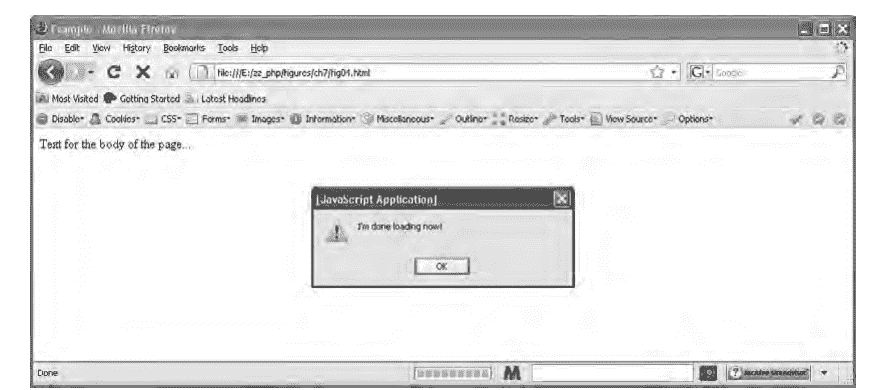

**图 7-4** 这是页面完成加载后在浏览器窗口中显示的内容

这将捕获当前窗口的加载事件（`window` 对象将在第 10 章中更详细地解释）。注意这里使用了匿名函数，将创建函数并将其分配给事件的步骤结合起来（有关函数的更多信息，请参阅第 4 章）。你现在可以将网页指向该 JavaScript 文件，而无需更改 HTML 代码中的 `body` 标签，如下所示：

```
<body>
<script type="text/javascript" src="load_alert.js"></script>
页面主体文本...
</body>
```

为了观察立即执行的 alert 和在 `onload` 事件处理程序中执行的 alert 在时序上的差异，你可能需要在页面主体中添加一些图片，然后将页面和图片放到 Web 上。这样，页面加载会花费一些时间，你将看到 alert 在页面完成加载后弹出，而不是立即显示。

## 鼠标按下事件 (onmousedown)

鼠标按下事件在用户按下鼠标按钮时触发，但发生在点击完成之前（不需要释放）。要处理此事件，你需要使用 `onmousedown` 事件处理程序，它几乎可以放置在网页的任何 HTML 标签中。

## 鼠标移动事件 (onmousemove)

鼠标移动事件在用户移动鼠标光标时触发。处理此事件的事件处理程序是 `onmousemove`，它几乎可以放置在网页的任何 HTML 标签中。

## 鼠标悬停事件 (onmouseover)

鼠标悬停事件在用户将鼠标光标移动到页面上的某个元素（如文本链接、链接图像或图像映射的链接部分）上方时触发。鼠标悬停事件在许多其他区域也有效，例如表格单元格和 `<div>` 标签。鼠标悬停事件由 `onmouseover` 事件处理程序处理。

使用 `onmouseover` 事件处理程序的最快方法是设置一个文本链接。当你将 `onmouseover` 事件处理程序添加到链时，你可以在用户将光标移到链接上时选择执行 JavaScript 命令。因此，如果你想在用户将鼠标移到链接上时弹出一个 alert，你可以编写类似以下的代码：

```
<a href="http://www.pageresource.com"
onmouseover="window.alert('I told you not to try to click me!');">
别试图点击我！</a>
```

这次用户甚至还没来得及点击链接，就被一个 alert 欢迎了。请记住，过度使用这样的脚本可能会让访客感到烦恼。图 7-5 展示了此脚本在浏览器中的结果。alert 在鼠标光标移到链接上时立即弹出。

由于无需点击链接就会有事情发生，浏览器之后不会尝试跟踪该链接。事实上，有了这个脚本，你几乎无法点击链接，因为当你移动鼠标去点击它时，alert 会不断弹出！

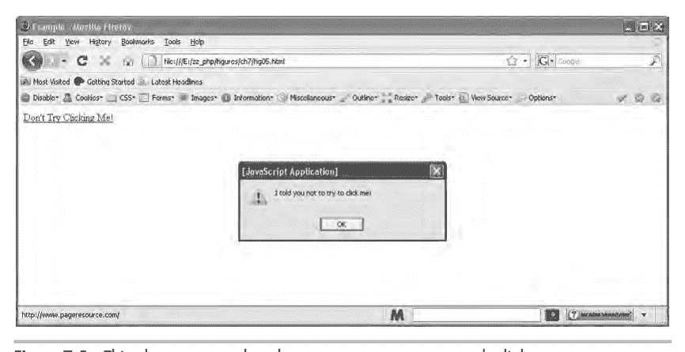

**图 7-5** 当鼠标光标移到链接上时弹出此 alert

在后续章节中，当你了解更多关于如何利用页面各个部分的知识时，鼠标悬停事件将变得更加有用。

## 鼠标移出事件 (onmouseout)

鼠标移出事件在用户将鼠标光标从页面上的某个区域（如链接、链接图像或图像映射的链接区域）移开时触发。与鼠标悬停事件类似，大多数浏览器支持在多个区域上使用鼠标移出事件。你通过使用 `onmouseout` 事件处理程序来处理鼠标移出事件。

同样，你可以通过设置一个链接并向该链接添加 `onmouseout` 事件处理程序来最轻松地观察鼠标移出事件。这次，你可以使一个 alert 在用户将鼠标从链接上移开（假设未点击该链接）后弹出。为此，你可以使用以下代码：

```
<a href="http://www.pageresource.com"
onmouseout="window.alert('What, you didn\'t like my link?');">点击我！</a>
```

这次 alert 在用户将鼠标从链接上移开时弹出，并向用户提出一个问题。还要注意单词 *didn't* 中使用的转义引号（\'），这可以避免字符串错误。图 7-6 展示了此脚本的实际效果。

随着你的学习进展，鼠标移出事件将变得更加有用，尤其是当与鼠标悬停事件结合使用时。

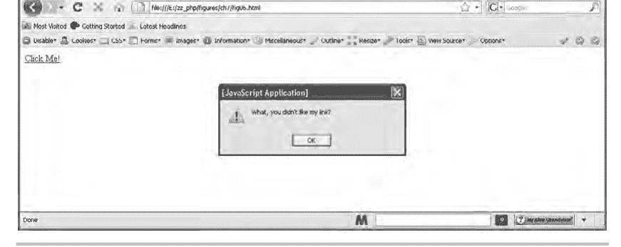

**图 7-6** 当鼠标从链接上移开时弹出此 alert

164 JavaScript：初学者指南

## 鼠标释放事件 (onmouseup)

鼠标释放事件在用户按下鼠标按钮后释放它时触发。`onmouseup` 事件处理程序用于此事件，它几乎可以放置在网页的任何 HTML 标签中。

## 重置事件 (onreset)

重置事件在用户使用表单的重置按钮来重置表单字段时触发。要处理此事件，你需要使用 `onreset` 事件处理程序，它可以添加到表单的起始 `<form>` 标签中。`onreset` 事件处理程序还有一个相关的方法 `reset()`，将在第 14 章中介绍。

## 提交事件 (onsubmit)

提交事件仅在用户提交网页上的表单时触发。此事件使用 `onsubmit` 事件处理程序，可以从文档的起始 `<form>` 标签中调用。`onsubmit` 事件处理程序还有一个相关的方法 `submit()`，也将在第 14 章中介绍。

要观察提交事件的工作原理，你必须创建一个可以通过提交按�提交的表单。然后你将 `onsubmit` 事件处理程序添加到起始 `<form>` 标签中。以下代码将在用户点击提交按钮时向其显示一个 "Thank You" 的 alert：

```
<form onsubmit="window.alert('Thank You');">
你叫什么名字？<br />
<input type="text" id="thename" /><br />
<input type="submit" value="Submit Form">
</form>
```

`onsubmit` 用在起始的 `<form>` 标签中

提交按钮在被点击时触发提交事件

提交事件现在对你没有太大用处（尤其是表单内容并没有真正发送到任何地方），但当你在第 14 章学习表单验证时，这个事件将变得更加有用。

## 卸载事件 (onunload)

卸载事件在用户离开当前网页时触发。用户可以通过点击链接、在浏览器中输入另一个地址或关闭窗口来离开。用于卸载事件的事件处理程序是 `onunload`。

众所周知，这个事件会让用户感到烦恼，因为它使网站所有者能够在访客试图转到另一个页面或另一个网站时做些事情（迫使他们等待）。要使 alert 在用户离开页面时弹出，你可以编写以下代码：

`onunload` 事件处理程序被添加到 `body` 标签中

```
<body onunload="window.alert('Be sure to come back, OK?');">
其他 HTML 代码放在这里...
</body>
```

## 动手试试 7-2 使用事件发送警报

`pr7_2.html` 这个项目让你练习使用本章迄今为止学到的一些事件处理器。你将创建一个包含各种链接和表单元素的页面，这些元素将使用事件来发送警报。

### 分步指南

- 1. 创建一个 HTML 页面，并将其保存为 pr7_2.html。

- 2. 在页面中添加一个链接，指向 URL http://www.yahoo.com。在链接标签中添加一个事件处理器，这样当查看者将鼠标光标移到链接上时，会弹出一个警报，显示：“抱歉，我现在还不想让你离开！”

- 3. 在链接后添加一个 `<br />` 标签。

*(续)*

**图 7-7** 当查看者试图离开页面时，会弹出此警报。

图 7-7 展示了上述脚本的结果。当查看者试图离开包含此脚本的页面时，会弹出一个警报，告诉他们一定要再回来。当然，如果将其用在网站的索引页面或网站的多个页面上，可能会给查看者带来相当大的不便。

与 onload 事件处理器一样，你可以在脚本代码中使用 onunload 事件处理器，而不是作为 body 标签的属性，通过使用 `window.onunload`。

总的来说，在使用卸载事件于实际页面之前，请务必三思。它可能有好的用途，但要小心，因为它确实会惹恼大多数网络用户。

### 动手试试总结

在这个项目中，你运用了本章概述的几种事件处理器的技能。你创建了一个 HTML 页面，该页面能响应查看者的多种可能操作，例如鼠标悬停、点击或将焦点置于页面上的某个元素。

## 专家问答

> **问：为什么有这么多事件？**

答：查看者（或浏览器本身）在网页上可以做的事情非常多，因此最终会产生大量事件。本章介绍的事件只是所有事件中的一小部分。

**问：我需要记住所有这些事件吗？**

答：你可能只需要记住它们，如果你有考试，或者是为了工作需要快速掌握知识，或者只是喜欢把事件烂熟于心；否则，如果不确定需要使用哪个事件，只需参考本章的表 7-1 即可。

**问：我会用到本书中的每一个事件吗？**

答：由于本书是一本入门指南，你不会达到使用每一个事件的程度。

## 使用事件处理器创建脚本

既然你已经掌握了长长的事件处理器列表，现在是时候找点乐趣了。在本节中，你将学习两个新的属性，它们将执行一些除了向页面写入内容和发送警报之外的事情。

在看过所有那些警报示例后，警报现在可能有点乏味了。因此，你将尝试两个新的脚本。一个将在文本框中放置消息，另一个将使表单按钮变成一个像链接一样起作用的按钮。首先，尝试在文本框中放置消息。

### 文本框消息

既然你已经学习了 mouseover 和 mouseout 事件，你可以将它们与本章中获得的其他知识一起使用，来构建一个脚本，当你将鼠标移到文本框上方的链接（它可以位于你喜欢的任何位置，但本例中链接将放在文本框上方）时，将在文本框中显示一条消息。

首先，你需要创建一个 HTML 文档（将其保存为 textbox_message.html）。在此文档中，你将设置一个链接，并为其锚点标签赋予一个 id。然后，你将设置一个文本框，并为其 input 标签赋予一个 id。例如，你可以使用以下代码：

```
<body>
<a href="message.html" id="msg_link">Get Message</a>
<br /><br />
<form>
<input type="text" id="msg_box" />
</form>
<script type="text/javascript" src="textbox_message.js"></script>
</body>
```

通过这段简短的 HTML 代码，你可以使用 JavaScript 使这个简单的页面从静态变为动态。

提示：出于可访问性考虑，最好将所有超链接指向具有实际内容的 URL（在这种情况下，你可能只需放上消息文本）。这使得没有 JavaScript 的人也能访问脚本中的内容，同时让拥有 JavaScript 的人只需使用 mouseover 事件即可访问消息。

由于文本框将在鼠标移到链接上时显示消息，你首先需要在 JavaScript 文件（将其保存为 textbox_message.js，如前面代码中的 script 标签所引用）中设置一些变量。你将为消息文本、链接元素和文本框元素设置变量，如下所示：

```
var message_text = "Help! I'm in a box!";
var message_link = document.getElementById("msg_link");
var message_box = document.getElementById("msg_box");
```

`message_text` 变量保存你将在 mouseover 事件上显示的消息文本，`message_link` 变量通过其 id（`msg_link`）获取链接元素，`message_box` 变量通过其 id（`msg_box`）获取文本框元素。

现在你已经设置了这些信息，可以结合 `onmouseover` 事件处理器，在文本框中向查看者显示消息：

```
var message_text = "Help! I'm in a box!";
var message_link = document.getElementById("msg_link");
var message_box = document.getElementById("msg_box");
message_link.onmouseover = function() {
    message_box.value = message_text;
};
```

这里大部分内容应该很熟悉。`onmouseover` 事件处理器被分配了一个处理该事件的匿名函数。该函数告诉浏览器更改文本框的值，使其显示消息文本。你会注意到使用了 `message_box.value`。`value` 属性保存元素的当前值。对于文本框，它保存文本框中当前显示的任何内容的值（如果为空，则其值为空字符串）。使用此属性，你可以将其值更改为你选择的内容，就像这里所做的那样。

如果你保存 HTML 和 JavaScript 文件，并在浏览器中加载 HTML 文件，你将看到结果。将鼠标移到 "Get Message" 链接上，"Help! I'm in a box!" 消息应该会显示在文本框中。

现在，如果你不想让消息无限期地留在文本框中，可以使用另一个事件来清除文本框中的消息。你可以使用任何你选择的事件（在任何你选择的元素上）。一个解决方案是，当查看者将鼠标移开链接时，使用 `onmouseout` 事件处理器简单地清除消息。因此，你现在可以在 JavaScript 文件中使用以下代码：

```
var message_text = "Help! I'm in a box!";
var message_link = document.getElementById("msg_link");
var message_box = document.getElementById("msg_box");

message_link.onmouseover = function() {
    message_box.value = message_text;
};
message_link.onmouseout = function () {
    message_box.value = "";
};
```

注意，在 `onmouseout` 事件处理器的函数中，`message_box.value` 被更改为空字符串，这将从文本框中清除消息。

保存 JavaScript 文件，然后在浏览器中刷新 HTML 页面。你现在应该能够将鼠标移到链接上接收消息，并将鼠标移开链接使消息消失。图 7-8 和 7-9 展示了完整脚本的实际运行情况。

下一个脚本将使表单按钮像超链接一样工作。

### 按钮链接

使用 JavaScript，你可以将查看者发送到另一个 URL。为此，你需要使用另一个新属性：`window.location`。此属性使你能够更改使用它的窗口的 URL 地址。以下是该命令的通用语法：

```
window.location="http://someplace.com";
```

你需要将 URL *http://someplace.com* 替换为你希望使用的地址，例如 http://www.yahoo.com 或其他网址。

首先，你需要再次创建一个 HTML 文档（将其保存为 button_link.html）。在此页面中，你将创建一个 input 按钮并为其赋予一个 id，如下所示：

```
<form>
<input type="button" value="Go Searching!" id="btn1" />
</form>
```

现在，要使按钮像链接一样工作，你只需将 `location` 属性与 `onclick` 事件处理器一起使用。创建一个外部 JavaScript 文件（将其保存为 button_link.js）并使用以下代码：

```
var web_page1 = "http://www.yahoo.com";
var b1 = document.getElementById("btn1");

b1.onclick = function() {
    window.location = web_page1;
};
```

与前面的脚本非常相似，它获取必要的值，然后使用匿名函数执行 JavaScript 命令。当查看者点击按钮时，浏览器会跳转到新的网页。

当然，你可以为任意数量的按钮这样做。如果你想让三个按钮链接到三个不同的地方，可以使用以下HTML和JavaScript代码：

```
<form>
<input type="button" value="Go Searching!" id="btn1" /><br /><br />
<input type="button" value="HTML Help" id="btn2" /><br /><br />
<input type="button" value="JavaScripts" id="btn3" />
</form>
```

对于这些额外的按钮，需要为每个元素添加必要的代码和事件处理程序：

```
var web_page1 = "http://www.yahoo.com";
var web_page2 = "http://www.pageresource.com";
var web_page3 = "http://www.javascriptcity.com";
var b1 = document.getElementById("btn1");
var b2 = document.getElementById("btn2");
var b3 = document.getElementById("btn3");

b1.onclick = function() {
  window.location = web_page1;
};
b2.onclick = function() {
  window.location = web_page2;
};
b3.onclick = function() {
  window.location = web_page3;
};
```

这段代码创建了三个链接到不同网站的按钮。当然，如果你决定使用大量这样的按钮，使用数组可能会更方便。数组将在第11章讨论。

> **注意**

这种按钮链接方式存在无障碍访问问题（因为对于禁用JavaScript的用户，这些按钮将无法执行任何操作）。如果你需要制作无障碍网页，除了按钮之外，还需要提供标准的HTML锚点标签链接，以确保所有用户都能访问。可以通过一些额外的脚本来处理这个问题，你将在第16章看到如何实现。

现在你可以进行更多操作，并为你的示例增添更多乐趣。随着后续章节的学习，`window.location`属性将会变得非常有用。

## 其他事件注册方法

除了你已经使用的方法之外，还有另外两种注册事件的方法。截至本文撰写时，这两种方法都无法跨浏览器工作（这算是一个缺点，因为使用它们需要为同一事件多次注册，但如果它们功能的某些部分有用，则有助于完成当前任务）。这些方法可以让你更轻松地为处理同一事件添加多个函数，并更轻松地移除特定脚本不需要的事件处理函数。目前，你将只简要了解它们的用法，如果将来需要它们或其中一种方法开始在所有主要浏览器中通用，这可能会有所帮助。

首先，你将了解来自万维网联盟（W3C）的模型。接下来，你将了解来自微软的模型。

### addEventListener() 方法

`addEventListener()` 方法来自W3C。它允你指定一个事件、一个为该事件执行的函数，以及一个值（`true`或`false`），具体取决于你希望事件处理函数在捕获阶段（`true`）还是冒泡阶段（`false`）执行。其一般格式如下：

```
element.addEventListener('event_type', function_name, true_or_false);
```

因此，如果你想创建一个像本章前面那样的链接式输入按钮，你可以将JavaScript代码调整为如下形式：

```
var web_page1 = "http://www.yahoo.com";
var b1 = document.getElementById("btn1");
b1.addEventListener('click', function() { window.location = web_page1;
}, false);
```

请注意，此方法使用的是事件类型名称（只需使用`click`而不是`onclick`），而不是事件处理程序属性。此外，该方法接受不带括号的函数名，或者允许你使用匿名函数（如上所示）。

当一个元素位于另一个元素内部，并且它们都注册了相同类型的事件时，捕获和冒泡机制就变得重要了。哪个事件先发生取决于使用哪种方法。如果使用捕获阶段，那么最外层元素的事件最先发生，最内层元素的事件最后发生。如果使用冒泡阶段，则情况相反。捕获阶段发生在冒泡阶段之前，因此在脚本中同时使用这两个阶段时，请牢记这一点。

要移除一个事件，你需要使用 `removeEventListener()` 方法：

```
element.removeEventListener('event_type', function_name, true_or_false);
```

### attachEvent() 方法

`attachEvent()` 方法的工作方式与 `addEventListener()` 类似。然而，它只支持事件冒泡，并且目前（截至本文撰写时）没有使用事件捕获的方式。它的用法如下：

```
element.attachEvent(event_handler, function_name);
```

因此，如果你想使用之前一直使用的脚本，可以这样写：

```
var web_page1 = "http://www.yahoo.com";
var b1 = document.getElementById("btn1");
b1.attachEvent(onclick, function() { window.location = web_page1; } );
```

请注意，此方法使用的是事件处程序属性的名称（`onclick`）。此外，它没有第三个选项；它只使用事件冒泡。要移除事件，你需要使用 `detachEvent()` 方法：

```
element.detachEvent(event_handler, function_name);
```

目前，你将在脚本中继续使用本书之前介绍的方法。

## 第7章 自测

1.  事件处理程序是一个对象的预定义JavaScript属性，用于处理网页上的事件。

    A 正确

    B 错误

2.  事件处理程序很有用，因为它们使你能够访问页面上可能发生的 __________ 。

3.  要使用事件处理程序，你需要知道事件处理程序的 __________ 以及在HTML代码中放置事件处理程序的位置。

4.  以下哪项正确地为点击事件编写了警告框代码？

    A <input type="button" onclick="window.alert(“Hey there!”);">

    B <input type="button" onClick="window.alert(‘Hey there!’);">

    C <input type="button" onclick="window.alert(‘Hey there!’);">

    D <input type="button" onChange="window.alert(“Hey there!”);">

5.  当网页完成加载时，会发生 __________ 事件。

6.  mouseover（鼠标移入）事件发生在：

    A 当查看者在光标位于按钮上时点击鼠标。

    B 当查看者将鼠标光标移开链接。

    C 当查看者点击链接、链接图像或图像地图的链接区域。

    D 当查看者将鼠标光标移动到页面上的某个元素上时。

7.  mouseout（鼠标移出）事件发生在查看者点击页面上的元素时。

    A 正确

    B 错误

8.  当查看者离开当前网页时，会发生 __________ 事件。

9.  blur（失焦）事件与 __________ 事件相反。

10. 以下哪项正确地在 onfocus 事件处理程序内调用了名为 `major_alert()` 的函数？

    A <input type="text" onfocus="major_alert();">

    B <input type="text" onfocus="major alert();">

    C <input type="text" onfocus="major_alert();">

    D <input type="text" onFocus="major_alert()">

11. 当查看者更改表单元素中的内容时，会发生 __________ 事件。

12. submit（提交）事件发生在查看者在网页上 __________ 一个 __________ 时。

13. keydown（按键按下）事件发生在查看者按下键盘上的一个键时。

    A 正确

    B 错误

14. mousedown（鼠标按下）事件使用什么关键字作为其事件处理程序？

    A onmouseout

    B onmousepress

    C onmousedown

    D mousedown

15. __________ 方法和 __________ 方法是两种新的事件注册方式。

## 第8章

## 对象

## 关键技能与概念

- 定义对象

- 创建对象

- 理解预定义的JavaScript对象

由于JavaScript是一种基于对象的语言，你需要了解对象是什么以及如何使用它们。JavaScript中的预定义对象非常有用；然而，要有效地使用它们，最好了解对象通常是如何工作的，以及在需要时如何创建自己的对象。

本章首先定义什么是对象，以及对象如何在你的脚本中有用。然后，你将了解如何创建和命名可以在代码中使用的自定�对象。最后，本章介绍了预定义的 `navigator` 和 `history` 对象的属性和方法。

## 定义对象

要开始使用JavaScript对象，你需要了解它们是什么以及如何在脚本中为你所用。首先看看JavaScript对象是什么。

### 什么是对象？

对象是对真实事物进行建模的一种方式，即使对象本身是一个抽象实体。当你想到一个对象时，你可能会想象一些通用的东西，比如一辆汽车。当你看到一辆车时，你会注意到它具有某些特征或 *属性*。你可能会看到这辆车有一个带CD播放器的收音机、真皮座椅和一个V8发动机。所有这些都是汽车的特征，或者用对象术语来说，是汽车对象的属性。

你可以通过让收音机具有属性来进一步细分，或者你可以反向操作，让汽车成为一个更大对象的一部分。例如，你可以说CD收音机具有某些特性，比如触摸音量控制、预设电台和数字接口。如果你反向操作，你可以说汽车是汽车对象的一部分，该对象可以将轿车、货车、卡车等各种机动车辆作为属性。

通过这样做，你可以创建一个从上到下可以跟随的可视化结构。如果你有一辆汽车，它将有自己的属性，如颜色、年份、品牌和型号。它还将由其他对象组成，如轮胎、收音机、方向盘和仪表盘，每个对象都可以有自己的属性和对象。

如果你沿着收音机这条路径追溯这辆汽车，你可以假设它有一个带数字接口的CD收音机，你会看到如下模式：

```
Automobile -> Car -> CD Radio -> Digital Interface
```

你也可以拥有卡车，但保持其他特征不变。这样你就会得到以下模式：

```
Automobile -> Truck -> CD Radio -> Digital Interface
```

前面的示例有点像家谱，从顶层开始。顶层之后的每一级可能都有兄弟姐妹（同一级别的对象）。然后，树状结构可以继续扩展。可视化可能会变得复杂，但在使用实际的 JavaScript 对象时，你不应该感到困惑。许多对象只有一级深度，所以你可能不需要太担心“家谱”。你主要需要学习的是，一个对象可以包含多个属性，你可以从外部访问这些属性，并在脚本中使用它们。

### 为什么对象有用

对象之所以有用，是因为它们为你提供了在脚本中组织事物的另一种方式。与其让一堆相似的变量单独存在，你可以将它们组合到一个对象下。

如果你拿到汽车对象，并创建变量来表示汽车的特征，你就可以开始看到这种分组是如何工作的。你可以创建名为 seats、engine 和 theradio 的变量。你将在本章后面创建 car 对象，所以现在先假设 car 对象已经存在，并且它具有 seats、engine 和 theradio 属性。由于这些属性是变量，它们可以有值。问题在于，你如何访问这些属性来获取它们的值呢？

在 JavaScript 中，你通过使用点运算符（就是一个点或句号）来访问对象属性。例如，如果你想要 car 对象的 seats 属性的值，你可以通过以下行来访问它：

```
var chtype = car.seats;
```

不要让将 seats 属性的值赋给变量（chtype）这件事感到困惑。你这里想要关注的是代码中的 car.seats 部分。首先写对象的名称，然后使用点运算符在右侧连接你想要访问的属性。seats 属性目前还没有值（因为你还没有创建 car 对象）。当你在下一节开始创建对象时，你会看到如何给它和其他属性赋值。

### 创建对象

既然你理解了对象是什么以及它们的用处，你就可以开始创建自己的 JavaScript 对象了。为此，你将学习命名约定、对象的结构以及如何在对象中包含方法。

#### 命名

与变量和函数一样，在 JavaScript 中命名对象时必须遵循某些规则。这些规则与命名变量和函数的规则基本相同，所以我在这里只简要讨论一下，因为你已经接触过两次了。

178 JavaScript: A Beginner’s Guide

#### 大小写敏感

与之前的命名一样，对象名称是大小写敏感的。因此，名为 car 的对象将不同于名为 Car、CAR 或 caR 的对象。为了访问正确的对象，你必须确保在脚本中使用它时使用正确的大小写；否则，当你尝试运行脚本时，你会收到诸如“Car is not an object”之类的错误。

#### 避免使用保留字/对象

命名自己的对象时要记住的另一件事是，你不能使用 JavaScript 保留字（请参阅第 3 章“避免使用保留字”部分中的保留字表）；因此，尝试创建一个名为 switch 的对象可能会给你带来问题，因为该词用于 JavaScript 的 switch 语句。

#### 对象结构

在 JavaScript 中创建对象有两种方式：使用构造函数或使用对象初始化器。首先，你将学习如何使用构造函数来创建对象。然后简要讨论如何使用对象初始化器。

#### 构造函数

构造函数允许你使用与常规函数相同的基本语法来构建对象。唯一的区别在于你放在函数内部的代码以及你如何访问其内容。

例如，要创建你的 car 对象，你需要创建一个名为 car() 的构造函数，然后在函数内添加你的属性。以下示例显示了 car() 函数的轮廓：

```
function car() {
    Properties go here.
}
```

要完成上述函数，你需要将属性添加到函数中。回想一下，你想要创建一个名为 car 的对象，具有 seats、engine 和 theradio 属性。以下代码展示了如何做到这一点：

```
function car(seats,engine,theradio) {
    this.seats=seats;
    this.engine=engine;
    this.theradio=theradio;
}
```

在这段代码中，第一行你看到函数接受三个参数，这就是你希望 car 对象拥有的属性数量。接下来你看到参数的值被分配给了你希望 car 对象拥有的属性；然而，有一个新的关键字叫做 this。JavaScript 中的关键字 this 用于表示正在使用的当前对象，或者可以说是“这个对象”。

一旦你用构造函数设置了对象的属性，你需要创建所谓的对象实例才能使用它，因为构造函数只创建对象的结构，而不是一个可用的对象实例。要创建对象实例，你需要使用另一个 JavaScript 关键字：new。

使用 new 关键字创建 car 对象的实例展示在以下代码中：

```
var work_car= new car("cloth", "V-6", "Tape Deck");
```

你首先看到的是你正在创建一个名为 work_car 的新变量。由于你分配给它的值，这个变量将是 car 对象的一个新实例。

接下来你看到 work_car 变量被分配了 car 构造函数的结果，但有一个转折。在调用 car 函数之前是 new 关键字，它确保你正在创建构造函数对象的一个新实例。

接下来，你看到 car 函数被调用时传递了值作为参数。这些是你希望用于此 car 对象实例的值。根据顺序，你是说你希望 seats 是 cloth，engine 是 V-6，radio 是 Tape Deck。

你现在可以访问 car 对象的 work_car 实例。如果你想知道 work_car 是什么类型的引擎，你可以通过点运算符访问它：

```
var engine_type= work_car.engine;
```

这会将 car 对象的 work_car 实例的 engine 属性的值赋给变量 engine_type。因为你将 V-6 作为引擎参数发送给了构造函数，所以 engine_type 变量被赋予了值 V-6。

**将各部分组合起来** 为了帮助你可视化这个过程，是时候将所有这些部分组合在一起，以便你看到它是如何工作的了。以下代码结合了前面示例的所有代码，使事情更容易理解：

```
function car(seats,engine,theradio) {
    this.seats=seats;
    this.engine=engine;
    this.theradio=theradio;
}
var work_car= new car("cloth","V-6","Tape Deck");
var engine_type= work_car.engine;
```

现在你可以看到构造函数、car 对象实例的创建，以及将对象的一个属性赋值给变量的过程。当 car 对象的 work_car 实例被设置时，它获得了属性 work_car.seats 的值 cloth，属性 work_car.engine 的值 V-6，以及属性 work_car.theradio 的值 Tape Deck。

为了了解对象实例是如何工作的，你需要将另一个 car 对象的实例添加到你的代码中。以下代码使用了两个 car 对象的实例，一个名为 work_car，另一个新实例名为 fun_car：

```
function car(seats,engine,theradio) {
  this.seats=seats;
  this.engine=engine;
  this.theradio=theradio;
}
var work_car= new car("cloth","V-6", "Tape Deck");
var fun_car= new car("leather","V-8","CD Player");
var engine_type= work_car.engine;
var engine_type2= fun_car.engine;
```

每个对象实例的一个属性值被分配给两个独立的变量，由于它们来自两个不同的对象实例，所以包含不同的值。

注意新的对象实例如何使用相同的构造函数，但带有不同的值。你还有一个名为 engine_type2 的新变量，它被赋予了 car 对象的 fun_car 实例的 engine 属性的值。

通过将 car 对象不同实例的属性值赋给变量，你现在可以写出你希望在结合每种汽车类型特征的自定义汽车中拥有的特性。例如，看看以下代码，它写出了你可能喜欢的自定义汽车的特性：

```
function car(seats,engine,theradio) {
  this.seats=seats;
  this.engine=engine;
  this.theradio=theradio;
}
var work_car= new car("cloth","V-6", "Tape Deck");
var fun_car= new car("leather","V-8","CD Player");
var engine_type= work_car.engine;
var seat_type= fun_car.seats;
var radio_type= fun_car.theradio;

document.write("I want a car with "+seat_type+" seats.<br />");
document.write("It also needs a "+engine_type+" engine.<br />");
document.write("Oh, and I would like a "+radio_type+" also.");
```

使用从 car 对象的每个实例中获取你所需内容的变量值，你能够将你想要的汽车描述打印到屏幕上。保存这个

将文件保存为 objects_01.js，并创建一个包含以下主体代码的 HTML 文件，将其保存为 objects_01.html：

```html
<body>
<script type="text/javascript" src="objects_01.js"></script>
</body>
```

在你的 Web 浏览器中打开 objects_01.html 文件。此脚本的运行结果如图 8-1 所示。

你也可以通过使用你选择的参数创建一个新的 car 对象实例，然后将这些信息打印到屏幕上来实现上述示例的效果。如果你创建一个名为 custom_car 的实例，可以使用以下代码：

通过将其他对象实例的属性值作为参数传递，创建了一个新的对象实例。

```javascript
function car(seats,engine,theradio) {
    this.seats=seats;
    this.engine=engine;
    this.theradio=theradio;
}
var work_car= new car("cloth","V-6","Tape Deck");
var fun_car= new car("leather","V-8","CD Player");
var custom_car= new car(fun_car.seats,work_car.engine,fun_car.theradio);
```

```javascript
document.write("I want a car with "+custom_car.seats+" seats.<br />");
document.write("It also needs a "+custom_car.engine+" engine.<br />");
document.write("Oh, and I would like a "+custom_car.theradio+" also.");
```

新对象实例的属性在 document.write() 语句中被当作变量使用。

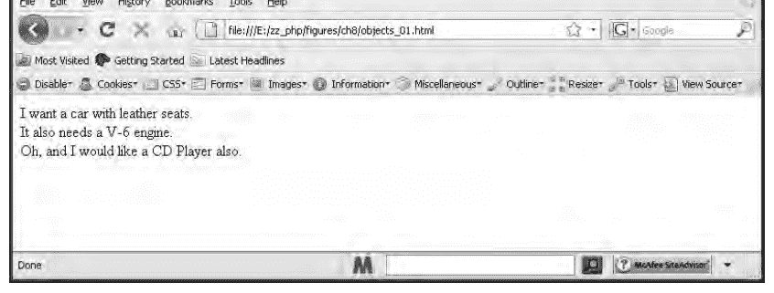

**图 8-1** 你从每种车中喜欢的特性被打印在浏览器中。

注意 car 对象的 custom_car 实例创建时，传递的参数恰好是其他 car 对象实例的属性。在许多情况下，你可以像使用变量一样使用对象属性，从而减少了需要编写的代码量。同时注意，document.write() 命令已更改为使用 custom_car 的属性，而不是旧的变量。脚本的输出结果相同，如图 8-2 所示。

### 属性值

虽然这不是房地产，但你可以更改你的属性值。在你的脚本中，你可以像给变量赋值一样，通过赋予新值来动态改变对象属性的值。例如，如果你想改变前面示例中 work_car.engine 属性的值，只需为你选择的新值赋值即可。以下示例展示了为 work_car.engine 属性赋予新值：

```javascript
work_car.engine = "V-4";
```

虽然这可能不是个好改动，但它或许能帮你节省保险（和汽油）费用！

需要重要注意的是，上述赋值操作会更改 work_car.engine 属性的值，此后任何对此属性的调用都会受到影响。在更改之前对其值所做的任何操作则不会受到影响。因此，为了对你脚本的输出结果产生影响，你必须在创建使用此属性的 car 对象的 custom_car 实例之前，更改为 work_car.engine 属性的值。

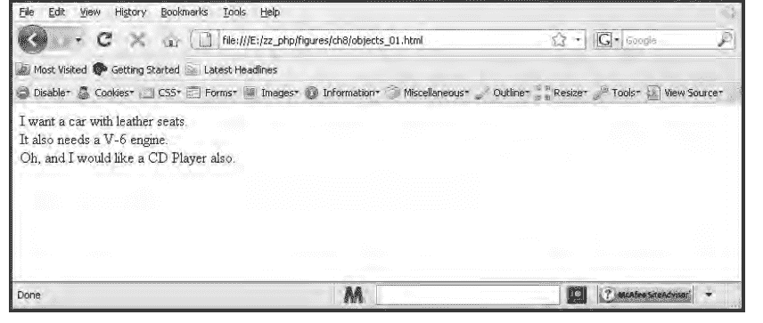

**图 8-2** 尽管代码不同，但输出与图 8-1 相同。

以下代码在创建新的对象实例之前为该属性赋予了新值：

```javascript
function car(seats,engine,theradio) {
    this.seats=seats;
    this.engine=engine;
    this.theradio=theradio;
}
var work_car= new car("cloth","V-6","Tape Deck");
var fun_car= new car("leather","V-8","CD Player");
work_car.engine="V-4";
var custom_car= new car(fun_car.seats,work_car.engine,fun_car.theradio);
document.write("I want a car with "+custom_car.seats+" seats.<br />");
document.write("It also needs a "+custom_car.engine+" engine.<br />");
document.write("Oh, and I would like a "+custom_car.theradio+" also.");
```

对象的一个属性被更改，这会改变此后使用该属性的所有代码。

work_car.engine 属性最初设置为 V-6，但在创建 car 对象的 custom_car 实例之前，它被更改为 V-4。这意味着在创建 custom_car 实例时使用 work_car.engine 属性，它将使用更改后的值 V-4，因为此操作发生在更改之后。图 8-3 显示了此更改代码的结果。

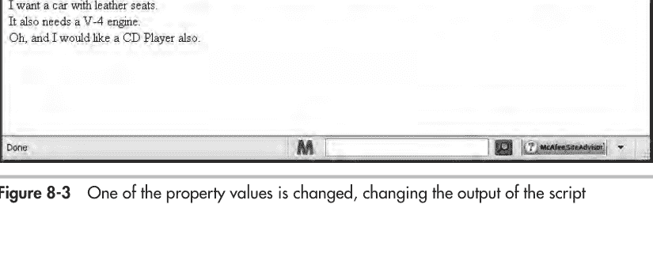

**图 8-3** 属性值之一被更改，从而改变了脚本的输出。

为了强调这一点，你可以在更改前和更改后使用该属性，以观察它对脚本的影响。以下代码展示了这一点：

```javascript
function car(seats,engine,theradio) {
  this.seats=seats;
  this.engine=engine;
  this.theradio=theradio;
}
var work_car= new car("cloth","V-6","Tape Deck");
var fun_car= new car("leather","V-8","CD Player");
var first_engine=work_car.engine;
work_car.engine="V-4";
var custom_car= new car(fun_car.seats,work_car.engine,fun_car.theradio);
document.write("At first, I wanted a "+first_engine+" engine.<br />");
document.write("But after thinking about it a bit:<br />");
document.write("I want a car with "+custom_car.seats+" seats.<br />");
document.write("It also needs a "+custom_car.engine+" engine.<br />");
document.write("Oh, and I would like a "+custom_car.theradio+" also.");
```

注意 work_car.engine 的值是如何被赋给 first_engine 变量的。然后，在创建 car 对象的 custom_car 实例之前，它被更改。当你将 first_engine 变量的值写入浏览器时，它具有 work_car.engine 属性的旧值，因为它是在更改发生之前被赋值的。

当你写入 custom_car 属的值时，你可以看到更改是在创建 car 对象的 custom_car 实例之前的某个时间点完成的。图 8-4 显示了此脚本在浏览器中的结果。

既然你知道如何使用构造函数，接下来让我们看看对象初始化器方法。

# 对象初始化器

对象初始化器比构造函数稍短一些。以下是对象初始化器的语法：

*object_name={property:value}*

在上面的代码中，你需要用你想要给对象命名的名称替换 *object_name*；用你想要为对象属性使用的名称替换 *property*；用前面属性的值替换 *value*。你可以通过用逗号分隔来添加更多的属性和值。

使用初始化器函数创建的对象已经是对象的一个实例，因此你可以直接使用属性，而无需创建新的对象实例。

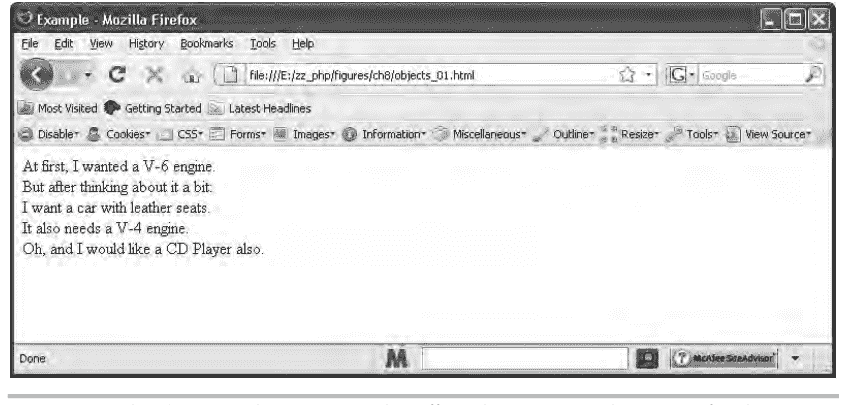

**图 8-4** 属性值的更改会影响更改后使用它的语句，但不会影响更改前使用它的语句。

接下来，你将使用初始化器方法创建一个 work_car 对象。你希望对象名为 work_car，并且你将有三组属性和值。以下代码展示了如何使用对象初始化器方法创建对象：

```javascript
work_car= {seats:"cloth",engine:"V-6",theradio:"Tape Deck"}
```

由于无需创建对象实例，你可以像之前一样使用其属性，或将它们赋值给变量或写入页面。例如，work_car.seats 属性将是 cloth。如果你也想要 fun_car 对象，可以使用另一个初始化器，如以下示例代码所示：

```javascript
work_car= {seats:"cloth",engine:"V-6",theradio:"Tape Deck"}
fun_car= {seats:"leather",engine:"V-8",theradio:"CD Player"}
```

然后你可以使用这些属性写出你想要在汽车中拥有的配置，如以下代码所示：

使用对象初始化器创建对象。

```javascript
work_car= {seats:"cloth",engine:"V-6",theradio:"Tape Deck"}
fun_car= {seats:"leather",engine:"V-8",theradio:"CD Player"}

document.write("I want a car with "+fun_car.seats+" seats.<BR>");
document.write("It also needs a "+work_car.engine+" engine.<BR>");
document.write("Oh, and I would like a "+fun_car.theradio+" also.");
```

对象的属性在 document.write() 语句中被使用。

### 添加方法

方法是对象的一部分函数调用。调用的函数可以执行你可能希望通过对象属性来实现的各种任务。回想一下本章前面用构造函数创建的汽车对象。你可能希望有让汽车停止、加速或转弯的函数。你可能还想进行某种计算，比如付款。如果你想为该对象添加一个函数，用来计算你传给它的各种类型（实例）汽车的月付款，你可以创建如下函数：

```
function get_payment() {
    var the_payment=250;
    if(this.seats == "leather") {
        the_payment+=100;
    }
    else {
        the_payment+=50;
    }
    if(this.engine == "V-8") {
        the_payment+=150;
    }
    else {
        the_payment+=75;
    }
    if(this.theradio == "CD Player") {
        the_payment+=35;
    }
    else {
        the_payment+=10;
    }
    return the_payment;
}
```

一个 `if/else` 语句根据对象的 `engine` 属性值决定向 `payment` 变量添加多少。另一个 `if/else` 语句根据对象的 `theradio` 属性值决定向 `payment` 变量添加多少。最后返回 `the_payment` 的值。

嗯，前面的函数确实很长。可以通过为每个 `if/else` 语句使用条件运算符来缩短它（关于条件运算符的更多信息，请参阅第6章）。使用条件运算符代替 `if/else` 语句可以使代码更短：

```
function get_payment() {
    var the_payment=250;
    the_payment += (this.seats == "leather") ? 100 : 50;
    the_payment += (this.engine == "V-8") ? 150 : 75;
    the_payment += (this.theradio == "CD Player") ? 35 : 10;
    return the_payment;
}
```

定义函数后，你需要在对象构造函数中将其赋值给你的对象。使用你可靠的汽车对象构造函数，你可以像下面代码所示的那样进行赋值：

```
function car(seats,engine,theradio) {
    this.seats=seats;
    this.engine=engine;
    this.theradio=theradio;
    this.payment=get_payment;
}
```

`get_payment()` 函数被当作属性一样赋值，使其成为当前对象的一个方法；注意在赋值时没有使用括号。

请注意，此示例定义了一个名为 `payment` 的方法，该方法调用构造函数外部的 `get_payment()` 函数。另外请注意，在调用函数时，函数调用末尾没有使用括号。这就是你的外部函数成为对象方法的方式（通过将函数本身而不是函数的调用结果赋值给它）。

为了调用对象的 `payment()` 方法，你需要一个汽车对象的实例。如果你添加之前创建的三个实例，你就可以用你的新方法做一些事情了。所以，将这些实例添加到你已有的代码中：

```
function get_payment() {
    var the_payment=250;
    the_payment += (this.seats == "leather") ? 100 : 50;
    the_payment += (this.engine == "V-8") ? 150 : 75;
    the_payment += (this.theradio == "CD Player") ? 35 : 10;
    return the_payment;
}
function car(seats,engine,theradio) {
    this.seats=seats;
    this.engine=engine;
    this.theradio=theradio;
    this.payment=get_payment;
}
var work_car= new car("cloth","V-6","Tape Deck");
var fun_car= new car("leather","V-8","CD Player");
var custom_car= new car(fun_car.seats,work_car.engine,fun_car.theradio);
```

作为方法使用的函数。使该函数成为方法函数的构造函数。创建了对象的实例，并可在需要时使用该方法。

现在你已经有了用于创建汽车对象 `payment()` 方法的函数、在汽车对象构造函数内创建的 `payment()` 方法，以及三个汽车对象实例。要找出 `work_car` 的月付款，你需要使用以下语法调用 `payment()` 方法：

```
var work_car_payments= work_car.payment();
```

`work_car_payments` 变量的值将是 `payment()` 方法返回的值，即使用 `work_car` 实例的值运行 `get_payment()` 函数时返回的值。由于座椅是布料（cloth），`the_payment` 增加了 50（如果是皮革则会增加 100）。由于发动机是 V-6，`the_payment` 增加了 75。最后，由于 `theradio` 属性的值是 Tape Deck，`the_payment` 变量增加了 10。这样你就得到了 250（初始值）+ 50（非皮革座椅）+ 75（非 V-8 发动机）+ 10（没有 CD 播放器的收音机）的付款，结果是 385。使用 `payment()` 方法，你现在可以编写一个脚本，在浏览器中显示每种汽车的付款金额，以便观看者决定购买哪种类型的汽车。你只需扩展之前的代码，在页面正文中包含一些使用 `payment()` 方法返回值的 `document.write()` 命令。将 JavaScript 文件保存为 `objects_02.js`，并创建一个具有以下 body 代码的 HTML 文件，将其保存为 `objects_02.html`：

```
<body>
<script type="text/javascript" src="objects_02.js"></script>
</body>
```

以下 `objects_02.js` 文件的 JavaScript 代码展示了 `payment()` 方法用于每个汽车对象实例的示例：

```
function get_payment() {
  var the_payment=250;
  the_payment += (this.seats == "leather") ? 100 : 50;
  the_payment += (this.engine == "V-8") ? 150 : 75;
  the_payment += (this.theradio == "CD Player") ? 35 : 10;
  return the_payment;
}
function car(seats,engine,theradio) {
  this.seats=seats;
  this.engine=engine;
  this.theradio=theradio;
  this.payment=get_payment;
}
var work_car= new car("cloth","V-6","Tape Deck");
var fun_car= new car("leather","V-8","CD Player");
var custom_car= new car(fun_car.seats,work_car.engine,fun_car.theradio);
var work_car_payment= work_car.payment();
var fun_car_payment= fun_car.payment();
var custom_car_payment= custom_car.payment();
document.write("<h2>您所请求汽车的信息：</h2>");
document.write("<strong>工作用车： </strong>");
document.write(work_car.seats+","+work_car.engine+","+work_car.theradio);
document.write("<br />");
document.write("<strong>付款：</strong> $"+work_car_payment);
document.write("<p>");
document.write("<strong>休闲用车： </strong>");
document.write(fun_car.seats+","+fun_car.engine+","+fun_car.theradio);
document.write("<br />");
document.write("<strong>付款：</strong> $"+fun_car_payment);
document.write("</p>");
document.write("<p>");
document.write("<strong>定制用车： </strong>");
document.write(custom_car.seats+","+custom_car.engine+","+custom_car.theradio);
document.write("<br />");
document.write("<strong>付款：</strong> $"+custom_car_payment);
document.write("</p>");
```

在 `document.write()` 语句中使用了各种对象属性和变量，以创建汽车列表、它们的特性和付款金额。

与到目前为止你完成的大多数脚本相比，这个脚本相当长。前面脚本的结果是列出每种类型的汽车、其特性和该汽车的付款金额。

由于可用的显示代码空间有限，前面代码中的一些 `document.write()` 语句被用来延续它们前面的语句。在你的文本编辑器中，你没有这样的空间限制，因此你可以在一个 `document.write()` 命令中放入任意多的代码。图 8-6 显示了在浏览器中运行此代码的结果。你开始制作一些更有用的脚本了！

### 对象操作语句

JavaScript 允许你使用 `for-in` 循环来帮助操作对象，并使用 `with` 语句更轻松地访问特定对象。

#### for-in 循环

`for-in` 循环允许你遍历对象的属性以显示它们或操作它们的值。以下代码展示了 `for-in` 循环的结构：

```
for (var variable_name in object_name) {
    JavaScript statements
}
```

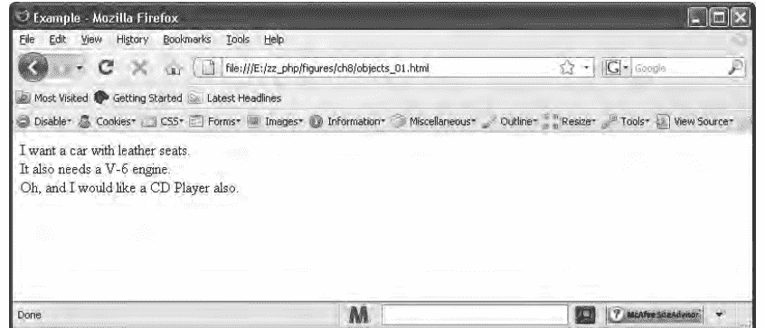

*图8-5 浏览器中显示了每种车型你喜欢的属性*

这会将你喜欢的每种车型属性打印到浏览器屏幕上。图8-5显示了此脚本在浏览器中的结果。这种方法可以稍微减少代码量，至少如果你只想使用同一类型对象的一个或两个实例时是这样。

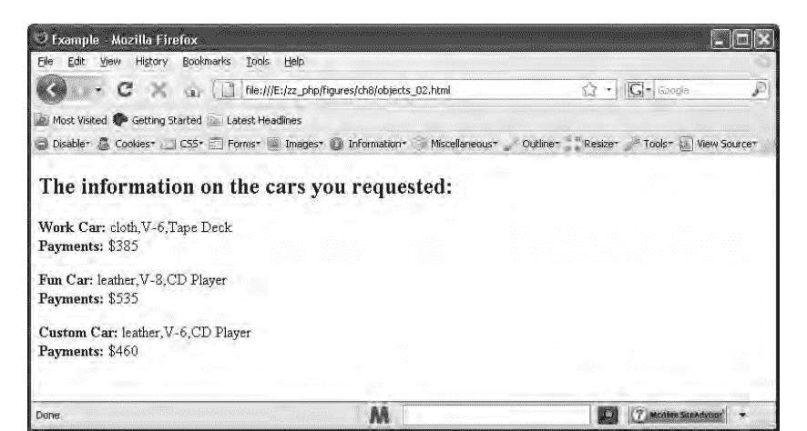

*图8-6 车型、其特性和计算的月付款列表*

假设你想遍历一个`car`对象的`work_car`实例的属性，以便在页面上显示每个属性的值。`for-in`循环允许你实现这一点，而无需输入每个属性名称，如下所示的代码：

```javascript
function car(seats, engine, theradio) {
    this.seats = seats;
    this.engine = engine;
    this.theradio = theradio;
}
var work_car = new car("cloth", "V-6", "Tape Deck");
for (var prop_name in work_car) {
    document.write(work_car[prop_name] + "<br />");
}
```

你会注意到脚本中`work_car[prop_name]`这部分看起来不太熟悉。`for-in`循环使用数组来存储属性值，这就需要使用这种语法。你将在第11章中更深入地了解数组，所以如果现在还不清楚也不必担心。一旦你学会了如何使用数组，`for-in`循环将成为操作对象的有用方式。目前，你只需要知道`for-in`循环的功能即可。

#### with 语句

如果你计划使用大量涉及某个对象的语句，`with`语句可以让你更轻松地访问或操作该对象的属性和方法。例如，如果你想在一个网页上编写多个关于名为`car`的对象的语句，你可能会厌倦反复输入对象名称（`car`）、点运算符和属性名称。

`with`语句允许你在`with`块内的语句中省略对象名称和点运算符，这样你只需输入属性名称即可访问所需的属性。以下代码展示了`with`语句的结构：

```javascript
with (object) {
    JavaScript statements
}
```

假设你有一个名为`car`的对象，它具有`seats`、`engine`和`radio`属性，以及一个名为`work_car`的该对象实例。你可以使用`with`语句来避免反复输入`work_car`和点运算符，如下例所示：

```javascript
function car(seats, engine, theradio) {
    this.seats = seats;
    this.engine = engine;
    this.theradio = theradio;
}
var work_car = new car("cloth", "V-6", "Tape Deck");
with (work_car) {
    document.write("Seats: " + seats + "<br />");
    document.write("Engine: " + engine + "<br />");
    document.write("Radio: " + theradio);
}
```

现在，你可以访问`car`对象的`work_car`实例的属性，而无需每次使用属性时都输入`work_car`和点运算符。

此示例将`car`对象的`work_car`实例的属性值写入页面。请注意，在`with`块内部，属性名称可以直接使用，无需在前面输入`work_car`和点运算符。

现在你已经了解了如何创建自己的对象、属性和方法，你就能更好地理解一些预定义的JavaScript对象是如何工作的。在接下来的本章及后续章节中，将讨论许多预定义的JavaScript对象。

## 专家问答

**问：每次我想使用一个对象时，真的必须用构造函数创建一个实例吗？**

**答：是的。** 构造函数只是给浏览器提供了对象的结构。要使用这个结构，你需要创建该对象的实例。你将在第12章看到，对于一些预定义的JavaScript对象，你同样需要创建实例。

**问：那么对象初始化器呢？我不需要用它们创建实例吗？**

**答：对象初始化器直接创建一个对象，而不仅仅是像构造函数那样提供一个结构。** 因此，创建的对象不需要再创建实例。

**问：我需要经常使用自己编写的对象吗？**

**答：可能不需要，但这取决于你的脚本和你的目标。** 本书中的许多脚本使用预定义的JavaScript对象；然而，如果自定义对象在后期对你编写脚本有帮助，你可能会使用它。

**问：一个对象可以有多个方法吗？**

**答：你可以通过重复本章前面创建方法时的步骤，在对象中添加任意多的方法。** 例如，你可以添加另一个方法，根据你为汽车类型定义的属性来计算每种类型汽车的保险费用。

## 动手实践 8-1 创建一个计算机对象

```
pr8_1.html
prjs8_1.js
```

在这个项目中，你将自己创建对象，并掌握对象创建相关的技能。该脚本将创建一个计算机对象，然后利用该对象的属性、方法和实例，为不同类型的计算机创建功能列表和价格列表。

### 逐步操作

-   1. 创建一个HTML页面，并将其保存为`pr8_1.html`。添加必要的脚本标签，以指向一个名为`prjs8_1.js`的外部JavaScript文件。

-   2. 创建一个外部JavaScript文件，并将其保存为`prjs8_1.js`。用于步骤3-12。

-   3. 创建一个名为`computer`的对象，它有三个属性：`speed`、`hdspace`和`ram`。

-   4. 创建一个`computer`对象的实例，并将其命名为`work_computer`。将字符串值`2GHz`赋给`speed`参数，`80GB`赋给`hdspace`参数，`1GB`赋给`ram`参数。

-   5. 创建一个`computer`对象的实例，并将其命名为`home_computer`。将字符串值`1.5GHz`赋给`speed`参数，`40GB`赋给`hdspace`参数，`512MB`赋给`ram`参数。

-   6. 创建一个`computer`对象的实例，并将其命名为`laptop_computer`。将字符串值`1GHz`赋给`speed`参数，`20GB`赋给`hdspace`参数，`256MB`赋给`ram`参数。

-   7. 创建一个名为`get_price()`的函数，用于计算计算机的价格。计算机的基础价格是500，并应赋值给一个名为`the_price`的变量。如果对象的`speed`属性等于`2GHz`，则将`the_price`的值增加200；否则，增加100。如果对象的`hdspace`属性是`80GB`，则将`the_price`的值增加50；否则，增加25。如果对象的`ram`属性是`1GB`，则将`the_price`的值增加150；否则，增加75。函数最后用一个`return`语句返回变量`the_price`的值。

-   8. 将步骤6中创建的函数添加到`computer`对象中。将该方法命名为`price`。

-   9. 将`price()`方法与对象的`work_computer`实例一起使用时返回的值赋给一个名为`work_computer_price`的变量。

-   10. 将`price()`方法与对象的`home_computer`实例一起使用时返回的值赋给一个名为`home_computer_price`的变量。

-   11. 将`price()`方法与对象的`laptop_computer`实例一起使用时返回的值赋给一个名为`laptop_computer_price`的变量。

-   12. 将每种类型计算机的功能和价格以与本章前面汽车示例中使用的相同格式写入浏览器屏幕。

-   13. 保存JavaScript文件，并在浏览器中查看HTML文件。屏幕上应该会显示每种计算机的功能列表和价格。

### 动手实践小结

在这个项目中，你能够运用你新学到的对象知识，创建一个具有属性和方法函数的对象。你成功创建了一个网页，在浏览器中显示了不同计算机的价格。

## 理解预定义的JavaScript对象

在JavaScript中，有许多预定义对象，你可以使用它们来访问你可能需要的特特定属性或方法。一旦你了解了这些不同的对象及其功能，就能让你的脚本变得更加交互性强。

本书将介绍一些主要的预定义对象。其中一些将作为整章的基础，而另一些则较小，可能只需要半章或一部分来讲解。首先，在本章中，我们将介绍`navigator`对象和`history`对象，以及你能用它们做什么。

## Navigator 对象

`navigator`对象使你能够访问查看器浏览器的各种属性，例如其名称、版本号等。它的名字来源于在Mozilla/Firefox之前的Netscape Navigator浏览器。

`navigator`对象是`window`对象的一部分，这意味着你可以使用`window.navigator.property_or_method_name`来访问其属性和方法，但也可以简化为仅`navigator.property_or_method_name`。即使是`window`对象的直接属性或方法也是如此（例如，`window.alert("Hi")`可以简化为仅`alert("Hi")`，它仍然是有效的）。你通常会看到`window`对象的此类属性和方法以这种方式缩写，以节省额外的输入或帮助缩短源代码。

首先，让我们看看`navigator`对象的属性。

#### 属性

`navigator`对象的属性让你可以了解查看器所使用浏览器的各种信息。`navigator`对象的属性无法更改，因为它们被设置为只读。这是为了防止你试图将用户的浏览器版本从6.0更改为7.0或类似操作。相反，你只能找出属性的值，并利用它让你的脚本为不同的浏览器执行不同的操作。

表8-1展示了`navigator`对象的属性以及每个属性返回的值。此外，如果某个属性仅适用于本书提到的三个主要浏览器中的一两个，则会在括号中注明该属性的限制。

#### Navigator 对象的属性

| 属性 | 值 |

| --- | --- |

| appCodeName | 浏览器的代码名称 |

| appName | 浏览器的名称 |

| appMinorVersion | 表示浏览器次版本的字符串（仅限 Internet Explorer） |

| appVersion | 浏览器的版本号及其他一些信息 |

| browserLanguage | 正在使用的浏览器的语言（Internet Explorer 和 Opera） |

| buildID | 正在使用的浏览器的构建标识符（仅限 Firefox） |

| cookieEnabled | 指定浏览器是否启用了 cookie |

| cpuClass | 表示 CPU 类型的字符串（仅限 Internet Explorer） |

| language | 正在使用的浏览器的语言（Firefox 和 Opera） |

| mimeTypes | 浏览器支持的 MIME 类型数组 |

| onLine | 指定浏览器是否处于“全局离线模式” |

| oscpu | 表示计算机操系统的字符串（仅限 Firefox） |

| platform | 创建浏览器所针对的机器类型 |

| plugins | 浏览器已安装的插件数组 |

| product | 表示正在使用的产品名称的字符串（仅限 Firefox） |

| productSub | 正在使用的浏览器的构建版本号（仅限 Firefox） |

| securityPolicy | 一个空字符串——在 Netscape 4.7 中曾返回一个值（仅限 Firefox） |

| systemLanguage | 操作系统使用的默认语言（仅限 Internet Explorer） |

| userLanguage | 操作系统的自然语言（Internet Explorer 和 Opera） |

| userAgent | 浏览器的用户代理头信息 |

| vendor | 一个空字符串——曾返回代表正在使用的浏览器供应商的字符串（仅限 Firefox） |

| vendorSub | 一个空字符串——曾返回正在使用的浏览器的供应商版本号（仅限 Firefox） |

现在你已经了解了 navigator 对象的属性，可以在脚本中开始使用它们了。以下章节将更详细地介绍一些更有用的属性。

##### appCodeName 属性

此属性保存浏览器的应用程序代码名称，通常类似于 "Mozilla"。除了将其写入屏幕或向用户发出警报外，目前没有太大用处。以下代码展示了如何向用户发出警报，告知其用于查看页面的浏览器的 appCodeName：

```
window.alert("You are using "+navigator.appName);
```

请注意，你使用的是对象名称后跟点运算符，然后是属性名称，这与你创建自己的对象时一样。这就是你能够访问 navigator 对象属性的方式。

请注意，对于此属性，大多数浏览器都返回 "Mozilla"，这是早期版本 Netscape Navigator 使用的代码名称。

##### appName 属性

此属性允许你找出用户正在使用哪种类型的浏览器来浏览页面。如果是 Firefox 浏览器，此属性的值将是 "Netscape"。如果是 Internet Explorer，则此属性的值将是 "Microsoft Internet Explorer"。其他浏览器会有相应的值。

如果你需要了解特定浏览者的值，可以创建一个脚本来警报此属性的值，将该脚本放在网页的 `<script>` 标签中，然后在该浏览器中查看页面。你将收到一个警报，显示该浏览器对应此属性的值。以下代码展示了如何编写警报：

```
window.alert("You have "+navigator.appName);
```

由于这使你能够找出正在使用的浏览器类型，因此你可以创建一个简单的浏览器检测脚本。

假设你想根据你对正在使用的浏览器的看法向用户发送警报。你可以使用 `navigator.appName` 属性创建一个 if/else 块，并根据浏览器类型向用户发送相应的评论。

以下代码展示了如何执行此任务的示例：

```
<body>
<script type="text/javascript">
switch (navigator.appName) {
  case "Netscape" : window.alert("Firefox/Netscape is cool."); break;
  case "Microsoft Internet Explorer" : window.alert("Internet Explorer is Cool."); break;
  case "Opera" : window.alert("Opera is cool."); break;
  default : window.alert("What browser is this?");
}
</script>
Hi, and welcome!
</body>
```

这里使用了一个 switch 块来确定 `navigator.appName` 属性的值，并向用户发出适当的警报。

如你所见，用户现在可以了解你对正在使用的浏览器的看法。图 8-7 展示了如果你使用 Firefox 查看页面会收到的警报。

##### appVersion 属性

此属性的值是浏览器的版本号和一些附加信息。例如，在 Windows XP 的 Firefox 3 中，你可能会看到以下文本作为此属性的值：

```
5.0 (Windows; en-US)
```

当你使用的技术只应在特定版本以上的浏览器中执行时，这可能很有用。但请注意，不同浏览器返回的结果不同，如下所示的 Windows Vista 上 Internet Explorer 7 返回的值：

```
4.0 (compatible; MSIE 7.0; Windows NT 6.0; SLCC1; .NET CLR 2.0.50727;
Media Center PC 5.0; .NET CLR 3.5.30729; .NET CLR 3.0.30618)
```

字符串的第一部分是 "4.0"，后面它自称为 "MSIE 7.0"。因此，在使用此属性时必须小心，你需要知道不同浏览器返回的内容才能充分利用这些信息。

##### cookieEnabled 属性

如果浏览器中启用了 cookie，此属性返回布尔值 `true`；如果浏览器中未启用 cookie，则返回布尔值 `false`。你将在第 16 章更详细地了解 cookie。

##### onLine 属性

如果用户的系统未处于全局离线模式（有关此模式的详细信息，请参见 http://msdn.microsoft.com/en-us/library/aa768170(VS.85).aspx），此属性返回布尔值 `true`；如果系统处于全局离线模式，则返回布尔值 `false`。

##### platform 属性

此属性保存创建浏览器所针对的机器类型的值。例如，在 Windows XP 机器上，该值将是 "Win32"。

不同类型的机器有不同的值。如果你想让用户知道正在使用的机器类型，可以使用此属性发送警报：

```
window.alert("Your machine is a "+navigator.platform+" machine.");
```

虽然在此处不太有用，但该属性可用于根据用户的机器类型将其重定向到适当的页面。

##### plugins 数组

此数组保存用户浏览器中安装的所有插件的值。你将在第 12 章了解更多关于数组的信息。

##### userAgent 属性

此属性为你提供了关于浏览器的另一长串信息。此字符串是浏览器的用户代理头信息。例如，在 Windows XP 的 Firefox 3 中，你可能会看到以下字符串：

```
Mozilla/5.0 (Windows; U; Windows NT 5.1; en-US; rv:1.9.0.4)
Gecko/2008102920
Firefox/3.0.4
```

它与你之前看到的 `navigator.appVersion` 属性的文本非常相似，但包含更多信息。

现在你已经了解了 navigator 对象的属性，接下来可以看看该对象的方法了。

#### 方法

navigator 对象还有许多你可以用来执行各种任务的方法。表 8-2 展示了 navigator 对象中可用的方法。

以下章节将探讨 `javaEnabled()` 方法及其使用方式。

#### javaEnabled() 方法

如果用户在浏览器中启用了 Java，此方法返回布尔值 `true`；否则返回 `false`。如果你想向用户显示 Java 小程序，但前提是用户的浏览器启用了 Java，那么 `javaEnabled()` 方法可能会很有用。

| 方法 | 目的 |

|---|---|

| javaEnabled() | 用于测试浏览器是否启用了 Java |

| mozIsLocallyAvailable() | 检查某个地址的文件在本地是否可用（仅限 Firefox） |


| `preference()` | 允许设置某些浏览器首选项（需要签名的脚本） |

| `registerContentHandler()` | 允许一个网站将自身设置为特定 MIME 类型的潜在处理程序 |

| `registerProtocolHandler()` | 允许一个网站将自身设置为特定协议的潜在处理程序 |

| `taintEnabled()` | 返回 `false`——因为该方法已不再使用。它曾用于指定浏览器中是否启用了数据污染 |

表 8-2 Navigator 对象的方法

目前，你只会看到如何向观众发送警报，作为一个示例。这样你就不需要处理任何Java语法了。以下代码会在观众启用了Java时发送一个警报，如果观众没有启用Java，则发送另一个警报：

```
var hasJava = navigator.javaEnabled();
if (hasJava == true) {
    window.alert("Cool, you have Java!");
} else {
    window.alert("Java disabled? You cannot see my Java Applet!");
}
```

此代码测试`navigator.javaEnabled()`方法返回的值，并向用户显示正确的警报。同样，如果你想在页面的某个地方使用Java小应用程序，这会更有用。

## History对象

History对象也是window对象的一部分，它提供了当前窗口浏览器历史记录的信息。

#### 属性

History对象只有一个属性，名为`length`（在Firefox中，还有更多属性可用，但它们不适用于Web内容）。此属性返回当前窗口浏览器会话历史中的页面数量，包括当前加载的页面。它可以用类似这样的方式使用：

```
<body>
<script type="text/javascript">
alert("Your current window has viewed " + history.length + " pages!");
</script>
</body>
```

这只会向观众发送一个警报，告知在当前浏览器窗口中访问了多少页。

#### 方法

History对象有三个方法，列于表8-3中。

| 方法 | 用途 |

| :--- | :--- |

| `Back()` | 将浏览器窗口在历史列表中回退一页 |

| `Forward()` | 将浏览器在历史列表中前进一页 |

| `Go()` | 使用一个整数值将浏览器转到历史列表中指定的页面 |

表8-3 History对象的方法

以下各节将更详细地讨论这些方法中的每一个。

**back()方法** back()方法将浏览器转到历史列表中当前页面之前访问的最后一个页面，类似于使用浏览器的“后退”按钮。要使用它，只需在脚本中需要的位置调用该方法即可。因此，如果你想用表单按钮制作自己的“后退”按钮，可以使用类似以下代码的内容。首先是HTML主体部分代码（保存为history_01.html）：

```
<body>
<form>
<input type="button" value="Back" id="back_button" />
</form>
<script type="text/javascript" src="history_01.js"></script>
</body>
```

接下来是外部JavaScript代码（保存为history_01.js）：

```
var bb = document.getElementById("back_button");
bb.onclick = function() {
  history.back();
};
```

加载HTML页面将显示“后退”按钮。当你点击它时，浏览器将转到当前页面之前访问的上一个页面。如果浏览器窗口没有先前的历史记录，点击该按钮将不会有任何作用。

**forward()方法** forward()方法将浏览器转到历史列表中当前页面之后访问的页面，类似于使用浏览器的“前进”按钮。要使用它，只需在脚本中需要的位置调用该方法即可。使用此方法，你可以更新之前的脚本以添加一个“前进”按钮。接下来显示更新后的HTML和JavaScript代码。HTML代码：

```
<body>
<form>
<input type="button" value="Back" id="back_button" /><br />
<input type="button" value="Forward" id="forward_button" />
</form>
<script type="text/javascript" src="history_01.js"></script>
</body>
```

更新后的外部JavaScript代码：

```
var bb = document.getElementById("back_button");
var fb = document.getElementById("forward_button");
bb.onclick = function() {
  history.back();
};
fb.onclick = function() {
  history.forward();
};
```

加载HTML页面现在将同时显示两个按钮。与back()方法一样，在窗口历史列表中没有前进页面时使用forward()将不会有任何作用。

**go()方法** go()方法接受一个整数作为参数。该整数可以是负数，以在历史列表中后退，也可以是正数，以在历史列表中前进。例如，以下代码将在窗口的历史记录中后退两页：

```
history.go(-2);
```

以下代码将在历史列表中前进三页：

```
history.go(3);
```

与其他两个方法一样，如果观众试图访问的页面不存在（例如，类似`history.go(15)`的内容在窗口的历史记录中可能不存在），那么该方法将不会执行任何操作。

预定义的JavaScript对象可以非常有用。正如你将在下一章中看到的，document对象使你能够访问许多用于处理HTML文档的额外属性和方法。

## 动手试试8-2 练习使用预定义的Navigator对象

这个项目允许你练习使用预定义navigator对象的一些属性和方法。你将创建一个页面，根据使用的浏览器向观众警报各种类型的信息。

### 分步指南

- 1. 创建一个HTML页面，将其保存为pr8_2.html。

- 2. 创建一个外部JavaScript文件，将其保存为prjs8_2.js。在步骤3-12中使用它。

- 3. 编写一个警报，当观众进入页面时弹出。警报应显示“嗨！你正在用...查看我的页面”，后面跟着观众正在使用的浏览器名称。

- 4. 如果用户启用了Java，向观众发送一条新的警报，显示“你启用了Java，太酷了！”如果观众没有启用Java，则发送一条警报，显示“没有Java？那这里就没好玩的东西了。”

- 5. 发送一条新的警报，告知观众正在使用的机器类型。警报应显示“你正在使用...”，后面跟着观众用来查看页面的机器类型。

- 6. 保存文件，并在一个或多个浏览器（或其他计算机，如果可以的话）中打开HTML文件。看看根据查看网页时使用的设备，结果有何不同。

（续）

### 动手试试小结

在这个项目中，你运用了关于预定义navigator对象的属性和方法的知识。你能够创建一个网页，根据浏览器、机器类型以及是否启用Java，向观众发送不同的警报。

## 第8章自测

1. 对象是对某物进行建模的一种方式 __________，即使该对象是一个 __________ 实体。

2. 当你想到一个对象时，你可能会想形象化一些 __________ 的东西。

3. 对象很有用，因为它们为你提供了另一种在脚本中 __________ 事物的方式。

4. 在JavaScript中，你通过使用以下方式访问对象属性

   - A 加法运算符

   - B 点运算符

   - C 乘法运算符

   - D 你无法访问对象的属性

5. 对象命名规则与命名 __________ 和 __________ 的规则类似。

6. 你可以使用 __________ 函数或对象 __________ 来创建JavaScript对象。

7. 构造函数允许你使用与常规函数相同的基本语法来构建对象。

   - A 正确

   - B 错误

8. 对象初始化器比构造函数稍长一点。

   - A 正确

   - B 错误

9. 关于以下代码，你能说什么：

   `var x=myhouse.kitchen;`

   - A 它将字符串myhouse.kitchen赋值给变量x。

   - B 它将myhouse和kitchen的值相加，并将它们赋值给一个名为x的对象。

   - C 假设myhouse对象存在，它将myhouse对象的kitchen属性的值赋给变量x。

   - D 假设kitchen对象存在，它将kitchen对象的myhouse属性的值赋给变量x。

10. 如果此行在构造函数内，以下哪一行正确地从名为get_cost()的函数创建了一个名为cost的方法？

    - A `this.cost=get_cost();`

    - B `cost=get_cost;`

    - C `get_cost=this.cost();`

    - D `this.cost=get_cost;`

11. 以下哪项会向观众发送一个警报，告知正在使用的浏览器的名称？

    - A `window.alert("You are using "+navigator.appVersion);`

    - B `window.alert("You are using "+navigator.appName);`

    - C `window.alert("You are using "+navigator.javaEnabled());`

    - D `window.alert("You are using navigator.appName");`

    ```
    myhouse.kitchen="big";
    ```

12. 关于以下代码，你能说什么？

    - A 假设kitchen对象存在，myhouse属性被赋予一个新的字符串值。

    - B 假设myhouse对象存在，变量kitchen的值被添加到字符串big中。

    - C 假设myhouse对象存在，kitchen属性被赋予一个新的字符串值。

    - D 这不会执行任何操作。

13. 在JavaScript中，有许多 __________ 对象可供你使用，以访问你可能需要的某些属性和方法。

14. __________ 对象使你能够访问观众浏览器的各种属性。

15. 以下哪项不是navigator对象的属性？

    - A appName

    - B appCodeName

    - C appType

    - D appVersion

## 第9章

文档对象

## 关键技能与概念

- 定义文档对象

- 使用文档对象模型

- 使用文档对象的属性

- 使用文档对象的方法

- 创建动态脚本

既然你已经了解了对象的工作原理以及如何使用预定义的JavaScript对象，现在是时候来了解JavaScript中一些主要的预定义对象了。本章介绍文档对象，它帮助你收集正在浏览器中查看的页面信息。正如你将在本章中发现的那样，文档对象的一些属性和方法可用于获取关于文档的信息或更改关于文档的信息。你还将接触到文档对象模型，并了解如何将其与样式表结合使用来创建动态脚本。

## 定义文档对象

文档对象是浏览器为每个查看的新HTML页面（文档）创建的一个对象。通过这样做，JavaScript使你能够访问许多属性和方法，这些属性和方法可以以各种方式影响文档。在本书中，你已经使用文档对象的write()方法很长时间了。这个方法允许你将一串文本写入HTML文档。为了开始你对文档对象的探索，你将首先了解文档对象模型（DOM）以及可以通过此对象访问的各种属性。这些属性中有很多在编写脚本时会变得非常有用。

## 使用文档对象模型

文档对象模型（DOM）允许JavaScript（及其他脚本语言）访问浏览器中的文档结构。每个文档由结构化的节点组成（例如，body标签将是一个节点，body元素内的任何元素将是body元素的子节点）。有了这种结构，脚本语言可以通过多种方式访问文档中的元素，从而允许对文档中的元素进行修改。

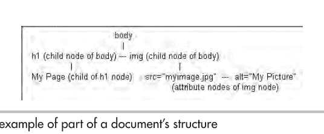

如果你有以下HTML代码，你可以使用JavaScript来访问其结构：

```html
<body>
    <h1>My Page</h1>
    
</body>
```

图9-1展示了body元素是一个节点，以及它如何可以拥有子节点和属性节点。

h1和img元素都是body元素的子节点。每个元素也有自己的节点。h1元素包含一个文本节点作为其子节点（文本“My Page”），而img元素包含两个属性节点（src=“myimage.jpg”和alt=“My Picture”）。这种类型的结构在整个文档中都可用，因此，虽然这是一个简单的例子，但大多数HTML页面可以绘制出复杂得多的文档结构树。

你已经在使用document.getElementById()方法通过其id属性值来访问文档中的元素，从而访问DOM。你也可以使用getElementsByTagName()或getElementsByClassName()等方法来获取元素组。

使用JavaScript访问DOM允许你创建更动态的脚本，这些脚本可以响应用户事件来更改文档中的元素。你还可以使用文档对象的某些JavaScript方法（如createElement()或createTextNode()）来创建元素和节点。这些类型的脚本将在本章后面介绍。

首先，你将了解文档对象的属性和方法。

## 使用文档对象的属性

表9-1列出了文档对象的属性及其简要描述。表格之后，将更详细地讨论一些特定的属性。为几个属性提供了示例脚本。请注意，许多属性使用数组来保存信息。如果你想了解数组以更好地理解它们的使用，请参见第11章。

**注意**

并非所有这些属性都能跨浏览器工作。此外，其中许多已被弃用（alinkColor、bgColor、fgColor、linkColor和vlinkColor）。你可以访问 http://developer.mozilla.org/en/DOM/document#Properties 和 http://msdn.microsoft.com/en-us/library/ms531073(VS.85).aspx 查看更多关于这些属性的信息。

208 JavaScript: A Beginner's Guide

| 属性 | 描述 |

| :--- | :--- |

| activeElement | 返回一个字符串，包含文档中活动元素的值 |

| alinkColor | 返回文档活动链接颜色的十六进制值 |

| anchors | 文档中所有命名锚点的数组 |

| async | 用于告诉浏览器是使用异步请还是同步请求加载文档 |

| applets | 文档中所有Java小应用程序的数组 |

| bgColor | 返回文档背景颜色的十六进制值 |

| body | 返回文档的body或frameset元素 |

| characterSet | 返回一个字符串值，表示用于编码文档的字符集 |

| charset | 返回一个字符串值，表示用于编码文档的字符集 |

| childNodes | 文档所有子节点的数组 |

| compatMode | 如果文档在怪异模式下渲染，则返回字符串“BackCompat”，如果文档在严格模式下渲染，则返回字符串“CSS1Compat” |

| contentType | 返回一个字符串，表示文档MIME头中的Content-Type |

| cookie | 用于在文档中设置JavaScript Cookie |

| defaultCharset | 返回一个字符串值，表示用于编码文档的默认字符集 |

| defaultView | 引用文档的window对象 |

| designMode | 返回一个字符串值，提供关于文档是否可编辑的信息 |

| dir | 返回一个字符串值，表示文档的阅读方向 |

| doctype | 返回与文档关联的doctype声明 |

| documentElement | 返回一个字符串，表示文档的根节点 |

| documentURIObject | 返回一个表示文档URI的对象（仅对特权JavaScript代码可用） |

| domain | 返回文档服务器的域名 |

| embeds | 文档中所有embed标签的数组 |

| expando | 返回一个布尔值，基于是否可以在文档中创建任意变量 |

| fgColor | 返回文档默认文本颜色的十六进制值 |

| fileCreatedDate | 返回文档创建的日期 |

表9-1 文档对象的属性

第9章：文档对象 209

| 属性 | 描述 |

| :--- | :--- |

| fileModifiedDate | 返回文档最后修改的日期 |

| formName | 本身不是属性，而是为文档中每个命名的表单创建一个新属性 |

| forms | 文档中所有form标签的数组 |

| frames | 文档中使用的所有框架的数组 |

| height | 返回文档body元素的高度（以像素为单位） |

| images | 文档中所有图像（img）标签的数组 |

| implementation | 返回一个字符串值，表示文档的实现对象 |

| inputEncoding | 返回一个字符串，表示文档的编码 |

| lastModified | 返回文档最后修改的日期 |

| layers | 页面上所有layer标签的数组（仅限Netscape Navigator 4） |

| all | 允访问页面上的所有对象 |

| linkColor | 返回文档默认链接颜色的十六进制值 |

| links | 文档中所有链接（<a>）标签的数组 |

| location | 返回文档的URI |

| namespaces | 文档中所有命名空间的数组 |

| parentWindow | 返回对父窗口（父窗口的文档对象）的引用 |

| plugins | 文档中使用的所有插件的数组 |

| protocol | 返回文档Web地址（URL）的协议部分 |

| readyState | 返回一个字符串值，表示文档的当前状态 |

| referrer | 返回将访问者引导到当前文档的文档的URL |

| scripts | 文档中使用的所有script标签的数组 |

| styleSheets | 文档中使用的所有样式表的数组 |

| tags | 设置文档中HTML标签的样式 |

| title | 返回文档title标签内的文本 |

| uniqueID | 返回一个字符串值，表示赋予文档的唯一ID |

| URL | 返回当前文档的URL |

| URLUnencoded | 返回未编码的文档URL |

| vlinkColor | 返回文档已访问链接颜色的十六进制值 |

| width | 返回文档body元素的宽度（以像素为单位） |

表9-1 文档对象的属性（续）

### 颜色属性

`alinkColor`、`bgColor`、`fgColor`、`linkColor` 和 `vlinkColor` 属性常用于获取或更改页面上各种元素的颜色。现在建议使用 CSS 或通过样式属性（本章稍后讨论）来设置或更改这些属性。

### anchors 属性（数组）

`anchors` 属性实际上是一个数组，由浏览器为文档中的所有命名锚点（例如 `<a name="top">`）设置。由于你还没有学习数组，这对你目前来说可能不太有用；不过，当你学到第 11 章时，你会更深入地了解像这样的数组如何发挥作用。

JavaScript 为你提供了 `length` 属性，以便你了解页面上命名锚点的数量。你可以使用 `length` 属性向浏览器窗口输出页面上有多少个命名锚点：

```
<body>
<h1>My Page</h1>
<a name="sec1"></a>      <!-- The first named anchor is set with the anchor tag -->
<h2>Section 1</h2>
This section is all about section 1 stuff...

<a name="sec2"></a>      <!-- The second named anchor is set with the anchor tag -->
<h2>Section 2</h2>
This section talks about all the section 2 issues and ...
<br />
<script type="text/javascript">
document.write("There are "+document.anchors.length+" named anchors"); <!-- The number of named anchors is displayed on the page -->
</script>
</body>
```

此代码在页面上创建了两个命名锚点，然后将锚点数量输出到屏幕上。图 9-2 展示了此脚本在浏览器窗口中的结果。

再次说明，目前这更像一个提供信息的属性。一旦你学会了数组，你就能更好地利用 `anchors` 属性。

### cookie 属性

`cookie` 属性用于设置 JavaScript cookie，以存储访问者的信息。Cookie 是一个小型文本文件，会在特定时间内（固定的日期或浏览器会话期间）保存到访问者的计算机上。Cookie 可以帮助网站记住和检索访问者的信息（例如购物车内容、特殊设置或会话信息）。

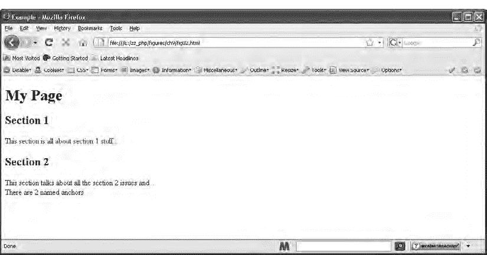

图 9-2 页面上的命名锚点数量显示在浏览器窗口中

要设置 cookie，你需要将 `document.cookie` 属性的值设置为一个字符串，该字符串包含你想为访问者存储的信息。语法如下：

```
document.cookie=string;
```

你需要将 *string* 替换为包含你要使用的信息的文本字符串。通常，其格式类似于以下示例中的 cookie 设置：

```
document.cookie="site=homepage";
```

你可以看到，cookie 设置了一项内容：`site` 是 `homepage`。等号用于在读取 cookie 时分隔 `site` 和 `homepage`。

在你尝试进一步处理 cookie 之前，需要掌揚更高级的字符串处理技术。你将在后面的章节中看到如何使用高级字符串处理技术，以及如何更详细地设置和读取 cookie。现在，你只需要知道 `document.cookie` 属性用于设置 cookie。

### dir 属性

`dir` 属性返回一个字符串值，表示文档的阅读方向。该值可以是 `ltr`（从左到右）或 `rtl`（从右到左）。通过将值设置为 `rtl`，此属性对于显示从右向左而非从左向右阅读的语言的网页很有用。作为趣味实验，你可以使用此属性动态更改页面的外观，如下例代码所示：

```
var the_button = document.getElementById("change_sides");
the_button.onclick = function() {
    document.dir = (document.dir!="ltr") ? "ltr" : "rtl";
}
```

代码检查并更改值

然后，在你的 HTML 文件中，添加一个按钮来实现切换：

```
<body>
<form>
<input type="button" value="Change Sides" id="change_sides"
       onclick="switch_sides();" />
</form>
</body>
```

当访问者点击按钮时，页面的阅读方向将会改变。在这种情况下，你的按钮最初位于页面左侧，点击后会移动到右侧。图 9-3 显示了点击按钮前的页面，图 9-4 显示了点击按钮后的页面。

### domain 属性

`domain` 属性保存向访问者提供页面的域名。该值是 Web 地址开头 `http://` 之后、任何正斜杠之前的部分。因此，如果你正在查看来自 `http://www.pageresource.com` 的页面，`document.domain` 的值将是 `www.pageresource.com`。

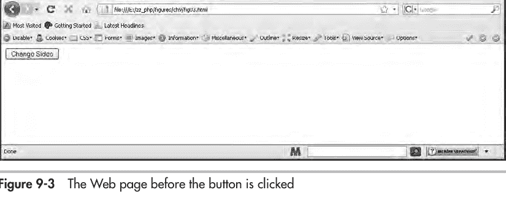

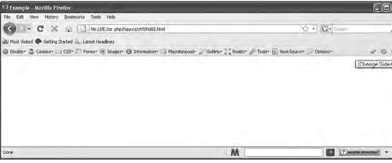

图 9-4 点击按钮后的网页

要使用 `domain` 属性，你可以向访问者发送一个提示框来标识该域。将以下代码放在文档中，将弹出一个显示 `domain` 属性值的提示框：

```
<body>
<script type="text/javascript">
window.alert("You have reached the "+document.domain+" domain!");
</script>
</body>
```

如果此代码放置在 `http://javascriptcity.com` 的任何页面上，将向访问者发送一条提示，内容为 "You have reached the javascriptcity.com domain!"。

> 注意

在本地不使用 Web 服务器时使用此属性，返回的值可能是一个空字符串，而不是域名。

### formname 属性

`formname` 属性本身实际上并不是一个属性。任何时候你为表单命名，都会创建一个 `formname` 属性，但该属性实际上是表单的名称，而不是 `formname`。要理解其含义，请看一个带有表单的页面。以下代码将给你一个包含表单的 HTML 页面：

```
<body>
The form is given a name to create a property
<form name="funform"><input type="button" name="funb" value="You can click me I suppose" />
</form>
</body>
```

此代码根据 `<form>` 开始标签中的 `name="funform"` 属性创建了 `document.funform` 属性。虽然这本身没有做太多事情，但它允许你访问表单内的表单元素。

`funform` 属性实际上有子属性，这些子属性以表单元素的名称命名。你可以使用 `document.funform.funb` 来访问表单中使用其 `name="funb"` 属性的按钮；然而，即使这样，仅靠它本身也做不了太多事情。

你需要再深入一层。`value` 属性允许你设置或更改表单元素内容的值。这些内容通常在表单元素标签的 `value` 属性中设置。在此表单中，你可以通过访问按钮的 `value` 属性（使用 `document.funform.funb.value`）并为其分配一个新值来更改按钮上的文本值。

以下示例展示了如何使用 `onclick` 事件处理程序在点击按钮时更改按钮文本：

```
<body>
<form name="funform">
<input type="button" name="funb" value="You can click me I suppose" onclick="document.funform.funb.value='Thanks, you clicked me!';" />
</form>
</body>
```

图 9-5 显示了点击按钮前页面和按钮的外观。请注意，按钮显示的是在其输入标�的 `value` 属性中设置的文本。现在看看图 9-6 中点击后的按钮。按钮上的文本已经改变了！按钮告知你点击了它，并通过说“谢谢”来表达礼貌。

需要注意的是，虽然这行得通，但现代浏览器只需为每个表单元素分配一个 `id`，然后使用 `document.getElementById()` 方法，就可以直接访问每个表单元素及其值，而无需先通过表单名称。

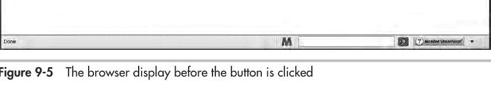

图 9-5 点击按钮前的浏览器显示

第9章：文档对象 215

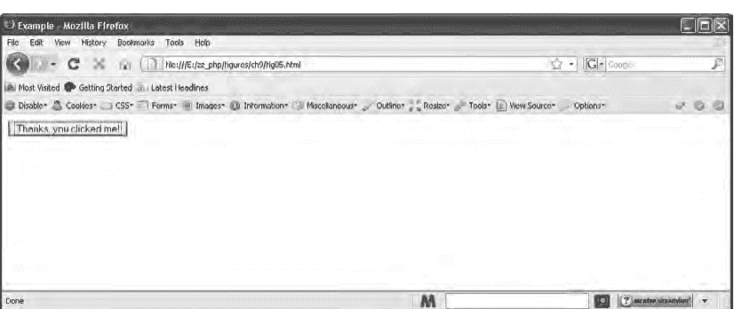

图9-6 点击按钮后的浏览器显示效果

### forms 属性（数组）

forms 属性是一个数组，它为网页上的每个表单都设有一个条目。该数组为你提供了使用 formname 属性之外的另一种选择；不过，在更详细地研究这个数组之前，你仍需要在第11章学习数组。

与其他类似属性一样，你可以使用 `document.forms.length` 形式的 length 属性来找出页面上有多少个表单。

### images 属性（数组）

images 属性是另一个数组。这个数组为网页上的每张图片都设有一个条目。与其他类似属性一样，你可以使用 `document.images.length` 形式的 length 属性来找出 HTML 文档中有多少张图片。

这个属性的另一个用途是检测哪些浏览器支持 JavaScript 中的 Image 对象。如果你希望预加载图片，这会很有帮助。在使用图片翻转脚本（你将在第16章创建）时预加载图片是个好主意，如果你想要将一张会在网站其他页面使用的图片放入浏览者的缓存文件，以使该页面加载更快，这也很有用。

要检查浏览器是否支持 Image 对象，你可以将任何需要 Image 对象的代码放在 if 语句块中。if 语句块将测试 document.images 属性是否存在，如下例代码所示：

```
if (document.images) {
    JavaScript Statements <!-- 这里是放置需要 document.images 属性才能工作的代码的地方 -->
}
```

注意，在圆括号内你只需要 `document.images`。如果这个属性存在，它会返回 true（因为除 null 之外的任何东西都会被视为 true——基本上是 `!=null` 的一种简写方式），并且块内的语句会被执行。如果属性不存在，则该块会被忽略，较旧的浏览器也乐得不必尝试任何这些代码。

要预加载图片，你首先需要创建 JavaScript Image 对象的一个新实例。以下代码展示了创建 Image 对象新实例所使用的语法：

```
var varname= new Image(width,height);
```

你将 *varname* 替换为你想要给这个 Image 对象实例起的名字。将 *width* 替换为你希望使用的图片的宽度（以像素为单位），并将 *height* 替换为图片的高度（以像素为单位）。

所以，如果你想创建一个名为 myimage 的 Image 对象实例，其中图片宽度为 100 像素，高度为 75 像素，你可以使用以下代码：

```
var myimage= new Image(100,75);
```

width 和 height 参数是可选的。你也可以不带参数直接创建对象实例：

```
var myimage= new Image();
```

接下来，你需要一种方式来定义将使用哪张图片（就像图像标签中的源 [src] 属性一样）。Image 对象自带一个 src 属性，允许你这样做。你只需给它赋一个值即可设置。以下代码展示了如何操作：

```
var myimage= new Image();
myimage.src= "smile.gif";
```

现在浏览器将尝试加载位于 smile.gif 本地地址的图片。如果需要，你也可以使用完整的 URL。由于图片在这里尝试加载而无需显示，所以它是在被预加载。

提示

> 预加载通常在文档的 head 部分（或在 head 部分调用的外部脚本文件中）进行，以便图片能尽快开始加载。

要将所有这些组合起来，你需要将这段代码放在你的 if 块内，这样它就不会被不支持 Image 对象的浏览器执行。以下代码将两部分组合在一起，并将脚本放在文档的 head 部分。这将预加载图片以供后续使用。

```
<head>
<script language="javascript">
if (document.images) {
  var myimage= new Image();
  myimage.src= "smile.gif";
}
</script>
</head>
```

创建了 Image 对象的一个新实例

为对象的 src 属性赋予了一个值，从而预加载了图片

这样就完成了图片的预加载，以便你稍后使用。

要预加载多张图片，你需要为每张想要预加载的图片创建一个 Image 对象的实例。所以，如果你想预加载三张图片，你可以使用以下代码：

```
<head>
<script type="text/javascript">
if (document.images) {
    var myimage= new Image(); 
    myimage.src= "smile.gif";
    var yourimage= new Image(); 
    yourimage.src= "friendly.gif";
    var herimage= new Image();
    herimage.src= "happy.gif";
}
</script>
</head>
```

这为你预加载了三张图片。新实例 yourimage 预加载了文件名为 friendly.gif 的图片。实例 herimage 预加载了文件名为 happy.gif 的图片。你可以使用相同的技术添加更多图片。

### lastModified 属性

lastModified 属性保存了当前文档最后修改的日期和时间值。这主要用于信息目的，例如显示文档最后修改的日期，以便浏览者知道你上次更新页面的时间。此属性的值取决于你的浏览器，因为不同的浏览器在页面上写入最后修改日期时会产生不同的结果。

考虑以下代码，它将 document.lastModified 属性的值写入网页以显示最后修改的日期和时间：

```
<body>
<h1>My Always Updated Web Page!</h1>
<script type="text/javascript">
    document.write("Last Updated: "+document.lastModified);
</script>
</body>
```

图9-7展示了在 Mozilla Firefox 中查看此代码时的结果。

在页面上写入最后修改日期时，差异仅体现在页面的空间上。某些布局可能需要为较长版本的属性安排额外空间。

### layers 属性（数组）

layers 属性是另一个数组，它为页面上的每个层标签设有一个条目，你可以使用 `document.layers.length` 形式的 length 属性来找出页面上的层数。层标签在 Netscape Navigator 4 中被用作创建页面不同部分（可以分层）并访问它们进行脚本编写的一种方式。在现代浏览器中，它已不再使用，因为每个元素都可以通过其他方式访问（例如 `document.getElementById()` 方法）。

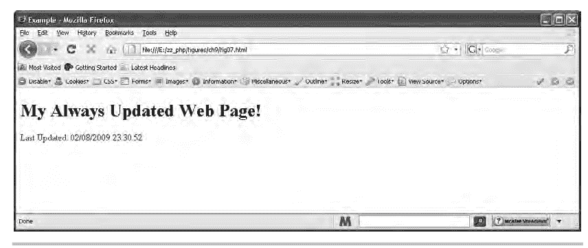

由于此属性仅在 Netscape Navigator 4 版本中可用，你可以使用此属性来查看正在使用的浏览器是否为 Netscape Navigator 4。你可以使用与测试 document.images 属性相同的方式来测试 document.layers 属性，这很简洁：

```
if (document.layers) {
    window.alert("You have Netscape Navigator 4!");
}
```

如果你需要确保某些脚本向后兼容 Netscape Navigator 4，这会很有用。

### all 属性

layers 属性帮助你检测 Netscape Navigator 4，而 all 属性则可以帮助你检测 Internet Explorer 4 或更高版本。创建 all 属性是为了让 JavaScript 能够访问页面上的所有对象。同样，在现代浏览器中，最好使用其他方法（如 `document.getElementById()` 方法）来完成此操作。

因此，要查看浏览者是否使用的是 Internet Explorer 4 或更高版本，你可以使用以下代码：

```
if (document.all) {
    window.alert("You have Internet Explorer 4 or better!");
}
```

### links 属性（数组）

links 属性是另一个数组，它为页面上的每个链接（如 `<a href="url">`）和图像映射的链接区域（如 `<area href="url">`）保存一个值。你可以使用 `document.links.length` 属性来找出页面上有多少个链接。

### referrer 属性

referrer 属性用于信息目的，它保存了浏览者到达你的页面之前所在页面的 URL（即来源页面）的值。虽然这可能很有用，但浏览者并不总是带有来源 URL（例如，当使用书签或直接输入地址时），所以值可能为空。此外，此属性的值并不总是正确，因为不同的浏览器可能将不同类型的事物视为将浏览者引导至新页面，而不仅仅是链接。

要使用此属性，你可以向页面的浏览者发送一个警报，告诉他们在到达你的页面之前他们在哪里。将以下示例中的代码放入文档即可实现：

```
<body>
<script type="text/javascript">
  window.alert("You came from "+document.referrer+"!");
</script>
</body>
```

因此，如果来源页面是 http://www.pageresource.com/webdes.htm，则会向浏览者发送一个警报，显示“You came from http://www.pageresource.com/webdes.htm!”。

### title 属性

title 属性保存了 HTML 文档标题的字符串值。标题在页面的 `<title>` 和 `</title>` 标签内设置。

你可以使用 title 属性将页面标题显示给浏览者，而不是在窗口的顶栏中。以下代码可以让你做到这一点：

```
<head>
<title>Lions, Tigers and Bears!</title> <!-- 文档的标题在此设置 -->
</head>
<body>
<script type="text/javascript">
  document.write("<h1>" + document.title + "</h1>"); <!-- 标题作为标题显示给浏览者 -->
</script>
我去的时候看到了狮子、老虎和熊……
</body>
```

这会在页面上将你的标题显示为标题。图9-8展示了在浏览器中查看此代码时的结果。

### URL 属性

URL 属性保存着当前文档完整 URL 的值。如果你在 HTML 页面底部打印这个信息会很有用，因为它会向任何打印你页面的人显示该页面的 URL。

虽然你可以自己在页面底部输入 URL，但如果需要在很多页面上都这样做，就会变得繁琐。这时这个属性就能派上用场，因为你可以将一段小脚本复制粘贴到每个页面，而不用每次都输入各种 URL 地址。以下代码展示了如何将 URL 地址写在页面上：

```
<body>
<h1>Buy Something!</h1>
If you don't buy something I will be really upset so you had better...
<br/><br/>
<script type="text/javascript">
document.write("You are at: "+document.URL);
</script>
</body>
```

图 9-9 展示了上述代码在浏览器中的结果。页面的最后一行告诉了访问者当前位置。图中显示的是一个本地文件地址，但如果页面是在线的，它会显示一个常规 URL。

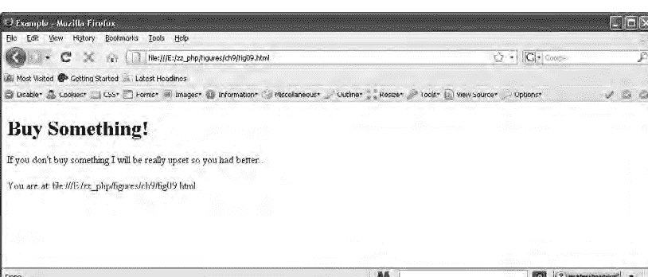

**图 9-9** 文档的 URL 显示在页面内容的末尾

### URLUnencoded 属性

URLUnencoded 属性返回未经任何编码的文档 URL。例如，如果文件名中包含空格，该属性将返回空格本身，而不是其替代的 `%20`。对于 URL `http://www.pageresource.com/my script.html`，`document.URL` 属性会返回 `http://www.pageresource.com/my%20script.html`。而 `document.URLUnencoded` 属性则返回 `http://www.pageresource.com/my script.html`，即未对空格进行编码的 URL。请注意，在撰写本文时，此属性仅在 Microsoft Internet Explorer（本书提及的三种浏览器之一）中可用。

## 专家问答

> **问：** 这些属性中有不少都是数组，我现在还用不上。我以后会用到它们吗？

**答：** 没有更详细地讨论这些数组的原因是你还没学过数组的工作原理。当你学会之后，你将能够更好地利用那些创建数组的属性，因为你将知道如何访问数组，以及在访问数组元素时可以对它们进行哪些操作。

> **问：** referrer 属性很酷！有没有什么方法可以每次有访客访问时，将这些信息写入一个文件，这样我就能知道我的访客来自哪里？

**答：** 很遗憾，客户端 JavaScript 无法将信息保存到文件中（cookie 除外，但 cookie 只对单个访问者有用）；因此，你无法使用此属性来将来源页面的 URL 地址记录到个人文件中。要实现这一点，你需要使用服务器端语言来获取信息并将其保存在服务器上的文件中。

*（续）*

> **问：** 通过命名表单来创建 formname 属性有点让人困惑。然后，尝试通过使用其 name 属性和 value 属性来更改表单元素的值，这让我更糊涂了。我能再看一个例子吗，也许是文本框或者除了按钮之外的其他东西？

**答：** 这种访问表单元素的方法在现代浏览器中并不常用。更常见的是使用更新的方法，比如 `getElementById()`，你已经对它很熟悉了。如果仍然感到困惑，不要担心。本书后面有一整章（第 14 章）专门介绍如何将 JavaScript 与表单结合使用。

## 使用文档对象的方法

文档对象的方法允许你做一些以前做不到的新事情。表 9-2 列出了这些方法及其简要描述。由于其中许多方法在撰写本文时是浏览器特定的（与属性类似），下表之后将只更详细地介绍一些特定的方法。

| 方法 | 描述 |

|---|---|

| `attachEvent()` | 将函数附加到事件上，以便在事件发生时运行该函数（仅限 Internet Explorer） |

| `createAttribute()` | 创建一个属性，其名称作为参数传递给它 |

| `createAttributeNS()` | 在特定命名空间中创建一个新属属性 |

| `createCDATASection()` | 创建一个新的 CDATA 节 |

| `createComment()` | 创建一个注释，其值作为参数传递给它 |

| `createDocumentFragment()` | 创建一个新的文档片段 |

| `createElement()` | 创建一个元素，其类型作为参数传递给它 |

| `createElementNS()` | 在特定 URI 和特定类型（作为参数传递给它）中创建一个元素 |

| `createEntityReference()` | 创建一个新的实体引用 |

| `createEvent()` | 创建一个事件 |

| `createEventObject()` | 创建一个事件对象，用于传递事件信息 |

| `createNodeIterator()` | 创建一个节点迭代器对象 |

| `createNSResolver()` | 创建一个命名空间解析器 |

| `createProcessingInstruction()` | 创建一个处理指令 |

| `createRange()` | 创建一个范围对象 |

| `createStyleSheet()` | 为文档创建一个样式表以供使用（仅限 Internet Explorer） |

| `createTextNode()` | 从作为参数传递给它的值创建一个文本字符串 |

| `createTreeWalker()` | 创建一个 TreeWalker 对象 |

| `detachEvent()` | 从事件中分离一个函数（仅限 Internet Explorer） |

| `elementFromPoint()` | 返回在作为两个参数值（距左边的像素数和距顶部的像素数）传递给它的位置上出现的元素对象 |

| `evaluate()` | 基于传递给它的参数返回一个结果 |

| `execCommand()` | 当文档处于设计模式时，在文档上执行一个命令 |

| `getElementById()` | 返回一个引用，指向作为参数传递给它的具有指定 ID 属性的对象 |

| `getElementsByClassName()` | 返回一个引用数组，包含所有具有作为参数传递给它的指定类名（来自 CSS 类）的元素 |

| `getElementsByName()` | 返回一个引用数组，包含所有具有作为参数传递给它的指定 name 属性的对象 |

| `getElementsByTagName()` | 返回一个引用数组，包含所有具有作为参数传递给它的指定标签名的元素 |

| `getElementsByTagNameNS()` | 返回一个引用数组，包含所有具有作为参数传递给它的指定标签名和命名空间的元素 |

| `getSelection()` | 返回文档中选定文本的字符串值 |

| `hasFocus()` | 基于文档是否具有焦点返回一个布尔值 |

| `load()` | 加载一个 XML 文档 |

| `mergeAttributes()` | 从一个对象复制属性 |

| `open()` | 打开一个新文档，允许你使用 write() 或 writeln() 语句编写其内容 |

| `close()` | 关闭一个已通过 open() 方法打开的新文档 |

| `queryCommandEnabled()` | 基于作为参数传递给它的命令是否可执行返回一个布尔值 |

| `queryCommandIndeterm()` | 基于作为参数传递给它的命令是否处于不确定状态返回一个布尔值 |

| `queryCommandState()` | 基于作为参数传递给它的命令是否已执行返回一个布尔值 |

| `queryCommandSupported()` | 基于作为参数传递给它的命令是否受支持返回一个布尔值 |

| `queryCommandValue()` | 返回文档对于作为参数传递给它的命令的当前值 |

| `recalc()` | 重新计算文档中的动态属性 |

| `releaseCapture()` | 从文档中释放鼠标捕获 |

| `setActive()` | 将一个对象设置为活动状态，但不会使其获得焦点 |

| `write()` | 允许你向 HTML 文档中写入一串文本 |

| `writeln()` | 允许你向 HTML 文档中写入一串文本，但以 JavaScript 换行符结束该行 |

**表 9-2** 文档对象的方法

> 并非所有这些属性都能跨浏览器工作。你可以通过访问 http://developer.mozilla.org/en/DOM/document#Methods 和 http://msdn.microsoft.com/en-us/library/ms531073(VS.85).aspx 来查看有关这些属性的更多信息。

### getElementById() 方法

`getElementById()` 方法是您在本书中已经广泛使用的一个方法。它允许您通过元素的 id 属性值来访问该元素。正如您已经知道的，如果您有以下代码，就可以使用此方法访问该元素：

```
<div id="some_text">This is some text.</div>
```

由于 div 元素的 id 属性值为 some_text，因此 `document.getElementById()` 方法可以使用该字符串值作为参数来访问 div 元素：

```
var text_element = document.getElementById("some_text");
```

正如您之前所做的那样，您可以利用发生在此元素上的事件，并编写脚本来响应此事件。

### getElementsByClassName() 方法

此方法允许您获取一个数组，其中包含文档中所有具有指定类名（来自 CSS 类）的元素，该类名作为参数传递。例如，要获取所有类名为 number_one 的元素，您可以使用以下代码：

```
var my_class = document.getElementsByClassName("number_one");
```

这是访问页面上特定元素组的好方法。由于它涉及数组，此方法将在第 11 章中更详细地讨论。

### getElementsByTagName() 方法

此方法允许您获取一个数组，其中包含文档中所有具有指定标签名（作为参数传入）的元素。例如，要获取文档中的所有图像元素，可以使用以下代码：

```
var all_images = document.getElementsByTagName("img");
```

由于此方法涉及数组，因此将在第 11 章中更详细地讨论。

### open() 和 close() 方法

`open()` 方法允许您打开一个新文档，并完全使用 `document.write()` 或 `document.writeln()` 语句来创建其内容。当调用 `open()` 方法时，浏览器会查找这些语句，以便写入新页面。一旦 `write()` 和/或 `writeln()` 语句完成，您需要使用 `document.close()` 来结束新页面。为了获取使用 `open()` 方法的示例，假设您想根据查看者的姓名编写一个新页面。为此，您不仅需要使用 `open()` 和 `close()` 方法，还需要创建一个 `formName` 属性来使用，以便您可以获取查看者在文本框中输入的名称。从初始页面的 body 部分代码开始。您需要一个包含文本框的表单，以及一种调用函数来创建新文档的方法。以下代码展示了您可以如何操作（将文件保存为 `document_open.html`）：

```
<body>
<strong>Enter your name in the box below, then click
  the button to see a personalized page!</strong>
<br />
<form id="newp" onsubmit="newpage();">
Name: <input type="text" id="yourname" size="25">
<br/><br/>
<input type="submit" value="Submit">
</form>
<script type="text/javascript" src="document_open.js"></script>
</body>
```

这设置了您的脚本，为您提供一个 `id` 为 `newp` 的表单和一个 `id` 为 `yourname` 的文本框。还有一个提交表单的按钮。现在您需要在外部 JavaScript 文件中创建 `newpage()` 函数，以便此表单能够工作。`newpage()` 函数需要获取文本框的内容并将其分配给一个变量。然后，它需要在浏览器窗口中打开新的自定义页面。以下代码展示了如何实现这一点（将文件保存为 `document_open.js`）：

```
function newpage() {
  var thename = document.getElementById("yourname").value;
  document.open();
  document.write("<h1>Welcome!</h1>");
  document.write("Hello, "+thename+", and welcome to my page!");
  document.close();
}
```

新文档使用这些语句来知道要显示什么。新文档的设置已关闭，允许其显示。

该函数首先要做的是获取文本框的内容。要获取文本框的内容，您需要使用 `value` 属性，将其添加到末尾以获得 `document.getElementById("yourname").value`。然后将此值分配给 `thename` 变量，以便在 `document.write()` 命令中轻松使用。

一旦获得了该值，就可以准备打开新页面了。为此，您使用 `document.open()` 命令，该命令允许您使用一系列 `document.write()` 语句，直到使用 `document.close()` 命令为止。您使用 `document.write()` 语句在页面上向查看者写入问候语。

现在您可以通过在浏览器中打开 HTML 页面来尝试此操作。图 9-10 显示了带有表单的初始页面（点击表单按钮之前的页面）。这是查看者可以输入姓名并点击按钮的地方。

图 9-11 显示了在文本框中输入名称“John”并点击按钮的结果。新页面显示了问候语！

##### 提示

`open()` 和 `close()` 方法可用于根据姓名、最喜欢的食物或其他您可能想要自定�新页面的变量，动态生成页面。

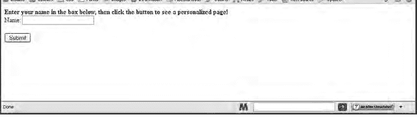

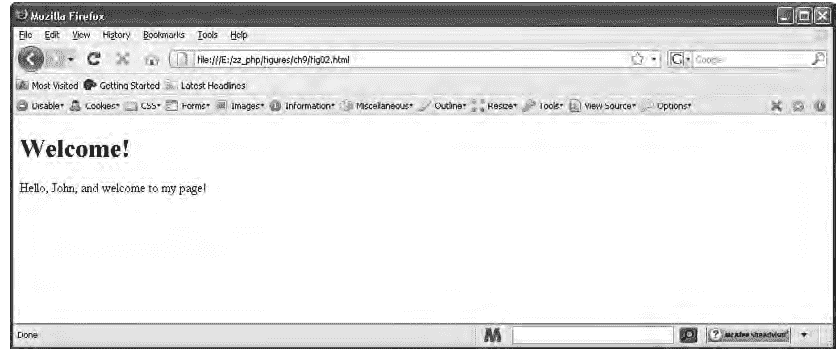

图 9-11 一旦点击按钮，查看者将获得一个类似于此的新页面。

### write() 方法

您在本书早期就开始使用 `write()` 方法，因此您应该已经对其工作原理有了相当多的了解；但这里简要描述一下此方法，以供复习。

`document.write()` 方法用于将字符串值写入页面。以下代码将在 HTML 文档的 body 中写入“hi there”：

```
<body>
<script type="text/javascript">
document.write("hi there");
</script>
</body>
```

### writeln() 方法

`writeln()` 方法的工作方式与 `document.write()` 方法相同，但在语句末尾添加了一个 JavaScript 换行符 (`\n`)。回想一下，第 3 章讨论了 JavaScript 换行符的工作原理——它只是在页面源代码中放置一个新行，以使其更易于阅读。

> 提示

> 虽然换行符在使用 `document.write()` 时只影响源代码的外观，但它可用于在由 JavaScript 创建的显示元素（如 alert、prompt 和 confirm 框）中创建换行。

页面本身的外观不受 JavaScript 换行符的影响。回想第 3 章中的示例，该示例使用换行符将代码分成两行：

```
<body>
<script type="text/javascript">
document.write("<strong>JavaScript Rules!</strong>\n This is fun.");
</script>
</body>
```

由于 `document.writeln()` 方法在语句末尾添加了一个换行符，您可以使用以下 `document.writeln()` 语句重写前面的代码：

```
<body>
<script type="text/javascript">
document.writeln("<strong>JavaScript Rules!</strong>");
document.writeln(" This is fun.");
</script>
</body>
```

这将把代码行放在页面源代码中的两个不同行上，但不会影响浏览器中页面的外观。

## 创建方法

还有 document 对象的方法（如 `createElement()`、`createAttribute()` 和 `createTextNode()`），允许您使用 JavaScript 在页面上创建各种元素或节点。但是，要利用它们，新内容必须作为现有 DOM 节点的子节点被追加。这正是需要 DOM 节点属性和方法的地方。

### DOM 节点属性

DOM 节点属性列于表 9-3 中。

| 属性 | 描述 |

| --- | --- |

| attributes | 指定节点中所有属性的数组；此属性的 `name` 和 `value` 属性可用于访问数组中每个成员的属性名或属性值 |

| childNodes | 指定节点的所有子节点的数组 |

| className | 返回指定节点的 `class` 属性的值 |

| clientHeight | 返回指定节点的高度（以像素为单位） |

| clientWidth | 返回指定节点的宽度（以像素为单位） |

| dir | 返回指定节点中文本的方向的值（`ltr` 或 `rtl`） |

| firstChild | 返回指定节点的第一个子节点 |

| id | 返回指定节点的 `id` 的值 |

| innerHTML | 返回指定节点内的 HTML 代码（文本、图像代码、标签等），例如 div 元素内的所有 HTML 代码 |

| lang | 返回指定节点的语言值 |

| lastChild | 返回指定节点的最后一个子节点 |

| nextSibling | 返回指定节点之后的节点 |

| nodeName | 返回指定节点的名称（例如 div 元素的 `div`） |

| nodeType | 返回指定节点的类型 |

| nodeValue | 返回指定节点的值（例如 div 元素内的文本或属性的值） |

| offsetHeight | 返回指定节点的偏移高度 |

| offsetWidth | 返回指定节点的偏移宽度 |

| ownerDocument | 返回包含指定节点的文档对象 |

| parentNode | 返回指定节点的父节点 |

| previousSibling | 返回指定节点之前的节点 |

| scrollLeft | 返回指定节点左边缘与视图中左边缘之间的差值 |

| scrollTop | 返回指定节点上边缘与视图中上边缘之间的差值 |

| scrollHeight | 返回指定节点的整个高度（包括通过滚动条可查看的隐藏内容） |

| scrollWidth | 返回指定节点的整个宽度（包括通过滚动条可查看的隐藏内容） |

| style | 返回指定节点的样式对象 |

| tabIndex | 返回指定节点的制表符索引 |

| tagName | 返回指定节点的标签名（大写） |

| title | 返回指定节点的 `title` 属性的值 |

**表 9-3** DOM 节点属性 *（续）*

当表 9-3 提到指定节点时，节点的工作方式与您在前几章中处理元素的方式非常相似。例如，您可能有以下 HTML 代码：

```
<body>
<div id="div1" title="All about me!">
This page is about me, me, and... me!
</div>
</body>
```

如果你想要获取 div 元素的 title 属性值，可以使用 `document.getElementById()` 通过其 id `div1` 来获取该 div 元素。这将成为 DOM 节点 title 属性的指定节点。然后，你就可以访问该元素节点的 title 属性，如下所示的代码：

```
var me_div = document.getElementById("div1");
var me_title = me_div.title;
window.alert("The title of the div element is" + me_title);
```

这就像对象属性一样工作，正如你在前一章所学。`me_div.title` 属性返回字符串值 "All about me!"，这是 div 元素节点 title 属性的值。

了解这一点后，你可以用同样的方式使用 DOM 节点方法。

### DOM 节点方法

表 9-4 列出了 DOM 节点方法。

| 方法 | 描述 |

| :--- | :--- |

| addEventListener() | 向指定节点添加事件监听器，以在事件作为参数发送给该节点时运行一个函数 |

| appendChild() | 将一个节点追加为指定节点的最后一个子节点 |

| attachEvent() | 向指定节点附加一个事件，以在事件作为参数发送给该节点时运行一个函数 |

| blur() | 移除指定节点的焦点 |

| click() | 在指定节点上执行点击事件 |

| cloneNode() | 创建指定节点的克隆 |

| detachEvent() | 从指定节点分离一个事件 |

| dispatchEvent() | 在指定节点上执行一个事件 |

| focus() | 将焦点赋予指定节点 |

| getAttribute() | 返回指定节点上作为参数发送的属性名的值 |

| getAttributeNS() | 返回指定节点上作为参数发送的属性名和命名空间的值 |

| getAttributeNode() | 返回指定节点上作为参数发送的属性名的属性节点 |

| getAttributeNodeNS() | 返回指定节点上作为参数发送的属性名和命名空间的属性节点 |

表 9-4 DOM 节点方法

| 方法 | 描述 |

|---|---|

| getElementsByTagName() | 返回一个数组，包含指定节点中所有标签名作为参数发送的子元素节点 |

| getElementsByTagNameNS() | 返回一个数组，包含指定节点中所有标签名和命名空间作为参数发送的子元素节点 |

| hasAttribute() | 如果指定节点上存在作为参数发送的属性名，则返回 true，否则返回 false |

| hasAttributeNS() | 如果指定节点上存在作为参数发送的属性名和命名空间，则返回 true，否则返回 false |

| hasAttributes() | 如果指定节点定义了任何属性节点，则返回 true，否则返回 false |

| hasChildNodes() | 如果指定节点有任何子节点，则返回 true，否则返回 false |

| insertBefore() | 在指定节点内，将一个节点（作为参数发送）插入到另一个节点（作为第二个参发送）之前 |

| normalize() | 规范化指定节点 |

| removeAttribute() | 从指定节点移除作为参数发送的属性名的属性节点 |

| removeAttributeNode() | 从指定节点移除作为参数发送的属性节点对象引用的属性节点 |

| removeAttributeNS() | 从指�节点移除与作为参数发送的命名空间关联的、作为参数发送的属性名的属性节点 |

| removeChild() | 从指定节点移除作为参数发送的子节点 |

| removeEventListener() | 从指定节点移除事件监听器 |

| replaceChild() | 在指定节点中，用作为第一个参数发送的子节点替换作为第二个参数发送的子节点 |

| scrollIntoView() | 将指定节点滚动到浏览器窗口中可见 |

| setAttribute() | 为指定节点设置属性节点的名称（第一个参数）和值（第二个参数） |

| setAttributeNode() | 为指定节点设置作为参数发送的属性节点对象作为属性节点 |

| setAttributeNodeNS() | 为指定节点设置作为参数发送的属性节点对象（与作为参数发送的命名空间关联）作为属性节点 |

| setAttributeNS() | 为指定节点设置属性节点的命名空间（第一个参数）、名称（第二个参数）和值（第三个参数） |

表 9-4 DOM 节点方法（续）

注意

当你看到列出使用命名空间的属性或方法时，这些主要用于 XML 文档，在本书中不会经常提及。

如前所述，要使 document 对象的创建方法通过将创建的节点添加到文档中来发挥作用，需要使用 DOM 节点方法，例如 `appendChild()` 或 `insertBefore()`，将新节点添加到文档。

例如，你可能有之前使用的 HTML 代码，如下所示：

```
<body>
<div id="div1" title="All about me!">
This page is about me, me, and... me!
</div>
</body>
```

此代码有一个带有子文本节点（和属性节点）的 div 元素节点。如果你想创建另一个 div 元素作为 div1 元素节点的最后一个子节点，可以使用 `document.createElement()`、`document.createTextNode()` 和 DOM 节点方法 `appendChild()` 的组合。

首先，进入 JavaScript 代码，通过其 id 获取 div1 元素：

```
var me_div = document.getElementById("div1");
```

接下来，使用 `document.createElement()` 创建新的元素节点：

```
var inner_div = document.createElement("div");
```

之后，使用 `document.createTextNode()` 方法为 inner_div 节点创建文本节点：

```
var inner_div_text = document.createTextNode("More about me...")
```

然后，使用 DOM 节点方法 `appendChild()` 将文本节点作为新 inner_div 节点的子节点添加：

```
inner_div.appendChild(inner_div_text);
```

最后，使用 DOM 节点方法 `appendChild()` 将 inner_div 节点作为 me_div 节点的最后一个子元素添加到文档结构中：

```
me_div.appendChild(inner_div);
```

这会将你的新 div 节点添加到原始 div 元素的末尾（但在原始元素关闭之前，因为它将是一个子节点）。因此，HTML 代码的文档结构现在将如下所示（尽管使用 "View Source" 命令不会显示出来）：

```
<body>
<div id="div1" title="All about me!">
This page is about me, me, and... me!
<div>
More about me...
</div>
</div>
</body>
```

这些 DOM 节点的属性和方法在你创建更复杂的脚本时将非常有用。在本书的剩余部分，你将经常使用 `innerHTML` 和 `style` 属性，以及其他一些 DOM 节点属性和方法。

## 动手实践 9-1 向文档添加 DOM 节点

**pr9_1.html**

**prjs9_1.js**

此项目让你练习使用本章学到的新的 document 和 DOM 节点属性和方法。

### 分步指南

1. 创建一个 HTML 页面，使用以下代码作为 body 部分，并将其保存为 pr9_1.html：

2. 创建一个外部 JavaScript 文件并将其保存为 prjs9_1.js。将其用于步骤 3-5。

3. 获取 id 为 "div1" 的元素的 title 属性值，并将该值作为警报发送给用户。

4. 创建一个新的 div 元素，文本内容为 "See you!"，并将其作为 id 为 "div1" 的 div 元罗的子节点添加到文档结构中。

5. 保存 JavaScript 文件，并在浏览器中打开 HTML 文件以查看结果。

```
<body>
<div id="div1" title="Gosh!">
Whatever I feel like I want to write...
</div>
<script type="text/javascript" src="prjs9_1.js"></script>
</body>
```

### 实践总结

在此项目中，你运用了对 document 对象和 DOM 节点属性及方法的知识，来警报一个 DOM 节点属性，并在文档结构中创建一个新的 div 元素。

## 创建动态脚本

如你所见，JavaScript 通过各种方法（如 `document.getElementById()` 和 `document.getElementsByTagName()`）使你能够访问文档中的所有元素。一旦你能够访问这些元素，你也可以访问它们的 style 属性（通常最初由样式表设置），并使用 style DOM 节点属性对诸如位置、颜色、边框、大小或元素样式属性的任何其他部分进行更改。

### JavaScript 中的样式

使用层叠样式表 (CSS) 设置样式时，你可以在 CSS 代码中设置如下内容（保存为 dyn_01.css）：

```
#div1 { color:#000000; background-color:#FFFFFF; }
#div2 { border-style:solid; border-width:1px; border-color:#000000; }
```

这为你提供了两个 id（div1 和 div2）的样式属性。因此，如果你有以下 HTML 代码（保存为 dyn_01.html），div 元素将在网页上使用前面的样式进行呈现：

```
<head>
<link rel="stylesheet" type="text/css" href="dyn_01.css" /> <!-- CSS 文件在此链接到文档 -->
</head>
<body>
<div id="div1"> <!-- id 为 "div1" 的 div 元素 -->
I am in div1. It seems like a nice place.
</div>
<div id="div2"> <!-- id 为 "div2" 的 div 元素 -->
I am in div2. It’s a little fancier here.
</div>
<script type="text/javascript" src="dyn_01.js"></script> <!-- JavaScript 文件在此调用 -->
</body>
```

HTML 代码通过 link 标签链接到 CSS 代码。因此，div1 元素将显示为黑色文本和白色背景，而 div2 元素周围将有一个纯黑色的实线边框。

如你所见，此页面为每个 div 元素使用了 id——因此，你不仅可以通过 CSS 代码访问这些元素的 id，还可以在 JavaScript 代码中通过它们的 id 来访问这些元素。因此，你可以使用 `document.getElementById()` 方法，通过 id 来获取两个 div 元素，从而开始你的 JavaScript 文件（在前面的 HTML 代码中调用——保存为 dyn_01.js）：

```
var d1 = document.getElementById("div1");
var d2 = document.getElementById("div2");
```

### 编写动态脚本

现在你已经了解了如何修改元素的样式属性，你可以通过响应用户事件来修改它们，从而创建动态脚本。这为你提供了众多可能性，让你能够响应几乎任何事件来修改几乎任何样式属性。在这里，你将继续使用之前一直在用的相同的CSS、HTML和JavaScript文件，来创建一个动态的、事件驱动的脚本。

如果你想通过JavaScript修改CSS代码中设定的样式，你需要利用每个元素节点都具有的`style`属性。然后，JavaScript使用与CSS选择器相同的名称来访问特定的属性。例如，如果你想将`div1`元素中的文本颜色更改为绿色，可以使用以下代码：

```javascript
var d1 = document.getElementById("div1");
var d2 = document.getElementById("div2");
d1.style.color = "#00FF00";
```

在CSS代码中，选择器`color`用用于修改元素的前景色。在JavaScript中，访问元素的`style`属性后，它也是用于修改该属性的属性名。

如果CSS选择器不是一个单词怎么办？例如，`background-color`选择器如果像在CSS代码中那样直接使用，在JavaScript中是无法工作的。以下代码试图将背景色改为绿色：

```javascript
var d1 = document.getElementById("div1");
var d2 = document.getElementById("div2");
d1.style.background-color = "#00FF00";
```

这行不通，因为JavaScript不允许连字符（-）作为属性名的一部分。相反，JavaScript将两个单词组合在一起，并将第一个单词之后的任何附加单词的首字母大写。因此，CSS选择器`background-color`在JavaScript中变成了`backgroundColor`（同样，像`border-right-color`会变成`borderRightColor`）。

为了使更改生效，JavaScript代码可以重写如下：

```javascript
var d1 = document.getElementById("div1");
var d2 = document.getElementById("div2");
d1.style.backgroundColor = "#00FF00";
```

这将把`div1`元素的背景色改为绿色。唯一的问题是，这会在脚本运行时立即发生，而在此例中，可能在观众注意到`div1`元素原本有另一种背景色之前就发生了。为了使其更有用，你可以使用这种访问元素样式的能力，并结合你关于处理事件的知识（在第7章中介绍），来创建一个响应用户事件并进行样式更改的脚本。

有了当前的CSS和HTML代码，你现在可以编写JavaScript来创建对触发更改的事件的响应。因此，如果你想在鼠标移到`div1`元素上时更改`div1`元素的背景色并同时更改`div2`元素的边框，你可以将事件处理代码添加到JavaScript中，以响应事件并在处理事件的函数中进行样式更改：

```javascript
var d1 = document.getElementById("div1");
var d2 = document.getElementById("div2");
d1.onmouseover = function() {
    d1.style.backgroundColor = "#00FF00";
    d2.style.borderWidth = "7px";
};
```

这将在鼠标移到`div1`元素上时更改div元素的外观。为了使脚本更完整，你也可以在鼠标移开`div1`元素时将值改回：

```javascript
var d1 = document.getElementById("div1");
var d2 = document.getElementById("div2");
d1.onmouseover = function() {
    d1.style.backgroundColor = "#00FF00";
    d2.style.borderWidth = "7px";
};
d1.onmouseout = function() {
    d1.style.backgroundColor = "#FFFFFF";
    d2.style.borderWidth = "1px";
};
```

保存JavaScript文件并在浏览器中打开HTML文件。你应该能够将鼠标移到第一个div元素上来查看更改，并在鼠标移开时看到更改恢复为原始外观。当然，你也可以使用DOM节点的`innerHTML`属性来更改给定元素内的所有HTML代码。

### innerHTML 属性

`innerHTML` DOM节点属性允许你更改给定元素内部的HTML代码。例如，你可以从以下HTML代码开始：

```html
<body>
<div id="div1">
What is 2+2?
</div>
<div id="div2">
<a href="answer.html" id="answer_link">Get the answer</a>
</div>
</body>
```

这段代码设置了一个id为`div1`的div元素节点，另一个id为`div2`的div元素节点，以及一个id为`answer_link`的链接。现在，如果你想更改`div1`元素中的HTML代码，以便在点击链接时为观众显示答案，你可以使用链接上的点击事件来启动脚本，然后更改`div1`元素节点上的`innerHTML`属性，将该元素的内容从问题更改为答案：

```javascript
var d1 = document.getElementById("div1");
var a_link = document.getElementById("answer_link");

answer_link.onclick = function() {
    d1.innerHTML = "That is easy, the answer is <strong>4</strong>!";
    return false;
};
```

回想一下，为了防止点击时跟踪此链接，你需要在执行所需操作后添加`return false`语句。运行后，此脚本会更改页面中`div1`元素内的内容，因此HTML代码现在将如下所示（尽管使用浏览器的“查看源代码”命令无法看到）：


```html
<body>
<div id="div1">
That is easy, the answer is <strong>4</strong>!
</div>
<div id="div2">
<a href="answer.html" id="answer_link">Get the answer</a>
</div>
</body>
```

如你所见，这可能是对网页内容进行动态更改的一种便捷方式。

> **提示**

为了让没有JavaScript的用户也能使用脚本，可以设置一个默认的链接目标（answer.html）。在链接页面上包含答案文本，可以让没有JavaScript的用户仍然可以点击链接并获得问题的答案。

运用你在本章中学到的关于访问DOM以及使用文档对象和DOM节点的属性和方法的知识，你可以构建脚本，对文档的外观或内容进行任何数量的更改。

## 动手试试 9-2 尝试属性更改

`pr9_2.html` `prjs9_2.js` 本项目让你练习使用本章中学到的新`style`和`innerHTML`属性。

### 逐步操作

1.  创建一个HTML页面，其中body部分包含以下代码，并将其保存为`pr9_2.html`：

```html
<body>
<div id="div1">
When will I update this page?
</div>
<div id="div2">
<a href="answer.html" id="c_link">Find out!</a>
</div>
<script type="text/javascript" src="prjs9_2.js"></script>
</body>
```

2.  创建一个外部JavaScript文件并将其保存为`prjs9_1.js`。在步骤3-5中使用它。

3.  编写一些代码，使得当链接被点击时，id为`div1`的div元素的背景色变为`#CCCCCC`，并且该元素的内容更改为以下内容：

```html
<strong>Right now!</strong> Was that quick or what?
```

4.  确保相同答案内容包含在一个名为`answer.html`的单独HTML文件中，以供未启用JavaScript的用户使用。

5.  保存JavaScript文件并在浏览器中打开HTML文件以查看结果。

### 动手试试总结

在本项目中，你运用了关于DOM节点的`style`和`innerHTML`属性的知识，对网页进行了样式和内容更改。

## 第9章 自我测试

1.  ________ 对象是浏览器为查看的每个新HTML页面创建的对象。

2.  文档对象的 ________ 属性返回将观众引导到当前文档的文档的URL。

3.  你可以使用DOM节点属性`style`来修改元素的样式表属性。

    A 正确

    B 错误

4.  文档对象的 __________ 方法允许你通过元素的id属性值来获取元素。

    A `getElementsByClassName()`

    B `createElement()`

    C `getSelection()`

    D `getElementById()`

5.  `appendChild()` DOM节点方法允许你将一个子节点作为指定节点的第一个子节点添加。

    A 正确

    B 错误

6.  如果你正在查看URL为`http://www.pageresource.com/html/index.html`的网页，`document.domain`属性的值将是以下哪一项？

    A `pageresource.com`

    B `www.pageresource.com/html/index.html`

    C `www.pageresource.com`

    D `http://www.pageresource.com/html/index.html`

7.  文档对象的 __________ 属性是一个数组，包含页面上所有的锚点（`<a>`）标签。

8.  __________ DOM节点属性允许你更改元素节点的HTML内容。

9.  __________ 属性保存当前文档最后修改的日期和时间值。

10. 文档对象模型（DOM）允许JavaScript（和其他脚本语言）访问浏览器中文档的结构。

    A 正确

    B 错误

11. 你可以使用`title`属性在浏览器窗口顶部栏之外的其他位置显示网页的标题。

    A 正确

    B 错误

## 第10章

## Window 对象

## 关键技能与概念

-   使用 Window 对象的属性

-   使用 Window 对象的方法

JavaScript 的 `window` 对象让你能在脚本中访更多的属性和方法。通过使用 `window` 对象，你将能够实现许多新功能，例如向用户提示信息、打开新窗口、确认用户的操作等等。

## Window 对象简介

`window` 对象是为屏幕上出现的每个窗口创建的。一个窗口可以是主窗口、框架集或单个框架，甚至是使用 JavaScript 创建的新窗口。它与 `document` 对象的区别在于，`window` 对象包含了 `document` 对象（以及许多其他对象，如 `history`、`navigator` 等）。这个对象为你的脚本提供了许多直接位于 `window` 对象下的新属性和方法。

在前面的章节中，你已经在脚本中使用过 `window` 对象的 `alert()` 方法。正如你所记得的，`alert()` 方法使你能够为用户弹出一条消息。现在，你将看到这个对象的许多新方法，它们可以实现诸如确认用户操作或向用户提示信息等功能，这将使你能够在脚本中增加更多的交互性。

首先，我们将探讨 `window` 对象的属性。然后，下一节将介绍和解释你可以与此对象一起使用的方法。

## 使用 Window 对象的属性

为了开始你对 `window` 对象的学习，让我们来看看你可以使用的属性，这些属性在表 10-1 中列出并进行了描述。其中一些属性在表 10-1 之后有更详绒的讨论。

> **注意**

与前面的章节一样，本章列出的一些属性和方法并非跨浏览器，或者仅在现代浏览器中有效。如需更多信息和更完整的列表，请参阅：https://developer.mozilla.org/en/DOM/window 和 http://msdn.microsoft.com/en-us/library/ms535873(VS.85).aspx。

第10章：Window 对象 243

| 属性 | 描述 |

| :--- | :--- |

| closed | 根据窗口是否已关闭来存储相应的布尔值 |

| defaultStatus | 定义状态栏中显示的默认消息 |

| document | 对窗口的 `document` 对象的引用 |

| frames | 一个数组，表示给定窗口中的所有框架 |

| history | 提供当前窗口浏览器历史记录的信息（在第8章中讨论） |

| innerHeight | 返回窗口内可视区域的高度（以像素为单位） |

| innerWidth | 返回窗口内可视区域的宽度（以像素为单位） |

| length | 存储的值等于窗口中的框架数量 |

| location | 存储窗口当前 URL 的值 |

| name | 允许为窗口命名 |

| opener | 引用打开另一个窗口的窗口 |

| outerHeight | 返回整个浏览器窗口的高度（以像素为单位） |

| outerWidth | 返回整个浏览器窗口的宽度（以像素为单位） |

| parent | 引用包含当前框架的框架集 |

| screen.availWidth | 返回浏览器窗口的可用宽度（以像素为单位） |

| screen.availHeight | 返回浏览器窗口的可用高度（以像素为单位） |

| screen.colorDepth | 返回屏幕的颜色深度（以每像素位数为单位） |

| screen.height | 返回屏幕的总高度（以像素为单位） |

| screen.pixelDepth | 返回屏幕的位深度（以每像素位数为单位） |

| screen.width | 返回屏幕的总宽度（以像素为单位） |

| self | 提供了引用当前窗口的另一种方式 |

| status | 允许在状态栏中放置一条消息；会覆盖 `defaultStatus` |

| top | 对包含框架、框架集或嵌套框架集的最顶层窗口的引用 |

| window | 对当前窗口的引用 |

表 10-1 Window 对象的属性

### closed 属性

`closed` 属性用于检查窗口是否已被用户关闭。通常的用法是使用窗口的名称，后跟 `closed` 属性，如以下示例所示：

```
if (windowname.closed) {
    JavaScript语句
}
```

你需要将 *windowname* 部分替换为你希望检查的窗口的名称。这通常是你使用 JavaScript 打开的新窗口；你将在本章后面的“`open()` 方法”一节中看到如何为新窗口命名。

你也可以在新窗口中使用 `closed` 属性来检查打开它的窗口是否已关闭。为此，你需要在 `opener` 属性（即将在“The opener Property”部分讨论）后使用 `closed`，如以下示例所示：

```
if (window.opener.closed) {
  JavaScript语句
}
```

如果你选择创建一个新窗口，让用户通过新窗口中的链接来导航主窗口，那么 `closed` 属性的这种用法将非常方便。

### defaultStatus 属性

`defaultStatus` 属性设置当未向 `window.status` 属性赋值时，状态栏中默认显示的文本字符串。对 `window.status` 属性的更改会覆盖此设置，因为它仅作为默认值显示。

`defaultStatus` 属性通常在 `load` 事件中设置。这主要用于在用户未执行会更改状态栏文本的操作时，默认显示一条自定�消息。不过，它也可以在任何时候设置，因此你可以使用 `load` 事件以外的其他事件来设置它。

> **警告**

大多数现代浏览器默认不显示通过 JavaScript 更改的状态栏文本，以防止不道德的网站在状态栏中用虚假的链接目的地等信息欺骗用户。因此，除非用户更改了浏览器设置，否则 `defaultStatus` 和 `status` 属性通常不起作用。由于更改浏览器设置以允许更改状态栏文本存在安全风险，因此不建议在脚本中使用这些属性。

### frames 属性（数组）

`frames` 属性是一个数组，用于存储框架集中每个框架的值。它通常用于访问页面上各种框架的属性。由于你还没有学习数组，所以现在还不能对 `frames` 属性做太多事情。不过，你将在第11章中学习数组。

你可以通过使用 `window.frames.length` 属性来查找窗口中的框架数量。如果你决定稍后使用该数组按顺序对页面的框架执行任务，这将非常方便。

### innerHeight 和 innerWidth 属性

`innerWidth` 和 `innerHeight` 属性分别存储窗口可视区域的宽度和高度值，这意味着这些值不包括滚动条、菜单栏、工具栏或其他浏览器功能。这些属性在 Mozilla Firefox 和 Opera 中有效，

12. 哪个属性返回当前文档的完整 URL？

- A `domain`

- B `referrer`

- C `URL`

- D `title`

13. `writeln()` 方法与 `write()` 方法有何不同？

- A 它在行尾添加等效于 HTML `<br />` 标签的内容。

- B 它在行尾添加等效于 HTML `<p>` 标签的内容。

- C 它在行尾添加一个 JavaScript 换行符。

- D 它与 `write()` 方法完全相同。

14. 在 JavaScript 中如何创建 `formName` 类型的属性？

- A 当为表单指定名称时，表单的名称就成为属性名。

- B 当为表单指定名称时，字符串 `formName` 用作属性名。

- C 表单没有名称；而是使用 `formName` 作为属性名。

- D 当为表单指定名称时，在开头添加一个 `f` 并用作属性名。

15. 在 `document.open()` 和 `document.close()` 语句之间最常见的是什么语句？

- A HTML 命令

- B `document.write()` 和 `document.writeln()` 语句

- C 仅 `document.writeln()` 语句

- D 仅 `window.alert()` 语句

##### length 属性

length 属性用于告诉你一个窗口中有多少个框架，就像 `window.frames.length` 属性一样。这仅仅是将其简写为 `window.length`（在你编写代码时，这样通常更方便）。

### location 属性

location 属性保存着窗口的当前 URL。它本身也是一个拥有自己属性和方法的对象。你已经在第 7 章中使用过这个属性来创建按钮链接。

你也可以使用 location 属性使浏览器立即重定向到一个新页面（例如，如果你的页面已经移动到了一个新位置）。但是，请确保不要在那些不允许快速重定向的搜索引擎收录的页面上使用此技术，因为它们可能会将该页面从其索引中移除。

如果一个页面已经移动，并且你希望在没有任何延迟的情况下重定向访问者，你可以通过一个脚本在页面的 head 部分为 location 属性赋予一个新值，如下列代码所示：

```
<head>
<title>Page has moved</title>
<script type="text/javascript">
    window.location="page2.html"; // This sends the viewer away instantly, since no action needs to take place to set this in motion
</script>
</head>
<body>
Lacking JavaScript? Click the link below for the new page then!
<br />
<a href="page2.html">New Page</a>
</body>
```

这会直接将访问者带到本地 URL `page2.html`。在 body 部分中为没有启用 JavaScript 的浏览器提供了一个备选方案。否则，上述代码会为这些访问者加载一个空白页面，且不会有任何反应。

> **注意**

立即重定向最适合在未被搜索引擎索引的页面上用于测试目的，因为不同搜索引擎的重定向规则各不相同。

当你在第 14 章中为导航构建脚本时，这个属性将变得非常有用。

##### name 属性

name 属性保存着当前窗口的名称，同时也允许你为一个窗口命名。如果你想给主窗口命名，你可以将想要使用的名称赋值给这个属性。如果你想测试是否成功，你可以在 body 部分将属性的值写入页面。

以下代码展示了如何为窗口命名，然后将该名称写入页面主体：

```
<body>
<script type="text/javascript">
    window.name="cool_window";
    document.write("This window is named "+window.name);
</script>
</body>
```

该脚本为窗口赋予一个名称，然后将该名称写入文档。图 10-1 显示了此脚本在浏览器中的结果。注意名称 `cool_window` 是如何显示在屏幕上的。

### opener 属性

opener 属性用于引用打开当前窗口的那个窗口。这在使用 `open()` 方法打开的新窗口中经常使用，你将在本章稍后的 "The open() Method" 部分看到。通过在新窗口中使用 opener 属性，你可以使用之前学到的 closed 属性来检测主窗口是否已关闭。以下示例展示了如何执行此检测：

```
if (window.opener.closed)
```

这在 opener 属性之后添加了 closed 属性，以检查打开当前窗口的窗口是否已关闭。如果你想通过新窗口在主窗口中执行某个操作，这很有帮助，因为你可以在执行任何操作之前先检查它是否仍然存在。

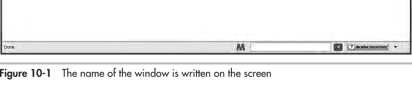

图 10-1 窗口的名称显示在屏幕上

### parent 属性

parent 属性仅在页面上存在框架时使用。它使你能够访问当前框架的父框架集。当你希望从一个框架更改另一个框架中的属性时，这很有帮助。我将在第 15 章介绍 JavaScript 和框架时更详细地讨论这一点。

### self 属性

self 属性是在 JavaScript 中表示“当前窗口”的另一种方式。它像 window 对象一样使用，并且可以像 window 对象一样访问当前窗口的属性。如果你有很多带名称的窗口，并且想确保你使用的是当前窗口的属性而不是另一个命名窗口中的属性，self 属性就很有用。

### status 属性

status 属性包含窗口状态栏中设置的文本的值。更改此属性会覆盖使用 `defaultStatus` 属性设置的状态栏内容。

#### 注意

大多数现代浏览器默认不显示由 JavaScript 更改的状态栏文本，以防止不道德的网站在状态栏中使用虚假的链接目标等信息欺骗用户。因此，`defaultStatus` 和 `status` 属性通常不起作用，除非访问者更改了浏览器设置。由于更改浏览器设置以允许修改状态栏文本存在安全风险，因此不建议在脚本中使用这些属性。

### top 属性

top 属性用于访问所有框架集（可能是嵌套的）中的最顶层窗口。这与 parent 属性略有不同，后者仅到达包含当前框架的框架集的顶部。top 属性则一路到达最顶层窗口，即使窗口包含嵌套的框架集也是如此。当你学习第 15 章关于 JavaScript 和框架的内容时，你会看到更多关于使用此属性的示例。

## 动手实践 10-1 使用 location 和 innerWidth 属性

这个项目让你练习使用 window 对象的 `location` 和 `innerWidth` 属性。同时，通过添加 `document.body.clientWidth` 属性，你将帮助使脚本更具跨浏览器兼容性。

### 逐步操作

1.  创建一个 HTML 页面，除了在结束的 `</body>` 标签之前包含一组引用名为 `prjs10_1.js` 的 JavaScript 文件的脚本标签外，其他部分留空。将文件保存为 `pr10_1.html`。

2.  创建一个 JavaScript 文件并保存为 `prjs10_1.js`。此文件用于步骤 3 到 6。

3.  为名为 `mywin_width` 的变量设置一个默认值。

4.  如果 `window.innerWidth` 属性或 `document.body.clientWidth` 属性之一可用，则将 `mywin_width` 的值更改为其中任一属性的值。

5.  如果 `mywin_width` 的值大于或等于 1000，则将访问者引导至 URL `http://www.pageresource.com`。否则，将访问者引导至 URL `http://www.javascriptcity.com`（使用 `window.location` 属性）。

6.  保存 JavaScript 文件，并在 Web 浏览器中打开 HTML 文件。尝试更改宽度，然后以新的宽度重新打开页面，看看它会引导你到哪个网站。

### 尝试这个总结

在这个项目中，你能够运用你对 `window` 对象的 `location` 和 `innerWidth` 属性的了解，来创建一个根据访问者浏览器中可用视图区域宽度重定向访问者的脚本。

## 使用 Window 对象的方法

既然你知道了如何使用 `window` 对象的属性，你就可以继续使用 window 方法了。表 10-2 列出了 `window` 对象的一些方法及其描述，接下来将更详细地描述特定的方法。

### alert() 方法

你已经在之前的章节的示例脚本中广泛使用了 `alert()` 方法。它会向访问者弹出一条消息，访问者必须单击“确定”按钮才能继续。回想一下，语法类似于下面的 alert：

```
window.alert("Hi there!");
```

这只是在屏幕上向访问者显示“Hi there!”作为警报消息。正如在首次介绍 `alert()` 方法时所指出的，在脚本中通常使用如下语法来简化该方法：

```
alert("Hi there!");
```

你是怎么做到这样的简写的？记住 JavaScript 相当宽松，所以在某些情况下允许你像这样走捷径。在这种情况下，这是允许的，因为 `window` 对象是 JavaScript 中的默认对象。由于假定它存在，所以你不需要调用它。相反，你可以直接调用该方法，JavaScript 会知道它是一个 window 方法。

在大多数情况下，这种类型的捷径对所有 window 属性和方法都有效。事实上，你在上一章学习的 `document` 对象在对象层次结构中位于 `window` 对象之下。你可以省略 `document` 对象调用中的 `window` 部分，因为假定 `window` 存在。

你可能需要更明确指定的情况通常是在处理新窗口和 `location` 属性时。

### confirm() 方法

`confirm()` 方法可用于给访问者一个确认或取消操作的机会。此方法返回一个布尔值 `true` 或 `false`，因此在使用时，其结果通常被赋值给一个变量。

以下是将值赋给变量的语法：

```
var varname = window.confirm("Your Message");
```

你需要将 `varname` 替换为你希望使用的变量名。然后将“Your Message”文本替换为你希望在弹出对话框中显示的文本。因此，如果你想将结果赋值给名为 `is_sure` 的变量，并询问“你确定吗？”这个问题，你可以使用以下代码：

```
var is_sure = window.confirm("Are you sure?");
```

图 10-2 显示了由上述代码显示的一个示例确认对话框。注意访问者可以选择单击的两个按钮：确定和取消。根据浏览器的不同，外观可能略有不同。如果访问者单击“确定”，该方法返回 `true`。如果用户单击“取消”，该方法返回 `false`。坏消息是，你不能更改按钮上的文本值。你只能使用“确定”和“取消”，至少在使用 `confirm` 方法时是这样。

作为此方法的一个实际示例，假设你想创建一个链接到另一个页面的链接，但你想在引导访问者离开之前确认他们是否愿意离开。你可以使用确认对话框来查明访问者是否希望离开页面。以下代码展示了如何从访问者那里获得确认并做出适当反应。首先是 HTML 代码：

```
<body>
<a href="http://www.google.com" id="search_link">Go Searching</a>
</body>
```

接下来，使用 JavaScript 来确认当点击链接时用户是否真的想要离开：

```
var s_link = document.getElementById("search_link");

s_link.onclick = function() {
    var is_sure = window.confirm("Are you sure you want to leave?");
    if (!is_sure) {
        window.alert("OK. You can stay here.");
        return false;
    }
};
```

该函数确认访问者是否希望离开。

请注意，如果单击“确定”且 `confirm()` 方法返回 `true`，则访问者会被带到链接的网站。如果单击“取消”且 `confirm()` 方法返回 `false`，则会向访问者发送一个警报，并且函数返回 `false`，这样浏览器就不会跟随该链接（你也可以简单地省略警报，在单击“取消”后什么都不发生，只使用 `return false` 语句。）

图 10-3 显示了在页面上点击链接后的浏览器窗口。带有“你确定要离开吗？”消息的确认对话框会弹出在屏幕上。

### find() 方法

你可以使用 `find()` 方法让访问者在你的页面上查找某些文本。它告诉浏览器使用其内置的查找工具，并允许访问者输入要在页面上查找的内容。

例如，如果你想创建一个按钮，让访问者在想要在你的页面上查找某些内容时单击，你可以使用以下代码：

```
<form>
<input type="button" value="Click to Find Text"
       onclick="window.find();" />
</form>
```

这会弹出浏览器中的查找对话框，并允许访问者在页面内搜索文本。图 10-4 显示了将此脚本添加到 HTML 文档后的结果。

如果你有一个非常长的页面，并且希望访问者能够通过搜索页面更快地找到内容，那么这个功能非常有用。

### home() 方法

`home()` 方法用于将访问者引导至访问者在 Web 浏览器设置中设置的主页。例如，你可以使用它为访问者提供一个按钮，当点击该按钮时，会将他们带到选定的主页，如以下代码所示（在撰写本文时，此方法在 Mozilla Firefox 和 Opera 中有效，但在 Microsoft Internet Explorer 中无效）：

```
<form>
<input type="button" value="Go Home!" onclick="window.home();">
</form>
```

250 JavaScript：初学者指南

| 方法 | 描述 |

| --- | --- |

| alert() | 向访问者弹出警报，访问者必须单击确定才能继续 |

| back() | 将窗口在其历史记录列表中后退一项 |

| blur() | 从窗口移除焦点 |

| clearInterval() | 取消 `setInterval()` 方法调用的动作 |

| clearTimeout() | 取消 `setTimeout()` 方法调用的动作 |

| close() | 关闭浏览器窗口 |

| confirm() | 向访问者显示确认对话框，访问者必须单击确定或取消才能继续 |

| escape() | 将字符串中的特殊字符转换为十六进制字符 |

| find() | 使访问者能够在浏览器中启动查找工具以在页面上查找文本 |

| focus() | 将焦点赋予窗口 |

| forward() | 将窗口在其历史记录列表中前进一项 |

| home() | 将访问者引导至访问者在 Web 浏览器设置中设置的主页 |

| moveBy() | 将窗口移动作为参数传递的特定像素值 |

| moveTo() | 将窗口的左上角移动到作为参数传递的坐标 |

| open() | 打开一个新的浏览器窗口 |

| print() | 打印窗口的内容 |

| prompt() | 弹出提示对话框，要求访问者输入信息 |

| resizeBy() | 通过移动右下角作为参数传递的特定像素值来调整窗口大小 |

| resizeTo() | 将整个窗口调整为作为参数传递的高度和宽度 |

| scrollBy() | 将窗口的视图区域滚动作为参数传递的特定像素值 |

| scrollTo() | 将窗口的视图区域滚动到作为参数传递的指定坐标 |

| setInterval() | 每当经过一定时间后调用一个函数 |

| setTimeout() | 在经过一定时间后调用一次函数 |

| stop() | 停止窗口加载其内容 |

| unescape() | 将转义字符串转换回其正常字符 |

表 10-2 Window 对象的方法

### `print()` 方法

`print()` 方法使用户能够打印当前窗口。调用此方法时，它应该打开用户的打印对话框，以便用户可以设置打印机选项来打印文档。

要使用它，您可以创建一个按钮，使用户能够打印他们正在查看的页面：

```html
<form>
<input type="button" value="Click to Print Page"
onclick="window.print();">
</form>
```

当用户单击“Click to Print Page”按钮时，此代码将打开用户的打印对话框。图 10-5 显示了在浏览器中运行此脚本的结果。根据所使用的浏览器和打印机，此对话框在不同用户面前可能显示不同。

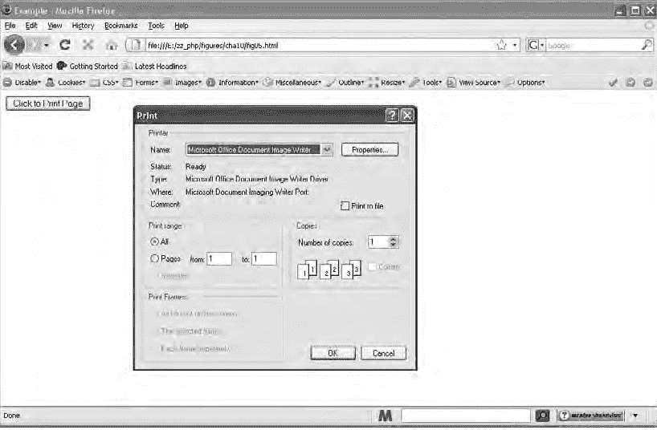

### `prompt()` 方法

`prompt()` 方法用于提示用户输入信息。使用此方法，您可以根据用户在提示文本框中输入的内容执行操作。

首先，您需要了解此方法的语法。与 `confirm()` 方法一样，结果（用户输入的内容）被分配给一个变量以供后续使用。以下是语法示例：

```javascript
var varname = window.prompt("Your Text","Default Entry");
```

您将 `varname` 替换为一个变量名，将“Your Text”替换为您想发送给用户的消息（通常是一个问题）。第二个参数“Default Entry”允许您为用户输入一个默认条目。通常这被留为空字符串 `""`，即空白条目。但是，如果您希望为用户提供一个默认答案，也可以将其设置为其他内容。

您可以使用 `prompt()` 方法获取用户的姓名，并在页面加载时发送一个提醒。以下代码提示用户输入他们的姓名，然后在一条消息中包含该姓名，并通过提醒框显示给用户：

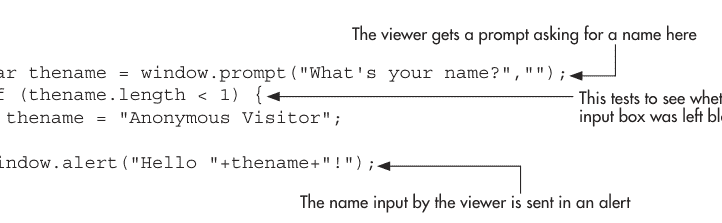

请注意，脚本会检查 `thename.length` 是否小于 1。在字符串上使用 `length` 属性时，它会返回字符串中的字符数。因此，如果长度小于一个字符，说明用户留空了提示字段。如果用户将姓名字段留空，用户将被命名为“Anonymous Visitor”（匿名访客）；否则，变量 `thename` 将保留用户输入的值。然后，用户会收到一个包含 `thename` 变量值的问候提醒。图 10-6 显示了当用户未在提示框中输入任何内容时此脚本的结果。

与其将姓名放入提醒框中，您也可以将其写在页面上供用户查看。这样，用户就不会被提醒框打扰，姓名也会像页面的一部分一样显示出来。首先，从 HTML 代码开始：

```html
<body>
<div id="greeting">
<h1>Hello! Welcome!</h1>
</div>
<div id="content">
This page talks about what I think about…
</div>
</body>
```

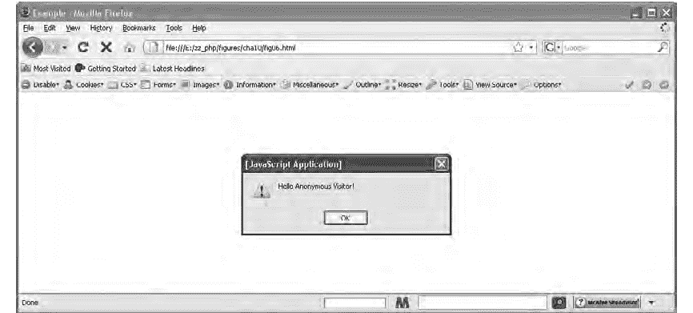

**图 10-6** 一个提醒框向用户问候

HTML 代码使用了两个 `div` 元素，一个用于问候，一个用于页面内容。在问候 `div` 元素内部，为没有 JavaScript 的用户提供了默认问候。对于有 JavaScript 的用户，您将使用 `prompt()` 方法为他们提供更个性化问候的机会。您可以使用以下 JavaScript 代码：

```javascript
```

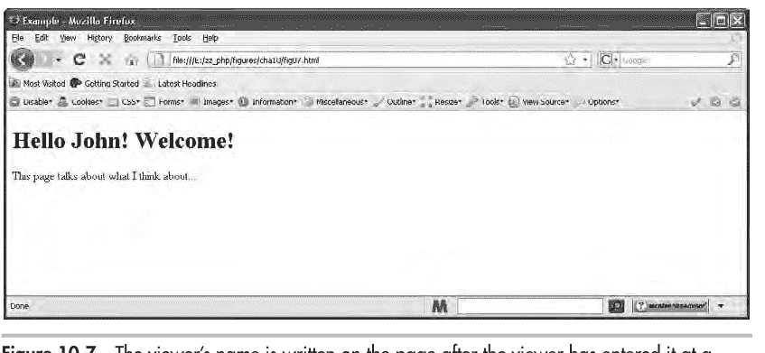

**图 10-7** 用户在提示框中输入姓名后，其姓名被写在页面上

使用 `open()` 方法的一般语法如下例所示：

```javascript
window.open("URL","name","attribute1=value,attribute2=value");
```

第一个参数“URL”替换为要在新窗口中打开的 HTML 文档的 URL。“name”参数替换为您希望给窗口的名称。最后一个参数允许您为新窗口添加属性。这些属性通过在等号右侧使用“yes”、“no”或数字值来设置。请注意，每次设置一个属性值时，下一个属性前有一个逗号，并且它们之间没有空格。

如果您想打开一个具有当前窗口特性的窗口，可以通过省略最后一个属性参数来实现。以下示例将打开一个本地 URL 为 `newpage.htm`、名称为 `my_window` 的新窗口；它将与打开它的窗口具有相同的特性：

```javascript
window.open("newpage.html","my_window");
```

### 标准属性

如果您想包含窗口特性，需要学习一些可以与窗口一起使用的属性。表 10-3 列出了可以在 `open()` 方法的最后一个参数中使用的标准属性。

如果您开始使用属性参数，应该注意，一旦您在属性参数中放入了内容，任何未定义的属性现在将默认为“no”，而不是复制主窗口的设置。因此，如果您想打开一个宽度为 400 像素、高度为 300 像素的基本新窗口，可以使用以下代码：

```javascript
window.open("newpage.html","my_window","width=400,height=300");
```

**表 10-3 新窗口的标准属性**

| 属性名称 | 可能的值 | 功能 |

|---|---|---|

| width | 数字 | 以像素为单位定义新窗口的宽度 |

| height | 数字 | 以像素为单位定义新窗口的高度 |

| directories | yes, no, 1, 0 | 定义新窗口是否具有目录按钮（如浏览器顶部的“What's New”或“Link”按钮） |

| location | yes, no, 1, 0 | 定义新窗口是否具有可输入新 URL 的地址框 |

| menubar | yes, no, 1, 0 | 定义窗口是否具有菜单栏（文件菜单、编辑菜单等） |

| resizable | yes, no, 1, 0 | 定义是否允用户调整新窗口的大小 |

| scrollbars | yes, no, 1, 0 | 定义当窗口内容超出窗口大小时，新窗口是否具有滚动条 |

| status | yes, no, 1, 0 | 定义新窗口底部是否具有状态栏 |

| toolbar | yes, no, 1, 0 | 定义新窗口是否具有工具栏（前进、后退按钮、停止按钮等） |

这个窗口唯一具有的是一个标题栏，显示文档标题以及右上角供用户关闭或最小化的按钮。

要设置其他属性（都是布尔值），您可以根据是否希望启用每个特性，为其分配“yes”或“no”的值。如果您愿意，也可以使用 1 表示 yes，0 表示 no，效果相同。因此，如果您想要一个 300×200 像素的窗口，只添加菜单栏（这会添加前进、后退、停止等类似按钮），可以使用以下代码：

```javascript
window.open("newpage.html","cool","width=300,height=200,menubar=yes");
```

这将给您一个包含 `newpage.html` 内容、名称为“cool”、尺寸为 300×200 像素且带有菜单栏的新窗口。

您可以在第三个参数的引号内添加任意多的属性，只需用逗号分隔每个属性即可。请记住，任何地方都不应包含空格，并且整个命令在您的文本编辑器中应位于一行。

#### 注意

由于空间限制，本书中的代码示例中新窗口命令有时可能会出现在多行上。当您使用代码时，请务必将从 `window.open` 到结束分号 `;` 的所有内容放在一行，以避免 JavaScript 错误。

以下示例打开一个包含表 10-3 中提到的所有特性的窗口（同样，这里它占用了多行，但当您在文本编辑器中输入时，代码应该在单行上）：

```javascript
window.open("newpage.html","cool","width=300,height=200,directories=yes,location=yes,menubar=yes,resizable=yes,scrollbars=yes,status=yes,toolbar=yes");
```

这将打开一个 300×200 像素、具有所有标准特性的窗口。如果您想查看可运行的示例，需要创建一个名为 `newpage.html` 的页面，并为主页创建包含 `window.open()` 命令的代码，如下所述。

首先，创建 `newpage.html` 的代码（这是一个包含一些文本的简短页面）：

```html
<body>
I am a new window! I am newer than that old window
that opened me, so I am special. Ha, ha!
</body>
```

现在，创建主页面（保存为 `mainpage.html`）：

```html
<body>
Click the link below to open an arrogant new window ...
<br />
<a href="newpage.html" id="nwin">New Page</a>
<script type="text/javascript" src="openwin.js"></script>
</body>
```

链接被赋予一个 id

外部 JavaScript 被调用

最后，创建 JavaScript 代码（保存为 `openwin.js`）：

```javascript
var nw_win = document.getElementById("nwin");

nw_win.onclick = function() {
    window.open("newpage.html","cool","width=400,height=300,status=yes");
    return false;
};
```

链接元素被赋值给一个变量

匿名函数打开新窗口并返回 false

当链接被单击时，匿名函数将启动并打开包含 `newpage.html` 文档内容的新窗口。此窗口大小为 400×300 像素，仅在底部添加了一个状态栏作为附加特性。请注意，`return false` 语句是在打开窗口之后添加的，这样如果用户有 JavaScript，单击链接时 `newpage.html` 文件不会同时在主浏览器窗口中打开（如果用户没有 JavaScript，链接将正常工作，并在同一窗口中打开 `newpage.html` 文件）。

图 10-8 显示了在浏览器中打开主页并单击链接打开新窗口的结果。

# 扩展属性

使用较新的浏览器，你可以为新窗口使用许多新的属性。唯一的问题是它们可能无法跨浏览器工作，因此你必须谨慎测试代码，以确保所使用的属性在你需要它们工作的浏览器中能够正常运行。表 10-4 列出了新窗口的一些扩展属性。

表 10-4 中属性的问题在于它们可能无法跨浏览器工作。例如，要使屏幕位置在 Internet Explorer、Mozilla Firefox 和 Opera 中正常工作，

**表 10-4 扩展的新窗口属性**

| 属性 | 可能的值 | 功能 |

|---|---|---|

| fullscreen | yes, no, 1, 0 | 定义窗口是否应以全屏模式打开 |

| left | 数字 | 定义新窗口距离屏幕左侧的距离 |

| personalbar | yes, no, 1, 0 | 定义新窗口是否具有个人工具栏 |

| screenX | 数字 | 定义新窗口距离屏幕左侧的距离 |

| screenY | 数字 | 定义新窗口距离屏幕顶部的距离 |

| top | 数字 | 定义新窗口距离屏幕顶部的距离 |

你需要将所有这四个属性添加到 open() 方法的最后一个参数中。每个浏览器只会忽略它不识别的属性。以下代码（修改了之前的 open_win.js 文件）会在点击按钮时，在一个位于屏幕左上角（距离左侧 0 像素，距离顶部 0 像素）的 300×200 像素的新窗口中打开你的 newpage.html 文档：

```
var nw_win = document.getElementById("nwin");

nw_win.onclick = function() {
    window.open("newpage.html", "cool", "width=400, height=300, status=yes, screenX=0, left=0, screenY=0, top=0");
    return false;
};
```

这个新窗口被赋予了一些标准属性，然后通过使用所有四个属性（每个浏览器两个）确定了屏幕上的位置。

在这个版本中，你添加了新属性，将新窗口设置在屏幕上的坐标 (0,0) 处。

图 10-9 显示了点击按钮后在浏览器中的结果。请注意新窗口现在如何打开在屏幕的左上角。

此时其他属性用处不大；但随着浏览器的进一步发展，其中一些属性可能会开始以某种形式在两种浏览器中得到支持。现在回到对方法的探讨。

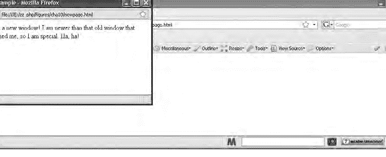

图 10-9 新窗口按照你的意愿在屏幕上打开，位于左上角

### close() 方法

close() 方法用于关闭一个窗口；然而，除非你的脚本拥有特定的安全权限，否则它只能用于关闭由你通过 JavaScript 打开的窗口。

### moveBy() 方法

要使用 close() 方法，你可以修改你的 newpage.html 代码，在文本末尾提供一个按钮，使查看者可以通过点击它来关闭窗口。因此，你可以将 newpage.html 的代码更改为如下所示：

```
<body>
I am a new window! I am newer than that old window
 that opened me, so I am special. Ha, ha!
<form>
<input type="button" value="Close Window" onclick="window.close();" />
</form> </body>
```

当按钮现在被点击时，window.close() 方法被调用，并像窗口右上角的标准关闭按钮一样关闭窗口。如果你想尝试一下，请使用你在上一节中使用过的主页，然后点击按钮打开新窗口。它应该提供一个带有关闭窗口选项的新按�，并且如果你点击该按钮，它应该会关闭窗口。

moveBy() 方法可用于将新窗口移动到屏幕上的新位置。此方法根据方法调用中作为参数给出的像素数来移动窗口。以下是使用此方法的语法：

```
window.moveBy(x-pixels, y-pixels);
```

你将 x-pixels 替换为你希望窗口从左到右移动的像素数。因此，如果你希望窗口向右移动，输入一个正数。如果你希望它向左移动，输入一个负数。你将 y-pixels 替换为你希望窗口从上到下移动的像素数，正数将窗口向下推，负数将窗口向上拉。

例如，如果你想为查看者提供一个选项，使其能够按你选择的像素数移动窗口，你可以添加一个按钮，以便在查看者点击按钮时执行此操作。你可以使用以下代码：

```
<body>
I am a new window! I am newer than that old window
 that opened me, so I am special. Ha, ha!
<form>
<input type="button" value="Move Window" onclick="window.moveBy(50,50);" />
<br /><br />
<input type="button" value="Close Window" onclick="window.close();" />
</form> </body>
```

这会在点击按钮时将窗口向右移动 50 像素，向下移动 50 像素。如果你从本章前面编码的主窗口中打开此文件，你可以看到实际效果。

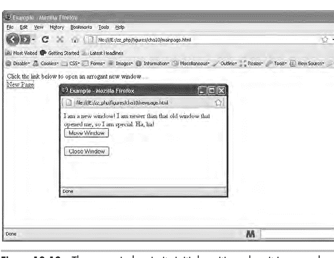

图 10-10 显示了从主页上的按钮打开新窗口时的初始位置。

图 10-11 显示了在新窗口中点击“移动窗口”按钮后的窗口。请注意，它已向右和向下各移动了 50 像素。

**图 10-11** 窗口在移动后的新位置

其工作原理是，只要按钮可见，查看者就可以继续点击按钮并再次将窗口移动 50 像素。窗口只是持续按照脚本中设定的像素数移动。接下来讨论的方法将窗口移动到特定位置，因此它不会像此方法一样在连续点击时持续移动。

### moveTo() 方法

moveTo() 方法用于将窗口移动到屏幕上基于方法调用中给定参数的特定目标位置。以下是使用此方法的一般语法：

```
window.moveTo(x-value, y-value);
```

在这里，你将 x-value 替换为你希望将窗口移动到距离屏幕左侧的像素数。例如，如果你输入 300，窗口将从屏幕左侧移动 300 像素。然后你将 y-value 替换为你希望将窗口移动到距离屏幕顶部的像素数。

举个例子，你可以重新编码 newpage.html 页面中的“移动窗口”按钮，使其使用 moveTo() 而不是 moveBy()。以下是示例代码：

```
<body>
I am a new window! I am newer than that old window
  that opened me, so I am special. Ha, ha!
<form>
<input type="button" value="Move Window" onclick="window.moveTo(50,50);" />
<br /><br />
<input type="button" value="Close Window" onclick="window.close();" />
</form> </body>
```

窗口将移动到屏幕上的坐标 (50,50)，即距离左侧 50 像素，距离顶部 50 像素。

这次，当按钮被点击时，窗口将移动到屏幕上的坐标 (50,50)。通过使用你的主页代码，你可以再次打开窗口来测试这一点。

为了了解这与 moveBy() 方法的工作方式不同，尝试再次点击按钮。它不会进行另一次移动，而是停留在原地，因为它已经到达了目的地。

### resizeBy() 方法

resizeBy() 方法用于根据方法调用中发送的参数给定的像素数来调整窗口大小。其语法和用法与 moveBy() 方法相同；只是 resizeBy() 执行的是调整大小操作。要使窗口变大，请使用正数。要使其变小，请使用负数。

### resizeTo() 方法

resizeTo() 方法用于根据方法调用中发送的参数，将窗口调整到以像素为单位的特定尺寸。其语法和用法与 moveTo() 方法相同；只是 resizeTo() 执行的是调整大小操作。你输入新的宽度和高度来代替 moveTo() 方法中使用的坐标。

### scrollBy() 方法

scrollBy() 方法用于根据方法调用中发送的参数给定的像素数来滚动窗口。其语法和用法与 moveBy() 方法相同；只是 scrollBy() 执行的是滚动操作。要使窗口变大，请使用正数。要使其变小，请使用负数。

### scrollTo() 方法

scrollTo() 方法用于根据方法调用中发送的参数，将窗口滚动到以像素为单位的特定目标位置。其语法和用法与 moveTo() 方法相同；只是 scrollTo() 执行的是滚动到指定点的操作。

### setInterval() 方法

setInterval() 方法用于以设定的间隔重复执行一个 JavaScript 函数。以下是使用此方法的一般语法：

```
window.setInterval("function()", time);
```

你将 *function()* 替换为你希望重复的函数名称。然后你将 *time* 替换为你希望在每次函数重复执行前等待的时间（以毫秒为单位）。

因此，如果你真的想烦扰你的查看者，你可以使用此方法，在页面被查看后，每隔 10 秒（10,000 毫秒）弹出一个警报。你可以通过将以下脚本放置在文档的 HTML 内部来实现：

```
<body>
<script type="text/javascript">
function annoy_alert() {
  window.alert("Am I bothering you yet?");
}
window.setInterval("annoy_alert()", 10000);
</script>
</body>
```

### clearInterval() 方法

要结束上一个脚本的警报轰炸，你可以使用 clearInterval() 方法。以下是使用此方法的一般语法：

```
window.clearInterval(name);
```

你必须将 *name* 替换为已赋值给要清除的 setInterval() 方法调用的变量名。问题是，在前面的示例中，你并未将 setInterval() 调用设置给一个变量名。

为了清除它，你需要调整代码。以下是更新后的代码，将 setInterval() 调用赋值给一个变量名：

```
<body>
<script type="text/javascript">
function annoy_alert() {
    window.alert("Am I bothering you yet?");
}
var madness = window.setInterval("annoy_alert()",10000);
</script>
</body>
```

现在你有一种方法使用 clearInterval() 方法了，即通过将 madness 变量作为参数传递来调用它。因此，向访问者提供一个按钮，使他们能够停止这种疯狂。只要在间隔期间点击它，就能阻止间隔继续运行。以下代码提供了一个完整页面，其中包含供访问者点击的按钮：

```
<body>
<script type="text/javascript">
function annoy_alert() {
    window.alert("Am I bothering you yet?");
}
var madness = window.setInterval("annoy_alert()",10000);
</script>
Click the button below to end the endless barrage of alerts.<br />
<form>
<input type="button" value="Stop the Madness!" onclick="window.clearInterval(madness);" />
</form>
</body>
```

请注意，这是一个特殊情况，函数必须在引号内调用。通常，函数必须在引号外调用。这里这样做的原因是防止函数立即执行，而不是在设定的间隔时间后执行。函数名作为字符串参数传递给 setInterval() 方法，然后在正确的时间间隔后被调用。

当然，这可能会变得相当烦人。间隔设置的时间越短，它就会变得越烦人。幸运的是，十秒的间隔给了你足够的时间在另一个警报弹出前离开页面。

现在，访问者可以通过点击"Stop the Madness"按钮来停止警报。

当然，这个方法还有更好的用途。你将在后续章节中看到，它对于时钟和其他需要在页面上定期更新的内容非常方便。

### setTimeout() 方法

setTimeout() 方法使你能够在一定时间后执行 JavaScript 函数。它与 setInterval() 方法不同，因为它只执行一次（除非被放在某种循环中）。其一般语法与 setInterval() 方法相同。

如果你想让警报只在十秒后弹出一次且不重复，可以使用以下代码：

```
<body>
<script type="text/javascript">
function annoy_alert() {
    window.alert("Sign my guest book NOW!");
}
var theguest = window.setTimeout("annoy_alert()",10000);
</script>
</body>
```

这将在十秒后向访问者发送一个警报，要求立即签署留言簿。

你将该方法设置为一个变量的原因是为了可以使用接下来的 clearTimeout() 方法。

### clearTimeout() 方法

clearTimeout() 方法使你能够在 setTimeout() 调用的时间到期之前调用 clearTimeout() 方法来取消它。其一般语法与 clearInterval() 方法相同：你使用一个变量名作为参数，以便它知道要取消哪个 setTimeout() 调用。

因此，如果你想给访问者一个避免收到警报的机会，你可以在十秒内为他们添加一个可点击的按钮。如果及时点击，setTimeout() 调用将被取消，不会有警报弹出。以下是示例代码：

```
<body>
<script type="text/javascript">
function annoy_alert() {
    window.alert("Sign my guest book NOW!");
}
var theguest = window.setTimeout("annoy_alert()",10000);
</script>
Click the button below within 10 seconds to avoid an alert message.<br />
<form>
<input type="button" value="No Alert for Me!"
       onclick="window.clearTimeout(theguest);" />
</form>
</body>
```

如果及时点击按钮，访问者将避免收到关于签署留言簿的警报。

至此，你终于完成了 window 对象方法的学习。在后续章节中，你将在各种脚本中使用许多这样的方法。

## 问专家

**Q：这里的属性和方法太多了！我怎么可能全部记住？**

**A：** 当你开始更频繁地使用它们时，它们会变得更容易记住。我记住我经常使用的那些，比记住我不常用的那些要好。如果你编写大量代码，最好手边备有一份参考资料，比如这本书，以便你偶尔需要检查某个属性或方法的细节。我手边备有许多书籍和书签指向参考网站。

**Q：弹出窗口不是会惹恼访问者吗？我应该经常使用它们吗？**

**A：** 弹出窗口经常以惹恼大多数观众的方式使用（例如同时打开多个新窗口，要求使用弹出窗口来浏览网站，或为每个导航链接打开一个新窗口）。没有特别好的理由而使用弹出窗口是不推荐的，因为这可能会在导航网站时引起混淆，或者让希望在一个窗口或标签页中浏览的访问者感到恼火。（请注意，如果你从网站上的广告获得收入，你可能需要使用弹出广告来赚取收入。如果确实如此，你需要避免在广告之外再打开自己的弹出窗口。）

大多数浏览器现在允许访问者通过上下文菜单选择在新标签页或新窗口打开链接，因此最好让访问者决定如何打开页面。

**Q：我很快就会制作窗口遥控器吗？**

**A：** 一个可以更改主窗口属性（如 location 属性）的新窗口就是一个“遥控器”。虽然本书不讨论遥控器，但在网络上的免费脚本网站上有相关的脚本。目前，你需要确保掌握创建和操作常规新窗口所需的编码。

**Q：我会经常使用 setTimeout() 和 setInterval() 这样的定时方法吗？**

**A：** 它们可能不常出现，但当你需要构建依赖于时间的脚本（如时钟、幻灯片或动态 HTML (DHTML) 动画）时，你会用到它们。

## 动手实践 10-2：使用 setTimeout() 和 confirm() 方法

本项目让你练习使用一些 window 方法。你将让浏览器等待若干秒，然后询问访问者是否要留在页面上还是转到互联网搜索网站。

### 分步指南

1.  创建一个 HTML 页面，在 body 部分包含以下代码，并将其保存为 pr10_2.html：

```
<body>
<h1>Some Info. Here</h1>
<ul>
<li>An interesting point here...</li>
<li>A very interesting point here...</li>
<li>An incredibly interesting point here...</li>
</ul>
<script type="text/javascript" src="prjs10_2.js"></script>
</body>
```

2.  创建一个 JavaScript 文件并将其保存为 prjs10_2.js。用于步骤 3-4。

3.  20 秒后，向访问者显示一个确认框，询问他们是否要继续使用此网页。如果是，则什么都不做。如果否，则将他们重定向到 URL http://www.google.com。

4.  保存 JavaScript 文件并在 Web 浏览器中打开 HTML 文件。20 秒后，你应该会看到一个确认框。

### 动手实践小结

在本项目中，你能够运用 window 对象属性和方法的知识来创建一个定时、交互式的脚本。这让你能够给访问者一个选择：是留在当前网页还是转到互联网搜索网站。

## 第 10 章 自测题

-   1. 屏幕上出现的每个窗口都会创建一个 __________ 对象。

-   2. closed 属性用于检查窗口是否已被访问者关闭。

    -   A 正确

    -   B 错误

# 270 JavaScript：初学者指南

3. __________ 属性用于保存窗口中框架数量的值。

4. location 属性会导致浏览器立即重定向到新页面。

- A 正确

- B 错误

5. __________ 属性用于保存当前窗口的名称，同时也允许你为窗口命名。

6. 对 window 对象属性和方法的调用通常可以被简化，因为

- A window 对象是 JavaScript 中的默认对象。

- B window 的属性和方法被认为是 navigator 对象的一部分。

- C 实际上并不存在 window 对象。

- D 浏览器假定 window 对象是 document 对象的一部分。

7. __________ 属性是 JavaScript 中另一种表示“当前窗口”的方式。

8. 为什么这段代码不会工作：

```
onmouseover="window.status='Page 2'; return true;"
```

- A 它应该毫无问题地工作。

- B 引号设置不正确。

- C 较新的浏览器默认不允许更改窗口状态栏，因此用户需要更改安全设置才能使其工作。

- D 在 onMouseOver 事件中更改状态栏属性后必须返回 false。

9. parent 属性和 top 属性有什么区别？

- A parent 属性跳转到当前框架集的顶部，而 top 属性跳转到页面上所有框架集的顶部窗口。

- B top 属性跳转到当前框架集的顶部，而 parent 属性跳转到页面上所有框架集的顶部窗口。

- C parent 属性跳转到当前框架集的顶部，而 top 属性跳转到当前框架的顶部。

- D parent 属性跳转到最外层框架集的顶部，而 top 属性跳转到页面上所有框架集的顶部窗口。

10. __________ 方法会向观看者弹出一条消息，观看者必须点击确定按钮才能继续。

11. 如果观看者点击确定按钮，confirm() 方法返回什么值？

- A true

- B false

- C OK

- D 25

12. __________ 方法使观看者能够打印当前窗口。

13. prompt() 方法用于 __________ 观看者输入信息。

14. 当在 open() 方法的第三个参数中设置 toolbar 属性时，该属性可以有哪些值？

- A 只能是 yes 和 no

- B 只能是 1 和 0

- C yes、no、true 和 untrue

- D yes、no、1 和 0

15. setInterval() 方法和 setTimeout() 方法有什么区别？

- A setTimeout() 方法用于观看者需要暂停阅读时，而 setInterval() 用于观看者不需要暂停时。

- B setInterval() 方法用于以设定的时间间隔重复执行一个函数，而 setTimeout() 在设定的时间延迟后只执行一次函数。

- C setInterval() 方法默认以设定的间隔在屏幕上闪烁广告，而 setTimeout() 则没有广告。

- D 它们执行的功能相同。

# 第 11 章

## JavaScript 数组

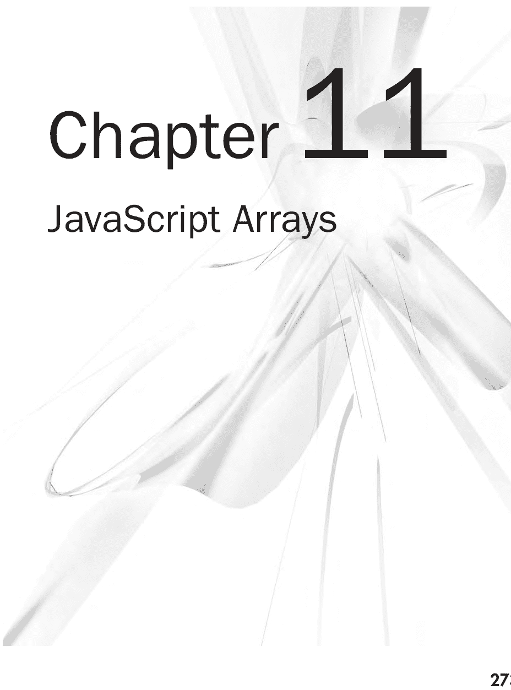

## 关键技能与概念

- 定义和访问数组

- 理解数组对象的属性和方法

- 将数组与循环结合使用

- 使用关联数组

前面的章节讨论了对象属性，要使用它们，你需要了解数组的知识。在本章中，你将学习 JavaScript 数组以及它们如何帮助你改进脚本。你将首先概述数组是什么以及它们为何对你有用。然后你将学习如何在 JavaScript 中定义和访问数组。之后，你将学习如何在脚本执行过程中使用循环来访问数组的所有元素。最后，你将了解关联数组以及如何使用它们。

## 什么是数组？

数组是一种存储相似类型数据的方式，以便在脚本中后续轻松访问。在 JavaScript 中，数组基本上是一个用户定义的对象，其访问方式通常与其他对象不同。它使用一个变量名来存储多个值（例如，最喜欢的颜色列表或最喜欢的食物列表）。在普通数组中，通常通过索引号来访问元素。关联数组允许使用字符串而不是数字来进行访问。你将在本章后面看到如何使用这两种数组。为了理解普通数组的工作原理，假设你有一个满是学生的班级，并且希望通过脚本能够快速打印出每个学生的姓名。你可以使用常规变量来保存每个学生的名字，但在 document.write() 语句中键入每个变量名将花费很长时间。相反，你可以将每个学生的名字存储在一个数组中，这样你就可以通过几行代码使用循环更轻松地访问它。数组允许你将一个数字和一个名字组合在一起，如以下示例所示：

- 学生 0：Thomas

- 学生 1：Roger

- 学生 2：Amber

- 学生 3：Jennifer

通过像这样存储，你可以使用数字来获取每个学生的名字。这就是数组作为一种存储信息并在以后访问它的有用方式。

**注意**

请注意，数组中的第一个学生是学生 0，而不是学生 1。这是因为数组从数字 0 开始存储值，而不是从 1 开始。在你继续阅读本章的过程中，将更详细地讨论这一点。

## 为什么数组有用

为什么使用数字可以让你更容易地访问存储的信息？因为使用数字时，你能够使用循环来遍历信息，而不是手动输入每个条目。如果示例中的学生列表变得很长，当你想把所有名字都打印到浏览器屏幕上时，循环将为你节省大量打字工作。

例如，如果你将示例列表中每个学生的名字分配给一个变量，然后将名字写入屏幕，你将需要在 document.write() 语句中重写每个变量名。以下代码展示了这一点的示例：

```
var student0="Thomas";
var student1="Roger";
var student2="Amber";
var student3="Jennifer";
```

```
document.write(student0+"<br />");
document.write(student1+"<br />");
document.write(student2+"<br />");
document.write(student3+"<br />");
```

如果你能够使用循环为每个学生重复单个 document.write() 语句，你就可以避免编写四个独立的 document.write() 语句。数组是存储值（学生姓名）的一种便捷方式，因为你可以使用循环来遍历这些值，而不是为每个值编写单独的 document.write() 语句——即使你事先不知道学生人数（通过使用数组的 length 属性）。

数组基本上是一种快速创建对象（因为它已经有一个构造函数）并带有一组属性的方法。普通对象（如你在第 8 章中创建的对象）可以像数组一样被访问；但创建数组通常比创建对象更容易，因为你不需要处理构造函数。

## 定义和访问数组

既然你知道了数组是什么，你就可以看看如何在 JavaScript 中命名、定义和访问数组了。

### 命名数组

你可以使用在第 3、4 和 8 章中学习到的命名变量、函数和对象的相同规则来命名数组。基本上，避免以数字开头，避免空格，并避免使用保留字。

### 定义数组

定义数组类似于创建一个对象的实例。事实上，定义数组的一种方法在外观和行为上都像创建对象实例的方法。这实际上就是你正在做的事情——创建 JavaScript Array 对象的一个实例。

由于创建对象实例对你来说已经很熟悉，因此首先介绍该方法。以下示例展示了 JavaScript 中数组定义的一般语法：

```
var arrayname = new Array(element0,element1);
```

你将 *arrayname* 替换为你希望给数组的名称，并将 *element0* 和 *element1* 替换为每个元素将具有的值。你可以根据需要使用任意数量的元素。

要查看一个真实的例子，你将使用本章第一节中的学生姓名作为数组元素。这个数组将有四个元素，每个元素都将是学生姓名的值。以下示例展示了数组的定义，姓名作为字符串值：

```
var s_list = new Array("Thomas","Roger","Amber","Jennifer");
```

现在你已经将值存储在一个名为 *s_list* 的四元素数组中。因为值是字符串，所以使用了引号（就像普通对象一样）。问题是，既然它们已经在数组中，你现在如何开始访问这些值？

### 访问数组元素

要访问数组的元素，你通常使用“索引号”，它允�你通过元素在数组中的位置来访问每个元素。例如，将数组的第一个元素赋值给变量的语法如下例所示：

```
var varname = arrayname[0];
```

你将 *varname* 替换为变量名，将 *arrayname* 替换为你希望访问的数组名称。*arrayname* 后面方括号中的 0 是数组第一个元素的索引号。索引号为 0，因为数组从 0 开始计数，而不是从 1 开始；因此，你需要注意不要混淆数组中元素的索引号。第一个元素的索引号为 0，第二个的索引号为 1，第三个的索引号为 2，依此类推。

在数组名称后面紧跟着的方括号内，你放置希望在数组中访问的元素的索引号。为了实际了解这一点，让我们再次考虑四个学生的例子。每个学生姓名的数组定义如下代码所示：

请记住，第一个元素的索引编号为0；因此，要获取第一个元素的值并将其赋给变量，你需要使用以下代码：

```
var tall_student = s_list[0];
```

为了验证 tall_student 变量的值是否如你所预期，你可以编写一个简短的脚本将其输出到页面上。以下示例将值作为句子的一部分输出到页面：

```
<body>
<script type="text/javascript">
var s_list = new Array("Thomas","Roger","Amber","Jennifer");
var tall_student = s_list[0];
document.write("The tallest student in class is "+tall_student);
</script>
</body>
```

在这种情况下，你其实不需要将数组元素赋值给一个变量（这只会让你多打些字）。你可以直接将数组元素写入 `document.write()` 语句中，以省去额外的一行代码：

```
<body>
<script type="text/javascript">
var s_list = new Array("Thomas","Roger","Amber","Jennifer");
document.write("The tallest student in class is "+s_list[0]);
</script>
</body>
```

现在你直接访问数组元素，并在此过程中节省了一些输入。

### 定义数组的其他方式

你已经看到了一种定义数组的方法，但还有其他方法，在本章后面会派上用场。以下定义数组的方法将允许你根据各种情况选择最合适的方法。

#### 先分配空间，稍后赋值

定义数组的一种方法是为数组分配一定数量的空间（元素），然后允许在脚本后续部分再为这些元素赋值。这通过在定义数组时在圆括号内使用单个数字来实现：

```
var s_list = new Array(4);
```

这会创建一个名为 `s_list` 的数组，该数组最初将包含四个元素（如果你愿意，以后可以向数组添加元素）。请记住，索引编号是0、1、2和3，而不是1、2、3和4。在这种情况下，你将在脚本的后续部分为数组的这四个元素赋值。

要为一个元素赋值，你只需使用数组名称和你希望赋值的索引编号来为它赋值。因此，如果你想将值“Amber”赋给数组的第三个位置（索引编号2），你将使用以下代码：

```
s_list[2] = "Amber";
```

在数组定义之后，你可以在任何地方使用这样的行。前面代码中使用的技术还允许你在脚本后续部分决定需要更多元素时，向数组添加元素。你也可以使用循环来为数组的所有元素赋值，但这将在本章后面讨论数组和循环时进行讲解。

所以，假设你想向你的 `s_list` 数组添加第五个元素。通过为它赋值（索引编号4），你可以在第五个位置添加一个新名字到数组中：

```
s_list[4] = "Pat";
```

这将向你的 `s_list` 数组添加一个值为 Pat 的第五个元素。

#### 先分配空间，立即数值赋值

定义数组的另一种方式与刚才介绍的方法非常相似。唯一的区别是，数组的所有或部分元素在创建新数组后立即被赋值。

要查看示例，再次考虑 `s_list` 数组。以下代码展示了如何在创建数组空间的行之后立即为数组元素赋值：

```
var s_list = new Array(4);
s_list[0]="Thomas";
s_list[1]="Roger";
s_list[2]="Amber";
s_list[3]="Jennifer";
```

这一次，所有四个元素在创建时就被赋值了。如果你想为每个元素赋值，但不希望在同一行使用很长的参数列表，这种方法是有优势的。它也更容易回顾并快速查看哪个值被分配给了哪个元素，因为不需要横向计数。在包含长列表元素时，这可能相当有利。

与其他方法一样，你仍然可以在脚本后续部分使用序列中的下一个索引编号来添加更多元素。

#### 数组名，无参数

定义数组的另一个选项是定义时不带任何参数。这会创建一个没有元素的数组，但与其他定义数组的选项一样，你可以稍后添加元素。

要创建一个没有元素的数组，你需要创建一个不带参数的数组：

```
var s_list = new Array();
```

这会创建一个名为 `s_list` 的、没有元素的数组。你仍然可以在脚本后续部分使用序列中的下一个索引编号来添加更多元素。所以，如果你后来决定希望数组包含一个元素，你可以使用以下代码：

```
var s_list = new Array(); // 数组已定义
var x = 17;
var y = x+2;
var my_message = "Hi!";
s_list[0]="Thomas"; // 为第一个（也是目前唯一的）元素赋值
```

如果你为一个具有更高索引编号的元素赋值，数组会扩展以包含其之前所有元素的位置。例如，看看以下代码：

```
var s_list = new Array(); // 数组已定义
var x = 17;
var y = x+2;
var my_message = "Hi!";
s_list[29]="Thomas"; // 这将创建数组中的第30个元素，
                     // 并导致数组拥有30个元素
```

这段代码的最后一行将字符串“Thomas”赋给数组中的第30个元素（索引编号29）。这意味着数组从拥有0个元素扩展到了拥有30个元素。通过为这个元素赋值，数组会扩展出足够的插槽来补偿，如果你愿意，可以稍后为这些插槽赋值。

既然你知道了如何以各种方式定义数组，你需要了解一些 JavaScript 中 Array 对象的属性和方法。

## 理解 Array 对象的属性和方法

与其他对象一样，JavaScript Array 对象的实例能够使用 Array 对象的各种属性和方法。当你阅读 Array 对象各个属性和方法的描述时，你会看到，你需要通过使用数组名称后跟你希望使用的属性或方法名来访问这些属性。

#### 属性

表11-1列出了 Array 对象的属性，并对每个属性进行了简要描述。每个属性将在随后的部分中进行更详细的讨论。

#### constructor 属性

constructor 属性包含构造数组的函数代码的值：

```
function Array() { [native code] }
```

| 属性 | 描述 |

|---|---|

| constructor | 指向用于创建对象实例的构造函数 |

| index | 在通过正则表达式匹创建数组时使用 |

| input | 在通过正则表达式匹创建数组时使用 |

| length | 包含一个数字值，等于数组中元素的数量 |

| prototype | 允许向 JavaScript Array 对象等对象添加属性和方法 |

**表11-1 Array 对象的属性**

constructor 属性主要用于信息目的或进行比较。要访问该属性，你使用数组名称后跟点运算符和 constructor 关键字。以下是使用 Array 对象属性的一般语法：

```
arrayname.property
```

你将 *arrayname* 替换为需要使用该属性的数组名称，并将 *property* 替换为你希望使用的属性。

因此，要使用 constructor 属性，你需要创建一个数组，以便拥有一个 Array 对象的实例来使用。这里没有创建一个新数组，而是使用了前面的 `s_list` 数组，允许你使用以下代码：

```
var s_list = new Array(4);
window.alert(s_list.constructor);
```

这将弹出一个包含文本 `function Array() { [native code] }` 的警告框（数组的构造函数）。

#### index 和 input 属性

要理解 index 和 input 属性，你首先需要理解正则表达式（用于匹配文本字符串），这需要一个冗长的解释，如第13章所述。对 index 和 input 属性的讨论将留到那一章。

##### length 属性

length 属性返回一个数字，告诉你数组中有多少个元素。

> **注意**

> 当你开始使用循环遍历数组时，length 属性在后面会很有用。你可能需要知道数组的长度（以防在数组定义后添加了元素），以便循环遍历数组的每个元素。

要使用 length 属性，你需要使用数组的名称，然后加上 length 属性。以下代码展示了如何使用 length 属性来告知用户数组中包含多少个元素：

```
var s_list = new Array(4)
s_list[0]="Thomas";
s_list[1]="Roger";
s_list[2]="Amber";
s_list[3]="Jennifer";
window.alert("The array has "+s_list.length+" elements");
```

这将向用户发送一个提示，显示“The array has 4 elements”。

#### prototype 属性

prototype 属性允许你向已存在的对象（例如 Array 对象）添加属性和方法。使用此属性，你可以从构造函数外部向对象添加属性。但请注意，通过 prototype 属性进行的更改会影响使用同一构造函数的每个对象实例。

例如，如果你决定 Array 对象需要为你的某个页面添加另一个属属性，你可以使用 prototype 属性来分配一个新属性，语法如下：

```
Array.prototype.new_property=default_value;
```

你需要将 *new_property* 替换为你希望使用的新属性名称，然后将 *default_value* 替换为该属性的默认值。

因此，如果你想在页面的 Array 构造函数中添加一个名为 `attitude` 的新属性，并赋予其默认值“cool”，你可以使用如下代码：

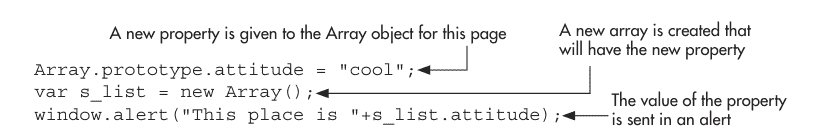

这将导致向用户提示新属性的值。在这种情况下，由于你没有更改它，因此使用的是默认值（稍后将详细介绍）。

你需要记住，像这样添加属性会影响之后文档中的每个数组。因此，通过这种方式添加属性，页面上的每个数组（或者如果脚本是外部的，则每个使用该脚本的页面）现在都拥有了这个你可以访问的新属性。

以下代码展示了在页面上的两个数组中使用 prototype 属性的情况。第一个数组提示你新属性的默认值，而第二个数组则提示新值。以下示例展示了如何使用新的 `attitude` 属性来运用 prototype 属性：

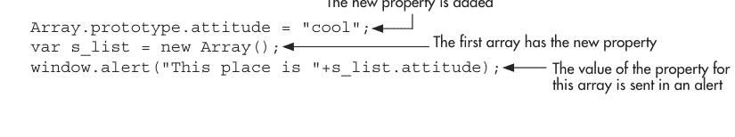

```
var fish = new Array();
fish.attitude = "wide-eyed";
window.alert("Fish are " + fish.attitude);
```

第一个数组和提示与之前的示例相同。第二个数组名为 `fish`。第二个数组也有新的 `attitude` 属性；但是，它没有保留默认值，而是通过使用数组名称后跟属性和新值的方式进行了更改。更改后的属性值随后被提示给用户；因此，在点击第一个提示上的“确定”按钮后，用户会看到一个提示“Fish are wide-eyed”。

#### 方法

现在你已经了解了 Array 对象的属性，本节将介绍你可以用来对数组执行不同操作的方法。表 11-2 列出了这些方法并描述了每个方法的功能。表格之后将更详细地描述每个方法。

| 方法 | 描述 |

|---|---|

| concat() | 将两个或多个数组的元素组合成一个新数组 |

| join() | 使用分隔符将数组的元组成一个字符串 |

| pop() | 从数组中移除最后一个元素，然后在需要时返回被移除的元素 |

| push() | 向数组的末尾添加元素，然后在需要时返回数组新长度的数值 |

| reverse() | 反转数组中元素的方向：第一个元素移到最后一个位置，最后一个元素移到第一个位置，依此类推 |

| shift() | 从数组中移除第一个元素，然后在需要时返回该元素 |

| unshift() | 向数组的开头添加元素，并在需要时返回新数组长度的数值 |


| `slice()` | 提取数组的指定部分，并将该部分作为新数组返回 |

| `splice()` | 从数组中移除元素或替换数组中的元素 |

| `sort()` | 根据元素的字符串值，将数组的元素按字母顺序排序 |

| `toString()` | 使用逗号作为分隔符将数组的元素组合成一个字符串 |

表 11-2 Array 对象的方法

##### `concat()` 方法

`concat()` 方法用于组合（或连接）两个或多个数组的元素，并返回一个包含所有元素的新数组。你使用数组名作为参数，并按照你希望元素组合的顺序设置它们。

第一个示例组合了两个数组的元素。为此，只需使用一个参数——要添加到调用该方法的数组末尾的数组名称：

```
var fruits = new Array("oranges","apples");
var veggies = new Array("corn","peas");
var fruits_n_veggies = fruits.concat(veggies);
```

此代码创建了一个名为 `fruits` 的数组（包含两个元素）和一个名为 `veggies` 的数组（包含两个元素）。接下来，它基于前两个数组的组合定义了一个新数组 `fruits_n_veggies`。`concat()` 方法返回的值被分配给这个数组名称，从而创建了新的组合数组。

你使用 `fruits` 数组调用 `concat()` 方法并将 `veggies` 数组名称作为参数传递的原因是，这样 `fruits` 数组的元素会出现在新数组的开头，而 `veggies` 数组的元素会被添加到新数组的末尾。前面的代码创建了包含以下元素的新数组 `fruits_n_veggies`：

oranges, apples, corn, peas

如果你希望 `veggies` 数组的元素列在前面，你可以使用 `veggies` 数组名称调用该方法，并将 `fruits` 数组名称作为参数传递：

```
var fruits = new Array("oranges","apples");
var veggies = new Array("corn","peas");
var fruits_n_veggies = veggies.concat(fruits);
```

现在 `veggies` 数组的元素列在前面，新的 `fruits_n_veggies` 数组包含以下元素：

corn, peas, oranges, apples

使用此方法时，请确保通过使用刚才描述的技术来设置你想要的顺序。

如果你组合三个数组，调用 `concat()` 方法的数组的元素将排在最前面，然后作为参数传递的每个数组名称的元素将按它们传递的顺序添加：

```
var fruits = new Array("oranges","apples");
var veggies = new Array("corn","peas");
var meats = new Array("fish","chicken");
var three_groups = fruits.concat(veggies,meats);
```

现在你正在组合三个数组，新的 `three_groups` 数组的元素如下：

oranges, apples, corn, peas, fish, chicken

如果你改为以如下方式编码，你将得到一个元素相同但顺序不同的数组：

```
var fruits = new Array("oranges","apples");
var veggies = new Array("corn","peas");
var meats = new Array("fish","chicken");
var three_groups = meats.concat(veggies,fruits);
```

使用此代码时，新的 `three_groups` 数组中元素的顺序如下：

fish, chicken, corn, peas, oranges, apples

#### `join()` 方法

`join()` 方法用于将数组的元素组合成一个字符串，每个元素之间用一个作为参数传递给方法的字符分隔。如果未传递参数，则在调用方法时默认使用逗号作为分隔符。

要了解此方法的工作原理，请看一段代码。以下示例定义了一个数组，然后使用数组名称调用 `join()` 方法：

```
var fruits = new Array("oranges","apples","pears");
var fruit_string = fruits.join();
```

此代码将调用 `fruits` 数组的 `join()` 方法的结果赋值给变量 `fruit_string`。由于未传递参数，数组的元素将在新字符串中用逗号分隔。变量 `fruit_string` 将具有以下字符串值：

oranges,apples,pears

你可以通过将字符串变量写入网页来查看此结果。以下代码将为你执行此操作：

```
<body>
<script type="text/javascript">
var fruits = new Array("oranges","apples","pears");
var fruit_string = fruits.join();
document.write("The new string is "+fruit_string);
</script>
</body>
```

现在你可以看到 `join()` 方法返回的字符串。图 11-1 展示了此代码在浏览器中运行时产生的效果。

#### `join()` 方法

如果你想用除逗号以外的其他字符来分隔新字符串中的元素，可以将希望使用的字符作为参数传递。以下代码将冒号作为字符串参数传递给 `join()` 方法：

```javascript
<body>
<script type="text/javascript">
var fruits = new Array("oranges","apples","pears");
var fruit_string = fruits.join(":");
document.write("The new string is "+fruit_string);
</script>
</body>
```

这次字符串将与之前的稍有不同，因为它用冒号替代了前一个示例中的逗号。图 11-2 展示了该字符串在浏览器窗口中的打印效果。

**图 11-2** 新字符串以冒号作为分隔符写在页面上

#### `pop()` 方法

`pop()` 方法用于移除数组的最后一个元素。如果将该方法的结果赋值给一个变量，则被弹出的元素将被返回并赋值给该变量。要使用 `pop()` 方法，请看以下代码，它创建了一个数组，然后使用 `pop()` 方法移除了数组的最后一个元素：

```javascript
var fruits = new Array("oranges","apples","pears");
fruits.pop();
```

这将创建一个名为 `fruits` 的数组，包含三个元素（oranges, apples, pears）。然后，使用 `pop()` 方法移除最后一个元素，数组缩短为只包含前两个元素（oranges, apples）。

如果你想移除一个元素但稍后仍需以某种方式使用它，可以将该方法的结果赋值给一个变量。该变量将被赋予被移除元素的值。以下示例移除数组的最后一个元素，然后将移除的元素作为警报消息发送给查看者：

```javascript
var fruits = new Array("oranges","apples","pears");
var picked_fruit = fruits.pop();
window.alert("You picked my "+picked_fruit);
```

这将弹出一个警报，向查看者显示 "You picked my pears"。

#### `push()` 方法

`push()` 方法用于向数组末尾添加元素。传递给该方法的参数是你希望添加到数组中的一个或多个新元素。

> **注意**

在较旧的浏览器中，`push()` 方法返回的值是添加到数组的最后一个元素。在使用较新版本 JavaScript（1.3 或更高版本）的现代浏览器中，它返回数组新长度的数值。

例如，看以下代码，它向数组末尾添加一个元素：

```javascript
var fruits = new Array("oranges","apples");
fruits.push("pears");
```

这段代码创建了一个名为 `fruits` 的数组，包含两个元素（oranges, apples），然后使用 `push()` 方法添加第三个元素 `pears`。数组现在包含三个元素（oranges, apples, pears），其中 `pears` 是数组中的最后一个元素。

你可以通过传递多个参数来一次添加多个元素。元素将按照在参数列表中传递的顺序添加。以下代码向 `fruits` 数组添加两个元素：

```javascript
var fruits = new Array("oranges", "apples");
fruits.push("pears", "grapes");
```

这段代码接受一个包含两个元素（oranges, apples）的数组，并向其添加两个元素。最终，数组包含四个元素（oranges, apples, pears, grapes）。

如果你想获得该方法返回的值，可以将结果赋值给一个变量。以下代码正是如此，然后向查看者显示返回的值：

```javascript
var fruits = new Array("oranges", "apples");
var who_knows = fruits.push("pears", "grapes");
window.alert("The method returned " + who_knows);
```

`who_knows` 变量的值将因浏览器而异。在较旧的浏览器中，其值应为字符串 `grapes`（添加到数组的最后一个元素）。如果浏览器支持 JavaScript 1.3 或更高版本，该变量的值应为数值 4（数组的新长度）。

#### `reverse()` 方法

`reverse()` 方法用于反转数组中元素的顺序。由于它仅此功能，因此无需传递任何参数或返回值。

要演示如何使用此方法，以下代码创建了一个数组，然后反转了数组中元素的顺序：

```javascript
var fruits = new Array("oranges", "apples", "pears");
fruits.reverse();
```

数组的初始顺序是 oranges, apples, pears。当对该数组调用 `reverse()` 方法时，元素的顺序被反转，数组现在变为 pears, apples, oranges。

#### `shift()` 方法

`shift()` 方法用于移除数组的第一个元素。它返回被移除元素的值，以防你在脚本中稍后需要使用它。

因此，如果你想移除数组中的第一个元素，可以使用类似以下代码的语句：

```javascript
var fruits = new Array("oranges", "apples", "pears");
fruits.shift();
```

这段代码创建了一个包含三个元素（oranges, apples, pears）的数组，并使用 `shift()` 方法移除了第一个元素。这导致数组只剩下两个元素（apples, pears）。

要使用被移除元素的值，可以将该方法的结果赋值给一个变量。以下代码将被移除的元素赋值给一个变量，然后向查看者显示移除了什么：

```javascript
var fruits = new Array("oranges","apples","pears");
var picked_fruit=fruits.shift();
window.alert("You picked my "+picked_fruit);
```

这段代码在浏览器窗口中显示警报 "You picked my oranges"。

#### `unshift()` 方法

`unshift()` 方法用于向数组的开头添加元器。你希望添加到数组的元素作为参数传递给该方法。该方法返回的值是数组新长度的数值。

以下示例向数组的开头添加一个新元素：

```javascript
var fruits = new Array("apples","pears");
fruits.unshift("oranges");
```

这将创建一个名为 `fruits` 的数组，包含两个元素（apples, pears），然后使用 `unshift()` 方法向数组的开头添加一个元素。数组随后包含三个元素（oranges, apples, pears）。

如果你想一次添加多个元素，可以按添加顺序将它们全部作为参数传递。以下示例向数组的开头添加两个元素：

```javascript
var fruits = new Array("apples","pears");
fruits.unshift("oranges","grapes");
```

这将接受初始的两个元素（apples, pears）的数组，并向其开头添加两个元素。调用 `unshift()` 方法后，数组最终包含四个元素（oranges, grapes, apples, pears）。

#### `slice()` 方法

`slice()` 方法用于切片数组的指定部分，然后使用旧数组切片部分的元素创建一个新数组。

以下是使用此方法的一般语法：

```javascript
arrayname.slice(start, stop)
```

你需要将 `arrayname` 替换为数组的名称，你想从中取出特定元素集合以创建新数组。你需要将 `start` 替换为开始切片的索引号。你需要将 `stop` 替换为在你希望切片的最后一个元素之后的索引号。

例如，以下代码从数组中切片两个元素，并用这些元素创建一个新数组：

```javascript
var fruits = new Array("oranges","apples","pears","grapes");
var somefruits = fruits.slice(1,3);
```

这将切片数组的第二个元素（索引号 1）到第三个元素（索引号 2）。它不会取出第四个元素（索引号 3），因为 3 是在 2 之后的索引号，而 2 是指定要移除的最后一个元素的索引号。名为 `somefruits` 的新数组包含被切片的元素（apples, pears）。

#### `splice()` 方法

`splice()` 方法允许你移除或替换数组中的元素。可以传递的参数包括开始拼接的索引号、要移除的元素数量，以及向数组添加新元素的选项。

如果你想从数组中移除单个元素，可以使用类似以下代码的语句：

```javascript
var fruits = new Array("oranges","apples","pears","grapes");
var somefruits = fruits.splice(2,1);
```

这从索引号 2 开始移除元素。下一个参数是 1，因此只移除一个元素；因此，这里只移除索引号 2 处的元素，即 pears。拼接后的数组只包含三个元素（oranges, apples, grapes）。

要移除多个元素，你需要增加第二个参数的值。以下代码从索引号 2 开始移除两个元素：

```javascript
var fruits = new Array("oranges","apples","pears","grapes");
var somefruits = fruits.splice(2,2);
```

这次数组被缩减为两个元素（oranges, apples），因为最后两个元素被 `splice()` 方法移除。

你也可以使用 `splice()` 方法替换数组中的拼接元素或向数组添加元素。以下代码通过传递一个额外的参数，将索引号 2 处的拼接元素替换为新元素：

```javascript
var fruits = new Array("oranges","apples","pears","grapes");
var somefruits = fruits.splice(2,1,"watermelons");
```

这次，索引号 2 处的元素被移除。由于第二个参数是 1，因此只移除一个元素。下一个参数告诉浏览器在第一个参数指定的索引号（索引号 2）处添加此值。此值替换了被移除的值（pears）。数组仍然有四个元素，只是元素不同了（oranges, apples, watermelons, grapes）。

你将第一个参数设置为你希望开始添加元素的索引号。例如，请看以下代码：

```
var fruits = new Array("oranges","apples","pears","grapes");
var somefruits = fruits.splice(2,0,"watermelons","plums");
```

这次添加元素从索引号2开始（如第一个参数所指定），并且没有移除任何元素（如第二个参数所指定）。添加了两个元素后，数组将包含六个元素（oranges, apples, watermelons, plums, pears, grapes）。

#### `sort()` 方法

`sort()` 方法按字母顺序（类似目录列表）对数组进行排序。但这并非数值顺序。以水果数组为例，如果你想改变元素顺序使其按字母顺序排列，可以使用以下代码：

```
var fruits = new Array("oranges","apples","pears","grapes");
fruits.sort();
```


prototype 属性允许你向 Number 对象添加属性或方法，其用法与你在第 11 章中为 Array 对象所做的类似。

#### 方法

表 12-4 列出了 Number 对象的方法并简要说明了每个方法的用途。以下各节将更详细地讨论每个方法。

| 方法 | 用途 |
| :--- | :--- |
| `toExponential()` | 返回一个表示数字的指数表示法的字符串值 |
| `toFixed()` | 返回一个表示数字四舍五入到指定小数位数的字符串值 |
| `toPrecision()` | 返回一个表示数字四舍五入到指定位有效数字的字符串值 |
| `toSource()` | 返回一个表示对象源代码的字符串值 |
| `toString()` | 返回 Number 对象的字符串值 |
| `valueOf()` | 主要由 JavaScript 内部使用 |

表 12-4 Number 对象的方法

#### toExponential()、toFixed()、toPrecision() 和 toString() 方法

这些方法返回一个字符串值，表示 Number 对象以特定方式格式化后的样子。请注意，这些方法不能直接用于数字本身（数值），如以下代码所示：

```
document.write(10.toExponential());
```

这将导致 JavaScript 错误，因为它期望的是一个 Number 对象。为避免此问题，请通过将数值赋给变量（这将使它们成为 Number 对象）来使用这些方法，如以下代码所示：

```
var the_num = 10;
document.write(the_num.toExponential());
```

> **注意**

你也可以使用 `var the_num = new Number(10);` 的语法（你可能在之前的对象中已经熟悉），这也是有效的。

#### toExponential() 方法

`toExponential()` 方法返回一个表示 Number 对象的指数表示法形式的字符串。因此，以下代码将在屏幕上写入 1.0e+1（或类似表示法，取决于你的浏览器）的结果：

```
var the_num = 10;
document.write(the_num.toExponential());
```

#### toFixed() 方法

`toFixed()` 方法返回一个表示 Number 对象四舍五入到指定小数位数的字符串。例如，如果你需要将计算结果格式化为货币值，你可以使用此方法将计算结果四舍五入到小数点后第二位，并以你的货币格式显示。例如，此代码使用美元和美分：

```
var mymoney = 2000;
var mykids = 7;
var one_share = mymoney/mykids;
document.write("One share of my money is $"+ one_share.toFixed(2));
```

一份份额的计算结果是 285.7142857142857，但由于使用了 `toFixed()` 方法并以 2 作为参数，句子显示如下：

One share of my money is $285.71

#### toPrecision() 方法

`toPrecision()` 方法返回一个表示 Number 对象四舍五入到指定位有效数字的字符串。这适用于小数点前后的所有数字。因此，如果你想将像 45.57689349 这样的数字四舍五入到五位有效数字，可以使用以下代码：

```
var the_num = 45.57689349;
document.write(the_num.toPrecision(5));
```

浏览器将显示字符串 45.577，这是该数字四舍五入到五位有效数字的结果（在此示例中，小数点前两位，小数点后三位）。

#### toString() 方法

`toString()` 方法返回 `Number` 对象（或数值变量值）的字符串值。如果你想将数值转换为相应的字符串值（例如，将 `10` 转换为 `"10"`），这会很有用。

#### toSource() 方法

`toSource()` 方法返回一个表示对象源代码的字符串值。对于预定义的 `Number` 对象，此方法返回构造函数属性的值。此方法通常由 JavaScript 内部调用，在代码中使用的可能性较小。

#### valueOf() 方法

这是另一个主要由 JavaScript 内部使用的方法。目前，你只需要知道它是 `Number` 对象的一个有效方法即可。

## 使用 Date 对象

`Date` 对象是另一个预定义的 JavaScript 对象。它允许你设置和获取某些时间值，这些值可以在你的脚本中使用。要使用此对象，你需要创建一个可以引用的对象实例。

要创建 `Date` 对象的实例，你需要使用 `new` 关键字（就像许多其他对象一样），如下例所示：

```
var instance_name = new Date();
```

你需要将 `instance_name` 替换为希望用于 `Date` 对象实例的名称。因此，如果你想要一个名为 `rightnow` 的实例，可以使用以下代码：

```
var rightnow = new Date();
```

现在你就有了一个名为 `rightnow` 的对象实例。

一旦拥有了对象实例，你就可以使用 `Date` 对象的属性和方法来执行各种任务（例如创建 JavaScript 时钟）。这些属性和方法将在以下部分中描述。

#### 属性

`Date` 对象只有两个属性。表 12-5 列出了这些属性及其用途（这些属性可能看起来很熟悉，因为 `Array` 和 `Number` 对象也具有相同的属性）。每个属性将在后续部分中更详细地描述。

| 属性 | 用途 |
| :--- | :--- |
| `constructor` | 保存创建该对象的构造函数的值 |
| `prototype` | 允许你根据需要向对象添加属性 |

表 12-5 Date 对象的属性

#### constructor 属性

`constructor` 属性保存对象的构造函数的值，其用法与 `Array` 和 `Number` 对象中的此属性类似。要查看其值，你可以将其写入页面，如以下代码所示：

```
<body>
<script type="text/javascript">
var rightnow= new Date();
document.write(rightnow.constructor);
</script>
</body>
```

如果你运行这段代码，你可能会在页面上看到类似以下的内容：

```
function Date() { [native code] }
```

这与使用 `Array` 对象的此属性得到的结果基本相同：构造函数的名称以及函数中的任何公共代码。由于函数代码是私有的，你会得到 `[native code]` 文本，而不是实际的函数代码。

#### prototype 属性

`prototype` 属性允许你向 `Date` 对象添加属性或方法，这与你在第 11 章中对 `Array` 对象所做的操作类似。例如，如果你想为 `Date` 对象的每个实例添加一个名为 `morning` 的新属性，可以使用以下代码：

```
Date.prototype.morning="a.m.";
var rightnow= new Date();
window.alert("This date is "+rightnow.morning);
```

此代码创建了新属性，创建了一个 `Date` 对象的实例，然后将新属性的值显示在屏幕上。

现在你已经了解了 `Date` 对象的属性，接下来看看你可以使用的方法。

#### 方法

`Date` 对象虽然没有给你提供很多属性，但它确实有相当多可用的方法。表 12-6 列出了 `Date` 对象的各种方法及其用途。每个方法将在后续部分中更详细地讨论。

现在你有了这个长长的方法列表，让我们从用于获取 `Date` 对象实例中日期值的方法开始，更详细地查看它们。

| 方法 | 用途 |
|---|---|
| `getDate()` | 根据本地时间返回月份中的日期 |
| `getDay()` | 根据本地时间返回一周中的天数 (0–6) |
| `getHours()` | 根据本地时间返回一天中的小时数 (0–23) |
| `getMilliseconds()` | 根据本地时间返回当前秒中的毫秒数 (0–999) |
| `getMinutes()` | 根据本地时间返回一小时中的分钟数 (0–59) |
| `getMonth()` | 根据本地时间返回一年中的月份 (0–11) |
| `getSeconds()` | 根据本地时间返回一分钟中的秒数 (0–59) |
| `getTime()` | 返回自 1970 年 1 月 1 日以来 Date 对象的毫秒数 |
| `getTimezoneOffset()` | 根据本地时区返回时区偏移量（相对于格林威治标准时间），单位为分钟 |
| `getYear()` | 根据本地时间返回年份（两位数字） |
| `getFullYear()` | 根据本地时间返回完整年份（四位数字） |
| `getUTCDate()` | 返回协调世界时的月份日期 |
| `getUTCDay()` | 返回协调世界时一周中的天数 (0–6) |
| `getUTCFullYear()` | 返回协调世界时的完整年份（四位数字） |
| `getUTCHours()` | 返回协调世界时一天中的小时数 (0–23) |
| `getUTCMilliseconds()` | 返回协调世界时当前秒中的毫秒数 (0–999) |
| `getUTCMinutes()` | 返回协调世界时一小时中的分钟数 (0–59) |
| `getUTCMonth()` | 返回协调世界时当前年份的月份 (0–11) |
| `getUTCSeconds()` | 返回协调世界时当前分钟中的秒数 (0–59) |
| `parse()` | 根据本地时间，返回作为参数传入的日期自 1970 年 1 月 1 日以来的毫秒数 |
| `setDate()` | 设置 Date 对象实例的月份日期 |
| `setHours()` | 设置 Date 对象实例的小时数 |
| `setMilliseconds()` | 设置 Date 对象实例的毫秒数 |
| `setMinutes()` | 设置 Date 对象实例的分钟数 |
| `setMonth()` | 设置 Date 对象实例的月份 |
| `setSeconds()` | 设置 Date 对象实例的秒数 |
| `setTime()` | 设置 Date 对象实例的时间（自 1970 年 1 月 1 日午夜以来的毫秒数） |
| `setYear()` | 设置 Date 对象实例的年份（两位数字） |
| `setFullYear()` | 设置 Date 对象实例的完整年份（四位数字） |
| `setUTCDate()` | 设置协调世界时的月份日期 |
| `setUTCFullYear()` | 设置协调世界时的完整年份（四位数字） |
| `setUTCHours()` | 设置协调世界时一天中的小时数 (0-23) |
| `setUTCMilliseconds()` | 设置协调世界时当前秒中的毫秒数 (0-999) |
| `setUTCMinutes()` | 设置协调世界时一小时中的分钟数 (0-59) |
| `setUTCMonth()` | 设置协调世界时当前年份的月份 (0-11) |
| `setUTCSeconds()` | 设置协调世界时当前分钟中的秒数 (0-59) |
| `toDateString()` | 以美式英语字符串形式返回 Date 对象的日期部分 |
| `toGMTString()` | 返回格林威治标准时间 (GMT) 格式的日期字符串（现在使用 `toUTCString()` 代替） |
| `toLocaleString()` | 返回基于区域设置的格式化日期字符串 |
| `toLocaleDateString()` | 以基于区域设置的字符串形式返回 Date 对象的日期部分 |
| `toLocaleTimeString()` | 以基于区域设置的字符串形式返回 Date 对象的时间部分 |
| `toString()` | 以美式英语字符串形式返回日期 |
| `toTimeString()` | 以美式英语字符串形式返回 Date 对象的时间部分 |

表 12-6 Date 对象的方法

#### 获取值的方法

获取值的方法使你能够获取可在脚本中使用的各种时间和日期值。允许你获取 `Date` 对象实例值的方法包括：

- `getDate()`
- `getDay()`
- `getHours()`
- `getMilliseconds()`
- `getMinutes()`
- `getMonth()`
- `getSeconds()`
- `getTime()`
- `getTimezoneOffset()`
- `getYear()`
- `getFullYear()`
- `getUTCDate()`
- `getUTCDay()`
- `getUTCFullYear()`
- `getUTCHours()`
- `getUTCMilliseconds()`
- `getUTCMinutes()`
- `getUTCMonth()`
- `getUTCSeconds()`

##### getDate() 方法

##### getDay() 方法

`getDay()` 方法可以用来获取星期几；不过，它不返回星期一或星期五这样的名称，而是返回一个数字。这个数字表示的是*进入*本周的天数（0–6），而不是你通常会想到的星期几（1–7）。因此，如果是星期天，该方法返回0；如果是星期三，则返回3。当你开始在脚本中使用它时，必须记住它是从0开始计数的。接下来的许多方法都是从0开始计数。

##### getHours() 方法

`getHours()` 方法可以用来获取一天中的小时数（0–23）。计数从0开始。因此，午夜时，该方法返回0；下午2:00时，则返回14。

##### getMilliseconds() 方法

`getMilliseconds()` 方法可以用来获取 Date 对象实例中存储的毫秒数（0–999）。

##### getMinutes() 方法

`getMinutes()` 方法可以用来获取 Date 对象实例中存储的分钟数（0–59）。同样，计数从0开始。因此，如果是2:00整（无论是上午还是下午，或是任何小时），该方法返回0；如果是2:23，则返回23。

##### getMonth() 方法

`getMonth()` 方法可以用来获取 Date 对象实例中存储的月份（0–11）。此方法也是从0开始计数，这使得结果有点棘手。例如，如果是1月（人们通常认为是1月），该方法返回0；如果是10月（人们通常认为是10月），则返回9。在脚本中使用时，这一点需要格外注意，因为如果你要使用数字日期（如10/24/2000），需要记住进行调整。

##### getSeconds() 方法

`getSeconds()` 方法可以用来获取 Date 对象实例中存储的秒数（0–59）。因此，如果时间是2:42:23，该方法返回23；如果时间是2:23:00，则返回0。

##### getTime() 方法

`getTime()` 方法获取 Date 对象实例的时间（自1970年1月1日午夜以来的毫秒数）。因此，如果你想知道自该日期以来到当前时间的毫秒数，可以使用以下代码：

```
var rightnow= new Date();
var theday= rightnow.getTime();
```

这会将方法的结果赋值给一个变量，以便你以后在脚本中需要时使用。

##### getTimezoneOffset() 方法

`getTimezoneOffset()` 方法返回本地时间与 GMT 之间相差的分钟数。因此，如果你与 GMT 相差6小时，该方法将返回360（6 × 60）；如果只相差1小时，则返回60。

##### getYear() 方法

此方法返回年份的最后两位数字（至少在年份介于1900到1999年之间时）。例如，如果年份是1988，该方法返回88。2000年之后，一些浏览器将返回三位数的年份，另一些则返回四位数的年份。为避免这种情况，你可以使用 `getFullYear()` 方法，该方法被较新的浏览器支持，并返回四位数的年份。

##### getFullYear() 方法

`getFullYear()` 方法与 `getYear()` 方法非常相似，只是它始终返回四位数的年份，以避免千年虫问题。

`getFullYear()` 方法的工作方式与 `getYear()` 方法类似，但你不需要运行任何额外的检查来确保年份正确：

```
var rightnow= new Date();
var theyear= rightnow.getFullYear();
```

这会将方法返回的值赋值给 `theyear` 变量。这次，该值已经是四位数，无需任何调整。

#### UTC 方法

这些方法的工作方式与它们对应的本地方法（例如，`getDate()` 和 `getUTCDate()`）相同，但返回的是通用时间（Universal Time）的信息，而不是查看者本地时间的信息。

现在你已经了解了获取值的方法，接下来看看允许你为 Date 对象实例设置值的方法。

#### 设置值的方法

设置值的方法与获取值的方法使用相同类型的数据。允许你为 Date 对象实例设置值的方法包括：

- `setDate()`
- `setHours()`
- `setMilliseconds()`
- `setMinutes()`
- `setMonth()`
- `setSeconds()`
- `setTime()`
- `setYear()`
- `setFullYear()`
- `setUTCDate()`
- `setUTCFullYear()`
- `setUTCHours()`
- `setUTCMilliseconds()`
- `setUTCMinutes()`
- `setUTCMonth()`
- `setUTCSeconds()`

要设置这些值，你需要根据你想要使用的时间或日期发送一个数字参数。例如，如果你想设置 Date 对象实例的月份中的日期，可以使用以下代码：

```
var rightnow= new Date();
rightnow.setDate(22);
```

这将把 `rightnow` 这个 Date 对象实例的月份中的日期设置为22号。其他方法的工作方式类似。为了了解需要向这些方法发送什么值，请查看其对应获取值方法返回的值的类型。该方法期望的参数将是一个类似于该方法返回的值。

#### 其他方法

其余的方法执行其他方法未涵盖的各种任务。

##### parse() 方法

`parse()` 方法用于找出作为参数输入的日期字符串（例如 Dec 12, 1999）自1970年1月1日午夜以来的毫秒数。此方法通常与 `setTime()` 方法一起使用，因为后者需要一个以毫秒为单位的参数来设置时间。你可以使用 `parse()` 方法来找出日期 Dec 12, 1999 午夜自1970年1月1日以来的毫秒数（`rightnow` 这个 Date 对象实例将使用此日期作为所有方法返回值的基准日期），如下所示：

```
var rightnow= new Date();
var thenum= Date.parse("Dec 12, 1999");
rightnow.setTime(thenum);
```

此代码将日期解析为毫秒数，然后将其发送给与 `rightnow` 这个 Date 对象实例一起使用的 `setTime()` 方法。

##### toString()、toDateString()、toTimeString()、toLocaleDateString 和 toLocaleTimeString() 方法

这些方法返回表示日期和时间或其一部分的字符串。例如，`toString()` 方法返回字符串格式的日期。你可以用它来获取 Date 对象实例的格式化日期，如下所示：

```
var rightnow= new Date();
var thedate= rightnow.toString();
```

这会将一个日期字符串值赋值给变量 `thedate`。字符串的值取决于查看者用于查看页面的浏览器。然后，它可以被写入页面，或在脚本中与 Date 对象的其他方法一起使用。

##### toGMTString() 方法

`toGMTString()` 方法返回 GMT 格式的日期字符串。你可以用它来获取 Date 对象实例的 GMT 格式，如下所示：

```
var rightnow= new Date();
var thedate= rightnow.toGMTString();
```

这会将一个值（例如 Wed, 21 Dec 2003 11:12:44 GMT）赋值给变量 `thedate`。然后，它可以被写入页面，或在脚本中与 Date 对象的其他方法一起使用。

##### toLocaleString() 方法

`toLocaleString()` 方法返回查看者区域设置格式的日期字符串。你可以用它来获取 Date 对象实例的区域设置格式，如下所示：

```
var rightnow= new Date();
var thedate= rightnow.toLocaleString();
```

这会将一个日期字符串值赋值给变量 `thedate`。字符串的值取决于查看者用于查看页面的浏览器。然后，它可以被写入页面，或在脚本中与 Date 对象的其他方法一起使用。

既然你已经掌握了这些方法，看看能否用 Date 对象找点乐趣。

### 来点日期脚本怎么样？

技术概述已经结束，你准备好创建一些使用 Date 对象方法的脚本了。首先，你将编写一个脚本在页面上显示日期，然后创建一个简单状态栏时钟的脚本。

#### 在页面上显示日期

要在页面上显示日期，你需要使用一些 Date 对象方法来获取所需的值。假设你想写一个格式为星期二, M/D/Y（月/日/年）的日期。为此，你需要找出星期几、月份、月份中的日期和年份。你可以使用 `getDay()`、`getMonth()`、`getDate()` 和 `getFullYear()` 方法来实现。

### 附录：Date对象的方法列表

要使用这些方法，你需要一个 Date 对象的实例。一旦拥有了它，你就可以通过实例名称调用任何方法。以下是执行此操作的语法：

```
instance_name.method();
```

你需要将 *instance_name* 替换为你的 Date 对象实例的名称，并将 *method* 替换为你希望使用的方法函数。

因此，如果你想在名为 `rightnow` 的 Date 对象实例上使用 `getDate()` 方法，你将使用以下代码：

```
var rightnow= new Date();
var theday= rightnow.getDate();
```

这会将从 `getDate()` 方法返回的值赋值给一个名为 `theday` 的变量。

因为从 Date 方法返回的值通常是数字，所以这些方法需要进一步解释；因此，以下部分将更仔细地研究这些方法。

#### 获取值的方法

- `getMinutes()`
- `getMonth()`
- `getSeconds()`
- `getTime()`
- `getTimezoneOffset()`
- `getYear()`
- `getFullYear()`
- `getUTCDate()`
- `getUTCDay()`
- `getUTCFullYear()`
- `getUTCHours()`
- `getUTCMilliseconds()`
- `getUTCMinutes()`
- `getUTCMonth()`
- `getUTCSeconds()`

### 创建一个简单时钟

要创建一个简单时钟，你需要获取当前时间的小时、分钟和秒。要获取这些值，可以使用 `getHours()`、`getMinutes()` 和 `getSeconds()` 方法。

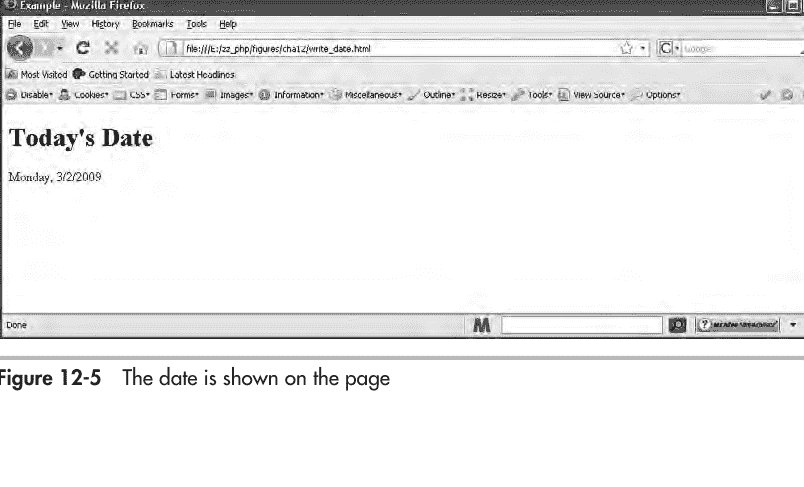

下面的脚本会将日期写入页面。首先是 HTML 代码（保存为 `write_date.html`）：

```
<body>
<h1>Today's Date</h1>
<div id="write_date">
<!-- call to a server-side script for backup could go here -->
</div>
<script type="text/javascript" src="write_date.js"></script>
</body>
```

注意 `div` 元素中的注释。如果你希望那些不支持 JavaScript 的浏览器也能访问此功能，可以在此处调用一个 PHP（或其他服务器端技术）脚本作为备用方案。例如，如果你的页面已配置为解析 PHP，则可以使用以下代码来显示日期，其效果与 JavaScript 代码类似：

```
<body>
<h1>Today's Date</h1>
<div id="write_date">
<?PHP
$the_date = date(l, n/j/Y);
echo "$date";
?>
</div>
<script type="text/javascript" src="write_date.js"></script>
</body>
```

你会看到 PHP 脚本比 JavaScript 脚本短得多，这是由于其内置的日期格式化功能。显示的日期可能与查看者的本地日期不同，因为它显示的是 Web 服务器上的日期。对服务器端技术的深入讨论超出了本书的范围，但这可以作为如何为没有 JavaScript 的用户提供相同基本功能的一个示例。

接下来是 JavaScript 代码（保存为 `write_date.js`）：

```
var rightnow = new Date();
var weekday = rightnow.getDay();
var themonth = rightnow.getMonth();
var thedate = rightnow.getDate();
var theyear = rightnow.getFullYear();
```

```
// Set the Days of the Week
var someday= new Array(7);
someday[0]="Sunday";
someday[1]="Monday";
someday[2]="Tuesday";
someday[3]="Wednesday";
someday[4]="Thursday";
someday[5]="Friday";
someday[6]="Saturday";
```

```
//Set the Month Numbers to Be Recognizable
themonth++;

var date_div = document.getElementById("write_date");
date_div.innerHTML = someday[weekday]+ ", "+themonth+"/"+thedate+"/"+theyear;
```

月份值被递增是为了使其看起来像标准的数字月份。

通过其 `id` 获取 `div` 元素，并修改其 `innerHTML` 属性以显示格式化后的日期。

该脚本将方法的结果设置为变量。然后创建一个数组来存放星期几，之后使用 `getDay()` 方法返回的数字作为索引号来访问它们。脚本随后进行调整，将 `getMonth()` 方法返回的数字加1，这样月份就会以你期望的方式显示（回想一下，月份是从0开始计数而不是从1，因此这确保了一月由数字1表示，而不是0）。

格式化的输出被写入页面供查看者观看。此脚本在浏览器中运行时的结果如图 12-5 所示。

以下代码将创建一个显示在页面上的时钟。首先是 HTML 代码（保存为 `clock.html`）：

```
<body>
<h1>Current Time:</h1>
<div id="my_clock">
<!-- call to a server-side script for backup could go here -->
</div>
<script type="text/javascript" src="clock.js"></script>
</body>
```

> **注意**

> 如果你将服务器端脚本用作 JavaScript 时钟的备用方案，你几乎肯定不希望它每秒都更新，因为这可能给 Web 服务器带来不必要的压力。在这种情况下，最好只显示时间而不进行更新。

接下来是 JavaScript 代码（保存为 `clock.js`）：

```
function startclock() {
    var thetime = new Date();
    var hours = thetime.getHours();
    var mins = thetime.getMinutes();
    var secn = thetime.getSeconds();
    var ap = (hours >= 12) ? "p.m." : "a.m.";

    if (hours >= 13) {
        hours -= 12;
    }
    if (hours < 1) {
        hours = 12;
    }
    if (mins < 10) {
        mins = "0" + mins;
    }
    if (secn < 10) {
        secn = "0" + secn;
    }

    var clock_div = document.getElementById("my_clock");
    clock_div.innerHTML = hours + ":" + mins + ":" + secn + " " + ap;
    setTimeout("startclock()", 1000);
}

startclock();
```

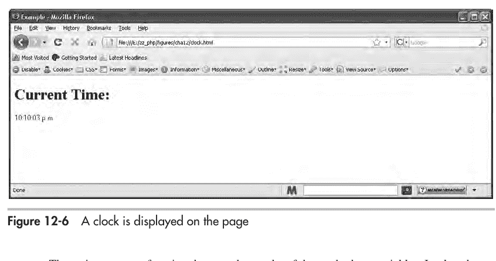

该脚本创建一个函数，将方法的结果设置为变量。它获取小时变量，如果小时大于或等于12，则将 `ap` 变量设置为 `p.m.`；如果小时小于12（此时小时变量仍持有13代表下午1点，14代表下午2点，依此类推），则将其设置为 `a.m.`。完成此操作后，调整小时变量，使其显示12小时制的预期值。

然后脚本调整显示分钟和秒的变量的值，当数字小于10时在前面补一个0。这样时钟会显示 12:02:34 而不是 12:2:34（如果希望小时也有前导零，也可以对小时变量执行此操作）。

最后，函数将输出显示在页面上。函数在定义后立即被调用一次。该函数以1000毫秒（即1秒）的间隔重复执行。这使得时钟能够保持实时更新。此脚本在浏览器中运行时的结果如图 12-6 所示。

## 动手试试 12-2 创建一个 JavaScript 时钟

`pr12_2.html` `prjs12_2.js`

这个项目让你进一步练习 Date 对象的方法，并学习如何调整返回的值以便以各种方式使用。这会创建一个比上一节简单时钟功能更丰富的 JavaScript 时钟。

### 分步操作

1.  创建一个 HTML 页面，其中包含指向名为 `prjs12_2.js` 的外部 JavaScript 文件的 `script` 标签。添加一个标题“当前时间”，并添加一个 `id` 为 `my_clock` 的 `div` 元素。将 HTML 文件保存为 `pr12_1.html`。

2.  创建一个外部 JavaScript 文件并保存为 `prjs12_2.js`。用它来完成步骤 3-6。

3.  编写一些代码来显示时钟。在这个时钟中，包含以下信息：

    *   包含小时、分钟和秒的时间

    *   是上午（A.M.）还是下午（P.M.）

    *   格式为 `mm/dd/yyyy` 的日期

4.  这将是一个12小时制的时钟，因此请务必调整小时的值，使其保持在1到12之间。同时，注意日期的格式，并相应地调整月份和日期的值。

5.  启动时钟，并使其每秒更新一次。

6.  保存 JavaScript 文件，并在浏览器中打开 HTML 文件。时间和日期应该会显示在页面上。

### 动手试试总结

在这个项目中，你运用了 Date 对象的知识。使用 Date 对象的方法，你创建了一个显示在网页上的时钟。

## 第12章 自我测试

1.  Math 对象的属性和方法使你能够做什么？

    A. 计算字符串的平方根等值并返回一个数字

    B. 执行数学计算

    C. 去上数学课学习新定理

    D. 什么也不能，它们没用

2.  `__________` 属性保存欧拉常数的值。

3.  `LN10` 属性保存 10 的自然 `__________` 的值。

4.  `LOG10E` 属性保存 10 的以 `E` 为底的对数值。

    A. 正确

    B. 错误

5.  以下哪项可以将圆周率 `pi` 的值正确写入网页？

    A. `document.write(Math.Pi);`

    B. `document.write(Math.pi);`

    C. `document.write(Math.PI);`

    D. `document.write(Date.PI);`

6.  `__________` 属性保存 2 的平方根的值。

7.  `abs()` 方法返回作为参数传入的数字的 `______________` 值。

    A. 缺席的

    B. 荒谬的

    C. 绝对值

    D. 绝对平方根

8.  `______________` 方法返回作为参数传入的数字的反正弦值。

9.  `pow()` 方法返回第一个参数（作为底数）的指定第二个参数（作为指数）次幂的数值。

10. 以下哪项可以正确生成一个介于 0 和 7 之间的随机数？

    A. `var rand_int= Math.floor(Math.random()*7);`

    B. `var rand_int= Math.floor(Math.random()*6);`

    C. `var rand_int= Math.floor(Math.random()*8);`

    D. `var rand_int= Math.sqrt(Math.random());`

11. `______________` 方法返回作为参数传入的数字的平方根。

12. 在大多数情况下，在使用 Date 对象的属性和方法之前，必须创建什么？

    A. `Nights` 字符串

    B. 一个用于引用日期的数字

    C. 一个用于设置日期的时间

    D. Date 对象的一个实例

13. `______________` 方法返回一周中的第几天。

14. `getMonth()` 方法返回的数字与表示当前月份的数字相同（例如，如果当前月份是一月，则返回 1）。

    A. 正确

    B. 错误

15. 以下哪项将正确地将名为 `rightnow` 的 Date 对象实例的星期几赋值给名为 `weekday` 的变量？

    A. `var weekday= rightnow.getDate();`

    B. `var weekday= rightnow.getDay();`

    C. `var weekday= right now.getDay();`

    D. `var weekly= rightlater.getMinutes();`

## 第13章

### 处理字符串

**关键技能与概念**

- 使用字符串对象的属性

- 使用字符串对象的方法

- 使用正则表达式

要在JavaScript中处理字符串，你需要学习各种处理字符串的方法。这些方法来源于JavaScript的字符串对象。

本章首先解释字符串对象是什么，以及如何创建使用其属性和方法的字符串。然后，更详细地讨论字符串对象的属性和方法，以便你了解它们的工作原理。最后，你将编写一个脚本，使用你学到的一些属性和方法。

### 字符串对象简介

字符串对象提供了获取字符串信息或修改字符串的属性和方法。字符串对象有两种创建方式：一种是程序员使用`new`关键字和构造函数创建，另一种是JavaScript在从字符串字面量调用某个方法时临时创建。什么构成了字符串对象，什么又构成了字符串字面量？让我们看看如何在JavaScript中创建字符串对象。

#### 字符串对象

如上所述，创建字符串对象的一种方法是使用`new`关键字，就像你之前创建其他对象一样。语法如下所示：

```
var instance_name = new String("string value here");
```

你需要将*instance_name*替换为要用于字符串对象实例的名称。然后将*string value here*替换要用作新字符串对象的字符字符串。

因此，如果你想创建一个名为*guitar_string*的字符串对象实例，可以使用以下代码：

```
var guitar_string = new String("G");
```

此脚本为字符串“G”创建一个字符串对象实例。

虽然使用`new`关键字创建字符串对象对于比较字符串对象等任务可能很有用，但字符串字面量的使用更为普遍。

#### 字符串字面量

你只需将字符串值赋给变量即可创建字符串字面量。这种技术比使用`new`关键字创建字符串对象稍微简短一些，并且仍然允许你使用字符串对象的所有方法（以及其中一个属性）。

以下代码创建了一个字符串字面量。注意代码将字符串值赋给了一个变量。

```
var guitar_string = "G";
```

这使字符串“G”成为字符串字面量，也就是你所知道的普通文本字符串。对于文本字符串，你也可以使用字符串对象的属性和方法。

#### 区别是什么？

字符串对象和字符串字面量之间的区别在于，普通文本字符串的值就是字符串本身，并且可以轻松地与其他字符串进行比较，如以下代码所示：

```
var guitar_string1 = "E";
var guitar_string2 = "E";
if (guitar_string1 == guitar_string2) {
  window.alert("The strings are the same!");
}
else {
  window.alert("The strings are not the same!");
}
```

因为此代码使用的是普通字符串字面量，所以结果正如你所料。一个警报提示说字符串相同。

然而，如果你使用字符串对象来运行相同的if块，你会看到意想不到的结果。以下代码使用的是字符串对象：

```
var guitar_string1 = new String("E");
var guitar_string2 = new String("E");
if (guitar_string1 == guitar_string2) {
  window.alert("The strings are the same!");
}
else {
  window.alert("The strings are not the same!");
}
```

这次警报会告诉你字符串不相同，即使字符串值都是“E”——因为字符串对象是一个对象值，而不是字面量值。对象之间的相等性判断方式与普通文本字符串不同。要确定两个对象是否相等，你必须编写额外的代码来判断。对于大多数情况，你可能不想这么麻烦。相反，你可能会使用字符串字面量，并让它们使用字符串对象的方法。

普通文本字符串能够使用字符串对象的方法，是因为JavaScript将字符串字面量转换为临时字符串对象。方法执行完成后，它会返回一个字符串字面量。这样你就可以使用字符串对象的方法，而无需创建字符串对象。

### 使用字符串对象的属性

字符串对象只有三个属性，因此本节相对较短。表13-1简要描述了这些属性，后续各节将逐一讨论。

#### constructor属性

此属性执行的任务与在其他具有该属性的对象（如Date和Array对象）中相同。它返回构造函数的值。要使用constructor属性，你必须使用字符串对象而不是字面量。

**注意**

你可以将字符串字面量用于length属性和字符串对象的所有方法，但constructor和prototype属性需要字符串对象。

以下代码将constructor属性的值写入网页：

```
<body>
<script type="text/javascript">
var guitar_string = new String("G"); // 创建一个新的字符串对象
document.write(guitar_string.constructor); // 在页面上打印constructor属性的值
</script>
</body>
```

此代码生成类似以下的文本：

`function String() { [native code] }`

#### length属性

此属性返回字符串的长度，即字符串中包含的字符数。它可以在字符串对象和字符串字面量上使用。你可能在其他对象上也见过这个属性，比如Array对象。（在这种情况下，值是数组中的元素数量。）

| 属性 | 用途 |
| :--- | :--- |
| `constructor` | 保存对象实例构造函数的值 |
| `length` | 保存字符串长度的数值（其字符数） |
| `prototype` | 允许你向对象添加属性 |

**表13-1 字符串对象的属性**

以下代码使用的是普通文本字符串。它将字符串变量的长度写入页面。

```
<body>
<script type="text/javascript">
var myname="John";
document.write("The name has "+myname.length+" characters.");
</script>
</body>
```

注意变量名在这里的使用方式就像对象名一样。这是让JavaScript创建临时字符串对象以使用该属性的方式。脚本将结果写入页面。因为名字有四个字符，所以这里length属性的值为4。

当你想要分解字符串以获取信息或进行修改时，length属性会非常有用，特别是当字符串是用户输入且你事先不知道其长度时。

#### prototype属性

与具有prototype属性的其他对象一样，你可以使用它向页面上的字符串对象添加属性或方法。以下代码展示了一个示例：

```
String.prototype.attitude="cool";
var rightnow= new String("Joe");
window.alert("This string is "+rightnow.attitude);
```

现在字符串对象“Joe”就有了一个值为“cool”的attitude属性！

### 使用字符串对象的方法

字符串对象有很多方法，如表13-2所示。

是的，这个列表很长！以下各节将探讨字符串对象的方法。

#### 添加HTML标筂的方法

表13-2中的许多方法用于在字符串周围创建HTML标签（或创建带有作为参数传递的属性值的HTML标签）。许多这些效果可以通过更现代的方法来实现，即访问元素的style和/或innerHTML属性；然而，了解这些方法在不同的情况下可能有所帮助。

| 方法 | 用途 |
| :--- | :--- |
| `anchor()` | 创建一个带有页面内目标点的HTML锚点标签 |
| `big()` | 在字符串值周围添加 <big> 和 </big> 标签 |
| `blink()` | 在字符串值周围添加 <blink> 和 </blink> 标签 |
| `bold()` | 在字符串值周围添加 <b> 和 </b> 标签 |
| `charAt()` | 查找字符串中给位置的字符 |
| `charCodeAt()` | 查找字符串中给位置字符的字符编码 |
| `concat()` | 将两个或多个字符串连接起来，并返回新的组合字符串值 |
| `fixed()` | 在字符串值周围添加 <tt> 和 </tt> 标签 |
| `fontcolor()` | 在字符串值周围添加 <font color="color"> 和 </font> 标签，将字符串颜色更改为指定颜色 |
| `fontsize()` | 在字符串值周围添加 <font size="number"> 和 </font> 标签，将字符串大小更改为作为数字指定的大0 |
| `fromCharCode()` | 使用作为参数传递的字符编码创建新字符串 |
| `indexOf()` | 在字符串中搜索作为参数传递的字符：如果找到，返回该字符首次出现的位置；否则返回 -1 |
| `italics()` | 在字符串值周围添加 <i> 和 </i> 标签 |
| `lastIndexOf()` | 在字符串中搜索作为参数传递的字符：如果找到，返回该字符最后出现的位置；否则返回 -1 |
| `link()` | 使用字符串作为链接文本，并链接到作为参数传递的URL来创建HTML链接 |
| `match()` | 比较正则表达式和字符串以查看它们是否匹配 |
| `replace()` | 查找正则表达式是否匹配字符串，然后将匹配的字符串替换为新字符串 |
| `search()` | 在正则表达式和指定字符串之间执行匹配搜索 |
| `slice()` | 提取字符串值的指定部分并返回一个新字符串 |
| `small()` | 在字符串值周围添加 <small> 和 </small> 标签 |
| `split()` | 根据作为方法参数传递的字符，将字符串分隔成字符串数组 |
| `strike()` | 在字符串值周围添加 <strike> 和 </strike> 标签 |
| `sub()` | 在字符串值周围添加 <sub> 和 </sub> 标签 |
| `substr()` | 允许返回通过起始位置和一定字符数后结束指定的字符串部分 |
| `substring()` | 允许返回通过起始位置和结束位置指定的字符串部分 |
| `sup()` | 在字符串值周围添加 <sup> 和 </sup> 标签 |
| `toString()` | 返回字符串对象的字符串字面量值 |
| `toLowerCase()` | 将字符串转换为全小写字母并返回结果 |
| `toUpperCase()` | 将字符串转换为全大写字母并返回结果 |

**表13-2 字符串对象的方法**

##### anchor() 方法

此方法将文本字符串放置为命名锚点的文本。anchor() 方法接受一个参数，该参数将作为命名锚点的 name 属性。基本上，它创建一个具有以下语法的 HTML 标签集：

```
<a name="parameter_string">text_string</a>
```

*parameter_string* 是你在方法调用中作为参数发送的字符串。*text_string* 是你调用该方法的字符串的值。例如，看看这段代码：

```
var anchor_text = "Part 1";
var full_anchor = anchor_text.anchor("part1");
document.write(full_anchor);
```

这里，你将一个字符串字面量赋值给变量 anchor_text。然后你从这个字符串字面量调用 anchor() 方法，并传入参数 "part1"。结果被赋值给 full_anchor 变量。然后，full_anchor 变量的值被写入页面。该代码将以下链接写入页面代码：

```
<a name="part1">Part 1</a>
```

图 13-1 展示了在浏览器中查看此代码时的样子。注意，查看者只能看到该部分的锚点文本。

##### fontcolor() 方法

fontcolor() 方法为调用它的文本字符串添加字体颜色。它接受一个字符串参数，指示文本应为何种颜色。颜色可以使用颜色名称或其红绿蓝 (RGB) 值来指定。

此方法在文本周围格式化一些代码，类似于示例语法：

```
<font color="color_value">text_string</font>
```

这里，*color_value* 将被替换为作为参数发送给方法的颜色名称或 RGB 值。*text_string* 部分将被替换为调用该方法的文本字符串。

例如，此代码在页面上创建一些红色文本：

```
<body>
<script type="text/javascript">
var the_text = "I am so mad I am red!";
document.write(the_text.fontcolor("red"));
</script>
</body>
```

文本根据作为参数发送的颜色名称被赋予字体颜色。此脚本将以下代码放入页面源代码：

```
<font color="red">I am so mad I am red!</font>
```

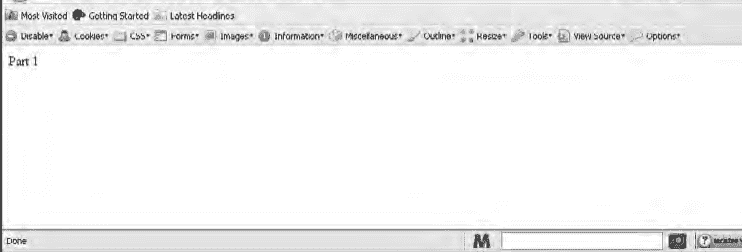

图 13-1 页面上放置的命名锚点

你也可以使用 RGB 值代替颜色名称。在此代码中，使用了 RGB 值：

```
<body>
<script type="text/javascript">
var the_text = "I am so mad I am red!";
document.write(the_text.fontcolor("#FF0000"));
</script>
</body>
```

这次，生成的代码将被更改，以包含 RGB 值而不是前一个示例中的颜色名称，如下所示：

```
<font color="#FF0000">I am so mad I am red!</font>
```

##### fontsize() 方法

fontsize() 方法调整调用该方法的文本字符串的字体大小。它接受一个数值来表示文本的大小（介于 1 到 7 之间）。

该方法格式化代码，使其使用类似于以下示例的语法：

```
<font size="number">text_string</font>
```

*number* 被替换为在方法调用中作为参数发送的数字，*text_string* 被替换为调用该方法的文本字符串。

以下示例展示了该方法的实际应用：

```
<body>
<script type="text/javascript">
var the_text = "I am pretty small!";
document.write(the_text.fontsize(2));
</script>
</body>
```

此脚本在页面源代码中提供以下代码：

```
<font size="2">I am pretty small!</font>
```

##### link() 方法

link() 方法的工作原理类似于 anchor() 方法，但它在页面上创建的是一个典型的超链接。它接受一个字符串参数，该参数是链的 URL 值，而链的文本将是调用该方法的文本字符串。

该方法创建一个具有如下所示通用语法的链接：

```
<a href="url">text_string</a>
```

*url* 被替换为在方法调用中作为参数发送的 URL，而 *text_string* 被替换为发起调用的文本字符串。

看看这个使用 link() 方法的例子：

```
<body>
<script type="text/javascript">
var link_text = "A Web Site";
var full_link = link_text.link("http://www.pageresource.com");
document.write(full_link);
</script>
</body>
```

链接是根据作为参数发送的 URL 和字符串创建的。此代码在页面源代码中创建如下链接：

```
<a href="http://www.pageresource.com">A Web Site</a>
```

前面代码示例中的技术也可以用作 anchor() 方法的另一端，以创建指向页面上命名锚点的链接。例如，看看这段代码：

```
<body>
<p>
<script type="text/javascript">
var anchor_text = "Part 1";
var full_anchor = anchor_text.anchor("part1");
document.write(full_anchor);
</script>
</p>
<p>
Part 1 is about this, that and the other thing.<br />
<br /><br /><br /><br />
This is irrelevant text in this case used for filler.
</p>
<p>
<script type="text/javascript">
var link_text="Back to Beginning of Part 1";
var full_link= link_text.link("#part1");
document.write(full_link);
</script>
</p>
</body>
```

一个锚点被创建。一个指向该锚点的链接也被创建。此代码创建了一个锚点，可以在页面的其他地方引用，通过点击链接跳转到 Part 1 文本。你可以将一些文本替换为 Part 1 部分下方的任何内容。之后，创建了一个指回命名锚点的链接，为查看者提供返回页面 Part 1 部分开头的机会。

图 13-2 显示了在浏览器中运行此脚本的结果。你会得到命名锚点、额外的文本以及返回锚点的链接。

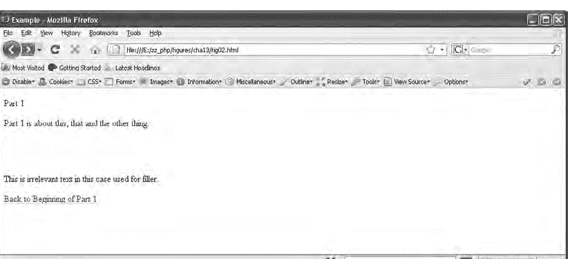

#### 其他方法

String 对象的剩余方法——charAt()、charCodeAt()、concat()、fromCharCode()、indexOf()、lastIndexOf()、match()、replace()、search()、slice()、split()、substr()、substring()、toString()、toLowerCase() 和 toUpperCase()——允许你获取有关字符串的信息或修改字符串。所有这些方法在处理字符串时都非常有用，将在后续章节中更详细地讨论。

##### charAt() 方法

此方法确定字符串中特定位置的字符是什么。你可以找出第一个或最后一个字符，也可以找出中间的任何字符。charAt() 方法接受一个数字，表示你想知道字符的位置。

**查找字符** 当你想查找一个字符时，请记住位置计数从 0 开始（与数组相同），而不是从 1 开始，因此第一个字符在位置 0。以下代码展示了如何使用 charAt() 方法获取字符串中的第一个字符：

```
var the_text = "Character";
var first_char = the_text.charAt(0); // The charAt() method finds the character at position 0 (the first character) in the string
window.alert("The first character is "+first_char);
```

此代码将 charAt() 方法调用的结果赋值给名为 first_char 的变量，该变量随后在 alert 中使用。alert 将告诉查看者调用该方法的文本字符串中的第一个字符。在这种情况下，alert 将显示 “The first character is C”。

###### 使用 length 属性查找最后一个字符

如果你想要找到最后一个字符，要么你需要在使用该方法之前就知道字符串中有多少个字符，要么你可以使用 `length` 属性来确定字符串中的字符数量。使用 `length` 属性时，请记住它返回的是字符数量，而不是最后一个字符的位置。

`length` 属性从 1 开始计数，而使用 `charAt()` 方法时你必须从 0 开始计数。因此，字符串中的最后一个字符的位置将比它包含的字符数量少 1。换句话说，如果一个字符串有 10 个字符（1-10），最后一个位置（0-9）是 9。如果一个字符串有 23 个字符（1-23），最后一个位置（0-22）是 23-1=22。

看一个例子，看看它是如何工作的。这段代码查找字符串中的最后一个字符：

从 `length` 属性中减去 1，以找到字符串中最后一个可用位置

```
var the_text = "Character";
var position = the_text.length-1;
var last_char = the_text.charAt(position);
window.alert("The last character is "+last_char);
```

`charAt()` 方法使用该值来找出字符串中最后一个位置的字符

此代码将字符串长度减 1 的值赋给一个名为 `position` 的变量。`position` 变量现在保存了字符串中最后一个字符的位置。将 `position` 的值作为参数传递给 `charAt()` 方法，其结果被赋给一个名为 `last_char` 的变量。最后，一个警告框显示了字符串中的最后一个字符，即 *r*。因此，用户会看到一个显示“The last character is *r*”的警告。

##### charCodeAt() 方法

`charCodeAt()` 方法的工作方式与 `charAt()` 方法相同，但它返回作为参数发送的位置上字符的字符代码。

字符代码是一个可以在 HTML 中替代字符的数字代码。在 HTML 中，你可以通过使用特殊的字符代码在网页上显示尖括号 (<)——而不会将尖括号本身转换为 HTML。例如，你可以使用 `&#60;` 来代替普通的尖括号。`charCodeAt()` 方法返回该代码的数字部分，即 60。

如果你想找出某个字符的字符代码，`charCodeAt()` 方法会很有用。此脚本允许你这样做：

`charCodeAt()` 方法查找字符串中位置 0（第一个字符）处的字符代码

```
var the_text = "Hello";
var char_code = the_text.charCodeAt(0);
window.alert("The character code is &#"+char_code+";");
```

然后，一个警告框会告诉你字符串中位置 0 处的字符代码（字母 *H*），即 72。警告框会自动在字符代码前面添加字符串 “&#”，并在后面添加字符串 “;”，并显示 “The character code is &#72;”。

##### concat() 方法

此方法的工作方式与 Array 对象的 `concat()` 方法非常相似。它将调用该方法的文本字符串与作为参数发送的任意数量的其他文本字符串组合起来，并返回组合后的值。调用方法的文本字符串在顺序上排在第一位，而作为参数发送的字符串则按顺序添加到其后。

以下代码展示了使用 `concat()` 方法组合三个字符串的示例：

```
var string1 = "I went to the store ";
var string2 = "then ";
var string3 = "I played a video game";
window.alert(string1.concat(string2,string3));
```

此代码按 string1、string2、然后 string3 的顺序组合字符串。结果是一个显示 “I went to the store then I played a video game” 的警告。

如果你想以不同的顺序组合，你可以调整哪个字符串调用方法以及参的顺序，如以下代码所示：

```
var string1 = "I went to the store ";
var string2 = " then ";
var string3 = "I played a video game";
window.alert(string3.concat(string2,string1));
```

这次，string3 调用方法，所以它出现在新字符串的开头。string2 和 string3 的值按顺序添加在其后。这种情况下，结果是一个显示 “I played a video game then I went to the store” 的警告。

##### fromCharCode() 方法

`fromCharCode()` 方法通过一系列作为参数发送给该方法的字符代码来创建一个字符串。`charCodeAt()` 方法返回给定位置上字符的数字代码。这就是你必须传递给 `fromCharCode()` 方法的那种值。此外，`fromCharCode()` 是直接从 String 对象调用的，而不是从现有字符串调用的，因为它是在动态拼接字符串，不需要一个现有字符串来运行。相反，它使用发送给它的参数来返回一个字符串。

因此，如果你想向用户显示文本字符串 “HI”，你可以使用这里显示的示例代码：

```
window.alert(String.fromCharCode(72,73));
```

此代码接收第一个参数（字符代码 72）并将其转换为 H。然后它接收第二个参数（字符代码 73）并将其转换为 I。这两个字符按发送的顺序组合形成字符串 “HI”，并作为警告发送给用户。

##### indexOf() 方法

`indexOf()` 方法用于查找某个字符或字符串在字符串中的起始位置。它只返回作为参数发送的字符或字符串首次出现的位置。如果在字符串值中未找到该字符或字符串，则返回 -1。

## JavaScript：初学者指南

以下代码在字符串 “Cool” 中查找字母 *C*：

```
var the_text = "Cool";
var position = the_text.indexOf("C");
window.alert("Your character is at position "+position);
```

请记住，位置计数从 0 开始，因此当它在字符串中找到 *C* 作为第一个字符时，它返回 0。因此，警告框将显示 “Your character is at position 0”。

请注意，该方法区分大小写，因此在这种情况下，*C* 和 *c* 对 JavaScript 来说是两个不同的字符。因此，即使字符串中包含一个大写的 *C*，下面的代码也会返回 -1（告诉你该字符不在字符串中）。

```
var the_text = "Cool";
var position = the_text.indexOf("c");
window.alert("Your character is at position "+position);
```

警告框现在将显示 “Your character is at position –1”。

如果你想检查这个 -1 值以避免将其作为位置使用，你可以使用以下代码，在找不到你想要查找的字符时发送不同的警告：

```
var the_text = "Cool";
var position = the_text.indexOf("c");
if (position == -1) {
    window.alert("Your character is not in the string!");
}
else {
    window.alert("Your character is at position "+position);
}
```

这次，`if` 语句检查该方法是否向 `position` 变量返回了 -1。如果是这样，警告显示 “Your character is not in the string!”。否则，常规警告会告诉你位置。在前面的代码中，小写的 *c* 不在字符串中，所以会出现 “Your character is not in the string!” 的警告。

`indexOf()` 方法只返回你作为参数发送的字符首次出现的位置号。因此，如果你使用下面的代码，即使 *o* 也出现在位置 2，你也会收到警告说你的字符在位置 1：

```
var the_text = "Cool";
var position = the_text.indexOf("o");
if (position == -1) {
    window.alert("Your character is not in the string!");
}
else {
    window.alert("Your character is at position "+position);
}
```

小写的 *o* 在字符串中出现了两次，但 `indexOf()` 只定位该字符的第一次出现。要定位下一次出现，你需要让方法查找 “oo” 而不是 “o”（这将告诉你第一个 “o” 的位置，但你知道下一个位置也包含一个 “o”），或者你可以让方法使用第二个参数从不同的起点开始查找。

如果你向 `indexOf()` 方法添加一个整数作为第二个参数，查找你的字符或字符串将从该位置开始，而不是从位置 0 开始。因此，找到第二个 “o” 的一种方法是跳过位置 1 的第一个 “o”，从位置 2 开始查找。

```
var the_text = "Cool";
var position = the_text.indexOf("o",2);
if (position == -1) {
    window.alert("Your character is not in the string!");
} else {
    window.alert("Your character is at position "+position);
}
```

这次，方法返回 2 作为结果，因为它正好在指定的起始位置找到了它。

通常，此方法用于确保特定字符或字符串在字符串中存在或不存在。例如，如果你想让一个字符串包含 “fruit”，但不包含 “candy”，你可以编写以下代码：

```
var the_text = "I like fruit!";
if ((the_text.indexOf("fruit") != -1) && (the_text.indexOf("candy") == -1)) {
    window.alert("Yes, fruit is good for you!");
} else {
    window.alert("Please consider fruit rather than candy.");
}
```

这要求字符串包含 “fruit” 但不包含 “candy”。如果通过测试，则会发送一个赞扬水果的警告。否则，会发送一个建议用水果代替糖果的警告。

##### lastIndexOf() 方法

`lastIndexOf()` 方法用于查找某个字符或字符串在字符串中的最后一次出现的位置。它只返回作为参数发送的字符或字符串最后一次出现的位置。如果在字符串值中未找到该字符或字符串，则返回 -1。

以下代码在字符串 “Cool Cruising Car” 中查找字母 C：

##### `match()` 方法

`match()` 方法用于比较一个正则表达式和一个字符串，以查看它们是否匹配。由于它涉及正则表达式，我现在不会详细介绍此方法，但正则表达式将在本章后面的“使用正则表达式”部分中讲解。

##### `replace()` 方法

`replace()` 方法用于查找正则表达式是否与字符串匹配，然后将匹配的字符串替换为新的字符串。由于它涉及正则表达式，我将在本章后面再详细介绍此方法。

##### `search()` 方法

`search()` 方法用于在正则表达式和指定字符串之间执行匹配搜索。由于它涉及正则表达式，我将在本章后面再详细介绍此方法。

##### `slice()` 方法

此方法提取字符串的一部分并返回一个新字符串，即被切片的文本字符串。`slice()` 方法接受两个数字参数，分别指定要提取的字符串部分的开始和结束位置。

此方法的工作原理与数组的 `slice()` 方法非常相似。第一个参数告诉它从哪个位置开始切片，而第二个参数则比停止位置的索引大一。例如，看看下面的代码：

```
var the_text = "Do not cut this short!";
var shorter_string = the_text.slice(0,7);
window.alert(shorter_string);
```

此代码从位置0切片字符串到位置6。位置7是单词 "cut" 中 "c" 的位置；但它不会被切片，因为结束参数不包含在要切片的位置内，而是比停止位置大一。因此，提示框将显示 "Do not "。

##### `split()` 方法

`split()` 方法基于它分割的字符串创建一个字符串元素数组（与 `join()` 方法相反）。字符串根据作为参数传递的、用作分隔符的字符进行分割。

例如，下面的代码中有一个包含多个冒号的字符串：

```
var the_text = "orange:apple:pear:grape";
var split_text = the_text.split(":");
var end_count = split_text.length;
for (var count=0; count<end_count; count++) {
    document.write(split_text[count]+"<br />" );
}
```

分配给 `the_text` 变量的字符串包含一堆由冒号分隔的水果。下一行使用 `split()` 方法在文本字符串 `the_text` 上创建一个名为 `split_text` 的数组。传递的参数是一个冒号，它被用作分隔符将字符串分割成数组元素。在这种情况下，数组最终包含四个元素。

# 第13章：处理字符串

**注意**

作为参数传递的分隔符字符不会出现在数组中：它仅用作文本之间的分隔符，以便方法知道每个元素的开始和结束位置。

下一行获取 `split_text` 数组的长度，并将该值放入变量 `end_count` 中。然后，此信息用于循环遍历新数组并在页面上打印元素。

图13-3显示了此脚本在浏览器中的结果，它列出了水果名称。

##### `substr()` 方法

此方法提取字符串的一部分，并将被移除的部分作为新字符串返回。它接受两个数字参数。第一个参数指定移除的开始位置，第二个参数指定要移除的字符数。

例如，以下代码从位置0开始移除字符串的一部分，直到移除七个字符：

```
var the_text = "Do not cut this short!";
var shorter_string = the_text.substr(0,7);
window.alert(shorter_string);
```

此代码移除字符串中直到单词 "cut" 开头的所有内容。返回的字符串是被移除的那部分字符串。因此，提示框将显示 "Do not "。请注意，"not" 后面的空格字符被包含了，因为它是被移除的第七个字符。

##### `substring()` 方法

此方法的工作原理与 `substr()` 方法非常相似，但它允许你传递要移除的字符串部分的开始位置和结束位置的参数。然后，它返回被移除的部分作为新字符串。

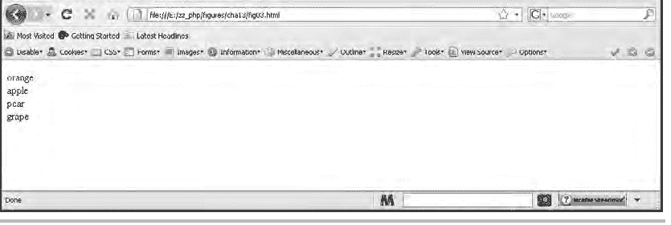

例如，看看下面的代码。你不是指定要移除的字符数，而是给出一个结束位置。字符从起始位置开始移除，直到结束位置减一（记得 `slice()` 方法吗）。

```
var the_text = "Do not cut this short!";
var shorter_string = the_text.substring(3,7);
window.alert(shorter_string);
```

你移除了字符串开头和单词 "cut" 开头之间的所有内容。提示框将显示 "not "。

##### `toString()` 方法

`toString()` 方法为调用它的字符串对象返回一个字符串字面值。以下是使用此方法的示例：

```
var string_obj = new String("Cool");
var string_lit = string_obj.toString();
```

此代码接受字符串对象并使用 `toString()` 方法获取其字符串字面值。然后，将该值分配给 `string_lit` 变量。

##### `toLowerCase()` 方法

此方法以小写字母返回调用它的字符串的值。看看这段代码：

```
<body>
<script type="text/javascript">
var the_text = "I FEEL CALM, REALLY.";
document.write(the_text.toLowerCase());
</script>
</body>
```

此代码在页面上以全小写字母书写字符串，如下示例文本所示：

i feel calm, really.

##### `toUpperCase()` 方法

此方法以大写字母返回调用它的字符串的值。这是一个例子：

```
<body>
<script type="text/javascript">
var the_text = "I am yelling!";
document.write(the_text.toUpperCase());
</script>
</body>
```

此代码在页面上以全大写字母书写字符串，如下示例文本所示：

I AM YELLING!

这就是所有方法了！现在你已经准备好测试所学内容了。

## 专家问答

**问：** 那么 `length` 属性返回字符串中的字符数，但字符串方法从0开始计数。这有点令人困惑，就像数组一样。有没有简单的方法可以记住这一点？

**答：** 最简单的方法可能是记住 `length` 属性从1开始计数，而方法从0开始计算位置。因此，`length` 属性的最终值比字符串中的最后一个位置大一。所以，如果字符串长度为5，则意味着字符串中的最后一个位置是位置4。

**问：** 是的，但同样令人困惑的是，`slice()` 和 `substring()` 方法中的第二个参数比方法停止移除字符的点高一个位置。这是为什么呢？

**答：** 开始时确实令人困惑。你只需要习惯每个方法的工作方式。`slice()` 和 `substring()` 方法有点令人困惑。但如果你使用得足够多，你就会记住在什么情况下使用哪些数字。

**问：** 为什么我需要 `split()` 方法？我难道不能直接创建自己的数组然后就完事了吗？

**答：** 可以。但是，一旦你了解了 JavaScript cookie，`split()` 方法将非常有用，因为你将能够分割存储在 cookie 中的信息以加以利用。cookie 将信息存储在长文本字符串中，通常使用某个字符作为分隔符。这只是 `split()` 方法可能对你有用的一个例子。

**问：** 很多方法只是在文本字符串周围添加标签。我难道不能直接为此编写 HTML 吗？那似乎更容易。

**答：** 你可以，如果你觉得使用 HTML 更顺手的话，尽管使用字符串对象，这些方法可能更有用。

## 动手实践 13-1 使用 `charAt()` 查找首字母

在本项目中，你将练习使用 `charAt()` 方法，通过创建一个脚本来确定观众输入的第一个字符是否有效。

pr13_1.html

prjs13_1.js

### 逐步操作

- 1. 创建一个 HTML 页面，其中包含一个 “欢迎” 标题，并调用一个名为 prjs13_1.js 的 JavaScript 文件。将 HTML 文件保存为 pr13_1.html。

### 试试这个总结

在这个项目中，你运用了对 `charAt()` 方法的理解，创建了一个脚本来判断用户输入的第一个字符是否是有效字符。如果输入以大写 S 开头，则会显示用户的输入内容。否则，会向用户显示一条消息。

## 综合运用方法

既然你知道了如何单独使用脚本对象的属性和方法，现在可以创建一个综合运用多种方法的脚本，看看它们如何协同工作。为此，我们将创建一个脚本，以善意的方式"戏弄"一下观众的名字。

脚本的目标是获取观众的名字和姓氏，更改每个名字的首字母，然后将结果提示给观众。以下脚本实现了这个功能：

```
<body>
<h1>Welcome!</h1>
<script type="text/javascript">
function getname() {
  var the_text=window.prompt("Enter your first and last name","");
  if (the_text.indexOf(" ") == -1) {
    window.alert("Put a space between your first and last name. Try again.");
    getname();
  }
}
var split_text= the_text.split(" ");
if ((split_text[0].charAt(0) != "Z") || (split_text[0].charAt(0) != "z")) {
  var shorter_fn_string = split_text[0].substring(1,split_text[0].length);
  new_fn_name = "Z"+shorter_fn_string;
}
</script>
```

如果名字以 Z 或 z 开头，则会移除首字母并替换为 W。

```
else {
    var shorter_fn_string = split_text[0].substring(1,split_text[0].length);
    new_fn_name = "W"+shorter_fn_string;
}
if ((split_text[1].charAt(0)!= "Z") || (split_text[1].charAt(0)!= "z")) {
    var shorter_ln_string= split_text[1].substring(1,split_text[1].length);
    new_ln_name="Z"+shorter_ln_string;
}
else {
    var shorter_ln_string= split_text[1].substring(1,split_text[1].length);
    new_ln_name="W"+shorter_ln_string;
}
window.alert("Now your name is "+new_fn_name+" "+new_ln_name+"!");
```

getname(); <-- 页面加载时调用此函数以启动流程。

</script>

</body>
```

姓名更改的结果会提示给观众。

姓氏会执行相同的测试和任务。

请注意，名为 `getname()` 的函数是启动整个流程的关键。该函数执行的第一个任务是提示观众输入名字和姓氏。理想情况下，观众会输入一个名字、一个空格和一个姓氏（当然，也可能输入其他内容，并且可以使用正则表达式更好地处理）。

一旦获取到名字，脚本会使用 `indexOf()` 方法检查输入中是否包含空格。如果不存在空格，则只有一个名字，这不是我们想要的。因此，如果没有空格，脚本会提示观众重试，并重新开始函数。如果存在空格，则脚本继续执行 if 块之后的下一行代码。

然后脚本使用 `split()` 方法创建一个由空格分隔的数据数组。理论上，名字和姓氏之间应该有一个空格。如果观众使用了多个空格，则只会使用结果数组的前两个元素（它们会在脚本的后面被明确调用）。因此，如果观众输入 John Doe，结果数组的元素就是 John 和 Doe。但是，如果观众输入 John J Doe，前两个元素是 John 和 J，Doe 不会被使用。（通过更高级的验证，这个问题可以提示观众重试。）


一旦字符串被分割成数组，脚本使用 `charAt()` 测试数组第一个元素（名字）的首字母。如果不是 Z 或 z，则执行 if 块中的代码。if 块使用 `substring()` 方法获取名字中除第一个字母外的所有字母，然后将该值赋给变量 `shorter_fn_string`。因此，如果名字是 John，变量的值将是 "ohn"。完成后，在该变量前面添加一个字符串值 Z，并将结果赋给变量名 `new_fn_name`。这基本上是将原始名字的首字母替换为 Z。因此，John 会变成 Zohn，Mary 会变成 Zary。

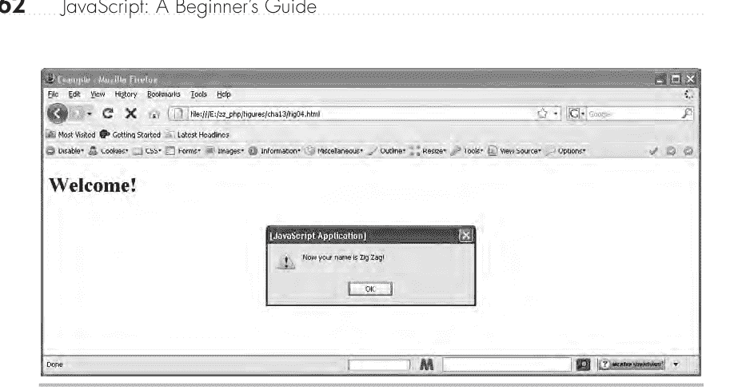

图 13-4 观众通过提示获得了一个新名字。

如果原始名字确实以 Z 或 z 开头，则会执行 else 块。不是将首字母替换为 Z，而是替换为 W。接下来的 if/else 段对数组中的第二个条目（如果输入正确，就是姓氏）执行相同的任务。然后会提示观众查看结果，告诉用户新名字。图 13-4 显示了当观众输入 Big Mag 时，此脚本在浏览器中的结果。

## 试试 13-2 使用 indexOf() 测试地址

在这个项目中，你将通过创建脚本来实践使用 `indexOf()` 方法，该脚本对观众输入的电子邮件地址进行非常基本的测试。

### 分步指南

- 1. 创建一个 HTML 页面，指向名为 `prjs13_2.js` 的 JavaScript 文件。创建一个观众可以点击的按钮，id 为 "email"。标签为 "点击输入电子邮件地址。" 将 HTML 文件保存为 `pr13_2.html`。

- 2. 创建一个外部 JavaScript 文件，并将其保存为 `prjs13_2.js`。用于步骤 3-7。

- 3. 创建一个名为 `get_add()` 的函数。在其中，将提示输入电子邮件地址的结果赋给名为 `email_add` 的变量。

- 4. 同样在函数中，使用 `indexOf()` 检查地址中是否包含 at (@) 字符。

- 5. 同样在函数中，使用 `indexOf()` 检查地址中是否包含点 (.) 字符。

- 6. 同样在函数中，如果地址同时包含 at (@) 字符和点 (.) 字符，则发送感谢观众的提示。否则，向观众发送提示，说明需要这些字符并请重试。

- 7. 保存 JavaScript 文件，并在浏览器中打开 HTML 文件，看看你能用它做什么。

### 试试这个总结

在这个项目中，你运用了对 `indexOf()` 方法的理解来测试观众输入的电子邮件地址是否包含特定字符。如果缺少其中一个字符，会向观众发送错误提示。否则，会发送感谢提示。

## 使用正则表达式

正则表达式为你提供了更强大的脚本字符串处理能力。它们允许你创建可以与字符串匹配的模式，而不是试图使用 String 对象的方法，后者可能使精确匹配变得更加困难。

例如，你可能想知道在电子邮件地址的文本框中输入的值是否包含至少一个开头字符，后跟一个 at (@) 符号，然后是至少一个字符，再跟一个点 (.)，最后是至少两个字符（匹配传统的电子邮件地址，如 `jon@jon.com` 或最短类型的电子邮件地址 `j@j.jj`）。第 13-2 节 "试试这个" 提供了一个类似但更简单的测试供你尝试。

String 对象的方法并没有提供一种简洁明了的方法来执行此任务（尽管经过足够的调试，也许是可能的）。然而，正则表达式可以简化任务，甚至将使用 String 对象方法似乎不可能的匹配转化为可以完成的匹配。

### 创建正则表达式

要创建正则表达式，你必须创建 JavaScript RegExp 对象的实例。你可以使用几乎与创建字符串字面量相同的方式来完成此操作。要创建 RegExp 字面量，只需将正则表达式赋值给一个变量。不是使用引号包围表达式，而是使用正斜杠 (/)，如下所示：

```
var varname = /your_pattern/flags;
```

将 `varname` 替换为你想使用的变量名，并将 `your_pattern` 替换为你选择的正则表达式模式。你可以在最后一个斜杠后面跟一个或多个标志（这些标志将在接下来的 "添加标志" 部分讨论）。

### 使用正则表达式测试字符串

要使用正则表达式测试字符串，您可以使用 RegExp 对象的 `test()` 方法。基本语法如下：

```
regex_name.test(string_to_test);
```

此语法类似于使用字符串方法。您需要将 *regex_name* 替换为正则表达式的名称，并将 *string_to_test* 替换为字符串或字符串变量名。例如，看看下面的例子：

```
var tomatch = /our/;
tomatch.test("pour");
```

此代码将使用名为 "tomatch" 的正则表达式来测试字符串 "pour"。不过，它并没有使用结果。`test()` 方法返回一个布尔值 true 或 false。当字符串的任何部分与正则表达式模式匹配时，它会返回 true。使用 `test()` 方法，您已经可以编写一个简短的脚本，如下所示：提示从用户那里获取一个名字。设置一个正则表达式来查看输入的名字是否与其匹配。

```
var thename = window.prompt("Enter your name","");
var tomatch = /John/;
var is_a_match = tomatch.test(thename);
if (is_a_match) {
    window.alert("Wow, we have the same name!");
}
else {
    window.alert("Not my name, but it will work!");
}
```

一个变量用于保存 `test()` 方法的结果。如果结果为 true，则显示此警告。如果结果不为 true，则显示此警告。

提示获取一个名字，并将该值保存在一个变量中。要匹配的模式是 John，并且它是区分大小写的。因此，只有包含大写 J 后跟小写 o、h 和 n 的 "John" 的输入才会创建匹配，并在测试时返回 true（尽管它可能包含不仅仅是 "John"，因此像 Johnny 或 John Doe 这样的输入也会返回 true——如果您只想要特定的字符集，您需要使用一些额外的特殊字符，这将在本节后面讨论）。

`test()` 方法的结果被赋值给一个名为 `is_a_match` 的变量。然后该变量用作 `if` 语句的条件。如果变量的值为 true，则用户会看到 "Wow, we have the same name!" 的警告。如果变量的值为 false，则用户会看到 "Not my name, but it will work!" 的警告。

如果您想缩短脚本，您可以直接将 `test()` 方法的结果用作 `if` 语句的条件（而不是创建另一个变量），如以下代码所示：

```
var thename = window.prompt("Enter your name", "");
var tomatch = /John/;
if (tomatch.test(thename)) {  // test() 方法的结果用作条件
    window.alert("Wow, we have the same name!");
}
else {
    window.alert("Not my name, but it will work!");
}
```

因为该方法返回 true 或 false，所以它可以单独作为 `if` 语句的条件。（如果您愿意，也可以写成 `(tomatch.test(thename)==true)`。）

### 添加标志

标志允许您使匹配不区分大小写，或者查找字符串中的每个匹配项，而不仅仅是第一个（全局测试）。要添加标志，请将其放在正则表达式中最后一个斜杠之后。您可以使用三个选项，如表 13-3 所示。

如果您想调整之前使用的脚本，使其不区分大小写，您可以向正则表达式添加一个 `i` 标志，如以下代码所示：

```
var thename= window.prompt("Enter your name","");
var tomatch=/John/i; // i 标志使此正则表达式不区分大小写
if (tomatch.test(thename)) {
    window.alert("Wow, we have the same name!");
}
else {
    window.alert("Not my name, but it will work!");
}
```

| 标志 | 用途 |

| :--- | :--- |

| i | 使匹配不区分大小写 |

| g | 使匹配全局化 |

| m | 使匹配在多行模式下工作 |

**表 13-3 正则表达式标志**

现在，只要字符串中存在 John 的模式，`test()` 方法就会返回 true。它可以是任何大小写形式，所以现在 John、JOHN、john，甚至 JoHn 都是匹配项，并且会导致 `test()` 方法返回 true。

您还可以同时使用多个标志或全部三个标志。例如，如果您希望匹配既不区分大小写又是全局的（在整个字符串中抓取每个匹配项），您可以使用以下代码：

```
var tomatch=/John/ig;
```

### 创建强大的模式

虽然能够创建如此精确的模式很好，但您不会总是寻找如此精确的匹配。在许多情况下，您将寻找匹配更通用的模式，例如需要至少包含三个字符的条目，或者需要两个任意类型字符后跟一个特殊字符的条目。

通过在表面中使用特殊字符，您可以创建所需的模式来匹配您想要的给定序列。JavaScript 正则表达式使用 Perl 正则表达式的语法作为模型。因此，如果您在 Perl 中使用过正则表达式，那么本节的大部分内容您都会很熟悉。表 13-4 列出了许多字符来帮助您创建模式。

如您所见，创建所需模式的选项非常广泛。现在您可以根据您决定设置的标准轻松验证字符串了。

现在，如果您想确保文本字段包含一个或多个数字，您可以使用表 13-4 中的 `/d` 和 `+` 字符，以及以下 HTML 和 JavaScript 代码，首先是 HTML 代码：

```
<body>
<form>
Enter some text: <input type="text" id="has_digits" />
<input type="button" id="t_btn" value="Test" />
</form>
</body>
```

接下来是 JavaScript 代码：

```
var t_button = document.getElementById("t_btn");
t_button.onclick = function() {
    var has_num = document.getElementById("has_digits").value;
    var tomatch = /\d+/;
    if (tomatch.test(has_num)) {
        window.alert("Your entry contained one or more numbers!");
    }
    else {
        window.alert("Your entry did not contain any numbers!");
    }
}
```

| 字符 | 用途 | 示例 |

| :--- | :--- | :--- |

| ^ | 仅匹配行首 | /^c/ 匹配 corn 中的 c；/^c/ 不匹配 acorn 中的 c |

| $ | 仅匹配行尾 | /r$/ 匹配 Car 中的 r；/r$/ 不匹购 Cat 中的 t |

| * | 匹配其前导字符出现零次或多次 | /co*/ 匹配 co 或 c；/co*/ 不匹配 pi |

| + | 匹配其前导字符出现一次或多次 | /co+/ 匹配 co 或 cooooo；/co+/ 不匹配 ca |

| ? | 匹配其前导字符出现零次或一次 | /o?l/ 匹配 style 或 column；/co?l/ 不匹配 cool |

| . | 匹配除换行符以外的任何单个字符 | /./ 匹配 a 或 @l；/./ 不匹配 \n 或 l |

| (x) | 通过用字符替换 x，匹配该序列并将其保存在内存中以供后用；用于对表达式进行分组 | /(a)/ 匹配 a；/(cool)/ 匹配 cool；/(cool)/ 不匹配 coal |

| \| | 用作逻辑或符号，允许匹配符号左侧或右侧的内容 | /cool\|bad/ 匹配 cool；/cool\|bad/ 匹配 bad；/cool\|bad/ 不匹配 car |

| {x} | 用数字替换 x，当其前导字符恰好出现 x 次时匹配 | /n{1}/ 匹配 n；/nn{2}/ 匹配 nnn；/nn{1}/ 不匹配 nnn |

| {x,} | 用数字替换 x，当其前导字符出现 x 次或更多次时匹配 | /n{1,}/ 匹配 n；/n{1,}/ 匹配 nnnnn；/n{3,}/ 不匹配 nn |

| {x,y} | 用数字替换 x 和 y，当其前导字符至少出现 x 次但不超过 y 次时匹配 | /n{1,2}/ 匹配 n；/n{1,2}/ 匹配 nn；/n{2,3}/ 不匹配 n；/n{4,7}/ 不匹配 nnn |

| [] | 匹配您选择的字符集；当括号中（如 [abc]）或某个范围内的任意一个字符（如 [a-k]）存在时匹配 | /[abc]/ 匹配 a；/[abc]/ 匹配 b；/[abc]/ 匹配 c；/[a-k]/ 匹配 j；/[a-k]/ 不匹配 n |

| [^] | 当字符集中的字符*不*存在时匹配；可以是一个集合（如 [abc]）或一个范围（如 [a-k]） | /[^abc]/ 匹配 d；/[^abc]/ 不匹配 b；/[^a-k]/ 匹配 n；/[^a-k]/ 不匹配 j |

**表 13-4 正则表达式代码（续）**

| 字符 | 用途 | 示例 |

|---|---|---|

| `\` | 用于转义特殊字符或使普通字符具有特殊含义 | `\@` 转义 `@` 字符；`\n` 表示换行符 |

| `[\b]` | 匹配退格键击 | `/[\b]/` 匹配退格 |

| `\b` | 当其前后的字符位于单词边界时匹配，例如在空格字符之前或之后；要匹配单词开头，将字符放在符号右侧（`\bc`）；要匹匹配单词结尾，将字符放在左侧（`c\b`） | `/\bc/` 匹配 `my car` 中的 `c`；`/\bm/` 匹配 `my car` 中的 `m`；`/\bc/` 不匹配 `ace` 中的 `c`；`/\bm/` 不匹配 `Sam` 中的 `m`；`/m\b/` 匹配 `Sam` 中的 `m`；`/c\b/` 匹配 `Mac W` 中的 `c`；`/m\b/` 不匹配 `emu` 中的 `m`；`/c\b/` 不匹配 `my car` 中的 `c` |

| `\B` | 匹配不位于单词边界的字符 | `/\Ba/` 匹配 `car` 中的 `a`；`/\Bc/` 不匹配 `car` 中的 `c` |

| `\cX` | 使用字母字符替换 `X`，当用户按下 CTRL 键并键入字母 `X` 时匹配 | `/\cX/` 匹配 `CTRL-X`；`/\cV/` 匹配 `CTRL-V`；`/\cS/` 不匹配 `CTRL-Z` |

| `\d` | 如果字符是单个数字字符则匹配 | `/\d/` 匹配 `4`；`/\d/` 不匹配 `s` |

| `\D` | 如果不是数字字符则匹配单个字符 | `/\D/` 匹配 `s`；`/\D/` 不匹配 `4` |

| `\f` | 如果有换页符则匹配 | `/\f/` 匹配换页符 |

| `\n` | 如果有换行符则匹配 | `/\n/` 匹配换行符 |

| `\r` | 如果有回车符则匹配 | `/\r/` 匹配回车符 |

| `\s` | 如果代表空白字符（例如空格或换行符）则匹配单个字符 | `/\s/` 匹配 `b c` 中的空格；`/\s/` 匹配 `b  c` 中的制表符；`/\s/` 不匹配 `bc` |

| `\S` | 如果不代表空白字符则匹配单个字符 | `/\S/` 匹配 `d`；`/\S/` 不匹配空格 |

| `\t` | 如果有制表符则匹配 | `/\t/` 匹配 `b  c` 中的制表符 |

| `\v` | 如果有垂直制表符则匹配 | `/\v/` 匹配垂直制表符 |

| `\w` | 匹配任何作为字母、数字或下划线的单个字符 | `/\w/` 匹配 `4`；`/\w/` 不匹配 `@` |

| `\W` | 匹配任何不是字母、数字或下划线的单个字符 | `/\W/` 匹配 `@`；`/\W/` 不匹配 `g` |

**表 13-4** 正则表达式代码（*续*）

此代码仅用于检查字符串中是否包含任何数字。如果要确保用户输入*仅*包含数字而没有任何其他类型的字符，则需要确保正则表达式被编写为从字符串开头测试到结尾。使用表 13-4 中的 `^` 和 `$` 符号，可以确保字符串的匹配测试从字符串开头开始，到字符串结尾结束。因此，以下模式将仅允许数字：

```
var tomatch = /^\d+$/;
```

由于从字符串开头到结尾唯一有效的字符是数字，因此此表达式仅对包含数字且字符串中无其他字符的条目返回 `true`。这对于验证表单和其他类型的用户输入特别有用，以确保输入是预期的类型。

#### **注意**

正则表达式在验证方面可能非常强大，因为它们允许接受更少的错误信息。

对电子邮件地址或电话号码等数据进行客户端表单提交验证，可以节省不必要的服务器往返。然而，用户可能会禁用 JavaScript 支持并直接提交表单。因此，客户端验证应支持服务器端验证（例如，通过 CGI 脚本或 Java servlet），但绝不应替代它（存储或显示未经验证的查看者数据可能会造成巨大的安全风险）。

#### 分组表达式

你会注意到表 13-4 中，被括号包围的表达式表示一个分组，该分组可以存储起来供表达式稍后使用（或使用 `match()` 等方法，其中它会将每个分组的匹配项以及整体匹配项存储在数组中）。

例如，你可能决定使用特定的数字序列，并让该序列重复特定次数。要匹配某事物重复的次数，可以使用花括号（`{}`）以及数字或数字范围。例如，如果要匹配数字 `3` 出现五次，可以使用以下表达式：

```
/3{5}/
```

如果希望数字 `3` 至少出现五次但不超过十次时才匹配，可以使用以下表达式：

```
/3{5,10}/
```

现在，假设你希望匹配以 `3` 开头，下一个字符是任何数字，并且整个序列重复五次（因此，像 `3234353637` 这样的字符串会匹配）。你可能会编写以下内容：

```
/3\d{5}/
```

这样做的问题是，它正确匹配了 `3`，但随后匹配了五个数字，而不需要重复 `3`。因此，像 `387643` 这样的数字会匹配，即使你想要的是五组以 `3` 开头的两位数字。要解决此问题，你可以将 `3` 和 `\d` 用括号分组在一起，然后在其后加上重复次数：

```
/(3\d){5}/
```

这次，`3` 和第二个数字被分组在一起，该序列必须重复五次。

分组是充分利用正则表达式的一种有用方法，当你在下一章中处理表单验证时，你会看到更多相关内容。

#### `replace()`、`match()` 和 `search()` 方法

本章前面已经提到了 String 对象的这些方法，现在引入了正则表达式，它们会更有意义。

##### `replace()` 方法

要替换字符串中的信息，可以使用正则表达式和 String 对象的 `replace()` 方法。使用 `replace()` 方法的语法如下：

```
varname= stringname.replace(regex,newstring);
```

你将 *varname* 替换为存储替换后新字符串值的变量名。将 *stringname* 替换为要进行替换的字符串变量名。将 *regex* 替换为用于匹配字符串的正则表达式名称。最后，将 *newstring* 替换为用于替换字符串中任何匹配值的字符串或字符串变量。

例如，以下代码将 `mystring` 中第一个 "car" 替换为 "skunk"：

```
var mystring= "I like the way a new car smells, and cars are fun.";
var toreplace=/car/;
var newstring= mystring.replace(toreplace,"skunk");
window.alert(newstring);
```

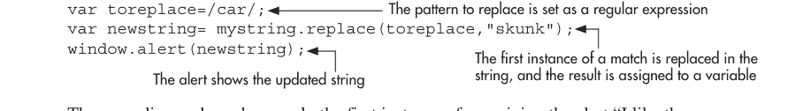

前面的代码仅替换了第一个 "car"，显示的警报为 "I like the way a new skunk smells, and cars are fun."。如果你想更改每个 "car" 实例，则在正则表达式末尾使用 `g` 标志会很有帮助，如下所示：

```
var mystring= "I like the way a new car smells, and cars are fun.";
var toreplace=/car/g;
var newstring= mystring.replace(toreplace,"skunk");
window.alert(newstring);
```

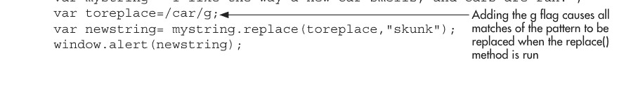

`g` 标志会匹配字符串中找到的每个正则表达式实例。因此，当运行 `replace()` 方法时，所有 "car" 实例都将被替换为 "skunk"。查看者将看到以下警报："I like the way a new skunk smells, and skunks are fun."。

你也可以使用 `replace()` 方法制作一个比本章前面更简短且稍简单的改名脚本。通过使用带有正则表达式的 `replace()` 方法，可以更轻松地更改名字和姓氏的首字母。以下代码展示了如何实现：

```
function getname() {
    var tomatch=/^[A-Za-z]+\s[A-Za-z]+$/;
    var toreplace=/\b[A-Za-z]/gi;
    var thename=window.prompt("Enter your first and last name","");
    if (tomatch.test(thename)) {
        newname=thename.replace(toreplace,"Z");
        window.alert("Now your name is "+newname);
    }
    else {
        window.alert("Name invalid. Please Try Again");
        getname();
    }
}
getname();
```

正则表达式用于验证和更改查看者的输入

此脚本会将名字和姓氏的首字母更改为 `Z`，无论之前是什么。替换的正则表达式只是使用单词边界（`\b`）代码查找单词开头的字母。每当字母位于单词开头时，它就会被替换。

输入的验证使脚本不会接收超过两个名字和一个空格，并且还确保每个名字中至少包含一个字母，没有数字或特殊字符。插图显示了如果查看者在提示处输入 Debra Loo 时脚本的结果：查看者的姓名被更改了。


##### `match()` 方法

`match()` 方法比较正则表达式和字符串以查看它们是否匹配。它返回一个包含一个或多个匹配项的数组，具体取决于使用方式。如果未找到匹配项，则返回 `-1`。

`match()` 方法的基本用法如下：

```javascript
string.match(regex);
```

这里的 `string` 是你的字符串字面量，`regex` 则是你的正则表达式字面量。请注意此方法与 `test()` 方法在参数顺序上的区别。你可以这样使用它：

```javascript
var mystring = "I am Ironman!";
var tomatch = /Iron/;
if (mystring.match(tomatch)) {
    window.alert("Your string contains Iron!");
} else {
    window.alert("Sorry, no Iron in your string.");
}
```

如果结合 `g` 标志或使用 `()` 进行分组，该方法会记住每次匹配（包括对分组或嵌套分组的匹配），并将每次匹配作为数组的一个元素返回。

##### search() 方法

`search()` 方法在正则表达式与指定字符串之间执行匹配搜索。如果找到匹配项，则返回字符串中匹配开始的位置。否则，返回 `-1`。以下是该方法的一个使用示例：

```javascript
var mystring = "I am Ironman!";
var tomatch = /Iron/;
if (mystring.search(tomatch)) {
    window.alert("Iron found at position " + mystring.search(tomatch) + "!");
} else {
    window.alert("Sorry, no Iron in your string.");
}
```

如你所见，其语法与 `match()` 方法非常相似。

### 更多信息

关于正则表达式以及如何创建更复杂模式的更多信息，你可以查阅以下在线资源：

- [http://www.regular-expressions.info/](http://www.regular-expressions.info/)

- [http://www.regular-expressions.info/javascript.html](http://www.regular-expressions.info/javascript.html) （包含关于JavaScript引擎的具体细节）

- [https://developer.mozilla.org/en/Core_JavaScript_1.5_Guide/Regular_Expressions](https://developer.mozilla.org/en/Core_JavaScript_1.5_Guide/Regular_Expressions)

掌握了这些技巧，你就准备好继续学习如何在JavaScript中使用表单以及处理表单内容的验证了。

## 第13章 自测

1.  `String` 对象提供了获取字符串信息或修改字符串的属性和方法。

2.  你创建String对象的两种方式是什么？

    A. 创建String对象的实例和创建字符串字面量

    B. 创建Array对象的实例和创建字符串字面量

    C. 创建一个数字变量和创建一个数字对象

    D. 创建一个字符串并添加数字

3.  通过将字符串值赋给变量，你可以创建一个字符串 `literal`。

4.  普通文本字符串能够使用String对象的方法，因为：

    A. 它本身就是一个String对象

    B. 它还可以使用其他方法，因此可以使用String对象的方法

    C. JavaScript将字符串字面量转换为一个临时的String对象

    D. String对象原样使用字符串字面量

5.  String对象的哪个属性可以同时用于String对象和字符串字面量？

    A. prototype

    B. constructor

    C. length

    D. color

6.  `length` 属性返回字符串的长度。

7.  以下哪项正确地创建了一个字符串字面量？

    A. `var the_text = "Look at me!;`

    B. `var the_text = "Look at me!";`

    C. `var the_text = Look at me!;`

    D. `var the_text = new String("Look at me!");`

8.  String对象的哪个方法可以用来查找字符串中给定位置的字符？

    A. `indexOf()`

    B. `charAt()`

    C. `charIsAt()`

    D. `indexOfThePosition()`

9.  `big` 方法会在字符串值的周围添加 `<big>` 和 `</big>` 标签。

10. `concat()` 方法将两个或多个字符串 `together` 在一起，并返回新的组合字符串值。

11. 以下哪个陈述是正确的？

    A. `charAt()` 方法返回一个数字值，该值是作为参数传递的字符的位置。

    B. `split()` 方法通过移除字符串的一部分并返回移除该部分后的字符串来创建一个新字符串。

    C. `length` 属性允许你向String对象添加更长的属性和方法。

    D. `indexOf()` 方法返回一个数字值，该值是作为参数传递的字符的位置，但仅返回该字符首次出现的位置。

12. `italic` 方法会在字符串值的周围添加 `<i>` 和 `</i>` 标签。

13. `valueOf` 方法返回String对象的字符串字面量值。

14. 要替换字符串中的信息，你可以使用正则表达式和String对象的 `replace` 方法。

15. `match` 方法比较一个正则表达式和一个字符串，以查看它们是否匹配。

## 第14章：JavaScript与表单

## 关键技能与概念

- 访问表单

- 使用表单对象的属性和方法

- 确保表单的可访问性

- 验证表单

- 使用表单进行导航

当你使用JavaScript访问表单时，你可以为你的网页创建新的脚本。本章首先解释如何使用JavaScript访问表单。然后，你将学习与表单和表单元素一起使用的各种属性和方法。你还将了解表单与可访问性、如何验证表单元素，以及如何使用 `<select></select>` 元素作为导航工具。

### 访问表单

每次你向HTML文档添加一组 `<form>` 和 `</form>` 标签时，就会创建一个表单对象。要使用JavaScript访问其中一个表单，你可以使用以下任何一种选项：

- 使用 `document` 对象的 `forms` 数组。

- 在开始的表单标签中为表单命名，并使用该名称访问该表单。

- 在开始的表单标签中为表单指定一个 `id`，并使用 `document.getElementById()` 方法访问它。

#### 使用 forms 数组

`forms` 数组允许你使用数组中的索引号来访问表单。页面上每一组 `<form>` 和 `</form>` 标签都会在 `forms` 敱组中创建一个额外的元素，顺序与它们在文档中出现的顺序相同。因此，你可以像这样引用文档中的第一个表单：

```javascript
document.forms[0]
```

如你所知，数组从0开始计数，因此上面的例子将访问文档中的第一个表单。如果你想访问第二个表单，可以使用以下代码：

```javascript
document.forms[1]
```

对于页面上的其他表单，工作原理相同。只需记住从0而不是1开始计数，以访问正确的表单。

访问表单本身并不会执行任何操作。你访问的表单是一个对象。要使用它，你需要该对象的一个属性或方法。表单对象的属性和方法将在后面的“使用表单对象的属性和方法”一节中列出，但现在，让我们先看一下 `length` 属性，看看它的作用。

### 属性值

本节中的示例使用了表单对象的 `length` 属性。此属性允许你找出HTML表单中存在多少元素（如输入框、选择框、单选按钮等）。例如，看看这段代码：

```html
<body>
	<form>
		Name: <input type="text" />
		E-mail: <input type="text" />
		<input type="submit" value="Submit" />
	</form>
</body>
```

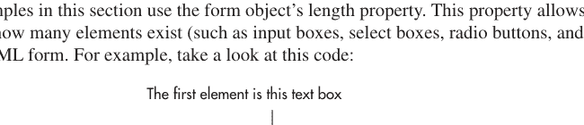

这段代码创建了一个包含三个元素的简短表单：两个文本框和提交按钮。由于它是页面上唯一的表单，它将是第一个表单，允许你使用 `document.forms[0]` 访问它。要使用 `length` 属性，可以像这样将其附加到末尾：

```javascript
document.forms[0].length
```

使用上面的代码，你可以创建一个简短的脚本，告诉查看者表单中有多少个元素。（你通常不会这样使用 `length` 属性，但这很适合作为例示。）下面的代码将在表单之后将信息写在页面上：

```html
<body>
	<form>
		Name: <input type="text" /> <br />
		E-mail: <input type="text" /> <br />
		<input type="submit" value="Submit" />
	</form>
	<p>
		<script type="text/javascript">
			document.write("The form has " + document.forms[0].length + " elements.");
		</script>
	</p>
</body>
```

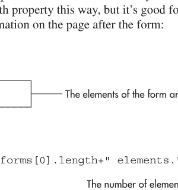

此代码告知查看者该表单有三个元素。图14-1显示了此脚本在浏览器中运行的结果。

#### 涵盖两个长度属性

如果你想在页面上有多个表单时，尝试显示页面上所有表单中的元素数量，可以使用一个更复杂的脚本，为页面上的每个表单打印一条信息。请记住，因为表单是一个数组，所以你可以找到这个数组的长度。

数组的长度就是页面上表单的数量（这与某个特定表单的`length`属性是该表单内元素的数量类似）。要找到页面上表单的数量，而不是某个表单的长度，请记住不要指定表单，即省略括号和索引号，如下面的示例所示：

```
document.forms.length
```

此语法会查找页面上表单的数量。因此，你必须记住以下几点：

- `document.forms.length` 查找页面上表单的数量。

- `document.forms[x].length` 查找页面上特定表单内的元素数量，其中 *x* 是要访问的表单的索引号。

这种语法可能看起来有点令人困惑，但请记住，一个`length`属性是针对整个数组的，而另一个`length`属性则是用于特定表单。

**注意**

请记住`document.forms.length`和`document.forms[x].length`之间的区别。前者查找页面上表单的数量，而后者查找特定表单内的元素数量（将 *x* 替换为一个数字）。

以下脚本同时使用了这两个`length`属性和一个循环来遍历每个表单。该代码会显示页面上每个表单中的元素数量。首先是 HTML 代码（保存为 lengths.html）：

```
<body>
<h1>表单长度</h1>

<h2>表单 1</h2>
<form>
姓名: <input type="text" /><br />
电子邮件: <input type="text" /><br />
<input type="submit" value="提交" />
</form>

<h2>表单 2</h2>
<form>
喜爱的颜色: <input type="text" /><br />
喜爱的食物: <input type="text" /><br />
<input type="reset" value="重置" />&nbsp;
<input type="submit" value="提交" />
</form>

<h2>结果</h2>
<script type="text/javascript" src="lengths.js"></script>

</body>
```

接下来是 JavaScript 代码（保存为 lengths.js）：

```
for (var count=0;count<document.forms.length;count++) {
    var formnum = count+1;
    document.write("表单 "+formnum+" 有 "+document.forms[count].length);
    document.write(" 个元素。<br />");
}
```

该代码在 HTML 文档中创建了两个表单。然后脚本开启一个循环，从 0 开始（数组从 0 开始计数），在达到`document.forms.length`的值（即页面上表单的数量）之前结束。因为有两个表单（这将使`document.forms.length`的值为 2），所以计数从 0 运行到 1 然后停止。这个计数允许你访问数组中位置 0 和 1 的表单，它们最终对应于 HTML 代码中的表单 1 和表单 2。

`formnum` 变量的值是数组中的位置号加一，即 HTML 代码中看到的表单编号。然后，脚本使用`document.write()`语句在页面上写入每个表单的元素数量。

图 14-2 显示了每个表单的元素数量

这里使用了表单数组，并以`count`变量的值作为索引号，这在每次循环中都会找到指定表单的元素数量。图 14-2 显示了此代码在浏览器中运行时的结果。

#### 使用表单名称

使用表单名称允许你为页面上的表单命名，以便稍后访问。此选项有助于消除`document.forms.length`和`document.forms[x].length`之间的任何混淆，因为除非你试图遍历页面上每个表单中的每个元素，否则你不需要使用后者。

要使用表单名称，你必须在要访问的表单的开始表单标签中添加一个`name="yourname"`属性。将`yourname`替换为你想用于该表单的名称，如以下代码所示：

```
<form name="info_form">
姓名: <input type="text" /><br />
<input type="submit" />
</form>
```

表单的名称现在是 *info_form*，你可以在脚本中使用此名称来访问该表单。

表单的名称允许它成为你可以通过其名称访问的表单对象的一个实例。要使用 JavaScript 访问一个使用了表单名称的表单，你可以使用此处显示的语法：

```
document.yourname
```

将 *yourname* 替换为在其开始表单标筂的`name="yourname"`属性中给出的表单名称。因此，如果你想编写一个脚本来查找一个命名表单中的元素数量，可以使用以下代码：

```
<body>
<form name="info_form"> <!-- 表单被赋予了一个名称 -->
姓名: <input type="text" /><br />
<input type="submit" />
</form>
<p>
<script type="text/javascript">
document.write("此表单有 "+document.info_form.length+" 个元素。"); <!-- 命名表单中的元素数量被写入页面 -->
</script>
</p>
</body>
```

注意在`document.write()`语句中是如何访问表单的。表单数组被表单的名称所取代。它现在可以访问表单对象的属性，并通过访问`length`属性来实现这一点。

#### 使用 ID

访问表单的第三种方法是使用`id`属性，然后使用`document.getElementById()`来访问表单元素。这通常是访问表单及其元素的最清晰方式，因为你可以使用每个元素的单独`id`来访问它，而前两种访问方法需要你知道表单所在的数组索引或表单名称以及元素的名称。

如果你想使用`id`方法重写上一节的脚本，可以使用以下代码：

```
<body>
<form id="info_form"> <!-- 表单被赋予了一个 id -->
姓名: <input type="text" /><br />
<input type="submit" />
</form>
<p>
<script type="text/javascript">
var f_length = document.getElementById("info_form").length;
document.write("此表单有 "+f_length+" 个元素。"); <!-- 命名表单中的元素数量被写入页面 -->
</script>
</p>
</body>
```

由于你从之前的章节中已经熟悉了使用`document.getElementById()`，这对你来说应该是一个直接明了的方法。

你用来访问表单及其元素的方法将取决于你正在编写的脚本类型。如果你在页面上使用多个表单，那么表单数组可以是遍历每个表单的便捷方式。如果你试图尽可能与旧浏览器保持向后兼容性，那么使用名称方法可能是可行的。另一方面，如果试图在 XHTML 1.0 strict 中进行验证，则要求你使用`id`来命名每个表单元素，因此在这种情况下使用`id`方法将更合适。

### 使用表单对象的属性和方法

当你需要在脚本中访问表单的某些元素或属性时，JavaScript 表单对象会为你提供帮助。表单对象只有几个属性和方法。首先介绍这些属性。

#### 属性

表单对象的属性提供了你在脚本中处理表单时可能需要的信息。表 14-1 列出了表单对象的属性及其值。

这些属性中的大多数只是保存了与 HTML 表单标签中各种属性相对应的值。其中一些具有不同类型的值，如下所述。

##### action 属性

此属性允许你访问开始表单标签中`action="url"`属的值。此属性用于将表单发送到服务器端脚本进行处理（例如 CGI 脚本）。

**表 14-1** 表单对象的属性

| 属性 | 值 |

|---|---|

| action | HTML 表单标签中 action 属性的值 |

| elements | 一个数组，其中包含 HTML 表单中每个表单元素对应的数组元素 |

| encoding | enctype 属性的值，因浏览器而异 |

| length | HTML 表单中元素总数的值 |

| method | HTML 表表标签中 method 属性的值 |

| name | HTML 表单标签中 name 属性的值 |

| target | HTML 表单标签中 target 属性的值 |

（作为 Perl 或 PHP 脚本）。以下示例展示了如何以命名形式访问该属性：

```
<body>
<form name="info_form" action="http://someplace.com/php/form.php">
Name: <input type="text" /><br />
<input type="submit" />
</form>
<p>
<script type="text/javascript">
    document.write("The form goes to "+document.info_form.action);
</script>
</p>
</body>
```

此脚本将 action 属性中给定的 URL 打印在页面上。图 14-3 显示了此脚本在浏览器中运行的结果。

##### elements 属性（数组）

elements 属性是一个数组，它允许你按照元素在代码中出现的顺序（从 0 开始）访问特定表单中的每个元素。它的用法与 forms 数组非常相似，但为给定表单中的每个元素都有一个条目。

要使用 elements 数组访问表单中的元素，请使用要访问的元素的索引号。例如，以下表单有两个元素：

```
<form name="info_form">
Name: <input type="text" /><br />
<input type="submit" />
</form>
```

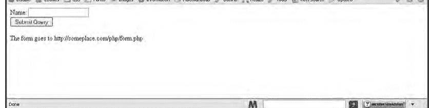

图 14-3  表单中 action 属性的值被打印在页面上

要访问第一个元素（文本框），你可以使用此处显示的语法：

```
document.info_form.elements[0]
```

或者，如果你想使用 forms 数组（假设这是页面上的第一个表单），你可以使用此语法：

```
document.forms[0].elements[0]
```

访问文本框的另一个选项是为它命名（就像表单一样），然后通过它的名称进行访问。你可以对每个元素以及表单本身执行此操作；你可以根据具体情况选择访问表单及其元素的最佳方法。以下代码为表单和文本框赋予名称，并允许你使用这些名称访问它们：

```
<form name="info_form">
Name: <input type="text" name="yourname"><br />
<input type="submit">
</form>
```

在这种情况下，你可以使用表单名称和文本框名称来访问文本框，如此处所示的语法：

```
document.info_form.yourname
```

此外，你当然可以使用 id 方法：

```
<form>
Name: <input type="text" id="yourname"><br />
<input type="submit">
</form>
```

然后，你可以使用 document.getElementById() 访问 input 元素：

```
document.getElementById("yourname");
```

要创建使用表单元素的脚本，你必须能够访问表单元素的属性。每个表单元素都是一个对象的实例，具有自己的属性和方法，如表 14-2 所示。表单元素都有自己的属性和方法集合，但其中许多方法可用于大多数或所有表单元素。以下各节将更详细地探讨表 14-2 中列出的属性和方法，以及它们如何与表单元素一起使用。

###### checked 属性

此属性用于复选框和单选按钮。它有一个布尔值，如果框或按钮被选中则为 true，如果未选中则为 false。例如，使用以下代码在复选框上进行尝试：

```
<body>
<form>
Check box to say Yes: <input type="checkbox" id="yes_no">
<br /><br />
<input type="button" value="See the Answer" onclick="is_it_checked();" />
</form>
<script type="text/javascript">
function is_it_checked() {
    var y_n = document.getElementById("yes_no");
    if (y_n.checked) {
        window.alert("Yes! The box is checked!");
    }
    else {
        window.alert("No, the box is not checked!");
    }
}
</script>
</body>
```

HTML body 包含一个带有 id 为 yes_no 的复选框的表单。一个按钮将在点击时调用函数 is_it_checked()。然后该函数使用 if/else 语句检查复选框当前是否被选中。if 条件使用了一种快捷方式，允许你将其从

```
if (y_n.checked==true)

缩短为：

if (y_n.checked)
```

| 元素类型 | 对象名称 | 属性 | 方法 |

| --- | --- | --- | --- |

| 按钮 | button | form, name, type, value | blur(), click(), focus() |

| 复选框 | checkbox | checked, defaultChecked, form, name, type, value | blur(), click(), focus() |

| 隐藏域 | hidden | form, name, type, value | 无 |

| 单选按钮 | radio | checked, defaultChecked, form, name, type, value | blur(), click(), focus() |

| 重置按钮 | reset | form, name, type, value | blur(), click(), focus() |

| 选择框 | select | form, name, options, selectedIndex, type | blur(), focus() |

| 提交按钮 | submit | form, name, type, value | blur(), click(), focus() |

| 文本框 | text | defaultValue, form, name, type, value | blur(), focus(), select() |

| 文本区域 | textarea | defaultValue, form, name, type, value | blur(), focus(), select() |

**表 14-2** 表单元素及其对象和方法

checked 属性将直接返回 true 或 false，无需测试 checked 属性的值是否与其他任何东西匹配。checked 属性本身已经有一个值，因此该值不需要与任何东西进行比较（除非你更喜欢这样做，这也是可以的）。

###### defaultChecked 属性

此属性也是一个布尔值 true 或 false。该值取决于复选框或单选按钮在其 HTML 中是否具有 checked 属性（该属性将元素设置为页面上默认选中）。如果元素具有 checked 属性，则值为 true。如果没有，则值为 false。

例如，以下 HTML 代码使用了 checked 属性：

```
<form>
Do you want us to send you e-mail updates and offers?<br />
Yes <input type="checkbox" id="yes" checked="checked" />
No <input type="checkbox" id="no" />
</form>
```

因为第一个复选框的 checked 属性设置为 checked，所以该元素的 checked 属性将 return true。对于第二个复选框元素，该属性将 return false。

###### defaultValue 属性

你将此属性用于文本框和文本区域。它保存在元素标签的 value 属性中设置的默认值。如果你在一个文本框中设置了默认值，用户将其删除，然后用户又希望恢复默认值，此功能会非常有用。你可以编写一个按钮，当点击时恢复该值，如以下代码所示：

```
<body>
<form>
Favorite URL:<br />
<input type="text" id="favurl" value="http://www.yahoo.com">
<br /><br />
<input type="button" value="Reset Default" onclick="back_to_default();">
</form>
<script type="text/javascript">
function back_to_default() {
  var url_box = document.getElementById("favurl");
  url_box.value = url_box.defaultValue;
}
</script>
</body>
```

在 HTML 代码中，文本框的 input 标签中的 value 属性被设置为 http://www.yahoo.com。这给了它一个默认值。当函数被调用时，它通过更改其当前值 (url_box.value) 为默认值 (url_box.defaultValue) 将此默认值分配回文本框。

#### 注意

如果你希望将特定值切换回其默认值，此技术非常有用。如果你想将*所有内容*都更改回默认值，你可以简单地在 HTML 代码中使用重置按钮（即 `<input type="reset" value="Reset" />`）。

###### form 属性

此属性通常与关键字 "this" 一起使用，以引用包含使用它的元素的表单。例如，如果你想通过点击按钮来更改文本框的值，你可以使用 this.form 来引用表单，而无需知道表单的名称或 id：

```
<form>
Favorite URL:<br />
<input type="text" name="favurl" value="http://www.yahoo.com" />
<br /><br />
<input type="button" value="Change"
onclick="this.form.favurl.value='http://www.lycos.com';" />
</form>
```

当按钮被点击时，此代码将文本框的当前值更改为 http://www.lycos.com。使用 this.form.favurl.value 允许你从表单内的元素访问同一表单，而无需返回并使用表单名称或 id，后者写起来稍长。

##### name 属性

此属性保存元素的 name 属性的值。例如，以下代码打印页面上第一个元素（文本框）的 name 值：

```
<body>
<form name="info_form">
Name: <input type="text" name="yourname" /><br />
<input type="submit" value="Submit" />
</form>
<p>
<script type="text/javascript">
document.write("The first element is "+document.info_form.
elements[0].name);
</script>
</p>
</body>
```

这是一种查找元素名称的便捷方法，无需在代码中搜索它。

###### options 属性（数组）

options 属性是一个数组，它为表单中选择框里列出的每个选项包含一个元素。索引号从 0 开始计数，每个选项按照其在 HTML 代码中编写的顺序放置在数组中。以下代码展示了如何访问

###### type 属性

此属性保存表单元素（如 `type="text"` 或 `type="button"`）的 type 属性的值。这些元素的 type 属性值分别为 `text` 和 `button`。

###### value 属性

此属性保存元素的当前值。例如，一个文本框可能没有默认值；但当用户在框中输入信息时，该文本框就有了当前值。如果框内没有任何内容，则当前值为空字符串。（你在前面章节的一些脚本中已经使用过此属性。）

你将经常使用此属性来处理表单中的信息、验证和导航。本章后续会更多地看到它的使用。

##### blur() 方法

此方法允许你在代码中为元素创建一个 blur（失去焦点）事件。例如，如果你想防止文本框中的默认值被用户修改，可以在文本框获得用户焦点时使用 `blur()` 方法移除焦点。以下代码展示了一个示例：

```html
<body>
<form>
Your Favorite Food
<input type="text" name="fav_food" value="Pizza"
onfocus="this.form.fav_food.blur();" />
</form>
</body>
```

点击文本框会使其获得焦点，但 `onfocus` 事件处理程序会捕获该焦点，然后对该元素使用 `blur()` 方法移除焦点。当然，你也可以在没有默认值的情况下使用此脚本，创建一个无法接收焦点从而无法填写的文本框。无论哪种情况，如果用户在浏览器中禁用了 JavaScript，此脚本都会被覆盖，因此不建议将其作为防止用户填写字段的保护措施。此类事情可以通过客户端和服务器端的输入验证来处理。

##### click() 方法

此方法允许你在代码中为按钮创建一个点击事件。然而，以这种方式创建的点击不会激活按钮中定义的 `onclick` 事件处理程序。因此，`click()` 方法最适用于激活诸如提交（submit）和重置（reset）按钮这类不需要 `onclick` 事件处理程序就能工作的按钮。

例如，一个重置按钮在被点击时会重置表单。如果你想在一个字段失去焦点时（这确实会激怒用户）重置表单，可以使用以下代码：

```html
<body>
<form>
Your Favorite Food
<input type="text" name="fav_food" onblur="this.form.annoy.click();" /><br />
Drink <input type="text" />
<br /><br />
<input type="reset" name="annoy" value="Reset Form">
</form>
</body>
```

此代码使用 `onblur()` 事件，当用户从第一个文本框移除焦点时，调用名为 "annoy"（即重置按钮）的按钮执行操作。

##### focus() 方法

`focus()` 方法允�你在代码中创建一个焦点事件，以便你可以让某个表单元素为用户获得焦点。

例如，你可能希望在页面加载后立即将焦点给予页面上的第一个表单元素（通常是文本框），这样用户就不必点击该元素来使其获得焦点并开始输入。以下代码展示了如何实现：

```html
<body>
<form>
Your Favorite Food
<input type="text" id="fav_food" /><br />
Drink <input type="text" />
</form>
<script type="text/javascript">
var f_box = document.getElementById("fav_food");
f_box.focus();
</script>
</body>
```

脚本在表单及其元素存在之后加载。然后它使用 `focus()` 方法为用户将焦点给予第一个文本框。

##### select() 方法

此方法允许你自动选择（高亮显示）文本框或文本区域的内容。如果你为元素设置了默认值，并希望用户能够快速删除该值以输入新值，或者你想让用户更容易复制和粘贴元素的内容，这将非常有用。

以下代码在用户将焦点给予文本区域时选择其中的文本，使用户可以快速删除文本或轻松将其复制到剪贴板：

```html
<body>
<form>
<textarea name="sometext" onfocus="this.form.sometext.select();">
This text is the default text for the text
area and is selected when the text area is given focus by the viewer.
</textarea>
</form>
</body>
```

当用户点击文本区域内部时，`onfocus` 事件处理程序会触发方法调用。`<textarea>` 和 `</textarea>` 标签内的所有默认文本都会被选中。

至此，表单元素的属性和方法介绍完毕。现在是时候回到表单对象的属性了。

##### encoding 属性

此属性通常保存表单标签的 `enctype` 属性的值。然而，不同浏览器的结果可能不同。

##### length 属性

`length` 属性保存页面上给定表单中的元素数量。本章已经相当广泛地介绍了此属性，因此无需在此再次讨论。

##### method 属性

此属性保存表单标签的 `method` 属性中包含的值。因此，如果你要将表单发送到服务器进行处理，你可能会使用类似以下代码的内容：

```html
<form name="f1" method="post" action="http://site.com/cgi-bin/form.cgi">
<!-- 表单内容 -->
</form>
```

此表单的 `method` 属性的值将是 `post`，因为它包含在表单的 `method` 属性中。

##### name 属性

此属性保存表单的名称，该名称在表单标签的 `name` 属性中给出。你可能有类似这样的代码：

```html
<form name="cool_form">
<!-- 表单内容 -->
</form>
```

这里，`name` 属性的值是 `cool_form`，因为它是表单 `name` 属性内的值。

##### target 属性

此属性保存表单标签的 `target` 属性中给定的值。例如，你可能有以下代码：

```html
<form name="cool_form" target="place" action="program.cgi">
<!-- 表单内容 -->
</form>
```

这里，`target` 属性的值是 `place`，因为它是表单 `target` 属性内的值。

#### 方法

现在来看看表单对象的方法。表单对象只有两个方法：`reset()` 和 `submit()`，下面将对此进行描述。

##### reset() 方法

此方法使你能够使用脚本重置表面，允许你在任何你想要的事件上重置表单。因此，如果你想在用户从元素移除焦点后重置表单，可以使用以下代码：

```html
<body>
<form>
Your Favorite Food
<input type="text" name="fav_food" onblur="this.form.reset();" /><br />
Drink <input type="text" />
<br /><br />
<input type="reset" value="Reset Form" />
<input type="submit" value="Submit Form" />
</form>
</body>
```

##### submit() 方法

此方法允许你在不点击提交按钮的情况下提交表单。以下代码展示了当用户从元素移除焦点时如何做到这一点（与 `reset()` 方法的方式非常相似）：

```html
<body>
<form action="http://site.com/php/form.php">
Your Favorite Food
<input type="text" name="fav_food" onblur="this.form.submit();" /><br />
Drink <input type="text" />
<br /><br />
<input type="submit" value="Submit Form" />
</form>
</body>
```

## 确保表单的可访问性

确保你的表单对用户具有可访问性可能颇具挑战性，因为你首选的布局可能无法被辅助技术（如 Jaws 或 Homepage Reader）正确解读。你可以采取一些措施来帮助确保大多数用户能够访问和使用你的表单。你可以将元素及其标签按预期顺序放置，使用 `<label></label>` 标签，使用 `<fieldset></fieldset>` 标签，并且务必不要假定用户启用了客户端脚本（如 JavaScript）。

### 使用正确的元素和标签顺序

在你的 HTML 代码中，标签文本和表单元素的顺序可以帮助辅助技术读取表单。例如，请考虑以下输入字段：

```html
<input type="text" name="yourname" id="yourname" /> Name<br />
<input type="text" name="zip_code" id="zip_code" /> Zip Code<br />
```

这里，辅助技术会寻找出现在表单元素之前的标签文本。由于第一个输入元素之前没有任何标签文本，用户只会被提示输入，而没有指示应输入什么信息。之后，标签文本“Name”与 zip_code 文本框关联，这可能会导致用户输入不期望的内容。

要纠正这一点，你只需移动标签文本并将其放置在表单元素之前，如以下代码所示：

```html
Name <input type="text" name="yourname" id="yourname" /><br />
Zip Code <input type="text" name="zip_code" id="zip_code" /><br />
```

现在，辅助技术很可能会识别出表单标签，并允许用户输入期望的信息。同时使用 name 和 id 属性也有帮助，因为各种辅助技术也会识别这些属性。

这对于文本框、文本区域和选择框也同样适用。然而，当处理复选框和单选按钮时，许多辅助技术期望元素在前，描述性标签在后。因此，在使用时应该将它们调换顺序。

当处理按钮（例如提交、重置或创建的按钮）时，务必使用 value 属性来描述按钮的功能，因为辅助技术通常会期望这样。

### 使用 <label></label> 标签

使用标签标签有助于你进一步指定哪个标签文本属于哪个表单元素。以下是一个示例：

```html
<label for="yourname">Name</label>
<input type="text" name="yourname" id="yourname" /><br />
```

这里，你将开始标签的 for 属性赋值为将使用 <label> 和 </label> 标签内包含的标签文本的表单元素的 id 属性值。在前面的示例中，for 属性包含 yourname，这将文本与 HTML 代码中 id 为 yourname 的元素链接起来。

### 使用 <fieldset></fieldset> 标签

在处理单选按钮和复选框时，使用 fieldset 可以将它们分组到一个逻辑集合中，这会很有帮助。使用 legend 标签来标记可供选择的选项，可以让用户知道期望选择什么。以下代码使用 fieldset 将一组用于选择水果类型的单选按�分组在一起：

```html
<fieldset>
<legend>选择一种水果：</legend>
<input type="radio" name="fruits" id="fruits1" value="Orange" />
<label for="fruits1">Orange</label>
<input type="radio" name="fruits" id="fruits2" value="Banana" />
<label for="fruits2">Banana</label>
<input type="radio" name="fruits" id="fruits3" value="Apple" />
<label for="fruits3">Apple</label>
</fieldset>
```

这里，你将所有单选按钮分组在 <fieldset> 和 </fieldset> 标签内，并使用一个 legend 标签在开始 fieldset 标签之后为该组提供一个标签。然后，每个元素在 fieldset 内正常标记（也使用 label 标签）。

### 不要假设客户端脚本可用

在最初编写表单时，最好不要假设 JavaScript 或其他客户端技术可用。如果需要 JavaScript 才能使表单可用，那么许多用户将无法使用它，因为他们出于各种原因（如安全）禁用了 JavaScript。

最佳实践是允许表单发送到服务器端（服务器端将处理表单并提供最重要的验证例程），即使 JavaScript 不可用。像以下这样的代码对于没有 JavaScript 的用户将无法使用：

```html
<input type="button" onclick="this.form.submit();" value="提交表单" />
```

在这种情况下，需要一个 JavaScript 事件处理程序和方法来提交表单。最好使用传统的 submit 元素来创建提交按钮。

如果你使用一些 JavaScript 验证，你可以使用类似以下的代码：

```html
<form method="post" action="form.php" onsubmit="return check_form();">
<!-- 表单内容在此处 -->
<input type="submit" name="submit" id="submit" value="提交表单" />
</form>
```

这允许你在 JavaScript 可用时运行 JavaScript 函数 check_form()。否则，onsubmit 事件处理程序将被忽略，表单将提交到服务器端脚本进行验证和处理。如果 JavaScript 可用，该验证例程可以节省一次服务器端访问。如果不可用，服务器端脚本将需要完成工作，但用户仍然可以按照预期使用表单。

## 验证

验证 JavaScript 表单极其有用。例如，你可以在提交前验证输入，以帮助减少包含不完整或不准确信息的表单数量。在将表单数据提交到通用网关接口（CGI）脚本、PHP 脚本或 Java servlet 之前进行验证，可以节省时间并减少服务器负载。开始验证时，你将了解如何将 onsubmit 事件处理程序与 return 语句结合使用，并学习一些验证技术。

### onsubmit 和 return 语句

要验证表单中一个或多个元素的内容，你需要知道用户何时尝试提交表单。当用户单击提交按钮时，会发生一个提交事件，该事件可以在开始 form 标签的 onsubmit 事件处理程序中捕获。

因此，以下表单在单击提交按钮时，能够在执行其 action 属性之前执行某些操作：

```html
<form method="post" action="form.php" onsubmit="script">
<label for="yourname">姓名：</label>
<input type="text" name="yourname" id="yourname" />
<br /><br />
<input type="submit" name="submit" id="submit" value="提交">
</form>
```

你需要将这里的 *script* 替换为一些 JavaScript，以便在单击提交按钮时执行。这通常是对将要运行以测试一个或多个表单字段的函数的调用。

然而，为了使函数完成其工作，你必须确保如果用户的输入未通过验证，则提交按钮无法执行其默认操作。这意味着你需要在 onsubmit 事件处理程序中使用 return 语句。你希望如果验证通过，则此语句返回 true；如果验证失败，则返回 false。因此，你希望最终结果是以下两种之一：

```javascript
onsubmit="return true;"
```

这将允许提交正常继续，或者

```javascript
onsubmit="return false;"
```

这将使提交无效，从而不执行任何操作。

为了使前面代码中的技术与函数一起工作，onsubmit 事件处理程序中的 return 语句必须调用一个返回 true 或 false 值的函数。因此，你会得到像这样的语句：

```javascript
onsubmit="return yourfunction();"
```

你需要将 *yourfunction* 替换为真实的函数名。

这里的关键是函数必须返回 true 或 false 值，以便前面的语句将被评估为你需要的（return true; 或 return false;）。函数本身可以执行任何其他操作，但它需要有一个 return 语句，向事件处理程序返回 true 或 false 值。

因此，你可以对表单执行验证，以确保文本框没有完全留空。以下代码展示了如何使用带有 onsubmit 事件处理程序的函数来完成此操作。首先，HTML 代码（保存为 val_form.html）：

```html
<body>
<form method="post" action="form.php" onsubmit="return check_it()">
<label for="yourname">姓名：</label>
<input type="text" name="yourname" id="yourname" />
<br /><br />
<input type="submit" name="submit" id="submit" value="提交">
</form><script type="text/javascript" src="val_form.js"></script>
</body>
```

接下来，JavaScript 代码（保存为 val_form.js）：

```javascript
function check_it() {
    var thename = document.getElementById("yourname").value;
    if (thename.length < 1) {
        window.alert("姓名字段为空，请重试。");
        return false;
    }
    else {
        return true;
    }
}
```

该函数使用 if 语句检查文本字段是否被留空（使用 text 元素的 length 属性的值）。如果是，一个警告框会告知用户重试，函数返回 false。否则，函数将返回 true。如果返回 true，提交将继续。否则，表单不会被提交，用户可以通过输入必要的信息并再次单击提交按钮来重试。请记住，check_it() 函数仅验证完全空的表单字段。你需要使函数更复杂，以消除提交空格、井号（#）符号等名称（可以使用正则表达式处理）。

### 技术

在大多数情况下，验证可以根据你的需要变得简单或复杂。你需要做的就是根据所需信息创建自己的自定函数来验证你选择的表单字段。

例如，上一节中的示例检查了姓名字段中的文本框是否为空。但是，对于邮政编码，你可以使用正则表达式来检查字段是否包含五位数字。如果不符合，你可以发送一个提示框，告知查看者邮政编码无效并要求重新输入。以下代码展示了如何实现这一点：

```html
<body>
<form method="post" action="form.php" onsubmit="return check_it()">
<label for="zip_code">Zip Code:</label>
<input type="text" name="zip_code" id="zip_code" />
<br /><br />
<input type="submit" name="submit" id="submit" value="Submit">
</form>
<script type="text/javascript">
function check_it() {
  var zip = document.getElementById("zip_code").value;
  var tomatch = /^\d{5}$/;
  if (tomatch.test(zip)) {
    return true;
  }
  else {
    window.alert("An invalid zip code was entered");
    return false;
  }
}
</script>
</body>
```

该代码使用正则表达式来检查是否为五位数字。如果输入的不是五位数字，则函数将返回 `false`。当然，你可以扩展此功能，以允许输入额外的四位数字，这有时用于更精确地指定邮政编码内的特定区域。为此，你可以添加另一个输入字段，并要求如果在该第二个字段中输入了值，则必须是四位数字。在 JavaScript 中，你可以根据需要设置验证的严格或宽松程度。不过请记住，在应用层（你的服务器端脚本或程序），你需要对验证程序格外小心，以确保不会提交恶意或错误的数据给你的应用。

##### 提示

一种找到验证脚本的方法是尝试在网上搜索一些 JavaScript 网站。其中许多网站都有专门用于验证不同类型数据的特殊函�。如果你能找到适合你需求的函数，这可以为你节省一些工作量。

## 专家问答

**问：** 像文本区域和选择框这样的所有元素都有太多的属性和方法需要记忆。有什么建议吗？

**答：** 这些属性和方法中有很多是所有元素类型通用的，而只有一小部分是更特定于某些元素的。随着你继续编写脚本，你将开始了解哪些元素具有哪些属性和方法，因此就不会那么混乱了。如果你注意观察每个元素使用了哪些属性和方法，那么当你看到某个属性或方法仅适用于特定类型的元素时，就更容易识别了。

**问：** 我可以验证哪些类型的输入？

**答：** 大体上，你可以验证任何你喜欢的东西，只要你认为合适。你可以验证日期、姓名、时间、地址、电子邮件地址、电话号码，或者任何其他你可能需要的东西。

**问：** 我可以验证选择框中的选项或文本区域中的文本，或者其他一些输入类型吗？

**答：** 在某些情况下，你可能已经将一些值内置到元素中了。然而，如果可以，你仍然应该根据其他信息来验证这些值，以确保收到的信息符合你的需求。你只需要调整你的函数，根据不同的输入设备类型（文本区域、单选按钮等）来执行所需的任务。例如，下一节将介绍与导航相关的选择框。但是，其中一些信息（例如 `selectedIndex` 属性）对于验证也很有用。

**问：** 我不使用服务器端脚本，但我使用 JavaScript 作为爱好，并且想验证信息。我真的需要添加一个服务器端脚本吗？

**答：** 是否需要服务器端脚本取决于你的目的。如果你有一个表单需要保存信息、通过电子邮件发送或发送到数据库，那么你需要一个服务器端应用。

### 动手尝试 14-1 请求一个号码

在这个项目中，你将为一个基本的电话号码验证创建一个脚本，例如 222-222-2222。

- pr14_1.html

- prjs14_1.js

### 分步指南

1.  创建一个带有表单和文本框的 HTML 页面，文本框的标签文本为 "Phone Number (XXX-XXX-XXXX):"。确保表单有一个提交按钮，并调用 JavaScript 函数 `check_it()` 来验证输入。在表单之后插入必要的 `<script>` 标签，以调用名为 `prjs14_1.js` 的外部 JavaScript 文件。将 HTML 文件保存为 `pr14_1.html`。

2.  创建一个外部 JavaScript 文件，并将其保存为 `prjs14_1.js`。在第 3 步中使用它。


3. 使用正则表达式确保输入到文本框中的号码格式为 `XXX-XXX-XXXX`。如果符合，发送一个提示框说 "Phone number validated."。否则，发送一个提示框说 "Invalid phone number entered. Valid format is XXX-XXX-XXXX."。

4. 保存 JavaScript 文件，并在浏览器中打开 HTML 文件。通过向文本框中输入各种值并提交表单，看看它是否有效。

### 动手尝试总结

在这个项目中，你运用了 JavaScript 和表单的知识来创建一个验证表单的脚本。该脚本验证查看者输入的时间，以查看其是否符合特定标准的有效电话号码。

## 使用表单进行导航

通过将 JavaScript 与表单结合使用，如果你愿意，可以创建一些替代常规文本链接和图片链接导航的方式。本节讨论如何使用选择框为你的网站创建导航。这种类型的导航允许查看者从选择框的列表中选择一个目的地，然后通过点击按钮或更改值来跳转到新位置。首先，你将创建一个导航选择框，它使用查看者点击按钮来跳转到新位置。

### 点击按钮

创建选择框相当直接。首先，你可以像这样设置选择框的代码（将 HTML 保存为 `select.html`）：

```html
<form>
<label for="s1">Select Page:</label>
<select name="s1" id="s1">
<option selected="selected" value="page1.html">Page 1</option>
<option value="page2.html">Page 2</option>
<option value="page3.html">Page 3</option>
</select>
</form>
```

注意选择框被赋予了 id `s1`。同时，注意 `value` 属性被赋予了 URL 值（这里是本地 URL）。这些是当查看者从列表中选择指定选项并点击按钮时，你希望他/她跳转到的目标位置。最后，要为每个选项显示的文本被添加在 `<option>` 和 `</option>` 标签之间。

接下来，编写当按钮被点击时将启动此功能的脚本。该按钮需要执行将查看者转移到新目的地的操作。为此，脚本必须能够访问选择框中已选中的选项并获取其值（URL）。然后，浏览器需要将查看者带到新的 URL。

要访问已选中的选项，你必须深入到选择框的选项数组。回顾一下，选择框被赋予了 id `s1`，因此你可以设置一个变量来保存选择框元素：

```javascript
var s = document.getElementById("s1");
```

然后，要访问此选择框的选项数组，你可以使用以下语法：

```javascript
s.options[]
```

问题是，你想从数组中获取哪个选项？你不想通过随意插入一个索引号来猜测；你想获取的是查看者已选中的选项的索引号。这就是选择框的 `selectedIndex` 属性发挥作用的地方。回顾一下，该属性保存了查看者所选选项的索引号的值。通过使用此属性的值作为选项数组中的索引号，当查看者进行选择时，你就可以访问正确的选项。以下是使用的语法：

```javascript
s.options[s.selectedIndex]
```

现在你从列表中获取了正确的选项。接下来，你必须获取它的值，以便检索 `value` 属性中的 URL。为此，你只需在这行代码末尾添加 `value` 属性，如下所示：

```javascript
s.options[s.selectedIndex].value
```

现在这就是你想要的值，即查看者所选选项的 URL。接下来，你必须将此语法放入一个可工作的表单中。此值是当按钮被点击时你希望浏览器跳转的 URL。因此，你需要添加一个提交按钮，然后使用 `onsubmit` 事件处理程序在点击时将 `window.location` 属性更改为此值。以下代码创建了一个按钮来实现此功能：

```html
<body>
<form onsubmit="return go_here();">
<label for="s1">Select Page:</label>
<select name="s1" id="s1">
<option selected="selected" value="page1.html">Page 1</option>
<option value="page2.html">Page 2</option>
<option value="page3.html">Page 3</option>
</select>
<input type="submit" name="go" id="go" value="执行！" />
</form>
<script type="text/javascript" src="select.js"></script>
</body>
```

现在，这告诉浏览器在提交此表单（通过点击“执行！”按钮）时，运行一个名为 `go_there()` 的 JavaScript 函数。它还会调用一个名为 `select.js` 的外部 JavaScript 文件，该文件是放置用于更改到新 URL 的代码的地方：

```javascript
function go_there() {
  s = document.getElementById("s1");
  window.location = s.options[s.selectedIndex].value;
  return false;
}
```

注意选中的值是如何用于将 `window.location` 属性更改为新 URL 的。返回 `false` 可以防止表单被提交到服务器，从而使客户端脚本能够处理它。用户应该能够通过从框中选择并点击“执行！”按钮来导航。图 14-5 显示了在浏览器中查看时的初始下拉框。

图 14-6 显示了选择“第 2 页”选项并点击“执行！”按钮的结果。浏览器中显示了一个新页面。


**图 14-5** 在做出选择并点击按钮之前的下拉框


**图 14-6** 做出选择并点击按钮后显示的页面

如果你想让这个脚本更具可访问性，可以使用服务器端脚本来备份 JavaScript。你需要编写服务器端脚本的代码，向 HTML 代码添加 `method` 属性和 `action` 属性：

```html
<body>
<form method="post" action="/php/select.php" onsubmit="return go_there();">
<label for="s1">选择页面：</label>
<select name="s1" id="s1">
<option selected="selected" value="page1.html">第 1 页</option>
<option value="page2.html">第 2 页</option>
<option value="page3.html">第 3 页</option>
</select>
<input type="submit" name="go" id="go" value="执行！" />
</form>
<script type="text/javascript" src="select.js"></script>
</body>
```

现在，如果用户的浏览器不支持 JavaScript，`onsubmit` 属性将被忽略，但 `action` 属性将用于处理表单。这将转到服务器上 `php` 目录中名为 `select.php` 的脚本（这些只是示例文件和目录名）。然后，服务器端脚本可以完成将用户发送到新 URL 的工作，从而使脚本即使对于没有 JavaScript 的用户也能工作。

还有一点需要注意，此脚本仅在用户的浏览器能够处理 `document.getElementById()` 方法时才有效。如果你预计一些用户可能使用较旧的浏览器，最好确保在这种情况下他们使用服务器端脚本（或者你可以添加选项，使其能够使用 `forms` 数组或使用表单名和选择框名称来工作）。为了防止较旧的浏览器运行 JavaScript 代码，你可以执行以下操作：

```javascript
function go_there() {
    if (document.getElementById && document.createTextNode) {
        s = document.getElementById("s1");
        window.location = s.options[s.selectedIndex].value;
        return false;
    }
    return true;
}
```

现在，该代码仅适用于支持 `getElementById()` 和 `createTextNode()` 的浏览器（这添加是为了支持仅支持 `getElementById()` 但支持方式与预期不同的浏览器）。否则，脚本将返回 `true`，并调用服务器端脚本。

### 无按钮

要创建一个没有按钮的导航选择框，你需要使用 `onchange` 事件处理器。然而，出于可访问性的考虑，不建议使用这种导航类型，因为它不仅使使用辅助技术的人难以选择所需的选项，而且通常可能会令人困惑，因为用户一旦选择就会立即被带到选定的目的地。

如果你使用该脚本进行休闲活动，并且不需要脚本具有可访问性，你可以在网上找到许多此类导航脚本的版本。


```
pr14_2.html
prjs14_2.js
```

在这个项目中，你将构建一个导航选择框，它将有五个目的地供用户选择。

### 分步操作

1.  创建一个 HTML 文档并添加脚本标签，以便 HTML 文件将调用一个名为 `prjs14_2.js` 的外部 JavaScript 文件。将 HTML 文件另存为 `pr14_2.html`。

2.  创建一个带有导航按钮的选择框。你可以选择任何你想要的目标站点和描述。将选择框命名为 `s1`。保存 HTML 文件。

3.  创建一个 JavaScript 文件并将其另存为 `prjs14_2.js`。在第 4 步中使用它。

4.  在此文件中添加代码，以便在点击按钮时浏览器将打开所选的 URL。

5.  保存 JavaScript 文件并在浏览器中打开 HTML 文件。检查导航系统是否工作。

### 尝试此总结

在这个项目中，你运用了 JavaScript 和表单的知识来创建一个导航系统。

## 第 14 章 自测

1.  每次你向 HTML 文档添加一对 `<form>` 和 `</form>` 标签时，都会创建一个 `__________` 对象。

2.  `forms` `__________` 允许你使用索引号访问表单。

3.  以下哪项会访问页面上的第四个表单？

    - A `document.forms[4]`

    - B `document.forms[3]`

    - C `document.forms(4)`

    - D `document.forms(3)`

4.  以下哪项会找到页面上第三个表单中的元素数量？

    - A `document.forms[2].length`

    - B `document.forms[3].length`

    - C `document.forms.length`

    - D `document.forms(3).length`

5.  以下哪项包含文档中表单数量的值？

    - A `document.forms[0].length`

    - B `document.form.length`

    - C `document.forms.length`

    - D `document.forms[1].length`

6.  使用表单 `__________` 允许你命名页面上想要稍后访问的表单。

7.  以下哪项访问名为 `f1` 的表单中名为 `e1` 的元素的值？

    - A `document.f1.e1.value`

    - B `document.e1.f1.value`

    - C `document.f1.e2.value`

    - D `document.forms1.e1.value`

8.  `__________` 属性允许你访问开头 form 标签中 `action="url"` 属性的值。

10. `options` 属性是一个数组，包含表单中选择框里列出的每个 `__________` 的一个元素。

11. `__________` 方法允许你使用脚本重置表单。

12. 当函数用于验证表单时，它应该返回哪种类型的值？

    - A 是或否

    - B 真或假

    - C 可能是

    - D 浮点数

13. 当用户点击表单上的提交按钮时，会发生一个提交事件，可以用 `__________` 事件处理器捕获。

14. `__________` 方法允许你无需用户点击提交按钮即可提交表单。

15. 你使用什么来获取选择框中当前选中的选项？

    - A `length` 属性

    - B `reset()` 方法

    - C `getSelected()` 方法

    - D `selectedIndex` 属性

本页有意留白

## 第 15 章

### JavaScript 与框架

## 关键技能与概念

- 框架简介

- 访问框架

- 更改框架

- 框架导航

虽然使用框架创建网站通常不被推荐，因为存在可用性和可访问性问题，但有时它们（尤其是内联框架）是实现特定目的的正确选择。你可以使用 JavaScript 在框架中执行一些有用的任务。本章提供了框架的基本概述，然后解释如何从其他框架访问框架。你还将学习如何从一个框架更改另一个框架，然后你将使用一些有趣的框架导航技巧。最后，你将学习如何在框架之间使用变量来存储和检索信息。

### 框架简介

是否在你的网站上使用框架由你决定。这取决于你的导航要求和其他你可能遇到的网站问题。如果你对框架一无所知，学习一些基本信息将帮助你确定它们是否对你有用。如果你已经熟悉使用框架，你可以浏览本节或完全跳过它。然而，如果你对框架几乎没有或没有经验，你应该仔细阅读本框架简介。当添加 JavaScript 时，框架可能会变得相当混乱。

#### 框架的目的

框架将窗口分成两个或更多独立的区域（一个*框架集*），每个区域包含不同的内容。这与表格不同，因为框架集中的划分各自包含一个单独的超文本标记语言 (HTML) 文档，你可以更改其中一个部分而不影响其他部分。

> **注意**

> 网页上显示的每个框架实际上都是一个单独的 HTML 文档。

### 框架背后的代码

以下代码包含了框架集元素。它组合了文档打开时要显示的框架的数量和结构。

```html
<html>
<frameset cols="20%,80%">
<frame src="frame1.html"></frame>
<frame src="frame2.html"></frame>
</frameset>
<noframes>
Sorry, your browser does not support frames. Use the link below to go to the frameless version of the site.<br />
<a href="noframes.html">Frameless Site</a>
</noframes>
</html>
```

这段代码创建了一个基本的框架集，它在窗口左侧生成一个较小的框架，右侧生成一个较大的框架。其工作原理如下：

1.  开头的框架集标签告知浏览器一个框架集即将开始。请注意，它替代了普通窗口中使用的body标签。
2.  开头框架集标签的 `cols` 属性告知浏览器窗口将被分为两列（从左到右排列）。第一列（左列）将占据屏空间的20%，而第二列（右列）将占据屏空间的80%。
3.  第一个框架标签在页面上创建第一个框架。浏览器按照源代码中出现的顺序，从左到右、从上到下显示框架。因此，这个框架位于页面的左上部分——在本例中，就是页面的左侧。
4.  `src` 属性告知浏览器要显示为框架内容的HTML文档的URL，这实际上是观看者在窗口左侧看到的内容。在本例中，该文档是一个名为 `frame1.html` 的文件。
5.  第二个框架标签的作用与第一个相同，但该框架是按照从左到右、从上到下的顺序排列的下一个框架。同样，由于只有两列，这个框架仅位于窗口的右侧。`src` 属性指向要在此框架中显示的HTML文档的URL。在本例中，该文档是一个名为 `frame2.html` 的文件。
6.  `</frameset>` 标签结束了框架集。
7.  `<noframes>` 和 `</noframes>` 标签之间的内容会显示在不支持框架的浏览器中，以便观看者屏幕上仍有内容显示。你可以放置一个指向无框架版本网站的链接，或者使用任何其他你希望使用的HTML代码。我在示例中使用了文本和链接以保持该部分简洁。

由上述代码创建的文档就是你想要在浏览器中打开以显示框架的文档。将此文档保存为 `frameset.html`，这样一旦你为框架中使用的文档添加了代码，就可以使用它了。

一旦框架集创建完成，你必须创建用于填充框架的文档。首先，创建一个用于左侧框架的文档 (`frame1.html`)：

```html
<html>
<body>
I am frame1.html, and I am on the left side!
</body>
</html>
```

这段简单的代码告诉你哪个文档正在哪个框架中显示。（你可以根据需要使代码变得复杂。）将其与 `frameset.html` 保存在同一目录中，文件名为 `frame1.html`。

接下来，你必须为另一个桚架提供代码 (`frame2.html`)：

```html
<html>
<body>
I am frame2.html, and I am on the right side!
</body>
</html>
```

将其与 `frameset.html` 和 `frame1.html` 保存在同一目录中，文件名为 `frame2.html`。


图15-2 一个包含两个框架的框架集，每个框架占据框架集创建的一列

现在，当你在浏览器中打开 `frameset.html` 时，它应该显示包含两个框架的窗口，每个框架都包含相应的HTML文档，如图15-2所示。

### 框架选项

正如你所看到的，开头的框架集标签可以接受 `cols` 属性来将窗口分成列。同样地，它也可以使用 `rows` 属性来将页面从上到下分成行。以下是创建包含两行的框架集的代码示例：

```html
<html>
<frameset rows="20%, 80%">
<frame src="frame1.html"></frame>
<frame src="frame2.html"></frame>
</frameset>
<noframes>
Use the link below to go to the frameless version of the site.<br />
<a href="noframes.html">Frameless Site</a>
</noframes>
</html>
```

这次框架从上到下排列，因为使用了 `rows` 属性。

这次，页面被分成两个框架，一个在上，另一个在下。如果 `frame1.html` 和 `frame2.html` 都存在，其外观示例如图15-3所示。

#### 行或列

如果你愿意，`rows` 或 `cols` 属性中使用的数字可以用像素而不是百分比表示。此外，如果你想让某个框架在其他框架设置后占用所有剩余空间，可以使用星号 (*)。例如，看看这段代码：

```html
<html>
<frameset rows="150, *">
<frame src="frame1.html"></frame>
<frame src="frame2.html"></frame>
</frameset>
<noframes>
Use the link below to go to the frameless version of the site.<br />
<a href="noframes.html">Frameless Site</a>
</noframes>
</html>
```

星号告诉第二个框架占用第一个框架未使用的所有剩余空间。


图15-3 一个基于行而非列的框架集

这次，第一行（顶部）占据150像素，而第二行（底部）占据窗口中其余的剩余空间。

##### 超过两行或两列

当然，你不仅限于只有两行或两列。你可以根据需要设置任意多的行或列。例如，如果你想要一个包含三列的框架集，可以使用这段代码：

```html
<html>
<frameset cols="150,*,150">
<frame src="frame1.html"></frame>
<frame src="frame2.html"></frame>
<frame src="frame3.html"></frame>
</frameset>
<noframes>
Use the link below to go to the frameless version of the site.<br />
<a href="noframes.html">Frameless Site</a>
</noframes>
</html>
```

星号告诉中间的框架使用其他框架未占用的所有剩余空间。

这里，左列和右列的宽度各为150像素。中间的列占据窗口中所有的剩余空间。

##### 嵌套以同时包含行和列

最后，如果你想要一个更复杂的框架集，同时包含行和列，你必须在一个框架集内嵌套另一个框架集。例如，你可能想要一个横跨页面顶部部分、高度为100像素的行。然后，你可能希望在它下面有两个列：左侧一个占据150像素，右侧一个占据剩余区域。

为此，你需要有一个表示行的框架集（因为顶行必须跨越整个页面的顶部部分）。在底部行内，你需要另一个使用列将底行分成两个区域的框架集。以下代码展示了如何进行这种嵌套：

```html
<frameset rows="100,*">
  <frame src="frame1.html"></frame>
  <frameset cols="150,*">
    <frame src="frame2.html"></frame>
    <frame src="frame3.html"></frame>
  </frameset>
</frameset>
<noframes>
Use the link below to go to the frameless version of the site.<br />
<a href="noframes.html">Frameless Site</a>
</noframes>
```

请注意，在第二（底部）行的框架位置上，没有使用另一个框架标签，而是使用了一个新的框架集，将底行再分成两个框架。这些框架按列运行，从左到右排列。

##### 提示

务必使用 `</frameset>` 标签关闭每个 `<frameset>` 标签。与表格一样，忘记其中一个可能导致框架显示不当或根本不显示。

图15-4展示了此嵌套框架集在浏览器中出现的示例（假设所有文档和文件都存在）。

### 访问框架

如何在 JavaScript 中访问框架？你可以使用 `frames` 数组，或者为框架命名并使用其名称来访问。首先，让我们看看如何使用 `frames` 数组访问框架。

#### `frames` 数组

你可以使用 `frames` 数组，根据框架在源代码中的顺序来访问它们。你需要在某个框架内部访问另一个框架，因此必须能够找到你想要访问的框架。

回顾一下，`frames` 数组来自 `window` 对象。框架具有与常规窗口大部分相同的属性和方法，但访问方式不同。例如，看看这段创建了一个包含两个框架的框架集的代码。将其命名为 `frameset1.html`。（此代码替换了之前的示例。）

```html
<html>
<frameset cols="60%,40%">
<frame src="frame1.html"></frame>
<frame src="frame2.html"></frame>
</frameset>
<noframes>
使用下面的链接转到网站的无框架版本。<br />
<a href="noframes.html">无框架网站</a>
</noframes>
</html>
```

如果你在第一个框架（`frame1.html`）中编写一些脚本，并且想知道第二个框架（`frame2.html`）中 `location` 属性的值，以便向访问者显示它，你必须想办法访问第二个框架。请记住，你正在一个框架集中工作。你正在为将成为框架集中第一个框架内容的文档之一编写代码。因此，要访问另一个框架，你需要找到一种方法返回到主窗口并引用该框架。回顾第 10 章，`window` 对象的 `top` 层属性允许你访问框架集中的最顶层窗口（即主窗口）。

你现在可以使用 `frames` 数组，因为你能够访问包含框架集代码的主窗口。`frames` 数组为代码中的每个 `<frame>` 标签包含一个条目。计数从 0 开始，并按照每个框架标签在源代码中出现的顺序继续。因此，要访问框架集中的第一个框架，你可以使用以下语法：

```javascript
top.frames[0]
```

使用 `top` 属性允许你访问主窗口和框架集代码。然后，`frames[0]` 用于访问源代码中的第一个框架。所以，如果你在第二个框架内编写代码并想访问第一个框架，你应该使用以下语法：

```javascript
top.frames[0]
```

现在，你可以让第二个框架中的代码访问第一个框架中访问者所需的信息。以下代码是第一个框架（`frame1.html`）的：

```html
<body>
我是框架 1，另一个框架从我这里拿走了信息！太无礼了！
</body>
```

要完成这个脚本，你可以为 `frame2.html` 使用以下代码：

```html
<body>
第一个框架来自：<br />
<script type="text/javascript">
    document.write(top.frames[0].location);
</script>
</body>
```

> 使用 `frames` 数组访问框架内的信息，将第二个框架的 `location` 值打印在页面上。

现在你可以通过打开主窗口（`frames1.html`）来查看结果。右侧框架应该会告诉你用于左侧框架的文档位置。图 15-5 显示了这在浏览器中可能出现的样子。（你的 `location` 值可能与文件名不同。）

`frames` 数组是访问未命名框架或在需要遍历时访问框架的好方法。如果你还记得第 10 章，`frames` 数组的 `length` 属性提供了文档中的框架数量。因此，你可以遍历 `frames` 数组，在一个框架中打印每个框架的 `location` 值，以供你的访问者查看。首先，你需要包含框架集的文档。

416 JavaScript：初学者指南

在本例中，将此主窗口保存为 `frameset2.html`。此文档的代码如下所示：

```html
<html>
<frameset cols="20%,80%">
<frame src="frame1.html"></frame>
<frame src="frame2.html"></frame>
</frameset>
<noframes>
使用下面的链接转到网站的无框架版本。<br />
<a href="noframes.html">无框架网站</a>
</noframes>
</html>
```

这一次，`frame1.html` 只会有一个简短的声明：

```html
<html>
<body>
我是框架 1！
</body>
</html>
```

现在，`frame2.html` 是脚本和结果显示的地方，可以编码如下：

```html
<body>
<script type="text/javascript">
for (var count=0; count<top.frames.length; count++) {
  var framenum = count+1;
  document.write("框架 "+framenum+" 来自 "+top.frames[count].location);
  document.write("<br />");
}
</script>
</body>
```

正如你在之前的脚本中看到的，`length` 属性决定了循环何时结束。`framenum` 变量从 1 开始打印框架编号，而不是其在数组中的索引号（索引从 0 开始）。然后在 `document.write()` 语句中使用 `frames` 数组来打印每个框架的 `location` 属性值。

图 15-6 显示了此脚本在浏览器中运行时（当 `frameset1.html` 被打开时）的结果。同样，你的 `location` 值可能与文件名不同。

#### 使用框架名称

从一个框架访问另一个框架的另一种方法是使用框架的名称（类似于你在上一章中使用表单名称的方式）。例如，此代码通过向框架标签添加 `name` 属性为每个框架命名（将其称为 `frameset3.html`）：

```html
<html>
<frameset cols="50%,50%">
<frame src="frame1.html" name="left_side"></frame>
<frame src="frame2.html" name="right_side"></frame>
</frameset>
<noframes>
使用下面的链接转到网站的无框架版本。<br />
<a href="noframes.html">无框架网站</a>
</noframes>
</html>
```

现在你可以使用框架名称而不是 `frames` 数组，从一个框架访问另一个框架。因此，如果你想从第一个框架访问第二个框（`right_side`），你可以使用以下语法：

```javascript
top.right_side
```

同样，你可以使用以下语法从第二个框架内部访问第一个框架：

```javascript
top.left_side
```

现在，你可以在每个框架中编写一个简短的 `document.write()` 语句，让每个框架告诉访问者另一个框架的位置。第一个框架（`frame1.html`）的文档可以编码如下：

```html
<body>
第二个（右侧）框架来自：<br />
<script type="text/javascript">
    document.write(top.right_side.location);
</script>
</body>
```

之后，`frame2.html` 可以编码如下：

```html
<body>
第一个（左侧）框架来自：<br />
<script type="text/javascript">
    document.write(top.left_side.location);
</script>
</body>
```

现在每个框架都输出关于另一个框架的信息。

#### 更改框架

要从一个框架更改另一个框架的内容，对于单次更改，你可以在 HTML 中使用 `target` 属性。但是，通过在 JavaScript 中使用 `location` 属性，你可以一次更改多个框架。以下部分涵盖了这两种可能性。

##### 更改单个框架

在 HTML 中，如果你想从一个框架内部更改另一个框架，请在链接标签中使用 `target` 属性，并将其值设置为该框架的名称。例如，如果你想从框架集中的另一个框架更改名为 `right_side` 的框架的内容，你可以创建一个如下所示的链接：

```html
<a href="nextpage.html" target="right_side">下一页</a>
```

这将在 `right_side` 框架中打开 `nextpage.html`，而不是在当前框架中（这是链接的默认行为）。

**提示**

确保目标值与框架名称完全匹配。如果它与任何框架名称或预定义目标不匹配，要显示的页面将在新的浏览器窗口中打开，而不是在你预期的框架或窗口中。

## 框架导航

要使用 JavaScript 执行相同的任务，你可以结合框架名称和 location 属性来实现，语法如下：

```javascript
top.right_side.location="nextpage.html";
```

这里，`right_side` 是需要更改其内容的框架名称，`nextpage.html` 是用于替代原始文档显示的页面。要将此功能编码为链

```html
<a href="n" onclick="top.right_side.location='newpage.html'; return false;">
New Page</a>
```

另一方面，你也可以使用一种方法，让链接标签的 `href` 属性直接指向要执行的 JavaScript 语句，如下所示：

```html
<a href="javascript:top.right_side.location='newpage.html'">
New Page</a>
```

注意小写的单词 "javascript" 后跟一个冒号。之后，你就可以像在事件处理程序中那样使用 JavaScript 语句。

前面代码中的技巧也省去了在代中添加 `return false` 语句的需要。两种方法都可行（尽管两者都涉及无障碍访问问题，因为链接在未启用 JavaScript 的情况下无法工作……你可以将其改为链接到文件，并在 JavaScript 可用时使用脚本覆盖它，但在更改多个框架时，如果没有 JavaScript，你无法让单个链接同时更改两个框架）。

#### 更改多个框架

要一次更改多个框架，你可以使用 JavaScript。再次获取基本的框架集并将其保存为 `frameset4.html`。代码如下：

```html
<html>
<frameset cols="20%,80%">
<frame src="frame1.html" name="left_side"></frame>
<frame src="frame2.html" name="right_side"></frame>
</frameset>
<noframes>
Use the link below to go to the frameless version of the site.<br />
<a href="noframes.html">Frameless Site</a>
</noframes>
</html>
```

要同时更改两个框架的内容，你需要两个额外的 HTML 文件，以便两个框架中的两个文档可以更改为两个新文档。因此，你需要一个类似于以下的文档列表：

- `frameset4.html`（主窗口代码）
- `frame1.html`（最初显示在左框架中的文档）
- `frame2.html`（最初显示在右框架中的文档）
- `frame3.html`（将显示在左框架中的新文档）
- `frame4.html`（将显示在右框架中的新文档）

你已经有了 `frameset4.html` 的代码，所以只需要其余四个文档的代码。乐趣在于 `frame1.html` 的示例中，所以你将从那里开始。

##### 框架 1，动作框架

此框架包含使两个框架都显示新 HTML 文档的链接。为此，你可以使用一个函数，然后从链接中调用该函数。这是 `frame1.html` 的代码：

```html
<body>
<script type="text/javascript">
function twoframes() {
  top.right_side.location="frame4.html";
  self.location="frame3.html";
}
</script>
<a href="javascript:twoframes();">Change Both Frames</a>
</body>
```

链接标签调用 `twoframes()` 函数。该函数首先通过引用右框架的名称（`right_side`）来更改其内容。然后，它更改自身框架的位置（回想一下，"self" 是一种引用当前窗口或框架的方式，这使得代码中被更改的内容不那么模糊）。当点击链接时，两个文档都将更改为新文档。

**注意**：你会注意到，你当前不在其中的框架会首先更改，而 `self.location` 是最后更改的。这是因为如果你在更改任何其他框架位置之前先更改 `self.location`，浏览器会继续执行，而脚本将无法完成执行。

##### 其他框架：基本代码

在其余的框架中，你可以只添加一些简单的代码来标识框架本身。这是 `frame2.html` 的一些代码：

```html
<body>
I am frame 2!
</body>
```

这是 `frame3.html` 的一些代码：

```html
<body>
I am frame 3!
</body>
```


**图 15-7** 点击链接前的框架集视图

最后，这是 `frame4.html` 的一些代码：

```html
<body>
I am frame 4!
</body>
```

一旦这些都设置好了，打开 `frameset4.html` 查看链接更改两个框架。图 15-7 显示了点击链接前 `frameset4.html` 的初始视图。图 15-8 显示了点击链接后，两个框架的内容都已更改的页面。


**图 15-8** 点击链接后，框架中出现了两个新文档

如果你愿意，当然可以使用更详细的代码。你可以设置更多的框架，然后根据需要更改其中任意多个。你还可以将其中一个新框架编码为包含一个链接，让查看者返回到原始的两个框架。此外，你可以将 URL 或文件名作为参数传递给函数。

## 动手实践 15-1：更改框架

```
pr15_1.html
pr15_1_frame1.html
pr15_1_frame2.html
pr15_1_frame3.html
pr15_1_frame4.html
pr15_1_frame5.html
```

在这个项目中，你将创建框架集并一次更改多个框架。你还将创建一个框架集，使用一个框架来更改文档中另外两个框架的内容。

### 分步指南

1.  创建一个 HTML 文档作为框架集。创建一个包含三个框架（从上到下排列）的框架集。顶部和底部框架应各占可用窗口空间的 33%，而中间框架应占据剩余空间。
2.  为每个框架使用以下文件名：
    *   顶部框架：`pr15_1_frame1.html`
    *   中间框架：`pr15_1_frame2.html`
    *   底部框架：`pr15_1_frame3.html`
3.  为每个框架使用以下名称：
    *   顶部框架：`t_frame`
    *   中间框架：`m_frame`
    *   底部框架：`b_frame`
4.  将文件保存为 `pr15_1.html`。
5.  在顶部框架（`pr15_1_frame1.html`）的代码中，提供一个链接，使下方两个框架接收新内容。两个新框架使用以下文件名：`pr15_1_frame4.html` 和 `pr15_1_frame5.html`。
6.  保存文件（`pr15_1_frame1.html`）。
7.  为剩余的框架文件（`pr15_1_frame2.html`、`pr15_1_frame3.html`、`pr15_1_frame4.html`、`pr15_1_frame5.html`）添加你喜欢的任何内容。
8.  在浏览器中打开 `pr15_1.html` 并尝试该链接。它应更改框架集中的下方两个框架，同时顶部框架保持不变。

### 动手实践总结

在这个项目中，你运用了 JavaScript 和框架的知识来编写一个框架集。在浏览器中打开时，查看者可以通过点击链接来更改多个框架。

## 框架导航

JavaScript 也提供了便捷的框架导航技术。例如，你可以调整第 14 章中创建的 select box 导航，使其能从一个框架工作到另一个框架。或者，你可以创建代码，允许你的查看者跳出框架。你还可以创建代码，如果查看者意外进入了一个本应在框架集中的页面，将他们引导到你的框架中。

### 在框架中使用 Select Box

如果你想让一个框架中的 select box 在另一个框架中打开文档，你必须稍微修改 select box 的导航。为此，你只需要更改 select box 代码中的一个部分。

让我们使用文件名 `frameset5.html` 来查看框架将如何显示。代码如下所示：

```html
<html>
<frameset rows="120,*">
<frame src="frame1.html" name="t_frame"></frame>
<frame src="frame2.html" name="b_frame"></frame>
</frameset>
<noframes>
Use the link below to go to the frameless version of the site.<br />
<a href="noframes.html">Frameless Site</a>
</noframes>
</html>
```

在这种情况下，框架从上到下使用行（rows）排列。顶部框架（`t_frame`）从顶部开始跨越 120 像素，底部框架（`b_frame`）占据页面上剩余的空间。

在前面的示例中，当查看者做出选择时（没有按钮），select box 会发生变化。select box 放置在顶部框架中，以便查看者可以更改底部框架中显示的文档。因此，你需要查看 `frame1.html` 中的代码，如下所示：

```html
<body>
<form onsubmit="return go_there();">
<label for="s1">Change the lower frame:</label>
<select id="s1">
<option selected="selected" value="#">Choose Destination</option>
<option value="frame3.html">Frame 3</option>
<option value="frame4.html">Frame 4</option>
<option value="frame2.html">Back to Frame 2</option>
</select>
<input type="submit" id="submit" value="Go!" />
</form>
<script type="text/javascript">
function go_there() {
    s = document.getElementById("s1");
```

### 跳出框架

有时，其他网站在用户到达你的网站之前，其链接代码未能跳出该网站的框架。这样，你的网站就只能显示在访客窗口的一小部分，而其他网站的导航栏仍保留在其他框架中。当这种情况发生时，你可能希望为访客提供一种跳出其他网站框架的方式，或者你可能希望自动完成这一操作。

### 使用可选链接

你可以在页面上放置一个链接，供访客点击以跳出框架。你需要在 `<a>` 标签中添加一个特殊的 `target` 属性，如下所示：

```html
<a href="http://yoursite.com" target="_top">跳出框架</a>
```

`target="_top"` 告诉浏览器在打开链接中的 URL 时使用整个窗口，而不是在框架内打开链接。你只需将标签中的 URL 替换为你自己的即可。

> **注意**
> 在锚点（`<a>`）标标签中使用 `target="_top"` 会告诉浏览器在打开链接中的 URL 时使用整个窗口，而不是在框架内打开链接。

如果你的网站使用了框架，并希望确保访客在访问新网站时不会被困在你的框架中，你可以使用同样的 `target` 属性来确保新的 URL 在整个窗口中打开，而不是在框架中打开。以下代码展示了此用法的一个示例：

```html
<a href="http://www.pageresource.com" target="_top">另一个网站</a>
```

这种技术甚至不需要 JavaScript（如果你真的想的话，也可以用 JavaScript 实现），但接下来的技术则需要。

#### 自动移除框架

要自动移除框架，你必须在网页加载时判断它是否位于一个框架集中。如果你的页面没有使用框架，那么可以通过 `length` 属性相当容易地判断它是否被嵌入了其他网站的框架。
如果你的页面位于一个框架集中，那么主窗口中 `frames` 数组的 `length` 属性值将大于 0。因此，你可以检查 `length` 属性是否大于 1，如果存在框架，则在全窗口中重新加载你的页面。尝试以下代码：

```html
<head>
<script type="text/javascript">
  function check_frames() {
    if (top.frames.length > 0) {
      top.location="http://yoursite.com";
    }
  }
</script>
</head>
<body onload="check_frames();">
<h1>欢迎来到我的页面</h1>
</body>
```

`check_frames()` 函数在页面加载时被调用。该函数检查主窗口中是否存在任何框架。如果存在，则将顶层窗口的位置更改为你的页面 URL，从而使你的页面在主窗口中打开，而不是在框架中打开。你需要将代码中显示的 URL 替换为你自己的 URL。

#### 将访客引导至框架

当你使用框架时，访客可能通过你的某个旨在嵌入框架集的页面进入你的网站，而不是在完整的窗口中打开。当搜索引擎索引并列出该文档时，就可能发生这种情况。访客看到了它，但可能无法浏览网站的其他部分，因为框架缺失。
以下代码检查页面是否在没有框架的情况下加载，并在框架未加载的情况下将访客重定向到网站的主页面：

```html
<head>
<script type="text/javascript">
  function check_frames() {
    if (top.frames.length == 0) {
      top.location="http://www.yoursite.com";
    }
  }
</script>
</head>
<body onload="check_frames();">
<h1>某个内部页面</h1>
我应该位于一个框架集中；此页面加载时运行的脚本会检查我是否处于正确的位置。
</body>
```

## 专家问答

**问：** 为什么我需要嵌套框架集才能在列中放置行，或者在行中放置列？为什么我不能直接在一个框架集上同时使用 `rows` 和 `cols` 属性呢？

**答：** 你必须嵌套框架集，这样浏览器才知道将所有的行和列放置在哪里。如果你只是告诉浏览器你想要三行两列，它不一定知道将所有这些元素放置在哪里。例如，是其中一列包含这三行，还是其中一行包含这两列？当框架集嵌套时，浏览器就知道你希望它们如何显示。

**问：** 那个 `self` 是什么来着？

**答：** 翻回第 10 章看看这个概念的简要解释。基本上，它是另一种编写 `window` 的方式。你可以写 `self.location` 来代替 `window.location`。（你可以对任何窗口属性或方法这样做。）这只是一种使代码更清晰的方法，因为在使用框架的情况下，有时使用 `self` 比使用 `window` 更容易确定代码的含义。

**问：** 为什么我需要同时更改多个框架？

**答：** 有些网站信息量很大，出于导航目的，同时更改多个框架会很有帮助。此外，如果你有两个以上的框架，有时能够更改除一个之外的所有框架，只保留一个用于导航的框架保持不变，会很有帮助。

**问：** 我不喜欢框架，也不打算使用它们。我真的需要阅读这些关于框架的内容吗？

**答：** 尽管你自己可能不使用它们，但学习框架可以帮到你，如果你需要为别人编写框架代码，或者调试某人的代码，从其他网站的框架中跳出来，甚至只是想在浏览时理解一个网站在做什么。

`check_frames()` 函数检查 `length` 属性是否为 0。如果是，说明你的框架集尚未加载。在这种情况下，访客将被引导至你的主页面，你的框架集可以在此加载。你需要将代码中的 URL 替换为包含你的框架集的文档的 URL（通常是你的主页面）。

## 跨框架使用变量

使用框架的另一个优势是，你可以在一个框架中使用存储在另一个框架中的变量。例如，你可以在一个框架中存储表单信息，并在另一个框架加载新文档后再次使用它。

你将创建的脚本会获取访客在表单中输入的信息，并在访客点击按钮发送信息时将其存储在另一个框架中。然后，该信息可以在访客被引导至的页面上使用。

首先，你需要一个框架集。你可以使用一个简单的双框架系统，如以下代码所示：

```html
<html>
<frameset cols="150,*">
<frame src="frame1.html" name="left_side"></frame>
<frame src="frame2.html" name="right_side"></frame>
</frameset>
<noframes>
请使用下方的链接访问网站的无框架版本。<br />
<a href="noframes.html">无框架网站</a>
</noframes>
</html>
```

将其保存为 `frameset6.html`。你应该有一个位于左侧（`left_side`）的框架，宽度为 150 像素，以及一个位于右侧（`right_side`）的框架，占据窗口的剩余空间。

在左侧框架中，你需要一个包含一些变量的文档。这个框架不会被更改，因此它可以在右侧框架的内容更改时跟踪变量值。对于这个脚本，你需要一个名为 `thename` 的变量和一个名为 `thefood` 的变量来保存访客将在另一个框架的表单中输入的信息。以下是 `frame1.html` 的一些代码：

```html
<head>
<script type="text/javascript">
  var thename="";
  var thefood="";
</script>
</head>
<body>
这是 frame1.html；它保存变量值。
  你可以在这里放置任何你喜欢的内容。
</body>
```

变量最初被赋予一个空字符串的值。当访客从另一个框架发送信息时，这些值将被更改。

最初在右侧框架中显示的文档包含一个表单，允许访客输入姓名。然后，该姓名将存储在左侧框架的 `thename` 变量中。以下是 `frame2.html` 的代码：

```html
<body>
我想获取您的姓名。请在下方输入。
<br />
<form onsubmit="return store_info();">
<label for="yourname">您的姓名：</label>
<input type="text" id="yourname" size="25" />
<br /><br />
<input type="submit" value="继续" />
</form>
<script type="text/javascript">
    function store_info() {
        var yn = document.getElementById("yourname").value;
        top.left_side.thename= yn;
        self.location="frame3.html";
        return false;
    }
</script>
</body>
```

当用户点击按钮继续时，会调用`store_info()`函数。请注意这里使用了`top.left_side`来访问左侧框架。然后，通过添加变量名（`top.left_side.thename`）来访问另一个框架中的`thename`变量。表单文本框中输入的值随即被赋给左侧框架的`thename`变量。之后，框架中的文档会更改为`frame3.html`，该文档能够从左侧框架取回信息。

在`frame3.html`文档中，用户的名字会显示在问候语中。它还会被预填到一个新表单的字段中，以避免用户重复输入。（这只是展示了存储变量值的一种用法；实际上在这个例子中，你并不需要再次在表单中输入名字。）该表单还会询问用户最喜欢的食物，这是必须填写的。该页面的代码如下所示：

```html
<body>
<script type="text/javascript">
    document.write("你好, "+top.left_side.thename+"! <br />");
</script>
现在我想知道你最喜�欢的食物。请在下方输入：
<br />
<form onsubmit="return more_info();">
<label for="yourname">您的姓名：</label>
<input type="text" id="yourname" size="25" />
<br />
<label for="yourfood">最喜欢的食物：</label>
<input type="text" id="yourfood" size="25" />
<br /><br />
<input type="submit" value="继续" />
</form>
<script type="text/javascript">
    var tn = document.getElementById("yourname");
    tn.value = top.left_side.thename;
</script>
```

# JavaScript: A Beginner's Guide

```javascript
function more_info() {
    var fd = document.getElementById("yourfood");
    top.left_side.thefood= fd.value;
    self.location="frame4.html";
    return false;
}
</script>
</body>
```

此处，当页面加载时，姓名表单字段的值来自左侧框架。名字也会以问候语的形式打印在页面上。用户填写食物并点击按钮后，该值会存储在左侧框架的`thefood`变量中，框架中的文档也会更改为`frame4.html`。

在`frame4.html`中，存储在左侧框架中的两个变量的值将仅用于在页面上为用户打印一条特殊消息，如下列代码所示：

```html
<body>
<script type="text/javascript">
    function print_info() {
        document.write("谢谢您, "+top.left_side.thename+"!");
        document.write("<br /><br />");
        document.write("您一定非常喜欢 "+top.left_side.thefood+"!");
    }
    print_info();
</script>
</body>
```

在前面的代码中，信息只是作为一条消息打印给用户。打印的信息标志着此脚本功能的结束，因为没有更多的表单或变量需要使用了。（不过，如果你想的话，可以添加更多的表单和变量。）图15-11展示了在任何更改之前，`frameset6.html`的初始外观。


图15-12展示了如果用户在第一个表单中输入"John"作为名字并点击按钮后，页面的样子。

图15-13展示了如果用户在第二个表单中输入"sandpaper"作为食物并点击按钮后，页面的样子。这听起来不太好吃。

请记住，尽管框架在各种场景下很有用，但你不应该过度使用。框架需要最小的屏幕空间，可能不适合屏幕较小的设备。如果你确实想使用它们，只需记得添加`<noframes>`和`</noframes>`标签集，并为屏幕较小或分辨率较低的用户提供无框架版本（或者更好的是，给所有用户提供一个不使用框架的选项）。


# 动手试试 15-2 使用变量

本项目的文件包括：
- `pr15_2.html`
- `pr15_2_frame1.html`
- `pr15_2_frame2.html`
- `pr15_2_frame3.html`

在这个项目中，你将练习在静态框架中存储变量值并在另一个框架中使用它们。你将创建一个表单，首先让用户填写一些信息，然后在框架中的文档发生变化时使用这些信息。

### 分步指南

1.  创建一个包含两个框架的框架集，左侧框架占用150像素，右侧框架使用窗口剩余空间。将左侧框架命名为`left_side`，右侧框架命名为`right_side`。第一个框架的文件名应为`pr15_2_frame1.html`，第二个框架的文件名应为`pr15_2_frame2.html`。将框架集文件保存为`pr15_2.html`。
2.  在`pr15_2_frame1.html`中，创建三个变量并赋空字符串作为初始值。使用这些变量名：
    - thename
    - thecolor
    - thecar
3.  在`pr15_2_frame2.html`中，创建一个表单，询问用户的姓名、最喜欢的颜色和最喜欢的汽车。当按钮被点击时，信息应存储在左侧框架的变量中，并且文档应更改为`pr15_2_frame3.html`。
4.  在`pr15_2_frame3.html`中，应使用存储在左侧框架变量中的值，在页面上为用户打印以下问候语：
    你好, <用户的名字>! 我打赌你真的很想拥有一辆 <最喜欢的颜色> <最喜欢的汽车>! 可惜我无法送你一辆！
5.  在浏览器中打开`pr15_2.html`并尝试使用。

### 动手试试总结

在这个项目中，你运用了JavaScript和框架的知识，创建了一个能够跨框架使用变量的框架集。用户可以在一个框架中输入信息，并在另一个框架中看到结果。

## 第15章自测

1.  **框架**将窗口分成两个或多个独立区域，每个区域包含不同的内容。
2.  框架不同于表格，因为框架集中的划分包含独立的**HTML**文档。
3.  **`<frameset>`**标签用于创建框架集。
4.  单个框架使用**`<frame>`**标签创建。
5.  **`cols`**属性将框架集划分为列。
6.  如果你想要一个更复杂的框架集，同时包含行和列，你可以将一个框架集**嵌套**在另一个框架集中。
7.  哪两种方法可以用来访问框架？
    - A frames数组或框架名称
    - B frame数组或框架名称
    - C frames数组或特殊代码
    - D 只有一种方法
8.  使用JavaScript，你可以一次更改多个框架的内容。
    - A 正确
    - B 错误
9.  frames数组的length属性的值是什么？
    - A 基于其宽度或高度的特定框架的长度
    - B 页面上的框架集数量
    - C 窗口中的框架数量
    - D 框架中的数组数量
10. 当在框架集的rows或cols属性中使用星号（*）时，它表示什么？
    - A 没有空间容纳另一个框架了。
    - B 该框架应占用窗口中所有剩余空间。
    - C 该框架永无止境。
    - D 该框架在弹出窗口中显示。
11. 什么被用来访问主窗口，以便你可以访问另一个框架？
    - A top
    - B self
    - C window
    - D this
12. 以下哪项能正确地将名为`right_side`的框架中的文档从另一个框架更改为`frame3.html`？
    - A `self.location="frame3.html";`
    - B `top.right_side.location="frame3.html";`
    - C `self.location="frame3.htm";`
    - D `top.location="frame03.html";`
13. 使用**`_top`**作为目标，告诉浏览器在打开URL时使用完整窗口，而不是在框架中打开。
14. 你可以在一个框架中使用存储在另一个框架中的变量。
    - A 正确
    - B 错误
15. **`rows`**属性将框架集划分为行。

# 第16章

## 高级技术简介

## 关键技能与概念

- 调试脚本
- JavaScript 与无障碍访问
- 使用 Cookie
- 处理图像
- JavaScript 安全
- AJAX 简介
- JavaScript 库

本章将介绍一系列高级技术，你可能希望在学完本书后进一步深入学习。你将了解如何调试有问题的脚本（这在遇到问题时很有帮助）、JavaScript 与无障碍访问（有助于在 JavaScript 被禁用时让用户访问你的信息）、使用 Cookie（允许你为用户存储和检索少量信息）、处理图像（允许你预加载和更换图像）、JavaScript 安全（帮助你保护用户）、AJAX（提升用户体验）以及 JavaScript 库（有助于避免重复编写代码）。除了本书涵盖的内容外，更多关于这些主题的信息可以在本章末尾提供的链接中找到。

## 调试脚本

尽管 JavaScript 很有趣，但有时也可能相当令人沮丧。代码中的一个错误可能导致整个脚本运行不正确或根本不运行。调试脚本可能是一个耗时且艰巨的过程，但有一些技巧可以帮助你在检查代码时节省一些时间。调试脚本的第一步是找出可能导致问题的错误类型。

### 错误类型

两种主要的错误类型是语法错误和逻辑错误。语法错误发生在编码者忘记添加分号、忘记引号、拼写错误等情况下。逻辑错误发生在代码实现不正确时。

例如，如果执行循条件永远不会变为假，那么 `while` 循环可能会无限运行。虽然它可能是用正确的语法编写的，但结果不会是程序员所期望的。

### 查找语法错误

语法错误可能很简单，比如遗漏了一个必要的分号。例如，下面的代码在语句之间缺少一个分号：

```html
<input type="button" value="Click" onclick="analert() analert2()" />
```

在这种情况下，分号非常重要，因为两个语句（函数调用）在同一行上。要修复这个问题，只需添加所需的分号，如下所示：

```html
<input type="button" value="Click" onclick="analert();analert2()" />
```

语法错误通常会导致浏览器显示错误消息，以便你可以调试脚本。例如，你可能会看到如图 16-1 所示的消息。

这些消息可以帮助你找出问题所在。错误消息中显示的行号通常可以告诉你错误在哪里。例如，如果消息说错误在第 15 行，你就应该从文档顶部开始向下数第 15 行，看看那里是什么。消息的其余部分可能会告诉你缺少什么或什么放置不当。

然而，有时消息中指出的行并不是实际问题所在的行。它可能在前一行、相隔几行，甚至完全在其他地方。你需要稍作搜索来找出问题开始的位置。（接下来的“扫描脚本”部分将更详细地介绍这一点。）

**使用错误消息** 如果你收到错误消息，它要么让问题更容易找到，要么让你更头疼。有些消息就是比其他消息更好。首先，转到错误消息中给出的行。如果消息中的文本有意义（例如“期望 ';'”），那么看看消息是否引导你走向正确的方向。


例如，如果它告诉你期望一个分号，那么看看那一行或附近是否有分号缺失。

如果你在附近没有发现问题，你就必须搜索它。如果问题行调用了脚本另一部分的函�或使用了变量，那么查看函数或变量定义的位置。转到函数或变量处，看看名称是否与你调用时使用的一致。如果是，检查所有语法是否正确（例如花括号、引号和圆括号）。例如，看下面的代码：

```html
<body>
<form>
<input type="button" value="Click" onclick="cool();"></input>
</form>
<script type="text/javascript">
function cool() 
	window.alert("Cool!");
}
</script>
</body>
```

当你点击 Click 按钮时，代码将产生一条错误消息，说“期望对象”（具体消息会因使用的浏览器而异），并指向页面上按钮所在的代码行（在这种情况下是第 4 行）。如果你查看那一行，似乎没有任何问题。但是，如果你继续查看代码（第 8 行）中调用的 `cool()` 函数，你会注意到缺少了开头的花括号。缺少的括号就是问题所在，添加它将修复代码。

**扫描脚本** 如果错误消息无法帮助你定位问题，请尝试自行扫描脚本以查找错误。这个解决方案可能更繁琐，但如果错误消息没有帮助，它可能会帮助你找到问题。表 16-1 显示了一些你应该尝试查找的项目。

| 项目 | 外观 |
| :--- | :--- |
| 缺少分号 | ; |
| 缺少花括号或方括号 | {} [] |
| 缺少圆括号 | () |
| 缺少单引号或双引号 | ' " |
| 拼写错误 | 例如 coool 而不是 cool |

以下代码错误百出；看看你能找到多少个。

```javascript
<script type="text/javascript">
var mycar="Mustang";
function send_alert()
    window.alery("You like+mynar+"!");

    window.alert("Cool";
}
var somearray= neq Array(2)
somearray[0]="Me";
somearray1]="Me2";
for var count=0;count<somearray.length;count+=1) {
    document.write(somearray[0+"and"+somearray[1]);
</script>
```

该代码缺少许多必要的项目。以下是你应该已经发现的错误列表：

- 第 3 行和第 4 行之间：函数缺少开头的花括号。
- 第 4 行：单词 *alert* 拼写错误为 *alery*；单词 *like* 后缺少双引号；变量 mycar 拼写错误为 *mynar*。
- 第 5 行：alert 方法缺少结尾的圆括号。
- 第 7 行：单词 *new* 拼写错误为 *neq*。
- 第 9 行：数组索引数字缺少开头的方括号。
- 第 10 行：循环缺少开头的圆括号。
- 第 11 行：`somearray[0]` 的索引数字缺少结尾的方括号。
- 第 11 行和第 12 行之间：缺少结束循环的花括号。

你可能不会犯那么多错误，但这个例子提供了一个很好的方法，展示了如何在扫描脚本时发现它们。当你在定位这些小错误方面变得更有经验后，当脚本出现问题时，你将能够快速找到它们。

### 查找逻辑错误

逻辑错误通常更难发现，因为代码的语法是正确的。你将试图找出代码实现方式中的错误。例如，看下面的代码（但不要运行它！）：

```javascript
<script type="text/javascript">
x=1;
y=2;
while (x<=y) { <---  问题：x 永远不会
    window.alert("Hi");       大于 y！
}
</script>
```

该代码没有语法错误。所有的分号和引号都在它们应该在的位置。这里的问题是变量 x 永远不会大于变量 y。这种情况将导致无限循环，可能会使浏览器崩溃。

你可以通过在循环内添加一行来增加 x 的值、减少 y 的值，或者同时增加 x 和减少 y 来修复代码。重要的是必须采取措施使条件变为假。以下代码显示了此问题的可能修复方法：

```javascript
<script type="text/javascript">
x=1;
y=2;
while (x<=y) {
    window.alert("Hi");
    x++; <-- 在循环内增加 x 将允许
}          x 随时间推移变得大于 y
</script>
```

以下各节描述的技术可以帮助你找到逻辑错误。

**问题变量的警报技术** 找到前面示例中的问题的一种方法是返回并使用警报重新运行它，在每次循环中测试一个或两个变量的值（假设它没有使浏览器崩溃）。警报可以是了解正在发生什么的绝佳方式，并且它可以让你了解如何修复问题。

例如，下面的代码采用了前面的示例（修复之前）并添加了一个警报，该警报在每次循环运行时显

```javascript
<script type="text/javascript">
x=1;
y=2;
while (x<=y) {
    window.alert("x is: "+x+" and y is "+y); <-- 警报为你提供两个变量的值
    window.alert("Hi");                           以帮助你找到问题
}
</script>
```

只要脚本没有使浏览器崩溃，你将能够看到问题所在。每次警报出现时，它都会显示相同的内容：“x is 1 and y is 2”。因此，你会知道需要调整循环来修复它。

当脚本中有一个变量经历多次重新赋值和计算时，这种技术非常有用。通过使用一个放置得当的警报，你可以找出问题开始的位置。例如，看看这段代码：

```javascript
<script type="text/javascript">
    var item1="10";
    var item2=20;
    var total=item1+item2;
    upcharge=5;
    total+=upcharge;
    window.alert("The total is $"+total); <-- 此警报未显示
</script>                                     预期结果
```

变量 `total` 在第四行被赋值，然后在第六行通过加上另一个变量被重新赋值。经过所有计算后，`total` 的警报结果给出了一个奇怪的 10205。你看出问题了吗？如果没有，你可以在第一次赋值后放置一个警报，以查看 `item1+item2` 的计算是否正确：

```javascript
<script type="text/javascript">
  var item1="10";
  var item2=20;
  var total=item1+item2;
  window.alert(total);  ←--- 警报允许你查看第一次计算是否正确
  upcharge=5;
  total+=upcharge;
  window.alert("The total is $"+total);
</script>
```

当你再次运行脚本时，第一个警报结果为 1020。现在问题变得更清晰了一些。出于某种原因，脚本是将 `item1` 和 `item2` 作为字符串相加，而不是作为数字相加，导致两个数字被连接起来，而不是进行数学加法。

回顾 `item1` 的赋值，注意到它是被意外赋值为字符串的。去掉 `10` 周围的引号即可修复脚本，并得到预期的最终结果 35。

**困难的方法：追踪所有内容或进行修改** 如果所有快捷方法都失败了，那么最终的选择是尝试逐个部分重新运行整个脚本，看看能否检浪到错误。如果不行，看看能否找到另一种编码方式来完成任务。例如，尝试使用不同类型的循环。希望新的策略能帮助你解决问题并完成脚本。

## JavaScript 与无障碍访问性

你在本书中多次看到的一个主题是，脚本或脚本的 HTML 代码如何与无障碍访问性相关。在某些情况下，例如政府机构网站，州或联邦法律（如美国残疾人法案）可能要求该网站能够被残疾观众访问。即使对于你的网站来说这不是一个法律问题，它仍然是一个可用性问题：你会希望尽可能多的访客能够使用你的网站并访问你为他们提供的信息。

无障碍访问性的核心主题是，内容需要能够被所有浏览器和可能访问网站的其他软件所访问。这意味着你的内容不仅应该能被各种网页浏览器读取，还应该能被辅助技术（如屏幕阅读软件，例如 Freedom Scientific 的 JAWS）或移动设备（如手机）上的网页浏览软件读取。

### 将内容与表现分离

使网站内容可访问的第一步通常是在你的 HTML/XHTML 代码中内置无障碍访问性，但你也需要调整你的 JavaScript 代码。你可能已经知道，在编写 HTML 时，你可以使用层叠样式表（CSS）来呈现内容（显示多少列、字体样式、各个部分的宽度等），同时使用 HTML 仅仅标记内容本身（例如，使用 `<div></div>` 标签将其划分为部分或插入图像等对象）。这解决了纯 HTML 内容的问题，因为使用样式表而不是 HTML 标记来呈现，确保你可以为不同类型的浏览器提供不同的 CSS 样式，或者让那些不使用支持 CSS 功能的浏览器仍然能获得纯文本的结构化标记（例如，不会有列或字体颜色等），从而仍然可以查看页面的内容。

对于 JavaScript，使内容可访问通常意味着确保你在脚本中使用的内容已经显示在页面上，或者可以通过链接或其他方式获取。一个可能有帮助的做法是，将所有 JavaScript 代码（或尽可能多的代码）移到外部 JavaScript 文件中，同时让 HTML 代码中保留尽可能少的 JavaScript 代码。

例如，你可能有一个使用以下代码的网页：

```html
<body>
<script type="text/javascript">
function send_alert() {
  window.alert("Hi, there is a sale today! 20% off everything!");
  return false;
}
</script>
<a href="#" onclick="send_alert();">Hi</a>
</body>
```


这段代码对于有 JavaScript 的用户来说运行良好。然而，将脚本放在 HTML 代码中，当你需要更新 HTML 代码时，会导致需要滚动大量内容（特别是如果你的脚本很长）。因此，你可能想做的第一步是将脚本移到一个外部文件中，如以下代码示例所示。首先是新的 HTML 代码：

```html
<body>
<a href="#" onclick="send_alert();">Hi</a>
<script type="text/javascript" src="myscript.js"></script>
</body>
```

接下来是 myscript.js JavaScript 文件：

```javascript
function send_alert() {
  window.alert("Hi, there is a sale today! 20% off everything!");
  return false;
}
```

这使得 HTML 文件更短、更易读，因为 JavaScript 功能被放在了它自己的文件中，不在 HTML 代码的路径上。

你可能想做的下一步是改变 HTML 标签中 `onclick` 事件处理程序的使用方式。虽然有效，但如果你决定使用一个不同名称的函数，或者决定将其改为一个没有 JavaScript 的普通链接，它就会变得麻烦，因为你需要更新每个 HTML 文件以干净地适应更改（你可以简单地修改脚本，让新函数使用这个函数名，或者在调用时什么都不做，但这对于以后可能需要更新代码的人来说可能会感到困惑）。为了将这个 `onclick` 事件处理程序从 HTML 代码中移除，你可以稍微重写 JavaScript，并给锚标签一个 id（就像你之前在本书中所做的那样）。首先是更新后的 HTML 代码：

```html
<body>
<a href="#" id="sale">Hi</a>
<script type="text/javascript" src="myscript.js"></script>
</body>
```

接下来是 myscript.js JavaScript 文件：

```javascript
function send_alert() {
    window.alert("Hi, there is a sale today! 20% off everything!");
    return false;
}
var s_alert = document.getElementById("sale");
s_alert.onclick = send_alert;
```

现在 HTML 代码中没有混入任何 JavaScript 命令，只是在最后调用了外部脚本。锚标签被赋予了 id `sale`，JavaScript 代码可以使用它来捕获该元素上的点击事件。JavaScript 代码现在使用 `document.getElementById()` 来获取锚元素，然后为其分配一个在点击时运行的函数。

最后一点需要注意的是，对于没有 JavaScript 的用户，链接根本不会做任何事情。由于警报的内容是你需要访客知道的（以便他们知道有促销活动），你将希望确保即使没有 JavaScript 的访客也能获得此消息。你可以选择在页面的其他地方显示它，使用一组 `<script></script>` 标签内联显示消息，或者将链接编码为指向一个包含该消息的 HTML 页面，如以下代码所示：

```html
<body>
<a href="sale_alert.html" id="sale">Hi</a>
<script type="text/javascript" src="myscript.js"></script>
</body>
```

然后，你可以将你的消息放在 sale_alert.html 文件中：

```html
<body>
Hi, there is a sale today! 20% off everything!
</body>
```

这确保了所有用户，无论是否有 JavaScript，都能访问该消息。

### 增强内容

一种已广泛使用的确保广泛无障碍访问性的技术是，先为观众提供内容，然后使用 JavaScript 为那些能够运行它的人提供更吸引人的体验。这通常被称为“渐进增强”，它允许所有观众使用该网站，同时为拥有现代浏览器的用户提供更丰富的体验。

这就是你在上一节脚本中所做的（在小规模上）。通过在点击链接时提供“促销”信息，你使其对所有观众都可访问。然而，那些有 JavaScript 的用户可以在不离开页面和需要返回的情况下查看警报，从而在一定程度上增强了他们的体验。

这个过程可以像前面的例子一样简单，也可以像添加大量 JavaScript 代码以与各种浏览器配合使用和/或添加服务器端脚本一样复杂

### 尝试此练习 16-1 让此代码可访问

为了练习使 JavaScript 更具可访问性，你将获取一个 HTML 页面，并尽可能将其 JavaScript 和 HTML 代码分开。你还将使用代码，以确保那些没有 JavaScript 的用户也能获取任何额外内容。

### 分步操作

-   1. 创建一个名为 `pr16_1.html` 的 HTML 文档，并为 `body` 部分使用以下 HTML 代码：

```html
<body>
<script type="text/javascript">
function new_win() {
  window.open('sales.html','newwin','width=300,height=200');
}
</script>
<div>
<h1>Sales:</h1>
</div>
<div>
<a href="#" onclick="new_win(); return false;">Click for Sale Information</a>
</div>
</body>
```

-   2. 创建一个名为 `sales.html` 的 HTML 文档，并为 `body` 部分使用以下 HTML 代码：

```html
<body>
<h1>Sales:</h1>
Clothes: 25% off<br />
Electronics: 10% off<br />
Appliances: 15% off (with coupon)
</body>
```

-   3. 进行必要的调整，并将尽可能多的 JavaScript 代码移动到名为 `prjs16_1.js` 的 JavaScript 文件中，以使代码对于没有 JavaScript 的用户也能访问和使用。
-   4. 作为额外的挑战，尝试完全移除新窗口，而是将销售信息放置在那个只包含文本“Sales:”的 `div` 中，以供有 JavaScript 的用户查看。
-   5. 保存 HTML 和 JavaScript 文件，并在浏览器中打开 HTML 文件。现在，无论你选择用哪个浏览器打开页面，内容都应该是可访问的。

#### 尝试此练习总结

在这个项目中，你运用了你的无障碍访问知识，使文档和脚本对于查看者来说更易于访问。

## 使用 Cookie

Cookie 是一个存储在最终用户计算机上的小型文本文件。只要 Cookie 没有被删除或过期，当查看者再次访问你的网站时，都可以随时引用它。当然，如果查看者不接受 Cookie，那么 Cookie 将无法被设置或后续引用。使用 Cookie 时请记住以下几点：

-   每个 Cookie 必须为 4KB（4000 个字符）或更小。
-   一个浏览器从单个域最多只能接受 20 个 Cookie。
-   如果许多查看者不接受 Cookie，那么 Cookie 对于这些查看者就失去了任何优势。

Netscape 发明了 Cookie，以帮助用户更有效地浏览你的网站。例如，如果你在主页上使用一个在页面加载时发送一个或多个警报的脚本，你不会希望每次查看者访问你网站上的另一个页面然后返回主页时都发生这种情况。这可能会非常烦人，在发生几次后，你可能就不会有访客了。

警报在页面每次加载时都会弹出，因为 HTTP 缺乏状态持久性。Cookie 填补了这一空白，因为它们允许浏览器“记住”查看者以前已经看到过弹出警报，从而在后续的页面访问中不再显示它。使用 Cookie，你可以为任何启用了 Cookie 的查看者解决此类问题。

### 设置 Cookie

设置一个基本的 Cookie 就像给 `document` 对象的 `cookie` 属性赋值一样简单。唯一的限制是字符串内部不能有空格、逗号或分号。

例如，你可以设置一个存储名称的 Cookie，以便在以后设置多个 Cookie 时可以识别它。以下代码设置了一个基本的 Cookie：

```javascript
function set_it() {
  document.cookie="name=tasty1";
}
```

#### 注意

设置 Cookie 时，请记住不要在设置 Cookie 数据的字符串中使用空格、逗号或分号。

当函数被调用时，上面的代码会设置一个值为 `name=tasty1` 的 Cookie。不过，你可以设置任何你想要的分隔符（或者根本不设置，但设置分隔符允许你像查询字符串一样存储多个值），因此以下代码也可以工作：

```javascript
function set_it() {
  document.cookie="name:tasty1";
}
```

唯一的问题是，你可能在某些时候需要在你的 Cookie 中使用空格、逗号或分号。例如，你可能想添加一些文本来说明你最喜欢的 Cookie 类型。只要值不需要空格，添加额外的信息并不难，如下所示：

```javascript
function set_it() {
  document.cookie="name=tasty1&fav=Sugar";
}
```

如你所见，Cookie 的值被格式化为 `name=value` 对，每对用 `&` 分隔。同样，你可以选择任何你想要的分隔符类型。以下代码也可以：

```javascript
function set_it() {
  document.cookie="name:tasty1|fav:Sugar";
}
```

在这种情况下，名称和值用冒号分隔，而管道符 (`|`) 将它们分成对。你可以使用任何你觉得舒服的东西。

#### `escape()` 方法

如果你想在 Cookie 中使用空格、逗号或分号，你需要一种方法来“转义”它们，以便将它们转换为 Cookie 可以接受的内容。

Cookie 将接受像 CGI 程序经常使用的字符代码。它们看起来可能像 `%20`、`%41` 或类似的东西。要将空格、逗号和分号转换为这些代码，你必须使用 JavaScript 的 `escape()` 方法。它是 `window` 对象下的一个方法，因此，正如你在前面章节中看到的，你可以直接使用 `escape()` 而不是 `window.escape()`。

# 448 JavaScript：入门指南

以下代码展示了如何使用 `escape()` 方法设置一个包含空格的 Cookie：

```javascript
function set_it() {
  var thetext="name=tasty1&fav=Chocolate Chip"
  var newtext=escape(thetext);
  document.cookie=newtext;
}
```

`thetext` 变量被设置为包含你想在 Cookie 中使用的字符串。`newtext` 变量被设置为存储对 `thetext` 使用 `escape()` 方法的结果。然后，转义后的文本用作 Cookie 的字符串，该字符串现在将包含空格字符的代码（当你想使用此数据时，你需要对其解码）。

### 允许用户输入

通过使用 `escape()` 方法，你可以提示查看者输入信息，对其进行转义，然后在 Cookie 中使用。以下代码展示了如何获取查看者最喜欢的 Cookie 类型：

```javascript
function set_it() {
  var thefav=window.prompt("Enter your favorite type of cookie","");
  var thetext="name=tasty1&fav="+thefav;
  var newtext=escape(thetext);
  document.cookie=newtext;
}
```

现在，查看者可以帮助决定将设置在 Cookie 中的信息，你可以在他们下次访问你的网站时使用他们输入的信息。

### 设置过期日期

为 Cookie 添加过期日期将防止其在浏览器关闭时被删除，或者可用于使你不再想使用的 Cookie 过期。要设置过期日期，请在你的 Cookie 字符串中添加更多内容，如下所示：

```javascript
function set_it() {
  var thetext="quote=I have a quote";
  var expdate=";expires=Mon, 30 Mar 2009 13:00:00 UTC";
  var newtext=escape(thetext);
  newtext+=expdate;
  document.cookie=newtext;
}
```

基本上，你是在添加另一个添加过期日期的 `name/value` 对（注意 `name/value` 对是用分号分隔的）。它需要是这种形式：

```
expires=日期（UTC 格式）
```

在代码中，通过添加 UTC 格式的日期，为 Cookie 添加了过期日期。然后将结果添加到将用于设置 Cookie 字符串的变量中。如果你想让 Cookie 持续很长时间，你可以将日期设置在遥远的未来。如果你想使你决定不再使用的 Cookie 过期，请设置一个过去的日期，该 Cookie 将会过期。

### 读取 Cookie

如果你只设置了一个 Cookie 并想读取它，读取 Cookie 相当简单。要读取 Cookie，你只需要从浏览器获取 `document.cookie` 属性的值：

```javascript
function read_it() {
    var mycookie=document.cookie;
}
```

然而，上面的代码只会给你一个长而可能杂乱的字符串作为 `mycookie` 变量的值。它可能看起来像这样：

```
name=tasty1&fav=Chocolate%20Chip
```

`%20` 是在 Cookie 的输入使用 `escape()` 方法转义时进入代码的。要解决这个问题，请使用 `unescape()` 方法以更可读的格式获取数据。因此，以下代码将提供你需要的字符串：

```javascript
function read_it() {
    var mycookie=document.cookie;
    var fixed_cookie= unescape(mycookie);
}
```

接下来，你必须找到一种方法从 Cookie 中提取你需要的信息。假设 Cookie 包含刚才用作示例的字符串（`name=tasty1&fav=Chocolate%20Chip`），该字符串现在将如下所示：

```
name=tasty1&fav=Chocolate Chip
```

注意文本被两种不同的方式分割。`&` 将字符串分割成 `name/value` 对，而等号将 `name/value` 对分割成它们的名称和值。假设字符串 `name=tasty1&fav=Chocolate Chip` 现在位于代码中的 `fixed_cookie` 变量中，你可以使用该变量通过按 `&` 字符分割字符串来创建一个新数组：

![img/aa62768ca3b13036ba5ce01c242db270_471_0.png]

前面的代码将字符串分割成两个数组值：

thepairs[0] 的值为 name=tasty1
thepairs[1] 的值为 fav=Chocolate Chip

你需要将它们每个再分割成一个新的数组，该数组将包含一个名称和一个值。因此，你需要类似这样的代码：

```javascript
function read_it() {
var mycookie=document.cookie;
var fixed_cookie= unescape(mycookie);
var thepairs= fixed_cookie.split("&");
var pair1=thepairs[0];
var pair2=thepairs[1];
var namevalue1=pair1.split("=");
var namevalue2=pair2.split("=");
}
```

现在，你使用 namevalue1[] 和 namevalue2[] 数组拥有了所有需要的信息：

namevalue1[0] 的值为 name
namevalue1[1] 的值为 tasty1
namevalue2[0] 的值为 fav
namevalue2[1] 的值为 Chocolate Chip

你可以以任何你喜欢的方式使用它们，例如将它们放入提示框中：

```javascript
function read_it() {
var mycookie=document.cookie;
var fixed_cookie= unescape(mycookie);
var thepairs= fixed_cookie.split("&");
var pair1=thepairs[0];
var pair2=thepairs[1];
var namevalue1=pair1.split("=");
var namevalue2=pair2.split("=");
window.alert("The cookie's "+namevalue1[0]+" is "+namevalue1[1]);
window.alert("My favorite type of cookie is "+namevalue2[1]);
}
```

在尝试运行函数中的所有代码之前，你可能需要确保 `document.cookie` 存在。任何你设置为稍后过期的 cookie 都可以被读取，但没有 cookie 的用户可能会遇到错误。通过进行检查，你可以确保 cookie 的存在，或者将查看者引导到设置 cookie 的函数。为此，在函数中的代码周围添加一个 if/else 块，如下所示：

```javascript
function read_it() {
if (document.cookie) {
var mycookie=document.cookie;
var fixed_cookie= unescape(mycookie);
var thepairs= fixed_cookie.split("&");
var pair1=thepairs[0];
var pair2=thepairs[1];
var namevalue1=pair1.split("=");
var namevalue2=pair2.split("=");
window.alert("The cookie's "+namevalue1[0]+" is "+namevalue1[1]);
window.alert("My "+namevalue2[0]+"orite type of cookie is "+namevalue2[1]);
}
else {
    set_it();
}
}
```

前面的代码假设 `set_it()` 函数存在并且将设置 cookie 以便使用。它还假设这是此域设置的唯一 cookie，并且它以特定方式格式化。如果你计划使用多个 cookie，则需要进行额外测试以确保获取所需的 cookie。

## 动手试试 16-2

### 记住一个名字

- pr16_2.html
- prjs16_2.js

在这个项目中，当访问者返回页面时，你将使用 cookie 来记住一个名字。

### 分步操作

1.  创建一个新的 HTML 文档，该文档使用名为 `prjs16_2.js` 的外部 JavaScript 文件。将 HTML 文件保存为 `pr16_2.html`。
2.  创建一个外部 JavaScript 文件并将其保存为 `prjs16_2.js`。将其用于后续步骤。
3.  创建一个名为 `set_it()` 的函数，该函数将设置一个 cookie。将过期时间设置为未来的某个日期。允许访问者在提示框中输入一个名字，然后将访问者的输入内容用于 cookie 中。
4.  创建一个名为 `read_it()` 的函数，该函数将检查 cookie 是否存在，如果存在，则读取 cookie 并向访问者发送一个包含名字的提示框，格式如下（将 `<name>` 替换为从 cookie 中读取的名字）：
    Welcome, <name>!
5.  如果 cookie 存在，则调用 `read_it()` 函数。如果 cookie 不存在，则调用 `set_it()` 函数。
6.  保存 JavaScript 文件，并在浏览器中打开 HTML 文件。输入你的名字。关闭浏览器并再次打开该页面。这次，你应该会收到一个包含你名字的提示框，而不是输入提示。

(续)

### 动手试试总结

在这个项目中，你运用了使用 JavaScript 设置和读取 cookie 的知识。你创建了一个网页，当访问者返回该网页时，可以记住访问者的名字。

## 处理图像

JavaScript 使用 image 对象来预加载图像、创建翻转效果，甚至创建幻灯片或动画。image 对象的属性将在你创建此类脚本时提供帮助。表 16-2 列出了并描述了 image 对象的属性。

本章最常用的是 `src` 属性，因为它允许更改图像的源以创建翻转效果。

### 预加载

当你编写网页时，有时你可能想要预加载图像。*预加载*图像允许其在浏览器通过 HTML 或 JavaScript 代码调用之前就存在于浏览器的缓存中。这样，当被调用时，图像将显示得更快，查看者无需等待图像加载。

一种预加载技术是在你的主页上加载一个将在你网站的其他页面中使用的图像。该图像将存在于其他每个页面的浏览器缓存中，并将即时加载。例如，你可能希望你网站的标志出现在网站的每个页面上。当它在第一个页面上加载时，其他页面将即时加载它。

| 属性 | 用途 |
| :--- | :--- |
| name | 存储来自 name 属性的图像名称值 |
| src | 存储来自 src 属性的 URL 值 |
| width | 存储来自 width 属性的宽度值 |
| height | 存储来自 height 属性的高度值 |
| border | 存储来自 border 属性的边框属性数值 |
| hspace | 存储来自 hspace 属性的水平间距属性数值 |
| vspace | 存储来自 vspace 属性的垂直间距属性数值 |
| lowsrc | 存储来自 lowsrc 属性的 URL 值 |
| complete | 指示图像是否已加载完成 |

**表 16-2** Image 对象的属性

当然，用 HTML 来做这件事很有意义，因为你很可能希望标志出现在主页以及所有其他页面上。因此，当你编写 `img` 元素时，图像会被加载到缓存中。

在某些情况下，你可能想要预加载稍后在同一页面上出现的图像。这种做法在使用翻转效果或其他在页面加载完成后才调用图像的脚本时很常见。在这种情况下，你不希望查看者等待新图像加载，因为它会阻碍脚本按预期工作。

例如，如果你设置了一个新图像在查看者将鼠标移到某个图像上时出现，你希望新图像立即显示。如果查看者必须等待几秒钟图像加载，这可能会破坏预期的效果。

使用 JavaScript，你可以创建 image 对象的一个新实例，然后将其 `src` 属性设置为你想要预加载的图像的 URL，如下代码所示：

```javascript
if (document.images) {
    var pic1= new Image(120,35);
    pic1.src="image1.gif";
    var pic2= new Image();
    pic2.src="image2.gif";
}
```

回想一下第 9 章中讨论 `images` 数组时的类似代码片段。image 对象的第一个实例（`pic1`）为图像定义了宽度和高度。第二个（`pic2`）没有定义，但它会从图像的实际宽度和高度获取这些值。

你不必同时使用这两种方法。你可以选择你喜欢的方法，并将其用于所有要预加载的图像。

带有 `img` 元素的 HTML 页面可能如下所示：

```html
<body>
<script type="text/javascript" src="preload.js"></script>
<h1>Some Images</h1>

<br /><br />

</body>
```

JavaScript 代码可能如下所示：

```javascript
if (document.images) {
    var pic1= new Image(120,35);
    pic1.src="image1.gif";
    var pic2= new Image();
    pic2.src="image2.gif";
}
```

当然，在这种情况下，预加载实际上并没有达到目的。为了赋予预加载技术一个目的，你需要一个脚本，该脚本在事件发生时（例如在翻转脚本中）显示一个新图像。

### 翻转效果

图像翻转（也称为悬停按钮、图像翻转和其他类似名称）可以为你的导航图像增添一些活力。当查看者将鼠标移到链接的图像上时，图像会发生变化。这种变化可以是任何内容，从简单的颜色变化到完全不同的图像，这可以增加查看者对导航系统的兴趣。最后两句话描述的效果是一个简单的翻转效果，但你也可以在鼠标悬停事件发生在另一个链接图像或文本链接上时更改图像，甚至一次更改多个图像。

#### 简单的翻转效果

简单的翻转效果只是在鼠标移到初始图像上时，将一个图像更改为另一个。首先，你创建两个图像，并使第二个图像在某种程度上不同。例如，检查此处显示的两个图像：

![img/aa62768ca3b13036ba5ce01c242db270_476_0.png]

**注意**

对于你创建的每个翻转效果，你都需要两个独立的图像。

一旦你有了两个图像，你就可以开始编写图像翻转的代码。首先，你预加载图像，这样当查看者将鼠标移到第一个图像上时，你的翻转效果就不需要从服务器下载第二个图像。从技术上讲，你只需要预加载第二个图像，因为第一个图像会随页面加载而加载。

```javascript
if (document.images) {
  //Preload image that will show on the mouseover event
  var pic1_new= new Image();
  pic1_new.src="image1_c.gif";
}
```

注意，image 对象的名称以 `pic1` 开头，有一个下划线（_）字符，并使用了单词 `new`。通过为 image 对象使用这种命名约定，你以后可以向脚本中添加更多图像，保持一致的系统可能有助于你跟踪图像（但不是必需的）。

现在，你可以在 HTML 文档中编写你的初始图像，并为其分配一个 id：

```html
<body>
<h1>The image below changes! Move your mouse over it!</h1>
<a href="somepage.html">
</a>
</body>
```

锚点元素被用于图像元素周围，以便该图像可以用作导航链接；在现代浏览器中，这并非图像翻滚效果所必需，因为你可以直接使用 `document.getElementById()` 来访问图像元素。

在你的 JavaScript 代码中，你只需通过图像的 id 获取该元素，并在鼠标悬停事件中为其 src 属性分配一个新值。然后，在鼠标移出事件时将其改回即可。以下是 JavaScript 代码：

```javascript
var im1 = document.getElementById("pic1");
im1.onmouseover = function() { im1.src = pic1_new.src; };
im1.onmouseout = function() { im1.src = "image1.gif" };
```

请注意，在鼠标悬停事件中，src 属性被更改为 `pic1_new.src`。这之所以可行，是因为已经为第二张图像创建了一个新的图像对象，并在那时设置了其 src 属性（这也预加载了它）。如果你愿意，你可以回到预加载脚本，对 `image1.gif` 执行相同操作，这将允许你使用属性值，而不是将图像 URL 硬编码回脚本中。如果你页面上有多个翻滚图像，这会很有用。

现在，返回并使用这三个文件来创建该效果。首先是 HTML 文件：

```html
<body>
<script type="text/javascript" src="preload.js"></script>
<h1>The image below changes! Move your mouse over it!</h1>
<a href="somepage.html"></a>
<script type="text/javascript" src="change.js"></script>
</body>
```

请注意，`preload.js` 脚本首先被调用，以便第二张图像能尽快预加载。`change.js` 脚本被放置在图像之后，这样在脚本尝试通过 id 获取必要的图像元素时，该元素已经被加载。接下来是 `preload.js` 文件：

```javascript
if (document.images) {
    //Preload image that will show on the mouseover event
    var pic1_new= new Image();
    pic1_new.src="image1_c.gif";
}
```

最后是 `change.js` 文件：

```javascript
var im1 = document.getElementById("pic1");
im1.onmouseover = function() { im1.src = pic1_new.src; };
im1.onmouseout = function() { im1.src = "image1.gif" };
```

![img/aa62768ca3b13036ba5ce01c242db270_478_0.png]

图 16-2 初始图像

你在这里能看到最接近结果的方式是查看前后的一组图像。图 16-2 显示了初始图像，而图 16-3 显示了当鼠标移到图像上时的结果。

#### 更改不同的图像

你可能决定要更改的不是鼠标移过的那张图像。为此，设置与前一节相同，只是你需要更改当鼠标移过初始图像时被更改的元素。

你可以修改你一直在使用的代码，使第一张图像保持静态，而更改另一张图像。因此，你将需要在将要更改的图像上预加载第二张图像。以下是每个文件的代码，从 HTML 代码开始：

```html
<body>
<script type="text/javascript" src="preload.js"></script>
<h1> The first image below changes the second image! Move your mouse over it!</h1>
<a href="somepage.html"></a>
<br /><br />

<script type="text/javascript" src="change.js"></script>
</body>
```

这只是在几个换行符之后添加了新图像（`image2.gif`）。接下来是 `preload.js` 文件：

```javascript
if (document.images) {
  //Preload image that will show on the mouseover event
  var pic2_new= new Image();
  pic2_new.src="image2_c.gif";
}
```

这会将所有内容从 `pic1` 和 `image1`（将不再被更改）更改为 `pic2` 和 `image2`（现在将成为被更改的图像）。

![img/aa62768ca3b13036ba5ce01c242db270_479_0.png]

图 16-3 当鼠标悬停事件发生时，新图像出现

最后是 `change.js` 文件：

```javascript
var im1 = document.getElementById("pic1");
var im2 = document.getElementById("pic2");
im1.onmouseover = function() { im2.src = pic2_new.src; };
im1.onmouseout = function() { im2.src = "image2.gif" };
```

这里，添加了 `im2` 变量以通过其 id（`pic2`）获取第二张图像。然后，当用户将鼠标移到第一张图像（`im1`）上时，它会被更改。

现在鼠标可以移到第一张图像上并更改第二张图像。图 16-4 和 16-5 显示了另一组前后屏幕截图。

![img/aa62768ca3b13036ba5ce01c242db270_479_1.png]

图 16-4 鼠标悬停事件前显示的图像

![img/aa62768ca3b13036ba5ce01c242db270_480_0.png]

图 16-5 鼠标悬停事件后显示的图像

#### 更改多个图像

要同时更改多个图像，你需要为每个要更改的图像准备一组两张图像。为简单起见，你将使用的示例仅包含两对图像。创建的代码将导致第一张图像上的鼠标悬停事件同时更改其自身和页面上的第二张图像。此脚本使用的图像是 `image1.gif`、`image1_c.gif`、`image2.gif` 和 `image2_c.gif`。

HTML 代码将与前面的示例相同（除了标题）：

```html
<body>
<script type="text/javascript" src="preload.js"></script>
<h1>The image below changes itself and another image!</h1>
<a href="somepage.html"></a>
<br /><br />

<script type="text/javascript" src="change.js"></script>
</body>
```

接下来是 `preload.js` 的代码：

```javascript
if (document.images) {
    var pic1_start = new Image();
    pic1_start.src = "image1.gif";
    var pic1_new= new Image();
    pic1_new.src="image1_c.gif";
    var pic2_start = new Image();
    pic2_start.src = "image2.gif";
    var pic2_new= new Image();
    pic2_new.src="image2_c.gif";
}
```

主要区别在于，你现在预加载了两个图像集中的所有图像（这将有助于随着脚本增长而进行组织，并允许你稍后使用 src 属性来处理起始图像）。最后是对 `change.js` 文件的更改：

```javascript
var im1 = document.getElementById("pic1");
var im2 = document.getElementById("pic2");
im1.onmouseover = function() {
    im1.src = pic1_new.src;
    im2.src = pic2_new.src;
};
im1.onmouseout = function() {
    im1.src = pic1_start.src;
    im2.src = pic2_start.src;
};


这添加了第二组图像，并在鼠标悬停事件中将两者更改为各自的第二张图像，然后在鼠标移出事件中改回。请注意，你能够使用 `pic1_start.src` 和 `pic2_start.src` 属性，因为起始图像也作为图像对象在 `preload.js` 脚本中被赋值了。

当代码运行时，你将看到如图 16-6 和 16-7 所示的前后屏幕截图。


**图 16-6** 鼠标悬停事件前的图像

460 JavaScript：初学者指南


图 16-7 鼠标悬停事件后的图像

## JavaScript 安全性

你可能已经注意到，当你尝试对主浏览器窗口使用 `window.close()` 方法时，会出现一个确认框，询问你是否确实要允许关闭该窗口。这种情况是 JavaScript 安全性问题之一。浏览器不希望网站在未经查看者许可的情况下关闭查看者打开的窗口。如果允许这样做，程序员将对查看者的计算机有一定的控制权，这可能会导致问题。

安全性的另一个方面是错误地认为你可以使用密码来“保护”网页，或者防止用户查看页面的源代码。

安全性的又一个方面是防范跨站脚本攻击，即使用 JavaScript 从未正确过滤用户输入的服务器端应用程序中获取信息。

### 安全性和签名脚本

为了获得关闭主浏览器窗口或在 JavaScript 中使用某些属性或方法的查看者许可，你必须使用签名脚本。签名脚本将启用一些额外的 JavaScript 功能，但你必须做一些额外的工作。

基本上，你使用一个特殊工具对脚本进行数字签名。查看者在进入页面时会收到一条消息，询问是否允许该签名脚本，并附带一些关于签名脚本的信息。如果查看者接受，那么你将能够使用附加功能。如果不接受，你将需要准备好替代代码以避免 JavaScript 错误。

有关此主题的更多信息，请访问网站 www.mozilla.org/projects/security/components/signed-scripts.html。

### 页面保护

许多脚本试图以某种方式阻止查看者，例如使用密码保护，或者使用“禁止右键单击”脚本来防止页面的源代码被查看。

然而，这些安全策略在很大程度上是无效的，因为通过关闭 JavaScript 或稍微多做一点额外工作，通常就能绕过这些“密码”和“禁止右键”脚本。

### 密码

一些密码系统比其他的要好，但似乎没有一个能真正提供真正的网页安全性。如果你不想让某人查看某个页面，使用 JavaScript 系统远不是最好的方法，更好的方法是使用服务器端语言或在你的 Web 服务器上使用某些设置。如果你使用的是免费的网络托管服务，更好的方法可能可用，也可能不可用。然而，请记住，JavaScript 密码系统并非万无一失，你不应该用这样的系统来保护任何重要的东西。

### 隐藏网页源代码

许多人希望能隐藏网页的源代码。然而，JavaScript 并不能做到这一点。许多脚本尝试各种手段来禁用右键菜单。基本上，这些策略不起作用，因为它们可以通过几种方式被绕过：

-   如果右键被禁用，你总是可以尝试选择“查看 | 查看源代码”。
-   如果前面的方法不起作用，你总是可以关闭 JavaScript 或查看计算机上的缓存目录。浏览器必须拥有代码才能显示页面，因此会有一份副本进入浏览器的缓存。

从长远来看，这些脚本只是让查看源代码变得更困难（而且它们可能很烦人）。有关此主题的更多信息，请访问 http://webhome.idirect.com/~bowers/copy/copy1.htm。

### 跨站脚本攻击

跨站脚本（通常缩写为 XSS）以恶意方式使用 JavaScript 代码（或其他类型的代码），从存在漏洞的应用程序的 Web 站点用户那里获取信息。利用这些信息，某人可以使用他人的 Cookie 或会话信息，并像获取信息的用户一样访问网站。这当然可能导致大麻烦，特别是如果该用户是应用程序中的管理员，或者该应用程序处理金钱（如银行或购物应用程序）。

虽然 JavaScript 是执行此类攻击的方式之一，但有漏洞的应用程序通常是服务器端的，并在页面上显示用户输入。如果用户输入在服务器端应用程序中没有被清理（验证），那么就可能输入任何可能的恶意脚本，而不是预期的输入。

例如，你可能有一个表单，它使用服务器端脚本允许人们发送评论。脚本将用户提交的评论作为确认显示回给用户。如果输入没有被清理，就可能在评论字段中输入类似这样的内容：`<script>alert("You’ve been had!");</script>`。如果有人提交了这个内容并在响应页面上看到一个警报，这个人就会知道存在潜在的漏洞，并可以简单地将后续用户引导到一个恶意 URL，在那里用户的 Cookie 或会话信息会被窃取。图 16-8 显示了一个有漏洞的应用程序会如何显示这样的警报（这个警报还包含了一些评论文本，以帮助掩饰提交表单者的意图）。


**图 16-8** 噢不！这对该网站的用户来说可不妙！

跨站脚本攻击多年来不断演变。起初，是一个恶意网站可以在一个框架（或一个弹出浏览器窗口）中加载一个正常的网站，然后使用 JavaScript 访问文本框、Cookie 和其他数据（用户 ID 和密码）——因此得名“跨站”。应该注意的是，在过去四五年内，现代浏览器不允许这种类型的跨站脚本。一个域名无法访问另一个域名的内容。大多数现代跨站脚本攻击是像这里的例子那样的注入攻击（尽管通常要复杂得多）。

这个介绍只是触及了这类安全问题的表面。主要要记住的是，当你使用服务器端应用程序时，你必须清理任何用户输入，以确保你接收到的是你预期类型的输入。有关此主题的更多信息，请访问 www.owasp.org/index.php/Cross_site_scripting。

## AJAX

AJAX 代表 Asynchronous JavaScript and XML（异步 JavaScript 和 XML），这是一种 JavaScript 可以从 XML 文件获取信息而无需重新加载页面的方式。例如，对 Web 服务器的同步请求要求重新加载当前页面才能使用新信息。异步请求允许在不等待整个页面重新加载的情况下获取和使用信息。

这种类型的脚本在渐进增强中很有用，因为它允应用程序为在现代浏览器中启用了 JavaScript 的用户增强用户体验。信息可以即时获取和使用，而无需等待页面再次加载。在 JavaScript 中，会创建一个 XMLHttpRequest 对象，然后可用于在后台向服务器发出 HTTP 请求，并允许用户在不中断的情况下继续使用应用程序。

对这个主题的深入介绍超出了入门指南的范围；但是，有关 AJAX 以及如何在你的应用程序中使用它的更多信息，可以在以下网站找到：

-   https://developer.mozilla.org/en/AJAX
-   www.w3schools.com/Ajax/Default.Asp

## JavaScript 库

有许多可用的 JavaScript 库可以帮助你编写更高级的脚本，比从头编写所有代码更省力。这里列出了一些，供你进一步研究：

-   **jQuery** http://jquery.com
-   **Prototype** www.prototypejs.org
-   **Yahoo! YUI** http://developer.yahoo.com/yui

## 专家问答

**问：我在哪里可以找到免费的复制粘贴 JavaScript 代码？**
**答：**
http://javascript.internet.com
http://webdeveloper.earthweb.com/webjs
www.javascriptcity.com

**问：在哪里可以了解更多关于 JavaScript 的信息？**
**答：**
https://developer.mozilla.org/en/JavaScript
www.javascriptkit.com
www.quirksmode.org/js/contents.html
www.pageresource.com/jscript

**问：在哪里可以了解更多关于层叠样式表的信息？**
**答：**
www.w3schools.com/Css/default.asp
www.csszengarden.com

**问：在哪里可以了解更多关于 DHTML 的信息？**
**答：**
http://webreference.com/dhtml
www.dynamicdrive.com

## 第 16 章自测

1.  以下哪一行不会产生 JavaScript 语法错误？
    A. var myvar="cool;
    B. function 1cool()
    C. document.write("Is there an error?");
    D. window.alert "what is this?");

2.  以下哪一行不会产生 JavaScript 语法错误？
    A. var else=3;
    B. window.alert("Cool!");
    C. document.write("Cool!");
    D. function while()

3.  ____________ 错误往往更难找到，因为代码的语法是正确的。

4.  ____________-____________ 脚本可能允许某人从应用程序的用户那里获取信息。

5.  ____________ 增强为所有查看者提供内容，但为在现代浏览器中启用了 JavaScript 的用户增强了它。

6.  将尽可能多的 JavaScript 代码从 HTML 文件中移除并将其移至外部文件是一个好主意。
    A. 正确
    B. 错误

7.  ____________ 代表异步 JavaScript 和 XML。

8.  JavaScript ____________ 可能通过使代码更易于编写，使一些高级编码任务变得更容易。

9.  JavaScript 应该用于保护重要信息的密码。
    A. 正确
    B. 错误

10. 一个 ____________ 是一个存储在最终用户计算机上的小文本文件。

11. 哪个属性用于设置和读取 Cookie？
    A. window 对象的 cookie 属性
    B. document 对象的 cookie 属性
    C. document 对象的 cook 属性
    D. document 对象的 set_or_read_cookie 属性

12. image 对象的哪个属性设置 image 对象实例的源？
    A. width
    B. height
    C. img_width
    D. src

13. 在哪种类型的脚本中，你会希望预加载页面上的图像？
    A. 状态栏文本更改
    B. 悬停效果
    C. 动画文本
    D. 禁用右键单击

14. 尝试使用 JavaScript 隐藏页面的源代码有效吗？
    A. 当然！
    B. 为什么不呢？
    C. 不，但它可以使阅读变得更困难或更烦人。
    D. 每次都有效！

15. JavaScript 有趣吗？
    A. 有趣！
    B. 不有趣！
    C. 我是被老板逼着学这个的，所以它永远不可能有趣！
    D. 你对有趣的定义是什么？


# 附录

自测答案

**第一章：JavaScript 简介**

- 1. C. HTML
- 2. A. Web 浏览器
- 3. C. JavaScript
- 4. B. 错误
- 5. D. 宽容
- 6. A. 正确
- 7. C. LiveScript
- 8. A. 基于对象
- 9. B. 客户端
- 10. B. 它可以在信息发送到服务器之前对其进行验验证。
- 11. C. 脚本
- 12. A. 正确
- 13. D. Web 浏览器
- 14. D. 它被添加到 HTML 文档中。
- 15. A. <script> 和 </script> HTML 标签

**第二章：在 HTML 文件中放置 JavaScript**

- 1. D. 以上全部
- 2. B. 为了确保浏览器不会将你的 JavaScript 解释为其他脚本语言，并确保网页在 XHTML 中有效
- 3. A. 是
- 4. noscript 标签为没有 **JavaScript** 的用户提供了**内容**。
- 5. A. .js
- 6. B. `<script type="text/javascript" src="yourfile.js"></script>`
- 7. 在旧版本的 HTML 中，script 标签不区分大小写。但是，在 XHTML 中，script 标签必须是**小写**。
- 8. D. 分号
- 9. A. document.write()
- 10. C. 当脚本非常长或需要放置在多个 HTML 文档中时
- 11. JavaScript 注释对于**记录**或**调试**你的代码非常有用。
- 12. C. //
- 13. A. /*
- 14. D. */
- 15. A. close

# 第三章：使用变量

- 1. 变量**代表**或**保存**一个值。
- 2. A. 它们可以节省你编写和更新脚本的时间，并且可以使你的代码目的更加清晰。
- 3. 要声明一个变量，你使用 **var** 关键字。
- 4. D. =
- 5. C. var pagenumber=240;
- 6. B. 错误
- 7. 变量名必须以**字母**或**下划线**字符开头。
- 8. A. 正确
- 9. B. var my_house;
- 10. 在 JavaScript 中，变量值或**类型**可以包括数字、字符串、布尔值和 null。
- 11. 要在 JavaScript 中表示指数，你在基数数字之后、指数之前使用字母 **e**。
- 12. C. var mytext= "Here is some text!";
- 13. D. document.write("John said, \"Hi!\"");
- 14. **特殊**字符使你能够向字符串中添加无法以其他方式添加的内容。
- 15. B. document.write("I like to " + myhobby + " every weekend");

# 第四章：使用函数

- 1. 通常，函数是较大**脚本**中的一个小程序，用于执行单个**任务**或一系列**任务**。
- 2. B. 它们提供了一种将脚本的各个部分组织成必须完成的不同任务的方法，并且可以被重用。
- 3. 在函数的第一行，你**声明**它是一个函数，**命名**它，并指明它是否接受任何**参数**。
- 4. C. function
- 5. A. 花括号 – { }
- 6. A. 正确
- 7. B. 错误
- 8. C. function get_text()
- 9. **参数**用于允许函数从函数外部导入一个或多个值。
- 10. B. 圆括号 – ( )
- 11. D. 逗号
- 12. D. window.alert("This is text");
- 13. B. some_alert("some", "words");
- 14. A. var shopping=get_something();
- 15. **局部**变量只能在声明它的函数内使用。

# 第五章：JavaScript 运算符

- 1. **运算符**是 JavaScript 中的一个符号或单词，用于对一个或多个值执行某种计算、比较或赋值。
- 2. **算术**运算符最常用于对两个值执行数学计算。
- 3. **加法**运算符将两个值相加。
- 4. 当增量运算符放在操作数**之前**时，它会将操作数的值增加 1，然后执行语句的其余部分。
- 11. 逻辑运算符允许你比较两个条件语句，查看其中一个或两个语句是否为真，并相应地继续。
- 12. B. !(17>=20)
- 13. B. (4>=4)&&(5<=2)
- 14. 位运算符是在位级别工作的逻辑运算符。
- 15. 在 JavaScript 中，运算符具有特定的优先级顺序。

# 第六章：条件语句和循环

- 1. 条件语句是一种语句，可用于根据条件执行一段代码，或者在该条件不满足时执行其他操作。
- 2. 你可以将条件语句想象成因果。
- 3. A. 正确
- 4. B. if (y<7)
- 5. C. 花括号
- 6. switch 语句允许你获取一个变量值，并根据该变量的值执行不同的代码行。
- 7. 循环是一段代码，允许你将一段代码重复执行一定次数。
- 8. B. 错误
- 9. A. for (x=1; x<6; x+=1)
- 10. while 循环检查一个比较，并重复直到该比较不再为真。
- 11. B. while (x=7)
- 12. A. 正确
- 13. B. 错误
- 14. B. 错误
- 15. D. 任意多次

# 第七章：事件处理程序

- 1. A. 正确
- 2. 事件处理程序很有用，因为它们使你能够访问页面上可能发生的事件。
- 3. 要使用事件处理程序，你需要知道事件处理程序的关键字以及在 HTML 代码中的放置位置。
- 4. C. <input type="button" onclick="window.alert('Hey there!');">
- 5. load 事件发生在网页加载完成时。
- 6. D. 查看者将鼠标光标移动到页面上的某个元素上。
- 7. B. 错误
- 8. unload 事件发生在查看者离开当前网页时。
- 9. blur 事件与 focus 事件相反。
- 10. A. <input type="text" onfocus="major_alert();">
- 11. change 事件发生在查看者更改表单元素中的内容时。
- 12. submit 事件发生在查看者提交网页上的表单时。
- 13. A. 正确
- 14. C. onmousedown
- 15. addEventListener 方法和 attachEvent 方法是注册事件的两种新方式。

# 第八章：对象

- 1. 对象是对真实事物建模的一种方式，即使该对象是一个抽象实体。
- 2. 当你想到对象时，你可能想要形象化一些通用的东西。
- 3. 对象很有用，因为它们为你提供了另一种组织脚本内容的方式。
- 4. B. 点运算符
- 5. 对象的命名规则与变量和函数的命名规则相似。
- 6. 你可以使用构造函数或对象初始化器来创建 JavaScript 对象。
- 7. A. 正确
- 8. B. 错误
- 9. C. 假设 myhouse 对象存在，它将 myhouse 对象的 kitchen 属性的值赋给变量 x。
- 10. D. this.cost=get_cost;
- 11. B. window.alert("You are using " + navigator.appName);
- 12. C. 假设 myhouse 对象存在，kitchen 属性被赋予一个新的字符串值。
- 13. 在 JavaScript 中，有许多**预定义**对象可供你使用，以访问可能需要的特定属性和方法。
- 14. **navigator** 对象使你能够访问查看者浏览器的各种属性。
- 15. C. appType

# 第九章：Document 对象

- 1. **document** 对象是浏览器为每个查看的新的 HTML 页面创建的对象。
- 2. 文档对象的 **referrer** 属性返回将查看者引导到当前文档的文档的 URL。
- 3. A. 正确
- 4. D. getElementById()
- 5. B. 错误（它作为最后一个子节点添加，而不是第一个）
- 6. C. www.pageresource.com
- 7. 文档对象的 **anchors** 属性是一个数组，包含页面上所有的锚点（<a>）标签。
- 8. **innerHTML** DOM 节点属性允许你更改元素节点的 HTML 内容。
- 9. **lastModified** 属性保存当前文档最后修改的日期和时间的值。
- 10. A. 正确
- 11. A. 正确
- 12. C. URL
- 13. C. 它在行尾添加一个 JavaScript 换行符。
- 14. A. 当给表单一个名称时，该表单的名称就成为属性名称。
- 15. B. document.write() 和 document.writeln() 语句

# 第十章：Window 对象

- 1. **window** 对象是为屏幕上出现的每个窗口创建的。
- 2. A. 正确
- 3. **length** 属性保存窗口内框架数量的值。
- 4. A. 正确
- 5. **name** 属性保存当前窗口的名称，也允许你为窗口命名。
- 6. A. window 对象是 JavaScript 中的默认对象。
- 7. **self** 属性是 JavaScript 中“当前窗口”的另一种说法。
- 8. C. 较新的浏览器默认不允许更改窗口状态，因此用户需要更改安全设置才能使其工作。
- 9. A. parent 属性转到当前框架集的顶部，而 top 属性转到页面上所有框架集的顶层窗口。
- 10. **alert()** 方法向查看者弹出一个消息，查看者必须单击“确定”按钮才能继续。
- 11. A. true
- 12. **print()** 方法使查看者能够打印当前窗口。
- 13. prompt() 方法用于**提示**查看者输入信息。
- 14. D. yes, no, 1, 和 0
- 15. B. setInterval() 方法用于以设定的时间间隔重复执行函数，而 setTimeout() 在设定的时间延迟后仅执行一次函数。

# 第十一章：JavaScript 数组

- 1. 数组是一种**存储**相似类型数据以便在脚本中稍后轻松访问的方式。
- 2. 在 JavaScript 中，数组基本上是一个用户定义的**对象**。
- 3. B. 索引号
- 4. **关联**数组允使用字符串代替数字进行访问。
- 5. D. soap
- 6. D. var if= new Array[10];
- 7. C. cool[4];
- 8. A. 创建一个名为 s_list 的空数组
- 9. A. length 属性
- 10. **prototype** 属性允许你向已经存在的对象添加属性和方法。


# 第12章：Math、Number 和 Date 对象

1. **concat()** 方法用于合并两个或多个数组的元素，并返回包含所有元素的新数组。
2. join() 方法用于将数组的元素合并成单个**字符串**，每个元素由指定的字符分隔。
3. **pop()** 方法用于移除数组的最后一个元素。
4. C. 它按字母顺序对内容进行排序。
5. D. 字符串值

# 第12章：Math、Number 和 Date 对象

1. A. 对字符串等值取平方根并返回数字
2. **E** 属性保存欧拉常数的值。
3. LN10 属性保存 10 的自然**对数**值。
4. B. 假
5. C. document.write(Math.PI);
6. **SQRT2** 属性保存 2 的平方根值。
7. C. 绝对值
8. **asin()** 方法返回作为参数传入的数字的反正弦值。
9. pow() 方法返回将**第一个**参数提升到**第二个**参数次幂的数值结果。
10. C. var rand_int= Math.floor(Math.random()*8);
11. **sqrt()** 方法返回作为参数传入的数字的平方根。
12. D. Date 对象的实例
13. **getDay()** 方法返回当前是星期几（数字）。
14. B. 假
15. B. var weekday= rightnow.getDay();

# 第13章：处理字符串

1. **String** 对象提供属性和方法，用于获取字符串信息或修改字符串。
2. A. 创建 String 对象的实例和创建字符串字面量
3. 你可以通过将字符串值赋给变量来创建字符串**字面量**。
4. C. JavaScript 会将字符串字面量转换为临时的 String 对象
5. C. length
6. **length** 属性返回字符串的长度。
7. B. var the_text= "Look at me!";
8. B. charAt()
9. **big()** 方法在字符串值周围添加 <big> 和 </big> 标签。
10. concat() 方法将两个或多个字符串**组合**在一起，并返回新的组合字符串值。
11. D. indexOf() 方法返回一个数字值，表示作为参数传入的字符的位置，但仅返回该字符第一次出现的位置。
12. **italics()** 方法在字符串值周围添加 <i> 和 </i> 标签。
13. **toString()** 方法返回 String 对象的字符串字面量值。
14. 要替换字符串中的信息，可以使用正则表达式和 String 对象的 replace() 方法。
15. **match()** 方法比较正则表达式和字符串，查看它们是否匹配。

# 第14章：JavaScript 和表单

1. 每次你在 HTML 文档中添加一组 <form> 和 </form> 标签时，都会创建一个 **form** 对象。
2. forms **数组**允许你使用索引号访问表单。
3. B. document.forms[3]
4. A. document.forms[2].length
5. C. document.forms.length
6. 使用表单**名称或 id** 允许你命名页面上稍后要访问的表单。
7. A. document.f1.e1.value
8. **action** 属性允许你访问起始表单标签中 action="url" 属性的值。
9. **elements** 属性是一个数组，允许你访问特定表单中的每个元素。
10. options 属性是一个数组，包含表单中选择框内列出的每个**选项**对应的元素。
11. **reset()** 方法允许你使用脚本重置表单。
12. B. true 或 false
13. 当访问者点击表单上的提交按钮时，会发生一个提交事件，该事件可以通过 **onsubmit** 事件处理器捕获。
14. **submit()** 方法允许你无需访问者点击提交按钮即可提交表单。
15. D. selectedIndex 属性

# 第15章：JavaScript 和框架

1. 框架将窗口划分为两个或多个独立的区域，每个区域包含不同的内容。
2. 框架与表格不同，因为框架集中的划分包含独立的 **HTML** 文档。
3. <frameset></frameset> 标签用于创建框架集。
4. 单个框架使用 <frame></frame> 标签创建。
5. **cols** 属性将框架集划分为列。
6. 如果你想要一个包含行和列的更复杂的框架集，可以将一个框架集**嵌套**在另一个框架集内。
7. A. frames 数组或框架名称
8. A. 真
9. C. 窗口中的框架数量
10. B. 框架应占据窗口中任何剩余空间。
11. A. top
12. B. top.right\_side.location=“frame3.html”;
13. 使用 **top** 目标会告诉浏览器在打开 URL 时使用整个窗口，而不是在框架中打开该 URL。
14. A. 真
15. **rows** 属性将框架集划分为行。

# 第16章：高级技术简介

1. C. document.write(“Is there an error?”);
2. B. window.alert(“Cool!”);
3. **逻辑**错误通常更难发现，因为代码的语法是正确的。
4. **跨站**脚本可能允许某人从应用程序用户那里获取信息。
5. **渐进**增强为所有用户提供内容，但会为那些在现代浏览器中启用了 JavaScript 的用户增强内容。
6. A. 真
7. **AJAX** 代表异步 JavaScript 和 XML。
8. JavaScript **库**可能通过使代码更易于编写，从而使一些高级编码任务变得更容易。
9. B. 假
10. **Cookie** 是存储在最终用户计算机上的一个小文本文件。
11. B. document 对象的 cookie 属性
12. D. src
13. B. 鼠标悬停效果
14. C. 不，但它可能会使阅读变得更困难或更烦人。
15. 任何答案都是正确的！

# 索引

- // (正斜杠), 28
- {} (花括号), 62–63, 128
- + (加法运算符), 47, 49–50, 90–92
- && (与运算符), 107
- = (赋值运算符), 36, 88, 97
- \ (反斜杠), 42–43, 47
- . (点), 22
- " (引号), 47
- 转义字符, 44–46
- == (等于)运算符, 102–103
- > (大于)运算符, 103–104
- >= (大于等于)运算符, 104–105
- < (小于)运算符, 104
- <= (小于等于)运算符, 105
- != (不等于)运算符, 103
- * (乘法)运算符, 92
- *= (乘法赋值)运算符, 99
- === (严格等于)运算符, 105–106
- !== (严格不等于)运算符, 106
- 和字符串变量, 41–42
- ; (分号), 19, 61–62

### A

- abort 事件 (onabort), 155
- 可访问性, 442–445
- action 属性, 382–383
- 加法赋值运算符 (+=), 98
- addEventListener( ) 方法, 172
- 加法运算符 (+), 47, 49–50, 90–92
- AJAX, 462–463
- alert( ) 方法, 249–251
- 警告框
    - 创建, 68–69
    - 查找问题变量, 440–442
    - 使用函数创建警告框, 69–70
- alinkColor 属性, 210
- all 属性, 218
- 允许的字符
    - 在函数中, 63
    - 在变量中, 38–39
- anchor( ) 方法, 347–348
- anchors 属性, 210, 211
- 与运算符 (&&), 107
- 匿名函数, 78
- appCodeName 属性, 195–196
- appName 属性, 196
- appVersion 属性, 196–197
- 参数, 19
- 数组
    - 访问数组的元素, 276–277
    - 关联数组, 298–300
    - concat( ) 方法, 283–284
    - constructor 属性, 279–280
    - 创建数组元素, 292–293
    - 定义, 274–275
    - 定义, 276, 277–279
    - 扩展方法, 291
    - index 和 input 属性, 280
    - join( ) 方法, 284–285
    - length 属性, 280–281
    - 方法, 282–291
    - 遍历数组, 293–297
    - 命名, 275
    - pop( ) 方法, 285–286
    - 属性, 279–282
    - prototype 属性, 281–282
    - push( ) 方法, 286–287
    - reverse( ) 方法, 287, 290
    - shift( ) 方法, 287–288
    - slice( ) 方法, 288–289
    - sort( ) 方法, 290–291
    - splice( ) 方法, 289–290
    - toString( ) 方法, 291
    - unshift( ) 方法, 288
    - 与循环一起使用, 292–297
    - 数组为何有用, 275
- 赋值运算符 (=), 36, 88, 97
- 关联数组, 298–299
    - 访访问, 299–300
    - 定义, 299
- attachEvent( ) 方法, 172–173

### B

- back( ) 方法, 200
- 反斜杠 (\), 42–43, 47
- bgColor 属性, 210
- 位运算符, 89, 108
- 块嵌奖, 120–123
- blur( ) 方法, 389
- blur 事件 (onblur), 155–156
- body 部分, 22, 68–70
- 布尔变量, 46
- break 语句, 141
- 浏览器, 3, 6–7
    - 旧版浏览器和 noscript 标签, 19
- 按钮链接, 169–171
- 按钮, 点击, 399–403

### C

- 层叠样式表。*参见* CSS
- 大小写敏感, 17
    - 函数, 63
    - 对象, 178
    - 字符串变量, 42
    - 变量, 38
- CDATA 节, 18
- ceil( ) 方法, 314–315
- charAt( ) 方法, 351–352
- charCodeAt( ) 方法, 352
- checked 属性, 384–386
- 基于类的，定义, 8
- clearInterval( ) 方法, 266–267
- clearTimeout( ) 方法, 267–268
- click( ) 方法, 389–390
- 客户端语言, 9
- 时钟, 创建一个简单的时钟, 336–338
- close( ) 方法, 225–227, 261–262
- closed 属性, 243–244
- 颜色属性, 210
- 命令, 向页面添加, 52–53
- 注释, 27
    - 在单行插入, 28
    - 多行注释, 28–29
- 比较运算符, 88, 101
    - 等于运算符 (==), 102–103
    - 大于运算符 (>), 103–104
    - 大于等于运算符 (>=), 104–105
    - 小于运算符 (<), 104
    - 小于等于运算符 (<=), 105
    - 不等于运算符 (!=), 103
    - 严格等于运算符 (===), 105–106
    - 严格不等于运算符 (!==), 106
- 复杂比较, 123–125
- concat( ) 方法, 283–284, 353
- 条件运算符, 126–127, 129


### 条件语句
- 定义，116–117
- if/else 语句块，117–125
- switch 语句，125–126
- 条件语句的实用之处，117, 128

confirm() 方法，251–252

构造函数，178–184

constructor 属性，279–280, 322, 327, 344

content
- 增强内容，444–445
- 内容与表现分离，442–444

continue 语句，141

cookie 属性，210–211

cookieEnabled 属性，197

Cookie
- 读取，449–451
- 设置，446–449

创建方法，228–233

跨站脚本，461–462

CSS
- 学习 JavaScript 所需的预备知识，3
- 在 JavaScript 中设置样式，234–235

花括号 ({})，62–63, 128

创建方法，228–233
定义，206

dir 属性，211–212

DOM 节点方法，230–233

DOM 节点属性，228–230

domain 属性，212–213

formname 属性，213–215, 222

forms 属性，215

getElementById() 方法，224

getElementsByClassName() 方法，224

getElementsByTagName() 方法，225

images 属性，215–217

lastModified 属性，217, 218

layers 属性，217–218

links 属性，219

方法，222–233

open() 和 close() 方法，225–227

属性，207–222

referrer 属性，219, 221

title 属性，219–220

URL 属性，220, 221

URLUnencoded 属性，220–221

write() 方法，227

writeIn() 方法，227–228

### D

- Date 对象，326
  - 方法，327–329, 333–334
  - 获取值的方法，329–332
  - 设置值的方法，332–333
  - 属性，326–327

日期脚本，334–338

调试脚本，436–442

自减运算符 (−−)，95–96

defaultChecked 属性，386

defaultStatus 属性，244

defaultValue 属性，386–387

dir 属性，211–212

除法赋值运算符 (/=)，99

除零，93

除法运算符 (/)，93–94

do while 循环，139–140, 142

document 对象
- all 属性，218
- anchors 属性，210, 211
- 颜色属性，210
- cookie 属性，210–211

- 文档对象模型，206–207

DOM。参见文档对象模型

DOM 节点方法，230–233

DOM 节点属性，228–230

domain 属性，212–213

点 (.)，22

动态脚本
- 编写，235–236
- innerHTML 属性，236–237
- 样式，234–235

### E

- ECMAScript，6

elements 属性，383–384

encoding 属性，391

错误，436
- 警告框，440–442
- 错误消息，437–438, 441
- 逻辑错误，439–442
- 扫描脚本中的错误，438–439
- 语法错误，437–439

escape() 方法，447–448

字符转义，44–46

事件处理程序，18, 152, 154, 171–172
- addEventListener() 方法，172
- 添加 id 属性，151
- attachEvent() 方法，172–173
- 按钮链接，169–171
- 使用事件处理程序创建脚本，167–171
- 定义，148
- 文本框消息，167–169
- 在 HTML 元素中使用，149–150
- 在脚本代码中使用，151–153
- 事件处理程序的实用之处，148

事件，154–155, 166–167
- abort 事件 (onabort)，155
- blur 事件 (onblur)，155–156
- change 事件 (onchange)，156–157
- click 事件 (onclick)：157–158
- focus 事件 (onfocus)：158–159
- keydown 事件 (onkeydown)：159
- keypress 事件 (onkeypress)：160
- keyup 事件 (onkeyup)：160
- load 事件 (onload)：160–161
- mousedown 事件 (onmousedown)：161
- mousemove 事件 (onmousemove)：161
- mouseout 事件 (onmouseout)：163
- mouseover 事件 (onmouseover)：162–163
- mouseup 事件 (onmouseup)：164
- reset 事件 (onreset)：164
- submit 事件 (onsubmit)：164
- unload 事件 (onunload)：164–165

练习。参见“动手试试”练习

外部 JavaScript 文件
- 调用，17
- 创建 JavaScript 文件，23–24
- 创建 HTML 文件，24–25
- 在浏览器中查看页面，25–26

focus() 方法，390

fontcolor() 方法，348–349

fontsize() 方法，349

for each in 循环，140, 296–297

for in 循环，140, 190–191

for 循环，131–137, 142

form 对象
- fieldset 标签，393–394
- label 标签，393
- 方法，392
- 不要假设客户端脚本，394
- 属性，377–380, 382–391
- 使用正确的元素和标签顺序，393

form 属性，387

formname 属性，213–215, 222

表单
- 使用 ID 访问，381–382
- 使用表单名访问，380–381
- 使用 forms 数组访问，376–380
- 点击按钮，399–403
- 确保可访问性，392–394
- 带有其对象和方法的表单元素，385
- 验证，395–397, 398

forms 数组，376–380

forms 属性，215

forward() 方法，200–201

斜杠 (//)，28

框架
- 使用框架名访问，417–418
- 使用 frames 数组访问，414–417
- 框架跳转，424–426
- 更改单个框架，418–419, 427
- 更改多个框架，419–422, 427
- 框架背后的代码，409–411
- 导航，423–427
- 嵌套，413–414, 427
- 选项，411–414
- 用途，408–409
- 行或列，411–413
- 将用户导向框架，426–427
- 与 select 框配合使用，423–424
- 在框架间使用变量，428–431

frames 属性，244

JavaScript 页面的框架结构，创建，51

fromCharCode() 方法，353

函数构造函数，77

### F

fgColor 属性，210

fieldset 标签，393–394

find() 方法，253

Firefox，3, 4, 7

标志，365–366

floor() 方法，315

# 索引

483

- 函数表达式，77

函数运算符，77

函数，19
- 允许的字符，63
- 匿名函数，78
- 调用，78
- 从另一个函数调用函数，70–71
- 调用不存在的函数，79
- 调用带参数的函数，72–76
- 调用带 return 语句的函数，76
- 在脚本中调用，67
- 大小写敏感，63
- 声明，61–62, 77
- 定义，60–61
- 定义，76–78
- 为其定义代码，62–63
- 示例，81–83
- 赋予有意义的名称，64
- 命名，63–64
- 参数值，65
- 参数，61, 64–66
- 移除，79
- 保留字，63
- return 语句，61, 66–67
- 用于 JavaScript 警告框，69–70
- 使用多个参数，65–66
- 使用值参数，74–75
- 使用变量作为函数参数，73–74
- 何时调用，79

- getYear() 方法，332

全局变量，72–73
*另见* 变量

go() 方法，201

### G

- getDate() 方法，330
- getDay() 方法，331
- getElementById() 方法，224
- getElementsByClassName() 方法，224
- getElementsByTagName() 方法，225
- getFullYear() 方法，332
- getHours() 方法，331
- getMilliseconds() 方法，331
- getMinutes() 方法，331
- getMonth() 方法，331
- getSeconds() 方法，331
- getTime() 方法，331
- getTimezoneOffset() 方法，332

### H

- head 部分，22, 68–70

Hello World 脚本
- 为脚本创建 HTML 文档，20
- 将脚本插入 HTML 文档，20–21
- 编写脚本，19–20

隐藏网页源代码，461

history 对象，199–201

home() 方法，253

HTML
- 学习 JavaScript 所需的预备知识，3
- script 标签，16

HTML 编辑器，6

### I

- id 属性，151

IE。*参见* Internet Explorer

if/else 语句块，117–125
- 与花括号，128

image 对象，属性，452

图像
- 更改不同的图像，456–458
- 更改多个图像，458–460
- 预加载，452–453
- 鼠标悬停效果，454–460

images 属性，215–217

自增运算符 (++)，94–95

index 属性，280

indexOf() 方法，353–355

innerHeight 属性，244–245

innerHTML 属性，236–237

innerWidth 属性，244–245

input 属性，280

Internet Explorer，3, 4, 7

相等运算符 (==)，102–103

大于运算符 (>)，103–104

大于等于运算符 (>=)，104–105

小于运算符 (<)，104

小于等于运算符 (<=)，105

不等于运算符 (!=)，103

### J

Java，7

Java 小程序，7

javaEnabled() 方法，198–199

JavaScript
- 在浏览器中的运行方式，9–10
- 概述，8–9
- 学习所需的预备知识，2–6
- 与其他编程语言的相似之处，8
- 主要浏览器支持的版本，5
- 编写一个页面，51–54

join() 方法，284–285

JScript，6

循环
- break 和 continue 语句，141
- 与计数变量，142
- 定义，130
- do while 循环，139–140, 142
- for each in 循环，140, 296–297
- for 循环，131–137, 142
- for in 循环，140, 190–191
- 嵌套循环，135–137
- 与数组配合使用，292–297
- while 循环，137–139, 142
- 循环的实用之处，130–131, 142

### L

### M

match() 方法，356, 371–372

Math 对象，306
- ceil() 方法，314–315
- floor() 方法，315
- max() 和 min() 方法，312–313
- 方法，308–320
- pow() 方法，313–314
- 属性，306–308, 321
- random() 方法，315–320, 321
- round() 方法，315
- 双参数方法，312–314

数学运算符，88, 89–90
- 加法运算符 (+)，47, 49–50, 90–92
- 自减运算符 (–)，95–96
- 除法运算符 (/)，93–94
- 自增运算符 (++)，94–95
- 取模运算符 (%)，94
- 乘法运算符 (*)，92
- 减法运算符 (–)，92
- 一元取负运算符 (–)，96

max() 方法，312–313

MAX_VALUE 属性，323

method 属性，391

方法，186–190, 198–199

Microsoft Internet Explorer。参见 Internet Explorer

min() 方法，312–313

MIN_VALUE 属性，323–324

取模运算符 (%)，94

label 标签，393

language 属性，18

语言。*参见* 编程语言；脚本语言

lastIndexOf() 方法，355

lastModified 属性，217, 218

layers 属性，217–218

length 属性，246, 280–281, 344–345, 352, 359, 391

库，463

link() 方法，349–351

linkColor 属性，210

links 属性，219

load 事件 (onload)，160–161

局部变量，73
*另见* 变量

location 属性，246

逻辑错误，439–442

逻辑运算符，89, 107
- 位运算符，108
- 非运算符 (!)，108
- 与运算符 (&&)，107
- 或运算符 (||)，107–108


### M

-   模量赋值运算符（%=），99–100
-   mousedown 事件（onmousedown），161
-   mousemove 事件（onmousemove），161
-   mouseout 事件（onmouseout），163
-   mouseover 事件（onmouseover），162–163
-   mouseup 事件（onmouseup），164
-   `moveBy( )` 方法，262–263
-   `moveTo( )` 方法，263–264
-   Mozilla Firefox。*参见* Firefox
-   乘法运算符（*），92
-   乘法赋值运算符（*=），99

### N

-   name 属性，246–247，387，391
-   NaN 属性，324
-   表单导航，399–403
-   navigator 对象，194
    -   方法，198–199
    -   属性，194–198
-   NEGATIVE_INFINITY 属性，324
-   嵌套循环，135–137
-   嵌套框架，413–414，427
-   嵌套 if/else 语句块，120–123，129
-   noscript 标签，17–19
-   非运算符（!），108
-   null 变量，46
-   Number 对象，322
    -   constructor 属性，322
    -   MAX_VALUE 属性，323
    -   方法，324–326
    -   MIN_VALUE 属性，323–324
    -   NaN 属性，324
    -   NEGATIVE_INFINITY 属性，324
    -   POSITIVE_INFINITY 属性，324
    -   属性，322–324
    -   prototype 属性，324
    -   `toExponential( )` 方法，324–325
    -   `toFixed( )` 方法，324–325
    -   `toPrecision( )` 方法，324–325
    -   `toSource( )` 方法，326
    -   `toString( )` 方法，324，326
    -   `valueOf( )` 方法，326
-   数字变量，40–41，47
    -   *另见* 变量

### O

-   基于对象，定义，8
-   对象操作语句
    -   for in 循环，190–191
    -   with 语句，191–192
-   对象
    -   添加方法，186–190，192
    -   构造函数，178–184
    -   定义，176–177
    -   history 对象，199–201
    -   实例，179，192
    -   命名，177–178
    -   navigator 对象，194–199
    -   对象初始化器，184–186，192
    -   预定义对象，194–201
    -   属性，176
    -   属性值，182–184
    -   自定对象，192
    -   结构，178–186
    -   对象为何有用，177
    -   *另见* Date 对象；document 对象；
        Math 对象；Number 对象；
        String 对象；window 对象
-   onabort，155
-   onblur，155–156
-   onchange，156–157
-   onclick，157–158
-   onkeydown，159
-   onkeypress，160
-   onkeyup，160
-   onLine 属性，197
-   onload，160–161
-   onmousedown，161
-   onmousemove，161
-   mouseout，163
-   mouseover，162–163
-   mouseup，164
-   onreset，164
-   onsubmit，164，395–396
-   onunload，164–165
-   `open( )` 方法，225–227，256–261
-   opener 属性，247
-   Opera，3，4，7
-   运算符，88，109–110
    -   赋值，36，88，97–100
    -   位运算，89，108
    -   比较，88，101–106
    -   条件，126–127，129
    -   逻辑，89，107–108
    -   数学，88，89–96
    -   优先级顺序，110–111
    -   特殊，89，109
-   options 属性，387–388
-   或运算符（||），107–108
-   优先级顺序，110–111

### P

-   页面保护，460–462
-   参数，61，64–66
    -   可选，75–76
    -   使用函数参数值，65
    -   使用多个参数，65–66
    -   使用值参数，74–75
    -   使用变量作为函数参数，73–74
-   parent 属性，248
-   圆括号，110
-   `parse()` 方法，333
-   密码，461
-   platform 属性，197–198
-   plugins 属性，198
-   `pop()` 方法，285–286
-   弹出窗口，268
-   POSITIVE_INFINITY 属性，324
-   `pow()` 方法，313–314
-   预定义对象，194–201
-   `print()` 方法，254
-   编程语言
    -   JavaScript 与编程语言的相似之处，8
    -   *另见* 脚本语言
-   `prompt()` 方法，255–256
-   prototype 属性，281–282，324，327，345
-   `push()` 方法，286–287

### Q

-   引号（""），47
    -   转义字符，44–46
    -   与字符串变量，41–42

### R

-   `random()` 方法，315–320，321
-   用于更新外观的随机图像，318–320
-   随机整数，316
-   用于脚本的随机数，316
-   用于增添趣味的随机引语，316–318
-   referrer 属性，219，221
-   正则表达式，363
    -   添加标志，365–366
    -   代码，367–368
    -   创建，363–364
    -   创建强大的模式，366–369
    -   分组，369–370
    -   资源，372
    -   测试字符串，364–365
-   遥控器，268
-   `replace()` 方法，356，370–371
-   保留字，39，40，63
    -   与对象，178
-   `reset()` 方法，392
-   reset 事件（onreset），164
-   `resizeBy()` 方法，265
-   `resizeTo()` 方法，265
-   return 语句，61，66–67，395–396
    -   使用 return 调用函数，76
-   `reverse()` 方法，287，290
-   翻转效果，454–460
-   `round()` 方法，315

### S

-   script 标签，16，18
    -   body 部分，68–70
    -   外部脚本，17
    -   fieldset 标签，393–394
    -   head 部分，68–70
    -   label 标签，393
    -   noscript 标签，17–19
-   脚本语言，9
    -   识别，16–17
    -   *另见* 编程语言
-   脚本
    -   日期脚本，334–338
    -   动态脚本，234–237
    -   Hello World，19–21
    -   签名脚本，460
-   `scrollBy( )` 方法，265
-   `scrollTo( )` 方法，265
-   `search( )` 方法，356，372
-   安全，460–462
-   `select( )` 方法，390–391
-   selectedIndex 属性，388
-   self 属性，248

#### 自测

-   答案，468–478
    -   第1章，11–13
    -   第2章，29–31
    -   第3章，57–58
    -   第4章，84–86
    -   第5章，113–114
    -   第6章，143–145
    -   第7章，173–174
    -   第8章，202–203
    -   第9章，238–240
    -   第10章，269–271
    -   第11章，301–303
    -   第12章，339–340
    -   第13章，373–374
    -   第14章，404–405
    -   第15章，433–334
    -   第16章，464–465

-   自定义对象，192
-   分号（;），19，61–62
-   服务器端语言，8
-   `setInterval( )` 方法，265–266
-   `setTimeout( )` 方法，267
-   `shift()` 方法，287–288
-   签名脚本，460
-   `slice()` 方法，288–289，356，359
-   `sort()` 方法，290–291
-   隐藏源代码，461
-   特殊字符，42–44
-   特殊运算符，89，109
-   `splice()` 方法，289–290
-   `split()` 方法，356–357，359
-   src 属性，452
-   语句，19
-   status 属性，248
-   严格相等运算符（===），105–106
-   严格不相等运算符（!==），106
-   字符串字面量，343

### String 对象，342

-   `anchor( )` 方法，347–348
-   `charAt( )` 方法，351–352
-   `charCodeAt( )` 方法，352
-   `concat( )` 方法，353
-   constructor 属性，344
-   `fontcolor( )` 方法，348–349
-   `fontsize( )` 方法，349
-   `fromCharCode( )` 方法，353
-   `indexOf( )` 方法，353–355
-   `lastIndexOf( )` 方法，355
-   length 属性，344–345，352
-   `link( )` 方法，349–351
-   `match( )` 方法，356，371–372
-   添加 HTML 标筂的方法，345–351
-   prototype 属性，345
-   综合运用方法，360–362
-   正则表达式，363–370
-   `replace( )` 方法，356，370–371
-   `search( )` 方法，356，372
-   `slice( )` 方法，356
-   `split( )` 方法，356–357
-   与字符串字面量对比，343–344
-   `substr( )` 方法，357
-   `substring( )` 方法，357–358
-   `toLowerCase( )` 方法，358
-   `toString( )` 方法，358
-   `toUpperCase( )` 方法，358

-   字符串变量，41–46
    -   *另见* 变量
-   字符串。*参见* 文本字符串
-   样式，234–235
-   `submit()` 方法，392
-   submit 事件（onsubmit），164
-   `substr()` 方法，357
-   `substring()` 方法，357–358，359
-   减法赋值运算符（−=），99
-   减法运算符（−），92
-   switch 语句，125–126
-   语法错误，437–439

### T

-   target 属性，391
-   三元运算符，126–127，129
-   文本框消息，167–169
-   文本编辑器，3，6
-   文本字符串，19
-   title 属性，219–220
-   `toDateString()` 方法，334
-   `toExponential()` 方法，324–325
-   `toFixed()` 方法，324–325
-   `toGMTString()` 方法，334
-   标记，62–63
-   `toLocaleDateString()` 方法，334
-   `toLocaleString()` 方法，334
-   `toLocaleTimeString()` 方法，334
-   `toLowerCase()` 方法，358
-   top 属性，248
-   `toSource()` 方法，326
-   `toString()` 方法，291，324，326，334，358
-   `toTimeString()` 方法，334
-   `toUpperCase()` 方法，358

#### 动手试试练习

-   向文档添加一个 DOM 节点，233
-   调整变量值，100–101
-   构建一个选择框导航脚本，403
-   从 HTML 文档调用外部脚本，26–27
-   更改框架，422
-   构建 if/else 块，129–130
-   创建一个按钮，153
-   创建一个计算机对象，193–194
-   创建一个 JavaScript 时钟，338–339
-   创建带有函数的 HTML 页面，79–80
-   创建带有 JavaScript 的 HTML 页面，55–57
-   声明变量，47–48
-   在页面上显示随机链接，321–322
-   向 HTML 文档插入脚本，22–23
-   使此代码可访问，445–446
-   练习使用预定义的 navigator 对象，201–202
-   记住一个名字，451–452
-   请求一个数字，398–399
-   真还是假？，111–112
-   尝试属性更改，238
-   使用关联数组，301
-   使用 `charAt()` 查找首字母，359–360
-   使用事件发送警报，165–166
-   使用 `indexOf()` 测试地址，362–363
-   使用 JavaScript 编写文本，10–11
-   将循环与数组结合使用，297–298
-   使用 location 和 innerWidth 属性，248–249
-   使用 `setTimeout()` 和 `confirm()` 方法，269
-   使用变量，432
-   使用 for 循环和 while 循环，143
-   编写你自己的函数，83–84

-   type 属性，18
-   类型转换
    -   在加法计算中，91–92
    -   在除法计算中，93–94
-   type 属性，389

### U

-   一元取负运算符（–），96
-   unload 事件（onunload），164–165
-   `unshift()` 方法，288
-   URL 属性，220，221
-   URLUnencoded 属性，220–221
-   userAgent 属性，198
-   UTC 方法，332

### V

-   验证表单，395–397，398
-   验证页面，在 XHTML 中，18
-   value 属性，389
-   `valueOf()` 方法，326
-   var 关键字，37–38，40–41
-   变量，34–35，47
    -   添加到文本字符串，49–50
    -   赋值，36–38
    -   避免使用保留字，39，40
    -   布尔变量，46
    -   区分大小写，38，42
    -   作为代码澄清者，36
    -   声明，36
    -   定义，51–52
    -   起有意义的名字，39–40
    -   全局变量，72–73
    -   局部变量，73
    -   调用变量，49
    -   修改，53–54


命名，38–40
空变量，46
数值变量，40–41，47
作为未知值的占位符，35
字符串变量，41–46
作为节省时间的手段，35
类型，40–46
使用允许的字符，38–39
用作函数参子，73–74

版本
ECMAScript，6
JScript，6
主要浏览器支持，5

vlinkColor 属性，210

# W

网页浏览器，3，6–7
旧版浏览器与 noscript 标签，19
while 循环，137–139，142
window 对象，242

- alert( ) 方法，249–251
- clearInterval( ) 方法，266–267
- clearTimeout( ) 方法，267–268
- close( ) 方法，261–262
- closed 属性，243–244
- confirm( ) 方法，251–252
- defaultStatus 属性，244
- 扩展属性，260–261
- find( ) 方法，253
- frames 屫性，244
- home( ) 方法，253
- innerHeight 和 innerWidth 属性，244–245

- length 属性，246
- location 属性，246
- 方法，249，250
- moveBy( ) 方法，262–263
- moveTo( ) 方法，263–264
- name 属性，246–247
- open( ) 方法，256–261
- opener 屫性，247
- parent 属性，248
- 弹出窗口，268
- print( ) 方法，254
- prompt( ) 方法，255–256
- 属性，242–248
- resizeBy( ) 方法，265
- resizeTo( ) 方法，265
- scrollBy( ) 方法，265
- scrollTo( ) 方法，265
- self 属性，248
- setInterval( ) 方法，265–266
- setTimeout( ) 方法，267
- 标准属性，257–260
- status 属性，248
- top 属性，248
- with 语句，191–192
- write( ) 方法，227
- writeln( ) 方法，227–228

# X

### XHTML

- 区分大小写，17
- type 属性，18
- 验证页面，18

XMLHttpRequest 对象，9

```
