# Joomla!® 圣经

## 关于作者

**Ric Shreves** 是 water&stone（[www.waterandstone.com](http://www.waterandstone.com)）的合伙人，这是一家专注于开源内容管理系统的网站开发机构。自 1999 年起，他一直从事网站的专业构建工作，并几乎同时开始撰写技术文章。他已出版了几本关于开源内容管理系统的书籍，包括关于 Mambo 和 Drupal 系统的著作。这是他与 Wiley 合作的第三本书，此前曾发布过《Mambo 可视蓝图》和《Ubuntu 可视蓝图》。

Ric 是美国人，自 1995 年起一直居住在亚洲。目前他与妻子 Nalisa 居住在印度尼西亚的巴厘岛。你可以访问他的网站 [http://RicShreves.net](http://RicShreves.net) 了解更多关于 Ric 及其最新工作的信息。

## 致谢

**高级组稿编辑**

Stephanie McComb

**项目协调员**

Patrick Redmond

**项目编辑**

Beth Taylor

**图形和布局技术员**

Jennifer Mayberry

**技术编辑**

Ed Ventura

**校对**

Cynthia Fields, John Greenough

**文字编辑**

Beth Taylor

**索引**

Broccoli Information Management

**编辑总监**

Robyn B. Siesky

**编辑经理**

Cricket Krengel

**制作经理**

Tim Tate

**副总裁兼执行集团出版人**

Richard Swadley

**副总裁兼执行出版人**

Barry Pruett

**副出版人**

Jim Minatel


**我**要感谢 Wiley 团队对本书的协助。任何重要的出版物都不是一个人的工作。特别是，Beth Taylor 努力使项目按计划进行，并对最终成品产生了重大影响。我要特别感谢 Stephanie McComb，她有远见卓识，在 Wiley 内部力推这一主题（这是圣经系列中的第一本开源 CMS 书籍）。我还要感谢 Jody Lefevere。虽然她没有直接参与本书，但在让我继续与 Wiley 合作方面发挥了关键作用。

最后，我要感谢我的妻子 Nalisa 的爱和支持。在我花很多时间撰写本书手稿期间，她在 water&stone 和家里都保持了一切顺利运转。

- 探索模板工作原理 497

- 探索默认模板 498

  - Beez 498

  - JA_Purity 501

  - RHUK_Milkyway 504

  - Khepri 505

- 了解模板的组成部分 509

  - 目录结构 509

  - 关键文件 509

- 介绍模板管理器 515

  - 编辑模板 516

  - 设置默认模板 521

  - 分配模板 521

- 自定模板 522

  - 使用模板参数 522

  - 更改 Logo 524

  - 修改 CSS 526

  - 控制菜单外观 528

    - 使用默认选项 529

    - 创建下拉菜单 529

  - 使用模块 Chrome 530

  - 覆盖分页格式 533

- 创建新模板 535

  - 创建结构 535

  - 创建 index.php 文件 535

  - 创建 template.css 文件 537

  - 创建 templateDetails.xml 文件 537

  - 创建 component.php 文件 538

  - 打包模板文件 539

- 使用管理模板 539

- 总结 542

- 理解基本原理 544

  - 使用正确的工具 544

    - 自定义 Joomla! 站点所需的工具 544

    - 有助于自定义的有用扩展 545

  - 探索 Joomla! API 546

- 使用组件 547

  - 了解组件的元素 547

  - 典型组件的剖析 548

  - 覆盖组件输出 550

  - 创建新组件 555

- 使用模块 557

  - 理解典型模块的元素 557

  - 覆盖模块输出 563

  - 创建新模块 566

- 使用插件 569

  - 插件架构 569

  - 创建新插件 570

- 总结 574

- 寻找扩展 575

- 使用扩展管理器 582

  - 介绍扩展安装程序 582

  - 浏览“扩展包”对话框 583

  - 安装扩展 585

  - 卸载扩展 586

- 寻找合适的扩展 587

  - 改进内容管理 587

  - 改进管理 590

  - 增强搜索 590

  - 增强菜单和导航 591

  - 构建复杂表单 591

  - 添加图库 592

  - 添加目录 593

  - 添加论坛 594

  - 添加文件交换 594

  - 管理多语言内容 594

  - 增强 SEO 595

  - 扩展用户管理 596

  - 添加 Web 2.0 功能 596

  - 改进广告管理 598

- 总结 598

- 介绍 VirtueMart

- 功能

- 为 VirtueMart 找到合适的用途

- 获取并安装 VirtueMart

  - 创建全新安装

  - 与现有站点集成

- 查看 VirtueMart 控制面板

- 配置 VirtueMart

  - 全局商店配置

  - 设置商店信息

  - 处理产品和类别

- 管理商店

  - 跟踪订单

  - 生成报告

- 总结

- 介绍 JomSocial

  - 了解访客功能

  - 站点管理员功能

- 安装 JomSocial 组件

  - 安装 JomSocial 模块

  - 安装 JomSocial 应用

- JomSocial 控制面板概览

- 配置 JomSocial

  - 站点选项卡

  - 媒体选项卡

  - 布局选项卡

  - 网络选项卡

  - Facebook Connect 选项卡

- 管理社区

  - 处理用户

  - 处理群组

- 总结

- 安全最佳实践

  - 保护 Joomla! 核心

  - 保护第三方扩展

- 关注安全公告 690

- 管理站点维护 692

  - 将站点离线 693

  - 备份你的站点 694

  - 从备份恢复 695

  - 重新获得管理账户访问权限 695

- 升级 Joomla! 安装 697

- 总结 699

- 理解缓存管理 701

  - 设置站点缓存 702

  - 设置系统缓存 703

  - 设置模块缓存 704

  - 清理缓存 706

  - 清除过期缓存 708

- 提升内容性能 709

  - 避免大文件 709

  - 以正确格式保存图像 710

  - 不要调整图像大小 710

  - 保持代码整洁 710

  - 避免使用表格 711

  - 谨慎使用图像轮播 711

  - 勉强使用包装器 (iframe) 711

  - 限制动画的使用 711

  - 限制 Flash 的使用 712

  - 不要在请求前流式传输视频 712

- 调优 Joomla! 性能 712

  - 使用服务器端压缩 712

  - 如果不使用，就禁用它 712

  - 压缩你的 CSS 和 JavaScript 712

  - 小心使用 Google Analytics 713

  - 谨慎选择模板 713

  - 谨慎选择扩展 713

  - 跳过实时统计报告 713

  - 禁用 SEF URL 714

  - 优化你的数据库 714

- 增强可访问性 714

  - Joomla! 与可访问性 714

  - 改进模板可访问性 716

  - 创建可访问的内容 718

- 总结 719

# 引言

欢迎阅读《Joomla! 圣经》。如同本系列的所有书籍，您可以期待找到实用的教程和真实世界的应用，以及为您的学习提供背景和参考的信息。本书是关于 Joomla! 开源内容管理系统的全面资源。当您读完《Joomla! 圣经》时，您将为构建和维护基于 Joomla! 的网站做好充分准备。

Joomla! 处于开源软件最动态的趋势前沿：开源内容管理系统（CMS）的崛起。历史上，网络内容管理系统曾是一项非常昂贵的投资。开源改变了这一切。现在，有许多选项允许网站开发者和网站所有者利用构建由CMS驱动的网站的力量。

在当今市场上的所有选项中，也许没有比 Joomla! 更受欢迎的了——当然，也没有比 Joomla! 增长更快的。在本书撰写时，Joomla! 刚刚突破1000万次下载。考虑到项目相对较短的历史，这是一个真正重要的成就。

如果您是希望为客户构建功能性网站的设计师，Joomla! 是一个极好的工具。如果您是寻找框架以开发自定功能的开发者，Joomla! 可以满足您的需求。如果您只是想要掌控自己网站的网站所有者，那么您无需再寻找其他选择—— Joomla! 正是您所需要的。对所有读者：欢迎阅读《Joomla! 圣经》。

秉承《圣经》系列的全面性主题，本书旨在提供适合各种潜在读者的广泛信息。虽然我们努力呈现与尽可能广泛的用户群体相关的信息，但本书的某些部分在逻辑上更适用于特定类别的用户。

对于那些希望迈出使用开源内容管理系统第一步的读者，本书从第一部分的入门材料开始，逻辑清晰地推进到关于定制和网站维护的最终章节。

对于那些已经熟悉 Joomla! 的读者，开头部分可能对您理解该系统增加不多，但随后的章节将帮助您释放系统的全部潜力。Joomla! 是一个相当复杂的系统，本书的中间部分深入探讨了如何最大限度地利用它。

对于设计师和开发者，中间和最后部分将是您的重点，因为它们将带您完成创建和配置 Joomla! 网站的过程，并涵盖了自定义系统外观和功能的基础知识。

最后，对于网站所有者和管理员，本书应作为参考著作，为您提供关于持续拥有 Joomla! 网站的易于使用的指南。

# 关于图标说明

本书包含多种不同的组织和排版特色，旨在帮助您充分利用信息。

每当我希望引起您对重要事项的注意时，信息会出现在“提示”、“注意”、“警告”或“交叉引用”中。我还通过使用 Joomla! 1.6 图标添加了重要的更新信息。

### 提示

提示通常用于提供可使您的工作更轻松的信息——完成某事的捷径或比常规更简便的方法。

### 注意

注意提供有用的附加辅助信息，但与当前呈现的信息有些关联。

## 警告

此信息很重要，并以带有特殊图标的单独段落呈现。警告提供关于需要注意的事项的信息，无论是简单的不便还是可能对您的数据或系统造成危害。

### Joomla! 1.6

这些注释中的信息表示 Joomla! CMS 1.6 版本独有的新功能或特性。

### 最低要求

要充分利用本书，您需要能够访问 Joomla! CMS 的安装。通常这需要一台运行 Apache Web 服务器、MySQL 数据库和 PHP 组合的服务器。网站管理是通过连接到服务器的浏览器完成的。完整的技术要求和最佳版本建议在第2章中讨论。

在本书的第四部分，主题转向定制时，您还需要能够使用您喜欢的编辑器来处理网站的代码。在第四部分以及本书的其他几个地方，能够使用 FTP 客户端将会很有用。

请注意，本书重点关注 Joomla! CMS 的 1.5.x 和 1.6.x 版本。这些版本与较旧的 1.0.x 系列有显著不同。

# 接下来该做什么

我们希望您通过本书能更深入地了解 Joomla! 系统的功能，并在使用基于 Joomla! 的网站时能更加得心应手。

如果您花一些时间接触开源软件，您很快会发现系统的变化速度可能令人印象深刻（有时甚至有点令人生畏）。Joomla! 是由社区驱动的开源项目。其背后的社区庞大、活跃且不断变化。新功能以快速的速度开发，而新的扩展、提示、技巧和工具的出现速度更快。

如果您希望充分利用 Joomla!，我强烈建议您努力跟上该项目的步伐。在本书的第一章中，我们列出了 Joomla! 的官方网站。您应该收藏这些网站并定期访问。Joomla! 论坛是一个了解最新动态和有趣内容的绝佳去处。一些官方网站还提供 RSS 订阅源和其他便捷方式，让您随时了解项目的发展动态。

如果您对本书有任何反馈意见，可以直接访问我的个人网站 RicShreves.net (http://RicShreves.net) 联系我。该网站上有一个联系表单，会直接发送给我。如果您愿意提供反馈，也可以访问 John Wiley & Sons 的官方网站 (www.wiley.com)。

# 第一部分

## Joomla! 入门

**本部分包含**

**第1章：** 介绍 Joomla! 内容管理系统

**第2章：** 获取并安装 Joomla!

**第3章：** 初识 Joomla!

**第4章：** 充分利用网站配置

## 介绍 Joomla! 内容管理系统

Joomla! 是一个屡获殊荣的内容管理系统，使您能够轻松创建和管理网站的内容。您不必是程序员才能使用 Joomla!，因为您无需处理代码即可安装、设置或管理网站。要开始使用，您只需要访问网络托管服务和网络浏览器。此外，Joomla! 内容管理系统是开源的，无需许可费用，并且开放供您根据需要进行修改以满足您的需求。低成本和易用性是 Joomla! 如此受欢迎的主要原因，至今下载量已超过1000万次。

本入门章节探讨使用 Joomla! 和开源的优势，并提供关于 Joomla! CMS 工作原理的基本信息。

### 本章内容

-   了解开源 CMS

-   发现 Joomla!

-   探索 Joomla!

-   参与 Joomla! 社区

### 发现开源内容管理

内容管理系统（CMS）是一种安装在服务器上的软件工具。CMS 使您能够在网站上发布页面，并通过易于使用的基于浏览器的界面管理网站的功能、内容和用户。历史上，功能齐全的 CMS 产品是昂贵的，由 Broadvision、Vignette 和 Microsoft 等大品牌主导。然而，在过去的五年里，随着强大的开源产品的出现，这个市场开始转变，它们补充并在某些情况下取代了商业同行。

可行的开源内容管理解决方案的出现对市场产生了重大影响，从本质上使内容管理领域民主化。以前无法负担的小企业和个人现在可以访问这些工具。

## 第一部分：Joomla! 入门

经济实惠的 CMS 解决方案使得即使是小规组织也能实施开源方案，并创建与大型公司相媲美的网络形象。随着开源系统的稳定性和功能性不断增强，它们也逐渐在大型企业中占据一席之地。如今，开源 CMS 产品在公共和私营领域的各个层级都有应用。目前使用开源内容管理系统的组织包括：

- 美国国家航空航天局（NASA）

- 麻省理工学院（MIT）

- 法国国民议会

- 诺基亚（Nokia）

- 美国海军

- 诺勒（Novell）

- 国家地理（National Geographic）

- 巴西政府

- 美国公共广播公司（PBS）

### 决定使用 CMS

内容管理系统使网站维护变得更加实用且经济。过去，如果你想建立一个网站，你需要创建一组静态 HTML 页面——也就是说，你必须用代码硬编码每一个页面的内容和图片。问题在于，如果你建立的是静态网站，那么每次想更改网站时，你就不得不直接修改页面代码。通过手动修改代码来更改页面内容既耗时又费力。管理静态网站还意味着你必须雇佣具备编程技能的人员来执行内容管理任务。这样做可能是对资源的浪费，并且通常不符合成本效益。相比之下，如果你使用内容管理系统来驱动你的网站，任何具备基本技能的人都可以进行更改。你不需要程序员来更改页面上的文本或图片。包括 Joomla! 在内的大多数系统都使用与常见文字处理程序（如 Microsoft Word）非常相似的内容管理界面。

使用 CMS，你将获得显著优势，包括：

- 对网站的控制力增强

- 内容更新的市场响应时间缩短

- 单页成本降低

- 网站的总拥有成本降低

## 第 1 章：介绍 Joomla! 内容管理系统

支持使用 CMS 的论点，对于开源 CMS 而言同样适用，且更具说服力。开源系统往往能提供同样高度的功能性，但成本基础相对较低。这种有利的成本效益比在很大程度上是这些系统成功的原因，也解释了为什么它们在大小型企业中都变得特别受欢迎。

内容管理系统通常提供以下功能：

- 识别关键用户及其角色

- 分配角色和职责的能力

- 定义工作流程的能力

- 安排和发布内容的能力

- 限制访问内容和功能的能力

- 管理系统的能力

- 使网站离线并执行维安任务的能力

- 添加组件的能力

### 决定使用开源

开源关乎自由——不仅仅是自由的理想，更是自由的商业现实。开源软件不收取许可或订阅费用。虽然开源软件最初的吸引力可能在于它是免费的，但你很可能会很快发现，开源的长期优势在于另外两个特征：

- 代码可访问。与许多不仅隐藏代码还禁止你修改它的商业产品不同，开源代码是可见的，你可以自由修改它以满足你的需求。

- 开源保护你免受被特定供应商锁定。如果你采用开源解决方案，你可以选择你信任的开发商来协助你。如果你部署像 Joomla! 这样基于流行和通用技术的系统，你就不必担心将来更换供应商，因为很容易找到熟悉该系统并具备所需技能的人员。

综合来看，初始的成本优势加上访问代码和选择供应商的长期利益，为支持开源提供了令人信服的理由。

然而，在做出决定时，你也应该考虑其缺点。如果你的公司已经在专有系统上部署了现有软件，你可能希望继续使用这些系统，而不是将不同的产品或平台引入你的业务。支持也可能成为开源产品的问题。如果你的公司需要高水平的支持，你需要选择能够为你提供适当服务水平协议的开源供应商。

## 第一部分：Joomla! 入门

Joomla! 的支持通常是自助式的。如果你需要获得包含服务水平协议的商业支持合同，你需要寻找能够提供此服务的开发商，因为 Joomla! 不提供商业支持。尽管商业支持可能难以找到，但 Joomla! 确实提供了许多基于社区的支持选项，包括：

- 在线文档

- 社区论坛

- 在线教程

- 邮件列表

- RSS 订阅

- 开发者维基

虽然软件本身是免费的，但你可以预期会有一些支出，无论是在建站时还是在拥有期间。常见费用包括：

- 设计服务

- 咨询服务

- 定制开发

- 部署

- 支持

- 托管服务

- 域名

- 其他相关软件的许可证，例如某些扩展

- 维护

所有这些费用可能并不都适用于你的项目，但在计算开源系统的总拥有成本时，你应该考虑它们。即使你计划自己管理和维护网站，也别忘了你的时间也是有成本的。低估维护网站所需的时间是一个常见的错误。CMS 是一个复杂的软件，它可能成为黑客和其他不良意图者的目标。你不能只是建立网站后就置之不理。在网站的整个生命周期中，你需要安装补丁和安全更新。你的网站越复杂，所需时间就越长。不要忽视这种有时非常重大的持续拥有成本。

### 确定开源是否适合你

尽管开源为商业软件提供了一个受欢迎的替代方案，并且对绝大多数人来说都适用，但它并不一定适合每个人。开源是否适合你取决于你的情况和你对商业风险的容忍度。其优势在于：

- **成本。** 开源获取成本更低，研究表明实施成本可能远低于闭源解决方案。

- **开源可以不依赖特定供应商。** 你不受制于单一供应商，也不会被该供应商“绑架”。

- **开源风险更低。** 研究一致表明，开源开发过程能产出更优质的代码，并且“众人之眼”能打造更安全的应用程序。此外，当发现问题时，开源能以极快的速度发布补丁。

- 开源更容易安装、配置和定制。

- 开源承诺更快的创新速度。

如果你仍然不确定，那就从小处着手。在公司有限的角色中推出一个开源解决方案。试试看。六个月后评估结果，并决定开源是否是你的正确道路。如果你和许多人一样，你会发现它不仅是一个可行的选择，而且是一个有吸引力的选择！

### 了解 Joomla!

Joomla! 始于 2005 年，是从当时已经流行的 Mambo 开源内容管理系统分叉而来。Joomla! 社区迅速围绕这个新项目聚集起来，帮助新品牌获得了知名度和影响力。多年来，该项目不断取得成功，已发展成为规模最大、最活跃的开源项目之一。

核心系统包含的功能有：

- **所见即所得（WYSIWYG）内容编辑器：** 像使用文字处理器一样轻松地编辑文章。

- **内容发布计划：** 设置内容的发布开始和停止日期。

- **内容归档：** 存储旧文章以便于参考。

- **用户管理：** 创建用户并将其分配到组。

- **访问控制：** 控制用户对内容和功能的访问权限。

- **媒体管理器：** 上传和组织你的媒体文件。

- **语言管理器：** 添加新的语言包，为你的网站启用多语言界面。

- **横幅管理器：** 上传和运行广告。

- **联系人管理器：** 存储用户联系信息并为他们启用联系表单。

- **投票：** 在网站上进行投票和调查。

- **搜索：** 搜索网站内容。

- **网络链接管理：** 创建包含指向其他网站链接的页面。

- **内容联合发布：** 通过 RSS 订阅联合发布你的内容。

- **新闻源聚合与显示：** 将外部 RSS 内容引入你的网站。

## 第一部分：Joomla! 入门

- **集成帮助系统**：从管理后台内直接查看帮助文件。

- **多模板管理**：添加新模板并将其分配给网站的不同页面。

- **缓存管理**：通过控制信息缓存来管理网站性。

- **集成 FTP**：使用系统内置的 FTP 管理器在服务器上传输文件。

- **搜索引擎友好型 URL**：创建搜索引擎友好的 URL，使您的网站在搜索引擎上更具竞争力。

### Joomla! 1.6

除了核心功能外，Joomla! 还具有可扩展性。通过超过 4,000 个免费或低成本的开源扩展，您可以自定义网站，添加所需的功能。

### 决定使用 Joomla!

为什么应该使用 Joomla? 简短的回答是，Joomla! 提供了一个易于安装的选项，用于创建和管理功能齐全的网站。该系统易于使用、价格实惠，并且足够灵活，可以随着时间的推移与您一同成长。

### 谁在使用 Joomla!

Joomla! 的流行意味着您可以在网络上找到大量使用它的示例网站。该系统支持从小型营销网站到大型电子商务网站的各种需求。以下是一些使用 Joomla! 的知名公司和品牌的概览：

| 名称 | 网址 |

|---|---|

| 哈佛大学文理研究生院 | http://gsas.harvard.edu/ |

| IHOP 餐厅 | http://www.ihop.com/ |

| 尼克儿童频道 | http://www.quizilla.com/ |

| 联合国区域信息中心 | http://www.unric.org/ |

| 美国陆军工兵部队 | http://www.spl.usace.army.mil |

| 耶鲁大学耶鲁校友会 | http://grad.alumni.yale.edu/ |

| 内布拉斯加大学 | http://nebraska.edu/ |

| 奥林巴斯（澳大利亚） | http://www.olympus.com.au/ |

| 爱普生 - 研发 | http://www.erd.epson.com/ |

| 露丝博士 | http://www.drruth.com |

| 塞缪尔·杰克逊 | http://samuelljackson.com/ |

### 第一章：Joomla! 内容管理系统简介

尽管 Joomla! 是满足许多需求的绝佳解决方案，但它并不适用于所有可以想象的使用场景。有些领域是该系统的强项，而其他领域则存在挑战。如果您想更深入地分析 Joomla!，那么您应该考虑其优点和缺点。

#### 优点

- **超过 1000 万次下载**：这是一个健康且不断增长的项目，拥有庞大的用户群。

- **超过 4500 个可用扩展**：大量的扩展意味着您可以为您的网站量身定制 Joomla! 的功能。

- **使用流行的 LAMP 技术栈**：很容易找到托管服务和帮助。

- **表示层非常易于使用**：您可以自定义网站的外观以匹配您的品牌。您不受限于创建“千篇一律”的网站。

- **不错的电子商务选项**：如果您想在线销售产品，Joomla! 完全有能力提供所有最常见的电子商务功能，并提供实用的目录管理。

- **广泛的开发者支持**：很容易找到针对您的 Joomla! 网站的帮助。开发者、设计师和其他第三方服务触手可及。

- **完善的文档**：Joomla! 提供的在线文档是开源领域中最好的之一。您还可以找到各种格式的商业文档。

- **非常活跃的社区**：一个活跃且充满活力的社区意味着您可以在论坛中获得支持，并且可以确保该项目持续发展的活力。

- **合理的开发成本**：竞争和通用的平台使得供应商选择和价格点非常广泛。鉴于有如此多的人提供 Joomla! 服务，您甚至可能在您所在的地区就能找到。

#### 缺点

- **无工作流程**：如果您的网站需要复制您的线下工作流程，Joomla! 可能不是适合您的选择。该系统不包含工作流程引擎。

- **有限的用户层级**：Joomla! 1.5 系统包含有限且固定的用户层级。如果您需要复杂的用户权限，您应该选择 Joomla! 1.6，或者为您的网站安装扩展来添加此功能。请务必提前检查第三方扩展，以确定它们是否满足您的需求，然后再决定是否使用该系统。

- **有限的内容结构**：Joomla! 1.5 系统包含有限且固定的内容组织结构。如果您需要创建具有复杂内容结构的网站，您应该选择 Joomla! 1.6，或者为您的网站安装扩展来添加此功能。请务必提前检查第三方扩展，以确定它们是否满足您的需求，然后再决定是否使用该系统。

- **自定义网站可能难以维护**：如果您需要自定义网站的代码，则必须小心进行升级，以避免丢失您的自定义内容。因此，您需要的自定义程度越高，升级所需的工作量就越大。

- **SEO（搜索引擎优化）效果不一**：Joomla! 包含一个 SEF（搜索引擎友好）URL 选项，但默认系统的配置选项非常有限。然而，有许多第三方扩展可以添加到网站以改进这一点。

- **扩展的质量差异很大**：虽然该系统有大量可用扩展，但它们的质量并不相同。在决定使用之前，请做好功课并仔细检查扩展。

- **越来越多的扩展是商业化的**：Joomla! 核心是免费的，但该系统的许多扩展是商业化的——有些甚至是加密的！这种令人担忧的趋势令人关切，并且确实侵蚀了该系统的一些成本优势。加密扩展也破坏了您修改代码的自由，应尽量避免使用。

### Joomla! 开源许可证

Joomla! 系统在 GNU 通用公共许可证下发布，通常称为 GNU GPL。Joomla! 受该许可证 2.0 版本的约束。GNU 通用公共许可证赋予用户四项自由：

- 出于任何目的运行程序的自由。

- 研究程序如何工作并使其适应您需求的自由。

- 重新分发副本以帮助邻居的自由。

- 改进程序并向公众发布改进版本的自由，使整个社区受益。

作为网站所有者，这意味着软件没有许可费，并且您可以将其用于任何目的或任何类型的网站。唯一的重大限制是您转售该系统的能力；虽然允许销售包含代码的产品，但您必须根据与 GNU GPL v.2 一致的许可条款发布这些产品。此规定基本上消除了将代码转化为商业产品的动机，因为许可条款意味着购买代码的人可以将其分发给公众，而无需为此特权向您支付额外费用。

用户的自由也延伸到修改代码的权利。您不仅可以自由地以任何适合的方式使用系统，还可以自由地自定义代码以满足您的需求。尽管您的自定义是对 GPL 代码的修改，但许可证并不强制您向他人披露该修改后的代码，除非您决定发布和重新分发该代码。换句话说，您不能被迫发布您已开发但不希望向公众发布的代码。

大多数可用于 Joomla! 系统的扩展也是在 GNU GPL 下发布的。虽然有些扩展是商业化的，有些甚至是加密的，但 Joomla! 社区内存在日益增长的动力，以确保扩展完全符合 GPL，并且扩展的代码是可访问的，并且可以由用户修改。

### Joomla! 架构

Joomla! 设计为在流行且广泛可用的 LAMP 技术栈上运行，即在 Linux 上使用 Apache Web 服务器、MySQL 数据库和 PHP 编程语言。

概括地说，Joomla! 的工作原理如下：当网站访问者通过点击链接请求一个页面时，Joomla! 通过从数据库中提取内容来组装该页面；然后它使用模板文件作为指导，来决定如何在页面上呈现该信息。合并后的信息随后被发送到用户的浏览器，在那里进行渲染以供访问者查看。

与存储已渲染页面的其他系统不同，Joomla! 中的几乎所有信息都存储在数据库中，并根据访问者的请求在其屏幕上生成。文本、图像、用户名和密码都保存在数据库中。使用缓存可以在有限程度上改变这一点，但总的来说，所有内容都是动态生成的。当您在 Joomla! 中编辑内容时，您实际上是在编辑数据库中的信息。Joomla! 模板文件提供了网站访问者在其屏幕上看到的格式和布局。模板实际上是一组文件的集合，通常包含 CSS、PHP、HTML、XML 和图像文件的混合。如果您想更改网站页面的基本布局，则需要编辑模板文件。

#### 使用的编程语言

Joomla! 主要用 PHP 编写，但您会在系统内找到多种类型的文件，包括以下几种：

- .css

- .html

- .ini

- .js

- .php

- .xml

您还会在以下格式中找到图像文件：

- .gif

- .png

- .jpg

#### 数据库

Joomla! 构建于 MySQL 数据库之上。Joomla! 1.5 与 MySQL 4.1 及更高版本兼容。Joomla! 1.6 需要 5.0.4 及更高版本。

## 第一部分：Joomla!入门

### 官方Joomla!网站

Joomla!团队维护着多个官方网站。有些网站以提供信息为主，有些则用于分发代码，还有一些则致力于推广和宣传Joomla!。

| 名称 | 网址 |

| :--- | :--- |

| Joomla!（主站） | http://www.joomla.org/ |

| JoomlaCode | http://www.joomlacode.org/ |

| Joomla!开发者站点 | http://developer.joomla.org/ |

| Joomla!扩展目录 | http://extensions.joomla.org/ |

| Joomla!文档 | http://docs.joomla.org/ |

| Joomla!论坛 | http://forum.joomla.org/ |

Joomla!是一个社区驱动的开源项目的范例。这意味着，与企业赞助的项目不同，Joomla!是由一群松散联系的个体作为一个社区共同协作完成的成果。换句话说，这是一项志愿工作。

### 了解社区如何运作

与许多大型社区支持项目一样，Joomla!由一个基金会提供支持。就Joomla!而言，这个基金会是一个名为"Open Source Matters"的非营利组织。该基金会拥有品牌及相关资产的知识产权，并为项目提供法律庇护。基金会接受现金和服务的捐赠。这些捐赠用于支付基本的开销和运营成本，如服务器、托管基础设施和宣传费用。人们并非直接为参与Joomla!工作而获得报酬。

像Joomla!这样的开源系统是免费提供给用户的。人们常常问，这怎么可能？他们如何能够负担得起将有价值的东西免费赠送？这是一个复杂的问题，对于社区驱动的开源项目，答案并非总是显而易见。社区成员免费工作主要是出于对认可、地位和获取专业知识的渴望。有些人甚至更加理想主义，他们参与其中是为了享受成为比自身更宏大事业的一部分的乐趣，并感觉他们为在某些方面帮助过他们的群体回馈了一些东西。Joomla!团队分为若干个工作组，负责以下职责：

- **开发：**开发并维护Joomla!代码集。

- **文档：**处理开发者和用户文档，并维护帮助站点。

- **站点与基础设施：**维护和管理论坛，并负责各个官方网站。

- **翻译：**协调界面翻译，并帮助以多种语言制作官方公告。

- **基金会：**处理与项目相关的更多行政事务，包括市场营销、活动和筹款。

### 参与社区

志愿者是Joomla!的命脉。如果您有兴趣参与这个项目，那就行动吧。最简单的开始方式是在Joomla!论坛上注册，并通过在论坛上帮助他人来做出贡献。许多用户带着非常基础的问题来到论坛；另一些则带着更复杂的技术问题。论坛始终需要愿意花时间回答这些问题并帮助他人解决问题的人。

在您参与论坛一段时间后，您将更熟悉团队成员以及大致的运作方式。如果您想做更多事情，然后可以联系团队成员或工作组的负责人，要求在更正式的层面上参与。像Joomla!这样规模和范围的开源项目需要各种各样的人才。不要担心您是否具备足够的技术技能或合适类型的知识。最重要的要求是愿意捐赠您的时间以及帮助他人的真诚愿望。对于任何有兴趣提供帮助的人来说，都有机会。

### 总结

在本入门章节中，我们了解了Joomla!和开源的基础知识。您学习了以下内容：

- 使用开源的优势

- 使用Joomla!的优缺点

- Joomla!的运作方式

- Joomla!许可证的条款

- 如何参与Joomla!社区

## 第2章：获取与安装Joomla!

开始使用Joomla!很简单。这款开源软件可以免费下载，在某些情况下可能已作为您网络托管套餐的一部分提供。无论哪种情况，在您开始处理网站内容之前，通常都需要完成一个设置过程。

Joomla!包含一个向导式界面，使您只需通过一系列步骤并提供一些信息，即可创建一个完整的网站安装。安装程序还包括一些选项，可以简化未来的工作，并为刚刚开始使用Joomla!的人提供帮助。

本章介绍了获取Joomla!文件并将其安装在服务器上的基础知识。

### 本章内容

* **获取Joomla!安装文件**

* **在本地安装Joomla!**

* **在Web主机上安装Joomla!**

### 获取安装文件

官方的Joomla!安装文件捆绑在一个压缩存档文件中。虽然可以从多个不同的来源下载此存档，但我强烈建议您仅从官方Joomla!网站获取代码，原因如下：

- 通过访问官方网站，您可以确保下载到最新版本。

- 官方存档值得信赖，极不可能包含危险或恶意代码。

- 您可以确保存档包含一套完整的官方组件。

## 第一部分：Joomla!入门

要获取文件，请访问www.joomla.org并查找下载按钮；它始终在主页上显著位置显示，如图2.1所示。点击该按钮会带您到下载页面，在那里您可以选择最适合您需求的安装程序版本。请注意，虽然下载链接在Joomla!主站上，但实际的安装存档文件保存在JoomlaCode.org上。

**图2.1**

Joomla.org的主页，显著显示了下载链接。

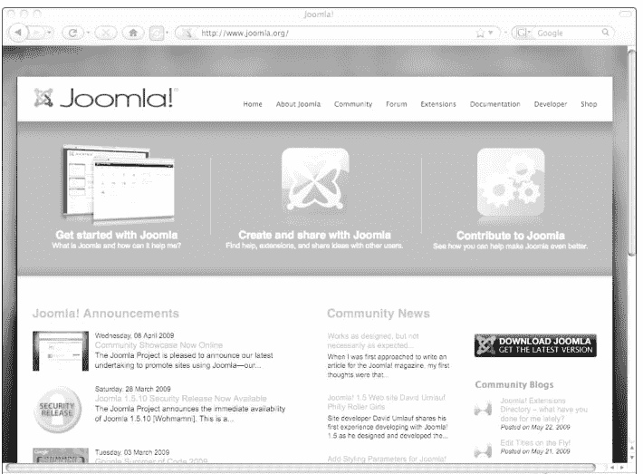

### 探索JoomlaCode网站

JoomlaCode.org是官方Joomla!网站中最重要的网站之一。您可以通过将浏览器指向www.joomlacode.org来访问该网站。该网站为Joomla!用户提供了大量资源。首先，它作为官方Joomla!文件的中心存储库。在该网站上，您不仅可以找到Joomla!的最新完整发布版本，还可以找到允许运行旧版本Joomla!的用户升级到最新版本的补丁和升级包。

## 第2章：获取与安装Joomla!

除了官方文件外，该网站还充当许多非商业Joomla!核心扩展的分发点。您应该花些时间浏览一下网站并探索一番。随着您更多的使用Joomla!，您很可能会发现自己将该网站用作识别和下载网站额外扩展的资源。

乍一看，您可能会觉得该网站有点难以导航。JoomlaCode使用的是代码锻造场常见的组织结构，但并非非常直观。如果您不熟悉锻造场类型的网站，一开始可能会觉得有点混乱。例如，点击右上角的主页链接，并不会将您带回到JoomlaCode的主页，而是带您到一个完全不同的站点——*Joomla.org*。此外，除非您已经知道所需扩展的名称，否则按项目浏览可能相当耗时。搜索功能也有些有限。

浏览JoomlaCode的最佳选择是使用标记为"浏览项目主题"的框。该框位于页面右侧约一半高度的位置。点击您感兴趣的类别名称，您将被带到一个页面，该页面显示一个树状文件目录，底部有一个文件列表，如图2.2所示。点击目录旁边的"显示"链以显示目录内容。点击"添加筛选器"链接以限制页面上显示的项目仅属于该类别。例如，点击"画廊与多媒体"选项，会带您到一个页面，显示一个包含三个选项的目录树：画廊、播客和流媒体。在树状目录下方是"画廊与多媒体"类别中的所有项目列表。如果您接下来点击"添加筛选器"链接（在"画廊"选项旁边），页面将重新加载，仅显示属于画廊子类别的项目。如果您接下来点击"添加筛选器"链接（在"流媒体"选项旁边），页面将重新加载，仅显示同时属于画廊和流媒体子类别的项目。

> 提示

> **Joomla!扩展网站**，http://extensions.joomla.org，提供了一个更易于访问的Joomla!扩展目录。该网站还包括评论、评分以及商业和非商业扩展。对于大多数用户来说，扩展网站是浏览和搜索的更友好选择。

### 确定您需要哪些文件

识别您需要的核心文件涉及回答两个问题：

这是全新安装还是升级？

哪种存档文件类型适合您的服务器？

如果是全新安装，您只需从JoomlaCode站点获取当前的完整发布版本。如果是现有Joomla!站点的升级，则需要先确定您当前运行的版本，然后仔细查看JoomlaCode上的升级列表，以

# 第一部分：开始使用 Joomla!

找到用于从您当前站点上的 Joomla! 版本进行升级的存档文件。完整的发布列表，包括完整版本和升版本，可以在 http://joomlacode.org/gf/project/joomla/frs/?action=index 找到。

### 交叉引用

**有关修补和升级您的站点的更多详细信息，请参阅第 25 章。**

官方 Joomla! 发布提供多种存档格式，包括 .zip、.tar.gz 和 .tar.bz2，如图 2.3 所示。下载您选择的版本；它们都包含相同的文件。提供各种格式只是为了方便。正确的选择取决于您能够提取哪种类型的存档文件。

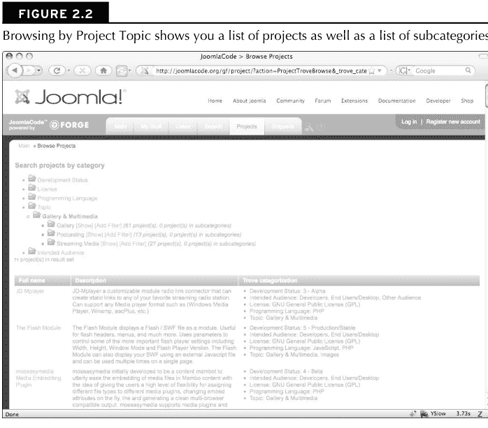

# 第 2 章：获取和安装 Joomla!

图 2.3

JoomlaCode.org 网站是所有官方文件的所在地。

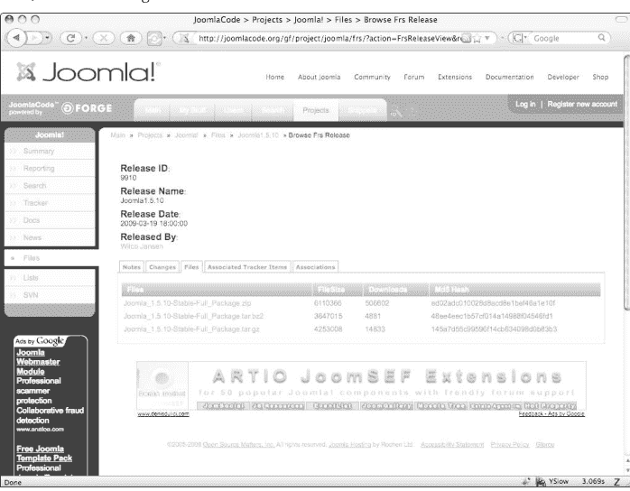

### 技术要求

Joomla! 的技术要求非常基本。该系统对服务器设置的差异非常宽容，通常可以在绝大多数使用 Linux、Unix 甚至 Windows 的商业服务器上运行。这使得在大多数商业网络主机上安装 Joomla! 变得容易，并且很少需要额的服务器配置。

对于访问者，前端几乎可以被任何使用任何浏览器的计算机使用。对于站点管理员，后端支持所有常见浏览器的最新版本。

许多主机甚至提供了一种一键安装 Joomla! 到您的托管账户的方法。这对于初学者来说是一种简便的方式，可以安装 Joomla! 并创建数据库，而无需自己上传文件。

#### 服务器要求

Joomla! 的首选服务器设置包括带有 MySQL 数据库的 Apache Web 服务器。Joomla! 主要使用 PHP 编写，因此服务器也必须安装 PHP。概述的配置是运行 Linux 或 Unix 操作系统的共享 Web 主机的典型配置。表 2.1 显示了在您的 Web 服务器上运行 Joomla! 1.5.x 的最低和首选技术系统要求。

**表 2.1**

Joomla! 1.5.x 的软件要求

| 软件 | 最低版本 | 推荐版本 |

|---|---|---|

| Apache Web 服务器 | 1.3 | 2.x + |

| MySQL 数据库 | 3.23 | 4.1.x +（但不是 MySQL 6.x） |

| PHP | 4.3.10 | 5.2 + |

表 2.2 显示了在您的 Web 服务器上运行 Joomla! 1.6.x 的最低和首选技术系统要求。

**表 2.2**

Joomla! 1.6.x 的软件要求

| 软件 | 最低版本 | 推荐版本 |

|---|---|---|

| Apache Web 服务器 | 1.3 | 2.x + |

| MySQL 数据库 | 3.23 | 4.1.x +（但不是 MySQL 6.x） |

| PHP | 4.3.10 | 5.2 + |

> **提示**

虽然要求概述了通用配置，但与 Apache Web 服务器存在一些额外的配置问题。您需要启用 mod_mysql、mod_xml 和 mod_zlib。此外，如果您想使用搜索引擎友好的 URL，则需要安装 mod_rewrite 扩展。

> **注意**

虽然首选 Apache，但可以在 Microsoft IIS Web 服务器上运行 Joomla!。但请注意，Microsoft IIS 并未得到官方支持。

**Caution**

已检测到某些 PHP 版本存在问题。请尽可能避免使用以下版本：4.3.9、4.4.2 和 5.0.4。另请注意，某些 Zend Optimizer 版本也报告了问题。

#### 站点访问者和管理员要求

Joomla! 的前端可被各种平台和浏览器使用，包括移动设备。实际上，前端的显示受站点模板编码方式的影响比系统本身固有的任何因素都要大。建议支持 JavaScript，但对于默认站点来说并非必需。

> **注意**

安装某些第三方扩展可能会带来额外的要求。您应始终检查安装的扩展是否与网站访问者所需的系统兼容。

要管理 Joomla! 站点，您实际上只需要一个 Internet 连接和一个 Web 浏览器。后端管理系统兼容大多数常见浏览器的最新版本，包括 Internet Explorer、Firefox、Safari 和 Opera。Chrome 也是支持的浏览器。

### 安装 Joomla!

本节介绍在本地服务器或远程 Web 主机上安装 Joomla! 的过程。在本地安装 Joomla! 可以让您创建一个测试或开发站点，从而大大简化您的开发工作。在远程 Web 主机上安装 Joomla! 可以让您创建一个其他人可以查看和使用的公共站点。无论哪种情况，过程大致相同。

#### 创建本地开发站点

您可以在本地计算机上创建一个用于测试和开发目的的 Joomla! 站点。本地安装使得创建新站点更快更容易。这是在部署到实时服务器之前开发站点的好方法，因为您可以立即看到更改的影响，而无需来回移动文件。此外，如果您只有缓慢或不稳定的 Internet 连接，本地开发安装可以节省大量时间和挫败感。

可以在任何系统上创建本地安装——Windows、Mac 或 Linux。但是，您需要确保您的机器可以作为服务器运行并满足前一节概述的技术要求。如果您想独立获取和安装各个组件，您可以这样做，但我建议您获取其中一个软件包，以便一键安装所有必需的软件。

- 对于 Windows 用户，XAMPP 和 WampServer 软件包提供了一种简便的方法来安装 Apache、MySQL、PHP 和相关工具。

- Mac 用户可以使用 XAMPP 或 MAMP。

- Linux 用户可以安装 XAMPP。

> **注意**

您可以从 www.apachefriends.org 下载 XAMPP。WampServer 在 www.wampserver.com，MAMP 在 www.mamp.info。

### 交叉引用

**安装 WampServer 在附录 C 中讨论。安装 MAMP 在附录 D 中讨论。**

安装完包含所有必要服务器组件的底层软件包后，您就可以在本地计算机上设置 Joomla! 了。在任何 -AMP 软件包上安装 Joomla! 涉及以下步骤：

1. **下载 Joomla! 核心文件。**

2. **打开您机器上 -AMP 文件夹内的 htdocs 目录。**

3. **为您的 Joomla! 站点创建一个新目录。** 保持名称简单，因为它将用作浏览器中的地址；例如，“joomla15”。

    确保将文件解压到目录的根目录（htdocs）。这样，-AMP 的启动页面将是目录的根目录。前面的示例将文件放在名为 /joomla15 的目录中，该目录比根目录低一级。

4. **解压 Joomla! 文件并将其放入新目录中。**

5. **启动 -AMP 软件包的服务器。按照随应用程序附带的说明操作。** 当服务器启动时，您的浏览器会打开并显示 -AMP 软件包的主页。您看到的内容应类似于图 2.4。

6. **单击 phpMyAdmin 链接。** phpMyAdmin 界面将在您的浏览器中打开。

7. **在标有“Create new database”的文本字段中，输入数据库的名称，然后单击“Create”。** 系统将创建一个新数据库。

8. **将您的浏览器指向放置 Joomla! 文件的目录。** Joomla! 安装向导将会出现。

从这一点开始，您可以按照本章后面“运行 Joomla! 安装程序”部分中概述的步骤进行操作。

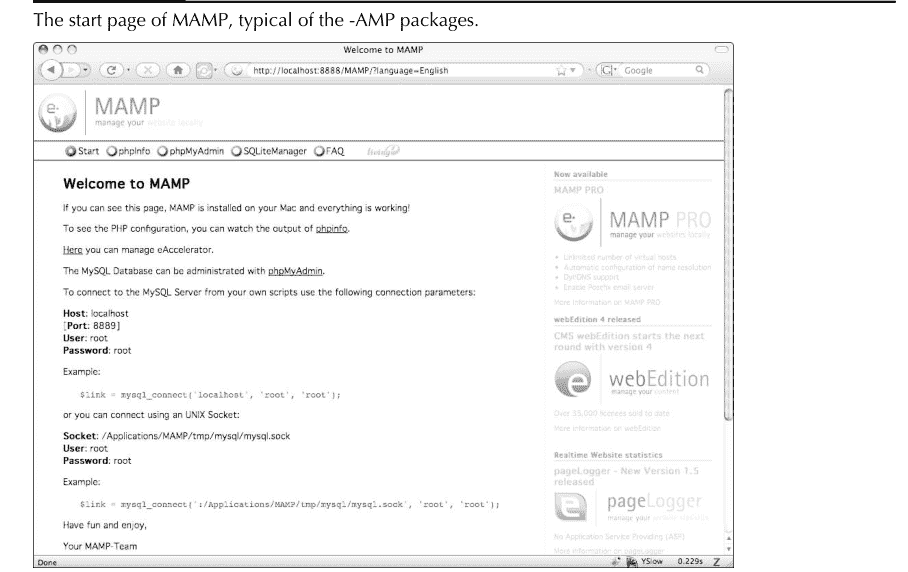

#### 在 Web 托管服务上安装

在远程服务器上安装 Joomla! 通常采用两种方法之一。一些 Web 主机提供自动安装程序。这些自动安装程序中最著名的是 Fantastico。自动安装程序允许您直接从 Web 主机帐户控制面板设置 Joomla! 或其他流行系统。如果您想使用自动安装程序，请按照 Web 主机的说明操作。如果需要帮助，请联系您的 Web 主机寻求支持。

> **注意**

偶尔，使用自动安装程序可能会导致生成站点的权限问题。对于大多数用户来说，这些问题不是问题，但如果您打算对站点进行大量定制，最好通过自己安装站点文件来避免整个问题，而不是依赖自动安装程序。

## 第一部分：开始使用 Joomla!

在开始在服务器上安装 Joomla! 之前，您需要预先创建好具有用户权限的数据库。您需要用户和密码才能完成 Joomla! 安装程序中的所有步骤。

1.  **下载 Joomla! 核心文件。**

2.  **访问您的网络服务器。**

3.  **为您的 Joomla! 站点创建一个新目录。** 保持名称简单，因为您将在浏览器地址中使用它；例如 "joomla"。如果您想将 Joomla! 安装在根目录，可以跳过此步骤。

4.  **将包含 Joomla! 文件的归档文件移动到服务器。** 您可以通过 FTP 传输文件，或使用网络托管控制面板中的文件管理器来完成。将文件放在您希望网站出现的目录中。

**注意**

附录 B 列出了 Joomla! 文件和目录在服务器上应有的列表。

5.  **解压 Joomla! 文件归档。** 如果您的网络主机不提供在服务器上解压归档文件的选项，则需要先在本地解压归档文件，然后将文件移动到服务器。请注意，由于文件数量和大小相当大，此过程可能耗时显著更长！

6.  **将浏览器指向您放置 Joomla! 文件的目录。** Joomla! 安装向导将出现。

此时，您可以按照下一节“运行 Joomla! 安装程序”中概述的步骤进行操作。

**注意**

根目录的名称因网络主机而异。如果您不确定服务器上的哪个目录是根目录，请联系您的网络托管支持团队。

### 运行 Joomla! 安装程序

Joomla! 包含一个分步安装程序，其界面类似于许多其他标准软件安装向导。安装程序为您完成了绝大部分工作。在大多数情况下，您只需在提示时提供信息即可。

在运行安装程序之前，您必须遵循前两个部分中概述的步骤（取决于您是本地安装还是在 Web 主机上安装），然后必须将浏览器指向服务器上 Joomla! 文件的地址。在浏览器中加载 Joomla! 站点的地址后，安装向导会自动启动，并在屏幕上显示安装程序的步骤 1。

**步骤 1** 是选择安装程序要使用的语言，如图 2.5 所示。点击您喜欢的语言，然后点击“下一步”按钮。

## 第 2 章：获取并安装 Joomla!


选择安装过程中要使用的语言。（安装程序步骤 1。）

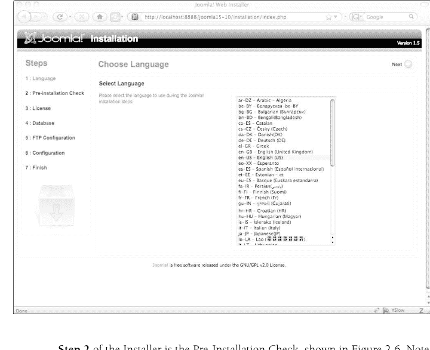

安装程序的步骤 2 是“安装前检查”，如图 2.6 所示。请注意，此屏幕上有两个列表：顶部列出的项目是系统正常工作必须满足的要求。底部列出的项目是“推荐设置”。如果您的系统不支持其中任何一项，您将在该项旁边看到鲜红色的**否**。如果顶部的任何项目不受支持，您必须修复这些问题。如果您的系统不支持底部列表中的任何项目，这并非致命错误；系统将能运行，但配置将不是最理想的。

如果顶部列表中的任何要求未满足，您必须修复该问题并获得绿色的**是**，然后才能继续安装过程的下一步。要让安装程序重新测试您的系统，请点击“再次检查”按钮。根据需要重复操作。在所有必需的项目都显示绿色的“是”后，点击“下一步”按钮转到步骤 3。

## 第一部分：开始使用 Joomla!

在继续之前，您必须让所有必需元素显示绿色的“是”。（安装程序步骤 2。）

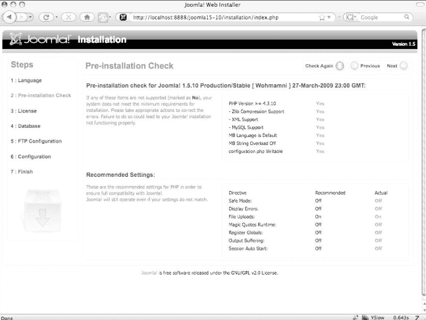

安装程序的步骤 3 是“许可协议”，如图 2.7 所示。阅读许可条款，然后点击“下一步”按钮。请注意，点击“下一步”按钮即表示您同意许可条款。

安装程序的步骤 4 是“数据库配置”，如图 2.8 所示。您需要完成此屏幕上的请求信息才能成功安装 Joomla!。如果您已使用 phpMyAdmin 手动创建数据库，请在此处输入该信息。但请注意，并非总是需要手动创建数据库；在许多情况下，Joomla! 安装程序能够自行创建数据库。

## 第 2 章：获取并安装 Joomla!

**图 2.7**

阅读许可条款。（安装程序步骤 3。）

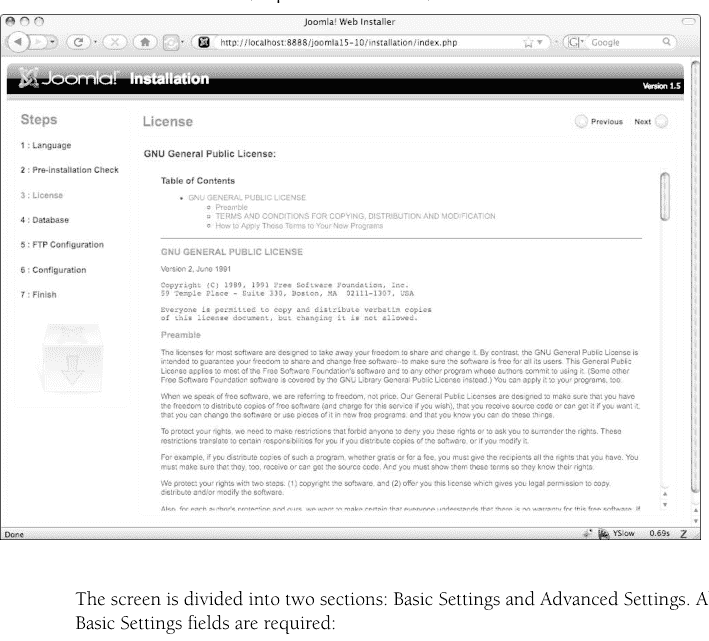

屏幕分为两个部分：“基本设置”和“高级设置”。以下所有“基本设置”字段都是必需的：

-   **数据库类型**：对于大多数用户，默认选项 mysql 是正确的。但是，如果您使用的是 mysqli（MySQL 改进版），您应该从组合框中选择该选项。

-   **主机名**：如果您在本地安装 Joomla!，很可能应在该字段中输入 localhost。如果您在 Web 主机上安装，请使用他们提供的名称。

-   **用户名**：此字段填写 MySQL 用户名。默认名称是 root。如果您或您的网络主指定了非默认值，请输入该值。

-   **密码**：输入您 MySQL 安装的密码。

-   **数据库名称**：这是您创建数据库时设置的名称，或者如果您依赖 Joomla! 安装程序创建数据库，请输入您希望其用于新数据库的名称。

## 第一部分：开始使用 Joomla!

可以通过点击名称来查看“高级设置”。点击名称后，该部分将展开，显示以下列表中的选项。请注意，这些选项仅在您想覆盖现有 Joomla! 安装或在一个数据库中安装多个 Joomla! 实例时才适用。

-   **删除现有表：** 任何现有表都将被清除，并用本次安装的新表替换。

-   **备份旧表：** 任何现有表在写入新表之前会被备份。

-   **表前缀：** 默认表前缀是 ` jos_ `。您可以根据需要设置替代前缀；当您打算将多个安装放在一个数据库中时，此设置最有用。请注意，前缀 ` bak_ ` 保留用于备份，因此不应使用。

输入信息后，点击“下一步”按钮。安装程序尝试连接到您的数据库，如果成功，则进入步骤 5。如果不成功，您将收到一条错误消息，说明问题所在。解决问题后，再次尝试点击“下一步”按钮。

**图 2.8**

显示数据库配置字段。（安装程序步骤 4。）

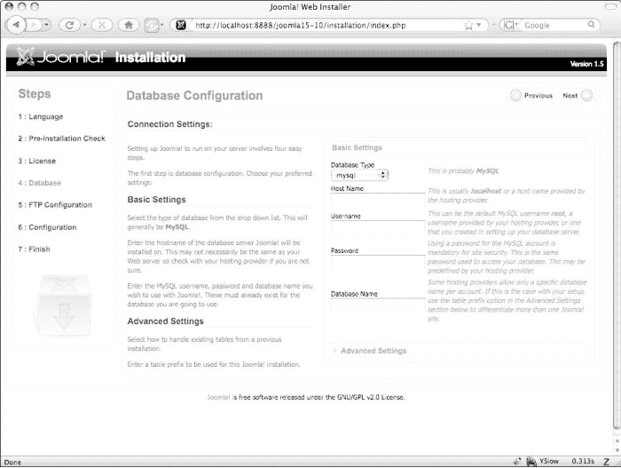

## 第 2 章：获取并安装 Joomla!

安装程序的步骤 5 是“FTP 配置”，如图 2.9 所示。FTP 功能已包含在 Joomla! 中，旨在为网络服务器禁止其他类型 FTP 访问的情况提供解决方案。如果您需要此功能，请启用它；如果不需要，请跳过此步骤并转到步骤 6。

屏幕分为两个部分：“基本设置”和“高级设置”。如果您想启用此功能，以下所有“�基本设置”字段都是必需的。

-   **启用 FTP 文件系统层：** 默认设置为“否”。如果您想使用此功能，请设置为“是”。

-   **FTP 用户：** 您必须输入用于 FTP 访问的用户名。

-   **FTP 密码：** 您必须输入用于 FTP 访问的密码。

-   **FTP 根路径：** 如果您知道 FTP 根路径，请输入；如果不知道，您可以点击“自动查找 FTP 路径”按钮，让系统尝试找出。

-   **验证 FTP 设置：** 完成上述字段后，点击此按钮以验证和测试设置。

可以通过点击名称来查看“高级设置”。点击后，该部分将展开，显示以下选项：

-   **FTP 主机：** 系统尝试确定此值。如果对于您的系统不正确，请输入您需要的值。

-   **FTP 端口：** 系统尝试确定此值。如果对于您的系统不正确，请输入您需要的值。

-   **保存 FTP 密码：** 是/否，默认值为否。如果您希望系统记住密码，而不是在需要时提示您输入，请将其设置为“是”。

输入信息后，点击“下一步”按钮。安装程序进入步骤 6。

**提示**

如果您想在安装过程中跳过 FTP 设置，您始终可以通过“全局配置管理器”稍后进行设置。有关“全局配置管理器”的讨论，请参见第 4 章。

安装程序的步骤 6 是“主配置”屏幕，如图 2.10 所示。此屏幕上出现了一些重要项目，包括为您安装示例数据的选项。首先，为您的站点命名。在标有“站点名称”的字段中输入您希望站点使用的名称。请注意，此名称将出现在浏览器标题栏以及各种情况下。您稍后可以通过“全局配置管理器”进行调整。

接下来，输入您希望与管理员帐户关联的电子邮件地址。在标有“您的电子邮件”的字段中输入地址。在“管理员密码”字段中，为默认管理员帐户输入您选择的密码。在“确认管理员密码”字段中再次输入以确认。

## 第一部分：Joomla! 入门指南

**图 2.9**

可选的 FTP 配置。（安装程序的第 5 步。）

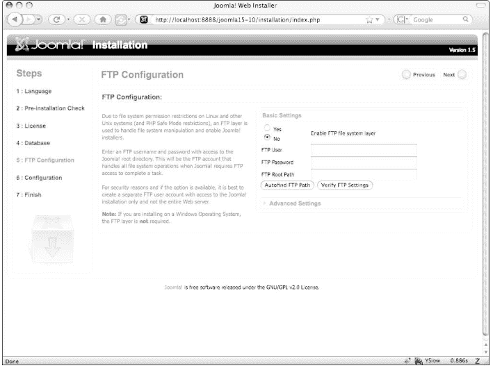

### 提示

如果您想为您的网站安装示例数据，请使用“安装示例数据”按钮。如果您想要一个空白网站，可以跳过此步骤。

### 提示

如果您是第一次使用 Joomla!，我强烈建议您安装示例数据。Joomla! 示例数据包含各种有用的信息以及常见网站构建技术的示例。请注意，虽然您随时可以删除示例数据，但之后无法轻易安装，因此，如果您认为可能需要它，请现在安装！

您在示例数据按钮下方看到的“加载迁移脚本”选项，适用于希望使用来自另一个源（通常是之前的 Joomla! 网站）的数据填充新网站数据库的用户。如果这对您不适用，请跳过此步骤并单击“下一步”按钮移动到第 7 步。

30

## 第 2 章：获取并安装 Joomla!

**图 2.10**

安装程序的第 6 步是主配置屏幕，其中包括安装示例数据或将现有数据迁移到新网站的选项。

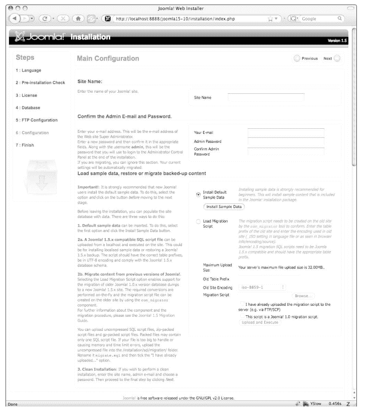

31

## 第一部分：Joomla! 入门指南

另一方面，如果您希望使用来自另一个源的数据填充您的 Joomla! 网站，您可以通过此界面进行操作，也可以稍后通过手动迁移数据库内容并通过 phpMyAdmin 运行 SQL 查询来完成。请注意，此处提供的工具依赖于与您的 Joomla! 版本兼容的 SQL 迁移脚本的存在。实现此目的的最佳方法是使用 `com_migrator` 工创建迁移脚本。

如果您有一个合规的脚本，请按照以下步骤操作：

1. 单击单选按钮以选择选项“加载迁移脚本”。

2. 在标记为“旧表前缀”的字段中输入旧表前缀。

3. 从组合框中选择旧站点的编码。

4. 单击“浏览”按钮。文件上传窗口打开。

5. 找到迁移脚本文件，然后单击“上传”。文件上传窗口加载，迁移脚本的名称应出现在“迁移脚本”标签旁边的字段中。

6. 如果您的脚本来自 Joomla 1.0 站点，请单击标记为“此脚本是 Joomla! 1.0 迁移脚本”的复选框。

7. 单击“上传并执行”按钮。系统尝试使用脚本数据填充数据库。如果成功，将出现确认消息。

### 注意

`com_migrator` 组件是一个第三方扩展，必须安装在您的旧站点上并用于创建迁移脚本。您可以在 JoomlaCode 站点上找到该扩展。请注意，`com_migrator` 只会迁移您的核心文件。如果您在旧站点上安装了扩展程序，则需要单独管理其迁移。由于安装配置和扩展程序的广泛差异，迁移可能成为许多问题的根源。有关常见问题及其解决方案的列表，请参阅 http://docs.joomla.org/Common_Migrator_Errors。

安装程序的第 7 步是确认屏幕，如图 2.11 所示。这里没有必需的步骤；相反，此页面为您提供指向新站点前端和后端的链接，以及需要删除安装目录以避免问题和安全风险的警告。

此时，您需要访问服务器上的 Joomla! 文件并删除名为 `installation` 的目录。删除目录后，您就可以开始了。单击进入站点的前端或后端以关闭安装程序。

## 第 2 章：获取并安装 Joomla!

**图 2.11**

最终的确认屏幕。您完成了！（安装程序的第 7 步。）

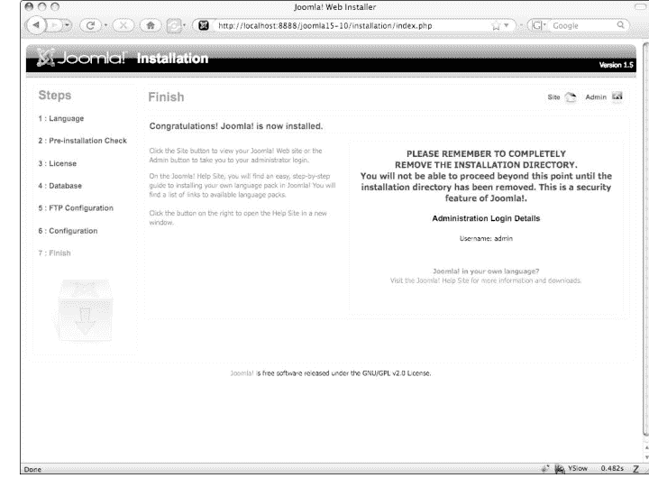

### 示例数据

在安装过程中作为选项提供的示例数据旨在帮助系统的新用户。主题包括教程以及有关 Joomla! 项目的信息和进一步帮助资源的指引。此外，当您选择安装示例数据时，系统还会创建许多菜单和模块，以帮助加快您网站的初始开发。许多经验丰富的网站开发人员实际上选择安装示例数据，因为它节省了他们创建最常见菜单和模块的时间；删除您不需要的内容比从头开始创建所有基本部分更快。

话虽如此，如果您是一位经验丰富的开发人员，并且确实希望对您的网站拥有最大程度的控制，您将希望跳过示例数据并安装一个干净的站点，以便您可以根据需要完全自定义。

## 第一部分：Joomla! 入门指南

### 总结

在本章中，我们介绍了 Joomla! 的获取和安装。您了解了以下内容：

- 在哪里获取正确的文件

- 如何在本地主机上安装系统

- 如何在虚拟主机服务上安装系统

- 各种安装要求和选项

- 使用示例数据的优点

34

## 第 3 章

深入了解 Joomla!

如果您完成了上一章，您应该拥有一个完整的 Joomla! 安装，可以开始探索了。本章介绍了 Joomla! 的前端和后端界面，并解释了屏幕上的内容。本章还提供了 Joomla! 系统的快速入门和导览。

| 本章内容 |

| :--- |

| 介绍前端 |

| 介绍后端 |

本章中的参考和图表均指已安装示例数据的默认站点。

### 介绍前端

（公共界面）

您的 Joomla! 安装的前端是网站访问者看到的界面。前端是您输出的目标，也是访问者访问站点内容和功能的地方。默认情况下，对 Joomla! 站点前端的访问是不受限制的；但是，您可以将内容和功能的可见性限制为已注册并登录到系统的用户。

站点的访问者应该能够使用各种浏览器（包括当前版本和较旧版本）查看和使用前端内容和功能。该站点也可在大多数常见移动设备上使用。

## 第一部分：Joomla! 入门指南

关于前端的结构功能，您在屏幕上看到的关键元素，如图 3.1 所示，包括：

- **模板：** 页面上所有输出的容器。它定义了页面的外观和感觉。

- **文章：** 您的内容项目。

- **模块：** 在次要内容区域提供输出和功能。

- **插件：** 增强您的文章、组件和模块的功能。

### 理解内容组织结构

Joomla! 将内容项目组织成由部分、类别和文章组成的层次结构。部分是顶级父容器。类别被分配给部分。文章可以被分配给类别，也可以与层次结构分开，并分组到称为 *未分类内容* 的通用集合中。

查看默认的 Joomla! 1.5 站点（已安装示例数据），您会发现表 3.1 中所示的层次结构。

### 注意

**示例数据内容层次结构中的所有文章都被分配给类别和部分。默认的 Joomla! 1.5 设置中没有未分类的内容文章。**

## 第 3 章：深入了解 Joomla!

**图 3.1**

已安装示例数据的默认 Joomla 站点前端。请注意关键输出区域。

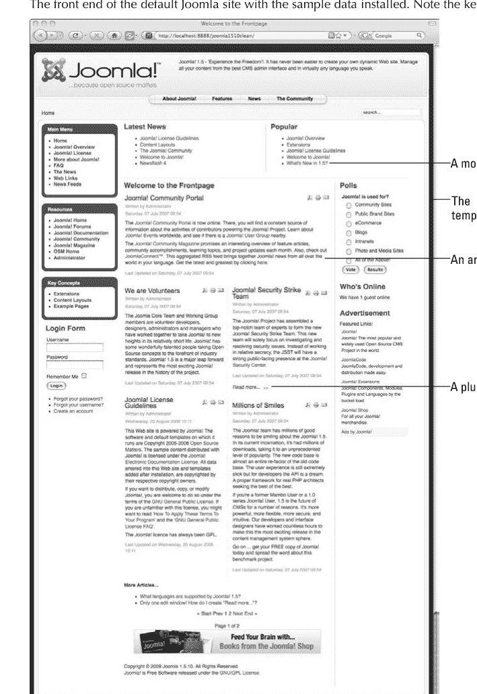

- 一个模块

- 模板

- 一篇文章

- 一个插件

37

## 第一部分：Joomla! 入门指南

**表 3.1**

### Joomla! 1.5.x 中示例数据的内容层次结构

| 部分 | 类别 | 文章 |

| :--- | :--- | :--- |

| 关于 Joomla! | 项目 | 支持与文档 |

| | | Joomla! 许可指南 |

| | | 平台与开放标标准 |

| | 内容管理系统 | 1.5 版的新功能？ |

| | | Joomla! 概述 |

| | | 扩展程序 |

| | | Joomla! 功能 |

| | | 内容布局 |

| | 社区 | Joomla! 事实 |

| | | Joomla! 社区 |

| 新闻 | 最新动态 | 欢迎使用 Joomla! |

| | | Joomla! 社区门户 |

| | | Joomla! 安全应急小组 |

| | | 我们是志愿者 |

| | | 百万微笑 |

| | 新闻快讯 | 新闻快讯 1 |

| | | 新闻快讯 2 |

| | | 新闻快讯 3 |

| | | 新闻快讯 4 |

| | | 新闻快讯 5 |

| 常见问题 | 常规 | 是否可以更改菜单项的类型？ |

| | | 什么是未分类文章？ |

| | | 如何安装 Joomla! 1.5？ |

### 第三章：初识 Joomla！

| 章节 | 分类 | 文章 |

| :--- | :--- | :--- |

| | | Joomla! 1.5 能在 PHP 安全模式下运行吗？ |

| | | 运行 Joomla! 1.5 有什么要求？ |

| | | FTP 层有什么用？ |

| | | 我的 MySQL 数据库不支持 UTF-8。这有问题吗？ |

| | | 为什么 Joomla! 1.5 使用 UTF-8 编码？ |

| | 当前用户 | |

| | | 安装程序去哪了？ |

| | | 本地设置发生了什么变化？ |

| | | 如何升级到 Joomla! 1.5？ |

| | | 只有一个编辑窗口！如何创建“阅读更多...”？ |

| | | Mambots 去哪了？ |

| | | 静态内容项在哪里？ |

| | Joomla! 新手 | |

| | | 归档文章和移至回收站有什么区别？ |

| | | 如何移除一篇文章？ |

| | | 安装示例数据有用吗？ |

| | 语言 | |

| | | 我安装时选择了自己的语言，但后台界面仍然是英文。 |

| | | Joomla! 1.5 支持哪些语言？ |

| | | PDF 图标能渲染图片和特殊字符吗？ |

| | | 安装界面中的排序规则选择有什么作用？ |

| | | 如何将 Joomla! 本地化为我的语言？ |

### 交叉引用

**关于如何使用区块、分类和文章，请参阅第5章。**

这里有一点需要注意：管理员实施的任何内容结构，都不会自动转化为网站前端访客所看到的组织结构。内容层次结构反映了文章、分类和区块在网站后台的创建方式。菜单的结构（将在下一节讨论）主要决定了网站访客如何体验内容。

## 第一部分：开始使用 Joomla！

### 熟悉 Joomla! 术语

在本书中，我努力使用与 Joomla! 团队在文档网站和在线帮助文件中所用术语保持一致的专业用语。快速熟悉 Joomla! 的专业术语，可以帮助你清晰地理解本书以及 Joomla! 文档资源中的讨论。

- **访问级别：** 访问级别为网站管理员提供了一种控制文章或功能访问权限的方式。Joomla! 提供三种访问级别：公开、已注册和特殊。将某个项目的访问级别设置为“公开”，意味着任何人都能看到它。设置为“已注册”或“特殊”则将可见性限制在分配给特定用户组的用户。

- **归档：** Joomla! 中的文章可以从网站的通用内容区域中移除并放入归档中。归档可以公开访问，但与归档文章相关的功能受到限制。归档也可以从公开视图中隐藏。归档不等同于将文章移至回收站（参见下一个术语）。这最常用于博客类网站，因为归档文章可以按发布月份来组织旧文章。

- **文章：** 文章是通过 Joomla! 的“新建文章”功能创建的一个内容页面。文章在“文章管理”界面中汇集，可以进行创建、编辑、删除、发布、取消发布和归档。当网站前端内容管理功能启用时，也可以从网站前端创建文章。

- **组件：** 组件是提供页面主要输出区域功能的大型单元。组件是系统中最复杂的独立单元，有时本身就构成完整的应用程序。系统中的每个组件在管理后台都有自己的管理界面。默认系统包含多个组件，你可以向系统添加更多组件。

- **核心：** 在此上下文中，术语*核心*仅指默认 Joomla! 发行版中包含的文件。

- **扩展：** 扩展是一个通用术语，指添加到默认系统的任何组件、模块、插件或模板。可以通过管理后台的“扩展管理”来安装、删除或管理扩展。请注意，由于某些扩展是 Joomla! 必需的，因此无法删除。一个好习惯可能是只删除你自己安装的扩展。

- **菜单：** 菜单包含网站的导航选项。菜单在“菜单管理”中创建、编辑和删除；但是，菜单的显示则通过“菜单模块”在“模块管理”中管理。菜单由菜单项组成。

- **菜单项：** 菜单项是菜单上的选项（链接）。菜单项在系统各个菜单项管理器中创建、编辑和删除。系统中的每个菜单都有一个菜单项管理器。

- **菜单项类型：** 每个菜单项都属于特定的菜单项类型。创建新菜单项时需要为该项目选择一个菜单项类型。菜单项类型在 Joomla! 中非常重要，因为它们决定了菜单项链接到的页面的外观方面。

- **模块：** 模块通常在页面的次要区域提供输出，即不在主要输出区域内。模块有时只是包含文本或图片的容器；有时则提供有限的功能，如登录框。模块通常与组件配对，以提供显示组件输出的替代方式。模块在“模块管理”界面中汇集，可以在此进行编辑并分配到各个页面和位置。默认系统包含多种不同的模块类型。可以通过“扩展管理”向系统添加模块，也可以由网站管理员在“模块管理”中创建。

- **模块位置：** 模块位置是页面上可以分配给模块出现的位置。模块位置由模板设计师创建，他们在模板中编写代码定义模块位置的占位符。也可以通过在文章文本中插入 `{loadposition 模块名称}` 将模块包含在文章中。

- **模块类型：** 系统中的每个模块都属于特定的模块类型。手动创建新模块时，必须为模块选择一个类型。模块类型决定了模块功能的某些方面。

- **新闻聚合：** 术语*新闻聚合*指 RSS 或类似的联合发布格式。Joomla! 可以通过使用“新闻聚合组件”或“联合显示模块”在网站内显示新闻聚合数据。网站还可以为访客提供联合发布链接，将你的内容转化为供他人查看的新闻聚合。请不要将新闻聚合与新闻快讯功能（参见下一条）混淆；尽管名称相似，但它们毫无关联。

- **新闻快讯：** 新闻快讯功能是一个模块，可以在屏幕上显示一个或多个简短的内容条目。请不要将此功能与新闻聚合功能混淆；它们毫无关联。

- **插件：** 插件是辅助应用程序，可在网站的组件、文章或模块中启用额外功能。插件在“插件管理”界面中汇集。可以通过“扩展管理”安装新插件，也可以由网站管理员通过“插件管理”创建。在 Joomla! 的早期版本中，这些被称为 Mambots。

- **模板：** 模板控制你的 Joomla! 网站的表示层。它们定义了网站的界面。当你更换模板时，你改变了网站为访客或管理员呈现的外观。可以通过“扩展管理”向系统添加模板。已安装的模板在“模板管理”界面中汇集，可以在此进行编辑。

- **翻译和语言包：** 翻译是你的 Joomla! 网站的语言文件。在本书中，单一语言的翻译语言文件集合称为*语言包*，因为这个名称比通用术语*翻译*更具描述性且不易混淆。可以通过“扩展管理”添加新的语言包，已安装的语言包在“语言管理”界面中汇集。

- **回收站：** Joomla! 中的回收站功能为已从网站使用中移除并等待永久删除的文章和菜单项提供了一个临时存放区域。在 Joomla! 1.5 中，文章和菜单项是两个独立的回收站管理器的对象，允许你恢复或永久删除这些文章或项目。在 Joomla! 1.6 中，多个回收站管理功能已合并到各种项目的管理器界面中。

### 了解菜单结构

默认的 Joomla! 安装在包含示例数据的情况下，包含三十一个菜单项，它们被组织成七个菜单。这些菜单在“菜单管理器”中可见；而每个菜单的菜单项则位于各自的“菜单项管理器”中。表 3.2 展示了安装示例数据后默认系统中所有菜单的列表，包括每个菜单中的菜单项数量以及访问级别设置。

**表 3.2 默认菜单结构摘要**

| 菜单名称 | 项目数量 | 访问级别 |

| --- | --- | --- |

| 主菜菜单 | 9 | 公开 |

| 用户菜单 | 4 | 已注册 & 特殊 |

| 顶部菜单 | 4 | 公开 |

| 资源 | 7 | 公开 |

| 示例页面 | 4 | 公开 |

| 关键概念 | 3 | 公开 |

请注意，除了用户菜单外，所有菜单及其菜单项都设置为公开访问级别。用户菜单的项目混合分配了“已注册”或“特殊”访问级别。其结果是，用户菜单仅在网站访客已注册并经过身份验证时才出现在页面上。该菜单上的某些项目对已注册用户可见；而其他项目则仅对被分配到更高用户组（例如，作者、编辑或发布者）的用户可见。

菜单在页面上的放置位置由将菜菜模块分配到特定的模块位置来控制，如图 3.2 所示。

### 交叉引用

与菜单和菜单项相关的内容在第 8 章中介绍。

### 模块和模块位置

安装了示例数据的默认 Joomla! 安装包含大量模块。其中一些模块已发布并可见，另一些则不可见。模块的可见性取决于

-   模块是否已启用，即是否已发布

-   模块是否已分配到你正在查看的页面

-   查看者是否有足够的访问权限来查看该模块

网站的默认菜单，显示了每个菜单在页面上的放置位置。

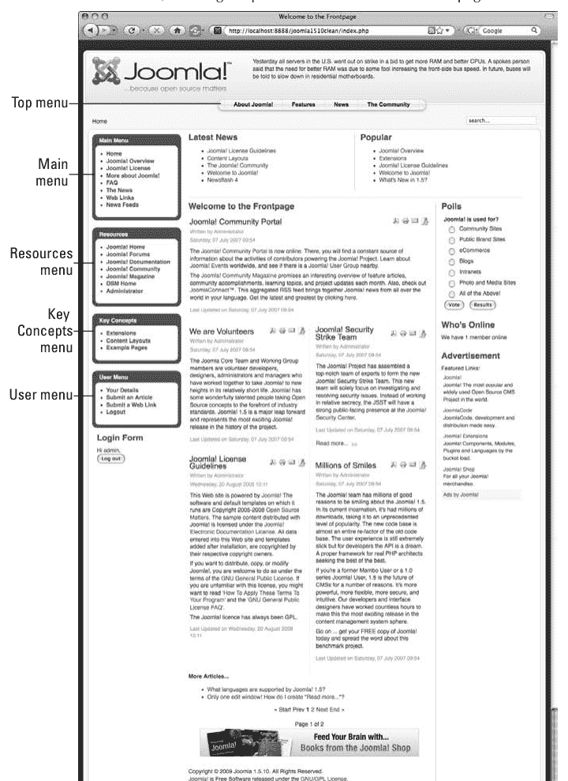

模块的分配、可见性和访问级别是通过在模块管理器中编辑模块来设置的。参见图 3.3。

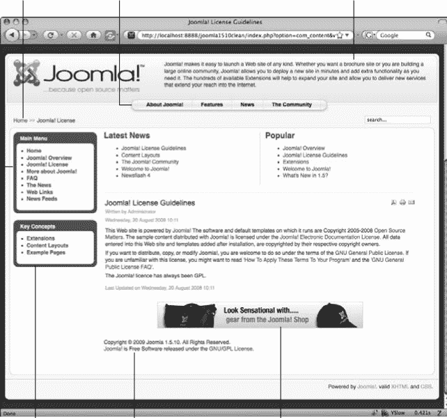

除了你在默认网站上看到的模块外，Joomla 1.5.x 的示例数据还包括其他未发布的模块，包括：

-   统计

-   归档

-   栏目

-   相关项目

-   内嵌框架

-   Feed 显示

如果你想查看这些模块的实际运行效果，请转到模块管理器并启用它们。请注意，其中一些模块需要额外的配置才能使输出有意义。

模块通过将它们分配到模块位置来放置在页面上。模块位置由模板设计师编码到模板中。图 3.4 显示了你在图 3.3 中看到的同一个页面，但叠加了模块位置的名称。

一个显示可用模块位置名称叠加层的页面。请注意，此信息特定于此特定模板。模块位置因模板而异。

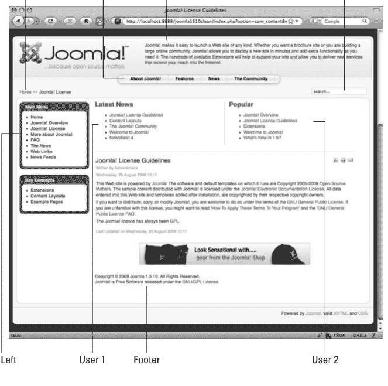

**注意**

Joomla! 将模块分为两类：站点模块和管理员模块。站点模块在网站的前端可见。管理员模块仅在网站的后端可见。要查看和操作站点模块，请访问模块管理器。

**交叉引用**

站点模块在第 17 章中讨论。管理员模块在第 18 章中介绍。

### 介绍后端（管理界面）

你的 Joomla! 网站的后端是管理界面，大部分网站管理活动在此发生。管理系统的访问通过登录表单控制，并仅限于被分配到高于“发布者”用户组的用户。默认情况下，管理登录页面始终位于 `/administrator`，例如，`www.yourdomain.com/administrator`。

**注意**

后端用户应使用较新版本的 Internet Explorer、Firefox 或 Safari 访问系统，以确保所有管理功能的最大可访问性。较旧或较不常见的浏览器可能无法达到最佳运行效果。

#### 探索管理界面

管理系统中有三种主要类型的界面：控制面板、管理器页面和工作区页面。我将在以下各节中分别介绍这些界面。

#### 控制面板

你登录管理系统时看到的第一个页面是控制面板，如图 3.5 所示。你也可以随时通过在“站点”菜单下选择“控制面板”选项返回此页面。

控制面板旨在为管理员提供对最常用任务和工具的快速访问，以及有用信息的摘要。

**图 3.5**

控制面板是你登录后端管理系统时看到的第一个页面。

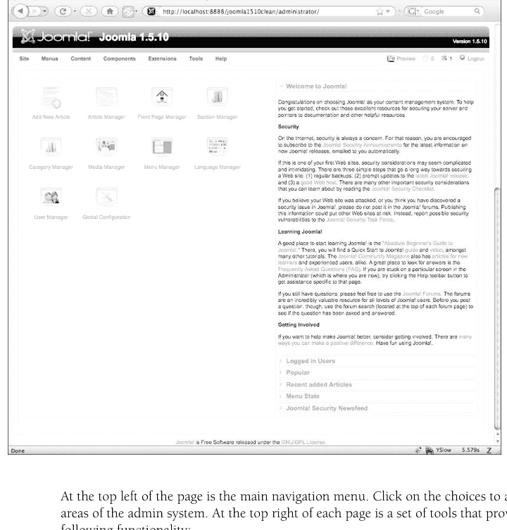

页面左上角是主导航菜单。点击选项可访问管理系统的各个区域。每个页面的右上角都有一组工具，为你提供以下功能：

-   **预览：** 点击可打开网站前端的预览。

-   **邮件图标（无标签）：** 此处显示你在管理系统“私人消息中心”中的未读消息数量。点击可打开“私人消息管理器”。

-   **人物图标（无标签）：** 此处显示的数字表示当前登录到网站的用户数量。

-   **注销：** 点击此图标可从管理系统注销。

页面左侧，在主导航栏下方，是快捷方式图标。这些图标仅作为便利功能提供；它们是加速器，重复了主导航页面顶部菜单中可找到的功能。点击任何图标可在浏览器中打开相应功能。

页面右侧是欢迎消息以及有关网站当前状态的各种信息。除了欢迎消息外，在 Joomla! 1.5.x 中可见的选项有：

-   **已登录用户：** 当前登录到系统的所有用户列表。

-   **热门文章：** 网站上最常查看的文章列表。

-   **最近添加的文章：** 网站上最近修改的文章列表。

-   **菜单统计：** 所有菜单及其分配项目数量的列表。

-   **Joomla! 安全新闻源：** 此选项卡显示来自 Joomla! 安全团队的 RSS 新闻源。这是为了方便你随时了解警报和有关升级与漏洞的通知。

**提示**

你在控制面板页面上看到的输出是由各种管理员模块生成的。你可以通过对模块进行重新排序或禁用来在一定程度上自定义此页面的外观以满足你的需求。

#### 管理器页面

管理系统中的所有各种管理器界面在很大程度上是相似的。页面的结构一致，尽管显示的数据可能有所不同。点击控制面板上的快捷方式图标中的任何管理器链接，或使用主导航栏下的链接，即可查看类似于图 3.6 所示的管理器页面。

管理器页面旨在处理大量项目并显示关键信息。在接下来的章节中，本书将逐一介绍每个管理器，并解释该页面上的控件和信息。

#### 工作区页面

一旦你从管理器页面点击进入以执行特定任务，在绝大多数情况下，你会被带到一个具有工作区布局的页面。所有工作区页面在很大程度上都是相似的，元素布局一致。

通常，工作区页面显示如图 3.7 所示的关键元素，包括

-   右上角的工具栏

-   标题下方左上角的主要信息字段

-   左下角的文本字段（必要时）

-   页面右侧的参数字段

# 第3章：深入了解 Joomla！

**图 3.6**

一个典型的管理器页面界面，此处展示的是 Joomla 1.5.x 中的文章管理器。

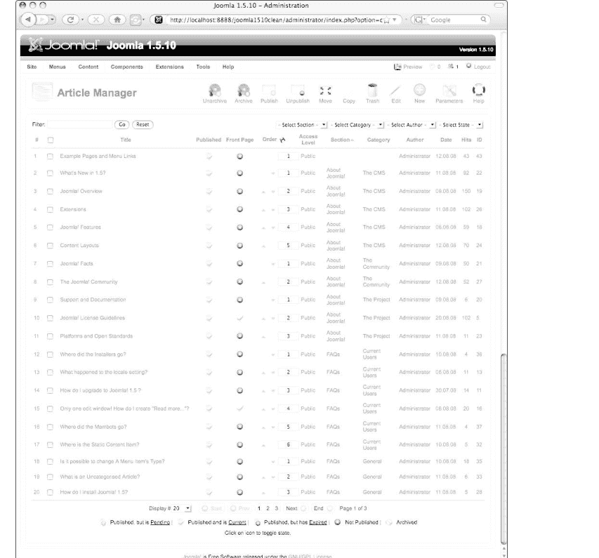

在后续章节中，本书将逐一介绍各个工作区，并解释这些页面上出现的控件和信息。

### 提示

尽管 Joomla! 管理界面设计为可在多种屏幕显示设置下良好运行，但工作区页面在您的显示器分辨率设置为大于 1024 x 768 时确实能获得更好的体验。

## 第一部分：Joomla! 入门


一个典型的工作区页面界面，此处展示的是 Joomla 1.5.x 中的文章编辑对话框。

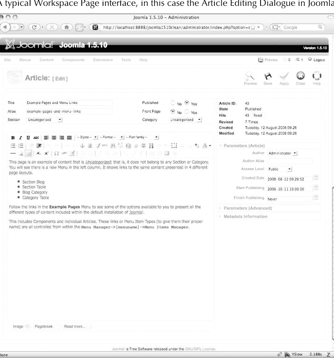

### 站点菜单

点击管理主导航上的“站点”选项将显示以下选项：

-   **控制面板：** 点击返回控制面板。

-   **用户管理：** 点击打开用户管理器。

-   **媒体管理：** 点击打开媒体管理器。

-   **全局配置：** 点击打开全局配置管理器。

-   **注销：** 点击从管理系统注销。请注意，这与每个管理页面右上角的注销图标功能重复。

### 菜单菜单

点击管理主导航上的“菜单”选项将显示以下选项：

-   **菜单管理：** 点击打开菜单管理器。

-   **菜单回收站：** 点击打开菜单回收站管理器。

-   **主菜单：** 点击打开主菜单的菜单项管理器。

-   **用户菜单：** 点击打开用户菜单的菜单项管理器。

-   **顶部菜单：** 点击打开顶部菜单的菜单项管理器。

-   **资源：** 点击打开资源菜单的菜单项管理器。

-   **示例页面：** 点击打开示例页面菜单的菜单项管理器。

-   **关键概念：** 点击打开关键概念菜单的菜单项管理器。

### Joomla! 1.6

“菜单回收站”选项在 Joomla! 1.6 中并未出现在此位置；而是集成到了每个菜单管理器右上角的工具栏中。

### 内容菜单

点击管理主导航上的“内容”选项将显示以下选项：

-   **文章管理：** 点击打开文章管理器。

-   **文章回收站：** 点击打开文章回收站管理器。

-   **区域管理：** 点击打开区域管理器。

-   **分类管理：** 点击打开分类管理器。

-   **前台管理：** 点击打开前台管理器。

### Joomla! 1.6

“内容”菜单在 Joomla! 1.6 中已不存在；取而代之的是，您可以从“组件”菜下的“文章”选项访问内容文章。

### 组件菜单

点击管理主导航上的“组件”选项将显示以下选项：

-   **横幅：** 点击进入横幅组件。此处的子导航选项允许您直接跳转到横幅管理器、横幅客户管理器和横幅分类管理器。

-   **联系人：** 点击访问联系人组件。此处的子导航选项允许您直接跳转到联系人管理器和联系人分类管理器。

-   **新闻聚合：** 点击访问新闻聚合组件。此处的子导航选项允许您直接跳转到聚合源管理器和新闻聚合分类管理器。

-   **投票：** 点击打开投票组件。

-   **搜索：** 点击访问搜索统计。

-   **网络链接：** 点击访问网络链接组件。此处的子导航选项允许您直接跳转到链接管理器和网络链接分类管理器。

### Joomla! 1.6

Joomla! 1.6 中的组件菜单包含若干差异。首先，菜单包含了“文章”选项，可访问文章管理器。其次，菜单不包含“投票”选项，因为投票组件未包含在 Joomla! 1.6.x 的核心中。最后，菜单不包含“搜索”选项，因为该功能已被移除。

#### 扩展菜单

点击管理主导航上的“扩展”选项将显示以下选项：

-   **安装/卸载：** 点击进入安装/卸载扩展功能。

-   **模块管理：** 点击打开模块管理器。

-   **插件管理：** 点击打开插件管理器。

-   **模板管理：** 点击打开模板管理器。

-   **语言管理：** 点击打开语言管理器。

### Joomla! 1.6

Joomla! 1.6 中的扩展菜单仅有一处细微差别：选项“安装/卸载”已被重命名为“扩展管理”。


### 工具菜单

点击管理主导航上的“工具”选项将显示以下选项：

-   **读取消息：** 点击访问管理系统私信管理器。

-   **撰写消息：** 点击使用管理系统的私信管理器撰写消息。

-   **群发邮件：** 点击向网站用户发送邮件。

-   **全局签入：** 点击强制关闭所有当前正在编辑的项目。

-   **清除缓存：** 点击打开缓存管理器。

-   **清除过期缓存：** 点击打开缓存管理器的清除缓存功能。

### Joomla! 1.6

Joomla! 1.6 中的工具菜单包含一项额外功能：重定向。点击“重定向”选项将打开重定向管理器，允许您将特定 URL 重定向到特定页面。

### 帮助菜单

点击管理主导航上的“帮助”选项将显示以下选项：

-   **Joomla! 帮助：** 点击打开 Joomla! 帮助系统中可用帮助主题的索引。

-   **系统信息：** 点击查看关于您的服务器系统和 Joomla! 安装的信息。

### 总结

在本章中，我们快速浏览了默认 Joomla! 安装的前端和后端。您学习了以下内容：

-   内容是如何组织的

-   菜单和菜单项的结构是怎样的

-   如何访问管理系统

-   管理界面是如何组织的

-   主管理导航栏上每个菜单的内容

## 第4章：充分利用站点配置

大多数用户在安装 Joomla! 后执行的第一项任务是设置站点的全局配置选项。为协助这一重要过程，Joomla! 提供了全局配置管理器，使您可以在一处设置站点的众多配置选项。

顾名思义，您在全局配置管理器中设置的选项将应用于您的整个站点。尽管全局配置管理器中的许多设置只需设置一次便无需再动，但部分选项可被为单个项目提供的参数选项所覆盖。

在本章中，我将解释全局配置管理器中可用的选项，并提供关于如何设置配置选项以获得最佳效果的提示。

| 本章内容 |

| --- |

| 设置站点配置 |

| 设置系统配置 |

| 设置服务器配置 |

### 探索全局配置管理器

您可以通过两种方式访问全局配置管理器：点击控制面板上的“全局配置”图标，或在站点菜单下选择“全局配置”选项。全局配置管理器在您的浏览器中加载后，请注意它分为三个独立的屏幕，分别标记为“站点”、“系统”和“服务器”。我将在以下部分涵盖所有这三个选项卡。

全局配置管理器顶部的工具栏包含以下功能：

-   **保存：** 点击保存您所做的任何更改。保存后，系统将退出全局配置管理器并返回控制面板。

-   **应用：** 点击保存更改而不退出全局配置管理器。

-   **关闭：** 点击不保存更改即退出全局配置管理器。

-   **帮助：** 点击访问与当前活动屏幕相关的在线帮助文件。

工具栏下方、工作区上方有三个文本链接，用于在全局配置管理器的三个屏幕之间切换。

### 使用站点选项卡

“站点”选项卡是全局配置管理器的默认登录页面。此选项卡包含基本的站点选项，例如站点名称以及站点的元数据和 URL 结构。您随时可以点击标记为“站点”的文本链接来查看“站点”选项卡。“站点”选项卡的内容将在您的浏览器窗口中加载，如图 4.1 所示。

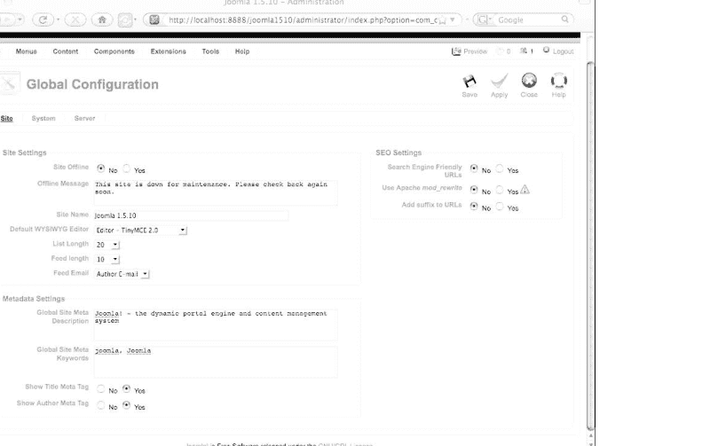

## 第四章：充分利用站点配置

站点选项卡的工作区分为三个部分：站点设置、元数据设置和搜索引擎优化设置。我将在接下来的各节中详细说明每个部分。

### 站点设置

站点选项卡的站点设置部分包含了一系列与站点基本特性相关的选项。此选项卡上两个最重要的控件与您使站点离线以及设置站点名称的能力有关。您还可以应用以下选项：

-   **站点离线：** 单击“是”可以将您的站点隐藏起来，不对公众开放，而是向访问者显示您在下方字段中输入的信息。当您正在安装站点升级和补丁时，此选项最为有用，因为它可以避免访问者看到您的站点处于不完整或无法运行的状态。

> **注意**

>

> 使站点离线意味着仅前端无法访问；管理系统仍将保持可访问状态。

-   **离线信息：** 在此字段中，输入您希望在站点处于离线期间访问您的站点时看到的信息。此控件与站点离线相关。

-   **站点名称：** 在此字段中，输入您想用于站点的名称。为站点选择名称除了充当站点本身的标签外，还有多种影响。该名称会显示在许多地方，包括由站点生成的电子邮件和RSS订阅源中，因此请选择一个合适且实用的名称。电子邮件发件人名称可以在服务器选项卡上被覆盖。

-   **默认所见即所得编辑器：** 此控件右侧的组合框显示了您站点所有编辑器选项的列表——要么是所见即所得编辑器，要么是“无编辑器”选项。选择一个作为用户的默认选项。请注意，所见即所得编辑器的列表由已安装和启用的编辑器决定。

> **交叉引用**

>

> 有关启用其他所见即所得编辑器的信息，请参见第19章。

-   **列表长度：** 从组合框中选择一个值，以设置管理系统中项目列表的默认长度。默认值为20。

> **注意**

>

> 将此控件设置为较高的值会导致页面上出现更多选项，并减少分页控件的使用，但由于页面加载时间增加，也可能导致管理系统略微变慢。

-   **订阅源长度：** 从组合框中选择一个值，以设置RSS订阅源中显示的项目数量。默认值为10。

-   **订阅源电子邮件：** 您的Joomla!站点生成的RSS订阅源在每个项目中都包含作者姓名和电子邮件地址。使用组合框选择要显示的电子邮件地址。“作者电子邮件”和“站点电子邮件”是仅有的两个选项。默认为“作者电子邮件”。

> **注意**

>

> “订阅源电子邮件”选项是1.5.10版本新增的。此选项可能并非对所有人都理想，因为它公开了电子邮件地址，并可能使其被垃圾邮件发送者获取。不幸的是，如果不修改相关代码，则无法禁用此选项。

### 元数据设置

您网站的元数据显示在页面代码的头部区域。元数据对您的访问者不可见，但会被搜索引擎索引。此工作区使您能够指定应用于整个站点的元数据选项。其中一些选项可以为单个文章覆盖，或通过安装第三方扩展来覆盖。以下是可用的选项：

-   **全局站点元数据描述：** 在此文本字段中，输入您希望出现在页面元数据描述字段中的信息。这样操作会为整个站点设置描述元数据。

-   **全局站点元数据关键词：** 在此文本字段中，输入您希望出现在页面元数据关键词字段中的信息。这样操作会为整个站点设置关键词元数据。

> **注意**

>

> “描述”和“关键词”选项均可通过在文章的“元数据信息参数”字段中指定不同的值来为单个文章覆盖。

-   **显示标题元标签：** 单击“是”以在页面中包含标题元标签。该字段的内容取自页面标ITLE。

-   **显示作者元标签：** 单击“是”以在页面中包含作者元标签。该字段的内容取自您在文章的“元数据信息参数”字段中指定的作者姓名。

### 搜索引擎优化设置

Joomla!生成的默认URL不被认为对搜索引擎营销目的来说是最佳的。默认URL通常包含查询字符串和附加字符，这可能会给搜索引擎蜘蛛程序带来困难。此外，这些URL往往难以记忆，对人类用户也不友好。

例如，默认的系统URL可能看起来像这样：

http://www.yoursite.com/index.php?option=com_content&view=article&id=27:the-joomla-community&catid=30:the-community&Itemid=30

站点选项卡的搜索引擎优化设置部分允许您切换选项，以启用有助于克服此问题的搜索引擎友好URL。与前面的示例相比，如果您启用了搜索引擎友好URL选项，页面URL将看起来像这样：

http://www.yoursite.com/the-community.html

-   **搜索引擎友好URL：** 单击“是”以启用系统显示搜索引擎友好URL。默认设置为“否”。

-   **使用Apache mod_rewrite：** 单击“是”以使用Apache的mod_rewrite功能来创建搜索引擎友好URL。默认设置为“否”。请注意，这仅适用于您使用Apache网络服务器的情况，并且仅在您将前面的控件“搜索引擎友好URL”设置为“是”时才相关。

> **注意**

>

> 要使用Apache mod_rewrite选项，您必须使用随您的Joomla!站点提供的.htaccess文件。默认的Joomla!发行包在根目下包含一个名为htaccess.txt的文件。您需要将此文件重命名为.htaccess，此功能才能正常工作。

-   **为URL添加后缀：** 设置为“是”以在所有URL末尾添加后缀.html。默认设置为“否”。

> **提示**

>

> 出于安全考虑，最好设置为添加.html后缀，而不是让URL保持开放格式。

如果您使用的是Apache网络服务器，可以通过以下步骤启用搜索引擎友好URL：

1.  访问您的网络服务器根目录。

2.  找到文件htaccess.txt，并将其重命名为.htaccess。

> **注意**

>

> 在某些服务器上，当您将文件名从htaccess.txt更改为.htaccess时，该文件似乎会消失。实际上它并未消失，但某些服务器会隐藏以句点开头的文件。

3.  登录到您站点的管理系统。

4.  单击站点菜单下的“全局配置”选项。全局配置管理器将在您的浏览器中加载。

5.  将选项“搜索引擎友好URL”设置为“是”。

6.  将选项“使用Apache mod_rewrite”设置为“是”。

7.  单击工具栏上的保存图标。您的系统现在将显示搜索引擎友好URL。

### 使用系统选项卡

系统选项卡包含许多重要的控件，使您能够指定与用户注册、允许上传到系统的文件类型以及缓存和会话设置相关的条件。单击页面左上角标有“系统”的文本链接，即可访问全局配置管理器的系统选项卡。图4.2显示了系统选项卡的工作区。

**图4.2**

Joomla 1.5.x中全局配置管理器的系统选项卡。

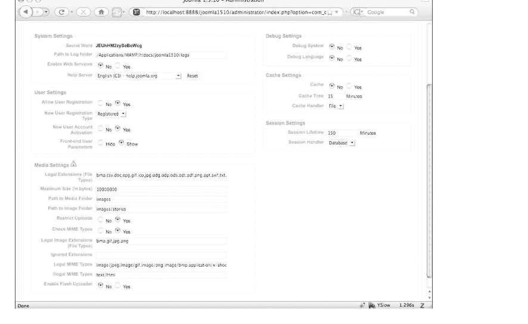

系统选项卡的工作区分为六个部分；每个部分将在以下各节中讨论。

### 系统设置

系统设置在很大程度上由您的Joomla!系统自动填充。其中一些值不能或不应该更改。

## 第4章：充分利用站点配置

-   **秘密词**：*秘密词*是每个 Joomla! 站点独有的，系统用它作为创建令牌和加密用户密码的基础。秘密词在安装过程中由系统自动创建。无法更改。

- **日志文件夹路径**：此字段显示服务器上日志文件的位置。此信息在安装期间由 Joomla! 自动提供。

- **启用 Web 服务**：单击“是”可启用使用 HTTP 和 XML 的远程过程调用（RPC）。除第三方扩展明确要求，否则无需更改此设置。默认值为“否”。

- **帮助服务器**：用于提供管理员在管理界面中单击帮助图标时所见信息的站点 URL。默认情况下，此设置为官方 Joomla! 站点。

### 用户设置

此工作区区域中的设置与用户在您站点上注册的能力相关，仅当您的站点允许从前端进行用户注册时才相关。这些设置是：

-   **允用户注册**：单击“是”以允许站点访客申请成为您站点的注册用户。请注意，您必须已发布用户注册表单供公共访客使用，否则启用此选项没有意义。默认值为“是”。

- **新用户注册类型**：从组合框中选择希望自动分配给新用户的级别。此选择始终可以由站点管理员通过用户管理器根据具体情况予以覆盖。此处的选项仅限于“注册用户”、“作者”、“编辑者”和“发布者”。默认值为“注册用户”。

- **新用户账户激活**：将此值设置为“是”，要求系统向所有新用户发送确认电子邮件，用户必须根据该邮件采取行动以验证并激活其账户；在用户验证账户之前，无法使用该账户。将此设置为“否”意味着用户账户将立即激活，无需用户采取进一步操作。默认值为“是”。

- **前端用户参数**：设置为“显示”以允用户设置特定于其账户的某些首选项。选项包括设置语言、编辑器和帮助站点的首选项。这仅适用于注册用户，并且选项仅在用户页面上可用。默认值为“显示”。

### 交叉引用

**第10章将更详细地讨论管理用户和用户注册。**

### 媒体设置

本节中的控件与您系统中允许和禁止的文件类型相关。这些限制适用于您或您的用户将新文件上传到系统以用于站点内容和组件的能力。此区域中的控件还允许您指定上传文件的存储位置。您可以调整以下设置：

-   **允许的扩展名（文件类型）：** 此字段包含允许的文件类型列表，以其扩展名显示。您可以添加新类型或删除现有类型。默认值为：bmp、csv、doc、epg、gif、ico、jpg、odg、odp、ods、odt、pdf、png、ppt、swf、txt、xcf 和 xls。

- **最大大小（以字节为单位）：** 设置可上传文件大小的限制。该值以字节表示。默认值为 100,000,000 — 即 100 MB。

- **媒体文件夹路径：** 显示所有上传的非图像媒体文件的目标位置。您可以将其更改为任何您喜欢的路径。默认值为 `images`。

- **图像文件夹路径：** 显示所有上传的图像文件的目标位置。您可以将其更改为任何您喜欢的路径。默认值为 `images/stories`。

> **注意**

**您可以为媒体或图像文件设置替代路径，但不要移动系统创建的 `images` 目录或位于 `images` 文件夹内的文件或目录。系统需要位于这些目录内的文件，移动它们会破坏指向这些文件的链接。**

-   **限制上传：** 设置为“是”时，此选项将对文件上传施加限制。默认设置为“是”。

- **检查 MIME 类型：** 将此设置保持为“是”，让系统根据文件名检查文件的 MIME 类型，以确保实际上传的内容与文件名所述一致。默认设置为“是”。

- **允许的图像扩展名（文件类型）：** 此字段包含允许的图像文件类型列表，以其扩展名显示。您可以添加新类型或删除现有类型。默认值为：bmp、gif、jpg 和 png。

- **忽略的扩展名：** 在此输入您希望免除限制的任何文件的扩展名，包括 MIME 类型的确认。默认情况下，没有文件类型被豁免。

- **允许的 MIME 类型：** 默认情况下，此字段包含允许的文件扩展名及其相关 MIME 类型的列表。默认值为 image/jpeg、image/gif、image/png、image/bmp、application/x-shockwave-flash、application/msword、application/excel、application/pdf、application/powerpoint、text/plain 和 application/x-zip。

- **禁止的 MIME 类型：** 包含被阻止的 MIME 类型列表。默认值为 text/html。

- **启用 Flash 上传器：** 设置为“是”可在媒体管理器中启用 Flash 上传器。Flash 上传器允许您轻松一次上传多个文件。默认值为“否”。

### Joomla! 1.6

Joomla! 1.6 在此处包含一个附加选项：**媒体管理器的最低用户级别**。组合框包含站点上的用户组列表，允许您将媒体管理器的使用限制为仅属于所选组或更高组的用户。

### 交叉引用

第6章将详细讨论媒体管理器。

### 调试设置

您可以在开发期间或遇到站点问题时使用调试设置。不应为在线站点启用这些设置，因为输出将在页面底部对站点访客可见。本节仅包含两个选项：

-   **调试系统：** 设置为“是”可启用调试系统。该工具为您提供诊断信息以及语言翻译和 SQL 错误输出。默认情况下，此设置为“否”。

- **调试语言：** 设置为“是”可启用对语言文件的调试。除非前面的控件“调试系统”设置为“是”，否则此控件不起作用。默认情况下，此设置为“否”。

### 缓存设置

使用这些控件启用和配置系统范围的缓存。此处可用的选项包括：

-   **缓存：** 将此设置为“是”以启用系统范围的缓存。

- **缓存时间：** 输入一个整数值以设置缓存内容在转储和刷新之前保留的分钟数。默认值为 15 分钟。此设置取决于上面的控件“缓存”设置为“是”。

- **缓存处理程序：** 此设置只有一个选项，因此此处没有可供您设置的选项。

### 会话设置

会话设置使您能够选择如何处理已登录但不活动的用户。两个控件是：

-   **会话生存期：** 设置一个整数值以指定用户在系统强制其注销之前可以保持非活动状态的分钟数。默认值为 15 分钟。

- **会话处理程序：** 从组合框中选择如何维护会话数据。默认设置为“数据库”。

### 注意

**较长的会话值对用户和管理员来说更方便，但过长的值可能对您的站点构成安全威胁，因为它们为未正确注销的用户留下一个活动的打开会话提供了可能性，该会话可能被未授权的用户使用。然而，在开发期间，处理站点内容时非常长的会话时间极其方便。**

63

## 第一部分：Joomla! 入门

### 管理服务器选项卡

服务器选项卡提供了一系列与您的系统与其托管服务器交互方式相关的设置。此处的设置不仅涵盖 Web 服务器，还包括数据库、FTP 和邮件系统。通过点击页面左上角标有“Server”的文本链接，可以访问全局配置管理器的服务器选项卡。图 4.3 展示了该工作区。

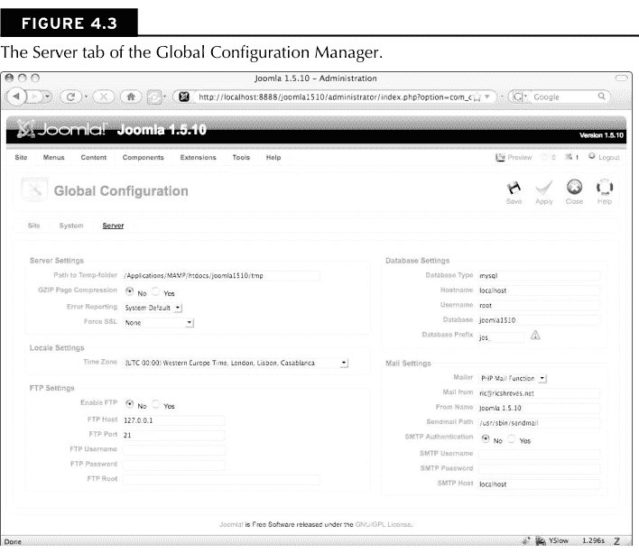

站点选项卡的工作区分为五个部分；每个部分将在以下章节中讨论。

### 服务器设置

以下讨论的设置与您的一般服务器配置相关。

- **临时文件夹路径**：此字段显示系统临时文件所在目录的路径。此字段的值由 Joomla! 在安装过程中自动创建。

- **GZIP 页面压缩**：如果您的服务器支持 GZIP 页面压缩，请将此项设置为“是”。这样做可以提高网站性能，但请注意，它仅在您的服务器提供此功能时才有效。

- **错误报告**：从组合框中选择一个值来设置您希望系统使用的错误报告级别。可用选项为“系统默认”、“无”、“简单”和“最大”。默认设置是“系统默认”，它允许错误报告级别由服务器 php.ini 文件中的设置决定。

**注意**

错误报告的输出会显示在所有页面的底部，前端和后端用户均可见。

- **强制 SSL**：从组合框中选择以确定系统是否需要使用 SSL 连接。选项为“无”、“仅管理员”和“整个站点”。默认为“无”。请注意，此控件取决于您的服务器是否支持 SSL。

### 区域设置

区域设置允许您根据自己的网站调整时间设置，而不受服务器默认时间设置的影响——时区：从组合框中选择您首选的时区。

### FTP 设置

Joomla! 内置了 FTP 功能，可以帮助您将文件移动到服务器，而无需借助第三方软件。此工作区区域中的设置允许您配置此功能。如果您希望使用传统的 FTP 或您的网站文件管理器，则无需启用以下设置：

- **启用 FTP**：设置为“是”以使用 Joomla! 的 FTP 功能。

- **FTP 主机**：输入主机服务器的 FTP URL。此字段可能已有值；这是 Joomla! 对正确 FTP URL 的最佳推测，很可能是正确的。

- **FTP 端口**：输入 FTP 访问的端口号的整数值。默认值为 21。

- **FTP 用户名**：输入 Joomla! 可用于通过 FTP 访问服务器的用户名。

- **FTP 密码**：输入与 FTP 用户名对应的密码。

- **FTP 根目录**：输入文件应上传到的目录的名称。

### 数据库设置

数据库设置区域中字段的值是在网站安装过程中初始创建的。除非在特殊情况下（例如将网站移动到新服务器），否则不应修改本节中的信息。提供的字段有：

**警告**

更改其中任何值都可能导致您的网站崩溃并无法访问。

- **数据库类型：**此字段显示您的系统正在使用的数据库类型。此值在网站安装过程中确定。

- **主机名：**此字段显示数据库的主机名。此值在网站安装过程中确定。

- **用户名：**此字段显示用户用于访问数据库的用户名。此值在网站安装过程中确定。

- **数据库：**此字段显示数据库的名称。此值在网站安装过程中确定。

- **数据库前缀：**此字段显示数据库表使用的前缀。此值在网站安装过程中确定。

**注意**

如果您在一个数据库上运行多个 Joomla! 安装，则需要为每个站点设置唯一的数据库前缀。

### 邮件设置

您的 Joomla! 网站可以在多种情况下向用户发送电子邮件。此工作区部分的设置控制邮件服务器配置，如下列表所述：

- **邮件程序：**从组合框中选择您希望使用的邮件程序。这通常在安装期间确定。

- **发件人邮箱：**此字段包含将显示在系发送的电子邮件中的电子邮件地址。此字段中的值在安装期间设置，但可以在此随时更改。

- **发件人姓名：**此字段包含将显示在系发送的电子邮件的“发件人”字段中的名称。默认情况下，这是在“站点”选项卡中输入的站点名称。

- **Sendmail 路径：**在此字段中输入服务器 SendMail 程序的路径。仅当“邮件程序”控件设置为“SendMail”时才使用此项。

- **SMTP 认证：**如果 SMTP 服务器需要认证，请将此项设置为“是”。仅当“邮件程序”控件设置为“SendMail”时才使用此项。

- **SMTP 用户名：**此字段包含 SMTP 服务器的用户名。仅当“邮件程序”控件设置为“SendMail”时才使用此项。

- **SMTP 密码：**此字段包含 SMTP 服务器的密码。仅当“邮件程序”控件设置为“SendMail”时才使用此项。

- **SMTP 主机：**此字段包含 SMTP 服务器的主机名。仅当“邮件程序”控件设置为“SendMail”时才使用此项。

# 第 4 章：充分利用站点配置

### 总结

在本章中，我们介绍了如何使用系统的全局配置选项。您学到了以下内容：

- 如何使用站点配置选项

- 如何使用系统配置选项

- 如何使用服务器配置选项

# 第二部分

## 处理内容和用户

### 本部分包括

- **第 5 章：**管理内容

- **第 6 章：**使用编辑器和媒体

- **第 7 章：**采用高级内容管理技术

- **第 8 章：**使用菜系统

- **第 9 章：**管理网站首页

- **第 10 章：**使用用户管理器

- **第 11 章：**使用语言管理器

## 第 5 章

### 管理内容

内容的管理是 Joomla! CMS 的核心。毫不奇怪，系统中的内容管理选项包含了各种可能性。本章记录了与 Joomla! 网站中内容的创建、组织和管理相关的关键概念和功能。

要充分利用系统，需要理解区块、分类和文章如何协同工作以创建项目层次结构。逻辑化的内容结构不仅使网站更易于访客使用，还能提高网站管理效率。本章涵盖了处理内容组织挑战的最常见方法，以及使您能够根据需求调整系统的各种参数。

**本章内容**

- 使用 Joomla! 内容层次结构

- 管理文章

- 使用文章参数

- 使用文章回收站管理器

- 处理已归档文章

### 理解 Joomla! 内容层次结构

与大多数内容管理系统一样，Joomla! 允许您在层次结构中组织内容。Joomla! 的构建使其能够处理大型和复杂的网站，这既可能是优点也可能是缺点。当您需要管理大量内容的灵活性时，这种能力是一个优势；但当您只有少量内容时，它可能成为一个挑战，因为系统使用不当会导致网站管理混乱且不必要的复杂。尽管如此，只要记住一些简单的事情——并且不被术语所迷惑——一切就都相当容易管理了。

## 第二部分：处理内容与用户

要充分利用该系统，你需要理解三个元素之间的关系：文章、分类和分区。

-   内容层次结构中最基本的层级是文章。

-   文章既可以作为未分类的独立内容存在，也可以被归类到分类中。

-   每个分类都属于一个被称为分区的父级分组。

### Joomla! 1.6

Joomla! 1.5.x 和 Joomla! 1.6 在文章组织方式上存在显著差异。Joomla! 1.6 具有显著更高的灵活性，管理员不受限于文章、分区和分类的固定层次结构。

Joomla! 1.5.x 系统包含专门用于处理分区和分类的管理工具；这些管理器可以在内容导航菜单下找到。你可以创建的分区数量是无限的，任何单个分区可以包含的分类数量也没有限制。重要的是要记住，分区和分类层次结构的设置会创建文章的集合和子集，这可能对信息显示、导航便捷性和管理便捷性产生重大影响。随意使用层次结构可能导致网站既难以让访客浏览，也难以管理。最好在构建前进行规划，因为以后移动内容可能是一项耗时的工作（但如果确实需要，也并非不可能）。

> 注意

文章在分类中的组织，以及分类在分区中的组织，与网站实际的URL显示无关。它仅仅是后端中文章的一种组织方式。

内容菜单下收集的工具都旨在帮助你查找和操作你的内容页面。这些被称为各种内容管理器的工具，允许你创建、编辑、组织和归档你的内容。你还可以从此菜单控制首页组件。

### 交叉引用

使用首页管理器是第9章的主题。

### Joomla! 1.6

Joomla! 1.6 的文章管理工具位于“组件”菜单的“文章”选项下。只有专门的文章、分类和特色文章管理器；Joomla! 1.6 中没有分区。

### 创建内容层次结构

除了最基础的网站，你都需要创建内容的集合和子集，即内容层次结构。不幸的是，Joomla! 1.5.x 仅限于最多呈现三级内容。本节内容涉及在该限制下工作，并充分利用 Joomla 1.5.x 的限制。

### 使用分区和分类

分区和分类是关键的组织结构。Joomla! 为你提供了管理两者的专用工具。分区管理器和分类管理器位于主管理导航栏的内容菜单下。

### 分区管理器概述

分区管理器是你用于创建、编辑和删除网站分区的操作空间。你可以从控制面板上的分区管理器图标访问，也可以通过点击主管理导航栏内容菜单下标有“分区管理器”的选项来访问。点击任一选项都会显示一个包含所有分区列表的屏幕，如图5.1所示。你可以直接在此屏幕上完成多项与管理分区相关的任务。

在加载了示例数据的默认系统中，你可以看到已经创建了三个分区：

-   关于 Joomla!

-   新闻

-   常见问题

你可以选择使用现有分区，重命名并编辑它们以满足你的需求，或者你可以删除它们并重新开始。

分区管理器顶部的工具栏可快速访问以下功能：

-   **发布：** 从列表中选择一个或多个分区，然后点击此图标将其发布。

-   **取消发布：** 从列表中选择一个或多个分区，然后点击此图标取消其发布。

-   **复制：** 从列表中选择一个或多个分区，然后点击此图标创建它们的副本，包括其内容。

-   **删除：** 从列表中选择一个或多个分区，然后点击此图标将其删除。

-   **编辑：** 从列表中选择一个分区，然后点击此图标编辑该分区的详细信息。

-   **新建：** 点击以添加新分区。

-   **帮助：** 点击以访问与当前活动屏幕相关的在线帮助文件。

图5.1 分区管理器界面。

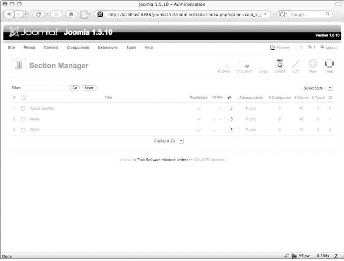

在工具栏下方和分区列表上方，有两个排序和搜索工具，可帮助你管理长列表的分区：

-   左侧的“筛选”字段就像一个搜索框。在字段中输入一个单词或短语，然后点击“Go”。页面将重新加载并显示搜索结果。要清空屏幕并返回完整列表，请点击“重置”按钮。

-   最右侧的“选择状态”筛选器允许你根据分区是否已发布或未发布来筛选和显示分区。这提供了一种简便的方法来识别网站上当前处于活动状态的所有分区。要重置此筛选器，请将组合框更改回默认设置。

屏幕的主要内容区域包含你 Joomla! 网站中所有分区的列表。提供的列包括：

-   **#**：由 Joomla! 分配的索引编号。无法更改。

-   **复选框（无标签）：** 点击复选框以选择一个分区；如果要使用工具栏中的多个选项，这是必需的。

-   **标题：** 此字段显示分区的全名。点击名称可编辑分区的详细信息。

-   **已发布：** 此列中的绿色对勾表示该分区已发布。带有X的红色圆圈表示该分区未发布。点击图标可在两种状态之间切换。

-   **排序：** 该数字表示该分区相对于其他分区的排序顺序。你可以通过点击绿色箭头在排序中向上或向下移动项目，或者在排序字段中输入数字，然后点击列顶部的保存图标来重新排序分区。

-   **访问级别：** 显示为该分区设置的访问级别。选项有公开、注册用户和特殊用户。点击该词可在三个选项之间切换。默认设置为公开。

-   **# 分类数：** 显示分配给该分区的分类数量。

-   **# 活跃数：** 显示该分区内分类中处于活动状态的文章数量。

-   **# 回收站数：** 指示该分区分类中有多少文章当前位于文章回收站管理器中。

-   **ID：** 系统生成的ID编号。供系统内部使用，用户无法更改。

在屏幕底部、内容区域下方，是“显示 #”选项。更改组合框控制中的值可以更改页面上显示的分区数量。可以通过更改全局配置管理器中的“列表长度”选项来更改默认值。

### 添加新分区

可以根据需要使用分区管理器工具栏上的“新建”选项创建新分区。点击“新建”图标将打开“新建分区”对话框，如图5.2所示。

“新建分区”对话框顶部的工具栏可快速访问以下功能：

-   **保存：** 点击此图标保存你的工作，创建一个新分区，并退出“新建分区”对话框。

-   **应用：** 点击此图标在不退出“新建分区”对话框的情况下保存你的工作。

-   **取消：** 取消任务并退出“新建分区”对话框。

-   **帮助：** 点击以访问与当前活动屏幕相关的在线帮助文件。

### 图5.2

“新建分区”对话框。

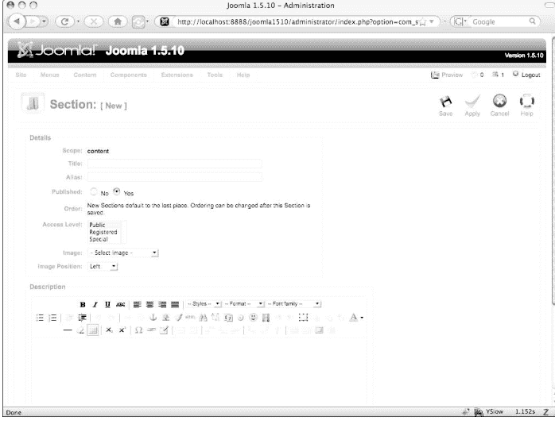

工作区分为两个区域。工作区顶部、标题正下方是详细信息区域。可用的字段有：

-   **范围：** 值“content”由系统提供，无法更改。

-   **标题：** 在此字段中键入分区的名称。此字段是唯一必填字段。

-   **别名：** 此字段保存分区的内部名称。如果留空，系统将使用你的分区标题。此字段仅接受小写字母和连字符（短横线）字符。不允许使用空格。在某些情况下，别名可能会作为URL字符串的一部分出现。

-   **已发布：** 点击“是”以发布该分区。

-   **排序：** 新分区在分区排序中默认为最后一位。在创建分区时无法更改，但可以在分区保存后更改。

-   **访问级别：** 设置适用于该分区的访问级别。选项有公开、注册用户和特殊用户。默认值为公开。

## 第五章：管理内容

-   **图片：** 如果你想为此部分关联一张图片，请从下拉框中选择一张。你可以通过将图片上传到 `images/stories` 目录来使用自己的图片。

-   **图片位置：** 通过从下拉框中选择一个对齐值来设置图片的对齐方式。

工作区中“详细信息”区域下方是“描述”区域。此区域仅包含一个字段，即用于输入部分描述的文本字段。请注意，在默认配置中，描述字段包含 TinyMCE 编辑器，并且在文本字段下方还包含“插入图片”按钮。

### 注意

**部分描述是否在任何页面上显示，取决于用于显示这些页面的“菜单项类型”在“参数”字段中设置的值。**

要创建一个新部分，请按照以下步骤操作：

1.  登录到你网站的管理系统。

2.  通过点击 **管理导航栏** 上“网站”菜单下的“部分管理器”选项来访问部分管理器。部分管理器将在你的浏览器中加载。

3.  在部分管理器界面上，点击 **部分管理器** 顶部工具栏上的“新建”图标。当你点击该图标时，“新建部分对话框”将打开。（参考图 5.2。）

4.  在“标题”字段中，输入部分的名称。**此字段为必填项。**

5.  完成任何其他你想要填写的字段；所有其他字段都是可选的。

6.  点击右上角工具栏上的“保存”图标以保存你的新部分。对话框关闭，返回到部分管理器。

### 复制部分

Joomla! 部分管理器提供了创建部分副本的选项。从技术上讲，你并非在复制一个部分，而是在复制现有部分的所有内容并将这些项目的副本移动到一个新部分中。这一区别是有意义的，因为该过程的一个特点是你可以选择多个部分，然后使用“复制”命令将内容的副本合并到一个单一的新部分中。“复制部分对话框”如图 5.3 所示。

## 小心

**部分内容的合并有时会出现问题，系统会创建多个同名的新部分，但每个新部分包含的类别和文章数量却不同。鉴于系统存在此错误，如果你想合并部分，更好的方法是逐个移动类别。**

## 第二部分：处理内容和用户

图 5.3

“复制部分对话框”，显示了正在复制的部分名称以及所有待复制的类别和文章列表。

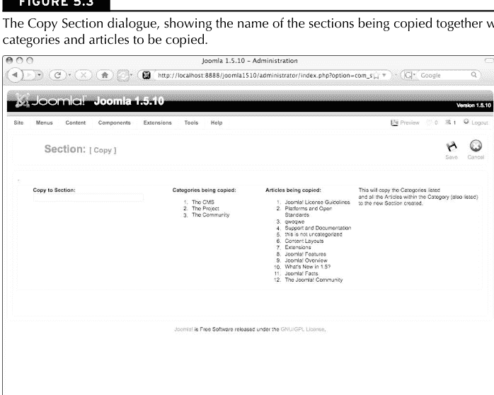

要复制一个部分，请按照以下步骤操作：

1.  打开部分管理器。

2.  点击你要复制的部分旁边的复选框。

3.  点击右上角工具栏上的“复制”图标。“复制部分”对话框将打开。（参考图 5.3。）

4.  为“新部分”输入一个名称。

5.  点击右上角工具栏上的“复制”图标。系统将创建一个新部分并返回到部分管理器。

### 编辑和删除部分

可以从部分管理器编辑现有部分。要编辑一个部分，可以在部分管理器中点击部分名称，或者点击部分旁边的复选框，然后点击部分管理器工具栏上的“编辑”图标。无论你使用哪种方法，系统都会打开“编辑部分对话框”。

“编辑部分对话框”与“新建部分对话框”相同，具有相同的字段和要求。

要对部分进行更改，只需在“编辑部分对话框”中修改所需的字段，然后点击工具栏上的“保存”或“应用”图标。你所做的任何更改都会立即生效。

完全删除部分可以通过部分管理器实现。通过部分管理器删除会绕过“回收站管理器”并立即删除所有元素。删除一个部分会导致该部分本身、分配给该部分的类别以及分配给这些类别的文章被移除。

要删除一个部分，请按照以下步骤操作：

1.  打开部分管理器。

2.  点击你要删除的部分名称旁边的复选框。

3.  点击右上角工具栏上的“删除”图标。系统将删除该部分及其内容，然后返回到部分管理器。

## 小心

**你不能删除包含类别的部分。必须先删除类别，然后才能删除部分。另请注意，删除操作不需要确认；删除是即时的，内容将从系统中永久移除。**

**另外，你不能删除包含文章的类别。它们需要先被移动或删除。**

### 类别管理器概述

点击此导航选项会显示一个包含所有类别列表的屏幕。你可以直接从此屏幕完成多项任务，所有这些任务都与管理你的类别相关。此界面如图 5.4 所示。

在加载了示例数据的默认系统中，你会找到以下九个类别：

-   项目

-   CMS

-   社区

-   通用

-   当前用户

-   Joomla! 新手

-   语言

-   最新

-   新闻快讯

## 第二部分：处理内容和用户

图 5.4

类别管理器界面。

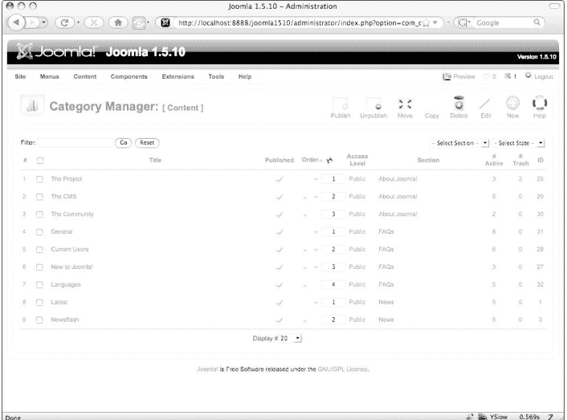

类别管理器顶部的工具栏提供了对以下功能的快速访：

-   **发布：** 从列表中选择一个或多个类别，然后点击此图标发布它们。

-   **取消发布：** 从列表中选择一个或多个类别，然后点击此图标取消发布它们。

-   **移动：** 从列表中选择一个或多个类别，然后点击此图标将类别中的项目移动到另一个不同的类别。

-   **复制：** 从列表中选择一个或多个类别，然后点击此图标创建它们的副本，包括其内容。

-   **删除：** 从列表中选择一个或多个类别，然后点击此图标删除它们。

-   **编辑：** 从列表中选择一个类别，然后点击此图标编辑该类别的详细信息。

-   **新建：** 点击以添加一个新类别。

-   **帮助：** 点击以访问与当前活动屏幕相关的在线帮助文件。

## 第五章：管理内容

在工具栏下方和类别列表上方有三个排序和搜索工具，可帮助你管理长列表的类别：

-   左侧的“筛选”字段类似于搜索框。在字段中输入一个单词或短语，然后点击“开始”。页面将重新加载并显示搜索结果。要清除屏幕并返回完整列表，请点击“重置”按钮。

-   “选择部分”筛选器允许你根据类别所属的部分来筛选和显示类别。要重置此筛选器，请将下拉框改回默认设置。

-   最右侧的“选择状态”筛选器允许你根据类别是否已发布或未发布来筛选和显示类别。这提供了一种简单的方法来识别当前网站上所有活动的类别。要重置此筛选器，请将下拉框改回默认设置。

屏幕的主要内容区域包含你 Joomla! 网站中所有类别的列表。提供的列包括：

-   **#**：Joomla! 分配的索引号。此项不可更改。

-   **复选框（无标签）：** 点击单选按钮以选择一个类别；如果你想使用工具栏上的多个选项，则需要此项。

-   **标题：** 此字段显示类别的全称。点击名称以编辑类别的详细信息。

-   **已发布：** 此列中的绿色对勾表示该类别已发布。红色带 X 的圆圈表示该类别未发布。点击图标可在两种状态之间切换。

-   **排序：** 该数字表示该类别相对于其他类别的顺序。你可以通过点击绿色箭头来上下移动项目顺序，或者输入排序数字然后点击列顶部的“保存”图标来重新排列类别。

-   **访问级别：** 显示为该类别设置的访问级别。选项有公开、已注册和特殊。点击该单词可在三个选项之间切换。

-   **部分：** 显示该类别所属的部分的名称。点击部分名称以打开“部分编辑对话框”。

-   **# 活跃：** 表示分配给此类别且处于活动状态的文章数量。

-   **# 回收站：** 显示此类别中当前在回收站中的文章数量。

-   **ID**：系统生成的用户 ID 号。这是系统内部使用的，用户无法更改。

最后，在屏幕底部，内容区域下方，是“显示 #”选项。更改组合框控件中的值可以改变页面上显示的类别数量。默认值可以通过更改“全局配置管理器”中的“列表长度”选项来更改。

# 第二部分：内容与用户管理

### 添加新分类

您可以随时通过分类管理器工具栏上的新建图标为网站添加新分类。点击新建图标将打开新建分类对话框，如图5.5所示。

**图 5.5**

新建分类对话框。

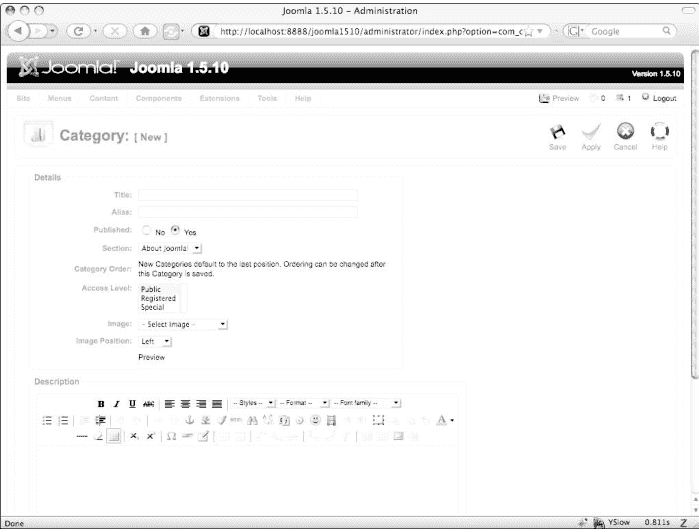

新建分类对话框顶部的工具栏可快速访问以下功能：

- **保存：** 点击此图标可保存工作，创建新分类，并退出新建分类对话框。

- **应用：** 点击此图标可保存工作而不退出新建分类对话框。

- **取消：** 取消任务并退出新建分类对话框。

- **帮助：** 点击可访问与当前屏幕相关的在线帮助文件。

此对话框的工作区分为两部分。工作区顶部，紧接标题下方的是详细信息区域。可用字段如下：

# 第5章：内容管理

- **标题：** 在此字段输入分类的名称。此字段为唯一必填字段。

- **别名：** 此字段用于存放分类的内部名称。如果留空，系统将使用您的分类标题。此字段仅接受小写字母和连字符（短横线）。不允许使用空格。在某些情况下，别名可能会作为URL字符串的一部分出现。

- **已发布：** 点击“是”以发布该分类。

- **版块：** 选择要将分类分配到的版块。默认情况下，系统会选择列表中的第一个版块。

- **分类排序：** 新分类默认会排在版块顺序的最后。这在创建分类时无法更改，但可以在分类保存后进行修改。

- **访问级别：** 设置适用于该分类的访问级别。选项有“公开”、“注册”和“特殊”。默认值为“公开”。

- **图片：** 如果您想为该分类关联一张图片，请从组合框中选择一张。您可以通过将图片上传到 images/stories 目录来使用自己的图片。

- **图片位置：** 通过从组合框中选择对齐值来设置图片的对齐方式。

工作区详细信息区域下方是描述区域。该区域仅包含一个字段，即用于输入分类描述的文本字段。请注意，在默认配置中，描述字段包含TinyMCE编辑器和文本字段下方的“插入图片”按钮。

**注意**

分类描述是否显示在任何页面上，取决于用于显示这些页面的菜单项类型中“参数”字段设置的值。

要创建新分类，请按照以下步骤操作：

1. 登录到您网站的管理后台。

2. 通过点击管理导航栏上“网站”菜单下的“分类管理器”选项来访问分类管理器。分类管理器将在浏览器中加载。

3. 在分类管理器界面上，点击分类管理器顶部工具栏上的新建图标。点击该图标后，新建分类对话框将打开。（参考图5.5。）

4. 在“标题”字段中，为分类输入名称。此字段为唯一必填字段。

5. 填写您需要的任何其他字段；所有其他字段均为可选。

6. 点击右上角工具栏上的保存图标以保存您的新分类。对话框将关闭并返回到分类管理器。

# 第二部分：内容与用户管理

### 复制分类

Joomla! 分类管理器允许您创建分类的副本，连同其所有文章。复制分类将创建该分类及其所有文章的精确副本。在此过程中，您需要选择新分类将被分配到的版块。

新分类将自动命名为“[原始分类名称]的副本”，并继承原始分类的发布状态和访问级别。可以一次复制多个分类，但新分类必须全部分配到同一个版块。

要复制分类，请按照以下步骤操作：

1. 打开分类管理器。

2. 点击要复置的分类旁边的复选框。

3. 点击右上角工具栏上的复制图标。复制分类对话框将打开，如图5.6所示。

**图 5.6**

复制分类对话框，显示正在复制的分类名称以及该分类中所有项目的列表。

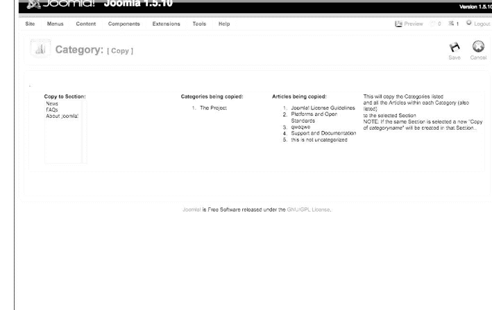

# 第5章：内容管理

4. 选择您希望将分类分配到的版块。

5. 点击右上角工具栏上的保存图标。系统将创建一个新分类并返回到分类管理器。

### 移动分类

分类管理器中的“移动”选项允许您将一个或多个分类移动到不同的版块。“移动”选项会移动选定的分类及其所有文章。

要移动分类，请按照以下步骤操作：

1. 打开分类管理器。

2. 点击要移动的分类旁边的复选框。

3. 点击右上角工具栏上的移动图标。移动分类对话框将打开，如图5.7所示。

**图 5.7**

移动分类对话框。

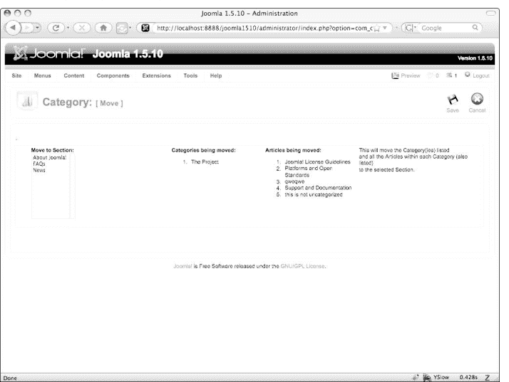

4. 选择您希望将分类移动到的版块。

5. 点击右上角工具栏上的保存图标。系统将分类移动到新版块并返回到分类管理器。

#### 编辑和删除分类

可以通过分类管理器编辑现有分类。要编辑分类，可以在分类管理器中点击分类名称，或者选择该分类后点击分类管理器工具栏上的编辑图标。无论使用哪种方法，系统都会打开编辑分类对话框。

编辑分类对话框与新建分类对话框相同，包含与上一节讨论的相同字段和要求。

要对分类进行更改，只需在编辑分类对话框中修改所需字段，然后点击工具栏上的保存或应用图标。您所做的任何更改都会立即生效。

可以通过分类管理器完全删除分类。从分类管理器中删除会绕过回收站管理器并立即删除该分类。在删除之前，分类必须清空所有活动和已回收站的文章。

要删除分类，请按照以下步骤操作：

1. 打开分类管理器。

2. 选择要删除的分类。

3. 点击右上角工具栏上的删除图标。系统将删除该分类，然后返回到分类管理器。

### 注意

请注意，删除操作无需确认；删除是即时的，内容将从系统中永久移除。

### Joomla! 1.6

由于Joomla! 1.6中没有版块，因此嵌套层次结构的创建通过分类管理器来管理。分类管理器可通过“组件”菜单下的“文章”选项及其子标题“分类”来访问。该管理器允许您创建无限数量的分类，并根据需要将它们嵌套。这比Joomla! 1.5.x灵活得多，使您能够创建任何所需的结构来逻辑地组织您的内容。

### 理解未分类内容的作用

在创建新文章时，您可以选择将文章分配到现有分类，或将其保留为未分类。顾名思义，未分类的文章在系统层次结构之外。

# 第5章：内容管理

### 注意

**在Joomla 1.5之前，未分类文章被称为静态内容项。**

将文章分配到未分类组有几个影响。首先，也是最重要的一点，该文章不会显示在任何根据文章所属版块或分类显示内容的页面上。其次，未分类文章不会出现在Joomla的“最新新闻”模块显示的最新文章列表中。在其他所有方面，未分类文章与其他任何文章类似。与旧的静态内容项不同，未分类文章可以分配到网站的首页。

### 创建典型内容结构

三种最常见的内容结构是扁平站点、多层站点和博客站点。在本节中，我将探讨如何高效地组织内容以创建所有这三种内容结构。

#### 扁平站点结构

扁平站点结构是一种不依赖于多层嵌套文章的组织结构，最适合较小的站点。如果您计划构建一个内容较少的基础站点，扁平结构可能适合您。

扁平站点结构可以在使用或不使用典型的版块和分类结构来存放文章的情况下创建。事实上，如果您愿意，您可以完全使用未分类文章来构建整个站点。如果您使用Joomla 1.5.x并选择为扁平站点结构使用版块和分类，您可能只需创建一个版块，并在其中创建一个分类，将所有文章放入其中。虽然将页面放入多个版块或分类中是可能的，但这种方法可能好处不大，实际上可能会使管理复杂化。

### Joomla! 1.6

同样的逻辑也适用于您使用Joomla 1.6并希望使用分类创建扁平站点的情况：创建一个主分类，并将所有文章分配到该分类，以简化站点管理。

### 注意

**如果您打算使用“最新新闻”模块来显示您的文章，那么您将不希望完全使用未分类文章来构建整个结构，如前一节所述。**

#### 多层内容结构

Joomla! 系统在某些限制下，可以轻松创建多层内容结构。Joomla! 的内容层次结构是固定的，仅限于三个级别：版块、分类和文章。在Joomla 1.5中，创建超过三个级别的站点基本上是不可能的（除非添加第三方扩展）。

## 第二部分：处理内容与用户

### 内容层级结构的实际应用

或许理解 Joomla! 1.5.x 内容层级结构的最佳方式是通过一个示例。假设你想为你的食谱网站上的文章创建一个组织方案。你的网站按餐食顺序列出食谱，因此你决定将食谱组织成反映典型餐食的三个部分。这三个部分是：

- 前菜

- 主菜

- 甜点

并且假设在网站的前菜部分，你想涵盖两种不同类型的食谱：

- 开胃菜

- 沙拉

假设在网站的主菜部分，你想将食谱组织成四个不同的组：

- 鱼类

- 肉类

- 禽类

- 素食

再假设在网站的甜点部分，你想涵盖三种不同类型的甜点：

- 曲奇

- 蛋糕

- 糕点

以下是如何将其转化为 Joomla! 内容层级结构：

首先，创建层级结构的顶层作为区段。为此，请按照以下步骤操作：

1.  进入区段管理器。

2.  点击新建图标。新建区段对话框将加载。

3.  创建一个名为“前菜”的新区段。

4.  为其他两个主要内容分区重复此过程：主菜和甜点。

接下来，创建第二层内容结构作为类别。为此，请按照以下步骤操作：

1.  进入类别管理器。

2.  点击新建图标。新建类别对话框将加载。

3.  创建一个名为“开胃菜”的新类别。

4.  将“开胃菜”类别分配给名为“前菜”的区段。

5.  重复此过程以创建一个名为“沙拉”的新类别，并将其分配给“前菜”区段。

6.  重复此过程以创建四个新类别：鱼类、肉类、禽类和素食，并将每个类别分配给主菜区段。

7.  再重复一次此过程以创建三个新类别：曲奇、蛋糕和糕点，并将每个类别分配给甜点区段。

你的内容结构现在应该看起来像这样：

1.  前菜（一个区段）

    a. 开胃菜（一个类别）

    b. 沙拉（一个类别）

2.  主菜（一个区段）

    a. 鱼类（一个类别）

    b. 肉类（一个类别）

    c. 禽类（一个类别）

    d. 素食（一个类别）

3.  甜点（一个区段）

    a. 曲奇（一个类别）

    b. 蛋糕（一个类别）

    c. 糕点（一个类别）

现在你已拥有开始构建页面并将项目分组到层级结构中所需的一切。

现在让我们以一个区段为例，通过为特定食谱创建文章来完成整个过程。让我们扩展主菜区段：如果你想为牛肉 brisket 和 lamb shank 创建单独的文章——这两个食谱都属于主菜区段，你会将它们归入肉类类别下。

当你为这两个食谱创建文章时，你会将它们分配到主菜区段和肉类类别。

因此，从逻辑上讲，你的层级结构像这样整齐地组合在一起：

1.  主菜（一个区段）

    a. 肉类（一个类别）

        i. 牛肉 brisket（一篇文章）

        ii. lamb shank（一篇文章）

现在，当你创建网站导航时，你有许多选择。你可以：

-   创建一个指向所有主菜的内容区段链接，这将显示主菜区段中的所有内容

-   创建一个指向所有肉类的内容类别链接，这将显示肉类类别中的所有内容

-   创建一个指向单篇文章的内容项目链接，比如牛肉 brisket 页面或 lamb shank 页面

采用这种有组织的方法的最终结果是，你在前端有一个供客户导航的逻辑结构，而在后端你有一个直观且易于管理员使用的内容组织方案。

## 第五章：管理内容

内容层级结构在区段、类别和文章之间施加了父子关系。菜单项创建允许你通过创建菜单项之间的父子关系，或通过创建菜单和子菜单，为网站访客显示通过导航菜单的组织层级。虽然内容结构限于三级，但菜单不受此限制；可以创建远深于三级的多层菜单。因此，如果你的需求仅仅是通过网站菜单显示一个复杂的层级结构，你可以实现更大的灵活性。

然而，创建超过三级的菜单项会带来一些复杂性。首先，网站的面包屑导航将反映你内容的区段、类别和文章组织，而不管菜单结构如何。因此，你冒着使面包屑功能变得无用的风险。其次，使用多层菜单结构意味着你使用系统区段和类别列视图的能力将受到限制，因为它们显示的内容逻辑可能与菜单项逻辑不一致。当你把所有这些结合起来时，为复杂的内容结构采用多层菜单方法很可能意味着你将放弃使用面包屑功能，并且会寻求为网站的一些文章使用未分类的文章，并在适岁时结合使用区段和类别。因此，虽然这可以做到，但最终结果可能是一个在易用性上并非最优，并且可能比你希望的对管理员来说更复杂的网站。

### 交叉引用

**菜单、菜单项和菜单项类型在第八章中有详细讨论。**

### Joomla! 1.6

**在 Joomla! 1.6 中创建多层内容层级结构要容易得多。网站管理员只需创建所有需要的类别，然后按需嵌套它们。类别嵌套在类别管理器内处理。要使一个类别成为另一个类别的子类别，只需从名为“父级”的组合框中选择所需的父类别名称。一旦创建了结构，你可以通过编辑文章并从同名的组合框中选择类别名称，将你的文章分配给所需的类别。**

#### 博客网站

博客网站通常有一个主页，其中包含许多文章，这些文章横跨页面宽度并按时间顺序排列，最新的项目排在最前面。Joomla! 的默认首页布局遵循不同的页面格式，只有一篇文章横跨页面，随后是文章以两列布局排列。

你可以通过更改首页的菜单项参数来实现更传统的博客网站布局。默认的首页是使用名为“首页博客布局”的菜单项类型创建的。该菜单项类型的基本参数包括控制项目数量、其显示方式以及列数的选项。

要在 Joomla! 1.5.x 中为你的首页实现传统的博客布局，请按照以下步骤操作：

1.  登录到你网站的管理系统。

2.  从标有“菜单”的主导航选项下选择“主菜单”选项。主菜单的菜单项管理器将在你的网页浏览器中打开。

3.  点击名为“首页”的菜单项名称。菜单项编辑对话框将打开。

4.  在页面右侧的“基本参数”下，将“列数”设置为 1。

5.  将“# 引导项目”参数设置为零。

6.  将“# 介绍项目”参数设置为你希望在页面上显示的最大项目数。

7.  将“# 链接”参数设置为你希望在页面底部显示的链接数量。

8.  点击保存图标。系统将保存更改，关闭菜单项编辑对话框，并将你返回到菜单项管理器。

### 处理文章

文章是你网站的精髓。文章承载你的文本内容以及你附加的任何图片或媒体文件。你的网站的外观和感觉在很大程度上取决于你的网站管理员对文章管理器及相关参数的熟练程度。

#### 使用文章管理器

文章管理器提供对系统中所有文章的访问，以及创建新文章、复制、移动、编辑、删除和归档它们的工具。综合来看，这是你的 Joomla! 系统中最强大、最重要的界面之一。

要查看文章管理器，请点击控制面板上的同名图标，或从主管理员导航栏的“内容”菜单下选择“文章管理器”。无论哪种方式，文章管理器都将在你的网页浏览器中打开，如图 5.8 所示。

Joomla 1.5.x 文章管理器顶部的工具栏提供对以下功能的快速访问：

-   **取消归档：** 从列表中选择一个或多个已归档的文章，然后点击此图标取消归档。

-   **归档：** 从列表中选择一个或多个活动的文章，然后点击此图标进行归档。

-   **发布：** 从列表中选择一个或多个文章，然后点击此图标发布它们。

-   **取消发布：** 从列表中选择一个或多个文章，然后点击此图标取消发布。

## 第二部分：内容和用户管理

- **移动：** 从列表中选择一个或多个文章，然后单击此图标将项目移动到其他类别。

- **复制：** 从列表中选择一个或多个文章，然后单击此图标创建它们的副本。

- **删除：** 从列表中选择一个文章，然后单击此图标将文章移至回收站。

- **编辑：** 从列表中选择一个文章，然后单击此图标编辑文章详情。

- **新建：** 单击以添加新文章。

- **参数：** 单击以编辑全局文章参数。

- **帮助：** 单击以访问与当前屏幕相关的在线帮助文件。

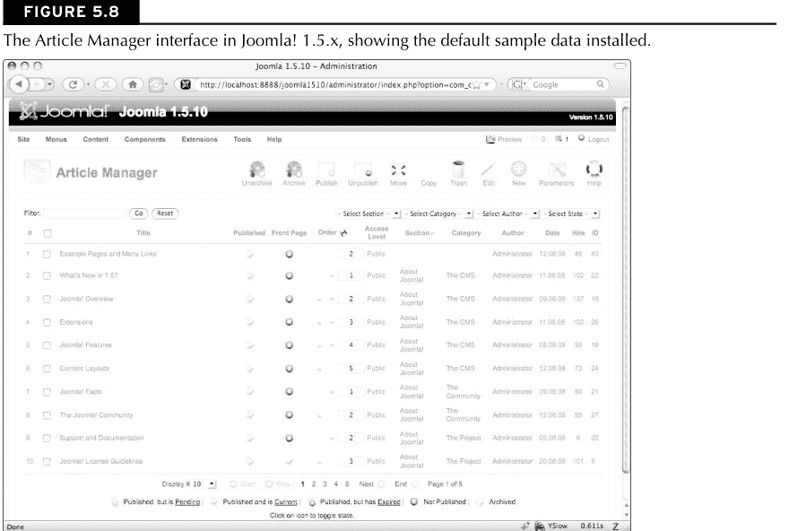

工具栏下方、文章列表上方有五个排序和搜索工具，可帮助您管理长文章列表：

- 左侧的过滤器字段功能类似于搜索框。在该字段中输入一个单词或短语，然后单击“执行”。页面将重新加载并显示搜索结果。要清除屏幕并返回完整列表，请单击“重置”按钮。

## 第5章：内容管理

- “选择区块”过滤器使您能够根据文章所属的区块进行筛选和显示。要重置此过滤器，请将组合框改回默认设置。

- “选择类别”过滤器允许您根据文章所属的类别进行筛选和显示。要重置此过滤器，请将组合框改回默认设置。

- “选择作者”过滤器使您能够根据关联的作者进行筛选和显示文章。要重置此过滤器，请将组合框改回默认设置。

- 最右侧的“选择状态”过滤器允许您根据文章是否已发布进行筛选和显示。此过滤器提供了一种简便的方法来识别网站上当前处于活动状态的所有文章。要重置此过滤器，请将组合框改回默认设置。

屏幕的主要内容区域包含您的Joomla!网站中所有文章的列表。提供的列包括：

- **#**：由Joomla!分配的索引编号。此项不可更改。

- **复选框（无标签）：** 单击单选按钮以选择一篇文章；如果您希望使用前面列表中提到的几个工具栏选项，则需要执行此操作。

- **标题：** 此字段显示文章的全名。单击名称以编辑文章。

- **已发布：** 此列中的绿色对勾表示文章的发布状态。正如文章管理器最底部出现的图例所示，显示的图标表示发布状态。您可以根据其状态单击图标来发布或取消发布文章：

    - 文章图标旁边的黄点表示文章已获批准并计划发布，但处于等待状态。

    - 文章图标旁边的绿色对勾表示文章当前已发布。

    - 文章图标旁边的带X的红圈表示文章曾经发布但已过期。

    - 带X的红圈（无文章图标）表示文章既未发布也未计划发布。

    - 带横杠的灰色圆圈（无文章图标）表示文章已归档。

**提示**

**如果将光标悬停在“已发布”图标上，系统会显示文章的开始和停止发布日期。**

- **首页：** 此列中的绿色对勾表示该文章已指定出现在网站的首页上。带X的红圈表示该文章未指定在首页显示。单击图标可在两种状态之间切换。

## 第二部分：内容和用户管理

- **顺序：** 数字表示该文章相对于其他文章的顺序。您可以通过单击绿色箭头在顺序中向上或向下移动项目，或者输入顺序的数字，然后单击列顶部的保存图标来重新排序文章。

- **访问级别：** 显示为该文章设置的访问级别。选项为“公开”、“注册”和“特殊”。单击这个词可在三个选项之间切换。

- **区块：** 显示文章所属区块的名称。单击区块名称可打开区块编辑对话框。

- **类别：** 显示文章所属类别的名称。单击类别名称可打开类别编辑对话框。

- **作者：** 显示文章作者的名称。单击作者的名称可打开该作者的用户编辑对话框。

- **日期：** 显示文章创建的日期。

- **点击数：** 显示文章被查看的次数。

**提示**

您可以通过更改文章编辑对话框中的参数值来更改点击计数器中显示的结果。

- **ID：** 系统生成的用户ID号。此ID在系统内部使用，用户无法更改。

最后，在屏幕底部、内容区域下方，是“显示 #”选项。更改组合框控件中的值可以更改页面上显示的文章数量。默认值可以通过更改“全局配置管理器”中的“列表长度”选项来修改。

### 创建文章

通过单击文章管理器右上角工具栏上的“新建”图标来创建新文章。单击“新建”图标将打开“新建文章”对话框，如图5.9所示。

“新建文章”对话框顶部的工具栏提供对以下功能的快速访问：

- **预览：** 单击可打开一个灯箱，显示文章在网站访问者眼中的显示效果。请注意，文章不会显示在您网站的页面模板内；在网站模板中查看文章的唯一方法是发布它并从其前端查看。

- **保存：** 单击此图标可保存您的工作，创建新文章，并退出“新建文章”对话框。

- **应用：** 单击此图标可保存您的工作而不退出“新建文章”对话框。

- **取消：** 取消任务并退出“新建文章”对话框。

- **帮助：** 单击以访问与当前屏幕相关的在线帮助文件。

## 第5章：内容管理

工作区中的字段包括：

- **标题：** 在此字段中输入文章的名称。此字段中的值将用作文章的标题。此字段为必填项。

- **别名：** 输入一个供系统内部用于此文章的别名。请注意，此字段只接受不带空格的小写字母。如果您将此字段留空，系统将修改文章的标题用作别名。请注意，在某些情况下，当启用SEF URL时，别名可能会作为URL字符串的一部分出现。

- **区块：** 为文章选择一个区块。此字段为必填项。

- **已发布：** 设置为“是”以发布文章。

- **首页：** 设置为“是”以在网站首页上显示此文章。

- **类别：** 从组合框中为文章选择一个类别。

- **文本字段（无标签）：** 在此框中输入您的文章内容。此字段为必填项。

在工作区的右上角，紧接图标下方，是文章关键信息的摘要，包括文章的状态、收到的点击次数、修订次数、创建日期和修改日期。在创建文章时，许多信息将为空白。

### 图5.9

Joomla 1.5.x中的新建文章对话框。

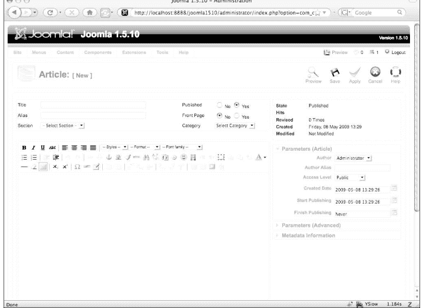

95

## 第二部分：内容和用户管理

文章摘要下方是文章参数，我将在本章后面讨论。

要创建新文章，请按照以下步骤操作：

1. **登录到您网站的管理系统。**

2. **通过单击管理导航栏上“内容”菜单下的“文章管理器”选项来访问文章管理器。** 文章管理器将在您的Web浏览器中加载。

3. **在文章管理器界面上，单击文章管理器顶部工具栏上的“新建”图标。** “新建文章”对话框将打开。（请参考图5.9。）

4. **在“标题”字段中，输入文章的名称。** 此字段为必填项。

5. **从标有“区块”的组合框中，为文章选择一个区块或选择“未分类”选项。** 此字段为必填项。

6. **输入一些文章文本。** 此字段为必填项。

7. **完成您希望的任何其他字段；所有其他字段均为可选。**

8. **单击右上角工具栏上的“保存”图标以保存您的新文章。** 对话框将关闭，您将返回到文章管理器。

### 设置参数

Joomla!中的文章包含可用于影响文章显示和行为的参数。请注意，许多参数选项与“全局文章参数”或“菜单项类型参数”中可用的选项相同。您在“文章参数”中指定的设置将优先于其他参数设置，从而允许您自定义单篇文章的显示。

#### 全局参数

通过单击文章管理器工具栏上的“参数”图标来访问“全局文章参数”。单击该图标将显示一个菜单，如图5.10所示。设置您希望的选项；然后单击“保存”按钮以应用更改并关闭弹出窗口。

通过“全局参数”控件设置的选项适用于系统中的所有文章，除非被单篇文章的参数覆盖。

> **注意**

> 当“全局文章参数”与单篇文章参数之间存在冲突时，系统将应用文章参数中的设置。

## 第五章：内容管理

图 5.10 Joomla! 1.5.x 中的全局文章参数弹出窗口。

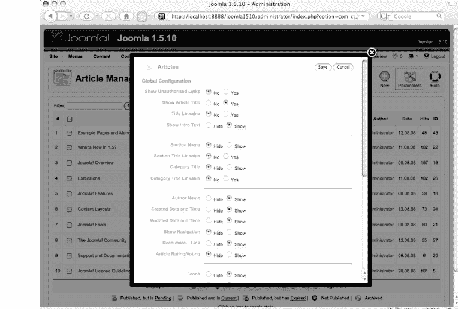

此处包含以下参数：

-   **显示未授权链接：** 此控制决定是否向用户显示他们没有足够访问权限查看的内容链链接。如果设为"是"，链接将显示，但当没有足够权限的用户点击链接时，系统会提示他们登录；如果他们不登录，则无法查看文章。默认状态为"否"。

-   **显示文章标题：** 是否在文章内容旁显示文章标题。默认状态为"是"。

-   **标题可链接：** 如果您希望文章标题链接到完整文章，请将此参数设为"是"。默认状态为"否"。

-   **显示引言文本：** 决定是否将引言文本（如果有的话）同时作为摘要和完整文章的一部分显示。将此项设为"隐藏"则显示完整文章但不包含引言文本，换句话说，在完整文章视图中将不会显示摘要。默认状态为"显示"。

-   **显示区块名称：** 决定是否显示区块名称。默认状态为"隐藏"。

## 第二部分：内容与用户管理

-   **区块标题可链接：** 将此参数设为"是"可将区块标题超链接到区块内容列表。默认状态为"否"。可链接标题对搜索引擎优化（SEO）有益。

-   **显示分类名称：** 决定是否显示分类名称。默认状态为"隐藏"。

-   **分类标题可链接：** 将此参数设为"是"可将分类标题超链接到分类内容列表。默认状态为"否"。

-   **显示作者姓名：** 设为"显示"时，文章作者的姓名将出现在文章上。默认状态为"显示"。

-   **显示创建日期和时间：** 设为"显示"时，文章的创建日期和时间将出现在文章上。默认状态为"显示"。

-   **显示修改日期和时间：** 设为"显示"时，文章最后修改的日期和时间将出现在文章上。默认状态为"显示"。

-   **显示导航：** 决定是否在文章上显示导航选项，如"上一篇"和"下一篇"控件。默认状态为"隐藏"。

-   **"阅读更多..."链接：** 决定"阅读更多..."文本是否会出现在文章引言文本中。默认状态为"显示"。

-   **文章评分/投票：** 将此参数设为"显示"可在文章上显示评分选项。默认状态为"隐藏"。

-   **图标：** 控制是否在文章上显示 PDF、打印和电子邮件图标。此设置可被后续控件或文章本身的设置覆盖。

-   **PDF 图标：** 在文章上显示或隐藏 PDF 图标。

-   **打印图标：** 在文章上显示或隐藏打印图标。

-   **电子邮件图标：** 在文章上显示或隐藏电子邮件图标。

-   **点击次数：** 显示或隐藏每篇文章的点击次数。

-   **每个订阅项目显示内容：** 如果显示了订阅项目，此参数控制是显示完整项目，还是仅显示引言文本。

-   **筛选组：** 选择一个或多个组以应用内容筛选。您可以按住 Control 键同时点击来选择多个组。

-   **筛选类型：** 从三个选项中选择：黑名单、白名单或无 HTML。默认为"黑名店"。

-   **筛选标签：** 如果筛选类型参数设为"黑名单"，在此文本框中输入的术语将被添加到默认的黑名单标签列表中。如果筛选类型参数设为"白名单"，在此字段中输入的标签将成为白名单术语。

-   **筛选属性：** 如果筛选类型参数设为"黑名单"，在此文本框中输入的术语将被添加到默认的黑名单属性列表中。如果筛选类型参数设为"白名单"，在此字段中输入的属性将成为白名单术语。

### 内容筛选

每当您为用户提供在网站中输入 HTML 的机会时，就创造了有害甚至恶意代码可能渗入您系统的可能性。为了帮助防止这种情况发生，Joomla! 在系统中添加了内容筛选功能。筛选通过评估用户输入的 HTML 并对照黑名单检查代码是否被允许来工作。

Joomla! 在默认系统中提供内容筛选，并将其应用于除超级管理员以外的所有用户。默认设置可以被先前讨论的全局文章参数中的筛选参数覆盖。

默认的 Joomla! 系统包含一个预定义的黑名单，包含以下标签：applet、body、bgsound、base、basefont、embed、frame、frameset、head、html、id、iframe、ilayer、layer、link、meta、name、object、script、style、title 和 xml。黑名单还默认排除以下属性：action、background、codebase、dynsrc、lowsrc。

通过全局参数，您可以将新术语添加到黑名单，或者创建一个白名单来明确允许使用某些元素。这些参数还为您提供了指定哪些用户将受到这些控制的方法。请注意，为一个用户组设置控件会自动为所有子用户组设置该控件。

### 文章参数

单个文章参数（如图 5.11 所示）通过文章编辑对话框访问。

所有文章的“文章参数”部分包含以下选项：

-   **作者**：此字段旁边的组合框包含用户列表；从此框中选择以指定文章的作者并覆盖默认设置。

-   **作者别名**：此字段通常留空；如果您希望显示系统中与用户名相关联的名称以外的名称，请在此处输入文本。

-   **访问级别：** 设置此文章的访问级别。从以下三个选项中选择：公开、注册或特殊。默认为"公开"。

-   **创建日期**：默认值是文章创建的日期和时间。点击字段右侧的日历图标可覆盖默认日期，指定您选择的日期。

-   **开始发布**：默认情况下，文章安排为立即开始发布；使用此字段指定将来的发布日期。

-   **结束发布**：点击此字段右侧的日历图标，为此文章的发布选择一个停止日期。默认值为"永不"。

99

### 图 5.11

文章参数。

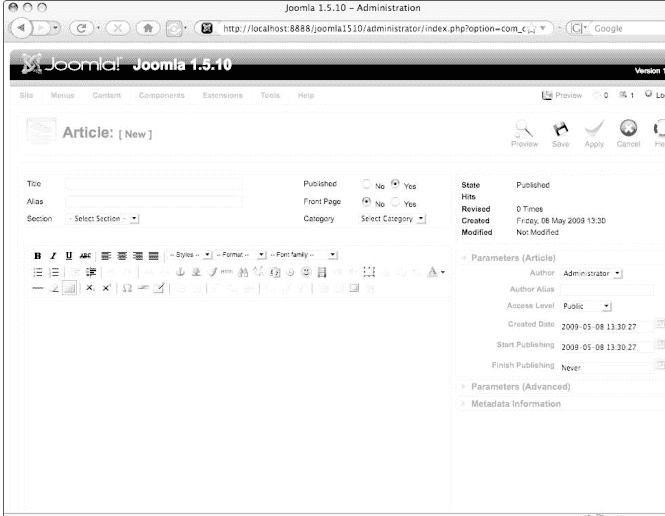

#### 高级参数

与文章参数一样，高级参数也是通过文章编辑对话框访问的，如图 5.12 所示。

所有文章的“高级参数”部分包含以下概述的选项。请注意，所有参数的默认值均为“使用全局”，这指定系统将应用在全局文章参数中设置的值。设置相反的值将覆盖全局参数设置：

-   **显示标题**：是否在文章内容旁显示文章标题。

-   **标题可链接**：如果您希望文章标题链接到完整文章，请将此参数设为"是"。

-   **引言文本：** 决定是否将引言文本（如果有的话）同时作为摘要和完整文章的一部分显示。将此项设为"隐藏"则显示完整文章但不包含引言文本，换句话说，在完整文章视图中将不会显示摘要。

-   **显示区块名称：** 决定是否显示区块名称。

-   **区块标题可链接：** 将此参数设为"是"可将区块标题超链接到区块内容列表。

-   **显示分类名称：** 决定是否显示分类名称。

-   **分类标题可链接：** 将此参数设为"是"可将分类标题超链接到分类内容列表。

-   **文章评分：** 将此参数设为"显示"可在文章上显示评分选项。

-   **显示作者姓名：** 设为"显示"时，文章作者的姓名将出现在文章上。

-   **显示创建日期和时间：** 设为"显示"时，文章的创建日期和时间将出现在文章上。

-   **显示修改日期和时间：** 设为"显示"时，文章最后修改的日期和时间将出现在文章上。

-   **PDF 图标：** 在文章上显示或隐藏 PDF 图标。

-   **打印图标：** 在文章上显示或隐藏打印图标。

-   **电子邮件图标：** 在文章上显示或隐藏电子邮件图标。

-   **内容语言：** 文章通常以默认系统语言显示；可以通过从组合框中选择另一种语言来覆盖。组合框的内容由已安装的语言包决定。

-   **关键参考：** 如果您希望提供另一种访问文章的方法，请在此字段中输入一个值。关键参考允许您在查询字符串中不使用文章 ID 来调用此项目。这通常由系统用于提供可以绑定到外部资源的替代参考，例如，为特定页面提供相应的 Joomla! 帮助文件。

-   **备用"阅读更多："文本：** 此字段可用于指定与"阅读更多"链接一起显示的文本。默认情况下此字段为空，此时系统将使用文章的标题。

## 第二部分：处理内容与用户

### 图 5.12

高级参数。

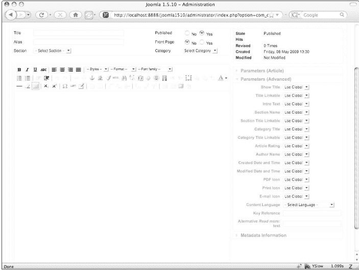

### 文章元数据

除了全局站点元数据外，Joomla! 还允许你为每篇文章指定特定的元数据。在这些字段中输入的任何信息将覆盖并替换全局配置管理器中指定的任何相反值。

下文讨论的文章元数据字段位于文章编辑对话框中参数的下方，如图 5.13 所示。

- **描述：** 在文本字段中输入你希望出现在本文元描述字段中的任何信息。

- **关键词：** 在文本字段中输入你希望出现在本文元关键词字段中的任何关键词。多个关键词之间用逗号分隔。

- **Robots：** 在此文本字段中输入你希望为文章元 Robots 字段指定的命令。

- **作者：** 在此文本字段中输入你希望出现在文章元作者字段中的信息。

## 第 5 章：管理内容

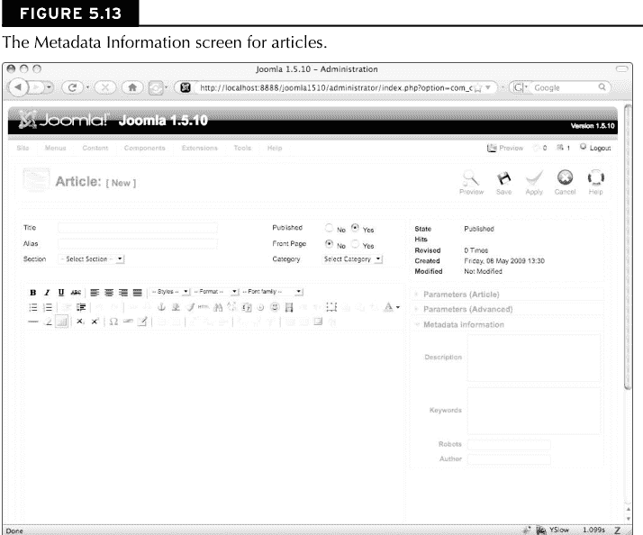

### 控制导言文本

导言文本为 Joomla! 文章提供了一个摘要视图。通过使用参数和内容编辑控件，你可以创建显示或不显示导言文本的文章。

在文章中指定导言文本很简单，只需在文本中插入一个“阅读更多...”分隔符即可。“阅读更多”按钮位于文章编辑窗口的底部，点击它即可自动插入分隔符。按钮位置如图 5.14 所示。

你希望用作导言文本的内容应放在文章的最开头。请记住，你可以选择显示带有或不带有导言文本的完整文章文本，如下所述。但是，无论你是否希望它在完整文章中显示，你都必须首先将其与完整文本输入在同一个框中。

## 第二部分：处理内容与用户

**图 5.14**

“阅读更多...”按钮位于文章编辑窗口下方，与“分页”按钮相邻。

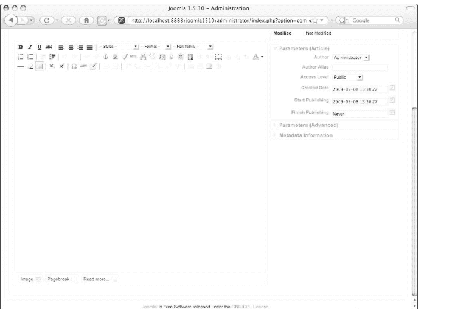

要为文章设置导言文本，请遵循以下步骤：

1.  打开文章编辑对话框。

2.  输入导言文本，后跟完整文章文本。

3.  将光标放在导言文本的末尾。

4.  点击内容编辑窗口底部的“阅读更多”按钮。一条红色虚线会出现，如图 5.15 所示。

### 提示

如果你在没有“阅读更多”按钮辅助的情况下编辑文章，你可以通过在希望分隔导言文本与文章其余部分的位置插入以下 HTML 标签来定义文章中导言文本的选择：

```
<hr id="system-readmore" />.
```

## 第 5 章：管理内容


显示文本区域中导言文本分隔符的文章编辑屏幕。

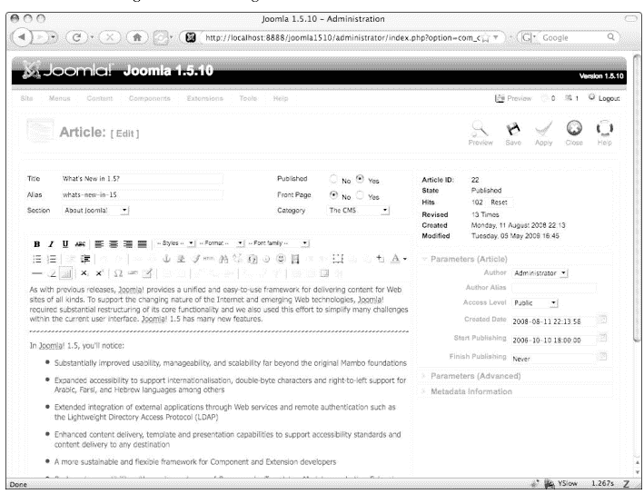

### 创建多页文章

默认情况下，Joomla 中创建的所有文章都显示为单页。然而，多页文章只需点击一下即可实现。“分页”按钮用于将单页文章分成多个页面。该按钮位于文章编辑窗口的底部。（参考图 5.14。）

点击“分页”按钮会打开一个弹出窗口，其中包含两个文本字段：“页面标题”和“目录别名”，如图 5.16 所示。你在“页面标题”字段中输入的任何内容都会在访客查看文章时显示在其浏览器的顶部。“目录别名”用作目录中指向文章各页面的链接文本。

在默认的 Joomla! 系统中，将文章分成多个页面会导致每个新页面上都出现一个目录，如图 5.17 所示。目录提供了指向文章所有页面的链路。你也可以通过点击出现在每个新页面底部的“上一篇 - 下一篇”文本链接在页面之间导航。

## 第二部分：处理内容与用户

**图 5.16**

分页弹出窗口。

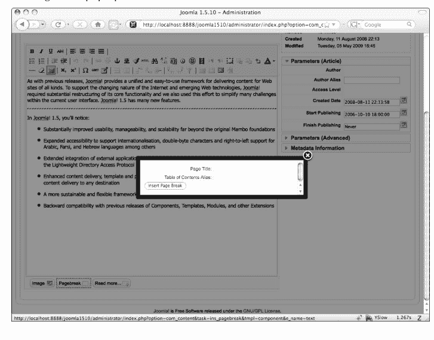

要将单页文章拆分为多个页面，请遵循以下步骤：

1.  访问文章编辑对话框。

2.  将光标放在你希望分割文章的位置。

3.  点击“分页”按钮。分页窗口打开。

4.  为新页面输入一个页面标题。

5.  为该页面输入一个目录别名。

6.  点击“插入分页”。窗口关闭并返回文章管理器，你会注意到在你点击的位置现在出现了一条灰色虚线。

### 注意

目录的显示由“内容 - 分页”插件控制。该插件包含多个参数，允许你更改显示或完全隐藏目录。该插件在第 19 章中有更详细的讨论。

## 第 5 章：管理内容

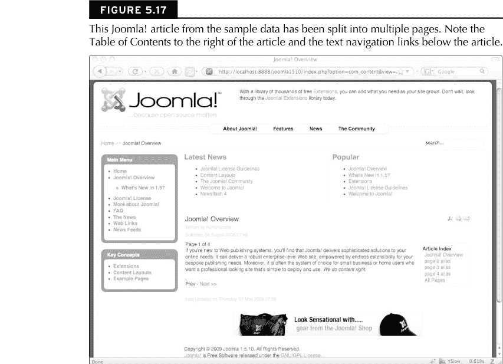

### 管理现有文章

如果你的站点规模较大或活跃，管理站点上的现有文章可能会占用你相当多的时间。在本节中，我将介绍你将执行的最常见的任务。

#### 发布和取消发布文章

可以通过以下三种方式中的任何一种来发布和取消发布文章：

- 你可以访问文章管理器并点击“已发布”列中的图标；点击该图标会在已发布和未发布之间切换。

- 你可以点击文章管理器中文章名称旁边的复选框，然后点击右上角工具栏中的“发布”或“取消发布”图标。

- 你可以编辑一篇文章并修改标记为“已发布”的控件。

如果你想一次发布或取消发布多个项目，可以通过点击文章管理器中每篇文章旁边的复选框，然后点击右上角主工具栏中的“发布”或“取消发布”图标来实现。

发布通常会立即开始并无限期持续。但是，你可以设置文章在特定日期开始和停止发布。开始和停止发布控件位于文章编辑对话框内的“文章参数”选项卡上。

### 注意

发布文章的能力取决于用户的权限。属于发布者级别以下的用户组的用户对发布没有发言权。由较低级别用户创建的文章必须由较高级别的用户发布。

### 交叉参考

从网站前端发布文章在第 7 章中讨论。

#### 修改文章

可以通过访问文章管理器并点击文章名称，或点击文章名称旁边的复选框，然后点击文章管理器工具栏上的“编辑”图标来随时编辑现有文章。当你点击“保存”或“应用”图标时，对文章所做的更改会立即应用到该文章。

### 注意

Joomla 不支持文章版本控制，即维护文章更改记录。但是，有一些第三方扩展在此领域提供了有限的功能。

#### 复制文章

文章管理器使你能够创建文章的副本。当你复制一篇文章时，系统会创建一个完全相同的副本，只更改文章名称。在复制过程中，你可以将新文章分配给你想要的任何部分和类别，如图 5.18 所示。新文章将继承旧文章的发布状态和访问级别。

你可以一次复制多篇文章，但当你选择多篇文章进行复取时，它们必须全部分配到同一部分和类别。

## 第5章：管理内容

图 5.18

Joomla! 1.5.x 中的“复制文章”对话框。

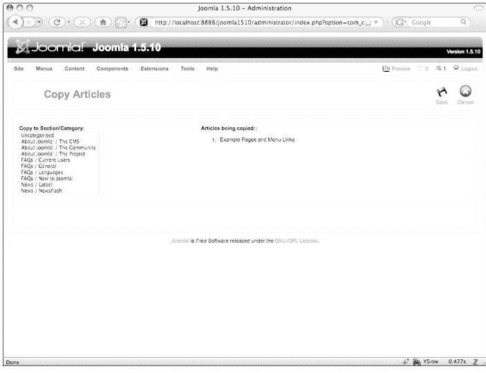

要复制一篇文章，请按照以下步骤操作：

1.  访问文章管理器。

2.  通过点击文章标题旁边的复选框来选择您要复制的文章。

3.  点击文章管理器工具栏上的“复制”图标。“复制文章”对话框随即打开。

4.  将文章分配到您期望的版块和分类中。

5.  点击右上角工具栏上的“保存”图标以保存您的新文章。对话框关闭，您将返回到文章管理器。

#### 移动文章

您可以使用文章管理器中的“移动”命令在分类之间移动文章，或者通过编辑文章并将其重新分配到不同的版块和分类来实现。两种方式的最终结果相同，但通过文章管理器操作更快捷，并且允许您同时移动多篇文章。

要移动一篇文章，请按照以下步骤操作：

1.  访问文章管理器。

2.  通过点击文章标题旁边的复选框来选择您要移动的文章。

3.  点击文章管理器工具栏上的“移动”图标。“移动文章”对话框随即打开，如图 5.19 所示。

4.  将文章分配到您期望的版块和分类中。

5.  点击右上角工具栏上的“保存”图标以保存更改。对话框关闭，您将返回到文章管理器。

图 5.19

Joomla! 1.5.x 中的“移动文章”对话框。

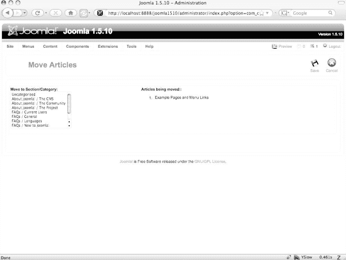

#### 删除文章

Joomla! 中的文章删除是一个两步过程。第一步是将文章移至回收站，文章会在那里保留，直到您执行第二步并永久删除。在回收站管理器中保留的文章可以在删除前的任何时间恢复。

##### 文章回收站管理器概述

Joomla! 的回收站管理器功能为您提供了一种清理和移除网站常规管理区域中文章的方法。将文章发送到回收站会导致该文章从文章管理器中移除并移至文章回收站管理器。

移至文章回收站管理器的文章会无限期地保留在那里。管理员可以选择恢复或删除这些项目。恢复的项目会移回其原始位置，而删除的项目则会从系统中永久移除，且无法恢复。

**注意**

尽管文章可以无限期地留在回收站管理器中，但文章回收站与归档管理器有显著不同。将文章移至回收站管理器不应与归档文章（如下一节所述）相混淆。

在 Joomla! 1.5.x 中，您可以通过点击“内容”菜单下的“文章回收站”选项随时查看回收站管理器的内容。点击该选项将在您的浏览器中显示文章回收站管理器，如图 5.20 所示。

文章回收站管理器顶部的工具栏提供了以下功能的快捷访问：

-   **恢复**：从列表中选择一篇或多篇文章，然后点击此图标以恢复它们并将其从回收站中移除。

-   **删除**：从列表中选择一篇或多篇文章，然后点击此图标以永久删除这些项目。

-   **帮助**：点击以访问与当前屏幕相关的在线帮助文件。

工具栏下方和文章列表上方是“筛选”字段。筛选器的工作原理类似于搜索框。在该字段中输入一个单词或短语，然后点击“转到”。页面将重新加载并显示搜索结果。要清除屏幕并返回完整列表，请点击“重置”按钮。

图 5.20

Joomla! 1.5.x 中的文章回收站管理器界面。

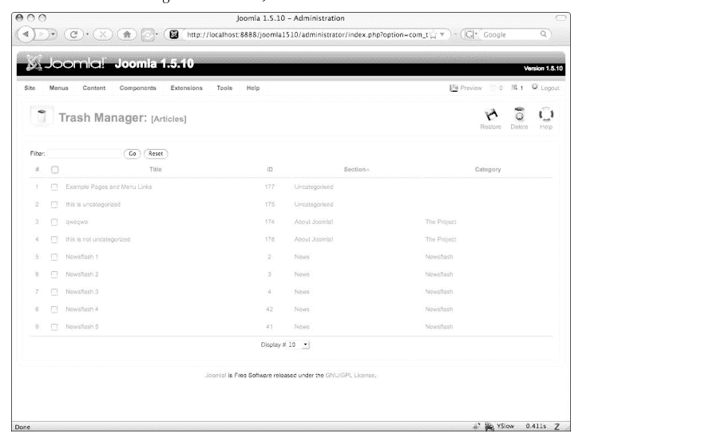

屏幕的主要内容区域包含回收站管理器中所有文章的列表。提供的列包括：

-   **#** ：Joomla! 分配的索引编号。此编号无法更改。

-   **复选框（无标签）**：点击复选框以选择一篇文章；如果您想使用前面提到的几个工具栏选项，则需要此操作。

-   **标题**：此字段显示文章的名称。

-   **ID**：这是系统的生成的项目 ID 号，无法更改。

-   **版块**：文章所属的版块。

-   **分类**：文章所属的分类（如果有）。

最后，在屏幕底部、内容区域下方，是“显示 #”选项。更改组合框控件中的值可以更改页面上显示的文章数量。默认值可以通过更改全局配置管理器中的“列表长度”选项来调整。

要将文章移至回收站，请按照以下步骤操作：

1.  点击 **内容菜单下的文章管理器选项**。文章管理器将在您的浏览器中打开。

2.  点击您要移除的文章旁边的复选框。

3.  点击 **右上角工具栏上的回收站图标**。系统将把这些文章移至回收站管理器。

**注意**

**任何移至回收站的文章会立即被取消发布，且对网站访问者不可见。**

#### 从回收站恢复文章

移至回收站的文章会无限期地保留，直到管理员采取进一步操作。任何文章都可以在任何时间恢复。恢复项目的操作很简单，结果也是即时的：文章从回收站管理器中移除，并返回到其被移至回收站时所在的位置。

从文章回收站恢复的文章将被移回其被移至回收站时所在的版块和分类中。文章将返回到之前的位置，但将处于未发布状态，并被移至文章排序的底部。要管理这些文章，请通过文章管理器访问它们。

要从回收站恢复一篇文章，请按照以下步骤操作：

1.  **通过点击内容菜下的文章回收站选项访问文章回收站管理器**。文章回收站管理器将在您的浏览器中加载。

2.  点击您想要恢复的文章旁边的复选框。

3.  **点击右上角工具栏上的恢复图标**。“恢复确认”对话框随即打开，如图 5.21 所示。

4.  **检查信息；如果正确，点击恢复按钮，或点击取消图标。** 随即打开一个确认窗口。


5.  **点击确定**。系统将该文章从回收站中移除，恢复到其之前的位置，然后将您返回到回收站管理器。

**图 5.21**

恢复确认对话框。

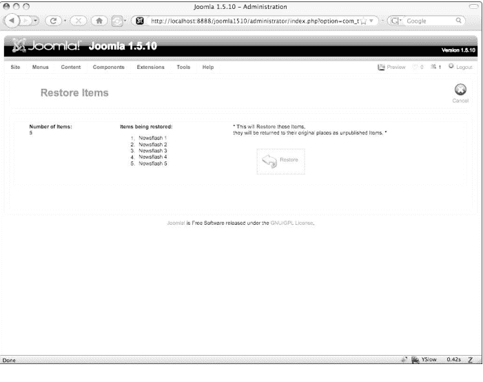

#### 永久删除文章

保存在回收站管理器中的文章和菜单项可以通过删除操作从系统中移除。从回收站管理器中删除一个项目会导致该项目从系统中永久移除；一旦删除，将无法恢复。

要从回收站永久删除一篇文章或菜单项，请按照以下步骤操作：

1.  点击您想要删除的文章或项目旁边的复选框。

2.  点击右上角工具栏上的“删除”图标。“删除确认”对话框随即打开，如图 5.22 所示。

3.  检查信息；如果正确，点击“删除”按钮，或点击“取消”图标。系统将把该文章或项目从回收站中移除，恢复到其之前的位置，并将您返回到回收站管理器。

**图 5.22**

删除确认对话框。

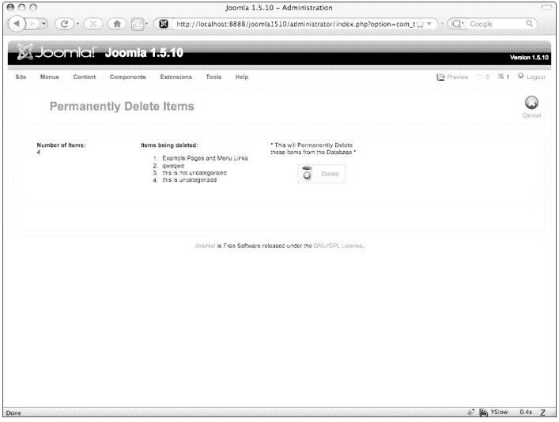

#### 归档文章

如果您想将一篇文章从网站的主要内容区域移除，但又不想删除它，可以将其移至文章归档。默认情况下，归档的文章不会在网站的前端显示。但是，您可以通过发布归档模块使归档的文章可访问。

归档的文章存储在文章管理器中，不过列表颜色会从默认的蓝色变为浅灰色，并且发布图标会更改为表示归档内容，如图 5.23 所示。

## 第二部分：处理内容与用户

**图 5.23**

文章管理器，列表顶部显示若干已归档文章。

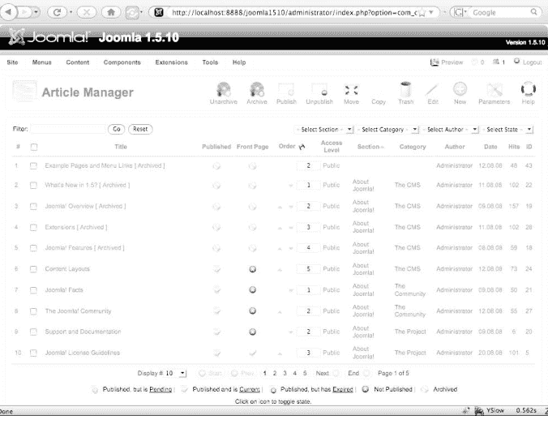

要归档文章，请按以下步骤操作：

1.  进入文章管理器。

2.  点击要归档的文章旁边的复选框。

3.  点击右上角工具栏的归档图标。系统会立即将文章移至归档区，并从网站通用内容区域中移除。

> **注意**

> 归档的文章无法编辑。如果您想修改已归档文章的内容，必须先取消归档，进行编辑，然后再次归档。

#### 取消归档文章

已移入归档区的文章可以通过取消归档操作恢复到网站的通用内容区域。请注意，取消归档的文章会以未发布状态恢复。

要取消归档文章，请按以下步骤操作：

1.  进入文章管理器。

2.  点击要取消归档的文章旁边的复选框。

3.  点击右上角工具栏的取消归档图标。系统会立即将文章取消归档。

### 归档模块

除非归档模块已发布，否则网站前端访问者无法访问已归档的文章。归档模块包含指向这些文章的链接，并按日期组织以便查看。归档模块默认处于未发布状态。您需要发布该模块，并将其分配到所需的位置和页面，以便网站访问者使用。该模块最常用于博客布局，用于按发布月份对文章进行分组。图 5.24 展示了归档模块的输出效果。

**图 5.24**

运行中的归档模块。

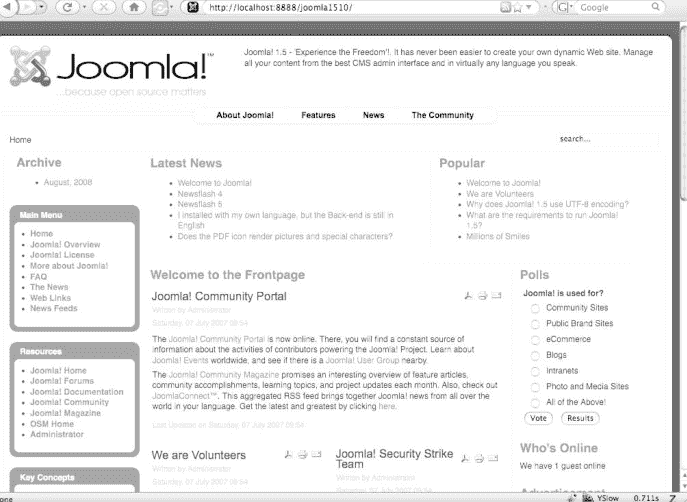

### 交叉引用

归档模块将在第 17 章中更详细地讨论。

### 全局签入

当文章正被其他用户使用，或文章在编辑窗口中打开后未正常关闭时，Joomla! 会阻止其他用户编辑该文章。此功能旨在防止用户相互覆盖对方的工作，并避免编辑者之间产生冲突。

当您尝试从管理后台访问被阻止编辑的文章时，系统会产生错误信息。如果您需要访问被阻止的文章进行编辑，则需要强制其关闭。在 Joomla! 中，强制关闭文章的过程通过选择“工具”菜单下的“全局签入”选项来实现。一旦点击“全局签入”，所有当前处于打开状态并被阻止编辑的文章都将被强制关闭。

> **注意**

> 全局签入功能是必要的，但也可能带来问题。如果您的网站有多个管理员，请谨慎使用此命令，因为执行全局签入会签入所有文章；如果当时有人正在处理某篇文章，可能会导致他们丢失未保存的工作。

### 小结

在本章中，我们涵盖了管理网站文章相关的各种任务。您学到了以下内容：

*   Joomla! 内容层级结构的工作原理

*   如何创建、编辑和删除文章

*   如何创建各种网站内容结构

*   如何配置文章参数

*   如何安排和控制发布

*   如何使用文章回收站管理器

*   如何处理归档内容

## 第六章：使用编辑器和媒体

要在 Joomla! 中创建美观易用的文章，您需要了解各种编辑器和媒体管理选项。Joomla! 提供了多种文章编辑选择。系统自带了一个非常优秀的所见即所得编辑器 TinyMCE。或者，您也可以选择下载并安装 XStandard Lite 编辑器。最后，对于那些更喜欢不使用编辑器工作的用户，您也可以仅通过文本编辑器界面直接以 HTML 格式创建内容。

除了编辑工具外，Joomla! 还捆绑了一个媒体管理器，使您无需使用 FTP 文件夹即可向网站添加和管理媒体文件。通过结合使用编辑器和媒体管理器，您可以快速轻松地向文章中添加图像或其他文件，正如本章后面将要解释的那样。

### 本章内容

*   使用所见即所得编辑器

*   探索媒体管理器

*   处理媒体文件

### 使用所见即所得编辑器

WYSIWYG 是 "What You See Is What You Get"（所见即所得）的缩写。该术语用于描述让您在编辑时即可查看文本格式的内容编辑工具。大多数此类工具的界面类似于典型的桌面文字处理工具（如 Microsoft Word）中的界面。

所见即所得编辑器易于使用，是内容管理系统最受欢迎的功能之一。Joomla! 的创建者认识到 WYSIWYG 编辑器的重要性，并安装了一个名为 TinyMCE 的优秀开源编辑器。Joomla! 1.5.x 还包含一个替代选择：XStandard Lite 编辑器。尽管 XStandard Lite 需要额外下载和配置更改，但对某些用户来说，它是首选。以下部分将讨论这两种编辑器。

### 使用 TinyMCE 编辑器

TinyMCE 是一个功能全面的 WYSIWYG 编辑器，具有多种配置选项，允许网站管理员根据网站的特定需求定制界面。如图 6.1 所见，其内容窗口上方的多重工具栏界面与您在桌面文字处理软件中看到的并无二致。该工具的工作方式与桌面文字处理应用程序完全相同，使您能够在操作时查看自己的工作成果。

TinyMCE 在默认配置中处于启用状态。

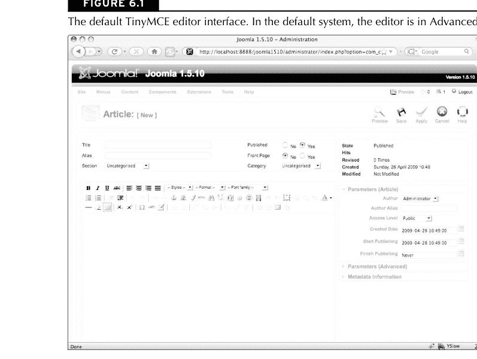

#### 顶部行控件

在默认配置下，编辑器栏的顶部行包含一组专注于字体格式、样式和对齐的控件。该工具栏包含以下控件：

*   **粗体：** 将文本设置为粗体。

*   **斜体：** 将文本设置为斜体。

*   **下划线：** 为文本添加下划线。

*   **删除线：** 为文本添加删除线。

*   **左对齐：** 段落左对齐。

*   **居中对齐：** 段落居中对齐。

*   **右对齐：** 段落右对齐。

*   **两端对齐：** 段落两端对齐。

*   **样式：** 点击以查看和应用可用样式。

*   **格式：** 点击以查看和选择 HTML 格式。

*   **字体族：** 点击以查看和选择字体。

#### 中间行控件

在默认配置下，编辑器栏的中间行包含一组专注于插入和格式化各种元素的控件。该工具栏包含以下控件：

*   **项目符号列表：** 点击将文本转换为项目符号列表。

*   **编号列表：** 点击将文本转换为编号列表。

*   **减少缩进：** 点击以减少段落缩进。

*   **增加缩进：** 点击以增加段落缩进。

*   **撤销：** 点击以撤销上一步操作。

*   **重做：** 点击以重新应用上一步操作。

*   **链接：** 点击以插入链接。将打开一个弹出窗口，允许您输入 URL 并设置参数和属性。

*   **取消链接：** 点击以移除链接。

*   **插入锚点：** 点击在文本中插入锚点。将打开一个弹出窗口，允许您输入参数和属性。

> **注意**

> 锚点用于标记文章内部可以添加超链接的位置。这允许您为文章添加快捷方式，使用户能够通过点击链接跳转到文章中的特定位置。

*   **插入图像：** 点击以打开“插入图像”对话框，允许您向文章添加图像。使用媒体管理器可以获取图像文件的路径信息。

*   **清理代码：** 点击此按钮，系统将尝试清理窗口中文本的 HTML 代码。这通常用于您从其他来源（如 Microsoft Word）将代码复制到窗口的情况。从其他来源复制格式化文本时...

## 第二部分：处理内容与用户

应用程序往往会在文章中产生不必要的代码；此工具通过消除多余代码来帮助解决此问题。

- **切换HTML模式：** 点击以从所见即所得界面切换到纯文本编辑器，允许你使用纯HTML编辑内容和格式。再次点击可返回所见即所得编辑器。

- **查找：** 点击打开一个包含“查找”和“查找与替换”控件的窗口。此控件打开的窗口与“查找与替换”控件相同，但它会显示结果窗口上的不同标签页。

- **查找与替换：** 点击打开一个包含“查找”和“查找与替换”控件的窗口。此控件打开的窗口与“查找”控件相同，但它会显示结果窗口上的不同标签页。

- **插入日期：** 点击以插入当前日期。

- **插入时间：** 点击以插入当前时间。

- **插入表情符号：** 点击打开一个弹出窗口，其中包含各种可添加到文章中的表情符号。

- **插入嵌入式媒体：** 此控件可以轻松插入嵌入式媒体文件，例如 Flash、Quicktime、Shockwave、Windows Media 和 Real Media。点击按钮打开插入对话框。在弹出窗口中点击“高级”标签页，可查看用于 Flash 文件的其他控件。

- **从左到右：** 选择一些文本，然后此控件会变为可用。点击它可将文本方向更改为从左到右。

- **从右到左：** 选择一些文本，然后此控件会变为可用。点击它可将文本方向更改为从右到左。

- **插入新图层：** 点击以插入一个新图层。点击并拖动形状可更改其高度和宽度。你也可以通过点击 HTML 按钮，然后直接更改图层的 CSS 来编辑新图层。图层的顺序可以使用接下来的两个控件进行更改。

- **移至顶层：** 点击一个图层，然后点击此按钮可将该图层移至顺序的顶部。

- **移至底层：** 点击一个图层，然后点击此按钮可将该图层移至顺序的底部。

- **绝对定位：** 点击以切换文章中元素的绝对定位。此控件对于控制包含多个图层的文章格式最为有用。

- **选择字体颜色：** 点击打开一个调色板窗口，允许你为字体选择颜色。

#### 底部行控件

在默认配置中，编辑器工具栏的底行包含一组专注于表格和其他杂项的控件。该工具栏包括以下控件：。

## 第六章：使用编辑器和媒体

- **插入水平线：** 点击以在文本中光标所在位置插入一条水平线。该线使用 HTML 标签 HR 创建，并可通过该标签的样式设置进行控制。请注意，此工具与“插入水平线”控件非常相似。

- **清除格式：** 突出显示一段文本，然后点击此图标以清除与该文本相关的所有格式。

- **切换辅助线：** 如果你的文章使用了任何不可见元素，例如多个图层，请点击此图标使对象的边界可见，以便更轻松地处理对象。

- **下标：** 选择文本并点击此图标，将文本转换为下标。

- **上标：** 选择文本并点击此图标，将文本转换为上标。

- **插入自定义字符：** 点击打开一个窗口，其中包含系统中可用的自定义字符列表。在弹出窗口点击一个字符即可将其插入文章。

- **插入水平线：** 点击打开一个窗口，允许你指定水平线的宽度、高度和样式。请注意，此工具与“水平线”控件非常相似。

- **插入新表格：** 点击以在文章中插入一个表格。会打开一个弹出窗口，允许你定义表格的基本特征。如果你想编辑现有表格，点击该表格，然后点击此按钮打开编辑弹出窗口。

- **表格：行属性：** 在表格单元格中点击，然后点击此按钶打开一个弹出窗口，允许你编辑该单元格所在行的特性。

- **表格：单元属性：** 在表格单元格中点击，然后点击此按钮打开一个弹出窗口，允许你编辑该表格单元格的特性。

- **表格：在上方插入行：** 在表格单元格中点击，然后点击此按钮，可在该单元格所在行上方插入一行新的空单元。

- **表格：在下方插入行：** 在表格单元格中点击，然后点击此按钮，可在该单元格所在行下方插入一行新的空单元。

- **表格：删除行：** 在表格单元格中点击，然后点击此按钮可删除该单元格所在的行。

- **表格：在左侧插入列：** 在表格单元格中点击，然后点击此按钮，可在该单元格所在列的左侧插入一列新的空单元。

- **表格：在右侧插入列：** 在表格单元格中点击，然后点击此按钮，可在该单元格所在列的右侧插入一列新的空单元。

- **表格：删除列：** 在表格单元格中点击，然后点击此按钮可删除该单元格所在的列。

- **表格：拆分单元格：** 在合并的表格单元格中点击，然后点击此按钮可将该单元格拆分为其原始的单元。

- **表格：合并单元格：** 选择多个表格单元格，然后点击此按钮可将它们合并为一个单元。

- **切换全屏模式：** 点击此按钮可将编辑窗口切换为全屏模式，便于编辑。

- **编辑CSS样式：** 点击打开一组控件，让你自定义文本样式。

### 交叉引用

上述许多选项可以通过编辑 TinyMCE 插件中的设置来禁用。插件将在第 19 章讨论。

### 可选功能

TinyMCE 编辑器由插件驱动。该插件名为 Editor - TinyMCE 2.0，可在插件管理器下访问。该插件包含许多参数，这些参数在一定程度上决定了编辑器用户可以看到哪些控件。除了前面讨论的控件外，默认配置中还隐藏了几个控件。

在插件高级参数标签页下，可以为用户启用几个可选功能：

- **XHTMLxtras：** 点击此参数的“显示”选项，会在编辑器工具栏上添加六个额外的窗口，包括：

  - **引用：** 你可以指定引用的样式。

  - **缩写：** 你可以指定缩写的样式。

  - **首字母缩略词：** 你可以指定首字母缩略词的样式。

  - **插入：** 你可以将文章的更改标记为插入，并添加日期和其他相关信息。

  - **删除：** 你可以将文章的更改标记为删除，并添加日期和其他相关信息。

  - **插入属性：** 你可以为对象或文本添加属性。

- **模板：** 如果此参数设置为“显示”，用户可以从一组预定义的内容模板中选择，以用于文章。请注意，系统中没有默认模板，因此如果你想使用此功能，还必须定义模板。

- **元素路径：** 将“元素路径”参数切换到“开”会为编辑器添加一项辅助功能。当“元素路径”处于活动状态时，编辑窗口下方的底栏会随着你在文章中移动光标而显示 HTML 元素的名称。这是为了帮助那些使用键盘导航的用户。

### 注意

如果你想在 TinyMCE 编辑器中启用模板功能，请查看该功能的文档，因为它相当复杂。请访问

```
http://wiki.moxiecode.com/index.php/TinyMCE:Plugins/template。
```

## 第6章：使用编辑器与媒体

### 简单模式

简单模式是TinyMCE编辑器的一个可选设置。在简单模式下，编辑器界面仅包含九个按钮：粗体、斜体、下划线、删除线、撤销、重做、清理代码、项目符号列表和编号列表。

图6.2展示了简单模式界面。

### 图 6.2

TinyMCE编辑器的简单模式界面。请注意，默认情况下，简单模式工具栏显示在编辑窗口下方。

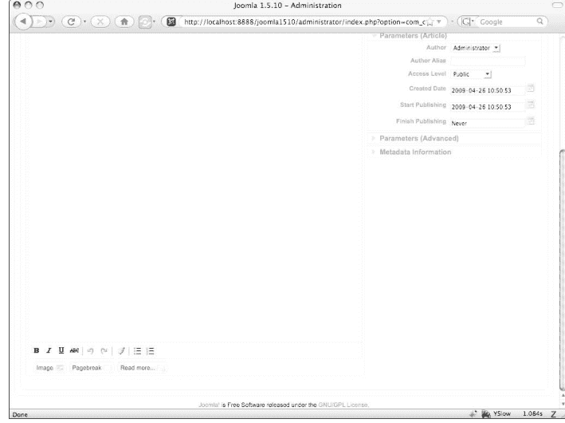

### 使用XStandard编辑器

XStandard编辑器是用于Joomla! 1.5.x的可选WYSIWYG（所见即所得）编辑器。XStandard致力于提供一个易于使用且完全符合无障碍访问标的编辑器。XStandard编辑器生成干净且符合XHTML Strict标准的代码。其标记语言也满足最常见无障碍访问标准的严格要求。不幸的是，要使用该编辑器，您必须在希望用于编辑Joomla!站点内容的每台计算机上下载并安装XStandard应用程序。XStandard Lite的界面如图6.3所示。

### 图 6.3

XStandard Lite编辑器界面。

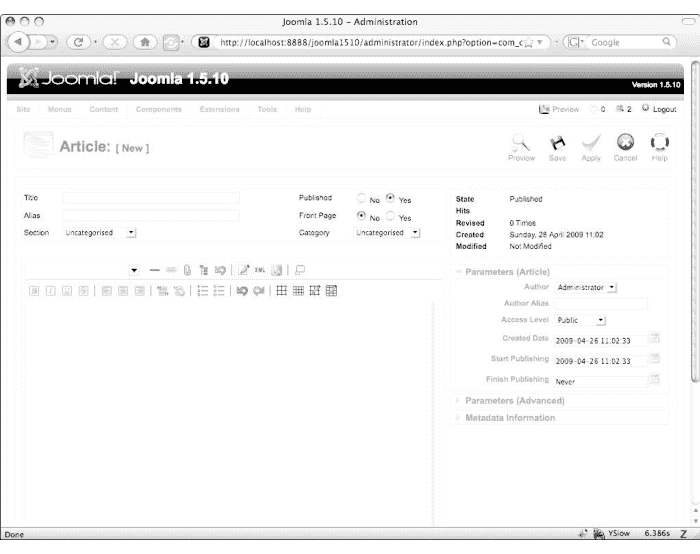

### Joomla! 1.6

Joomla! 1.6默认配置并不支持XStandard编辑器。尽管可以安装它，但您需要遵循开发者网站上的说明进行完全手动安装：http://www.xstandard.com/。

### 安装XStandard

要在Joomla! 1.5.x中安装XStandard编辑器，请按照以下步骤操作：

1.  登录到管理系统。

2.  点击“扩展”菜单下的“插件管理器”选项。插件管理器将加载。

3.  点击启用名为“Editor - XStandard Lite 2.0”的插件。

4.  通过点击“站点”菜下的“全局配置”选项访问全局配置管理器。全局配置管理器将在您的浏览器中加载。

5.  在“站点”选项卡上，从“默认WYSIWYG编辑器”旁边的组合框中选择“Editor - XStandard Lite 2.0”选项。

6.  点击保存。

7.  从开发者的网站下载XStandard Lite组件，并将其安装在您计划用于编辑Joomla!站点的计算机上。请注意，您必须安装与您本地计算机操作系统相关的版本。访问 http://xstandard.com 下载编辑器文件。

### XStandard控件

XStandard Lite的控件和格式化选项比TinyMCE编辑器更简单。所有控件都排列在编辑窗口顶部的两行中。

#### 顶行控件

-   样式：打开一个包含样式列表的组合框。先选择文本，然后点击选择样式以应用。

-   分隔符：插入HTML `<HR>` 标签。

-   超链接：插入一个指向网页地址的超链接。

-   附件：插入一个文件链接供用户下载。

-   目录：打开一个对话框，允�您插入文章和特殊字符。

-   编辑：点击以在文本编辑器格式中编辑HTML源代码。

-   查看源码：点击查看文章的源代码。

-   屏幕阅读器预览：打开文章的预览，显示屏幕阅读器视图。

-   展开：将编辑窗口扩展到全屏。

#### 底行控件

-   粗体：将文本格式化为粗体。

-   斜体：将文本格式化为斜体。

-   下划线：为文本添加下划线。

-   删除线：为文本添加删除线。

-   左对齐：将段落左对齐。

-   居中对齐：将段落居中对齐。

-   右对齐：将段落右对齐。

-   添加长引用：点击以缩进文本。

-   移除长引用：点击以减少文本缩进。

-   编号列表：点击插入编号列表。

-   项目符号列表：点击插入项目符号列表。

-   撤销：撤销一个命令。

-   重做：重做一个命令。

-   插入布局表格：点击打开一个对话框，使您能够设置表格属性并将其插入到文章中。

-   插入数据表格：点击打开一个对话框，使您能够设置表格属性并将其插入到文章中。

-   绘制布局表格：点击，通过拖动鼠标指定所需的行数和列数来绘制表格。

-   绘制数据表格：点击，通过拖动鼠标指定所需的行数和列数来绘制表格。

### 配置选项

XStandard编辑器由名为“Editor - XStandard Lite 2.0”的插件驱动，该插件包含一个允许您在不同配置模式之间切换的参数。默认模式提供WYSIWYG编辑器界面和前面概述的工具栏。还提供了另外两个选项：

-   源代码：选择此选项时，编辑窗口的用户会看到一个完全不同的工具栏和一个源代码编辑窗口。源代码工具栏仅包含九个选项，其中许多选项涉及源代码在编辑窗口中的可见性。

-   屏幕阅读器：选择“屏幕阅读器”选项以启动带有屏幕阅读器的编辑器。请注意，此配置选项中显示的工具栏与默认设置中显示的工具栏相同。

### 使用“无编辑器”选项

通过在任一WYSIWYG编辑器上选择HTML编辑选项，或通过在全局配置管理器中选择“无编辑器”选项，可以直接处理文章背后的HTML源代码。无论哪种方式，结果都是一个纯文本编辑窗口，使您可以直接在窗口中输入HTML格式标签，如图6.4所示。

选择是否使用WYSIWYG工具在很大程度上是个人偏好问题。尽管将配置设置为“无编辑器”时可以看到轻微的性能提升，但这对绝大多数用户来说都不是问题。对大多数人来说，拥有易于使用的WYSIWYG格式选项的便利性远远超过了加载时间轻微延迟的不便。

### 图 6.4

Joomla! 1.5.x中将全局配置设置为“无编辑器”时的文章编辑界面。

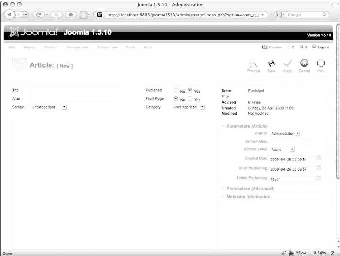

### 提示

如果您有多个内容贡献者，我建议您至少启用一个WYSIWYG编辑器并将其设为默认角色。那些喜欢使用HTML代码工作的用户可以随时切换视图以显示HTML编辑窗口。另外，不要忘记可以允许注册用户选择他们可以使用的编辑器，因此可能需要启用多个编辑器。此功能仅适用于分配给“作者”或更高权限组的用户。

### 交叉引用

允用户选择其首选编辑器的功能在第11章中讨论。

### 媒体管理器概述

媒体管理器使Joomla!站点管理员能够向系统中添加图像和其他媒体文件，并帮助保持这些文件的有序组织。将文件添加到系统后，您可以使用媒体管理器预览图像并发现文件的路径，以便将其插入到站点的文章中。

尽管可以通过FTP管理您的媒体文件，但媒体管理器有用的界面和功能使其成为一个有吸引力的替代方案。对于那些无法通过FTP访问其服务器的人来说，媒体管理器是不可或缺的。

任一方法都会导致显示媒体管理器界面，如图6.5所示。

### 图 6.5

在加载示例数据时，以默认“缩略图视图”显示的媒体管理器界面。

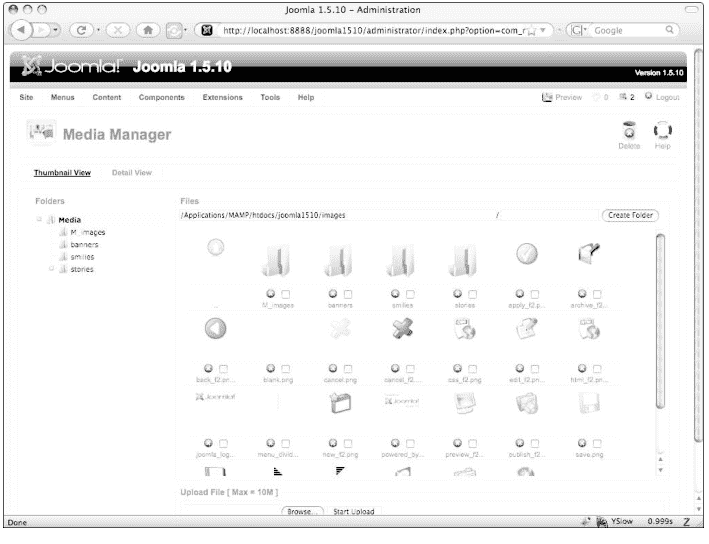

媒体管理器顶部的工具栏提供了对删除和帮助功能的快速访问：

-   删除：从列表中选择一个或多个项目，然后点击此图标以永久删除这些项目。

-   帮助：点击以访问与当前屏幕相关的联机帮助文件。

在工具栏下方和项目列表上方，有两个用于更改媒体管理器中显示视图的文本链接。默认视图是“缩略图视图”，它显示较大的图像和较少的信息。相比之下，“详细视图”显示较小的图像但包含每个文件的更多信息，如图6.6所示。

在任一视图中，屏幕的工作区都包含媒体管理器中所有项目的列表以及用于查看它们的控件。

## 第六章：编辑器和媒体的使用

**图 6.6**

以详细视图显示的菜单媒体管理器界面，并加载了示例数据。


> **注意**

> 默认情况下，媒体管理器显示 /images 目录的内容。无论是否安装示例数据，此内容均不受影响。

工作区左侧的“文件夹”区域显示了一个目录树，其中列出了系统中所有的媒体文件夹。此处显示的文件夹是您服务器上 /images 目录的内容。除了位于根目录的图像文件外，默认系统还包括以下目录：

- **M_images**：包含页面上常见的用于控件和字段标签的小图像。

- **banners**：已加载到横幅管理器组件中的默认 Joomla! 横幅广告。

- **smilies**：一组通用笑脸（也称为 *表情符号*）。

- **stories**：用于说明版块、分类和文章的图像。此处有两个子目录：food 和 fruit。子目录包含可用于文章中的示例图像。

## 第二部分：内容和用户

在“文件夹”区域中单击任何目录的名称，会在工作区右侧的“文件”区域中显示该目录的内容。在“文件”区域的顶部，显示该目录的路径。路径下方是一组代表活动目录内容的缩略图。缩略图组左上角的绿色箭头是一个导航工具，可让您向上移动到更高的目录（如果存在）。工作区中的其他缩略图则显示活动目录内的子目录（如果有）和媒体文件（如果有）。

> **注意**

> 在默认的媒体管理器安装中，有一个名为 /smilies 的目录，其中包含一组图形笑脸或“表情符号”。请注意，smilies 文件夹中的表情符号与您在 TinyMCE 所见即所得编辑器中看到的不同。在 WYSIWYG 编辑器的“插入表情”控件下显示的表情符号并非由媒体管理器管理，而是位于 /plugins/editors/tinymce/jscripts/tiny_mce/plugins/emotions/images。

当缩略图表示图像文件时，单击缩略图会在一个灯箱中打开图像供您查看。您可以单击屏幕上的任意位置关闭灯箱。如果缩略图代表其他类型的媒体文件（例如 PDF 或 PowerPoint 文档），则无法打开文件视图，此时显示的缩略图是用于表示该文件类型的通用图像。

每个缩略图下方都有一个带“x”的红色圆圈和一个复选框。单击带“x”的红色圆圈可删除文件。单击复选框可选中该文件，从而允许您选择多个项目，并使用右上角工具栏上的“删除”图标一次性全部删除它们。最底部是文件的名称。您可以单击名称在工作区内查看文件，而无需弹出窗口。

页面上还有另外两个控件。在“文件”区域的右上角是一个空白文本字段，旁边有一个标为“创建文件夹”的按钮。您使用此控件向系统添加新的子目录。“文件”区域下方是“上传文件”功能，它使您可以向系统添加额外的媒体文件。这两者都将在本章后面讨论。

单击“详绂视图”文本链接会更改媒体管理器的视图，如图 6.6 所示。此视图选项将“文件”区域的格式更改为显示以下列：

- **预览**：打开图像的灯箱视图。请注意，此功能仅在文件是图像文件时有效。

- **图像名称**：文件的名称。尽管该列标为“图像名称”，但它显示所有媒体文件的名称，无论它们是否确实是图像。

- **尺寸**：图像的宽度和高度（以像素为单位）。这仅与图像文件相关。

- **大小**：文件的大小。以字节或千字节 (Kb) 表示。

- **删除**：单击红色圆圈可立即删除文件，或单击复选框，然后单击顶部工具栏上的“删除”图标。

### 处理媒体文件

媒体管理器的主要用途是将文件移动到服务器上，以便您可以在网站上使用它们。为实现此功能，您需要预览图像、获取文件尺寸和大小，并最终获取文件的路径以便将它们添加到网站文章中。所有这些功能都可以在媒体管理器中实现。

#### 查看文件信息

详细视图（参见图 6.6）可以一目了然地提供最多的信息。您可以在缩略图或详细视图中预览文件、查找文件名或发现文件路径。如果需要文件的尺寸或大小，您可以最轻松地通过详细视图找到这些信息。

#### 上传文件

可以通过直接通过 FTP 访问服务器或使用媒体管理器中的上传功能来向系统添加额外的媒体文件。虽然在需要移动大量文件的情况下 FTP 可能更可取，但 Joomla! 媒体管理器中的默认上传器功能对于单个文件上传来说快速且方便。

除了默认的上传器，系统还包括一个可选的 Flash 上传器，可以通过全局配置管理器启用。Flash 上传器允许您指定多个文件进行上传，然后一次性上传所有文件。如果您希望将大量文件移动到系统中且不想使用 FTP，或者您计划经常一次上传多个文件，则应考虑启用 Flash 上传器，因为它将比默认上传器节省您的时间。Flash 上传器如图 6.7 所示。

> **交叉参考**

> **全局配置管理器在第四章中讨论。**

要使用媒体管理器向系统添加新文件，请按照以下步骤操作：

1. 登录到站点的管理后台。

2. 通过单击“站点”菜单下的选项“媒体管理器”来访问媒体管理器。媒体管理器将在您的浏览器中打开。

3. 单击媒体管理器界面底部“上传文件”区域上的“浏览”按钮。将打开一个弹出窗口。

4. 在弹出窗口中导航以定位要上传的文件，然后单击弹出窗口上的“打开”按钮。文件的名称将出现在“浏览”按钮左侧的文本字段中。

5. 单击“开始上传”按钮。系统将文件上传到活动目录并返回到媒体管理器。确认消息和文件的缩略图应在媒体管理器中可见。

**图 6.7**

正在使用的可选 Flash 上传器。


### 注意

默认情况下，系统不仅接受所有常见的图像文件类型，还接受其他常见文件类型，包括 Flash 文件、PowerPoint 文件和各种文档格式。默认系统中的最大文件大小设置为 10MB。允许的文件类型和最大文件大小可以通过更改全局配置管理器中的系统部分设置来修改。

或者，如果您想通过 FTP 添加媒体文件，请将文件放在服务器的 /images 目录内。放置在该目录内的任何文件都将显示在媒体管理器中。同样，如果您使用 FTP 在 /images 内创建任何子目录，您的新目录也将显示在媒体管理器中。通过 FTP 上传到这些位置的文件和目录此后可以不受限制地由媒体管理器管理。

#### 组织文件

默认情况下，系统中包含的文件被组织成您在媒体管理器“文件夹”区域中看到的目录。您可以创建新的子目录，并将新文件上传到媒体管理器中的任何目录。也可以在媒体管理器中删除文件和目录。

## 第6章：使用编辑器和媒体管理器

遗憾的是，系统中的文件无法轻易地从一个目录移动到另一个目录。解决此限制的唯一方法是下载该文件，然后将其重新上传到您选择的目录中。尽管媒体管理器中没有包含下载选项，但您可以通过以下步骤轻松下载系统中的图像文件：

1.  访问媒体管理器，找到您想要下载的图像文件。

2.  单击文件名称。该文件会单独显示在媒体管理器的“文件”区域中。

3.  右键单击该文件。会出现一个菜单。

4.  选择“将文件另存为”选项。会打开一个对话框窗口。

5.  浏览到您要在本地计算机上保存文件的位置，然后单击“保存”。系统会将文件下载到您的本地计算机，然后将您返回到媒体管理器。

文件下载到本地计算机后，您可以使用媒体管理器中的上传器或使用FTP（如前一节所述）将其上传到您选择的目录。

删除一个或多个文件很容易操作。要逐个删除文件，只需单击每个文件上出现的带叉的红色圆圈。要删除多个文件，请单击文件旁边的复选框，然后单击右上角工具栏上的“删除”图标。

> **注意**

> 删除文件请谨慎操作。删除操作是即时的——没有确认或警告对话框。删除也是永久的——文件会从系统中移除，而不是移动到回收站管理器中。

可以使用媒体管理器上的“创建文件夹”控件向系统添加新目录。每个新目录都将是 /images 文件夹的子目录。要创建一个新的子目录来存放您的媒体文件，请按照以下步骤操作：

1.  访问媒体管理器。

2.  在媒体管理器的“文件夹”区域中，单击您想要作为父目录的目录名称。内容会显示在“文件”区域。

3.  在“创建文件夹”按钮旁边的文本框中输入新子目录的名称。

4.  单击“创建文件夹”。系统会创建一个新目录。新目录将出现在媒体管理器的“文件夹”区域中。

### 将文件添加到文章

将文件添加到系统的最常见原因是使其可用于站点的文章中。虽然将文件放入媒体管理器完成了一项重要任务（即将文件添加到您的Joomla!系统中），但它并不能自动将文件放置到您站点的文章中。

根据您要完成的任务，您可能需要将文件插入文章中，或者只是显示指向该文件的链接。例如，要显示图像，您需要将其插入文章。另一方面，如果您希望允许访问者下载文件，则可以在文章中插入指向该文件的链接。无论哪种情况，您都必须首先找到文件的路径。找到文件路径后，您可以使用您选择的所见即所得编辑器来插入文件或URL。

要获取图像文件的路径，只需在媒体管理器中右键单击文件名称并复制链接。通常，这是通过从右键菜单中选择“复制链接位置”选项来完成的。现在您可以将链接粘贴到所见即所得编辑器中的适当位置，或粘贴到外部文档中以备后用。

要获取非图像文件类型的路径，您需要查看“文件”区域顶部的路径信息，并将文件名附加到该路径的末尾。

### 总结

在本章中，我们介绍了系统各种默认编辑器选项的使用以及媒体管理器的使用。您学到了以下内容：

-   如何使用 TinyMCE 编辑器

-   如何使用 XStandard Lite 编辑器

-   如何在没有所见即所得编辑器的情况下编辑文章

-   如何使用媒体管理器查看文件

-   如何将文件上传到媒体管理器

-   如何在媒体管理器中组织文件

-   如何从媒体管理器中删除文件

-   如何将媒体管理器中的文件添加到文章

## 第7章

### 运用高级内容管理技术

在前面的章节中，我讨论了Joomla!内容管理的基础知识。在本章中，我将探讨一些更高级的技术，这些技术有助于您为访客创造更丰富的内容体验，并探讨使您能够建立替代内容管理工作流程的工具。

默认系统中包含的模块为您在站点页面上显示内容提供了众多选项。此外，新闻聚合组件、RSS显示模块和包裹器等功能允许您将外部内容引入您的站点。本章讨论如何将这些选项集成到您的站点中，并使其成为内容组合的一部分。

Joomla!还允许您允许访客向您的站点提交文章，并围绕来自前端的内容贡献创建工作流程。系统提供了许多工具来实现此功能，从而为您提供了另一种增加站点交互性并与用户建立社区的方法。本章将深入探讨前端内容管理。

| 本章内容 |

| :--- |

| **使用内容显示模块** |

| **将外部内容引入您的站点** |

| **从前端管理内容** |

| **联合发布您的内容** |

### 使用内容显示模块

您的Joomla!站点中包含的模块为在站点页面上显示内容提供了多种选项。虽然许多模块仅提供指向文章的链接（例如“最新新闻”或“栏目”模块），但其他模块实际上会在页面上显示内容项。本节将介绍两个提供内容显示的关键Joomla!模块：自定HTML模块和快讯模块。在本章后面，我还将介绍可用于在页面上显示新闻聚合输出的RSS显示模块。

#### 使用自定义HTML模块

自定义HTML模块是一个空白画布，您可以用来显示您选择的内容。它本质上是一个空容器，旨在容纳文本、图像或两者的混合。该模块本身不提供任何内容，而是给您一个空文本框和一个所见即所得编辑器，允许您根据需要创建和编辑内容。您可以将内容复制粘贴到模块中，也可以从头开始创建，并包含完整的格式。

> **交叉参考**

> 自定义HTML模块在第17章中有更详细的讨论。

该模块最常见的用途之一是创建文章或您站点上其他功能的简短摘录或概要，并附上指向完整文章或功能的链接。当以这种方式使用时，该模块充当引导人们点击并进一步探索您站点的“引子”。虽然无法自动在模块内显示文章或其引言文本，但自定义HTML模块使您能够手动创建此内容。只需将文章的一部分复制粘贴到模块中，添加指向完整文章的链接；然后将模块发布到您希望“引子”出现的位置。

要创建您自己的“引子”模块，请按照以下步骤操作：

1.  登录到您站点的管理系统。

2.  在“内容”菜单下单击“文章管理器”选项。文章管理器将在您的浏览器中加载。

3.  单击您想要用作“引子”模块主题的文章名称。文章编辑窗口将打开。

4.  复制您想要用作模块“引子”内容的文本部分。

5.  单击“取消”图标。文章编辑对话框关闭，您返回到文章管理器。

6.  在“扩展”菜单下单击“模块管理器”选项。模块管理器将打开。

7.  单击右上角工具栏上的“新建”图标。新建模块对话框将打开。

8.  单击“自定义HTML”选项。选择“下一步”图标。新建模块对话框的下一步将打开。

9.  为您的新模块命名。

10.  为模块选择一个位置。

11.  通过从菜单选择组合框中选择菜单项来设置模块出现的页面。

12.  将您从文章中复制的文本粘贴到文本框中。

13.  在文本末尾输入一个硬回车，然后添加文字“阅读更多...”。

## 第七章：运用高级内容管理技术

14. 将文字“阅读更多...”链接到完整文章。

15. 点击右上角工具栏上的保存图标。系统将创建并保存你的新模块，并退出模块编辑窗口，返回到模块管理器。

新闻快讯模块提供了一种不同的方式来达到类似的效果。

### 使用新闻快讯模块

新闻快讯模块用于显示一篇或多篇文章的前几句话。如果你在 Joomla! 站点中加载了示例数据，你可以看到该模块的实际运行效果，因为它被用用于在页面顶部显示随机文章内容。图 7.1 显示了其在默认 Joomla! 站点上的输出效果。


新闻快讯模块的输出

### 交叉引用

有关新闻快讯模块的更多信息，请参阅第 17 章。

## 第二部分：处理内容和用户

能够随机显示特定内容类别中文章的前几句话只是该模块的一种使用方式。它也可以配置为显示来自特定区块和类别的一篇文章或一组文章的部分内容。

该模块通过模块参数进行配置。参数可以设置为显示以下任何内容：

-   从特定类别中随机选择的文章的导语。每次页面重新加载时，显示的文章都会更改。（此配置在默认站点中使用。）

-   特定文章的导语，带有“阅读更多”链接指向完整文章。此配置类似于上一节中用作示例的摘要模块。

-   特定文章的导语，不带“阅读更多”链接。

-   特定类别中多篇文章的导语，带有“阅读更多”链接指向完整文章。

-   特定类别中多篇文章的导语，不带“阅读更多”链接。

如果你选择使用随机化功能，你将一次只能看到一篇文章，布局固定。但是，如果你想显示多篇文章，你可以设置显示的文章数量以及它们是水平显示还是垂直显示。

**注意：** 使用此模块时，有几个重要的限制你需要牢记。你无法设置显示的文本量；这是由系统设定的。另请注意，显示的文章顺序基于它们在类别中的顺序；如果你需要重新排列模块中的显示顺序，你必须更改类别中文章的顺序；根据你的站点配置方式，这可能会影响站点其他区域的内容显示。

**交叉引用：** 有关在类别中重新排序文章的更多信息，请参阅第 5 章。

### 在文章中放置模块

通常情况下，模块输出被限制在页面主内容区域周围的空间——左侧或右侧，或主内容区域上方或下方。模块的位置由其分配给站点模板中指定的模块位置占位符来定义。

**交叉引用：** 有关在模板文件中使用模块位置占位符的更多信息，请参阅第 20 章。

## 第七章：运用高级内容管理技术

然而，在某些情况下，你可能希望在页面的内容区域内放置一个模块。如果该页面包含一篇文章，你可以这样做。Joomla! 使得可以将模块直接放入文章中；你只需要在文章文本中输入一点代码即可。结果类似于你在图 7.2 中看到的。

编辑窗口中的文本区域显示了一个嵌入在文章中的模块位置占位符，本例中创建了一个名为“insidearticle”的模块位置占位符。


要将模块插入文章的内容区域，请打开文章编辑对话框，然后按照以下步骤操作：

1.  将光标放置在你希望模块输出出现的位置。

2.  输入以下代码 `{loadposition 模块位置名称}`，其中“模块位置名称”是你为此特定模块位置占位符想使用的名称。

3.  点击右上角的**保存**图标。系统将保存带有新模块位置占位符的文章，并退出文章编辑对话框，返回到文章管理器。

4.  点击扩展菜单下的模块管理器选项。模块管理器加载。

5.  点击你想要放置在文章中的模块名称。模块编辑对话框打开。

6.  在位置字段中，输入你在文章中给模块位置指定的名称；在此示例中，该名称应为 `模块位置名称`。

7.  点击右上角的保存图标。系统保存你的更改，模块编辑对话框关闭并返回到模块管理器。

### 注意

特别注意代码使用的语法：`{loadposition xxx}`，其中 `xxx` 是模块位置占位符的名称。你可以为模块位置占位符使用任何你想要的名称，只要它在其他地方未被使用。

通常，最好不要为放置在文章内部的模块位置占位符使用通用名称。为模块位置占位符使用独特且有辨识度的名称，可以避免与传统的模块位置占位符混淆，并避免必须确保页面有菜单选择的必要；你可以简单地将模块的菜单分配设置为“全部”，而无需担心模块会出现在不需要的页面或位置上。

### 提示

在文章中放置模块的能力是由名为“Content - Load Module”的 Joomla! 插件启用的。默认情况下，“Content - Load Module”插件是启用的，但如果由于某种原因它未启用，那么你需要在插件管理器中启用它，然后才能使用此技术。

### 交叉引用

插件管理器和“Content - Load Module”插件在第 19 章中有更详细的讨论。

### 将外部内容引入你的站点

为站点创建内容并保持内容的维护是站点所有者面临的最大挑战之一。Joomla! 提供了各种工具，使你能够将外部内容引入你的站点，从而为你提供由他人创建的最新和更新的内容。默认系统中可用的各种工具和技术将在以下各节中介绍。

### 使用包装器

包装器是一个 iFrame，允许你在模块或页面的内容区域内显示网页。包装器本质上创建了一个页面中的页面，其中嵌入的页面可以来自你自己的站点，也可以来自外部来源。被包装的页面保留其所有功能，包括导航和其他功能。

## 第七章：运用高级内容管理技术

包装器最常用于执行以下任务之一：

-   显示来自你的 Joomla! 站点的另一个页面——例如，一个表单。

-   显示位于你的服务器上的非 Joomla! 页面。

-   显示位于不同服务器上的页面。

-   显示位于你的服务器上的应用程序的输出。

> **注意：** 尽管包装器提供了一种在你的站点中显示第三方内容的简便方法，但必须小心避免侵犯他人的知识产权。除非你获得站点所有者的许可，否则在你的站点中显示其他站点的内容是不合适的，特别是如果这样做会给人留下内容是你的印象。

要在页面的内容区域内创建包装器，请使用“包装器”菜单项类型。要包装网页并将其显示在模块位置中，请使用“包装器”模块。在任何一种情况下，你都可以使用配置选项来对包装器的外观进行有限的控制。然而，请注意，通常你对包装器内部发生的事情控制非常有限，除非你也控制正在被包装的网页。

> **交叉引用：** 有关“包装器”菜单项类型的详细信息，请参阅第 8 章；有关“包装器”模块的更多信息，请参阅第 17 章。

### 显示联合内容

联合内容——RSS 订阅源、Atom 订阅源等——提供了方便的现成内容来源。Joomla! 为你提供了两种将联合内容引入站点的方法。

要在页面的内容区域内显示新闻订阅源内容，请使用“新闻订阅源”组件配合“单个订阅源布局”菜单项类型。虽然“新闻订阅源”组件最常用于聚合多个联合新闻订阅源并基于类别显示它们，但你也可以使用名为“单个订阅源布局”的菜单项类型在页面的内容区域内显示单个订阅源的内容，如图 7.3 所示。

> **交叉引用：** 有关“新闻订阅源”组件的更多信息，请参阅第 8 章。

或者，如果你想在模块位置显示订阅源内容，请使用 Joomla! 的“订阅源显示”模块。“订阅源显示”模块独立于“新闻订阅源”组件。它不是从“新闻订阅源”组件包含的新闻订阅源之一中获取内容，而是将新闻订阅源的 URL 输入到模块参数中。

## 第二部分：处理内容和用户

### 交叉引用

请参阅第17章以了解更多关于**Feed Display**模块的信息。

### 从前端管理内容

虽然绝大多数站点管理员完全通过管理界面管理他们的站点内容，但**Joomla!** 确实提供了从前端管理内容的选项。该技术有其局限性，但它是一个有用的选项，一些用户会觉得很有吸引力。在接下来的章节中，我将讨论其优缺点以及如何有效地构建此选项。

### 理解优势与局限性

**Joomla!** 中一个使用较少且文档记录不足的功能是前端内容管理系统。该系统默认设置为允许特定类别的用户能够从网站的前端提交、编辑和发布内容。此功能旨在为管理员提供一个选项，以开放站点供社区贡献，而无需让用户访问您网站的管理系统。

通过适当的规划，您可以使此功能变得实用且可行；然而，此功能既不明显也不直观，确实需要一些解释。要使用前端内容管理，您需要正确配置站点并为用户发布正确的工具（参见图7.4）。您还需要特别注意创建适当的用户账户以构建实用的工作流程。不同的用户类别具有不同的权限，您必须决定什么对您的站点最有利。

前端内容管理有几个显著的限制：

-   无法从前端创建或管理**Sections（板块）**、**Categories（分类）**或**Menu Items（菜单项）**。

-   作者无法在文章发布前编辑自己的文章。

-   您必须仔细考虑站点模板的适用性。虽然后端是为处理内容编辑窗口和**WYSIWYG**编辑器量身定制的，但前端内容管理必须在站点模板内完成。

-   系统缺乏适当的警报系统，无法在内容添加到系统后或等待编辑/发布时自动通知更高级别的用户。

**提示**

您可能需要考虑在您的站点上安装一个具有宽大内容区域的简洁快速的模板。然后，您可以将该模板专门分配给“**Submit an Article（提交文章）**”菜单项。这样做可以为您的内容贡献者提供一个合适的工作区。请注意，此技术为文章创建提供了合适的界面，但无助于从前端编辑内容；已发布的文章使用分配给它们的模板。有关安装和分配模板的讨论，请参见第20章。

虽然从前端提交内容对于为您的站点访问者提供一种为站点做出贡献的方式很有用，但作为站点管理员，您不太可能希望从前端管理您的内容。前端内容管理通常比在管理系统内部工作更慢、更困难，因为管理系统的内容管理界面提供了更多的工具和更广泛的选择范围。同样，您分配去编辑文章的用户可能更倾向于通过管理系统工作。您可以决定站点的安全性考虑是否比授予后端访问权限的实际优势更重要。

### 启用用户创建的内容

设置前端内容管理的第一步是创建具有必要权限的用户。要在前端贡献或编辑内容，用户必须具有高于**Registered User（注册用户）**的权限（**Author（作者）**状态或更高）。**Special（特殊）**访问级别专门用于帮助设置前端内容管理。

**图 7.4**

前端的“**Submit an Article**”页面，此处显示的是具有**Author**级别权限的用户所看到的视图。

您还需要确保您的贡献者所需的所有必要工具都设置为适当的访问级别。名为**Special**的访问级别旨在帮助启用前端内容管理。只有被分配到**Author（作者）**组或更高级别的用户才能查看设置为**Special**的项目；因此，您需要将打算用于内容贡献者的菜单项的访问级别设置为**Special**，以限制他们的访问权限。

文章提交表单是内容创建的关键。默认情况下，系统在**User（用户）**菜单中包含一个名为“**Submit an Article**”的菜单项；这就是文章提交表单。点击“**Submit an Article**”链接会将用户带到一个包含空白文章表单的页面，从而允许用户创建新文章并将其分配给一个**Section（板块）**和**Category（分类）**。

编辑功能默认是启用的；每当具有适当访问级别的用户登录时，每篇文章上都会出现一个编辑图标，如图7.5所示。点击编辑图标会在当前模板内打开一个编辑对话框，从而允许用户进行并保存他们的更改。

### 提示

如果您不想使用默认的**User**菜单，您将需要提供其他方式让用户访问内容提交表单。有一个专门的**Menu Item Type（菜单项类型）**提供此功能：**Article Submission Layout（文章提交布局）**。

**图 7.5**

文章编辑图标，由具有足够访问权限的已验证前端用户看到。

### 交叉引用

菜单管理和创建新菜单项在第8章中介绍。

### 工作流选项

专注于前端内容管理的三个用户组是**Authors（作者）**、**Editors（编辑）**和**Publishers（发布者）**。这三者各自具有不同的能力和权限。了解这些不同的角色有助于您为站点的前端内容管理创建一个可用且实用的工作流程。

#### 作者

在所有对前端内容管理有用的用户组中，**Authors**享有的权限最少，受到的限制最多。**Authors**可以执行一组有限的前端内容管理任务。他们可以：

-   创建新文章。

-   将文章分配给一个**Section（板块）**和**Category（分类）**。

-   安排文章发布（但在获得至少具有**Publisher（发布者）**访问权限的人员批准之前不会发布）。

-   将文章分配到**Front Page（首页）**。

-   创建文章**Metadata（元数据）**。

-   更改其自己已发布文章的**Section（板块）**或**Category（分类）**分配。

-   编辑自己已发布的文章。

**Authors**无法发布他们的文章，也不能编辑他人的作品。此外，与**Editors**和**Publishers**不同，**Authors**无法编辑未发布的文章——即使是他们自己的文章也不行。图7.6显示了一篇准备被编辑或发布的未发布文章。

> **注意**

由于**Authors**缺乏编辑未发布文章的能力，一旦**Author**点击其文章上的“**Save（保存）**”按钮，他们就失去了编辑该文章的能力！这个问题可能很严重，因为它意味着**Author**必须在点击“**Save**”按钮之前创建文章并进行所有修订。文章保存后，它会进入队列，必须由更高级别的用户批准。文章被批准并发布后，**Author**可以编辑它。

#### 编辑

**Editors（编辑）**能够执行以下任务：

-   创建新文章。

-   将文章分配给一个**Section（板块）**和**Category（分类）**。

-   安排文章发布（但在获得至少具有**Publisher（发布者）**访问权限的人员批准之前不会发布）。

-   将文章分配到**Front Page（首页）**。

-   创建文章**Metadata（元数据）**。

-   更改文章的**Section（板块）**或**Category（分类）**分配。

-   编辑任何文章，无论是已发布还是未发布的。

**Author（作者）**和**Editor（编辑）**之间的关键区别在于，**Editor（编辑）**可以更改任何文章，无论其作者是谁或其发布状态如何。

**图 7.6**

此页面顶部突出显示的文章显示了一篇未发布的文章，可以通过点击编辑图标进行编辑。

## 第二部分：处理内容与用户

#### 发布者

发布者用户组是三个专用前端内容管理用户组中迄今为止最实用的。发布者可以执行创建和发布站点内容所需的所有关键功能：

- 创建新文章。

- 将文章分配到区块和分类。

- 安排文章发布计划。

- 将文章分配到首页。

- 创建文章元数据。

- 更改文章的区块或分类分配。

- 编辑任何文章，无论已发布还是未发布。

- 发布或取消发布文章。

尽管发布者用户组拥有显著的权限，但他们缺少一些关键的内容管理功能；发布者无法执行以下任务：

- 创建新区块。

- 创建新分类。

- 复制、移动或删除区块或分类。

- 创建、修改或删除菜单部分。

- 创建、修改或删除菜单项。

所有上述任务均需访问后端管理系统。

### 提示

**经理用户组是另一个值得考虑的选择。经理是被授予后端管理系统访问权限的最低级别用户。他们享有的权限并不比发布者所享有的权限大得多。他们不仅可以管理区块、分类和菜单项，还可以访问管理系统中更强大、更易于使用的内容管理工具。因此，您可能需要考虑授予一个或多个用户经理级别的访问权限，作为发布者访问权限的替代方案。**

## 第7章：运用高级内容管理技术

### 改进 Joomla! 1.5.x 工作流程的一种方法

如果您认为网站需要三层前端内容管理结构，您可能需要考虑采用以下建议来改进工作流程。

如前所述，该系统的一个局限性在于缺乏自动通知系统。您的前端内容管理结构越复杂，这个局限性就变得越重要。随着作者提交文章，编辑者需要被通知，然后编辑者必须找到提交的文章并进行编辑。文章编辑完成后，编辑者需要通知发布者，发布者再次需要找到文章并发布它们。

解决此问题的有效变通方法是为前端内容团队使用创建一个专用区块，其中包含两个分类。进行如下设置：

1. 创建一个新区块，将其命名为“提交稿件”。

2. 将名为“提交稿件”的区块访问级别设置为“特殊”。

3. 在新区块内创建两个新分类。将分类命名为“待编辑”和“待发布”。

4. 在“用户”菜单上创建一个新的菜单项。选择菜单项类型“分类列表布局”。将新项命名为“待编辑”，并在“基本参数”中选择分类“待编辑”。

5. 在“用户”菜单上创建另一个新的菜单项。选择菜单项类型“分类列表布局”。将新项命名为“待发布”，并在“基本参数”中选择分类“待发布”。

所有工具都已就位；现在您需要指导您的团队使用它们。

- 指导作者将所有新文章分配到“待编辑”分类。

- 指导编辑者在登录时查看“待编辑”菜项。完成文章编辑后，编辑者必须将文章重新分配到“待发布”分类。

- 指导发布者在登录时查看“待发布”菜单项。然后，发布者可以将文章分配到适当的区块和分类，并发布文章。

这种方法还有一个额外的好处，即允许您为整个前端内容管理工作流程设置特定的模板。正如本章前面讨论的，您可能希望使用专为前端内容管理任务量身定制的模板。宽模板使编辑窗口更易于使用，而没有不必要图形或模块分配的简洁模板也可以加快您的工作速度。

## 第二部分：处理内容与用户

### 聚合您的文章

您可以通过使用 RSS 来聚合 Joomla! 站点的主要内容。聚合模块实现了此功能。在默认配置中，有一个聚合模块在站点首页的左下角（位于“聚合”模块位置内）启用并发布，如图 7.7 所示。

**图 7.7**

默认站点首页上显示的 RSS 聚合图标。


点击页面上出现的聚合图标的用户将被带到一个包含为 RSS 格式化的内容的页面。用户可以复制此链接并将其粘贴到他们喜爱的新闻阅读器（订阅源阅读器）应用程序中，以随时了解您站点首页的更改。

### 提示

默认的 Joomla! 聚合模块始终在图标旁边显示文本“Feed Entries”，即使您从模块中删除了模块标题也是如此。要解决此错误，请输入一个用双引号（" "）包围的空格。

## 第7章：运用高级内容管理技术

### 总结

在本章中，我们介绍了与管理站点内容相关的各种高级任务。您学到了以下内容：

- 如何使用系统的内容显示模块

- 如何在内容项内显示模块

- 如何使用包装器和新闻源将外部内容引入您的站点

- 如何设置和使用前端内容管理

- 如何启用内容项的 RSS 聚合

## 使用菜单系统

菜单用于创建网站页面上的主要导航链接。Joomla! 提供了许多工来创建和控制您的菜单。Joomla! 菜单系统的组成部分是菜单项，它们被分组到菜单中，并通过菜单模块在页面上显示。掌握菜单系统意味着了解这些部分是如何创建和管理的。

| **本章内容** |

| :--- |

| 菜单管理器简介 |

| 创建和管理菜单 |

| 菜单项管理器简介 |

| 创建和管理菜单项 |

| 控制对菜单和菜单项的访问 |

菜单管理器用于创建菜菜。每个单独的菜单都有一个专用的菜单项管理器和一个或多个菜单模块。菜单项管理器处理菜单上项目的创建和配置，而模块处理菜单在页面上的实际显示。您可以通过将各种模块分配到所需的模块位置来控制菜单的放置位置。

在本章中，我将介绍菜单和菜单项的创建和管理。

### 菜单管理器简介

菜单管理器是标准的 Joomla! 组件，包含在默认的 Joomla! 系统中。您将使用菜单管理器来创建和管理网站上的所有菜单。要访问菜单管理器，请在管理导航栏上选择名为“菜单”的选项，然后选择“菜单管理器”选项。菜单管理器界面将在您的浏览器中加载。图 8.1 显示了安装了示例数据的 Joomla! 1.5.x 中的菜单管理器。

**图 8.1**

Joomla! 1.5.x 菜单管理器界面。


菜单管理器顶部的工具栏提供对以下功能的快速访问：

- **复制：** 从列表中选择一个菜单，然后单击此图标进行复制。

- **删除：** 从列表中选择一个菜单，然后单击此图标删除菜单。

- **编辑：** 从列表中选择一个菜单，然后单击此图标编辑菜单详细信息。

- **新建：** 单击以添加新菜单。

- **帮助：** 单击以访问与活动屏幕相关的在线帮助文件。

屏幕的主要内容区域包含 Joomla! 网站中所有菜单的列表。提供的列包括：

- **#：** Joomla! 分配的索引编号。此编号无法更改。

- **单选按钮（无标签）：** 单击单选按钮以选择菜单；如果您希望使用上述提到的多个工具栏选项，则需要此项。

- **标题：** 此字段显示菜单的全名。单击名称以编辑菜单的详细信息。

## 第8章：使用菜单系统

*   **类型：** 此字段显示菜单的系统名称。由菜单创建者设置。

*   **菜单项：** 此图标是到每个特定菜单的菜单项管理器的链接。点击可跳转至该界面。

*   **已发布数量：** 显示菜单上已发布的菜单项数量。

*   **未发布数量：** 显示菜单上未发布的菜单项数量。

*   **回收站数量：** 显示当前在回收站中的菜单项数量。

*   **模块数量：** 指示与此菜单关联的菜单模块数量。

*   **ID：** 系统生成的用户ID编号。

最后，在屏幕底部、内容区域下方，是“显示数量”选项。更改组合框控件中的值可以调整页面上显示的菜单数量。默认值可以通过更改全局配置管理器中的“列表长度”选项来修改。

#### Joomla 1.6

Joomla! 1.6 的菜单管理器界面在外观上与 Joomla! 1.5.x 的菜单管理器略有不同，但功能几乎完全相同。

## 创建和管理系统菜单

系统中的所有前端菜单都是通过菜单管理器创建和管理的。Joomla! 1.5.x 系统附带的示例数据包含多个不同的菜单，包括主菜单、用户菜单、顶部菜单、资源菜单、示例页面和关键概念菜单。这些菜单可以编辑以更改其内容以适应您的需求，或者您可以使用菜单管理器上的“新建”选项从头开始创建一个新菜单。

#### 理解菜单和模块之间的关系

如前所述，菜单管理器和菜单项管理器用于管理菜单内容，但菜单的显示是由菜单模块控制的。系统中的每个菜单都至少与一个菜单模块相关联。当创建一个新菜单时，系统通常会创建一个新的菜单模块以启用菜单的显示。

在创建新菜单的过程中，系统会提示您输入“模块标题”，该标题将用于命名该菜单的菜单模块。如果您将此字段留空，系统会创建菜单，但不创建模块，导致菜单在网站前端不可见。所有菜单模块都属于 `mod_mainmenu` 模块类型。

### 注意

可以为单个菜单创建多个菜单模块。此技术主要用于创建子菜单，正如本章后面所讨论的。

#### 创建新菜单

要创建新菜单，请点击菜单管理器顶部工具栏上的“新建”图标。图8.2显示了“新建菜单”对话框。


菜单管理器顶部的工具栏提供对以下功能的快速访问：

*   **保存：** 点击此图标保存您的工作，创建一个新菜单，并退出“新建菜单”对话框。

*   **取消：** 取消任务并退出“新建菜单”对话框。

*   **帮助：** 点击访问与当前屏幕相关的在线帮助文件。

工作区中的字段包括：

*   **唯一名称：** 输入此字段的值将用作菜单的系统名称。此字段仅接受小写字母且不能有空格。此字段为必填项。

*   **标题：** 在此字段中输入菜单的名称。此字段为必填项。

*   **描述：** 输入菜单的描述。此字段为可选项。

*   **模块标题：** 如果您想在此时创建一个并行的菜单模块，请在此字段中输入名称。这是一个可选字段，但如果没有它，您必须首先通过模块管理器创建一个菜单模块，才能在网站前端显示菜单项。

### 交叉引用

创建新的站点模块在第20章中讨论。

要创建新菜单，请按照以下步骤操作：

1.  登录到您网站的管理系统。

2.  通过点击管理导航栏上“菜单”选项下的“菜单管理器”选项来访问菜单管理器。菜单管理器将在您的浏览器中加载。

3.  在菜单管理器界面中，点击菜单管理器顶部工具栏上的“新建”图标。“新建菜单”对话框打开。（参考图8.2。）

4.  在“唯一名称”字段中，输入菜单的机器可读名称。此字段仅允许小写字母且不能有空格。此字段为必填项。

5.  在“标题”字段中，输入菜单的名称。此字段为必填项。

6.  完成您希望填写的任何其他字段；所有其他字段均为可选。

7.  点击右上角工具栏上的“保存”图标以保存您的新菜单。对话框关闭并返回到菜单管理器。

#### Joomla 1.6

Joomla! 1.6 的“新建菜单”对话框界面在外观上与 Joomla! 1.5.x 的“新建菜单”对话框略有不同，但功能相同。

#### 复制菜单

您可以创建现有菜单的精确副本，包括其所有菜单项。使用菜单管理器中的“复制”功能，系统将自动创建菜单、菜单项以及菜单关联模块的副本。新的菜单模块将被分配到与原始模块相同的模块位置和相同的访问级别。

要复制菜菜，请点击菜单管理器右上角的“复制”图标。“复制菜单”对话框将在您的浏览器中加载，如图8.3所示。

**图 8.3**

“复制菜单”对话框，显示正在复制的菜单名称以及该菜单上所有菜单项的列表。


### 注意

**复制现有菜单将导致一个新的菜单模块默认被发布——即使原始菜单模块未被启用！**

要复制菜单，请按照以下步骤操作：

1.  打开菜单管理器。

2.  点击要复制的菜单旁边的复选框。

3.  点击右上角工具栏上的“复制”图标。“复制菜菜”对话框打开。（参考图8.3。）

4.  为“新菜单标题”输入一个名称。

5.  为“新模块名称”输入一个名称。

6.  点击右上角工具栏上的“复制”图标。系统将创建一个新菜单和一个新菜单模块，并返回到菜单管理器。

#### 编辑和删除菜单

现有菜单可以从菜单管理器进行编辑。要编辑菜单，请点击菜单管理器中的菜单名称，或者选择菜单然后点击菜单管理器工具栏上的“编辑”图标。无论您使用哪种方法，系统都会打开“编辑菜单”对话框。

“编辑菜单”对话框与“新建菜单”对话框相同，具有与前一节讨论的相同字段和要求。

要对菜单进行更改，只需在“编辑菜单”对话框中更改所需的字段，然后点击工具栏上的“保存”或“应用”图标。您所做的任何更改将立即应用。

完全删除菜单可以通过菜单管理器实现。从菜单管理器删除会绕过回收站管理器并立即删除所有元素。删除菜单会导致菜单本身、分配给该菜单的项目以及菜单模块被移除。

> **注意**

虽然可以删除菜单模块而不删除相关菜单，但不可能在不删除关联模块的情况下删除菜单。

要删除菜单，请按照以下步骤操作：

1.  打开菜单管理器。

2.  选择要删除的菜单。

3.  点击右上角工具栏上的“删除”图标。“删除菜单”对话框打开。

4.  查看要删除的项目列表，然后点击工具栏上的“删除”图标。系统将删除菜单、菜单项和相关的菜单模块，然后返回到菜单管理器。

> **注意**

删除菜单也会删除与该菜单关联的菜单项和相关的菜单模块。请注意，菜单项不会被移动到回收站——而是被完全删除！

> **注意**

请勿删除包含您网站默认菜单项的菜单！在标准配置中，那是包含主页的主菜单。在默认配置中，主页链接是默认菜单项。如果您删除包含默认菜单项的菜单，您的网站将无法正常运行。

### 菜单项管理器简介

Joomla! 的菜单管理器是为处理菜单而设计的，而菜单项管理器则提供了管理每个菜单上各个项目的界面，如下所示

## 第二部分：内容与用户管理

图 8.4。与菜单管理器不同，管理员菜单中没有直接链接到标记为“菜单项管理器”的选项。由于每个菜单都有独立的菜单项管理器，你需要通过点击想要编辑的菜单名称来访问此功能。该列表显示在管理界面主导航栏上标记为“菜单”的菜单下方。

**图 8.4**

Joomla! 1.5.x 菜单项管理器界面，显示主菜单。


菜单项管理器顶部的工具栏提供了对以下功能的快速访问：

- **菜单：** 点击此图标可跳转到菜单管理器。

- **默认：** 从列表中选择一个项目，然后点击此图标将其设置为网站的默认（主页）。

- **发布：** 从列表中选择一个或多个菜单项，然后点击此图标发布它们。

- **取消发布：** 从列表中选择一个或多个菜单项，然后点击此图标取消发布它们。

- **移动：** 从列表中选择一个或多个菜单项，然后点击此图标将这些项目移动到其他菜单。

## 第八章：使用菜单系统

- **复制：** 从列表中选择一个或多个菜单项，然后点击此图标创建它们的副本。

- **回收站：** 从列表中选择一个或多个菜单项，然后点击此图标将这些项目移动到菜单回收站。

- **编辑：** 从列表中选择一个菜单项，然后点击此图标编辑该菜单项的详细信息。

- **新建：** 点击添加新菜单项。

- **帮助：** 点击访问与当前屏幕相关的在线帮助文件。

工具栏下方、菜单列表上方有三个排序和搜索工具，帮助你管理长长的菜单列表：

- 左侧的 **过滤器字段** 功能类似于搜索框。在该字段中输入单词或短语，然后点击“Go”。页面将重新加载并显示搜索结果。要清屏并返回完整列表，请点击“Reset”按钮。

- 右侧、靠近“状态选择”过滤器的位置是 **最大级别过滤器字段**。从该列表中选择一个值，以将视图限制为不超过所选级别的菜单项。在此上下文中，“级别”指的是子导航选项，或者换句话说，是那些具有一定数量子项目的父项。选择值后，页面将重新加载并显示符合标准的项目。

- 最右侧的 **状态选择过滤器** 允许你根据菜单是已发布还是未发布来过滤和显示菜单。这提供了一种简便的方式来识别网站上所有当前活动的菜单。要重置此过滤器，请将组合框改回默认设置。

屏幕的主要内容区域包含此特定菜单中所有菜单项的列表。提供的列包括：

- **#：** 由 Joomla! 分配的索引号。此项无法更改。

- **复选框（无标签）：** 在复选框中点击以选择菜单；如果你想使用多个工具栏选项，需要执行此操作。

- **菜单项：** 此字段显示菜单项的全名。这是它将出现在菜单上的名称——你的网站访客将看到的标签。点击名称可编辑项目的详细信息。

- **默认：** 此列中的黄色星号表示该项目是网站的默认页面（主页）。网站上只能有一个默认项目。

- **已发布：** 此列中的绿色对勾表示菜单项处于活动状态。如果菜单项被禁用，该字段将显示红色 X。请注意，这只是菜单项可见所需的几项设置之一。该项目必须已发布，同时菜单本身和相关的菜单模块也必须已发布。管理员可以通过点击所示的图标在启用和禁用之间切换。

- **排序：** 项目在菜单上的显示顺序。你可以通过点击上下箭头或在文本字段中输入数值，然后点击“保存”图标来更改排序。

- **访问级别：** 指与此菜单项关联的访问级别。选项为“公开”、“注册用户”和“特殊”。管理员可以通过点击该单词在三个级别之间切换。

- **类型：** 指分配给菜单项的菜单项类型。这可以通过编辑菜单项来更改。

- **ID：** 系统生成的用户 ID 号。此项无法更改。

**注意**

菜单项的出现顺序也可以从菜单项的“高级参数”中控制。在参数选项中所做的选择将覆盖从菜单项管理器屏幕所做的任何排序选择。

最后，在屏幕底部、内容区域下方，是“显示 #”选项。更改组合框控件中的值可以改变页面上显示的菜单数量。默认值可以通过更改“全局配置管理器”中的“列表长度”选项来调整。

#### Joomla 1.6

Joomla! 1.6 中的菜单项管理器已进行修订，但更改主要是外观上的，旨在增强界面的可用性。其功能基本保持不变。

### 创建和管理菜单项

从网站访客的角度来看，菜单项只是提供了在菜单上看到的选项。然而，对于网站管理员来说，菜单项更为重要。在创建菜单项过程中所做的决策会影响最终页面在屏幕上的显示方式。

新项目是在菜单项管理器内部创建的。现有项目也在同一位置编辑，可以通过点击菜单项的名称或从菜单项管理器工具栏中选择“编辑”。菜单项管理器还提供了复制项目或将其移动到回收站以便稍后删除的控件。

#### 创建新菜单项

菜单项管理器包含一个用于创建新菜单项的向导式流程。该向导通过点击右上角工具栏的“新建”图标来启动。在创建新项目的过程中，你必须选择菜单项类型、指定项目的名称和目标，并配置各种参数选项。

Joomla! 系统中包含众多菜单项类型。各种选项在下面的列表中有详细说明。将其他扩展程序添加到你的 Joomla! 安装中可能会使更多菜单项类型可供你使用。

**注意**

花点时间熟悉各种菜单项类型，因为它们根据其关联的内容和功能而有很大差异。请记住，选择使用一种类型而不是另一种，将对最终页面的布局产生重大影响。

要创建新菜单项，请按照以下步骤操作：

1. 在标记为“菜单”的管理菜单选项下，选择要向其添加新项目的菜单名称。菜单项管理器将打开。

2. 从右上角工具栏选择“新建”图标。浏览器中将打开“新建菜单项”向导的第一页。图 8.5 显示了向导的第一页。

**图 8.5**

Joomla! 1.5.x “新建菜单项”向导的第一页。


3. 选择所需的菜单项类型。浏览器中将打开“新建菜单项”向导的第二页。图 8.6 显示了向导的第二页。

**图 8.6**

Joomla! 1.5.x “新建菜单项”向导的第二页，显示典型工作区。


4. 为菜单项输入标题。此字段为必填项，提供出现在菜单上的标筏。

5. 根据需要填写其他字段，并按照你的意愿配置参数选项；这些选项将因菜单项类型而异，如下一节所述。

6. 点击“保存”图标。系统将创建新的菜单项并返回到菜单项管理器。

## 第八章：使用菜单系统

对话框顶部的工具栏提供了以下功能的快速访问：

- **保存：** 点击此图标可保存您的工作，添加新的菜单项，并退出“新建菜单项”对话框。

- **应用：** 点击此图标可保存您的工作并创建新项目，但不退出“新建菜单项”对话框。此选项允许您在不离开屏幕的情况下保存，如果您被中断或出于其他原因想要保存但仍在此屏幕上继续工作，这会非常有用。

- **取消：** 点击此图标可取消任务并退出菜单项管理器。

- **帮助：** 点击此图标可显示与当前屏幕相关的帮助文件。

典型菜单项工作空间的“菜单项详情”部分包含以下字段：

- **标题：** 这是菜单项的名称，将作为站点访问者的选项显示在菜单上，并显示在菜单项管理器中。

- **别名：** 这是该项的内部名称，如果您选择了显示SEF URL的选项，则将使用此名称。请注意，此字段仅接受小写字母且不能包含空格。如果您未为此字段提供值，系统将使用您为标题指定的标签，并根据需要进行转换以符合系统命名要求。

- **链接：** 系统将链接附加到菜单项。当访问者点击菜单项时，他们将被带到链接的页面。

- **显示在：** 此菜单项出现的菜单。

- **父项：** 设置菜单项的级别，即是顶级项还是子菜单项。选择“顶部”可将此项设为顶级项。如果您想创建新的子菜单项，请从列表中选择一个父项。

- **已发布：** 选择“是”以发布该项。

- **排序：** 设置此项相对于同一菜单中其他项的顺序。

- **访问级别：** 设置菜单项的访问级别。这里有三个选项：公开、已注册和特殊。

- **点击时，在...打开：** 此控件提供了指定点击菜单项是在同一窗口中打开目标还是使用新的浏览器窗口的选项。

### Joomla! 1.6

**在 Joomla! 1.6 中，菜单项的创建方式发生了重大变化。分步创建向导已被取消。在 Joomla! 1.6 中，您只需点击“新建”图标，然后填写浏览器中出现的对话框中的字段即可。菜单项类型由“类型”字段控制，该字段通过打开一个弹出菜单来运作，您可以从中选择要应用的菜单项类型。**

**Joomla! 1.6 的另一个新功能是能够设置与菜单项相关的元数据，以及能够直接在“新建菜单项”对话框内控制模块分配。**

# 第二部分：处理内容和用户

### 菜单项类型

Joomla! 菜单项类型提供了在页面上创建各种布局的选项。通过选择一种类型而非另一种，您能够以多种样式显示内容或功能。与每种菜单项类型相关的参数允许您更精确地根据需求调整结果。

尽管菜单项类型是在创建新项目时设置的，但也可以在项目创建后进行修改。要更改现有菜单项的项类型，只需编辑该菜单项，然后选择工作空间顶部的“更改类型”按钮。

菜单项类型分为四组：

- 内部链接

- 外部链接

- 分隔符

- 别名

特定组中的每种类型共享许多通用参数，但也经常具有独特的参数。在以下部分中，我将详细介绍默认 Joomla! 1.5.x 系统中的所有各种菜单项类型，并说明涉及的参数。如果您安装了额外的扩展，您可能会在系统中看到更多菜单项类型。

#### Joomla 1.6

在撰写本文时，Joomla! 1.6 中菜单项类型变更的范围尚不清楚。

#### 内部链接 - 文章

“内部链接”组菜单项类型包含最多的选项。此类别包括指向所有内部内容和功能的链接。该分组细分为八个子分组：

- 文章

- 联系人

- 新闻订阅

- 投票

- 搜索

- 用户

- 网页链接

- 包装器

位于标记为“内部链接 - 文章”组中的菜单项类型共享通用的组件参数和系统参数，如图8.7所示。然而，单个项目类型通常具有特定的高级参数。下文将依次讨论每种类型。

##### 图 8.7.

“内部链接 - 文章”菜单类型参数。


所有“内部链接 - 文章”菜单类型的“组件参数”部分包含以下选项：

- **显示未授权链接：** 确定访问者是否可以看到他们无权访问的链接。如果设置为“是”，则所有链接都将显示，无论用户是否有足够的访问权限查看它们。如果用户点击他们无法访问的链接，系统会向他们显示错误消息并提示他们登录。

- **显示文章标题：** 隐藏或显示文章标题。

- **标题可链接：** 摘要视视中的文章标题是否超链接到完整文章文本。

- **显示简介文本：** 是否在摘要视图中显示文章。

- **章节名称：** 隐藏或显示章节名称。

- **章节标题可链接：** 章节标题是否将超链接到章节页面。

- **分类标题：** 隐藏或显示分类标题。

- **分类标题可链接：** 分类标题是否将超链接到分类页面。

- **作者名称**：隐藏或显示文章上的作者姓名。

- **创建日期和时间**：隐藏或显示文章创建的日期和时间。

- **修改日期和时间**：隐藏或显示文章最后修改的日期和时间。

- **显示导航**：是否隐藏或显示页面导航控件。

- **阅读更多... 链接**：隐藏或显示文章摘要上的“阅读更多...”链接。

- **文章评分/投票**：是否启用文章评分功能。

- **图标**：此控件控制稍后讨论的 PDF、打印和电子邮件选项在屏幕上的显示方式。将其设置为“隐藏”会导致链接显示为文本；将其设置为“显示”会强制链接使用图标。请注意，如果禁用了 PDF、打印和电子邮件选项，则此控件没有效果。

- **PDF 图标**：隐藏或显示 PDF 链接。

- **打印图标**：隐藏或显示打印链接。

- **电子邮件图标**：隐藏或显示电子邮件链接。

- **点击次数**：隐藏或显示文章已接收的查看次数。

- **对每个订阅项目显示**：此控件与订阅输出的显示有关。如果设置为“简介文本”，则仅显示简介文本；访问者必须点击才能阅读其余条目。如果设置为“全文”，则显示订阅条目的全部文本。

##### 文章和项目参数的层次结构

除了菜单项类型中包含的参数外，您的 Joomla! 系统中的文章还受到另外两组参数的影响：文章管理器参数，以及文章编辑对话框的高级参数部分。理解这三组参数之间的层次关系非常重要，以避免因输入矛盾设置而导致的不期望的结果。

系统的工作方式如下：首先，系统检查文章编辑对话框的“高级参数”中的设置。如果设置了特定的“是/否”、“显示/隐藏”值，则这些值将应用于文章，并且不会进行进一检查。但是，如果这些值设置为“使用全局”，那么系统接下来会查看菜单项类型中设置的“组件参数”。如果设置了特定的“是/否”、“显示/隐藏”值，则这些值将应用于文章，并且不会进行进一步检查。然而，如果这些值设置为“使用全局”，那么系统最终会查看“文章管理器”参数。

## 第八章：菜单系统操作指南

所有“内部链接 - 文章”菜单类型的“系统参数”部分包含以下选项：

-   **页面标题：** 输入您希望访客查看页面时在浏览器标题栏中显示的文本。如果未输入值，系统将使用菜单标题。此选项也可用于控制文章本身“页面标题”的显示，前提是“显示页面标题”控制项已启用。

-   **显示页面标题：** 启用此控制项可在文章上显示上述字段中指定的“页面标题”。如果此选项设置为“是”，但“页面标题”参数中未输入文本，则将使用菜单标题。另请注意，此控制项对“文章”、“版块表格”和“分类表格”菜单项类型无效。

-   **页面类别后缀：** 在此处输入文本值以创建一个后缀，该后缀将添加到与页面相关的所有 CSS 类中。这允许您添加针对特特页面的特定样式。

-   **菜单图像：** 从组合框中选择要与菜单项关联的图像。请注意，您可以通过将图像上传到 `images/stories` 目录来添加自己的图像。

-   **启用 SSL：** 选择此页面是否应使用 SSL 和安全站点 URL。

##### 归档文章列表

“归档文章列表”格式用于创建包含站点归档内容项目列表的页面，如图 8.8 所示。这些项目通常按日期搜索。您可以使用“基本参数”部分中的选项控制项目的显示顺序。

### 交叉引用

**有关归档文章的讨论可在第 5 章找到。**

“基本参数”部分仅包含“排序”选项。此选项设置页面上项目的显示顺序。默认顺序为最新的在前。另请注意，名为“排序”的选项遵循“文章管理器”中“排序”列中设置的显示顺序。

# 第二部分：内容与用户操作


##### 文章布局

“文章布局”菜单项类型用于在页面上显示单篇文章，如图 8.9 所示。这可能是最常用的菜单项类型，因为它是显示典型站点大多数内容项目的基础。

图 8.9

“文章布局”菜单项类型运行示例。


“基本参数”部分仅包含“选择文章”选项。点击“选择”按钮可显示站点内容项目的列表。点击您要显示的内容项目的名称。此字段为必填项。

##### 文章提交布局

“文章提交布局”是一种专用菜单项类型，用于创建专门允许前端访客添加内容的页面，如图 8.10 所示。此菜单项类型仅适用于分配为“作者”用户组或更高级别的用户。

173

# 第二部分：内容与用户操作

图 8.10

“文章提交布局”菜单类型运行示例。


## 第八章：菜单系统操作指南

此菜单项类型没有基本参数。

**提示**

**如果您的站点不采用前端内容创建流程，则没有理由创建此类型的项目。**

##### 分类博客布局

此菜单项类型显示某个分类中的所有文章，以博客式格式布局。

在 Joomla! 中，博客式布局将页面的内容区域分为三个部分。顶部是一个或多个引导文章。引导文章跨越页面的整个宽度。引导文章下方是简介文章，通常以多列显示。页面内容区域的底部是一个链接区域，显示指向其他文章的链接列表。文章数量、列数和链接数量都可以通过基本参数进行控制。

图 8.11 显示了默认配置下的“分类博客布局”，即包含一篇引导文章，两篇简介文章分两列显示，底部有四个链接列表。

此菜单项类型包含“基本参数”和“高级参数”选项。基本参数如下：

-   **分类：** 从组合框中选择您要显示的分类名称。此字段为必填项。


-   **描述：** 如果设置为“是”，系统将显示分类描述。描述在“分类编辑”对话框中设置。

-   **描述图像：** 如果设置为“是”，系统将显示分类图像。图像在“分类编辑”对话框中设置。

-   **# 引导文章数：** 输入整数值以设置显示的引导文章数量。

-   **# 简介文章数：** 输入整数值以设置显示的简介文章数量。

-   **列数：** 输入用于简介文章的列数整数。请注意，此处的有效值仅为 1、2 和 3。如果设置为 1，则简介文章将跨越页面的整个宽度，与引导文章相同。

-   **# 链接数：** 输入用于布局中链接部分的链接数量整数。

# 第二部分：内容与用户操作

###### 图 8.11

“分类博客布局”菜单类型运行示例。


## 第八章：菜单系统操作指南

图 8.11（续）


177

# 第二部分：内容与用户操作

此菜单项类型的高级参数如下：

-   **分类排序：** 此控制项对“分类博客布局”菜单项类型无效。

-   **主要排序：** 设置分类内文章的顺序。“默认”选项显示最新的项目在前。请注意，名为“排序”的选项将遵循“文章管理器”中“排序”列中设置的显示顺序。

-   **多列排序：** 如果您已将“列数”参数设置为以多列显示简介文章，此控制项允许您确定文章是按列和行排序，还是仅按行排序。

-   **分页：** 显示或隐藏页面底部的分页控件。

-   **分页结果：** 在分页中显示或隐藏当前页码和总页数。

-   **显示订阅链接：** 允许用户订阅此页面内容的 RSS 源。

##### 分类列表布局

“分类列表布局”菜单项类型显示特定分类中所有文章的列表，如图 8.12 所示。

此菜单项类型包含“基本参数”和“高级参数”选项。

-   **分类：** 从组合框中选择您要显示的分类名称。此字段为必填项。

-   **# 链接数：** 使用组合框选择要显示的链接数量。

-   **表头：** 隐藏或显示链接列表上方的表头。

-   **日期列：** 隐藏或显示项目的创建日期。

-   **日期格式：** 设置日期格式。请注意，此字段使用 PHP `strftime` 命令格式。

-   **筛选器：** 隐藏或显示供访客使用的筛选器。它们显示在页面顶部。

-   **筛选字段：** 添加供访客使用的附加筛选字段。可从“标题”或“作者”中选择。

“高级参数”部分包含以下选项：

-   **主要排序：** 设置链接的显示顺序。默认为最新的在前。请注意，名为“排序”的选项将遵循“文章管理器”中“排序”列中设置的显示顺序。

-   **分页：** 显示或隐藏页面底部的分页控件。

-   **显示选择器：** 显示或隐藏允用户设置每页可见项目数的“显示选择”组合框。

-   **显示订阅链接：** 显示或隐藏 RSS 订阅链接。这允许用户订阅此页面内容的 RSS 源。

178

## 第八章：使用菜单系统

**图 8.12**

分类列表布局菜单类型的使用示例。


##### 前端页面博客布局

此菜单项类型显示当前分配并发布到前端页面的所有文章。这是系统默认用于网站前端页面的菜单类型。文章以博客类型的格式进行布局。

在 Joomla! 中，博客类型的布局将页面的内容区域分为三个部分。顶部是一个或多个引导文章。引导文章横跨页面的宽度。引导文章下方是介绍性文章，通常以多列形式显示。页面内容区域的底部是链接区域，显示指向其他文章的链接列表。文章数量、列数以及链接数量都可以通过基本参数进行控制。

图 8.13 展示了默认配置下的前端页面博客布局，即包含一篇引导文章、两篇介绍性文章以两列显示，以及底部四个链接的列表。

**图 8.13**

前端页面博客布局菜单类型的使用示例。


此菜单项类型包含基本参数和高级参数选项。

-   **引导文章**：输入一个整数值以设置显示的引导文章数量。

-   **介绍性文章**：输入一个整数值以设置显示的介绍性文章数量。

-   **列数：** 输入一个整数，设置介绍性文章使用的列数。请注意，此处有效的值仅为 1、2 和 3。如果设置为 1，则介绍性文章将横跨页面宽度，与引导文章相同。

-   **链接**：输入一个整数，设置布局中链接部分使用的链接数量。

高级参数部分包含以下选项：

-   **分类排序：** 是否在不考虑文章所属分类的情况下进行排序。"否，仅按主排序"选项会忽略文章的分类关联，并参考"主排序"参数的设置。

-   **主排序：** 设置分类内文章的排序方式。"默认"选项显示最新的项目在前。请注意，名为"排序"的选项遵循文章管理器中"排序"列中设置的显示顺序。

-   **多列排序：** 如果您已将"列数"参数设置为以多列显示介绍性文章，此控件允许您确定文章是按列和行排序，还是仅按行排序。

-   **分页**：显示或隐藏页面底部的分页控件。

-   **分页结果**：在分页中显示或隐藏当前页码和总页数。

-   **显示订阅链接：** 这允许用户订阅此页面内容的 RSS 源。

##### 板块博客布局

此菜单项类型显示特定板块中的所有文章，以博客类型的格式布局。

在 Joomla! 中，博客类型的布局将页面的内容区域分为三个部分。顶部是一个或多个引导文章。引导文章横跨页面的宽度。引导文章下方是介绍性文章，通常以多列形式显示。页面内容区域的底部是链接区域，显示指向其他文章的链接列表。文章数量、列数以及链接数量都可以通过基本参数进行控制，如下文所述。

图 8.14 展示了默认配置下的板块博客布局，即包含一篇引导文章、两篇介绍性文章以两列显示，以及底部四个链接的列表。

**图 8.14**

板块博客布局菜单类型的使用示例。


**图 8.14（续）**

阅读《报告错误》，了解我们希望如何提交错误报告的详细信息。

提交新功能和/或修复行为的补丁。请阅读《贡献补丁》，了解如何提交补丁的详细信息。

加入开发者论坛，分享您对改进 Joomla! 的想法。您可能会感到惊讶，尽管我们可能对非开发者提出的大规模功能请求持怀疑态度。

加入任何 Joomla! 工作组，利用您的专业知识帮助 Joomla! 发展。

这只是您可以做出贡献的几种方式。请参阅《为 Joomla! 做贡献》了解更多的贡献方式。

组件与模块和插件协同工作，以创建完整的 Joomla! 网站。组件与标准文章和内容类型不同。它们使完全改变 Joomla! 并极大地扩展其功能成为可能。

##### 模块

一种用于页面渲染的更轻量级和灵活的扩展是模块。模块用于页面上独立的小片段，即它们不依赖于组件，并且无论您在页面上使用哪个组件都可以渲染。

模块可以在您使用的任何组件下进行渲染。

模块就像可以放置在您网站任何位置的小型小程序。它们与组件协同工作。例如，如果您有一个新闻组件，可能会有一个模块显示网站上的随机文章。模块还可以分配到模板定义的模块位置。您可以使用模块管理器启用/禁用模块，并编辑模块位置设置。例如，Joomla! 默认模板 'rhuk_milkyway' 有 14 个不同的模块位置。

###### 显示模块

每个模块都分配到您网站上的一个模块位置。如果您希望它在两个不同的位置显示，您必须将其复制到另一个模块位置。您还可以通过使用菜单分配屏幕设置模块出现的菜单项（以及页面）。

注意：您的主菜单是一个模块！当您创建一个新菜单时，您需要为它创建一个新的模块。这是通过创建一个新的菜单模块（mod_mainmenu）代码并为其命名菜单来完成的。作为捷径，在创建新菜单时，允许 Joomla! 使用相同的模块设置。

###### 新闻快报示例

新闻快报是一个模块，它将在可分配的模块位置显示您网站上的文章。它可以在多个位置使用和重复使用。新闻快报从模块管理器配置，将随机选择文章突出显示给用户。它将显示每篇文章的简短描述（简介文本），并显示一个链接，将用户带到完整文章。

您可以看到模块用于诸如站点新闻或显示添加到您网站的最新文章之类的事情。

##### 插件

Joomla! 中更高级的扩展之一是插件。在 Joomla! 的早期版本中，插件被称为 Mambot。尽管它们在内部仍被称为 Mambot，但该术语已经扩展。插件是在触发某个事件时运行的代码部分。在 Joomla! 1.5 中，例如，有在 Joomla! 事件 onContentPrepare 触发时执行的组插件。插件代码通常非常简单，允许开发人员根据安装了哪些插件来响应事件，从而更改其代码的行为方式。

#### 语言

Joomla! 1.5 中新增的，也许是最基本和关键的扩展是语言。安装语言有两组：基础站点和管理员作为默认语言安装。通过使用语言扩展（例如 DZ 拼写），可以包含 Joomla! 中所有文本的翻译，但这会使 Joomla! 因更新目的而难以管理。语言文件仅包含用于管理员和前端以本地首选语言呈现的文本。请注意，这些扩展不翻译内容项目，例如文章。

有关语言的更多信息，请访问 http://community.joomla.org/translations.html

最后更新于 2009年8月12日 星期二 14:30

最后更新于 2009年4月27日 星期一 14:30

###### 更多文章...

-   平台与开放标准

-   使用扩展

-   支持与文档

-   Joomla! 概述

< 上一页 1 2 3 4 下一页 >

第 1 页，共 3 页


版权所有 © 2009 Joomla! 1 & 10。保留所有权利。

Joomla! 是在 GNU/GPL 许可下发布的自由软件。

## 第二部分：内容与用户操作

此菜单项类型包含基本参数和高级参数两个选项。基本参数选项如下：

-   **版块：** 从下拉框中选择要显示的版块名称。此字段为必填项。

-   **描述：** 若设置为“是”，系统将显示版块描述。该描述在版块编辑对话框中设置。

-   **描述图片：** 若设置为“是”，系统将显示版块图片。该图片在版块编辑对话框中设置。

-   **# 引导文章数：** 输入一个整数值，以设置显示的引导文章数量。

-   **# 导言文章数：** 输入一个整数值，以设置显示的导言文章数量。

-   **列数：** 输入一个整数，用于设置导言文章所使用的列数。请注意，此处的有效值仅为1、2和3。若设置为1，则导言文章将占据整个页面宽度，与引导文章相同。

-   **# 链接数：** 输入一个整数，用于设置布局中“链接”部分使用的链接数量。

高级参数部分包含以下选项：

-   **分类排序：** 是否在不考虑文章所属分类的情况下对文章进行排序。选项“否，仅按主要顺序排序”会忽略文章的分类关联，而参考“主要顺序”参数的设置。

-   **主要顺序：** 设置分类内文章的排序方式。默认选项显示最新的项目在前。请注意，名为“排序”的选项将遵循文章管理器中“排序”列设置的显示顺序。

-   **多列排序：** 如果您已将“列数”参数设置为以多列显示导言文章，此控件允许您确定文章是按列和行排序，还是仅按行排序。

-   **分页：** 显示或隐藏页面底部的分页控件。

-   **分页结果：** 在分页中显示或隐藏当前页码和总页数。

-   **显示订阅链接：** 此选项允许用户订阅此页面内容的RSS源。

##### 版块布局

“版块布局”菜单项类型允许您将一个版块的名称及其内所有分类和文章的列表放置在页面上。参数允许您以各种方式调整视图。

图8.15展示了使用默认配置选项的版块布局。

## 第8章：菜单系统操作

###### 图8.15

版块布局菜单类型的实际应用示例。


此菜单项类型包含基本参数和高级参数两个选项。

基本参数部分包含以下选项：

-   **版块：** 从下拉框中选择要显示的版块名称。此字段为必填项。

-   **描述：** 若设置为“是”，系统将显示版块描述。该描述在版块编辑对话框中设置。

-   **描述图片：** 若设置为“是”，系统将显示版块图片。该图片在版块编辑对话框中设置。

-   **分类列表 - 版块：** 显示或隐藏版块中的分类列表。

-   **版块中的空分类：** 显示或隐藏空分类。

-   **分类项目数：** 显示或隐藏分类内项目的数量统计。

-   **分类描述：** 显示或隐藏分类描述文本。该文本在分类编辑对话框中设置。

高级参数部分包含以下选项：

-   **分类排序：** 是否在不考虑文章所属分类的情况下对文章进行排序。选项“否，仅按主要顺序排序”会忽略文章的分类关联，而参考“主要顺序”参数的设置。

-   **文章排序：** 设置分类内文章的排序方式。默认选项显示最新的项目在前。请注意，名为“排序”的选项将遵循文章管理器中“排序”列设置的显示顺序。

-   **显示订阅链接：** 此选项允许用户订阅此页面内容的RSS源。

#### 内部链接 - 联系人

“内部链接 - 联系人”菜单项类型组仅包含两个选项：“联系人分类布局”和“标准联系人布局”。此组中的两种菜单项类型均与页面上联系人的显示相关。这两种类型共享通用的组件和系统参数，如图8.16所示。

### 交叉引用

**联系人的创建和编辑通过“联系人管理器”组件完成。有关联系人的操作将在第15章中讨论。**

组件参数部分包含以下选项：

-   **图标/文本：** 是否在联系人字段旁显示图标或文本。您也可以从下拉框中选择“无”，以同时隐藏两者。

-   **地址图标：** 从下拉框中选择您想在地址字段旁显示的图标。仅在图标显示功能启用时相关。

-   **电子邮件图标：** 从下拉框中选择您想在电子邮件字段旁显示的图标。仅在图标显示功能启用时相关。

-   **电话图标：** 从下拉框中选择您想在电话字段旁显示的图标。仅在图标显示功能启用时相关。

-   **手机图标：** 从下拉框中选择您想在手机字段旁显示的图标。仅在图标显示功能启用时相关。

-   **传真图标：** 从下拉框中选择您想在传真字段旁显示的图标。仅在图标显示功能启用时相关。

-   **杂项图标：** 从下拉框中选择您想在杂项字段旁显示的图标。仅在图标显示功能启用时相关。

-   **显示表头：** 是否在表格形式显示数据的页面上显示表格列标题。

-   **显示联系人职位：** 显示或隐藏职位字段。

-   **显示电子邮件地址：** 显示或隐藏电子邮件字段。

-   **显示电话号码：** 显示或隐藏电话字段。

-   **显示手机号码：** 显示或隐藏手机号码字段。

-   **显示传真号码：** 显示或隐藏传真号码字段。

-   **启用vCard：** 是否为联系人启用vCard支持。

-   **禁止电子邮件：** 包含此字段中列出任何术语的任何电子邮件地址将被禁止访问网站。请输入以分号分隔的术语列表。

-   **禁止主题：** 包含此字段中列出任何术语的任何电子邮件主题行将被禁止访问网站。请输入以分号分隔的术语列表。

-   **禁止文本：** 包含此字段中列出任何术语的任何电子邮件消息文本将被禁止访问网站。请输入以分号分隔的术语列表。

-   **会话检查：** 设置为“是”时，此选项将限制电子邮件访问仅限于那些浏览器中启用了Cookie的用户。

内部链接 - 联系人菜单类型参数。


系统参数部分包含以下选项：

-   **页面标题：** 输入您希望在访客浏览页面时在浏览器标题栏中显示的文本。如果未输入任何值，系统将使用菜单标题。此选项也可用于控制文章本身页面标题的显示，即“显示页面标题”功能启用时。

-   **显示页面标题：** 启用此控件可在文章上显示上方字段中指定的页面标题。如果选项设置为“是”，但未在“页面标题”参数中输入任何文本，则使用菜单标题。另请注意，此控件对“文章”、“版块表格”和“分类表格”菜单项类型无效。

-   **页面类后缀：** 在此输入一个文本值以创建一个后缀，该后缀将添加到与页面相关的所有CSS类中。这允许您添加针对特特定页面的特定样式。

-   **菜单图像：** 从下拉框中选择一个图像，它将与菜单项关联。请注意，您可以通过将图像上传到 `images/stories` 目录来添加自己的图像。

##### 联系人分类布局

此菜单项类型允许您在页面上显示来自给分类的所有已发布联系人，如图8.17所示。

“联系人分类布局”菜单项类型在“基本参数”标题下包含多个选项。

-   **选择分类：** 选择要显示的联系人分类。如果未选择任何分类，则显示全部。

-   **# 链接数：** 从下拉框中选择要显示的项目数量。

-   **联系人图像：** 从下拉框中选择要显示的图像。

-   **图像对齐：** 如果在上一选项中选择了图像，请使用此控件设置图像对齐方式。

-   **限制框：** 显示或隐藏限制框，它允许访客设置每页显示的项目数量。

-   **显示订阅链接：** 此选项允许用户订阅此页面内容的RSS源。

## 第八章：使用菜单系统

**图 8.17**

“联系人分类布局”菜单类型实际应用示例。


##### 标准联系人布局

此菜单项类型用于在页面上显示单个联系人的详细信息，如图 8.18 所示。

“基本参数”部分包含若干选项。

-   **选择联系人**：使用组合框选择要显示的联系人。

-   **下拉框**：显示或隐藏一个组合框，允许用户查看同一类别下的其他联系人。

-   **在面包屑导航中显示分类**：在面包屑导航路径中显示或隐藏分类名称。

**图 8.18**

“标准联系人布局”菜单类型实际应用示例。


#### 内部链接 - 新闻源

“内部链接 - 新闻源”菜单项类型组使您能够以列表形式、按类别或单独显示新闻源，如图 8.19 所示。这些类型共享通用的“组件”和“系统参数”；但是，各个类型都有特定的“基本参数”。

“新闻源”菜单类型参数。


“组件参数”部分包含以下选项：

-   **表格标题**：显示或隐藏显示中的表格列标标题。

-   **名称列**：显示或隐藏源名称列。

-   **文章数量列**：显示或隐藏源中的项目数量。

-   **链接列**：显示或隐藏指向新闻源的链接。

-   **分类描述**：显示或隐藏分类的描述。描述文本通过“新闻源分类编辑”对话框进行管理。

-   **分类项目数**：显示或隐藏分类中的项目数量。

-   **源图像**：是否显示新闻源图像（如果源提供了图像）。

-   **源描述**：是否显示新闻源提供的描述。

-   **项目描述**：显示或隐藏项目的介绍文本。

-   **字数**：输入一个整数值，以将每个新闻源项目的显示限制在特定字数内。将此字段留空则显示整个源项目。

“系统参数”部分包含以下选项：

-   **页面标题**：输入当访问者查看页面时您希望在浏览器标题栏中显示的文本。如果未输入值，系统将使用菜单标题。此选项也可用于控制页面标题在文章本身上的显示，前提是下面的“显示页面标题”控件已启用。

-   **显示页面标题**：启用此控件可在文章上显示上面字段中指定的页面标题。如果此选项设置为“是”，但“页面标题”参数中未输入文本，则使用菜单标题。还请注意，此控件对“文章”、“栏目表格”和“分类表格”菜单项类型无效。

-   **页面类后缀**：在此处输入文本值以创建一个后缀，该后缀将添加到与页面相关的所有 CSS 类中。这允许您添加针对特定页面的特定样式。

-   **菜单图像**：从组合框中选择一个图像，它将与菜单项关联。请注意，您可以通过将图像上传到 `images/stories` 目录来添加自己的图像。

-   **启用 SSL**：选择此页面是否应使用 SSL 和安全网站 URL。

##### 分类列表布局

此菜单项类型允许显示新闻源分类的列表，如图 8.20 所示。列出的每个分类名称都超链接到一个单独的页面，该页面显示该分类源中的项目。

该菜单类型在“基本参数”部分包含若干选项。

-   **显示限制框**：选择是否显示限制框，该框允许访问者设置每页显示的项目数。

-   **描述**：是否显示在“描述文本”字段中输入的文本。文本显示在页面标题下方。

-   **描述文本**：输入您希望在新闻源页面上显示的任何文本。请注意，文本的可见性由“描述”参数控制。

-   **图像**：选择一个图像与新闻源一起显示。请注意，您可以通过将图像上传到 `images/stories` 目录来添加自己的图像。

-   **图像对齐**：设置图像对齐方式。此选项仅在上面参数中选择了图像时才有意义。

**图 8.20**

“分类列表布局”菜单类型实际应用示例。


##### 分类布局

允许您在页面上显示来自特定类别的新闻源列列表，如图 8.21 所示。

此菜单项类型有两个参数。

-   **分类**：选择您要显示的分类。此字段为必填项。

-   **显示限制框**：选择是否显示“限制框”，该框允许访问者设置每页显示的项目数。

“分类布局”菜单类型实际应用示例。


##### 单个源布局

此菜单项类型用于在页面上显示单个新闻源的内容，如图 8.22 所示。

此菜单项类型有一个唯一参数：源。它允许您从组合框中选择要显示的新闻源名称。此字段为必填项。

**图 8.22**

“单个源布局”菜单类型实际应用示例。


#### 内部链接 - 投票

“内部链接 - 投票”菜单项类型组仅包含一个项目：投票布局。此菜单项类型用于在页面的主内容区域中显示投票结果，如图 8.23 所示。输出显示投票结果，并提供额外信息以及一个指向其他投票结果（如果有）的组合框链接。

**交叉引用**

投票组件和投票模块是第 15 章的主题。

**图 8.23**

“投票布局”菜单类型实际应用示例。


此菜单项类型包含“基本参数”和“系统参数”，如图 8.24 所示。

“基本参数”部分仅包含一个选项：投票。从组合框中选择您要显示的投票名称。此字段为必填项。

**图 8.24**

“投票布局”菜单类型参数。


“系统参数”部分包含以下选项：

-   **页面标题**：输入当访问者查看页面时您希望在浏览器标题栏中显示的文本。如果未输入值，系统将使用菜单标题。此选项也可用于控制页面标题在文章本身上的显示，前提是下面的“显示页面标题”控件已启用。

-   **显示页面标题**：启用此控件可在文章上显示上面字段中指定的页面标题。如果此选项设置为“是”，但“页面标题”参数中未输入文本，则使用菜单标题。还请注意，此控件对“文章”、“栏目表格”和“分类表格”菜单项类型无效。

-   **页面类后缀**：在此处输入文本值以创建一个后缀，该后缀将添加到与页面相关的所有 CSS 类中。这允许您添加针对特定页面的特定样式。

-   **菜单图像**：从组合框中选择一个图像，它将与菜单项关联。请注意，您可以通过将图像上传到 `images/stories` 目录来添加自己的图像。

-   **启用 SSL**：选择此页面是否应使用 SSL 和安全网站 URL。

#### 内部链接 - 搜索

“内部链接 - 搜索”组仅包含一个菜单项类型：搜索。此项目类型使得在页面的内容区域中显示搜索表单和搜索结果成为可能，如图 8.25 所示。请注意，显示的搜索表单比通常用于模块位置的基本搜索表单功能更多。参数允许对这些功能进行一些控制。

**图 8.25**

“搜索”菜单类型实际应用示例。


此菜单项类型具有“基本参数”、“组件参数”和“系统参数”，如图 8.26 所示。

## 第8章：使用菜单系统

**图8.26**

搜索菜单类型参数。


基本参数部分包含以下选项：

-   **使用搜索区域：** 如果设置为是，表单将包含一组复选框筛选器，访客可以使用它们来细化搜索。

-   **显示创建日期：** 搜索结果是否显示文章创建的日期和时间。

组件参数部分包含以下选项：

-   **收集搜索统计：** 如果你希望系统收集搜索表单使用情况的统计数据，请将此参数设置为是。

-   **显示创建日期：** 搜索结果是否显示文章创建的日期和时间。

**199**

## 第二部分：处理内容和用户

系统参数部分包含以下选项：

-   **页面标题：** 输入你希望在访客查看页面时在浏览器标题栏中显示的文本。如果未输入值，系统将使用菜单标题。此选项也可用于控制文章本身上页面标题的显示，前提是下面的控制项“显示页面标题”已启用。

-   **显示页面标题：** 启用此控制项以在文章上显示上方字段中指定的页面标题。如果选项设置为是，但在上面的页面标题参数中未输入文本，则使用菜单标题。还要注意，此控制项对文章、版块表格和分类表格菜单项类型无效。

-   **页面类别后缀：** 在此输入文本值以创建一个后缀，该后缀将添加到与页面相关的所有CSS类中。这允许你添加针对特定页面的特定样式。

-   **菜单图像：** 从组合框中选择一个图像，它将与菜单项关联。请注意，你可以通过将图像上传到 images/stories 目录来添加自己的图像。

-   **启用SSL：** 选择此页面是否应使用SSL和安全站点URL。

#### 内部链接 - 用户

在“内部链接 - 用户”组中有六种不同的菜单项类型。这些类型都与用户帐户特定的内容和功能相关，包括登录、注册以及各种提醒和重置表单。此组中的所有菜单类型共享相同的系统参数，如图8.27所示，尽管其中许多具有独特的基本参数。

### 交叉引用

有关管理用户和相关功能的更多信息，请参见第11章。

## 注

与此菜单项类型相关的许多参数涉及自定义系统消息的能力，例如，用户登录时看到的问候语。虽然你可以使用后面讨论的参数来修改这些项目的设置，但还有另一种方法：修改默认系统消息本身。你在默认系统消息中看到的语言存储在服务器语言目录中的 .ini 文件中。该文件可通过其后缀标识：`com_user.ini`。例如，如果你的站点使用英语（英国）语言文件，你需要编辑 `language/en-GB/en-GB.com_user.ini`。

## 第8章：使用菜单系统


用户菜单类型参数。

系统参数部分包含以下选项：

-   **页面标题**：输入你希望在访客查看页面时在浏览器标题栏中显示的文本。如果未输入值，系统将使用菜单标题。此选项也可用于控制文章本身上页面标题的显示，前提是控制项“显示页面标题”已启用。

-   **显示页面标题**：启用此控制项以在文章上显示上方字段中指定的页面标题。如果选项设置为是，但在页面标题参数中未输入文本，则使用菜单标题。还要注意，此控制项对文章、版块表格和分类表格菜单项类型无效。

-   **页面类别后缀**：在此输入文本值以创建一个后缀，该后缀将添加到与页面相关的所有CSS类中。这允许你添加针对特定页面的特定样式。

-   **菜单图像**：从组合框中选择一个图像，它将与菜单项关联。请注意，你可以通过将图像上传到 images/stories 目录来添加自己的图像。

-   **启用SSL**：选择此页面是否应使用SSL和安全站点URL。

## 第二部分：处理内容和用户

##### 默认登录布局

默认登录布局菜单项类型使你能够在页面的内容区域中显示一个登录表单，如图8.28所示。请注意，此页面将同时用于登录和注销；因此，此菜单项类型的参数允许你针对任一功能定制输出。

###### 图8.28

默认登录布局菜单类型的实际使用示例。


此菜单项类型包含多个基本参数。

-   **显示登录页面标题：** 显示或隐藏登录页面标题，如下面参数所定义。

-   **登录页面标题：** 输入你希望用作页面标题的名称；如果留白，将使用菜单项的标题。请注意，如果上一个参数设置为隐藏，则此字段无意义。

202

## 第8章：使用菜单系统

-   **登录重定向URL：** 默认情况下，Joomla! 会在登录后将用户重定向到主页。如果你想将他们定向到另一个URL，请在此输入。

-   **登录JS消息：** 选择“显示”以在用户登录时显示一个弹出欢迎消息。

-   **登录描述：** 显示或隐藏登录描述文本。该文本在紧随其后的参数中创建。

-   **登录描述文本：** 输入你希望用作登录描述的文本；如果留白，将使用默认系统消息。请注意，如果上一个参数设置为隐藏，则此字段无意义。

-   **登录图像：** 从组合框中选择你希望在登录页面上显示的图像。请注意，你可以通过将图像上传到 images/stories 目录来添加自己的图像。

-   **登录图像对齐：** 如果你在上一个参数中选择了一个图像来显示，请使用此参数设置图像对齐方式。

-   **显示注销页面标题：** 显示或隐藏注销页面标题，如下一个参数所定义。

-   **注销页面标题：** 输入你希望用作注销页面标题的名称；如果留白，将使用菜单项的标题。请注意，如果上一个参数设置为隐藏，则此字段无意义。

-   **注销重定向URL：** 默认情况下，Joomla! 会在注销后将用户重定�到主页。如果你想将他们定向到另一个URL，请在此输入。

-   **注销JS消息：** 选择“显示”以在用户注销时显示一个弹出欢迎消息。

-   **注销描述：** 显示或隐藏注销描述文本。该文本在紧随其后的参数中创建。

-   **注销描述文本：** 输入你希望用作注销描述的文本；如果留白，将使用默认系统消息。请注意，如果上面的参数设置为隐藏，则此字段无意义。

-   **注销图像：** 从组合框中选择你希望在注销页面上显示的图像。请注意，你可以通过将图像上传到 images/stories 目录来添加自己的图像。

-   **注销图像对齐：** 如果你在上面的参数中选择了一个图像来显示，请使用此参数设置图像对齐方式。

##### 默认注册布局

使用此菜单项类型将用户注册表单分配到其自己的页面，如图8.29所示。

此菜单项类型没有基本参数。

## 第二部分：处理内容和用户

###### 图8.29

默认注册布局菜单类型的实际使用示例。


##### 默认提醒

此菜单项类型使你能够在页面上放置“忘记用户名？”表单，如图8.30所示。

此菜单项类型没有基本参数。

204

## 第8章：使用菜菜系统

默认“提醒”菜单类型在实际运行中的示例。


##### 默认重置布局

此菜单项类型允许您将“忘记密码？”表单放置在页面上，如图8.31所示。

此菜单项类型没有基本参数。

图8.31 默认重置布局菜单类型在实际运行中的示例。


##### 默认用户布局

系统提供了默认用户布局菜单项类型，使管理员能够创建一个欢迎页面，在用户登录时向他们致意，如图8.32所示。

此菜单项类型仅包含一个基本参数：欢迎说明。在此文本字段中输入您希望用户看到的欢迎消息。要有效使用此菜单项类型，您需要执行以下步骤：

- 1. 创建菜单项，将访问级别设置为“已注册”。

- 2. 保存菜单项。

- 3. 转到“模块管理器”，位于“扩展”菜单下。

- 4. 编辑“登录”模块，将“登录重定向页面”设置为新创建的菜单项。

- 5. 保存“登录”模块。

###### 图8.32

默认用户布局菜单类型在实际运行中的示例。


### 注意

考虑到此菜单项类型的限制，创建一篇新文章并将其用作您的登录重定向页面可能更简单。如果您创建文章，可以通过文章编辑对话框轻松控制其内容。

##### 用户表单布局

用户表单布局菜单项类型为用户提供了一个页面，用户可以在该页面上管理其帐户详情并设置网站使用选项，包括语言和时区设置，如图8.33所示。

此菜单项类型没有基本参数。


#### 内部链接 - 网络链接

“内部链接 - 网络链接”组包含三种菜单项类型。所有三种类型都与显示来自“网络链接”组件的内容有关。所有三种类型共享相同的“组件”和“系统”参数。这些参数如图8.34所示。

### 交叉参考

第18章详细介绍了“网络链接”组件。

##### 图8.34

网络链接菜单类型参数。


“组件”参数部分包含以下选项：

- **说明**：显示或隐藏“网络链接简介”文本。文本由紧下方的参数控制。

- **网络链接简介**：在此处输入您希望出现在页面顶部的任何文本。请注意，必须将上一个参数“说明”设置为“显示”，文本才会显示。

- **点击次数**：显示或隐藏每个网络链接的查看次数。

- **链接说明**：显示或隐藏每个链接的链接说明文本。说明文本在“网络链接编辑器”对话框中控制。

- **其他分类**：此参数对此菜单项类型没有功能。

- **表头**：显示或隐藏显示中每列上方的表头。

- **目标**：指定URL的目标；即页面将在何处打开。选项包括“带浏览器导航的父窗口”、“带浏览器导航的新窗口”和“不带浏览器导航的新窗口”。

- **图标**：从组合框中选择要显示的图像。请注意，您可以通过将图像上传到服务器上的 `images/M_images` 目录来添加自己的图像。

“系统”参数部分包含以下选项：

- **页面标题**：输入您希望访问者查看页面时在浏览器标题栏中显示的文本。如果未输入任何值，系统将使用菜单标题。此选项也可用于控制文章本身上的页面标题显示，前提是启用了下方的“显示页面标题”控制。

- **显示页面标题**：启用此控制可在文章上显示上方字段中指定的页面标题。如果该选项设置为“是”，但上方的“页面标题”参数中未输入任何文本，则使用菜单标题。请注意，此控制对“文章”、“版块表”和“分类表”菜单项类型没有影响。

- **页面类别后缀**：在此处输入文本值以创建一个后缀，该后缀将添加到与页面相关的所有CSS类中。这允许您添加针对特定页面的特定样式。

-   **菜单图像**：从组合框中选择一张图像，它将与菜单项关联。请注意，您可以通过将图像上传到 `images/stories` 目录来添加自己的图像。

-   **启用SSL**：选择此页面是否应使用SSL和安全站点URL。

##### 网络链接分类列表布局

此菜单项类型可用于在页面上显示网络链接分类的列表。分类名称是可点击的，将显示该分类中所有链接的列表，如图8.35所示。

此菜单项类型的基本参数包含几个选项。

- **图像**：从组合框中选择要出现在页面上的图像。请注意，您可以通过将图像上传到 `images/stories` 目录来添加自己的图像。

- **图像对齐方式**：如果您在上一个参数中选择了图像，请使用此参数设置图像相对于文本的对齐方式。

- **显示订阅链接**：这允许用户订阅此页面内容的RSS源。

###### 图8.35

网络链接分类列表布局菜单类型在实际运行中的示例。


##### 分类列表布局

此菜单项类型在页面上显示单个分类中所有网络链接的列表，如图8.36所示。

此菜单项类型有两个基本参数。

- **分类：** 选择要显示的分类名称。

- **显示订阅链接：** 这允许用户订阅此页面内容的RSS源。

###### 图8.36

分类列表布局菜单类型在实际运行中的示例。


##### 网络链接提交布局

当您希望允许前端用户向您的网站提交网络链接时，请使用此菜单项类型，如图8.37所示。此权限仅对访问级别为“特殊”的用户可用，即作者及以上级别。如果此菜单项显示给缺乏适当权限的用户，他们单击该菜单项时将看到错误消息。

此菜单项类型没有基本参数。

###### 图8.37

网络链接提交布局菜单类型在实际运行中的示例。


#### 内部链接 - 外框

“内部链接 - 外框”组仅包含一种菜单项类型。此类型允许您创建到iFrame的链接，可用于在您的网站内显示一个页面，该页面展示外部内容，如图8.38所示。

此菜单项类型包括基本、高级和系统参数，如图8.39所示。

##### 图8.38

外框菜单类型在实际运行中的示例。


“基本”参数部分包含以下选项：

- **外框URL：** 在此字段中输入要嵌入的页面的完整URL。

- **滚动条：** 决定当iFrame内显示的内容大小大于提供的空间时是否显示滚动条。

- **宽度：** 指定iFrame的宽度。宽度可以以像素为单位或百分比指定。要指定像素值，只需输入一个整数。要指定百分比值，请输入一个整数后跟百分比符号 (%)。

- **高度：** 指定iFrame的高度。高度可以以像素为单位或百分比指定。要指定像素值，只需输入一个整数。要指定百分比值，请输入一个整数后跟百分比符号 (%)。

## 第八章：使用菜单系统

**图 8.39**

包装器菜单类型参数。


高级参数部分包含以下选项：

-   **自动高度**：选择“是”可让系统根据被包装页面的大小自动调整 iFrame 的高度。

-   **自动添加**：选择“是”可让系统自动为您在基本参数 URL 字段中输入的网址添加 http:// 前缀。

系统参数部分包含以下选项：

-   **页面标题**：输入您希望访问者查看页面时在浏览器标题栏中显示的文本。如果未输入任何值，系统将使用菜单标题。此选项还可用于控制文章本身的页面标题显示，前提是启用了下面列出的“显示页面标题”控件。

-   **显示页面标题**：启用此控件可在文章上显示上方字段中指定的页面标题。如果此选项设置为“是”，但上方页面标题参数中未输入任何文本，则使用菜单标题。另请注意，此控件对“文章”、“版块表格”和“分类表格”菜单项类型无效。

-   **页面类后缀**：在此处输入一个文本值，以创建一个将添加到与该页面相关的所有 CSS 类的后缀。这允许您添加针对特定页面的特定样式。

-   **菜单图片**：从组合框中选择一张图片，它将与菜单项关联。请注意，您可以通过将自己的图片上传到 `images/stories` 目录来添加它们。

-   **启用 SSL**：选择此页面是否应使用 SSL 和安全站点 URL。

#### 外部链接

“外部链接”菜单项类型用于向您的 Joomla! 网站添加指向外部网站的链接。此组中只有一种菜单类型。

请注意，这是唯一一种需要您在菜单项详情中指定链接的菜单项类型。“链接”字段用于输入菜单项将链接到的网址，如图 8.40 所示。

**图 8.40**

外部链接菜单类型参数。


基本参数部分包含“菜单图片”选项。从组合框中选择要与菜单项一起显示的图片。请注意，您可以通过将自己的图片上传到 images/stories 目录来添加它们。

### 注意

尽管工作区上出现了“高级参数”标题，但实际上此菜单项类型没有高级参数。

#### 分隔符

此菜单项类型用于向菜单添加视觉分隔符。分隔符在长长的菜单项列表中提供分隔，并使您能够对菜单项进行视觉分组。此类型没有其他相关功能。

此菜单项类型仅包含一个参数，如图 8.41 所示。它是“菜单图片”。您可以从组合框中选择要与菜单项一起显示的图片。请注意，您可以通过将自己的图片上传到 images/stories 目录来添加它们。

**图 8.41**

分隔符菜单类型参数。


### 注意

尽管工作区上出现了“高级参数”标题，但实际上此菜单项类型没有高级参数。

#### 菜单别名

“菜单别名”菜单项类型旨在允许您创建菜单项的副本，用于希望在页面上的多个菜单中显示一个菜单项的情况。例如，如果您希望页面的页眉和页脚都有一个选项，您可以创建两个标准菜单项并分别放置在页面顶部和底部的菜单上，或者您可以创建一个标准菜单项并将其分配给一个菜单，然后创建一个菜单别名并将其分配给另一个菜单。别名将镜像原始菜单项的设置。如果您更改了原始项，那么别名也会随之修改；这简化了菜单项管理。

此菜单项类型只有一个参数，即“菜单图片”。您可以从组合框中选择要链接到的菜单项。此参数如图 8.42 所示。

**图 8.42**

菜单别名菜单类型参数。


### 注意

尽管工作区上出现了“高级参数”标题，但实际上此菜单项类型没有高级参数。

### 创建多层菜单

默认的 Joomla! 系统为您提供了两种创建包含多层菜单项的菜单的方法。简而言之，您可以将所有级别的项目放在一个菜单中，也可以创建多个菜单来容纳各个级别。

将所有项目添加到单个菜单可以仅通过菜单项管理器完成，但如果您想按级别拆分项目以在多个菜单中显示，则需要同时使用菜单项管理器和模块管理器。无论哪种情况，您都是在不同的菜单项之间创建父子关系，这建立了菜单项的层级结构。

这两种格式选项为您提供了相当大的灵活性来显示您的菜单项。但是，要充分利用菜单选项，您需要正确配置这些项目，并且需要具备一定的修改菜单和项目样式的能力。

要创建一个包含多级项目的单一菜单，请按照以下步骤操作：

1.  通过点击主管理导航中“菜单”下的菜单名称，访问您要修改的菜单。菜单项管理器将在您的浏览器中打开。

2.  点击“新建”图标以创建新的菜单项，或点击现有菜单项的名称。菜单项编辑对话框将打开。

3.  在标记为“父级”的字段中，选择要作为您正在编辑的项的父级的菜单项。

4.  完成任何您要修改的其他字段。

5.  点击“保存”图标。系统将保存您对该项的更改并返回菜单项管理器。

可以根据需要重复此过程以创建多级菜单项，其中每个子项都附加到一个父项。在这种情况下，所有父项及其子项都显示在一个菜单中。

另一方面，如果您想在单独的菜单模块中显示各种菜单和子菜单，可以按照以下步骤操作：

1.  将您的菜单项分配为父子关系。

2.  点击“扩展”菜单下的“模块管理器”。模块管理器将在您的浏览器中加载。

3.  点击您想要拆分为多个模块的菜单名称。模块编辑对话框将在您的浏览器中打开。

4.  将“起始层级”设置为零。

5.  将“结束层级”设置为 1。

6.  点击页面右上角的“新建”图标。“新建模块”对话框的第一页将打开。

7.  选择模块类型“菜单”，然后点击“下一步”图标。“新建模块”对话框的第 2 页将出现在您的浏览器中。

8.  在“标题”字段中输入模块的名称。

9.  在模块参数下的“菜单名称”组合框中，选择包含您的子菜单项的菜单名称。

10. 将“起始层级”设置为 1。

11. 将“结束层级”设置为 2。

12. 设置任何您需要的其他选项。

13. 点击“保存”图标。

14. 系统将创建新的菜单模块并返回模块管理器。

新的菜单模块现在仅在点击父菜单项时显示。这种创建多层菜单的方法使您能够创建单独的子导航菜单，这些菜单仅在激活时出现。

> **注意**

> 控制菜单是默认展开以显示所有级别，还是默认关闭仅在点击时展开的选项包含在每个单独菜单的模块参数中。

**交叉引用**

有关菜单样式的讨论，请参阅第 23 章。有关可以添加到您的网站以增强菜单功能的扩展的讨论，请参阅第 25 章。

### 编辑和删除菜单项

可以从菜单项管理器编辑现有的菜单项。要编辑菜项，可以在菜单项管理器中点击菜单项名称，或者选择菜单项，然后点击菜单项管理器工具栏上的“编辑”图标。无论使用哪种方法，系统都会打开“编辑菜单项”对话框。

“编辑菜单项”对话框与“新建菜单项”对话框相同，具有与之前讨论过的相同的字段和要求。

要对菜单项进行更改，只需在“编辑菜单项”对话框中更改所需的字段，然后点击工具栏上的“保存”或“应用”图标。您所做的任何更改都将立即生效。

## 第八章：使用菜单系统

### 菜单回收站管理器

Joomla! 1.5.x 的回收站管理器功能为你提供了一种从网站的通用管理区域清理和删除菜单项的方法。将菜单项发送到回收站会导致该菜单项从菜单项管理器中移除并移至菜单回收站管理器。

移至回收站管理器的菜单项将无限期保留。管理员可以选择恢复或删除这些项目。恢复的项目将移回其原始位置；删除的项目将从系统中永久移除，无法恢复。

Joomla! 1.5 的菜单回收站管理器界面如图 8.43 所示。

**图 8.43**

菜单回收站管理器界面。


回收站管理器顶部的工具栏提供了以下功能的快速访问：

- **恢复：** 从列表中选择一个或多个菜单项，然后单击此图标将其恢复并从回收站中移除。

- **删除：** 从列表中选择一个或多个菜单项，然后单击此图标永久删除这些项目。

- **帮助：** 单击可访问与当前屏幕相关的在线帮助文件。

工具栏下方、菜单项列表上方是筛选字段。筛选器的工作方式类似于搜索框。在该字段中键入一个单词或短语，然后单击“Go”。页面将重新加载并显示搜索结果。要清除屏幕并返回完整列表，请单击“Reset”按钮。

屏幕的主要内容区域包含回收站管理器中所有菜单项的列表。提供的列包括：

-   **#**：由 Joomla! 分配的索引号。此项无法更改。

-   **复选框（无标签）：** 单击复选框以选择菜单项；如果你要使用工具栏上的多个选项，则需要此操作。

-   **名称：** 此字段显示菜单项的名称。

-   **ID**：这是系统为项目生成的 ID 号，无法更改。

-   **菜单：** 此项目移至回收站时所在的菜单名称。

-   **类型：** 显示项目的菜单项类型。

最后，在屏幕底部、内容区域下方是“显示 #”选项。更改组合框控件中的值以更改页面上显示的菜单项数量。默认值可以通过更改“全局配置管理器”中的“列表长度”选项来更改。

要将菜单项移至回收站，请按照以下步骤操作：

1. 访问包含要删除的菜单项的菜单项管理器。要执行此操作，请转到管理导航栏上的“菜单”选项，然后单击包含这些项目的菜单名称。菜单项管理器将在浏览器中打开。

2. 单击要删除的项目旁边的复选框。

3. 单击右上角工具栏上的“回收站”图标。系统会将这些项目移至回收站管理器。

**注意**

任何移至回收站的菜单项将立即取消发布，网站访问者将无法看到。

**警告**

删除菜单项涉及将项目移至回收站，然后从回收站管理器中永久删除。请注意，将项目移至回收站之前没有确认对话框。或者，你可以从菜单管理器对话框中同时删除整个菜单及其项目。

#### 从回收站恢复项目

移至回收站的菜单项将无限期保留，直到管理员采取进一步操作。任何菜单项都可以随时恢复。恢复项目的过程很简单，结果是即时的：项目将从回收站管理器中移除并返回到移至回收站时的位置。

从菜单回收站恢复的菜单项将移回移至回收站时所在的菜单。从菜单回收站恢复的菜单项将被取消发布，并推送到菜单上项目顺序的底部。要管理这些项目，请访问菜单项管理器。

要从回收站恢复菜单项，请按照以下步骤操作：

1. 单击要恢复的项目旁边的复选框。

2. 单击右上角工具栏上的“恢复”图标。“恢复确认”对话框将打开，如图 8.44 所示。

**图 8.44**

恢复确认对话框。


3. 检查信息；如果正确，单击“恢复”按钮；否则单击“取消”图标。将打开一个确认窗口。

4. 单击“确定”。系统将该项目从回收站中移除，恢复到其先前的位置，并将你返回到回收站管理器。

#### 永久删除项目

保留在回收站管理器中的菜单项可以通过删除来从系统中移除。从回收站管理器中删除项目会导致该项目从系统中永久移除；一旦删除，就无法恢复。

要从回收站永久删除菜单项，请按照以下步骤操作：

1. 单击要删除的项目旁边的复选框。

2. 单击右上角工具栏上的“删除”图标。“删除确认”对话框将打开，如图 8.45 所示。

**图 8.45**

删除确认对话框。


3. 检查信息；如果正确，单击“删除”按钮；否则单击“取消”图标。系统将该项目从回收站中移除，恢复到其先前的位置，并将你返回到回收站管理器。

### 控制对菜单和菜单项的访问

菜单和菜单项都受访问级别控制。在特定的逻辑约束下，菜单和菜单项的可见性可以同时或单独控制。一般规则是，当菜单的访问级别设置与该菜单上某个项目的访问级别设置发生冲突时，将应用更严格的访问级别。

举例说明：如果某个特定菜单的项目访问级别设置为“公开”，但该菜单本身的访问级别设置为“受限”，则未认证用户（公开用户）将无法看到该菜单或任何单个项目。相反，如果菜单的访问级别设置为“公开”，但项目的访问级别设置为“受限”，则菜单将可见，但菜单项将不可见。

菜单访问级别通过相关的菜单模块进行设置。要将整个菜单的访问权限设置为，请按照以下步骤操作：

1. 在 **扩展** 菜单下，单击 **模块管理器**。模块管理器将加载。

2. 找到提供要编辑的菜单的菜单模块。

3. 单击 **相关菜单模块的名称**。模块编辑对话框将在浏览器中打开。

4. 更改访问级别控制以满足你的需求——公开、注册或特殊。

5. 单击 **保存图标**。系统将保存更改并将你返回到模块管理器。

菜单项访问级别在菜单项编辑对话框中设置。要设置菜单项的访问权限，请按照以下步骤操作：

1. 在管理导航栏的 **菜单** 选项下，选择 **包含要编辑的项目的菜单名称**。菜单项管理器将在浏览器中打开。

2. 单击 **要编辑的项目的名称**。菜单项编辑对话框将出现在浏览器中。

3. 更改访问级别控制以满足你的需求——公开、注册或特殊。

4. 单击 **保存图标**。系统将保存更改并将你返回到菜单项管理器。

> **注意**

> 文章和许多其他功能的访问级别也可以通过该文章或功能的特定参数进行设置。这意味着在某些情况下，你可能必须考虑第三级访问控制。尽管如此，一般规则保持不变：当发生冲突时，应用更严格的访问级别。

# 第二部分：处理内容与用户

## 本章摘要

本章介绍了菜单组件和菜单模块的使用方法。你学到了以下内容：

- 如何创建、编辑和删除菜单

- 如何配置菜单管理器，使其与菜单模块协同工作

- 如何创建和编辑菜单模块

- 如何创建和编辑菜单项

- 如何创建多层菜单

- 如何控制菜单和菜单项的访问权限

## 管理你的网站前台页面

你的网站前台页面是访客看到的第一印象。正因为前台页面如此重要，Joomla! 的创建者为网站所有者提供了专门的工具来管理该页面及其显示的内容。掌握这些工具的使用方法是本章的目标。

| 本章内容 |

| :--- |

| **控制前台页面布局** |

| **在前台页面发布文章** |

| **在前台页面发布组件** |

| **在前台页面发布模块** |

使用后台管理系统中的工具，你可以将文章以及组件输出和模块输出分配到你的前台页面。虽然控制页面上显示的内容是使你的前台页面有效的最简单方法，但你也可以调整页面布局以实现更多样化的效果。菜单项和文章参数中的控件为你提供了一定的布局控制权。如果你想做得更多，可以分配一个独特的模板，为前台页面提供其独特的外观和感觉。

### 控制前台页面布局

你的默认 Joomla! 网站仅附带一种专为用作网站前台页面而量身定制的菜单项类型。该菜单项类型名为“前台页面博客布局”，它提供了多个选项，允许你根据需要自定义前台页面的外观。菜单项类型选项，连同与页面上显示的文章相关的参数，为你提供了基本的内容布局控制。

**注意**

除了内容项，分配到前台页面的模块也会影响网站的外观。此区域中的选项受限于你用于前台页面的特定模板中可用的模块位置占位符。将模块发布到前台页面将在本章后面讨论。

### 了解默认内容布局选项

你在默认 Joomla! 安装中看到的前台页面是由名为“前台页面博客布局”的菜单项类型创建的，如图 9.1 所示。如前所述，这是唯一专门为前台页面提供的菜单项类型。“前台页面博客布局”菜单项类型的独特性是一个关键因素，因为系统中的所有前台页面管理工具都依赖于你使用“前台页面博客布局”菜单项类型。换句话说，如果你为前台页面选择替代的菜单项类型，则无法使用“前台页面管理器”和通过“文章管理器”将文章分配到前台页面的选项。虽然失去这些工具对于成功管理你的网站并非致命，但它们使用起来很方便，在放弃这些有用的实用程序之前你应该三思。在下一节中，我们将重点介绍如何通过使用默认的“前台页面博客布局”来最大限度地利用默认系统。

**交叉引用**

有关 Joomla! 多种菜单项类型可用布局选择的完整讨论，请参阅第 8 章。该章还包括显示每个选项影响的屏幕截图。

要查看构成你在默认网站中看到的布局的关键参数，请按照以下步骤访问控制前台页面的菜单项：

1. 点击名为“菜单”主导航选项下的“主菜单”选项。“主菜单菜单项管理器”将在浏览器中打开。

2. 点击名为“首页”的菜单项。“菜单项编辑”对话框将在浏览器中打开。

如图 9.2 所示的“菜单项编辑”对话框中的基本参数，提供了影响你在默认前台页面中看到的布局的关键布局选项。此处的四个参数设置了显示的项目数、用于容纳文章的列数以及屏幕底部显示的链接数。

# 第 9 章：管理你的网站前台页面

Joomla! 1.5.x 中的默认 Joomla! 前台页面。这显示了安装的示例数据。

Joomla! 1.5.x 中的默认 Joomla! 前台页面。这显示了安装的示例数据及标注。

在默认配置中，前台页面被配置为显示一篇引导文章、四篇介绍性文章、两列和四个链接。以下是这如何转化为你在图 9.1 中看到的显示效果。

- **# 引导文章数**：引导文章位于内容区域的顶部，并横跨内容区域的宽度。在默认配置中，此参数的值设置为一。引导文章不受“列数”参数设置的影响。如果将此值设置为零，则不使用引导文章，首先出现的文章将是介绍性文章。

- **# 介绍性文章数**：此参数中的值设置在引导文章之后出现的文章数量。请注意，介绍性文章受“列数”参数设置的约束。如果将此值设置为零，则不显示介绍性文章。

- **列数**：控制用于显示介绍性文章的列数。请注意，该值需要设置在 1 到 3 之间。

- **# 链接数**：控制页面内容区域底部显示的链接数量。如果不希望使用此功能，请将值设置为零。

作为内容管理者，你必须注意的问题之一是需要随时跟踪你分配到前台页面的文章数量。无论你在菜单项参数中设置了什么，系统都不会自动限制可以分配到前台页面的项目数量。例如，在安装了示例数据的默认配置中，菜单项类型参数中的设置允许在前台页面上显示不超过五篇文章。然而，系统中的默认示例数据有七篇文章分配到了前台页面。因此，默认网站在前台页面上显示五篇文章，然后创建第二个页面来容纳额外的两篇文章。当这种情况发生时，前台页面会在其底部显示分页控件（参考图 9.1）。虽然将文章推送到额外页面的能力在博客类型的网站上可能是可取的，但你可能不希望你的网站采用这种格式。

如果你未能发布足够数量的文章到前台页面，则会出现一个不同的问题。再次查看默认配置，如果你发布的文章少于五篇，则布局可能看起来不那么美观。你可以在第二页上看到其影响，该页显示了额外的前台页面项目，如图 9.3 所示。系统在此页面上显示了两个项目，这使得布局中出现了一个空白区域，该区域本应是第二列中的第三篇文章。

### 单列布局

如果你希望你的网站使用单列布局（参见图 9.4），你可以应用两种不同的方法来使用默认的菜单项类型创建这种外观。一种选项是将“列数”参数设置为 1，在这种情况下，你可以同时使用“# 引导文章数”和“# 介绍性文章数”来控制显示的文章数量。或者，你可以将“介绍性文章数”参数设置为零，并仅使用“引导文章数”参数来设置显示的文章数量。无论你选择哪种选项，前台页面上的视觉输出都是相同的。

## 第二部分：处理内容和用户

### 图 9.3

默认安装中显示的第二个首页。由于此页面上只有两篇文章，布局不尽如人意。


## 第 9 章：管理网站的首页

### 图 9.4

创建单栏布局。


## 第二部分：处理内容和用户

### 多栏布局

默认系统使用混合布局，即一个单栏的引导文章，后跟以两栏显示的介绍文章。此布局的常见变体包括使用以下一项或多项修改参数：

-   使用多个引导文章

-   更改介绍文章的数量

-   将“列数”参数更改为显示三栏

或者，如果您希望在整个首页内容区域创建多栏布局，可以通过将 `#Leading` 参数的值设置为零来实现。此配置会导致仅显示介绍文章。然后您可以设置“列数”参数，以两栏或三栏显示介绍文章。

### 提示

**此菜单项类型的高级参数包含控制多栏顺序的选项——可以是纵向排序，也可以是横向排序。**

### 为首页使用独立模板

虽然默认的 Joomla! 系统仅使用一个模板来显示网站上的所有页面，但您可以轻松更改此设置，并指定一个独立的模板作为您的首页。许多网站使用多个模板，通常是为了给首页提供独特的外观和感觉。由于网站的首页为访客定下了基调并提供了第一印象，因此创建一个专门设计用于以最佳方式呈现首页的模板通常被认为是值得的。然后，可以将单独的模板用于内部页面。

模板与页面的关联由 Joomla! 的模板管理器处理。要为首页设置单独的模板，请按照以下步骤操作：

1.  登录到您的 Joomla! 网站的管理系统。

2.  单击**主导航**上“扩展”菜单下的“模板管理器”选项。模板管理器将在您的浏览器中加载。

3.  单击您想要分配给网站首页的模板名称旁边的单选按钮。

4.  单击**右上角工具栏上的编辑图标**。模板编辑对话框将在您的浏览器中打开。

5.  单击单选按钮**从列表中选择**。

6.  从“菜单选择”组合框中，选择标识您**首页**的菜单链接。对于许多网站以及在默认安装中，该选项名为“Home”。

7.  单击**右上角工具栏上的保存图标**。系统现在将模板与首页关联，关闭模板编辑对话框，并返回到模板管理器。

## 第 9 章：管理网站的首页

### 图 9.5

完全多栏布局，在此示例中是通过将 `#Leading` 参数设置为零创建的。


## 第二部分：处理内容和用户

注意

在开始之前，您必须使用 FTP、托管服务的文件管理器或 Joomla! 扩展管理器中的“安装”功能，将模板文件移动到您的服务器上。模板文件位于服务器上后，您可以完成此过程。

交叉引用

要了解如何向系统添加更多模板，请参阅第 20 章。

### 在首页发布文章

如果您正在使用默认的首页功能，您可以通过文章管理器和首页管理器来控制出现在首页上的文章。文章管理器允许您将页面分配到首页。首页管理器允许您管理分配到首页的文章。

### Joomla! 1.6

Joomla! 1.6 不包含“首页管理器”功能，而是通过“特色文章管理器”来管理首页项目。新的“特色文章管理器”的功能与旧版“首页管理器”基本相同，可以在“组件”菜单下，子标题“文章”下找到。将文章设置为“特色文章”将导致该文章出现在首页上，同时也出现在“特色文章管理器”中。

### 使用首页管理器

“首页管理器”仅包含您已分配到首页的文章。当文章从首页取消分配时，您可以将其从首页管理器中移除。该管理器使您能够在一个地方查看所有分配给首页的文章，并执行基本的管理任务，例如重新排序文章或将它们移动到文章存档。

交叉引用

关于文章和文章管理器的讨论在第 5 章。文章存档在第 2 章中介绍。

“首页管理器”位于主导航栏上的“内容”菜单下；单击该选项将在浏览器中打开“首页管理器”，如图 9.6 所示。

## 第 9 章：管理网站的首页

图 9.6

Joomla! 1.5.x 的“首页管理器”界面。


“首页管理器”顶部的工具栏提供了对以下功能的快速访问：

-   **归档**：从列表中选择一个或多个活动文章，然后单击此图标将其归档。

-   **发布**：从列表中选择一个或多个文章，然后单击此图标发布它们。

-   **取消发布**：从列表中选择一个或多个文章，然后单击此图标取消发布它们。

-   **移除**：从列表中选择一个或多个文章，然后单击此图标将其从首页移除。

-   **帮助**：单击可访问与活动屏幕相关的联机帮助文件。

## 第二部分：处理内容和用户

工具栏下方和文章列表上方有五个排序和搜索工具，可帮助您管理较长的文章列表：

-   **筛选字段**位于左侧，其功能类似于搜索框。在该字段中键入一个单词或短语，然后单击“转到”。页面将重新加载并显示搜索结果。要清除屏幕并返回完整列表，请单击“重置”按钮。

-   **选择版块筛选器**允许您根据文章被分配到的版块进行筛选和显示。要重置此筛选器，请将组合框改回默认设置。

-   **选择分类筛选器**允许您根据文章被分配到的分类进行筛选和显示。要重置此筛选器，请将组合框改回默认设置。

-   **选择作者筛选器**允许您根据与文章关联的作者进行筛选和显示。要重置此筛选器，请将组合框改回默认设置。

-   **选择状态筛选器**位于最右侧，允许您根据文章是已发布还是未发布进行筛选和显示。这提供了一种简便的方法来识别当前在首页上处于活动状态的所有文章。要重置此筛选器，请将组合框改回默认设置。

屏幕的主要内容区域包含当前分配给 Joomla! 网站首页的所有文章列表。提供的列有：

-   **#**：Joomla! 分配的索引编号。此编号无法更改。

-   **复选框（无标签）**：单击单选按钮以选择文章；如果您想使用工具栏的几个选项，请执行此操作。

-   **标题**：此字段显示文章的全名。单击名称可编辑文章。

-   **已发布**：此列中的绿色对勾表示文章的发布状态。如文章管理器最底部出现的图例所示，显示的图标表示发布状态。您可以根据其状态单击图标来发布或取消发布文章：

    -   文章图标旁的黄色圆点表示文章已批准并计划发布，但处于待定状态。

    -   文章图标旁的绿色对勾表示文章当前已发布。

    -   文章图标旁的带有 X 的红色圆圈表示文章曾经发布但已过期。

    -   带有 X 的红色圆圈（没有文章图标）表示文章既未发布也未计划发布。

    -   带有横杠的灰色圆圈（没有文章图标）表示文章已归档。

# 第9章：管理您网站的首页

### 提示

当您将鼠标悬停在“已发布”图标上时，系统会显示文章的发布起止日期。

- **排序：** 该数字表示文章相对于其他文章的排序顺序。您可以通过点击绿色箭头来调整项目在排序中的位置，或通过输入排序数字然后点击该列顶部的保存图标来重新排列文章。

- **访问级别：** 显示为该文章设置的访问级别。选项有“公开”、“已注册”和“特殊”。点击该词可以在三个选项之间切换。

- **ID：** 系统生成的唯一用户ID号。此编号供系统内部使用，用户无法更改。

- **栏目：** 显示文章所属栏目的名称。点击栏目名称可打开栏目编辑对话框。

- **分类：** 显示文章所属分类的名称。点击分类名称可打开分类编辑对话框。

- **作者：** 显示文章作者的姓名。点击作者姓名可打开该作者的用户编辑对话框。

最后，在屏幕底部内容区域下方，是“显示 #”选项。更改组合框控制中的数值可以调整页面上显示的文章数量。默认值可以通过更改“全局配置管理器”中的“列表长度”选项来修改。

### 不使用首页管理器进行操作

如果您的首页菜单项类型选择的不是“首页博客布局”，您将无法使用首页管理器管理内容；您需要手动控制首页内容。

管理首页内容的方法取决于为首页选择的菜单项类型。例如，如果您选择在首页显示单篇文章，并通过指定名为“文章布局”的菜单项类型作为首页来实现这一点，您将直接在“文章布局菜单项”对话框的基本参数中控制首页的内容。相反，如果您选择在主页上显示某个栏目或分类的内容，则可以从“栏目管理器”或“分类管理器”中管理文章的顺序和外观。

关键在于，如果您不使用默认选项，就无法以默认方式控制首页；将文章分配到首页不会对首页产生影响，而首页管理器也将变得无用。考虑到这些缺点，大多数人会在探索默认首页设置之外的选项前三思。

### 提示

您很可能无需放弃“首页菜单项类型”就能实现首页目标。在决定放弃默认设置之前，请彻底探索通过系统内置选项组合所能实现的结果，包括参数设置、模块分配和模板分配。恰当甚至创造性地使用默认选项，可以让您保留系统的所有功能，从而减轻日后维护网站的负担。

### 在首页发布组件输出

您 Joomla! 系统中的默认组件能够通过模块或页面来显示输出。在页面内容区域中显示组件输出，需要创建一个直接链接到该组件的菜单项。然而，如果您使用的是默认首页设置，这个选项在首页上是不可用的。

在默认系统中，可以使用以下组件的输出作为网站的首页：联系人、新闻聚合、投票和网站链接。在所有情况下，这是通过创建相应菜单项类型的菜单项，然后将该菜单项设置为首页来实现的。（我在本章前面已经讨论过这一点。）

尽管在大多数网站所有者看来，在首页显示组件输出可能不是个问题，但如果您使用第三方组件为网站提供更高级的功能，这个问题就更可能出现。好消息是，许多提供重要输出的第三方组件也提供了将其置于首页的选项。如果所有方法都失败了，您可以通过使用模块来探索将输出置于首页的选项，正如我在下一节中所讨论的。

### 在首页发布模块

如果活动模板中提供了模块位置占位符，则可以在任何页面（包括首页）发布模块。在默认系统中，您在网站首页看到的大部分输出都是由模块提供的，如图9.7所示。

使用模块在页面上放置内容的一个优势在于，您可以在特定页面和特定位置显示模块；这使您能够通过创造性地使用模块分配为您的网站提供极大的多样性。在大多数模板中，当没有分配内容给模块位置占位符时，它们会折叠起来并从视野中消失。这个特性具有许多实际优势。除了可以避免在模块未发布时页面上出现空白点或空洞外，您还可以使用模块分配来控制页面是显示一列、两列还是三列。例如，在默认系统中，首页使用三列布局。您只需隐藏页面一侧的所有模块，就可以轻松将其更改为两列布局，从而允许内容区域扩展并填充模块先前占据的空间，如图9.8所示。

### 图9.7

默认 Joomla! 1.5.x 网站的首页，模块已标记。


### 图9.8

默认 Joomla! 1.5.x 网站的首页，在此示例中，页面右侧的模块被取消发布，这使得内容区域得以扩展并形成两列布局。


### 提示

模块为内容显示提供了多种选项。当内容区域顶部或底部放置了模块位置占位符时，您可以将组件输出或额外内容分配给这些模块位置。这为您提供了可以独立管理且无需依赖首页管理器的替代内容区域。此外，如第7章所述，您可以在文章内部插入模块，从而获得更大的灵活性。

### 总结

在本章中，我们涵盖了与管理网站首页相关的各项任务。您学到了以下内容：

- 如何将文章分配到首页

- 如何控制首页布局

- 如何使用首页管理器

- 如何配置默认系统以在首页实现多样化

- 替代默认系统首页管理方法的其他途径

- 在首页处理组件和模块输出。

## 第10章：使用用户管理器

有效掌握用户权限和访问控制对于创建一个成功的网站至关重要。用户是任何网站的生命线，适当的用户管理既是吸引回头客所必需的，也是保护网站完整性所必需的。Joomla! 提供了多种工具来实现用户权限和访问控制；其中最重要的工具是用户管理器。

在本章中，我将详细探讨 Joomla! 用户管理器，以及如何使用它来创建和管理您网站上的注册用户。我还将考察各种 Joomla! 用户组与网站众多内容项、组件、模块和插件所关联的访问级别控制之间的联系。

### 本章内容

- 介绍用户管理器

- 了解 Joomla! 用户层级结构

- 向系统添加用户

- 管理用户

- 创建用户注册

- 控制对内容和功能的访问

### 介绍用户管理器

用户管理器负责处理 Joomla! 系统中所有注册用户的创建和管理。用户管理器位于 Joomla! 管理系统内部。登录到管理系统后，您可以通过两种方式访问用户管理器：点击控制面板上的用户管理器图标，或从“站点”菜中选择用户管理器选项。图10.1显示了 Joomla! 1.5.x 中的默认用户管理器。

# 第二部分：处理内容与用户

### 图 10.1

Joomla! 1.5.x 用户管理器界面，显示了默认的管理员账户（已登录）和一个前端用户（未登录）。


用户管理器顶部的工具栏提供了以下功能的快捷访问：

-   **登出：** 从列表中选择一个或多个用户，然后点击此图标，手动将这些用户登出系统。

-   **删除：** 从列表中选择一个或多个用户，然后点击此图标，删除用户账户。

-   **编辑：** 从列表中选择一个用户，然后点击此图标，编辑该用户的账户详情。

-   **新建：** 点击以创建一个新的用户账户。

-   **帮助：** 点击以访问与当前屏幕相关的在线帮助文件。

工具栏下方有三个用于管理长用户列表的排序和搜索工具。它们是：

-   **筛选字段（Filter field）** 位于左侧，其功能类似于用户管理器的搜索框。在此字段中输入一个单词或短语，然后点击“转到”。页面将重新加载并显示搜索结果。要清除屏幕并返回完整列表，请点击“重置”按钮。

## 第 10 章：使用用户管理器

-   **选择组筛选器（Select Group filter）** 位于右侧，允许您仅显示被分配到特定组的用户。请注意，组合框列出了 Joomla! 提供的所有用户组，无论是否有用户被分配到这些组中。换句话说，您可以按没有成员的组进行筛选，这种情况下系统将不会返回任何结果。要重置此筛选器，请将组合框改回默认设置。

-   **选择登录状态筛选器（Select Log Status filter）** 位于最右侧，允许您根据用户当前是否登录到系统来筛选和显示用户。这提供了一种简便的方式来识别当前在站点上活跃的所有用户。要重置此筛选器，请将组合框改回默认设置。

屏幕的主要内容区域包含了 Joomla! 站点中所有注册用户的列表。提供的列有：

-   **# ：** 由 Joomla! 分配的索引号。此编号无法更改。

-   **复选框（无标签）：** 点击复选框以选择一个用户账户；如果您想使用工具栏的多个选项，就需要进行此操作。

-   **姓名（Name）：** 此字段显示用户的全名。点击姓名可编辑用户详情。

-   **用户名（Username）：** 此字段显示的名称是登录所需的用户名。

-   **已登录（Logged In）：** 此列中的复选标记表示用户当前已登录到系统。如果用户未登录，则此字段为空。

-   **已启用（Enabled）：** 此列中的绿色复选标记表示账户处于活动状态。当用户账户被禁用时，该字段显示红色的 X。用户账户被禁用可能有两个原因：要么被管理员阻止，要么用户未能确认并激活新账户。管理员可以通过点击显示的图标在两种设置之间切换。

-   **组（Group）：** 用户被分配到的组。

-   **电子邮件（Email）：** 与此用户账户关联的电子邮件地址。点击地址可向用户发送电子邮件。

-   **最后访问（Last Visit）：** 此列显示用户上次登录到站点的日期和时间。

-   **ID：** 系统生成的用户 ID 号。

最后，在屏幕底部、内容区域下方，是“显示 #”选项。更改组合框控件中的值可以改变页面上显示的用户数量。默认值可以通过更改“全局配置管理器”中的“列表长度”选项来修改。

### 交叉引用

参阅第 4 章以了解更多关于全局配置管理器的信息。

### Joomla! 1.6

Joomla! 1.6 的用户管理器功能已计划进行重大更改，但在撰写本章时，Joomla! 1.6 的最终版本尚无法供审阅。

# 第二部分：处理内容与用户

### 理解 Joomla! 用户层次结构

Joomla! 1.5.x 系统提供了一个包含七个不同级别的固定用户层次结构。在 Joomla! 中，用户访问级别被称为组。这七个组分为仅具有前端访问权限的用户，以及同时具有前端和后端访问权限的用户。每个组在系统中拥有不同的权限。较高级别的组总是包含较低级别组的所有权限，如图 10.2 所示。

Joomla! 1.5.x 系统一个不幸的限制是用户访问级别缺乏灵活性。用户组权限是固定的，无法修改。此外，您无法创建新组，或为单个用户分配与其所属组不一致的权限。如果您对用户访问级别有更高的灵活性需求，必须安装第三方扩展来增强默认系统。

### 图 10.2

用户权限层次结构。

| | 前端组 | | | | 后端组 | | |

|---|---|---|---|---|---|---|---|

| | **注册用户** | **作者** | **编辑** | **发布者** | **经理** | **管理员** | **超级管理员** |

| **查看公开内容** | ✔ | ✔ | ✔ | ✔ | ✔ | ✔ | ✔ |

| **查看注册内容** | ✔ | ✔ | ✔ | ✔ | ✔ | ✔ | ✔ |

| **查看特殊内容** | X | ✔ | ✔ | ✔ | ✔ | ✔ | ✔ |

| **创建新文章** | X | ✔ | ✔ | ✔ | ✔ | ✔ | ✔ |

| **编辑自己的文章** | X | ✔ | ✔ | ✔ | ✔ | ✔ | ✔ |

| **编辑所有文章** | X | X | ✔ | ✔ | ✔ | ✔ | ✔ |

| **发布文章** | X | X | X | ✔ | ✔ | ✔ | ✔ |

| **访问管理系统** | X | X | X | X | ✔ | ✔ | ✔ |

| **管理菜单项** | X | X | X | X | ✔ | ✔ | ✔ |

| **管理菜单** | X | X | X | X | X | ✔ | ✔ |

| **管理用者** | X | X | X | X | X | ✔ | ✔ |

| **管理组件、模块、插件** | X | X | X | X | X | ✔ | ✔ |

| **管理模板** | X | X | X | X | X | X | ✔ |

| **管理语言包** | X | X | X | X | X | X | ✔ |

| **访问全局配置管理器** | X | X | X | X | X | X | ✔ |

# 第 10 章：使用用户管理器

### 对公共前端用户进行分类

四个不同的组被归类为公共前端用户。这些组的名称是注册用户（Registered）、作者（Author）、编辑（Editor）和发布者（Publisher）。分配到这些组的用户对站点的前端访问权限有限。虽然他们可以登录到前端并执行任务，但没有能力登录到站点的后端。这种有限的访问形式对于内容控制以及设置允许用户向站点添加内容的工作流程都很有用。

#### 注册用户（Registered）

注册用户是最基本且访问权限最受限的组。此组中的用户可以查看访问级别设置为“公开”或“注册”的页面和菜单。此用户组没有添加或编辑内容项的能力。通常，此用户组关注的是内容访问，而非管理权限。此组允许您识别和区分某些用户与网站的普通公众访客，并允许您的注册站点访客比普通公众访客查看更多项目和做更多事情。

#### 作者（Author）

作者组在层次结构中比注册用户高一级。作者不仅可以访问受限的内容项和菜单，还可以访问访问级别设置为“特殊”的页面和菜单。此组用户享有的最重要特权是从前端向页面添加内容的能力。

作者组通常由管理员用于创建前端内容管理工作流程。作者可以向页面添加内容并编辑他们自己创建的内容。然而，作者不能编辑其他用户的页面。此外，作者不能安排或发布内容项，也不能创建内容结构，如区块或分类。因此，此组通常是包含其他用户组以完成发布周期的更大工作流程的一部分。在默认配置中，作者组的成员也能够从站点前端提交网页链接，尽管这一点可以由站点管理员修改。

#### 编辑（Editor）

分配到编辑组的用户享有与作者相同的权限，加上能够编辑其他用户创建的内容项。编辑是前端内容管理工作流程的一部分，但由于他们无法安排或发布页面，编辑通常是涉及其他用户组的更大计划的一部分。

#### 发布者（Publisher）

发布者组是公共前端用户的最高等级。发布者享有与编辑相同的权限，外加他们可以创建页面、编辑其他用户的页面，以及安排和发布页面。

## 第二部分：处理内容和用户

### 公共后端用户分类

公共后端用户分为三组：经理、管理员和超级管理员。被分配到这些组的用户能够登录到你网站的后端管理系统；因此，应谨慎将此级别的访问权限仅授予受信任的用户。

#### 经理

就权限而言，经理更关注内容管理而非系统管理。被分配到经理组的用户享有与发布者非常相似的权利，但额外获得了创建内容结构（如版块和分类）以及操作网站菜单的能力。与发布者不同，经理能够使用管理界面来编辑和管理页面。由于管理界面通常比前端更适合编辑页面，因此能够访问后端是一个相当大的优势。

#### 管理员

管理员组拥有显著的系统管理权限。此组中的用户享有经理的所有权利，外加操作网站用户、模块和组件的能力。

#### 超级管理员


超级管理员组相当于 Joomla! 中的超级用户。此用户组是系统中最强大的，用户在系统中执行任务的能力不受限制。关键权限，如访问全局配置管理器和使网站离线的能力，使得此组仅适合最受信任的用户。作为一般原则，你可以将此组的成员资格限制在尽可能少的人员范围内。

> **提示**
>
> 超级管理员账户不能直接删除，但可以将其降级到较低级别的组，然后再删除。

### 向系统添加用户

你可以向系统中添加无限数量的用户。你可以通过两种方式之一创建新用户：通过站点管理员使用用户管理器，或由用户本人通过前端用户注册流程。

在本节中，我们讨论通过管理系统添加用户，因为这是最常见且功能最强大的用户创建方式。请注意，如果你想创建一个具有超出最基本用户权限和特权的用户账户，那么你必须从后端用户管理器内部创建该账户。

## 第10章：使用用户管理器

在本章后面，你将了解如何启用用户注册，以允许用户创建自己的账户。

### 创建新用户

超级管理员可以从用户管理器内部向你的 Joomla! 系统添加新用户。要创建新用户，请按照以下步骤操作：

1. 登录到后端管理系统。
2. 在控制面板中单击用户管理器图标，或在*站点菜单*下选择用户管理器选项。用户管理器将在你的浏览器窗口中加载。
3. 单击用户管理器工具栏上的新建图标。新建用户对话框打开。
4. 在姓名字段中输入用户的姓名。
5. 通过在标记为用户名的字段中输入来分配用户名。
6. 在标记为电子邮件的字段中输入用户的电子邮件地址。
7. 在新密码字段中为用户分配密码。
8. 在验证密码字段中再次输入密码。
9. 通过在组字段中单击将用户分配到一个组。
10. 设置你希望设置的任何其他参数。
11. 单击*保存*。新的用户账户将被创建，系统将返回到用户管理器。

> **注意**
>
> 请注意，系统允许你在没有密码的情况下创建用户账户；但是，该用户将无法访问该账户。因此，尽管系统不会提示你输入密码，但它本质上是一个必填字段，应始终设置。

### 使用新建用户对话框

当你单击用户管理器工具栏上的新建图标时，新建用户对话框将在你的浏览器窗口中加载，如图10.3所示。

在页面顶部，新建用户工具栏包含以下图标：

* **保存：** 单击以保存你的工作，创建一个新用户账户，并退出新建用户对话框。
* **应用：** 单击以保存你的工作并创建一个新用户账户，但不退出新建用户对话框。此选项允许你保存而不退出屏幕，这在你被打断或你希望保存但继续在此屏幕上工作的情况下很有用。
* **取消：** 取消任务并退出新建用户对话框。
* **帮助：** 显示与活动屏幕相关的帮助文件。

## 第二部分：处理内容和用户

图10.3

Joomla! 1.5.x中的新建用户对话框。


新建用户对话框的工作区分为三个部分：

* 用户详情
* 参数
* 联系信息

以下各节将更详细地讨论每个部分。

### 用户详情

新建用户对话框的用户详情部分包含以下字段，其中一些是创建新用户账户所必需的：

* **姓名：** 此字段通常用于存放用户的真实姓名。此字段为必填项。
* **用户名：** 用户使用此名称登录系统。此字段为必填项。
* **电子邮件：** 用于联系用户的有效电子邮件地址。所有系统电子邮件，包括用户名提醒和密码重置通知，都发送到此地址。此字段为必填项。
* **新密码：** 在此字段中为用户账户创建密码。
* **验证密码：** 此字段用于确认密码。输入此字段的值必须与“新密码”字段中输入的值完全相同。
* **组：** 为用户选择组成员身份。默认组为“已注册”。
* **阻止用户：** 设置为“是”以防止用户访问系统。
* **接收系统电子邮件：** 如果用户要接收来自 Joomla! 系统的管理通知，请设置为“是”。请注意，这实际上仅适用于在站点中具有某些管理角色的用户。

### 参数

参数部分包含一组可选字段，可用于根据用户的语言和区域设置偏好来调整用户账户。这些字段包括：

* **后端语言：** 选择你希望此用户在访问系统后端时看到的语言。默认情况下，这设置为在全局配置管理器中指定的语言。组合框中的选择仅限于你已安装在系统中的语言包。另请注意，如果此用户被分配到无法访问后端的组，则此字段的设置对该用户没有影响。
* **前端语言：** 选择你希望此用户在访问系统前端时看到的语言。默认情况下，这设置为在全局配置管理器中设置的语言。组合框中可用的选择将反映你已安装在系统中的语言包。
* **用户编辑器：** 为此用户选择一个编辑器。默认情况下，这设置为在全局配置管理器中指定的编辑器。请注意，组合框中的选择反映了你已安装在系统中的编辑器。
* **帮助站点：** 这决定了用户单击帮助图标时被定向到的位置。使用此控件将用户定向到特定的帮助站点。默认设置是在全局配置管理器中选择的帮助站点。
* **时区：** 为用户设置时区。默认设置是在全局配置管理器中指定的时区。

### 联系信息

此部分指示联系人详细信息是否与用户关联。创建新用户时，此项为空。如果你想添加联系人详细信息并将联系人表单链接到用户，你必须首先创建用户，然后通过使用联系人管理器组件创建新联系人的过程。

### 交叉引用

有关联系人管理器组件的更多信息，请参见第13章。

## 第二部分：处理内容与用户

### 管理账户通知电子邮件

默认情况下，Joomla! 系统会在多种情况下自动向用户发送电子邮件通知。当创建新账户时，系统会向在“新建用户”对话框中输入的电子邮件地址发送新账户通知邮件。同样，当用户点击“用户名提示”或“重置密码”链接时，系统会向用户发送一封电子邮件，其中包含如何重新访问其账户的详细信息。

各种通知电子邮件的文本包含在系统的语言文件中。处理用户电子邮件通知的特定文件以 `_user.ini` 结尾，例如，如果您使用默认语言设置，您可以在 `language/en-GB/en-GB.com_user.ini` 文件中找到所需的语言。您可以通过下载该文件、定位文件中适当的行，然后更改所需的部分来修改电子邮件通知中的措辞。完成更改后，请将文件上传到您的服务器，覆盖原始文件。

### 管理用户

除了支持创建新用户账户外，“用户管理器”还提供了管理现有用户的界面。您可以更新用户详情、创建新密码，或更改用户的组别归属，从而赋予他们更大或更小的权限。

### 编辑用户账户

可以从“用户管理器”编辑现有用户的账户。要编辑用户账户，请在“用户管理器”中点击用户名，或选择该账户，然后点击工具栏上的“编辑”图标。无论使用哪种方法，系统都会打开“编辑用户”对话框，如图 10-4 所示。

尽管“编辑用户”对话框的工具栏和许多字段与本章前面介绍的“新建用户”对话框中看到的相同，但存在一些细微差别。首先，“编辑用户”对话框提供了关于用户账户的信息。在“用户详细信息”部分的底部，有两个字段显示账户的创建日期和用户的最后活动日期。其次，“参数”部分显示的字段会根据用户被分配到的组而有所不同。如果用户是“公共前端”组的成员，则参数部分不会显示“后端语言”字段。此外，如果用户是“注册用户”组的成员，则参数部分既不会显示“后端语言”字段，也不会显示“用户编辑器”字段。

要对用户账户进行更改，只需在“编辑用户”对话框中更改所需的字段，然后点击工具栏上的“保存”或“应用”图标。您所做的任何更改都会立即生效。

## 第10章：使用用户管理器

**图10.4.**

Joomla! 1.5.x 中的“编辑用户”对话框。


### 删除用户

要删除一个或多个用户，请按照以下步骤操作：

1. 打开“用户管理器”。
2. 选择一个或多个用户的账户。
3. 点击“删除”图标。

**注意**

删除用户账户是永久性的，无法撤销。此外，没有确认对话框。点击“删除”图标会立即删除用户账户！

### 强制用户登出

可能会出现管理员需要强制用户从系统登出的情况。这通常作为一种预防措施，用于阻止滥用行为或由于用户在网站上的行为而拒绝其访问。Joomla! 提供了两种强制登出的方法。

一个标有“已登录用户”的标签页位于 Joomla! 控制面板的右侧。点击该标签页会打开一个列表，显示当前登录到系统的所有用户。在右侧列中，每个用户名旁边在“登出”列标题下都有一个红色勾选标记。从控制面板强制登出如图 10.5 所示。

点击“登出”列中的红色图标会立即将用户从系统登出。

第二种强制登出的方法可从“用户管理器”界面获得。查看“用户管理器”会显示当前登录到系统的所有用户。要强制其中任何用户登出，您只需选择该账户，然后点击“用户管理器”工具栏上的“登出”图标。

**注意**

强制用户登出并不会阻止用户再次访问系统——他们随时可以重新登录。如果您想阻止用户的访问，请参见下一节。

**图10.5**

从控制面板强制登出。


### 屏蔽用户

超级管理员可以屏蔽任何用户的访问权限。如果您遇到一个有问题的用户，或者您只是需要临时关闭一个账户，屏蔽访问是将用户拒之门外的唯一可靠方法。

**注意**

屏蔽用户只会拒绝该用户访问其账户；这不会阻止他们访问或查看网站。

要屏蔽访问，请按照以下步骤操作：

1. 进入“用户管理器”。
2. 点击用户名以打开“编辑用户”对话框。
3. 在“屏蔽用户”字段旁边，点击“是”选项。
4. 点击“保存”或“应用”图标。

屏蔽用户并不会删除用户的账户。如果与用户的问题得到解决，超级管理员只需将“屏蔽用户”选项改回“否”，用户的账户即可完全恢复活动状态。

**注意**

如果您的网站允许用户注册，有效地屏蔽用户可能会很困难，因为屏蔽一个账户并不能阻止用户通过使用新用户名或电子邮件地址重新注册来获取新账户。

### 创建用户注册

默认情况下，用户注册在 Joomla! 系统中是活动的。网站访问者可以通过点击登录表单上的“创建账户”链接进行注册并创建自己的账户。但是，您可以使用默认方法的替代方案。管理员可以通过“全局配置管理器”来操作用户注册设置。

### 使用登录模块

“登录”模块包含几个元素：登录表单本身、指向“用户名提示”和“重置密码”功能的链接，以及指向“创建账户”功能的链接。后者是可选的，可以根据您的“全局配置管理器”中的设置停用。请注意图中表单下方的链接，如图 10.6 所示。

**图10.6**

默认的“登录表单”模块。


### 配置用户注册

尽管您的 Joomla! 站点默认启用了用户注册，但您可以使用几种可能的替代设置。默认设置允许临时访客注册，但访问站点并非自动获得。用户注册后，系统会向注册过程中输入的地址发送一封确认电子邮件。然后，新用户必须点击该确认电子邮件中的链接来验证并激活账户。只有在成功验证后，用户名和密码才能授予对站点的访问权限。

通过将自助注册过程与验证程序相结合，增强了站点安全性。确认电子邮件流程有助于保护您免受自动注册程序或尝试使用无效电子邮件地址注册的人的影响。默认的用户注册方法被普遍使用，对于许多站点来说已经足够。但是，如果您担心自动机器人或垃圾邮件发送者在您的站点上建立账户，则应要求更严格的注册流程。可以配置站点使用更安全或安全性较低的注册流程。

要创建更安全的注册流程，您可以移除用户无需管理员操作即可创建新账户的可能性。您可以通过完全禁用用户在站点上注册的能力来实现这一点。尽管更安全，但这种方法也更不方便，因为您必须完全依赖超级管理员来创建新账户。

要禁用前端用户注册，请按照以下步骤操作：

1. 登录到后端管理系统。
2. 通过点击控制面板上的“全局配置”图标，或点击“站点”菜单上的“全局配置”选项，进入“全局配置管理器”。“全局配置管理器”将加载到您的浏览器窗口中。
3. 在“全局配置管理器”上，点击“系统”选项卡。点击后，该选项卡将显示在前面。
4. 在标有“用户设置”的部分，将标有“允许用户注册”的设置从“是”更改为“否”。
5. 完成后，点击工具栏上的“保存”图标。

另一方面，如果您认为您的站点可以在安全性较低的用户注册流程下安全运行，您可以允许用户注册而无需先接收并点击确认电子邮件中的链接；这种方法允许用户在注册后立即访问站点。

要启用无需确认的注册，请按照以下步骤操作：

1. 登录到后端管理系统。
2. 通过点击控制面板上的“全局配置”图标，或点击“站点”菜单上的“全局配置”选项，进入“全局配置管理器”。点击后，“全局配置管理器”将加载到您的浏览器窗口中。
3. 在“全局配置管理器”上，点击“系统”选项卡。点击后，该选项卡将显示在前面。
4. 在标有“用户设置”的部分，将标有“新用户账户激活”的控制项从“是”更改为“否”。
5. 完成后，点击工具栏上的“保存”图标。

### 用户名提示功能

为了方便用户，Joomla! 内置了用户名提示功能。如果用户访问站点并忘记了用户名，他们可以点击“忘记用户名？”链接，然后输入其注册的电子邮件地址。如果他们输入了正确的电子邮件地址，系统将通过电子邮件将用户名发送给用户。该过程完全是自动的。“用户名提示”链接通常位于“登录表单”模块中表单的下方。请注意，此功能仅在用户正确输入了与账户关联的注册电子邮件地址时才有效。

## 第二部分：处理内容和用户

作为替代方案，您可以通过菜单管理器创建一个直接链接到用户名提醒页面的链接。要直接链接到用户名提醒页面，请按照以下步骤操作：

1. 登录到后端管理系统。
2. 在名为“菜单”的菜单中，选择您希望登录页面链接显示的菜单。菜单项管理器将在您的浏览器窗口中加载。
3. 在菜单项管理器中，点击工具栏上标记为“新建”的图标。新建菜单项对话框将在您的浏览器中打开。
4. 点击“用户”选项。该选项将展开列出多个选择。
5. 选择名为“默认提醒”的选项。一个新页面将在您的浏览器中加载。
6. 在标记为“标题”的字段中为链接输入一个名称。
7. 完成后，点击工具栏上的“保存”图标。

请注意，用户名提醒链接是硬编码在登录表单模块中的。如果您显示登录表单模块，则必须同时显示该链接。要移除此链接的唯一方法是编辑模块代码以移除或以其他方式隐藏该链接。

### 交叉引用

修改默认模块将在第24章讨论。

### 密码重置功能

与用户名提醒功能类似的是 Joomla! 的密码重置工具。忘记密码的现有用户可以请求系统协助其重新获得访问权限。与仅向用户发送数据的用户名提醒不同，密码重置过程需要额外的步骤。当用户点击“忘记密码？”链接时，会打开一个新页面并提示用户输入其注册的电子邮件地址。如果地址输入正确，系统将向用户发送一封验证电子邮件。该电子邮件包含一个令牌和指向网站上某个页面的链接。用户必须复制该令牌，然后访问该网页。在网页上，用户将令牌粘贴到提供的空格中，然后点击“提交”按钮。系统将打开另一个页面，用户可以在其中输入新密码，然后使用该密码访问网站。

要在登录模块中创建密码重置功能的替代方案，您可以使用菜单管理器创建一个直接链接到密码重置页面的链接。要创建直接链接到密码重置页面，请按照以下步骤操作：

1. 登录到后端管理系统。
2. 在名为“菜单”的菜单中，选择您希望登录页面链接出现的菜单。点击后，菜单项管理器将在您的浏览器窗口中加载。
3. 在菜单项管理器中，点击工具栏上标记为`新建`的图标。新建菜单项对话框将在您的浏览器中打开。
4. 点击`用户`选项。该选项将展开列出多个选择。
5. 选择名为`默认重置布局`的选项。一个新页面将在您的浏览器中加载。
6. 在标记为`标题`的字段中为链接输入一个名称。
7. 完成后，点击工具栏上的`保存`图标。

**注意**

密码重置链接是硬编码在登录表单模块中的。如果您显示登录表单模块，则也会显示该链接。要移除此链接的唯一方法是编辑模块代码以移除或以其他方式隐藏该链接。

**交叉引用**

有关修改默认模块的更多信息，请参见第21章。

## 第10章：使用用户管理器

### 创建登录页面

登录表单模块是为 Joomla! 站点提供登录功能最常用的方法，但这并非唯一的方式；登录表单也可以显示为一个页面，表单将位于主内容区域。要创建登录页面，您可以使用菜单管理器创建一个登录链接，请按照以下步骤操作：

1. 登录到后端管理系统。
2. 在名为`菜单`的菜单中，选择您希望`登录页面链接出现`的菜单。点击后，菜单项管理器将在您的浏览器窗口中加载。
3. 在菜单项管理器中，点击工具栏上标记为`新建`的图标。新建菜单项对话框将在您的浏览器中打开。
4. 点击`用户`选项。该选项将展开列出多个选择。
5. 选择名为`默认登录布局`的选项。一个新页面将在您的浏览器中加载。
6. 在标记为`标题`的字段中为链接输入一个名称。
7. 完成后，点击工具栏上的`保存`图标。

**交叉引用**

有关菜单项的参数和其他可用选项的详细讨论，请参见第8章。

### 登录或注销后重定向用户

可以设置在用户登录或注销后自动重定向到特定页面。这是系统的一个有用功能，可帮助您引导用户进入特定内容，或允许您设置着陆页，其中包含针对进入或离开您站点受限区域的用户定制的内容。此功能最有效的用途之一是创建一个欢迎会员登录的着陆页。该页面通常向站点会员显示欢迎信息，并突出显示站点上的新内容或特色内容。

如果您使用的是登录表单模块，登录和注销重定向页面选项包含在登录表单模块编辑对话框的“参数”部分中。在图10.7中您可以看到这两个控件。

要从登录模块设置登录重定向页面，请按照以下步骤操作：

1. 登录到后端管理系统。
2. 在名为“扩展”的菜单中，点击“模块管理器”选项。模块管理器将在您的浏览器窗口中加载。
3. 在模块管理器中，点击“登录表单”。登录表单编辑对话框将在您的浏览器中打开。
4. 点击标签“登录重置页面”旁边的组合框控件。从列表中选择您希望用户看到的页面。
5. 点击工具栏上的“保存”图标。

另一方面，如果您使用的是登录页面而非登录模块，则必须以不同的方式进行设置：

1. 登录到后端管理系统。
2. 在名为“菜单”的菜单中，点击包含指向您登录页面链接的菜单名称。菜单项编辑对话框将在您的浏览器窗口中加载。在右侧列中，您可以看到“参数”部分。“参数（基本）”选项卡包含重定向选项。
3. 在标记为“登录重定向 URL”的字段中输入您希望用户看到的页面的 URL。
4. 点击工具栏上的“保存”图标。

**注意**

登录页面选项比登录表单模块具有更大的灵活性。虽然模块将您的重定向选项限制为仅站点的部分、类别和菜单项，但登录页面没有这样的限制——您实际上可以输入任何您想要的 URL，甚至是其他站点的 URL 或 Joomla! 系统之外的页面。

## 第10章：使用用户管理器


登录表单重定向参数。

### 控制对内容和功能的访问

创建用户组的根本原因是控制对内容和功能的访问。正如本章开头所讨论的，Joomla! 系统的七个用户类别旨在为您提供不同级别的权限；然而，这些用户组并不决定对内容或功能的访问。控制访问需要理解 Joomla! 中的访问级别参数以及它们如何与用户组相关联。

#### 默认访问级别

项目可以分配给三个访问级别中的任何一个：公开、已注册或特殊。表10.1显示了访问级别如何影响用户查看内容和功能的能力。

### 充分利用三个访问级别

在这个侧边栏中，我将向您展示两个示例，说明如何管理访问级别以为您的 Joomla! 1.5.x 网站前端创建内容层次结构。

首先，假设您希望为普通公众提供不受限制的内容，以及一些需要用户注册才能查看的项目。我们还假设您需要为前端内容项的创建和编辑实现前端工作流程。在这种情况下，您的选择有限。对于不受限制的项目，您必须将访问级别设置为“公开”。对于您希望限制为注册用户的项目，您必须将访问级别设置为“已注册”。请注意，您可能需要同时限制对页面和菜单项的访问，以清晰地区分您的公开用户和注册用户可用的选项。最后，由于您启用了前端内容管理，您将不得不使用“特殊”访问级别来限制对实施内容提交和编辑选项所需的菜单项的访问。换句话说，在此示例中，您只能实现两级访问者访问您的内容（公开和已注册），因为第三级（特殊）必须保留给实施前端内容管理所需的用户组。

现在，让我们看一个不同的例子：假设您不需要使用前端内容管理工作流程；您将从后端管理所有内容。在这种情况下，您实际上可以将所有三个访问级别专用于控制您站点前端的内容，从而为您的站点访问者创建三个不同的访问级别。

一个具体的例子使其更容易理解。假设您正在为当地体育联赛建立一个网站。您有三种不同类型的用户：普通公众访客、球队成员以及教练和官员。普通公众成员需要看到有关比赛日程和新闻的消息。球队成员需要更高一级的访问权限，因为他们需要能够阅读联赛公告。最后一组，教练和官员，需要更高一级的访问权限以查看内部管理和策略项目。

最初，这似乎不可能在不安装额外扩展以扩展用户组功能的情况下实现，但实际上，可以通过使用三个默认访问级别来完成。将普通公众项目设置为“公开”。将球队成员项目设置为“已注册”。将教练和官员项目设置为“特殊”。

访问级别只是实施此方案所需工作的一部分。您还必须相应地对用户和内容进行分组。将球队成员分配到“已注册”组。将教练和官员分配到“作者”组。至于内容项，将它们分配到您需要控制其可见性的访问级别。

还差一步就完成了。默认情况下，系统假定您正在使用前端内容管理，并会在用户菜单上自动显示“作者”、“编辑”和“发布者”链接，以启用页面提交和编辑。让我们通过转到用户菜单并取消发布“提交文章”和“提交网络链接”选项来禁用它们。

就这样；完成了。您的前端页面和菜单项现在可以通过使用访问级别控制以及将用户分配到适当的组来显示给这三个组中的任何一个。

## 第10章：用户管理器的使用

#### 表10.1

##### 访问级别如何影响可见性

| 访问级别 | 描述 |
| --- | --- |
| 公开 | 无限制项目。可被网站的任何访客查看或使用。 |
| 已注册 | 受限访问项目。只能由已注册用户查看或使用。公开访客，即未认证的访客，将无法看到或使用该项目。 |
| 特殊 | 受限访问项目。只能由已授予至少“作者”级别组成员资格的已注册用户查看或使用。公开访客和“已注册用户”组的成员无法看到或使用该项目。 |

这三个访问级别有效地将您的网站访客分为三组：只能访问公开项目的人、可以访问公开和已注册项目的人，以及可以访问任何项目的人。请注意，这种区分仅在网站的前端有意义；后端访问仅限于被分配到管理员、超级管理员等组的用户。根据定义，这些组中的用户可以无限制地访问所有前端内容和功能。

> **交叉引用**
>
> 关于前端内容管理工作流程的详细讨论，请参见第5章。

#### 限制对内容项的访问

您可以控制对版块、分类和文章的访问，如表10.2所示。通过限制对版块或分类的访问，您也限制了对该内容分组内各项的访问。虽然可以为单个文章设置访问级别以创建例外情况，但它们只能用于创建更严格的访问限制，而不是更宽松的限制。换句话说，如果您将版块的访问级别设置为“已注册”，那么将该版块中的分类或文章设置为“公开”将无效——更严格的父级分组（即版块）访问限制将优先。相反，如果您将父级分组设置为“公开”，那么您可以使任何子项的访问更加严格。例如，您可以将一个版块的访问设置为“公开”，然后将该版块中的一篇文章设置为“已注册”，而不会有任何问题。

##### 表10.2

##### 在 Joomla! 1.5.x 中管理内容访问级别

| 项目 | 要更改访问级别，请访问... |
| --- | --- |
| 版块 | 版块管理器，点击“访问级别”，或编辑版块项 |
| 分类 | 分类管理器，点击“访问级别”，或编辑分类项 |
| 文章 | 文章管理器，点击“访问级别”，或编辑文章项 |

## 第二部分：内容与用户管理

#### 限制对菜单和菜单项的访问

Joomla! 允许您控制对整个菜单和单个菜单项的访问。限制对菜单的访问也会限制对该菜单上各项的访问，如表10.3所示。相反，您可以为菜单项设置更严格的访问级别。

##### 表10.3

##### 在 Joomla! 1.5.x 中管理菜单访问级别

| 项目 | 要更改访问级别，请访问... |
| :--- | :--- |
| 菜单 | 模块管理器，点击菜单模块的“访问级别”，或编辑模块 |
| 菜单项 | 菜单项编辑对话框，点击“访问级别”，或编辑菜单项 |

#### 限制对组件、模块和插件的访问

可以管理系统中所有模块和插件的访问级别设置，但许多 Joomla! 默认组件缺乏单独的访问级别控制。在组件中，只有联系人、新闻聚合和网络链接组件提供访问级别选项。此外，虽然可以管理单个联系人，但只有与新闻聚合和网络链接关联的分类被赋予了访问级别设置；您无法为单个新闻聚合或网络链接设置访问级别。表10.4总结了 Joomla! 1.5.x 的选项。

尽管并非所有组件都与访问级别设置相关联，但如果您需要比组件管理器提供的更高级的控制，您始终可以将访问限制应用于链接到这些组件的菜单项。

##### 表10.4

##### 在 Joomla! 1.5.x 中管理组件、模块和插件的访问级别

| 项目 | 要更改访问级别，请访问... |
| :--- | :--- |
| 联系人组件 | 联系人管理器，点击联系人的“访问级别”，或编辑联系人 |
| 新闻聚合组件（仅限分类） | 新闻聚合管理器，点击新闻聚合分类“访问级别”，或编辑新闻聚合分类 |
| 网络链接组件（仅限分类） | 网络链接管理器，点击网络链接分类的“访问级别”，或编辑网络链接分类 |
| 模块 | 模块管理器，点击模块的“访问级别”，或编辑模块 |
| 插件 | 插件管理器，点击插件的“访问级别”，或编辑插件 |

## 第10章：用户管理器的使用

**注意**

限制对插件的访问时请谨慎。如果您限制了对某个插件的访问，可能会导致依赖该插件的功能失效。

### 本章总结

在本章中，我们深入探讨了 Joomla! 用户管理器。您了解了以下内容：

* 如何创建、编辑和删除用户
* 固定的 Joomla! 用户层级结构以及与每个组相关的权限
* 管理用户注册的各种选项
* 登录表单模块的选项以及如何创建登录页面
* 组与访问级别之间的关联
* 如何结合使用组和访问级别控制来控制对内容和功能的访问

## 语言管理器的使用

语言管理器使您可以轻松地为网站添加其他语言并进行管理。所有网站控件、警告消息、提示和通知都由语言包控制，并可通过语言管理器进行管理。虽然 Joomla! 安装包仅预装了一种语言，但提供了超过 80 种 Joomla! 的翻译。通过使用语言包和语言管理器，您可以根据自己的需求，使用几乎任何您选择的语言来定制网站的前端和后端界面。

除了全局语言设置外，系统还支持为前端和后端使用不同的语言，甚至可以为特定用户或文章设置不同的语言。本章将探讨默认系统中所有可用的各种配置。

### 本章内容

* 语言管理器的功能
* 安装新的语言包
* 修改语言包
* 指定使用的语言

### 语言管理器的功能

语言管理器具有两个重要功能：首先，它使您能够管理多个语言包（即翻译），其次，它允许您设置网站前端和后端界面所使用的语言。

要访问语言管理器，请登录到您网站的管理后台，转到菜单项“扩展”；点击名为“语言管理器”的选项。语言管理器将在您的浏览器窗口中加载，如图11.1所示。

## 第二部分：内容与用户管理

### 图11.1

语言管理器界面。


语言管理器顶部的工具栏仅包含两个控件：

* **默认：** 从列表中选择一种语言，然后点击此图标将该语言设置为网站的默认语言。
* **帮助：** 点击以访问与当前屏幕相关的在线帮助文件。

工具栏下方有两个文本链接。标记为“站点”的链接向您显示站点语言管理器；“管理员”链接显示管理员语言管理器。每个管理器上的控件和字段相同，因此我将它们合并讨论。

屏幕的主要内容区域包含一个列表，列出了您 Joomla! 网站上安装的所有语言包。提供的列包括：

* **# ：** 由 Joomla! 分配的索引编号。无法更改。
* **单选按钮（无标签）：** 点击单选按钮以选择一种语言；如果您想使用上述工具栏中的默认选项，则需要此操作。
* **语言名称：** 此字段显示网站上安装的语言包的完整名称。
* **默认：** 此列中的黄色星号表示该语言已被选为网站的默认语言。
* **版本：** 语言包的版本号。
* **日期：** 语言包的创建日期。
* **作者：** 语言包作者的姓名。
* **作者电子邮箱：** 语言包作者的联系方式电子邮箱。

最后，在屏幕底部、内容区域下方，是“显示 #”选项。更改组合框控件中的值，可以改变页面上显示的语言包数量。默认值可以通过更改全局配置管理器（见图 11.2）中的“列表长度”选项来修改。

> **注意**
>
> 在您的站点上安装多个语言包并不会自动启用多语言内容的显示。语言包仅控制系统元素（例如控件和警告消息）的显示语言。如果您想以多种语言显示文章并让用户能够轻松切换语言，则需要安装第三方扩展程序来启用此功能。多语言站点扩展程序在第 22 章中讨论。


## 第二部分：处理内容与用户

### 安装新的语言包

如果您的 Joomla! 站点没有使用您首选的语言，或者您想为站点界面添加额外的翻译，那么您可以下载并安装一个或多个附加语言包。语言包可在 Joomla! 扩展网站上获取。每个语言包都包含站点前端和后端使用的所有各种文本字符串的完整翻译。

> **注意**
>
> 有些语言包仅包含略有不同的内容以适应地区差异，例如，英式英语与美式英语。

要安装新的语言包，请下载语言包，然后按照以下步骤操作：

1. 登录到您的网站管理系统。
2. 单击主导航栏的“扩展”菜单中的“安装/卸载”选项。扩展管理器将在您的浏览器窗口中加载。
3. 在“上传安装包”框中单击“浏览”按钮。文件上传对话框将在您的浏览器中打开。
4. 导航到您下载的语言包所在的位置。单击一次以选择语言包，然后单击“打开”按钮。文件上传对话框关闭并返回到扩展管理器，您应该能在“安装包文件”文本字段中看到语言包的名称。
5. 单击标记为“上传文件并安装”的按钮。系统尝试安装语言包，如果成功，将在扩展管理器上显示确认消息。

安装语言包后，您会看到它列在语言管理器中。

> **注意**
>
> 您可以在 Joomla! 扩展目录 (`http://extensions.joomla.org/extensions/languages/translations-for-joomla`) 中找到所有可用语言包的列表并下载您选择的语言包。

> **注意**
>
> 删除语言包与删除其他扩展程序的方式相同。但是，您应该注意不要删除默认语言，因为这会导致网站出错。删除扩展程序在第 22 章中讨论。

### 修改语言包

系统的语言包指定了整个站点中使用的语言字符串。这些字符串涵盖了从“阅读更多...”等基础内容，到错误消息，再到常见核心功能的说明文本等所有内容。如果您想更改这些字符串中任何一个的措辞，您有两个选择。您可以编辑服务器上的语言文件，也可以创建自己的语言包。

#### 编辑默认语言文件

语言包文件组织在目录中，每种语言一个目录。各个语言包目录位于服务器的主要语言目录内。

语言包中包含语言字符串的文件主要是 `.ini` 文件。如果您想更改一个单词或短语，必须找到包含该单词或短语的相应 `.ini` 文件，打开它，编辑它，然后保存以覆盖原始文件。

例如，假设您想更改登录模块上显示的“密码提醒”文本。默认安装中的文本是“忘记您的密码？”您可以将其更改为更口语化的“您忘记密码了吗？”要执行此操作，请按照以下步骤操作：

1. 访问服务器上的 Joomla! 安装目录。
2. 找到 `language/en-GB` 目录并打开文件 `en-GB.mod_login.ini`。您可以使用文本编辑器打开和编辑此文件。
3. 搜索短语“Forgot your password”。您会找到：`FORGOT_YOUR_PASSWORD=Forgot your password?`
4. 编辑该代码行的后半部分。将代码更改为 `FORGOT_YOUR_PASSWORD=Have you forgotten your password?`
5. 保存文件，覆盖原始文件。如果您检查您的网站，您可以看到登录模块中的更改。

> **交叉引用**
>
> 有关您可能想要修改的所有关键文件（包括语言文件）的列表，请参见附录 B。

#### 创建新的语言包

创建新的语言包比简单地编辑核心语言包文件更复杂，但其优点是创建一组独立的文件，您可以独立于 Joomla! 核心进行维护。如果您计划对各个语言文件进行大量更改，从长远来看，创建自己的语言包可能比修改并维护所有各种语言文件更容易。不要忘记，对 Joomla! 核心所做的更改在系统升级时有被覆盖的风险。如果您创建了自己的语言包，您始终可以在升级站点时重新安装它，而不必去修改众多的语言文件。

创建新语言包的最简单方法是复制现有的语言包并重命名文件。这样您就可以获得所有元素并节省大量时间。假设您想对默认的 `en-GB` 语言包进行多项更改，并决定创建自己的变体来保存更改。请按照以下步骤操作：

1. 访问服务器上的 Joomla! 安装目录。
2. 复制现有的 `language/en-GB` 目录。
3. 将所有目录和文件的名称从 `en-GB` 更改为 `en-ME`。不要忘记更新 `en-GB.xml` 文件中的标记字段。
4. 在您的新 `en-ME` 语言包文件中进行语言字符串的更改。
5. 访问语言管理器，并将您的新语言包设置为默认语言。

> **交叉引用**
>
> 更改默认语言在下一节中讨论。

### 指定使用的语言

Joomla! 的默认设置是将一种语言分配给前端和后端。语言管理器允许您指定前端、后端或两者使用的默认语言。除了从语言管理器获得的全局语言控制之外，您还可以配置站点以允许用户选择他们首选的语言，并且您还可以为单篇文章覆盖全局语言设置。

#### 更改默认语言

要更改默认语言，请按照以下步骤操作：

1. 登录到您的网站管理系统。
2. 单击“扩展”菜单下的“语言管理器”选项。语言管理器将在您的浏览器中加载。
3. 当您访问语言管理器时，将显示前端语言。如果您想更改后端默认语言，请单击语言管理器顶部的“管理员”链接。
4. 单击您要设置为默认语言旁边的单选按钮。
5. 单击工具栏上的“默认”图标。系统将您选择的语言设置为默认语言，如果成功，将在所选语言名称旁边的“默认”列中显示一颗黄色星号，如图 11.3 所示。

## 第11章：使用语言管理器


> 注意
>
> 前端和后端的语言设置是相互独立的。更改其中一个不会影响另一个。如果想同时更改两者，必须重复上述过程：一次用于前端，一次用于后端。

### 为用户设置语言

网站管理员可以为用户设置特定的前端或后端语言。与用户账户相关的参数包括选择前端语言的选项；如果用户有权访问后端，则还包括后端语言的参数。可用选项对应于网站上已安装的语言包。如果未进行任何选择，系统将应用语言管理器中设置的默认语言。

> 交叉参考
>
> 第10章介绍了创建和编辑用户账户。

## 第二部分：处理内容和用户

管理员也可以让用户有机会选择他们偏好的语言。要启用此功能，需要为用户发布“用户表单”页面。请按照以下步骤进行设置：

1. 登录到您网站的管理系统。
2. 通过点击主导航栏上“菜单”下的“用户菜单”选项，访问用户菜单的菜单项管理器。用户菜单菜单项管理器将打开。
3. 点击右上角工具栏中的“新建”图标。“新建菜单项”对话框的第一步将打开。
4. 选择名为“用户表单布局”的菜单项类型。
5. 点击“下一步”按钮。“新建菜单项”对话框的最后一步将出现。
6. 为菜单项命名。
7. 将访问级别设置为“已注册”。
8. 点击“保存”。系统将创建新的菜单项。“新建菜单项”对话框关闭，返回到菜单项管理器。

新的菜单项现在会出现在用户菜单上，并且对已验证的用户可见。当他们点击此菜单项时，会跳转到一个允许他们管理账户详情并设置语言选择的页面。如果他们可以访问后端，语言选项将同时包括前端和后端。用户可用的选项仅限于网站上已安装的语言包。

## 交叉参考

**有关管理菜单和菜单项的更多信息，请参见第8章。**

### 为特定文章设置语言

可以显示非默认语言的文章，而无需安装第三方扩展。当您只想显示少量其他语言的页面，而不是创建一个真正的多语种网站时，这非常有用。

### 提示

**如果您的目标是创建一个真正的多语种网站，您应该下载并安装一个额外的扩展，它为您提供了管理内容和让用户轻松访问各种语言内容所需的所有适当工具。**

## 第11章：使用语言管理器

然而，如果您不需要或不希望创建一个完全多语种的网站，您可以将特定文章设置为使用默认语言以外的语言。语言选项包含在文章编辑对话框的高级参数中。只需编辑文章，然后从组合框中选择您想要的语言。组合框中的选项仅限于您网站上已安装的语言包。请注意，您需要为每篇想要使用替代语言的文章单独执行此操作。

## 交叉参考

**有关创建和编辑文章的更多信息，请参见第5章。**

### 总结

本章涵盖了与管理网站语言包相关的各种高级任务。您学到了以下内容：

* 语言管理器的功能
* 如何安装新的语言包
* 如何编辑语言包
* 如何创建新的语言包
* 如何更改默认语言
* 如何为用户设置语言
* 如何为文章设置语言

## 第三部分：处理组件、模块和插件

### 本部分内容

* **第12章：** 使用横幅管理器
* **第13章：** 使用联系人管理器
* **第14章：** 使用新闻聚合组件
* **第15章：** 使用投票组件
* **第16章：** 使用网站链接组件
* **第17章：** 使用站点模块
* **第18章：** 使用管理模块
* **第19章：** 使用插件

## 使用横幅管理器

Joomla!的横幅管理器组件负责处理您网站上的广告位。尽管名称暗示它只适用于横幅广告，但它可用于显示任何形状或大小的图形内容；您面临的唯一限制是哪些内容能舒适地融入您的页面布局。

横幅管理器与横幅模块协同工作。该组件处理横幅和客户的管理，而模块则处理横幅的实际显示。您可以通过将模块分配到相关模块位置来控制横幅的位置。相比之下，该组件充当一个界面，让您可以将横幅组织成类别并与客户关联，同时设置显示限制。

**本章内容**

* 介绍横幅管理器
* 了解横幅参数
* 管理客户
* 管理横幅
* 使用横幅模块

### 介绍横幅管理器

要开始在您的网站上放置广告，首先必须将文件添加到系统中，然后使用横幅管理器组件组织它们。要访问该组件，请转到“组件”菜单并选择“横幅”选项。横幅管理器界面将在您的浏览器中加载。图12.1显示了在Joomla! 1.5.x中安装了Joomla!示例数据后的横幅管理器。

> **注意**
>
> 在“组件”菜单上，标有“横幅”的选项与标有“横幅”的“横幅”子菜单会进入同一个屏幕。尽管名称不同，但这两个导航选项之间没有区别。

## 第三部分：处理组件、模块和插件

**图12.1**

横幅管理器界面。


横幅管理器顶部的工具栏提供了对以下功能的快速访问：

* **发布**：从列表中选择一个或多个横幅，然后点击此图标以发布它们。
* **取消发布**：从列表中选择一个或多个横幅，然后点击此图标以取消发布它们。
* **复制**：从列表中选择一个横幅，然后点击此图标以创建该横幅的副本。
* **删除**：从列表中选择一个或多个横幅，然后点击此图标以删除横幅。
* **编辑**：从列表中选择一个横幅，然后点击此图标以编辑横幅详细信息。
* **新建**：点击以添加新横幅。
* **参数**：点击此项以查看此组件的可用参数。
* **帮助**：点击以访问与当前屏幕相关的在线帮助文件。

## 第12章：使用横幅管理器

工具栏下方有三个链接：“横幅”显示横幅管理器，“客户”显示横幅客户管理器，“类别”显示横幅类别管理器。横幅客户管理器和横幅类别管理器将在后面的章节中讨论。

在三个链接下方、横幅列表上方，有三个排序和搜索工具，帮助您管理长的横幅列表：

* 左侧的**过滤器字段**就像一个搜索框。在该字段中输入一个单词或短语，然后点击“转到”。页面将重新加载并显示搜索结果。要清除屏幕并返回完整列表，请点击“重置”按钮。
* 右侧的**选择类别过滤器**允许您仅显示已分配给特定类别的横幅。要重置此过滤器，请将组合框改回默认设置。
* 最右侧的**选择状态过滤器**允许您根据横幅是已发布还是未发布来进行过滤和显示。这提供了一种简单的方法来识别当前在网站上处于活动状态的所有横幅。要重置此过滤器，请将组合框改回默认设置。

屏幕的主要内容区域包含您Joomla!网站中所有横幅的列表。提供的列包括：

* **复选框（无标签）：** 点击复选框以选择横幅；如果您想使用工具栏中的多个选项，则需要此操作。
* **名称：** 此字段显示横幅的全名。点击名称以编辑横幅的详细信息。
* **客户：** 此字段中显示的名称是横幅分配给的客户。
* **类别：** 此字段中显示的名称是横幅分配给的类别。
* **已发布：** 此列中的绿色对勾表示横幅处于活动状态。如果横幅被禁用，该字段会显示一个红色X。请注意，横幅和横幅模块也必须已发布，您的横幅才能在网站上显示。管理员可以通过点击所示图标在两种设置之间切换。
* **排序：** 此字段中的数字会影响此列表上横幅的顺序。更改数字并点击列顶部的“保存”图标以重新排序横幅。
* **置顶：** 表示横幅是否被标记为置顶。您可以使用横幅模块设置来优先显示置顶横幅。置顶横幅总是显示在指定位置。它们不会与其他横幅轮换展示次数。
* **展示次数：** 此字段指示两个项目：首先，它显示横幅在网站上出现的次数（称为“展示次数”）；其次，它指示管理员是否设置了横幅展示次数的限制。如果未设置展示次数限制，该字段将显示“无限制”。
* **点击次数：** 指示网站访客点击该横幅的次数。
* **标签：** 显示与每个横幅关联的所有标签。标签可用于设置横幅的显示条件。
* **ID：** 系统生成的用户ID编号。

最后，在屏幕底部、内容区域下方，是“显示数量”选项。更改组合框控件中的值可以调整页面上显示的横幅数量。默认值可以通过更改全局配置管理器中的“列表长度”选项来修改。

### 理解横幅参数

横幅管理器组件的全局选项可以通过“参数”选项进行配置。通过点击横幅管理器工具栏上的“参数”图标来查看和修改参数。点击该图标会在页面上方叠加一个灯箱。灯箱内部是可用的参数变量。

横幅管理器包含数量非常有限的参数：

* **跟踪横幅展示次数：** 将选项设置为“是”以跟踪每个横幅每天的展示次数。
* **跟踪横幅点击次数：** 将选项设置为“是”以跟踪每个横幅每天的点击次数。
* **标签前缀：** 为标签匹配功能设置一个前缀。这可以提高横幅模块的性能。

设置完所需的参数后，点击右上角的“保存”按钮保存更改，或点击“取消”关闭参数窗口而不保存更改。

### 管理客户

客户由管理员创建，目的是对横幅进行分组。每个横幅必须分配给一个客户。尽管客户为横幅提供了一个组织单元，但还有另一个可用的组织层级——横幅类别。在添加第一个横幅之前，你必须至少有一个横幅客户和一个横幅类别。

要查看系统中的客户，请点击横幅管理器顶部的“客户”链接。

## 第12章：使用横幅管理器

**提示**

如果你不需要多个客户，只需创建一个客户，并将所有横幅分配给该客户即可。

#### 探索横幅客户管理器

横幅客户管理器显示系统中所有客户的列表。你可以使用此界面添加新客户，以及查看和编辑现有客户。图12.2显示了横幅客户管理器。

横幅客户管理器顶部的工具栏提供了对以下功能的快速访问：

* **删除**：从列表中选择一个或多个客户，然后点击此图标删除客户。
* **编辑**：从列表中选择一个客户，然后点击此图标编辑客户详细信息。
* **新建**：点击创建一个新客户。
* **帮助**：点击访问与当前屏幕相关的在线帮助文件。

**图12.2**

横幅客户管理器。


在三个链接下方、客户列表上方是“过滤器”字段。过滤器的工作方式类似于搜索框。在该字段中输入一个单词或短语，然后点击“执行”。点击“重置”按钮可以清除过滤器并显示所有条目。

屏幕的主要内容区域包含你的Joomla!站点中所有横幅客户的列表。提供的列包括：

* **#**：由Joomla!分配的索引编号。
* **复选框（无标签）**：点击复选框以选择客户；如果你需要使用工具栏上的多个选项，则需要此操作。
* **客户名称**：分配给客户的名称。
* **联系人**：与此客户关联的联系人。
* **横幅数量**：与该客户关联的横幅数量。
* **ID**：系统生成的用户ID编号。

最后，在屏幕底部、内容区域下方，是“显示数量”选项。更改组合框控件中的值可以调整页面上显示的横幅客户数量。默认值可以通过更改全局配置管理器中的“列表长度”选项来修改。

#### 创建客户

客户通过“新建横幅客户”对话框创建，如图12.3所示。要访问“新建横幅客户”对话框，请点击横幅客户管理器顶部工具栏上的“新建”图标。

“新建横幅客户”对话框顶部的工具栏提供了对以下功能的快速访问：

* **保存**：点击此图标保存你的工作，创建一个新客户，并退出“新建客户”对话框。
* **应用**：点击保存你的工作并创建一个新客户，但不退出“新建横幅客户”对话框。此选项允许你在不退出屏幕的情况下保存更改，在你被中断或希望保存但继续在此屏幕上工作时非常有用。
* **取消**：取消任务并退出“新建横幅客户”对话框。
* **帮助**：显示与当前屏幕相关的帮助文件。

工具栏下方有三个链接：“横幅”显示横幅管理器（在前一节中讨论）。“客户”显示横幅客户管理器。“类别”显示横幅类别管理器（在下一节中讨论）。

**图12.3**

“新建横幅客户”对话框。


要创建新的横幅客户，请按照以下步骤操作：

1. 打开横幅客户管理器。为此，转到“组件”菜单，并从标题“横幅”下的子菜单中选择“客户”选项。横幅客户管理器将在你的浏览器中加载。
2. 点击横幅客户管理器顶部工具栏上的“新建”图标。“新建横幅客户”对话框打开。请参考图12.3。
3. 在“客户名称”字段中，输入客户的名称。此字段为必填项。
4. 在“客户联系人”字段中，输入将作为此客户联系人的人的姓名。此字段为必填项。
5. 在“联系人电子邮件”字段中，输入客户联系人的电子邮件地址。此字段为必填项。
6. 在“附加信息”文本框中添加任何你想要的注释；此字段是可选的。
7. 点击右上角工具栏上的“保存”图标保存你的新横幅客户。对话框关闭，返回横幅客户管理器。

#### 编辑和删除客户

现有横幅客户可以从横幅客户管理器进行编辑。要编辑客户，可以在横幅客户管理器中点击客户名称，或者选择客户然后点击横幅客户管理器工具栏上的“编辑”图标。无论使用哪种方法，系统都会打开“编辑客户”对话框。

“编辑客户”对话框与“新建客户”对话框完全相同，具有与前面部分讨论的相同字段和要求。

要对客户进行更改，只需在“编辑横幅客户”对话框中更改所需字段，然后点击工具栏上的“保存”或“应用”图标。你所做的任何更改都会立即生效。

要删除一个或多个客户，请按照以下步骤操作：

1. 打开横幅客户管理器。
2. 选择一个或多个客户。
3. 点击“删除”图标。

**注意**

删除横幅客户是永久性的，无法撤销。此外，没有确认对话框——点击“删除”图标会立即删除客户！但请注意，如果横幅分配给了该客户，则无法删除该客户。如果你想删除该客户，首先删除或重新分配分配给该客户的任何横幅。

### 管理类别

类别与客户一样，是用于对横幅进行分组的组织工具。每个横幅必须分配给一个类别。类别独立于客户分组，即一个横幅可以属于类别和客户字段的任意组合。

**提示**

如果你的系统中不需要多个类别，只需创建一个类别，并将所有横幅分配给该类别即可。

#### 探索横幅类别管理器

类别通过横幅类别管理器进行创建和编辑。通过点击“组件”菜单下的“横幅”选项访问横幅类别管理器。横幅管理器加载后，点击标有“类别”的链接以访问类别管理器。图12.4显示了当系统中包含Joomla! 1.5.x示例数据时类别管理器的外观。

## 第12章：使用横幅管理器

横幅类别管理器顶部的工具栏提供对以下功能的快速访问：

* **发布：** 此选项与横幅类别无关。请注意，虽然这会更改“已发布”列中类别的发布状态，但对网站的前端没有影响。
* **取消发布：** 此选项与横幅类别无关。请注意，虽然这会更改“已发布”列中类别的发布状态，但对网站的前端没有影响。
* **删除：** 从列表中选择一个或多个类别，然后单击此图标以删除该类别。
* **编辑：** 从列表中选择一个类别，然后单击此图标以编辑类别详细信息。
* **新建：** 单击以创建新类别。
* **帮助：** 单击以访问与当前屏幕相关的联机帮助文件。

工具栏下方有三个链接。单击“横幅”链接可转到横幅管理器。“客户”链接可转到横幅客户管理器。“类别”链接可转到横幅类别管理器。横幅管理器和横幅客户管理器将在本章前面部分讨论。

在三个链接下方和类别列表上方有两个排序工具。屏幕左侧是筛选字段。筛选的工作方式类似于搜索框。在字段中键入一个单词或短语，然后单击“执行”。单击“重置”按钮可清除筛选器并显示所有条目。

屏幕右侧是“选择状态”筛选器 — 一个组合框，允许您根据类别是已发布还是未发布来筛选列表。将“选择状态”筛选器恢复到其默认位置会重置控件并显示系统中的所有横幅类别。

> **注意**
>
> 尽管横幅类别对话框显示了“已发布”字段并为此字段提供了筛选器，但它不适用于横幅类别。

屏幕的主内容区域包含 Joomla! 网站中所有横幅类别的列表。提供的列包括：

* 复选框（无标签）：单击复选框以选择一个类别；如果您想使用工具栏中的多个选项，则需要此项。
* 标题：此字段显示分配给类别的名称。单击标题可编辑类别详细信息。
* 已发布：此字段不适用于横幅类别。
* 顺序：控制页面上类别的顺序。更改整数值，然后单击“保存”图标以重新排列屏幕上的项目。
* 访问级别：此字段不适用于横幅类别。
* ID：系统生成的用户ID号。

最后，在屏幕底部、内容区域下方是“显示#”选项。更改组合框控件中的值以更改页面上显示的类别数量。可以通过更改“全局配置管理器”中的“列表长度”选项来更改默认值。

#### 创建类别

可以从横幅类别管理器内部创建新类别。图12.5显示了“新建类别”对话框。请记住，在开始向网站添加横幅之前，您需要在系统中至少有一个类别。

图12.5

“新建类别”对话框。


“新建横幅类别”对话框顶部的工具栏提供对以下功能的快速访问：

* **保存**：单击此图标可保存您的工作、创建新类别并退出“新建类别”对话框。
* **应用**：单击以保存您的工作并创建新类别，而不退出“新建横幅类别”对话框。此选项允许您在不退出屏幕的情况下保存，在您被中断或其他情况下想要保存但继续在此屏幕上工作时很有用。
* **取消**：取消任务并退出“新建横幅类别”对话框。
* **帮助**：显示与当前屏幕相关的帮助文件。

此对话框的工作区分为两个部分，分别标记为“详细信息”和“描述”。

## 第三部分：使用组件、模块和插件

“新建横幅类别”对话框的“详细信息”部分包含以下字段：

* **标题**：此字段用于为类别分配名称。此字段是唯一必填字段。
* **别名**：别名是项目的内部名称。如果您将此字段留空，系统将自动使用您的标题作为别名，任何空格将转换为连字符。请注意，如果您想为此字段添加值，它只接受小写字母且不能有空格。
* **已发布**：此字段不适用于横幅类别。
* **类别顺序**：设置此类别在横幅类别管理器的类别列表中出现的顺序。这可以直接从横幅类别管理器中更改。
* **访问级别**：此字段不适用于横幅类别。
* **图片**：此字段不适用于横幅类别。
* **图片位置**：此字段不适用于横幅类别。

对话框底部的“描述”区域提供了一个自由文本字段，您可以在其中添加横幅类别的描述。请注意，这是为管理员的利益提供的，不会出现在网站的前端。描述字段下方的“图片”按钮对于横幅类别实际上没有用处。

要创建新的横幅类别，请按照以下步骤操作：

1. **访问横幅类别管理器**。为此，请转到“组件”菜单，然后从“横幅”标题下的子菜单中选择“类别”选项。横幅类别管理器将在您的浏览器中加载。
2. **单击横幅类别管理器顶部工具栏上的“新建”图标**。当您单击该图标时，“新建横幅类别”对话框将打开。请参考图12.5。
3. **在“标题”字段中，键入您要用于类别的名称**。此字段是唯一必填字段。
4. **选择并填写您希望的任何其他字段**；所有其他字段都是可选的。
5. **单击右上角工具栏上的“保存”图标以保存您的新横幅类别**。对话框关闭并返回到横幅类别管理器。

### 编辑和删除类别

可以从横幅类别管理器中编辑现有的横幅类别。要编辑类别，可以在横幅类别管理器中单击类别标题，或者选择该类别，然后单击横幅类别管理器工具栏上的“编辑”图标。无论您使用哪种方法，系统都会打开“编辑类别”对话框。

“编辑类别”对话框与“新建类别”对话框相同，具有与前面部分讨论的相同字段和要求。

要对类别进行更改，只需在“编辑横幅类别”对话框中更改所需的字段，然后单击工具栏上的“保存”或“应用”图标。您所做的任何更改都会立即应用。

要删除一个或多个类别，请按照以下步骤操作：

1. 打开横幅类别管理器。
2. 选择一个或多个类别。
3. 单击“删除”图标。

> **警告**
>
> 删除横幅类别是永久性的，无法撤销。此外，没有确认对话框 — 单击“删除”图标会立即删除类别！但请注意，如果类别分配有横幅，则无法删除该类别。如果您想删除该类别，请首先删除或重新分配分配给该类别的所有横幅。

### 管理横幅

创建、复制、编辑和删除横幅都是在横幅管理器范围内执行的任务。您唯一需要的额外资源是横幅本身的美术品。

> **注意**
>
> 广告横幅文件必须在 Joomla 系统外部创建。通常，这些文件是 .gif、.jpg 或其他美术品格式。您实际上无法在 Joomla! 内部创建广告本身，您只能将现有的图形文件添加到 Joomla! 中。

#### 创建横幅

将横幅添加到 Joomla! 系统称为创建横幅，尽管您实际上并不是在创建广告；您只是将它们添加到系统中。要开始，请单击横幅管理器顶部工具栏上的“新建”图标。图12.6显示了“新建横幅”对话框。

“新建横幅”对话框顶部的工具栏提供对以下功能的快速访问：

* **保存**：单击此图标可保存您的工作、创建新横幅并退出“新建横幅”对话框。
* **应用**：单击以保存您的工作并创建新横幅，而不退出“新建横幅”对话框。此选项允许您在不退出屏幕的情况下保存，在您被中断或其他情况下想要保存但继续在此屏幕上工作时很有用。
* **取消**：取消任务并退出“新建横幅”对话框。
* **帮助**：显示与当前屏幕相关的帮助文件。

## 第三部分：使用组件、模块和插件

**图 12.6**

新建横幅对话框。


新建横幅对话框的“详细信息”部分包含以下字段，其中部分是创建新横幅所必需的：

* **名称：** 用于为横幅命名。此字段为必填项。
* **别名：** 别名是该项目的内部名称。如果此字段留空，系统将自动使用您的标题作为别名，其中任何空格都将转换为连字符。请注意，如果您想为此字段添加值，它只接受小写字母，且不能包含空格。
* **显示横幅：** 此设置决定横幅是否在网站上可见。将其设置为“是”可使横幅可见。默认值为“是”。
* **置顶：** 在多个横幅轮播中优先显示此横幅。置顶横幅将比非置顶横幅出现得更频繁。默认值为“否”。这仅在 Banner 模块设置为优先显示置顶横幅时适用。
* **排序：** 使用此控件设置横幅的显示顺序。这仅在 Banner 模块设置为按顺序显示横幅时适用。
* **分类：** 允许您将横幅分配到某个分类。此字段为必填项。
* **客户名称：** 允许您将横幅分配给某个客户。此字段为必填项。
* **已购展示次数：** 使用此字段设置横幅出现次数的限制。勾选标记为“无限”的复选框以移除限制。默认值为“无限”。
* **点击链接：** 此字段决定用户点击横幅后将跳转到的位置。
* **点击次数：** 表示网站访问者点击横幅的次数。对于新横幅，此值将为0。使用“重置点击次数”按钮可将此字段的值重置为0。
* **自定义横幅代码：** 此字段用于为横幅添加额外的代码，例如，如果横幅是联盟计划的一部分，您需要添加联盟跟踪代码。
* **描述/备注：** 此字段供管理员添加内部使用的备注或评论。
* **横幅图片选择器：** 此组合框列出了您 Joomla! 安装目录中 `images/banners` 的内容。选择您要用作横幅的图片。使用媒体管理器将新图片添加到该目录。
* **宽度：** 此字段对此对话框无影响。
* **高度：** 此字段对此对话框无影响。
* **横幅图片：** 为方便管理员，此处会显示您所选横幅的图片预览。
* **标签：** 使用此字段为横幅关联标签。标签可用于在内容页面中触发横幅的显示，前提是标签与内容项相关联。这仅在 Banner 模块设置为搜索匹配标签时适用。

要创建新的横幅，请按照以下步骤操作：

1. 将要用作横幅的图片上传到 `images/banners` 目录。
2. 通过点击“组件”菜单下的“横幅”选项访问横幅管理器。横幅管理器将在您的浏览器中加载。
3. 在横幅管理器界面上，点击横幅管理器顶部工具栏上的“新建”图标。点击该图标后，新建横幅对话框将打开。请参考图 12.6。
4. 在“名称”字段中，输入您希望用于横幅的名称。此字段为必填项。
5. 为横幅选择一个分类。此字段为必填项。
6. 为横幅选择一个客户。此字段为必填项。
7. 从横幅图片选择器中选择一张图片。
8. 完成您想要填写的任何其他字段；所有其他字段都是可选的。
9. 点击右上角工具栏上的“保存”图标以保存您的新横幅。对话框将关闭，您将返回到横幅管理器。

## 第三部分：使用组件、模块和插件

## 交叉参考

有关使用媒体管理器管理文件的更多信息，请参阅第13章。

#### 复制横幅

您可以非常快速地创建现有横幅的精确副本。副本包含与原始横幅相同的设置。这是一种快速简便地创建多个 Banner 模块的方法。要制作副本，请按照以下步骤操作。

1. 通过点击“组件”菜单下的“横幅”选项访问横幅管理器。横幅管理器将在您的浏览器中加载。
2. 通过点击横幅名称左侧的选择框，选择您要复制的横幅。
3. 在横幅管理器界面上，点击横幅管理器顶部工具栏上的“复制”图标。点击该图标后，将创建一个副本并显示在横幅管理器中，名称为“Copy of (原始横幅名称)”。

#### 编辑和删除横幅

可以从横幅管理器编辑现有横幅。要编辑横幅，可以在横幅管理器中点击横幅名称，或者选择横幅后点击横幅管理器工具栏上的“编辑”图标。无论您使用哪种方法，系统都会打开“编辑横幅”对话框。

“编辑横幅”对话框与“新建横幅”对话框相同，具有与上一节讨论的相同字段和要求。

要对横幅进行更改，只需在“编辑横幅”对话框中更改所需的字段，然后点击工具栏上的“保存”或“应用”图标。您所做的任何更改都会立即生效。

### 提示

**如果您已为横幅设置了展示次数限制，并且需要重置计数器，请访问“编辑横幅”对话框并点击“重置点击次数”按钮。**

要删除一个或多个横幅，请按照以下步骤操作：

1. 打开横幅管理器。
2. 选择一个或多个横幅。
3. 点击“删除”图标。

## 警告

删除横幅是永久性的，无法撤销。此外，没有确认对话框——点击“删除”图标会立即删除横幅！

## 第12章：使用横幅管理器

### 使用横幅模块

横幅模块与横幅组件协同工作，以控制您网站上的广告展示。虽然横幅组件用于设置您的客户和组织您的横幅，但负责在页面上放置广告的是横幅模块。该组件和模块协同工作以控制活动，其中一个的设置会影响另一个。理解这两者之间的互动是在您的网站上有效运行广告的关键。

横幅模块，就像您系统中的所有其他模块一样，可以通过模块管理器访问。要访问您的横幅模块，请点击“扩展”菜单下的“模块管理器”选项。在“模块名称”列中找到标记为“横幅”的链接，并点击它以查看横幅模块的设置。图 12.7 显示了默认的横幅模块，其中加载了 Joomla! 示例数据。

**图 12.7**

横幅模块界面。


## 第三部分：使用组件、模块和插件

横幅模块对话框顶部的工具栏可快速访问以下功能：

* **保存：** 点击此图标以保存对模块所做的更改并退出横幅模块对话框。
* **应用：** 点击以保存您的工作，而不退出横幅模块对话框。此选项允许您在不退出屏幕的情况下保存，如果您被中断或希望保存后继续在此屏幕上工作，这将非常有用。
* **取消：** 取消任务并退出横幅模块。
* **帮助：** 显示与活动屏幕相关的帮助文件。

此对话框的工作区分为三个部分，分别标记为“详细信息”、“菜单分配”和“参数”。

横幅模块的“详细信息”部分包括以下字段：

* **模块类型：** 此字段由系统确定，不可编辑。标签 `mod_banners` 告诉您这是一个横幅模块。
* **标题：** 模块的名称。
* **显示标题：** 如果此控件设置为“是”，则无论模块出现在网站前端的何处，模块标题都会出现。通常，对于横幅模块，您会希望将此控件设置为“否”。
* **已启用：** 如果您希望模块出现在网站的前端，请将此控件设置为“是”。
* **位置：** 组合框控件用于将模块分配给模板的模块位置占位符之一。
* **排序：** 此字段仅在分配给同一模块位置的模块多于一个时适用，此时用于控制模块的排序顺序。
* **访问级别：** 根据您希望哪些用户组能够看到模块，将控件设置为“公开”、“已注册”或“特殊”。
* **ID：** 此内部 ID 字段由系统自动设置，不可编辑。
* **描述：** 描述文本由系统提供，不可编辑。

对话框左下角的“菜单分配”区域显示了系统中所有菜单和菜单项的列表。此控件允许您指定模块将出现的页面。

#### 模块参数

在横幅模块对话框的右侧是参数部分。这里的控件与横幅组件中分配的设置紧密配合，以控制横幅在页面上的行为。

## 第12章：使用横幅管理器

可用的控件分为两组：模块参数和高级参数。模块参数包括：

* **目标：** 此控件指定当网站访问者点击与URL关联的横幅时发生的情况。组合框包含三个选项：带浏览器导航的窗口、带浏览器导航的新窗口和不带浏览器导航的新窗口。请注意，如果横幅未与URL关联（即点击横幅不会打开新的网页），则此控件不起作用。
* **计数：** 设置要显示的横幅数量。
* **横幅客户：** 使用此控件可显示属于特定客户的横幅。此控件可与类别控件组合使用。
* **类别：** 使用此控件可显示属于特定类别的横幅。此控件可与横幅客户控件组合使用。
* **按标签搜索：** 将此控件设置为“是”可启用系统，使其将内容中的标签与分配给横幅的标签进行匹配，以确定显示哪些横幅。请注意，要使此功能正常工作，您必须将标签与内容项以及横幅关联。
* **随机排序：** 确定横幅是按顺序显示还是随机显示。
* **页眉文本：** 输入您想在紧接横幅之前在页面上显示的文本。
* **页脚文本：** 输入您想在紧接横幅之后在页面上显示的文本。
* **模块类后缀：** 使用此字段为与该模块相关的CSS类添加后缀；这使您能够提供仅影响此特定模块的样式。

高级参数包括：

* **缓存：** 设置此控件以指定此模块是否遵循全局缓存设置（在全局配置管理器中设置）。
* **缓存时间：** 如果您想缓存此模块的内容，请在此处输入一个整数值。该值代表以秒为单位的时间。

#### 创建额外的横幅模块

您可能希望运行多个横幅模块，或者，如果您尚未安装示例数据，您可能需要创建您的第一个横幅模块。无论哪种情况，Joomla! 都使您可以轻松地为系统创建横幅模块。

运行多个横幅模块是满足在页面上显示多个广告或在不同页面的不同位置显示广告这一需求的常用解决方案。巧妙地使用多个横幅模块，结合模块和横幅组件的适当配置，将使您的网站具有多样性，并使您可用的广告空间更加灵活和高效。

## 第三部分：使用组件、模块和插件

要创建一个额外的横幅模块，请按照以下步骤操作：

1. 通过点击**扩展**菜单下的同名选项来**访问模块管理器**。模块管理器将在您的浏览器窗口中加载。
2. 点击右上角工具栏上的**新建图标**。新建模块向导将打开。
3. 选择**横幅**选项，然后点击**下一步**按钮。模块编辑对话框将打开。
4. 在**标题**字段中**输入模块的名称**。这是一个必填字段。
5. 为**显示标题**字段选择选项**否**。
6. 选择一个客户或一个类别，或两者都选择，以确定将显示哪些横幅。这对于您的广告显示是必要的。
7. 根据您的需要选择其他选项；所有其他选项都是可选的。
8. 点击**保存**图标以创建您的模块并返回模块管理器。

### 总结

在本章中，我们介绍了横幅组件和横幅模块的使用。您学到了以下内容：

* 如何创建、编辑和删除横幅
* 如何创建、编辑和删除横幅客户
* 如何创建、编辑和删除横幅类别
* 如何配置横幅管理器以与横幅模块协同工作
* 如何创建横幅模块

## 第13章

### 使用联系人管理器

Joomla! 包含联系人组件，允许管理员轻松管理网站每个用户的联系信息。如果您的网站允许会员功能，联系人管理器就成为与会员保持联系的重要工具。即使您不允许会员功能，并且您唯一的用户是网站管理员，联系人管理器也很有用，因为它保存了管理员的联系详情。

联系人管理器也是在 Joomla! 中创建联系人表单的关键。系统会自动创建表单，但需要将表单与现有联系人关联。在本章中，我将介绍联系人的创建、管理以及联系人表单的创建。

### 本章内容

* 联系人管理器概述
* 设置联系人参数
* 管理联系人和类别
* 创建联系人表单

### 联系人管理器简介

联系人管理器是处理网站用户联系详情的基本工具。该管理器允许创建、分组、编辑和删除用户联系信息。您可以通过转到组件菜单并点击联系人选项来访问联系人管理器。联系人管理器界面将在您的浏览器中加载，如图13.1所示。


联系人管理器界面。


联系人管理器顶部的工具栏提供对以下功能的快速访问：

* **发布：** 从列表中选择一个或多个联系人，然后点击此图标发布他们。
* **取消发布：** 从列表中选择一个或多个联系人，然后点击此图标取消发布他们。
* **删除：** 从列表中选择一个或多个联系人，然后点击此图标删除联系人。
* **编辑：** 从列表中选择一个联系人，然后点击此图标编辑联系人详情。
* **新建：** 点击以添加新联系人。
* **参数：** 点击以查看此组件可用的参数。
* **帮助：** 点击以访问与当前屏幕相关的在线帮助文件。

工具栏下方有两个链接：联系人显示联系人管理器，类别显示联系人分类管理器。

在这两个链接下方、联系人列表上方，有以下三个排序和搜索工具，可帮助您管理长列表的联系人：

* 左侧的**筛选字段**类似于搜索框。在该字段中输入一个单词或短语，然后点击“前往”。页面将重新加载并显示搜索结果。要清除屏幕并返回完整列表，请点击“重置”按钮。
* 右侧的**选择类别筛选器**允许您仅显示已分配给特定类别的联系人。要重置此筛选器，请将组合框改回默认设置。
* 最右侧的**选择状态筛选器**允许您根据联系人是已发布还是未发布来筛选和显示联系人。这提供了一种识别网站上当前所有活跃联系人的简便方法。要重置此筛选器，请将组合框改回默认设置。

屏幕的主要内容区域包含 Joomla! 网站中所有联系人的列表。提供的列包括：

* **#：** 由 Joomla! 分配的索引号。此号码无法更改。
* **复选框（无标签）：** 点击复选框以选择一个联系人。如果您想使用工具栏的多个选项，请执行此操作。
* **姓名：** 此字段显示联系人的全名。点击姓名以编辑联系人的详情。
* **已发布：** 此列中的绿色勾选标记表示联系人处于活动状态。如果联系人被禁用，则字段显示红色X。请注意，联系人和联系人模块也必须已发布，您的联系人才能显示在网站上。管理员可以通过点击所示图标在两个设置之间切换。
* **排序依据：** 此字段中的数字影响此列表上联系人的排序。更改数字并点击列顶部的保存图标以重新排列联系人。
* **访问级别：** 根据您希望哪些用户组能够看到联系人，将控件设置为公开、已注册或特殊。
* **类别：** 显示联系人被分配到的联系人类别。
* **链接到用户：** 如果此联系人已链接到用户，用户的名称将显示在此处。
* **ID：** 系统生成的用户ID号。

最后，在屏幕底部、内容区域下方，是显示#选项。更改组合框控件中的值以更改页面上显示的联系人数量。默认值可以通过更改全局配置管理器中的列表长度选项来更改。

## 第三部分：使用组件、模块和插件

### 设置联系人参数

联系人组件的全局选项可以通过联系人管理器右上角工具栏上的“参数”图标进行配置。点击该图标会在页面上叠加一个灯箱（lightbox）。灯箱内是此组件可用的全局参数。请注意，这些参数可以通过在联系人参数中设置替代值来为单个联系人覆盖，本章稍后将对此进行讨论。

联系人管理器包含以下全局参数：

* **图标/文本**：选择在页面上的联系人字段旁边显示什么。选项有：图标、文本和无。
* **地址图标**：从组合框中选择图标，显示在地址字段旁边。只有在“图标/文本”参数中选择了显示图标时，此选项才适用。
* **电子邮件图标**：从组合框中选择图标，显示在电子邮件字段旁边。只有在“图标/文本”参数中选择了显示图标时，此选项才适用。
* **电话图标**：从组合框中选择图标，显示在电话字段旁边。只有在“图标/文本”参数中选择了显示图标时，此选项才适用。
* **手机图标**：从组合框中选择图标，显示在手机字段旁边。只有在“图标/文本”参数中选择了显示图标时，此选项才适用。
* **传真图标**：从组合框中选择图标，显示在传真字段旁边。只有在“图标/文本”参数中选择了显示图标时，此选项才适用。
* **杂项图标**：从组合框中选择图标，显示在杂项字段旁边。只有在“图标/文本”参数中选择了显示图标时，此选项才适用。
* **显示表头**：在表格视图中显示联系人时，显示或隐藏表头标签。
* **显示联系人职位**：显示或隐藏联系人的职位。
* **显示电子邮件地址**：显示或隐藏联系人的电子邮件地址。
* **显示电话号码**：显示或隐藏联系人的电话号码。
* **显示手机号码**：显示或隐藏联系人的手机号码。
* **显示传真号码**：显示或隐藏联系人的传真号码。
* **启用 vCard**：选择“是”以显示一个链接，用于以 vCard 格式下载联系人的信息。

设置好所需的参数后，点击右上角的“保存”按钮保存更改，或点击“取消”关闭参数窗口而不保存更改。

## 第13章：使用联系人管理器

**交叉参考**

此处设置的参数可以被菜单项类型参数覆盖。请参见第8章。

#### 联系人参数

每个单独的联系人都包含以下可选的联系人参数；此处设置的任何与全局参数设置冲突的值将优先生效：

* **姓名：** 显示或隐藏联系人的姓名。
* **联系人职位：** 显示或隐藏联系人的职位。
* **电子邮件：** 显示或隐藏联系人的电子邮件地址。
* **街道地址：** 显示或隐藏联系人的街道地址。
* **城镇/郊区：** 显示或隐藏联系人的城镇/郊区。
* **州/县：** 显示或隐藏联系人的州/县。
* **邮政编码：** 显示或隐藏联系人的邮政编码。
* **国家：** 显示或隐藏联系人的国家。
* **电话：** 显示或隐藏联系人的电话。
* **手机号码：** 显示或隐藏联系人的手机号码。
* **传真：** 显示或隐藏联系人的传真。
* **网址：** 显示或隐藏联系人的网址。
* **杂项信息：** 显示或隐藏联系人的杂项信息。
* **联系人图片：** 显示或隐藏联系人的图片。
* **vCard：** 显示或隐藏联系人的姓名。全局参数中的“启用 vCard”参数必须设置为“是”才能生效。

#### 高级参数

每个单独的联系人都包含以下可选的高级参数；此处设置的任何与全局参数设置冲突的值将优先生效：

* **图标/文本：** 选择在页面上的联系人字段旁边显示什么。选项有：图标、文本和无。
* **地址图标：** 从组合框中选择图标，显示在地址字段旁边。只有在“图标/文本”参数中选择了显示图标时，此选项才适用。
* **电子邮件图标：** 从组合框中选择图标，显示在电子邮件字段旁边。只有在“图标/文本”参数中选择了显示图标时，此选项才适用。
* **电话图标：** 从组合框中选择图标，显示在电话字段旁边。只有在“图标/文本”参数中选择了显示图标时，此选项才适用。
* **手机图标：** 从组合框中选择图标，显示在手机字段旁边。只有在“图标/文本”参数中选择了显示图标时，此选项才适用。
* **传真图标：** 从组合框中选择图标，显示在传真字段旁边。只有在“图标/文本”参数中选择了显示图标时，此选项才适用。
* **杂项图标：** 从组合框中选择图标，显示在杂项字段旁边。只有在“图标/文本”参数中选择了显示图标时，此选项才适用。

#### 电子邮件参数

每个单独的联系人都包含以下可选的电子邮件参数；此处设置的任何与全局参数设置冲突的值将优先生效：

* **电子邮件表单：** 显示或隐藏一个电子邮件表单，允许网站访客直接向联系人发送电子邮件。
* **描述文本：** 输入伴随电子邮件表单的描述文本。只有在“电子邮件表单”参数设置为“显示”时，此选项才适用。
* **电子邮件抄送：** 显示或隐藏选项，允许用户将发送给联系人的邮件抄送给自己。只有在“电子邮件表单”参数设置为“显示”时，此选项才适用。
* **禁止的电子邮件地址：** 为了控制垃圾邮件，请输入您希望从电子邮件表单中禁止的任何术语。如果任何电子邮件地址包含任何禁止的术语，表单提交将被阻止。多个术语用分号分隔。只有在“电子邮件表单”参数设置为“显示”时，此选项才适用。
* **禁止的主题：** 为了控制垃圾邮件，请输入您希望从电子邮件表单主题行中禁止的任何术语。如果任何电子邮件主题行包含任何禁止的术语，表单提交将被阻止。多个术语用分号分隔。只有在“电子邮件表单”参数设置为“显示”时，此选项才适用。
* **禁止的文本：** 为了控制垃圾邮件，请输入您希望从电子邮件表单正文中禁止的任何术语。如果任何电子邮件正文包含任何禁止的术语，表单提交将被阻止。多个术语用分号分隔。只有在“电子邮件表单”参数设置为“显示”时，此选项才适用。

### 管理联系人和类别

类别由管理员创建，用于对联系人进行分组。每个联系人必须被分配到一个类别。

要查看系统中可用的类别，请点击联系人管理器顶部的“类别”链接。联系人分类管理器将在浏览器中加载，如图13.2所示。

图13.2

联系人分类管理器。


联系人分类管理器顶部的工具栏可快速访问以下功能：

* **发布：** 从列表中选择一个或多个类别，然后点击此图标进行发布。
* **取消发布：** 从列表中选择一个或多个类别，然后点击此图标取消发布。
* **删除：** 从列表中选择一个或多个类别，然后点击此图标删除该类别。
* **编辑：** 从列表中选择一个类别，然后点击此图标编辑该类别的详细信息。
* **新建：** 点击以创建新类别。
* **帮助：** 点击以访问与当前屏幕相关的在线帮助文件。

## 第三部分：使用组件、模块和插件

工具栏下方有两个链接。“联系人”链接显示联系人管理器。“分类”链接显示联系人分类管理器。

在两个文本链接下方、分类列表上方，有两个排序和搜索工具，用于帮助您管理冗长的分类列表：

* 左侧的**过滤字段**就像一个搜索框。在该字段中输入一个单词或短语，然后点击“开始”。页面将重新加载并显示搜索结果。要清除屏幕并返回完整列表，请点击“重置”按钮。
* 最右侧的**状态选择过滤器**允许您根据分类是已发布还是未发布来进行筛选和显示。这提供了一种简便的方法来识别当前网站上所有活动的分类。要重置此过滤器，请将组合框改回默认设置。

屏幕的主内容区域包含所有联系人类别的列表。提供的列有：

* **编号：** 此字段是由 Joomla! 自动设置的索引号。您无法更改此字段。
* **复选框（无标签）：** 在复选框中点击以选择一个分类；如果您想使用前面提到的多个工具栏选项，请执行此操作。
* **标题：** 此字段显示分类的全名。点击名称以编辑分类的详细信息。
* **已发布：** 此列中的绿色复选标记表示该分类已发布。如果分类未发布，则该字段显示红色的 X。管理员可以通过点击所示图标在两种设置之间切换。
* **排序：** 此字段中的数字影响此列表中分类的排序。更改数字并点击列顶部的保存图标以重新排列分类。
* **访问级别：** 指示分配给该分类的访问级别。您可以通过点击这些词在“公开”、“已注册”和“特殊”选项之间切换。
* **ID：** 系统生成的用户 ID 号。

最后，在屏幕底部、内容区域下方，是“显示 #”选项。更改组合框控件中的值，可以改变页面上显示的分类数量。默认值可以通过更改“全局配置管理器”中的“列表长度”选项来更改。

#### 创建新分类

通过点击工具栏上的“新建”图标，可以从“联系人分类管理器”内部创建分类。分类数据输入到“新建联系人分类”对话框中，如图 13.3 所示。

**308**

## 第 13 章：使用联系人管理器

图 13.3

新建联系人分类对话框。


新建联系人分类对话框顶部的工具栏可快速访问以下功能：

* **保存**：点击此图标以保存您的工作、创建新分类并退出新建联系人分类对话框。
* **应用**：点击以保存您的工作并创建新分类，而不退出新建联系人分类对话框。此选项允许您在不退出屏幕的情况下保存，这在您被打断或想要保存但同时继续在此屏幕上工作时很有用。
* **取消**：取消任务并退出新建联系人分类对话框。
* **帮助**：显示与活动屏幕相关的帮助文件。

309

## 第三部分：使用组件、模块和插件


此对话框的工作区分为两部分：“详细信息”和“描述”。“详细信息”部分包含以下字段：

-   `标题`：在此字段中输入联系人分类的标题。此字段是唯一必填字段。

-   `别名`：别名是分类的内部标签。别名也用于为分类创建搜索引擎友好的路径。此字段仅接受小写字母，不能有空格。请注意，如果您将其留空，系统将自动使用您输入到标题字段中的值。

-   `已发布`：绿色复选标记表示该分类已发布。红色的 X 表示未发布。您可以点击图标切换状态。

-   `区域`：此字段不适用于联系人分类，因此系统仅显示“不适用”。

-   `分类排序`：在创建新分类时，无法控制此字段。新分类始终默认为列表中的最后一位。排序可以从“联系人分类管理器”或通过编辑分类来更改。

-   `访问级别`：此字段不用于联系人分类。

-   `图片`：提供了在列出分类的页面上，在分类名称旁显示小图片的选项。这是可选的。“图片位置”控件与此选项相关。请注意，您想要选择的图片必须位于 `images/stories` 文件夹中。

-   `图片位置`：控制图片相对于分类名称的放置位置。选择仅限于左或右。默认选择为左。请注意，此控件仅在从“图片”控件中选择了图片时适用。

屏幕底部的“描述”字段提供了一个添加分类描述的地方。描述不会出现在网站前端的任何页面上；此描述纯粹供您参考。文本框使您可以为描述使用图片和格式化。“描述”字段底部的“图片”按钮让您轻松访问将图片插入描述的控件，如果您需要的话。

要创建新分类，请按照以下步骤操作：

1.  **登录到您网站的管理系统。**

2.  **访问联系人分类管理器。**

    为此，请转到“组件”菜单，然后从“联系人”标题下的子菜单中选择“分类”选项。联系人分类管理器将加载到您的浏览器中。

3.  **点击联系人分类管理器顶部工具栏上的“新建”图标。**

    新建联系人分类对话框打开。（参考图 13.3。）

4.  **在“标题”字段中，输入此分类的名称。**

    这是唯一必填的字段。

## 第 13 章：使用联系人管理器

5.  根据需要添加其他信息或可选设置。

6.  点击右上角工具栏上的“保存”图标以保存您的新联系人分类。对话框关闭并返回到联系人分类管理器。

#### 编辑和删除分类

可以从联系人分类管理器编辑现有的联系人分类。要编辑分类，可以在联系人分类管理器中点击分类名称，或者在列表中选择分类，然后点击联系人分类管理器工具栏上的“编辑”图标。无论使用哪种方法，系统都会打开“编辑分类”对话框。

“编辑分类”对话框与“新建分类”对话框完全相同，具有与前一节讨论的相同字段和要求。

要更改分类，只需在“编辑分类”对话框中更改所需字段，然后点击工具栏上的“保存”或“应用”图标。您所做的任何更改都会立即生效。

要删除一个或多个分类，请按照以下步骤操作：

1.  打开联系人分类管理器。

2.  选择一个或多个分类。

3.  点击“删除”图标。

### 注意

删除联系人分类是永久性的，无法撤销。此外，没有确认对话框——点击“删除”图标会立即删除该分类！但请注意，如果有联系人被分配到该分类，则无法删除该分类。如果您想删除该分类，需要先删除或移动任何联系人到另一个分类。

#### 添加新联系人

要向您的网站添加新联系人，请访问联系人管理器并点击工具栏上的“新建”图标。新建联系人对话框将在您的浏览器中打开，如图 13.4 所示。

新建联系人对话框顶部的工具栏可快速访问以下功能：

-   **保存** ： 点击此图标以保存您的工作、添加新联系人并退出新建联系人对话框。

-   **应用** ： 点击此图标以保存您的工作而不退出新建联系人对话框。

-   **取消** ： 取消任务，退出新建联系人对话框并返回到联系人管理器。

-   **帮助** ： 显示与活动屏幕相关的帮助文件。

## 第三部分：使用组件、模块和插件

新建联系人对话框。


工作区分为三个区域：详细信息、信息和参数。工作区的详细信息部分包含以下字段：

-   `名称`：在此字段中输入联系人的全名。此字段为必填项。

-   `别名`：别名字段是您联系人的内部标识符。在某些情况下，它用于创建对搜索引擎友好的项目网址。如果您愿意，可以指定此字段的内容，但请注意，它只接受小写字母且不能有空格。如果您不指定此字段的内容，系统将根据联系人的名称自动创建别名。

-   `已发布`：选择“是”以发布联系人。默认状态为“是”。

-   `类别`：使用组合框将联系人分配到某个类别。此字段为必填项。

-   `关联用户`：使用组合框将联系人与网站上的注册用户关联起来。如果您不想将其与用户关联，请选择“无用户”值。

-   `排序`：请注意，此控件对于新建联系人不可用。新项目默认放置在列表的最后位置。添加联系人后，您可以从“联系人管理器”中调整列表位置，或通过编辑联系人项目进行调整。

-   `访问级别`：设置访问级别以控制联系人的可见性。选项包括“公开”、“注册”和“特殊”。默认为“公开”。

## 第13章：使用联系人管理器

工作区的信息部分包含以下字段：

-   `联系人职位`：在此字段中输入联系人的职位。

-   `电子邮件`：在此字段中输入联系人的电子邮件地址。

-   `街道地址`：在此字段中输入联系人的街道地址。

-   `城镇/郊区`：在此字段中输入联系人的城镇/郊区。

-   `州/县`：在此字段中输入联系人的州/县。

-   `邮政编码/邮编`：在此字段中输入联系人的邮政编码/邮编。

-   `国家/地区`：在此字段中输入联系人的国家/地区。

-   `电话`：在此字段中输入联系人的电话号码。

-   `手机号码`：在此字段中输入联系人的手机号码。

-   `传真`：在此字段中输入联系人的传真号码。

-   `网站网址`：在此字段中输入联系人的网站地址。

-   `其他信息`：在此字段中输入您想与联系人一起显示的任何附加信息。

-   `联系人图片`：从组合框中选择一个要与此联系人一起显示的图片。图片来自 `images/stories` 目录。您可以使用媒体管理器添加自己的图片。

要添加新联系人，请按照以下步骤操作：

1.  **登录到您网站的管理系统。**

2.  **访问联系人管理器。** 操作方法是，转到“组件”菜单并选择**联系人选项**。“联系人管理器”将在您的浏览器中加载。

3.  点击**联系人管理器**顶部工具栏上的**新建图标**。“新建联系人”对话框将打开。（参考图13.4。）

4.  在**名称字段**中，为联系人输入一个名称。这是一个必填字段。

5.  从**类别组合框**中为联系人选择一个**类别**。这是一个必填字段。

6.  选择您希望的任何附加选项；所有其他字段都是可选的。

7.  点击右上角工具栏上的保存图标以保存您的新联系人。对话框关闭，您将返回到联系人管理器。

#### 编辑和删除联系人

现有联系人可以在“联系人管理器”中进行编辑。要编辑联系人，请点击“联系人管理器”中的联系人名称，或者选择联系人，然后点击“联系人管理器”工具栏上的编辑图标。无论您使用哪种方法，系统都会打开“编辑联系人”对话框。

“编辑联系人”对话框与“新建联系人”对话框完全相同，具有与上一节讨论的相同的字段和要求。

要对联系人进行更改，只需在“编辑联系人”对话框中更改所需的字段，然后点击工具栏上的保存或应用图标。您所做的任何更改都会立即生效。

要删除一个或多个联系人，请按照以下步骤操作：

1.  打开“联系人管理器”。

2.  选择一个或多个联系人。

3.  点击删除图标。

### 注意

删除联系人是永久性的，无法撤销。此外，没有确认对话框——点击删除图标会立即删除该联系人以及该订阅源的任何缓存内容。

### 创建联系人表单

“联系人管理器”是为您的网站设置联系人表单的关键。为您的网站访客创建一个通用的联系人表单是一个两阶段的过程。第一阶段是创建一个特定的联系人来接收表单的输出。之前已经讨论了如何创建新联系人。第二阶段是创建一个“标准联系人布局”类型的新菜单项，并确保为该菜单项启用表单功能。将该菜单项与您创建的用于接收表单输出的联系人关联起来。

> **交叉引用**

> 创建新菜单项以及菜单项类型的讨论在第8章中。

### 本章小结

在本章中，我们介绍了“联系人管理器”。您学到了以下内容：

-   如何创建新联系人

-   如何编辑和删除联系人

-   如何创建联系人类别

-   如何编辑和删除联系人类别

-   如何为您的网站创建通用的联系人表单

## 第14章

### 使用新闻订阅源组件

“新闻订阅源”组件是一个RSS聚合工具。该组件允许您向您的网站添加联合的RSS和Atom订阅源（在Joomla!中统称为“新闻订阅源”），并将它们分组到类别中。然后，您可以通过创建链接到该组件输出的菜单项，将内容显示在您的页面上。

“新闻订阅源”组件提供了管理多个订阅源聚合所需的所有参数，并在较小程度上管理单个订阅源项目。您可以控制收集的项目数量和更新频率。“新闻订阅源”组件收集的订阅源项目随后可以被引导到网站中，以各种方式显示。

尽管，正如我在本书其他地方所讨论的，您可以使用其他方式将联合内容引入您的网站，但“新闻订阅源”组件使管理、显示大量订阅源以及创建在您网站上自动更新的订阅源项目组变得容易。

### 本章内容

-   介绍新闻订阅源管理器

-   了解新闻订阅源参数

-   管理订阅源和类别

### 介绍新闻订阅源管理器

要开始向您的网站添加新闻订阅源，您需要访问“新闻订阅源管理器”，这是该组件的界面。转到“组件”菜单并选择“新闻订阅源”选项。“新闻订阅源管理器”界面将在您的浏览器中加载。

图14.1显示了安装了Joomla!示例数据时“新闻订阅源管理器”的外观。

#### 图14.1

新闻订阅源管理器。


### 注意

在“组件”菜单上，标有“新闻订阅源”的选项与标有“订阅源”的“新闻订阅源”子菜单选项指向同一屏幕。尽管名称不同，但这两个导航选项都指向同一页——“新闻订阅源管理器”。

“新闻订阅源管理器”顶部的工具栏可快速访问以下功能：

-   **发布**：从列表中选择一个或多个新闻订阅源，然后点击此图标进行发布。

-   **取消发布**：从列表中选择一个或多个新闻订阅源，然后点击此图标取消发布。

-   **删除**：从列表中选择一个或多个新闻订阅源，然后点击此图标删除新闻订阅源。

-   **编辑**：从列表中选择一个新闻订阅源，然后点击此图标编辑新闻订阅源的详细信息。

-   **新建**：点击以添加新的新闻订阅源。

## 第14章：使用新闻聚合组件

-   **参数** ： 单击此项可查看此组件可用的参数。

- **帮助** ： 单击此项可访问与当前屏幕相关的在线帮助文件。

工具栏下方有两个文本链接。标记为“新闻聚合”的链接将向您显示新闻聚合管理器。“分类”链接则会带您进入新闻聚合分类管理器，这将在后文讨论。

两个链接下方、新闻聚合列表上方，有三个用于排序和搜索的工具，帮助您管理冗长的新闻聚合列表。请尝试以下操作：

-   左侧的**过滤字段**功能类似于搜索框。在该字段中键入一个单词或短语，然后单击“转到”。页面将重新加载并显示搜索结果。要清屏并返回完整列表，请单击“重置”按钮。

- 右侧的**选择分类过滤器**允许您仅显示已分配给特分类的新闻聚合。要重置此过滤器，请将组合框改回默认设置。

- 最右侧的**选择状态过滤器**允许您根据新闻聚合是已发布还是未发布来进行过滤和显示。选择状态过滤器提供了一种简便方法，用于识别网站上当前所有处于活动状态的新闻聚合。要重置此过滤器，请将组合框改回默认设置。

> **提示**

> 选择分类过滤器和选择状态过滤器可以组合使用，以进一步细化新闻聚合列表的视图。

屏幕的主要内容区域包含您新闻聚合组件中所有新闻聚合的列表。提供的列包括：

-   **# ：** 由Joomla!分配的索引编号。此编号无法更改。

- **复选框（无标签）：** 单击复选框可选择一个新闻聚合；如果您想使用前面提到的多个工具栏选项，则需要此操作。

- **新闻聚合名称** ： 此字段显示新闻聚合的全名。单击该名称可编辑新闻聚合的详细信息。

- **已发布** ： 此列中的绿色对勾表示该新闻聚合已发布。如果新闻聚合未发布，该字段则显示红色叉号。管理员可以通过单击图标在两种设置之间切换。

- **排序** ： 此字段中的数字影响此列表中新闻聚合的排序。更改数字并单击列顶部的“保存”图标可重新排列新闻聚合。

- **分类** ： 该新闻聚合被分配到的分类名称。您可以单击分类名称以打开“分类编辑”对话框。我将在下一节介绍如何编辑分类。

## 第三部分：使用组件、模块和插件

-   **文章** ： 已从该源收集了多少条目可供显示。

- **缓存时间** ： 在列表刷新之前，新闻聚合的内容在本地保留多长时间。

- **ID** ： 系统生成的用户ID号。

在内容区域下方的屏幕底部，是“显示 #”选项。更改组合框控件中的值可以改变页面上显示的新闻聚合数量。默认值可以通过更改全局配置管理器中的“列表长度”选项来修改。

> **注意**

> 在页面最底部的“显示 #”选项下方，Joomla!会提供缓存目录是否可写的指示信息。此信息仅供参考。如果缓存不可写，新闻聚合组件将无法正常工作，因为它将无法缓存聚合输出。如果此指示显示目录不可写，您需要调整指定目录的权限。

### 了解新闻聚合参数

新闻聚合组件的全局选项可以通过“参数”选项进行配置。参数的查看和修改需通过单击新闻聚合管理器工具栏上的“参数”图标来完成。单击该图标会弹出一个叠加在页面上的灯箱。灯箱内包含此组件可用的参数。

新闻聚合管理器包括以下参数：

-   **表头** ： 此处选择的设置仅在以分类视图显示聚合的页面上可见。此控件与承载聚合列表的表格的显示特性相关。如果您希望表格的列包含描述性标题，请选择“是”。

- **名称列** ： 此处选择的设置仅在以分类视图显示聚合的页面上可见。此控件与承载聚合列表的表格的显示特性相关。如果您希望在表格中显示包含聚合名称的列，请选择“是”。

- **# 文章列** ： 此处选择的设置仅在以分类视图显示聚合的页面上可见。此控件与承载聚合列表的表格的显示特性相关。如果您希望在表格中显示包含聚合中文章数量的列，请选择“是”。

- **链接列** ： 此处选择的设置仅在以分类视图显示聚合的页面上可见。此控件与承载聚合列表的表格的显示特性相关。如果您希望在表格中显示指向聚合源的链接列，请选择“是”。

- **分类描述** ： 此处选择的设置仅在以分类视图显示聚合的页面上可见。如果您希望在列出聚合的页面上显示分类描述，请选择“是”。分类描述由管理员在创建新闻聚合分类时设置。

- **# 分类条目** ： 此处选择的设置仅在以分类视图显示聚合的页面上可见。如果您希望在列出聚合的页面上显示每个新闻聚合分类中的新闻聚合数量，请选择“是”。

- **聚合图片** ： 如果您希望在列出页面上显示由聚合源提供的聚合图片，请选择“是”。

- **聚合描述** ： 如果您希望在列出聚合的页面上显示由聚合源设置的聚合描述，请选择“是”。

- **条目描述** ： 如果您希望在列出聚合的页面上显示条目的简短描述，请选择“是”。该描述取自条目的前几个词。请注意，此参数与下方的“字数”控件协同工作，后者决定显示描述的长度。

- **字数** ： 一个整数值，以词为单位决定条目描述的大小。将此字段的值设置为零可显示整个聚合条目。

设置好所需参数后，请单击右上角的“保存”按钮保存更改，或单击“取消”关闭参数窗口而不保存更改。

### 管理聚合和分类

分类由管理员创建，用于对新闻聚合进行分组。每个新闻聚合都必须分配给一个分类。

> **注意**

> **在您添加第一个新闻聚合之前，系统中必须至少有一个分类。**

要查看系统中可用的分类，请单击新闻聚合管理器顶部的分类链接。新闻聚合分类管理器将在您的浏览器中加载，如图14.2所示。

## 第三部分：使用组件、模块和插件

**图 14.2**

新闻聚合分类管理器。


新闻聚ag分类管理器顶部的工具栏提供了对以下功能的快速访问：

-   **发布** ： 从列表中选择一个或多个分类，然后单击此图标进行发布。

- **取消发布** ： 从列表中选择一个或多个分类，然后单击此图标取消发布。

- **删除** ： 从列表中选择一个或多个分类，然后单击此图标删除分类。

- **编辑** ： 从列表中选择一个分类，然后单击此图标编辑分类的详细信息。

- **新建** ： 单击此项创建一个新分类。

-   **帮助** ： 单击此项可访问与当前屏幕相关的在线帮助文件。

工具栏下方有两个文本链接。“聚合”链接将向您显示本章前面讨论的新闻聚合管理器。“分类”链接则显示新闻聚ag分类管理器。

## 第14章：使用新闻聚ag组件

在两个文本链接下方、分类列表上方，有两个排序和搜索工具，可帮助您管理冗长的分类列表：

-   左侧的**筛选字段**功能类似于搜索框。在该字段中输入一个单词或短语，然后点击“执行”。页面将重新加载并显示搜索结果。要清除屏幕并返回完整列表，请点击“重置”按钮。

-   最右侧的**状态选择筛选器**允许您根据已发布或未发布的状态来筛选和显示分类。这提供了一种简便的方法来识别当前网站上所有活跃的分类。要重置此筛选器，请将下拉框改回默认设置。

屏幕的主要内容区域包含一个所有新闻聚ag分类的列表。提供的列有：

-   **#：** 此字段是由Joomla!自动设置的索引号。您无法修改此字段。

-   **复选框（无标签）：** 点击复选框以选择一个分类。如果您想使用前面提到的若干工具栏选项，则需要使用复选框。

-   **标题** ： 此字段显示分类的全名。点击名称可编辑该分类的详细信息。

-   **已发布** ： 此列中的绿色对勾表示该分类已发布。如果分类未发布，该字段将显示红色X。管理员可以通过点击所示图标在两种状态之间切换。

-   **排序** ： 此字段中的数字影响此列表中分类的排序。更改数字并点击列顶部的“保存”图标，即可重新排序分类。

-   **访问级别** ： 指示分配给该分类的访问级别。您可以通过点击“公开”、“已注册”或“特殊”等字样在选项之间切换。

-   **ID** ： 系统生成的ID编号。

最后，在屏幕底部、内容区域下方，是“显示 #”选项。更改下拉框控件中的值，可以改变页面上显示的分类数量。默认值可以通过更改全局配置管理器中的“列表长度”选项来修改。

#### 创建新分类

在向系统添加新闻聚ag之前，您必须至少创建一个分类。分类是在“新闻聚ag分类管理器”中通过点击工具栏上的“新建”图标来创建的。分类数据在“新建新闻聚ag分类”对话框中输入，如图14.3所示。

### 第三部分：使用组件、模块和插件

##### 图14.3

新建新闻聚ag分类对话框。


“新建新闻聚ag分类”对话框顶部的工具栏提供了对以下功能的快速访问：

-   **保存** ： 点击此图标可保存您的工作，创建一个新分类，并退出“新建新闻聚ag分类”对话框。

-   **应用** ： 点击可保存您的工作并创建一个新分类，但不退出“新建新闻聚ag分类”对话框。此选项允许您在不退出屏幕的情况下保存，这在您被打断或希望保存但继续在此屏幕上工作时很有用。

-   **取消** ： 此选项取消任务并退出“新建新闻聚ag分类”对话框。

-   **帮助** ： 此选项显示与当前屏幕相关的帮助文件。

此对话框的工作区分为两部分：“详细信息”和“描述”。“详细信息”部分包含以下字段：

-   **标题** ： 在此字段中输入新闻聚ag分类的标题。此字段是唯一的必填字段。

**324**

-   **别名** ： 别名是分类的内部标签。别名也用于创建搜索引擎友好的分类路径。此字段仅接受小写字母，不能有空格。请注意，如果您将此字段留空，系统将自动使用您输入“标题”字段的值。

-   **已发布** ： 绿色对勾表示分类已发布。红色X表示未发布。您可以点击图标切换状态。

-   **栏目** ： 此字段不适用于新闻聚ag分类，因此系统仅显示“不适用”。

-   **分类排序** ： 在创建新分类时，无法控制此字段。新分类始终默认为列表中的最后一位。排序可以在“新闻聚ag分类管理器”中更改，或者通过编辑分类来更改。

-   **访问级别** ： 设置分类及其内容的访问级别限制。此列中会出现“已注册”、“公开”或“特殊”选项。您可以点击名称来切换级别。如果未选择任何值，系统默认为“公开”。

-   **图像** ： 提供在列出分类的页面上，分类名称旁边显示小图像的选项。这是可选的。“图像位置”控件与此选项相关。请注意，您要选择的图像必须位于 `images/stories` 文件夹中。

-   **图像位置** ： 控制图像相对于分类名称的位置。选项仅限于“左”或“右”。默认选择“左”。请注意，此控件仅在从“图像”控件中选择图像时适用。

屏幕底部的“描述”字段为您提供了一个添加分类描述的地方。描述会出现在列出分类的页面上。文本框允许您在描述中使用图像和格式。“描述”字段底部的“图像”按钮让您方便地访问插入图像到描述中的控件。

要创建新分类，请遵循以下步骤：

1.  **登录到您网站的管理系统。**

2.  **访问“新闻聚ag分类管理器”。** 操作方法：转到“组件”菜单，在“新闻聚ag”标题下的子菜单中选择“分类”选项。“新闻聚ag分类管理器”将在您的浏览器中加载。

3.  **点击“新闻聚ag分类管理器”顶部工具栏上的“新建”图标。** “新建新闻聚ag分类”对话框打开。请参考图14.3。

4.  **在“标题”字段中，为该分类输入一个名称。** 这是唯一的必填字段。

5.  根据您的需要，添加其他信息或可选设置。

6.  **点击右上角工具栏上的“保存”图标以保存您的新新闻聚ag分类。** 对话框关闭，您将返回到“新闻聚ag分类管理器”。

### 第三部分：使用组件、模块和插件

#### 编辑和删除分类

您可以从“新闻聚ag分类管理器”编辑现有的新闻聚ag分类。要编辑一个分类，请执行以下任一操作：

-   点击“新闻聚ag分类管理器”中的分类名称。

-   在列表上选择一个分类，然后点击“新闻聚ag分类管理器”工具栏上的“编辑”图标。

无论使用哪种方法，系统都会打开“编辑分类”对话框。

“编辑分类”对话框与“新建分类”对话框相同，具有与上节讨论的相同字段和要求。

要对分类进行更改，只需在“编辑分类”对话框中修改所需的字段，然后点击工具栏上的“保存”或“应用”图标。您所做的任何更改都会立即应用。

要删除一个或多个分类，请遵循以下步骤：

1.  打开“新闻聚ag分类管理器”。

2.  选择一个或多个分类。

3.  点击“删除”图标。

### 注意

**删除新闻聚ag分类是永久性的，无法撤销。此外，没有确认对话框——点击“删除”图标会立即删除分类！但是，如果有新闻聚ag分配到该分类，则无法删除该分类。如果您想删除该分类，需要先删除或重新分配分配给该分类的任何新闻聚ag。**

#### 添加新聚ag

要向您的网站添加新的新闻聚ag，请访问“新闻聚ag管理器”并点击工具栏上的“新建”图标。“新建新闻聚ag”对话框将在您的浏览器中打开，如图14.4所示。

“新建新闻聚ag”对话框顶部的工具栏提供了对以下功能的快速访问：

-   **保存** ： 点击此图标可保存您的工作，添加一个新的新闻聚ag，并退出“新建新闻聚ag”对话框。

-   **应用** ： 点击可保存您的工作并添加一个新的新闻聚ag，但不退出“新建新闻聚ag”对话框。此选项允许您在不退出屏幕的情况下保存，这在您被打断或希望保存但继续在此屏幕上工作时很有用。

-   **取消** ： 此选项取消任务并退出“新建新闻聚ag”对话框。

-   **帮助** ： 此选项显示与当前屏幕相关的帮助文件。

## 第14章：使用新闻聚ag组件

**图14.4**

新建新闻聚ag对话框。


工作区的详情部分包含以下字段：

* **名称** ： 使用此字段为您的新闻聚ag命名。此为必填字段。

* **别名** ： 别名字段是您新闻聚ag的内部标识符。在某些情况下，别名用于创建对搜索引擎友好的项目网址。您可以指定此字段的内容，但请注意，它只接受小写字母且不能有空格。如果您未指定此字段的内容，系统将根据项目的名称自动创建别名。

* **已发布** ： 选择“是”以发布新闻聚ag。默认状态为“是”。

* **分类** ： 使用组合框将新闻聚ag分配到某个分类。此字段为必填项。

* **链接** ： 在此字段中输入新闻聚ag源的网址。此字段为必填项。请注意，此网址通常应以 http:// 开头。

* **文章数量** ： 此字段需要一个整数值，用于指定将被缓存的项目数量。默认值为 5。

* **缓存时间** ： 此字段需要一个整数值，用于指定项目被缓存的时间长度；此时间段后，系统会尝试从新闻聚ag源刷新新闻聚ag项目。此值以秒为单位。默认值为 3600（一小时）。

* **排序** ：请注意，此控件不适用于新建的新闻聚ag。新项目默认放置在列表的最后位置。添加新闻聚ag后，您可以从新闻聚ag管理器调整列表位置，或编辑新闻聚ag项目。

* **RTL（从右到左）聚ag** ：如果您的网站使用从右到左的文本方向，请使用此控件指定聚ag内容的文本方向。

**注意**

**支持的聚ag格式包括：** RSS 0.91、RSS 1.0、RSS 2.0、Atom 0.3 和 Atom 1.0。

要添加新的新闻聚ag，请按照以下步骤操作：

1.  登录您网站的管理系统。

2.  **访问新闻聚ag管理器。** 为此，请转到“组件”菜单并选择 **“新闻聚ag”选项。** 新闻聚ag管理器将在您的浏览器中加载。

3.  点击新闻聚ag管理器顶部工具栏上的 **“新建”** 图标。将打开“新建新闻聚ag”对话框。请参考图 16.4。

4.  在 **“名称”** 字段中，键入聚ag的名称。此字段为必填项。

5.  从分类组合框中为聚ag选择一个分类。此字段为必填项。

6.  在 **“链接”** 字段中键入聚ag源的地址。通常以 `http://` 开头。此字段为必填项。

7.  选择您需要的任何其他选项；所有其他字段都是可选的。

8.  点击右上角工具栏上的 **“保存”** 图标以保存您的新新闻聚ag。对话框将关闭并返回新闻聚ag管理器。

### 在您的网站上显示新闻聚ag

在您通过新闻聚ag管理器将新闻聚ag引入系统后，问题就变成了如何在您的网站上显示这些新闻聚ag。将聚ag添加到管理器中并不会自动转化为在您的网站上显示聚ag输出。

在您的网站上显示新闻聚ag内容有两种常见方式：使用页面或使用模块。

通过将您的菜单链接到新闻聚ag组件，您可以将聚ag或聚ag分类作为内容项目显示在您的网站上。有关如何通过创建菜单项将新闻聚ag添加到网站页面的讨论，请参阅第8章。

或者，您可以完全绕过新闻聚ag组件，创建一个新模块来容纳单个新闻聚ag。模块可用于聚ag和显示单个新闻聚ag，并且不依赖于新闻聚ag组件。第20章介绍了如何在网站的模块中添加新闻聚ag内容。

### 编辑和删除聚ag

现有的新闻聚ag可以从新闻聚ag管理器中编辑。要编辑新闻聚ag，可以在新闻聚ag管理器中点击新闻聚ag名称，或者选择新闻聚ag然后点击新闻聚ag管理器工具栏上的“编辑”图标。无论您使用哪种方法，系统都会打开“编辑新闻聚ag”对话框。

“编辑新闻聚ag”对话框与“新建新闻聚ag”对话框相同，具有与前述部分讨论的相同字段和要求。

要更改新闻聚ag，只需在“编辑新闻聚ag”对话框中更改所需的字段，然后点击工具栏上的“保存”或“应用”图标。您所做的任何更改都会立即应用。

要删除一个或多个新闻聚ag，请按照以下步骤操作：

1.  打开新闻聚ag管理器。

2.  选择一个或多个新闻聚ag。

3.  点击“删除”图标。

**注意**

删除新闻聚ag是永久性的，无法撤销。此外，没有确认对话框——点击“删除”图标会立即删除新闻聚ag及其任何缓存内容。

### 总结

在本章中，我们介绍了新闻聚ag组件的使用。您学到了以下内容：

*   如何配置新闻聚ag组件

*   如何创建、编辑和删除新闻聚ag

*   如何创建、编辑和删除新闻聚ag分类

## 第15章

### 使用投票组件

Joomla! 1.5.x 包含一个投票组件，使您能够为您的网站创建和运行投票及调查。投票管理器允许创建具有最多12个答案选项的单问题投票。您可以创建和运行多个投票，并且可以以易于阅读的图表格式查看一个或多个投票的结果。

投票组件与投票模块协同工作。组件处理投票内容的创建，而模块处理投票的实际显示。您可以通过将模块分配到所需的模块位置来控制投票在页面上的位置。

| **本章内容** |

|---|

| 投票管理器简介 |

| 创建和管理投票 |

| 显示投票 |

### 投票管理器简介

投票管理器是该组件的界面。您可以使用投票管理器来创建和管理您网站上的所有投票。要访问管理器，请转到“组件”菜单并选择“投票”选项。投票管理器界面将在您的浏览器中加载。图15.1显示了安装了Joomla!示例数据时的投票管理器界面。

**Joomla! 1.6**

Joomla! 1.6中没有投票组件。

**图15.1**

Joomla! 1.5中的投票管理器界面。


投票管理器顶部的工具栏提供了对以下功能的快速访问：

* **发布：**从列表中选择一个或多个投票，然后点击此图标进行发布。

* **取消发布：**从列表中选择一个或多个投票，然后点击此图标取消发布。

* **删除：**从列表中选择一个或多个投票，然后点击此图标删除该投票。

* **编辑：**从列表中选择一个投票，然后点击此图标编辑投票详情。

* **新建：**点击以添加新投票。

* **帮助：**点击以访问与当前屏幕相关的在线帮助文件。

在工具栏下方和投票列表上方，有两个排序和搜索工具，可帮助您管理长列表的投票：

* 左侧的 **筛选字段** 像搜索框一样工作。在该字段中键入一个单词或短语，然后点击“转到”。页面将重新加载并显示搜索结果。要清空屏幕并返回完整列表，请点击“重置”按钮。

* 最右侧的 **状态选择筛选器** 允许您根据投票是已发布还是未发布来进行筛选和显示。这提供了一种简便的方法来识别当前网站上所有活跃的投票。要重置此筛选器，请将组合框更改回默认设置。

屏幕的主要内容区域包含您Joomla!网站中所有投票的列表。提供的列包括：

* **#**：由Joomla!分配的索引号。此编号无法更改。

* **复选框（无标签）**：点击复选框以选择投票；如果您想使用上述的几个工具栏选项，则需要此操作。

* **投票标题**：此字段显示投票的全名。请注意，Joomla!使用投票中提出的问题作为投票的名称。点击名称以编辑投票的详情。

* **已发布**：此列中的绿色对勾表示该投票处于活动状态。如果投票被禁用，该字段将显示红色X。请注意，单个投票以及包含该投票的页面或模块都必须发布，投票才会出现在网站访问者面前。管理员可以通过点击所示图标在两种设置之间切换。

* **票数**：每个投票的响应数量的运行计数。

* **选项**：表示投票包含多少个选项，即答案选项。

* **滞后**：使用此字段限制同一访问者在特定时间段内响应投票的次数。此字段中的整数值表示访问者必须等待多长时间才能提交对该投票的额外响应，时间以秒为单位。

* **ID**：系统生成的用户ID号。

最后，在屏幕底部，内容区域下方，是“显示 #”选项。更改组合框控件中的值可以更改页面上显示的投票数量。默认值可以通过更改全局配置管理器中的“列表长度”选项来更改。

### 创建和管理投票

所有投票内容都通过投票管理器创建和管理。默认系统附带的示例数据包含一个名为“Joomla! 用于什么？”的投票。该投票可以被编辑以更改内容供您使用，或者您可以使用投票管理器上的“新建”选项从头开始创建新投票。

#### 创建投票

要创建新投票，请点击投票管理器顶部工具栏上的“新建”图标。图15.2显示了“新建投票”对话框。

## 第三部分：使用组件、模块和插件

##### 图 15.2

新建投票对话框。


新建投票对话框顶部的工具栏提供了对以下功能的快速访问：

-   **预览** ： 点击此图标可查看您的投票在网站访客面前的呈现效果。投票将以灯箱形式显示在浏览器页面顶部。

-   **保存** ： 点击此图标可保存您的工作、创建一个新投票并退出新建投票对话框。

-   **应用** ： 点击可保存您的工作并创建一个新投票，但不退出新建投票对话框。此选项允许您在不退出屏幕的情况下保存，如果您被中断或希望保存但继续在该屏幕上工作，这会很有用。

-   **取消** ： 取消任务并退出新建投票对话框。

-   **帮助** ： 显示与当前屏幕相关的帮助文件。

新建投票对话框的“详细信息”部分包含以下字段：

-   **标题** ： 此字段用于创建投票的问题；此字段也用作投票管理器界面中投票的名称。此字段为必填项。

-   **别名** ： 别名是该项的内部名称。此字段仅接受小写字母。不允许使用空格。如果您将此字段留空，系统将在修改标题以符合系统格式要求后，自动将其用作别名。

-   **延迟** ： 输入一个整数值，指定访客再次响应投票之前必须等待多长时间。时间以秒为单位计算。默认值为 86,400。

-   **已发布** ： 将控件设置为“是”以发布投票。请注意，将投票设置为“已发布”只是使其对网站访客可见所需步骤的一半；您还必须显示投票模块。

新建投票对话框的“选项”部分包含一组用于输入投票答案选项的字段。系统最多支持 12 个答案选项。虽然您可以不填写任何选项字段来创建一个投票，但结果将是一个没有答案选项的投票；因此，在实际应用中，此部分至少需要两个条目。

## 第 15 章：使用投票组件

要创建一个新投票，请按照以下步骤操作：

1.  通过点击“组件”菜单下的“投票”选项访问投票管理器。投票管理器将在您的浏览器中加载。

2.  在投票管理器界面中，点击投票管理器顶部工具栏上的“新建”图标。新建投票对话框将打开。请参考图 15.2。

3.  在“标题”字段中，键入您希望在投票中提出的问题。此字段为必填项。

4.  将“已发布”选项设置为“是”。

5.  在“选项”字段中输入答案选项。

6.  填写您希望的任何其他字段；所有其他字段均为可选。

7.  点击右上角工具栏上的“保存”图标以保存您的新投票。对话框将关闭并返回到投票管理器。

#### 编辑和删除投票

现有的投票可以从投票管理器进行编辑。要编辑一个投票，可以在投票管理器中点击投票名称，或者选择该投票，然后点击投票管理器工具栏上的“编辑”图标。无论您使用哪种方法，系统都会打开“编辑投票”对话框。

“编辑投票”对话框与“新建投票”对话框相同，具有与上一节讨论的相同字段和要求。

要对投票进行更改，只需在“编辑投票”对话框中更改所需字段，然后点击工具栏上的“保存”或“应用”图标。您所做的任何更改都会立即应用。

要删除一个或多个投票，请按照以下步骤操作：

1.  打开投票管理器。

2.  选择一个或多个投票。

3.  点击“删除”图标。

**注意**

删除投票是永久性的，无法撤销。此外，没有确认对话框——点击“删除”图标会立即删除投票！

## 第三部分：使用组件、模块和插件

### 显示投票

虽然投票组件用于设置和组织您的投票，但您必须采取额外的步骤才能将投票放置在页面上。包含答案选项的问题是通过使用投票模块显示给前端网站访客的。一个或多个投票的结果摘要可以使用菜单项管理器中的“投票布局内容项”选项显示在页面的内容区域中。

**交叉参考**

新建菜单项和各种菜单项类型的创建在第 8 章中讨论。

#### 使用投票模块

投票模块与系统中的所有其他模块一样，是在站点模块管理器中创建和控制的。可以通过点击工具栏上的“新建”图标来创建一个新的投票模块，或者，如果您已经安装了 Joomla! 示例数据，您可以修改现有的投票模块以适应您的需求。

**交叉参考**

有关创建和管理各种站点模块的更多信息，请参阅第 20 章。

图 15.3 显示了加载了 Joomla! 示例数据的默认投票模块。

投票模块对话框顶部的工具栏提供了对以下功能的快速访：

-   **保存** ： 点击此图标可保存对模块所做的更改并退出投票模块对话框。

-   **应用** ： 点击可保存您的工作但不退出投票模块对话框。此选项允许您在不退出屏幕的情况下保存，如果您被中断或希望保存但继续在该屏幕上工作，这会很有用。

-   **取消** ： 取消任务并退出投票模块。

-   **帮助** ： 显示与当前屏幕相关的帮助文件。

## 第 15 章：使用投票组件

##### 图 15.3

使用投票模块显示的投票，此处以默认配置显示 Joomla! 示例数据。


此对话框的工作区有三个部分，分别标记为“详细信息”、“菜单分配”和“参数”。投票模块的“详细信息”部分包含以下字段：

-   **模块类型** ： 此字段由系统确定，不可编辑。标签 `mod_poll` 告诉您这是一个投票模块。

-   **标题** ： 模块的名称。

-   **显示标题** ： 如果此控件设置为“是”，则模块标题将出现在模块在网站前端出现的任何位。

-   **已启用** ： 如果您希望模块出现在网站前端，请将此控件设置为“是”。

-   **位置** ： 组合框控件用于将模块分配给模板的模块位置占位符之一。

-   **排序** ： 此字段仅在多个模块分配给同一模块位置时适用，在这种情况下，此字段用于控制模块的排序。

-   **访问级别** ： 根据您希望哪些用户组能够看到模块，将控件设置为“公开”、“已注册”或“特殊”。

-   **ID** ： 此内部 ID 字段由系统自动设置，不可编辑。

-   **描述** ： 描述文本由系统提供，不可编辑。

对话框左下角的“菜单分配”区域显示系统中所有菜单和菜单项的列表。此控件允许您指指定模块将出现的页面。

## 第三部分：使用组件、模块和插件

#### 模块参数

投票模块对话框右侧是参数部分。此处的控件与投票组件中分配的设置密切配合，以控制页面上投票的行为。

可用的控件分为两组：模块参数和高级参数。模块参数包括：

-   **投票** ： 此控件允许您选择将由模块显示的投票。投票列表反映了投票组件创建的投票；它只会显示在投票组件中被标记为已发布的投票。

-   **模块类后缀** ： 使用此字段为与该模块相关的 CSS 类添加后缀；这使您能够提供仅影响此特定模块的样式。

高级参数包括：

-   **缓存** ： 设置此控件以指定此模块是否遵循全局缓存设置（在全局配置管理器中设置）。

-   **缓存时间** ： 如果您想缓存此模块的内容，请在此处输入一个整数值。该值代表时间，以秒为单位。

#### 显示多个投票

如果您使用投票组件创建了多个投票，您可以使用多个模块来显示它们。一个投票模块一次显示一个投票，因此显示多个投票需要拥有多个模块。运行多个模块允许您将投票与适当的页面内容或功能相匹配，或在不同页面的不同位置显示相同的投票。

#### 显示投票结果

投票的结果显示在您网站页面的内容区域中。当前投票的结果可以通过网站访客点击投票模块上的“结果”按钮来查看。点击结果按钮会将查看者带到一个以图形摘要视图显示投票结果的页面。如果网站上有多个活跃投票，访客还将在结果页面上看到一个组合框控件，允许访客在不同投票结果之间切换。

## 第15章：使用投票组件

**图15.4**

投票结果显示在内容区域内。


你也可以通过创建一个新的菜单项并选择“投票布局内容项”选项，直接链接到投票结果页面。图15.4展示了投票输出。

要直接从菜单链接到投票结果页面，请按照以下步骤操作：

1.  在“菜单”菜单下，点击你希望出现投票链链的菜单名称。菜单项管理器将在你的浏览器中加载。

2.  点击工具栏上的“新建”图标。新建菜单项对话框将打开。

3.  在投票选项下选择“投票布局”选项。新建菜单项对话框的第二页将打开。

4.  为该项指定一个标题。此字段为必填项。

5.  在投票参数中，选择默认显示结果的投票名称。此字段为必填项。

6.  选择任何你想要的其他选项；所有其他字段都是可选的。

7.  点击“保存”。系统将创建新的菜单项，关闭对话框，并返回到菜单项管理器。

**注意**

如果你的系统包含多个投票，所有投票的结果都将对访问者可见。无法将视图限制为仅显示特定投票的结果。输出将始终显示所有已发布的投票。

### 总结

在本章中，我们介绍了投票组件和投票模块的使用。你学到了以下内容：

-   如何创建、编辑和删除投票

-   如何配置投票管理器以与投票模块协同工作

-   如何创建投票模块

## 第16章：使用网页链接组件

网页链接组件允许你添加一个链接页面，展示指向其他网站和在线资源的URL。该组件还使你能够轻松组织这些链接并跟踪用户点击链接的次数。

网页链接组件提供了控制链接外观和行为所需的所有参数。通过网页链接组件收集的链接项随后可以显示在你网站的页面上。虽然你可以使用其他方式将链接引入你的网站，但网页链接组件通过将链接分组到类别中，使你能够轻松管理和显示网站上的大量链接。

**本章内容**

-   介绍网页链接管理器

-   设置网页链接参数

-   管理链接和类别

### 介绍网页链接管理器

要开始向你的网站添加链接，请转到网页链接组件。要访问该组件，请登录管理后台；然后转到“组件”菜单并选择“网页链接”选项。网页链接管理器将在你的浏览器窗口中加载。

图16.1显示了安装了Joomla!示例数据时的网页链接管理器界面。

> **注意**

> 在“组件”菜单上，标有“网页链接”的选项与“网页链接”子菜单选项中名为“链接”的选项指向同一个屏幕。尽管名称不同，但这两个导航选项都指向同一个页面——网页链接管理器。

**图16.1 网页链接管理器**


网页链接管理器顶部的工具栏提供以下功能的快速访问：

-   **发布** ： 从列表中选择一个或多个网页链接，然后点击此图标进行发布。

-   **取消发布** ： 从列表中选择一个或多个网页链接，然后点击此图标取消发布。

-   **删除** ： 从列表中选择一个或多个网页链接，然后点击此图标删除网页链接。

-   **编辑** ： 从列表中选择一个网页链接，然后点击此图标编辑网页链接详细信息。

-   **新建** ： 点击以添加新的网页链接。

-   **参数** ： 点击此图标查看此组件可用的参数。

-   **帮助** ： 点击以访问与当前屏幕相关的在线帮助文件。

工具栏下方有两个文本链接：标有“网页链接”的链接将显示网页链接管理器。“类别”链接将带你进入网页链接类别管理器，这将在本章后面讨论。

位于两个文本链接下方和网页链接列表上方的是三个排序和搜索工具，帮助你管理长长的网页链接列表。尝试以下操作：

-   左侧的**筛选字段**就像一个搜索框。在文本框中输入一个单词或短语，然后点击“转到”。页面将重新加载并显示搜索结果。要清除屏幕并返回完整列表，请点击“重置”按钮。

-   右侧的**选择类别**筛选器允许你仅显示属于特定类别的网页链接。要重置此筛选器，请将组合框改回默认设置。

-   最右侧的**选择状态**筛选器允许你根据网页链接是已发布还是未发布来筛选和显示链接。“选择状态”筛选器提供了一种简便的方法来识别网站上当前所有活跃的网页链接。要重置此筛选器，请将组合框改回默认设置。

> **提示**

> “选择类别”筛选器和“选择状态”筛选器可以结合使用，以进一步细化网页链接列表的视图。

屏幕的主要内容区域包含网页链接组件中所有网页链接的列表。提供的列有：

-   **#**：由Joomla!分配的索引号。此数字无法更改。

-   **复选框（无标签）：** 点击复选框以选择一个网页链接；如果你想要使用前面提到的几个工具栏选项，则需要执行此操作。

-   **标题** ： 此字段显示网页链接的全名。点击名称可编辑网页链接的详细信息。

-   **已发布** ： 此列中的绿色对勾表示该网页链接已发布。如果网页链接未发布，则字段显示红色X。管理员可以通过点击图标在两种设置之间切换。

-   **排序** ： 此字段中的数字影响此列表中网页链接的排序。更改数字并点击列顶部的“保存”图标可重新排序网页链接。

-   **类别** ： 显示网页链接所属类别的名称。你可以点击类别名称以打开类别编辑对话框。编辑类别将在下一节中讨论。

-   **点击次数** ： 访客点击网页链接的次数。

-   **ID** ： 系统生成的用户ID号。

在屏幕底部，内容区域下方，是“显示 #”选项。更改组合框控件中的值可以改变页面上显示的网页链接数量。默认值可以通过更改全局配置管理器中的“列表长度”选项来调整。

### 设置网页链接参数

网页链接组件的全局选项可以通过参数选项进行配置。通过点击网页链接管理器工具栏上的“参数”图标来查看和修改参数。点击图标会在页面顶部叠加一个灯箱。灯箱内部是此组件可用的参数。

网页链接管理器包括以下参数：

-   **描述** ： 选择是否显示或隐藏下面设置的网页链接介绍文本。默认设置为“显示”。

-   **网页链接介绍** ： 在此框中输入你希望在网页链接页面上的链列表上方显示的任何文本。

-   **点击次数** ： 显示或隐藏每个网页链接被网站访客点击的次数。默认设置为“显示”。

-   **链接描述** ： 选择是否显示或隐藏网页链接的描述数据。描述数据在创建网页链接时输入。此控件决定是否向访客显示该数据。默认设置为“显示”。

-   **其他类别** ： 此控件不适用于网页链接组件。

-   **表头** ： 在以表格形式查看时，隐藏或显示网页链接列表的列标题。默认设置为“显示”。

-   **目标** ： 从组合框中选择以设置网页链接URL的目标。这让你可以控制访问者点击链接时浏览器的响应方式。三个选项分别是：带浏览器导航的父窗口、带浏览器导航的新窗口、无浏览器导航的窗口。

-   **图标** ： 此字段为可选；它允许你设置一个图标，在链接以列表形式显示时出现在链接名称旁边。

> **提示**

> 父窗口意味着与你网站相同的窗口。如果你将目标选项设置为父窗口，用户点击链接后将被带离你的网站。在新窗口中打开链接只是在你的网站上方打开一个新窗口。虽然访问者可以看到链接的目标，但你的网站仍保留在浏览器窗口后面。浏览器导航选项是指窗口是否显示导航控件。如果你选择在没有浏览器导航的新窗口中打开链接，用户实际上只能查看链接的目标并使用该网页上的导航。

在设置好所需参数后，点击右上角的“保存”按钮以保存您的更改，或者点击“取消”以关闭参数窗口而不保存更改。

### 管理链接和分类

分类是由管理员创建的，目的是对网站链接进行分组。在 Joomla! 中，每个网站链接都必须分配到一个分类。网站链接分类通过网站链接分类管理器进行管理，如图16.2所示。

### 注意

在添加第一个网站链接之前，您必须在系统中至少有一个分类。

要查看系统中可用的分类，请点击网站链接管理器顶部的“分类”链接。

网站链接分类管理器顶部的工具栏提供了对以下功能的快速访问：

- **发布：** 从列表中选择一个或多个分类，然后点击此图标以发布它们。

- **取消发布：** 从列表中选择一个或多个分类，然后点击此图标以取消发布它们。

- **删除：** 从列表中选择一个或多个分类，然后点击此图标以删除分类。

- **编辑：** 从列表中选择一个分类，然后点击此图标以编辑该分类的详细信息。

- **新建：** 点击以创建一个新分类。

- **帮助：** 点击以访问与当前活动屏幕相关的在线帮助文件。

工具栏下方有两个文本链接。“链接”链接向您展示网站链接管理器，这在本章前面已经讨论过。“分类”链接显示网站链接分类管理器。

在两个文本链接下方、分类列表上方，有两个排序和搜索工具，可帮助您管理较长的分类列表：

- 左侧的 **“筛选”字段** 就像一个搜索框。在该字段中输入一个词或短语，然后点击“前往”。页面将重新加载并显示搜索结果。要清除屏幕并返回完整列表，请点击“重置”按钮。

- 最右侧的 **“选择状态”筛选器** 允许您根据分类是已发布还是未发布来筛选和显示分类。这提供了一种简便的方法来识别当前网站上所有活动的分类。要重置此筛选器，请将组合框改回默认设置。

## 第三部分：使用组件、模块和插件

图16.2

网站链接分类管理器。


屏幕的主要内容区域包含所有网站链接分类的列表。提供的列包括：

- **#：** 此字段是由 Joomla! 自动设置的索引号。您无法更改此字段。

- **复选框（无标签）：** 点击复选框以选择一个分类；如果您想使用前面提到的几个工具栏选项，则需要这样做。

- **标题：** 此字段显示分类的全名。点击名称可编辑该分类的详细信息。

- **已发布：** 此列中的绿色对勾表示该分类已发布。如果分类未发布，则字段显示一个红色X。管理员可以通过点击所示图标在两种设置之间切换。

- **排序：** 此字段中的数字影响此列表中分类的顺序。更改数字并点击该列顶部的“保存”图标以重新排序分类。

-   **访问级别：** 指示分配给该分类的访问级别。您可以通过点击这些词在“公开”、“已注册”和“特殊”选项之间切换。

-   **ID：** 系统生成的ID号。

最后，在屏幕底部、内容区域下方，是“显示 #”选项。更改组合框控件中的值以改变页面上显示的分类数量。默认值可以通过更改全局配置管理器中的“列表长度”选项来更改。

#### 创建新分类

在向系统添加网站链接之前，您必须至少创建一个分类。分类是在网站链接分类管理器中通过点击工具栏上的“新建”图标来创建的。分类数据输入到“新建网站链接分类”对话框中，如图16.3所示。

##### 图16.3

新建网站链接分类对话框。


## 第三部分：使用组件、模块和插件

新建网站链接分类对话框顶部的工具栏提供了对以下功能的快速访问：

- **保存：** 点击此图标以保存您的工作，创建一个新分类，并退出新建网站链接分类对话框。

- **应用：** 点击以保存您的工作并创建一个新分类，而不退出新建网站链接分类对话框。此选项允许您在不退出屏幕的情况下保存，这在您被中断或您希望保存但继续在此屏幕上工作的情况下很有用。

- **取消：** 取消任务并退出新建网站链接分类对话框。

- **帮助：** 显示与当前活动屏幕相关的帮助文件。

此对话框中的工作区分为两部分：“详细信息”和“描述”。“详细信息”部分包含以下字段：

- **标题：** 在此字段中输入网站链接分类的标题。此字段是唯一必需的字段。

- **别名：** 别名是该分类的内部标签。别名也用于为该分类创建搜索引擎友好的路径。此字段仅接受小写字母，不允许有空格。请注意，如果您将其留空，系统将自动使用您输入到“标题”字段中的值。

- **已发布：** 点击“是”以发布该项。此屏幕上没有图标，只有“是/否”单选按钮。

- **分区：** 此字段不适用于网站链接分类，因此系统仅显示“不适用”。

- **分类排序：** 创建新分类时无法控制此字段。新分类总是默认为列表中的最后一项。排序可以在网站链接分类管理器中或通过编辑分类来更改。

- **访问级别：** 设置分类及其内容的访问级别限制。选项“已注册”、“公开”或“特殊”显示在此列中。您可以点击名称以切换级别。如果未选择任何值，系统默认为“公开”。

- **图片：** 提供在列出分类的页面上，在分类名称旁边显示一个小图片的选项。这是可选的。“图片位置”控件与此选项相关。请注意，您选择的图片必须位于 `images/stories` 文件夹中。

-   **图片位置** ： 控制图片相对于分类名称的放置位置。选项仅限于“左”或“右”。默认选择为“左”。请注意，此控件仅在从“图片”控件中选择了图片时适用。

## 第16章：使用网站链接组件

屏幕底部的“描述”字段为您提供了一个添加分类描述的地方。描述将出现在列出特定分类中网站链接的页面上。文本框允许您在描述中使用图片和格式。描述字段底部的“图片”按钮使您可以轻松访问将图片插入描述中的控件。

要创建新分类，请按照以下步骤操作：

1. 登录到您网站上的管理系统。

2. 访问网站链接分类管理器。转到“组件”菜单，并从“网站链接”标题下的子菜单中选择“分类”选项。网站链接分类管理器将加载到您的浏览器中。

3. 点击网站链接分类管理器顶部工具栏上的“新建”图标。“新建网站链接分类”对话框打开。请参考图16.3。

4. 在“标题”字段中，为此分类输入一个名称。此字段是唯一必需的字段。

5. 根据您的需要添加其他信息或可选设置。

6. 点击右上角工具栏上的“保存”图标以保存您的新网站链接分类。对话框关闭并返回到网站链接分类管理器。

#### 编辑和删除分类

现有的网站链接分类可以从网站链接分类管理器中进行编辑。要编辑分类，请执行以下任一操作：

- 在网站链接分类管理器中点击分类名称。

- 在列表上选择该分类，然后点击网站链接分类管理器工具栏上的“编辑”图标。

无论使用哪种方法，系统都会打开“编辑分类”对话框。

“编辑分类”对话框与“新建分类”对话框相同，具有与前一节讨论的相同字段和要求。

要对分类进行更改，只需在“编辑分类”对话框中更改所需字段，然后点击工具栏上的“保存”或“应用”图标。您所做的任何更改都会立即应用。

# 第三部分：使用组件、模块和插件

要删除一个或多个类别，请按照以下步骤操作：

1.  打开网站链接类别管理器。

2.  选择一个或多个类别。

3.  单击删除图标。

### 注意

删除网站链接类别是永久性的，无法撤销。此外，没有确认对话框——单击删除图标会立即删除该类别！但是，请注意，如果某个类别下分配了网站链接，则无法删除该类别。如果您想删除该类别，需要先删除或重新分配所有分配到该类别的网站链接。

### 添加新链接

要向您的网站添加新的网站链接，请访问网站链接管理器，然后单击工具栏上的新建图标。新建网站链接对话框将在您的浏览器中打开，如图 16.4 所示。

新建网站链接对话框顶部的工具栏提供以下功能的快捷访问：

-   **保存** ： 单击此图标以保存您的工作，添加一个新的网站链接，并退出新建网站链接对话框。

-   **取消** ： 取消任务并退出新建网站链接对话框。

-   **帮助** ： 显示与当前屏幕相关的帮助文件。

工作区分为三个部分：详细信息、参数和描述。工作区的“详细信息”部分包含以下字段：

-   **名称** ： 使用此字段为您的网站链接命名。此字段为必填项。

-   **别名** ： 别名字段是您网站链接的内部标识符。在某些情况下，它用于创建对搜索引擎友好的项目 URL。您可以根据需要指定此字段的内容，但请注意它只能包含小写字母且不能有空格。如果您不指定此字段的内容，系统将根据项目名称自动创建别名。

-   **已发布** ： 选择“是”以发布该网站链接。默认状态为“是”。

-   **类别** ： 使用组合框将网站链接分配到某个类别。此字段为必填项。

-   **URL** ： 在此字段中输入网站链接源地址的 URL。此字段为必填项。请注意，该地址通常应以 `http://` 开头。

-   **排序** ： 此控件对于新建的网站链接不可用。新项目默认放置在列表的最后位置。添加网站链接后，您可以在网站链接管理器中调整列表位置，或通过编辑网站链接项目来调整。

“参数”部分只提供一个选项，即“目标”选项。该选项使您能够覆盖从网站链接管理器的参数控件设置的全局目标参数。默认选项是“使用全局设置”。可选设置包括“带浏览器导航的父窗口”、“带浏览器导航的新窗口”、“不带浏览器导航的新窗口”。设置此选项可控制用户单击网站链时的浏览器行为。

“描述”字段允许您输入简短的文本描述，该描述将显示在您网站上网站链接的下方，供访客查看。

要添加新的网站链接，请按照以下步骤操作：

1.  **登录到您网站的管理系统。**

2.  **访问网站链接管理器。** 操作方法：转到“组件”菜单，然后选择“网站链接”选项。网站链接管理器将在您的浏览器中加载。

3.  **单击网站链接管理器顶部工具栏上的新建图标。** 新建网站链接对话框将打开。请参见图 16.4。

**图 16.4**

新建网站链接对话框。


4.  **在“名称”字段中，输入链接的名称。** 此字段为必填项。

5.  **从“类别”组合框中为链接选择一个类别。** 此字段为必填项。

6.  **在 URL 字段中输入链接源地址。** 通常以 `http://` 开头。此字段为必填项。

7.  **选择您想要的任何其他选项；** 所有其他字段均为可选。

8.  **单击右上角工具栏上的保存图标以保存您的新网站链接。** 对话框关闭并返回到网站链接管理器。

### 编辑和删除网站链接

现有的网站链接可以在网站链接管理器中进行编辑。要编辑网站链接，可以在网站链接管理器中单击网站链接名称，或者选择该网站链接，然后单击网站链接管理器工具栏上的编辑图标。无论使用哪种方法，系统会打开编辑网站链接对话框。

编辑网站链接对话框与新建网站链接对话框相同，具有与前一节讨论的相同的字段和要求。

要更改网站链接，只需在编辑网站链接对话框中更改所需的字段，然后单击工具栏上的保存或应用图标。您所做的任何更改都会立即应用。

要删除一个或多个网站链接，请按照以下步骤操作：

1.  **打开网站链接管理器。**

2.  **选择一个或多个网站链接。**

3.  **单击删除图标。**

### 注意

**删除网站链接是永久性的，无法撤销。此外，没有确认对话框——单击删除图标会立即删除网站链接以及该源的任何缓存内容。**

### 在网站上显示网站链接

在通过网站链接管理器将网站链接引入您的系统后，问题就变成了如何在网站上显示这些网站链接。将链接添加到管理器中并不会自动转化为在网站上显示链接。

通过将菜单项链接到网站链接组件，您可以将链接或链接类别作为内容项显示在您的网站上。有关可在网站页面上显示网站链接内容的各种布局选项的讨论，请参见第 8 章。

# 第 16 章：使用网站链接组件

### 网站链接组件与 SEO

网站链接组件并不适合创建旨在建立互惠链接交换的链接页面。启用点击计数的跟踪功能会向搜索引擎蜘蛛“隐藏”实际的 URL。不幸的是，此功能无法禁用，因此添加到网站链接组件中的链接不会被搜索引擎索引。

作为管理员，这通常只在您试图建立互惠链接交换的情况下才是个问题。链接交换合作伙伴在这种情况下不太可能同意链接交换，因为这意味着他们无法从您指向他们站点的链接中获得搜索引擎优化方面的收益。

要解决此问题，您需要要么完全绕过网站链接组件，将您的链接页面构建为内容项（一个页面），要么考虑使用第三方扩展来进行链接管理。

### 总结

在本章中，我们介绍了网站链接组件的使用。您了解了以下内容：

-   如何配置网站链接组件

-   如何创建、编辑和删除网站链接

-   如何创建、编辑和删除网站链接类别

# 第 17 章：使用站点模块

Joomla! 使用模块在页面上除主内容区域以外的区域显示内容和功能。模块通常出现在侧边栏、布局的顶部或底部，以及页面主内容区域的边缘甚至周围。对于设计具有出色功能且引人入胜的网站来说，模块至关重要。系统包含前端模块和后端模块。系统前端的模块称为站点模块。

站点模块管理器提供了一个控制众多系统站点模块的界面。Joomla! 系统包含 20 种不同的站点模块类型。其中几种模块类型与核心组件密切相关并依赖于它们；其他模块类型则是独立的、自包含的单元。所有模块在创建、复制和删除方面都遵循类似的过程。模块之间的差异主要在于每个模块可用的参数。掌握这些参数能使您根据需要定制模块。

在本章中，我将介绍模块管理器以及所有默认的 Joomla! 1.5.x 站点模块。

**本章内容**

-   回顾模块管理器

-   介绍站点模块

## 回顾模块管理器

所有 Joomla! 模块都通过模块管理器进行控制。该管理器包含所有系统模块以及您可能安装的任何第三方模块。要访问站点模块管理器，请登录管理系统，然后转到“扩展”菜单并选择“模块管理器”选项。模块管理器将在您的浏览器窗口中加载，如图 17.1 所示。

## 第三部分：使用组件、模块和插件

### 图 17.1

模块管理器，展示了已安装示例数据的站点模块管理器。


模块管理器顶部的工具栏提供了对以下功能的快速访问：

-   **启用** ： 从列表中选择一个或多个模块，然后点击此图标以启用它们。

-   **禁用** ： 从列表中选择一个或多个模块，然后点击此图标以禁用它们。

-   **复制** ： 选择一个模块，然后点击此图标以创建该模块的精确副本。

-   **删除** ： 从列表中选择一个或多个模块，然后点击此图标以删除模块。

-   **编辑** ： 从列表中选择一个模块，然后点击此图标以编辑模块的详细信息。

-   **新建** ： 点击以添加一个新模块。

-   **帮助** ： 点击以访问与当前屏幕相关的在线帮助文件。

工具栏下方有两个文本链接。标记为 "Sites" 的链接将显示站点模块管理器。"Administrator" 链接则带你进入管理员模块管理器，这将在本章后面讨论。

# 第 17 章：使用站点模块

位于两个文本链接下方、模块列表上方的是五个排序和搜索工具，帮助你管理长长的模块列表：

-   **过滤器字段：** 功能类似搜索框。在文本框中输入一个单词或短语，然后点击 "Go"。页面将重新加载并显示搜索结果。要清除屏幕并返回完整列表，请点击 "Reset" 按钮。

-   **选择模板：** 显示可用模板的列表。从下拉框中选择一个模板名称，可以将搜索限制在该模板内。

-   **选择位置：** 显示模块被分配到的位置。

-   **选择类型：** 按模块类型筛选列表。

-   **选择状态过滤器：** 允许你根据模块是已发布还是未发布来筛选和显示模块。这提供了一种简单的方法来识别站点上当前所有活动的模块。要重置此过滤器，请将下拉框改回默认设置。

> **提示**

> "选择位置"、"类型" 和 "状态" 过滤器可以组合使用，以进一步细化模块列表的视图。

屏幕的主要内容区域包含站点模块管理器中所有模块的列表。提供的列包括：

-   **#**：由 Joomla! 分配的索引编号。此编号无法更改。

-   **复选框（无标签）：** 点击复选框以选择模块；如果你想使用工具栏上的多个选项，这是必需的。

-   **模块名称** ： 此字段显示模块的全名。点击名称可编辑模块的详细信息。

-   **已启用** ： 此列中的绿色对勾表示模块已发布。如果模块未发布，则此字段显示一个红色的 X。管理员可以通过点击图标在两种设置之间切换。

-   **顺序** ： 此字段中的数字影响此列表中模块的排序。更改这些数字并点击列顶部的 "Save" 图标即可重新排列模块。

-   **访问级别** ： 显示为模块指定的访问级别。你可以点击标签在 "Public"（公开）、"Registered"（注册）和 "Special"（特殊）之间切换，或者通过编辑模块来修改此设置。

-   **位置** ： 模块被分配到的模块位置。一个模块只能分配给一个位置。

-   **页面** ： 指示模块被分配到哪些页面。这里唯一的选项是 "All"（所有），意味着分配到站点的所有页面；"None"（无），意味着模块未分配到任何页面；以及 "Varies"（各异），意味着模块被分配到部分而非所有页面。要更改这些设置，请编辑模块。

-   **类型** ： 模块的类型。每个模块只能有一种类型。

-   **ID** ： 系统生成的模块 ID 号。

屏幕底部，在内容区域下方，是 "显示 #" 选项。更改下拉框控件中的值可以改变页面上显示的模块数量。默认值可以通过更改全局配置管理器中的 "列表长度" 选项来修改。

## 创建新模块

可以在模块管理器内创建新模块。只需点击顶部工具栏上的 "New" 图标，系统就会在浏览器中加载一个新窗口，如图 17.2 所示。新窗口要求你指定要创建的模块类型。

从 20 个模块类型选项中选择一个，然后点击 "Next" 图标；页面将重新加载并显示模块创建过程的下一步，如图 17.3 所示。

所有模块类型都有共同元素，但每个模块类型也有必须考虑的独特参数。

### 图 17.2

站点模块的默认模块类型选项。


### 图 17.3

新建模块过程的第二步。这显示了一个新的 "Newsflash"（新闻快讯）模块的屏幕。


> **注意**

> 如果你为站点安装了额的扩展，你可能还会看到额外的模块类型，这些类型允许创建超出系统默认值的新模块。

## 复制模块

你可以使用模块管理器上的 "Copy"（复制）命令来制作模块的精确副本。如果你需要运行同一模块类型的多个实例，此功能非常有用，因为复制功能可以节省你配置新模块的时间。

要复制模块，请遵徐以下步骤：

1.  打开模块管理器。

2.  通过点击模块名称旁边的复选框来选择你想要复制的模块。

3.  点击 "Copy"（复制）图标。系统会立即制作该模块的副本，并将其放在模块管理器中，名称为 "Copy of (原始模块名称)"。

## 编辑和删除模块

现有模块可以在模块管理器内进行编辑。要编辑模块，可以在模块管理器中点击模块名称，或者在列表中选择该模块，然后点击模块管理器工具栏上的 "Edit"（编辑）图标。无论你使用哪种方法，系统都会打开 "Edit Module"（编辑模块）对话框。"Edit Module" 对话框与 "New Module"（新建模块）对话框相同，具有相同的字段和要求。

要对模块进行更改，只需在 "Edit Module" 对话框中更改所需的字段，然后点击工具栏上的 "Save"（保存）或 "Apply"（应用）图标。你所做的任何更改都会立即应用。

要删除一个或多个模块，请遵徐以下步骤：

1.  打开模块管理器。

2.  选择一个或多个模块。

3.  点击 "Delete"（删除）图标。

> **警告**

> 删除模块是永久性的，无法撤销。此外，没有确认对话框——点击 "Delete" 图标会立即删除模块！作为安全措施，如果你不确定将来是否会需要该模块，最好只是取消发布它。

## 站点模块简介

每个站点模块对话框的工作区分为三个区域：详细信息、菜单分配和参数，如图 17.4 所示。所有模块类型的 "详细信息" 和 "菜单分配" 部分都是相同的；区别在于 "参数" 区域。

模块对话框顶部的工具栏提供了对以下功能的快速访问：

-   **保存** ： 点击此图标以保存你的工作，添加新模块，并退出 "新建模块" 对话框。

-   **应用** ： 点击以保存你的工作并创建新类别，而不退出 "新建模块" 对话框。此选项允许你保存而不退出屏幕，如果你被中断或你希望保存但继续在此屏幕上工作，这会很有用。

-   **取消** ： 取消任务并退出模块管理器。

-   **帮助** ： 显示与当前屏幕相关的帮助文件。

360


一个典型的模块对话框，在此例中是 "Archived Content"（存档内容）模块。


工作区的 "详细信息" 部分包含以下字段：

-   **模块类型** ： 此标识符由系统设置，告诉你正在创建的模块类型。模块类型无法更改。

-   **标题** ： 使用此字段为你的模块命名。此字段是必填的。

-   **显示标题** ： 控制模块标题对前端访客的可见性。如果你希望模块标题在模块出现时显示，请将此控件设置为 "Yes"（是）。标题会立即出现在模块上方。默认状态为 "Yes"。

-   **已启用** ： 选择 "Yes" 以发布模块。默认状态为 "Yes"。

-   **位置** ： 控制模块在页面上的放置位置。使用下拉框从可用模块位置列表中进行选择。此字段是必填的。

-   **顺序** ： 设置模块相对于分配到同一位置的其他模块的顺序。如果只有一个模块分配到某个位置，则此设置无效。

361

## 第三部分：使用组件、模块和插件

- **访问级别：** 设置模块是向所有用户还是仅向特定用户类别显示。此处有三个选项：公开、已注册和特殊。默认设置为公开。

- **ID：** 系统分配的标识号。此 ID 无法更改。

- **描述：** Joomla! 提供此描述文本以帮助用户理解该模块的用途。

### 交叉引用

**关于将模块放置在站点文章内容区域内的讨论，请参见第 7 章。**

工作区的菜单分配区域用于将模块分配到仅在您网站的特定页面上显示。您可以选择将模块分配到不显示、所有页面显示或仅某些页面显示。如果您想选择性地分配模块，请选择选项“从列表中选择菜单项”，然后从多选框中选择相应的选项；要选择多个选项，请在点击时按住 Option 键（Mac 上为 Command 键）。

参数部分因每个模块而异。每个模块的参数详情将在后续章节中讨论。

## 已归档内容模块

“已归档内容模块”提供对已归档文章的访问。本质上，它是一个用于已归档内容项目的导航菜单，如图 17.5 所示。激活后，该模块会显示一个包含已归档内容项目的月份列点。点击月份名称，用户将被带到一个页面，列出该时间段的所有归档项目。

### 交叉引用

**处理已归档内容的方法在第 5 章中介绍。**

此模块在默认配置中未启用。但是，如果您安装了示例数据，系统确实会在模块管理器中显示一个名为 archive 的“已归档内容”模块。由于该模块未启用，因此在网站前端不可见。

### 注意

**此模块类型的系统名称是 `mod_archive`。**

**参数部分分为两个部分：模块参数和高级参数。图 17.6 显示了模块参数。**

# 第 17 章：使用站点模块


模块参数部分包含两个控件：

- **数量：** 此字段包含一个整数值，用于确定模块显示的项目数量。默认值为 10。

- **模块类后缀：** 此字段允许您指定一个后缀，该后缀将自动附加到影响此模块的所有 CSS 样式中。使用指定的后缀使您可以单独设置此模块的样式。

高级参数部分仅包含一个选项：缓存。此控件允许您将特定模块排除在站点的全局配置缓存设置之外。选择选项“禁用缓存”可以防止此模坖的内容被缓存。默认设置为“使用全局设置”。

## 第三部分：使用组件、模块和插件

已归档内容模块参数。


要将归档模块添加到您的网站，请按照以下步骤操作：

1.  转到 **扩展** 菜单并选择 **模块管理器** 选项。模块管理器将在您的 Web 浏览器中加载。

2.  点击模块管理器顶部工具栏上的 **新建** 图标。“新建模块”对话框打开。请参考图 17.2。

3.  选择选项 **已归档内容**，然后点击 **下一步** 按钮。“已归档内容”对话框将在您的 Web 浏览器中加载。

4.  在 **标题** 字段中，为模块键入一个名称。此字段为必填项。

5.  将 **已启用** 选项设置为 **是**。

6.  设置 **位置** 控件以将模块分配到页面上的某个位置。

7.  设置 **菜单分配** 以指定模块将出现在哪些页面上。

8.  选择您希望的任何其他选项或参数；所有其他字段都是可选的。

9.  点击右上角工具栏上的 **保存** 图标以保存您的新模块。系统将创建该模块，关闭对话框，并将您返回到模块管理器。

# 第 17 章：使用站点模块

### 提示

如果您使用 Joomla 的内容归档功能，“已归档内容模块”是必不可少的。该模块提供链接，让您的网站访问者可以轻松访问归档内容。这些链接按时间顺序组织，管理员无法控制；您唯一的选择是控制模块中显示的项目数量。

## Banner 模块

Banner 模块控制您网站上横幅广告的放置，如图 17.7 所示。如本书前面所讨论的，此模块与 Banner 组件协同工作。

### 交叉引用

Banner 组件的用法以及对 Banner 模块的进一步讨论可以在第 12 章中找到。

### 图 17.7

Banner 模块的输出，从网站前端查看，此处显示在 Footer 模块位置。


## 第三部分：使用组件、模块和插件

如果您安装了示例数据，您将在系统中找到两个 Banner 模块。这两个模块分别命名为 Banners 和 Advertisement。Banners 选项分配给 Footer 位置，Advertisement 分配给 Right 位置。这两个 Banner 模块用于控制作为 Banner 组件示例数据一部分的横幅广告。

参数部分分为两个部分：模块参数和高级参数，如图 17.8 所示。

### 注意

此模块类型的系统名称是 `mod_banner`。

模块参数部分包含以下控件：

- **目标** ： 此控件允许您指定当用户点击链接到另一个网页的横幅时浏览器的行为。默认情况下，系统在带浏览器导航的新窗口中打开链接。但是，您可以选择另外两个选项：带浏览器导航的父窗口，或不带浏览器导航的新窗口。

- **数量** ： 一个整数值，指定此模块将显示的不同横幅的数量。默认值为 1。

-   **横幅客户** ： 此可选参数允许您将模块限制为仅显示属于特定横幅客户的横幅。可用的客户列在组合框中。如果设置为默认位置，模块将显示来自所有客户的横幅。

-   **类别** ： 此可选参数允许您将模块限制为仅显示属于特定横幅类别的横幅。可用的类别列在组合框中。如果设置为默认位置，模块将显示来自所有类别的横幅。

-   **按标签搜索** ： 选择“是”以启用系统通过匹配横幅关键词和内容关键词来控制横幅显示。默认值为“否”。

-   **随机排序** ： 此控件决定横幅在模块内的显示顺序。如果您选择选项“固定，排序”，系统将按顺序显示横幅，并首先显示在 Banner 管理器中标记为“固定”的横幅。如果您选择选项“固定，随机”，系统将随机显示横幅，并首先显示在 Banner 管理器中标记为“固定”的横幅。

-   **页眉文本** ： 在此框中输入您希望在模块位置中横幅上方显示的任何文本。

-   **页脚文本** ： 在此框中输入您希望在模块位置中横幅下方显示的任何文本。

-   **模块类后缀** ： 此字段允许您指定一个后缀，该后缀将自动附加到影响此模块的所有 CSS 样式中。使用指定的后缀使您可以单独设置此模块的样式。

# 第 17 章：使用站点模块

**图 17.8**

Banner 模块参数。


### 交叉引用

Banner 客户和 Banner 类别的创建与管理，以及 Banner 图形的上传，在第 12 章中有详细讨论。

高级参数部分包含两个选项：

-   **缓存** ： 此控件允许您将特定模块排除在站点的全局配置缓存设置之外。选择选项“禁用缓存”可以防止此模块的内容被缓存。默认设置为“使用全局设置”。

-   **缓存时间** ： 您希望内容被缓存的时间，以分钟为单位。在此输入一个整数值。默认值为 900 分钟，这意味着在 900 分钟后，系统将重新创建或刷新此模块。请注意，此控件仅在模块启用缓存时才有意义。

## 第三部分：使用组件、模块和插件

要向您的网站添加一个横幅模块，请按照以下步骤操作：

1.  转到 **扩展菜单并选择模块管理器选项**。模块管理器将在您的网络浏览器中加载。

2.  单击 **模块管理器顶部工具栏上的新建图标**。新建模块对话框打开。请参考图 17.2。

3.  选择 **横幅选项，然后单击下一步按钮**。横幅对话框将在您的网络浏览器中加载。

4.  在 **标题** 字段中，**为模块输入一个名称**。此字段为必填项。

5.  将选项 **已启用** 设置为 **是**。

6.  设置 **位置** 控件以将模块分配到页面上的某个位置。

7.  设置 **菜单分配** 以指定模块出现的页面。

8.  选择您希望的任何其他选项或参数；所有其他字段均为可选。

9.  单击右上角工具栏上的 **保存** 图标以保存您的新模块。系统将创建该模块，关闭对话框，并返回到模块管理器。

### 提示

网站通常使用不止一个此模块实例，因为运行多个横幅模块允许您在不同位置和不同页面上运行广告。利用可用的参数以及运行多个实例的能力，可以从此模块中获得相当多的变化。复制现有的横幅模块是创建多个模块最快的方法。

### 交叉引用

有关实现横幅模块的信息，请参见第 12 章。

## 面包屑模块

Joomla! 系统中的面包屑模块负责显示网页上的面包屑导航路径，如图 17.9 所示。*面包屑路径* 是一种位置标记，它向用户显示他们在网站中的位置，并为用户提供一种导航回或上升到网站层级结构中更高层级的方式。

### 注意

**此模块类型的系统名称是 mod\_breadcrumbs。**

参数部分分为两个部分：模块参数和高级参数，如图 17.10 所示。

# 第 17 章：使用站点模块

图 17.9

从网站前端看到的面包屑模块输出。

面包屑模块


模块参数部分包含以下选项：

- **显示首页** ： 选择面包屑是否始终包含返回主页的链接。默认设置为是。

-   **首页条目文本** ： 在此字段中输入您希望在面包屑路径中为首页条目显示的标签。默认设置为是。请注意，此控件依赖于上一个“显示首页”选项。当“显示首页”设置为否时，此字段无功能。

-   **显示最后一项** ： 选择面包屑是否始终包含当前页面。默认设置为是。

-   **文本分隔符** ： 选择一个键盘符号，用于分隔面包屑路径上的条目。如果留空，系统将使用默认分隔符“>>”。

-   **模块类后缀** ： 此字段允许您指定一个后缀，该后缀将自动附加到影响此模块的所有 CSS 样式。使用指定的后缀可以为您单独设置此模块的样式提供可能。

## 第三部分：使用组件、模块和插件

### 图 17.10

面包屑模块参数。


高级参数部分仅包含一个选项“缓存”，并且永久设置为“从不”。此选项无法更改。

要向您的网站添加面包屑模块，请按照以下步骤操作：

1.  **转到扩展菜并选择模块管理器选项。** 模块管理器将在您的网络浏览器中加载。

2.  **单击模块管理器顶部工具栏上的新建图标。** 新建模块对话框打开。请参考图 17.2。

3.  **选择面包屑选项，然后单击下一步按钮。** 面包屑模块对话框将在您的浏览器中加载。

4.  **在标题字段中，为模块输入一个名称。** 此字段为必填项。

5.  **将选项已启用设置为是。**

6.  **设置位置控件以将模块分配到页面上的某个位置。**

7.  设置菜单分配以指定模块将出现的页面。

8.  选择您希望的任何其他选项或参数；所有其他字段均为可选。

9.  **单击右上角工具栏上的保存图标以保存您的新模块。** 系统将创建该模块，关闭对话框，并返回到模块管理器。

### 提示


虽然面包屑模块是提高网站导航性和易用性的一种简单方法，但如果您使用的是第三方组件，您应该检查面包屑输出，因为某些组件可能无法产生您预期的结果。

当您使用菜单项链接到网站深处的页面时，面包屑输出也可能有点令人困惑。在这种情况下，用户单击一次就可能深入您网站的几层。结果将是一个冗长而复杂的面包屑路径，可能会让一些用户感到困惑。

## 自定义 HTML 模块

自定义 HTML 模块允许您创建包含 HTML 代码的模块，然后将它们放置在页面上。此有用的选项允许您集成功能，例如联盟链接或 PayPal 按钮，或在侧边栏或其他模块位置显示内容。

### 注意

此模块类型的系统名称是 `mod_archive`。

自定义 HTML 模块对话框与其他模块类型不同。重要的区别在于工作区上存在一个额外的部分，如图 17.11 所示。该部分标记为“自定义输出”，它为您提供了一个输入框，用于输入您希望此模块显示的任何内容。

请注意，您可以向此模块类型添加文本、图像或纯 HTML。如果您在网站上启用了所见即所得编辑器，“自定义输出”部分将显示所见即所得工具栏。

### 提示

一些所见即所得编辑器，包括 TinyMCE，会限制您输入某些 HTML 标签的能力。因此，如果您想在不受限制的情况下使用 HTML，您应该访问全局配置管理器，并将“默认所见即所得编辑器”控件选项设置为“无编辑器”。保存模块后，您可以重新打开所见即所得编辑器。

参数部分仅包含模块类后缀控件，该控件允许您指定一个后缀，该后缀将自动附加到影响此模块的所有 CSS 样式。使用指定的后缀可以为您单独设置此模块的样式提供可能。

## 第三部分：使用组件、模块和插件

自定义 HTML 模块对话框。请注意，此模块对话框包含一个标记为“自定义输出”的独特部分。在此示例中，启用了 TinyMCE 所见即所得编辑器。


要向您的网站添加自定义 HTML 模块，请按照以下步骤操作：

1.  转到扩展菜单并选择模块管理器选项。模块管理器将在您的网络浏览器中加载。
2.  单击模块管理器顶部工具栏上的新建图标。新建模块对话框打开。请参考图 17.2。
3.  选择自定义 HTML 选项，然后单击下一步按钮。自定义 HTML 模块对话框将在您的网络浏览器中加载。
4.  在标题字段中，为模块输入一个名称。此字段为必填项。
5.  将选项已启用设置为是。
6.  设置位置控件以将模块分配到页面上的某个位置。
7.  设置菜单分配以指定模块将出现的页面。
8.  在标记为“自定义输出”的字段中输入您的内容。
9.  选择您希望的任何其他选项或参数；所有其他字段均为可选。
10. 单击右上角工具栏上的保存图标以保存您的新模块。系统将创建该模块，关闭对话框，并返回到模块管理器。

# 第 17 章：使用站点模块

### 提示

此模块类型应被视为简单的自定义内容模块。尽管名称如此，输入自定义 HTML 只是您可能使用此模块类型做的事情之一。这是一个通用的模块类别，对于需要为各种不适合其他模块类型的内容创建占位符的站点管理员来说，具有相当大的实用性。如果您经常使用您的网站，您很可能会发现您将使用此模块一次或多次。

### 交叉引用

第 7 章讨论了使用模块在网站上显示内容。

## Feed 显示模块

Feed 显示模块类型用于创建包含从 RSS Feed 获取的内容的模块，如图 17.12 所示。该模块允许您输入 Feed URL 并指定网站前端的输出。您从可用的模块位置中进行选择，以在网站的前端显示内容。系统会自动检索和刷新 Feed 数据。请注意，此模块在功能上是独立的，与新闻 Feed 组件无关。


## 第三部分：处理组件、模块和插件

如果您已安装 Joomla! 示例内容，您会发现一个名为“Feed Display”（信息显示）的模块。该模块链接到 Joomla! 社区博客，但处于未发布状态。

### 注意

此模块类型的系统名称为 `mod_feed`。

参数部分分为两个子部分：模块参数和高级参数，如图 17.13 所示。

模块参数部分包含以下控件：

-   **模块类后缀**：此字段允许您指定一个后缀，该后缀将自动附加到影响此模块的所有 CSS 样式中。使用指定的后缀使得您可以单独设置此模块的样式。
-   **Feed URL**：Feed 的地址。通常以 http:// 开头。此字段为必填项。
-   **RTL Feed**：如果您的 Feed 是从右向左阅读的，请将此选项设置为“是”。
-   **Feed 标题**：控制是否显示 Feed 源提供的 Feed 标题。
-   **Feed 描述**：控制是否显示 Feed 源提供的 Feed 描述。
-   **Feed 图片**：控制是否显示与 Feed 关联的图片，由 Feed 源提供。
-   **项目数**：指定一个整数值来控制模块中将显示的 Feed 项目数量。默认值为 3。
-   **项目描述**：控制是否显示 Feed 项目的描述，由 Feed 源提供。
-   **字数**：指定一个整数值来控制显示的 Feed 项目长度。设置为零以显示整个项目。

高级参数部分包含模块的缓存选项：

-   **缓存**：此控件允许您将特定模块排除在“全局配置”中设置的站点缓存之外。选择“无缓存”选项可防止此模块的内容被缓存。默认设置为“无缓存”。
-   **缓存时间**：指定系统在刷新模块内容之前存储其内容的分钟数。

要将 Feed 模块添加到您的站点，请按照以下步骤操作：

1.  **转到“扩展”菜单并选择“模块管理器”选项。** 模块管理器将在您的浏览器中加载。
2.  **单击模块管理器顶部工具栏上的“新建”图标。** 将打开“新建模块”对话框。请参阅图 17.2。
3.  选择“News Feed”选项，然后单击“下一步”按钮。“Feed 模块”对话框将在您的网络浏览器中加载。
4.  在“标题”字段中，键入模块的名称。这是一个必填字段。
5.  将“已启用”选项设置为“是”。
6.  设置“位置”控件以将模块分配到页面上的某个位置。
7.  设置“菜单分配”以指定模块将出现的页面。
8.  在标有“Feed URL”的字段中指定 Feed 源的地址。
9.  选择您需要的任何其他选项或参数；所有其他字段都是可选的。
10. 单击右上角工具栏上的“保存”图标以保存您的新模块。系统将创建该模块，关闭对话框，并返回到模块管理器。

> 提示
>
> 使用模块来承载 Feed 数据是在网站上显示 Feed 内容的一种常用且有效的技术。您可以设置多个模块从多个源拉取内容，然后将模块位置与包含相关内容的页面相匹配。

**图 17.13**

Feed Display 模块参数。


# 第 17 章：处理站点模块

### 交叉引用

我在第 7 章中更详细地介绍了使用模块将外部内容引入您的站点。新闻 Feed 组件在第 14 章中介绍。

## 页脚模块

页脚模块类型的唯一用途是生成并显示 Joomla! 版权声明，如图 17.14 所示。除了限制其仅在特定位置或页面上显示外，无法控制该模块。

默认的 Joomla! 安装自带一个页脚模块，发布在每个页面的页脚模块位置。

### 注意

此模块类型的系统名称为 `mod_footer`。

参数部分仅包含一个选项：缓存，如图 17.15 所示。此控件允许您将特定模块排除在“全局配置”中设置的站点缓存之外。选择“无缓存”选项可防止此模块的内容被缓存。默认设置为“使用全局”。


**图 17.15**

页脚模块参数。


要将页脚模块添加到您的站点，请按照以下步骤操作：

1.  **转到“扩展”菜单并选择“模块管理器”选项。** 模块管理器将在您的网络浏览器中加载。
2.  **单击模块管理器顶部工具栏上的“新建”图标。** 将打开“新建模块”对话框。请参阅图 17.2。
3.  **选择“页脚”选项，然后单击“下一步”按钮。** “页脚模块”对话框将在您的网络浏览器中加载。
4.  **在“标题”字段中，键入模块的名称。** 此字段为必填项。
5.  **将“已启用”选项设置为“是”。**
6.  **设置“位置”控件以将模块分配到页面上的某个位置。**
7.  **设置“菜单分配”以指定模块将出现的页面。**
8.  **选择您需要的任何其他选项或参数；** 所有其他字段都是可选的。
9.  **单击右上角工具栏上的“保存”图标以保存您的新模块。** 系统将创建该模块，关闭对话框，并返回到模块管理器。

### 提示

如果您想显示自己的页脚内容，请取消发布此模块，然后创建一个包含您自己内容的新的“自定义 HTML”模块。将您的新页脚模块分配到页脚模块位置。

## 最新消息模块

最新消息模块显示站点上最近文章的列表，如图 17.16 所示。使用参数，您可以控制为显示而选择的内容，例如，仅显示属于特定分区、类别或作者的文章。

默认的 Joomla! 安装自带一个“最新消息”模块，发布在多个页面的“User1”模块位置。

### 注意

此模块类型的系统名称为 `mod_latestnews`。

参数部分分为两个子部分：模块参数和高级参数，如图 17.17 所示。

**图 17.16**

最新消息模块的前端输出。在此示例中，该模块被分配到模板的 User1 模块位置，显示来自 Joomla! 示例数据的文章列表。


**图 17.17**

最新消息模块参数。


模块参数部分包含以下选项：

-   **数量：** 指定一个整数值来控制此模块显示的项目数。默认值为 5。
-   **排序：** 此控件的设置允许您指定系统认为“最新”的标准：是最近添加的还是最近修改的。默认值为“最近添加优先”，这意味着模块将显示最近创建的项目。
-   **作者：** 此字段提供了一个按作者筛选文章的过滤器。此处的选项有“任何人”、“由我添加或修改”、“非由我添加或修改”。
-   **首页文章：** 设置此过滤器以确定模块是否包含也被分配到首页的文章。
-   **分区 ID：** 输入分区的 ID 号，以将显示限制为特定分区的文章。您可以列出多个分区 ID，用逗号分隔。
-   **类别 ID：** 输入类别的 ID 号，以将显示限制为特定类别的文章。您可以列出多个类别 ID，用逗号分隔。
-   **模块类后缀：** 此字段允许您指定一个后缀，该后缀将自动附加到影响此模块的所有 CSS 样式中。使用指定的后缀使得您可以单独设置此模块的样式。

### 提示

要查找分区的 ID 号，请在“分区管理器”中查看该分区。要查找类别的 ID 号，请在“类别管理器”中查看该类别。在这两种情况下，ID 号都显示在最右列，标签为“ID”。

高级参数部分包含两个缓存控件：

-   **缓存：** 此控件允许您将特定模块排除在“全局配置”中设置的站点缓存之外。选择“无缓存”选项可防止此模块的内容被缓存。默认设置为“使用全局”。
-   **缓存时间：** 您希望内容被缓存的时间（以分钟为单位）。在此处输入一个整数值。默认值为 900 分钟，这意味着 900 分钟后系统将重新创建或刷新此模块。请注意，此控件仅在启用模块缓存时才有意义。

要将“最新消息”模块添加到您的站点，请按照以下步骤操作：

1.  转到 **扩展** 菜单并选择 **模块管理器** 选项。模块管理器将在您的网络浏览器中加载。
2.  单击模块管理器顶部工具栏上的 **新建** 图标。将打开“新建模块”对话框。请参阅图 17.2。
3.  选择 **最新消息** 选项，然后单击 **下一步** 按钮。“最新消息模块”对话框将在您的网络浏览器中加载。
4.  在 **标题** 字段中，键入模块的名称。这是一个必填字段。
5.  将 **已启用** 选项设置为 **是**。
6.  设置 **位置** 控件以将模块分配到页面上的某个位置。
7.  设置 **菜单分配** 以指定模块将出现的页面。
8.  选择您需要的任何其他选项或参数；所有其他字段都是可选的。
9.  单击右上角工具栏上的 **保存** 图标以保存您的新模块。系统将创建该模块，关闭对话框，并返回到模块管理器。

## 第17章：使用站点模块

## 登录模块

登录模块提供登录表单，让用户能够登录系统并获取更多文章或功能的访问权限，如图17.18所示。除了登录表单，该模块还显示密码提醒和用户名提醒的链接。如果网站配置为允许用户注册，该模块还会显示创建新用户账户功能的链接。

### 注意

**该模块类型的系统名称为 `mod_login`。**

登录模块的管理界面如图17.19所示。


登录模块的前端输出，此处显示在左侧模块位置，并且系统已配置为允许用户注册。

登录模块

381

## 第三部分：使用组件、模块和插件

登录模块在管理系统中的显示效果。


模块参数部分包含以下控件：

- **缓存：** 此控件允许您将特定模块排除在站点的缓存之外（缓存在全局配置中设置）。选择“无缓存”选项可防止此模块的内容被缓存。默认设置为“使用全局设置”。
- **模块类后缀：** 此字段允许您指定一个后缀，该后缀将自动附加到影响此模块的所有CSS样式中。使用指定的后缀可以单独设置此模块的样式。
- **前言：** 输入到此框中的文本将显示在登录表单上方。
- **后记：** 输入到此框中的文本将显示在登录表单下方。
- **登录重定向页面：** 如果您想在用户登录后将其重定向到新页面，可以从此控件旁边的组合框中选择该页面。
- **注销重定向页面：** 如果您想在用户注销后将其重定向到新页面，可以从此控件旁边的组合框中选择该页面。

## 第17章：使用站点模块

- **问候语：** 控制系统是否在用户登录时使用问候语。默认为“是”，这会在登录后在模块位置显示问候语。默认问候语为“Hi, username”。
- **姓名/用户名：** 此控件决定问候语显示用户名还是用户的真实姓名。此控件仅在“问候语”参数设置为“是”时相关。
- **加密登录表单：** 如果选择“是”的值，系统将使用SSL加密表单。默认值为“否”。

## 警告

除非您的站点启用了SSL并且可以访问带有 `https://` 前缀的URL，否则不要选择“加密登录表单”选项。

要将登录模块添加到您的站点，请按照以下步骤操作：

1.  访问模块管理器。为此，请转到 **扩展** 菜单并选择 **模块管理器** 选项。模块管理器将在您的网页浏览器中加载。
2.  单击模块管理器顶部工具栏上的 **新建** 图标。新建模块对话框将打开。请参考图17.2。
3.  选择 **登录** 选项，然后单击 **下一步** 按钮。登录模块对话框将在您的浏览器中加载。
4.  在 **标题** 字段中，为模块键入一个名称。此字段为必填项。
5.  将选项 **启用** 设置为 **是**。
6.  设置 **位置** 控件，将模块分配到页面上的某个位置。
7.  设置 **菜单分配** 以指定模块将出现在哪些页面上。
8.  选择您希望的任何其他选项或参数；所有其他字段均为可选。
9.  单击右上角工具栏上的 **保存** 图标以保存您的新模块。系统将创建模块，关闭对话框，并将您返回到模块管理器。

### 交叉引用

有关创建用户注册功能的更详细信息，请参见第10章。

## 菜单模块

菜单模块在系统中起着关键作用，并与菜单管理器紧密相关。系统中的每个菜单都有自己的模块。每次在菜单管理器中创建菜单时，系统都会自动创建菜单模块。典型的菜单模块输出如图17.20所示。

### 交叉引用

菜单管理器在第8章中有详细讨论。

## 第三部分：使用组件、模块和插件

### 图 17.20

菜单模块的前端输出。此示例显示分配给左侧模块位置的默认主菜单。


虽然菜单模块的主要目的是控制菜单的放置、可见性和访问权限，但它也影响菜单外观的某些方面。参数包括许多用于辅助菜单样式的选项，如图17.21所示。

在安装了示例数据的默认系统中，您会找到六个名为：主菜单、资源、关键概念、用户菜单、示例页面和顶部菜单的菜单模块。除了顶部菜单分配到User3位置外，所有默认模块都分配到左侧模块位置。

### 注意

**该模块类型的系统名称为 `mod_mainmenu`。**

菜单模块的参数部分是最复杂的模块界面之一。工作区分为三个部分：模块参数、高级参数和其他参数。

## 第17章：使用站点模块

### 图 17.21

菜单模块参数。


模块参数部分包含以下选项：

- **菜单名称：** 从组合框中选择要控制的菜单。
- **菜单样式：** 选择菜单的格式——菜单布局。默认样式为“列表”，但其他选项包括“传统 - 垂直”、“传统 - 水平”和“传统 - 平铺列表”。
- **起始级别：** 此控件与结束级别控件结合使用，通过将菜单项分离为分层分组，将一个菜单变为多个菜单。这是可选的，如果您不打算将菜单项分离到多个菜单中，则将此控件（以及结束级别控件）的值设置为零。如果菜单使用扁平层级结构，则此项没有影响。
- **结束级别：** 此控件与起始级别控件结合使用，通过将菜单项分离为分层分组，将一个菜单变为多个菜单。这是可选的，如果您不打算将菜单项分离到多个菜单中，则将此控件（以及起始级别控件）的值设置为零。如果菜单使用扁平层级结构，则此项没有影响。

## 第三部分：使用组件、模块和插件

- **始终显示子菜单项：** 此控件设置子菜单项的可见性。将此控件设置为“是”可显示所有子菜单项，即使父项未被选中。默认设置为“否”。如果没有子菜单项，此控件没有影响。
- **目标位置：** 此字段允许您指定任何下拉或弹出子菜单的放置位置。这是一个可选字段，必须遵循特定的语法。此字段的正确条目将根据位置和大小指定子菜单的位置，例如，`top=20, left=20, width=100, height=200`。

### 注意

菜单样式选项包括三种传统模式。这些传统选项主要适用于从旧版 Joomla 1.x 升级到 Joomla 1.5.x 的站点所有者。传统样式旨在帮助您保持 Joomla 1.5 之前的格式，它们使用与默认 Joomla 1.5.x 菜单不同的CSS类。默认样式“列表”专门用于 Joomla 1.5.x 站点，并在默认安装中的所有菜单中使用。

高级参数部分包含以下内容：

- **显示空白：** 将此选项设置为“否”会导致与菜单相关的代码通过消除代码中不必要的空白进行压缩。将选项设置为“是”则保留空白，使代码更易于阅读。在开发过程中将此选项设置为“是”很有帮助；对于生产环境站点，将其设置为“否”以提高性能。
- **缓存：** 此控件允许您将特定模块排除在站点的缓存之外（缓存在全局配置中设置）。选择“无缓存”选项可防止此模块的内容被缓存。默认设置为“使用全局设置”。
- **菜单标签ID：** 在此字段中设置一个整数值，它将附加到此菜单的UL标签中。这使您可以为菜单UL标签创建独特的样式。
- **菜单类后缀：** 此字段允许您指定一个后缀，该后缀将自动附加到影响此菜单的所有CSS样式中。使用指定的后缀可以单独设置此菜单的样式。
- **模块类后缀：** 此字段允许您指定一个后缀，该后缀将自动附加到影响此模块的所有CSS样式中。使用指定的后缀可以单独设置此模块的样式。
- **最大菜单深度：** 在此字段中设置一个整数值以控制菜单可以具有的最大级别数。默认值为10。

### 交叉引用

我将在第8章讨论菜单的格式设置和子菜单的创建。

其他参数部分包含以下内容：

- **显示菜单图像：** 如果要显示菜单项的图像，请设置为“是”。此控件是本节后续图像选项的触发器。
- **菜单图像对齐：** 选择将图像向左或向右对齐。此选项取决于“显示菜单图像”控件设置为“是”。

# 第17章：使用站点模块

- **菜单图像链接：** 设置为“是”可使图像本身作为指向该项目的链接。此选项依赖于“显示菜单图像”控件设置为“是”。
- **展开菜单：** 将此控件设置为“是”可显示展开的子菜单项。
- **激活父项：** 将此控件设置为“是”可使父项在子项处于活动状态时也处于活动状态。
- **完整活动高亮：** 将此控件设置为“是”可使整个菜单项的所有部分都处于活动状态。
- **缩进图像：** 使用此控件指定要使用的缩进图像（如果有）。默认设置为“模板”，意思是系统应使用模板指定的缩进项。设置为选项“Joomla! 默认图像”则使用系统默认图像，而非模板图像。将控件设置为“无”则不使用任何缩进图像。最后一个选项“使用下方参数”会激活以下六个“缩进图像”控件。
- **缩进图像 1-6：** 当“缩进图像”参数设置为“使用下方参数”时，此控件处于活动状态。使用它选择用于第一级缩进的图像。
- **间隔符：** 使用此字段指定用于水平菜单项之间间隔的字符。
- **末尾间隔符：** 使用此字段指定用于水平菜单末尾间隔的字符。

要向您的站点添加一个菜单模块，请按照以下步骤操作：

1.  **登录到您站点的管理系统。**
2.  **转到“扩展”菜单并选择“模块管理器”选项。** 模块管理器将在您的浏览器中加载。
3.  **单击模块管理器顶部工具栏上的“新建”图标。** “新建模块”对话框将打开。请参考图17.2。
4.  **选择“菜单”选项，然后单击“下一步”按钮。** “菜单模块”对话框将在您的浏览器中加载。
5.  **在“标题”字段中，键入模块的名称。** 此字段为必填项。
6.  **将“已启用”选项设置为“是”。**
7.  **设置“位置”控件以将模块分配到页面上的某个位置。**
8.  **设置“菜单分配”以指定模块将出现的页面。**
9.  **从模块参数下的“菜单名称”组合框中，选择您希望控制的菜单名称。**
10. **选择您希望的任何其他选项或参数；所有其他字段均为可选。**
11. **单击右上角工具栏上的“保存”图标以保存您的新模块。** 系统将创建该模块，关闭对话框，并将您返回到模块管理器。

## 第三部分：使用组件、模块和插件

**提示**

菜单模块是系统中最重要的模块之一。熟练掌握菜单样式不仅需要了解参数，还需要了解影响菜单的底层CSS样式。像Firebug或Firefox浏览器的Web Developer Toolbar这样的工具，通过暴露样式并使其易于识别哪些样式影响哪些项目，可以使菜单样式设计的任务变得容易得多。您可以从 http://addons.mozilla.org 下载Firebug或Web Developer扩展。

## 最常阅读内容模块

最常阅读内容模块允许您在页面上放置站点上最受欢迎的文章列表，判断依据是文章的观看次数。该模块显示一个带有指向页面链接的项目列表，如图17.22所示。

在安装了示例数据的默认安装中，有一个最常阅读内容模块；它被命名为“Popular”，并被分配到“User2”模块位置的各个页面。


参数部分分为两个部分：模块参数和高级参数。图17.23显示了模块参数。

**注意**

此模块类型的系统名称为 **mod_mostread**。

模块参数部分包含以下控件：

- **模块类后缀：** 此字段允许您指定一个后缀，该后缀将自动附加到影响此模块的所有CSS样式。使用指定的后缀可以单独设置此模块的样式。
- **首页文章：** 确定首页文章是否包含在列表中。
- **计数：** 指定一个整数值来控制此模块显示的项目数量。默认值为5。
- **分类ID：** 输入分类的ID号以将显示限制为特定分类的文章。您可以列出多个分类ID，用逗号分隔。
- **分区ID：** 输入分区的ID号以将显示限制为特定分区的文章。您可以列出多个分区ID，用逗号分隔。

图 17.23

最常阅读内容模块参数。


389

**提示**

要查找分区的ID号，请在分区管理器中查看该分区。要查找分类的ID号，请在分类管理器中查看该分类。在这两种情况下，ID号都出现在最右列，列标题为“ID”。

高级参数部分包含缓存选项：

- **缓存**：此控件允许您使特定模块免于站点的缓存（在全局配置中设置）。选择选项“无缓存”可防止此模块的内容被缓存。默认设置为“使用全局”。
- **缓存时间**：您希望内容被缓存的时间，以分钟为单位。在此处输入一个整数值。默认值为900分钟，意味着900分钟后系统将重新创建或刷新此模块。请注意，此控件仅在模块的缓存被启用时才有意义。

要向您的站点添加一个最常阅读内容模块，请按照以下步骤操作：

1. 登录到您站点的管理系统。
2. 转到“扩展”菜单并选择“模块管理器”选项。模块管理器将在您的浏览器中加载。
3. 单击模块管理器顶部工具栏上的“新建”图标。“新建模块”对话框将打开。请参考图17.2。
4. 选择选项“最常阅读内容”，然后单击“下一步”按钮。“最常阅读内容模块”对话框将在您的浏览器中加载。
5. 在“标题”字段中，键入模块的名称。这是必填字段。
6. 将名为“已启用”的选项设置为“是”。
7. 设置“位置”控件以将模块分配到页面上的某个位置。
8. 设置“菜单分配”以指定模块将出现的页面。
9. 选择您希望的任何其他选项或参数；所有其他字段均为可选。
10. 单击右上角工具栏上的“保存”图标以保存您的新模块。系统将创建该模块，关闭对话框，并将您返回到模块管理器。

**提示**

您可以创建此模块类型的多个实例，然后使用分类ID和分区ID来创建模块，以显示您站点各个部分中最受欢迎的项目。

## 新闻快讯

新闻快讯模块为您提供了一种将固定或轮播内容项目插入模块位置的方式。显示的内容可以从专用分类或现有内容分类中提取。此功能很有用，因为它使您能够放置一小段文本，这些文本会轮播显示新闻、公告或任何其他您希望吸引访客注意的项目，如图17.24所示。

在安装了示例数据的默认安装中，有一个已启用并发布的新闻快讯模块。该模块简称为“Newsflash”，并被分配到默认站点所有页面的“Top”模块位置。

**注意**

**此模块类型的系统名称为 mod_newsflash。**

参数部分分为两个部分：模块参数和高级参数，如图17.25所示。

图 17.24

加载示例数据后默认新闻快讯模块的前端输出。此处显示该模块位于默认模板的“Top”模块位置。


## 第三部分：使用组件、模块和插件

### 图 17.25

Newsflash 模块参数。


模块参数部分包含以下控件：

-   **分类**：使用此控件为模块选择要显示的特定内容分类。如果未指定具体分类，模块将显示所有分类中的项目。
-   **布局**：此控件的标签有些误导性。组合框包含三个选项：随机选择一个、水平布局和垂直布局。后两个选项确实会影响布局，但它们也指定了模块不随机显示文章，而是显示固定的文章集合。相比之下，默认选项“随机选择一个”会随机选择文章并一次显示一篇。请注意，此参数也与下方的“文章数量”参数相关。
-   **显示图片**：决定模块是否显示与内容项目关联的图片。默认设置为“否”。
-   **标题可链接**：决定文章标题是否作为可点击的超链接指向该文章。此控件为您提供了与该参数的全局配置设置进行区分的选项。此处的选项有：“使用全局设置”、“否”和“是”。默认值为“使用全局设置”。

# 第 17 章：使用站点模块

-   **显示最后一个分隔符**：如果您希望在模块中最后一篇文章之后立即显示一个分隔符，请将此项设置为“是”。
-   **阅读更多...链接**：选择显示或隐藏每篇文章末尾的“阅读更多”链接。
-   **文章标题**：显示或隐藏文章的标题。
-   **文章数量**：设置要显示或随机显示的文章数量。如果留空，系统将显示五篇文章。
-   **模块类后缀**：此字段允许您指定一个后缀，该后缀将自动附加到影响此模块的所有 CSS 样式中。使用指定的后缀使您可以单独设置此模块的样式。

### 提示

Newsflash 中项目出现的顺序由文章管理器中分类管理器内文章的显示顺序决定。

高级参数部分包含缓存选项：

-   **缓存**：此控件允许您将特定模块排除在全局配置中设置的站点缓存之外。选择“无缓存”选项可防止此模块的内容被缓存。默认设置为“使用全局设置”。
-   **缓存时间**：您希望内容被缓存的时间，以分钟为单位。在此处输入一个整数值。默认值为 900 分钟，意味着 900 分钟后系统将重新创建或刷新此模块。请注意，此控件仅在启用模块缓存时才有意义。

要将 Newsflash 模块添加到您的站点，请按照以下步骤操作：

1.  **登录到您站点的管理系统。**
2.  **访问模块管理器。** 为此，请转到“扩展”菜单并选择“模块管理器”选项。模块管理器将在您的浏览器中加载。
3.  **单击模块管理器顶部工具栏上的“新建”图标。** “新建模块”对话框打开。参考图 17.2。
4.  **选择 Newsflash 选项，然后单击“下一步”按钮。** Newsflash 模块对话框将在您的浏览器中加载。
5.  **在“标题”字段中，为模块输入一个名称。** 此字段为必填项。
6.  **将“已启用”选项设置为“是”。**
7.  **设置“位置”控件以将模块分配到页面上的某个位置。**
8.  **设置“菜单分配”以指定模块出现的页面。**
9.  **选择您希望的任何其他选项或参数；所有其他字段均为可选。**
10. **单击右上角工具栏上的“保存”图标以保存您的新模块。** 系统将创建该模块，关闭对话框，并返回到模块管理器。

## 第三部分：使用组件、模块和插件

### 提示

此模块对于显示简短新闻项目和公告以及显示文章的简短版本（即摘要）都很有用。在示例数据中，您可以看到可能是最常见的用法，即 Newsflash 被分配到一个显眼的模块位置，然后配置为从专用分类中显示简短内容项目。以 Joomla! 1.5.x 示例数据为例，该专用分类名为 Newsflash，属于新闻部分。

## 投票

投票模块允许您在模块位置内显示在投票组件中创建的投票，如图 17.26 所示。该模块与投票组件紧密关联，无法显示由该组件生成以外的内容。

### 交叉引用

投票组件和模块在第 15 章中有更详细的讨论。

### 图 17.26

投票模块的前端输出，显示示例数据中的投票。


394

# 第 17 章：使用站点模块

安装示例数据后的默认系统显示一个正在使用的投票模块。该模块名为 Polls，并分配给各种页面上的右侧模块位置占位符，在这些页面上显示投票组件中的“Joomla! Is Used For?”项目。

**注意**

此模块类型的系统名称为 mod_polls。

参数部分分为两部分：模块参数和高级参数，如图 17.27 所示。

模块参数部分包含两个控件：

-   **投票**：选择在投票组件中创建的其中一个投票。此为必填字段。
-   **模块类后缀**：此字段允许您指定一个后缀，该后缀将自动附加到影响此模块的所有 CSS 样式中。使用指定的后缀使您可以单独设置此模块的样式。

**图 17.27**

投票模块参数。


395

## 第三部分：使用组件、模块和插件

高级参数部分包含缓存选项：

-   **缓存**：此控件允许您将特定模块排除在全局配置中设置的站点缓存之外。选择“无缓存”选项可防止此模块的内容被缓存。默认设置为“使用全局设置”。
-   **缓存时间**：您希望内容被缓存的时间，以分钟为单位。在此处输入一个整数值。默认值为 900 分钟，意味着 900 分钟后系统将重新创建或刷新此模块。请注意，此控件仅在启用模块缓存时才有意义。

要将投票模块添加到您的站点，请按照以下步骤操作：

1.  登录到您站点的管理系统。
2.  访问模块管理器。为此，请转到“扩展”菜单并选择**模块管理器**选项。模块管理器将在您的浏览器中加载。
3.  单击模块管理器顶部工具栏上的“新建”图标。“新建模块”对话框打开。参考图 17.2。
4.  选择 Polls 选项，然后单击“下一步”按钮。投票模块对话框将在您的浏览器中打开。
5.  在“标题”字段中，为模块输入一个名称。此为必填字段。
6.  将“已启用”选项设置为“是”。
7.  设置“位置”控件以将模块分配到页面上的某个位置。
8.  设置“菜单分配”以指定模块出现的页面。
9.  使用“投票”参数选择要显示的投票。
10. 选择您希望的任何其他选项或参数；所有其他字段均为可选。
11. 单击右上角工具栏上的“保存”图标以保存您的新模块。系统将创建该模块，关闭对话框，并返回到模块管理器。

## 随机图像

随机图像模块根据您设置的参数，在模块位置内显示选定的图像，如图 17.28 所示。图像来自您在配置参数中指定的单个目录。图像的显示是随机的。此模块的控制选项很少。

# 第17章：使用站点模块


随机图片模块的前端输出。


请注意，安装了示例数据的默认系统包含一个随机图片模块，但该模块既未发布，也未分配给任何页面。默认模块名为 Random Image。

### 注意

**该模块类型的系统名称是 mod_random_image。**

参数部分分为两个部分：模块参数和高级参数，如图17.29所示。

### 图17.29

随机图片模块参数。


模块参数部分包含以下选项：

- **图片类型**：在此空白处输入文件扩展名，以筛选模块将显示的图片。您可以输入多种文件类型，用逗号分隔。请注意，您无需输入前导的“.”，例如“.jpg”。此参数的默认设置为 jpg。
- **图片文件夹**：指定包含您要显示图片的目录地址。您在此输入的路径应相对于站点的 URL。
- **链接**：如果您想将图片超链接到特定的 URL，请在此输入完整的 URL。
- **宽度（像素）**：输入一个整数值，以像素（px）为单位，强制将图片设置为特定宽度。如果您在此处未指定值，系统将使用原始文件的尺寸。
- **高度（像素）**：输入一个整数值，以像素（px）为单位，强制将图片设置为特定高度。如果您在此处未指定值，系统将使用原始文件的尺寸。
- **模块类后缀**：此字段允许您指定一个后缀，该后缀将自动附加到影响此模块的所有 CSS 样式中。使用指定的后缀使您能够单独设置此模块的样式。

高级参数部分包含缓存选项：

- **缓存**：此控件允许您将特定模块排除在站点的缓存之外（如在全局配置中设置）。选择“不缓存”选项以防止此模块的内容被缓存。默认设置为“使用全局设置”。
- **缓存时间**：您希望内容被缓存的时间，以分钟为单位。在此处输入一个整数值。默认值为 900 分钟，这意味着 900 分钟后系统将重新创建或刷新此模块。请注意，仅当此模块的缓存功能启用时，此控件才有意义。

要向您的站点添加随机图片模块，请按照以下步骤操作：

1.  登录到您站点的管理系统。
2.  **访问模块管理器。**为此，请转到“扩展”菜单并选择“模块管理器”选项。模块管理器将加载到您的浏览器中。
3.  **单击模块管理器顶部工具栏上的“新建”图标**。新建模块对话框将打开。请参阅图17.2。
4.  **选择“随机图片”选项**，然后单击“下一步”按钮。随机图片模块对话框将在您的浏览器中打开。
5.  在“标题”字段中，键入模块的名称。此字段为必填项。
6.  将“已启用”选项设置为“是”。
7.  设置“位置”控件以将模块分配到页面上的某个位置。
8.  设置“菜单分配”以指定模块出现的页面。
9.  在名为“图片文件夹”的模块参数中，输入包含图片的目录路径。此字段为必填项。
10. 选择您需要的任何附加选项或参数；所有其他字段都是可选的。
11. 单击右上角工具栏上的“保存”图标以保存您的新模块。系统将创建该模块，关闭对话框，并返回到模块管理器。

**提示**

随机图片模块虽然有用，但功能相当欠缺。由于无法控制图片的显示时间、顺序或调整大小，许多希望使用此功能的管理员会求助于第三方扩展。快速浏览一下 Joomla! 扩展网站，会发现存在许多可以替代核心随机图片模块的替代方案。

# 第三部分：使用组件、模块和插件

## 相关文章

相关文章模块显示一个文章链接列表，这些文章被认为与用户正在查看的文章相关。相关文章模块的前端输出如图17.30所示。选择相关文章的标准是关键词匹配，并基于与文章关联的关键词标签。要使用此功能，文章必须标记有关键词。

### 交叉引用

**在第5章中讨论了为文章打标签。**

安装了示例数据的默认系统包含一个相关文章模块。然而，该模块既未发布，也未分配给任何页面。该模块名为“相关项目”。

### 注意

**该模块类型的系统名称是 mod_related_items。**

参数部分分为两个部分：模块参数和高级参数，如图17.31所示。

### 图17.30

相关文章模块的前端输出。


相关文章模块

### 图17.31

相关文章模块在管理系统中的样子。


模块参数部分包含两个控件：

- **显示日期**：如果您希望在文章列表中显示发布日期以及文章名称，请将此选项设置为“显示”。默认设置为“隐藏”。
- **模块类后缀**：此字段允许您指定一个后缀，该后缀将自动附加到影响此模块的所有 CSS 样式中。使用指定的后缀使您能够单独设置此模块的样式。

高级参数部分包含缓存选项：

- **缓存**：此控件允许您将特定模块排除在站点的缓存之外（如在全局配置中设置）。选择“不缓存”选项以防止此模块的内容被缓存。默认设置为“使用全局设置”。
- **缓存时间**：您希望内容被缓存的时间，以分钟为单位。在此处输入一个整数值。默认值为 900 分钟，这意味着 900 分钟后系统将重新创建或刷新此模块。请注意，仅当此模块的缓存功能启用时，此控件才有意义。

要向您的站点添加相关文章模块，请按照以下步骤操作：

1.  **登录**到您站点的管理系统。
2.  **访问模块管理器。**为此，请转到“扩展”菜单并选择“模块管理器”选项。模块管理器将加载到您的浏览器中。
3.  **单击模块管理器顶部工具栏上的“新建”图标**。新建模块对话框将打开。请参阅图17.2。
4.  选择 **相关文章** 选项，然后单击 **下一步** 按钮。相关文章模块对话框将加载到您的浏览器中。
5.  **在“标题”字段中，键入模块的名称。**此字段为必填项。
6.  将 **已启用** 选项设置为 **是**。
7.  设置 **位置** 控件以将模块分配到页面上的某个位置。
8.  设置 **菜单分配** 以指定模块将出现的页面。
9.  选择您需要的任何附加选项或参数；所有其他字段都是可选的。
10. 单击右上角工具栏上的 **保存** 图标以保存您的新模块。系统将创建该模块，关闭对话框，并返回到模块管理器。

### 提示

要充分利用相关文章模块，您不仅需要为文章打标签，还需要一致且准确地进行标签标记。要使用此模块获得良好效果，关键完全取决于底层标签架构的完整性。

## 搜索

搜索模块使您能够在模块位置内的任何页面上放置站点搜索框。站点索引是自动处理的，您只需启用并发布此模块，即可让访问者轻松搜索站点。配置选项很少；与此模块相关的所有参数都集中在搜索表单的外观上。

## 第17章：使用站点模块

默认系统包含一个搜索模块。该模块名为 Search，发布在所有页面上，并分配到名为 user4 的模块位置，如图17.32所示。

### 注意

该模块类型的系统名称是 mod_search。

参数部分分为两个子部分：模块参数和高级参数，如图17.33所示。

**图17.32**

默认 Joomla! 系统中搜索模块的前端输出。该模块显示在默认模板的 user4 位置。


## 第三部分：使用组件、模块和插件

**图17.33**

搜索模块参数。


模块参数部分包含两个控制项：

- **模块类后缀**：此字段允许您指定一个后缀，该后缀将自动附加到影响此模块的所有CSS样式。使用指定的后缀可以单独为该模块设置样式。
- **框宽度**：在此处输入一个整数值来设置搜索表单文本字段的宽度。
- **文本**：在此处输入文本以设置搜索文本字段内的默认消息。您在此输入的文本将显示在搜索字段中，直到用户点击文本框输入查询。通常用于放置提示信息，例如“搜索本站”。
- **搜索按钮**：隐藏或显示表单上的搜索按钮。无论哪种情况，用户都可以按键盘上的回车键启动搜索，但如果有按钮存在，他们还可以选择点击按钮来开始搜索。
- **按钮位置**：相对于搜索文本字段定位按钮。选项有右、左、上、下，默认选项是位于搜索表单的右侧。
- **搜索按钮作为图像**：选择按钮是使用CSS绘制还是使用图像绘制。如果是，您必须确保已将名为 searchButton.gif 的图像文件保存到服务器的 images/M_images 目录中。
- **按钮文本**：指定希望出现在搜索按钮上的任何文本。如果此字段留空，系统将使用语言文件中指定的默认搜索字符串。

高级参数部分包含缓存选项：

- **缓存**：此控制项允许您将特定模块排除在站点的缓存之外（如全局配置中所设置）。选择“无缓存”选项可以防止此模块的内容被缓存。默认设置为“使用全局”。
- **缓存时间**：您希望内容被缓存的时间（以分钟为单位）。在此处输入一个整数值。默认值为900分钟，意味着900分钟后系统将重新创建或刷新此模块。请注意，此控制项仅在模块的缓存功能启用时才有意义。

要将搜索模块添加到您的站点，请按照以下步骤操作：

1. 访问模块管理器。为此，请转到“扩展”菜单并选择“模块管理器”选项。模块管理器将在浏览器中加载。
2. 单击模块管理器顶部工具栏上的“新建”图标。将打开“新建模块”对话框。参考图17.2。
3. 选择“搜索”选项，然后单击“下一步”按钮。搜索模块对话框将在浏览器中加载。
4. 在“标题”字段中，为模块输入一个名称。此字段为必填项。
5. 将“启用”选项设置为“是”。
6. 设置“位置”控制项，将模块分配到页面上的某个位置。
7. 设置“菜单分配”以指定模块将出现的页面。
8. 选择任何您需要的其他选项或参数；所有其他字段均为可选。
9. 单击右上角工具栏上的“保存”图标以保存您的新模块。系统将创建模块，关闭对话框，并将您返回到模块管理器。

> **提示**
>
> Joomla! 中的站点搜索由搜索插件启用。插件的一些设置可用于配置您的搜索，例如，通过指定搜索结果中包含或不包含哪些内容。要了解更多关于配置搜索插件的信息，请参见第19章。

## 栏目

栏目模块提供指向站点内容栏目的链接列表。该模块主要用作导航块，配置选项非常有限。安装了示例数据的默认 Joomla 系统有一个栏目模块；但它既未发布也未分配给任何页面。该模块名为“栏目”，如图17.34所示。


### 注意

该模块类型的系统名称是 mod_sections。

参数部分分为两个子部分：模块参数和高级参数，如图17.35所示。

模块参数部分包含两个控制项：

- **数量：** 在此字段中输入一个整数值，以指定模块中显示的最大栏目数。默认值为5。
- **模块类后缀：** 此字段允许您指定一个后缀，该后缀将自动附加到影响此模块的所有CSS样式。使用指定的后缀可以单独为该模块设置样式。

**图17.35**

栏目模块参数。


高级参数部分包含缓存选项：

- **缓存：** 此控制项允许您将特定模块排除在站点的缓存之外（如全局配置中所设置）。选择“无缓存”选项可以防止此模块的内容被缓存。默认设置为“使用全局”。
- **缓存时间：** 您希望内容被缓存的时间（以分钟为单位）。在此处输入一个整数值。默认值为900分钟，意味着900分钟后系统将重新创建或刷新此模块。请注意，此控制项仅在模块的缓存功能启用时才有意义。

要将栏目模块添加到您的站点，请按照以下步骤操作：

1. 登录到站点的管理系统。
2. 访问模块管理器。为此，请转到“扩展”菜单并选择“模块管理器”选项。模块管理器将在浏览器中加载。
3. 单击模块管理器顶部工具栏上的“新建”图标。将打开“新建模块”对话框。参考图17.2。
4. 选择“栏目”选项，然后单击“下一步”按钮。栏目模块对话框将在浏览器中加载。
5. 在“标题”字段中，为模块输入一个名称。此字段为必填项。
6. 将“启用”选项设置为“是”。
7. 设置“位置”控制项，将模块分配到页面上的某个位置。
8. 设置“菜单分配”以指定模块将出现的页面。
9. 选择任何您需要的其他选项或参数；所有其他字段均为可选。
10. 单击右上角工具栏上的“保存”图标以保存您的新模块。系统将创建模块，关闭对话框，并将您返回到模块管理器。

> **提示**
>
> 此处使用的“栏目”一词仅指内容栏目，不包括您系统中可能存在的任何其他类型的栏目。另请注意，您的内容栏目受您为它们设置的访问级别控制设置的约束。如果您限制了对任何栏目的访问，栏目模块中的链接可能对所有用户不可见。如果您在显示此模块时遇到问题，请检查栏目的访问级别设置以及名为“显示未授权链接”的栏目参数。

## 统计

统计模块在模块位置显示有关您的站点和托管环境的信息。该模块是可配置的，可以设置为显示有关服务器的基本信息、站点访客流量以及站点内容的信息，包括文章和网络链接的数量。包含示例数据的默认系统包括一个统计模块，但既未启用也未分配给任何页面。该模块名为“统计”，如图17.36所示。

> **注意**
>
> 该模块类型的系统名称是 mod_stats。

参数部分分为两个子部分：模块参数和高级参数，如图17.37所示。

模块参数部分包含五个控制项。例如，要在您的站点上显示，前三个控制项中至少有一个必须设置为“是”。

- **服务器信息**：将此项设置为“是”以显示有关服务器的基本信息，包括操作系统、时间、是否启用了缓存或Gzip，以及PHP和MySQL安装的版本号。此控制项的默认设置为“否”。

## 第17章：使用站点模块

-   **站点信息：** 将此项设置为“是”，以显示有关您的站点及其内容的基本信息，包括成员数量、内容项目和网站链接。默认设置为“否”。
-   **点击计数器：** 将此项设置为“是”，以显示您的内容项目被浏览的次数。默极设置为“否”。
-   **增加计数：** 在此处输入一个整数值，以增加“点击计数器”上显示的点击次数。
-   **模块类后缀：** 此字段允许您指定一个后缀，该后缀将自动附加到影响此模块的所有 CSS 样式中。使用指定的后缀使您能够为该模块单独设置样式。

高级参数部分仅包含一个选项：缓存。此控制允许您将特定模块排除在站点的全局配置所设置的缓存之外。选择“无缓存”选项可防止此模块的内容被缓存。默认设置为“使用全局”。

### 图 17.36

统计模块的前端输出。


### 图 17.37

统计模块参数。


要将统计模块添加到您的站点，请按照以下步骤操作：

1.  登录到站点的管理系统。
2.  访问模块管理器。为此，请转到“扩展”菜单并选择**模块管理器选项**。模块管理器将在您的浏览器中加载。
3.  单击模块管理器顶部工具栏上的“新建”图标。新建模块对话框将打开。请参考图 17.2。
4.  选择“统计”选项，然后单击**下一步按钮**。统计模块对话框将在您的浏览器中加载。
5.  在“标题”字段中，为模块键入一个名称。此字段为必填项。
6.  将“已启用”选项设置为“是”。
7.  设置位置控制，将模块分配到页面上的某个位置。
8.  设置“菜单分配”以指定模块将出现的页面。
9.  选择您需要的任何其他选项或参数；所有其他字段均为可选。
10. 单击右上角工具栏上的“保存”图标以保存您的新模块。系统将创建该模块，关闭对话框并返回模块管理器。

### 提示

虽然统计模块是向您的站点添加一点额外内容（您无需维护的内容）的便捷方式，但在向全世界公开有关您的服务器配置的信息之前，您可能需要三思。

## 聚合

聚合模块显示一个 RSS 源图标，该图标自动链接到其所在页面的 RSS 源。当您希望访客知道他们可以订阅特定页面的内容时，可以使用此模块。没有任何过滤器允许您细化此功能；它始终链接到页面内容的源。默认站点设置中包含一个聚合模块。它被分配到所有页面上的“聚合”模块位置。该模块命名为“聚合”，如图 17.38 所示。

### 图 17.38

聚合模块的前端输出，此处显示在默认系统中的默认模板的“聚合”模块位置。


### 注意

此模块类型的系统名称为 mod_syndicate。

参数部分仅包含四个模块参数，如图 17.39 所示：

-   **缓存：** 此模块的唯一选项是“从不”。无法更改。
-   **文本：** 设置您希望与图标关联的文本标签。留空则不显示。
-   **格式：** 选择源的格式。Joomla! 同时支持 RSS 2.0 和 Atom 1.0。
-   **模块类后缀：** 此字段允许您指定一个后缀，该后缀将自动附加到影响此模块的所有 CSS 样式中。使用指定的后缀使您能够为该模块单独设置样式。

要将聚合模块添加到您的站点，请按照以下步骤操作：

1.  登录到站点的管理系统。
2.  访问模块管理器。为此，请转到“扩展”菜单并选择**模块管理器选项**。模块管理器将在您的浏览器中加载。
3.  单击模块管理器顶部工具栏上的“新建”图标。新建模块对话框将打开。请参考图 17.2。
4.  选择“聚合”选项，然后单击“下一步”按钮。聚合模块对话框将在您的浏览器中加载。
5.  在“标题”字段中，为模块键入一个名称。此字段为必填项。
6.  将“已启用”选项设置为“是”。
7.  设置位置控制，将模块分配到页面上的某个位置。
8.  设置“菜单分配”以指定模块将出现的页面。
9.  选择您需要的任何其他选项或参数；所有其他字段均为可选。
10. 单击右上角工具栏上的“保存”图标以保存您的新模块。系统将创建该模块，关闭对话框并返回模块管理器。

### 提示

虽然默认系统将聚合模块分配给站点的所有页面，但这不太可能是大多数人的首选。该模块为访客提供了访问其出现的每个页面源的功能——对于大多数站点来说，这不太可能是一个必要的功能。更好的选择是仅在那些相关的页面上显示模块。为此，请使用聚合模块对话框中的“菜单分配”选项将模块分配到所需的页面。


## 在线用户

在线用户模块是显示站点活动水平的一种方式。该模块显示任何时间在线的成员数量，也可以配置为列出他们的姓名。安装了示例数据的默认系统包含一个在线用户模块。该模块被分配到“右侧”模块位置，并配置为仅显示用户计数。模块名称为“在线用户”，如图 17.40 所示。

> **注意**
>
> 此模块类型的系统名称为 mod_whosonline。

参数部分仅包含三个模块参数，如图 17.41 所示：

-   **缓存：** 此模块的唯一选项是“从不”。无法更改。
-   **显示：** 选择您希望模块显示的内容。选项包括“访客/成员数量”、“成员姓名”和“两者”。
-   **模块类后缀：** 此字段允许您指定一个后缀，该后缀将自动附加到影响此模块的所有 CSS 样式中。使用指定的后缀使您能够为该模块单独设置样式。

在线用户模块的前端输出，以默认配置显示在“右侧”模块位置。该模块配置为仅显示访客和成员的数量。


要将在线用户模块添加到您的站点，请按照以下步骤操作：

1.  登录到站点的管理系统。
2.  访问模块管理器。为此，请转到“扩展”菜单并选择“模块管理器”选项。模块管理器将在您的浏览器中加载。
3.  单击模块管理器顶部工具栏上的“新建”图标。新建模块对话框将打开。请参考图 17.2。
4.  选择“在线用户”选项，然后单击“下一步”按钮。在线用户模块对话框将在您的浏览器中加载。
5.  在“标题”字段中，为模块键入一个名称。此字段为必填项。
6.  将“已启用”选项设置为“是”。
7.  设置“位置”控制，将模块分配到页面上的某个位置。
8.  设置“菜单分配”以指定模块将出现的页面。
9.  选择您需要的任何其他选项或参数；所有其他字段均为可选。
10. 单击右上角工具栏上的“保存”图标以保存您的新模块。系统将创建该模块，关闭对话框并返回模块管理器。

### 注意

在线用户模块对话框中写着“访客”，但其含义是“未登录的用户”。当对话框中提到“成员”时，指的是“已验证的用户”。


## 包装器

包装器模块为您提供了一种在站点中显示外部网页的方式。包装器只是 iFrame 的另一个名称，可以配置为显示外部 URL，如图 17.42 所示。与该模块相关的参数涉及 URL 内容、外观和 iFrame 的大小。

默认的 Joomla! 安装中不包含包装器模块。

# 第三部分：使用组件、模块和插件

### 图 17.42

Wrapper 模块的前端输出，此处展示其将外部网站（本例中为 Google）包装在页脚模块位置内。


### 注意

此模块类型的系统名称为 `mod_wrapper`。

参数部分分为两个子部分：模块参数和高级参数，如图 17.43 所示。

模块参数部分包含以下控件：

- **模块类后缀**：此字段允许您指定一个后缀，该后缀将自动附加到影响此模块的所有 CSS 样式中。使用指定的后缀使您能够单独设置此模块的样式。
- **URL**：您想在 Wrapper 内显示的网页地址。
- **滚动条**：将控件设置为“否”以隐藏滚动条，设置为“是”以显示滚动条。将控件设置为“自动”意味着系统仅在需要显示整个页面时才显示滚动条。
- **宽度**：以像素或百分比为单位指定 iFrame 的宽度。
- **高度**：以像素或百分比为单位指定 iFrame 的高度。
- **自动高度**：将此控件设置为“是”将导致 iFrame 自动调整大小以匹配正在显示的网页。
- **自动添加**：将此项设置为“是”以自动将前缀 `http://` 附加到 URL。将控件设置为“否”以禁用此功能。
- **目标名称**：为 iFrame 指定一个名称。这是可选的，仅在您将 iFrame 用作打开 URL 的目标时才需要。

高级参数部分包含缓存选项：

- **缓存**：此控件允许您将特定模块排除在网站的缓存之外（如全局配置中所设置）。选择“无缓存”选项以防止此模块的内容被缓存。默认设置为“使用全局”。
- **缓存时间**：您希望内容被缓存的时间（以分钟为单位）。在此处输入一个整数值。默认值为 900 分钟，意味着 900 分钟后系统将重新创建或刷新此模块。请注意，此控件仅在启用模块缓存时才有意义。

### 图 17.43

Wrapper 模块在管理系统中的外观。


## 添加 Wrapper 模块

要向您的网站添加 Wrapper 模块，请按照以下步骤操作：

1.  **登录**到您网站的管理系统。
2.  **访问模块管理器。**为此，请转到“扩展”菜单并选择“模块管理器”选项。模块管理器将在您的浏览器中加载。
3.  **单击**位于**模块管理器**顶部工具栏上的**新建**图标。新建模块对话框将打开。请参考图 17.2。
4.  **选择 Wrapper 选项**，然后单击**下一步**按钮。Wrapper 模块对话框将在您的浏览器中加载。
5.  **在标题字段中**，为**模块**键入一个名称。此字段为必填项。
6.  将**启用**选项设置为**是**。
7.  设置**位置**控件以将模块分配到页面上的某个位置。
8.  设置**菜单分配**以指定**模块**出现的页面。
9.  在模块参数 URL 字段中**指定**网页的 **URL**。
10. **选择任何**您想要的附加选项或参数；所有其他字段均为可选。
11. **单击**右上角工具栏上的**保存**图标以保存您的新模块。系统将创建该模块，关闭对话框，并将您返回至模块管理器。

**提示**

Wrapper 模块通常用于位于主内容区域内、上方、下方或内部的模块位置，因为侧边栏列通常太小，无法让包装器有效工作。如果您打算在侧边列中使用包装器，请注意滚动条在激活时可能会占用大量空间。如果您能够控制正在显示的网页，这一点可以得到考虑。然而，如果您想要显示的网页不受您控制，那么包装器的显示可能更难控制。相比之下，将包装器放置在内容区域的顶部或底部，可以为您提供更大的工作区域，并且能够在不完全破坏页面布局的情况下增加高度。

### 总结

在本章中，我们涵盖了站点模块的使用。您了解了以下内容：

- 如何使用站点模块管理器
- 核心站点模块的性质和用途
- 如何创建、复制、编辑和删除站点模块

# 第 18 章：使用管理员模块

Joomla! 系统包括站点模块和管理员模块。前者为网站访问者提供输出，后者有助于创建管理界面并为网站后端提供有用功能。

由于管理员模块倾向于提供关键功能，程序员和系统管理员很少触及它们。绝大多数人使用默认配置。然而，仔细研究这些模块会发现，通过学习管理您网站的管理员模块可以获得一些好处。

**本章内容**

- 回顾模块管理器
- 回顾管理员模块

## 回顾模块管理器

所有 Joomla! 模块都通过模块管理器进行控制。管理器包含所有默认的 Joomla! 模块，以及您可能已安装的任何第三方模块。要开始，请转到“扩展”菜单并选择“模块管理器”选项。模块管理器将在您的浏览器窗口中加载，如图 18.1 所示。

### 图 18.1

Joomla! 1.5.x 模块管理器，显示管理员模块。


模块管理器顶部的工具栏提供对以下功能的快速访问：

- **启用**：从列表中选择一个或多个模块，然后单击此图标以启用它们。
- **禁用**：从列表中选择一个或多个模块，然后单击此图标以禁用它们。
- **复制**：选择一个模块，然后单击此图标以制作该模块的精确副本。
- **删除**：从列表中选择一个或多个模块，然后单击此图标以删除该模块。
- **编辑**：从列表中选择一个模块，然后单击此图标以编辑模块的详细信息。
- **新建**：单击以添加新模块。
- **帮助**：单击以访问与当前屏幕相关的在线帮助文件。

工具栏下方有两个文本链接：标记为“站点”的链接显示您之前讨论过的站点模块管理器。管理员链接显示管理员模块管理器。

位于两个链接下方和模块列表上方的是五个排序和搜索工具，可帮助您管理长列表的模块：

- 左侧的**过滤器字段**的工作方式类似于搜索框。在文本框中键入一个单词或短语，然后单击“执行”。页面将重新加载并显示搜索结果。要清除屏幕并返回完整列表，请单击“重置”按钮。
- **选择模板**：显示可用模板的列表。从组合框中选择一个模板名称，以将搜索限制在与该模板关联的模块。请注意，对于管理员系统，默认安装中只有一个模板。
- **选择位置**：根据模块被分配到的位置对模块进行排序和显示。
- **选择类型**：按模块类型筛选列表。
- 最右侧的**选择状态**筛选器允许您根据模块是已发布还是未发布来进行筛选和显示。选择状态筛选器提供了一种简便的方法来识别当前网站上所有处于活动状态的模块。要重置此筛选器，请将组合框改回默认设置。

**提示**

选择位置、类型和状态筛选器可以组合使用，以进一步细化模块列表的视图。

屏幕的主要内容区域包含管理员模块管理器中所有模块的列表。提供的列包括：

- **#**：Joomla! 分配的索引编号。此编号无法更改。
- **复选框（无标签）**：单击复选框以选择一个模块；如果您想使用上面提到的几个工具栏选项，则需要此操作。
- **模块名称**：此字段显示模块的全名。单击名称以编辑模块的详细信息。
- **已启用**：此列中的绿色勾选标记表示模块已发布。如果模块未发布，则字段显示红色 X。管理员可以通过单击图标在两种设置之间切换。
- **排序**：此字段中的数字影响模块在此列表上的排序。更改数字并单击列顶部的保存图标以重新排序模块。您也可以单击向上和向下箭头来重新排列列表。
- **位置**：模块被分配到的模块位置。单个模块只能分配到一个位置。
- **页面**：指示模块被分配到哪些页面。此处唯一的选项是“全部”，表示管理系统中的所有页面；“无”，表示模块未分配到任何页面；以及“各异”，表示模块被分配到部分但不是所有页面。要更改这些设置，请编辑模块。

## 第三部分：组件、模块与插件的使用

- **类型**：模块的所属模块类型。每个模块只能属于一种类型。
- **ID**：系统生成的用户ID编号。

> **提示**
>
> 你在控制面板屏幕上看到的信息由各种管理员模块提供。在控制面板右侧，**欢迎使用 Joomla!** 消息、**已登录用户**、**热门**、**最近添加的文章**、**菜单统计**以及 **Joomla! 安全信息源** 均由管理员模块创建。管理员模块管理器界面中的排序控制使您可以取消发布或重新排列这些元素。例如，您可能希望取消发布“欢迎使用 Joomla!”消息，或将 Joomla! 安全信息源移至列表顶部使其始终可见。

屏幕底部、内容区域下方是 **显示 #** 选项。更改组合框控件中的值可以调整页面上显示的模块数量。默认值可通过更改全局配置管理器中的“列表长度”选项来调整。

## 创建新模块

所有模块都通过模块管理器创建。只需点击顶部工具栏中的 **新建** 图标，系统就会在浏览器中加载一个新窗口。该新窗口要求您指定要创建的模块类型。选择20个选项之一后，页面将重新加载，显示相应的模块创建对话框，如图18.2所示。所有模块类型都具有共同元素（如下所述），但每个类型也有必须考虑的独特参数。

> **注意**
>
> 如果您已为网站安装了其他扩展，您可能还会看到额外的模块类型，允许创建超出系统默认值的新模块。

## 复制模块

您可以使用模块管理器中的 **复制** 命令制作模块的精确副本。如果您需要运行同一模块类型的多个实例，此功能非常有用；在这种情况下，复制功能可以节省您配置新模块的时间。

要复制模块，请按照以下步骤操作：

1.  打开模块管理器。
2.  通过点击 **模块名称** 旁边的复选框，选择要复制的模块。
3.  **点击复制图标**。系统将复制该模块，并将其放置在模块管理器中，名称为“（原始模块名称）的副本”。

## 第18章：使用管理员模块

图18.2

新建模块对话框，此处为创建管理员模块的示例。此对话框显示默认系统选项。


## 编辑和删除模块

可以从模块管理器编辑现有模块。要编辑模块，请在模块管理器中点击模块名称，或在列表中选择模块，然后点击模块管理器工具栏上的编辑图标。无论使用哪种方法，系统都会打开编辑模块对话框。编辑模块对话框与新建模块对话框相同，包含相同的字段和要求。

要更改模块，只需在编辑模块对话框中修改所需字段，然后点击工具栏上的保存或应用图标。您所做的任何更改都会立即生效。

要删除一个或多个模块，请按照以下步骤操作：

1.  打开模块管理器。
2.  选择一个或多个模块。
3.  点击删除图标。

### 注意

删除管理员模块通常不合适。所有现有模块类型在默认系统中都提供功能性输出。其中一些模块是必不可少的，删除模块可能会使网站管理变得困难。请注意，登录模块无法被禁用或删除。通常，您应该谨慎删除模块，因为删除操作没有确认对话框——点击删除图标会立即删除该模块！

## 查看管理员模块

每个管理员模块对话框的工作区分为三个区域：详细信息、菜单分配和参数，如图18.3所示。所有模块类型的详细信息和菜单分配部分都是相同的。与网站模块不同，管理员模块不能分配给特定页面，因此菜单分配区域不起作用。此外，与管理员模块相关的选项很少，存在的少数选项位于模块对话框的参数区域。


## 第18章：使用管理员模块

模块对话框顶部的工具栏可快速访问以下功能：

- **保存**：点击此图标以保存您的工作，添加新模块，并退出新建模块对话框。
- **应用**：点击以保存您的工作并创建新模块，而不退出新建模块对话框。此选项允许您在不退出屏幕的情况下保存，这在您被中断或其他情况下希望保存但仍在此屏幕上继续工作时很有用。
- **取消**：取消任务并退出模块管理器。
- **帮助**：显示与当前屏幕相关的帮助文件。

工作区的详细信息部分包含以下字段：

- **模块类型**：此标识符由系统设置，告诉您正在创建的模块类型。此项无法更改。
- **标题**：使用此字段为您的模块命名。此字段为必填项。
- **显示标题**：此控件未激活且对管理员模块无影响。
- **已启用**：选择“是”以发布模块。默认状态为“是”。
- **位置**：控制模块在页面上的放置位置。使用组合框从合格的模块位置列表中选择。此字段为必填项。
- **顺序**：设置模块相对于分配到同一位置的其他模块的顺序。如果只有一个模块分配到某个位置，则此设置无效。
- **访问级别**：此字段设置为“管理员”且无法更改。
- **ID**：系统分配的标识号。此项无法更改。
- **描述**：Joomla! 提供此描述文本以帮助用户理解模块的用途。

### 交叉引用

有关使用管理员模板的更多信息，请参阅第23章。

工作区的菜单分配区域对管理员模块没有任何作用。管理员模块无法分配给特定页面。模块仅出现在管理员部分的页面上。在控制面板之外，所有页面都显示相同的模块。

参数部分因每个模块而异。有关每个模块参数的详细信息将在后续章节中讨论。

## 使用 Khepri

Joomla! 1.5.x 分发的管理员模板名为 Khepri。该模板提供了适用于所有管理员页面的模块位置占位符。但是，控制面板页面与管理员系统中的其他页面不同。虽然它使用 Khepri 模板，因此与其他管理员页面具有相同的模块位置占位符，但它还在页面的内容区域内放置了额外的管理员模块。这些模块位置占位符名为 Cpanel 和 Icon，仅在控制面板页面上处于活动状态。Cpanel 位于页面右侧，Icon 位于左侧。两者在其他管理员页面上均不可见。

登录模块位置出现在另一个页面上，即管理员入口页面。该页面仅包含用于访问管理员系统的登录表单。登录位置不接受任何新的模块分配。

Khepri 模板仅包含五个模块位置占位符：菜单、子菜单、状态、标题和工具栏。因此，尽管位置组合框显示了更多可用位置，但在控制面板之外，只有这五个位置可用。将模块分配给 Cpanel 或 Icon 会导致模块输出在内部管理员页面上隐藏。

## 管理员菜单模块

管理员菜单模块负责在每个管理员页面左上角显示的导航菜单，如图18.4所示。与网站模块不同，管理员模块未与菜单管理器链接。无法修改管理员菜单上的选项（除非修改核心文件）。

默认系统包含一个管理员菜单模块示例，位于管理员页面顶部的菜单模块位置。

> **注意**
>
> 此模块类型的系统名称为 mod_menu。

参数部分分为两个部分：模块参数和高级参数。模块参数部分不包含任何控件，高级参数部分仅包含一个选项：缓存。此控件使您可以根据在全局配置中设置的值，使特定模块免于网站缓存。选择“无缓存”选项可防止此模块的内容被缓存。默认设置为“使用全局设置”。

要向您的网站添加管理员菜模块，请按照以下步骤操作：

1.  登录到您网站的管理员系统。
2.  访问模块管理器。为此，请转到“扩展”菜单并选择“模块管理器”选项。模块管理器将在您的浏览器中加载。
3.  点击“管理员”链接。管理员模块管理器将在您的浏览器中加载。

## 第18章：使用管理员模块

4.  点击模块管理器顶部工具栏上的“新建”图标。此时将打开“新建模块”对话框。（请参阅图18.2。）
5.  选择“管理员菜单”选项，然后点击“下一步”按钮。管理员菜单模块对话框将在您的浏览器中加载。
6.  在“标题”字段中，输入模块的名称。此字段为必填项。
7.  将“启用”选项设置为“是”。
8.  设置模块的位置。
9.  选择您希望的任何其他选项；所有其他字段均为可选。
10. 点击右上角工具栏上的“保存”图标以保存您的新模块。对话框将关闭，并返回到管理员模块管理器。

**注意**

尽管可以向您的管理系统添加多个菜单模块，但这样做没有意义，因为 Joomla! 同时只能识别一个菜单模块。

管理员菜单模块的输出，此处显示其分配给了默认的“菜单”模块位置。

管理员菜单模块


## 第三部分：使用组件、模块和插件

### 管理员子菜单

管理员子菜单出现在管理系统的某些页面上，紧接在标题下方，但在过滤器上方。例如，您可以在模块管理器屏幕上看到此菜单的实际应用，它包含了“站点”和“管理员”文本链接，如图18.5所示。

与管理员菜单一样，此菜单并非标准 Joomla! 菜单管理器方案的一部分；该模块与菜单管理器无关，也无法由其控制。

默认 Joomla! 安装中有一个“管理员子菜单”模块。它被分配到“子菜单”模块位置。

**注意**

此模块类型的系统名称为 `mod_submenu`。

模块参数部分仅包含一个选项“缓存”，并且其被永久设置为“永不”。此选项无法更改。

**图 18.5**

“管理员子菜单”模块的实际应用；您可以在模块管理器界面上看到它。

管理员子菜单模块


## 第18章：使用管理员模块

要向您的网站添加“管理员子菜单”模块，请遵循以下步骤：

1.  登录到您网站的管理系统。
2.  访问模块管理器。为此，请转到“扩展”菜单并选择“模块管理器”选项。模块管理器将在您的浏览器中加载。
3.  点击“管理员”链接。管理员模块管理器将在您的浏览器中加载。
4.  点击模块管理器顶部工具栏上的“新建”图标。此时将打开“新建模块”对话框。（请参阅图18.2。）
5.  选择“管理员子菜单”选项，然后点击“下一步”按钮。“管理员子菜单”模块对话框将在您的浏览器中加载。
6.  在“标题”字段中，输入模块的名称。此字段为必填项。
7.  将“启用”选项设置为“是”。
8.  设置模块的位置。
9.  选择您希望的任何其他选项；所有其他字段均为可选。
10. 点击右上角工具栏上的“保存”图标以保存您的新模块。对话框将关闭，并返回到管理员模块管理器。

## 自定义HTML模块

“自定义HTML”模块旨在允许您输入选择的内容，为此，它提供了一个大型文本编辑框和一个所见即所得编辑器。该模块使您能够输入文本、图像或HTML代码，然后在管理系统中的某个模块位置显示输出。使用此模块类型在管理系统内创建文本块，并向管理员提供信息和消息，如图18.6所示。

在默认配置中，Joomla! 系统使用一个“自定义HTML”模块来呈现欢迎管理员登录控制面板的“欢迎使用 Joomla!”内容。默认系统中的“自定义HTML”模块名为“欢迎使用 Joomla!”，并被分配到“Cpanel”模块位置。请注意，此模块位置是两个仅出现在控制面板页面上的位置之一；如果您想在内部管理页面上使用“自定义HTML”模块，则需要使用不同的模块位置。

**注意**

此模块类型的系统名称为 `mod_custom`。

模块参数部分仅包含一个控件：“模块类后缀”。此字段允许您指定一个后缀，该后缀将自动附加到影响此模块的所有CSS样式之后。指定后缀的使用使您可以对该模块进行单独样式设置。

## 第三部分：使用组件、模块和插件

**图 18.6**

“自定义HTML”模块在控制面板上的实际应用。该模块被分配到“Cpanel”模块位置。


要向您的网站添加“自定义HTML”模块，请遵循以下步骤：

1.  登录到您网站的管理系统。
2.  访问模块管理器。为此，请转到“扩展”菜单并选择“模块管理器”选项。模块管理器将在您的浏览器中加载。
3.  点击“管理员”链接。管理员模块管理器将在您的浏览器中加载。
4.  点击模块管理器顶部工具栏上的“新建”图标。此时将打开“新建模块”对话框。（请参阅图18.2。）
5.  选择“自定义HTML”选项，然后点击“下一步”按钮。“自定义HTML”模块对话框将在您的浏览器中加载。
6.  在“标题”字段中，输入模块的名称。此字段为必填项。
7.  将“启用”选项设置为“是”。
8.  设置模块的位置。
9.  在“自定义输出”字段中输入您所需的文本或HTML代码。
10. 选择您希望的任何其他选项；所有其他字段均为可选。
11. 点击右上角工具栏上的“保存”图标以保存您的新模块。对话框将关闭，并返回到管理员模块管理器。

**提示**

默认系统的“自定义HTML”模块可以取消发布，以便为您的管理控制面板提供简洁明了的外观。或者，模块中包含的默认“欢迎使用 Joomla!”消息可以替换为您自己选择的内容，例如品牌信息、说明或其他需要引起网站管理员注意的通知。

## 订阅源显示模块

“订阅源显示”模块能够收集RSS订阅源输出，并在管理系统中的某个模块位置显示该输出，如图18.7所示。尽管您可以使用此模块显示来自任何新闻源的内容，但默认的 Joomla! 系统使用一个“订阅源显示”模块来收集“Joomla! 安全公告”新闻源的输出，并将其显示在控制面板页面上。

**图 18.7**

“订阅源显示”模块，此处显示为默认配置：分配到控制面板上的“Cpanel”位置。


## 第三部分：使用组件、模块和插件

默认的“订阅源显示”模块名为“Joomla! 安全新闻源”，它被分配到“Cpanel”模块位置。请注意，默认模块被分配到一个仅出现在控制面板上的位置；如果您希望该模块在其他管理页面上可见，则需要将其分配到不同的位置。

**注意**

此模块类型的系统名称为 `mod_feed`。

参数部分分为两个部分：模块参数和高级参数。模块参数部分包含两个控件：

- **缓存：** 此控件允许您使特定模块免除站点在全局配置中设置的缓存。选择“无缓存”选项以防止此模块的内容被缓存。默认设置为“无缓存”。
- **缓存时间：** 指定一个整数值，表示系统在刷新前存储模块内容的分钟数。
- **模块类后缀：** 此字段允许您指定一个后缀，该后缀将自动附加到影响此模块的所有CSS样式之后。指定后缀的使用使您可以对该模块进行单独样式设置。
- **订阅源URL：** 订阅源的地址。通常以 `http://` 开头。此字段为必填项。
- **RTL订阅源：** 如果您的订阅源是从右向左读取的，请将此选项设置为“是”。
- **订阅源标题：** 控制是否显示订阅源的标题，该标题由订阅源提供方提供。
- **订阅源描述：** 控制是否显示订阅源的描述，该描述由订阅源提供方提供。
- **订阅源图像：** 控制是否显示与订阅源关联的图像，该图像由订阅源提供方提供。
- **项目数：** 指定一个整数值，以控制模块中将显示的订阅源项目数量。默认值为3。
- **项目描述：** 控制是否显示订阅源项目的描述，该描述由订阅源提供方提供。
- **字数：** 指定一个整数值，以控制显示的订阅源项目的长度。将值设置为零以显示整个项目。

要向您的网站添加“订阅源显示”模块，请遵循以下步骤：

1.  **登录到您网站的管理系统。**
2.  **访问模块管理器。** 为此，请转到“扩展”菜单并选择“模块管理器”选项。模块管理器将在您的浏览器中加载。

## 第18章：使用管理员模块

3.  点击 **Administrator** 链接。管理员模块管理器将在您的浏览器中加载。
4.  点击模块管理器顶部工具栏上的 **New icon**。新建模块对话框将打开。（请参考图 18.2。）
5.  选择 **Feed Display** 选项，然后点击 **Next button**。Feed Display 模块对话框将在您的浏览器中加载。
6.  在 **Title** 字段中，为模块输入一个名称。此字段为必填项。
7.  将选项 **enabled** 设置为 **Yes**。
8.  设置模块的 **position**。
9.  在标有 **Feed URL** 的字段中输入源的地址。
10. 选择任何您需要的其他选项；所有其他字段均为可选。
11. 点击右上角工具栏上的 **Save icon** 以保存您的新模块。对话框将关闭，您将返回到管理员模块管理器。

**注意：** 尽管向管理员系统添加订阅源可能是让管理员及时了解关键信息（例如 Joomla! 安全新闻源）的有用方式，但请永远不要忘记 Feed Display 模块的内容来自您的服务器外部，有时等待订阅源数据可能会导致管理界面加载延迟。

## 页脚模块

管理员系统中的页脚模块显示 Joomla! 版权信息以及检查系统更新的链接。尽管管理员模块管理器中有一个页脚模块，并且该模块已启用，但它并未显示，因为它被分配到了一个无效的模块位置 `Footer`。默认的 Khepri 管理模板不包含名为 `Footer` 的模块位置。图 18.8 显示了页脚模块的输出。


**注意：** 您在页面底部看到的版权通知是编码在 Khepri 管理模板中的；它不是由页脚模块生成的。

**注意：** 此模块类型的系统名称为 `mod_footer`。

模块参数部分仅包含一个选项。缓存允许您将特定模块排除在站点的缓存之外（如全局配置中所设置）。选择 **No Caching** 选项以防止此模块的内容被缓存。默认设置为 `Use Global`。

页脚模块的输出，此处显示在 Title 模块位置中。

要向您的站点添加页脚模块，请按照以下步骤操作：

1.  登录到您站点的管理员系统。
2.  访问模块管理器。为此，请转到 Extensions 菜单并选择 Module Manager 选项。模块管理器将在您的浏览器中加载。
3.  点击 Administrator 链接。管理员模块管理器将在您的浏览器中加载。
4.  点击模块管理器顶部工具栏上的 New icon。新建模块对话框将打开。（请参考图 18.2。）
5.  选择 Footer 选项，然后点击 Next button。页脚模块对话框将在您的浏览器中加载。
6.  在 title 字段中，为模块输入一个名称。此字段为必填项。
7.  将 Enabled 选项设置为 Yes。
8.  设置模块的位置。
9.  选择任何您需要的其他选项；所有其他字段均为可选。
10. 点击右上角工具栏上的 Save icon 以保存您的新模块。对话框将关闭，您将返回到管理员模块管理器。

## 项目统计模块

项目统计模块将显示系统中所有菜单项的列表，以及指向各个菜单的链接。默认系统包含一个项目统计模块。该模块名为 Menu Stats，并被分配到 Cpanel 模块位置，如图 18.9 所示。该模块的输出仅出现在控制面板上。

> **注意：** 此模块类型的系统名称为 `mod_stats`。

模块参数部分仅包含一个选项——缓存。此控制项允许您将特定模块排除在站点的缓存之外（如全局配置中所设置）。选择 No Caching 选项以防止此模块的内容被缓存。默认设置为 `Use Global`。

**图 18.9：** 项目统计模块，此处显示其在默认安装中控制面板上的样子。

要向您的站点添加项目统计模块，请按照以下步骤操作：

1.  登录到您站点的管理员系统。
2.  访问模块管理器。为此，请转到 Extensions 菜单并选择 Module Manager 选项。模块管理器将在您的浏览器中加载。
3.  点击 Administrator 链接。管理员模块管理器将在您的浏览器中加载。
4.  点击模块管理器顶部工具栏上的 New icon。新建模块对话框将打开。（请参考图 18.2。）
5.  选择 Item Stats 选项，然后点击 Next button。项目统计模块对话框将在您的浏览器中加载。
6.  在 Title 字段中，为模块输入一个名称。此字段为必填项。
7.  将 Enabled 选项设置为 Yes。
8.  设置模块的位置。
9.  选择任何您需要的其他选项；所有其他字段均为可选。
10. 点击右上角工具栏上的 Save icon 以保存您的新模块。对话框将关闭，您将返回到管理员模块管理器。

## 最新新闻模块

最新新闻模块的名称有些误导，因为它显示的并非最新新闻，而是最近添加的文章。模块输出显示了最近十篇文章的列表，以及创建日期、时间和作者姓名，如图 18.10 所示。文章的名称可点击，点击后将在编辑视图中打开文章。

默认系统包含一个最新新闻模块。该模块名为 Recently Added Articles，并被分配到 Cpanel 模块位置，如图 18.10 所示。该模块的输出仅出现在控制面板上。

**注意：** 此模块类型的系统名称为 `mod_latest`。

模块参数部分包含三个控制项：

- **Order：** 提供两种文章排序选项。选项为：Recently Added First 和 Recently Modified First。
- **Authors：** Authors 组合框提供了一个列表过滤器，此处基于文章作者身份进行过滤。选项有：Anyone、Added or modified by me 和 Not added or modified by me。
- **Caching：** 此控制项允许您将特定模块排除在站点的缓存之外（如全局配置中所设置）。选择 No Caching 选项以防止此模块的内容被缓存。默认设置为 `Use Global`。

**图 18.10：** 最新新闻模块，此处显示其默认配置，出现在控制面板的 Cpanel 模块位置中。

要向您的站点添加最新新闻模块，请按照以下步骤操作：

1.  登录到您站点的管理员系统。
2.  访问模块管理器。为此，请转到 Extensions 菜单并选择 Module Manager 选项。模块管理器将在您的浏览器中加载。
3.  点击 Administrator 链接。管理员模块管理器将在您的浏览器中加载。
4.  点击模块管理器顶部工具栏上的 New icon。新建模块对话框将打开。（请参考图 18.2。）
5.  选择 Latest News 选项，然后点击 Next button。最新新闻模块对话框将在您的浏览器中加载。
6.  在 Title 字段中，为模块输入一个名称。此字段为必填项。
7.  将 Enabled 选项设置为 Yes。
8.  设置模块的位置。
9.  选择任何您需要的其他选项；所有其他字段均为可选。
10. 点击右上角工具栏上的 Save icon 以保存您的新模块。对话框将关闭，您将返回到管理员模块管理器。

> **提示：** 此模块在拥有多个管理员或多个内容创建者的站点中特别有用，因为它允许您一目了然地看到哪些内容已更改。

## 已登录用户模块

已登录用户模块显示系统中所有当前已登录用户的列表。列表包括用户的姓名（带有指向用户管理器中其数据的链接）、其所属组的指示、他们在站点上最后活动的时间，以及强制用户注销的选项。在默认系统中，有一个已登录用户模块。该模块名为 Logged in Users，并被分配到 Cpanel 模块位置。输出仅出现在控制面板上，如图 18.11 所示。

> **注意：** 此模块类型的系统名称为 `mod_logged`。

模块参数部分仅包含一个控制项——缓存。此控制项允许您将特定模块排除在站点的缓存之外（如全局配置中所设置）。选择 No Caching 选项以防止此模块的内容被缓存。默认设置为 `Use Global`。

要向您的站点添加已登录用户模块，请按照以下步骤操作：

1.  登录到您站点的管理员系统。
2.  访问模块管理器。为此，请转到 Extensions 菜单并选择 Module Manager 选项。模块管理器将在您的浏览器中加载。
3.  点击 Administrator 链接。管理员模块管理器将在您的浏览器中加载。
4.  点击模块管理器顶部工具栏上的 New icon。新建模块对话框将打开。（请参考图 18.2。）
5.  选择 Logged in Users 选项，然后点击 Next button。已登录用户模块对话框将在您的浏览器中加载。
6.  在 Title 字段中，为模块输入一个名称。此字段为必填项。
7.  将 Enabled 选项设置为 Yes。
8.  设置模块的位置。
9.  选择任何您需要的其他选项；所有其他字段均为可选。
10. 点击右上角工具栏上的 Save icon 以保存您的新模块。对话框将关闭，您将返回到管理员模块管理器。

## 第18章：使用管理员模块


“已登录用户”模块运行中的状态，此处显示其被分配到控制面板的Cpanel模块位置。


### 交叉参考

关于用户管理的深入讨论，请参阅第11章。

## 登录表单模块

登录表单模块提供了用于访问管理系统的登录表单。默认系统包含一个名为“Login”的登录表单模块。该模块被分配到“Login”模块位置，并且仅在管理员入口页面上显示，如图18.12所示。此模块对系统至关重要，无法被禁用。

> **注意**

此模块类型的系统名称是 `mod_login`。

模块参数部分包含两个控件：

-   **缓存：** 此控件允许您将特定模块排除在全局配置中设置的站点缓存之外。选择“不缓存”选项可以防止此模块的内容被缓存。默认设置为“使用全局设置”。
-   **加密登录表单：** 此参数允许您为登录过程启用SSL。虽然这更安全，但如果您的服务器未启用SSL，则此选项不起作用。

要向您的站点添加登录表单模块，请按照以下步骤操作：

1.  登录到您站点的管理系统。
2.  访问模块管理器。为此，请转到**扩展**菜单并选择**模块管理器**选项。模块管理器将在您的浏览器中加载。
3.  点击“管理员”链接。管理员模块管理器将在您的浏览器中加载。
4.  点击模块管理器顶部工具栏上的“新建”图标。“新建模块”对话框将打开。（参考图18.2。）
5.  选择“登录表单”选项，然后点击“下一步”按钮。“登录表单模块”对话框将在您的浏览器中加载。
6.  在“标题”字段中，为模块键入一个名称。此字段为必填项。
7.  将“启用”选项设置为“是”。
8.  将模块的“位置”设置为“Login”。
9.  选择任何其他您希望的附加选项；所有其他字段均为可选。
10. 点击右上角工具栏上的“保存”图标以保存您的新模块。对话框将关闭并返回到管理员模块管理器。

**提示**

这是系统中最好保持不动的模块之一。除了启用SSL，这里没有真正的其他选项。

## 在线用户模块

在线用户模块可用于显示当前正在查看您网站前端的访客数量。

**注意**

尽管此项目的描述性文本说它显示的是“已登录的后端用户数量”，但这并不完全准确——该模块显示的是前端访客数量。已登录的后端访客数量显示在所有管理员页面右上角的“用户状态”模块上。

此模块存在于默认系统中，虽然它已启用，但被分配到一个不活跃的模块位置“Header”。默认的Khepri管理模板不包含名为“Header”的模块位置。默认模块简单地命名为“在线用户”。图18.13显示了该模块的输出。

**注意**

此模块类型的系统名称是 `mod_online`。

模块参数部分仅包含一个选项“缓存”，并且它被永久设置为“从不”。此选项无法更改。

**图18.13**

“在线用户”模块发布到“Status”模块位置。


要向您的站点添加“在线用户”模块，请按照以下步骤操作：

1.  登录到您站点的管理系统。
2.  访问模块管理器。为此，请转到**扩展**菜单并选择**模块管理器**选项。模块管理器将在您的浏览器中加载。
3.  点击“管理员”链接。管理员模块管理器将在您的浏览器中加载。
4.  点击模块管理器顶部工具栏上的“新建”图标。“新建模块”对话框将打开。（参考图18.2。）
5.  选择“在线用户”选项，然后点击“下一步”按钮。“在线用户模块”对话框将在您的浏览器中加载。
6.  在“标题”字段中，为模块键入一个名称。此字段为必填项。
7.  将“启用”选项设置为“是”。
8.  设置模块的位置。
9.  选择任何其他您希望的附加选项；所有其他字段均为可选。
10. 点击右上角工具栏上的“保存”图标以保存您的新模块。对话框将关闭并返回到管理员模块管理器。

**提示**

“在线用户”模块为管理界面增添了很好的补充，并向您显示了其他地方不易获得的信息。将其分配到的最合乎逻辑的位置是“Status”模块位置；不幸的是，由于模板的构建方式，您唯一可以放置它的位置是在现有“用户状态”模块的右侧，挤在页面的右边框上。如果您尝试将模块放置在“用户状态”图标的左侧，模板会强制显示扩展到占据两行，这在美学上并不太令人愉悦。

## 热门文章模块

热门文章模块显示您网站上最常被浏览的十篇文章列表。该模块显示文章名称、创建日期和时间，以及文章在其生命周期内收到的点击次数。您可以点击文章的标题在编辑视图中打开该文章。

默认系统包含一个“热门文章”模块。该模块命名为“Popular”，并被分配到Cpanel模块位置，如图18.14所示。模块输出仅出现在控制面板的右侧；由于模块分配，它不会显示在内部页面上。

> **注意**

此模块类型的系统名称是 `mod_popular`。

模块参数部分仅包含一个选项“缓存”，并且它被永久设置为“从不”。此选项无法更改。

要向您的站点添加“热门文章”模块，请按照以下步骤操作：

1.  **登录**到您站点的管理系统。
2.  **访问**模块管理器。为此，请转到“扩展”菜单并选择**模块管理器选项**。模块管理器将在您的浏览器中加载。
3.  **点击****管理员**链接。管理员模块管理器将在您的浏览器中加载。
4.  **点击**模块管理器顶部工具栏上的“新建”图标。“新建模块”对话框将打开。（参考图18.2。）
5.  **选择****热门文章**选项，然后点击**下一步按钮**。“热门文章模块”对话框将在您的浏览器中加载。
6.  **在标题字段中**，为模块键入一个名称。此字段为必填项。
7.  **将**“启用”选项设置为“是”。
8.  **设置**模块的位置。
9.  **选择**任何其他您希望的附加选项；所有其他字段均为可选。
10. **点击**右上角工具栏上的“保存”图标以保存您的新模块。对话框将关闭并返回到管理员模块管理器。

**图18.14**

“热门文章”模块的输出，此处显示在管理员控制面板的默认Cpanel模块位置。

热门文章模块


## 快捷图标模块

“快捷图标”模块生成显示在控制面板左侧的快捷图标，如图18.15所示。默认系统包含一个“快捷图标”模块实例。该模块被分配到“Icon”模块位置占位符。“Icon”模块位置仅出现在控制面板页面上，不会出现在内部管理员系统页面上。

**注意**

此模块类型的系统名称是 `mod_quickicon`。

模块参数部分仅包含一个控件“缓存”。此控件允许您将特定模块排除在全局配置中设置的站点缓存之外。选择“不缓存”选项可以防止此模块的内容被缓存。默认设置为“使用全局设置”。

## 第18章：使用管理员模块

图18.15 快速图标模块，此处显示为控制面板上的默认位置。


要将快速图标模块添加到您的站点，请按照以下步骤操作：

1.  登录到您站点的管理员系统。
2.  访问模块管理器。为此，请转到“扩展”菜单并选择**模块管理器选项**。模块管理器将在您的浏览器中加载。
3.  点击**管理员**链接。管理员模块管理器将在您的浏览器中加载。
4.  点击模块管理器顶部工具栏上的**新建**图标。*“新建模块”对话框打开。（参考图18.2。）*
5.  选择**快速图标**选项，然后点击**下一步按钮**。*快速图标模块对话框将在您的浏览器中加载。*
6.  在“标题”字段中，**为模块键入一个名称**。*此字段为必填项。*
7.  将**启用**选项设置为**是**。
8.  设置模块的位置。
9.  选择您希望的任何其他选项；所有其他字段均为可选。
10. 点击右上角工具栏上的**保存**图标以保存您的新模块。*对话框关闭，您将返回到管理员模块管理器。*

## 第三部分：使用组件、模块和插件

**注意**

实际上，此模块只能显示在图标模块位置。虽然从技术上讲可以将其分配给标题模块位置，但该模块位置在控制面板上未处于活动状态，因此输出不会出现在控制面板页面上。要在控制面板和内部页面上都显示快速图标的唯一替代方法是创建此模块的两个实例；将一个分配给默认的图标位置，另一个分配给标题位置。

## 标题模块

标题模块显示在管理员系统许多内部页面上看到的页面标题。默认系统包含一个名为“标题”的标题模块，并分配给标题模块位置，如图18.16所示。

**注意**

此模块类型的系统名称为 `mod_title`。

**图18.16**

标题模块的输出。

标题模块


## 第18章：使用管理员模块

模块参数部分仅包含一个选项，即“缓存”，并且它被永久设置为“从不”。此选项无法更改。

要将标题模块添加到您的站点，请按照以下步骤操作：

1.  **登录到您站点的管理员系统。**
2.  **访问模块管理器。**为此，请转到“扩展”菜单并选择模块管理器选项。模块管理器将在您的浏览器中加载。
3.  **点击管理员链接。**管理员模块管理器将在您的浏览器中加载。
4.  **点击模块管理器顶部工具栏上的新建图标。**“新建模块”对话框打开。（参考图18.2。）
5.  **选择管理子菜单选项，然后点击下一步按钮。**“管理子菜单模块”对话框将在您的浏览器中加载。
6.  **在“标题”字段中，为模块键入一个名称。**此字段为必填项。
7.  **将启用选项设置为是。**
8.  **设置模块的位置。**
9.  **选择您希望的任何其他选项；**所有其他字段均为可选。
10. **点击右上角工具栏上的保存图标以保存您的新模块。**对话框关闭，您将返回到管理员模块管理器。

## 工具栏模块

工具栏模块提供在管理员系统页面右上角看到的图标。这些图标为在整个系统中访问基本任务提供了快捷方式。此模块的输出对于站点管理员至关重要。

默认系统包含一个工具栏模块的实例；它被命名为“工具栏”，并分配给工具栏模块位置，如图18.17所示。

> **注意**

此模块类型的系统名称为 `mod_toolbar`。

模块参数部分仅包含一个选项，即“缓存”，并且它被永久设置为“从不”。此选项无法更改。

## 第三部分：使用组件、模块和插件

工具栏模块，此处显示为分配给默认工具栏模块位置。


要将工具栏模块添加到您的站点，请按照以下步骤操作：

1.  登录到您站点的管理员系统。
2.  访问模块管理器。为此，请转到“扩展”菜单并选择**模块管理器选项。**模块管理器将在您的浏览器中加载。
3.  点击管理员链接。管理员模块管理器将在您的浏览器中加载。
4.  点击模块管理器顶部工具栏上的新建图标。“新建模块”对话框打开。（参考图18.2。）
5.  选择工具栏选项，然后点击**下一步按钮。**工具栏模块对话框将在您的浏览器中加载。
6.  在“标题”字段中，为模块键入一个名称。此字段为必填项。
7.  将启用选项设置为是。
8.  设置模块的位置。
9.  选择您希望的任何其他选项；所有其他字段均为可选。
10. 点击右上角工具栏上的保存图标以保存您的新模块。对话框关闭，您将返回到管理员模块管理器。

## 第18章：使用管理员模块

> **警告**

这是最好保持原样的管理员模块之一——更改此模块的位置分配可能会导致图标无法访问，从而使管理员无法对系统进行进一步更改！

## 未读消息模块

未读消息模块显示一个图标，指示私信系统中存在多少未读消息。该图标可点击，并链接到管理员系统的私信管理器，如图18.18所示。

> **交叉引用**

私信系统在第19章中有更详细的讨论。

此模块存在于默认系统中，尽管它已启用，但它被分配给一个非活动的模块位置“头部”。默认的 Khepri 管理模板不包含名为“头部”的模块位置。默认模块被简单地命名为“未读消息”。

> **注意**

此模块类型的系统名称为 `mod_unread`。

模块参数部分仅包含一个选项，即“缓存”，并且它被永久设置为“从不”。此选项无法更改。

要将未读消息模块添加到您的站点，请按照以下步骤操作：

1.  **登录到您站点的管理员系统。**
2.  **访问模块管理器。为此，请转到“扩展”菜单并选择模块管理器选项。**模块管理器将在您的浏览器中加载。
3.  **点击管理员链接。**管理员模块管理器将在您的浏览器中加载。
4.  **点击模块管理器顶部工具栏上的新建图标。**“新建模块”对话框打开。（参考图18.2。）
5.  **选择未读消息选项，然后点击下一步按钮。**“未读消息模块”对话框将在您的浏览器中加载。
6.  **在“标题”字段中，为模块键入一个名称。**此字段为必填项。
7.  **将启用选项设置为是。**
8.  **设置模块的位置。**
9.  **选择您希望的任何其他选项；所有其他字段均为可选。**
10. **点击右上角工具栏上的保存图标以保存您的新模块。**对话框关闭，您将返回到管理员模块管理器。

## 第三部分：使用组件、模块和插件


### 提示

未读消息模块与用户状态模块功能重复。用户状态模块包含一个邮件消息图标，其功能与未读消息模块完全相同。

## 用户状态模块

用户状态模块提供在每个管理员系统页面右上角看到的四个图标。这四个图标提供以下功能：链接到预览功能、指示用户有多少消息、指示登录的后端用户数量，以及链接到退出系统。

默认系统包含一个用户状态模块的实例。该模块被命名为“用户状态”，并被定义在状态模块位置，如图18.19所示。

### 注意

此模块类型的系统名称为 `mod_status`。

## 第18章：使用管理员模块

**图 18.19**

用户状态模块的输出，显示在默认位置。


模块参数部分仅包含一个选项“缓存”，它被永久设置为“从不”。此选项无法更改。

要将用户状态模块添加到您的网站，请按照以下步骤操作：

1.  登录到您网站的管理系统。
2.  **访问模块管理器。**为此，请转到“扩展”菜单并选择“模块管理器”选项。模块管理器将在您的浏览器中加载。
3.  **点击“管理员”链接。**管理员模块管理器将在您的浏览器中加载。
4.  **点击模块管理器顶部工具栏上的“新建”图标。**新建模块对话框将打开。（参考图 18.2。）
5.  **选择“用户状态”选项，然后点击“下一步”按钮。**用户状态模块对话框将在您的浏览器中加载。
6.  **在“标题”字段中，输入模块的名称。**此字段为必填项。
7.  将“已启用”选项设置为“是”。
8.  设置模块的位置。
9.  选择您希望的任何其他选项；所有其他字段都是可选的。
10. 点击右上角工具栏上的“保存”图标以保存您的新模块。对话框关闭并返回到管理员模块管理器。

### 总结

在本章中，我们介绍了管理员模块的使用。您学到了以下内容：

-   如何使用管理员模块管理器
-   如何创建、编辑和删除新的管理员模块
-   核心管理员模块的性质和用途

## 使用插件

插件是小型、专门的代码片段，通常仅在被事件触发时运行。插件用作“辅助”应用程序，提供一些额外的功能或扩展现有的 Joomla! 功能。

默认的 Joomla! 系统包含 32 个插件。它们提供了许多重要且有用的功能，包括登录身份验证、站点搜索、搜索引擎友好 URL 和所见即所得内容编辑器。尽管并非所有 32 个插件在默认配置中都已启用，但大多数都在系统中使用。其中一些对于您的 Joomla! 网站的正常运行至关重要，除非您完全了解其影响并已做好相应规划，否则不应禁用它们。

> ### 本章内容

-   介绍插件管理器
-   概览默认插件

**注意**

插件最早出现在 Joomla! 1.5 版本中。在 1.5 版本之前，系统使用称为*mambots*的辅助扩展。尽管 mambots 和插件在功能上相似，但它们并不完全相同，不能互换。

### 介绍插件管理器

Joomla! 插件通过插件管理器进行控制。管理器包含所有系统插件以及您可能已安装的任何第三方插件。要查看您网站中的插件，请登录到管理系统并转到“扩展”菜单。选择“插件管理器”选项，插件管理器将在您的浏览器窗口中加载，如图 19.1 所示。

**图 19.1**

插件管理器，显示 Joomla! 1.5.x 中的插件。


插件管理器顶部的工具栏提供对以下功能的快速访问：

-   **启用：**从列表中选择一个或多个插件，然后点击此图标以启用它们。
-   **禁用：**从列表中选择一个或多个插件，然后点击此图标以禁用它们。
-   **编辑：**从列表中选择一个插件，然后点击此图标以编辑插件的详细信息。
-   **帮助：**点击以访问与当前屏幕相关的在线帮助文件。

工具栏下方是三个排序和搜索工具，可帮助您筛选插件列表：

-   左侧的**筛选字段**功能类似于搜索框。在文本框中输入一个单词或短语，然后点击“执行”。页面将重新加载并显示搜索结果。要清除屏幕并返回完整列表，请点击“重置”按钮。
-   位于中间的**选择类型筛选器**允许您按插件类型显示插件。要重置此筛选器，请将组合框更改回默认设置。
-   最右侧的**选择状态筛选器**允许您根据插件是已发布还是未发布来筛选和显示插件。您可以轻松识别当前在站点上处于活动状态的所有插件。要重置此筛选器，请将组合框更改回默认设置。

## 第19章：使用插件

**提示**

“选择类型”筛选器和“选择状态”筛选器可以组合使用，以进一步细化插件列表的视图。

屏幕的主要内容区域包含网站插件管理器中所有插件的列表。提供的列包括：

-   **#**：由 Joomla! 分配的索引号。此数字无法更改。
-   **复选框（无标签）**：点击复选框以选择插件；如果您想使用多个工具栏选项，则需要此操作。
-   **插件名称**：此字段显示插件的完整名称。点击名称以编辑插件的详细信息。
-   **已启用**：此列中的绿色对勾表示插件已发布。如果插件未发布，则字段显示红色 X。管理员可以通过点击图标在两种设置之间切换。
-   **顺序**：此字段中的数字影响此列表上插件的顺序。更改数字并点击列顶部的“保存”图标以重新排序插件。
-   **访问级别**：显示为插件指定的访问级别。您可以点击标签在“公开”、“已注册”和“特殊”之间切换，或者您可以通过编辑插件内部的设置来修改此项。
-   **类型**：插件的类型。每个插件只能是一种类型。
-   **文件**：插件文件的名称。请注意，每个插件有两个文件，一个 .php 文件和一个 .xml 文件。请勿更改此字段中的值。
-   **ID**：系统生成的用户 ID 号。

在屏幕底部，内容区域下方，是“显示 #”选项。更改组合框控件中的值可以更改页面上显示的插件数量。默认值可以通过更改“全局配置管理器”中的“列表长度”选项来更改。

**交叉参考**

有关添加新插件的讨论，请参阅第 25 章；要了解如何创建插件，请参阅第 24 章。

### 编辑和删除插件

可以从插件管理器编辑现有插件。要编辑插件，请在插件管理器中点击插件名称，或在列表中选择插件，然后点击插件管理器工具栏上的“编辑”图标。无论您使用哪种方法，系统都会打开“编辑插件”对话框。

“编辑插件”对话框与“新建插件”对话框相同，具有相同的字段和要求。

要对插件进行更改，只需在“编辑插件”对话框中更改所需的字段，然后点击工具栏上的“保存”或“应用”图标。您所做的任何更改都会立即生效。

要删除一个或多个插件，请按照以下步骤操作：

1.  打开插件管理器。
2.  选择一个或多个插件。
3.  点击“删除”图标。

**注意**

删除管理员插件很少是合适的。所有现有的插件类型在默认系统中都提供功能输出。其中一些插件是必不可少的，删除插件可能会使网站管理变得困难。特别注意“登录”插件，它无法被禁用或删除。通常，您应该谨慎删除插件，因为没有确认对话框——点击“删除”图标会立即删除插件！

### 概览默认插件

每个插件对话框的工作区分为两个部分：详细信息和参数。所有插件类型的详细信息部分都是相同的。与插件相关的选项很少，少数存在的选项可以在每个插件工作区的参数部分找到。典型插件工作区如图 19.2 所示。

插件对话框顶部的工具栏提供对以下功能的快速访问：

-   **保存：**点击此图标以保存您的工作并退出插件对话框。
-   **应用：**点击以在不退出插件对话框的情况下保存您的工作。此选项允许您在不退出屏幕的情况下保存，如果您被中断或希望保存但继续在此屏幕上工作，这将非常有用。
-   **关闭：**取消任务并退出插件管理器。
-   **帮助：**显示与当前屏幕相关的帮助文件。

工作区的“详细信息”部分包含以下字段：

-   **名称：**赋予插件的名称。
-   **已启用：**选择“是”以使插件处于活动状态。默认状态因插件而异。
-   **类型：**此标识符由系统设置，告诉您插件的类型。此字段无法更改。

## 第19章：使用插件

*   **插件文件：** 插件文件的名称。每个插件都与两个文件相关联；一个.php文件和一个.xml文件。不要更改此字段中的值。
*   **访问级别：** 从“公开”、“已注册”或“特殊”中选择，以设置此插件的访问级别。将插件设置为比“公开”更高的级别，可能会导致某些网站访客的部分功能无法正常工作。
*   **排序：** 设置此插件相对于其他已启用的同类插件的排序顺序。此顺序会影响插件的激活顺序，因此在有限的情况下可能会影响某些功能。除非有令人信服的理由，否则不要更改此默认设置。
*   **描述：** Joomla! 提供此描述文本以帮助用户理解插件的用途。

参数部分因插件而异。每个插件的参数详情将在后续章节中讨论。

**图 19.2**

一个典型的插件对话框，本例中是“身份验证 - LDAP”插件。工具栏和详细信息部分对所有插件类型都相同；参数部分则因插件类型而异。


## 第三部分：使用组件、模块和插件

## 身份验证插件

身份验证插件负责处理 Joomla! 中的用户身份验证流程。系统提供了多种替代方法来处理身份验证。默认方法是系统特定的 Joomla 插件。替代方案包括 Gmail、LDAP 和 OpenID。在默认配置中，只有“身份验证 - Joomla”插件是激活的。如果你想使用任何替代方法，你需要从插件管理器中启用并配置相应的插件。

**注意**

身份验证插件文件位于目录

```
plugins/authentication
```

### Joomla

“身份验证 - Joomla”插件提供了默认的 Joomla! 身份验证方案。此插件在默认系统中已启用，除非你已为替代身份验证做好了准备，否则不应禁用。“身份验证 - Joomla”插件对话框如图 19.3 所示。

**图 19.3**

“身份验证 - Joomla”插件对话框。


**注意**

此插件类型的主要文件是 `joomla.php`。

此插件没有关联任何参数。

**警告**

如果你没有启用替代的身份验证插件，请勿禁用此插件。如果系统没有任何活动的身份验证插件，会导致问题。

### LDAP

“身份验证 - LDAP”插件允许你配置站点以连接到 LDAP 服务器。LDAP，或称*轻量级目录访问协议*，被一些系统用于通过 TCP/IP 访问目录系统。LDAP 插件与 Joomla! 系统捆绑，但在默认配置中未启用。如果你想使用此插件，你需要启用它并设置配置参数。插件对话框如图 19.4 所示。

**注意**

此插件的主要文件是 `ldap.php`。

**图 19.4**

“身份验证 - LDAP”插件对话框。


插件参数部分包含以下选项：

*   **主机：** 在此字段中输入 LDAP 服务器的 URL。
*   **端口：** 设置用于连接到 LDAP 服务器的端口。默认设置为 389。
*   **LDAP V3：** 如果你的系统使用 LDAP V3，请单击“是”。
*   **协商 TLS：** 设置为“是”以对进出服务器的流量使用 TLS 加密。
*   **跟随引用：** 单击“是”以将 LDAP_OPT_REFERRALS 标志设置为是。
*   **授权方法：** 设置在 LDAP 连接中使用的授权方法。默认选项是“直接以用户身份绑定”，替代方案是“绑定并搜索”。
*   **基础 DN：** 在此输入 LDAP 服务器的基础 DN。
*   **搜索字符串：** 设置用于搜索用户的查询字符串。此字段支持多个查询字符串，以分号分隔。
*   **用户的 DN：** 仅当授权方法参数设置为“直接以用户身份绑定”时使用。此字段支持一个字符串，该字符串将用户输入的用户名与 LDAP 中用户条目的 DN 模式动态匹配。
*   **连接用户名：** 设置协商连接 DN 阶段所需的用户名。对于匿名连接，请将此项留空。如果你在此处输入了值，还需要填写下一个字段“连接密码”。
*   **连接密码：** 设置协商连接 DN 阶段所需的密码。对于匿名连接，请将此项留空。密码与连接用户名相关联。
*   **映射：全名：** 输入包含用户全名的 LDAP 属性的名称。
*   **映射：电子邮件：** 输入包含用户电子邮件地址的 LDAP 属性的名称。
*   **映射：用户 ID：** 输入包含用户用户 ID 的 LDAP 属性的名称。

**注意**

LDAP 设置可能很复杂，这主要是因为等式两边都存在大量选项——LDAP 服务器和 Joomla! CMS。还有一些第三方扩展可以添加到你的系统中，使 LDAP 更有用，例如提供单点登录和 Kerberos 支持等功能。一个好的起点是这篇 Joomla! 社区杂志上的文章：http://community.joomla.org/magazine/article/507-developer-ldap-from-scratch-sam-moffett.html

### OpenID

OpenID 是一个日益流行的认证协议。拥有有效 OpenID 帐户的用户可以使用其 OpenID 用户名访问任何支持 OpenID 登录的站点。Joomla! 系统包含一个 OpenID 身份验证插件，但在默认系统中未启用。如果你想在你的站点上启用 OpenID，你需要启用该插件并配置参数。插件对话框如图 19.5 所示。


**注意**

此插件的主要文件是 `openid.php`。

**注意**

此插件支持较新的 OpenID 2.0。

### GMail

GMail 身份验证插件允许用户使用其 GMail ID 登录到你的 Joomla 站点。Joomla! 系统包含 GMail 身份验证插件，但在默认系统中未启用。如果你想让你的站点接受使用 GMail 凭据登录，则需要启用该插件并遵循以下概述的步骤。插件对话框如图 19.6 所示。

**注意**

此插件的主要文件是 `gmail.php`。

**图 19.6**

“身份验证 - GMail”插件对话框。


此插件没有关联任何参数。

要在你的站点上使用 GMail 进行身份验证，用户必须遵循以下步骤：

1.  在 Joomla! 站点上创建一个与 GMail 用户帐户同名的用户帐户。
2.  从 Joomla! 注销。
3.  现在，用户可以使用其 GMail 身份重新登录到站点。

**注意**

你必须在服务器上安装 cURL 才能使用 GMail 身份验证插件。要了解更多关于 cURL 的信息，请访问 http://curl.haxx.se/。

## 内容插件

内容插件为 Joomla! 文章提供了各种增强功能。除了 GeSHi 代码高亮插件外，所有插件都已启用并被默认系统使用。此组插件几乎没有参数。

**注意**

内容插件文件位于目录 `plugins/content`。

### 页面导航

页面导航插件提供了你在站点某些内容区域中看到的“后退”、“下一页”和“编号页面”功能。此插件默认已启用。插件对话框如图 19.7 所示。

**注意**

此插件的主要文件是 `pagenavigation.php`。

插件参数部分仅包含一个选项：位置。默认设置为“下方”，这将导致页面导航显示在文章文本下方。将其设置为“上方”可将显示移动到文章文本的顶部。

**图 19.7**

“内容 - 页面导航”插件对话框。


## 第三部分：处理组件、模块和插件

**注意**

如果你想在文章中隐藏此功能，不必禁用插件（尽管那也是一种选择）。控制此功能最简单的方法是通过网站的全局配置以及与菜单项关联的参数。

### 评分

评分插件可在 Joomla! 中启用文章评分功能。此插件默认启用。插件的对话框如图 19.8 所示。

**注意**

此插件的主要文件是 `vote.php`。

此插件没有相关参数。

**图 19.8**

内容 - 评分插件对话框。


## 第 19 章：处理插件

**注意**

如果你想在文章中隐藏此功能，不必禁用插件（尽管那也是一种选择）。控制此功能最灵活的方法是通过网站的全局配置以及与菜单项关联的参数。

### 电子邮件伪装

电子邮件伪装插件为您的网站提供了一层保护，以防范试图从网站上收割未受保护电子邮件地址的垃圾邮件蜘蛛和机器人。该插件通过隐藏内容项中的电子邮件地址来工作。此插件默认启用。插件的对话框如图 19.9 所示。

**注意**

此插件的主要文件是 `emailcloak.php`。

**图 19.9**

内容 - 电子邮件伪装插件对话框。


插件参数部分仅包含一个控件：模式。此参数确定用于隐藏电子邮件地址的技术。默认设置“作为可链接的 mailto 地址”使用 JavaScript 向蜘蛛和机器人隐藏电子邮件地址，同时仍允许该地址功能正常且可点击。另一个选项“不可链接的文本”则简单地将电子邮件地址转换为纯文本，并剥离掉任何指向电子邮件功能的链接。

**提示**

如果你想选择性地禁用伪装，可以在文章中的任意位置插入以下标签：

```
{emailcloak=off}
```

### 代码高亮器 (GeSHI)

代码高亮器插件可为在网站上向访客显示的任何代码添加 GeSHI 风格的格式。当您网站上的文章包含供查看者查看的代码示例时，此插件非常有用。GeSHI 通过向文本添加标准化的代码格式来提高代码的可读性。此插件默认禁用；如果您想使用它，必须启用它。插件的对话框如图 19.10 所示。

**图 19.10**

内容 - 代码高亮器 (GeSHI) 插件对话框。


**注意**

此插件的主要文件是 `geshi.php`。

此插件没有相关参数。

### 加载模块

加载模块插件使您能够在文章的内容区域内添加模块。此插件存在于默认系统中并且已启用。插件的对话框如图 19.11 所示。

**交叉参考**

有关在文章内处理模块的更多信息，请参见第 7 章。

**注意**

此插件的主要文件是 `loadmodule.php`。


插件参数部分包含两个选项：

- **启用插件：** 将此控件设置为“是”以启用插件。请注意，此控件与“详细信息”区域中的“已启用”控件是冗余的；两者都必须指示插件已启用，插件才能正常工作。
- **样式：** 此控件允许您指定系统如何处理模块位置的样式。选项包括：由表格包裹（列）；由表格包裹（水平）；由 Div 包裹；由多个 Div 包裹；无包裹（原始输出）。

**提示**

管理插入在文章内的模块的样式可能具有挑战性。如果您不确定哪种样式方法最适合您的目的，请尝试各种选项，查看包含该模块的结果文章的源代码。通过这种方式，您可以找到最适合您的方法，并获得为模块设置合适样式所需的选择器。

### 分页

分页插件可轻松创建多页文章和文章目录。该插件默认启用。插件的对话框如图 19.12 所示。

内容 - 分页插件对话框。


**注意**

此插件的主要文件是 `pagebreak.php`。

插件参数部分包含以下选项：

- **启用插件：** 将此控件设置为“是”以启用插件。请注意，此控件与“详细信息”区域中的“已启用”控件是冗余的；两者都必须指示插件已启用，插件才能正常工作。
- **网站标题：** 确定为文章各页设置的标题是否添加到网站标题标签中。将控件设置为“是”以启用此功能。
- **目录：** 将此控件设置为“显示”以在多页文章中显示目录。
- **显示全部：** 将控件设置为“显示”以在目录中显示一个链接，该链接将在单个页面上一起显示所有页面。

**交叉参考**

有关如何创建多页文章和目录的更完整讨论，请参见第 5 章。

## 编辑器插件

编辑器插件为系统添加了各种内容项编辑选项。这一系列插件提供了所见即所得编辑器功能和纯文本编辑器功能。默认启用了三个选项中的两个，包括流行的 TinyMCE 所见即所得编辑器。

**警告**

您必须至少安装一个编辑器插件，才能在管理系统中访问您的内容项。

在整个网站中使用哪个编辑器（如果有的话）的问题由全局配置管理器中的设置决定。该屏幕上出现的选项是启用各种插件的结果。

**交叉参考**

有关使用各种编辑器创建和编辑内容的详细讨论，请参见第 6 章。

**注意**

编辑器插件文件位于目录 `plugins/editors` 中。

### 无编辑器

无编辑器插件为内容项提供了基本的文本编辑器选项。此选项没有关联的所见即所得编辑器。如果系统设置为无编辑器，则内容创建将在纯文本界面中完成，内容创作者需要添加 HTML 标签以实现格式化；这是 Joomla! 中最基本的编辑选项。插件的对话框如图 19.13 所示。

**注意**

此插件的主要文件是 `none.php`。

此插件没有相关参数。

**注意**

如果您启用了 TinyMCE 编辑器，用户仍然可以通过单击 TinyMCE 工具栏上的 HTML 按钮来编辑文章的 HTML。

### TinyMCE 2.0

TinyMCE 插件启用了功能强大的 TinyMCE 所见即所得编辑器。TinyMCE 默认在插件部分和全局配置管理器中均已启用。插件的对话框如图 19.14 所示。

**注意**

此插件的主要文件是 `tinymce.php`。

**图 19.13**

编辑器 - 无编辑器插件对话框。


**图 19.14**

编辑器 - TinyMCE 2.0 插件对话框。


TinyMCE 插件的参数部分提供了大量的配置和自定义选项。参数分为两类，分别标记为插件参数和高级参数。

插件参数包括：

- **功能：** 此处的两个选项允许您选择一个非常基本的编辑器或一个更复杂且功能齐全的版本。默极设置为“高级”，这使用户可以访问完整的工具栏和所有可用选项。
- **启动时代码清理：** 如果设置为“是”，此选项会在编辑器首次加载时清理混乱或有缺陷的 HTML 标签。默认值为“关闭”。
- **保存时代码清理：** 此参数会在保存文章时清理混乱的 HTML。此处的选项有“从不”、“仅前端”和“始终”。默认值为“始终”。“仅前端”选项仅清理通过网站前端投稿的文章中使用的标签。
- **不清理 HTML 实体：** 将此参数设置为“是”可强制编辑器跳过清理 HTML。默认设置为“否”。

## 第三部分：组件、模块和插件的使用

-   **保存警告**：设为“是”可在您尝试取消而不保存时，系统会发出警告。默认选项为“否”。
-   **压缩版本**：设为“是”可为编辑器启用压缩。这会使编辑器加载更快。默认设置为“否”。请注意，有报告称在使用 Internet Explorer 时启用此选项可能会出现问题。
-   **URL**：选择“绝对”或“相对”来控制指向您网站内部页面的 URL 是否包含 `http://` 和主域名前缀。
-   **文本方向**：指定文本是从右到左还是从左到右阅读。
-   **自动语言选择**：此控件仅在网站安装了多语言包时使用。如果未安装，请将其设置为默认值“否”。
-   **语言代码**：如果“自动语言选择”参数设置为“否”，则在此字段中输入界面将使用的默认语言。
-   **禁止元素**：在此字段中列出您希望自动从文章中清除的 HTML 元素。此字段的默认值为 `applet`，它会阻止小应用程序被插入文章。
-   **模板 CSS 类**：设为“是”可让编辑器使用模板 CSS 文件中的样式选择器。请注意，此设置可被以下参数覆盖。
-   **自定义 CSS 类**：使用此字段指定编辑器要使用的特定级联样式表。如果在此字段中输入了值，它将覆盖上一个参数“模板 CSS 类”中的设置。
-   **换行符**：此控件允许您指定编辑器是将文章中的新行视为 P（段落）元素还是 BR（换行）元素。
-   **扩展的有效元素**：如果您希望在默认编辑器定义的标签之外使用其他 HTML 标签，请在此字段中输入它们。

高级参数包括：

-   **工具栏**：此控件指定编辑器的工具栏是出现在文本编辑窗口的上方还是下方。
-   **水平线**：在工具栏上显示或隐藏水平线按钮。
-   **表情符号**：在工具栏上显示或隐藏表情符号按钮。
-   **表格**：在工具栏上显示或隐藏表格按钮。
-   **样式**：在工具栏上显示或隐藏 CSS 样式按钮。
-   **层**：在工具栏上显示或隐藏层按钮。
-   **XHTML 扩展**：在工具栏上显示或隐藏附加的 XHTML 功能。
-   **模板**：在工具栏上显示或隐藏模板按钮。
-   **方向性**：在工具栏上显示或隐藏方向性按钮。
-   **全屏**：在工具栏上显示或隐藏全屏按钮。

## 第 19 章：插件的使用

-   **HTML 高度**：在此字段中输入整数值以设置 HTML 编辑弹出窗口的高度。该值以像素为单位。
-   **HTML 宽度**：在此字段中输入整数值以设置 HTML 编辑弹出窗口的宽度。该值以像素为单位。
-   **预览**：在工具栏上显示或隐藏预览按钮。
-   **元素路径**：将此参数设置为“开启”以在编辑窗口下方立即显示元素路径。元素路径有助于提高可访问性，并使得在编辑窗口中逐个元素导航样式变得更为简单。
-   **插入日期**：在工具栏上显示或隐藏插入日期按钮。请注意下一个参数与之相关。
-   **日期格式**：插入日期命令使用的日期格式。默认值为 `%Y-%m-%d`，即“年-月-日”。
-   **插入时间**：在工具栏上显示或隐藏插入时间按钮。请注意下一个参数与之相关。
-   **时间格式**：插入时间命令使用的时间格式。默认值为 `%H:%M:%S`，即“时:分:秒”。

### XStandard Lite 2.0

XStandard Lite 插件可使您的 Joomla! 网站使用 XStandard 所见即所得编辑器。除了启用此插件外，您还需要下载并安装 XStandard 编辑器文件；实际的编辑器并未包含在默认的 Joomla! 系统中。XStandard 编辑器是一个符合标准的编辑器，可生成整洁且可访问的 XHTML 标记。该插件的对话框如图 19.15 所示。

> **注意**

> 此插件的主文件是 `xstandard.php`。

插件参数部分仅包含两个选项：

-   **编辑器模式**：此控件设置编辑器启动时将显示的默认模式。三个选项是：所见即所得、源码或屏幕阅读器。源码提供文本编辑器功能，而屏幕阅读器则向您展示文章在屏幕阅读器中查看时的样子；在屏幕阅读器模式下无法进行编辑。
-   **自动换行**：开启或关闭自动换行。

> **提示**

> 从 http://xstandard.com/ 下载 XStandard Lite 2.0 编辑器的文件。

### 图 19.15

编辑器 - XStandard Lite 2.0 插件对话框。


### Joomla! 1.6

XStandard 编辑器未随 Joomla! 1.6 捆绑，因此此插件在默认系统中不存在。

## 编辑器扩展插件

编辑器扩展插件是一组工具，用于扩展内容编辑器和内容项目的功能。这三个插件启用了您在创建或编辑文章时在内容编辑窗口下方看到的三个按钮。

> **注意**

> 编辑器扩展插件文件位于 `plugins/editors-xtd` 目录中。

### 图像

图像插件在编辑窗口下方显示图像按钮。点击该按钮会弹出一个窗口，允许您在内容项目中插入和配置图像。该插件的对话框如图 19.16 所示。

> **注意**

> 此插件的主文件是 `image.php`。

此插件没有相关参数。

> **提示**

> 图像按钮与 TinyMCE 和 XStandard 所见即所得编辑器上存在的控件功能重复。如果您启用了其中任何一个编辑器，那么您可能需要禁用图像插件。

### 图 19.16

编辑器按钮 - 图像插件对话框。


### 分页符

分页符插件启用了出现在内容编辑窗口下方的分页符按钮。点击该按钮可在文章中插入分页符，从而将单页文章转换为多页文章。该插件的对话框如图 19.17 所示。

> **注意**

> 此插件的主文件是 `pagebreak.php`。

### 图 19.17

编辑器按钮 - 分页符插件对话框。


此插件没有相关参数。

> **提示**

> TinyMCE 编辑器也提供分页符功能。如果您启用了 TinyMCE，您可能需要考虑禁用此控件，因为它的功能是重复的。

### 阅读更多

阅读更多插件在内容编辑框下方显示“阅读更多”按钮。点击该按钮允许您将文章的第一部分与其余部分分开，并显示一个“阅读更多”链接，将读者引导至完整文章。该插件的对话框如图 19.18 所示。

> **注意**

> 此插件的主文件是 `readmore.php`。

此插件没有相关参数。

### 图 19.18

编辑器按钮 - 阅读更多插件对话框。


## 搜索插件

搜索插件组启用了网站搜索功能。不同的插件启用了不同类型内容的索引和搜索——文章、网络链接、联系人、类别、分区和新闻源。默认安装中的所有插件都是启用的。禁用特定插件会导致相关内容从搜索结果中被排除。

> **注意**

> 搜索插件文件位于 `plugins/search` 目录中。

### 内容

内容插件启用了您网站文章的索引和搜索。该插件的对话框如图 19.19 所示。

> **注意**

> 此插件的主文件是 `content.php`。

## 第三部分：组件、模块与插件的使用

**图 19.19**

搜索 - 内容插件对话框。


插件参数部分包含以下选项：

-   **搜索限制**：在此字段中输入一个整数值，以指定要返回的最大搜索结果数量。
-   **文章**：将此参数设置为“否”，可以从搜索结果中排除文章。默认设置为“是”。
-   **未分类文章**：将此参数设置为“否”，可以从搜索结果中排除未分类的文章。默认设置为“是”。
-   **已归档文章**：将此参数设置为“否”，可以从搜索结果中排除已归档的文章。默认设置为“是”。

### 网页链接

网页链接插件支持网页链接项目的索引和搜索。该插件的对话框如图 19.20 所示。

## 第 19 章：使用插件

**图 19.20**

搜索 - 网页链接插件对话框。


> **注意**

此插件的主文件是 `weblinks.php`。

插件参数部分仅包含一个选项：搜索限制。在此字段中输入一个整数值，以指定要返回的最大搜索结果数量。

> **提示**

禁用此插件可以从搜索结果中排除网页链接。

### 联系人

联系人插件支持网站联系人的索引和搜索。该插件的对话框如图 19.21 所示。

> **注意**

此插件的主文件是 `contacts.php`。

插件参数部分仅包含一个选项：搜索限制。在此字段中输入一个整数值，以指定要返回的最大搜索结果数量。

> **提示**

禁用此插件可以从搜索结果中排除联系人。

### 分类

分类插件支持分类内容的索引和搜索。该插件的对话框如图 19.22 所示。

> **注意**

此插件的系统名称是 `categories.php`。

插件参数部分仅包含一个选项：搜索限制。在此字段中输入一个整数值，以指定要返回的最大搜索结果数量。

> **提示**

禁用此插件可以从搜索结果中排除分类内容。

**Joomla! 1.6**

Joomla! 1.6 中没有分类插件。

### 分区

分区插件支持分区内容的索引和搜索。该插件的对话框如图 19.23 所示。

> **注意**

此插件的主文件是 `sections.php`。

插件参数部分仅包含一个选项：搜索限制。在此字段中输入一个整数值，以指定要返回的最大搜索结果数量。

**图 19.22**

搜索 - 分类插件对话框。


## 第三部分：组件、模块与插件的使用

**图 19.23**

搜索 - 分区插件对话框。


> **提示**

禁用此插件可以从搜索结果中排除分区内容。

### 新闻订阅源

新闻订阅源插件支持新闻订阅源项目的索引和搜索。该插件的对话框如图 19.24 所示。

> **注意**

此插件的主文件是 `newsfeeds.php`。

插件参数部分仅包含一个选项：搜索限制。在此字段中输入一个整数值，以指定要返回的最大搜索结果数量。

> **提示**

禁用此插件可以从搜索结果中排除新闻订阅源。

## 第 19 章：使用插件

### 图 19.24

搜索 - 新闻订阅源插件对话框。


## 系统插件

系统插件提供各种全局系统功能，从缓存到调试。在此类别下的七个插件中，只有三个是发布的。另外四个插件（调试、遗留、缓存和日志）提供的功能并非所有用户都需要或想要。

> **注意**

系统插件文件位于目录 `plugins/system` 中。

### 搜索引擎友好

搜索引擎友好插件支持在您网站的文章中使用搜索引擎友好 URL。此插件独立于全局配置管理器中的搜索引擎友好选项。该插件在默认安装中启用。插件的对话框如图 19.25 所示。

> **注意**

此插件的主文件是 `sef.php`。

## 第三部分：组件、模块与插件的使用

**图 19.25**

Joomla! 1.5.x 中的系统 - 搜索引擎友好插件对话框。


此插件没有关联的参数。

### 调试

调试插件用于显示有关系统的信息，这些信息旨在帮助调试网站。激活时，调试插件会在浏览器屏幕底部输出信息。调试插件在默认配置中是禁用的，应仅在开发期间或当您尝试解决网站问题并需要访问此信息时才开启。插件的对话框如图 19.26 所示。

> **注意**

此插件的主文件是 `debug.php`。

插件参数部分包含以下选项：

-   **显示分析信息**：设置为“是”时，会在调试输出中包含时间分析信息。
-   **显示 SQL 查询日志**：设置为“是”时，会在调试输出中包含 SQL 查询日志。
-   **显示内存使用情况**：设置为“是”时，会在调试输出中包含内存使用数据。
-   **显示已加载的语言文件**：设置为“是”时，会在调试输出中包含有关已加载语言文件的信息。
-   **显示未定义的语言字符串**：此控件决定是否在调试输出中显示未定义的语言字符串。这里有四个选项：否、所有模式、诊断模式和设计器模式。诊断模式显示字符串及其文件位置；设计器模式以易于剪切并粘贴到 .ini 语言文件的格式显示字符串。下一个参数与此控件相关。
-   **去除键前缀**：当前一个参数“显示未定义的语言字符串”设置为“所有模式”或“设计器模式”时，可以使用此参数从字符串中去除前缀。要使用此参数，请在提供的字段中指定要去除的前缀。

**图 19.26**

系统 - 调试插件对话框。


## 第三部分：组件、模块与插件的使用

### 遗留

遗留插件允许您使用需要 Joomla 遗留模式的扩展。通常，此插件用于运行为 Joomla 之前的版本开发的扩展。该插件默认禁用。插件的对话框如图 19.27 所示。

> **注意**

> 此插件的主文件是 `legacy.php`。

**Joomla! 1.6**

Joomla! 1.6 没有遗留插件。

插件参数部分仅包含一个选项：使用遗留 URL 路由。此控件允许您保留先前系统的 URL 生成和路由。

> **提示**

除非第三方扩展明确要求，否则请勿启用此插件。另请注意，此插件本身不足以使为 Joomla 1.x 创建的扩展在 Joomla 1.5 中工作。

**图 19.27**

Joomla! 1.5.x 中的系统 - 遗留插件对话框。


## 第 19 章：使用插件

### 缓存

缓存插件支持在您的 Joomla! 网站上启用页面缓存。此参数独立于全局配置管理器中包含的缓存控制。默认情况下，此插件是禁用的。要在您的网站上使用它，您需要启用并配置它。插件的对话框如图 19.28 所示。

> **注意**

此插件的主文件是 `cache.php`。

插件参数部分包含两个选项：

-   **使用浏览器缓存**：此控件允许您利用访问者浏览器的本地缓存功能，前提是浏览器允许这样做。
-   **缓存生命周期**：在此字段中输入一个整数值，以指定页面缓存的时间（以分钟为单位）。默认值为 15。

### 图 19.28

系统 - 缓存插件对话框。


## 第三部分：使用组件、模块和插件

### 注意事项

截至 Joomla 1.5.9 版本，缓存插件在需要前端访客登录的网站上仍存在一些问题。在诸如随机图像模块之类的功能中，它也会引起问题，导致同一张图像持续显示，直到缓存过期。因此，使用此插件时请务必谨慎。如果已启用，请记住在更新网站或删除/安装项目时也要清理缓存。

### 日志

日志插件提供可选的系统日志记录功能。启用后，该插件会维护一个记录网站活动的日志文件。默认情况下，此插件是禁用的。该插件的对话框如图 19.29 所示。

#### 备注

此插件的主文件是 `log.php`。

此插件没有关联的参数。

#### 图 19.29

系统 - 日志插件对话框。


### 提示

日志插件是调试网站的利器；但是，如果不需要它，则应将其禁用，因为它确实会在服务器上产生额外的负载。

### 记住我

记住我插件提供了允许网站记住访客的功能，从而避免再次提示他们登录。此插件默认启用。该插件的对话框如图 19.30 所示。

#### 备注

此插件的主文件是 `remember.php`。

此插件没有关联的参数。


### 提示

如果网站安全性或保护个人数据和身份对您的网站至关重要，则应禁用此插件，从而消除网站授权未授权人员使用授权账户的可能性。

### 反向链接

反向链接插件旨在帮助处理旧版 Joomla 1.0 风格的 URL。如果您的网站已从 Joomla 1.0.x 升级到 Joomla 1.5.x，此插件将有助于确保指向您页面的旧链接在新网站上继续正常工作。此插件默认禁用，如果您想使用它，请启用并配置它。该插件的对话框如图 19.31 所示。

#### 备注

此插件的主文件是 `backlink.php`。

### Joomla! 1.6

Joomla! 1.6 中没有反向链接插件。

### 图 19.31

系统 - 反向链接插件对话框。


插件参数部分包含以下选项：

- **搜索查询字符串**：设置为“是”以启用系统将 Joomla 1.0 查询字符串映射到您网站中的相应 URL。
- **搜索 SEF**：如果您希望您的网站使用 Joomla 1.0 风格的 SEF URL 并重定向到正确的新页面，请设置为“是”。
- **尝试遗留 SEF**：设置为“是”以使用链接到您新内容项目的 Joomla 1.0 风格的 SEF URL。

## 用户 - Joomla! 插件

用户 - Joomla! 插件由系统用于处理用户同步。这是一个必备插件，在默认配置中是启用的。该插件的对话框如图 19.32 所示。

### 备注

用户插件文件位于目录 `plugins/user` 中。

插件参数部分仅包含一个选项：自动创建用户。将此控制设置为“是”以允许系统自动创建用户。

### 图 19.32

用户 - Joomla! 插件对话框。


### 注意事项

禁用此插件将导致用户无法登录到网站！

## XML-RPC 插件

XML-RPC 是一种基于 XML 的远程过程调用协议。Joomla! 中的 XML-RPC 插件旨在使您能够使用任何与插件提供的任一 API 兼容的应用程序连接到您的 Joomla! 网站。

### 备注

XMLRPC 插件文件位于目录 `plugins/xmlrpc` 中。

### Joomla! 1.6

此插件类型在 Joomla! 1.6 中不存在。

### Joomla

Joomla XML-RPC 插件提供 Joomla XML-RPC API。此插件默认禁用。该插件的对话框如图 19.33 所示。

#### 图 19.33

XMLRPC - Joomla 插件对话框。


### 备注

此插件的主文件是 `joomla.php`。

此插件没有关联的参数。

### Blogger API

Blogger API 插件允许您使用任何支持 Blogger API 的应用程序将内容发布到您的 Joomla! 网站。此插件默认禁用；您需要在使用前启用并配置它。该插件的对话框如图 19.34 所示。

### 备注

此插件的主文件是 `blogger.php`。

插件参数部分包含两个选项：

- **新文章**：从组合框中选择您希望将新文章分配到的类别。此字段为必填项。
- **编辑文章**：从组合框中选择您希望将新文章分配到的板块。此字段为必填项。

#### 图 19.34

XMLRPC - Blogger API 插件对话框。


### 总结

在本章中，我们介绍了 Joomla! 插件的使用。您学习了以下内容：

- 如何使用插件管理器
- 如何编辑和删除插件
- 核心管理员插件的性质和用途
- 如何配置默认插件的参数

## 第四部分

### 自定义和扩展系统

### 本部分内容

- **第 20 章：** 自定义 Joomla! 模板
- **第 21 章：** 自定义 Joomla! 功能
- **第 22 章：** 扩展您的网站
- **第 23 章：** 使用 VirtueMart 实现电子商务
- **第 24 章：** 使用 JomSocial 创建社区网站

## 第 20 章

### 自定义 Joomla! 模板

使用 Joomla! 系统的乐趣之一在于您可以轻松创建一个吸引人的网站。与许多将您锁定在标准化、千篇一律的网站设计方法中的其他内容管理系统不同，Joomla! 具有极大的灵活性。您几乎可以创建任何您想要的外观和感觉。此外，Joomla! 的广泛流行导致市场上有大量预先存在的模板可供选择，通常免费或成本很低。

本章将带您了解 Joomla! 模板工作原理的基础知识，然后更深入地解释如何自定义现有模板，甚至更进一步从头构建您自己的模板。

#### 探索模板的工作原理

Joomla! 模板文件负责您的访客在屏幕上看到的内容。当您网站的访客点击一个链接时，它会启动一个过程，最终在其浏览器中生成一个网页。该过程的最后一步是在模板内呈现页面。尽管某些元素（例如模块和组件）有自己的模板来控制特定输出部分的外观和感觉，但所有这些不同的元素都在模板内汇集在一起。

### 交叉引用

在第 21 章中，讨论了如何控制和覆盖由模块和组件生成的输出元素。

| 本章内容 |
| --- |
| 探索模板的工作原理 |
| 浏览默认模板 |
| 了解模板的组成部分 |
| 介绍模板管理器 |
| 自定义模板 |
| 控制菜单的外观 |
| 使用模块 chrome |
| 覆盖分页格式 |
| 创建新模板 |
| 使用管理员模板 |

正如您将在下一节中看到的，模板是一组文件；它不是一个单一的项目。模板的各个部分协同工作以格式化最终的页面输出。通常，模板作为一个框架工作，提供您在页面上看到的所有外部装饰和修饰，而该框架内的内容则由网站的各种功能元素生成。屏幕上的所有文本和颜色也由模板通过其 CSS 文件控制。

虽然一些模块和组件可能会影响网站的外观和感觉，但模板对网站输出拥有最终决定权。这为您创造了机会；通过熟练掌握控制模板，您能够根据需要定制网站输出。

> **备注**

如果您是 Joomla! 模板的新手，您需要掌握的一个关键概念是，设计模板与设计传统网页非常不同。在传统的网页设计中，您必须在每个页面内的单独文件中固定所有内容，而在 Joomla! 模板设计中，您只创建外壳结构，在其中您将调用其他输出进行显示。然后，一个模板用于多个页面。

#### 浏览默认模板

Joomla! 默认发行版包含一组模板，以帮助您入门。这些模板可能足以满足您的需求，或者它们可以作为您自定义工作的基础。无论如何，它们提供了一组关于系统能做什么的绝佳示例，并为您提供了学习的机会。在 Joomla! 1.5.x 中，有三个前端模板和一个后端模板：

- **前端模板**
    - Beez
    - JA_Purity
    - RHUK_Milkyway（此模板被选为默认模板）
- **后端模板**
    - Khepri

##### Beez

Beez 模板包含在 Joomla! 1.5.x 默认发行版中。与其他默认模板相比，Beez 更大量地使用 CSS 格式化，并提供许多覆盖。这些覆盖专门设计用于替代核心模块和组件的基于表格的呈现。

该模板如图 20.1 所示。

## 第20章：自定义 Joomla! 模板

图 20.1

显示的是安装了示例数据的 Beez 模板。


Beez 模板包含以下属性和功能：

- 模板文件位于 `/templates/beez`。
- CSS 文件位于 `/templates/beez/css`。
- 覆盖文件位于 `/templates/beez/html`。
- 该模板为以下组件和模块提供了覆盖：
  - 内容组件
  - 联系人组件
  - 新闻聚合组件
  - 投票组件
  - 搜索组件
  - 用户组件
  - 网站链接组件
  - 最新新闻模块
  - 登录模块
  - 新闻快讯模块
  - 投票模块
  - 搜索模块
- 该模板在 `/templates/beez/html/modules.php` 覆盖了默认的模块外观。
- 该模板在 `/templates/beez/html/pagination.php` 覆盖了默认的分页样式。
- 该模板不包含任何参数。
- 该模板包含十一个模块位置占位符：
  - left
  - right
  - top
  - breadcrumb
  - user1
  - user2
  - user3
  - user4
  - debug
  - syndicate

**注意**

在符合无障碍标准的评估中，此模板在所有默认模板中表现最佳。更多信息请参阅第26章。

**提示**

有关 Beez 模板的更多信息（包括 CSS 指南），请访问 Joomla! 文档网站上的专用页面 `http://docs.joomla.org/Beez`

##### JA_Purity

JA_Purity 模板是 Joomla 1.5.x 发行版的一部分。该模板高度可配置，包含大量参数，允许您设置模板的宽度、配色方案以及许多其他元素。此模板的关键特性之一是能够轻松创建下拉菜单。在所有默认模板中，JA_Purity 无需修改代码即可提供最大的灵活性。

该模板如图 20.2 所示。

JA_Purity 模板包含以下属性和功能：

- 模板文件位于 `/templates/ja_purity`。
- CSS 文件位于 `/templates/ja_purity/css`。
- 覆盖文件位于 `/templates/ja_purity/html`。
- 该模板为以下组件和模块提供了覆盖：
  - 内容组件
  - 横幅模块
  - 登录模块
- 该模板在 `/templates/ja_purity/html/modules.php` 覆盖了默认的模块外观。
- 该模板在 `/templates/ja_purity/html/pagination.php` 覆盖了默认的分页样式。
- 该模板提供以下参数：
  - **Logo 类型：** 选择模板显示图像还是文本。默认选项是图像。图像文件为 `/templates/ja_purity/images/login.gif`。如果为此参数选择文本选项，您可以在后续参数中输入要显示的文本。
  - **Logo 文本：** 输入您希望在模板的 Logo 区域显示的文本。此选项仅在您于上方参数中选择了文本选项时才相关。
  - **标语：** 输入您希望在模板 Logo 下方显示的标语文本。
  - **水平导航类型：** 选择水平菜单（如果有的话）使用 Suckerfish 还是 JAMoo Menu。Suckerfish 主要依赖 CSS。JAMoo Menu 依赖 JavaScript。默认选择为 Suckerfish.

> **注意**

仅设置此参数不足以创建水平下拉菜单。如下拉菜单部分所述，必须采取额外的步骤。

  - **字体大小：** 选择网站文本的默认字体大小。
  - **模板宽度：** 选择如何计算模板的宽度。选项包括：
    - **自动（流式）**：模板宽度将自动调整以填满屏幕。
    - **窄屏**：将模板设置为与 800 x 600 屏幕显示设置兼容的固定宽度。
    - **宽屏**：将模板设置为与 1024 x 768 屏幕显示设置兼容的固定宽度。
    - **按百分比指定（流式）**：模板宽度将是灵活的，并由在下一个参数中输入的百分比值决定。
    - **按像素指定**：模板宽度将是一个固定值，由在下一个参数中输入的整数值决定。如果您选择任何指定值，则需要在下一个参数中输入一个整数值以提供该值。默认选项是按百分比指定。
    - **指定宽度**：如果您在紧邻的前一个参数中选择了任何指定选项，请在此字段中输入一个整数来设置要使用的值。
  - **页眉主题**：从组合框中选择三个页眉主题之一，或选择“无”以提供您自己的主题。
  - **背景主题**：从组合框中选择三个背景主题之一，或选择“无”以提供您自己的主题。
  - **主元素**：主元素参数控制许多文本装饰变量，包括链接文本颜色和模块标题颜色。从组合框中选择您喜欢的颜色，或选择“无”通过模板的 CSS 指定您自己的颜色。
  - **右侧模块可折叠功能**：启用后，允许分配给右栏的模块垂直展开和折叠。
  - **默认状态**：如果上述参数设置为“启用”，则使用此参数来设置列的默认值。
  - **排除模块**：如果您选择启用右侧模块可折叠功能，可以通过在此处输入它们的元素 ID 来使单个模块不受此控制。

JA_Purity 模板，显示的是安装了示例数据的状态。


该模板包含 12 个模块位置占位符：

- hornav
- breadcrumbs
- banner
- top
- user1
- user2
- user3
- user4
- user5
- footer
- syndicate
- debug

**提示**

有关 JA_Purity 模板的更多信息（包括 CSS 指南），请访问 Joomla! 文档网站上的专用页面 `http://docs.joomla.org/Ja_purity`

##### RHUK_Milkyway

rhuk_milkyway 模板是您登录新的 Joomla! 安装时首先看到的；它是系统的默认模板。尽管只有几个可配置参数，Milkyway 仍是一个可靠的通用模板。

该模板如图 20.3 所示。

RHUK_Milkyway 模板包含以下属性和功能：

- 模板文件位于 `/templates/rhuk_milkyway`。
- CSS 文件位于 `/templates/rhuk_milkyway/css`。
- 覆盖文件位于 `/templates/rhuk_milkyway/html`。
- Milkyway 模板为登录模块提供了覆盖。
- 该模板在 `/templates/rhuk_milkyway/html/modules.php` 覆盖了默认的模块外观。
- 该模板在 `/templates/rhuk_milkyway/html/pagination.php` 覆盖了默认的分页样式。
- 该模板包含以下参数：
    - **颜色变化**：从组合框中选择六种主色变化之一。
    - **背景变化**：从组合框中选择六种背景颜色变化之一。
    - **模板宽度**：选择控制模板宽度的选项。
- 该模板包含十一个模块位置占位符：
    - breadcrumb
    - left
    - right
    - top
    - user1
    - user2
    - user3
    - user4
    - footer
    - debug
    - syndicate

##### Khepri

Joomla! 捆绑了一个用于管理系统的专用模板。Khepri 为管理员量身定制。该模板旨在轻量、快速且易于使用。此模板几乎不提供参数。

该模板如图 20.4 所示。

## 第四部分：自定义和扩展系统

**图 20.3**

显示了安装了示例数据的 RHUK_Milkyway 模板。


## 第 20 章：自定义 Joomla! 模板

**图 20.4**

Khepri 模板。


Khepri 模板包含以下属性和特性：

-   模板文件位于 `/administrator/templates/khepri`。
-   CSS 文件位于 `/administrator/templates/khepri/css`。
-   覆盖文件位于 `/administrator/templates/khepri/html`。
-   Khepri 模板未为系统的模块或组件提供任何覆盖。
-   模板在 `/administrator/templates/khepri/html/modules.php` 中覆盖了默认的模块外观样式。
-   模板在 `/administrator/templates/khepri/html/pagination.php` 中覆盖了默认的分页样式。
-   模板包含以下参数：
    -   **使用圆角**：为页面角落选择外观。
    -   **显示站点名称**：在页眉上显示或隐藏站点名称。
    -   **页眉颜色**：为站点页眉选择三种颜色之一。
-   模板包含五个模块位置占位符：
    -   status
    -   menu
    -   title
    -   toolbar
    -   submenu

### 提示

**需要更多关于默认模板的帮助吗？有一个专门的支持论坛，请访问**

http://forum.joomla.org/viewforum.php?f=466

#### 查找页面上的模块位置

有时，快速识别浏览器中查看的页面上处于活动状态的模块位置会很有用。尽管你总可以在模板的 XML 文件中查找位置名称，在模板管理器中预览模板，或者打开模板代码查看模块位置占位符插入的位置，但有时你只是想看看它们在渲染页面上（发布项已就位）的显示位置。为此，请按照以下步骤操作：

1.  在浏览器中打开页面，并查看浏览器地址栏中显示的 URL。
2.  如果 URL 末尾没有显示参数，请在 URL 末尾添加“`?tp=1`”并点击刷新。模块位置将被勾勒出轮廓并带有浅色阴影，位置名称将以红色显示。
3.  如果 URL 末尾有参数，请在 URL 末尾添加“`&tp=1`”并点击刷新。模块位置将被勾勒出轮廓并带有浅色阴影，位置名称将以红色显示。

请注意，这将显示所有活动的模块位置，无论是否有内容发布到它们；唯一的例外是，如果模板使模块位置的显示是条件性的，并且该条件未被满足。

## 第 20 章：自定义 Joomla! 模板

#### 了解模板的组成部分


如前所述，模板实际上是一组协同工作的文件。在本节中，我将概述所需的基本文件及其在系统中的作用。请注意，有些模板比其他模板更复杂，可能包含大量额外文件。下一节对默认模板的讨论展示了不同模板设计方法可能出现的差异。

### 目录结构

所有前端模板都位于 Joomla! 安装根目录下的 `/templates` 目录中。所有后端模板都位于 `/administrator/templates` 中。在相应的目录中，每个模板会有自己的模板名称目录。例如，默认的 RHUK_Milkyway 模板的文件位于 `/templates/rhuk_milkyway`。

在单个模板的目录中，通常你会发现：

-   一个 `/css` 目录，包含模板所需的 CSS 文件
-   一个 `/html` 目录，包含覆盖文件（如果有）
-   一个 `/images` 目录，包含模板特别需要的任何图像

模板也可能有其他目录，由模板开发者定义。

### 关键文件

至少，一个 Joomla! 1.5.x 模板包含以下文件：

-   `component.php`
-   `index.php`
-   `template.css`
-   `templateDetails.xml`
-   `template_thumbnail.png`

每个关键文件的详细讨论见以下各节。

#### component.php

`component.php` 文件有非常狭窄和特定的目的；它提供适合打印的页面的显示。

以下是此文件的内容，取自默认的 RHUK_Milkyway 模板：

```
<head>
<jdoc:include type="head" />
<link rel="stylesheet" href="<?php echo $this->baseurl ?>/templates/rhuk_milkyway/css/template.css" type="text/css" />
<?php if($this->direction == 'rtl') : ?>
<link rel="stylesheet" href="<?php echo $this->baseurl ?>/templates/rhuk_milkyway/css/template_rtl.css" type="text/css" />
<?php endif; ?>
</head>
<body class="contentpane">
<jdoc:include type="message" />
<jdoc:include type="component" />
</body>
</html>
```

此文件在不同模板之间是标准化的。唯一在不同模板间变化的行是 CSS 文件的路径。

> **注意**
>
> 前面的代码示例省略了前置标签、注释、访问控制和 doctype 声明。请查看发行版中包含的文件以查看完整内容。

#### index.php

`index.php` 是模板中的关键文件。此文件包含页面布局的 HTML 格式化以及包含组件和模块输出的语句。该文件提供标准的文档头部，然后概述页面的 div 结构并将所有元素位置占位符放置在页面上。元素通过使用 `jdoc:include` 语句在页面上定位。

以下是默认 RHUK_Milkyway 模板的 `index.php` 的一个片段，显示了两个模块位置占位符的放置：

```
<div id="search">
<jdoc:include type="modules" name="user4" />
</div>
<div id="pathway">
<jdoc:include type="modules" name="breadcrumb" />
</div>
```

前面的代码在页面上放置了 `user4` 和 `breadcrumb` 模块位置占位符。为了便于对这些模块位置内的元素进行样式设置，`user4` 模块位置占位符被包装在一个 id 为 `search` 的 div 中，而 `breadcrumb` 模块位置占位符被包装在一个 id 为 `pathway` 的 div 中。

包含语句使用语法 `<jdoc:include type="nameoftype" />`。可用的 jdoc 包含类型有：

-   **component** `<jdoc:include type="component" />` 此类型在模板中仅使用一次，用于设置页面主内容区域的位置。
-   **head** `<jdoc:include type="head" />` 此类型在模板中仅使用一次，用于在模板的 `<head>` 区域内设置样式、脚本和元元素。
-   **installation** `<jdoc:include type="installation" />` 此类型仅在 Joomla! 安装程序模板中使用，不应出现在你的网站或管理模板的 `index.php` 文件中。
-   **message** `<jdoc:include type="message" />` 此类型在模板中仅使用一次。它被放置在 `<body>` 区域内你希望系统消息显示在页面上的位置。
-   **module** `<jdoc:include type="module" name="modulename" />` 此类型用于在页面上放置单个模块。可能还有用于控制布局和外观的其他属性。
-   **modules** `<jdoc:include type="modules" name="modulepositionname" />` 此类型用于在模板中放置模块位置占位符。可能还有用于控制布局和外观的其他属性。

> **注意**
>
> 模块位置占位符不仅必须放置在 `index.php` 文件中，还必须在 `templateDetails.xml` 文件中声明。

`index.php` 文件可能使用也可能不使用所有可用类型；但是，它肯定会至少使用 `head`、`component`、`message` 和 `modules` 类型，因为这些是构建可用模板所需的最低要求。

> **提示**
>
> `index.php` 文件的代码太长，不便在文本中完整包含。尽管如此，我强烈建议你查看默认 Joomla! 发行版中包含的 `index.php` 文件，以熟悉在此关键模板文件中发生的事情。

#### template.css

模板的样式由层叠样式表处理。尽管模板很可能包含多个 CSS 文件，但关键文件是位于模板 `/css` 目录中的 `template.css`。此文件决定了页面宽度和边距、页面上元素的位置，以及字体、背景、边框等的外观。

> **注意**
>
> 如果您正在查找各种 Joomla! 核心 CSS 样式的列表，这里有两个持续维护和更新的列表：http://forum.joomla.org/viewtopic.php?t=125508 和 http://docs.joomla.org/Template_reference_material。

#### templateDetails.xml

此文件包含 Joomla! 安装程序和模板管理器所需的信息。它还包括模板管理器的模板参数定义，以及模块管理器使用的模块位置占位符的声明。

默认的 RHUK_Milkyway 模板中的 `templateDetails.xml` 文件内容具有典型性：

```xml
<?xml version="1.0" encoding="utf-8"?>
<!DOCTYPE install PUBLIC "-//Joomla! 1.5//DTD template 1.0//EN"
 "http://www.joomla.org/xml/dtd/1.5/template-install.dtd">
<install version="1.5" type="template">
<name>rhuk_milkyway</name>
<creationDate>11/20/06</creationDate>
<author>Andy Miller</author>
<authorEmail>rhuk@rockettheme.com</authorEmail>
<authorUrl>http://www.rockettheme.com</authorUrl>
<copyright></copyright>
<license>GNU/GPL</license>
<version>1.0.2</version>
<description>TPL_RHUK_MILKYWAY</description>
<files>
<filename>index.php</filename>
<filename>templateDetails.xml</filename>
<filename>template_thumbnail.png</filename>
<filename>params.ini</filename>
<filename>images/arrow.png</filename>
<filename>images/indent1.png</filename>
<filename>images/indent2.png</filename>
<filename>images/indent3.png</filename>
<filename>images/indent4.png</filename>
<filename>images/index.html</filename>
<filename>images/mw_box_blue_bl.png</filename>
<filename>images/mw_box_blue_br.png</filename>
<filename>images/mw_box_blue_tl.png</filename>
<filename>images/mw_box_blue_tr.png</filename>
<filename>images/mw_content_b_l.png</filename>
<filename>images/mw_content_b_r.png</filename>
<filename>images/mw_content_b.png</filename>
<filename>images/mw_content_t_l.png</filename>
<filename>images/mw_content_t_r.png</filename>
<filename>images/mw_content_t.png</filename>
<filename>images/mw_footer_blue_b_l.png</filename>
<filename>images/mw_footer_blue_b_r.png</filename>
<filename>images/mw_footer_blue_b.png</filename>
<filename>images/mw_footer_separator.png</filename>
<filename>images/mw_header_b.png</filename>
<filename>images/mw_header_blue_t_l.png</filename>
<filename>images/mw_header_blue_t_r.png</filename>
<filename>images/mw_header_blue_t.png</filename>
<filename>images/mw_header_l_b.png</filename>
<filename>images/mw_header_r_b.png</filename>
<filename>images/mw_header.jpg</filename>
<filename>images/mw_joomla_logo.png</filename>
<filename>images/mw_line_grey.png</filename>
<filename>images/mw_menu_active_bg.png</filename>
<filename>images/mw_menu_cap_l.png</filename>
<filename>images/mw_menu_cap_r.png</filename>
<filename>images/mw_menu_normal_bg.png</filename>
<filename>images/mw_menu_separator.png</filename>
<filename>images/mw_readon.png</filename>
<filename>images/mw_shadow_blue_l.png</filename>
<filename>images/mw_shadow_blue_r.png</filename>
<filename>images/spacer.png</filename>
<filename>css/index.html</filename>
<filename>css/template.css</filename>
<filename>css/template_rtl.css</filename>
<filename>css/editor.css</filename>
<filename>css/ieonly.css</filename>
</files>
<positions>
<position>breadcrumb</position>
<position>left</position>
<position>right</position>
<position>top</position>
<position>user1</position>
<position>user2</position>
<position>user3</position>
<position>user4</position>
<position>footer</position>
<position>debug</position>
<position>syndicate</position>
</positions>
<params>
<param name="colorVariation" type="list" default="white" label="Color Variation" description="Color variation to use">
<option value="blue">Blue</option>
<option value="red">Red</option>
<option value="green">Green</option>
<option value="orange">Orange</option>
<option value="black">Black</option>
<option value="white">White</option>
</param>
<param name="backgroundVariation" type="list" default="blue"
       label="Background Variation" description="Background color
       variation to use">
<option value="blue">Blue</option>
<option value="red">Red</option>
<option value="green">Green</option>
<option value="orange">Orange</option>
<option value="black">Black</option>
<option value="white">White</option>
</param>
<param name="widthStyle" type="list" default="fax" label="Template
       Width" description="Width style of the template">
<option value="fax">Fluid with maximum</option>
<option value="medium">Medium</option>
<option value="small">Small</option>
<option value="fluid">Fluid</option>
</param>
</params>
</install>
```

前面的代码提供了以下关键信息：

- 安装程序和模板管理器的初始描述性信息
- 在 `<files>` 标签内为安装程序声明的软件包中的所有文件
- 在 `<positions>` 标签内为模块管理器声明的所有模块位置占位符
- 在 `<param>` 标签内声明的模板管理器中可用的模板参数

> **注意**
>
> 前面的代码示例是完整显示的。

#### template_thumbnail.png

此文件是在模板管理器中显示的模板缩略图。其尺寸通常为 206 x 150 像素。虽然系统支持 .jpg、.gif 和 .png，但首选格式是 .png。

### 模板管理器简介

系统的所有模板，无论是前端还是后端，都通过 Joomla! 的模板管理器进行管理。要访问模板管理器，请单击“扩展”菜单下的“模板管理器”选项。单击“模板管理器”选项后，会显示图 20.5 所示的输出。

模板管理器顶部的工具栏提供了对以下功能的快速访问：

- **默认：** 选择一个模板，然后单击此图标将该模板设置为您的网站的默认模板。
- **编辑：** 从列表中选择一个模板，然后单击此图标编辑模板的详细信息。
- **帮助：** 单击以访问与当前屏幕相关的在线帮助文件。

图 20.5

模板管理器界面。


工具栏下方有两个链接：“站点”显示您的站点模板。“管理员”显示管理员模板。

屏幕的主内容区域包含 Joomla! 网站中所有模板的列表。提供的列有：

- **#：** Joomla! 分配的索引号。无法更改。
- **复选框（无标签）：** 在复选框中单击以选择模板；如果您希望使用前面列表中提到的任何工具栏选项，则需要此项。
- **模板名称：** 此字段显示模板的名称。单击名称可编辑模板的详细信息。将鼠标悬停在模板名称上可打开模板的缩略图视图。
- **默认：** 此字段中的黄色星号表示该模板被选为网站的默认模板。只有一个模板可以是默认模板。
- **已分配：** 此列中的绿色对勾标记表示该模板已分配给网站上的页面。单击模板的名称可打开编辑对话框，并查看其分配给的页面。当字段为空时，该模板未分配给网站上的任何页面。这用于为网站中的每个页面赋予不同的外观。
- **版本：** 模板的版本号。
- **日期：** 模板创建的日期。
- **作者：** 模板的作者。

最后，在屏幕底部，内容区域下方，是“显示 #”选项。更改组合框控件中的值可更改页面上显示的模板数量。可以通过更改全局配置管理器中的“列表长度”选项来更改默认值。

### 编辑模板

在模板管理器中单击模板名称会打开“模板编辑”对话框，如图 20.6 所示。“模板编辑”对话框使您能够完成多项任务：

- 预览模板的模块位置占位符。
- 分配模板。
- 编辑模板的 HTML。
- 编辑模板的 CSS。

“模板编辑”对话框顶部的工具栏提供了对以下功能的快速访问：

- **预览：** 单击此图标可在弹出窗口中打开模板视图。弹出窗口中显示的模板标记了模块位置占位符以供参考。
- **编辑HTML：** 点击此图标打开模板HTML编辑器。
- **编辑CSS：** 点击此图标打开模板CSS编辑器。
- **保存：** 点击此图标保存您的工作并退出模板编辑对话框。
- **应用：** 点击此图标保存您的工作，但不退出模板编辑对话框。此选项允许您在不离开屏幕的情况下保存，这在您被中断或希望保存但继续在此屏幕上工作时非常有用。
- **关闭：** 取消任务并退出模板编辑对话框。
- **帮助：** 显示与当前屏幕相关的帮助文件。

此对话框中的工作区分为三个部分：详细信息、菜单分配和参数。详细信息部分包含以下字段：

- **名称：** 显示模板的名称。此字段不可编辑。
- **描述：** 显示模板的简短描述。此字段不可编辑。

图 20.6

模板编辑对话框，显示默认的 RHUK_Milkyway 模板。


菜单分配部分包含以下字段：

- **菜单：** 选择“无”以保留此模板未分配的状态。选择“从列表中选择”以允许将模板分配给网站上的页面。点击此选项后，您需要从下面的框中选择页面。
- **菜单选择：** 此处列出的页面有资格进行模板分配。点击一个或多个页面以将模板分配给这些页面。请注意，此处出现的页面是网站所有不同菜单中的项目。

参数部分的内容因模板而异。您在此处的选项（如果有的话）由模板开发者设置。

#### 编辑模板的 HTML

进入模板编辑对话框后，您可以点击“编辑HTML”选项来查看和编辑模板的 HTML。点击右上角工具栏上的“编辑HTML”图标，会打开如图 20.7 所示的对话框。

图 20.7

在编辑 HTML 对话框中显示的 RHUK_Milkyway 模板。


此窗口显示模板的 `index.php` 文件。您可以从此窗口修改文件中的代码并保存更改。

编辑 HTML 对话框顶部的工具栏提供了对以下功能的快速访问：

- **保存：** 点击此图标保存您的工作并退出 HTML 编辑对话框。
- **应用：** 点击此图标保存您的工作，但不退出 HTML 编辑对话框。此选项允许您在不离开屏幕的情况下保存，这在您被中断或希望保存但继续在此屏幕上工作时非常有用。
- **关闭：** 取消任务并退出 HTML 编辑对话框。
- **帮助：** 显示与当前屏幕相关的帮助文件。

#### 编辑模板的 CSS

模板管理器还允许您编辑与模板关联的各种 CSS 文件。当您在模板编辑对话框中时，您可以点击“编辑CSS”图标来查看该模板的所有 CSS 文件列表，如图 20.8 所示。

图 20.8

CSS 选择屏幕。


CSS 选择屏幕的右列指示各个 CSS 文件是否可编辑。如果该列指示文件不可编辑，您需要在使用模板管理器的“编辑CSS”工具之前更改文件权限。

在 CSS 选择屏幕上，选择您要编辑的 CSS 文件，然后点击“编辑”图标。编辑 CSS 对话框将在您的窗口中加载，如图 20.9 所示。

编辑 CSS 对话框顶部的工具栏提供了对以下功能的快速访问：

- **保存：** 点击此图标保存您的工作并退出 CSS 编辑对话框。
- **应用：** 点击此图标保存您的工作，但不退出 CSS 编辑对话框。此选项允许您在不离开屏幕的情况下保存，这在您被中断或希望保存但继续在此屏幕上工作时非常有用。
- **关闭：** 取消任务并退出 CSS 编辑对话框。
- **帮助：** 显示与当前屏幕相关的帮助文件。

图 20.9

编辑 CSS 对话框。


#### 设置默认模板

默认模板显示在未明确分配其他模板的所有页面上。当没有为任何页面分配模板时，网站将显示默认模板。一个网站只能有一个默认模板。

要更改默认模板，请按照以下步骤操作：

1.  **登录到您网站的管理系统。**
2.  **通过选择“扩展”菜单下的“模板管理器”选项来访问模板管理器。** 模板管理器将在您的浏览器中加载。
3.  点击您想要设为默认模板旁边的单选按钮。
4.  **点击右上角工具栏上的“默认”图标。** 您选择的模板旁边的默认列中会出现一颗黄色星星。新模板将立即生效，成为网站的默认模板。

#### 分配模板

如果您想在网站上使用多个模板，可以通过将一个或多个模板分配给网站上的特定页面来实现。编辑模板对话框为您提供了执行此任务的工具。您可以使用的模板数量没有限制；如果您愿意，可以为每个部分甚至每个页面使用不同的模板。

> **交叉引用**
>
> **有关如何向 Joomla! 网站添加新扩展（包括模板）的讨论，请参阅第 22 章。**

要将模板分配给特定页面，请按照以下步骤操作：

1.  登录到您网站的管理系统。
2.  **通过选择“扩展”菜单下的“模板管理器”选项来访问模板管理器。** 模板管理器将在您的浏览器中加载。
3.  **点击您要分配的模板名称。** 模板编辑对话框将打开。
4.  点击“从列表中选择”选项。
5.  在“菜单选择”标签旁边的框中，点击一个或多个页面的名称。
6.  **点击右上角工具栏上的“保存”图标。** 模板将立即对您选择的页面生效，模板编辑对话框将关闭，返回您到模板管理器。

> **提示**
>
> **如果您希望某个页面有资格进行模板分配，该页面必须有关联的菜单项；否则，将分配默认模板给该页面。**

> **注意**
>
> 如果您在网站上使用多个模板，请注意为一个模板创建的任何模块和组件覆盖将不适用于其他模板。换句话说，如果您希望覆盖在整个网站上可用，必须在多个模板之间复制它们。

### 自定义模板

如果您找到了一个接近您网站需求的现有模板，让网站上线运行最快捷的方式可能是通过自定义现有模板。有些模板，如 JA_Purity 模板，带有许多参数，使网站管理员能够自定义外观和感觉；其他模板则需要您更改模板代码。

本节介绍最常见的模板自定义请求。

> **提示**
>
> 自定义现有模板是学习 Joomla! 模板的最简单方法之一。

#### 使用模板参数

修改模板最简单的方法是使用模板参数。这里的问题有两个方面：首先，也是最重要的，并非所有模板都提供可供您使用的参数；其次，有时这些参数无法满足您的特定需求。无论如何，这是一个很好的起点，因为如果有一个参数适合您的需求，您的工作可以在瞬间完成。

要检查您的模板是否有参数，只需打开模板管理器并点击模板的名称。如果有任何可用参数，它们将显示在模板编辑对话框的右栏中。（参考图 20.6。）

要修改模板参数，请按照以下步骤操作：

1.  登录到您网站的管理系统。
2.  通过选择“扩展”菜单下的“模板管理器”选项来访问模板管理器。模板管理器将在您的浏览器中加载。
3.  点击您要检查的模板名称。模板编辑对话框将打开。
4.  在右栏中选择您想要的参数选项。
5.  点击右上角工具栏上的“保存”图标。更改将立即在模板上可见。模板编辑对话框将关闭，返回您到模板管理器。

#### 模板的复制

作为本章讨论的任何自定义操作的第一步，我强烈建议你复制一份要修改的模板，并在副本上进行操作。保留原始模板不变，这样在遇到困难时可以将其作为参考。创建并在副本上工作还有一个额外的好处，就是可以将你的更改与核心文件隔离开来，并使你的更改具有可移植性。当需要升级你的网站时，你可以保持更改的文件独立且完好。你也可以将更改的文件安装到另一个站点上。这个过程涉及多个步骤，因此最好的方法是查看一个示例。

要复制默认的 RHUK_Milkyway 模板，请按照以下步骤操作：

1.  通过 FTP 或你的 Web 主机控制面板的文件管理器，访问服务器上的 Joomla! 安装目录。
2.  复制位于 `/templates/rhuk_milkyway` 的 RHUK_Milkyway 模板。
3.  为你的目录副本指定一个唯一的名称。
4.  编辑 `templateDetails.xml` 文件，更改模板名称和描述标签，以及任何其他你想要修改的细节。
5.  从 XML 文件中删除所有无效的资源引用。为此，请打开 `templateDetails.xml` 文件，遍历 `<files>` 标签内列出的文件，将列出的文件与模板的 `/images` 和 `/css` 目录的内容进行比较。从 `templateDetails.xml` 文件中删除对 `/images` 或 `/css` 目录中不存在的任何文件的引用。
6.  更新模板文件中的所有内部链接，将对 RHUK_Milkyway 的引用更改为你的新模板目录名称。
7.  压缩模板目录。
8.  登录到你的 Joomla! 网站的管理后台。
9.  通过单击“扩展”菜单下的“安装/卸载”选项，打开扩展安装器。
10. 单击“浏览”。将打开一个弹出窗口。
11. 找到包含新模板的压缩文件，然后单击“打开”。
12. 弹出窗口将关闭，压缩文件的名称将显示在“包文件”文本字段中。
13. 单击“上传文件并安装”。系统将尝试安装模板。如果成功，你将看到一条确认消息。

请注意，虽然步骤 7 到 12 是最佳实践方法，但如果你已经复制了文件夹并更改了 xml 文件，则不一定需要执行这些步骤。如果你在后台刷新模板页面，你将看到一个包含你的新模板名称的可用选项。

#### 更改标志

在 Joomla! 论坛上看到的最常见的模板自定义请求之一，就是更改默认模板的标志。所有默认模板都在模板页眉显示 Joomla! 标志。具体操作步骤因你使用的模板而异。

以下是为每个 Joomla! 1.5.x 默认模板进行更改的方法：

##### Beez

按照以下步骤更改此默认模板：

1.  将你的标志保存为 .gif 文件，使用名称 `logo.gif`。
2.  通过 FTP 或你的 Web 主机的文件管理器，访问服务器上的 Joomla! 目录。
3.  转到目录 `/templates/beez/images`。
4.  重命名现有的 `/templates/beez/images/logo.gif` 文件。（你本质上是在创建 `logo.gif` 的备份。）
5.  将你的 `logo.gif` 文件复制到目录 `/templates/beez/images`。你的新标志现在将显示在模板上。

> **注意**
>
> 默认标志尺寸为 300 x 97 像素。理想情况下，你的替换标志应具有相同的尺寸。如果不是，你可能需要调整 `index.php` 文件中的代码以适应新标志的尺寸。

> **注意**
>
> 你也可以通过编辑 `index.php` 文件中的文件名，将标志替换为不同名称的图像文件。

##### JA_Purity

按照以下步骤更改此默认模板：

1.  将你的标志保存为 .gif 文件，使用名称 `logo.png`。
2.  通过 FTP 或你的 Web 主机的文件管理器，访问服务器上的 Joomla! 目录。
3.  转到目录 `/templates/ja_purity/images`。
4.  重命名现有的 `/templates/ja_purity/images/logo.png` 文件。
5.  将你的 `logo.png` 文件复制到目录 `/templates/ja_purity/images`。你的新标志现在将显示在模板上。

> **注意**
>
> 默认标志尺寸为 208 x 80 像素。理想情况下，你的替换标志应具有相同的尺寸。如果不是，你可能需要调整 CSS 样式以适应新标志的尺寸。

> **注意**
>
> 你也可以通过更改 `template.css` 文件，将标志替换为不同名称的图像文件。请参阅下一节获取示例。

##### RHUK_Milkyway

按照以下步骤更改此默认模板：

1.  将你的标志保存为 .gif 文件，使用名称 `mw_joomla_logo.png`。
2.  通过 FTP 或你的 Web 主机的文件管理器，访问服务器上的 Joomla! 目录。
3.  转到目录 `/templates/rhuk_milkyway/images`。
4.  重命名现有的 `/templates/rhuk_milkyway/images/mw_joomla_logo.png` 文件。
5.  将你的 `mw_joomla_logo.png` 文件复制到目录 `/templates/rhuk_milkyway/images`。你的新标志现在将显示在模板上。

> **注意**
>
> 默认标志尺寸为 298 x 75 像素。理想情况下，你的替换标志应具有相同的尺寸。如果不是，你可能需要调整 CSS 样式以适应新标志的尺寸。

> **注意**
>
> 你也可以通过更改 `template.css` 文件，将标志替换为不同名称的图像文件。请参阅下一节获取示例。

##### Khepri

由于页眉图像的创建方式，消除或替换 Khepri 管理模板内部的标志要复杂得多。Khepri 的作者已将标志嵌入到背景图像中。因此，替换标志意味着需要重新处理页眉图像。更复杂的是，页眉图像使用了双色调效果和圆角。这使得在图形上替换或修改标志变得更加复杂。

> **提示**
>
> 可以说，直接替换整个页眉图像比尝试重新处理现有的页眉图像更容易。

如果你想重新处理页眉，你需要修改多个文件。但是，首先你需要确定应该替换哪些文件，因为 Khepri 页眉有三种不同的配色方案。

要找到你的图像，请查看 `/administrator/templates/images` 内部。在该目录中有三个子目录，每个子目录对应一种页眉配色方案：`h_cherry`、`h_green`、`h_teal`。默认配色方案是绿色；因此默认页眉图像位于 `h_green` 目录内。三个配色页眉目录中的每一个都包含同名且功能相同的文件：

-   `j_header_left_rtl.png`：当文本方向设置为从右到左时，页眉的左角。
-   `j_header_left.png`：当文本方向设置为从左到右时，页眉的左角（这是大多数语言的默认设置）。
-   `j_header_middle.png`：页眉图像的中间部分。这是重复的部分，用于让页眉图像扩展以适应不同的屏幕分辨率设置。
-   `j_header_right_rtl.png`：当文本方向设置为从右到左时，页眉的右角。
-   `j_header_right.png`：当文本方向设置为从左到右时，页眉的右角（这是大多数语言的默认设置）。

在开始以下五个步骤之前，你需要确定需要更改页眉的哪些部分。为你要替换的部分创建具有相同名称和文件格式的新页眉图像。

> **提示**
>
> 你只需要修改那些用于你的文本方向的页眉部分。如果你想用自己的设计完全替换页眉，你必须替换三个文件，并且必须记住 `j_header_middle.png` 文件必须能够重复，以便为不同的显示分辨率平滑扩展页眉图像。

按照以下步骤操作：

1.  通过 FTP 或你的 Web 主机的文件管理器，访问服务器上的 Joomla! 目录。
2.  转到目录 `/administrator/templates/khepri/images`。
3.  打开你要修改的页眉图像目录。
4.  重命名目录中的现有文件。
5.  将你的新文件复制到该目录。你的新标志现在将显示在模板上。

#### 修改 CSS

CSS 文件在很大程度上决定了你网站的外观。虽然 CSS 所扮演角色的程度取决于开发者创建模板的方式，但你可以确定至少可以控制网站的页面尺寸、字体颜色和大小。通过处理模板的 CSS，你可以实现相当多的模板自定义。在前面的示例中，标志替换是通过替换图形文件来处理的。然而，JA_Purity 和 RHUK_Milkyway 模板都通过使用 CSS 选择器；对于这两个模板，你也可以通过修改 CSS 来更改 Logo。与替换图形文件相比，使用 CSS 有几个优点。首先，你不需要将你的 Logo 命名为与默认 Logo 相同。同样，你也不需要重命名旧的 Logo 以保留它。其次，通过使用 CSS，你可以调整高度、宽度和边距属性，以适应图形文件尺寸的差异。

例如，看看 RHUK_Milkyway 模板。`index.php` 文件包含以下代码行：

```
<div id="logo"></div>
```

这个看似空的标签实际上负责在页面上放置 Logo。如果你打开 RHUK_Milkyway 的 `template.css` 文件，你可以找到负责的选择器：

```
div#logo {
  position: absolute;
  left: 0;
  top: 0;
  float: left;
  width: 298px;
  height: 75px;
  background: url(../images/mw_joomla_logo.png) 0 0 no-repeat;
  margin-left: 30px;
  margin-top: 25px;
}
```

通过修改这个选择器，你可以更改模板上的 Logo。请按照以下步骤操作：

1.  **使用 FTP 或你的网络主机的文件管理器，将你的新 Logo 上传到你的 Joomla! 网站安装目录。** 将图片放入目录 `/templates/rhuk_milkyway/images` 中。
2.  **登录到你网站的后台管理系统。**
3.  **通过选择“扩展”菜单下的“模板管理器”选项来访问模板管理器。** 模板管理器将在你的浏览器中加载。
4.  **点击 rhuk_milkyway 模板的名称。** 模板编辑对话框将打开。
5.  **点击右上角工具栏上的“编辑CSS”图标。** 模板 CSS 选择窗口将打开。
6.  **点击名为 template.css 的文件旁边的单选按钮。**
7.  **点击右上角工具栏上的“编辑”图标。** CSS 编辑对话框将打开。
8.  **找到选择器 `div#logo`。** 将此选择器行中的图片名称更改为你的新 Logo 图片文件名：`background: url(../images/mw_joomla_logo.png) 0 0 no-repeat`。
9.  **如有必要，调整宽度和高度值。**
10. **点击右上角工具栏上的“保存”图标。** 对 CSS 的更改将被保存，CSS 编辑对话框关闭，返回到模板编辑对话框。

#### 使用类后缀

Joomla! 系统为管理员提供了为系统中的多个项目添加类后缀的选项。页面类后缀、模块类后缀和菜单类后缀都是类后缀选项在实际应用中的例子。所有这些选项的目的都是一样的，即让你有机会通过将选择的后缀附加到现有类上，使样式特定于该项目。

要利用此功能，你需要为项目指定后缀，然后创建相应的 CSS 样式。你有两个选项来设置后缀的值。首先，如果你只是在提供的类后缀字段中输入一个标签，该值将直接附加到现有类上，从而移除应用于该项目的旧类，并创建一个你可以设置样式的新类。或者，如果你输入一个空格然后输入标签，系统的行为会有所不同：系统不会用新类替换旧类，而是保留旧类并添加一个与你的标签同名的新类。旧类和新类都将应用于该项目。

例如，如果该项目最初使用名为 `moduleheading` 的类进行样式设置，而你添加了模块类后缀 `_blue`，那么该项目的样式将如下所示：`class="moduleheading_blue"`。如果你添加的是模块类后缀 ` blue`（即一个空格加上单词 `blue`），那么代码将是 `class="moduleheading blue"`。

完成此过程的最后一步是将适当的选择器添加到你的 `template.css` 中。

你可以在以下网址了解更多关于类后缀的信息：http://docs.joomla.org/Tutorial:Using_Class_Suffixes_in_Joomla!_1.5

> **提示**
>
> 如果你刚开始接触 CSS，Joomla! 官方文档网站上有许多优秀的在线资源。一个好的起点是这里：
>
> http://docs.joomla.org/Discover_your_template_css-styles_and_learn_how_to_change_them

#### 控制菜单的外观

Joomla! 系统将菜单样式选项作为菜单模块参数的一部分提供。你也可以通过使用系统的 CSS 选择器来设置菜单样式。以下部分将介绍默认的样式选项。

> **交叉引用**
>
> 菜单、菜单项和子菜单的创建将在第 8 章中进一步讨论。

##### 使用默认选项

正如第 17 章所讨论的，Joomla 的菜单模块提供了对菜单格式的基本控制。菜单模块的参数包括四种默认菜单样式。菜单样式的选择会影响菜单可用的 CSS 样式。

-   **列表**：默认菜单样式。此样式将菜单创建为一个简单的无序列表 `<ul>`，其中每个菜单项都是一个单独的列表项 `<li>`。这为你提供了最大的灵活性来控制菜单布局，并允许使用 Suckerfish 菜单系统等工具。选择此样式时，`#menu` id 将应用于 `<ul>`。
-   **旧式 - 垂直**：此样式旨在创建与旧版 Joomla 1.0 垂直菜单样式兼容的样式。选择此样式时，类 `.mainlevel` 将应用于表格中的每个链接。表格宽度设置为 100%（注意，在 CSS 社区中通常不鼓励使用表格。如果你想让你的网站跟上最新标准，值得学习如何对 UL 和 LI 标签进行样式设置。
-   **旧式 - 水平**：此样式旨在创建与旧版 Joomla 1.0 水平菜单样式兼容的样式。选择此样式时，类 `.mainlevel` 将应用于表格中的每个链接。表格宽度设置为 100%。
-   **旧式 - 平面列表**：此样式旨在创建与旧版 Joomla 1.0 平面列表菜单样式兼容的样式。此选项是创建水平菜单的一种选择，如安装示例数据的默认站点上的顶部菜单所示。选择此样式时，`#menu` id 将应用于 `<ul>`。

模块的“高级参数”还包括为菜单创建特定 CSS 选择器的选项，以及添加模块类后缀或菜单类后缀的功能。

> **注意**
>
> **使用模块 Chrome 也可以使你更容易地为菜单添加自己的 CSS 样式。请参阅下一节中关于模块 Chrome 的讨论。**

##### 创建下拉菜单

Joomla! 默认系统中不支持下拉菜单样式。原因纯粹是实际的：下拉功能有许多变量，从位置到间距，再到下拉样式，以及如何处理多级菜单。下拉菜单总是需要一些定制才能适应特定模板。

如果你想使用下拉菜单，你需要考虑要么使用包含下拉菜单的模板，要么使用第三方扩展。如果你想在默认模板中使用下拉菜单，最好的选择是 JA_Purity 模板，因为它包含对下拉菜单的支持。

要将 JA_Purity 模板中的主菜单转换为水平下拉菜单，请按照以下步骤操作：

1.  登录到后台管理系统。
2.  通过选择“扩展”菜单下的“模块管理器”选项来打开模块管理器。模块管理器将在你的浏览器窗口中加载。
3.  点击主菜单模块的名称。模块编辑窗口将打开。
4.  将“位置”更改为 `hornav`。
5.  将“菜单样式”更改为“列表”。
6.  将参数“始终显示子导航项”设置为“是”。
7.  清除“菜单类后缀”和“模块类后缀”中的任何值。
8.  点击右上角工具栏上的“保存”按钮。更改将被保存，模块编辑窗口关闭，你返回到模块管理器。

> **提示**
>
> 你也可以使用许多第三方扩展来创建下拉菜单。最常见的组合之一是扩展菜单模块与 Suckerfish 下拉菜单的结合。在 Joomla! 官方文档站点上有一个很好的讨论：http://docs.joomla.org/Creating_a_CSS_Drop_down_Menu
>
> 另外请注意，你可以仅使用 CSS 对任何类型的 UL 进行样式设置。Son of Suckerfish 是最常用的 CSS 下拉菜单之一。它可以在 http://htmldog.com/articles/suckerfish/dropdowns/ 找到。

> **交叉引用**
>
> 第 22 章包含对几个可以增强菜单显示效果的第三方扩展的提及。

##### 使用模块 Chrome

Joomla! 允许通过 CSS 或使用模块 Chrome 来控制模块的输出。虽然 CSS 控制仅限于通过操作模块视图中设置的选择器所能实现的效果，但 Chrome 为你定义自己的样式提供了可能性。你可以选择创建自己的自定义样式，也可以使用默认的模块 Chrome 样式集。

标准模块 Chrome 选项包括：

-   **none**：原始输出，不添加任何样式或格式，也不输出模块标题。
-   **table**：将模块输出在表格中。
-   **horz**：将模块输出为一个表格嵌套在另一个表格内的表格。
-   **xhtml**：将模块包裹在 div 标签中输出。
-   **rounded**：将模块输出在支持使用圆角的嵌套 div 中。
-   **outline**：将模块包裹在模块位置预览包装器中输出。

> **注意**
>
> 关于这些选项对代码输出的确切影响，请参阅 Joomla! 官方文档站点上的以下页面：
>
> http://docs.joomla.org/What_is_module_chrome%3F 和 http://docs.joomla.org/Core_module_chrome_CSS

模块外观样式通过将 `style` 属性添加到放置模块位置占位符的 PHP 包含语句中，定义在 `index.php` 文件内。例如，查看以下从默认 RHUK_Milkyway 模板的 `index.php` 文件中提取的代码行：

```
<div id="leftcolumn">
<?php if($this->countModules('left')) : ?>
<jdoc:include type="modules" name="left" style="rounded" />
<?php endif; ?>
</div>
...
<td width="170">
<jdoc:include type="modules" name="right" style="xhtml"/>
</td>
```

这两个代码片段展示了默认模块外观选项的应用。第一个片段显示了 `jdoc:include` 语句，其 `style` 属性设置为 `rounded`。第二个片段显示了相同的属性设置为 `xhtml`。由于这些属性，所有分配到左侧位置的模块在其输出中将使用 `rounded` 样式的标签。相比之下，所有分配到右侧位置的模块在其输出中将使用 `xhtml` 样式的标签。

虽然默认样式提供了极大的灵活性，但有时你可能需要实现更特定的样式。在那些无法通过默认模块外观样式获得所需效果的情况下，你可以创建自己的自定义模块外观。

要查看自定义模块外观的实际效果，请查看默认的 JA_Purity 模板。注意 JA_Purity 的 `index.php` 文件中的以下代码行：

```
<div id="ja-col2">
<jdoc:include type="modules" name="right" style="jarounded" />
</div>
```

此代码使用与上述相同的语法，但 `style` 属性被设置为一个自定义值，此处为 `jarounded`。`jarounded` 的值通过一个放置在模板的 `modules.php` 文件中的函数来设置。以下是来自 JA_Purity 的 `modules.php` 文件的相应代码：

```
function modChrome_jarounded($module, &$params, &$attribs)
{
<div class="jamod module<?php echo $params->get('moduleclass_sfx');
?>" id="Mod<?php echo $module->id; ?>">
<div>
<div>
<div>
<?php if ($module->showtitle != 0) : ?>
<?php
if(isset($_COOKIE['Mod'.$module->id])) $modhide = $_COOKIE['Mod'.$module->id];
else $modhide = 'show';
?>
<h3 class="<?php echo $modhide; ?>"><span><?php echo $module->title;
?></span></h3>
<?php endif; ?>
<div class="jamod-content"><?php echo $module->content; ?></div>
</div>
</div>
</div>
</div>
}
```

此函数使得 `jarounded` 自定义样式可在模板中使用。注意代码如何设置将要使用的格式，在 `div.jamod-content` 内调用模块输出。该函数是一个普通的 PHP 函数，可以使用任何常规 PHP 代码。可用的模块属性由该特定模块所拥有的属性决定。在此示例中，使用的关键输出属性是：`$module->title` 和 `$module->content`。

> **注意**
>
> **也可以通过 `modules.php` 文件指定自定义属性和参数。模块参数使用 `$params` 对象访问。附加属性需要创建一个 `$attribs` 数组。虽然这些技术非常强大并提供了极大的灵活性，但也需要一些 PHP 熟练度。在**
>
> http://docs.joomla.org/Applying_custom_module_chrome
>
> **了解更多**

要将自定义模块外观添加到你的模板，请按照以下步骤操作：

1.  创建一个新的空白文件。将其命名为 `modules.php`，并将其放置在模板的 `/html` 目录内。
2.  确保文件既有开始 PHP 标签也有结束 PHP 标签。
3.  在文件顶部的开始标签内添加以下代码：`defined('_JEXEC') or die('Restricted access');`
4.  添加以下内容以创建你的函数。在此示例代码中，用你的函数名替换 `STYLENAME` 的值：

```
function modChrome_STYLENAME( $module, &$params, &$attribs )
{
    /* 在此处添加模块输出的外观
    必须包含 <?php echo $module->content; ?> 以输出内容。 */
}
```

5.  保存文件。
6.  打开模板的 `index.php` 文件。
7.  对于你希望自定义外观出现的每个模块位置，在用于创建模块位置占位符的 `jdoc:include` 语句中添加属性 `style="STYLENAME"`，例如，`<jdoc:include type="modules" name="right" style="STYLENAME" />`。
8.  保存文件。新的模块外观将出现，格式化受影响模块位置中的模块输出。

#### 覆盖分页格式

许多 Joomla! 页面包含分页控件。这些控件允许用户设置每页的项目数，并使用列表底部的链接在页面或项目之间导航。分页覆盖保存在一个名为 `pagination.php` 的专用文件中，并放置在 `/html` 目录中。

有四个可用函数：

- **pagination_item_active**：指向当前活动页面以外的其他页面的链接。
- **pagination_item_inactive**：当前活动的页面；通常没有链接。
- **pagination_list_footer**：负责输出设置每页显示项目数的控件。
- **pagination_list_render**：控制指向其他页面的链接列表的显示，包括“开始”、“结束”、“上一页”和“下一页”链接。

例如，查看 RHUK_Milkyway 模板。首先，模板的 `pagination.php` 文件为设置每页项目数的输出控件格式提供了以下覆盖：

```
function pagination_list_footer($list)
{
$html = "<div class=\"list-footer\">\n";
$html .= "\n<div class=\"limit\">".JText::_('Display Num').$list['limitfield'].
```

接下来，模板的 `pagination.php` 文件为页面底部出现的链接格式提供了以下覆盖：

```
function pagination_list_render($list)
{
// 初始化变量
$html = "<span class=\"pagination\">";
$html .= '<span>&laquo;</span>'.$list['start']['data'];
$html .= $list['previous']['data'];
foreach( $list['pages'] as $page )
{
if($page['data']['active']) {
$html .= '<strong>';
}
$html .= $page['data'];
if($page['data']['active']) {
$html .= '</strong>';
}
}
$html .= $list['next']['data'];
$html .= $list['end']['data'];
$html .= '<span>&raquo;</span>';
$html .= "</span>";
return $html;
}
```

最后，模板的 `pagination.php` 文件为处理页面底部出现的活动和非活动页面链接格式提供了以下覆盖：

```
function pagination_item_active(&$item) {
return "<a href=\"".$item->link."\" title=\"".$item->text."\">".$item->text."</a>";
}
function pagination_item_inactive(&$item) {
  return "<span>".$item->text."</span>";
}
```

将分页覆盖添加到你的模板的最有效方法是从默认的 RHUK_Milkyway 模板或默认的 Beez 模板中复制 `pagination.php` 文件。使用该代码作为你的起点。将复制的代码保存到你自己的模板的 `/html` 目录内的 `pagination.php` 文件中。对你的新文件进行任何需要的更改，这样就完成了。如果活动模板的目录中存在一个 `pagination.php` 文件，系统将自动检测并优先使用它，而不是默认的样式。

### 创建新模板

本节介绍设置基本模板的最低要求。有了这些基础，你就有了一个坚实的基础，可以根据需要扩展模板并引入更高级的功能。

#### 创建结构

创建自己的模板的第一步，你需要设置必要的目录结构并正确命名目录和文件。例如，我将创建一个新的 Joomla! 1.5.x 模板，名为 “Balinese”。

按照以下步骤开始：

1.  在 `/templates` 内创建一个新目录，并将其命名为 `/balinese`。
2.  在 `/templates/balinese` 目录内，创建两个新的子目录：`/css` 和 `/images`。
3.  使用你的 HTML 编辑器创建以下空文件：`index.php`、`templateDetails.xml`、`template.css` 和 `component.php`。
4.  将文件 `index.php`、`component.php` 和 `templateDetails.xml` 放置在 `/templates/balinese` 中。
5.  将文件 `template.css` 放置在目录 `/templates/balinese/css` 中。

完成上述步骤后，你现在已经具备了满足新模板最低要求的结构。下一步是将代码添加到文件中。

#### 创建 index.php 文件

`index.php` 负责在页面上放置所有输出。下面的代码设置了所有关键元素，但没有任何样式；你可以稍后使用 CSS 添加样式。

打开你之前创建的 `index.php` 文件，并添加下面指定的代码：

##### 在 `<head>` 内部

在文件开头添加以下代码：

```
<?php defined( '_JEXEC' ) or die( 'Restricted access' );?>
<!DOCTYPE html PUBLIC "-//W3C//DTD XHTML 1.0 Transitional//EN"
    "http://www.w3.org/TR/xhtml1/DTD/xhtml1-transitional.dtd">
<html xmlns="http://www.w3.org/1999/xhtml"
    xml:lang="<?php echo $this->language; ?>" lang="<?php echo $this->language; ?>" >
```

上述代码的第一行通过禁止直接访问文件来增强你的网站安全性。下一条语句为页面提供了文档类型声明。最后一行声明了网站使用的语言。

```
<head>
<jdoc:include type="head" />
<link rel="stylesheet" href="<?php echo $this->baseurl ?>/templates/system/css/system.css" type="text/css" />
<link rel="stylesheet" href="<?php echo $this->baseurl ?>/templates/system/css/general.css" type="text/css" />
<link rel="stylesheet" href="<?php echo $this->baseurl ?>/templates/<?php echo $this->template?>/css/template.css" type="text/css" />
</head>
```

请注意 `<head>` 顶部的 `jdoc:include` 语句。该包含语句引入了页面标题、元信息和系统 JavaScript。接下来的几行包含了各种基础样式表。

##### 在 `<body>` 内部

在 `<head>` 标签关闭后立即添加以下几行：

```
<body>
<jdoc:include type="modules" name="top" />
<jdoc:include type="modules" name="breadcrumb" />
<jdoc:include type="modules" name="left" />
<jdoc:include type="modules" name="right" />
<jdoc:include type="modules" name="top" />
<jdoc:include type="modules" name="user1" />
<jdoc:include type="modules" name="user2" />
<jdoc:include type="modules" name="user3" />
<jdoc:include type="modules" name="user4" />
<jdoc:include type="message" />
<jdoc:include type="component" />
<jdoc:include type="modules" name="bottom" />
</body>
</html>
```

前面的代码在你的模板中放置了所有必要的元素，尽管没有任何样式。所有模块位置占位符（`type="modules"`）、组件输出（`type="component"`）和系统消息（`type="message"`）都已设置。

> **提示**
>
> User3 模块位置占位符已成为放置菜单的事实标准。虽然没有必要为此目的使用该模块位置，但你可以考虑使用它，因为许多其他模板都是这样做的。

#### 创建 template.css 文件

开始使用 CSS 最简单的方法是复制其中一个默认模板的样式，然后根据需要清理它。

#### 创建 templateDetails.xml 文件

`templateDetails.xml` 需要包含 Joomla! 安装程序所需的所有数据以及模块位置。由于我们的模板不包含任何参数，因此代码中没有声明任何参数。

打开你之前创建的 `templateDetails.xml` 文件，并添加以下指定代码：

```xml
<?xml version="1.0" encoding="utf-8"?>
<!DOCTYPE install PUBLIC "-//Joomla! 1.5//DTD template 1.0//EN"
"http://dev.joomla.org/xml/1.5/template-install.dtd">
<install version="1.5" type="template">
	<name>Balinese</name>
	<creationDate>2009-06-01</creationDate>
	<author>Bob Author</author>
	<authorEmail>bob@theauthor.com</authorEmail>
	<authorUrl>http://www.theauthor.com</authorUrl>
	<copyright></copyright>
	<license>GNU/GPL</license>
	<version>1.0.0</version>
	<description>Bare Bones Template</description>
	<files>
		<filename>index.php</filename>
		<filename>component.php</filename>
		<filename>templateDetails.xml</filename>
		<filename>template_thumbnail.png</filename>
		<filename>css/template.css</filename>
	</files>
	<positions>
		<position>breadcrumb</position>
		<position>left</position>
		<position>right</position>
		<position>top</position>
		<position>user1</position>
		<position>user2</position>
		<position>user3</position>
		<position>user4</position>
		<position>bottom</position>
	</positions>
</install>
```

请注意，此文件中的模块位置列表与 `index.php` 文件中放置的模块位置占位符相匹配。

#### 创建 component.php 文件

`component.php` 文件是标准化的。要创建你的文件，只需从其中一个默认模板复制代码，并粘贴到你之前创建的 `component.php` 文件中，然后修改以下几行代码：

```
<head>
<jdoc:include type="head" />
<link rel="stylesheet" href="<?php echo $this->baseurl ?>/templates/rhuk_milkyway/css/template.css" type="text/css" />
<?php if($this->direction == 'rtl') : ?>
<link rel="stylesheet" href="<?php echo $this->baseurl ?>/templates/rhuk_milkyway/css/template_rtl.css" type="text/css" />
<?php endif; ?>
</head>
```

将代码修改为指向你的 `template.css` 文件，如下所示：

```
<head>
<jdoc:include type="head" />
<link rel="stylesheet" href="<?php echo $this->baseurl ?>/templates/balinese/css/template.css" type="text/css" />
<?php if($this->direction == 'rtl') : ?>
<link rel="stylesheet" href="<?php echo $this->baseurl ?>/templates/balinese/css/template_rtl.css" type="text/css" />
<?php endif; ?>
</head>
```

保存你的更改，你就完成了——你已经拥有了一个功能完整的 Joomla! 模板框架。接下来唯一要做的就是通过向你的 `index.php` 文件添加 CSS 样式来设置你偏好的样式。

#### 使用模板参数

为模板添加参数可以大大提高模板的灵活性。模板参数允许网站管理员在模板管理器内调整模板的外观或行为，而无需修改代码。默认 Joomla! 网站发行版中包含的 JA_Purity 模板就是一个很好的例子。

也许并不令人惊讶的是，模板参数最常由那些为销售或通用发布而构建模板的设计师使用。开发人员为自己使用构建的模板很少包含参数。

如果你有兴趣了解更多关于如何为模板添加参数的信息，官方 Joomla! 文档网站上有一系列专门介绍此主题的文章。从 http://docs.joomla.org/Introduction_to_template_parameters 开始。

#### 打包模板文件

模板需要存档以进行安装。要打包模板，只需将所有文件压缩即可。过程确实就是这么简单。压缩后，它可以使用 Joomla! 的自动安装程序进行安装。你可以使用任何最常见的归档格式，包括 .zip、.tar.gz 和 .tar.bz2。

> **注意：** 除了前面章节讨论的文件外，你还应包含模板的缩略图图像。图像应为 206 x 150 像素。推荐的文件格式是 .png。文件应命名为 `template_thumbnail.png`。

### 使用管理模板

Joomla! 管理系统的外观，就像网站的前端一样，由模板控制。默认的 Joomla! 1.5.x 系统只提供一个管理模板选项，即 Khepri 模板，如图 20.10 所示。

管理系统仅提供有限的自定义选项，但有一些方法可以从 Khepri 和整个管理界面中榨取更多价值。以下是一些你可以调整管理界面的想法；有些基于模板修改，有些则基于对管理模块的更改。图 20.11 显示了实施这些细微更改后 Khepri 的外观。

- 使用 Khepri 的参数自定义页眉的颜色。
- 使用参数从页眉中删除 "Joomla 1.x.x" 字样。如果你删除了网站名称，页眉将显示 "Administration" 一词来代替网站名称。
- 使用参数将工作区的角落改为方形。
- 在控制面板的右栏中，取消发布任何不必要的管理员模块。“欢迎使用 Joomla!”消息很可能需要删除，菜单项模块也是如此。或者，你可以将“欢迎使用 Joomla!”模块中的文本更改为其他内容；如果你是开发者，这里是放置你的联系方式和品牌信息的好地方。
- 使用模块管理器重新排列出现在控制面板右栏中的管理员模块；将 Joomla! 安全新闻源置于顶部是提高网站用户对安全公告意识的好方法。

图 20.10

进行更改后的管理员界面控制面板。


图 20.11

进行上述更改后的内部管理员页面。注意，页眉已消失，页脚已自定义，以便在出现问题时为客户提供指向开发者支持站点的链接。


> **交叉引用**
>
> 管理员模块的管理在第 17 章中讨论。

- 编辑 Khepri 模板代码以删除页脚消息或根据你的目的自定义消息。
- 创建你自己的品牌页眉，如本章前面所讨论的，或者
- 编辑 Khepri 模板代码以消除图形页眉。这将减小页面大小并提高页面加载速度（略微！）。要进行此更改，请从 `<body>` 标签正下方移除这些行：

```
<div id="border-top" class="<?php echo $this->params->get('headerColor','green');?>">
    <div>
        <div>
            <span class="version"><?php echo JText::_('Version') ?> <?php echo JVERSION; ?></span>
            <span class="title"><?php echo $this->params->get('showSiteName') ? $mainframe->getCfg('sitename') : JText::_('Administration'); ?></span>
        </div>
    </div>
</div>
```

> **提示**
>
> 如果你想自定义模板，请务必制作一份副本。副本使得在面对更新或升级时更容易保留你的更改！

> **注意**
>
> Joomla! 扩展目录有一个专门的类别，用于旨在增强管理员界面的扩展。
>
> http://extensions.joomla.org/extensions/administration/admin-interface

### 总结

在本章中，我介绍了自定义 Joomla! 模板的基础知识。你学到了以下内容：

- 模板如何工作
- 如何使用模板管理器
- 默认模板的特性
- 如何自定义模板
- 如何创建新模板
- 如何处理菜单的外观
- 如何处理模块外观（module chrome）
- 如何覆盖分页控件

# 第 21 章：自定义 Joomla! 功能

Joomla! 在设计上是可扩展和可定制的。系统的各个组件、模块和插件易于识别，并且可以针对定制化。本章重点介绍定制这些关键元素的基础知识。

组件是系统中最复杂的元素，采用模型-视图-控制器架构，将业务逻辑与表示层清晰地分离。尽管 MVC 架构有助于使新组件的规划和创建变得简单，但组件创建仍然是一项具有挑战性且有时复杂的任务，更适合经验丰富的程序员。

模块是系统中最常被修改的元素。管理模块的自定义相对比处理组件更容易，任何具有基本编程技能并了解系统需求和架构的人都可以完成。

插件往往专注于提供狭义的、有时是深奥的功能。虽然创建插件可能需要更多关于底层 Joomla! 框架的知识，但 Joomla! 系统包含插件模板，使得创建新插件成为一项简单的任务。

在本章中，我将带你了解组件、模块和插件的关键元素和结构，并讨论如何着手自定义它们以满足你的需求。在此过程中，我还探讨了覆盖系统组件和模块输出的方法。

### 本章内容

- 理解基本原则
- 使用合适的工具
- 发现 Joomla! API
- 处理组件
- 处理模块
- 处理插件

## 理解基本原则

自定义 Joomla! CMS 的功能意味着修改或创建组件、模块和插件。正如你在前面章节中所看到的，模块和组件在网站的前端和后端扮演着不同的角色。插件是为系统的其他元素提供扩展功能的应用程序。

Joomla! 功能的自定义在难度上差异很大。你最有可能对模块进行自定义。模块通常是独立的，并且相对容易处理。插件往往高度专业化，更经常是由需要向新组件添加一些启用功能的开发者所创建。就这些不同的扩展而言，组件迄今为止是最复杂的，并且在进行自定义时必须考虑前端和后端元素。鉴于组件架构的复杂性以及组件在系统中扮演的关键角色，组件自定义迄今为止是更困难的任务。

作为一般规则，对核心文件的修改应慎重进行。教科书式的方法是创建一个新版本的组件、模块或插件，并对该代码进行修改；然后你可以安装你的新扩展，并独立于核心进行管理。当需要更新或升级网站时，对核心文件进行的修改可能更难维护。如果网站维护由开发者以外的其他人接手，对核心的修改也可能带来麻烦。在这两种情况下，除非更改有良好的文档记录，否则它们很容易被忽略且难以复制。

## 使用合适的工具

与任何类型的工作一样，合适的工具可以使工作变得轻松得多。尽管单个工具包的选择是个人和主观的决定，但有些工具是明确的赢家，还有一些是专门为与 Joomla! 配合使用而量身定制的。

### 自定义 Joomla! 站点所需的工具

在最广泛和最基本的层面上，自定义 Joomla! 站点需要以下工具：

- 网络浏览器：你应该可以访问所有最常见的浏览器用于测试目的，但出于开发目的，Firefox 浏览器是首选工具。许多扩展 Firefox 功能的附加组件的存在，使 Firefox 成为开发者的前沿工具。下面讨论了其中几个附加组件。Firefox 可以从 www.mozilla.com 免费下载
- 编辑程序：有许多编辑程序可用，每个人似乎都有自己的最爱。许多人使用 Adobe 的 Dreamweaver，尽管我不认为它是处理 PHP 最容易或最好的选择。特别是 Mac 和 Linux 用户，可能会发现其他选择比 Dreamweaver 更可取。Dreamweaver 是一个商业应用程序。
- FTP 客户端：同样，这里有许多选择，许多人有自己的最爱。如果你使用的是 Firefox 浏览器，FireFTP 附加组件为你提供了一个高效的 FTP 客户端，可以直接在浏览器内部工作。可以从 https://addons.mozilla.org/en-US/firefox/addon/684 免费下载此附加组件

虽然上面列出的项目在技术上可能是你所需要的全部（许多开发者只靠这些也能应付），但如果你想做更多，你可以使用其他选项。更复杂的开发者中流行的选择是 Eclipse 集成开发环境（IDE）。Eclipse 不仅提供了强大的创作环境，还包括专业级的调试工具、与 Subversion 的集成以及各种使你的工作更轻松的实用程序。可以从 http://www.eclipse.org 免费下载 Eclipse IDE

> **提示**
>
> **如果你不熟悉 Eclipse，你可能需要从 Joomla! 文档文章“为 Joomla! 开发设置你的工作站”开始。**
>
> http://docs.joomla.org/Setting_up_your_workstation_for_Joomla!_development

> **提示**
>
> **如果你只是想快速处理一下表示层，例如，仅仅是向模板添加一点 JavaScript，或者修改 CSS，那么除了浏览器之外你不需要任何其他东西。你可以使用 Joomla! 内置的模板编辑器功能来修改模板或其相关的 CSS 文件。关于模板编辑器的讨论，请参见第 20 章。**

### 有助于自定义的有用扩展

你可以扩展你的 Joomla! 站点、你的 Firefox 浏览器或你的 Eclipse 工作站。以下是一些流行的附加组件和扩展列表，可以使你自定义 Joomla! 站点变得更容易：

- **Firebug**：这个 Firefox 的附加组件为 Web 开发提供了许多辅助工具。安装 Firebug 后，你可以点击屏幕上的一个元素，查看生成它的代码、设置其样式的 CSS 以及各种相关信息。Firebug 在处理站点的表示层时特别有用。本列表中讨论的 YSlow 和 PageSpeed 附加组件与 Firebug 集成。可以从 https://addons.mozilla.org/en-US/firefox/addon/1843 免费下载 Firebug 附加组件
- **FireFTP**：如前所述，FireFTP 附加组件是一个 FTP 客户端，作为浏览器窗口中的新标签页在 Firefox 内部运行。
- **Phing**：这个 Eclipse 扩展旨在简化应用程序的打包、部署和测试。它非常适合扩展开发，并有助于提供一种简单的方法来管理自定义扩展的多个更改和版本。可以从 http://phing.info 免费下载适用于 Eclipse IDE 的 Phing。
- **Web Developer**：这个 Firefox 附加组件更多地针对 Web 设计师而非程序员。它提供了许多与 Firebug 相同的功能，并提供了一个工具栏，可以快速

您有许多选项可供使用。您可以从 https://addons.mozilla.org/en-US/firefox/addon/60 免费下载 Firefox 浏览器的 Web Developer 插件。

- **YSlow 或 PageSpeed：** 这些 Firefox 浏览器插件有助于识别网页的性能问题。它们是诊断工具，能帮助您找出页面中的瓶颈、大型文件和加载缓慢的环节。您可以从 https://addons.mozilla.org/firefox/addon/5369 免费下载 Firefox 浏览器的 YSlow 插件。
- 您可以从 http://code.google.com/speed/page-speed/download.html 免费下载 PageSpeed。

> **提示**
>
> **Joomla! 扩展目录有一个单独的类别，包含开发者工具列表。请访问** http://extensions.joomla.org/extensions/tools/development-tools

## 探索 Joomla! API

Joomla! CMS 是一个构建在 Joomla! 框架之上的应用程序。该框架的文档记录在 Joomla! API 中。Joomla! 还依赖多个第三方库，并且 Joomla! API 与其中部分库的某些内容存在重叠。

> **注意**
>
> **在可能的情况下，您应始终优先调用 Joomla! API，而不是直接调用第三方库。**

那些希望为 Joomla! 创建新扩展，或希望为 Joomla! 开发工作做出贡献的用户，需要花一些时间熟悉 Joomla! API。专门的 API 网站是 http://api.joomla.org/。该网站的内容由 phpDocumentor 包自动生成，并基于对 Joomla! 源代码的分析。

其他文档可以在 Joomla! 文档 Wiki 找到，地址是 http://docs.joomla.org/。还有一个手工编写的 API 参考手册，地址是 http://docs.joomla.org/Framework。所有这些资源都值得那些有兴趣创建 Joomla! 扩展的人至少快速浏览一下。

> **注意**
>
> **虽然 Joomla! API 是一个有用的资源，但它总是可以改进的。如果您想帮忙，可以为 Joomla! API 参考项目做贡献。无需加入工作组或寻求许可；只需在网站上注册并直接参与即可。文档总是需要进一步的解释、示例、修正和补充。**
>
> http://docs.joomla.org/API_Reference_Project

## 使用组件

组件是 Joomla! 系统的核心。每个页面的主内容区域由一个组件生成，并且站点的许多模块在某种程度上都依赖组件来获取数据。组件是系统中自定义起来最复杂的元素。涉及许多问题，从数据的展示到数据库的操作。关于组件开发的完整讨论值得用一整本书来阐述，其详细内容超出了本章的范围。

以下部分将演示如何对组件执行简单的修改，并介绍创建新组件所涉及的基本概念。

### 了解组件的元素

系统的组件分为两类：站点组件和管理员组件。前端站点组件位于 `/components` 目录中。后端管理员组件位于 `/administrator/components` 目录中。所有组件都使用相同的命名约定：`com_componentname`。

从 Joomla! 1.5 开始，该项目采用了 MVC 组件架构。也就是说，组件是围绕模型、视图和控制器的创建构建的。理解 MVC 概念是理解如何使用 Joomla! 组件的关键。


# 模型-视图-控制器

模型-视图-控制器是一种软件设计模式，它帮助开发者规划应用程序，然后将代码组织到一个一致且逻辑的框架中。将应用程序划分为模型、视图和控制器，可以轻松地将应用程序的业务逻辑与数据的呈现分开。这种方法的关键优势在于，您可以在不更改底层应用程序逻辑的情况下处理数据的呈现。

依次查看这三个元素，可以看到以下内容：

## 模型

模型提供管理和操作应用程序数据的例程。在大多数情况下，数据是从数据库中提取的，尽管也可以使用其他数据源。Joomla! 框架提供了抽象类 `JModel`。

## 视图

应用程序的视图部分负责渲染数据。视图不会修改数据；它只显示检索到的内容。视图从技术上讲属于站点的表示层，并包括一个或多个提供数据格式化的模板。请注意，视图可以显示来自多个模型的数据。Joomla! 框架提供了抽象类 `JView`。

## 控制器

控制器对操作做出反应，触发从模型检索数据，并将数据传递给视图进行显示。控制器的作用是将模型与视图关联起来。Joomla! 框架提供了抽象类 `JController`。

## 典型组件的剖析

Joomla! 1.5 的投票组件提供了一个典型的 Joomla! 组件架构的简单示例。

投票组件同时具有前端和后端元素。前端组件提供出现在页面主内容区域的投票输出。一个单独的投票模块连接到此组件，以在默认配置中的侧边栏模块位置提供您看到的投票表单。后端投票组件提供管理界面，允许创建和管理您的投票数据。后端组件位于 `/administrator/components/com_polls`。前端组件可以在 `/components/com_poll` 找到。

前端组件目录包含以下内容：

- `/assets`
- `controller.php`
- `index.html`
- `/models`
- `poll.php`
- `router.php`
- `/views`

### 注意

**您可以从这个列表中看到对应于 MVC 架构的元素：`/models` 目录、`/views` 目录和 `controller.php` 文件。**

关键文件是 `poll.php`。这是组件被使用时调用的第一个文件，负责加载适当的控制器，在本例中是 `controller.php` 文件。

`controller.php` 文件定义了该组件所需的控制器类和函数。控制器文件自动加载与视图同名的模型，并将数据推送到视图。

`/models` 目录包含我们组件的模型。模型的关键文件是 `/models/polls.php`，以及一个通用的 `index.html` 文件。`polls.php` 文件指定了 `PollModelPoll` 类，该类定义了我们的模型行为并扩展了系统的 `JModel` 类。在投票组件的情况下，模型会查询数据库以提取点击次数、投票人数以及相关的日期信息。

`/views` 目录包含组件视图的文件：

- `index.html`
- `/poll`

在 Joomla! 系统中，每个视图都有自己的目录。对于投票组件，只有一个名为 `poll` 的视图，因此存在子目录 `/poll`。`/poll` 目录包含以下文件：

- `index.html`
- `metadata.xml`
- `/tmpl`
- `view.html.php`

视图的关键文件是 `view.html.php` 文件。该视图文件将数据推送到位于 `/tmpl` 目录中的模板。此文件中的关键功能是 `PollViewPoll` 类，它扩展了系统的 `JView` 类。

### 注意

`metadata.xml` 文件包含在此视图中，用于为视图提供标题和描述。

最后一块是格式化最终组件输出。这是通过使用模板文件完成的。每个视图都有一个单独的目录，名为 `/tmpl`，其中包含模板文件。投票视图的 `/tmpl` 目录内容如下：

- `default_graph.php`
- `default.php`
- `default.xml`
- `index.html`

投票视图使用两个模板：`default.php` 和 `default_graph.php`。`default.php` 是主文件，并在渲染输出时调用 `default_graph.php` 文件。这两个文件包含在屏幕上格式化数据所需的 HTML。

### 注意

最后一个文件 `default.xml` 在实际的数据输出中没有作用。它仅提供在菜单项类型选择期间显示的页面布局的名称和描述信息。

`/assets` 目录包含供组件使用的各种图形元素和 CSS 的集合。

## 第四部分：自定义和扩展系统

- `blank.png`
- `index.html`
- `poll_bars.css`
- `poll.png`

### 注意

Polls 组件还包含一些并非该组件独有的文件。上面列出的每个目录都包含一个 `index.html` 文件。这些文件的作用仅仅是阻止用户通过在浏览器中输入目录 URL 来访问目录索引。如果用户将目录路径作为 URL 输入，服务器会返回这个只显示空白页的 `index.html` 文件。你可以在 Joomla! 安装的所有目录中看到这些文件。另外请注意 `router.php` 文件。这个文件也非 Polls 组件所特有。它在 Joomla! 的组件中经常被使用，以帮助创建 URL。

### 覆盖组件输出

Joomla! 系统允许你通过创建一个新的或多个视图模板，并将其插入到你的活动模板目录中，来覆盖组件的输出。这种覆盖组件输出的方法让你可以保持核心文件不受影响；你所有的更改都应用于一个与核心组件文件隔离的新文件。这个系统还有一个额外的好处，就是可以轻松地跟踪你的修改；无论你覆盖了多少组件，所有更改过的文件都保存在一个地方。

举个例子，我将对控制默认 Poll 组件输出的两个模板进行修改。要覆盖模板，请按照以下步骤操作：

1. 复制文件 `/components/com_poll/views/poll/tmpl/default.php` 和 `/components/com_poll/views/poll/tmpl/default_graphs.php`
2. 打开你的活动模板目录，并将复制的文件放入名为 `/html/com_poll/poll` 的子目录中。例如，如果你使用的是默认的 `rhuk_milkyway` 模板，你需要创建这两个文件：`/templates/rhuk_milkyway/html/com_poll/poll/default.php` 和 `/templates/rhuk_milkyway/html/com_poll/poll/default_graph.php`
3. 对新文件进行更改。
4. 保存你的更改。新的模板现在将覆盖原始模板并在网站上显示。

### 注意

**我只复制了两个模板文件，因为我需要对两者都进行更改。如果你只需要更改一个，那么只复制一个即可。**

为了更详细地展示这个过程，以下是对 Poll 组件模板文件所做的代码更改。

## 第21章：自定义 Joomla! 功能

默认的 Poll 组件和 Poll 模块都提供了一个指向投票结果的链接。投票结果显示在一个专用页面的主内容区域；我想要更改的就是该页面上出现的输出。如果你查看默认输出，你会看到结果页面包括：

- 一个页面标题，与投票问题相同
- 一个列出投票问题的组合框
- 投票问题
- 答案选项
- 投票活动的摘要。

图 21.1 显示了默认 Poll 组件的结果页面输出。

图 21.1

默认 Poll 组件生成的结果页面。注意，投票问题在页面上出现了三次！


## 第四部分：自定义和扩展系统

我认为默认格式是冗余的，对于计划只显示一个投票结果的网站来说并非最佳。没有参数允许你消除投票问题的重复，所以我将修改视图以消除冗余。我还稍微清理了一下结果布局，将结果改为单行显示，而不是每个结果显示两行。为此，我必须按如下方式修改视图中的两个模板。

首先，投票视图的关键文件是 `default.php`，它看起来像这样：

```php
<?php // no direct access
defined('_JEXEC') or die('Restricted access');
?>
<?php JHTML::_('stylesheet', 'poll_bars.css', 'components/com_poll/assets/'); ?>
<form action="index.php" method="post" name="poll" id="poll">
<?php if ($this->params->get( 'show_page_title', 1)) : ?>
<div class="componentheading<?php echo $this->escape($this->params->get('pageclass_sfx')); ?>">  
    <?php echo $this->escape($this->params->get('page_title')); ?>
</div>
<?php endif; ?>
<div class="contentpane<?php echo $this->escape($this->params->get('pageclass_sfx')); ?>">
    <label for="id">  
        <?php echo JText::_('Select Poll'); ?>  
        <?php echo $this->lists['polls']; ?>  
    </label>
</div>
<div class="contentpane<?php echo $this->escape($this->params->get('pageclass_sfx')); ?>">
<?php echo $this->loadTemplate('graph'); ?>
</div>
</form>
```

这个文件包含了将包含投票问题的组合框放置在页面上的代码。要从输出中移除它，请删除以下几行：

```php
<div class="contentpane<?php echo $this->escape($this->params->get('pageclass_sfx')); ?>">
    <label for="id">  
        <?php echo JText::_('Select Poll'); ?>  
        <?php echo $this->lists['polls']; ?>  
    </label>
</div>
```

注意：这些是第13到18行。

我已经删除了包裹组合框的 `div`，因为如果没有组合框，它将是空的。将其保留在代码中没有任何意义。

接下来，我需要打开另一个模板文件来处理我清单上剩下的项目。另一个文件是 `default_graph.php`。这个文件在 `default.php` 文件的最后几行被调用进行显示（`<?php echo $this->loadTemplate('graph'); ?>`），正是这个模板提供了结果及其对应的图形。这个文件要长得多；我没有在这里展示全部内容，因为我只想专注于正在修改的代码。

投票问题及随附的图像由以下几行代码控制：

```php
<thead>
<tr>
<th colspan="3" class="sectiontableheader">
baseurl; ?>/components/com_poll/assets/poll.png" align="middle" border="0" width="12" height="14" alt="" />
<?php echo $this->escape($this->poll->title); ?>
</th>
</tr>
</thead>
```

文件中的第5-12行。

前面的代码在表格中创建了一个行，显示小图形图像和投票问题。删除这些行，我就从输出中移除了这些项目。

接下来，我想更改格式，使投票结果显示在单行上。在默认配置中，每个投票选项的结果显示在两行上。以下是相关的默认代码：

```php
<?php foreach($this->votes as $vote) : ?>
<tr class="sectiontableentry<?php echo $vote->odd; ?>">
<td width="100%" colspan="3">
<?php echo $vote->text; ?>
</td>
</tr>
<tr class="sectiontableentry<?php echo $vote->odd; ?>">
<td align="right" width="25">
<strong><?php echo $this->escape($vote->hits); ?>
</strong>&nbsp;
</td>
<td width="30" >
<?php echo $this->escape($vote->percent); ?>%
</td>
<td width="300" >
<div class="<?php echo $vote->class; ?>"
style="height:<?php echo $vote->barheight; ?>px;width:<?php echo $vote->percent; ?>%"></div>
</td>
</tr>
<?php endforeach; ?>
```

要实现此更改，我需要将前面的代码更改为如下形式：

```php
<?php foreach($this->votes as $vote) : ?>
<tr class="sectiontableentry<?php echo $vote->odd; ?>">
<td width="150">
<?php echo $vote->text; ?>
</td>
<td align="right" width="25">
    <strong><?php echo $this->escape($vote->hits); ?>
</strong>&nbsp;
</td>
<td width="30" >
    <?php echo $this->escape($vote->percent); ?>%
</td>
<td width="300" >
    <div class="<?php echo $vote->class; ?>"
    style="height:<?php echo $vote->barheight; ?>px;width:<?php echo $vote->percent; ?>%"></div>
</td>
</tr>
<?php endforeach; ?>
```

保存这些更改，你就完成了。你的新模板现在覆盖了原始模板，可以在网站上显示。这两个更改的结果可以在图21.2中看到。


## 第21章：自定义Joomla!功能

## 创建新组件

尽管关于创建新Joomla!组件的完整教程超出了本书的范围，但您应该了解一些基本原则。在接下来的章节中，我将讨论一些最重要的问题。如果您想更详细地探索这个主题，官方Joomla!开发者文档中有许多关于该主题的优秀资源。

### 注意

为了帮助您入门，Joomla!文档网站包含一个优秀的教程，名为"教程：开发模型-视图-控制器组件"。从第1部分开始：

http://docs.joomla.org/Tutorial:Developing_a_Model-View-Controller_Component_-_Part_1.

### 最低要求

定义开发组件的最低要求很困难，因为这些要求取决于您正在构建的组件的功能范围和性质。即使是提供模型、视图和控制器的理想原则也仅仅是建议性的，而非强制性的。此外，您的组件可能不需要同时拥有前端和后端；许多组件只存在于一个位置。最好的建议是定义您希望组件做什么，然后寻找最有效的方式来完成它。如果组件可以从适当的MVC架构中受益，您应该使用它；如果不能，那么只做需要做的事情。

### 注意

另一个需要考虑的因素是您是否想要分发该组件。如果您想发布组件供他人使用，您应该遵循MVC框架。

### Tip

如果您正在寻找快速入门，您可能想查看Joomla! Component Creator，这是一个可在Joomla!扩展目录下载的非商业工具。

http://extensions.joomla.org/extensions/tools/development-tools/7627/details

### 注册组件

在数据库中注册您的组件是使其在后端管理界面中可见的一种快速方法，这样您就可以在开发过程中打开和关闭它并进行操作。

### 注意

注册组件是可选的；您可以通过在XML文件中设置安装程序信息并使用Joomla!扩展安装程序来自动处理此操作，从而达到相同的效果。然而，因为您很可能会编写和修改您的组件，您可能希望在过程的最开始就注册它，以便在开发过程中查看更改的影响并更轻松地操作组件。

注册组件只是将组件的记录输入到站点数据库中的`jos_components`表中。您可以通过运行SQL查询或访问phpMyAdmin并手动输入信息来完成此过程。要使用phpMyAdmin注册新组件，请执行以下操作：

1. 在您的Joomla!安装所在的服务器上访问phpMyAdmin。
2. 从左侧列表中选择您的数据库名称。数据库信息将加载到屏幕上。
3. 从屏幕左侧的表列表中，选择选项jos_components。`jos_components`表的摘要信息将显示在屏幕右侧。
4. 单击"插入"选项卡。将加载插入对话框。
5. 在标记为name的字段中输入新组件的名称。
6. 在标记为link的字段中，输入`option=com_componentname`，其中字符串`componentname`代表您组件的机器友好名称。
7. 在标记为admin_menu_link的字段中，输入`option=com_componentname`，其中字符串`componentname`代表您组件的机器友好名称。
8. 在标记为admin_menu_alt的字段中，为您的组件输入简短描述。
9. 在标记为option的字段中，输入`com_componentname`，其中字符串`componentname`代表您组件的机器友好名称。
10. 在标记为admin_menu_img的字段中，输入`js/ThemeOffice/component.png`。
11. 单击标记为Go的按钮。系统现在将在表中创建一个包含组件信息的新行。

组件注册后，您将能够从Joomla!管理系统访问它，在那里您可以轻松地将其分配给前端，并在开发过程中查看您的工作进展。

### 打包组件

如果您的组件仅打算供自己使用，适当的打包可能不是问题，但如果您打算将组件提供给他人，或者您想在其他地方重新安装它，您应该为组件创建一个适当的安装包。适当的打包允许您通过Joomla!默认的扩展安装程序管理组件安装。

包是包含组件所有必要元素的存档，以及包含Joomla!安装程序所需信息的XML文件。XML文件必须包含安装和卸载组件所需的信息，以及为组件的后端管理界面添加任何所需菜单项的信息。安装包还必须包含正确设置数据库所需的任何SQL脚本。

### Caution

确保您的XML文件以UTF-8格式创建。

鉴于与组件安装程序相关的大量变量，以及配置非常依赖于组件本身这一事实，当需要创建组件安装包时，您应该参考安装程序API。安装程序API位于：http://docs.joomla.org/Using_the_installer_API_to_support_package_installation

## 使用模块

模块是Joomla!核心中最常被修改的部分。模块易于定制，甚至相对容易从头开始创建。本节涵盖典型模块的元素、模块的定制和模块创建。

### 了解典型模块的元素

系统的模块分为两类：站点模块和管理员模块。前端站点模块位于目录`/modules`中。后端管理员模块位于目录`/administrator/modules`中。

查看典型模块所有元素的最简单方法是查看一个示例。默认系统的登录模块是整个系统中站点模块的典型代表。登录模块为前端用户提供登录表单，以及指向密码重置和用户名提醒功能的链接。如果在全局配置管理器中启用了前端用户注册，那么该模块还包括一个标记为"创建帐户"的用户注册链接。

登录模块是一个站点模块，位于`modules/mod_login`。目录内容如下：

- `helper.php`
- `index.html`
- `mod_login.php`
- `mod_login.xml`
- `/tmpl`
    - `default.php`
    - `index.html`

#### mod_modulename.php文件

`mod_modulename.php`是模块的主要功能文件。当系统需要该模块时，这是首先被调用的文件。它包含初始化例程并包含`helper.php`文件。它还将调用显示模块输出的模板。

举例来说，这里是mod_login.php文件：

```php
// no direct access
defined('_JEXEC') or die('Restricted access');
// Include the syndicate functions only once
require_once (dirname(__FILE__).DS.'helper.php');
$params->def('greeting', 1);
$type     = modLoginHelper::getType();
$return   = modLoginHelper::getReturnURL($params, $type);
$user = JFactory::getUser();
require(JModuleHelper::getLayoutPath('mod_login'));
```

这段代码首先防止对文件的直接访问，这是Joomla!系统中使用的一种简单而常见的安全预防措施。接下来，代码包含`helper.php`文件中指定的函数。

#### helper.php文件

`helper.php`文件包含一个或多个类，这些类用于检索模块显示的数据。

登录表单模块的`helper.php`内容是典型的：

```php
defined('_JEXEC') or die('Restricted access');
class modLoginHelper
{
function getReturnURL($params, $type)
{
if($itemid = $params->get($type))
{
$menu = JSite::getMenu();
$item = $menu->getItem($itemid);
$url = JRoute::_('index.php?Itemid='.$itemid, false);
}
else
{
// stay on the same page
$uri = JFactory::getURI();
$url = $uri->toString(array('path', 'query', 'fragment'));
}
return base64_encode($url);
}
function getType()
{
$user = & JFactory::getUser();
return (!$user->get('guest')) ? 'logout' : 'login';
}
}
```

# 第 21 章：自定义 Joomla! 功能

该文件定义了辅助类 `modLoginHelper`，其中包含两个函数，用于帮助设置返回 URL 并根据用户状态决定显示退出还是登录按钮。

### XML 文件

`mod_modulename.xml` 文件也是模块必需的文件之一。该 XML 文件帮助 Joomla! 安装程序确定需要复制哪些文件才能正确安装模块，同时它还向模块管理器提供模块信息，不仅包括基本标识信息，还包括可用于模块配置的参数（如果有的话）。

`mod_login.xml` 文件如下所示：

```xml
<?xml version="1.0" encoding="utf-8"?>
<install type="module" version="1.5.0">
    <name>Login</name>
    <author>Joomla! Project</author>
    <creationDate>July 2006</creationDate>
    <copyright>Copyright (C) 2005 - 2008 Open Source Matters. All rights reserved.</copyright>
    <license>http://www.gnu.org/licenses/gpl-2.0.html GNU/GPL</license>
    <authorEmail>admin@joomla.org</authorEmail>
    <authorUrl>www.joomla.org</authorUrl>
    <version>1.5.0</version>
    <description>DESCLOGINFORM</description>
    <files>
        <filename module="mod_login">mod_login.php</filename>
    </files>
    <params>
        <param name="cache" type="list" default="1" label="Caching" description="Select whether to cache the content of this module">
            <option value="0">Never</option>
        </param>
        <param name="@spacer" type="spacer" default="" label="" description="" />
        <param name="moduleclass_sfx" type="text" default="" label="Module Class Suffix" description="PARAMMODULECLASSSUFFIX" />
        <param name="pretext" type="textarea" cols="30" rows="5" default="" label="Pre-text" description="PARAMPRETEXT" />
        <param name="posttext" type="textarea" cols="30" rows="5" label="Post-text" description="PARAMPOSTTEXT" />
        <param name="login" type="menuitem" default="" disable="separator" label="Login Redirection URL" description="PARAMLOGINREDIRECTURL" />
        <param name="logout" type="menuitem" default="" disable="separator" label="Logout Redirection URL" description="PARAMLOGOUTREDIRECTURL" />
        <param name="greeting" type="radio" default="1" label="Greeting" description="Show/Hide the simple greeting text">
            <option value="0">No</option>
            <option value="1">Yes</option>
        </param>
        <param name="name" type="list" default="0" label="Name/ Username">
            <option value="0">Username</option>
            <option value="1">Name</option>
        </param>
        <param name="usesecure" type="radio" default="0" label="Encrypt Login Form" description="Submit encrypted login data (requires SSL)">
            <option value="0">No</option>
            <option value="1">Yes</option>
        </param>
    </params>
</install>
```

开头的行指定了文件类型为“模块”以及相关的 Joomla! 版本号“1.5.0”。紧随其后的是一系列表示以下内容的标签：

- 模块的名称
- 作者的姓名
- 创建日期
- 版权信息
- 模块的许可协议条款
- 作者的电子邮件
- 作者的网站 URL
- 模块的版本号
- 简短描述

代码的其余部分定义了在模块管理器中显示给站点管理员的参数。

### 模块模板

`/tmp1` 目录包含模块的模板。模板文件获取由主模块生成的数据并将其显示在页面上。定义模块输出的关键文件是 `default.php`，如下所列。

```php
<?php // no direct access
defined('_JEXEC') or die('Restricted access'); ?>
<?php if($type == 'logout') : ?>
<form action="index.php" method="post" name="login" id="form-login">
    <?php if ($params->get('greeting')) : ?>
    <div>
        <?php if ($params->get('name')) : {
            echo JText::sprintf( 'HINAME', $user->get('name') );
        } else : {
            echo JText::sprintf( 'HINAME', $user->get('username') );
        } endif; ?>
    </div>
    <?php endif; ?>
    <div align="center">
        <input type="submit" name="Submit" class="button" value="<?php echo JText::_( 'BUTTON_LOGOUT'); ?>" />
    </div>
    <input type="hidden" name="option" value="com_user" />
    <input type="hidden" name="task" value="logout" />
    <input type="hidden" name="return" value="<?php echo $return; ?>" />
</form>
<?php else : ?>
<?php if(JPluginHelper::isEnabled('authentication', 'openid')) :
    $lang->load( 'plg_authentication_openid', JPATH_ADMINISTRATOR );
    $langScript = 'var JLanguage = {};'.
        'JLanguage.WHAT_IS_OPENID = \''.JText::_( 'WHAT_IS_OPENID' ).'\';'.
        'JLanguage.LOGIN_WITH_OPENID = \''.JText::_( 'LOGIN_WITH_OPENID' ).'\';'.
        'JLanguage.NORMAL_LOGIN = \''.JText::_( 'NORMAL_LOGIN' ).'\';'.
        'var modlogin = 1;';
    $document = &JFactory::getDocument();
    $document->addScriptDeclaration( $langScript );
    JHTML::_('script', 'openid.js');
endif; ?>
<form action="<?php echo JRoute::_( 'index.php', true, $params->get('usesecure')); ?>" method="post" name="login" id="form-login" >
    <?php echo $params->get('pretext'); ?>
    <fieldset class="input">
        <p id="form-login-username">
            <label for="modgn_username"><?php echo JText::_('Username') ?></label><br />
            <input id="modgn_username" type="text" name="username" class="inputbox" alt="username" size="18" />
        </p>
        <p id="form-login-password">
            <label for="modgn_passwd"><?php echo JText::_('Password')?></label><br />
            <input id="modgn_passwd" type="password" name="passwd" class="inputbox" size="18" alt="password" />
        </p>
        <?php if(JPluginHelper::isEnabled('system', 'remember')) : ?>
        <p id="form-login-remember">
            <label for="modlgn_remember">
                <?php echo JText::_('Remember me') ?>
            </label>
            <input id="modlgn_remember" type="checkbox" name="remember" class="inputbox" value="yes" alt="Remember Me" />
        </p>
        <?php endif; ?>
        <input type="submit" name="Submit" class="button" value="<?php echo JText::_('LOGIN') ?>" />
    </fieldset>
    <ul>
        <li>
            <a href="<?php echo JRoute::_('index.php?option=com_user&view=reset'); ?>">
                <?php echo JText::_('FORGOT_YOUR_PASSWORD'); ?>
            </a>
        </li>
        <li>
            <a href="<?php echo JRoute::_('index.php?option=com_user&view=remind'); ?>">
                <?php echo JText::_('FORGOT_YOUR_USERNAME'); ?>
            </a>
        </li>
        <?php
        $usersConfig = &JComponentHelper::getParams('com_users');
        if ($usersConfig->get('allowUserRegistration')) : ?>
        <li>
            <a href="<?php echo JRoute::_('index.php?option=com_user&view=register'); ?>">
                <?php echo JText::_('REGISTER'); ?>
            </a>
        </li>
        <?php endif; ?>
    </ul>
    <?php echo $params->get('posttext'); ?>
    <input type="hidden" name="option" value="com_user" />
    <input type="hidden" name="task" value="login" />
    <input type="hidden" name="return" value="<?php echo $return; ?>"/>
    <?php echo JHTML::_('form.token'); ?>
</form>
<?php endif; ?>
```

此文件在模块输出的显示中扮演关键角色。此文件中的大部分代码是 HTML，用于创建该模块所需的各种表单字段。PHP 提供了逻辑以及与语言字符串和 URL 路径相关的变量。

此页面上有两个表单。第一个表单提供“退出”按钮，当用户已登录系统时显示。第二个表单是“登录表单”，当用户未登录系统时显示。该文件使用 PHP 在两个表单之间建立 If/Else 关系：如果用户已登录，则显示第一个表单。如果用户未登录，则显示第二个表单。

> **注意**

> 根模块目录和 `/tmpl` 目录都包含一个 `index.html` 文件。此文件没有其他作用，仅用于阻止用户通过在浏览器中输入目录 URL 来访问目录索引。如果用户将目录路径作为 URL 输入，他们将看到 `index.html` 文件，该文件只显示一个空白页。您将在 Joomla! 安装的各个目录中看到这些文件的使用。

### 覆盖模块输出

Joomla! 系统允许您通过创建新的视图模板并将其插入到当前活动的模板目录中来覆盖模块的输出。这种覆盖模块输出的方法使您可以保持核心文件不变；所有更改都在一个与核心模块文件隔离的新文件中进行。该系统还有一个额外的优势，即可以轻松跟踪您的修改；无论您覆盖了多少个模块，所有更改的文件都集中保存在一个地方。

举个例子，我将对默认 Joomla! 1.5.x 登录模块的输出进行一个非常基本的修改。要覆盖控制登录模块输出的默认模板，请按照以下步骤操作：

1. 复制文件 `/modules/mod_login/tmpl/default.php`。
2. 打开您当前活动的模板目录，并将复制的文件放入名为 `/html/mod_login` 的子目录中。例如，如果您使用的是默认的 `rhuk_milkyway` 模板，您将创建以下路径：`/templates/rhuk_milkyway/html/mod_login/default.php`。
3. 对新文件进行修改。
4. 保存您的更改。新的模板现在将覆盖原始模板并在网站上显示。

为了更详细地展示此过程，以下是对登录模块模板文件所做的代码更改。

正如第 17 章讨论模块时所述，登录模块包含指向“密码重置”和“用户名提醒”功能的链接，如图 21.3 所示。这些链接是硬编码的，无法通过模块参数或全局配置选项禁用。在此示例中，我将从模块中移除这些链接。

## 第四部分：自定义与扩展系统

## 第21章：自定义 Joomla! 功能

登录表单模块的默认显示。请注意表单下方的密码和用户名链接。


如果你打开在前面步骤中创建的新模板文件 `/templates/rhuk_milkyway/html/mod_login/default.php`，你会在第二个表单的底部看到以下几行代码：

```php
<ul>
    <li>
        <a href="<?php echo JRoute::_('index.php?option=com_user&view=reset'); ?>">
            <?php echo JText::_('FORGOT_YOUR_PASSWORD'); ?></a>
    </li>
    <li>
        <a href="<?php echo JRoute::_('index.php?option=com_user&view=remind'); ?>">
            <?php echo JText::_('FORGOT_YOUR_USERNAME'); ?></a>
    </li>
    <?php
        $usersConfig = &JComponentHelper::getParams('com_users');
        if ($usersConfig->get('allowUserRegistration')) : ?>
    <li>
    <a href="<?php echo JRoute::_('index.php?option=com_user&view=register'); ?>">
    <?php echo JText::_('REGISTER'); ?></a>
    </li>
    <?php endif; ?>
</ul>
```

这段代码定义了一个包含三个列表项的无序列表。第一个项目生成一个指向密码重置功能的链接。第二个项目生成指向用户名提醒功能的链接。最后一个项目生成用户注册链接。在这个示例中，我将移除前两个项目。

以下是修改后相同代码行的样式：

```php
<ul>
    <?php $usersConfig = &JComponentHelper::getParams('com_users'); if ($usersConfig->get('allowUserRegistration')) : ?>
    <li>
    <a href="<?php echo JRoute::_('index.php?option=com_user&view=register'); ?>">
    <?php echo JText::_('REGISTER'); ?></a>
    </li>
    <?php endif; ?>
</ul>
```

请注意，我只是删除了包含我想要移除的链接的那两个列表项。我没有触及包裹它们的 UL 标签，也没有剪切任何与用户注册功能相关的代码。此修改将移除那两个链接，如图 21.4 所示。除了外观上的变化，用户注册功能仍能正常工作。

### 交叉引用

另见第20章，其中讨论了如何通过处理模块的 chrome 来影响模块输出的外观。

保存此文件，修改即告完成。你的新覆盖将优先于原始模板——而且重要的是，你在完成这一切的同时，没有对原始模块做任何更改。

### 提示

如果你不想从模板文件中剪切代码，那么只需将其包裹在注释标签中，以将其从处理中移除。另请注意，最佳实践是使用 PHP 注释标签，而不是 HTML 注释标签。

修改后的登录表单模块。


## 创建新模块

关于模块创建所有方面的详细教程超出了本章的范围，但你应该了解创建新模块的基础知识。如果你想更详细地探索这个主题，可以在官方 Joomla! 开发者文档中找到许多关于该主题的优秀资源。

### 注意

为了帮助你入门，Joomla 文档站点包含一个基础模块教程，名为《为 Joomla 1.5 创建 Hello World 模块》，网址为 http://docs.joomla.org/Tutorial:Creating_a_Hello_World_Module_for_Joomla_1.5。

### Tip

不要忘记 Joomla! 核心包含了一个名为 "Custom HTML" 的模块类型。那是一个空白模块，允许你插入任何你想要的内容。如果你只需要创建一个模块来容纳内容，可能没有理由经历编写新模块的过程；相反，可以尝试通过使用模块管理器创建一个新模块，并选择名为 "Custom HTML" 的类型。Custom HTML 模块的使用在第17章中讨论。

### 最低要求

确保你遵循模块元素的命名要求：

- 模块目录的命名约定是：`mod_modulename`。对于前端模块，该目录应放置在网站根目录下的 `/modules` 目录内。对于后端管理员模块，该目录放置在 `/administrator/modules` 内。所有模块文件必须位于模块目录内。
- 主要模块文件必须命名为 `mod_modulename.php`。
- 模块的 XML 文件的命名约定是 `mod_modulename.xml`。
- 辅助文件应简单命名为 `helper.php`。
- 模板文件应命名为 `default.php`，并放置在名为 `/tmpl` 的子目录内。

### 注意

确保你的 XML 文件是以 UTF-8 格式创建的。

### Tip

如果你正在寻找快速入门，你可能想查看 Joomla! 模块生成器向导，这是一个可在 Joomla! 扩展目录下载的非商业工具。

http://extensions.joomla.org/extensions/tools/development-tools/3379/details.

### 注册模块

在数据库中注册你的模块是使其出现在后端管理系统中的一个快捷方式，这样你就可以开启和关闭它，将其分配给页面和位置，并在开发过程中处理参数。

### 注意

在此阶段注册模块是可选的；你可以通过在 XML 文件中设置安装程序信息并使用 Joomla! 扩展安装器自动处理来达到相同的效果。然而，因为你很可能会编写和修改你的模块，你可能想在过程的最初就注册它，这样你就可以看到你的更改的影响，并在开发过程中更轻松地操作模块。

注册模块就是简单地将一条模块记录输入到你网站数据库的 `jos_modules` 表中。你可以通过运行 SQL 查询或通过访问 phpMyAdmin 并手动输入信息来完成此过程。要使用 phpMyAdmin 注册一个新模块，请执行以下操作：

1. 在你的 Joomla! 安装所在的服务器上**访问 phpMyAdmin**。
2. 从左侧列表中**选择你的数据库名称**。数据库信息会加载到屏幕中。
3. 从屏幕左侧的表列表中，**选择选项 jos_modules**。jos_modules 表的摘要信息显示在屏幕右侧。
4. **点击插入选项卡**。插入对话框加载。
5. 在标记为 **title** 的字段中输入你的新模块的名称。
6. 在 **ordering** 字段中输入值 1。
7. 在标记为 **position** 的字段中输入 **left**。
8. 在 **published** 字段中输入值 1。
9. 在标记为 **module** 的字段中输入 **mod_modulename**，其中字符串 "modulename" 是你的新模块的名称。
10. **点击标记为 Go 的按钮**。系统会在表中创建一个包含你的模块信息的新行。

在你的模块注册后，你可以从 Joomla! 管理系统访问它，在那里你可以轻松地将其分配给前端，并查看你的进行中的工作。

### 打包模块

如果你的模块仅供自己使用，那么适当的打包可能不是一个问题，但如果你打算将你的模块提供给他人，或者你想在其他地方再次安装它，你应该继续并为该模块创建一个适当的安装包。适当的打包允许你通过 Joomla 的默认扩展安装器来管理模块安装。

包是包含模块所有必要元素的存档文件，以及一个包含 Joomla! 安装器所需信息的 XML 文件。XML 文件必须进行修改，以包含需要安装的所有文件的列表。你已经为你的模块准备了一个 XML 文件，所以你可以简单地添加安装器所需的声明。每个文件都列在 `<filename>` 元素内。所有 filename 元素都由 `<files>` 标签包裹。

查看一个示例会使这更简单。使用本节前面列出的文件名，mod_modulename.xml 文件将被修改为包含以下代码行：

```xml
<files>
    <filename>mod_modulename.php</filename>
    <filename>help.php</filename>
    <filename>index.html</filename>
    <filename>/tmpl/default.php</filename>
    <filename>/tmpl/index.html</filename>
</files>
```

请注意，无需列出目录，因为系统将自动为该模块创建一个目录，并且标签 `<filename>/tmpl/default.php</filename>` 会导致

## 第21章：自定义Joomla!功能

自动创建子目录 `/tmp1`。声明 `mod_modulename.xml` 文件也非必需。

### 注意

在文件列表示例中，我包含了您可能需要创建的 `index.html` 文档，以防止直接访问目录。别忘了创建并包含这些文件。只需从Joomla!核心中复制一个现有的文件用于您的模块即可。

对XML文件进行此更改后，您只需将文件打包成压缩包，并为压缩包命名一个描述性的名称，最好是 `mod_modulename_version.zip`。

### 注意

尽管本示例使用了 `.zip` 格式，但您可以使用您偏好的压缩格式：`.zip`、`.gz`、`.tar`、`.tar.gz`。

### 警告

请确保谨慎处理打包到压缩包中的内容。切勿意外包含由本地计算机生成的系统文件。这是一个容易犯的错误，有时可能会导致模块安装出现问题。

## 使用插件

Joomla! 插件是通过检测和响应事件来工作的辅助应用程序。从技术上讲，它们是监听全局事件分发器的观察者类。这样，作为开发人员，您就能创建一个在事件发生时执行某些代码的插件。这作为补充您在组件或模块上工作的一种方式，对您非常有用。

### 注意

有关如何在其他扩展中使用插件的讨论，请参阅

http://docs.joomla.org/Tutorial:Using_plugins_in_your_own_extension.

### 插件架构

Joomla 1.5 添加了观察者类 JPlugin，插件遵循观察者设计模式。当您创建插件时，您扩展观察者类 JPlugin 以观察 Joomla 的可观察类 JEventDispatcher 对象。换句话说，创建插件是一个两部分的过程：首先创建一个扩展 JPlugin 的类，然后为您希望插件处理的每个事件编写一个方法。

### 注意

Joomla! 包含多种核心事件。有关按组分类并按字母顺序排列的完整列表，请参阅 http://docs.joomla.org/Tutorial:Plugins.

### 创建新插件

系统包含多个插件，全部分为八个类别，并保存在 `/plugins` 目录中。插件至少需要两个文件：`pluginname.php` 和 `pluginname.xml`。PHP 包含主要代码，而 XML 包含 Joomla! 识别和使用插件所需的描述性信息。

鉴于大多数插件都是相对较小且针对性强的代码单元，您不太可能修改现有插件。如果您想进行更改，只需创建一个新插件并将其添加到系统中即可。

您的第一步将是确定如何对插件进行分类。Joomla! 1.5.x 中的默认分类是：

- Authentication
- Content
- Editors
- Editors-xtd
- Search
- System
- User
- xmlrpc

选择最适合您新插件的分类，因为您的插件文件将进入服务器上 `/plugins` 文件夹中对应的目录。

### 注意

如果您想突破默认的插件分类方案，可以通过在 `/plugins` 目录中添加另一个子目录来创建自己的分类。

插件文件的结构最好通过查看示例来展示。Joomla! 使这变得很容易。在 Joomla! 核心中的每个插件目录内，您都会找到示例文件，这些文件可以用作模板，帮助您快速开始创建新插件。在 `/plugins/content` 目录中，您可以找到 example.php 和 example.xml。该 PHP 文件（不含注释行）的核心内容如下：

```php
jimport( 'joomla.plugin.plugin' );
class plgContentExample extends JPlugin
{
function plgContentExample( &$subject, $params )
    {
        parent::__construct( $subject, $params );
    }
function onPrepareContent( &$article, &$params, $limitstart )
    {
        global $mainframe;
    }
function onAfterDisplayTitle( &$article, &$params, $limitstart )
    {
        global $mainframe;
        return '';
    }
function onBeforeDisplayContent( &$article, &$params, $limitstart )
    {
        global $mainframe;
        return '';
    }
function onAfterDisplayContent( &$article, &$params, $limitstart )
    {
        global $mainframe;
        return '';
    }
function onBeforeContentSave( &$article, $isNew )
    {
        global $mainframe;
        return true;
    }
function onAfterContentSave( &$article, $isNew )
    {
        global $mainframe;
        return true;
    }
}
```

看看代码中发生了什么：

- 第一行使用 jimport 函数导入 Joomla 的通用插件库 JPlugin。
- 第二行将 plgContentExample 类设置为 JPlugin 的扩展。请注意这里的命名约定，它是强制性的：plgNameofdirectoryNameofplugin。
- 之后是七个方法，每个方法都与一个特定事件相关联。请注意命名约定：方法的名称与触发它的事件名称相同。
- 上面的示例插件什么也不做。它旨在作为您使用的模板。您会在相应的方法内，在 `global $mainframe;` 这一行之后添加您的插件操作代码。
- 有关前面代码中列出的各种参数的分解说明，请参阅关于创建内容插件的讨论 http://docs.joomla.org/How_to_create_a_content_plugin

### 注意

要了解有关事件何时触发的更多信息，请查看 API 执行顺序页面

http://docs.joomla.org/API_Execution_Order.

XML 文件甚至更简单。以下是完整内容：

```xml
<?xml version="1.0" encoding="utf-8"?>
<install version="1.5" type="plugin" group="content">
    <name>Content - Example</name>
    <author>Joomla! Project</author>
    <creationDate>July 2007</creationDate>
    <copyright>Copyright (C) 2005 - 2008 Open Source Matters. All rights reserved.</copyright>
    <license>http://www.gnu.org/licenses/gpl-2.0.html GNU/GPL</license>
    <authorEmail>admin@joomla.org</authorEmail>
    <authorUrl>www.joomla.org</authorUrl>
    <version>1.0</version>
    <description>An example content plugin</description>
    <files>
        <filename plugin="example">example.php</filename>
    </files>
    <params/>
</install>
```

此文件的主要功能是提供安装插件所需的信息，尽管它也可用于激活可由管理员在插件管理器内设置的参数。关于此文件内容需要注意的要点：开头声明的 `<install>` 标签告诉系统正在安装的文件类型（在本例中是插件）以及它所属的组（在本例中是 content）。

### 警告

确保您的 XML 文件以 UTF-8 格式创建。

### Tip

官方 Joomla! 文档网站包含三个良好、清晰的关于创建插件的教程：

http://docs.joomla.org/How_to_create_a_content_plugin, http://docs.joomla.org/How_to_create_a_search_plugin, 和 http://developer.joomla.org/tutorials/184-how-to-create-a-joomla-plugin.html.

### 注册插件

在数据库中注册您的插件是将其引入后端的一种快捷方式，这样您就可以在开发过程中将其打开和关闭，并处理参数。

### 注意

注册插件是可选的；您可以通过在 XML 文件中设置安装程序信息并使用 Joomla! 扩展安装程序自动处理来实现相同的效果。但是，因为您可能会编写和修改插件，所以您可能希望在过程的最开始就注册它，以便您可以查看更改的影响并在开发期间更轻松地操作插件。

注册插件的过程只需在您网站数据库的 jos_plugins 表中输入一条插件记录即可完成。您可以通过运行 SQL 查询或通过访问 phpMyAdmin 手动输入信息来完成此过程。要使用 phpMyAdmin 注册新插件，请执行以下操作：

1. 访问您 Joomla! 安装所在服务器上的 phpMyAdmin。
2. 从左侧列表中选择您的数据库名称。数据库信息将加载到屏幕上。
3. 从屏幕左侧的表列表中，选择 jos_plugins 选项。jos_plugins 表摘要信息将显示在屏幕右侧。
4. 单击“插入”选项卡。插入对话框加载。
5. 在标记为 title 的字段中输入新插件的全名。请注意，标准全名是“分区 - 插件名称”，例如“Content - Email Cloaking”。
6. 在标记为 element 的字段中，输入插件的机器友好名称。
7. 在标记为 folder 的字段中，输入插件的分类类型。
8. 在 published 字段中输入值 1。
9. 单击标记为 Go 的按钮。系统现在将在表中创建一个包含您插件信息的新行。

插件注册后，您可以从 Joomla! 管理系统访问它，在那里您可以查看您的正在进行的工作。

### 打包插件

如果您的插件仅打算供自己使用，正确的打包可能不是问题，但如果您打算将插件提供给其他人，或者您想在其他地方再次安装它，您应该继续为插件创建正确的安装包。正确的打包允许您通过 Joomla 默认的扩展安装程序管理插件安装。

包是包含插件所有必要元素的归档文件，以及包含 Joomla! 安装程序所需信息的 XML 文件。XML 文件必须修改以包含需要安装的所有文件列表。因为您已经为插件准备了一个 XML 文件，您只需添加安装程序所需的声明即可。每个文件列在 `<filename>` 元素内。所有 filename 元素都由 `<files>` 标签包裹。

## 第四部分：自定义和扩展系统

查看一个示例可以让这件事变得简单。查看本节前面列出的 example.xml 文件，你会注意到以下代码行：

```xml
<files>
    <filename plugin="example">example.php</filename>
</files>
```

请注意，无需列出插件文件的目录，因为系统会根据安装程序标签中的 group 属性自动将插件放置在正确的目录中。声明 example.xml 文件也是不必要的。

对 XML 文件进行此更改后，你只需要将文件打包并命名一个描述性的归档文件名，最好为 `plg_pluginname-version.zip`。

> **注意**

虽然此示例使用 .zip 归档格式，但你可以使用你偏好的归档格式：.zip、.gz、.tar、.tar.gz。

> **注意**

确保你仔细检查打包到归档中的内容。不要意外包含由本地机器生成的系统文件。这是一个容易犯的错误，有时可能会导致插件安装出现问题。

### 总结

在本章中，我们涵盖了自定义 Joomla! 系统功能的基础知识。你学习了以下内容：

- 使用 Joomla! 代码的有用工具
- 组件架构的元素
- 如何修改组件
- 典型模块的元素
- 如何修改模块
- 如何创建新模块
- 插件的元素
- 如何创建新插件

# 第 22 章

## 扩展你的网站

Joomla! 系统的一个优势是大量扩展的现成可用性。你可以找到适用于你几乎能想象到的任何用途的 Joomla! 扩展。

扩展可以简单如一个改进搜索功能的插件，也可以复杂如一个完整的电子商务目录管理和购物车功能。扩展可以简单地增强现有功能或添加全新的功能；对于模板来说，它们也可以纯粹是美学性的。

本章介绍如何查找扩展，以及如何安装和卸载它们。本章还介绍了一些最受欢迎的扩展。

**本章内容**

- 查找扩展
- 使用扩展管理器
- 为任务找到合适的扩展

### 查找扩展

Joomla! 扩展可以在多个位置找到，从开发者的网站到各种扩展目录。两个官方维护的目录是 JoomlaCode 和 Joomla! 扩展目录。Joomla! 扩展目录如图 22.1 所示。

JoomlaCode 网站作为非商业扩展的代码库和分发点。该网站托管了超过 2,000 个扩展，组织成可以浏览或搜索的类别和子类别。JoomlaCode 不包括评论或评分，使用起来可能比较困难。除非你已经知道你在找什么，否则网站的结构使得查找东西颇具挑战性！

图 22.1

官方的 Joomla! 扩展目录网站。注意页面底部的目录树。


#### 创作

- 作者 (7)
- 内容提交 (20)
- 计划内容 (7)

### RSS 聚合 (23)

#### 核心增强

- 内容管理 (19)
- 日期和时间 (24)
- 嵌入和包含 (10)
- 文件管理 (12)
- 安装程序 (6)
- 移动设备 (10)
- 多站点 (8)

#### 桥接

- 认证桥接 (14)
- CRM 桥接 (6)
- 论坛桥接 (4)
- 邮件和新闻通讯桥接 (21)
- 照片画廊桥接 (7)
- Wiki 集成 (7)

#### 目录和文档

- 参考文献 (3)
- 目录 (16)
- 下载 (29)
- 常见问题解答 (11)
- 术语表和词典 (30)
- 作品集 (16)
- 主题目录 (25)
- 网络链接 (12)

### Phoca Gallery 扩展 (7)

- PUJArcade 扩展 (27)
- Remository 扩展 (6)
- RSGallery2 扩展 (11)
- SEF 服务地图扩展 (9)
- Seyret 扩展 (7)
- sh404SEF 扩展 (11)
- SOBI2 扩展 (46)
- VirtueMart 扩展 (144)
- Xmap 扩展 (13)

### 搜索引擎优化 (16)

- SEO 和元数据 (44)
- 网站分析 (26)
- 网站流量统计 (16)
- 访客 (38)

#### 日历和事件

- 生日和历史事件 (8)
- 日历 (12)
- 时钟 (40)
- 倒计时 (6)
- 事件 (28)
- 活动注册 (8)
- 庆典活动 (16)

#### 外部内容

- 警报和意识 (9)
- 音频和广播频道 (16)
- 自动文章 (8)
- 新闻和公告 (17)
- 新闻频道 (9)
- 照片频道 (16)
- RSS 阅读器 (28)
- 社交博客 (22)
- 社交频道 (21)
- 电视和电影频道 (16)
- 视频频道 (31)
- 天气 (25)
- 网络搜索 (16)
- 小工具和文档 (21)

#### 体育和游戏

- 棋盘和桌面游戏 (5)
- 游戏服务器 (5)
- 游戏 (32)
- 体育 (6)
- 体育比分 (16)
- 提示和投注 (11)
- 虚拟世界 (5)
- 魔兽世界游戏 (8)

#### 客户端

- CRM (8)
- 帮助台 (12)
- 在线支持 (14)
- 在线状态 (13)

#### 电子商务

- 联盟购物车 (12)
- 拍卖 (4)
- 计费和发票 (7)
- 捐款 (26)
- 付费访问和内容 (16)
- 支付网关 (6)
- 支付系统 (12)
- 购物车 (15)

#### 结构和导航

- 文章列表 (46)
- 菜单系统 (30)
- 多分类 (5)
- 部分和类别 (16)
- 网站链接 (28)
- 网站地图 (14)
- 网站导航 (17)
- URL 重定向 (11)

#### 通信

- 书签和推荐 (24)
- 聊天 (29)
- 论坛 (8)
- 论坛附加组件 (22)
- 即时消息 (15)
- 邮件和分发列表 (8)
- 新闻通讯 (13)
- 私人消息系统 (7)
- 喊话框 (15)
- 短信 (2)

#### 版本

- 代码显示 (15)
- 内容中的自定义代码 (20)
- 模块中的自定义代码 (22)
- 编辑器按钮 (29)
- 编辑器 (12)
- 替换 (4)

#### 金融

- 计算器 (8)
- 货币和汇率 (20)
- 图形和图表 (8)
- 股票市场 (20)

#### 样式和设计

- 可访问性 (10)
- 浏览器和网络标准 (3)
- 设计 (14)
- Flash 管理 (12)
- 模块呈现 (11)
- 弹出窗口和内联框架 (28)
- 打印和 PDF (8)
- 脚本 (12)
- 标签和幻灯片 (28)
- 模板化 (18)
- 提示和注释 (28)
- 标题 (8)
- 排版 (27)

#### 社区和群件

- 社区 (14)
- 家谱 (4)
- 会员列表 (11)
- 会员资格 (10)
- 个人生活 (6)
- 个人资料 (12)
- 项目和任务管理 (12)
- 评分和评论 (19)
- 社交书签 (38)
- 用户管理 (17)
- Wiki (2)

#### 托管和服务器

- 数据转换 (14)
- 数据库管理 (14)
- 托管 (4)
- 服务器 (16)

#### 工具

- 数据库工具 (8)
- 设计工具 (15)
- 开发工具 (13)
- 版本工具 (3)
- 图标包 (10)
- 网站管理工具 (21)
- 独立服务器 (5)

#### 语言

- 自动翻译 (21)
- 多语言内容 (17)
- Joomla 翻译 (83)

#### 杂项

- 开发 (27)
- 宗教 (19)

#### 多媒体

- 音频播放器和画廊 (41)
- 多媒体显示 (19)
- Shoutcast 和播客 (7)

#### 垂直市场

- 预订和预约 (18)
- 图书和图书馆 (13)
- 教育 (12)
- 食品和饮料 (8)
- 房地产 (11)
- 税务和抵押贷款 (8)
- 车辆 (15)

### 流媒体和广播 (21)

- 视频播放器和画廊 (27)
- 虚拟现实和 3D (3)

### 注意

Joomla! 扩展目录位于：

http://extensions.joomla.org.

最受欢迎和最易使用的 Joomla! 扩展来源是 Joomla! 扩展目录。该网站列出了近 4,500 个扩展，可以下载并安装到你的 Joomla! 网站上。Joomla! 扩展目录由 Joomla! 团队专门构建，提供了一个可浏览的扩展目录。每个扩展都进行了分类和描述。信息包括用户评论和评分，以及下载量和受欢迎程度的指示，如图 22.2 所示。鉴于你面临的大量选择，列表中提供的附加信息和反馈非常宝贵。

Joomla! 扩展目录上的所有扩展都在开源 GPL 许可下发布。大多数扩展是免费的，尽管有些是商业的。扩展目录中的列表标识了扩展背后的开发者或公司，并提供指向开发者网站以及支持和文档资源（如果有的话）的链接。

Joomla! 扩展目录的组织方式与大多数目录类似，具有可以按主题浏览的类别和子类别树。你还可以根据评分、浏览量和受欢迎程度浏览扩展，或者查看最新或评论最多的扩展。此外，网站在每个页面的右上角包含基本和高级搜索功能。高级搜索特别有用，因为它允许你按版本兼容性进行筛选。

### 注意

**确保只下载与你 Joomla! 版本兼容的扩展。为 Joomla! 1.0 编写的扩展通常与 Joomla! 1.5 不兼容。它们兼容的版本显示在每个扩展的标题中。**

请注意，与 JoomlaCode 不同，Joomla! 扩展目录不托管任何下载文件。因此，当你点击下载扩展时，你会被带到一个不同的网站。有时，下载托管在 JoomlaCode 上，但很多时候文件托管在开发者的网站上。另请注意，一些开发者可能要求你在其网站上注册后才能下载扩展文件。

## 第22章：扩展你的网站

### 图22.2

Joomla!扩展目录上的一个典型列表。


第四部分：自定义与扩展系统

图22.2（续）

- 外部组件（201）
- 财务（51）
- 托管与服务器（48）
- 语言（121）
- 杂项（63）
- 多媒体（91）
- 照片与图像（258）
- 搜索与索引（101）
- 网站管理（205）
- 体育与游戏（86）
- 结构与导航（222）
- 样式与设计（220）
- 工具（85）
- 纵向市场（85）
- JED 编辑博客
- 规则
- 常见问题
- 帮助
- 免责声明

### 登录或注册

用户名

密码

记住我

登录

忘记密码？

忘记用户名？

创建账户

* 此扩展需要注册才能下载。

### 评论（12）

**超棒的工具** 由 bogudus123 发表于 2009年5月13日

我只想说这是最好的 Joomla 工具。

感谢 Gavick 团队。

**Gavick 点石成金** 由 earthrat 发表于 2009年5月5日

Gavick 触碰的一切都变成了金子。他们的每个扩展都做到了他们所承诺的一切。而且它们是免费的，这更是一个惊喜。当然，他们的模板也同样令人惊叹！

**干得不错** 由 kunjan 发表于 2009年4月30日

嘿，伙计们！这是个非常好的扩展，但是缺少文章自动轮播功能。你们能添加这个功能吗？它会成为一个非常棒的扩展。

**很棒的产品，但是...** 由 kspoddar 发表于 2009年4月23日

易于安装，易于理解。在展示大量新闻方面很有价值。然而，空间利用不是很好。

**产品不错，支持差劲且粗鲁** 由 zedshead83 发表于 2009年3月31日

这些家伙做的产品很棒。非常时尚且实用。安装简单，至少在他们自己的模板（你必须购买）上是如此。他们的支持（也是付费的）非常糟糕。他们说话讽刺、居高临下且粗鲁。得到回复也很慢。我见过提出的问题几个月都没人回复。我会推荐给爱好者，但不推荐给依赖稳定网站的生产环境。

**干得不错....** 由 batha 发表于 2009年3月30日

感谢这个出色的扩展和很棒的支持...

**做得好** 由 noartclub 发表于 2009年3月23日

非常漂亮的模块，可以在首页展示内容并切换白色和黑色两种颜色 ^^

**很棒的模块** 由 avo_liao 发表于 2009年3月21日

优秀！易于设置，参数丰富。

只缺少垂直滚动！

**做得好** 由 crossz 发表于 2009年3月21日

感谢提供如此美妙的扩展，而且是免费的！这真是一种开源精神。

只是发现与 IE 6 兼容性不太好。这是我目前发现的唯一缺点。

**优秀！！！！** 由 Conim 发表于 2009年3月21日

Gavick 的新闻展示是 Joomla 有史以来最好的工具之一。这个新版本太棒了。我向所有人推荐。

等不及想看到你们带来更多惊喜。

非常感谢。

**最好的扩展之一** 由 PARKASH 发表于 2009年3月21日

我自豪地拥有一个基于 Joomla 的网站，并且我经常搜索优秀的扩展，今天我找到了一个最好的... 是的，它是 GK，干得漂亮。我非常喜欢，并将在我所有11个基于 Joomla 的门户网站上实施。

再次感谢..

**很棒，但对我来说少了一点东西** 由 renen 发表于 2009年3月21日

很漂亮，我只缺少一样东西：文章的自动轮播。

继续努力！

©2005-2009 Open Source Matters, Inc. 保留所有权利。

Joomla 托管由 Rochen Ltd. 提供。

目录由 Mosets Tree 提供。

无障碍声明

隐私政策

## 第22章：扩展你的网站

### 寻找 Joomla! 模板

JoomlaCode 和 Joomla! 扩展目录都包含了各种各样的组件、模块、插件、工具和语言包；然而，这两个官方网站都不包含用于你 Joomla! 网站的模板。由于这一遗漏的直接结果，大量的模板提供商已经涌现出来填补空缺。以下是一些较受欢迎的模板网站列表。该列表包括商业和非商业模板，但你应该注意，许多提供免费模板的网站通常期望通过在你网站上放置指向其网站的链接来获得推广曝光。

#### Dream Template

```
www.dreamTemplate.org
```

Dream template 提供超过 4,000 个网页设计。他们只提供设计，而非即用型 Joomla! 模板，因此你需要自己完成转换工作才能在 Joomla! 中使用它们。价格差异很大，主要取决于你是否想要设计的独家权利。

#### Open Source Web Design

```
www.oswd.org
```

这个网站拥有超过 2,000 个网页设计，全部免费。他们只提供设计，而非即用型 Joomla! 模板。虽然这里有很多设计并且全部免费，但过去几年网站活跃度一直很低，目录看起来开始有些过时。

#### Template Monster

```
www.Templatemonster.com
```

拥有超过 12,000 个设计的目录，Template Monster 可能是最大的商业模板提供商。Template Monster 包括超过 200 个即用型 Joomla! 模板。价格差异很大，主要取决于你是否想要设计的独家权利。

#### Rocket Themes

```
www.rockettheme.com
```

这个团队专门从事即用型 Joomla! 和 phpBB 模板。设计数量有限，但模板本身是市场上最灵活、功能最强大的 Joomla! 模板之一。他们最近还推出了为 Joomla! 的 VirtueMart 电子商务系统量身定制的模板。

第四部分：自定义与扩展系统

## 使用扩展管理器

扩展通过管理后台系统进行管理，使用扩展管理器。该管理器使你能够安装、卸载、启用和禁用网站上的所有扩展。

### 介绍扩展安装程序

在 Joomla! 1.5.x 中，通过转到“扩展”菜单并选择“安装/卸载”选项来访问扩展安装程序。扩展安装程序界面将在你的浏览器中加载，如图22.3所示。

图22.3

Joomla! 1.5.x 扩展安装程序界面。


扩展管理器顶部的工具栏只提供了一个图标，即“帮助”图标，你可以单击它查看与此屏幕相关的在线帮助文件。

工具栏下方有六个链接：

- **安装** 显示安装屏幕。
- **组件** 显示系统上已安装的组件。
- **模块** 显示系统上已安装的模块。
- **插件** 显示系统上已安装的插件。
- **语言** 显示系统上已安装的语言包。
- **模板** 显示系统上已安装的模板。

### Joomla! 1.6

扩展管理器在 Joomla! 1.6 中进行了修订和简化。变更始于“扩展”菜单。“安装/卸载”选项已不复存在，取而代之的是更贴切的术语“扩展管理器”。单击“扩展管理器”将带你进入扩展安装程序对话框。Joomla! 1.6 中的对话框与 1.5 版中的用途完全相同。请注意，工具栏下方的链接已从六个简化为五个。新链接为：安装、更新、管理、发现、警告。

### 浏览扩展包对话框

在 Joomla! 1.5.x 中，每种类型的扩展对应一个不同的界面，如图22.4所示。

扩展管理器顶部的工具栏可快速访问以下功能：

- **卸载**：从列表中选择一个或多个扩展，然后单击此图标将其卸载。
- **帮助**：单击可访问与当前活动屏幕相关的在线帮助文件。

工具栏下方与安装屏幕上相同的六个链接。


在链接下方和模板列表上方，你会注意到系统生成的提醒消息，说明只有某些模板可以被删除；那些系统运行所必需的模板无法卸载。

# 第四部分：自定义与扩展系统

## 图 22.4

Joomla! 1.5.x 扩展包界面，显示模板；此屏幕在 Joomla! 1.5.x 的所有单个扩展包中都很典型。


屏幕的主要内容区域包含 Joomla! 站点中所有模板的列表。提供的列包括：

- **#：** 由 Joomla! 分配的索引号。此项无法更改。
- **复选框（无标签）：** 点击复选框以选择模板；如果你需要使用前面部分提到的多个工具栏选项，则需要此操作。
- **模板：** 此字段显示模板的完整名称。
- **客户端：** 指示模板是用于前端站点还是后端管理系统。
- **版本：** 模板的版本号。由模板开发者设置，无法更改。
- **日期：** 模板的创建日期。由模板开发者设置，无法更改。
- **作者：** 模板作者的姓名。由模板开发者设置，无法更改。
- **兼容性：** 指示模板是为哪个版本的 Joomla! 构建的。

# 第 22 章：扩展你的站点

最后，在屏幕底部、内容区域下方，是“显示 #”选项。更改组合框控件中的值可以更改页面上显示的模板数量。默认值可以通过更改全局配置管理器中的“列表长度”选项来调整。

## 安装扩展

扩展安装器界面（参考图 22.3）提供了三种替代方法来为你的站点安装扩展。这三种方法是：

- 从包文件安装
- 从目录安装
- 从 URL 安装

你只需要使用一种方法来安装扩展，并且在你站点的生命周期内可能会使用相同的方法。方法的选择主要取决于你需要安装的扩展文件的性质和位置。

### 从包文件安装

这是安装扩展的常规方式。大多数用户发现此方法能满足他们的所有需求。要从包文件安装新扩展，请遵循以下步骤：

1. 将扩展的归档文件下载到你的本地计算机。
2. 登录到管理系统。
3. 通过点击“扩展”菜单下的“安装/卸载”选项，访问扩展安装器对话框。扩展安装器将在你的浏览器窗口中加载。
4. 点击“浏览”按钮。文件上传对话框将打开。
5. 在本地计算机上找到扩展的归档文件。点击它，然后点击“打开”按钮。弹出菜单关闭，你应该能在“包文件：”字段中看到扩展归档文件的名称。
6. 点击“上传文件并安装”。系统将尝试安装扩展，如果成功，你会看到一条确认消息。

### 从目录安装

当你在将文件移动到服务器之前需要先解压缩文件，或者你收到的是未压缩形式的文件时，可以使用从目录安装。要从目录安装新扩展，请遵循以下步骤：

1. 将扩展的归档文件下载到你的本地计算机。
2. 在本地解压缩文件。
3. 通过 FTP 或你的网络主机文件管理器登录到你的服务器。
4. 将扩展目录和文件移动到你的服务器上，并注意其位置。一个安全的位置是 `tmp` 文件夹。
5. 登录到你的 Joomla! 站点的管理系统。
6. 通过点击“扩展”菜单下的“安装/卸载”选项，访问扩展安装器对话框。扩展安装器将在你的浏览器窗口中加载。
7. 在标记为“安装目录”的字段中，输入服务器上包含扩展文件的目录的名称地址。
8. 点击“安装”按钮。系统将尝试安装扩展，如果成功，你会看到一条确认消息。

### 从 URL 安装

从 URL 安装用于你可以直接访问另一台服务器上的归档文件，而无需先将其下载到本地计算机的情况。例如，你可以使用此方法直接从 JoomlaCode 网站安装归档文件。要从 URL 安装新扩展，请遵循以下步骤：

1. 在远程计算机上找到扩展的归档文件，并记下其 URL。
2. 登录到管理系统。
3. 通过点击“扩展”菜单下的“安装/卸载”选项，访问扩展安装器对话框。扩展安装器将在你的浏览器窗口中加载。
4. 在标记为“安装 URL”的字段中输入扩展归档文件的 URL。
5. 点击“安装”按钮。系统将尝试安装扩展，如果成功，你会看到一条确认消息。

## 卸载扩展

要在 Joomla! 1.5.x 中卸载扩展，请遵循以下步骤：

1. 登录到管理系统。
2. 通过点击“扩展”菜单下的“安装/卸载”选项，访问扩展安装器对话框。扩展安装器将在你的浏览器窗口中加载。
3. 点击链接到相关扩展管理器屏幕。例如，要卸载一个模块，请点击模块链接。扩展管理器将在你的浏览器中加载。
4. 点击你要卸载的扩展名称旁边的单选按钮。
5. 点击工具栏右上角的“卸载”图标。将出现一个弹出菜单，提示确认。
6. 点击“确定”。菜单关闭，系统将卸载扩展。如果成功，你会看到一条确认消息。

## 第 22 章：扩展你的站点

### Joomla! 1.6

在 Joomla! 1.6 中卸载扩展略有不同，因为标签和控件发生了变化。“卸载”图标现在位于扩展管理器内的“管理”对话框中。在所有其他方面，过程是相同的。

### 注意

删除扩展是永久性的，无法撤销。卸载通常也会清除数据库中关于该扩展的所有数据。如果你想再次使用该扩展，必须重新安装它。

### 为任务找到合适的扩展

使用扩展可能最令人生畏的部分之一就是为任务找到合适的工具。有成千上万的扩展可用，有时你会面临多个看似都能实现你目标的选项。尽管下载并亲自尝试这些东西确实无可替代，但在本章中，我提供了一个扩展列表，作为解决常见需求的良好起点。

请注意，我并非推崇某个特定的扩展，而只是列出资源以帮助你入门。该列表包括商业和非商业扩展。另请注意，此列表是为 Joomla! 1.5.x 创建的，你必须始终确保下载并安装到你站点上的扩展与你的核心版本兼容。

### 注意

开源世界的变化速度可能令人望而生畏。开发者会改变，项目会分叉，有些项目会被遗弃。无法断言 12 个月后什么还会存在。但有一点是肯定的：此列表中提供的扩展会随时间而变化。在选择扩展时，你应该始终牢记这一点；如果业务风险对你来说是一个问题，那么你需要做自己的研究，并仔细考虑采用哪些扩展。

### 改进内容管理

此处列出的所有扩展都扩展了 Joomla 默认的内容管理功能。该列表既包括增强现有文章的扩展，也包括几个用于改变文章性质和文章编辑功能的强大工具。

#### AllVideos Reloaded

http://joomlacode.org/gf/project/allvideos15/

此组件允许在你的网站上嵌入和显示视频。该组件由多个部分组成：一个内容插件、一个编辑器插件、一个系统插件和一个模块。安装后，你可以在文章内、模块位置内或作为灯箱内的弹出窗口中显示视频文件。最新版本还包括一个将各种视频格式转换为 `.flv` (Flash 视频) 文件的实用程序。此扩展是非商业的。

# 第四部分：定制与扩展系统

#### 内容文章附件

http://joomlacode.org/gf/project/attachments/

此扩展使您能轻松为文章添加附件。网站访客可以查看或下载这些附件。该扩展结合了一个用于上传和管理附件的组件，以及一个用于将附件添加到网站文章中的插件。此扩展为非商业性质。

#### 内容模板器

www.nonnumber.nl/contentTemplater

内容模板器是一个功能强大的扩展，可为您的文章创建可重复使用的预定义模板。如果您的网站有多个管理员，使用内容模板是保持网站整体外观一致性的最佳方式之一。该扩展允许您创建多个模板，这些模板会显示在编辑器内部，供文章创建者选择使用。模板不仅包含内容布局，还包括其他常见属性，例如标题、别名、发布设置等。此扩展为非商业性质。

#### 自定义属性

www.solidsystem.it/index.php/english/Custom-Properties/

自定义属性扩展提供了一种为文章添加标签的方法。一旦为文章添加了标签，您就可以将这些标签用作组织和导航的辅助工具。自定义属性确实为 Joomla! 的内容层次结构增添了许多灵活性，因为该扩展使得将多个标签与单个文章关联，并按这些标签搜索和查看文章成为可能。扩展中包含的元素为您提供了按标签进行专用搜索以及生成标签云的选项。此扩展为非商业性质。

#### JCE

www.joomlacontenteditor.net

JCE 是适用于您 Joomla! 网站的所见即所得编辑器。如果您正在寻找默认编辑器的替代品，JCE 是一个选择。该编辑器可扩展，允许您添加文件管理器、媒体管理器和图像管理器。这是一个非商业扩展；但是，该扩展提供的某些增强功能需要付费。

#### JomComment

http://azrul.com/products/jom-comment.html

JomComment 为您的文章启用用户评论功能。该系统基于 Ajax，因此避免了页面刷新，并支持模板和垃圾评论防护。您还可以配置系统，要求评论在出现在网站之前经过审核和批准。还有一个额外的模块，允许您在模块位置显示网站上最新的评论。这是一个商业组件。

# 第22章：扩展您的网站

#### JoomlaFCK 编辑器

www.joomlafckeditor.com

JoomlaFCK 编辑器是流行的 FCK Editor 软件包的移植版。FCK 是一个功能强大且易于使用的所见即所得编辑器，为您提供了替代 Joomla 默认编辑器的强大选择。该编辑器包含图像上传和管理功能以及广泛的格式化工具和选项。此扩展为非商业性质。

#### K2

http://k2.joomlaworks.gr

K2 自称是 Joomla 的终极内容构建工具包。它在您的 Joomla! 网站处理内容项的方式上带来了重大变革。使用此扩展，您可以创建具有自定义字段的自定义内容类型。这使您有可能突破 Joomla! 1.5.x 默认三层内容层次结构和有限内容类型的限制。该扩展还支持标签功能以及包含多种媒体格式。K2 为非商业性质。

#### 标签

http://jxtended.com/products/labels.html

标签提供了一种为您的 Joomla! 文章和联系人添加标签的方法。标签可用于对网站进行组织以增强用户导航。使用标签，您可以将一篇文章分配到多个分类中。然后这些标签可以用作文章列表的基础，或者可以独立显示为标签云。此扩展为商业性质。

#### MetaMod

www.metamodpro.com

MetaMod 扩展增强了模块管理。它允许您添加额外的规则和逻辑来控制页面上模块的显示。您可以为模块发布设置开始和结束日期，并可以根据项目中出现的文本或元数据来触发模块显示。它还具有地理位置过滤功能，使您能够根据访问者的 IP 地址向他们显示不同的内容。其中一个更实用的功能是能够在用户登录后隐藏模块。此扩展为非商业性质。

#### News Show Pro

http://tools.gavick.com

News Show Pro 是一个内容显示扩展，允许您使用模块组合以各种格式显示文章。该扩展使得在单个页面上以多种格式显示多个项目变得简单，并减轻了持续管理的负担。配置选项允许您垂直或水平显示文章，并根据各种标准对其进行排序和控制其外观。此扩展为非商业性质。

# 第四部分：定制与扩展系统

### 改进管理

本节列出的扩展都旨在使 Joomla! 网站的管理工作更加轻松。它们提供的功能可能您已经从其他外部工具中获得了，但通过这些扩展，您能够直接从 Joomla! 管理系统内部完成工作，从而节省时间和精力。

#### eXtplorer

http://joomlacode.org/gf/project/joomlaxplorer/

eXtplorer 是一个文件和 FTP 管理组件。它使您无需使用外部 FTP 或文件管理客户端，即可在 Joomla! 管理界面内浏览和管理文件。您可以搜索、浏览、上传和下载服务器上的文件，并可以创建和解压缩存档以及管理文件权限。此扩展为非商业性质。

#### Joomla! 工具套件

http://joomlacode.org/gf/project/jts/

Joomla! 工具套件扩展旨在独立于 Joomla! 安装，以便在网站出现问题时为您提供后备方案，并允许您评估和监控网站的健康状况。功能包括安装后健康检查、安装评估、安全审计、核心文件修改审计、文件系统审计、扩展报告和数据库审计设施。此扩展为非商业性质。

#### JoomlaPack

www.joomlapack.net

JoomlaPack 是 Joomla! 的备份组件。它在单个存档中创建网站的完整备份，并且可以由任何支持 Joomla! 的服务器恢复，从而不仅提供基本的备份功能，还可作为网站迁移的辅助工具。它灵活且可定制。此扩展为非商业性质。

### 增强搜索

Joomla! 的搜索有时需要一点帮助。以下是两个增强网站搜索体验的扩展。

#### JXtended Finder

http://jxtended.com

Finder 是 Joomla! 的高级搜索引擎，为您提供了比默认搜索功能更强大的替代方案。除了全文搜索外，该扩展还支持各种过滤器，包括自定义过滤器。此扩展为商业性质。

#### PixSearch

http://labs.pixpro.net

PixSearch 模块创建一个基于 Ajax 的搜索框，它会在您输入时进行搜索，并在一个弹出窗口中立即显示结果。这种搜索类似于许多网站以及 Mac OSX Spotlight 搜索功能中所见的那种。这是一个非商业扩展，但需要注册。

### 增强菜单和导航

尽管最新版本的 Joomla! 在菜单布局方面提供了更多灵活性，但这两个扩展使得创建各种格式和样式的精美菜单变得轻而易举。

#### 扩展菜单

http://de.siteof.de/extended-menu.html

扩展菜单扩展了 Joomla! 主菜单模块的功能。您仍然需要使用 CSS 来实现样式设计，但配置选项使得更改菜单方向以及拆分和重新排序菜单变得非常容易。该扩展还增强了处理父子菜单项关系的能力。此扩展为非商业性质。

#### swMenu

www.swmenupro.com/

swMenu 是一套菜单创建和管理扩展。您可以创建和集成无限的菜单模块，并实现各种样式效果。开发者网站上提供商业和非商业版本。

### 构建复杂表单

默认的 Joomla! 系统提供的表单创建选项极为有限。此处列出的扩展通过提供在 Joomla! 网站上创建复杂表单的能力来解决此问题。

#### bfForms

www.forms-for-joomla.com

一个 AJAX 管理界面使得创建复杂表单变得容易。该扩展支持无限的表单和字段，并支持 Smarty 模板。使用此扩展创建的表单支持 Akismet 和 Mollom 反垃圾邮件系统，以及 IP 封禁和黑名单。提交按钮和验证也是可配置的。这是一个商业扩展。

## 第四部分：自定义与扩展系统

#### ChronoForms

www.chronoengine.com

ChronoForms 对于具备 HTML 技能并希望更精细控制表单的用户来说是一个绝佳选择。通过使用此扩展，你可以在喜爱的 HTML 编辑器中创建表单，然后将其复制粘贴到 ChronoForms 组件中。对于不想用 HTML 手动工作的用户，也提供了拖放式表单创建界面。此扩展还允许你创建数据库表并将其与表单关联，从而将表单数据捕获到数据库中。该扩展是一个非商业组件，但确实包含指向开发者网站的回链。你可以支付一定费用移除此回链。

#### RSform!Pro

www.rsjoomla.com/joomla-components/joomla-form.html

RSForm! Pro 是一个支持 AJAX 的表单构建器。此扩展支持多种字段和输入类型，允许你在无需任何 HTML 知识的情况下创建表单。通过表单收集的数据可以导出为 CSV 格式。这是一个商业扩展。

### 添加相册

相册是 Joomla! 中请求量最大的扩展之一。或许因此，该领域有大量可用选项也就不足为奇了。以下列表既包括功能全面的相册，也包括简单的幻灯片组件。

#### Expose

www.gotgtek.net/15/

Expose 创建基于 Flash 的幻灯片。其大小可调，生成的幻灯片对搜索引擎友好。该组件包含相册管理和各种配置选项，允许你创建吸引人的幻灯片。此扩展是非商业性的。

#### Frontpage Slideshow

www.joomlaworks.gr/content/view/24/28/

Frontpage Slideshow 创建基于 JavaScript 和 CSS 的幻灯片。此扩展最强大的功能之一是能够将文本与图像集成，创建类似 PowerPoint 的幻灯片。配置选项让你能高度控制定时、显示触发器和过渡效果。此扩展是一个商业扩展。

#### Phoca Photo Gallery

www.phoca.cz/phocagallery/

Phoca 组件提供了一个图片画廊，同时也包含幻灯片功能。此扩展提供了大量选项，用于控制目录类别及其包含的图片。图片可以使用多种技术展示，包括灯箱、幻灯片或标准页面视图。该画廊支持图片和视频，并且对搜索引擎友好。有多个模块和主题可用于扩展此组件的功能。此扩展是非商业性的。

#### RokSlideshow

www.rocketwerx.com/products/rokslideshow/overview

RokSlideshow 是一个由 JavaScript 驱动的幻灯片模块。此扩展提供六种可自定义的过渡类型和 30 种擦除与推入过渡效果供选择。你可以添加标题、说明文字，并控制字体大小和颜色。此扩展是非商业性的。

#### RSGallery2

http://joomlacode.org/gf/project/rsgallery2/

RSGallery 提供了一个易于自定义的画廊组件。该扩展使用独立的模板系统，这意味着你可以显著修改展示方式而无需修改核心文件。该扩展不仅包含图片和类别管理，还包括幻灯片功能。RSGallery 支持图片下载，并与 Community Builder 集成良好。此扩展是非商业性的。

### 添加目录

如果你想创建公司、产品或其他项目或服务的分类列表，那么这些目录扩展可以帮助你创建一个专业且功能齐全的网站。

#### Mosets Tree

www.mosets.com/tree/

Mosets Tree 扩展允许你在网站上创建一个类似雅虎风格的目录。该系统提供了你通常与在线目录相关的所有功能，包括无限的类别和子类别、浏览列表的能力以及搜索列表的功能。列表字段是可自定义的，该扩展支持创建自定义字段。此扩展被用于驱动官方 Joomla! 扩展目录。这是一个商业扩展。

#### SOBI2

www.sigsiu.net/

SigSiu 在线商业索引扩展允许你创建复杂的目录。目录列表可以由网站管理员或注册用户维护。该系统为列表提供了多个字段，并且可以创建自定义字段。核心扩展是非商业性的，但一些附加模块是商业性的。

## 第四部分：自定义与扩展系统

### 添加论坛

主题讨论表单早已超越了旧的布告板格式。Joomla! 有几个优秀的论坛扩展。以下是两个最佳选择。

#### ccBoard

http://codeclassic.org

ccBoard 论坛提供完整的论坛功能，拥有丰富的选项。你可以创建受审核或不受审核的论坛，并允许访客发帖或强制用户注册。此扩展还支持用户声望、脏话过滤、垃圾邮件过滤等。此扩展是非商业性的。

#### Kunena

www.kunena.com

Kunena 扩展是流行的 Fireboard 论坛组件的一个分支。这个功能全面的论坛支持所有常见功能，包括主题讨论、多类别、用户管理、审核、头像等等。此扩展是非商业性的。

### 添加文件交换

文件交换提供了一种与网站访客交换文档或其他文件的方式。

#### DocMan

www.joomlatools.eu

DocMan 是一个文档管理和文件交换扩展。你可以在多个类别和子类别中管理文档和文件，并授予用户上传、下载或编辑文档的权限。该系统支持多组权限，允许你只向特定组显示特定文件。集成了搜索系统。此扩展是非商业性的。

#### Remository

www.remository.com

Remository 是一个文件存储库，可用于组织文件的上传或下载。该系统支持嵌套类别，并包含一个可选的搜索插件。

### 管理多语言内容

虽然 Joomla! 中的语言包使系统消息能够以多种语言工作，但它们对文章和其他内容无能为力。如果你想展示一个完全多语言的网站，你需要安装多语言内容扩展来帮助你管理翻译。主导的扩展是 Joom!Fish。

## 第22章：扩展你的网站

### 交叉引用

关于使用语言管理器和语言包的讨论，请参阅第11章。

#### Joom!Fish

www.joomfish.net

Joom!Fish 扩展使你能够在 Joomla! 网站上进行多语言内容管理。通过此扩展，你可以以多种语言运行前端内容，并允许用户轻松切换语言。最新版本支持路由，以协助你的搜索营销工作并在 URL 结构中建立一致性。核心扩展是免费的，但一些增强功能现在是商业性的。

### 增强 SEO

Joomla! 在全局配置选项中提供了 SEF URL（搜索引擎友好 URL），但对于那些希望做更多事情的用户，你应该考虑这些扩展。

### 交叉引用

关于创建搜索引擎友好网站的讨论，请参阅第27章。

#### Artio JoomSEF

www.artio.net/en/joomla-Extensions/joomla-seo-sef-component-artio-joomsef

此 SEF 扩展将你的 Joomla! URL 重写为搜索引擎友好的形式。该扩展处理多语言网站，并且兼容 Apache 和 IIS Web 服务器。该系统允许你自定义 URL 字符串并支持多种 URL 格式。JoomSEF 不仅仅是 SEF URL，还增加了对扩展元标签和可自定义错误页面的支持。这是一个非商业扩展，但确实包含指向开发者网站的回链。回链可以支付费用移除。

#### Sh404SEF

http://Extensions.siliana.com

此扩展生成搜索引擎友好的 URL，并提供标题和元标签的管理。此扩展有额外的插件可用，为许多其他常见扩展提供支持，例如 VirtueMart、Fireboard 和 Community Builder。此扩展是非商业性的。

## 第四部分：自定义与扩展系统

#### Xmap

http://joomla.vargas.co.cr

Xmap 基于 Joomap。这两个扩展非常相似，都能生成前端用户站点地图和 XML 站点地图。你应该审视两者以确定你的偏好。此扩展为非商业性。

### 扩展用户管理

如果你想突破 Joomla! 1.5.x 有限的用户管理器和组访问权限，你需要考虑安装第三方扩展。同样，如果你正在集成其他需要登录访问权限的软件系统，你应该考虑使用第三方扩展来为你的用户提供单一登录功能。

#### JACLPlus

www.byostech.com

JACLPlus 使你能够突破默认的 Joomla! 访问控制规则，并创建自定义组和权限。此系统还包括将用户分配到多个组的功能。请注意，此扩展要求你的服务器使用 Zend Optimizer。此扩展为商业性。

#### Jfusion

http://jfusion.org

如果你的网站集成了其他需要登录的系统，Jfusion 允许你的用户仅登录一次即可访问所有系统。支持的系统包括 phpBB、Vbulletin、Magento、SimpleMachines Forum 和 Moodle。此扩展为非商业性。

#### JUGA

www.dioscouri.com

JUGA 为 Joomla! 文章和组件提供增强的访问控制。它还使你能够创建无限数量的用户组，并控制组内的用户分配。其中一个关键功能允许你根据用户的组成员身份来隐藏菜单项和模块。此扩展采用双重许可方案，基本版本为非商业性。然而，基本版本缺少许多关键功能。完整版本需付费提供。

### 添加 Web 2.0 功能

Web 2.0 功能被广泛需求。本节列出了几个有助于构建社区和刺激用户互动的扩展。

## 第22章：扩展你的网站

#### AddThis 社交书签

www.informationmadness.com/cms/index.php?option=com_content&task=view&id=600&Itemid=1

将 AddThis 社交书签按钮集成到你的网站。此扩展为非商业性。

#### Community Builder

www.joomlapolis.com/

Community Builder 是一个完整的组件和模块套件，使你能够将 Joomla! 转变为一个具有用户页面和高度用户互动性的社区网站。有许多模块和插件可用于 Community Builder，并且该扩展的集成得到了许多其他常见扩展的广泛支持。此扩展为非商业性，但需要注册才能下载。

#### JReviews

www.reviewsforjoomla.com/

JReviews 是一个强大的扩展，使你能够使用 Joomla! 创建一个评论和评分网站。该系统可定制，甚至可以用作处理你的 Joomla! 内容项目的替代方法，具有自定义结构和字段。此扩展为商业性。

#### MyBlog

www.azrul.com

MyBlog 为 Joomla! 提供了大大增强的博客功能。默认的 Joomla! 系统允许你创建博客类型的布局，但 MyBlog 为你提供了真正的博客功能，具有广泛的常见功能。它包括 RSS 订阅源、Technorati ping、Trackback 以及对多个博客作者的支持。MyBlog 与 Community Builder 和 JomSocial 都能集成。此扩展为商业性。

#### Plugin Googlemaps

http://joomlacode.org/gf/project/mambot_google1/

Plugin Googlemaps 是一个 Joomla! 插件，集成了 Google 地图功能。它使用户能够查看 Google 地图，并支持 KML 文件和标记放置。方向导航已集成，并可以在弹出菜单或灯箱中显示。此扩展为非商业性。

#### Tweetme

www.herdboy.com/support/viewtopic.php?f=4&t=14

Tweetme 是一个简单的扩展，可以在你的文章和项目中添加“Tweet This”按钮。此扩展为非商业性。

## 第四部分：自定义与扩展系统

### 改进广告管理

如果你想在其网站上运行超出基本水平的广告，你需要寻找一个能提供比 Joomla! 基本横幅管理器更强大功能的扩展。

#### AdSense 模块

www.joomlaspan.com/Free-Extensions/Google-AdSense-Related-Modules/index.php

AdSense 模块允许你在 Joomla! 网站的页面上放置单个或多个 Google AdSense 单元。该扩展支持各种 Google 选项，以及随机化广告颜色和屏蔽某些 IP 地址显示广告的功能。此扩展为非商业性。

#### Easy AdSense for Joomla

www.wzcreativetechnology.com

Easy AdSense 允许你在页面上运行一个或多个 Google AdSense 单元。这个简单的扩展提供了对所有关键变量的控制，以及屏蔽无限数量 IP 的功能，并在未显示广告时使用替代消息。此扩展为非商业性。

#### iJoomla Ad Agency

www.ijoomla.com/ijoomla-ad-agency/ijoomla-ad-agency/index

iJoomla Ad Agency 是一个功能齐全的 Joomla! 横幅和广告管理系统。你可以运行单个广告、活动或套餐。该系统还支持将页面划分为区域以管理广告和费率。它支持广泛的广告格式和尺寸。此扩展为商业性。

### 总结

在本章中，我们了解了如何为你的 Joomla! 网站查找和安装扩展，以及查看了一些最受欢迎的扩展。你学到了以下内容：

- 如何查找扩展
- 如何安装和卸载扩展
- 一些最受欢迎的扩展

# 使用 VirtueMart 实现电子商务

如果你想在 Joomla! 网站上创建在线产品目录或销售产品，你可以通过安装 VirtueMart 系统轻松实现。VirtueMart 将你的 Joomla! 网站转变为一个功能强大且功能齐全的电子商务系统。

VirtueMart 可以添加到现有网站，或者你可以获得一个一体化安装程序，其中包含 Joomla! 加 VirtueMart 以及一系列额外的扩展。一旦安装，你可以配置该扩展来处理多种产品和类别，并支持广泛的配送和支付选项。

本章探讨了如何获取和安装 VirtueMart，以及设置商店并填充产品的基础知识。

## 介绍 VirtueMart

VirtueMart 是 Joomla! 内容管理系统的一个开源电子商务插件。VirtueMart 既可以用作简单的目录管理系统，也可以用作带有购物车的目录，实现在线交易功能。该系统与所有最常见的配送程序和支付网关接口，为 Joomla! 用户提供了一个交钥匙电子商务解决方案。图 23.1 显示了默认界面。

VirtueMart 项目已经存在多年，实际上比 Joomla! 还要长，是 Joomla! 最受欢迎的电子商务插件。VirtueMart 团队创建了一个功能齐全的系统，提供了在线购物网站所期望的所有最常见功能。

### 本章内容

- **介绍 VirtueMart**
- **获取和安装 VirtueMart**
- **查看 VirtueMart 控制面板**
- **管理商店**
- **配置 VirtueMart**

安装了示例数据的默认 VirtueMart 包的前端。

## 第23章：使用 VirtueMart 实现电子商务

### 谁在使用 VirtueMart？

以下是一些使用 VirtueMart 的公司和品牌的示例。

- Bauman College: www.baumancollege.org/
- Cuisine Solutions: www.cuisinesolutions.fr
- Cycle Taiwan Shop: http://shop.cycletaiwan.com
- Grand Living: www.grandliving.se/
- HD AV: http://hdav.co.uk/
- Ink Bags: www.inkbags.com/
- Nelson Events: www.nelsonevents.co.uk
- Sejwix: http://sejwix.co.uk/
- Power Balance: www.powerbalanceshop.de/
- The Untouchables: www.untouchables.co.uk

### 注意

**你可以在项目维护的演示站点上试用实时 VirtueMart 安装。该演示站点允许你查看系统的前端和后端。在线查看：**

http://virtuemart.net/index.php?option=com_content&task=view&id=145&Itemid=97.

### 功能

默认的 VirtueMart 系统支持针对网站访问者和管理员的广泛功能。请注意，这些功能是在标准 Joomla! 网站功能之外的，并且你可以通过向安装中添加扩展来扩展你的 VirtueMart 网站。

#### 面向访客

前端访客，或在系统中称为`购物者`，可以访问许多功能，这些功能使他们能够查找商品并跟踪其订单。

- 快速搜索产品，可按功能和折扣进行筛选
- 管理你的账户（仅限注册用户）
- 管理你的配送详情（仅限注册用户）
- 查看你的订单历史记录（仅限注册用户）
- 选择你偏好的货币
- 查看和评价产品

# 第四部分：定制与扩展系统

- 商品补货后自动通知
- 按相关性、价格、最新上架等浏览和排序商品

#### 站点管理员

站点管理员可以管理商品目录和用户。VirtueMart 系统旨在满足在线商店管理者的绝大多数常见需求，包括货币、税费、运费、折扣和订单管理。

- 无限数量的商品和分类
- 每个商品可包含多张图片
- 仅管理商品目录，或目录加购物车
- 可定制的商品属性
- 对购物者进行分组以显示不同价格和支付选项
- 支持可下载商品
- 支持多种货币和多个支付网关
- 灵活的定价策略
- 支持 SSL 连接
- 支持多种配送方式和运费模块
- 支持多种折扣系统和“特价”商品
- 设置库存水平并显示商品可用性
- 支持多种税费计算方式
- 订单状态管理
- 商店统计

### 注意

**VirtueMart 与 Joomla! 本身一样，具有可扩展性。VirtueMart 网站包含一个扩展目录，其中有超过 150 个条目。可在 http://extensions.virtuemart.net/ 浏览该目录。**

### 为 VirtueMart 寻找合适用途

VirtueMart 旨在用于两个目的：

- 在线商品目录管理
- 在线销售

## 第 23 章：使用 VirtueMart 实现电子商务

它非常适合这两项任务中的任何一项，而且通常这两项功能会被整合到一个网站中；也就是说，该系统用于管理一个在线商品目录，商品可从中售出。

VirtueMart 能够处理实物商品或虚拟商品，这意味着您可以销售需要实物配送的库存商品，也可以提供通过网站直接下载交付的数字产品。

### 获取与安装 VirtueMart

设置在线商店的第一步是获取 VirtueMart 代码。该软件包有多个版本可供选择，因此请确保获取与您已安装的 Joomla! 版本相匹配的正确版本。您应仅从 VirtueMart 网站 (www.virtumart.com) 或 JoomlaCode 网站获取 VirtueMart 安装包，如图 23.2 所示。

**提示**

**您也可以在 JoomlaCode.org 上找到官方 VirtueMart 软件包**

http://joomlacode.org/gf/project/virtuemart/

### 全新安装

如果您想进行全新安装，可能希望获取捆绑了 Joomla!、VirtueMart 及其他相关扩展的一体化安装程序。此软件包由 VirtueMart 创建，称为电子商务捆绑包。

VirtueMart 电子商务捆绑包是一个包含 Joomla! 以及 VirtueMart 组件和模块的软件包，所有内容都整合在一个便捷的统一安装程序中。如果您正在进行全新安装，这是让 VirtueMart 快速运行起来的最简单方式。

**注意**

**由于电子商务捆绑包由 VirtueMart 维护，而非 Joomla! 团队，因此您需要确保您的 Joomla! 安装是最新的。安装后应立即检查是否有任何 Joomla! 代码的升级或补丁，如有，应立即安装。**

# 第四部分：定制与扩展系统

**图 23.2**

VirtueMart.com 下载页面。注意可用的各种软件包。


## 第 23 章：使用 VirtueMart 实现电子商务

VirtueMart 电子商务捆绑包包含以下与默认 Joomla! 发行版一致的核心文件：

- **Joomla! 核心组件**
    - **VirtueMart 组件：** 关键的 VirtueMart 扩展。
    - **Custom QuickIcons 组件：** 第三方扩展，用于替代标准 Joomla! 控制面板的快捷图标。
    - **eXplorer 组件：** 第三方扩展，提供可在 Joomla! 管理界面内使用的文件管理器。
    - **JCE 组件：** 第三方扩展，提供替代的所见即所得编辑器。请注意，此编辑器在 VirtueMart 电子商务捆绑包中被设为默认启用。

- **Joomla! 核心模块**
    - **JA News 模块：** 第三方扩展，提供与 Joomla 的 Newsflash 模块类似的功能。尽管此模块包含在捆绑包中，但默认未启用。
    - **JA Slideshow 模块：** 第三方扩展，在模块位置内提供基本的幻灯片放映功能。尽管此模块包含在捆绑包中，但默认未启用。
    - **JA VM Product Slideshow：** 第三方扩展，提供从一个或多个分类中提取的商品轮播幻灯片。在默认配置下，它在主页顶部启用。
    - **Product Scroller 模块：** 此 VirtueMart 模块在模块位置内显示滚动的商品列表。它包含在捆绑包中，但在默认配置下被禁用。
    - **Products 模块：** 此 VirtueMart 模块在模块位置内显示商品分类列表。它包含在捆绑包中，但在默认配置下被禁用。
    - **VirtueMart 模块：** 此通用 VirtueMart 模块可配置为显示多种项目，从分类列表、搜索框到登录表单。众多配置选项允许您控制输出。此模块在默认系统中启用，并分配到左栏。
    - **All-In-One 模块：** 此 VirtueMart 模块可使用选项卡在一个模块中显示最新商品、推荐商品、热销商品或随机商品。它包含在捆绑包中，但在默认配置下被禁用。
    - **Cart 模块：** 此 VirtueMart 模块是一个迷你购物车，带有链接到完整购物车页面的链接。此模块在默认配置下启用。
    - **Currencies 模块：** 此 VirtueMart 模块显示货币列表，允许您的访客选择商品价格的显示货币。
    - **Featured Products 模块：** 此 VirtueMart 模块显示您标记为特价的商品。

# 第四部分：定制与扩展系统

- **Latest Products 模块：** 此 VirtueMart 模块显示最新的商品。
- **Manufacturers 模块：** 此 VirtueMart 模块显示制造商列表，并链接到该制造商的所有商品。
- **Random Product 模块：** 此 VirtueMart 模块随机显示您商店中或特定分类中的一个商品。
- **Search 模块：** 此 VirtueMart 模块显示您商店的搜索表单。
- **Top Ten 模块：** 此 VirtueMart 模块按销量显示最畅销的前十名商品。
- **CustomQuickIcons 模块：** 此管理员模块可启用 Custom QuickIcons 组件的输出显示。它被设置为在控制面板上显示。
- **JCE QuickIcon 模块：** 此管理员模块可启用 JCE 组件管理控制面板的图标显示。

- **Joomla! 核心插件**
    - **VirtueMart Product Snapshot 插件：** 允许您将商品放入文章中。有关语法指导，请阅读文件 `/plugins/content/vmproductsnapshots.php` 中的注释。
    - **Editor - JCE 1.5.1 插件：** 启用 JCE 所见即所得内容编辑器。
    - **VirtueMart Extended Search 插件：** 启用对 VirtueMart 商品的搜索。
    - **System - VM Mainframe 插件：** 此插件在非 VirtueMart 页面上呈现 VirtueMart 的 CSS 和 JS。

- **Joomla! 核心模板**
    - **js_larix 模板：** 捆绑包中的默认模板。
    - **js_jamba 模块：** 捆绑包中包含的一个可选模板。

适用于 VirtueMart 电子商务捆绑包的安装过程与 Joomla! 核心的安装过程相同。

### 交叉引用

有关如何在服务器上安装 Joomla! 核心文件的完整说明，请参见第 2 章。

### 提示

请注意，捆绑包安装程序包含安装示例数据的选项。如果您是第一次使用 VirtueMart，建议安装示例数据，以便了解系统功能并查看各种模块的实际效果。

### 注意

VirtueMart 的技术要求与 Joomla! 的要求一致。

## 第23章：使用VirtueMart实现电子商务

### 与现有网站集成

如果你已经有一个正常运行的Joomla!网站，可以通过以下三种安装技术之一将VirtueMart添加到网站中：

- 完整安装包
- 远程安装器
- 手动安装包

### 安装完整安装包

VirtueMart标记为“完整安装包”的下载包包含了在现有Joomla!网站上安装VirtueMart所需的所有组件和各种模块。使用此包时，您需要解压内容，然后逐一上传并安装。

完整安装包包含：

- VirtueMart组件（.zip格式，可直接安装）
- 一个模块目录，包含以下可直接安装的模块（均为.zip格式）：
    - 产品滚动模块：此VirtueMart模块在模块位置内显示滚动的产品列表。包含在安装包中，但默认配置下处于禁用状态。
    - 产品模块：此VirtueMart模块在模块位置内显示产品类别列表。包含在安装包中，但默认配置下处于禁用状态。
    - VirtueMart模块：此通用VirtueMart模块可配置为显示多种项目，从类别列表、搜索框到登录表单。众多配置选项让您控制输出。此模块在默认系统中处于启用状态，并分配到左侧栏。
    - 多合一模块：此VirtueMart模块可在一个模块中使用标签页显示最新产品、特色产品、十大产品或随机产品。包含在安装包中，但默认配置下处于禁用状态。
    - 购物车模块：此VirtueMart模块是一个迷你购物车，带有指向完整购物车页面的链接。此模块在默认配置下处于启用状态。
    - 货币模块：此VirtueMart模块显示货币列表，允许您的访客选择价格货币。
    - 特色产品模块：此VirtueMart模块显示您标记为特价的产品。
    - 最新产品模块：此VirtueMart模块显示最新的产品。
    - 制造商模块：此VirtueMart模块显示制造商列表，带有指向该制造商所有产品的链接。
    - 随机产品模块：此VirtueMart模块随机显示您商店或特定类别中的一个产品。
    - 搜索模块：此VirtueMart模块显示商店的搜索表单。
    - 十大产品模块：此VirtueMart模块显示按销量计算的十大最受欢迎产品。
- 一个插件目录，包含两个插件。
- .pdf格式的安装指南。

要安装此版本的VirtueMart，请遵循以下步骤：

1.  **下载完整安装包。**
2.  **在本地解压存档。** 您可以看到所述内容。
3.  **登录到您的Joomla!网站的管理系统。**
4.  **在“扩展”菜单下，单击“安装/卸载”选项。** 扩展安装器对话框将在浏览器中打开。
5.  **单击“上传安装包文件”字段旁边的“浏览”按钮。** 文件上传对话框打开。
6.  **找到并选择文件`com_virtuemart_x.x.x.zip`。单击“打开”按钮。** 文件上传对话框关闭，文件名出现在标签“安装包文件”旁边的字段中。
7.  **单击“上传文件并安装”。** 系统现在将安装组件。如果成功，您将看到如图23.3所示的确认消息。
8.  **如果要添加示例数据，请单击“安装示例数据”按钮，否则单击标有“直接进入商店”的按钮。** 组件相应地填充数据库，然后将您带到商店控制面板和确认消息。
9.  **接下来必须安装主要的VirtueMart模块。在“扩展”菜单下，单击“安装/卸载”选项。** 扩展安装管理器将在浏览器中打开。
10. **单击“上传安装包文件”字段旁边的“浏览”按钮。** 文件上传对话框打开。
11. **找到并选择文件`mod_virtuemart_x.x.x.zip`。单击“打开”按钮。** 文件上传对话框关闭，文件名出现在标签“安装包文件”旁边的字段中。
12. **单击“上传文件并安装”。** 系统现在安装模块。如果成功，您将看到确认消息。
13. **为您所需的任何其他模块或插件重复安装过程。**
14. **通过选择“扩展”菜单下的“模块管理器”选项访问模块管理器。** 模块管理器在浏览器中加载。
15. **启用所有VirtueMart模块。**
16. **通过选择“扩展”菜单下的“插件管理器”选项访问插件管理器。** 插件管理器在浏览器中加载。
17. **启用所有VirtueMart插件。**

VirtueMart组件安装确认屏幕。


### 使用远程安装器安装

远程安装器是一个实用组件，使您无需先将包下载到本地机器即可轻松安装基本的VirtueMart包。考虑到VirtueMart安装文件的大小，远程安装器可以为您节省一些时间。

要使用远程安装器，请遵循以下步骤：

1.  **下载**远程安装器组件包。
2.  **登录**到您的Joomla!网站的管理系统。
3.  在**“扩展”**菜单下，**单击****“安装/卸载”**选项。扩展安装器对话框将在浏览器中打开。
4.  **单击****“上传安装包文件”**字段旁边的**“浏览”**按钮。文件上传对话框打开。
5.  **找到并选择**您之前下载的远程安装器包。**单击****“打开”**按钮。文件上传对话框关闭，文件名出现在标签“安装包文件”旁边的字段中。
6.  **单击“上传文件并安装”**。系统安装组件。如果成功，您将看到确认消息。
7.  通过在**“组件”**菜单下单击**“下载VirtueMart”**选项**访问**该组件。VirtueMart获取器/下载器脚本在浏览器中加载。
8.  **单击****“下载组件”**按钮。系统尝试连接到远程服务器，下载组件安装器并在您的服务器上解压。如果成功，您可以在浏览器的新屏幕上看到确认消息。
9.  **在浏览器的新屏幕上**，单击**“安装”**按钮。系统尝试在您的服务器上安装VirtueMart组件。如果成功，您将看到确认消息；请参考图23.3。
10. **如果要添加示例数据**，请单击**“安装示例数据”**按钮，否则单击**“直接进入商店”**按钮。组件相应地填充数据库，然后将您带到商店控制面板，显示确认消息。
11. **接下来必须安装主要的VirtueMart模块**。通过在**“组件”**菜单下单击**“下载VirtueMart”**选项**访问**该组件。VirtueMart获取器/下载器脚本在浏览器中加载。
12. **单击****“下载模块”**按钮。系统尝试连接到远程服务器，下载模块安装器并在您的服务器上解压。如果成功，您可以在浏览器的新屏幕上看到确认消息。
13. **在浏览器的新屏幕上**，单击**“安装”**按钮。系统尝试在您的服务器上安装VirtueMart组件。如果成功，您将看到确认消息。

> **注意**
>
> 远程安装器仅设置基本组件和模块。如果要安装其他模块和插件，需要使用扩展管理器的安装功能将它们添加到您的系统中。

## 第23章：使用VirtueMart实现电子商务

### 安装手动安装包

手动安装包无法通过Joomla!扩展安装程序进行安装。此包必须解压缩，然后通过FTP或你的网络托管控制面板的文件管理器手动移动到相应的目录。此选项适用于那些服务器配置阻止使用Joomla默认安装程序的用户。

完整的手动安装包包含与前面概述的完整包相同的组件、模块和插件，但文件格式不同。在完整包中，各种组件、模块和插件捆绑在归档文件中；而在手动安装包中，它们是解压开的。解压后，归档文件的内容会显示一组目录：

- `/administration`
- `/components`
- `/modules`
- `/plugins`

目录结构为你提供了关于应将目录内容复制到服务器何处的指导。

要安装VirtueMart手动安装包，请按照以下步骤操作：

1.  **下载手动安装包。**
2.  **在本地解压缩归档文件。** 你可以查看内容。
3.  **访问服务器上的Joomla!安装。**
4.  **将VirtueMart `/components`目录的内容复制到你的Joomla!安装的`/components`目录。**
5.  **将VirtueMart `/modules`目录的内容复制到你的Joomla!安装的`/modules`目录。**
6.  **将VirtueMart `/plugins/content`目录的内容复制到你的Joomla!安装的`/plugins/content`目录。**
7.  **将VirtueMart `/plugins/search`目录的内容复制到你的Joomla!安装的`/plugins/search`目录。**
8.  **将VirtueMart `/administrator/components`目录的内容复制到你的Joomla!安装的`/administrator/components`目录。**
9.  **登录到你的Joomla!站点的管理系统。**
10. **访问此URL：** `www.your_domain.com/administrator/index.php?option=com_virtuemart`。你应该会看到一个确认页面。
11. 如果你想添加示例数据，请点击“安装示例数据”按钮，或直接点击“前往商店”按钮。该组件会相应地填充数据库，然后将你带到商店控制面板，其中会显示一条确认消息。
12. 访问你的Joomla!数据库安装；通常通过phpMyAdmin完成。
13. 将文件`virtuemart.installation.addons.joomla1.5.sql`导入到你的数据库中，该文件位于`/administration/components/com_virtuemart/sql`目录内。如果成功，你会看到一条确认消息。
14. 通过选择“扩展”菜单下的“模块管理器”选项来访问模块管理器。模块管理器会在你的浏览器中加载。
15. 启用所有VirtueMart模块。
16. 通过选择“扩展”菜单下的“插件管理器”选项来访问插件管理器。插件管理器会在你的浏览器中加载。
17. 启用所有VirtueMart插件。

安装过程现已完成，你应该能够访问VirtueMart的所有功能。

### 查看VirtueMart控制面板

当你访问VirtueMart组件时，首先会看到默认的VirtueMart控制面板，如图23.4所示。该控制面板旨在让你快速访问商店管理员所需的最常用功能。

请注意左上角，VirtueMart标志上方有两个文本链接，分别标记为“简单布局”和“扩展布局”。默认视图是“简单布局”。点击“扩展布局”链接会彻底改变界面，如图23.5所示。如果你正在对商店进行大量操作，可能会发现“扩展布局”更易于使用。请记住，“扩展布局”是为管理员设计的，而“简单布局”是你可能希望展示给那些偏好不那么杂乱界面的用户的布局。

**图23.4**

安装了VirtueMart捆绑包的Joomla!控制面板。这是简单布局界面。


**图23.5**

以扩展布局视图显示的VirtueMart管理面板。


### 配置VirtueMart

安装完成后，你可以立即配置商店以满足你的需求。配置是一个漫长的过程，可能很耗时，特别是如果你还没有想好要用于商店的选项。请注意，你在初始配置期间做出的决定可以在以后修改。

首先，点击VirtueMart控制面板上的“配置”图标。

#### 全局商店配置

全局商店配置打开后显示一组七个选项卡：

- 全局
- 安全
- 站点
- 运送
- 结账
- 下载
- Feed配置

每个选项卡在以下部分中都有详细讨论。

**全局选项卡**

点击VirtueMart控制面板上的“配置”图标会显示配置屏幕。默认显示的选项卡是“全局”选项卡，如图23.6所示。

全局选项卡的工作区分为七个区域：

- 全局
- 价格配置
- 前端功能
- 税务配置
- 用户注册设置
- 核心设置
- 日志文件配置

**配置管理器的全局选项卡。**


全局区域包含以下选项：

- **商店是否离线？：** 选中此框可使商店离线。这会导致在下面参数中输入的消息显示给访问商店链接的访问者。请注意，这不会使整个站点离线，只是站点的商店部分。如果你想使整个站点离线，请使用Joomla全局配置管理器中的控件。

> **交叉引用**
>
> **Joomla!的全局配置管理器在第4章中讨论。**

- **离线消息：** 在此文本字段中输入你希望访问者在商店离线时看到的消息。仅在勾选了上方参数时才可见。
- **仅用作目录：** 选中此框可禁用所有购物车功能。（例如，“添加到购物车”和“立即购买”按钮。）

价格配置区域包含以下选项：

- **显示价格：** 选中此框以随产品显示价格。
- **向其显示价格的会员组：** 如果你只想向特定用户组显示价格，请在此处选择。要向所有访问者显示价格信息，请选择“公共前端”。
- **适用时显示“（包含XX%税）”？：** 如果你的价格包含税（即税不是额外的），那么选中此框可在产品价格信息旁向用户显示“包含xx%税”的文本。
- **包装时显示价格标签？：** 当产品按单位倍数出售且定价基于购买固定包装单位时使用此选项。

前端功能区域包含以下选项：

- **在描述中启用内容mambots/插件？：** 允许Joomla!系统插件解析产品描述的内容。这对于在产品或类别描述中提供动态内容很有用。
- **启用优惠券使用：** 如果你想在你的站点接受优惠券，请选中此框。这允许客户填写优惠券号码以获得产品折扣。
- **启用客户评论/评分系统：** 选中此框以启用用户对产品的评论和评分。
- **自动发布评论？：** 选中此框可自动发布任何用户评论，无需管理员事先批准。
- **评论最小长度：** 有效评论所需的最小字符数。
- **评论最大长度：** 有效评论的最大字符数。
- **启用联盟计划？：** 选中此框可在前端启用联盟跟踪。如果你计划在后端系统中添加联盟成员，请使用此选项。

税务配置区域包含以下选项：

- **虚拟税：** 选中以对所有项目（包括虚拟产品）征税。
- **税务模式：** 选择计算税的基础：供应商地址、送货地址或欧盟模式。
- **启用多种税率？：** 如果你需要能够为不同类型的产品输入不同的税率，请选中此选项。
- **在税/运费前减去付款折扣？：** 选中以按折扣价计算税，而不是按折扣前价格计算税。

**注意**

**税率可以在“税务”菜单下进行配置。**

用户注册设置区域包含以下选项：

- **用户注册类型：** 选择你偏好的处理用户注册的方法：普通帐户创建强制用户选择用户名和密码；静默注册自动创建用户名和密码并将信息发送到用户在交易过程中输入的地址；可选注册让用户决定是否要注册；不注册选项既不提供也不要求注册。
- **在登录时显示“记住我”复选框？：** 选中此项允许用户选择让系统“记住”他们；如果你使用SSL，这通常不是一个好选项。
- **Joomla!：是否允许用户注册？：** 此选项反映在Joomla全局配置管理器中设置的值。点击“更新”链接可更改此设置。
- **Joomla!：是否需要新帐户激活？：** 此选项反映在Joomla全局配置管理器中设置的值。点击“更新”链接可更改此设置。

# 第23章：使用VirtueMart实现电子商务

用户，或在VirtueMart中通常称为购物者，可以使用购物者菜单下的购物者组功能进行分组。

- **每次订单必须同意服务条款？：** 勾选此框以要求用户在每次订单时都同意服务条款，即使是在与先前订单相同的会话期间。
- **在订单确认页面显示“退货政策”信息？：** 勾选此项以在订单确认页面显示退货政策信息。这将导致紧随其下的参数中输入的文本显示在订单确认页面上。
- **法律信息文本（简短版本）：** 输入您希望在订单确认页面显示的法律或退货政策文本。如果勾选了上述参数，将显示此内容。
- **退货政策（链接到内容项目）的长版本：** 在创建包含完整退货政策的新文章后，您可以从此框中出现的文章列表中选择该文章。然后，系统将生成一个指向该文章的链接，供用户阅读完整政策。

核心设置区域包含以下选项：

- **检查库存？：** 如果您希望将订单限制为不超过库存数量，请勾选此框。

产品的库存水平在创建或编辑产品时设置。

- **启用Cookie检查？：** 勾选此项以让系统验证用户的浏览器是否设置为接受Cookie；如果是，则将使用Cookie来持久化数据并提高网站的用户友好性。
- **选择货币转换器模块：** 从您网站上安装的货币转换器插件中选择。默认情况下只有一个，即`convertECB`，它从欧洲中央银行获取货币转换器的数据。

只有当您为购物者提供货币选择时，才需要货币转换器模块。货币选项在“商店信息”面板中设置，该面板可通过单击“商店”菜单下的子菜单“编辑商店”访问。

- **订单邮件格式：** 选择系统发送的电子邮件的HTML或纯文本格式。
- **调试？：** 勾选以启用调试。请注意，这将导致调试信息显示在页面底部。
- **按IP地址限制？：** 勾选此项以将调试信息的显示限制到特定的IP地址。如果勾选此项，请在“客户端IP地址”字段中输入IP地址。
- **客户端IP地址：** 输入您希望查看调试信息的IP地址。仅当前一个参数被勾选时才相关。

日志文件配置区域包含以下选项：

- **启用日志记录？：** 勾选以启用日志记录。如果未勾选，Joomla!系统默认日志记录仍然适用。
- **日志文件名：** 输入日志文件的路径。仅当勾选了上述框时才适用。
- **日志记录级别：** 设置日志记录问题的截止级别。仅在启用日志记录时相关。
- **日志文件格式：** 设置您首选的日志文件格式。仅在启用日志记录时相关。请注意，语法在字段下方有说明。

# 第四部分：自定义和扩展系统

### 安全选项卡

安全选项卡包含许多与建立网站安全级别相关的参数。单击标有“安全”的选项卡将显示如图23.7所示的屏幕。


配置管理器的安全选项卡。

安全选项卡的工作区分为三个区域：

- 安全设置
- 更多核心设置
- 全局代理设置

安全设置区域包含以下选项：

- **网站URL：** 此字段应显示安装过程中产生的网站URL。如果需要，您可以更改此项，但不正确的值会导致问题！
- **安全URL：** 输入用于网站的安全URL（https）。
- **必须使用https的商店区域：** 从组合框中选择一个或多个必须使用安全https协议的网站区域。
- **通常阻止https连接？：** 勾选后，当访问者查看不需要https的页面时，系统将引导用户离开https URL。这可以提高网站性能。
- **加密功能：** 如果您想在网站上使用加密，请选择`AES_ENCRYPT`。
- **加密密钥：** 系统创建的加密密钥。通常您无需更改此值。
- **存储信用卡信息：** 如果您希望系统在数据库中存储用户的信用卡信息，请勾选此项。这将是加密的，但如果您不需要这些数据，则不应选择此选项。
- **允许非后端用户的前端管理？：** 如果您希望允许任何前端注册用户组管理商店，请勾选此项。如果您不打算允许对商店进行此级别的访问，请不要选择此项。

更多核心设置区域包含以下选项：

- **商店表的表前缀：** 数据库表前缀的默认值为`vm`。更改此值可能会导致您的网站崩溃，因此除非您知道自己在做什么，否则不要这样做！
- **主页：** 商店的默认主页。通常您不希望更改此项，除非您创建了特殊的主页。
- **错误页：** 商店的错误页。通常您不希望更改此项，除非您创建了特殊的错误页。

全局代理设置区域包含以下选项：

- **代理服务器的URL：** 当需要时，商店服务器将使用此值连接到互联网。通常此字段留空，因为这将由您的服务器自动处理。
- **代理端口：** 用于与代理服务器连接的端口。通常此字段留空，因为这将由您的服务器自动处理。
- **代理用户名：** 如果代理需要身份验证，请在此处输入用户名。通常此字段留空，因为这将由您的服务器自动处理。
- **代理密码：** 如果代理需要身份验证，请在此处输入密码。通常此字段留空，因为这将由您的服务器自动处理。

### 站点选项卡

站点选项卡包含许多与目录页面显示相关的选项，包括产品的排序顺序和页面模板。要查看这些参数，请单击“站点”选项卡。加载的页面与图23.8所示的类似。

图23.8

配置管理器的站点选项卡。


站点选项卡的工作区分为两个区域：

- 显示
- 布局

显示区域包含以下选项：

- **PDF - 按钮：** 勾选此项以在页面上显示PDF按钮，从而允许用户将商店页面保存为PDF。
- **显示“推荐给朋友”链接？：** 勾选此项以在商店页面上显示“推荐给朋友”链接。
- **显示打印视图链接？：** 勾选此项以在商店页面上显示打印链接。
- **在产品列表顶部显示页面导航？：** 勾选此项以在前端的产品列表顶部显示页面导航。
- **默认产品排序顺序：** 从组合框中选择默认的产品显示排序顺序。
- **可用的按字段排序：** 勾选您希望作为网站用户排序选项显示的字段。
- **显示产品数量？：** 勾选此项以向用户显示产品数量。
- **“无图像”图像：** 选择当被查看的产品没有自己的图像时要显示的图像。
- **显示页脚：** 勾选此项以在前端显示“Powered by VirtueMart”页脚。

布局区域包含以下选项：

- **为您的商店选择主题：** 从组合框中为商店选择主题。单击“配置”链接将打开“主题设置参数”对话框，如下所述。
- **每行默认产品数量：** 设置每行显示的产品数量。
- **类别模板：** 系统提供八个默认类别布局。从组合框中选择您喜欢的布局。类别模板保存在`com_virtuemart/themes/default/templates/browse`目录中。
- **产品详情页：** 产品详情页是产品详情页面。系统提供八个默认布局。从组合框中选择您喜欢的布局。产品模板保存在`com_virtuemart/themes/default/templates/product_details`目录中。

### 注意

在全局配置中设置的类别页面布局选择可以在类别编辑对话框中为单个类别覆盖。

- **启用动态缩略图调整大小？：** 如果您希望系统自动为您创建缩略图，请勾选此框。图像将被调整大小以匹配您在紧随其后的参数字段中指定的尺寸。
- **缩略图图像宽度：** 以像素为单位设置缩略图图像的宽度。仅当您启用了动态调整大小时才适用。
- **缩略图图像高度：** 以像素为单位设置缩略图图像的高度。仅当您启用了动态调整大小时才适用。

# 第四部分：自定义与扩展系统

点击主题选择组合框旁的配置链接，将打开VirtueMart系统的主题设置参数对话框。它包含以下参数：

- **产品列表样式**：从组合框中选择页面上产品列表的样式。
- **显示订阅图标？**：隐藏或显示商店页面的订阅图标。
- **在产品列表上显示添加到购物车按钮？**：隐藏或显示产品列表页面上的添加到购物车按钮。
- **显示供应商链接？**：隐藏或显示指向供应商页面的链接。
- **显示制造商链接？**：隐藏或显示指向制造商页面的链接。
- **显示可用性信息？**：隐藏或显示产品是否有货。
- **在产品页面上显示附加路径信息？**：隐藏或显示产品页面上的路径信息。
- **在灯箱中打开产品图片？**：选择“是”以在灯箱中弹出产品图片。设置为“否”则在页面上直接显示产品图片。
- **在弹出窗口中进行客户结账**：设置为“是”以使用弹出窗口进行结账流程。设置为“否”则在页面上加载结账流程。
- **使用Ajax添加、更新或删除购物车中的产品？**：设置为使用Ajax更新购物车；这可以提高性能，因为减少了页面重新加载的次数。
- **在首页显示特色产品？**：设置为“是”以在商店首页显示特色产品。
- **在首页显示最新产品？**：设置为“是”以在商店首页显示最新产品。
- **显示最近产品的数量？**：在此处输入一个整数值，以设置要显示的最近项目数量。

### 运输选项卡

此选项卡列出了VirtueMart捆绑的各种默认运输选项。选择您希望在结账时作为选项出现的所有选项，或通过商店表单添加其他运输方法。运输选项卡如图23.9所示。

### 注意

如果您不希望使用运输，必须在此处取消所有选项的选中，并选择不包含运输方法选择的结账流程。结账流程参数位于结账选项卡上。

## 第23章：使用VirtueMart实现电子商务

图23.9

配置管理器的运输选项卡。


### 结账选项卡

结账选项卡使您能够为您的购物者配置结账流程，如图23.10所示。

此选项卡上的第一个选项标记为“启用结账栏”。保持选中状态，以便在站点访问者完成结账流程时向其显示进度条。

其下方的四个复选框确定结账流程中的步骤。默认流程涉及四个步骤：

- 请选择收货地址
- 请选择运输方式
- 请选择付款方式
- 请检查提供的数据并确认订单。

如果您想从流程中移除任何步骤，只需取消它们的选中状态。您还可以通过更改框中的数字来重新排序步骤，以反映您对步骤数字顺序的偏好。如果您不想在您的站点上使用运输流程，请禁用顶部的两个框。

### 下载选项卡

下载选项卡用于设置您的商店以销售下载内容，如图23.11所示。如果您不想在您的站点上启用下载，只需取消顶部参数的选中状态，然后转到下一个选项卡。

## 第23章：使用VirtueMart实现电子商务

**图23.11** 配置管理器的下载选项卡。


下载选项卡包含以下选项：

- **启用下载：** 选中以启用下载交易。
- **启用下载的订单状态：** 使用此组合框确定哪个订单状态设置会导致系统通知用户完成下载所需的信息。
- **禁用下载的订单状态：** 使用此组合框确定哪个订单状态设置会导致下载被禁用。
- **DOWNLOADROOT：** 在此字段中输入服务器上存放下载文件的路径。
- **最大下载次数：** 设置一个下载代码可进行的最大下载次数。
- **下载有效期：** 输入一个以秒为单位的值，作为下载代码的有效期；超过此时间代码将失效。
- **购买时保持产品库存水平？：** 选中此框可将下载从库存水平计数中移除。

### 订阅源配置选项卡

订阅源配置选项卡（如图23.12所示）控制与您商店的RSS订阅源相关的所有参数。如果您不想为您的商店启用订阅源，请禁用第一个选项；此页面上的所有其他选项都依赖于产品订阅源的启用。

图23.12

配置管理器的订阅源配置选项卡。


订阅源配置选项卡包含以下选项：

- **启用产品订阅源**：选中此框以启用订阅源功能。
- **启用缓存？**：选中以启用订阅源数据的缓存。
- **缓存时间**：输入一个以秒为单位的时间，在产品订阅源缓存刷新之前。请注意，这仅在参数“启用缓存”被选中时相关。
- **订阅源标题：** 为订阅源输入一个标题。订阅源的订阅者会看到此标题。
- **分类的订阅源标题：** 为单个分类的订阅源输入一个标题。订阅源的订阅者会看到此标题。
- **将图像包含在订阅源中？：** 选中以在订阅源输出中包含图像。订阅源的订阅者会看到此内容。
- **将产品价格包含在描述中？：** 选中以在订阅源输出中包含产品价格。订阅源的订阅者会看到此内容。
- **包含产品描述？：** 选中以在订阅源输出中包含产品描述。订阅源的订阅者会看到此内容。
- **产品描述类型：** 从组合框中选择，选择是包含简短描述还是完整的项目描述到订阅源输出中。订阅源的订阅者会看到此内容。
- **限制描述？：** 选中以强制对订阅源输出应用最大字数限制。如果选中此框，您可以在下一个参数中设置最大长度。
- **最大描述长度：** 在此输入一个整数值，以设置订阅源输出中描述的最大字数。这取决于上方的复选框被选中。

### 设置商店信息

让您的商店启动并运行的第二个关键步骤是提供商店信息对话框中请求的数据。点击VirtueMart控制面板上的“编辑商店”选项将显示商店信息对话框。

商店信息页面工作区分为以下六个区域，如图23.13所示。

- 商店
- 联系信息
- 商店信息
- 货币显示样式
- 描述
- 服务条款

**图23.13**

商店信息对话框。


## 第23章：使用VirtueMart实现电子商务


商店区域包含以下选项：

- **商店名称：** 这是将在站点上显示的商店名称。这是一个必填字段。
- **商店公司名称：** 用于您的商业实体的正式名称。这会显示在某些通信中，并由系统用作默认供应商。此字段是必填的。
- **URL：** 您商店的URL，您希望它在通信中显示的样子。
- **地址1：** 您实际位置的地址字段。这会显示在某些通信中。
- **地址2：** 地址信息的备用字段。这会显示在某些通信中。
- **城市：** 您业务实际所在的城市。这会显示在某些通信中。
- **国家：** 您业务实际所在的国家。这会显示在某些通信中。

# 第四部分：定制和扩展系统

- **州/省/地区：** 您业务实际所在的州、省或地区。这将显示在某些通信中。
- **邮政编码：** 您业务的邮政编码。这将显示在某些通信中。
- **电话：** 输入您希望与商店关联的电话号码。
- **商店地址格式：** 按您希望的显示顺序输入要显示的变量。将鼠标悬停在标签下方的info符号上，可查看可用变量列表。
- **商店日期格式：** 设置商店使用的日期格式。点击文本字段右侧的info链接，了解此处可用选项的更多信息。

联系信息区域包含以下选项：

- **姓氏：** 您希望列为商店联系人的人的姓氏。
- **名字：** 您希望列为商店联系人的人的名字。
- **中间名：** 您希望列为商店联系人的人的中间名。
- **头衔：** 列为商店联系人的人的头衔。
- **电话1：** 列为商店联系人的人的电话号码。
- **电话2：** 列为商店联系人的人的备用电话号码。
- **传真：** 列为商店联系人的人的传真号码。
- **电子邮件：** 列为商店联系人的人的电子邮件地址。

> **注意**
>
> 您必须更改此电子邮件地址；如果不更改，所有有关商店的通信都将发送到默认提供的 VirtueMart.com 地址！

商店信息区域包含以下选项：

- **完整信息：** 显示与商店关联的当前徽标图像。使用以下字段上传您自己的图像。
- **上传图像：** 使用此字段上传您选择的商店徽标。
- **商店最低订购金额：** 设置最低订购金额（如果您想使用此功能）。
- **免运费最低金额：** 设置触发免运费的最低订单金额（如果您想提供此选项）。

货币显示样式区域包含以下选项：

- **货币：** 从组合框中选择您的主要货币。
- **货币符号：** 设置您希望与货币一起显示的符号。
- **小数位数：** 输入一个整数值以指定价格显示的小数位数。
- **小数分隔符：** 输入您希望用于分隔价格中小数的字符。
- **千位分隔符：** 输入您希望用于分隔价格中千位单位的字符。
- **正数格式：** 从组合框中选择正数的格式。
- **负数格式：** 从组合框中选择负数的格式。
- **接受的货币列表：** 选择您希望提供给商店用户的货币选项。请注意，您在此处选择的每种货币都可在结账时使用！如果您不想让用户选择货币，请仅选择您的默认货币。

描述区域包含一个带有WYSIWYG编辑器栏的文本字段。在此字段中输入您希望在访客进入商店时向他们显示的描述性文本或图像。

服务条款文本字段用于输入商店的服务条款文本。

## 第23章：使用VirtueMart实现电子商务

### 处理产品和类别

VirtueMart系统能够支持各种产品属性。默认情况下，您可以按制造商、供应商、类型或类别对产品进行分类。对于较大的商店，各种选项很有用，但对于小型商店来说，有时可能有点复杂。要使用最简单的配置，您只需创建产品即可。也就是说，作为商店所有者，如果您拥有超过几种产品，您可能会发现如果同时为分组产品创建类别，产品管理会得到显著改善。类别不是必需的，但它们非常有用。

以下部分介绍了创建类别和产品的基础知识。所涵盖的信息足以让您的商店起步。如果您需要对产品进行额外分类，例如制造商或类型，您随时可以稍后添加。

### 类别管理器概述

类别用于对产品进行分组。系统支持创建父类别和子类别，允许您为站点创建逻辑组织。类别使得在前端和后端组织产品更加容易，并使您的用户更容易快速找到所需内容。

要开始向商店添加类别，可以单击VirtueMart控制面板上的“类别树”图标，或单击“产品”菜单下标记为“列出类别”的选项。无论哪种方式，您都可以看到“类别树”，如图23.14所示。

类别树顶部的工具栏提供以下功能：

- **新建：** 单击以添加新类别。
- **发布：** 从列表中选择一个或多个类别，然后单击此图标将其发布。
- **取消发布：** 从列表中选择一个或多个类别，然后单击此图标取消发布。
- **删除：** 从列表中选择一个或多个类别，然后单击此图标将其删除。

图23.14

此处显示的是安装了示例数据的产品类别树。


屏幕的主要内容区域包含商店中所有类别的列表。提供的列有：

- **#：** 系统分配的索引号。此数字不能更改。
- **复选框**（无标签）：在复选框中单击以选择类别；如果您想使用多个工具栏选项，则需要此操作。
- **类别名称：** 此字段显示类别的名称。单击名称以编辑类别详细信息。
- **类别描述：** 此字段显示类别的描述。
- **产品：** 类别中的产品数量。单击“显示”链接以查看它们。
- **发布：** 此列中的绿色对勾表示该类别处于活动状态。如果类别被禁用，该字段将显示红色X。管理员可以通过单击显示的图标在两种设置之间切换。
- **列表顺序：** 单击向上和向下箭头以在顺序中向上或向下移动类别。
- **顺序**（无标签）：输入数值以指示类别的显示顺序；然后单击保存图标以保存更改。
- **删除：** 单击以删除类别。
- **ID：** 系统生成的用户ID号。

在屏幕底部，内容区域下方，是“显示 #”选项。更改组合框控件中的值可以改变页面上显示的类别数量。可以通过更改全局配置管理器中的“列表长度”选项来更改默认值。

### 创建新类别

单击“类别树”页面顶部的“新建”图标，向商店添加新产品类别。单击此图标将显示“新建类别”对话框，如图23.15所示。


全局配置管理器顶部的工具栏提供以下功能：

- **保存：** 单击以保存您所做的任何更改。保存后，系统将退出“新建类别”对话框并返回到“类别树”。
- **应用：** 单击此图标保存您的工作，而不退出“新建类别”对话框。
- **取消：** 取消任务，退出“新建类别”对话框并返回到“类别树”。

“新建类别”对话框提供两个选项卡——“类别信息”和“图像”。“类别信息”选项卡包含以下字段：

- **发布：** Joomla!分配的索引号。这不能更改。
- **类别名称：** 输入类别的名称。
- **类别描述：** 输入类别的简短描述。
- **列表顺序：** 在创建类别时无法控制此项；新类别默认位于列表底部。如果您想在创建后更改顺序，可以从“类别树”界面进行更改，也可以通过编辑类别进行更改。
- **父级：** 如果您想创建子类别，请从组合框中选择父类别。
- **每行显示 x 个产品：** 输入一个整数值以指定每行显示的产品数量。请注意，您在此处选择的设置将覆盖VirtueMart全局配置中指定的设置。
- **类别浏览页面：** 为类别浏览页面布局选择系统模板之一。请注意，您在此处选择的设置将覆盖VirtueMart全局配置中指定的设置。
- **类别快速页面：** 为产品页面布局选择系统模板之一。请注意，您在此处选择的设置将覆盖VirtueMart全局配置中指定的设置。

“图像”选项卡分为两个区域：“完整图像”和“缩略图”。两个区域包含相同的字段，所有这些都是可选的：

- **完整图像：** 单击“浏览”上传类别的图像。这将用作大的类别图像。
- **图像操作：** 如果您希望系统创建图像的缩略图，请选择“自动创建缩略图？”选项。如果您不希望创建缩略图，请单击“无”。
- **URL：** 将URL与图像关联。

要创建新类别，请按照以下步骤操作：

1.  **登录到您站点上的管理系统。**
2.  **通过单击“组件”菜单下的VirtueMart访问VirtueMart组件。** VirtueMart控制面板将在您的浏览器中加载。
3.  **在控制面板上选择“类别树”图标。** 类别树将在您的浏览器中加载。
4.  **点击类别树顶部工具栏上的“新建”图标。** 点击该图标后，“新建类别”对话框将打开。（参考图 23.15。）
5.  **在“名称”字段中，输入此类别的名称。** 这是唯一必填的字段。
6.  **根据您的需要添加其他信息或可选设置。**
7.  **点击右上角工具栏上的“保存”图标以保存您的新类别。** 对话框将关闭并返回到类别树。

### 编辑和删除类别

可以从类别树编辑现有的产品类别。要编辑一个类别，请点击类别树中的类别名称；系统将打开“编辑类别”对话框。

“编辑类别”对话框与“新建类别”对话框相同，具有与前一节讨论的相同字段和要求。

要对类别进行更改，只需在“编辑类别”对话框中更改所需的字段，然后点击工具栏上的“保存”或“应用”图标。您所做的任何更改将立即应用。

要删除一个或多个类别，请按照以下步骤操作：

1.  打开类别树。
2.  选择一个或多个类别。
3.  点击“移除”图标。

> **注意**
>
> **删除类别是永久性的，且无法撤销。但是请注意，如果某个类别下分配了子类别，则无法删除该类别。如果您希望删除该类别，您需要先删除或移动任何子类别到另一个类别。请注意，如果您正在移除的类别中分配了产品，这些产品也将被删除，除非它们同时也是另一个类别的成员。**

### 产品列表概览

要查看您商店中的所有产品，请点击 VirtueMart 控制面板上的“产品列表”图标，或从“产品”菜单中选择“产品列表”选项。任一选项都将显示如图 23.16 所示的产品列表。

产品列表顶部的工具栏提供以下功能：

- **添加属性：** 从列表中选择一个或多个产品，然后点击此图标为所选产品添加特定属性。
- **列出价格：** 从列表中选择一个或多个产品，然后点击此图标为所选产品添加多个价格。
- **添加产品类型**：从列表中选择一个或多个产品，然后点击此图标为所选产品添加相关的产品类型。
- **新建**：点击以添加新产品。
- **发布**：从列表中选择一个或多个产品，然后点击此图标发布它们。


- **取消发布**：从列表中选择一个或多个产品，然后点击此图标取消发布它们。

- **移除**：从列表中选择一个或多个产品，然后点击此图标删除这些产品。

**图 23.16**

产品列表页面，此处显示的是安装了示例数据的界面。


在图标下方和产品列表上方有几个排序和搜索工具，可帮助您管理冗长的产品列表：

- 左侧的“筛选器”字段按产品类别对视图进行排序。页面将重新加载并显示所选类别中的所有产品。要清除屏幕并返回完整列表，请将选择更改为默认的“选择类别”。

- 屏幕中间的“搜索”框是一个自由文本搜索字段。输入搜索查询，然后按回车键或点击“搜索”按钮查看结果。要清除屏幕并返回完整列表，请输入一个空格并按回车键或点击“搜索”按钮。

- 右上角的“搜索产品”框允许您构建一个包含多个条件的更高级搜索查询。第一个框允许您从三个条件中选择一个：已修改、价格已修改、无价格。然后与第二个组合框结合，为搜索添加额外条件。此组合框有两个选项：之前和之后。在两个框中设置限制条件，然后在文本字段中输入日期。点击“搜索”查看结果。要清除屏幕并返回完整列表，请输入一个空格并按回车键或点击“搜索”按钮。

屏幕的主要内容区域包含您商店中所有产品的列表。提供的列包括：

- #：由 Joomla! 分配的索引号。此号无法更改。

- 复选框（无标签）：点击复选框选择产品；如果您想使用工具栏的多个选项，需要执行此操作。

- 产品名称：此字段显示产品的完整名称。点击名称可编辑产品详情。

- 媒体：显示与产品关联的图像数量。点击该值会打开一个弹出窗口，列出这些图像。请注意，一张大图加上其缩略图计为两张图像，而不是一张。

- SKU：产品的 SKU。

- 价格：产品的基础价格。点击会弹出一个窗口，让您可以查看所有组的所有价格。您也可以在弹出窗口中编辑价格。

**注意**

如果您使用弹出窗口编辑产品价格，您将需要刷新产品列表页面才能看到显示的新值。

- 类别：产品所属类别的列表。

- 制造商：与产品关联的制造商。

- 客户评论：如果产品有任何评论，此列显示评论数量以及查看评论的链接。如果没有评论，此列显示“添加评论”链接。点击任一链接都会将您带到产品评论页面。

- **发布**：此列中的绿色勾号表示联系人处于活动状态。如果联系人被禁用，该字段将显示红色 X。管理员可以通过点击所示图标在两种设置之间切换。

- **克隆产品**：点击以创建重复的产品条目。这可以使添加新产品变得更简单。

- **移除**：点击以删除产品。

- **ID**：系统生成的用户 ID 号。

在屏幕底部，内容区域下方，是“显示 #”选项。更改组合框控件中的值可以更改页面上显示的联系人数量。默认值可以通过更改全局配置管理器中的“列表长度”选项来更改。

### 创建新产品

要向您的商店添加新产品，请点击产品列表右上角工具栏上的“新建”图标，或点击“产品”菜单下的“添加产品”选项。无论哪种情况，您都会看到如图 23.17 所示的“新建产品”对话框。

“新建产品”对话框顶部的工具栏提供以下功能：

- **保存**：点击此图标保存您的工作，创建新产品，并退出“新建产品”对话框。

- **应用**：点击以保存您的工作并创建新产品，而不退出“新建产品”对话框。此选项允许您在不退出屏幕的情况下保存，如果您被打断或希望保存后继续在此屏幕上工作，这会很有用。

- **取消**：取消任务并退出“新建产品”对话框。

“新建产品”对话框包含六个选项卡：

- 产品信息

- 显示选项

- 产品状态

- 产品尺寸和重量

- 产品图片

- 相关产品

**图 23.17**

“新建产品”对话框，显示产品信息选项卡。


第一个选项卡是“产品信息”选项卡，包含以下字段。（参考图 23.17。）

- **发布：** 勾选此框以发布产品。

- **SKU：** 在此字段中输入一个字母数字值，用于在系统中跟踪产品。通常这称为库存单位 - SKU。此字段为必填项。

- **名称：** 为产品输入一个名称。此字段为必填项，将在网站的前端显示。

- **URL：** 您可以选择为产品关联一个 URL。

- **供应商：** 与产品关联的供应商。如果您的系统中没有供应商，产品将自动关联到您的商店公司名称。

- **制造商：** 与产品关联的制造商。

- **分类：** 选择一个或多个要与产品关联的分类。

- **产品价格（净价）：** 设置默认购物者组的价格。使用右侧的组合框选择货币。

- **产品价格（含税价）：** 含税产品价格是净价加上税款。应为默认购物者组设置此项。

- **增值税 ID：** 您希望应用于该产品的税率 ID。

- **折扣类型：** 如果您想使用折扣，请从组合框中选择一种类型。

### 注意

您可以使用“产品”菜单下的“添加产品折扣”链接来添加新的折扣类型。

- **折扣价：** 如果您想使用一个固定的折扣价，而不是自动计算的结果，请在此字段中输入数值。如果在此字段中输入了数值，它将覆盖上面设置的折扣类型参数。

- **简短描述：** 在此处输入要在产品概览页面上显示的文本。

- **产品描述：** 在此处输入完整的产品描述文本。

### 提示

简短描述是购物者在浏览分类或查看搜索结果时看到的内容。在产品描述字段中输入的文本将显示在产品详情页面上。

点击标记为“显示选项”的选项卡将显示如图 23.18 所示的屏幕。

“显示选项”选项卡包含以下字段：

- **使用父级设置：** 勾选此框以强制任何子产品使用父产品的格式选项。

- **列表：** 如果需要，请在此处选择列表显示的选项。注意，“子类后缀”选项允许您添加一个后缀字符串，该字符串将添加到子产品的 CSS 中。这使您能够为子产品指定 CSS 样式。选择此参数中的一个选项会启用其下方的“列表样式”参数。

- **列表样式：** 为您的列表显示选择选项。请注意，这取决于是否选择了“列表”参数。

- **额外 ID：** 如果您想显示其他产品，请在此处输入它们的 ID。

- **数量：** 选择您希望用于此产品数量框的格式。请注意，选择这些值中的一个会启用下方的“下拉框值”参数。

- **下拉框值：** 设置数量框的上限、下限和增量。请注意，仅当前面的“数量”参数被选中时，此参数才有效。

**图 23.18**

“显示选项”选项卡。


点击标记为“产品状态”的选项卡将显示如图 23.19 所示的屏幕：

**图 23.19**

“产品状态”选项卡。


“产品状态”选项卡包含以下字段：

- **有货：** 设置库存数量。此功能用于配送和库存管理，并将禁止购物者订购超过您拥有的数量。

- **最小购买数量：** 输入此产品的最小购买数量的整数值。

- **最大购买数量：** 输入此产品的最大购买数量的整数值。

- **可用日期：** 上述设置的数量何时可供购买。

- **可用性（文本字段和图像字段）：** 您可以使用文本或图像来表示产品的可用性。如果您想使用文本，请在“可用性”标签旁边的字段中输入。如果您更喜欢使用图像，请从文本字段下方的组合框中选择一张。

- **特价：** 勾选此框将产品标记为特价商品，并将其显示为推荐产品。

- **属性列表：** 此字段设置将作为可选项目显示给购物者的产品属性选项。输入属性、属性值和价格，然后点击“新属性”链接进行添加。点击“新属性”以向属性列表中添加额外的属性。

> **提示**

仅当属性与产品可用数量无关时，才使用“属性列表”选项来列出属性。例如，如果您有特定数量的红色衬衫，但蓝色衬衫数量不同，您应该将它们作为两个不同的产品输入。

- **自定义属性列表：** 在此使用您自己的标签手动输入自定义属性。

> **提示**

上述属性选项的语法相当复杂，因此请务必阅读字段下方的提示文本，以获取有关格式化“属性列表”的指导。请注意，您也可以在创建产品后，通过使用产品列表页面上的“添加属性”选项或编辑产品来向产品添加属性。

点击标记为“产品尺寸和重量”的选项卡将显示如图 23.20 所示的屏幕：

**图 23.20**

“产品尺寸和重量”选项卡。


“产品尺寸和重量”选项卡包含以下字段：

- **长度：** 输入产品长度的数值。此数值用于计算运费。

- **宽度：** 输入产品宽度的数值。此数值用于计算运费。

- **高度：** 输入产品高度的数值。此数值用于计算运费。

- **计量单位：** 选择用于上述尺寸参数的计量单位。此数值用于计算运费。

- **重量：** 输入产品重量的数值。此数值用于计算运费。

- **计量单位：** 选择用于上述重量参数的计量单位。此数值用于计算运费。

- **单位：** 输入用于产品单位的描述性标签。默认为“件”。

- **每包装单位数：** 此产品的一个包装内包含多少个单位。此数值用于计算运费。

- **每箱单位数：** 此产品的一个箱子内包含多少个单位。通常这是上方“包装”参数中输入值的倍数。此数值用于计算运费。

点击标记为“产品图片”的选项卡将显示如图 23.21 所示的屏幕：

**图 23.21**

“产品图片”选项卡。


“产品图片”选项卡分为两个区域：完整图片和缩略图。它们包含相同的字段：

- **完整图片：** 点击“浏览”上传产品的图片。在“完整图片”标题下加载的图片将用作产品的大图。在“缩略图”标题下加载的图片将用作产品的缩略图。

- **图片操作：** 如果您希望系统创建图片的缩略图，请选择“自动创建缩略图？”选项。如果您不希望创建缩略图，请点击“无”。

- **URL：** 将一个 URL 与图片关联。

点击标记为“相关产品”的选项卡将显示如图 23.22 所示的屏幕。

**图 23.22**

“相关产品”选项卡。


“相关产品”选项卡允许您指定可用于交叉销售目的的相关或类似产品。这是一个可选步骤。如果您不打算提供相关商品功能，可以跳过此步骤。如果您想使用它，请从左侧的框中选择产品类别，然后从右侧选择产品。

要创建一个新产品，请按照以下步骤操作：

1. 登录到您网站的管理员系统。

2. 访问 VirtueMart 组件。为此，请转到“组件”菜单并选择 **VirtueMart** 选项。VirtueMart 控制面板将在您的浏览器中加载。

3. 在 VirtueMart 控制面板中点击“产品”菜单。产品菜单会展开显示子菜单。

4. 点击子菜单中的“添加产品”选项。浏览器中会出现新建产品对话框。

5. 在 SKU 字段中输入一个字母数字值以帮助识别产品。此字段为必填项。

6. 在名称字段中输入产品名称。此字段为必填项。

7. 根据需要添加额外信息或可选设置。

8. 点击右上角工具栏上的保存图标以保存新产品。对话框关闭，取而代之的是显示产品摘要。

### 编辑与删除产品

可以从产品列表编辑现有产品。要编辑产品，请在产品列表中点击产品名称；系统会打开编辑产品对话框。

编辑产品对话框与新建产品对话框相同，包含与上一节讨论的相同字段和要求。

要对产品进行更改，只需在编辑产品对话框中修改所需字段，然后点击工具栏上的保存或应用图标。所做的任何更改会立即应用。

要删除一个或多个产品，请按照以下步骤操作：

1. 打开产品列表。

2. 选择一个或多个产品。

3. 点击移除图标。

### 管理商店

除了支持前端目录展示和销售处理功能外，VirtueMart 还包含许多旨在简化在线商店管理的特性。VirtueMart 的后台功能是该系统多年来取得显著改进的领域之一，它现在包含许多实用功能。

### 跟踪订单

顾客下单后，系统会为商店所有者创建一条记录。要查看所有订单，请点击订单菜单下的“订单列表”选项。浏览器中会出现订单列表，如图 23.23 所示。

该屏幕显示所有订单，无论待处理、已取消还是已完成，以及其他信息，便于一目了然地查看商店的交易历史记录。主要功能包括：

- 点击订单编号可进入订单详情页面，该页面显示完整的订单信息并允许编辑关键数据。

- 点击名称条目可打开用户详情页面。用户详情页面包含用户信息及其订单历史记录。

- 点击打印视图列中的图标可打开适合打印的订单版本，这对内部记录保存和向客户发送副本都很有用。

- 状态组合框允许您更改订单状态。

- 更新列会在您希望的情况下自动通知客户订单状态的更改。

- 要删除订单，请点击移除列中的图标。

**图 23.23**

订单列表屏幕。


### 生成报告

VirtueMart 提供两种查看系统活动快照的方式：统计选项卡和报告功能。统计选项卡可从 VirtueMart 控制面板访问。点击该选项卡会显示商店摘要——客户数量、产品数量和订单数量，如图 23.24 所示。

**图 23.24**

统计选项卡。


报告功能可通过点击报告菜单下的“报告”选项访问。VirtueMart 生成报告的能力有些有限，主要集中在交易方面。它可以根据日期范围定制显示活动数据，不仅包括订单，还包括所售产品的摘要，如图 23.25 所示。

**图 23.25**

VirtueMart 报告功能。


### 总结

在本章中，我们了解了使用 VirtueMart 扩展在您的 Joomla! 网站上设置电子商务的基础知识。您学习了以下内容：

- 如何下载和安装 VirtueMart

- 如何设置 VirtueMart 的全局配置

- 如何设置商店

- 如何创建产品类别

- 如何向商店添加新产品

- 如何跟踪订单

## 第 24 章：使用 JomSocial 创建社区网站

社交网络和 Web 2.0 功能是过去几年网站开发中最重要的两个趋势。基本的 Joomla! 系统在真正的社交网络功能方面几乎没有提供什么。JomSocial 作为 Joomla! 系统的商业扩展，已介入填补了这一空白，提供了一套强大且可扩展的扩展组件，使您能够将基本的 Joomla! 网站转变为功能齐全的社交网络站点。

| 本章内容 |

| :--- |

| **JomSocial 简介** |

| **获取和安装 JomSocial** |

| **JomSocial 控制面板概览** |

| **配置 JomSocial** |

| **管理社区** |

JomSocial 附带大量模块和插件，并具有相当复杂的呈现方式。配置网站的众多选项可能具有挑战性且耗时。本章将介绍获取和安装 JomSocial 所涉及的内容，然后引导您了解配置 JomSocial 网站的基础知识。

### JomSocial 简介

JomSocial 是 Joomla! 的一个复杂扩展，由多个元素组成，提供与创建社交网络网站相关的各种功能。通过在现有的 Joomla! 网站上安装 JomSocial，您可以为网站访问者提供全套社交网络工具和活动，从而大大增强网站的互动性和粘性。图 24.1 显示了基本 JomSocial 包的前端界面。

**图 24.1**

基本 JomSocial 包的前端界面，此处显示了所有模块已激活的状态。


JomSocial 是一个相对较新的商业扩展。它旨在与许多提供社区相关功能的扩展集成，如线程讨论论坛。虽然您可以使用该系统创建类似 Facebook 的网站，但您也可以用它做更多事情，正如“谁在使用 JomSocial”边栏中的示例网站所展示的那样。

### 谁在使用 JomSocial？

以下是一些使用 JomSocial 的公司和品牌的示例。

- Barkley and Paws：http://www.barkleyandpaws.com/

- CMS Market：http://www.cmsmarket.com/

- LDS Online Community Gathering：http://www.ldstribe.com/

- Linux.com：http://www.linux.com/

- qAachen：http://www.qaachen.de/

### 提示

JomSocial 是一个复杂的系统，拥有大量选项和配置选择。JomSocial 网站的初始设置可能需要一些时间，而创建一个有吸引力的网站需要规划和良好的模板选择。请勿在未在开发服务器上详细测试的情况下，就尝试将其部署到生产网站。

如果您想查看更多示例，请访问 JomSocial Showcase，该展示区维护了 JomSocial 网站的集合。请访问 www.jomsocial.com/overview/showcase.html

### 注意

您可以在项目维护的演示站点上试用实时 JomSocial 安装。该演示站点允许您检查系统的前端和后端。在线查看地址为 www.jomsocial.com/community.html

默认的 JomSocial 系统支持广泛的网站访问者和管理员功能。请注意，这些功能是在标准 Joomla! 网站功能的基础上增加的，并且您可以通过安装额外的扩展来进一步扩展您的 JomSocial 网站。

### 了解访问者功能

前端访问者可以使用多种功能和特性。前端活动全部围绕用户资料和与其他用户及群组的互动展开。

- 带有用户页面的用户资料

- 用户积分

- 照片和视频画廊

- 支持 Facebook connect

- 好友系统

- 用户间的私信

- 动态流

- 可安装的应用程序

- 群组

- 搜索

### 站点管理员功能

JomSocial 管理系统涵盖了用户、群组和应用程序的管理。主要功能包括：

- 可自定义的用户字段

- 与其他流行扩展无缝集成

- 可自定义的页面模板

- 用户积分管理

- 用户群发邮件

- 应用程序管理

- 群组管理

> **注意**

> 与 Joomla! 类似，JomSocial 也是可扩展的。JomSocial 站点包含一个虽小但不断增长的扩展目录。您可以在 www.jomsocial.com/addons.html 浏览该目录。

### 获取和安装 JomSocial

构建社区站点的第一步是获取 JomSocial 代码。由于这是一个商业产品，获取代码的唯一途径是通过 JomSocial 官方网站 www.jomsocial.com。您可以在线购买软件并立即下载；它将以一个归档文件的形式交付，必须在安装前解压。

解压 JomSocial 安装包后，您会找到以下内容：

- JomSocial 组件（`.zip` 格式），可直接安装

- 一个压缩的模块目录，安装前必须解压

- 一个压缩的应用程序目录，安装前必须解压

- 一份安装指南（`.pdf` 格式）

### 安装 JomSocial 组件

要让 JomSocial 运行起来，您绝对必须安装的唯一东西就是该组件。组件安装完成后，您可以决定要在站点中包含哪些额外的应用程序和模块。

要安装核心 JomSocial 组件，请按照以下步骤操作：

1. **下载**安装归档文件。

2. 在本地解压缩归档文件。

3. 登录到您的 Joomla! 站点的管理系统。

4. 在 **扩展** 菜单下，单击 **安装/卸载** 选项。扩展安装对话框将在浏览器中打开。

5. 单击 **上传包文件** 字段旁边的 **浏览** 按钮。文件上传对话框打开。

6. 找到并选择文件 **com_JomSocial_x.x.x.zip**，其中 **x.x.x** 代表您的 JomSocial 安装程序的版本号。单击 **打开** 按钮。文件上传对话框关闭，文件名将显示在 **包文件** 标签旁边的字段中。

7. 单击 **上传文件并安装**。系统现在开始安装组件。如果成功，您将看到确认消息，如图 24.2 所示。

**图 24.2**

JomSocial 组件安装步骤 1；起始屏幕。


8. 单击标记为 **完成安装** 的按钮。加载一个新页面，JomSocial 安装程序会快速进行系统检查，以确保您的服务器已配置为可以处理该系统，如图 24.3 所示。如果一切正常，**安装** 按钮将处于活动状态。否则，请解决指示的问题。

9. 单击 **安装** 按钮。系统安装所有必要的元素并显示进度指示器。当进度达到 100% 时，将显示确认消息，如图 24.4 所示。

10. 单击 **下一步** 按钮。安装程序关闭，您将被带到 JomSocial 控制面板。

**图 24.3**

JomSocial 组件安装步骤 2；系统检查屏幕。


**图 24.4**

JomSocial 组件安装步骤 3；最终确认屏幕。


### 安装 JomSocial 模块

除了核心 JomSocial 组件外，您的安装包还包括一组可选模块。这些模块扩展了站点的功能，并为您提供更多显示数据和社区活动的选择。就像任何 Joomla! 模块一样，JomSocial 模块通过模块管理器进行控制。这些模块通过模块位置和页面分配被指定显示在站点的前端。

> **交叉引用**

> 模块分配在第 17 章中介绍。

在 JomSocial 安装归档文件中，模块目录是压缩的。在开始安装模块之前，您必须解压标记为 `module_unzip_first_xxxx.zip` 的目录，其中 `xxxx` 代表您的 JomSocial 安装程序的版本号。

解压 JomSocial 模块目录后，您可以在以下位置找到所有准备安装的内容（`.zip` 格式）：

- **活跃群组模块：** 显示站点上最活跃的群组列表。

- **动态流模块：** 显示站点上的帖子和其他活动的动态流。

- **你好，我模块：** 显示与用户相关的统计数据，包括新消息和好友请求。

- **JomSocial Connect 模块：** 显示有关 Facebook Connect 功能的数据。

- **最新群组讨论模块：** 显示最近的群组讨论帖子列表。

- **最新群组墙模块：** 显示最近的墙帖。

- **最新成员模块：** 列出最近的成员。

- **在线用户模块：** 一种“谁在线”类型的模块，显示当前在站点上认证的成员的姓名和头像。

- **照片评论模块：** 显示最近的评论照片。

- **统计模块：** 显示有关站点活动水平的统计数据。

- **顶级成员模块：** 基于他们的 karma 积分显示顶级成员列表。

- **视频评论模块：** 显示最近的评论视频。

JomSocial 模块的安装方式与其他任何 Joomla! 模块相同。请不要忘记，安装后必须启用该模块才能使用。

> **交叉引用**

> 安装新模块在第 22 章中介绍。

### 安装 JomSocial 应用程序

除了核心 JomSocial 组件外，您的安装包还包括一组可选的应用程序或应用。这些应用程序扩展了站点的功能，并有助于与其他组件（如 Fireboard 论坛、phpBB 或 MyBlog）的集成。

> **注意**

> 尽管 JomSocial 称其为应用程序，但它们实际上是 Joomla! 所称的插件，与其他 Joomla! 插件一样，JomSocial 应用程序是通过插件管理器进行控制的。

> **提示**

> 其中许多插件仅在您已为站点安装了某些第三方扩展时使用。如果未安装这些扩展，您应该禁用或完全卸载相关的插件，以帮助保持站点安全并减少维护开销。

在安装归档文件中，应用程序目录是压缩的。在开始安装应用程序之前，您必须解压标记为 `apps_unzip_first_xxxx.zip` 的目录，其中 `xxxx` 代表您的 JomSocial 安装程序的版本号。

解压 JomSocial 应用程序目录后，您将找到以下所有准备安装的内容（`.zip` 格式）：

- **All Video**：此插件用于将 JomSocial 与 AllVideoPlugin 集成。允许在 JomSocial 内容项中使用 AllVideos 标签。

- **Article Activity**：使 JomSocial 系统能够识别 Joomla! 中发布文章作为要在 JomSocial 中显示的事件。

- **Author Link**：将作为文章作者显示的名称链接到其 JomSocial 个人资料。

- **Delete User**：启用删除用户。请注意，此插件由主要的 JomSocial 组件安装程序自动安装。

- **Event List**：此插件用于将 JomSocial 与 EventList 组件集成。允许用户在其个人资料中显示活动信息。

- **Feeds**：允许用户在其个人资料中显示 RSS 订阅源。

- **Fireboard**：此插件用于将 JomSocial 与 Fireboard 论坛集成。

> **注意**

> **Fireboard 插件也支持 Kunena 论坛扩展。**

- **Friends Location**：允许使用 Google 地图显示用户所有好友的实际位置。

- **Groups**：显示用户所属的群组。

- **Input**：这是一个系统插件，负责在帖子中剥离 HTML 标签并将换行符替换为 HTML `<br />` 标签。

- **Invite**：允许用户邀请朋友。

- **JomComment**：此插件用于将 JomSocial 与 JomComment 组件集成。允许在用户个人资料中显示评论。

- **JomSocialConnect**：帮助与 Facebook Connect 集成。

- **Latest Photo**：允许显示上传的最新照片。

- **My Articles**：允许在用户个人资料上列出其所有文章。

- **My Blog**：此插件用于将 JomSocial 与 MyBlog 扩展集成。允许在用户个人资料中显示其博客。

- **MyBlogToolbar**：允许与 MyBlog 扩展连接。

- **My Google Ads**：允许用户在他们的个人资料中放置自己的 Google 广告。

### 注意

用户在输入其 Google Ads 代码时需要省略 `<script>` 标签。

- **Nice Talk**：此插件用于将 JomSocial 与 Nice Talk 讨论扩展集成。

- **phpBB**：当您在网站上也安装了 phpBB 论坛时使用此插件。它将 phpBB 论坛帖子与用户个人资料链接起来。

### 注意

撰写本文时，此插件仅支持通过 ROKBridge phpBB 论坛桥接器进行 phpBB 集成。

- **Seyret**：此插件用于将 JomSocial 与 Seyret 扩展集成。启用 Seyret 视频的显示。

- **System**：系统不使用此插件，可以忽略。

- **Twitter**：允许用户同步并在其个人资料中显示其 Twitter 动态。

- **Walls**：设置类似 Facebook 的留言墙功能，允许用户在彼此的个人资料上评论。请注意，此插件由 JomSocial 主组件安装程序自动安装。

- **Word Filter**：启用不良词语过滤。

JomSocial 应用的安装方式与任何其他 Joomla! 插件相同。不要忘记启用插件。在启用之前，您无法使用它们。

> **交叉引用**

> 安装新插件在第 22 章中介绍。

### 注意

应用 "Delete User"、"Walls" 和 "Invite" 是冗余的；尽管您会在应用程序目录中找到它们，但它们是在 JomSocial 主组件初始安装期间由 JomSocial 安装程序自动安装的；没有理由再次尝试安装它们，如果您尝试安装，系统将显示错误消息。

### JomSocial 控制面板概览

当您访问 JomSocial 组件时，您将首先看到默认的 JomSocial 控制面板，如下图 24.5 所示。该控制面板旨在让您快速访问网站管理员最常用的功能。

**图 24.5**

JomSocial 控制面板。


工作区与默认的 Joomla! 控制面板大体相似。有一个导航栏，导航栏下方左侧是一组充当加速器的快捷图标，允许您一键访问关键功能。导航栏下方右侧是一组面板，这些面板可以展开以显示您 JomSocial 安装的摘要信息。

导航栏包含九个选项：

- **社区：** 单击此选项可显示 JomSocial 控制面板。

- **全局配置：** 单击可访问 JomSocial 的全局配置面板。（我将在下一节详细讨论此内容）。

- **自定义资料：** 单击可查看和自定义用户资料字段列表。

- **群组：** 单击可查看和管理群组。

- **群组分类：** 单击可查看和管理群组分类。

- **视频分类：** 单击可查看和管理视频分类。

- **报告：** 单击可查看可用报告列表。

- **用户积分：** 单击可管理用户积分系统。此屏幕允许您设置与每项活动关联的积分值。

- **关于：** 单击可查看有关系统的信息。

快捷图标提供与上述相同的选择，以及以下额外的加速器：

- **模板：** 单击可查看和管理 JomSocial 模板。

- **应用程序：** 此图标实际上不起作用——它将您带到一个包含应用程序链接的页面，这些应用程序实际上是插件，可以直接在“扩展”菜单下的 Joomla! 插件管理器中访问。

- **邮件队列：** 单击可查看邮件队列的历史记录。

- **帮助：** 单击可在新窗口中打开 JomSocial.com 文档页面。请注意，您必须连接到互联网才能正常工作。

右侧的面板提供：

- **欢迎使用 JomSocial：** 此面板包含来自 JomSocial 团队的标准欢迎消息。此面板默认打开，但如果关闭，您可以单击标题再次打开它。

- **社区统计：** 单击此面板的标题，它将打开显示有关 JomSocial 用户和应用程序的基本统计信息。

- **群组统计：** 单击此面板的标题，它将打开显示有关 JomSocial 群组的基本统计信息。

- **Jomsocial.com 新闻：** 单击此面板的标题以显示来自 Jomsocial.com 新闻源的输出。

### 配置 JomSocial

安装后，您需要配置组件以满足您的需求。首先，单击 JomSocial 控制面板上的配置图标。全局配置将打开并显示一组五个链接：

- 站点

- 媒体

- 布局

- 网络

- Facebook Connect

每个链接将在以下各节中详细讨论。

### 站点选项卡

在全局配置屏幕上单击“站点”链接以查看站点选项卡，如图 24.6 所示。该选项卡提供对一系列配置选项的访问，这些选项会影响整个 JomSocial 安装。

**图 24.6**

JomSocial 全局配置管理器的站点选项卡。


站点选项卡的工作区分为 12 个区域：

- 群组

- 报告

- 隐私

- 时间偏移

- 首页

- SEO

- 消息

- 留言墙

- 注册

- 我的博客集成

- 高级搜索

- Cron 进程

“群组”区域包含以下选项：

- **启用群组：** 单击“是”可在前端启用群组功能。

- **审核群组创建：** 如果您希望群组创建由网站管理员审核，请单击“是”。如果您单击“否”，群组将立即自动创建，无需管理员批准。

- **允许创建群组：** 单击“是”以允许网站用户创建新群组。

> **注意**

目前只能在网站的前端创建群组。目前没有用于创建群组的管理功能。

- **启用讨论工具：** 单击“是”可为群组启用讨论功能。

“报告”区域包含以下选项：

- **启用报告：** 单击“是”以设置系统收集数据以生成报告。

- **达到时执行默认任务：** 在字段中输入一个整数值以触发创建新报告。当达到该值时，报告将自动生成，并可在报告选项卡上查看。

- **发送通知电子邮件给：** 如果您希望系统在创建报告时发送通知电子邮件，请输入电子邮件地址。

- **允许访客报告：** 单击“允许”以向网站访客提供使用报告的选项。

- **预定义文本（以新行分隔）**：在此处输入您希望前端用户在报告帖子时看到的选项列表。这通常是问题分类列表，如“垃圾邮件”或“不当内容”等。

“隐私”区域包含以下选项：

- **默认隐私资料**：从选项中选择以确定谁可以看到用户的资料。“好友”最具限制性；“公开”限制最少。

- **默认好友隐私**：从选项中选择以确定谁可以看到用户的好友。“自己”最具限制性；“公开”限制最少。

- **默认照片隐私**：从选项中选择以确定谁可以看到用户的照片。“自己”最具限制性；“公开”限制最少。

- **接收系统电子邮件**：设置用户是否接收系统电子邮件的默认选项。

- **接收消息电子邮件**：设置用户是否接收新消息电子邮件通知的默认选项。

> **注意**

*上述任何隐私设置均可由用户在其偏好设置中单独覆盖。*

- **允许应用？**：单击“是”以允许用户访问和选择应用程序。

“时间偏移”参数允许您设置站点的默认时区。将其设置为匹配您当地的 GMT 偏移量。“首页”区域允许您设置 JomSocial 首页的页面标题。“SEO”参数包含一个组合框，允许您选择 JomSocial 部分内页面的 URL 格式。

“消息”区域包含以下选项：

- **启用消息**：设置为“是”以启用 JomSocial 的用户消息功能。

- **限制新消息数量**：输入一个整数值以设置用户每天通过系统发送的消息数量上限。

“留言墙”区域包含以下选项：

- **将个人资料中的留言墙锁定为仅好友**：将此参数设置为“是”意味着只有用户的好友才能与用户的留言墙互动。设置为“否”则留言墙对任何人开放。

- **将群组中的留言墙锁定为仅群组成员**：将此参数设置为“是”意味着只有群组成员才能与群组的留言墙互动。设置为“否”则留言墙对任何人开放。

注册区域包含以下选项：

- **启用条款与条件：** 点击“是”以要求新用户同意条款与条件，这些条款与条件在下一个参数中设置。

- **条款与条件：** 为您的用户输入条款与条件的文本。请注意，此参数仅在上一个参数设置为“是”时才相关。

“我的博客集成”参数仅在您安装了“我的博客”扩展时才相关。将此参数设置为“是”将在用户资料中显示博客图标。

> **提示**

> 要完全集成 MyBlog 扩展，您还应安装并启用 JomSocial MyBlog 插件。

“高级搜索”选项允许您为用户启用“高级搜索”功能。

“定时任务”选项允许您在页面加载时触发电子邮件发送。如果设置为“否”，电子邮件将等到下一次定时任务运行时才会被处理。

### 媒体选项卡

点击全局配置屏幕上的“媒体”链接以查看媒体选项卡，如图 24.7 所示。

**图 24.7**

配置管理器的媒体选项卡。


媒体选项卡的工作区分为照片和视频。

照片区域包含以下选项：

- **启用照片：** 设置为“是”以允许用户将照片上传到其账户。

- **已上传照片的路径：** 此字段允许您设置首选的图片存储路径。

- **最大照片上传大小：** 输入一个整数值以限制用户可以上传的文件大小。

- **Image Magick 路径：** 输入服务器上 Image Magick 应用程序的路径（如果有的话）。

- **使用 Flash 上传器：** 点击“是”以启用用户的 Flash 上传器。

> **提示**

> Flash 上传器使得上传多张图片更加容易，但它当然依赖于 Flash。

视频区域包含以下选项：

- **启用视频：** 将此参数设置为“是”以允许用户在其个人资料上展示视频。

- **启用视频上传：** 将此参数设置为“是”以允许用户向其个人资料上传视频。

- **删除原始视频：** 启用此选项以强制系统在原始视频转换为适当格式后自动删除它们。

- **视频根文件夹：** 输入您用于存储视频文件的首选路径。

- **最大视频上传大小：** 输入一个整数值以设置用户上传视频的文件大小上限。

- **FFMPEG 路径：** 设置 FFMPEG 二进制文件的绝对路径。这是允许 JomSocial 将视频转换为 Flash 视频 (.flv) 文件所必需的。

- **FLVTool2 路径：** 设置 FLVTool2 二进制文件的绝对路径。这是启用 Flash 视频元数据注入所必需的。

- **视频量化比例：** 输入一个整数值以设置视频质量。1 为最佳；31 为最差。JomSocial 推荐的值是 5、9 或 11。

- **视频尺寸：** 从下拉框中选择首选的视频显示尺寸。

- **自定义命令：** 此字段允许高级用户为 FFMPEG 工具输入自定义命令。

- **视频播放器许可证密钥：** 输入 JomSocial 提供的许可证密钥。这不是必需的，但如果不输入密钥值，JomSocial 的标志将作为水印出现在转换后的视频上。

- **视频调试：** 设置为“是”以查看调试信息。通常应设置为“否”。

### 布局选项卡

点击全局配置屏幕上的“布局”链接以查看布局选项卡，如图 24.8 所示。

**图 24.8**

配置管理器的布局选项卡。


布局选项卡的工作区分为四个区域：

- 模板设置

- 积分（Karma）

- 显示设置

- 首页

“模板设置”提供了“选择模板”下拉框。从下拉列表中选择您希望用于网站 JomSocial 页面的默认模板集。

“积分”区域让您指定用户执行某些操作时将获得的积分数量。这旨在激励用户完善他们的个人资料。

“显示设置”区域包含以下选项：

- **显示名称：** 从下拉框中选择用于在网站上显示用户名的格式选项之一。

- **使用编辑器：** 从下拉框中选择您希望向用户提供的所见即所得（WYSIWYG）编辑器（如果有的话）。

> **注意**

> 所见即所得编辑器设置继承自 Joomla 全局配置管理器中的设置。

- **活动数量：** 输入一个整数值以指定首页上显示的活动数量。

- **在活动中显示头像：** 选择“是”以在活动中显示头像。

- **单数数字：** 设置您认为是单数的值。默认值为 1，您可能没有理由更改此值。

“首页”区域包含以下选项：

- **首页最近成员：** 输入一个整数值以指定在首页显示的成员数量，按最新顺序排列。

- **首页最近视频：** 输入一个整数值以指定在首页显示的视频数量，按最新顺序排列。

- **显示最新成员：** 下拉框允许您向所有网站访客显示或隐藏最新成员列表，或将查看范围限制为仅其他成员，按最新顺序排列。

- **显示活动流：** 下拉框允许您向所有网站访客显示或隐藏活动流列表，或将查看范围限制为仅其他成员。

- **显示最新视频：** 下拉框允许您向所有网站访客显示或隐藏最新视频列表，或将查看范围限制为仅其他成员，按最新顺序排列。

- **显示最新群组：** 下拉框允许您向所有网站访客显示或隐藏最新群组列表，或将查看范围限制为仅其他成员，按最新顺序排列。

- **显示最新照片：** 下拉框允许您向所有网站访客显示或隐藏最新照片列表，或将查看范围限制为仅其他成员，按最新顺序排列。

### 网络选项卡

点击全局配置屏幕上的“网络”链接以查看网络选项卡，如图 24.9 所示。

**图 24.9**

配置管理器的网络选项卡。


网络选项卡的工作区分为两个区域：

- 网络配置

- 站点信息

“网络配置”区域包含以下选项：

- **启用：** 点击“是”以启用系统向 JomSocial 网络报告有关您站点的信息。

- **描述：** 为您的站点输入描述。此描述用于在 JomSocial 网络中描述您的站点。

- **标签：** 输入您希望与您的站点关联的标签。

- **加入 URL：** 输入新访客可以注册的直接 URL。

- **更新间隔：** 以小时为单位设置您的站点信息在 JomSocial 网络中的更新频率。

- **上传新徽标：** 点击“浏览”按钮上传您希望与您的站点关联的图片。

“站点信息”区域显示描述您站点的信息。

> **注意**

> **JomSocial 网络由 JomSocial 团队创建和维护。该网络只是提高您站点知名度和吸引社区成员的一种方式。如果您的站点面向封闭或私密社区，您将不希望启用此功能。**

### Facebook Connect 选项卡

点击全局配置屏幕上的“Facebook Connect”链接以查看 Facebook Connect 选项卡，如图 24.10 所示。

**图 24.10**

配置管理器的 Facebook Connect 选项卡。


Facebook Connect 选项卡的工作区分为以下区域：

- API 配置

- 导入

“API 配置”区域包含以下选项：

- **API 密钥：** 在此处输入您从 Facebook 获取的 API 密钥。

- **应用程序密钥：** 输入您从 Facebook 获取的应用程序密钥（Application Secret）。

“导入”区域包含以下选项：

- **首次注册时导入 Facebook 资料：** 设置为“是”以允许系统在用户首次注册时查询 Facebook。系统将尝试从用户的 Facebook 账户中提取用户信息。

- **在头像上添加 Facebook 水印：** 如果设置为“是”，系统将显示用户的 Facebook 头像以及水印。

- **登录时自动重新导入用户资料**：设置为“是”，以便用户每次登录时，系统会向 Facebook 查询用户资料的更新。

- **登录时自动重新导入用户头像**：设置为“是”，以便用户每次登录时，系统会从 Facebook 重新导入用户的头像。

- **更新用户状态**：设置为“是”，以便用户每次登录时，系统会从 Facebook 导入用户的状态。

要将 Facebook Connect 与 JomSocial 配套使用，您首先需要在 Facebook 中创建一个新的应用程序，以获取必要的 API 密钥。

要在 Facebook 中创建新的应用程序，请按照以下步骤操作：

1. 访问 Facebook 开发者页面 www.facebook.com/developers。您需要登录并接受 Facebook 的免责声明才能看到此页面。

2. 页面右上角有一个标有“设置新应用程序”的按钮。点击该按钮。创建应用程序页面将在您的浏览器中加载。

3. 为应用程序输入一个名称。（例如：jomsocial link）

4. 点击“同意 Facebook 条款”。

5. **点击“保存更改”。** 编辑应用程序页面将在您的浏览器中加载。

6. **复制 API 密钥和 Secret**；您需要在 JomSocial 中输入这些信息。

7. 在“描述”字段中为您的网站输入描述。

8. **点击页面左侧的“身份验证”选项卡。** 身份验证页面将在浏览器中显示。

9. **选择两个“可安装到？”选项**，用户和 Facebook 页面。

10. 在此页面的两个字段中输入您网站的 URL。

11. **点击页面左侧的“Connect”选项卡。** Connect 页面将在您的浏览器中显示。

12. 在所有标记为“Connect URL”和“Account Reclamation URL”的字段中输入您网站的完整 URL。

13. 输入基础域名，即带有“http://www.”的域名到“基础域名”字段中。

14. 完成您希望的任何其他字段；其他值是可选的。

15. **点击“保存更改”按钮。** 将出现一个确认和摘要页面。

16. 访问您的 JomSocial 全局配置页面。

17. **点击“Facebook Connect”选项卡。** Facebook Connect 页面将在您的浏览器中加载。

18. 将 Facebook 应用程序的 API 密钥粘贴到相应的字段中。将 Secret 字符串粘贴到 Secret 字段中。

19. **点击工具栏上的“保存”按钮。** 信息将被保存，您将返回到站点选项卡。

Facebook Connect 应用程序设置并与您的站点关联后，您站点的用户将能够用其 Facebook 个人资料中的数据填充和更新其个人资料。

> **注意**

> Facebook Connect 功能的使用取决于用户；他们必须授权您的站点访问其 Facebook 数据。

### 管理社区

管理一个社区站点是一项重大挑战。由于您站点的成功在很大程度上取决于您激励和保留会员的能力，因此您需要仔细考虑您要求用户提供多少信息（您不想阻止他们注册）以及您为与其他会员建立联系和互动提供的机会（您希望激励他们进行互动）。JomSocial 系统为您提供了控制用户资料和管理会员使用群组的选项。

### 处理用户

JomSocial 用户功能与核心 Joomla! 用户管理系统集成并对其进行补充。两个注册过程在系统中并存；JomSocial 注册不会替代默认的 Joomla! 注册。JomSocial 使您能够从访客那里收集更多信息。您可以创建和管理一系列自定义字段。

> **提示**

> 只有通过 JomSocial 注册链接注册的用户才会被引导通过自定义字段。因此，您可能需要取消发布默认的 Joomla! 登录模块，以避免混淆，并防止人们可能绕过您的 JomSocial 注册路径。Hello Me 应用程序提供了通往注册和登录页面的快速链接。

JomSocial 还为您的访客提供了一个基本的激励系统。用户积分功能根据用户在站点上完成某些操作的情况为其授予积分。他们参与得越多，积分总额就越高。积分总额和触发条件是可配置的。

### 创建自定义资料

默认的 JomSocial 用户配置包含多个自定义字段。字段数据用于构建出现在站点前端的用户资料。您可以通过点击 JomSocial 控制面板中的“自定义资料”选项来查看资料字段。自定义资料管理器将在您的网络浏览器中加载，如图 24.11 所示。

**图 24.11**

自定义资料管理器。


自定义资料管理器使您能够修改现有字段、设置必填字段以及创建新字段。

自定义资料管理器顶部的工具栏提供了对以下功能的快速访问：

- **主页：** 点击此链接返回 JomSocial 控制面板。

- **发布：** 从列表中选择一个或多个字段，然后点击此图标以发布它们。

- **取消发布：** 从列表中选择一个或多个字段，然后点击此图标以取消发布它们。

- **删除：** 从列表中选择一个或多个字段，然后点击此图标以删除它们。

- **新字段：** 点击以添加新的自定义资料字段。

工具栏下方是主要的 JomSocial 导航菜单。

屏幕的主要内容区域包含站点中所有自定义资料字段的列表。提供的列有：

- #：由 Joomla! 分配的索引号。无法更改。

- 复选框（无标签）：点击复选框以选择一个字段；如果您想使用工具栏的多个选项，则需要此操作。

- 名称：此字段显示向用户显示的字段全名。点击名称以编辑字段详细信息。

- 字段代码：显示此字段的机器可读名称。

- 类型：指示此字段提供的输入字段类型。

- **已发布**：此列中的绿色对勾表示该字段处于活动状态。如果字段被禁用，则字段将显示红色 X。管理员可以通过点击所示图标在两个设置之间切换。

- **可见**：此列中的绿色对勾表示该字段可见。如果字段被禁用，则字段显示红色 X。管理员可以通过点击所示图标在两个设置之间切换。

- **必填**：此列中的绿色对勾表示该字段是必填的。如果字段是可选的，则字段显示红色 X。管理员可以通过点击所示图标在两个设置之间切换。

- **顺序**：此字段中的数字影响字段在此列表上的顺序。更改数字并点击列顶部的保存图标以重新排列字段。

最后，在屏幕底部，内容区域下方，是“显示 #”选项。更改组合框控件中的值可以更改页面上显示的字段数量。默认值可以通过更改全局配置管理器中的“列表长度”选项来更改。

要创建新的自定义字段，请按照以下步骤操作：

1. 访问自定义资料管理器。

2. 点击页面右上角工具栏上的“新字段”图标。新字段对话框将在灯箱中打开。

3. 为字段输入名称；请注意，这也将用作字段的数据标签。这是唯一必填的字段。

4. 选择您需要的其他选项。

5. 点击“保存”。字段将被创建，窗口将关闭。

### 注意

不幸的是，在撰写本文时可用的版本中，管理员只能通过默认的 Joomla! 用户管理器查看用户数据。用户管理器不显示自定义字段数据；它只显示标准的 Joomla! 用户数据。如果您想挖掘扩展的 JomSocial 用户数据，您需要通过使用 phpMyAdmin 直接从数据库中导出来完成。JomSocial 网站上还有一个付费扩展程序，允许您以 csv 格式导出信息。

### 设置用户积分

JomSocial 包含一个用户激励系统，为用户执行多项任务中的任何一项授予积分。作为站点管理员，您可以指定哪些操作值得获得积分以及每个操作相关的积分数量。如果您愿意，您也可以完全禁用此功能。

> **提示**

> 使用积分功能根据参与度创建会员类别，或颁发奖品或其他激励措施。

用户积分通过点击 JomSocial 控制面板中的“用户积分”链接进行管理；点击后，用户积分管理器将在浏览器中显示，如图 24.12 所示。用户积分管理器允许您修改积分计算方式、设置奖励的访问级别，以及发布或取消发布特定的积分规则。

**图 24.12**

用户积分管理器。


用户积分管理器顶部的工具栏提供以下功能的快速访问：

- **首页：** 点击此链接返回 JomSocial 控制面板。

- **规则扫描：** 点击此项强制系统更新用户积分规则列表。

- **发布：** 从列表中选择一个或多个规则，然后点击此图标发布它们。

- **取消发布：** 从列表中选择一个或多个规则，然后点击此图标取消发布它们。

工具栏下方是 JomSocial 主导航菜单。

屏幕的主要内容区域包含站点中所有用户积分规则的列表。提供的列包括：

- **#：** 由 Joomla! 分配的索引编号。无法更改。

- **复选框**（无标签）：点击复选框以选择规则；如果您想使用前面提到的几个工具栏选项，则需要此项。

- **用户规则：** 此字段显示规则的全名。点击名称可编辑规则详情。

- **规则描述：** 此列提供规则的简短摘要说明。

- **插件：** 支持此规则的插件名称。

- **用户访问：** 显示此规则适用的用户级别。

- **积分：** 显示与活动相关的积分数。

- **已发布：** 此列中的绿色对勾表示规则处于活动状态。如果规则被禁用，该字段将显示红色 X。管理员可以通过点击所示图标在两种设置之间切换。

最后，在屏幕底部、内容区域下方是“显示 #”选项。更改组合框控件中的值可以更改页面上显示的规则数量。默认值可以通过更改“全局配置管理器”中的“列表长度”选项来修改。

要修改用户积分规则，请按照以下步骤操作：

1. **访问用户积分管理器。**

2. **点击要修改的规则名称。** 用户奖励对话框将在灯箱中打开。

3. **进行所需的更改。**

4. **点击“保存”。** 字段被修改，窗口关闭。

### 使用群组

JomSocial 为用户提供群组供其加入。群组通常是为具有共同兴趣的用户创建互动而创建的。在默认配置下，群组可以由您网站的成员创建。如果您的网站有大量活跃成员，可以想象可能会出现大量群组。为了帮助保持有序，JomSocial 提供了一个分类功能，用于对群组进行分类。

群组类别由网站管理员使用“群组类别管理器”创建。默认情况下，系统包含一组基本的五个类别。您可以保留默认值、删除它们或根据需要进行修改。您也可以从“群组类别管理器”创建新类别。

要访问“群组类别管理器”，请点击 JomSocial 控制面板内的“群组类别”菜单链接标签。“群组类别管理器”将在您的浏览器中加载，如图 24.13 所示。

**图 24.13**

群组类别管理器。


群组类别管理器顶部的工具栏提供以下功能的快速访问：

- **首页：** 点击此链接返回 JomSocial 控制面板。

- **删除：** 从列表中选择一个或多个类别，然后点击此图标删除类别。

- **新建：** 点击添加新类别。

工具栏下方是 JomSocial 主导航菜单。屏幕的主要内容区域包含站点中所有群组类别的列表。提供的列包括：

- **#：** 由 Joomla! 分配的索引编号。无法更改。

- **复选框**（无标签）：点击复选框以选择类别；如果您想使用前面提到的几个工具栏选项，则需要此项。

- **名称：** 此字段显示类别的全名。点击名称可编辑类别详情。

- **群组：** 此类别中的群组数量。

- **成员：** 此类别中群组的用户数量。

最后，在屏幕底部、内容区域下方是“显示 #”选项。更改组合框控件中的值可以更改页面上显示的类别数量。默认值可以通过更改“全局配置管理器”中的“列表长度”选项来修改。

要创建新类别，请按照以下步骤操作：

1. 访问 JomSocial 控制面板，点击“群组类别”链接。“群组类别管理器”将在您的浏览器中加载。

2. 点击右上角工具栏上的“新建”图标。“新建类别”对话框将在弹出窗口中打开。

3. 输入类别的名称。这是唯一必需的字段。

4. 如果需要，添加描述。

5. 点击“保存”按钮。新类别被创建，窗口关闭。

### 提示

有关 JomSocial 的更多帮助，请访问他们的网站。在线用户指南位于 www.jomsocial.com/docs/User_guide，其他开发人员文档位于 www.jomsocial.com/docs/Developer。

### 总结

在本章中，我们了解了通过添加 JomSocial 扩展为您的 Joomla! 站点添加社交网络功能的基础知识。您学到了以下内容：

- 从哪里获取 JomSocial

- 如何安装基本的 JomSocial 系统

- 如何安装与 JomSocial 捆绑的各种扩展

- 如何设置 JomSocial 的全局配置

- 如何设置自定义配置文件字段

- 如何创建群组和类别

- 如何设置 Facebook 连接

# 第五部分：站点维护与管理

| **本部分内容** |

| :--- |

| **第 25 章：保持站点安全和最新** |

| **第 26 章：管理性能和可访问性** |

| **第 27 章：使站点对搜索引擎友好** |

# 第 25 章：保持站点安全和最新

站点安全和变更管理是站点所有者和管理员面临的两个关键问题。本章探讨 Joomla! 的安全最佳实践，并提供有关如何以安全方式设置您的 Joomla! 站点以及之后保持其安全性的建议和提示。

保持站点打好补丁并保持最新是维护站点完整性并防止黑客攻击的关键之一。因此，本章还讨论了基本的备份和升级过程。升级和补丁的管理可能非常耗时，特别是对于具有众多扩展的复杂站点。因此，采用正式化的流程来处理这些反复出现的问题是降低站点管理开销的最佳选择。

| **本章内容** |

| :--- |

| **安全最佳实践** |

| **关注安全通知** |

| **管理站点维护** |

| **升级 Joomla! 安装** |

### 安全最佳实践

创建和维护一个安全的网站需要关注各种问题。这个过程始于服务器设置，并贯穿网站的整个生命周期。不存在您可以创建后就忘记的网站；也不存在可以自我照料的网站。要保持您的网站安全，您必须采取积极措施，并且必须培养对这些问题的意识。虽然您无法防范所有可能想到的威胁，但您可以通过合理的努力将网站的可管理性降低到可管理的水平。

> **注意**

> 长期保持网站完整性的最重要的单一因素是创建和维护备份与恢复过程。

### 确保 Joomla! 核心安全

安全并非单一事项；它是一个过程，是一组需要采取的步骤以达成目标。这个过程始于您的服务器设置和 Joomla! 核心文件。如果未能确保这一基础层面的系统安全，那么后续步骤要么效果甚微，要么完全徒劳。

> **提示**

> 确保网站完整性的第一步也是最简单的一步：仅从官方下载网站 JoomlaCode.org 安装最新版本的 Joomla! 核心文件包。不要从其他网站下载并安装核心文件存档，因为您无法确定其来源、完整性或真实性。

### 保护目录和文件

您可以采取若干步骤来增强服务器上目录和文件的安全性。第一步是调整权限，使其在不影响网站使用的前提下尽可能严格。对您的关键目录进行写保护。通常，使用 FTP 或全局配置管理器中的选项，将目录权限设置为 755，文件权限设置为 644。请注意，最好在完全完成核心和所有扩展的安装后再执行此操作。如果将来需要安装扩展，可能需要将这些设置调整得更宽松一些。

> **交叉引用**

> 第 4 章讨论了全局配置管理器中的文件权限控制。

> **提示**

> Joomla! 文档网站上有一篇关于如何设置文件权限及其含义的精彩讨论，地址为 http://docs.joomla.org/Security_and_Performance_FAQs#How_do_UNIX_file_permissions_work.3F

您可能还需要考虑采取其他一些步骤；但请注意，每一步都存在权衡，要么是管理开销增加，要么是其他方面的限制：

- **将 configuration.php 文件移动到服务器公共 HTML 目录之外并重命名**：在公共 HTML 目录中放置一个新的 configuration.php 文件，指向新文件。确保新文件不可写，以避免被全局配置管理器覆盖。请注意，进行此更改后，您必须手动修改新的配置文件，而不是通过全局配置管理器。有关如何设置的更多信息，请参见 http://docs.joomla.org/Security_and_Performance_FAQs

- **使用 .htaccess 阻止直接访问关键文件**：请注意，这仅适用于使用 Apache 网络服务器且允许您修改 .htaccess 的虚拟主机。在尝试此操作之前，请务必备份旧的 .htaccess 文件，以防出现问题需要恢复旧文件。

- **更改默认日志路径**：黑客有时会查看日志文件，以识别您安装了哪些扩展，希望能找到一个有已知漏洞的扩展加以利用。为阻止这种信息收集行为，请在全局配置管理器中更改日志路径设置。

- **更改默认临时目录**：临时目录的内容也可能提供您不希望泄露的网站信息。您可以在全局配置管理器中更改临时目录设置。

- **使用 SEF URL 重写**：Joomla! 的默认 URL 通常包含表明网站所用扩展的信息。默位 URL 为那些可能寻找有漏洞 URL 的人提供了另一个信息来源。实现 SEF URL 扩展可以避免此问题。除了提供搜索引擎优化的好处外，SEF URL 重写还能模糊您的原始 URL 并掩盖这些信息。

> **交叉引用**

> 第 4 章详细讨论了如何使用全局配置管理器。

### 防止未授权访问

人员是您安全策略中最常见的失败点。管理员密码应经常更改。安装过程中为管理员生成的默认用户名也应在系统设置完成后立即更改。保留默认用户名“admin”相当于给了黑客解决访问您网站所需谜题的一半答案。密码应始终尽可能安全。

当 Joomla! 创建您的第一个用户帐户时，它总是赋予相同的 ID 号，即 62。因此，这意味着黑客有了一个尝试访问您网站的起点；他们知道了您的超级管理员帐户的用户 ID。为了阻断这种攻击途径，请创建一个新的超级管理员用户并删除默认帐户。

> **交叉引用**

> 第 10 章涵盖了创建和删除用户的操作。

除了控制对管理系统的访问外，您还需要关注与数据库相关的访问问题。如果您控制着 MySQL 数据库用户帐户的访问权限，请确保所有帐户都设置为有限访问。

如果您想更进一步，可以考虑不使用 Joomla! 安装程序使用的默认数据库前缀。在安装过程中，您可以选择使用默认前缀 `jos_`，或者设置自己的前缀。如果想提高网站安全性，请选择指定自己的前缀。通过偏离默认设置，您增加了黑客破坏数据库的难度。

> **交叉引用**

> 第 2 章关于 Joomla! 安装的讨论中涵盖了设置数据库表前缀的内容。

### 注意

一个良好的管理员密码长度应至少为七个字符，并结合使用大小写字母、数字和非字母数字字符。任何情况下都切勿使用字典中能找到的单词！这是常识：`4tG~9fU#ss3` 比 `tinytoons` 难破解得多。

### 移除不必要的文件

如果您现在不需要且不打算使用它，请将其删除。适合删除的逻辑目标包括：

- 未使用的模板

- 已安装但决定不再使用的扩展

- 安装在服务器上的未使用应用程序

- 安装过程中复制到服务器的存档文件

- 安装目录

> **提示**

> 如第 3 章所述，不要简单地重命名安装目录，而应删除它。

- Joomla! 1.5.x 中另一个可以删除的候选者是系统的 XML-RPC 服务器。如果您不使用此功能，请将其删除。它位于 Joomla! 根目录下名为 `xmlrpc/` 的目录中。

另一个好主意是禁用所有无法卸载的未使用核心组件。禁用不需要的核心组件可以关闭另一个攻击途径，并且还有一个额外的好处，即清理管理界面。

要禁用 Joomla! 1.5.x 中的核心组件，请按照以下步骤操作：

1. 访问您网站的管理后台。

2. 单击“扩展”菜单下的“安装/卸载”选项。扩展安装器对话框在浏览器中打开。

3. 单击“组件”链接。组件对话框在浏览器中打开。

4. 找到您想要禁用的组件，然后单击“已启用”列中的绿色箭头。“已启用”列指示器变为显示红色 X，表示该组件现已禁用。

### 保持合理的服务器设置

在理想世界里，我们都会有自己的专用服务器，可以控制系统的方方面面。在现实世界中，共享托管是许多用户的现实。共享托管虽然肯定比专用托管更具成本效益，但在安全性和访问权限方面需要权衡。

您的目标应该是使主机设置尽可能安全，无论它是专用的还是共享的。具体允许您对服务器执行的操作各不相同，但您应考虑以下几点：

- 使用安全 FTP（如果可用）：这样做有助于避免有人在文件传输过程中获取您的用户名和密码的可能性。

- 如果可能，使用 PHP 5：虽然 Joomla! 支持 PHP 4 和 5，但 PHP 5 是更优的解决方案，而 PHP 4 正在逐步淘汰。

- 确保您的服务器未启用 Register Globals：Joomla! 不需要它，并且这是一个安全风险。

- 如果 Apache 网络服务器上安装了 mod_security 模块，请使用它：它充当嵌入式 Web 应用程序防火墙，可为许多常见攻击提供显著保护。在 www.modsecurity.org/ 了解更多关于如何使用它的信息。

- 关闭安全模式：Joomla! 不需要安全模式，并且可能导致某些扩展出现问题。

- 将 Magic Quotes GPC 设置为开启：将此选项设置为开启。

- 不要使用 PHP allow_url_fopen：将此选项设置为关闭。

- 使用 PHP open_basedir：将此选项设置为开启。

> **提示**

> 仅基于价格与网络主机签订合同是个坏主意。此外，随着托管领域竞争的加剧，它正日益成为一项商品化业务，价格差异也在缩小。与其简单地选择最便宜的主机，不如根据服务水平、硬件质量、访问权限、已安装软件和备份策略来进行选择。

### 确保第三方扩展的安全

从安全角度来看，您在 Joomla! 网站上安装的每一个扩展都会增加您面临的风险。每个扩展都附带其自身的一套文件和潜在漏洞。此外，扩展质量参差不齐的事实对网站所有者来说是一个严重问题，您安装的每一个扩展都需要进行尽职调查和持续维护。考虑到这些问题，网站所有者首要关注的应该是信任问题：您是否相信开发者能够编写出稳健、安全的代码，并且您是否信任该开发者能及时打补丁，并在风险出现时及时告知用户？切记，就像核心文件一样，扩展也需要维护、打补丁和升级。

Joomla! 扩展的丰富多样意味着您有多种选择。因此，在决定采用某个特定扩展之前，您需要做好研究。您不仅应关注它是否按预期工作和呈现您想要的外观，还需要确信该扩展质量良好且来自信誉良好的来源。没有绝对的保证；这取决于您自己做功课并做出判断。访问开发者的网站。它是否专业？是否是最新的？如果这是一个基于项目的扩展，请检查项目的活跃程度以及已报告但尚未修复的问题。列在 Joomla! 扩展目录中的扩展都包含评分和评论——请务必阅读它们！

> **提示**

> Joomla! 维护着一个易受攻击扩展列表。在最终决定采用某个扩展之前，你应该始终检查此列表。该列表的维护地址为：http://docs.joomla.org/Vulnerable_Extensions_List。

其次，在你将新扩展安装到正式站点之前，请先在本地进行测试。检查它是否能顺利安装且无错误信息。测试所有各种功能，无论你是否打算使用它们全部。检查该扩展是否附带 README 文件也是一个好主意；如果有的话，请务必阅读！

最后，在将新扩展安装到你的正式站点之前，请备份正式站点。这样，如果出现问题，你可以回滚并从备份中恢复。

如果你在某个时间点决定不再需要该扩展并将其卸载，请确保该扩展已完全卸载，且未在服务器上留下任何文件。通常，扩展在被卸载后，会在服务器上遗留目录和文件。

### 关注安全通知

情况总在变化。新的漏洞被发现，新的利用程序被创建以利用这些漏洞。有时变化速度相当快，要跟上步伐并维护站点的所有方面就成了一项挑战。Joomla! 安全打击小组由社区组建，旨在应对针对 Joomla! 系统威胁的动态特性。随着新问题的发现，社区会将它们报告给打击小组。该小组制定响应措施，努力了解更多情况，并在需要时向用户发布补丁。

关注 Joomla! 安全打击小组的公告是你了解可能影响你的 Joomla! 站点的重要消息的一种方式。重要通知始终发布在 Joomla.org 的主页上。此外，默认的 Joomla! 1.5.x 系统在控制面板中包含一个来自 Joomla! 安全打击小组的 RSS 源，如图 25.1 所示。当然，如果你依赖这些默认通知，你只有在访问 Joomla.org 或登录你的 Joomla! 安装时才能发现新的警报。如果你想要更即时的通知，那么你应该考虑通过单独的新闻阅读器订阅 RSS 源，或者加入邮件列表，以便通过电子邮件接收通知。这两种服务的 URL 都包含在表 25.1 中。

**图 25.1**

管理系统的控制面板默认包含 Joomla! 安全新闻源。


你偏好的警报渠道完全由你决定，但简单的事实是，确保站点安全的唯一方法就是使其——以及其扩展——保持更新。当发布新版本时，不要拖延升级。新版本的发布需要立即采取行动。如果你在安全发布公告后未能升级站点，随后站点被入侵，你真的只能怪自己。

Joomla! 团队和社区创建并维护了许多有用的安全资源。表 25.1 列出了这些资源。

### 表 25.1：Joomla! 安全资源

| 资源名称 | URL |
|---|---|
| 安全清单：入门 | http://docs.joomla.org/Security_Checklist_1_-_Getting_Started |
| 安全清单：主机和服务器设置 | http://docs.joomla.org/Security_Checklist_2_-_Hosting_and_Server_Setup |
| 安全清单：测试和开发 | http://docs.joomla.org/Security_Checklist_3_-_Testing_and_Development |
| 安全清单：Joomla 设置 | http://docs.joomla.org/Security_Checklist_4_-_Joomla_Setup |
| 安全清单：站点管理 | http://docs.joomla.org/Security_Checklist_5_-_Site_Administration |
| 安全清单：站点恢复 | http://docs.joomla.org/Security_Checklist_6_-_Site_Recovery |
| Joomla 安全打击小组联系表单 | http://developer.joomla.org/security/contact-the-team.html |
| 安全与性能常见问题解答 | http://docs.joomla.org/Security_and_Performance_FAQs |
| 自动电子邮件通知系统 | http://feedburner.google.com/fb/a/mailverify?uri=JoomlaSecurityNews |
| 安全 RSS 源 | http://feeds.joomla.org/JoomlaSecurityNews |
| Joomla! 1.5 安全论坛 | http://forum.joomla.org/viewforum.php?f=432 |
| 易受攻击扩展列表 | http://docs.joomla.org/Vulnerable_Extensions_List |
| Joomla! 开发者安全公告 | http://developer.joomla.org/security/news.html |
| Joomla! 开发者安全文章与教程 | http://developer.joomla.org/security/articles-tutorials.html |

### 管理站点维护

每当发布新的补丁或更新时，你需要毫不拖延地将其安装到你的站点上。有时，尤其是在扩展的情况下，补丁可能只是小事一桩；而在其他情况下，尤其是在新版本发布时，安装新文件可能需要大量的工作。无论哪种情况，拥有一套处理升级的既定流程都很有用，因为它有助于避免在升级过程中遗漏某些内容，直到后来才发现问题。

在你开始任何重要的维护过程之前，你应该确保有站点的当前备份。如果出现问题，你需要能够将站点回滚到之前的版本。虽然遵循此建议可能很耗时，但这是值得的。相信我，你这样做不是为了那 99 次不出问题的情况；而是为了那 1 次出问题的情况！如果你处理的是个人站点，这可能只是不方便的问题，但如果你处理的是客户或雇主的站点，不采取适当的预防措施来保护他们的站点和数据，就是不专业的。

### 将站点置于离线状态

在正式站点上进行任何重大升级之前，你应该将站点置于离线状态，即对公众隐藏。Joomla! 使得一键将站点置于离线状态成为可能，同时仍然保留对管理系统的访问。站点离线后，你可以执行任何需要的维护，并在将站点重新上线前检查你的工作。

要将站点置于离线状态，请按照以下步骤操作：

1. 登录到站点的管理系统。

2. 通过单击控制面板上的“全局配置”图标或单击“站点”菜单下的“全局配置”链接来访问全局配置管理器。全局配置管理器将在浏览器中加载，如图 25.2 所示。

3. 单击“站点离线”标签旁边的“是”选项。

4. 根据需要调整“离线消息”文本。

5. 单击“保存”图标。系统将站点前端置于离线状态，并向站点访问者显示“离线消息”。

要将站点恢复为在线状态，请按照以下步骤操作：

1. 登录到站点的管理系统。

2. 通过单击控制面板上的“全局配置”图标或单击“站点”菜单下的“全局配置”链接来访问全局配置管理器。全局配置管理器将在浏览器中加载。（参考图 25.2）。

3. 单击“站点离线”标签旁边的“否”选项。

4. 单击“保存”图标。系统将站点前端恢复为在线状态。

**图 25.2**

全局配置管理器。


### 备份你的站点

备份 Joomla! 站点涉及复制服务器上的文件和数据库中的数据。完整的备份包含这两个要素。

> **提示**

> 根据最佳实践，始终保留站点的两个最新完整备份是一个好主意。这为你提供了保护，以防最近的备份损坏或不完整。如果你的站点很大，维护多个完整备份可能会占用大量空间。如果空间是个问题，那么可以维护一个增量备份策略，仅备份你更改过的文件。

关于需要多频繁备份站点的问题，最好参考你站点的更改频率。如果你的站点每天都在变化，那么每天备份可能是合适的。如果你的站点只是偶尔变化，那么每周备份可能就够了。

确保不要将所有备份保存在一个位置。如果发生火灾或其他导致一个备份丢失的问题，你希望增加第二个副本完好的机会。受保护。如果您的网络托管合同提供备份服务，请务必定期下载文件，保留本地副本作为您的备份。

要对您的站点进行完整备份，您需要访问服务器上的文件并制作副本。通常通过 FTP 或通过您的网络托管控制面板的文件管理器来完成。您还需要使用诸如 phpMyAdmin 等工具为站点制作数据库副本。作为使用多种工具并手动操作的替代方案，您可以为您的 Joomla! 站点安装额外的扩展程序，以便从管理界面内完成此操作。如第 22 章所述，多种工具可帮助您创建和管理备份。

### 从备份中恢复

手动恢复服务器上的文件是一个简单的过程；您只需将备份文件复制到服务器上，替换掉那里已有的文件。如果您使用的是完全备份，这是一个一步到位的过程。如果您使用的是增量备份，您首先需要复制完全备份，然后复制增量备份文件。

手动恢复数据库稍微复杂一些，因为您需要使用 phpMyAdmin 导入备份文件以覆盖现有的数据库表。

就像创建备份一样，从备份中恢复可以手动进行，但通过使用几种第三方扩展程序中的任何一种，可以使该过程变得更加简单。

> **提示**

> **如果您从未尝试过从备份中恢复站点，我强烈建议您在部署站点之前尝试一次该过程。该过程并不困难，但您不希望在需要恢复运行的在线站点上首次进行操作！**

### 重新获得管理员账户访问权限

有时站点管理员会丢失其密码，或者黑客攻击尝试导致管理员密码丢失。如果您可以访问登录表单上的“密码重置”功能，您可以尝试使用它来获取新密码。如果这不起作用，那么您需要进入数据库来解决问题。虽然您无法恢复丢失的管理员密码，但您可以在数据库中重置它，从而获得对该账户的访问权限。

密码与用户数据一起存储在数据库中。密码不是人类可读的，因为它们以 MD5 哈希值的形式存储，如图 25.3 所示。

**图 25.3**

从 phpMyAdmin 中查看的 `jos_users` 表。注意 `password` 字段，显示了密码的 MD5 哈希值。


例如，按照以下步骤将用户的密码重置为“admin”：

1. 使用 phpMyAdmin 访问您服务器上的数据库。

2. 从页面左侧的组合框中选择您的 Joomla! 站点的数据库。数据库中的数据库表列表显示在组合框下方的左列中。

3. 在表列表中点击名为 `jos_users` 的表。用户表屏幕显示在页面右侧。

4. 点击顶部工具栏上的 Browse 按钮。屏幕显示为此站点设置的所有用户。

5. 找到您想要更改密码的用户。点击用户名旁边的编辑图标。编辑屏幕将显示。

6. 精确复制此值：`21232f297a57a5a743894a0e4a801fc3` —— 这是对应于字符串“admin”的 MD5 哈希值。将此值粘贴到名为 `password` 的字段中。

7. 点击 Go 按钮。phpMyAdmin 保存密码的新值并返回到用户表。

在前面的示例中输入到 `password` 字段的值将用户的密码更改为“admin”。用户现在应该能够通过输入其用户名和密码“admin”来登录站点。他们应立即将其密码更改为首选值。

### 升级 Joomla! 安装

有一点是肯定的：在您的 Joomla! 站点生命周期的某个阶段，您会发现有必要经历升级站点的过程。事实上，您很可能需要多次经历此过程。因此，我建议您采用一个处理升级的流程，以避免对站点造成干扰和停机。

任何升级的第一步都是识别您当前运行的版本，然后确定适合您安装的正确升级包。要查找您当前站点的版本，请按照以下步骤操作：

1. 登录到您站点的管理系统。

2. 通过点击帮助菜单下的“System Info”链接访问“系统信息”页面。系统信息页面将在您的浏览器中加载，如图 25.4 所示。

3. 查看标有“Joomla! Version”的行 —— 这就是您站点上安装的 Joomla! 版本。

了解当前版本后，您可以从 JoomlaCode.org 识别并下载正确的升级包。

> **交叉引用**

> 从 JoomlaCode.org 查找和获取 Joomla! 核心文件在第 2 章中介绍。

接下来，在开始实际升级之前，请对现有站点进行完整备份。将此备份放在一边，以防万一出现问题，您需要恢复站点。备份完成后，您可以继续进行实际的升级过程。

**图 25.4**

系统信息页面，此示例显示了一个安装了 Joomla! 1.5.10 版本的站点。


请按照以下步骤操作：

1. 在本地计算机上解压升级存档。

2. 如本章前面所述，使您的站点离线。

3. 使用 FTP 或您的网络托管控制面板的文件管理器将文件移动到您的服务器；请注意“升级问题”侧边栏中概述的注意事项。


4. 如果需要进行数据库更改，请按照升级附带的说明进行操作并进行更改。

5. 测试这些更改。

6. 如果一切正常，如本章前面所述，将站点恢复在线。

### 提示

官方 Joomla! 升级说明始终可以在以下网址找到：

`http://docs.joomla.org/Upgrade_Instructions`。

### 升级问题

由于系统、服务器和升级的巨大差异，您可能会遇到升级过程中可能出现的各种问题。您应注意以下关键问题：

- Joomla! 升级包只包含核心文件；扩展程序需要单独升级。

- 对于复杂的站点，最好首先在本地或开发环境中测试升级。如果一切顺利，然后您可以将升级推送到在线站点。

- 在服务器上安装升级文件涉及覆盖旧文件。如果您安装了第三方模板和其他扩展程序，请特别注意不要删除它们！此外，如果您修改了任何核心文件，请确保您已识别出这些更改，以便可以将更改应用到新文件。

### 提示

官方 Joomla! 论坛包括一个专门讨论升级和迁移的板块。请访问：

```
http://forum.joomla.org/viewforum.php?f=430
```

### 总结

在本章中，我们探讨了 Joomla! 安全和站点维护问题。您学到了以下内容：

- 如何帮助保护您的 Joomla! 安装
- 如何备份和恢复您的站点文件和数据库
- 如何为您的站点安装补丁和升级

# 第 26 章：管理性能和可访问性

您的站点的性能和可访问性应该是所有网站所有者的共同关注点。本章探讨了如何优化 Joomla! 以获得更好的性能，以及如何通过良好管理模板和内容项目来提高可访问性。

尽管最初可能看起来性能调优与网站可访问性之间不存在积极关系，但事实恰恰相反。许多提高网站性能的项目也与提高网站的可访问性一致。事实上，许多网站所有者在网站中包含的那些花哨功能实际上可能会限制站点的性能和可访问性。

## 本章内容

- 了解缓存管理
- 提高内容性能
- 调优 Joomla! 性能
- 增强可访问性

### 了解缓存管理

缓存文件是创建并存储在服务器上的临时文件，有助于减少服务器负载并提高性能时间。当文件被缓存时，服务器可以显示缓存的值，而不是费力地从数据库中调取信息并组装显示。当站点流量很大时，通过缓存获得的效率可以带来显著的性能提升。

Joomla! 支持全局站点缓存和对单个模块进行缓存控制的能力。您还可以设置缓存的持续时间，这告诉系统在刷新内容之前将其保留多长时间。在某些情况下，例如当您安装了更新的组件时，您可能希望清空缓存数据，以强制系统更新缓存中的信息。Joomla! 管理系统使您能够完全或选择性地清除缓存。

Joomla! 的缓存管理控制分布在全局配置管理器、`系统 - 缓存` 插件以及各个模块参数控制中。接下来的章节将讨论所有这三种选项，以及如何清理和清除网站的缓存。

> **提示**
>
> 如果您需要更多的缓存控制，可以考虑安装第三方扩展来扩展此功能。Joomla! 扩展目录包含一个专门用于增强缓存的子类别：`http://extensions.joomla.org/extensions/site-management/cache`。

### 设置网站缓存

在默认配置中，缓存是关闭的。全局网站缓存设置位于全局配置管理器中，如图 26.1 所示。


要启用缓存，请按照以下步骤操作：

1. 登录到您网站的管理系统。
2. 通过点击控制面板上的全局配置图标，或者点击站点菜单下的全局配置链接来访问全局配置管理器。全局配置管理器将在您的浏览器中加载。
3. 点击系统链接。系统选项卡将在您的浏览器中打开。
4. 将缓存选项设置为“是”。
5. 点击保存图标。系统将启用缓存。

> **提示**
>
> 默认缓存时间为 15 分钟。将全局配置管理器中的缓存时间选项设置为更长的时间可以提高性能，但也意味着网站将提供较旧的内容。为您的网站确定合适的缓存时间需要在性能和时效性之间进行权衡。如果您的内容频繁更改，则缓存时间值应设置得较低。如果您的内容很少更改，那么您可以安全地将其设置为较高的值。

### 设置系统 - 缓存

`系统 - 缓存` 插件提供了另一种全局缓存替代方案，在这种情况下，是页面缓存。该插件默认处于禁用状态。通过扩展菜单下的插件管理器访问该插件。点击名为“系统 - 缓存”的选项将打开插件进行编辑，如图 26.2 所示。

要启用页面缓存，请按照以下步骤操作：

1. 登录到您网站的管理系统。
2. 通过点击扩展菜单下的插件管理器链接访问插件管理器。插件管理器将在您的浏览器中加载。
3. 点击 `系统 - 缓存` 插件。插件编辑对话框将在您的浏览器中打开。
4. 将已启用选项设置为“是”。
5. 点击保存图标。系统将启用页面缓存。

> **注意**
>
> 您还可以通过将“使用浏览器缓存”插件参数设置为“是”来为网站的页面启用浏览器端缓存。


> **警告**
>
> 页面缓存是默认 Joomla! 系统提供的最激进的缓存形式。启用页面缓存后，您应该测试您的网站，特别是测试对前端功能的影响，例如随机图像模块、快讯模块以及登录和注销过程。如果您安装了任何第三方扩展，请确保在启用 `系统 - 缓存` 插件后也对其进行测试。如果发现问题，请禁用该插件并再次测试。

### 设置模块缓存

由于缓存提供的是“旧”内容，即存储而非实时生成的内容，因此某些项目不应被缓存。横幅和图像轮播、登录功能等通常被排除在缓存之外。在您希望使某些项目免受全局缓存设置影响，或者希望更改特定模块信息的缓存时间的情况下，您可以通过管理模块缓存设置来实现。

模块缓存控制位于每个模块的参数部分。请注意，并非所有模块都提供此选项；提供此选项的模块通常会将此控件放在“高级参数”选项卡中，如图 26.3 所示。

**图 26.3**

典型的模块缓存设置，此处以随机图像模块为例。


在默认的 Joomla! 1.5.x 系统中，以下模块禁用了缓存：

- 横幅（仅样本数据中的广告模块）
- 订阅显示
- 快讯
- 随机图像
- 相关项目
- 统计
- 包装器

以下模块没有缓存选项：

- 导航路径
- 登录
- 聚合
- 在线用户

模块缓存参数通常为用户提供两个选项。您可以选择使用全局配置管理器中定义的全局缓存设置，或者使该模块免受该设置的约束。第二个选项是设置该模块的缓存时间，不过此选项并非对所有模块都可用。

### 清理缓存

清理缓存会擦除缓存文件并强制系统刷新缓存信息。如果您更新了重要的内容项目，或者安装了新的模块或组件，您可能希望清理缓存并让更新的信息显示在网站上。

Joomla! 包含一个缓存清理器，可以从管理系统内部访问。只需点击工具菜单下的“清理缓存”选项。缓存管理器将在您的浏览器中加载，如图 26.4 所示。


缓存管理器 - 清理缓存管理屏幕顶部的工具栏提供了对以下功能的快速访问：

- **删除：** 从列表中选择一个或多个项目，然后点击此图标删除项目。在此上下文中，删除项目仅意味着删除缓存文件。
- **帮助：** 点击可访问与当前屏幕相关的在线帮助文件。

工具栏下方有两个链接：“站点”显示已缓存的站点项目。“管理员”显示已缓存的管理员项目。

屏幕的主要内容区域包含您网站的所有缓存文件列表。提供的列包括：

- **#：** 由 Joomla! 分配的索引号。此编号无法更改。
- **复选框（无标签）：** 点击复选框选择项目；如果您想选择性地从缓存中删除项目，则需要此操作。
- **缓存组：** 被缓存的项目类型。请注意，此处的名称反映了服务器上存储缓存项目的子目录名称。
- **文件数量：** 缓存组中的文件数量。
- **大小：** 该组中缓存文件的总大小。

最后，在屏幕底部，内容区域下方，是“显示 #”选项。更改组合框控件中的值可以更改页面上显示的项目数量。可以通过更改全局配置管理器中的“列表长度”选项来更改默认值。

要清理网站的缓存文件，请按照以下步骤操作：

1. **登录到您网站的管理系统。**
2. **点击工具菜单下的“清理缓存”选项。** 缓存管理器 - 清理缓存管理屏幕将在您的浏览器中加载。
3. **选中要删除的项目旁边的复选框，或点击顶部复选框全选。**
4. **点击删除图标。** 系统将立即删除缓存文件。

> **注意**
>
> 使用“清理缓存”选项会同时删除当前缓存和过期缓存文件。如果您只想通过清理过期缓存文件来释放一些服务器空间，可以使用此选项，也可以使用接下来讨论的“清除过期缓存”选项。

### 清除过期缓存

系统的缓存机制会在服务器上保留过期的缓存文件。当您使用“清理缓存”选项时，您会同时清理当前缓存和过期缓存文件。系统还为您提供了单独的选项来清理或清除过期缓存文件，同时保留当前缓存文件不变。

要使用此替代缓存清理工具，请点击工具菜单下的“清除过期缓存”选项。缓存管理器 - 清除缓存管理屏幕将在您的浏览器中打开，如图 26.5 所示。

**图 26.5**

缓存管理器 - 清除缓存管理屏幕。


缓存管理器顶部的工具栏提供了对以下功能的快速访问：

- **清除过期项：** 点击此图标开始清除操作。
- **帮助：** 点击可访问与当前屏幕相关的在线帮助文件。

屏幕的主要内容区域仅包含说明文本和一个警告，提示该过程可能需要一些时间。

要清除过期的缓存文件，请遵循以下步骤：

1. 登录您网站的管理系统。
2. 点击工具菜单下的“清除过期缓存”选项。浏览器将加载“缓存管理器 - 清除缓存管理”界面。
3. 点击“清除过期”图标。系统会立即删除过期的缓存文件。

### 注意

使用“清除过期缓存”选项的优点是不会导致前端网站性能下降。如果您的网站流量很大，使用“清理缓存”选项可能会导致性能下降，因为系统在您强制转储文件后必须重建缓存。“清除过期缓存”仅会删除过期文件，当前的缓存文件保持不变。通常，只有当您决定清理缓存时，网站有大量活跃用户，这才会成为一个问题。

### 提升内容性能

您网站页面上的所有内容都会影响网站的性能。如果您构建了包含大文件的大型页面，其加载速度会比更小、更轻的页面慢。虽然 Joomla! 网站从组件生成的页面在很大程度上超出了您的控制范围，但您可以对您的文章页面产生显著影响。如果您巧妙地工作，并牢记构建精简页面的需求，就可以更快地向访问者提供网页，并减轻服务器的负担。永远不要忘记，这些影响是累积的。如果您的网站同时有多个访问者，他们各自查看的页面都会增加服务器负载。到处节省几千字节的文件大小可以迅速累积起来。

以下部分将解释为网站创建内容时应考虑的问题。

#### 避免大文件

文件过大最常见于插入文章中的图形文件。请优化您的图像，将文件大小保持在合理水平。由于图像文件大小至少部分取决于图像文件的物理尺寸（宽度和高度），很难说什么是您网站的理想大小；然而，一个合理的目标是将图像大小控制在 50K 以内。如果您的图像太大，无法在不损失质量的情况下达到此目标，您可能需要考虑是否需要在页面上显示大图，或者考虑更好的方法是显示一个较小的缩略图，该缩略图可点击以打开大图。另请注意，对于网络，72 dpi 的图像分辨率就足够了；任何更高的分辨率都是多余的，且不太可能在用户的显示器上体现出来。

> **提示**
>
> 如果您使用的是 Firefox 网络浏览器，有两个免费的附加组件可以帮助您诊断和解决性能问题。YSlow 和 Firebug 附加组件包含工具，可帮助您识别任何特定网页上所有文件的大小。这是识别问题区域和瓶颈的好方法。YSlow 还提供提高性能的建议。可从 `https://addons.mozilla.org` 获取这两个扩展。

#### 以正确的格式保存图像

与避免大文件密切相关的问题是：为需要显示的内容使用正确的图像格式。网络上最常用的格式是 `.jpg`（或 `.jpeg`）、`.gif` 和 `.png`。对于照片和任何需要颜色平滑过渡或包含大量细节的内容，请使用 `.jpg`。对于主要由大块颜色或黑白内容组成的图像，请使用 `.gif` 或 `.png`。例如，照片最好保存为 `.jpg` 格式。图表或图形插图最好保存为 `.gif` 或 `.png`。在 `.png` 和 `.gif` 之间选择时，我倾向于 `.png`，因为它生成的文件更小且无版权限制。如果需要动画，则选择 `.gif`（因为 `.png` 不支持动画），或者如果文件非常小，通常 `.gif` 也能生成更小的文件。

> **提示**
>
> `.png` 文件可以创建为隔行或非隔行格式。隔行文件提供渐进式渲染；也就是说，它们在屏幕上一点一点地渲染，起初模糊，然后变得清晰。避免使用隔行 `.png` 文件。它们体积更大，并且会让一些用户感到困惑。另外，请注意 `.png` 有两种类型：8 位和 24 位。24 位提供完全透明，而 8 位 `.png` 提供与透明 `.gif` 相同类型的透明效果。

#### 不要调整图像尺寸

请以图像将要显示的实际尺寸上传图像。特别要注意，不要上传大于所需尺寸的文件，然后强制其调整为更小的显示尺寸。强制调整图像尺寸不仅无法节省文件大小（因为文件大小保持不变），而且还迫使系统执行额外的工作来调整图像尺寸。

#### 保持代码整洁

如果您是将文本复制粘贴到所见即所得编辑器中，请仔细检查生成的代码。尽管 Joomla! 系统会尽力消除不需要的标签和冗余代码，但您应该自己查看，确保没有多余的标签和内联样式定义进入您的页面格式。产生冗余代码的最常见罪魁祸首之一是从旧版 Microsoft Word 复制的文本。默认的所见即所得编辑器中的清理选项可以提供帮助，但手动检查始终是最佳解决方案。另请注意，有效的代码渲染更快，因此验证您的 HTML 和 CSS 总是一个好主意。

> **交叉引用**
>
> 清理代码选项在第 6 章关于所见即所得编辑器的讨论中有更详细的说明。

#### 避免使用表格

在可行的情况下，请使用层叠样式表（CSS）而不是表格来格式化页面布局。表格会拖慢速度，因为在内容渲染之前，整个表格都需要被组装完成。表格还会影响可访问性。复杂的表格数据可能需要使用表格，但一般来说，使用 CSS 是更好的选择。

> **注意**
>
> 如果您不熟悉 CSS，一个很好的起点是 W3C 网站。`www.w3.org/MarkUp/Guide/Style`。

#### 谨慎使用图像轮播器

图像轮播器是提供在您页面的模块位置内旋转图像的模块。您今天在许多网站上看到的一个流行技术是在页面顶部使用旋转图像。轮播器的工作原理类似于幻灯片，在访问者查看页面时显示一系列图像。问题在于，许多提供此功能的扩展程序需要在轮播发生前加载所有图像。因此，会加载大量数据，其中一些可能完全没用，因为用户在图像显示之前已经点击并离开了。如果必须使用图像轮播器，请保持图像尺寸小，并且不要在序列中加载太多图像；三张图像轮播的效果比四张、五张或六张要好得多。如果首页性能是关键问题，请不要在首页使用图像轮播器。

#### 不情愿地使用包装器（iframe）

包装器用于在您的网页内显示另一个网页。这意味着必须获取包装器的内容并将其显示在您的页面内。根据定义，这会增加完成页面所需的 HTTP 请求数量，从而增加页面的加载时间。如果被包装的网页位于另一台服务器上，包装器内容的显示取决于远程系统的性能以及您与该服务器的连接质量。所有这些因素加在一起，增加了中断的风险并延长了页面加载时间。另一方面，如果被包装的内容保存在您自己的服务器上，风险会显著降低，但延迟因素仍然存在。如果首页性能是关键问题，请不要在首页使用包装器。

> **交叉引用**
>
> 关于包装器的使用在第 7 章中有讨论。

#### 限制使用动画

动画文件往往体积较大，必须完全加载后才能正常工作。因此，请限制页面上动画的使用，以减小页面文件大小。

#### 限制使用 Flash

Flash 文件可能体积较大，会因缓冲加载而让访客等待。如果必须在页面中使用 Flash，请仅在页面内部使用 Flash 元素，而非将整个页面内容区域设为 Flash。同时，请合理设计 Flash 内容，避免观众因长时间等待而感到不便。

#### 非请求不自动播放视频

如果希望向用户提供视频文件，请不要在用户请求前自动流式播放视频。虽然这确实意味着想观看视频的用户需要等待加载，但它避免了所有用户因加载一个他们可能从未观看的视频文件而忍受缓慢的页面加载过程。

### 调优 Joomla! 性能

本节介绍可用于提升 Joomla! 网站性能的各种技巧。这些建议并非全部适用于您的网站，但其中肯定有一部分是适用的。

#### 启用服务器端压缩

Joomla! 支持服务器端压缩协议 GZIP。如果您的服务器支持 GZIP，请在全局配置管理器中启用此选项，因为它可以显著提升性能。GZIP 页面压缩选项位于全局配置管理器的“服务器”选项卡中。

> **交叉参考**
>
> 有关使用全局配置管理器的更多信息，请参阅第 4 章。

#### 不用则禁用

禁用所有未使用的组件、模块和插件。即使您未在页面上显示其输出，系统很可能仍在执行与该功能相关的部分处理。

> **交叉参考**
>
> 正如第 25 章所讨论的，不必要的组件、模块、模板和插件也可能对网站安全产生影响！

#### 压缩 CSS 和 JavaScript

*压缩*是指通过减少不必要的空格和字符来缩减 CSS 选择器和 JavaScript 文件体积的过程。虽然压缩单个选择器节省的空间很小，但积少成多，压缩整个 CSS 文件可以带来显著的体积缩减。这是一个繁琐的手动过程，因此如果您想采用此技术，我建议使用众多旨在简化此过程的工具之一。在 Google 上搜索 “minify CSS” 和 “minify JavaScript” 可以找到各种选项列表。

> **提示**
>
> Joomla! 扩展目录也列出了几个可以压缩您的 CSS 和 JavaScript 的扩展。

> **提示**
>
> 如果您使用 mootools 或 jquery 等 JavaScript 库，可以考虑链接到 Google 托管的这些文件。这样一旦加载过一次，它们就会被缓存。

#### 慎用 Google Analytics

Google Analytics 虽然是一项出色且实用的服务，但可能会拖慢您的网站速度。每个包含 Google Analytics 代码的页面都会增加加载时间，因为该脚本会导致系统在联系 Google 服务器时等待。其影响因一天中的时间、您网站的流量以及服务器所在位置的不同而有很大差异。

#### 精心挑选模板

模板开发者可能对 Joomla! 网站的性能产生重大影响。我看到许多流行的精美模板在很大程度上依赖于图片来实现其外观和风格。这些模板的大小及其生成的 HTTP 请求数量并非最优。请仔细选择模板。查看文件大小和代码质量。您应该选择使用 CSS 而非表格（table）的模板，以及那些倾向于使用系统文本而非图片的模板。特别注意那些使用图片作为菜单（而非系统文本和 CSS）的模板。这些模板不仅对网站性能有负面影响，而且从 SEO（搜索引擎优化）和无障碍访问的角度来看也往往不是最佳选择。

#### 精心挑选扩展

一些第三方扩展极其耗费资源。在比较组件、模块或插件时，请使用 YSlow 来比较它们对页面性能的影响，并检查服务器的资源使用情况。不要忘记，网站流量突增时，性能上的微小差异可能会被放大成巨大的差距。

#### 跳过实时统计报告

生成实时统计数据的组件或模块可能会显著拖累网站性能。如果您没有对实时统计数据的迫切需求，请跳过它们。

#### 禁用 SEF（搜索引擎友好）URL

尽管对许多人来说这可能不是一个可选项，但如果您的首要目标是性能，请禁用 SEF URL 选项。将您的原生 URL 转换为别名会导致性能下降。

#### 优化数据库

任何内容管理系统的主要性能瓶颈之一都是数据库服务器。要提高性能，您应该定期优化数据库表。优化操作需在 phpMyAdmin 中进行。要了解更多关于此过程的信息，请访问 MySQL 网站：`http://dev.mysql.com/doc/refman/5.0/en/optimize-table.html`。

### 增强无障碍访问

无障碍访问是指让具有不同身体能力的大多数用户都能够访问您的网站内容和功能的程度。这个话题通常是在讨论残障人士及其访问权时关注的焦点。访问权在北美和其他司法管辖区已成为立法议题，并被广泛视为网页设计中的最佳实践问题。在美国，该权利被编入联邦法律的《508 条款》。在网页设计领域，相关标准由万维网联盟（W3C）的《网页内容无障碍指南》（也称为 WCAG）概述。

> 《508 条款》指南可在 `http://www.section508.gov` 找到。WCAG 指南可在 `http://www.w3.org/TR/WCAG10/` 找到。

创建无障碍网站可能是一项挑战。虽然通过少量工作可以达到基本合规水平，但更严格的要求对内容的显示方式和功能的行为方式施加了许多限制。在您开始网站开发之前，确定需要达到哪个级别的合规水平，因为标准所施加的限制将影响模板和扩展的选择。展望未来，了解所需的标准将指导您的内容管理决策以及内容创建者的工作方式。

> 关于网站无障碍访问信息的最佳资源之一是 W3C 的 Web Accessibility Initiative (WAI)。该网站包含大量关于如何构建无障碍网站的信息，以及可帮助您测试网站是否符合各种标准的工具链接。请访问 WAI：`http://www.w3.org/WAI`。

### Joomla! 与无障碍访问

Joomla! 默认系统附带三个模板。这三个模板都生成有效的 CSS 和 XHTML，但它们在符合各种无障碍标准方面的程度尚不明确。

我开始测试所有三个 Joomla! 1.5.x 默认模板是否符合入门级无障碍标准。由于无障碍测试工具往往给出相互冲突的结果，我采用了三种不同的测试工具：EvalAccess、富士通的 Web Accessibility Inspector 和 worldspace。这三个工具都支持测试 WCAG 1.0，因此我专注于此标准，而不是美国特定的《508 条款》标准。在这次测试中，我安装了示例数据，仅测试了主页。测试结果见表 26.1、表 26.2 和表 26.3。

#### 表 26.1：使用 EvalAccess 测试默认模板的无障碍性

| 模板 | WCAG 1.0 优先级 1 |
| :--- | :--- |
| Beez | 0 个违规，114 个小问题 |
| JA_Purity | 0 个违规，135 个小问题 |
| rhuk_milkyway | 0 个违规，126 个小问题 |

#### 表 26.2：使用富士通的 Web Accessibility Inspector 测试默认模板的无障碍性

| 模板 | WCAG 1.0 优先级 1 |
| :--- | :--- |
| Beez | 0 个违规，7 个小问题 |
| JA_Purity | 0 个违规，22 个小问题 |
| rhuk_milkyway | 0 个违规，19 个小问题 |

#### 表 26.3：使用 worldspace 测试默认模板的无障碍性

| 模板 | WCAG 1.0 优先级 1 |
| :--- | :--- |
| Beez | 0 个违规，10 个小问题 |
| JA_Purity | 0 个违规，5 个小问题 |
| rhuk_milkyway | 0 个违规，5 个小问题 |

虽然结果各不相同，但一致表明这三个模板都通过了创建无障碍网站的 WCAG 入门级标准。

将这些测试再深入一点，我在浏览器中禁用了 JavaScript 并重新测试了所有三个模板。禁用 JavaScript 后，网站仍然可以正常导航。Beez 和 JA_Purity 都提供了字体大小切换器可提升可读性。该功能允许用户通过点击每个页面标题栏上的图标来增大或减小字体大小。切换器功能依赖于 JavaScript，因此当 JavaScript 被禁用时，这些工具将无法使用。有趣的是，Beez 模板会检测 JavaScript 是否处于活动状态，若未激活，则会隐藏字体调整图标。而 JA_Purity 模板则未能做到这一点，导致即使功能失效，图标仍然可见。

> **注意**
>
> **Joomla! 管理系统需要 JavaScript 才能正常运行。**

接下来，我使用纯文本浏览器模拟器测试了这三个模板的可用性。Beez 表现最佳，具有合理的结构、恰当放置的跳转链接以及美观实用的布局。JA_Purity 表现也相当不错，尽管页面组织结构稍欠逻辑。本次测试中表现最差的是 rhuk_milkyway 模板，它存在布局混乱、内容结构不佳以及缺乏帮助用户跳转到页面关键区域的跳转链接等问题。

最后一项测试，我禁用了屏幕颜色显示。三个模板都保持了良好的可用性，不过 Beez 在视觉一致性方面仍然更胜一筹。

总而言之，Beez 模板在无障碍访问性方面的综合表现更优。Worldspace 测试工具是唯一显示 Beez 模板表现较差的工具。分析 worldspace 报告的潜在错误，其问题主要与使用颜色来突出显示 URL 链接有关，考虑到 Beez 同时使用颜色和文本样式（下划线）来标识超链接的存在，这一点只是一个小问题。

本分析表明，基本的 Joomla! 系统能够在基础无障碍访问场景中表现出色。测试过程中显示的错误也强调了模板的关键作用，以及创建无障碍内容的重要性，因为许多报告的小问题其根源正是内容项目本身。

还需注意，扩展程序对无障碍访问性的影响可能非常显著。如果您关心创建和维护一个符合标准的网站，可以在安装每个扩展程序后重新测试网站。

> **提示**
>
> **一些扩展程序专为提升 Joomla! 的无障碍访问性而设计。Joomla! 扩展目录为此类扩展程序提供了专门分类：`http://extensions.joomla.org/extensions/style-&-design/accessibility`。**

### 提升模板的无障碍访问性

上一节的测试结果表明了模板在 Joomla! 无障碍访问性中的关键作用。纯文本模式下的表现也说明了创建具有适当 HTML 标签的逻辑模板结构的重要性。创建无障碍模板是一个广泛的话题，但需要遵循某些基本原则。我将在后续章节中介绍这些原则。

#### 支持语义结构

HTML 中的 H 标签旨在让内容创建者能够对内容施加层次排序。正确使用这些标签，可以让用户（以及搜索引擎）轻松确定信息结构以及文档各部分之间的关系。在设计网站的 CSS 选择器时，请确保为内容管理者按正确顺序使用 H 标签提供支持。

#### 避免使用表格

至此，避免使用表格应已成为共识。表格并非最佳选择，应予以避免。此通用规则的例外情况是复杂的表格数据。如果必须使用表格，请使用 TH 元素使表格标题与数据分开。

#### 不要依赖 JavaScript

许多用户使用的是禁用了 JavaScript 的浏览器。如果您构建的模板依赖 JavaScript 来实现功能，则需要确保模板能够优雅地降级并提供替代方案。务必进行测试，确保页面仅通过键盘即可导航。

#### 为导航菜单使用系统字体

使用图像文件作为导航可能会导致无障碍访问问题，除非您始终提供文本替代方案。请注意，使用图像也存在弊端，因为它们在增加页面文件大小的同时，降低了网站的搜索引擎友好度。

#### 使用合适的配色方案

确保您的颜色选择为视力不佳的观众保持适当的对比度。同时，请记得在黑白模式下测试您的系统，确保在关闭颜色后页面仍然可以导航。

#### 逻辑排列屏幕上的元素

在代码中按逻辑顺序放置页面元素。如果访客在不加载 CSS 的情况下查看网站，您在代码中创建的逻辑结构有助于保持页面的完整性。使用“跳转到”或跳转链接也有助于使页面更易于导航，并让用户能跳转到页面中的特定位置。

#### 确保文本可调整大小

使用正确的 CSS 编码确保文本可以通过用户浏览器进行调整；这通常意味着在 CSS 中使用 em 或百分比作为字体大小单位。

#### 使用跳转链接

跳转链接应放置在页面顶部，以便访客可以直接跳转到关键内容或功能区域。

#### 使表单易于访问

表单需要对所有访客都可用。必要时，请使用辅助技术。

#### 为小程序和插件提供替代方案

如果页面需要使用小程序或插件，请提供指向小程序或插件下载的文本链接，或提供内容的替代显示方式。

#### 避免要求定时响应

避免需要定时响应的表单或其他功能。如果无法避免，请确保明确告知存在时间限制，设定宽裕的时间，并确保时间提示信息清晰地传达给用户。

### 创建无障碍内容

如果开发者成功创建了无障碍模板，并且您已经集成了无障碍组件，那么问题就解决了一半。不幸的是，如果您的内容创建者不了解无障碍访问的含义以及如何创建无障碍内容，之前所有的努力都可能付诸东流！创建无障碍的内容项目是成功的关键因素。遵循下一节中的这些提示，有助于确保您的内容项目能被最广泛的用户群体无障碍访问。

#### 正确使用标题

正如开发者应确保 CSS 提供格式以支持创建语义化内容一样，内容管理者必须确保正确使用标题来传达内容的结构。不要使用 strong、bold 或 italic 标签来使标题突出，而应使用合适的 H 标签。

#### 正确使用列表

不要在内容项目内部用于创建列表之外的其他目的使用有序列表和无序列表标签。

#### 使用图片 alt 属性

图片的 alt 属性允许您为图片提供文本等效物。如果访客在浏览器中禁用了图片，正确使用图片的 alt 属性可以帮助用户更好地理解图片在页面中的作用，并有助于增进对内容的理解。

#### 概括图表数据

在图表或图形数据旁提供摘要，或使用 longdesc 属性链接到单独的描述和数据集。

#### 概括多媒体内容

提供多媒体内容的摘要或文字记录，或使用 longdesc 属性链接到单独的描述和数据集。

### 测试无障碍访问性

作为网站开发者或所有者，您需要能够测试您的网站以识别无障碍访问问题。表 26.4 列出了几个可在线使用或下载并在本地运行的免费工具。除了此处列出的工具外，Firefox 浏览器的 Web Developer Toolbar 附加组件也提供了许多有用的信息和指向测试资源的链接。

#### 表 26.4：用于测试的免费工具

| 工具 | URL |
| --- | --- |
| EvalAccess 2.0 | `http://sipt07.si.ehu.es/evalaccess2/index.html` |
| Web Accessibility Inspector | `http://www.fujitsu.com/global/accessibility/assistance/wi/` |
| worldspace | `http://worldspace.deque.com/wsservice/eval/checkCompliance.jsp` |
| wave | `http://wave.webaim.org` |

要获取完整且持续更新的无障碍访问测试工具列表，请访问 `www.w3.org/WAI/ER/tools/complete`。

### 总结

本章我们探讨了 Joomla! 的性能与无障碍访问性问题。您学到了以下内容：

- 如何管理 Joomla! 网站的各种缓存选项
- 如何提高网站性能
- 模板和内容项目在无障碍访问性中的作用
- 如何提升模板的无障碍访问性
- 如何提升文章的无障碍访问性

# 第 27 章：让网站对搜索引擎友好

“我建好了，他们就会来”——这是过去的老想法。在今天的互联网上，这种思维是失败的配方。网络上的噪音和竞争激烈到无与伦比，即使你的内容质量非常出色，也很容易被淹没。如果你想获得流量并被看到，你需要努力创建一个对搜索引擎友好的网站，并且至少进行一些基本的搜索引擎优化。

像大多数内容管理系统一样，Joomla! 在创建一个真正对搜索引擎友好的网站方面面临一些挑战。你会听到一些评论员说，你无法用 CMS 实现良好的搜索引擎优化（SEO），但这种观点并不完全正确。你可以创建一个对搜索引擎友好的网站；然而，你可能无法达到训练有素的 SEO 专家通过纯 HTML 网站所能达到的优化水平。话虽如此，考虑到如今搜索营销的竞争性，使用 CMS 不太可能对你的 SEO 目标造成致命打击。有效的网站优化应仅是你更广泛搜索营销活动的一部分。

本章探讨了仅使用 Joomla! 默认功能即可应用的各种 SEO 技巧。当然，如果你想做得更多——那些真正想保持竞争力的人必须做得更多——有众多第三方扩展可以添加到你的网站中，以解决各种 SEO 问题。

## 本章内容

- 创建搜索引擎友好的 URL
- 创建自定义错误页面
- 处理元数据和页面标题

### 创建搜索引擎友好的 URL

Joomla! 的默认系统会生成杂乱的 URL。默认的 URL 包含查询字符串和其他对人类和搜索引擎来说难以读取的字符。因此，任何使 Joomla! 更友好地面向搜索引擎的努力的第一步，就是摆脱这些杂乱的 URL，让系统使用搜索引擎友好（SEF）的 URL。

什么是搜索引擎友好的 URL？一般来说，搜索引擎友好的 URL 也是人类友好的 URL。Joomla! 默认系统生成的 URL 看起来像这样：

`http://www.joomla1510.com/index.php?option=com_content&view=article&id=27:the-joomla-community&catid=30:the-community&Itemid=30`

这不是搜索引擎友好的，因为一些搜索引擎会在奇怪的字符和查询字符串上出错。它也不是人类友好的，因为它很长，难以记住，更难以准确输入。这样的 URL 甚至很难通过电子邮件发送，因为它们的长度常常导致换行，并使人们在将 URL 复制粘贴到浏览器时出错。

一个更好的 URL 看起来像这样：

`http://www.joomla1510.com/the-community`

上面的 URL 是一个既对搜索引擎友好，也对人类友好的 URL。

这两个示例 URL 是真实的。它们实际上指向 Joomla! 示例数据中的同一个页面，即题为“The Joomla! Community”的文章。第一个示例是 Joomla! 默认系统为该文章生成的 URL；第二个示例展示了你只需在 Joomla! 系统中启用 SEF URL 功能所能达到的效果。

启用 SEF URL 的过程取决于你的网络主机上使用的 Web 服务器。SEF URL 在 Apache Web 服务器上最容易启用，但它们依赖于已安装的 mod_rewrite 包以及你创建 .htaccess 文件的能力。这并不像听起来那么难，因为 mod_rewrite 通常已安装在大多数常见系统中，并且 Joomla! 实际上在默认发行版中捆绑了一个开箱即用的 .htaccess 文件——你只需要重命名它。

如果你使用的是 Apache，要启用 Joomla! 网站上的 SEF URL，你只需按照以下步骤操作：

1. 访问服务器上 Joomla! 安装的文件。
2. 找到文件 `htaccess.txt`。创建一个副本，并将新文件重命名为 `.htaccess`。你可以退出服务器；到这里你就完成了。
3. 登录你的 Joomla! 网站的管理后台。控制面板将在你的浏览器中加载。
4. 点击标记为“全局配置”的快捷图标。全局配置管理器将在你的浏览器中加载。
5. 在网站页面的右侧，有一个名为“SEO 设置”的部分。将选项“搜索引擎友好的 URL”设置为“是”。
6. 将选项“使用 Apache mod_rewrite”设置为“是”。
7. 点击“保存”图标。系统将保存你的更改并启用 SEF URL。

> **注意**
>
> 你必须使用 Joomla! 提供的 `.htaccess` 文件！不要尝试创建自己的文件或修改该文件，除非你对此过程有经验。绝对不要在未先进行测试的情况下就在生产网站上尝试！

如果你的网站使用的是微软的 IIS Web 服务器，而不是 Apache Web 服务器，过程会有所不同且更复杂。请注意，该过程要求你在服务器上安装 ISAPI 筛选器。如果你使用的是共享虚拟主机，这个筛选器可能不是你可用的选项。因此，我在此没有详细描述步骤。如果你可以访问你的 IIS 安装，或者你能说服你的网络主机，那么在 IIS 上设置 SEF URL 是可能的。要了解更多关于此过程的信息，请参阅 Joomla! 文档网站上关于此主题的专题页面：`http://docs.joomla.org/IIS6_and_SEF_URLs_using_Joomla_1.5x`。

> **注意**
>
> Joomla! 的 SEF URL 功能由名为“System - SEF”的插件启用。必须启用此插件，SEF URL 才能工作。虽然它默认是启用的，但如果你遇到问题，请检查“插件管理器”以确保它在你的系统中已启用。插件和插件管理器将在第 19 章中讨论。

### 创建自定义错误页面

你可以创建自定义页面来处理常见错误，例如 404（页面未找到）错误。此步骤是可选的，虽然它对搜索营销的直接好处不大，但对你的网站访问者非常有帮助。它可以帮助将访问者留在你的网站上，并能改善网站专业且有用的印象。

Joomla! 1.5.x 中的错误页面由此文件处理：`/templates/system/error.php`。你可以通过将其复制到默认模板目录，然后在副本上进行修改来覆盖默认文件；如果活动模板目录中存在一个 `error.php` 文件，它将被显示，而不是默认的系统文件。如果你想处理文件的样式，你还需要复制 CSS 文件 `/template/system/css/error.css`，并将其移动到默认模板目录。记得更新 `error.php` 文件以指向 CSS 的新位置。

> **提示**
>
> 官方 Joomla! 文档网站上有一个专门介绍 SEO 和 SEF 技巧的页面。请访问 `http://docs.joomla.org/SEF`。

### 处理元数据和页面标题

网站的元数据和页面标题在搜索引擎优化中也扮演着角色。关键的元数据字段，如描述和关键字字段，有时会被搜索引擎蜘蛛用来对你的内容进行分类，在某些情况下也用于搜索结果显示中与你的网站关联的描述。页面标题不仅显示在用户的浏览器上，也会被搜索引擎索引并出现在搜索结果中。

#### 设置元数据

Joomla! 提供了全局和单篇文章的元数据选项。遗憾的是，默认系统并未提供单个组件元数据的选项。全局元数据由全局配置管理器控制。文章元数据则由文章编辑对话框内的元数据参数控制。

> **交叉引用**
>
> 有关全局配置管理器的更多信息，请参见第 4 章；关于文章参数的更多操作，请查阅第 5 章。

请注意，文章元数据会覆盖并优先于全局元数据。如果在文章参数中指定了元数据，该元数据将出现在页面代码中，取代全局元数据。如果未指定文章元数据，则默认的全局元数据将显示在页面代码中。

默认系统仅支持四个元数据字段：

- 描述
- 关键词
- 机器人（Robots）
- 作者

如果您想添加扩展的元数据集，可以编辑模板文件，在模板的头部添加额外的元数据字段，或者考虑添加提供此功能的第三方扩展。

> **交叉引用**
>
> 有关修改默认模板文件的讨论，请参见第 20 章。

#### 设置页面标题

默认情况下，您为文章标题字段指定的值不仅会成为页面上显示在文章文本上方的标题，还会成为最终网页的标题。网页标题显示在浏览器的标题栏中，也是大多数流行搜索引擎（包括 Google）搜索结果中显示的页面标题。

许多搜索引擎专家认为，页面标题对网站的搜索引擎效果有直接影响。不幸的是，默认的 Joomla! 配置并未给您提供太多灵活性。页面标题是动态生成的，因此无法为其指定一个一致的值，除非如本节后面所述修改核心文件。此外，将文章文本的标题和最终网页的标题显示为相同的值，可能会限制您创建符合搜索营销策略的最佳页面标题的能力。

您可以使用一种变通方法来解决这个问题。为此，需要创建菜单项，在菜单项中您可以在指定并覆盖默认的页面标题显示功能。

其工作原理如下：当使用菜单项链接到一篇文章时，您可以在菜单项的系统参数中指定页面标题。该菜单项参数中的页面标题值将优先于文章中指定的标题。配置正确后，您可以在创建文章时指定随文章文本显示的标题，同时在创建菜单项时指定作为网页标题的标题。

要在 Joomla! 1.5.x 中设置此功能，请按照以下步骤操作。注意，本例假设您已有一个设置为显示文章标题（默认设置）的文章，并且已有一个链接到该文章的现有菜单项：

1. **访问您网站的管理系统。**
2. **单击包含您要更改的菜单项的菜单名称。** 菜单项管理器将打开。
3. **单击您要更改的菜单项名称。** 菜单项编辑对话框将在浏览器中打开。
4. **单击“参数（系统）”。** 参数框将展开显示选项。
5. **在标有“页面标题”的字段中，输入您希望作为菜单项目标页面标题显示的任何内容。**
6. **将名为“显示页面标题”的参数值设置为“否”。**
7. **单击“保存”图标。** 系统将保存您的更改，关闭菜单项编辑对话框，并返回到菜单项管理器。

此示例的结果是，赋予文章的标题将显示在文章文本上方，但菜单项中指定的页面标题将用于网页标题标签。请注意，如果您将名为“显示页面标题”的菜单项参数设置为“是”，那么您在菜单项“页面标题”参数中输入的字符串将同时用作网页标题标签和文章文本上方的标题。

进一步扩展此技术，如果您需要为未链接到任何菜单的页面指定页面标题标签，可以构建一个仅用于帮助您管理页面标题标签的菜单。为此，您可以创建一个菜单，然后为每个页面创建菜单项，并在每个菜单项中指定您所需的页面标题。关键是保持菜单模块为未发布状态。如果您不发布该菜单的菜单模块，则访客无法看到该菜单或其包含的项目，但页面标题功能仍可供网站管理员使用，以管理一个或多个网站页面的标题标签。

> **注意**
>
> 讨论的方法同样适用于链接到组件的菜单项。

> **提示**
>
> 可以在现有的页面标题标签中添加静态文本，但您必须修改 Joomla! 核心文件才能实现。在标题标签中添加静态文本允许您指定将出现在网站所有页面标题字符串中的文本。要对此系统进行此修改，您必须编辑文件：`libraries/joomla/document/html/renderer/head.php`，修改生成标题标签输出的代码行：`$strHtml .= $tab.'<title>'.htmlspecialchars($document->getTitle()).'</title>'.$lnEnd;`

### 小结

本章介绍了 Joomla! 网站搜索引擎优化的基础知识。您学习了以下内容：

- 如何启用搜索引擎友好 URL
- 如何覆盖默认的 Joomla! 错误页面模板
- 如何控制网站和文章元数据
- 如何创建有效的页面标题

# 第六部分：附录

## 本部分内容

**附录 A：** Joomla! 安装的目录结构

**附录 B：** 关键文件位置指南

**附录 C：** 安装 XAMPP

**附录 D：** 安装 MAMP

**附录 E：** 其他在线帮助资源

## 附录 A：Joomla! 安装的目录结构

完整的 Joomla! 安装包含大量目录和文件。这些目录和文件通常位于您的服务器上，通常（但不一定）在您托管账户的公共目录中。

图 A.1 展示了 Joomla! 1.5.10 默认安装的视图，所有关键目录均已展开，让您对服务器上安装的内容有一个整体概览。有关您在自定义网站时可能需要定位的关键文件和目录的位置地图，请参见附录 B。

### 图 A.1


## 附录 B：关键文件位置指南

自定义 Joomla! 网站的第一步是弄清楚在哪里找到需要更改的文件。表 B.1 展示了网站所有者最常修改项目的具体位置。

该表的内容提供了前端组件和模块使用的关键文件位置，以及语言包、默认图像，或许最重要的是，前端和管理模板以及 CSS 文件的位置。

请注意，给出的位置是相对于您放置 Joomla! 安装的目录的服务器上文件路径。

### 表 B.1：关键文件

| 项目 | 位置 |
|---|---|
| **组件（前端输出）** | |
| 横幅广告 | `components/com_banners` |
| 联系人 | `components/com_contact` |
| 新闻源 | `components/com_newsfeeds` |
| 投票 | `components/com_poll` |
| 网站链接 | `components/com_weblinks` |
| **网站模块（前端输出）** | |
| 归档模块 | `modules/mod_archive` |
| 横幅广告模块 | `modules/mod_banners` |
| 面包屑导航模块 | `modules/mod_breadcrumbs` |
| 自定义 HTML 模块 | `modules/mod_custom` |
| 订阅源模块 | `modules/mod_feed` |
| 页脚模块 | `modules/mod_footer` |
| 最新新闻模块 | `modules/mod_latestnews` |
| 登录模块 | `modules/mod_login` |
| 菜单模块 | `modules/mod_mainmenu` |
| 最多阅读模块 | `modules/mod_mostread` |
| 新闻快讯模块 | `modules/mod_newsflash` |
| 投票模块 | `modules/mod_poll` |
| 随机图像模块 | `modules/mod_random_image` |
| 相关项目模块 | `modules/mod_related_items` |
| 搜索模块 | `modules/mod_search` |
| 区块模块 | `modules/mod_sections` |
| 统计模块 | `modules/mod_stats` |
| 联合模块 | `modules/mod_syndicate` |
| 在线用户模块 | `modules/mod_whosonline` |
| 包装器模块 | `modules/mod_wrapper` |
| **语言文件** | |
| 英语（默认 en-GB 语言包） | `language/en-GB` |
| **网站模板** | |
| Beez 模板 | `templates/beez` |
| Purity 模板 | `templates/ja_purity` |
| Milkyway 模板 | `templates/rhuk_milkyway` |
| **CSS（前端）** | |
| 样式表 | `templates/[active template]/css` |
| **管理模板** | |
| Khepri | `administrator/templates/khepri` |
| **CSS（管理后台）** | |
| 样式表 | `administrator/templates/khepri/css` |
| **图片文件** | |
| 横幅广告 | `images/banners` |
| 表情符号 | `images/smilies` |
| 系统图片 | `images/` |
| | `images/M_images` |
| 媒体管理器中显示的图片 | `images/stories` |
| 配置文件 | `configuration.php` |

## 附录 C：安装 XAMPP

XAMPP 是一个集成了创建完整功能服务器环境所需所有元素的统一软件包。该系统不仅包括 Apache 网络服务器、MySQL 数据库和 PHP 语言支持等基础组件，还包括 phpMyAdmin 等实用工具。

XAMPP 兼容跨平台，可安装在 Windows、Linux 或 Mac 上。本附录将提供在 Windows 机器上安装 XAMPP 的分步指南。

完成此过程后，您将在 Windows 机器上拥有一个功能正常的服务器，允许您在本地运行 Joomla!。

请按照以下步骤获取 XAMPP 安装包并在本地机器上进行设置。

1. 连接到互联网并打开浏览器。
2. 在浏览器中访问 `www.apachefriends.org`。网页将在浏览器中加载。
3. 点击主菜单选项 XAMPP。XAMPP 页面加载。
4. 点击链接 XAMPP for Windows。XAMPP for Windows 页面加载。
5. 点击下载链接。页面跳转到下载包列表。
6. 点击 Installer 选项。将打开一个新窗口并转到 Sourceforge.net 的下载页面。
7. 选择 XAMPP Windows 选项旁边的下载链接。将加载一个新页面，列出可用的下载包。
8. 选择 `xampp-win32-1.7.1-installer.exe` 选项。下载应自动开始。
9. 弹出菜单会提示您保存文件。点击确定。软件安装程序将下载到您的计算机上。完成后，您可以进入下一步。
10. 在本地机器上找到下载的压缩包（.zip）。
11. 双击压缩包。软件将解压并在桌面上留下一个新文件。
12. 双击新文件。选择您首选的语言。点击确定。安装程序将带您进入下一个屏幕。
13. 点击下一步。安装程序将进入下一个屏幕。选择安装位置。点击下一步按钮。安装程序将带您进入下一个屏幕。

> **提示**
>
> 将此应用程序安装在程序目录之外是最佳选择。

14. 在选项页面上更改您需要的任何设置。所有选项都是可选的。点击安装。安装程序将带您进入下一个屏幕并完成安装。
15. 点击完成。安装程序关闭。

安装完成，软件已准备就绪。

要启动，只需从“开始”菜单的“程序”->“XAMPP”下启动 XAMPP。使用启动/停止按钮来控制服务器。

要创建一个新网站，只需将文件复制到 `/htdocs` 目录内的一个目录中。然后，您可以通过在浏览器中打开以下 URL 来访问您的新网站：

`http://localhost/sitedirectoryname`

## 附录 D：安装 MAMP

MAMP 是一个集成了创建完整功能服务器环境所需所有元素的统一软件包。该系统不仅包括 Apache 网络服务器、MySQL 数据库和 PHP 语言支持等基础组件，还包括 phpMyAdmin 等实用工具。

MAMP 兼容跨平台，可安装在 Windows、Linux 或 Mac 上。本附录将提供在 Mac 机器上安装 MAMP 的分步指南。

完成此过程后，您将在 Mac 上拥有一个功能正常的服务器，允许您在本地运行 Joomla!。

请按照以下步骤获取 MAMP 安装包并在本地机器上进行设置。

1. 连接到互联网并打开浏览器。
2. 在浏览器中访问 `http://www.mamp.info`。网页将在浏览器中加载。
3. 点击主菜单选项 Downloads。Downloads 页面加载。
4. 点击下载名为 MAMP 的软件包。
5. 将打开一个新窗口并转到 Sourceforge.net 的下载页面。下载应自动开始。
6. 弹出菜单会提示您保存 .dmg 文件。点击确定。软件安装程序将下载到您的计算机上。完成后，您可以进入下一步。
7. 在本地机器上找到下载的压缩包（.zip）。
8. 双击压缩包。软件将解压并在桌面上留下一个新的 .dmg 文件。
9. 双击 .dmg 文件。该文件将打开一个新窗口，显示安装程序图标。
10. 将 MAMP 图标拖到安装程序窗口中显示的应用程序目录。系统将立即开始将所有必要的文件复制到计算机的应用程序目录。复制完成时会发出一声蜂鸣声作为确认。
11. 关闭安装程序窗口。
12. 将安装磁盘拖到废纸篓以推出。

安装完成，软件已准备就绪。

要运行服务器，只需双击新 MAMP 目录内的 MAMP 图标。MAMP 控制器打开。如果服务器在您打开应用程序时未能启动，请点击启动服务器按钮。您应该会看到两个绿灯，一个用于 Apache 服务器，另一个用于 MySQL 服务器。您需要两个绿灯亮起才能使用该应用程序！当两个绿灯都亮起时，系统会自动在浏览器窗口中打开 MAMP 欢迎页面。请注意，此页面包含指向您所需的所有信息和实用程序的链接，包括 phpMyAdmin 工具。通常此页面的 URL 是 `http://localhost:8888/MAMP/?language=English`。

要关闭服务器，请点击停止服务器按钮。

要创建一个新网站，只需将文件复制到 `/applications/MAMP/htdocs` 目录内的一个目录中。然后，您可以通过在浏览器中打开以下 URL 来访问您的新网站：`http://localhost:8888/sitedirectoryname`。

## 附录 E：其他在线帮助资源

Joomla! 的普及产生了对帮助资源和补充信息的显著需求。系统本身包含帮助文件，但对于那些寻求更多帮助的用户，官方 Joomla! 项目维护着多个信息丰富的网站，提供文档、教程等。无论您是开发人员、设计师还是网站管理员，都有专门为您设计的 Joomla! 帮助资源。

### Joomla! 内置的帮助文件

对于网站管理员来说，Joomla! 最有用的功能之一就是能够在管理后台内显示上下文相关的帮助信息。管理后台的几乎所有屏幕在右上角的工具栏上都有一个帮助图标。点击该图标将打开一个窗口，其中包含与该特定页面相关的帮助文件。

默认情况下，您在网站管理后台中看到的帮助文件信息来自在线 Joomla! 帮助站点，即 `www.help.joomla.org`。Joomla! 通过托管在线的帮助文件在管理界面内提供帮助信息的方法是一个明智的解决方案。当在线文件更新时，用户可以立即访问最新数据，而无需下载任何额外的文件。但是，使用在线帮助文件取决于您是否连接到互联网。虽然大多数网站都会连接到互联网，但如果 Joomla! 安装位于本地网络上，在线帮助文件的访问可能不切实际甚至不可能。

您可以通过访问全局配置管理器并更改与帮助文件关联的 URL，来更改默认的帮助文件设置。该设置位于系统选项卡下，标签为“帮助服务器”。请注意，系统确实为其他语言提供了默认的帮助文件选项。在撰写本文时，可选项包括英语、西班牙语、意大利语、匈牙利语、德语、荷兰语和加泰罗尼亚语——这个列表肯定会增长。如果您想在本地设置自己的帮助文件，而不是依赖默认的在线文件，可以设置本地帮助服务器。这个过程相当复杂。如果您想创建本地帮助服务器，请参阅 Joomla! Docs 网站上的在线说明：`http://docs.joomla.org/Setting_up_a_local_help_server`。

### 在线帮助与支持资源

Joomla! 是文档最完善的开源系统之一。除了为网站管理员提供的一套完整文档外，还有针对设计师和开发人员的教程、示例和文档。表 E.1 涵盖了部分官方在线资源的亮点。

#### 表 E.1

| 名称 | 位置 |
| --- | --- |
| Joomla 绝对初学者指南 | `http://docs.joomla.org/Beginners` |
| 官方 Joomla! 文档网站 | `http://docs.joomla.org` |
| 官方 Joomla! 论坛 | `http://forum.joomla.org/` |
| Joomla! 开发者文档 | `http://docs.joomla.org/Developers` |
| Joomla! 管理员文档 | `http://docs.joomla.org/Administrators` |
| Joomla! 网页设计师文档 | `http://docs.joomla.org/Web_designers` |
| Joomla! API | `http://api.joomla.org/` |
| Joomla! 开发者教程 | `http://developer.joomla.org/tutorials.html` |
| Joomla! 1.5 模板教程 | `http://docs.joomla.org/Joomla!_1.5_Template_Tutorials_Project` |

还有各种各样的非官方帮助资源，有些比其他资源更具权威性。一个很好的信息来源是 Scribd.com 网站。Scribd 是一个文档共享网站，包含一系列 Joomla! 相关文档和演示文稿。Scribd 上的开源 CMS 小组是一个不错的起点：`www.scribd.com/groups/groups/746618`。

### 使用社区支持选项

Joomla! 是一个社区驱动的开源项目，这意味着所有项目管理员、设计师和开发人员都是无偿的志愿者。参与论坛的人数之多令人惊讶，他们既是为了提供帮助解决常见问题，也是为了享受与志同道合者交流的乐趣。论坛是社区支持的主要资源。

您可以通过 `http://forum.joomla.org` 访问官方 Joomla! 社区论坛。论坛非常活跃，拥有超过 20 万名会员和超过 150 万篇帖子。

任何人都可以自由浏览论坛并阅读那里发布的信息和对话。如果您想在论坛上发帖，需要注册。注册是免费的，只需要您提供非常基本的信息。我强烈建议您在论坛上注册：因为那里有非常有价值的信息，而且社区如此庞大，您的问题很快得到回答的可能性非常高。

第一次访问论坛时，请花点时间阅读常见问题解答和规则；您可以在论坛每个页面的顶部找到这两个资源的链接。如果您想在论坛上提问，请先搜索以确定之前是否有人问过同样的问题。如果您遇到问题，很可能别人也遇到过，并且该问题已在论坛上讨论过。出于礼貌，请检查一下该问题是否已被问过和回答过，然后再一次提出它。

论坛上的讨论按主题组织，为英语以外的语言设置了单独的讨论区。在发帖前，请务必四处看看，了解各个区域的用途；如果您将问题发布在正确的区域，您获得回复的机会将大大增加！

### 寻找商业支持

尽管 Joomla! 系统很受欢迎，但目前商业支持并不广泛。虽然可能缺乏专业的支持提供商，但您或许可以从您的开发人员那里安排某种形式的支持。在 Joomla! 论坛上发布寻求商业支持的请求是另一种选择，这经常会出现愿意有偿提供帮助的人。

## 索引

### A

- 绝对定位控制，TinyMCE 编辑器，122
- 加速键，121
- 访问级别，40, 263–267
- 无障碍性，714–719
- 激活父级控制，菜单模块，387

### 活动列

- 分类管理器，81
- 区块管理器，75

- 活跃群组模块，660
- 活动流模块，660
- 广告管理扩展，598
- 添加过滤器链接，JoomlaCode 网站，17
- 添加长引用控制，XStandard Lite 编辑器，127
- 为 URL 添加后缀选项，全局配置管理器，59
- 附加组件。参见扩展
- AddThis 社交书签扩展，597
- 管理界面。参见后端
- 管理菜单模块，426–427
- 管理子菜单模块，428–429
- 管理系统访问，46
- 管理扩展，590

### 管理员链接

- 缓存管理器，707
- 模块管理器，420
- 模板管理器，516

- 管理员模块，45, 419–452。另请参见具体管理员模块名称
- 管理员模板。参见 Khepri 模板
- 管理员用户组，250
- 管理员，21, 656, 695–697
- AdSense 模块扩展，598

### 高级设置部分

- 数据库配置屏幕，28
- FTP 配置屏幕，29

- 别名，URL，723

### 居中对齐控制

- TinyMCE 编辑器，121
- XStandard Lite 编辑器，127

- 完全对齐控制，TinyMCE 编辑器，121

### 左对齐控制

- TinyMCE 编辑器，121
- XStandard Lite 编辑器，127

### 右对齐控制

- TinyMCE 编辑器，121
- XStandard Lite 编辑器，127

- 全部选项，模块管理器，421
- All Video 插件，661
- All-In-One 模块，VirtueMart，605, 607
- 允许用户注册设置，全局配置管理器，61
- AllVideos Reloaded 扩展，587
- 替代阅读更多：文本选项，新建文章对话框，101
- 始终显示子菜单项选项，菜单模块，386
- AMP 包，在上面安装 Joomla!，22
- 锚点，121
- 动画，711–712

### Apache 网页服务器

- 配置要求，20
- 启用 SEO URL，59

- API 配置区域，JomSocial，673
- 小程序，718
- 应用图标，新建用户对话框，251
- 应用选项，全局配置管理器，56
- apps_unzip_first_xxxx.zip 目录，661
- 存档文件，解压，24
- 存档格式，18, 569

### 存档功能

- 文章管理器，91
- 首页管理器，237

- 存档模块，117–118, 377
- 已存档文章列表菜单项类型，171–172
- 已存档文章参数，内容插件，478
- 已存档内容模块，362–365
- 存档，定义，40
- 归档文章，7, 115–118
- 文章活动插件，661
- 文章编辑对话框，文章管理器，50, 108, 277
- 文章编辑图标，147
- 文章编辑屏幕，105

### 文章布局菜单项类型，172–173

### 文章管理器，40, 49, 51, 91–102。另请参见文章

### 文章元数据字段，文章管理器，102–103

### 文章顺序参数，区块布局菜单项类型，186

### 文章参数，文章管理器，99–100

### 文章评分选项，文章编辑对话框，101

### 文章评分/投票选项

- 文章管理器，98
- 内部链接 - 文章菜单项类型，170

### 文章提交布局菜单项类型，173–175

### 文章标题参数，新闻简讯模块，393

### 文章回收站选项，内容菜单，51

### 文章

- 向其中添加媒体文件，135–136
- 归档，115–118
- 复制，108–109
- 创建，94–96
- 定义，40
- 删除，111–115
- 全局签入选项，118
- 摘要文本，103–105
- 元数据，725
- 修改，108
- 移动，109–110
- 多页，105–107
- 概述，91–94
- 参数，96–103
- 在内部放置模块，140–142
- 发布，107–108, 236–240
- 与分类和区块的关系，72
- 从回收站恢复，113–114
- 限制访问，265
- 指定语言，276–277
- 联合供稿，152
- 取消发布，107–108
- 版本控制，108

### # 文章列，新闻聚合组件，320

### # 文章列参数

- 新闻聚合管理器，320
- 新闻聚合菜单项类型，191

### 文章参数，搜索 - 内容插件对话框，478

### 文章回收站管理器，111–115

### Artio JoomSEF 扩展，595

### /assets 目录，549

### 已分配列，模板管理器，516

### Atom 订阅源，143

### 附件控制，XStandard Lite 编辑器，127

### 内容文章附件扩展，588

### 尝试传统 SEO 参数，Backlink 插件，491

### $attrs 数组，532

### 认证插件，458–462

### 作者别名选项，新建文章对话框，99

### 作者电子邮件列，语言管理器，271

### 作者字段，文章编辑对话框，99, 102

### 作者链接插件，661

### 作者名称选项

- 文章编辑对话框，101
- 内部链接 - 文章菜单项类型，170

### 作者名称参数，文章管理器，98

### 作者用户组，145–146, 148, 249

### 授权方法选项，LDAP 插件，460

### 作者控制，最新消息模块，436

### 作者参数，最新消息模块，379

### 自动（流动）选项，JA_Purity 模板，502

### 自动添加控制

- 在线用户模块，417
- 框架菜单项类型，215

### 自动高度控制

- 在线用户模块，417
- 框架菜单项类型，215

### 自动机器人，258

### 自动安装程序，23

### 自动语言选择参数，TinyMCE 插件，472

### B

### 后端（管理界面）

- 组件，547
- 语言选择，275
- 模块，557
- 概述，19, 21, 46–53
- 模板，498, 509
- 用户，248, 250

### 备份旧表选项，数据库配置页面，28

### 后端语言字段，新建用户对话框，253

### 背景主题选项，JA_Purity 模板，502

### 背景变体参数，RHUK_Milkyway 模板，505

### 备份网站，694–695

### Backlink 插件，490–491

### 禁止电子邮件控制

- 联系人管理器，306
- 内部链接 - 联系人菜单项类型，187

### 禁止主题控制

- 联系人管理器，306
- 内部链接 - 联系人菜单项类型，187

### 禁止文本控件

- 联系人管理器，306
- 内部链接 - 联系人菜单项类型，187

### 横幅分类管理器，288–293

### 横幅客户管理器，284–288

### 横幅客户参数，横幅模块，299, 366

### 横幅图像字段，新建横幅对话框，295

### 横幅图像选择器字段，新建横幅对话框，295

### 横幅管理器，7, 281–293

### 横幅模块，297–300, 365–368

### 横幅选项，组件菜单，51, 281

### 横幅

- 复制，296
- 创建，293–296
- 删除，296
- 编辑，296
- 概述，293

### 横幅列，横幅客户管理器，286

### banners 目录，131

### 基本 DN 选项，LDAP 插件，460

### 基本设置部分

- 数据库配置屏幕，27
- FTP 配置屏幕，29

### Beez 模板，498–501, 524

### bfForms 扩展，591

### 黑名单，99

### 阻止用户，253, 257

### 博客站点内容结构，90–91

### Blogger API 插件，493

### 粗体控件

- TinyMCE 编辑器，121
- XStandard Lite 编辑器，127

### 框宽度参数，搜索模块，404

### 面包屑模块，90, 368–371

### 浏览项目主题框，17

### 项目符号列表控件

- TinyMCE 编辑器，121
- XStandard Lite 编辑器，128

### 按钮位置，搜索模块，404

### 按钮文本参数，搜索模块，405

### 缓存，8, 701–709

### 购物车模块，VirtueMart，605, 607

### 层叠样式表 (CSS)，519–520, 526–528, 711–713

### 分类

- 添加，82–83
- 横幅，288–293
- 联系人，308–311
- 复制，84–85
- 删除，86
- 编辑，86
- 链接，347–350
- 移动，85–86
- 新闻聚合，323–326
- 与区块和文章的关系，72
- 限制访问，265
- VirtueMart，633–637

### 分类列，区块管理器，75

### 分类链接

- 新闻聚合分类管理器，322
- 网络链接分类管理器，345

### 分类插件，480–481

### 分类博客布局菜单项类型，175–178

### 分类描述列，VirtueMart，634

### 分类描述参数

- 新闻聚合管理器，321
- 新闻聚合菜单项类型，191
- 区块布局菜单项类型，186

### 分类 ID 参数

- 最新新闻模块，380
- 最多阅读内容模块，389

### 分类信息标签页，VirtueMart，636

### 分类项目参数

- 新闻聚合管理器，321
- 新闻聚合菜单项类型，191
- 区块布局菜单项类型，185

### 分类布局菜单项类型，193–194

### 分类列表布局菜单项类型

- 内部链接 - 文章，178–179
- 内部链接 - 新闻聚合，192–193
- 内部链接 - 网络链接，211–212

### 分类列表 - 区块参数，区块布局菜单项类型，185

### 分类管理器，51, 79–86, 633–637

### 分类名称列，VirtueMart，634

### 分类排序字段

- 新建横幅分类对话框，292
- 新建分类对话框，83
- 新建联系人分类对话框，310
- 新建新闻聚合分类对话框，325
- 新建网络链接分类对话框，348

### ccBoard 扩展，594

### 图表，718

### 再次检查按钮，安装程序，25

### 检查 MIME 类型设置，全局配置管理器，62

### 结账标签页，VirtueMart，625–626

### ChronoForms 扩展，592

### 类后缀，528

### 清理缓存管理屏幕，缓存管理器，706–707

### 清理缓存选项，工具菜单，52

### 清理代码控件，TinyMCE 编辑器，121–122

### 点击 URL 字段，新建横幅对话框，295

### 点击次数字段

- 横幅管理器，283
- 新建横幅对话框，295

### 客户端列，扩展管理器，584

### 客户端字段，横幅管理器，283

### 客户名称列，横幅客户管理器，286

### 客户名称字段，新建横幅对话框，294

### 客户，横幅，284–288

### 克隆产品列，VirtueMart，640

### 关闭功能

- 全局配置管理器，56
- 插件对话框，456
- 模板编辑对话框，517

### CMS（内容管理系统），4–5。另见开源内容管理

### 保存时清理代码参数，TinyMCE 插件，471

### 启动时清理代码参数，TinyMCE 插件，471

### 代码高亮 (GeSHi) 插件，466–467

### 配色方案，717

### 颜色变体参数，RHUK_Milkyway 模板，505

### com_migrator 工具，32

### 注释标签，565

### 商业支持，5–6, 743

### 社区，12–13, 675–682, 743

### Community Builder 扩展，597

### 社区论坛，743

### 社区站点。另见 JomSocial

### 兼容性列，扩展管理器，584

### 完整软件包，VirtueMart，607–609

### 组件 jdoc 包含类型，511

### 组件输出，发布到首页，240

### 组件参数部分

- 新闻聚合菜单项类型，191
- 搜索菜单项类型，199
- 区块布局菜单项类型，186
- 网络链接菜单项类型，209

### 组件 .php 文件，509–510, 538–539

### 组件

- 结构解析，548–550
- 控制器，548
- 创建，555–557
- 定义，40
- JomSocial，657–659
- 模型，547
- 覆盖输出，550–554
- 概述，547
- 限制访问，266–267
- 视图，547

### 组件链接，扩展管理器，583

### 组件菜单，51, 281

### 压缩版本参数，TinyMCE 插件，472

### 压缩，712

### 确认屏幕，安装程序，32–33

### 连接密码选项，LDAP 插件，460

### 连接用户名选项，LDAP 插件，460

### 联系人分类布局菜单项类型，188–189

### 联系人列，横幅客户管理器，286

### 联系人表单，创建，314

### 联系人图片参数

- 联系人分类布局菜单项类型，188
- 联系人管理器，305
- 新建联系人对话框，313

### 联系人信息部分

- 用户管理器，253–254
- VirtueMart，632

### 联系人管理器，7, 301–314

### 联系人选项，组件菜单，51

### 联系人插件，479–480

### 联系人职位参数

- 联系人管理器，305
- 新建联系人对话框，313

### 授权方法选项，LDAP 插件，460

### 作者控制，最新消息模块，436

### 作者参数，最新消息模块，379

### 自动（流动）选项，JA_Purity 模板，502

### 自动添加控制

- 在线用户模块，417
- 框架菜单项类型，215

### 自动高度控制

- 在线用户模块，417
- 框架菜单项类型，215

### 自动机器人，258

### 自动安装程序，23

### 自动语言选择参数，TinyMCE 插件，472

### C

### 控制面板

- 管理员模块和，422
- JomSocial，662–664
- Joomla!，46–48
- VirtueMart，612–614

### 控制面板选项，站点菜单，50

### controller.php 文件，548

### 控制器，548

### 复制分类对话框，84

### 复制链接位置选项，136

### 复制菜单对话框，159–160

### 复制区块对话框，78

### 复制

- 文章，108–109
- 分类，84–85
- 菜单，159–160
- 模块，359, 422–423
- 区块，77–78
- 模板，523

### 复制文章对话框，109

### 核心，定义，40

### 核心设置区域，VirtueMart，619–620

### Cpanel 模块位置占位符，Khepri 模板，426

### 跨平台 Apache MySQL PHP Perl。另见 XAMPP

### CSS（层叠样式表），519–520, 526–528, 711–713

### /css 目录，509

### 货币模块，VirtueMart，605, 607

### 货币显示样式区域，VirtueMart，632–633

### 自定义横幅代码字段，新建横幅对话框，295

### 自定义 CSS 类参数，TinyMCE 插件，472

### 自定义 HTML 模块

- 管理员模块，429–431
- 内容显示模块，138–139
- 站点模块，371–373

### Custom Properties 扩展，588

### Custom QuickIcons 组件，VirtueMart，605

### 客户评论列，VirtueMart，639

### CustomQuickIcons 模块，VirtueMart，606

### D

### 数据库配置，安装程序，26, 28

### 数据库名字段，数据库配置页面，27

### 数据库前缀值，全局配置管理器，66

### 数据库设置区域，全局配置管理器，65–66

### 数据库类型值

- 数据库配置页面，27
- 全局配置管理器，66

### 数据库值，全局配置管理器，66

### 日期列参数，分类列表布局菜单项类型，178

### 日期格式参数

- 分类列表布局菜单项类型，178
- TinyMCE 插件，473

### 调试语言设置，全局配置管理器，63

### 调试插件，484–485

### 调试设置区域，全局配置管理器，63

### 减少缩进控件，TinyMCE 编辑器，121

### 默认控件，语言管理器，270

### 默认功能

- 菜单项管理器，162
- 模板管理器，515

### 默认登录布局菜单项类型，202–203

### 默默认注册布局菜单项类型，203–204

### 默认提醒菜单项类型，204–205

### 默认重置布局菜单项类型，205

### 默认用户布局菜单项类型，205–207

### 默认所见即所得编辑器选项，全局配置管理器，57

### default_graph.php 文件，549, 552

### default.php 文件，549, 560–562

### default.xml 文件，549–550

### 删除列，媒体管理器，132

### 删除确认对话框

- 文章，115
- 菜单项，224

### 删除现有表选项，数据库配置页面，28

### 删除用户插件，661

### 删除

- 文章，114–115
- 横幅，296
- 分类，86, 292–293, 349–350, 637
- 客户，288
- 联系人，314
- 扩展，587
- 文件，135
- 语言包，272
- 链接，352–353
- 菜单项，224
- 菜单，161
- 模块，360，423–424
- 新闻聚合，329
- 投票，335–336
- 产品，649
- 栏目，78–79
- 用户，255

### 描述区域，新建栏目对话框，77

### 描述图片参数

- 分类博客布局菜单项类型，175
- 栏目博客布局菜单项类型，184
- 栏目布局菜单项类型，185

### 描述文本参数

- 分类列表布局菜单项类型，192
- 联系人管理器，306

### 描述/备注字段，新建横幅对话框，295

### 详细视图，媒体管理器，130–131

### 详情部分

- 管理员模块，425
- 横幅模块，298
- 新建横幅分类对话框，291
- 新建横幅对话框，294
- 新建联系人分类对话框，310
- 新建联系人对话框，312–313
- 新建新闻聚合分类对话框，324–325
- 新建新闻聚合对话框，327
- 新建投票对话框，334
- 新建栏目对话框，76–77
- 新建网络链接分类对话框，348
- 新建网络链接对话框，350
- 插件对话框，456
- 投票模块对话框，337
- 站点模块，361
- 模板编辑对话框，517

### 开发工作组，12

### 尺寸列，媒体管理器，132

### 方向性参数，TinyMCE插件，472

### 目录，509，585–586，731–732

### 目录控制，XStandard Lite编辑器，127

### 目录扩展，593–594

### 禁用功能

- 模块管理器，356，420
- 插件管理器，454

### 显示区域，VirtueMart，623

### 显示位置字段，新建菜单项向导，167

### 显示已加载语言文件选项，调试插件，485

### 显示内存使用量参数，调试插件，485

### 显示选项选项卡，VirtueMart，642–643

### 显示参数，“谁在线”模块，413

### 显示性能分析信息参数，调试插件，484

### 显示选择参数，分类列表布局菜单项类型，178

### 显示设置区域，JomSocial，671

### 显示SQL查询日志参数，调试插件，485

### 显示未定义语言字符串，调试插件，485

### 不清除HTML实体参数，TinyMCE插件，471

### DocMan扩展，594

### 文档工作组，12

### 下载链接，Joomla! 网站，16

### 下载选项卡，VirtueMart，626–628

### 绘制数据表控件，XStandard Lite编辑器，128

### 绘制布局表控件，XStandard Lite编辑器，128

### DreamTemplate，581

### 下拉菜单，529–530

### 下拉参数选项，标准联系人布局菜单项类型，189

### E

### Easy AdSense for Joomla扩展，598

### Eclipse IDE，545

### 电子商务。参见 VirtueMart

### 编辑分类对话框

- 横幅分类管理器，292–293
- 网络链接分类管理器，349

### 编辑CSS功能，模板管理器，517

### 编辑HTML功能，模板管理器，517

### 编辑菜单对话框，菜单管理器，161

### 编辑菜单项对话框，菜单项管理器，220

### 编辑模块对话框，模块管理器，423

### 编辑新闻聚合对话框，新闻聚合管理器，329

### 编辑帖子参数，Blogger API插件，493

### 编辑产品对话框，VirtueMart，649

### 编辑栏目对话框，栏目管理器，79

### 编辑用户对话框，用户管理器，255

### 编辑网络链接对话框，网络链接管理器，352

### 编辑器 - JCE 1.5.1插件，VirtueMart，606

### 编辑器模式控件，TinyMCE插件，473


# 索引

## 编辑器插件，469–474

## 编辑器用户组，148–149，249

## 编辑器XTD插件，474–477

## 8位.png文件，710

## 元素路径参数，TinyMCE编辑器，124，473

## 邮件隐藏插件，465–466

## 电子邮件列，用户管理器，247

## 邮件副本参数，联系人管理器，306

## 电子邮件字段

- 新建联系人对话框，313
- 新建用户对话框，252

## 电子邮件图标选项

- 文章编辑对话框，101
- 文章管理器，98
- 内部链接 - 文章菜单项类型，170

## 电子邮件参数，联系人管理器，305–306

## 表情符号，131–132

## 栏目中空分类参数，栏目布局菜单项类型，185

## 启用Flash上传器设置，全局配置管理器，62

## 启用FTP文件系统层字段，FTP配置屏幕，29

## 启用FTP设置，全局配置管理器，65

## 启用功能

- 模块管理器，356，420
- 插件管理器，454

## 启用插件控件

- 加载模块插件，468
- 分页插件，469

## 启用vCard选项

- 联系人管理器，304
- 栏目管理器，187

## 启用Web服务设置，全局配置管理器，61

## 加密登录表单参数

- 登录表单模块，440
- 登录模块，383

## 结束级别选项，菜单模块，385

## 结束分隔符字段，菜单模块，387

## 错误页面，724

## 错误报告设置，全局配置管理器，65

## EvalAccess，715

## 事件列表插件，661

## 示例页面选项，菜单菜单，51

## 排除模块选项，JA_Purity模板，502

## 展开控件，XStandard Lite编辑器，127

## 展开菜单控件，菜单模块，387

## Expose扩展，592

## 扩展布局链接，VirtueMart，612，614

## 扩展菜单扩展，591

## 扩展搜索插件，VirtueMart，606

## 扩展有效元素参数，TinyMCE插件，472

## 可扩展标记语言远程过程调用 (XML-RPC) 插件，492–493

## 扩展安装器，556，568，573，582–583

## 扩展管理器，40–41，582–585

## 扩展包对话框，583–585

## 扩展

- 使用扩展进行自定义，545–546
- 定义，40
- 删除，587
- 缺点，10
- 扩展管理器，582–585
- 查找扩展，575–581
- 安装扩展，585–586
- 卸载扩展，586–587

## 扩展菜单，51–52

## 扩展网站，17

## 外部内容，142–145

## 外部链接菜单项类型，216

## eXplorer组件，VirtueMart，605

## eXplorer扩展，590

# F

## Facebook Connect选项卡，JomSocial，673–675

## 传真字段，新建联系人对话框，313

## 传真参数，联系人管理器，305

## 特色文章管理器，236

## 特色产品模块，VirtueMart，605，607

## 聚合配置选项卡，VirtueMart，628–629

## 聚合描述控件，聚合显示模块，374，432

## 聚合描述参数

- 新闻聚合管理器，321
- 新闻聚合菜单项类型，191

## 聚合显示模块

- 管理员模块，431–433
- 概述，41
- 站点模块，373–376

## 聚合邮件控件，全局配置管理器，58

## 聚合图片参数

- 聚合显示模块，374
- 新闻聚合管理器，321
- 新闻聚合菜单项类型，191

## 聚合长度控件，全局配置管理器，57

## 聚合标题控件，聚合显示模块，374，432

## 聚合URL控件，聚合显示模块，374，432

## 聚合

## 聚合链接，新闻聚合分类管理器，322

## 聚合插件，661

## 字段代码列，JomSocial，677

## 文件列，插件管理器，455

## 文件交换扩展，594

## 文件传输协议 (FTP)，8，134，545

## 文件传输协议 (FTP) 设置区域，全局配置管理器，65

## 文件类型 (允许的扩展名) 设置，全局配置管理器，62

## 文件区域，媒体管理器，132

## 筛选属性参数，文章管理器，98

## 筛选字段参数，分类列表布局菜单项类型，178

## 筛选字段工具

- 模块管理器，421
- 插件管理器，454

## 筛选组参数，文章管理器，98

## 筛选参数，分类列表布局菜单项类型，178

## 筛选标签参数，文章管理器，98

## 筛选类型参数，文章管理器，98

## 查找和替换控件，TinyMCE编辑器，122

## 查找控件，TinyMCE编辑器，122

## 停止发布选项，新建文章对话框，99

## Fireboard插件，661

## Firebug附加组件，545

## FireFTP附加组件，545

## Flash，133–134，712

## 扁平站点内容结构，87

## 文件夹区域，媒体管理器，131

## 跟踪推荐选项，LDAP插件，460

## 字体系列控件，TinyMCE编辑器，121

## 字体大小参数，JA_Purity模板，502

## 页脚模块

- 管理员模块，433–435
- 站点模块，376–378

## 页脚文本参数，横幅模块，299，366

## 每个聚合项显示选项

- 内部链接 - 文章菜单项类型，170
- 新建文章对话框，98

## 强制SSL设置，全局配置管理器，65

## 强制用户登出，255–256

## 格式控件

- 联合供稿模块，412
- TinyMCE编辑器，121

## 表单

- 可访问性，718
- 创建扩展，591–592

## 论坛扩展，594

## 基金会工作组，13

## 好友位置插件，661

## 发件人名称字段，全局配置管理器，66

## 前端 (公共界面)

- 组件，547
- 语言选择，275
- 从前端管理内容，144–151
- 模块，557
- 概述，19，21，35–46
- 模板，498，509
- 用户，248–249，259

## 前端页面，227–243

## 首页文章参数

- 最新新闻模块，379
- 最多阅读内容模块，389

## 首页博客布局菜单项类型，179–181

## 首页字段

- 文章管理器，93
- 新建文章对话框，95

## 首页管理器，51，236–240

## 前端功能区域，VirtueMart，617–618

## 前端语言字段，新建用户对话框，253

## 前端投票组件，548

## 前端用户参数设置，全局配置管理器，61

## 首页区域，JomSocial，671–672

## 首页幻灯片扩展，592

## FTP (文件传输协议)，8，134，545

## FTP (文件传输协议) 设置区域，全局配置管理器，65

## FTP配置，安装器，29

## FTP主机选项

- FTP配置屏幕，29
- 全局配置管理器，65

## FTP密码字段

- FTP配置屏幕，29
- 全局配置管理器，65

## FTP端口选项

- FTP配置屏幕，29
- 全局配置管理器，65

## FTP根路径字段，FTP配置屏幕，29

## FTP根目录设置，全局配置管理器，65

## FTP用户字段，FTP配置屏幕，29

## FTP用户名设置，全局配置管理器，65

## 富士通Web可访问性检查器，715

## 完整活动高亮显示控件，菜单模块，387

## 全屏参数，TinyMCE插件，472

## 功能自定义

- 组件，547–557
- Joomla! API，546
- 模块，557–569
- 概述，543
- 插件，569–574
- 原则，544
- 工具，544–546

## 功能参数，TinyMCE插件，471

# G

## 画廊扩展，592–593

## 收集搜索统计选项，搜索菜单项类型，199

## 通用语法高亮器 (GeSHi) 插件，466–467

## 全局区域，VirtueMart，615–616

## 全局签入功能，52，118

## 全局配置管理器，29，55–66，664–675

## 全局配置选项，站点菜单，50

## 全局元数据，725

## 全局参数

- 文章管理器，96–99
- 联系人管理器，305

## 全局代理设置区域，VirtueMart，621–622

## 全局站点元描述文本字段，全局配置管理器，58

## 全局站点元关键词文本字段，全局配置管理器，58

## 全局商店配置，VirtueMart，614–629

## 全局标签页，VirtueMart，615–620

## GMail 插件，461–462

## GNU 通用公共许可证，10

## Google Analytics，713

## 图表，718

## 问候语参数，登录模块，383

## 组分类管理器，681

## 组列，用户管理器，247

## 组字段，新用户对话框，253

## 组区域，JomSocial，666

## 组列，JomSocial，681

## 组插件，661

# H

## head jdoc 包含类型，511

## 头部颜色参数，Khepri 模板，508

## 头部图片，Khepri 模板，525–526

## 头部文本参数，横幅模块，299，366

## 头部主题选项，JA_Purity 模板，502

## _header_right.png 文件，526

## 标题，718

## 高度 (px) 选项，随机图片模块，398

## 高度参数

- 新建横幅对话框，295
- 在线用户模块，417
- 包装器菜单项类型，214

## 你好我模块，660

## 帮助图标，新用户对话框，251

## 帮助菜单，52–53

## 帮助资源，8，741–743

## 帮助服务器设置，全局配置管理器，61

## 帮助站点，新用户对话框，253

## 辅助扩展，452

## helper.php 文件，558–559

## 点击计数器控件，统计模块，409

## 点击量列

- 文章管理器，94
- 网页链接管理器，343

## 点击量选项

- 内部链接 - 文章菜单项类型，170
- 网页链接菜单项类型，209

## 点击量参数

- 文章管理器，98
- 网页链接管理器，344

## 主页功能，JomSocial，676，679，681

## 水平导航类型参数，JA_Purity 模板，502

## 水平分割线参数，TinyMCE 插件，472

## horz 选项，模块 Chrome，531

## 主机名字段，数据库配置页面，27

## 主机选项，LDAP 插件，460

## 主机名值，全局配置管理器，66

## /html 目录

- pagination.php 文件，533
- 模板，509

## HTML 高度参数，TinyMCE 插件，473

## HTML 模板，518–519

## HTML 宽度参数，TinyMCE 插件，473

## 超链接控件，XStandard Lite 编辑器，127

# I

## 图标模块位置占位符，426

## 图标选项

- 网页链接管理器，344
- 网页链接菜单项类型，210

## 图标选项

- 文章管理器，98
- 内部链接 - 文章菜单项类型，170

## 图标/文本选项

- 联系人管理器，304–305
- 区域布局菜单项类型，186

## ID 字段

- 横幅模块，298
- 投票模块，338

## ID 号字段

- 管理员模块，425
- 横幅管理器，283
- 模块管理器，422
- 站点模块，362

## iFrames (包装器)，142–143，711

## 忽略的扩展设置，全局配置管理器，62

## ijoomla Ad Agency 扩展，598

## 非法 MIME 类型设置，全局配置管理器，62

## 图片对齐参数

- 分类列表布局菜单项类型，192
- 联系人分类布局菜单项类型，188
- 网页链接分类列表布局菜单项类型，210

## 图片文件夹选项，随机图片模块，398

## 图片名称列，媒体管理器，132

## 图片参数

- 分类列表布局菜单项类型，192
- 网页链接分类列表布局菜单项类型，210

## 图片插件，474–475

## 图片位置字段

- 新建横幅分类对话框，292
- 新建分类对话框，83
- 新建联系人分类对话框，310
- 新建新闻源分类对话框，325
- 新建区域对话框，77
- 新建网页链接分类对话框，348

## 图片标签页，VirtueMart，636

## 图片类型选项，随机图片模块，398

## 图片

- 内容可访问性，718
- 内容性能，710–711

## /images 目录，509

## 导入区域，JomSocial，673–674

## 展示次数字段，横幅管理器，283

## 已购买展示次数字段，新建横幅对话框，295

## include 语句，index.php 文件，511

## 增加计数器控件，统计模块，409

## 增加缩进控件，TinyMCE 编辑器，121

## 增量备份，694

## 缩进图片 1-6 控件，菜单模块，387

## 缩进图片控件，菜单模块，387

## index.html 文件，563

## index.php 文件，510–511，531，535–537

## 信息部分，新建联系人对话框，313

## .ini 文件，273

## 输入插件，661

## 插入自定义字符控件，TinyMCE 编辑器，123

## 插入新表格控件，TinyMCE 编辑器，123

## 插入锚点控件，TinyMCE 编辑器，121

## 插入数据表格控件，XStandard Lite 编辑器，128

## 插入日期控件

- TinyMCE 编辑器，122
- TinyMCE 插件，473

## 插入嵌入媒体控件，TinyMCE 编辑器，122

## 插入水平分割线控件，TinyMCE 编辑器，123

## 插入图片控件，TinyMCE 编辑器，121

## 插入布局表格控件，XStandard Lite 编辑器，128

## 插入新图层控件，TinyMCE 编辑器，122

## 插入表情控件，TinyMCE 编辑器，122

## 插入时间控件

- TinyMCE 编辑器，122
- TinyMCE 插件，473

## 安装链接，扩展管理器，583

## 安装示例数据按钮，安装程序，30

## <install> 标签，572

## 安装 jdoc 包含类型，511

## 安装程序，Joomla!，24–33，557

## 安装/卸载选项，扩展菜单，52

## 内部链接 - 文章菜单项类型，168–186

## 内部链接 - 联系人菜单项类型，186–190

## 内部链接 - 新闻源菜单项类型，190–195

## 内部链接 - 投票菜单项类型，195–198

## 内部链接 - 搜索菜单项类型，198–200

## 内部链接 - 用户菜单项类型，200–208

## 内部链接 - 网页链接菜单项类型，208–213

## 内部链接 - 包装器菜单项类型，213–216

## 导语参数

- 分类博客布局菜单项类型，175
- 默认首页配置，231
- 首页博客布局菜单项类型，180
- 区域博客布局菜单项类型，184

## 导语文本，101，103–105

## 邀请插件，661

## 斜体控件

- TinyMCE 编辑器，121
- XStandard Lite 编辑器，127

## 项目统计模块，435–436

## 项目控件，Feed 显示模块，374

# J

## j_header_left_rtl.png 文件，526

## j_header_left.png 文件，526

## j_header_middle.png 文件，526

## j_header_right_rtl.png 文件，526

## JA News 模块，605

## JA Slideshow 模块，605

## JA VM Product Slideshow，VirtueMart，605

## JA_Purity 模板，501–504，524–527，530

## JACLPlus 扩展，596

## JavaScript，717

## JCE 组件，VirtueMart，605

## JCE 扩展，588

## JCE QuickIcon 模块，606

## jdoc : include 语句，511，536

## Jfusion 扩展，596

## JomComment 扩展，588

## JomComment 插件，661

## JomSocial

- 管理，675–682
- 控制面板，662–664
- 功能，655–656
- 全局配置管理器，664–675
- 安装，657–662
- 概述，653–655

## JomSocialConnect 模块，660

## JomSocialConnect 插件，661

## Joom!Fish 扩展，595

## Joomla!

- 优势，9
- API，546
- 社区，12–13
- 劣势，9–10
- 帮助文件，741–742
- 安装目录结构，731–732
- 开源许可证，10
- 概述，7–9
- 性能，712–714
- 编程语言，11–12
- 升级，697–699

## Joomla! 认证插件，458–459

## Joomla! 扩展目录，542，546，576，578

## Joomla 帮助选项，帮助菜单，52

## Joomla! 模块生成向导，567

## Joomla! 安全新闻源标签页，控制面板，48

## Joomla! 安全突击队，690

## Joomla! 工具套件扩展，590

## Joomla XML-RPC 插件，492–493

## JoomlaCode 站点，16–17

## JoomlaFCK Editor 扩展，589

## JoomlaPack 扩展，590

## jos_components 表，556

## jos_modules 表，567–568

## jos_plugins 表，573

## jos_users 表，696

## JPlugin 观察者类，569

## JReviews 扩展，597

## js_jamba 模板，606

## js_larix 模板，606

## JUGA 扩展，596

## 跳转链接，717

## JXtended Finder 扩展，590

# K

## K2 扩展，589

## 积分区区域，JomSocial，671

## 关键概念选项，菜单菜单，51

## 关键文件，位置，733–735

## 关键参考选项，文章管理器，101

## 关键词字段，文章管理器，102

## Khepri 模板，426，505–508，525–526，539–542

## Kunena 扩展，594

# L

## Labels 扩展，589

## 标签字段列，投票管理器，333，335

## LAMP 架构，9，11

## 语言代码参数，TinyMCE 插件，472

## 语言管理器，7，52，269–277

## 语言名称列，语言管理器，270

## 语言包，41，272–274

## 语言

- 编程，11–12
- 选择，24–25
- 指定，274–277

## 语言链接，扩展管理器，583

## 最后访问列，用户管理器，247

## 最新群组讨论模块，660

## 最新群组留言墙模块，660

## 最新成员模块，660

## 最新消息模块

- 管理员模块，436–438
- 概述，87
- 站点模块，378–380

## 最新照片插件，661

## 最新产品模块，606，607

## 图层参数，TinyMCE 插件，472

## 布局区域，VirtueMart，623

## 布局参数，新闻快讯模块，392

## 布局标签页，JomSocial，670–672

## LDAP (轻量级目录访问协议) 插件，459–460

## LDAP V3 选项，LDAP 插件，460

## 引导参数

- 分类博客布局菜单项类型，175
- 默认首页配置，231
- 首页博客布局菜单项类型，180
- 区域博客布局菜单项类型，184

## 从左到右控件，TinyMCE 编辑器，122

## 旧版 - 平铺列表默认菜单样式，529

## 旧版 - 水平默认菜单样式，529

## 旧版 - 垂直默认菜单样式，529

## 旧版插件，486

## 合法扩展名（文件类型）设置，全局配置管理器，62

## 合法图像扩展名设置，全局配置管理器，62

## 合法 MIME 类型设置，全局配置管理器，62

## 许可证

- 安装程序，26
- 开源系统，5

## 轻量级目录访问协议（LDAP）插件，459–460

## 限制框参数，联系人分类布局菜单项类型，188

## 链接列参数

- 新闻聚合管理器，321
- 新闻聚合菜单项类型，191

## 链接控件，TinyMCE 编辑器，121

## 链接描述选项

- 网络链接管理器，344
- 网络链接菜单项类型，209

## 链接字段

- 新建菜单项向导，167
- 新建新闻聚合对话框，327

## 链接选项，随机图像模块，398

## 链接到用户列，联系人管理器，303

## 链接到用户字段，新建联系人对话框，313

## 链接

## 链接链接，网络链接分类管理器，345

## 链接参数

- 分类博客布局菜单项类型，175
- 分类列表布局菜单项类型，178
- 联系人分类布局菜单项类型，188
- 默认首页配置，231
- 首页博客布局菜单项类型，181
- 分区博客布局菜单项类型，184

## Linux，21–22

## 列表默认菜单样式，529

## 列表长度控件，全局配置管理器，57

## 列表排序列，VirtueMart，634

## 列表排序屏幕，VirtueMart，650

## 列表，718

## 实时状态报告，713

## 加载迁移脚本选项，安装程序，30

## 加载模块插件，467–468

## 创建本地开发站点，21–23

## 区域设置区域，全局配置管理器，65

## 日志插件，488–489

## 日志文件配置区域，VirtueMart，620

## 已登录列，用户管理器，247

## 已登录用户模块，438–439

## 已登录用户选项，控制面板，48

## 已登录用户标签页，控制面板，256

## 登录，重定向用户后，262–263

## 登录描述参数，默认登录布局菜单项类型，203

## 登录描述文本参数，默认登录布局菜单项类型，203

## 登录表单模块，439–441

## 登录图像对齐参数，默认登录布局菜单项类型，203

## 登录图像参数，默认登录布局菜单项类型，203

## 登录 JS 消息参数，默认登录布局菜单项类型，203

## 登录模块

- 站点模块，381–383
- 用户管理器，257–258

## 登录页面标题参数，默认登录布局菜单项类型，202

## 登录页面，用户管理器，261–262

## 登录重定向页面选项

- 登录模块，382
- 用户管理器，262–263

## 登录重定向 URL 参数，默认登录布局菜单项类型，203

## 徽标文本参数，JA_Purity 模板，501

## 徽标类型参数，JA_Purity 模板，501

## 模板徽标，524

## 登出

- 强制，255–256
- 重定向用户后，262–263

## 登出描述参数，默认登录布局菜单项类型，203

## 登出描述文本参数，默认登录布局菜单项类型，203

## 登出功能，用户管理器，246

## 登出图标，控制面板，47

## 登出图像对齐参数，默认登录布局菜单项类型，203

## 登出图像参数，默认登录布局菜单项类型，203

## 登出 JS 消息参数，默认登录布局菜单项类型，203

## 登出选项，站点菜单，50

## 登出页面标题参数，默认登录布局菜单项类型，203

## 登出重定向页面选项

- 登录模块，382
- 用户管理器，262–263

## 登出重定向 URL 参数，默认登录布局菜单项类型，203

# M

## `M_images` 目录，131

## Mac，21–22

## Mac、Apache、MySQL、PHP

## 发件人字段，全局配置管理器，66

## 邮件图标，控制面板，47

## 邮件设置区域，全局配置管理器，66

## 主配置屏幕，安装程序，29, 31

## 主菜单选项，菜单菜单，51

## 站点维护

- 备份，694–695
- 概述，6, 692–693
- 重新获取管理员账户访问权限，695–697
- 还原备份，695
- 使站点离线，693–694

## mambot，452

## MAMP（Mac、Apache、MySQL、PHP），22–23, 739–740

## 管理器用户组，150, 250

## 管理器，48–49

## 手动安装包，VirtueMart，611–612

## 制造商列，VirtueMart，639

## 制造商模块，VirtueMart，606–607

## 映射：电子邮件选项，LDAP 插件，460

## 映射：全名选项，LDAP 插件，460

## 映射：用户 ID 选项，LDAP 插件，460

## 群发邮件选项，工具菜单，52

## 最大层级筛选字段，菜单项管理器，163

## 最大菜单深度参数，菜单模块，386

## 最大大小设置，全局配置管理器，62

## 媒体列，VirtueMart，639

## 媒体文件，133–136

## 媒体管理器，7, 50, 129–132

## 媒体设置区域，全局配置管理器，61–63

## 媒体标签页，JomSocial，668–670

## 成员列，JomSocial，681

## 菜单别名菜单项类型，218–219

## 菜单分配选项，联合模块，412

## 菜单分配部分，模板编辑对话框，518

## 菜单类后缀，386, 528

## 菜单列，菜单回收站管理器，222

## 菜单扩展，591

## 菜单图像对齐控件，菜单模块，386

## 菜单图像链接控件，菜单模块，387

## 菜单项列

- 菜单项管理器，163
- 菜单管理器，157

## 菜单项详细信息部分，新建菜单项向导，167

## 菜单项管理器，161–168, 219–221

## 菜单项类型

## 菜单项

- 访问级别，225
- 控制访问权限，225
- 创建，90, 164–168
- 定义，40
- 永久删除，224
- 编辑，220–221
- 概述，161–164
- 从回收站还原，222–223
- 限制访问，266

## 菜单管理器，40, 51, 155–161, 260

## 菜单模块，383–388

## 菜单名称选项，菜单模块，385

## 菜单选择字段，模板编辑对话框，518

## 菜单统计选项，控制面板，48

## 菜单样式选项，菜单模块，385

## 菜单标签 ID 参数，菜单模块，386

## 菜单回收站管理器，221–224

## 菜单回收站选项，菜单菜单，51

## 菜单

- 访问级别，266
- 控制访问权限，225
- 控制外观，528–530
- 复制，159–160
- 创建，158–159, 219–220
- 定义，40
- 删除，161
- 编辑，161
- 概述，155–157
- 与模块的关系，157–158
- 限制访问，266
- 结构，42–43

## 菜单字段，模板编辑对话框，518

## 菜单功能，菜单项管理器，162

## 菜单菜单，51

## 消息 jdoc 包含类型，511

## 消息传递区域，JomSocial，667

## 元数据，725

## 元数据信息参数字段，全局配置管理器，58

## 元数据信息屏幕，文章管理器，103

## 元数据设置区域，全局配置管理器，58

## metadata.xml 文件，549

## MetaMod 扩展，589

## 迁移数据库内容，32

## 迁移脚本，32

## 媒体管理器的最低用户级别选项，全局配置管理器，62

## 杂项信息字段

- 联系人管理器，305
- 新建联系人对话框，313

## 手机图标

- 联系人管理器，304, 306
- 分区布局菜单项类型，186

## 手机号码字段

- 联系人管理器，305
- 新建联系人对话框，313

## 模式控件，电子邮件伪装插件，466

## 模型，547

## /models 目录，548

## /models/polls.php 文件，548

## 修改日期和时间选项

- 文章编辑对话框，101
- 内部链接 - 文章菜单项类型，170

## 修改日期和时间参数，文章管理器，98

## 模块外观（Chrome），530–533

## 模块类后缀，概述，528

## 模块目录，命名约定，567

## 模块 jdoc 包含类型，511

## 模块管理器，41, 52, 355–360, 419–424

## 模块名称字段列

- 模块管理器，421
- 站点模块管理器，357

## 模块参数部分

- 归档内容模块，363
- 横幅模块，366
- 面包屑导航模块，369
- 聚合显示模块，374, 432
- 页脚模块，433
- 项目统计模块，435
- 最新新闻模块，379
- 已登录用户模块，438
- 登录表单模块，440
- 登录模块，382
- 菜单模块，384
- 最多阅读内容模块，389
- 新闻快报模块，392
- 在线用户模块，441
- 投票模块，338, 395
- 热门文章模块，443
- 快捷图标模块，444
- 随机图像模块，398
- 相关文章模块，401
- 搜索模块，404
- 分区模块，406
- 统计模块，408
- 标题模块，447
- 工具栏模块，447
- 用户状态模块，451
- 谁在线模块，416

## 模块位置占位符

- Beez 模板，500
- JA_Purity 模板，504
- Khepri 模板，508
- 概述，140, 240
- RHUK_Milkyway 模板，505

## 模块位置，定义，41

## 模块模板，560–563

## 模块标题，菜单管理器，157, 159

## 模块类型字段

- 管理员模块，425
- 详细信息部分，横幅模块，298
- 详细信息部分，模块对话框，361
- 详细信息部分，投票模块对话框，337

## 模块类型

## module_unzip_first_xxxx.zip 目录，659

## 模块

- 缓存管理，704–706
- 复制，359, 422–423
- 创建，358–359, 422, 566–569
- 定义，41
- 删除，360, 423–424
- 编辑，360, 423–424
- 前端，36–37, 44–46
- 覆盖输出，563–566
- 概述，44–46
- 放置在文章内，140–142
- 位置，44–46
- 在首页发布，240–243
- 与菜单的关系，157–158
- 限制访问，266–267

## 模块列，菜单管理器，157

## 模块 jdoc 包含类型，511

## 模块链接，扩展管理器，583

## modules.php 文件，532

## 更多核心设置区域，VirtueMart，621

# N

## Mosets Tree 扩展，593

## “最多阅读内容”模块，388–390

## “移动文章”对话框，文章管理器，110

## “移至后方”控件，TinyMCE 编辑器，122

## “移至前方”控件，TinyMCE 编辑器，122

## “移动分类”对话框，分类管理器，85

## 多栏布局，234

## 多栏排序参数

- 分类博客布局菜单项类型，178
- 首页博客布局菜单项类型，181
- 区段博客布局菜单项类型，184

## 多级内容结构，87–90

## 多语言内容扩展，594–595

## 多语言站点

## 多媒体，内容可访问性，718–719

## 创建多页文章，105–107

## 创建多层菜单，219–220

## MVC 组件架构，547

## My Articles 插件，661

## My Blog 插件，661

## My Google Ads 插件，661

## MyBlog 扩展，597, 668

## MyBlogToolbar 插件，661

## MySQL 数据库，11

## “新用户账户激活”设置，全局配置管理器，61

## “新用户”对话框，用户管理器，251–254

## “新用户注册类型”设置，全局配置管理器，61

## “新建网络链接分类”对话框，网络链接分类管理器，347–348

## “新闻源名称”字段列，新闻源管理器，319

## 新闻源分类管理器，321–326

## 新闻源

## 新闻源管理器，317–329

## “新闻源”选项，组件菜单，51

## News Show Pro 扩展，589

## Newsfeeds 插件，482–483

## 新闻快报模块，41, 139–140, 390–394

## Nice Talk 插件，662

## “无编辑器”选项，XStandard 编辑器，128–129

## 无编辑器插件，469–470

## “无”选项

- 模块外观，530
- 模块管理器，421

## “文章数量”字段，新建新闻源对话框，327

## “文件数量”列，缓存管理器，707

## 有序列表控件

- TinyMCE 编辑器，121
- XStandard Lite 编辑器，128

# O

## # 文章数量参数，新闻快报模块，393

## 离线消息字段，全局配置管理器，57

## 点击时，在...中打开控件，新建菜单项向导，167

## 在线帮助资源，742–743

## 在线用户模块，441–443, 660

## 开源内容管理，3–7, 10

## Open Source Matters 组织，12

## 开源网页设计，581

## OpenID 插件，460–461

## 选项列，投票管理器，333

## 选项部分，新建投票对话框，335

## 排序字段列，联系人管理器，303

## 元素顺序，717

## 订单，VirtueMart，649–650

## “其他分类”选项

- 网络链接管理器，344
- 网络链接菜单项类型，209

## 大纲选项，模块外观，531

## 覆盖输出，550–554, 563–566

# P

## 从包文件安装扩展，585

## 打包组件，556–557

## 页面缓存，704

## 页面类别后缀，528

## 页面导航插件，463–464

## 页面标题，725–727

## 分页符按钮，文章编辑对话框，105

## 分页符插件，468–469, 475–476

## 分页符弹出窗口，106

## 页面列

- 模块管理器，421
- 站点模块管理器，357

## PageSpeed 附加组件，546

## 覆盖分页格式，533–535

## 分页参数

- 分类博客布局菜单项类型，178
- 分类列表布局菜单项类型，178
- 首页博客布局，181
- 区段博客布局菜单项类型，184

## 分页结果参数

- 分类博客布局菜单项类型，178
- 首页博客布局菜单项类型，181
- 区段博客布局菜单项类型，184

## pagination_item_active 函数，533

## pagination_item_inactive 函数，533

## pagination_list_footer 函数，533

## pagination_list_render 函数，533

## pagination.php 文件，533

## “参数”功能

- 文章管理器，92
- 横幅管理器，282
- 联系人管理器，302
- 新闻源管理器，319
- 网络链接管理器，342

## $params 对象，532

## “父项”字段，新建菜单项向导，167

## “父窗口”，定义，344

## “密码”字段，数据库配置页面，27

## “密码重置”功能，用户管理器，260–261

## “密码重置”链接，联系人管理器，254

## 密码，251, 688

## 补丁，下载，16

## “图片文件夹路径”设置，全局配置管理器，62

## “日志文件夹路径”字段，全局配置管理器，61

## “媒体文件夹路径”设置，全局配置管理器，62

## “临时文件夹路径”设置，全局配置管理器，64

## PDF 图标选项

- 文章编辑对话框，101
- 文章管理器，98
- 内部链接 - 文章菜单项类型，170

## 人员图标，控制面板，47

## 性能

- 内容，709–712
- Joomla!，712–714

## Phing 扩展，545

## Phoca Photo Gallery 扩展，592–593

## 照片评论模块，660

## 照片区，JomSocial，668–669

## PHP 语言，20

## phpBB 插件，662

## PixSearch 扩展，591

## 插件高级参数选项卡，TinyMCE 编辑器，124

## 插件列，JomSocial，680

## “插件文件”字段，插件对话框，457

## Plugin Googlemaps 扩展，597

## 插件管理器，41, 52, 453–456

## “插件名称”字段列，插件管理器，455

## 插件参数部分

- 反向链接插件，491
- Blogger API 插件，493
- 缓存插件，487
- 内容插件，478
- 调试插件，484
- 旧式插件，486
- 新闻源插件，482
- 区段插件，481
- TinyMCE 插件，473

## pluginname.php 文件，570

## pluginname.xml 文件，570

## 插件

- 架构，569–570
- 创建，570–574
- 默认，456–457
- 定义，41
- 删除，455–456
- 编辑，455–456
- 前端元素，36–37
- 概述，453, 569
- 插件管理器，453–456
- 限制访问，266–267
- 模板可访问性，718

## “插件”链接，扩展管理器，583

## 积分列，JomSocial，680

## /poll 目录，549

## “投票布局内容项”选项，投票管理器，336

## 投票管理器，331–340

## “投票管理器”控件，投票模块，395

## “投票”参数，投票管理器，338

## “投票标题”列，投票管理器，333

## poll.php 文件，548

## 投票

- 创建，333–336
- 删除，335–336
- 显示多个，338
- 显示结果，338–340
- 编辑，335–336
- 概述，7

## 投票模块，336–338, 394–396

## “投票”选项，组件菜单，52

## 热门文章模块，443–444

## “热门”选项，控制面板，48

## 端口选项，LDAP 插件，460

## 位置列

- 模块管理器，421
- 站点模块管理器，357

## 位置字段

- 管理员模块，425
- 横幅模块，298
- 投票模块对话框，337
- 站点模块，361

## “位置”选项，页面导航插件，463

## 邮政编码字段，新建联系人对话框，313

## 邮政/邮政编码参数，联系人参数，305

## 文本后参数，登录模块，382

## 安装前检查，25

## 文本前参数，登录模块，382

## “预览”列，媒体管理器，132

## 预览功能

- 新建文章对话框，94
- 新建投票对话框，334
- 模板编辑对话框，516

## 预览参数，TinyMCE 插件，473

## 预览工具，控制面板，47

## 价格列，VirtueMart，639

## 价格配置区域，VirtueMart，617

## “主要元素”选项，JA_Purity 模板，502

## 主要排序参数

- 分类博客布局菜单项类型，178
- 分类列表布局菜单项类型，178
- 首页博客布局菜单项类型，181
- 区段博客布局菜单项类型，184

## 打印图标选项

- 文章编辑对话框，101
- 内部链接 - 文章菜单项类型，170

## 打印图标选项，文章管理器，98

## 隐私区域，JomSocial，667

## 私信系统，449

## 产品尺寸和重量选项卡，VirtueMart，646–647

## 产品图片选项卡，VirtueMart，647–648

## 产品信息选项卡，VirtueMart，641–642

## 产品列表，VirtueMart，637–649

## 产品名称列，VirtueMart，639

## 产品滚动器模块，VirtueMart，605, 607

## 产品状态选项卡，VirtueMart，645

## 产品，640–649

## 产品列，VirtueMart，634

## 产品模块，VirtueMart，605, 607

## 编程语言，11–12

## 禁止元素参数，TinyMCE 插件，472

## 公开访问级别，40, 225, 264–265

## 公共界面

## 公共用户，249–250

## “已发布”列，VirtueMart，634, 640

## “已发布”列，菜单管理器，157

## 发布者用户组，150–151, 249

## 发布，107, 236–243

## “清除过期缓存”选项，工具菜单，52

## 推送文章，231

# Q

## 快速图标，JomSocial，664

## 快速图标模块，444–446

# R

## 单选按钮列

- 语言管理器，270
- 菜单管理器，156

## 随机图片模块，396–399, 705

## 随机产品模块，606, 607

## “随机化”参数，横幅模块，299, 366

## 评分插件，464–465

## “阅读消息”选项，工具菜单，52

## “阅读更多...”按钮，文章编辑对话框，104

## “阅读更多...”链接选项

- 文章管理器，98
- 内部链接 - 文章菜单项类型，170
- 新闻快报模块，393

## Readmore 插件，476–477

## 接收系统电子邮件字段，新用户对话框，253

## 最近添加的文章选项，控制面板，48

## 最近添加的文章模块，436

## 推荐设置列表，25

## 重定向管理器，52

## 登录或注销后重定向用户，262–263

## 重做控件

- TinyMCE 编辑器，121
- XStandard Lite 编辑器，128

## 已注册访问级别，40，264–265

## 已注册用户组，249

## 注册组件，555–556

## 注册区域，JomSocial，668

## 相关文章模块，400–402

## 相关产品标签页，VirtueMart，648–649

## 记住我插件，489–490

## Remository 扩展，594

## 远程安装器，VirtueMart，609–610

## 移除列，VirtueMart，635，640

## 移除格式控件，TinyMCE 编辑器，123

## 移除功能

- 首页管理器，237
- VirtueMart，633

## 移除长引用控件，XStandard Lite 编辑器，127

## 报告区域，JomSocial，666–667

## 报告，VirtueMart，651–652

## 必填列，JomSocial，678

## 调整文本大小，717

## 资源选项，菜单菜单，51

## 恢复

- 从回收站恢复文章，113–114
- 恢复备份，695
- 从回收站恢复菜单项，221–223

## 限制上传设置，全局配置管理器，62

## RHUK_Milkyway 模板，504–505，523，525–527

## 右侧模块可折叠功能选项，JA_Purity 模板，502

## 从右到左控件，TinyMCE 编辑器，122

## Robots 字段，文章编辑对话框，102

## Rocket Themes，581

## RokSlideshow 扩展，593

## 圆角选项，Module Chrome，531

## RSform!Pro 扩展，592

## RSGallery2 扩展，593

## RSS 订阅源，143

## RSS 联合图标，152

## RTL 订阅源控件，订阅源显示模块，374，432

## RTL 订阅源字段，新新闻订阅源对话框，328

## 规则描述列，JomSocial，680

## 规则扫描功能，JomSocial，679

# S

## 示例数据，30，33

## 保存 FTP 密码选项，FTP 配置屏幕，29

## 保存警告参数，TinyMCE 插件，472

## 作用域字段，新栏目对话框，76

## 屏幕阅读器选项，XStandard 编辑器，128

## 屏幕阅读器预览控件，XStandard Lite 编辑器，127

## 滚动条参数，谁在线模块，416

## 滚动条选项，包装器菜单项类型，214

## 搜索框，VirtueMart，639

## 搜索按钮为图像参数，搜索模块，405

## 搜索按钮，搜索模块，404

## 按标签搜索参数，横幅模块，299，366

## 搜索引擎友好（SEF）插件，483–484

## 搜索引擎友好（SEF）URL，8，59，714，722–724

## 搜索引擎优化

## 搜索增强扩展，590–591

## 搜索限制参数，内容插件，478

## 搜索模块，7，402–405，606，608

## 搜索选项，组件菜单，52

## 搜索插件，477–483

## 搜索产品框，VirtueMart，639

## 搜索查询字符串参数，反向链接插件，491

## 搜索 SEF 参数，反向链接插件，491

## 搜索字符串选项，LDAP 插件，460

## 密钥短语设置，全局配置管理器，61

## 栏目博客布局菜单项类型，181–184

## 栏目 ID 参数

- 最新新闻模块，379
- 最多阅读内容模块，389

## 栏目布局菜单项类型，184–186

## 栏目管理器，51，73–79

## 栏目名称选项

- 文章编辑对话框，101
- 文章管理器，97
- 内部链接 - 文章菜单项类型，169

## 栏目参数

- 栏目博客布局菜单项类型，184
- 栏目布局菜单项类型，185

## 栏目标题可链接选项

- 文章编辑对话框，101
- 文章管理器，98
- 内部链接 - 文章菜单项类型，169

## 栏目

- 复制，77–78
- 删除，78–79
- 编辑，78–79
- 与分类和文章的关系，72
- 限制访问，265

## 栏目模块，405–408

## 栏目插件，475–477

## 统计模块, 408–411, 660

## 统计选项卡, VirtueMart, 651

## 置顶字段

- 横幅管理器, 283
- 新建横幅对话框, 294

## 商店区域, VirtueMart, 631–632

## 商店信息区域, VirtueMart, 632

## 商店信息对话框, VirtueMart, 629–633

## *stories* 目录, 131

## 流媒体视频, 712

## 街道地址字段

- 联系人管理器, 305
- 新建联系人对话框, 313

## 删除线控件

- TinyMCE 编辑器, 121
- XStandard Lite 编辑器, 127

## Strip Key Prefix, Debug 插件, 485

## 提交文章菜单项, 145

## 下标控件, TinyMCE 编辑器, 123

## 订阅, 5

## 超级管理员用户组, 250, 257

## 上标控件, TinyMCE 编辑器, 123

## 支持资源, 743

## swMenu 扩展, 591

## 联合供稿模块, 411–413

## 联合供稿内容, 7, 143–144, 152, 411–413

## 系统 - SEF 插件, 724

## 系统 - VM Mainframe 插件, VirtueMart, 606

## 导航菜单系统字体, 717

## 系统信息选项, 帮助菜单, 52

## 系统信息页面, 698

## 系统插件, 483–491, 662

## 系统设置区域, 全局配置管理器, 60–61

## 系统选项卡, 全局配置管理器, 60–63

# T

## 表格: 单元格属性, TinyMCE 编辑器, 123

## 表格: 删除列, TinyMCE 编辑器, 123

## 表格: 删除行, TinyMCE 编辑器, 123

## 表格标题参数

- 分类列表布局菜单项类型, 178
- 新闻源管理器, 320
- 新闻源菜单项类型, 191
- 网站链接管理器, 344
- 网站链接菜单项类型, 209

## 表格: 在后插入列, TinyMCE 编辑器, 123

## 表格: 在前插入列, TinyMCE 编辑器, 123

## 表格: 在后插入行, TinyMCE 编辑器, 123

## 表格: 在前插入行, TinyMCE 编辑器, 123

## 表格: 合并单元格, TinyMCE 编辑器, 124

## 目录控件, Pagebreak 插件, 469

## 表格选项, 模块样式, 530

## 表格参数, TinyMCE 插件, 472

## 表前缀选项, 数据库配置页面, 28

## 表格: 行属性, TinyMCE 编辑器, 123

## 表格: 拆分单元格, TinyMCE 编辑器, 123

## 表格

- 内容性能, 711
- 模板可访问性, 717

## 标签前缀参数, 横幅管理器, 284

## 标签字段

- 横幅管理器, 283
- 新建横幅对话框, 295

## 目标名称参数, 在线用户模块, 417

## 目标参数

- 横幅模块, 299, 366
- 网站链接管理器, 344
- 网站链接菜单项类型, 210

## 目标位置选项, 菜单模块, 386

## 税务配置区域, VirtueMart, 618

## 摘要模块, 138

## 电话字段, 新建联系人对话框, 313

## 电话参数, 联系人管理器, 305

## 模板列, 扩展管理器, 584

## 模板 CSS 类参数, TinyMCE 插件, 472

## 模板管理器, 52, 234, 515–522

## Template Monster, 581

## 模板名称字段列, 模板管理器, 516

## 模板参数, TinyMCE 插件, 472

## 模板设置区域, JomSocial, 671

## 模板宽度参数

- JA_Purity 模板, 502
- RHUK_Milkyway 模板, 505

## template_thumbnail.png 文件, 514–515

## template.css 文件, 511–512, 537

## templateDetails.xml 文件, 512–514, 537–538

## 模板

- 可访问性, 716–718
- 分配, 521–522
- 创建, 535–539
- 自定义, 522, 524–528
- 默认, 498–508, 521
- 定义, 11, 41
- 编辑, 516–520
- Joomla! 性能, 713
- 跳转链接, 717
- 菜单外观, 528–530
- 覆盖分页格式, 533–535
- 概述, 8, 36–37, 497–498
- 组成部分, 509–515
- 结构, 535
- 用于首页, 234–236
- 用于前端内容管理任务, 151

## 模板链接, 扩展管理器, 583

## /templates/system/error.php 文件, 724

## /template/system/css/error.css 文件, 724

## 测试工具, 719

## 文本方向参数, TinyMCE 插件, 472

## 文本字段, 新建文章对话框, 95

## “首页”入口文本选项, 面包屑模块, 369

## 文本参数

- 搜索模块, 404
- 联合供稿模块, 412

## 文本分隔符选项, 面包屑模块, 369

## 主题设置参数对话框, VirtueMart, 624

## 第三方扩展, 21

## 缩略图视图, 媒体管理器, 130

## 时间格式参数, TinyMCE 插件, 473

## 时区字段, 新建用户对话框, 253

## 定时响应, 718

## TinyMCE 2.0 插件, 470–473

## TinyMCE 编辑器, 120–125

## 标题可链接选项

- 文章编辑对话框, 101
- 内部链接 - 文章菜单项类型, 169

## 标题可链接参数

- 文章管理器, 97
- 新闻简讯模块, 392

## 标题模块, 446–447

## /tmp1 目录, 549, 560

## 切换全屏模式控件, TinyMCE 编辑器, 124

## 切换准则控件, TinyMCE 编辑器, 123

## 切换 HTML 模式, TinyMCE 编辑器, 122

## 工具栏模块, 447–449

## 工具栏参数, TinyMCE 插件, 472

## 工具菜单, 52

## 顶级成员模块, 660

## 顶部菜单选项, 菜单菜单, 51

## 前十模块, VirtueMart, 606, 608

## 城镇/郊区字段

- 联系人管理器, 305
- 新建联系人对话框, 313

## 跟踪横幅点击次数参数, 横幅管理器, 284

## 跟踪横幅展示次数参数, 横幅管理器, 284

## 订单跟踪, VirtueMart, 649–650

## 翻译工作组, 13

## 翻译

## 回收站列

- 分类管理器, 81
- 菜单管理器, 157
- 区段管理器, 75

## Tweetme 扩展, 597

## 24位 .png 文件, 710

## Twitter 插件, 662

## 类型字段, 插件对话框, 456

## 类型选项, 模块管理器, 422

# U

## 取消归档功能, 文章管理器, 91

## 取消归档文章, 116–117

## 未分类文章参数, 内容插件, 478

## 未分类内容, 36, 86–87

## 下划线控件

- TinyMCE 编辑器, 121
- XStandard Lite 编辑器, 127

## 撤销控件

- TinyMCE 编辑器, 121
- XStandard Lite 编辑器, 128

## 统一资源定位符

## 卸载功能, 扩展管理器, 583

## 卸载扩展, 586–587

## 唯一名称字段, 菜单管理器, 159

## 取消链接控件, TinyMCE 编辑器, 121

## 未发布列, 菜单管理器, 157

## 取消发布文章, 107–108

## 未读消息模块, 449–450

## 升级 Joomla!, 16, 697–699

## 上传文件功能, 媒体管理器, 131–132

## 上传媒体文件, 133–134

## URL 参数

- 新建网站链接对话框, 350
- TinyMCE 插件, 472
- 在线用户模块, 416

## URL (统一资源定位符)

- 默认, 58–59
- 从其安装扩展, 586
- SEF, 8, 59, 714, 722–724

## 使用 Apache mod_rewrite 选项, 全局配置管理器, 59

## 使用浏览器缓存参数, Cache 插件, 487

## 使用全局值, 参数, 文章管理器, 100

## 使用圆角参数, Khepri 模板, 508

## 使用搜索区域选项, 搜索菜单项类型, 199

## 用户 - Joomla! 插件, 491–492

## 用户访问列, JomSocial, 680

## 用户详情部分, 用户管理器, 252–253

## 用户编辑器字段, 新建用户对话框, 253

## 用户表单布局菜单项类型, 207–208

## 用户组

- 管理员, 250
- 作者, 145–146, 148
- 创建用户, 251
- 编辑, 148–149, 249
- JomSocial, 680–682
- 经理, 150, 250
- 概述, 248
- 公开, 249–250
- 发布者, 150–151, 249
- 已注册, 249
- 超级管理员, 250, 257

## 用户管理器, 50, 245–247, 251–267

## 用户菜单选项, 菜单菜单, 51

## 用户模块位置占位符, 509

## 用户积分功能, JomSocial, 676

## 用户积分链接, JomSocial, 679

## 用户注册设置区域, VirtueMart, 618–619

## 用户规则字段列, JomSocial, 680

## 用户设置区域, 全局配置管理器, 61

## 用户状态模块, 450–452

## 用户创建的内容, 145–148

## 用户名列, 用户管理器, 247

## 用户名字段

- 数据库配置页面, 27
- 新建用户对话框, 252

## 用户名提醒功能, 用户管理器, 259–260

## 用户名提醒链接, 用户管理器, 254

## 用户名值, 全局配置管理器, 66

## 用户

- 屏蔽, 253, 257
- 用于管理的扩展, 596
- JomSocial, 676–680
- 概述, 7
- 指定语言, 275–276

## User's DN 选项, LDAP 插件, 460

## 视频区域, JomSocial, 669–670

## 查看源代码控件, XStandard Lite 编辑器, 127

## *view.html.php* 文件, 549

## 视图, 549

## */views* 目录, 549

## VirtueMart

- 管理, 649–652
- 分类管理器, 633–637
- 控制面板, 612–614
- 功能, 601–602
- 全局商店配置, 614–629
- 安装, 603–612
- 概述, 599–601, 614
- 产品列表, 637–649
- 商店信息对话框, 629–633
- 用途, 602–603

## VirtueMart 产品快照插件, VirtueMart, 606

## 可见列, JomSocial, 678

## 访客, 技术要求, 21

## 投票列, 投票管理器, 333

## 易受攻击扩展列表, 690

# V

## 变化选项, 模块管理器, 421

## vCard 参数, 联系人管理器, 305

## 验证 FTP 设置字段, FTP 配置屏幕, 29

## 确认密码字段, 新建用户对话框, 253

## 视频评论模块, 660

# W

## 墙区域, JomSocial, 667

## 墙插件, 662

## WampServer, 下载, 22

## WCAG (网页内容可访问性指南), 714

## Web 2.0 功能扩展, 596–597

## 网页浏览器, 544

## Web Developer, 545–546

## 网络托管服务, 23–24

## 网站链接分类列表布局菜单项类型, 210–211

## 网站链接分类管理器, 345–350

## 网站链接管理器, 341–345

## 网站链接提交布局菜单项类型, 212–213

## 网站链接介绍选项

- 网站链接管理器, 344
- 网站链接菜单项类型, 209

## 网站链接选项, 组件菜单, 52

## 网站 URL 字段

- 联系人管理器, 305
- 新建联系人对话框, 313

## 网站链接插件, 478–479

## 欢迎信息, 控制面板, 48

## 所见即所得编辑器

## 白名单, 99

## 在线用户模块, 413–415

## 宽屏选项，JA_Purity模板，502

## 宽度（像素）选项，随机图片模块，398

## 宽度控制，包装器模块，416

## 宽度字段

- 新建横幅对话框，295
- 包装器菜单项类型，214

## 窗口，21–22

## 字数统计参数

- 订阅源显示模块，374
- 新闻订阅源管理器，321
- 新闻订阅源菜单项类型，191

## 词语过滤器插件，662

## 自动换行控制，TinyMCE插件，473

## 工作流，9，148–151

## 工作组，Joomla! 团队，12–13

## 工作区页面，48–50

## 万维网联盟网页内容无障碍指南（WCAG），714

## 世界空间，715

## 包装器菜单项类型，143

## 包装器模块，415–418

## 包装器URL选项，包装器菜单项类型，214

## 包装器（iFrames），142–143，711

## 撰写消息选项，工具菜单，52

## 所见即所得（WYSIWYG）编辑器，7，119–129，371

# X

## XAMPP（跨平台 Apache MySQL PHP Perl），22，737–738

## xhtml选项，模块外观，531

## XHTMLxtras参数

- TinyMCE编辑器，124
- TinyMCE插件，472

## Xmap扩展，596

## XML文件，568

## XML-RPC（可扩展标记语言远程过程调用）插件，492–493

## XStandard编辑器

- 配置选项，128
- 控件，127
- 安装，126–127
- 概述，125–126

## XStandard Lite 2.0插件，473–474

# Y

## YSlow附加组件，546

# 使用Joomla!构建和管理网站的完整指南

只需拥有网络主机、浏览器和Joomla!开源内容管理系统，您就可以免费创建一个功能强大的网站——包含电子商务、社交网络和RSS订阅源——而无需编写一行代码。但尽管Joomla!是一个功能丰富、强大直观的工具，仍有许多技巧和技术并非显而易见。本详细、分步指南将助您掌握Joomla!精髓，揭示其所有奥秘。

- 获取代码并配置您的Joomla! 1.5安装，同时重点介绍Joomla! 1.6
- 设计主页的内容和外观
- 创建菜单、组织文章并管理用户
- 添加表单和RSS新闻订阅源，并进行投票和调查
- 掌握所有模板、组件和高级模块
- 通过JomSocial社交网络迈向Web 2.0
- 使用VirtueMart为您的网站设置电子商务
- 保持网站安全并对搜索引擎友好

# 里克·施里夫斯

是一位自由撰稿人和Web应用程序开发顾问。他的公司water&stone（www.waterandstone.com）专门从事使用Joomla!等开源内容管理系统创建网站。在过去一年中，他的公司部署了超过120个基于Joomla!的网站。他之前的著作包括*Ubuntu Linux桌面：使用Linux操作系统的可视化蓝图*和*Mambo：使用Mambo开源CMS构建和维护网站的可视化蓝图*。

www.wiley.com/compbooks

**分类书架：**

计算机 / 网页 / 页面设计

**读者水平：**

初级至高级

$44.99 美元

$53.99 加元


