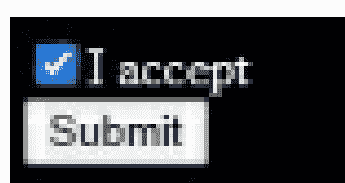
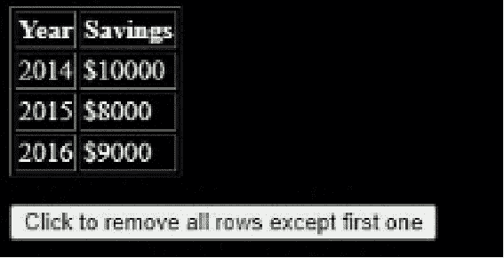
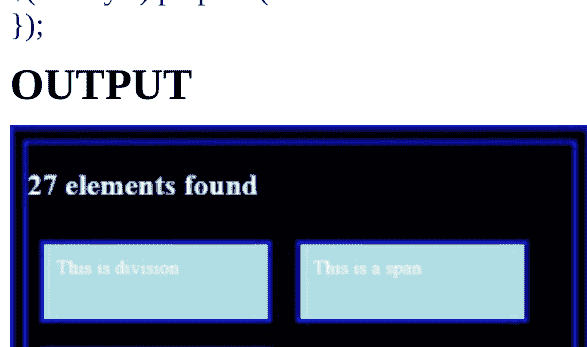
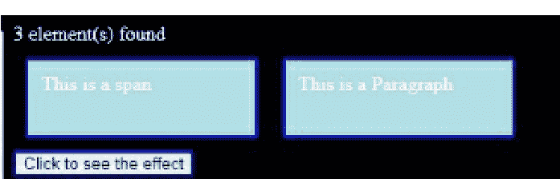

# jQuery 与 JavaScript 编程练习：初学者编码指南


# JQUERY 编程练习


# JQUERY 编程练习

## 检查 jQuery 是否加载

### HTML 代码

```
<!DOCTYPE html>
<html>
<head>
<script src="//code.jquery.com/jquery-1.11.1.min.js"></script>
<meta charset="utf-8">
<title>Test if jQuery is loaded</title>
</head>
<body>
<p>Click me!</p>
</body>
</html>
```

### JAVASCRIPT 代码

```
$("p").bind("click", function(){
  $( "This is a click Event").appendTo( "body" );
});

$("p").bind("dblclick", function(){
  $( "This is a double-click Event" ).appendTo( "body" );
});
```

## 输出

Click me!

This is a click Event

## 滚动到页面顶部

### HTML 代码

```
<!DOCTYPE html>
<html>
<head>
<script src="//code.jquery.com/jquery-1.11.1.min.js"></script>
<meta charset="utf-8">
<title>Scroll to the top of the page with jQuery</title>
</head>
<body>
<p>jquery</p>
<p>jquery</p>
<p>jquery</p>
<p>jquery</p>
<p>jquery</p>
<p>jquery</p>
<p>jquery</p>
<p>jquery</p>
<p>jquery</p>
<p>jquery</p>
<p>jquery</p>
<p>jquery</p>
<p>jquery</p>
<p>jquery</p>
<p>jquery</p>
<p>jquery</p>
<p>jquery</p>
<p>jquery</p>
<p>jquery</p>
<a href='#top'>Go Top</a>
</body>
</html>
```

### JAVASCRIPT 代码

```
$("a[href='#top']").click(function() {
  $("html, body").animate({ scrollTop: 0 }, "slow");
  return false;
});
```

## 禁用右键菜单

### 在 HTML 页面中

### HTML 代码

```
<!DOCTYPE html>
<html>
<head>
<script src="//code.jquery.com/jquery-1.11.1.min.js"></script>
<meta charset="utf-8">
<title>Disable right click menu in html page using jquery</title>
</head>
<body>
</body>
</html>
```

### JAVASCRIPT 代码

```
$(document).bind("contextmenu",function(e){
    return false;
});
```

## 禁用/启用表单提交按钮

### HTML 代码

```
<!DOCTYPE html>
<html>
<head>
<script src="//code.jquery.com/jquery-1.11.1.min.js"></script>
	<meta charset="utf-8">
	<title>Disable/enable the form submit button</title>
</head>
<body>
<input id="accept" name="accept" type="checkbox" value="y"/>I accept<br>
<input id="submitbtn" disabled="disabled" name="Submit" type="submit" value="Submit" />
</body>
</html>
```

### JAVASCRIPT 代码

```
$('#accept').click(function() {
            if ($('#submitbtn').is(':disabled')) {
        $('#submitbtn').removeAttr('disabled');
    } else {
        $('#submitbtn').attr('disabled', 'disabled');
    }
});
```

## 输出



## 使用 jQuery 实现文本闪烁

### HTML 代码

```
<!DOCTYPE html>
<html>
<head>
<script src="//code.jquery.com/jquery-1.11.1.min.js"></script>
<meta charset="utf-8">
<title>Blink text using jQuery</title>
</head>
<body>
<p>jQuery <span class="blink">Exercises</span> and Solution</p>
</body>
</html>
```

### JAVASCRIPT 代码

```
function blink_text() {
    $('.blink').fadeOut(500);
    $('.blink').fadeIn(500);
}
setInterval(blink_text, 1000);
```

## 创建表格效果

### 类似斑马条纹

### HTML 代码

```
<!DOCTYPE html>
<html>
<head>
<script src="//code.jquery.com/jquery-1.11.1.min.js"></script>
<meta charset="utf-8">
<style type="text/css">.table_style {
    width: 500px;
    margin: 0px auto;
}
table{
    width: 100%;
    border-collapse: collapse;
}
table tr td{
    width: 50%;
    border: 1px solid #ff751a;
    padding: 5px;
}
table tr th{
    border: 1px solid #79ff4d;
    padding: 5px;
}
.zebra{
    background-color: #ff0066;
}
</style>
<title>Create a Zebra Stripes table effect</title>
</head>
<body>
<div class="table_style">
<table>
<tr>
<th>Student Name</th>
<th>Marks in Science</th>
</tr>
<tr>
<td>James</td>
<td>85.00</td>
</tr>
<tr>
<td>David</td>
<td>92.00</td>
</tr>
<tr>
<td>Arthur</td>
<td>79.00</td>
</tr>
<tr>
<td>George</td>
<td>82.00</td>
</tr>
</table>
</div>
</body>
</html>
```

### JAVASCRIPT 代码

```
$(document).ready(function(){
    $("tr:odd").addClass("zebra");
});
```

## 输出

| 学生姓名 | 科学成绩 |
|---|---|
| James | 85.00 |
| David | 92.00 |
| Arthur | 79.00 |
| George | 82.00 |

## 使第一个单词加粗

### HTML 代码

```
<!DOCTYPE html>
<html>
<head>
<script src="//code.jquery.com/jquery-1.11.1.min.js"></script>
  <meta charset="utf-8">
  <title>Make first word bold of all elements</title>
</head>
<body>
  <p>PHP Exercises</p>
  <p>Python Exercises</p>
  <p>JavaScript Exercises</p>
  <p>jQuery Exercises</p>
</body>
</html>
```

### JAVASCRIPT 代码

```
$('p').each(function(){
    var pdata = $(this);
    pdata.html( pdata.text().replace(/(^\w+)/,'$1') );
});
```

## 输出

**PHP** Exercises

**Python** Exercises

**JavaScript** Exercises

**jQuery** Exercises

## 为所有单词添加下划线

### HTML 代码

```
<!DOCTYPE html>
<html>
<head>
<script src="https://code.jquery.com/jquery-git.js"></script>
<meta charset="utf-8">
<meta name="viewport" content="width=device-width">
<title>Underline all words of a text through jQuery</title>
</head>
<body>
<p>The best way we learn anything is by practice and exercise questions</p>
</body>
</html>
```

### CSS 代码

```
p span{
    text-decoration: underline;
}
```

### JAVASCRIPT 代码

```
$('p').each(function() {

    var text_words = $(this).text().split(' ');

    $(this).empty().html(function() {

        for (i = 0; i < text_words.length; i++) {
            if (i === 0) {
                $(this).append('<span>' + text_words[i] + '</span>');
            } else {
                $(this).append(' <span>' + text_words[i] + '</span>');
            }
        }
    });
});
```

## 输出

The best way we learn anything is by practice and excercise

## 使用 jQuery 更改按钮文本

### HTML 代码

```
<!DOCTYPE html>
<html>
<head>
<script src="https://code.jquery.com/jquery-git.js"></script>
<meta charset="utf-8">
<meta name="viewport" content="width=device-width">
<title>Change button text using jQuery.</title>
</head>
<body>
<input type='button' value='Cancel' id='button1'>
</body>
</html>
```

### JAVASCRIPT 代码

```
//取消注释以下代码以查看更改。

//$("#button1").prop('value', 'Save');
```

## 使用 jQuery 向下拉列表添加选项

### HTML 代码

```
<!DOCTYPE html>
<html>
<head>
<script src="https://code.jquery.com/jquery-git.js"></script>
<meta charset="utf-8">
<meta name="viewport" content="width=device-width">
<title>Add options to a drop-down list using jQuery.</title>
</head>
<body>
<p>List of Colors :</p>
<select id='myColors'>
<option value="Red">Red</option>
<option value="Green">Green</option>
<option value="White">White</option>
<option value="Black">Black</option>
</select>
</body>
</html>
```

### JAVASCRIPT 代码

```
var myOptions = {
    val1 : 'Blue',
    val2 : 'Orange'
};
var mySelect = $('#myColors');
$.each(myOptions, function(val, text) {
    mySelect.append(
        $('<option></option>').val(val).html(text)
    );
});
```


## 输出

颜色列表：

红色

## 使用 jQuery CSS 属性设置 background-image

### HTML 代码

```html
<!DOCTYPE html>
<html>
<head>
<script src="https://code.jquery.com/jquery-git.js"></script>
<meta charset="utf-8">
<meta name="viewport" content="width=device-width">
<title>使用 jQuery CSS 属性设置 background-image。</title>
</head>
<body>
</body>
</html>
```

### JavaScript 代码

```javascript
$('body').css('background-image',
'url("https://www.htmlresource.com/includes/jquery-images/jquery.gif")');
```

## 输出


## 使用 jQuery 删除除第一行以外的所有表格行

### HTML 代码

```html
<!DOCTYPE html>
<html>
<head>
<script src="https://code.jquery.com/jquery-git.js"></script>
<meta charset="utf-8">
<meta name="viewport" content="width=device-width">
<title>使用 jQuery 删除除第一行以外的所有表格行。</title>
</head>
<body>
<table border="1" id="myTable">
<tr>
<th>年份</th>
<th>储蓄</th>
</tr>
<tr>
<td>2014</td>
<td>$10000</td>
</tr>
<tr>
<td>2015</td>
<td>$8000</td>
</tr>
<tr>
<td>2016</td>
<td>$9000</td>
</tr>
</table>
<p>
<input id="button1" type="button" value="单击删除除第一行以外的所有行"/>
</p>
</body>
</html>
```

### JavaScript 代码

```javascript
$(document).ready(function(){
    $('#button1').click(function(){
        $("#myTable").find("tr:gt(0)").remove();
    });
});
```

## 输出



## 使用 jQuery 禁用链接

### HTML 代码

```html
<!DOCTYPE html>
<html>
<head>
<script src="https://code.jquery.com/jquery-git.js"></script>
<meta charset="utf-8">
<meta name="viewport" content="width=device-width">
<title>使用 jQuery 禁用链接</title>
</head>
<body>
<a href="https://www.htmlresource.com/jquery-exercises/">jQuery 练习、实践、解答</a>
<p></p>
<input id="button1" type="button" value="单击删除链接！" />
</body>
</html>
```

### JavaScript 代码

```javascript
$(document).ready(function(){
    $('#button1').click(function(){
        $("a").removeAttr('href');
    });
});
```

## 输出


## 使用 jQuery 更改 CSS 类

### HTML 代码

```html
<!DOCTYPE html>
<html>
<head>
<script src="https://code.jquery.com/jquery-git.js"></script>
<meta charset="utf-8">
<meta name="viewport" content="width=device-width">
<title>使用 jQuery 更改 CSS 类名。</title>
</head>
<body>
<p id="pid" class="center"> jQuery 练习</p>
<input id="button1" type="button" value="单击更改类" />
</body>
</html>
```

### CSS 代码

```css
p.center {
    text-align: center;
    color: red;
}

p.large {
    font-size: 200%;
}
```

### JavaScript 代码

```javascript
$(document).ready(function(){
  $('#button1').click(function()
  { $('#pid').removeClass('center').addClass('large');
  });
});
```

## 输出


## 设置背景颜色

### HTML 代码

```html
<!DOCTYPE html>
<html>
<head>
<script src="https://code.jquery.com/jquery-git.js"></script>
<meta charset="utf-8">
<meta name="viewport" content="width=device-width">
<title>使用 jQuery 设置以下元素的背景颜色为红色。</title>
<style type="text/css">
button {
display: block;
margin: 20px 0 0 0;
}
</style>
</head>
<body>
<textarea>TutoRIAL</textarea>
<p>jQuery</p>
<span>练习</span>
<button id="button1">单击查看效果</button>
</body>
</html>
```

### JavaScript 代码

```javascript
$('#button1').click(function(){
    $("p").add( "span" ).add("textarea").css( "background", "red" );
});
```

## 将堆栈上的前一组元素添加到当前集合

### HTML 代码

```html
<!DOCTYPE html>
<html>
<head>
<script src="https://code.jquery.com/jquery-git.js"></script>
<meta charset="utf-8">
<meta name="viewport" content="width=device-width">
<title>使用 jQuery 将堆栈上的前一组元素添加到当前集合。</title>
</head>
<body>
<div class="left">
<p><strong><code>addBack()</code> 之前</strong></p>
<div class="before-addback">
<p>JavaScript</p>
<p>jQuery</p>
</div>
</div>
<div class="right">
<p><strong><code>addBack()</code> 之后</strong></p>
<div class="after-addback">
<p>JavaScript</p>
<p>jQuery</p>
</div>
</div>
</body>
</html>
```

### CSS 代码

```css
p, div {
    margin: 5px;
    padding: 5px;
    color: #c03199;
}
.border {
  border: 2px solid #360e9b;
}
.background {
  background: #cdc8b1;
}
.left, .right {
  width: 40%;
  float: left;
}
.right {
  margin-left: 2%;
}
```

### JavaScript 代码

```javascript
$( "div.left, div.right" ).find( "div, div > p" ).addClass( "border" );

// 第一部分
$( "div.before-addback" ).find( "p" ).addClass( "background" );

// 第二部分
$( "div.after-addback" ).find( "p" ).addBack().addClass( "background" );
```

## 为匹配的元素添加指定的类

### HTML 代码

```html
<!DOCTYPE html>
<html>
<head>
<script src="https://code.jquery.com/jquery-git.js"></script>
<meta charset="utf-8">
<meta name="viewport" content="width=device-width">
<title>为匹配的元素添加指定的类。</title>
</head>
<body>
<p>PHP</p>
<p>Java</p>
<p>Python</p>
</body>
</html>
```

### CSS 代码

```css
p {
    margin: 8px;
    font-size: 16px;
}
.h3r_font_color{
    color: red;
}
.h3r_background {
    background: yellow;
}
```

### JavaScript 代码

```javascript
$( "p" ).last().addClass( "h3r_font_color" );
```

## 为匹配的元素添加两个类

### HTML 代码

```html
<!DOCTYPE html>
<html>
<head>
<script src="https://code.jquery.com/jquery-git.js"></script>
<meta charset="utf-8">
<meta name="viewport" content="width=device-width">
<title>为匹配的元素添加两个类。</title>
</head>
<body>
<p>PHP</p>
<p>Java</p>
<p>Python</p>
</body>
</html>
```

### CSS 代码

```css
p {
    margin: 8px;
    font-size: 16px;
}
.h3r_font_color{
    color: blue;
}
.h3r_background {
    background: orange;
}
```

### JavaScript 代码

```javascript
$( "p" ).last().addClass( "w3r_font_color h3r_background " );
```

## 插入一些 HTML

### HTML 代码

```html
<!DOCTYPE html>
<html>
<head>
<script src="https://code.jquery.com/jquery-git.js"></script>
<meta charset="utf-8">
<meta name="viewport" content="width=device-width">
<title>使用 jQuery 在所有段落之后插入一个段落。</title>
<style type="text/css">
button {
display: block;
margin: 20px 0 0 0;
}
</style>
</head>
<body>
<p>jQuery 练习</p>
<button id="button1">单击查看效果</button>
</body>
</html>
```

### CSS 代码

```javascript
$('#button1').click(function(){
    $( "p" ).after( "<b><i>包含解答。</i></b>" );
});
```

### JavaScript 代码

```javascript
$('#button1').click(function(){
    $( "p" ).after( "<b><i>包含解答。</i></b>" );
});
```

## 输出

# jQuery 练习

包含解答。包含解答。包含解答。包含解答。包含解答。包含解答。包含解答。包含解答。包含解答。包含解答。包含解答。包含解答。包含解答。

```
单击查看效果
```

## 统计文档中的每个元素

### HTML 代码

```html
<!DOCTYPE html>
<html>
<head>
<script src="https://code.jquery.com/jquery-git.js"></script>
<meta charset="utf-8">
<meta name="viewport" content="width=device-width">
<title>统计文档中的每个元素（包括 head、body 等）。</title>
</head>
<body>
<div>这是一个 div</div>
<span>这是一个 span</span>
<p>这是一个段落</p>
<button id="button1">单击查看效果</button>
</body>
</html>
```

### CSS 代码

```css
button {
    display: block;
    margin: 20px 0 0 0;
    clear: both
}

div, span, p {
    width: 160px;
    height: 40px;
    float: left;
    padding: 10px;
    margin: 10px;
    background-color: #B0E0E6
}
```

### JavaScript 代码

```javascript
$('#button1').click(function(){
    var elementCount = $( "*" ).css( "border", "3px solid blue" ).length;
    $( "body" ).prepend( "<h2>" + elementCount + " 个元素被找到</h3>" );
});
```

## 输出



## 统计某个 div 内的所有元素

### HTML 代码

```html
<!DOCTYPE html>
<html>
<head>
<script src="https://code.jquery.com/jquery-git.js"></script>
<meta charset="utf-8">
<meta name="viewport" content="width=device-width">
<title>统计某个 div 内的所有元素。</title>
</head>
<body>
<div id="iddiv">
<span>这是一个 span</span>
<p>这是一个段落</p>
<button id="button1">单击查看效果</button>
</div>
</body>
</html>
```

### CSS 代码

```css
button {
    display: block;
    margin: 20px 0 0 0;
    clear: both
}

span, p {
    width: 160px;
    height: 40px;
    float: left;
    padding: 10px;
    margin: 10px;
}
```


### JAVASCRIPT 代码

```javascript
$('#button1').click(function(){

var elementCount = $( "#iddiv" ).find( "*" ).css( "border", "2px solid blue" ).length;

$( "body" ).prepend( "" + elementCount + " element(s) found" );
});
```

## 输出



## 使段落元素动起来

### HTML 代码

```html
<!DOCTYPE html>
<html>
<head>
<script src="https://code.jquery.com/jquery-git.js"></script>
<meta charset="utf-8">
<meta name="viewport" content="width=device-width">
<title>点击按钮使段落元素动起来</title>
</head>
<body>
<p id="pid">jQuery</p>
<button id="button1">点击观看动画</button>
</body>
</html>
```

### CSS 代码

```css
button {
    display: block;
    margin: 20px 0 0 0;
}

p {
    background-color: #B0E0E6;
    width: 70px;
    border: 1px solid red;
}
```

### JAVASCRIPT 代码

```javascript
$('#button1').click(function(){
$( "#pid" ).animate({
    width: "70%",
    opacity: 0.4,
    marginLeft: "0.6in",
    fontSize: "3em",
    borderWidth: "10px"
}, 1500 );
});
```

# JAVASCRIPT 编程练习

## 显示当前日期和时间

### HTML 代码

```html
<!DOCTYPE html>
<html>
<head>
<meta charset="utf-8">
<title>JavaScript 当前日期和时间</title>
</head>
<body></body>
</html>
```

### JAVASCRIPT 代码

```javascript
var today = new Date();
var day = today.getDay();
var daylist = ["Sunday", "Monday", "Tuesday", "Wednesday",
"Thursday", "Friday", "Saturday"];
console.log("Today is : " + daylist[day] + ".");
var hour = today.getHours();
var minute = today.getMinutes();
var second = today.getSeconds();
var prepand = (hour >= 12) ? " PM " : " AM ";
hour = (hour >= 12) ? hour - 12 : hour;
if (hour === 0 && prepand === ' PM ')
{
if (minute === 0 && second === 0)
{
hour = 12;
prepand = ' Noon';
}
else
{
hour = 12;
prepand = ' Midnight';
}
}
else if (hour === 0 && prepand === ' AM ')
{
hour = 12;
prepand = ' AM ';
}
console.log("Current Time : " + hour + prepand + ": " + minute + ": " + second);
```

## 打印当前窗口的内容

### HTML 代码

```html
<!DOCTYPE html>
<html>
<head>
<meta charset=utf-8 />
<title>打印当前页面。</title>
</head>
<body>
<p></p>
<p>点击按钮打印当前页面。</p>
<button onclick="print_current_page()">打印此页面</button>
</body>
</html>
```

### JAVASCRIPT 代码

```javascript
function print_current_page()
{
window.print();
}
```

## 显示当前日期

### HTML 代码

```html
<!DOCTYPE html>
<html>
<head>
<meta charset="utf-8">
<title>编写一个 JavaScript 程序来获取当前日期。</title>
</head>
<body>
</body>
</html>
```

### JAVASCRIPT 代码

```javascript
var today = new Date();
var dd = today.getDate();

var mm = today.getMonth()+1; 
var yyyy = today.getFullYear(); 
if(dd<10)
{
    dd='0'+dd;
} 

if(mm<10)
{
    mm='0'+mm;
} 
today = mm+'-'+dd+'-'+yyyy;
console.log(today);
today = mm+'/'+dd+'/'+yyyy;
console.log(today);
today = dd+'-'+mm+'-'+yyyy;
console.log(today);
today = dd+'/'+mm+'/'+yyyy;
console.log(today);
```

## 计算三角形的面积

### HTML 代码

```html
<!DOCTYPE html>
<html>
<head>
<meta charset=utf-8 />
<title>三角形的面积</title>
</head>
<body>
</body>
</html>
```

### JAVASCRIPT 代码

```javascript
var side1 = 5;
var side2 = 6;
var side3 = 7;
var s = (side1 + side2 + side3)/2;
var area =  Math.sqrt(s*((s-side1)*(s-side2)*(s-side3)));
console.log(area);
```

## 检查给定年份是否是闰年

### HTML 代码

```html
<!DOCTYPE html>
<html>
<head>
<meta charset=utf-8 />
<title>查找闰年</title>
</head>
<body>
</body>
</html>
```

### JAVASCRIPT 代码

```javascript
function leapyear(year)
{
return (year % 100 === 0) ? (year % 400 === 0) : (year % 4 === 0);
}
console.log(leapyear(2016));
console.log(leapyear(2000));
console.log(leapyear(1700));
console.log(leapyear(1800));
console.log(leapyear(100));
```

## 输出

true
true
false
false
false

## 计算两个数字的乘法和除法

### HTML 代码

```html
<!DOCTYPE html>
<html>
<head>
<meta charset=utf-8 />
<title>JavaScript 程序来计算两个数字的乘法和除法</title>
<style type="text/css">
body {margin: 30px;}
</style>
</head>
<body>
<form>
第一个数字 : <input type="text" id="firstNumber" /><br>
第二个数字: <input type="text" id="secondNumber" /><br>
<input type="button" onClick="multiplyBy()" Value="相乘" />
<input type="button" onClick="divideBy()" Value="相除" />
</form>
<p>结果为 : <br>
<span id = "result"></span>
</p>
</body>
</html>
```

### JAVASCRIPT 代码

```javascript
function multiplyBy()
{
    num1 = document.getElementById("firstNumber").value;
    num2 = document.getElementById("secondNumber").value;
    document.getElementById("result").innerHTML = num1 * num2;
}

function divideBy()
{
    num1 = document.getElementById("firstNumber").value;
    num2 = document.getElementById("secondNumber").value;
    document.getElementById("result").innerHTML = num1 / num2;
}
```

## 输出

第一个数字 : [输入框] 第二个数字: [输入框]

[相乘按钮] [相除按钮]

结果为 :

## 在 JAVASCRIPT 中将摄氏度和华氏度相互转换

### HTML 代码

```html
<!DOCTYPE html>
<html>
<head>
<meta charset="utf-8">
<title>编写一个 JavaScript 程序来将摄氏度和华氏度相互转换</title>
</head>
<body>
</body>
</html>
```

### JAVASCRIPT 代码

```javascript
function cToF(celsius)
{
    var cTemp = celsius;
    var cToFahr = cTemp * 9 / 5 + 32;
    var message = cTemp+'\xB0C is ' + cToFahr + ' \xB0F.';
    console.log(message);
}

function fToC(fahrenheit)
{
    var fTemp = fahrenheit;
    var fToCel = (fTemp - 32) * 5 / 9;
    var message = fTemp+'\xB0F is ' + fToCel + ' \xB0C.';
    console.log(message);
}
cToF(60);
fToC(45);
```

## 输出

60°C is 140 °F.

45°F is 7.222222222222222°C.

## 找出三个给定整数中最大的一个

### HTML 代码

```html
<!DOCTYPE html>
<html>
<head>
    <meta charset="utf-8">
    <meta name="viewport" content="width=device-width">
    <title>JavaScript 程序找出三个给定整数中最大的一个。</title>
</head>
<body>

</body>
</html>
```

### JAVASCRIPT 代码

```javascript
function max_of_three(x, y, z)
{
  max_val = 0;
  if (x > y)
  {
    max_val = x;
  } else
  {
    max_val = y;
  }
  if (z > max_val)
  {
    max_val = z;
  }
  return max_val;
}

console.log(max_of_three(1,0,1));
console.log(max_of_three(0,-10,-20));
console.log(max_of_three(1000,510,440));
```

## 输出

1

0

1000

## 反转给定字符串

### HTML 代码

```html
<!DOCTYPE html>
<html>
<head>
    <meta charset="utf-8">
    <meta name="viewport" content="width=device-width">
    <title>JavaScript 程序来反转给定字符串。</title>
</head>
<body>

</body>
</html>
```

### JAVASCRIPT 代码

```javascript
function string_reverse(str)
{
    return str.split("").reverse().join("");
}

console.log(string_reverse("jsresource"));
console.log(string_reverse("www"));
console.log(string_reverse("JavaScript"));
```

## 输出

ecruosersj

www

tpircSavaJ

## 将每个字符替换为字母表中紧跟其后的字符

### HTML 代码

```html
<!DOCTYPE html>
<html>
<head>
	<meta charset="utf-8">
	<meta name="viewport" content="width=device-width">
	<title>JavaScript 程序将给定字符串中的每个字符替换为字母表中紧跟其后的字符。</title>
</head>
<body>

</body>
</html>
```

### JAVASCRIPT 代码

```javascript
function LetterChanges(text) {
//https://goo.gl/R8gn7u
var s = text.split("");
for (var i = 0; i < s.length; i++) {
// 凯撒密码
switch(s[i]) {
case ' ':
break;
case 'z':
s[i] = 'a';
break;
case 'Z':
s[i] = 'A';
break;
```


default:
    s[i] = String.fromCharCode(1 + s[i].charCodeAt(0));
}

// 大写元音字母
switch(s[i]) {
    case 'a': case 'e': case 'i': case 'o': case 'u':
        s[i] = s[i].toUpperCase();
}
}
return s.join('');
}
console.log(LetterChanges("PYTHON"));
console.log(LetterChanges("W3R"));
console.log(LetterChanges("php"));
```

# 输出：

QZUIPO
X4S
qIq

## 将给定字符串中每个单词的首字母大写

### HTML 代码

```
<!DOCTYPE html>
<html>
<head>
	<meta charset="utf-8">
	<meta name="viewport" content="width=device-width">
	<title>JavaScript 程序，用于将给定字符串中每个单词的首字母大写。</title>
</head>
<body>
</body>
</html>
```

### JAVASCRIPT 代码

```
function capital_letter(str)
{
	str = str.split(" ");

	for (var i = 0, x = str.length; i < x; i++) {
		str[i] = str[i][0].toUpperCase() + str[i].substr(1);
	}

	return str.join(" ");
}

console.log(capital_letter("Write a JavaScript program to capitalize the first letter of each word of a given string."));
```

# 输出：

Write A JavaScript Program To Capitalize The First Letter Of Each Word Of A Given String.

## 将数字转换为小时和分钟

### HTML 代码

```
<!DOCTYPE html>
<html>
<head>
    <meta charset="utf-8">
    <meta name="viewport" content="width=device-width">
    <title>JavaScript 程序，用于将给定数字转换为小时和分钟。</title>
</head>
<body>
</body>
</html>
```

### JAVASCRIPT 代码

```
function time_convert(num)
{
    var hours = Math.floor(num / 60);
    var minutes = num % 60;
    return hours + ":" + minutes;
}

console.log(time_convert(71));
console.log(time_convert(450));
console.log(time_convert(1441));
```

# 输出：

1:11

7:30

24:1

## 统计给定字符串中的元音字母数量

### HTML 代码

```
<!DOCTYPE html>
<html>
<head>
    <meta charset="utf-8">
    <meta name="viewport" content="width=device-width">
    <title>JavaScript 程序，用于统计给定字符串中元音字母的数量。</title>
</head>
<body>
</body>
</html>
```

### JAVASCRIPT 代码

```
function vowel_Count(str)
{
    return str.replace(/[^aeiou]/g, "").length;
}

console.log(vowel_Count("Python"));
console.log(vowel_Count("htmlresource.com"));
```

# 输出：

1

5

## 创建新字符串

### HTML 代码

```
<!DOCTYPE html>
<html>
<head>
    <meta charset="utf-8">
    <meta name="viewport" content="width=device-width">
    <title>JavaScript 程序，用于创建一个不包含首尾字符的新字符串。</title>
</head>
<body>
</body>
</html>
```

### JAVASCRIPT 代码

```
function without_first_end(str) {
    return str.substring(1, str.length - 1);
}
console.log(without_first_end('JavaScript'));
console.log(without_first_end('JS'));
console.log(without_first_end('PHP'));
```

### 输出：

avaScrip

H

## 连接两个字符串

### 但不包括它们的第一个字符

### HTML 代码

```
<!DOCTYPE html>
<html>
<head>
    <meta charset="utf-8">
    <meta name="viewport" content="width=device-width">
    <title>JavaScript 程序，用于连接两个字符串，但不包括它们的第一个字符。</title>
</head>
<body>
</body>
</html>
```

### JAVASCRIPT 代码

```
function concatenate(str1, str2) {
    str1 = str1.substring(1, str1.length);
    str2 = str2.substring(1, str2.length);
    return str1 + str2;
}

console.log(concatenate("PHP","JS"));
console.log(concatenate("A","B"));
console.log(concatenate("AA","BB"));
```

# 输出：

HPS

AB

## BB

## 将指定字符串的最后三个字符移到开头

### HTML 代码

```
<!DOCTYPE html>
<html>
<head>
    <meta charset="utf-8">
    <meta name="viewport" content="width=device-width">
    <title>JavaScript 程序，用于将给定字符串的最后三个字符移到开头。字符串长度必须为 3。</title>
</head>
<body>
</body>
</html>
```

### JAVASCRIPT 代码

```
function right_three(str) {
    if (str.length > 1)
    {
        return str.slice(-3) + str.slice(0, -3);
    }
    return str;
}
console.log(right_three("Python"));
console.log(right_three("JavaScript"));
console.log(right_three("Hi"));
```

# 输出：

honPyt
iptJavaScr

Hi

## 计算总和

### 给定长度为 3 的整数数组中三个元素的和

### HTML 代码

```
<!DOCTYPE html>
<html>
<head>
	<meta charset="utf-8">
	<meta name="viewport" content="width=device-width">
	<title>JavaScript 程序，用于计算给定长度为 3 的整数数组中三个元素的和。</title>
</head>
<body>
</body>
</html>
```

### JAVASCRIPT 代码

```
function sum_three(nums)
{
	return nums[0] + nums[1] + nums[2];
}

console.log(sum_three([10, 32, 20]));
console.log(sum_three([5, 7, 9]));
console.log(sum_three([0, 8, -11]));
```

# 输出：

62

21

-3

## 将两位数的正整数相加

### HTML 代码

```
<!DOCTYPE html>
<html>
<head>
  <meta charset="utf-8">
  <meta name="viewport" content="width=device-width">
  <title>JavaScript 程序，用于将一个两位数的给定正整数的两位数字相加。</title>
</head>
<body>
</body>
</html>
```

### JAVASCRIPT 代码

```
function add_two_digits(n)
{
  return n % 10 + Math.floor(n / 10);
}
console.log(add_two_digits(25))
console.log(add_two_digits(50))
```

# 输出：

7
5

## 检查给定年份是否为闰年

### HTML 代码

```
<!DOCTYPE html>
<html>
<head>
<meta charset=utf-8 />
<title>查找闰年</title>
</head>
<body>
</body>
</html>
```

### JAVASCRIPT 代码

```
function leapyear(year)
{
return (year % 100 === 0) ? (year % 400 === 0) : (year % 4 === 0);
}
console.log(leapyear(2016));
console.log(leapyear(2000));
console.log(leapyear(1700));
console.log(leapyear(1800));
console.log(leapyear(100));
```

## 输出

true
true
false
false
false

## 检查给定的正数

### 是否为 3 的倍数或 7 的倍数

### HTML 代码

```
<!DOCTYPE html>
<html>
<head>
  <meta charset="utf-8">
  <meta name="viewport" content="width=device-width">
  <title>JavaScript 程序，用于检查给定的正数是否是 3 的倍数或 7 的倍数。</title>
</head>
<body>
</body>
</html>
```

### JAVASCRIPT 代码

```
function test37(x)
{
  if (x % 3 == 0 || x % 7 == 0)
  {
    return true;
  }
  else {
    return false;
  }
}

console.log(test37(12));
console.log(test37(14));
console.log(test37(10));
console.log(test37(11));
```

# 输出：

true

true

false

false

## 检查字符串是否以 'Java' 开头

### 否则返回 false

### HTML 代码

```
<!DOCTYPE html>
<html>
<head>
<meta charset="utf-8">
<meta name="viewport" content="width=device-width">
<title>JavaScript 程序，用于检查字符串是否以 'Java' 开头，否则返回 false。</title>
</head>
<body>
</body>
</html>
```

### JAVASCRIPT 代码

```
function start_spec_str(str)
{
  if (str.length < 4)
  {
    return false;
  }
  front = str.substring(0, 4);
  if (front == 'Java')
  {
    return true;
  }
  else
  {
    return false;
  }
}

console.log(start_spec_str("JavaScript"));
console.log(start_spec_str("Java"));
console.log(start_spec_str("Python"));
```

# 输出：

true
true
false

## 检查两个给定的整数值

### 是否在 50..99 的范围内

### HTML 代码

```
<!DOCTYPE html>
<html>
<head>
    <meta charset="utf-8">
    <meta name="viewport" content="width=device-width">
    <title>JavaScript 程序，用于检查两个给定的整数值是否在 50..99 的范围内（包含）。如果任一值在该范围内，则返回 true。</title>
</head>
<body>
</body>
</html>
```

### JAVASCRIPT 代码

```
function check_numbers(x, y)
{
    if ((x >= 50 && x <= 99) || (y >= 50 && y <= 99))
    {
        return true;
    }
    else
    {
        return false;
    }
}

console.log(check_numbers(12, 101));
console.log(check_numbers(52, 80));
console.log(check_numbers(15, 99));
```

## 输出

false
true
true

## 找到最接近 100 的值

### HTML 代码

```
<!DOCTYPE html>
<html>
<head>
    <meta charset="utf-8">
    <meta name="viewport" content="width=device-width">
    <title>JavaScript 程序，用于从两个不同的给定整数值中找出最接近 100 的值。</title>
</head>
<body>
</body>
</html>
```

### JAVASCRIPT 代码

```
function near_100(x, y) {
    if (x != y)
    {
        x1 = Math.abs(x - 100);
        y1 = Math.abs(y - 100);

        if (x1 < y1)
        {
            return x;
        }
        if (y1 < x1)
        {
            return y;
        }
        return 0;
    }
    else
        return false;
}
```

```
console.log(near_100(90, 89));
console.log(near_100(-90, -89));
console.log(near_100(90, 90));
```

# 输出：

90

-89

false
