# jQuery 和 JavaScript 24小时入门


# 关于作者

**布拉德·戴利**是一位拥有超过20年企业应用程序开发经验的资深软件工程师。他广泛使用 HTML/CSS、JavaScript 和 jQuery 开发了各种网页，从企业应用界面到复杂的富互联网应用，再到移动网络服务的智能界面。他是 *《Python 速查手册》* 和 *《jQuery 和 JavaScript 速查手册》* 的作者。

## 致谢

我借此机会感谢所有使本书得以出版的人。首先，感谢我可爱的妻子和孩子们给予我的灵感和支持。没有你们，我无法走这么远。

感谢马克·泰伯让本书步入正轨，感谢拉塞尔·克洛普弗通过技术审阅确保我的准确性，感谢芭芭拉·哈查将我脑海中的技术随笔整理成精良的文本，以及托尼亚·辛普森管理生产端的一切并确保书籍达到最佳品质。

## 我们希望听到您的声音！

作为本书的读者，*您*是最重要的评论家和评述者。我们重视您的意见，并希望了解我们哪些做得好，哪些可以改进，您希望看到我们在哪些领域出版，以及您愿意分享的任何其他智慧之言。

我们欢迎您的评论。您可以通过电子邮件或写信告诉我们您喜欢或不喜欢本书的哪些方面，以及我们如何改进书籍。

*请注意，我们无法为您提供与本书主题相关的技术问题的帮助。*

写信时，请务必包含本书的标题和作者，以及您的姓名和电子邮件地址。我们将仔细审查您的评论，并与参与本书工作的作者和编辑分享。

**电子邮件：** feedback@sams publishing.com

**邮寄地址：** Sams Publishing
收件人：读者反馈部
800 East 96th Street
Indianapolis, IN 46240 USA

## 读者服务

访问我们的网站并在 informit.com/register 注册本书，以便方便地获取本书可能的任何更新、下载或勘误信息。

## 引言

如今，随着数十亿人使用互联网，一个快速增长的趋势是用具有丰富交互元素的单页面应用来取代传统网站（页面通过链接跳转到其他页面）。主要原因在于用户对点击、等待以及在网页间来回导航变得越来越不耐烦。相反，他们希望网站的行为更像他们在电脑和移动设备上习惯使用的应用程序。

事实上，仅仅在未来24小时内，数百万个新网页将被添加到互联网。这些页面中的大多数将使用 HTML 编写，使用 CSS 来设置元素样式，并使用 JavaScript 来提供用户与后端服务之间的交互。

当您完成本书中的24个一小时课程时，您将获得关于如何将 JavaScript 与强大的 jQuery 库结合使用，从而在网页中提供丰富用户交互的实用理解。您将获得宝贵的技能，包括添加允许网页即时响应鼠标点击和手指滑动的动态代码、与后端服务交互以在 Web 服务器上存储和检索数据，以及创建健壮的互联网应用程序。

本书的每一小时都提供了创建专业 Web 应用程序所需的基础知识。本书包含一些关于使用 HTML 和 CSS 的基础知识，即使您以前从未使用过它们，也能帮助您入门。您将获得可以实施和扩展的代码示例，随着理解的加深。事实上，仅在本书的第一课中，您就可以使用 jQuery 和 JavaScript 创建一个动态网页。

所以，请拉把椅子坐下来，享受使用 jQuery 和 JavaScript 编程富互联网应用的旅程吧。

## 超越 jQuery 和 JavaScript

本书涵盖的内容远超 jQuery 和 JavaScript，因为要创建真正有用的 Web 应用程序，您需要了解的不仅仅是语言结构。本书的目标是在24个简短而轻松的课程中，为您提供创建功能齐全且交互式的 Web 应用程序所需的基本技能。本书涵盖以下关键技能和技术：

HTML 是创建网页的最新推荐标准。本书中的每个示例都是经过验证的 HTML5，即最新推荐版本。

CSS 是格式化网页元素的标准方法。您不仅将学习如何编写 CSS 和 CSS3，还将学习如何使用 jQuery 和 JavaScript 动态修改它。

JavaScript 是在网页中提供交互性的最佳方法，无需从服务器加载新页面。这是大多数优秀 Web 应用程序构建的标准语言。

jQuery、jQueryUI 和 jQueryMobile 是一些最受欢迎且功能强大的 JavaScript 库。jQuery 提供了对网页元素的非常快速的访问，以及一套用于 Web 应用程序交互的强大功能。jQuery 还提供了额外的 UI 和移动库，为传统 Web 应用程序以及移动 Web 应用程序提供丰富的 UI 组件。

AJAX 是 Web 应用程序与 Web 服务器和其他服务交互的标准方法。本书包含多个使用 AJAX 与 Web 服务器、Google、Facebook 和其他流行 Web 服务交互的示例。

## 代码示例

本书中的大多数示例包含以下元素：

- **HTML 代码**—在浏览器中提供网页框架所必需的代码。
- **CSS 代码**—正确设置网页元素样式所必需的代码。
- **JavaScript 代码**—包括提供用户、网页元素和 Web 服务之间交互的 jQuery 和 JavaScript 代码。
- **图**—大多数示例包含一个或多个图，说明代码在浏览器中的行为。

本书中的示例都是基础性的，以便于您学习和实施。其中许多可以扩展并用于您自己的网页。事实上，每小时结束时的一些练习要求您对示例进行扩展。

本书中的所有示例都已针对最新版本的主要网页浏览器（包括 Google Chrome、Microsoft Internet Explorer 和 Mozilla Firefox）进行了兼容性测试。

## 特别元素

当您完成每节课时，页边注可帮助您立即将刚学到的内容应用到自己的网页中。

每当使用新术语时，都会清楚地解释。无需来回翻阅术语表！

> **提示**

提示和技巧可节省您宝贵的时间，它们单独列在“提示”部分，以便您快速识别。

> **注意**

注释突出了您应该确保不要错过的有趣信息。

> **警告**

当有需要您注意的事情时，您将在“警告”中得到提醒。

## 问答、测验和练习

每小时结束时都有一个简短的问答环节，讨论每个人都想知道的“愚蠢问题”。一个简短但完整的测验让您测试自己，以确保理解了该小时介绍的所有内容。最后，一两个可选的练习让您有机会在继续学习之前练习新技能。

# 第1小时
## 动态 Web 编程入门

**本小时您将学到：**

- 为创建动态网页做准备
- 创建支持 jQuery 和 JavaScript 的开发环境
- 向网页添加 JavaScript 和 jQuery
- 构建支持 jQuery 和 JavaScript 的网页
- 使用 jQuery 和 JavaScript 创建您的第一个动态网页

JavaScript 及其增强版 jQuery 在创建富交互性网页和基于 Web 的应用程序方面彻底改变了游戏规则。长期以来，JavaScript 一直是创建动态网页的关键组件。现在，随着 jQuery、jQuery UI 和 jQuery Mobile 库的进步，Web 开发已永远改变。

本小时将带您快速了解 jQuery 和 JavaScript 开发的世界。最好的起点是确保您理解您将在其中进行操作的动态 Web 开发环境。要在 JavaScript 和 jQuery 方面发挥作用，您需要相当好地理解 Web 服务器和 Web 浏览器之间的交互，以及 HTML 和 CSS。

本小时包含几个部分，简要概述了 Web 服务器和浏览器交互以及涉及的技术。本小时的其余部分致力于设置和配置支持 jQuery 和 JavaScript 的开发环境。最后，您将编写包含 JavaScript 和 jQuery 代码的第一个网页。

### 理解 Web 服务器/浏览器范式

JavaScript 和 jQuery 与 Web 服务器和浏览器之间通信涉及的每个主要组件进行交互。为了帮助您更好地理解这种交互，本节提供了 Web 服务器和浏览器交互中涉及的概念和技术的高层概览，以及相关技术。

### 查看 Web 服务器与浏览器的通信术语

万维网的基本概念你应该非常熟悉：在网页浏览器中输入或点击一个地址，信息就会以可用的形式加载。浏览器发送请求，服务器发送响应，然后浏览器将其展示给用户。

尽管概念很简单，但背后必须经历几个步骤。接下来的章节将定义涉及的组件、它们之间的交互方式，以及 JavaScript 和 jQuery 在其中的作用。

## Web 服务器

Web 服务器是万维网最关键的组件。没有它，数据将无法获取。Web 服务器响应来自浏览器的请求，并提供数据供浏览器显示。然而，Web 服务器上会发生很多事情。例如，Web 服务器及其组件会检查请求的格式和有效性。它们还可能检查安全性，以验证请求是否来自允许的用户。然后，为了构建响应，服务器可能会与多个组件甚至其他远程服务器交互，以获取必要的数据。

#### 浏览器

下一个最重要的组件是浏览器。浏览器向 Web 服务器发送请求，然后为用户显示结果。浏览器内部也发生很多事情。浏览器必须解析来自服务器的响应，然后确定如何将其呈现给用户。

虽然有多种浏览器可用，但最受欢迎的三种是 Firefox、Internet Explorer 和 Chrome。在大多数情况下，每个浏览器在显示网页时行为相同；然而，偶尔会存在一些差异，你需要在希望支持的每个浏览器中仔细测试你的 JavaScript 和 jQuery 脚本。

JavaScript 和 jQuery 可以在浏览器接收到响应和最终为用户渲染输出之间发生的交互中发挥很大作用。这些脚本可以更改从服务器返回的数据的格式、内容、外观和行为。接下来的章节描述了浏览器提供的关键部分。

#### DOM

浏览器通过创建文档对象模型（Document Object Model，即 DOM）来渲染网页。DOM 是一个树状结构，HTML 文档是根对象。根对象可以有多个子对象，而这些子对象又可以有多个子对象。例如，一个包含列表的网页会有一个根对象，以及一个包含多个列表元素子对象的列表子对象。

以下显示了一个简单 DOM 树的示例，该网页包含一个标题和一个包含三个城市的列表：

```
document
  + html
    + body
      + h1
        + text = "City List"
      + ul
        + li
          + text = "New York, US"
        + li
          + text = "Paris, FR"
        + li
          + text = "London, EN"
```

浏览器知道如何显示 DOM 中的每个节点，并通过读取每个节点并在浏览器窗口中绘制相应的像素来渲染网页。正如你稍后将了解到的，*JavaScript 和 jQuery 使你能够直接与 DOM 交互，读取每个对象、更改这些对象，甚至删除和添加对象。*

#### 浏览器事件

浏览器会跟踪多个对 jQuery 和 JavaScript 程序至关重要的事件——例如，页面加载时、离开页面时、按下键盘时、鼠标移动和点击时。这些事件对 JavaScript 可用，允许你根据事件的发生和发生位置来执行相应功能。

#### 浏览器窗口

浏览器还提供对浏览器窗口本身的有限访问。这允许你使用 JavaScript 来确定浏览器窗口的显示大小以及其他重要信息，从而决定你的脚本将执行什么操作。

#### URL

浏览器能够使用统一资源定位符（Uniform Resource Locator，即 URL）访问 Web 服务器上的文件。URL 是一个完全唯一的地址，用于访问 Web 服务器上的数据，它将 URL 链接到特定的文件或资源。Web 服务器知道如何解析 URL，以确定使用哪个文件/资源来构建响应。在某些情况下，你可能需要使用 JavaScript 来解析和构建 URL，尤其是在动态链接到其他网页时。

#### HTML/HTML5

超文本标记语言（Hypertext Markup Language，即 HTML）提供了网页的基本构建块。HTML 定义了一组元素，用于表示放置在网页上的内容。每个元素都包含在一对标签中，语法如下：

```
<tag>content</tag>
```

例如：`<p>This is an HTML paragraph.</p>`。

Web 浏览器知道如何以适当的方式渲染每个标签的内容。例如，标签 `<p>` 用于表示段落。实际显示在屏幕上的文本是 `<p>` 开始标签和 `</p>` 结束标签之间的文本。

网页的格式、外观和风格由 HTML 文件中包含的标签的放置方式和类型决定。浏览器读取标签，然后按照定义将内容渲染到屏幕上。

HTML5 是 HTML 语言的下一代版本，它包含了更多媒体元素，如音频和视频。它还提供了丰富的矢量图形标签选择，允许你使用 JavaScript 直接在网页上绘制清晰锐利的图像。

**清单 1.1 一个简单的 HTML 文档，展示了在浏览器中呈现列表所需的 HTML 代码**

```
01 <!DOCTYPE html>
02 <html>
03   <head>
04     <title>Cities</title>
05     <meta http-equiv="content-type" content="text/html; charset=utf-8" />
06   </head>
07   <body>
08     <ul>
09       <li>New York, US</li>
10       <li>Paris, FR</li>
11       <li>Rome, IT</li>
12       <li>London, EN</li>
13     </ul>
14   </body>
15 </html>
```

**图 1.1**
使用清单 1.1 中的代码在浏览器中渲染的城市列表。

#### CSS

网页面临的挑战之一是让它们看起来专业而美观。浏览器默认提供的通用外观虽然可用，但与当今互联网用户所期望的时尚性感、赏心悦目的视觉效果相去甚远。

层叠样式表（Cascading Style Sheets，即 CSS）提供了一种简便的方式来定义浏览器如何渲染 HTML 元素。CSS 可用于定义网页的布局以及单个元素的外观和风格。为了说明这一点，我在清单 1.1 的示例中添加了一些 CSS 代码。清单 1.2 使用 CSS 修改了第 07 至 13 行的多个属性。这些属性改变了文本对齐方式、字体样式，并将列表项目符号从点更改为飞机图像。注意图 1.2 中 CSS 样式如何改变了列表的渲染效果。

**清单 1.2 在 `<STYLE>` 元素中包含一些 CSS 代码以改变列表外观的 HTML**

```
01 <!DOCTYPE html>
02 <html>
03   <head>
04     <meta http-equiv="content-type" content="text/html; charset=utf-8" />
05     <style>
06       li {
07         text-align: center;
08         font-family: "Times New Roman", Times, serif;
09         font-size: 30px;
10         font-style: italic;
11         font-weight: bold;
12         list-style-type: none;
13         list-style-image: url('images/air.png');
14       }
15     </style>
16   </head>
17   <body>
18     <ul>
19       <li>New York, US</li>
20       <li>Paris, FR</li>
21       <li>Rome, IT</li>
22       <li>London, EN</li>
23     </ul>
24   </body>
25 </html>
```

**图 1.2**
CSS 代码显著改变了浏览器中列表的外观。

#### HTTP/HTTPS 协议

超文本传输协议（Hypertext Transfer Protocol，即 HTTP）定义了浏览器和 Web 服务器之间的通信。它定义了可以发出的请求类型、这些请求的格式以及 HTTP 响应。

安全套接字层超文本传输协议（Hypertext Transfer Protocol with Secure Sockets Layer，即 HTTPS）添加了一个额外的安全层 SSL/TLS，以确保连接安全。当 Web 浏览器通过 HTTPS 连接到 Web 服务器时，会向浏览器提供一个证书。然后用户能够决定是否接受该证书。没有证书，Web 服务器将不会响应用户的请求，从而确保请求来自安全的来源。

接下来的章节将简要讨论 HTTP 头以及两种最常见的 HTTP 请求类型：GET 和 PUT。

##### HTTP 头

HTTP 头允许浏览器定义向服务器发出的请求的行为和格式，以及返回给 Web 浏览器的响应的行为和格式。HTTP 头作为 HTTP 请求和响应的一部分发送。你可以从 JavaScript 向 Web 服务器发送 HTTP 请求，因此你需要至少了解一点所需头的信息。

Web 服务器读取请求头，并使用它们来确定如何为浏览器构建响应。作为响应的一部分，Web 服务器包含响应头，告诉浏览器如何处理响应中的数据。浏览器首先读取头，并在处理响应和渲染页面时使用头值。

以下是一些更常见的头：

- ACCEPT—定义响应中可接受的内容类型。


##### 授权—用于认证请求用户的认证凭据。

COOKIE—服务器请求在浏览器中先前设置的 Cookie 值。Cookie 是存储在客户端上的键/值对。它们可以通过服务器请求或 JavaScript 代码设置，并作为浏览器 HTTP 请求的一部分发送回服务器。

SET-COOKIE—来自服务器的 Cookie 值，如果启用了 Cookie，浏览器应将其存储。

CONTENT-TYPE—Web 服务器响应中包含的内容类型。例如，对于文本，此字段可能为 `text/plain`；对于 `.png` 图形，可能为 `image/png`。

CONTENT-LENGTH—请求或响应正文中包含的数据量。

**HTTP 请求和响应中使用了更多的头部字段**，但上述列表应能让你很好地了解它们的使用方式。

##### GET 请求

最常见的 HTTP 请求类型是 GET 请求。**GET 请求通常用于从 Web 服务器检索信息**—例如，加载网页或检索要在网页上显示的图像。要检索的文件由浏览器中输入的 URL 指定，例如：
`http://www.dayleycreations.com/tutorials.html`

**GET 请求完全由头部组成，没有正文数据。但是，可以使用查询字符串在 GET 请求中向服务器传递数据。查询字符串作为 URL 的一部分发送到 Web 服务器。** 查询字符串的格式是在 URL 后指定一个 `?` 字符，然后包含一个或多个用 `&` 字符分隔的键/值对，语法如下：
`URL?key=value&key=value&key=value...`

例如，以下 URL 包含一个查询字符串，该字符串指定了一个参数 *gallery*，其值为 *01*，这些将发送到服务器：
`http://www.dayleycreations.com/gallery.html?gallery=01`

##### POST 请求

POST 请求与 GET 请求的不同之处在于没有查询字符串。相反，**需要发送到 Web 服务器的任何数据都被编码到请求的正文中。** POST 请求通常用于改变 Web 服务器上数据状态的请求。例如，添加新用户的 Web 表单会将输入到表单中的信息作为 POST 请求正文的一部分发送到服务器。

### Web 服务器与客户端脚本

最初，网页是静态的，这意味着由浏览器渲染的文件与存储在服务器上的文件完全相同，如图 1.3 所示。问题是，当您尝试构建具有用户交互、丰富元素和大量数据的现代网站时，支持不同静态页面所需的网页数量急剧增加。

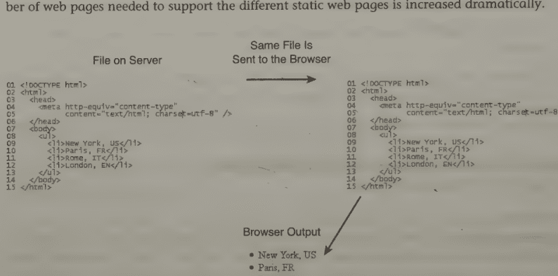

图 1.3
对于静态页面，位于 Web 服务器上的同一页面被发送到浏览器并直接渲染。

与其创建一个充满静态 HTML 文件的 Web 服务器，不如使用脚本，这些脚本使用来自 Web 服务器的数据，并动态构建在浏览器中渲染的 HTML。

这些脚本可以在服务器上运行，也可以在客户端浏览器中运行。以下部分将讨论每种方法。大多数现代网站都结合使用服务器端和客户端脚本。

#### 服务器端脚本

服务器端脚本是在将服务器数据发送回浏览器之前，将其格式化为 HTML 响应的过程。服务器端脚本的主要优点是数据处理完全在服务器端完成，原始数据永远不会通过 Internet 传输；此外，问题和数据修复可以在服务器处理过程中本地完成。缺点是它需要更多的服务器端处理，这可能会降低某些应用程序的可伸缩性。清单 1.3 显示了一个简单的服务器端 PHP 脚本，该脚本在将 HTML 文档发送到浏览器之前动态地将城市列表添加到其中。

图 1.4 展示了一个简单的 PHP 服务器端脚本示例。注意，位于服务器上的文件与发送到浏览器的文件不同，但发送到浏览器的内容才是被渲染的。

##### 清单 1.3 在服务器上运行的 PHP 脚本填充城市列表项

```
01 <!DOCTYPE html>
02 <html>
03  <head>
04   <meta http-equiv="content-type" content="text/html; charset=utf-8" />
05  </head>
06  <body>
07   <ul>
08    <?php
09     $cities = array("New York, US", "Paris, FR", "Rome, IT", "London, EN");
10     foreach ($cities as $city) {
11       echo "<li>$city</li>";
12     }
13    ?>
14   </ul>
15  </body>
16 </html>
```

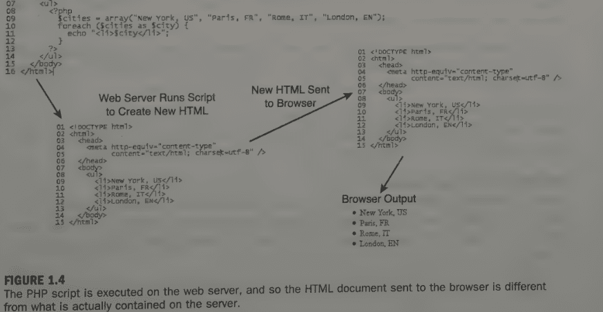

##### 图 1.4

PHP 脚本在 Web 服务器上执行，因此发送到浏览器的 HTML 文档与服务器上实际包含的内容不同。

#### 客户端脚本

**客户端脚本**是随网页一起发送代码的过程。该代码在网页加载期间或加载完成后执行。

客户端脚本有几个很大的优势。其一是数据处理在客户端完成，这使得应用程序更容易扩展以支持大量用户。其二是浏览器事件通常可以在本地处理，无需向服务器发送请求。这使得界面能够更快地响应用户交互。

JavaScript 和 jQuery 是目前为止最常见的客户端脚本形式。在本书中，你将了解为什么会是这种情况。

#### 什么是 JavaScript？

JavaScript 是一种编程语言，与其他语言很相似。JavaScript 与其他编程语言最大的不同之处在于，浏览器内置了解释器，可以解析和执行该语言。这意味着你可以编写能够直接访问浏览器和 DOM 的复杂应用程序。

**访问 DOM** 意味着你可以在不重新加载网页的情况下添加、修改或删除元素。访问浏览器让你能够访问诸如鼠标移动和点击之类的事件。这就是 JavaScript 能够提供动态列表和拖放等功能的能力所在。

#### 什么是 jQuery？

**jQuery** 是一个基于 JavaScript 构建的库。其底层代码是 JavaScript；然而，jQuery 将许多 JavaScript 代码简化为易于使用的功能。使用 jQuery 的两个主要优势是选择器和内置函数。

选择器提供了对网页上特定元素（如列表或表格）的快速访问。它们还提供了对元素组的访问，例如所有段落或所有具有特定类的段落。这使你可以快速轻松地访问特定的 DOM 元素。

jQuery 还提供了一套丰富的内置功能，让你能够用更少的代码完成更多工作。例如，诸如在屏幕上隐藏元素或动画调整元素大小之类的任务，只需一行代码即可完成。

#### 客户端脚本示例

清单 1.4 显示了一个简单的 JavaScript 客户端脚本示例。图 1.5 图示了 Web 服务器和浏览器之间的数据流。注意，这次位于服务器上的文件与发送到浏览器的文件相同，但 JavaScript 更改了浏览器中加载的 HTML。

##### 清单 1.4 一个简单的 JavaScript 客户端脚本，在浏览器中运行以填充城市列表项

```
01 <!DOCTYPE html>
02 <html>
03   <head>
04     <meta http-equiv="content-type" content="text/html; charset=utf-8" />
05     <script>
06         function loadCities(){
07             var cities = ["New York, US", "Paris, FR", "Rome, IT", "London, EN"];
08             var ulElement = document.getElementById("cityList");
09             for (var city in cities){
10                 var listItem = ulElement.appendChild(document.createElement("li"));
11                 listItem.appendChild(document.createTextNode(cities[city]));
12             }
13         }
14     </script>
15   </head>
16   <body onload="loadCities()">
17     <ul id="cityList">
18     </ul>
19   </body>
20 </html>
```

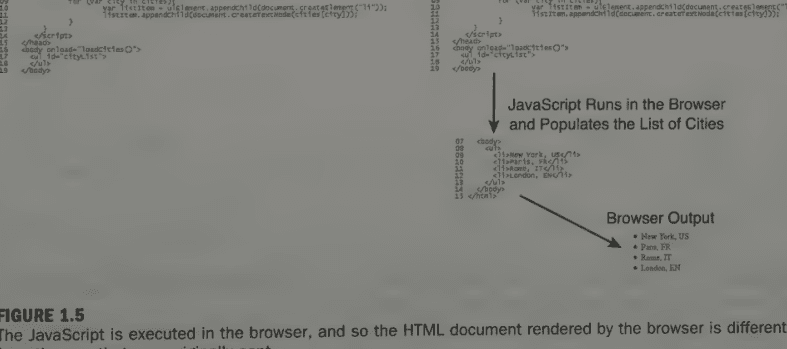

**图 1.5** JavaScript 在浏览器中执行，因此浏览器渲染的 HTML 文档与最初发送的不同。


#### AJAX

异步 JavaScript 和 XML，或称 AJAX，是指网页加载后，使用 JavaScript 继续与 Web 服务器通信的过程。AJAX 减少了用户交互时重新加载网页或加载其他网页的需要。这减少了初始 Web 服务器响应需要发送的数据量，也使网页更具交互性。

AJAX 的一个简单示例，我编写了两个脚本——清单 1.5 和清单 1.6。清单 1.5 是一个包含 JavaScript 的 HTML 文档，该脚本在页面加载后在客户端运行。该 JavaScript 向服务器发出一个 AJAX 请求，通过一个服务器端 PHP 脚本（如清单 1.6 所示）来检索城市列表。然后，返回的城市列表被用于填充 HTML 列表元素中的项目。

**清单 1.5** 一个简单的 JavaScript 客户端脚本，执行对服务器的 AJAX 请求以检索城市列表，用于构建 HTML 列表元素

```html
01 <!DOCTYPE html>
02 <html>
03   <head>
04     <meta http-equiv="content-type" content="text/html; charset=utf-8" />
05     <script>
06       var xmlhttp = new XMLHttpRequest();
07       function loadCities(){
08         xmlhttp.open("GET","php/hour01_06.php",false);
09         xmlhttp.send();
10         var cities = JSON.parse( xmlhttp.responseText );
11         var ulElement = document.getElementById("cityList");
12         for (var city in cities){
13           var listItem = ulElement.appendChild(document.createElement("li"));
14           listItem.appendChild(document.createTextNode(cities[city]));
15         }
16       }
17     </script>
18   </head>
19   <body onload="loadCities()">
20     <ul id="cityList"></ul>
21   </body>
22 </html>
```

**清单 1.6** 一个服务器端 PHP 脚本，返回一个简单的 JSON 字符串，可被清单 1.5 中的 JavaScript 解析和使用

```php
1 <?php
2   echo '["New York, US", "Paris, FR", "Rome, IT", "London, EN"]';
3 ?>
```

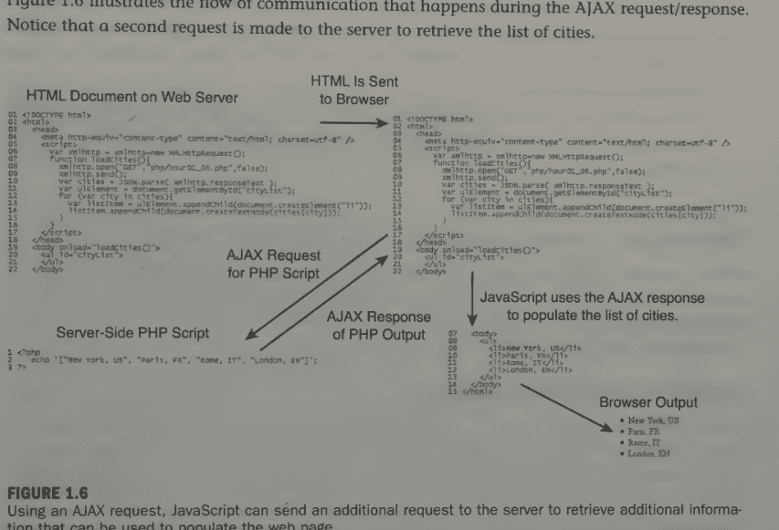

**图 1.6**

通过使用 AJAX 请求，JavaScript 可以向服务器发送额外的请求，以检索可用于填充网页的附加信息。

## 准备编写 jQuery 和 JavaScript

简要介绍了动态 Web 编程之后，现在该进入正题，准备好你的开发环境来编写 jQuery 和 JavaScript。

开发环境在编写 jQuery 和 JavaScript 项目时至关重要。开发环境应具备以下特点：

-   易于使用的 IDE——IDE 提供文本编辑器，允许你以最简单的方式修改代码。选择一个你感觉舒适、可扩展以支持 HTML、CSS、JavaScript 和 jQuery 的 IDE。
-   开发 Web 服务器——你不应该直接在生产 Web 服务器上开发（尽管我们大多数人或多或少都做过）。测试脚本和交互需要 Web 服务器。
-   开发 Web 浏览器——同样，你最初应该针对你最熟悉或最常用的浏览器进行开发。你需要启用浏览器的调试工具，以帮助你查找和修复脚本中的问题。
-   结构良好的项目——为项目的增长构建好项目、目录和文件名结构。重构一个包含大量文件和目录的 Web 项目是一个困难的过程。过多的文件或混乱的文件名会使项目臃肿且难以管理。

### 设置 Web 开发环境

设置 Web 开发环境需要三个步骤。首先，安装一个 IDE，它将提供创建和编辑代码的工具。其次，在你的 Web 浏览器中添加并启用 JavaScript 调试工具。第三，设置一个开发 Web 服务器，以便你可以在其中测试你的脚本。以下各节将引导你完成每项任务。

#### 安装 Web 开发 IDE

在使用 JavaScript 开发时，IDE 是最重要的方面。IDE 将编写 Web 应用程序所需的各种任务集成到一个界面中。实际上，你可以使用任何文本编辑器来编写 HTML、CSS、JavaScript 和 jQuery 代码。然而，你会发现使用一个好的 IDE 会更加高效和轻松。

有几种 IDE 可供选择。有些是开源的；有些则价格不菲。选择最适合你需求的 IDE。你应该选择一个具有代码自动完成和错误检查功能的 IDE，因为这两项功能可以节省最多时间。

可用的 IDE 包括 Dreamweaver、Visual Studio 等。但是，Eclipse 具有众多插件，提供了可扩展性。对于 jQuery 和 JavaScript，考虑使用 Aptana Studio，因为它设置简单、易于上手，并且支持 Mac、Windows 和 Linux。

##### 安装 Aptana Studio

出于本书的目的，我们将逐步介绍安装和配置 Aptana 的过程，尽管所有的编辑和调试概念同样适用于你使用的任何 IDE。

> **注意**
> 你需要安装 Java JRE 或 JDK 才能安装 Aptana Studio。

你可以从以下位置下载 Aptana Studio：www.aptana.com/products/studio3/download

你应该选择“独立版本”并指定你安装它的操作系统，如图 1.7 所示。下载安装程序后，执行它并按照提示操作；过程非常直观。

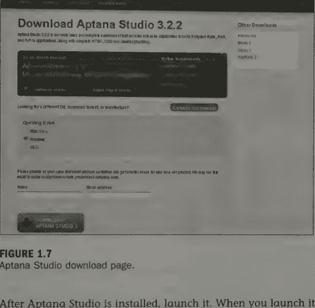

**图 1.7**
Aptana Studio 下载页面。

安装 Aptana Studio 后，启动它。首次启动时，你需要指定一个工作空间的位置。工作空间是你项目和文件的存储位置，因此选择一个你易于管理的位置。

##### 配置 Aptana Studio

现在 Aptana Studio 已安装，只需再进行几个步骤即可配置它。请执行以下操作：

1.  从主菜单中选择“命令”、“捆绑包开发”、“安装捆绑包”。然后从捆绑包列表中选择 jQuery，并单击“确定”按钮。
2.  从主菜单中选择“窗口”、“首选项”以加载如图 1.8 所示的“首选项”对话框。从“首选项”对话框中选择“Aptana Studio”、“主题”，同样如图 1.8 所示，然后从下拉列表中选择一个主题。主题将设置窗口、菜单、选择和代码元素的颜色和字体。选择一个适合你的主题。你也可以为此页面自定义主题。

**注意**
你也可以从此主题首选项对话框导入和导出主题。本书网站上有一个名为 AptanaTheme.tmTheme 的文件，这是编写本书时使用的主题。你可以在此处导入该主题。

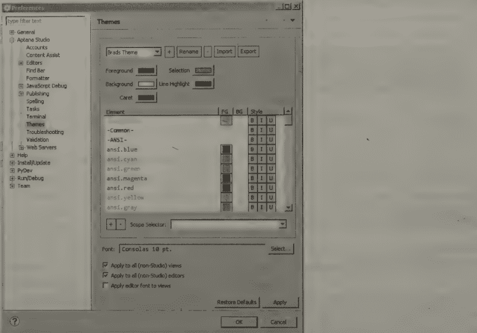

**图 1.8** Aptana Studio 首选项对话框。

3.  选择并拖动左下角的“大纲”选项卡，将其合并到“应用资源管理器”选项卡旁边。这为你提供了脚本大纲的更好视图，并允许你关闭底部不需要的“代码片段”和“示例”选项卡。最终结果应类似于图 1.9。
4.  熟悉首选项和菜单，以熟悉界面。

现在 Aptana Studio 已设置完毕，可以开始创建项目了。

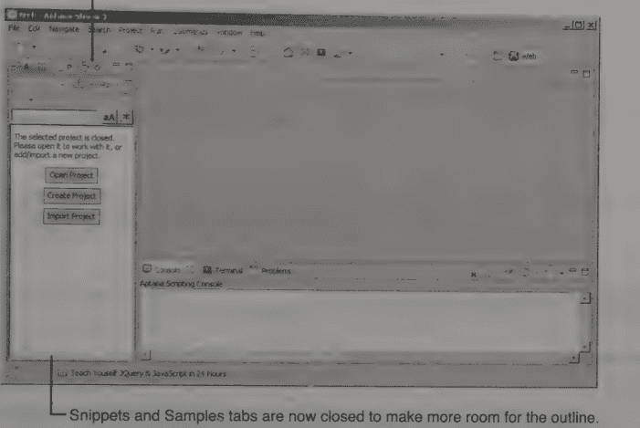

**图 1.9**
移动了“大纲”选项卡的 Aptana Studio。现在“代码片段”和“示例”选项卡已关闭，为大纲腾出了更多空间。

#### 配置浏览器开发工具

设置好 Aptana Studio 后，你就可以配置浏览器以调试 JavaScript 了。在本节中，你将按照步骤在三个主要浏览器上启用 JavaScript 调试。你选择哪个浏览器并不重要；但是，下一节及全书都将使用 Firefox。

Firefox 似乎具有最一致的体验，也是最可靠的。Firefox 似乎也具有最一致的跨平台支持。

##### 在 Firefox 上安装 Firebug

按照以下步骤在 Firefox 上启用 JavaScript 调试：

1.  打开 Firefox。
2.  从主菜单中选择“工具”、“附加组件”。
3.  在右上角的搜索框中输入“Firebug”以搜索 Firebug，然后单击“安装”按钮进行安装。
4.  在右上角的搜索框中输入“FireQuery”以搜索 FireQuery，然后单击“安装”按钮进行安装。FireQuery 扩展了 Firebug，使其也支持 jQuery。


**5.** 当你重新加载 Firefox 时，点击 Firebug 按钮以显示 Firebug 控制台，如图 1.10 所示。

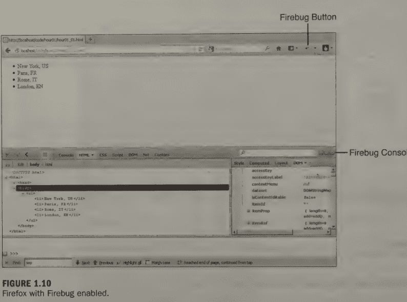

##### 在 Internet Explorer 中启用开发者工具

请按照以下步骤在 Internet Explorer 中启用 JavaScript 调试：

1.  打开 Internet Explorer。
2.  点击“设置”按钮，从下拉菜单中选择“开发者工具”，或按 F12 键。
3.  如图 1.11 所示，将显示开发者控制台。

##### 在 Chrome 中启用 JavaScript 控制台

请按照以下步骤在 Chrome 中启用 JavaScript 调试：

1.  打开 Chrome。
2.  点击“设置”按钮，从下拉菜单中选择“更多工具”、“开发者工具”。你也可以在 PC 上按 Ctrl+Shift+j，或在 Mac 上按 CMD-Shift-j。
3.  如图 1.12 所示，将显示 JavaScript 控制台。

准备编写 jQuery 和 JavaScript

23

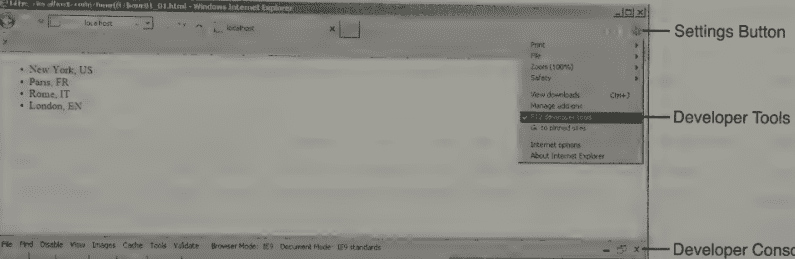

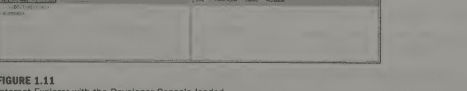

**图 1.11**
加载了开发者控制台的 Internet Explorer。

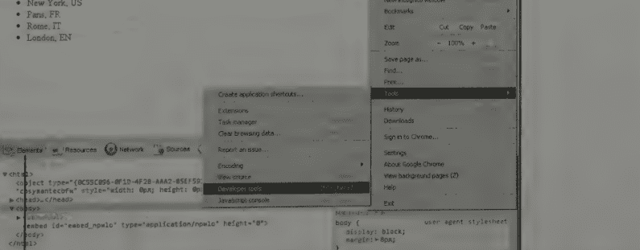

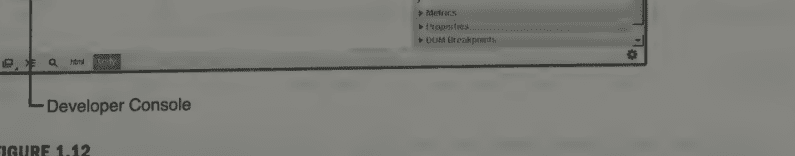

**图 1.12**
加载了开发者控制台的 Chrome。

第 1 小时：动态 Web 编程入门

#### 安装简单的开发 Web 服务器

准备好浏览器后，最后一步是安装并配置一个简单的开发服务器。如果可能，通常最好在开发机器上安装一个基本的 Web 服务器。

你可以从几个选项中选择，但最常见的两种是 Apache 或 IIS。开发服务器的最佳选择是使用包含 MySQL 和 PHP 支持的预构建 Apache 堆栈。本书使用 XAMPP 堆栈，因为它可在 Mac、Windows 和 Linux 上使用。

可以从以下位置下载 XAMPP 堆栈：www.apachefriends.org/en/xampp.html

请按照以下步骤将 XAMPP 安装并配置为你的开发服务器：

1.  下载 XAMPP 安装程序并安装 XAMPP。安装过程很简单。请记住你选择安装的位置。稍后你将使用该位置。
2.  加载如图 1.13 所示的 XAMPP 控制面板。

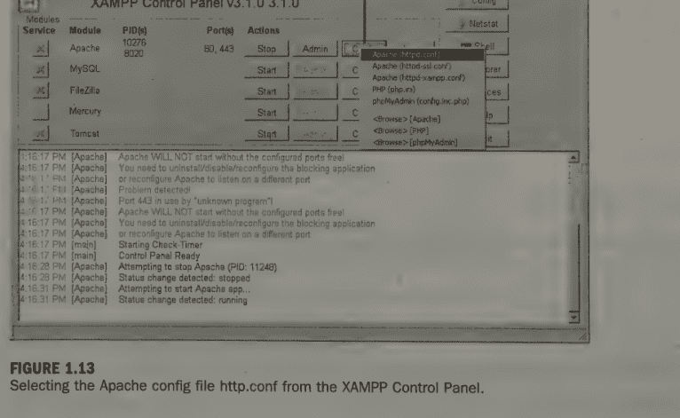

**图 1.13**
从 XAMPP 控制面板中选择 Apache 配置文件 httpd.conf。

3.  从 XAMPP 控制面板，点击“Apache”下的“Config”按钮，选择 `httpd.conf` 文件以在编辑器中加载 Apache 配置文件。
4.  将以下指令添加到 `httpd.conf` 文件中，以启用一个代码目录，以便在服务器运行时你可以直接访问：

```
<Directory "C:/xampp/htdocs/code">
    # Allows Browser Access to Your jQuery and JavaScript code Directory
    Options Indexes FollowSymLinks Includes ExecCGI
    AllowOverride All
    Allow from All
</Directory>
```

> **注意**
> `Allow from All` 选项将允许任何人在 Web 服务器运行时访问该文件夹中的文件。这对于调试来说是完美的。如果你想要更严格的安全性，请查看 Apache 的安全指南：http://httpd.apache.org/docs/2.2/configuring.html。

> **注意**
> 在步骤 4 中，目录是针对 XAMPP 默认设置的 Windows 路径。如果你将 XAMPP 安装到其他位置，或在 Linux 和 Mac 系统上安装，你需要调整 `Directory` 指令中指定的路径。

5.  保存文件。
6.  在 `/xamp/htdocs` 目录中，或你设置的 Apache 根目录所在的位置，创建一个名为 `code` 的目录。这就是你将添加代码的目录。
7.  使用 XAMPP 控制面板停止然后启动 Apache 服务。
8.  在你的 Web 浏览器中访问以下位置；浏览器中应显示一个空的目录链接，类似于图 1.14：

`http://localhost/code`

你的 Web 服务器现已准备好用于 Web 开发。

26 第 1 小时：动态 Web 编程入门

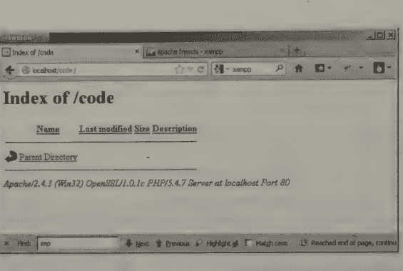

**图 1.14**
验证 Web 浏览器可以访问新创建的 `code` 目录。

### 创建 Web 开发项目

安装好 IDE 和 Web 服务器后，你就可以开始创建项目了。在本节中，你将学习一些概念，并在 Aptana Studio 中完成创建项目的过程。

#### 目录结构

当你开始一个 Web 项目时，通常从小处着手，只有几张图片和几个文件。然而，随着时间的推移和项目中文件的增加，组织不善的项目很快就会变得一团糟。

为避免这个问题，请提前规划你的目录结构。最佳的目录结构取决于你的需求、要包含多少图像、文件类型等等。

为了给你一个快速的示例，考虑一个类似于以下的目录结构：

-   `root` — 包含 `index.html`、站点地图、网络爬虫项目等。
-   `root/html` — 仅包含 HTML 文件。
-   `root/js` — 包含 JavaScript 文件。
-   `root/php` — 包含任何服务器端的 PHP 脚本。
-   `root/images` — 包含所有图形。
-   `root/images/visual` — 包含用于构建网页的图形元素，如按钮。
-   `root/images/photos` — 包含网站上显示的任何照片。

以上列表的目的是让你了解一种组织文件的方式，以便它们保持有条理。最佳方式完全取决于你。你可能需要更多的子目录；只是不要添加太多，以至于访问其中文件的 URL 变得一团糟。

#### 文件命名

创建 Web 项目时，你需要注意的另一个方面是文件名。以下是一些需要考虑的事项：

-   **不要太长** — 文件名通常是 URL 的一部分，并由 JavaScript 解析。文件名过长在代码和浏览器中都会变得麻烦。
-   **使其有意义** — 当你创建脚本或 HTML 页面时，在构建网页时必须使用该名称，并且你还需要在编辑器中找到它。如果名称不能反映文件的目的，可能会使开发变得困难。

### 动手试试

#### 创建项目

在本节中，你将学习在 Aptana Studio 中创建项目的过程。Aptana Studio 中的项目——以及大多数 IDE——是一种组织、控制、构建并通常部署需要多个文件的网站和应用程序的方式。

本节不会花太多时间讨论项目，但随着学习的进行，你会了解一个基本的 Web 项目是如何工作的。

请按照以下步骤在 Aptana Studio 中创建项目：

1.  选择“文件”、“新建”、“Web 项目”，启动“项目模板”对话框。
2.  选择“默认项目”并点击“下一步”。
3.  输入项目名称。保持简短，但要有意义。例如，`TYjQueryCode` 就是本书的项目名称。
4.  取消选中“使用默认位置”选项。
5.  添加你之前在 `httpd.conf` 文件中添加的目录位置。在本例中，是 `c:\xampp\htdocs\code`。
6.  点击“完成”按钮，项目应该会出现在工作区选项卡中，如图 1.15 所示。

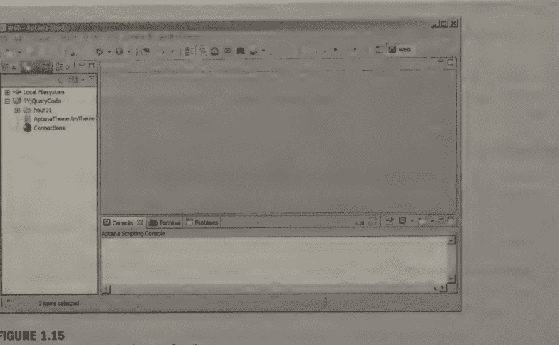

**图 1.15**
在 Aptana Studio 中创建新项目。

7.  右键点击项目名称，选择“新建”、“文件夹”；然后将文件夹命名为 `hour01`，以存储本小时的代码。
8.  你的第一个项目现在已经创建完成。

### 动手试试

## 使用 jQuery 和 JavaScript 创建动态网页

既然你已经创建了一个项目，就可以开始创建你的动态网页了。在本节中，你将按照步骤创建一个相当基础的动态网页。完成后，你将拥有一个基于 HTML、使用 CSS 进行样式化，并通过 jQuery 和 JavaScript 实现交互的动态网页。

### 添加 HTML

第一步是创建一个简单的网页，其中包含一个你可以进行样式化和操作的 HTML 元素。在 Aptana 中按照以下步骤创建你将用作基础的 HTML 文档：

1.  右键点击你之前创建的 `hour01` 文件夹。
2.  从弹出菜单中选择“新建”、“文件”。


### 添加CSS

浏览器渲染的简单文本相当单调，但这个问题可以通过添加CSS样式快速解决。在本节中，你将使用CSS使文本看起来更像一个按钮。

使用以下步骤将CSS样式添加到`<span>`元素。作为参考，这些步骤中所做的样式更改在清单1.7的最终脚本中有所展示：

1.  在网页的`<head>`标签内添加以下代码，为所有`<span>`元素引入一个CSS `<style>`元素：

    ```
    <style>
    span{
        
    }
    </style>
    ```

2.  向span样式添加以下属性设置，以将文本背景更改为深蓝色：

    ```
    background-color: #0066AA;
    ```

3.  向span样式添加以下属性设置，以将字体颜色更改为白色并将字体设置为粗体：

    ```
    color: #FFFFFF;
    font-weight: bold;
    ```

4.  向span样式添加以下属性设置，以在span文本周围添加边框：

    ```
    border-color: #C0C0C0;
    border: 2px solid;
    border-radius: 5px;
    padding: 3px;
    ```

5.  向span样式添加以下属性设置，为span元素设置绝对定位：

    ```
    position: absolute;
    top: 150px;
    left: 100px;
    ```

6.  保存文件。

7.  在你的Web浏览器中打开以下URL，你应该会看到样式化的文本“Click Me”如图1.16所示：

    ```
    http://localhost/code/hour01/first.html
    ```

    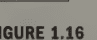

    图1.16
    样式化为按钮外观的`<span>`元素。

### 编写动态脚本

现在HTML已经按照你想要的方式设置了样式，你可以开始添加动态交互了。在本节中，你将添加一个指向托管jQuery库的链接，以便能够使用jQuery，然后将浏览器鼠标事件`mouseover`链接到一个移动文本的JavaScript函数。

按照以下步骤为你的网页添加jQuery和JavaScript交互：

1.  修改`<span>`元素以包含一个ID，这样你就可以引用它，同时为`mouseover`事件添加一个处理器，如清单1.7第30行所示：

    ```
    <span id="elusiveText" onmouseover="moveIt()">Click Me</span>
    ```

2.  向`<head>`标签添加以下代码行，如清单1.7第6行所示。这将从托管源加载jQuery库：

    ```
    <script src="http://code.jquery.com/jquery-latest.min.js"></script>
    ```

3.  将以下JavaScript函数添加到`<head>`中，如清单1.7第6-13行所示。此函数创建一个包含10到350的坐标值的数组，然后每次鼠标移到span元素上时，随机设置其top和left CSS属性：

    ```
    function moveIt(){
        var coords = new Array(10,50,100,130,175,225,260,300,320,350);
        var x = coords[Math.floor((Math.random()*10))];
        var y = coords[Math.floor((Math.random()*10))];
        $("#elusiveText").css({"top": y + "px", "left": x + "px"})
    }
    ```

4.  保存文件。

5.  在你的Web浏览器中打开以下URL，你应该会看到样式化的文本“Click Me”出现，如图1.16所示：

    ```
    http://localhost/code/hour01/first.html
    ```

6.  现在尝试点击“Click Me”按钮。每次鼠标移到按钮上时，按钮都应该移动，使其无法被点击。

7.  找一个让你讨厌的人，请他们点击这个按钮。

### 清单1.7  一个简单的交互式jQuery和JavaScript网页

```
01 <!DOCTYPE html>
02 <html>
03     <head>
04         <meta http-equiv="content-type" content="text/html; charset=utf-8" />
05         <script src="http://code.jquery.com/jquery-latest.min.js"></script>
06         <script>
07             function moveIt(){
08                 var coords = new Array(10,50,100,130,175,225,260,300,320,350);
09                 var x = coords[Math.floor((Math.random()*10))];
10                 var y = coords[Math.floor((Math.random()*10))];
11                 $("#elusiveText").css({"top": y + "px", "left": x + "px"})
12             }
13         </script>
14         <style>
15             span{
16                 background-color: #0066AA;
17                 color: #FFFFFF;
18                 font-weight: bold;
19                 border-color: #C0C0C0;
20                 border: 2px solid;
21                 border-radius: 5px;
22                 padding: 3px;
23                 position: absolute;
24                 top: 150px;
25                 left: 100px;
26             }
27         </style>
28     </head>
29     <body>
30         <span id="elusiveText" onmouseover="moveIt()">Click Me</span>
31     </body>
32 </html>
```

## 总结

在本小时中，你学习了Web服务器和浏览器通信的基础知识。你学习了GET和POST请求之间的区别，以及服务器端和客户端脚本的目的。你还了解了DOM以及浏览器如何使用它来渲染显示给用户的网页。

你已经设置了一个良好的Web开发环境并创建了你的第一个项目。作为创建第一个项目的一部分，你创建了一个融合了HTML、CSS、jQuery和JavaScript的动态网页。

## 问与答

-   **问.** 哪种更好——客户端脚本还是服务器端脚本？

    **答.** 这真的取决于你想要完成什么。有些人说这种方式或那种方式是唯一的途径。实际上，通常是两者的结合提供了最佳选择。一个好的遵循原则是：如果与数据的交互更多地基于用户交互（如鼠标点击），则使用客户端脚本。如果对数据的验证或错误处理需要与服务器交互，则使用服务器端脚本。

-   **问.** 为什么并非所有浏览器都以相同的方式处理JavaScript？

    **答.** 为了渲染HTML和与JavaScript交互，浏览器使用一个引擎来解析来自服务器的数据，构建对象，然后将它们馈送到一个图形渲染引擎中，该引擎将它们写在屏幕上。因为每个浏览器使用不同的引擎，所以每个浏览器对脚本的解释略有不同，尤其是对于那些尚未标准化的边缘元素。如果你想支持所有浏览器，你需要在每个浏览器中测试你的网页，以验证它们是否正常工作。

## 研讨会

研讨会由一系列旨在巩固你对本小时所涵盖材料理解的问答组成。请在查看答案之前尝试回答问题。

### 测验

1.  为了打开一个网页，你会向Web服务器发送GET请求还是POST请求？
2.  哪种类型的脚本可以访问浏览器鼠标事件：服务器端、客户端，还是两者都可以？
3.  判断对错：JavaScript控制台在所有浏览器上默认启用。
4.  当定义DOM元素的外观时，使用哪种类型的脚本最好？

### 测验答案

1.  GET
2.  客户端
3.  错。你必须在所有浏览器上手动启用JavaScript调试。
4.  在定义DOM元素的外观时，CSS脚本是最简单的选择。

### 练习

1.  修改你的first.html文件，以使每次按钮移动时随机更改其背景颜色。添加以下两行以随机选择一种颜色：

    ```
    var colors = new Array("#0066AA", "#0000FF", "#FF0000", "#00FF00");
    var color = colors[Math.floor((Math.random()*4))];
    ```

    然后修改JavaScript中的CSS更改以包含background-color，如下所示：

    ```
    $("#elusiveText").css({"top": y + "px", "left": x + "px", "background-color": color})
    ```

2.  在你的first.html文件中添加一个具有与第一个相同行为的额外`<span>`元素。为此，在适当的位置添加以下两行。你应该能弄清楚它们放在哪里：

    ```
    $("#elusiveText2").css({"top": x + "px", "left": y + "px"})
    ```
    ```
    <span id="elusiveText2" onmouseover="moveIt()">Click Me</span>
    ```


## 第2小时
## 调试 jQuery 和 JavaScript 网页

**本小时你将学到：**

-   在哪里可以找到 jQuery 和 JavaScript 脚本输出的信息
-   如何调试 HTML 元素的问题
-   更轻松地查找和修复 CSS 布局问题的方法
-   在 Web 浏览器中实时查看和编辑 DOM 的方法
-   如何快速查找和修复 JavaScript 中的问题
-   可用于分析浏览器与 Web 服务器之间网络流量的信息

编写 JavaScript 和 jQuery 应用程序时，一个主要挑战是在脚本中查找和修复问题。简单的语法错误或无效值可能会导致大量挫败感和时间浪费。因此，已经创建了一些出色的工具来帮助你快速、轻松地在脚本中查找问题。在本小时中，你将学习通过 Mozilla 中的 Firebug 调试 JavaScript 的一些基础知识。虽然其他浏览器中的开发者控制台略有不同，但大多数原则是相同的。另外，如果你不认识示例中的代码元素，也不要惊慌。它们将在接下来的小时中介绍，但你应该能够在深入编码之前进行调试。

### 查看 JavaScript 控制台

你希望熟悉的第一个调试工具是 JavaScript 控制台。控制台是你与 JavaScript 脚本输出交互的界面。错误和日志消息将在 JavaScript 控制台中显示。

例如，当脚本中的错误导致浏览器无法解析它时，错误将显示在控制台中。除了错误之外，通过使用 `console.log` 语句，你还可以添加自己的调试语句，这些语句将显示在 JavaScript 控制台中。

> 注意：除了 `console.log`，你还可以使用 `console.error()`、`console.assert()` 以及其他各种语句将信息记录到 JavaScript 控制台。有关如何使用 Firebug 控制台日志的更多信息，请参阅 https://getfirebug.com/wiki/index.php/Console_API

#### 理解 JavaScript 控制台

JavaScript 控制台是一个相当基础但功能强大的工具。控制台有两个部分：控件和日志条目列表。图 2.1 显示了 Firebug JavaScript 控制台。

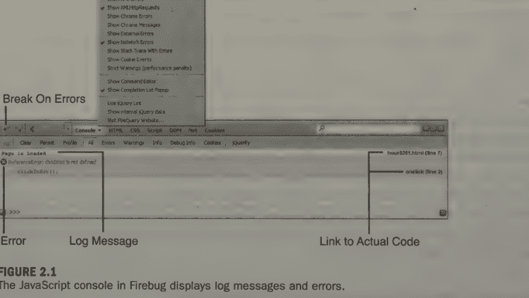

注意当你在控制台选项卡中单击向下箭头时显示的菜单。从该菜单中，你可以启用控制台，以及选择要在消息列表中包含哪些类型的错误和日志消息。

控制台还提供了一个带有多个选项的工具栏。控制台工具栏中的选项通过单击进行切换。以下列表描述了控制栏中的每个选项：

-   **Break On Errors**（在错误时中断）—启用此选项后，如果脚本中遇到错误，JavaScript 将停止执行。如果你想捕获错误并查看发生错误时各项的值，这非常有用。
-   **Clear**（清除）—清除消息列表中的消息。
-   **Persist**（保留）—即使页面重新加载也保留消息。如果未设置此选项，页面重新加载时消息列表将被清空。
-   **Profile**（性能分析）—启动和停止性能分析器以跟踪代码内部的时间。
-   **All**（全部）—显示所有消息。通常情况下，你应该让所有消息都显示，除非消息太多，你想专注于特定消息。
-   **Error**（错误）—仅显示错误消息。
-   **Warnings**（警告）—仅显示警告消息。
-   **Debug Info**（调试信息）—仅显示调试消息。
-   **Cookies**（Cookie）—仅显示与 Cookie 相关的消息。
-   **jQuerify**—修改加载 jQuery 库的脚本以包含最新的 jQuery 代码。这是 FireQuery 插件的一部分。

注意图 2.1 中的消息部分，有两种类型的消息。一种是 log 语句，第二种是错误。两者都在右侧显示行号。如果你单击行号，你会直接跳转到代码。

注意错误消息，顶部文本指的是发生的错误，底部显示实际的 JavaScript 行。这在调试时非常有用，因为你通常可以通过查看错误和单行代码来发现问题。

### 自己动手试试
##### 使用 JavaScript 控制台查找错误

理解使用控制台的最简单方法是调试一个实际的脚本。考虑清单 2.1 中的 HTML 代码，它包含几个错误。请使用以下步骤将清单添加到 Aptana 中的项目中：

1.  右键单击项目，从菜单中选择“新建”，“文件夹”。
2.  将文件夹命名为 hour02，然后单击“完成”。
3.  右键单击新文件夹，从菜单中选择“新建”，“文件”。
4.  将文件命名为 hour0201.html。
5.  输入清单 2.1 的内容，或者如果你有网站上的文件，将内容剪切并粘贴到新文件中。
6.  保存文件。

#### 清单 2.1 一个包含 JavaScript 错误的非常简单的 HTML 文档

```
01 <!DOCTYPE html>
02 <html>
03   <head>
04     <meta http-equiv="content-type" content="text/html; charset=utf-8" />
05     <script>
06       fuction loadedFunction(){
07         console.log("Page is Loaded");
08       }
09       function clickIt(){
10        console.log("User Clicked");
11       }
12     </script>
13   </head>
14   <body onload="loadedFunction()">
15     <span onclick="clickItNot()">Click Me</span>
16   </body>
17 </html>
```

清单 2.1 中的代码旨在页面在浏览器中加载后在控制台中显示消息“Page Is Loaded”。每次用户在浏览器中单击“Click Me”文本时，会显示另一条消息“User Clicked”。问题是脚本有几个错误。

文件就位后，请使用以下步骤使用 JavaScript 控制台调试错误：

1.  打开 Firefox 并单击 Firebug 图标。
2.  单击 Firebug 中的控制台选项卡，以显示图 2.2 所示的 JavaScript 控制台。

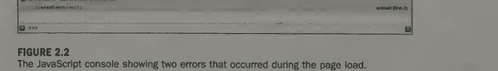

**图 2.2** JavaScript 控制台显示页面加载期间发生的两个错误。

3.  在 Firefox 中打开以下 URL 以加载新创建的网页：`http://localhost/code/hour02/hour0201.html`
4.  注意控制台中显示的错误，如图 2.2 所示。第一个错误显示在 `loadedFunction()` 的定义中缺少“;”。第二个错误显示 `loadedFunction` 未定义。结合这两个错误表明 `loadedFunction()` 的定义存在问题。查看失败的定义语句，你可以看到 `function` 被误拼为 `fuction`。
5.  在 Aptana 中，将第 6 行中的单词 `fuction` 更改为 `function`。
6.  返回到 Firefox 并刷新网页。现在在控制台中你应该看到“Page Is Loaded”，这是在 `loadedFunction()` 函数中记录的文本，但没有错误。
7.  单击“Click Me”文本。控制台中添加了一个错误，如图 2.3 所示。错误指出 `clickItNot` 未定义。当你查看 HTML 文件并搜索 `clickItNot` 时，你可以在第 16 行看到 onclick 事件链接到 `clickItNot()`，但 JavaScript 函数名为 `clickIt()`。

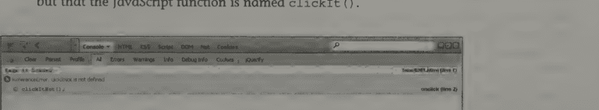

**图 2.3** JavaScript 控制台显示一个成功的日志消息和一个错误。

8.  在 Aptana 中，将第 15 行中的 `clickItNot` 更改为 `clickIt` 并保存文件。
9.  重新加载网页。
10. 再次单击“Click Me”文本。图 2.4 显示现在两个 log 语句都正确显示且没有错误。该页面已成功调试。

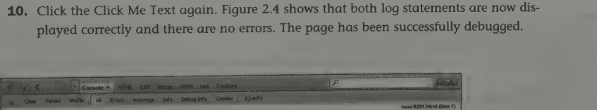

**图 2.4** JavaScript 控制台显示两个成功的日志消息且没有错误。

### 调试 HTML 元素

调试 HTML 元件有时可能是一个巨大的挑战。简单的语法错误可能导致浏览器在尝试渲染 HTML 文档时出现重大问题。此外，HTML 元素具有不会渲染到屏幕但会影响网页行为的属性值。

HTML 检查器和 DOM 编辑器可帮助你查找和修复 HTML 代码中的问题。以下部分将带你通过一些使用这些工具的简单示例。

#### 检查 HTML 元素

HTML 检查器使你能够查看浏览器已解析的每个 HTML 元素。这为你提供了从浏览器角度查看 HTML 的视图，这在语法错误的情况下通常与预期不同，从而更明显地看出语法错误所在。

图 2.5 显示了 Firebug HTML 检查器的示例。使用 HTML 检查器，你可以使用一些非常有用的功能，如下所述：

-   **DOM 树**—这是对 DOM 树的简单视图。你可以单击 + 图标展开树的部分，单击 – 图标折叠树的部分。

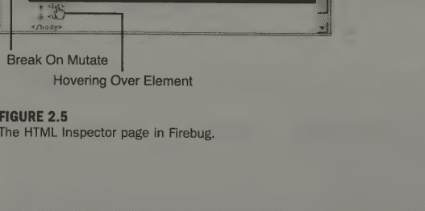

**图 2.5** Firebug 中的 HTML 检查器页面。


▶ **变更时中断**—当启用此选项时，每当DOM元素被动态更改，浏览器就会中断并进入JavaScript调试器。这有助于你在问题发生时捕捉它们。

▶ **编辑**—当启用此选项时，树视图会切换到文本编辑器视图，允许你直接在浏览器中编辑HTML代码。浏览器会根据你在此处所做的更改来渲染显示。虽然这不会改变你项目中的代码，但使用此功能来尝试各种操作直到问题修复要容易得多。然后你可以从编辑器中复制代码并粘贴到项目中实际的文件里。

▶ **悬停**—当你将鼠标悬停在DOM树中的HTML代码上时，该元素会在浏览器中被高亮显示。HTML检查器的悬停功能是我的最爱之一，因为它以一种非常直观的方式展示了DOM树中的节点与渲染的网页之间的关系。注意图2.5，当`<h1>`元素被悬停时，标题在网页中被高亮显示。

> 注意
> 
> 当DOM树中的一个元素被悬停时，该元素会在网页上高亮显示。悬停高亮显示是颜色编码的，浅蓝色表示内容，紫色表示内边距，黄色表示HTML元素的外边距。

▶ **面包屑**—面包屑显示了从根`<html>`节点到当前在树或编辑视图中选中的节点的层级结构。这使得导航变得容易，尤其是在编辑视图中。

### 动手试试

##### 使用HTML检查器调试HTML

为了说明如何使用HTML检查器，请看清单2.2中的代码。一个包含电影列表且标题中“Favorite”一词应为斜体的基本HTML文档。然而，观察图2.6中的渲染版本。显然存在一些问题：所有内容都是斜体，而且第一个列表项目没有项目符号。这些问题仅仅是由文本中的两个字符引起的。

#### 清单2.2 一个非常简单的HTML文档，其中一些HTML语法错误如图2.6所示

```
01 <!DOCTYPE html>
02 <html>
03   <head>
04     <meta http-equiv="content-type" content="text/html; charset=utf-8" />
05 </head>
06 <body>
07 <h1><i>Favorite<i> Movies</h1>
08 <ul>
09 <li>Lord of the Rings</li>
10 <li>Harry Potter</li>
11 <li>Narnia</li>
12 <li>Hot Lead and Cold Feet</li>
13 </ul>
14 </body>
15 </html>
```

**图2.6**
此网页有两个问题：只有“Favorite”这个词应该是斜体，且第一个列表项目没有项目符号。

按照以下步骤，使用HTML检查器查找并修复HTML语法问题：

1.  将清单2.2中的代码添加到项目中hour02文件夹的一个新文件hour0202.html中并保存文档。你现在应该已经熟悉这个过程了。
2.  打开Firefox并单击Firebug图标以启用Firebug。
3.  在Firefox中打开以下URL；网页应如图2.6所示。
    http://localhost/code/hour02/hour0202.html
4.  单击Firebug中的HTML选项卡，展开`<html>`，然后是`<body>`，再然后是`<i>`标签，如图2.7所示。注意`<i>`标签下的唯一元素是另一个`<i>`标签。这是不对的，所以回到Aptana查看HTML第7行的`<i>`标签。注意结束的`<i>`标签中缺少了/。
5.  将第二个`<i>`标签更改为结束标签`</i>`并保存文档。
6.  在浏览器中刷新文档。注意“Favorite”这个词现在是斜体了，这是正确的，但项目符号仍然缺失，如图2.8所示。

**图2.7**
此HTML检查器在DOM中显示了第二个`<i>`。

**图2.8**
此网页现在只有一个问题——第一个列表项目没有项目符号。

7.  返回HTML检查器，展开`<html>`，然后`<body>`，然后`<ul>`，然后`<li>`，如图2.9所示。`<ul>`元素下面不是一组四个`<li>`元素，而是一个`<ll>`元素，其下是`<li>`元素。我们还没有介绍HTML标签，但如果你熟悉HTML列表，你会认出ll不是一个有效的HTML标签。它应该是`<li>`。

**图2.9**
查看DOM揭示了浏览器在`<ul>`标签下看到的是一个`<ll>`标签，而不是一组`<li>`标签。

8.  回到Aptana，将第9行的`<ll>`标签更改为`<li>`并保存页面。
9.  在浏览器中重新加载网页。它现在显示正确了，如图2.10所示。

**图2.10**
格式正确的网页。

### 查看和编辑DOM

调试HTML时另一个重要的工具是DOM检查器。DOM检查器功能极其强大。它允许你查看DOM中每个HTML元素的属性、属性、函数、子元素、父元素以及所有其他信息。信息以树形显示，因此你可以展开和折叠组。

DOM检查器可以在两个地方找到：要么单击Firebug中的DOM选项卡，要么当检查HTML时，你可以单击HTML检查器中的DOM选项卡。

图2.11显示了主DOM检查器。从主DOM检查器中，你可以访问关于浏览器环境的各种信息。例如，在图2.11中，window对象的screen属性被展开，显示了浏览器窗口的可用尺寸和实际尺寸的值。

**图2.11**
Firebug中的主DOM检查器选项卡。

通常，最好使用HTML检查器中的DOM检查器，如图2.12所示。当你使用HTML检查器中的DOM选项卡时，你只看到该HTML元素的DOM，这减少了显示的信息量。这也使得直接在浏览器中快速更改HTML元素的属性值变得容易，从而使调试和开发变得容易得多。

**图2.12** 在DOM检查器中编辑HTML元素。

#### 在DOM检查器中编辑HTML元素值

举个例子，你可以使用以下步骤来操作前面的代码示例：

1.  在Firefox中打开修复后的文件hour0202.html并打开Firebug。
2.  单击Firebug中的HTML选项卡。
3.  展开`<html>`、`<body>`和`<ul>`节点。
4.  选择第一个`<li>`节点。
5.  单击右侧的DOM选项卡，如图2.12所示。
6.  向下滚动，在DOM检查器中找到firstChild节点并展开该节点。它应该是一个`<TextNode>`元素。
7.  双击data属性右侧的值，并如图2.12所示更改编文本。注意网页中渲染的HTML元素也随之更改。操作HTML节点的任何可编辑属性就是这么简单。

### 调试CSS

作为调试动态网页的一部分，你还需要知道如何调试CSS问题，因为网页的许多动态性都涉及在JavaScript中修改CSS布局。

如果你的JavaScript或jQuery脚本修改了DOM元素的CSS布局，查看网页浏览器中的代码对你没有任何帮助。你需要能够看到浏览器对元素应用了哪些CSS。为此，你需要结合使用CSS检查器以及HTML检查器内部的布局检查器和样式检查器。

#### 使用CSS检查器

如图2.13所示的CSS检查器提供了对网页中加载的所有CSS脚本的访问。CSS检查器顶部有两个下拉菜单。左边的菜单允许你在以下选项之间切换：

- **源代码编辑**—显示网页最初加载的CSS。
- **实时编辑**—显示当前应用于HTML元素的CSS。

**图2.13**
在CSS检查器中编辑CSS属性。

右边的菜单提供了一个包含所有已加载CSS文件的列表。这使你可以选择要查看和编辑哪个CSS文档。

从CSS检查器中，你还可以编辑CSS。图2.13显示了编辑过程。注意禁用图标。当你单击此图标时，该CSS属性将被禁用，图标将从红色变为灰色。你也可以直接编辑CSS属性的值，如图2.13所示。


#### 使用样式检查器

除了编辑整个CSS文件，你还可以通过HTML检查器查看和编辑特定元素的CSS属性。图2.14展示了HTML检查器中的样式标签页。从样式检查器中，你可以查看和修改特定元素的属性值。

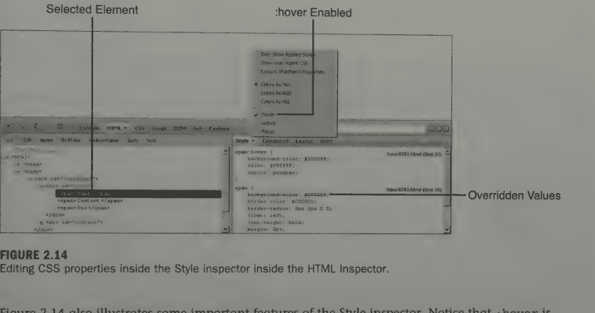

**图 2.14** 在HTML检查器内部的样式检查器中编辑CSS属性。

图2.14也展示了样式检查器的一些重要功能。注意菜单中选中了`:hover`。这显示了当鼠标悬停在该元素上时所应用的CSS样式。同时注意`span:hover`选择器覆盖了`span`选择器中的`background-color`设置。整个CSS层级结构都显示在样式窗口中，因此你可以看到哪些属性值来自哪个CSS选择器，以及哪些值已被覆盖。

#### 使用布局检查器

调试CSS时另一个极其强大的工具是HTML检查器中的布局检查器。如图2.15所示的布局检查器，为选定HTML元素的CSS布局提供了一个易于使用的可视化界面。

从布局检查器中，你可以使用、查看和修改以下功能：

- **外边距**——外边距是布局检查器中显示的最外层的框。外边距的每一边都有一个值。你可以双击这些值，直接在布局检查器中更改CSS属性。
- **边框**——边框是下一层的框。它也有四个值，你可以更改它们来调整HTML元素的CSS边框属性。
- **内边距**——内边距是再下一层的框。它同样有四个值，你可以更改它们来调整HTML元素的CSS内边距属性。
- **内容**——内容是布局检查器中最内层的框。它有两个值，长度和宽度，你可以更改它们来设置HTML元素的CSS长度和宽度属性。
- **标尺**——标尺显示在网页中，为你提供具体的比例尺以供参考。
- **辅助线**——当你在布局检查器中选择外边距、边框、内边距或内容框时，网页中会出现辅助线。辅助线水平和垂直延伸，显示该CSS属性边缘的具体位置。在尝试对齐布局中的元素时，这非常有用。

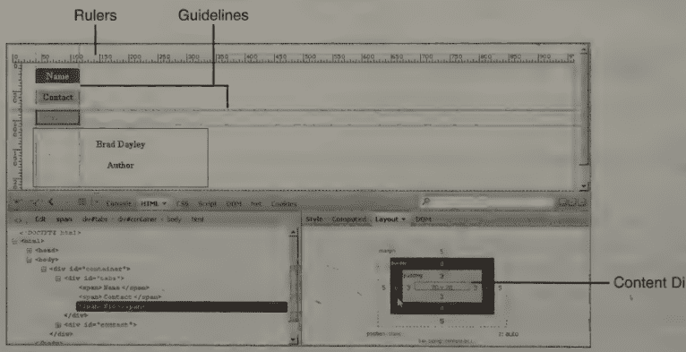

**图 2.15** 在HTML检查器内部的布局检查器中查看CSS布局属性。

### 动手试试
**编辑CSS布局**

为了帮助你理解如何使用Firebug调试和编辑CSS布局，请参考清单2.3中的代码。该代码旨在显示一个简单的标签式方框来展示信息。其中的CSS属性存在一些问题，导致显示效果不佳，如图2.16所示。注意标签是堆叠的，并且它们之间有间距。

##### 清单 2.3 一个非常简单的HTML文档，存在一些在图2.16中所示的HTML语法错误

```html
01 <!DOCTYPE html>
02 <html>
03 <head>
04     <meta http-equiv="content-type" content="text/html; charset=utf-8" />
05     <style>
06         #container{
07             margin: 30px;
08             padding:5px;
09         }
10         #tabs{
11             padding: 0px;
12             width:50px;
13         }
14         #content{
15             border: 1px solid #000000;
16             height: 100px;
17             width: 300px;
18             clear: both;
19         }
20         span{
21             margin: 5px;
22             width: 70px;
23             background-color: #C0C0C0;
24             font-weight: bold;
25             border-color: #C0C0C0;
26             border:1px solid, #000000;
27             border-radius: 5px 5px 0px 0px;
28             padding: 3px;
29             float: left;
30             text-align: center;
31         }
32         span:hover{
33             background-color: #3030FF;
34             color: #FFFFFF;
35             cursor: pointer;
36         }
37         p{
38             font-weight: bold;
39             text-align: center;
40         }
41     </style>
42 </head>
43 <body>
44     <div id="container">
45    <div id="tabs">
46        <span>Name</span>
47        <span>Contact</span>
48        <span>Bio</span>
49    </div>
50    <div id="content">
51        <p>Brad Dayley</p>
52        <p>Author</p>
53    </div>
54    </div>
55    </body>
56    </html>
```

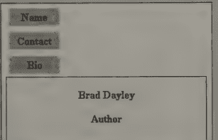

**图 2.16** 糟糕的标签CSS布局使网页显得丑陋。

按照以下步骤来纠正CSS布局：

1. 将清单2.3中的代码添加到项目中`hour02`文件夹的新文件`hour0203.html`中并保存文档。
2. 打开Firefox并点击Firebug图标以启用Firebug。
3. 在Firefox中打开以下URL：
    http://localhost/code/hour02/hour0203.html
4. 点击Firebug中的HTML标签页，然后依次展开`<html>`、`<body>`、`<div id="container">`，然后是`<div id="tabs">`元素，如图2.17所示。
5. 选择`<div id="container">`元素并展开它。
6. 选择其子元素`<div id="tabs">`。
7. 选择布局并点击外边距框。查看用于容纳标签的元素的外边距的辅助线。它仅比一个标签稍宽一点，因此不可能支撑所有三个标签并排显示。

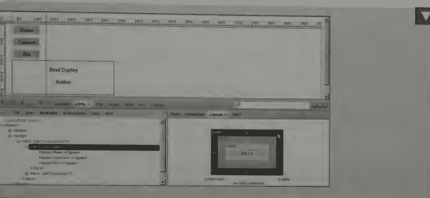

**图 2.17** 布局辅助线显示没有足够的空间让三个标签并排。

8. 要解决此问题，点击样式标签页并将`width`属性更改为`300px`，如图2.18所示。注意标签现在都并排了，但它们之间的间距仍然太大。

> **注意**
> 你也可以在布局视图中直接修改外边距、边框、高度、宽度和内边距的值。

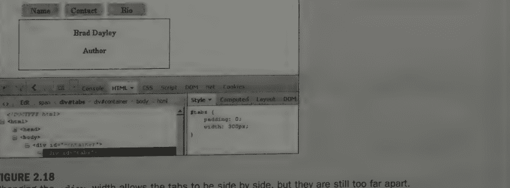

**图 2.18** 更改`<div>`宽度使得标签可以并排，但它们仍然相距太远。

9. 在网页中右键点击Name标签，从列表中选择“使用Firebug查看元素”。该元素会在HTML检查器中被自动选中。
10. 点击布局标签页并将鼠标悬停在外边距框上，如图2.19所示。注意`<span>`元素周围有一个5px的外边距。这就是它们彼此不靠近的原因。

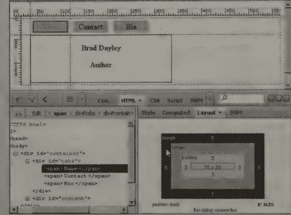

**图 2.19** 布局辅助线揭示了`<span>`元素周围有一个外边距，使标签保持分离。

11. 转到样式标签页并禁用`<span>`元素的`margin`属性，如图2.20所示。标签现在紧挨在一起，并直接位于显示框的顶部。

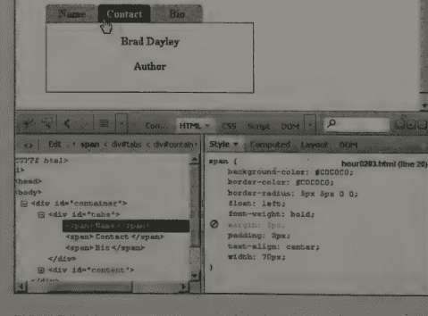

**图 2.20** 禁用外边距允许标签彼此靠近并与显示框紧贴。

### 调试jQuery和JavaScript

你已经学会了如何在JavaScript控制台中查找JavaScript和其他脚本中的错误。如果你的脚本没有引起任何浏览器错误，但它就是不能按你希望的方式工作呢？Firebug有一个非常好的集成调试器可以帮你解决。

#### 浏览JavaScript调试器

JavaScript调试器允许你查看与网页一起加载到浏览器中的JavaScript脚本。除了查看脚本，你还可以设置断点、监视变量值以及查看调用栈，就像使用任何其他调试器一样。

图2.21展示了Firebug中可用的JavaScript调试器的组件。从JavaScript调试器中，你可以访问以下功能：

- **JavaScript视图**——这显示了实际的JavaScript代码。

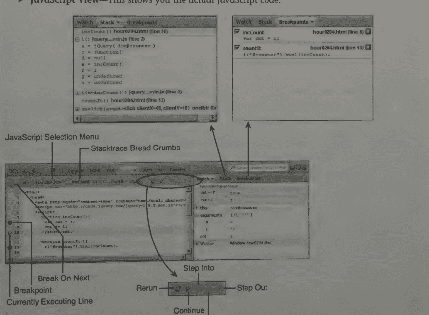

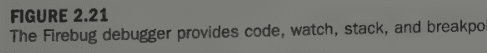

- **JavaScript选择菜单**——此菜单显示与网页一起加载的JavaScript脚本列表。你可以单击此菜单来选择要在视图中加载哪个JavaScript文件。

- **在下一步中断**——选择此选项后，浏览器将在运行下一个脚本的第一行时中断并进入调试器，并停止执行JavaScript。

- **监视**——图2.21中显示的“监视”标签页为你提供了在代码当前执行时可用的函数、变量、属性等的列表。这是一个非常有价值的窗口。从这里，你可以看到代码执行时变量和对象的值。此外，你可以通过在监视列表顶部输入自己的表达式来将其添加到监视列表中。“监视”标签页的一个很棒的功能是，你可以双击变量值并更改执行中使用的值。这是测试假设场景的好方法。

- **栈**——“栈”标签页提供了导致当前执行代码行的函数调用历史记录。“栈”标签页最有价值的方面之一是，你可以通过展开函数名来查看传递给每个函数的参数值。你也可以点击函数名，该文件将加载到JavaScript视图中，并且该行代码将高亮显示。

- **栈面包屑**——与“栈”标签页类似，这些显示了栈历史记录，你可以单击它们将该JavaScript文件和函数加载到JavaScript视图中。

- **断点**——断点允许你指定在执行JavaScript时在哪里停止。当你设置断点时，浏览器会停止执行并在执行该行代码之前中断并进入调试器。你通过在JavaScript视图中点击代码行左侧来设置断点。它们用红点标记。要移除断点，请单击它。“断点”标签页显示已设置的断点列表。你可以通过取消选中其旁边的框来禁用断点。

- **当前执行行**——当前执行的代码行用黄色箭头标记。

- **重新运行**——当你单击此图标时，当前执行的脚本将使用与之前相同的输入重新启动。

- **继续**——这允许脚本继续正常执行，直到遇到另一个断点（如果有的话）。

- **单步进入**——当你单击此图标时，代码前进一行。如果该行代码正在执行另一个函数，你将进入该函数的第一行代码。

- **单步跳过**——当你单击此图标时，代码前进一行。如果该行代码正在执行另一个函数，该函数将被执行，然后你将进入当前函数的下一行代码。如果在单步跳过函数时遇到断点，浏览器将停止在该脚本位置的执行。


#### 使用 JavaScript 调试器

以下示例将帮助您更熟悉 JavaScript 调试器。请参考清单 2.4 中的代码。这是一个基本的网页，包含一个按钮和一个计数字符串。HTML 包含两个 `<div>` 元素。第一个，`<div id="clicker" onclick="countIt()">`，用作一个简单的按钮。当您点击按钮时，会调用 JavaScript 函数 `countIt()`。第二个，`<div id="counter">`，用于显示一个数字。

JavaScript 的本意是每次点击按钮时将数字增加 1。然而，JavaScript 代码存在问题：数字无法增加到超过 2。

#### 清单 2.4 演示 JavaScript 错误的一个非常简单的 HTML 文档

```
01 <!DOCTYPE html>
02 <html>
03   <head>
04     <meta http-equiv="content-type" content="text/html; charset=utf-8" />
05     <script src="http://code.jquery.com/jquery-latest.min.js"></script>
06     <script>
07       function incCount(){
08         var cnt = 1;
09         cnt += 1;
10         return cnt;
11       }
12       function countIt(){
13         $("#counter").html(incCount);
14       }
15     </script>
16     <style>
17       #clicker{
18         background-color: #0066AA;
19         color: #FFFFFF;
20         font-weight: bold;
21         border:2px solid, #C0C0C0;
22         width: 65px;
23       }
24     </style>
25   </head>
26   <body>
27     <div id="clicker" onclick="countIt()">Click Me</div>
28     <div id="counter">1</div>
29   </body>
30 </html>
```

请按照以下步骤在 JavaScript 调试器中设置断点并调试问题：

1.  将清单 2.4 中的代码添加到项目 `hour02` 文件夹中的新文件 `hour0204.html` 并保存文档。
2.  打开 Firefox 并单击 Firebug 图标以启用 Firebug。
3.  在 Firefox 中打开以下 URL。注意唯一的按钮和计数值 1。
    `http://localhost/code/hour02/hour0203.html`
4.  单击 Firebug 中的 "Script" 选项卡，然后从脚本选择菜单中选择 `hour0204.html`。您应该在调试器的 Script 区域看到清单 2.4 中的代码。注意，设置 counter div 中值的函数位于第 7-11 行。
5.  通过单击行号左侧在第 8 行设置断点。应出现一个红点，如图 2.22 所示。同时确保调试器中的 "Watch" 选项卡已打开。

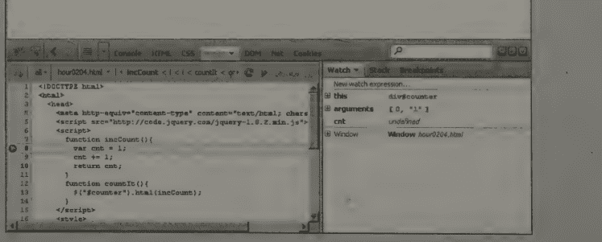

**图 2.22** Firebug 中的 JavaScript 调试器因断点而在第 8 行停止。监视菜单显示 `cnt` 变量的值为 undefined。

6.  现在单击网页上的按钮。您应该看到一个黄色箭头出现，并且调试器中的第 8 行被高亮显示。脚本已停止在该行执行。此函数将确定将放置在 counter 中的值。注意 "Watch" 选项卡中 `cnt` 变量的值为 undefined。
7.  单击 "Step Over" 图标。您应该看到 **cnt** 的值变为 1。
8.  再次单击 "Step Over" 图标。现在 **cnt** 的值是 2，正如预期的那样，由 `cnt += 1;` 行更改。
9.  单击 "Step Out" 图标三次以退出此函数和中间的 jQuery 函数。注意网页上的值已变为 2。
10. 单击 "Continue" 按钮以允许脚本完成。到目前为止，一切正常。
11. 再次单击网页上的按钮。调试器应再次激活并停止在与步骤 6 相同的位置。注意 **cnt** 的值再次为 undefined。
12. 单击 "Step Over" 图标；**cnt** 更改为 1。再次单击 "Step Over"，**cnt** 更改为 2。随着按钮的点击，**cnt** 被重置为 undefined，设置为 1，然后递增到 2。
13. 要修复此问题，请在 Aptana 的原始文件中交换第 7 行和第 8 行，以便 **cnt** 的定义发生在 `incCount()` 定义之前。这定义了变量 **cnt**，并在函数定义之前，仅在脚本加载时设置一次值。
14. 保存文件，然后在 Firefox 中刷新网页。这次脚本在页面加载时停止执行。图 2.23 显示了在 `hour0204.html` 的第 8 行停止的 JavaScript 调试器。这是因为函数的定义在第 8 行，而不是 **cnt** 的定义。

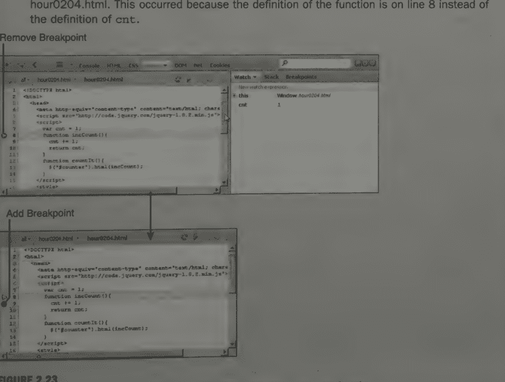

**图 2.23** 将断点从函数定义更改为函数中的第一行。

15. 单击第 8 行的断点以将其删除，并在第 9 行添加断点，如图 2.23 所示。
16. 单击 "Continue" 按钮以恢复 JavaScript 的执行并完成网页加载。
17. 单击网页中的按钮，JavaScript 应再次中断——这次在第 9 行。这次您将不会在监视窗口中看到 `cnt` 变量，除非您展开 Window 元素，如图 2.24 所示。

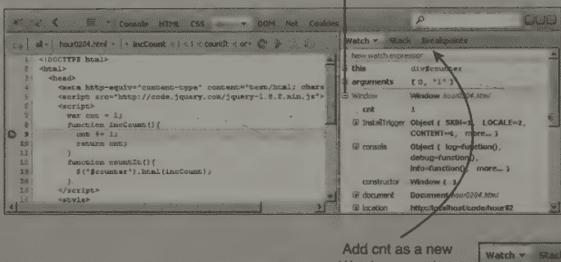

将 cnt 添加为新的监视表达式。

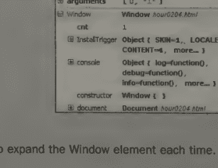

**图 2.24** 为 `cnt` 添加新的监视表达式，这样您就不必每次都展开 Window 元素。

18. 与其每次调试时都必须展开 Window 元素，不如单击图 2.24 所示的监视列表顶部的 "New Watch Expression"，键入 `cnt`，然后按 Enter 键。这会将一个新的监视表达式直接添加到顶部，用于 `cnt` 变量，如图 2.24 所示。
19. 单击 "Step Over" 图标，`cnt` 将变为 2。然后单击 "Continue" 按钮以恢复执行。
20. 再次单击网页中的按钮，这次 `cnt` 变量将显示为 2。当您单击 "Step Over" 按钮时，`cnt` 变量将变为 3。
21. 程序似乎工作正常，因此单击第 9 行的断点以删除断点，然后单击 "Continue" 按钮以恢复执行。
22. 现在每次单击按钮，数字都会增加。您刚刚调试了 JavaScript。

这是一个非常基本的例子，但它很简单，以便于跟踪步骤并习惯调试器的工作方式。在本书中做练习时，您很可能会多次回到调试器。请记住基本步骤：设置断点，并在单步执行代码时监视变量。

#### 那么，如何调试 jQuery？

即使是有调试 JavaScript 经验的人，也经常会问的一个问题是如何调试 jQuery。答案很简单。jQuery 以及众多的插件和版本只是额外的 JavaScript。要调试 jQuery，请从网络上下载 jQuery 库的非压缩版本并将其保存在您的项目中。您将在本书后面学习如何操作。

您下载非压缩版本的原因是压缩版不可读。所有内容都挤在一行中，在调试器中显示效果不佳。非压缩版本格式化为可读的形式。

> **注意**
> 即使您无法获得 JavaScript 文件的非压缩版本，您也可以始终在 Aptana 中打开该文件并从主菜单中选择 "File", "Format"。Aptana 会自动将文件格式化为整洁、可读的形式。大多数 IDE 都具有此类功能。

有了 jQuery 或任何其他 JavaScript 库的格式化版本，您就可以像调试任何其他 JavaScript 文件一样调试它。

### 分析网络流量

Firebug 中一个非常有用的工具是网络流量分析器，它常用于调试 JavaScript。网络流量分析器如图 2.25 所示，可通过单击 Firebug 中的 "Net" 选项卡访问。流量分析器显示有关浏览器到 Web 服务器的每个请求的信息。这使您能够更好地了解正在传输的数据，以及请求是否发生以及是否按正确顺序发生。


### 第60小时：调试jQuery与JavaScript网页

请求列表 | 请求过滤器

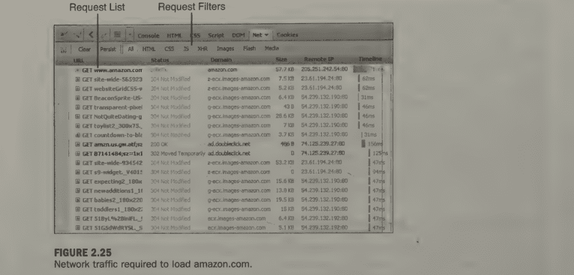

**图2.25** 加载amazon.com所需的网络流量。

图2.25展示了加载amazon.com网页所涉及的流量。其中包含大量请求，每条请求在流量列表中以单行显示。对于每个请求，流量信息中会展示以下内容：

-   **URL**——请求的URL非常实用。你可以右键点击URL并复制，甚至可以在另一个标签页或窗口中打开它。这使你能够调试单个请求，而无需处理整个网页的加载过程。
-   **状态**——我通过状态来判断请求是否成功以及是否仍在运行。例如，网页显示异常可能是由于某个图片请求加载失败，这在Firebug的Net标签页中很容易诊断。
-   **域名**——域名很有意思，特别是在处理跨域脚本时。
-   **大小**——大小信息也很有用，它能帮助你快速找到占用大量磁盘空间和网络带宽的请求。
-   **远程IP**——请求所指向的IP地址。
-   **时间线**——显示请求耗时（以毫秒为单位）。这对于诊断网页响应缓慢及其他速度相关问题非常有用。

对于某些复杂网页，流量可能多到难以逐一调试所有请求。Net标签页中的过滤选项允许你只查看特定类型的请求，例如HTML、CSS或JS。XHR过滤器代表XMLHttpRequest，这是AJAX中使用的通信方式。选择XHR过滤器将仅显示AJAX通信。

如图2.26所示，当你展开一个请求时，会获得关于该请求的大量额外信息。展开请求中显示哪些标签页取决于请求类型和响应类型，以下是一些最实用的项目：

-   **Headers**——显示已发送的HTML请求和响应头。如果你通过AJAX访问需要发送特定头信息的服务，这将非常有用。

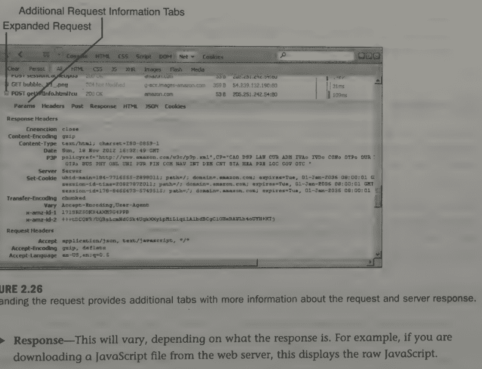

**图2.26** 展开请求会提供更多标签页，包含关于请求和服务器响应的更多信息。

-   **Response**——这会根据响应内容的不同而变化。例如，如果你从网页服务器下载JavaScript文件，这里会显示原始的JavaScript代码。
-   **Post**——这在POST请求中可用，显示发送到服务器的POST请求中参数的值。
-   **Cache**——显示缓存信息，例如缓存中的大小、上次使用缓存的时间以及何时过期。调试JavaScript时遇到的许多问题都源于浏览器已缓存的数据，因此不会尝试获取新副本。

**注意**

如果你点击Firebug中Net标签页的下拉箭头，会有一个禁用浏览器缓存的选项。当你在网页服务器上更新文件以进行调试和修复问题时，这个选项非常有用。勾选此选项后，浏览器将始终从网页服务器获取最新版本。

-   **HTML**——显示响应中包含的HTML文档的渲染版本。
-   **Cookies**——显示涉及请求的Cookie及其值。
-   **JSON**——以易于浏览的可展开树形形式显示JSON代码。如果你从AJAX请求的响应中接收JSON，这非常有用。你可以查看从服务器检索到的数据。

## 总结

在本小时中，你学习了大量调试动态网页问题的方法。你学会了如何将脚本中的消息输出到JavaScript控制台。你学会了如何使用HTML检查器查看浏览器在加载网页时构建的HTML元素。

你还跟随了几个调试HTML、CSS和JavaScript问题的示例。你在本小时中学习的方法将对你完成本书学习和未来项目非常有帮助，因为它们能节省大量时间，避免因那些似乎总是悄然出现的简单语法问题而感到沮丧。

## 问答

**问：是否有调试服务器端脚本的方法？**

答：是的，有。这确实超出了本书的范围；然而，大多数优秀的语言都有远程调试问题的方法。如果你试图调试PHP服务器端脚本，可以查看ZEND的功能：www.zend.com/en/community/pdt。如果你使用Python服务器端脚本，可以查看PyDev：pydev.org。

**问：是否有调试Cookie的方法？**

答：关于调试Cookie，你真正需要知道的是Cookie是否已启用、浏览器中设置了哪些Cookie、Cookie的值是什么以及它们何时过期。所有这些信息都可以在Firebug的Cookies标签页中找到。Chrome和Internet Explorer的开发者控制台中也有类似的功能。

## 练习室

练习室包含一系列问题和答案，旨在巩固你对本小时所涵盖内容的理解。尝试在查看答案之前回答问题。

### 测验

1.  在Firebug中，你去哪里查找特定`<div>`标签的`background-color` CSS属性值？
2.  你会去Firebug的哪里查看浏览器窗口的可用大小？
3.  你如何让JavaScript在特定代码行停止执行？
4.  当JavaScript执行暂停时，如何查找变量的值？

### 测验答案

1.  在HTML检查器的Style标签页中，选择该`<div>`标签。
2.  在DOM标签页中，展开Screen节点。
3.  在Script调试器标签页中设置断点。
4.  查看Script调试器的Watch标签页。

### 练习

1.  修改hour0204.html代码，在第10行添加以下代码，将cnt的值输出到JavaScript控制台。
    `console.log("cnt=%d",cnt);`
2.  使用Net流量查看不同页面的流量。展开一些请求，查看一些标签页中显示的数据。这可以帮助你更好地理解浏览器与网页服务器之间的流量变化。

## 第3小时

理解动态网页结构

**本小时你将学到：**

-   如何构建基本动态网页
-   在网页中何处添加CSS和JavaScript
-   块级元素与内联元素的区别
-   如何向网页添加图像
-   如何构建网页表单
-   如何向网页中的特定位置添加链接
-   如何在网页中构建表格
-   HTML5 SVG图形能做什么
-   使用HTML5为动态音频和视频做准备的方法

在本书的后续部分，你将大量使用HTML、CSS、jQuery和JavaScript。为此，本小时旨在完成两项任务。第一，让你熟悉（如果你还不熟悉的话）HTML的一些重要基础知识，以便你能轻松理解后续的示例。

第二，帮助你理解如何设计HTML，以便在后续使用jQuery和JavaScript时更容易为网页添加动态效果。理解如何设计HTML元素，将使后期添加一些炫酷效果和动态更新存储在列表或表格中的数据变得更加容易。

以下部分将讨论HTML的基础知识及其与jQuery和JavaScript的关系。

## 使用HTML/HTML5元素构建动态网页

你已经在小时1“动态网页编程入门”和小时2“调试jQuery与JavaScript网页”中看到了一些HTML代码示例。现在是时候更深入地了解语法，以及哪些HTML元素和属性对动态网页至关重要。

为了正确构建动态网页，你需要理解HTML语法、一些基本HTML元素，以及如何组织和构建这些元素。以下部分涵盖了这些主题。

### 理解HTML结构

HTML文档由三个主要部分组成：<!DOCTYPE>标签、head和body。每个部分在帮助浏览器将HTML文档渲染为网页方面都扮演着特定角色。

<!DOCTYPE>标签必须是HTML文件中的第一条语句，它告诉浏览器如何读取文件的其余部分。虽然这个标签不是严格要求的，但在HTML文档中包含它是一个好习惯。<!DOCTYPE>元素有几种形式；以下列出其中几种：

-   HTML5——用于HTML5文档的版本
-   HTML 4.01严格型——强制严格执行HTML 4.01标准，并会移除已弃用的元素（如<font>）。
-   HTML 4.01过渡型——放宽对HTML 4.01标准的遵守，允许使用已弃用的元素（如<font>）。

head和body组件包含在HTML标签中。head元素的目的是包含用于解析HTML文档但在浏览器窗口内不渲染的元素，如脚本和元数据。body标签的目的是包含将渲染到浏览器窗口并由用户查看的元素。

以下代码展示了基本HTML文档结构的示例，包含一个head元素和一个body元素：

```html
<!DOCTYPE html>
<html>
  <head>
    <meta charset="UTF-8" />
  </head>
  <body>
    <h1>New Page</h1>
```


### 实现HTML头部元素

HTML `<head>` 元素被设计为网页非可视化元素的容器。`<head>` 元素中的标签会被浏览器解析到DOM中，但它们不会被渲染到浏览器窗口。

以下部分描述了一些更重要的 `<head>` 元素以及它们如何与jQuery和JavaScript相关。

#### `<title>`

`<title>` 元素在所有HTML文档中都应该是必需的。即使没有它，浏览器仍然会渲染页面，但在网页中包含标题元素有许多原因，包括 `<title>` 元素执行以下操作：

- 定义在浏览器工具栏/标签页中显示的标题。
- 提供当网页添加到收藏夹时所使用的名称。
- 决定当搜索引擎显示网页时显示的标题。

以下代码展示了向网页添加标题的示例：

```html
<!DOCTYPE html>
<html>
  <head>
    <title>A Really Cool Web Page</title>
```

`<title>` 元素的值可以很容易地使用jQuery和JavaScript进行更改。例如，清单3.1中的代码在页面加载后使用JavaScript更改网页的标题。

##### 清单3.1 在页面加载后使用JavaScript更改`<title>`值

```javascript
01 <!DOCTYPE html>
02 <html>
03   <head>
04     <title>A Really Cool Web Page</title>
05     <meta charset="UTF-8" />
06     <script>
07       function appendTitle(newTitle){
08         document.title += newTitle;
09       }
10     </script>
11   </head>
12   <body onload="appendTitle('... Loaded')">
13   </body>
14 </html>
```

请注意，在图3.1中，标签页中的标题已更改为显示“A Really Cool Web Page... Loaded”。

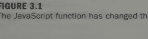

**图3.1** JavaScript函数更改了浏览器标签页中显示的网页标题。

#### `<meta>`

`<meta>` 标签有许多用途。浏览器使用 `<meta>` 标签来确定诸如渲染网页时使用哪种字符集等事项。搜索引擎爬虫使用 `<meta>` 标签来确定网页内容的目的，以进行更好的优化搜索。介绍它的最好方法是向您展示一些语法示例。

在HTML5网页中设置字符集所需的 `<meta>` 标签是：
`<meta charset="UTF-8">`

在HTML4网页中设置字符集所需的 `<meta>` 标签是：
`<meta http-equiv="content-type" content="text/html; charset=UTF-8">`

用于为搜索引擎定义关键词的 `<meta>` 标签如下所示，其中 `content` 的值是您希望搜索引擎在查找网页时使用的关键词：
`<meta name="keywords" content="HTML, CSS, jQuery, JavaScript">`

告诉浏览器每60秒刷新一次网页的 `<meta>` 标签是

```html
<meta http-equiv="refresh" content="300">
```

#### `<style>`

`<style>` 标签允许您直接在HTML文档中添加CSS代码。包含在 `<style>` 标签中的所有内容都被视为CSS文档，并被浏览器用于渲染网页。

作为语法的一个示例，清单3.2中的HTML文件包含CSS，用于将 `<h1>` 元素的背景设为黑色，前景设为白色，如图3.2所示。

##### 清单3.2 使用`<style>`标签向HTML文档添加CSS

```html
01 <html>
02   <head>
03     <meta charset="UTF-8">
04     <style type="text/css">
05       h1 {
06         background-color:black;
07         color:white;
08       }
09     </style>
10   </head>
11   <body>
12     <h1>CSS Reversed Text</h1>
13   </body>
14 </html>
```

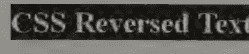

**图3.2** 此 `<h1>` 元素的样式已被HTML文档中的CSS样式脚本反转。

#### `<script>`

`<script>` 标签使您能够直接在HTML文档中添加JavaScript代码或链接到单独的外部JavaScript文件。如果包含内联JavaScript代码，则包含在 `<script>` 标签中的所有内容都被视为JavaScript文档，并在HTML文档解析时加载到浏览器中。如果包含指向外部文件的链接，则该文件将从Web服务器下载并由浏览器加载。

##### 警告

使用 `<script>` 标签时，脚本按解析顺序加载。这意味着任何具有相同变量值的后续脚本都将覆盖已经加载的变量。向网页添加多个脚本时，应注意不要覆盖您无意覆盖的变量和函数名。

例如，清单3.3中的HTML文档包含两个 `<script>` 元素：一个用于加载外部jQuery库，第二个包含一个简单的JavaScript和jQuery函数，用于将 `<h1>` 元素的背景设为黑色，前景设为白色，如图3.3所示。

##### 清单3.3 使用`<script>`标签向HTML文档添加JavaScript和jQuery

```javascript
01 <!DOCTYPE html>
02 <html>
03  <head>
04    <meta charset="UTF-8">
05    <script src="http://code.jquery.com/jquery-latest.min.js"></script>
06    <script>
07      function reverseText(){
08        $("h1").css("background-color", "black");
09        $("h1").css("color", "white");
10      }
11    </script>
12  </head>
13  <body onload="reverseText()">
14    <h1>JavaScript Reversed Text</h1>
15  </body>
16 </html>
```


**图3.3** 此 `<h1>` 元素的样式已被HTML文档中直接使用jQuery的JavaScript函数反转。

#### `<noscript>`

虽然这种情况现在已经不常发生，但偶尔有人会在他们的网络浏览器上禁用JavaScript。如果禁用JavaScript，任何JavaScript，以及随之而来的jQuery脚本，都不会被执行。这可能会给用户带来非常糟糕的体验。

## <noscript>

`<noscript>` 标签允许你提供在 `<body>` 元素中的内容之前渲染的元素。这使你能够在 JavaScript 被禁用的情况下，显示警告消息或页面的替代形式。

`<noscript>` 标签支持与 `<body>` 标签相同的子元素类型。例如，以下代码在 JavaScript 启用时加载 JavaScript 文件，但如果未启用，它会在网页顶部添加一个 `<h3>` 标题，警告用户网页将无法正常工作：

```
<head>
    <script src="DynamicPage.js"></script>
    <noscript>
        <h3>This web page uses JavaScript but it is disabled in your browser.
        The web page may not function properly.</h3>
    </noscript>
</head>
```

## <link>

`<link>` 标签允许你将单独的资源链接到当前文档。在大多数情况下，它用于 CSS 文件。这意味着当浏览器加载 HTML 文档时，链接的 CSS 文件也会从 Web 服务器下载并加载。例如，以下头部分将加载两个不同的 CSS 文档：

```
<head>
    <link rel="stylesheet" type="text/css" href="styleA.css">
    <link rel="stylesheet" type="text/css" href="styleB.css">
</head>
```

除了 CSS 文件，你还可以将图标、帮助文档、许可证和搜索等链接到网页。例如，以下代码链接了一个在网页加载时显示在浏览器标签页中的图标：

```
<link rel="icon" type="image/png" href="http://example.com/myicon.png">
```

### 添加 HTML Body 元素

添加到 body 块中的大多数 HTML 元素都会被浏览器渲染并显示在屏幕上给用户。每个 HTML body 元素标签都提供了不同的选项，这些选项将帮助你以有意义和优雅的方式在网页上显示信息。

在接下来的章节中，你将看到一些在使用 jQuery 和 JavaScript 编程时，适用于 HTML 元素的特定属性。你还将学习一些在本书其余部分中常见的元素的语法，以便更容易理解示例。

#### 使用重要的 Body 元素属性

每个不同的 body 元素都会有一些仅特定于该元素的属性。然而，某些属性对于所有元素都很重要且常见。这些标签如下：

- id—这是一个字符串标识符，在网页上的所有元素中必须是唯一的。CSS、JavaScript 和 jQuery 使用它来标识、访问和修改网页上的特定元素。
- class—class 属性允许你指定多个元素的分组。此选项与 CSS 样式化一起大量使用，用于同时为多个 HTML 元素设置背景色等样式。它在 jQuery 中也很有用，可以根据 class 值选择多个元素。
- style—style 属性允许你直接在 HTML 对象内的 HTML 代码中放置 CSS 定义。style 中的值会覆盖所有其他 CSS 指令。

以下代码说明了向 HTML 元素添加 id、class 和 style 属性的语法。注意，“heading” 和 “content” 类被多次使用，但每个元素的 id 属性是不同的。还要注意，对于第一个标题，添加了一个额外的 style 属性以强制第一个标题始终加粗显示。

```
<div id="Div1">
    <p id="Div1Heading" class="heading" style="font-weight:bold">Heading Text</p>
    <p id="Div1Content" class="content">Some Content</p>
</div>
<div id="Div2">
    <p id="Div2Heading" class="heading">Another Heading Text</p>
    <p id="Div2Content" class="content">Some More Content</p>
</div>
```

#### 理解块级元素与内联元素

请记住，网页是通过浏览器解析 HTML 文档中的每个元素并连同其任何子元素一起渲染到显示屏上的。块级元素和内联元素的区别在于浏览器为该元素提供的空间大小。

块级元素被赋予浏览器中可用的全部宽度来渲染项目。这意味着任何在它之前的元素都将显示在上方，而之后的元素将显示在下方。`<div>` 和 `<p>` 是块级元素的例子。

内联元素只被赋予足以在页面上显示该元素的宽度。这意味着只要有足够的空间，多个内联元素就会在浏览器中并排显示。`<span>`、`<a>` 和 `` 是一些内联元素的例子。

以下代码和图 3.4 所示的渲染版本说明了块级标签和内联标签之间的区别。注意，`<p>` 标签占用了浏览器屏幕的全部宽度，而 `<span>` 标签只占用显示文本和边距所需的空间。

```
<p>Paragraph A</p>
<p>Paragraph B</p>
<p>Paragraph C</p>
<span>Span A</span>
<span>Span B</span>
<span>Span CA</span>
```

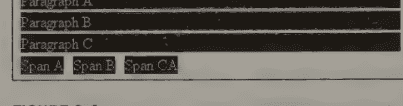

**图 3.4**
块级元素 `<p>` 占用了整个宽度，而内联元素 `<span>` 只使用了它所需的宽度。

虽然元素默认是块级或内联的，但你总可以通过设置 display CSS 样式来改变它们。例如，如下设置一个 `<span>` 的 display 为 block 将使其表现得像一个 `<div>` 元素。

```
<span style="{display:block;}">Span Text</span>
```

以下是你可以将 display 样式设置为的值列表：

- block—将元素渲染为块级元素。
- inline—将元素渲染为内联元素。
- none—即使元素被解析并存在于 DOM 中，也不会将其渲染到屏幕上。

你也可以通过使用以下换行标签之一来分隔项目，从而强制项目渲染在其他项目下方：

- `<br>`—添加一个换行符，导致其后的内容渲染在当前内容下方，即使它们是内联元素。
- `<hr>`—类似于 `<br>`，但也导致浏览器在当前内容下方渲染一条水平线。

这些标签不需要闭合标签。例如，以下代码创建了一组三个 `<span>` 元素，它们首先通过 `<br>` 标签分隔，然后通过 `<hr>` 标签分隔。渲染结果如图 3.5 所示。注意，`<br>` 插入了一个换行符，而 `<hr>` 插入了一个换行符并在内容之间渲染了一条线：

```
<span>Text on</span>
<span> Line 1</span><br>
<span>Text on Line 2</span><hr>
<span>New section on Line 3</span>
```

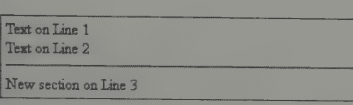

**图 3.5**
使用 `<br>` 添加换行符，使用 `<hr>` 添加换行符并在内容之间渲染一条线。

### 创建容器元素

容器元素用于多种目的，例如对元素或文本集合进行分组和格式化。这允许你将格式和尺寸应用于容器，并使其影响其中的所有项目。虽然几乎任何 HTML 元素都可以用作容器，但主要的三个是 `<p>`、`<div>` 和 `<span>`。

容器元素本身不会改变其中的文本或数据的外观。例如，所有以下内容中的文本在浏览器中的渲染效果都是一样的：

```
Some Text
<p>Some Text </p>
<div>Some Text </div>
<span>Some Text</span>
```

**自己试试看**

#### 使用容器元素进行分组和样式设置

容器元素通常用于分组元素以进行布局和样式设置。以下练习创建了清单 3.4 中的代码。该代码旨在向你介绍分组和样式化元素。

1. 首先在你的 Aptana 项目中创建一个名为 hour03 的文件夹。
2. 在 hour03 文件夹中创建一个名为 hour0304.html 的新 HTML 文档（以匹配书籍网站上的文件名）。
3. 添加适当的 `<html>`、`<head>` 和 `<body>` 标签。
4. 添加以下 `<div>` 元素，如第 19-23 行所示，id 属性设置为 “heading”。这将是你的标题项目的容器。

```
<div class="heading">
  <p>Heading A</p>
  <p>Heading B</p>
  <p>Heading C</p>
</div>
```

5. 添加以下第二个 `<div>` 元素，如第 24-28 行所示，id 属性设置为 “content”。这是你的内容项目的容器。

```
<div class="content">
  <p>Paragraph A</p>
  <p>Paragraph B</p>
  <p>Paragraph C</p>
</div>
```

6. 保存文件并在 Web 浏览器中加载以下 URL 以查看未格式化的代码，如图 3.6 所示：

http://localhost/code/hour03/hour0304.html

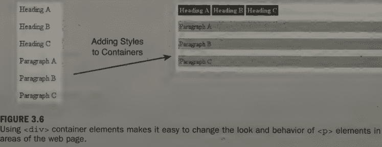

**图 3.6** 使用 `<div>` 容器元素可以轻松更改网页不同区域中 `<p>` 元素的外观和行为。

7. 返回到 Aptana 并在文件的头部添加一个 `<style>` 标签。
8. 在 `<style>` 标签内，添加以下代码，该代码将内容元素格式化为灰色背景并在边缘添加一些内边距：

```
.content p{
  background-color:#C0C0C0;
  padding: 3px;
}
```

9. 为标题元素添加以下额外规则。此规则将标题容器中的 `<p>` 元素更改为内联显示，文本为加粗的白色，背景为黑色。

```css
.heading p{
  display: inline;
  background-color: black;
  color: white;
  font-weight: bold;
  padding: 3px;
}
```

10. 保存文档，然后在Web浏览器中重新加载它。注意图3.6中，“heading”类 `<div>` 元素中的元素被渲染为内联，具有黑色背景和白色文本（如第11和12行所定义），而“content”类 `<div>` 元素中的元素被渲染为灰色背景，并保持块级样式。

#### 代码清单 3.4 使用 `<style>` 标签为HTML文档添加CSS

```html
<html>
<head>
  <meta charset="UTF-8">
  <style type="text/css">
    .content p{
      background-color: #C0C0C0;
      padding: 3px;
    }
    .heading p{
      display: inline;
      background-color: black;
      color: white;
      font-weight: bold;
      padding: 3px;
    }
  </style>
</head>
<body>
  <div class="heading">
    <p>Heading A</p>
    <p>Heading B</p>
    <p>Heading C</p>
  </div>
  <div class="content">
    <p>Paragraph A</p>
    <p>Paragraph B</p>
    <p>Paragraph C</p>
  </div>
</body>
</html>
```

在JavaScript和jQuery开发中，你将大量使用容器元素来分组、格式化和控制动态Web页面的各个方面。

### 添加链接元素

Web页面通常包含指向其他页面的一系列链接。使用锚点标签 `<a>` 可以轻松地将链接添加到Web页面。`<a>` 标签有三个用途：

-   **链接到外部网页**——在Web页面上显示一个链接。当用户单击该链接时，浏览器会从服务器请求链接中的网页。以下是添加指向外部网页的链接的示例：`<a href="http://www.dayleycreations.com/">Dayley Creations</a>`
-   **链接到当前网页上的某个位置**——在Web页面上显示一个链接。当用户单击该链接时，浏览器会滚动到锚点所在的位置，使其可见。`<a href="#local link">Link to Some Text Below</a>`
-   **网页锚点**——在网页内添加一个锚点，该锚点可以被当前页面或另一个网页直接链接。要定义一个锚点，你需要使用 `id` 属性。例如，要为上面的链接添加锚点，请使用以下代码：`<a id="local_link">Page Anchor</a>`

网页锚点在使用JavaScript构建链接元素时非常有用。例如，你可以动态更改链接的 `url` 属性来控制链接跳转的目标位置。

### 使用图像元素

Web页面最强大的功能之一就是能够显示图像以及其他图形和文本。图像使用 `` 标签显示。

`` 标签中显示的实际图像文件由 `src` 属性确定。图像在屏幕上的尺寸由 `height` 和 `width` 属性确定。

以下代码展示了一些以不同尺寸和间距显示图像的示例，如图3.7所示。请注意，当仅指定 `height` 或 `width` 时，图像会按比例缩放；但当两者都指定时，图像会被拉伸以适应特定的高度和宽度设置：

```html


```


使用 `` 为网页添加图像并指定高度和宽度。

在使用jQuery和JavaScript创建动态网页时，你也经常需要处理图像，因为它们允许你快速调整大小、移动、隐藏和添加到网页中。这使得你的图像可以与鼠标操作和其他用户输入进行交互。

### 应用列表元素

列表元素允许你将一组项目组合在一起，并让浏览器自动用项目符号或数字格式化它们。有序列表使用 `<ol>` 标签创建，无序列表（项目符号列表）使用 `<ul>` 标签创建。列表中的项目包含在 `<li>` 标签中。例如，以下代码渲染为图3.8：

```html
<ul>
    <li>Yellowstone</li>
    <li>Yosemite</li>
    <li>Glacier</li>
    <li>Arches</li>
    <li>Zion</li>
</ul>
```

* Yellowstone
* Yosemite
* Glacier
* Arches
* Zion

图3.8
使用 `<ul>` 和 `<li>` 标签向网页添加列表。

### 创建表格元素

表格元素是较复杂的HTML元素之一。它们用于将屏幕上的其他元素组织成一系列行和列。它们可用于多种目的，从布局整个网页到简单的数据表。本节介绍了本书所需了解的基础知识。

表格由一系列定义表格、表头、表体和单元格的标签构建。以下列出了构建表格时可以使用的各种标签：

-   `<table>`——作为所有其他表格元素的容器元素，定义整个表格。
-   `<thead>`——此元素不是必需的，但它很有用，因为它允许你将表格中的表头元素分组和定义，或者通过 `id` 属性从jQuery或JavaScript直接引用表头元素的父元素。
-   `<tbody>`——这也非必需，但它对于定义表格的整个主体或通过 `id` 属性从jQuery或JavaScript直接引用主体元素的父元素很有用。
-   `<th>`——定义表格中的一个表头单元格。
-   `<td>`——定义表格中的一个单元格。
-   `<tr>`——定义表格中的一行。它作为 `<th>` 和/或 `<td>` 元素或单元格元素的容器。
-   `<caption>`——为标题内容提供一个容器。标题内容可以是文本或其他HTML元素。
-   `<colgroup>`——使你可以将表格中的一个或多个列放入一个组中，该组可以一起格式化。如果你希望通过 `id` 属性从jQuery或JavaScript访问特定的一组列，这也很有用。
-   `<col>`——指定 `<colgroup>` 元素内单个列的属性。
-   `<tfoot>`——此元素不是必需的，但它很有用，因为它允许你将表格中的页脚元素分组和定义，或者通过 `id` 属性从jQuery或JavaScript直接引用页脚元素的父元素。

在HTML4中，可以在表格元素上设置多个属性。其中许多在HTML5中已被弃用，因为它们用于格式化大小、对齐方式和颜色，而这些实际上应该使用CSS样式来完成。以下是仍然需要在表格元素上使用的一些更重要的属性列表：

-   `border`——指定表格单元格是否应有边框。
-   `colspan`——指定一个单元格应跨越的列数。这允许单个 `<td>` 或 `<th>` 元素在表格中占据多列。
-   `rowspan`——指定一个单元格应跨越的行数。这允许单个 `<td>` 或 `<th>` 元素在表格中占据多行。
-   `headers`——添加到 `<td>` 或 `<th>` 元素上。允许你指定一个或多个 `<th>` 元素的 `id` 值。这会创建与表头元素的关联，可以从jQuery和JavaScript中访问。

### 动手试试

#### 创建HTML表格

解释表格最简单的方法是向你展示一个创建基本表格的示例。按照以下步骤创建代码清单3.5中的表格代码：

1.  在hour03文件夹中创建一个新的HTML文档，命名为hour0305.html（与书籍网站上的文件名匹配）。
2.  添加适当的 `<html>`、`<head>` 和 `<body>` 标签。
3.  添加以下将 `border` 属性设置为1的 `<table>` 元素：`<table border=1></table>`
4.  在 `<table>` 元素内添加以下 `<caption>` 元素，为表格添加标题：`<caption>Favorite U.S. National Parks</caption>`
5.  通过将以下 `<thead>` 元素添加到 `<table>` 元素来创建表格标题。请注意，第三个 `<th>` 将 `colspan` 设置为2，因此它将覆盖最后两列，如图3.9所示。

```html
<thead>
  <th>Park</th>
  <th>Location</th>
  <th colspan=2>Established</th>
</thead>
```

| 公园 | 位置 | 建立时间 |
| :--- | :--- | :--- |
| 黄石公园 | 蒙大拿州、怀俄明州、爱达荷州 | 1872年3月1日 |
| 约塞米蒂国家公园 | 加利福尼亚州 | 1872年3月1日 |
| 锡安国家公园 | 犹他州 | 1919年11月19日 |

图3.9
一个HTML表格示例，显示了行列中的标题和标题说明。


6. 添加清单3.5中第13到18行所示的`<tr>`元素。请注意，在下面的示例中，每个`<tr>`元素都包含四个单元格。第一个单元格是行标题，因为它使用了`<th>`标签。接下来的两个单元格是`<td>`元素中的简单文本，但在第四个单元格中，`<td>`元素包含一个``元素（.jpg文件可以在本书网站上找到）。

```html
<tr>
  <th>Yellowstone</th>
  <td>Montana, Wyoming, Idaho</td>
  <td>March 1, 1872</td>
  <td></td>
</tr>
```

7. 保存文档，并在Web浏览器中打开以下URL以查看图3.9中所示的渲染结果：

http://localhost/code/hour03/hour0305.html

#### 清单3.5 HTML生成包含标题、行和列的表格

```html
<html>
 <head>
    <meta charset="UTF-8">
 </head>
 <body>
    <table border=1>
      <caption>Favorite U.S. National Parks</caption>
      <thead>
        <th>Park</th>
        <th>Location</th>
        <th colspan=2>Established</th>
      </thead>
      <tr>
        <th>Yellowstone</th>
        <td>Montana, Wyoming, Idaho</td>
        <td>March 1, 1872</td>
        <td></td>
      </tr>
      <tr>
        <th>Yosemite</th>
        <td>California</td>
        <td>March 1, 1872</td>
        <td></td>
      </tr>
      <tr>
        <th>Zion</th>
        <td>Utah</td>
        <td>November 19, 1919</td>
        <td></td>
      </tr>
    </table>
 </body>
</html>
```

### 实现表单元素

HTML中另一组极其有用的标签是表单标签。这些标签提供了构建用户输入表单的基础，使你能够从用户那里获取输入。浏览器知道如何渲染表单元素，以显示文本框、按钮和列表等。

以下是将在jQuery和JavaScript中用来创建动态表单元素的一些更常见的表单标签：

-   `<form>`—这是表单的根元素。所有其他元素都包含在其中。
-   `<fieldset>`—充当容器，允许你将多个表单元素分组在一起。在HTML5中，你可以设置`<fieldset>`的`disabled`属性来禁用它，使其无法接受用户输入。你也可以使用jQuery和JavaScript来访问`<fieldset>`的子元素并从代码中修改它们。
-   `<legend>`—告诉浏览器为`<fieldset>`添加标题。
-   `<label>`—允许你通过将`for`属性设置为`<input>`元素的`id`属性值，将一个`<label>`元素与表单中的一个`<input>`元素关联起来。这样做的好处是，与`<input>`元素关联的鼠标事件也会被`<label>`触发。
-   `<input>`—`<input>`标签实际上是多种类型输入组件的包装器。浏览器渲染的输入类型取决于`type`属性的值。以下是在`<input>`标签中可以指定的`type`元素列表：button、checkbox、color、date、datetime、email、file、hidden、image、month、number、password、radio、range、reset、search、submit、tel、text、time、url和week。
-   `<textarea>`—与其他输入不同，它提供了一个可调整大小的区域，用户可以在其中输入多行文本。`cols`和`rows`属性定义了初始大小。
-   `<select>`—充当项目下拉列表的容器。
-   `<option>`—在`<select>`元素内部使用，用于定义列表中的单个项目。所选项目的`value`属性同时也是`<select>`元素的值。
-   `<button>`—定义一个可点击的按钮元素。按钮的`type`属性告诉浏览器是使用该按钮来提交表单、重置值，还是仅作为简单的输入按钮。

表单元素有一组不同的属性，用于访问和修改元素的外观和行为。以下是一些更重要的属性：

-   **name**—此选项指定一个在提交表单时可以使用的名称。
-   **value**—此选项指定表单元素的值。对于诸如文本`<input>`之类的元素，你为`value`指定的值将作为文本添加到渲染的文本框中。`value`属性也可以通过JavaScript访问，因此你可以直接从JavaScript获取任何表单元素的值。
-   **disabled**—当添加此属性时，元素将被显示；但是，它将显示为禁用状态，因此用户无法与该表单元素交互。当你通过JavaScript或jQuery启用和禁用元素时，此值会动态修改。`disabled`属性是布尔型的，因此你不需要为其指定一个值。以下展示了如何包含`disabled`属性的示例：

```html
<input type="text" disabled />
```

## 动手实践

##### 将表单添加到网页

在此示例中，你将一个包含不同元素的表单添加到网页中。如清单3.6所示的完成示例，渲染了图3.10所示的网页表单，其中包含几种类型的表单元素。利用你在接下来的示例中学到的基础知识，你将能够创建几乎任何你需要的自定义表单。

1. 在hour03文件夹中创建一个新的HTML文档，命名为hour0306.html（以与本书网站上的文件名匹配）。

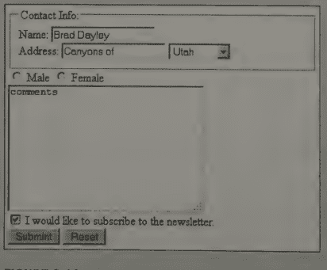

**图3.10**
一个HTML表单示例，展示了由清单3.6创建的各种表单元素。

2. 添加适当的`<html>`、`<head>`和`<body>`标签。
3. 添加一个`<form>`元素。
4. 在`<form>`元素内部，添加以下`<fieldset>`来请求联系信息。`<fieldset>`包含一个提供标题的`<legend>`元素，两个用于姓名和地址的基本文本`<input>`标签，然后是一个包含三个`<option>`子元素的`<select>`元素，以提供一个州的下拉列表。图3.10显示了渲染后的`<fieldset>`，其周围有一个框以及各个元素。

```html
<fieldset>
	<legend>Contact Info:</legend>
	Name: <input type="text" name="name"><br>
	Address: <input type="text" name="name">
	<select name="state">
		<option value="UT">Utah</option>
		<option value="CA">California</option>
		<option value="NY">New York</option>
	</select>
</fieldset>
```

5. 接下来，添加单选按钮以选择性别。将以下`<label>`和`<input>`字段添加到表单中。`<input>`元素的`type`属性设置为`radio`。另外，请注意`<label>`元素包含一个`for`属性，该属性将其与单选`<input>`元素关联起来。因为`<label>`与`<input>`相关联，所以当你点击标签时，它会切换单选按钮的状态。

```html
<input id="maleRB" type="radio" name="gender" value="male">
<label for="maleRB">Male</label>
<input id="femaleRB" type="radio" name="gender" value="female">
<label for="femaleRB">Female</label><br>
```

6. 通过添加以下`<textarea>`元素来添加一个评论元素。注意`rows`和`cols`属性定义了大小，我们在文本区域内预先放入了“comments”一词，而不是在外面添加标签。末尾的`<br>`标签使得接下来的表单元素位于新行。

```html
<textarea rows="10" cols="30">comments</textarea><br>
```

7. 通过添加以下`<input>`和`<label>`来提供一个复选框，以便用户选择订阅新闻通讯。`<input>`元素的`type`设置为`checkbox`，这样浏览器就知道将其渲染为复选框。另外，`<label>`元素使用了`for`属性，这样用户可以点击复选框或标签来切换其选中状态。

```html
<input id='newsCB' type="checkbox" name="news" value="news">
<label for="newsCB">
	I would like to subscribe to the newsletter.
</label><br>
```

8. 添加以下代码以包含两个按钮元素：一个提交按钮和一个重置按钮。当按下提交按钮时，浏览器将提交表单。当按下重置按钮时，表单中的值将被重置。

```html
<button type="submit" name="SubmitButton" value="Submit">Submit</button>
<button type="reset" name="ResetButton" value="Reset">Reset</button>
```

9. 保存文档，并在Web浏览器中打开以下URL以查看图3.10中所示的渲染结果：

http://localhost/code/hour03/hour0306.html

#### 清单3.6 HTML生成包含文本输入和选择列表的表单

```html
<html>
  <head>
    <meta charset="UTF-8">
  </head>
  <body>
    <form>
      <fieldset>
        <legend>Contact Info:</legend>
        Name: <input type="text" name="name"><br>
        Address: <input type="text" name="name">
        <select name="state">
          <option value="UT">Utah</option>
          <option value="CA">California</option>
          <option value="NY">New York</option>
        </select>
      </fieldset>
      <input id="maleRB" type="radio" name="gender" value="male">
      <label for="maleRB">Male</label>
      <input id="femaleRB" type="radio" name="gender" value="female">
      <label for="femaleRB">Female</label><br>
      <textarea rows="10" cols="30">comments</textarea><br>
      <input id='newsCB' type="checkbox" name="news" value="news">
      <label for="newsCB">
          I would like to subscribe to the newsletter.
      </label><br>
      <button type="submit" name="SubmitButton" value="Submit">Submit</button>
      <button type="reset" name="ResetButton" value="Reset">Reset</button>
    </form>
  </body>
</html>
```


### 添加一些高级HTML5元素

HTML5新增了几个更高级的元素，可用于增强动态网页。由于其中一些图形和媒体元素与JavaScript/jQuery编程存在直接关联，我们将在接下来的章节中介绍它们。

#### 使用HTML5图形元素

HTML5的两个主要图形元素是`<svg>`和`<canvas>`。这两个元素可以通过jQuery和JavaScript进行添加和操作。这使得您可以通过脚本直接绘制到浏览器窗口，从而在网页中动态更改复杂的图形。

这意味着您可以在浏览器中动态添加图形元素，而无需从服务器加载文件。

#### 在HTML5中创建SVG图形

`<svg>`元素允许您向网页添加可缩放矢量图形。可缩放矢量图形由一系列线条、弧线和填充组成，这些构成了路径。当由浏览器渲染时，这些路径可以产生从简单到复杂的图形。使用矢量图形的优点在于，即使在浏览器内缩放，它们也能保持清晰的边缘。无论在屏幕上还是打印出来，它们看起来都更清晰。

添加SVG图形可能极其复杂，因此下一节将介绍所涉及的HTML元素，以便您理解属性和样式属性。通过JavaScript和jQuery，您将能够出于各种原因访问这些属性，例如在网页中创建和动画化图形。

##### 添加基本几何形状

首先，您将创建一些基本几何形状。清单3.7中的以下代码创建了一个简单的椭圆和一个如图3.11所示的多边形。在`<ellipse>`元素中，您将椭圆的中心指定为cx和cy坐标；然后使用rx和ry属性指定水平和垂直方向的半径。请注意，您还指定了描边颜色和宽度，以及填充颜色。`<polygon>`元素略有不同——points属性设置为一系列用空格分隔的x,y坐标。

```html
<svg xmlns="http://www.w3.org/2000/svg" version="1.1" height="200">
  <ellipse cx="100" cy="100" rx="80" ry="50"
    stroke="black" stroke-width="2" fill="red" />
  <polygon points="100,10 40,180 110,120 160,180"
    style="fill:gold; stroke:black; stroke-width:5; fill-rule:evenodd;" />
</svg>
```

**图3.11**
使用SVG图形可以轻松地向网页添加基本几何形状。

##### 添加路径

另一个例子是使用路径绘制更复杂的形状。路径只是一组相互连接的线条。这些线条可以是直线、抛物线弧或贝塞尔曲线。要创建路径，请向`<svg>`元素添加一个`<path>`元素并定义d属性。d属性包含一系列命令，告诉浏览器如何在屏幕上渲染路径。以下是更常见命令的列表：

- `M x,y`——指定移动到坐标x,y。大写M指定绝对坐标；小写m指定相对坐标。
- `h n`——指定绘制水平线n像素。该值可以是正数或负数。负数表示向左。大写H是绝对的，小写h是相对的。
- `v n`——指定绘制垂直线n像素。该值可以是正数或负数。负数表示向上。大写V是绝对的，小写v是相对的。
- `l x,y`——从当前坐标绘制一条直线到坐标x,y。您可以指定用空格分隔的额外坐标集来添加额外的线段。大写L是绝对的，小写l是相对的。
- `c x1 y1 x2 y2 x y`——从当前坐标绘制一条贝塞尔曲线到x,y，使用x1,y1作为曲线起点的控制点，x2,y2作为曲线的控制点。图3.12说明了控制点的工作原理。大写C是绝对的，小写c是相对的。
- `a rx ry x-axis-rotation large-arc-flag sweep-flag x y`——从当前坐标绘制一条弧线到x,y。椭圆的大小和方向由两个半径rx、ry以及x-axis-rotation值定义，该值指定弧线的x轴角度。large-arc-flag和sweep-flag设置为0或1，定义抛物线曲线的哪一部分渲染到屏幕。大写A是绝对的，小写a是相对的。
- `z`——关闭路径，这意味着最后一个坐标将连接到路径的起点。

清单3.7中的以下代码展示了如何使用几条路径创建一个不相连的饼图，如图3.13所示。请注意，`<path>`数据以M命令开始，移动到特定的绝对坐标。然后，h50命令向右绘制一条50像素的线；接着，a命令绘制一个弧线，其两个方向的半径均为50像素，向上50像素并向右50像素。最后，z命令关闭弧线，您就得到了第一块饼图。下一个`<path>`元素以同样的方式绘制了饼图的主要部分。

```xml
<svg xmlns="http://www.w3.org/2000/svg" version="1.1" height="200">
  <path d="M100,90 h-50 a50,50 0 1,0 50,-50 z"
        fill="none" stroke="blue" stroke-width="1" />
  <path d="M90,80 v-50 a50,50 0 0,0 -50,50 z"
        fill="green" stroke="none" stroke-width="2" />
</svg>
```

除了使用路径创建图形元素外，您还可以使用路径创建一些酷炫的文本效果。例如，以下代码添加了一个无填充的路径作为`<defs>`容器中的SVG定义。该路径使用两个弧线段绘制了一个完整的圆。id属性被设置为path1。接下来，创建了一个SVG `<text>`元素，定义了一些文本。

请注意，在`<text>`元素内部，有一个`<textPath>`元素引用了path1定义。结果是文本被绘制在路径上，如图3.14所示。我还在`<svg>`标签中添加了一个path元素，使用几条线段绘制了指针。

```xml
<svg xmlns="http://www.w3.org/2000/svg" version="1.1" height="350">
  <defs>
    <path id="path1" d="M 77,210 a 1,1 0 1,1 200,0 a 1,1 0 1,1 -200,1"/>
  </defs>
  <text x="10" y="10" style="fill:blue;font-size:31px;">
    <textPath xlink:href="#path1">
      Teach Yourself jQuery and JavaScript in 24 Hours
    </textPath>
  </text>
  <path d="M 175,130 v90 h60" stroke="black" stroke-width="5" fill="none"/>
</svg>
```

**图3.14**
使用矢量路径，可以将文本链接到路径以创建一些酷炫的视觉效果。

SVG示例可在网站上的code/hour03/hour0307.html文件中找到。使用这些技术，您可以创建大量的图形形状。

###### 清单3.7 使用`<svg>`元素创建饼图和时钟周围文本边框的JavaScript和HTML代码

```html
<!DOCTYPE html>
<html>
  <head>
    <title>Hour 3-7</title>
    <meta charset="UTF-8" />
  </head>
  <body>
    <svg xmlns="http://www.w3.org/2000/svg" version="1.1" height="200">
      <ellipse cx="100" cy="100" rx="80" ry="50"
        stroke="black" stroke-width="2" fill="red" />
      <polygon points="100,10 40,180 110,120 160,180"
        style="fill:gold; stroke:black; stroke-width:5; fill-rule:evenodd;" />
    </svg>
    <svg xmlns="http://www.w3.org/2000/svg" version="1.1" height="200">
      <path d="M100,90 h-50 a50,50 0 1,0 50,-50 z"
        fill="none" stroke="blue" stroke-width="1" />
      <path d="M90,80 v-50 a50,50 0 0,0 -50,50 z"
        fill="green" stroke="none" stroke-width="2" />
    </svg>
    <svg xmlns="http://www.w3.org/2000/svg" version="1.1" height="350">
      <defs>
        <path id="path1" d="M 77,210 a 1,1 0 1,1 200,0 a 1,1 0 1,1 -200,1"/>
      </defs>
      <text x="10" y="10" style="fill:blue;font-size:31px;">
        <textPath xlink:href="#path1">
          Teach Yourself jQuery and JavaScript in 24 Hours
        </textPath>
      </text>
      <path d="M 175,130 v90 h60" stroke="black" stroke-width="5" fill="none"/>
    </svg>
  </body>
</html>
```

本节仅触及了SVG的皮毛。如果您想了解更多关于HTML5中SVG图形的知识，可以查看此处的文档：www.w3.org/TR/SVG/Overview.html。

#### 添加用于动态设计的画布

`<canvas>`元素也允许您向网页动态添加和操作图像类型的图形。画布允许您使用JavaScript在浏览器屏幕的某个区域上绘制颜色、线条、文本和图像。

`<svg>`元素和`<canvas>`元素的区别在于，图形不是作为路径存储，而是作为逐像素映射存储，其中每个像素都有不同的颜色和不透明度。

使用`<canvas>`元素的大部分工作将在jQuery和JavaScript脚本中完成。在HTML中，您只需添加带有id的canvas元素，就可以从脚本中访问它。为了理解`<canvas>`元素和JavaScript之间的关系，请考虑清单3.8中的代码。


### 第三小时：理解动态网页的构成

```javascript
var c = document.getElementById("myCanvas");
var ctx = c.getContext("2d");
ctx.lineWidth = "1";
ctx.strokeStyle = "blue";
```

其余的 JavaScript 代码会在 canvas 上绘制立方体的三个面。对于每个面，`beginPath()` 调用会开始一条新的路径。然后，你使用 `createLinearGradient()` 和 `addColorStop()` 来创建渐变填充并设置上下文的填充样式。

```javascript
var grd = ctx.createLinearGradient(100, 50, 100, 5);
grd.addColorStop(0, "blue");
grd.addColorStop(1, "white");
ctx.fillStyle = grd;
```

接下来，要构建立方体的一个面，首先使用 `moveTo()` 调用移动到画布上的一个特定坐标，然后使用一系列 `lineTo()` 调用来添加线条。此时，画布上仍然什么都没有绘制。要将像素写入画布，你可以使用 `stroke()` 调用和/或 `fill()` 调用来在画布上绘制线条和填充颜色。结果显示在图 3.15 中。

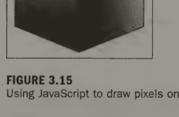

**图 3.15**
使用 JavaScript 在 canvas 上绘制像素。

**清单 3.8** 绘制立方体到 `<canvas>` 元素的 JavaScript 和 HTML 代码

```html
<html>
  <head>
    <title>Hour 3-8</title>
    <meta charset="UTF-8" />
  </head>
  <body>
    <canvas id="myCanvas" width="300" height="300">
      Sorry Your Browser Doesn't Support HTML5 Canvas
    </canvas>
    <script>
      var c = document.getElementById("myCanvas");
      var ctx = c.getContext("2d");
      ctx.lineWidth = "1";
      ctx.strokeStyle = "blue";
      //top
      ctx.beginPath();
      var grd = ctx.createLinearGradient(100, 50, 100, 5);
      grd.addColorStop(0, "blue");
      grd.addColorStop(1, "white");
      ctx.fillStyle = grd;
      grd.addColorStop(0, "blue");
      ctx.moveTo(1, 25);
      ctx.lineTo(100, 5);
      ctx.lineTo(200, 25);
      ctx.lineTo(100, 50);
      ctx.fill();
      ctx.stroke();
      //left
      ctx.beginPath();
      var grd = ctx.createLinearGradient(0, 125, 0, 25);
      grd.addColorStop(0, "blue");
      grd.addColorStop(1, "white");
      ctx.fillStyle = grd;
      ctx.moveTo(1, 25);
      ctx.lineTo(100, 50);
      ctx.lineTo(100, 165);
      ctx.lineTo(1, 125);
      ctx.lineTo(1, 25);
      ctx.fill();
      ctx.stroke();
      //right
      ctx.beginPath();
      var grd = ctx.createLinearGradient(100, 50, 200, 25);
      grd.addColorStop(0, "blue");
      grd.addColorStop(1, "white");
      ctx.fillStyle = grd;
      ctx.moveTo(100, 50);
      ctx.lineTo(200, 25);
      ctx.lineTo(200, 125);
      ctx.lineTo(100, 165);
      ctx.fill();
      ctx.stroke();
    </script>
  </body>
</html>
```

本节仅触及了 `<canvas>` 元素的皮毛。如果你想了解更多关于 HTML5 canvas 图形的知识，可以在这里找到一些优秀的文档和示例：
www.w3schools.com/tags/ref_canvas.asp

### 添加媒体元素

你还应该了解一些额外的 HTML5 元素，即 `<video>` 和 `<audio>` 标签。这些标签允许你以音频和视频的形式将媒体元素添加到网页中。使用 jQuery 和 JavaScript，你可以引用这些元素并动态地操作它们。这使你能够更改大小、在媒体加载完成时通知用户，或者只是控制播放。

以下代码展示了 `<video>` 和 `<audio>` 标签的示例，图 3.16 和 3.17 显示了渲染后的组件：

```html
<video width="320" height="240" controls>
  <source src="images/movie.mp4" type="video/mp4">
  <source src="images/movie.ogg" type="video/ogg">
  Sorry, your browser does not support the video tag.
</video>
<audio controls>
  <source src="song.mp3" type="audio/mp3">
  Sorry, your browser does not support the audio element.
</audio>
```

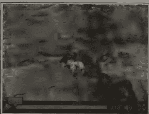

**图 3.16**
渲染后的 `<video>` 元素允许你播放影片。

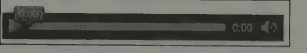

**图 3.17**
渲染后的 `<audio>` 元素允许你播放歌曲或其他音频。

## 总结

在这一小时，你学习了 HTML 网页开发的基础知识。你还学习了如何通过 jQuery 和 JavaScript 动态访问某些元素，从而更好地在网页中设计交互。此外，你学习了设计 HTML 元素以支持实现 CSS 布局和样式所必需的基础知识。

几个“自己动手试一试”练习带你逐步完成了添加样式容器、表格和网页表单的过程。在接下来的小时里，你将运用本小时学到的基础知识来实现动态的 jQuery 和 JavaScript。

## 问答

**问：为什么会有 HTML5 和 HTML4，而不只是 HTML？我应该使用哪一个？**

**答：** 网络浏览器需要一些时间来采纳较新版本 HTML 的标准。许多 HTML5 的特性在旧版浏览器中无法工作，会导致 HTML 页面出错和非常差的用户体验。因此，HTML4 被保留为一个独立的标准，直到 HTML5 在所有网页浏览器上得到完全支持。你选择使用哪一个取决于谁将查看你的网页。如果网页是面向互联网上的所有人，你需要继续支持 HTML4，直到浏览器完全支持 HTML5。如果网页仅供公司内部用户使用，并且你可以要求使用特定级别的网页浏览器，那么你可以选择一个完全支持 HTML5 的网页浏览器及其版本，并利用新特性。

**问：既然可以使用 JavaScript 动态创建元素，为什么还要费心用带有元素的 HTML 来创建文档？**

**答：** 动态网页的最佳范式是：用 HTML 构建基本骨架，用 CSS 设置样式，然后用 JavaScript 添加交互。你应该使用带有完整骨架的 HTML 文档，原因是通过 HTML 理解和调整网页结构要比在 JavaScript 中容易得多。此外，如果你要本地化你的网页，通常本地化一个 HTML 文档要比处理动态的 JavaScript 字符串更容易。

### 练习场

练习场包含一系列问答题，旨在巩固你对本小时所涵盖材料的理解。在查看答案之前，请尝试回答这些问题。

### 测验

1.  HTML 的哪个元素属性用于更改诸如元素的背景颜色和大小之类的设置？
2.  `<noscript>` 元素是用于什么的？
3.  `<canvas>` 元素和 `<svg>` 元素之间有什么区别？
4.  判断对错：你不能让一个 HTML 页面链接到同一页面上的某个位置。
5.  块级 HTML 元素和行内 HTML 元素有什么区别？

### 测验答案

1.  `style`。
2.  `<noscript>` 允许你在用户的网页浏览器中 JavaScript 未激活时，在 HTML 页面上显示一条消息。
3.  `<canvas>` 元素以基于像素的图形显示图像，并支持 JPEG 和 PNG 等图像格式；`<svg>` 支持基于矢量的图形，作为一系列路径，在缩放时仍能保持清晰。
4.  错误。你可以使用 `<a href="#">` 语法链接到网页上的一个本地锚点。
5.  块级元素占据屏幕的整个宽度，因此其后的元素会流向下方，而多个行内元素可以显示在同一行上，因为它们只占用其内部内容所需的空间。

### 练习

1.  扩展清单 3.5 中的示例，添加一些额外的国家公园。
2.  以清单 3.8 中的示例为基础，通过将路径中的所有顶部点都设置为同一个点 (100,15) 来将立方体更改为球体。你需要移除绘制立方体顶部的部分，更改移动命令，并移除一些 `lineTo()` 函数。

---

# 第四小时

## 添加 CSS/CSS3 样式以实现动态设计和布局

**本小时你将学到：**
*   将 CSS 添加到 HTML 文档
*   如何使用 CSS 选择器将样式应用于特定的 HTML 元素
*   如何将颜色、图像和背景应用于 HTML 元素
*   在 HTML 元素周围创建酷炫的边框
*   使用 CSS 定义网页的外观和布局
*   设计可供你的 jQuery 和 JavaScript 代码使用的 CSS

动态网页最重要的方面之一是，当用户与页面交互时，它们能够动态调整元素的设计和布局。本小时的重点是向你的 HTML 文档添加 CSS 样式。CSS 提供了一种非常简便的方法，可以将样式更改应用到网页上的 HTML 元素。

添加一个良好的初始设计非常重要，这个设计应该能够在你的 jQuery 和 JavaScript 代码中轻松修改。有了良好的设计，通过 jQuery 和 JavaScript 进行简单的样式更改就能显著改变 HTML 组件的外观和行为，从而提供丰富的用户体验。

以下各节涵盖了 CSS 语法以及如何使用 CSS 修改 HTML 元素的外观和网页的布局。

### 向网页添加 CSS 样式

你可以通过多种方式向网页添加 CSS 样式。你可以将它们作为单独的文件添加，在 HTML `<head>` 元素中添加，在 HTML `<body>` 元素中添加，内联在特定 HTML 元素内部添加，甚至可以从 jQuery 和 JavaScript 中动态添加。

你可以按照你喜欢的尽可能多的方式应用尽可能多的样式。但是，你需要记住，样式是按顺序应用的，最新的样式会覆盖之前样式的值。样式按以下顺序加载：


### 从文件加载 CSS 样式

通常，加载 CSS 样式的最佳方法是从一个单独的文件加载，这意味着你需要创建一个扩展名为 .css 的文件，然后将其添加到你的网站中。这提供了几个优势：

- 你可以将多个 HTML 文档链接到同一个 CSS 文件。
- 你的 HTML 文件会保持得更整洁，因为没有大量额外的 CSS 代码妨碍它们。
- 通过更换 CSS 文件为另一个，可以轻松地为你的网站重新设计皮肤。

要从单独的文件加载 CSS 样式，你需要将 .css 文件添加到你的网站，然后将一个 `<link>` 元素添加到 HTML 的 `<head>` 元素中。当网页加载时，浏览器会解析 `<link>` 元素，从 Web 服务器请求 .css 文件，并在渲染 HTML 元素时应用这些样式。

以下是在 `<link>` 元素中使用的语法示例。注意，`rel` 属性设置为 `stylesheet`，`type` 设置为 `text/css`，而 `href` 指向 .css 文件在 Web 服务器上的位置。

```
<link rel="stylesheet" type="text/css" href="css/test.css">
```

### 将 CSS 样式添加到页头

你也可以使用 `<style>` 标签直接在网页的 `<head>` 元素中添加 CSS 样式。`<style>` 标签内的所有文本都将被视为 CSS，被浏览器读取，并在渲染元素时应用到相应的元素上。

在页头中应用 CSS 样式确实有一些优势，包括以下几点：

- 可以轻松地将它们应用到页头，用于测试网页，而无需管理额外的 .css 文件。
- 你可以使用专门应用于该页面的样式，覆盖从 .css 文件加载的全局样式。

以下是一个包含带有 CSS 的 `<style>` 元素的 `<head>` 元素示例。注意，`type` 属性被设置为 `text/css`；这不是必需的，但在浏览器支持其他样式类型的时候，这是一个好的实践。

```
<html>
  <head>
    <meta charset="UTF-8">
    <style type="text/css">
      p{
        background-color:#C0C0C0;
        padding: 3px;
      }
      span{
        font-weight:bold;
      }
    </style>
  </head>
  ...
```

### 在 HTML 主体中使用 CSS 样式

你也可以使用 `<style>` 标签在 HTML `<body>` 元素内部直接添加 CSS 样式设置。这不是一个好的做法，因为它会使网页样式变得非常难以更改和修复。你应该将此方法的使用限制在希望快速添加样式以进行测试目的的场景。测试后，你应该始终将它们移到 `<head>` 或一个单独的文件中。

### 在 HTML 元素中定义 CSS 样式

HTML 元素提供了一个 `style` 属性，允许你直接在 HTML 语句中设置 CSS 样式。这提供了一些优势，但也存在一个巨大的缺点。

优势在于，你可以覆盖全局应用于网站或网页的 CSS 样式。这使得你能够自定义特定元素的外观，而无需在其他位置包含特殊规则。

缺点在于，如果你这样做太多，当你决定采用不同的网页设计或品牌标识时，更新网站的样式会变得非常困难。

以下代码行展示了一个在 `<span>` 元素内部直接添加 CSS 样式的示例：

```
<span style="background-color:blue; color:white; font-weight:bold">Styled Text</span>
```

### 将 CSS 样式添加到 HTML 元素

你已经在这本书之前的示例中看到了一些 CSS 应用的简要示例。现在是时候向你介绍可以通过 CSS 应用到 HTML 元素的语法和属性了。本节绝非详尽无遗；然而，它将让你了解通过 CSS 可以对 HTML 元素做什么。

当你阅读并尝试这些示例时，请记住你可以通过 jQuery 和 JavaScript 访问 CSS 属性，因此可以在用户与网页交互时动态地设置它们。

### 理解基本的 CSS 语法

CSS 由一组或多条规则组成，这些规则定义了 Web 浏览器在渲染 HTML 元素时使用的属性值。每条规则都以一个选择器开始，该选择器定义要应用样式更改的 HTML 元素。然后在 `{}` 括号内是具体的属性设置。属性值使用 `property:value` 语法设置。每个属性设置用分号分隔。

以下列表展示了一个简单 CSS 规则的示例，该规则设置了 `<p>` 元素的字体样式、背景颜色和宽度：

```
p {
    font-style:italic;
    background-color:#DDDDDD;
    width:250px;
}
```

你应该为每个元素使用单独的行，以使文件更易于阅读和整洁。你可以将多个元素组合在一行中，只要它们包含在 `{}` 括号中。例如：

```
p { font-style:italic; background-color:#DDDDDD; width:250px; }
```

一些 CSS 属性支持单个属性的多个设置。这有助于让你的 CSS 文件更简洁，同时保持可读性。例如，以下单个 CSS 属性设置将字体设置为粗体、斜体、12 像素和 Times New Roman。多个设置用空格分隔。指定了两种字体，Times New Roman 和 serif，因此如果浏览器找不到第一种，它将使用第二种。注意，因为 Times New Roman 包含空格，所以必须用双引号或单引号括起来。还要注意，两种字体用逗号分隔，表示它们仍然是同一个设置值的一部分。

```
font:italic bold 12px "Times New Roman",serif;
```

图 4.1 显示了将背景和颜色更改应用于 <p> 元素和 <span> 元素的基本 CSS。注意，有两条规则——每种元素类型一条。每条规则中列出的属性值仅应用于选择器指定的元素。

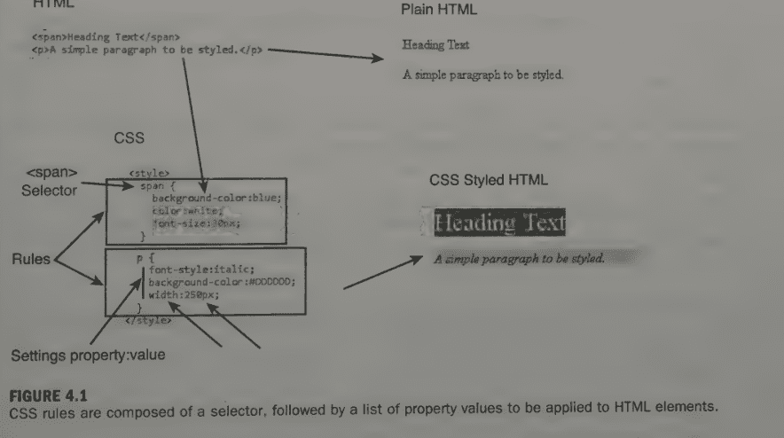

一些 CSS 属性仅在特定类型的浏览器中受支持。CSS 有一种命名约定，允许在属性名前加上浏览器引擎的前缀，以标识该属性设置所针对的浏览器。这提供了几个好处：一是你可以为不同的浏览器指定不同的 CSS 属性值；二是它允许你仅为支持该功能的浏览器设置 CSS 属性。前缀为 -ms- 用于 Internet Explorer，-moz- 用于 Firefox，-webkit- 用于 Safari 和 Chrome，-o- 用于 Opera。以下显示了使用前缀设置 rotate 属性值的示例：

```
-ms-transform:rotate(5deg); /* IE 9 */
-moz-transform:rotate(5deg); /* Firefox */
-webkit-transform:rotate(5deg); /* Safari and Chrome */
-o-transform:rotate(5deg); /* Opera */
```

### 使用 CSS 选择器为 HTML 元素设置样式

为 HTML 元素设置样式最重要的部分之一是 CSS 选择器。CSS 选择器用于定义 CSS 规则适用于哪些 HTML 元素。CSS 选择器起初可能看起来有点令人生畏；但是，当你在一些示例中理解了基本概念后，语法就会变得清晰起来。

以下系列示例将帮助你理解选择器：

要将 CSS 规则应用于所有 `<div>` 元素，请使用以下方式（HTML 元素通过标签名引用）：

```
div {...}
```

要将 CSS 规则应用于 `id` 属性等于 `myDiv` 的特定 HTML 元素，请使用以下方式（在 CSS 中，`id` 属性使用 `#` 指定）：

```
#myDiv {...}
```

要将 CSS 规则应用于一组所有 `class` 属性等于 `container` 的 HTML 元素，请使用以下方式（在 CSS 中，`class` 属性使用 `.` 指定）：

```
.container {...}
```

要将 CSS 规则应用于鼠标悬停在上面时的 `<span>` 元素，请使用以下方式（在 CSS 中，状态用 `:state` 指定）：

```
span:hover {...}
```

要将 CSS 规则应用于 `target` 属性设置为 `_blank` 的 `<a>` 元素，请使用以下方式（在 CSS 中，属性用 `[]` 括号指定）：

```
a[target=_blank]
```

你还可以使用逗号将多个选择器链接在一起。例如，要将 CSS 规则应用于所有 `<div>`、`<span>`、`<p>` 和具有 `class="menu"` 的元素，你可以使用以下方式：

```
div, span, p, .menu {...}
```

另外，请记住，CSS 代表层叠样式表。你可能拥有适用于多个重叠对象组的不同选择器。例如，考虑以下选择器。第一个适用于所有 `<div>` 元素，第二个仅适用于 "menu" 类元素——其中一些是 `<div>` 元素——而最后一个仅适用于当前位于鼠标光标下的 "menu" 类元素。`.menu` 和 `.menu:hover` 规则中的属性设置将覆盖 `div` 规则中的设置：

```
div {...
.menu {...
.menu:hover{...
```

表 4.1 列出了几种常用的选择器；它显示了一个示例并描述了该选择器的工作方式。你可以使用的选择器功能远比前面的示例和表 4.1 中所示的要多，但这些应该能让你了解我们如何在本书其余练习中使用选择器。

#### 表 4.1 一些更常用 CSS 选择器列表

| 选择器 | 示例 | 描述 |
| :--- | :--- | :--- |
| .class | .menu | 选择所有 class="menu" 的元素 |
| #id | #myClass | 选择 id="myClass" 的元素 |
| * | * | 选择所有元素 |
| element | p | 选择所有 `<p>` 元素 |
| element,element | div, .menu | 选择所有 `<div>` 元素和所有 class="menu" 的元素 |
| element element | div span | 选择 `<div>` 元素内部的所有 `<span>` 元素 |
| element> element | div>span | 选择父元素为 `<div>` 元素的所有 `<span>` 元素 |
| element+ element | div+table | 选择紧跟在 `<div>` 元素后的所有 `<table>` 元素 |
| element1~ element2 | h1~ul | 选择每个前面有 `<h1>` 元素的 `<ul>` 元素 |
| [attribute] | [target] | 选择所有具有 target 属性的元素 |
| [attribute=value] | [value=1] | 选择所有 value="1" 的元素 |
| [attribute~= value] | [src~= css] | 选择所有 src 属性包含 "css" 的元素 |
| [attribute^= value] | a[src^="https"] | 选择 src 属性值以 "https" 开头的 `<a>` 元素 |
| [attribute$= value] | a[src$=".png"] | 选择 src 属性值以 ".png" 结尾的 `<a>` 元素 |
| [attribute*= value] | img[src*= "bkground"] | 选择每个 src 属性值包含 "bkground" 的 `` 元素 |
| :link | a:link | 选择所有未访问的链接 |
| :visited | a:visited | 选择所有已访问的链接 |
| :active | a:active | 选择活动链接 |
| :hover | a:hover | 选择鼠标悬停时的链接 |
| :focus | input:focus | 选择当前获得焦点的输入元素 |
| :empty | div:empty | 选择每个没有子元素的 `<div>` 元素 |
| :enabled | input:enabled | 选择启用的 `<input>` 元素 |
| :disabled | input:disabled | 选择禁用的 `<input>` 元素 |
| :checked | input:checked | 选择被选中的 `<input>` 元素 |

### 使用 CSS 设计属性

大多数 CSS 属性旨在改变 HTML 项目的外观。不幸的是，开箱即用的 HTML 元素看起来相当平淡。然而，通过添加颜色、边框、背景、图像和其他设计属性，你只需一点点 CSS 代码就可以显著改变 HTML 元素的外观。

以下部分涵盖了改变 HTML 组件外观的 CSS 属性。

#### CSS 颜色

通过 CSS 应用的最常用设置之一是 color 属性。大多数元素都有一个 color 属性，它定义了浏览器用于渲染它们的颜色——例如，表格边框、列表项目符号或段落中的文本字符。

你可以使用多种方法来设置精确的颜色，以支持定义颜色的不同背景和情况。颜色值可以通过以下方法之一指定：

- **名称**—CSS 颜色名称，例如 red、blue、green 或 yellow。有 147 个预定义的颜色名称，如 aqua、crimson、silver。你可以在 www.w3.org/TR/css3-color/#svg-color 找到颜色名称列表。
- **十六进制**—你可以指定一个十六进制数，表示颜色中包含的红、绿、蓝量。语法是 #RRGGBB。值为 00 表示没有该颜色，值为 FF 表示完全包含该颜色。例如，红色是 #FF0000，绿色是 #00FF00，蓝绿色是 #00FFFF。
- **RGB**—类似于十六进制，但你可以指定 0 到 255 之间的值。例如，蓝绿色是 rgb(0, 255, 255)。
- **RGBA**—与 RGB 相同；但你还可以指定一个 alpha 参数来控制不透明度，0.0 表示完全透明，1.0 表示不透明。例如：rgba(0, 255, 255, 0.5) 是 50% 不透明的蓝绿色。
- **HSL**—使你能够基于色相/饱和度/亮度配色方案来指定颜色。例如，色相为 100、饱和度为 45%、亮度为 75% 的颜色将是 hsl(100, 45%, 75%)。
- **HSLA**—与 HSL 相同，但你也可以指定一个 alpha 参数来控制不透明度，0.0 表示完全透明，1.0 表示不透明。例如，一个 80% 透明的颜色将是 hsla(100, 45%, 75%, .20)。

例如，以下所有 CSS 规则都将 `<p>` 元素的文本颜色定义为蓝色，并且完全可以互换：

```
p {color:blue;}
p {color:#0000FF;}
p {color:rgb(0,0,255);}
p {color:rgba(0,0,255,1.0);}
p {color:hsl(240,100%,50%);}
p {color:hsl(240,100%,50%,1.0);}
```

#### 通过 CSS 应用文本样式

CSS 提供了几个属性，使你能够定义 HTML 元素中文本的外观。以下是你可能遇到的一些更常见的文本属性：

- **color**—允许你设置文本的颜色和透明度。
- **font**—允许你设置用于渲染文本的字体的各种属性。你可以设置的属性有 font-style、font-variant、font-weight、font-size 和 font-family。font 属性允许在单行或作为一系列单独的属性中设置这些属性。例如，以下行是等效的，并产生图 4.2 所示的输出：

`#roman{font: italic bold 30px "Times New Roman", serif}`
`#roman{`
```
font-family:"Times New Roman", serif;
font-style:italic;
font-weight:bold;
font-size: 30px;
}
```

**图 4.2**
更改字体样式、粗细、大小和字体。

> **注意**
> 字体族按 font-family 属性中指定的顺序应用。使用找到的第一个字体。最好始终提供一种常用字体（如 serif）作为备份，以防你指定的字体在浏览器系统中不存在。

- **text-align**—允许你将文本对齐设置为右对齐、左对齐或居中。例如，以下 CSS 设置呈现如图 4.3 所示的输出：
`#align-left{text-align:left}`
`#align-center{text-align:center}`
`#align-right{text-align:right}`

**图 4.3**
更改对齐方式会重新定位浏览器中的文本。

- **letter-spacing**—允许你指定单词中字母之间的间距量。此值可以是正数也可以是负数，可以指定为 px/pt/cm。图 4.4 显示了使用以下 CSS 设置将字母间距收紧 1 像素的示例：
`#tight{letter-spacing:-1px}`

**图 4.4**
将 letter-spacing 更改为 1px 会使文本更紧凑。

- **word-spacing**—使你能够指定单词中字母之间的间距量。此值可以是正数也可以是负数，可以指定为 px/pt/cm。
- **line-height**—使你能够控制行之间的间距量。你可以将值指定为一个乘以文本高度的数字、一个使用数字加 em/px/pt/cm 后缀的大小量，或者一个表示行高百分比的 %。图 4.5 显示了使用以下 CSS 设置将行间距收紧到仅为正常高度 50% 的示例：

`#half-height{line-height:50%}`

**图 4.5**
将 line-height 更改为 50% 会使文本行更紧凑。

- **text-decoration**—使你能够使用 `overline`、`underline` 或 `line-through` 值在文本下方、上方或穿过文本添加线条。你也可以指定 `blink` 作为值，使文本在浏览器中闪烁。以下 CSS 行导致元素渲染下划线和删除线，如图 4.6 所示：

`#underline{text-decoration:underline;}`
`#strike-through{text-decoration:line-through;}`

**图 4.6**
将文本更改为下划线或删除线。

- **text-indent**—使你能够指定缩进文本第一行的量，可以是特定值（如 20px），也可以是元素宽度的百分比（如 20%）。
- **text-transform**—使你能够使用 `capitalize` 将每个单词的首字母大写、使用 `uppercase` 使文本全大写，或使用 `lowercase` 去除所有大写字母，从而更改文本的大小写。
- **text-overflow**—允许你定义当文本比元素允许的尺寸宽时发生的情况。选项是 `clip` 仅裁剪文本，`ellipsis` 添加一个 `...` 代表被裁剪的文本，或者一个将被添加以替换被裁剪文本的字符串。例如，以下 CSS 行将在文本太长时裁剪文本并在末尾附加字符串 " (更多)"：

`#overflow{text-overflow:" (more)";}`


### 第四小时：添加 CSS/CSS3 样式以实现动态设计和布局

请按照以下步骤创建 HTML 文档并为文本元素添加 CSS 样式。您将创建的文件完整版本见清单 4.1-html 和清单 4.1-css：

1.  在 Aptana 中创建一个名为 Hour04 的文件夹。
2.  在 Hour04 中添加一个名为 css 的子文件夹。
3.  右键单击 Hour04 文件夹，创建一个名为 hour0401.html 的新 HTML 文档；然后添加以下基本 HTML 元素：

```html
01 <!DOCTYPE html>
02 <html>
03 <head>
04 <title>Hour 4 - Example 1</title>
05 <meta charset="UTF-8">
...
07 </head>
08 <body>
...
23 </body>
24 </html>
```

4.  现在添加以下 `<p>` 元素，您将使用 CSS 来格式化它们。请注意，每个元素都有一个不同的 `id` 属性，您可以在 CSS 选择器中使用它来单独选中该元素。

```html
09 <p id="plain">Plain Text</p>
10 <p id="blue">Blue Text</p>
11 <p id="tight">Tight Text</p>
12 <p id="half-height">Close Text Line 1<br>
13                     Close Text Line 2</p>
14 <p id="align-center">Centered Text</p>
15 <p id="align-right">Right Text</p>
16 <p id="indent">Indented Text</p>
17 <p id="underline">Underlined Text</p>
18 <p id="strike-through">Strike Through Text</p>
19 <p id="first-cap">capitalize the first letter</p>
20 <p id="uppercase">change to upper case</p>
21 <p id="blackadder">Some BlackAdder Text</p>
22 <p id="roman">Some Times New Roman Text</p>
```

5.  右键单击新的 css 文件夹，添加一个名为 hour0401.css 的新 CSS 文件。
6.  在新文件中添加以下 CSS 规则，为步骤 4 中创建的不同文本元素定义不同的属性设置：

```css
01 #blue{color:blue;}
02 #tight{letter-spacing:-1px}
03 #half-height{line-height:50%}
04 #align-center{text-align:center}
05 #align-right{text-align:right}
06 #indent{text-indent:50px;}
07 #underline{text-decoration:underline;}
08 #strike-through{text-decoration:line-through;}
09 #first-cap{text-transform:capitalize;}
10 #uppercase{text-transform:uppercase;}
```

7.  在 hour0401.html 的头部添加以下 `<link>` 元素，以链接到新的 CSS 文档：

```html
06 <link rel="stylesheet" type="text/css" href="css/hour0401.css">
```

8.  保存这两个文件，并在浏览器中打开以下位置。您应该会看到类似于图 4.7 的输出，其中每个段落的外观都已改变。
    http://localhost/code/hour04/hour0401.html

    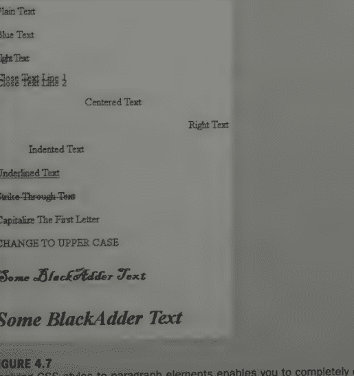

    图 4.7
    为段落元素应用 CSS 样式使您能够完全改变它们的外观和行为。

#### **清单 4.1-html** 包含多个待样式化段落元素的 HTML 代码

```html
01 <!DOCTYPE html>
02 <html>
03     <head>
04         <title>Hour 4 - Example 1</title>
05         <meta charset="UTF-8">
06         <link rel="stylesheet" type="text/css" href="css/hour0401.css">
07     </head>
08     <body>
09         <p id="plain">Plain Text</p>
10         <p id="blue">Blue Text</p>
11         <p id="tight">Tight Text</p>
12         <p id="half-height">Close Text Line 1<br>
13                         Close Text Line 2</p>
14         <p id="align-center">Centered Text</p>
15         <p id="align-right">Right Text</p>
16         <p id="indent">Indented Text</p>
17         <p id="underline">Underlined Text</p>
18         <p id="strike-through">Strike Through Text</p>
19         <p id="first-cap">capitalize the first letter</p>
20         <p id="uppercase">change to upper case</p>
21         <p id="blackadder">Some BlackAdder Text</p>
22         <p id="roman">Some Times New Roman Text</p>
23     </body>
24 </html>
```

#### **清单 4.1-css** 通过调整颜色、对齐方式、添加线条和调整间距来样式化各种文本元素的 CSS 代码

```css
01 #blue{color:blue;}
02 #tight{letter-spacing:-1px}
03 #half-height{line-height:50%}
04 #align-center{text-align:center}
05 #align-right{text-align:right}
06 #indent{text-indent:50px;}
07 #underline{text-decoration:underline;}
08 #strike-through{text-decoration:line-through;}
09 #first-cap{text-transform:capitalize;}
10 #uppercase{text-transform:uppercase;}
11 #roman{font: italic bold 30px "Times New Roman", serif}
12 #blackadder{
13     font-family:"blackadder itc";
14     font-size: 25px;
15     font-weight:bold;
16 }
```

#### 通过 CSS 添加背景

更改元素的背景属性是完全改变外观和感觉的绝佳方式。您应该了解以下几个背景属性：

-   **background-attachment** — 可以设置为 `scroll` 或 `fixed`，前者使背景随页面其余部分一起滚动，后者则将其固定。

-   **background-color** — 允许您使用常规颜色命令定义背景颜色；例如：
    `#top-left {background-color:rgb(255,255,0);}`

-   **background-size** — 允许您指定元素背景的大小。值可以是以像素或百分比设置的宽度/高度、`cover`（它会缩放背景以填充元素区域）或 `contain`（它会缩放图像，使整个图像都包含在元素中）。请记住，使用 `cover` 时，如果尺寸比例不同，图像的某些部分可能不会在元素中显示。以下是一些示例，将大小设置为 200 像素宽乘 100 像素高、元素宽度的 20% 乘元素高度的 200%，以及完全包含在元素大小内。
    `#top-left {background-size:200px 100px;}`
    `#top-left {background-position:20% 100%;}`
    `#top-left {background-position:contain;}`

-   **background-position** — 这设置了背景在元素中放置的位置，例如 `top left`、`bottom center` 等。您还可以以像素或百分比指定背景图像左上角的宽度和高度位置坐标。例如，以下代码将背景图像放置在中间、向右 10% 向下 50%、以及向右 100px 向下 20px 的位置：
    `#top-left {background-position:center center;}`
    `#top-left {background-position:10% 50%;}`
    `#top-left {background-position:100px 20px;}`

-   **background-image (url)** — 允许您指定将用作背景的图像的 url。例如：
    `#rocs{background-image:url("images/rocks.png");}`

-   **background-image (gradient)** — 在 CSS3 中，您还可以指定一个渐变，它将使用不同颜色的过渡填充背景。指定渐变时，您可以设置位置、大小和颜色。每个浏览器都有其自己的特定属性名称。

以下是一个定义了水平线性渐变的 CSS 示例。图 4.8 显示了渐变的应用效果。请注意，位置设置为 `top`。它从顶部的蓝色开始，在 70% 处变为白色，然后在 100%（或底部）变为绿色：

```css
background-image: -moz-linear-gradient(top, blue 0%, white 70%, green 100%);
```

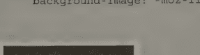

图 4.8
创建线性背景图像渐变。

▶ 以下 CSS 行定义了图 4.9 中所示的径向渐变。辐射中心设置为距左侧 50% 和距顶部 50%；`circle` 确保它不会倾斜成椭圆，`contain` 将其缩放至合适的大小。颜色从中心的白色开始，移动到 75% 处的蓝色，然后回到外部的透明白色，使用 `rgba()` 颜色设置。

```css
background-image: -moz-radial-gradient(50% 50%, circle contain,white,blue 75%,rgba(255,255,255,0));
```


图 4.9
创建径向背景图像渐变。

▶ `background-repeat` — 您可以使用此选项多次重复背景图像。值包括 `repeat`（在所有方向重复）、`repeat-y`（在垂直方向重复）和 `repeat-x`（在水平方向重复）。您也可以指定 `no-repeat` 以仅显示一次图像。重复的图像用于边框以及作为条和按钮的设计元素。图 4.10 显示了以下代码中不同 `background-repeat` 值的结果：

```css
body{
    background-size:50px 50px;
    margin:5px;
    background-image: -moz-radial-gradient(20px 20px, circle contain,white,blue 75%,white);
    background-repeat:repeat;
}
```


按照以下步骤创建一个 HTML 文档，并为文本元素添加 CSS 样式。这些是使用一些 `<div>` 和 `<span>` 元素的基础知识。你将要创建的文件完整版本在清单 4.2 中：

1.  在 Aptana 的 hour04 文件夹中创建一个名为 hour0402.html 的新 HTML 文档。
2.  添加以下基本的 HTML 元素：

```html
01 <!DOCTYPE html>
02 <html>
03   <head>
04     <title>Hour 4 - Example 1</title>
05     <meta charset="UTF-8">
06     <style>
...
30     </style>
31   </head>
32   <body>
33     <div id="heading">jQuery Rocks</div>
34     <div id="content">
35       <div id="menu">
36         <span>Home</span>
37         <span>Info</span>
38         <span>Examples</span>
39       </div>
40       <p>Page Content</p>
41    </div>
42    </body>
43    </html>
```

3.  保存文件，并使用 `localhost` 地址在浏览器中打开它。注意文本非常朴素。接下来，只需一点 CSS 就能改变这一切。

4.  在 hour04 文件夹下创建一个名为 images 的文件夹。

5.  将一个宽度为 200 像素的图像文件复制到该文件夹中。如果愿意，你可以使用网站上的 `/code/hour04/images/rocks.png` 文件。

6.  在 HTML 文件的头部 `<style>` 元素中添加以下 CSS 规则。这会将你刚刚复制到 images 文件夹中的图像添加到网页上。图像会垂直重复显示。

```css
07      body {
08        margin:0px;
09        background-image:url("images/rocks.png");
10        background-repeat:repeat-y;
11      }
```

7.  然后添加以下规则，为标题元素设置文本样式，并添加水平线性渐变作为背景：

```css
12      #heading {
13        background-image: -moz-linear-gradient(left, #0055ff 0%, #AACCFF 100%);
14        height:200px;
15        font:150px bold;
16        text-align: center;
17        color:rgba(255,255,255,.4);
18      }
```

8.  我们添加到 body 的垂直重复图像宽度为 200 像素，因此使用以下规则将内容容器的左边距更改为 200px，这样内容就会显示在图像的右侧：

```css
19      #content {
20        margin-left:200px;
21      }
```

9.  通过将背景颜色更改为 #555555，并为构成选项的 `<span>` 元素添加垂直线性渐变来设置菜单样式。

```css
22      #menu{
23        padding:3px;
24        background-color:#555555;
25      }
26      span {
27          padding:3px;
28          background-image: -moz-linear-gradient(top, #0022ff 0%, #AACCFF
29              85%, #0022ff 100%);
30          font:20px bold;
31          color:white;
32      }
```

10. 保存文件并在浏览器中刷新网页，如图 4.11 所示。注意，添加一些背景元素对原本非常朴素的 HTML 可以产生多大的差异。

添加 CSS 背景样式之前
添加 CSS 背景样式之后

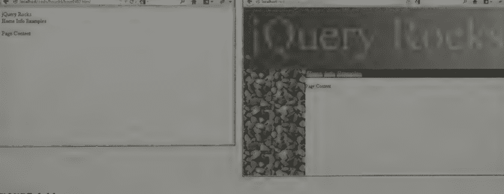

图 4.11
添加 CSS 背景样式极大地改善了元素的外观。

#### 清单 4.2 为元素添加不同类型背景样式的 HTML 和 CSS 代码

```html
01 <!DOCTYPE html>
02 <html>
03  <head>
04      <title>Hour 4 - Example 1</title>
05      <meta charset="UTF-8">
06      <style>
07          body {
08              margin:0px;
09              background-image:url("images/rocks.png");
10              background-repeat:repeat-y;
11          }
12          #heading {
13              background-image: -moz-linear-gradient(left, #0055ff 0%, #AACCFF 100%);
14              height:200px;
15              font:150px bold;
16              text-align:center;
17              color:rgba(255,255,255,.4);
18          }
19          #content {
20              margin-left:200px;
21          }
22          #menu{
23              padding:3px;
24              background-color:#555555;
25          }
26          span {
27              padding:3px;
28              background-image: -moz-linear-gradient(top, #0022ff 0%, #AACCFF 85%, #0022ff 100%);
29              font:20px bold;
30              color:white;
31          }
32      </style>
33  </head>
34  <body>
35    <div id="heading">jQuery Rocks</div>
36    <div id="content">
37      <div id="menu">
38        <span>Home</span>
39        <span>Info</span>
40        <span>Examples</span>
41      </div>
42      <p>Page Content</p>
43    </div>
44  </body>
45 </html>
```

#### ▼ 自己动手试试

#### 为 HTML 元素添加边框

另一个可以被修改以完全改变 HTML 组件外观的 CSS 属性是边框（border）属性。所有的容器元素，如 `<div>`、`<span>` 和 `<p>`，都允许你通过 CSS 定义边框样式。

表 4.2 描述了可以在 CSS 中修改以定义各种边框样式的部分 CSS 属性。

#### 表 4.2 定义边框样式的 CSS 属性

| 属性 | 描述 |
| :--- | :--- |
| border | 允许你使用以下语法在单个 CSS 属性中定义 border-width、border-style 和 border-color 属性：border: border-width border-style border-color; border: 1px solid blue; |
| border-width | 指定用于构建边框的线条宽度。值可以是 thin、medium、thick，或像 1px 这样的尺寸。 |
| border-color | 根据常规 CSS 颜色方法指定边框的颜色。 |
| border-style | 定义在 HTML 页面上绘制的线条类型。你可以使用 none、dotted、dashed、solid、double、groove、ridge、inset、outset 和 inherit。 |
| border-radius | 定义边框圆角的半径。值可以是尺寸（如 5px）或百分比（如 10%）。 |
| box-shadow | 通过设置以下属性为 HTML 元素添加盒子阴影：<br>▶ h-shadow—水平阴影的位置。<br>▶ v-shadow—垂直阴影的位置。<br>▶ blur—模糊的距离。<br>▶ spread—阴影的大小。<br>▶ color—阴影的颜色。<br>▶ inset—如果设置了此值，则阴影显示在边框内部；否则，显示在边框外部。<br>示例：box-shadow:5px 5px 3px 2px red inset; |

你可以使用以下语法在单个属性设置中指定 border-width、border-color 和 border-style 属性的不同值：

```css
property: top right bottom left;
border-width: 1px 2px 1px 2px;
border-color: red blue red blue;
```

你还可以使用位置属性（如 border-top 或 border-top-width）来设置单个边框组件属性。例如，以下 CSS 将仅设置边框的顶部和左侧组件的样式：

```css
border-top: 1px solid black;
border-left-color: blue;
border-left-style: solid;
border-left-width: 2px;
```

以下步骤将通过创建清单 4.3-html 和清单 4.3-css 中的代码，引导你完成为 HTML `<div>` 元素添加多种类型边框的过程：

1.  在 Aptana 的 hour04 文件夹中创建一个名为 hour0403.html 的新 HTML 文档。

2.  添加清单 4.3-html 中所示的代码。该代码链接到一个名为 css/hour0403.css 的外部样式表，然后定义了一系列 `<div>` 元素。

3.  在 Aptana 的 hour04/css 文件夹中创建一个名为 hour0403.css 的新 CSS 文档。

4.  向新的 CSS 文件中添加以下行，为 `<div>` 元素设置基本间距和大小：
   ```css
   01 div { width:200px; margin:5px; padding:2px; text-align:center}
   ```

5.  添加清单 4.3-css 中代码的第 2–8 行，定义应用于不同 `<div>` 元素的几种边框样式。

6.  添加以下 CSS 规则，为两个 `<div>` 元素创建圆角边框：
   ```css
   09 #round { border: 1px solid; border-radius:5px;}
   10 #veryround { border: 1px solid; border-radius:50%;}
   ```

7.  添加清单 4.3-css 中的第 11–20 行。这些代码行为 `<div>` 元素创建了阴影。第一个是外凸阴影，第二个包含 inset 值，将其定义为内阴影。

8.  添加以下代码以创建混合边框。包含此代码是为了向你展示你可以对边框的每一侧进行大量控制。顶部是实线，右侧有圆角；左侧是点线，底部是凸脊，右侧有圆角。
   ```css
   21 #mixed {
   22   border-top: 1px solid;
   23   border-top-left-radius: 5px;
   24   border-left: 1px dotted;
   25   border-bottom: 5px ridge;
   26   border-bottom-right-radius: 10px;
   27 }
   ```

9.  添加以下代码，该代码仅使用边框和一个大的圆角半径以及背景色来创建一个美观的按钮：


#### 4.3 CSS边框样式

```css
#button {
  width: 150px;
  background-color: #2233FF;
  color: white;
  border: 5px outset blue;
  border-radius: 50%;
}
```

10. 保存文件并在Web浏览器中打开HTML文件。你应该会看到类似于图4.12所示的结果。注意，仅使用少数几条CSS样式语句就应用了不同的边框样式。

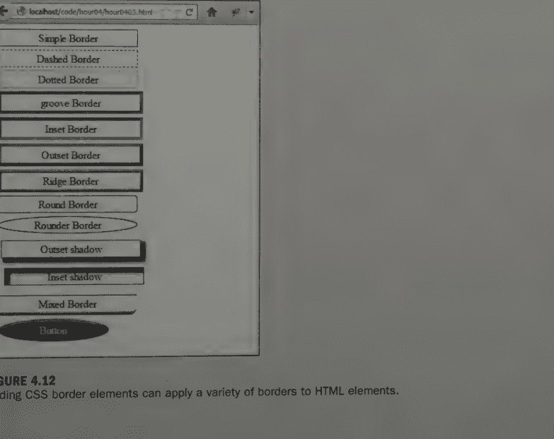

**图 4.12**
添加CSS边框元素可以为HTML元素应用多种边框。

##### 清单 4.3-html 创建一系列由清单4.3-css样式化的`<div>`元素的HTML

```html
<html>
<head>
<meta charset="UTF-8">
<link rel="stylesheet" type="text/css" href="css/hour0403.css">
</head>
<body>
<div id="simple">Simple Border</div>
<div id="dashed">Dashed Border</div>
<div id="dotted">Dotted Border</div>
<div id="groove">Groove Border</div>
<div id="inset">Inset Border</div>
<div id="outset">Outset Border</div>
<div id="ridge">Ridge Border</div>
<div id="round">Round Border</div>
<div id="veryround">Rounder Border</div>
<div id="shadow">Outset shadow</div>
<div id="ishadow">Inset shadow</div>
<div id="mixed">Mixed Border</div>
<div id="button">Button</div>
</body>
</html>
```

##### 清单 4.3-css 定义多种边框样式的CSS规则

```css
div { width:200px; margin:5px; padding:2px; text-align:center}
#simple { border:1px solid black; }
#dashed { border:1px dashed black; }
#dotted { border:1px dotted gray; }
#groove { border:5px groove blue; }
#inset { border:5px inset red; }
#outset { border:5px outset blue; }
#ridge { border:5px ridge black; }
#round { border: 1px solid; border-radius:5px;}
#veryround { border: 1px solid; border-radius:50%;}
#shadow {
    margin:10px;
    border:1px solid black;
    box-shadow: 5px 5px 3px 2px blue;
}
#ishadow {
    margin:15px;
    border:1px solid black;
    box-shadow: 5px 5px 3px 2px blue inset;
}
#mixed {
    border-top: 1px solid;
    border-top-left-radius:5px;
    border-left: 1px dotted;
    border-bottom: 5px ridge;
    border-bottom-right-radius: 10px;
}
#button {
    width:150px;
    background-color: #2233FF;
    color: white;
    border:5px outset blue;
    border-radius:50%;
}
```

#### 鼠标指针

浏览器与用户交互的一个重要部分是鼠标指针。你可以通过改变鼠标悬停在HTML元素上时光标的外观，来让用户了解该元素的用途或行为。

`cursor` CSS属性使你能够定义鼠标悬停在特定元素上时应使用哪种光标。以下示例展示了将`cursor`设置为指针的方式：
`div { cursor:pointer; }`

你可以从多个`cursor`值中进行选择。图4.13展示了通过`cursor` CSS属性可用的一些`cursor`值的示例。


**图 4.13** 通过`cursor` CSS属性可用的一些鼠标指针类型示例。

#### 不透明度

`opacity` CSS属性使你能够设置HTML元素及其内部所有元素的透明度。`opacity`被指定为0到1之间的一个小数值，其中0是透明的，1是不透明的。

更改`opacity`是让用户知道HTML元素处于非活动状态的好方法。例如，以下CSS和HTML定义了两个按钮。`button2`的定义包含一个0.4的不透明度，使其部分透明。结果显示在图4.14中。


**图 4.14**
两个被样式化为按钮的`<span>`元素，其中一个设置了0.4的不透明度。

CSS规则：
```css
#button, #button2 {
  margin: 5px; padding:3px;
  text-align: center;
  background-color: #2233FF;
  color: white;
  border:5px outset blue;
  border-radius:50%;
}
#button2 { opacity:.4; }
```

HTML元素：
```html
<span id="button">Active</span>
<span id="button2">Inactive</span>
```

## 可见性

另一个有用的CSS属性是`visibility`。你可以将`visibility`设置为`hidden`，这样HTML元素及其包含的所有元素将不会被渲染到浏览器中。然后再次将其设置为`visible`，它将在浏览器窗口中显示。这种功能在jQuery和JavaScript中非常有用，可以动态地显示和隐藏页面元素。

### 应用CSS布局属性

创建HTML网页最大的挑战之一是HTML本身并不容易创建外观美观的布局。这就是为什么许多CSS属性都旨在改变大小、位置以及与其他HTML元素的关系。

使用CSS布局属性，你将能够在网页上正确地放置元素，并且通过JavaScript和jQuery，你可以有效地改变这些位置，从而为你的用户提供更像应用程序的体验，而不仅仅是一个简单的点击网页。以下章节介绍了改变HTML组件布局的CSS属性。

#### 理解盒模型

HTML元素使用盒模型渲染到浏览器窗口。在盒模型中，HTML元素的内容由图14.15所示的以下四个部分组成：

- **内容** —— HTML组件本身的内容
- **内边距** —— 组件与边框之间的空间
- **边框** —— 围绕HTML元素的边框
- **外边距** —— HTML元素与周围其他元素之间的空间


**图 4.15**
CSS盒模型包括四个部分：内容、内边距、边框和外边距。

其中每一部分在Web浏览器中占用的空间量都可以使用CSS来设置。

##### 设置内容大小

内容通过指定`height`和`width` CSS属性的大小值来设置。大小值可以指定为px、cm、auto、%等。你也可以使用max-height、max-width、min-height和min-width属性来指定**最大和最小**的高度和宽度。

以下示例展示了如何设置`<p>`元素的height和width属性：
`p {height:100px; width: 50px;}`

##### 为HTML内容添加内边距

内边距是元素布局的重要组成部分，尤其是在使用边框时。内边距确保HTML元素内部的内容不会接触到边框。

可以通过指定一个`padding`值为HTML元素的所有边添加内边距，例如：
`padding:3px;`

你也可以为元素的每一边分别指定内边距，例如：
`padding:1px 2px 1px 2px;`

##### 为HTML元素添加外边距

外边距的工作方式与内边距类似，只是它在元素边框的外部，防止其他HTML元素接触到边框。可以通过指定一个margin值为HTML元素的所有边添加外边距，例如：
`margin:3px;`

你也可以为元素的每一边分别指定外边距，例如：
`margin:1px 2px 1px 2px;`

margin属性还支持auto值。使用auto会根据HTML元素上的大小约束，平均分配外边距值。

##### 修改HTML元素流

除非你另行指定，否则HTML元素会流向浏览器窗口的左上角。

正如你在前一小时所学到的，一些HTML元素是块级元素，一些是行内元素。块级元素占据整个宽度，因此其后的项目会流向下一行。行内元素只占用内容所需的量。

使用display CSS属性，你可以将元素设置为块级或行内。display属性的另一个值得注意的值是inline-block。inline-block允许元素以行内方式显示；然而，与行内元素不同，你仍然可以设置块级属性，如高度、宽度以及外边距。例如：
```css
span {
    height: 200px; width:200px;
    display:inline-block;
}
```

另一种修改HTML元素流的方法是使用float属性。float属性允许元素浮动到包含元素的左侧或右侧。其他未浮动的元素将显示在浮动元素旁边，位于远离包含元素边缘的一侧。

使用float属性时，你需要使用clear属性来定义浮动元素的哪一侧不允许其他元素环绕。为了说明这一点，请看以下CSS和HTML代码。注意，在图4.16中，没有包含`clear:both`属性的段落元素被渲染在浮动到左侧的图像旁边。

CSS规则：
```css
#image1 {float:left;}
#image2 {float:right;}
#cleared {clear:both;}
```


HTML 元素：

```


<p id="uncleared">未清除的文本行</p>
<p id="cleared">已清除的文本行</p>
```


**图 4.16** 将元素向左或向右浮动会改变文档流。然而，你需要使用 `clear` 属性来指定不希望哪些浮动元素与之相邻。

#### 从 CSS 定位 HTML 元素

`position` 属性使你能够定义浏览器如何定位一个元素。默认情况下，元素是静态的，只是与文档中的其他元素一起流动。但是，通过更改 `position` 属性的值，你可以改变这种行为。

以下列表描述了不同的非静态定位值：

-   `fixed`——相对于浏览器窗口定位元素。
-   `absolute`——相对于第一个非静态的容器元素定位元素。该元素的至少一个容器必须已经定义为非静态位置。
-   `relative`——相对于元素正常位置进行定位。

当你将 `position` 属性更改为非静态值后，可以使用 `top`、`left`、`bottom` 和 `right` 属性来设置定位。例如，要将一个元素的左上角设置在距离浏览器窗口顶部 50 像素、距离浏览器窗口左边缘 100 像素的位置，你可以使用以下 CSS 代码：

```
position:fixed;
top:50px;
left:100px;
```

##### z-index

当你开始使用非静态定位来定位 HTML 元素时，可能会遇到一个元素与另一个元素重叠的情况。`z-index` 属性允许你指定哪个元素应该在前面。`z-index` 数值较高的元素位于 `z-index` 值较低的元素前面。以下 CSS 的 `<div>` 元素将位于 `<p>` 段落元素的前面。

```
div { z-index:2; }
p { z-index:2; }
```

##### Overflow

CSS 的 `overflow` 属性是为了解决内容项过大而无法在网页设计的区域内显示的问题而提供的。`overflow` 属性可以设置为以下值：

-   **visible**——默认行为。
-   **hidden**——如果内容过大，则隐藏该元素。
-   **scroll**——在底部和右侧添加滚动条。如果内容超出了大小约束，滚动条将激活，这样你就可以查看容器的全部内容，而不会影响页面其余部分的流程。
-   **auto**——根据需要添加滚动条，以使元素保持在你设定的大小约束内。

图 4.17 展示了一个列表的示例，该列表被约束在一个设置了以下 CSS 规则（包含 `overflow` 属性）的 `<ul>` 元素内：

```
ul{
  border:1px solid;
  height:150px; width:300px;
  overflow:auto;
}
li{ width:800px; }
```


**图 4.17** 为 `<ul>` 元素添加 `overflow` 属性会导致列表被约束在滚动条内。

### 使用 CSS 布局网页组件

在这个示例中，你将实践几个布局属性。在这个示例中，你将创建两个 `<div>` 元素，并使用以下步骤将它们放置在网页中的固定位置。完整的 HTML 和 CSS 代码可以在清单 4.4-html 和清单 4.4-css 中找到。

1.  在 Aptana 的 hour04 文件夹中创建一个名为 hour0404.html 的新 HTML 文档。

2.  添加清单 4.4-html 中所示的代码。该代码链接到一个名为 css/hour0404.css 的外部样式表，然后定义了两个 `<div>` 元素：一个包含一组图像，第二个包含用于显示歌曲信息的 `<p>` 元素。

3.  将清单 4.4-html 中列出的图像文件从书籍网站的 code/hour04/images 目录复制到你的 Aptana 项目中的 hour04/images 文件夹。

4.  在 Aptana 的 hour04/css 文件夹中创建一个名为 hour0404.css 的新 CSS 文档。

5.  在新的 CSS 文件中添加以下行，以设置 `` 元素的基本间距和大小。`margin` 属性为它们之间以及 div 元素内部提供了空间。`float` 属性允许它们浮动到其容器的左侧。

```
01 img{
02   width:48;height:48px;
03   margin:5px;
04   float:left;
05 }
```

6.  添加以下代码行，以定义两个 `<div>` 元素的外观。位置设置为 fixed，但尚未指定具体定位。我们还添加了内边距（padding），以使 `<div>` 内的项目与边框保持距离。

```
06 #buttons, #songInfo{
07   position:fixed;
08   background-color: black;
09   padding:5px;
10   display:inline-block;
11   border:8px ridge blue;
12   border-radius:5px;
13 }
```

7.  添加以下 CSS 规则，以单独定位每个 `<div>` 元素。请记住，它们保留了上一步的所有值。注意，你通过指定浏览器窗口中的顶部和左侧位置来设置元素的位置。还要注意，你为按钮设置了更高的 z-index 数值，以确保它始终位于 songInfo 的上方。

```
16  left:100px;
17  height:150px;width:300px;
18  z-index:1;
19  }
20  #buttons{
21    top:200px;
22    left:140px;
23    z-index:2;
24  }
```

8.  添加第 25–44 行，这些行定义了 songInfo 容器中文本元素的格式。以下是其中一个规则。注意，你将 position 设置为 relative，以便可以将它们相对于它们在 <div> 容器内正常流动的位置进行定位。然后，当你设置 top 和 left 值时，它们是相对于 <p> 项的正常位置的。通过指定一个负数，你可以将项目向上移动。

```
32  #artist{
33    color:cyan;
34    font-size:20px;
35    position:relative;
36    left:30px;
37    top:-50px;
38  }
```

9.  保存文件，并在网页浏览器中打开 HTML 文件。你应该看到与图 4.18 所示类似的结果。注意，CSS 布局样式已将元素定位在浏览器中的特定位置。


**图 4.18**
添加 CSS 布局属性允许你将元素定位在浏览器中的特定位置。

#### 清单 4.4-html 创建一对 `<div>` 元素的 HTML，该元素由清单 4.4-css 样式化为歌曲信息和一组播放控件

```
01 <html>
02   <head>
03     <meta charset="UTF-8">
04     <link rel="stylesheet" type="text/css" href="css/hour0404.css">
05   </head>
06   <body>
07     <div id="buttons">
08       
09       
10       
11       
12       
13       
14     </div>
15     <div id="songInfo">
16       <p id="title">Canon in D major</p>
17       <p id="artist">Johann Pachelbel</p>
18       <p id="album">London Symphony Performances</p>
19     </div>
20     <h1>Song Controls</h1>
21   </body>
22 </html>
```

#### 清单 4.4-css 用于应用页面布局的 CSS 代码，将元素放置在固定位置

```
01 img{
02   width:48;height:48px;
03   margin:5px;
04   float:left;
05 }
06 #buttons, #songInfo{
07   position:fixed;
08   background-color: black;
09   padding:5px;
10   display:inline-block;
11   border:8px ridge blue;
12   border-radius:5px;
13 }
14 #songInfo{
15   top:70px;
16   left:100px;
17   height:150px;width:300px;
18    z-index:1;
19  }
20  #buttons{
21    top:200px;
22    left:140px;
23    z-index:2;
24  }
25  #title{
26    color:lime;
27    font-weight:bold;
28    font-size:30px;
29    position:relative;
30    top:-20px;
31  }
32  #artist{
33    color:cyan;
34    font-size:20px;
35    position:relative;
36    left:30px;
37    top:-50px;
38  }
39  #album{
40    color:yellow;
41    position:relative;
42    left:60px;
43    top:-70px;
44  }
```

### 为动态设计准备 CSS 样式

jQuery 和 JavaScript 最酷的功能之一是动态调整 CSS 样式的能力。在本书稍后部分，你将学习如何做到这一点以创造一些很酷的效果。在本节中，你将了解到在 CSS 知识还比较新时为动态样式做准备的概念。

在定义 CSS 样式规则时，请记住有几种方法可以应用动态样式。这样，你就可以以一种使动态代码实现起来简单得多的方式设计 CSS。以下部分描述了你稍后将学到的一些方法。


#### 准备动态向 HTML 元素添加类

动态调整 HTML 元素样式的最简单方法是更改与该元素关联的 CSS 规则。更改 CSS 规则最简单的方法是使用 `class` 选择器来定义你想要应用的不同规则。这样，你就可以从 jQuery 和 JavaScript 中添加一个 `class` 来应用样式，或者移除一个 `class` 来移除样式。

这提供了两个主要优势。首先，动态代码变得更加简单，因为添加和移除类很容易。其次，调整将要应用的 CSS 样式也很容易，因为这些样式是在 `.css` 文件或 `<style>` 标签中定义的。

使用动态类规则要求类选择器的规则必须在与网页一起加载的 CSS 代码中的某处完全定义好。这也需要思考如何实现每个 CSS 规则。

例如，考虑为一个被设计成按钮样式的 `<span>` 元素添加动态交互。你希望该按钮能够有四种不同的状态：抬起、按下、非活动和状态变化。你可以为这些按钮状态的类创建不同的 CSS 规则。当按钮处于抬起状态时，分配给 `<span>` 的 `class` 属性应为 up；当用户点击按钮时，你可以将 `class` 更改为 state changing，然后当鼠标释放时，再将 `class` 更改为 down。

#### 准备直接调整 CSS 属性

你也可以通过 jQuery 和 JavaScript 直接访问和修改元素或一组元素的特定 CSS 属性。这样做的优势在于，你可以在 `.css` 文件或 `<style>` 标签中创建静态的 CSS 定义，然后动态地更改其中一部分属性值。

将 JavaScript 与 CSS 属性值结合使用的一个很好的例子是在网页上移动项目。例如，假设你要定义一个 HTML 图像元素作为滚动横幅，该横幅应该水平滚动穿过屏幕。你需要定义静态 CSS 样式，将横幅定位为浏览器窗口中的固定位置。然后，由于 CSS 已经定义了渲染固定横幅所需的所有属性，你只需从 jQuery 和 JavaScript 中调整 CSS 的位置属性即可使横幅滚动。

## 总结

本小时讨论了如何使用 CSS 快速轻松地更改网页的外观和感觉。理解这些概念对于使用 JavaScript 和 jQuery 创建动态网页和丰富的 Internet 应用程序至关重要。

你学习了 CSS 规则的结构，以及如何定义选择器将 CSS 规则应用于特定的一组 HTML 元素。你还了解了一些常见的 CSS 设计和布局样式。

你学习了如何设置文本样式、应用颜色和背景图像，以及在 HTML 元素周围创建酷炫的边框。你还学习了如何理解和控制页面上 HTML 元素的流动，以及应用固定定位。

## 问与答

**问：对于 HTML 元素，是使用固定大小和位置更好，还是应该尝试更多地使用基于内容大小的 HTML 流式布局？**

答：这是一个棘手的问题。对于大多数网页，建议尽可能多地在元素内部使用流式布局和相对定位。这样做的原因是考虑到查看网页的显示设备范围很广。如果需要支持从移动设备到 36 英寸显示器的各种屏幕，流式布局可以使内容更容易适应浏览器尺寸。但是，如果你设计的动态网页更像是一个 Web 应用程序，则应该使用更多支持平均尺寸显示器的固定大小，然后使用本书后续章节中你将学到的 jQuery Mobile 技术来实现移动版本。

**问：为什么要费心使用 CSS——我不能直接从 jQuery 和 JavaScript 应用 CSS 样式吗？**

答：当然可以，你可以通过 JavaScript 应用所有 CSS 能做的事情。但是，这样做更难维护更改，特别是当有多人参与设计时。通常，一些最好的网页设计师可能不懂任何 jQuery 或 JavaScript。另外，想想维护多个版本的 CSS 文件并调整它们为网页应用不同的皮肤是多么容易。

### 实践环节

本实践环节包含一组问答题，旨在巩固你对本小时所涵盖内容的理解。请尝试在查看答案之前回答问题。

### 小测验

1.  你会使用什么选择器将 CSS 规则应用于所有 `<div>` 元素？
2.  哪个 CSS 属性允许一个元素向右或向左浮动，从而流过其他元素？
3.  你会如何给一个 `<div>` 元素添加带有圆角的边框？
4.  正确或错误：你无法在浏览器中指定精确的坐标来定位 HTML 元素。
5.  你会使用什么选择器将 CSS 规则仅应用于 `class` 属性设置为 “myClass” 且 `id` 设置为 “mainContainer” 的 HTML 元素？

### 小测验答案

1.  div {...
2.  float:right 或 float:left
3.  border:1px solid;border-radius:5px;
4.  错误。你可以设置 display:fixed 属性，然后设置 top、left、bottom 或 right 的像素偏移量来放置 HTML 元素，而不管页面上其他元素的位置如何。
5.  #mainContainer {...

### 练习

1.  修改你在代码清单 4.2 中应用的代码，添加以下 CSS 规则，该规则将应用于你定义为按钮的 span。该规则应在鼠标悬停时更改 HTML 元素的样式，从而改变菜单项的外观：

```
span:hover {
    width:150px;
    background-color: #2233FF;
    color: white;
    border:5px outset blue;
    border-radius:50%;
}
```

2.  修改代码清单 4.4-html 和 4.4-css 中的代码，将标题包装在自己的边框内，并将其定位在其他 `<div>` 元素的上方。你需要为此更改现有 `<div>` 元素的位置。

## 第5小时：深入 jQuery 和 JavaScript 语法

**本小时你将学到：**

-   将 jQuery 和 JavaScript 添加到网页的方法
-   创建和操作对象数组
-   为 JavaScript 添加代码逻辑
-   实现 JavaScript 函数以编写更简洁的代码

在本书中，你将看到几个使用 jQuery 和 JavaScript 执行各种动态任务的示例。jQuery 并不取代 JavaScript，它通过提供一个抽象层来执行某些常见任务（例如查找元素或值、更改元素的属性以及与浏览器事件交互）来增强 JavaScript。

在本小时中，你将学习 JavaScript 的基本结构和语法，以及如何使用 jQuery 来简化一些开发任务。本小时的目的是帮助你熟悉 JavaScript 语言语法，这同时也是 jQuery 语言语法。

### 将 jQuery 和 JavaScript 添加到网页

浏览器内置了 JavaScript 支持。这意味着你只需要将你自己的 JavaScript 代码添加到网页中即可实现动态网页。另一方面，jQuery 是一个额外的库，你需要在添加 jQuery 脚本之前先将 jQuery 库添加到你的网页中。

#### 加载 jQuery 库

因为 jQuery 库是一个 JavaScript 脚本，所以你使用 `<script>` 标签将 jQuery 加载到你的网页中。jQuery 可以下载到你的代码目录中，然后托管在你的 Web 服务器上，也可以使用 jQuery.com 上提供的托管版本。以下语句展示了每种方式的示例；唯一的区别是 jQuery 的加载来源：

```
<script src="http://code.jquery.com/jquery-latest.min.js"></script>
<script src="includes/js/jquery-latest.min.js"></script>
```

> **注意**
> 记住，你需要将用于加载 jQuery 库的 `<script>` 元素放置在任何使用它的脚本元素之前。否则，这些库将无法链接到 jQuery 代码。

jQuery 库的下载和托管链接可以在以下位置找到：
http://jquery.com/download/

#### 实现你自己的 jQuery 和 JavaScript

jQuery 代码是作为 JavaScript 脚本的一部分来实现的。要将 jQuery 和 JavaScript 添加到你的网页中，首先添加一个加载 jQuery 库的 `<script>` 标签，然后添加包含你自定义代码的自己的 `<script>` 标签。

JavaScript 代码可以添加在 `<script>` 元素内部，或者 `<script>` 元素的 src 属性可以指向一个单独的 JavaScript 文档的位置。无论哪种方式，JavaScript 的加载方式都是相同的。

以下是一个加载 jQuery 然后使用它的 `<script>` 语句对的示例。document.write() 函数只是直接向浏览器写入文本以便渲染：

```
<script src="http://code.jquery.com/jquery-latest.min.js"></script>
<script>
  function writeIt(){
    document.write("jQuery Version " + $().jquery + " loaded.");
  }
</script>
```

> **注意**
> `<script>` 标签不需要添加到 HTML 文档的 `<head>` 部分；也可以添加在 body 中。将简单的脚本直接内联到使用它们的 HTML 元素中是很有用的。

#### 访问 HTML 事件处理程序

那么，在你将 JavaScript 添加到网页后，如何让它执行呢？答案是将其绑定到浏览器事件。每次页面或元素加载时，用户移动或点击鼠标或键入字符时，都会触发一个 HTML 事件。


每个支持的事件都是接收该事件对象的一个属性。如果你将该属性的值设置为一个JavaScript函数，那么当事件被触发时，浏览器就会执行你的函数。

例如，以下代码会在HTML页面的主体加载时执行`writeIt()`函数：

`<body onload="writeIt()">`

#### 实现JavaScript和jQuery

以上是基本步骤。现在轮到你自己动手实践了。按照以下步骤将jQuery添加到你的项目中，并在网页中动态使用它：

- 1. 在Aptana中，创建一个名为hour05的源文件夹。
- 2. 在与hour05文件夹相同的目录下，添加一个名为js的额外目录。
- 3. 访问jQuery.com/download，将最新的jQuery库下载到该文件夹，并将文件命名为jquery.min.js。该文件可能会在浏览器中以纯文本形式显示。如果是这样，只需按Ctrl+s（Mac上为Command-s）即可保存文件。
- 4. 现在，在hour05文件夹中创建一个名为hour0501.html的源文件。
- 5. 添加常规的基本元素（html、head、body）。
- 6. 在<head>元素内，添加以下行以加载你刚刚下载的库：
- 7. 现在你可以添加自己的<script>标签，包含以下代码，将jQuery版本打印到浏览器窗口：
- 8. 要使你的脚本在文档加载时执行，请使用以下行将`writeIt()`函数绑定到<body>的onload事件：
- 9. 保存文件，如清单5.1所示，然后在Web浏览器中查看它。输出结果应与图5.1类似。

```
06 <script src="../js/jquery.min.js"></script>
```

```
07 <script>
08     function writeIt(){
09         document.write("jQuery Version " + $().jquery + " loaded.");
10     }
11 </script>
```

```
13 <body onload="writeIt()">
```

**图 5.1**
函数`writeIt()`在主体加载时执行，并将jQuery版本写入浏览器。

##### 清单 5.1 使用jQuery在网页中加载并打印自身版本的非常基本的示例

```
01 <!DOCTYPE html>
02 <html>
03   <head>
04     <title>Hour 5-1</title>
05     <meta charset="utf-8" />
06     <script src="../js/jquery.min.js"></script>
07     <script>
08       function writeIt(){
09         document.write("jQuery Version " + $().jquery + " loaded.");
10       }
11     </script>
12   </head>
13   <body onload="writeIt()">
14   </body>
15 </html>
```

### 访问DOM

JavaScript，尤其是jQuery，最重要的方面之一就是能够访问和操作DOM。访问DOM是通过更改元素的样式、大小、位置和值来使网页动态化的方法。

在以下部分中，你将学习通过传统的JavaScript方法以及使用jQuery选择器这种大大改进的方法来访问DOM。这些部分是简要介绍。随着学习的深入，你将有大量的实践机会。

#### 使用传统JavaScript访问DOM

传统上，JavaScript使用全局的`document`对象来访问网页中的元素。访问元素的最简单方法是通过id直接引用它。例如，如果你有一个id="question"的段落，你可以通过以下JavaScript的`getElementById()`函数来访问它：

```
var q = document.getElementById("question");
...
<p id="question">Which method do you prefer?</p>
```

另一个可以用来访问DOM元素的有用JavaScript函数是`getElementsByTagName()`。它返回一个与标签名匹配的DOM元素的JavaScript数组。例如，要获取所有`<p>`元素的列表，请使用以下函数调用：

```
var paragraphs = document.getElementsByTagName("p");
```

#### 使用jQuery选择器访问HTML元素

访问HTML元素是jQuery最大的优势之一。jQuery使用与CSS选择器非常相似的选择器来访问DOM中的一个或多个元素，因此得名jQuery。jQuery返回的是单个元素或一个jQuery化对象的数组。jQuery化意味着向DOM对象添加了额外的jQuery功能，使其操作起来更加容易。

使用jQuery选择器的语法是`$(selector).action()`，其中`selector`替换为一个有效的选择器，`action`替换为附加到DOM元素上的jQuery化操作。

例如，以下命令查找HTML文档中的所有段落元素，并将CSS的`font-weight`属性设置为粗体：

```
$("p").css('font-weight', 'bold');
```

#### 使用jQuery和JavaScript访问DOM元素

现在为了巩固这些概念，你将快速运行一个使用jQuery和JavaScript访问和修改DOM元素的示例。按照以下步骤构建清单5.2所示的HTML文档：

- 1. 在hour05文件夹中创建一个名为hour0502.html的源文件。
- 2. 添加常规的基本元素（html、head、body）。
- 3. 在<head>元素内，添加以下行以加载你刚刚下载的库。

```
06 <script src="../js/jquery.min.js"></script>
```

- 4. 添加以下使用JavaScript和jQuery方法访问DOM的<script>元素。注意，在jQuery中，两个操作被链接在一起。第一个设置CSS的font-weight属性，第二个更改元素中包含的文本。对于JavaScript，你使用getElementById()方法，然后直接在DOM中设置innerHTML属性来更改浏览器中显示的文本。

```
07 <script>
08     function writeIt(){
09         $("#heading").css('font-weight', 'bold').html("jQuery");
10         var q = document.getElementById("question");
11         q.innerHTML = "I Prefer jQuery!";
12     }
13 </script>
```

- 5. 要使你的脚本在文档加载时执行，请使用以下行将writeIt()函数绑定到<body>的onload事件：

```
15 <body onload="writeIt()">
```

- 6. 在<body>中添加以下<p>元素，为JavaScript代码访问提供容器：

```
16 <p id="heading">jQuery or JavaScript</p>
17 <p id="question">Which method do you prefer?</p>
```

- 7. 保存文件并在Web浏览器中查看它。输出结果应与图5.2类似。

**图 5.2**

##### 清单 5.2 使用JavaScript和jQuery访问DOM元素的非常基本的示例

```
01 <!DOCTYPE html>
02 <html>
03   <head>
04     <title>Hour 5-2</title>
05     <meta charset="utf-8" />
06     <script src="../js/jquery.min.js"></script>
07     <script>
08       function writeIt(){
09         $("#heading").css('font-weight', 'bold').html("jQuery");
10         var q = document.getElementById("question");
11         q.innerHTML = "I Prefer jQuery!";
12       }
13     </script>
14   </head>
15   <body onload="writeIt()">
16     <p id="heading">jQuery or JavaScript</p>
17     <p id="question">Which method do you prefer?</p>
18   </body>
19 </html>
```

### 理解JavaScript语法

与任何其他计算机语言一样，JavaScript基于严格的语法，其中特定的单词在浏览器解释脚本时具有不同的含义。本节旨在引导你了解JavaScript中创建变量、处理数据类型以及使用循环和函数来操作网页的基础知识。

#### 创建变量

JavaScript的起点是变量。变量是命名数据的一种方式，这样你就可以使用该名称来临时存储和访问来自JavaScript文件的数据。变量可以指向简单的数据类型，如数字或字符串，也可以指向更复杂的数据类型，如对象。

要在JavaScript中定义一个变量，你必须使用var关键字，然后给变量一个名称；例如：

```
var myData;
```

你也可以在同一行中为变量赋值。例如，以下代码行创建了一个变量myString并为其赋值"Some Text"：

```
var myString = "Some Text";
```

这与以下方式等效：

```
var myString;
myString = "Some Text";
```

声明变量后，你可以使用变量名来为变量赋值并访问其值。例如，以下代码将字符串存储到 `myString` 变量中，然后在将值赋给 `newString` 变量时使用了它：

`var myString = "Some Text";`
`var newString = myString + "Some More Text";`

你的变量名应描述其存储的数据，以便在程序后续部分更易于使用。创建变量名的唯一规则是必须以字母、`$` 或 `_` 开头，且不能包含空格。另外请记住，变量名区分大小写，因此使用 `myString` 和 `MyString` 是不同的。

#### 理解 JavaScript 数据类型

JavaScript 使用数据类型来确定如何处理分配给变量的数据。变量类型决定了你可以对变量执行哪些操作，例如循环或执行操作。以下列表描述了本书中我们将使用最常见的变量类型：

- **字符串**—将字符数据存储为字符串。字符数据由单引号或双引号指定。引号内的所有数据都将被分配给字符串变量。例如：

  `var myString = 'Some Text';`
  `var anotherString = "Some Other Text";`

- **数字**—将数据存储为数值。数字在计数、计算和比较中很有用。一些例子是

  `var myInteger = 1;`
  `var cost = 1.33;`

- **布尔值**—存储单个比特，其值要么为真，要么为假。布尔值通常用作标志。例如，你可能在一段代码开始时将变量设置为 false，然后在完成时检查它以查看代码执行是否到达了某个位置。以下显示了一个定义真值和假值变量的示例：

  `var yes = true;`
  `var no = false;`

- **数组**—索引数组是一系列独立的、不同的数据项，全部存储在一个变量名下。可以通过 `[index]` 使用从零开始的索引来访问数组中的项。以下是创建一个简单数组然后访问位于索引 0 的第一个元素的示例：

  `var arr = ["one", "two", "three"]`
  `var first = arr[0];`

- **关联数组/对象**—JavaScript 确实支持关联数组的概念，即通过名称而非索引值来访问数组中的项。然而，更好的方法是使用对象字面量。使用对象字面量时，可以使用 `object.property` 语法访问对象中的项。以下示例展示了如何创建和访问对象字面量：

  ```
  var obj = {"name":"Brad", "occupation":"Hacker", "age", "Unknown"};
  var name = obj.name;
  ```

- **Null**—有时你没有要存储在变量中的值，要么是因为它尚未创建，要么是因为你不再使用它。此时，你可以将变量设置为 null。这样，你可以在代码中检查变量的值，并且仅在其不为 null 时使用它。

  ```
  var newVar = null;
  ```

> **注意**
JavaScript 是一种无类型语言，这意味着你不需要告诉浏览器变量是什么数据类型；解释器会自动确定变量的正确数据类型。

#### 使用运算符

JavaScript 运算符提供了改变变量值的功能。你已经熟悉 `=` 运算符，因为在本书中你已经多次使用了它。JavaScript 提供了多种运算符，可分为两类——算术运算符和赋值运算符。

##### 算术运算符

算术运算符用于在变量和直接值之间执行操作。表 5.1 显示了算术运算及其应用结果的列表。

**表 5.1** 显示 JavaScript 算术运算符及其基于 y=4 初始值的结果

| 运算符 | 描述 | 示例 | x 结果 | y 结果 |
| :--- | :--- | :--- | :--- | :--- |
| + | 加法 | x=y+5 | 9 | 4 |
| | | x=y+"5" | "44" | 4 |
| | | x="Four"+y+"4" | "Four44" | 4 |
| - | 减法 | x=y-2 | 2 | 4 |
| ++ | 自增 | x=y++ | 4 | 5 |
| | | x=++y | 5 | 5 |
| -- | 自减 | x=y-- | 4 | 3 |
| | | x=--y | 3 | 3 |
| * | 乘法 | x=y*4 | 16 | 4 |
| / | 除法 | x=10/y | 2.5 | 4 |
| % | 取模（除法余数） | x=y%3 | 1 | 4 |

> 提示
`+` 运算符也可用于将字符串或字符串和数字相加。这使你可以快速连接字符串并将数值数据添加到输出字符串中。表 5.1 显示，当将数值和字符串值相加时，数值会被转换为字符串，然后两个字符串被连接起来。

##### 赋值运算符

赋值运算符用于为变量赋值。你可能习惯于使用 `=` 运算符，但还有几种形式允许你在赋值时操作数据。表 5.2 显示了赋值运算及其应用结果的列表。

**表 5.2** JavaScript 的赋值运算符及其基于 x=10 初始值的结果

| 运算符 | 示例 | 等效的算术运算符 | x 结果 |
| :--- | :--- | :--- | :--- |
| = | x=5 | x=5 | 5 |
| += | x+=5 | x=x+5 | 15 |
| -= | x-=5 | x=x-5 | 5 |
| *= | x*=5 | x=x*5 | 25 |
| /= | x/=5 | x=x/5 | 2 |
| %= | x%=5 | x=x%5 | 0 |

#### 应用比较和条件运算符

条件是向应用程序应用逻辑的一种方式，使得某些代码仅在正确的条件下执行。这是通过对变量值应用比较逻辑来实现的。以下部分描述了 JavaScript 中可用的比较以及如何在条件语句中应用它们。

##### 比较运算符

比较运算符评估两段数据，如果评估正确则返回 true，如果评估不正确则返回 false。比较运算符比较运算符左侧的值与右侧的值。

帮助你理解比较的最简单方法是提供一个带有示例的列表。表 5.3 显示了比较运算符及其一些示例。

**表 5.3** JavaScript 的比较运算符及其基于 x=10 初始值的结果

| 运算符 | 示例 | 结果 |
| :--- | :--- | :--- |
| == | 等于（仅值） | x==8 |
| | | false |
| | | x==10 |
| | | true |
| === | 值和类型都相等 | x===10 |
| | | true |
| | | x==="10" |
| | | false |
| != | 不等于 | x!=5 |
| | | true |
| !== | 值或类型不相等 | x!="10" |
| | | true |
| | | x!==10 |
| | | false |
| > | 大于 | x>5 |
| | | true |
| >= | 大于或等于 | x>=10 |
| | | true |
| < | 小于 | x<5 |
| | | false |
| <= | 小于或等于 | x<=10 |
| | | true |

你可以使用逻辑运算符将多个比较链接在一起。表 5.4 显示了逻辑运算符的列表以及如何使用它们将比较链接在一起。

**表 5.4** JavaScript 的逻辑运算符及其基于 x=10 和 y=5 初始值的结果

| 运算符 | 描述 | 示例 | 结果 |
| :--- | :--- | :--- | :--- |
| && | 与 | (x==10 && y==5) | true |
| | | (x==10 && y>x) | false |
| \|\| | 或 | (x>=10 \|\| y>x) | true |
| | | (x<10 && y>x) | false |
| ! | 非 | !(x==y) | true |
| | | !(x>y) | false |
| | 混合 | (x>=10 && y<x \|\| x==y) | true |
| | | ((x<y \|\| x>=10) && y>=5) | true |
| | | (!(x==y) && y>=10) | false |

##### If 语句

If 语句使你能够根据比较的评估来分离代码执行。语法如以下代码行所示，其中条件运算符位于 `()` 括号内，如果条件评估为 true 则要执行的代码位于 `{}` 括号内：

```
if(x==5){
    do_something();
}
```

除了仅在 if 语句块内执行代码外，你还可以指定一个 else 块，该块仅在条件为 false 时执行。例如：

```
if(x==5){
    do_something();
} else {
    do_something_else();
}
```

你还可以将多个 if 语句链接在一起。为此，添加一个条件语句和一个 else 语句。例如：

```
if(x<5){
    do_something();
} else if(x<10) {
    do_something_else();
} else {
    do_nothing();
}
```


#### `switch`语句

另一种条件逻辑是`switch`语句。`switch`语句允许你对一个表达式求值一次，然后根据其值执行多个代码段中的一个。

`switch`语句的语法如下：

```
switch(expression) {
    case value:
        code to execute
        break;
    case value2:
        code to execute
        break;
    default:
        code to execute if not value or value2.
}
```

其工作原理如下：`switch`语句会完整地计算表达式并获得一个值。这个值可以是字符串、数字、布尔值，甚至是一个对象。然后将这个`switch`的值与每个`case`语句指定的值进行比较。如果值匹配，则执行该`case`语句中的代码。如果没有值匹配，则执行`default`中的代码。

> 注意
通常，每个`case`语句的末尾都会包含一个`break`命令，以表示跳出`switch`语句。如果找不到`break`，代码执行将继续到下一个`case`语句。

#### 在JavaScript中应用`if`条件逻辑

为了帮助你巩固JavaScript条件逻辑的使用，请按照以下步骤将条件逻辑构建到动态网页的JavaScript中。最终的HTML文档如清单5.3所示：

- 1. 在hour05文件夹中创建一个名为hour0503.html的源文件。
- 2. 在hour05下创建一个名为images的文件夹。
- 3. 从网站的code/hour05/images下复制day.png和night.png图片，或者用你自己的图片替换到images文件夹中。
- 4. 添加常规的基本元素（html、head、body）。
- 5. 添加以下`<script>`元素，该元素使用JavaScript代码`Date().getHours()`获取小时值。代码使用`if`语句来确定一天中的时间，并做两件事：在屏幕上写入问候语，并设置`timeOfDay`变量的值。

```javascript
function writeIt(){
  var hour = new Date().getHours();
  var timeOfDay;
  if(hour>=7 && hour<12){
    document.write("Good Morning!");
    timeOfDay="morning";
  } else if(hour>=12 && hour<18) {
    document.write("Good Day!");
    timeOfDay="day";
  } else {
    document.write("Good Night!");
    timeOfDay="night";
  }
}
```

- 6. 现在添加以下`switch`语句，该语句使用`timeOfDay`的值来确定网页上显示哪张图片：

```javascript
switch(timeOfDay){
  case "morning":
  case "day":
    document.write("");
    break;
  case "night":
    document.write("");
    break;
  default:
    document.write("");
    break;
}
```

- 7. 保存文件并在网页浏览器中查看。输出结果应与图5.3相似，具体取决于当前是一天中的什么时间。

上午7点至中午 中午至下午6点 下午6点至次日上午7点


图5.3
函数`writeIt()`在页面加载时执行，并更改网页上显示的问候语和图片。

##### 清单5.3 在JavaScript中使用条件逻辑的简单示例

```html
<!DOCTYPE html>
<html>
  <head>
    <title>Hour 5-3</title>
    <meta charset="utf-8" />
    <script>
      function writeIt(){
        var hour = new Date().getHours();
        var timeOfDay;
        if(hour>=7 && hour<12){
          document.write("Good Morning!");
          timeOfDay="morning";
        } else if(hour>=12 && hour<18) {
          document.write("Good Day!");
          timeOfDay="day";
        } else {
          document.write("Good Night!");
          timeOfDay="night";
        }
        switch(timeOfDay){
          case "morning":
          case "day":
            document.write("");
            break;
          case "night":
            document.write("");
            break;
          default:
            document.write("");
            break;
        }
      }
    </script>
  </head>
  <body onload="writeIt()">
  </body>
</html>
```

### 实现循环

循环是一种多次执行相同代码段的方法。当你需要对一组DOM对象执行相同的任务，或者正在动态创建项目列表时，这非常有用。

#### 第5小时：初探jQuery和JavaScript语法

JavaScript提供了执行`for`和`while`循环的功能。以下各节描述了如何在你的JavaScript中实现循环。

##### `while`循环

JavaScript中最基本的循环类型是`while`循环。`while`循环测试一个表达式，并在其{}括号内继续执行代码，直到该表达式求值为false。

例如，以下`while`循环执行直到i的值等于5：

```javascript
var i = 1;
while (i<5){
  document.write("Iteration " + i + "<br>");
  i++;
}
```

浏览器中的输出结果如下：
Iteration 1
Iteration 2
Iteration 3
Iteration 4

##### `do/while`循环

另一种`while`循环是`do/while`循环。当你总是希望至少执行一次循环中的代码，并且表达式必须在代码至少执行一次后才能进行测试时，这很有用。

例如，以下`do/while`循环执行直到day的值等于Wednesday：

```javascript
var days = ["Monday", "Tuesday", "Wednesday", "Thursday", "Friday"];
var i=0;
do{
  var day=days[i++];
  document.write("It's " + day + "<br>");
} while (day != "Wednesday");
```

浏览器中的输出结果如下
It's Monday
It's Tuesday
It's Wednesday

##### `for`循环

JavaScript的`for`循环允许你通过使用`for`语句来执行特定次数的代码，该语句使用以下语法将三条语句组合成一条：

```
for (statement 1; statement 2; statement 3;){
  code to be executed;
}
```

`for`语句在执行循环时使用这三条语句的方式如下：

- 语句1——在循环开始前执行，并且不再执行。这用于初始化将在循环中用作条件的变量。
- 语句2——在循环的每次迭代之前求值的表达式。如果表达式求值为true，则执行循环；否则，`for`循环执行结束。
- 语句3——在循环中的代码执行后，每次迭代都执行。这通常用于在语句2中使用的计数器递增。

为了说明`for`循环，请查看以下示例。该示例不仅说明了基本的`for`循环，还说明了将一个循环嵌套在另一个循环中的能力：

```javascript
for (var x=1; x<=3; x++){
  for (var y=1; y<=3; y++){
    document.write(x + " X " + y + " = " + (x*y) + "<br>");
  }
}
```

浏览器中的输出结果如下：

1 X 1 = 1
1 X 2 = 2
1 X 3 = 3
2 X 1 = 2
2 X 2 = 4
2 X 3 = 6
3 X 1 = 3
3 X 2 = 6
3 X 3 = 9

##### `for/in`循环

另一种`for`循环是`for/in`循环。`for/in`循环在任何可迭代的数据类型上执行。大多数情况下，你将在数组和对象上使用`for/in`循环。以下示例在一个简单数组中说明了`for/in`循环的语法和行为：

```javascript
var days = ["Monday", "Tuesday", "Wednesday", "Thursday", "Friday"];
for (var idx in days){
  document.write("It's " + days[idx] + "<br>");
}
```

注意，变量`idx`在每次循环迭代中，从数组的起始索引调整到最后一个索引。输出结果是

It's Monday
It's Tuesday
It's Wednesday
It's Thursday
It's Friday

##### 中断循环

在使用循环时，有时你需要在代码内部中断执行，而不等待下一次迭代。有两种方法可以使用`break`和`continue`关键字来实现。

`break`关键字完全停止`for`或`while`循环的执行。另一方面，`continue`关键字停止循环内部代码的执行，并继续下一次迭代。考虑以下示例：

如果day是Wednesday，则使用`break`：

```javascript
var days = ["Monday", "Tuesday", "Wednesday", "Thursday", "Friday"];
for (var idx in days){
    if (days[idx] == "Wednesday")
        break;
    document.write("It's " + days[idx] + "<br>");
}
```

当值是Wednesday时，循环执行完全停止：

It's Monday
It's Tuesday

如果day是Wednesday，则使用`continue`：

```javascript
var days = ["Monday", "Tuesday", "Wednesday", "Thursday", "Friday"];
for (var idx in days){
    if (days[idx] == "Wednesday")
        continue;
    document.write("It's " + days[idx] + "<br>");
}
```

注意，由于`continue`的存在，Wednesday的输出没有被执行；但是，循环执行确实完成了：

It's Monday


### 创建函数

JavaScript中最重要的部分之一是创建可被其他代码重用的代码。为此，你需要将代码组合成执行特定任务的函数。函数是一系列代码语句组合在一个代码块中并赋予一个名称。然后，可以通过引用该名称来执行代码块中的代码。

#### 定义函数

函数使用关键字`function`定义，后跟描述函数用途的函数名、括号`()`中的零个或多个参数列表，以及花括号`{}`中的一个或多个代码语句块。例如，以下是一个将"Hello World"写入浏览器的函数定义。

```javascript
function myFunction(){
    document.write("Hello World");
}
```

要执行`myFunction()`中的代码，你只需将以下一行代码添加到主JavaScript代码或另一个函数内部：

```javascript
myFunction();
```

#### 向函数传递变量

通常，你需要将特定值传递给函数，以便它们在执行代码时使用。值以逗号分隔的形式传递给函数。函数定义需要在`()`括号中包含与传入值数量匹配的变量名列表。例如，以下函数接受两个参数：一个`name`和一个`city`，并使用它们构建输出字符串：

```javascript
function greeting(name, city){
    document.write("Hello " + name);
    document.write(". How is the weather in " + city);
}
```

要调用`greeting()`函数，我们需要传入一个`name`值和一个`city`值。该值可以是直接值或先前定义的变量。为了说明这一点，以下代码将使用一个`name`变量和一个直接字符串作为`city`来执行`greeting()`函数：

```javascript
var name = "Brad";
greeting(name, "Florence");
```

#### 从函数返回值

通常，函数需要向调用代码返回一个值。添加`return`关键字后跟一个变量或值，将从该函数返回该值。例如，以下代码调用一个函数来格式化字符串，将函数返回的值赋给一个变量，然后将该值写入浏览器：

```javascript
function formatGreeting(name, city){
    var retStr = "";
    retStr += "Hello <b>" + name + "</b><br>";
    retStr += "Welcome to " + city + "!";
    return retStr;
}
var greeting = formatGreeting("Brad", "Rome");
document.write(greeting);
```

你可以在函数中包含多个`return`语句。当函数遇到`return`语句时，函数的代码执行会立即停止。如果`return`语句包含要返回的值，则返回该值。以下示例显示了一个测试输入并在输入为零时立即返回的函数：

```javascript
function myFunc(value){
    if (value == 0)
        return;
    code_to_execute_if_value_nonzero;
}
```

### 动手试试

##### 创建JavaScript函数

为了帮助巩固函数的概念，请使用以下步骤将一些函数集成到JavaScript应用程序中。以下步骤将引导你完成创建函数、调用它执行代码以及处理返回结果的过程：

1.  在hour05文件夹中创建一个名为`hour0504.html`的源文件。
2.  添加通常的基本元素（html, head, body）。
3.  在`<head>`元素中添加一个`<script>`标签以容纳JavaScript代码。
4.  在脚本的开头插入以下对象字面量定义。该对象将以行星名作为属性，每个行星名都引用一个月球数组。
    ```javascript
    var moonData = {"Earth":["Luna"],
          "Jupiter":["Io", "Europa"],
          "Saturn":["Titan", "Rhea"],
          "Mars": ["Phobos"]};
    ```
5.  添加以下将由onload事件调用的函数。在此函数中，你使用嵌套的for/in循环来遍历moonData对象的属性。外层循环获取行星名称，内层循环遍历月球数组的索引。
    ```javascript
    function writeIt(){
    for (planet in moonData){
    var moons = moonData[planet];
    for (moonIdx in moons){
    var moon = moons[moonIdx];
    var listItem = makeListItem(planet, moon);
    document.write(listItem);
    }
    }
    }
    ```
6.  注意在writeIt()函数的第16行调用了makeListItem()。该函数需要返回一个值，以便在第17行用于写入文档。添加以下代码来创建该函数。该函数接受两个参数：一个名称和一个值，然后生成一个HTML字符串来创建一个`<li>`元素并返回该字符串。
    ```javascript
    function makeListItem(name, value){
    var itemStr = "<li>" + name + ":&nbsp;" + value + "</li>";
    return itemStr;
    }
    ```
7.  保存文件（如清单5.4所示），并在Web浏览器中打开它。你应该会看到如图5.4所示的结果。你刚刚创建了两个JavaScript函数：一个不接受参数且不返回值，另一个接受两个参数并返回一个包含参数字符串的格式化HTML字符串。

    - 地球：月球
    - 木星：木卫一
    - 木星：木卫二
    - 土星：土卫六
    - 土星：土卫五
    - 火星：火卫一

**图5.4**
函数writeIt()被执行，它遍历moonData对象，并调用makeListItem()函数将行星和月球名称格式化为HTML `<li>`元素。

**清单5.4** 在JavaScript中使用条件逻辑的简单示例

```html
01 <!DOCTYPE html>
02 <html>
03 <script>
04 var myVar = 1;
05 function writeIt(){
06 var myVar = 2;
07 document.write(myVar);
08 writeMore();
09 }
10 function writeMore(){
11 document.write(myVar);
12 }
13 </script>
```

#### 理解变量作用域

在你开始向JavaScript应用程序添加条件、函数和循环之后，你需要理解变量作用域。变量作用域很简单：“在当前执行的代码行，特定变量名的值是什么。”

JavaScript允许你定义变量的全局版本和局部版本。全局版本在主JavaScript代码中定义，局部版本在函数内部定义。当你在函数中定义一个局部版本时，会在内存中创建一个新变量。在该函数内部，你将引用局部版本。在该函数外部，你将引用全局版本。

为了更好地理解变量作用域，请考虑以下代码：

```html
<script>
var myVar = 1;
function writeIt(){
var myVar = 2;
document.write(myVar);
writeMore();
}
function writeMore(){
document.write(myVar);
}
</script>
```

全局变量`myVar`在第2行定义。然后在第4行，在`writeIt()`函数内部定义了一个局部版本。因此，第5行将向文档写入2。然后在第6行，调用了`writeMore()`。由于`writeMore()`中没有定义`myVar`的局部版本，因此在第9行写入的是全局`myVar`的值。

#### 添加错误处理

JavaScript编程中一个重要的部分是为可能出现的问题添加错误处理。默认情况下，如果由于JavaScript中的问题发生代码异常，脚本会失败并且不会完成加载。这通常不是期望的行为。

##### Try/Catch块

为了防止你的代码完全崩溃，请使用`try/catch`块来处理代码内部的问题。如果JavaScript在执行`try/catch`块中的代码时遇到错误，它将跳转并执行`catch`部分，而不是停止整个脚本。如果没有错误发生，则`try`中的所有代码都将被执行，而`catch`中的代码不会执行。

例如，以下`try/catch`块将执行任何替代`your_code_here`的代码。如果在执行该代码时发生错误，将把错误消息后跟字符串`": happened when loading the script"`写入文档：

```javascript
try {
    your_code_here
} catch (err) {
    document.write(err.message + ": happened when loading the script");
}
```

##### 抛出你自己的错误


##### 使用 finally

在异常处理中，另一个有价值的工具是 `finally` 关键字。`finally` 关键字可以添加到 `try/catch` 块的末尾。在 `try/catch` 块执行完毕后，finally 块总会被执行。无论是否发生错误并被捕获，或者 `try` 块是否完全执行完毕，情况都是如此。

下面是一个在网页中使用 `finally` 块的示例：

```javascript
function testTryCatch(value){
  try {
    if (value < 0){
      throw "too small";
    } else if (value > 10){
      throw "too big";
    }
    your_code_here
  } catch (err) {
    document.write("The number was " + err.message);
  } finally {
    document.write("This is always written.");
  }
}
```

## 总结

在这一小时里，你学习了将 jQuery 和 JavaScript 添加到网页的基础知识。描述了 JavaScript 以及因此在 jQuery 中使用的基本数据类型。你学习了将条件逻辑应用于 JavaScript 应用程序的一些基本语法。你还学习了如何将你的 JavaScript 应用程序划分为可在其他位置重用的函数。最后，你学习了在浏览器接收异常之前处理脚本中 JavaScript 错误的一些方法。

## 问与答

**问：** 在字符串操作中应该在什么时候使用正则表达式？

**答：** 这取决于你对正则表达式的理解程度。那些经常使用正则表达式并熟悉其语法的人几乎总是更愿意使用正则表达式，因为它们功能强大且用途广泛。如果你对正则表达式不太熟悉，弄清楚语法需要时间，因此你会只在需要时才使用它们。归根结底，如果你需要频繁操作字符串，学习正则表达式绝对是值得的。

**问：** 我能同时加载多个版本的 jQuery 吗？

**答：** 当然可以，但这样做并没有充分的理由。最后加载的版本会覆盖先前版本的功能。第一个版本中未被覆盖的任何函数，由于库不匹配，可能会完全不可预测。最好的做法是针对特定版本进行开发和测试，只在希望将添加的功能整合到网页中时才更新到更新版本。

## 研讨会

研讨会包含一系列问答，旨在巩固你对本小时涵盖内容的理解。请在查看答案之前尝试回答这些问题。

### 测验

1. JavaScript 中 == 和 === 有什么区别？
2. `break` 和 `continue` 关键字有什么区别？
3. 什么时候应该使用 `finally` 块？
4. 当你将字符串 "1" 与数字 1 相加时，结果值是什么，("1"+1)？

### 测验答案

1. == 只比较相对值；=== 比较值和类型。
2. `break` 将完全停止执行循环，而 `continue` 只会停止执行当前迭代，然后继续执行下一个迭代。
3. 当你有需要即使在 `try` 块中出现问题也必须执行的代码时。
4. 字符串 "11"，因为数字被转换为字符串然后进行连接。

### 练习

1. 打开 hour0504.html 并修改它，创建一个表格而不是列表。你需要向 `writeIt()` 函数中添加代码，在遍历行星之前写入 `<table>` 开始标签，然后在遍历行星之后写入结束标签。然后修改 `makeListItem()` 函数，使其返回格式为 `<tr><td>planet</td><td>moon</td></tr>` 的字符串。

2. 修改 hour0503.html，添加一些具有不同消息和图像的额外时间。例如，在 8 点到 9 点之间，你可以添加一条消息 "go to work" 并配上汽车图标，在 5 点到 6 点之间，你可以添加一条消息 "time to go home" 并配上房屋图标。你需要在 `switch` 语句中添加一些额外的 case，并相应地设置 `timeOfDay` 的值。

# 第 6 小时
理解和使用 JavaScript 对象

**本小时你将学到：**
- 如何访问 JavaScript 对象
- 创建和操作字符串
- 对 JavaScript 数组进行排序
- 搜索数组和字符串
- 如何创建你自己的自定义对象

JavaScript 中的大部分代码都围绕对象展开。对象是一种方便且简单的方式，可以将功能和数据组合在一起，以用于各种目的。对象使你能够更轻松地编写清晰且易于实现的代码。

在 jQuery 和 JavaScript 中，你将处理四种主要类型的对象：DOM、内置、用户定义和 jQuery。以下部分将定义对象语法，带你了解最常见的内置对象，并展示如何创建你自己的自定义对象。DOM 对象和 jQuery 对象将在后续小时中介绍。

## 使用对象语法

要在 JavaScript 中有效地使用对象，你需要了解它们的结构和语法。对象实际上是一个容器，用于在某些情况下将多个值和函数组合在一起。对象的值称为属性，函数称为方法。对象语法非常直接——你使用对象名称，然后是一个点，然后是属性或方法名称。

### 创建新的对象实例

要使用 JavaScript 对象，你必须首先创建该对象的实例。对象实例使用 `new` 关键字和对象构造函数名称创建。例如，要创建一个 `Number` 对象，你可以使用以下代码行：

```javascript
var x = new Number("5");
```

### 访问对象属性

几乎所有的 JavaScript 对象都有可以通过标准点命名语法访问的值。例如，考虑一个变量名为 `user` 的对象，它包含一个属性 `firstName`。以下语句访问 `user` 对象的 `firstName` 属性的值：
`user.FirstName`

### 访问对象方法

许多 JavaScript 对象也有方法。对象方法是作为函数附加到对象上的名称。可以通过使用点语法引用方法名称来调用该函数。例如，如果名为 `user` 的对象有一个名为 `getFullName()` 的方法，则可以通过以下语句调用该函数：
`user.getFullName()`

### 将新的值和方法分配给对象

JavaScript 中对象最酷的事情之一是，你可以随时使用点语法为它们分配新的属性和方法值。无论它是内置对象还是你自己的自定义对象，情况都是如此。之后可以使用相同的点语法访问该值。

以下是一个向我们一直在使用的 `document` 主对象添加方法和属性的示例。注意我们定义了一个简单的函数，将 `document.me` 属性写入浏览器。然后我们将一个值分配给 `document.me` 和函数 `writeMe()`（不带 `()`），作为 `document.writeMe`。此时，我们可以调用 `document.writeMe` 并访问属性 `document.me`：

```html
<script>
function writeMe() {
    document.write(document.me);
}
document.me = "Brad Dayley";
document.writeMe = writeMe;
document.writeMe();
</script>
```

> 注意

如果你为对象分配一个新值，同名的现有属性或方法将被覆盖。在为对象赋值时，请小心不要意外覆盖现有的属性或方法。


#### 理解内置对象

JavaScript 有几个内置对象，它们提供了一套特定的功能。使用这些内置对象将节省时间，因为它们提供了已经编写好并经过测试的方法来处理数据。以下部分并不包括所有 JavaScript 对象，但涵盖了本书中你需要的内容。

#### Number

Number 对象提供了处理数字时有用的功能。创建一个数字对象与仅仅将一个数字赋值给变量是不同的。当你创建一个 Number 对象时，你还会获得一组可以与之一起使用的方法。

Number 对象提供了表 6.1 中列出的方法。根据以下对象创建，查看表 6.1 中每个方法的输出结果：

```
var x = new Number("5.55555555");
```

我选择将数字 5.555555555 作为字符串而不是数字传入，以说明 Number() 可以接受字符串、数字或表示字符串或数字的变量。字符串必须是数字字符串，否则 Number 对象的值将是 NaN（非数字）。

**表 6.1 使用内置的 Number 对象方法**

| 方法 | 描述 | 输出 |
| --- | --- | --- |
| x.toExponential() | 数字的指数形式 | 5.55555555e+0 |
| x.toFixed(2) | 减少到固定小数位数 | 05.56 |
| x.toPrecision(5) | 减少到特定长度 | 5.5556 |
| x.toString() | 数字的字符串形式 | "5.55555555" |
| x.valueOf() | 实际的数值 | 5.55555555 |

在创建 Number 对象之前测试值是一个好主意。要测试一个值并确定它是否是一个数字，请使用 isNaN() 函数。如果值是一个数字或可以是一个数字的字符串，isNaN() 返回 false。

**注意：** 在检查数字时可以使用十六进制字符串。如果你处理十六进制颜色值（例如 #e0ffff），这非常有用。在 JavaScript 中使用的字符串格式是 "0xe0ffff"。

#### String

String 对象是目前 JavaScript 中最常用的。JavaScript 会在你定义一个字符串数据类型的变量时自动创建一个 String 对象。例如：

```
var myStr = "Teach Yourself jQuery & JavaScript in 24 Hours";
```

当你创建一个字符串时，一些特殊字符不能直接添加到字符串中。对于这些字符，JavaScript 提供了一组在表 6.2 中描述的转义码。

**表 6.2 JavaScript 字符串中使用的转义码**

| 转义符 | 描述 | 示例 | 输出字符串 |
| --- | --- | --- | --- |
| \' | 单引号 | "couldn\'t be" | couldn't be |
| \" | 双引号 | "I \"think\" I \"am\"" | I "think" I "am" |
| \\ | 反斜杠 | "one\\two\\three" | one\two\three |
| \n | 换行符 | "I am\nI said" | I am<br>I said |
| \r | 回车符 | "to be\ror not" | to be<br>or not |
| \t | 制表符 | "one\ttwo\tthree" | one two three |
| \b | 退格符 | "correction\b\bbion" | correction |
| \f | 换页符 | "Title A\fTitle B" | Title A 然后 Title B 在新页上（主要用于打印） |

要获取字符串的长度，可以使用字符串对象的 length 属性，例如：

```
var numOfChars = myStr.length;
```

String 对象有几个函数，允许你以各种方式访问和操作字符串。用于字符串操作的方法在表 6.3 中描述。

**表 6.3 用于操作 JavaScript 字符串的 String 对象方法**

| 方法 | 描述 |
| --- | --- |
| charAt(index) | 返回指定索引处的字符。 |
| charCodeAt(index) | 返回指定索引处字符的 Unicode 值。 |
| concat(str1, str2, ...) | 连接两个或多个字符串并返回连接后字符串的副本。 |
| fromCharCode() | 将 Unicode 值转换为实际字符。 |
| indexOf(subString) | 返回指定子字符串值首次出现的位置。如果未找到子字符串，则返回 -1。 |
| lastIndexOf(subString) | 返回指定子字符串值最后一次出现的位置。如果未找到子字符串，则返回 -1。 |
| match(regex) | 搜索字符串并返回与正则表达式的所有匹配项。 |
| replace(subString/regex, replacementString) | 在字符串中搜索与子字符串或正则表达式匹配的内容，并将匹配的子字符串替换为新的子字符串。 |
| search(regex) | 基于正则表达式搜索字符串并返回第一个匹配项的位置。 |
| slice(start, end) | 返回一个新字符串，其中删除了 start 和 end 位置之间的字符串部分。 |
| split(sep, limit) | 基于分隔符字符或正则表达式将字符串分割成子字符串数组。可选的 limit 参数定义了从开头开始要进行的最大分割次数。 |
| substr() | 从字符串中提取字符，从指定的起始位置开始，并通过指定的字符数。 |
| substring(from, to) | 返回 from 和 to 索引之间的子字符串。 |
| toLowerCase() | 将字符串转换为小写。 |
| toUpperCase() | 将字符串转换为大写。 |
| valueOf() | 返回原始字符串值。 |

为了让你开始使用 String 对象提供的功能，以下部分描述了可以使用 String 对象方法完成的一些常见任务。

##### 组合字符串

多个字符串可以通过使用 + 操作符或在第一个字符串上使用 concat() 函数来组合。例如，在以下代码中，sentence1 和 sentence2 将是相同的：

```
var word1 = "Today ";
var word2 = "is ";
var word3 = "tomorrows\' ";
var word4 = "yesterday.";
var sentence1 = word1 + word2 + word3 + word4;
var sentence2 = word1.concat(word2, word3, word4);
```

##### 在字符串中搜索子字符串

要判断一个字符串是否是另一个字符串的子字符串，可以使用 `indexOf()` 方法。例如，以下代码仅在字符串包含单词 "think" 时才将其写入浏览器：

```
var myStr = "I think, therefore I am.";
if (myStr.indexOf("think") != -1){
    document.write(myStr);
}
```

##### 替换字符串中的单词

另一个常见的 String 对象任务是将一个子字符串替换为另一个。要替换字符串中的单词/短语，请使用 `replace()` 方法。以下代码将文本 "<username>" 替换为变量 username 的值：

```
var username = "Brad";
var output = "<username> please enter your password: ";
output = output.replace("<username>", username);
```

##### 将字符串分割成数组

字符串的一个常见任务是使用分隔符字符将它们分割成数组。例如，以下代码使用 `split()` 方法在分隔符 ":" 上将时间字符串分割为其基本部分的数组：

```
var t = "12:10:36";
var tArr = t.split(":");
var hour = tArr[0];
var minute = tArr[1];
var second = tArr[2];
```

### 动手试试

##### 在 JavaScript 中操作字符串

在本节中，你将逐步遵循操作一些字符串以制作迷你填字游戏的过程。这只是一个基本示例，但它应该有助于你巩固 String 对象的知识。完整代码在清单 6.1 中，结果显示在图 6.1 中。

#### 理解内置对象

1.  在 Aptana 中，创建一个名为 hour06 的源文件夹。

    

    **图 6.1** 输出的填字游戏文本。

2.  在 hour06 文件夹中创建一个名为 hour0601.html 的源文件。

3.  添加通常的基本元素（html, head, body）。

4.  在 `<head>` 元素内，添加一个带有名为 `writeIt()` 函数的 `<script>` 元素，并将其链接到 `<body>` 元素的 `onload` 事件，如下所示：

    ```
    06 <script>
    07   function writeIt(){
    ...
    19   }
    20 </script>
    21 </head>
    22 <body onload="writeIt()">
    ```

5.  添加以下三个字符串定义，用于存放填字游戏文本的每一行：

    ```
    08   var line1 = "In a [place] a long time ago, ";
    09   var line2 = "there lived an [animal] that liked to ";
    10   var line3 = "[action] people.";
    ```

6.  添加以下三个字符串定义，用于填充填字游戏中的项目：

    ```
    11   var place = "golf course";
    12   var animal = "gopher";
    13   var action = "drive";
    ```

7.  添加以下行以将文本行组合成单个字符串：

    ```
    14   var madlib = line1.concat(line2, line3);
    ```

8.  通过将填字游戏字符串中的空白替换为适当的变量值来填充它们。以下几行使用 `replace()` 方法将变量的值替换为字符串中的正确位置：


#### 清单 6.1 将多行文本组合成单个字符串并使用 replace() 用变量值填充字符串特定格式部分的示例

```html
01 <!DOCTYPE html>
02 <html>
03    <head>
04       <title>第5小时-1</title>
05       <meta charset="utf-8" />
06    <script>
07    function writeIt(){
08       var line1 = "很久以前，在一个[地点]，";
09       var line2 = "住着一只喜欢";
10       var line3 = "人们[动作]的[动物]。";
11       var place = "高尔夫球场";
12       var animal = "地鼠";
13       var action = "开车撞";
14       var madlib = line1.concat(line2, line3);
15       madlib = madlib.replace("[地点]", place);
16       madlib = madlib.replace("[动物]", animal);
17       madlib = madlib.replace("[动作]", action);
18       document.write(madlib);
19    }
20    </script>
21    </head>
22    <body onload="writeIt()">
23    </body>
24 </html>
```

9.  将以下命令添加到将完全处理过的 madlib 字符串写入浏览器：

```javascript
18    document.write(madlib);
```

10. 在浏览器中打开该页面，该字符串应格式化为图 6.1 所示。

#### 数组

数组对象提供了一种存储和处理一组其他对象的方法。数组可以存储数字、字符串或其他 JavaScript 对象。你可以使用几种方法来创建 JavaScript 数组；例如，以下语句创建了同一数组的三个相同版本：

```javascript
var arr = ["one", "two", "three"];
var arr2 = new Array();
arr2[0] = "one";
arr2[1] = "two";
arr2[2] = "three";
var arr3 = new Array();
arr3.push("one");
arr3.push("two");
arr3.push("three");
```

要获取数组中的元素数量，可以使用数组对象的 `length` 属性。例如：

```javascript
var numOfItems = arr.length;
```

数组的索引是从零开始的，这意味着第一项位于索引 0，依此类推。你可以通过使用 `length` 属性进行减法运算来反向访问数组。例如，在以下代码中，变量 `first` 的值将是 Monday，变量 `last` 的值将是 Friday：

```javascript
var week = ["Monday", "Tuesday", "Wednesday", "Thursday", "Friday"];
var first = week[0];
var last = week[week.length-1];
```

`Array` 对象有几个内置函数，允许你以各种方式访问和操作数组。表 6.4 描述了 `Array` 对象上附带的方法，这些方法使你能够操作数组内容。

##### 表 6.4 用于操作 JavaScript 数组的数组对象方法

| 方法 | 描述 |
|---|---|
| `concat(arr1, arr2, ...)` | 返回一个连接后的副本，包含数组和作为参数传递的数组。 |
| `indexOf(value)` | 返回数组中该值的第一个索引，如果未找到该项则返回 -1。 |
| `join(separator)` | 将数组的所有元素用分隔符连接成一个字符串。如果未指定分隔符，则使用逗号。 |
| `lastIndexOf(value)` | 返回数组中该值的最后一个索引，如果未找到该值则返回 -1。 |
| `pop()` | 移除数组的最后一个元素并返回该元素。 |
| `push(item1, item2, ...)` | 将一个或多个新元素添加到数组的末尾，并返回新的长度。 |
| `reverse()` | 反转数组中所有元素的顺序。 |
| `shift()` | 移除数组的第一个元素并返回该元素。 |
| `slice(start, end)` | 返回起始索引和结束索引之间的元素。 |
| `sort(sortFunction)` | 对数组的元素进行排序。sortFunction 是可选的。 |
| `splice(index, count, item1, item2...)` | 在指定的索引处，移除 count 个元素，然后作为参数传递的任何可选项将插入到该索引处。 |
| `toString()` | 返回数组的字符串形式。 |
| `unshift()` | 将新元素添加到数组的开头，并返回新的长度。 |
| `valueOf()` | 返回 Array 对象的原始值。 |

为了帮助你开始使用数组对象提供的功能，以下部分描述了使用数组对象方法可以完成的一些常见任务。

#### 组合数组

你可以像组合 String 对象一样组合数组，使用 + 语句或使用 concat() 方法。在以下代码中，arr3 最终与 arr4 相同：

```javascript
var arr1 = [1,2,3];
var arr2 = ["three", "four", "five"];
var arr3 = arr1 + arr2;
var arr4 = arr1.concat(arr2);
```

###### 提示

你可以组合一个数字数组和一个字符串数组。数组中的每个项目将保持其自身的对象类型。但是，当你在数组中使用这些项时，你需要跟踪具有多种数据类型的数组，以免遇到问题。

#### 遍历数组

你可以使用 for 或 for/in 循环来遍历数组。以下代码演示了使用每种方法遍历数组中的每个项目：

```javascript
var week = ["Monday", "Tuesday", "Wednesday", "Thursday", "Friday"];
for (var i=0; i<week.length; i++){
    document.write("<li>" + week[i] + "</li>");
}
for (dayIndex in week){
    document.write("<li>" + week[dayIndex] + "</li>");
}
```

#### 将数组转换为字符串

数组对象的一个有用功能是能够使用 join() 方法将字符串的元素组合成一个由特定分隔符分隔的字符串对象。例如，以下代码的结果是将时间组件连接成格式 12:10:36：

```javascript
var timeArr = [12,10,36];
var timeStr = timeArr.join(":");
```

#### 检查数组是否包含某项

通常，你需要检查数组是否包含某个项目。你可以通过使用 indexOf() 方法来完成此操作。如果列表中未找到该项目，则返回 -1。如果该项在 week 数组中，则以下函数将向浏览器写入一条消息：

```javascript
function message(day){
    var week = ["Monday", "Tuesday", "Wednesday", "Thursday", "Friday"];
    if (week.indexOf(day) != -1){
        document.write("Happy " + day);
    }
}
```

#### 向数组中添加项和从中删除项

你可以使用多种方法，通过各种内置方法向数组对象添加项或从中删除它们。表 6.5 给出了本书中使用的一些方法的概念。

##### 表 6.5 用于向数组添加或删除元素的数组对象方法

| 语句 | x 的值 | arr 的值 |
| --- | --- | --- |
| `var arr = [1,2,3,4,5]; var x = 0;` | 0 | 1,2,3,4,5 |
| `x = arr.unshift("zero");` | 6 (长度) | zero,1,2,3,4,5 |
| `x = arr.push(6,7,8);` | 9 (长度) | zero,1,2,3,4,5,6,7,8 |
| `x = arr.shift();` | zero | 1,2,3,4,5,6,7,8 |
| `x = arr.pop();` | 8 | 1,2,3,4,5,6,7 |
| `x = arr.splice(3,3,"four","five","six");` | 4,5,6 | 1,2,3,four,five,six,7 |
| `x = arr.splice(3,1);` | four | 1,2,3,five,six,7 |
| `x = arr.splice(3);` | five,six,7 | 1,2,3 |

### 动手试试

##### 创建和操作数组

在本练习中，你将学习使用 Array 对象附带的各种方法来创建和操作数组。使用以下步骤构建清单 6.2 中的文件：

1. 在 hour06 文件夹中创建一个名为 hour0602.html 的源文件。
2. 添加通常的基本元素（html, head, body）。
3. 在 <head> 元素内，添加一个 <script> 元素，其中包含一个名为 writeIt() 的函数，并将其链接到 <body> 元素的 onload 事件，如下所示：

```html
06 <script>
...
11 function writeIt(){
...
29 }
30 </script>
31 </head>
32 <body onload="writeIt()">
```

4. 添加以下 JavaScript 函数，该函数接受一个消息和一个数组参数 msg 和 arr。该数组使用 join() 方法转换为字符串。该方法还使用一些 HTML 格式将消息和连接后的数组字符串写入浏览器。

```javascript
07 function writeArray(msg, arr){
08     var arrString = arr.join(" | ");
09     document.write("<b>"+ msg + ": </b>" + arrString + "<br><br>");
10 }
```

5. 将以下代码行添加到 writeIt() 函数中，以创建几个数组并调用 writeArray() 函数将它们写入浏览器。weekDays 数组通过声明创建；weekEnd 数组是通过创建一个空数组然后向其中推入项目生成的。

```javascript
12 var weekDays = ["Monday", "Tuesday", "Wednesday", "Thursday",
    "Friday"];
13 writeArray("Week Days", weekDays);
14 var weekEnd = new Array();
15 weekEnd.push("Saturday");
16 weekEnd.push("Sunday");
17 writeArray("Weekend", weekEnd);
```

6. 使用以下行通过组合 weekEnd 创建一个包含完整周的新数组。在第 18 行，concat([]) 是创建 weekDays 副本的一种方式。我们希望 Sunday 在第一位，Saturday 在最后一位，因此我们使用 unshift() 将 Sunday 推到数组的前面，并使用 push() 将 Saturday 追加到末尾。

```javascript
18 var week = weekDays.concat([]);
19 week.unshift(weekEnd[1]);
```


7. 使用 `slice()` 函数创建一个 midWeek 数组，如下所示：
```javascript
var midWeek = week.slice(2,5);
writeArray("Mid Week", midWeek);
```

8. 使用以下代码创建一个已排序的完整周数组，然后遍历 `sortedWeek` 数组中的每个项目并将其输出到浏览器：
```javascript
var sortedWeek = week.sort();
document.write("<b>Sorted Days :</b> <br>");
for (dayIndex in sortedWeek){
    document.write(sortedWeek[dayIndex] + "<br>");
}
```

9. 在浏览器中打开页面，你创建的数组输出应该会显示出来，如图 6.2 所示。


图 6.2
清单 6.2 的输出。

**清单 6.2** 在 JavaScript 中创建和操作数组对象的示例
```javascript
01 <!DOCTYPE html>
02 <html>
03 <head>
04 <title>Hour 6-2</title>
05 <meta charset="utf-8" />
06 <script>
07 function writeArray(msg, arr){
08   var arrString = arr.join(" | ");
09   document.write("<b>" + msg + ": </b>" + arrString + "<br><br>");
10 }
11 function writeIt(){
12   var weekDays = ["Monday", "Tuesday", "Wednesday", "Thursday", "Friday"];
13   writeArray("Week Days", weekDays);
14   var weekEnd = new Array();
15   weekEnd.push("Saturday");
16   weekEnd.push("Sunday");
17   writeArray("Weekend", weekEnd);
18   var week = weekDays.concat([]);
19   week.unshift(weekEnd[1]);
20   week.push(weekEnd[0]);
21   writeArray("Week", week);
22   var midWeek = week.slice(2,5);
23   writeArray("Mid Week", midWeek);
24   var sortedWeek = week.sort();
25   document.write("<b>Sorted Days :</b> <br>");
26   for (dayIndex in sortedWeek){
27     document.write(sortedWeek[dayIndex] + "<br>");
28   }
29 }
30 </script>
31 </head>
32 <body onload="writeIt()">
33 </body>
34 </html>
```

#### Date（日期）

Date 对象提供了对浏览器系统当前时间的访问。这在很多方面都很有用，例如在页面上显示时间、通过 AJAX 与服务器比较时间、为某些事件计时等等。

要获取系统当前时间，请使用以下语法：
```javascript
var cDate = new Date();
document.write(cDate);
```
日期的字符串版本将类似于以下内容：
Mon Dec 10 2012 17:30:27 GMT-0700 (Mountain Standard Time)

你可以使用字符串或基于以下语法的一组值来创建 Date 对象：`Date(year, month, day, hours, minutes, seconds, milliseconds)`

例如，以下代码将创建相同的 Date 对象：
```javascript
var d1 = Date("2012, 12, 12, 12, 12, 12, 00");
var d2 = Date("December 12, 2012 12:12:12");
```

JavaScript 允许你使用正常的逻辑比较（`<`、`>`、`==` 等）来比较日期。例如，你可以使用以下代码将浏览器当前时间与服务器发送的时间戳 "December 12, 2012 12:12:12" 进行比较：
```javascript
var currentTime = new Date();
var serverTime = new Date("December 12, 2012 12:12:12");
if (currentTime>serverTime){
    alert("Mayans Wrong?");
}
```

#### Math（数学）

Math 对象实际上是一个数学库的接口，它提供了大量节省时间的功能。这个数学库太大了，无法在本书中全部介绍，但表 6.6 向你介绍了一些比较实用的函数。

#### 表 6.6 在 JavaScript 中使用 Math 对象

| 属性/方法 | 描述 | 输出 |
|---|---|---|
| Math.PI | 返回圆周率 PI | 3.14... |
| Math.E | 返回欧拉数 | 2.718... |
| Math.LN10 | 返回自然对数 | 2.302... |
| Math.floor(5/2) | 总是向下取整 | 2 |
| Math.ceil(5/2) | 总是向上取整 | 3 |
| Math.round(5/2) | 四舍五入（>= .5 向上） | 3 |
| Math.abs(1-10) | 绝对值 | 9 |
| Math.exp(5) | 返回 e^x | 148.4131... |
| Math.pow(2,16) | 返回 x^y | 65536 |
| Math.sqrt(16) | 返回平方根 | 4 |
| Math.floor((Math.random()*100)+1) | 随机数 | 0<?<100 |
| Math.min(2,8,7,3,1) | 集合中的最小值 | 1 |
| Math.max(2,8,7,3,1) | 集合中的最大值 | 8 |
| `Math.sin(1)` | 返回正弦值 | 0.84147... |
| `Math.cos(1)` | 返回余弦值 | 0.54030... |

#### RegExp（正则表达式）

在动态处理用户输入甚至从 Web 服务器返回的数据时，一个重要的工具是正则表达式。正则表达式允许你快速匹配文本中的模式，然后对这些模式进行操作。

JavaScript 允许你创建一个 RegExp 对象，可以使用以下语法来匹配字符串中的模式：
```javascript
var re = new RegExp(pattern,modifiers);
```
或者，更简单地：
```javascript
var re = /pattern/modifiers;
```

`pattern` 是标准的正则表达式模式，`modifiers` 定义了应用表达式的范围。以下是 JavaScript 中可用修饰符的列表：

- `i`—执行不区分大小写的匹配。
- `g`—执行全局匹配，匹配所有实例，而不仅仅是第一个。
- `m`—执行多行匹配，而不是在遇到第一个换行符/回车符时停止。

以下示例展示了如何使用正则表达式和字符串 `replace()` 函数，进行不区分大小写的 "yourself" 搜索并将其替换为 "Your Friends"：
```javascript
var myStr = "Teach Yourself jQuery & JavaScript in 24 Hours";
var re = /yourself/i;
var newStr = myStr.replace(re, "Your Friends");
```
`newStr` 的值为：
```
Teach Your Friends jQuery & JavaScript in 24 Hours
```

如果你不熟悉正则表达式，可以考虑做一些研究。关于这个主题有一些好书和一些在线资源。

### 创建自定义对象

到目前为止，你已经看到使用内置的 JavaScript 对象有几个优点。当你开始编写使用越来越多数据的代码时，你会发现自己想要构建具有特定属性和方法的自定义对象。以下部分将带你完成构建自定义 JavaScript 对象的过程。

#### 定义 JavaScript 对象

JavaScript 对象可以使用几种不同的方式来定义。最简单的是即时方法，意思是创建一个通用对象，然后根据需要向其添加属性。

例如，要创建一个用户对象并分配姓和名，你可以使用以下代码：
```javascript
var user = new Object();
user.first="Brad";
user.last="Dayley";
```

你也可以通过使用以下语法直接赋值来达到相同的效果，其中对象包含在 `{}` 括号中，属性使用 `property:value` 语法定义，如下所示：
```javascript
var user = {'first':'Brad','last':'Dayley'};
```

前两个选项对于不需要稍后重用的简单对象非常有效。一种更好的方法是将对象封装在自己的函数块中。这样做的优点是能够将所有与对象相关的代码保持在对象本身局部。例如：
```javascript
function User(first, last){
    this.first = first;
    this.last = last;
}
var user = new User("Brad", "Dayley");
```

这些方法的最终结果基本相同。你有一个具有属性的对象，可以使用点语法引用，如下所示：
```javascript
document.write(user.first + " " + user.last);
```

#### 向 JavaScript 对象添加方法

如果有特定于自定义对象的代码，你希望将该代码作为方法附加到对象本身。根据对象的创建方式，有几种方法可以做到这一点。

第一种方法是定义一个静态函数，然后将其分配为对象的属性。以下是在即时定义对象时分配静态函数的示例：
```javascript
var user = new Object();
user.first="Brad";
user.last="Dayley";
user.getFullName = makeFullName;
var user2 = {'first':'Brad', 'last':'Dayley',
             'getFullName':makeFullName};
function makeFullName(){
  return this.first + " " + this.last;
}
document.write(user.getFullName());
```
函数 `makeFullName()` 将对象的 `first` 和 `last` 属性组合并作为字符串返回。请注意，该函数使用 `this` 关键字访问属性。`this` 指向对象的当前实例。还要注意，将 `makeFullName()` 赋值给 `getFullName` 时省略了 `()` 括号；这将 `user.getFullName` 设置为函数本身，而不是它返回的值。

如果你使用更好的封装方法创建对象，可以使用以下语法在对象内部定义函数。请注意，`getFullName` 被设置为一个新定义的函数，该函数以与静态函数 `makeFullName()` 相同的方式返回值。
```javascript
function User(first, last){
  this.first = first;
  this.last = last;
  this.getFullName = function(){
    return this.first + " " + this.last;
  };
}
```

#### 使用原型对象模式

创建对象的一种更高级的方法是使用原型模式。原型模式通过在对象的 `prototype` 属性内而不是对象本身内定义函数来实现。原型更好的原因是，在原型中定义的函数只在 JavaScript 加载时创建一次，而不是每次创建新对象时都创建。

以下示例展示了实现原型模式所需的代码。请注意，你定义了对象 `UserP`，然后设置 `UserP.prototype` 以包含 `getFullName()` 函数。你可以在 `prototype` 中包含任意多个函数。每次创建新对象时，这些函数都将可用。
```javascript
function UserP(first, last){
  this.first = first;
  this.last = last;
}
```


### 自己动手试试

#### 创建和使用自定义对象

在本节中，你将使用原型模式来创建和使用一个自定义 JavaScript 对象数组。请按照以下步骤构建清单 6.3 中的文件：

1.  在 hour06 文件夹中创建一个名为 hour0603.html 的源文件。
2.  添加常用的基本元素（html、head、body）。
3.  在 `<head>` 元素内，添加一个 `<script>` 元素，其中包含一个名为 writeIt() 的函数，并将其链接到 `<body>` 元素的 onload 事件，如下所示：
4.  在 writeIt() 函数下方添加以下函数。此函数将用于创建自定义的 Character 对象。该函数接受名字、姓氏、角色所属的地域和种族。
5.  添加以下原型定义，该定义提供了两个函数：getFullName() 和 getDetails()：

```
06 <script>
07   function writeIt(){
...
38   }
39 </script>
40 </head>
41 <body onload="writeIt()">
```

```
25 function Character(first, last, land, race){
26   this.first = first;
27   this.last = last;
28   this.race = race;
29   this.land = land;
30 }
```

```
31 Character.prototype = {
32   getFullName: function(){
33       return this.first + " " + this.last;
34   },
35   getDetails: function(){
36       return "is a " + this.race + " of the " + this.land;
37   }
38 }
```

6.  在 writeIt() 函数内，添加以下代码行，用于创建 characters 数组并用角色对象填充它。这些对象是使用 new 关键字创建的。

```
08  var characters = new Array();
09  characters.push(new Character("Gandalf", "the White", "Middle Earth", "Wizard"));
10  characters.push(new Character("Bilbo", "Baggins", "Shire", "Hobbit"));
11  characters.push(new Character("Frodo", "Baggins", "Shire", "Hobbit"));
12  characters.push(new Character("Aragorn", "son of Arathorn", "Dunedain", "Man"));
```

7.  添加以下代码以创建 Legolas 对象。注意，我们只传入了名字。第 14 和 15 行为对象分配了额外的地域和种族值。这提供了另一种为对象赋值方法的示例。

```
13  legolas = new Character("Legolas", "", "", "");
14  legolas.land = "Woodland Realm";
15  legolas.race = "Elf";
16  characters.push(legolas);
```

8.  添加以下 for 循环，该循环遍历 characters 数组的每个元素，并将关于该角色的信息写入浏览器。第 19 行为 Character 对象分配了一个新的属性值 number。注意，在赋值之后，我们就可以访问 character.number 并将其作为字符串的一部分写出来。

```
17  for (var i=0; i<characters.length; i++){
18    var character = characters[i];
19    character.number = i+1;
20    document.write(character.number + ". " +
21             character.getFullName() + " " +
22             character.getDetails() + "<br>");
23  }
```

9.  在浏览器中打开该页面，你创建的各个对象的输出信息应该会显示出来，如图 6.3 所示。


**图 6.3**
清单 6.3 的输出。

#### 清单 6.3 JavaScript 中创建和操作数组对象的示例

```
01 <!DOCTYPE html>
02 <html>
03   <head>
04     <title>Hour 6-3</title>
05     <meta charset="utf-8" />
06   <script>
07   function writeIt(){
08     var characters = new Array();
09     characters.push(new Character("Gandalf", "the White", "Middle Earth",
         "Wizard"));
10     characters.push(new Character("Bilbo", "Baggins", "Shire", "Hobbit"));
11     characters.push(new Character("Frodo", "Baggins", "Shire", "Hobbit"));
12     characters.push(new Character("Aragorn", "son of Arathorn", "Dunedain",
         "Man"));
13     legolas = new Character("Legolas", "", "", "");
14     legolas.land = "Woodland Realm";
15     legolas.race = "Elf";
16     characters.push(legolas);
17     for (var i=0; i<characters.length; i++){
18       var character = characters[i];
19       character.number = i+1;
20       document.write(character.number + ". " +
21                       character.getFullName() + " " +
22                       character.getDetails() + "<br>");
23     }
24   }
25   function Character(first, last, land, race){
26     this.first = first;
27     this.last = last;
28     this.race = race;
29     this.land = land;
30   }
31   Character.prototype = {
32     getFullName: function(){
33       return this.first + " " + this.last;
34     },
35     getDetails: function(){
36       return "is a " + this.race + " of the " + this.land;
37     }
38   };
39   </script>
40   </head>
41   <body onload="writeIt()">
42   </body>
43 </html>
```

## 总结

在本小时中，我们讨论了 JavaScript 对象如何提供一种创建更简洁、更高效代码的方法。你学习了对象如何支持将属性和方法附加到单个变量名。

你还接触了几种内置对象，如 Array 和 String。内置对象提供了属性和方法，可以用少量代码快速实现功能——例如，使用 Date 对象获取系统时间、比较时间以及创建基于时间的浏览器输出。

最后，你有机会创建并操作自己的 JavaScript 对象，为其添加属性和方法。创建自定义对象将帮助你组织脚本，使其更高效。

## 问与答

**问：** 内置对象、自定义对象、DOM 对象和 jQuery 对象之间有什么区别？

**答：** 区别仅在于它们的定义方式。内置对象是自动定义的，有时作为语言的一部分可用；例如数组或字符串，它们在赋值语句期间自动实例化。DOM 对象也是 JavaScript 语言的内置对象。你可以在 JavaScript 中创建它们的实例，但它们也是根据 HTML 文件中的标签创建的。jQuery 对象是在 jQuery 库内部定义和创建的。在底层，它们都只是 JavaScript 对象。每个对象都有属性和方法，可用于简化 JavaScript 任务。

**问：** new 关键字创建一个对象的新实例，但我如何才能释放一个对象实例以回收内存等资源呢？

**答：** 当变量超出其作用域时，JavaScript 会自动为你清理内存。要清理 JavaScript 对象的实例，请使其超出作用域。例如，如果它是数组的一部分，你可以使用 pop() 函数来移除它；或者，如果你想释放整个对象数组，可以将数组变量设置为 null。

### 练习场

练习场包含一系列问答，旨在巩固你对本小时所涵盖内容的理解。请在查看答案之前尝试回答这些问题。

### 测验

1.  new 关键字是做什么用的？
2.  如何查找 JavaScript 数组的长度？
3.  判断正误：以下语句创建了一个名为 myArr 的 Array 对象的副本：
    `var newArr = myArr.concat([])`
4.  判断正误：你无法为现有的 JavaScript 对象分配新属性。

### 测验答案

1.  new 关键字用于创建一个对象的新实例。
2.  JavaScript String 和 Array 对象的长度可以使用 length 属性来查找。例如：
    `myArr.length`
3.  正确。
4.  错误。

### 练习

1.  扩展清单 6.1 中的代码，使其包含一个更完整的“疯言疯语”故事。添加几个应该包含在最终字符串中的属性。
2.  使用清单 6.2 中的代码作为大纲，创建并显示包含夏季月份、冬季月份、秋季月份和春季月份的数组。然后将这些数组合并成一个包含一年中所有月份的单一数组。
3.  扩展清单 6.3，添加“护戒远征队”的所有成员。可以通过互联网搜索找到成员列表。另外，添加额外的属性，如武器、年龄或身高。


# 第七小时
## 使用 JavaScript 和 jQuery 对象访问 DOM 元素

**本小时你将学到：**

- jQuery 与 JavaScript DOM 对象的区别
- 如何判断一个对象是 jQuery 对象还是 DOM 对象
- 如何从 DOM 对象获取 jQuery 对象
- 如何从 jQuery 对象获取 DOM 对象
- 如何使用 jQuery 选择器快速查找 DOM 元素

动态 Web 开发中最重要的部分是能够快速高效地访问 DOM 元素。JavaScript 本身提供了访问 DOM 元素的功能。这有时很有用；然而，这正是 jQuery 真正脱颖而出的领域，你会理解在 JavaScript 之上使用 jQuery 的必要性。

在接下来的部分中，你将了解 jQuery 和 JavaScript DOM 对象的基本结构，如何确定一个对象是 jQuery 对象还是 DOM 对象，以及如何在它们之间切换。本小时的其余部分讨论你可以用来使用 jQuery 和 JavaScript 查找和访问 DOM 元素的方法。

### 理解 DOM 对象与 jQuery 对象

你需要理解 DOM 对象和 jQuery 对象之间的区别，以及如何操作和使用两者，以便在创建动态网页时能够高效工作。在本节中，你将了解这些对象类型以及如何在它们之间导航。

#### 介绍 JavaScript DOM 对象

DOM 对象是 Web 浏览器用于在网页上呈现元素的对象。因此，DOM 对象具有大量的函数和属性。使用 DOM 对象的优点是你可以直接访问操作 HTML 元素所需的一切。

DOM 对象的缺点是大多数附加的函数和属性是浏览器需要的，在你使用 JavaScript 时不一定有用。这意味着 DOM 对象有很多属性和方法，这会增加你的调试环境（如 Firebug 或其他 JavaScript 控制台）的负担。

表 7.1 提供了你应该了解的一些重要的 DOM 对象属性和方法的列表。这个列表并不全面；它旨在让你了解可以从 DOM 对象访问的内容。

**表 7.1 DOM 对象上一些更常用的属性/方法**

| 属性/方法 | 描述 |
| :--- | :--- |
| `parentNode` | 因为 DOM 对象是树的一部分，它们总是链接到它们的直接父节点。 |
| `childNodes` | 与父节点类似，如果 DOM 对象有子节点，此属性允许你将它们作为数组访问。 |
| `click()` | 这使你能够执行和/或更改当 HTML 元素被点击时调用的事件处理程序。 |
| `innerHTML` | 访问位于元素开始和结束标签之间的内容文本。例如，以下代码行更改了对象的内部 HTML。注意你能够在 HTML 文本中包含 DOM 标签。这些将随页面一起渲染：`obj.innerHTML = "This is <span>SOME</span> text";` |
| `outerHTML` | 访问包括 HTML 元素标签在内的完整文本。 |
| `value` | 某些元素（如选项和输入）包含一个 `value` 属性。 |
| `id` | 直接访问 HTML 元素的 `id` 属性。 |
| `class` | 直接访问 HTML 元素的 `class` 属性。 |
| `style` | 直接访问元素的 CSS `style`。例如，要设置颜色，你可以使用 `obj.style.color="red";` |
| `getAttribute(attribute)` | 获取 DOM 对象中 `attribute` 的值。例如，要获取对象的 `name` 属性，使用 `obj.getAttribute("name")` |
| `setAttribute(attribute, value)` | 设置 DOM 对象中 `attribute` 的值。例如，要设置对象的 `href` 属性，你可以使用 `obj.setAttribute("href", "http://dayleycreations.com");` |
| `appendChild(object)` | 将一个子 DOM 元素附加到对象。例如，要向 `<select>` 对象添加一个新的 `<option>` 元素，你可以使用 `var o = new Option("New", 1, false, false); selectObj.appendChild(o);` |

#### 介绍 jQuery 对象

jQuery 对象基本上是围绕一组 DOM 元素的包装对象。jQuery 对象仍然是 JavaScript 对象，并提供对 DOM 元素的访问——然而，是以一种非常不同、通常更容易、也往往更有效的方式。

最重要的是要记住，一个 jQuery 对象可能代表一个单独的 DOM 对象，也可能代表一组多个 DOM 对象。因此，如果你对 jQuery 对象应用一个操作，它可能会应用到多个 DOM 对象。

jQuery 对象最大的优点是在网页中搜索 HTML 元素非常容易。另一个优点是 jQuery 库专门包装了方法和属性，以使 JavaScript 和 jQuery 开发人员更容易操作和处理不同的对象组。在 jQuery 对象上调用一个方法可以应用于一个或多个 DOM 元素，而无需遍历列表。

表 7.2 提供了你应该了解的一些重要的 jQuery 对象方法的列表。这个列表并不全面；它旨在让你了解可以从 jQuery 对象访问的内容。

**表 7.2 jQuery 对象上一些更常用的方法**

| 方法 | 描述 |
| :--- | :--- |
| `html([newHTML])` | 获取对象的内部 HTML 文本，或者将其设置为可选的 newHTML。 |
| `val([newValue])` | 获取对象的值，或者如果传递了参数，则将其设置为可选的 newValue 参数。例如，要设置元素的值，使用 `$("#myInput").val("test");` |
| `attr(attribute, [value])` | 使你能够获取属性的值，或者如果传递了参数，则将其设置为可选的 value 参数。例如，要设置 href 属性的值，使用 `$("#mainLink").attr("href", "www.dayleycreations.com");` |
| `addClass(class)` | 使你能够添加一个类属性值，这可能导致新的 CSS 规则应用于该对象。 |
| `css(property, [value])` | 使你能够获取或设置 jQuery 对象的 CSS 属性值。例如，要为所有 `<div>` 元素设置背景色，使用 `$("div").css("background-color", "yellow");` |
| `click([function])` | 使你能够获取 jQuery 对象的 onclick 处理程序，或者为新的 onclick 处理程序设置一个函数定义。 |
| `height([value])` | 获取或设置 DOM 元素的高度。如果指定了值，则设置对象的高度；否则，返回对象高度的值。 |
| `width([value])` | 获取或设置 DOM 元素的宽度。 |
| `hide()` | 使你能够隐藏 jQuery 对象表示的 DOM 对象。 |
| `show()` | 使你能够取消隐藏 jQuery 对象表示的 DOM 对象。 |

### 判断一个对象是 DOM 对象还是 jQuery 对象

有时，你会发现自己处于这样的情况：你有一个对象，但不确定它是 jQuery 对象、DOM 对象还是其他 JavaScript 对象。有一个简单的方法可以区分。

要判断一个对象是否是 jQuery 对象，请使用以下 if 语法检查对象是否具有 jquery 属性：

```
if( obj.jquery ) {
  ...
}
```

要判断一个对象是否是 DOM 对象，请使用以下 if 语法检查对象是否具有 nodeType 属性：

```
if( obj.nodeType ) {
  ...
}
```

### 在 DOM 对象和 jQuery 对象之间转换

如果你有一个 jQuery 对象，但你想使用用于 DOM 对象的代码，或者反之亦然，该怎么办？答案是将对象转换为另一种类型。

`.get()` 方法以 DOM 对象数组的形式返回 jQuery 元素集的 JavaScript 版本。使用以下代码调用 `get()` 函数，该函数返回由 jQuery 对象表示的 HTML 元素的 DOM 对象：
`var domObj = jqueryObj.get();`

相反，`$()` 或 `jQuery()` 方法从 JavaScript 创建一个新的 jQuery 对象。使用以下代码执行 `$()` 函数，将 DOM 对象包装为 jQuery 对象：
`var jqueryObj = $(domObj);`

### 从 JavaScript 访问 DOM 对象

为了能够从 JavaScript 操作 HTML 元素，你首先需要获得对 DOM 对象的访问权限。你可以使用几种不同的方法来做到这一点。

#### 通过 ID 查找 DOM 对象

最简单的方法是使用 `getElementById(id)` 函数通过 `id` 属性的值查找 HTML 元素。`getElementById(id)` 在 DOM 中搜索具有匹配 `id` 属性的对象。

例如，以下代码搜索 `id="container"` 的 HTML 元素：
`var containerObj = document.getElementById("container");`

#### 通过类名查找 DOM 对象

你也可以使用 `getElementsByClassName(class)` 通过它们的类属性搜索 HTML 元素。此函数返回具有匹配类属性的 DOM 对象列表。然后你可以使用 JavaScript 循环遍历该列表，并对每个 DOM 元素应用更改。

例如，以下代码检索具有 `class="myClass"` 的 HTML 元素列表，然后遍历它们：

```
var objs = document.getElementsByClassName("myClass");
for (var i=0; i<objs.length; i++){
    var htmlElement = objs[i];
    ...
}
```

#### 通过标签名查找 DOM 对象

搜索 HTML 元素的另一种方法是通过它们的 HTML 标签，使用 `getElementsByTagName(tag)`。此函数返回具有匹配标签名的 DOM 对象列表。


HTML标签。然后，你可以使用JavaScript循环遍历该列表，并对每个DOM元素应用更改。

例如，以下代码检索`<div>`HTML元素的列表，然后遍历它们：

```javascript
var objs = document.getElementsByClassName("div");
for (var i=0; i<objs.length; i++){
    var htmlElement = objs[i];
    ...
}
```

### 自己动手试试

##### 使用JavaScript访问DOM对象

在这个示例中，你将使用JavaScript来查找不同的元素，并读取和写入它们的值。这是一个基本示例，旨在让你有机会使用JavaScript访问DOM对象。示例中使用的完整脚本如清单7.1所示。

1.  在Aptana中，创建一个名为hour07的源文件夹。在hour07文件夹内，创建一个js和css文件夹。
2.  在hour07文件夹中创建一个名为hour0701.html的源文件。
3.  添加通常的基本元素（html、head、body）。
4.  在`<head>`元素内，添加以下`<script>`和`<link>`元素，如清单7.1-html所示，它们将用于加载稍后定义的JavaScript和CSS规则：
5.  添加以下`<input>`元素来定义一个文本框和一个按钮。注意，在按钮上你需要添加onclick处理程序，该处理程序允许你在单击按钮时运行你的动态脚本。文本输入的id为"textIn"。
6.  添加以下`<span>`和`<p>`元素。目前它们是空的；动态代码将更新它们。

```html
<script type="text/javascript" src="js/hour0701.js"></script>
<link rel="stylesheet" type="text/css" href="css/hour0701.css">
```

```html
<input id="textIn" type="text"/>
<input type="button" onclick="textChange()" value="Update" /><br>
```

```html
<span class="heading"></span>
<p id="p1"></p>
<span class="heading"></span>
<p id="p2"></p>
```

7.  创建一个名为hour07/js/hour0701.js的文件。

8.  创建一个名为`textChange()`的函数，如清单7.1-js所示。当按钮被单击时，将调用此函数。

9.  将以下变量定义添加到`textChange()`函数中，以通过id "textIn"查找文本输入：

```javascript
var inElement = document.getElementById("textIn");
```

10. 添加以下变量定义，通过标签名获取所有`<p>`元素：

```javascript
var outElements = document.getElementsByTagName("p");
```

11. 添加以下变量定义，获取所有`class="heading"`的元素。

```javascript
var headingElements = document.getElementsByClassName("heading");
```

12. 添加清单7.1-js中显示的`for`循环，该循环遍历在文档中找到的`outElements`。对于每个元素，你将`innerHTML`文本设置为`inElement.value`，即在文本框中输入的内容。

13. 创建一个名为hour07/css/hour0701.css的文件，并添加清单7.1-css中显示的代码。这会对输出元素进行一些样式设置。

14. 保存这三个文件，并在Web浏览器中打开hour0701.html文件，查看图7.1中显示的网页。尝试输入一些文本并单击“更新”按钮。


**图 7.1**
一个简单的JavaScript网页，允许用户输入文本并更新组件。

第192页 第7小时：使用JavaScript和jQuery对象访问DOM元素

##### 清单 7.1-html 加载JavaScript并将事件处理程序附加到按钮元素以更新页面的HTML文件

```html
01 <!DOCTYPE html>
02 <html>
03   <head>
04     <title>Hour 7-1</title>
05     <meta charset="utf-8" />
06     <script type="text/javascript" src="js/hour0701.js"></script>
07     <link rel="stylesheet" type="text/css" href="css/hour0701.css">
08   </head>
09   <body>
10     <input id="textIn" type="text"/>
11     <input type="button" onclick="textChange()" value="Update" /><br>
12     <span class="heading"></span>
13     <p id="p1"></p>
14     <span class="heading"></span>
15     <p id="p2"></p>
16   </body>
17 </html>
```

##### 清单 7.1-js JavaScript文件，包含一个函数，展示了通过id、标签和class属性访问变量的示例

```javascript
01 function textChange(){
02   var inElement = document.getElementById("textIn");
03   var outElements = document.getElementsByTagName("p");
04   var headingElements = document.getElementsByClassName("heading");
05   for(var i=0; i<outElements.length; i++){
06     var outItem = outElements[i];
07     headingElements[i].innerHTML = "Updating " + (i+1) + " to " +
08                                     inElement.value;
09     outItem.innerHTML = inElement.value;
10   }
11 }
```

##### 清单 7.1-css 为`<p>`元素设置样式的CSS

```css
1 p{
2   font-weight:bold;
3   font-size:50px;
4   margin:5px;
5 }
```

### 使用jQuery选择器

与JavaScript不同，jQuery使你能够使用选择器以无数种方式查找HTML元素。是的，就像CSS选择器一样。事实上，大多数jQuery选择器都取自CSS，从而在两者之间提供了更无缝的过渡。

正如你将在接下来的部分中发现的，jQuery选择器使得选择几乎任何HTML元素组变得非常容易。不过，请记住，jQuery选择器返回的是jQuery对象，而不是DOM对象。

jQuery选择器语法非常简单明了。加载jQuery库后，使用`$(selector)`。例如：`$("#myElement")`

**注意**
jQuery选择器语法中使用了几个元字符。如果你想将任何元字符（如`!"#$%&' ( )*+,./:;<=>?@[\]^`{|}~` ）用作类/ID/名称的一部分，你需要用两个反斜杠`\\`转义该字符。例如，如果你有一个id="my.element"的元素，你应该使用选择器`$("#my\\.element")`。

与CSS选择器一样，向你介绍jQuery选择器的最佳方式是向你展示一些示例。接下来的部分将带你了解一些不同类型的jQuery选择器示例。这些部分只是浅尝辄止。当你有机会时，可以转到以下位置查看选择器文档：http://api.jquery.com/category/selectors/

#### 应用基本选择器

最常用的选择器是基本选择器。基本选择器侧重于HTML元素的id属性、class属性和标签名。表7.3列出了一些示例，向你展示如何定义一些基本选择器。

**表 7.3 使用基本jQuery选择器的示例**

| 选择器语法/示例 | 描述 |
| :--- | :--- |
| `$("*")` | 选择所有HTML元素。 |
| `$(".class")` `$(".container")` | 基于class属性选择元素。示例：选择所有class="container"的HTML元素。`.`字符前缀表示类名。 |
| `$("#id")` `$("#menu")` | 基于id属性选择元素。示例：选择id="menu"的HTML元素。`#`字符前缀表示id值。 |
| `$("element")` `$("div")` | 基于标签类型选择元素。示例：选择所有`<div>`元素。 |
| `$("element,element...")` `$("div, span, p")` | 基于标签选择多种类型的元素。示例：选择所有`<div>`、`<span>`和`<p>`元素。你也可以指定用逗号分隔的多个元素。 |
| `$("element.class")` `$("ul.bigLists")` | 选择特定标签和类的元素。示例：通过组合元素名和类名，选择所有class="bigList"的`<ul>`元素。注意元素和类名之间没有空格。 |

#### 应用属性选择器

使用jQuery选择器的另一种方式是通过属性值选择HTML元素。它可以是默认属性，也可以是你添加到HTML元素的属性。在选择器语法中，属性值用`[]`括号括起来表示。表7.4显示了应用属性选择器的一些方式。

**表 7.4 使用属性jQuery选择器的示例**

| 选择器语法/示例 | 描述 |
| --- | --- |
| `$("[attribute=value]")` `$("input[value=0]")` | 选择属性attr=value的元素。示例：选择所有value属性等于0的`<input>`元素。 |
| `$("[attr*=value]")` `$("p[class*=Content]")` | 属性attr包含value。示例：选择类名中包含"Content"的所有HTML元素。例如，所有以下`<p>`元素都会被选中：`<p class="leftContent">...</p>` `<p class="centerContent">...</p>` `<p class="rightContent">...</p>` |


| 选择器语法/示例 | 描述 |
| --- | --- |
| `$("[attr^=value]")` | 属性 attr 以 value 开头。示例：选择所有 `src` 属性以 "/icons/" 开头的 `` 元素。请注意，由于表达式不是简单文本，值周围需要引号。还需注意 `/` 字符必须用 `\\` 转义。 |
| `$("[attr!=value]")` | 属性 attr 不等于 value。示例：选择所有值不等于 "default text" 或没有 value 属性的 `<input>` 元素。 |
| `$("[attr]")` | 选择具有属性 attr 的元素。示例：选择所有具有 `id` 属性的 `<p>` 元素。 |
| `$("[attr][attr2=value]")` | 选择具有属性 attr 且属性 `attr2` 等于 value 的元素。示例：选择所有具有 `id` 属性且 `class` 属性以 "Menu" 结尾的 `<p>` 元素。例如，在以下 HTML 元素中，只有前两个会被选中：`<p id="topMenu" class="topMenu">...</p>` `<p id="topMenu" class="leftMenu">...</p>` `<p id="contentMenu" class="contentMenuItem">...</p>` `<p class="contentMenu">...</p>` |

#### 应用内容选择器

另一组有用的选择器是内容过滤选择器。这些选择器允许你基于 HTML 元素内部的内容来选择 HTML 元素。表 7.5 显示了使用内容选择器的示例。

##### 表 7.5 使用内容 jQuery 选择器的示例

| 选择器语法/示例 | 描述 |
| --- | --- |
| `$(":contains(value)")` | 选择内容中包含 `value` 文本的元素。 |
| `$("div:contains('Open Source')")` | 示例：选择所有包含 "Open Source" 文本的 `<div>` 元素。 |
| `$(":has(element)")` `$("div:has(span)")` | 选择包含特定子元素的元素。示例：选择所有包含 `<span>` 元素的 `<div>` 元素。例如，在以下元素中，只有第一个会被选中：`<div><span>Span Text</span></div>` `<div>No Span Text</div>` |
| `$(":empty")` `$("div:empty")` | 选择没有内容的元素。示例：选择所有没有内容的 `<div>` 元素。 |
| `$(":parent")` `$("div:parent")` | `:empty` 的反向选择，选择至少有一些内容的元素。示例：选择所有至少有一些内容的 `<div>` 元素。 |

#### 应用层级选择器

一组重要的 jQuery 选择器是层级选择器。这些选择器允许你基于 DOM 层级来选择 HTML 元素。这使你能够编写更具内容感知性的动态代码，仅通过 DOM 树中的父元素、子元素或其他相邻元素来选择元素。表 7.6 显示了一些层级选择器的示例。

##### 表 7.6 使用层级 jQuery 选择器的示例

| 选择器语法/示例 | 描述 |
| --- | --- |
| `$("ancestor element")` `$("div span")` | 选择具有 `ancestor` 类型祖先且匹配 `element` 类型的元素。示例：选择所有祖先是 `<div>` 的 `<span>` 元素。`<div>` 元素不一定是直接祖先。例如，以下 `<span>` 元素仍会被选中：`<div><p>Some <span>Span Text</span></p></div>` |
| `$("parent > child")` `$("div.menu > span")` | 选择具有特定父类型的元素。示例：选择所有父元素是 `class="menu"` 的 `<div>` 的 `<span>` 元素。 |
| `$("prev + next")` `$("label + input.textItem")` | 选择紧接在特定类型元素之后的元素。示例：选择所有紧接在 `class="textItem"` 的 `<input>` 元素之前的 `<label>` 元素。 |
| `$("prev ~ siblings")` `$("#menu ~ div")` | 选择位于 `prev` 之后、具有相同父元素且匹配兄弟选择器的元素。示例：选择所有是 `id="menu"` 元素的兄弟元素且在 DOM 树中位于 "#menu" 项目之后的 `<div>` 元素。请注意，位于其前面的 `<div>` 元素不会被选中。例如，只有最后两个元素会被选中：`<div>...</div>` `<ul id="menu"> ... </ul>` `<span> ... <span>` `<div> ... </div>` `<div> ... </div>` |

> **注意：** 在设计 jQuery 选择器时，最好尽可能具体。例如，如果你想选择所有 `class="menu"` 的 `span` 元素，并且这些元素仅位于 `id="menuDiv"` 的 `<div>` 元素下，那么 `$("div#menuDiv .menu")` 会比 `$(".menu")` 高效得多，因为它会先将搜索范围限制在该 `<div>` 元素内，然后再检查 `menu` 类属性。

#### 应用表单选择器

在处理动态 HTML 表单时，一组极其有用的选择器是表单 jQuery 选择器。这些选择器使你能够基于表单元素的状态来选择表单中的元素。表 7.7 显示了一些表单选择器的示例。

##### 表 7.7 使用表单 jQuery 选择器的示例

| 选择器语法/示例 | 描述 |
| --- | --- |
| `$(":checked")` `$("input:checked")` | 选择 checked 属性为 true 的元素。示例：选择所有当前处于选中状态的 `<input>` 元素。 |
| `$(":selected")` `$("option:selected")` | 选择 selected 属性为 true 的元素。示例：选择所有当前被选中的 `<option>` 元素。 |
| `$(":focus")` `$("input:focus")` | 选择在表单中获得焦点的元素。示例：选择所有当前获得焦点的 HTML 元素。 |
| `$(":enabled")` `$("input:enabled")` | 选择已启用的元素。示例：选择所有处于启用状态的 `<input>` 元素。 |
| `$(":disabled")` `$("input:disabled")` | 选择已禁用的元素。示例：选择所有处于禁用状态的 `<input>` 元素。 |

#### 应用可见性选择器

如果你使用可见性来控制网页组件的流程和交互，使用可见性 jQuery 选择器可以轻松选择隐藏或可见的 HTML 元素。表 7.8 显示了一些可见性选择器的示例。

##### 表 7.8 使用可见性 jQuery 选择器的示例

| 选择器语法/示例 | 描述 |
| --- | --- |
| `$(":visible")` `$("div:visible")` | 选择可见的元素。示例：选择所有当前具有一定高度和宽度的 `<div>` 元素，这意味着它们在浏览器中占据空间。这甚至包括通过 `visibility:hidden` 或 `opacity:0` 隐藏的元素，因为它们仍然占据空间。 |
| `$(":hidden")` `$("div:hidden")` | 选择隐藏的元素。示例：选择所有当前 CSS 属性为 `visibility:hidden` 或 `opacity:0` 的 `<div>` 元素。 |

#### 应用过滤选择器

通常，你需要将 jQuery 选择器细化到更具体的子集。一种实现方式是使用过滤选择器。过滤选择器在选择器语句末尾附加一个过滤器，以限制选择器返回的结果。表 7.9 显示了一些为选择器添加过滤器的示例。

##### 表 7.9 使用过滤 jQuery 选择器的示例

| 选择器语法/示例 | 描述 |
|---|---|
| `$(":even")` `$("tr:even")` | 过滤掉所有奇数索引的元素。示例：选择所有 `<tr>` 元素，然后将结果过滤为仅包含偶数编号的项目；例如，第二个、第四个、第六个等等。 |
| `$(":odd")` `$("li:odd")` | 过滤掉所有偶数索引的元素。示例：选择所有 `<li>` 元素，然后将结果过滤为仅包含奇数编号的项目；例如，第一个、第三个、第五个等等。 |
| `$(":first")` `$("div:first")` | 过滤掉除第一个元素外的所有元素。示例：仅选择遇到的第一个 `<div>` 元素。 |
| `$(":last")` `$("div:last")` | 过滤掉除最后一个元素外的所有元素。示例：仅选择遇到的最后一个 `<div>` 元素。 |
| `$(":header")` `$(":header")` | 选择标题类型的元素，如 `<h1>`、`<h2>`、`<h3>` 等。示例：选择所有标题元素。 |
| `$(":eq(index)")` `$("div:eq(5)")` | 选择特定从零开始的索引位置的元素。示例：选择遇到的第六个 `<div>` 元素。之所以选择第六个而非第五个，是因为索引从零开始，所以 0 代表第一个。 |
| `$(":gt(index)")` `$("li:gt(1)")` | 大于，过滤列表以仅包含特定从零开始的索引之后的元素。示例：选择遇到的第二个元素之后的所有 `<li>` 元素。同样，此索引从零开始。 |
| `$(":lt(index)")` `$("li:lt(2)")` | 小于，过滤列表以仅包含特定从零开始的索引之前的元素。示例：仅选择遇到的第一个和第二个 `<li>` 元素。同样，此索引从零开始。 |
| `$(":animated")` `$(":animated")` | 选择当前正在执行动画的元素。示例：选择所有当前正在执行动画的元素。 |


**第7小时 7：使用JavaScript和jQuery对象访问DOM元素**

#### **自己动手试试**

##### **使用jQuery访问DOM对象**

在此示例中，你将使用jQuery查找不同的元素，并向它们读取和写入值。这是另一个基础示例，旨在帮助巩固jQuery选择器如何让你找到并访问DOM元素的概念。你将在本小时稍后看到一些更高级的示例。示例中使用的完整脚本如清单7.2所示。

- 1. 在hour07文件夹中，创建名为hour0702.html、js/hour0702.js和css/hour0702.css的源文件。
- 2. 打开hour0702.html，并添加基本的常用元素（html、head、body）。
- 3. 在`<head>`元素内，添加清单7.2-html中所示的以下`<script>`和`<link>`元素，这些元素将用于加载jQuery、JavaScript和CSS：

```
06 <script src="../js/jquery.min.js"></script>
07 <script type="text/javascript" src="js/hour0702.js"></script>
08 <link rel="stylesheet" type="text/css" href="css/hour0702.css">
```

- 4. 现在添加以下将被样式化为按钮的`<span>`元素。每个`<span>`元素包含一个不同的onclick处理程序，当被点击时，它将允许你运行你的动态脚本。

```
11 <span onclick="setEven()">Even</span>
12 <span onclick="setOdd()">Odd</span>
13 <span onclick="setFirst4()">First 4</span>
```

- 5. 添加清单7.2-html中第14-24行所示的`<p>`和`<ul>`元素，向页面添加一个行星列表。
- 6. 打开文件hour0702.css，并添加清单7.2-css中的内容，该内容将`<span>`元素样式化为按钮，将`<p>`元素样式化为列表标题。
- 7. 打开hour0702.js文件，以便你可以为`<span>`元素添加事件处理程序。
- 8. 添加一个名为setEven()的JavaScript函数作为事件处理程序。
- 9. 添加以下使用jQuery选择所有`<li>`和`<span>`元素并清除CSS font-weight值的行：

```
02 $("li, span").css("font-weight","");
```

- 11. 添加以下使用jQuery选择所有内容中包含"Even"的`<span>`元素，并将CSS font-weight属性设置为bold的行。

```
05 $("span:contains(Even)").css("font-weight","bold");
```

- 12. 添加以下使用jQuery选择class="label"的元素以选择`<p>`元素的行。语句的.html("Even")部分将选择的innerHTML属性更改为"Even"，从而更改标题。

```
06 $(".label").html("Even");
```

- 13. 添加清单7.2.js中显示的另外两个事件处理程序setOdd()和setFirst4()，它们基本上做同样的事情，但针对不同的列表项集合。
- 14. 保存这三个文件，并在web浏览器中打开hour0702.html文件，查看图7.2所示的网页。尝试点击不同的按钮，观察按钮、标题和列表项的变化。


图 7.2
一个简单的JavaScript网页，它使用jQuery根据用户交互动态更改页面元素。

##### **清单 7.2-html**
加载jQuery和JavaScript并将事件处理程序元素附加到HTML文件以提供用户交互

```
01 <!DOCTYPE html>
02 <html>
03   <head>
04     <title>Hour 7-2</title>
05     <meta charset="utf-8" />
06     <script src="../js/jquery.min.js"></script>
07     <script type="text/javascript" src="js/hour0702.js"></script>
08     <link rel="stylesheet" type="text/css" href="css/hour0702.css">
09 </head>
10 <body>
11   <span onclick="setEven()">Even</span>
12   <span onclick="setOdd()">Odd</span>
13   <span onclick="setFirst4()">First 4</span>
14   <p class="label">Planets</p>
15   <ul>
16     <li>Mercury</li>
17     <li>Venus</li>
18     <li>Earth</li>
19     <li>Mars</li>
20     <li>Jupiter</li>
21     <li>Saturn</li>
22     <li>Uranus</li>
23     <li>Neptune</li>
24   </ul>
25 </body>
26 </html>
```

##### **清单 7.2-js**
包含事件处理程序函数的JavaScript文件，这些函数以各种方式使用jQuery来选择和修改页面元素

```
01 function setEven(){
02   $("li, span").css("font-weight","");
03   var $evenItems = $("li:even");
04   $evenItems.css("font-weight","bold");
05   $("span:contains(Even)").css("font-weight","bold");
06   $(".label").html("Even");
07 }
08 function setOdd(){
09   $("li, span").css("font-weight","");
10   var $oddItems = $("li:odd");
11   $oddItems.css("font-weight","bold");
12   $("span:contains(Odd)").css("font-weight","bold");
13   $(".label").html("Odd");
14 }
15 function setFirst4(){
16   $("li, span").css("font-weight","");
17   var $first4 = $("li:lt(4)");
18   $first4.css("font-weight","bold");
19   $("span:contains('First 4')").css("font-weight","bold");
20   $(".label").html("First 4");
21 }
```

##### **清单 7.2-css**
样式化`<span>`元素和class="label"元素的CSS

```
01 span{
02   padding:2px;
03   border:3px ridge blue;
04   color:white;
05   background:blue;
06   cursor:pointer;
07 }
08 .label{
09   font-size:25px;
10   margin:10px;
11 }
```

#### **总结**

在本小时中，你学习了如何使用jQuery和JavaScript对象来查找和访问DOM元素。这是动态编程最关键的部分，因为你必须能够提供对DOM元素的高效访问，才能动态地操作它们。你学习了JavaScript DOM对象的基本语法和结构，以及附加到这些对象的一些方法和属性。

#### **问答**

**问：** 我应该在什么时候使用`getObjectById()`而不是`$("#id")`？
**答：** 你可能很少会使用`getObjectById()`。你唯一可能使用它的情况是当你不想花时间将jQuery库链接到你的HTML文档时。jQuery的可扩展性要强得多。

#### **研讨**

研讨部分包含一系列问题和答案，旨在巩固你对本小时所涵盖材料的理解。请在查看答案之前尝试回答问题。

#### **测验**

- 1. 你如何将一个名为`myDiv`的DOM对象转换为jQuery对象？
- 2. 正确还是错误：一个jQuery选择器返回一个DOM对象列表。
- 3. 你如何判断一个对象是否是jQuery对象？
- 4. 如果你想获取所有class="heading"的元素，你会使用什么jQuery选择器？
- 5. 你会使用什么jQuery选择器来获取所有作为`<div>`元素子元素的`<p>`元素？
- 6. 你如何获取jQuery对象中表示的DOM元素的JavaScript数组？

#### **测验答案**

1. 使用$(myDiv)创建一个新的jQuery对象，其中DOM元素是集合中的唯一项。
2. 错误。一个jQuery选择器返回一个包含一组DOM元素的jQuery对象。
3. 测试它是否设置了jquery属性。
4. $(".heading")
5. $("div p")
6. 在jQuery对象上使用get()方法。

#### **练习**

1. 在hour0702.html的示例中添加一个额外的按钮，该按钮仅选择列表中的第一个和最后一个行星。你需要添加必要的HTML和JavaScript代码来实现这一点。

# **第8小时**

## **使用jQuery导航和操作jQuery对象与DOM元素**

### **本小时你将学到什么：**

- 将jQuery操作链接在一起以提高效率
- 过滤jQuery对象中DOM元素的方法
- 使用jQuery对象遍历DOM的方法
- 遍历jQuery对象集中的每个元素

jQuery选择器返回一个jQuery对象，该对象代表匹配选择器定义的零个或多个元素。简单选择器适用于许多不同的事情。然而，随着你的网页变得越来越复杂，你会发现选择器并不能完成你需要的所有事情。

jQuery对象通过允许你轻松地细化所代表的DOM元素列表、导航DOM树以查找其他元素以及操作HTML元素的值，提供了额外的功能并增强了选择器的结果。以下部分介绍了如何将jQuery操作链接在一起，以高效地查找、过滤和浏览网页中的DOM元素。

### **链接jQuery对象操作**

jQuery对象的一大优点是你可以将多个jQuery操作链接成一个单一的语句。链中的每个后续语句都将对前一个操作的结果进行操作。这可以帮助减少和简化你的选择器，并减少CSS中所需类和ID定义的数量。

将链接的jQuery操作的结果视为一堆jQuery对象，每个对象代表一组DOM元素。链中的每个操作都会将一个jQuery对象放入堆中，但当前操作只会应用于顶部的jQuery对象。

为了帮助说明这一点，请考虑以下语句。代码首先找到`id="content"`的`<div>`元素，然后找到其内部的第一个`<p>`元素，并将`font-weight`更改为`bold`。然后它找到`<p>`内部的`<span>`元素，并将`color`设置为`red`：

var $contentDiv = $("div#content");
var $firstP = $contentDiv.children("p:first");
$firstP.css("font-weight","bold");
var $spans = $firstP.children("span");
$spans.css("color","red");

上述代码用了五行来完成其所有功能。而下面这一行链式 jQuery 操作则以单行实现了相同的事情：

```
$("div#content").children("p:first").css("font-weight","bold").children("span").css("color","red");
```

由于每个操作都会返回一个 jQuery 对象，因此你可以将任意多的 jQuery 操作链接在一起。尽管 `.css()` 操作旨在修改 DOM 对象而非查找它们，它仍然返回相同的 jQuery 对象，因此你可以对结果执行其他操作。

## 筛选 jQuery 对象结果

jQuery 对象提供了一系列良好的方法，允许你修改查询所表示的 DOM 对象。当你试图精确地定位 jQuery 选择器结果中的特定元素集合时，缩小结果范围会很有帮助。表 8.1 提供了一些链式 jQuery 选择器的示例。

**表 8.1 筛选 DOM 元素的 jQuery 对象方法示例**

| 方法/示例 | 描述 |
| :--- | :--- |
| .eq(index) $("div").eq(1); | 选择集合中基于零索引的元素。示例：返回第二个 <div> 元素。 |
| .filter(selector or element or function(index) or index or object) $("option").filter(function (index) { return (this.value>5); }); | 根据过滤器缩小集合范围。过滤器可以是一个选择器、一个特定的 DOM 元素、一个 jQuery 对象，或者一个测试每个元素并在应包含时返回 true 的函数。示例：在当前集合的每个项上执行该函数，并仅包含那些值 > 5 的项。在每次遍历集合时，`this` 关键字指的是当前的 DOM 对象。 |
| .first() $("li").first() | 选择集合中的第一个元素。示例：缩小到仅第一个 <li> 元素。 |
| .last()<br>$("p").last() | 选择集合中的最后一个元素。<br>示例：缩小到仅最后一个 <p> 元素。 |
| .has(selector or element)<br>$("div").has("p") | 将集合缩小到那些包含与选择器匹配的后代元素或包含指定 DOM 元素的元素。<br>示例：缩小到仅包含 <p> 子元素的 <div> 元素。 |
| .not(selector or elements<br>or function(index) or<br>object)<br>$(".menu").not("span") | 根据过滤器缩小集合范围。过滤器可以是一个选择器、一个或多个特定的 DOM 元素、一个 jQuery 对象，或者一个测试每个元素并在应包含时返回 true 的函数。<br>示例：选择 class="menu" 但不是 <span> 元素的元素。 |
| .slice(start, [end])<br>$("tr").slice(2,5) | 移除索引 start 之前和索引 end 之后的元素。索引从零开始。<br>示例：选择索引为 2、3 和 4 的 <tr> 元素。 |

提示

与 CSS 选择器相同的 jQuery 选择器能够使用原生 DOM 方法 `querySelectorAll()`，该方法对 DOM 对象进行了一些高级优化。其他 jQuery 选择器无法利用该优化，因此最好先使用基于 CSS 的选择器，然后将过滤器作为链式选择器添加。例如，与其使用 `$("div:animated")`，不如使用 `$("div").filter(":animated")`。
http://api.jquery.com/category/selectors/jquery-selector-extensions/

## 使用 jQuery 对象遍历 DOM

附加到 jQuery 对象的另一组重要方法是 DOM 遍历方法。DOM 遍历使你能够根据元素与其他元素的关系来选择它们。

DOM 有时被称为 DOM 树，因为它以树形结构组织，文档为根节点，节点可以有父节点、兄弟节点和子节点。为了更好地可视化，请查看以下 HTML 代码：

```
<body>
  <div>
    <p>Paragraph 1</p>
    <p>Paragraph 2</p>
    <ul>
        <li>Item 1</li>
        <li>Item 2</li>
    </ul>
  </div>
</body>
```

`<p>` 元素和 `<ul>` 元素彼此是兄弟节点，它们都是 `<div>` 元素的子节点。`<div>` 元素是 `<p>` 和 `<ul>` 元素的父节点，而 `<ul>` 元素是 `<li>` 元素的父节点，依此类推。

jQuery DOM 遍历方法使你能够从 DOM 的一个层移动到另一个层来选择元素——例如，如果你想访问所有作为 `<div>` 元素子节点的 `<p>` 元素，或者如果你想找到与 `<input>` 元素是兄弟节点的 `<label>` 元素。

jQuery 对象提供了一套令人难以置信的方法，几乎以无数种方式让你能够遍历 DOM，它允许你使用 jQuery 对象中当前选择的 DOM 元素来选择树中的其他 DOM 元素集合。表 8.2 列出了你可以用于遍历 DOM 的方法。

### 表 8.2 允许你遍历 DOM 以选择元素的 jQuery 对象方法示例

| 方法/示例 | 描述 |
|---|---|
| .children([selector])<br>$("div").children("p") | 返回一个 jQuery 对象，表示当前对象所代表元素的子节点。你可以指定一个可选的选择器，将结果限制为仅包含与该选择器匹配的子节点。<br><br>示例：选择所有 `<div>` 元素的直接子节点中的 `<p>` 元素。 |
| .closest(selector, [context]<br>or object or element)<br>$("p.menu").closest("div") | 返回一个 jQuery 对象，表示与传入参数匹配的第一个元素。该参数可以是一个选择器、一个带有搜索起点上下文的选择器、一个 jQuery 对象或一个 DOM 对象。搜索从当前元素集开始，然后搜索祖先节点。<br><br>示例：选择 class="menu" 的 `<p>` 元素的最近的 `<div>` 祖先节点。 |
| .contents()<br>$("div").contents() | 返回一个 jQuery 对象，表示当前元素集的直接子节点。<br><br>示例：选择 `<div>` 元素中的所有直接子元素。 |
| .find(selector or object or element)<br>$("table").find("span") | 返回一个 jQuery 对象，表示当前集合中与提供的参数匹配的后代节点。该参数可以是一个选择器、一个用于匹配元素的 jQuery 对象，以及一个元素标签名。<br><br>示例：选择包含在 `<table>` 元素中的所有 `<span>` 元素。 |
| .next([selector])<br>$("p#title").next("p") | 返回一个 jQuery 对象，表示当前集合中每个元素的下一个兄弟节点。如果提供了可选的选择器，则仅当下一个兄弟节点匹配该选择器时才将其添加。<br><br>示例：找到 `id="title"` 的 `<p>` 元素，并选择紧随其后的作为兄弟节点的 `<p>` 元素。 |
| .nextAll([selector])<br>$("p:first").nextAll() | 返回一个 jQuery 对象，表示当前集合中每个元素的所有后续兄弟节点对象。同样接受一个可选的选择器。<br><br>示例：选择找到的第一个 `<p>` 元素，然后选择该元素的所有 `<p>` 兄弟节点。 |
| .nextUntil([selector] or [element] [,filter])<br>$("p:first").nextUntil("ul") | 返回一个 jQuery 对象，表示当前集合中每个元素之后的所有兄弟节点对象，直到遇到与元素或选择器参数匹配的对象。第一个参数可以是 DOM 对象或选择器。第二个可选参数是过滤选择器，用于限制结果中返回的项目。<br><br>示例：选择找到的第一个 `<p>` 元素，然后选择所有兄弟节点直到遇到 `<ul>` 元素。 |
| .offsetParent()<br>$("#notify").offsetParent() | 返回一个 jQuery 对象，表示最近的具有 CSS position 属性为 relative、absolute 或 fixed 的祖先元素。这使你可以获取用于定位的元素。<br><br>示例：找到 `id="notify"` 的元素，然后选择用于定位该元素的祖先节点。 |
| .parent([selector])<br>$("div#menu").parent() | 返回一个 jQuery 对象，表示当前集合中每个元素的直接父节点对象。可选的选择器参数允许你将结果限制为匹配选择器的那些父节点。<br><br>示例：选择 `id="menu"` 的 `<div>` 元素，然后找到其直接父节点。 |


### 第8小时：使用jQuery操作jQuery对象和DOM元素

| 方法/示例 | 描述 |
| :--- | :--- |
| `.parents([selector])`<br>`$("#data").parents("div")` | 返回一个jQuery对象，代表当前集合中每个元素的所有祖先元素。可选的选择器参数允许你将结果限制为匹配该选择器的父元素。<br><br>示例：查找`id="data"`的元素，然后返回包含其所有`<div>`祖先元素的集合。 |
| `.parentsUntil([selector] or [element] [, filter])` | 返回一个jQuery对象，代表当前集合中每个元素的所有祖先元素，直到遇到匹配元素或选择器参数的对象为止。第一个参数可以是元素标签名或选择器。第二个可选参数是用于限制返回结果项的选择器过滤器。 |
| `.prev()`<br>`$("p#footer").prev("p")` | 返回一个jQuery对象，代表当前集合中每个元素的上一个同级元素。如果提供了可选的选择器，则仅当上一个同级元素匹配该选择器时才会被包含。<br><br>示例：查找`id="footer"`的`<p>`元素，然后选择其上一个同级的`<p>`元素。 |
| `.prevAll()`<br>`$("div#footer").prevAll("div")` | 返回一个jQuery对象，代表当前集合中每个元素的所有前面的同级对象。也接受一个可选的选择器。<br><br>示例：选择`id="footer"`的`<div>`元素，然后选择该元素之前的所有`<div>`同级元素。 |
| `.prevUntil([selector] or [element] [, filter])` | 返回一个jQuery对象，代表当前集合中每个元素之前的所有同级对象，直到遇到匹配元素或选择器参数的对象为止。第一个参数可以是DOM对象或选择器。第二个可选参数是用于限制返回结果项的选择器过滤器。 |
| `.siblings([selector])`<br>`$(".menu").siblings("span")` | 返回一个jQuery对象，代表当前集合中每个元素的所有同级对象。可选的选择器参数允许你将结果限制为匹配该选择器的同级元素。<br><br>示例：选择所有与`class="menu"`的元素互为同级的`<span>`元素。 |

## 查看一些其他的jQuery对象方法

在过滤jQuery对象或使用它遍历DOM时，你应该了解一些额外的方法。表8.3列出了一组可以与过滤和遍历元素结合使用的方法，用于迭代jQuery对象中的DOM元素、向集合中添加额外元素、结束过滤以及测试项目。你会发现，随着你对jQuery代码越来越熟悉，你会更频繁地使用这些方法。

> **注意**
>
> 当在遍历DOM元素的jQuery方法中使用函数时，你可以使用`this`关键字访问当前正在被迭代的DOM对象。这是一个DOM对象，而不是jQuery对象。如果你需要使用jQuery形式的DOM对象，请改用`$(this)`。不过，请记住，在浏览器的渲染引擎中构建jQuery形式的DOM对象需要一定的开销，因此只在你需要其提供的功能时才创建jQuery形式。

### 表8.3 允许你使用jQuery对象的一些其他方法和示例

| 方法/示例 | 描述 |
|---|---|
| `.add(selector, [context] or elements or html or object)`<br>`$("div.left").add("div.right")` | 返回一个包含额外元素的新jQuery对象。`.add()`的参数可以是另一个jQuery选择器（带有可选的起始上下文）、另一组元素、HTML片段或一个jQuery对象。<br><br>示例：选择所有`class="left"`的`<div>`元素，然后添加所有`class="right"`的`<div>`元素。 |
| `.andSelf()`<br>`$("#title").nextAll().andSelf()` | 将栈上的前一组元素添加到当前集合中，以便你可以对两者都应用操作。<br><br>选择`id="title"`的元素，获取其后面的所有同级元素，最后返回一个包含所有同级元素和元素本身的对象。 |
| `.each(function(index, Element))`<br>`$("span").each(function(i){<br>&nbsp;&nbsp;$(this).css('width','300px');<br>})` | 遍历当前元素集合并执行指定的函数，传入索引和DOM对象。`.each()`返回它所操作的同一个jQuery对象。<br><br>示例：将所有`<span>`元素的`width`设置为300像素。 |
| `.end()`<br>`$("p").first().css("font-width", "bold").end().eq(1)` | 结束链接jQuery语句中的当前过滤操作，并返回到栈中上一个状态的jQuery对象。<br><br>示例：选择所有`<p>`元素，然后选择第一个并将其字体设置为粗体。然后`end()`方法返回到包含所有`<p>`元素的jQuery对象，你就能选择该集合中的第二个元素。 |
| `.is(selector or index or object or element)`<br>`$(".menu").each(function(i){<br>&nbsp;&nbsp;$v = $(this);<br>&nbsp;&nbsp;if($v.is("span")){<br>&nbsp;&nbsp;&nbsp;&nbsp;$v.css('color','red');<br>&nbsp;&nbsp;}<br>})` | 根据选择器、函数、jQuery对象或DOM对象检查当前对象集合。如果元素匹配，返回true；否则返回false。<br><br>示例：选择所有`class="menu"`的元素，然后遍历这些元素，如果是`<span>`元素，则将其颜色CSS属性更改为红色。 |
| `.map(function(index, element))`<br>`$(":selected").map(function(i){<br>&nbsp;&nbsp;return $(this).val();<br>}).get();` | 遍历当前元素集合并对每个项目执行一个函数。`.map()`函数返回一个jQuery对象，该对象代表每次map函数执行结果的集合。<br><br>示例：获取所有选中的元素，然后使用map遍历它们，并使用`.get()`返回一个包含每个选中元素值的JavaScript数组。 |

## 使用.each()

`.each(function)`方法是最重要的jQuery对象方法之一，因为它允许你遍历jQuery集合中的所有元素并对每个元素单独执行操作。这与仅仅对查询中的所有项目应用相同的操作不同。

`.each()`方法允许你指定一个函数，该函数将为jQuery对象集合中的每个元素运行。该函数将接收一个索引号作为第一个参数。在函数内部，`this`变量将指向当前的DOM元素。

以下代码片段演示了`.each()`的使用。它遍历所有段落元素并设置内容，包括元素的索引号：

```javascript
$("p").each(function (idx){
    $(this).html("This is paragraph " + idx);
});
```

注意，`idx`作为索引号传入，第一个`<p>`元素是0，第二个是1，依此类推。还要注意，`this`通过`$(this)`被转换为jQuery对象，以便调用`.html()`方法。

## 使用.map()

`.map(function)`方法也遍历jQuery对象集合中的每个元素。虽然与`.each()`非常相似，但有一个很大的区别：`.each()`返回相同的jQuery对象，而`.map()`返回一个新的jQuery对象，其中包含每次迭代返回的值。

以下代码片段演示了`.map()`的使用。它将遍历所有`<li>`元素并返回一个由元素文本组成的逗号分隔字符串：

```javascript
var liValues = $("li").map(function (idx){
    return $(this).html();
}).get().join(",");
```

注意，在每次迭代中，函数返回`<li>`元素中的HTML内容。你调用`.get()`将`.map()`返回的新jQuery对象转换为JavaScript数组，然后在该数组上调用`.join(",")`来构建逗号分隔的字符串。

### 自己动手试试

### 使用jQuery的.map()和.each()方法来导航、访问和操作DOM元素

在这个示例中，你将学习使用jQuery选择器查找所有段落元素的过程。然后你使用`.map()`函数读取内容并用它创建一个新的`<span>`框。你还将使用`.each()`遍历`<p>`元素并重新设置它们的样式。完整的示例文件可以在清单8.1中找到。按照以下步骤实现该示例：

1.  在Aptana中，创建一个名为`hour08`的源文件夹。在`hour08`文件夹内，创建一个`js`和一个`css`文件夹。
2.  在`hour08`文件夹中，创建名为`hour0801.html`、`js/hour0801.js`和`css/hour0801.css`的源文件。
3.  打开`hour0801.html`并添加通常的基本元素（`html`、`head`、`body`）。
4.  在`<head>`元素内，添加清单8.1-html所示的以下`<script>`和`<link>`元素，这些将用于加载jQuery、JavaScript和CSS：
    ```html
    <script src="../js/jquery.min.js"></script>
    <script type="text/javascript" src="js/hour0801.js"></script>
    <link rel="stylesheet" type="text/css" href="css/hour0801.css">
    ```


## 添加 jQuery 代码以实现交互

5.  将清单 8.1-html 第 11-19 行所示的代码添加到 `css/hour0801.css` 文件中。这段代码定义了两个输入按钮、一组 `<p>` 元素和一个用于放置内容的 `<div>`。

6.  将清单 8.1-css 中的样式代码添加到 `hour0801.css` 文件中。这些样式代码将为 `<span>` 元素设置样式，使其显示为行内块级元素，以便你可以设置它们的大小。

7.  打开 `js/hour0801.js` 文件，并添加以下代码行，这些代码将创建一个 `.ready()` 函数，该函数将在页面加载时执行：

```javascript
$(document).ready(function (){
    // ...
});
```

8.  添加以下代码，这将为第一个按钮添加一个点击事件处理程序。该函数使用一个简单的 `.each()` 函数遍历所有 `<p>` 元素；它获取字符串，将其拆分为颜色和大小，然后设置字体大小和颜色 CSS 属性。

```javascript
$("input:eq(0)").click(function (){
    $("p").each(function(){
        var parts = $(this).html().split(" ");
        $(this).css({"font-size":parts[1]+"px", color:parts[0]});
    });
});
```

9.  添加以下代码，这将为第二个按钮添加一个点击事件处理程序。该函数使用一个简单的 `.map()` 函数遍历所有 `<p>` 元素；它获取字符串并将其拆分为颜色和大小。不过，这次该函数返回一个包含 `color` 和 `size` 属性的 JavaScript 对象。末尾的 `.get()` 将 `.map()` 的结果转换为名为 `items` 的 JavaScript 数组。

```javascript
$("input:eq(1)").click(function (){
    var items = $("p").map(function(){
        var parts = $(this).html().split(" ");
        return {color:parts[0], size:parts[1]};
    }).get();
```

10. 添加以下 `for` 循环，该循环遍历 `items` 并根据从 `<p>` 元素读取的值创建一个新的 `<span>` 元素：

```javascript
for (var idx in items){
    var item = items[idx];
    var span = $("<span>" + item.color + "</span>");
    var size = item.size*5;
    span.css({"background-color":item.color, "font-size":item.size+"px", width:size, height:size});
    $("div").append(span);
}
```

## 查看一些其他 jQuery 对象方法

11. 保存这三个文件，并在 Web 浏览器中打开 HTML 文档。当你点击 `.each()` 按钮时，`<p>` 元素的文本应该会发生变化，如图 8.1 所示。当你点击 `.map()` 按钮时，新的方框应该会显示在 `<div>` 中。


**图 8.1**
一个简单的 JavaScript 网页，使用 `.map()` 和 `.each()` 来读取 `<p>` 元素中的文本，并对网页中的每个这些元素进行动态更改。

### 清单 8.1-html 加载 jQuery 和 JavaScript 的 HTML 文件

```html
<!DOCTYPE html>
<html>
  <head>
    <title>Hour 8-1</title>
    <meta charset="utf-8" />
    <script type="text/javascript" src="../js/jquery.min.js"></script>
    <script type="text/javascript" src="js/hour0801.js"></script>
    <link rel="stylesheet" type="text/css" href="css/hour0801.css">
  </head>
  <body>
    <input type="button" value=".each()">
    <input type="button" value=".map()">
    <p>red 15</p>
    <p>blue 30</p>
    <p>gray 20</p>
    <p>black 40</p>
    <p>yellow 15</p>
    <p>green 35</p>
    <div></div>
  </body>
</html>
```

### 清单 8.1-js jQuery 和 JavaScript 代码获取 `<p>` 元素并使用 .map() 和 .each() 遍历它们，为每个元素应用不同的更改

```javascript
$(document).ready(function(){
    $("input:eq(0)").click(function (){
        $("p").each(function(){
            var parts = $(this).html().split(" ");
            $(this).css({"font-size":parts[1]+"px", color:parts[0]});
        });
    });
    $("input:eq(1)").click(function (){
        var items = $("p").map(function(){
            var parts = $(this).html().split(" ");
            return {color:parts[0], size:parts[1]};
        }).get();
        for (var idx in items){
            var item = items[idx];
            var span = $("<span>" + item.color + "</span>");
            var size = item.size*5;
            span.css({"background-color":item.color, "font-size": item.size+"px",
                width:size, height:size});
            $("div").append(span);
        }
    });
});
```

### 清单 8.1-css 为 `<span>` 和 `<p>` 元素设置样式的 CSS 代码

```css
p{margin:0; padding:0;}
span{
    display:inline-block;
    color: white;
    text-align:center;
}
```

## 使用 jQuery 对象遍历 DOM

在此示例中，你使用 jQuery 对象根据它们彼此之间的相对位置来动态访问 DOM 元素。此示例的目的是说明使用 jQuery 对象导航和查找其他相关 DOM 元素是多么容易。结果将是一个简单的网页，允许用户输入评级，并以图形方式指示其值。示例中使用的完整脚本如清单 8.2 所示。

1.  在 `hour08` 文件夹中，创建名为 `hour0802.html`、`js/hour0802.js` 和 `css/hour0802.css` 的源文件。
2.  打开 `hour0802.html` 并添加基本的常用元素（html、head、body）。
3.  在 `<head>` 元素内，添加清单 8.2-html 中所示的以下 `<script>` 和 `<link>` 元素，这些元素将用于加载 jQuery、JavaScript 和 CSS：
    ```html
    <script src="../js/jquery.min.js"></script>
    <script type="text/javascript" src="js/hour0802.js"></script>
    <link rel="stylesheet" type="text/css" href="css/hour0802.css">
    ```
4.  添加清单 8.2-html 第 11-25 行所示的代码。这段代码定义了一组 `<div>` 元素，其中包含一个标签、一个文本输入框和一组 5 个 `<span>` 元素。`<input>` 元素的 `onkeyup="update()"` 属性在用户在文本框中输入内容时提供动态交互。
5.  将清单 8.2-css 中的样式代码添加到 `hour0802.css` 文件中。样式代码为 `<span>` 元素设置了特定的高度和宽度，并添加了必要的边距和内边距。
6.  在 Aptana 中打开 `hour0802.js` 文件，并创建一个名为 `update()` 的 JavaScript 函数，该函数将由 `onkeyup` 事件处理程序调用。
7.  添加以下行，将所有 `<span>` 元素的背景色设置为浅灰色：
    ```javascript
    $("span").css("background-color", "lightgrey");
    ```
8.  添加以下 jQuery 代码以选择所有 `<div>` 元素，然后使用 `.each()` 遍历每个元素并应用一个函数：
    ```javascript
    $("div").each(function(i){
        // ...
    })
    ```
9.  在函数内部，添加以下行，该行获取 `<div>` 元素的第一个 `<input>` 子元素：
    ```javascript
    var $input = $(this).children("input:first");
    ```
10. 添加以下行，这些行获取 `<input>` 元素的值并创建一个 jQuery 选择器字符串，以仅过滤前 *n* 个 `<span>` 元素，其中 *n* 是 `<input>` 的值：
    ```javascript
    var $value = $input.val();
    var filter = "span:lt(" + $value + ")";
    ```
11. 添加以下行，该行使用 `$input` jQuery 对象根据步骤 10 中定义的 `filter` 搜索同级元素。`.css()` 方法将背景色更改为蓝色。请注意该函数的简洁性。你可以根据需要添加任意数量的 `<div>` 部分。只要它们遵循相同的结构 `<div><input><span>...</span></div>`，jQuery 代码将适用于所有这些元素。
    ```javascript
    $input.siblings(filter).css("background-color","blue");
    ```
12. 保存文件并在 Web 浏览器中打开 `hour0802.html`。请注意，当你在文本框中输入时，`<span>` 元素会变为蓝色以匹配输入的值，如图 8.2 所示。


**图 8.2**
一个简单的 JavaScript 网页，允许用户输入评级，并根据输入的值动态更改。

### 清单 8.2-html 加载 jQuery 和 JavaScript 并附加事件处理元素以提供用户交互的 HTML 文件

```html
<!DOCTYPE html>
<html>
<head>
<title>Hour 8-2</title>
<meta charset="utf-8" />
<script type="text/javascript" src="../js/jquery.min.js"></script>
<script type="text/javascript" src="js/hour0802.js"></script>
<link rel="stylesheet" type="text/css" href="css/hour0802.css">
</head>
<body>
<p>Rate you Experience 1-5</p>
<div>
<label>Speed</label>
<input type="text" onkeyup="update()"></input>
<span></span><span></span><span></span><span></span><span></span>
</div>
<div><label>Reliability</label>
<input type="text" onkeyup="update()"></input>
<span></span><span></span><span></span><span></span><span></span>
</div>
<div>
<label>Usability</label>
<input type="text" onkeyup="update()"></input>
<span></span><span></span><span></span><span></span><span></span>
</div>
</body>
</html>
```

### 清单 8.2-js 处理按键释放事件并使用 jQuery 根据输入值操作 `<span>` 元素颜色的 JavaScript 代码

```javascript
function update(){
    $("span").css("background-color","lightgrey");
    $("div").each(function(i){
        var $input = $(this).children("input:first");
        var $value = $input.val();
        var filter = "span:lt(" + $value + ")";
        $input.siblings(filter).css("background-color","blue");
    })
}
```


### 代码清单 8.2 用于样式化 `<span>`、`<input>` 和 `<label>` 元素的 CSS 代码

```css
span {
    display: inline-block;
    height: 15px;
    width: 10px;
    background-color: lightgrey;
    margin: 1px;
    border-radius: 50%;
}
input {
    width: 20px;
}
label {
    display: inline-block;
    width: 60px;
}
```

## 总结

在本小时中，你学习了如何使用 jQuery 和 JavaScript 对象来查找和导航 DOM 元素。这为实现动态代码添加了一个关键部分，因为你通常希望操作的，不是你搜索到的元素，而是与它们相关的元素。

你学习了如何将 jQuery 请求链接在一起，对同一组 DOM 元素应用多个操作。这减少了脚本中所需的语句数量。

你还学习了如何遍历与选择器返回的 jQuery 对象相关联的 DOM 元素集合。这允许你对集合中的每个单独元素应用不同的操作集，而无需逐一查找每个元素。

## 问与答

**问：** `$("div:eq(n)")` 和 `$("div").eq(n)` 有什么区别？

**答：** 最大的区别是 `.eq()` 允许你指定一个负数，并从末尾倒数。例如，`.eq(-1)` 是列表中的最后一个元素。`:eq()` 不允许负索引。

**问：** 应该将多少个 jQuery 选项链接在一起？

**答：** 问得好。这取决于具体情况。这实际上是性能与可读性/可重用性之间的权衡问题。请记住，每个 jQuery 查找背后都有一些代码，因此你越多地使用相同的 jQuery 栈，你就越好。在某个时刻，当前栈中真正包含的内容可能会变得混乱；然而，在那时你应该为避免未来的麻烦而继续前进。更好的方法是将操作分解为可重用的独立组，然后为它们定义变量名。

### 练习

本练习包含一系列问题和答案，旨在巩固你对本小时所涵盖内容的理解。尝试在查看答案之前回答问题。

### 小测验

- 1. 你会使用哪个 jQuery 方法来过滤出以 `<p>` 元素为子元素的元素？
- 2. 你会使用哪个 jQuery 方法来获取 id="middleEarth" 的元素之前的所有同级 `<p>` 元素？
- 3. `.map()` 和 `.each()` 有什么区别？

### 小测验答案

- 1. `.has("p");`
- 2. `$("#middleEarth").prevAll("p");`
- 3. `.map()` 用于遍历元素集合并返回一个新对象，该对象包含每次迭代指定函数的结果。`.each()` 仅遍历元素并应用指定的函数。

### 练习

- 1. 扩展 hour0801.html 中的 HTML 代码，以包含更多像其他部分一样的 `<div>` 部分。注意，相同的功能会自动应用于每个部分。

# 第 9 小时 应用事件以创建丰富的交互式网页

### 本小时你将学到：

- 用户和浏览器可以触发事件的方式
- 事件对象上可访问的属性
- 如何添加能够动态响应事件的处理程序
- 向事件处理程序传递额外数据的方法
- 手动触发事件的方法
- 创建自己的自定义事件的方法
- 如何在代码中实现和触发回调函数

jQuery 和 JavaScript 的主要目标之一是为开发者提供创建极其复杂和丰富活跃网页的能力。交互式网页的核心是事件。事件基本上是指浏览器环境中发生的任何事情，从页面加载，到鼠标移动或点击，到键盘输入，再到调整窗口大小。

理解事件、代表事件的对象以及如何在网页中应用它们，将使你能够创建一些壮观的用户交互。在本小时中，你将学习理解事件以及如何在构建丰富的交互式网页中利用它们所需的概念。你将在本书的其余部分一直使用本小时中的概念。

## 理解事件

你已经在本书迄今为止的几个示例中使用过事件。然而，为了充分利用它们，你需要理解从物理交互到将修改屏幕元素和数据的 jQuery 和 JavaScript 交互的整个过程中发生了什么。以下各节描述了事件过程、涉及的组件以及如何在网页中实现事件。

### 理解事件过程

在更高层面上，事件处理概念很容易理解；你点击网页上的按钮，事情就会发生。本节将深入探讨一点，以便你理解发生了什么。以下列表描述了用户与网页或浏览器窗口交互时发生的重要事情。

- 1. 发生物理事件—发生一个物理事件；例如，用户点击或移动鼠标或按下一个键。
- 2. 浏览器中触发事件—用户交互导致网页浏览器触发事件—通常是同时触发多个事件。例如，当用户在键盘上按下一个键时，会触发三个事件：`keypressed`、`keydown` 和 `keyup` 事件。
- 3. 浏览器为事件创建对象—网页浏览器为每个触发的事件创建一个单独的对象。这些对象包含有关事件的信息，供处理程序使用。
- 4. 调用用户事件处理程序—调用用户定义的事件处理程序。你有能力在 JavaScript 中创建处理程序，这些处理程序将与事件对象和/或页面元素交互，以提供与 HTML 元素的交互性。事件处理程序可以在三个阶段中起作用。以下描述了图 9.1 中所示的三个阶段：
    - **捕获**—捕获阶段是从文档直接通过每个父元素向下到达目标 HTML 元素。默认情况下，捕获阶段的事件处理程序行为是禁用的。
    - **目标**—目标阶段发生在事件处于其最初触发的 HTML 元素中时。
    - **冒泡**—冒泡阶段是从目标 HTML 元素的每个父元素向上一直回到文档。默认情况下，事件的冒泡阶段是启用的。
- 5. 调用浏览器处理程序—除了用户事件处理程序外，浏览器还有默认处理程序，根据触发的事件执行不同的操作。例如，当用户单击链接时，浏览器会调用一个事件处理程序，并导航到链接中指定的 `href` 位置。


**图 9.1**
事件首先在捕获阶段从文档向下到目标处理，然后在目标阶段处理，最后在冒泡阶段从目标向上到文档处理。

### 查看事件对象

浏览器在检测到事件发生时创建事件对象。如果事件处理程序是由 jQuery 定义的，事件对象会被转换为 jQuery 事件对象，该对象具有一些额外的属性和方法。因此，你需要意识到你正在使用哪种事件类型的对象。

事件对象为你提供有关事件的附加信息，例如事件的类型——例如，`click` 或 `keypress`——按下了哪个键、鼠标的位置、事件发生在哪个 HTML 元素上等等。表 9.1 描述了你将要处理的最常用的事件属性。

#### 表 9.1 JavaScript 和 jQuery 事件对象属性

| 属性 | 描述 |
| --- | --- |
| altKey | 如果在事件期间按下了 Alt 键，则为 true；否则为 false。 |
| button | 返回按下的鼠标按钮编号：0 表示左键，1 表示中键，2 表示右键。 |
| cancelable | 如果事件的默认操作可以被阻止，则为 true；否则为 false。 |
| charCode | 如果是键盘事件，则为按下的字符的序数值。 |
| clientX | 鼠标指针相对于当前窗口的水平坐标。 |
| clientY | 鼠标指针相对于当前窗口的垂直坐标。 |
| ctrlKey | 如果在事件期间按下了 Ctrl 键，则为 true；否则为 false。 |
| currentTarget | 事件处理程序当前正在执行的 HTML 元素的 DOM 对象。 |
| data | 在事件触发时定义并附加到事件的用户数据。 |
| delegateTarget | 这是在 jQuery `.delegate()` 或 `.on()` 方法中用于附加事件处理程序的 HTML 元素的 DOM 对象。（`.on()` 和 `.delegate()` 将在本小时后面讨论。）仅适用于 jQuery 事件对象。 |
| eventPhase | 事件处理程序当前运行的阶段，其中 1 表示在目标阶段，2 表示冒泡，3 表示捕获。 |
| metaKey | 如果在事件期间按下了“元”键，则为 true；否则为 false。例如，如果按下了 Ctrl、Alt、Cmd 或其他元键，则为 true。 |
| relatedTarget | 标识与 UI 事件相关的次要目标。例如，当使用 mouseover 和 mouseexit 事件时，它指示正在退出或进入的目标。 |
| results | 由由此事件触发的事件处理程序返回的最后一个值。仅适用于 jQuery 事件对象。 |
| screenX | 基于实际显示坐标的水平坐标。 |
| screenY | 基于实际显示坐标的垂直坐标。 |
| shiftKey | 如果在事件期间按下了 Shift 键，则为 true；否则为 false。 |
| target | 事件源起的 HTML 元素的 DOM 对象。 |
| type | 描述事件的文本，例如 click 或 keydown。 |
| timeStamp | 自 1970 年 1 月 1 日以来事件触发时的毫秒数。 |
| which | 实际的数值。 |


事件还提供了一些方法，允许你对事件的行为进行一些控制——例如，停止事件传播和默认的 Web 行为。表 9.2 描述了重要的事件方法。

表 9.2 JavaScript 和 jQuery 事件对象方法

| 方法 | 描述 |
| --- | --- |
| isDefaultPrevented() | 如果默认操作已被禁用则返回 True；否则返回 false。 |
| isImmediatePropagationStopped() | 如果立即传播已被禁用则返回 True；否则返回 false。 |
| isPropagationStopped() | 如果传播已被停止则返回 true；否则返回 false。 |
| preventDefault() | 如果一个事件可以被取消，此方法将禁用浏览器将要应用的默认操作。例如，你可以禁用一个链接使其不离开当前网页。 |
| stopImmediatePropagation() | 阻止事件继续传播给附加到当前目标的任何其他事件处理器，并阻止事件在 DOM 树中传播。 |
| stopPropagation() | 阻止事件传播到 DOM 树中的其他 HTML 元素。当前目标上的其他事件仍会完成。 |

### 审查事件类型

事件类型是 JavaScript 和 jQuery 用于识别所发生物理事件的关键词。这些关键词用于将处理程序附加到特定类型的事件。此外，正如你稍后将看到的，这些关键词也用于可用于附加事件处理程序或手动触发事件的方法名称中。

JavaScript 提供了多种事件类型，对应于动态页面交互过程中发生的不同事件。jQuery 事件处理支持所有 JavaScript 事件类型，并添加了一些自己的事件。表 9.3 列出了 JavaScript 和 jQuery 支持的不同事件类型。

表 9.3 JavaScript 和 jQuery 事件类型

| 事件类型 | 描述 |
|---|---|
| abort | 在图像加载完成前被停止时触发。 |
| blur | 当表单元素失去焦点时触发。 |
| change | 当表单元素的内容、选中状态或复选状态改变时触发。适用于 `<input>`、`<select>` 和 `<textarea>` 元素。 |
| click | 当用户点击一个 HTML 元素时触发。 |
| dblclick | 当用户双击一个 HTML 元素时触发。 |
| error | 当图像未能正确加载时触发。 |
| focus | 当表单元素获得焦点时触发。 |
| focusin | 当表单元素或其内部的任何后代元素获得焦点时触发。与 focus 事件类型不同，它支持冒泡到父元素。这是一个仅限 jQuery 的事件。 |
| focusout | 当表单元素或其内部的任何元素失去焦点时触发。与 blur 不同，它支持冒泡到父元素。这是一个仅限 jQuery 的事件。 |
| keydown | 当用户开始按下按键时触发。 |
| keypress | 当用户按下并保持按键时触发。 |
| keyup | 当用户释放按键时触发。 |
| load | 当文档、框架集或 DOM 元素加载完成时触发。 |
| mousedown | 当用户按下鼠标按钮时触发。目标元素是按下按钮时鼠标所在的元素。 |
| mousemove | 当鼠标光标在元素上移动时触发。 |
| mouseover | 当鼠标光标移动到元素或其任何后代元素上时触发。 |
| mouseout | 当鼠标光标移出元素或其任何后代元素时触发。 |
| mouseup | 当用户释放鼠标按钮时触发。目标元素是释放按钮时鼠标所在的元素。 |
| mouseenter | 当鼠标光标进入元素时触发。与 mouseover 不同，它仅由元素本身触发，不会在其后代元素上触发。这是一个仅限 jQuery 的事件。 |
| mouseleave | 当鼠标光标离开元素时触发。与 mouseout 不同，它仅由元素本身触发，不会在其后代元素上触发。这是一个仅限 jQuery 的事件。 |
| reset | 当表单被重置时触发。 |
| resize | 当通过调整浏览器窗口或框架的大小来调整文档视图大小时触发。 |
| scroll | 当文档视图被滚动时触发。 |
| select | 当用户在 `<input>` 或 `<textarea>` 中选择文本时触发。 |
| submit | 当表单被提交时触发。 |
| unload | 当页面从 `<body>` 或 `<frameset>` 元素中卸载时触发。 |

## 使用页面加载事件进行初始化

当 HTML 文档加载时，`<script>` 标签中指定的 JavaScript 代码将被加载并执行。通常，JavaScript 和 jQuery 逻辑将位于稍后执行的函数中。但是，会有一些代码执行初始化工作，例如将事件处理程序附加到页面元素，甚至向现有元素添加额外的元素。

问题在于，当 JavaScript 代码加载时，HTML 元素对象可能尚未被浏览器构建。如果在创建 HTML 对象之前尝试引用它，将会抛出异常，因此你需要等到页面完全加载。

这就是 load 事件变得非常有用的地方。将你的初始化代码放在一个在页面加载时触发的事件处理程序中，可以让你确保所有 HTML 对象都已创建，并且 DOM 已完全就绪。

### 使用 JavaScript `onload` 事件

要在 JavaScript 中添加页面加载时运行的初始化代码，请在 JavaScript 中创建一个执行初始化的函数。例如，考虑以下 JavaScript 代码，它展示了一个简单的初始化函数框架：

```
function onloadHandler() {
    (initialization code here...)
}
```

现在，你有两个选项可以让 `onloadHandler()` 在页面完全加载时触发。第一个是将你的初始化代码附加到 HTML 中 `<body>` 元素的 `onload` 属性。例如：

```
<body onload="onloadHandler()">
```

第二个方法是在你的 JavaScript 代码中将其直接分配给 window 对象。例如：

```
window.onload = onloadHandler;
```

### 在 jQuery 中添加初始化代码

在 jQuery 中，初始化代码可以在两个不同的时间触发和执行：当 DOM 就绪时，以及当文档及其所有资源完全加载后。你使用哪种选项取决于你的初始化代码中需要发生什么。

使用 `.ready()` jQuery 方法将在 DOM 完全就绪时触发初始化代码运行。此时所有的 DOM 对象都已创建，页面将显示给用户。然而，此时所有页面资源（如图像）可能尚未完全下载完成。这是使你能够尽早添加交互和功能的选项。以下示例展示了如何使用 `.ready()` 附加一个简单的初始化函数：

```
$(document).ready(function(){
    (initialization code here...)
});
```

使用 `.load()` jQuery 方法将在所有页面资源加载完成并渲染给用户后触发初始化代码运行。如果你需要资源信息（如图像尺寸）来应用初始化代码，偶尔可能会使用此选项。以下示例展示了如何使用 `.load()` 附加一个简单的初始化函数：

```
$(document).load(function(){
    (initialization code here...)
});
```

**注意：** `.ready()` 和 `.load()` 方法与在 `<body>` 标签中使用 `onload="..."` 属性不兼容。如果你使用 jQuery，请使用 `.ready()` 或 `.load()`；如果不使用，请使用 `onload` 属性。

## 为 DOM 元素添加和移除事件处理程序

为了提供对网页中发生的事件的交互，必须为你想要交互的每个特定事件类型添加一个事件处理程序。事件处理程序只是一个 JavaScript 函数，用于添加、移除或更改 DOM 元素，或完成任务所需的任何其他操作。


### 在 HTML 中分配事件处理器

将事件处理器添加到 DOM 元素最基本的方法是直接在 HTML 代码中进行。这种方法的优点是简单直观，能清楚地看到为特定 DOM 对象分配了哪个事件处理器。

在 HTML 中，通过设置标签语句中的处理器属性值，可以将事件处理器添加到 DOM 对象。对于元素支持的每个事件，都有一个以 "on" 开头、后跟事件名称的属性。例如，`click` 事件的属性是 `onclick`，而 `load` 事件的属性是 `onload`。要查看事件列表，请参阅表 9.1。

以下示例展示了在 HTML 代码中为 DOM 元素添加 `click` 事件处理器是何等简单：

```
<div onclick="clickHandler()">Click Here</div>
```

当 `<div>` 元素被点击时，将调用以下函数：

```
function clickHandler(){
    $("div").html("clicked");
}
```

你还可以使用 `event` 关键字将 DOM 事件对象作为参数传递给事件处理器。这允许你在事件处理器中访问事件信息；例如：

```
<div onclick="clickHandler(event)">Click Here</div>
```

当 `<div>` 元素被点击时，将调用以下函数，并通过读取 `e.screenX` 将文本更改为显示鼠标光标的 x 坐标：

```
function clickHandler(e){
    $("div").html("clicked at X position: " + e.screenX);
}
```

你还可以定义传递给事件的特定参数，以便区分特定的功能。参数可以是数字，也可以是用单引号括起来的字符串，甚至是 DOM 对象的 id 值（这种情况下将传递 DOM 元素）。例如，以下代码添加了事件处理器，它们传递事件对象、id="heading" 的 `<h1>` 元素的 DOM 对象，以及一个数字和字符串：

```
<h1 id="heading"></h1>
<div onclick="clickHandler(event,heading,1,'Yes')">Click Here</div>
<div onclick="clickHandler(event,heading,2,'No')">Or Here</div>
```

被点击时，这些元素将调用以下函数，并使用 DOM 对象的 innerHTML 属性将文本更改为显示数字、消息和鼠标光标的 x 坐标：

```
function clickHandler(e,obj,num,msg){
  obj.innerHTML = "DIV " + num + " says " + msg +" at X position: " + e.screenX;
}
```

然而，这种方法有几个主要缺点。首先，DOM 元素必须在 HTML 中定义，并且不能被动态移除和读取。其次，如果你想为多个 DOM 元素分配相同的事件处理器，你必须在 HTML 中为每个元素的标签添加代码。

通常，你只在 JavaScript 非常少的基本示例中使用 HTML 方法分配事件处理器。

### 在 JavaScript 中添加事件处理器

你还可以在 JavaScript 代码内部动态地为 DOM 对象添加和移除事件处理器。这种方法的优点是，你可以在任何时间点动态添加事件处理器，而不仅仅是在页面加载时。因此，它使你能够为页面加载后创建的元素添加事件监听器。

要在 JavaScript 中添加事件处理器，只需在 DOM 对象上调用 `addEventListener()` 即可。`addEventListener()` 函数接受三个参数：第一个是事件类型（事件类型定义在表 9.1 中），第二个是要调用的函数，第三个是一个布尔值，指定如果处理器应在捕获阶段和冒泡阶段被调用则为 true，如果处理器仅应在冒泡阶段被调用则为 false。

使用 `addEventListener()` 的技巧在于如何将自定义数据传递到处理器调用中。一种方法是将实际的函数处理器包装在一个简单的包装函数内，该包装函数将参数传递给事件处理器。以下代码说明了这一点：

```
function clickHandler(e,objId,num,msg){
  var obj = document.getElementById(objId);
  obj.innerHTML = "DIV " + num + " says " + msg +" at X position: " + e.screenX;
}

document.getElementById("div1").addEventListener('click',
  function(e){
    clickHandler(e, "heading", 1, "yes");
  },false);
```

那么，上述代码中 `addEventListener()` 调用里发生了什么。指定了事件类型 'click'，然后定义了一个新的匿名函数，它没有名称，接受事件对象作为唯一参数（由 e 表示）。在包装函数内部，使用自定义参数调用了实际的事件处理器，包括传递事件对象的变量 e。在这个例子中，使用 false 来表示处理器仅应在冒泡阶段被调用。

你也可以使用 DOM 对象上的 `removeEventListener()` 函数从事件中移除事件处理器。你需要指定事件类型和要移除的事件处理器的名称。例如，以下代码添加了一个事件处理器，然后又移除了它：

```
var obj = document.getElementById("div1");
obj.addEventListener('click', clickHandler);
obj.removeEventListener('click', clickHandler);
```

> **提示**
> 你也可以使用处理器属性在 DOM 对象本身上设置事件处理器。处理器属性是 "on" 加上事件类型。例如，对于 click 事件，属性是 `obj.onclick`。你可以使用 `obj.onclick()` 调用事件处理器，或者使用 `obj.onclick = function handler() { ... };` 直接赋值。

##### 动手试一试
通过 JavaScript 为 DOM 对象添加事件处理器

在这个例子中，你将使用 JavaScript 方法动态地将事件处理器附加到 DOM 对象。按照以下步骤创建清单 9.1 中所示的文件：

1.  在 Aptana 中，创建 hour09、hour09/js 和 hour09/css 文件夹。
2.  创建 hour09/hour0901.html、hour09/js/hour0901.js 和 hour09/css/hour0901.css 文件。
3.  将清单 9.1-html 中显示的代码添加到 HTML 文件。你应该能认出这个文件中的几乎所有内容。注意 `<body>` 标签的 `onload` 事件处理器被设置为 `onloadHandler()`。
4.  将清单 9.1-css 中的 CSS 添加到 CSS 文件。你现在也应该能认出这些 CSS 语句了。
5.  打开 hour0901.js 文件以及以下用于处理点击事件的函数。注意它接受几个参数。第一个参数是 DOM 事件对象，用于通过 `e.screenX` 获取 x 位置。它还接受一个对象 ID，用于获取要写入的对象。其余参数用于将消息写入由 objId 指定的对象的 innerHTML。

```
function clickHandler(e,objId,num,msg){
    var obj = document.getElementById(objId);
    obj.innerHTML = "DIV " + num + " says " + msg +" at X position: " + e.screenX;
}
```

6.  创建以下包装函数，用于将参数传递给实际的事件处理器。包装函数只接受事件对象作为参数 e。然后它们调用 `clickHandler()` 函数并传入适当的值。在这个例子中，事件处理器随后通过调用 `removeEventListener()` 从目标对象上移除。移除事件处理器并不常见；这只是为了提供一个示例。

```
function yesWrapper(e){
    clickHandler(e, "heading", 1, "yes");
    e.target.removeEventListener('click', yesWrapper);
}
function noWrapper(e){
    clickHandler(e, "heading", 1, "no");
    e.target.removeEventListener('click', noWrapper);
}
```

7.  添加以下 `onloadHandler()` 函数，该函数调用 `addEventListener()` 为每个 `<div>` 元素添加一个 click 事件处理器：

```
function onloadHandler(){
    document.getElementById("div1").addEventListener('click', yesWrapper, false);
    document.getElementById("div2").addEventListener('click', noWrapper, false);
}
```

8.  保存所有三个文件，然后在 Web 浏览器中打开 HTML 文档，并试用图 9.2 所示的“说‘是’”和“说‘否’”按钮。注意按钮只能工作一次，因为事件处理器被移除了。如果我们没有移除事件处理器，按钮将继续处理事件并更改 `<h1>` 元素的文本。

#### 清单 9.1-html 加载 jQuery 和 JavaScript、附加事件处理器元素以提供用户交互、然后定义示例中使用的 `<div>` 和 `<h1>` 元素的 HTML 文件

```
<!DOCTYPE html>
<html>
    <head>
        <title>Hour 9-1</title>
```


#### 清单 9.1-html 一个简单 JavaScript 网页的 HTML 代码

```html
05 <meta charset="utf-8" />
06 <script type="text/javascript" src="../js/jquery.min.js"></script>
07 <script type="text/javascript" src="js/hour0901.js"></script>
08 <link rel="stylesheet" type="text/css" href="css/hour0901.css">
09 </head>
10 <body onload="onloadHandler()">
11   <div id="div1">Say Yes</div>
12   <div id="div2">Say No</div>
13   <h1 id="heading"></h1>
14 </body>
15 </html>
```


图 9.2 一个简单的 JavaScript 网页，它动态地向 `<div>` 元素添加事件处理器，并响应鼠标点击。

#### 清单 9.1-js 定义事件处理器并将其动态附加到 `<div>` 元素的 JavaScript 代码

```javascript
01 function clickHandler(e,objId,num,msg){
02   var obj = document.getElementById(objId);
03   obj.innerHTML = "DIV " + num + " says " + msg + " at X position: " + e.screenX;
04 }
05 function yesWrapper(e){
06   clickHandler(e, "heading", 1, "yes");
07   e.target.removeEventListener('click', yesWrapper);
08 }
09 function noWrapper(e){
10   clickHandler(e, "heading", 2, "no");
11   e.target.removeEventListener('click', noWrapper);
12 }
13 function onloadHandler(){
14   document.getElementById("div1").addEventListener('click', yesWrapper, false);
15   document.getElementById("div2").addEventListener('click', noWrapper, false);
16 }
```

#### 清单 9.1-css 用于设置 `<div>` 元素样式的 CSS 代码

```css
1 div{
2   border-radius:5px;
3   margin:3px;
4   padding:5px;
5   background-color:lightgrey;
6   font-weight:bold;
7   display:inline-block;
8   cursor:pointer;
9 }
```

### 在 jQuery 中应用事件处理器

将事件处理器附加到 DOM 元素的最佳方法是使用 jQuery。使用 jQuery 对象可以轻松选择不同的对象集，并同时为所有对象应用相同的事件处理器。

在过去，jQuery 有几种不同的添加和移除事件处理器的方法，包括 `bind()/unbind()` 和 `delegate()/undelegate()`。`bind()` 方法模拟了 `addEventListener()` 的行为，而 `delegate()` 使得向 jQuery 对象添加事件成为可能，随后，当事件被添加时，它会自动委托给那些新添加的子元素。

从 jQuery 1.7 开始，这些方法已被一对简单的 `on()` 和 `off()` 方法所取代。事件处理器使用 `on()` 方法附加到 jQuery 对象上。`on()` 方法可以使用以下两种格式之一进行调用：

- on(events [, selector] [, data], handler(eventObject))
- on(events-map [, selector][, data])

下面的列表描述了在向 jQuery 对象添加事件处理器时，可以添加到 `on()` 方法的每个参数的用途：

- ▶ events — 一个或多个由空格分隔的事件类型和可选的以点语法表示的命名空间；例如，`"click"`、`"mouseenter mouseleave"` 或 `"keydown.myPlugin"`。事件类型列表可以在表 9.1 中找到。
- ▶ events-map — 一个映射对象，其中字符串键指定一个或多个由空格分隔的事件类型，然后值指定当事件触发时将被调用的处理函数；例如，`{'click':myhandler}` 或 `{'click':function myHandler(e){return true;}}`。
- selector — 可选。指定当事件触发时也应调用事件处理器的后代的选择器字符串。这取代了 `delegate()` 方法的功能。如果你将事件处理器添加到一组始终存在于页面中的父对象，那么它们的任何匹配选择器的后代在事件触发时也会调用处理器，即使它们是在事件附加之后才被添加的。
- data — 可选。可以是一个数字、一个字符串或一个对象，当事件触发时，它将作为事件的数据部分 `event.data` 传递给处理器。
- handler(eventObject) — 如果你没有使用 `events-map`，你需要指定当事件触发时将执行的处理函数。

要使用 jQuery 从元素中移除事件处理器，请在 jQuery 对象上调用 `off()` 方法。`off` 方法的语法如下之一：

```javascript
off(events [, selector] [, handler(eventObject)])
off(events-map [, selector])
```

如果未指定处理器，`off()` 函数将移除为指定事件附加的所有事件处理器。以下示例展示了使用 `on()` 向所有 `<div>` 元素添加事件处理器，然后使用 `off()` 移除它的基本示例：

```javascript
$("div").on("click",clickHandler);
$("div").off("click",clickHandler);
```

> **注意**
`on()` 和 `off()` 方法适用于所有 jQuery 事件类型，包括你自己的自定义事件。jQuery 还提供了一些简单的辅助函数，本小时稍后将讨论，以便更容易地为某些事件附加处理器。

> **提示**
你通常会希望事件处理器在事件第一次发生时仅运行一次。jQuery 提供了非常有用的 `one()` 方法，它将添加一个事件，然后在第一次触发后自动将其移除。`one()` 方法使用与 `on()` 方法相同的语法。

#### 使用 jQuery 添加事件处理器

在此示例中，你使用 jQuery 方法动态地将事件处理器附加到 DOM 对象。请按照以下步骤创建清单 9.2 中所示的文件：

1. 在 Aptana 中，创建 `hour09/hour0902.html`、`hour09/js/hour0902.js` 和 `hour09/css/hour0902.css` 文件。
2. 将清单 9.2-html 中所示的代码添加到 HTML 文件中。你应该能认出此文件中的几乎所有内容。
3. 将清单 9.2-css 中的 CSS 添加到 CSS 文件中。
4. 打开 `hour0902.js` 文件，并添加以下函数，该函数将用于处理点击事件。该事件仅接受事件对象 `e` 作为参数。它依赖于事件对象的数据部分来提供应添加文本的元素的 `objId`。它还使用 `e.target.id`、`e.screenX` 和 `e.data.answer` 作为写入到 `<h1>` 元素的消息的一部分。

```javascript
01 function clickHandler(e){
02     $("#"+e.data.objId).html(e.target.id + " says " + e.data.answer +
03                             " at X position: " + e.screenX);
04 }
```

5. 创建以下 `ready()` 函数，该函数将在文档已加载并准备好时自动被调用：

```javascript
05 $(document).ready(function(){
...
12 });
```

6. 添加以下 jQuery 代码，该代码查找 `#div1` 元素，然后使用 `on()` 添加事件处理器。在此示例中，传递了一个 `events-map` 对象，为 `click` 事件类型指定了 `clickHandler()`。此外，传递了一个对象，该对象将 `heading` 和 `answer` 属性添加到事件对象 `data` 中。这就是我们在步骤 4 中使用的值的来源：

```javascript
06 $("#div1").on({"click":clickHandler},
07             {"objId":"heading", "answer":"yes"});
```

7. 添加以下 jQuery 代码，获取文档对象，然后将事件处理器添加到 `#div2` 元素。此方法与步骤 6 中的方法的区别在于我们使用了选择器。通过使用选择器，你可以删除并重新添加 `#div2` 元素，它仍然会调用事件处理器。另外请注意，我们使用的是 `events` 方法，并将处理器作为最后一个参数传递，而不是使用 `events-map`。
8. 保存所有三个文件，然后在 Web 浏览器中打开 HTML 文档，并试用图 9.3 所示的 "Say Yes" 和 "Say No" 按钮。


图 9.3 一个简单的 JavaScript 网页，它使用 jQuery 动态地向 `<div>` 元素添加事件处理器，并响应鼠标点击。

#### 清单 9.2-html 加载 jQuery 和 JavaScript、附加事件处理器元素以提供用户交互，然后定义示例中使用的 `<div>` 和 `<h1>` 元素的 HTML 文件

```html
01 <!DOCTYPE html>
02 <html>
03   <head>
04     <title>Hour 9-2</title>
05     <meta charset="utf-8" />
06     <script type="text/javascript" src="../js/jquery.min.js"></script>
07     <script type="text/javascript" src="js/hour0902.js"></script>
08     <link rel="stylesheet" type="text/css" href="css/hour0902.css">
09   </head>
10   <body>
11     <div id="div1">Say Yes</div>
12     <div id="div2">Say No</div>
13     <h1 id="heading"></h1>
14   </body>
15 </html>
```

#### 清单 9.2-js 定义事件处理器并将其动态附加到 `<div>` 元素的 jQuery 和 JavaScript 代码

```javascript
01 function clickHandler(e){
02   $("#"+e.data.objId).html(e.target.id + " says " + e.data.answer +
03                       " at X position: " + e.screenX);
04 }
05 $(document).ready(function(){
06   $("#div1").on({"click":clickHandler},
07                 {"objId":"heading", "answer":"yes"});
08
```


### 使用 jQuery 事件辅助函数分配事件处理程序

除了使用 `addEventListener()` 方法添加事件处理程序外，jQuery 还提供了辅助函数，使您能够设置事件处理程序。这些辅助函数以事件命名，因此有助于让您的代码看起来更简洁。

辅助函数使用的语法与 `addEventListener()` 类似，但无需指定事件类型：

.<event type>( [eventData], handler(eventObject))

`eventData` 参数是可选的，并且与 `addEventListener()` 一样，它将为事件对象设置数据值。`handler` 参数是必需的，指定要调用的函数。将 `<event type>` 替换为表 9.3 中列出的事件名称。例如，以下两条 jQuery 语句是为 `click` 事件分配处理程序的等效方式：

obj.click( dataObj, function myHandler(e){...});
obj.addEventListener("click", dataObj, function myHandler(e){...});

除了基于事件类型名称的辅助函数外，jQuery 还提供了一个额外的辅助函数，对鼠标悬停事件很有用。`hover()` 辅助函数允许您同时为 `mouseenter` 和 `mouseleave` 事件设置处理程序。例如：

obj.hover(function enterHandler(e){...}, function leaveHandler(e){...});

等效于

```
obj.addEventListener("mouseenter", function enterHandler(e){...});
obj.addEventListener("mouseleave", function leaveHandler(e){...});
```

您也可以通过只指定一个处理程序来为 `mouseenter` 和 `mouseleave` 设置相同的处理程序。例如：

```
obj.hover(function hoverHandler(e){...});
```

## 手动触发事件

JavaScript 和 jQuery 允许您手动触发事件。这提供了诸如模拟用户交互、将页面元素交互联系在一起，或与您自己的自定义事件进行交互等优势。

以下各节描述了如何在 JavaScript 和 jQuery 中触发事件。

### 在 JavaScript 中触发事件

在 JavaScript 中触发事件最简单的方法是使用附加到 DOM 对象的事件方法（如果存在）。诸如 `click`、`select`、`blur` 和 `focus` 等简单事件具有附加到支持它们的 DOM 对象的相应方法。例如，您可以使用以下语法在大多数 DOM 对象上触发 `click` 事件：

```
obj.click();
```

在 JavaScript 中触发事件更高级的方法是创建一个事件对象，然后使用 `document.dispatchEvent()` 调用来触发事件机制。这种方法提供了对事件信息的更多控制，并且是触发许多事件的唯一方式。`dispatchEvent()` 方法涉及三个步骤。

第一步是使用 `document.createEvent()` 方法创建一个事件对象。`createEvent()` 方法要求您指定正在创建的对象的事件类型。表 9.4 列出了 `createEvent()` 接受的一些常见事件类型。例如，要创建鼠标 `click` 事件对象，您将使用以下语句：

```
var clickEvent = document.createEvent("MouseEvents");
```

下一步是通过调用事件的初始化函数，用值初始化事件对象。表 9.4 列出了事件类型对应的初始化函数及其支持的参数。

例如，要初始化 `click` 事件对象，您将使用以下语句。类型指定为 "click"，冒泡和可取消属性均为 true。这里，`window` 用作 `view` 元素。坐标并不重要，因此它们保持为 0，额外的键盘键也不重要，因此设置为 false。`button` 参数设置为 0 代表左键单击，并且未指定相关目标：

```
clickEvent.initMouseEvent("click", true, true, window, 0, 0, 0, 0, 0, 0,
    false, false, false, false, 0, null);
```

在大多数情况下，初始化函数的参数是不言自明的。但是，您可能需要查看一些特定参数。您可以在以下地址找到事件对象和方法的定义：

`www.w3.org/TR/DOM-Level-2-Events/events.html`

最后一步是在要触发事件的 HTML 对象上调用 `dispatchEvent()`。例如，以下代码查找一个对象，然后触发 `click` 事件：

```
var obj = document.getElementById("someId");
obj.dispatchEvent(clickEvent);
```

#### 表 9.4 `createEvent()` 支持的常见事件类型

| 事件类型 | 初始化方法 |
|---|---|
| CustomEvent | `event.initCustomEvent(type, canBubble, cancelable, detail)` |
| HTMLEvents | `event.initEvent(type, bubbles, cancelable)` |
| KeyboardEvent | `event.initKeyboardEvent(type, bubbles, cancelable, viewArg, ctrlKeyArg, altKeyArg, shiftKeyArg, metaKeyArg, keyCodeArg, charCodeArg)` |
| MouseEvents | `event.initMouseEvent(type, canBubble, cancelable, view, detail, screenX, screenY, clientX, clientY, ctrlKey, altKey, shiftKey, metaKey, button, relatedTarget)` |
| MutationEvents | `event.initMutationEvent(type, canBubble, cancelable, relatedNode, prevValue, newValue, attributeName, attributeChange)` |
| UIEvents | `event.initUIEvent(type, canBubble, cancelable, view, detail)` |

**注意**

在 IE9 之前，IE 使用不同的方法集来创建和触发事件。需要使用 `createEventObject()` 代替 `createEvent()`，并使用 `fireEvent()` 代替 `dispatchEvent()`。如果您需要触发事件并支持早期的 IE 浏览器，那么您应该查看 MSDN 上关于使用 `fireEvent()` 的文档。

#### 在 JavaScript 中手动触发事件

在此示例中，您将逐步完成使用来自 `<span>` 元素的事件处理程序来触发完全不同的元素上的点击事件的过程。结果将是，您可以单击 span 元素来选中或取消选中一个复选框。使用以下步骤创建清单 9.3 所示的文件：

1. 在 Aptana 中，创建 hour09/hour0903.html、hour09/js/hour0903.js 和 hour09/css/hour0903.css 文件。
2. 将清单 9.3-html 中所示的代码添加到 HTML 文件中。这只是一个基本的 HTML 文件，用于加载额外的 JavaScript 和 CSS 文件。网页上添加了两个复选框和两个 `<span>` 元素。
3. 将清单 9.3-css 中的 CSS 添加到 CSS 文件中。此代码将 `<span>` 元素样式化为看起来像一个按钮。
4. 打开 hour0903.js 文件，并添加以下 `onloadHandler()` 初始化函数，该函数将事件监听器附加到两个 `<span>` 元素：

```
01 function onloadHandler(){
02   var employee = document.getElementById("Employee");
03   employee.addEventListener('click', simpleClick, false);
04   var registered = document.getElementById("Registered");
05   registered.addEventListener('click', eventClick, false);
06 }
```

5. 创建添加到第一个按钮的 `simpleClick()` 处理函数。代码使用事件中的 `target.id` 来查找相应的复选框元素。然后在复选框对象上调用 `click()` 函数，这会触发点击事件，就像鼠标点击它一样。

```
07 function simpleClick(e){
08   var cb = document.getElementById("check"+e.target.id);
09   cb.click();
10 }
```

6. 将以下 `eventClick()` 处理函数添加到第二个按钮。此代码首先创建一个 "MouseEvents" 对象，然后使用适当的参数将其初始化为 "click" 类型。此代码还使用事件中的 `target.id` 来查找相应的复选框元素，然后在复选框元素的对象上调用 `dispatchEvent()`，触发鼠标点击事件。

```
11 function eventClick(e){
12     var event = document.createEvent("MouseEvents");
13     event.initMouseEvent("click", true, true, window,
14                          0, 0, 0, 0, 0, false, false,
15                          false, false, 0, null);
16     var cb = document.getElementById("check"+e.target.id);
17     cb.dispatchEvent(event);
18 }
```

7. 保存所有三个文件，然后在 Web 浏览器中打开 HTML 文档，如图 9.4 所示。尝试使用复选框和按钮。注意，按钮提供了与直接单击复选框相同的交互。


图 9.4
一个简单的网页，通过 <span> 元素触发复选框的点击事件。

#### 清单 9.3-html 加载 CSS 和 JavaScript 并定义复选框和 <span> 元素的 HTML 文件

```
01 <!DOCTYPE html>
02 <html>
03 <head>
04 <title>Hour 9-3</title>
05 <meta charset="utf-8" />
06 <script type="text/javascript" src="js/hour0903.js"></script>
07 <link rel="stylesheet" type="text/css" href="css/hour0903.css">
08 </head>
09 <body onload="onloadHandler()">
10 <input id="checkEmployee" type="checkbox" /><label>Employee</label><br>
```


### 使用 jQuery 手动触发事件

既然你已经有机会从 JavaScript 中触发事件，那么现在你准备好了解使用 jQuery 会让你的生活变得多么轻松。jQuery 同样支持两种手动触发事件的方法。

与 JavaScript 类似，jQuery 对象也拥有对应于许多事件类型的方法，你可以直接调用它们。例如，大多数元素都有 `click()` 和 `dblclick()` 方法。表单元素添加了额外的方法，如 `blur()`、`focus()`、`keypress()`、`keydown()` 和 `keyup()`，调用它们可以触发特定事件。例如，以下语句将为所有 `<span>` 元素触发点击事件：

`$("span").click();`

jQuery 还提供了一种在触发事件时使用 `trigger()` 方法指定事件对象值的方式。`trigger()` 方法有两种不同的语法，如下所列：

`trigger(eventType [, extraParameters])`
`trigger(eventObject)`

以下是使用第一种方法为所有 `class="checkbox"` 的元素触发点击事件的示例：

`$(".checkbox").trigger("click");`

以下是在所有 `class="bigText"` 的输入项上使用第二种方法的示例。此方法实际上为 keypress 事件传入一个简单的事件对象，然后将事件对象的 charCode 属性设置为 13，即回车键。

`$("input.bigText").trigger({type: 'keypress', charCode:13});`

请注意，这比 JavaScript 方法简单得多，因为 `trigger()` 接受一个具有相应属性名的简单对象来设置你可能想要传入的事件对象中的任何值。有时，你可能最终不得不使用 JavaScript 方法，但你应该尽可能多地使用 jQuery。

## 动手实践

##### 在 jQuery 中手动触发事件

在这个示例中，你将逐步使用 `<span>` 元素的事件处理程序来触发文本 `<input>` 元素上的 keypress 事件。结果将是点击 `<span>` 将通过与 `<input>` 元素中的按键相同的事件处理程序。请按照以下步骤创建清单 9.4 所示的文件：

1. 在 Aptana 中，创建 hour09/hour0904.html、hour09/js/hour0904.js 和 hour09/css/hour0904.css 文件。
2. 将清单 9.4-html 中所示的代码添加到 HTML 文件中。这是一个基本的 HTML 文件，它加载了额外的 jQuery、JavaScript 和 CSS 文件。其中包含一个 `<p>` 元素、一个 `<input>` 元素和一系列将充当按钮的 `<span>` 元素。
3. 将清单 9.4-css 中的 CSS 添加到 CSS 文件中。此代码将 `<span>` 元素样式化为按钮外观，并为 `<p>` 元素提供良好的格式。
4. 打开 hour0904.js 文件并添加以下 ready() 初始化函数，该函数将一个 keypress 事件处理程序附加到 `<input>` 元素，并将一个点击处理程序附加到所有 `<span>` 元素：

```
09 $(document).ready(function(){
10   $("input").keypress(function (e){inputHandler(e)});
11   $("span").click(function (e){spanHandler(e)});
12 });
```

5. 创建 inputHandler() 处理函数，该函数从事件对象获取 charCode 并将字符串形式追加到 `<p>` 元素。此时，当你在文本 `<input>` 中输入时，它也会显示在 `<p>` 元素中。

```
01 function inputHandler(e){
02   var chr = String.fromCharCode(e.charCode);
03   $("p").append(chr);
04 }
```

6. 添加以下 spanHandler() 处理函数，该函数获取 `<span>` 元素的 innerHTML 并将第一个字符转换为代码。第 7 行然后在 `<input>` 元素上触发一个 keypress 事件，将按钮的字符代码作为 charCode 值传入。这允许用户点击一个按钮，并使用文本 `<input>` 的事件处理程序应用货币符号。

```
05 function spanHandler(e){
06   var chrCode = e.target.innerHTML.charCodeAt(0);
07   $("input").trigger({'type':'keypress', 'charCode':chrCode});
08 }
```

7. 保存所有三个文件，然后在 Web 浏览器中打开 HTML 文档，如图 9.5 所示。在输入框中输入一些文本，同时点击 `<span>` 元素，并注意结果是相同的。

##### 清单 9.4-html 加载 CSS 和 JavaScript 并定义 `<p>`、文本 `<input>` 和 `<span>` 元素的 HTML 文件

```
01 <!DOCTYPE html>
02 <html>
03   <head>
04 <title>Hour 9-4</title>
05 <meta charset="utf-8" />
06 <script type="text/javascript" src="../js/jquery.min.js"></script>
07 <script type="text/javascript" src="js/hour0904.js"></script>
08 <link rel="stylesheet" type="text/css" href="css/hour0904.css">
09 </head>
10 <body>
11 <p>Price: </p>
12 <input type="text" />
13 <span>&#x24;</span>
14 <span>&#xa3;</span>
15 <span>&#xa5;</span>
16 <span>&#x20ac;</span>
17 </body>
18 </html>
```

**图 9.5**
一个简单的网页，它从 `<span>` 元素的事件处理程序触发 `<input>` 元素的 keypress 事件。

##### 清单 9.4-js 从 `<span>` 元素的事件处理程序触发 `<input>` 元素的 `keypress` 事件的 JavaScript 代码

```
01 function inputHandler(e){
02     var chr = String.fromCharCode(e.charCode);
03     $("p").append(chr);
04 }
05 function spanHandler(e){
06     var chrCode = e.target.innerHTML.charCodeAt(0);
07     $("input").trigger({type:'keypress', 'charCode':chrCode});
08 }
09 $(document).ready(function(){
10     $("input").keypress(function (e){inputHandler(e)});
11     $("span").click(function (e){spanHandler(e)});
12 });
```

##### 清单 9.4-css 样式化 `<span>` 和 `<p>` 元素的 CSS 代码

```
01 span{
02     border-radius:5px;
03     margin:3px;padding:5px;
04     background-color:#C0C0C0;
05     border:3px ridge;
06     display:inline-block;
07     cursor:pointer;
08 }
09 p{
10     border:4px outset blue;
11     padding:3px;
12     color:white;background-color:blue;
13     font-size:30px;font-weight:bold;
14 }
```

## 创建自定义事件

JavaScript 和 jQuery 事件处理机制的一个极其强大的方面是能够添加自定义事件。这解决了内置事件都与 DOM 元素和浏览器支持的特定行为绑定在一起的问题。如果你想在数组中的项目数量每次超过 100 时触发一个事件怎么办？

自定义事件使你可以扩展可以添加到元素的事件。自定义事件不直接对应于与用户的物理交互，而是对应于基于用户正在执行的交互在你的代码中发生的事件。

创建自定义事件的优势在于，你可以使用已经到位的事件处理系统，该系统允许你添加/删除事件、冒泡它们并触发它们。

以下各节描述了在 JavaScript 和 jQuery 中可以用来添加你自己的自定义事件的不同方法。

### 使用 JavaScript 添加自定义事件

在 JavaScript 中添加自定义事件类似于触发事件，因为你要创建一个自定义事件对象，然后初始化它。以下代码显示了创建一个基本自定义事件的示例：

```
var myEvent = document.createEvent("CustomEvent");
myEvent .initCustomEvent(
    "worldEnds",
    true,
```


```
{
    'fire': false,
    'ice': false,
    'time': new Date()
}
);
```

第一个参数定义了事件的 `type` 名称，第二个参数将 `bubbles` 属性设置为 true，第三个参数将 cancelable 设置为 false，第四个参数定义了事件的 `details`。`fire`、`ice` 和 `time` 的值将可以通过事件对象的 `details` 属性来访问。

事件创建后，你可以通过调用 DOM 对象的 `dispatchEvent()` 方法来触发该事件。例如：

```
var obj = document.getElementById("#notify");
obj.dispatchEvent(myEvent);
```

可以像通常一样，使用 `addEventListener()` 方法将该事件的事件处理程序添加到 DOM 元素上。例如：

```
document.addEventListener("worldEnds", endOfWorldHandler, false);
```

### 使用 jQuery 添加自定义事件

在 jQuery 中添加自定义事件是一个非常简单的过程。只需调用 `$.event.trigger()` 并传入新的事件对象即可。你必须为事件对象指定一个 `type` 属性，但除此之外，你可以为事件对象定义任何你想要的默认值。例如，以下代码将定义一个新事件：

```
var custEvent = $.Event("worldEnds", {
    fire: false,
    ice: false,
    time: new Date()
});
```

下一行代码将在事件系统中触发该事件：

```
$.event.trigger(custEvent);
```

事件添加到系统后，你就可以为其附加事件处理程序。例如：

```
$(document).on("worldEnds", endOfWorldHandler);
```

## 实现回调

虽然回调并非真正的事件，但它们有一些相似之处。回调是可以在 jQuery 中注册，然后在代码中特定时刻触发的函数。当回调列表被触发时，其中的每个函数都会按顺序执行。

回调的一个有用示例是，如果你希望用户可以选择在后台进程（例如通过 AJAX 下载数据）完成时获得通知。如果用户选择了启用通知的选项，就可以添加一个回调。这样，每次下载完成时，回调函数就会执行并向用户显示通知。

### 理解回调机制

回调机制通过调用 `$.Callbacks(flags)` 来创建一个回调对象。`flags` 属性的目的是提供在执行不同回调函数时应发生行为的指定能力。`flags` 的可能值如下：

-   `once`——添加的函数只触发一次。
-   `memory`——当添加新函数时，它们会立即使用上次触发回调时相同的值来触发。
-   `unique`——只允许添加一次回调函数。
-   `stopOnFalse`——如果其中一个触发的函数返回 false，则停止触发其他回调函数。

回调对象支持使用 `add(functionName)` 方法添加函数，以及使用 `remove(functionName)` 方法移除函数。要触发回调列表，请调用 `fire()` 方法。你也可以使用 `disable()` 方法禁用该列表。

理解回调实现的最简单方法是看一些例子。以下代码定义了一个回调列表，该列表要求函数名唯一，并且如果某个函数返回 false 则停止触发：

```
function functionA(){return true;}
function functionB(){return true;}
function functionC(){return true;}
var callbacks = $.Callbacks("unique stopOnFalse");
callbacks.add(functionA);
callbacks.add(functionB);
callbacks.fire();
callbacks.remove(functionB);
callbacks.add(functionC);
callbacks.fire();
callbacks.disable();
callbacks.fire();
```

第一次触发 `callbacks` 时，`functionA` 和 `functionB` 被执行。第二次触发时，`functionA` 和 `functionC` 被执行，因为 `functionB` 已被移除。第三次触发时，没有函数被执行，因为列表已被禁用。

### 使用 Deferred 对象

jQuery 提供了一种有趣的选择来以不同的方式实现回调，即 deferred 对象。Deferred 对象是一个包含一组函数的对象，这些函数可以在稍后运行。传递给函数的实际参数在 deferred 对象被解析并执行函数之前不会添加。

这允许你将一组函数应用于一个可以在任何时间应用的单个对象。以下代码演示了创建一个具有多个函数的简单 deferred 对象，然后执行这些函数：

```
var resultString = "";
function function1(n1, n2, p3) { resultString += "Problem: "; }
function function2(n1, n2) { resultString += n1 + " + "; }
function function3(n1, n2) { resultString += n2 + " = "; }
var deferredObj = $.Deferred();
deferredObj.done( [function1, function2], function3).done(function(n1, n2) {
    resultString += n1 + n2;
    $("div").append(resultString);
});
deferredObj.resolve(5,6);
```

因此，上述代码中发生的情况如下。三个定义的函数都向 `resultString` 变量添加内容。创建了一个名为 `deferredObj` 的新 deferred 对象。调用了 `.done(functions [ , functions])` 方法将函数添加到 deferred 对象中。使用了所有三种方式来添加函数。第一个参数是要执行的函数列表，第二个是单个函数，第三个是匿名函数。

直到调用 `.resolve(args)` 时，函数才被执行。注意 `.resolve()` 的参数与函数所需的参数相匹配。每个函数按顺序执行。结果是以下字符串被附加到 `<div>` 元素：
Problem: 5 + 6 = 11

## 总结

本节重点介绍了在网页中实现事件处理的不同方式。事件处理是交互式网页的核心。JavaScript 和 jQuery 在创建和将事件添加到 DOM 元素的方式上有所不同。你学习了在这两种方式中添加事件处理程序所使用的方法。

你还学习了如何访问事件对象并将自定义对象传递到事件处理程序中，以及如何创建和触发自己的自定义事件。

## Q&A

**问：** 何时更适合使用 JavaScript 创建和触发自定义函数，而不是使用 jQuery？
**答：** 永远不要。好吧，不一定。jQuery 目前对事件有更多跨浏览器支持。此外，创建必要的对象也容易得多。出于这些原因，你几乎总是应该使用 jQuery。如果你的环境由于向后兼容性等原因而无法使用 jQuery，那么就使用 JavaScript。

**问：** 使用自定义事件，难道不能完成回调能做的所有事情吗？
**答：** 不太容易。记住，你可以创建任意多个具有不同标志的回调列表，并且只触发与特定列表绑定的函数。试图在事件处理程序中管理所有这些，很快就会变得难以控制。

## 练习室

练习室包含一系列问题和答案，旨在巩固你对本节所涵盖内容的理解。请在查看答案之前尝试回答问题。

### 测验

1.  `<body>` 标签的哪个 HTML 属性可以在页面加载完成后调用 JavaScript 代码？
2.  判断对错：事件只会在其发生的特定目标元素上触发处理函数。
3.  何时应该使用 `.ready()` 方法而不是 `.load()` 方法？
4.  判断对错：鼠标事件只能通过鼠标移动或鼠标点击来触发。

### 测验答案

1.  onload。
2.  错误。大多数事件会通过祖先对象向上冒泡，一直传递到 document 对象。
3.  `.ready()` 在你只需要 DOM 加载完成时使用。`.load()` 在你还需要其他资源（如图像）也完成加载时使用。
4.  错误。在 jQuery 和 JavaScript 中都可以手动触发鼠标事件。

### 练习

1.  扩展清单 9.4 中的示例，为其他非标准字符添加额外的按钮。你需要从网上获取 Unicode 字符码。
2.  扩展清单 9.4 中的示例，添加一个第三个按钮，该按钮将同时触发两个复选框的事件。


## 第10小时
动态访问和操作网页

### 本小时你将学到：

-   跟踪鼠标位置及其他信息
-   操作页面元素的大小及其他属性
-   如何动态显示和隐藏元素
-   页面元素的层叠
-   动态创建DOM元素并将其添加到网页
-   在jQuery中添加和移除类
-   修改网页布局

本小时内容相当丰富。到目前为止，你已经获得了实现高度动态和交互式网页所需的大部分工具。在本小时里，你将更进一步，学习如何使用这些工具以及一些新工具来访问网页元素的信息。然后，你将利用这些信息来操控和安排它们。

在你能够访问和修改不同页面元素的属性和值之后，你将能够把基础网页转变为真正的Web应用程序。以下部分将带你踏上这段旅程，所以请跟紧。

## 访问浏览器和页面元素值

jQuery和JavaScript的核心基础之一就是访问代表网页元素的DOM对象。本节将指导你如何访问元素的属性值、位置、大小和其他属性，并向你展示如何修改其中的许多属性。

### 获取鼠标位置

你将要处理的最常见网页交互之一就是鼠标移动。通常，你需要根据鼠标的位置来调整页面上的元素。当触发鼠标事件时，可以从事件对象中获取鼠标位置。请记住，事件中指定了三个鼠标坐标。表10.1描述了每一个坐标。

**表10.1** 指定鼠标位置的事件对象属性

| 属性 | 描述 |
| :--- | :--- |
| screenX | 指定基于鼠标相对于屏幕左边缘的x坐标，与浏览器窗口的位置无关。 |
| screenY | 指定基于鼠标相对于屏幕顶部的y坐标，与浏览器窗口的位置无关。 |
| pageX | 指定基于鼠标相对于网页左边缘的x坐标，与水平滚动位置无关。 |
| pageY | 指定基于鼠标相对于网页顶部的y坐标，与垂直滚动位置无关。 |
| clientX | 指定基于鼠标相对于浏览器窗口视区左边缘的x坐标。 |
| clientY | 指定基于鼠标相对于浏览器窗口视区顶部边缘的y坐标。 |

以下代码展示了如何从一个名为 `e` 的事件对象获取鼠标坐标，并将它们应用到一个字符串变量中：

```
var screenPosition = e.screenX + ", " + e.screenY;
var pagePosition = e.pageX + ", " + e.pageY;
var browserPosition = e.clientX + ", " + e.clientY;
```

### 获取和设置值

许多HTML元素，尤其是输入元素，都有关联的值。在jQuery和JavaScript中访问元素的值都很简单。

在JavaScript中，可以直接通过访问对象的 `value` 属性来获取值；例如：

```
domObject.value = 5;
var value = domObject.value;
```

另一方面，jQuery提供了 `.val()` 方法来获取和设置值。例如，以下代码将设置然后获取一个代表 `id="textInput"` 的HTML `<input>` 元素的jQuery对象的值：

```
$("#textInput").val(5);
var value = $("#textInput").val();
```

### 在jQuery中获取和设置属性和特性

DOM对象可以直接访问它们所代表的HTML元素的DOM对象属性和DOM元素特性。这在jQuery中并不合理，因为jQuery对象通常代表具有不同属性的多个元素。因此，jQuery提供了 `.attr()` 和 `.prop()` 方法来获取和设置这些元素的属性和特性。

`.attr(attribute, [value])` 方法允许你仅指定一个属性名来获取当前值，以及一个可选值来设置当前值。例如，以下代码获取一个 `id="bannerImg"` 的特定图像元素的 `src` 值：

```
var state = $("#bannerImg").attr("src");
```

然后，以下语句设置所有 `` 元素的 `src` 属性值：

```
$("img").attr("src", "images/default.jpg");
```

`.prop(property, [value])` 方法允许你指定要获取当前值的特性，以及一个可选值来设置当前值。例如，以下代码获取一个 `id="firstCheckbox"` 的特定元素的选中状态：

```
var state = $("#firstCheckbox").prop("checked");
```

以下语句将把所有 `<input>` 元素的 `checked` 值设置为 `true`：

```
$("input").prop("checked", true);
```

> **注意**
> 在jQuery中，特性与属性的唯一区别在于，属性是定义HTML结构的值，而特性是影响对象动态状态的值。例如，在 `<input>` 元素中，“type”是一个属性，因为它定义了结构，而“checked”是一个特性，因为它只影响状态。

### 获取和设置CSS属性

动态Web编程的另一个重要方面是动态操作CSS。JavaScript使你能够通过DOM对象的 `style` 属性访问CSS属性。例如，你可以使用以下代码从DOM对象获取元素的 `color` 和 `background-color` CSS属性。注意，你需要使用 `style["background-color"]` 语法，因为 `style.background-color` 在JavaScript中是无效的：

```
var domObj = document.getElementById("banner");
var color = domObj.style.color;
var color = domObj.style["background-color"];
```

另一个例子是，你可以使用以下代码为元素设置position、top和left CSS属性：

```
domObj.style.position = "absolute";
domObj.style.top = "100px";
domObj.style.left = "100px";
```

jQuery也使得使用 `.css(property, [value])` 方法获取和设置CSS值变得非常容易。例如，以下代码检索元素的cursor CSS属性值：

```
$("#buttonA").css("cursor");
```

然后，以下代码设置border-radius值：

```
$("#buttonA").css("border-radius", "10px 15px");
```

`.css()` 方法还允许你传递一个包含属性和值的映射对象。这使你能够同时设置多个设置。例如，以下代码使用 `.css()` 同时设置margin、padding、float和font-weight属性：

```
$("span").css({margin:0, padding:2, float:"left", "font-weight":"bold"});
```

请注意，属性名称可以加引号，也可以不加。如果属性名称包含 `-` 或其他在JavaScript对象名称中无效的字符，则需要使用引号。值可以是数字或字符串。数字值表示距离，可以用px、cm或%表示；默认单位是px，因此如果要指定像素，只需输入数字即可。如果要指定cm、%或其他值类型，则需要使用字符串——例如，“100%”。

### 获取和设置元素大小

动态处理HTML元素的另一个重要方面是获取元素大小的能力。jQuery使这变得非常简单。表10.2展示了jQuery对象中提供的用于获取元素高度和宽度的方法。

**表10.2** 用于获取和设置元素大小的jQuery对象方法

| 方法 | 描述 |
| :--- | :--- |
| height([value]) | 如果指定了值，则集合中所有HTML元素的高度都会被改变；否则，返回第一个HTML元素的当前高度。 |


| 属性 | 描述 |
| :--- | :--- |
| `width([value])` | 如果指定了值，则集合中所有 HTML 元素的宽度都会被改变；否则，返回第一个 HTML 元素的当前宽度。 |
| `innerHeight()` | 返回集合中第一个元素的当前高度，包括内边距。 |
| `innerWidth()` | 返回集合中第一个元素的当前宽度，包括内边距。 |
| `outerHeight([includeMargin])` | 返回集合中第一个元素的当前高度，包括内边距和边框，如果指定了参数还包括外边距。 |
| `outerWidth([includeMargin])` | 返回集合中第一个元素的当前宽度，包括内边距和边框，如果指定了参数还包括外边距。 |

> **注意**

高度和宽度方法仅返回 jQuery 对象集合中第一个元素的尺寸。对于单个元素集合，这没有问题。只需记住，集合中的其他元素可能有不同的尺寸。

### 获取和设置元素位置

除了 HTML 元素的尺寸外，你经常需要获取它们的位置。处理 HTML 元素时，有两种位置类型。第一种是相对于整个文档的位置。第二种是相对于作为偏移父元素的 HTML 元素的位置。哪个元素是偏移父元素取决于 CSS 中的位置设置。

jQuery 提供了 `.position([position])` 方法来获取相对于偏移父元素的位置。`.offset([position])` 方法提供相对于文档的位置。这两个方法都可以在没有参数的情况下调用。它们返回一个包含 `left` 和 `top` 属性的简单对象，当使用 `.position()` 时，这些属性表示距离文档左上角的像素数；当使用 `.offset()` 时，表示距离偏移父元素的像素数。它们也可以使用一个简单的 `position` 属性来调用，该属性是一个包含 `left` 和 `top` 属性的对象。当调用时带有 `position` 参数，它们将设置元素的位置。

例如，以下代码将获取与文档顶部和左侧以及偏移父元素到 `id="myElement"` 元素的像素距离。请注意，为了将语句写在一行内，你在调用后直接引用 `top` 和 `left` 属性：

```javascript
var pixelsFromPageTop = $("#myElement").offset().top;
var pixelsFromPageLeft = $("#myElement").offset().left;
var pixelsFromParentTop = $("#myElement").position().top;
var pixelsFromParentLeft = $("#myElement").position().left;
```

要将该元素精确地设置在距离文档左上角向下 10 像素、向右 10 像素的位置，请使用以下语句，该语句定义了一个包含 left 和 top 值的简单对象并将其传递给 `.offset()` 方法：

```javascript
$("#myElement").offset({"top":10,"left":10});
```

### 访问类

获取与 HTML 元素关联的类的最简单方法是查看 DOM 对象的 `className` 属性。`className` 属性是一个字符串，包含附加到该元素的类名。请记住，一个元素可能附加有多个类名。在这种情况下，类名将用空格分隔。

以下示例展示了如何从 jQuery 中获取 `id="mainList"` 元素的 `className` 属性：

```javascript
var class = $("#mainList").get().className;
```

### 获取浏览器和屏幕尺寸及颜色信息

动态操作网页的一个重要部分是能够访问屏幕和浏览器的信息。本节重点介绍尺寸和颜色功能。

获取屏幕或浏览器窗口尺寸允许你根据屏幕或浏览器窗口上的可用区域调整 HTML 元素的大小。

你可以使用 JavaScript 中的 Screen 对象访问屏幕尺寸。Screen 对象提供了 `width` 和 `height` 属性，它们是屏幕分辨率的尺寸。例如，以下代码将屏幕宽度和高度存储在变量中：

```javascript
var sWidth = screen.width;
var sHeight = screen.height;
```

要获取屏幕（因此也包括 Web 浏览器）支持的颜色数，请使用 Screen 对象的 `colorDepth` 属性。这返回支持的位数的值——例如 8、16、24。以下是获取屏幕支持的颜色深度的示例：

```javascript
var colorBits = screen.colorDepth;
```

即使屏幕很大，浏览器窗口也可能没有占据整个屏幕。尽管浏览器窗口为超过窗口大小的网页提供了滚动条，但在浏览器大小变化时调整页面元素的大小或调整布局通常看起来更好。

浏览器尺寸可以从 JavaScript 中可用的 `window` 对象的 `innerWidth`、`outerWidth`、`innerHeight` 和 `outerHeight` 属性访问。`innerHeight` 和 `innerWidth` 值指的是网页可用的实际区域。`outerWidth` 和 `outerHeight` 指的是总区域，包括浏览器菜单、边框和工具栏。以下是获取网页显示区域尺寸的示例：

```javascript
var pageWidth = window.innerWidth;
var pageHeight = window.innerHeight;
```

### 使用 jQuery 和 JavaScript 获取屏幕、浏览器、鼠标和元素信息

现在是时候将一切整合起来了。在这个例子中，你将构建一个带有一些不同 HTML 元素的基本网页。其中一个元素将是一个 `<div>`，用于显示屏幕、浏览器、鼠标和元素信息，并在每次鼠标移动时更新。代码如清单 10.1 所示。一开始可能看起来代码很多，但它其实非常基础，并将帮助你了解如何从 jQuery 和 JavaScript 获取关于当前状态的信息。

使用以下步骤来实现该示例：

1.  在 Aptana 中，创建 `hour10`、`hour10/js`、`hour10/css` 和 `hour10/images` 文件夹。
2.  创建 `hour10/hour1001.html`、`hour10/js/hour1001.js` 和 `hour10/css/hour1001.css` 文件。
3.  将清单 10.1-html 中所示的代码添加到 HTML 文件中。你应该能认出这些 HTML 组件。主要有两个部分：第一部分定义了几种可供交互的元素类型，第二部分（那个很长的 `<div>`）提供了一个显示关于鼠标、屏幕、浏览器和元素信息的位置。
4.  将清单 10.1-css 中的 CSS 添加到 CSS 文件中。你现在也应该能认出这些 CSS 语句了。CSS 中的一些行被合并了，以便更好地适应书籍排版。
5.  打开 `hour1001.js` 文件，并添加以下 `ready()` 函数，该函数为 `mousemove`、`mouseover`、`change`、`keypress` 和 `resize` 事件添加事件处理程序。你将在后续步骤中创建这些事件处理程序。`mousemove` 事件处理程序附加到 document 上，以在文档级别捕获鼠标移动。resize 处理程序附加到 window 上，以便在浏览器大小调整时显示信息。

```javascript
$(document).ready(function(){
  $(document).mousemove(mousePosition);
  $("*").mouseover(elementInfo);
  $("*").change(elementInfo);
  $("*").keypress(elementInfo);
  $(window).resize(windowResize);
});
```

6.  添加以下将在鼠标移动时被调用的处理程序。注意，停止了事件冒泡，以便你尝试只显示一次信息。Screen 对象用于获取和显示屏幕尺寸和颜色位数。事件对象 `e` 用于获取和显示各种鼠标位置坐标。

```javascript
function mousePosition(e){
  e.stopPropagation();
  $("#screenSize").html(screen.width + "x" + screen.height);
  $("#colors").html(screen.colorDepth+"bit");
  $("#browserSize").html(window.innerWidth + "x" + window.innerHeight);
  $("#mousePosition").html("X:" + e.screenX + "  Y:" + e.screenY);
  $("#pagePosition").html("X:" + e.pageX + "  Y:" + e.pageY);
  $("#scrollPosition").html("X:" + e.clientX + "  Y:" + e.clientY);
}
```

7.  创建以下将显示所有元素信息的函数。停止了事件冒泡。第 19 行移除了 `.infoContainer span` 元素的内容。使用事件对象，变量 `domObj` 被赋值为事件发生的目标 DOM 对象，而 `jObj` 被设置为目标对象的 jQuery 版本：

```javascript
function elementInfo(e){
  e.stopPropagation();
  $(".infoContainer span").html("");
  var domObj = e.target;
  var jObj = $(domObj);
  // ... (函数体的其余部分)
}
```

8.  添加以下使用 DOM 和 jQuery 对象显示 id、tag 和 class 属性的语句：

```javascript
  $("#elementId").html(domObj.id);
  $("#elementType").html(jObj.prop('tagName'));
  $("#elementClass").html(domObj.className);
```

9.  添加以下显示元素尺寸和位置的语句：

```javascript
  $("#elementSize").html(jObj.width() + "x" + jObj.height());
  $("#elementPosition").html(jObj.offset().top + "," + jObj.offset().left);
```

10. 添加以下杂项语句。第 27 行使用 `.css()` 方法获取 CSS 颜色属性，第 28 行使用 `.val()` 获取元素的值（如果有的话），第 30 行获取元素的选中状态（如果可用），第 32 行获取 `` 元素的 `src` 属性。


## 动态访问和操作网页

27  `$("#elementColor").html(jObj.css("color"));`
28  `$("#elementValue").html(jObj.val());`
29  try{
30    `$("#elementChecked").html(jObj.prop('checked').toString());`
31  } catch (e) {}
32  `$("#elementSource").html(jObj.attr('src'));`

11. 添加以下事件处理器，以便每次调整浏览器窗口大小时都能设置窗口尺寸：

```javascript
function windowResize(e){
  `$("#browserSize").html(window.innerWidth + "x" + window.innerHeight);`
}
```

12. 保存所有三个文件，然后在网页浏览器中打开 HTML 文档。与 HTML 元素进行交互，观察信息的变化，如图 10.1 所示。鼠标坐标、屏幕和浏览器尺寸，以及元素信息都会根据可用情况显示。别忘了尝试调整浏览器大小和滚动页面。


图 10.1 一个网页，在你与页面交互时显示屏幕、浏览器、鼠标和元素信息。

### 清单 10.1-html 提供多个可供交互的元素，以及一个用于显示信息的独立 `<div>` 的 HTML 文件

```html
<!DOCTYPE html>
<html>
  <head>
    <title>第10小时-1</title>
    <meta charset="utf-8" />
    <script type="text/javascript" src="../js/jquery.min.js"></script>
    <script type="text/javascript" src="js/hour1001.js"></script>
    <link rel="stylesheet" type="text/css" href="css/hour1001.css">
  </head>
  <body>
    <div>
      <div id="banner" class="header">自学 jQuery 和 JavaScript</div>
      <div id="menu" class="menu">
        <span class="menuItem">学时</span>
        <span class="menuItem">文档</span>
        <span class="menuItem">代码</span>
      </div>
      <div id="content">
        <p class="imageArea">日落</p>
        <select>
          <option value=1>学时 1</option>
          <option value=2>学时 2</option>
          <option value=3>学时 3</option>
          <input type=text />
        </select>
        <input type="checkbox" />
      </div>
    </div>

    <div class=infoContainer>
      <p>屏幕与浏览器信息</p>
      <div>屏幕尺寸: <span id="screenSize"></span></div>
      <div>颜色深度: <span id="colors"></span></div>
      <div>浏览器尺寸: <span id="browserSize"></span></div>
      <p>鼠标位置</p>
      <div>绝对鼠标位置: <span id="mousePosition"></span></div>
      <div>页面鼠标位置: <span id="pagePosition"></span></div>
      <div>相对鼠标位置: <span id="scrollPosition"></span></div>
      <p>元素信息</p>
      <div>元素 ID: <span id="elementId"></span></div>
      <div>元素类型: <span id="elementType"></span></div>
      <div>元素类: <span id="elementClass"></span></div>
      <div>元素尺寸: <span id="elementSize"></span></div>
      <div>元素位置: <span id="elementPosition"></span></div>
      <div>元素值: <span id="elementValue"></span></div>
      <div>元素选中状态: <span id="elementChecked"></span></div>
      <div>图片来源: <span id="elementSource"></span></div>
      <div>元素颜色: <span id="elementColor"></span></div>
    </div>
  </body>
</html>
```

### 清单 10.1-js 获取并显示屏幕、浏览器、鼠标和 HTML 元素信息的 jQuery 和 JavaScript 代码

```javascript
$(document).ready(function(){
  $(document).mousemove(mousePosition);
  $("*").mouseover(elementInfo);
  $("*").change(elementInfo);
  $("*").keypress(elementInfo);
  $(window).resize(windowResize);
});
function mousePosition(e){
  e.stopPropagation();
  $("#screenSize").html(screen.width + " x " + screen.height);
  $("#colors").html(screen.colorDepth+"bit");
  $("#browserSize").html(window.innerWidth + " x " + window.innerHeight);
  $("#mousePosition").html("X:" + e.screenX + "  Y:" + e.screenY);
  $("#pagePosition").html("X:" + e.pageX + "  Y:" + e.pageY);
  $("#scrollPosition").html("X:" + e.clientX + "  Y:" + e.clientY);
}
function elementInfo(e){
  e.stopPropagation();
  $(".infoContainer span").html("");
  var domObj = e.target;
  var jObj = $(domObj);
  $("#elementId").html(domObj.id);
  $("#elementType").html(jObj.prop('tagName'));
  $("#elementClass").html(domObj.className);
  $("#elementSize").html(jObj.width() + " x " + jObj.height());
  $("#elementPosition").html(jObj.offset().top + ", " + jObj.offset().left);
  $("#elementColor").html(jObj.css("color"));
  $("#elementValue").html(jObj.val());
  try{
    $("#elementChecked").html(jObj.prop('checked').toString());
  } catch (e) {}
  $("#elementSource").html(jObj.attr('src'));
}
function windowResize(e){
  $("#browserSize").html(window.innerWidth + " x " + window.innerHeight);
}
```

### 清单 10.1-css 为 `<div>` 和其他元素设置样式的 CSS 代码

```css
.infoContainer{
    border:3px ridge;
    padding:3px;
    position:fixed; display:inline-block;
    top:50px; right:50px;
    background-color:#C0C0C0;
    width:200px; height:280px;
    font:12px arial;
}
.infoContainer div{ margin-left:5px; }
.infoContainer div span{
    color:blue;
    float:right; }
.infoContainer p{
    margin:0px; padding:0px;
    font-size:14px; font-weight:bold;
}
#banner{
    height:100;
    color:white; background-color:blue;
    font-size:40px; text-align:center;
}
#menu{ background-color:gray; padding:5px; }
.menuItem{
    padding:3px; margin-left:3px;
    background-image: -moz-linear-gradient(top, #0022ff 0%, #AACCFF 85%, #0022ff -100%);
    font:20px bold;
    color:white;
}
.imageArea{color:red;}
```

## 动态操作页面元素

在上一节中，你不仅学习了如何访问组件，还学习了如何更改值、属性、特性和 CSS 设置。本节扩展了这些概念，讨论了一些通过添加和删除元素、更改类以及切换可见性来动态操作网页的其他方法。

### 动态添加页面元素

通常，在用户登录之前，或者在你从 Web 服务收到附加信息或其他交互之前，你不会知道属于一个网页的所有元素。在这些情况下，你必须能够在 jQuery 和 JavaScript 代码中动态添加元素。

#### 在 JavaScript 中添加页面元素

有几种方法可以动态添加 HTML 元素。最基本的方法是将容器对象的 `innerHTML` 属性设置为一个 HTML 字符串。例如，以下代码将现有对象的内容设置为一个新的 `<p>` 元素：

```javascript
domObj.innerHTML = "<p>第一段放在这里</p>";
domObj.innerHTML += "<p>第二段放在这里</p>";
```

这种方法的问题在于它很容易导致非常丑陋的字符串语句，这些语句很可能在以后成为一个主要的头痛问题。因此，JavaScript 提供了一种创建 DOM 对象然后将其附加到父对象的方法。

`document.createElement(tag)` 方法允许你创建一个元素对象，而 `document.createTextNode(text)` 允许你创建作为该元素一部分的文本节点。然后，可以调用 DOM 对象上的 `appendChild(object)` 方法来附加新创建的元素和节点。

为了说明这一点，请查看以下代码，它向名为 `domObj` 的现有对象添加了几个段落：

```javascript
var newP = createElement("p");
var newT = createTextNode("第一段放在这里");
newP.appendChild(newT);
domObj.appendChild(newP);
```

这需要更多的代码，但流程要安全得多。此外，创建对象的优点在于你拥有一个实际的 DOM 对象，你可以向该元素添加额外的值。例如，以下代码允许你添加一个 `` 元素，并在将其附加到现有对象之前设置 `src` 和 `height` 属性：

```javascript
var newImg = createElement("img");
newImg.src = "images/sunset.jpg";
newImg.height = 200;
domObj.appendChild(newImg);
```

#### 在 jQuery 中添加页面元素

现在你可以看看如何在 jQuery 中添加新元素。你可以像在 JavaScript 中一样，在 jQuery 中使用 `.html()` 方法应用相同的 `innerHTML` 快捷方式，该方法将获取或设置 `innerHTML` 字符串。例如：


#### 268 第10小时：动态访问与操作网页

```javascript
$("#myDiv").html("<p>段落1放在这里</p>");
```

然而，此方法存在同样的局限性，应谨慎使用。更好的方法是创建一个新的 jQuery 对象并将其追加。以下代码将引导你完成该过程。第一步是通过将标签名称或 HTML 字符串传递给 jQuery 对象 `$.` 来创建该对象。例如，以下语句创建了一个包含一个 `<p>` 元素的新 jQuery 对象：

```javascript
var newP = $("<p></p>");
```

然后你可以使用以下语句向段落添加文本：

```javascript
newP.html("段落1放在这里");
```

接着，你可以使用 `.append(jQueryObject)` 将一个元素追加到一个或多个现有元素中。例如，以下代码将段落添加到所有 `<div>` 元素中：

```javascript
$("div").append(newP);
```

为了说明这一点，以下代码创建了一个包含一个 `` 元素的新 jQuery 对象，并将其添加到所有 `<li>` 元素中：

```javascript
var newImg = $("</img>");
newImg.attr("src", "images/sunset.jpg");
newImg.height(30);
$("li").append(newImg);
```

jQuery 还提供了 `.appendTo(target)` 方法，允许你将一个对象追加到另一个对象。其工作方式与 `.append()` 相同，但方向相反。该方法是从子对象调用，而非新的父对象。例如，上述示例中的 `newImg` 对象可以改用以下语句来追加：

```javascript
newImg.appendTo("li");
```

### 移除页面元素

页面元素可以通过几种方式移除。最基本的方法是获取父对象，然后对于 DOM 对象设置 `domObj.innerHTML = ""`，或对于 jQuery 对象调用 `jObj.html("")`。这会清除父元素内的所有内容，从而移除任何子元素。

尽量设计你的 HTML 组件，使其可以使用 `.html("")` 方法来移除元素，因为这样可以使清理代码保持简单。另一个优点是向容器添加新元素更容易，因为你不必处理现有元素。

在 JavaScript 中，你还可以在父元素上调用 `.removeElement(child)`。例如，以下代码获取 `id="container"` 的元素，然后移除 `id="paragraphA"` 的子元素：

```javascript
var parent = document.getElementById("container");
var child = document.getElementById("paragraphA");
child.parentNode.removeChild(child);
```

jQuery 提供了两种移除元素的方法。第一种是 `.empty()`，它等同于 `.html("")`。使用 `.empty()`，所有子元素和文本都将被移除。第二种方法是 `.remove([selector])`，它仅基于原始查询和可选的选择器来移除元素。

如果未指定选择器，则移除原始查询中的元素。例如，要移除所有 `<div>` 元素，请使用以下语句：

```javascript
$("div").remove();
```

如果指定了选择器，则移除原始查询中匹配该选择器的子元素。例如，要移除 `<div>` 元素内的 `<p>` 元素，请使用以下语句：

```javascript
$("div").remove("p");
```

jQuery 还提供了一个在移除元素时非常有用的方法：`.detach([selector])` 方法。detach 方法的工作方式与 `.remove([selector])` 方法相同，但有一个重要区别。即使元素从父元素中移除，实际的元素 DOM 数据也不会被删除。你仍然在现有的 jQuery 对象中拥有这些元素，并且可以将它们重新插入到 DOM 的另一个位置。

例如，以下代码从一个元素分离所有段落，并将它们追加到另一个元素：

```javascript
var ps = $("#div1").detach("p");
ps.appendTo("#div2");
```

### 在 jQuery 中替换元素

正如你在前面章节中看到的，你可以轻松地通过 jQuery 添加和移除元素。你还需要了解用其他元素集合替换现有元素集合的功能。这在 jQuery 中是必需的，因为在你移除元素后，你将无法再执行相同的查询，因为元素已经消失。

将 jQuery 中元素集合的内容替换为指定的对象或字符串。例如，以下语句用新段落替换所有 `<div>` 元素的内容：

```javascript
$("div").html($("<p>New Paragraph</p>"));
```

另一种用新内容替换文档中元素集合的方法是 `.replaceAll(target)` 方法。此方法用当前集合中的元素替换匹配 `target` 选择器的元素集合。例如，要用 `#parentA` 中的 `<span>` 元素替换 `#parentB` 中的所有 `<div>` 元素，你可以使用以下语句：

```javascript
$("#parentA span").replaceAll("#parentB div");
```

最后一种方法是使用 `.replaceWith(newContent)`，它与 `.replaceAll()` 的作用相反。`.replaceWith()` 函数用指定的内容替换当前集合中的元素。例如，要用单个新的空白 `<div>` 替换所有 `<div>` 元素，你可以使用以下语句：

```javascript
$("div").replaceWith($("<div></div>"));
```

### 在 jQuery 中插入元素

jQuery 的另一个重要特性是能够轻松地将元素插入到现有内容中。你已经看到了如何将项目追加到末尾；但是，如果你想将内容放到中间呢？这时 `.before()` 和 `.after()` 方法就派上用场了。

`.after(content [,content])` 方法允许你指定一个元素，该元素应插入到当前 jQuery 对象集合中每个元素的后面。例如，要在文档中第三个 `<p>` 元素之后插入一个新段落，你可以使用以下语句：

```javascript
$("p:eq(2)").after($("<p>新的第四段</p>"));
```

`.before(content [,content])` 方法允许你指定一个元素，该元素应插入到当前 jQuery 对象集合中每个元素的前面。例如，要在文档中第三个 `<p>` 元素之前插入一个新段落，你可以使用以下语句：

```javascript
$("p:eq(2)").before($("<p>新的第三段</p>"));
```

> **注意**

`.after()` 和 `.before()` 方法都允许你传入多个对象进行插入，用逗号分隔。这使你能够准备一组对象，然后将它们全部插入到正确的位置。

### 更改类

丰富交互网页的一个非常重要部分是良好的 CSS 设计。JavaScript 和 jQuery 可以通过动态地向元素添加和移除类来增强 CSS 设计。

jQuery 使得添加、移除和切换类变得极其简单。如果你的 CSS 代码设计得当，应用一些漂亮的效果会非常简单。

类使用 `.addClass(className)` 方法添加。例如，要向所有 `<span>` 元素添加名为 `active` 的类，你可以使用以下语句：

```javascript
$("span").addClass("active");
```

类使用 `.removeClass([className])` 方法移除。例如，要从 `<span>` 元素中移除 `active` 类，你可以调用：

```javascript
$("span").removeClass("active");
```

你也可以使用不带 `className` 的 `remove`，这将移除元素上的所有类。例如，以下语句移除 `<p>` 元素上的所有类：

```javascript
$("p").removeClass();
```

你还可以使用 `.toggleClass(className [, switch])` 方法来切换类的开和关。除了 `className`，你还可以为可选的 `switch` 参数指定 true 或 false，以指示是打开还是关闭该类。

例如，要为所有 `<span>` 元素关闭 `active` 类和 `inactive` 类，代码如下：

```javascript
$("span").toggleClass("active", true);
$("span").toggleClass("inactive", false);
```

### 切换可见性

改变网页外观和感觉的一个简单方法是切换元素的可见性。你可以通过将 `style.display` 属性设置为 `"none"` 或 `""` 来从 JavaScript 实现这一点；然而，jQuery 提供了更优雅、更可扩展的解决方案。

要使用 jQuery 显示元素，只需在该对象上调用 `.show()` 方法。然后要隐藏元素，使用 `.hide()` 方法。就这么简单。例如，要隐藏名为 `jObj` 的对象，请使用以下语句：

```javascript
jObj.hide();
```

要再次显示它，请使用：

```javascript
jObj.show();
```


要使元素不可见，请将 CSS 的 `opacity` 属性设置为 0。例如：

```
jObj.css("opacity", "0");
```

要使元素重新可见，请将 `opacity` 设置回 1：

```
jObj.css("opacity", "1");
```

> **提示**
>
> 将透明度降低但不设为 0，可以很好地表明元素当前不处于活动状态，同时仍然显示它们。例如，你可以将尚未实现和激活的菜单和按钮元素的透明度设为 0.5，这样它们仍然会显示，但显然不可点击。

### 自己动手试试：动态操作网页元素

现在是时候将所有内容整合起来了。在这个示例中，你将从一个基本网页开始，然后根据用户交互动态添加、修改和删除元素，如图 10.2 所示。此示例的目的是让你开始学习动态添加内容，以及访问现有元素的属性并操作其内容、可见性和类。

代码如代码清单 10.2 所示。掌握此示例后，它应该能启发你进行更复杂和丰富的实现。请按照以下步骤实现此示例：

1.  在 Aptana 中，创建 `hour10/hour1002.html`、`hour10/js/hour1002.js` 和 `hour10/css/hour1002.css` 文件。
2.  将代码清单 10.2-html 中所示的代码添加到 HTML 文件。你应该能识别这些 HTML 组件。这里有一组 `<span>` 元素将作为按钮，一个用于动态放置新元素的内容 `<div>`，以及一个提供指向 jQuery 文档链接的按钮的自由浮动菜单。
3.  将代码清单 10.2-css 中的 CSS 添加到 CSS 文件。这里有相当多的 CSS 代码用于设置不同元素的样式。然而，此时所有这些代码对你来说都应该很熟悉。
4.  打开 `hour1002.js` 文件，并添加以下 `ready()` 函数。第 2 行隐藏了 `docMenu` div，该 div 仅在用户单击“文档”按钮时才会显示。其余行添加了按钮的点击事件处理程序。

```
01 $(document).ready(function(){
02   $("docMenu").hide();
03 	$("#hours").click(setHourNav);
04 	$("#docs").click(setDocNav);
05 	$("#fade").click(fade);
06 });
```

5.  添加第 7 行到第 22 行所示的代码。这是两个函数。当用户单击“小时”按钮时，会调用 `setHourNav()` 函数。此函数经历创建一个新 `<select>` 元素并向其添加 24 个 `<option>` 元素的过程。在第 16 行，为 `<select>` 元素添加了 `change` 事件处理程序，以捕获小时更改。第二个函数设置内容段落元素以匹配所选的小时。

```
24 	$("#content").append(select).append("<br><p></p>");
```

6.  添加以下函数，当用户单击“文档”按钮时将调用该函数。此函数显示文档菜单，从所有 `<span>` 元素中移除 `active` 类，然后将其添加到“文档”按钮以显示其为活动状态。

```
27 function setDocNav(){
28 	$("#docMenu").show();
29 	$("span").removeClass("active");
30  $("#docs").addClass("active");
31 }
```

7.  添加以下处理程序，用于当用户单击文档菜单中的某个选项时。此函数创建一个指向所选文档的新 `<iframe>` 元素，然后用该新元素替换 `#content` `<div>` 的内容。

```
32 function setDoc(doc) {
33   var frame = $("<iframe></iframe>");
34   frame.attr("src", doc);
35   $("#content").html(frame);
36 }
```

8.  添加以下处理程序，用于当用户单击“淡入淡出”按钮时。此操作检查当前的 `opacity` CSS 属性，并增加或减少它，以使内容淡入或淡出。

```
37 function fade() {
38   var opacity = $("#content").css("opacity");
39   if (opacity < 1) { $("#content").css("opacity", 1); }
40   else { $("#content").css("opacity", .5); }
41 }
```

9.  保存所有三个文件，然后在网页浏览器中打开 HTML 文档。尝试“小时”和“文档”按钮，查看元素的动态显示。试试“淡入淡出”按钮，使内容淡入和淡出。

#### 代码清单 10.2-html：示例中使用的基本网页 HTML 文件

```
01 <!DOCTYPE html>
02 <html>
03 <head>
04   <title>Hour 10-2</title>
05   <meta charset="utf-8" />
06   <script type="text/javascript" src="../js/jquery.min.js"></script>
07   <script type="text/javascript" src="js/hour1002.js"></script>
08   <link rel="stylesheet" type="text/css" href="css/hour1002.css">
09 </head>
10 <body>
11   <div id="container">
12     <div id="menu" class="menu">
13       <span id="hours" class="menuItem">Hours</span>
14       <span id="docs" class="menuItem">Docs</span>
15       <span id="fade" class="menuItem">Fade</span>
16     </div>
17     <div id="content"></div>
18 </div>
19 <div id="docMenu">
20   <span onclick="setDoc('http://api.jquery.com/')">jQuery</span>
21   <span onclick="setDoc('http://api.jqueryui.com/')">jQueryUI</span>
22   <span onclick="setDoc('http://jquerymobile.com/demos/1.2.0/')">jQueryMobile</span>
23 </div>
24 </body>
25 </html>
```

#### 代码清单 10.2-js：根据顶部菜单中单击的按钮动态构建左侧导航项的 jQuery 和 JavaScript 代码

```
01 $(document).ready(function(){
02   $("#docMenu").hide();
03   $("#hours").click(setHourNav);
04   $("#docs").click(setDocNav);
05   $("#fade").click(fade);
06 });
07 function setHour(e){
08   var hour = $("#hourSelect").val();
09   $("#content p").html("Hour " + hour);
10 }
11 function setHourNav(){
12   $("#docMenu").hide();
13   $("span").removeClass("active");
14   $("#hours").addClass("active");
15   var select = $('<select id="hourSelect"></select>');
16   select.change(setHour);
17   for(var x=1; x<25; x++){
18     var option = $("<option></option>");
19     option.val(x);
20     option.html("Hour "+x);
21     select.append(option);
22   }
23   $("#content").html("");
24   $("#content").append(select).append("<br><p></p>");
25   setHour();
26 }
27 function setDocNav(){
28   $("#docMenu").show();
29   $("span").removeClass("active");
30   $("#docs").addClass("active");
31 }
32 function setDoc(doc){
33   var frame = $("<iframe></iframe>");
34   frame.attr("src", doc);
35  $("#content").html(frame);
36 }
37 function fade(){
38  var opacity = $("#content").css("opacity");
39  if (opacity < 1){ $("#content").css("opacity", 1);}
40  else { $("#content").css("opacity", .5); }
41 }
```

#### 代码清单 10.2-css：设置横幅、按钮和其他元素样式的 CSS 代码

```
01 #banner{
02  height:100px;
03  color:white; background-color:blue;
04  font-size:40px; text-align:center;
05 }
06 #menu, #docMenu{
07  background-color:black;
08  padding:6px 4px 9px 4px;
09 }
10 .menuItem, #docMenu span{
11  padding:2px;
12  background-image: -moz-linear-gradient(top, #2244ff 0%, #AACCCFF 85%, #0022ff 100%);
13  font:20px bold;
14  cursor:pointer;
15 }
16 .active{
17  border:5px groove;
18 }
19 #docMenu span{
20  display:block;
21  margin-top:1px;
22 }
23 #content, iframe{
24  display:inline-block;
25  width:700px; height:500px;
26 }
27 #container{ width:800px; background-color:#C0C0C0}
28 #docMenu{
29  position:fixed; right:60px; top:60px;
30 }
```

## 动态重新排列网页上的元素

你可以与网页进行的最酷的交互之一是根据用户交互重新排列元素。例如，你可以使元素变大或变小，或者更改其位置。这些内容在本小时第一部分获取和设置元素属性时已经介绍过。本节进一步建立在这些概念之上，讨论最后一种使用 `z-index` 定位页面元素的方法；然后你将逐步了解一个示例，展示重新排列元素的不同方法。

### 调整 z-index

`z-index` 是一个 CSS 属性，它指定 HTML 元素相对于其他元素的位置，不是垂直或水平方向，而是向用户投影出来，就像它们是屏幕上彼此堆叠的纸张一样。当浏览器渲染页面时，具有最高 `z-index` 的元素会显示在其他元素之上。

要在 jQuery 中获取和设置 `z-index`，请使用 `.css()` 方法。例如，要获取某个项目的 `z-index`，请使用以下代码：

```
var zIndex = $("#item").css("z-index");
```

要将某个项目的 `z-index` 设置为 10，请使用以下语句：

```
$("#item").css("z-index", "10");
```

### 自己动手试试：动态重新排列页面元素

在这个示例中，你将学习使用 jQuery 和 JavaScript 来移动、调整大小和重新排列图像的过程。你使用图像，因为它们是最常被重新排列的元素之一。你可以将这些相同的原则应用于任何 HTML 元素。示例的代码如代码清单 10.3 所示。请按照以下步骤实现此示例：

1.  在 Aptana 中，创建 `hour10/hour1003.html`、`hour10/js/hour1003.js` 和 `hour10/css/hour1003.css` 文件。
2.  将代码清单 10.3-html 中所示的代码添加到 HTML 文件。你应该能识别这些 HTML 组件。此 HTML 代码包含几个 `<span>` 元素，它们将被样式化为按钮，以及三张图像，当用户单击按钮时这些图像将被重新排列。
3.  将代码清单 10.3-css 中的 CSS 添加到 CSS 文件。此代码设置按钮的样式，并为图像添加一个边框。


#### 278 第10小时：动态访问和操作网页

4.  打开`hour1003.js`文件并添加以下全局定义，这些定义将在稍后用于在平铺和堆叠图像时跟踪起始坐标，以及具有最高z-index和最大索引值的当前图像：

```javascript
var startX = startY = 60;
var topIndex, maxIndex;
```

5.  添加以下`ready()`函数。第3行和第4行将当前顶部索引和最大索引设置为文件数量减1，使其从零开始计数。然后第6-12行为每个按钮添加了点击处理程序。

```javascript
$(document).ready(function(){
    topIndex = $(".photo").length-1;
    maxIndex = topIndex;
    $("#right").click(function(e){move(e, "right");});
    $("#left").click(function(e){move(e, "left");});
    $("#bigger").click(function(e){resize(e, "bigger");});
    $("#smaller").click(function(e){resize(e, "smaller");});
    $("#stack").click(stack);
    $("#tile").click(tile);
    $("#flip").click(flip);
    stack();
});
```

6.  添加以下`resize`处理程序，该程序接受一个方向参数，并根据该参数使用`width()`方法通过调整宽度来放大或缩小图像。注意，`topIndex`变量用于确定要调整哪张图像：

```javascript
function resize(e, direction){
    var img = $("img:eq(" + topIndex + ")");
    if (direction == "bigger") { img.width(img.width()+20); }
    else { img.width(img.width()-20); }
}
```

7.  添加以下`move`处理程序，该程序根据方向参数调整图像的`offset()`，使其向左或向右移动。同时，`startX`和`startY`也会被调整到新位置。

```javascript
function move(e, direction){
    var img = $("img:eq(" + topIndex + ")");
    var pos = img.offset();
    if (direction == "right") { pos.left += 10; }
    else { pos.left -= 10; }
    img.offset(pos);
    startX = pos.left;
    startY = pos.top;
}
```

8.  添加以下`stack()`函数，该函数遍历所有`.photo`元素，并通过每次迭代调整`top`和`left`偏移值来堆叠它们：

```javascript
function stack(){
    var x = startX, y = startY;
    $(".photo").each(function(indx){
        $(this).offset({ top:y, left:x });
        x += 20;
        y += 20;
    });
}
```

9.  添加以下`tile()`函数，该函数也遍历所有`.photo`元素并将它们并排放置，如果当前集合的宽度超过400像素，则换行到下一行。请注意，我在每次迭代中使用多个变量来跟踪最大高度以及当前的x和y坐标。

```javascript
function tile(){
    var x = startX, y = currTop = startY;
    var maxH = 0;
    $(".photo").each(function(indx){
        maxH = Math.max(maxH, $(this).outerHeight());
        $(this).offset({ top:y, left:x });
        x += $(this).outerWidth();
        if (x > 400){
            y = currTop + maxH;
            x = startX;
            maxH = 0;
        }
    });
}
```

10. 添加`flip()`函数，该函数将调整z-index，以便当图像相互重叠时，你可以更改哪张图像在顶部：

```javascript
function flip(){
    if (topIndex >= $(".photo").length-1){ topIndex=0; }
    else { topIndex++; }
    var lastObj = null;
    $(".photo").each(function(indx){
        if (indx>topIndex){ var z = indx-topIndex; }
        else { var z = indx + maxIndex - topIndex; }
        $(this).css("z-index", z);
        lastObj = $(this);
    });
    lastObj.css("z-index", 0);
}
```

11. 保存所有三个文件，然后在网页浏览器中打开HTML文档，如图10.3所示。尝试点击各个按钮，并注意图像的交互如何与点击处理程序函数所做的重新排列相匹配。


**图10.3**
通过使用图像对象的`width()`、`offset()`和`css("z-index")`方法，你可以轻松地在网页上重新排列它们。

#### 清单10.3-html 用于示例的基本网页HTML文件，定义了几个用作按钮的`<span>`元素和``元素

```html
<!DOCTYPE html>
<html>
 <head>
  <title>Hour 10-3</title>
  <meta charset="utf-8" />
  <script type="text/javascript" src="../js/jquery.min.js"></script>
  <script type="text/javascript" src="js/hour1003.js"></script>
  <link rel="stylesheet" type="text/css" href="css/hour1003.css">
 </head>
 <body>
  <div id="container">
   <span id="left">Left</span>
   <span id="right">Right</span>
   <span id="bigger">Bigger</span>
   <span id="smaller">Smaller</span>
   <span id="stack">Stack</span>
   <span id="flip">Flip</span>
   <span id="tile">Tile</span>
   <div id="photos">
       
       
       
   </div>
  </div>
 </body>
</html>
```

#### 清单10.3-js 动态移动、调整大小并调整几个``元素z-index的jQuery和JavaScript代码

```javascript
var startX = startY = 60;
var topIndex, maxIndex;
$(document).ready(function(){
    topIndex = $(".photo").length-1;
    maxIndex = topIndex;
    $("#right").click(function(e){move(e, "right");});
    $("#left").click(function(e){move(e, "left");});
    $("#bigger").click(function(e){resize(e, "bigger");});
    $("#smaller").click(function(e){resize(e, "smaller");});
    $("#stack").click(stack);
    $("#tile").click(tile);
    $("#flip").click(flip);
    stack();
});
function resize(e, direction){
    var img = $("img:eq(" + topIndex + ")");
    if (direction == "bigger"){ img.width(img.width()+20); }
    else { img.width(img.width()-20); }
}
function move(e, direction){
    var img = $("img:eq(" + topIndex + ")");
    var pos = img.offset();
    if (direction == "right"){ pos.left += 10;}
    else {pos.left -= 10;}
    img.offset(pos);
    startX = pos.left;
    startY = pos.top;
}
function stack(){
    var x = startX, y = startY;
    $(".photo").each(function(indx){
        $(this).offset({ top:y, left:x });
        x += 20;
        y += 20;
    });
}
function tile(){
    var x = startX, y = currTop = startY;
    var maxH = 0;
    $(".photo").each(function(indx){
        maxH = Math.max(maxH, $(this).outerHeight());
        $(this).offset({ top:y, left:x });
        x += $(this).outerWidth();
        if (x > 400){
            y = currTop + maxH;
            x = startX;
            maxH = 0;
        }
    });
}
function flip(){
    if (topIndex >= $(".photo").length-1){ topIndex=0; }
    else { topIndex++; }
    var lastObj = null;
    $(".photo").each(function(indx){
        if (indx>topIndex){ var z = indx-topIndex; }
        else { var z = indx + maxIndex - topIndex; }
        $(this).css("z-index", z);
        lastObj = $(this);
    });
    lastObj.css("z-index", 0);
}
```

#### 清单10.3-css 设置按钮和图像样式的CSS代码

```css
.photo{
    border:6px groove;
    width:200px;
    position:absolute; top:40px; left:20px;
}
span{
    padding:5px;
    background-color:blue; color:white;
    border-radius:10px 15px; border:5px ridge blue;
    cursor:pointer;
}
#container{ padding:5px; }
```

## 总结

本小时涵盖了大量内容。你已经具备了理解JavaScript代码、CSS样式以及jQuery和JavaScript中涉及的各种对象的工具。在本小时中，你学习了如何访问这些对象的属性、属性、方法和其他部分，然后修改它们以向网页应用交互性和动态效果。

你还学习了如何动态创建HTML对象并将其添加到网页，以及如何根据用户交互删除和修改现有元素。

## 问与答

**问：** 你展示了如何在jQuery中添加和删除类；在JavaScript中是否有同样的方法？

**答：** 是的，但你可能不应该使用它。DOM对象的`className`属性包含一个以空格分隔的类列表。你可以通过将新类名追加到该属性来添加类——例如`obj.className += " " + newClass;`。删除`className`则更困难。你需要使用正则表达式或分割字符串，删除该类，然后重新构建它。这些方法比jQuery风险大得多，因为你可能会破坏字符串，导致所有类都无法工作。

**问：** 是否有方法可以旋转图像元素？

**答：** 是的，在某些浏览器中。你可以使用Firefox和Chrome的`transform` CSS属性，以及Internet Explorer的`filter`属性。以下代码示例展示了如何使用jQuery在Firefox、IE和Chrome中将图像旋转90度：

```javascript
$("img").css({
    "-webkit-transform": "rotate(90deg)",
    "-moz-transform": "rotate(90deg)",
    "filter": "progid:DXImageTransform.Microsoft.BasicImage(rotation=1)"
});
```

### 练习

练习部分包含一系列问题和答案，旨在巩固你对本小时所涵盖内容的理解。在查看答案之前，请尝试回答这些问题。


### 测验

1.  如何让一个元素在网页浏览器中消失但仍然占据空间？
2.  哪个 CSS 属性允许你指定当两个元素重叠时，哪个 HTML 元素显示在上层？
3.  鼠标事件的 `screenX`、`pageX` 和 `clientX` 属性之间有什么区别？
4.  你会使用什么 jQuery 来从 `id="container"` 的元素中移除所有 `<p>` 元素？
5.  判断对错：一个 HTML 元素一次只能分配一个类。

### 测验答案

1.  通过将 `opacity` CSS 属性设置为 0。
2.  `z-index`
3.  `screenX` 相对于屏幕左边缘，`pageX` 相对于文档左边缘，而 `clientX` 相对于浏览器窗口左边缘。
4.  `$("#container p").remove();`
5.  错误。元素可以分配多个类。

### 练习

1.  打开清单 10.1 中的代码，添加一个带有 `target` 和 `href` 值的链接。然后修改 JavaScript，使其在网页的信息部分也显示这些值，这样你就可以将鼠标悬停在链接上查看它们。
2.  打开清单 10.3 中的代码，添加四个新按钮。添加两个按钮用于上下移动图像。然后添加两个按钮，将图像的不透明度增加或减少 0.1。你需要确保不透明度在 0 和 1 处停止。

## 第11小时
## 访问网页之外的数据

**本小时你将学到：**

- 为网页添加计时器
- 获取和设置 cookie
- 创建弹出窗口

动态网页通常需要你访问，甚至在某些情况下操作 HTML 元素之外的内容。JavaScript 提供了丰富的对象和函数集，允许你访问有关屏幕、浏览器窗口、历史记录等信息。

本小时的第一部分介绍了 `screen`、`window`、`location` 和 `history` 对象，它们为 JavaScript 提供了访问网页之外信息的接口。第二部分涵盖了如何利用这些对象来实现 cookie、弹出窗口和计时器。

### 理解 Screen 对象

你在之前的小时中已经见过 `screen` 对象的使用。你使用过 `screen` 对象来获取颜色深度以及屏幕的高度和宽度。随着向移动设备和平板电脑的转变，获取屏幕尺寸变得更加重要。

屏幕尺寸多种多样；因此，你必须能够设计你的网页和动态交互，以将屏幕尺寸考虑在内。

表 11.1 描述了 `screen` 对象上可用的全部属性。

#### 表 11.1 Screen 对象属性

| 属性 | 描述 |
| --- | --- |
| `availHeight` | 物理屏幕高度减去 Windows 任务栏的高度。 |
| `availWidth` | 物理屏幕宽度减去 Windows 任务栏的宽度。 |
| `colorDepth` | 可用于显示图像的调色板中的位数。 |
| `height` | 物理屏幕的完整高度。 |
| `pixelDepth` | 屏幕的颜色分辨率，以每像素位数表示。 |
| `width` | 物理屏幕的完整宽度。 |

### 使用 Window 对象

window 对象是外部对象集中最强大的。window 对象提供对浏览器窗口的访问，允许你获取诸如浏览器窗口尺寸和位置之类的信息。

使用 window 对象，当你想要显示额外的网页内容但又不想离开当前页面导航时，你还可以创建和控制新的浏览器窗口。

以下部分描述了附加在 window 对象上的一些方法和属性。

#### 访问 Window 对象属性

window 对象为你提供了有关浏览器窗口的重要信息。你可以访问当前窗口甚至其父窗口的大小和位置。例如，以下代码获取从屏幕左上角到浏览器左上角的向下和向左的像素距离：

```javascript
var fromTop = window.self.screenY;
var fromLeft = window.self.screenX;
```

表 11.2 显示了一些更重要的 window 对象属性及其用途列表。

#### 表 11.2 Window 对象属性

| 属性 | 描述 |
| --- | --- |
| `closed` | 如果窗口已关闭则为 true；如果仍打开则为 false。 |
| `innerHeight` | 可设置。窗口内容区域的内部高度。 |
| `innerWidth` | 可设置。窗口内容区域的内部宽度。 |
| `name` | 可设置。窗口的名称。 |
| `opener` | 创建此窗口的父窗口的 window 对象。 |
| `outerHeight` | 可设置。窗口的外部高度，包括额外的栏。 |
| `outerWidth` | 可设置。窗口的外部宽度，包括额外的栏。 |
| `pageXOffset` | 当前页面已向下滚动的像素数。 |
| `pageYOffset` | 当前页面已向上滚动的像素数。 |
| `parent` | 当前窗口的父窗口对象。 |
| `screenX` | 窗口相对于屏幕的 X 坐标。 |
| `screenY` | 窗口相对于屏幕的 Y 坐标。 |
| `self` | 当前窗口对象。 |
| `top` | 最顶层的浏览器窗口对象。 |

#### 使用 Window 对象方法

window 对象还提供了一组方法，允许你从 JavaScript 代码创建和管理额外的子窗口。

例如，以下代码打开一个新的浏览器窗口并加载指定的 URL：

```javascript
var tempWindow = window.open("http://jquery.com");
```

之后，从你原始网页中的 JavaScript 代码，你可以使用以下语句关闭新窗口：

```javascript
tempWindow.close();
```

表 11.3 显示了一些更重要的 window 对象方法及其用途列表。

#### 表 11.3 Window 对象方法

| 方法 | 描述 |
| --- | --- |
| `alert()` | 启动一个带有消息和确定按钮的对话框。 |
| `blur()` | 从当前窗口移除焦点。 |
| `clearInterval()` | 清除使用 `setInterval()` 设置的计时器。 |
| `clearTimeout()` | 清除使用 `setTimeout()` 设置的计时器。 |
| `close()` | 关闭当前窗口。 |
| `confirm()` | 启动一个带有消息以及确定和取消按钮的对话框。 |
| `createPopup()` | 启动一个对话框。 |
| `focus()` | 将焦点设置到当前窗口。 |
| `moveBy()` | 将窗口相对于其当前位置移动。 |
| `moveTo()` | 将窗口移动到指定位置。 |
| `open()` | 打开一个新的浏览器窗口。 |
| `print()` | 打印当前窗口的内容。 |
| `prompt()` | 显示一个提示访客输入的对话框。 |
| `resizeBy()` | 按指定的像素调整窗口大小。 |
| `resizeTo()` | 将窗口调整为指定的宽度和高度。 |
| `scrollBy()` | 按指定的像素数滚动内容。 |
| `scrollTo()` | 将内容滚动到指定的坐标。 |
| `setInterval()` | 每隔 *n* 毫秒调用一次函数或计算表达式。 |
| `setTimeout()` | 在 *n* 毫秒后调用函数或计算表达式。 |

### 使用浏览器 Location 对象

浏览器 location 对象允许你访问浏览器中的当前位置。这使你可以访问所有 URL 信息，以及重新加载当前页面或在当前窗口中加载新页面。

例如，以下语句从当前页面获取以下 URL，然后在不同的 URL 加载一个新页面：

```javascript
var oldURL = location.href;
location.assign("http://jquery.com");
```

此外，如果 URL 链接到网页上的特定锚点，你可以使用 `location.hash` 获取该部分 URL。你可以使用静态网页中已存在的锚点作为提供向后兼容性的一种方式，用于链接到特定位置的其他网页。你读取锚点哈希值，然后调整动态内容以匹配原始网页中该部分的内容。

```javascript
var anchor = location.hash;
```

表 11.4 显示了 location 对象的属性和方法列表。


#### 表11.4 Location对象属性与方法

| 属性 | 描述 |
| --- | --- |
| hash | URL中指定的锚点部分。 |
| host | URL的主机名和端口。 |
| hostname | URL的主机名。 |
| href | 完整的URL。 |
| pathname | URL的路径部分。 |
| port | 服务器的端口号。 |
| protocol | URL的协议（http/https等）。 |
| search | URL的查询部分（?k=v&k2=v2...）。 |
| assign(url) | 加载一个新文档。 |
| reload() | 重新加载当前文档。 |
| replace(url) | 用一个新文档替换当前文档。 |

### 使用浏览器历史记录对象

history对象提供了对浏览器导航历史的访问，允许你动态地前进和后退，而无需用户点击浏览器的“前进”和“后退”按钮。

#### 在浏览器历史中前进

要前进，你可以使用`history前进()`移动到历史记录中的下一个URL，或者你可以使用`history.go(n)`，其中`n`是一个正数，表示要前进的步数。例如，下面的语句向前移动三个URL：

```
history.go(3);
```

#### 在浏览器历史中后退

要后退，你可以使用`history.back()`移动到历史记录中的上一个URL，或者你可以使用`history.go(n)`，其中`n`是一个负数，表示要后退的步数。例如，下面的语句向后移动两个URL：

```
history.go(-2);
```

### 控制外部链接

动态Web编程的一个重要部分也涉及控制网页外部的链接。以下部分描述了一些你可以通过阻止外部链接发生或强制它们在新浏览器窗口中打开来控制外部链接行为的方法。

#### 停止网页上的外部链接

一个有用的、可以通过简单的jQuery脚本执行的任务是停止外部链接的发生。这允许你使用页面内的一个`<a>`元素来锁定离开页面的链接。

要锁定来自网页的外部链接，你需要首先为链接外部的`<a>`标签添加一个点击事件处理程序，然后在点击事件对象上调用`preventDefault()`。例如，以下代码查找`href`以`http://`开头的`<a>`标签，然后添加一个点击处理函数来阻止浏览器的默认操作：

```
$('a[href^="http://"]').click(function(e){
    你自己的任何处理代码...
    e.preventDefault();
});
```

#### 强制链接在新浏览器窗口中打开

另一个可以通过简单的jQuery脚本执行的有用任务是强制外部链接在新窗口中打开。这使得当前窗口保持可用状态。

要强制外部链接在新窗口中打开，对于链接外部的`<a>`标签，将`target`属性设置为`"_blank"`。例如，以下代码查找`href`以`http://`开头的`<a>`标签，然后将`target`属性设置为`"_blank"`，强制链接在点击时在新的浏览器窗口中打开：

```
$('a[href^="http://"]').attr("target", "_blank");
```

### 获取和设置Cookie

允许你在客户端浏览器中静态存储少量信息的Cookie是Web范式的重要组成部分。通常，Cookie由服务器端脚本读取；然而，如果你能从JavaScript中获取和设置Cookie，而无需额外的服务器通信，也会很有帮助。

你可以通过读取或写入`document.cookie`属性来获取和设置Cookie。`document.cookie`是字符串格式，包含名称、值、过期时间和路径，格式如下：

```
name=value;expiration;path
```

帮助你理解如何实现Cookie的最简单方法是通过示例展示。以下示例将引导你完成创建简单JavaScript以从网页获取和设置Cookie的过程。该示例的代码如清单11.1所示。请按照以下步骤实现该示例：

1. 在Aptana中，创建`hour11/hour1101.html`、`hour11/js/hour1101.js`和`hour11/css/hour1101.css`文件。
2. 将清单11.1-html中所示的代码添加到HTML文件中。你应该能识别这些HTML组件。HTML代码包含几个样式为按钮的`<span>`元素，用于输入Cookie名称和值的文本输入框，以及一个Cookie列表。
3. 将清单11.1-css中的CSS代码添加到CSS文件中。此代码用于设置按钮的样式。
4. 打开`hour1101.js`文件，并添加以下`ready()`函数，该函数为获取、设置和删除Cookie的按钮添加点击处理程序。注意，处理程序从名称`<input>`字段获取Cookie名称。

```
01 $(document).ready(function(){
02   $("#set").click(function(e){setCookie($("#cookieName").val(),
03                   $("#cookieValue").val(), 1);});
04   $("#get").click(function(e){getCookie($("#cookieName").val());});
05   $("#delete").click(function(e){setCookie($("#cookieName").val(), "", -1);});
06   displayCookies();
07 });
```

5. 添加以下`setCookie()`处理函数，该函数获取日期并使用它来创建过期时间字符串。然后，代码使用名称、值、过期时间和根路径作为字符串值设置`document.cookie`：

```
08 function setCookie(name, value, days) {
09   var date = new Date();
10   date.setTime(date.getTime()+(days*24*60*60*1000));
11   var expires = "; expires="+date.toGMTString();
12   document.cookie = name + "=" + value + expires + "; path=/";
13   displayCookies();
14 }
```

6. 以下`getCookie()`处理程序获取`document.cookie`字符串，按`;`分割它，然后遍历Cookie数组，直到找到名称与传入的名称匹配的Cookie。然后，函数将值`<input>`字段设置为该Cookie的值。

```
15 function getCookie(name) {
16   var cookieStr = $("#cookieName").val() + "=";
17   var cArr = document.cookie.split(';');
18   for(var i=0;i < cArr.length;i++) {
19     var cookie = cArr[i];
20     while (cookie.charAt(0)==' '){
21       cookie = cookie.substring(1, cookie.length);
22     }
23     if (cookie.indexOf(cookieStr) == 0){
24       $("#cookieValue").val(cookie.substring(cookieStr.length,
25           cookie.length));
26       break;
27     }
28   }
29 }
```

7. 添加以下`displayCookies()`函数，该函数渲染当前设置的Cookie列表：

```
29 function displayCookies(){
30   $("#cookieList").html("");
31   var cArr = document.cookie.split(';');
32   for(var i=0;i < cArr.length;i++) {
33     var cookie = cArr[i];
34     $("#cookieList").append($("<li></li>").html(cookie));
35   }
36 }
```

8. 保存所有三个文件，然后在Web浏览器中打开HTML文档，如图11.1所示。尝试设置、获取和删除Cookie。同时，导航离开页面然后再返回，Cookie应该仍然存在。


图11.1
使用JavaScript获取、设置和删除Cookie。

#### 清单11.1-html HTML文件

示例中使用的基本网页，定义了几个用作按钮的`<span>`元素和用于输入Cookie名称和值的`<input>`元素

```
01 <!DOCTYPE html>
02 <html>
03 <head>
04 <title>Hour 11-1</title>
05 <meta charset="utf-8" />
06 <script type="text/javascript" src="../js/jquery.min.js"></script>
07 <script type="text/javascript" src="js/hour1101.js"></script>
08 <link rel="stylesheet" type="text/css" href="css/hour1101.css"> </head>
09 <body>
10 <div>
11 <span id="set">Set Cookie</span>
12 <span id="get">Get Cookie</span>
13 <span id="delete">Delete Cookie</span>
14 </div>
15 <div>
16 <label>Cookie Name: </label><input id="cookieName" type="text" />
17 </div>
18 <div>
19 <label>Cookie Value: </label><input id="cookieValue" type="text" />
20 </div>
21 <div id="cookieList"></div>
22 </body>
23 </html>
```

#### 清单11.1-js jQuery和JavaScript代码，用于获取、设置和删除Cookie

```
01 $(document).ready(function(){
02   $("#set").click(function(e){setCookie($("#cookieName").val(),
03                   $("#cookieValue").val(), 1);});
04   $("#get").click(function(e){getCookie($("#cookieName").val());});
05   $("#delete").click(function(e){setCookie($("#cookieName").val(), "", -1);});
06   displayCookies();
07 });
08 function setCookie(name, value, days) {
09   var date = new Date();
10   date.setTime(date.getTime()+(days*24*60*60*1000));
11   var expires = "; expires="+date.toGMTString();
12   document.cookie = name + "=" + value + expires + "; path=/";
13   displayCookies();
14 }
15 function getCookie(name) {
16   var cookieStr = $("#cookieName").val() + "=";
```


## 添加弹出框

`window` 对象提供了多种方法，允许你启动可交互的弹出窗口，用于警报、提示和通知。弹出窗口会显示出来，用户需要与之交互才能继续访问网页。

> **注意**
使用固定定位的 `<div>` 元素配合遮罩层通常比使用这些弹出框要好得多，因为你对它们有更强的控制力。在本书稍后部分，你将学习如何做到这一点。

### 通知用户

最常见的弹出框类型是警报弹出框，用于通知用户某事已发生。用户会看到消息；然而，唯一可用的选项是关闭该消息。

要创建简单的警报消息，请使用 `window.alert()` 方法，如下所示并见图 11.2：

```javascript
window.alert("It's 12/12/12 12:12:12!!!!");
```


### 请求用户确认

第二种最常见的弹出框是确认弹出框，用于通知用户某事即将发生。用户会看到消息，然后可以选择点击“确定”以允许操作发生，或点击“取消”以拒绝操作。

要创建一个允许用户用“是”或“否”进行响应的确认对话框，请使用 `window.confirm()` 方法，如下所示并见图 11.2：

```javascript
var response = window.confirm("Are you sure?");
if (response == true) { do something; }
else { don't do something; }
```

### 提示用户输入

另一种弹出框是提示框。提示框显示一个文本框，允许用户在弹出框中输入文本字符串。该字符串会返回给 JavaScript 代码，并可用于各种目的。

要创建一个允许用户输入单个文本字符串作为输入的提示对话框，请使用 `window.prompt()` 方法，如下所示并见图 11.2：

```javascript
var response = window.prompt("What is the airspeed velocity of an unladen swallow?");
if (response == "African or European?") { pass }
else { no pass }
```

## 设置定时器

JavaScript 的另一个有用功能是设置定时器的能力，可以在一定时间后或按特定间隔执行函数或计算表达式。

使用定时器可以让你延迟代码的执行，这样它就不需要在事件触发或页面加载的确切时刻发生。

### 添加延时定时器

要延迟代码执行一段时间，请使用 `setTimeout(code, ms)` 方法，其中 `code` 是时间到期时将执行的语句或函数。`ms` 是毫秒数。例如，要在 10 秒后执行一个名为 `myTimer()` 的函数，你可以使用以下代码：

```javascript
var timerId = setTimeout(myTimer, 10000);
```

在定时器到期并执行代码之前的任何时候，你都可以通过调用 `clearTimeout(id)` 方法（使用从 `setTimeout()` 返回的 ID）来清除定时器。例如：

```javascript
clearTimeout(timerId);
```

### 添加循环定时器

你也可以使用 `setInterval(code, ms)` 方法启动一个按固定间隔触发的定时器。此方法同样接受代码语句或函数名以及毫秒数作为参数。例如，以下代码创建了一个每分钟触发一次的定时器，并调用一个名为 `checkStatus()` 的函数：

```javascript
var timerId = setInterval(checkStatus, 60000);
```

你还可以使用 `clearInterval()` 方法关闭循环定时器，如下所示：

```javascript
clearInterval(timerId);
```

### 创建简单的定时器和对话框

在这个示例中，你将创建一个简单的网页，显示一个时钟并每秒更新。该网页还会每隔几秒钟弹出一条通知消息，直到你告诉它停止。这个练习将巩固你对定时器和警报的理解。示例的代码如清单 11.2 所示。使用以下步骤来实现这个示例：

1.  在 Aptana 中，创建 `hour11/hour1102.html`、`hour11/js/hour1102.js` 和 `hour11/css/hour1102.css` 文件。
2.  将清单 11.2-html 和清单 11.2-css 中显示的代码添加到 HTML 和 CSS 文件中。只需一些基本内容。
3.  打开 `hour1102.js` 文件，添加以下 `ready()` 函数，该函数为网页添加一个超时和循环定时器：

```javascript
$(document).ready(function(){
  setTimeout(continueNotify, 3000);
  setInterval(displayTime, 1000);
});
```

4.  添加以下 `continueNotify()` 函数，该函数将在 3 秒后执行。该函数提示用户回答是否希望继续接收通知；如果用户同意，超时将被重置，函数将在另外 3 秒后再次运行：

```javascript
function continueNotify(){
  var result = confirm("Do you wish to continue\nto receive notifications?");
  if (result==true) { setTimeout(continueNotify, 3000); }
}
```

5.  添加以下 `displayTime()` 函数，该函数将在循环定时器触发时每秒运行一次。此函数使用当前时间字符串更新 `#clock` 元素。`padNumber()` 函数用于为小于 10 的数字添加前导零。

```javascript
function displayTime(){
  var date = new Date();
  $("#clock").html(padNumber(date.getHours()) +":"+
          padNumber(date.getMinutes()) +":"+
          padNumber(date.getSeconds()));
}
```

6.  保存所有三个文件，然后在网页浏览器中打开 HTML 文档，如图 11.3 所示。时间应开始自动更新。当提示出现时，先尝试取消它，然后第二次接受它。你不应该再看到它了。


图 11.3
简单的定时器和对话框应用。

**清单 11.2-html** 用于显示时间元素的基础网页 HTML 文件

```html
<!DOCTYPE html>
<html>
<head>
  <title>Hour 11-2</title>
  <meta charset="utf-8" />
  <script type="text/javascript" src="../js/jquery.min.js"></script>
  <script type="text/javascript" src="js/hour1102.js"></script>
  <link rel="stylesheet" type="text/css" href="css/hour1102.css">
</head>
<body>
  <div><span id="clock"></span></div>
</body>
</html>
```

**清单 11.2-js** 实现超时和循环定时器的 jQuery 和 JavaScript 代码

```javascript
$(document).ready(function(){
  setTimeout(continueNotify, 3000);
  setInterval(displayTime, 1000);
});
function continueNotify(){
  var result = confirm("Do you wish to continue\nto receive notifications?");
  if (result==true) { setTimeout(continueNotify, 3000); }
}
function padNumber(num){
  if (num<10){ return "0"+num; }
  return num;
}
function displayTime(){
  var date = new Date();
  $("#clock").html(padNumber(date.getHours()) +":"+
              padNumber(date.getMinutes()) +":"+
              padNumber(date.getSeconds()));
}
```

**清单 11.2-css** 为时钟添加样式的 CSS 代码

```css
div {padding:15px;}
span{
 background-color:black;
 color:#00FF00;
 font:30px arial;
 padding:5px;
 border:5px groove;
}
```

**清单 11.1-css** 为按钮和图片添加样式的 CSS 代码

```css
span{
padding:5px;
background-color:blue; color:white;
border-radius:10px 20px; border:5px ridge blue;
cursor:pointer;
}
div{ padding:10px; }
```

```javascript
var cArr = document.cookie.split(';');
for(var i=0;i < cArr.length;i++) {
var cookie = cArr[i];
while (cookie.charAt(0)==' '){
cookie = cookie.substring(1, cookie.length);
}
if (cookie.indexOf(cookieStr) == 0){
$("#cookieValue").val(cookie.substring(cookieStr.length, cookie.length));
break;
}
}
}

function displayCookies(){
$("#cookieList").html("");
var cArr = document.cookie.split(';');
for(var i=0;i < cArr.length;i++) {
var cookie = cArr[i];
$("#cookieList").append($("<li></li>").html(cookie));
}
}
```

## 总结

本小时专注于使用 JavaScript 对象访问网页之外的数据。你了解到有 screen、window、browser、location 和 history 对象，它们提供了关于物理屏幕、浏览器和客户端历史记录的大量细节，以及对 cookie 的访问。

你看到了如何打开和关闭浏览器窗口。使用 JavaScript，你还学会了如何创建允许你与用户交互的基本弹出框。

## 问与答

**问。** 是否有方法可以查明正在使用的操作系统和浏览器？

**答。** 是的。`navigator` 对象会在 `window.navigator.appCodeName` 属性中显示浏览器名称。你也可以使用 `window.navigator.platform` 获取操作系统。


## 研讨会

研讨会包含一系列问题和答案，旨在巩固你对本小时所涵盖材料的理解。请在查看答案前尝试回答这些问题。

### 小测验

1.  JavaScript 支持哪三种类型的弹出框？
2.  如何使用 JavaScript 查找用于加载网页的完整 URL？
3.  判断题：你可以通过浏览器历史记录向后导航，但不能向前导航。

### 小测验答案

1.  警报、确认和提示。
2.  访问 `location.href` 属性。
3.  错误。你可以使用 `history.forward()` 或 `history.go(n)` 向前导航。

### 练习

1.  打开代码清单 11.1 中的代码，并修改 `ready()` 函数以获取名为 `buttonColor` 的 cookie。如果 `buttonColor` cookie 已设置，则使用以下 jQuery 代码行更改按钮的颜色：
    `$("span").css("color", getCookie("buttonColor"));`

2.  打开代码清单 11.2 中的代码，并修改提示，要求用户输入下一次通知前的秒数。如果用户输入 0，则终止通知。否则，在 `setTimeout()` 调用中使用该值。请记住，你需要将秒数乘以 1000 以获得毫秒数。

## 第 12 小时：通过动画和其他特效增强用户交互

### 本小时学习内容：

-   理解动画基础
-   创建滑动元素
-   使用简单的缩放和透明度动画创建图片画廊
-   实现可展开和可折叠的元素
-   如何延迟动画以获得更好的效果
-   如何制作元素移动动画以构建动态 Web 应用

jQuery 最重要的功能之一是能够为对元素所做的更改添加动画。这为用户提供了一种流畅、开发完善的应用程序的感觉，而不是一个笨拙、传统的网页。

如果你在移动、调整大小或动态向网页添加元素，这一点尤其重要。作为用户，突然出现一堆新东西或消失会非常令人沮丧。使用过渡效果，用户可以看到事物离开或来自哪里，并调整他们的心态以接受变化。

本小时重点帮助你理解动画的基础知识。然后你将有机会在一系列实践示例中应用这些新技能。

## 理解 jQuery 动画

jQuery 动画是以用户可见的增量方式将 HTML 元素的属性从一个值更改为另一个值的过程。本节将描述该过程以及如何在 CSS 属性上实现动画。

### 制作 CSS 设置的动画

jQuery 中的大多数动画都是通过 `.animate()` 方法完成的。`.animate()` jQuery 方法允许你在一个或多个 CSS 属性上实现动画。请记住，`.animate()` 方法同时作用于 jQuery 对象集中的所有元素。通常，你希望只作用于单个元素，因此你需要将集合过滤为一个。

`.animate()` 方法接受一个 CSS 属性对象映射作为第一个参数。你可以在对象中指定多个属性以同时对多个属性进行动画处理。例如，以下代码对 `` 元素的高度和宽度属性进行动画处理：

`$("img").animate({height:100, width:100});`

> **注意**
> `.animate()` 方法只能对具有数值的属性进行动画处理。例如，你将无法对边框样式进行动画处理，但可以对边框大小进行动画处理。

有几种不同的方式调用 animate 方法。以下展示了两种语法：

`.animate(properties [, duration] [, easing] [, complete])`
`.animate(properties, options)`

第一种方法允许你将持续时间、缓动和完成函数指定为可选参数。第二种方法允许你将选项指定为单个选项映射对象。例如，以下调用使用了持续时间和缓动对象映射：

`$("img").animate({height:100, width:100}, {duration:1000, easing:"linear"});`

> **提示**
> 你不能使用颜色名称来制作颜色变化的动画；但是，你可以使用十六进制值（例如 #ff0000）来制作颜色变化的动画。

表 12.1 描述了 `.animate()` 方法的不同可用选项。这些选项也适用于本小时后面讨论的其他一些动画方法。

**表 12.1 动画选项**

| 选项 | 描述 |
| :--- | :--- |
| complete | 定义一个函数，当动画完成时将调用该函数。 |
| duration | 一个字符串或数字，指定动画运行多长时间。可选的字符串值为 "slow" 或 "fast"。一个数字指定动画将运行的毫秒数。如果未指定持续时间，则默认为 400 毫秒。 |
| easing | 一个字符串，指示过渡使用哪个缓动函数。目前，值为 "swing"（默认）或 "linear"，后者提供更恒定的速度。jQueryUI 库中提供了其他缓动函数，稍后将讨论。 |
| queue | 可以是 true，表示动画将在该对象的任何其他动画之后排队；false，表示动画将立即开始；或者一个字符串，指定特定队列的名称。 |
| step | 指定一个函数，该函数将在动画的每个步骤中执行，直到动画完成。 |
| specialEasing | 你也可以在属性映射中直接映射缓动，允许你为不同的元素设置不同的缓动。例如：`$("img").animate({height:[100, "swing"], width:[100,"linear"]}, 1000);` |

### 理解动画队列

动画与代码执行是异步发生的，这意味着代码在动画发生时继续执行。如果在第一个动画完成之前为对象指定了另一个动画会发生什么？答案是 jQuery 会将动画排队，然后按顺序一个接一个地执行它们，直到所有动画完成。也就是说，除非你在动画选项中指定 `queue:false`。

你必须理解动画队列，因为如果你允许用户交互通过移动鼠标或点击来排队太多动画，动画将变得迟钝并落后于用户的操作。

> **注意**
> 你必须注意从哪里触发动画。请记住，事件会冒泡。如果在冒泡阶段的每一层都执行相同的动画，你可能会得到一些非常不希望的结果。要防止这种情况，你可以使用 `stopPropagation()` 和 `stopImmediatePropagation()` 方法。

### 停止动画

jQuery 允许你停止当前在 jQuery 对象集包含的元素上执行的动画。`.stop([clearQueue] [, jumpToEnd])` 方法允许你以几种方式停止动画。

使用无参数的 .stop() 会暂停队列中的动画。下一个开始的动画将开始执行，然后队列中的动画再次执行。例如，以下代码暂停所有动画：

```
$("*").stop();
```

使用 .stop(true)（clearQueue 选项设置为 true）会在当前点停止动画，并从队列中移除所有动画。例如，以下代码停止图像上的所有动画并从队列中移除动画：

```
$("img").stop(true);
```

使用 .stop(true, true)（jumpToEnd 选项设置为 true）会导致当前执行的动画立即跳转到结束值，清除队列，然后停止所有动画。例如，以下代码停止图像上的所有动画，但完成当前动画所做的调整，然后从队列中移除动画：

```
$("img").stop(true, true);
```

.stop() 方法返回 jQuery 对象，因此你可以在末尾链接附加方法。例如，以下代码停止图像上的所有动画，然后开始一个新动画将不透明度设置为 0.5：

```
$("img").stop(true, true).animate({opacity:.5}, 1000);
```

### 延迟动画

实现动画时的一个好选项是在动画添加到队列之前添加延迟。这可用于以更高级的方式提供动画，因为你延迟了动画队列的执行，从而为用户提供更好的视觉体验。

`.delay(duration, [, queueName])` 方法允许你以毫秒为单位指定延迟持续时间，以及一个可选的 queueName，指定要将延迟应用于哪个队列。例如，以下代码向图像添加大小动画；然后在大小完成后，将延迟 2 秒，不透明度将动画化为 1：

```
$("img").animate({width:500}, 1000).delay(2000).animate({opacity:1}, 1000);
```

> **注意**
> `.delay()` 方法非常适合在排队的 jQuery 效果之间延迟；但是，它不能替代 JavaScript 的 `setTimeout()` 函数，后者对于某些用例可能更合适——特别是那些你需要具备取消延迟能力的用例。


### 将 .promise() 应用于动画

`.promise([type], [target])` 方法允许你在绑定到 jQuery 对象集合的所有操作完成后应用功能。它通过返回一个新对象来实现这一点，该对象将观察这些操作，并在操作完成前不会执行任何附加的方法。

`.promise()` 返回的对象类似于延迟对象。它有一个 `.done()` 方法，使你能够传入一个函数，该函数将在 `.promise()` 功能执行后运行。

例如，以下代码等待动画完成，然后将文本更改为 "complete"：

```javascript
$("span").animate({opacity:0}, 30000).promise().done(function(){
    $("p").html("complete");
});
```

`.promise()` 方法接受两个可选参数。第一个是 `type`，用于指定操作的类型。默认类型是 `fx`，适用于动画；因此对于动画，你不需要指定类型。第二个参数是 `target`，用于指定一个可选的目标 jQuery 对象以返回，而不是返回新创建的对象。

### 动画显示和隐藏

你已经在第 9 小时“应用事件实现丰富的交互式网页”中看到了 `.show()` 和 `.hide()` 方法的实际应用。动画化这些功能是一种常见做法，因此 jQuery 为这些方法提供了便利的动画选项，让你的生活更轻松。

#### 动画隐藏()

`.hide([duration] [, easing] [, callback])` 方法提供了可选的 `duration`、`easing` 和 `callback` 选项，允许你动画化隐藏效果，使元素消失时的跳跃感减弱。

例如，以下代码在隐藏元素时应用 1 秒的 `linear` 缓动动画，并执行一个简单的回调函数：

```javascript
$("#box").hide(1000, "linear", function() { $("#label").html("Hidden!") });
```

#### 动画显示()

`.show([duration] [, easing] [, callback])` 方法提供了可选的 `duration`、`easing` 和 `callback` 选项，允许你动画化显示效果，使元素出现时的过渡更平滑。

例如，以下代码在显示元素时应用 1 秒的 `linear` 缓动动画，并执行一个简单的回调函数：

```javascript
$("#box").show(1000, "linear", function() { $("#label").html("Shown!") });
```

#### 动画切换()

`.toggle([duration] [, easing] [, callback])` 方法提供了可选的 `duration`、`easing` 和 `callback` 选项，允许你在切换显示或隐藏效果时，动画化它们之间的切换。

例如，以下代码在切换元素隐藏或显示时应用 1 秒的 `linear` 缓动动画，并执行一个简单的回调函数：

```javascript
$("#switch").toggle(1000, "linear", function() { $("#label").html("Switch Toggled!") });
```

### 动手试试

#### 使用显示和隐藏动画创建可展开/折叠元素

在这个示例中，你将创建一个简单的网页元素，它提供一个标题栏，左侧有一个折叠和展开按钮，允许你展开和折叠一张图片。练习的目的是为你提供一个使用显示和隐藏动画的机会。示例的代码在清单 12.1 中。

请按照以下步骤创建动态网页：

- 1. 在 Aptana 中，创建 `hour12`、`hour12/js`、`hour12/css` 和 `hour12/images` 文件夹，然后添加 `hour12/hour1201.html`、`hour12/js/hour1201.js` 和 `hour12/css/hour1201.css` 文件。你还需要将网站 `code/hour12/images` 中的图片复制到 Aptana 的 `hour12/images` 文件夹中。
- 2. 将清单 12.1-html 和清单 12.1-css 中所示的代码添加到 HTML 和 CSS 文件中。它只是基本的东西——一个带有用作手柄的 `<span>` 的 `<div>`、一个 `` 和一个页脚 `<div>`。
- 3. 打开 `hour1201.js` 文件，添加以下 `ready()` 函数，该函数为 `#handle` 元素添加点击处理程序：
- 4. 添加以下处理程序以切换图片的可见性。`if` 语句检查 `#handle` 中的文本，然后调用 `show()` 来显示图片或调用 `hide()` 来隐藏图片。请注意，在 `show()` 时，有一个 `complete` 函数显示页脚，告知用户图片已准备好。在隐藏时，页脚也会被隐藏：

```javascript
01 $(document).ready(function(){
02   $("#handle").click(toggleImage);
03 });
04 function toggleImage(){
05   if ($("#handle").html() == '+'){
06     $("#photo").show(1000, function(){$("#footer").show();});
07     $("#handle").html('-');
08   } else {
09     $("#footer").hide();
10     $("#photo").hide(1000);
11     $("#handle").html('+');
12   }
13 }
```

- 5. 保存所有三个文件，然后在 Web 浏览器中打开 HTML 文档，如图 12.1 所示。你应该能够展开图片并折叠它，并在适当的时候看到页脚显示。


**图 12.1**
简单的可展开/折叠图片元素。

**清单 12.1-html** 用于显示可折叠图片元素的基本网页 HTML 文件

```html
01 <!DOCTYPE html>
02 <html>
03   <head>
04     <title>Hour 12-1</title>
05     <meta charset="utf-8" />
06     <script type="text/javascript" src="../js/jquery.min.js"></script>
07     <script type="text/javascript" src="js/hour1201.js"></script>
08 <link rel="stylesheet" type="text/css" href="css/hour1201.css">
09 </head>
10 <body>
11 <div>
12 <div id="title"><span id="handle">-</span>Image</div>
13 
14 <div id="footer">Image Ready</div>
15 </div>
16 </body>
17 </html>
```

**清单 12.1-js** 实现可折叠图片的 jQuery 和 JavaScript 代码

```javascript
01 $(document).ready(function(){
02 $("#handle").click(toggleImage);
03 });
04 function toggleImage(){
05 if ($("#handle").html() == '+'){
06 $("#photo").show(1000, function(){$("#footer").show();});
07 $("#handle").html('-');
08 } else {
09 $("#footer").hide();
10 $("#photo").hide(1000);
11 $("#handle").html('+');
12 }
13 }
```

**清单 12.1-css** 样式化可折叠图片元素的 CSS 代码

```css
01 div{ width:200px; text-align:center; }
02 #title, #handle, #footer{
03 background-color:blue; color:white;
04 font-weight:bold;
05 }
06 #handle{
07 display:inline-block; width:15px; float:left;
08 background-color:black; cursor:pointer;
09 }
10 #footer{
11 font-size:10px; background-color:black;
12 margin-top:-5px
13 }
```

### 动画化可见性

jQuery 还为附加到 jQuery 对象的淡入淡出方法提供了动画能力。归根结底，淡入淡出方法等同于对 `opacity` 属性使用 `.animate()`。

以下各节描述了如何将动画应用于各种淡入淡出方法。

#### fadeIn()

`.fadeIn([duration] [, easing] [, callback])` 方法提供了可选的 `duration`、`easing` 和 `callback` 选项，允许你动画化将元素的 `opacity` 从其当前值渐变到 1。

例如，以下代码对所有图片元素应用 1 秒的 `swing` 缓动动画：

```javascript
$("img").fadeIn(1000, "swing");
```

#### fadeOut()

`.fadeOut([duration] [, easing] [, callback])` 方法提供了可选的 `duration`、`easing` 和 `callback` 选项，允许你动画化将元素的 `opacity` 从其当前值渐变到 0。

例如，以下代码对所有图片元素应用 1 秒的 `swing` 缓动动画，然后在完成时将它们淡入：

```javascript
$("img").fadeOut(1000, "swing", function() { $(this).fadeIn(1000);});
```

#### fadeToggle()

`.fadeToggle([duration] [, easing] [, callback])` 方法提供了可选的 `duration`、`easing` 和 `callback` 选项，允许你动画化将元素的 `opacity` 从其当前值渐变到 0 或 1，具体取决于其当前值。

例如，以下代码对所有图片元素应用 3 秒的 `swing` 缓动动画。当前可见的图片被淡出，当前透明的图片被淡入：

```javascript
$("img").fadeToggle(3000, "swing");
```


#### fadeTo()

`.fadeTo( duration, opacity [, easing] [, callback])` 方法提供了 `duration` 和 `opacity` 选项，用于指定结束时的具体不透明度以及过渡动画的持续时间。它还提供了可选的 `easing` 和 `callback` 参数。

例如，以下代码为所有图片应用了一个持续 2 秒的动画，使其不透明度从当前值过渡到 0.5：

```javascript
$("img").fadeTo(2000, .5);
```

### 自己动手试试
使用淡入淡出动画实现图片选择效果

在这个示例中，你将为一组图片应用淡入淡出动画，允许在鼠标悬停时改变其透明度。此练习的目的是让你有机会使用本节讨论的一些淡入淡出技术。示例代码见代码清单 12.2。

按照以下步骤创建图片选择页面：

1.  在 Aptana 中，创建 `hour12/hour1202.html`、`hour12/js/hour1202.js` 和 `hour12/css/hour1202.css` 文件。
2.  将代码清单 12.2-html 和代码清单 12.2-css 中所示的代码添加到 HTML 和 CSS 文件中——只是一个包含五个 `` 元素的基础 `<div>`。
3.  打开 `hour1202.js` 文件，并添加以下 `ready()` 函数，该函数为所有 `` 元素添加了 `mouseover` 和 `mouseout` 处理程序。`mouseover` 处理程序将图片淡入至不透明度 1，使其完全不透明；`mouseout` 处理程序将其淡出回 0.3，这样当鼠标不在图片上时它就是透明的。
4.  保存所有三个文件，然后在 Web 浏览器中打开 HTML 文档，如图 12.2 所示。你应该能够将鼠标悬停在图片上，并看到透明度的变化。

```javascript
$(document).ready(function(){
  $("img").mouseover(function(){$(this).fadeTo(1000, 1);});
  $("img").mouseout(function(){$(this).fadeTo(1000, .3);});
});
```

#### 代码清单 12.2-html 用于显示图片的基础 Web HTML 文件

```html
<!DOCTYPE html>
<html>
  <head>
    <title>Hour 12-2</title>
    <meta charset="utf-8" />
    <script type="text/javascript" src="../js/jquery.min.js"></script>
    <script type="text/javascript" src="js/hour1202.js"></script>
    <link rel="stylesheet" type="text/css" href="css/hour1202.css">
  </head>
  <body>
    <div>
      <div id="photos">
        
        
        
        
        
      </div>
    </div>
  </body>
</html>
```


**图 12.2** 一个简单的图片选择效果，当鼠标悬停时调整透明度。

#### 代码清单 12.2-js 实现图片选择淡入淡出的 jQuery 和 JavaScript 代码

```javascript
$(document).ready(function(){
  $("img").mouseover(function(){$(this).fadeTo(1000, 1);});
  $("img").mouseout(function(){$(this).fadeTo(1000, .3);});
});
```

#### 代码清单 12.2-css 为可折叠图片元素添加样式的 CSS 代码

```css
div{padding:0px;}
img{
  float:left;
  opacity:.3;
  width:100px;
}
```

### 滑动元素

一种常见的动画是滑动效果。滑动效果将一个元素从不占用空间过渡到占用空间，从起始边缘滑动到结束边缘。使用滑动动画可以为用户提供更丰富的体验，因为菜单、图片和其他元素可以被“隐藏”起来，直到用户将鼠标悬停在其上或点击它们。

你可以使用几种不同的方法来创建滑动元素。一种方法是使用 jQuery 内置的 slide 方法。第二种方法是动画化 `height` 和 `width` 属性。以下各节将描述这些方法。

#### `slideUp()`、`slideDown()` 和 `slideToggle()`

`.slideUp( duration [, easing] [, callback])`、`.slideDown( duration [, easing] [, callback])` 和 `.slideToggle( duration [, easing] [, callback])` 方法提供了 `duration`、`easing` 和 `callback` 参数，允许你在垂直方向上制作滑动动画。

例如，以下代码应用了一个 1 秒的动画将元素向下滑动，然后延迟 3 秒再将其向上滑回：

```javascript
$("#menu").slideDown(1000).delay(3000).slideUp(1000);
```

你也可以用类似的方式动画化 `.slideToggle()` 方法。例如，以下代码使用滑动动画来控制一个 `<div>` 元素的可见性：

```javascript
$("div").slideToggle(1000);
```

#### 使用宽度和高度滑动

我也喜欢使用 `width` 和 `height` 属性来创建滑动元素。你可以通过动画化 `height` 来创建垂直滑动动画，通过动画化 `width` 来创建水平滑动动画。

有几个技巧。如果你想获得完整的滑动效果而不仅仅是调整大小的效果，你需要为元素同时提供宽度和高度值。此外，如果你想让元素在页面上保留空间，就不能将值动画化到 0。但是，你可以动画化到 0.1，这样另一个维度就会保留其空间。

以下示例展示了一个动画，它通过将高度改为 100 来向下滑动，然后通过将高度改为 0.1 来向上滑回：

```javascript
$("img").animate({height:100}, 1000);
$("img").animate({height:.1}, 1000);
```

#### 使用滑动动画实现动态菜单

在这个示例中，你将创建一个简单的 Web 元素，它提供一个带有滑动效果的标题栏，可以展开显示一个图片菜单。当鼠标悬停在菜单中的每个项目上时，一张图片会向下滑动，当鼠标离开时再向上滑回。此练习的目的是让你有机会使用本节讨论的一些滑动技术。示例代码见代码清单 12.3。

按照以下步骤创建动态网页：

1.  在 Aptana 中，创建 `hour12/hour1203.html`、`hour12/js/hour1203.js` 和 `hour12/css/hour1203.css` 文件。

2.  将代码清单 12.3-html 和代码清单 12.3-css 中所示的代码添加到 HTML 和 CSS 文件中——内容很简单：一个包含 `<p>` 标题栏的 `<div>`，以及一个内部 `<div>`，其中包含用于菜单的 `<span>` 和 `` 元素。

3.  打开 `hour1203.js` 文件并添加一个基础的 `ready()` 函数。在 `ready()` 函数内部，添加以下行来隐藏内部 `<div>`：

```javascript
$("div div").hide();
```

4.  添加以下语句，为 `<span>` 元素添加 `mouseover` 和 `mouseout` 处理程序。在 `mouseover` 时，获取 `<span>` 的索引，然后用它来找到对应的 `` 元素，并通过动画将高度设置为 100，从而使图片向下滑动。在 `mouseout` 时，做相反的操作，将高度设置为 0.1 以使其向上滑动：

```javascript
$("span").mouseover(function(){
  var i = $(this).index("span");
  $("img").eq(i).animate({height:100}, 1000);
});
$("span").mouseout(function(){
  var i = $(this).index("span");
  $("img").eq(i).animate({height:.1}, 1000);
});
```

5.  添加以下语句，为 `#container` 元素添加 `mouseenter` 和 `mouseleave` 处理程序。在 `mouseenter` 时，首先停止事件传播，这样你就可以只应用一次滑动切换。然后停止 `#images` 元素上的所有动画，并使用 `slideToggle()` 来动画化整个菜单的滑动。在 `mouseleave` 时也是如此。结果是，当鼠标在 `#container` 元素上时，它会向下滑动，当鼠标离开时再滑回：

```javascript
$("#container").mouseenter(function(e){
  e.stopPropagation();
  $("#images").stop(true).slideToggle(1000);
});
$("#container").mouseleave(function(e){
  e.stopPropagation();
  $("#images").stop(true).slideToggle(1000);
});
```

6.  保存所有三个文件，然后在 Web 浏览器中打开 HTML 文档，如图 12.3 所示。你应该能够展开菜单，并且当鼠标悬停在每个菜单项上时，图片应该向下滑动，离开时再向上滑回。


**图 12.3** 简单的滑动菜单元素。

##### 代码清单 12.3-html 用于显示滑动菜单元素的基础 Web HTML 文件

```html
<!DOCTYPE html>
<html>
  <head>
    <title>Hour 12-3</title>
    <meta charset="utf-8" />
    <script type="text/javascript" src="../js/jquery.min.js"></script>
    <script type="text/javascript" src="js/hour1203.js"></script>
    <link rel="stylesheet" type="text/css" href="css/hour1203.css">
  </head>
  <body>
    <div id="container">
      <p>Images</p>
```


##### 清单 12.3-js 实现滑动图片菜单的 jQuery 和 JavaScript 代码

```javascript
$(document).ready(function(){
  $("div div").hide();
  $("span").mouseover(function(){
    var i = $(this).index("span");
    $("img").eq(i).animate({height:100}, 1000);
  });
  $("span").mouseout(function(){
    var i = $(this).index("span");
    $("img").eq(i).animate({height:.1}, 1000);
  });
  $("#container").mouseenter(function(e){
    e.stopPropagation();
    $("#images").stop(true).slideToggle(1000);
  });
  $("#container").mouseleave(function(e){
    e.stopPropagation();
    $("#images").stop(true).slideToggle(1000);
  });
});
```

##### 清单 12.3-css 为滑动菜单设置样式的 CSS 代码

```css
img{
  display:inline-block; width:100px; height:.1px;
  margin:0px; padding:0px; float:left;
}
p, span {
  display:inline-block; width:400px;
  background-color:black; color:white;
  margin:0px; padding:0px; text-align:center;
}
span {
  width:100px; margin:-1px;
  border:1px solid; background-color:blue; float:left;
}
```

### 创建调整大小动画

类似于使用高度和宽度来创建滑动效果，你也可以使用它们来创建调整大小的动画。滑动与调整大小的区别在于，在调整大小时会保持图像的宽高比，整体效果看起来像是元素在增长或缩小，而不是在展开或收起。

创建调整大小动画的技巧在于，你需要在 `.animate()` 语句中同时指定高度和宽度，或者在 CSS 设置中将其中一个设为 `auto`，然后只对另一个有值的属性进行动画处理。

例如，下面的代码展示了一个图像在 1 秒内调整大小到 500 像素，然后在 5 秒内缓慢缩小到 400 像素的动画：

```javascript
$("img").animate({height:500, width:500}, 1000).animate({height:500, width:500}, 5000);
```

### 动手试试

#### 使用调整大小动画创建简单的图片画廊视图

在这个示例中，你将创建一个简单的图片画廊视图，该视图会调整图像大小并在同一动画中应用透明度变化。本练习的目的是让你有机会使用本节讨论的一些调整大小技术。示例的代码在清单 12.4 中。

请按照以下步骤创建动态网页：

1.  在 Aptana 中，创建 `hour12/hour1204.html`、`hour12/js/hour1204.js` 和 `hour12/css/hour1204.css` 文件。
2.  将清单 12.4-html 和清单 12.4-css 中所示的代码添加到 HTML 和 CSS 文件中——只是一个包含 `` 元素的基本 `<div>`。在 CSS 文件中，`` 元素的样式设置为宽度 100px，但未设置高度。这样我们就可以在不使用高度属性的情况下对大小进行动画处理。
3.  现在打开 `hour1204.js` 文件，并创建一个基本的 `ready()` 函数，该函数为 `` 元素添加 `mouseover` 和 `mouseout` 处理程序。在 `mouseover` 时，通过增加宽度和透明度来获取动画效果；在 `mouseout` 时则执行相反操作。

```javascript
$(document).ready(function(){
  $("img").mouseover(function(){
    $(this).animate({width:"200px", opacity:1}, 1000);
  });
  $("img").mouseout(function(){
    $(this).animate({width:"100px", opacity:.3}, 1000);
  });
});
```

4.  保存所有三个文件，然后在 Web 浏览器中打开 HTML 文档，如图 12.4 所示。你应该能够将鼠标悬停在图像上并看到调整大小的动画。


**图 12.4** 简单的滑动菜单元素。

##### 清单 12.4-html 用于显示图像的基本网页 HTML 文件

```html
<!DOCTYPE html>
<html>
<head>
  <title>Hour 12-4</title>
  <meta charset="utf-8" />
  <script type="text/javascript" src="../js/jquery.min.js"></script>
  <script type="text/javascript" src="js/hour1204.js"></script>
  <link rel="stylesheet" type="text/css" href="css/hour1204.css">
</head>
<body>
<div>
  <div id="photos">
    
    
    
    
    
  </div>
</body>
</html>
```

##### 清单 12.4-js 实现调整大小效果的 jQuery 和 JavaScript 代码

```javascript
$(document).ready(function(){
  $("img").mouseover(function(){
    $(this).animate({width:"200px", opacity:1}, 1000);
  });
  $("img").mouseout(function(){
    $(this).animate({width:"100px", opacity:.3}, 1000);
  });
});
```

##### 清单 12.4-css 为图像设置样式的 CSS 代码

```css
div{padding:0px;}
img{
  opacity:.3;
  width:100px;
  float:left;
}
```

### 实现移动元素

另一个适合动画的动态效果是元素的重新定位——具体来说，是将元素从一个位置移动到另一个位置。当用户执行某个操作后，页面元素突然出现在不同位置时，他们会感到困扰。通过动画移动，用户可以看到元素移动到哪里，并相应地调整他们的理解。

接下来的几节将描述对元素重新定位进行动画处理的方法。你也将有机会实现一些代码，这应该能帮助你巩固这些概念。

#### 对静态元素进行位置变化动画

你不能直接改变静态页面元素的位置，因为它们只是随着周围的项目流动。然而，你可以对 margin 和 padding 属性进行动画处理。例如，以下代码通过动画处理 `margin-left` 属性，将所有 `<p>` 元素向右移动：

```javascript
$("p").animate({"margin-left":30}, 1000);
```

#### 对非静态元素进行位置变化动画

你进行的大多数移动动画都将在非静态元素上，通常是在固定定位元素上，这仅仅是因为移动这些元素要容易得多且更安全，无需担心其他元素的位置。

无论哪种方式，元素是固定定位、绝对定位还是相对定位都无关紧要——你仍然会对相同的两个值 `top` 和 `left` 进行动画处理。要对垂直移动进行动画处理，使用 `top`；要对水平移动进行动画处理，使用 `left`。例如，以下语句将元素向右移动 10 像素，然后向下移动 10 像素：

```javascript
var position = $("#element").offset();
$("#element").animate({top:position.top+10}, 1000);
$("#element").animate({top:position.left+10}, 1000);
```

你也可以通过对 `top` 和 `left` 同时进行动画处理来实现对角线方向的移动。例如，以下代码在同一个动画中实现向下移动 10 像素和向右移动 100 像素：

```javascript
var position = $("#element").offset();
$("#element").animate({top:position.top+10, left:position.left+100}, 1000);
```

### 动手试试

#### 使用 jQuery 动画创建简单的纸飞机应用

在这个示例中，你将创建一个简单的 Web 应用，提供控制纸飞机绕着一组锥形物体飞行的功能。本练习的目的是让你有机会使用一些移动动画技术来让飞机在页面上移动。示例的代码在清单 12.5 中。

请按照以下步骤创建动态网页：

1.  在 Aptana 中，创建 `hour12/hour1205.html`、`hour12/js/hou1205.js` 和 `hour12/css/hour1205.css` 文件。
2.  将清单 12.5-html 和清单 12.5-css 中所示的代码添加到 HTML 和 CSS 文件中。HTML 代码显示了一组用于控制的图像。你可以使用几个 `<span>` 元素作为控件的间隔符。其余的图像是飞机和锥形物。每个锥形物都有自己的 ID，以便可以在 CSS 中设置其位置。
3.  打开 `hour1205.js` 文件，添加以下全局变量和基本的 `ready()` 函数。这些变量存储浏览器窗口的高度和宽度，以便你可以使用它们来知道何时停止动画。它也用于第 4 步中将飞机图像定位在网页的中间：

```javascript
var rightEdge = window.innerWidth;
var bottomEdge = window.innerHeight;
$(document).ready(function(){
    $("#plane").offset({top:bottomEdge/2, left:rightEdge/2});
...
});
```

4.  为控制按钮添加以下处理程序。请注意，每个处理程序首先更改飞机的图像 `src`，停止当前动画，然后对 `left` 或 `top` 属性进行动画处理以移动飞机。`#stop` 处理程序停止所有动画并清除动画队列：

```javascript
$("#up").click(function(){
    $("#plane").attr("src","images/planeUp.png");
    $("#plane").stop(true).animate({top:0}, 5000);
});
$("#left").click(function(){
    $("#plane").attr("src","images/planeLeft.png");
    $("#plane").stop(true).animate({left:0}, 5000);
});
$("#right").click(function(){
    $("#plane").attr("src","images/planeRight.png");
    $("#plane").stop(true).animate({left:rightEdge}, 5000);
});
$("#down").click(function(){
    $("#plane").attr("src","images/planeDown.png");
    $("#plane").stop(true).animate({top:bottomEdge}, 5000);
});
$("#stop").click(function(){ $("#plane").stop(true) });
```

5.  保存所有三个文件，然后在 Web 浏览器中打开 HTML 文档，如图 12.5 所示。你应该能够使用控制按钮让飞机四处飞行。这是一个非常基础的示例，但却是帮助你理解移动动画的好方法。


图 12.5
一个简单的网页应用，允许用户在屏幕上操控纸飞机飞行。

##### 清单 12.5-html 用于显示控制按钮、圆锥和纸飞机的 HTML 基础文件

```html
01 <!DOCTYPE html>
02 <html>
03  <head>
04    <title>Hour 12-5</title>
05    <meta charset="utf-8" />
06    <script type="text/javascript" src="../js/jquery.min.js"></script>
07    <script type="text/javascript" src="js/hour1205.js"></script>
08    <link rel="stylesheet" type="text/css" href="css/hour1205.css">
09  </head>
10  <body>
11    <div>
12      <span></span>
13      <br>
14      
15      
16      <br>
17      <span></span>
18      
19      
20      
21      
22      
23    </div>
24  </body>
25 </html>
```

##### 清单 12.5-js 使用点击事件处理程序实现纸飞机移动动画的 jQuery 和 JavaScript 代码

```javascript
01 var rightEdge = window.innerWidth;
02 var bottomEdge = window.innerHeight;
03 $(document).ready(function(){
04   $("#plane").offset({top:bottomEdge/2, left:rightEdge/2});
05   $("#up").click(function(){
06     $("#plane").attr("src","images/planeUp.png");
07     $("#plane").stop(true).animate({top:0}, 5000);
08   });
09   $("#left").click(function(){
10     $("#plane").attr("src","images/planeLeft.png");
11     $("#plane").stop(true).animate({left:0}, 5000);
12   });
13   $("#right").click(function(){
14     $("#plane").attr("src","images/planeRight.png");
15     $("#plane").stop(true).animate({left:rightEdge}, 5000);
16   });
17   $("#down").click(function(){
18     $("#plane").attr("src","images/planeDown.png");
19     $("#plane").stop(true).animate({top:bottomEdge}, 5000);
20   });
21   $("#stop").click(function(){ $("#plane").stop() });
22 });
```

##### 清单 12.5-css 为控制按钮、圆锥和纸飞机设置样式的 CSS 代码

```css
1 img{ width:40px;}
2 span{ width:40px; display:inline-block; }
3 #plane{ position:fixed; width:100px;}
4 #cone1{ position:fixed; top:100px; left: 500px; width:50px;}
5 #cone2{ position:fixed; top:200px; left: 100px; width:50px;}
6 #cone3{ position:fixed; top:300px; left: 300px; width:50px;}
```

## 总结

在本章中，你学习了网页动画的基础知识以及如何将它们应用于对元素进行的更改。大多数动画都可以使用 jQuery 对象上提供的 `.animate()` 方法来完成。你了解了动画队列、如何停止动画并清除队列，以及如何延迟动画。

jQuery 还提供了几个辅助函数，例如 `fadeIn()`/`fadeOut()` 和 `show()`/`hide()`，它们简化了一些更常见的动画任务。你有机会创建一些实用的页面元素，以及一个简单的应用，用来消磨时间，放飞纸飞机。

## 问与答

**问.** 有没有办法全局禁用所有动画？

**答.** 有。你可以将 `jQuery.fx.off` 设置为 `true`，这会将所有动画设置为最终状态并禁用动画。如果你想禁用动画进行测试，或者想让用户在较慢的设备上禁用动画，这是一个有用的功能。将值设置为 `false` 会重新启用动画。

**问.** 有没有办法控制完成动画所需的步数？

**答.** 可以。你可以将 `jQuery.fx.interval` 值设置为步骤之间的毫秒数。这控制了动画运行的每秒帧数。不过，你应该小心使用这个设置；降低数值会使过渡更平滑，但也会占用更多系统资源。

### 练习

本练习包含一组旨在巩固你对本小时所涵盖材料的理解的问题和答案。在查看答案之前，请尝试回答这些问题。

### 小测验

1. 是否可以控制动画何时发生？
2. 如何使颜色变化产生动画效果？
3. 对或错：仅对宽度属性制作动画将始终保持图像的纵横比。
4. 对或错：不能在静态元素上制作移动动画。
5. 是否有办法在所有动画完成后执行某个函数？

### 小测验答案

1. 是的，部分可以。使用 `.delay()` 方法或 `setTimeout()`，你可以将动画延迟一段时间。
2. 你必须使用十六进制颜色值，例如 `#ffffff`。
3. 错误。如果高度是 `auto`，那么这是正确的；然而，如果高度是一个特定值，纵横比将被忽略。
4. 错误。你可以为边距和内边距制作动画，以提供一些移动动画。
5. 是的，使用 `.promise()` 方法。

### 练习题

1. 打开清单 12.1 中的代码。在 `#title` `<div>` 中添加第二个 `<span>` 来放置 "Image" 文本。然后隐藏并展开该 `<span>` 以及图像。
2. 打开清单 12.4 中的代码。通过为图像添加点击事件处理程序来修改代码。在点击事件处理程序中，停止所有动画而不完成当前动画。然后使用 `$(this).off("mouseover");` 等关闭 `mouseover` 和 `mouseout` 事件处理程序。
3. 打开清单 12.5 的代码。修改代码以添加四个用于对角线移动的新按钮。你需要找到自己的图像。你还需要为这些按钮添加处理程序，通过在同一动画中设置 `top` 和 `left` 属性来应用移动动画。

# 第 13 小时
## 与网页表单交互

### 你将在本小时学到：

- 如何获取和设置表单元素值
- 动态构建表单元素
- 如何使用表单元素动画帮助用户导航表单
- 如何自动为用户聚焦元素
- 创建一个基本的电子商务网页表单
- 验证网页表单的简单方法

网页表单是动态网页编程不可或缺的一部分。你可能只认为表单用于信用卡支付、在线注册等；然而，任何时候你需要从用户那里获取实际的数据输入，你都会使用网页表单来收集输入的数据。

网页表单对用户来说可能是一种积极或消极的体验。想一想。他们知道需要输入数据。如果由于表单笨拙或难以理解而难以输入数据，他们会讨厌它并有不好的体验。如果表单优雅地引导他们快速高效地完成，那么他们会说：“哇！太简单了。”

那么，如何给用户良好的体验呢？

1. 使用动态编程访问他们输入的数据，以提供符合他们操作的动态工作流程。
2. 提供视觉效果，例如高亮显示或展开元素，以帮助引导他们完成页面。
3. 提供内联验证，以便在用户开始偏离时尽早告知他们。

以下各节将探讨每个概念。当你完成时，你将能够实现一些出色的网页表单。

### 访问表单元素

与网页表单交互的最重要部分是能够访问它们所代表的数据。访问表单数据允许你获取和设置值、更改选择，以及序列化数据以供其他方式使用。

表单元素有多种类型。遗憾的是，没有单一的标准方法来获取和设置元素所代表的值。以下各节描述了访问每种类型表单元素中数据的方法。

### 获取和设置表单元素值

获取表单元素所代表的值取决于表单元素类型。例如，文本元素代表内部的文本，而选择元素代表所选元素的值。

在以下各节中，表单元素根据获取表单值的方法被分组。例如，所有文本元素都以相同的方式访问，无论类型如何。

#### 访问表单元素属性

不同的元素有许多相同的属性，也有一些是元素类型特有的。在实现动态代码时，你需要访问几个属性：

- **id** — 用于查询和识别表单元素。
- **name** — 有多种用途。对于单选按钮输入，此属性用于将元素分组，以便一次只能选择一个。对于表单的序列化和提交，`name` 属性用作赋予元素值的名称。
- **type** — 用于标识 `<input>` 元素的类型。
- **value** — 存储与元素关联的值。对于文本元素，值显示在文本框中；对于按钮，它是按钮中的字符串；对于 `<option>` 元素，它是与选项关联的值。
- **checked** — 用于访问单选按钮或复选框 `<input>` 元素的选中状态。

这些属性可以直接通过 JavaScript 中的属性名访问。例如，要获取和设置 `value` 属性，你可以使用以下代码：

```javascript
domObj.value = "New Text";
var newValue = domObj.value;
```


在jQuery中，有三种方式可以获取表单对象的属性和特性：`.attr()`、`.prop()`和`.val()`方法。`.attr()`方法用于访问与HTML属性对应的DOM对象属性，例如`id`、`name`和`type`；而`.prop()`方法用于访问更偏向JavaScript特性的DOM对象属性，例如`<select>`元素的`selectedIndex`。

> **注意**

`.attr()`、`.prop()`和`.val()`方法仅获取jQuery匹配集合中第一个元素的值。如果你处理的是集合中的多个元素，可能需要使用`.map()`或`.each()`方法来获取所有元素的值。

jQuery提供了`.val()`方法来访问表单元素所代表的值。在jQuery中，可以使用jQuery对象的`.val()`方法来访问该值。例如，以下语句设置了所有`type="text"`的`<input>`元素的值，并获取了第一个元素的值：

```
$("input:text").val("New Text");
var newValue = $("input:text").val();
```

#### 访问文本输入元素

最常见的表单元素类型是文本输入。这些元素包括`<textarea>`元素以及具有以下`type`属性值的`<input>`元素：`color`、`date`、`datetime`、`datetime-local`、`email`、`month`、`number`、`password`、`range`、`search`、`tel`、`text`、`time`、`url`和`week`。

尽管所有这些元素在用法上略有不同，但它们都渲染出相同的基本文本框，并且访问方式也基本相同。每个元素都有一个可以在HTML中设置的`value`属性，该值将在渲染页面时显示在文本框中。例如，以下代码展示了渲染一个带有初始值的文本表单元素的基本示例，如图13.1所示：

```
<input type="text" value="Initial Text"/>
```


**图 13.1**
一个带有初始值的简单文本输入框。

该值可以直接通过JavaScript访问`value`属性来获取。例如，以下代码设置了一个文本输入元素的值，然后获取该值：

```
textDomObj.value = "New Text";
var newValue = textDomObj.value;
```

在jQuery中，可以使用jQuery对象的`.val()`方法来访问该值。例如，以下语句设置了所有`type="text"`的`<input>`元素的值，然后获取第一个元素的值：

```
$("input:text").val("New Text");
var newValue = $("input:text").val();
```

#### 访问复选框输入

复选框输入元素具有一个布尔值，基于元素是否被选中。该值通过获取`checked`属性的值来访问。如果元素被选中，则`checked`具有一个值，如`true`或`"checked"`；否则，它没有值——例如，`undefined`或`false`。

你可以通过以下方式在JavaScript中获取和设置复选框元素的状态：

```
domObj.checked = true;
domObj.checked = false;
var state = domObj.checked;
```

使用jQuery确定某个元素是否被选中时，情况略有不同。请记住，在jQuery中你可能同时处理多个复选框，因此最安全的方法是使用`.is()`方法来查看jQuery对象是否代表一个被选中的对象。例如：

```
jObj.is(":checked");
```

要将代表复选框的jQuery对象的状态设置为选中，你可以如下设置`checked`属性：

```
jObj.attr("checked", true);
```

要将代表复选框的jQuery对象的状态设置为未选中则略有不同。你需要使用`removeAttr()`移除`checked`属性。例如：

```
jObj.removeAttr("checked");
```

#### 访问单选按钮输入

单个单选按钮的工作方式与复选框相同。你可以用相同的方式访问其选中状态。

然而，单选按钮几乎总是成组使用的。单选按钮组的值代表的不是一个布尔值。相反，它是当前选中元素的`value`属性。

在提交表单或序列化表单数据时，单选按钮组的值会自动填充。要在代码中获取单选按钮组的值，你需要首先访问组中的所有元素，找出哪个被选中，然后从该对象获取`value`属性。以下代码将在jQuery中获取一个按`name="myGroup"`分组的单选按钮组的值：

```
var groupValue = $("input[name=myGroup]").filter(":checked").val();
```

该代码首先查找`name="myGroup"`的`<input>`元素，然后过滤出被选中的元素，最后返回其值。

#### 访问选择框输入

选择框输入实际上是一系列`<option>`元素的容器输入。选择框元素的值是当前选中选项的值。同样，在jQuery和JavaScript中的提交和序列化会自动处理这一点。然而，手动实现则需要一些代码。

> **注意**

如果你没有为`<option>`元素指定`value`属性，返回的值将是`innerHTML`的值。例如，以下选项的值是"one"：
`<option>one</option>`

在访问`<select>`元素时，你可能需要几种不同的值。一种是该元素所代表的完整值。在jQuery中使用`.val()`方法获取该值非常简单。例如，考虑以下代码：

HTML：

```
<select id="mySelect">
  <option value="one">One</option>
  <option value="two">Two</option>
  <option value="three">Three</option>
</select>
```

jQuery：

```
$("#mySelect").val();
```

如果第一个选项被选中，jQuery语句返回的值是

```
"one"
```

对于多选框，`.val()`方法返回一个值数组而不是单个值。例如，在一个多选框中，如果前三个选项被选中，jQuery语句返回的值是

```
["one", "two", "three"]
```

你也可以使用`.val()`方法来设置选中的元素。例如，以下语句从上述选择框中选择第二个元素：

```
$("#mySelect").val("two");
```

以下语句在多选框元素中选择第二个和第三个选项：

```
$("#mySelect").val(["two", "three"]);
```

#### 访问按钮输入

大多数情况下，你不需要访问按钮数据，可能的例外是`value`属性，它定义了按钮上显示的文本。添加/移除事件处理程序和CSS属性与其他HTML元素相同。

#### 访问文件输入

文件输入是一种有趣的、不同类型的表单元素。它提供了一个按钮和一个文本框。按钮链接到操作系统的文件浏览器，文本框显示需要上传到Web服务器的文件路径。

文件输入的`value`属性将是文件名，因此你可以直接通过JavaScript或在jQuery中使用`.val()`方法来访问它。

在Firefox和Chrome中，DOM对象还提供了一个`files`属性，它是一个文件对象数组，代表该元素选择的文件。你可以使用以下代码通过JavaScript访问用户选择的文件。

HTML：

```
<input id=fileSelect type="file" />
```

JavaScript：

```
var fileSelector = document.getElementById("fileSelect");
var fileList = fileSelector.files;
for (var i in fileList) {
  var fileObj = fileList[i];
  var fileName = fileObj.name;
  var filePath = fileObj.mozFullPath;
  var fileSize = fileObj.size;
  var fileType = fileObj.type;
}
```

#### 注意

在操作文件输入时必须小心，因为它似乎是恶意行为的一个痛点。如果Internet Explorer检测到文件对象被篡改，它将导致页面上的提交事件失败。此外，许多浏览器都有安全设置，会阻止脚本访问部分或全部文件信息。

每个文件对象包含几个在动态编程中有用的属性。表13.1列出了一些最常用的属性。

##### 表 13.1 DOM文件对象的属性

| 属性 | 描述 |
| :--- | :--- |
| name | 不含路径的文件名。 |
| path | 这在每个浏览器中略有不同。Mozilla将其提供为`mozFullPath`、`webkitRelativePath`。 |
| size | 文件大小（以字节为单位）。 |
| type | HTTP标准指定的文件类型。例如：`image/jpeg`。 |

#### 访问隐藏输入

如果你需要从表单向浏览器提供额外信息，一个很好的HTML元素是隐藏输入。隐藏输入不会与表单一起显示；但是，它可以包含一个要提交的名称/值对，或者仅仅是你想存储在表单中并在动态操作期间可访问的值。

将随表单发送的部分是名称和值属性。然而，你可以使用`.data(key [, value])`方法向隐藏表单对象或任何HTML DOM对象附加额外的值。该方法的工作方式类似于`.attr()`和`.prop()`：如果你想获取值，只需传递一个键；如果你想设置值，则传递一个键和一个值。例如，以下代码定义了一个简单的隐藏元素，然后使用jQuery分配提交值以及一个扩展属性：

HTML：

```
<input id="invisibleMan" name="InvisibleMan" type="hidden" />
```

jQuery：

```
$("#invisibleMan").val("alive");
$("#invisibleMan").data("hairColor", "clear");
var state = $("#invisibleMan").val();
var state = $("#invisibleMan").data("hairColor");
```


### 序列化表单数据

表单中的许多输入元素都可以轻松地序列化为字符串或数组。序列化表单数据可以更方便地存储、发送到服务器，或根据表单事件进行动态调整。

要序列化一个表单，需要两个条件：一个`name`属性和一个可以分配给该名称的`value`属性。表13.2描述了不同类型属性的不同值来源：

**表13.2 DOM文件对象的属性**

| 输入类型 | 值来源 |
| :--- | :--- |
| textarea, color, date, datetime, datetime-local, email, month, number, password, range, search, tel, text, time, url, week | 显示在输入框内的文本值。 |
| checkbox | 如果未指定`value`属性，则值为"on"；否则为`value`属性的值。 |
| radio | 该组中被选中的单选输入的值。 |
| select | 对于单选`select`，为选中选项的值。对于多选`select`，则为一个包含所有选中选项值的数组。 |

#### 将表单转换为查询字符串

最常见的序列化任务之一是将表单数据转换为序列化的数组。jQuery通过`.serialize()`方法使得这个操作变得简单。`.serialize()`方法会访问表单并将名称/值对转换为URL编码的字符串，准备通过网络传输。

例如，查看以下代码，它创建了一个表单，然后根据图13.2中设置的值进行序列化。


图13.2
一个包含文本、下拉选择和单选输入的简单表单。

HTML：

```
<form id="simpleForm">
  <input name="title" type="text" /><br>
  <select name="mySelection" multiple size=3 id="mySelect">
    <option value="one">One</option>
    <option value="two">Two</option>
    <option value="three">Three</option>
  </select><br>
  <input type="radio" name="gender" value="male">Male</input>
  <input type="radio" name="gender" value="female">Female</input><br>
</form>
```

jQuery：

```
var qString = $("#simpleForm").serialize();
```

`qString`的值：

```
title=Lumber+Jack&mySelection=one&mySelection=two&gender=male
```

#### 将表单转换为JavaScript对象

另一个非常有用的序列化技术是将表单数据转换为可以访问的JavaScript对象。jQuery的`.serializeArray()`方法正是如此。所有名称/值对都会被转换为一个数组，供代码访问。

例如，考虑以下jQuery语句，它作用于图13.2所示的同一个表单：

```
var formArr = $("#simpleForm").serializeArray();
```

`formArr`的结果值将是：

```
{0: {"name":"title", "value":"Lumber Jack"},
 1: {"name":"mySelection", "value":"one"},
 2: {"name":"mySelection", "value":"two"},
 3: {"name":"gender", "value":"male"}};
```

### 访问和操作表单元格数据

既然你已经了解了访问和交互表单数据的方法，现在是时候亲自动手实践了。在这个练习中，你将创建两个表单，一个用于获取数据，另一个用于设置数据。结果将是，当你更新一个表单时，另一个也会同步更新。

这个练习的目的是让你有机会以多种方式获取和设置表单元格的值。示例的代码在清单13.1中。

请按照以下步骤创建动态网页：

1.  在Aptana中，创建hour13、hour13/js、hour13/css和hour13/images文件夹，然后添加hour13/hour1301.html、hour13/js/hour1301.js和hour13/css/hour1301.css文件。你还需要将书籍网站上code/hour13/images中的图片复制到Aptana中的hour13/images文件夹。
2.  将清单13.1-html和清单13.1-css中显示的代码分别添加到HTML和CSS文件中。HTML代码很多，但都只是定义表单元素。注意有两个表单：formA和formB。
3.  打开hour1301.js文件，创建一个基本的`.ready()`函数，你将在其中添加实现事件处理程序的代码行，以便从formA数据更新formB。
4.  添加以下代码行，为文本输入附加一个`keyup`处理程序，这样当在formA中更改时，formB中的值也会更改。这些值通过`.val()`方法获取和设置：

    ```
    02 $("#formA input:text").keyup(function(){$("#formB input:text").val($(this).val());});
    ```

5.  添加以下代码行，为文本和`<textarea>`输入附加一个`keyup`处理程序，这样当在formA中更改时，formB中的值也会更改。这些值通过`.val()`方法获取和设置：

    ```
    02 $("#formA input:text").keyup(function(){$("#formB input:text").val($(this).val());});
    03 $("#formA textarea").keyup(function(){$("#formB textarea").val($(this).val());});
    ```

6.  添加以下代码行，为单选输入组附加一个`change`处理程序。注意，要在另一个表单中获取相同的单选输入元素，你需要使用`$("#formB input[value=" + $(this).val() + "]");`来获取具有相同值的input元素。该值使用`.prop()`设置。

    ```
    04 $("#formA input:radio").change(function(){
    05     var radioB = $("#formB input[value=" + $(this).val() + "]");
    06     radioB.prop("checked", $(this).is(":checked"));
    07 });
    ```

7.  添加以下代码行，为formA中的复选框附加一个`click`处理程序，并在单击时使用`.prop()`方法选中formB中的同一复选框。

    ```
    08 $("#formA input:checkbox").click(function(){
    09     $("#formB input:checkbox").prop("checked", $(this).prop("checked"));
    10 });
    ```

8.  添加以下代码行，为formA中的下拉选择附加一个`click`处理程序，这样当选择更改时，可以通过`.val()`获取formA的值并设置formB。

    ```
    11 $("#formA select").change(function(){
        $("#formB select").val($(this).val());
    });
    ```

9.  添加以下代码行，为图像输入附加一个`click`处理程序，这样当单击时，formB中图像输入的`src`属性将更改以匹配：

    ```
    15 $("#formA input:image").click(function(e){
        $("#formB input:image").attr("src", $(this).attr("src"));
        e.preventDefault();
    });
    ```

10. 添加以下代码行，为重置按钮添加`click`处理程序。该处理程序通过使用`$("#formB").get(0)`获取formB的DOM元素，然后调用`.reset()`函数。接着，它移除所有已选中元素的`checked`属性，并重置图像元素的`src`属性。

    ```
    19 $("#resetB").click(function(){
        $("#formB").get(0).reset();
        $("#formB input:checked").removeAttr("checked");
        $("#formB input:image").attr("src", "");
    });
    ```

11. 添加以下代码行，为序列化按钮添加`click`处理程序。该处理程序首先对表单调用`.serialize()`，并将字符串输出到序列化的段落元素。然后通过调用`.serializeArray()`获取序列化的数组。使用`jQuery.each()`方法遍历数组，并将一个新的包含名称和值对的段落追加到serializedA段落。

    ```
    24 $("#serializeB").click(function(e){
        $("#serialized").html($("#formA").serialize());
        $("#serializedA").empty();
        var arr = $("#formA").serializeArray();
        jQuery.each(arr, function(i, prop){
            $("#serializedA").append($("<p>" + prop.name + " = " + prop.value + "</p>"));
        });
    });
    ```

12. 保存所有三个文件，然后在网页浏览器中打开HTML文档，如图13.3所示。你应该能够更改左侧表单中的元素，并看到它们在右侧表单中也同步更改。当你单击“Serialize”按钮时，底部的两个`<div>`元素应显示从formA序列化出的数据。

填写表单会更新序列化的数据。


图13.3 表单到表单的操作，说明了如何读写表单数据以及序列化表单值。

清单13.1-html 实现示例中所用表单元素的HTML文档

```
01 <!DOCTYPE html>
02 <html>
03   <head>
04     <title>Hour 13-1</title>
05     <meta charset="utf-8" />
06     <script type="text/javascript" src="../js/jquery.min.js"></script>
07     <script type="text/javascript" src="js/hour1301.js"></script>
08     <link rel="stylesheet" type="text/css" href="css/hour1301.css">
09   </head>
10   <body>
11     <div><form id="formA">
12       <label>Time</label><br>
13       <input type="image" src="images/shield.png" />
14       <input type="image" src="images/horse.png" /><br>
15       <input name="title" type="text" /><br>
16       <textarea name="comments"></textarea><br>
17       <input type="radio" name="gender" value="male">Male</input>
18       <input type="radio" name="gender" value="female">Female</input><br>
19       <input type="checkbox" name="registered"></input><br>
20       <select size=3 multiple name="count">
```


### 访问表单元素

```html
<select>
    <option>One</option><option>Two</option><option>Three</option>
</select><br>
<input id="resetB" type="button" value="Reset">
<input id="serializeB" type="button" value="Serialize">
</form></div>
<div><form id="formB">
    <label>Destination</label><br>
    <input type="image" alt="No Image"><br>
    <input type="text"><br>
    <textarea></textarea><br>
    <input type="radio" name="gender" value="male">Male</input>
    <input type="radio" name="gender" value="female">Female</input><br>
    <input type="checkbox">Checked</input><br>
    <select size="3" multiple>
        <option>One</option><option>Two</option><option>Three</option>
    </select>
</form></div>
<div><label>Serialized</label><p id="serialized"></p></div>
<div><label>Serialized Array</label><span id="serializedA"></span></div>
</body>
</html>
```

#### 清单 13.1-js 实现一系列事件处理程序的 jQuery 和 JavaScript 代码，这些处理程序在一个表单中的元素变化时读取其数据并更新第二个表单

```javascript
$(document).ready(function(){
    $("#formA input:text").keyup(function(){$("#formB input:text").val($(this).
    val());});
    $("#formA textarea").keyup(function(){$("#formB textarea").val($(this).
    val());});
    $("#formA input:radio").change(function(){
        var radioB = $("#formB input[value=" + $(this).val() + "]");
        radioB.prop("checked", $(this).is(":checked"));
    });
    $("#formA input:checkbox").click(function(){
        $("#formB input:checkbox").prop("checked", $(this).prop("checked"));
    });
    $("#formA select").change(function(){$("#formB select").val($(this).val());});
    $("#formA label").click(function(){
        $("#formB label").html(new Date().toUTCString());
    });
    $("#formA input:image").click(function(e){
        $("#formB input:image").attr("src", $(this).attr("src"));
        e.preventDefault();
    });
    $("#resetB").click(function(){
        $("#formB").get(0).reset();
        $("#formB input:checked").removeAttr("checked");
        $("#formB input:image").attr("src", "");
    });
    $("#serializeB").click(function(e){
        $("#serialized").html($("#formA").serialize());
        $("#serializedA").empty();
        var arr = $("#formA").serializeArray();
        jQuery.each(arr, function(i, prop){
            $("#serializedA").append($("<p>" + prop.name + " = " + prop.value + "</p>"));
        });
    });
});
```

#### 清单 13.1-css 为表单元素添加样式的 CSS 代码

```css
input[type=image] {height:40px; margin-top:15px;}
div{
  vertical-align:top; width:300px; height:auto;
  display:inline-block; padding:20px; margin:5px;
  border-radius:10px; border:1px solid;
}
label{ background-color:blue; color:white; border-radius:8px; padding:5px; }
p { margin:5px; padding:3px; background-color:lightgrey; border-radius:8px; }
```

## 智能表单流程控制

动态表单控制的另一个重要方面是动态地帮助用户在 Web 表单中导航。在使用更复杂的 Web 表单时尤其如此。帮助用户在 Web 表单中导航的方法包括：自动为他们改变焦点、隐藏变得无关紧要的元素、在需要时显示新元素，以及禁用无法更改的元素。

使用这些方法可以让 Web 表单具有交互性和丰富的体验。这将使用户更容易完成表单。以下章节将讨论 Web 表单控制的基本概念。

### 自动聚焦和失焦表单元素

Web 表单的一个很棒的流程控制功能是：当您知道用户准备好输入时，自动聚焦元素。例如，如果用户选择了一个年份，而下一个元素是月份选择，那么自动将月份设置为活动状态对用户来说是合理的。

要在 jQuery 中设置元素的焦点，请在该对象上调用 `.focus()` 方法。例如，以下代码为 `id="nextInput"` 的对象设置焦点：

```javascript
$("#nextInput").focus();
```

您也可以通过调用 `.blur()` 方法来使元素失焦，以引导用户离开该元素：

```javascript
$("#nextInput").blur();
```

### 智能地隐藏和显示元素

在为 Web 表单提供流程控制时，另一个很棒的技巧是动态地隐藏和显示元素。实际上，少即是多，这意味着您不必向用户显示超出他们需要填写范围之外的元素。

例如，如果表单中同时包含男性尺码和女性尺码的元素，请不要同时显示两者。等待用户选择性别，然后显示相应的尺码元素。

在 jQuery 中，可以使用 `.show()` 和 `.hide()` 方法来显示和隐藏表单元素。或者，如果您只想使元素不可见但仍占据空间，可以将 opacity CSS 属性设置为 0 或 1。

### 禁用元素

禁用 Web 元素仍然会显示它们，但用户将无法与之交互。通常，如果您仍希望用户能够看到元素的值，那么禁用表单元素比完全隐藏它更有意义。

要禁用表单元素，需要设置 `disabled` 属性。在 JavaScript 中，您可以直接在 DOM 对象上进行此操作。在 jQuery 中，您使用 `.attr()` 方法。例如：

```javascript
$("#deadElement").attr("disabled", "disabled");
```

要重新启用已禁用的元素，您需要移除 `disabled` 属性。例如：

```javascript
$("#deadElement").removeAttr("disabled");
```

### 控制提交和重置

动态表单流程控制的另一个重要方面是拦截提交和重置事件，并根据各种条件执行操作。例如，您可能希望在允许表单提交之前验证表单值。

您可以通过将 `submit` 事件处理程序附加到表单来控制表单提交功能。在事件处理程序内部，您可以访问有关事件以及将要提交的表单数据的信息。您可以执行任何需要的任务，然后要么允许表单提交或重置，要么阻止默认的浏览器操作。

以下代码演示了通过在事件上调用 `.preventDefault()` 来阻止表单提交的示例：

```javascript
$("form").submit(function(e){
    alert("Sorry. Not yet Implemented.");
    e.preventDefault();
});
```

出于某种原因，jQuery 没有为表单的 `reset` 事件提供事件处理程序。在 jQuery 中绕过此问题的方法是将重置按钮的输入 `type` 从 `reset` 更改为 `button`。然后为按钮事件添加一个 `click` 处理程序，在其中调用表单 DOM 元素的 `.reset()`。以下代码正是根据用户提示执行此操作：

```javascript
$("#resetB").click(function(e){
    if(confirm("Are you sure?")){ $("form").get(0).reset(); }
});
```

#### 自己试试看

#### 为表单添加动态流程控制

既然您有机会了解了表单流程控制的概念，现在就可以自己尝试一下了。在这个练习中，您将为接受付款的电子商务 Web 表单添加一些基本的流程控制。

练习的目的是让您体验当用户与表单交互时，如何隐藏、显示、禁用和自动聚焦 Web 元素。示例代码在清单 13.2 中。

请按照以下步骤创建动态网页：

1. 在 Aptana 中，创建 hour13/hour1302.html、hour13/js/hour1302.js 和 hour13/css/hour1302.css 文件。
2. 将清单 13.2-html 和清单 13.2-css 中显示的代码添加到 HTML 和 CSS 文件中。这里有很多 HTML 和 CSS 代码，但您现在应该能够理解了。代码定义并样式化了一个基本的付款表单。
3. 打开 hour1302.js 文件，并创建清单 13.2-html 第 35-47 行所示的 `.ready()` 函数。您应该能认出前几行只是添加点击处理程序，这将在后面讨论。第 40-46 行如下所示，实现了提交和重置表单的流程控制。`submit` 处理程序显示一条消息，说明表单提交尚未实现，并阻止默认提交。重置按钮的 `click` 处理程序在调用 `.reset()` 重置表单之前，会向用户显示一条提示信息。

```javascript
$("form").submit(function(e){
    alert("Sorry. Not yet Implemented.");
    e.preventDefault();
});
$("#resetB").click(function(e){
    if(confirm("Are you sure?")){ $("form").get(0).reset(); }
});
```

4. 添加 `updateAddr()` 函数，该函数将更新账单地址以匹配送货地址，并在选中复选框时禁用账单元素。如果未选中复选框，第 22 行将移除 `disabled` 属性，以便用户可以选择不同的账单地址。

```javascript
function updateAddr(){
    var cb = $("#cbSame");
    if (cb.attr("checked")){
        $("#nameB").val($("#name").val());
        $("#addrB").val($("#addr").val());
        $("#cityB").val($("#city").val());
        $("#stateB").val($("#state").val());
        $("#zipB").val($("#zip").val());
        $("#addrB, #cityB, #stateB, #zipB").attr("disabled", "disabled");
    } else{ $("#addrB, #cityB, #stateB, #zipB").removeAttr("disabled"); }
}
```

5. 添加以下函数，以便在用户选择信用卡或 PayPal 时更新付款部分。请注意，当用户选择信用卡时，PayPal 信息被隐藏，信用卡信息被显示；如果选择了 PayPal，则反之。还要注意，在这两种情况下，焦点都会改变到用户将开始输入付款信息的区域的第一个文本元素上。这样，用户就不需要 Tab 到或点击下一个元素：

```javascript
function updatePaymentType(){
    if(this.id == "ppal"){
        $("#ccInfo").hide();
        $("#ppInfo").show();
        $("#ppEmail").focus();
    } else {
        $("#ppInfo").hide();
    }
```

##### 清单 13.2-html 实现示例中所用支付表单的 HTML 文档

```html
<!DOCTYPE html>
<html>
  <head>
    <title>Hour 13-2</title>
    <meta charset="utf-8" />
    <script type="text/javascript" src="../js/jquery.min.js"></script>
    <script type="text/javascript" src="js/hour1302.js"></script>
    <link rel="stylesheet" type="text/css" href="css/hour1302.css">
  </head>
  <body>
    <div id="box">
      <p>结账</p>
      <form>
        <span>配送信息</span><br>
        <div id="billInfo">
          <input type="text" id="name"/><label>姓名</label><br>
          <input type="text" id="addr" /><label>地址</label><br>
          <input type="text" id="city" /><label>城市</label>
          <select class="state" id="state"></select>
          <input type="text"  id="zip"/><label>邮编</label><br>
        </div>
        <span>账单信息</span><br>
        <div id="billInfo">
          <input type="checkbox" id="cbSame"/>
          <label for="cbSame">与配送信息相同</label><br>
          <input type="text"  id="nameB"/><label>持卡人姓名</label><br>
          <input type="text"  id="addrB"/><label>地址</label><br>
          <input type="text"  id="cityB"/><label>城市</label>
          <select class="state"  id="stateB"></select>
          <input type="text"  id="zipB"/><label>邮编</label><br>
          <input type="radio" name="ptype" id="visa" />
          <label for="visa"></label>
          <input type="radio" name="ptype" id="mc" />
          <label for="mc"></label>
          <input type="radio" name="ptype" id="amex" />
          <label for="amex"></label>
          <input type="radio" name="ptype" id="ppal" />
          <label for="ppal"></label><br>
          <div id="ccInfo">
            <input type="text"  id="cardNum"/><label>卡号</label>
            <input type="text"  id="csc"/><label>CSC</label><br>
            <label>有效期至</label><select id="expiresY"></select>
            <select id="expiresM"></select><br>
          </div>
          <div id="ppInfo">
            <input type="text"  id="ppEmail"/><label>PayPal 邮箱</label><br>
            <input type="text"  id="ppPW"/><label>PayPal 密码</label><br>
          </div>
        </div>
        <input type="submit" value="提交" id="submitB" />
        <input type="button" value="重置" id="resetB" />
      </form>
    </div>
  </body>
</html>
```

##### 清单 13.2-js 为支付表单提供智能流程控制的 jQuery 代码

```javascript
var months = ["Jan", "Feb", "Mar", "Apr", "May", "Jun", "Jul",
             "Aug", "Sep", "Oct", "Nov", "Dec" ];
var sArr = ["AK","AL","AR","AS","AZ","CA","CO","CT","DC","DE","FL",
  "GA","GU","HI","IA","ID","IL","IN","KS","KY","LA","MA","MD","ME","MH","MI",
  "MN","MO","MS","MT","NC","ND","NE","NH","NJ","NM","NV","NY","OH","OK","OR","PA",
  "PW","RI","SC","SD","TN","TX","UT","VA","VI","VT","WA","WI","WV","WY"];

function buildSelects(){
  for(var i in sArr){$("#state, #stateB").append($('<option>'+sArr[i]+
  '</option>'));}
  for(var i in months){ $("#expiresM").append($('<option>'+months[i]+
  '</option>')); }
  for(var y=2013; y<2020;y++){ $("#expiresY").append($('<option>'+y+
  '</option>')); }
}
function updateAddr(){
  var cb = $("#cbSame");
  if (cb.attr("checked")){
    $("#nameB").val($("#name").val());
    $("#addrB").val($("#addr").val());
    $("#cityB").val($("#city").val());
    $("#stateB").val($("#state").val());
    $("#zipB").val($("#zip").val());
    $("#addrB, #cityB, #stateB, #zipB").attr("disabled", "disabled");
  } else{ $("#addrB, #cityB, #stateB, #zipB").removeAttr("disabled"); }
}
function updatePaymentType(){
  if(this.id == "ppal"){
    $("#ccInfo").hide();
    $("#ppInfo").show();
    $("#ppEmail").focus();
  } else {
    $("#ppInfo").hide();
    $("#ccInfo").show();
    $("#cardNum").focus();
  }
}
$(document).ready(function(){
    $("#ppInfo").hide();
    buildSelects();
    $("#cbSame").click(updateAddr);
    $("input:radio").click(updatePaymentType);
    $("form").submit(function(e){
        alert("抱歉，尚未实现此功能。");
        e.preventDefault();
    });
    $("#resetB").click(function(e){
        if(confirm("确定要重置吗？")){ $("form").get(0).reset(); }
    });
});
```

##### 清单 13.2-css 为支付表单元素添加样式的 CSS 代码

```css
input[type=text] {
    width:200px; margin-right:15px; padding-left:10px;
    border-radius: 10px; border:2px groove blue;}
select {margin-left:10px}
img {margin-top:10px; }
#addr, #addrB { width:400px; }
#zip, #zipB { width:60px ; }
#csc { width:40px; }
#box, #billInfo, #shipInfo{
    font:italic 20px/30px Georgia, serif;
    width:650px; height:auto; padding-bottom:20px; margin:10px;
    background: -moz-linear-gradient(bottom, #DDDDDD, #F0F0F0 175px);
    border-radius: 10px; box-shadow: 0px 0px 8px rgba(0, 0, 0, 0.3); }
#billInfo, #shipInfo { width:550px; padding:10px;}
#submitB, #resetB{
    background-color:#3377FF; color:white; font-weight:bold;
    border:2px groove blue; border-radius:15px; }
p{ color:white; background-color:blue; font-weight:bold; margin:0px;
    text-align:center; border-radius: 10px 10px 0px 0px ; }
span{display:inline-block; margin-left:-15px -15px; color:black;
    font-weight:bold;}
form{ padding:20px; color:blue}
```

### 动态控制表单元素的外观与行为

除了智能流程控制外，向用户提供视觉指示以告知其在与表单交互时正在发生什么也很有帮助。这些指示可以调整字体或元素大小、更改类、添加/更改边框等等。

许多更改都可以通过简单的 CSS 设置来完成，这些设置基于元素状态，例如 `:hover` 或 `:checked`。但是，通过能够为这些更改添加动画效果，你可以让你的表单更具丰富应用程序的外观和感觉。

#### ▼ 自己动手试试

为添加动画元素以提升用户体验

你已经拥有向 Web 表单添加任何你想要的图形交互所需的全部工具。本节的目的是让你了解你可以做的一些事情。示例是一个非常基本的注册表单，但包括了选择框、样式化的单选按钮和复选框以及一些其他表单效果。代码的设计旨在让你有机会在同一个示例中以最少量的代码看到多种技术。在尝试示例时，请随意扩展其中的任何内容。

示例的代码在清单 13.3 中。请按照以下步骤创建动态网页：

- 1. 在 Aptana 中，创建 hour13/hour1303.html、hour13/js/hour1303.js 和 hour13/css/hour1303.css 文件。
- 2. 将清单 13.3-html 和清单 13.3-css 中显示的代码添加到 HTML 和 CSS 文件中。HTML 是一个相当基本的表单。CSS 相当大，并且有一些基于属性值的中级选择器，但你应该能够理解它。CSS 通过隐藏单选按钮并仅显示一个带样式的标签，将单选按钮输入样式化为看起来像按钮。类似的技术用于复选框，显示图像而不是复选框。
- 3. 打开 hour1303.js 文件并创建一个基本的 `.ready()` 函数来实现以下步骤中的处理程序。
- 4. 添加以下代码行，这些代码行隐藏表单，然后在用户单击标题时慢慢显示它，并在表单提交时隐藏它：

```javascript
$("form").hide();
$("p").click(function(){ $("form").toggle(1000); return false; }); ;
$("input:submit").mousedown(function(){ $("form").toggle(1000); return false; });
```

- 5. 添加以下代码行，这些代码行将在 `<textarea>` 元素获得焦点和失去焦点时动态调整其大小：

**图 13.4** 具有智能流程控制的基本电子商务 Web 表单，用于用户输入数据。


##### 清单 13.3-html 实现示例中注册表单的 HTML 文档

```html
01 <!DOCTYPE html>
02 <html>
03   <head>
04     <title>第 13-3 小时</title>
05     <meta charset="utf-8" />
06     <script type="text/javascript" src="../js/jquery.min.js"></script>
07     <script type="text/javascript" src="js/hour1303.js"></script>
08     <link rel="stylesheet" type="text/css" href="css/hour1303.css">
09   </head>
10   <body>
11     <div>
12       <p>注册</p>
13       <form>
14         <input type="text" /><label>姓名</label><br>
15         <input type="text" /><label>来自</label><br>
16         <input type="radio" name="race" id="man" /><label class="rb" for="man">人类</label>
17         <input type="radio" name="race" id="elf" /><label class="rb" for="elf">精灵</label>
18         <input type="radio" name="race" id="dwarf" /><label class="rb" for="dwarf">矮人</label>
19         <input type="radio" name="race" id="hobbit" /><label class="rb" for="hobbit">霍比特人</label><br>
20         <label>武器</label><br>
21         <select size=4 multiple>
22           <option>剑</option><option>弓</option><option>斧</option><option>矛</option>
23         </select>
24         <input type="checkbox" id="horse" />
25         <label class="cb" for="horse"><span>马匹</span></label>
26         <input type="checkbox" id="shield" />
27         <label class="cb" for="shield"><span>护甲</span></label><br>
28         <textarea>补充说明</textarea><br>
29         <input type="submit" value="提交" id="submit" />
30       </form>
31     </div>
32   </body>
33 </html>
```

##### 清单 13.3-js jQuery 代码实现动态视觉效果

```javascript
01 function changeCheckbox(){
02   var checkbox = $("#"+$(this).attr("for"));
03   if(checkbox.prop("checked")){
04     $(this).children("img").animate({opacity:.25, height:20, "border-size":1}, 500);}
05   else {
06     $(this).children("img").animate({opacity:1, height:40, "border-size":.5}, 500); }
07 }
08 function changeRadio(){
09   $(this).animate({opacity:.1}, 400, function(){
10     $("input:radio").next("label").removeClass("rb_checked");
11     $(this).addClass("rb_checked");
12     $(this).animate({opacity:1}, 800);
13   });
14 }
15 $(document).ready(function(){
16   $("form").hide();
17   $("p").click(function(){$("form").toggle(1000); return false;});
18   $("input:submit").mousedown(function(){$("form").toggle(1000); return false;});
19   $("textarea").focus(function(){ $(this).animate({width:350, height:100}, 1000);});
20   $("textarea").blur(function(){ $(this).animate({width:200, height:50}, 1000);});
21   $(".rb").click(changeRadio);
22   $("input:checkbox").prop("checked",false);
23   $(".cb").click(changeCheckbox);
24   $("input:text").keyup(function(){
25     $(this).next("label").html($(this).val());});
26   $("#submit").mouseover(function(){
27     $(this).animate({"background-color":"#0000FF", "width":"140px"}, 400,"linear");});
28   $("#submit").mouseout(function(){
29     $(this).animate({"background-color":"#3377FF", "width":"60px"}, 400, "linear");});
30   $("#submit").focus(function(){
31     $(this).animate({"background-color":"#0000FF","border-width":"5px"}, 400,"linear");});
32   $("option").mouseover(function(){
33     $(this).stop(true).animate({"font-size":20}, 400); return false;});
34   $("option").mouseout(function(){
35     $(this).stop(true).animate({"font-size":15}, 400); return false;});
36 });
```

##### 清单 13.3-css 为表单元素添加样式并提供动态调整类的 CSS 代码

```css
01 br{clear:both;}
02 select, textarea, input, option:checked{
03   border-radius: 10px; margin:5px; border:4px groove blue; float:left }
04 select:focus, textarea:focus, input:focus {
05   border-radius: 10px; margin:5px; border:6px groove #3377FF; }
06 select{width:200px; text-align:center;}
07 img{}
08 input[type="radio"], input[type="checkbox"] {display:none;}
09 .rb {
10  background: -moz-linear-gradient(bottom, #CCCCCC, #EEEEEE 10px);
11  width: 50px; padding: 3px; margin-right:-1px; display: inline-block;
12  text-align:center; float:left; border: 1px solid gray; }
13 .rb_checked {
14    background: -moz-linear-gradient(bottom, #0000FF, #7272FF 15px);
15    color:white;
16 }
17 .cb { padding: 3px; margin-right:-1px; float:right; width:100px; }
18 .cb img{ border: .5px dotted; border-radius:10px; opacity: .2; height:20px; }
19 #submit{
20    background-color:#3377FF; color:white; font-weight:bold;
21    border:2px groove blue; border-radius:15px; }
22 div{
23    width:400px; height:auto; padding-bottom:20px;
24    background: -moz-linear-gradient(bottom, #DDDDDD, #F0F0F0 175px);
25    border-radius: 10px; box-shadow: 0px 0px 8px rgba(0, 0, 0, 0.3);
26    font:italic 15px/30px Georgia, serif;}
27 p{
28    color:white; background-color:blue; font-weight:bold; margin:0px;
29    text-align:center; border-radius: 10px 10px 0px 0px ; }
30 form{ padding:20px; }
```

### 验证表单

Web 表单最重要的部分之一是对正在输入的信息进行验证。根据所输入数据的不同，存在多种不同类型的验证。

例如，有些元素是完全可选的，不需要验证。其他元素，如评论，可能是必需的，但其内容并不重要。还有一些元素，如电子邮件地址或数据，可能是必需的，并且必须遵守特定的格式要求，甚至可能要求值的范围。

通常，这是通过服务器端脚本完成的。这种方法的问题在于所有数据必须发送到服务器，然后形成错误信息并返回给用户。

一个好得多的选择是在数据提交到服务器之前，在你的 jQuery 代码中验证表单数据。以下各节描述了验证表单数据的不同方法。

#### 手动验证 Web 表单

验证表单最基本的方法是访问其值并根据要求检查实际内容。这可以在用户输入数据时通过添加、


##### 13.3 与 Web 表单交互

例如，一个 blur、change 或 keypress 事件处理程序，然后在事件处理程序内部检查数据的值。以下代码在 keypress 处理程序中实现验证，检查表单元素的值是否为数字，如果不是，则向标签添加警告文本：

```javascript
$("input:text").keypress(function (){
    if(!$.isNumeric($(this).val())) {
        $("#validLabel").html("Not a Number");
    }
});
```

也可以在用户提交表单时实现验证，将验证添加到 submit 处理程序中。例如，以下代码向 submit 处理程序添加了一个验证函数，如果元素不以文本“vfx”开头，则显示警报并且不提交表单：

```javascript
$("form").submit(function (){
    if (!$("#vfxField").val().match("^vfx")){
        alert("Invalid vfx element");
        e.preventDefault();
    }
});
```

###### 使用 jQuery Validation 插件

使用上一节的技术，您几乎可以验证任何类型的表单元素。问题在于，添加验证需要大量的代码和时间。与其重复造轮子，您可以使用 jQuery 验证插件，它处理了大多数验证需求。

作为一个插件，验证器是通过在加载 jQuery 的 .js 文件之后加载其 .js 文件来实现的。例如：

```html
<script type="text/javascript" src="../js/jquery.min.js"></script>
<script type="text/javascript" src="js/jquery.validate.min.js"></script>
```

该插件可以从 http://jqueryvalidation.org/ 下载。

验证插件的文档可在 http://docs.jquery.com/Plugins/Validation/ 找到。

###### 使用 HTML 应用简单 jQuery 验证

验证器可以使用 class 和 title 属性在 HTML 中实现。验证器使用一组规则（如 required 或 email）来验证表单元素。将 class 属性设置为一个或多个这些规则，即可在对表单调用 `.validate()` 时应用验证。表 13.3 列出了几个验证规则。

例如，要验证一个文本元素包含文本且为电子邮件格式，您可以使用以下代码：

HTML:

```html
<form id="myForm">
  <input type="text" class="required email" />
</form>
```

jQuery:

```javascript
$(document).ready(function() {
  $("#myForm").validate();
});
```

`.ready()` 函数将验证添加到表单，当用户在元素中输入时，如果元素为空，则会显示一条消息提示该元素是必需的；如果不包含有效的电子邮件地址，则会显示需要有效电子邮件地址的消息，如图 13.6 所示。


**图 13.6**
电子邮件元素的验证消息。

您也可以添加自己的文本消息，而不是使用验证库提供的默认消息。这可以通过将 title 属性设置为要显示的消息字符串来实现。例如，以下 input 语句添加了 title 元素，如果元素无效则会显示该消息：

```html
<input type="text" class="required email"
       title="This Element requires a valid Email Address such as name@here.com" />
```

###### 应用复杂验证

使用验证库添加验证的更好方法是在 jQuery 的 validate 方法内部。validate 方法接受一个定义如何验证表单的对象。本节介绍使用 rules 和 messages 的值。验证对象支持多个属性；您可以查看在线 jQuery 文档了解其余部分。

###### 添加验证规则

rules 方法允许您定义应用于表单元素的不同规则（列于表 13.3），通过引用 name 属性。例如，以下代码使用 validator 对象向 name="emailField" 的元素添加了 required 和 email 规则：

```javascript
HTML:
<form id="myForm">
    <input type="text" name="emailField" />
</form>

jQuery:
$(document).ready(function(){
    $("#myForm").validate({
        rules: {
            emailField: {
                required:true,
                email:true
            }
        }
    });
});
```

###### 表 13.3 验证规则和用法

| 规则 | 值来源/用法 |
| :--- | :--- |
| accept | 元素需要特定的文件扩展名。<br>accept:"jpg\|png\|gif" |
| creditcard | 元素需要有效的信用卡号。<br>creditcard:true |
| date | 元素需要有效的日期。<br>date:true |
| dateISO | 元素需要有效的国际标准化组织（ISO）日期。<br>dateISO:true |
| digits | 元素仅需要数字。<br>digits:true |
| email | 元素需要有效的电子邮件。<br>email:true |
| equalTo | 要求元素的值与另一个元素相同。<br>equalTo:"#passwordVerify" |
| min | 元素值需要给定的最小值。<br>min:10 |
| minlength | 元素值字符串长度必须大于某个值。<br>minlength:8 |
| max | 元素值需要给定的最大值。<br>max:100 |
| maxlength | 元素值字符串长度必须小于某个值。<br>maxlength:12 |
| number | 元素需要一个十进制数。<br>number:true |
| rangelength | 元素值字符串长度必须在特定范围内。<br>rangelength:[3,9] |
| remote | 将执行一个 HTTP AJAX 请求，该请求调用一个服务器端脚本，该脚本必须返回一个有效的 JSON 响应（true 或 false）。参数名称和值将作为查询字符串在 GET 请求中传递给服务器端脚本。<br>remote:"validation.php" |
| required | 元素需要一个值。<br>required:true |
| range | 元素需要一个给定的值范围。<br>range:[1,5] |
| url | 元素需要一个有效的 URL。<br>url:true |

###### 提示

`validate()` 方法接受一个 `debug` 选项，该选项将禁用表单提交，允许您实现和测试表单验证而无需将数据提交到服务器。要实现表单验证调试模式，请使用以下代码：

```javascript
$(form).validate({
    debug:true,
    other options . . .
});
```

###### 添加验证消息

验证对象的 `messages` 属性允许您为元素的各个规则指定自定义消息。`messages` 属性也基于元素的 `name` 属性。以下代码说明了如何向验证添加消息：

```javascript
$(document).ready(function(){
  $("#simpleForm").validate({
    rules: {
      emailField: {
        required:true,
        email:true,
        accept:"jpg|cvs"
      }
    },
    messages: {
      emailField: {
        required:"Must add Email",
        email:"Email format = me@here.com"
      }
    }
  });
});
```

`.validate()` 方法返回一个 Validator 对象，该对象提供了几种用于检查表单验证的有价值的方法。表 13.4 列出了 Validator 对象可用的方法。以下代码说明了如何使用 validator 对象通过调用 `.form()` 方法来检查表单的有效性：

```javascript
$(document).ready(function(){
  var validator = $("#simpleForm").validate({ ... });
  if(!validator.form()) { alert("Form is not valid") });
});
```

###### 表 13.4 Validator 对象方法

| 方法 | 说明 |
| :--- | :--- |
| element( element) | 如果元素有效则返回 true；否则返回 false。 |
| form() | 如果所有表单元素都有效则返回 true；否则返回 false。 |
| numberOfInvalids() | 返回验证失败的表单元素数量。 |
| resetForm() | 重置表单中的值。 |
| showErrors(errors) | 显示指定的错误消息。 |

当在表单元素中检测到错误时，会向表单添加一个标签以显示错误消息。该插件会向元素和用于消息的新标签都添加一个名为 `error` 的类。这使得为消息以及元素设置样式变得非常容易。

要为元素设置样式，您可以为元素类型添加 CSS 规则并添加 `.error`。例如，要为有错误的 input 元素设置样式以红色显示文本，您可以使用以下 CSS 规则：

```css
input.error { color:red; }
```

您可以使用相同的方法为使用 `label.error` 选择器显示的错误消息设置样式。例如，以下代码将错误消息的字体颜色设置为红色：

```css
label.error { color:red; }
```

###### 放置验证消息

验证插件将错误消息直接放在被验证的元素之后。这通常不是期望的位置。例如，您可能希望验证出现在某些元素之前或一个完全不同的位置。

> 注意
jQuery 验证工具提供了一种简单的方法来本地化 Web 表单验证。如果您包含 localization 文件夹中找到的 `messages_##.js` 文件，验证错误消息将被本地化。`messages_##.js` 中的两位数字 (`##`) 代表两位 ISO 国家代码。

一个很好的例子是单选输入组。如果您验证该组，消息会出现在第一个单选输入元素之后，如图 13.7 所示。这不是期望的位置。相反，您希望错误消息出现在整个单选输入集及其标签之后。

**不使用 errorPlacement**


**使用 errorPlacement**


**图 13.7**
在 `.validate()` 方法中使用 `errorPlacement` 选项允许您定义错误消息的放置位置。

这正是 Validation 对象的 `errorPlacement` 属性的用武之地。`errorPlacement` 属性的值是一个函数，该函数被调用以将错误元素添加到 Web 表单。`errorPlacement` 函数将传递两个参数。第一个参数是

表示新错误消息的jQuery对象，第二个是表示验证失败元素的jQuery对象。使用这些参数，你可以定义自己的函数，将错误消息元素放置在你想要的位置。

为说明这一点，请看下面的代码。`errorPlacement` 被设置为一个接收 `error` 和 `element` 参数的函数。测试 `element` 是否为单选按钮。如果 `element` 是单选按钮输入，那么 `error` 将插入到表单中最后一个单选按钮输入后面的标签之后，如图13.7所示。如果 `element` 不是单选按钮输入，则 `error` 紧接在 `element` 之后插入。

```
$("#simpleForm").validate({
    rules: {
        gender: {required:true}
    },
    errorPlacement: function(error, element){
        if (element.is(":radio")){
            error.insertAfter($("input:radio:last").next("label"));
        }
        else {error.insertAfter(element);}
    }
});
```

### 使用jQuery验证Web表单

在本例中，你将使用jQuery验证插件来验证一个基本的Web表单。本例的目的是帮助你理解如何在自己的脚本中实现该验证插件。

示例的代码在清单13.4中。请按照以下步骤创建带有验证功能的Web表单：

1.  在Aptana中，创建 hour13/hour1304.html、hour13/js/hour1304.js 和 hour13/css/hour1304.css 文件。
2.  添加验证插件。你可以从以下位置下载该插件，或者将本书网站上的 code/hour13/js/jquery.validation.min.js 文件复制到你项目中的 hour13/js/jquery.validation.min.js。清单13.4-html中的以下行加载了验证插件：
3.  将清单13.4-html和清单13.4-css中所示的代码分别添加到HTML和CSS文件中。HTML是一个基本的表单，不应该有任何意外之处。CSS确实包含了一些针对验证代码的特定格式。第3行将 `<input>` 和 `<select>` 元素格式化为红色背景和文本以使其突出。第4行将消息格式化为红色文本。

```
<script type="text/javascript" src="js/jquery.validate.min.js">
</script>
```

```
03 input.error, select.error{ background-color:#FFDDDD; color:darkred}
04 label.error{color:red;}
```

4.  打开 hour1304.js 文件，并创建一个基本的 .ready() 函数来实现后续步骤中的处理程序。同时，在表单上添加一个 .validate() 调用，如下所示。包括 rules、messages 和 errorPlacement 部分。请注意，validationObj 对象变量在第2行定义，以便我们稍后可以使用它。

```
02 var validationObj = $("#simpleForm").validate({
03     rules: {
. . .
11     messages: {
. . .
16     errorPlacement: function(error, element){
. . .
22 });
```

5.  为表单元素添加以下验证规则。所有元素都通过其 name 属性进行引用。password1 元素有三个规则：required、rangelength 和 equalTo。equalTo 设置为 password2 元素的 id 属性。weapon 元素使用 rangelength [2,2]，这强制用户必须恰好选择两种武器。

```
04     name: { required:true, minlength:5 },
05     email: { required:true, email:true },
06     password1: { required:true, rangelength:[6,12], equalTo:"#password2" },
07     battle: { required:true, date:true },
08     weapon: { required:true, rangelength:[2,2]},
09     hands: {required:true},
10     armor: {required:true, minlength:2 }},
```

6.  为 password、weapon 和 armor 元素添加以下自定义消息，使其更具体：

```
12     password1: { equalTo:"密码不匹配"},
13     weapon: { rangelength:"请选择2种武器"},
14     armor: { minlength:"需要2件护甲"},
```

7.  完成 errorPlacement 函数。hands 有一个单选按钮组，armor 有一个复选框组。你希望错误消息显示在组中最后一个元素的 `<label>` 之后，因此你修改了 .insertAfter() 方法来查询最后一个复选框或单选按钮，然后获取紧随其后的标签：

```
16 errorPlacement: function(error, element){
17     if (element.is(":radio")){
18         error.insertAfter($("input:radio:last").next("label"))}
19     else if (element.is(":checkbox")){
20         error.insertAfter($("input:checkbox:last").next("label"))}
21     else {error.insertAfter(element)}}
```

#### 8. 添加以下几行。第23行验证表单，这将在页面加载后显示要求。第24行和第25行是一个提交处理程序。该处理程序通过调用 .form() 来检查表单是否有效。如果表单无效，则显示一条警告消息，并通过 .preventDefault() 阻止提交：

```
23     validationObj.form();
24     $("form").submit(function(e){
25         if(!validationObj.form()){ alert("表单有误"); e.preventDefault(); }
       });
```

9.  保存所有三个文件，然后在Web浏览器中打开HTML文档，如图13.8所示。你应该会立即看到验证错误。在填写表单时，观察错误如何变化和消失。另外，尝试在有错误和没有错误的情况下提交表单，以查看警告消息。


**图13.8** 带有验证的简单注册表单。

##### 清单13.4-html 实现本例中使用的注册表单的HTML文档

```
01 <!DOCTYPE html>
02 <html>
03   <head>
04     <title>第13-4小时</title>
05     <meta charset="utf-8" />
06     <script type="text/javascript" src="../js/jquery.min.js"></script>
07     <script type="text/javascript" src="js/jquery.validate.min.js"></script>
08     <script type="text/javascript" src="js/hour1304.js"></script>
09     <link rel="stylesheet" type="text/css" href="css/hour1304.css">
10   </head>
11   <body>
12     <div id="container"><p>加入战斗</p>
13     <form action="test.html" method="get" name="test" id="simpleForm">
14       <label>姓名</label><input name="name" type="text" /><br>
15       <label>邮箱</label><input name="email" type="text" /><br>
16       <label>密码</label><input name="password1" type="password" /><br>
17       <label>确认密码</label><input name="password2" id="password2"
            type="password" /><br>
18       <label>上次战斗</label><input name="battle" type="text" /><br>
19       <select name="weapon" multiple size=4>
20         <option>剑</option><option>弓</option><option>斧</option>
21         <option>超大石头</option>
22       </select><br>
23       <input type="radio" name="hands" value="right" /><label>惯用右手</label>
24       <input type="radio" name="hands" value="left" /><label>惯用左手</label><br>
25       <div>
26         <input type="checkbox" name="armor" value="helmet" /><label>头盔</label>
27         <input type="checkbox" name="armor" value="shield" /><label>盾牌</label><br>
28         <input type="checkbox" name="armor" value="chainmail" />
                <label>锁子甲</label>
29         <input type="checkbox" name="armor" value="plated" />
                <label>板甲</label><br>
30         <input type="checkbox" name="armor" value="gloves" /><label>手套</label>
31         <input type="checkbox" name="armor" value="boots" /><label>靴子</label>
32       </div>
33       <label>备注：</label><br><textarea></textarea><br>
34       <input type="submit" value="提交"/>
35     </form>
36     </div>
37   </body>
38 </html>
```

##### 清单13.4-js jQuery代码实现表单元素的验证

```
01 $(document).ready(function(){
02 var validationObj = $("#simpleForm").validate({
03 rules: {
04 name: { required:true, minlength:5 },
05 .email: { required:true, email:true },
06 password1: { required:true, rangelength:[6,12], equalTo:"#password2" },
07 battle: { required:true, date:true },
08 weapon: { required:true, rangelength:[2,2]},
09 hands: {required:true},
10 armor: {required:true, minlength:2 }},
11 messages: {
12 password1: { equalTo:"密码不匹配"},
13 weapon: { rangelength:"请选择2种武器"},
14 armor: { minlength:"需要2件护甲"},
15 },
16 errorPlacement: function(error, element){
17 if (element.is(":radio")){
18 error.insertAfter($("input:radio:last").next("label"))}
19 else if (element.is(":checkbox")){
20 error.insertAfter($("input:checkbox:last").next("label"))}
21 else {error.insertAfter(element)}}
22 });
23 validationObj.form();
24 $("form").submit(function(e){
25 if(!validationObj.form()){ alert("表单有误"); e.preventDefault(); } });
26 });
```

##### 清单13.4-css 设置表单元素和错误样式的CSS代码

```
01 label{display:inline-block;min-width:100px; text-align:right;}
02 input+label{text-align:left;}
03 input.error, select.error{ background-color:#FFDDDD; color:darkred}
04 label.error{color:red;}
05 br{clear:both;}
06 form{margin:15px;}
07 div{vertical-align:middle;
08 padding-bottom:20px;
09 background: -moz-linear-gradient(bottom, #FFDDDD, #FFF0F0 175px);
10 border-radius: 10px; box-shadow: 0px 0px 8px rgba(0, 0, 0, 0.3);
11 font:italic 15px/30px Georgia, serif;}
12 #container{width:600px; height:auto; }
13 p{
14 color:white; background-color:darkred; font-weight:bold; margin:0px;
15 text-align:center; border-radius: 10px 10px 0px 0px ; }
```


16 select, textarea, input, option:checked{
  border-radius: 10px; margin:5px; border:4px groove blue; }
select:focus, textarea:focus, input:focus {
  border-radius: 10px; margin:5px; border:6px groove #3377FF; }

## 总结

在本小时的学习中，你了解了如何访问表单元素所代表的数据。利用这些数据，你可以通过自动设置值、自动聚焦下一个元素、显示新的必要元素或隐藏不必要的元素，来提供动态的工作流程。

你还学习了如何为元素应用一些出色的视觉效果，从而更好地引导用户。其中一些效果可以用 CSS 创建；然而，jQuery 提供了更多的变化和控制方式。

Web 表单验证是动态编程中最关键的部分之一。通过在 jQuery 中直接在浏览器端捕获问题，而不是在表单提交到服务器之后，你可以为用户节省大量时间。

## 问答

**问：** 有没有办法使用 jQuery Validation 插件创建我自己的验证规则？

**答：** 有的。你可以在 `.validate()` 返回的 `Validator` 对象上调用 `.addMethod(name, function(value, element, parameters) [,message])` 方法。你指定的名称将成为新规则，函数将被调用，当前的值和元素将被传递给它。如果元素值有效，该函数应返回 true 或 false。可选的 message 参数是将要显示的消息。

**问：** 有没有办法隐藏 `<select>` 元素上那个丑陋的滚动条？

**答：** 基本上没有。有一些变通方法，比如添加一个 `div` 来遮盖它。你可以做的一件事是创建一个与元素大小完全相同的 `<div>` 元素。你也可以尝试使用 CSS 裁剪来隐藏它。然而，这些都不是完美的解决方案。

## 工作坊

本工作坊包含一系列问题和答案，旨在巩固你对本小时所涵盖内容的理解。请在查看答案之前尝试回答这些问题。

### 测验

1.  你如何从 jQuery 中访问 `<select>` 元素的值？
2.  你如何从 jQuery 中禁用一个表单元素？
3.  列出两种从 jQuery 判断复选框是否被选中的方法。
4.  以下语句的作用是什么？
    `$("input:text").blur();`

### 测验答案

1.  在代表该元素的 jQuery 对象上调用 `.val()` 方法。
2.  在代表该元素的 jQuery 对象上调用 `.attr("disabled","disabled")`。
3.  在 jQuery 对象上调用 `.prop("checked")` 或 `.is(":selected")`。
4.  它移除所有类型为文本的 `<input>` 元素的焦点。

### 练习

1.  打开清单 13.1 中的代码并修改它，使 formB 也更新 formA 中的一些元素。
2.  打开清单 13.2 中的代码并修改它，使当用户选择一个新年份时，月份元素会自动聚焦。
3.  打开清单 13.4 中的代码，并添加一个新的复选框组，用于选择诸如射箭、策略、徒手格斗等技能，或者你自己编造技能。添加验证，要求用户必须选择两到四个技能。

# 第14小时
创建高级网页元素

**本小时你将学到：**

-   创建带有滑块控件的图片画廊
-   为表格元素添加排序功能
-   为表格元素添加过滤功能
-   如何创建多类型树形视图
-   如何实现自定义对话框
-   使用基本 HTML 和 jQuery 创建视觉元素
-   如何使用 jQuery 创建动态迷你图

在本小时的学习中，你将通过创建一些更高级的页面元素来获得乐趣。本小时的目的是让你有机会以更高级的方式应用本书迄今为止所学到的一切。你将构建的元素包括图片画廊、交互式表格、树形视图、覆盖层、均衡器和迷你图。

以下各节以示例形式编写，首先解释一些在高级元素中使用的概念；然后你将亲自逐步实现它们。你将能够运用本章学到的概念，在自己的网页中实现各种类型的高级元素。

## 添加图片画廊

网页中最视觉化的交互组件之一就是图片画廊。一张图片确实胜过千言万语。图片能让用户比任何其他类型的视觉元素更快地做出决策。应用图片以帮助用户决策的最佳方式是提供一个交互式画廊。

一个交互式画廊应该使用户能够快速浏览多张图片，然后轻松选择一张，以引导他们进入网页的下一步。因此，必要的组件是图片缩略图和控件。缩略图应该是原始图片的小版本，允许你一次提供多个选项供选择。控件是你应用于在缩略图中导航的任何东西。

实现图片画廊最有效的方法是创建一个包含缩略图的滑块，并带有箭头，用户可以滑动浏览缩略图，直到找到并点击所需的图片。滑块是一个不错的选择，因为它们可以以垂直或水平方式实现，以适应网页的设计。

为了实现滑块，你创建一个具有固定大小和隐藏溢出的容器 `<div>` 元素，然后创建一个包含所有缩略图的子 `<div>` 元素。然后可以调整子 `<div>` 的位置，以在滑块中显示不同的图片组。以下部分将描述这个过程。

> 自己试试看

### 添加基于滑块的图片画廊

本练习的目的是让你了解如何实现带有滑块控件的图片画廊。示例的代码在清单 14.1 中。

按照以下步骤创建动态网页：

1.  在 Aptana 中，创建 hour14、hour14/js、hour14/css 和 hour14/images 文件夹，然后添加 hour14/hour1401.html、hour14/js/hour1401.js 和 hour14/css/hour1401.css 文件。你还需要将书籍网站代码/hour14/images 中的图片复制到 Aptana 中的 hour14/images 文件夹。
2.  将清单 14.1-html 和清单 14.1-css 中显示的代码添加到 HTML 和 CSS 文件中。HTML 代码布局了一组 `<div>` 元素，这些元素将包含图片滑块、控制按钮和显示的图片。CSS 代码设置了图片和 `<div>` 元素的样式。特别注意以下几行。这几行定义了滑块选择区域，具有特定宽度并隐藏溢出，一个包含所有图片元素的子 `<div>` 区域，以及图片本身的外观。

```
06 #selector { max-width:640px; height:140px; overflow-x:hidden; overflow-y:hidden; }
07 #imageSlide { position:relative; top:0px; left: 0px; height:100px; }
08 #imageSlide img {
09   height:100px; opacity:.6; vertical-align:top; margin:10px;
10   border:3px ridge white; box-shadow: 5px 5px 5px #888888; }
```

3.  打开 hour1401.js 文件，添加一个基本的 `.ready()` 函数，你将使用它来实现所有处理交互的处理器。
4.  添加以下几行，为 #left 和 #right 元素添加 mouseenter 和 mouseleave 事件处理器，以提供悬停效果。

```
35	$("#left").mouseenter(function(){ slide(50); });
36	$("#left").mouseleave(function(){ $("#imageSlide").stop(true); return false; });
37	$("#right").mouseenter(function(){ slide(-50); });
38	$("#right").mouseleave(function(){ $("#imageSlide").stop(true); return false; });
```

5.  添加以下几行，为 #imageSlide 元素中的缩略图添加悬停动画效果。悬停效果通过动画增加被悬停图片的不透明度和大小，给用户一个指示，表明该项目是可点击的，并且哪一个是被选中的。还添加了一个点击处理器，以便当用户点击缩略图时，它设置主图片。

```
39	$("#imageSlide img").mouseenter(function(){
40		$(this).stop(true).animate({height:120, opacity:1},500); return false;
41	});
42	$("#imageSlide img").mouseleave(function(){
43		$(this).stop(true).animate({height:100, opacity:.5},500); return false;
44	});
45	$("#imageSlide img").click(setPhoto);
```

6.  添加以下行，调用第一个缩略图图片的 click() 处理器，以初始选择一个主图片：

```
44	$("#imageSlide img:first").click();
```

7.  添加以下 setPhoto() 点击处理器，该处理器通过动画更改变主图片。注意，代码先将图片淡出，然后再淡入。此外，由于图片的宽高比并非都相同，因此使用缩略图的宽高比来确定是设置图片的 width 还是 height 属性以使其正确适配。

```
23	function setPhoto(){
24	var newPhoto = $(this).attr("src");
25	var horizontal = (minHorizontalRatio > $(this).height()/$(this).width());
26	$("#photo img").stop(true).fadeOut(500, .1, "linear", function (){
27		$("#photo img").attr("src", newPhoto); });
28	if (horizontal) { $("#photo img").css({width:600,height:"auto"}) }
29	else { $("#photo img").css({width:"auto",height:400}) }
30	$("#photo img").fadeTo(500, 1);
31	return false;
32	}
```

8.  添加以下 slide() 代码，用于处理缩略图图片的滑动。基本上，此代码确定 #imageSlide 元素的新左边位置应该在哪里。当滑块完全位于左侧时，左边位置为 0；当它完全位于右侧时，左边位置被设置为一个负值，使其完全移出网页，以便只显示滑块的右边缘。


#### 清单 14.1-html 实现滑块、控件和图像元素的 HTML 文档

```html
01 <!DOCTYPE html>
02 <html>
03   <head>
04     <title>第 14 小时-1</title>
05     <meta charset="utf-8" />
06     <script type="text/javascript" src="../js/jquery.min.js"></script>
07     <script type="text/javascript" src="js/hour1401.js"></script>
08     <link rel="stylesheet" type="text/css" href="css/hour1401.css">
09   </head>
10   <body>
11     <div id="viewer">
12       <div id="left"></div>
13       <div id="selector">
14         <div id="imageSlide"></div>
15       </div>
16       <div id="right"></div><br>
17       <div id="photo"></div>
18     </div>
19   </body>
20 </html>
```

#### 清单 14.1-js 实现图像滑块控件和缩略图的鼠标事件处理程序的 jQuery 和 JavaScript 代码

```javascript
01 var sliderMax = sliderWidth = sliderLeft = 0;
02 var minHorizontalRatio = 400/600;
03 function addImages(){
04   var images = ["boy", "flower", "sunset", "bison", "canyon", "falls", "peak"];
05   for (i in images){
06     $("#imageSlide").append(''); }
07   $("#imageSlide img").each(function(){ sliderWidth += $(this).width() + 26; });
08   sliderWidth += 40;
09   $("#imageSlide").width(sliderWidth);
10   sliderMax = $("#selector").width() - sliderWidth;
11 }
12 function slide(value){
13   var oldLeft = sliderLeft;
14   sliderLeft = sliderLeft + value;
15   if (sliderLeft >= 0) { sliderLeft = 0; }
16   if (sliderLeft <= sliderMax) { sliderLeft = sliderMax; }
17   if(oldLeft != sliderLeft) {
18     $("#imageSlide").animate({left:sliderLeft}, 300, 'linear', function(){
19       slide(value); });
20     }
21     return false;
22   }
23   function setPhoto(){
24     var newPhoto = $(this).attr("src");
25     var horizontal = (minHorizontalRatio > $(this).height()/$(this).width());
26     $("#photo img").stop(true).fadeTo(500, .1, "linear", function (){
27        $("#photo img").attr("src", newPhoto); });
28       if (horizontal) { $("#photo img").css({width:600,height:"auto"}) }
29       else { $("#photo img").css({width:"auto",height:400}) }
30     $("#photo img").fadeTo(500, 1);
31     return false;
32   }
33   $(document).ready(function(){
34     addImages();
35     $("#left").mouseenter(function(){ slide(50); });
36     $("#left").mouseleave(function(){ $("#imageSlide").stop(true); return false;
37        });
38     $("#right").mouseenter(function(){ slide(-50); });
39     $("#right").mouseleave(function(){ $("#imageSlide").stop(true); return false;
40        });
41     $("#imageSlide img").mouseenter(function(){
42        $(this).stop(true).animate({height:120, opacity:1},500); return false; });
43     $("#imageSlide img").mouseleave(function(){
44        $(this).stop(true).animate({height:100, opacity:.5},500); return false; });
45     $("#imageSlide img").click(setPhoto);
46     $("#imageSlide img:first").click();
47   });
```

#### 清单 14.1-css 为图像和控件设置样式的 CSS 代码

```css
01 div { display:inline-block;}
02 #viewer { background-color:black; border:10px solid black; }
03 #right, #left {width:30px; height:100px; float:left; color:white; }
04 #right { float:right; }
05 #right img, #left img { margin-top:30px; width:32px; height:56px; }
06 #selector { max-width:640px; height:140px; overflow-x:hidden; overflow-y:hidden;
07     }
08 #imageSlide { position:relative; top:0px; left: 0px; height:100px; }
09 #imageSlide img {
10     height:100px; opacity:.6; vertical-align:top; margin:10px;
11     border:3px ridge white; box-shadow: 5px 5px 5px #888888; }
12 #photo {
13     height:500px; width:700px;
14     display:table-cell; vertical-align:middle; text-align:center;
15 }
16 #photo img { border:5px ridge white; box-shadow: 10px 10px 5px #888888;}
```

9.  添加清单 14.1.js 第 3-11 行所示的初始化函数 `addImages()` 以及第 34 行的 `addImages()` 调用。这段代码会动态地将一组图像元素添加到 `#imageSlide` 元素中。

10.  保存所有三个文件，然后在 Web 浏览器中打开 HTML 文档，如图 14.1 所示。你应该能看到缩略图滑块，并能通过将鼠标悬停在箭头上来浏览它。当你点击一张缩略图时，主图像应该会改变。


**图 14.1**
带有滑块控件的图像画廊，用于从缩略图中选择图像。

#### 370 第 14 小时：创建高级网页元素

## 实现带排序和筛选功能的表格

表格是基本的 HTML 元素。你应该已经熟悉使用行（包含一个或多个 `<th>` 或 `<td>` 元素来提供列值）来添加表格的概念。表格是呈现可按列或行组织的数据的绝佳方式。

对于少量数据，基本的静态 HTML 表格就足够了。但是，如果表格中有大量数据该怎么办？有些网页的表格数据会无限滚动。它们浏览起来很麻烦，最终使用浏览器的搜索功能尝试查找你要找的内容反而更容易。

一种解决方案是通过 AJAX 请求在服务器端脚本中实现排序和筛选。当处理存储在数据库中的极大量数据或极其复杂的筛选算法时，这通常是最佳方法。然而，对于大多数网页来说，这是大材小用，并且需要一堆缓慢的服务器请求，使网页交互变得断断续续。

一个好得多的方法是直接使用 jQuery 和 JavaScript 为这些大型表格添加筛选和排序功能。这允许用户将数据快速筛选到特定集合，然后按列排序。页面流程会流畅得多，并且不需要外部服务器请求。以下部分将带你完成为表格实现列排序和筛选的过程。

### 创建带排序和筛选功能的交互式表格

本练习的目的是让你有机会以各种方式获取和设置表单元素的值。示例的代码在清单 14.2 中。

使用以下步骤创建动态网页：

1.  在 Aptana 中，创建 hour14/hour1402.html、hour14/js/hour1402.js 和 hour14/css/hour1402.css 文件。
2.  将清单 14.2-html 和清单 14.2-css 所示的代码添加到 HTML 和 CSS 文件中。HTML 代码定义了表格和表头；主体内容将被动态添加。CSS 代码为表格元素设置样式。请注意，以下几行 CSS 定义了背景图像，这些图像将用于指示列是可排序的、升序排序还是降序排序。然后可以通过切换类为 `.ascending`/`.descending` 来改变列的状态。还会添加一个搜索图标作为 `<input>` 元素的背景图像，以指示其用途：

```css
14 input { height:20px; width: 20px; border-radius:15px; padding: 0 7px 2px 25px;
15   background:url("../images/search.png") no-repeat scroll left bottom 0 #FFFFFF;
16   background-size:20px 20px;
17 }
18 input:focus { width:100px; }
19 span { background:url("../images/sort.png") no-repeat scroll left;
20   background-size:20px 20px;
21   padding: 0 7px 2px 25px;
22 }
23 .ascending{ background:url("../images/down.png") no-repeat scroll left;
24   background-size:20px 20px;
25 }
26 .descending{ background:url("../images/up.png") no-repeat scroll left;
27   background-size:20px 20px;
28 }
```

3.  打开 hour1402.js 文件，并添加以下 `.ready()` 函数，该函数将填充表格数据，并将排序和筛选处理程序添加到 `<th>` 元素。请注意，你使用 jQuery 的 `.data()` 方法来存储排序顺序，并指示列数据类型是否为数字。你还需要添加清单 14.2.js 第 36-46 行所示的 `randInt()` 和 `buildData()` 函数来填充表格数据：

```javascript
47 $(document).ready(function(){
48   buildData();
49   $("th").each(function(i) {
50     var header = $(this);
51     header.data({numeric:header.hasClass("numeric"), order:-1});
52     header.children("span").click(function(){ sortColumn(header, i); });
53     var filter = $('<input type="text" />');
54     filter.keyup(function(){ filterColumn(filter, i); });
55     header.append(filter);
56   });
57 });
```

4.  添加以下 `keyup` 事件处理程序 `filterColumn()`，它将根据该列输入框中键入的文本对列进行筛选。在第 54 行，输入框和列索引作为参数传递给处理程序。使用 `.each()` 方法获取指定列中每行的单元格值。对于数字列，如果该值小于输入值，则隐藏该行。对于字符串列，如果单元格的字符串值中找不到输入框的字符串值，则隐藏该行：

```javascript
26 function filterColumn(input, column){
27   $("tbody tr").show().each(function(){
28     var header = $("th:eq("+ column +")");
29     var filterVal = input.val();
30     var rowVal = this.cells[column].innerHTML;
31     if(header.data("numeric") ){
```


5. 添加以下 `compare()` 函数，该函数将接受两个行元素 a 和 b、一个列号、一个数值标志和一个排序顺序值。该代码比较行 a 和行 b 的列值，并根据单元格值是更大、更小还是相等返回正确的排序值。

```
function compare(a, b, column, numeric, order){
  var aValue = a.cells[column].innerHTML;
  var bValue = b.cells[column].innerHTML;
  if (numeric) { aValue = parseFloat(aValue);
               bValue = parseFloat(bValue); }
  if (aValue < bValue) return order;
  if (aValue > bValue) return -order;
  return 0;
}
```

6. 添加以下点击处理程序 `sortColumn()`，当用户点击列标题时，它将对该列进行排序。该处理程序使用 `compare()` 函数对表格行进行排序，然后按照正确的顺序将它们重新附加回表格。该处理程序还为列的标题和单元格元素设置正确的类。

```
function sortColumn(header, column){
  var rows = $("tbody tr");
  rows.sort(function(a, b){
      return compare(a, b, column, header.data("numeric"),
            header.data("order"));
  });
  $(rows).each(function(){ $("tbody").append($(this)); });
  header.data("order", -header.data("order"));
  $("span").removeClass("ascending descending");
  $("td").removeClass("sortColumn");
  if(header.data("order") > 0) {
      header.children("span").addClass("ascending"); }
  else { header.children("span").addClass("descending"); }
  $("tbody tr td:nth-child("+ (column + 1) + ")").addClass("sortColumn");
}
```

7. 保存所有三个文件，然后在网页浏览器中打开 HTML 文档，如图 14.2 所示。你应该能够更改列的排序顺序，并使用文本输入来筛选显示的行。


图 14.2
允许你对显示的元素进行排序和筛选的动态表格。

#### 清单 14.2-html  实现示例中表格元素的 HTML 文档

```
<!DOCTYPE html>
<html>
  <head>
    <title>Hour 14-2</title>
    <meta charset="utf-8" />
    <script type="text/javascript" src="../js/jquery.min.js"></script>
    <script type="text/javascript" src="js/hour1402.js"></script>
    <link rel="stylesheet" type="text/css" href="css/hour1402.css">
  </head>
  <body>
    <table>
      <thead><tr>
        <th class="numeric"><span>ID#</span></th>
        <th ><span>Product</span></th>
        <th class="numeric"><span>Quantity</span></th>
        <th class="numeric"><span>Price</span></th>
        <td class="spacer"></td>
      </tr></thead>
    </table>
  </body>
</html>
```

#### 清单 14.2-js 定义表格交互的 jQuery 和 JavaScript 代码，包括排序和筛选

```
var tArr = ["Mens", "Womens", "Youth", "Childs"];
var sArr = ["XL", "M", "S", "XS"];
var kArr = ["pants", "shirt", "shoes", "socks", "sweater", "belt"];
function compare(a, b, column, numeric, order){
  var aValue = a.cells[column].innerHTML;
  var bValue = b.cells[column].innerHTML;
  if (numeric) { aValue = parseFloat(aValue);
              bValue = parseFloat(bValue); }
  if (aValue < bValue) return order;
  if (aValue > bValue) return -order;
  return 0;
}
function sortColumn(header, column){
  var rows = $("tbody tr");
  rows.sort(function(a, b){
    return compare(a, b, column, header.data("numeric"),
    header.data("order"));
  });
  $(rows).each(function(){ $("tbody").append($(this)); });
  header.data("order", -header.data("order"));
  $("span").removeClass("ascending descending");
  $("td").removeClass("sortColumn");
  if(header.data("order") > 0) { header.children("span").addClass("ascending"); }
  else { header.children("span").addClass("descending"); }
  $("tbody tr td:nth-child("+ (column + 1) +")").addClass("sortColumn");
}
function filterColumn(input, column){
  $("tbody tr").show().each(function(){
    var header = $("th:eq("+ column +")");
    var filterVal = input.val();
    var rowVal = this.cells[column].innerHTML;
    if(header.data("numeric")){
      if(parseFloat(filterVal) > parseFloat(rowVal)) { $(this).hide(); }}
      else {if(rowVal.indexOf(filterVal) < 0) { $(this).hide(); }}
  });
}
function randInt(max) { return Math.floor((Math.random()*max)+1); }
function buildData(){
 for(var x=1;x<26;x++){
   var row =$("<tr></tr>");
   row.append($("<td></td>").html(x));
   row.append($("<td></td>").html(
     tArr[randInt(3)]+" "+sArr[randInt(3)]+" "+kArr[randInt(5)]));
   row.append($("<td></td>").html(randInt(20)));
   row.append($("<td></td>").html(((Math.random()*80)+5).toFixed(2)));
   $("tbody").append(row);}
}
$(document).ready(function(){
 buildData();
 $("th").each(function(i) {
   var header = $(this);
   header.data({numeric:header.hasClass("numeric"), order:-1});
   header.children("span").click(function(){ sortColumn(header, i); });
   var filter = $('<input type="text" />');
   filter.keyup(function(){ filterColumn(filter, i); });
   header.append(filter);
 });
});
```

#### 清单 14.2-css  样式化表格元素的 CSS 代码

```
table{ border:3px ridge blue; padding:0px;}
thead { display:block; width:820px; text-align:left; }
tbody { display:block; max-height:400px; width:820px; overflow-y:scroll;}
th { background-image: -moz-linear-gradient(center top, #f1f1f1, #8F8F8F);
 width:200px; height:30px; font:16px Arial Black; padding:3px;
}
.spacer { background-image: -moz-linear-gradient(center top, #f1f1f1, #8F8F8F);
 width:15px; border:none;
}
td { width:200px; border: .5px dotted; }
.sortColumn { font-weight:bold; }
tr:nth-child(even){ background-color:#BBDDFF; }
img { height:26px; }
input { height:20px; width: 20px; border-radius:15px; padding: 0 7px 2px 25px;
 background:url("../images/search.png") no-repeat scroll left bottom 0 #FFFFFF;
 background-size:20px 20px;
}
input:focus { width:100px; }
span { background:url("../images/sort.png") no-repeat scroll left;
 background-size:20px 20px;
	padding: 0 7px 2px 25px;
}
.ascending{ background:url("../images/down.png") no-repeat scroll left;
	background-size:20px 20px;
}
.descending{ background:url("../images/up.png") no-repeat scroll left;
	background-size:20px 20px;
}
```

## 创建树视图

当试图向用户呈现大量选项时，树视图可能是最有用的组件之一。这就是为什么树视图被用在如此多的地方。几乎所有用户都至少在某种程度上熟悉它们，因为它是操作系统在显示文件和文件夹时使用的最常见元素。

在 jQuery 和 JavaScript 中实现树视图很简单。网页中树视图非常酷的一点是，它们可以包含你想要显示的任何内容。以下部分将引导你完成使用 jQuery 和 JavaScript 实现树视图的过程。

### 添加具有可展开和折叠分支的动态树视图

本练习的目的是为你提供一个机会，来实现一个具有不同类型项目的树视图。树中的每个节点由接下来定义的一系列元素组成：

```
<div class="tree">
    <span></span><label></label>
    <div class="content"></div>
    <div class="tree">一个或多个子元素</div>
</div>
```

`<span>` 元素用于显示折叠或展开的图像。`<label>` 元素显示展开/折叠按钮旁边显示的文本。`<div class="content">` 元件可以包含你想要包含的任何内容。你还可以添加额外的 `<div class="tree">` 元素作为子节点。

示例的代码在清单 14.3 中。使用以下步骤创建动态网页：

-   1. 在 Aptana 中，添加 hour14/hour1403.html、hour14/js/hour1403.js 和 hour14/css/hour1403.css 文件。


2.  将代码清单 14.3-html 和 14.3-css 中所示的代码添加到 HTML 和 CSS 文件中。这些文件中的代码相当基础，你应该已经很熟悉了。

3.  打开 hour1403.js 文件，并添加以下 `.ready()` 函数。添加第 14-34 行的代码。此代码用于用随机项目（包括图像和表单元素）填充树状视图。这是为了向你展示每个节点的内容可以完全不同。

```javascript
$(document).ready(function(){
  var root = addLevels($("#treeContainer"), 4);
  root.show();
});
```

4.  添加以下 `addItem()` 函数，该函数用于向树状视图添加新节点。此函数接受 jQuery 对象 `parentItem` 和 `item`。`item` 参数是一个具有 `label` 和 `content` 值的 JavaScript 对象。这些用于构建完整节点并将其附加到父节点：

```javascript
function addItem(parentItem, item){
  var newItem = $('<div class="tree"></div>').hide();
  newItem.append($("<span></span>").click(toggleItem));
  newItem.append($("<label></label>").html(item.label));
  newItem.append($('<div class="content"></div>').append(item.content).hide());
  parentItem.append(newItem);
  return newItem;
}
```

5.  添加以下 `click` 处理程序 `toggleItem()`，当用户点击展开/折叠按钮时，它会切换子 `<div>` 元素的可见性：

```javascript
function toggleItem(){
  $(this).parent().children("div").toggle();
  $(this).toggleClass("collapse");
  return false;
}
```

6.  保存所有三个文件，然后在网页浏览器中打开 HTML 文档，如图 14.3 所示。你应该能够展开和折叠树状视图的各个层级。

#### 代码清单 14.3-html 实现根树元素的 HTML 文档

```html
<!DOCTYPE html>
<html>
  <head>
    <title>Hour 14-3</title>
    <meta charset="utf-8" />
    <script type="text/javascript" src="../js/jquery.min.js"></script>
    <script type="text/javascript" src="js/hour1403.js"></script>
    <link rel="stylesheet" type="text/css" href="css/hour1403.css">
  </head>
  <body>
    <div id="treeContainer"></div>
  </body>
</html>
```


**图 14.3**
具有多种内容类型的可折叠树状视图。

#### 代码清单 14.3-js jQuery 和 JavaScript 代码用于填充树并控制其展开与折叠

```javascript
function toggleItem(){
  $(this).parent().children("div").toggle();
  $(this).toggleClass("collapse");
  return false;
}
function addItem(parentItem, item){
  var newItem = $('<div class="tree"></div>').hide();
  newItem.append($('<span></span>').click(toggleItem));
  newItem.append($('<label></label>').html(item.label));
  newItem.append($('<div class="content"></div>').append(item.content).hide());
  parentItem.append(newItem);
  return newItem;
}
function randInt(max) { return Math.floor((Math.random()*max)); }
function getRandomItem(){
  var itemTypes=["image", "input", "textarea"];
  var images=["boy.jpg", "flower.jpg", "falls.jpg", "canyon.jpg", "sunset.jpg"];
  var inputs=["text", "checkbox", "radio"];
  switch(itemTypes[randInt(3)]){
    case "image":
      var img = images[randInt(5)];
      return {label:img, content:$('')};
    case "input":
      var type = inputs[randInt(3)];
      return {label:type, content:$('<input type="'+type+'">'+type+'</input>')};
    case "textarea":
      return {label:"textarea", content:$('<textarea>textarea</textarea>')};
  }
}
function addLevels(parent, levels){
  var element = addItem(parent, getRandomItem());
  if( levels > 0 ){for(var x=0; x<5; x++){ addLevels( element, levels-1 ) }; }
  return element;
}
$(document).ready(function(){
  var root = addLevels($("#treeContainer"), 4);
  root.show();
});
```

#### 代码清单 14.3-css 为表单元素设置样式的 CSS 代码

```css
#treeContainer { width:300px; }
.tree { margin-left: 16px; border-top:.5px dotted; }
.content { margin-left: 48px; }
.tree span {
  display:inline-block; height:24px; width:24px; margin-right:10px;
  border-radius:8px; vertical-align:middle;
  background:url("../images/expand.png") no-repeat scroll left top 0;
}
.tree span.collapse {
  background:url("../images/collapse.png") no-repeat scroll left top 0;
}
img { height:50px; }
.tree label { font:italic 20px/20px "Arial Black";}
```

## 使用覆盖层对话框

你已经学习了如何使用 JavaScript 向网页添加多种类型的对话框。问题在于内置对话框的功能非常有限。你可以打开一个新的弹出窗口来获得更多控制，但弹出窗口本身存在问题，其中最大的问题是用户讨厌它们，通常会在浏览器中禁用它们。

一个好得多的选择是使用 jQuery 和 JavaScript 创建自己的对话框元素。实现一个对话框需要两样东西：一个覆盖层元素，用于遮盖网页上发生的所有事情；以及一个对话框组件，用于提供对话交互。

覆盖层需要比其下方的网页主元素具有更高的 `z-index`。覆盖层还应该是半透明的，这样用户可以看到背景中的网页，但无法点击覆盖层下的任何网页元素。

对话框需要比覆盖层具有更高的 `z-index`，这样在显示覆盖层时它才是可见的。对话框还需要一种关闭方式，使对话框和覆盖层元素隐藏。你可以在对话框中包含任何其他你想要的内容来提供用户交互。

对话框和覆盖层需要处于固定位置，并且初始隐藏。当你想显示对话框时，取消隐藏覆盖层和对话框，然后在显示完毕后隐藏它们。下一节将引导你完成此过程。

## 动手实践

#### 在 jQuery 和 JavaScript 中使用覆盖层添加动态对话框

本练习的目的是为你提供实现自定义对话框的能力，该对话框带有覆盖层，可以遮盖网页的其余部分。示例的代码在代码清单 14.4 中。

1.  在 Aptana 中，创建 `hour14/hour1404.html`、`hour14/js/hour1404.js` 和 `hour14/css/hour1404.css` 文件。

2.  将代码清单 14.4-html 和 14.4-css 中所示的代码添加到 HTML 和 CSS 文件中。HTML 代码实现了一个基本的网页，但有两点例外。注意覆盖层和对话框 `<div>` 元素。这些元素不是主网页的一部分，将仅使用 jQuery 和 JavaScript 来模拟弹出对话框。

3.  打开 `hour1404.js` 文件，添加以下 `.ready()` 函数，该函数隐藏覆盖层和对话框 `<div>` 元素，然后添加一个点击处理程序来显示它们，再添加一个来更新网页并隐藏对话框。

```javascript
$(document).ready(function(){
    $("#overlay, #dialog").hide();
    $("span").click(function(){ $("#overlay, #dialog").show(); });
    $("#updateB").click(update);
});
```

4.  添加以下点击处理程序 `update()`，它基于从对话框 `<div>` 获取的信息来更新网页的值。这展示了对话框与网页其余部分之间的交互：

```javascript
function update(){
    $("#overlay, #dialog").hide();
    $("#title p").html($("#titleT").val());
    $("#content").html($("#contentT").val());
    $("#leftNav span").remove();
    $("input:checkbox").each(function(){
        if($(this).prop("checked")){
            $("#leftNav").append($("<span></span>").html($(this).val()));
        }
    });
}
```

5.  保存所有三个文件，然后在网页浏览器中打开 HTML 文档，如图 14.4 所示。你应该能够通过单击“更新”按钮打开对话框。更新表单，然后在单击对话框中的“更新”按钮时，看到网页更新并关闭对话框。


点击“更新页面”会在覆盖层上方显示更新表单。


**图 14.4** 页面操作表单，展示了如何从表单中读取数据并用它来更新网页上的其他元素。

##### 清单 14.4-html 实现页面、覆盖层和对话框的 HTML 文档

```
01 <!DOCTYPE html>
02 <html>
03 <head>
04     <title>Hour 14-4</title>
05     <meta charset="utf-8" />
06     <script type="text/javascript" src="../js/jquery.min.js"></script>
07     <script type="text/javascript" src="js/hour1404.js"></script>
08     <link rel="stylesheet" type="text/css" href="css/hour1404.css">
09 </head>
10 <body>
11 <div><div id="title">
12     <span>Update Page</span><p>Title</p></div><br>
13 <div>
14     <div id="leftNav">
15         <span>Option 1</span>
16         <span>Option 2</span>
17         <span>Option 3</span>
18         <span>Option 4</span>
19     </div>
20     <div id="content">Some<br>Content</div>
21 </div></div>
22 <div id="overlay"></div>
23 <div id="dialog">
24     <p id="dialogTitle">Update Web Page</p>
25     <label>Title</label><br><input id="titleT" type="text" /><br>
26     <input type="checkbox" value="Option A">Option A</input><br>
27     <input type="checkbox" value="Option B">Option B</input><br>
28     <input type="checkbox" value="Option C">Option C</input><br>
29     <input type="checkbox" value="Option D">Option D</input><br>
30     <label>Content</label><br><textarea id="contentT"></textarea><br>
31     <span id="updateB">Update</span>
32 </div>
33 </body>
34 </html>
```

##### 清单 14.4-js 显示/隐藏对话框并更新网页的 jQuery 和 JavaScript 代码

```
01 function update(){
02   $("#overlay, #dialog").hide();
03   $("#title p").html($("#titleT").val());
04   $("#content").html($("#contentT").val());
05   $("#leftNav span").remove();
06   $("input:checkbox").each(function(){
07     if($(this).prop("checked")){
08       $("#leftNav").append($("<span></span>").html($(this).val()));
09     }
10   });
11 }
12 $(document).ready(function(){
13   $("#overlay, #dialog").hide();
14   $("span").click(function(){ $("#overlay, #dialog").show(); });
15   $("#updateB").click(update);
16 });
```

##### 清单 14.4-css 为页面、覆盖层和对话框元素设置样式的 CSS 代码

```
01 div { margin:0px; display:inline-block; float:left; text-align:center; }
02 span { background-image: -moz-linear-gradient(center top , #f1f1f1, #8F8F8F);
03     color:black; border:3px ridge blue; font-size:20px; float:left;
04     cursor:pointer;
05     width:150px; text-align:center;
06 }
07 p { margin:0px; }
08 #title { background-color:blue; color:white; height:80px; width:750px;
09     font-size:60px;
10 }
11 #leftNav{width:150px; height:400px; font-size:20px; background-color:#AACCF; }
12 #content{ height:400px; width: 600px; font-size:40px; background-color:#EEEEEE;
13 }
14 #overlay { position:fixed; top:10px; left:10px; height:480px; width:750px;
15     opacity:.8; background-color:white;
16 }
17 #dialog { border: 5px groove blue; text-align:left; padding:10px;
18     position:fixed; top:100px; left:200px; background-color:white;
19 }
20 #dialogTitle { text-align:center; font:20px bold;
21     background-color:blue; color:white; margin:-10px -10px 5px -10px;
22 }
23 #contentT, #titleT { border-radius: 10px; width:150px; padding:5px;
24     margin:10px; border:3px groove blue;
25 }
26 label { font:bold italic 18px "Arial Black" }
```

## 实现图形均衡器显示

本节的总体目的是帮助你了解一种方法，该方法结合使用基本 HTML 元素、动态 jQuery 和 JavaScript 与数据进行交互，从而提供丰富的用户体验，并以可视化指示器展示数据的变化情况。数据可以来自多种来源，包括网页上运行的 JavaScript 或通过 AJAX 请求收集的外部服务。

图形均衡器元素提供了一种同时查看多个值的绝佳方式，并且是许多用户已经熟悉的界面。接下来的几个小节将引导你完成实现图形均衡器的过程。

### 使用简单的 jQuery 和 CSS 创建动态图形均衡器

本练习的目的是展示如何使用基本的网页元素，结合 CSS 样式和一些基础的 jQuery，来实现图形元素。在这个练习中，你将创建一系列 `<span>` 元素，使用 CSS 将它们设置成代表图形均衡器显示的样式，然后添加 jQuery 来动态更新显示，从而提供一个丰富的 UI 元素。示例代码见清单 14.5。

请按照以下步骤创建动态网页：

1.  在 Aptana 中，创建 hour14/hour1405.html、hour14/js/hour1405.js 和 hour14/css/hour1405.css 文件。
2.  将清单 14.5-html 和清单 14.5-css 中所示的代码分别添加到 HTML 和 CSS 文件中。这些文件现在对你来说应该很基础了。CSS 为均衡器中使用的不同颜色定义了类样式，然后设置了元素的外观。
3.  打开 hour1405.js 文件，并添加以下 `.ready()` 函数，该函数通过动态添加 `<div>` 和 `<span>` 元素来构建均衡器：
4.  添加以下 `updateEqualizer()` 函数，该函数更新 span 元素的不透明度，使得只有低于某个阈值的值显示为完全不透明。数据来自一个全局数组：
5.  添加以下函数，通过 `setTimeout()` 每 0.5 秒使用新数据填充全局数组，然后通过调用 `updateEqualizer()` 将这些数据渲染到均衡器中：

```
01 var valueArr = [10,8,3,12,12,15,15,3,4,5];
02 function randInt(max) { return Math.floor((Math.random()*max)-3); }
03 function adjValues(){
04   for (var i=0; i<valueArr.length; i++) {
05     var adj = valueArr[i] + Math.floor((Math.random()*7)-3);
06     adj = Math.max(3, adj);
07     adj = Math.min(15, adj);
08     valueArr[i] = adj;
09   }
10   updateEqualizer();
11   setTimeout(adjValues, 500);
12 }
13 function updateEqualizer(){
14   $("span").css({opacity:.3});
15   $("#equalizer div").each(function(i){
16       $(this).children("span:gt("+ (15 - valueArr[i]) + ")").css({opacity:1});
17       $(this).children("p:first").html(valueArr[i]);
18   });
19 }
20 $(document).ready(function(){
21   for(var i=0; i< 10; i++){
22       $("#equalizer").append($("<div></div>"));
23   }
24   $("#equalizer div").each(function (idx){
25       $(this).append($("<p></p>").html(idx));
26       for(var i=0; i< 2; i++){ $(this).append($("<span class=\"red\">&#160;</span>")); }
27       for(var i=0; i< 2; i++){ $(this).append($("<span class=\"orange\">&#160;</span>")); }
28       for(var i=0; i< 3; i++){ $(this).append($("<span class=\"yellow\">&#160;</span>")); }
29       for(var i=0; i< 8; i++){ $(this).append($("<span class=\"green\">&#160;</span>")); }
30   });
31   adjValues();
32 });
```

6.  保存所有三个文件，然后在网页浏览器中打开 HTML 文档，如图 14.5 所示。你应该能看到图形均衡器元素在自动更新。


#### 清单 14.5-html 实现网页的 HTML 文档

```
01 <!DOCTYPE html>
02 <html>
03 <head>
04     <title>Hour 14-5</title>
05     <meta charset="utf-8" />
06     <script type="text/javascript" src="../js/jquery.min.js"></script>
07     <script type="text/javascript" src="js/hour1405.js"></script>
08     <link rel="stylesheet" type="text/css" href="css/hour1405.css">
09 </head>
10 <body>
11     <div id="equalizer"></div>
12 </body>
13 </html>
```

#### 清单 14.5-js 动态构建和填充图形均衡器的 jQuery 和 JavaScript 代码

```
01 var valueArr = [10,8,3,12,12,15,15,3,4,5];
02 function randInt(max) { return Math.floor((Math.random()*max)-3); }
03 function adjValues(){
04     for (var i=0; i<valueArr.length; i++) {
05         var adj = valueArr[i] + Math.floor((Math.random()*7)-3);
06         adj = Math.max(3, adj);
07         adj = Math.min(15, adj);
08         valueArr[i] = adj;
09     }
10     updateEqualizer();
11     setTimeout(adjValues, 500);
12 }
13 function updateEqualizer(){
14     $("span").css({opacity:.3});
15     $("#equalizer div").each(function(i){
16         $(this).children("span:gt("+ (15 - valueArr[i]) +")").css({opacity:1});
17         $(this).children("p:first").html(valueArr[i]);
18     });
19 }
20 $(document).ready(function(){
21     for(var i=0; i< 10; i++){
22         $("#equalizer").append($("<div></div>"));
23     }
24     $("#equalizer div").each(function (idx){
25         $(this).append($("<p></p>").html(idx))
26         for(var i=0; i< 2; i++){ $(this).append($("<span class='red'></span>")); }
27         for(var i=0; i< 2; i++){ $(this).append($("<span class='orange'></span>")); }
28         for(var i=0; i< 3; i++){ $(this).append($("<span class='yellow'></span>")); }
29         for(var i=0; i< 8; i++){ $(this).append($("<span class='green'></span>")); }
30     });
31     adjValues();
32 });
```

#### 清单 14.5-css 为渲染图形均衡器的元素设置样式的 CSS 代码

```
01 #equalizer { background-color:black; color:white;
02     width:420px; height:160px; padding:20px;
03 }
04 div{ display:inline-block; width:40px; padding:1px; }
05 p{ text-align:center; margin:0px;}
06 span{ display:block; width:30px; height:7px; margin:2px; border-radius: 40%; }
```


## 添加迷你图

本节旨在帮助你了解一种结合新 HTML5 元素、动态 jQuery 和 JavaScript 与数据交互的方法，以提供丰富的用户体验，并通过可视化指标展示趋势数据。数据可能来自多种来源，包括网页上运行的 JavaScript 或通过 AJAX 请求收集的外部服务。

在本节中，你将实现一系列迷你图。迷你图是一个微型图表，会频繁地从 Web 服务器获取最新值进行更新。迷你图元素为你提供了一种很好的方式，来了解如何使用新的 HTML 元素为用户提供数据趋势的直观可视化指示。以下各节将引导你完成迷你图的实现过程。

### 动手试试

#### 使用简单的 jQuery、JavaScript 和 CSS 创建动态迷你图

本练习的目的是演示如何实现新的 HTML5 图形元素，为你的网页渲染有用的可视化组件。在本练习中，你将使用 `<canvas>` 元素来实现迷你图，并使用 jQuery 和 JavaScript 动态更新它们。示例代码见清单 14.6。

按照以下步骤创建动态网页：

- 1. 在 Aptana 中，创建 hour14/hour1406.html、hour14/js/hour1406.js 和 hour14/css/hour1406.css 文件。
- 2. 将清单 14.6-html 和清单 14.6-css 中显示的代码添加到 HTML 和 CSS 文件中。HTML 和 CSS 代码都相当基础。请注意，其中只包含 `<div>`、`<span>`、`<label>` 和 `<canvas>` 元素。
- 3. 打开 hour1406.js 文件，添加以下 `.ready()` 函数，该函数填充用于迷你图的数据，并启动 `adjValues()` 定时器函数。你还需要添加清单 14.6-js 中所示的 `adjValues()` 和 `getRandomArray()` 函数。这些函数会填充并持续更新用于迷你图的值。请注意，数据数组是使用 `.data()` 方法存储在 `<div>` 元素中的。

```javascript
33 $(document).ready(function(){
34     $("div").each(function(){ $(this).data("valueArr", getRandomArray()); });
35     adjValues();
36 });
```

- 4. 添加以下 `renderSpark()` 函数，该函数使用数据数组中的一系列值，并在 canvas 上绘制一系列线条来创建迷你图。第 13 行是一个小技巧；将 canvas 的宽度设置为其当前值会清除 canvas 上的当前数据，因此在绘制新迷你图之前会擦除旧的迷你图：

```javascript
12 function renderSpark(c, lineValues){
13     c.width = c.width;
14     var xAdj = c.width/lineValues.length;
15     var ctx = c.getContext("2d");
16     ctx.fillStyle = "#000000";
17     ctx.strokeStyle = "#00ff00";
18     ctx.lineWidth = 3;
19     var x = 1;
20     ctx.moveTo(x, (c.height));
21     for (var idx in lineValues){
22         var value = parseInt(lineValues[idx]);
23         ctx.lineTo(x+xAdj, (c.height - value));
24         x += xAdj;
25     }
26     ctx.stroke();
27 }
```

- 5. 保存所有三个文件，然后在 Web 浏览器中打开 HTML 文档，如图 14.6 所示。你应该能看到迷你图在自动更新。


**图 14.6**
带有动态迷你图元素的网页，可自动更新。

##### 清单 14.6-html 实现页面元素的 HTML 文档

```html
01 <!DOCTYPE html>
02 <html>
03   <head>
04     <title>Hour 14-6</title>
05     <meta charset="utf-8" />
06     <script type="text/javascript" src="../js/jquery.min.js"></script>
07     <script type="text/javascript" src="js/hour1406.js"></script>
08     <link rel="stylesheet" type="text/css" href="css/hour1406.css">
09   </head>
10   <body>
11     <div><label>Utilization</label><span>1</span><canvas></canvas></div>
12     <div><label>Speed</label><span></span><canvas></canvas></div>
13     <div><label>Uploads</label><span></span><canvas></canvas></div>
14     <div><label>Downloads</label><span></span><canvas></canvas></div>
15   </body>
16 </html>
```

##### 清单 14.6-js jQuery 和 JavaScript 代码动态填充和更新迷你图

```javascript
01  function randInt(max) { return Math.floor((Math.random()*max)+1); }
02  function adjValues(){
03    $("div").each(function(){
04      var lineValues = $(this).data("valueArr");
05      lineValues.shift();
06      lineValues.push(randInt(100));
07      $(this).children("span").html(lineValues[0]);
08      renderSpark($(this).children("canvas").get(0), lineValues);
09    });
10    setTimeout(adjValues, 1000);
11  }
12  function renderSpark(c, lineValues){
13    c.width = c.width;
14    var xAdj = c.width/lineValues.length;
15    var ctx = c.getContext("2d");
16    ctx.fillStyle = "#000000";
17    ctx.strokeStyle = "#00ff00";
18    ctx.lineWidth = 3;
19    var x = 1;
20    ctx.moveTo(x, (c.height));
21    for (var idx in lineValues){
22      var value = parseInt(lineValues[idx]);
23      ctx.lineTo(x+xAdj, (c.height - value));
24      x += xAdj;
25    }
26    ctx.stroke();
27  }
28  function getRandomArray(){
29    var arr = new Array();
30    for(var x=0; x<20; x++){ arr.push(randInt(100)); }
31    return arr;
32  }
33  $(document).ready(function(){
34    $("div").each(function(){ $(this).data("valueArr", getRandomArray()); });
35    adjValues();
36  });
```

##### 清单 14.6-css 用于样式化页面元素和迷你图的 CSS 代码

```css
1 canvas{ height:50px; width: 200px; vertical-align:bottom;
2   border:3px solid black; background-color:black; margin:10px;
3 }
4 label, span { display:inline-block; text-align:right; width:160px;
5   font:bold 24px/50px "Arial Black"; border-bottom:2px dotted;
6 }
7 span{ width:50px; color:blue; }
```

## 总结

在本章中，你有机会实现了几个更高级的网页元素。你学习了实现图片库的基础知识，如何为表格添加排序和过滤功能，以及如何动态创建树形视图。你还有机会实现一些图形元素，例如迷你图和均衡器显示。

## 问答

**问：在你的示例中，你使用数组来填充图片轮播器。这是最佳方法吗？**

**答：不一定。** 在示例中使用数组是为了简单起见。你也可以使用位于 Web 服务器上的静态文件来获取文件列表，或者使用 AJAX 请求调用服务器端脚本，该脚本返回要显示的图像列表。

**问：绘制图表类型数据（如迷你图）时，使用 `<canvas>` 还是 `<svg>` 元素更好？**

**答：** 我使用了 `<canvas>`，因为实现线条变化很简单。包含一个 `<svg>` 图表会太大而无法在本书中展示。缺点是如果放大网页，canvas 会变得模糊。为了获得最佳的图表效果，你应该使用 `<svg>`，这样用户放大后图像仍然清晰。

## 研讨会

研讨会包含一系列问题和答案，旨在巩固你对本章所涵盖内容的理解。请在查看答案之前尝试回答问题。

### 测验

- 1. 如何使用 jQuery 来移动图片库中的轮播器？
- 2. 在创建自定义对话框时，为什么在对话框旁边使用覆盖层元素？
- 3. 如何使对话框显示在其他元素之上？

### 测验答案

- 1. 轮播器实际上就是一个大的 div。要调整位置，可以使用 `.css()` 或 `.animate()` 方法更改相对位置。
- 2. 覆盖层可以防止用户在对话框关闭之前点击网页的其余部分。
- 3. 将 `z-index` 设置为更高的值。

### 练习

- 1. 修改清单 14.2 中的代码，使数值列的过滤器在列升序排列时过滤掉小于指定值的项，在列降序排列时过滤掉大于指定值的项。
- 2. 修改清单 14.3 中的代码，添加“全部展开”和“全部折叠”按钮。这些按钮应展开或折叠树中的所有元素。
- 3. 本练习适合更高级的 CSS 和 HTML 用户。在清单 14.1 的代码中，将滑块修改为垂直方向。你需要更改定位代码以调整 `top` 而不是 `left`，在页面上移动元素，并进行大量的 CSS 修改才能使滑块看起来合适。


## 第15小时
通过AJAX访问服务器端数据

### 本小时你将学到：
- 使用AJAX请求将数据加载到页面元素中
- 发送AJAX GET和POST请求
- 如何为GET和POST请求序列化参数
- 如何处理Web服务器AJAX响应中的JSON和XML数据
- 实现AJAX事件处理程序以处理完成、成功和失败事件

在本小时中，你将探索使用jQuery和JavaScript中的AJAX请求与服务器进行异步通信的世界。AJAX通信是大多数网站最关键的部分之一。它们允许jQuery和JavaScript从服务器获取额外数据并更新页面，而无需重新加载或加载新的网页。

以下章节试图为你揭开AJAX的一点神秘面纱，并提供一些实际示例。在本小时结束时，你将能够以多种方式实现AJAX。

## 让AJAX变得简单

尽管AJAX很重要，但起初可能有点令人望而生畏。面对所有的通信术语，很容易感到困惑。但真的不应该是这样。如果你快速退一步，从高层次审视AJAX的基础知识，细节就一点也不可怕了。

AJAX是jQuery或JavaScript向Web服务器发出的请求。该请求可以向服务器发送数据，服务器将响应成功或失败，并可能附带额外数据。仅此而已——不多也不少。以下章节有助于阐明请求/响应过程。

### 澄清AJAX与页面请求的区别

第一步是定义AJAX与普通页面链接请求之间的区别。你已经熟悉页面链接了；当你点击链接时，会出现一个新的网页。通常，即使所有控件、表格、图形等都相同，只是某些数据发生了变化，情况也是如此。在表单提交的情况下，数据没有变化，但网页仍然必须从服务器重新加载。

#### 注意

不要混淆服务器端动态创建网页与AJAX。动态创建网页仍然是传统的老方法——只是更容易管理了。每个返回服务器的请求仍然需要返回一个全新的网页。唯一的优点是网页是在内存中生成的，而不是从磁盘读取。

AJAX则完全不同。AJAX请求不会从服务器请求新的网页。相反，AJAX请求只发送和接收必要的数据片段。如果从Web服务器接收到的新数据需要更新网页，那么jQuery和JavaScript就可以更新页面元素，正如你已经看到的那样。

以下是AJAX请求的一些好处：
- 从Web服务器请求的数据更少。
- 允许用户即使在请求处理过程中也能继续使用网页。
- 错误可以在客户端被捕获和处理，然后再向服务器发出任何请求。

图15.1说明了浏览器中更新数据的两种方法之间的区别。


### 理解服务器端服务，如ASP、PHP、MySQL

下一步是理解AJAX请求是如何处理的。具体的细节不一定重要。你需要理解的是，对于你发送到Web服务器的每一个AJAX请求，都会有一个进程读取请求，执行一些工作，然后发送回响应。

后端进程可以是Web服务器返回的静态HTML、文本、XML或JSON文件。后端进程通常是运行在服务器上的ASP、JSP、PHP、Python或CGI脚本，从内存、文件、数据库和其他来源读取数据。后端进程也可以是集成到Web服务器中的众多其他框架。

所有这些对于在浏览器中运行的AJAX脚本来说都无关紧要。重要的是服务器发送回状态和数据。

### 理解异步通信

你需要清楚异步通信。当你从Web服务器请求一个网页时，该通信对于你的浏览器来说是同步的。这意味着浏览器在开始渲染它并检索必要的额外资源之前，会等待HTML文档从服务器下载完成。

> 提示
> 你可以在jQuery和JavaScript中进行同步的AJAX请求。jQuery的.ajax()方法和JavaScript的send()函数都有一个布尔字段允许这样做。但是你不应该使用这个，因为它可能导致浏览器锁定，这将造成一些非常不愉快的用户体验。事实上，在jQuery 1.8及更高版本中，该选项已被弃用。

当你发送AJAX请求时，AJAX通信是不同的。控制权会立即返回给jQuery或JavaScript，它可以执行额外的任务。只有在请求完成或超时后，才会在浏览器中触发事件，允许你处理请求数据。

### 理解跨域请求

当你向来自不同域名的不同服务器发送AJAX请求时，就会发生跨域请求。浏览器会阻止这一点，这是正确的，因为有多种安全原因。

阻止跨域请求的唯一问题是，你通常想要从当前网站外部的服务获取数据。你可以通过几种方式来解决这个问题。

克服跨域限制的第一种方法是让Web服务器充当其他服务器或服务的代理，这意味着不直接通过JavaScript通信，而是将请求发送到服务器，让服务器为你完成。唯一的缺点是它需要额外的服务器端脚本，而且你会付出额外的时间代价，因为数据必须首先下载到Web服务器，然后再下载到Web浏览器。

另一个选择是使用所谓的按需JavaScript，它被JSONP（带填充的JSON）所使用。这种方法利用了你可以使用以下语法从另一个网站下载脚本作为资源的事实：

```html
<script type="text/javascript"
    src="http://new.domain.com/getData?jsonp=parseData">
</script>
```

诀窍在于`src`属性指定的地址不能直接返回JSON响应。如果浏览器检测到脚本中的数据是JSON，如下面所示，它会抛出一个跨域错误：

```javascript
{ "title": "photoA", "rating": 7 };
```

相反，第三方服务必须支持JSONP，在这种情况下，它会用请求指定的函数调用填充响应，如下面所示。这样，你将能够通过调用该函数从JavaScript访问数据。

```javascript
parseData({ "title": "photoA", "rating": 7 });
```

### 查看GET与POST请求

本节阐明GET和POST请求。你发送到Web服务器的两种主要请求类型是GET和POST。两者之间只有少数区别，但这些区别很重要。GET请求将参数作为URL的一部分传递，而POST请求则将它们作为请求数据的一部分传递。

为了帮助你快速理解，以下说明了将名字和姓氏发送到服务器所涉及的基本URL和数据，分别用于GET和POST请求：

```
GET请求URL：
http://localhost/code/example1.html?first=Brad&last=Dayley

GET请求数据：
<empty>

POST请求URL：
http://localhost/code/example1.html

POST请求数据：
first=Brad
last=Dayley
```

你应该使用哪种请求类型？基本规则是使用GET从服务器检索信息，如果要更改服务器上的数据则使用POST。

### 理解响应数据类型——二进制与文本与XML与JSON

明确可能从服务器返回的响应数据类型非常重要。返回给AJAX请求的数据将是某种二进制或文本格式。通常，二进制格式保留用于图像、zip文件等。然而，文本可以是原始文本、HTML、XML、JSON等。

这意味着什么？这可能是比较棘手的地方。当浏览器从服务器接收到响应时，它会尝试确定服务器返回的数据类型，并为你创建相应的响应对象以供使用。

对于XML和HTML数据，会创建一个DOM对象，而对于JSON，则会创建一个JavaScript对象。对于原始文本或二进制对象，会构造一个提供对原始文本或二进制数据访问的对象。

## 实现AJAX

现在你已经理解了AJAX的概念，你准备好开始实现基本细节了。要实现AJAX请求，你需要访问HTTP请求对象，格式化需要发送到服务器的数据，发送请求，然后处理响应。

JavaScript和jQuery都有向Web服务器发送AJAX请求的方法。你将在以下章节中看到这两种方法。jQuery能够完成JavaScript可以做的所有事情，但方式更简单、更易于扩展。

以下章节讨论并提供了一些实现基本AJAX请求的示例。

### 从JavaScript实现AJAX

要在JavaScript中实现AJAX请求，你需要访问一个新的`window.XMLHttpRequest`对象。表15.1描述了`XMLHttpRequest`对象的重要方法和属性：

# **表 15.1** XMLHttpRequest 对象的重要方法和属性

| 方法/属性 | 描述 |
| --- | --- |
| open() | 允许您构建一个 GET 或 POST 请求。 |
| send() | 将请求发送到服务器。 |
| onreadystatechange | 当 XMLHttpRequest 对象的状态发生变化时将执行的事件处理程序。 |
| response | 由浏览器根据数据类型创建的对象。 |
| responseText | 从服务器响应数据中返回的原始文本。 |
| setRequestHeader | 这允许您设置实现请求所需的 HTTP 请求头。 |
| status | 服务器的状态响应码；即成功为 200，未找到为 404，等等。 |

为了说明这一点，请查看以下代码，该代码向服务器发送一个 GET AJAX 请求，以根据名字和姓氏参数获取电子邮件地址：

```javascript
var xmlhttp = new XMLHttpRequest();
xmlhttp.onreadystatechange=function() {
    if (xmlhttp.readyState==4 && xmlhttp.status==200)
    { document.getElementById("email").innerHTML=xmlhttp.responseText;}
}
xmlhttp.open("GET","getUserEmail.php?userid=brad",true);
xmlhttp.send();
```

以下代码演示了如何向服务器发送一个基本的 POST AJAX 请求来设置电子邮件地址。请注意，对于 POST 请求，添加的 Content-length 和 Content-type 头确保了数据在服务器端被正确处理。Content-length 设置为 params 字符串的长度。

```javascript
var xmlhttp = new XMLHttpRequest();
var params = "first=Brad&last=Dayley&email=brad@dayleycreations.com";
http.setRequestHeader("Content-type", "text/plain");
http.setRequestHeader("Content-length", params.length);
xmlhttp.onreadystatechange=function() {
    if (xmlhttp.readyState==4 && xmlhttp.status==200)
    { alert("Email Updated");
    }
}
xmlhttp.open("POST","setUserEmail.php",true);
xmlhttp.send(params);
```

注意

在早于 IE7 的 Internet Explorer 浏览器中，您需要使用以下代码行来创建 xmlhttp 对象，因为 window 对象不支持 XMLHttpRequest 属性：

```javascript
xmlhttp=new ActiveXObject("Microsoft.XMLHTTP");
```

## jQuery 中的 AJAX

本节介绍如何从 jQuery 实现 AJAX 请求。jQuery 提供了非常易于使用的包装方法来实现 AJAX 请求，包括 `.load()`、`.get()` 和 `.post()`。

这些辅助函数是围绕 `.ajax()` 接口的包装器，该接口将在后面讨论。这些辅助函数如下：

- `.load(url [, data ] [, success(data, textStatus, jqXHR) ] )`— 此方法用于将数据直接加载到 jQuery 对象表示的元素中。
- `.getScript (url [, data ] [, success(data, textStatus, jqXHR) ] )`— 此方法用于加载并立即执行一个 JavaScript/jQuery 脚本。
- `.getJSON(url [, data ] [, success(data, textStatus, jqXHR) ] )`— 此方法用于使用 JSONP 请求从不同域的服务器加载 JSON 格式的数据。
- `.get(url [, data ] [, success(data, textStatus, jqXHR) ] [, dataType ] )`— 此方法用于向服务器发送通用 GET 请求。
- `.post(url [, data ] [, success(data, textStatus, jqXHR) ] [, dataType ] )`— 此方法用于向服务器发送通用 POST 请求。

这些方法中的每一个都允许您指定请求的 url。`.load()` 方法用于将数据直接加载到 jQuery 对象表示的元素中。`.get()` 和 `.post()` 方法用于发送 GET 和 POST 请求。

data 参数可以是字符串或基本 JavaScript 对象。例如，在以下示例中，`obj`、`objString` 和 `formString` 都是有效的 data 参数：

```javascript
var obj = {"first":"Brad", "last":"Dayley"};
var objString = $.param(obj);
var formString = $("form").serialize();
```

您还可以指定服务器响应成功时执行的函数。例如，以下成功处理程序将 `#email` 元素的值设置为响应数据的值：

```javascript
$.get("getEmail.php?first=Brad&last=Dayley", null, function (data, status, xObj){
    $("#email").html(data);
});
```

`.get()` 和 `.post()` 方法还允许您将 `dataType` 参数指定为字符串，例如 "xml"、"json"、"script"、"html" 等，该参数格式化从服务器预期的响应数据格式。例如，要指定 JSON 响应类型，您将使用以下代码：

```javascript
$.get("getUser.php?first=Brad&last=Dayley", null, function (data, status, xObj){
    $("#email").html(data.email);
}), "json");
```

### 动手试试

### 从 jQuery 发送 AJAX 请求

在这个练习中，您将有机会使用 jQuery 的 `.load()` 方法实现一些简单的 AJAX 请求。生成的网页包含一个左侧导航，该导航使用 AJAX 请求从 Web 服务器加载 lorem ipsum 文章数据，并用结果填充网页。该练习的目的是让您有机会了解 `.load()` 方法的工作原理。

该示例的代码在代码清单 15.1 中。请按照以下步骤创建动态网页：

1. 在 Aptana 中，创建 `hour15`、`hour15/js` 和 `hour15/css` 文件夹，然后添加 `hour15/hour1501.html`、`hour15/js/hour1501.js` 和 `hour15/css/hour1501.css` 文件。您还需要将书籍网站上 `code/hour15` 目录中的 images、data 和 php 文件夹复制到 Aptana 中的 `hour15` 文件夹。
2. 将代码清单 15.1-html 和代码清单 15.1-css 中所示的代码添加到 HTML 和 CSS 文件中。这些文件中的代码对您来说应该很熟悉，除了 `<span>` 元素上有一个 `article` 属性，如下所示。它在 jQuery 中用于识别当 span 被点击时应加载哪篇文章。

```html
<span class="navItem" article="article1">jQuery Under the Hood</span>
```

3. 现在打开 `hour1501.js` 文件并添加以下 `.ready()`，它为网页上的左侧导航项添加一个点击处理程序 `setArticle()`：

```javascript
$(document).ready(function(){
  $(".navItem").click(setArticle);
});
```

4. 添加以下点击处理程序 `setArticle()`，它调用 jQuery AJAX 方法 `.load()` 并用从服务器加载的新数据填充 `#content` `<div>`。注意，span 中的 `article` 属性被读取并添加了 `.html` 扩展名，以便 `.load()` 方法为每个链接请求不同的文章。

```javascript
function setArticle(){
  $("#content").load("data/"+$(this).attr("article")+".html");
}
```

5. 保存所有三个文件，然后在 Web 浏览器中打开 HTML 文档，如图 15.2 所示。您应该能够点击左侧导航项并加载不同的文章。


图 15.2
使用 AJAX 请求填充文章内容的文章查看器。

#### 代码清单 15.1-html 添加菜单和内容的 HTML 文档

```html
<!DOCTYPE html>
<html>
  <head>
    <title>Hour 15-1</title>
    <meta charset="utf-8" />
    <script type="text/javascript" src="../js/jquery.min.js"></script>
    <script type="text/javascript" src="js/hour1501.js"></script>
    <link rel="stylesheet" type="text/css" href="css/hour1501.css">
  </head>
  <body>
    <div><div id="banner">jQuery Articles</div>
    <div>
      <div id="leftNav">
<span class="navItem" article="article1">jQuery Under the Hood</span>
<span class="navItem" article="article2">jQuery Your New Best Friend</span>
<span class="navItem" article="article3">Turbo Charged Web Sites</span>
</div>
<div id="content">
<span id="title">&nbsp;</span>
<div id="article"></div>
</div>
</div>
</body>
</html>
```

#### 代码清单 15.1-js 实现 AJAX .load() 请求的 jQuery 和 JavaScript 代码

```javascript
function setArticle(){
  $("#content").load("data/"+$(this).attr("article")+".html");
}
$(document).ready(function(){
  $(".navItem").click(setArticle);
});
```

#### 代码清单 15.1-css. 设置页面样式的 CSS 代码

```css
div { margin:0px; display:inline-block; float:left; text-align:center; }
p { margin:2px; }
#banner { border-radius: 15px 15px 0px 0px;
background-image: -moz-linear-gradient(center top , #0000FF, #88BBFF);
color:white; height:30px; width:550px; font-size:20px; }
#leftNav { width:150px; height:400px; border:3px groove #000088; }
.navItem { border:1px dotted; display:block; margin:3px; }
.navItem:hover { border:1px solid; background-color:#00FF00; cursor:pointer; }
#content {border:1px solid blue;}
#article { width: 372px; height:350px; padding:10px; overflow-y:scroll; }
#title { font-weight:bold; font-size:20px; display:block; margin:5px;
background-color:#0000AA; color:white; border-radius:5px; }
#by { text-align:right; font:bold italic 16px arial black; float:left;
margin-bottom:20px; }
#date { text-align:right; font:italic 12px arial black; float:right;}
#article p {margin-top:20px; background-color:#DDDDDD; border-radius:5px;
clear:both; padding:5px; }
```


### 处理 AJAX 响应

除了指定 `success` 处理器外，包装方法还允许你使用以下方法附加额外的处理器：

-   .done(data, textStatus, jqXHR)——当从服务器收到成功响应时调用。
-   .fail(data, textStatus, jqXHR)——当从服务器收到失败响应或请求超时时调用。
-   .always(data, textStatus, jqXHR)——当从服务器收到响应时总是调用。

例如，以下代码添加了一个在请求失败时调用的事件处理器：

```
$.get("getUser.php?first=Brad&last=Dayley", null, function (data, status, xObj){
    $("#email").html(data.email);
}), "json").fail(function(data, status, xObj){
    alert("Request Failed");
});
```

自己试试看

### 处理登录请求的成功与失败

在本练习中，你将有机会在基本的 jQuery `.get()` 请求上实现 `.done()`、`.fail()` 和 `.always()` AJAX 事件处理器。最终的网页是一个简单的登录界面，它将用户名和密码发送到一个服务器端 PHP 脚本，该脚本检查 `username="user"` 和 `password="password"`。如果输入的用户名和密码正确，则请求成功；否则，请求失败。本练习的目的是将 AJAX 处理器应用于一个实际概念。

示例代码在清单 15.2 中。请按照以下步骤创建动态网页：

1.  在 Aptana 中，创建 hour15、hour15/js 和 hour15/css 文件夹，然后添加 hour15/hour1502.html、hour15/js/hour1502.js 和 hour15/css/hour1502.css 文件。
2.  将清单 15.2-html 和清单 15.2-css 中所示的代码添加到 HTML 和 CSS 文件中。HTML 和 CSS 代码定义了一个基本的登录对话框。
3.  打开 hour1502.js 文件，并添加以下 `.ready()` 函数，该函数将为输入按钮添加一个点击处理器：

```
09 $(document).ready(function(){
10     $("#loginButton").click(login);
11 });
```

4.  添加以下点击处理器 `login()`，当用户点击登录按钮时将调用该处理器。该处理器向 `hour15/php/login.php` 文件发起一个 AJAX `.get()` 请求，该文件应该已经就位。注意，来自 `#loginForm` 的数据使用 `.serialize()` 进行序列化以创建查询字符串。还要注意，`.done()`、`.fail()` 和 `.always()` 被附加到 `.get()` 请求上以处理 AJAX 完成事件。

```
04 function login(){
05   $.get("php/login.php",
06     $("#loginForm").serialize()).done(success).fail(failure).always(always);
07   return false;
08 }
```

5.  添加以下三个 AJAX 事件处理器来处理完成、失败和成功的登录尝试：

```
01 function failure(){ alert("Login Failed"); }
02 function success(){ alert("Login Succeeded"); }
03 function always(){ alert("Login Attempt Completed"); }
```

6.  保存所有三个文件，然后在 Web 浏览器中打开 HTML 文档，如图 15.3 所示。你应该会看到，每当点击登录按钮时，完成警报就会弹出。当你使用正确的凭据 `username="user"` 和 `password="password"` 时，也应该会看到成功警报。

#### 清单 15.2-html 创建登录对话框的 HTML 文档

```
01 <!DOCTYPE html>
02 <html>
03   <head>
04     <title>Hour 15-2</title>
05     <meta charset="utf-8" />
06     <script type="text/javascript" src="../js/jquery.min.js"></script>
07     <script type="text/javascript" src="js/hour1502.js"></script>
08     <link rel="stylesheet" type="text/css" href="css/hour1502.css">
09   </head>
10   <body>
11     <div id="login">
12       <div id="title">Login</div>
13       <form id="loginForm">
14         <label>Username: </label><input type="text" name="user" /><br>
15         <label>Password: </label><input type="password" name="pw" /><br>
16         <input id="loginButton" type="button" value="Login" />
17       </form>
18     </div>
19   </body>
20 </html>
```

#### 清单 15.2-js 通过 AJAX GET 请求向服务器发送登录请求并处理成功和失败条件的 jQuery 和 JavaScript 代码

```
01 function failure(){ alert("Login Failed"); }
02 function success(){ alert("Login Succeeded"); }
03 function always(){ alert("Login Attempt Completed"); }
04 function login(){
05     $.get("php/login.php",
06         $("#loginForm").serialize()).done(success).fail(failure).always(always);
07     return false;
08 }
09 $(document).ready(function(){
10     $("#loginButton").click(login);
11 });
```

#### 清单 15.2-css 对页面进行样式设置的 CSS 代码

```
01 #login { border-radius: 15px; text-align:center;
02   height:180px; width:250px; border: 3px ridge blue;
03 #title { border-radius: 10px 10px 0px 0px;
04   background-image: -moz-linear-gradient(center top , #0000FF, #88BBFF);
05   height:30px; color:white;  font:bold 22px arial black; }
06 input { border-radius:10px; border:3px groove blue; margin-top:20px;
07   padding-left:10px; }
08 label { font:italic 18px arial black; }
```

### 处理响应数据

你已经了解了响应可以生成的不同数据类型。你将要处理的四种主要类型是脚本、文本、JSON 和 XML/HTML。脚本和文本通过 .load() 和 .getScript() 方法简单处理。JSON 和 XML/HTML 则可能更复杂一些。

以下各节将引导你处理来自服务器响应中的 JSON 和 XML 数据。

#### 自己试试看

##### 处理 JSON 响应数据

在 jQuery AJAX 响应中，JSON 数据是迄今为止最容易处理的。这是因为响应数据是对象形式，因此你可以通过点命名来访问它。例如，来自服务器的以下 JSON 响应：

`{"first":"Brad", "last":"Dayley"}`

可以在响应数据中这样访问：

`var name = data.first + " " + data.last;`

即使响应数据对象是以字符串形式传来的，你也可以使用 .parseJSON() 来获取一个 JavaScript 对象。例如：

`var data = $.parseJSON('{"first":"Brad", "last":"Dayley"}');`
`var name = data.first + " " + data.last;`

在本练习中，你将有机会处理从 AJAX 请求返回的 JSON 数据。最终的网页包含几张带有说明文字的图片。图片说明文字和图片文件名来自服务器上的 hour15/data/images.json JSON 文件。本练习的目的是让你熟悉使用从 AJAX 请求返回的 JSON 数据来动态填充页面。

示例代码在清单 15.3 中。请按照以下步骤创建动态网页：

1.  在 Aptana 中，创建 hour15、hour15/js 和 hour15/css 文件夹，然后添加 hour15/hour1503.html、hour15/js/hour1503.js 和 hour15/css/hour1503.css 文件。
2.  将清单 15.3-html 和清单 15.3-css 中所示的代码添加到 HTML 和 CSS 文件中。这些是非常基础的文件，因为图像元素将被动态生成。
3.  打开 hour1503.js 文件，并添加以下 .ready() 函数，该函数向服务器发起一个 .get() 请求以获取 hour15/data/images.json 文件，并调用 updateImages() AJAX 请求完成事件处理器。JSON 文件的内容可以在清单 15.3-json 中看到。

```
10 $(document).ready(function(){
11   $.get("data/images.json", updateImages);
12 });
```

4.  添加以下 AJAX 请求完成事件处理器 updateImages()。注意，JSON 响应数据已被转换为一个 JavaScript 对象数组，你可以遍历该数组并创建图像元素，然后将它们添加到网页中。

```
01 function updateImages(data){
02   for (i=0; i<data.length; i++){
03     var imageInfo =data[i];
04     var img = $('').attr("src", "images/"+imageInfo.image);
05     var title = $("<p></p>").html(imageInfo.title);
06     var div = $("<div></div>").append(img, title);
07     $("#images").append(div);
08   }
09 }
```

5.  保存所有三个文件，然后在 Web 浏览器中打开 HTML 文档，如图 15.4 所示。你应该会看到图片加载了来自 JSON 文件的说明文字。

###### 清单 15.3-html 加载 jQuery 和 JavaScript 的 HTML 文档

```
01 <!DOCTYPE html>
02 <html>
03 <head>
04   <title>Hour 15-3</title>
05   <meta charset="utf-8" />
06 <script type="text/javascript" src="../js/jquery.min.js"></script>
07 <script type="text/javascript" src="js/hour1503.js"></script>
08 <link rel="stylesheet" type="text/css" href="css/hour1503.css">
```

#### 410 小时 15：通过 AJAX 访问服务器端数据

```html
09 </head>
10 <body>
11   <div id="images"></div>
12 </body>
13 </html>
```

##### JSON

```json
[
  {"title":"Rugged Strength", "image":"bison.jpg"},
  {"title":"Great Heights", "image":"peak.jpg"},
  {"title":"Summer Fun", "image":"boy.jpg"},
  {"title":"Grandure of Nature", "image":"falls.jpg"},
  {"title":"Soft Perfection", "image":"flower.jpg"},
  {"title":"Looking Forward", "image":"boy2.jpg"},
  {"title":"Joy of Finishing", "image":"sunset.jpg"}
]
```


**图 15.4** 使用 JSON 数据填充的图片库。

##### 清单 15.3-js 实现 AJAX 请求并处理 JSON 响应的 jQuery 和 JavaScript 代码

```javascript
01 function updateImages(data){
02   for (i=0; i<data.length; i++){
03     var imageInfo = data[i];
04     var img = $('').attr("src", "images/"+imageInfo.image);
05     var title = $("<p>").html(imageInfo.title);
06     var div = $("<div>").append(img, title);
07     $("#images").append(div);
08   }
09 }
10 $(document).ready(function(){
11   $.get("data/images.json", updateImages);
12 });
```

##### 清单 15.3-json 来自书籍网站 code/hour15/data/images.json 的 JSON 数据，包含图像文件名和说明

```json
1 [
2   {"title":"Rugged Strength", "image":"bison.jpg"},
3   {"title":"Great Heights", "image":"peak.jpg"},
4   {"title":"Summer Fun", "image":"boy.jpg"},
5   {"title":"Grandeur of Nature", "image":"falls.jpg"},
6   {"title":"Soft Perfection", "image":"flower.jpg"},
7   {"title":"Looking Forward", "image":"boy2.jpg"},
8   {"title":"Joy of Finishing", "image":"sunset.jpg"}
9 ]
```

##### 清单 15.3-css 为图像设置样式的 CSS 代码

```css
1 div {border:3px ridge white; box-shadow: 5px 5px 5px #888888;
2   display:inline-block; margin:10px; }
3 p { background-image: -moz-linear-gradient(center top , #B1B1B1, #FFFFFF);
4   margin:0px; padding:3px; text-align:center; }
5 img { height:130px; vertical-align:top; }
6 #images { background-color:black; padding:20px; }
```

#### 处理 XML/HTML 响应数据

XML 数据不像 JSON 那样简单，但 jQuery 确实使其处理起来相当容易。响应中的 XML 数据作为 DOM 对象返回，可以将其转换为 jQuery 对象，并使用 jQuery 丰富的选项进行搜索/遍历。例如，以下来自服务器的 XML 响应：

```xml
<person><first>Brad</first><last>Dayley</last></person>
```

可以在响应数据中通过以下方式访问：

```javascript
var name = $(data).find("first").text() + " " + $(data).find("last").text();
```

与 JSON 类似，如果响应数据对象以字符串形式返回，你可以使用 `.parseXML()` 来获取 DOM 对象。例如：

```javascript
var data = $.parseXML("<person><first>Brad</first><last>Dayley</last></person>");
var name = $(data).find("first").text() + " " + $(data).find("last").text();
```

在这个练习中，你将有机会处理从 AJAX 请求返回的 XML 数据。生成的网页包含一个基本表格，其单元格数据源自服务器上 hour15/data/parkdata.xml 文件中的 XML 数据。练习的目的是让你熟悉使用从 AJAX 请求返回的 XML 数据来动态填充页面。

示例代码在清单 15.4 中。按照以下步骤创建动态网页：

- 1. 在 Aptana 中，创建 hour15、hour15/js 和 hour15/css 文件夹，然后添加 hour15/hour1504.html、hour15/js/hour1504.js 和 hour15/css/hour1504.css 文件。
- 2. 将清单 15.4-html 和清单 15.4-css 中所示的代码添加到 HTML 和 CSS 文件中。这些是非常基础的文件，因为表格内容将动态生成。
- 3. 打开 hour1504.js 文件，添加以下 `.ready()` 函数。该函数将向服务器发起 `.get()` 请求，获取 hour15/data/parkdata.xml 文件，并调用 AJAX 请求完成事件处理器 `updateTable()`。XML 文件的内容可以在清单 15.4-xml 中看到。

```javascript
13 $(document).ready(function(){
14   $.get("data/parkdata.xml", updateTable);
15 });
```

- 4. 添加以下 AJAX 请求完成事件处理器 `updateTable()`。注意，XML 响应数据已被转换为 DOM 元素，然后通过 `$(data)` 转换为 jQuery 对象。这个 jQuery 对象可以使用 `.each()` 进行遍历，每个元素可以使用 `.children()` 方法搜索，以获取 XML 数据中的不同值。

```javascript
01 function updateTable(data){
02   var parks = $(data).find("park");
03   parks.each(function(){
04     var tr = $("<tr></tr>");
05     tr.append($("<td></td>").html($(this).children("name").text()));
06     tr.append($("<td></td>").html($(this).children("location").text()));
07     tr.append($("<td></td>").html($(this).children("established").text()));
08     var img = $('').attr("src", "images/"+$(this).children("image").text());
09     tr.append($("<td></td>").append(img));
10     $("tbody").append(tr);
11   });
12 }
```

- 5. 保存所有三个文件，然后在网页浏览器中打开 HTML 文档，如图 15.5 所示。你应该会看到从 XML 文件填充的表格。

##### XML

```xml
<parkinfo>
  <park>
    <name>Yellowstone</name>
    <location>Montana, Wyoming, Idaho</location>
    <established>March 1, 1872</established>
    <image>bison.jpg</image>
  </park>
  <park>
    <name>Yosemite</name>
    <location>California</location>
    <established>March 1, 1872</established>
    <image>falls.jpg</image>
  </park>
  <park>
    <name>Zion</name>
    <location>Utah</location>
    <established>November 19, 1919</established>
    <image>peak.jpg</image>
  </park>
</parkinfo>
```


**图 15.5** 使用 XML 数据填充的表格。

##### **清单 15.4-html** 加载 jQuery 和 JavaScript 的 HTML 文档

```html
01 <!DOCTYPE html>
02 <html>
03   <head>
04     <title>Hour 15-4</title>
05     <meta charset="utf-8" />
06     <script type="text/javascript" src="../js/jquery.min.js"></script>
07     <script type="text/javascript" src="js/hour1504.js"></script>
08     <link rel="stylesheet" type="text/css" href="css/hour1504.css">
09   </head>
10   <body>
11     <table>
12       <caption>Favorite U.S. National Parks</caption>
13       <thead><th>Park</th><th>Location</th><th>Established</th><th>&nbsp;</th>
14       </thead>
15       <tbody></tbody>
16     </table>
17     <p></p>
18   </body>
19 </html>
```

##### **清单 15.4-js** 实现 AJAX 请求并处理 XML 响应的 jQuery 和 JavaScript 代码

```javascript
01 function updateTable(data){
02   var parks = $(data).find("park");
03   parks.each(function(){
04   var tr = $("<tr></tr>");
05   tr.append($("<td></td>").html($(this).children("name").text()));
06   tr.append($("<td></td>").html($(this).children("location").text()));
07   tr.append($("<td></td>").html($(this).children("established").text()));
08   var img = $('').attr("src", "images/"+$(this).children("image").text());
09   tr.append($("<td></td>").append(img));
10  $("tbody").append(tr);
11  });
12 }
13 $(document).ready(function(){
14  $.get("data/parkdata.xml", updateTable);
15 });
```

##### 清单 15.4-xml 包含原始表格数据的 XML 数据文件

```xml
01 <parkinfo>
02   <park>
03     <name>Yellowstone</name>
04     <location>Montana, Wyoming, Idaho</location>
05     <established>March 1, 1872</established>
06     <image>bison.jpg</image>
07   </park>
08   <park>
09     <name>Yosemite</name>
10     <location>California</location>
11     <established>March 1, 1872</established>
12     <image>falls.jpg</image>
13   </park>
14   <park>
15     <name>Zion</name>
16     <location>Utah</location>
17     <established>November 19, 1919</established>
18     <image>peak.jpg</image>
19   </park>
20 </parkinfo>
```

##### 清单 15.4-css 为表格设置样式的 CSS 代码

```css
1  img {width:80px;}
2  caption, th {
3    background-image: -moz-linear-gradient(center top , #0000FF, #88BBFF);
4    color:white;  font:bold 18px arial black; }
5  caption { border-radius: 10px 10px 0px 0px; font-size:22px; height:30px; }
6  td { border:1px dotted; padding:2px; }
```


### 使用jQuery AJAX更新服务器数据

在本练习中，你将有机会使用`.get()`和`.post()`请求，以及一些不同的AJAX事件处理器，来实现一个更复杂的AJAX网页。最终的网页提供了指向不同度假地点的链接，你可以对它们进行评分。度假数据存储在一个JSON文件中，该文件通过服务器上的PHP脚本进行访问。当你更改评分时，PHP脚本会将更改写入JSON文件，使其永久生效。本练习的目的是巩固jQuery AJAX概念。

示例代码见清单15.5。请按照以下步骤创建动态网页：

1.  在Aptana中，创建hour15、hour15/js和hour15/css文件夹，然后添加hour15/hour1505.html、hour15/js/hour1505.js和hour15/css/hour1505.css文件。
2.  将清单15.5-html和清单15.5-css中显示的代码分别添加到HTML和CSS文件中。这些文件定义了度假页面的样式和框架。这些文件中不应包含任何你尚未见过的新内容。
3.  打开hour1505.js文件，并添加以下`.ready()`函数。该函数将向服务器发送一个`.get()`请求，从tripInfo.php脚本获取度假列表。注意，发送了一个包含option:"getList"的参数列表，以告知脚本请求哪些数据。此外，还添加了一个`.done()`函数，以便在数据返回并填充链接后，自动点击第一个链接以设置度假内容。请注意，`sendRating()`事件处理器已添加到星星元素上，用于通过鼠标处理评分更改：

```javascript
29 $(document).ready(function(){
30   $.get("php/tripInfo.php", {option:"getList"}, setList).done(function(){
31       $("span:first").click(); return false; });
32   $(".star").click(sendRating);
33 });
```

4.  为左侧导航按钮添加以下点击处理程序`setList()`。对于每个按钮，都添加了`getTrip()`事件处理器。

```javascript
14 function setList(data){
15   var items = [];
16   $.each(data, function(key, val) {
17       var item = $("<span></span>").html(val);
18       item.click(function(){getTrip($(this).html())});
19       $("#leftNav").append(item);
20   });
21 }
```

5.  添加以下`getTrip()`事件处理器，该处理器将发送一个`.get()` AJAX请求，通过指定option:"getTrip"和title:<trip title>来获取特定旅行的信息。当AJAX请求完成时，会调用`setTrip()`处理程序，因此你需要添加清单15.5-js中第1-9行所示的代码。此函数获取JSON数据并填充内容元素。

```javascript
10 function getTrip(title){
11   var params = [{name:"option", value:"getTrip"}, {name:"title",
           value:title}]
12   $.get("php/tripInfo.php", params, setTrip);
13 }
```

6.  添加以下`sendRating()`函数，当用户点击星星时调用此函数。.star元素的索引通过`.post()`方法发送到服务器，参数包括option:"setRating"、title:<trip title>和value:<star index>。由此产生的POST请求会更新服务器上的JSON文件，永久存储新的评分值。

```javascript
22 function sendRating(){
23   var rating = $(".star").index($(this))+1;
24   var params = [{name:"option", value:"setRating"},
25                 {name:"title", value:$("#title").html()},
26                 {name:"rating", value:rating}]
27   $.post("php/tripInfo.php", params, setTrip);
28 }
```

7.  保存所有三个文件，然后在网页浏览器中打开HTML文档，如图15.6所示。你应该能够链接到不同的度假地点、查看图片并设置评分。

#### 清单 15.5-html 加载jQuery和JavaScript的HTML文档

```html
01 <!DOCTYPE html>
02 <html>
03   <head>
04     <title>Hour 15-5</title>
05     <meta charset="utf-8" />
06     <script type="text/javascript" src="../js/jquery.min.js"></script>
07     <script type="text/javascript" src="js/hour1505.js"></script>
08     <link rel="stylesheet" type="text/css" href="css/hour1505.css">
09   </head>
10   <body>
11     <div><div id="banner">Vacations</div>
12     <div>
13       <div id="leftNav"></div>
14       <div id="content">
15         <p id="title">Title</p>
16         
17         <p id="date">date</p>
18         <p id="info"><label>5</label> days of fun in <label>Location</label></p>
19         
20         
21         
22         
23         
24       </div>
25     </div>
26   </body>
27 </html>
```

##### PHP脚本

```php
<?php
$TRIP_FILE = "../data/trips.json";
header("Content-type: application/json");
$file = fopen($TRIP_FILE, 'r');
$jsonStr = fread($file, filesize($TRIP_FILE));
fclose($file);
$tripArr = json_decode($jsonStr);

if (array_key_exists("option", $_GET)){
 $params = $_GET;
} else if (array_key_exists("option", $_POST)){
 $params = $_POST;
} else {
 $params = array("option"=>99);
}

switch($params["option"]){
 case "getlist":
  $list = array();
  foreach ($tripArr as $trip){
   $list[] = $trip->title;
  }
  echo json_encode($list);
  break;
 case "getTrip":
  foreach ($tripArr as $trip){
   if ($trip->title == $params["title"]){
    echo json_encode($trip);
   }
  }
}
```

##### JSON文件

```json
[
  {
    "title": "Lost in Paradise",
    "location": "Hawaii",
    "date": "September 15th",
    "days": "7",
    "image": "flower.jpg",
    "rating": "*"
  },
  {
    "title": "Breathtaking Beauty",
    "location": "Yosemite",
    "date": "June 25th",
    "days": "4",
    "rating": "****",
    "image": "falls.jpg"
  },
  {
    "title": "Wild Expanse",
    "location": "Yellowstone",
    "date": "August 11th",
    "days": "6",
    "rating": "**",
    "image": "bison.jpg"
  },
  {
    "title": "Awe Inspiring",
    "location": "Egypt",
    "date": "October 10th",
    "days": "8",
    "rating": "****",
    "image": "pyramid.jpg"
  }
]
```

##### 清单 15.5-js 实现填充页面并更新服务器数据的AJAX请求的jQuery和JavaScript代码

```javascript
01 function setTrip(data){
02   $("#title").html(data.title);
03   $("#photo").attr("src", "images/"+data.image);
04   $("#date").html(data.date);
05   $("label:first").html(data.days);
06   $("label:last").html(data.location);
07   $(".star:gt("+(parseInt(data.rating)-1)+")").attr("src", "images/empty.ico");
08   $(".star:lt("+(parseInt(data.rating))+")").attr("src", "images/star.ico");
09 }
10 function getTrip(title){
11   var params = [{name:"option", value:"getTrip"}, {name:"title", value:title}]
12   $.get("php/tripInfo.php", params, setTrip);
13 }
14 function setList(data){
15   var items = [];
16   $.each(data, function(key, val) {
17     var item = $("<span></span>").html(val);
18     item.click(function(){getTrip($(this).html())});
19     $("#leftNav").append(item);
20   });
21 }
22 function sendRating(){
23   var rating = $(".star").index($(this))+1;
24   var params = [{name:"option", value:"setRating"},
25               {name:"title", value:$("#title").html()},
26               {name:"rating", value:rating}]
27   $.post("php/tripInfo.php", params, setTrip);
28 }
29 $(document).ready(function(){
30   $.get("php/tripInfo.php", {option:"getList"}, setList).done(function(){
31     $("span:first").click(); return false; });
32   $(".star").click(sendRating);
33 });
```

##### 清单 15.5-css 为页面元素设置样式的CSS代码

```css
01 * { font-family:Georgia; }
02 div { margin:0px; display:inline-block; float:left; text-align:center; }
03 span { background-image: -moz-linear-gradient(center top , #f1f1f1, #8F8F8F);
04       color:black; font-size:20px; float:left; cursor:pointer;
05       width:150px; text-align:center; border-bottom:3px ridge; }
06 p { margin:0px; }
07 #banner {
```


## 使用高级 jQuery AJAX

本小时已经介绍的概念应该能满足你大部分的 AJAX 需求。然而，它们并未涵盖 jQuery AJAX 接口的全部强大功能。以下部分将讨论 jQuery 内置的一些额外 AJAX 功能。

### 回顾全局设置

jQuery 提供了 `.ajaxSetup()` 方法，允许你指定在脚本中全局配置 AJAX 请求的选项。表 15.3 列出了调用 `.ajaxSetup()` 时可以指定的一些选项。例如，以下代码设置了请求的默认全局 URL：

```javascript
$.ajaxSetup({url:"service.php", accepts:"json"})
```

### 使用全局事件处理器

jQuery 提供了创建全局事件处理器的方法，这些处理器会在所有 AJAX 请求的特定事件（如初始化或完成）时被调用。全局事件会在每个 AJAX 请求上触发。表 15.2 列出了你可以用来注册全局事件处理器的方法。

下面是一个使用全局事件处理器设置表单类的示例：

```javascript
$(document).ajaxStart(function(){
    $("form").addClass("processing");
});
$(document).ajaxComplete(function(){
    $("form").removeClass("processing");
});
```

> **注意**
> 对于跨域脚本或 JSONP 请求，全局事件永远不会被触发，无论 `jQuery.ajaxSetup()` 中 `global` 属性的值是什么。

#### 表 15.2 jQuery 全局 AJAX 事件处理器注册方法

| 方法 | 描述 |
|---|---|
| `.ajaxComplete(function)` | 注册一个处理程序，在 AJAX 请求完全完成时调用。 |
| `.ajaxError(function)` | 注册一个处理程序，在 AJAX 请求失败时调用。 |
| `.ajaxSend(function)` | 注册一个函数，在 AJAX 请求发送前执行。 |
| `.ajaxStart(function)` | 注册一个处理程序，在第一个 AJAX 请求开始时调用。 |
| `.ajaxStop(function)` | 注册一个处理程序，在所有 AJAX 请求完成时调用。 |
| `.ajaxSuccess(function)` | 注册一个函数，在 AJAX 请求成功完成时执行。 |

### 实现底层 AJAX 请求

你在本小时中一直使用的所有 AJAX 请求包装方法，其底层都是通过 `.ajax(url [, settings])` 接口处理的。这个接口使用起来稍显复杂，但它为你提供了对 AJAX 请求更大的灵活性和控制力。

`.ajax()` 方法的调用方式与 `.get()` 和 `.post()` 类似；然而，其 `settings` 参数允许你设置发出请求时使用的各种选项。

表 15.3 列出了可以应用于 `.ajax()` 方法的一些更常见的设置。

#### 表 15.3 `.ajax()` 请求方法中的常见设置

| 方法/属性 | 描述 |
|---|---|
| `accepts` | 指定服务器可以在响应中发送回来的内容类型；例如，`application/json`。 |
| `async` | 布尔值，默认为 true，表示请求将以异步方式发送和接收。 |
| `beforeSend` | 指定一个在发送请求前应该运行的函数。 |
| `complete` | 当响应完全接收后执行的函数。 |
| `contentType` | 设置随请求发送的内容类型。服务器使用该内容类型来决定如何解析数据。 |
| `crossDomain` | 布尔值。允许你发送跨域请求，例如 JSONP。 |
| `data` | 指定随请求发送的数据负载。 |
| `error` | 指定如果请求失败应执行的函数。 |
| `headers` | 包含应发送到服务器的标头及其值的对象。例如：`{"Content-length": data.length}` |
| `success` | 如果响应返回 200 状态码（表示请求成功）时要执行的函数。 |
| `timeout` | 指定在放弃获取响应前等待的毫秒数。 |
| `type` | 设置为 GET 或 PUT 以指定请求类型。 |
| `url` | 指定将请求发送到的 Web 服务器上的 URL。 |

以下代码展示了一个使用 `.ajax()` 接口的简单示例：

```javascript
$.ajax({
  url:"setEmail",
  type:"get",
  accepts:"json",
  contentType: 'application/x-www-form-urlencoded; charset=UTF-8',
  data: {"first":"Brad", "last":"Dayley"}
}).fail(function(){ alert("request Failed"); });
```

`.ajax()` 方法返回一个 `jqXHR` 对象，该对象提供了一些额外的功能，特别是在处理响应时。表 15.4 列出了附加到 `jqXHR` 对象上的一些方法和属性。

#### 表 15.4 `.ajax()` 返回的 `jqXHR` 对象的常用方法和属性

| 方法/属性 | 描述 |
| --- | --- |
| `abort()` | 中止请求。 |
| `always(function)` | 指定一个在请求完成时调用的函数。 |
| `done(function)` | 指定一个在请求成功完成时调用的函数。 |
| `fail(function)` | 指定一个在请求失败时调用的函数。 |
| `getAllResponseHeaders()` | 返回响应中包含的标头。 |
| `getResponseHeader(name)` | 返回特定响应标头的值。 |
| `setRequestHeader(name, value)` | 设置将随 AJAX 请求发送的 HTTP 标头的值。 |
| `readyState` | 取值：<br>1—尚未开始加载<br>2—正在加载<br>3—已加载足够内容，用户可以与之交互<br>4—完全加载完成 |
| `status` | 包含服务器返回的响应状态码；例如，200 状态码表示请求成功。 |
| `statusText` | 包含服务器返回的状态字符串。 |

## 总结

AJAX 是 jQuery/JavaScript 与 Web 服务器之间的基本通信框架。使用 AJAX 允许你从 Web 服务器获取额外数据，并利用这些数据动态更新网页，而不是完全重新加载它。这使你能够为用户提供更好的体验。

在本小时中，你学习了 AJAX 的方方面面。你能够实现几个示例，获得了处理 GET 和 POST 请求的经验，以及处理不同类型数据（如 HTML、JSON 和 XML）的实践。

## 问答

**问：为什么有 GET 和 POST 请求，而不是只有一种请求？**

**答：答案是优化。尽管你只用 POST 请求也能完成所有事情，但通过使用将参数直接放在 URL 中的 GET 请求，可以在 Web 服务器和浏览器端进行优化。这在缓存方面尤其明显。**

**问：除了 JSONP，还有其他发送跨域请求的方法吗？**

**答：有。Flash 和 Silverlight 都有允许发送跨域请求的机制。HTML5 还引入了 `postMessage` 接口，旨在允许跨域请求。**

## 研讨会

研讨环节包含一系列问题和答案，旨在巩固你对本小时所涵盖材料的理解。请在查看答案之前尝试回答问题。

### 测验

- 1. 你会使用 GET 还是 POST 请求在 Web 服务器上设置新密码？
- 2. 对或错：只有在 AJAX 请求成功时才会调用 `.done()` 事件处理函数。
- 3. 对于 XML 数据，响应数据被转换成什么数据类型？
- 4. 对于 JSON 数据，响应数据被转换成什么数据类型？
- 5. 是否可以通过 jQuery 指定随 GET 请求发送的请求标头？

### 测验答案

- 1. POST。
- 2. 对。
- 3. DOM 对象。
- 4. 基本 JavaScript 对象。
- 5. 可以。你可以使用带有 `headers` 参数的 `.ajax()`，或者你可以使用 `.ajaxSetup()` 全局设置 `headers` 参数。

### 练习

- 1. 修改清单 15.3 中的示例。向 JSON 文件中的每个图像添加一个额外的日期值。然后通过将日期值包含在图像标题中，将其与图像一起显示在网页上。
- 2. 修改清单 15.4 中的示例。添加一个用于评级的额外列。你需要更新 XML 文件以及 AJAX 响应处理程序，以向行中添加额外的列。此外，你还需要修复 CSS。


## 第16小时

## 与外部服务交互：Facebook、Google、Twitter和Flickr

### 本小时你将学到：

- 如何实现Facebook的“点赞”和“关注”按钮
- 在网页中实现Facebook评论的方法
- 向网页添加Google地图
- 动态控制Google地图的平移和缩放
- 在JavaScript中创建Google地图标记
- 实现自定义Google搜索
- 在你的网页上显示Twitter元素
- 允许用户直接从你的网页发布推文
- 向网页添加Flickr照片流

本小时的唯一目的是拓展你关于通过第三方服务在网页上实现功能的想象力。市面上有很多优秀的服务，你可以直接将它们集成到你的网页中，而无需自己实现。

本小时涵盖了一些最常见的、集成到网页中的外部服务：Facebook、Twitter、Google地图、Google搜索和Flickr。使用这些外部服务将为你节省大量时间，并为你的用户提供更好的整体体验。

## 使用jQuery和JavaScript为你的网页添加Facebook社交元素

互联网的社交方面是其诞生以来最大的转变之一。用户与互联网网站之间不再仅仅是简单的单向交互。随着Facebook的发展，你现在可以将朋友一起带上旅程，与他们分享你的经历。

本节主要关注的是使用Facebook控件，为用户提供“点赞”你的网站、在他们的主页上发布你网站的特定内容以及发表会出现在时间线上的评论等功能。

> 注意
> Facebook SDK和插件的功能远不止本书所介绍的内容。你可能会想了解一些额外的可能性：https://developers.facebook.com/docs/plugins/。

### 将Facebook API库添加到网页

添加Facebook元素的第一步是将Facebook API添加到网页中。Facebook会为你提供一段代码片段，需要添加到你的网页以加载API库。要查看此代码，请访问以下地址，向下滚动，然后单击“获取代码”按钮以查看图16.1所示的弹出窗口：
https://developers.facebook.com/docs/reference/plugins/like/


**图16.1**
Facebook自动生成的代码。

> 提示
> 如果你拥有Facebook开发者账户和应用ID，你可以在库路径中添加appId参数，如下所示：
> `js.src = "//connect.facebook.net/en_US/all.js#xfbml=1&appId={YOUR_ID_HERE}";`
> 如果你添加了appId，就可以使用Facebook Insights来获取关于“点赞”按钮点击的统计信息。你可以在以下位置注册为Facebook开发者：
> https://developers.facebook.com/.

Facebook生成的代码如下所示，应将其放置在网页的`<body>`元素之后：

```
<div id="fb-root"></div>
<script>(function(d, s, id) {
  var js, fjs = d.getElementsByTagName(s)[0];
  if (d.getElementById(id)) return;
  js = d.createElement(s); js.id = id;
  js.src = "//connect.facebook.net/en_US/all.js#xfbml=1";
  fjs.parentNode.insertBefore(js, fjs);
}(document, 'script', 'facebook-jssdk'));</script>
```

你可能更喜欢直接使用JavaScript和jQuery代码，因此下面提供了转换后的脚本，可以添加到外部JS文件中。这个转换后的脚本与Facebook的脚本功能相同。它添加`#fb-root`元素，然后将SDK从Facebook加载到网页中：

```
function addFBsdk() {
    $("body").prepend('<div id="fb-root"></div>');
    if ($("#facebook-jssdk").length == 0){
        var fbSDK = document.createElement("script"); fbSDK.id = 'facebook-jssdk';
        fbSDK.src = "//connect.facebook.net/en_US/all.js#xfbml=1";
        $("head").get(0).appendChild(fbSDK);
    }
}
$(document).ready(function(){
    addFBsdk();
});
```

### 添加“点赞”按钮

在你的页面中正确加载Facebook SDK后，添加“点赞”按钮就很简单了，只需添加一个带有`class="fb-like"`的`<div>`元素。下面的代码展示了添加Facebook“点赞”按钮的示例：

```
<div class="fb-like" data-send="true" data-width="450" data-show-faces="true">
</div>
```

获取Facebook“点赞”按钮`<div>`代码的最简单方法是访问以下URL，向下滚动到“获取点赞按钮代码”部分。填写表单以设置“点赞”按钮的样式，然后单击“获取代码”。你可以忽略加载SDK的代码，因为你在前一部分中已经完成了这一步。
https://developers.facebook.com/docs/reference/plugins/like/

### 添加“发送”按钮

为用户添加“发送”按钮，让他们将你的内容发送给朋友，也是非常简单的。你只需添加一个带有`class="fb-send"`的`<div>`元素，以及一个指定要发送的URL的`data-href`属性。下面的代码展示了添加Facebook“发送”按钮的示例：

```
<div class="fb-send" data-href="http://dayleycreations.com"></div>
```

要获取Facebook“发送”按钮的代码，请访问以下URL，向下滚动到“获取发送按钮代码”部分。填写表单以设置“发送”按钮的样式，然后单击“获取代码”。你可以忽略加载SDK的代码，因为你在前一部分中已经完成了这一步。
https://developers.facebook.com/docs/reference/plugins/send/

### 添加评论框

Facebook评论框对于用户的社交体验来说可以是一个非常重要的部分。用户可以看到其他人的评论，添加自己的评论，甚至可以直接将自己的评论发布到他们自己的Facebook主页上（见图16.2）。


添加一个Facebook评论框让用户对你的内容进行评论也是非常简单的。添加一个带有`class="fb-comments"`的`<div>`元素，以及一个指定内容URL的`data-href`属性。你还可以使用`data-width`和`data-num-posts`属性来设置高度和显示的评论数量。下面的代码展示了添加Facebook评论框的示例：

```
<div class="fb-comments" data-href="http://dayleycreations.com"
data-width="470" data-num-posts="2"></div>
```

要获取Facebook评论框的代码，请访问以下URL，向下滚动到“获取评论框代码”部分。填写表单以设置评论框的样式，然后单击“获取代码”。你可以忽略加载SDK的代码，因为你在前一部分中已经完成了这一步。
https://developers.facebook.com/docs/reference/plugins/comments/

### 将Facebook元素添加到你的网页

现在是时候在一个实际示例中添加一些Facebook元素了。在这个例子中，你将向一个网页添加一个“点赞”按钮、几个“发送”按钮和一个评论框。

示例的代码在清单16.1中。按照以下步骤创建动态网页：

1.  在Aptana中，创建hour16、hour16/js和hour16/css文件夹，然后添加hour16/hour1601.html、hour16/js/hour1601.js和hour16/css/hour1601.css文件。你还需要将书籍网站上的images文件夹从code/hour16复制到Aptana中的hour16文件夹。
2.  将清单16.1-html和清单16.1-css中所示的代码添加到HTML和CSS文件中。
3.  打开hour1601.js文件，并添加下面的`.ready()`方法，它将调用`addFBsdk()`来加载Facebook SDK。它还调用函数将“点赞”、“发送”和“评论”元素添加到网站，并为左侧导航项附加一个点击处理函数，以便在点击时切换`#photo`元素的`src`属性。

```
30 $(document).ready(function(){
31   addFBsdk();
32   addFBLike("http://www.dayleycreations.com", $("#like"));
33   addFBSend("http://www.dayleycreations.com", $(".navItem"));
34   addFBcomment("http://www.dayleycreations.com", $("#content"));
35   $(".navItem img").click(function(){
36     $("#photo").attr("src", $(this).attr("src"));
37   });
38 });
```

4.  添加下面的`addFBsdk()`函数。这是你之前看到的、从Facebook提供的代码转换为jQuery的代码。

```
01 function addFBsdk() {
02   $("body").prepend('<div id="fb-root"></div>');
03   if ($("#facebook-jssdk").length == 0){
04     var fbSDK = document.createElement("script"); fbSDK.id =
05       'facebook-jssdk';
06     fbSDK.src = "//connect.facebook.net/en_US/all.js#xfbml=1";
07     $("head").get(0).appendChild(fbSDK);
08   }
09 }
```

5.  添加清单16.1-js中第9-29行所示的创建函数。这些函数动态构建Facebook“点赞”按钮、“发送”按钮和评论框。你可以使用从Facebook返回的HTML代码，但这演示了如何在JavaScript和jQuery中创建这些元素。


## 6. 保存所有三个文件，然后在Web浏览器中打开HTML文档，如图16.3所示。你应该会看到网页上添加了“点赞”、“发送”和“评论”字段。


**图 16.3**
使用AJAX请求来填充文章内容的文章查看器。

### 清单 16.1-html - 添加网页的HTML文档

```html
01 <html>
02 <head>
03 <title>第16小时-1</title>
04 <meta charset="utf-8" />
05 <script type="text/javascript" src="../js/jquery.min.js"></script>
06 <script type="text/javascript" src="js/hour1601.js"></script>
07 <link rel="stylesheet" type="text/css" href="css/hour1601.css" />
08 </head>
09 <body>
10 <div>
11 <div id="banner">Dayley Creations
12 <div id="like"></div>
13 </div><br>
14 <div id="leftNav">
15 <div class="navItem"></div>
16 <div class="navItem"></div>
17 <div class="navItem"></div>
18 <div class="navItem"></div>
19 <div class="navItem"></div>
20 </div>
21 <div id="content">
22 <div></div>
23 <div id="send"></div><br>
24 </div>
25 </div>
26 </body>
27 </html>
```

### 清单 16.1-js - jQuery和JavaScript加载Facebook SDK并添加社交元素

```javascript
01 function addFBsdk() {
02   $("body").prepend('<div id="fb-root"></div>');
03   if ($("#facebook-jssdk").length == 0){
04     var fbSDK = document.createElement("script"); fbSDK.id = 'facebook-jssdk';
05     fbSDK.src = "//connect.facebook.net/en_US/all.js#xfbml=1";
06     $("head").get(0).appendChild(fbSDK);
07   }
08 }
09 function addFBlike(href, element){
10   var like = $('<div class="fb-like"></div>');
11   like.attr("data-href", href);
12   like.attr("data-width",400);
13   like.attr("data-layout","button_count");
14   like.attr("data-show-faces","true");
15   like.attr("data-font","arial");
16   element.append(like);
17 }
18 function addFBsend(href, element){
19   var like = $('<div class="fb-send"></div>');
20   like.attr("data-href", href + "/" +element.children("img").attr("src"));
21   element.append(like);
22 }
23 function addFBcomment(href, element){
24   var like = $('<div class="fb-comments"></div>');
25   like.attr("data-href", href);
26   like.attr("data-width", 400);
27   like.attr("data-num-posts", 2);
28   element.append(like);
29 }
30 $(document).ready(function(){
31   addFBsdk();
32   addFBLike("http://www.dayleycreations.com", $("#like"));
33   addFBsend("http://www.dayleycreations.com", $(".navItem"));
34   addFBcomment("http://www.dayleycreations.com", $("#content"));
35   $(".navItem img").click(function(){
36     $("#photo").attr("src", $(this).attr("src"));
37   });
38 });
```

### 清单 16.1-css - 设置页面样式的CSS代码

```css
01 div { margin:0px; display:inline-block; float:left; text-align:center; }
02 p { margin:2px; }
03 #banner { border-radius: 15px 15px 0px 0px;
04   background-image: -moz-linear-gradient(center top, #88BBFF, #DDEEFF);
05   color:blue; height:100px; width:550px; font-size:60px; }
06 #leftNav { width:150px; }
07 .navItem { border:1px dotted; display:block; margin:3px; width:140px;}
08 .navItem img {width:80px; float:left; opacity:.5; }
09 .navItem img:hover { opacity:1; cursor:pointer; }
10 #like { float:right; margin-top:70px; margin-right:20px; }
11 #photo { width:400px; }
```

## 将谷歌地图添加到您的网页

网页中一个极其重要的元素可能是显示您业务或资源位置的地图。谷歌地图使得向您的网页添加交互式地图变得极其容易。

要将谷歌地图添加到您的网页，您需要一个API访问密钥。但是，如果您正在跟随本书学习并仅使用本地Web服务器，则不需要密钥。

在非本地主机域上实现谷歌地图时，您需要访问以下位置并按照说明获取API密钥。只要您的使用量保持在较低水平，该密钥是免费的。
https://developers.google.com/maps/documentation/javascript/tutorial

获得密钥后，您将能够使用该密钥通过一个类似下面所示的`<script>`块来加载谷歌地图API：

```html
<script type="text/javascript"
src="https://maps.googleapis.com/maps/api/js?key={YOUR_API_KEY}&sensor={TRUE_OR_FALSE}">
</script>
```

`sensor`选项指定您的应用程序是否使用GPS或其他类型的传感器来确定用户的位置。

加载谷歌地图API后，您可以通过将`google.maps.Map`对象添加到`<div>`元素来将地图添加到您的网页，如下所示：

```
HTML代码：
<div id="mapCanvas"></div>

JavaScript/jQuery代码：
var mapOptions = {
  center: new google.maps.LatLng(-34.397, 150.644),
  zoom: 6,
  mapTypeId: google.maps.MapTypeId.SATELLITE
};
var map = new google.maps.Map($("#mapCanvas").get(0), mapOptions);
```

`Map()`函数接受将包含地图的HTML DOM元素对象以及一个`mapOptions`对象。表16.1描述了`mapOptions`对象中的设置。

**表 16.1 MapOptions设置**

| 属性 | 描述 |
|---|---|
| center | 指定`google.maps.LatLng()`对象，该对象包含地图中心的经纬度值。 |
| zoom | 指定缩放级别，其中0表示不缩放。 |
| mapTypeId | 指定要显示的地图类型。以下是有效选项：<br>• ROADMAP — 显示默认的普通2D地图块。<br>• SATELLITE — 显示照片式地图块。<br>• HYBRID — 混合显示照片式地图块和突出显示特征（道路、城市名称）的图块层。<br>• TERRAIN — 显示用于显示海拔和水域特征（山脉、河流等）的地形浮雕地图块。 |

创建Map对象后，将其添加到`<div>`元素。然后您可以在JavaScript中使用Map对象直接控制地图的行为。Map对象还包括在基于用户交互的操作发生时触发的事件。

谷歌地图事件通过以下语法附加到Map对象：
`google.maps.event.addListener(mapObject, event, function);`

谷歌地图坐标由`google.maps.LatLng(x,y)`对象指定，其中x和y定义纬度和经度。例如：
`var mapPosition = google.maps.LatLng(50.555, 1.3);`

作为示例，以下代码附加了一个`center_changed`事件处理程序，该程序将元素`#coordinates`的`innerHTML`设置为当前地图中心坐标：

```javascript
var map = new google.maps.Map($("#mapCanvas").get(0),
    {center:new google.maps.LatLng(51,2),zoom:3,mapTypeId:google.maps.MapTypeId.HYBRID});
google.maps.event.addListener(map, "center_changed", function(){
    $("#coordinates").html(map.getCenter().toString());
});
```

表16.2列出了附加到Map对象的几个方法、属性和事件。

**表 16.2 Map对象的方法、属性和事件**

| 方法/属性/事件 | 描述 |
| :--- | :--- |
| getCenter() | 返回地图中心坐标的`google.maps.LatLng()`对象。 |
| getMapTypeId() | 返回`mapTypeId`字符串。 |
| getTilt() | 返回地图倾斜角度。 |
| getZoom() | 返回地图缩放值。 |
| panBy(x, y) | 将地图向右平移x个单位，向下平移y个单位。 |
| panTo(latLng) | 将地图平移到`google.maps.LatLng()`位置。 |
| setCenter(latLng) | 将中心坐标设置为`google.maps.LatLng()`。 |
| setMapTypeId(typString) | 设置地图类型。 |
| setTitle(value) | 将标题设置为指定级别。 |
| setZoom(value) | 将缩放调整到指定级别。 |
| controls | 附加到Map对象的控件对象数组。 |
| center_changed | 当中心变化时触发的地图事件。 |
| maptypeid_changed | 当mapIdType变化时触发的地图事件。 |
| tilt_changed | 当倾斜度变化时触发的地图事件。 |
| zoom_changed | 当缩放级别变化时触发的地图事件。 |


Google Maps API 接口还有更多功能。您可以在 https://developers.google.com/maps/documentation/javascript/ 查找更多信息。

### 亲自尝试

### 将 Google Maps 添加到网页

现在您已准备好将 Google Maps 添加到您的网站。在此示例中，您将添加多个 Google Maps，然后使用 Map 对象将它们链接在一起，通过调整页面上所有地图元素的缩放和平移来实现。您还将有机会动态添加自己的标记。

示例代码在清单 16.2 中。请按照以下步骤创建动态网页：

1.  在 Aptana 中，创建 hour16、hour16/js 和 hour16/css 文件夹，然后添加 hour16/hour1602.html、hour16/js/hour1602.js 和 hour16/css/hour1602.css 文件。

2.  将清单 16.2-html 和清单 16.2-css 中显示的代码添加到 HTML 和 CSS 文件中。这些是基本的 HTML 和 CSS，只是在加载页面 JavaScript 之前添加了下面这行，以便首先加载 Google Maps 库。

```html
<script src="http://maps.googleapis.com/maps/api/js?sensor=false"></script>
```

3.  打开 hour1602.js 文件，并添加清单 16.2-js 文件中第 34-39 行所示的 `.ready()`。此函数调用 `addMap()` 初始化函数，该函数在页面上创建地图，然后将事件处理程序添加到缩放按钮和添加标记按钮。

4.  添加下面所示的 `addMaps()` 函数，以在网页上创建 Map 对象并将它们添加到 `mapArr` 数组中。地图的选项来自顶部第 3 和第 4 行定义的 `mapProp`。请注意，每次循环迭代都会递增缩放值，使地图逐渐放大。

```javascript
function addMaps(){
  $(".map").each(function(){
    var map = new google.maps.Map(this, mapProp)
    google.maps.event.addListener(map, 'center_changed', pan);
    mapArr.push(map);
    mapProp.zoom += 3;
  });
}
```

5.  添加下面所示的 `pan()` 函数，该函数使用 `getCenter()` 获取正在更改的地图的当前位置。然后使用此位置调整所有地图的中心位置。

```javascript
function pan() {
    var newPosition = this.getCenter();
    if (newPosition !== position){
        $("p").html(newPosition.toString());
        position = newPosition;
        for (var i=0; i<mapArr.length; i++){ mapArr[i].setCenter(position); }
    }
    return false;
}
```

6.  添加下面的缩放函数，该函数使用 `getZoom()` 和 `setZoom()` 递增每张地图的当前值：

```javascript
function zoom(value){
    for (var i=0; i<mapArr.length; i++){ mapArr[i].setZoom(map.getZoom()
            +value); }
    return false;
}
```

7.  添加下面的 `placeMarker()`，它基于当前中心位置在每张地图上创建一个新的 `google.maps.Marker()` 对象。

```javascript
function placeMarker(){
    for (var i=0; i<mapArr.length; i++){
        var markerInfo = { position: mapArr[i].getCenter(), map: mapArr[i],
                         visible:true, title:$("#markText").val() };
        var marker = new google.maps.Marker(markerInfo);
    }
    return false;
}
```

8.  保存所有三个文件，然后在网页浏览器中打开 HTML 文档，如图 16.4 所示。您应该会看到地图出现。当您平移其中一张地图时，所有地图都应该一起平移。您还应该能够使用自定义的“缩放”按钮来放大或缩小所有地图。然后在文本框中输入一些文本并单击标记按钮；应该会在地图上添加一个新标记。

### 清单 16.2-html 添加到网页的 HTML 文档

```html
<!DOCTYPE html>
<html>
<head>
    <title>Hour 16-2</title>
    <meta charset="utf-8" />
    <script type="text/javascript" src="../js/jquery.min.js"></script>
    <script src="http://maps.googleapis.com/maps/api/js?sensor=false"></script>
    <script type="text/javascript" src="js/hour1602.js"></script>
    <link rel="stylesheet" type="text/css" href="css/hour1602.css">
</head>
<body>
    <div id="controls">
      
      <br>
      <input id="markText" type="text" />
      
      <p></p>
    </div>
    <div id="mainMap" class="map"></div>
    <div id="smallMaps">
      <div class="map"></div>
      <div class="map"></div>
      <div class="map"></div>
      <div class="map"></div>
    </div>
</body>
</html>
```


**图 16.4** 在网页上自定义实现 Google Maps。

### 清单 16.2-js 创建 Google Maps 元素并控制它们的 jQuery 和 JavaScript 代码

```javascript
var mapArr = new Array();
var position;
var mapProp = { center:new google.maps.LatLng(51.508742,-0.120850),
             zoom:3, mapTypeId:google.maps.MapTypeId.HYBRID };
function pan() {
  var newPosition = this.getCenter();
  if (newPosition !== position){
    $("p").html(newPosition.toString());
    position = newPosition;
    for (var i=0; i<mapArr.length; i++){ mapArr[i].setCenter(position); }
  }
  return false;
}
function zoom(value){
  for (var i=0; i<mapArr.length; i++){ mapArr[i].setZoom(map.getZoom()+value); }
  return false;
}
function placeMarker(){
  for (var i=0; i<mapArr.length; i++){
    var markerInfo = { position: mapArr[i].getCenter(), map: mapArr[i],
                      visible:true, title:$("#markText").val() };
    var marker = new google.maps.Marker(markerInfo);
  }
  return false;
}
function addMaps(){
  $(".map").each(function(){
    var map = new google.maps.Map(this, mapProp)
    google.maps.event.addListener(map, 'center_changed', pan);
    mapArr.push(map);
    mapProp.zoom += 3;
  });
}
$(document).ready(function(){
  addMaps();
  $("#zoomin").click(function(){ zoom(1);});
  $("#zoomout").click(function(){ zoom(-1);});
  $("#mark").click(placeMarker);
});
```

### 清单 16.2-css 为页面设置样式的 CSS 代码

```css
div { display:inline-block; }
img { height:40px; border:3px ridge; border-radius:7px; padding:2px; }
.map {width:220px; height:220px; border:4px groove blue; border-radius:40px; }
#mainMap { width:400px; height:460px; }
#smallMaps { width:460px; height:460px; }
#controls { width:900px; }
```

### 添加自定义 Google 搜索

随着网站变得越来越复杂，为用户提供一种快速找到所需内容的方法变得愈发关键。一种简单的方法是在网页上添加自定义的 Google 搜索引擎。

自定义的 Google 搜索引擎利用 Google 搜索技术来搜索您本地的网页。Google 提供了一些简单的控件，包含一个文本输入框和一个搜索按钮，然后它会自动将搜索结果覆盖在您的网页之上。

要开始，您需要执行以下操作：

1.  如果您还没有 Google 帐户，请创建一个。可以在 https://accounts.google.com/NewAccount 创建帐户。

2.  访问以下地址的 Google 自定义搜索页面，然后点击“创建新的搜索引擎”：http://www.google.com/cse/manage/all

3.  在“要搜索的网站”字段中，指定您网站的 URL，然后为您的网站命名并点击“创建”。

4.  创建自定义搜索引擎后，您将收到一个类似下面的代码片段。您可以使用此代码片段将搜索控件添加到您的网站。您可以随时通过点击 Google 自定义搜索页面中的“获取代码”链接来获取自定义控件。

```html
<script>
(function() {
  var cx = '###';
  var gcse = document.createElement('script'); gcse.type = 'text/javascript';
  gcse.async = true;
  gcse.src = (document.location.protocol == 'https:' ? 'https:' : 'http:') +
  '//www.google.com/cse/cse.js?cx=' + cx;
}
```


### 将自定义 Google 搜索添加到网页

你现在准备好将自定义 Google 搜索添加到网页了。在这个示例中，你将一个基础的自定义搜索添加到现有网站。你应该已经按照之前的步骤设置了自定义 Google 搜索引擎，并获取了带有 `cx` 编号的代码片段。在本次练习中你需要用到这个编号。

示例代码位于清单 16.3 中。请按照以下步骤创建动态网页：

1.  在 Aptana 中，创建 `hour16`、`hour16/js` 和 `hour16/css` 文件夹，然后添加 `hour16/hour1603.html`、`hour16/js/hour1603.js` 和 `hour16/css/hour1603.css` 文件。
2.  将清单 16.3-html 和清单 16.3-css 中所示的代码分别添加到 HTML 和 CSS 文件中。
3.  打开 `hour1603.js` 文件，并添加以下 `.ready()` 函数，该函数调用 `addCustomSearchEngine()` 函数来加载 Google 自定义搜索引擎库。然后，它将 `<gcse>` 元素添加到页面的 `#content` 元素之前。
4.  添加以下 `addCustomSearchEngine()` 函数，该函数将 Google 搜索引擎库加载到一个 `<script>` 元素中，并将其添加到 `<head>` 元素中。你需要使用创建自定义搜索引擎时从 Google 获取的 ID 来填写 `cx` 的值。
5.  保存所有三个文件，然后在网页浏览器中打开 HTML 文档，如图 16.5 所示。你应该能够使用新的搜索控件搜索你的网站来查找内容。

```
08 $(document).ready(function() {
09   addCustomSearchEngine();
10   $("#content").prepend("<gcse:search></gcse:search>");
11 });
```

```
01 function addCustomSearchEngine(){
02   var cx = "####";
03   var src = 'http://www.google.com/cse/cse.js?cx=' + cx;
04   var search = $("<script></script>");
05   search.attr("src", src).attr("async",true);
06   $("head").prepend(search);
07 }
```

#### 清单 16.3-html 添加网页的 HTML 文档

```
01 <!DOCTYPE html>
02 <html>
03   <head>
04     <title>Hour 16-3</title>
05     <meta charset="utf-8" />
06     <script type="text/javascript" src="../js/jquery.min.js"></script>
07     <script type="text/javascript" src="js/hour1603.js"></script>
08     <link rel="stylesheet" type="text/css" href="css/hour1603.css">
09   </head>
10   <body>
11     <div>
12       <div id="banner">jQuery in 24</div><br>
13       <div id="leftNav"><span class="navItem">Navigation</span></div>
14       <div id="content">
15       </div>
16     </div>
17   </body>
18 </html>
```

显示在页面顶部的 Google 自定义搜索结果

#### 图 16.5
使用 AJAX 请求填充文章内容的文章查看器。

#### 清单 16.3-js jQuery 和 JavaScript 实现 Google 自定义搜索代码

```
01 function addCustomSearchEngine(){
02   var cx = "#####";
03   var src = 'http://www.google.com/cse/cse.js?cx=' + cx;
04   var search = $("<script></script>");
05   search.attr("src", src).attr("async",true);
06   $("head").prepend(search);
07 }
08 $(document).ready(function() {
09   addCustomSearchEngine();
10   $("#content").prepend("<gcse:search></gcse:search>");
11 });
```

#### 清单 16.3-css 样式页面的 CSS 代码

```
1 div { margin:0px; display:inline-block; float:left; text-align:center; }
2 #banner { border-radius: 15px 15px 0px 0px;
3   background-image: -moz-linear-gradient(center top , #88BBFF, #DDEEFF);
4   color:blue; height:100px; width:550px; font-size:60px; }
5 #leftNav { width:150px; background-color:#DDDDDD; height:400px; }
6 .navItem { border:1px dotted; display:block; margin:3px; width:140px;}
```

## 将 Twitter 元素添加到你的网页

当今网页的一个重要部分是可用的社交互动。Twitter 是最流行的社交机制之一，因为它简单易用。如今，如果用户愿意，他们可以在使用网站时直接通过推文分享与网站互动的体验，这几乎已成为一种常态。

Twitter 提供了一些非常棒的控件，只需对 JavaScript 有最基本的理解就能轻松实现。具体来说，你可以添加“推文”和“关注”按钮，以及时间线和推文展示。这使你能够轻松地融入 Twitter 元素，让你的网站保持更新。

### 添加 Twitter JavaScript API 库

要将 Twitter 控件添加到你的网页，你需要加载 Twitter JavaScript API 库。Twitter 提供了以下代码片段，应将其添加到网页 `<body>` 元素的开头：

```
<script>!function(d,s,id){
  var js,fjs=d.getElementsByTagName(s)[0];
  if(!d.getElementById(id)){
    js=d.createElement(s);
    js.id=id;
    js.src="//platform.twitter.com/widgets.js";
    fjs.parentNode.insertBefore(js,fjs);
  }
}(document,"script","twitter-wjs");</script>
```

你可能想使用以下 jQuery 版本：

```
function addTwitter(){
  if ( $("#twitter-wjs").length == 0 ) {
    var twitter = $("<script></script>");
    twitter.attr("id", "twitter-wjs");
    twitter.attr("src", "https://platform.twitter.com/widgets.js");
    $("head").append(twitter);
  }
}
```

你可以在以下位置了解更多关于 Twitter API 以及添加 Twitter 元素的信息：

https://dev.twitter.com/

### 添加推文按钮

要将推文按钮添加到网页，你需要添加一个 `<a>` 元素，其 class="twitter-share-button"。Twitter JavaScript 库会在后台添加必要的交互。当用户点击推文按钮时，如果他们尚未登录，系统会提示他们登录，然后会显示一个推文弹出对话框，允许用户发送关于你网页的推文。

你可以指定表 16.3 中列出的几个附加属性。

**表 16.3 添加 Twitter 按钮时的属性**

| 属性 | 描述 |
|---|---|
| data-url | 要在推文中分享的网页 URL。 |
| data-via | 用于归因推文的用户屏幕名称。 |
| data-text | 推文的默认文本。 |
| data-related | 当用户发推时会推荐的相关账户；例如 "bdayley:jQuery in 24"。 |
| data-count | 计数框位置，可选 "none"、"horizontal"、"vertical"。 |
| data-lang | 推文按钮的语言。 |
| data-counturl | 你的分享 URL 所解析到的 URL。 |
| data-hashtags | 附加到推文文本中的、以逗号分隔的话题标签。 |
| data-size | 渲染的推文按钮的大小。 |

以下是一个基本推文按钮元素的示例：

```
<a href="https://twitter.com/share" class="twitter-share-button"
    data-url="https://dev.twitter.com" data-via="bdayley"
    data-lang="en">Tweet</a>
```


### 添加关注按钮

要向网页添加关注按钮，你需要添加一个带有 `class="twitter-follow-button"` 的 `<a>` 元素。Twitter JavaScript 库会在后台添加必要的交互功能。当用户点击关注按钮时，如果他们尚未登录，系统会提示他们登录，然后会将用户的 Twitter 账户添加到 `href` 中指定账户的关注列表中。

你可以指定表 16.4 中列出的几个附加属性。

**表 16.4** 添加 Twitter 关注按钮时的属性

| 属性 | 描述 |
| --- | --- |
| data-show-count | 显示当前关注该账户的用户数量；"true" 或 "false"。 |
| data-show-screen-name | 用户的屏幕名称。 |
| data-width | 关注按钮的宽度。 |
| data-align | 关注按钮的对齐方式，"left" 或 "right"。 |
| data-lang | 关注按钮的语言。 |
| data-size | 渲染的关注按钮的大小。 |

以下是一个基本的关注按钮元素的示例：

```
<a href="https://twitter.com/bwdayley" class="twitter-follow-button"
   data-show-count="false" data-lang="en">Follow @bwdayley</a>
```

### 添加嵌入式推文

Twitter JavaScript API 的另一个有用功能是能够在你的网站中嵌入特定的推文。这允许访问网站的用户转推嵌入的推文给关注他们的人。

要嵌入推文，你需要通过点击推文底部的 Details 链接，然后点击 Embed This Tweet 链接，直接从 Twitter 获取一个 `<blockquote>` 字符串，如图 16.6 所示。

446 HOUR 16: 与外部服务、Facebook、Google、Twitter 和 Flickr 交互


**图 16.6**
获取嵌入式推文代码。

以下是嵌入式推文的代码片段：

```
<blockquote class="twitter-tweet">
  <p>New Update.
    <a href="http://t.co/n9Pfzfsc"
      title="http://dayleycreations.com">dayleycreations.com</a> via @
    <a href="https://twitter.com/bwdayley">bwdayley</a>
  </p>
  &mdash; Brad Dayley (@bwdayley)
  <a href="https://twitter.com/bwdayley/status/291618492191477761"
    data-datetime="2013-01-16T18:50:41+00:00">January 16, 2013</a>
</blockquote>
<script async src="//platform.twitter.com/widgets.js" charset="utf-8"></script>
```

如果你已经在网页中嵌入了 Twitter API，你可以忽略 `<script>` 元素。`<blockquote>` 代码元素会添加到你希望渲染嵌入式推文的网页位置。

### 添加嵌入式时间轴

Twitter JavaScript API 的另一个有用功能是能够在你的网站中嵌入时间轴。如图 16.7 所示的时间轴是一个交互式控件，列出推文并允许用户回复、转推和收藏。这对于需要良好社交互动的网站来说是一个很棒的功能，因为用户无需离开网页。


**图 16.7** 嵌入网页的 Twitter 时间轴。

要嵌入时间轴，你需要通过在以下位置创建一个时间轴小部件来直接从 Twitter 获取一个 `<a>` 字符串。点击 Create New 按钮，然后点击用户时间轴选项卡来创建小部件：
https://twitter.com/settings/widgets

在时间轴小部件窗口的底部，你会看到一个文本框，其中的文本类似于以下内容：

```
<a class="twitter-timeline" href="https://twitter.com/bwdayley"
    data-widget-id="291668761717653506">Tweets by @bwdayley</a>
<script>!function(d,s,id){
    var js,fjs=d.getElementsByTagName(s)[0];
    if(!d.getElementById(id)){js=d.createElement(s);
    js.id=id;js.src="//platform.twitter.com/widgets.js";
    fjs.parentNode.insertBefore(js,fjs);}
}(document,"script","twitter-wjs");</script>
```

如果你已经在网页中嵌入了 Twitter API，你可以忽略 `<script>` 元素。`<a>` 代码元素会添加到你希望渲染嵌入式推文的网页位置。

### 将 Twitter 元素添加到网页

在这个示例中，你将有机会实现一个推文按钮和一个关注按钮。你还将有机会在网页上显示一个现有的推文并添加一个时间轴。

示例代码在代码清单 16.4 中。使用以下步骤创建动态网页：

1.  在 Aptana 中，创建 hour16、hour16/js 和 hour16/css 文件夹，然后添加 hour16/hour1604.html、hour16/js/hour1604.js 和 hour16/css/hour1604.css 文件。
2.  将代码清单 16.4-html 和 16.4-css 中显示的代码添加到 HTML 和 CSS 文件中。你最终需要用你自己的推文代码替换代码清单中显示的一些代码。
3.  打开 hour1604.html 文件，并修改第 13 行的代码以包含你自己的 Twitter 账户。
4.  登录 Twitter，找到你想要嵌入网页的推文；然后点击 Details，再点击 Embed 以获取推文的 `<blockquote>` 代码。用你自己的代码块替换第 17-23 行的块代码。
5.  转到以下位置并创建一个新的时间轴小部件。获取小部件的 `<a>` 链接代码，并替换第 26 和 27 行的 `<a>` 链接代码。
    https://twitter.com/settings/widgets
6.  打开 hour1604.js 文件，并添加以下 `.ready()` 和 `addTwitter()` 函数，这些函数会将 Twitter 库代码加载到一个 `<script>` 元素中并将其添加到 `<head>` 中：
7.  添加以下 `addTweet()` 函数，该函数动态构建推文按钮并将其添加到 `#tweet` 页面元素。你应该用你自己 Twitter 账户的值替换 `data-url`、`data-via` 和 `data-related` 的值。

```
01 function addTwitter(){
02   if ( $("#twitter-wjs").length == 0 ) {
03     var twitter = $("<script></script>");
04     twitter.attr("id", "twitter-wjs");
05     twitter.attr("src", "https://platform.twitter.com/widgets.js");
06     $("head").append(twitter);
07   }
08 }
...
17 $(document).ready(function() {
18   addTwitter();
19   addTweet();
20 });
```

```
09 function addTweet(){
10     var tweet = $('<a href="https://twitter.com/share" class="twitter-share-button">Tweet</a>');
11     tweet.attr("data-url", "http://dayleycreations.com");
12     tweet.attr("data-via", "bwdayley");
13     tweet.attr("data-related", "bwdayley:Dayley Creations");
14     tweet.attr("data-lang", "en");
15     $("#tweet").append(tweet);
16 }
```

8.  保存所有三个文件，然后在网页浏览器中打开 HTML 文档，如图 16.8 所示。你应该能够在窗口中发推文、关注，并查看推文和时间轴。


**图 16.8** 将 Twitter 元素添加到网页。

**代码清单 16.4-html** 添加网页并实现许多 Twitter 元素的 HTML 文档

```
01 <!DOCTYPE html>
02 <html>
03 <head>
04     <title>Hour 16-4</title>
05     <meta charset="utf-8" />
06     <script type="text/javascript" src="../js/jquery.min.js"></script>
07     <script type="text/javascript" src="js/hour1604.js"></script>
08     <link rel="stylesheet" type="text/css" href="css/hour1604.css">
09 </head>
10 <body>
11     <div id="tweet" class="header"><p>Tweet Button</p></div>
12     <div class="header"><p>Follow Button</p>
13         <a href="https://twitter.com/bwdayley" class="twitter-follow-button"
14             data-show-count="true" data-lang="en">Follow @bwdayley</a>
15     </div>
16     <div class="header"><p>Display Existing Tweet</p>
17         <blockquote class="twitter-tweet"><p>Hour 13-2</p>
18             <a href="http://t.co/n9Pfzfsc" title="http://dayleycreations.com/">dayleycreations.com</a>via <a href="https://twitter.com/bwdayley">
19             bwdayley</a></p>&mdash;Brad Dayley (@bwdayley)
20             <a href="https://twitter.com/bwdayley/status/291612551190564865"
21             data-datetime="2013-01-16T18:27:04+00:00">January 16, 2013</a>
22         </blockquote>
23     </div>
24     <div class="header"><p>Display Timeline</p>
25         <a class="twitter-timeline"  href="https://twitter.com/bwdayley"
26             data-widget-id="291617670590251008">Tweets by @bwdayley</a>
27     </div>
28 </body>
29 </html>
```

**代码清单 16.4-js** jQuery 和 JavaScript 加载 Twitter 库并动态添加推文按钮

```
01 function addTwitter(){
02     if ($("#twitter-wjs").length == 0 ) {
03         var twitter = $("<script></script>");
04         twitter.attr("id", "twitter-wjs");
05         twitter.attr("src", "https://platform.twitter.com/widgets.js");
06         $("head").append(twitter);
07     }
08 }
09 function addTweet(){
10     var tweet = $('<a href="https://twitter.com/share" class="twitter-share-button">Tweet</a>');
11     tweet.attr("data-url", "http://dayleycreations.com");
12     tweet.attr("data-via", "bwdayley");
```


## 将 Flickr 图片添加到您的网站

一个常见的集成到网页中的外部服务是 Flickr 照片流。Flickr 提供了一个不错的界面，通过 JSONP 请求以易于使用的 JSON 对象形式提供照片流信息。

使用 jQuery AJAX 请求 `$.getJSON()` 发出 JSONP 请求来实现 Flickr 流非常简单。您只需向 Flickr 发出 AJAX 请求并指定 feed id 即可。以下展示了使用 Flickr API 的两个示例：一个用于获取 `photos_public` feed，另一个用于获取 `groups_pool` feed。

```javascript
$.getJSON(url, "http://api.flickr.com/services/feeds/photos_public.gne?341166865@N08&lang=en-us&format=json&jsoncallback=?");
$.getJSON(url, "http://api.flickr.com/services/feeds/groups_pool.gne?650323@N24&lang=en-us&format=json&jsoncallback=?");
```

要获取 Flickr API 请求所需的 id 属性，请访问以下网址并输入照片流的 URL，如图 16.9 所示：

http://idgettr.com/


**图 16.9**
idGettr 工具允许您获取 Flickr 照片流的流 ID。

以下展示了 Flickr 请求返回的 JSON 对象示例：

```json
{
    "title": "Uploads from Hubble Heritage",
    "link": "http://www.flickr.com/photos/hubble-heritage/",
    "description": "",
    "modified": "2012-12-19T14:26:47Z",
    "generator": "http://www.flickr.com/",
    "items": [
        {
            "title": "Planetary Nebula NGC 5189",
            "link": "http://www.flickr.com/photos/hubble-heritage/8286901075/",
            "media": {"m":"http://farm9.staticflickr.com/8199/8286901075_d9f154b8dd_m.jpg"},
            "date_taken": "2012-12-19T09:11:05-08:00",
            "description": " <p>...</p>",
            "published": "2012-12-19T14:26:47Z",
            "author": "nobody@flickr.com (\"Hubble Heritage\")",
            "author_id": "34168865@N08",
            "tags": "heritage v nebula mus hubble"
        },
        {
            ...
```

### 添加 Flickr 流

在这个示例中，您有机会将两个 Flickr 流实现到一个网页中。您将添加两个流——一个公共照片流，另一个群组流——以了解使用 jQuery 和 JavaScript 添加它们并动态操作它们有多么简单。

该示例的代码在清单 16.5 中。使用以下步骤创建动态网页：

- 1. 在 Aptana 中，创建 `hour16`、`hour16/js` 和 `hour16/css` 文件夹，然后添加 `hour16/hour1605.html`、`hour16/js/hour1605.js` 和 `hour16/css/hour1605.css` 文件。

- 2. 将清单 16.5-html 和清单 16.5-css 中显示的代码添加到 HTML 和 CSS 文件中——一些基本的 HTML 和 CSS。注意第 14 行和第 15 行添加了一个 `onclick` 处理程序，它传递了 Flickr 流的类型和 ID：

```html
<p onclick="setImages('photos_public', '34168865@N08')">Hubble</p>
<p onclick="setImages('groups_pool', '650323@N24')">National Geographic</p>
```

- 3. 打开 `hour1605.js` 文件并添加第 18-20 行所示的 `.ready()` 函数。

- 4. 添加以下 `setImages()` 函数，该函数将在用户单击左侧导航项时被调用。此函数向 Flickr 发出 JSONP 请求以下载流，并在完成后调用 `updateImages()` 处理程序函数。

```javascript
function setImages(feedType, id){
  var url = "http://api.flickr.com/services/feeds/" + feedType + ".gne?id="
         + id + "&lang=en-us&format=json&jsoncallback=?";
  $.getJSON(url, updateImages);
}
```

- 5. 添加以下 `updateImages()` AJAX 完成处理程序，该程序读取来自 Flickr 的响应，更新页面标题 `#feedName`，然后遍历 items 数组以在页面上创建图像元素。

```javascript
function updateImages(data){
  $("#images").children("div").remove();
  $("#feedName").html(data.title)
  for (i=0; i<data.items.length; i++){
    var imageInfo =data.items[i];
    var img = $('').attr("src", (imageInfo.media.m).replace
             ("_m.jpg", "_s.jpg"));
    var title = $("<p></p>").html(imageInfo.title+"&nbsp;");
    var link = $("<a></a>").attr("href", imageInfo.link).append(img);
    var div = $("<div class=\"item\"></div>").append(link,title);
    $("#images").append(div);
  }
}
```

- 6. 保存所有三个文件，然后在 Web 浏览器中打开 HTML 文档，如图 16.10 所示。您应该能够单击左侧导航项并加载 Hubble Heritage 和 National Geographic Group 流。


**图 16.10**
Flickr feed 查看器，动态下载 Flickr 照片流并用图像更新页面。

#### 清单 16.5-html 添加网页的 HTML 文档

```html
<!DOCTYPE html>
<html>
  <head>
    <title>Hour 16-5</title>
    <meta charset="utf-8" />
    <script type="text/javascript" src="../js/jquery.min.js"></script>
    <script type="text/javascript" src="js/hour1605.js"></script>
    <link rel="stylesheet" type="text/css" href="css/hour1605.css">
  </head>
  <body>
    <div id="feedName">Select Feed</div>
    <div>
      <div id="leftNav">
        <p onclick="setImages('photos_public', '34168865@N08')">Hubble</p>
        <p onclick="setImages('groups_pool', '650323@N24')">National Geographic</p>
      </div>
      <div id="images">
      </div>
    </div>
  </body>
</html>
```

#### 清单 16.5-js 与 Flickr 交互的 jQuery 和 JavaScript

```javascript
function updateImages(data){
  $("#images").children("div").remove();
  $("#feedName").html(data.title)
  for (i=0; i<data.items.length; i++){
    var imageInfo =data.items[i];
    var img=$('').attr("src", (imageInfo.media.m).replace("_m.jpg",
           "_s.jpg"));
    var title = $("<p>").html(imageInfo.title+"&nbsp;");
    var link = $("<a>").attr("href", imageInfo.link).append(img);
    var div = $("<div class='item'></div>").append(link,title);
    $("#images").append(div);
  }
}
function setImages(feedType, id){
  var url = "http://api.flickr.com/services/feeds/" + feedType + ".gne?id="
           + id + "&lang=en-us&format=json&jsoncallback=?";
  $.getJSON(url, updateImages);
}
$(document).ready(function(){
  $("#leftNav").children("p:first").click();
});
```

#### 清单 16.5-css 为页面添加样式的 CSS 代码

```css
body { background-color: black;}
div { display:inline-block; }
.item {border:3px ridge white; box-shadow: 5px 5px 5px #888888; margin:10px; }
p, #feedName { background-image: -moz-linear-gradient(center top , #B1B1B1, -#FFFFFF);
margin:0px; padding:3px; text-align:center; width:100px; font-size:10px;
border-bottom:1px solid; }
img { width:100px; }
#images { background-color:black; padding:20px; width:550px; height:480px;
overflow-y:scroll; border:3px groove;}
#leftNav { width:106px; height:440px; vertical-align:top; }
#leftNav p { font-size:18px; cursor:pointer; }
#feedName { width:700px; font-size:25px; }
```

## 总结

在本节中，您学习了如何将外部服务整合到您的网页中。您有机会添加了 Facebook 的“赞”和评论功能。您还尝试添加了 Google 地图并对其进行动态控制。接着，您实现了一些 Twitter 元素，使您的网页具有更好的社交吸引力。最后，您实现了一些代码，将 Flickr feed 直接应用到您的网页中。

## 问与答

**问：** 还有哪些其他外部服务值得研究？

**答：** 如果您计划在网页上实现任何形式的电子商务，请了解一下 Amazon Checkout。那里有很多好工具，而且这个品牌名称是客户所信赖的。

**问：** 您展示了一个将 Google、Facebook 和 Twitter 生成的 HTML 标签转换为 JavaScript 和 jQuery 函数的例子。是使用原始脚本好，还是进行转换更好？

**答：** 这完全取决于您自己。他们设计这些脚本的初衷，是让完全没有 JavaScript 或 jQuery 经验的 Web 开发人员也能实现它们。这样用起来有点别扭，因此您可以对它们进行修改，以便将代码包含在您的通用站点 JavaScript 文件中。

## 动手练习

该练习包含一系列问答，旨在巩固您对本节涵盖内容的理解。在查看答案之前，请尝试回答这些问题。


### 测验

-   1. 如何将一个 `<div>` 元素定义为 Facebook 的点赞按钮？
-   2. 如何检测 Google 地图的中心位置何时发生了变化？
-   3. 如何在推文元素中指定相关的 Twitter 账户？
-   4. 应该使用哪种 AJAX 方法来获取 Flickr 的照片源，为什么？
-   5. 如何获取 Google 地图对象的当前位置中心点？

### 测验答案

-   1. 设置 `class="fb-like"`。
-   2. 使用 `google.maps.event.addListener()` 添加一个 `center_changed` 监听器。
-   3. 将该元素的 `data-related` 属性设置为相关账户。
-   4. 使用 `.getJSON()`，因为 Flickr 源是一个 JSONP 请求。
-   5. 使用 `.getCenter()` 方法。

### 练习

-   1. 打开清单 16.2 中的代码并修改 Google 地图示例。添加一个 `<select>` 元素，当点击标记按钮时，使用 jQuery 向该 `<select>` 中添加一个新的 `<option>` 元素。使用 `.data()` 方法将标记位置的坐标附加到该 `<option>` 的 jQuery 对象上。然后，为这个下拉菜单添加一个 `change` 事件处理程序，该程序将 Google 地图的中心设置为所选 `<option>` 所附加的位置。
-   2. 前往 Flickr 找一个新的照片流。然后前往 idgettr.com 找到该照片流的 ID。向清单 16.5 中的示例添加一个新的左侧导航项，链接到该照片流。你需要确定是使用 `photos_public` 还是 `groups_pool.gne` 位置类型。
-   3. 访问以下 URL 并通读该页面。然后，使用该网页表单生成代码来推荐本章中的其他一些示例。

    https://developers.facebook.com/docs/reference/plugins/recommendations/

# 第 17 小时

## 介绍 jQuery UI

### 本节学习目标：

-   如何下载并添加 jQuery UI 库
-   如何创建自定义的 jQuery UI 主题
-   jQuery UI 相对于 jQuery 本身提供的新功能
-   使用 jQuery UI 选择器
-   如何使用 jQuery UI 动态定位 UI 元素

jQuery UI 是建立在 jQuery 之上的一个附加库。jQuery UI 的目的是提供一套可扩展的交互、效果、小部件和主题，使在你的网页中整合专业的 UI 元素变得更加容易。在本节中，你将有机会下载并在一些网页中实现 jQuery UI。本节的目的是向你介绍 jQuery 如何与 HTML、CSS 和 JavaScript 交互。

## jQuery UI 入门

jQuery UI 由两部分组成：JavaScript 和 CSS。jQuery UI 的 JavaScript 部分扩展了 jQuery，增加了与添加 UI 元素或为这些元素应用效果相关的额外功能。jQuery UI 的 CSS 部分则为页面元素设置样式，这样开发者就不必每次都手动为元素添加样式。

jQuery UI 通过提供预制的 UI 元素（如日历和菜单）以及开箱即用的交互（如拖拽和调整大小）来为开发者节省时间。以下部分将向你介绍这个库；你将学习如何下载它并将其应用到你的项目中。

### 获取 jQuery UI 库

要开始使用 jQuery UI，你需要下载该库并将其添加到你的网页中。jQuery 库可以从以下位置下载：通过选择你想要包含的选项（如图 17.1 所示），然后点击底部的“Download”按钮。这将下载 jQuery UI 文件：http://jqueryui.com/download。


图 17.1
使用 jQuery UI 下载构建器来构建和下载自定义版本的 jQuery UI。

### 使用 ThemeRoller

除了基本的 jQuery UI 主题外，你还可以使用 jQuery UI ThemeRoller（如图 17.2 所示）来选择一些不同的自定义主题，甚至可以自定义你自己的主题。主题定义了应用于 jQuery UI 小部件和元素的颜色、边框半径以及其他多种样式。

要访问 jQuery UI ThemeRoller：

1.  在浏览器中打开以下 URL：
    http://jqueryui.com/download/
2.  滚动到图 17.1 所示的下载页面底部，点击“Design a Custom Theme”链接。这将打开如图 17.2 所示的 ThemeRoller。
3.  选择“Gallery”选项卡，查看如图 17.2 所示的预构建主题图库。
4.  选择最符合你需求的图库。


图 17.2
使用 jQuery UI ThemeRoller 定义自定义主题。

5.  选择“Roll Your Own”选项卡（也显示在图 17.2 中），并根据需要指定尽可能多的具体设置。
6.  点击“Download Theme”按钮。这将带你返回到主下载页面。
7.  点击“Download”按钮以下载 jQuery UI 文件。

### 将 jQuery UI 添加到你的项目中

当你下载 jQuery UI 库时，你会得到一个 zip 文件。在该 zip 文件中有三个主要文件夹，你需要了解它们：

-   ▶ js—这个文件夹将包含 jQuery UI 和 jQuery 库文件。这些文件需要被部署，以便可以在你的网页中加载。
-   ▶ css—这个文件夹包含以主题命名的子文件夹，其中存放了 jQuery UI 库使用的 `.css` 文件和图像。你需要将此文件夹放在一个可以从你的网页加载 `.css` 文件的位置。
-   ▶ development-bundle—此文件夹包含 jQuery UI 的完整源代码。如果你不打算修改 jQuery UI 代码，可以忽略此文件夹。

按照以下步骤下载 jQuery UI 库并将其添加到你用于本书的项目中：

1.  在 Aptana 中，创建 `hour17`、`hour17/js` 和 `hour17/css` 文件夹，然后添加 `hour17/hour1701.html` 文件。你还需要从本书网站的 `code/hour17` 复制 `images` 文件夹到 Aptana 中的 `hour17` 文件夹。
2.  将 `code/js/css` 文件夹和 `code/js/jquery-ui.min.js` 文件复制到你的 Aptana 项目中的 `js/` 文件夹。本书网站已为你下载并包含了 jQuery UI 1.10.0。这是示例所基于的版本。
3.  添加清单 17.1 中显示的代码。这是用于验证 jQuery UI 库是否正确安装的简单代码。
4.  确保第 7 行和第 8 行指定的 jQuery UI 库和 CSS 文件的位置正确：
5.  保存所有文件，然后在网页浏览器中打开 HTML 文档，如图 17.3 所示。如果库安装正确，你应该会看到日期选择器正常显示。

```
07 <script type="text/javascript" src="../js/jquery-ui.min.js"></script>
08 <link rel="stylesheet" type="text/css" href="../js/css/jquery-ui.min.css">
```


```
清单 17.1-html  添加 jQuery UI 库并呈现日期选择器的 HTML 文档
01 <!DOCTYPE html>
02 <html>
03   <head>
04     <title>Hour 17-1</title>
05     <meta charset="utf-8" />
06     <script type="text/javascript" src="../js/jquery.min.js"></script>
07     <script type="text/javascript" src="../js/jquery-ui.min.js"></script>
08     <link rel="stylesheet" type="text/css" href="../js/css/jquery-ui.min.css">
09     <script>
10       $(document).ready(function(){
11         $( "#datepicker" ).datepicker();
12       });
13     </script>
14   </head>
15   <body>
16     <div id="datepicker"></div>
17   </body>
18 </html>
```

### 在你的脚本中应用 jQuery UI

现在你已经加载了 jQuery UI 库并准备就绪，你可以开始了解 jQuery UI 在 jQuery 基础上添加的一些增强功能。本节涵盖了一些新功能以及对 jQuery 库的一些增强。jQuery UI 的核心——即效果、交互和小部件——将在后续的小节中介绍。

## 理解 jQuery UI 的增强功能

jQuery UI 在许多方面都是 jQuery 库的扩展。为了让你快速上手并开始实现 jQuery UI 组件，以下部分将讨论一些相对于 jQuery 的重要升级。

### 添加和移除唯一 ID

jQuery UI 为 jQuery 对象提供了几个额外的方法，允许你轻松地为一组元素添加和移除唯一 ID。这在你动态创建一堆新元素并且后续必须能够通过 ID 访问它们时特别有用。


要添加唯一ID，请使用 `.uniqueId()` 方法。此方法会检查集合中的每个元素，并在没有 `id` 属性时添加一个。新ID将带有前缀 "ui-id-"。如果元素已有 `id` 属性，则不会更改。

你可以稍后使用集合的 `.removeUniqueId()` 方法删除这些唯一ID。只有通过 `.uniqueId()` 创建了ID的元素才会受到影响。

例如，以下代码为所有 `<div>` 元素添加 `id` 值，然后再将其移除：

```
var divs = $("div").uniqueId();
...
do something
...
$("div").removeUniqueId();
```

### 获取滚动父元素

jQuery UI 中另一个实用的扩展是 `.scrollParent()` 方法。此方法会搜索元素的祖先，并返回第一个可滚动的父元素。此方法仅适用于包含单个元素的 jQuery 对象。

### 获取 zIndex

jQuery UI 中另一个实用的扩展是 `.zIndex()` 方法。此方法返回元素的数字 `z-index` 值（如果存在），或者返回第一个具有 `z-index` 值的祖先的值。这使你能够快速确定页面上任何项目的堆叠位置。

### 异步焦点

jQuery UI 扩展了 jQuery 对象的 `.focus(delay [, callback])` 方法，允许在设置焦点前延迟，并包含一个在元素获得焦点时执行的回调函数。`delay` 以毫秒为单位指定。

此功能用途广泛，从使用计时器自动选择表单元素到强制重新聚焦元素。例如，以下代码在将焦点设置到元素 `#timedInput` 之前添加了半秒延迟：

```
$("#timedInput").focus(500, function(){
    $(this).val("Enter Text Now");
});
```

### 在 jQuery UI 中使用新选择器

jQuery UI 的一个很棒的功能是能够扩展原本就相当丰富的 jQuery 选择器。这些新选择器使得筛选特定 UI 元素需求的元素变得更容易。以下各节将讨论每个新选择器。

#### 使用 :data() 选择器

我在 jQuery UI 中最喜欢的选择器之一是 :data() 选择器。此选择器使你能够根据使用 `.data()` jQuery 方法添加到元素上的特定键来筛选元素。例如，以下代码向所有 `<span>`、`<div>` 和 `<p>` 元素添加一个颜色值，然后使用 :data() 选择器为这些元素设置颜色：

```
$(p).data("color", "red");
$(span).data("color", "blue");
$(div).data("color", "green");
$(`:data(color)`).each(function(){
    $(this).css({color:$(this).data("color")});
});
```

#### :focusable

`:focusable` 选择器允许你将元素限制为仅那些可以接收焦点的元素。例如，以下语句将更改限制为仅那些可以接收焦点的表单元素：

```
$(`form:focusable`).each(function(){
    $(this).css({color:red});
});
```

#### :tabbable

`:tabbable` 选择器与 `:focusable` 选择器类似。它允许你将元素限制为仅那些可以通过 Tab 键切换到的元素。例如，以下语句将更改限制为仅那些可以通过 Tab 键切换到的表单元素：

```
$(`form:tabbable`).each(function(){
    $(this).css({color:red});
});
```

此过滤器非常有用，尤其是在你试图排除禁用元素时。

> 提示
具有负 tabindex 的元素是 `:focusable` 但不是 `:tabbable`。

### 基于数据值应用 jQuery UI 选择器

在此示例中，你向网页添加几个 `<div>` 元素。然后在 jQuery 中，你为其中一些元素添加图像数据值。使用 :data() 选择器，你随后对具有图像数据的元素与没有图像数据的元素应用不同的更改。

示例代码在清单 17.2 中。请按照以下步骤创建动态网页：

+   1. 在 Aptana 中，创建 hour17/hour1702.html、hour17/js/hour1702.js 和 hour17/css/hour1702.css 文件。

+   2. 将清单 17.2-html 和清单 17.2-css 中显示的代码添加到 HTML 和 CSS 文件中。以下行用于加载 jQuery UI 库和 CSS 文件：

```
07 <script type="text/javascript" src="../js/jquery-ui.min.js"></script>
09 <link rel="stylesheet" type="text/css" href="../js/css/jquery-ui.min.css">
```

+   3. 打开 hour1702.js 文件，添加一个基本的 `.ready()` 函数。

+   4. 添加以下三行代码。这些行向文档中的一些 `<div>` 元素添加图像数据值。

```
02 $("#arch").data("image", "images/arch.jpg");
03 $("#volcano").data("image", "images/volcano.jpg");
04 $("#pyramid").data("image", "images/pyramid2.jpg");
```

+   5. 添加以下单击处理函数，该函数将首先获取所有具有图像值的 `<div>` 元素，并使用图像值设置前置 `` 元素的 src。然后该函数将获取所有没有图像值的 `<div>` 元素，并附加通用的 insert.png 图像。

```
05 $("#add").click(function(){
06   $("div:data(image)").each(function(){
07     $(this).prepend($('</img>').attr("src", $(this).data("image")));
08   });
09   $("div:not(:data(image))").each(function(){
10     $(this).prepend($('</img>').attr("src", "images/insert.png"));
11   });
```

+   6. 保存所有三个文件，然后在 Web 浏览器中打开 HTML 文档，如图 17.4 所示。当你单击“添加图像”按钮时，你应该会看到具有图像值的 `<div>` 元素显示图像，而没有图像值的则显示通用图像。


**图 17.4**
使用 jQuery UI 选择器更新具有图像数据值的元素。

**清单 17.2-html** 添加网页的 HTML 文档

```
01 <!DOCTYPE html>
02 <html>
03   <head>
04     <title>Hour 17-2</title>
05     <meta charset="utf-8" />
06     <script type="text/javascript" src="../js/jquery.min.js"></script>
07     <script type="text/javascript" src="../js/jquery-ui.min.js"></script>
08     <script type="text/javascript" src="js/hour1702.js"></script>
09     <link rel="stylesheet" type="text/css" href="../js/css/jquery-ui.min.css">
10     <link rel="stylesheet" type="text/css" href="css/hour1702.css">
11   </head>
12   <body>
13     <span id="add">Add Images</span>
14     <div id="arch">Arch</div>
15     <div id="river">River</div>
16     <div id="volcano">Volcano</div>
17     <div id="mountain">Mountain</div>
18     <div id="pyramid">Pyramid</div>
19   </body>
20 </html>
```

**清单 17.2-js** 使用 :data() 选择器选择元素的 jQuery 和 jQuery UI 代码

```
01 $(document).ready(function(){
02   $("#arch").data("image", "images/arch.jpg");
03   $("#volcano").data("image", "images/volcano.jpg");
04   $("#pyramid").data("image", "images/pyramid2.jpg");
05   $("#add").click(function(){
06     $("div:data(image)").each(function(){
07       $(this).prepend($('</img>').attr("src", $(this).data("image")));
08     });
09     $("div:not(:data(image))").each(function(){
10      $(this).prepend($('</img>').attr("src", "images/insert.png"));
11    });
12  });
13 });
```

**清单 17.2-css** 为页面元素设置样式的 CSS 代码

```
1 img {width:60px; margin-right:20px; vertical-align:middle; }
2 div { margin-top:15px; border:1px dotted; width:400px; font-size:35px;}
3 span { background-image: -moz-linear-gradient(center top , #B1B1B1, #FFFFFF);
4 border:3px ridge white; box-shadow: 5px 5px 5px #888888; padding:3px;
   cursor:pointer; }
```

### 使用 jQuery UI 定位 UI 元素

jQuery UI 提供的一个巨大优势是能够相对于其他元素定位元素并处理碰撞。这是通过扩展 `.position()` 方法以允许可选对象来实现的，该对象定义了 jQuery 元素与其他元素或事件位置之间的相对位置。

例如，要将元素 `#div1` 定位到 `#div2` 的右侧，你可以使用以下代码：
`$("#div1").position({"my": "left", "at": "right", "of": "#div2"});`

非常简单。表 17.1 描述了 jQuery UI 为 `.position()` 方法提供的选项。


#### 表 17.1  使用 jQuery UI .position() 定位元素时的选项设置

| 选项 | 描述 |
|---|---|
| my | 指定用于对齐的当前 jQuery 对象的相对位置。可接受的值有 `"right"`、`"left"`、`"top"`、`"bottom"`、`"center"`。你也可以组合使用它们；例如：`"left top"`、`"right bottom"`、`"left center"`、`"center center"`。这些位置也可以使用数字或百分比值进行调整。例如，以下设置将元素向左放置 -10 像素，并向下放置高度的 20%：`"left-10 top+20%"` |
| at | 指定用于对齐的目标元素中的相对位置。此选项可以设置为与 `my` 选项相同的值。 |
| of | 指定一个选择器、DOM 元素对象、jQuery 对象或 JavaScript 事件对象。对于 jQuery 对象，将使用集合中的第一个元素。对于 JavaScript 事件对象，将使用 `pageX` 和 `pageY` 属性。 |
| collision | 指定当元素在某个方向上溢出窗口时如何处理。指定此选项后，如果对象溢出当前窗口，则会根据碰撞值进行移动。可接受的值如下： - `"flip"`—将元素翻转到指定目标的另一侧，然后再次运行碰撞检测。然后使用允许元素可见面更多的一侧。 - `"fit"`—将元素重新定位到远离窗口边缘的位置。 - `"flipfit"`—尝试应用翻转逻辑，将元素放在允许其可见面更多的一侧。然后尝试适应逻辑，以确保元素尽可能多地可见。 - `"none"`—不应用任何碰撞检测。 |
| using | 允许你指定一个处理实际定位的回调函数。传递给该函数的第一个参数是位置值，可用于使用 `.css()`/`.animate()` 设置 CSS 属性。第二个参数是一个对象，包含源元素和目标元素的尺寸和相对位置。 |
| within | 允许你指定在确定是否发生碰撞时使用的容器对象。默认为 JavaScript `window` 对象，但可以设置为选择器、DOM 元素对象或 jQuery 对象。 |

## 动手实践

#### 使用 jQuery UI 在网页上定位图像

帮助你理解 jQuery UI 定位的最好方法是提供一些实践经验。在本例中，你将使用 jQuery UI 位置来定位静态图像元素以及一个随鼠标移动的动态图像。你添加了一些碰撞保护，以防止图像离开 `<div>` 元素。

该示例的代码在清单 17.3 中。请按照以下步骤创建动态网页：

1. 在 Aptana 中，创建 hour17/hour1703.html、hour17/js/hour1703.js 和 hour17/css/hour1703.css 文件。
2. 将清单 17.3-html 和清单 17.3-css 中显示的代码添加到 HTML 和 CSS 文件中。
3. 打开 hour1703.js 文件和一个 `.ready()` 函数。
4. 在 `.ready()` 函数内部，添加以下几行代码，将 `#img2` 定位到 `#img1` 的右下角，将 `#img3` 定位到 `#img2` 的右下角：
	`$("#img2").position({my:"left top", at:"right bottom", of:"#img1"});`
	`$("#img3").position({my:"left top", at:"right bottom", of:"#img2"});`
5. 添加以下 `mousemove` 事件处理程序，以在鼠标移动时重新定位 `#img3`。请注意，`collision` 在 `<div>` 元素内设置为 "flip"，这样图像就不会被重新定位到外部。
	```javascript
	$("div").mousemove(function(e) {
		$("#img4").position({ my:"left top", at:"center", of:e,
				collision:"flip", within:"div" });
	});
	```
6. 保存所有三个文件，然后在网页浏览器中打开 HTML 文档，如图 17.5 所示。你应该会看到页面上放置了三个图像，并且第四个图像将随着鼠标的移动而跟踪光标。

##### 清单 17.3-html 将图像添加到网页的 HTML 文档

```html
01 <!DOCTYPE html>
02 <html>
03 <head>
04 <title>Hour 17-3</title>
05 <meta charset="utf-8" />
06 <script type="text/javascript" src="../js/jquery.min.js"></script>
07 <script type="text/javascript" src="../js/jquery-ui.min.js"></script>
08 <script type="text/javascript" src="js/hour1703.js"></script>
09 <link rel="stylesheet" type="text/css" href="../js/css/jquery-ui.min.css">
10 <link rel="stylesheet" type="text/css" href="css/hour1703.css">
11 </head>
12 <body>
13   <div>
14     
15     
16     
17     
18   </div>
19 </body>
20 </html>
```


**图 17.5**

##### 清单 17.3-js 动态定位图像的 jQuery 和 jQuery UI

```javascript
1 $(document).ready(function(){
2   $("#img2").position({my:"left top", at:"right bottom", of:"#img1"});
3   $("#img3").position({my:"left top", at:"right bottom", of:"#img2"});
4   $("div").mousemove(function(e) {
5     $("#img4").position({ my:"left top", at:"center", of:e,
6                      collision:"flip", within:"div" });
7   })
8 });
```

472 小时 17：介绍 jQuery UI

##### 清单 17.3-css 样式化页面的 CSS 代码

```css
1 img { position: absolute; height: 130px; width:auto; }
2 div { height:500px; width:500px; border:3px ridge; }
```

## 总结

在本小时中，你下载并在一些示例中实现了 jQuery UI。你了解到 jQuery UI 扩展了 jQuery，增加了一些额外的功能，例如新的选择器，并增强了现有的 jQuery 功能，例如元素定位。

你实现了一些示例来说明如何在网页中使用 jQuery。

## 问答

**问：** 有什么可以在 jQuery UI 中完成的事情，是我在 jQuery 和 JavaScript 中无法自己完成的吗？

**答：** 没有。但这并不是重点。真正的重点是 jQuery 和 jQuery UI 将为你节省大量时间。

**问：** 我可以同时使用多个主题吗？

**答：** 不可以，主题之间会相互冲突。但是，你可以在网站的不同位置拥有多个主题，然后动态调整加载哪些 .css 文件。这允许一些用户使用一个主题，而其他用户使用另一个主题。

## 练习室

练习室包含一系列问题和答案，旨在巩固你对本小时所涵盖内容的理解。在查看答案之前，请尝试回答这些问题。

### 测验

1. 你会使用哪个 jQuery UI 选择器来隔离恰好被赋予特定数据值的元素？
2. 判断对错：无法获取元素的滚动父级。
3. 你如何延迟对元素设置焦点？
4. 如何使用 jQuery UI 轻松地将元素直接重新定位到另一个元素的右侧？

### 测验答案

1. `:data()`
2. 错误。你可以使用 `.scrollParent()` 方法获取最近的滚动容器。
3. 使用带有延迟值的 jQuery UI 中的 `.focus()` 方法。
4. 使用 `.position()` 方法，将一个元素设置为 "right"，另一个设置为 "left"。

### 练习

1. 打开清单 17.2 中的代码，并修改它以添加一个指定颜色的附加数据值；例如，`.data("color", "red")`。然后，当用户单击“添加图像”按钮时，使用 `.css()` 更改文本的颜色。
2. 打开清单 17.3 中的代码并修改它，使图像在级联时相互重叠。最简单的方法是向 `.position()` 设置添加负值。

# 小时 18

## 使用 jQuery UI 效果

**本小时你将学到：**

- 使用 jQuery UI 库应用效果的方法
- 缓动效果如何使动画变化变得可变
- 在隐藏/显示元素时添加酷炫效果的方法
- 如何将效果应用于类更改
- 在重新定位元素时应用动画效果

jQuery UI 提供了丰富的动画类型效果，可应用于网页上的元素。为元素设置动画有两点好处。一是给用户留下网站具有交互性且使用有趣的印象。二是帮助用户理解动态脚本中正在发生的视觉变化。

在本小时中，你将看到 jQuery UI 在动画效果方面提供的改进。你将能够直接将效果应用于元素，或者在进行类、可见性或位置更改时应用效果。

### 应用 jQuery UI 效果

本节的目的是向你介绍 jQuery UI 提供的效果。本节讨论每种效果以及如何使用 `.each()` 方法应用它们。你还将接触到大量的缓动函数，这些函数为效果动画中值的应用提供了可变性。

#### 理解 jQuery UI 效果

jQuery UI 效果只是对 CSS 位置、大小和可见性属性的动画处理。动画变化的实现方式旨在创造视觉效果，为用户提供更好的体验。

例如，假设用户尝试使用无效密码登录。除了表单验证消息外，你还可以使用 jQuery UI 效果使登录按钮摇晃，


### 设置效果动画缓动

缓动函数为效果在动画播放时设定了一个值路径。你已经在jQuery动画中见过线性（linear）和摆动（swing）缓动了。jQuery UI添加了大量新的缓动函数，可以提供一些有趣的动画效果。

说明缓动工作原理最简单的方法，就是展示发布在以下位置并在图18.1中显示的图表。将图表的水平轴想象为持续时间，左边是0，右边是完成。将图表的垂直轴想象为效果过渡的完成程度。例如，在淡出过渡中，底部是完全不透明的，顶部是完全透明的：
http://api.jqueryui.com/easings/


**图 18.1**
jQuery UI 缓动函数。

### 将效果添加到 jQuery 对象

将效果应用于 jQuery 对象有多种方式。效果可以作为另一个过渡的一部分添加，例如类（class）的更改或可见性的更改。你也可以使用 `.effect()` 方法为元素应用效果。`.effect()` 方法的语法如下：

```
.effect( effect [, options ] [, duration ] [, complete ] )
```

在 `.effect()` 方法中，`effect` 是效果的名称，`options` 是一个包含选项值的对象。表 18.1 列出了你可以应用于每种效果的名称和选项。`duration` 以毫秒为单位指定，你还可以添加一个可选的 `complete` 处理函数，该函数将在效果应用完成后执行。

以下示例展示了向元素应用 `size` 效果的完整语法：

```
("img").effect("size",
    {to:{height:100, width:100}, origin:["right","top"], scale:"box"},
    3000,
    function(){alert("effect complete");});
```

### 添加 jQuery UI 效果

在此示例中，你将向 `` 元素应用几种效果。你将四张图片添加到网页中，并在用户点击每张图片时应用不同的效果。此示例的目的是让你熟悉如何实现不同的效果、设置效果选项以及应用完成函数。

该示例的代码在清单 18.1 中。使用以下步骤创建动态网页：

1. 在 Aptana 中，创建 hour18、hour18/js 和 hour18/css 文件夹，然后添加 hour18/hour1801.html、hour18/js/hour1801.js 和 hour18/css/hour1801.css 文件。你还需要将书籍网站 code/hour18 中的 images 文件夹复制到 Aptana 中的 hour18 文件夹。
2. 将清单 18.1-html 和清单 18.1-css 中显示的代码分别添加到 HTML 和 CSS 文件中。
3. 打开 hour1801.js 文件并添加一个 `.ready()` 函数。
4. 为 `#img1` 添加以下点击处理程序。该点击处理程序应用基本的抖动（shake）效果；首先向下移动 20 像素，抖动 5 次。3000 毫秒意味着效果将持续 3 秒。

```javascript
02   $("#img1").click(function(e) {
03     $(this).effect("shake", {direction:"down", distance:20, times:5},
04        3000);
05   });
```

5. 为 `#img2` 添加以下点击处理程序。该点击处理程序应用一个双向缩放到中间右侧消失点的缩放（scale）效果。该效果将图像缩小到 40%。还要注意，添加了 `easeInBounce` 缓动来调整动画的流程。

```javascript
05   $("#img2").click(function(e) {
06     $(this).effect("scale",
07        {direction:"both", origin:["middle", "right"], percent:40,
08          scale:"box",
09          easing:"easeInBounce"}, 3000);
10   });
```

6. 为 `#img3` 添加以下点击处理程序。该点击处理程序应用双重效果。第一个效果是向下滑动 200 像素，第二个效果是向右滑动，它被放置在第一个效果的回调处理函数中，因此只有在第一个效果完成后才会发生。

```javascript
10   $("#img3").click(function(e) {
11     $(this).effect("slide", {direction:"down", distance:200}, 3000,
12        function(){
12      $(this).effect("slide", {direction:"right", distance:200}, 3000);
13    });
14  });
```

7. 为 `#img4` 添加以下点击处理程序。该点击处理程序应用炸开（explode）效果，将图像分割成 16 块，并在它们分开时逐渐消失。

```javascript
15  $("#img4").click(function(e) {
16    $(this).effect("explode", {pieces:16}, 3000);
17  });
```

8. 保存所有三个文件，然后在 Web 浏览器中打开 HTML 文档，如图 18.2 所示。你应该能在点击图像时看到效果。


**图 18.2** 将 jQuery UI 效果应用于图像。

会更好地吸引用户的注意力，让用户知道登录失败。这些是对网页的细微更改，但它们可能对用户体验产生重大影响。

表 18.1 列出了可用于操作的效果及其取值。这应该能让你了解 jQuery UI 可能实现的效果。你将在本小时稍后实现其中一些效果。

#### 表 18.1 jQuery UI 效果

| 方法 | 选项 | 描述 |
| :--- | :--- | :--- |
| blind | direction | 通过将元素从底部向上卷起，提供“拉起百叶窗”的效果。 <br> *direction* 选项可设置为 *up*、*down*、*left*、*right*、*vertical* 或 *horizontal*。 |
| bounce | distance, times | 通过垂直地重新定位元素上下移动来提供弹跳效果。*distance* 以像素为单位指定。 <br> *times* 是元素弹跳的次数。 |
| clip | direction | 元素向下滑动，同时底部被擦除，模拟底部被剪掉的效果。*direction* 选项可设置为 *vertical* 或 *horizontal*。 |
| drop | direction | 元素在淡入或淡出时滑动。*direction* 选项可设置为 *up*、*down*、*left*、*right*。 |
| explode | pieces | 将元素切成相等的块，这些块在不同的方向上淡出消失。*pieces* 应是一个完全平方数（4, 9, ...）。 |
| fade | | 慢慢淡入或淡出元素。 |
| fold | size, horizFirst | 先将元素在一个方向上折叠，然后再在另一个方向上折叠。 <br> *size* 是要折叠到的像素数。 <br> *horizFirst* 指定先折叠哪个方向，值为 *true* 或 *false*。 |
| highlight | color | 为图像添加颜色高亮。*color* 指定十六进制颜色值；例如，#FF0000。 |
| puff | percent | 在隐藏元素的同时将其放大。 <br> *percent* 值指定要将元素缩放到的百分比；例如，50=更小，150=更大。 |
| pulsate | times | 快速地淡入和淡出元素，模拟脉冲效果。*times* 值是要淡化的次数。 |
| scale | direction<br>origin<br>percent<br>scale | 将元素缩小或放大到一个消失点。 <br>direction 可以是垂直或水平方向。 <br>origin 是一个指定消失点的数组，默认为，例如： <br>["middle", "center"] <br><br>percent 指定要缩放到的百分比。 <br>scale 指定要调整大小的元素部分： <br>box, content, both。 |
| shake | direction<br>distance<br>times | 动画化地快速改变垂直或水平位置。 <br>direction 可以是 left, right, up 或 down。 <br>distance 是要抖动的像素数。 <br>times 是要抖动的次数。 |
| size | to<br>origin<br>scale | 动画化地调整元素大小。 <br>to 指定新的高度和宽度： <br>{height:#, width:#} <br><br>origin 指定消失点数组；例如： <br>["middle", "right"] <br><br>scale 指定要调整大小的元素部分： <br>box, content, both。 |
| slide | direction<br>distance | 动画化地移动元素以模拟滑动效果。 <br>direction 可以是 left, right, up 或 down。 <br>distance 是向上滑动到元素高度或宽度的距离。 |
| transfer | className<br>to | 动画化地将一个线框从一个元素过渡到另一个元素。 <br>className 指定过渡元素将接收的类。 <br>to 指定要过渡到的元素。 |


### 清单 18.1-html 添加网页的 HTML 文档

```html
01 <!DOCTYPE html>
02 <html>
03   <head>
04     <title>Hour 18-1</title>
05     <meta charset="utf-8" />
06     <script type="text/javascript" src="../js/jquery.min.js"></script>
07     <script type="text/javascript" src="../js/jquery-ui.min.js"></script>
08     <script type="text/javascript" src="js/hour1801.js"></script>
09     <link rel="stylesheet" type="text/css" href="../js/css/jquery-ui.min.css">
10     <link rel="stylesheet" type="text/css" href="css/hour1801.css">
11   </head>
12   <body>
13     <div id="frame1"></div>
14     <div id="frame2"></div>
15     <div id="frame3"></div>
16     <div id="frame4"></div>
17   </body>
18 </html>
```

### 清单 18.1-js 对图片应用多种效果的 jQuery 和 jQuery UI 代码

```javascript
01 $(document).ready(function(){
02   $("#img1").click(function(e) {
03     $(this).effect("shake", {direction:"down", distance:20, times:5}, 3000);
04   });
05   $("#img2").click(function(e) {
06     $(this).effect("scale",
07       {direction:"both", origin:["middle", "right"], percent:40, scale:"box",
08       easing:"easeInBounce"}, 3000);
09   });
10   $("#img3").click(function(e) {
11     $(this).effect("slide", {direction:"down", distance:200}, 3000, function(){
12       $(this).effect("slide", {direction:"right", distance:200}, 3000);
13     });
14   });
15   $("#img4").click(function(e) {
16     $(this).effect("explode", {pieces:16}, 3000);
17   });
18 });
```

### 清单 18.1-css 为页面添加样式的 CSS 代码

```css
1 img { height:200px; }
2 div { height:200px; width:200px; border:1px dotted;
3      display:inline-block; position:fixed; }
4 #frame1 { top:80px; left:20px; }
5 #frame2 { top:80px; left:240px; }
6 #frame3 { top:80px; left:460px; }
7 #frame4 { top:80px; left:720px; }
```

## 为类切换添加效果

jQuery UI 效果的一个非常重要的部分是能够在为元素添加类时动画化过渡过程。这是通过向类切换函数添加持续时间并指定缓动函数来控制动画效果来实现的。任何正在改变的数值类属性都将在类切换的每一步被动画化。

> 注意
> 颜色可能比较棘手；jQuery UI 无法动画化从红色到蓝色的过渡，但它可以动画化从 #FF0000 到 #0000FF 的过渡。如果你想动画化颜色过渡，请使用它们的十六进制数值。

以下是你可以用来对 jQuery 对象应用效果的各种类切换方法的列表，可以通过设置持续时间和缓动值来使用：

- `.addClass( className [, duration ] [, easing ] [, complete ] )`—添加类并动画化对数值类属性的更改。
- `.removeClass( className [, duration ] [, easing ] [, complete ] )`—移除类并动画化对数值类属性的更改。
- `.switchClass( removeClassName, addClassName [, duration ] [, easing ] [, complete ] )`—首先移除 removeClassName 并动画化对数值类属性的更改，然后添加 addClassName 并动画化数值类属性的更改。
- `.toggleClass( className [, switch ] [, duration ] [, easing ] [, complete ] )`—如果对象尚未拥有该类则添加，如果已有则移除。对数值类属性的任何更改都将基于缓动函数进行动画化。

##### 动手试一试

#### 为类切换应用缓动效果

现在是时候动手为类的更改添加一些效果了。在这个示例中，你通过将不同的缓动函数应用于装扮成按钮的 `<span>` 元素来应用动画效果。这个示例的目的是展示每种应用了缓动函数的类切换。示例的代码在清单 18.2 中。请按照以下步骤创建动态网页：

1.  在 Aptana 中，添加 `hour18/hour1802.html`、`hour18/js/hour1802.js` 和 `hour18/css/hour1802.css` 文件。
2.  将清单 18.2-html 和清单 18.2-css 中显示的代码添加到 HTML 和 CSS 文件中。注意 CSS 文件中定义的不同类样式。这些将用于动画化类的更改。
3.  现在打开 `hour1802.js` 文件，添加以下 `.ready()` 函数，该函数为 HTML 文档中的每个 `<span>` 元素实现一个点击处理程序。点击处理程序为不同的按钮元素调用 `.addClass()`、`.removeClass()`、`.switchClass()` 和 `.toggleClass()` 方法。

```javascript
1 $(document).ready(function(){
2   $("#btn1").click(function(e) { $(this).addClass( "round", 2000,
3     "easeInElastic"); });
4   $("#btn2").click(function(e) { $(this).switchClass( "active", "inactive",
5     2000, "easeInOutElastic"); });
6   $("#btn3").click(function(e) { $(this).toggleClass( "round", 2000,
7     "easeOutQuart"); });
8   $("#btn4").click(function(e) { $(this).removeClass( "round", 2000,
9     "easeInCirc"); });
10 });
```

4.  保存所有三个文件，然后在网页浏览器中打开 HTML 文档，如图 18.3 所示。当你点击每个按钮时，应该会看到动画化的类切换效果。


##### 清单 18.2-html 添加网页的 HTML 文档

```html
01 <!DOCTYPE html>
02 <html>
03   <head>
04     <title>Hour 18-2</title>
05     <meta charset="utf-8" />
06     <script type="text/javascript" src="../js/jquery.min.js"></script>
07     <script type="text/javascript" src="../js/jquery-ui.min.js"></script>
08     <script type="text/javascript" src="js/hour1802.js"></script>
09     <link rel="stylesheet" type="text/css" href="../js/css/jquery-ui.min.css">
10     <link rel="stylesheet" type="text/css" href="css/hour1802.css">
11   </head>
12   <body>
13     <span id="btn1">Add Class</span><br>
14     <span id="btn2" class="active">Switch Class</span><br>
15     <span id="btn3" class="square">Toggle Class</span><br>
16     <span id="btn4" class="round">Remove Class</span><br>
17   </body>
18 </html>
```

##### 清单 18.2-js 实现带有动画效果的类切换的 jQuery 和 jQuery UI 代码

```javascript
1 $(document).ready(function(){
2   $("#btn1").click(function(e) { $(this).addClass( "round", 2000,
3                             "easeInElastic"); });
4   $("#btn2").click(function(e) { $(this).switchClass( "active", "inactive", 2000,
5                             "easeInOutElastic"); });
6   $("#btn3").click(function(e) { $(this).toggleClass( "round", 2000,
7                             "easeOutQuart"); });
8   $("#btn4").click(function(e) { $(this).removeClass( "round", 2000,
9                             "easeInCirc"); });
10 });
```

##### 清单 18.2-css 为页面添加样式的 CSS 代码

```css
1 span { display:inline-block; height:30px; width:200px; margin-top:20px;
2        border:1px ridge; text-align:center; font:bold 20px/30px arial; }
3 .round {border-width:6px; border-radius:120px 60px; height:60px; width:320px;
4        background-color:#0000FF; color:#FFFFFF; font-size:40px; line-height:60px; }
5 .square {border-width:6px; background-color:#FF0000; color:#000000; }
6 .active {background-image: -moz-linear-gradient(center top , #B10000, #FF0000);
7        border-radius:10px 10px; border:3px outset #FF0000; }
8 .inactive {background-image: -moz-linear-gradient(center top , #B1B1B1, #FFFFFF);
9        border-radius:0px; color:#A1A1A1; }
```

## 为元素可见性切换添加效果

你可以用 jQuery UI 为网页添加的另一个非常酷的效果是可见性变化。这可能是最有用的效果之一，它可以让用户直观地看到正在发生的事情，并为他们提供更好地跟随页面流程的机会。

可见性效果的添加方式与你本小时早些时候学到的 `.effect()` 函数相同。你从表 18.1 中指定一个效果，然后设置所需的选项，包括如果你想控制动画，可以设置缓动函数。

以下是你可以使用 jQuery UI 为其添加效果的各种元素可见性切换方法的列表：

- `.hide( effect [ , options ] [ , duration ] [ , complete ] )`—在隐藏元素的同时，应用带有选项的效果。
- `.show( effect [ , options ] [ , duration ] [ , complete ] )`—在显示元素的同时，应用带有选项的效果。
- `.toggle( effect [ , options ] [ , duration ] [ , complete ] )`—根据对象当前的可见性来显示或隐藏它，并在执行此操作时应用指定的效果。

> **动手试一试**

### 为 jQuery 可见性切换应用效果

在这个示例中，你有机会为菜单项的可见性应用效果。这个示例的目的是让你熟悉如何在 jQuery 的可见性方法中实现 jQuery UI 效果。

示例的代码在清单 18.3 中。请按照以下步骤创建动态网页：

1.  在 Aptana 中，添加 `hour18/hour1803.html`、`hour18/js/hour1803.js` 和 `hour18/css/hour1803.css` 文件。
2.  将清单 18.3-html 和清单 18.3-css 中显示的代码添加到 HTML 和 CSS 文件中。
3.  打开 `hour1803.js` 文件，添加以下 `.ready()` 函数，该函数将最初隐藏二级菜单：

```javascript
01 $(document).ready(function(){
02   $("#showMenu, #showMenu2, #toggleMenu").hide();
...
11 })
```


4. 为不同的菜单项添加以下点击事件处理程序。请注意，你使用了多种效果，包括折叠（fold）、缩放（scale）、炸开（explode）和百叶窗（blind）。这样做的目的是让你能看到这些效果是如何工作的。对于百叶窗效果，你将缓动（easing）设置为 easeOutBounce；这提供了一个简单的弹跳效果，就像菜单在底部弹跳一样。

```javascript
$("#show").click(function(e) { $("#showMenu").show("fold", {size:22}, 2000); });
$("#show2").click(function(e) { $("#showMenu2").show(
  "scale", {origin:["top","left"]}, 2000); });
$("#showMenu").click(function(e) { $("#showMenu").hide("fold", {size:22}, 2000); });
$("#showMenu2").click(function(e) { $("#showMenu2").hide(
  "explode", {pieces:9}, 2000); });
$("#toggle, #toggleMenu").click(function(e) { $("#toggleMenu").toggle("blind",
  {direction:"up", easing:"easeOutBounce"}, 2000); });
```

5. 保存所有三个文件，然后在网页浏览器中打开 HTML 文档，如图 18.4 所示。你应该能够选择菜单，并看到 `.show()`、`.hide()` 和 `.toggle()` 效果在起作用。

**图 18.4**
使用 jQuery UI 效果来改善菜单选项的显示和隐藏。

#### 代码清单 18.3-html 添加网页的 HTML 文档

```html
<!DOCTYPE html>
<html>
<head>
<title>第18小时-3</title>
<meta charset="utf-8" />
<script type="text/javascript" src="../js/jquery.min.js"></script>
<script type="text/javascript" src="../js/jquery-ui.min.js"></script>
<script type="text/javascript" src="js/hour1803.js"></script>
<link rel="stylesheet" type="text/css" href="../js/css/jquery-ui.min.css">
<link rel="stylesheet" type="text/css" href="css/hour1803.css">
</head>
<body>
  <span id="show">折叠显示</span><br>
  <span id="show2">缩放显示</span><br>
  <span id="toggle">百叶窗切换</span><br>
  <div id="showMenu">
    <span>折叠 1</span><br><span>折叠 2</span><br>
    <span>折叠 3</span><br><span>折叠 4</span><br>
  </div>
  <div id="showMenu2">
    <span>炸开 1</span><br><span>炸开 2</span><br>
    <span>炸开 3</span><br><span>炸开 4</span><br>
  </div>
  <div id="toggleMenu">
    <span>切换 1</span><br><span>切换 2</span><br>
    <span>切换 3</span><br><span>切换 4</span><br>
  </div>
</body>
</html>
```

#### 代码清单 18.3-js 实现可见性和效果的 jQuery 和 jQuery UI

```javascript
$(document).ready(function(){
  $("#showMenu, #showMenu2, #toggleMenu").hide();
  $("#show").click(function(e) { $("#showMenu").show("fold", {size:22}, 2000); });
  $("#show2").click(function(e) { $("#showMenu2").show(
    "scale", {origin:["top","left"]}, 2000); });
  $("#show").click(function(e) { $("#showMenu").hide("fold", {size:22}, 2000); });
  $("#showMenu2").click(function(e) { $("#showMenu2").hide(
    "explode", {pieces:9}, 2000); });
  $("#toggle, #toggleMenu").click(function(e) { $("#toggleMenu").toggle("blind",
    {direction:"up", easing:"easeOutBounce"}, 2000); });
});
```

#### 代码清单 18.3-css 为页面添加样式的 CSS 代码

```css
span { display:inline-block; width:130px; border:1px ridge; text-align:center;
      background-image: -moz-linear-gradient(center top , #B1B1B1, #FFFFFF);
      cursor:pointer; }
div span{ width:120px; margin-left:10px; }
#showMenu { position:fixed; left:130px; top:8px;}
#showMenu2 { position:fixed; left:130px; top:30px;}
```

## 动手实践

### 为动画添加效果

jQuery UI 中新的缓动功能也可以应用于 jQuery 的 `.animate()` 方法。使用不同的缓动选项，你可以通过改变过渡发生的速度来改变动画的效果。最好的例子之一是将弹跳过渡应用于改变元素位置的动画。

最好的说明方式是通过一个例子。在这个例子中，你将对一个图像的移动应用多种动画效果。这个图像是一个简单的球，当被点击时会在屏幕上移动。在最终位置，球会碰到一根针，并使用炸开效果“爆开”。这个例子的目的是让你了解效果是如何应用于动画过程的。

示例的代码在代码清单 18.4 中。按照以下步骤创建动态网页：

1. 在 Aptana 中，添加 hour18/hour1804.html、hour18/js/hour1804.js 和 hour18/css/hour1804.css 文件。
2. 将代码清单 18.4-html 和代码清单 18.4-css 中显示的代码添加到 HTML 和 CSS 文件中。`` 元素被设置为固定定位，以便可以通过更改 CSS 位置来对其运动进行动画处理。
3. 打开 hour1804.js 文件，并添加代码清单 18.4-js 第 1-6 行所示的 `coords` 数组。该数组提供位置坐标和缓动函数名，将由点击处理程序使用。
4. 下面的 `.ready()` 函数为球添加了点击处理程序。

```javascript
$(document).ready(function(){
  $("#ball").click(reposition);
});
```

5. 添加以下点击处理程序 `reposition()` 代码。这个函数将弹出一个坐标，并在 `.animate()` 调用中使用这些值来动画化移动球。缓动值是使用 `coord` 对象的 `easing` 属性设置的。请注意，回调处理程序会循环回到 `reposition()` 函数。当没有更多坐标时，会对球应用炸开效果。

```javascript
function reposition(){
  if (coords.length){
    coord = coords.pop();
    $(this).animate(coord, 1000, coord.easing, reposition);
  } else {
    $("#ball").effect("explode", {pieces:25}, 2000); }
}
```

6. 保存所有三个文件，然后在网页浏览器中打开 HTML 文档，如图 18.5 所示。当你点击球时，它应该以不同的速度在网页上移动，说明了缓动函数。最后，它应该碰到针并消失。

**图 18.5**
使用 jQuery UI 效果来调整位置动画的时机。

#### 代码清单 18.4-html 添加网页的 HTML 文档

```html
<!DOCTYPE html>
<html>
  <head>
    <title>第18小时-4</title>
    <meta charset="utf-8" />
    <script type="text/javascript" src="../js/jquery.min.js"></script>
    <script type="text/javascript" src="../js/jquery-ui.min.js"></script>
    <script type="text/javascript" src="js/hour1804.js"></script>
```

#### 代码清单 18.4-js 实现重新定位效果的 jQuery 和 jQuery UI

```javascript
var coords = [{top:140, left:470, easing:"easeInBounce"},
              {top:100, left:200, easing:"easeOutElastic"},
              {top:300, left:200, easing:"easeInOutCirc"},
              {top:20, left:300, easing:"easeInBounce"},
              {top:10, left:10, easing:"easeOutExpo"},
              {top:200, left:100, easing:"easeInSine"}]
function reposition(){
  if (coords.length){
    coord = coords.pop();
    $(this).animate(coord, 1000, coord.easing, reposition);
  } else{
    $("#ball").effect("explode", {pieces:25}, 2000); }
}
$(document).ready(function(){
  $("#ball").click(reposition);
});
```

#### 代码清单 18.4-css 为页面添加样式的 CSS 代码

```css
img { position:fixed; }
#needle { left:500px; top:100px; }
```

## 总结

jQuery UI 效果本质上是对页面元素 CSS 属性的动画。它们提供的好处是，效果可以逐渐发生，而不是瞬间发生。使用缓动函数，你可以调整动画中变化发生的速度，让元素更具互动感。

## 问答

问：有没有办法动画化地将 `` 元素从一个源更改为另一个源，使得两个元素的部分内容同时可见？
答：不能直接实现，但有一个技巧可以使用。使用两个 `` 元素，并同时动画化 `opacity` 属性的变化。当一个消失时，另一个会同时变得可见。

问：有没有办法创建自定义缓动函数？
答：可以，你可以创建一个自定义缓动函数并将其附加到 `$.easing`。该函数需要接受以下参数，并根据这些参数返回一个新值：
- tPercent——动画中经过的时间百分比，从 0.0 到 1.0。
- tMS——自动画开始以来的毫秒数。
- startValue——属性的起始值。
- endValue——属性的结束值。
- tTotal——动画的持续时间。

```javascript
$.easing.myCustom = function(tPercent, tMS, startValue, endValue, tTotal) {
    var newValue= <在此处放置你的代码>...
    return newValue;
}
```

## 练习室

练习室包含一系列问题和答案，旨在巩固你对本小时所涵盖材料的理解。在查看答案之前，尝试回答这些问题。

### 测验

1. 如何控制效果持续的时间？
2. 如何定义炸开效果生成的碎片数量为25？
3. 真或假：你不能动画化 `border-style` 的更改。
4. 你会使用什么效果来模拟元素缩小？


### 测验答案

1.  设置持续时间值。
2.  将选项值设置为 `{pieces: 25}`。
3.  正确。你只能对数值变化应用动画。
4.  缩放或尺寸。

### 练习

1.  打开代码清单 18.1 中的代码，更改应用于图像的效果。尝试应用脉动、掉落和膨胀效果。
2.  修改代码清单 18.4 中的代码。为每个坐标添加 `duration` 属性，这样你也可以调整球动画中每个点的持续时间。同时添加几个新点。坐标值应类似于这样：
`{top: 20, left: 300, easing: "easeInBounce", duration: 1500}`

# 第 19 小时
## 使用 jQuery UI 交互式部件进行高级交互

### 本小时你将学到：

-   实现拖放功能
-   使元素和子元素可调整大小
-   如何使用边界框选择多个页面元素
-   创建可排序的表格、列表和容器

一组特殊的 jQuery UI 部件旨在为各种元素提供通用交互。这些部件允许你使元素可拖动和可放置，并为元素提供排序、框选和调整大小功能。

jQuery UI 交互式部件可以附加到元素上，以提供丰富的预定义交互。以下章节涵盖了不同的交互式部件以及如何在你的网页中实现它们。

## 介绍 jQuery UI 交互

所有 jQuery UI 交互都基于两个主要组件——`jQuery.widget` 工厂和鼠标部件。`jQuery.widget` 工厂为所有部件提供基础功能，包括创建、禁用、启用和选项设置。鼠标部件提供与部件的基础鼠标交互，捕获鼠标事件并允许部件与之交互。

### 复习 jQuery.widget 工厂

`jQuery.widget` 工厂定义了一个被所有 jQuery UI 部件使用的接口。工厂的选项、方法和事件对所有部件都可用。表 19.1 列出了在工厂中定义并在所有部件中可用的方法和事件。

#### 表 19.1 所有 jQuery UI 部件可用的方法和事件

| 方法 | 描述 |
|---|---|
| create | 每次创建部件时触发的事件。 |
| destroy() | 完全移除部件功能。 |
| disable() | 保留部件功能，但将其禁用。 |
| enable() | 启用部件功能。 |
| option([optionName][,value]) | `option()` 返回一个包含所有选项键/值的对象。<br>`option(optionName)` 返回特定的选项值。<br>`option(optionName, value)` 设置一个选项值。 |
| widget(name, [base], prototype) | 用于创建自定义部件。提供 3 个参数：`name` 是用于访问部件的字符串，`base` 是要继承功能的现有部件，`prototype` 是定义部件的对象。 |

你可以在 http://api.jqueryui.com/jQuery.widget/ 上获取有关 `jQuery.widget` 工厂的更多信息。

### 理解鼠标交互部件

鼠标交互部件会自动应用于所有部件。通常，你不需要与它交互太多。但是，它确实公开了一些有时非常有用的选项。这些选项如下：

-   **cancel** — 取消特定元素的交互。例如，要取消 #item1 中类为 `class="label"` 的元素的鼠标交互，你可以使用
    `$( "#item1" ).mouse( "option", "cancel", ".label" );`
-   **delay** — 在鼠标按下事件发生后，延迟交互开始的时间。例如，要为 #item2 上的鼠标交互添加 1 秒延迟，你可以使用
    `$( "#item2" ).mouse( "option", "delay", 1000 );`
-   **distance** — 指定在鼠标按下事件发生后，鼠标必须移动的像素距离，之后交互才应开始。例如，要将 #item3 上的鼠标交互距离设置为 10 像素，你可以使用
    `$( "#item3" ).mouse( "option", "distance", 10 );`

## 使用拖放部件

既然你已经复习了部件接口和鼠标交互部件，你就可以开始了解一些最常见的 jQuery UI 部件——可拖动和可放置部件。这些部件旨在协同工作。

你可以将一个元素定义为可拖动，然后将另一个元素定义为可放置。当可拖动元素被放置到可放置部件上时，你可以应用 JavaScript 和 jQuery 代码来为用户提供任何你想要的交互。

### 使用可拖动部件拖动元素

可拖动部件通过按住鼠标并移动来定义一个元素为可拖动。这允许你将元素移动到屏幕上的任何位置。

可拖动部件将处理滚动元素，并提供多个选项来控制拖动时的外观。表 19.2 描述了更常见的可拖动选项。以下示例展示了将可拖动部件附加到带有 `cursor` 和 `opacity` 选项的元素上：

```javascript
$("#img1").draggable({cursor:"move", opacity:.5});
```

#### 表 19.2 常见的可拖动部件选项

| 选项 | 描述 |
| --- | --- |
| axis | 可以设置为 `x`、`y` 或 `false`。`x` 仅水平拖动，`y` 仅垂直拖动，`false` 自由拖动。 |
| containment | 指定一个容器以限制拖动范围。可能的值是 `"parent"`、`"document"` 或 `"window"`。 |
| cursor | 指定拖动时显示的鼠标指针。 |
| helper | 定义拖动时显示的元素。值可以是 `"original"`、`"clone"` 或返回 DOM 对象的函数。 |
| opacity | 设置拖动时的不透明度。 |
| revert | 布尔值。指定“原始”对象在拖动停止时是否应返回其原始位置。字符串：如果设置为 `"valid"`，则仅在对象成功放置后才恢复。`"invalid"` 仅在对象未成功放置时才恢复。 |
| stack | 设置为 `false` 或一个选择器。如果指定了选择器，则该项目将被带到选择器指定的元素的最高 z-index。 |
| zIndex | 拖动时使用的 z-index 值。 |

可拖动部件还提供了额外的事件，以便在拖动开始、进行中和停止时可以将处理程序附加到元素。表 19.3 列出了你可以在可拖动项目上访问的事件。以下示例展示了添加 `dragstop` 事件以在项目被放置时应用弹跳效果：

```javascript
$("#drag1").draggable({cursor:"move", opacity:.5});
$("#drag1").on("dragstop", function(){$(this).effect("bounce", 1000); });
```

#### 表 19.3 可拖动部件事件

| 事件 | 描述 |
| :--- | :--- |
| drag(event, ui) | 在拖动过程中触发。`event` 是 JavaScript 事件对象。`ui` 是一个具有以下值的对象：► `helper` — 表示可拖动项目辅助元素的 jQuery 对象。► `position` — `{top, left}` 对象，表示当前 CSS 位置。► `offset` — `{top, left}` 对象，表示当前 CSS 偏移量。 |
| dragstart(event, ui) | 在拖动开始时触发。 |
| dragstop(event, ui) | 在拖动停止时触发。 |

### 自己动手试试

#### 在网页中添加可拖动图像

在此示例中，你将实现多个可拖动的图像元素。每个图像的行为略有不同，如下所述。此示例的目的是帮助你了解使网页元素可拖动是多么容易。

该示例的代码在代码清单 19.1 中。使用以下步骤创建动态网页：

1.  在 Aptana 中，创建 hour19、hour19/js 和 hour18/css 文件夹，然后添加 hour19/hour1901.html、hour19/js/hour1901.js 和 hour19/css/hour1901.css 文件。你还需要将书籍网站 code/hour19 中的 images 文件夹复制到 Aptana 中的 hour19 文件夹。
2.  将代码清单 19.1-html 和代码清单 19.1-css 中显示的代码添加到 HTML 和 CSS 文件中。
3.  打开 hour1901.js 文件并添加一个 `.ready()` 函数。
4.  添加以下几行代码。第 2 行将可拖动部件添加到 #drag1 并在拖动时将光标设置为移动；同时，在拖动时设置不透明度为 50%。第 3 行添加一个 `dragstop` 处理程序函数，当图像被放置时对其应用弹跳效果。


```javascript
02 $("#drag1").draggable({cursor:"move", opacity:.5});
03 $("#drag1").on("dragstop", function(){$(this).effect("bounce", 1000); });
```

5.  添加以下行，为 `#drag2` 元素实现可拖动功能。`helper` 选项设置为 `"clone"`，这样在拖动时对象会保持在原位；然后在第 5 行，添加了 `dragstop` 事件处理程序，用于将位置从原始位置动画化到克隆辅助元素的位置。请注意，偏移量是使用 `ui` 参数收集的。

```javascript
04 $("#drag2").draggable({helper:"clone"});
05 $("#drag2").on("dragstop", function(e, ui){$("#drag2").animate(ui.offset); });
```

6.  添加以下行，为 `#drag3` 元素实现可拖动功能。这次，在第 7 行实现了一个 `drag` 处理程序，在拖动时用当前鼠标坐标更新一个段落元素。`dragstop` 处理程序将清除位置文本。

```javascript
06 $("#drag3").draggable();
07 $("#drag3").on("drag", function(e){
08   $(this).children("p").html(e.pageX+", "+e.pageY); });
09 $("#drag3").on("dragstop", function(e){ $(this).children("p").html(""); });
```

7.  保存所有三个文件，然后在网页浏览器中打开 HTML 文档，如图 19.1 所示。你应该能够拖动图片并测试交互效果。


##### 图 19.1
应用 jQuery UI 拖动组件来移动屏幕上的图片。

##### 清单 19.1-html
添加网页的 HTML 文档

```html
01 <!DOCTYPE html>
02 <html>
03  <head>
04    <title>Hour 19-1</title>
05    <meta charset="utf-8" />
06    <script type="text/javascript" src="../js/jquery.min.js"></script>
07    <script type="text/javascript" src="../js/jquery-ui.min.js"></script>
08    <script type="text/javascript" src="js/hour1901.js"></script>
09    <link rel="stylesheet" type="text/css" href="../js/css/jquery-ui.min.css">
10    <link rel="stylesheet" type="text/css" href="css/hour1901.css">
11  </head>
12  <body>
13    <div id="drag1"></div>
14    <div id="drag2"></div>
15    <div id="drag3"><p></p></div>
16  </body>
17 </html>
```

##### 清单 19.1-js
使用 jQuery 和 jQuery UI 实现可拖动图片

```javascript
01 $(document).ready(function(){
02  $("#drag1").draggable({cursor:"move", opacity:.5});
03  $("#drag1").on("dragstop", function(){$(this).effect("bounce", 1000); });
04  $("#drag2").draggable({helper:"clone"});
05  $("#drag2").on("dragstop", function(e, ui){$("#drag2").animate(ui.offset); });
06  $("#drag3").draggable();
07  $("#drag3").on("drag", function(e){
08   $(this).children("p").html(e.pageX+", "+e.pageY); });
09  $("#drag3").on("dragstop", function(e){ $(this).children("p").html(""); });
10 });
```

##### 清单 19.1-css
设置页面样式的 CSS 代码

```css
1 p {margin:0px; }
2 div {height:80px; width:100px; position:fixed; }
3 #drag2 { top:100px; }
4 #drag3 { top:200px; }
5 img { width:100px; }
```

### 使用 Droppable 组件创建放置目标

`droppable` 组件将一个元素定义为可供 `draggable` 项目使用的有效放置容器。这使您能够使用简单的鼠标控件提供元素之间的交互。

`droppable` 组件允许您指定一个 `accept` 函数，该函数可以处理有关事件的信息，例如鼠标坐标以及涉及的可拖动项目。表 19.4 描述了更常见的 `droppable` 选项。以下示例展示了如何将 `droppable` 组件附加到元素并指定容忍级别：

```javascript
$("#div1").droppable({tolerance:"touch"});
```

#### 表 19.4 常见的 Droppable 组件选项

| 选项 | 描述 |
| :--- | :--- |
| accept | 指定一个选择器，用于过滤将被可放置项接受的元素。 |
| activeClass | 指定一个类，该类将在一个有效的可拖动项被拖动时应用于可放置项。 |
| greedy | 布尔值。默认值为 `false`，意味着所有有效的父级可放置项也将接收可拖动项。当为 `true` 时，只有第一个可放置项会接收可拖动项。 |
| hoverClass | 指定一个类，该类将在一个有效的可拖动项悬停在其上时应用于可放置项。 |
| tolerance | 指定用于确定可拖动项是否有效的方法。可接受的值有：- `fit` — 可拖动项完全重叠可放置项。- `intersect` — 可拖动项在两个方向上至少重叠可放置项 50%。- `pointer` — 鼠标悬停在可放置项上。- `touch` — 可拖动项在任意位置重叠可放置项。 |

`droppable` 组件还提供了额外的事件，以便在拖动和放置时可以将处理程序附加到元素。表 19.5 列出了您可以在可放置项上访问的事件。以下示例展示了如何添加 `dropactivate` 事件，以便在可放置项被拖动开始激活时应用抖动效果：

```javascript
$("#drop1").droppable({tolerance:"pointer"});
$("#drop1").on("dropactivate", function(){$(this).effect("shake", 1000); });
```

#### 表 19.5 Droppable 组件事件

| 事件 | 描述 |
| :--- | :--- |
| dropactivate(event, ui) | 当一个有效的可拖动项开始拖动时触发。<br><br>event 是 JavaScript 事件对象。<br><br>ui 是一个包含以下值的对象：<br>▸ draggable — 表示实际可拖动项的 jQuery 对象。<br>▸ helper — 表示可拖动项辅助元素的 jQuery 对象。<br>▸ position — 当前可拖动 CSS 位置的 `{top, left}` 对象。<br>▸ offset — 当前可拖动 CSS 偏移量的 `{top, left}` 对象。 |
| drop(event, ui) | 当可拖动项放置到可放置项上时触发。 |
| dropout(event, ui) | 当可拖动项根据容忍度离开可放置项时触发。 |
| dropover(event, ui) | 当可拖动项根据容忍度进入可放置项时触发。 |

##### 动手试一试

##### 将拖放应用于网页

在此示例中，您将在页面元素上实现可拖动和可放置功能。第一个可放置元素显示一个图像，第二个则将图像和 `src` 文本添加到一个列表中。此示例的目的是帮助您了解使网页元素可放置是多么容易。

示例的代码在清单 19.2 中。请按照以下步骤创建动态网页：

- 1. 在 Aptana 中，添加 `hour19/hour1902.html`、`hour19/js/hour1902.js` 和 `hour19/css/hour1902.css` 文件。
- 2. 将清单 19.2-html 和清单 19.2-css 中所示的代码添加到 HTML 和 CSS 文件中。
- 3. 打开 `hour1902.js` 文件并添加一个 `.ready()` 函数。
- 4. 添加以下行，将 `draggable` 组件添加到 `#drag1`、`#drag2` 和 `#drag3`。将 `helper` 设置为 `clone` 以保持图像位置不变，设置 `cursor` 和 `opacity`。同时，设置 `zIndex` 值，以便即使在拖动图像经过其他页面元素时，它们也会显示在最上层。

```javascript
02 $("#drag1, #drag2, #drag3").draggable(
03     {helper:"clone", cursor:"move", opacity:.7, zIndex:99});
```

- 5. 添加以下行，为 `#drop1` 实现可放置功能。将 `accept` 设置为 `"img"`，这样只有 `` 元素会被接受。在第 5 行，添加了一个 `dropover` 事件处理程序，当可拖动项悬停在其上时，它会对可放置框应用脉动效果。此外，在第 6 和第 7 行添加了一个 `drop` 事件处理程序，它将向 `#drop1` 添加一个与可拖动元素具有相同 `src` 属性的 `` 元素。还添加了弹跳效果以向用户显示内容已更改。

```javascript
04 $("#drop1").droppable({accept:"img", tolerance:"fit"});
05 $("#drop1").on("dropover", function(e,ui){ $(this).effect("pulsate"); });
06 $("#drop1").on("drop", function(e,ui){
07   $(this).html($("</img>").attr("src", ui.draggable.attr("src")));
08   $(this).effect("bounce");
09 });
```

- 6. 添加以下行，为 `#drop2` 实现可放置功能。请注意，在第 10 行添加了一个 `hoverClass`。当可放置项悬停在框上时，该类将使背景变为浅蓝色。同样，在第 11-16 行，实现了 `drop` 处理程序函数，该函数将一个包含 `` 和 `src` 文本的 `<div>` 元素添加到 `#drop2`。

```javascript
10 $("#drop2").droppable({accept:"img", tolerance:"intersect",
11    hoverClass:"drop-hover"});
12 $("#drop2").on("drop", function(e,ui){
13   var item = $("<div></div>");
14   item.append($("</img>").attr("src", ui.draggable.attr("src")));
15   item.append($("<span></span>").html(ui.draggable.attr("src")));
16   $(this).append(item);
17 });
```

- 7. 保存所有三个文件，然后在网页浏览器中打开 HTML 文档，如图 19.2 所示。你应该能够拖放图像并测试交互效果。

###### 清单 19.2-html
添加网页的 HTML 文档

```html
01 <!DOCTYPE html>
02 <html>
03   <head>
04     <title>Hour 19-2</title>
05     <meta charset="utf-8" />
06     <script type="text/javascript" src="../js/jquery.min.js"></script>
07     <script type="text/javascript" src="../js/jquery-ui.min.js"></script>
08     <script type="text/javascript" src="js/hour1902.js"></script>
09     <link rel="stylesheet" type="text/css" href="../js/css/jquery-ui.min.css">
10     <link rel="stylesheet" type="text/css" href="css/hour1902.css">
11   </head>
12   <body>
13     <div id="images">
```


## 使用可调整大小控件调整元素大小

用户的一项常见需求是能够定义图像、列表、表格等的尺寸和形状。可调整大小控件提供了通过鼠标控制轻松调整图像大小的能力。这允许用户根据需要调整页面元素的大小。

可调整大小控件会为页面元素附加多个手柄控件，这些控件与鼠标交互以调整元素大小。你也可以同时调整其他元素的大小。

表19.6描述了更常用的可调整大小选项。以下示例展示了将可调整大小控件附加到元素并将 `aspectRatio` 设置为 true 的情况：

```javascript
$("#div1").resizable({aspectRatio:true});
```

### 表19.6 常用可调整大小控件选项

| 选项 | 描述 |
| --- | --- |
| alsoResize | 指定一个选择器、jQuery对象或DOM对象，使其与当前可调整大小的元素同步调整大小。 |
| aspectRatio | 可设置为true以保持当前宽高比，或设置为一个数字以强制使用特定的宽高比。 |
| autoHide | 布尔值。设置为true时，手柄在鼠标未悬停时将消失。 |
| containment | 将调整大小的边界限制在一个对象内。值可以是选择器、DOM对象或包含 "parent" 或 "document" 的字符串。 |
| ghost | 布尔值。为true时，调整大小期间会显示一个半透明元素。 |
| handles | 指定一个逗号分隔的方位样式位置列表，用于放置图像。值可以是以下示例：`{handles:"n,e,s,w,ne,se,sw,nw"}` |
| helper | 与 draggable（可拖动）相同。 |

可调整大小控件还提供了额外的事件，以便在调整大小时为处理程序附加到元素。表19.7列出了你可以对可调整大小项目访问的事件。以下示例展示了添加一个 `resizestop` 事件，以便在可调整大小项目完成调整大小时应用脉动效果：

```javascript
$("#resize1").resizable({aspectRatio:true});
$("#resize1").on("resizestop", function(){$(this).effect("pulsate");});
```

### 表19.7 可调整大小控件事件

| 事件 | 描述 |
| --- | --- |
| resize(event, ui) | 在调整大小期间触发。`event` 是JavaScript事件对象。`ui` 是一个包含以下值的对象：<ul><li>`element`—表示要调整大小的元素的jQuery对象。</li><li>`originalElement`—表示被包装前的原始元素的jQuery对象。</li><li>`helper`—表示可拖动项目辅助对象的jQuery对象。</li><li>`originalPosition`—表示原始位置的 `{top, left}` 对象。</li><li>`originalSize`—表示原始尺寸的 `{width, height}` 对象。</li><li>`position`—表示当前位置的 `{top, left}` 对象。</li><li>`size`—表示当前偏移量的 `{width, height}` 对象。</li></ul> |
| resizestart(event, ui) | 在调整大小开始时触发。 |
| resizestop(event, ui) | 在调整大小停止（鼠标抬起）时触发。 |

## 动手实践

#### 创建可调整大小的元素

在此示例中，你将实现可拖动和可调整大小的元素，以允许用户自定义网页上项目的位置和大小。此示例的目的是说明可拖动和可调整大小之间的交互。

示例的代码在清单19.3中。使用以下步骤创建动态网页：

1. 在Aptana中，添加 `hour19/hour1903.html`、`hour19/js/hour1903.js` 和 `hour19/css/hour1903.css` 文件。
2. 将清单19.3-html和清单19.3-css中显示的代码添加到HTML和CSS文件中。
3. 打开 `hour1903.js` 文件并添加一个 `.ready()` 函数。
4. 添加以下行，为主 `<div>` 元素添加 `draggable`（可拖动）功能：
   ```javascript
   $("#resize1, #resize2, #resize3").draggable();
   ```
5. 添加以下行，在 `#resize1` 上实现可调整大小控件。请注意，`aspectRatio` 为true，因此在调整大小时会强制保持宽高比不变。`alsoResize` 选项设置为 `#resize1` 中包含的图像，以便 `` 元素将被调整大小。
   ```javascript
   $("#resize1").resizable({aspectRatio:true, alsoResize:"#resize1 img"});
   ```
6. 添加以下行，在 `#resize2` 上实现 `resizable`（可调整大小）。这次，`aspectRatio` 未设置，因此你可以自由调整框的大小，这会使图像变形。
   ```javascript
   $("#resize2").resizable({alsoResize:"#resize2 img"});
   ```
7. 添加以下行，向 `#resize3` 追加一系列 `<p>` 元素，然后添加可调整大小控件。你还在调整控件大小时调整了 `#list` `<div>` 的大小，以便滚动列表随框一起缩小。另外，你将 `handles`（手柄）选项更改为 `"n,s,e,w"`，这将允许你从顶部、底部或两侧调整元素大小，但不能从角落调整。
   ```javascript
   for(var i=0; i<100; i++){ $("#list").append($("<p></p>").html("Item "+i)); }
   $("#resize3").resizable({alsoResize:"#resize3 #list", handles:"n,s,e,w"});
   ```
8. 保存所有三个文件，然后在Web浏览器中打开HTML文档，如图19.3所示。你应该能够拖动和调整元素大小并测试交互效果。

**图19.3** 应用jQuery UI调整大小功能。

##### 清单19.3-html 添加网页的HTML文档

```html
01 <!DOCTYPE html>
02 <html>
03   <head>
04     <title>Hour 19-3</title>
05     <meta charset="utf-8" />
06     <script type="text/javascript" src="../js/jquery.min.js"></script>
07     <script type="text/javascript" src="../js/jquery-ui.min.js"></script>
08     <script type="text/javascript" src="js/hour1903.js"></script>
09     <link rel="stylesheet" type="text/css" href="../js/css/jquery-ui.min.css">
10     <link rel="stylesheet" type="text/css" href="css/hour1903.css">
11   </head>
12   <body>
13     <div id="resize1"></div>
14     <div id="resize2">
15       <p>Tiger</p>
16       
17     </div>
18     <div id="resize3"><div id="list"></div></div>
19   </body>
20 </html>
```

##### 清单19.3-js jQuery和jQuery UI实现调整页面元素大小和移动

```javascript
1 $(document).ready(function(){
2   $("#resize1, #resize2, #resize3").draggable();
3   $("#resize1").resizable({aspectRatio:true, alsoResize:"#resize1 img"});
4   $("#resize2").resizable({alsoResize:"#resize2 img"});
5   for(var i=0; i<100; i++){ $("#list").append($("<p></p>").html("Item "+i)); }
6   $("#resize3").resizable({alsoResize:"#resize3 #list", handles:"n,s,e,w"});
7 });
```

##### 清单19.3-css 为页面设置样式的CSS代码

```css
1 img { width:230px; }
2 #resize1, #resize2, #resize3 {
3   width:250px; padding:10px; display:inline-block; margin:10px;
4   border:3px ridge white; box-shadow: 5px 5px 5px #888888; vertical-align:top; }
5 p { margin:2px; border:1px dotted; text-align:center; }
6 #list { height:200px; overflow-y:auto; }
```


## 应用可选择小部件

用户的另一个常见请求是能够轻松地使用边界框选择页面上的多个项目。可选择小部件提供了此功能，允许用户使用鼠标在可选择元素内的可选择子元素周围绘制一个框，即“套索”。框内的项目将在列表中被选中。

表19.8描述了更常见的可选择选项。以下示例展示了如何将可选择小部件附加到元素并指定容差为“fit”：

```
$("#ull"). selectable ({tolerance:"fit"});
```

**表19.8 常用可选择小部件选项**

| 选项 | 描述 |
|---|---|
| appendTo | 指定一个选择器，定义拖动时将套索附加到哪个元素。默认值为“body”。 |
| filter | 指定一个选择器，用于定义边界框内哪些子元素可以被选中。 |
| tolerance | 可设置为“fit”，表示套索完全覆盖子元素，或“touch”，表示套索的任何部分与子元素重叠。 |

可选择小部件还提供了额外的事件，以便在选择更改时将处理程序附加到可选择元素或其子元素。表19.9列出了您可以在可选择项目上访问的事件。

每个可选择事件都会传递事件对象以及一个ui对象，该对象将包含一个代表可选择元素的值。例如，以下代码向元素添加一个selectableselected事件，然后访问selected属性：

```
$("#list1").selectable();
$("#list1").on("selectableselected ", function(e, ui){ ui.selected.effect("shake");
 });
```

**表19.9 可选择小部件事件**

| 事件 | 描述 |
|---|---|
| selectableselected | 在新选中的元素选择结束时触发。 |
| selectableselecting | 在选择过程中对每个被选中的元素触发。 |
| selectablestart | 在开始选择时在可选择元素上触发。 |
| selectablestop | 在停止选择时在可选择元素上触发。 |
| selectableunselect | 在取消选择的元素结束时触发。 |
| selectableunselected | 在选择过程中对每个被取消选择的元素触发。 |

> **注意**
.ui-selecting类被添加到当前正在被选中的子元素上。子元素被选中后，将添加.ui-selected类。这允许您在CSS中定义一些基本样式，而无需在可选择事件处理程序中添加/移除类。

### 创建可选择集合

在此示例中，您将在一个`<list>`和一组图像上实现可选择功能。此示例的目的是让您了解实现可选择小部件的几种方法。您将有机会应用一些选项并使用不同的事件处理程序与选择过程进行交互。

示例的代码在清单19.4中。请按照以下步骤创建动态网页：

1. 在Aptana中，添加hour19/hour1904.html、hour19/js/hour1904.js和hour19/css/hour1904.css文件。
2. 将清单19.4-html和清单19.4-css中显示的代码添加到HTML和CSS文件中。注意在清单19.4-css中，为#set1和#set2都添加了.ui-selected和.ui-selecting类。
3. 打开hour1904.js文件并添加一个.ready()函数。
4. 添加以下行来填充#set1列表：
5. 添加以下行以在#set1上实现可选择功能以及selectablestart、selectableselecting和selectablestop事件处理程序。注意在selectableselecting事件处理程序中，使用了ui.selecting.innerHTML值来更新正在被选择的项目列表。

```
02  for(var i=0; i<100; i++){ $("#set1").append($("<p></p>").html("Item "+i)); }
```

```
03  $("#set1").selectable({filter:"p"});
04  $("#set1").on("selectablestart", function(e, ui){ $("span").html("Selecting "); });
```

```
05 $("#set1").on("selectableselecting", function(e, ui){
06     $("span").append(ui.selecting.innerHTML+", ");});
07 $("#set1").on("selectablestop", function(e, ui){
08     $("span").html("Selection Complete");});
```

6. 添加以下行以在#set2（一个包含图像的`<div>`）上实现可选择功能。在selectablestop事件处理程序内部，您使用`.ui-selected`类属性来查找选中的图像。在第12行，对选中的图像应用了脉动效果，并使用选中图像的数量更新了`<span>`元素。

```
09 $("#set2").selectable();
10 $("#set2").on("selectablestop", function(e, ui){
11     var selection = $("#set2 .ui-selected");
12     selection.effect("pulsate");
13     $("span").html("Selected "+ selection.length + " Photos");});
```

7. 保存所有三个文件，然后在Web浏览器中打开HTML文档，如图19.4所示。您应该能够拖动以选择列表中的项目以及图像。

#### 清单19.4-html 添加网页的HTML文档

```
01 <!DOCTYPE html>
02 <html>
03     <head>
04         <title>Hour 19-4</title>
05         <meta charset="utf-8" />
06         <script type="text/javascript" src="../js/jquery.min.js"></script>
07         <script type="text/javascript" src="../js/jquery-ui.min.js"></script>
08         <script type="text/javascript" src="js/hour1904.js"></script>
09         <link rel="stylesheet" type="text/css" href="../js/css/jquery-ui.min.css">
10         <link rel="stylesheet" type="text/css" href="css/hour1904.css">
11     </head>
12     <body>
13         <span>Nothing Selected</span><br>
14         <div id="set1"></div>
15         <div id="set2">
16             
17             
18             
19         </div>
20     </body>
21 </html>
```

应用可选择小部件 511


图19.4 应用jQuery UI，使用边界框选择列表中的项目。

#### 清单19.4-jQuery和jQuery UI实现项目选择

```
01 $(document).ready(function(){
02     for(var i=0; i<100; i++){ $("#set1").append($("<p></p>").html("Item "+i)); }
03     $("#set1").selectable({filter:"p"});
04     $("#set1").on("selectablestart", function(e, ui){ $("span").html("Selecting \u2191"); });
05     $("#set1").on("selectableselecting", function(e, ui){
06         $("span").append(ui.selecting.innerHTML+", "); });
07     $("#set1").on("selectablestop", function(e, ui){
08         $("span").html("Selection Complete"); });
09     $("#set2").selectable();
10     $("#set2").on("selectablestop", function(e, ui){
11         var selection = $("#set2 .ui-selected");
12         selection.effect("pulsate");
13         $("span").html("Selected " + selection.length + " Photos"); });
14 });
```

#### 清单19.4-css 样式化页面的CSS代码

```
01 span { display:inline-block; border:1px solid; font:bold 18px/26px arial;
02     width:800px; text-align:center; margin:10px;}
03 div { display:inline-block; border:3px ridge white; vertical-align:top;
04     p {border:1px dotted; margin:0px; }
05 #set1 {height:300px; width:200px; overflow-y:auto; text-align:center; }
06 #set1 .ui-selecting {
07     background-image: -moz-linear-gradient(center top , #88BBFF, #DDEEFF); }
08 #set1 .ui-selected { background-color:blue; color:white; }
09 img { height:90px; border:3px ridge white; box-shadow: 5px 5px 5px #888888;
10     margin:15px; opacity:.6; }
11 #set2 { width:500px; padding:25px; border-radius:15px; }
12 #set2 .ui-selecting{ border:5px ridge green; box-shadow: 5px 5px 5px #558822;}
13 #set2 .ui-selected{ border:5px ridge blue; box-shadow: 5px 5px 5px #225588;
14     opacity:1; margin:10px;}
```

### 使用可排序小部件对元素进行排序

jQuery UI提供的最酷的交互之一是可排序小部件。可排序小部件允许您拖动并重新定位在列表、表格或仅在容器内一起流动的HTML元素的顺序。

当您拖动一个项目时，可排序小部件会重新定位其他项目。您还可以将可排序容器链接在一起，以便将一个项目从一个可排序容器拖动到另一个容器。

表19.10描述了更常见的可排序选项。以下示例展示了如何将可排序小部件附加到元素并指定容差为“fit”：

```
$("#ul1").sortable({tolerance:"fit"});
```

**表19.10 常用可排序小部件选项**

| 选项 | 描述 |
|---|---|
| axis | 指定项目可以拖动的方向。值可以是x表示水平，y表示垂直，或false表示两者皆可。 |


### 使用可排序小部件对元素进行排序

| 选项 | 描述 |
|---|---|
| `connectTo` | 指定另一个可选择容器的选取器，允许从当前容器拖动项目到该容器。 |
| `cursor` | 指定排序时显示的光标样式。 |
| `helper` | 定义排序时显示的元素。值可以是 "`original`"、"`clone`"，或返回 DOM 对象的函数。 |
| `items` | 指定用于定义列表中可排序子元素的选取器。 |
| `opacity` | 指定排序时辅助元素的透明度。 |
| `placeholder` | 指定拖动时应用于占位符的类名。 |
| `scroll` | 布尔值。为 true 时，当排序元素到达边缘时页面会滚动。 |
| `tolerance` | 指定用于确定排序项目是否处于新位置的方法。可接受的值有 ▸ `intersect`——可拖动元素在两个方向上与可放置元素至少重叠 50%。 ▸ `pointer`——鼠标在可放置元素上。 |
| `zIndex` | 指定排序时使用的 `z-index` 值。 |

> 要使用 `sortable` 对表格行进行排序，需要对 `<tbody>` 而非 `<table>` 进行可排序设置。

可排序小部件还提供了额外事件，以便在排序时将处理程序附加到可排序元素或其子元素上。表 19.11 列出了可在可选择项目上访问的事件。

jQuery UI 会将 `.ui-sortable-helper` 类添加到正在排序的辅助元素上。你可以在 CSS 中为辅助类定义自己的设置，以控制在 `sortable` 中移动元素时的外观。

每个 `sortable` 事件都会传递 `event` 对象以及一个 `ui` 对象，该对象附带以下值：

- `helper`—表示正在拖动的辅助对象的 jQuery 对象。
- `item`—表示正在排序的实际对象的 jQuery 对象。
- `offset`—包含当前偏移量 {top, left} 的对象。
- `originalPosition`—包含原始位置 {top, left} 的对象。
- `position`—包含当前位置 {top, left} 的对象。
- `sender`—当从一个可排序对象拖动到另一个时，表示项目来源的可排序对象。

例如，以下代码将 `#list1` 连接到 `#list2`，然后添加一个 `sortreceived` 事件，该事件会在发送方和接收方都添加脉动效果：

```
$("#list1").sortable({connectWith:"#list2"});
$("#list1").on("sortreceived", function(e, ui){
    ui.sender.effect("pulsate");
    $(this).effect("pulsate"); });
```

**表 19.11 可排序小部件事件**

| 事件 | 描述 |
| :--- | :--- |
| sortactivate | 当已连接的列表开始排序时触发。 |
| sortbeforeStop | 当排序停止但占位符仍可用时触发。 |
| sortchange | 当排序期间 DOM 位置发生变化时触发。 |
| sortout | 当排序项目离开可排序列表时触发。 |
| sortover | 当排序项目进入可排序列表时触发。 |
| sortreceive | 当可排序项目从一个可排序对象移动到另一个时，在接收容器上触发。 |
| sortremove | 当可排序项目从一个可排序对象移动到另一个时，在发送容器上触发。 |
| sort | 在排序过程中触发。 |
| sortstart | 当排序开始时触发。 |
| sortstop | 当排序停止时触发。 |
| sortupdate | 当排序结束时 DOM 位置发生变化时触发。 |

### 实现可排序元素

在本示例中，你将在一个列表和一个表格上实现可排序功能。有两个列表相互连接，因此你可以将项目从一个列表排序到另一个。本示例的目的是提供一些使用可排序元素并处理排序事件的实际示例。

示例代码见清单 19.5。请按照以下步骤创建动态网页：

1. 在 Aptana 中，添加 `hour19/hour1905.html`、`hour19/js/hour1905.js` 和 `hour19/css/hour1905.css` 文件。
2. 将清单 19.5-html 和清单 19.5-css 中显示的代码分别添加到 HTML 和 CSS 文件中。注意清单 19.5-css 第 13 行，其中添加了 `.ui-sortable-helper` 类，以便在排序期间对元素进行样式设置。
3. 打开 `hour1905.js` 文件并添加 `.ready()` 函数。
4. 添加清单 19.5-js 第 1-15 行所示的 `images` 数组（包含图像名称和 `src` 位置）以及 `buildLists()` 函数。`buildLists()` 函数使用该数组来填充 `#sorter1` 和 `#sortTable` 中的元素。
5. 添加以下行，使 `#sorter1` 可排序并将其连接到 `#sorter2`：
6. 添加以下行，在 `#sorter2` 上实现可排序并添加 `sortreceive` 事件处理程序。当项目从另一个列表添加到 `#sorter2` 时，该事件处理程序会在发送方和接收方都添加脉动效果。
7. 添加以下代码，在 `#sortTable` 的 `<tbody>` 元素上实现可排序。注意排序轴被限制在 `y` 方向。还添加了 `sortupdate` 事件处理程序，当排序项目移动到新位置时使其产生脉动效果。
8. 保存所有三个文件，然后在网页浏览器中打开 HTML 文档，如图 19.5 所示。你应该能够将左侧 `div` 中的元素拖动到中间的 `div` 中，反之亦然。你还应该能够重新排列表格中的元素。

```
19  $("#sorter1").sortable({cursor:"move", connectWith:"#sorter2"});
```

```
20  $("#sorter2").sortable({cursor:"move", connectWith:"#sorter1"});
21  $("#sorter2").on("sortreceive", function(e, ui){
22      ui.sender.effect("pulsate");
23      $(this).effect("pulsate"); });
```

```
24  $("#sortTable").sortable({axis:"y", cursor:"n-resize" });
25  $("#sortTable").on("sortupdate", function(e, ui){
26      ui.item.effect("pulsate"); });
```

#### 第 516 页 第 19 小时：使用 jQuery UI 交互小部件的高级交互


图 19.5 应用 jQuery UI 通过边界框在列表中选择项目。

#### 清单 19.5-html 添加网页的 HTML 文档

```
01 <!DOCTYPE html>
02 <html>
03   <head>
04     <title>Hour 19-5</title>
05     <meta charset="utf-8" />
06     <script type="text/javascript" src="../js/jquery.min.js"></script>
07     <script type="text/javascript" src="../js/jquery-ui.min.js"></script>
08     <script type="text/javascript" src="js/hour1905.js"></script>
09     <link rel="stylesheet" type="text/css" href="../js/css/jquery-ui.min.css">
10     <link rel="stylesheet" type="text/css" href="css/hour1905.css">
11   </head>
12 <body>
13   <div id="sorter1"></div>
14   <div id="sorter2"></div>
15   <table border=1>
16     <tbody><tr><th>Icon</th><th>Number</th><th>Name</th><th>Source</th></tr>
17     <tbody id="sortTable"></tbody>
18   </table>
19 </body>
20 </html>
```

#### 清单 19.5-js jQuery 和 jQuery UI 实现排序

```
01 var images=[{src:"images/lake.jpg",name:"Lake"},{src:"images/cliff.jpg",name:"Cliff"},
02     {src:"images/flower2.jpg",name:"Violet"}, {src:"images/tiger.jpg",name:"Tiger"},
03     {src:"images/volcano.jpg",name:"Volcano"}, {src:"images/flower.jpg",name:"Flower"}];
04 function buildLists(){
05   $.each(images, function(i,item){
06     var img = $("</img>").attr("src", item.src);
07     var name = $("<p></p>").html(item.name);
08     $("#sorter1").append($("<div></div>").append(img, name));
09     var tr = $("<tr></tr>");
10     tr.append($("<td></td>").append($("</img>").attr("src", item.src)));
11     tr.append($("<td></td>").html(i));
12     tr.append($("<td></td>").html(item.name));
13     tr.append($("<td></td>").html(item.src));
14     $("#sortTable").append(tr);
15   });
16 } 
17 $(document).ready(function(){
18   buildLists();
19   $("#sorter1").sortable({cursor:"move", connectWith:"#sorter2"});
20   $("#sorter2").sortable({cursor:"move", connectWith:"#sorter1"});
21   $("#sorter2").on("sortreceive", function(e, ui){
22     ui.sender.effect("pulsate");
23     $(this).effect("pulsate"); });
24   $("#sortTable").sortable({axis:"y", cursor:"n-resize", });
25   $("#sortTable").on("sortupdate", function(e, ui){
26     ui.item.effect("pulsate"); });
27 });
```


#### 清单 19.5 用于样式化页面的 CSS 代码

```css
#sorter1, #sorter2, table { display:inline-block;
width:200px; padding:10px; vertical-align:top; margin:15px; height:auto;
box-shadow: 5px 5px 5px #888888; border:3px ridge white; }
#sorter1 div, #sorter2 div { width:180px; display:inline-block; height:50px;
padding:5px; margin:5px; border:1px dotted; vertical-align:middle; }
p { float:right; margin:0px; display:inline-block; height:50px;
font:bold 18px/50px arial; vertical-align:top; text-align:center; }
img { height:50px; }
table { width:auto; padding:5px; }
tr { background-color:white; }
td {min-width:80px; }
#sortTable img { height:20px; }
.ui-sortable-helper { background-color:blue; color:white; opacity:.5; }
```

## 小结

通过使用交互式控件，你可以轻松地为网页提供一些高级功能。在本小时的学习中，你通过使用 jQuery UI 的 `draggable` 和 `droppable` 控件，创建了一些拖放元素，使一些元素可拖动，另一些可放置。

添加 `selectable` 控件使你可以围绕多个项目绘制一个边界框或套索。你使用了 `resizable` 控件来使 `<div>` 等容器的大小可调整，同时还调整了其中的内容。

最后，你学习了如何实现 `sortable` 控件来对 `<div>` 和 `<tbody>` 中的项目进行排序。来自可排序容器的元素也可以从一个容器拖动到另一个容器中。

## 问与答

**问.** 可以创建自定义交互控件吗？

**答.** 可以。使用 jQuery UI 的 `jquery.widget` 工厂，你可以创建自定义控件，并在原型中提供所需的任何功能。

**问.** 有没有办法阻止鼠标事件发生在使用 jQuery UI 控件扩展的项目内部的元素上？

**答.** 有。以下代码取消了 `#myList` 元素中具有 `class="notSelectable"` 类的项目的鼠标事件：

```javascript
$("#myList").mouse({ cancel:".notSelectable"});
```

## 动手实践

本节包含一系列问题和答案，旨在巩固你对本小时所涵盖材料的理解。在查看答案之前，请尝试回答这些问题。

### 测验

1.  在使一个项目可拖动时，应该使用什么选项在拖动时保持原位？
2.  当一个可拖动的项目准备好被放置到其中时，会触发哪个可放置事件？
3.  判断对错：在图像上使用 `resizable` 控件时，不可能保持固定宽高比。
4.  有没有办法限制 `selectable` 控件可以选择哪些项目？

### 测验答案

1.  将 `helper` 设置为 "clone" 或另一个 DOM 对象。
2.  `dropover`
3.  错。你可以设置 `aspectRatio` 选项来设置固定的宽高比。
4.  有。使用 `filter` 选项。

### 练习

1.  打开清单 19.3 中的代码，为 `#resize2` 句柄添加一个 `resize` 处理程序。根据元素调整后的宽度和高度更改 `font-size` 属性。
2.  打开清单 19.5 中的代码，修改 `#sortTable` 元素，使其与 `#sorter2` 连接。你需要移除轴限制并更改 `#sort2` 的 `width` 以处理额外的宽度。

# 第 20 小时
使用 jQuery UI 控件为网页添加丰富的交互

本小时你将学到：

-   添加自动完成、滑块和微调器元素
-   如何向表单添加日期选择器日历
-   样式化对话框和按钮的方法
-   实现工具提示
-   使用自定义菜单和选项卡面板组织你的网页
-   如何将状态栏应用于你的工作流程

jQuery UI 提供了各种各样的预构建控件，为 HTML 元素提供了扩展功能。这些控件提供了使表单和其他输入控件更加直观和易于使用的功能，例如用于选择日期的日历视图和可展开的菜单。

本小时将向你介绍每一个内置控件，以便你入门。本小时的目的仅仅是介绍，以便你了解有哪些可用的控件以及如何将它们实现到你的网页中。示例非常基础，因此你也应该查看 jQuery UI 网站上的文档，以获取有关你可能想使用的特定控件的更多信息：http://api.jqueryui.com/category/widgets/。

本小时不包含“自己尝试”部分，因为示例基础且易于理解。每个清单的代码和支持图片可以在书籍网站的 code/hour20 目录下找到。

## 回顾控件

在开始之前，本节回顾了如何访问控件元素上的选项和属性值，因为它与普通 jQuery 对象略有不同。

当你创建控件时，选项在传递给构造函数的对象中指定。例如，以下代码为滑块控件设置 `min` 和 `max` 选项：

`$("#mySlider").slider({min:2, max:10});`

要稍后访问这些选项，你需要将 "options" 作为参数指定给 `.slider()` 调用。例如，以下代码设置然后获取 `max` 选项：

```javascript
var slider = $("#mySlider").slider({min:2, max:10});
slider.slider("option", "max", 100);
var currentMax = slider.slider("option", "max");
```

控件的属性值以类似方式访问。例如，以下代码获取然后设置滑块上 `value` 属性的值：

```javascript
var value = $("#mySlider").slider("value");
$("#mySlider").slider("value", value+5 );
```

实际上，`value` 和 `options` 是滑块控件上的方法，当作为第一个参数传入时会被调用。

### 添加可展开的 Accordion 元素

Accordion 控件将标题和内容对组合成可展开的 Accordion 视图。Accordion 控件应用于一个容器元素，并标识出所有标题。标题将成为一个选项卡，标题之间的内容将附加到一个单独的 `<div>` 元素上，该元素可展开/可折叠。

清单 20.1 中的代码创建了一个 Accordion 视图，每个选项卡的内容都是一张图片。效果如图 20.1 所示。以下选项是示例的一部分：

-   `header`—指定确定标题元素时使用的 CSS 选择器。
-   `collapsible`—布尔值。如果为 true，则 Accordion 中的所有内容都可以被折叠。

#### 清单 20.1 实现 Accordion 的 jQuery、CSS 和 HTML 代码

```html
...jQuery...
11     $(document).ready(function(){
12       $("#accordion" ).accordion({header:"p", collapsible:true});
...CSS...
16     div { width:200px; }
17     img { width:200px; }
...HTML...
20     <div id="accordion">
21       <p>Jungle</p><div></div>
22       <p>Peak</p><div></div>
23       <p>Sunset</p><div></div>
24       <p>Lake</p><div></div>
25     </div>
```


**图 20.1**
简单的 Accordion 视图。

### 在表单元素中实现自动完成

Autocomplete 控件附加到文本输入元素上。当用户在文本输入框中键入时，会显示来自一个列表的建议。这在以下情况下特别有用：你有一组有限的可能性可以输入，并且希望确保使用正确的拼写。

清单 20.2 中的代码创建了一个基本的自动完成输入框来指定星期几。效果如图 20.2 所示。第 14 行通过将 `source` 属性设置为星期名称数组来添加用于自动完成的日期集合。


**图 20.2**
自动完成输入星期几。

#### 清单 20.2 实现自动完成字段的 jQuery、CSS 和 HTML 代码

```html
...jQuery...
13    $("#autocomplete" ).autocomplete({
14        source: ["Monday", "Tuesday", "Wednesday", "Thursday", "Friday"]
15    });
...CSS...
19    input { border:2px ridge blue; border-radius:5px; padding:3px; }
...HTML...
22    <label for="autocomplete">Day of Week: </label>
23    <input id="autocomplete">
```

### 将 jQuery UI 按钮应用于表单控件

jQuery UI 的一个很棒的功能是其对按钮进行样式化的工作。让我们面对现实，HTML 按钮的样式已经过时且丑陋。使用 jQuery UI，你可以快速地对按钮、复选框和单选按钮元素进行样式化。

要对单个项目进行样式化，你只需在表示它的 jQuery 对象上调用 `.button(options)` 即可。要对一组单选按钮或复选框进行样式化，你需要调用 `.buttonset()`。

清单 20.3 中的代码展示了如何将 HTML 元素样式化为 jQuery UI 按钮。注意第 12 行，`icons` 选项被设置为 "ui-icon-gear"，这是 jQuery UI 下载包中包含的图标之一。此外，`text` 选项被设置为 true。如果此选项为 false，则只显示图标。效果如图 20.3 所示。


**图 20.3**
将表单元素样式化为 jQuery UI 按钮。


#### 清单 20.3 用于实现自动完成字段的 jQuery、CSS 和 HTML

```
...jQuery...
12      $( "#button1" ).button({icons: {primary: "ui-icon-gear"}, text: true});
13      $( "#check" ).button();
14      $( "#format" ).buttonset();
15      $( "#radio" ).buttonset();
...CSS...
19      div {margin:15px; }
...HTML...
22      <div><button id="button1">Configure</button><br></div>
23      <div><input type="checkbox" id="check" /><label for="check">Toggle</label></div>
24      <div id="format">
25          <input type="checkbox" id="check1" /><label for="check1">B</label>
26          <input type="checkbox" id="check2" /><label for="check2">I</label>
27          <input type="checkbox" id="check3" /><label for="check3">U</label>
28      </div>
29      <div id="radio">
30          <input type="radio" id="radio1" name="radio" /><label for="radio1">Choice 1</label>
31          <input type="radio" id="radio2" name="radio" /><label for="radio2">Choice 2</label>
32          <input type="radio" id="radio3" name="radio" /><label for="radio3">Choice 3</label>
33      </div>
```

### 创建日历输入

jQuery 提供的日期选择器小部件使你能够实现一个日历界面，允许用户只需简单点击鼠标即可选择特定日期。当用户因手动输入日期而导致日期输入错误时，这可以避免很多问题。

日期选择器小部件可以附加到 `text`、`date` 或 `datetime` 类型的 `<input>` 元素上。当用户点击 `<input>` 元素时，日历会显示出来。你还可以添加一个图标图片来启动日期选择器。

清单 20.4 中的代码创建了一个带有图片图标的日期选择器。其视觉效果如图 20.4 所示。以下设置展示了一些可用选项：

*   `onSelect` — 指定一个函数，该函数在每次选择新日期时会被调用。
*   `showOn` — 设置为 "button"，这样当点击按钮图标时，日期选择器就会启动。
*   `buttonImage` — 指定要使用的图像文件的位置。
*   `buttonImageOnly` — 当设置为 true 时，只有点击按钮图标才能启动日期选择器，点击 `<input>` 元素不会启动。
*   `numberOfMonths` — 指定要显示的月份数量。
*   `showButtonPanel` — 当设置为 true 时，日期选择器的底部会显示“今天”和“完成”按钮。
*   `dateFormat` — 一个描述将放入 `<input>` 字段中格式的字符串。


**图 20.4**
向日期输入添加日期选择器。

#### 清单 20.4 用于实现日期选择器小部件的 jQuery、CSS 和 HTML

```
...jQuery...
13     $( "#month" ).datepicker({
14         onSelect:dateChanged,
15         showOn: "button", buttonImage: "images/calendar.png", buttonImageOnly:true,
16         numberOfMonths:2,
17         showButtonPanel:true,
18         dateFormat: "yy-mm-dd"
19     });
...CSS...
23     input { border:2px ridge blue; border-radius:5px; }
...HTML...
26     <label>Start Date: </label><input type="text" id="month"></input>
27     <span></span>
```

### 使用 jQuery UI 生成样式化对话框

对话框小部件是 jQuery UI 中一个非常实用的组件。你可以轻松摆脱 JavaScript 提供的普通对话框，代之以具有样式化属性甚至包含表单的对话框。

清单 20.5 中的代码创建了一个 jQuery UI 对话框，包含一个图像、图标、按钮和一些样式化的文本。其视觉效果如图 20.5 所示。以下选项是该示例的一部分：

*   `modal` — 布尔值。当设置为 `true` 时，在对话框返回之前，页面上的其他元素会被禁用。
*   `buttons` — 这是一个对象，其键是按钮名称，值是显示在按钮中的文本以及当该按钮被点击时将要调用的函数。注意第 13 行中，一个名为“Sweet”的按钮会关闭对话框。


**图 20.5**
样式化的 jQuery UI 对话框。

```
清单 20.5 用于实现对话框的 jQuery、CSS 和 HTML
...jQuery...
11  $(document).ready(function(){
12      $( "#dialog" ).dialog({ modal: true,
13          buttons: { Sweet: function() { $( this ).dialog( "close" ); }}});
...CSS...
17  img { height:60px; float:left; }
...HTML...
20  <div id="dialog" title="Upload Successful"><p>
21  
22  <span class="ui-icon ui-icon-circle-check"></span>
23  Image Uploaded Successfully.
24  </p><p>Currently using <b>76%</b> of your storage space</b>.</p>
25  </div>
```

### 实现样式化菜单

jQuery UI 中最常用的小部件之一就是菜单小部件。菜单小部件使你能够将一个元素树转换为一个可展开的菜单。通常，菜单是通过使用级联的 `<ul>`/`<li>` 元素集来创建的，其中包含一个 `<a>` 元素来定义链接行为和菜单文本。

> **提示**
> 你可以使用 menus 选项来自定义用于构建元素的元素标签；例如，menus: "div.menuItem"。

清单 20.6 中的代码从一组列表项创建了一个 jQuery UI 菜单。注意在 HTML 中，一些 `<li>` 字段包含一个具有 `class="ui-icon ui-icon-{type}"` 的 `<span>`。这些项包含了指定的 jQuery UI 图标以及菜单文本。

选中的项显示在 `<p>` 元素中，以展示使用第 14 行定义的 `menuselect` 事件处理程序的选择处理程序是如何工作的。此外，菜单的宽度在 CSS 代码第 19 行通过设置 `.ui-menu` 类中的宽度值来定义。其视觉效果如图 20.6 所示。


**图 20.6**
样式化的 jQuery 菜单。

```
清单 20.6 用于实现菜单的 jQuery、CSS 和 HTML
...jQuery...
12	$( "#menu" ).menu();
13	$( "#menu" ).on("menuselect", function(e, ui){
14		$("p").html("Selected " + ui.item.children("a:first").html());
15	});
...CSS...
19	.ui-menu { width: 200px; }
20	p { box-shadow: 5px 5px 5px #888888; border:3px ridge red; color:red;
21		display:inline-block; height:80px; width:100px; }
...HTML...
24	<ul id="menu">
25		<li><a href="#">Open</a></li>
26		<li><a href="#">Recent</a><ul>
27			<li><a href="#">Some File</a></li>
28			<li><a href="#">Another File</a></li>
29		</ul></li>
30		<li><a href="#">Save</a></li>
31		<li class="ui-state-disabled"><a href="#"><span class="ui-icon ui-icon-print">
32		</span>Print...</a></li>
33		<li><a href="#">Playback</a><ul>
34			<li><a href="#"><span class="ui-icon ui-icon-seek-start"></span>Prev</a></li>
35			<li><a href="#"><span class="ui-icon ui-icon-stop"></span>Stop</a></li>
36			<li><a href="#"><span class="ui-icon ui-icon-play"></span>Play</a></li>
37			<li><a href="#"><span class="ui-icon ui-icon-seek-end"></span>Next</a></li>
38		</ul></li>
39	</ul>
40	<p></p>
```

### 创建进度条

进度条小部件允许你创建一些实现起来非常简单的进度条。进度条通过改变从 0 到 100 的值属性来控制。进度由一个具有 `.ui-progressbar-value` 类的元素表示。

清单 20.7 中的代码提供了一个实现进度条的示例。进度条在 `inc()` 函数中更新，该函数演示了如何获取和设置进度条的值。`setTimeout()` 用于实现时间延迟。其视觉效果如图 20.7 所示。

第 20 小时 530：使用 jQuery UI 小部件为网页添加丰富的交互


**图 20.7**
由 `setTimeout()` 更新的进度条。

**清单 20.7** 用于实现进度条的 jQuery、CSS 和 HTML

```
...jQuery...
11     function inc(){
12         var value = $("#progressbar").progressbar("value") + 5;
13         if (value <= 100){
14             $("p").html("Progress: " + value + "%");
15             $("#progressbar").progressbar("value", value);
16             setTimeout(inc, 100);
17         }
18     }
19     $(document).ready(function(){
20         $("#progressbar").progressbar({ value: 0});
21         inc();
22     });
...CSS...
25     #progressbar { box-shadow: 5px 5px 5px #888888; border:2px ridge;
26         display:inline-block; height:20px; width:300px; }
27     #progressbar .ui-progressbar-value{
28         background-image: -moz-linear-gradient(center top , #0000FF, #88BBFF); }
...HTML...
31     <p></p>
32     <div id="progressbar"></div>
```

### 实现滑块条

滑块小部件允许你创建滑块控件，通过拖动鼠标来调整值。滑块有两个组件：滑动条和手柄。滑动条通过 `.ui-slider-range` 类进行样式化，手柄通过 `.ui-slider-handle` 类进行样式化。


#### 滑块控件

您可以同时定义最小值和最大值滑块，从而使用单个滑块控件来定义一个范围，而不仅仅是单个值。

代码清单 20.8 提供了一个示例，展示了如何实现一组滑块，用于调整另一个元素的背景颜色。滑块应用于第 22-29 行的 `<div>` 元素，并设置了以下选项：

-   `orientation` — 可以设置为 "horizontal"（水平）或 "vertical"（垂直）。
-   `range` — 可以设置为 `true`、`"min"` 或 `"max"`。用于定义范围。`"min"` 表示从滑块最小值到一个滑块手柄，`"max"` 表示从滑块最大值到一个滑块手柄。
-   `max` — 指定最大值。
-   `value` — 指定当前值。
-   `slide` — 滑块移动时调用的事件处理程序。
-   `change` — 滑块值改变时调用的事件处理程序。

同时请注意 CSS 中第 38-43 行的类设置。这些设置会改变滑块和手柄的外观。其视觉效果如图 20.8 所示。


##### 代码清单 20.8 实现滑块的 jQuery、CSS 和 HTML

```javascript
...jQuery...
11  function cValue(selector){
12      var v = $(selector).slider("value").toString( 16 );
13    if (v.length === 1) { v = "0" + v;}
14    return v;
15  }
16  function refreshSwatch() {
17    $("#mix").css("background-color", "#" + cValue("#red") +
18      cValue("#green") + cValue("#blue"));
19    $("#mix").html($("#mix").css("background-color"));
20  }
21  $(document).ready(function(){
22    $( "#red, #green, #blue" ).slider({
23      orientation: "horizontal",
24      range: "min",
25      max: 255,
26      value: 127,
27      slide: refreshSwatch,
28      change: refreshSwatch
29    });
30    $("#red").slider("value", 128);
31    $("#green").slider("value", 128);
32    $("#blue").slider("value", 128);
33  });
```

```css
...CSS...
36  #mix { width:160px; height:100px; text-align:center; font:18px/100px arial;
37  }
38  #red, #green, #blue { float: left; clear: left; width: 150px; margin: 15px;
39  }
40  #red .ui-slider-range { background:red; }
41  #red .ui-slider-handle { border-color:red; }
42  #green .ui-slider-range { background:green; }
43  #green .ui-slider-handle { border-color:green; }
44  #blue .ui-slider-range { background:blue; }
45  #blue .ui-slider-handle { border-color:blue; }
```

```html
...HTML...
47  <div id="mix"></div>
48  <div id="red"></div>
49  <div id="green"></div>
50  <div id="blue"></div>
```

### 添加数值微调器元素

微调器控件允许您创建一个数值输入框，该输入框带有向上和向下箭头，使您能够使用鼠标递增/递减值，而不是键入数字。

代码清单 20.9 提供了一个示例，展示如何实现一个基本的微调器输入和两个货币微调器输入。微调器使用以下选项定义。其视觉效果如图 20.9 所示。

-   `step` — 指定在递增或递减微调器时应用的步长值。
-   `culture` — 指定用于数值的 Globalize 区域设置；例如 `en-US`、`eu-ES`。
-   `numberFormat` — 指定数字的 Globalize 格式；例如，`"n"` 用于十进制数 #.##，`"C"` 用于货币。

此示例使用 Globalize jQuery 插件来添加额外的区域设置。有关 Globalize jQuery 插件的更多信息，请访问 https://github.com/jquery/globalize


#### 代码清单 20.9 实现微调器的 jQuery、CSS 和 HTML

```javascript
...jQuery...
14       $( "#spin1" ).spinner({step: 0.005, numberFormat: "n3"});
15       $( "#spin2" ).spinner({step: 5, numberFormat: "C", culture:"en"});
16       $( "#spin3" ).spinner({step: .1, numberFormat: "C", culture:"eu-ES"});
```

```css
...CSS...
20       label { display:inline-block; width:100px; }
```

```html
...HTML...
23       <label for="spin1">Value:</label><input id="spin1" name="value" /><br>
24       <label for="spin2">US Currency:</label><input id="spin2" name="value" /><br>
25       <label for="spin3">EU Currency:</label><input id="spin3" name="value" /><br>
```

### 创建选项卡面板

选项卡控件允许您创建一系列选项卡式面板。这提供了轻松拆分大块内容并使其易于访问的能力。每个选项卡代表一个包含内容的面板，可以通过激活该选项卡来显示内容。

选项卡是包含 `<a>` 元素的元素列表。选项卡控件使用 `<a>` 元素的 `href` 值将选项卡与内容链接起来。选项卡可以通过点击来激活，或者您可以设置选项，使选项卡在 `mouseover`（鼠标悬停）或其他事件时启用。

代码清单 20.10 提供了一个包含三个选项卡的示例：一个包含图像内容，一个包含文本，另一个包含一个列表。选项卡使用以下选项定义。其视觉效果如图 20.10 所示。

-   `event` — 指定选项卡元素上的哪个事件会使选项卡变为活动状态；例如 `click`（点击）或 `mouseover`（鼠标悬停）。
-   `collapsible` — 布尔值。指定活动选项卡是否可以通过点击或设置 `active` 为 `false` 来折叠。
-   `active` — 当设置为 `false` 时，活动选项卡被折叠。要求 `collapsible` 为 `true`。

> **注意**

在此示例中，选项卡通过 ID 值链接到页面上的位置。您也可以指定指向网页外部的链接，甚至通过 AJAX 从服务器检索数据来填充面板内容。


#### 代码清单 20.10 实现选项卡面板的 jQuery、CSS 和 HTML

```javascript
...jQuery...
12   $( "#tabs" ).tabs({event: "mouseover", collapsible: true, active:"false"});
```

```css
...CSS...
16   * { vertical-align:top; }
17   img { height:120px; margin:5px; }
18   .mini {height:23px; margin:0px; }
19   #tabs { width:450px; }
20   p { text-align:justify; }
```

```html
...HTML...
<div id="tabs">
  <ul><li><a href="#tabs1">Images</a></li>
      <li><a href="#tabs2">Content</a></li><li><a href="#tabs3">Widgets</a></li></ul>
  <div id="tabs1">
    
    
  </div>
  <div id="tabs2">
    <h3>jQuery UI Widgets</h3>
    <p><b><i>jQuery UI</i></b> provides a wide array of prebuilt widgets that provide extended functionality to HTML elements. These widgets provide functionality that make forms and other input controls more intuitive and easy to use. For example a calendar view for choosing dates and expandable menus.</p>
  </div>
  <div id="tabs3">
    <ul><li>Accordion</li><li>Menu</li><li>Button</li><li>Slider</li>
        <li>Progress Bar</li><li>Tabs</li></ul>
  </div>
</div>
```

### 为页面元素添加工具提示

工具提示控件允许您轻松地为表单输入、图像以及几乎任何其他页面元素添加工具提示。要实现工具提示，请对文档或其他容器应用 `.tooltip(options)`。在选项中，指定应包含工具提示的元素，然后是工具提示内容处理程序。

当鼠标悬停在工具提示支持的项目上时，会显示工具提示消息。代码清单 20.11 提供了一个示例，展示了如何在 `<input>` 和 `` 元素上实现工具提示。其视觉效果如图 20.11 所示。

-   `items` — 指定用于确定页面元素是否支持工具提示的选择器。
-   `content` — 当支持的元素被悬停时调用的工具提示处理函数。该函数应返回要显示的内容。请注意，对于图像，工具提示中会显示一个迷你版本。
-   `position` — 指定放置工具提示的位置；例如：

```javascript
position: {my: "left top+15", at: "left bottom", collision: "flipfit" }
```


#### 代码清单 20.11 实现工具提示的 jQuery、CSS 和 HTML

```javascript
...jQuery...
11 $(document).ready(function(){
12   $(document).tooltip({
13     items: "img, input",
14     position: {my: "left+15 top", at: "left bottom", collision: "flipfit" },
15     content: function() {
16       var obj = $(this);
17       if (obj.is("input")) { return obj.attr( "title" ); }
18       if (obj.is("img")) {
19         var img = $("</img>").addClass("mini").attr("src",
20           obj.attr("src"));
21         var span = $("<span></span>").html(obj.attr( "alt" ));
22         return $("<div><div/>").append(img, span); }
23       }});
23 });
```


...CSS...
26 input { border:2px ridge blue; border-radius:5px; padding:3px; }
27 img { height:200px; margin:15px; }
28 .mini {height:30px;}
...HTML...
31 <label for="size">你是谁？</label>
32 <input id="size" title="Nosce te ipsum (认识你自己)" /><br>
33 

## 创建自定义小部件

创建自定义小部件是一个相当简单的过程。`$.widget()` 工厂方法需要一个名称，然后是接下来展示的原型对象。小部件工厂会处理所有设置，以便小部件可以应用于页面元素。

清单 20.12 中的代码展示了自定义小部件的基本框架。要创建小部件，请遵循以下步骤：

- 1. 将 "custom.mywidget" 替换为你自己的名称。
- 2. 添加带有默认值的选项。
- 3. 在 `_create()`、`_refresh()`、`_destroy()`、`_setOptions()` 和 `_setOption()` 中添加任何额外代码。
- 4. 向原型对象添加额外的属性或方法以实现小部件的功能。

清单 20.12 实现自定义小部件的 jQuery 代码框架

```javascript
$.widget("custom.mywidget", {
  options : {
    // 自定义选项
  },
  _create: function() {
    //创建代码
  },
  _refresh: function() {
    //元素刷新时调用的刷新代码
  },
  _destroy: function() {
    //小部件销毁时调用的清理代码
  },
  _setOptions: function() {
    // _super 和 _superApply 负责维护正确的 this 上下文
    this._superApply( arguments );
    this._refresh();
  },
  _setOption: function( key, value ) {
    // 设置单个选项值的覆盖代码
    this._super( key, value );
  }
});
```

## 总结

jQuery UI 包含了一组大量的内置小部件，它们提供了一些传统 HTML 元素所缺失的、备受期望的功能和样式。在本小时中，你了解了这些小部件以及如何在页面上实现它们，包括自动完成元素、按钮、日期选择器、对话框、菜单、进度条、滑块、微调器、选项卡和工具提示。

## 问答

**问：什么是 Globalize 插件，为什么我要使用它？**
**答：** Globalize 插件是一个项目，它简化了国际化你的网页的过程，以匹配因地区而异的货币、时间和其他值格式。如果你计划建立一个需要本地化元素的网站，至少了解一下它是明智的。

## 研讨会

研讨会包含一组问题和答案，旨在巩固你对本小时所涵盖材料的理解。在查看答案之前，请尝试回答问题。

### 测验

- 1. 如何从元素 `#mySlider` 获取滑块的值？
- 2. 判断对错：日期选择器小部件必须附加到 `<input>` 元素。
- 3. 如何将事件处理程序附加到由 jQuery UI 样式化的按钮、复选框或单选按钮？
- 4. 如何填充自动完成元素的可能值？

### 测验答案

- 1. `$("#mySlider").slider("value");`
- 2. 错误。
- 3. 使用 jQuery 或 JavaScript 的常规方式即可。
- 4. 将 source 选项的值设置为一个 JavaScript 数值数组。

### 练习

- 1. 打开清单 20.5 中的代码，向对话框添加一个 Input 元素。然后添加第二个按钮，获取该值并将其显示在网页的某个位置。
- 2. 打开清单 20.10 中的代码，添加一个名为“滑块”的新选项卡。然后让它链接到包含滑块示例的 hour2009.html 文件。

# 第 21 小时 移动网站开发简介

**本小时你将学到：**

- 为什么移动网络开发如此重要
- jQuery Mobile 如何帮助构建移动友好的网页
- 使用 jQuery Mobile ThemeRoller 创建自定义外观和感觉
- 在你的网页中实现 jQuery Mobile

移动设备是发展最快的开发平台。其中大部分开发都致力于使网站对移动设备友好。实施和维护移动网站比维护移动应用程序容易得多。

在本小时中，你将开始学习 jQuery，尤其是 jQuery Mobile 库，如何帮助你创建一些干净、酷炫的移动网页。

## 跳入移动世界

在你开始使用 jQuery Mobile 创建移动网页之前，下一节将指出关于我们要生活的移动世界的一些要点。它变化迅速，而且变化似乎在加速。

## 移动设备还是移动设备吗？

过去，移动设备和台式机/笔记本电脑之间存在非常明显的界限。情况已不再如此，原因如下：

- 移动设备的网络速度与传统 PC 非常接近。
- 许多移动设备的屏幕尺寸比过去大得多，尤其是在平板电脑上。
- 移动处理器、磁盘 IO 和可用内存不再是如此重要的限制因素。
- 正在使用的智能移动设备数量超过了 PC。

这些因素消除了许多关于移动解决方案的旧问题和需求。然而，它们也产生了一些新的问题：

- 移动设备的屏幕尺寸差异巨大。你不能仅仅为你的网站定义一个小型的移动版本。
- 人们正在将移动设备用于许多任务，现在他们期望其功能和性能与传统应用程序和网页处于同一水平。同时，他们希望移动工具的界面干净整洁。
- 随着 Twitter 和 Facebook 等社交工具的广泛流行，用户期望他们的社交世界能跟随他们进入尽可能多的地方。
- 人们通常更喜欢移动网站而不是移动应用程序，这样他们的链接、个人资料信息和用户体验就能保持一致。

基于这些新问题，jQuery Mobile 在即将到来的转变中可能会成为你新的最佳伙伴。

### 尺寸很重要

在当今的移动世界中，用户使用移动设备这一事实不再是关键问题。新的关键问题是：首先，用户有多少屏幕空间可用？其次，他们的设备连接支持多少网络带宽？

你可以使用以下 JavaScript 和正则表达式语句来解析 `navigator.userAgent` 值，以确定用户是否通过移动设备访问你的网站：

```javascript
if( /Android|webOS|iPhone|iPad|iPod|BlackBerry/i.test(navigator.userAgent) ) { }
```

这些信息很有用，但你还需要检查设备的屏幕尺寸。它是 3 英寸、4 英寸还是 11 英寸的屏幕？这有很大区别。如果你为 3 或 4 英寸的屏幕设计网站，而用户使用 11 英寸的屏幕访问，会显得笨拙且令人沮丧。反之亦然。一个好主意是使用 JavaScript 中的 `screen.height` 和 `screen.width` 获取屏幕尺寸，然后动态调整你的页面以支持该尺寸。例如：

```javascript
$("#contentBody").width(screen.width).height(screen.height);
```

网络带宽很重要，因为它可能会限制你想要发送的数据量。这是另一种不能过于谨慎的情况。如果你向期望高分辨率的用户设备发送低分辨率图像，你的网站看起来会很糟糕。如果你向速度慢的设备发送高分辨率图像，你的网站会太慢。如果你处理大量数据，最好对服务器的一些 AJAX 请求进行计时，以确定用户的设备速度有多快。

## 为什么选择 jQuery Mobile？

为什么要学习 jQuery Mobile？jQuery Mobile 为开发移动解决方案提供了几个优势，包括：

- 隐藏了为各种移动设备调整页面元素大小的部分复杂性。
- 提供了内置移动事件交互的简单 UI 组件。
- JavaScript 和 jQuery 是基于成熟概念的通用且成熟的语言。
- 开发移动网络应用程序，特别是使用 jQuery Mobile，非常简单，并且不需要用户进行任何安装。这就是它们越来越受欢迎的原因。

## jQuery Mobile 入门

如何开始使用 jQuery Mobile？你只需下载该库，将其放入你的网站路径，然后开始使用它。以下部分将引导你完成获取和实现 jQuery Mobile 库的过程。

### 添加 jQuery Mobile 库

要开始使用 jQuery Mobile，你需要下载该库并将其添加到你的网页中。可以从以下位置下载 jQuery 库，选择你想要包含的版本和选项，然后单击底部的“下载”按钮。这将下载包含 jQuery Mobile 库的 zip 文件。

http://jquerymobile.com/download/

> **注意**
> jQuery Mobile 库附带的 .css 文件和 images 文件夹是一个整体。你需要确保它们安装在同一个位置，并且不要混合使用来自不同自定义下载的文件。

当你下载 jQuery Mobile 库时，你会得到一个 zip 文件。zip 文件内有三个主要组件，你需要将它们放置在移动网页可以加载的位置。它们如下：


### 使用 ThemeRoller

除了基本的 jQuery Mobile 主题外，你还可以使用图 21.1 所示的 jQuery Mobile ThemeRoller 来创建自定义主题。你可以指定字体家族、颜色、圆角半径等等。当你设置 `data-theme` 属性时，自定义主题将应用于 jQuery Mobile 元素。

要访问 jQuery Mobile ThemeRoller，请按照以下步骤操作：

1.  在浏览器中打开以下 URL：
    http://jquerymobile.com/themeroller/
2.  从图 21.1 所示的 **Global** 选项卡中，你可以设置全局值。
3.  选择主题字母以自定义替代主题样板。
4.  完成后，点击 **Download Theme Zip File** 按钮。这将带你回到主下载页面。
5.  点击 **Download** 按钮以下载自定义的 jQuery Mobile 文件。


图 21.1
jQuery Mobile ThemeRoller 页面。

## 理解 jQuery Mobile

现在你已经能够下载并放置好该库，你需要了解一些关于 jQuery Mobile 语法和结构的内容。你将在 jQuery Mobile 中看到两个主要的新增内容：`data` 属性和新的移动事件。

### 介绍 jQuery Mobile 数据属性

jQuery Mobile 框架的大部分功能建立在通过扩展当前 HTML 元素来添加额外功能之上。这种方法的优点在于，你保留了已有的 HTML 概念知识，并在此基础上进行构建。

jQuery Mobile 基于 HTML 框架构建的方式是通过向 HTML 元素添加 `data` 属性。这些 `data` 属性都以 `data-` 开头，并以一个描述属性含义的稍微描述性的词结尾。当这些属性被 jQuery Mobile 库处理时，适合移动需求的额外方法、事件、样式和值会被附加到元素上。你将在接下来的示例中广泛地看到这一点。

表 21.1 列出了许多属性及其支持的一些值。这个表格是理解 `data` 属性方法如何工作的好方法，并可以作为参考。

表 21.1 jQuery Mobile 中添加的一些数据属性

| 属性 | 描述 |
|---|---|
| data-role | 用于定义 HTML 在移动页面中扮演的角色——例如，对话框、按钮、面板等。 |
| data-mini | 如果设置为 true，则使用每个 UI 元素的紧凑版本。 |
| data-theme | 指定渲染 UI 组件时使用的字母 (a–z)。 |
| data-transition | 指定从一个页面/状态过渡到另一个页面/状态时使用的过渡效果——例如，slide 或 pop。 |
| data-direction | 指定动画的方向，以便与过渡效果匹配——例如，页面后退时使用 reverse。 |
| data-rel | 定义元素与链接的关系。值包括 back、dialog、external 和 popup。 |
| data-title | 页面显示时显示的文本。 |
| data-icon | 指定附加到 HTML 元素的图标；可能的值有 home、delete、plus、arrow-u、arrow-d、check、gear、grid、star、custom、arrow-r、arrow-l、minus、refresh、forward、back、alert、info、search。 |
| data-iconpos | 指定图标附加到元素时的位置：left、right、top、bottom、notext。 |
| data-add-back-btn | 对于带有 data-role="dialog" 的项目，如果为 true，将添加一个“返回”按钮。 |
| data-collapsed | 对于带有 role="collapsible" 的项目，指定状态是否为折叠。 |
| data-collapsed-icon | 定义 role="collapsible" 元素的折叠图标。 |
| data-expanded-icon | 定义 role="collapsible" 元素的展开图标。 |
| data-close-btn | 对于带有 role="dialog" 的项目，如果为 true，将添加一个“关闭”按钮。 |

### 理解样板

jQuery Mobile 附带的 CSS 文件包含多个版本的样式，称为 *样板*。样板只是一个字母分配，指定了渲染移动元素时使用的配色方案。样板通常使用 `data-theme` 属性指定。例如：

```
<div data-role="header" data-theme="b"><h1>Teach</h1></div>
```

### 查看新的移动事件

我最喜欢 jQuery Mobile 的一个特点是实现移动事件非常容易。该库根据数据属性自动创建事件并将其添加到元素上。如果你想添加或移除特定的移动事件，可以使用你已经熟悉的 jQuery `.on()` 方法来完成。

例如，要为元素 `#myImage` 添加一个 tap 处理程序，你可以使用以下代码：

```
$("#myImage").on("tap", function() { });
```

表 21.2 列出了一些移动事件并描述了它们的用途。

表 21.2 jQuery Mobile 添加的新事件

| 事件 | 描述 |
| --- | --- |
| tap | 在快速触摸时触发。 |
| taphold | 在触摸保持超过阈值后触发。默认为 750ms。 |
| swipe | 由快速水平拖动触发。 |
| swipeleft | 由快速向左水平拖动触发。 |
| swiperight | 由快速向右水平拖动触发。 |
| orientationchange | 当设备方向从纵向变为横向或反之时触发。 |
| scrollstart | 滚动开始时触发。 |
| scrollstop | 滚动停止时触发。 |
| pagebeforeunload | 移动页面加载到 DOM 之前立即触发。 |
| pageload | 移动页面加载到 DOM 之后触发。 |
| pagebeforechange | 移动页面切换到不同页面之前立即触发。两个页面可能在同一个 HTML 文档中。 |
| pagechange | 移动页面切换到不同页面之后触发。 |
| pagebeforeshow | 页面过渡发生之前立即触发。事件在新页面上触发。 |
| pageshow | 页面过渡发生之后触发。 |

**注意**
jQuery Mobile 还包括几个虚拟鼠标事件，它们屏蔽了鼠标和触摸事件，允许开发者只注册基本的鼠标事件。这些在大多数情况下运行良好，但仍存在一些小问题。这些虚拟事件是 vmouseover、vmouseout、vmousedown、vmousemove、vmouseup、vmouseclick 和 vmousecancel。

### 定义视口元标签

使用 jQuery Mobile 的一个关键组件是在页面 `<head>` 标签内的 `<meta>` 标签中添加视口设置。视口定义了浏览器如何显示页面的缩放级别以及使用的尺寸。

具体来说，你需要设置 `content="width=device-width, initial-scale=1"`，如下所示。这些设置强制设备浏览器以设备上可用的精确像素数来渲染网页宽度。

```
<meta name="viewport" content="width=device-width, initial-scale=1">
```

如果不指定视口设置，移动页面的尺寸会远大于屏幕宽度，使得页面看起来非常小。用户仍然可以放大网页。

### 配置 jQuery Mobile 默认设置

jQuery Mobile 在库加载时进行初始化。任何带有 jQuery Mobile 标签的页面元素也将被初始化，并使用默认设置创建元素的移动版本。

有时，你可能想要覆盖默认设置。为此，你需要在加载 jQuery Mobile 库之前，向 document 对象添加一个 `mobileinit` 事件处理程序，然后在该处理程序函数中添加你的默认覆盖代码。

使用 `mobileinit` 处理程序来更改默认主题样板，因为这在库加载后无法动态完成。以下代码展示了设置默认页眉和页脚主题的示例：

```
<script type="text/javascript" src="../js/jquery.min.js"></script>
<script>
    $(document).bind("mobileinit", function () {
        $.mobile.page.prototype.options.headerTheme = "b";
        $.mobile.page.prototype.options.footerTheme = "b";
    });
</script>
<script type="text/javascript" src="../js/jquery.mobile-custom.min.js"></script>
```

注意，初始化 `<script>` 放在 jQuery 加载之后，但在 jQuery Mobile 加载之前。

### 自己动手试试

### 构建你的第一个 jQuery Mobile 网页

在本节中，你将按照步骤在为本书设置的 Aptana 环境中开始使用 jQuery Mobile。你将创建一个基本的移动网页，并在移动设备（如果你有的话）上显示它。

按照以下步骤下载 jQuery Mobile 库，并将其添加到你用于本书的项目中：

1.  找出你的 PC 的 IP 地址。要与移动设备连接，你需要一个外部地址。
2.  在 XAMPP 中打开 Apache 配置文件，取消注释以下两行，并注释掉第三行。这会让 Apache 开放对步骤 1 中 IP 地址的外部连接支持。你还需要重启 Apache。
3.  在 Aptana 中，创建 `hour21` 文件夹，然后添加 `hour21/hour2101.html` 文件。
4.  如果你尚未操作，请将本书网站上的 `code/js` 文件夹复制到你的 Aptana 项目中的 `js/` 文件夹。你也可以下载最新版本的 jQuery Mobile 库，并按照本小时前面描述的方式安装。但是，如果你安装了自己的库，你需要确保加载 jQuery Mobile 文件的 `<script>` 和 `<link>` 标签已针对本书中的示例进行了更新。
5.  添加清单 21.1 中所示的代码。这是用于验证 jQuery Mobile 库是否正确安装的简单代码。`<div>` 元素构建了一个带有页眉、内容和页脚的移动网页。
6.  请注意，函数 `checkForMobile()` 会在 `#border` 和 `#frame` `<div>` 元素周围添加额外的类。这些元素是额外添加的，用于在页面不是从移动设备查看时显示手机背景图像。这有助于你在从开发浏览器测试时，可视化页面在移动设备上的样子。

```javascript
function checkForMobile (){
    if(!/Android|webOS|iPhone|iPad|iPod|BlackBerry/i.test(navigator.userAgent)){
        $("#border").addClass("border");
    }
}
```

7.  确保第 8 行和第 9 行中指定的 jQuery Mobile 库和 CSS 文件的位置与你已安装的相符：

```html
08 <script type="text/javascript" src="../js/jquery.mobile-custom.min.js"></script>
09 <link rel="stylesheet" href="../js/css/jquery.mobile-custom.min.css" />
```

8.  保存所有文件，然后在网页浏览器中打开 HTML 文档，如图 21.2 所示。你应该会在手机图像内看到一个带有页眉和页脚的基本网页。然后尝试使用移动设备的网页浏览器和步骤 1 中的地址打开该页面。你应该能看到页眉、内容和页脚，但看不到手机图像。

# 第 21 小时：移动网站开发入门


**图 21.2** 简单的 jQuery Mobile 网页。

**清单 21.1** 添加 jQuery Mobile 库和基本移动网页的 HTML 文档

```html
01 <!DOCTYPE html>
02 <html>
03 <head>
04   <title>Hour 21-1</title>
05   <meta charset="utf-8" />
06   <meta name="viewport" content="width=device-width, initial-scale=1">
07   <script type="text/javascript" src="../js/jquery.min.js"></script>
08   <script type="text/javascript" src="../js/jquery.mobile-custom.min.js"></script>
09   <link rel="stylesheet" href="../js/css/jquery.mobile-custom.min.css" />
10   <script>
11     function checkForMobile (){
12       if(!/Android|webOS|iPhone|iPod|BlackBerry/i.test(navigator.userAgent)){
13         $("#border").addClass("border");
14         $("#frame").addClass("frame");
15       }
16     }
17     $(document).ready(function() {
18       checkForMobile();
19     });
20   </script>
21   <style>
22     .border { background-image:url("images/phone.png"); height:700px; width:350px;}
23     .frame { height:475px; width:267px; margin-top:112px; margin-left:40px; position:absolute; overflow:hidden; }
24     p { text-align:center; font:italic 45px Helvetica; color:blue; margin:5px; }
25   </style>
26 </head>
27 <body>
28 <div id="border"><div id="frame">
29   <div data-role="page">
30     <div data-role="header"><h1>Teach</h1></div>
31     <div data-role="content">
32       <p>jQuery</p><p>and</p><p>JavaScript</p><p>In</p><p>24</p><p>Hours</p>
33     </div>
34     <div data-role="footer"><h4>Yourself</h4></div>
35   </div>
36 </div></div>
37 </body>
38 </html>
```

## 总结

在本小时中，你了解了移动网页开发的世界。你学习了 jQuery Mobile 如何帮助构建既适合移动设备又功能强大的网页。你还下载、安装并在一个基本移动网页中使用了 jQuery Mobile 库。

## 问答

**问：** 有没有一种方法可以使用 jQuery 来构建原生移动应用程序？
**答：** 有的，可以使用 PhoneGap。PhoneGap 平台允许你使用 HTML5、CSS、jQuery 和 JavaScript 来构建原生手机应用程序。PhoneGap 将网页打包，以便在移动设备的 UIWebView 或 WebView 中作为原生应用程序运行。

# 实践

实践部分包含一组问题和答案，旨在巩固你对本小时涵盖材料的理解。在查看答案之前，尝试回答这些问题。

### 测验

1.  jQuery Mobile 如何扩展 HTML 以提供 HTML 元素的移动版本？
2.  viewport `<meta>` 标签的目的是什么？
3.  当用户在移动设备的触摸屏上水平滑动手指时，会触发哪个移动事件？

### 测验答案

1.  使用额外的 `data` 属性。
2.  设置移动网页的初始大小和缩放比例，以匹配设备的屏幕尺寸。
3.  `swipe`、`swipeleft` 或 `swiperight`。

### 练习

1.  尝试使用 jQuery Mobile ThemeRoller 创建一个自定义主题，并将其安装到你的项目中。

# 第 22 小时：实现移动网页

**本小时你将学到：**
* 移动页面的基本结构
* 如何将多个移动页面链接在一起
* 如何加载额外的移动页面
* 使用导航栏在移动网站中导航
* 在移动页面中实现对话框

一个优秀的移动网站表现得更像一个移动应用程序，而不是一个传统的网站。要将网站实现为移动应用风格，你需要稍微不同的思考方式。你不想在同一个页面上放置大量控件、表格或内容，因为移动设备，甚至是平板电脑，都没有足够的屏幕空间。

要构建一个优秀的移动网站，你需要将主要页面的内容分解成若干部分，这些部分组合成具有移动格式内容的“移动”页面。然后，你可以使用滑动、按钮、工具栏和菜单来应用从一个部分到另一个部分的简单过渡。

以下部分讨论创建网页、将它们链接在一起，然后使用 jQuery 导航控件和事件在它们之间进行过渡。

## 构建移动页面

创建移动页面非常简单。页面由 `<div>` 元素组成，这些元素在 jQuery Mobile 中使用上一小时讨论的数据标签进行增强。本节重点介绍使用数据标签来定义移动网页。

### 理解页面结构

移动页面由三个主要部分组成：页眉、页脚以及它们之间的内容。这三个部分不一定都必需；但是，至少拥有一个带有内容的页眉是一个好主意，尤其是在处理多个页面时。

所有这些元素都通过向 `<div>` 元素添加 `data-role` 属性来定义。`<div>` 元素内的内容可以是几乎任何东西——文本、图像、表单、列表等。以下代码展示了定义包含所有三个元素的移动页面的基本代码：

```html
<div data-role="page">
  <div data-role="header"><h1>Header</h1></div>
  <div data-role="content" id="content">
    <p>Images</p>
    
  </div>
  <div data-role="footer"><h4>Footer</h4></div>
</div>
```

请注意，每个组件的 `data-role` 都有一个不同的值。图 22.1 显示了生成的移动网页。


**图 22.1** 包含页眉、页脚以及带有文本和图像评论的基本移动网页。

移动应用程序中的所有其他内容都基于这些基本组件。正如你接下来将看到的，你可以向页眉和页脚添加按钮和工具栏，以及向内容添加各种各样的元素，但所有的移动网页都从这三个组件开始。


### 创建固定页眉和页脚

请注意，在图 22.1 中，页脚并未位于设备屏幕的底部。这是因为页眉和页脚会随内容一起滚动。这意味着如果你上下滚动内容，页眉也会随之滚动，如图 22.2 所示。


**图 22.2** 设置 `data-position="fixed"` 会使页眉和页脚固定在设备屏幕上，而不是随内容滚动。

页眉和页脚随内容滚动通常是理想效果；然而，很多时候你希望其中一个或两个都固定在设备屏幕上的某个位置，以便始终显示。jQuery Mobile 使得这一调整变得非常简单。

要使页眉、页脚，或工具栏固定，你需要为 `<div>` 添加 `data-position="fixed"` 属性。例如：
`<div data-role="header" data-position="fixed"><h1>Header</h1></div>`
`<div data-role="footer" data-position="fixed"><h4>Footer</h4></div>`
这将使它们保持在原位：页眉位于页面顶部，页脚位于页面底部，无论内容如何滚动。如图 22.2 所示。

### 实现包含多个页面的移动网站

移动网站可以由包含多个 `<div data-role="page">` 元素的单个 HTML 文档组成，也可以由包含这些元素的多个 HTML 文档组成。每个 `<div>` 元素代表一个独立的移动页面。

在移动网站中使用多个页面时，你需要实现代码和 UI 控件，为用户提供从一个移动页面切换到另一个移动页面的方式。转换应基于控件和内容交互做到流畅且直观。

切换移动页面是通过从第一个页面链接到第二个页面来实现的。可以通过两种方法完成：添加导航按钮或使用 jQuery 代码以编程方式更改页面。

这些页面可以来自同一网页中的 `<div>` 元素，也可以是下载到设备的外部 URL。以下部分将介绍实现多页面移动网站的方法。

#### 添加导航按钮

导航按钮是链接到其他移动页面的链接。通常，为了便于识别，这会在页眉或页脚元素中完成。但是，你也可以将它们放置在移动内容内部。

导航按钮的唯一目的是允许用户从一个移动页面移动到下一个页面，因此在实现时必须牢记这一点。

##### 创建导航按钮

通过为 `<a>` 链接添加 `data-role="button"` 属性来创建导航按钮。`href` 属性应指向你要切换到的移动页面的哈希标签或 URL。导航按钮的示例如图 22.3 和图 22.4 所示。以下代码显示了将 `<a>` 标签定义为导航链接的语法：
`<a href="#page2" data-role="button">Next</a>`
`<a href="hour2201-page3.html" data-role="button">Next</a>`

##### 定位导航按钮

你可以将按钮定位在页眉或页脚的左侧或右侧，方法是为 `<a>` 添加 `ui-btn-right` 或 `ui-btn-left` 类。

以下代码显示了一些导航按钮链接的示例：

```
<a href="#page2" data-role="button" class="ui-btn-right">Next</a>
<a href="hour2201-page3.html" data-role="button" class="ui-btn-left">Next</a>
```

##### 创建返回按钮

jQuery Mobile 中另一个有用的功能是能够将导航按钮定义为返回按钮。返回按钮使用浏览器历史记录导航到上一个移动页面。要将链接定义为返回按钮，你需要添加 `data-rel="back"` 属性。例如：

```
<a data-rel="back" data-role="button" class="ui-btn-right">Back</a>
```

请注意，这里没有 `href` 属性。这是因为 `href` 属性将被忽略；相反，浏览器的导航历史记录列表将弹出最近的 URL。

##### 使用 jQuery 代码切换页面

第二种方法是使用 `$.mobile.changePage(URL, options)` 函数调用，其中 URL 是链接位置。表 22.1 显示了 `.changePage()` 调用的可用选项。以下是一个示例，添加了 `swipeleft` 事件处理程序，当用户在设备上向左滑动页面时加载远程网页。请注意，使用了 "slide" 过渡效果，并且 reverse 选项设置为 `true`：

```
$("#pageTwo").on("swipeleft", function(){
  $.mobile.changePage("newPage.html", {transition:"slide", reverse:true}); });
```

**表 22.1 `.changePage()` 和 `.loadPage()` 调用的选项**

| 方法 | 描述 |
| :--- | :--- |
| `changeHash` | 指定是否应更新地址栏中的哈希值。 |
| `data` | 随 AJAX 请求发送的对象或字符串数据。 |
| `dataUrl` | 更新浏览器位置时使用的 URL。如果未指定，则使用 `data-url` 属性的值。 |
| `pageContainer` | 指定应包含页面的元素。 |
| `reloadPage` | 布尔值。如果页面已在 DOM 中，则从服务器重新加载页面。 |
| `reverse` | 布尔值。指定页面更改过渡的运行方向。 |
| `role` | 显示页面时要使用的 data-role 值。 |
| `showLoadMsg` | 布尔值。指定是否应显示加载消息。 |
| `transition` | 显示页面时要使用的过渡效果。 |
| `type` | 指定 AJAX 请求的方法："get"（默认）或 "post"。 |

##### 加载移动页面但不显示

另一个有用的函数是 `.loadPage(URL, options)` 函数。加载页面使用 AJAX 调用从 Web 服务器下载移动页面，但不会将移动页面更改为下载的页面。实际上，`.changePage()` 在底层调用 `.loadPage()` 来检索页面。表 22.1 中列出的大多数选项也可通过 `.loadPage()` 使用，但 `changeHash`、`dataUrl`、`reverse` 和 `transition` 除外。

`.loadPage()` 函数对于在初始化函数中预加载你希望稍后可用但不想立即显示的页面非常有用。以下代码显示了一个示例，演示了如何使用表单中的 POST 数据加载页面：

```
$.mobile.loadPage("newPage.php", {data:$("form").serialize(), type:"post"});
```

##### 切换页面触发的事件

jQuery Mobile 包含的一个重要功能是能够触发和处理与切换和加载页面相关的事件。

当你切换页面时，会触发以下事件：

- pagebeforechange, pagechange, pagebeforeload, pageload, pageshow, pagehide

当你加载页面时，会触发以下事件：

- pagebeforeload, pageload

这些事件允许你实现代码来处理新页面的转换，并防止页面从服务器下载。这些事件作为标准 jQuery 事件实现，传递给处理程序的对象包含 url、absUrl、dataUrl、xhr 对象以及用于更改页面的选项等。

以下显示了一个添加 pageload 事件处理程序的示例：

```
$(document).on("pageload", function(e, obj){
  if($("#pageThree .ui-content").length) {
    $("#pageThree .ui-content").append("Page loaded from ." + obj.url); }
});
```

##### 链接到其他移动页面

设备上显示的链接移动页面可以通过以下三种方式之一准备和显示，这些方式在下文的各节中有更详细的描述：

- 包含在原始 HTML 文档中，并通过本地哈希链接。
- 通过 AJAX 请求下载并插入到原始 DOM 中。
- 通过非 AJAX 请求（传统方式）下载并作为新页面显示。

前两个选项的优点是操作的是单个 DOM。好处是库和 CSS 代码只加载一次，并且更容易在页面之间共享数据，因为一切都保持在内存中。缺点是对于复杂页面，单 DOM 方法可能会占用大量浏览器内存，因为所有页面都保留在内存中。

##### 本地哈希

链接到另一个页面的最简单方法是使用本地哈希。为此，页面必须已加载到 DOM 中。然后，你可以通过添加一个 `<a>` 标签来链接到该页面，该标签设置了 `data-role="button"` 属性，并且 `href` 值指向所需页面的 id。

例如，以下代码在 `#pageOne` 的页眉中添加了一个链接按钮，该按钮链接到第二个移动页面 `#pageTwo`，如图 22.3 所示：

```
<div data-role="page" id="pageOne">
  <div data-role="header"><h1>Page 1</h1>
    <a href="#pageTwo" data-role="button" class="ui-btn-right">Next</a></div>
...
</div>
<div data-role="page" id="pageTwo">
...
```


### AJAX DOM 插入

这是 `<a>` 标签和 `.changePage()` 处理外部 URL 的默认功能。当您在 `<a>` 标签或 `.changePage()` 调用中传入外部 URL 时，就会发生 AJAX 插入。jQuery Mobile 会首先从 Web 服务器加载文档，对其进行 jQuery Mobile 增强处理，然后将其插入到 DOM 中。随后，当前页面将被切换到新页面。

> **注意**
> 在 jQuery Mobile 中，AJAX 用于在页面导航时将外部页面内容加载到 DOM 中，但 DOM ready 处理程序仅对第一个页面执行。因此，为了在每次新页面加载和创建时执行代码，您需要将初始化代码放在 `$(document).on('pageinit')` 中，而不是 `$(document).ready()` 中。

例如，以下代码在 `#pageOne` 的头部添加了一个链接按钮，该按钮链接到一个位于单独 HTML 文档中的第二个移动页面 `#pageThree`，如图 22.4 所示：

```
<div data-role="page" id="pageOne">
  <div data-role="header"><h1>Page 1</h1>
    <a href="hour2201-page3.html" data-role="button"
       class="ui-btn-right">Next</a></div>
  ...
```

Web 服务器上的 HTML 代码片段文件：

```
<div data-role="page" id="pageThree">
  <div data-role="header"><h1>Page 3</h1></div>
  <div data-role="content">
    <p>New Day</p></div>
  <div data-role="footer"><h4>Footer</h4></div>
</div>
```

注意

实际上，最佳解决方案是混合使用这两种方法。尽可能使用单个 DOM，然后在处理大量内容时加载新的 DOM。

### 绕过 AJAX

有时，您不希望将移动页面插入 DOM 中。例如，当页面传输大量数据时，您可能不希望一次性加载所有数据。

要防止链接到网页时发生 AJAX DOM 插入，您可以在 `<a>` 标签中使用 `target` 属性，或指定 `rel="external"` 或 `data-ajax="false"`。例如：

```
<a href="hour2201-page3.html" data-role="button" target="_blank">New</a>
```

或

```
<a href="hour2201-page3.html" data-role="button" data-ajax="false">New</a>
```

或

```
<a href="hour2201-page3.html" data-role="button" rel="external">New</a>
```

在这些情况下，将发出正常的 HTTP 请求以将 HTML 链接作为普通网页加载。

### 添加页面过渡

链接页面的一个很棒的功能是它们之间的动画过渡。这对于提供更好的用户体验非常有用。一个很好的例子是，当您滑动切换页面时，可以向左或向右滑动。让新页面沿滑动方向滑入很不错，就像用户实际从设备屏幕外拉入页面一样。

可以通过向 `<a>` 标签添加 `data-transition` 属性或在 `.changePage()` 调用中设置 transition 选项来为页面链接添加过渡。您还可以使用 `data-direction="reverse"` 属性或 `reverse:true` 选项来指定过渡应反向发生，例如向后滑动。接下来显示设置页面过渡的示例：

```
$.mobile.changePage("#pageTwo", {transition:"slide" });
<a href="#pageTwo" data-role="button" data-transition="slide">Next</a>
$.mobile.changePage("#pageOne", { reverse:true});
<a href="#pageOne" data-role="button" data-direction="reverse">Back</a>
```

## 实现具有多个链接的移动网页

在此示例中，您将把过去几个页面组合在一起，构建一个多页面移动站点。其中两个页面将包含在初始 HTML 文档中，第三个页面将根据需要下载并注入。您还将有机会实现滑动事件和 pageLoad 事件。此示例的目的是让您学习如何添加具有链接和过渡的多个页面。

示例的代码如清单 22.1 所示。请按照以下步骤创建移动页面：

-   1. 在 Aptana 中，创建 hour22、hour22/js 和 hour22/css 文件夹，然后添加 hour22/hour2201.html、hour22/hour2201-page3.html、hour22/js/hour2201.js、hour22/js/initmobile.js 和 hour22/css/hour2201.css 文件。
-   2. 将清单 22.1-initjs 中所示的代码添加到 initmobile.js 文件。该代码绑定到 mobileinit 处理程序，并将默认的页眉和页脚主题设置为“b”。此外，该代码包含一个 checkForMobile() 函数，该函数将调整非移动浏览器的 CSS。在开发过程中，该函数会将手机图像放在移动内容周围，以便更好地可视化。
-   3. 将清单 22.1-html、清单 22.1-html-page3 和清单 22.1-css 中所示的代码添加到 HTML 和 CSS 文件中。
-   4. 注意清单 22.1-html 中的以下代码行。此代码使用 `<div>` 元素中的 data-role 属性定义了第一个移动页面。还要注意，头部添加了一个导航按钮。此导航按钮链接到下一个页面 `#pageTwo`。

```
16      <div data-role="page" id="pageOne">
17          <div data-role="header"><h1>Page 1</h1>
18              <a href="#pageTwo" data-role="button" class="ui-btn-right"
19                  data-transition="slide">Next</a></div>
20          <div data-role="content">
21              <p>Flower</p></div>
22          <div data-role="footer"><h4>Footer</h4></div>
23      </div>
```

-   5. 查看清单 22.1-html 的代码行 24–34。此代码定义了第二个移动页面。在第 26 和 27 行，定义了一个返回按钮以返回到第一页，在第 29 和 30 行，定义了一个导航按钮，该按钮转到外部链接 hour2201-page3.html。这会加载外部页面并将其插入 DOM。
-   6. 查看清单 22.1-html-page3 中的代码。这只是一个 HTML 片段，但足以将第三个页面加载到 DOM 中。
-   7. 打开 hour2201.js 并添加一个 `.ready()` 函数，其中调用 `checkForMobile()`，如第 2 行所示。然后添加以下 swipeleft 和 swiperight 事件处理程序。这些处理程序将捕获用户的水平手指滑动，并使用它们来实现页面切换。注意，当用户向左滑动时，使用反向过渡，以便页面随用户手指的方向滑动。

```
03 $("#pageOne").on("swipeleft", function(){
04   $.mobile.changePage("#pageTwo", {transition:"slide"}); });
05 $("#pageTwo").on("swiperight", function(){
06   $.mobile.changePage("#pageOne", {transition:"slide", reverse:true}); });
07 $("#pageTwo").on("swipeleft", function(){
08   $.mobile.changePage("hour2201-page3.html", {transition:"slide", }); });
```

-   8. 添加以下 pageload 事件处理程序，该处理程序将在第三个网页成功下载并插入 DOM 后，将 URL 文本添加到其中。URL 是从事件处理程序的 obj 参数中检索到的。

```
09 $(document).on("pageload", function(e, obj){
10  if($("#pageThree .ui-content").length) {
11    $("#pageThree .ui-content").append("Page loaded from: "+ obj.url); }
12  });
```

-   9. 保存所有文件，然后在移动设备中打开 HTML 文档，如图 22.5 所示。您应该能够使用导航按钮和手指滑动在三个页面之间进行导航。

### 清单 22.1-html HTML 构建移动页面

```
01 <!DOCTYPE html>
02 <html>
03   <head>
04     <title>Hour 22-1</title>
05     <meta charset="utf-8" />
06     <meta name="viewport" content="width=device-width, initial-scale=1">
07     <script type="text/javascript" src="../js/jquery.min.js"></script>
08     <script type="text/javascript" src="js/initmobile.js"></script>
09     <script type="text/javascript" src="../js/jquery.mobile-custom.min.js"></script>
10     <script type="text/javascript" src="js/hour2201.js"></script>
11     <link rel="stylesheet" href="../js/css/jquery.mobile-custom.min.css" />
```


## 实现多页面移动网站

```html
<link rel="stylesheet" href="css/hour2201.css" />
</head>
<body>
	<div id="border"><div id="frame">
		<div data-role="page" id="pageOne">
			<div data-role="header"><h1>页面 1</h1>
				<a href="#pageTwo" data-role="button" class="ui-btn-right"
					data-transition="slide">下一个</a></div>
			<div data-role="content">
				<p>鲜花</p></div>
			<div data-role="footer"><h4>页脚</h4></div>
		</div>
		<div data-role="page" id="pageTwo">
			<div data-role="header">
				<a href="#pageOne" data-role="button"
					data-rel="back" data-direction="reverse">返回</a>
				<h1>页面 2</h1>
				<a href="hour2201-page3.html" data-role="button"
					data-transition="slide" class="ui-btn-right">下一个</a></div>
			<div data-role="content">
				<p>天堂</p></div>
			<div data-role="footer"><h4>页脚</h4></div>
		</div>
	</div></div>
</body>
</html>
```

### 清单 22.1-html-page3 用于定义第三个移动页面的 HTML 代码片段

```html
<div data-role="page" id="pageThree">
	<div data-role="header"><h1>页面 3</h1>
		<a data-role="button" data-rel="back" data-direction="reverse">返回</a></div>
	<div data-role="content">
		<p>新的一天</p></div>
	<div data-role="footer"><h4>页脚</h4></div>
</div>
```

### 清单 22.1-initjs 初始化某些默认设置并为非移动浏览器添加手机图像框的 jQuery Mobile 和 JavaScript 代码

```javascript
$(document).bind( "mobileinit", function () {
	$.mobile.page.prototype.options.headerTheme = "b";
	$.mobile.page.prototype.options.footerTheme = "b";
});
```

### 566 HOUR 22：实现移动网页

```javascript
function checkForMobile (){
 if(!/Android|webOS|iPhone|iPad|iPod|BlackBerry/i.test(navigator.userAgent)){
 $("#border").css({ "background-image":'url(../images/phone.png)',
  height:700, width:350});
 $("#frame").css({height:475, width:267, "margin-top":112, "margin-left":40,
  position:"absolute", overflow:"hidden" });
}
}
```

**图 22.5** 包含多个页面的 jQuery Mobile 网站。

### 清单 22.1-js 实现滑动事件处理并更改页面的 jQuery Mobile 代码

```javascript
$(document).ready(function() {
 checkForMobile();
 $("#pageOne").on("swipeleft", function(){
  $.mobile.changePage("#pageTwo", {transition:"slide"}); });
 $("#pageTwo").on("swiperight", function(){
  $.mobile.changePage("#pageOne", {transition:"slide", reverse:true}); });
 $("#pageTwo").on("swipeleft", function(){
  $.mobile.changePage("hour2201-page3.html", {transition:"slide", }); });
 $(document).on("pageload", function(e, obj){
 if($("#pageThree .ui-content").length) {
  $("#pageThree .ui-content").append("页面加载自: "+ obj.url); }
 });
});
```

### 清单 22.1-css 为移动页面设置样式的 CSS 代码

```css
p { text-align:center; font:italic 45px Helvitica; color:blue; margin:5px; }
img { width:235px; }
```

## 创建导航栏

另一种页面导航方法是使用导航栏。导航栏是一组在一个条形元素中分组在一起的按钮。每个按钮链接到一个不同的移动页面。

导航栏通过向 div 添加 `role="navbar"` 来定义，然后使用 `<ul>`、`<li>` 和 `<a>` 元素添加要链接的页面列表。例如，以下代码将呈现一个类似于图 22.6 的导航栏：

```html
<div data-role="navbar" >
	<ul>
		<li><a href="#pageTwo">页面 2</a></li>
		<li><a href="#pageThree">页面 3</a></li>
		<li><a href="#pageFour">页面 4</a></li>
	</ul>
</div>
```

导航栏 `<div>` 可以放置在任何位置。你可以将其放在页眉、页脚、内容区域，或者也可以独立放置在移动页面的其他部分之间。一个常见的放置位置是在固定的页脚中。这允许导航栏在内容滚动时保持可见。

### HOUR 22：实现移动网页

**图 22.6**
移动网页，导航栏位于页眉下方并作为固定页脚。

### 自己动手试试
将导航栏添加到移动网页

在此示例中，你将向一组移动网页添加一个导航栏。导航栏将允许你点击访问其他页面，而不是使用导航按钮。本示例的目的是向你展示导航栏的工作原理。

示例代码如清单 22.2 所示。请按照以下步骤创建移动页面：
- 1. 在 Aptana 中，添加 `hour22/hour2202.html`、`hour22/hour2202.css` 和 `hour22/hour2202.js` 文件。
- 2. 将清单 22.2-css 和清单 22.2-js 中所示的代码添加到 JS 和 CSS 文件中。jQuery 代码仅调用 `checkForMobile()` 函数来初始化非移动浏览器的手机图像。
- 3. 打开 `hour2202.html` 文件并添加清单 22.2 中所示的代码。代码应该很熟悉，因为它与之前的示例非常相似。
- 4. 主要的变化是现在在第 18–20、26–26 和 34–36 行有了 `<div data-role="navbar">` 元素，如下所示。内容包含三个移动页面。每个页面都包含一个导航栏，其中有指向其他两个页面的链接。链接按钮使用 `data-theme="a"` 进行了样式设置，以使菜单更显眼。

```html
18   <div data-role="navbar" ><ul>
19   <li><a href="#pageTwo" data-theme="a">页面 2</a></li>
20   <li><a href="#pageThree" data-theme="a">页面 3</a></li></ul>
     </div>
...
26   <div data-role="navbar" ><ul>
27   <li><a href="#pageOne" data-theme="a">页面 1</a></li>
28   <li><a href="#pageThree" data-theme="a">页面 3</a></li></ul>
     </div>
...
34   <div data-role="navbar" ><ul>
35   <li><a href="#pageOne" data-theme="a">页面 1</a></li>
36   <li><a href="#pageTwo" data-theme="a">页面 2</a></li></ul></div>
```

- 5. 保存所有文件，然后在移动设备上的浏览器中打开 HTML 页面。网页应类似于图 22.7。你应该能够使用导航栏在网页之间进行链接。

#### 清单 22.2-html 构建移动页面的 HTML 代码

```html
<!DOCTYPE html>
<html>
  <head>
    <title>Hour 22-2</title>
    <meta charset="utf-8" />
    <meta name="viewport" content="width=device-width, initial-scale=1">
    <script type="text/javascript" src="../js/jquery.min.js"></script>
    <script type="text/javascript" src="js/initmobile.js"></script>
    <script type="text/javascript" src="../js/jquery.mobile-custom.min.js"></script>
    <link rel="stylesheet" href="../js/css/jquery.mobile-custom.min.css" />
    <script type="text/javascript" src="js/hour2202.js"></script>
    <link rel="stylesheet" href="css/hour2202.css" />
  </head>
  <body>
    <div id="border"><div id="frame">
      <div data-role="page" id="pageOne">
        <div data-role="header"><h1>页面 1</h1></div>
        <div data-role="navbar" ><ul>
          <li><a href="#pageTwo" data-theme="a">页面 2</a></li>
          <li><a href="#pageThree" data-theme="a">页面 3</a></li></ul></div>
        <div data-role="content">
          <p>拱门国家公园</p></div>
      </div>
      <div data-role="page" id="pageTwo">
        <div data-role="header"><h1>页面 2</h1></div>
        <div data-role="navbar" ><ul>
          <li><a href="#pageOne" data-theme="a">页面 1</a></li>
          <li><a href="#pageThree" data-theme="a">页面 3</a></li></ul></div>
        <div data-role="content">
          <p>蒂卡尔</p></div>
      </div>
      <div data-role="page" id="pageThree">
        <div data-role="header"><h1>页面 3</h1></div>
        <div data-role="navbar" ><ul>
          <li><a href="#pageOne" data-theme="a">页面 1</a></li>
          <li><a href="#pageTwo" data-theme="a">页面 2</a></li></ul></div>
        <div data-role="content">
          <p>日落</p></div>
      </div>
    </div></div>
  </body>
</html>
```

## 实现对话框

jQuery Mobile 中的另一种页面类型是对话框。对话框实际上就是一个移动页面，通过在 `<a>` 链接中使用 `data-rel="dialog"` 属性，使其以对话框形式呈现。它不会显示为正常的全屏页面，而是显示为一个对话框，并在标题栏中带有一个关闭按钮。

以下代码展示了在移动页面标题栏中使用 `data-rel="dialog"` 的对话框链接示例：

```
<a href="#imageDialog" data-role="button" class="ui-btn-right"
   data-rel="dialog" data-icon="gear">Options</a>
```

当点击上面的链接时，以下移动页面将作为对话框加载，如图 22.8 所示：

```
<div data-role="page" id="imageDialog">
  <div data-role="header"><h1>Select Image</h1></div>
  <div data-role="content">
    <a href="#pageOne" data-role="button">Lake</a>
    <a href="#pageTwo" data-role="button">Peak</a>
    <a href="#pageThree" data-role="button">River</a>
  </div>
</div>
```

就浏览器历史记录而言，对话框不被视为页面链接；它只是位于启动它的 `<a>` 链接所在页面之上的一个覆盖层，因此按下返回按钮将导航到上一页，而不是返回到调用页面。

你可以将多个对话框页面链接在一起，一个链接到另一个。关闭后续对话框将自动链接回前一个对话框。


**图 22.8**
作为对话框加载的页面。

> **注意**
对话框 UI 容器通过 `.ui-dialog-contain` 类进行样式设置。其宽度为 92.5%，使得对话框比原始页面更小。

### 自己动手试一试
#### 将对话框添加到移动网页

在本示例中，你将添加一个选项对话框页面，该页面链接到另外两个对话框页面。你还将添加一个 `pageshow` 事件处理程序，该程序允许你捕获对话框显示事件，并使用 jQuery 在事件期间进行调整。目的是说明如何在移动页面中实现对话框。

该示例的代码如清单 22.3 所示。请按照以下步骤创建移动页面：

- 1. 在 Aptana 中，添加 `hour22/hour2203.html`、`hour22/hour2203.css` 和 `hour22/hour2203.js` 文件。
- 2. 将清单 22.3-css 所示的代码添加到 CSS 文件中。
- 3. 将清单 22.3-js 所示的代码添加到 JS 文件中。该代码的以下几行实现了当 `#random` 对话框页面显示时将被调用的 `pageshow` 事件处理程序。代码选择一个随机图像并将其显示在对话框中。

```
$("#random").on("pageshow", function(){
	var images=["lake","peak","sunset2","falls"];
	$("#randomImg").attr("src", "../images/" +
		images[Math.floor(Math.random()*4)] + ".jpg");
	return false;
});
```

- 4. 打开 `hour2203.html` 文件，并添加清单 22.3-html 所示的代码。选项对话框页面的链接如下所示。请注意添加的 `data-icon="gear"`，它为按钮添加了一个图标。包含 `data-rel="dialog"` 是为了使链接的页面被视为对话框：

```
<a href="#options" data-role="button" class="ui-btn-right"
   data-rel="dialog" data-icon="gear">Options</a>
```

- 5. 以下代码展示了选项页面。它只是一个普通页面，但由于指向它的链接指定了 `data-rel="dialog"`，它将被渲染为对话框。它还包含指向另外两个页面的链接，这些页面也将被视为对话框。

```
<div data-role="page" id="options">
    <div data-role="header"><h1>Options</h1></div>
    <div data-role="content">
        <a href="#imageDialog" data-role="button"
            data-rel="dialog">Switch Page</a>
        <a href="#random" data-role="button" data-rel="dialog">Random Image</a>
    </div>
</div>
```

- 6. 清单 22.3-html 中第 41-47 行所示的 `#imageDialog` 页面在其内容中添加了指向其他移动页面的链接。
- 7. 清单 22.3-html 中第 48-53 行的 `#random` 页面包含一个图像元素，该元素由 jQuery 代码中的 `pageshow` 事件处理程序更新。
- 8. 保存所有文件，然后在移动设备上的浏览器中打开 HTML 代码。网页应与图 22.9 类似。当你点击指向它们的链接时，对话框应显示为对话框。

##### 清单 22.3-html
###### HTML 构建包含对话框的移动页面

```html
<!DOCTYPE html>
<html>
<head>
   <title>Hour 22-3</title>
   <meta charset="utf-8" />
   <meta name="viewport" content="width=device-width, initial-scale=1">
   <script type="text/javascript" src="../js/jquery.min.js"></script>
   <script type="text/javascript" src="js/initmobile.js"></script>
   <script type="text/javascript" src="../js/jquery.mobile-custom.min.js"></script>
   <script type="text/javascript" src="js/hour2203.js"></script>
   <link rel="stylesheet" href="../js/css/jquery.mobile-custom.min.css" />
   <link rel="stylesheet" href="css/hour2203.css" />
</head>
<body>
  <div id="border"><div id="frame">
    <div data-role="page" id="pageOne">
      <div data-role="header"><h1>Page 1</h1>
        <a href="#options" data-role="button" class="ui-btn-right"
          data-rel="dialog" data-icon="gear">Options</a>
      </div>
      <div data-role="content">
        <p>Silver Lake</p>
      </div>
    </div>
    <div data-role="page" id="pageTwo">
      <div data-role="header"><h1>Page 2</h1>
        <a href="#options" data-role="button" class="ui-btn-right"
          data-rel="dialog" data-icon="gear">Options</a>
      </div>
      <div data-role="content">
        <p>Zion NP</p>
      </div>
    </div>
    <div data-role="page" id="options">
      <div data-role="header"><h1>Options</h1></div>
      <div data-role="content">
        <a href="#imageDialog" data-role="button" data-rel="dialog">Switch Page</a>
        <a href="#random" data-role="button" data-rel="dialog">Random Image</a>
      </div>
    </div>
    <div data-role="page" id="imageDialog">
      <div data-role="header"><h1>Select Page</h1></div>
      <div data-role="content">
        <a href="#pageOne" data-role="button"> Lake</a>
        <a href="#pageTwo" data-role="button"> Peak</a>
      </div>
    </div>
    <div data-role="page" id="random">
      <div data-role="header"><h1>Random</h1></div>
      <div data-role="content">
        </img>
        <a href="#options" data-role="button">Options</a>
      </div>
    </div>
  </div></div>
</body>
</html>
```

打开和关闭移动对话框


**图 22.9**
jQuery Mobile 对话框。

##### 清单 22.3-js
###### 处理 #random 页面 pageshow 事件的 jQuery Mobile 代码

```javascript
$(document).ready(function() {
   checkForMobile();
   $("#random").on("pageshow", function(){
      var images=["lake","peak","sunset2","falls"];
      $("#randomImg").attr("src", "../images/" +
         images[Math.floor(Math.random()*4)] + ".jpg");
   });
});
```


##### 清单 22.3-css 用于移动页面样式的 CSS 代码

```css
p { text-align:center; font:italic 45px Helvetica; color:blue; margin:5px; }
img {height:50px; width:auto; }
img.full { width:235px; height:auto; }
img.medium { width:220px; height:auto; }
```

## 总结

在本课时中，你学习了移动网页。你了解了移动页面的组成部分是页眉、页脚、内容区域，以及有时会有的导航栏。你学习了如何通过在页眉和页脚中添加导航链接，或使用包含页面链接列表的导航栏，将多个移动页面连接起来。你还实现了对话框。

## 问答

问：有没有办法将移动页面缓存在 DOM 中，这样我就不用反复重新加载它们了？
答：是的，你可以使用以下设置来启用 DOM 缓存。这将为所有页面启用缓存。

```javascript
$.mobile.page.prototype.options.domCache = true;
```

你也可以只为特定页面添加 `data-dom-cache="true"` 属性。例如：

```html
<div data-role="page" id="cacheMe" data-dom-cache="true">
```

此外，你可以使用以下方法通过编程方式实现：

```javascript
pageContainerElement.page({ domCache: true });
```

## 研讨会

本研讨会包含一系列问题和答案，旨在巩固你对本课时涵盖内容的理解。请先尝试回答问题，再查看答案。

### 测验

1.  如何将一个 `<div>` 定义为页面页眉？
2.  如何为页面切换添加过渡效果？
3.  判断对错：指向外部 HTML 文档的 jQuery Mobile 链接不会加载该文件中的脚本。
4.  如何将一个页面定义为对话框？
5.  列出三个由页面切换触发的事件。

### 测验答案

1.  添加 `data-role="header"` 属性。
2.  在指向该页面的 `<a>` 链接中添加 `data-transition` 属性。
3.  对。jQuery Mobile 的页面加载默认作为 AJAX 请求。
4.  在指向该页面的 `<a>` 链接中使用 `data-rel="dialog"` 属性。
5.  `beforepageload`、`pageload`、`beforepagechange`、`pagechange`、`pagehide` 和 `pageshow`。

### 练习

1.  打开清单 22.1 中的代码。为 `` 标签添加一个 id 属性。然后在 jQuery `.ready()` 函数中，添加一个用于调整图像大小的点击事件。例如：

```javascript
$("#img1").on("click", function(){
    $(this).css({width:400})
});
```

2.  打开清单 22.3 中的代码，并在 HTML 中添加一个额外的移动页面。然后从 `#options` 对话框添加一个指向该页面的链接。该链接应包含 `data-rel="dialog"`，以便你的页面作为对话框打开。

# 第 23 课时
移动页面中的内容格式化

## 本课时你将学到：

-   将数据组织成列表视图
-   添加对话框和弹出菜单
-   创建用于辅助信息的面板
-   实现移动友好的表格
-   在移动页面上应用可折叠内容

移动页面最重要的部分之一是内容格式化。许多移动设备的屏幕空间非常有限，因此正确格式化内容至关重要。jQuery Mobile 提供了几个优秀的工具，允许你格式化移动内容，以适应你试图实现的目标。

在本课时中，你将学习用于布局移动内容的基本框架。你将了解如何实现网格、列表、可折叠元素、弹出窗口、对话框、面板和表格，以多种方式呈现数据。

### 添加基本 HTML

jQuery Mobile 的内容 `<div>` 支持大多数情况下与在网页上外观一致的基本 HTML 元素。你可以使用你非常熟悉的标准方式添加内容。你可以像往常一样使用列表、表格、标题、段落、`<div>`、`<span>` 和其他元素。

内容 `<div>` 中的数据使用 `data-content-theme="c"` 属性进行样式设置，默认为主题色块 "c"；但是，你可以通过将 `data-content-theme` 属性添加到 `<div data-role="page">` 元素来设置主题。

除了标准的 HTML 元素，你还可以添加通常应用于 HTML 页面的相同 CSS 样式。为了说明这一点，请看以下代码：

```html
HTML:
<div data-role="page" id="pageOne" data-content-theme="c">
    <div data-role="header"><h1>Page 1</h1></div>
    ...
```

```html
<div data-role="content">
  <h1>Heading 1</h1>
  
  <h2>Heading 2</h2>
  <ul><li>jQuery</li><li>jQuery UI</li><li>jQuery Mobile</li></ul>
  <p>This is some simple text.</p>
  <p><b>Bold</b> and <em>emphasized</em> and <a>Linked</a>.</p>
  <table border="1">
    <tr><th>Heading 1</th><th>Heading 2</th></tr>
    <tr><td>Data 1</td><td>Data 2</td></tr>
  </table>
</div>
</div>
```

```css
h1, h2 { background-color:blue; color:white; border-radius:5px; padding:2px; margin:3px;}
img { width:50px; }
ul {border: 3px ridge blue; margin:5px; list-style-type: none;padding:3px; }
li {border:1px dotted; margin-left:0px; text-align:center; }
p {font:italic 16px arial; }
td { border:5px inset red; }
```

图 23.1 展示了使用主题 "a"、然后 "c"、以及应用了 CSS 样式的 "c" 主题样式化的基本 HTML 元素。这些元素的外观与在浏览器中基本一致。

data-content-theme="a"   data-content-theme="c"   data-content-theme="c" 附加 CSS 样式


**图 23.1** 应用了标准 HTML 格式的移动网页。

### 创建网格布局

jQuery Mobile 提供的基本布局之一是网格布局。网格布局背后的理念是将页面分成大小相等的块，类似于 HTML 表格。内容可以放置在这些块中，并自动正确布局。

要添加网格布局，你需要添加一个 `<div class="ui-grid-#">`，其中 # 指定要包含的列数。值可以是 a（2 列）、b（3 列）、c（4 列），依此类推。例如，以下代码定义了一个三列网格：

```html
<div class="ui-grid-b"> </div>
```

通过使用 `<div class="ui-block-#">` 将项目添加到网格中，其中 # 是列字母，a（第一列）、b（第二列），依此类推。当第一次指定列字母时，项目将放置在该列位置的第 1 行。第二次则放置在第 2 行。例如，要创建一个 2x2 的网格，你可以使用以下代码：

```html
<div class="ui-grid-a">
    <div class="ui-block-a">Row 1 **Column 1**</div>
    <div class="ui-block-b">Row 1 **Column 2**</div>
    <div class="ui-block-a">Row 2 Column 1</div>
    <div class="ui-block-b">Row 2 Column 2</div>
</div>
```

你也可以使用 `<div class="ui-grid-solo">` 创建单列网格。例如：

```html
<div class="ui-grid-solo">
    <div class="ui-block-a"><p id="number"></p></div>
</div>
```

### 自己动手试试

##### 向移动页面添加网格布局

帮助你理解网格布局工作原理的最佳方式是引导你完成一个示例。在这个例子中，你在单个页面中实现了三个网格布局。第一个是带有数字显示的基本单项目网格，然后是一个带有计算器数字元素的 3x4 网格，最后一个是一个带有计算器按钮的 5x1 网格。

目的是了解网格列和行块是如何实现的。示例代码如清单 23.1 所示。使用以下步骤创建移动页面：

1.  在 Aptana 中，创建 hour23、hour23/css 和 hour23/js 文件夹，并添加 hour23/hour2301.html、hour23/hour2301.css 和 hour23/hour2301.js 文件。然后将 hour23/js/initmobile.js 文件复制到 hour23/js 文件夹中。

2.  将清单 23.1-css 中显示的代码添加到 CSS 文件中。

3.  将清单 23.1-js 中显示的代码添加到 JS 文件中。有两个点击事件处理程序：一个附加到 `<p>` 元素，用于将数字或运算符追加到 #number 元素；第二个用于 `<span>` 元素，用于清除 #number 或计算其内容。

```javascript
$("p").on("click", function(){ $("#number").append($(this).html()); });
$("span").on("click", function(){
    if ($(this).html() === "=") {
        $("#number").html(eval($("#number").html()));
    } else {$("#number").html(""); }
});
```

4.  打开 hour2301.html 文件，并添加清单 23.1-html 中显示的代码。该代码定义了一个基本页面，并在以下行中添加了三个网格布局。第一个网格是由 "ui-grid-solo" 定义的单列网格，第二个是由 "ui-grid-b" 定义的三列网格，第三个是由 "ui-grid-d" 定义的五列网格：

```html
<div class="ui-grid-solo">
...
<div class="ui-grid-b">
...
<div class="ui-grid-d" id="logic">
```

5.  网格布局 `<div>` 元素内的代码都是 `<div "ui-block-#">` 元素。注意，字母 a、b 和 c 用于定义三列网格的每一行，循环顺序为 a,b,c,a,b,c,a,b,... 每个循环开始新的一行。

```html
<div class="ui-block-a"><p>1</p></div>
<div class="ui-block-b"><p>2</p></div>
<div class="ui-block-c"><p>3</p></div>
<div class="ui-block-a"><p>4</p></div>
<div class="ui-block-b"><p>5</p></div>
```

6.  保存所有文件，然后在移动设备的浏览器中打开 HTML 代码。网页应与图 23.2 相似。计算器应接受点击输入，并在按下 = 按钮时进行计算。


###### **清单 23.1-html** 构建计算器控制界面网格的HTML代码

```html
01 <!DOCTYPE html>
02 <html>
03  <head>
04    <title>Hour 23-1</title>
05    <meta charset="utf-8" />
06    <meta name="viewport" content="width=device-width, initial-scale=1">
07    <script type="text/javascript" src="../js/jquery.min.js"></script>
08    <script type="text/javascript" src="js/initmobile.js"></script>
09    <script type="text/javascript" src="../js/jquery.mobile-custom.min.js"></script>
10    <script type="text/javascript" src="js/hour2301.js"></script>
11    <link rel="stylesheet" href="../js/css/jquery.mobile-custom.min.css" />
12    <link rel="stylesheet" href="css/hour2301.css" />
13  </head>
14  <body>
15    <div id="border"><div id="frame">
16    <div data-role="page" id="pageOne">
17      <div data-role="header"><h1>网格页面</h1></div>
18      <div data-role="content">
19        <div class="ui-grid-solo">
20          <div class="ui-block-a"><p id="number"></p></div>
21        </div>
22        <div class="ui-grid-b">
23          <div class="ui-block-a"><p>1</p></div>
24          <div class="ui-block-b"><p>2</p></div>
25          <div class="ui-block-c"><p>3</p></div>
26          <div class="ui-block-a"><p>4</p></div>
27          <div class="ui-block-b"><p>5</p></div>
28          <div class="ui-block-c"><p>6</p></div>
29          <div class="ui-block-a"><p>7</p></div>
30          <div class="ui-block-b"><p>8</p></div>
31          <div class="ui-block-c"><p>9</p></div>
32          <div class="ui-block-a"><span>C</span></div>
33          <div class="ui-block-b"><p>0</p></div>
34          <div class="ui-block-c"><span>CE</span></div>
35        </div>
36        <div class="ui-grid-d" id="logic">
37          <div class="ui-block-a"><p>+</p></div>
38          <div class="ui-block-b"><p>-</p></div>
39          <div class="ui-block-c"><p>*</p></div>
40          <div class="ui-block-d"><p>/</p></div>
41          <div class="ui-block-e"><span>=</span></div>
42        </div>
43      </div>
44    </div></div>
45  </body>
46 </html>
```

**清单 23.1-js** 处理点击事件的jQuery Mobile代码

```javascript
$(document).ready(function() {
  checkForMobile();
  $("p").on("click", function(){ $("#number").append($(this).html()); });
  $("span").on("click", function(){
    if ($(this).html() === "="){
      $("#number").html(eval($("#number").html()));
    } else {$("#number").html(""); };
  });
});
```

###### **清单 23.1-css** 为移动页面添加样式的CSS代码

```css
p, span { margin:2px; border-radius:15px; background-color:#888888; color:white;}
p, span { font:bold 30px/50px arial; text-align:center; border:3px ridge blue;}
#number {background-color:black; min-height:50px; text-align:right; padding-right:5px;}
span { background-color:#555555; display:block; }
#logic span { background-color:#B10000; }
#logic p { background-color:#0066AA; }
```

## 实现列表视图

组织移动内容最常用的方法之一是使用列表视图。列表视图将内容组织成可滚动、可链接的列表，便于查看和导航。jQuery UI 提供了一个出色的框架，可以轻松地在你的代码中实现列表视图。

列表视图的应用方式因数据量和数据类型的不同而有很大差异。为了应对这种情况，jQuery 提供了多种不同类型的列表。以下章节涵盖了最常用的一些。

> **注意**
> 如果你在 jQuery 代码中动态地向列表、表格等添加项目，你需要对该元素调用 `refresh()` 方法，以使用 jQuery Mobile 刷新内容。

### 理解基本列表

通过向 `<ul>` 或 `<ol>` 元素添加 `data-role="listview"` 来创建列表。jQuery 会自动处理将 `<li>` 元素格式化为列表形式。对于 `<ol>` 元素，格式化后的列表视图会为每一行项目添加编号。

例如：

```html
<ul data-role="listview">
    <li><a href="#nested">嵌套列表</a></li>
    <li><a href="#split">分割按钮列表</a></li>
    <li><a href="#divided">带分隔线的列表</a></li>
    <li><a href="#search">可搜索列表</a></li>
    <li>不可链接的项目</li>
</ul>
```

### 嵌套列表

通过在列表视图内嵌套额外的 `<ul>` 元素来创建嵌套列表。jQuery Mobile 会自动检测这一点，并为子列表构建可链接的页面。以下示例展示了如何实现嵌套列表，如图 23.3 所示：

```html
<ul data-role="listview" >
  <li>霍比特人<ul><li>弗罗多</li><li>山姆</li><li>比尔博</li></ul></li>
  <li>精灵<ul><li>莱戈拉斯</li><li>爱隆</li><li>加拉德瑞尔</li></ul></li>
  <li>人类<ul><li>阿拉贡</li><li>波罗米尔</li><li>希优顿</li></ul></li>
</ul>
```

### 分割按钮列表

分割按钮列表是指每一行都包含多个选项的列表。这在多种场景下都很有用。一个常见的用例是在列出待售商品时，主要部分链接到商品详情，次要链接则将商品添加到购物车。以下代码展示了如何实现一个分割按钮列表，如图 23.3 所示：

```html
<ul data-role="listview">
  <li><a href="#">Jeep</a><a href="#" data-icon="star">收藏</a></li>
  <li><a href="#">Ford</a><a href="#" data-icon="star">收藏</a></li>
  <li><a href="#">Chevy</a><a href="#" data-icon="star">收藏</a></li>
</ul>
```

### 为列表添加分隔线

带分隔线的列表是指通过一条简单的横线将列表元素彼此分隔开来。其目的是通过分割视图，让用户更容易查看列表项。

可以通过在 `<li>` 元素中添加 `data-role="list-divider"` 来手动创建带分隔线的列表。例如：

```html
<ul data-role="listview" >
  <li data-role="list-divider">数字</li>
  <li>1</li><li>2</li><li>3</li>
  <li data-role="list-divider">字母</li>
  <li>A</li><li>B</li><li>C</li>
</ul>
```

你也可以通过向 `<ul>` 元素添加 `data-autodividers="true"` 来自动添加分隔线。这会在每个首字符变化时分割项目，并为该字母创建一个分隔线。例如，以下代码添加了一个自动分隔符，如图 23.3 所示：

```html
<ul data-role="listview" data-autodividers="true">
  <li>Alex</li><li>Alice</li><li>Brad</li><li>DaNae</li><li>David</li>
  <li>Isaac</li><li>Jordan</li><li>Nancy</li>
</ul>
```

### 实现可搜索列表

另一个非常有用的功能是可搜索列表。jQuery Mobile 内置了一个不错的搜索功能，允许你搜索当前列表。搜索功能在列表顶部添加一个文本输入框，当你输入文本时会过滤列表项。只有匹配过滤文本的项目才会显示。

通过向包含列表的 `<ul>` 元素添加 `data-filter="true"` 来创建可搜索列表。例如，以下代码添加了一个可搜索列表，如图 23.3 所示：

```html
<ul data-role="listview" data-filter="true">
  <li>罗马</li><li>米兰</li><li>佛罗伦萨</li><li>热那亚</li><li>威尼斯</li>
  <li>那不勒斯</li><li>巴伦加</li><li>巴里</li><li>都灵</li><li>巴勒莫</li>
</ul>
```

**自己动手试试**

### 向移动页面添加列表视图

在本例中，你将实现几种不同类型的列表视图。你已经在前面的章节中看到了大多数列表的代码，这将帮助你更容易地理解本例。目的是让你能够实现这个网页并查看其交互效果。

该示例的代码见清单 23.2。请按照以下步骤创建移动页面：

1.  在 Aptana 中，添加 hour23/hour2302.html 文件。
2.  将清单 23.2-html 中所示的代码添加到文件中。
3.  查看第 25-32 行的代码。这是链接到其他列表页面的主列表。
4.  查看“缩略图列表”部分的代码。这演示了如何使用 `` 元素将缩略图图像添加到列表项中。
5.  其他部分的代码来自你在本节中已经见过的代码片段。
6.  保存所有文件，然后在你的移动设备浏览器中打开 HTML 代码。你应该能够显示并链接如图 23.3 所示的列表。


#### 图 23.3

在 jQuery Mobile 中实现多个列表视图。

#### 清单 23.2-html 用于构建列表视图的 HTML 代码

```
01 <!DOCTYPE html>
02 <html>
03   <head>
04     <title>Hour 23-2</title>
05     <meta charset="utf-8" />
06     <meta name="viewport" content="width=device-width, initial-scale=1">
07     <script type="text/javascript" src="../js/jquery.min.js"></script>
08     <script type="text/javascript" src="js/initmobile.js"></script>
09     <script type="text/javascript" src="../js/jquery.mobile-custom.min.js"></script>
10     <link rel="stylesheet" href="../js/css/jquery.mobile-custom.min.css" />
11     <link rel="stylesheet" href="css/hour2302.css" />
12     <script>
13       $(document).ready(function() {
14         checkForMobile();
15       });
16     </script>
17     <style>
18     </style>
19   </head>
20   <body>
21     <div id="border"><div id="frame">
22       <div data-role="page" id="pageOne">
23         <div data-role="header"><h1>列表视图</h1></div>
24         <div data-role="content">
25           <ul data-role="listview">
26             <li><a href="#thumbs">缩略图</a></li>
27             <li><a href="#nested">嵌套</a></li>
28             <li><a href="#split">拆分列表</a></li>
29             <li><a href="#divided">分隔列表</a></li>
30             <li><a href="#search">可搜索列表</a></li>
31             <li>不可链接项</li>
32           </ul></div></div>
<!--                  嵌套列表                      -->
34       <div data-role="page" id="thumbs">
35         <div data-role="header"><h1>图片列表</h1></div>
36         <div data-role="content">
37           <ul data-role="listview">
38             <li>Yosemite</li>
39             <li>Zion</li>
40             <li>Arches</li>
41           </ul></div></div>
<!--                  嵌套列表                      -->
43       <div data-role="page" id="nested">
44         <div data-role="header"><h1>嵌套列表</h1></div>
45         <div data-role="content">
46           <ul data-role="listview">
47             <li>Hobbits<ul><li>Frodo</li><li>Sam</li><li>Bilbo</li></ul></li>
48             <li>Elves<ul><li>Legolas</li><li>Elrond</li><li>Galadriel</li></ul>
49             </li>
50             <li>Men<ul><li>Aragorn</li><li>Boromir</li><li>Theoden</li></ul></li>
51           </ul></div></div>
<!-- 拆分列表 -->
53       <div data-role="page" id="split">
54         <div data-role="header"><h1>拆分列表</h1></div>
55         <div data-role="content">
56           <ul data-role="listview">
57             <li><a href="#">Jeep</a><a href="#" data-icon="star">Like</a></li>
58             <li><a href="#">Ford</a><a href="#" data-icon="star">Like</a></li>
59             <li><a href="#">Chevy</a><a href="#" data-icon="star">Like</a></li>
60           </ul></div></div>
<!-- 分隔列表 -->
62       <div data-role="page" id="divided">
63         <div data-role="header"><h1>分隔列表</h1></div>
64         <div data-role="content">
65           <ul data-role="listview" data-autodividers="true">
66             <li>Alex</li><li>Alice</li><li>Brad</li><li>DaNae</li><li>David</li>
67             <li>Isaac</li><li>Jordan</li><li>Nancy</li>
68           </ul></div></div>
<!-- 可搜索列表 -->
70       <div data-role="page" id="search">
71         <div data-role="header"><h1>搜索列表</h1></div>
72         <div data-role="content">
73           <ul data-role="listview" data-filter="true">
74             <li>Rome</li><li>Milan</li><li>Florence</li><li>Genoa</li><li>Venice</li>
75             <li>Naple</li><li>Balonga</li><li>Bari</li><li>Turin</li><li>Palermo</li>
76           </ul></div></div>
77     </div></div>
78   </body>
79 </html>
```

## 使用可折叠块和可折叠集

另一种呈现内容的有用方式是将其划分为可折叠元素。显示一个标题，用户可以看到，但标题所代表的内容在标题被点击之前是隐藏的。

这使您可以就地显示和隐藏内容，而不是链接到另一个页面。可折叠元素可以表示为一个独立的块，也可以表示为一组相互连接的块。

要创建一个可折叠项，您需要将 `data-role="collapsible"` 添加到一个 `div` 元素。`<div>` 元素还需要一个标题，以便在折叠时显示在栏中。要将多个项分组在一起，您需要在 `<div data-role="collapsible-set">` 元素内添加多个 `<div data-role="collapsible">` 元素。

清单 23.3 中的代码显示了一个单个可折叠元素后跟一个可折叠元素集的示例，如图 23.4 所示。

```
19 <div data-role="collapsible" data-collapsed="false"
20      data-theme="b" data-content-theme="c">
21   <h3>照片信息</h3>
22   <p>这些照片由 Brad Dayley 在犹他州的拱门国家公园拍摄。</p>
23 </div>
24 <div data-role="collapsible-set" data-theme="b" data-content-theme="a">
25   <div data-role="collapsible">
26     <h3>精致拱门</h3></div>
27   <div data-role="collapsible">
28     <h3>双拱门</h3></div>
29   <div data-role="collapsible">
30     <h3>晨景</h3></div>
31 </div>
```

要强制一个项展开，您可以添加 `data-collapsed="false"`。这将初始状态设置为展开，尽管您仍然可以通过点击标题来折叠和展开它。

您还可以控制用于渲染可折叠集的主题，使用 `data-theme` 定义标题，使用 `data-content-theme` 定义折叠内容。

此示例的完整代码可以在本书网站的 `code/hour23/hour2303.html` 中找到。

### 向面板添加辅助内容

呈现不一定是页面一部分但相关的数据的一种有用方式是使用面板。面板类似于页面，但位于左侧或右侧。当打开时，面板会过渡显示额外的信息。

面板使用 `data-role="page"` 定义，并且必须是移动页面内 `header`、`content` 和 `footer` 元素的同级元素。面板通过链接到 `id` 值来打开，类似于打开一个新页面。当点击链接时，面板使用以下三种显示模式之一进行显示：

-   `data-display="overlay"`—面板元素以透明背景覆盖现有页面。
-   `data-display="push"`—面板内容在暴露时“推动”现有页面。
-   `data-display="reveal"`—面板位于当前页面下方，随着当前页面滑动而显示。

面板使用 `data-position="right"` 或 `data-position="left"` 定位。打开时，它将随页面滚动。您可以使用 `data-position-fixed="true"` 强制固定位置，在这种情况下，面板内容将相对于屏幕显示，而不是滚动位置。

要关闭面板，请添加一个链接按钮，其 `<a data-rel="close">` 属性设置为面板页面。您也可以使用以下 jQuery 代码关闭面板：

```
$( "#panelId" ).panel( "close" );
```

清单 23.4 中的代码显示了一个基本面板的示例。面板通过主页面上的一个按钮打开，如图 23.5 所示。示例的完整代码在本书网站的 `code/hour23/hour2304.html` 中。

#### 清单 23.4 带有配置选项的 jQuery Mobile 面板页面

```
17 <div data-role="header"><h1>页面</h1></div>
18 <div data-role="content">
19   <a data-role="button" href="#config" data-icon="bars">配置</a>
20 </div>
21 <div data-role="panel" id="config" data-position="right"
22     data-display="reveal">
23   <div data-role="header" data-theme="a"><h3>面板</h3></div>
24   <h3>设置</h3>
25   <label for="Option1">选项 1</label>
26   <input type="checkbox" id="Option1"></input>
27   <label for="Option2">选项 2</label>
28   <input type="checkbox" id="Option2"></input>
29   <a data-role="button" data-icon="delete" data-rel="close">
30     关闭配置</a>
31 </div>
32 </div>
```

#### 图 23.5

使用按钮滑入配置面板。


## 处理弹出窗口

在实现移动网页内容时，你的好帮手之一就是弹出窗口。弹出窗口与面板不同，它可以在当前查看页面的任何位置显示。这使你可以添加额外的信息片段，用户可以轻松点击查看。

弹出窗口使用 `data-role="popup"` 定义，可以放置在移动页面内容的任何位置。弹出窗口也通过链接到 `<div data-role="popup">` 标签的 `id` 值来打开。但是，你必须向链接到弹出窗口的 `<a>` 标签添加 `data-rel="popup"`。你也可以使用以下 jQuery 代码手动打开弹出窗口：

`$("#popupId").popup();`

弹出窗口使用 `data-position-to` 属性进行定位，该属性可以设置为 `window`、`origin` 或元素的 `#id`。jQuery Mobile 会尝试将弹出窗口居中显示在该元素上方。

要关闭弹出窗口，请点击弹出窗口以外的页面区域。你也可以通过向弹出窗口的 `<div>` 添加一个带有 `data-rel="back"` 属性的 `data-role="button"` 属性来添加关闭按钮。例如，以下是一个带有删除图标并指定 `notext` 的关闭按钮：

`<a href="#" data-rel="back" data-role="button" data-theme="a" data-icon="delete" data-iconpos="notext" class="ui-btn-right">Close</a>`

代码清单 23.5 展示了三个弹出窗口的示例：一个简单的文本弹出窗口、一个图像弹出窗口和一个菜单弹出窗口，如图 23.6 所示。请注意，图像弹出窗口有一个 `class="photopopup"`；这提供了类设置来设置图像弹出窗口容器的样式。该示例的完整代码可在本书网站的 `code/hour23/hour2305.html` 找到。

```
**代码清单 23.5 实现 jQuery Mobile 弹出窗口的 HTML**

25	<a data-role="button" href="#simple" data-rel="popup" id="simpleLink">
26	简单弹出窗口</a>
27	<div data-role="popup" id="simple" data-position-to="#simpleLink">
28	<p>简单的文本弹出窗口。</p>
29	<p>在此处放置你想要的任何文本。</p>
30	</div>
31	<a data-role="button" href="#photo" data-rel="popup" id="imageLink">
32	图像弹出窗口</a>
33	<div data-role="popup" id="photo" data-position-to="#imageLink"
34	class="photopopup">
35	<a href="#" data-rel="back" data-role="button" data-theme="a"
36	data-icon="delete" data-iconpos="notext" class="ui-btn-right">关闭</a>
37	
38	</div>
39	<a data-role="button" href="#menu" data-rel="popup" id="menuLink">
40	弹出式菜单</a>
41	<div data-role="popup" id="menu" data-position-to="#menuLink">
42	<ul data-role="listview">
43	    <li><a>设置 A</a></li><li><a>设置 B</a></li>
44	    <li><a>设置 C</a></li><li><a>设置 D</a></li>
45	</ul>
46	</div>
```


**图 23.6**
jQuery 中的简单、图像和菜单弹出窗口。

## 构建移动友好的表格

jQuery Mobile 为在移动页面中实现表格添加了一些非常有用的功能。表格在移动页面上很难应用，因为它们通常占用太多空间。这就是为什么 jQuery Mobile 通过向 `<table>` 标签添加 `data-mode` 属性，提出了几个不错的解决方案。

第一个解决方案是添加 `reflow` 模式，它允许表格中的单元格重新定位，以便它们与页面的其余部分一起流动。在 `reflow` 模式下，当表格太宽时，列会分解成单独的单元格并堆叠在一起。然后，列中的标题会作为标签添加到单元格中，以便每个单元格都包含左侧的列标题来标识该值。如图 23.7 所示。


**图 23.7**
`reflow` 模式允许表格将每行的列分组并带有标签；`columntoggle` 模式允许用户禁用列。

第二个解决方案是添加 `columntoggle` 模式，它提供一个带有弹出菜单的按钮，允许用户启用/禁用要显示的列。这使用户可以保持表格格式，但只查看他们想要查看的列。这也如图 23.7 所示。

在 `columntoggle` 模式下可以启用/禁用的列是通过在 `<thead>` 的第一行中的 `<th>` 项上添加 `data-priority=#` 属性来指定的。没有 `data-priority` 的列无法被禁用。`data-priority` 的 `#` 值范围从 1（最高）到 6（最低）。

代码清单 23.6 展示了一个为 jQuery Mobile 表格模式设置的表格。`<table>` 标签包括 `data-role="table"` 属性以及必需的 `data-mode` 和 `id` 属性。图 23.7 展示了将 `data-mode` 设置为不同值如何改变在移动设备上的外观。该示例的完整代码可在本书网站的 `code/hour2306.html` 找到。

### 代码清单 23.6 实现 jQuery Mobile 表格模式的 HTML

```
21  <table data-role="table" data-mode="columntoggle" id="parkTable">
22    <thead><tr><th>公园</th><th data-priority="1">州</th>
23      <th data-priority="2">建立时间</th><th data-priority="3">照片</th></tr>
24    </thead>
25    <tbody>
26      <tr><td>黄石</td><td>蒙大拿州</td><td>1872</td>
27        <td></td></tr>
28      <tr><td>优胜美地</td><td>加利福尼亚州</td><td>1872</td><td>
29        </td></tr>
30      <tr><td>锡安</td><td>犹他州</td><td>1919</td><td>
31        </td></tr>
32    </tbody>
33  </table>
```

## 总结

本小时涵盖了在移动网页中实现内容的所有基础知识。有几种类型的内容容器，每种都有不同的外观和感觉，可用于不同的目的。例如，列表视图非常适合显示项目列表、菜单选择，甚至是级联数据，而弹出窗口和面板则适合按需为用户提供辅助数据访问，而不会使其妨碍页面。

你了解了如何使用 `reflow` 和 `columntoggle` 模式使表格移动友好。你还实现了一些可用于多种目的的对话框。

## 问答

+   问：jQuery Mobile 支持响应式媒体查询和响应式网页设计吗？
    答：是的。移动元素（如表格和网格）旨在支持响应式网页设计，以支持并适应不同屏幕尺寸的布局。

    问：如何开启和关闭按钮、可折叠集合等的圆角？
    答：可以通过添加 `data-corners="false"` 属性在许多元素上关闭圆角。

## 练习室

练习室包含一组问答，旨在巩固你对本小时所涵盖材料的理解。在查看答案之前，尝试回答问题。

### 测验

+   1.  `<div class="ui-grid-a">` 中有多少列？
    2.  判断对错：无法将一个列表视图嵌套在另一个列表视图中。
    3.  如何让可折叠项默认处于展开状态？
    4.  链接需要什么数据属性才能打开弹出窗口？
    5.  如何使一列可以被切换开启或关闭？

### 测验答案

+   1.  两列。
    2.  错误。
    3.  `data-collapsed="false"`
    4.  `data-rel="popup"`
    5.  向 `<thead>` 中的 `<th>` 元素添加一个 `data-priority` 属性。

### 练习

+   1.  扩展代码清单 23.5 中的代码。添加另一个具有可扩展项目集的弹出窗口。这是另一种常见的弹出窗口类型。
    2.  扩展代码清单 23.4 中的代码，以包含第二个面板，新的面板放在左侧。

## 第 24 小时
## 实现移动表单元素和控件

**本小时你将学到：**
* ▶ 向移动页面添加 HTML 表单元素的移动版本
* ▶ 设置按钮、复选框、选择框和其他表单元素的样式
* ▶ 实现翻转开关和滑块元素以让用户满意
* ▶ 移动表单框架如何处理表单元素
* ▶ 使用选择框创建自定义菜单
* ▶ 向按钮添加图标

jQuery Mobile 提供了一个出色的框架，它设置 HTML 表单元素的样式以更好地适应移动页面。使用这些样式化的元素，你可以为网页添加更好的交互和控制，并为用户提供更好的体验。

在本小时中，你将了解移动框架如何处理表单元素，以及如何利用该框架将表单元素作为控件应用于移动页面——例如，将复选框、单选按钮、按钮等组合成看起来和行为都像单个控件的组。

### 理解移动表单

在开始实现移动表单之前，你应该了解与普通 HTML 表单控件的一些区别。以下各节讨论了这些区别，以便你了解如何实现移动表单元素。

#### 表单数据属性

jQuery Mobile 为元素引入了几个属性，这些属性有助于扩展和定义行为以支持移动设备。表 24.1 列出了你在开始实现移动表单时需要熟悉的一些属性。此列表并不详尽。


### 实现移动端表单元素与控件

**表 24.1** 用于表单元素的 jQuery Mobile 数据属性

| 属性 | 描述 |
| --- | --- |
| data-role="fieldcontain" | 允许将多个表单元素作为一个整体组进行样式设置。 |
| data-role="controlgroup" | 允许你将按钮分组为一个单一区块，类似于导航栏。 |
| data-type | 指定控件组中的项目应按“垂直”还是“水平”方向组织。 |
| data-corners="true" | 为元素添加圆角。 |
| data-icon | 指定将被添加到元素上的图标：home、delete、plus、arrow-u、arrow-d、check、gear、grid、star、custom、arrow-r、arrow-l、minus、refresh、forward、back、alert、info、search |
| data-iconpos | 指定图标放置的位置：left、right、top、bottom |
| data-mini | 布尔值。如果为 true，则渲染元素的迷你版本，具有有限的内边距和外边距。 |
| data-theme | 为元素应用一个主题色板 (a-z)。 |

### 添加/隐藏标签

在 jQuery Mobile 中，表单输入元素需要标签。这使得库能够为移动设备适当地格式化表单元素。因此，你需要添加一个标签，并使用 `for` 属性将其链接到表单输入。好消息是 jQuery Mobile 提供了一个类，你可以轻松地用它来隐藏标签。例如：

```
<div data-role="fieldcontain" class="ui-hide-label">
    <label for="username">用户名:</label>
    <input type="text" name="username" id="username" value="" placeholder="Username"/>
</div>
```

### 禁用表单元素

可以通过在 HTML 定义中为表单元素添加 `ui-disabled` 类，或通过 jQuery 代码以编程方式来禁用表单元素。禁用元素会阻止控件接受用户输入。jQuery Mobile 还为禁用的控件应用了特殊的样式，以向用户明确表明该表单元素不可用。

### 刷新表单元素

当以编程方式更改表单中的项目时（例如，向 select 添加选项），你需要对该项调用 `refresh` 函数。以下示例展示了如何使用 jQuery 调整表单元素并刷新它们：

```
var mySelect = $("#mySelect");
mySelect[0].selectedIndex = 1;
mySelect.selectmenu("refresh");
$("#myCheckbox").prop("checked",true).checkboxradio("refresh");
$("#myRadio").prop("checked",true).checkboxradio("refresh");
$("#mySlider").val(100).slider("refresh");
```

### 提交表单

jQuery 默认使用 AJAX 提交表单。除非你在表单中指定了 `action` 和 `method` 属性，否则提交将默认使用 `get` 方法，且 `action` 将默认为当前页面的路径（通过 `$.mobile.path.get()` 获取）。

表单还支持 `data-transition` 和 `data-direction="reverse"` 属性，允许你转换回原始页面。

> **注意**

对于包含文件输入的 multipart 表单，AJAX 不予支持。因此，你需要在父表单元素上添加 `data-ajax="false"`，以确保表单正确地提交到服务器。

## 使用文本元素

jQuery Mobile 的文本输入在很大程度上是标准的。它支持 HTML 5 输入类型，如 `search`、`password`、`email`、`tel`、`number` 等。这允许进行标准的 HTML 格式检查，并在某些设备上实现快速输入（例如电话号码）。

你可以将文本输入字段包裹在 `<div data-role="fieldcontain" class="ui-hide-label">` 容器中以隐藏标签。你还可以使用 `data-theme` 设置文本输入的主题。

清单 24.1 展示了一些基本 HTML 元素被添加到网页的示例。结果如图 24.1 所示。完整代码可在书籍网站的 `code/hour24/hour2401.html` 中找到。

### 清单 24.1 实现文本元素的 HTML 代码

```
20   <div data-role="fieldcontain" class="ui-hide-label">
21       <label for="search">搜索</label>
22       <input type="search" name="search" id="search" value="" />
23   </div>
24   <div data-role="fieldcontain" class="ui-hide-label">
25       <label for="username">姓名</label>
26       <input type="text" name="username" id="username" placeholder="your name here"/>
27       <label for="title">标题</label>
28       <input type="text" name="title" id="title" value="" placeholder="some title"/>
29       <label for="email">电子邮件</label>
30       <input type="email" name="email" id="email" value="" placeholder="email"/>
31   </div>
32   <label for="area">文本区域:</label>
33   <textarea name="textarea" id="area" data-theme="a">
34   Simple text area input
35   </textarea>
```


## 定义按钮

jQuery Mobile 提供了一系列良好的选项来创建和样式化适用于移动端的按钮。你已经看到，向 `<a>` 标签添加 `data-role="button"` 会将链接渲染为按钮。你也可以使用标准的 HTML 方法在 `<button>` 和 `<input>` 元素中创建按钮。

jQuery Mobile 会自动为按钮设置样式，并允许你通过向 HTML 标签添加相应的数据属性来添加图标、调整主题以及渲染迷你版本。

jQuery Mobile 的一个好处是，你只需使用 `data-icon` 属性就可以为按钮添加图标。你可以使用 `data-iconpos` 来定位图标。你甚至可以通过使用 `data-iconpos="notext"` 只渲染图标。

jQuery Mobile 提供的另一个功能是能够将按钮分组，使它们作为一个整体出现。要创建一个按钮组，请将按钮放入以下元素内部：

```
<div data-role="controlgroup" data-type="vertical">
```

或

```
<div data-role="controlgroup" data-type="horizontal">
```

为了说明按钮的使用，清单 24.2 渲染了几种类型的按钮——有些带有图标，有些是迷你形式。它还包括了垂直和水平的按钮组。渲染结果如图 24.2 所示。完整代码可在书籍网站的 code/hour24/hour2402.html 中找到。

### 清单 24.2 移动端按钮元素的 HTML 代码

```
22     <a href="" data-role="button">链接按钮</a>
23     <button data-inline="true" data-theme="b">接受</button>
24     <button data-inline="true" data-theme="e">拒绝</button>
25     <div data-role="controlgroup" data-mini="true" id="vGroup">
26         <button data-icon="arrow-u">递增</button>
27         <button data-icon="arrow-d">递减</button>
28     </div>
29     <div data-role="controlgroup" data-type="horizontal" data-mini="true">
30         <button>b</button><button>i</button><button>u</button>
31     </div>
32     <div data-role="controlgroup" data-type="horizontal" data-mini="true">
33         <button data-icon="grid" data-iconpos="notext">b</button>
34         <button data-icon="gear" data-iconpos="notext">b</button>
35         <button data-icon="star" data-iconpos="notext">b</button>
36     </div>
37     <input type="submit" value="提交" data-icon="check" data-iconpos="right"/>
```


**图 24.2**
移动网页中不同的按钮和按钮组。

## 添加滑块和开关

你可以添加到移动端页面的一个非常有用的控件是滑块。滑块使用户输入数据变得更加容易，因为他们可以使用手指滑动来调整值，而不是点击文本框进行输入。

要向移动页面添加滑块，请使用 `<input type="range">` 元素，然后设置 value、min、max 和 step 属性。你还需要添加一个 `<label>` 元素，并使用 `for` 属性将其链接到滑块。

创建滑块后，你可以对其进行样式设置。`data-theme` 属性允许你选择一个主题色板。你还可以使用 `data-highlight="true"` 属性高亮显示滑块的数据部分。清单 24.3 中的代码展示了两个滑块，用于控制图像的缩放和不透明度。我将滑块放在一个 `fieldcontain` 中，这样标签就会紧挨着它们，并且它们会靠得更近。


另一种与滑块类似的实用可视控件是**切换开关**。切换开关有两种状态：开启和关闭。这是另一个让用户更容易交互的功能，因为它不像复选框或单选按钮那样容易被意外触发，因为切换它需要滑动一下。

切换开关是通过实现一个包含两个选项的`<select data-role="slider">`元素来创建的。第一个选项被样式化为开启状态，第二个选项被样式化为关闭状态。清单 24.3 还包含一个滑块元素的示例，该元素带有显示或隐藏图像的选项。

### 自己动手试试

### 使用切换开关和开关允许用户操作元素

在本例中，你将实现本节讨论的滑块和切换开关。本例的目的是向你展示滑块和切换开关可以与移动页面进行的交互。

本例的代码如清单 24.3 所示。请按照以下步骤创建移动页面：

-   1. 在 Aptana 中，创建 hour24、hour24/css 和 hour24/js 文件夹，并添加 hour24/hour2403.html、hour24/hour2403.css 和 hour24/hour2403.js 文件。然后将 hour22/js/initmobile.js 文件复制到 hour24/js 文件夹中。

-   2. 将清单 24.3-css 中所示的代码添加到 CSS 文件中。

-   3. 将清单 24.3-html 中所示的代码添加到 HTML 文件中。

-   4. 查看清单 24.3 中的以下代码。此代码定义了两个滑块。第一个滑块的范围是 50 到 200，用于控制缩放百分比。第二个滑块的范围是 0 到 1，步进增量为 0.05，用于控制不透明度。两个滑块都设置了`data-highlight`选项为`true`，这样滑块将指示数据侧。滑块周围的`fieldcontain`元素允许标签跟随到一侧。请注意，代码使用了`data-mini`显示选项。

```html
20  <div data-role="fieldcontain">
21    <label for="sizeSlide">缩放</label>
22    <input type="range" name="sizeSlide" id="sizeSlide"
23      value="100" min="50" max="200" data-mini="true" />
24    <label for="fadeSlide">淡化器</label>
25    <input type="range" name="fadeSlide" id="fadeSlide"
26      data-highlight="true"
27      value="1" min="0" max="1" step=".05" data-mini="true" />
28  </div>
```

-   5. 查看定义切换开关的以下行。在`select`上设置`data-role="slider"`以将其定义为移动切换开关。切换开关被放入一个`fieldcontain`元素中，以便标签跟随到一侧：

```html
28 <div data-role="fieldcontain">
29 <label for="flip">图像</label>
30 <select name="flip" id="flip" data-role="slider">
31 <option value="off">隐藏</option>
32 <option value="on">显示</option>
33 </select>
34 </div>
```

-   6. 打开 hour2403.js 并添加以下`.ready()`函数。此代码添加了三个事件处理程序。前两个事件处理程序用于滑块开关的`change`事件。第一个通过滑块元素的`.val()`值调整图像的宽度，第二个调整不透明度。第三个处理切换开关`<select>`元素的`change`事件处理程序。如果开关为开启状态，则显示``元素。如果为关闭状态，则隐藏``元素。

```javascript
1 $(document).ready( function() {
2 checkForMobile();
3 $("#sizeSlide").on("change", function(){ $("img").width(210*$(this).val()/100); });
4 $("#fadeSlide").on("change", function(){ $("img").css({opacity:$(this).val()})});
5 $("#flip").on("change", function(){
6 if($(this).val() == "on") { $("img").show(); }
7 else { $("img").hide(); } });
8 });
```

-   7. 保存所有文件，然后在移动设备上的浏览器中打开 HTML 代码。网页应类似于图 24.3。你应该能够使用滑块调整图像的缩放和淡入效果，并使用切换开关打开和关闭图像。


**图 24.3** 滑块和切换开关允许用户通过手指滑动来调整图像。

### 清单 24.3 实现移动滑块元素以控制图像的 HTML 代码

```html
01 <!DOCTYPE html>
02 <html>
03   <head>
04     <title>第 24 小时-3</title>
05     <meta charset="utf-8" />
06     <meta name="viewport" content="width=device-width, initial-scale=1">
07     <script type="text/javascript" src="../js/jquery-1.9.0.min.js"></script>
08     <script type="text/javascript" src="js/initmobile.js"></script>
09     <script type="text/javascript" src="../js/jquery.mobile-custom.min.js">
10     </script>
11     <script type="text/javascript" src="js/hour2403.js"></script>
12     <link rel="stylesheet" href="../js/css/jquery.mobile-custom.min.css" />
13     <link rel="stylesheet" href="css/hour2403.css" />
14   </head>
15   <body>
16     <div id="border"><div id="frame">
17       <div data-role="page" id="pageOne">
18         <div data-role="header"><h1>按钮</h1></div>
19         <div data-role="content">
20           <div id="imgFrame"></div>
21           <div data-role="fieldcontain">
22             <label for="sizeSlide">缩放</label>
23             <input type="range" name="sizeSlide" id="sizeSlide"
24               value="100" min="50" max="200" data-mini="true" />
25             <label for="fadeSlide">淡化器</label>
26             <input type="range" name="fadeSlide" id="fadeSlide" data-
27               highlight="true"
28               value="1" min="0" max="1" step=".05" data-mini="true" />
29           </div>
30           <div data-role="fieldcontain">
31             <label for="flip">图像</label>
32             <select name="flip" id="flip" data-role="slider">
33               <option value="off">隐藏</option>
34               <option value="on">显示</option>
35             </select>
36           </div>
37         </div>
38       </div>
39     </div></div>
40   </body>
41 </html>
```

### 清单 24.3-js 处理滑块和切换开关更改的 jQuery Mobile 代码

```javascript
1 $(document).ready( function() {
2    checkForMobile();
3    $("#sizeSlide").on("change", function(){ $("img").width(210*$(this).val()/100);
4    });
5    $("#fadeSlide").on("change", function(){ $("img").css({opacity:$(this).val()});
6    });
7    $("#flip").on("change", function(){
8        if($(this).val() == "on") { $("img").show(); }
9        else { $("img").hide(); } });
10 });
```

### 清单 24.3-css 设置图像和框架样式的 CSS 代码

```css
1 img {width:210px;}
2 #imgFrame {width:210px; height:137px; border:1px solid; overflow:hidden;
3    border:4px ridge white; box-shadow: 5px 5px 5px #888888;}
```

## 定义单选按钮和复选框

jQuery Mobile 也提供了单选按钮和复选框输入的移动友好版本。最显著的特点是能够将它们组合成控件组，并可以垂直或水平显示。当添加到`controlgroup`时，这些元素共享一个公共的外边框，因此它们之间的关联变得显而易见。

清单 24.4 展示了单选按钮组和复选框组的示例，以及每种组的水平和垂直版本。请注意，`<fieldset>`元素设置了单选按钮组的`data`属性，而不是创建单独的`<div>`。

完整代码可在本书网站的 code/hour24/hour2404.html 找到。你可以下载该代码并进行试验。渲染结果如图 24.4 所示。它包含了用于调整图像大小的标准`change`事件处理程序。

### 清单 24.4 实现单选按钮和复选框组的 HTML 代码

```html
24    <fieldset data-role="controlgroup" data-mini="true">
25        <input type="radio" name="rc" id="rc1" value="rc1" />
26        <label for="rc1">家人</label>
27        <input type="radio" name="rc" id="rc2" value="rc2" />
28        <label for="rc2">朋友</label>
29        <input type="radio" name="rc" id="rc3" value="rc3" />
30        <label for="rc3">熟人</label>
31	</fieldset>
32	<fieldset data-role="controlgroup" data-type="horizontal" data-mini="true">
33		<input type="radio" name="hrc" id="hrc1" value="hrc1" />
34		<label for="hrc1">接受</label>
35		<input type="radio" name="hrc" id="hrc2" value="hrc2" />
36		<label for="hrc2">拒绝</label>
37		<input type="radio" name="hrc" id="hrc3" value="hrc3" />
38		<label for="hrc3">待定</label>
39	</fieldset>
40	<div data-role="controlgroup">
41		<input type="checkbox" name="cb" id="cb1" /><label for="cb1">时事通讯
42		</label>
43		<input type="checkbox" name="cb" id="cb2" /><label for="cb2">特别
44		优惠</label>
45		<input type="checkbox" name="cb" id="cb3" /><label for="cb3">合作伙伴
46		优惠</label>
47	</div>
48	<div data-role="controlgroup" data-type="horizontal" data-mini="true"
49	data-theme="a">
50		<input type="checkbox" name="hcb" id="hcb1" /><label for="hcb1">道路
51		</label>
52		<input type="checkbox" name="hcb" id="hcb2" /><label for="hcb2">地形
53		</label>
54		<input type="checkbox" name="hcb" id="hcb3" /><label for="hcb3">卫星
55		</label>
56	</div>
```


**图 24.4** 自定义的移动复选框和单选按钮组。


## 实现选择菜单

移动菜单通常通过列表视图和可折叠元素来实现。然而，有时传统的选择菜单更容易在底层实现，因为它支持多选和值访问。

jQuery Mobile 开箱即用地为 `<select>` 元素提供基本支持，无需额外格式化。但是，实际的选择元素并未像其他移动元素那样进行样式化，如图 24.5 所示。


你可以让 jQuery Mobile 生成具有移动格式的自定义选择菜单。这些自定义菜单在跨浏览器和移动操作系统方面很好地实现了完整的 `<select>` 功能。默认情况下未启用自定义选择增强功能的原因是，它可能会对性能造成一定影响，尤其是在处理大型选择菜单时。

要启用自定义选择菜单，你需要在 `mobileinit` 处理程序中设置以下选项。你应该已经熟悉这个处理程序，因为它在上一小时已经介绍过。

```
$(document).on('mobileinit', function(){
    $.mobile.selectmenu.prototype.options.nativeMenu = false;
});
```

设置此选项后，jQuery Mobile 会将 `<select>` 元素转换为移动版本。此选项的优点是，如果菜单太大，框架会为其创建一个新页面，并作为标准的选项列表视图切换到该页面。当选择日期时，如图 24.5 所示。

你还可以使用 `<fieldset data-role="controlgroup">` 元素将多个选择包装到一个元素中。代码清单 24.5 和图 24.5 展示了一个作为日期选择器的控件组。

代码清单 24.5 的完整代码可以在本书网站的 code/hour24/hour2405.html 中找到。你可以下载该代码并尝试使用。渲染结果如图 24.5 所示。它包含标准的 change 事件处理程序来调整图像大小。

### 代码清单 24.5 实现自定义选择的 HTML 代码

```html
      <label for="select-choice-0" class="select">Shipping:</label>
      <select name="ship" id="ship">
        <optgroup label="UPS">
          <option value="us">Standard</option>
          <option value="uex">2nd Day Air</option>
          <option value="und">Next Day</option>
        </optgroup>
        <optgroup label="FedEx">
          <option value="fs">Standard</option>
          <option value="fex">Express</option>
          <option value="fnd">Overnight</option>
        </optgroup>
      </select>
      <br>
      <fieldset data-role="controlgroup" data-type="horizontal"
          data-mini="true">
        <legend>Date:</legend>
        <select name="mon" id="mon">
          <option>Jan</option><option>Feb</option><option>Mar</option>
          <option>Apr</option><option>May</option><option>Jun</option>
        </select>
        <select name="day" id="day">
          <option>-</option><option>1</option><option>2</option><option>3</option>
          <option>4</option><option>5</option><option>6</option><option>7</option>
          <option>8</option><option>9</option><option>10</option><option>11</option>
          <option>12</option><option>13</option><option>14</option>
          <option>15</option>
        </select>
        <select name="year" id="year">
          <option value="13">2013</option>
          <option value="14">2014</option>
          <option value="15">2015</option>
        </select>
      </fieldset>
```

## 总结

在本小时中，你学习了如何应用不同的表单元素来实现表单和页面控件。你了解到可以组合按钮、复选框甚至选择菜单来创建控件组，这些控件组在移动页面上显示为单个控件。

你了解了 jQuery Mobile 的开关，并学习了如何使用它们以及滑块，让用户通过手指滑动而不是移动键盘输入来提供输入。

## 问答

**问：** 是否有办法只使用原生表单元素？

**答：** 是的，你可以向表单元素添加 `data-enhance="false"`，这样它就不会为移动用户进行增强。你需要通过设置 `$.mobile.ignoreContentEnabled=true;` 来激活此功能。

**问：** 是否可以为按钮应用我自己的自定义图标？

**答：** 是的。你需要向按钮添加 `data-icon` 属性，并使用唯一的按钮名称——例如 `data-icon="cool-button"`。jQuery Mobile 会自动为名为 `ui-icon-cool-button` 的自定义按钮创建样式。然后你只需添加一个 CSS 规则，将该图像作为 `background-image` 应用到该类。按钮必须是具有透明背景的 18x18 像素 PNG-8 文件。请参见以下代码：

```html
<button data-icon="cool-button">Coolness</button>
```

```css
.ui-icon-cool-button {
    background-image: url("cool-button.png");
}
```

## 练习室

练习室包含一系列问答，旨在巩固你对本小时内容的理解。在查看答案之前，请尝试回答这些问题。

### 测验

1.  如何为一个集合中的某个文本输入设置移动主题，而不是另一个？
2.  如何在 `fieldcontain` 元素中隐藏标签？
3.  如何向按钮添加图标？
4.  如何创建开关？
5.  如何启用自定义选择？

### 测验答案

1.  向文本输入添加 `data-theme="{swatch letter}"`。
2.  使用 `class="ui-hide-label"`。
3.  使用 `data-icon` 添加按钮，使用 `data-iconpos` 定位它。
4.  创建一个带有两个选项的 `<select data-role="slider">`。第一个是开，第二个是关。
5.  向 `mobileinit` 处理程序函数添加以下语句：
    `$.mobile.selectmenu.prototype.options.nativeMenu = false;`

### 练习

1.  打开代码清单 24.3 中的代码，并添加两个带有 `change` 事件的附加滑块，这些事件调整图像的位置。你需要将图像和图像框的 `position` 属性更改为 `absolute`，然后向下移动页面元素。在 `change` 处理程序中，你需要弄清楚如何调整图像元素在框内的位置。
2.  从头开始创建你自己的移动 Web 应用程序。首先从其中一个示例中复制代码，然后实现一些列表数据、表单元素和其他移动内容。享受吧——这很愉快！

# 索引

**A**

-   `<a>` 元素, 78
-   abort 事件, 228
-   abort() 方法, 421
-   abs() 方法, 176
-   ACCEPT 头, 10
-   accept 选项 (可拖放小部件), 499
-   accept 规则 (表单验证), 354
-   **访问**
    -   浏览器值, 260-266
    -   网页外部的数据, 285, 295
    -   浏览器历史对象, 289
    -   浏览器位置对象, 285
    -   cookies, 291-294
    -   外部链接, 控制, 290
    -   弹出框, 294-296
    -   屏幕对象, 285-286
    -   计时器, 296-299
    -   窗口对象, 285-288
-   **DOM (文档对象模型)**, 137-141
    -   示例, 140-141
    -   按类名查找对象, 189
    -   按 ID 查找对象, 189
    -   按标签名查找对象, 189-190
    -   使用 jQuery 选择器, 139, 201-203
    -   示例项目, 191-192
    -   使用传统 JavaScript, 139
-   **表单元素**, 326
    -   属性, 326-327
    -   按钮输入, 330
    -   复选框输入, 328
    -   文件输入, 330-331
    -   隐藏输入, 331
    -   单选按钮输入, 328-329
    -   选择输入, 329-330
    -   文本输入元素, 327-328
-   **使用 AJAX 获取服务器端数据**, 406-408
    -   异步通信, 397
    -   与页面请求的比较, 395-396
    -   跨域请求, 397-398
    -   GET 请求, 398-399
    -   全局事件处理程序, 419
    -   全局设置, 396-419
    -   从 JavaScript 实现, 399-401
    -   从 jQuery 实现, 401-404
    -   底层 AJAX 请求, 处理, 420-422
    -   概述, 395
    -   POST 请求, 398-399
    -   请求处理, 397
    -   响应数据, 处理, 405, 408-414
    -   响应数据类型, 399
    -   服务器数据, 更新, 415-419
-   **AJAX (异步 JavaScript 和 XML)**
    -   异步通信, 397
    -   绕过, 562
    -   与页面请求的比较, 395-396
    -   跨域请求, 397-398
    -   DOM 插入, 560-562
    -   GET 请求, 398-399
    -   全局事件处理程序, 419
    -   全局设置, 396-419
    -   从 JavaScript 实现, 399-401
    -   从 jQuery 实现, 401-404
    -   登录请求, 处理, 405-408
    -   底层 AJAX 请求, 处理, 420-422
    -   概述, 16-17, 395
    -   POST 请求, 398-399
    -   请求处理, 397
    -   响应数据, 处理, 405, 408-414
    -   JSON 响应数据, 408-411
    -   XML/HTML 响应数据, 处理, 412-414
    -   响应数据类型, 399
    -   简单示例, 16-17
    -   使用 AJAX 更新服务器数据, 415-419
-   .ajaxSetup() 方法, 419
-   .ajaxStart() 方法, 419
-   .ajaxStop() 方法, 419
-   .ajaxSuccess() 方法, 419
-   alert() 方法, 287, 295
-   alsoResize 选项 (可调整大小的小部件), 504
-   altKey 属性 (事件), 225
-   .always() 方法, 405, 421
-   分析网络流量, 59-62
-   .andSelf() 方法, 211
-   **动画**
    -   向表单元素添加, 346-351
    -   动画队列, 302
    -   CSS 设置, 动画化, 301-303
    -   延迟, 304
    -   效果, 488-490
    -   .hide() 方法, 305
    -   移动元素, 318-322
    -   非静态元素上的元素位置变化, 319
    -   静态元素上的元素位置变化, 319
    -   纸飞机应用, 319-322
    -   概述, 301
    -   .promise() 方法, 305
    -   调整大小动画, 316-318
    -   .show() 方法, 305-306
    -   滑动动画, 312
    -   动态菜单示例项目, 314-316
    -   .slideDown() 方法, 312
    -   .slideToggle() 方法, 312
-   手风琴小部件, 522
-   帐户 (Google), 创建, 439
-   active 选项 (标签页小部件), 534
-   activeClass 选项 (可拖放小部件), 499
-   .add() 方法, 211
-   .addClass() 方法, 188, 271, 482
-   addEventListener() 方法, 232-236
-   addFBsdk() 函数, 427, 431-432
-   addItem() 函数, 378
-   adjValues() 函数, 390
-   .after() 方法, 270
-   .ajax() 方法, 397, 420-421
-   .ajaxComplete() 方法, 419
-   .ajaxError() 方法, 419
-   .ajaxSend() 方法, 419


## A

-   浏览器，617
    -   Internet Explorer 开发者工具，22-23
    -   location 对象，285
    -   概述，6
-   .slideUp() 方法，312
-   宽度和高度，312
-   停止，302-304
-   可见性
    -   通过淡入淡出动画实现图片选择效果，311
-   .fadeIn() 方法，309
-   .fadeOut() 方法，309
-   .fadeTo() 方法，310
-   .fadeToggle() 方法，309
-   .append() 方法，268
-   appendChild() 方法，187，267
-   .appendTo() 方法，268
-   appendTo 选项（可选部件），508
-   Aptana Studio
    -   配置，19-20
    -   安装，18-19
-   算术运算符，143
-   Array 对象，166-174
    -   添加/移除项，171
    -   检查数组是否包含某项，171
    -   组合，169
    -   转换为字符串，171
    -   迭代，169
    -   方法，169-170
    -   概述，166-169
    -   示例项目，173-174
-   数组，142，166
-   aspectRatio 选项（可调整大小部件），504
-   assign() 方法，285
-   赋值运算符，144
-   关联数组，143
-   异步通信，397
-   Asynchronous JavaScript and XML。参见 AJAX（Asynchronous JavaScript and XML）
-   at 选项（.position() 方法），467
-   .attr() 方法，188，327
-   属性 jQuery 选择器，193-195
-   `<audio>` 元素，94
-   AUTHORIZATION 头，11
-   自动完成部件，523-524
-   autoHide 选项（可调整大小部件），504
-   availHeight 属性（screen 对象），285
-   availWidth 属性（screen 对象），285
-   axis 选项
    -   可拖动部件，495
    -   可排序部件，513

## B

-   后退按钮，557
-   background-attachment 属性（CSS），111
-   background-color 属性（CSS），111
-   background-image 属性（CSS），111
-   background-position 属性（CSS），111
-   background-repeat 属性（CSS），111
-   background-size 属性（CSS），111
-   使用 CSS 应用背景，111
-   基本 jQuery 选择器，193-194
-   .before() 方法，270
-   bind() 方法，236
-   盲效果，476
-   块级元素，73-75
-   blur 事件，228
-   .blur() 方法，287，339
-   使表单元素失焦，339
-   `<body>` 元素，66
-   布尔数据类型，142
-   border 属性（表格元素），80
-   border-color 属性（CSS），117
-   border-radius 属性（CSS），117
-   border-style 属性（CSS），117
-   border-width 属性（CSS），117
-   使用 CSS 应用边框，117-121
-   弹跳效果，476
-   盒模型，122-123
-   box-shadow 属性（CSS），117
-   break 关键字，152
-   浏览器开发工具，21-22
    -   Firefox 上的 Firebug，21-22
    -   Internet Explorer 开发者工具，22-23
    -   Chrome 中的 JavaScript 控制台，22
-   访问浏览器值，260-266
-   浏览器。另请参阅浏览器开发工具
    -   浏览器窗口，7
    -   事件，7
    -   history 对象，289
-   按钮
    -   Follow 按钮，445
    -   jQuery UI 按钮，524-525
    -   Like 按钮，427
    -   移动表单中的按钮，603
    -   导航栏，567-571
    -   导航按钮
        -   后退按钮，557
        -   创建，556
        -   定位，557
    -   Send 按钮，428
    -   Tweet 按钮，444
-   buttons 选项（对话框部件），527
-   .buttonset() 方法，524
-   绕过 AJAX，562
-   buildData() 函数，372
-   `<button>` 元素，83
-   按钮输入，330
-   .button() 方法，524
-   button 属性（事件），225
-   buttonImage 选项（日期选择器部件），525
-   buttonImageOnly 选项（日期选择器部件），525

## C

-   创建日历输入，525-526
-   回调，251
-   回调机制，251-252
    -   延迟对象，252
-   cancel 选项（鼠标交互部件），494
-   cancelable 属性（事件），225
-   `<canvas>` 元素，91-93
-   `<caption>` 元素，80-83
-   Cascading Style Sheets。参见 CSS（Cascading Style Sheets）
-   cell() 方法，176
-   center 属性（mapOptions），433
-   center_changes 事件，434
-   链式 jQuery 对象操作，205-206
-   change 事件，228
-   change 选项（滑块部件），531
-   changeCheckbox() 函数，347，349
-   .changePage() 方法，557-558
-   changeRadio() 函数，347，349
-   更改类，270
-   charAt() 方法，165
-   charCode 属性（事件），225
-   charCodeAt() 方法，165
-   复选框输入，328，608
-   checkStatus() 方法，296
-   childNodes 属性（DOM 对象），187
-   .children() 方法，208
-   Chrome JavaScript 控制台，22
-   class 属性，73，187
-   通过类名查找 DOM 对象，189
-   类转换，482-484
-   类。参见特定类
-   className 属性，260
-   clearInterval() 方法，287，296
-   clearTimeout() 方法，287，296
-   click 事件，228
-   click() 方法，187-188
-   客户端脚本，14
-   clientX 属性（事件），225
-   clientY 属性（事件），225
-   裁剪效果，476
-   close() 方法，287
-   closed 属性（window 对象），286
-   .closest() 方法，208
-   `<col>` 元素，80-83
-   `<colgroup>` 元素，80-83
-   可折叠块和集，590-592
-   collapsible 选项
    -   手风琴部件，522
    -   标签页部件，534
-   collision 选项（.position() 方法），467
-   color 属性（CSS），103-105
-   colorDepth 属性（screen 对象），285
-   colspan 属性（表格元素），80
-   columntogglemode（表格），596
-   组合
    -   数组，169
    -   字符串，164-166
-   评论字段，428
-   compare() 函数，373
-   比较运算符
    -   if，146
    -   switch，147
    -   表，145
-   complete 选项（.animate() 方法），302
-   concat() 方法，164-166，169-170
-   条件逻辑，148-149
-   配置
    -   Aptana Studio，19-20
    -   浏览器开发工具，21-22
        -   Firefox 上的 Firebug，21-22
        -   Internet Explorer 开发者工具，22-23
        -   Chrome 中的 JavaScript 控制台，22
    -   jQuery Mobile 默认设置，548
-   confirm() 方法，287，295
-   确认弹出窗口，295
-   connectTo 选项（可排序部件），513
-   容器元素，75-78
-   containment 选项
    -   可拖动部件，495
    -   可调整大小部件，503
-   内容 jQuery 选择器，193-196
-   content 选项（工具提示部件），535
-   使用 CSS 设置内容大小，123
-   CONTENT-LENGTH 头，11
-   CONTENT-TYPE 头，11
-   .contents() 方法，208
-   continue 关键字，152
-   continueNotify() 函数，298
-   controls 属性（Map），434
-   转换
    -   数组为字符串，171
    -   对象，188-189
-   COOKIE 头，11
-   Cookie，291-294
-   cos() 方法，176
-   create 事件，494
-   createElement() 方法，267
-   createEvent() 方法，241
-   createPopup() 方法，287
-   createTextNode() 方法，267
-   creditcard 规则（表单验证），354
-   跨域请求，397-398
-   CSS（Cascading Style Sheets），9
    -   添加，27-30
        -   添加到头部，99
        -   添加到 HTML 正文，99
    -   动画化 CSS 设置，301-303
    -   应用，97-98
    -   调试，46
        -   使用 Firebug CSS 检查器，46
        -   使用 Firebug 布局检查器，47-52
        -   使用 Firebug 样式检查器，47
    -   在 HTML 元素中定义，99-100
    -   设计属性
        -   应用，111-116
        -   背景，111
        -   边框，117-121
        -   颜色，103-105
        -   光标，121
            -   获取和设置，257-258
        -   不透明度，121-122
        -   文本样式，106-110
        -   可见性，122
    -   图形均衡器显示，385-389
    -   布局属性，122
        -   盒模型，122-123
        -   内容大小，123
        -   元素流，124-125
        -   获取和设置，257-258
        -   使用 CSS 布局网页组件，127-130
        -   外边距，124
        -   溢出，126
        -   内边距，123
        -   定位，125-126
            -   z-index，126，277-282
    -   从文件加载，98
    -   概述，97
    -   为动态设计做准备，130
    -   选择器，102-104
    -   迷你图图形，389-392
    -   语法，100-102
-   css 文件，544
-   CSS 检查器（Firebug），46
-   .css() 方法，188，258，277
-   ctrlKey 属性（事件），225
-   culture 选项（微调器部件），533
-   currentTarget 属性（事件），225
-   cursor 选项
    -   CSS（Cascading Style Sheets），121
    -   可拖动部件，495
    -   可排序部件，513
-   自定义事件，249
    -   JavaScript 中的，249-250
    -   jQuery 中的，250
-   自定义 Google 搜索，439-443
-   自定义部件，537-538
-   自定义对象
    -   向其添加方法，177-178
    -   定义对象，177
    -   对象原型模式，178-179
    -   示例项目，180-181

## D

-   数据属性
    -   移动网页，545
    -   Twitter 控件，444-445
-   .data() 方法，331
-   data 属性（事件），225
-   :data() 选择器，465
-   数据类型
    -   AJAX 响应数据类型，399
    -   JavaScript，142-143
-   data-add-back-btn 属性，546
-   data-align 属性，445
-   data-close-btn 属性，546
-   data-collapsed 属性，546
-   data-collapsed-icon 属性，546
-   data-corners 属性，600
-   data-count 属性，444
-   data-counturl 属性，444
-   data-direction 属性，546
-   data-hashtags 属性，444
-   data-icon 属性，546，600
-   data-iconpos 属性，546，600
-   data-lang 属性，444-445
-   data-mini 属性，546，600
-   data-position 属性，555-556
-   data-rel 属性，546
-   data-related 属性，444
-   data-role 属性，546，600
-   data-show-count 属性，445
-   data-show-screen-name 属性，445
-   data-size 属性，444-445
-   data-text 属性，444
-   data-theme 属性，546，600
-   data-title 属性，546
-   data-transition 属性，546
-   data-type 属性，600
-   data-url 属性，444
-   data-via 属性，444
-   data-width 属性，445
-   Date 对象，174-175
-   date 规则（表单验证），354
-   dateFormat 选项（日期选择器部件），526
-   dateISO 规则（表单验证），354
-   datepicker 部件，525-526
-   dblclick 事件，228
-   调试
    -   CSS（Cascading Style Sheets），46
        -   使用 Firebug CSS 检查器，46
        -   使用 Firebug 布局检查器，47-52
        -   使用 Firebug 样式检查器，47
    -   HTML 元素，40
        -   Firebug DOM 检查器，44-45
        -   使用 Firebug HTML 检查器，40-44
    -   JavaScript，35-39，53-59
    -   jQuery，59
    -   网络流量分析，59-62
    -   概述，35
-   延迟对象，252
-   .delay() 方法，304
-   delay 选项（鼠标交互部件），494
-   延迟计时器，296
-   延迟动画，304
-   delegateTarget 属性（事件），225
-   设计属性（CSS）
    -   应用，111-116
    -   背景，111
    -   边框，117-121
    -   颜色，103-105
    -   光标，121
    -   不透明度，121-122
    -   文本样式，106-110
    -   可见性，122
-   destroy() 方法，494
-   .detach() 方法，269
-   开发环境
    -   特点，17-18
    -   开发 Web 服务器，24-25
    -   IDE，18-20
-   对话框
    -   添加到移动网页，571-576
    -   对话框部件，527-528
    -   覆盖层对话框，381-385


## D

-   数字规则（表单验证），354
-   目录结构，26-27
-   `disable()` 方法，494
-   disabled 属性（表单元素），84
-   禁用
    -   表单元素，339
    -   移动表单，600
-   `dispatchEvent()` 方法，241
-   `displayCookies()` 函数，292-293
-   `displayTime()` 函数，298
-   distance 选项（鼠标交互组件），494
-   分隔线，586-587
-   do/while 循环，150
-   `<!DOCTYPE>` 元素，66-67
-   文档对象模型。请参阅 DOM（文档对象模型）
-   DOM（文档对象模型），6-7
    -   访问，137-141
        -   示例，140-141
        -   使用 jQuery 选择器，139
        -   使用传统 JavaScript，139
    -   使用 Firebug DOM 检查器进行编辑，44-45
    -   事件处理程序，236-241
    -   事件
        -   在 JavaScript 中添加，232-236
        -   在 HTML 中分配，231-232
    -   在 jQuery 对象中过滤 DOM 元素，206-207
    -   对象
        -   访问，189-192, 201-203
        -   属性，187
        -   与 jQuery 相互转换，188-189
        -   判断对象是 DOM 还是 jQuery 对象，188
        -   通过 ID 查找，189
        -   方法，187
        -   概述，185-187
        -   使用 jQuery 对象遍历，207-209
-   DOM 检查器（Firebug），44-45
-   `.done()` 方法，405, 422
-   下载
    -   jQuery Mobile 库，543-544
    -   jQuery UI，459
-   drag 事件，496
-   拖放组件
    -   应用于网页，501-503
    -   draggable 组件，495-498
    -   droppable 组件，499-503
-   draggable 组件，495-498
-   dragstart 事件，496
-   dragstop 事件，496
-   放置效果，476
-   drop 事件，500
-   dropactivate 事件，500
-   dropout 事件，500
-   dropover 事件，500
-   droppable 组件，499-503
-   动态菜单，314-316
-   动态脚本，编写，30-32

## E

-   E 方法，176
-   `.each()` 方法，211-217
-   缓动
    -   应用于类过渡，482-484
    -   缓动函数，477-478
    -   缓动选项（`.animate()` 方法），303
-   编辑 DOM（文档对象模型），44-45
-   `.effect()` 方法，478-482
-   效果，475
    -   添加
        -   到动画，488-490
        -   到类过渡，482-484
        -   到元素可见性过渡，485-487
        -   到 jQuery 对象，478-482
    -   缓动函数，477-478
    -   效果列表，476-477
-   `element()` 方法，356
-   元素。请参阅特定元素
-   `<ellipse>` 元素，87
-   电子邮件规则（表单验证），354
-   嵌入式时间线，446-447
-   嵌入式推文，445-446
-   `.empty()` 方法，269
-   `.end()` 方法，212
-   `.eq()` 方法，207
-   均衡器显示，385-389
-   equalTo 规则（表单验证），354
-   error 事件，228

## 错误处理

-   error 事件，621
-   错误处理
    -   `finally` 关键字，158
    -   抛出错误，157-158
    -   try/catch 块，157
-   errorPlacement 属性（Validation 对象），358
-   转义码，164
-   事件处理程序，136-137, 230-231
    -   在 JavaScript 中添加，232-236
    -   在 jQuery 中应用，236-241
    -   在 HTML 中分配，231-232
-   event 选项（tabs 组件），534
-   eventPhase 属性（事件），225
-   事件
    -   浏览器事件，7
    -   回调，251
        -   回调机制，251-252
        -   延迟对象，252
    -   自定义事件，249
        -   在 JavaScript 中，249-250
        -   在 jQuery 中，250
    -   draggable 组件，496
    -   droppable 组件，499
    -   事件处理程序，230-231
        -   在 JavaScript 中添加，232-236
        -   在 jQuery 中应用，236-241
        -   在 HTML 中分配，231-232
    -   事件对象，225-227
    -   事件过程，223-224
    -   事件类型，227-229
    -   全局事件处理程序，419
    -   用于初始化
        -   JavaScript onload 事件，229-230
        -   jQuery 初始化代码，230
        -   Map 对象，434
    -   概述，223
    -   resizable 组件，505
    -   selectable 组件，509
    -   sortable 组件，506-512
    -   手动触发
        -   在 JavaScript 中，241-245
        -   使用 jQuery，246-249
-   `exp()` 方法，176
-   爆炸效果，476
-   控制外部链接，290

## F

-   添加 Facebook 社交元素，425-426
    -   评论字段，428
    -   Facebook API，426-427
    -   点赞按钮，427
    -   示例项目，430-432
    -   发送按钮，428
-   淡入淡出动画，311
-   淡入淡出效果，476
-   `.fade()` 函数，274
-   `.fadeIn()` 方法，309
-   `.fadeOut()` 方法，309
-   `.fadeTo()` 方法，310
-   `.fadeToggle()` 方法，309
-   `.fail()` 方法，405, 422
-   fb-like 类，427
-   fb-send 类，428
-   `<fieldset>` 元素，83
-   文件输入，330-331
-   文件
    -   css 文件，544
    -   js 文件，544
    -   从文件加载 CSS 样式，98
    -   命名，27
-   `.filter()` 方法，207
-   filter 选项（selectable 组件），508
-   `filterColumn()` 函数，372
-   过滤后的 jQuery 选择器，193-199
-   表格中的过滤器，371-377
-   `finally` 关键字，158
-   `.find()` 方法，209
-   查找 DOM 对象
    -   通过类名，189
    -   通过 ID，189
    -   示例项目，191-192
    -   通过标签名，189-190
-   Firebug
    -   CSS 检查器，46
    -   DOM 检查器，44-45
    -   HTML 检查器，40-44
    -   安装，21-22
    -   JavaScript 控制台，35-39
    -   JavaScript 调试器，53-59
    -   布局检查器，47-52
    -   样式检查器，47
    -   流量分析器，59-62
-   `fireEvent()` 方法，243
-   `.first()` 方法，207
-   固定页眉/页脚，555-556
-   添加 Flickr 图片，451-456
-   `flip()` 函数，279, 281
-   `floor()` 方法，176
-   流程控制，338
    -   控制提交和重置，340
    -   禁用元素，339
    -   表单元素的聚焦和失焦，339
    -   隐藏和显示元素，339
    -   示例项目，341-345
-   focus 事件，228
-   `focus()` 方法，288, 339, 464
-   `:focusable()` 选择器，465
-   focusin 事件，228
-   表单元素的聚焦和失焦，339
-   focusout 事件，228
-   折叠效果，476
-   文件夹，Images，544
-   关注按钮，445
-   font 属性（CSS），106
-   固定页脚，555-556
-   for 循环，151, 169
-   for/in 循环，151-152, 169
-   表单元素，83-84
-   表单 jQuery 选择器，193-198
-   `form()` 方法，356
-   `<form>` 元素，83
-   表单
    -   添加到移动网页，83-86
    -   自动完成组件，523-524
    -   流程控制，338
        -   控制提交和重置，340
        -   禁用元素，339
        -   表单元素的聚焦和失焦，339
        -   隐藏和显示元素，339
        -   示例项目，341-345
    -   表单元素，83-84, 326
        -   动画，346-351
        -   属性，326-327
        -   按钮输入，330
        -   复选框输入，328
        -   禁用，339
        -   文件输入，330-331
        -   聚焦和失焦，339
        -   隐藏输入，331
        -   隐藏和显示，339
        -   单选按钮输入，328-329
        -   示例项目，334-338
        -   选择输入，329-330
        -   文本输入元素，327-328
    -   移动表单，599
        -   按钮，603
        -   数据属性，599
        -   禁用，600
        -   标签，600
        -   单选按钮和复选框组，608
        -   刷新，601
        -   选择菜单，610-612
        -   滑块，604-608
        -   提交，601
        -   文本元素，601
        -   切换开关，604-608
    -   概述，325
    -   序列化表单数据，332-333
    -   验证，351
        -   jQuery 验证插件，352
        -   手动验证，351-352
        -   示例项目，359-363
        -   使用 HTML 的简单 jQuery 验证，352-354
        -   验证消息，356-358
        -   验证规则，354
-   `fromCharCode()` 方法，165
-   函数。另请参阅特定函数
    -   定义，153, 155-156
    -   向函数传递变量，153
    -   从函数返回值，154

## G

-   生成表格，84
-   几何图形，87
-   `.get()` 方法，401
-   GET 请求，11, 398-399
-   `getAllResponseHeaders()` 方法，422
-   `getAttribute()` 方法，187
-   `getCenter()` 方法，434
-   `getCookie()` 函数，291, 293
-   `getElementById()` 函数，139, 189
-   `getElementsByClass()` 方法，189
-   `getElementsByTagName()` 方法，189-190
-   `.getJSON()` 方法，401, 451
-   `getMapTypeId()` 方法，434
-   `getRandomArray()` 函数，390
-   `getResponseHeader()` 方法，422
-   `.getScript()` 方法，401
-   `getTilt()` 方法，434
-   `getTrip()` 方法，418
-   `getZoom()` 方法，434
-   ghost 选项（resizable 组件），504
-   全局事件处理程序，419
-   Globalize jQuery 插件，533
-   创建 Google 帐户，439
-   添加 Google 地图，432-439
-   添加 Google 搜索，439-443
-   图形均衡器显示，385-389
-   图形。另请参阅动画
    -   使用 `` 元素添加，78-79
    -   canvas，91-93
    -   使用淡入淡出动画实现图像选择效果，311
    -   添加 Flickr 图片，451-456
    -   几何图形，87
    -   图像库，365-370
    -   路径，88-91
    -   可缩放矢量图形
        -   添加到网页，87
        -   `<svg>` 元素，87
    -   迷你图图形，389-392
-   greedy 选项（droppable 组件），499
-   网格布局，581-585
-   groups_pool feed，451

## H

-   handles 选项（resizable 组件），504
-   `.has()` 方法，207
-   hash 属性（location 对象），285
-   `<head>` 元素，66, 68, 99
-   header 选项（accordion 组件），522
-   页眉
    -   固定页眉，555-556
    -   HTTP 页眉，10-11
-   headers 属性（表格元素），81
-   `height()` 方法，188, 259
-   height 属性（screen 对象），285
-   helper 选项
    -   draggable 组件，495
    -   resizable 组件，503
    -   sortable 组件，513
-   隐藏输入，331
-   显示/隐藏动画，306
-   `.hide()` 方法，188, 271-272, 305, 339, 485
-   隐藏
    -   表单元素，339
    -   标签，600
-   层级 jQuery 选择器，193
-   高亮效果，476
-   history 对象，289
-   host 属性（location 对象），285
-   hostname 属性（location 对象），285
-   hoverClass 选项（droppable 组件），499
-   href 属性（location 对象），285

## HTML（超文本标记语言）

另请参阅 CSS（层叠样式表）；HTML5

-   添加，29, 579-580
-   调试
    -   使用 Firebug DOM 检查器，44-45
    -   使用 Firebug HTML 检查器，40-44
-   元素
    -   `<a>`，78
    -   属性，73
    -   `<audio>`，94
    -   块级元素与内联元素，73-75
    -   `<body>`，66
    -   `<button>`，83
    -   `<caption>`，80-83
    -   `<col>`，80-83
    -   `<colgroup>`，80-83
    -   组成，67
    -   容器元素，75-78
    -   在元素中定义 CSS 样式，99-100
    -   `<!DOCTYPE>`，66-67
    -   `<fieldset>`，83
    -   `<form>`，83
    -   `<head>`，66, 68, 99
    -   ``，78-79
    -   `<input>`，83
    -   `<label>`，83
    -   `<legend>`，83


## JavaScript 625

-   <li>, 79
-   <link>, 72
-   <meta>, 69-70
-   <noscript>, 71-72
-   <ol>, 79
-   <option>, 83
-   <script>, 70-71, 136
-   <select>, 83
-   <style>, 70
-   <table>, 80
-   <tbody>, 80-83
-   <td>, 80-83
-   <textarea>, 83
-   <tfoot>, 80-83
-   <th>, 80-83
-   <thead>, 80-83
-   <title>, 68-69
-   <tr>, 80-83
-   <ul>, 79
-   事件处理程序，赋值，231-232
-   概述，8, 65-66
-   结构，66-68
-   处理 XML/HTML 响应数据，412-414
-   .html() 方法，188, 267, 269
-   HTML5, 8
-   <canvas>, 91-93
-   <ellipse>, 87
-   <path>, 88-91
-   <polygon>, 87
-   <svg>, 87
-   <video>, 94

-   HTTP（超文本传输协议）
-   GET 请求，11
-   头信息，10-11
-   概述，10
-   POST 请求，11
-   超文本标记语言。
-   参见 HTML（超文本标记语言）
-   超文本传输协议。
-   参见 HTTP（超文本传输协议）
-   id 属性，73, 187
-   安装 IDE，18-20
-   ID
-   通过 ID 查找 DOM 对象，189
-   唯一 ID，463-464
-   if 运算符，146
-   图像元素，78-79
-   图像画廊，365-370
-   图像。参见图形
-   图像文件夹，544
-    元素，78-79
-   Inc() 函数，529
-   indexOf() 方法，165-166, 170-171
-   初始化
-   jQuery 初始化代码，230
-   页面加载事件，229-230
-   内联元素，73-75
-   InnerHeight() 方法，259
-   InnerHeight 属性（window 对象），286
-   innerHTML 属性（DOM 对象），187
-   InnerWidth() 方法，259
-   InnerWidth 属性（window 对象），286
-   <input> 元素，83
-   安装
-   Aptana Studio，18-19
-   开发 Web 服务器，24-25
-   Firebug，21-22
-   IDE，18-20
-   XAMPP 技术栈，24-25
-   创建对象实例，161
-   带排序和筛选的交互式表格，371-377
-   交互式小部件。参见小部件
-   Internet Explorer 开发者工具，22-23
-   中断循环，152-153
-   .is() 方法，212, 328
-   isDefaultPrevented() 方法，227
-   isImmediatePropagationStopped() 方法，227
-   isNaN() 函数，163
-   isPropagationStopped() 方法，227
-   items 选项
-   sortable 小部件，513
-   tooltips 小部件，535
-   遍历数组，169

## J

-   JavaScript
-   使用 JavaScript 访问 DOM，137-141
-   添加到网页，136-138
-   访问浏览器值，260-266
-   cookies，291-294
-   数据类型，142-143
-   调试
-   使用 JavaScript 控制台，35-39
-   使用 JavaScript 调试器，53-59
-   概述，35
-   开发环境
-   浏览器开发工具，21-22
-   特性，17-18
-   开发 Web 服务器，24-25
-   IDE，18-20
-   错误处理
-   错误处理程序，232-236
-   finally 关键字，158
-   抛出错误，157-158
-   try/catch 块，157
-   事件
-   自定义事件，249-250
-   事件对象，225-227
-   事件过程，223-224
-   事件类型，227-229
-   手动触发，241-245
-   通过事件处理程序执行，136-137
-   控制外部链接，290
-   表单。参见表单
-   函数
-   定义，153, 155-156
-   向函数传递变量，153
-   从函数返回值，154
-   添加图像画廊，365-370
-   从 JavaScript 实现 AJAX，399-401
-   带排序和筛选的交互式表格，371-377
-   循环，149-150
-   do/while 循环，150
-   for 循环，151, 169
-   for/in 循环，151-152, 169
-   中断循环，152-153
-   while 循环，150
-   方法。参见各个方法
-   对象。参见对象
-   运算符，143
-   算术运算符，143
-   赋值运算符，144
-   比较运算符，145-149
-   条件逻辑，148-149
-   叠加层对话框，381-385
-   概述，14
-   页面元素
-   访问，262-266
-   添加，267
-   类名，260
-   更改类，270
-   CSS 属性，257-258
-   动态操作，273-276
-   鼠标位置，255-256
-   位置，259-260
-   动态重新排列，277-282
-   移除，268-269
-   大小，258
-   值，256-257
-   可见性，271-272
-   用于初始化的页面加载事件，229-230
-   弹出窗口，294-296
-   确认弹出窗口，295
-   通知弹出窗口，295
-   提示框，295-296
-   简单示例，14
-   迷你图图形，389-392
-   定时器，296
-   延迟定时器，296
-   循环定时器，296
-   示例项目，298-299
-   树视图，377-381
-   Twitter JavaScript API 库，443-444
-   变量
-   创建变量，141-142
-   向函数传递变量，153
-   作用域，156-157
-   JavaScript 控制台（Chrome），22
-   JavaScript 调试器（Firebug），53-59
-   join() 方法，170, 171
-   jQuery。另请参见 jQuery Mobile；jQuery UI
-   使用 jQuery 访问 DOM，137-141
-   添加到网页，136-138
-   动画
-   动画队列，302
-   动画化 CSS 设置，301-303
-   延迟动画，304
-   移动元素，318-322
-   概述，301
-   .promise() 方法，305
-   调整大小动画，316-318
-   显示和隐藏动画，305-308
-   滑动动画，312-316
-   停止动画，302-304
-   访问浏览器值，260-266
-   调试，35, 55
-   开发环境
-   浏览器开发工具，21-22
-   特性，17-18
-   开发 Web 服务器，24-25
-   IDE，18-20
-   应用事件处理程序，236-241
-   事件
-   自定义事件，250
-   事件对象，225-227
-   事件过程，223-224
-   事件类型，227-229
-   手动触发，246-249
-   表单。参见表单
-   图形均衡器显示，385-389
-   图像画廊，365-370
-   从 jQuery 实现 AJAX，401-404
-   初始化代码，230
-   带排序和筛选的交互式表格，371-377
-   加载，135-136
-   方法。参见各个方法
-   jQuery 对象，213-217
-   为对象添加效果，478-482
-   链式调用 jQuery 对象操作，205-206
-   与 DOM 相互转换，188-189
-   延迟对象，252
-   判断对象是 DOM 还是 jQuery 对象，188
-   筛选 jQuery 对象结果，206-207
-   使用 jQuery 对象操作 DOM 元素，211-217
-   概述，186-188
-   使用 jQuery 遍历 DOM，207-209, 217-220
-   叠加层对话框，381-385
-   概述，14
-   页面元素
-   访问，262-266
-   添加，267-268
-   类名，260
-   更改类，270
-   CSS 属性，257-258
-   插入，270
-   动态操作，273-276
-   鼠标位置，255-256
-   位置，259-260
-   动态重新排列，277-282
-   移除，268-269
-   替换，269-270
-   大小，258
-   值，257
-   可见性，271-272
-   选择器
-   属性选择器，194-195
-   基本选择器，193-194
-   内容选择器，195-196
-   筛选选择器，198-199
-   表单选择器，197-198
-   层级选择器，196
-   概述，193
-   示例项目，201-203
-   可见性选择器，198
-   迷你图图形，389-392
-   树视图，377-381

## jQuery Mobile 627

-   jQuery Mobile
-   优势，543
-   数据属性，545
-   默认设置，548
-   下载 jQuery Mobile 库，543-544
-   事件，547
-   方法。参见各个方法
-   移动表单，599
-   按钮，603
-   数据属性，599
-   禁用表单，600
-   标签，600
-   单选按钮和复选框组，608
-   刷新表单，601
-   选择菜单，610-612
-   滑块，604-608
-   提交表单，601
-   文本元素，601
-   开关按钮，604-608
-   移动网页，553
-   添加基本 HTML，579-580
-   构建移动网页，549-551, 564-567
-   绕过 AJAX，562
-   挑战，541-542
-   使用 jQuery 代码进行更改，557-559
-   可折叠块和集合，590-592
-   对话框，571-576
-   固定页眉/页脚，555-556
-   网格布局，581-585
-   链接，559-562
-   列表视图，585-590
-   导航栏，567-571
-   导航按钮，556-557
-   页面结构，553-554
-   页面过渡，562
-   面板，592
-   弹出窗口，594
-   大小，542
-   表格，595-597
-   ThemeRoller，544
-   viewport meta 标签，548

-   方法。参见各个方法
-   概述，459
-   使用 jQuery UI 定位元素，468-472
-   选择器
-   :data()，465
-   :focusable()，465
-   :tabbable()，465
-   应用选择器，467-468
-   ThemeRoller，460-461
-   唯一 ID，463-464

-   小部件，493, 521
-   折叠面板小部件，522
-   属性值，522
-   自动完成小部件，523-524
-   自定义小部件，537-538
-   日期选择器小部件，525-526
-   对话框小部件，527-528
-   可拖动小部件，495-498
-   可放置小部件，499-503
-   jQuery.widget 工厂，493-494
-   菜单小部件，528-529
-   方法和事件，493-494
-   鼠标交互小部件，494
-   选项，521-522
-   进度条小部件，529-530
-   可调整大小小部件，503-507
-   可选择小部件，508-512
-   滑块小部件，530-532
-   可排序小部件，512-518
-   微调器小部件，532-533
-   标签页小部件，533-535
-   工具提示小部件，535-537
-   jQuery.widget 工厂，493-494
-   jqXHR 对象，421-422
-   js 文件，544
-   处理 JSON 响应数据，408-411
-   JSONP（带填充的 JSON），398

## K

-   keydown 事件，228
-   keypress 事件，228, 352
-   keyup 事件，228
-   关键字。参见特定关键字

## L

-   <label> 元素，83
-   标签，600
-   .last() 方法，207
-   lastIndexOf() 方法，165, 170
-   布局检查器（Firebug），47-52
-   布局属性，122
-   盒模型，122-123
-   内容大小，123
-   元素流，124-125
-   使用布局属性排列网页组件，127-130
-   外边距，124
-   溢出，126
-   内边距，123


移动端网页

629

定位, 125-126
z-index, 126, 277-282
网格布局, 581-585
`<legend>` 元素, 83
letter-spacing 属性 (CSS), 106
`<li>` 元素, 79
点赞按钮, 添加, 427
line-height 属性 (CSS), 107
lineTo() 函数, 92
`<link>` 元素, 72
链接移动端网页, 559-562

## 链接

使用 `<a>` 元素添加, 78
外部链接, 控制, 290
链接元素, 78

## 列表, 585-590

添加到移动端网页, 588-590
添加到网页, 79
基本列表, 585
分隔线, 586-587
列表元素, 79
嵌套列表, 586
可搜索列表, 587
分段按钮列表, 586

LN10() 方法, 176
load 事件, 228
.load() 方法, 230, 401

## 加载

CSS 样式, 98
jQuery 库, 135-136

.loadPage() 方法, 557
本地哈希, 559-556
location 对象, 285

使用 AJAX 处理登录请求, 405-408

## 循环, 149-150

do/while 循环, 150
for 循环, 151, 169
for/in 循环, 151-152, 169
中断, 152-153
while 循环, 150

处理底层 AJAX 请求, 420-422

## M

## 手动验证表单, 351-352

Map() 函数, 433-434
.map() 方法, 212-217
Map 对象, 434
mapOptions 对象, 433-434
谷歌地图 (Maps), 添加, 432-439
mapTypeId 属性 (mapOptions), 433
maptypeid_changed 事件, 434
外边距, 使用 CSS 添加, 124
match() 方法, 165
Math 对象, 175-176
max() 方法, 176
max 选项 (slider 控件), 531
max 规则 (表单验证), 355
maxlength 规则 (表单验证), 355

媒体元素, 94
memory 标志 (回调), 251
菜单控件, 528-529

## 菜单

动态菜单, 314-316
菜单控件, 528-529
在移动表单中, 610-612

验证消息, 356-358

`<meta>` 元素, 69-70
metaKey 属性 (事件), 225

方法。另见各个方法

访问, 162
添加到 JavaScript 对象, 177-178
赋值给对象, 162

min() 方法, 176

min 规则 (表单验证), 354
minlength 规则 (表单验证), 355

## 移动表单, 599。另见移动端网页

按钮, 603
data 属性, 599
禁用, 600
标签, 600
单选按钮和复选框组, 608
刷新, 601
选择菜单, 610-612
滑块, 604-608
提交, 601
文本元素, 601
开关, 604-608

## 移动端网页。另见 jQuery Mobile；移动表单

添加基本 HTML, 579-580
构建, 549-551, 564-567
绕过 AJAX, 562
面临的挑战, 541-542
使用 jQuery 代码更改, 557-559
可折叠块和集合, 590-592
对话框, 571-576
固定页眉/页脚, 555-556
网格布局, 581-585
链接, 559-562
列表视图, 585-590
添加, 588-590
基本列表, 585
分隔线, 586-587
嵌套列表, 586
可搜索列表, 587
分段按钮列表, 586
导航栏, 567-571
导航按钮, 556-557
返回按钮, 557
创建, 556
定位, 557
概述, 541, 553
页面结构, 553-554
页面过渡, 562
面板, 592
弹出窗口, 594
尺寸, 542
表格, 595-597
mobileinit 处理程序, 548, 611
modal 选项 (对话框控件), 527
鼠标光标类型, 121
鼠标交互控件, 494
获取鼠标位置, 255-256
mousedown 事件, 228
mouseenter 事件, 228
mouseleave 事件, 228
mousemove 事件, 228
mouseout 事件, 228
mouseover 事件, 228
mouseup 事件, 228
move() 函数, 278, 281
moveBy() 方法, 288
moveTo() 方法, 92, 288
移动元素, 318-322
非静态元素上的元素位置变化, 319
静态元素上的元素位置变化, 319
纸飞机应用, 319-322
my 选项 (.position() 方法), 469

null 数据类型, 143
number 数据类型, 142
Number 对象, 163
number 规则 (表单验证), 355
numberFormat 选项 (spinner 控件), 533
numberOfInvalids() 方法, 356
numberOfMonths 选项 (datepicker 控件), 526

## N

## name 属性

表单元素, 84
window 对象, 287
文件命名, 27
导航栏, 567-571
导航按钮, 556-557
返回按钮, 557
创建, 556
定位, 557
嵌套列表, 586
网络流量分析, 59-62
.next() 方法, 209
.nextAll() 方法, 209
.nextUntil() 方法, 209
`<noscript>` 元素, 71-72
.not() 方法, 207
通知弹出窗口, 295

## O

## 对象, 143

Array, 166-174
添加/删除项, 171
检查数组是否包含某项, 171
组合, 169
转换为字符串, 171
迭代, 169
方法, 169-170
概述, 166-169
示例项目, 173-174
浏览器
history 对象, 289
location 对象, 285
类型转换, 188-189
创建
实例, 161
JavaScript 对象, 177, 180-181
Date, 174-175
延迟对象, 252
确定类型, 188
DOM 对象
访问, 189-192, 201-203
属性, 187
通过 ID 查找, 189
方法, 187
概述, 185-187
事件对象, 225-227
jQuery 对象
添加效果, 478-482
链接 jQuery 对象操作, 205-206
使用 jQuery 对象操作 DOM 元素, 213-217
方法, 188, 207, 209, 213-217
概述, 186-188
使用 jQuery 对象遍历 DOM, 207-209, 217-220
jqXHR, 421-422
Map, 434
mapOptions, 433-434
Math, 175-176
方法, 162
添加, 177-178
赋值, 162
Number, 163
概述, 161
属性, 162
原型对象模式, 178-179
RegExp, 175
screen, 285-286
String, 164-166
组合, 164-166
将数组转换为字符串, 171
转义代码, 164
方法, 164-165
替换单词, 166
示例项目, 167-166
搜索子字符串, 166
分割为数组, 166
Validator, 356-357
window, 285
方法, 285-288
属性, 285-287
XMLHttpRequest, 399
of 选项 (.position() 方法), 469
off() 方法, 236-237
.offsetParent() 方法, 209
`<ol>` 元素, 79
on() 方法, 236-237
once 标志 (回调), 251
onload 事件, 229-230
onreadystatechange 事件处理程序, 400
onSelect 选项 (datepicker 控件), 525
opacity 属性
CSS (层叠样式表), 121-122
draggable 控件, 495
sortable 控件, 513
open() 方法, 288, 400
opener 属性 (window 对象), 286
运算符, 143
算术运算符, 143
赋值运算符, 144
比较运算符
if, 146
switch, 147
表格, 145
条件逻辑, 148-149
option() 方法, 494
`<option>` 元素, 83
orientation 选项 (slider 控件), 531
outerHeight() 方法, 259
outerHeight 属性 (window 对象), 286
outerHTML 属性 (DOM 对象), 187
outerWidth() 方法, 259
outerWidth 属性 (window 对象), 287
overflow 属性 (CSS), 126
覆盖对话框, 381-385
内边距, 使用 CSS 应用, 123

## 页面元素。另见 HTML (超文本标记语言)

访问, 262-266
添加
在 JavaScript 中, 267
在 jQuery 中, 267-268
类, 更改, 271
className 属性, 260
可折叠元素, 590-592
CSS 属性, 设置, 257-258
元素流, 124-125
元素可见性过渡, 485-487
图形均衡器显示, 385-389
图片库, 365-370
插入, 270
动态操作, 273-276
获取鼠标位置, 255-256
覆盖对话框, 381-385
位置
获取和设置, 258-260
使用 jQuery UI 定位, 468-472
动态重排, 277-282
移除, 268-269
替换, 269-270
调整大小, 258, 503-507
火花线图形, 389-392
表格
添加到移动端网页, 595-597
添加到网页, 79-83
生成, 84
带排序和筛选的交互式表格, 371-377
树视图, 377-381
值
在 JavaScript 中获取/设置, 256-257
在 jQuery 中获取/设置, 257
可见性, 271-272
页面请求, 395-396
移动端网页中的页面过渡, 562
pageXOffset 属性 (window 对象), 287
pageYOffset 属性 (window 对象), 287
panBy() 方法, 434
面板, 592
panTo() 方法, 434
纸飞机应用, 319-322
.parent() 方法, 209
parent 属性 (window 对象), 287
parentNode 属性 (DOM 对象), 187
.parents() 方法, 210
.parentsUntil() 方法, 210
向函数传递变量, 153
`<path>` 元素, 88-91
pathname 属性 (location 对象), 285
路径, 88-91
photos_public 订阅源, 451
PI() 方法, 176
pixelDepth 属性 (screen 对象), 286
placeholder 选项 (sortable 控件), 513
放置验证消息, 357-358
jQuery validation 插件, 352
`<polygon>` 元素, 87
pop() 方法, 170
.popup() 方法, 594
弹出窗口, 294-296, 594
确认弹出窗口, 295
通知弹出窗口, 295
提示, 295-296
port 属性 (location 对象), 285
.position() 方法, 258, 468
position 选项 (tooltips 控件), 536
定位
CSS 中的 HTML 元素, 125-126
导航按钮, 557
页面元素, 258-260, 468-472
.post() 方法, 401
POST 请求, 11, 398-399
pow() 方法, 176
.prev() 方法, 210
.prevAll() 方法, 210
.preventDefault() 方法, 227, 340
.prevUntil() 方法, 210
.print() 方法, 288
进度条控件, 529-530

## 项目

创建, 28
CSS (层叠样式表), 添加, 27-30
目录结构, 26-27
编写动态脚本, 30-32
文件命名, 27
.promise() 方法, 305
prompt() 方法, 288, 295-296
提示, 295-296
.prop() 方法, 327
属性 (CSS)
设计属性
应用, 111-116
背景, 111


## 响应数据处理

-   边框，117-121
-   颜色，103-105
-   光标，121
-   透明度，121-122
-   文本样式，106-110
-   可见性，122
-   获取与设置，257-258
-   布局属性，122
-   盒模型，122-123
-   内容尺寸，123
-   元素流，124-125
-   外边距，124
-   溢出，126
-   内边距，123
-   定位，125-126
-   z-index，126
-   z-index，277-282
-   属性（对象）
    -   访问，162
    -   location对象，285
    -   screen对象，285-286
    -   window对象，285-287
-   协议属性（location对象），285
-   原型对象模式，178-179
-   淡出效果，476
-   脉动效果，476
-   `push()`方法，170
-   动画队列，302

## R

-   移动表单中的单选按钮，608
-   `randInt()`函数，372
-   范围选项（滑块组件），531
-   范围规则（表单验证），355
-   长度范围规则（表单验证），355
-   `.ready()`方法，230
-   readyState属性（jqXHR对象），422
-   重新排列页面元素，277-282
-   重排模式（表格），596
-   刷新表单，601
-   RegExp对象，175
-   relatedTarget属性（事件），225
-   `reload()`方法，285
-   远程规则（表单验证），355
-   `.remove()`方法，269
-   `removeAttr()`方法，328
-   `.removeClass()`方法，271，482
-   `removeElement()`方法，268
-   `removeEventListener()`函数，233
-   `.removeUniqueId()`方法，464
-   移除
    -   数组中的元素，171
    -   页面元素，268-269
    -   唯一ID，463-464
-   `renderSpark()`函数，390
-   重复定时器，296
-   `replace()`方法，165-166，285
-   `replaceAll()`方法，270
-   `.replaceWith()`方法，270
-   替换
    -   页面元素，269-270
    -   字符串中的单词，166
-   请求
    -   跨域请求，397-398
    -   GET请求，11，398-399
    -   登录请求，405-408
    -   底层AJAX请求，420-422
    -   POST请求，11，398-399
    -   请求处理（AJAX），397
    -   从jQuery发送，402-404
-   必填规则（表单验证），355
-   reset事件，228，340
-   `.reset()`方法，340
-   `resetForm()`方法，356
-   可调整大小的元素，506-507
-   可调整大小组件，503-507
-   调整大小动画，316-318
-   resize事件，229，504
-   `resize()`函数，278，281
-   `resizeBy()`方法，288
-   resizestart事件，505
-   resizestop事件，505
-   `resizeTo()`方法，288
-   调整元素大小，503-507
-   `.resolve()`方法，252
-   response属性（XMLHttpRequest对象），400
-   响应数据处理
    -   AJAX，405，408-414
    -   JSON响应数据，408-411
    -   XML/HTML响应数据，412-414
    -   响应数据类型，399
    -   responseText属性（XMLHttpRequest对象），400
-   results属性（事件），225
-   return关键字，154
-   `reverse()`方法，170
-   revert选项（可拖拽组件），495
-   `round()`方法，176
-   rowspan属性（表格元素），81
-   验证规则，354

## S

-   可缩放矢量图形
    -   添加到网页，87
    -   画布，91-93
    -   几何形状，87
    -   路径，88-91
-   缩放效果，477
-   变量作用域，156-157
-   screen对象，285-286
-   screenX属性
    -   事件，225
    -   window对象，287
-   screenY属性
    -   事件，225
    -   window对象，287
-   `<script>`元素，70-71，136
-   脚本
    -   客户端脚本，14
    -   调试
        -   CSS（层叠样式表），46-52
        -   HTML元素，40-45
        -   JavaScript，53-59
        -   使用JavaScript控制台，35-39
        -   jQuery，59
        -   网络流量分析，59-62
        -   概述，35
    -   编写动态脚本，30-32
    -   概述，12
    -   服务器端脚本，12-13
-   scroll事件，229
-   scroll选项（可排序组件），513
-   `scrollBy()`方法，288
-   `.scrollParent()`方法，464
-   `scrollTo()`方法，288
-   搜索（Google），添加到网页，439-443
-   `search()`方法，165
-   search属性（location对象），285
-   可搜索列表，587
-   搜索字符串，166
-   select事件，229
-   选择输入框，329-330
-   移动表单中的选择菜单，610-612
-   `<select>`元素，83
-   可选择集合，510-512
-   可选择组件，508-512
-   selectableselected事件，508
-   selectableselecting事件，508
-   selectablestart事件，508
-   selectablestop事件，509
-   selectableunselect事件，509
-   selectableunselected事件，509
-   选择器
    -   CSS（层叠样式表），102-104
    -   jQuery
        -   `:data()`，465
        -   `:focusable()`，465
        -   `:tabbable()`，465
    -   使用选择器访问DOM，139
    -   应用选择器，467-468
    -   属性选择器，194-195
    -   基本选择器，193-194
    -   内容选择器，195-196
    -   过滤选择器，198-199
    -   表单选择器，197-198
    -   层级选择器，196
    -   概述，193
    -   示例项目，201-203
    -   可见性选择器，198
-   self属性（window对象），287
-   Send按钮，428
-   `send()`方法，400
-   从jQuery发送AJAX请求，402-404
-   `sendRating()`方法，418
-   `.serialize()`方法，332
-   `.serializeArray()`方法，333
-   序列化表单数据，332-333
-   服务器。参见Web服务器
-   可排序组件
    -   可排序元素，515-518
    -   添加Twitter控件，443-444
-   sortactivate事件，514
-   sortbeforeStop事件，514
-   sortchange事件，514
-   `sortColumn()`函数，373
-   表格排序，371-377
-   sortout事件，514
-   sortover事件，514
-   sortreceive事件，514
-   sortremove事件，514
-   sortstart事件，514
-   sortstop事件，514
-   sortupdate事件，514
-   迷你图图形，389-392
-   specialEasing选项（`.animate()`方法），303
-   微调器组件，532-533
-   微调器，532-533
-   `splice()`方法，170
-   `split()`方法，165
-   分割按钮列表，586
-   将字符串分割为数组，166
-   `sqrRoot()`函数，158
-   `sqrt()`方法，176
-   `stack()`函数，279，281
-   stack选项（可拖拽组件），495
-   语句。参见具体语句
-   status属性
    -   jqXHR对象，422
    -   XMLHttpRequest对象，399
-   statusText属性（jqXHR对象），422
-   step选项
    -   `.animate()`方法，302
    -   微调器组件，533
-   `.stop()`方法，302-304
-   `stopImmediatePropagation()`方法，227
-   stopOnFalse标志（回调），251
-   停止动画，302-304
-   `stopPropagation()`方法，227
-   字符串数据类型，142
-   String对象，164-166
    -   组合，164-166
    -   将数组转换为字符串，171
    -   转义码，164
    -   方法，164-165
    -   替换字符串中的单词，166
    -   示例项目，166-167
    -   搜索子字符串，166
    -   分割为数组，166
-   style属性，73，187
-   Style检查器（Firebug），47
-   `<style>`元素，70
-   样式。参见CSS（层叠样式表）
-   样式化对话框，527-528
-   样式化菜单，528-529
-   提交（表单），340
-   submit事件，229
-   提交表单，601
-   `substr()`方法，165
-   `substring()`方法，165
-   搜索子字符串，166
-   SVG图形。参见可缩放矢量图形
-   switch操作符，147
-   `.switchClass()`方法，482
-   `:tabbable()`选择器，465
-   标签面板，533-535
-   表格元素，79-83
-   `<table>`元素，80
-   表格
    -   添加到移动网页，595-597
    -   添加到网页，79-83
    -   生成，84
    -   具有排序和筛选功能的交互式表格，371-377
    -   `<table>`元素，80
-   标签页组件，533-535
-   通过标签名查找DOM对象，189-190
-   target属性（事件），225
-   `<tbody>`元素，80-83
-   `<td>`元素，80-83
-   移动表单中的文本元素，601
-   文本输入元素，327-328
-   使用CSS应用文本样式，106-110
-   text-align属性（CSS），106
-   `<textarea>`元素，83
-   text-decoration属性（CSS），107
-   text-indent属性（CSS），107
-   text-overflow属性（CSS），107
-   text-transform属性（CSS），107
-   `<tfoot>`元素，80-83
-   `<th>`元素，80-83
-   `<thead>`，80-83
-   ThemeRoller，460-461，544
-   throw语句，157-158

## T


抛出错误，157-158
`tile()` 函数，279, 281
`tilt_changed` 事件，434
时间轴，嵌入式，446-447
计时器，296
    延迟计时器，296
    循环计时器，296
    示例项目，298-299
`timeStamp` 属性（事件），225
`<title>` 元素，68-69
`toExponential()` 方法，163
`toFixed()` 方法，163
`.toggle()` 方法，306, 485
移动端表单中的切换开关，
    604-608
`.toggleClass()` 方法，271, 482
`toggleItem()` 函数，378-379
`tolerance` 选项
    可拖放小部件，499
    可选择小部件，508
    可排序小部件，513
`toLowerCase()` 方法，165
`.tooltip()` 方法，535
工具提示小部件，535-537
`top` 属性（window 对象），287
`toPrecision()` 方法，163
`toString()` 方法，163, 170
`toUpperCase()` 方法，165
`<tr>` 元素，80-83
流量分析器（Firebug），59-62
转移效果，477
过渡
    类过渡，482-484
    移动网页过渡，
    562

使用 jQuery 遍历 DOM
    对象，207-209, 217-220
树形视图，377-381
`.trigger()` 方法，246
手动触发事件
    在 JavaScript 中，241-245
    使用 jQuery，246-249
`try/catch` 块，157
Tweet 按钮，444
推文。参见 Twitter 控件，
    添加
Twitter 控件，添加，443
    嵌入式时间轴，446-447
    嵌入式推文，445-446
    关注按钮，445
    示例项目，449-451
    Tweet 按钮，444
    Twitter JavaScript API 库，
    443-444
Twitter JavaScript API 库，
    443-444
`twitter-timeline` 类，447
`twitter-tweet` 类，446
`type` 属性（事件），225

## U

`.ui-dialog-contain` 类，572
`.ui-progressbar-value` 类，529
`.ui-selecting` 类，508
`.ui-sortable-helper` 类，513
`<ul>` 元素，79
统一资源定位符。
    参见 URL（统一资源定位符）
`unique` 标志（回调），251

唯一 ID，463-464
`.uniqueId()` 方法，463-464
`unload` 事件，229
`unshift()` 方法，170
`updateAddr()` 函数，341
`updateEqualizer()` 函数，
    386-388
`updateImages()` 函数，
    454-455
使用 AJAX 更新服务器数据，
    415-419
`url` 规则（表单验证），355
URL（统一资源定位符），7
`using` 选项（`.position()` 方法），
    467

## V

`.val()` 方法，185, 327
`.validate()` 方法，352
验证表单，351
    jQuery 验证插件，352
    手动验证，351-352
    示例项目，359-363
    使用 HTML 的简单 jQuery 验证，
    352-354
    验证消息，356-358
    验证规则，354
`Validator` 对象，356-357
`value` 属性
    DOM 对象，187
    表单元素，84
`value` 选项（滑块小部件），531
`valueOf()` 方法，163, 165, 170

## `valueOf()` 方法   637

我们如何让这个索引更有用？请通过 indexes@samspublishing.com 联系我们

## 值

- 赋值给对象，162
- 获取和设置
    - 在 JavaScript 中，256-257
    - 在 jQuery 中，257
- 从函数返回，154

## `var` 关键字，141

## 变量

- 创建，141-142
- 传递给函数，153
- 作用域，156-157

## 矢量图形。参见可缩放矢量图形

## `<video>` 元素，94

## 视口元标签，548

## 视图，树形视图，377-381

## 可见性

- 动画
    - 实现图片选择效果的淡入淡出动画，311
    - `.fadeIn()` 方法，309
    - `.fadeOut()` 方法，309
    - `.fadeTo()` 方法，310
    - `.fadeToggle()` 方法，309
    - 切换，271-272

- 可见性 jQuery 选择器，193
- `visibility` 属性（CSS），122
- 可见性过渡，485-487

## Web 服务器

- 安装开发 Web 服务器，24-25
- 概述，6
- 服务器数据，使用 AJAX 更新，415-419
- 安装 XAAMP 套件，24-25

## `which` 属性（事件），225

## `while` 循环，150

## `widget()` 方法，494

## 小部件，493, 521

- 手风琴小部件，522
- 属性值，522
- 自动完成小部件，523-524
- 自定义小部件，537-538
- 日期选择器小部件，525-526
- 对话框小部件，527-528
- 可拖动小部件，495-498
- 可拖放小部件，499-503
- `jQuery.widget` 工厂，493-494
- 菜单小部件，528-529
- 方法和事件，493-494
- 鼠标交互小部件，494
- 选项，521
- 进度条小部件，529-530
- 可调整大小小部件，503-507
- 可选择小部件，508-512
- 滑块小部件，530-532
- 可排序小部件，512-518
    - 事件，506-512
    - 选项，513
    - 实现可排序元素，515-518
- 微调按钮小部件，532-533
- 选项卡小部件，533-535
- 工具提示小部件，535-537

## `width()` 方法，188, 259

## `width` 属性（screen 对象），286

## `window` 对象，285

- 方法，285-288
- 属性，285-287

## 窗口（浏览器），7

## `within` 选项（`.position()` 方法），467

## `word-spacing` 属性（CSS），107

## 编写动态脚本，30-32

## X-Y-Z

## 安装 XAAMP 套件，24-25

## 处理 XML/HTML 响应数据，412-414

## `XMLHttpRequest` 对象，399

## `.zIndex()` 方法，464

## `z-index` 属性，277

- CSS（层叠样式表），126
- 可拖动小部件，495
- 可排序小部件，513

## `zoom` 属性（mapObject），433

## `zoom_changed` 事件，434

## W

## Web 浏览器。参见浏览器

## Web 开发项目。参见项目

## Web 表单。参见表单

# 免费试用 Safari Books Online 15天

获取数千本图书和视频的在线访问权限


> Safari Books Online
免费 15 天试用 + 优惠 15%*
informit.com/safaritrial

- > **充实你的大脑**
无限制访问来自 O'Reilly Media、Addison-Wesley、Microsoft Press、Cisco Press、McGraw Hill、Wiley、WROX、Prentice Hall、Que、Sams、Apress、Adobe Press 等顶级出版商的数千本关于技术、数字媒体和专业发展的书籍和视频。

> **眼见为实**
观看数百个由专家指导的教学视频，涵盖当今最热门的话题。

# 等等，还有更多！

- > **获得竞争优势**
通过 Rough Cuts 预出版手稿和 Short Cuts 中的新技术概览，率先了解最新技术和主题。

> **加速你的项目**
复制和粘贴代码，创建智能搜索以了解有关您喜爱主题的新书何时可用，并使用收藏夹、突出显示、标签、注释、混搭等自定义您的图书馆。

*仅适用于新订阅者。折扣适用于 Safari 图书库，在前 12 个连续计费周期内有效。Safari 图书库并非在所有国家/地区均可用。


# 免费在线版


您购买的 **Sams Teach Yourself jQuery and JavaScript in 24 Hours** 包括通过 **Safari Books Online** 订阅服务免费访问在线版 45 天。几乎所有 Sams 图书都可以通过 **Safari Books Online** 在线获取，以及来自 Addison-Wesley Professional、Cisco Press、Exam Cram、IBM Press、O'Reilly Media、Prentice Hall、Que 和 VMware Press 等出版商的数千本图书和视频。

**Safari Books Online** 是一个数字图书馆，提供可搜索的、按需访问来自领先出版商的数千本技术和数字媒体以及专业发展书籍和视频。通过每月或每年的订阅价格，您可以无限制地访问包括移动应用和软件开发、使用您喜爱设备的技巧和诀窍、网络、项目管理、图形设计等主题的学习工具和信息。

## 在 informit.com/safarifree 激活您的免费在线版

步骤 1：输入优惠券代码：**IHKYNGA.**

步骤 2：新 Safari 用户，请填写简短的注册表。Safari 订户，只需登录。

如果您在 Safari 注册或访问在线版时遇到问题，请发送电子邮件至 customer-service@safaribooksonline.com

Addison Wesley | Adobe Press | ALPHA | Cisco Press | FT Press | IBM Press | Microsoft Press | New Riders | O'REILLY | Peachpit Press | Prentice Hall | QUE | Redbooks | SAMS | SAS Publishing | VMware PRESS | WILEY | Wrox

# Sams Teach Yourself

当您只有时间**寻求答案**时™


无论您的需求是什么，无论您的时间框架是什么，都有一本 Sams **Teach Yourself** 图书适合您。有了 Sams **Teach Yourself** 图书作为您的指南，您可以在尽可能短的时间内快速掌握几乎任何新产品或技术。保证。

学习如何使用计算机做新事物不应该是枯燥或耗时的。Sams **Teach Yourself** 让学习任何事物都变得快速、轻松，甚至有点有趣。

**PHP, MySQL and Apache All in One**
Julie C. Meloni
**ISBN-13**: 978-0-672-33543-3


**HTML5 Mobile Application Development in 24 Hours**
Jennifer Kyrnin
**ISBN-13**: 978-0-672-33440-5

**JavaScript in 24 Hours**
Phil Ballard, Michael Moncur
**ISBN-13**: 978-0-672-33608-9

**HTML, CSS and JavaScript All in One**
Julie Meloni
**ISBN-13**: 978-0-672-33332-3

**Node.js in 24 Hours**
George Ornbo
**ISBN-13**: 978-0-672-33595-2

Sams Teach Yourself 图书在大多数零售和在线书店有售。如需更多信息或直接订购，请访问我们的在线书店 **informit.com/samsteachyourself**。
所有 Sams Teach Yourself 标题的在线版均可通过 Safari Books Online 的订阅获得，网址为 **safari.informit.com**。


## 《Sams 24小时自学 jQuery 与 JavaScript》

通过24课时，每课时仅需一小时或更短时间，《Sams 24小时自学 jQuery 与 JavaScript》将帮助您构建动态单页网络应用，为用户提供丰富而精彩的体验。

本书采用直接明了、循序渐进的方法，向您展示如何创建特效、动画、列表、复杂表单等。短短几个小时内，您就能为任何设备（甚至是最新的智能手机和平板电脑）构建出色的用户界面。每一课时都建立在已学知识的基础上，为您打下坚实的基础，以确保在实际项目中取得成功。

-   **分步指导**：带您一步步完成最常见的 jQuery 和 JavaScript 开发任务。
-   **实践操作示例**：展示如何将所学知识应用到实际中。
-   **测验与练习**：帮助您检验知识掌握程度并提升技能。
-   **提示与技巧**：指出快捷方式和解决方案。

**布拉德·戴利**是一位拥有超过20年企业应用开发经验的咨询软件工程师。他广泛使用 JavaScript 和 jQuery 开发了众多网站，涵盖从企业应用界面到复杂的富互联网应用，再到移动网络服务的智能界面。他的著作包括《jQuery 与 JavaScript 短句手册》、《Python 短句手册》以及《Sams 24小时自学 Django》。

## 学习内容包括...

-   使用 jQuery 和 JavaScript 快速构建网页
-   掌握 jQuery 语法、逻辑、函数和对象
-   高效访问、操作和导航 DOM 元素
-   使用事件和事件处理器构建高度交互的网页
-   实现 cookies、弹出窗口和计时器
-   创建动画、特效和图片库
-   构建、交互和验证表单
-   使用高级元素，如表格过滤器、自定义对话框和动态迷你图
-   通过 AJAX 访问服务器端数据
-   使用 JSON、XML、队列和数据绑定处理数据
-   使用 jQuery UI 更快地构建卓越的用户界面
-   通过 jQuery UI 小部件添加更丰富的页面交互
-   使用 jQuery Mobile 创建移动设备友好的页面
-   使用 jQuery Mobile ThemeRoller 自定义您的移动页面

分类：网络编程
涵盖：jQuery、JavaScript
用户级别：初学者至中级
ISBN-13: 978-0-672-33734-5
ISBN-10: 0-672-33734-7
定价：$34.99 美国 / $36.99 加拿大


购买本书可获赠 **45 天在线版免费访问权限**
<- 详情请见最后一页

SAMS
informit.com/sams

请在 **informit.com/register** 注册您的书籍，以便便捷地获取下载、更新和勘误信息。
