# jQuery 和 JavaScript 速查手册（开发者文库）


此页有意留白


# 致谢

我想借此页感谢所有让这本书得以面世的人。首先，感谢我优秀的妻子和儿子们，他们给了我所需的灵感和支持。没有你们，我无法走到今天。感谢 Mark Taber 让本书启动并走向正确的方向；感谢 Karen Gill 将我技术性的思绪整理成连贯的文字；感谢 Phil Ballard 确保书籍的准确性并让我保持诚实；感谢 Kathy Ruiz 和 Gloria Schurick 确保本书的最高质量；感谢 Larry Sweazy 确保读者能在书中找到所需内容；感谢 Tammy Graham 和 Laura Robbins 的图形设计才华；感谢 Chuti Prasertsith 设计了时尚简洁的封面；以及感谢 Katherine Matejka 为使本书尽可能完美所付出的辛勤努力。你们太棒了！

# 关于作者

**Brad Dayley** 是一位拥有 20 年企业应用开发经验的高级软件工程师。他广泛使用 HTML/CSS、JavaScript 和 jQuery 开发了从企业应用界面到复杂的富互联网应用，再到移动网络服务智能界面的各种网页。他是 *Python 开发者短语集* 和 *24 小时自学 jQuery 和 JavaScript* 的作者。

# 我们希望听到您的声音！

作为本书的读者，*您*是我们最重要的批评者和评论员。我们重视您的意见，希望了解我们做对了什么、哪些方面可以改进、您希望看到我们出版哪些领域的书籍，以及任何您愿意分享的智慧之言。

您可以通过电子邮件或写信直接告诉我们您对本书的喜恶——以及我们如何能让我们的书籍更加强大。

*请注意，我们无法协助解决与本书主题相关的技术问题，并且由于收到的邮件数量众多，我们可能无法回复每一条消息。*

来信时，请务必包含本书的书名、作者以及您的姓名和联系方式。

-   电子邮件：feedback@developers-library.info
-   邮寄地址：Reader Feedback
    Addison-Wesley Developer's Library
    800 East 96th Street
    Indianapolis, IN 46240 USA

# 读者服务

请访问我们的网站，在 informit.com/register 注册本书，以便便捷地获取本书的任何更新、下载或勘误信息。

# 跃入 jQuery、JavaScript 与动态 Web 开发的世界

JavaScript 及其增强版 jQuery 在创建富交互网页和基于 Web 的应用方面，彻底改变了游戏规则。长期以来，JavaScript 一直是创建动态网页的关键组件。如今，随着 jQuery、jQuery UI 和 jQuery Mobile 库的进步，动态 Web 开发发生了永久性的变革。

本章将重点介绍一些动态 Web 编程的概念，并指导您在网页中设置和使用 JavaScript 与 jQuery。

## 第 1 章 跃入 jQuery、JavaScript 与动态 Web 开发的世界

### 理解 JavaScript

JavaScript 是一种与其他语言类似的编程语言。它区别于其他语言之处在于，浏览器内置了解释器，可以解析和执行该语言。这意味着您可以编写在浏览器中运行的复杂应用程序，直接访问浏览器、网页元素和 Web 服务器。

这使得 JavaScript 代码能够动态地添加、修改或移除网页元素，而无需重新加载页面。访问浏览器使您能够监听鼠标移动和点击等事件。正是这一点使 JavaScript 能够提供动态列表以及拖放等功能。图 1.1 展示了一个从服务器下载网页，然后使用 JavaScript 代码动态填充 `<ul>` 元素及其 `<li>` 子项的示例。

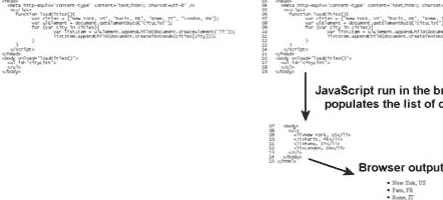

图 1.1 JavaScript 在浏览器中运行，无需从 Web 服务器获取额外页面即可更改网页上的 HTML 元素。

### 将 JavaScript 添加到 HTML 文档

```
<head>
    <script type="text/javascript">
        alert("JavaScript is Enabled!");
    </script>
</head>
```

您可以使用 HTML 的 `<script>` 标签将 JavaScript 添加到 HTML 文档中。当浏览器遇到 `<script>` 标签时，会解析其中的内容，然后执行里面的 JavaScript 代码。通常，`<script>` 标签被添加到 `<head>` 元素中，但也可以将它们添加到 `<body>` 元素中。

目前，网络浏览器默认将所有脚本视为 JavaScript；但是，为了将来可能的兼容性变化，仍然建议将 type 属性设置为 "text/javascript"。

**注意！**

`<script>` 标签在 HTML 文档中出现的顺序决定了它们的加载顺序。如果您加载了多个脚本，请注意，后续脚本中使用相同的变量和函数名会覆盖之前脚本中已定义的同名内容。

### 从外部文件加载 JavaScript

```
<head>
    <script type="text/javascript"
        src="scripts/scriptA.js"></script>
    <script type="text/javascript"
        src="scripts/scriptB.js"></script>
</head>
```

随着您创建越来越复杂的 JavaScript Web 应用，您会发现将 JavaScript 直接添加到 HTML 文件中并不明智。文件会变得过大，并且您通常希望在其他网页中重用这些脚本。

您可以在 `<script>` 标签中指定一个 `src` 位置来加载脚本，而不是将 JavaScript 代码内联。当浏览器在 `<script>` 标签中遇到 `src` 属性时，会从服务器下载该脚本并加载到内存中。

> **注意！**
浏览器会异步下载外部脚本。这意味着如果您需要在一个脚本中引用另一个脚本，请务必小心，因为第二个脚本可能尚未下载完成。

### jQuery 简介

jQuery 是一个基于 JavaScript 构建的库。其底层代码实际上是 JavaScript；然而，jQuery 将许多 JavaScript 代码简化为易于使用的功能。使用 jQuery 的两个主要优势是选择器和内置函数。

选择器提供了快速访问网页上特定元素（如列表和表格）的方式。选择器还允许访问元素组，例如所有段落或所有具有特定类的段落。这使您能够快速、轻松地访问特定的文档对象模型（DOM）元素。

jQuery 还提供了一套丰富的内置功能，让您能用更少的代码完成更多任务。例如，隐藏屏幕上的元素或为元素大小调整添加动画效果这样的任务，只需一行代码即可完成。

### 在网页中加载 jQuery

```
<head>
    <script src="local/jquery-2.0.3.min.js"></script>
    . . . 或者 . . .
    <script src=
        "http://code.jquery.com/jquery-2.0.3.min.js">
    </script>
</head>
```

jQuery 库只是一个 .js 文件。您可以像加载任何其他 JavaScript 文件一样加载它。将 jQuery 添加到网页有两种方式。

将 jQuery 添加到网页最简单的方法是使用几个内容分发网络位置之一，或称 CDN。CDN 允许您从全球分布的 jQuery 托管服务器网络加载库。这种方法的好处是服务器遍布全球，下载被分发到多个服务器。此外，如果用户访问过的其他网页也链接了该 CDN 文件，那么 jQuery 库可能已经被缓存。以下是一些托管 CDN 的示例：


### 第1章 踏入 jQuery、JavaScript 与动态 Web 开发的世界

```javascript
//jQuery
<script src=
    "http://code.jquery.com/jquery-2.0.3.min.js">
</script>
<script src=
    "http://code.jquery.com/jquery-migrate-1.1.0.min.js">
</script>
//google
<script src=
    "https://ajax.googleapis.com/ajax/libs/jquery/2.0.3/jquery.min.js">
</script>
//Microsoft
<script src=
    "http://ajax.aspnetcdn.com/ajax/jQuery/jquery-2.0.3.min.js">
</script>
```

另一个选择是从 http://jquery.com/download 下载 .js 文件，并将其与其他 JavaScript 库一起加载。这样做的好处是，它能更紧密地与您网站的内容结合，您就无需担心外部位置可能出现的不可用问题或网站屏蔽问题。

#### 在 JavaScript 中使用 jQuery

```javascript
jQuery("#myElement")
    . . . 或 . . .
$("#myElement")
```

使用库加载时定义的 jQuery 对象来访问 jQuery。jQuery 还提供了一个快捷字符 `$`，您可以在本书各处使用。例如，以下两条 jQuery 语句是相同的：

```javascript
jQuery("#myElement")
$("#myElement")
```

#### 介绍 jQuery UI

jQuery UI 是一个构建在 jQuery 之上的附加库。jQuery UI 的目的是提供一组可扩展的交互、效果、控件和主题，使您更容易在网页中加入专业的 UI 元素。

jQuery UI 由两部分组成：JavaScript 和级联样式表。jQuery UI 的 JavaScript 部分扩展了 jQuery，添加了特定于添加 UI 元素或对其应用效果的额外功能。jQuery UI 的 CSS 部分则为页面元素设置样式，这样开发者就无需每次都为元素设置样式。

jQuery UI 通过提供开箱即用的预构建 UI 元素（如日历和菜单）以及交互（如拖动和调整大小），为开发者节省了时间。

#### 获取 jQuery UI 库

要开始使用 jQuery UI，您需要下载该库并将其添加到您的网页中。您可以从 http://jqueryui.com/download/ 下载 jQuery 库，方法是选择您想要包含的选项，然后点击底部的“Download”按钮。这会下载 jQuery UI 文件。

当您下载 jQuery UI 库时，会得到一个 zip 文件。在该文件内有三个您需要了解的主要文件夹，它们是：

- **js** ——此文件夹包含 jQuery UI 和 jQuery 库文件。您需要部署这些文件，以便在网页中加载它们。
- **css** ——此文件夹包含以主题命名的文件夹，其中存放着 .css 文件和一个由 jQuery UI 库使用的 images 文件夹。.css 文件和 images/ 文件夹需要放置在同一位置，并且可以从您的网页访问。
- **development-bundle** ——此文件夹包含 jQuery UI 的完整源代码。如果您不打算修改 jQuery UI 代码，可以忽略此文件夹。

#### 加载 jQuery UI

```html
<head>
    <link rel="stylesheet" type="text/css" href="local/jquery-ui-1.10.3.css">
    <script src="local/jquery-2.0.3.min.js"></script>
    <script src="local/jquery-ui-1.10.3.min.js"></script>
    . . .  或  使用 CDN  . . .
    <link rel="stylesheet" type="text/css" href="http://code.jquery.com/ui/1.10.3/themes/base/jquery-ui.css">
    <script src=
        "http://code.jquery.com/jquery-2.0.3.min.js">
    </script>
    <script src=
        "http://code.jquery.com/ui/1.10.3/jquery-ui.js">
    </script>
</head>
```

要加载 jQuery UI，您首先需要加载 jQuery 库。jQuery UI 也是一个 .js 文件。您可以像加载任何其他 JavaScript 文件一样加载它。同样，就像 jQuery 一样，您可以从外部 CDN 源加载脚本，或者下载该库并在本地加载。

您还需要使用 `<link>` 标签加载 jQuery UI 的 .css 文件。这可以是一个本地文件，也可以是一个外部 CDN 位置。例如：

```html
<link rel="stylesheet" type="text/css"
  href="local/jquery-ui-1.10.3.min.css">
... 或使用 CDN ...
<link rel="stylesheet" type="text/css"
  href="http://code.jquery.com/ui/1.10.3/themes/base/jquery-ui.css">
```

#### 介绍 jQuery Mobile

移动设备是增长最快的发展平台。大部分开发工作都致力于使网站适合移动设备。实施和维护一个移动网站比维护一个移动应用程序要容易得多。

jQuery mobile 是一个构建在 jQuery 之上的附加库。它旨在简化构建移动网站所需的许多结构性、UI 和事件实现。jQuery Mobile 在开发移动解决方案方面提供了若干优势，包括：

- 隐藏了将页面元素调整大小以适应各种移动设备的部分复杂性。
- 提供了已内置移动事件交互的简单 UI 组件。
- 建立在 JavaScript 和 jQuery 之上，提供了一个基于成熟概念的通用且成熟的平台。
- 开发移动 Web 应用很简单，并且无需用户进行任何安装。这就是它们越来越受欢迎的原因。

#### 获取 jQuery Mobile 库

要开始使用 jQuery Mobile，您需要下载该库并将其添加到您的网页中。您可以从 http://jquerymobile.com/download/ 下载 jQuery 库。您也可以从 http://jquerymobile.com/download-builder/ 下载 jQuery Mobile，方法是选择您想要包含的版本和选项，然后点击底部的“Download”按钮。这会下载一个包含 jQuery Mobile 库的 zip 文件。

> **注意！**

jQuery Mobile 库附带的 .css 文件和 images 文件夹是一个整体。您需要确保它们安装在同一位置，并且不要混合使用来自不同自定义下载的文件。

当您下载 jQuery Mobile 库时，会得到一个 zip 文件。在该 zip 文件内有三个主要组件，您需要将它们放置到移动网页可以加载的位置。它们是：

- **js 文件** ——会有 jquery.mobile.###.js 及其压缩版本。这是主库文件，需要将其中一个放置在可以将其添加到项目文件中的 `<script>` 标签内的位置。
- **css 文件** ——会有 jquery.mobile.###.css、jquery.mobile.###.structure.css 和 jquery.mobile.###.theme.css 文件及其压缩形式。这是所有的样式代码，应与 jquery.mobile.###.js 文件放置在同一位置。
- **images 文件夹** ——此文件夹包含 jQuery Mobile 用于设置元素样式的图像和图标。这也应与 jquery.mobile.###.js 文件放置在同一位置。

#### 加载 jQuery Mobile

```html
<head>
  <link rel="stylesheet"
        href="local/jquery.mobile-custom.min.css" />
  <script src="local/jquery-2.0.3.min.js"></script>
  <script src="local/jquery.mobile-
custom.min.js"></script>
  . . . 或使用 CDN . . .
  <link rel="stylesheet" href=
        "http://code.jquery.com/mobile/1.4.0/jquery.
mobile-1.4.0.min.css" />
  <script src=
        "http://code.jquery.com/jquery-
1.8.2.min.js"></script>
  <script src=
        "http://code.jquery.com/mobile/1.4.0/jquery.
mobile-1.4.0.min.js">
  </script>
</head>
```

与您为 jQuery UI 所做的类似，您需要在加载 jQuery Mobile 之前加载 jQuery。一旦 jQuery 加载完成，您可以从外部 CDN 源或本地下载的库版本加载 jQuery Mobile 的 .js 文件。

您还需要使用 `<link>` 标签加载 jQuery Mobile 的 .css 文件。例如，以下代码首先加载 jQuery 库（因为 jQuery Mobile 需要它），然后加载 jQuery Mobile 的 JS 和 CSS 文件：

```html
<script type="text/javascript" src="local/jquery-2.0.3.min.js"></script>
<script type="text/javascript" src="local/jquery.mobile-custom.min.js"></script>
<link rel="stylesheet" href="local/jquery.mobile-custom.min.css" />
```

#### 配置浏览器开发工具

开发 JavaScript 和 jQuery 的一个重要方面是使用网络浏览器内置的 Web 开发工具。这些工具允许您查看已加载的脚本文件、设置断点、单步调试代码等等。深入探讨浏览器工具超出了本书的范围。但是，我希望能为您提供启用这些工具的步骤，并鼓励您在尚未了解时学习它们。


### 在 Firefox 上安装 Firebug

请按照以下步骤在 Firefox 上启用 JavaScript 调试：

1.  打开 Firefox。
2.  从主菜单中选择 **工具** > **附加组件**。
3.  在右上角的搜索框中输入 Firebug 以进行搜索。然后点击 **安装** 按钮进行安装。
4.  在右上角的搜索框中输入 FireQuery 以进行搜索。然后点击 **安装** 按钮进行安装。FireQuery 扩展了 Firebug 的功能，使其也支持 jQuery。
5.  重新加载 Firefox 后，点击 Firebug 按钮以显示 Firebug 控制台。

### 在 Internet Explorer 中启用开发人员工具

请按照以下步骤在 Internet Explorer 上启用 JavaScript 调试：

1.  打开 IE。
2.  点击 **设置** 按钮，然后从下拉菜单中选择 **开发人员工具**。或者，你可以按 F12 键。
3.  开发人员控制台将显示。

### 在 Chrome 中启用 JavaScript 控制台

请按照以下步骤在 Chrome 中启用 JavaScript 调试：

1.  打开 Chrome。
2.  点击 **设置** 按钮，然后从下拉菜单中选择 **工具** > **开发人员工具**。或者，你可以在 PC 上按 `Ctrl+Shift+J`，或在 Mac 上按 `Cmd+Shift+J`。
3.  JavaScript 控制台将显示。

## 第1章 跃入 jQuery、JavaScript 与动态 Web 开发的世界

### 使用 JavaScript 语言

本章的短语侧重于 JavaScript 语言的各种细节和技巧。你需要了解这些，才能充分利用 jQuery 和 JavaScript 在 HTML 技术栈中提供的全部能力。

### JavaScript 语法

作为一种编程语言，JavaScript（以及基于 JavaScript 的 jQuery）需要特定的语法。本节在深入语言细节之前，先为你提供 JavaScript 语法的快速入门。

你应该熟悉以下关于 JavaScript 语法的规则：

- 所有 JavaScript 语句都以分号结尾。
- 语句按照它们在脚本中出现的顺序执行。
- 代码块使用 `{ }` 花括号定义。
- 绑定在 `( )` 圆括号中的表达式会在被应用到语句其余部分之前进行求值。
- JavaScript 区分大小写。
- 要在字符串中间断行，`\` 必须是该行的最后一个字符。
- JavaScript 中的字符串必须用单引号 (`'string'`) 或双引号 (`"string"`) 括起来。
- 将字符串与数字相加时，结果值是一个字符串。
- 变量必须以字母、`$` 或 `_` 开头。

### 定义和访问数据

JavaScript 最重要的方面之一是能够定义代表不同形式数据的变量，从单个数字和字符串到具有属性和方法的复杂对象，再到包含多个项目的数组。一旦定义了数据，你就可以为各种目的使用和重用它。本节提供一些短语，帮助你创建在 JavaScript 中需要使用的各种数据结构。

### 定义和访问变量

```javascript
var x = y = 5;
var z = 10;
var results = "x + y + z = " + (x+y+z);
var s1 = "jQuery";
var s2 = "JavaScript"
var s3 = s1 + " & " + s2;
```

JavaScript 使得定义变量变得容易。变量使用 `var name = value;` 语法进行赋值。`var` 关键字告诉 JavaScript 这是一个新的变量名。一旦变量被赋值，你就可以使用变量名来访问它。你可以使用 `var name1 = name2 = value;` 语法在单行中定义多个变量。

当你将变量赋值给一个表达式，例如 `x + y + z` 时，该表达式会在给变量赋值之前进行求值。以下代码片段向你展示如何定义和访问不同的变量。

```html
<script>
    var x = y = 5;
    var z = 10;
    var results = "x + y + z = " + (x+y+z);
    var s1 = "jQuery";
    var s2 = "JavaScript"
    var s3 = s1 + " & " + s2;
    document.write(results);
    document.write("<br>");
    document.write(s3);
</script>
```

**ch0201.html**

```
x + y + z = 20
jQuery & JavaScript
```

*ch0201.html 的输出*

### 创建数组

```javascript
var x = y = 5;
var z = 10;
var results = "x + y + z = " + (x+y+z);
var s1 = "jQuery";
var s2 = "JavaScript"
var s3 = s1 + " & " + s2;
```

你可以通过几种不同的方式创建数组。你可以在定义时使用 `[ ]` 方括号创建它们，例如 `var arr=[1,2,3]`。你也可以创建一个新的数组对象并使用 `push()` 方法向其中添加项目。你可以使用 `arr[index]` 方法访问数组中的项目。以下代码片段展示了以每种方式创建数组的示例。

```html
<script>
    var weekdays = ["Mon", "Tue", "Wed", "thur",
    "Fri"];
    var weekend = new Array();
    weekend.push("Sat");
    weekend.push("Sun");
    document.write(weekdays.toString() + "<br>");
    document.write(weekend[0] + ", " + weekend[0]);
</script>
```

**ch0202.html**

```
Mon,Tue,Wed,thur,Fri
Sat,Sun
```

*ch0202.html 的输出*

### 创建对象

```javascript
var obj1 = {name:"Brad", title:"Author", "last-name":"Dayley" };
var obj2 = new Object();
obj2.name = "Frodo";
obj2.title = "Hobbit";
obj2["last-name"] = "Baggins";
```

你可以在定义时使用 `{property:value, ..}` 语法创建对象，例如 `var obj={name:"Brad", title:"Author"};`。你也可以创建一个新对象并使用标准的点语法向其添加属性。

以下代码片段展示了以每种方式创建对象的示例。

```html
<script>
    var obj1 = {name:"Brad", title:"Author", "last-name":"Dayley" };
    var obj2 = new Object();
    obj2.name = "Frodo";
    obj2.title = "Hobbit";
    obj2["last-name"] = "Baggins";
    document.write(obj1.name + " " + obj1["last-name"] + ", " + obj1.title + "<br>");
    document.write(obj2.name + " " + obj2["last-name"] + ", " + obj2.title);
</script>
```

**ch0203.html**

```
Brad Dayley, Author
Frodo Baggins, Hobbit
```

*ch0203.html 的输出*

### 定义函数

```javascript
function add(a, b){
    return a + b;
}
var result1 = add(5, 20);
```

你需要熟悉在 JavaScript 中创建和使用函数。函数使用以下语法定义：

```
function function_name(arguments){function_block}
```

你可以指定任意数量的参数，并且由于 JavaScript 是松散类型的，你可以在每次调用函数时传入不同的对象类型。要调用函数，只需通过其名称引用它，并在 `( )` 括号中传入所需的参数。然后执行函数块中的代码。你可以使用 `return` 关键字从函数调用中返回一个值。

以下代码片段展示了定义和调用函数的示例：

```html
<script>
    function add(a, b){
        return a + b;
    }
    var result1 = add(5, 20);
    var result2 = add("Java", "Script")
    document.write(result1 + "<br>");
    document.write(result2);
</script>
```

**ch0204.html**

```
25
JavaScript
```

*ch0204.html 的输出*

### 操作字符串

字符串是 JavaScript 中最重要的数据结构之一。字符串表示在网页上呈现给用户的数据，无论是段落元素、按钮上的名称、菜单标签还是图表说明。字符串也用于在后台定义位置、文件名以及各种其他用于 Web 元素的值。

有几种特殊字符用于定义无法以其他方式表示的值，例如换行符和制表符。表 2.1 列出了 JavaScript 字符串中的特殊字符。

**表 2.1 字符串对象特殊字符**

| 字符 | 描述 |
|---|---|
| \' | 单引号 |
| \" | 双引号 |
| \\ | 反斜杠 |
| \n | 换行符 |
| \r | 回车符 |
| \t | 制表符 |
| \b | 退格符 |
| \f | 换页符 |

### 获取字符串的长度

```javascript
var s = "One Ring";
s.length; //返回 8
var s2 = "To Rule\nThem All";
s2.length; //返回 16，因为 \n 只是一个字符
```

字符串对象有一个 `length` 属性，其中包含字符串中的字符数。这也包括特殊字符的数量，例如 `\t` 和 `\n`。要获取字符串的长度，只需在字符串对象上使用 `.length` 属性。

### 查找字符串中特定位置的字符

```javascript
var s = "In The Darkness Bind Them";
s.charAt(7); //返回 'D'
s[7]; // 也返回 'D'
```

字符串对象提供了 `charAt(offset)` 方法，它返回指定偏移量处的字符。此外，JavaScript 中的字符串本质上是字符数组，因此你可以使用 `stringName[offset]` 获取特定偏移量处的字符。请记住，偏移量始终是从零开始的，因此第一个字符位于偏移量 0 处。

### 将数字转换为字符串

```javascript
var n=16;
var a = n.toString();  //a = 16
var b = n.toString(16); //b = 10
```

要将数字转换为 JavaScript 中的字符串，如果你还没有一个包含该数值的变量，请创建一个。你可以通过在数字变量上调用 `toString()` 方法来实现这一点。你也可以传递一个基数作为参数，将数字转换为该基数的字符串表示形式。


先得到一个数字，然后对该数字调用`.toString(radix)`。可选的`radix`参数指定转换数字时使用的基数。你可以指定从二进制到三十六进制的基数。

### 将字符串转换为数字

```
new Number("16");       //返回16
new Number("0x20");     //返回32
new Number("32.8");     //返回32.8
```

要将基于数字的字符串转换为数字，可以创建一个新的数字对象。JavaScript会自动检测字符串是否是数字（甚至是0x##格式的十六进制数字），并创建新的数字对象。如果字符串不是有效的数字格式，则会返回一个`NaN`对象。

### 合并字符串

```
var str1="jQuery";
var str2=" & ";
var str3="JavaScript";
var str4 = str1.concat(str2, str3); //str5 = "jQuery & JavaScript"
var str5 = str4 + " Phrasebook";     //str5 = "jQuery & JavaScript Phrasebook"
```

你可以使用`.concat(str, str, ...)`方法合并多个字符串。或者你也可以直接使用`str + str + str ...`的方式。

### 更改字符串大小写

```
var s1 = "jQuery and JavaScript";
var s2 = s1.toLowerCase(); //s2 = "jquery & javascript"
var s3 = s1.toUpperCase(); //s3 = "JQUERY & JAVASCRIPT"
```

字符串有内置的函数来更改大小写。`.toLowerCase()`方法返回字符串的小写版本。`.toUpperCase()`方法返回字符串的大写版本。

### 拼接字符串

```
var s1 = "The play's the thing";
var s2 = s1.splice(4,8); // s2 = "play"
```

你可以使用`.splice(start, end)`通过指定起始索引和结束索引来将字符串切割成子字符串。返回从`start`索引处的字符开始，到`end`索引处的字符之前结束的字符串部分。所有索引都是基于零的。

### 分割字符串

```
var s1 = "on-the-way-to-the/forum";
var arr = s1.split("-"); // arr = ["on", "the", "way", "to", "the", "forum"];
```

要使用特定分隔符将字符串分割成多个部分，请使用`.split(separator [, limit])`。`separator`定义了分割字符串的位置，结果中不包含该分隔符。`limit`指定了在停止前要返回的项数。返回一个包含字符串各部分的数组。

### 检查字符串是否包含子字符串

```
var s1 = "I think therefore I am";
var a = s1.indexOf("think"); // a = 2
var b = s1.indexOf("thought"); // b = -1
```

检查一个字符串是否是另一个字符串子字符串的最简单方法，是在主字符串上使用`.indexOf(substring)`。此函数返回第一次出现位置的索引，如果未找到子字符串则返回-1。

### 不区分大小写地查找和替换子字符串

```
var s1 = "jQuery, sometimes JQuery or JQUERY";
var s2 = s1.replace(/jquery/gi, "jQuery");
//s2 现在为 "jQuery, sometimes jQuery or jQuery"
```

查找和替换子字符串同时忽略大小写的最佳方法是在`.replace()`方法中使用正则表达式。如果你不熟悉它们，我建议你至少去了解一下。它们可以使用复杂的公式在字符串中查找匹配项。现在，我只向你展示一个简单的表达式。

例如，要查找`jQuery`这个术语的所有实例，而你可能不知道字符串中指定的大小写，你可以定义以下正则表达式。字符`g`指定全局搜索（意味着不在第一个实例处停止）。字符`i`指定忽略大小写。

```
/jQuery/gi
```

### 操作数组

JavaScript中最有用的数据结构之一是数组。数组是可以包含任何类型的元素的集合。你已经了解了如何创建和访问各个元素。本节包含一些短语，旨在向你展示如何通过组合、切片、搜索项等方式来操作数组。

### 合并数组

```
var fruits = ["banana", "apple", "orange"];
var veggies = ["broccoli", "carrots", "spinach"];
var grains = ["wheat", "oats"];
var food = grains.concat(fruits, veggies);
//food = ["wheat","oats","broccoli","carrots",
"spinach","banana","apple","orange"]
```

你可以使用`.concat(arr, arr, ..)`方法合并多个数组。这会返回一个新的数组对象，其中合并了各个数组的元素。

### 切割数组

```
var week = ["sun", "Mon", "Tue", "Wed", "thur",
"Fri", "sat"];
var weekdays = week.slice(1,6);
```

你可以像切割字符串一样切割数组，使用`.splice(start, end)`方法并指定起始索引和结束索引。数组中从起始索引开始，到结束索引之前的项将包含在新的数组对象中返回。所有索引都是基于零的。

### 检测数组是否包含某个项

```
var food = ["broccoli", "carrots", "spinach"];
var a = food.indexOf("spinach");    // a = 2
var b = food.indexOf("pizza");    // b = -1
```

检查某个项是否已存在于数组中的最简单方法是使用`.indexOf(item)`。如果找到该项，则返回其第一次出现的索引；否则返回-1。

### 从数组中移除项

```
var week = ["sun", "Mon", "Tue", "Wed", "thur",
 "Fri", "sat"];
var weekdays = week.splice(1,5);
var day = week.pop();
// weekdays= ["Mon", "Tue", "Wed", "thur", "Fri"]
// day = "sat"
// week = ["sun", "Mon", "Tue", "Wed", "thur",
 "Fri"];
```

你可以使用`pop()`移除数组的最后一项。如果你想移除数组中间的项，你需要使用`splice(index, count)`，其中`index`是开始移除项的索引，`count`是要移除的项数。

### 从数组创建制表符分隔的字符串

```
var weekdays= ["Mon", "Tue", "Wed", "thur", "Fri"]
var weekStr = weekdays.join("\t");
// weekStr = "Mon\tTue\tWed\tthur\tFri"
```

`.join(separator)`方法允许你将数组组合成一个字符串。可选的`separator`参数指定在新创建的字符串中各项之间放置的字符或字符串。

### 对数组排序

```
arr1.sort(function(a,b){return a-b;});
...
arr1.sort(function(a,b){return Math.abs(a)-Math.abs(b);});
...
arr1.sort();
```

JavaScript提供了一个很好的接口来对数组进行排序。数组对象有一个`sort(function)`方法。`sort()`方法按字母顺序对数组元素进行排序，如果可能，会将元素转换为字符串，这对数字数组来说是个问题。你可以指定自己的排序函数，该函数接受两个元素并返回以下内容：

+   - 如果第一个值应该排在后面，则返回**true**或**正数**
- 如果它们相等，则返回**0**
- 如果第一个值应该排在前面，则返回**false**或**负数**

```
<script>
    var arr1 = [-10, -5, -1, 0, 2, 6, 8];
    var arr2 = ["a", "b", "c", "A", "B", "C"];
    arr1.sort(function(a,b){return a-b;});
    document.write(arr1 + "<br>");
    arr1.sort(function(a,b){return Math.abs(a)-Math.abs(b);});
    document.write(arr1 + "<br>");
    arr1.sort();
    document.write(arr1 + "<br>");
    arr2.sort();
    document.write(arr2 + "<br>");
    arr2.sort(function(a,b){return a.toUpperCase()>b.toUpperCase();});
    document.write(arr2 + "<br>");
</script>
```

ch0205.html 的输出

- -10,-5,-1,0,2,6,8
- 0,-1,2,-5,6,8,-10
- -1,-10,-5,0,2,6,8
- A,B,C,a,b,c
- A,a,B,b,C,c

### 应用逻辑

与任何其他编程语言一样，JavaScript提供了基本的逻辑运算符和操作。以下部分提供了一些关于使用JavaScript比较运算符来生成if/else块、循环以及其他各种逻辑的短语。

### 判断一个对象是否等于或小于另一个对象

```
var x=5;
var y="5";
var resultA = x==y; //求值为true
var result = x===y; //求值为false
```

JavaScript使用标准的`==`、`!=`、`>`、`<`、`>=`、`<=`运算符来比较两个对象。它还包括类型敏感的`===`和`!==`运算符。例如，`1=="1"`求值为true，而`1==="1"`则不是，因为前者是数值类型，后者是字符串类型。


### 添加条件代码块

```
if (age >= 100){
  document.write("Wow you are a centurian!");
} else if (age >= 18) {
  document.write("You are an adult.");
} else {
  document.write("You are a child.");
}
```

if 代码块使用基本的 if (比较) {IF_BLOCK} 结构创建。if 代码块之后可以使用 else{ELSE_BLOCK} 添加一个额外的 else 代码块。此外，你可以使用 else(条件){ELSE_BLOCK} 为 else 代码块添加一个条件。

### 使用 While 循环

```
var weekdays = ["Mon", "Tue", "Wed", "Thur", "Fri"];
do{
  document.write(day);
  var day = weekdays.pop();
  document.write(day+", ");
} while (day != "Wed");
//Output is "Fri, Thur, Wed, "
```

while(条件){LOOP_BLOCK} 和 do{LOOP_BLOCK}while(条件); 循环允许你循环执行代码，直到满足特定条件。LOOP_BLOCK 中的代码在每次循环中都会被执行。

### 遍历数组

```
var weekdays = ["Mon", "Tue", "Wed", "Thur", "Fri"];
for(var x=0; x < weekdays.length; x++){
  document.write(day+"|");
}
//Output is "Mon|Tue|Wed|Thur|Fri|"
```

遍历 JavaScript 数组的最佳方法是使用 for(初始化; 条件; 调整){LOOP_BLOCK} 循环。for() 循环允许你初始化一个变量，然后迭代直到满足条件。要遍历数组，可以初始化一个索引，然后在索引等于数组长度时停止循环。

### 遍历对象属性

```
var obj = {first:"Bilbo", last:"Baggins",
             title:"Hobbit"};
for (var key in obj){
    document.write(key + "=" + obj[key] + "&");
}
```

JavaScript 在 for() 循环中提供了一种额外类型的选项。使用 in 关键字，你可以遍历数组中的值或对象中的属性。语法是 for(var name in object){LOOP_BLOCK}。在 LOOP_BLOCK 中，name 被赋值为属性名。

### 数学运算

JavaScript 有一个内置的 Math 对象，它提供了扩展数学运算的功能。Math 对象具有属性值，如表 2.2 所列，包含最常见的常量。你可以直接从 JavaScript 代码中访问 Math 对象。例如，要获取 pi 的值，你可以使用以下代码：

```
Math.PI
```

表 2.2 Math 对象属性

| 属性 | 描述 |
| :--- | :--- |
| E | 返回欧拉数（约等于 2.718） |
| LN2 | 返回 2 的自然对数（约等于 0.693） |
| LN10 | 返回 10 的自然对数（约等于 2.302） |
| LOG2E | 返回以 2 为底的 E 的对数（约等于 1.442） |
| LOG10E | 返回以 10 为底的 E 的对数（约等于 0.434） |
| PI | 返回圆周率 PI（约等于 3.14） |
| SQRT1_2 | 返回 1/2 的平方根（约等于 0.707） |
| SQRT2 | 返回 2 的平方根（约等于 1.414） |

Math 对象还包含几种方法，允许你应用高级数学运算。以下章节提供了这些运算的短语。

### 生成随机数

```
// Random number between 0 and 1
Math.random();
//Random number between 1 and 10
Math.floor(Math.random() * 10) + 1;
//Random number between -10 and 10
Math.floor(Math.random() * 20) - 10;
```

Math.random() 函数生成一个介于 0 和 1 之间的随机浮点值。要将其转换为整数，请将 Math.random() 的结果乘以你想要的整数最大值，然后使用 Math.floor() 向下取整。

### 数字取整

```
var x = 3.4;
var y = 3.5;
Math.round(x); //returns 3
Math.round(y); //returns 4
Math.ceil(x); //returns 4
Math.ceil(y); //returns 4
Math.floor(x); //returns 3
Math.floor(y); //returns 3
```

JavaScript Math 对象提供了三种数字取整方法。.round() 方法将数字 #.5 向上舍入到下一个更高的整数，将数字 #.49999... 向下舍入到下一个更低的整数。.ceil() 总是向上舍入到下一个更高的整数。.floor() 总是向下舍入到下一个更低的整数。

### 获取集合中的最小数字

```
Math.min(8,"0x5",12,"44",8,23,77); //returns 5
var arr1 = [4,8,12,3,7,11];
Math.min.apply( Math, arr1 ); //returns 3
var arr2 = ["0x5",8,12,"4",8,23,77,"0x1F"];
Math.min.apply( Math, arr2 ); //returns 4
```

Math.min(项, 项, ...) 方法允许你找到一组数字中的最小值。你也可以使用 Math.min.apply(Math, 数组) 将数组对象应用于 .min() 方法。这将返回数组中的最小数字。数组可以包含数字的字符串表示形式，例如 "4" 和 "0x5B"，但不能包含像 "A" 这样的字符字符串。如果数组包含字符字符串，结果将是 NaN。

# 第 2 章 使用 JavaScript 语言

### 获取集合中的最大数字

```
Math.max(8, "0x5", 12, "44", 8, 23, 77); //returns 77
var arr1 = [4, 8, 12, 3, 7, 11];
Math.max.apply(Math, arr1); //returns 12
var arr2 = ["0x5", 8, 12, "4", 308, 23, 77, "0xFF"];
Math.max.apply(Math, arr2); //returns 308
```

Math.max(项, 项, ...) 方法允许你找到一组数字中的最大值。你也可以使用 Math.max.apply(Math, 数组) 将数组对象应用于 .max() 方法。这将返回数组中的最大数字。数组可以包含数字的字符串表示形式，例如 "26" 和 "0x1F"，但不能包含像 "A" 这样的字符字符串。如果数组包含字符字符串，结果将是 NaN。

### 计算绝对值

```
Math.abs(-5); //returns 5
Math.abs(5); //returns 5
Math.abs("-15"); //returns 15
Math.abs("0xFF"); //returns 255
```

Math.abs(x) 方法返回 x 的绝对值。变量 x 可以是一个数字或一个数字字符串，如 "5"、"-5" 或 "0xFF"。

### 应用三角函数

```
Math.log(2); //returns 0.693
Math.sin(0); //returns 0
Math.cos(0); //returns 1
Math.tan(1); //returns 1.5574
```

Math 对象提供了几种三角函数方法，用于对数字应用三角函数。表 2.3 列出了用于应用诸如自然对数、正弦、余弦和正切运算的方法。

表 2.3 Math 对象三角函数方法

| 方法 | 描述 |
| :--- | :--- |
| acos(x) | 返回 x 的反余弦值，以弧度表示 |
| asin(x) | 返回 x 的反正弦值，以弧度表示 |
| atan(x) | 返回 x 的反正切值，结果介于 -PI/2 与 PI/2 弧度之间 |
| atan2(y,x) | 返回其参数商的反正切值 |
| cos(x) | 返回 x 的余弦值（x 以弧度表示） |
| log(x) | 返回 x 的自然对数（以 E 为底） |
| sin(x) | 返回 x 的正弦值（x 以弧度表示） |
| tan(x) | 返回角度的正切值 |

### 应用幂函数

```
Math.exp(4); //returns 54.59815
Math.pow(2,16); //returns 65536
Math.sqrt(25); //returns 5
```

Math 对象提供了几种幂函数，允许你对数字应用指数和开方运算。表 2.4 列出了用于应用欧拉指数、幂和平方根函数的方法。你可以以数字或数字字符串的形式传入值。

表 2.4 Math 对象幂函数方法

| 方法 | 描述 |
| :--- | :--- |
| exp(x) | 返回 E^x 的值 |
| pow(x,y) | 返回 x 的 y 次幂的值 |
| sqrt(x) | 返回 x 的平方根 |

### 处理日期

一个有用的内置 JavaScript 对象是 Date 对象。Date 对象允许你通过浏览器访问系统时钟来获取用户的时间。这使你可以使用 JavaScript 获取用户的本地时间。Date 对象还提供用于操作时间值的方法，以确定时间差和生成时间和日期字符串。

### 创建日期对象

```
var d = new Date();
//Wed Jan 30 2013 09:37:42 GMT-0700
var d = new Date(1209516513246);
//Tue Apr 29 2008 18:48:33 GMT-0600
var d = new Date("May 17 2014 13:55:13 GMT-0600");
//Sat May 17 2014 13:55:13 GMT-0600
var d = new Date("1/1/2020");
//Sat Jan 01 2020 00:00:00 GMT-0700
var d = new Date("12/12/2012 12:12:12");
//Wed Dec 12 2012 12:12:12 GMT-0700
var d = new Date(2014, 8, 6, 16, 5, 10, 3);
//Sat Sep 06 2014 16:05:10 GMT-0600
```

Date 对象表示一个具有毫秒级精度的特定日期和时间。要创建一个 Date 对象，你只需要使用以下方法之一调用 new Date()。dateString 可以是几种不同格式中的一种，例如 "7-17-2013"、"11/22/2014

10:12:05"、"Dec 12 2012 12:12:12" 和 "2014-01-05T08:03:22.356Z"。

- new Date();
- new Date(milliseconds);
- new Date(dateString);
- new Date(year, month, day, hours, minutes, seconds, milliseconds);

### 获取当前日期和时间

```
new Date();
```

要获取当前日期和时间，请创建一个不带参数的 `new Date()` 对象。这会创建一个包含当前日期和时间的对象。

### 创建日期字符串

```
var d = new Date();
d.toDateString();
// 返回 Sat May 17 2014
d.toLocaleDateString();
// 返回 Saturday, May 17, 2014
d.toISOString();
// 返回 2014-05-17T19:55:13.000Z
d.toUTCString();
// 返回 Sat, 17 May 2014 19:55:13 GMT
d.toString();
// 返回 Sat May 17 2014 13:55:13 GMT-0600
(Mountain Daylight Time)
```

JavaScript 有几种方法可以生成日期字符串。第一步是获取一个 Date 对象。Date 对象提供了以下方法，它们返回格式不同的日期字符串：

## 第2章 使用JavaScript语言

- .toDateString()—返回一个缩写的日期字符串。
- .toLocaleDateString()—返回一个本地化的日期字符串。
- .toISOString()—返回符合 ISO 标准的日期字符串。
- .toUTCString()—返回一个转换为 UTC 时间的日期字符串。
- .toString()—返回包含时区等信息的完整日期字符串。

### 创建时间字符串

```
var d = new Date();
d.toLocaleTimeString()
1:55:13 PM
d.toTimeString()
13:55:13 GMT-0600 (Mountain Daylight Time)
```

Date 对象还允许你只获取时间字符串。Date 对象上附有两个返回时间字符串的方法。`.toTimeString()` 方法返回一个包含时间、时区甚至夏令时信息的时间字符串。`.toLocaleTimeString()` 返回一个更基本的时间字符串，包含本地格式的时间。

### 获取时间差

```
var atime = new Date("2014-01-05T08:03:22.356Z");
var btime = new Date("2014-01-05T09:08:57.758Z");
var delta = Math.abs(btime - atime); //3935402ms
var totalSec = Math.floor(delta * .001); //3935s
var hours = Math.floor(totalSec / 3600); //1hr
var minutes = Math.floor(totalSec / 60) % 60; //5min
var seconds = totalSec % 3600 % 60; //35sec
```

Date 对象本质上表示自 1970年1月1日 以来的毫秒数。因此，你可以通过将两个 Date 对象相减来获取它们之间的时间差。结果是一个数字，表示两个日期之间的毫秒差。

> **顺便提一下**

当通过将两个日期相减来获取它们之间的毫秒差时，结果可能是负数，这取决于哪个日期被减去。使用 `Math.abs(timeA-timeB)` 可以始终生成正的时间差。

### 获取特定的日期组件

```
var d = new Date("Sat Jan 04 2014 15:03:22 GMT-0700");
d.getDate(); //返回 4
d.getDay(); //返回 6
d.getFullYear(); //返回 2014
d.getHours(); //返回 15
d.getMinutes(); //返回 3
d.getSeconds(); //返回 22
d.getTime(); //返回 1388873002000
d.getTimezoneOffset(); //返回 420
```

Date 对象提供了多种方法来获取日期中特定组件的值，例如年份、月份中的日期、星期几等。表 2.5 列出了从 Date 对象获取特定日期组件的方法。

表 2.5 获取特定日期组件的 Date 对象方法

| 方法 | 描述 |
|---|---|
| getDate() | 月份中的日期 (1–31) |
| getDay() | 星期几 (0–6) |
| getFullYear() | 年份 (4 位数字) |
| getHours() | 小时 (0–23) |
| getMilliseconds() | 毫秒 (0–999) |
| getMinutes() | 分钟 (0–59) |
| getMonth() | 月份 (0–11) |
| getSeconds() | 秒数 (0–59) |
| getTime() | 自 1970-01-01 12:00:00 以来的毫秒数 |
| getTimezoneOffset() | UTC 时间与本地时间之差，以分钟为单位 |

**你知道吗？**

Date 对象还有方法可以通过在 `get` 后放置 `UTC` 来获取 UTC 组件，例如 `getUTCHour()` 和 `getUTCSeconds()`。

```
<script>
    var atime = new Date("2014-01-04T08:45:22.356Z");
    var btime = new Date("2014-01-04T12:12:57.758Z");
    var delta = Math.abs(btime - atime); //3935402ms
    var totalSec = Math.floor(delta * .001); //3935s
    var hours = Math.floor(totalSec / 3600); //1hr
    var minutes = Math.floor(totalSec / 60) % 60;
    //5min
    var seconds = totalSec % 3600 % 60; //35sec
    document.write("Total Milliseconds: " + delta + "<br>");
    document.write("Total Seconds: " + totalSec + "<br>");
    document.write("Delta: " + hours + "hrs ");
    document.write(minutes + "mins " + seconds + "s");
</script>
```

ch0206.html

Total Milliseconds: 12455402
Total Seconds: 12455
Delta: 3hrs 27mins 35s

ch0206.html 的输出结果

## 3 与浏览器交互

动态网页通常需要你访问，有时甚至需要操作 HTML 元素之外的内容。JavaScript 提供了丰富的对象和函数，允许你访问有关屏幕、浏览器窗口、历史记录等信息。

本章中的短语描述了如何使用 screen、window、location 和 history 对象，这些对象为 JavaScript 提供了访问网页之外信息的接口。其他短语描述了如何利用这些对象来实现 cookie、弹出窗口和计时器。

### 写入JavaScript控制台

```
console.log("This is Debug"); //"This is Debug" 显示在控制台中
var x=5;
console.log("x="+x); //"x=5" 显示在控制台中
```

JavaScript 控制台是在调试 jQuery 和 JavaScript 代码中的问题时的一个重要工具。控制台日志只是一个你可以查看 JavaScript 代码输出数据的位置。每个主流浏览器都有一个控制台日志工具来显示输出。

要将数据输出到控制台日志，请使用 `console.log(DEBUG_STRING)` 并传递你想要在控制台上显示的文本。

### 重新加载网页

```
location.reload()
```

JavaScript 一个有用的功能是能够强制浏览器重新加载当前网页。你可能希望重新加载网页，因为服务器上的数据已更改或经过了一定的时间。`location.reload()` 方法请求浏览器重新加载当前 URL。

### 重定向网页

```
location.href="newpage.html";
location.href="http://jqueryin24/index.html";
```

JavaScript 另一个极其有用的功能是能够将浏览器从当前 URL 重定向到另一个位置。你可以通过将 `location.href` 的值设置为一个新的 URL 来实现这一点。新 URL 可以是完整地址，例如 `http://mysite.com/newlocation/index.html`，也可以是相对于当前 URL 的位置，例如 `page2.html`。

### 获取屏幕尺寸

```
screen.availHeight; // 返回屏幕高度，单位为像素
screen.availWidth; // 返回屏幕宽度，单位为像素
```

如今 JavaScript 的一个重要功能是获取屏幕尺寸。浏览器的屏幕尺寸差异很大，你经常需要为较大的、中等的或较小的屏幕使用不同的代码集。要获取屏幕尺寸，请使用 `screen.availHeight` 和 `screen.availWidth` 属性。这些值以像素数为单位指定。

### 获取当前位置详情

JavaScript 的 location 对象提供了一种简单的方法来获取用户当前正在查看的 URL 的各种信息。由于 JavaScript 和 jQuery 代码经常在多个页面中使用，location 对象是获取浏览器当前正在查看哪个 URL 信息的方式。以下部分提供了一些短语，提供有关浏览器当前位置的信息。

### 查找当前的哈希值

```
location.hash
```

`location.hash` 值返回浏览器正在使用的当前哈希值（如果有的话）。当你显示一个具有多个哈希锚点的网页时，这很有用。哈希提供了用户实际点击的页面位置的上下文。


### 获取主机名

```
location.hostname
```

`location.hostname`的值返回将页面发送给用户的服务器域名。这只是协议之后、端口号或路径之前的部分。这允许你确定应将AJAX请求发送回哪个服务器。通常，多个服务器可能处理该网站，但你可能只想与最初提供网页的服务器进行交互。

### 查看文件路径

```
location.pathname
```

`location.pathname`返回页面在服务器上加载的路径。路径名还提供了用户正在查看哪个页面的上下文。

### 获取查询字符串

```
location.search
```

`location.search`的值返回传递给服务器以加载页面的查询字符串。通常，你认为查询字符串是服务器端脚本工具。然而，对于操作从服务器返回的数据并通过AJAX从服务器请求附加信息的JavaScript代码来说，它同样有价值。

### 确定页面是否通过安全协议查看

```
location.protocol
```

确定页面是否从服务器上的安全位置查看的最简单方法是查看`location.protocol`的值。此值在普通请求中为`http`，在安全请求中为`https`。

### 访问浏览器

JavaScript中另一个重要的内置对象是`window`对象。`window`对象代表浏览器，并为你提供有关浏览器位置、大小等的丰富信息。它还允许你打开新的子窗口、关闭窗口，甚至调整窗口大小。

### 获取最大可查看网页大小

```
window.innerHeight; // 返回浏览器视口高度（像素）
window.innerWidth; // 返回浏览器视口宽度（像素）
```

`window`对象提供浏览器窗口的`innerHeight`和`innerWidth`。这些值表示网页将在其中显示的实际浏览器窗口像素。如果你需要根据实际显示的区域调整网页上元素的大小和位置，这是一个关键信息。

### 设置浏览器状态栏中显示的文本

```
window.status = "正在从服务器请求数据...";
```

浏览器底部有一个状态栏。你可以设置在那里显示的文本，为用户提供不属于页面的附加信息，例如服务器名称、请求的当前状态等。要设置浏览器状态栏中显示的文本，请将`window.status`值设置为要显示的字符串。

### 获取网页中的当前位置

```
window.pageXOffset;
// 页面向右滚动的像素数
window.pageYOffset;
// 返回页面向下滚动的像素数
```

在编写动态代码时，通常需要确定当前正在查看的网页中的确切位置。当用户向下或向右滚动时，页面相对于浏览器视口框架的位置会发生变化。要确定页面向右滚动的像素数，请使用`window.pageXOffset`属性。要确定页面向下滚动的像素数，请使用`window.pageYOffset`属性。

### 打开和关闭窗口

```
//打开一个新的空白窗口，写入内容，然后关闭它。
var newWindow = window.open();
newWindow.document.write("来自新窗口的问候");
newWindow.close();
//在新窗口中打开另一个URL
window.open("http://google.com");
```

`window`对象还提供了一组方法，允许你从JavaScript代码创建和管理额外的子窗口。

例如，`window.open(URL)`方法打开一个新窗口并返回一个新的窗口对象。如果你没有指定URL，浏览器会打开一个空白页面，可以使用`window.document`对象向其中写入内容。

你可以在你创建的窗口对象上调用`.close()`，它们将会被关闭。

### 使用浏览器历史记录前进和后退页面

```
history.forward(); //前进1页
history.back(); //后退1页
history.go(-2); //后退2页
```

浏览器将已导航到的页面保存在历史记录中。JavaScript允许你访问此历史记录以前进或后退页面。这允许你为网页提供前进和后退控件。你也可以使用此功能提供面包屑导航，显示指向历史记录中多个页面的链接。

要前进一页，使用`history.forward()`。要后退一页，使用`history.back()`。要前进或后退多页，使用`history.go(n)`，其中`n`是页数。负数表示后退那么多页，正数表示前进那么多页。

### 创建弹出窗口

```
var result = confirm("你输入了 " + response + "，确定吗？");
if(result){ alert("你点击了确定。") }
else {alert("你点击了取消。")}
```

`Window`对象提供了几种不同的方法，允许你启动可以交互的弹出窗口，用于警报、提示和通知。弹出窗口会显示，用户需要与弹出窗口交互才能继续访问网页。

可以创建三种类型的弹出框：

- **alert(msg)** — 启动一个弹出窗口，显示警报消息，并提供一个关闭弹出窗口的按钮。
- **confirm(msg)** — 启动一个弹出窗口，显示确认信息，并提供“确定”和“取消”按钮，两个按钮都会关闭弹出窗口。如果单击“确定”按钮，`confirm()`的返回值为`true`；否则为`false`。
- **prompt(msg)** — 启动一个弹出窗口，显示消息、用于输入的文本框以及“确定”和“取消”按钮，两个按钮都会关闭弹出窗口。如果单击“确定”按钮，`prompt()`的返回值是输入到文本框中的文本；否则为`false`。

下面的代码演示了这些弹出框，如图3.1所示。

```
01 <html>
02 <head>
03   <title>Python 速查手册</title>
04   <meta charset="utf-8" />
05   <script type="text/javascript"
06     src="../js/jquery-2.0.3.min.js"></script>
07   <script>
08     var response = prompt("未装载的天鹅的空气速度 " +
09       "是多少：");
10     var result = confirm("你输入了 " + response +
11       "，确定吗？");
12     if(result){ alert("你可以通过。") }
13     else {alert("谁都别想过去。")}
14   </script>
15 </head>
16 <body>
17 </body>
18 </html>
```

ch0301.html

### 操作Cookie

JavaScript中的一项常见任务是在浏览器中获取和设置Cookie。Cookie允许你以持久化的方式在浏览器中存储简单的键值对信息。服务器端脚本和JavaScript可以访问这些Cookie以确定这些值。

你可以使用`document.cookie`对象访问Cookie信息。此对象包含所有Cookie，格式为`name=value; name=value; ...`。

### 在浏览器中设置Cookie值

```
function setCookie(name, value, days) {
    var date = new Date();
    date.setTime(date.getTime()+(days*24*60*60*1000));
    var expires = "; expires="+date.toGMTString();
    document.cookie = name + "=" + value +
                      expires + "; path=/";
}
```

要为你的网站添加新的Cookie，请设置`document.cookie = "name=value; expireDate; path;"`。过期日期需要是使用`.toGMTString()`设置的日期，路径是Cookie适用的网站路径。

### 从浏览器获取Cookie值

```
function getCookie(name) {
    var cArr = document.cookie.split(';');
    for(var i=0;i < cArr.length;i++) {
        var cookie = cArr[i].split("=",2);
        cookie[0] = cookie[0].replace(/^\s+/," ");
        if (cookie[0] == name){ return cookie; }
    }
}
```

要获取Cookie的值，请使用`;`字符分割`document.cookie`值，然后进行迭代。

遍历生成的数组，直到找到你正在查找的名称。

### 示例：获取和设置 Cookie

以下代码展示了设置和获取 Cookie 的完整示例。当代码运行时，会设置两个 Cookie：一个用于名称，另一个用于语言。然后从浏览器中检索这些 Cookie 并写入网页，如图 3.2 所示。

```html
01 <html>
02 <head>
03   <title>Python Phrasebook</title>
04   <meta charset="utf-8" />
05   <script type="text/javascript"
06         src="../js/jquery-2.0.3.min.js"></script>
07   <script>
08     function setCookie(name, value, days) {
09       var date = new Date();
10       date.setTime(date.getTime()+(days*24*60*60*1000));
11       var expires = "; expires="+date.toGMTString();
12       document.cookie = name + "=" + value +
13                          expires + "; path=/";
14     }
15     function getCookie(name) {
16       var cArr = document.cookie.split(';');
17       for(var i=0;i < cArr.length;i++) {
18         var cookie = cArr[i].split("=",2);
19         cookie[0] = cookie[0].replace(/^\s+/,"");
20         if (cookie[0] == name){ return cookie; }
21       }
22     }
23   setCookie("name", "Brad", 1);
24   setCookie("language", "English", 1);
25   document.write("<h3>Cookies</h3>");
26   var c1 = getCookie("name");
27   document.write(c1[0] + " is set to " + c1[1] + "<br>");
28   var c2 = getCookie("language");
29   document.write(c2[0] + " is set to " + c2[1]);
30   </script>
31 </head>
32 <body>
33 </body>
34 </html>
```

ch0302.html

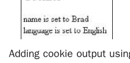

图 3.2  使用 JavaScript 添加 Cookie 输出。

### 添加计时器

JavaScript 的另一个实用功能是设置计时器，使其在一段时间后或按特定间隔执行函数或求值表达式。

使用计时器可以延迟代码的执行，使其不必在事件触发或页面加载的确切时刻发生。以下段落展示了如何创建计时器来延迟代码执行以及应用重复操作。

#### 添加延迟计时器

```javascript
function myTimer () {
    alert("Timer Function Executed");
}
var timerId = setTimeout(myTimer, 10000);
```

要简单地延迟代码执行一段时间，请使用 `setTimeout(code, ms)` 方法，其中 `code` 是时间到期时执行的语句或函数，`ms` 是毫秒数。例如，要在 10 秒后执行名为 `myTimer()` 的函数，您将使用以下代码：`setTimeout(myTimer, 10000);`

#### 取消计时器

```javascript
function myTimer () {
    alert("Timer Function Executed");
}
var timerId = setTimeout(myTimer, 10000);
clearTimeout(timerId); //timer will not execute
```

在时间耗尽且代码执行之前的任何时候，您都可以通过调用 `clearTimeout(id)` 方法（使用从 `setTimeout()` 返回的 ID）来清除计时器。一旦计时器被清除，它就不会执行。您需要使用一个变量来跟踪从 `setTimeout()` 返回的 ID。

#### 添加重复计时器

```javascript
var statusTimerId;
var status = "OK";
//checks status every minute as long as it is "OK"
function checkStatus () {
    if(status == "OK"){
        alert("Status OK");
        statusTimerId = setInterval(checkStatus, 60000);
    } else {
      alert("Status Failed");
    }
}
statusTimerId = setInterval(checkStatus, 60000);
```

您还可以使用 `setInterval(function, ms)` 方法启动一个按固定间隔触发的计时器。此方法也接受函数名和毫秒数作为参数。在函数内部，您需要再次对同一函数调用 `setInterval`，这样代码才会再次被调用。

要关闭重复计时器，只需不要在计时器函数内部再次调用 `setInterval()`，或者在函数外部使用 `clearInterval()`。

## 访问 HTML 元素

动态 Web 开发最重要的部分是快速高效地访问 DOM 元素的能力。JavaScript 本身提供了访问 DOM 元素的功能。这个 JavaScript 特性有时很有用，但正是 jQuery 真正脱颖而出的领域。有时您将需要使用 JavaScript 方法来访问 DOM 元素，但如果可能，我建议使用 jQuery。

本章中的段落涵盖了使用 JavaScript 和 jQuery 选择器方法来查找 DOM 元素。

### 在 JavaScript 中查找 HTML 元素

有三种使用 JavaScript 查找 HTML 元素的方法。您可以按 ID 属性名、类名或标签类型进行搜索。以下代码展示了定义一个 HTML `<div>` 元素的示例，以便每种方法都可以使用它：

```html
<div id="myDiv" class="myClass">Content</div>
```

通过添加 ID 和 class 属性，您可以使用这些值 "myDiv" 和 "myClass" 来搜索 `<div>` 元素。

##### 通过 ID 查找 DOM 对象

```javascript
var containerObj = document.getElementById("myDiv");
```

查找 HTML 元素的最简单方法是使用 `document.getElementById(id)` 函数配合 `id` 属性的值。`document.getElementById(id)` 函数在 DOM 中搜索具有匹配 `id` 属性的对象。如果找到该对象，函数返回该 DOM 对象。

##### 通过类名查找 DOM 对象

```javascript
var objs = document.getElementsByClassName("myClass");
for (var i=0; i<objs.length; i++){
    var htmlElement = objs[i];
    ...
}
```

您也可以使用 `document.getElementsByClassName(class)` 按类属性搜索 HTML 元素。此函数返回具有匹配类属性的 DOM 对象数组。然后您可以使用 JavaScript 循环遍历该列表，并对每个 DOM 元素应用更改。

##### 通过标签名查找 DOM 对象

```javascript
var objs = document.getElementsByTagName("div");
for (var i=0; i<objs.length; i++){
    var htmlElement = objs[i];
    ...
}
```

另一种搜索 HTML 元素的方法是使用 `document.getElementsByTagName(tag)` 按其 HTML 标签搜索。此函数搜索文档中所有具有指定标签名的 DOM 对象，并将它们以数组形式返回。然后您可以使用 JavaScript 循环遍历该数组，并访问或对每个 DOM 元素应用更改。

## 使用 jQuery 选择器查找 HTML 元素

与 JavaScript 不同，jQuery 允许您使用选择器以无数种方式查找 HTML 元素。是的，就像 CSS 选择器一样。事实上，大多数 jQuery 选择器基于 CSS 选择器，从而提供了两者之间更无缝的过渡。

正如即将展示的段落所演示的，jQuery 选择器使得选择几乎任何 HTML 元素组变得容易。请记住，jQuery 选择器返回的是表示一组 DOM 对象的 jQuery 对象，而不是直接的 DOM 对象数组。

jQuery 选择器语法很简单。加载 jQuery 库后，只需使用 `$(selector)`。例如：

```javascript
$("#myElement")
```

**注意！**

jQuery 选择器语法中使用了多个元字符。如果您想将任何元字符（如 !"#$%&'()*+,.:;<=>?@[\]^{|}~\)）作为类/ID/名称的一部分使用，您需要用 \\（两个反斜杠）转义该字符。例如，如果您有一个 id="my.element" 的元素，您将使用选择器 `$("#my\\.element")`。

### 应用基本的 jQuery 选择器

```javascript
$("*"); //selects all elements
$(".myClass"); //selects elements with
class="myClass"
$("#myDiv"); //selects the element with id="myDiv"
$("div"); //selects <div> elements
$("div, span, p"); //selects <div>, <span>, and <p>
elements
$("div.myClass"); //selects <div> elements with
class="myClass"
```

最常用的选择器是基本选择器。基本选择器专注于 HTML 元素的 ID 属性、类属性和标签名。表 4.1 列举了一些示例，向您展示如何定义一些基本选择器。

表 4.1 使用基本 jQuery 选择器的示例

| 语法/示例 | 描述 |
| --- | --- |
| $("*") | 选择所有 HTML 元素。 |
| $(".class") | 基于类属性选择元素。 |
| $(".container") | 示例：选择所有 class="container" 的 HTML 元素。. 字符前缀表示类名。 |


## 使用 jQuery 选择器查找 HTML 元素

63

| 语法/示例 | 描述 |
| :--- | :--- |
| `$("#id")`<br>`$("#menu")` | 根据 id 属性选择一个元素。<br><br>示例：选择 `id="menu"` 的 HTML 元素。`#` 字符前缀表示一个 id 值。 |
| `$("element")`<br>`$("div")` | 根据标签类型选择元素。<br><br>示例：选择所有 `<div>` 元素。 |
| `$("element,element...")`<br>`$("div, span, p")` | 根据标签选择多种类型的元素。<br><br>示例：选择所有 `<div>`、`<span>` 和 `<p>` 元素。你也可以指定多个由逗号分隔的元素。 |
| `$("element.class")`<br>`$("ul.bigLists")` | 选择特定标签和类的元素。<br><br>示例：通过组合元素名称和类名，选择所有 `class="bigList"` 的 `<ul>` 元素。注意，元素和类名之间没有空格。 |

### 基于 HTML 属性选择元素

```javascript
$("input[value=0]"); //选择 value="0" 的 <input>
$("p[class*=my"]);//选择类名中包含 "my" 的元素
$("img[src^='icons\/'']");
//选择 src 以 "icons/" 开头的  元素
$("input[value!='default']");
//选择值不等于 "default" 的 <input> 元素
$("p[id]"); //选择设置了 id 的 <p> 元素
$("p[id][class$=Menu]");
//选择设置了 id 且类名以 "Menu" 结尾的
//<p> 元素
```

使用 jQuery 选择器的另一种方式是通过属性值选择 HTML 元素。这可以是默认属性，也可以是你添加到 HTML 元素上的属性。在选择器语法中，属性值用 `[]` 括号括起来表示。表 4.2 展示了一些你可以应用属性选择器的方式。

#### 表 4.2 使用属性 jQuery 选择器示例

| 语法/示例 | 描述 |
| :--- | :--- |
| `$([attribute=value]")` | 选择属性 attr=value 的元素。 |
| `$("input[value=0]")` | 示例：选择所有 *value* 属性等于 0 的 `<input>` 元素。 |

## 使用 jQuery 选择器查找 HTML 元素

65

| 语法/示例 | 描述 |
|---|---|
| `$([attr*=value])` | 属性 attr 包含值 value。 |
| `$("p[id][class$=Menu]")` | 示例：选择所有具有 id 属性且类名以 "Menu" 结尾的 `<p>` 元素。例如，在下面的 HTML 元素中，只有前两个会被选中：<br>`<p id="topMenu" class="topMenu">...</p>`<br>`<p id="topMenu" class="leftMenu">...</p>`<br>`<p id="contentMenu" class="contentMenuItem">...</p>`<br>`<p class="contentMenu">...</p>` |

### 基于内容选择元素

```javascript
$("p:contains('free')");
//选择包含 "free" 的 <p> 元素
$("div:has(span)");
//选择包含 <span> 元素的 <div> 元素
$("div:empty");
//选择没有内容或子元素的 <div> 元素
$("div:parent");
//选择至少有一些内容的 <div> 元素
```

另一组有用的 jQuery 选择器是内容过滤选择器。这些选择器允许你根据 HTML 元素内部的内容来选择元素。表 4.3 展示了使用内容选择器的示例。

#### 表 4.3 使用内容 jQuery 选择器示例

| 语法/示例 | 描述 |
| :--- | :--- |
| `$(":contains(value)")`<br>`$("div:contains ('Open Source')")` | 选择内容中包含 value 文本的元素。<br>示例：选择所有包含文本 "Open Source" 的 `<div>` 元素。 |
| `$(":has(element)")`<br>`$("div:has(span)")` | 选择包含特定子元素的元素。<br>示例：选择所有包含 `<span>` 元素的 `<div>` 元素。例如，在以下元素中，只有第一个会被选中：<br>`<div><span>Span Text</span></div>`<br>`<div>No Span Text</div>` |
| `$(":empty")`<br>`$("div:empty")` | 选择没有内容的元素。<br>示例：选择所有没有内容的 `<div>` 元素。 |
| `$(":parent")`<br>`$("div:parent")` | :empty 的反向选择，选择至少有一些内容的元素。<br>示例：选择所有至少有一些内容的 `<div>` 元素。 |

### 通过层级位置选择元素

```javascript
$("div span");
    //选择具有 <div> 祖先元素的 <span> 元素
$("div.menu > span");
    //选择其直接父元素是具有 class="menu" 的 <div> 的
    //<span> 元素
$("label + input.textItem");
    //选择具有 class="textItem" 的 <input> 元素，
    //且其前面紧邻一个 <label>
$("#menu ~ div");
    //选择所有与 id="menu" 的元素
    //是兄弟关系的 <div> 元素
```

一组重要的 jQuery 选择器是层级选择器。这些选择器允许你基于 DOM 层级来选择 HTML 元素。这使你能够编写更具内容感知性的动态代码，仅通过 DOM 树中的父元素、子元素或周围其他元素来选择元素。表 4.4 展示了一些层级选择器的示例。

#### 表 4.4 使用层级 jQuery 选择器示例

| 语法/示例 | 描述 |
| :--- | :--- |
| `$("ancestor element")`<br>`$("div span")` | 选择具有类型为 ancestor 的祖先元素且匹配 element 的类型为 element 的元素。<br><br>示例：选择所有具有 `<div>` 祖先元素的 `<span>` 元素。`<div>` 元素不需要是直接祖先。例如，以下 `<span>` 元素仍会被选中：<br><br>`<div><p>Some <span>Span Text</span></p></div>` |
| `$("parent > child")`<br>`$("div.menu > span")` | 选择具有特定父类型的元素。`>` 表示直接的子/父关系。<br><br>示例：选择所有直接父元素是具有 class="menu" 的 `<div>` 的 `<span>` 元素。 |
| `$("prev + next")`<br>`$("label + input.textItem")` | 选择后面紧跟着特定类型元素的元素。`+` 表示 prev 项必须紧跟着 next 项。<br><br>示例：选择所有后面紧跟着具有 class="textItem" 的 `<input>` 元素的 `<label>` 元素。 |

## 第四章 访问 HTML 元素

表 4.4 续

| 语法/示例 | 描述 |
| :--- | :--- |
| `$("prev ~ siblings")`<br>`$("#menu ~ div")` | 选择在 prev 之后、具有相同父元素且匹配 siblings 选择器的元素。`~` 表示兄弟元素。<br><br>示例：选择所有与 id="menu" 的元素是兄弟关系且在 DOM 树中位于 "#menu" 项之后的 `<div>` 元素。注意，位于之前的 `<div>` 元素不会被选中。例如，在以下内容中，只有最后两个元素会被选中：<br><br>`<div>....</div>`<br>`<ul id="menu"> ... </ul>`<br>`<span> ... <span>`<br>`<div> ... </div>`<br>`<div> ... </div>` |

> **顺便一提**

在设计 jQuery 选择器时，最好尽可能具体。例如，如果你想选择所有 class="menu" 的 span 元素，并且这些元素只位于 id="menuDiv" 的 `<div>` 元素下，那么 `$("div#menuDiv .menu")` 会比仅仅 `$(".menu")` 高效得多，因为前者会在检查 menu 类属性之前，将搜索范围限制在 `<div>` 元素内。

### 通过表单状态选择元素

```javascript
$("input:checked");
//选择被选中的 <input> 元素
$("option:selected");
//选择被选中的 <option> 元素
$("#myForm :focus");
//选择 #myForm <form> 中
//当前获得焦点的元素
$("input:disabled");
//选择当前被禁用的
//<input> 元素
```

在处理动态 HTML 表单时，一组极其有用的选择器是表单 jQuery 选择器。这些选择器允许你基于表单元素的状态来选择表单中的元素。表 4.5 展示了一些表单选择器的示例。

#### 表 4.5 使用属性 jQuery 选择器示例

| 语法/示例 | 描述 |
| :--- | :--- |
| `$(":checked")`<br>`$("input:checked")` | 选择 checked 属性为 true 的元素。<br><br>示例：选择所有当前处于选中状态的 `<input>` 元素。 |
| `$(":selected")`<br>`$("option:selected")` | 选择 selected 属性为 true 的元素。<br><br>示例：选择所有当前被选中的 `<option>` 元素。 |
| `$(":focus")`<br>`$(":focus")` | 选择表单中获得焦点的元素。<br><br>示例：选择所有当前获得焦点的 HTML 元素。 |


## 表 4.5 **续**

| 语法/示例 | 描述 |
|---|---|
| $(":enabled") | 选择启用的元素。 |
| $("input:enabled") | 示例：选择所有处于启用状态的 `<input>` 元素。 |
| $(":disabled") | 选择禁用的元素。 |
| $("input:disabled") | 示例：选择所有处于禁用状态的 `<input>` 元素。 |

## 基于可见性选择元素

```
$("div:visible");
  //选择当前可见的 <div> 元素
$("div:hidden");
  //选择当前隐藏的 <div> 元素
```

如果你正在使用可见性来控制网页组件的布局和交互，那么使用 jQuery 的可见性选择器可以轻松地选择隐藏或可见的 HTML 元素。表 4.6 展示了一些可见性选择器的示例。

表 4.6 使用属性 jQuery 选择器的示例

| 语法/示例 | 描述 |
| :--- | :--- |
| $(":visible") | 选择可见元素。 |
| $("div:visible") | 示例：选择所有当前至少具有一定高度和宽度的 `<div>` 元素，这意味着它们在浏览器中占据空间。这甚至包括通过 `visibility:hidden` 或 `opacity:0` 隐藏的元素，因为它们仍然占据空间。 |
| $(":hidden") | 选择隐藏元素。 |
| $("div:hidden") | 示例：选择所有当前具有 `visibility:hidden` 或 `opacity:0` CSS 属性的 `<div>` 元素。 |

## 在 jQuery 选择器中应用过滤器

```
$("tr:even"); //选择偶数行的 <tr> 元素
$("li:odd"); //选择奇数行的 <li> 元素
$("div:first"); //选择第一个 <div> 元素
$("div:last"); //选择最后一个 <div> 元素
$(":header"); //选择 <h1>, <h2>, ... 等标题元素
$("div:eq(5)"); //选择第六个 <div> 元素
$("li:gt(1)"); //选择第二个之后的 <div> 元素（即从第三个开始）
$("li:lt(2)"); //选择前两个 <div> 元素
$(":animated"); //选择当前正在动画的元素
```

通常，你需要将 jQuery 选择器细化为更具体的子集。实现这一点的一种方法是使用过滤选择器。过滤选择器在选择器语句末尾添加一个过滤器，该过滤器会限制选择器返回的结果。表 4.7 展示了一些向选择器添加过滤器的示例。

表 4.7 使用过滤 jQuery 选择器的示例

| 语法/示例 | 描述 |
| --- | --- |
| $(":even")<br>$("tr:even") | 过滤掉所有奇数索引的元素。<br>示例：选择所有 `<tr>` 元素，然后将结果过滤为仅保留偶数编号的项。 |
| $(":odd")<br>$("li:odd") | 过滤掉所有偶数索引的元素。<br>示例：选择所有 `<li>` 元素，然后将结果过滤为仅保留奇数编号的项。 |
| $(":first")<br>$("div:first") | 过滤掉除第一个元素外的所有元素。<br>示例：仅选择遇到的第一个 `<div>` 元素。 |
| $(":last")<br>$("div:last") | 过滤掉除最后一个元素外的所有元素。<br>示例：仅选择遇到的最后一个 `<div>` 元素。 |
| $(":header")<br>$(":header") | 选择标题类型的元素，如 `<h1>`、`<h2>`、`<h3>` 等。<br>示例：选择所有标题元素。 |
| $(":eq(index)")<br>$("div:eq(5)") | 选择在特定的、基于零的索引位置的元素。<br>示例：选择遇到的第六个 `<div>` 元素。之所以选择第六个而不是第五个，是因为索引是从零开始的，所以 0 代表第一个。 |
| $(":gt(index)")<br>$("li:gt(1)") | 过滤列表以仅包含在特定的、基于零的索引之后的元素。<br><br>示例：选择在遇到的第二个之后的每个 `<li>` 元素。同样，此索引是从零开始的。 |
| $(":lt(index)")<br>$("li:lt(2)") | 过滤列表以仅包含在特定的、基于零的索引之前的元素。<br><br>示例：仅选择遇到的前两个 `<li>` 元素。同样，此索引是从零开始的。 |
| $(":animated")<br>$(":animated") | 选择当前正在动画的元素。<br><br>示例：选择所有当前正在动画的元素。 |

## 链式调用 jQuery 对象操作

```
$("div#content").children("p:first").css("font-weight", "bold").children("span").css("color", "red");
```

jQuery 对象的一个强大之处在于，你可以将多个 jQuery 操作链式调用，组合成一条语句。链中的每个后续操作都作用于前一个操作的结果。这可以简化你的选择器，并减少你的 CSS 中所需的类和 ID 定义数量。

为了帮助说明这一点，请看以下语句。代码首先找到 `id="content"` 的 `<div>` 元素，然后找到其中的第一个 `<p>` 元素，并将 `font-weight` 更改为粗体。接着，它找到 `<p>` 元素中的 `<span>` 元素，并将颜色设置为红色：

```
var $contentDiv = $("div#content");
var $firstP = $contentDiv.children("p:first");
$firstP.css("font-weight", "bold");
var $spans = $firstP.children("span");
$spans.css("color", "red");
```

上述代码用了五行才完成所有任务。而下面这条链式调用的 jQuery 操作语句做了同样的事情，但只用了一条语句：

```
$("div#content").children("p:first").css("font-weight", "bold").children("span").css("color", "red");
```

因为每个操作都返回一个 jQuery 对象，所以你可以根据需要将任意多的 jQuery 操作链式调用在一起。即使 `.css()` 操作旨在修改 DOM 对象而不是查找它们，它仍然返回相同的 jQuery 对象，因此你可以对结果执行其他操作。

## 导航 jQuery 对象以选择元素

连接到 jQuery 对象的另一个重要方法集是 DOM 遍历方法。DOM 遍历允许你根据元素与其他元素的关系来选择元素。DOM 遍历的一些示例包括：访问所有是 `<div>` 元素子元素的 `<p>` 元素，以及查找是 `<input>` 元素兄弟元素的 `<label>` 元素。

jQuery 对象提供了一套令人难以置信的方法，允许你以几乎无数种方式遍历 DOM。它允许你使用 jQuery 对象中当前选定的 DOM 元素，来选择 DOM 树中的另一组 DOM 元素。以下短语提供了一些在 jQuery 对象中遍历 DOM 元素以到达其他对象集的示例。

## 获取元素的子元素

```
$("div").children("p");
    //选择作为 <div> 元素直接子元素的 <p> 元素
```

`.children([selector])` 方法返回一个 jQuery 对象，该对象代表当前对象所代表元素的子元素。你可以指定一个可选的选择器，将结果限制为仅包括匹配该选择器的子元素。

## 获取最近的祖先元素

```
$("p.menu").closest("div");
    //选择具有 class="menu" 的 <p> 元素的最近 <div> 祖先
```

`.closest(selector, [context] 或 object 或 element)` 方法返回一个 jQuery 对象，该对象代表匹配传入参数的第一个元素。参数可以是一个选择器、一个带有搜索起始上下文的选择器、一个 jQuery 对象或一个 DOM 对象。搜索从当前元素集开始，然后搜索祖先元素。

## 获取包含的元素

```
$("div").contents();
//选择 <div> 元素中的所有直接子元素
$("select").contents();
//选择 <select> 元素中的所有 <option> 元素
```

`.contents()` 返回一个 jQuery 对象，该对象代表当前元素集的直接子元素。这在获取列表中的所有 `<li>` 元素或 `<select>` 块中的 `<option>` 元素时特别有用。

## 查找后代元素

```
$("table").find("span")
//选择包含在 <table> 元素某处的所有 <span> 元素
$("#myForm").find("input")
//选择包含在元素 #myForm 某处的所有 <input> 元素
```

`.find(filter)` 方法返回一个 jQuery 对象，该对象代表当前集合中匹配提供的过滤器的后代元素。过滤器可以是一个选择器、一个用于匹配元素的 jQuery 对象，或一个元素标签名。

示例：选择包含在 `<table>` 元素某处的所有 `<span>` 元素。


## 获取选中对象之后的同级元素

```javascript
$("#title").next("p");
//查找 id="title" 的元素，并选择其紧随其后的同级 <p> 元素

$("p:first").nextAll();
//选择找到的第一个 <p> 元素，然后选择该元素的所有同级 <p> 元素

$("p:first").nextUntil("ul");
//选择找到的第一个 <p> 元素，然后选择所有后续的同级元素，直到遇到 <ul> 元素为止
```

`.next([selector])` 方法返回一个 jQuery 对象，该对象表示当前集合中每个元素的下一个同级元素。如果提供了可选的 selector，则只有当该同级元素匹配选择器时才会被添加。

`.nextAll([selector])` 方法返回一个 jQuery 对象，该对象表示当前集合中每个元素的所有后续同级元素。它也接受一个可选的选择器。

`.nextUntil([selector] 或 [element] [,filter])` 方法返回一个 jQuery 对象，该对象表示当前集合中每个元素之后的所有同级元素，直到遇到与 element 或 selector 参数匹配的对象为止。第一个参数可以是 DOM 对象或选择器。第二个可选参数是一个筛选选择器，用于限制结果中返回的项目。

## 获取定位父元素

```javascript
$("#notify").offsetParent();
//选择 id="notify" 的元素，然后选择用于定位该元素的祖先元素
```

`.offsetParent()` 方法返回一个 jQuery 对象，该对象表示最近的、且 CSS position 属性为 relative、absolute 或 fixed 的祖先元素。这使你可以获取用于定位的元素，当你需要获取定位容器的大小时，这一点变得至关重要。

## 查找选中项的父元素或祖先元素

```javascript
$("div#menu").parent();
//选择 id="menu" 的 <div> 元素，然后查找其直接父元素

$("#data").parents("div");
//选择 id="data" 的元素，然后返回包含所有 <div> 祖先元素的集合

$("#data").parentsUntil("#menu");
//选择 #data 的父元素，直到找到 id="#menu" 的元素为止
```

`.parent([selector])` 方法返回一个 jQuery 对象，该对象表示当前集合中每个元素的直接父对象。可选的 selector 参数允许你将结果限制为与选择器匹配的父元素。

`.parents([selector])` 方法返回一个 jQuery 对象，该对象表示当前集合中每个元素的祖先元素。可选的 selector 参数允许你将结果限制为与选择器匹配的父元素。

`.parentsUntil([selector] 或 [element] [, filter])` 方法返回一个 jQuery 对象，该对象表示当前集合中每个元素的祖先元素，直到遇到与 element 或 selector 参数匹配的对象为止。第一个参数可以是元素标签名或选择器。第二个可选参数是一个筛选选择器，用于限制结果中返回的项目。

## 获取之前的同级元素

```javascript
$("p#footer").prev("p");
//查找 id="footer" 的 <p> 元素，然后选择其之前的同级 <p> 元素

$("div#footer").prevAll("div");
//选择 id="footer" 的 <div> 元素，然后选择该元素之前的所有同级 <div> 元素

$("div#footer").prevUntil("div#header");
//查找 id="footer" 的 <div> 元素，然后选择其之前的所有同级元素，直到找到 #header 为止
```

`.prev([selector])` 方法返回一个 jQuery 对象，该对象表示当前集合中每个元素的前一个同级元素。如果提供了可选的 selector，则只有当该同级元素匹配选择器时才会被添加。

`.prevAll([selector])` 方法返回一个 jQuery 对象，该对象表示当前集合中每个元素的所有前序同级元素。它也接受一个可选的选择器。

`.prevUntil([selector] 或 [element] [,filter])` 方法返回一个 jQuery 对象，该对象表示当前集合中每个元素之前的所有同级元素，直到遇到与 selector 或 element 匹配的对象为止。第一个参数可以是 DOM 对象或选择器。第二个可选参数是一个筛选选择器，用于限制结果中返回的项目。

## 获取同级元素

```javascript
$(".menu").siblings("span");
//选择所有与 class="menu" 的元素同级的 <span> 元素
```

`.siblings([selector])` 方法返回一个 jQuery 对象，该对象表示当前集合中每个元素的所有同级对象。可选的 selector 参数允许你将结果限制为与选择器匹配的同级元素。

## 操作 jQuery 对象集合

jQuery 对象的一个重要方面是能够访问和操作该对象所表示的 DOM 元素集合。这与操作 DOM 元素本身是不同的。

jQuery 提供了几种方法，允许你修改 jQuery 对象所表示的 DOM 元素。还有一些方法可以遍历每个元素以构建不同的元素或应用其他操作。

以下部分旨在向你展示如何以各种方式使用 jQuery 对象集合。

## 从 jQuery 对象集合中获取 DOM 对象

```javascript
$("div").get();
//返回所有 <div> 元素的 DOM 对象数组

$("div").get(0);
//返回第一个 <div> 的 DOM 对象

$("div").get(-1);
//返回最后一个 <div> 的 DOM 对象
```

`.get([index])` 方法返回 jQuery 对象集合中表示的 DOM 元素。如果未指定索引，则返回 DOM 对象的数组。如果指定了索引，则返回数组中从零开始的偏移量处的 DOM 元素。

如果索引是负数，则返回从数组末尾反向偏移量处的项目。例如，-1 是最后一个项目，-2 是倒数第二个项目。

## 将 DOM 对象转换为 jQuery 对象

```javascript
var containerObj = document.getElementById("myDiv");
$(containerObj); //等同于 $("#myDiv");

var objs = document.getElementsByClassName("myClass");
$(objs); //等同于 $(".myClass");

var objs = document.getElementsByTagName("div");
$(objs); //等同于 $("div");
```

jQuery 构造函数 `$()` 接受 DOM 对象和数组作为参数。如果你传入一个 DOM 对象，`$()` 会将该 DOM 对象或数组转换为一个 jQuery 对象，然后你就可以像使用普通 jQuery 对象一样操作它。

## 使用 .each() 遍历 jQuery 对象集合

```javascript
$("p").each(function (idx) {
    $(this).html("This is paragraph " + idx);
});
```

`.each(function)` 方法是 jQuery 对象最重要的方法之一，因为它允许你遍历 jQuery 集合中的所有元素，并对每个元素单独执行操作。这与仅仅对查询中的所有项目应用相同的操作是不同的。

`.each()` 方法允许你指定一个函数，为 jQuery 对象集合中的每个元素运行。该函数接收一个索引号作为第一个参数。在函数内部，`this` 变量指向当前的 DOM 元素。

为了说明如何使用 `.each()`，请看以下代码片段。它遍历所有段落元素，并将空的 `<p>` 元素的内容设置为包含该元素索引号的字符串，如图 5.1 所示：

```html
<html>
<head>
<title>Python Phrasebook</title>
<meta charset="utf-8" />
<script type="text/javascript" src="../js/jquery-2.0.3.min.js"></script>
<script>
$(document).ready(function () {
    $("p").each(function (idx) {
        $(this).html("This is paragraph " + idx);
    });
});
</script>
</head>
<body>
<p></p>
<p></p>
<p></p>
<p></p>
</body>
</html>
```

ch0501.html

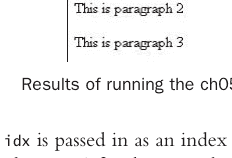

**图 5.1** 运行 ch0501.html 代码的结果。

注意，`idx` 是作为索引号传入的，第一个 `<p>` 元素为 0，第二个为 1，依此类推。还要注意，我使用 `$(this)` 将 `this` 转换为 jQuery 对象，以便我可以调用 `.html()` 方法。

### 顺便提一下

在使用遍历 DOM 元素的 jQuery 方法时，你可以使用 `this` 关键字访问正在遍历的当前 DOM 对象。`this` 是一个 DOM 对象，而不是 jQuery 对象，因此如果你需要使用 DOM 对象的 jQuery 形式，请使用 `$(this)`。不过请记住，构建 DOM 对象的 jQuery 形式需要开销，因此只在你确实需要其提供的功能时才创建 jQuery 形式。


### 使用 `.map()`

```javascript
var liValues = $("li").map(function (idx){
  return $(this).html();
}).get();
```

`.map(function)` 方法同样遍历 jQuery 对象集合中的每个元素。虽然与 `.each()` 相似，但有一个重要区别：`.each()` 返回相同的 jQuery 对象，而 `.map()` 返回一个新的 jQuery 对象，其中包含每次迭代返回的值。

为了演示 `.map()` 的使用，请看以下代码片段。此代码遍历所有 `<li>` 元素，并返回一个包含图 5.2 所示 `<li></li>` 元素内部 HTML 内容值的数组：

```html
<html>
  <head>
    <title>Python Phrasebook</title>
    <meta charset="utf-8" />
    <script type="text/javascript"
      src="../js/jquery-2.0.3.min.js"></script>
    <script>
      $(document).ready(function (){
        var liValues = $("li").map(function (idx){
          return $(this).html();
        }).get();
      });
    </script>
  </head>
  <body>
    <ul>
      <li>Aragorn</li>
      <li>Legolas</li>
      <li>Gimli</li>
    </ul>
  </body>
</html>
```

`ch0502.html`

```json
[
  "Aragorn",
  "Legolas",
  "Gimli"
]
```

`liValues` 的最终值

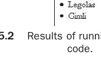

请注意，在每次迭代过程中，函数返回 `<li>` 元素中的 HTML 内容。该值被添加到 `.map()` 方法返回的映射对象集合中。最后调用 `.get()` 以获取映射集合中表示的 JavaScript 数组对象。

### 将数据值分配给对象

```javascript
$("li:eq(0)").data("race","Men");
$("li:eq(1)").data("race","Elves");
$("li:eq(2)").data({race:"Dwarves"});
$("li").each(function(){
    $(this).append(" of the race of ");
    $(this).append($(this).data("race"));
});
```

jQuery 提供了 `.data(key [,value])` 方法，用于将数据片段作为键值对存储在 DOM 对象内。这允许你将额外的数据片段附加到对象上，以便以后访问。

`.data(object)` 有一种替代形式，接受包含键值对的 JavaScript 对象。当你已经在处理对象时，这会变得很有用。

要访问已存储的数据项，只需调用 `.data(key)`，它会返回对象值。你可以将数据附加到任何类型的 HTML 对象。例如，你可以向 `<option>` 元素附加额外数据，这些数据比传统值支持的信息更多。

以下代码展示了在对象中存储数据的示例。第 9-11 行在 `<li>` 元素中存储数据。然后第 12-15 行中的 each 函数遍历 `<li>` 元素，并将带有存储值的字符串附加到内容上。图 5.3 显示了生成的 HTML 页面：

```html
<html>
  <head>
    <title>Python Phrasebook</title>
    <meta charset="utf-8" />
    <script type="text/javascript"
      src="../js/jquery-2.0.3.min.js"></script>
    <script>
      $(document).ready(function (){
        $("li:eq(0)").data("race","Men");
        $("li:eq(1)").data("race","Elves");
        $("li:eq(2)").data("race","Dwarves");
        $("li").each(function(){
          $(this).append(" of the race of ");
          $(this).append($(this).data("race"));
        });
      });
    </script>
  </head>
  <body>
    <ul>
      <li>Aragorn</li>
      <li>Legolas</li>
      <li>Gimli</li>
    </ul>
  </body>
</html>
```

`ch0503.html`

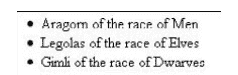

**图 5.3** 运行 `ch0503.html` 代码的结果。

### 向 jQuery 对象集合添加 DOM 元素

```javascript
var pars = $("p");
//包含所有 <p> 元素
var pAndDiv = $("div").add(pars);
//包含所有 <div> 和 <p> 元素
var pAndDivAndSpan = $("span").add("p").add("div");
//包含所有 <span>、<div> 和 <p> 元素
```

jQuery 的一个很棒的特性是它能轻松地向 jQuery 对象集合中添加额外的元素。`.add(selector)` 方法将与选择器匹配的元素添加到 jQuery 对象表示的集合中。
`.add(object)` 方法接受另一个 jQuery 对象，并将该对象中的元素添加到当前对象的集合中。

### 从 jQuery 对象集合中移除对象

```javascript
var items = $("span");
items.css({color:"red"});
//将所有 <span> 元素的文本颜色设置为红色
items.remove(".menu");
items.css({"font_weight":"bold"});
//将除 .menu 外的所有 <span> 元素设置为粗体
```

jQuery 的另一个很棒的特性是它能轻松地从 jQuery 对象集合中移除项目以及添加额外的元素。`.remove([selector])` 方法将从 jQuery 对象表示的集合中移除与选择器匹配的元素。不带选择器调用 `.remove()` 将从集合中移除所有元素。

### 过滤 jQuery 对象结果

jQuery 对象提供了一组良好的方法，允许你修改查询中表示的 DOM 对象。当你试图在 jQuery 选择器结果中定位一组特定元素时，缩小结果会很有帮助。以下短语提供了过滤 jQuery 选择器结果以找到对象集合的示例。

#### 基于索引过滤项

```javascript
$("div#content").eq(1);
//选择选择器找到的第二个元素
```

`.eq(index)` 过滤器将返回 jQuery 对象集合中特定索引处的元素。索引从零开始，所以 `.eq(1)` 实际上检索选择器找到的第二个元素。

#### 使用过滤函数过滤选择器结果

```javascript
$("option").filter(
  function (index) {
    return (this.value>5); });
//仅选择 value=5 的 <option> 元素
$("div").filter(".myClass");
//仅选择 class="myClass" 的 <div> 元素
```

`.filter(filter)` 方法将集合缩小为仅与指定过滤器匹配的项目。过滤器可以是选择器、特定 DOM 元素、jQuery 对象或测试每个元素并在应包含时返回 true 的函数。

> **你知道吗？**

与 CSS 选择器相同的 jQuery 选择器能够使用原生 DOM 方法 `querySelectorAll()`，该方法对 DOM 对象进行了一些高级优化。其他 jQuery 选择器无法利用该优化，因此最好首先使用基于 CSS 的选择器，然后将过滤器作为链式选择器添加。例如，不要使用 `$("div:animated")`，而应使用 `$("div").filter(":animated")`。

### 获取第一个或最后一个项

```javascript
$("p").first(); //选择集合中的第一个 <p> 元素
$("p").last(); //选择集合中的最后一个 <p> 元素
```

`.first()` 方法选择 jQuery 对象集合中的第一个元素。许多返回值的 jQuery 方法最终都使用集合中的第一个元素。`.last()` 方法选择 jQuery 对象集合中的最后一个元素。

### 获取包含其他项的项

```javascript
$("div").has("p");
//选择包含 <p> 后代的 <div> 元素
$("div").has("#menu");
//选择包含具有 id="menu" 的元素的 <div> 元素
```

`.has(selector or element)` 方法将集合缩小为那些具有与选择器匹配的后代元素或包含指定 DOM 元素的元素。

### 使用 Not 逻辑过滤掉项

```javascript
$("div").not(".menu");
    //选择不包含 .menu 类的 <div> 元素
$("option").not(function(){
    return (this.value==0); }));
    //选择不包含 value=0 的 <option> 元素
```

`.not(filter)` 方法将集合缩小为与过滤器匹配的元素。过滤器可以是选择器、一个或多个特定 DOM 元素、jQuery 对象或测试每个元素并在应包含时返回 true 的函数。

### 切割选择器结果

```javascript
$("tr").slice(2,5);
    //选择索引 2 到 4 之间的 <tr> 元素（包含两端）
$("p").slice(1,-1);
    //选择除第一个和最后一个之外的所有 <p> 元素
```

`.slice(start, [end])` 方法移除索引 `start` 之前和索引 `end` 之后的元素，只返回中间的项目。这允许你将大选择拆分为更小的部分。索引从零开始。负数的 `end` 表示从列表末尾的偏移量，其中 -1 是最后一个元素，-2 是倒数第二个元素。


## 捕获与使用浏览器和用户事件

jQuery和JavaScript的一个主要目标，是让开发者能够创建极其精致且交互性极强的网页。交互式网页的核心是**事件**。*事件*指的是浏览器环境中发生的任何事情，从页面加载，到鼠标移动或点击，再到键盘输入，以及窗口大小调整。

理解事件、代表事件的对象，以及如何在网页中应用它们，将使你能够创建出令人惊叹的用户交互。本章涵盖了理解事件所需的概念，以及如何利用它们来构建丰富的交互式网页。

本章中的代码片段旨在向你展示JavaScript事件引擎的工作原理，以及如何应用JavaScript和jQuery代码来实现事件处理程序。你将能够将本章的概念与其他章节的概念相结合，以实现专业且丰富的用户交互。

### 理解事件

浏览器事件的概念相当简单。事件是任何改变浏览器或网页状态的事情。这包括页面加载、鼠标移动和点击、键盘输入，以及表单提交和页面中发生的其他事情。每个事件都有一个事件对象，描述了发生的事件以及事件发生的对象。

本节提供了一些表格，帮助你快速了解事件对象的样貌、JavaScript中一些更常见的事件是什么，以及是什么触发了它们。

### 回顾事件类型

事件类型是JavaScript和jQuery用来识别所发生物理事件的关键字。这些关键字用于将处理程序附加到特定类型的事件。此外，正如你稍后将看到的，这些关键字用于方法名中，以便你可以附加事件处理程序或手动触发事件。

JavaScript提供了几种事件类型，对应于动态页面交互期间发生的不同事件。jQuery事件处理支持所有JavaScript事件类型，并增加了一些自己的事件类型。表6.1列出了JavaScript和jQuery支持的不同事件类型。

#### 表6.1 JavaScript和jQuery事件类型

| 事件类型 | 描述 |
| --- | --- |
| abort | 在图像加载完成之前被中止时触发。 |
| blur | 当表单元素失去焦点时触发。 |
| change | 当表单元素的内容、选中项或复选状态发生变化时触发。适用于`<input>`、`<select>`和`<textarea>`元素。 |
| click | 当用户点击一个HTML元素时触发。 |
| dblclick | 当用户双击一个HTML元素时触发。 |
| error | 当图像未能正确加载时触发。 |
| focus | 当表单元素获得焦点时触发。 |
| focusin | 当表单元素或其内部的任何元素获得焦点时触发。与`focus`不同，它支持事件冒泡到父元素。这是一个jQuery专有事件。 |
| focusout | 当表单元素或其内部的任何元素失去焦点时触发。与`blur`不同，它支持事件冒泡到父元素。这是一个jQuery专有事件。 |
| keydown | 当用户按下某个键时触发。 |
| keypress | 当用户按下并释放某个键时触发。 |
| keyup | 当用户释放某个键时触发。 |
| load | 当文档、框架集或DOM元素加载完成时触发。 |
| mousedown | 当用户按下鼠标按钮时触发。目标元素是按钮按下时鼠标所在的元素。 |
| mousemove | 当鼠标指针在元素上移动时触发。 |
| mouseover | 当鼠标指针移动到元素或其任何后代元素上时触发。 |
| mouseout | 当鼠标指针移出元素或其任何后代元素时触发。 |
| mouseup | 当用户释放鼠标按钮时触发。目标元素是按钮释放时鼠标所在的元素。 |
| mouseenter | 当鼠标指针进入元素时触发。与mouseover不同，它仅由元素本身触发，而非其后代。这是一个jQuery专有事件。 |
| mouseleave | 当鼠标指针离开元素时触发。与mouseout不同，它仅由元素本身触发，而非其后代。这是一个jQuery专有事件。 |
| reset | 当表单被重置时触发。 |
| resize | 当通过调整浏览器窗口或框架大小来调整文档视图大小时触发。 |
| scroll | 当文档视图被滚动时触发。 |
| select | 当用户在`<input>`或`<textarea>`中选中文本时触发。 |
| submit | 当表单被提交时触发。 |
| unload | 当页面从`<body>`或`<frameset>`元素卸载时触发。 |

### 添加事件处理程序

事件处理程序是在事件触发时被调用的函数。事件对象会传递给事件处理程序，因此你可以在事件处理程序中访问关于该事件的信息。

以下代码片段展示了在HTML、JavaScript和jQuery中添加事件处理程序的方法。

#### 在JavaScript中添加页面加载事件处理程序

```
<script>
    function onloadHandler(){
        (initialization code here...)
    }
</script>
...
<body onload="onloadHandler()">
```

要在JavaScript中添加页面加载时运行的初始化代码，需要创建一个执行初始化的JavaScript函数。例如，以下JavaScript代码展示了一个简单的初始化函数骨架：

```
function onloadHandler(){
    (initialization code here...)
}
```

要使`onloadHandler()`在页面完全加载时触发，请将事件处理程序函数添加到HTML的`<body>`元素的`onload`属性中。例如：

```
<body onload="onloadHandler()">
```

#### 在jQuery中添加初始化代码

```
$(document).ready(function(){
    (initialization code here...)
});
// 或者
$(document).load(function(){
    (initialization code here...)
});
```

在jQuery中，你可以在两个不同的时间触发和执行初始化代码：DOM就绪时，以及文档及其资源完全加载后。使用哪种选项取决于初始化代码中需要发生什么。

使用`.ready()` jQuery方法会在DOM完全就绪时触发初始化代码运行。所有DOM对象都将被创建，并且页面将对用户显示。请注意，此时并非所有页面资源（如图像）都已完全下载完成。这是我最常用的选项，因为它允许我尽快添加交互和功能。下面展示了使用`.ready()`附加一个简单初始化函数的示例：

```
$(document).ready(function(){
  (initialization code here...)
});
```

使用`.load()` jQuery方法会在所有页面资源加载完成并呈现给用户后触发初始化代码运行。有时，如果我在应用初始化代码时需要资源信息（如图像尺寸），我会使用此选项。以下代码展示了使用`load()`附加一个简单初始化函数的示例：

```
$(document).load(function(){
  (initialization code here...)
});
```

> **注意！**
> `.ready()`和`.load()`方法与在`<body>`标签中使用`onload="..."`属性不兼容。如果你使用jQuery，请使用`.ready()`或`.load()`；如果不使用jQuery，则使用`onload`属性。

#### 在HTML中指定事件处理程序

```
function clickHandler(e){
  $("div").html("clicked at X position: " + e.screenX);
}
...
<div onclick="clickHandler(event)">Click Here</div>
```

向DOM元素添加事件处理程序最基本的方法是直接在HTML代码中。这种方法的优点是简单易用，并且……


## 第六章 捕获与使用浏览器和用户事件

查看分配给特定DOM对象的事件处理器。

事件处理器通过在HTML标签语句中设置处理属性的值来添加到DOM对象。对于元素支持的每个事件，都有一个以“on”开头后跟事件名称的属性。例如，click事件属性是onclick，load事件属性是onload。要查看事件类型列表，请参见表6.1。

以下示例展示了在HTML代码中为DOM元素添加点击事件处理器是多么容易：

```
<div onclick="clickHandler()">Click Here</div>
```

当你点击 `<div>` 元素时，浏览器将调用以下函数：

```
function clickHandler(){
    $("div").html("clicked");
}
```

你也可以使用event关键字将DOM事件对象作为参数包含在事件处理器中。这允许你在事件处理器中访问事件信息，例如：

```
<div onclick="clickHandler(event)">Click Here</div>
```

当 `<div>` 元素被点击时，浏览器将调用以下函数，并通过读取e.screenX将文本更改为显示鼠标光标的x坐标：

```
function clickHandler(e){
    $("div").html("clicked at X position: " + e.screenX);
}
```

### 在JavaScript中添加事件处理器

```
function clickHandler(e, data){
    (Event Handler Code)
}
...
document.getElementById("div1").addEventListener
("click",
    function(e){
        eventHandler(e,"data");
    },false);
```

你也可以在JavaScript代码中动态地为DOM对象添加和移除事件处理器。要在JavaScript中添加事件处理器，只需在DOM对象上调用addEventListener()即可。

addEventListener()函数接受三个参数。第一个是事件类型（事件类型定义在表6.1中），一个要调用的函数，以及一个布尔值，该布尔值指定为true表示处理器应在捕获阶段和冒泡阶段都被调用，为false表示处理器只在冒泡阶段被调用。

要将自定义数据传递给处理器调用，请将实际的函数处理器包装在一个简单的包装函数中，该包装函数将参数传递给事件处理器。

例如，以下代码使用附加信息调用点击处理器，包括被更新的另一个对象的ID：

```
function clickHandler(e,objId,num,msg){
    var obj = document.getElementById(objId);
    obj.innerHTML = "DIV " + num + " says " + msg + " at X position: " + e.screenX;
}
...
document.getElementById("div1").addEventListener
('click',
    function(e){
        eventHandler(e, "heading", 1, "yes");
    },false);
```

你也可以在DOM对象上使用处理器属性设置访问事件处理器。处理器属性将是“on”加上事件类型。例如，对于click事件，该属性是obj.onclick。你可以使用obj.onclick()调用事件处理器，或使用obj.onclick= function handler(){ ...};直接赋值。

### 在JavaScript中移除事件处理器

```
var obj = document.getElementById("div1");
obj.addEventListener('click', clickHandler);
...
obj.removeEventListener('click', clickHandler);
```

你也可以通过在DOM对象上使用removeEventListener()函数从事件中移除事件处理器。你需要指定事件类型和要移除的事件处理器名称。例如，以下代码添加一个事件处理器然后将其移除：

```
function clickHandler(e){
  . . .
}
var obj = document.getElementById("div1");
obj.addEventListener('click', clickHandler);
```

### 在jQuery中添加事件处理器

```
$("div").on("click", "span", {name:"Brad",
  number:7},
  function(e){
    (event handler code here)
});
```

事件在jQuery中使用 .on(events[,selector][,data]handler(eventObject) 方法添加。此方法接受一个或多个事件类型（如表6.1所列）作为第一个参数。

可选的selector值定义触发事件的后代元素。任何匹配选择器的后代元素也会触发事件。

data对象是你想要在event.data属性中传递给事件处理器的任何内容。通常，这是一个单个值或一个JavaScript对象。但是，任何内容都会被接受。

handler函数是事件触发时要执行的函数。eventObject被传递给handler函数，并为你提供有关事件的详细信息。

使用jQuery添加事件处理器的一个很大好处是你可以使用jQuery选择器功能。例如，要为文档中的第一个段落添加点击处理器，你将使用以下代码：

```
$("p:first").on("click", function(e){ (event handler code here) }):
```

或者要为所有设置了.texting类的 `<input>` 元素添加keyup事件处理器，你将使用这个：

```
$("input.texting").on("click", function(e){ (event handler code here) }):
```

另一个示例是为所有 `<div>` 元素添加点击事件处理器，该处理器也会在 `<span>` 后代上触发，并传递一个对象：

```
$("div").on("click", "span", {name:"Brad", number:7}, function(e){ (event handler code here) }):
```

### 在jQuery中移除事件处理器

```
$("div").off("keypress"); or $("div").off("click", "span", function(e){ (event handler code here) }):
```

使用jQuery移除事件处理器非常容易，可以使用.off(events[,selector][,handler(eventObject)])方法。此方法的参数类似于.on()事件处理器。参数匹配非常紧密，因此你可以为元素添加多个事件处理器。使用这些参数有助于jQuery知道哪个事件与你想要关闭的事件匹配。

### 控制事件

处理JavaScript的一个重要方面是控制事件行为的能力。以下列表描述了当用户与网页或浏览器窗口交互时发生的事件过程。

1.  **物理事件发生**——发生一个物理事件。例如，用户点击或移动鼠标或按键。
2.  **事件在浏览器中触发**——用户交互导致事件被网页浏览器触发。通常，多个事件同时被触发。例如，当用户按键盘上的一个键时，会触发三个事件：keypressed、keydown和keyup。
3.  **浏览器为事件创建对象**——网页浏览器为每个被触发的事件创建一个单独的对象。这些对象包含处理器可以使用的关于事件的信息。
4.  **调用用户事件处理器**——调用用户定义的事件处理器。你可以在JavaScript中创建与事件对象或页面元素交互的处理器，以提供与HTML元素的交互性。事件处理器可以在三个阶段运行。以下描述了图6.1所示的三个阶段：
    - **捕获**——捕获阶段发生在从文档直接通过每个父元素向下到达目标HTML元素的过程中。默认情况下，捕获阶段的事件处理器行为是禁用的。
    - **目标**——目标阶段发生在事件位于最初触发它的HTML元素中时。
    - **冒泡**——冒泡阶段发生在从目标HTML元素的每个父元素向上冒泡，一直回到文档的过程中。默认情况下，事件的冒泡阶段是启用的。
5.  **调用浏览器处理器**——除了用户事件处理器外，浏览器还有默认处理器，这些处理器根据被触发的事件执行不同的操作。例如，当用户点击链接时，浏览器有一个被调用的事件处理器，它会导航到链接中指定的href位置。

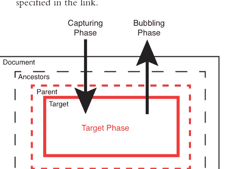

图6.1 事件首先在捕获阶段从文档向下传递到目标，然后在目标阶段，最后在冒泡阶段从目标向上传递到文档。


### 阻止事件冒泡到其他元素

```javascript
function myEventHandler(e){
  ...handler code...
  e.stopPropagation();
  return false;
}
```

通常，你不希望事件冒泡到父对象，因为你已经在子对象中处理了它。JavaScript 提供了一种简单的方法来阻止冒泡发生。在传递给处理函数的事件对象上调用 `event.stopPropagation()` 方法，可以阻止事件冒泡到父元素。事件仍然会触发浏览器中提供网页交互的默认处理程序，例如选择复选框或激活链接。

### 阻止默认行为

```javascript
function myEventHandler(e){
  ...handler code...
  e.preventDefault();
  return false;
}
```

有时，你可能希望禁止浏览器应用事件的默认处理交互。例如，你可能不希望浏览器激活链接，或者不希望允许重置表单。你可以通过调用传递给处理函数的事件对象上的 `event.preventDefault()` 方法来阻止浏览器的默认操作。

### 在 jQuery 中手动触发事件

```javascript
$("span").mouseenter();
$("#myButton").click();
$("input.bigText").trigger({type:'keypress',
  charCode:13});
```

jQuery 对象具有诸如 `click()` 和 `dblclick()` 之类的方法，这些方法对应于你可以直接调用的许多事件类型。表单元素添加了额外的方法，如 `blur()`、`focus()`、`keypress()`、`keydown()` 和 `keyup()`，可以调用它们来触发特定事件。例如，以下语句为所有 `<span>` 元素触发点击事件：

```javascript
$("span").click();
```

jQuery 还提供了一种使用 `trigger()` 方法在指定事件对象值的同时触发事件的方式。`trigger()` 方法有两种不同的语法，如下所列：

```javascript
trigger(eventType [, extraParameters])
trigger( eventObject)
```

以下是一个使用第一种方法为所有 class="checkbox" 的元素触发点击事件的示例：

```javascript
$(".checkbox").trigger("click");
```

接下来是在所有 class="bigText" 的 input 项目上使用第二种方法的示例。这种方法实际上传入了一个用于 keypress 事件的简单事件对象，该对象将事件对象的 `charCode` 属性设置为 13 或回车键。

```javascript
$("input.bigText").trigger({'type':'keypress',
  'charCode':13});
```

### 使用事件对象

当浏览器检测到事件发生时，会创建事件对象。如果事件处理程序是由 jQuery 定义的，事件对象将被转换为 jQuery 事件对象，该对象具有更多的属性和方法。因此，你需要意识到你正在处理的是哪种事件对象类型。

事件对象提供关于事件的附加信息，例如事件的类型（如点击或按键）、按下了哪些键、鼠标的位置、事件发生在哪个 HTML 元素上等等。表 6.2 描述了你将使用的最常用的事件属性。

表 6.2 JavaScript 和 jQuery 事件对象属性

| 属性 | 描述 |
|---|---|
| altKey | 如果在事件期间按下了 Alt 键则为 true；否则为 false。 |
| button | 返回按下的鼠标按钮编号：0 表示左键，1 表示中键，2 表示右键。 |
| cancelable | 如果事件的默认操作可以被阻止则为 true；否则为 false。 |
| charCode | 如果是键盘事件，则为按下的字符的序数值。 |
| clientX | 鼠标指针相对于当前窗口的水平坐标。 |
| clientY | 鼠标指针相对于当前窗口的垂直坐标。 |
| ctrlKey | 如果在事件期间按下了 Ctrl 键则为 true；否则为 false。 |
| currentTarget | 事件处理程序当前所附加到的 HTML 元素的 DOM 对象。 |
| data | 在事件对象创建时定义的用户数据，并在事件触发时附加到传递给事件处理程序的事件对象上。 |
| delegateTarget | 用于在 jQuery 的 `.delegate()` 或 `.on()` 方法中附加事件处理程序的 HTML 元素的 DOM 对象。（`.on()` 和 `.delegate()` 将在本章后面讨论。）仅在 jQuery 事件对象上可用。 |
| eventPhase | 事件处理程序当前运行的阶段，其中 1 表示在目标阶段，2 表示冒泡阶段，3 表示捕获阶段。 |
| metaKey | 如果在事件期间按下了“meta”键则为 true；否则为 false。 |
| relatedTarget | 标识相对于 UI 事件的次要目标。例如，当使用 mouseover 和 mouseexit 事件时，此属性表示正在离开或进入的目标。 |
| results | 由该事件触发的事件处理程序返回的最后一个值。仅在 jQuery 事件对象上可用。 |
| screenX | 基于实际显示坐标的水平坐标。 |
| screenY | 基于实际显示坐标的垂直坐标。 |
| shiftKey | 如果在事件期间按下了 Shift 键则为 true；否则为 false。 |
| target | 事件起源的 HTML 元素的 DOM 对象。 |
| type | 描述事件的文本，如 click 或 keydown。 |
| timeStamp | 从 1970 年 1 月 1 日到事件触发时的时间（以毫秒为单位）。 |
| which | 实际的数值。 |

以下段落提供了使用事件对象中数据的示例。

### 获取事件目标对象

```javascript
function myHandler(e){
    // 获取触发事件的原始对象的值
    var originalValue = $(e.target).val();
    // 获取当前对象的值
    var currentValue = $(e.currentTarget).val();
    // 获取当前对象的 inner HTML
    var currentHTML = $(this).html();
}
```

事件对象通过 `event.target` 属性提供了一个链接，指向最初触发事件的 DOM 对象。事件对象还通过 `event.currentTarget` 属性提供了一个链接，指向触发当前事件处理程序的 DOM 对象。访问这些对象非常有用，因为它允许你获取附加信息，例如选中状态或值。

触发事件处理程序的对象也可以使用 `this` 关键字获取。例如，你可以使用以下方式获取元素的 inner HTML 值：

```javascript
var currentHTML = $(this).html();
```

### 获取鼠标坐标

```javascript
function myHandler(e){
    $("#p1").html("距离屏幕左侧: " + e.screenX);
    $("#p2").html("距离屏幕右侧: " + e.screenX);
    $("#p3").html("距离浏览器左侧: " + e.clientX);
    $("#p4").html("距离浏览器右侧: " + e.clientY);
}
```

对于许多图形化 Web 应用，不仅需要知道鼠标事件发生在哪个目标上，还需要知道在屏幕上或 Web 浏览器显示中的确切位置。JavaScript 鼠标事件对象包括 `event.screenX` 和 `event.screenY` 属性，允许你获取距离屏幕顶部和左侧的像素偏移量。

此外，JavaScript 鼠标事件还包括 `event.clientX` 和 `event.clientY` 属性，允许你获取距离浏览器窗口顶部和左侧的像素偏移量。这些通常更为重要，因为它们有助于确定鼠标相对于网页的位置。

### 处理鼠标事件

Web 浏览器中最常见的事件是鼠标事件。鼠标的每次移动都是一个事件。事件还包括鼠标进入或离开 HTML 元素，以及鼠标点击和滚动。本节中的段落为你提供了一些在 JavaScript 和 jQuery 代码中使用鼠标事件的示例。

### 添加鼠标点击处理代码

```javascript
$("p").on("click", function (e){
    $(this).html("你点击了这里。");
});
$("span").on("dblclick", function (e){
    $(this).html("你双击了这里。");
});
```

要在 jQuery 中注册点击处理程序，你应该使用 `.on("click")` 或 `.on("dblclick")` 方法。在处理函数内部，你可以执行任何事件处理逻辑。


功能。使用 jQuery 选择器可以轻松地为多个对象应用点击事件处理程序。例如，以下代码为所有 `<div>` 元素应用了一个点击事件处理程序：

```
$("div").on("click", function (e){
  $(this).html("You clicked here.");
});
```

### 处理鼠标进入或离开元素

```
$("p").on("mouseover", function (e){
  $(this).html("Hello mouse.");
});
$("p").on("mouseout", function (e){
  $(this).html("Wait, don't go.");
});
```

每当鼠标进入或离开一个元素时，浏览器都会提供一个事件。标准的 JavaScript 事件是 `mouseover` 和 `mouseout`，因此你可以使用 `.on("mouseover")` 为鼠标进入元素添加事件处理程序，使用 `.on("mouseout")` 为鼠标离开元素添加事件处理程序。

### 应用右键单击

```
$("#menu").hide();
$("#main").on("mousedown", function(e){
  if(e.button == 2){ $("#menu").show(); } });
$("#main").on("mouseup", function(e){
  if(e.button == 2){ $("#menu").hide(); } });
$("#main").on("contextmenu", function(e){
  return false; });
```

为元素应用右键单击需要一些额外的操作，因为浏览器的默认行为是弹出浏览器页面的右键菜单。

在你的事件处理程序中，首先需要通过查看 `event.button` 属性来确定单击了哪个鼠标按钮，该属性包含 0（左键）、1（中键）和 2（右键）。

你还需要在大多数情况下抑制浏览器的默认 `contextmenu` 行为，如第 14 和 15 行所示，以便添加你自己的右键单击行为。以下代码示例演示了如何实现你自己的自定义弹出菜单的框架，该菜单仅在右键单击时显示，如图 6.2 所示：

```
01 <html>
02 <head>
03   <title>Python Phrasebook</title>
04   <meta charset="utf-8" />
05   <script type="text/javascript"
06     src="../js/jquery-2.0.3.min.js"></script>
07   <script>
08     $(document).ready(function(){
09       $("#menu").hide();
10       $("#main").on("mousedown", function(e){
11         if(e.button == 2){ $("#menu").show(); }
12       });
13       $("#main").on("mouseup", function(e){
14         if(e.button == 2){ $("#menu").hide(); }
15       });
16       $('#main').on('contextmenu', function(e){
17         return false; })
18     });
19   </script>
20 </head>
```

```
19 <body>
20   <div id="main"> Right-Click Me
21     <div id="menu">
22       <p>Item 1</p><p>Item 2</p><p>Item 3</p>
23     </div>
24   </div>
25 </body>
26 </html>
```

ch0601.html

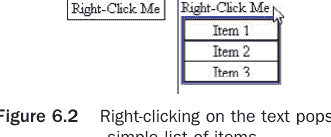

### 处理键盘事件

处理网页时，一个经常被忽略的事件是键盘事件。然而，键盘事件可能是最有用的事件之一，特别是如果你想让你的网站感觉更像一个 Web 应用程序。
用户习惯于在向应用程序中的字段输入数据时，通过热键执行不同的功能和交互。键盘事件让你能够做到这一点。以下短语将向你如何检测键盘输入并利用事件对象来确定按下了哪个键。

### 检测文本输入元素的更改

```
$("input[type=text]").on("keypress",
    function(){
        $("#p1").html("Key Pressed"); });
$("input[type=text]").on("keydown",
    function(){
        $("#p1").html("Key is Down"); });
$("input[type=text]").on("keyup",
    function(){
        $("#p1").html("Key is Up"); });
```

JavaScript 提供了三个在键盘上按下键时触发的事件：`keydown`、`keypress` 和 `keyup`。这些事件允许你捕获进入文本输入的每一次按键。

例如，如果你想添加一个在文本输入中每次按键时都触发的事件处理程序，你可以使用以下代码：

```
$("input[type=text]").on("keypress",
    function(){handler_code});
```

> **你知道吗？**
在处理输入元素的键盘事件时，获取文本框中文本的一个有用技巧是使用 `keyup` 事件而不是 `keypress` 事件。当 `keypress` 事件被触发时，输入框的值可能还不包括键入的字符。但是，如果你使用 `keyup` 事件，文本框的值将始终包含键入的字符。

### 确定按下了哪个键

```
$("input[type=text]").on("keypress",
    function(e){
        var s = "You Pressed ";
        if (e.ctrlKey){ s += "CTRL + "; };
        if (e.altKey){ s += "SHIFT + "; };
        if (e.shiftKey){ s += "SHIFT + "; };
        s += String.fromCharCode(e.charCode);
        $("#p1").html(s);
    });
});
```

传递给事件键盘事件处理程序的事件包括字符代码和辅助键信息。要确定按下了哪个键，请使用 `event.charCode` 属性获取字符代码。你可以使用 `String.fromCharCode(code)` 方法将字符代码转换为字符。例如：

```
var character = String.fromCharCode(event.charCode);
```

要确定是否按下了 Ctrl、Alt 或 Shift 键，你可以检查 `event.shiftKey`、`event.altKey` 和 `event.ctrlKey` 属性。这些是布尔值，表示是否按下了该键。

以下代码展示了使用事件数据来确定按下了哪个键并将该信息显示到网页的示例。图 6.3 显示了最终的网页交互效果：

```
01 <html>
02   <head>
03     <title>Python Phrasebook</title>
04     <meta charset="utf-8" />
05     <script type="text/javascript"
06           src="../js/jquery-2.0.3.min.js"></script>
07     <script>
08       $(document).ready(function(){
09         $("input[type=text]").on("keypress",
10           function(e){
11             var s = "You Pressed ";
12             if (e.ctrlKey){ s += "CTRL + "; };
13             if (e.altKey){ s += "SHIFT + "; };
14             if (e.shiftKey){ s += "SHIFT + "; };
15             s += String.fromCharCode(e.charCode);
16             $("#p1").html(s);
17           });
18       });
19     </script>
20   </head>
21   <body>
22     <p id="p1"></p>
23     <input type="text" />
24   </body>
25 </html>
```

ch0602.html

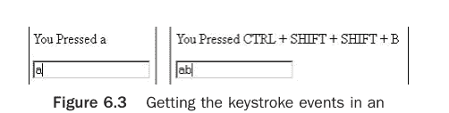

### 表单事件

对于电子商务网站来说，一些最重要的事件是表单事件。当为用户提供购物车交互、结账、注册等功能时，表单事件被大量使用。为表单事件添加事件处理程序，允许你在用户填写表单时提供一些动态交互。

以下短语旨在涵盖处理不同类型表单事件的基本概念。此外，表单中还有本章已经介绍过的键盘和鼠标事件。

### 处理焦点更改

```
$("input").on("focus",
    function(e){
        gain_focus_code_here
    });
$("input").on("blur",
    function(e){
        lose_focus_code_here
    });
```

在处理表单事件时，两个重要的事件是 `focus` 和 `blur`。当表单元素获得或失去焦点时，这些事件会被触发。你可以将这些事件用于很多方面。例如，你可能希望在表单元素获得或失去焦点时改变其外观和感觉。

### 处理选择更改

```
$("select").on("change",
    function(e) {
        select_change_code_here });
$("input[type=checkbox]").on("change",
    function(e) {
        checkbox_change_code_here });
$(" input[type=radio]").on("change",
    function(e) {
        radio_change_code_here });
```

使用表单时，要处理的另一种重要事件是复选框、单选按钮输入和选择元素中的选择更改。所有这些元素都有一个 `change` 事件处理程序，当选择更改时会被触发。

要在 jQuery 中处理这些项目的更改，请添加以下事件处理程序。然后将你希望执行的任何更改代码放入处理程序函数中：

```
$("#formElement").on("change",
    function(e) {
        change_code_here
});
```

# 7

## 动态操作网页元素

动态编程的核心是通过程序化方式实时更改现有的网页元素，以响应用户输入。这提供了人们开始期望从所有网站获得的丰富交互体验。

jQuery 和 JavaScript 提供了多种方法，可以轻松地更改页面元素的外观、样式和内容，从更改图像源和段落内容，到动态高亮显示文本和容器边框。

以下部分描述了如何利用 jQuery 和 JavaScript 来访问和操作网页元素。

### 获取和设置 DOM 元素的属性和特性

DOM 对象可以直接访问其表示的 HTML 元素的 DOM 对象属性和 DOM 元素特性。这在 jQuery 中确实不太合理，因为 jQuery 对象通常表示具有不同属性的多个元素。因此，jQuery 提供了 `.attr()` 和 `.prop()` 方法来获取和设置这些元素的属性和特性。

`.attr(attribute, [value])` 方法允许你仅指定属性名称来获取当前值，也可以指定一个可选的值来设置当前值。例如，以下代码获取 `id="bannerImg"` 的特定图像元素的 `src` 值：

```javascript
var state = $("#bannerImg").attr("src");
```

然后，以下语句设置所有 `` 元素的 `src` 属性值：

```javascript
$("img").attr("src","images/default.jpg");
```

`.prop(property, [value])` 方法允许你指定特性来获取当前值，也可以指定一个可选的值来设置当前值。例如，以下代码获取 `id="firstCheckbox"` 的特定元素的选中状态：

```javascript
var state = $("#firstCheckbox").prop("checked");
```

以下语句将所有 `<input>` 元素的选中值设置为 true：

```javascript
$("input").prop("checked", true);
```

#### 你知道吗？

就 jQuery 而言，特性与属性的唯一区别在于，属性是定义 HTML 结构的值，而特性是影响对象动态状态的值。例如，在 `<input>` 元素中，"type" 是一个属性，因为它定义了结构；而 "checked" 是一个特性，因为它只影响状态。

### 更改链接位置

```html
<script>
$("#pageLink").attr("href", "complexpage.html");
</script>
...
<body>
  <a id="pageLink" href="simplepage.html">Link</a>
</body>
```

随着网页变得越来越动态化，甚至内建的链接也变得动态化。在页面中使用 jQuery 和 JavaScript 的一个巨大优势是，你可以根据用户输入或其他数据源轻松地动态更改链接指向的 URL。

要更改链接指向的 URL，请使用 `.attr("href", newURL)` 方法。当用户点击链接时，浏览器会读取 `<a>` 元素的 href 属性，然后将该位置作为下一个页面加载。

### 更改图像源文件

```javascript
var imgArr = ["bison.jpg","peak.jpg","falls.jpg"];
var idx = 0;
$(document).ready(function (){
  $("img").on("click", function(){
    if(idx<2) { idx++; } else { idx=0; }
    $(this).attr("src", imgArr[idx]);
  });
});
```

jQuery 和 JavaScript 中一个常见的任务是更改屏幕上显示的图像。无论是在线广告、游戏还是图像库，直接更换 `` 元素的源文件比重载网页要方便得多。

要更改 `` 元素中显示的图像，请使用 `.attr("src", newImageURL)` 方法来指定新的用户文件位置。当 src 属性更改时，浏览器会在需要时自动下载新图像并在网页中渲染它，无需重新加载。

以下代码展示了交换图像的一个好例子，如图 7.1 所示。网页中有一张图像。在第 13 行，在一个点击处理程序中，src 属性更改为 imgArr 数组中的一个值：

```html
01 <html>
02   <head>
03     <title>Python Phrasebook</title>
04     <meta charset="utf-8" />
05     <script type="text/javascript"
06       src="../js/jquery-2.0.3.min.js"></script>
07     <script>
08       var imgArr = ["bison.jpg","peak.jpg","falls.jpg"];
09       var idx = 0;
10       $(document).ready(function (){
11         $("img").on("click", function(){
12           if(idx<2) { idx++; } else { idx=0; }
13           $(this).attr("src", imgArr[idx]);
14         });
15       });
16     </script>
17     <style>
18       img { width:300px; border:3px ridge white;
19             box-shadow: 5px 5px 5px #888888;margin:10px; }
20     </style>
21   </head>
22   <body>
23     
24   </body>
25 </html>
```

ch0701.html

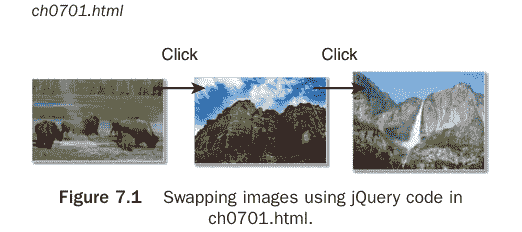

### 获取和设置 CSS 属性

jQuery 使得使用 `.css(property, [value])` 方法获取和设置 CSS 值变得极其简单。例如，以下代码检索元素的 cursor CSS 属性值：

```javascript
$("#buttonA").css("cursor");
```

然后，以下语句设置 border-radius 值：

```javascript
$("#buttonA").css("border-radius", "10px 15px");
```

`.css()` 方法还允许你传递一个包含属性和值的映射对象。这允许你一次性设置多个设置。例如，以下代码使用 `.css()` 同时设置 margin、padding、float 和 font-weight 属性：

```javascript
$("span").css({margin:0, padding:2, float:"left", "font-weight":"bold"});
```

请注意，属性名称可以加引号，也可以不加。如果属性名称包含 `-` 或其他在 JavaScript 对象名称中无效的字符，则需要使用引号。值可以是数字或字符串。数字值表示距离，可以用 px、cm 或 % 表示。默认是 px，所以如果你想指定像素，只需要输入数字。如果你想指定 cm、% 或其他值类型，则需要使用字符串，例如 "100%"。

### 更改颜色

```javascript
$("h1").on("click", function(){
    $(this).css({color:"white",
                "background-color":"black"});
});
```

与用户交互提供互动的一个好方法是更改屏幕上元素的颜色。颜色可以提供额外的含义。例如，将文本颜色更改为红色或将文本背景色更改为黄色高亮，可以强调文本是需要阅读的重要内容。

在 jQuery 中，你可以使用 `.css(property, value)` 方法更改所有控制屏幕上颜色的 CSS 属性。但是，如果你要更改多个颜色属性，使用 `.css({property:value, property:value...})` 方法更有意义，该方法允许你一次更改多个属性。

以下代码提供了一个很好的例子，展示了如何使用 jQuery 在点击标题时动态更改其颜色。一个点击处理程序更改背景和前景色，使标题更加突出，如图 7.2 所示。请注意，background-property 键必须加引号以支持 JavaScript 语言语法。

```html
01 <html>
02   <head>
03     <title>Python Phrasebook</title>
04     <meta charset="utf-8" />
05     <script type="text/javascript"
06             src="../js/jquery-2.0.3.min.js"></script>
07     <script>
08       $(document).ready(function (){
09         $("h1").on("click", function(){
10           $(this).css({color:"white",
11                         "background-color":"black"});
12         });
13       });
14     </script>
15   </head>
16   <body>
17     <h1>Heading 1</h1>
18     <h1>Heading 2</h1>
19   </body>
20 </html>
```

ch0702.html

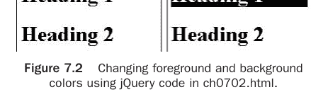

图 7.2 在 ch0702.html 中使用 jQuery 代码更改前景色和背景色。

### 添加边框

```javascript
$("ul").on("click", function(){
  $(this).css({"border":"3px groove black"});
});
$("li").on("click", function(){
  $(this).css({"border-style":"dotted",
              "border-width":1,
              "border-color":"blue"});
});
```

另一种可以以编程方式应用于元素的有用样式是边框。边框为你提供了一种高亮页面上特定元素或仅仅改变外观的方式。

你可以使用 jQuery 的 `.css(property, value)` 或 `.css({property:value, property:value...})` 方法来更改应用于元素边框的 CSS 属性。

> **顺便说一下**
你可以使用 border 属性同时设置所有边框选项，包括大小、样式和颜色，例如：
`$(this).css({"border":"3px groove black"});`

以下代码提供了一个很好的示例，展示了如何使用 jQuery 动态地为 `<ul>` 和 `<li>` 元素添加边框。我提供了两个示例：一个是在单个 border 属性设置中更改所有属性，另一个是逐个更改它们。一个点击处理程序将边框应用到列表元素和列表项元素，如图 7.3 所示：

```html
01 <html>
02   <head>
03     <title>Python Phrasebook</title>
04     <meta charset="utf-8" />
05     <script type="text/javascript"
06       src="../js/jquery-2.0.3.min.js"></script>
07     <script>
08       $(document).ready(function (){
09         $("ul").on("click", function(){
10           $(this).css({"border":"3px groove black"});
11         });
12         $("li").on("click", function(){
13             $(this).css({"border-style":"dotted",
14                            "border-size":1,
15                            "border-color":"blue"});
16         });
17       });
18     </script>
19   </head>
20   <body>
21     <ul>
22         <li>George Washington</li>
23         <li>John Adams</li>
24         <li>Thomas Jefferson</li>
25     </ul>
26   </body>
27 </html>
```

ch0703.html

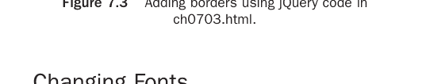

### 更改字体

```javascript
$("p").on("click", function(){
    $(this).css({"font-weight":"bold",
                "font-style":"italic",
                "font-size":22,
                "font-family":"cursive, sans-serif"});
});
```

使用 `.css()` 方法的一个有趣选项是能够更改段落和其他元素的字体。你可以将 `.css()` 方法用于各种目的，例如说明已读区域或强调在上下文上变得重要的文本。你可以直接调整 font-weight、font-size、font-style 和 font-family 属性来更改文本的外观。

要以编程方式更改字体值，请应用 `.css(property, value)` 或 `.css({property:value, property:value...})` 方法。以下代码提供了一个很好的示例，展示了如何使用 jQuery 在点击段落时动态更改其样式。第 9-14 行所示的点击处理程序在用户点击段落时应用字体更改，如图 7.4 所示：

```html
01 <html>
02   <head>
03     <title>Python Phrasebook</title>
04     <meta charset="utf-8" />
05     <script type="text/javascript"
06       src="../js/jquery-2.0.3.min.js"></script>
07     <script>
08       $(document).ready(function (){
09         $("p").on("click", function(){
10           $(this).css({"font-weight":"bold",
11                  "font-style":"italic",
12                  "font-size":22,
13                  "font-family":"cursive, sans-serif"});
14         });
15       });
16     </script>
17   </head>
```

ch0704.html

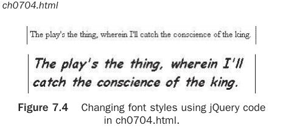

### 添加类

```javascript
$("span").addClass("baseClass");
```

丰富的交互式网页的一个重要组成部分是良好的 CSS 设计。JavaScript 和 jQuery 可以通过动态地向元素添加和移除类来增强 CSS 设计。

jQuery 使得添加、移除和切换类变得非常简单。如果你的 CSS 代码设计得当，应用一些漂亮的效果就很容易了。

你使用 `.addClass(className)` 方法添加类。例如，要向所有 `<span>` 元素添加一个名为 `active` 的类，你可以使用以下语句：

```javascript
$("span").addClass("active");
```

### 移除类

```javascript
$("span").removeClass("oldClass");
```

你使用 `.removeClass([className])` 方法移除类。例如，要从 `<span>` 元素移除 active 类，你调用以下代码：

```javascript
$("span").removeClass("active");
```

你也可以不带 className 使用 remove，这会移除元素上的所有类。例如，以下语句移除 `<p>` 元素上的所有类：

```javascript
$("p").removeClass();
```

### 切换类

```javascript
$("span").on("click", function(){
  $(this).toggleClass("active");
});
```

你可以使用 `.toggleClass(className [, switch])` 方法切换类的开启和关闭。除了 className，你还可以为可选的 switch 参数指定 true 或 false，表示开启或关闭该类。

例如，要为所有 `<span>` 元素关闭 active 类和 inactive 类，代码如下：

```javascript
$("span").toggleClass("active", true);
$("span").toggleClass("inactive", false);
```

以下代码提供了一个很好的示例，展示了如何使用 jQuery 在用户点击 `<span>` 元素时动态切换类。第 9-11 行的点击处理程序使用 `.toggleClass()` 方法来切换 `.active` 类的开启和关闭。图 7.5 展示了代码的外观和行为：

```html
01 <html>
02   <head>
03   <title>Python Phrasebook</title>
04   <meta charset="utf-8" />
05   <script type="text/javascript"
06         src="../js/jquery-2.0.3.min.js"></script>
07   <script>
08     $(document).ready(function (){
09       $("span").on("click", function(){
10           $(this).toggleClass("active");
11       });
12     });
13   </script>
14   <style>
15     span {
16       border:3px ridge white; border-radius:10px;
17       padding:3px; color:black; background-color:#CCCCCC; cursor:pointer; }
18     .active {
19       background-color:blue; color:white;
20       border-color:blue; font-weight:bold;}
21   </style>
22   </head>
23   <body>
24     <span>Option 1</span>
25     <span>Option 2</span>
26   </body>
27 </html>
```

ch0705.html

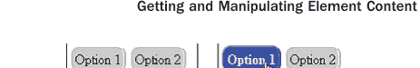

### 获取和操作元素内容

通常，在用户开始使用网页之前，你可能不知道属于该网页的所有元素，或者你可能会从 Web 服务或其他交互中获得额外的信息。在这些情况下，你可能需要能够使用 jQuery 和 JavaScript 代码即时添加或替换元素内容。

元素内容的文本存储在 DOM 元素的 innerHTML 属性中。你可以简单地通过将 innerHTML 设置为新内容来使用 JavaScript 更改内容。例如：

```javascript
document.getElementById("#p1").innerHTML = "New Text";
```

在 jQuery 中，你可以使用 `.html()` 方法更改 innerHTML 内容，该方法获取或设置 innerHTML 字符串。例如：

```javascript
$("#p1").html("Paragraph 1 goes here");
```

#### 获取 HTML 元素的内容

```javascript
var p1Contents = $("#p1").html();
var div1Contents = $("#div1").html();
```

使用 jQuery 的 `.html()` 方法，获取 HTML 元素内的内容很容易。使用不带参数调用此方法会返回内容的 HTML 字符串版本。如果内容只是文本，则返回一个简单的字符串。如果内容是 HTML 元素，则字符串包含在 HTML 标签中。

#### 在基本 HTML 元素前后添加文本

```javascript
$("#p1").prepend("*New* :");
$("#p1").append(". . .read");
```

另一个常见的动态任务是向基本 HTML 元素（如 span 或段落）添加文本。jQuery 使用 `.append()` 方法使这变得非常简单。此方法将内容附加到元素当前内容的末尾。无论内容是字符串还是其他元素，这都无关紧要。
例如，以下代码将文本 ". . .read" 附加到 id="p1" 的段落：

```javascript
$("#p1").append(". . .read");
```

你可能还希望在元素内容的开头添加文本。在 jQuery 中，`.prepend()` 方法将内容添加到元素当前内容的开头。无论内容是字符串还是其他元素，这都无关紧要。
例如，以下代码将文本 "*New* :" 添加到 id="p1" 的段落开头：

```javascript
$("#p1").prepend("*New* :");
```


### 替换元素文本

```javascript
$("#mySpan").html("content");
// ...
$("#mySpan").html("newer content");
// ...
$("#mySpan").html("even newer content");
```

与其向元素添加前缀或后缀文本（或内容），你可能希望完全替换元素内容。在 jQuery 中，最简单的方法是使用 `.html()`，它会将内容值设置为你传入的任何字符串或对象，从而替换现有内容。

### 向父内容追加元素

```javascript
var newP = $("<p></p>");
newP.html("This is the first paragraph.");
$("div").prepend(newP);
newP.html("This is the last paragraph.");
$("div").append(newP);
```

你也可以在 jQuery 中使用 `.prepend()` 和 `.append()` 方法向元素添加前缀或后缀内容。jQuery 的另一个主要优势是，你可以将使用 jQuery 构造函数 `jquery(htmlString)` 或 `$(htmlString)` 创建的 HTML DOM 元素追加到页面中，以添加新的 HTML 元素。例如，以下代码构建了一个包含 `<p>` 元素的 jQuery 对象，使用 `.html()` 设置新段落元素的内容，然后将该段落追加到所有 `<div>` 元素中。

```javascript
var newP = $("<p></p>");
newP.html("This is a new paragraph.");
$("div").append(newP);
```

### 动态操作网页布局

你可以与网页进行的最酷的交互之一是根据用户交互重新排列页面上的元素。例如，你可以使元素变大或变小，甚至改变其位置。此外，你还可以更改元素的可见性，在不需要时隐藏它们，在适当时显示它们。

本章重点介绍操作元素的方法，这些方法可以改变页面的基本布局。这些短语旨在为你提供适用于各种目的的实用示例。

#### 隐藏和显示元素

```javascript
$("#down").hide();
$("#up").on("click", function(){
    $("#up, #down").toggle();
    $("#leftNav").hide();
});
$("#down").on("click", function(){
    $("#up, #down").toggle();
    $("#leftNav").show();
});
```

**144 第 8 章 动态操作网页布局**

改变网页外观的一种简单方法是切换元素的可见性。隐藏不必要的元素，只在需要时显示它们，可以节省大量屏幕空间，这在实现良好的 Web 应用程序中至关重要。

你通过在 JavaScript 中将 `style.display` 属性设置为 `"none"` 或 `""` 来隐藏或显示元素。相比之下，jQuery 提供了更优雅且可扩展的解决方案。

要使用 jQuery 显示元素，只需在 jQuery 对象上调用 `.show()` 方法。对象集中的所有项目都会被显示。然后要隐藏元素，请使用 `.hide()` 方法。就这么简单。例如，要隐藏所有 `<p>` 元素，你可以使用以下代码：

```javascript
$("p").hide();
```

然后要重新显示它们，请使用：

```javascript
$("p").show();
```

jQuery 提供的另一个有价值的工具是 `.toggle()` 方法。此方法将当前可见性状态切换为完全相反的状态。这意味着你不必跟踪或检查那些你只想切换显示和隐藏的项目的可见性状态。

以下代码演示了更改可见性。它隐藏并显示一个简单的弹出菜单。注意，用于显示和隐藏可见性的按钮本身也会被切换，以便与菜单状态匹配的适当按钮可见。图 8.1 显示了菜单的基本外观：

```html
01 <html>
02   <head>
03     <title>Python Phrasebook</title>
04     <meta charset="utf-8" />
05     <script type="text/javascript"
06       src="../js/jquery-1.9.0.min.js"></script>
07     <script>
08       var imgArr = ["bison.jpg","peak.jpg","falls.jpg"];
09       var idx = 0;
10       $(document).ready(function (){
11         $("#down").hide();
12         $("#up").on("click", function(){
13           $("#up, #down").toggle();
14           $("#leftNav").hide();
15         });
16         $("#down").on("click", function(){
17           $("#up, #down").toggle();
18           $("#leftNav").show();
19         });
20       });
21     </script>
22     <style>
23       #banner { font:bold 36px/60px "cursive,
24         serif";
25         color:white; background-color:blue;
26         text-align:center; }
27       #bar { background-color:black; padding:3px;}
28       #leftNav {background-color:#cccccc;
29         padding:5px;
30         width:100px; }
31       p { margin:0; margin-top:2px; border:1px
32         solid;
33         text-align:center; border-radius:10px;
34         background-color:white; }
35     </style>
36   </head>
37   <body>
38     <div id="banner">jQuery and JavaScript</div>
39 <div id="bar"> </div>
41 <div id="leftNav"><p>Option 1</p>
42 <p>Option 2</p><p>Option 3</p></div>
43 </body>
44 </html>
```

`ch0801.html`

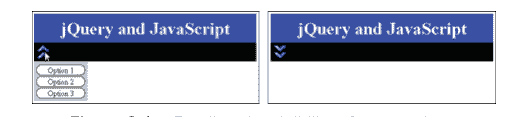

### 调整不透明度

```javascript
$("#up").on("click", function(){
    var op = parseFloat($("#photo").css("opacity"));
    if (op<1) {op += 0.2;};
    $("#photo").css("opacity", op);
});
$("#down").on("click", function(){
    var op = $("#photo").css("opacity");
    if (op>0) {op -= 0.2;};
    $("#photo").css("opacity", op);
});
```

更改元素的不透明度是改变页面布局的好方法。降低不透明度值会使项目不那么明显，从而显示其后面的任何元素或背景图像。

**顺便说一句**

使用 `.hide()` 隐藏元素的一个问题是，一旦应用，元素就不再占据页面空间。其他流动元素会滑入并占据其位置。在许多情况下，这正是你想要的效果。在其他情况下，你可能希望元素不可见但仍占据空间，因此将不透明度设置为 0。

降低不透明度（但不设置为 0）是表明元素当前不活跃但仍显示它们的好方法。例如，我喜欢将尚未实现和激活的菜单和按钮元素的不透明度设置为 .5，这样它们仍然显示，但显然不可点击。

`opacity` CSS 属性控制不透明度。要使元素不可见但仍占据空间，请将 `opacity` CSS 属性设置为 0。例如：

```javascript
obj.css("opacity", "0");
```

然后要使元素再次可见，请将不透明度设置回 1：

```javascript
obj.css("opacity", "1");
```

要使项目部分可见，请将不透明度设置为 0 到 1 之间的值，例如 .5。以下示例创建了一个包含两个按钮的网页，这两个按钮控制一个图像元素的不透明度。随着不透明度的增加，图像变得越来越可见，反之亦然。按钮的单击处理程序通过将当前不透明度增加或减少 .2 来更改不透明度。图 8.2 显示了不透明度变化的实际效果：

```html
01 <html>
02   <head>
03     <title>Python Phrasebook</title>
04     <meta charset="utf-8" />
05     <script type="text/javascript"
06       src="../js/jquery-1.9.0.min.js"></script>
07     <script>
08       var imgArr = ["bison.jpg", "peak.jpg", "falls.jpg"];
09       var idx = 0;
10       $(document).ready(function (){
11         $("#up").on("click", function(){
12           var op = parseFloat($("#photo").css("opacity"));
13           if (op<1) {op += 0.2;};
14           $("#photo").css("opacity", op);
15         });
16         $("#down").on("click", function(){
17           var op = $("#photo").css("opacity");
18           if (op>0) {op -= 0.2;};
19           $("#photo").css("opacity", op);
20         });
21       });
22     </script>
23     <style>
24       img{ vertical-align:middle;}
25       #photo { width:300px; border:5px ridge white;
26         box-shadow: 5px 5px 5px #888888; margin:10px; }
27     </style>
28   </head>
29   <body>
30     
31     
32     
```


### 调整元素大小

```javascript
$("#up").on("click", function(){
    $("#photo").width($("#photo").width()*1.2);
});
$("#down").on("click", function(){
    $("#photo").width($("#photo").width()*.8);
});
```

在动态处理 HTML 元素时，另一个重要方面是获取和改变元素尺寸的能力。jQuery 通过附着在 jQuery 对象上的一组方法使这变得简单。表 8.1 展示了 jQuery 对象提供的、用于获取元素高度和宽度的方法。

#### 表 8.1 用于获取和设置元素大小的 jQuery 对象方法

| 属性 | 描述 |
| :--- | :--- |
| height([value]) | 如果指定了 value，则会改变集合中所有 HTML 元素的高度；否则，返回第一个 HTML 元素的当前高度。 |
| width([value]) | 如果指定了 value，则会改变集合中所有 HTML 元素的宽度；否则，返回第一个 HTML 元素的当前宽度。 |
| innerHeight() | 返回集合中第一个元素的当前高度，包括内边距。 |
| innerWidth() | 返回集合中第一个元素的当前宽度，包括内边距。 |
| outerHeight([includeMargin]) | 返回集合中第一个元素的当前高度，包括内边距和边框；如果指定，则还包括外边距。 |
| outerWidth([includeMargin]) | 返回集合中第一个元素的当前宽度，包括内边距和边框；如果指定，则还包括外边距。 |

> **注意！**
> `height` 和 `width` 方法仅返回 jQuery 对象集合中第一个元素的大小。对于只包含单个对象的集合，这没有问题。只需记住，集合中的其他对象可能具有不同的大小。

为了说明如何获取和设置元素大小，请看以下示例代码。此代码定义了一个包含一张照片和两个按钮的网页。按钮的点击处理函数通过使用 `.width()` 方法获取图像宽度来增加或减小图像尺寸。在处理函数中，当宽度改变时，图像会自动调整大小。为了调整大小，将新的值 `width*1.2` 或 `width*.8` 传回 `.width()` 方法。图 8.3 展示了调整图像大小的按钮：

```html
<html>
  <head>
    <title>Python Phrasebook</title>
    <meta charset="utf-8" />
    <script type="text/javascript"
      src="../js/jquery-1.9.0.min.js"></script>
    <script>
      $(document).ready(function (){
        $("#up").on("click", function(){
          $("#photo").width($("#photo").width()*1.2);
        });
        $("#down").on("click", function(){
          $("#photo").width($("#photo").width()*.8);
        });
      });
    </script>
    <style>
      img{ vertical-align:middle;}
      #photo { width:300px; border:5px ridge white;
        box-shadow: 5px 5px 5px #888888;
        margin:10px; }
    </style>
  </head>
  <body>
    
    
    
  </body>
</html>
```

### 重新定位元素

```javascript
$("#up").on("click", function(){
    var offset = $("#photo").offset();
    offset.top -= 10;
    $("#photo").offset(offset);
});
```

除了 HTML 元素的大小，您经常还需要确定它们的位置。处理 HTML 元素时，有两种不同类型的位置。第一种是相对于整个文档的位置。第二种是相对于充当偏移父级的 HTML 元素的位置。哪个元素是偏移父级取决于 CSS 中的位置设置。

jQuery 提供了 `.position([position])` 方法来获取相对于偏移父级的位置。`.offset([position])` 方法提供相对于文档的位置。您可以在不带参数的情况下调用这两个方法，它们会返回一个带有 `left` 和 `top` 属性的简单对象，这些属性表示距离文档或偏移父级顶部和左侧的像素数。您也可以通过传递一个带有 `left` 和 `top` 属性的简单位置对象来调用这些方法，在这种情况下，它们会设置元素的位置。

例如，以下代码检索元素 `id="myElement"` 距离文档顶部和左侧的像素数，以及距离偏移父级顶部和左侧的像素数。为了在一条语句中获取每个值，我直接在 `offset` 或 `position` 调用后引用 `top` 和 `left` 属性：

```javascript
var pixelsFromPageTop = $("#myElement").offset().top;
var pixelsFromPageLeft = $("#myElement").offset().left;
var pixelsFromParentTop = $("#myElement").position().top;
var pixelsFromParentLeft = $("#myElement").position().left;
```

要将该元素恰好设置在距离文档左上角向下 10 像素、向右 10 像素的位置，请使用以下语句，该语句定义了一个带有 `left` 和 `top` 值的简单对象，并将其传递给 `.offset()` 方法：

```javascript
$("#myElement").offset({"top":10,"left":10});
```

为了说明如何使用元素位置，以下代码构建了一个包含四个控制按钮和一个图像元素的网页。按钮的点击处理函数通过获取当前位置、调整 `top` 或 `left` 属性，然后再次使用 `.offset()` 方法设置位置来移动图像。图 8.4 展示了在屏幕上移动图像的按钮：

```html
<html>
    <head>
        <title>Python Phrasebook</title>
        <meta charset="utf-8" />
        <script type="text/javascript"
            src="../js/jquery-1.9.0.min.js"></script>
        <script>
            var imgArr =
                ["bison.jpg","peak.jpg","falls.jpg"];
            var idx = 0;
            $(document).ready(function (){
                $("#up").on("click", function(){
                    var offset = $("#photo").offset();
                    offset.top -= 10;
                    $("#photo").offset(offset);
                });
                $("#down").on("click", function(){
                    var offset = $("#photo").offset();
                    offset.top += 10;
                    $("#photo").offset(offset);
                });
                $("#left").on("click", function(){
                    var offset = $("#photo").offset();
                    offset.left -= 10;
                    $("#photo").offset(offset);
                });
                $("#right").on("click", function(){
                    var offset = $("#photo").offset();
                    offset.left += 10;
                    $("#photo").offset(offset);
                });
            });
        </script>
        <style>
            img{ vertical-align:middle;}
            #photo { width:300px; border:5px ridge white;
                box-shadow: 5px 5px 5px #888888; position:
                fixed; }
        </style>
    </head>
    <body>
        <div id="buttons">
            
            
            
            
        </div>
        
    </body>
</html>
```

### 堆叠元素

```javascript
$("img").on("click", function(){
    $("img").css("z-index", 0);
    $(this).css("z-index", 1);
});
```

您能为网页制作的最酷交互之一，就是根据用户交互重新排列元素，使其相互堆叠。其原理是 HTML 元素可以像桌子上的纸张一样简单地相互堆叠在上方。在任何时候，您都可以显示一个隐藏或部分隐藏的元素，并将其放置在其他元素之上。


# 第8章 动态操作网页布局

z-index 是一个 CSS 属性，它指定 HTML 元素相对于其他元素的位置，这种位置关系不是垂直或水平的，而是沿垂直于屏幕的方向（朝向用户）的投影。当浏览器渲染页面时，具有最高 z-index 的元素会显示在其他元素之上。

要在 jQuery 中获取和设置 z-index，请使用 `.css()` 方法。例如，要获取某个元素的 z-index，可以使用以下代码：

```
var zIndex = $("#item").css("z-index");
```

要将某个元素的 z-index 设置为，比如 10，请使用以下语句：

```
$("#item").css("z-index", "10");
```

为了说明 z-index 的工作原理，以下代码生成了一个包含三个图片的网页。这些图片以重叠的方式固定定位。当你点击其中一张图片时，点击处理程序首先将所有元素的 z-index 调整为 0，然后将被点击元素的 z-index 设置为 1，从而将其置于最顶层。这如图 8.5 所示：

```
01 <html>
02   <head>
03     <title>Python Phrasebook</title>
04     <meta charset="utf-8" />
05     <script type="text/javascript"
06       src="../js/jquery-1.9.0.min.js"></script>
07     <script>
08       var imgArr =
09         ["bison.jpg","peak.jpg","falls.jpg"];
10       var idx = 0;
11 $(document).ready(function (){
12 $("img").on("click", function(){
13 $("img").css("z-index", 0);
14 $(this).css("z-index", 1);
15 });
16 });
17 </script>
18 <style>
19 img{ width:300px; border:5px ridge white;
20 box-shadow: 5px 5px 5px #888888; position:
fixed; }
21 #photo1 { top:10px; left:20px; }
22 #photo2 { top:60px; left:60px; }
23 #photo3 { top:120px; left:120px; }
24 </style>
25 </head>
26 <body>
27 
28 
29 
30 </body>
31 </html>
```

ch0805.html

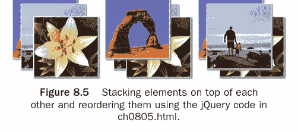

## 动态处理表单元素

Web 表单是动态 Web 编程不可或缺的一部分。你可能只在信用卡支付、在线注册等场景下想到表单，但任何时候你需要从用户那里获取实际数据输入时，你都在使用 Web 表单。

Web 表单对用户来说可能是积极的体验，也可能是消极的体验。如果因为表单笨重或难以理解而觉得输入数据很困难，用户就会讨厌它并留下糟糕的体验。

通过对 Web 表单进行动态调整——动态访问和操作表单的流程——可以让你为用户提供好得多的体验。本章中的短语重点在于访问表单数据，然后使用这些数据动态操作表单，以改善整体用户体验。

### 获取和设置文本输入值

```
var inText = $("#inBox").val();
if (inText != "default"){
    $("#outBox").val(inText);
}
```

最常见的表单元素类型是文本输入。这些元素包括 `<textarea>` 元素以及具有以下 `type` 属性值的 `<input>` 元素：`color`、`date`、`datetime`、`datetime-local`、`email`、`month`、`number`、`password`、`range`、`search`、`tel`、`text`、`time`、`url` 和 `week`。

虽然浏览器对这些值的使用略有不同，但它们都被渲染为相同的基本文本框，并且以相同的基本方式访问。每个元素都有一个 `value` 属性，在渲染时显示为文本框中的值。

在 jQuery 中，你可以使用 jQuery 对象的 `.val()` 方法访问文本输入的值。要获取文本框中输入的文本，你应该调用不带参数的 `.val()` 方法。例如，要获取 `#textbox1` 的值，你会使用以下代码：

```
var textbox1text = $("#textbox1").val();
```

要设置文本框中显示的文本，你会使用 `.val(string)`。例如，要将 `#textbox1` 的值设置为 "new string"，你会使用这个：

```
$("#textbox1").val("new string");
```

> **注意！**
> `.attr()`、`.prop()` 和 `.val()` 方法只获取匹配的 jQuery 集合中第一个元素的值。如果你在集合中处理多个元素，你可能需要使用 `.map()` 或 `.each()` 方法来获取所有元素的值。

### 检查和更改复选框状态

```
if ($("#myCheckbox").is(":checked")){
    $("#myCheckbox").removeAttr("checked");
}
else{
    $("#myCheckbox").attr("checked");
}
```

复选框输入元素有一个布尔值，基于元素是否被选中。你通过获取 `checked` 属性的值来访问它。如果元素被选中，则 `checked` 有一个值，比如 `true` 或 `"checked"`。否则，该值将是 `undefined` 或 `false`。

你可以通过以下方式从 JavaScript 获取和设置复选框元素的状态：

```
domObj.checked = true;
domObj.checked = false;
var state = domObj.checked;
```

在 jQuery 中确定某个项目是否被选中有点不同。记住，在 jQuery 中你可能一次处理多个复选框，因此查看 jQuery 对象是否代表一个被选中的对象的最安全方法是使用 `.is()` 方法。例如：

```
$("#myCheckbox").is(":checked");
```

要将表示复选框的 jQuery 对象的状态设置为选中，只需如下设置 `checked` 属性：

```
$("#myCheckbox").attr("checked", true);
```

将表示复选框的 jQuery 对象的状态设置为未选中则有些不同。你需要使用 `removeAttr()` 移除 `checked` 属性。例如：

```
$("#myCheckbox").removeAttr("checked");
```

### 获取和设置单选按钮组中的选中选项

```
if ($("#maleRB").is(":checked")){
    $("#maleRB").removeAttr("checked");
}else{
    $("#maleRB").attr("checked");
}
var genderGroup = $("input[name=gender]");
var checkedGender = genderGroup.filter(":checked");
var selectedGender = checkedGender.val();
```

单选按钮几乎总是成组使用。一组单选按钮所代表的值不是布尔值。相反，它是当前选中元素的 `value` 属性值。例如，以下单选按钮组的值要么是 "male" 要么是 "female"：

```
<input id="maleRB" type="radio" name="gender"
       value="male">
<label for="maleRB">Male</label>
<input id="femaleRB" type="radio" name="gender"
       value="female">
<label for="femaleRB">Female</label>
```

要在代码中获取一个单选按钮组的值，你首先需要访问组中的所有元素，找出哪个被选中，然后从该对象获取 `value` 属性。以下代码在 jQuery 中获取一个按 `name="gender"` 分组的单选按钮组的值：

```
var genderGroup = $("input[name=gender]");
var checkedGender = genderGroup.filter(":checked");
var selectedGender = checkedGender.val();
```

设置单个单选按钮的选中值的方式与复选框相同。要查看 jQuery 对象是否代表一个被选中的单选按钮，请使用 `.is()` 方法。例如：

```
$("#maleRB").is(":checked");
```

要将表示单选按钮的 jQuery 对象的状态设置为选中，你只需如下设置 `checked` 属性：

```
$("#maleRB").attr("checked", true);
```

要将表示单选按钮的 jQuery 对象的状态设置为未选中，你需要使用 `removeAttr()` 移除 `checked` 属性。例如：

```
$("#maleRB").removeAttr("checked");
```

### 获取和设置选择框的值

```
var value = $("#singleSelect").val();
var values = $("#multiSelect").val();
. . .
$("#singleSelect").val("one");
$("#multiSelect").val(["two", "three"]);
```

选择框输入实际上是一系列 `<option>` 元素的容器输入。选择框元素的值是当前选中选项的值。同样，jQuery 和 JavaScript 中的提交和序列化会自动为你处理这一点。然而，手动操作需要一些代码。

#### 你知道吗？

如果你没有为 `<option>` 元素指定 `value` 属性，则返回的值是 `innerHTML` 的值。例如，以下选项的值是 "one"：

`<option>one</option>`

你可能希望在访问 `<select>` 元素时获得几个不同的值。一个是元素表示的完整值。在 jQuery 中使用 `.val()` 方法获取该值很简单。例如，考虑以下代码：

HTML：

```
<select id="mySelect">
  <option value="one">One</option>
  <option value="two">Two</option>
  <option value="three">Three</option>
</select>
```


## jQuery:

```
$("#mySelect").val();
```

如果选择了第一个选项，此 jQuery 语句返回的值是：

```
"one"
```

对于多选框，`.val()` 方法返回的是一个值数组，而不是单个值。在多选框中，如果选择了第一个选项，此 jQuery 语句返回的值是：

```
["one"]
```

在多选框中，如果选择了第一个、第二个和第三个选项，此 jQuery 语句返回的值是：

```
["one", "two", "three"]
```

你也可以使用 `.val()` 方法来设置选中的元素。例如，以下语句会选择上一个单选框中的第二个元素：

```
$("#mySelect").val("one");
```

以下语句会选择多选框中的第二个和第三个选项：

```
$("#mySelect").val(["two", "three"]);
```

### 获取和设置隐藏表单属性

```
var hiddenValue = $("#hidden").val();
var hiddenValue = $("#hidden").attr("other");
var hiddenValue = $("#hidden").prop("otherProp");
var hiddenValue = $("#hidden").data("storedValue");
```

如果你需要从表单向浏览器提供额外信息，`hidden`（隐藏）类型的 HTML 元素是一个很好的选择。隐藏输入不会随表单一起显示，但它可以包含一个 name-value 键值对进行提交，或者仅仅包含一些你希望存储在表单中并在动态操作期间访问的值。

随表单一起发送的部分是 `name` 和 `value` 属性。然而，你可以使用 jQuery 的 `.data(key [,value])` 方法向隐藏表单对象或任何 HTML DOM 对象附加额外的值。这个方法的工作方式类似于 `.attr()` 和 `.prop()`：如果你想获取值，可以只传递一个 key；或者，如果你想设置一个 key 的值，可以传递一个 key 和一个 value。例如，以下代码定义了一个简单的隐藏元素，然后使用 jQuery 来分配提交值和一个扩展属性：

HTML:

```
<input id="invisibleMan" name="InvisibleMan" type="hidden" />
```

jQuery:

```
$("#invisibleMan").val("alive");
$("#invisibleMan").data("hairColor", "clear");
var state = $("#invisibleMan").val();
var state = $("#invisibleMan").data("hairColor");
```

### 禁用表单元素

```
$("#cbSame").on("click", function(){
  if($(this).is(":checked")){
    $("#billInfo :input").attr("disabled",true); }
  else {
    $("#billInfo :input").removeAttr("disabled"); }
});
```

禁用网页元素仍然会显示它们，但会阻止用户与它们交互。通常，只有在你希望用户仍然能看到元素的值时，禁用表单元素（而不是禁用它）才有意义。

要禁用表单元素，你需要设置 `disabled` 属性。在 JavaScript 中，你可以直接在 DOM 对象上操作。在 jQuery 中，你使用 `.attr()` 方法。例如：

```
$("#deadElement").attr("disabled", "disabled");
```

要重新启用一个被禁用的元素，你需要移除 `disabled` 属性。例如：

```
$("#deadElement").removeAttr("disabled");
```

以下代码展示了一个使用复选框来启用和禁用多个表单元素的例子。点击处理程序会检查复选框的状态，如果被选中，则 `#billInfo` `<div>` 内的输入元素将被禁用。否则，它们将被启用。图 9.1 展示了被禁用和启用的表单元素。

```
01 <html>
02   <head>
03     <title>Python Phrasebook</title>
04     <meta charset="utf-8" />
05     <script type="text/javascript"
06       src="../js/jquery-2.0.3.min.js"></script>
07     <script>
08       $(document).ready(function (){
09         $("#cbSame").on("click", function(){
10           if($(this).is(":checked")){
11             $("#billInfo :input").attr("disabled",true); }
12           else {
13             $("#billInfo :input").removeAttr("disabled"); }
14         });
15       });
16     </script>
17     <style>
18     </style>
19   </head>
20   <body>
21     <form>
22       <span>收货信息</span><br>
23       <div id="shipInfo">
24         <input type="text">姓名</input><br>
25         <input type="text">地址</input><br>
26         <input type="text">城市</input><br>
27         <select class="state" id="state"></select>
28         <input type="text">邮编</input><br>
29       </div>
30         <span>账单信息</span><br>
31         <input type="checkbox" id="cbSame"/>
32         <label for="cbSame">与收货信息相同</label>
33         <div id="billInfo">
34             <input type="text">持卡人姓名</input><br>
35             <input type="text">地址</input><br>
36             <input type="text">城市</input><br>
37             <select class="state" id="state"></select>
38             <input type="text">邮编</input><br>
39         </div>
40     </form>
41   </body>
42 </html>
```

ch0901.html

**图 9.1**   使用 ch0901.html 中的 jQuery 代码，通过检查复选框的状态来禁用表单元素。

### 显示/隐藏表单元素

```
$("#tires,#model").hide();
$("#make").on("change", function(){
  if($(this).val() == ""){
    $("#tires,#model").hide(); }
  else { $("#model").show(); }
});
```

为网页表单提供流程控制时，另一个很棒的技巧是动态隐藏和显示元素。少即是多；你不应该向用户展示超出他们需要填写的元素。

例如，如果表单同时包含男士尺码和女士尺码的元素，不要同时显示两者。等待用户选择性别，然后显示相应的尺码元素。

在 jQuery 中，可以使用 `.show()` 和 `.hide()` 方法来显示和隐藏表单元素。或者，如果你想让元素不可见但仍然占据空间，可以将 CSS 的 `opacity` 属性设置为 0 或 1。

以下代码展示了一个包含三个下拉菜单的网页表单。最初只显示允许用户选择汽车品牌的下拉菜单，但当用户选择品牌后，型号菜单就会出现。同样，当用户选择型号后，轮胎尺寸菜单就会出现。点击处理程序使用 `.show()` 和 `.hide()` 来适当地显示和隐藏菜单。图 9.2 展示了随着更多项目被选中，表单元素逐步显示的过程：

```
01 <html>
02 <head>
03 <title>Python Phrasebook</title>
04 <meta charset="utf-8" />
05 <script type="text/javascript"
06 src="../js/jquery-2.0.3.min.js"></script>
07 <script>
08 $(document).ready(function (){
09 $("#tires,#model").hide();
10 $("#make").on("change", function(){
11   if($(this).val() == ""){
12     $("#tires,#model").hide(); }
13   else{ $("#model").show(); }
14 });
15 $("#modelS").on("change", function(){
16   var v = $(this).val();
17   if($(this).val() == ""){
18     $("#tires").hide(); }
19   else{
20     $("#tires").show(); }
21 });
22 });
23 </script>
24 <style>
25 select {width:100px; }
26 </style>
27 </head>
28 <body>
29 <form>
30   <select id="make">制造商
31     <option></option>
32     <option>Jeep</option>
33   </select><label>品牌</label><br>
34   <div id="model"><select id="modelS">
35     <option></option>
36     <option>Wrangler</option>
37     <option>Cherokee</option>
38   </select><label>型号</label></div>
39   <div id="tires"><select>
40     <option></option>
41     <option>32"</option>
42        <option>33"</option>
43        <option>36"</option>
44      </select><label>轮胎</label></div>
45    </form>
46  </body>
47 </html>
```

ch0902.html

**图 9.2**   在 ch0902.html 中使用 jQuery 动态显示和隐藏表单元素。

### 将焦点强制转移到和移出表单元素

```
$("input[type=radio]").on("change",
    function(){
        $("#cardNum").focus();
    });
```

网页表单中的一个很棒的流程控制功能是，当你知道用户准备好输入某个元素时，自动将焦点聚焦到该元素上。例如，如果用户选择了一个年份，下一个元素是月份选择器，那么自动将月份选择器激活是合理的。

要在 jQuery 中设置元素的焦点，请调用该对象的 `.focus()` 方法。例如，以下代码为 id="nextInput" 的对象设置焦点：

```
$("#nextInput").focus();
```

你也可以通过调用 `.blur()` 方法使一个元素失去焦点，从而引导用户离开该元素：

```
$("#nextInput").blur();
```

以下代码展示了一个信用卡支付表单的示例。用户选择卡片类型后的逻辑步骤是输入信用卡号码。表单检测到单选按钮组的变化，然后立即将焦点转移到卡号输入元素。图 9.3 展示了表单中的选择自动化：

```
01 <html>
02 <head>
03 <title>Python Phrasebook</title>
04 <meta charset="utf-8" />
05 <script type="text/javascript"
06 src="../js/jquery-2.0.3.min.js"></script>
07 <script>
08 $(document).ready(function (){
09 $("input[type=radio]").on("change",
10     function(){
11         $("#cardNum").focus();
12     });
13 });
14 </script>
15 <style>
16 </style>
17 </head>
18 <body>
19 <form>
20     <input type="radio" name="ptype" id="visa" />
21         <label for="visa"></label>
22     <input type="radio" name="ptype" id="mc" />
23         <label for="mc"></label>
24     <input type="radio" name="ptype" id="amex" />
25         <label for="amex"></label>
26     <div id="ccInfo">
27         <input type="text" id="cardNum">Card Number</input>
28         <br><input type="text" id="csc">CSC</input><br>
29         <label>Expires</label><select id="expiresY"></select>
30         <select id="expiresM"></select><br>
31     </div>
32 </form>
33 </body>
34 </html>
```

ch0903.html

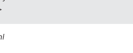

图 9.3 当选择卡片类型时，使用 ch0903.html 中的 jQuery 代码自动聚焦到信用卡号码。

### 控制表单提交

```
$("form").submit(function(e){
    alert("Sorry. Not yet Implemented.");
    e.preventDefault();
});
```

动态表单流程控制的另一个重要方面是拦截 `submit` 和 `reset` 事件，并根据各种条件执行操作。例如，你可能想在允许表单提交之前验证表单的值。

控制表单提交的方式是向表单附加一个 `submit` 事件处理程序。在事件处理程序内部，你可以访问关于事件的信息以及要提交的表单数据。你可以执行任何需要的任务，然后允许表单提交或重置，或者阻止默认的浏览器操作。

以下代码展示了通过在事件上调用 `.preventDefault()` 来阻止表单提交的示例：

```
$("form").submit(function(e){
    alert("Sorry. Not yet Implemented.");
    e.preventDefault();
});
```

此页有意留白

# 10 动态构建网页内容

使用 jQuery 和 JavaScript 的一个关键部分是能够动态构建要添加到页面上的内容。这些内容可以是表单元素、图片、列表、表格，或任何适合需求的元素类型。动态地向页面添加内容，而不是向服务器请求新页面，消除了服务器请求时间，并允许你只构建那些新的部分，而不是全部内容。

本章中的短语旨在帮助你理解创建内容并将其添加到网页的方法。它们涵盖了附加、前置和插入不同类型的元素。还介绍了如何从网页中删除内容。

## 使用 jQuery 创建 HTML 元素

```
var newP = $('<p id="newp" class="nice">new P</p>');
var img = $("</img>");
img.attr("src", "images/newImg.jpg");
var opt = $("<option></option>");
opt.html("Option 1");
opt.val(1);
opt.attr("selected",true);
```

jQuery 的一个极其重要的方面是能够从 HTML 字符串创建 HTML 元素。要从字符串创建 HTML 对象，只需调用 jQuery(htmlString) 或 $(htmlString)。该字符串可以包含属性设置和内容。例如：

```
var newP = $('<p id="newp" class="nice">new Paragraph</p>');
```

注意，我使用单引号来定义 htmlString。这使我能够放入 id="newp" 和 class="nice"，而无需转义双引号。生成的 newP 对象是一个 jQuery 对象，其中包含一个 <p> 元素。

构建 HTML 的另一个巨大优势是你可以使用 .attr()、.html()、.prop()、.val() 和 .data() 方法来存储额外的值，并设置属性、属性和内容。

例如，以下代码创建一个图像元素，然后分配 src 属性：

```
var img = $("</img>");
img.attr("src", "images/newImg.jpg");
```

另一个例子创建一个新的 <option>，分配一个值，然后通过将 <select> 的值设置为选项的值，将 <option> 设置为选中：

```
var opt = $("<option></option>");
opt.html("Option 1");
opt.val(1);
select.val(opt.val());
```

## 向其他元素添加元素

动态 Web 编程的一个重要方面是能够根据用户交互添加内容，而无需向服务器请求新页面。这为用户提供了更快、更无缝的体验。本节中的短语旨在说明将新的 HTML 元素前置、附加和插入到现有元素中的基础知识。

### 前置到元素内容的开头

```
var newDiv = $("<div></div>");
$("body").prepend(newDiv);
newDiv.prepend($("<p>Paragraph A</p>"));
$("<p>Paragraph A</p>").prependTo("div");
```

jQuery 提供了在元素中现有内容之前前置内容的方法。例如，你可以在现有列表项、表格行或段落文本之前添加列表项、表格行或段落文本。

这些方法是 existingObject.prepend(newContent) 和 newContent.prependTo(existingObject)。existingObject 可以是你已经拥有的对象，也可以使用选择器来指定现有对象。

例如，以下代码创建一个新的 <div> 并将其附加到 body。然后它使用两种不同的方法各前置一个段落：

```
var newDiv = $("<div></div>");
$("body").prepend(newDiv);
newDiv.prepend($("<p>Paragraph A</p>"));
$("<p>Paragraph A</p>").prependTo("div");
```

### 附加到元素内容的底部

```
var newDiv = $("<div></div>");
$("body").append(newDiv);
newDiv.append($("<p>Paragraph A</p>"));
$("<p>Paragraph B</p>").appendTo("div");
```

jQuery 还提供了在元素中现有内容之后附加内容的方法。例如，你可以在列表项、表格行或段落文本的末尾添加列表项、表格行或段落文本。

这些方法是 existingObject.append(newContent) 和 newContent.appendTo(existingObject)。existingObject 可以是你已经拥有的对象，也可以使用选择器来指定现有对象。

例如，以下代码创建一个新的 <div> 并将其附加到 body。然后它使用两种不同的方法各附加一个段落：

```
var newDiv = $("<div></div>");
$("body").append(newDiv);
newDiv.append($("<p>Paragraph A</p>"));
$("<p>Paragraph A</p>").appendTo("div");
```

### 插入到元素内容的中间

```
$("ul li:eq(2)").before($("<li>New Item</li>"));
$("<p>Title</p>").before("#subtitle");
$("ul li:eq(2)").after($("<li>New Item</li>"));
$("<p>Sub Title</p>").after("#title");
```

通常，你会想向元素内容的中间添加新项目。例如，你可能需要在列表或选择框的中间插入一个项目，或者在现有段落之前添加一个新段落。

jQuery 提供了在现有内容之前和之后立即插入内容的方法。新内容是现有内容的同级元素。

要在现有元素之前插入一个元素，请使用 existingObject.insertBefore(newContent) 或 newContent.before(existingObject)。existingObject 可以是你已经拥有的对象，也可以使用选择器来指定现有对象。

例如，以下代码在列表中已有的第三个项目之前立即插入一个新的列表项：

```
$("ul li:eq(2)").before($("<li>New Item</li>"));
```


以下代码使用`.before()`方法在id="subtitle"的段落之前插入一个新段落：

```
$("<p>Title</p>").before("#subtitle");
```

要在现有元素之后插入一个元素，请使用`existingObject.insertAfter(newContent)`或`newContent.after(existingObject)`。`existingObject`可以是你已经拥有的对象，也可以使用选择器来指定现有对象。

例如，以下代码在列表中已有的第三个项目之后立即插入一个新的列表项：

```
$("ul li:eq(2)").insertAfter($("<li>New Item</li>"));
```

以下代码使用`.after()`方法在id="title"的段落之后立即插入一个新段落：

```
$("<p>Sub Title</p>").after("#title");
```

## 添加元素示例

以下代码在点击按钮时，会向现有的`<div>`元素追加、插入和前置段落，以便你可以看到动态插入是如何工作的。图10.1展示了添加元素前后页面的样式：

```
01 <html>
02   <head>
03     <title>Python Phrasebook</title>
04     <meta charset="utf-8" />
05     <script type="text/javascript"
06       src="../js/jquery-2.0.3.min.js"></script>
07 <script>
08   $(document).ready(function (){
09     $("button").on("click", function(){
10       $("div").prepend("<p>Paragraph 1</p>");
11       $("div p:eq(1)").after("<p>Paragraph 3</p>");
12       $("div").append("<p>Paragraph 5</p>");
13     });
14   });
15 </script>
16 </head>
17 <body>
18   <button>Add Paragraphs</button>
19   <div>
20     <p>Paragraph 2</p>
21     <p>Paragraph 4</p>
22   </div>
23 </body>
24 </html>
```

ch1001.html

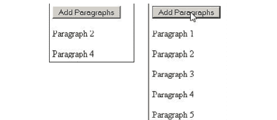

## 从页面移除元素

```
$("p").remove();
$("p").remove(".menu");
$("#myList").children("li").remove();
```

你可以使用jQuery对象上的`.remove([selector])`方法从网页中移除元素。此方法会修改DOM并从树中移除节点。

使用`.remove()`方法有几种不同的方式。不带参数调用`.remove()`会移除jQuery对象集合中的所有元素。例如，以下语句移除所有`<p>`元素：

```
$("p").remove();
```

你也可以向`.remove()`传入一个选择器，这将把移除操作限制在集合中匹配选择器值的项目上。例如，以下语句移除所有class="menu"的`<p>`元素：

```
$("p").remove(".menu");
```

通常，你可能不想移除元素本身，而是想移除它的子元素。例如，以下代码移除id="myList"列表中的所有`<li>`元素：

```
$("#myList").children("li").remove();
```

以下代码展示了使用选择器从列表中移除元素的示例。该代码首先生成一个包含十个元素的列表，然后提供按钮来调用处理程序，这些处理程序使用`.remove("li:even")`或`.remove("li:odd")`仅从列表中移除偶数或奇数元素，如图10.2所示：

```
01 <html>
02   <head>
03     <title>Python Phrasebook</title>
04     <meta charset="utf-8" />
05     <script type="text/javascript"
06       src="../js/jquery-2.0.3.min.js"></script>
07     <script>
08       $(document).ready(function (){
09         for(var i=0; i<10; i++){
10           $("ul").append($("<li></li>").html("Item " + i));
11         }
12         $("#odd").on("click", function(){
13           $("li:odd").remove(); });
14         $("#even").on("click", function(){
15           $("li:even").remove(); });
16       });
17     </script>
18   </head>
19   <body>
20     <button id="odd">Remove Odd</button>
21     <button id="even">Remove Even</button>
22     <ul></ul>
23   </body>
24 </html>
```

ch1002.html

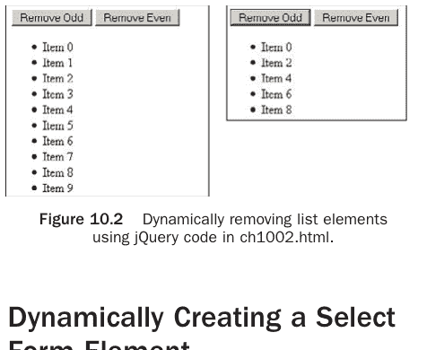

## 动态创建Select表单元素

```
var select = $("<select></select>");
var opt = $("<option></option>");
opt.val("1");
opt.html("Option 1");
select.append(opt);
select.val(opt.val());
```

jQuery使得动态生成select元素变得简单。如果你需要添加具有大量选项的select，或者select的数据是以动态方式（如用户输入或AJAX请求）获取时，这非常有用。

要动态创建一个select，首先需要使用以下代码创建一个`<select>`元素：

```
var select = $("<select></select>");
```

然后你需要通过创建`<option>`元素、设置选项的值，然后定义在select中显示的HTML来添加选项。以下代码创建一个新的`<option>`并将其添加到`<select>`中：

```
var opt = $("<option></option>");
opt.val("1");
opt.html("Option 1");
select.append(opt);
```

你也可以通过使用以下语句将select的值设置为选项的值，来将某个选项设为选中状态：

```
select.val(opt.val());
```

以下代码展示了使用for循环和月份名称数组动态构建月份、日期、年份日期选择器的示例。图10.3展示了动态生成的选择器：

```
01 <html>
02   <head>
03     <title>Python Phrasebook</title>
04     <meta charset="utf-8" />
05     <script type="text/javascript"
06       src="../js/jquery-2.0.3.min.js"></script>
07     <script>
08       var mNames = ["Jan", "Feb", "Mar", "Apr",
09         "May",
10         "Jun", "Jul", "Aug", "Sep", "Oct", "Nov",
11         "Dec" ];
12       $(document).ready(function (){
13         var months = $("<select id='mon'></select>");
14         var days = $("<select id='day'></select>");
15         var years = $("<select id='year'></select>");
16         for(var i=0; i<mNames.length; i++){
17             var month = $("<option></option>");
18             var v = mNames[i];
19             month.val(mNames[i]).html(mNames[i]);
20             months.append(month); }
21         for(var i=1; i<=31; i++){
22             var day = $("<option></option>");
23             day.val(i).html(i);
24             days.append(day); }
25         for(var i=2010; i<=2030; i++){
26             var year = $("<option></option>");
27             year.val(i).html(i);
28             years.append(year); }
29         $("body").append(months, days, years);
30         $("select").on("change", function(){
31             $("p").html($("#mon").val() + " " +
32                 $("#day").val() + ", " +
33                 $("#year").val());
34         });
35         $("select").attr("size", 3);
36     });
</script>
</head>
<body>
    <p>Date</p>
</body>
</html>
```

ch1003.html

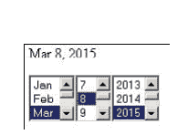

图10.3 使用ch1003.html中的jQuery和JavaScript代码动态创建select元素。

## 向表格追加行

```
var newRow = $("<tr></tr>");
var newCell = $("<td>cell1</td>");
newRow.append(newCell);
$("tbody").append(newRow);
```

动态操作网页的常见任务之一是向表格中的元素添加行。要向表格添加行，你需要创建一个新的`<tr>`元素，然后添加`<td>`元素。例如：

```
var newRow = $("<tr></tr>");
var newCell = $("<td>cell1</td>");
newRow.append(newCell);
$("tbody").append(newRow);
```

以下示例展示了使用一系列数组填充数据来构建表格的方法。`buildTable()`函数从数组中随机选择一个项目放入`<td>`元素中。图10.4展示了最终的表格：

```
01 <html>
02   <head>
03     <title>Python Phrasebook</title>
04     <meta charset="utf-8" />
05     <script type="text/javascript"
06         src="../js/jquery-2.0.3.min.js"></script>
07     <script>
08       var tArr = ["Mens", "Womens", "Youth", 
09           "Childs"];
10       var sArr = ["XL", "M", "S", "XS"];
11       var kArr = ["pants", "shirt", "sweater", 
12           "belt"];
13       function randInt(max) {
14         return Math.floor((Math.random()*max)+1); }
15       function buildTable(){
16         for(var x=1;x<10;x++){
17           var row =$("<tr></tr>");
18           row.append($("<td></td>").html(x));
19           row.append($("<td></td>").html(
20             tArr[randInt(3)]+" "+sArr[randInt(3)]+" "+kArr[randInt(3)]));
21           row.append($("<td></td>").html(randInt(20)));
22           row.append($("<td></td>").html(
23             ((Math.random()*80)+5).toFixed(2)));
24           $("tbody").append(row);}
25       }
26       $(document).ready(function (){
27         buildTable();
28       });
29     </script>
30     <style> td {border:.5px dotted black; } </style>
31   </head>
32   <body>
33     <table>
34       <thead><tr>
35         <th class="numeric"><span>ID#</span></th>
36         <th><span>Product</span></th>
37         <th class="numeric"><span>Quantity</span></th>
38         <th class="numeric"><span>Price</span></th>
39         <td class="spacer"></td>
40       </tr></thead>
41       <tbody></tbody>
42     </table>
43   </body>
44 </html>
```

ch1004.html


| ID# | 产品 | 数量 | 价格 |
|-----|---------|----------|-------|
| 1 | 儿童M码腰带 | 20 | 67.84 |
| 2 | 女士XS码毛衣 | 17 | 84.95 |
| 3 | 儿童XS码腰带 | 15 | 80.49 |
| 4 | 青少年XS码衬衫 | 17 | 56.82 |
| 5 | 青少年M码腰带 | 2 | 56.31 |
| 6 | 女士S码腰带 | 13 | 5.91 |
| 7 | 青少年XS码毛衣 | 8 | 10.80 |
| 8 | 女士S码腰带 | 11 | 62.23 |
| 9 | 女士S码毛衣 | 3 | 61.91 |

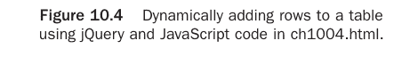

## 将项目插入列表

```javascript
var item = "New Item";
var nextItem = false;
$("ul li").each(function(i, item){
  if ($(item).html() > newItem){
    nextItem = item;
    return false; }});
if (!nextItem){
  $("ul").append($("<li></li>").html(newItem)); }
else {
  $(nextItem).before($("<li></li>").html(newItem));}
```

动态操作网页时的另一个常见任务是向列表中插入元素。但如果列表需要排序呢？有几种不同的方法可以做到这一点。

一种添加项目的方法是遍历列表元素，直到找到一个大于新项目的元素。然后将新项目插入到该现有项目之前。如果未找到更大的项目，则只需将项目追加到列表末尾。

以下示例展示了如何使用文本输入框，允许用户通过输入项目并按回车键来向购物清单中添加项目。项目会按照字母顺序在`addToList()`函数中添加。图10.5展示了向列表中添加项目的过程：

```html
01 <html>
02   <head>
03     <title>Python Phrasebook</title>
04     <meta charset="utf-8" />
05     <script type="text/javascript"
06       src="../js/jquery-2.0.3.min.js"></script>
07     <script>
08       function addToList(newItem){
09         var nextItem = false;
10         $("ul li").each(function(i, item){
11           if ($(item).html() > newItem){
12             nextItem = item;
13             return false; }
14         });
15         if (!nextItem){
16           $("ul").append($("<li></li>").html(newItem)); }
17         else {
18           $(nextItem).before($("<li></li>").html(newItem));}
19       }
20       $(document).ready(function (){
21         $("input").on("keyup",function(e){
22           if (e.keyCode == 13){
23             addToList($(this).val());
24             $(this).val("");
25           }
26         });
27       });
28     </script>
29   </head>
```

```html
30 <body>
31     <p>购物清单</p>
32     <input type="text" />
33     <ul><li>eggs</li><li>milk</li></ul>
34 </body>
35 </html>
```

ch1005.html

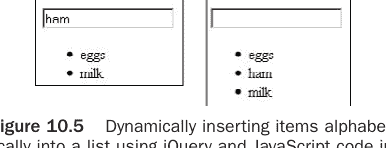

图10.5 使用ch1005.html中的jQuery和JavaScript代码动态地将项目按字母顺序插入列表。

## 创建动态图像画廊

```javascript
var img = $("</img>");
img.attr("src", "images/newImage.jpg");
$("div").append(img);
```

图像正成为网页的主流内容。它们传递的信息量远大于文本，而且通常更快、更准确。jQuery和JavaScript允许你通过按需创建图像元素，设置每个元素的源属性，然后将其追加到正确的位置，从而动态地将图像添加到网页。

例如，以下代码创建一个``元素，设置src属性以定义文件位置，然后将图像追加到一个`<div>`元素中：

```javascript
var img = $("</img>");
img.attr("src", "images/newImage.jpg");
$("div").append(img);
```

作为示例，以下代码使用图像名称数组在网页上动态构建一个小型图像画廊。`addImages()`函数遍历图像列表，然后通过创建``、`<span>`和`<p>`元素将图像追加到页面中。图10.6显示了最终的图像画廊：

```html
01 <html>
02 <head>
03 <title>Python Phrasebook</title>
04 <meta charset="utf-8" />
05 <script type="text/javascript"
06 src="../js/jquery-2.0.3.min.js"></script>
07 <script>
08 var images = ["arch", "flower", "sunset2",
09 "tiger", "falls", "volcano",
10 "beach", "img1", "flower2"];
11 function addImages(){
12 for (i in images){
13 var imgbox = $("<span></span>");
14 var img = $("</img>");
15 var label = $("<p></p>").html(images[i]);
16 img.attr("src", images[i] + ".jpg");
17 imgbox.append(label, img );
18         $("div").append(imgbox); }
19     }
20     $(document).ready(function (){
21         addImages();
22     });
23 </script>
24 <style>
25     div, img  { border:5px ridge white;
26         box-shadow:10px 10px 5px #888888; }
27     div { background-color:black;
28         width:660px; height:520px }
29     span { display:inline-block; width:200px;
30         text-align:center; margin:10px; }
31     p {color:white; margin:0px;
32         background-color:#3373A5; font-weight:bold;}
33     img { height:100px; margin:10px;}
34 </style>
35 </head>
36 <body>
37     <div>
38     </div>
39 </body>
40 </html>
```

ch1006.html

196 第10章 动态构建网页内容

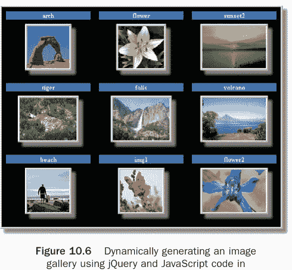

图10.6 使用ch1006.html中的jQuery和JavaScript代码动态生成图像画廊。

## 添加HTML5 Canvas图形

```javascript
var c = $("canvas").get(0);
var lineValues = [10,15,80,79];
c.width = c.width;
var xAdj = c.width/lineValues.length;
var ctx = c.getContext("2d");
ctx.fillStyle = "#000000";
ctx.strokeStyle = "#00ff00";
ctx.lineWidth = 3;
var x = 1;
ctx.moveTo(x,(c.height));
for (var idx in lineValues){
    var value = parseInt(lineValues[idx]);
    ctx.lineTo(x+xAdj, (c.height - value));
    x += xAdj;
}
ctx.stroke();
```

随着HTML5逐渐成为主流，图形方面也出现了许多新的可能性。使用动态的jQuery和JavaScript代码配合新的`<canvas>`元素，你可以轻松地为网页提供一些丰富、交互式的图形。

使用JavaScript，你可以访问`<canvas>`元素，获取上下文，设置线条颜色和大小，然后向文件中添加线条。为了说明这一点，请看以下代码中的`renderSpark()`函数。

这段代码接受一个值列表和一个`<canvas>`元素，然后使用这些值在画布上绘制一系列线条。线条值是在`adjValues()`函数中动态生成的，并通过`setTimeout()`间隔更新。结果是一个动态更新的迷你折线图。你可以轻松地将`adjValues()`函数替换为AJAX请求，以从服务器获取数据来填充画布图表。图10.7展示了在画布上动态渲染的图表：

```html
01 <html>
02 <head>
03 <title>Python Phrasebook</title>
04 <meta charset="utf-8" />
05 <script type="text/javascript"
06 src="../js/jquery-2.0.3.min.js"></script>
07 <script>
08 function randInt(max) {
09 return Math.floor((Math.random()*max)+1); }
10 function adjValues(){
11 $("canvas").each(function(){
12          var lineValues =
$(this).data("valueArr");
13          lineValues.shift();
14          lineValues.push(randInt(100));
15          renderSpark(this, lineValues);
16        });
17        setTimeout(adjValues, 1000);
18      }
19      function renderSpark(c, lineValues){
20        c.width = c.width;
21        var xAdj = c.width/lineValues.length;
22        var ctx = c.getContext("2d");
23        ctx.fillStyle = "#000000";
24        ctx.strokeStyle = "#00ff00";
25        ctx.lineWidth = 3;
26        var x = 1;
27        ctx.moveTo(x,(c.height));
28        for (var idx in lineValues){
29          var value = parseInt(lineValues[idx]);
30          ctx.lineTo(x+xAdj, (c.height - value));
31          x += xAdj;
32        }
33        ctx.stroke();
34      }
35      function getRandomArray(){
36        var arr = new Array();
37        for(var x=0; x<20; x++){
arr.push(randInt(100)); }
38        return arr;
39      }
40      $(document).ready(function(){
41        $("canvas").each(function(){
42          $(this).data("valueArr",
getRandomArray()); });
43        adjValues();
44      });
45    </script>
```


# 11 添加 jQuery UI 元素

jQuery UI 是建立在 jQuery 之上的一个附加库。jQuery UI 的目的是提供一组可扩展的交互、效果、小部件和主题，使你更容易在网页中整合专业的用户界面元素。

jQuery UI 库提供了许多功能。本章的短语旨在帮助你开始使用 jQuery UI。虽然这些概念并不全面，但你可以将它们应用于额外的 UI 元素和交互。

## 添加 jQuery UI 库

```html
<script type="text/javascript" src="jquery-ui-1.10.3.min.js"></script>
<link rel="stylesheet" type="text/css" href="jquery-ui-1.10.3.min.css">
```

要开始使用 jQuery，请下载该库，将其添加到你的网页可以访问的位置，然后在网页中加载 JS 和 CSS 文件。添加 jQuery UI 库的过程如下所述。

1.  从 http://jqueryui.com/download/ 下载该库。
2.  解压缩下载文件的内容。
3.  将下载文件中的 jquery-ui-###.js、jquery-ui-###.css 和 images 文件夹复制到你网站中页面可以访问的位置。images 文件夹需要与 .css 文件在同一位置。
4.  将以下行添加到你网页的头部以加载 jQuery UI 代码。你需要替换版本号以匹配你下载的版本，并在 src 和 href 属性中设置适当的路径：

```html
<script type="text/javascript"
    src="jquery-ui-1.10.3.min.js"></script>
<link rel="stylesheet" type="text/css"
    href="jquery-ui-1.10.3.min.css">
```

> **顺便一提**
> jQuery UI 库基于 jQuery 库，因此你需要先加载 jQuery 库。

## 实现自动完成输入

```javascript
// . . . jQuery . . .
$("#autocomplete").autocomplete({
  source: ["Monday", "Tuesday", "Wednesday",
  "Thursday", "Friday"]
});
// . . . HTML . . .
<input id="autocomplete">
```

自动完成小部件附加到文本输入元素上。当用户在文本输入框中输入时，会显示来自列表的建议。当你有一个有限的可能性集合可供输入，并且希望确保使用正确的拼写时，这尤其有用。

要应用自动完成小部件，请定义一个 source 数组，该数组包含可用于文本输入自动完成的字符串。然后在 input 元素上调用 `.autocomplete({source:array})` 方法。例如：

```javascript
$("#autocomplete").autocomplete({
  source: ["Monday", "Tuesday", "Wednesday",
  "Thursday", "Friday"]
});
```

以下代码通过向名为 #autocomplete 的 <input> 元素添加一个日期数组自动完成小部件，展示了使用自动完成的示例。自动完成的效果如图 11.1 所示。通过在第 16 和 17 行将 source 属性设置为日期名称数组，添加了用于自动完成的日期集合：

204 第 11 章 添加 jQuery UI 元素

```html
01 <html>
02   <head>
03     <title>Python Phrasebook</title>
04     <meta charset="utf-8" />
05     <script type="text/javascript"
06        src="../js/jquery-2.0.3.min.js"></script>
07     <script type="text/javascript"
08        src="../js/jquery-ui-1.10.3.min.js"></script>
09     <link rel="stylesheet" type="text/css"
10        href="../js/css/jquery-ui-1.10.3.min.css">
11     <script>
12       function dateChanged(dateStr, Object){
13         $("span").html("Updated to " + dateStr); }
14       $(document).ready(function(){
15         $( "#autocomplete" ).autocomplete({
16           source: ["Monday", "Tuesday",
17           "Wednesday",
18           "Thursday", "Friday"]
19         });
20       });
21     </script>
22     <style>
23       input { border:2px ridge blue;
24       border-radius:5px;
25       padding:3px; }
26     </style>
27   </head>
28   <body>
29     <label for="autocomplete">Day of Week:</label>
30     <input id="autocomplete">
31   </body>
32 </html>
```

ch1101.html

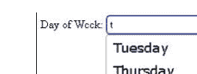

图 11.1 使用 jQuery UI 代码在 ch1101.html 中实现自动完成文本输入。

## 实现拖放

```javascript
$("#drag1, #drag2, #drag3").draggable(
  {helper:"clone", cursor:"move",
  opacity:.7, zIndex:99});
$("#drop").droppable({accept:"img",
  tolerance:"intersect", hoverClass:"drop-hover"});
$("#drop").on("drop", function(e,ui){
  var item = $("<div></div>");
  item.append($("</img>").attr("src",
    ui.draggable.attr("src")));
  item.append($("<span></span>").html(
    ui.draggable.attr("src")));
  $(this).append(item);
});
```

你可以定义一个元素为可拖动的，然后定义另一个元素为可放置的。当可拖动元素被放置到可放置的小部件上时，你可以添加 JavaScript 和 jQuery 代码，在可拖动元素放置到可放置小部件上时提供所需的任何交互。

draggable 小部件为元素在用鼠标拖动时提供了必要的交互性。例如，通过鼠标拖动将元素移动到浏览器窗口中的另一个位置。

表 11.1 描述了更常见的 draggable 选项。以下代码展示了将 draggable 小部件附加到带有 cursor 和 opacity 选项的元素上的示例：

```javascript
$("#img1").draggable({cursor:"move", opacity:.5});
```

表 11.1 常用 Draggable 小部件选项

| 选项 | 描述 |
|---|---|
| axis | 可以设置为 x、y 或 false。x 仅水平拖动，y 仅垂直拖动，false 自由拖动。 |
| containment | 指定一个容器以将拖动限制在其中。可能的值是 "parent"、"document" 或 "window"。 |
| cursor | 指定拖动时显示的光标。 |
| helper | 定义拖动时显示的元素。值可以是 "original"、"clone" 或返回 DOM 对象的函数。 |
| opacity | 设置拖动时的不透明度。 |
| revert | 布尔值。指定拖动停止时"原始"对象是否应返回其原始位置。字符串。如果设置为 "valid"，仅在对象成功放置后才回退。"invalid" 仅在对象未成功放置时回退。 |
| stack | 设置为 false 或选择器。如果指定了选择器，则将项目带到选择器指定元素的最高 z-index。 |
| zIndex | 拖动时使用的 z-index 值。 |

draggable 小部件还提供了额外的事件，以便可以在拖动开始、进行中和停止时为元素附加处理程序。表 11.2 列出了你可以在 draggable 项目上访问的事件。以下代码展示了添加 dragstop 事件的示例，以便在项目被放置时应用弹跳效果：

```javascript
$("#drag1").draggable({cursor:"move", opacity:.5});
$("#drag1").on("dragstop",
  function(){$(this).effect("bounce", 1000); });
```

表 11.2 Draggable 小部件事件

| 事件 | 描述 |
|---|---|
| drag(event, ui) | 在拖动时触发。event 是 JavaScript 事件对象。ui 是一个具有以下值的对象：<br> - **helper**—表示 draggable 项目 helper 的 jQuery 对象。 <br> - **position**—包含当前 CSS 位置 {top, left} 的对象。 <br> - **offset**—包含当前 CSS 偏移 {top, left} 的对象。 |
| dragstart(event, ui) | 在拖动开始时触发。 |
| dragstop(event, ui) | 在拖动停止时触发。 |

droppable 小部件将一个元素定义为可被 draggable 项目使用的有效放置容器。这允许你使用简单的鼠标控件在元素之间提供交互。


208  第11章  添加jQuery UI元素

可放置部件（droppable widget）允许你指定一个`accept`函数，该函数可以处理事件的相关信息，如鼠标坐标和涉及的可拖动项。表11.3描述了更常见的可放置选项。以下代码展示了如何将可放置部件附加到一个元素上并指定容差级别：

```javascript
$("#div1").droppable({tolerance:"touch"});
```

### 表11.3  常用的可放置部件选项

| 选项 | 描述 |
|---|---|
| accept | 用于筛选可放置项将接受的元素的**选择器**。 |
| activeClass | 当一个有效的可拖动项正在被拖动时，将应用于可放置项的**类名**。 |
| greedy | 布尔值。默认为`false`，这意味着所有有效的父可放置项也会接收到可拖动项。当为`true`时，只有第一个可放置项会接收到可拖动项。 |
| hoverClass | 当一个有效的可拖动项悬停在可放置项上方时，将应用于可放置项的**类名**。 |
| tolerance | 指定用于确定可拖动项是否有效的方法。可接受的值有：<br>- `fit` — 可拖动项完全覆盖可放置项。<br>- `intersect` — 可拖动项在两个方向上至少与可放置项重叠50%。<br>- **`pointer`** — 鼠标位于可放置项上方。<br>- **`touch`** — 可拖动项与可放置元素在任何位置重叠。 |

可放置部件还提供了额外的事件，以便在拖放过程中将处理程序附加到元素。表11.4列出了你可以在可放置项上访问的事件。以下代码展示了如何添加一个`dropactivate`事件，以便在拖动开始激活一个可放置项时应用抖动效果：

```javascript
$("#drop1").droppable({tolerance:"pointer"});
$("#drop1").on("dropactivate",
function(){$(this).effect("shake", 1000); });
```

### 表11.4  可放置部件事件

| 事件 | 描述 |
|---|---|
| dropactivate(event, ui) | 当一个有效的可拖动项开始拖动时触发。<br><br>`event`是JavaScript事件对象。<br><br>`ui`是一个包含以下值的对象：<br>- **draggable** — 代表实际可拖动项的jQuery对象。<br>- **helper** — 代表可拖动项辅助元素的jQuery对象。<br>- `position` — 包含当前可拖动CSS位置`{top, left}`的对象。<br>- `offset` — 包含当前可拖动CSS偏移量`{top, left}`的对象。 |
| drop(event, ui) | 当一个可拖动项被放置到可放置项上时触发。 |
| dropout(event, ui) | 当可拖动项根据容差离开可放置项时触发。 |
| dropover(event, ui) | 当可拖动项根据容差进入可放置项时触发。 |

现在，我将尝试以实际的方式将所有这些内容整合起来。以下代码使三个图像元素变为可拖动，然后使一个`<div>`元素可放置。我在第14行使用了`"clone"`选项，这样我就可以移动图像的副本，同时将原始图像保留在原位。`drop`事件处理程序使用图像信息来创建一个新的`<div>`元素，其中包含图像和文件名，如图11.2所示：

```html
01 <html>
02   <head>
03   <title>Python Phrasebook</title>
04   <meta charset="utf-8" />
05   <script type="text/javascript"
06      src="../js/jquery-2.0.3.min.js"></script>
07   <script type="text/javascript"
08      src="../js/jquery-ui-1.10.3.min.js"></script>
09   <link rel="stylesheet" type="text/css"
10      href="../js/css/jquery-ui-1.10.3.min.css">
11  <script>
12    $(document).ready(function(){
13      $("#drag1, #drag2, #drag3").draggable(
14        {helper:"clone", cursor:"move",
15          opacity:.7, zIndex:99});
16      $("#drop").droppable({accept:"img",
17        tolerance:"intersect", hoverClass:"drop-hover"});
18      $("#drop").on("drop", function(e,ui){
19        var item = $("<div></div>");
20        item.append($("").attr("src",
21          ui.draggable.attr("src")));
22        item.append($("<span></span>").html(
23          ui.draggable.attr("src")));
24        $(this).append(item);
25      });
26    });
27  </script>
28  <style>
29    div {display:inline-block; vertical-align:top;
30      margin:10px;}
31    img {width:100px; margin:0px; }
32    #images { width:100px; height:300px; }
33    #drop { width:300px; min-height:150px;
34  padding:3px;
35  border:3px ridge white; box-shadow:
36  5px 5px 5px #888888; }
37    #drop div{ height:80px; width:280px;
38  padding:4px;
39  border:2px dotted; margin-top:5px; }
40    #drop div img {height:80px; margin-right:10px; }
41    #drop div span { display:inline-block;
42  vertical-align:top; font:16px/70px arial; }
43  .drop-hover { background-color:#BBDFFF; }
44  </style>
45  </head>
46  <body>
47    <div id="images">
48      
49      
50      
51    </div>
52    <div id="drop"></div>
53  </body>
54 </html>
```

ch1102.html

## 添加日期选择器元素

```javascript
$( "#month" ).datepicker({
    onSelect:dateChanged,
    showOn: "button",
    buttonImage: "calendar.png",
    buttonImageOnly: true,
    numberOfMonths:2,
    showButtonPanel:true,
    dateFormat: "yy-mm-dd"
});
```

jQuery提供的日期选择器（datepicker）部件允许你实现一个日历界面，这样用户只需简单地点击鼠标就可以选择特定的日期。当用户手动输入日期出现错误时，这可以防止许多问题。

日期选择器部件通过调用`.datepicker()`方法附加到`text`、`date`或`datetime`类型的`<input>`元素上。当用户点击`<input>`时，日历就会显示出来。你也可以添加一个图标图片来启动日期选择器，使用`buttonImage`属性。

以下代码创建了一个带有图标的日期选择器，如图11.3所示。为了说明一些可用的选项，我为以下选项添加了设置：

- **onSelect** — 指定一个函数，在每次选择新日期时被调用。
- **showOn** — 设置为`"button"`，这样当按钮图标被点击时，日期选择器就会启动。
- **buttonImage** — 指定要使用的图像文件的位置。
- **buttonImageOnly** — 当为`true`时，日期选择器仅在按钮图标被点击时启动，而不是在`<input>`被点击时。
- **numberOfMonths** — 指定要显示的月份数。
- **showButtonPanel** — 当为`true`时，日期选择器的底部会显示“今天”和“完成”按钮。
- **dateFormat** — 描述要放入`<input>`字段的格式的字符串。

```html
01 <html>
02   <head>
03     <title>Python Phrasebook</title>
04     <meta charset="utf-8" />
05     <script type="text/javascript"
06       src="../js/jquery-2.0.3.min.js"></script>
07     <script type="text/javascript"
08       src="../js/jquery-ui-1.10.3.min.js"></script>
09     <link rel="stylesheet" type="text/css"
10       href="../js/css/jquery-ui-1.10.3.min.css">
11     <script>
12       function dateChanged(dateStr, Object){
13         $("span").html("Updated to " + dateStr); }
14       $(document).ready(function(){
15         $( "#month" ).datepicker({
16           onSelect:dateChanged,
17           showOn: "button",
18           buttonImage: "calendar.png",
19           buttonImageOnly: true,
20           numberOfMonths:2,
21           showButtonPanel:true,
22           dateFormat: "yy-mm-dd"
23         });
24       });
25     </script>
26     <style>
27       input { border:2px ridge blue; border-radius:
28         5px; }
29     </style>
30     <body>
31       <label>Date: </label>
32       <input type="text" id="month"></input>
33       <span></span>
34     </body>
35   </html>
```

ch1103.html

## 使用滑块来操控元素

```javascript
$("#red, #green, #blue" ).slider({
    orientation: "horizontal",
    range: "min",
    max: 255,
    value: 127,
    slide: refreshSwatch,
    change: refreshSwatch
});
$("#red").slider("value", 128);
$("#green").slider("value", 128);
$("#blue").slider("value", 128);
```

滑块（slider）部件允许你通过拖动鼠标来创建滑块控件以调整值。滑块有两个组成部分：滑动条（slide）和滑块手柄（handle）。滑动条由`.ui-slider-range`类样式化，滑块手柄由`.ui-slider-handle`类样式化。


216    第11章    添加 jQuery UI 元素

## 添加 jQuery UI 元素

**你知道吗？**

你可以同时定义一个最小和最大手柄，这允许你使用单个滑块控件来定义一个范围，而不是单个值。

以下代码提供了一个实现示例，该示例使用一组滑块来调整另一个元素的背景色。滑块应用于第23-33行的 `<div>` 元素，并设置了以下选项：

-   **orientation**（方向）——可以设置为 "horizontal"（水平）或 "vertical"（垂直）。
-   **range**（范围）——可以设置为 true、"min" 或 "max"。用于定义范围。"min" 从滑块最小值到一个手柄，"max" 从滑块最大值到一个手柄。
-   **max**（最大值）——指定最大值。
-   **value**（值）——指定当前值。
-   **slide**（滑动）——滑块移动时调用的事件处理程序。
-   **change**（改变）——滑块值改变时调用的事件处理程序。

此外，请注意第41-46行 CSS 中的类设置，它们改变了滑块和手柄的外观。图11.4展示了滑块：

217

使用滑块操作元素

```html
01 <html>
02   <head>
03     <title>Python Phrasebook</title>
04     <meta charset="utf-8" />
05     <script type="text/javascript"
06        src="../js/jquery-2.0.3.min.js"></script>
07     <script type="text/javascript"
08        src="../js/jquery-ui-1.10.3.min.js"></script>
09     <link rel="stylesheet" type="text/css"
10        href="../js/css/jquery-ui-1.10.3.min.css">
11     <script>
12       function cValue(selector){
13         var v =
14         $(selector).slider("value").toString( 16 );
15         if (v.length ===1) { v = "0" + v;}
16         return v;
17       }
18       function refreshSwatch() {
19         $("#mix").css("background-color", "#" +
20         cValue("#red")+cValue("#green")+cValue("#blue"));
21         $("#mix").html($("#mix").css("background-color"));
22       }
23       $(document).ready(function(){
24         $( '#red, #green, #blue' ).slider({
25           orientation: "horizontal",
26           range: "min",
27           max: 255,
28           value: 127,
29           slide: refreshSwatch,
30           change: refreshSwatch
31         });
32         $("#red").slider("value", 128);
33 	$("#green").slider("value", 128);
34 	$("#blue").slider("value", 128);
35 });
36 </script>
37 <style>
38 	#mix { width:160px; height:100px; text-align:center;
39 		font:18px/100px arial; }
40 	#red, #green, #blue { float: left; clear:left;
41 		width:150px; margin:15px;   }
42 	#red .ui-slider-range { background:red; }
43 	#red .ui-slider-handle { border-color:red; }
44 	#green .ui-slider-range { background:green; }
45 	#green .ui-slider-handle { border-color:green; }
46 	#blue .ui-slider-range { background:blue; }
47 	#blue .ui-slider-handle { border-color:blue; }
48 </style>
49 <body>
50 	<div id="mix"></div>
51 	<div id="red"></div>
52 	<div id="green"></div>
53 	<div id="blue"></div>
54 </body>
55 </html>
```

ch1104.html

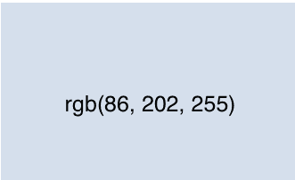

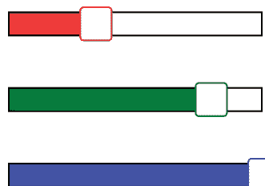

图11.4 在 ch1104.html 中的 jQuery UI 代码中添加滑块。

## 创建菜单

```
. . . jQuery . . .
$( "#menu" ).menu();
$( "#menu" ).on("menuselect", function(e, ui){
  $("p").html("Selected " + ui.item.children("a:first").html());
});
. . . HTML . . .
<ul id="menu">
  <li><a href="#">Open</a></li>
  <li><a href="#">Recent</a><ul>
. . .
<li class="ui-state-disabled"><a href="#">
```

最常用的 jQuery UI 小部件之一是菜单小部件。菜单小部件允许你将元素树转换为可展开的菜单。通常，菜单通过使用级联的 `<ul>/<li>` 元素集来创建，其中 `<a>` 元素定义了链接行为和菜单文本。

**你知道吗？**

你可以使用 `menus` 选项来自定义用于构建菜单的元素标签；例如：`menus:"div.menuItem"`。

以下代码从一组列表创建了一个 jQuery UI 菜单。注意在 HTML 中，一些 `<li>` 字段包含一个带有 `class="ui-icon ui-icon-{type}"` 的 `<span>`。这些项目将包含指定的 jQuery UI 图标以及菜单文本。

选中的项目显示在 `<p>` 元素中，以展示如何使用第14行定义的 `menuselect` 事件处理程序来处理选择。菜单的宽度在第21行的 CSS 代码中通过设置 `.ui-menu` 类的 `width` 值来定义。菜单操作如图11.5所示：

```html
01 <html>
02   <head>
03     <title>Python Phrasebook</title>
04     <meta charset="utf-8" />
05     <script type="text/javascript"
06       src="../js/jquery-2.0.3.min.js"></script>
07     <script type="text/javascript"
08       src="../js/jquery-ui-1.10.3.min.js"></script>
09     <link rel="stylesheet" type="text/css"
10       href="../js/css/jquery-ui-1.10.3.min.css">
11  <script>
12    $(document).ready(function(){
13      $( "#menu" ).menu();
14      $( "#menu" ).on("menuselect", function(e, ui){
15        $("p").html("Selected " +
16          ui.item.children("a:first").html());
17      });
18    });
19  </script>
20  <style>
21    .ui-menu { width: 200px; }
22    p { border:3px ridge red; color:red;
23        display:inline-block; height:80px;
24          width:100px; }
25  </style>
26  <body>
27    <ul id="menu">
28      <li><a href="#">Open</a></li>
29      <li><a href="#">Recent</a><ul>
30        <li><a href="#">Some File</a></li>
31        <li><a href="#">Another File</a></li>
32      </ul></li>
33      <li><a href="#">Save</a></li>
34      <li class="ui-state-disabled"><a href="#">
35        <span class="ui-icon ui-icon-print">
36        </span>Print...</a></li>
37      <li><a href="#">Playback</a><ul>
38        <li><a href="#">
39          <span class="ui-icon ui-icon-seek-start"></span>
40            Prev</a></li>
41        <li><a href="#">
42          <span class="ui-icon ui-icon-stop"></span>
43          Stop</a></li>
44        <li><a href="#">
45        <span class="ui-icon ui-icon-play"></span>
46        Play</a></li>
47        <li><a href="#">
48        <span class="ui-icon ui-icon-seek-end"></span>
49        Next</a></li>
50        </ul></li>
51    </ul>
52    <p></p>
53    </body>
54 </html>
```

ch1105.html

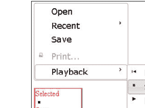

图11.5 使用 ch1105.html 中的代码实现 jQuery UI 菜单。

## 添加工具提示

```javascript
$(document).tooltip({
    items: "img, input",
    position: {my: "left+15 top", at: "left bottom",
               collision: "flipfit" },
    content: function() {
        var obj = $(this);
        if (obj.is("input")) {
            return obj.attr( "title" ); }
        if (obj.is("img")) {
            var img = $("</img>").addClass(
                "mini").attr("src", obj.attr("src"));
            var span = $("<span></span>").html(
                obj.attr( "alt" ));
            return $("<div></div>").append(img, span); }
    }
});
```

工具提示小部件允许你轻松地为表单输入框、图像以及几乎所有其他页面元素添加工具提示。要实现工具提示，将 `.tooltip(options)` 应用于文档或其他容器。在选项内，指定应包含工具提示的元素，然后是工具提示内容处理程序。

当鼠标悬停在工具提示支持的项目上时，会显示工具提示消息。以下代码提供了一个在 `<input>` 和 `` 元素上实现工具提示的示例，如图11.6所示。

-   **items**（项目）——指定用于确定页面元素是否支持工具提示的选择器。
-   **content**（内容）——当支持的元素被悬停时调用的工具提示处理函数。该函数应返回要显示的内容。注意，对于图像，会在工具提示中显示一个迷你版本。
-   **position**（位置）——指定放置工具提示的位置；例如：


# 第11章 添加 jQuery UI 元素

```html
<html>
<head>
  <title>Python Phrasebook</title>
  <meta charset="utf-8" />
  <script type="text/javascript"
    src="../js/jquery-2.0.3.min.js"></script>
  <script type="text/javascript"
    src="../js/jquery-ui-1.10.3.min.js"></script>
  <link rel="stylesheet" type="text/css"
    href="../js/css/jquery-ui-1.10.3.min.css">
  <script>
    $(document).ready(function(){
      $(document).tooltip({
        items: "img, input",
        position: {my:"left+15 top", at:"left bottom",
                  collision:"flipfit" },
        content: function() {
          var obj = $(this);
          if (obj.is("input")) {
            return obj.attr( "title" ); }
          if (obj.is("img")) {
            var img = $("</img>").addClass(
                      "mini").attr("src",
                      obj.attr("src"));
            var span = $("<span></span>").html(
                      obj.attr( "alt" ));
            return $("<div></div>").append(img,
                      span); }
        }});
    });
  </script>
  <style>
    input { border:2px ridge blue; border-radius:
            5px;
            padding:3px; }
    img { height:200px; margin:15px; }
    .mini {height:30px;}
  </style>
</head>
<body>
<label for="size">Who are you? </label>
<input id="size"
     title="Nosce te ipsum (Know Thyself)"
/><br>

</body>
</html>
```

ch1106.html

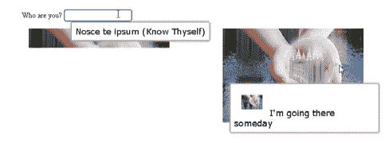

图 11.6 在 ch1106.html 中使用 jQuery UI 代码为元素添加工具提示。

# 12 动画与其他特效

jQuery 最重要的功能之一是能够为元素的变化添加动画。这使得用户感觉应用程序流畅、开发精良，而不是笨重、传统的网页。

如果你要移动、调整大小或动态地向网页添加元素，这一点尤其正确。作为用户，突然出现一堆新东西或消失的东西会令人沮丧。使用过渡效果可以让用户看到元素从何处扩展、缩小到何处，以及移动的方向，以便他们调整心态接受变化。

### 理解 jQuery 动画

jQuery 动画是以增量方式（对用户可见）将 HTML 元素的属性从一个值更改为另一个值的过程。本节描述该过程以及如何在 CSS 属性上实现动画。

### 动画化 CSS 设置

```javascript
$("img").animate({height:100, width:100});
$("p").animate({margin-left:30});
```

jQuery 中的大多数动画都是通过 `.animate()` 方法完成的。`.animate()` jQuery 方法允许你在单个或多个 CSS 属性上实现动画。请记住，`.animate()` 方法同时作用于 jQuery 对象集中的所有元素。通常，你只想作用于单个元素，因此需要将集合筛选为一个。

`.animate()` 方法接受一个 CSS 属性对象映射作为第一个参数。你可以在对象中指定多个属性，以同时动画化多个属性。例如，以下代码动画化 `` 元素的高度和宽度属性：

```javascript
$("img").animate({height:100, width:100});
```

> **顺便提一下**
`.animate()` 方法只能动画化具有数值的属性。例如，你不能动画化边框样式，但可以动画化边框大小。

有几种不同的方式调用 `.animate()` 方法。以下展示了两种语法：

```javascript
.animate(properties [, duration] [, easing] [, complete])
.animate(properties, options)
```

第一种方法允许你将持续时间、缓动和完成函数指定为可选参数。第二种方法允许你将选项指定为单个选项映射对象。例如，以下使用持续时间和缓动对象映射调用 `.animate()`：

```javascript
$("img").animate({height:100, width:100},
{duration:1000, easing:"linear"});
```

**你知道吗？**
你不能使用颜色名称动画化颜色变化，但可以使用十六进制值（如 `#ff0000`）来动画化颜色变化。

表 12.1 描述了 `.animate()` 方法可用的不同选项。这些选项也适用于本章稍后将讨论的其他一些动画方法。

### 表 12.1 动画选项

| 选项 | 描述 |
| :--- | :--- |
| complete | 定义动画完成后要调用的函数。 |
| duration | 指定动画运行时间的字符串或数字。可选的字符串值为 "slow" 或 "fast"。数字指定动画运行的毫秒数。如果未指定持续时间，则默认为 400ms。 |
| easing | 指示要使用哪个缓动函数的字符串。jQuery 提供了 "swing"（默认）和 "linear" 缓动函数。jQuery UI 添加了更多。图 12.1 来自 jqueryui.com，显示了缓动图表。将图表的水平轴视为持续时间，左侧为 0 秒，右侧为完成。将图表的垂直轴视为设置值的百分比变化，底部为 0%，顶部为 100%。 |
| queue | 可以为 true（表示动画将排队等待对象的其他动画之后执行）、false（表示动画将立即开始）或指定特定队列名称的字符串。 |
| step | 指定在动画完成之前每一步都要执行的函数。 |
| specialEasing | 你也可以直接在属性映射中映射缓动，允许你对不同元素使用不同的缓动。例如：<br> `$("img").animate({height:[100,"swing"], width:[100,"linear"]}, 1000);` |

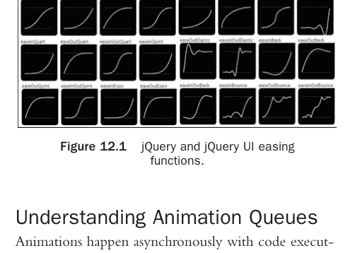

### 理解动画队列

动画与代码执行异步发生，意味着在动画发生时代码继续执行。那么，如果在第一个动画完成之前为某个对象指定了另一个动画会发生什么？答案是 jQuery 会将动画排队，然后一个接一个地按顺序执行，直到所有动画完成。也就是说，除非你在动画选项中指定 `queue:false`。

你需要理解动画队列，因为如果允许用户交互（如移动鼠标或点击）排队过多动画，动画会变得迟钝并落后于用户的操作。

**注意！**
你需要注意从哪里触发动画。记住事件会冒泡。如果在冒泡阶段从所有级别执行相同的动画，可能会产生一些非常不希望看到的结果。为防止这种情况，你可以使用 `stopPropagation()` 和 `stopImmediatePropagation()` 方法。

### 停止动画

```javascript
$("*").stop();
$("#img1").stop(true);
$("img").stop(true, true);
```

jQuery 允许你停止当前在 jQuery 对象集包含的元素上执行的动画。`.stop([clearQueue] [, jumpToEnd])` 方法允许你以几种不同的方式停止动画。

调用不带参数的 `.stop()` 只是暂停队列中的动画。下一个开始的动画将再次开始执行队列中的动画。例如，以下代码暂停所有动画：

```javascript
$("*").stop();
```

调用 `.stop(true)`，将 `clearQueue` 选项设置为 true，会在当前点停止动画并从队列中移除所有动画。例如，以下停止图像上的所有动画并从队列中移除动画：

```javascript
$("img").stop(true);
```

调用 `.stop(true, true)`，将 `jumpToEnd` 选项设置为 true，会导致当前执行的动画立即跳转到结束值，清除队列，然后停止所有动画。例如，以下停止图像上的所有动画，但完成当前动画所做的调整，然后从队列中移除动画：

```javascript
$("img").stop(true, true);
```

`.stop()` 方法返回 jQuery 对象，因此你可以在末尾链接附加方法。例如，以下代码停止图像上的所有动画，然后开始一个新的动画将不透明度设置为 .5：

```javascript
$("img").stop(true, true).animate({opacity: .5}, 1000);
```

### 延迟动画

```javascript
$("img").animate({width:500},
    1000).delay(2000).animate({
        opacity:1}, 1000);
```

实现动画时的一个很好选项是在将动画添加到队列之前添加延迟。你可以用此以更高级的方式提供动画，因为你延迟了动画队列的执行，为用户提供更好的视觉体验。


## 第12章 动画与其他特效

`.delay(duration, [, queueName])` 方法允许你以毫秒为单位指定延迟时长，并可选择指定一个 `queueName`，以确定将延迟应用于哪个队列。例如，以下代码为图片添加大小动画。当大小调整完成后，会有2秒的延迟，然后不透明度动画增加到1：

```javascript
$("img").animate({width:500}, 1000).delay(2000).animate({opacity:1}, 1000);
```

> **顺便提一下**
> `.delay()` 方法非常适合在排队的 jQuery 效果之间进行延迟；然而，它不能完全替代 JavaScript 的 `setTimeout()` 函数，后者在某些用例中可能更为合适——特别是当你需要能够取消延迟时。

### 动画显示与隐藏

jQuery 还在附加到 jQuery 对象的淡入淡出方法中提供了动画功能。最终，这些淡入淡出方法等同于对 opacity 属性使用 `.animate()`。以下各节描述如何将动画应用于各种淡入淡出方法。

### 元素淡入

```javascript
$("img").fadeIn(1000, "swing");
```

`.fadeIn( [duration] [, easing] [, callback])` 方法提供了可选的 duration、easing 和 callback 选项，允许你将元素的不透明度从当前值动画化到1。例如，以下代码对所有图片元素应用1秒钟、带有 swing 缓动效果的动画：

```javascript
$("img").fadeIn(1000, "swing");
```

### 元素淡出

```javascript
$("img").fadeOut(1000, "swing", function() {
  $(this).fadeIn(1000);
});
```

`.fadeOut( [duration] [, easing] [, callback])` 方法提供了可选的 duration、easing 和 callback 选项，允许你将元素的不透明度从当前值动画化到0。

例如，以下代码对所有图片元素应用1秒钟、带有 swing 缓动效果的动画。当动画完成后，它会使图片重新淡入：

```javascript
$("img").fadeOut(1000, "swing", function() {
  $(this).fadeIn(1000);
});
```

### 切换元素的可见性

```javascript
$("img").fadeToggle(3000, "swing");
```

`.fadeToggle( [duration] [, easing] [, callback])` 方法提供了可选的 duration、easing 和 callback 选项，允许你根据元素的当前值，将其不透明度从当前值动画化到0。

例如，以下代码对所有图片元素应用3秒钟、带有 swing 缓动效果的动画。当前可见的图片会淡出，当前透明的图片会淡入：

```javascript
$("img").fadeToggle(3000, "swing");
```

### 淡入淡出到特定的不透明度级别

```javascript
$("img").fadeTo(2000, .5);
$("img").fadeTo(2000, 1);
$("img").fadeTo(2000, .1);
```

`.fadeTo( duration, opacity [, easing] [, callback])` 方法提供了 duration 和 opacity 选项，用于指定结束时的特定不透明度以及过渡动画的时长。它还提供了可选的 easing 和 callback 参数。

例如，以下代码对所有图片应用2秒钟的动画，使其从当前不透明度过渡到0.5：

```javascript
$("img").fadeTo(2000, .5);
```

### 更换图片时添加过渡效果

```javascript
// jQuery
$("img").on("click", function(){
  $("#top").fadeToggle(2000);
});
```

```html
<!-- HTML -->


```

你无法直接动画化从一个图片到另一个图片的过渡，使得一个图片淡入的同时另一个图片淡出。克服这个挑战的方法是使用两张图片——一张叠在另一张上——然后动画化顶部图片的淡出。以下代码正是如此。有两张固定定位的图片。当你点击顶部图片时，它会切换图片的不透明度，如图12.2所示。

```html
<html>
  <head>
    <title>Python Phrasebook</title>
    <meta charset="utf-8" />
    <script type="text/javascript"
      src="../js/jquery-2.0.3.min.js"></script>
    <script type="text/javascript"
      src="../js/jquery-ui-1.10.3.min.js"></script>
    <link rel="stylesheet" type="text/css"
      href="../js/css/jquery-ui-1.10.3.min.css">
    <script>
      $(document).ready(function(){
        $("img").on("click", function(){
          $("#top").fadeToggle(2000);
        });
      });
    </script>
    <style>
      img { position:fixed; height:300px;
           border:3px ridge white;
           box-shadow:5px 5px 5px #888888;
           margin:10px; background-color:black;}
    </style>
  </head>
  <body>
    <div>
      
      
    </div>
  </body>
</html>
```

ch1201.html

**图 12.2** 使用 ch1201.html 中的 jQuery 代码动画化图片间的过渡。

### 使元素滑动消失

```javascript
$("span").mouseover(function(){
    var i = $(this).index("span");
    $("img").eq(i).animate({height:100}, 1000);
});
$("span").mouseout(function(){
    var i = $(this).index("span");
    $("img").eq(i).animate({height:.1}, 1000);
});
```

```javascript
$("#container").mouseenter(function(e){
    e.stopPropagation();
    $("#images").stop(true).slideToggle(1000);
});
$("#container").mouseleave(function(e){
    e.stopPropagation();
    $("#images").stop(true).slideToggle(1000);
});
```

`.slideDown( [duration] [, easing] [, callback])`、`.slideUp( [duration] [, easing] [, callback])` 和 `.slideToggle( [duration] [, easing] [, callback])` 方法提供了 duration、easing 和 callback 参数，允许你在垂直方向上应用滑动效果的动画。

例如，以下代码应用1秒钟的动画将元素向下滑动，然后延迟3秒钟再将元素向上滑动回去：

```javascript
$("#menu").slideDown(1000).delay(3000).slideUp(1000);
```

你可以以类似的方式动画化 `.slideToggle()` 方法。例如，以下代码使用滑动动画来切换一个 `<div>` 元素的可见性：

```javascript
$("div").slideToggle(1000);
```

我喜欢使用 width 和 height 属性来创建滑动元素。你可以通过动画化 height 来创建垂直滑动动画，通过动画化 width 来创建水平滑动动画。

有几个技巧。如果你想实现完整的滑动效果而不仅仅是调整大小的效果，你需要同时为元素提供 width 和 height 值。另外，如果你想让元素在页面上保留其空间，你不能将其值一直动画化到0。但是，你可以动画化到0.1，这样另一个维度就会保留其空间。

以下示例展示了通过将 height 改变为100来创建向下滑动的动画，然后通过将 height 改变为0.1来创建向上滑动回去的动画：

```javascript
$("img").animate({height:100}, 1000);
$("img").animate({height:.1}, 1000);
```

以下代码创建了一个简单的网页，其标题栏具有滑动效果，可以展开显示一个图片菜单，如图12.3所示。当你将鼠标悬停在菜单中的每个项目上时，一张图片会滑动下来，当你离开菜单时，它会滑动回去：

```html
<html>
  <head>
    <title>Python Phrasebook</title>
    <meta charset="utf-8" />
    <script type="text/javascript"
      src="../js/jquery-2.0.3.min.js"></script>
    <script type="text/javascript"
      src="../js/jquery-ui-1.10.3.min.js"></script>
    <link rel="stylesheet" type="text/css"
      href="../js/css/jquery-ui-1.10.3.min.css">
    <script>
      $(document).ready(function(){
        $("div div").hide();
        $("span").mouseover(function(){
          var i = $(this).index("span");
          $("img").eq(i).animate({height:100}, 1000);
        });
        $("span").mouseout(function(){
          var i = $(this).index("span");
          $("img").eq(i).animate({height:.1}, 1000);
        });
        $("#container").mouseenter(function(e){
          e.stopPropagation();
```


# 让元素滑动后消失

```javascript
$(document).ready(function(){
    $("#container").mouseenter(function(e){
        e.stopPropagation();
        $("#images").stop(true).slideToggle(1000);
    });
    $("#container").mouseleave(function(e){
        e.stopPropagation();
        $("#images").stop(true).slideToggle(1000);
    });
});
</script>
<style>
    img{ display:inline-block; width:100px;
        height:.1px;
        margin:0px; padding:0px; float:left;}
    p, span { display:inline-block; width:400px;
        background-color:black; color:white;
        margin:0px; padding:0px; text-align:center;
    }
    span {width:100px; margin:-1px; float:left;
        border:1px solid; background-color:blue; }
    #container { width:410px; }
</style>
</head>
<body>
    <div id="container">
        <p>图片</p>
        <div id="images">
            <span>图片 1</span><span>图片 2</span>
            <span>图片 3</span><span>图片 4</span><br>
            
            
        </div>
    </div>
</body>
</html>
```

ch1202.html

# 第12章 动画与其他特殊效果

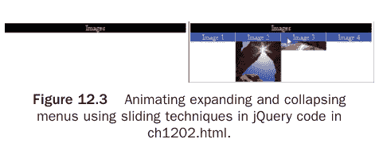

## 动画显示和隐藏

你已经在第9章“动态处理表单元素”中见识过 `.show()` 和 `.hide()` 方法的实战效果。为这些功能添加动画是常见的做法，因此 jQuery 为这些方法提供了动画选项，让你的开发更轻松。

### 动画隐藏（hide）

```javascript
$("#box").hide(1000, "linear", function() {
    $("#label").html("已隐藏！")
});
```

`.hide( [duration] [, easing] [, callback])` 方法提供了可选的持续时间、缓动和回调选项，允许你为隐藏效果添加动画，使元素消失时更加平滑。

例如，以下代码在隐藏元素时应用了1秒的线性缓动动画，并执行一个简单的回调函数：

```javascript
$("#box").hide(1000, "linear", function() {
    $("#label").html("已隐藏！")
});
```

### 动画显示（show）

```javascript
$("#box").show(1000, "linear", function() {
    $("#label").html("已显示！")
});
```

`.show( [duration] [, easing] [, callback])` 方法提供了可选的持续时间、缓动和回调选项，允许你为显示效果添加动画，使元素出现时的过渡更加自然。

例如，以下代码在显示元素时应用了1秒的线性缓动动画，并执行一个简单的回调函数：

```javascript
$("#box").show(1000, "linear", function() {
    $("#label").html("已显示！")
});
```

### 动画切换（toggle）

```javascript
if ($("#handle").html() == '+'){
    $("#photo").show(1000, function(){
        $("#footer").toggle();});
    $("#handle").html('-');
} else {
    $("#footer").toggle();
    $("#photo").hide(1000);
    $("#handle").html('+');
}
```

`.toggle( [duration] [, easing] [, callback])` 方法提供了可选的持续时间、缓动和回调选项，允许你为显示和隐藏效果之间的切换添加动画。

例如，以下代码在切换元素显示/隐藏状态时应用了1秒的线性缓动动画，并执行一个简单的回调函数：

```javascript
$("#switch").show(1000, "linear", function() {
    $("#label").html("开关已切换！")
});
```

以下代码实现了 `.hide()`、`.show()` 和 `.toggle()` 方法，并创建了一个简单的网页元素，它提供了一个标题栏，左侧带有折叠/展开按钮，以便你可以展开和折叠图片。图12.4展示了动画效果。

```html
<html>
    <head>
        <title>Python 短语手册</title>
        <meta charset="utf-8" />
        <script type="text/javascript"
            src="../js/jquery-2.0.3.min.js"></script>
        <script type="text/javascript"
            src="../js/jquery-ui-1.10.3.min.js"></script>
        <link rel="stylesheet" type="text/css"
            href="../js/css/jquery-ui-1.10.3.min.css">
        <script>
            function toggleImage(){
                if ($("#handle").html() == '+'){
                    $("#photo").show(1000, function(){
                        $("#footer").toggle();});
                    $("#handle").html('-');
                } else {
                    $("#footer").toggle();
                    $("#photo").hide(1000);
                    $("#handle").html('+');
                }
            }
            $(document).ready(function(){
                $("#handle").click(toggleImage);
            });
        </script>
        <style>
            div{ width:200px; text-align:center; }
            #bar, #handle, #footer{ font-weight:bold;
                background-color:blue; color:white; }
            #handle{ display:inline-block; cursor:pointer;
                background-color:black; width:15px; float:left; }
            #footer{ font-size:10px; background-color:black; }
        </style>
    </head>
    <body>
        <div>
            <div id="bar"><span id="handle">-</span>
                <span>图片</span></div>
            
            <div id="footer">图片已就绪</div>
        </div>
    </body>
</html>
```

ch1203.html


**图 12.4** 在 ch1203.html 的 jQuery 代码中对图片元素进行显示和隐藏的动画效果。

### 动画调整图片大小

```javascript
$("img").mouseover(function(){
    $(this).animate(
        {width:"200px", opacity:1}, 1000); });
$("img").mouseout(function(){
    $(this).animate(
        {width:"100px", opacity:.3}, 1000); });
```

与使用高度和宽度创建滑动效果类似，你也可以用它们来创建缩放动画。滑动和缩放的区别在于，缩放动画会保持图片的纵横比，因此元素看起来是在增大或缩小，而不是被展开或收起。

要创建缩放动画，你需要在 `.animate()` 语句中同时指定高度和宽度，或者在 CSS 设置中将其中一个设为 `auto`，这样你就可以只对有明确数值的那个属性进行动画。

以下代码展示了将图片在1秒内缩放至500像素，然后在5秒内缓慢缩回至400像素的动画：

```javascript
$("img").animate({height:500, width:500}, 1000).
    animate(
        {height:500, width:500}, 5000);
```

以下代码创建了一个基本的图片画廊视图，当鼠标进入和离开图片时，会在同一动画中调整图片大小并应用透明度变化（参见图12.5）。

247

```html
<html>
<head>
<title>Python 短语手册</title>
<meta charset="utf-8" />
<script type="text/javascript"
src="../js/jquery-2.0.3.min.js"></script>
<script type="text/javascript"
src="../js/jquery-ui-1.10.3.min.js"></script>
<link rel="stylesheet" type="text/css"
href="../js/css/jquery-ui-1.10.3.min.css">
<script>
$(document).ready(function(){
    $("img").mouseover(function(){
        $(this).animate(
            {width:"200px", opacity:1}, 1000);
    });
    $("img").mouseout(function(){
        $(this).animate(
            {width:"100px", opacity:.3}, 1000);
    });
});
</script>
<style>
div{ padding:0px; }
img{ opacity:.3; width:100px; float:left; }
</style>
</head>
<body>
<div id="photos">


</div>
</body>
</html>
```

ch1204.html

248 第12章 动画与其他特殊效果

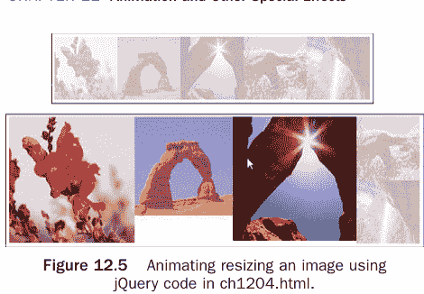

### 动画移动元素

```javascript
var position = $("#element").offset();
$("#element").animate({top:position.top+10,
    left:position.left+100}, 1000);
```

另一个适合动画实现的动态效果是元素的重定位——具体来说，就是将一个元素从一个位置移动到另一个位置。用户非常讨厌在执行某个操作后，页面元素突然出现在不同的位置。动画移动可以让用户看到元素移动的轨迹，并在他们的认知中做出必要的调整。

要应用移动动画，你需要对 `top` 和 `left` CSS 属性进行动画处理。要进行垂直移动，使用 `top`；要进行水平移动，使用 `left`。例如，以下语句将元素向右移动10像素，然后向下移动10像素：


## 使用 AJAX 与 Web 服务器和 Web 服务通信

AJAX 通信是大多数网站中最重要的部分之一。它允许 jQuery 和 JavaScript 从服务器获取额外数据，并更新页面上的单个元素，而无需重新加载或加载新的网页。

本章中的短语旨在帮助您探索使用 jQuery 和 JavaScript 中的 AJAX 请求进行异步通信的世界。

### 理解 AJAX

尽管 AJAX 很重要，但一开始接触时可能会有点令人生畏。面对所有通信术语，您可能会感到不知所措。但事实并非如此。AJAX 只是 jQuery 或 JavaScript 向 Web 服务器发出的请求。该请求将数据发送到服务器，服务器则会以成功或失败进行响应，并可能返回额外数据。仅此而已——不多也不少。

**注意！** 不要将服务器端动态创建网页与 AJAX 混淆。动态创建网页仍然是传统的旧方法，只是更易于管理。每次请求返回服务器仍然需要返回一个完整的新网页。唯一的优点是网页是在内存中生成的，而不是从磁盘读取。

AJAX 请求的妙处在于，它们只发送和接收必要的数据位，而不是完整的页面。传统的 Web 请求总是构建完整的网页并在浏览器中加载/重新加载。图 13.1 展示了在浏览器中更新数据的两种方法之间的区别。以下是 AJAX 请求的一些优点：

- 从 Web 服务器请求的数据更少。
- 允许用户在请求处理期间继续使用网页。
- 错误可以在请求发送到服务器之前在客户端被捕获和处理。

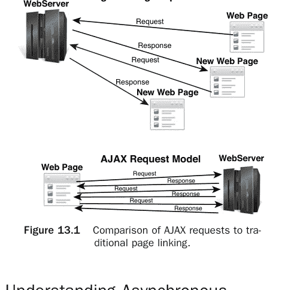

图 13.1   AJAX 请求与传统页面链接的比较。

### 理解异步通信

当您从 Web 服务器请求网页时，对于您的浏览器来说，通信是同步的。这意味着浏览器在开始渲染 HTML 文档并获取必要的额外资源之前，会等待该文档从服务器下载完成。

> **您知道吗？**
> 您可以使用 jQuery 和 JavaScript 进行同步 AJAX 请求。jQuery 的 `.ajax()` 方法和 JavaScript 的 `send()` 函数都有一个布尔字段允许这样做。不过，我不建议这样做，因为它可能导致浏览器锁定，从而引起用户不满。事实上，在 jQuery 1.8 及更高版本中，该选项已被弃用。

异步 AJAX 通信则不同。当您发送 AJAX 请求时，控制权会立即返回给 jQuery 或 JavaScript，后者可以执行其他操作。只有在请求完成或超时后，浏览器才会触发事件，允许您处理请求数据。

### 理解跨域请求

当您向不同域的独立服务器发送 AJAX 请求时，就会发生跨域请求。出于众多安全原因，浏览器会阻止这种情况，这是正确的。

阻止跨域请求的唯一问题是，您经常需要从当前网站外部的服务获取数据。您可以通过几种不同的方式来解决这个问题。

第一种方法是让 Web 服务器充当其他服务器或服务的代理，这意味着您不直接通过 JavaScript 通信，而是将请求发送到服务器，让服务器代您执行。

另一种选择是使用所谓的*按需 JavaScript*，这就是 JSON with Padding (JSONP) 所采用的方法。此方法利用了您可以使用以下语法从另一个网站下载脚本作为资源的事实：

```
<script type="text/javascript"
        src="http://new.domain.com/getData?jsonp=parseData">
</script>
```

### 理解 GET 与 POST 请求

您发送到 Web 服务器的两种主要请求类型是 GET 和 POST。GET 请求将参数作为 URL 的一部分传递，而 POST 请求将它们作为请求数据的一部分传递。

GET 请求 URL：

```
http://localhost/code/example1.html?first=Brad&last=Dayley
```

GET 请求数据：

```
<empty>
```

POST 请求 URL：

```
http://localhost/code/example1.html
```

POST 请求数据：

```
first=Brad
last=Dayley
```

### 理解响应数据

当您向服务器发送 AJAX 请求时，服务器会用响应数据进行响应。您将处理四种主要的响应类型。这些响应数据类型是脚本（script）、文本（text）、JSON 和 XML/HTML。

在 JavaScript 中，一旦请求完成，响应数据在 `XMLHttpRequest` 对象的 `response` 和 `responseText` 属性中可用。在 jQuery 中，响应数据作为第一个参数传递给您定义的 AJAX 处理函数。

脚本和文本通过 `.load()` 和 `.getScript()` 方法处理起来相当简单。JSON 和 XML/HTML 可能会复杂一些。

### 使用 .getScript() 通过 AJAX 加载 JavaScript

```
$.getScript("scripts/ajax/newLibrary.js",
    function(script, status, jqxr){
        . . . 处理程序代码在此 . . .
    });
```

脚本数据是可以加载到浏览器中并在 AJAX 请求后使用的 JavaScript 代码。处理脚本数据的最佳方式是使用 jQuery 的 `.getScript(url [, successHandler(script, status, jqXHR)])` 方法。该方法会自动加载脚本，使其可用。

`url` 是脚本在服务器上的位置，可选的 `successHandler` 是在成功时触发的 AJAX 处理函数。


## 处理文本数据

```javascript
// jQuery
function ajaxHandler(data){
    $("#myP").html(data);
}
```

```javascript
// JavaScript
var xmlhttp = new XMLHttpRequest();
xmlhttp.onreadystatechange=function() {
    document.getElementById(
        "myP").innerHTML=xmlhttp.responseText;
}
```

文本数据是最基本的返回值类型。你可以将文本数据视为一个简单的字符串。例如，在 jQuery 中，要将一个段落元素设置为服务器返回的文本，你可以使用以下 AJAX 处理器：

```javascript
function ajaxHandler(data){
    $("#myP").html(data);
}
```

在 JavaScript 中，你可以直接使用 XMLHttpRequest 对象的 responseText 属性：

```javascript
var xmlhttp = new XMLHttpRequest();
xmlhttp.onreadystatechange=function() {
    document.getElementById(
        "myP").innerHTML=xmlhttp.responseText;
}
```

### 使用 JSON 响应对象

```javascript
function ajaxHandler(jsonData){
    var name = jsonData.first + " " + jsonData.last;
}
```

在处理复杂数据时，JSON 数据是目前 AJAX 响应中最容易处理的格式。在 jQuery 中，JSON 数据会自动转换为 JavaScript 对象。因此，你可以通过点号命名法来访问数据。例如，以下来自服务器的 JSON 响应：

```json
{"first":"Brad", "last":"Dayley"}
```

可以在响应数据中按如下方式访问：

```javascript
var name = data.first + " " + data.last;
```

### 将 JSON 响应字符串转换为 JavaScript 对象

```javascript
// jQuery
var data = $.parseJSON(
  '{"first":"Brad", "last":"Dayley"}');
var name = data.first + " " + data.last;
```

```javascript
// JavaScript
var data = JSON.parse(
  '{"first":"Brad", "last":"Dayley"}');
var name = data.first + " " + data.last;
```

在 JavaScript 甚至某些 jQuery 场景中，你最终会得到一个包含 JSON 字符串的文本响应。这也很好处理。在 jQuery 中，你可以使用 `$.parseJSON()` 将 JSON 字符串转换为 JavaScript 对象。例如：

```javascript
var data = $.parseJSON('{"first":"Brad", "last":"Dayley"}');
var name = data.first + " " + data.last;
```

在 JavaScript 中，你使用 `JSON.parse()` 方法将 JSON 字符串转换为 JavaScript 对象：

```javascript
var data = JSON.parse('{"first":"Brad", "last":"Dayley"}');
var name = data.first + " " + data.last;
```

### 使用 XML/HTML 响应数据响应对象

```javascript
// jQuery
var name = $(data).find("first").text() + " " +
    $(data).find("last").text();
```

```javascript
// JavaScript
var first =
    xmlhttp.responseXML.getElementsByTagName("first");
var last =
    xmlhttp.responseXML.getElementsByTagName("last");
```

XML/HTML 数据不像 JSON 那么简单，但 jQuery 确实让它的处理变得相当容易。响应中的 XML 数据作为 DOM 对象返回，可以转换为 jQuery 对象，并使用 jQuery 丰富的选项进行搜索/导航。例如，以下来自服务器的 XML 响应：

```xml
<person><first>Brad</first><last>Dayley</last></person>
```

可以在响应数据中按如下方式访问：

```javascript
var name = $(data).find("first").text() + " " +
    $(data).find("last").text();
```

XML/HTML 数据可以通过 JavaScript AJAX 响应中 XMLHttpRequest 对象的 responseXML 属性来访问。例如：

```javascript
var first = xmlhttp.responseXML.getElementsByTagName("first");
var last = xmlhttp.responseXML.getElementsByTagName("last");
```

### 将 XML/HTML 响应数据转换为 XML DOM 对象

```javascript
var xmlStr = "<person><first>Brad</first><last>Dayley</last></person>";
```

```javascript
// jQuery
var data = $.parseXML(xmlStr);
var name = $(data).find("first").text() + " " +
    $(data).find("last").text();
```

```javascript
// JavaScript
parser=new DOMParser();
xmlDoc=parser.parseFromString(xmlStr,"text/xml");
var last = xmlDoc.getElementsByTagName("last");
```

与 JSON 类似，如果响应数据对象以字符串形式出现，你可以使用 `.parseXML()` 获取 DOM 对象。例如：

```javascript
var data = $.parseXML(
    "<person><first>Brad</first><last>Dayley</last></person>");
var name = $(data).find("first").text() + " " +
    $(data).find("last").text();
```

在 JavaScript 中，你需要获取一个 XML DOMParser 对象，然后调用 `parseFromString(xmlString, "text/xml")` 方法。这将返回 XML 字符串的 DOM 对象：

```javascript
parser=new DOMParser();
xmlDoc=parser.parseFromString(
    xmlhttp.responseText,"text/xml");
```

## JavaScript 中的 AJAX

要在 JavaScript 中实现 AJAX 请求，你需要访问一个新的 `window.XMLHttpRequest` 对象。表 13.1 描述了 XMLHttpRequest 对象的重要方法和属性。

### 表 13.1 XMLHttpRequest 对象的重要方法和属性

| 方法/属性 | 描述 |
| :--- | :--- |
| open() | 允许你构造一个 GET 或 POST 请求。 |
| send() | 将请求发送到服务器。 |
| onreadystatechange | 当 XMLHttpRequest 对象状态改变时执行的事件处理器。 |
| response | 浏览器根据数据类型创建的对象。 |
| responseText | 服务器响应数据中返回的原始文本。 |
| setRequestHeader | 允许你设置实现请求所必需的 HTTP 请求头。 |
| status | 服务器返回的状态码（例如，200 表示成功，404 表示未找到，等等）。 |

## 获取 XMLHttpRequest 对象

```javascript
var xmlhttp;
if (window.XMLHttpRequest){ //newer Browsers
  xmlhttp=new XMLHttpRequest();
} else {// Older IE6, IE5
  xmlhttp=new ActiveXObject("Microsoft.XMLHTTP");
}
```

较新的浏览器直接提供 XMLHttpRequest 对象作为 `window.XMLHttpRequest`。较旧的 IE 浏览器不直接提供 XMLHttpRequest 对象。相反，它们使用 `ActiveXObject("Microsoft.XMLHTTP")` 对象。如果你希望你的 AJAX 代码支持较旧的浏览器，你需要添加一种替代方式来获取 XMLHttpRequest，即在 `window.XMLHttpRequest` 不可用时构建 IE 版本。

## 从 JavaScript 发送 GET 请求

```javascript
var xmlhttp = new XMLHttpRequest();
xmlhttp.onreadystatechange=function() {
  if (xmlhttp.readyState==4 && xmlhttp.status==200)
  { document.getElementById("email").innerHTML=
xmlhttp.responseText;}}
xmlhttp.open("GET","getUserEmail.php?userid=brad",
true);
xmlhttp.send();
```

要从 JavaScript 发送 GET 请求，你首先需要实现一个 `onreadystatechange` 事件处理器来处理 `response` 或 `responseText` 的值。然后你需要调用 `open("GET", URL)` 打开连接，并使用 `send()` 发送请求。

以下代码展示了通过 JavaScript 向 Web 服务器发送 GET 请求的示例。用户值在第 15 行被添加到查询字符串中。图 13.2 显示了输入字段下方的响应字符串：

```html
01 <html>
02   <head>
03   <title>Python Phrasebook</title>
04   <meta charset="utf-8" />
05   <script>
06     var xmlhttp = new XMLHttpRequest();
07     xmlhttp.onreadystatechange=function() {
08       if (xmlhttp.readyState==4 && xmlhttp.status==200){
09         document.getElementById(
10         "message").innerHTML=xmlhttp.responseText;
11       }
12     }
13     function getEmail(){
14       var user =
15       document.getElementById("email").value;
16       xmlhttp.open("GET","getEmail.php?user="+user);
17       xmlhttp.send();
18     }
19   </script>
20   </head>
21   <body>
22     <input id="email" type="text" />
23     <button onclick="getEmail()">Get Email</button>
24     <p id="message"></p>
25   </body>
26 </html>
```

ch1301.html

## 从 JavaScript 发送 POST 请求

```javascript
var xmlhttp = new XMLHttpRequest();
var params = "first=Brad&last=Dayley&email=brad@dayleycreations.com";
xmlhttp.setRequestHeader("Content-type",
  "application/x-www-form-urlencoded");
xmlhttp.setRequestHeader("Content-length",
  params.length);
xmlhttp.onreadystatechange=function() {
  if (xmlhttp.readyState==4 && xmlhttp.status==200)
    { alert("Email Updated: " +
      xmlhttp.responseText); }
}
xmlhttp.open("POST","setUserEmail.php",true);
xmlhttp.send(params);
```

要从 JavaScript 发送 POST 请求，你首先需要实现一个 `onreadystatechange` 事件处理器来处理 `response` 或 `responseText` 的值。例如：

```javascript
xmlhttp.onreadystatechange=function() {
  if (xmlhttp.readyState==4 && xmlhttp.status==200)
    { alert("Email Updated: " +
      xmlhttp.responseText); }
}
```

接下来，你需要添加 `Content-length` 和 `Content-type` 头，以确保数据在服务器端得到正确处理。`Content-length` 被设置


## 使用AJAX与Web服务器和Web服务通信

参数字符串的长度。Content-type头告诉服务器如何处理POST请求中的数据。提交表单数据时，应使用`"application/x-www-form-urlencoded"`。

```
var params = "first=Brad&last=Dayley&email=brad@dayleycreations.com";
http.setRequestHeader("Content-type", "application/x-www-form-urlencoded");
http.setRequestHeader("Content-length", params.length);
```

最后，你可以调用`open("POST", URL)`来打开连接，并使用`send(params)`来发送请求：

```
xmlhttp.open("POST","setUserEmail.php",true);
xmlhttp.send(params);
```

以下代码展示了一个通过JavaScript发送POST请求到Web服务器的示例。用户和电子邮件值被添加到params字符串中，并在第24行的`send(params)`调用中被发送。图13.3显示了输入字段下方的响应字符串：

```
01 <html>
02   <head>
03     <title>Python Phrasebook</title>
04     <meta charset="utf-8" />
05     <script>
06       var xmlhttp = new XMLHttpRequest();
07       xmlhttp.onreadystatechange=function() {
08         if (xmlhttp.readyState==4 && xmlhttp.status==200){
09           var response =
10             JSON.parse(xmlhttp.response);
11           document.getElementById(
12              "message").innerHTML=response.msg;
13         }
14       }
15       function setEmail(){
16          var params = "user="
17          params +=
18             document.getElementById("user").value;
19          params += "&email=";
20          params +=
21             document.getElementById("email").value;
22          xmlhttp.open("POST","postEmail.php",true);
23          xmlhttp.setRequestHeader("Content-type",
24             "application/x-www-form-urlencoded");
25          xmlhttp.setRequestHeader("Content-length",
26             params.length);
27          xmlhttp.send(params);
28       }
29     </script>
30   </head>
31   <body>
32      <input id="user" type="text">User</input><br>
33      <input id="email"
34         type="text">Email</input><br>
35      <button onclick="setEmail()">Set Email</button>
36      <p id="message"></p>
37   </body>
38 </html>
```

ch1302.html

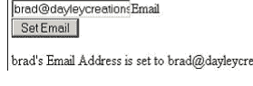

## 来自jQuery的AJAX

jQuery提供了封装函数，提供了更清晰的接口来发送AJAX请求。在jQuery中，XMLHttpRequest对象被jqXHR对象所取代，这是一个jQuery版本，包含了一些额外的方法来支持jQuery AJAX封装函数。以下是jQuery AJAX封装函数的列表：

- `.load(url [ , data ] [ , success(data, textStatus, jqXHR) ] )` — 此方法用于将数据从服务器直接加载到由jQuery对象表示的元素中。
- `.getScript (url [ , data ] [ , success(data, textStatus, jqXHR) ] )` — 此方法用于加载并立即执行一个JavaScript/jQuery脚本。
- `.getJSON(url [ , data ] [ , success(data, textStatus, jqXHR) ] )` — 此方法用于使用JSONP请求从不同域的服务器加载JSON格式的数据。
- `.get(url [ , data ] [ , success(data, textStatus, jqXHR) ] [ , dataType ] )` — 此方法用于向服务器发送通用的GET请求。
- `.post(url [, data ] [, success(data, textStatus, jqXHR) ] [, dataType ])` — 此方法用于向服务器发送通用的POST请求。

这些方法中的每一个都允许你指定请求的url。`.load()`方法将数据直接加载到由jQuery对象表示的元素中。`.get()`和`.post()`方法用于发送GET和POST请求。

data参数可以是一个字符串或一个基本的JavaScript对象。在下面的例子中，`obj`、`objString`和`formString`都是有效的data参数：

```
var obj = {"first":"Brad", "last":"Dayley"};
var objString = $.param(obj);
var formString = $("form").serialize();
```

你还可以指定服务器响应成功时执行的函数。例如，以下成功处理程序将`#email`元素的值设置为响应数据的值：

```
$.get("getEmail.php?first=Brad&last=Dayley", null,
  function (data, status, xObj){
    $("#email").html(data);
}));
```

`.get()`和`.post()`方法还允许你将`dataType`参数指定为字符串，如`"xml"`、`"json"`、`"script"`和`"html"`，该字符串用于格式化服务器响应数据的预期格式。例如，要指定响应类型为JSON，你可以使用：

```
$.get("getUser.php?first=Brad&last=Dayley", null, 
function (data, status, xObj){
    $("#email").html(data.email);
}), "json");
```

## 将HTML数据加载到页面元素中

```
$("#content").load("new.html");
```

向网页添加动态数据的一个好方法是让Web服务器提供已经格式化为HTML的数据。然后，使用jQuery的`.load()` AJAX方法，你可以将数据直接加载到一个元素中。

`.load()` AJAX方法可以从任何jQuery对象调用，它在后台执行一个AJAX get请求，格式化响应，并将其注入元素的innerHTML中。例如：

```
$("#content").load("new.html");
```

以下代码展示了一个使用`.load()`方法将lorem ipsum文章数据从Web服务器加载到现有`<div>`容器中的例子。图13.4展示了通过点击左侧的导航项加载不同文章：

```
01 <html>
02   <head>
03     <title>Python Phrasebook</title>
04     <meta charset="utf-8" />
05     <script type="text/javascript"
06       src="../js/jquery-2.0.3.min.js"></script>
07     <script>
08     function setArticle(){
09       $("#content").load($(this).attr(
10         "article")+".html");
11     }
12     $(document).ready(function(){
13       $(".navItem").click(setArticle);
14     });
15     </script>
16     <style>
17       div {display:inline-block; float:left;
18       text-align:center; }
19       .navItem { border:1px dotted; display:block;
20       margin:3px; cursor:pointer;}
21       #content {border:1px solid blue;}
22       #article { width: 372px; height:360px;
23       padding:10px;
24       overflow-y:scroll; border:1px solid;}
25       #title { font-size:20px; display:block;
26       background-color:black; color:white; }
27       p {background-color:#DDDDDD; border-radius:
28       5px; }
29     </style>
30     </head>
31     <body>
32       <div>
33         <div id="leftNav">
34           <span class="navItem" article="article1">
35             jQuery Under the Hood</span>
36           <span class="navItem" article="article2">
37             jQuery Your New Best Friend</span>
38         </div>
39         <div id="content">
40           <span id="title"></span>
41           <div id="article"></div>
42         </div>
43       </div>
44   </body>
45 </html>
```

ch1303.html

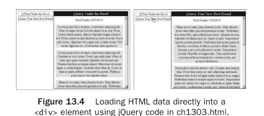

## 使用jQuery .get() AJAX请求处理JSON数据

```
$.get("getJSONData.php", myHandler);
function myHandler(data){
  var responseValue = data.value;
}
```

使用jQuery从服务器获取JSON数据非常简单。只需调用`.get(url, handler(data))`方法，传入服务器位置的url，并指定一个处理程序来处理数据。例如：

```
$.get("getJSONData.php", myHandler);
```

响应返回的JSON数据将是一个JSON对象，作为第一个参数传递给处理程序函数。你可以使用点语法访问数据；例如：

```
function myHandler(data){
    var responseValue = data.value;
}
```

展示如何处理带有JSON数据的`.get()`请求的最佳方式是给你一个例子。以下代码直接向一个JSON文件发出`.get()`请求，然后使用该数据构建图13.5所示的图像列表。

```
01 <html>
02   <head>
03   <title>Python Phrasebook</title>
04   <meta charset="utf-8" />
05   <script type="text/javascript"
06     src="../js/jquery-2.0.3.min.js"></script>
07   <script>
08     function updateImages(data){
09       for (i=0; i<data.length; i++){
10         var imageInfo =data[i];
11         var img = $('').attr("src",
12           "../images/"+imageInfo.image);
13         var title =
14            $("<p></p>").html(imageInfo.title);
15         var div = $("<div></div>").append(img,
16            title);
17         $("#images").append(div);
18       }
19     }
20     $(document).ready(function(){
21       $.get("images.json", updateImages);
22     });
23   </script>
24   <style>
25     div {border:3px ridge white; display:inline-
26            block;}
27   </style>
28   </head>
29   <body>
30     <div id="images"></div>
31   </body>
32 </html>
```


## 使用 jQuery `.get()` AJAX 请求处理 XML 数据

```javascript
$.get("getXMLData.php", myHandler);
function myHandler(data){
  var parks = $(data).find("park");
  parks.each(function(){
    var value = $(this).children("value").text();
  })
}
```

使用 jQuery 从服务器获取 XML 数据与使用 JSON 数据略有不同。你仍然调用 `.get(url, handler(data))` 方法，并传入服务器位置的 URL，然后指定一个处理程序来处理数据。例如：

```javascript
$.get("getXMLData.php", myHandler);
```

但是，响应返回的 XML 数据将是一个 DOM 对象，该对象作为第一个参数传递给处理函数。处理 DOM 对象的最佳方式是将其转换为 jQuery 对象，然后使用广泛的 jQuery 过滤和导航方法来获取你想要的数据。例如：

```javascript
function myHandler(data){
  var parks = $(data).find("park");
  parks.each(function(){
    var value = $(this).children("value").text();
  })
}
```

演示如何使用 XML 数据处理 `.get()` 请求的最佳方式是向你展示一个示例。以下代码直接向一个 XML 文件发出 `.get()` 请求，然后使用这些数据构建图 13.6 所示的图像列表。

```html
<html>
  <head>
    <title>Python Phrasebook</title>
    <meta charset="utf-8" />
    <script type="text/javascript"
          src="../js/jquery-2.0.3.min.js"></script>
    <script>
      function updateTable(data){
        var parks = $(data).find("park");
        parks.each(function(){
          var tr = $("<tr></tr>");
          tr.append($("<td></td>").html(
                  $(this).children("name").text()));
          tr.append($("<td></td>").html(
                  $(this).children("location").text()));
          tr.append($("<td></td>").html(
                  $(this).children("established").text()));
          var img = $('').attr("src",
                  "../images/"+$(this).children("image").text());
          tr.append($("<td></td>").append(img));
          $("tbody").append(tr);
        });
      }
      $(document).ready(function(){
        $.get("parkdata.xml", updateTable);
      });
    </script>
    <style>
      img {width:80px;}
      caption, th { background-color:blue;
        color:white;
        font:bold 18px arial black; }
      caption { border-radius: 10px 10px 0px 0px;
        font-size:22px; height:30px; }
      td { border:1px dotted; padding:2px; }
    </style>
  </head>
  <body>
    <table>
      <caption>Favorite U.S. National Parks</caption>
      <thead><th>Park</th><th>Location</th>
        <th>Established</th><th>&nbsp;</th></thead>
      <tbody></tbody>
    </table>
    <p></p>
  </body>
</html>
```

**ch1305.html**

```xml
<parkinfo>
  <park>
    <name>Yellowstone</name>
    <location>Montana, Wyoming, Idaho</location>
    <established>March 1, 1872</established>
    <image>bison.jpg</image>
  </park>
  <park>
    <name>Yosemite</name>
    <location>California</location>
    <established>March 1, 1872</established>
    <image>falls.jpg</image>
  </park>
  <park>
    <name>Zion</name>
    <location>Utah</location>
    <established>November 19, 1919</established>
    <image>peak.jpg</image>
  </park>
</parkinfo>
```

**XML 服务器响应**

### 美国最受欢迎的国家公园

| 公园 | 位置 | 建立时间 |
| :--- | :--- | :--- |
| 黄石公园 | 蒙大拿州，怀俄明州，爱达荷州 | 1872年3月1日 |
| 优胜美地 | 加利福尼亚州 | 1872年3月1日 |
| 锡安 | 犹他州 | 1919年11月19日 |

*图 13.6 使用 `.get()` AJAX 请求，通过 ch1305.html 中的 jQuery 代码将 XML 数据转换为表格。*

## 使用 jQuery `.post()` AJAX 请求更新服务器数据

```javascript
var params = [{name:"user",value:"Brad"},
        {name:"rating", value:"1"}]
$.post("setRating.php", params, myHandler);
```

使用 jQuery 通过 `.post()` 辅助方法向服务器发送数据非常容易，因为 `.post()` 会在后台处理所有必要的标头。你调用 `.post(url, params, handler(data))` 方法，传入服务器位置的 URL、参数字符串或对象。然后指定一个处理函数来处理数据。

如果你传入一个对象，它需要是一个包含 name 和 value 对的对象列表。例如：

```javascript
var params = [{name:"user",value:"Brad"},
        {name:"rating", value:"1"}]
$.post("setRating.php", params, myHandler);
```

处理函数的工作方式与 `.get()` 处理函数的工作方式相同。以下代码展示了使用 `.post()` 请求更新服务器上数据的示例。你需要关注的代码在第 31–39 行。该函数构建 params 数组，然后向服务器发送 `.post()` 请求，使用 PHP 脚本更新评分。

该 PHP 脚本修改用于构建图 13.7 所示数据的 JSON 文件。注意，在 `.post()` 请求的处理函数中，它会从服务器检索更新后的数据，并使用提交的值更新网页。

```html
<html>
  <head>
    <title>Python Phrasebook</title>
    <meta charset="utf-8" />
    <script type="text/javascript"
      src="../js/jquery-2.0.3.min.js"></script>
    <script>
      function addTrip(data){
        for (var idx in data){
          var item = data[idx];
          var div = $("<div></div>").attr("id",
            item.location);
          div.append($("</img>").attr("src",
            "../images/"+item.image).addClass
            ("photo"));
          div.append($("<span></span>").html(
            item.location));
          for(var i=0;i<parseInt(item.rating);i++){
            div.append($("</img>").attr("src",
              "../images/star.ico")).addClass("star");
          }
          for(var i=0;i<(5-parseInt(item.rating));i++){
            div.append($("</img>").attr("src",
              "../images/empty.ico")).addClass
              ("star");
          }
          $("#vacations").append(div);
        }
        $(".star").click(sendRating);
      }
      function getTrips(){
        $("#vacations").children().remove();
        $.get("trips.json", addTrip);
      }
      function sendRating(){
        var parent = $(this).parent();
        var rating = parent.children(".star").index($(this)) +1;
        var params = [{name:"location",
                       value:parent.attr("id")},
                      {name:"rating", value:rating}]
        $.post("setRating.php", params, getTrips);
      }
      $(document).ready(function(){
        getTrips();
      });
    </script>
    <style>
      #banner, #vacations { display:block;
        font-size:30px; width:500px;}
      div, span { display:inline-block;
        width:120px; text-align:center;}
      span { font-size:20px; }
      .photo { height:50px; border:5px ridge white;
        box-shadow: 10px 10px 5px #888888;
        margin:20px;
        border-radius:10px;}
      .star { border:none; height:auto; width:auto;}
    </style>
  </head>
  <body>
    <div><div id="banner">Vacations</div>
    <div id="vacations"></div>
  </body>
</html>
```

**ch1306.html**


向 setRating.php 发送 POST 数据

```json
[
  {"location":"Hawaii","image":"flower.jpg","rating":"4"},
  {"location":"Yosemite","rating":"4","image":"falls.jpg"},
  {"location":"Montana","rating":"5","image":"bison.jpg"},
  {"location":"Zion","rating":"5","image":"peak.jpg"}
]
```

### 假期


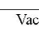
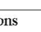
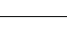

夏威夷

约塞米蒂

蒙大拿

锡安

★★★★☆

★★★★☆

★★★★★

★★★★★

图 13.7 使用 ch1306.html 中的 jQuery 代码，通过 `.post()` AJAX 请求更新服务器数据。

## 处理 jQuery AJAX 响应

```javascript
$.get("getUser.php?first=Brad&last=Dayley", null,
    function (data, status, xObj){
        alert("Request Succeeded");
    }, "json").fail(function(data, status, xObj){
        alert("Request Failed");
    }).always(function(data, status, xObj){
        alert("Request Finished");
    });
```

除了指定 success 选项外，包装器方法还允许你使用以下方法附加其他处理程序：

-   `.done(data, textStatus, jqXHR)`—当从服务器接收到成功响应时调用。
-   `.fail(data, textStatus, jqXHR)`—当从服务器接收到失败响应或请求超时时调用。
-   `.always(data, textStatus, jqXHR)`—当从服务器接收到响应时总是调用。

例如，以下代码在请求失败时添加一个要调用的事件处理程序：

```javascript
$.get("getUser.php?first=Brad&last=Dayley", null,
    function (data, status, xObj){
        $("#email").html(data.email);
    }, "json").fail(function(data, status, xObj){
        alert("Request Failed");
    });
```

为了在实际示例中说明这一点，以下代码在一个基本登录请求上实现了 .done()、.fail() 和 .always() AJAX 事件处理程序。登录页面将用户名和密码发送到服务器端的 PHP 脚本，该脚本检查是否为 username="user" 和 password="password"。如果输入了正确的用户名和密码，请求成功；否则，请求失败。所有三种类型的处理程序函数都会调用警报，如图 13.8 所示。

```html
<html>
  <head>
    <title>Python Phrasebook</title>
    <meta charset="utf-8" />
    <script type="text/javascript"
      src="../js/jquery-2.0.3.min.js"></script>
    <script>
      function failure(){ alert("Login Failed"); }
      function success(){ alert("Login Succeeded"); }
      function always(){ alert("Login Request\ndone"); }
      function login(){
        $.get("login.php",
          $("#loginForm").serialize()).done(
            success).fail(failure).always(always);
        return false;
      }
      $(document).ready(function(){
        $("#loginButton").click(login);
      });
    </script>
    <style>
      #login { border-radius: 15px; text-align:
        center;
        height:180px; width:250px; border:3px ridge
        blue;}
      #title { background-color:blue; color:white;
        border-radius:10px 10px 0px 0px;
        height:30px;}
    </style>
  </head>
  <body>
    <div id="login">
      <div id="title">Login</div>
      <form id="loginForm">
        Username:<br />
        <input type="text" name="user" /><br />
        Password:<br />
        <input type="password" name="password" />
        <br /><br />
        <input type="submit" id="loginButton" value="Login" />
      </form>
    </div>
  </body>
</html>
```

284 第 13 章 使用 AJAX 与 Web 服务器和 Web 服务通信

```html
        font:bold 22px arial black; }
  input { border-radius:10px; border:3px groove blue;
       margin-top:20px; padding-left:10px; }
  label { font:italic 18px arial black; }
  </style>
  </head>
  <body>
    <div id="login">
      <div id="title">Login</div>
      <form id="loginForm">
        <label>Username: </label>
        <input type="text" name="user" /><br>
        <label>Password: </label>
        <input type="password" name="pw" /><br>
        <input id="loginButton" type="button"
           value="Login" />
      </form>
    </div>
  </body>
</html>
```

ch1307.html

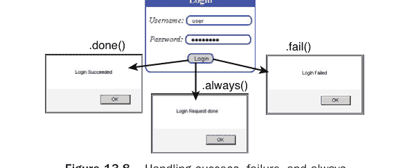

## 使用高级 jQuery AJAX

本章已涵盖的概念应能满足你大部分的 AJAX 需求。然而，它们远未涵盖 jQuery AJAX 接口的全部功能。以下部分讨论 jQuery 内置的一些其他 AJAX 功能。

### 更改全局设置

```javascript
$.ajaxSetup({url:"service.php", accepts:"json"})
```

jQuery 提供了 `.ajaxSetup()` 方法，允许你指定在脚本中配置所有 AJAX 请求的选项。表 13.2 列出了调用 `.ajaxSetup()` 时可以指定的一些选项。例如，以下代码设置了请求的默认全局 URL：

```javascript
$.ajaxSetup({url:"service.php", accepts:"json"})
```

### 使用全局事件处理程序

```javascript
$(document).ajaxStart(function(){
	$("form").addClass("processing");
});
$(document).ajaxComplete(function(){
	$("form").removeClass("processing");
});
```

jQuery 提供了创建全局事件处理程序的方法，这些处理程序在诸如所有 AJAX 请求的初始化或完成等事件上被调用。全局事件在每个 AJAX 请求上都会触发。表 13.2 列出了可用于注册全局事件处理程序的方法。

下面是一个使用全局事件处理程序设置表单类的示例：

```javascript
$("document").ajaxStart(function(){
    $("form").addClass("processing");
});
$("document").ajaxComplete(function(){
    $("form").removeClass("processing");
});
```

> **顺便提一下**
> 无论 global 的值如何，对于跨域脚本或 JSONP 请求，全局事件永远不会被触发。

表 13.2 jQuery 全局 AJAX 事件处理程序注册方法

| 方法 | 描述 |
| :--- | :--- |
| `.ajaxComplete (function)` | 注册一个在 AJAX 请求完全完成时调用的处理程序。 |
| `.ajaxError (function)` | 注册一个在 AJAX 请求失败时调用的处理程序。 |
| `.ajaxSend (function)` | 注册一个在发送 AJAX 请求之前执行的函数。 |
| `.ajaxStart (function)` | 注册一个在第一个 AJAX 请求开始时调用的处理程序。 |
| `.ajaxStop (function)` | 注册一个在所有 AJAX 请求完成时调用的处理程序。 |
| `.ajaxSuccess (function)` | 注册一个在任何 AJAX 请求成功完成时执行的函数。 |

### 实现底层 AJAX 请求

```javascript
$.ajax({
    url: "setEmail",
    type: "get",
    accepts: "json",
    contentType: "application/x-www-form-urlencoded;charset=UTF-8",
    data: {"first": "Brad", "last": "Dayley"}
}).fail(function(){ alert("request Failed"); });
```

你在本章中一直在使用的所有 AJAX 请求包装器方法，在底层都是通过 `.ajax(url [, settings])` 接口处理的。这个接口使用起来稍微复杂一些，但它为你提供了更大的灵活性和对 AJAX 请求的控制。

`.ajax()` 方法的调用方式与 `.get()` 和 `.post()` 相同，但 settings 参数允许你在发出请求时设置各种各样的设置。
表 13.3 列出了你可以应用于 `.ajax()` 方法的更常见的设置。

第 13 章 使用 AJAX 与 Web 服务器和 Web 服务通信

表 13.3 续表

| 方法/属性 | 描述 |
|---|---|
| `beforeSend` | 指定在发送请求之前应运行的函数。 |
| `complete` | 当响应完全接收时执行的函数。 |
| `contentType` | 设置随请求发送的内容类型。服务器使用内容类型来确定如何解析数据。 |
| `crossDomain` | 布尔值。允许你发送跨域请求，例如 JSONP。 |
| `data` | 指定随请求发送的数据负载。 |
| `error` | 指定如果请求失败时执行的函数。 |
| `headers` | 包含应发送到服务器的带值的头部的对象。例如：`{"Content-length": data.length}` |
| `success` | 如果响应返回 200 状态（表示请求成功）时执行的函数。 |
| `timeout` | 指定在放弃获取响应之前等待的毫秒数。 |
| `type` | 设置为 GET 或 PUT 以指定请求类型。 |
| `url` | 指定在 Web 服务器上发送请求的 URL。 |


### 表 13.4 .ajax() 返回的 jqXHR 对象的常用方法和属性

| 方法/属性 | 描述 |
| :--- | :--- |
| abort() | 中止请求。 |
| always(function) | 指定一个在请求完成（无论成功或失败）时调用的函数。 |
| done(function) | 指定一个在请求成功完成时调用的函数。 |
| fail(function) | 指定一个在请求失败时调用的函数。 |
| getAllResponseHeaders() | 返回响应中包含的所有头部信息。 |
| getResponseHeader(name) | 返回特定响应头的值。 |
| setRequestHeader(name, value) | 设置随 AJAX 请求发送的 HTTP 头的值。 |
| readyState | 值：1—尚未开始加载 2—正在加载 3—已加载足够内容，用户可与之交互 4—完全加载 |
| status | 包含服务器返回的响应状态码，例如 200 状态码表示请求成功。 |
| statusText | 包含服务器返回的状态字符串。 |

使用 `.ajax()` 接口的一个简单示例如下所示：

```
$.ajax({
    url:"setEmail",
    type:"get",
    accepts:"json",
    contentType: 'application/x-www-form-urlencoded;charset=UTF-8',
    data: {"first":"Brad", "last":"Dayley"}
}).fail(function(){ alert("request Failed"); });
```

`.ajax()` 方法返回一个 `jqXHR` 对象，该对象提供了一些额外的功能，尤其是在处理响应时。

# 第13章 使用 AJAX 与 Web 服务器和 Web 服务通信

# ## 使用 jQuery 实现移动网站

移动设备是增长最快的开发平台。其中大部分开发都致力于使网站对移动设备友好。用户期望获得移动设备提供的可移植性，同时也希望拥有传统网站已经实现的健壮性。

本章重点介绍如何使用 jQuery Mobile 库来帮助你开始创建一些简洁、炫酷的移动网页。jQuery Mobile 库功能强大。本章中的内容涵盖了基本结构、语法和概念，以帮助你实现更多种类的移动解决方案。

# ## jQuery Mobile 入门

jQuery Mobile 框架的大部分内容是通过为现有 HTML 元素扩展额外功能来构建的。jQuery Mobile 在 HTML 框架的基础上，通过向 HTML 元素添加数据属性来增强功能。

所有数据属性都以 `data-` 开头，并以描述该属性含义的简短词语结尾。jQuery Mobile 库中适合移动需求的额外方法、事件、样式和值都会附加到元素上。你将在接下来的示例中广泛看到这一点。

表 14.1 列出了许多属性以及它们支持的一些值。该表是可视化展示数据属性方法工作原理的好方法，也可以作为参考。

表 14.1 jQuery Mobile 中添加的一些数据属性

| 属性 | 描述 |
| --- | --- |
| data-role | 用于定义 HTML 在移动页面中扮演的角色，例如对话框、按钮或面板。 |
| data-mini | 如果设置为 true，则每个 UI 元素都会使用一个紧凑版本。 |
| data-theme | 指定渲染 UI 组件时使用的字母（a-z）。 |
| data-transition | 指定从一个页面/状态过渡到另一个页面/状态时使用的过渡效果，例如滑动（slide）或弹出（pop）。 |
| data-direction | 指定动画的方向，以便与过渡效果匹配。例如，返回页面时使用 reverse。 |
| data-rel | 定义元素与链接的关系。值包括 back、dialog、external 和 popup。 |
| data-title | 页面显示时显示的文本。 |
| data-icon | 指定附加到 HTML 元素的图标。可能的值有 home、delete、plus、arrow-u、arrow-d、check、gear、grid、star、custom、arrow-r、arrow-l、minus、refresh、forward、back、alert、info 和 search。 |
| data-iconpos | 指定图标附加到元素时的位置：left、right、top、bottom、notext。 |
| data-add-back-btn | 对于具有 `data-role="dialog"` 的项目，如果设置为 true，则会添加一个返回按钮。 |
| data-collapsed | 对于具有 `role="collapsible"` 的项目，指定状态是否为折叠。 |
| data-collapsed-icon | 定义 `role="collapsible"` 元素的折叠图标。 |
| data-expanded-icon | 定义 `role="collapsible"` 元素的展开图标。 |
| data-close-btn | 对于具有 `role="dialog"` 的项目，如果设置为 true，则会添加一个关闭按钮。 |

## 确定页面是否在移动设备上查看

```javascript
if( /Android|webOS|iPhone|iPad|iPod|BlackBerry/i.test(navigator.userAgent) ) {
    ... 这里是移动设备代码 ...
}
```

你可以使用以下 JavaScript 和正则表达式语句来解析 `navigator.userAgent` 的值，并判断用户是否正在通过移动设备访问你的网站：

```javascript
if( /Android|webOS|iPhone|iPod|BlackBerry/i.test(navigator.userAgent) ) { }
```

该语句解析 `userAgent` 属性，并尝试查找移动浏览器中最常见的字符串。

## 检测移动屏幕尺寸

```javascript
$("#contentBody").width(screen.width).height(screen.height);
```

在当今的移动世界中，用户是否在使用移动设备不再是关键问题。新的关键问题是：用户有多少屏幕空间可用？你需要检查设备的屏幕尺寸。它是 3 英寸、4 英寸还是 11 英寸的屏幕？差别很大。要获取屏幕尺寸，请在 JavaScript 中使用 `screen.height` 和 `screen.width`，然后动态调整你的页面以支持该尺寸。

## 指定不同的主题色板

```html
<div data-role="header" data-theme="b">
  <h1>教学</h1>
</div>
<a data-role="button" data-theme="a" src="next">下一步</a>
```

jQuery Mobile 附带的 CSS 文件包含几个称为色板的样式版本。*色板* 仅仅是一个字母赋值，用于指定渲染移动元素时使用的配色方案。色板通常使用 `data-theme` 属性来指定。例如：

```html
<div data-role="header" data-theme="b"><h1>教学</h1></div>
```

## 处理新的移动事件

```javascript
$("#myImage").on("swipeleft", function(e) {
    ... 向左滑动代码 ... });
$(document).on("pageLoad", function(e, data) {
    ... 页面加载代码 ... });
$(document).on("pagebeforechange", function(e, data) {
    var toPage = data.toPage;
    ... 页面变更代码 ... });
```

我最喜欢 jQuery Mobile 的功能之一就是实现移动事件非常简单。该库会根据数据属性自动创建事件并将其添加到元素上。如果你想添加或删除特定的移动事件，可以使用你已经熟悉的 jQuery 的 `.on()` 方法来完成。

例如，要为元素 `#myImage` 添加一个点击处理程序，你可以使用以下代码：

```javascript
$("#myImage").on("swipeleft", function() { });
```

表 14.2 列出了一些移动事件并描述了它们的用途。

表 14.2 jQuery Mobile 添加的新事件

| 事件 | 描述 |
| --- | --- |
| tap | 在快速触摸时触发。 |
| taphold | 在触摸保持超过阈值后触发。默认值为 750 毫秒。 |
| swipe | 由快速水平拖动触发。 |
| swipeleft | 由快速向左水平拖动触发。 |
| swiperight | 由快速向右水平拖动触发。 |
| orientationchange | 当设备方向从纵向变为横向或反之时触发。 |
| scrollstart | 在开始滚动时触发。 |
| scrollstop | 在滚动停止时触发。 |
| pagebeforeload | 在移动页面加载到 DOM 之前立即触发。 |
| pageload | 在移动页面加载到 DOM 之后触发。 |
| pagebeforechange | 在移动页面切换到不同页面之前立即触发。这两个页面可能在同一个 HTML 文档中。 |
| pagechange | 在移动页面切换到不同页面之后触发。 |
| pagebeforeshow | 在页面转换发生之前立即触发。该事件在新页面上触发。 |
| pageshow | 在页面转换发生之后触发。 |

jQuery移动框架包含的一个重要功能是能够触发和处理与页面切换和加载相关的事件。当你切换页面时，会触发以下事件：

-   pagebeforechange, pagechange, pagebeforeload, pageload, pageshow, pagehide

当你加载页面时，会触发以下事件：

-   pagebeforeload, pageload

这些事件允许你实现代码来处理新页面的过渡，并防止页面从服务器下载。这些事件被实现为标准的jQuery事件，并且传递给处理程序的对象包含诸如url、toPage、absUrl、dataUrl、xhr对象以及用于切换页面的选项。下面的代码展示了添加pageload事件处理程序的示例：

```
$(document).on("pageload", function(e, obj){
    if($("#pageThree .ui-content").length) {
        $("#pageThree .ui-content").append("Page loaded from "+ obj.url); }
});
```

顺便提一下，jQuery移动框架还包含几个虚拟鼠标事件，例如mask、mouse和touch事件，允许开发者只注册基本的鼠标事件。这些事件在大多数情况下运行良好，但仍然存在一些小问题。这些虚拟事件包括vmouseover、vmouseout、vmousedown、vmousemove、vmouseup、vmouseclick和vmousecancel。

## 使用jQuery代码切换页面

```
$("#pageTwo").on("swipeleft", function(){
  $.mobile.changePage("newPage.html", {transition:
  "slide", reverse:true});
});
```

jQuery提供了`$.mobile.changePage(URL, options)`方法来动态切换页面，其中URL是新页面的位置。表14.3列出了`.changePage()`调用的可用选项。以下代码是添加swipeleft事件处理程序的示例，当用户在设备上向左滑动页面时加载远程网页。注意，使用了"slide"过渡效果，并且reverse选项设置为true：

```
$("#pageTwo").on("swipeleft", function(){
  $.mobile.changePage("newPage.html", {transition:
  "slide", reverse:true});
});
```

| 方法 | 描述 |
|---|---|
| changeHash | 指定是否应更新地址栏中的哈希值。 |
| data | 随AJAX请求发送的对象或字符串数据。 |
| dataUrl | 更新浏览器位置时使用的URL。如果未指定，则使用data-url属性的值。 |
| pageContainer | 指定应包含页面的元素。 |
| reloadPage | 布尔值。如果页面已在DOM中，则从服务器重新加载页面。 |
| reverse | 布尔值。指定页面切换过渡运行的方向。 |
| role | 显示页面时使用的data-role值。 |
| showLoadMsg | 布尔值。指定是否应显示加载消息。 |
| transition | 显示页面时使用的过渡效果。 |
| type | 指定AJAX请求的方法："get"（默认）或"post"。 |

## 不显示页面地加载移动页面

```
$.mobile.loadPage("newPage.php", 
    {data: $("form").serialize(), type: "post"});
```

另一个有用的函数是`.loadPage(URL, options)`。它使用AJAX调用从Web服务器下载移动页面，但不将移动页面切换到下载的页面。实际上，`.changePage()`内部调用`.loadPage()`来检索页面。表14.3中列出的大多数选项也可通过`.loadPage()`使用，但changeHash、dataUrl、reverse和transition除外。

`.loadPage()`函数对于在初始化函数中预加载页面很有用，你希望这些页面稍后可用但暂时不显示。以下代码展示了使用POST数据从表单加载页面的示例：

```
$.mobile.loadPage("newPage.php",
    {data: $("#form").serialize(), type: "post"});
```

## 定义Viewport Meta标签

```
<meta name="viewport" content="width=device-width,
initial-scale=1">
```

使用jQuery移动框架的一个关键组件是在页面的`<head>`标签内添加viewport设置的`<meta>`标签。viewport定义了浏览器如何显示页面的缩放级别和使用的尺寸。

具体来说，你需要将content设置为"width=device-width, initial-scale=1"，如以下所示。这些设置强制设备的浏览器以设备上可用的精确像素数渲染网页宽度：

```
<meta name="viewport" content="width=device-width,
initial-scale=1">
```

如果不指定viewport设置，移动页面的尺寸会远大于屏幕宽度，导致页面看起来很小。用户仍然可以缩放网页。

## 配置jQuery移动框架默认设置

```
<script src="../js/jquery-2.0.3.min.js"></script>
<script>
    $(document).bind("mobileinit", function () {
        $.mobile.page.prototype.options.headerTheme = "b";
        $.mobile.page.prototype.options.footerTheme = "b";
    });
</script>
<script src="../js/jquery.mobile-custom.min.js"></script>
```

jQuery移动框架在库加载时初始化。所有带有jQuery移动标签的页面元素也会被初始化，并使用默认设置来创建元素的移动版本。

有时，你可能想要覆盖默认设置。为此，你需要在加载jQuery移动库之前，向document对象添加一个`mobileinit`事件处理程序。然后你可以在该处理函数中添加你的默认覆盖代码。

我主要使用`mobileinit`处理程序来更改默认主题样式，因为这在库加载后无法动态完成。以下代码展示了设置默认页眉和页脚主题的示例：

```
<script src="../js/jquery-2.0.3.min.js"></script>
<script>
  $(document).bind("mobileinit", function () {
    $.mobile.page.prototype.options.headerTheme = "b";
    $.mobile.page.prototype.options.footerTheme = "b";
  });
</script>
<script src="../js/jquery.mobile-custom.min.js"></script>
```

注意，初始化的`<script>`标签放置在jQuery加载之后，但在jQuery移动库加载之前。

## 构建移动页面

创建移动页面实际上很简单。页面由`<div>`元素组成，这些元素在jQuery移动框架中通过前一章讨论的数据标签进行增强。本节重点介绍使用数据标签定义移动网页。

### 创建移动网页

```
<div data-role="page">
  <div data-role="header"><h1>Header</h1></div>
  <div data-role="content" id="content">
    <p>Images</p>
    
  </div>
  <div data-role="footer"><h4>Footer</h4></div>
</div>
```

移动页面由三个主要部分组成：页眉、页脚以及它们之间的内容。这三个部分不一定是必需的，但至少有一个包含内容的页眉是个好主意，尤其是在处理多个页面时。

所有这些元素都是通过向`<div>`元素添加data-role属性来定义的。`<div>`元素内的内容几乎可以是任何东西，包括文本、图像、表单和列表。

以下代码展示了创建一个简单的移动网页的示例，包含页眉、页脚以及文本和图像内容。图14.1展示了该网页的外观：

```html
<html>
<head>
  <title>Python Phrasebook</title>
  <meta charset="utf-8" />
  <meta name="viewport" content="width=device-
      width, initial-scale=1">
  <script src="../js/jquery-
      2.0.3.min.js"></script>
  <script src="../js/initmobile.js"></script>
  <script
      src="../js/jquery.mobile-
      custom.min.js"></script>
  <link rel="stylesheet"
      href="../js/css/jquery.mobile-
      custom.min.css" />
  <script>
    $(document).ready(function() {
      checkForMobile();
    });
  </script>
  <style>
    p { text-align:center; font:italic 45px
        Helvetica;
      color:blue; margin:5px; }
  </style>
</head>
<body>
<div data-role="page">
  <div data-role="header">
    <h1>My Title</h1>
  </div>
  <div data-role="content">
    <p>
      Some content here
    </p>
    
  </div>
  <div data-role="footer">
    <h4>My Footer</h4>
  </div>
</div>
</body>
</html>
```


# 第14章 使用jQuery实现移动网站

```html
21     img { width:235px; }
22     </style>
23   </head>
24   <body>
25     <div id="border"><div id="frame"><div data-role="page">
26       <div data-role="header"><h1>Header</h1></div>
27       <div data-role="content" id="content">
28         <p>Yosemite</p>
29         <p>Falls</p>
30         
31       </div>
32       <div data-role="footer"><h4>Footer</h4></div>
33     </div></div></div>
34   </body>
35   </html>
```

ch1401.html

请注意，每个组件的 `data-role` 属性都有一个不同的值。图14.1展示了生成的移动网页。

### 顺便说明

本章包含的所有移动示例都在 HTML 的 `<body>` 中包含 `<div id="border"><div id="frame">` 元素，并在 jQuery 代码中调用了 `checkForMobile()`。`checkForMobile()` 的代码位于我创建的 `initmobile.js` 包含文件中。它为非移动浏览器设置了这些元素的样式，以便显示一个手机图像作为背景。我用这个来为本章捕获图像。我也在移动开发中使用这个概念，因为这样我可以在开发浏览器中看到效果。然后我在实际设备上进行测试。

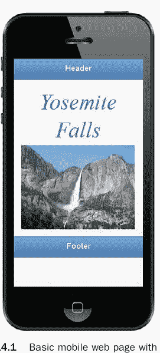

图14.1 来自 ch1401.html 的、包含页眉、页脚以及带有文本和图像内容区域的基础移动网页。

## 创建固定页眉和页脚

```html
<div data-role="header" data-position="fixed">
    <h1>Header</h1></div>
...
<div data-role="footer" data-position="fixed">
    <h4>Footer</h4></div>
```

默认情况下，页眉和页脚都随内容滚动，这意味着如果你上下滚动内容，页眉也会随内容滚动。通常，你希望页眉、页脚或两者都固定在设备屏幕的某个位置，使其始终显示。jQuery Mobile 使得这种调整变得简单。

要使页眉、页脚或工具栏固定，你只需向 `<div>` 添加 `data-position="fixed"` 属性。这会使它们保持固定位置，页眉在页面顶部，页脚在页面底部，无论内容如何滚动。

## 实现包含多页面的移动网站

移动网站可以由一个包含多个 `<div data-role="page">` 元素的 HTML 文档组成，或者由多个包含这些元素的 HTML 文档组成。每个 `<div>` 元素代表一个单独的移动页面。

在移动网站中使用多页面时，你需要实现代码和 UI 控件，为用户提供从一个移动页面过渡到另一个移动页面的方式。过渡效果应该基于控件和内容交互，做到流畅且直观。

你可以通过两种方法之一从第一页链接到第二页来更改移动页面：添加导航按钮或在 jQuery 代码中编程方式更改页面。

页面可以来自同一网页中的 `<div>` 元素，也可以是下载到设备的外部 URL。以下描述了实现多页面移动网站的方法。

### 添加导航按钮

```html
<a href="#page2" data-role="button">Page2</a>
<a href="hour2201-page3.html" data-role="button">Page</a>
```

导航按钮是链接到其他移动页面的链接。通常，导航按钮被添加到页眉或页脚元素中，以便于查看。不过，你也可以将它们放在移动内容内部。

通过向 `<a>` 链接添加 `data-role="button"` 属性来创建导航按钮。`href` 属性应指向你想要切换到的移动页面的哈希标签或 URL。以下代码显示了将 `<a>` 标签定义为本地链接导航链接的语法：

```html
<a href="#page2" data-role="button">Page2</a>
```

以下代码显示了将 `<a>` 标签定义为远程链接导航链接的语法：

```html
<a href="hour2201-page3.html"
data-role="button">Page3</a>
```

### 定位导航按钮

```html
<a href="#page3" data-role="button" class="ui-btn-right">Next</a>
<a href="#page1" data-role="button" class="ui-btn-left">Prev</a>
```

你可以通过向 `<a>` 添加 `.ui-btn-right` 或 `.ui-btn-left` 类，将按钮定位在页眉或页脚的左侧或右侧。这会应用 jQuery Mobile CSS 样式，将按钮定位在页眉或页脚的右侧或左侧。

### 添加页面切换过渡效果

```html
.... 在HTML中 ...
<a data-role="button" data-transition="slide">Next</a>
<a data-role="button" data-transition="slide"
data-direction="reverse">Prev</a>
... 在jQuery中 ...
$.mobile.changePage("#next", {transition:"slide" });
});
$.mobile.changePage("#prev", {transition:"slide",
reverse:true }); });
```

通过向触发过渡的 `<a>` 链接或其他元素添加 `data-transition` 属性，可以为页面切换添加过渡效果。如果你调用 `.changePage()`，也可以在选项元素中指定过渡。例如：

```html
<a data-role="button" data-transition="slide">Next</a>
```

或

```javascript
$.mobile.changePage("#next", {transition:"slide" });
});
```

你还可以反转过渡方向，这在你希望屏幕看起来像是向后滚动回上一页时特别有用。

要更改过渡方向，可以在 `<a>` 标签中使用 `data-direction="reverse"`，或者在 `.changePage()` 选项中添加 `reverse:true`。例如：

```html
<a data-role="button" data-transition="slide" data-direction="reverse">Prev</a>
```

或

```javascript
$.mobile.changePage("#prev", {transition:"slide", reverse:true }); });
```

### 创建返回按钮

```html
<a data-rel="back" data-role="button" class="ui-btn-right">Next</a>
```

jQuery Mobile 中包含的另一个有用功能是能够将导航按钮定义为返回按钮。返回按钮使用浏览器历史记录导航到上一个移动页面。要将链接定义为返回按钮，你需要添加 `data-rel="back"` 属性。例如：

```html
<a data-rel="back" data-role="button" class="ui-btn-right">Next</a>
```

请注意，这里没有 `href` 属性。这是因为 `href` 属性会被忽略；相反，最近的 URL 将从浏览器的导航历史列表中弹出。

### 使用滑动事件处理器切换页面

```javascript
$("#image").on("swipe", function(){
    . . . 此处为滑动代码 . . .
});
$("#pageTwo").on("swipeleft", function(){
    $.mobile.changePage("#page3",
        {transition:"slide"}); });
$("#pageTwo").on("swiperight", function(){
    $.mobile.changePage("#page1", {transition:"slide",
        reverse:true}); });
```

第二种方法是使用 `$.mobile.changePage(URL, options)` 函数调用，其中 URL 是链接位置。表14.3显示了 `.changePage()` 调用的可用选项。

以下是一个添加 `swipeleft` 事件处理器的示例，当用户在设备上向左滑动页面时，会加载一个远程网页。请注意，使用了 "slide" 过渡效果，并且 reverse 选项设置为 true，以使过渡效果向左滑动：

```javascript
$("#pageTwo").on("swipeleft", function(){
    $.mobile.changePage("#page3", {transition:"slide",
        reverse:true}); });
```

以下是一个添加 `swiperight` 事件处理器的示例，当用户在设备上向右滑动页面时，会加载一个远程网页。请注意，使用了 "slide" 过渡效果，但未设置 reverse 选项：

```javascript
$("#pageTwo").on("swiperight", function(){
    $.mobile.changePage("#page1", {transition:"slide"
        }); });
```

### 添加导航按钮和滑动事件示例

以下代码展示了实现导航按钮和滑动事件以在三个不同页面间遍历的完整示例。第14-27行的代码实现了滑动事件处理器，它们调用带有过渡效果的 `.changePage()` 来处理手指滑动。第38-47行实现了第一个移动页面，第48-59行实现了第二个移动页面，第60-68行实现了第三个。每个页面的页眉中都有一两个导航按钮。图14.2展示了这个多页面应用：

```html
01 <html>
02   <head>
03     <title>Python短句手册</title>
04     <meta charset="utf-8" />
05     <meta name="viewport" content="width=device-width,
06           initial-scale=1">
07     <script src="../js/jquery-2.0.3.min.js"></script>
08     <script src="../js/initmobile.js"></script>
09     <script
10       src="../js/jquery.mobile-custom.min.js"></script>
11     <link rel="stylesheet"
12           href="../js/css/jquery.mobile-custom.min.css" />
13     <script>
14       $(document).ready(function() {
15         checkForMobile();
16         $("#page1").on("swipeleft", function(){
17           $.mobile.changePage("#page2",
18             {transition:"slide"}); });
```


## 14.3 实现列表视图

组织移动内容最常见的方式之一是使用列表视图。列表视图将内容组织成可滚动、可链接的列表，便于查看和导航。jQuery Mobile 在提供框架以方便在代码中实现列表视图方面做得非常出色。

### 14.3.1 创建基本列表视图

最简单的列表视图是通过将 `data-role="listview"` 添加到 `<ul>` 元素来创建的。这会使 jQuery Mobile 以标准的移动端外观和感觉来渲染列表。

```html
<ul data-role="listview">
  <li><a href="#page1">Page 1</a></li>
  <li><a href="#page2">Page 2</a></li>
  <li><a href="#page3">Page 3</a></li>
</ul>
```

### 14.3.2 向列表项添加图标

你可以通过将 `` 元素添加到 `<li>` 内部，或者使用 `data-icon` 属性来为列表项添加图标。

```html
<ul data-role="listview">
  <li data-icon="home"><a href="#page1">Page 1</a></li>
  <li data-icon="star"><a href="#page2">Page 2</a></li>
  <li data-icon="gear"><a href="#page3">Page 3</a></li>
</ul>
```

### 14.3.3 创建拆分按钮列表视图

拆分按钮列表视图允许你在每个列表项中设置两个独立的点击目标。这对于像“删除”或“编辑”这样与列表项主要操作分开的操作非常有用。

```html
<ul data-role="listview">
  <li>
    <a href="#page1">Page 1</a>
    <a href="#page1-edit" data-role="button" data-icon="gear">Edit</a>
  </li>
  <li>
    <a href="#page2">Page 2</a>
    <a href="#page2-edit" data-role="button" data-icon="gear">Edit</a>
  </li>
</ul>
```

### 14.3.4 创建可搜索的列表视图

你可以通过将 `data-filter="true"` 添加到 `<ul>` 元素来为列表视图添加搜索过滤器。这会在列表顶部添加一个搜索框，允许用户过滤列表项。

```html
<ul data-role="listview" data-filter="true">
  <li><a href="#page1">Page 1</a></li>
  <li><a href="#page2">Page 2</a></li>
  <li><a href="#page3">Page 3</a></li>
</ul>
```

### 14.3.5 创建带分隔符的列表

你可以通过添加分组分隔符到列表视图，将列表项组织成多个部分。这可以通过添加 `<li data-role="list-divider">` 元素来实现。

```html
<ul data-role="listview">
  <li data-role="list-divider">Section 1</li>
  <li><a href="#page1">Page 1</a></li>
  <li><a href="#page2">Page 2</a></li>
  <li data-role="list-divider">Section 2</li>
  <li><a href="#page3">Page 3</a></li>
  <li><a href="#page4">Page 4</a></li>
</ul>
```

### 14.3.6 创建计数气泡

你可以通过在 `<a>` 元素内添加一个带有 `ui-li-count` 类的 `<span>` 元素，为列表项添加一个计数气泡，以显示项目或消息的数量。

```html
<ul data-role="listview">
  <li>
    <a href="#page1">
      Page 1
      <span class="ui-li-count">5</span>
    </a>
  </li>
  <li>
    <a href="#page2">
      Page 2
      <span class="ui-li-count">10</span>
    </a>
  </li>
</ul>
```

### 14.3.7 创建只读列表视图

只读列表视图用于显示非交互式信息。这可以通过将 `data-role="listview"` 添加到 `<ul>` 元素，并且 `<li>` 元素内不包含任何 `<a>` 元素来实现。

```html
<ul data-role="listview">
  <li>Item 1</li>
  <li>Item 2</li>
  <li>Item 3</li>
</ul>
```

### 14.3.8 创建嵌套列表视图

嵌套列表视图用于创建层级列表。这可以通过在 `<li>` 元素内添加一个 `<ul>` 元素来实现。

```html
<ul data-role="listview">
  <li>
    <a href="#page1">Page 1</a>
    <ul data-role="listview">
      <li><a href="#page1a">Page 1a</a></li>
      <li><a href="#page1b">Page 1b</a></li>
    </ul>
  </li>
  <li>
    <a href="#page2">Page 2</a>
    <ul data-role="listview">
      <li><a href="#page2a">Page 2a</a></li>
      <li><a href="#page2b">Page 2b</a></li>
    </ul>
  </li>
</ul>
```


列表视图的应用因其中所包含的数据量和类型而有很大差异。为此，jQuery 提供了多种不同类型的列表。以下部分将介绍最常用的几种。

> **请注意！**

如果你在 jQuery 代码中动态地向列表、表格等添加项目，你需要在该元素上调用 `refresh()` 方法，以使用 jQuery Mobile 刷新内容。

## 创建基本列表视图

```
<ul data-role="listview">
    <li><a href="#one">链接 1</a></li>
    <li><a href="#two">链接 2</a></li>
    <li>不可链接的项目</li>
</ul>
```

通过在 `<ul>` 或 `<ol>` 元素上添加 `data-role="listview"` 来创建列表。jQuery 会自动处理将 `<li>` 元素格式化为列表形式。对于 `<ol>` 元素，格式化后的列表视图会包含每个列表项的编号。

## 使用嵌套列表

```
<ul data-role="listview" >
    <li>霍比特人<ul><li>弗罗多</li><li>山姆</li>
        <li>比尔博</li></ul></li>
    <li>精灵<ul><li>莱戈拉斯</li><li>埃尔隆德</li>
        <li>加拉德瑞尔</li></ul></li>
    <li>人类<ul><li>阿拉贡</li><li>博罗米尔</li>
        <li>希优顿</li></ul></li>
</ul>
```

嵌套列表是通过在列表视图内部嵌套额外的 `<ul>` 元素来创建的。jQuery Mobile 会自动检测这一点，并为子列表构建可链接的页面。以下代码展示了实现嵌套列表的示例，如图 14.5 所示：

```
<html>
  <head>
    <title>Python 短语手册</title>
    <meta charset="utf-8" />
    <meta name="viewport" content="width=device-width, initial-scale=1">
    <script src="../js/jquery-2.0.3.min.js"></script>
    <script src="../js/initmobile.js"></script>
    <script src="../js/jquery.mobile.js"></script>
    <link rel="stylesheet" href="../js/css/jquery.mobile.css" />
  <script>
    $(document).ready(function() {
      checkForMobile();
    });
  </script>
</head>
<body>
  <div id="border"><div id="frame"></div></div>
  <div data-role="page" id="nested">
    <div data-role="header"><h1>嵌套列表</h1></div>
    <div data-role="content">
      <ul data-role="listview">
        <li>霍比特人<ul><li>弗罗多</li><li>山姆</li>
          <li>比尔博</li></ul></li>
        <li>精灵<ul><li>莱戈拉斯</li><li>埃尔隆德</li>
          <li>加拉德瑞尔</li></ul></li>
        <li>人类<ul><li>阿拉贡</li><li>博罗米尔</li>
          <li>希优顿</li></ul></li>
      </ul></div></div>
  </div></div>
</body>
</html>
```

ch1404.html

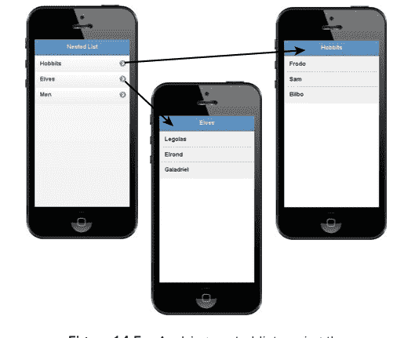

**图 14.5** 应用 ch1404.html 中 jQuery Mobile 代码实现的嵌套列表。

## 实现分段按钮列表

```
<ul data-role="listview">
  <li><a href="#">Jeep</a><a href="#" data-icon="star">喜欢</a></li>
  <li><a href="#">Ford</a><a href="#" data-icon="star">喜欢</a></li>
  <li><a href="#">Chevy</a><a href="#" data-icon="star">喜欢</a></li>
</ul>
```

分段按钮列表是在每一行中包含多个选项的列表。这在各种情况下都很有用。例如，在列出待售产品时，主要部分可以链接到详细信息，次要链接可以将商品添加到购物车。要创建分段按钮列表，请在 `<li>` 项目中创建两个 `<a>` 元素。

## 向列表添加分隔符

```
<ul data-role="listview" >
  <li data-role="list-divider">数字</li>
  <li>1</li><li>2</li><li>3</li>
  <li data-role="list-divider">字母</li>
  <li>A</li><li>B</li><li>C</li>
</ul>
. . .
<ul data-role="listview" data-autodividers="true">
  <li>Alex</li><li>Alice</li><li>Brad</li><li>DaNae</li><li>David</li>
  <li>Isaac</li><li>Jordan</li><li>Nancy</li>
</ul>
```

带分隔符的列表是指列表中的项目之间由一个简单的横条隔开。其目的是通过分割视图，使用户更容易查看列表项。

你可以通过手动注入分隔符并向其中一个 `<li>` 元素添加 `data-role="list-divider"` 来创建带分隔符的列表。例如：

```
<ul data-role="listview" >
    <li data-role="list-divider">数字</li>
    <li>1</li><li>2</li><li>3</li>
    <li data-role="list-divider">字母</li>
    <li>A</li><li>B</li><li>C</li>
</ul>
```

你也可以通过向 `<ul>` 元素添加 `data-autodividers="true"` 来自动添加分隔符。这会在第一个字符发生变化时分割项目，并为该字母创建一个分隔符。例如，以下代码添加了一个自动分隔符：

```
<ul data-role="listview" data-autodividers="true">
    <li>Alex</li><li>Alice</li><li>Brad</li><li>Danae</li><li>David</li>
    <li>Isaac</li><li>Jordan</li><li>Nancy</li>
</ul>
```

## 实现可搜索列表

```
<ul data-role="listview" data-filter="true">
    <li>罗马</li><li>米兰</li><li>佛罗伦萨</li><li>热那亚</li><li>威尼斯</li>
    <li>那不勒斯</li><li>巴隆加</li><li>巴里</li><li>都灵</li><li>巴勒莫</li>
</ul>
```

另一个有用的功能是可搜索列表。jQuery Mobile 内置了一个很好的搜索功能，允许你搜索当前列表。该功能会在列表顶部添加一个文本输入框，并在你输入文本时过滤项目。只有与过滤文本匹配的项目才会显示。

通过向包含列表的 `<ul>` 元素添加 `data-filter="true"` 来创建可搜索列表。例如，以下代码添加了一个可搜索列表：

```
<ul data-role="listview" data-filter="true">
    <li>罗马</li><li>米兰</li><li>佛罗伦萨</li><li>热那亚</li><li>威尼斯</li>
    <li>那不勒斯</li><li>巴隆加</li><li>巴里</li><li>都灵</li><li>巴勒莫</li>
</ul>
```

## 使用可折叠区块和集合

```
<div data-role="collapsible" data-collapsed="false">
    <h3>图片信息</h3>
    <p>单张内容。</p>
</div>
<div data-role="collapsible-set">
    <div data-role="collapsible">
        <h3>图片 1</h3></div>
    <div data-role="collapsible" >
        <h3> 图片 2</h3></div>
    <div data-role="collapsible">
        <h3> 图片 3</h3></div>
</div>
```

另一种呈现内容的有用方式是将其划分为可折叠元素。会呈现一个标题供用户查看，但标题所代表的内容在被点击之前是隐藏的。这允许你以内联方式显示和隐藏内容，而不是链接到另一个页面。可折叠元素可以表示为一个独立区块或一组相连的区块。

要创建一个可折叠项目，你只需向 `<div>` 元素添加 `data-role="collapsible"`。该 `<div>` 元素需要有一个标题，以便在折叠时在栏中显示。要将项目分组，请在 `<div data-role="collapsible-set">` 元素内添加多个 `<div data-role="collapsible">` 元素。

要强制一个项目处于展开状态，请添加 `data-collapsed="false"`。这将初始状态设置为展开，尽管你仍然可以通过点击标题来折叠和展开它。

此外，你可以使用 `data-theme` 定义标题和 `data-content-theme` 定义折叠内容，来控制用于渲染可折叠集合的主题。

## 向面板添加辅助内容

```
<div data-role="panel" id="config"
    data-position="right" data-display="reveal">
    <div data-role="header" data-theme="a">
        <h3>面板</h3></div>
    <h3>设置</h3>
    <label for="Option1">选项 1</label>
    <input type="checkbox" id="Option1"></input>
    <label for="Option2">选项 2</label>
    <input type="checkbox" id="Option2"></input>
    <a data-role="button" data-icon="delete"
        data-rel="close" data>关闭配置</a>
</div>
```

呈现不一定属于页面部分但相关的数据的有用方法是面板。面板类似于页面，但位于左侧或右侧。打开时，面板会显示附加信息。

面板使用 `data-role="page"` 定义，并且必须与移动页面内的头部、内容和页脚元素是同级关系。面板通过链接到 id 值来打开，类似于打开一个新页面。当链接被点击时，面板会使用以下三种显示模式之一进行显示：

- **data-display="overlay"**—面板元素以透明背景覆盖现有页面。
- **data-display="push"**—面板内容在显示时会“推动”现有页面。
- **data-display="reveal"**—面板位于当前页面下方，随着当前页面滑动而显示。

面板使用 `data-position="right"` 或 `data-position="left"` 定位。打开时，它会随页面滚动。你可以使用 `data-position-fixed="true"` 强制固定位置，在这种情况下，面板内容相对于屏幕而非滚动位置显示。

要关闭面板，请添加一个链接按钮，并设置其 `<a data-rel="closed">` 属性指向面板页面。你也可以从 jQuery 代码中使用以下方式关闭面板：

```
$( "#panelId" ).panel( "close" );
```


## 处理弹出窗口

```html
<div data-role="panel" id="config"
    data-position="right" data-display="reveal">
    <div data-role="header" data-theme="a">
        <h3>Panel</h3></div>
    <h3>Settings</h3>
    <label for="Option1">Option 1</label>
    <input type="checkbox" id="Option1"></input>
    <label for="Option2">Option 2</label>
    <input type="checkbox" id="Option2"></input>
    <a data-role="button" data-icon="delete"
        data-rel="close" data>Close Config</a>
</div>
```

在实现移动页面内容时，你最得力的助手之一就是弹出窗口。弹出窗口与面板不同，它可以显示在当前视图页面的任意位置。这使你能够添加额外的辅助信息，用户只需轻松点击即可查看。

弹出窗口通过 `data-role="popup"` 定义，可以放置在移动页面内容的任何位置。弹出窗口也通过链接到 `<div data-role="popup">` 标签的 ID 值来打开。但是，你必须在链接到弹出窗口的 `<a>` 标签上添加一个 `data-rel="popup"`。你也可以使用以下 jQuery 代码手动打开弹出窗口：

```javascript
$("#popupId").popup();
```

弹出窗口的位置使用 `data-position-to` 属性进行设置，该属性可以设置为 `window`、`origin` 或某个元素的 `#id`。jQuery Mobile 会尝试将弹出窗口居中显示在该元素上方。

要关闭弹出窗口，只需点击页面上弹出窗口以外的任何位置。此外，你可以通过添加 `data-rel="back"` 属性，为弹出窗口的 `<div>` 添加一个关闭按钮。例如，以下代码添加了一个关闭按钮，并指定了删除图标和 `notext`：

```html
<a href="#" data-rel="back" data-role="button" data-theme="a"
    data-icon="delete" data-iconpos="notext"
    class="ui-btn-right">Close</a>
```

以下示例展示了如何创建一个链接到照片弹出窗口的弹出菜单，如图 14.6 所示。需要注意的一点是，图片弹出窗口有一个 `class="photopopup"`。这提供了用于设置图片弹出窗口容器样式的类。

```html
<html>
  <head>
    <title>Python Phrasebook</title>
    <meta charset="utf-8" />
    <meta name="viewport" content="width=device-width,
            initial-scale=1">
    <script src="../js/jquery-2.0.3.min.js"></script>
    <script src="../js/initmobile.js"></script>
    <script src="../js/jquery.mobile.js"></script>
    <link rel="stylesheet"
          href="../js/css/jquery.mobile.css" />
    <script>
      $(document).ready(function() {
          checkForMobile();
      });
    </script>
    <style>
      .photopopup img { width:220px; }
      #menu-popup {width:200px; }
    </style>
  </head>
  <body>
<div id="border"><div id="frame">
<div data-role="page" id="pageOne">
<div data-role="header"><h1>Popups</h1></div>
<div data-role="content">
<a data-role="button" href="#menu" data-rel="popup"
id="menuLink">Popup Menu</a>
<div data-role="popup" id="menu"
data-position-to="#menuLink">
<ul data-role="listview">
<li><a href="#photo1" data-rel="popup"
id="imageLink">Image 1</a></li>
<li><a href="#photo2" data-rel="popup"
id="imageLink">Image 2</a></li>
</ul></div>
<div data-role="popup" id="photo1"
data-position-to="window" class="photopopup">
<a href="#" data-rel="back" data-role="button"
data-icon="delete" data-iconpos="notext"
class="ui-btn-right">Close</a>
</div>
<div data-role="popup" id="photo2"
data-position-to="window" class="photopopup">
<a href="#" data-rel="back" data-role="button"
data-icon="delete" data-iconpos="notext"
class="ui-btn-right">Close</a>
</div>
</div>
</div></div>
</body>
</html>
```

`ch1405.html`

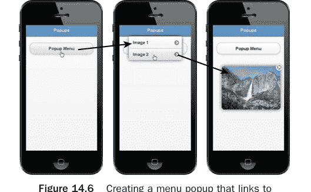

图 14.6 使用 `ch1405.html` 中的 jQuery Mobile 代码创建了一个链接到照片弹出窗口的菜单弹出窗口。

## 构建移动友好的表格

```html
<table data-role="table" data-mode="reflow"
    id="parkTable">
...
<table data-role="table" data-mode="columntoggle"
    id="parkTable">
<thead><tr><th>Park</th>
    <th data-priority="1">State</th>
    <th data-priority="2">Est.</th>
    <th data-priority="3">Photo</th></tr>
</thead>
<tbody>
<tr><td>Yellowstone</td><td>MT</td><td>1872</td>
    <td></td></tr>
<tr><td>Yosemite</td><td>CA</td><td>1872</td>
    <td></td></tr>
<tr><td>Zion</td><td>UT</td><td>1919</td><td>
    </td></tr>
</tbody>
</table>
```

jQuery Mobile 为 `<table>` 标签添加了 `data-mode` 属性，以实现移动友好的表格。实现移动友好表格有两种主要方式。第一种是减少显示的列数，第二种是将行折叠成列集，以便它们可以垂直堆叠。这是通过在 `<table>` 标签上添加 `data-role="table"` 和 `data-mode="reflow"` 来实现的。表格中的单元格会重新定位，以便与页面其余部分自然流动。在 reflow 模式下，当表格宽度为 2 列时，列会被拆分成独立的单元格，并垂直堆叠。然后，列的标题会作为标签添加到单元格中，使得每个单元格左侧都包含列标题以标识其值。

第二种解决方案是在 `<table>` 标签上添加 `data-mode="column-toggle"`。这为用户提供了一个弹出菜单，使用户可以启用/禁用要显示的列。在 columntoggle 模式下，可通过在 `<thead>` 元素第一个 `<tr>` 的 `<th>` 项上添加 `data-priority=#` 属性来指定可以启用/禁用的列。没有 `data-priority` 的列无法被禁用。`data-priority` 的 `#` 值范围从 1（最高）到 6（最低）。

## 创建移动表单

jQuery Mobile 为元素引入了多个属性，用于扩展和定义其行为以支持移动设备。表 14.4 列出了你在实现移动表单时需要熟悉的一些属性。此列表并非详尽无遗。

表 14.4   表单元素的 jQuery Mobile 数据属性

| 属性 | 描述 |
|---|---|
| `data-role="fieldcontain"` | 允许将多个表单元素样式化为一个单一组。 |
| `data-role="controlgroup"` | 允许你将按钮分组为一个类似于导航栏的单一区块。 |
| `data-type` | 指定 controlgroup 中的项目应组织为“垂直”还是“水平”。 |
| `data-corners="true"` | 为元素添加圆角半径。 |
| `data-icon` | 指定要添加到元素的图标：home、delete、plus、arrow-u、arrow-d、check、gear、grid、star、custom、arrow-r、arrow-l、minus、refresh、forward、back、alert、info、search |
| `data-iconpos` | 指定图标放置的位置：left、right、top、bottom |
| `data-mini` | 布尔值。如果为 true，则渲染元素的迷你版本，具有有限的内边距和外边距。 |
| `data-theme` | 为元素应用主题色板（a–z）。 |

### 添加/隐藏标签

```html
<div data-role="fieldcontain" class="ui-hide-label">
    <label for="username">Username:</label>
    <input type="text" name="username" id="username" value="" placeholder="Username"/>
</div>
```

在 jQuery Mobile 中，表单输入元素需要标签。这允许库为移动设备适当地格式化表单元素。因此，你需要添加一个标签，并使用 `for` 属性将其与表单输入关联起来。好消息是 jQuery Mobile 提供了一个类，你可以轻松地用它来隐藏标签。

### 禁用表单元素

```html
<input type="text" name="username" id="username"
    value="" placeholder="Username" class="ui-disabled" />
```

你可以通过在 HTML 定义中或通过 jQuery 代码以编程方式为表单元素添加 `ui-disabled` 类来禁用它们。禁用元素会阻止控件接受用户输入。此外，jQuery Mobile 有特殊的样式应用于禁用的控件，以向用户表明该表单元素不可用。


## 刷新表单元素

```javascript
var mySelect = $("#mySelect");
mySelect[0].selectedIndex = 1;
mySelect.selectmenu("refresh");
$("#myCheckbox").prop("checked", true).checkboxradio("refresh");
$("#myRadio").prop("checked", true).checkboxradio("refresh");
$("#mySlider").val(100).slider("refresh");
```

当以编程方式更改表单中的项目时（例如向选择列表中添加选项），你需要对该项调用 `refresh` 函数。以下是一些使用 jQuery 调整表单元素并刷新它们的示例。

## 添加表单元素

jQuery Mobile 元素大多是标准的。jQuery Mobile 会对其进行格式化，以便在移动设备上更好地显示。但是，有一些数据属性你应该了解：

- **data-role="fieldcontain"** — 添加到包含多个表单元素的容器类中。有助于移动元素，尤其是 `<label>` 元素，更紧密地跟踪。
- **class="ui-hide-label"** — 将此类添加到 fieldcontain 容器中会导致标签隐藏。
- **data-role="button"** — 强制 `<a>` 链接显示为移动按钮。
- **data-icon** — 指定可添加到按钮或链接的图标。
- **data-iconpos** — 指定图标的位置。
- **data-role="controlgroup"** — 添加到包含多个表单元素的容器类中。元素将作为一个整体呈现。你也可以添加 `data-type="horizontal"` 和 `data-type="vertical"` 来定义按钮是堆叠在一起还是排成一行。

说明移动表单的最佳方式是向你展示一个示例。以下代码实现了几个 HTML 表单元素并对其应用了 jQuery Mobile 属性。该表单的渲染版本如图 14.7 所示：

```html
01 <html>
02 <head>
03   <title>Python Phrasebook</title>
04   <meta charset="utf-8" />
05   <meta name="viewport" content="width=device-width,
06        initial-scale=1">
07   <script src="../js/jquery-2.0.3.min.js"></script>
08   <script src="../js/initmobile.js"></script>
09   <script src="../js/jquery.mobile.js"></script>
10   <link rel="stylesheet"
11   href="../js/css/jquery.mobile.css" />
12   <script>
13     $(document).ready(function() {
14       checkForMobile();
15     });
16   </script>
17   <style>
18   </style>
19 </head>
20 <body>
21 <div id="border"><div id="frame">
22 <div data-role="page" id="pageOne">
23   <div data-role="header"><h1>Form</h1></div>
24   <div data-role="content">
25     <div data-role="controlgroup"
26          data-type="horizontal" data-mini="true">
27       <button data-icon="grid"
28              data-iconpos="notext">b</button>
29       <button data-icon="gear"
30              data-iconpos="notext">b</button>
31       <button data-icon="star"
32              data-iconpos="notext">b</button>
33     </div>
34     <div data-role="fieldcontain" class="ui-hide-label">
35       <label for="search">Search</label>
36       <input type="search" name="search"
37              id="search" value="" />
38     </div>
39     <div data-role="fieldcontain" class="ui-hide-label">
40       <input type="text" name="username"
41              id="username"
42              placeholder="your name here"/>
43       <label for="username">Name</label>
44     </div>
45     <fieldset data-role="controlgroup" data-mini="true">
46       <input type="radio" name="rc" id="rc1"
47              value="rc1"/>
48       <label for="rc1">Family</label>
49       <input type="radio" name="rc" id="rc2"
50              value="rc2"/>
51       <label for="rc2">Friend</label>
52     </fieldset>
53     <div data-role="controlgroup" data-type="horizontal"
54        data-mini="true" data-theme="a">
55       <input type="checkbox" name="hcb" id="hcb1"/>
56       <label for="hcb1">Post</label>
57       <input type="checkbox" name="hcb" id="hcb2"/>
58       <label for="hcb2">Link</label>
59       <input type="checkbox" name="hcb" id="hcb3"/>
60       <label for="hcb3">Share</label>
61     </div>
62     <div data-role="fieldcontain" class="ui-hide-label">
63       <label for="area">Comments:</label>
64       <textarea name="textarea" id="area" data-theme="a">
65       Comments</textarea>
66     </div>
67     <button data-inline="true"
68         data-theme="b">Accept</button>
69     <button data-inline="true"
70         data-theme="e">Decline</button>
71   </div>
72 </div></div>
73 </body>
74 </html>
```

ch1406.html

340    第14章    使用jQuery实现移动网站

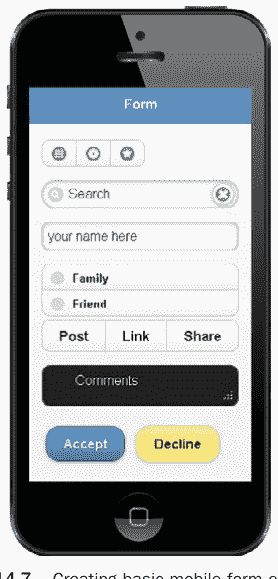

**图 14.7** 使用 ch1406.html 中的 jQuery Mobile 代码创建基本的移动表单元素。

# 索引

## A

- **绝对值，计算，34**
- **访问**
    - 浏览器，47-49
        - 访问Cookie，52-55
    - 历史记录，49
    - HTML
        - 链式对象操作，75-76
        - 元素，59
        - 导航对象，76-82
        - 搜索元素，59-68, 71-74
    - JavaScript中的jQuery，6
    - 库，7
    - Mobile，10
    - 变量，16
- **addEventListener() 函数，103**
- **添加**
    - 向面板添加辅助内容，328
    - 边框，134
    - 条件代码块，30
    - Cookie，53
    - 向列表添加分隔符，324
    - 向对象添加DOM元素，91
    - 向元素添加元素，179-183
    - 事件处理程序，99, 105
    - 表单
        - 元素，336
        - 移动，334-336, 340
    - 初始化代码，100
    - 向列表添加项，191-193
    - JavaScript
        - 添加到HTML文档，3
        - 从外部文件加载，4
    - 向网页添加jQuery，5-6
    - 标签，335
    - 鼠标点击处理代码，115
    - 导航按钮，307, 311, 314
    - 页面加载事件处理程序，99
    - 向表格添加行，189-191
    - 表格，333
    - 定时器，55-57
    - 过渡效果，308
    - UI元素
        - 应用滑块，215-216, 219
        - 附加日期选择器，212-215
        - 编写工具提示，223-225
        - 创建菜单，220-222
        - 下载库，201-202
        - 拖放，205-212
        - 实现自动完成，203-205
        - jQuery，201
    - .toggle() 方法，243-245
    - CSS设置，228-229
    - 延迟，233
    - 图像
        - 移动元素，248-250
        - 调整大小，246-248
    - 队列，231
    - 滑动切换，239-242
    - 停止，232-233
    - 可见性，234-238
- **调整不透明度，146-149。另请参阅 修改**
- **追加**
    - 元素内容的底部，180
    - 元素，141
    - 向表格添加行，189-191
    - 文本，140
- adjValues() 函数，197
- **AJAX**
    - 异步通信，253-254
    - 跨域请求，254
    - GET/POST请求，255
    - JavaScript，261-267
    - jQuery，267-289
    - 概述，251-252
    - 响应数据类型，256-259
- 应用程序，Mobile，9-12
- **应用**
    - AJAX，251-252
    - 异步通信，253-254
    - 跨域请求，254
    - GET/POST请求，255
    - JavaScript，261-267
    - jQuery，267-289
    - 响应数据类型，256-259
    - 事件对象，111-114
    - 向选择器添加过滤器，74
    - for()循环，31
    - 网格布局，316-317, 320
- 祖先，搜索，80
- .animate() 方法，228-229
- **动画，227-228**
    - .hide() 方法，242
    - .show() 方法，243

## B

- 逻辑，29-31
- .map() 方法，87-88
- 嵌套列表，322
- 弹出窗口，329, 332
- 幂函数，35
- 右键单击，117-118
- 选择器，62
- 滑块，215-216, 219
- 三角函数，35
- while()循环，30
- 参数，20
- 数组
    - 合并，26
    - 创建，18
    - 项
        - 删除，27
        - 检测，27
    - 迭代，31
    - 操作，25-27
    - 排序，28
    - 拼接，26
- 赋值
    - 向对象赋值数据，89
    - 在HTML中赋值事件处理程序，101
- 异步通信，253-254
- 附加日期选择器元素，212-215
- .attr() 方法，126, 166
- 属性，基于HTML选择，64
- 自动完成，实现，203-205
- 返回按钮，创建，309
- 行为，事件，107-110
- 代码块，添加，30
- .blur() 方法，173
- 边框，添加，134
- 元素内容的底部，追加，180
- 浏览器。另请参阅 界面
    - 访问，47-49
    - Cookie，修改，52-55
    - 当前位置详情，45-47
    - 开发工具，配置，12-13
    - 事件
        - 添加事件处理程序，99-106
        - 表单，122-123
        - 键盘，118-120
        - 管理，107-110
        - 鼠标，115-118
        - 对象，111-114
        - 概述，96
        - 类型，96, 99
    - 历史记录，访问，49
    - JavaScript控制台，应用，44
    - 导航，43
    - 弹出窗口，创建，50-51
    - 屏幕，调整大小，45
    - 定时器，添加，55, 57


## 浏览器

-   网页
    -   重定向, 44
    -   重新加载, 44

**构建移动页面**, 302-304

**buttonImage 选项**, 213

**buttonImageOnly 选项**, 213

-   **按钮**
    -   返回按钮，创建, 309
    -   导航按钮
        -   添加, 307, 311, 314
        -   定位, 308
    -   分割列表按钮, 324

## C

计算绝对值, 34

调用函数, 20

取消计时器, 56

层叠样式表。参见 CSSs

大小写，修改字符串, 24

内容分发网络 (CDNs), 5, 9

链接对象操作, 75-76

**change 选项**, 216

**.changePage() 方法**, 298

检测文本变化, 119

-   **字符**
    -   搜索, 22
    -   特殊字符，字符串对象, 21

-   **复选框状态，修改**, 161-162

-   **检查**
    -   数组中的项, 27
    -   子字符串, 25

**获取子元素**, 77

**Chrome，启用 JavaScript**, 13

-   **类**
    -   删除类, 137
    -   类名，搜索 DOM 对象, 60
    -   切换类, 137, 139

**click() 方法**, 110

**获取最近元素**, 77

**关闭窗口**, 49

-   **代码**
    -   代码块，添加, 30
    -   动态编程。参见动态编程
    -   初始化代码，添加, 100
    -   JavaScript 代码
        -   添加到 HTML 文档, 3
        -   控制台, 44
        -   从外部文件加载, 4
        -   概述, 2
        -   鼠标点击处理，添加, 115

**将内容划分为可折叠元素**, 326-327

**颜色，修改**, 131-132

## CSSs（层叠样式表）

345

-   **组合**
    -   数组, 26
    -   字符串, 23

**通信**，异步, 253-254

**complete 函数**, 229-230

**组件**，日期, 39

**条件代码块**，添加, 30

-   **配置**
    -   浏览器开发工具, 12-13
    -   cookie 值, 53
    -   CSS 属性, 130-139
    -   默认移动设置, 301
    -   DOM 元素属性, 126-129
    -   隐藏表单属性, 166
    -   选择输入框, 164-165
    -   单选按钮组中的选中选项, 162
    -   文本
        -   输入值, 160
        -   状态栏, 48
    -   计时器, 55-57

**JavaScript 控制台**, 44

-   **内容**
    -   辅助内容，添加到面板, 328
    -   HTML 元素，根据内容选择, 66
    -   父内容，追加元素, 141
    -   网页内容
        -   添加元素, 179-183
        -   向表格追加行, 189-191
        -   动态构建, 177
        -   删除元素, 184-185
        -   HTML 元素, 178
        -   HTML5 canvas 图形, 197-199
        -   图片库, 193-196
        -   向列表插入项目, 191-193
        -   表单选择元素, 186-188

**内容发现网络**。*参见* CDNs

**内容提示框**, 223

-   **转换**
    -   DOM 对象转换为 jQuery 对象, 84
    -   数字转换为字符串, 22
    -   字符串转换为数字, 23

**坐标，获取鼠标坐标**, 115

**跨域请求**, AJAX, 254

**.css() 方法**, 130

-   **CSSs（层叠样式表）**, 7
    -   动画效果, 228-229
    -   元素, 130-139
    -   主题色板, 295

获取当前日期和时间, 37

-   搜索当前哈希值, 45
-   当前位置详情, 45-47
-   网页当前位置, 48
-   自定义。另请参阅 配置
    -   表单, 334-336, 340
    -   弹出框, 329-332
    -   表格, 333

-   延迟动画, 233
-   删除
    -   类, 137
    -   元素到元素, 184-185
    -   事件处理器
        -   JavaScript, 104
        -   jQuery, 106
    -   数组中的项, 27
    -   对象, 91
-   时间差，格式化时间, 39
-   后代元素，搜索, 78
-   检测
    -   文本变化, 119
    -   数组中的项, 27
    -   移动设备屏幕尺寸, 294
-   开发者工具（Internet Explorer）, 13
-   开发
    -   浏览器工具，配置, 12-13
    -   jQuery Mobile, 9-12
-   设备，移动设备, 9-12
-   禁用表单元素, 167-169, 335
-   分割线，添加到列表, 324
-   将内容划分为可折叠元素, 326-327
-   文档对象模型。参见 DOM
-   文档，向 HTML 添加 JavaScript, 3

## D

-   .data() 方法, 166
-   数据类型, AJAX, 256-259
-   Date 对象, 36-40
-   dateFormat 选项, 213
-   日期选择器元素，附加, 212-215
-   日期，组件, 39
-   dblclick() 方法, 110
-   调试 JavaScript 控制台, 44
-   默认行为，阻止, 109
-   默认移动设置，配置, 301
-   定义
    -   函数, 20
    -   变量, 16
    -   视口 meta 标签, 300
-   延迟计时器，添加, 56

动态编程 347

DOM（文档对象模型）, 5

网页, 177

元素

添加元素, 179-183

添加, 91

调整透明度, 146-149

配置属性, 126-129

向表格追加行, 189-191

内容, 139-141

CSS 属性, 130-139

对象, 60-61, 84

删除元素, 184-185

下载 jQuery UI 库, 201-202

DOM 元素属性, 126-129

拖放元素, 205-212

元素内容, 139-141

可拖放小部件选项, 208

隐藏/显示元素, 144-146

duration 函数, 229-230

HTML 元素, 178

动态编程

HTML5 canvas 图形, 197-199

表单

图片库, 193-196

复选框状态, 161-162

向列表插入项目, 191-193

禁用元素, 167-169

修改, 125

元素, 159

修改布局, 143

强制焦点移入/移出元素, 172-174

重新定位元素, 152-153, 156

隐藏属性, 166

调整元素大小, 149, 152

管理提交, 175

表单选择元素, 186-188

单选按钮输入, 162

堆叠元素, 156-158

选择值, 164-165

显示/隐藏元素, 170-172

文本输入值, 160

348 .each() 方法

## E

.each() 方法, 85

缓动函数, 229-230

效果，动画, 227-228

-   CSS 设置, 228-229
-   延迟, 233
-   .hide() 方法, 242
-   移动元素, 248-250
-   队列, 231
-   调整图片大小, 246-248
-   .show() 方法, 243
-   滑动切换, 239-242
-   停止, 232-233
-   .toggle() 方法, 243-245
-   可见性, 234-238

## 元素

-   追加, 141
-   子元素，获取, 77
-   内容, 139-141
-   CSS 属性, 130-139
-   后代元素，搜索, 78
-   DOM
    -   添加, 91
    -   配置属性, 126-129
-   淡入淡出, 239, 242
-   表单
    -   添加, 336
    -   复选框状态, 161-162
    -   创建选择, 186-188
    -   禁用, 167-169, 335
    -   强制焦点移入/移出元素, 172-174
    -   隐藏属性, 166
    -   管理提交, 175
    -   单选按钮输入, 162
    -   刷新, 336
    -   选择值, 164-165
    -   显示/隐藏, 170-172
    -   文本输入值, 160

## HTML

-   添加, 179-183
-   删除, 184-185
-   jQuery, 178
-   移动，动画效果, 248-250

## UIs

-   添加, 201
-   应用滑块, 215-219
-   附加日期选择器, 212-215
-   编码提示框, 223-225
-   创建菜单, 220-222
-   下载库, 201-202
-   拖放, 205-212
-   实现自动完成, 203-205

强制焦点移入/移出表单元素

349

网页

-   隐藏/显示, 144-146
-   加载 HTML 到, 269-271
-   重新定位, 152-156
-   调整大小, 149-152
-   堆叠, 156-158

移动端, 295-297

重置, 175

提交, 175

**existingObject, 180**

**外部文件，从 JavaScript 加载, 4**

## F

-   启用
    -   Internet Explorer 上的开发者工具, 13
    -   Chrome 中的 JavaScript, 13

**.eq (index) 过滤器, 92**

**相等性，对象, 29**

-   **事件处理器**
    -   全局事件处理器, 285
    -   滑动事件处理器, 310, 314

**event.preventDefault() 方法, 109**

**event.stopPropagation() 方法, 109**

-   **事件**
    -   浏览器事件
        -   添加事件处理器, 99-106
        -   表单事件, 122-123
        -   键盘事件, 118-120
        -   管理事件, 107-110
        -   鼠标事件, 115-118
        -   事件对象, 111-114
        -   事件概述, 96
        -   事件类型, 96, 99
    -   可拖动小部件事件, 207
    -   可拖放小部件事件, 209

-   **淡入淡出**
    -   元素动画淡入/淡出, 234-235
    -   元素, 239-242
    -   至指定透明度级别, 236

-   **文件**
    -   访问, 6
    -   JavaScript 文件，从外部加载, 4
    -   文件路径，查看, 46
    -   网页文件，加载, 5-6

**.filter(filter) 方法, 92**

-   **过滤器**
    -   对象结果, 92-94
    -   选择器

该请求因被判定为高风险而被拒绝


## G

## H

- 图库，格式化图片，193-196
- 生成随机数，32
- GET 请求，AJAX，255，262-264
- .get() 方法，84
    - JSON，处理，271-274
    - XML，处理，274，277
- .getScript() 方法，256
- 获取
    - CSS 属性，130-139
    - DOM 元素属性，126-129
    - 元素内容，139-141
    - 事件目标对象，114
    - 隐藏表单属性，166
    - 鼠标坐标，115
    - 选择输入框，164-165
    - 单选按钮组中的选中选项，162
    - 文本输入值，160
- 全局事件处理程序，285
- 全局设置，修改，285
- 图形，HTML5 canvas，197-199
- 网格，布局，316-320
- 组，获取/设置单选按钮选项，162

- 处理程序
    - 函数，105
    - 事件
        - 添加，99
        - 滑动，310-314
    - 全局事件，285
- 处理
    - 事件
        - 表单，122-123
        - 键盘，118-120
        - 鼠标，115-118
    - JSON 数据，271-274
    - 选择变化，123
    - 文本数据 (AJAX)，257
    - XML 数据，274-277
- .has(选择器或元素) 方法，93
- 哈希值，当前，45
- 头部，移动网页，304
- 隐藏表单属性，166
- .hide() 方法，144，170，242
- 隐藏
    - 元素，网页，144-146
    - 表单元素，170-172
    - 标签，335
- 层级，基于 HTML 元素选择，68
- 历史，浏览器导航，49

主机，搜索名称

**主机，搜索名称**，46
**HTML (超文本标记语言)**
元素
访问，59
添加，179-183
附加/前置文本，140
链式对象操作，75-76
删除，184-185
获取内容，140
**jQuery**，178
导航对象，76-82
重新定位，152-156
调整大小，149，152
搜索，59-68，71-74
堆叠，156-158
分配事件处理程序，101
JavaScript，添加到，3
响应数据，259
**HTML5 canvas 图形**，196-199
**.html() 方法**，140

调整大小，动画，246-248
源文件，修改，128
过渡，添加，237-238
**实现**
自动完成，203-205
底层 AJAX 请求，287-289
多页面移动站点，306-314
可搜索列表，325
分割按钮列表，324
**初始化代码**，添加，100
**内部高度**，47
**内部宽度**，47
**输入**
自动完成，实现，203-205
单选按钮，162
选择框，164-165
文本值，160
**插入到元素内容中间**，181
**在 Firefox 上安装 Firebug**，13
**界面**
浏览器开发工具，配置，12-13
加载，9
导航，7
**Internet Explorer，启用开发者工具**，13

**ID，搜索 DOM 对象**，60
**图片**
图库，创建，193-196

.is() 方法，161-163

项目

- 数组
    - 删除，27
    - 检测，27
- 列表，191-193
- 工具提示，223

迭代

- 数组，31
- jQuery 对象，85-86
- 遍历对象属性，31

HTML

- 添加到文档，3
- 搜索元素，59-61
- jQuery，访问，6
- 应用逻辑，29-31
- 数学运算，31-35
- 对象，创建，19
- 按需加载，255
- 概述，2
- POST 请求，从此发送，264，267
- 字符串，操作，21-25
- 语法，15
- 变量，定义，16

## J

**JavaScript**

- AJAX 从此，261-267
- 数组
    - 创建，18
    - 操作，25-27
- Chrome，启用，13
- 控制台，44
- Date 对象，36-40
- 事件处理程序
    - 添加，103
    - 删除，104
- 事件，96，99
    - 添加页面加载事件处理程序，99
    - 管理，107-110
- 外部文件，从此加载，4
- 函数，定义，20
- GET 请求，从此发送，262-264

**JavaScript 对象表示法。参见 JSON**

**.join() 方法，27**

**jQuery**

- AJAX 从此，267-289
- 动画，227-228
    - CSS 设置，228-229
    - 延迟，233
    - .hide() 方法，242
    - 队列，231
    - .show() 方法，243
    - 滑动切换，239-242
    - 停止，232-233
    - .toggle() 方法，243-245
    - 可见性，234-238
- 事件处理程序
    - 添加，105
    - 删除，106
- 事件，96，99
- HTML 元素，178
- 初始化代码，100
- JavaScript，访问，6
- Mobile，9-12
- 移动网站，291
    - 应用网格布局，316-320
    - 构建网页，302-304
    - 创建导航栏，314
    - 自定义弹出窗口，329，332
    - 划分为可折叠元素，326-327
    - 格式化列表视图，320-325
    - 表单，334-340
    - 使用多页面实现，306-314
    - 概述，291-300
    - 表格，333
    - 查看面板，328
- 对象
    - 添加 DOM 元素，91
    - 应用 .map() 方法，87-88
    - 分配数据值，89
    - 链式操作，75-76
    - 将 DOM 对象转换为，84
    - 删除，91
    - 过滤结果，92-94
    - 获取，84
    - 迭代，85-86
    - 修改，83
    - 导航至选择元素，76-82
    - 概述，4
- UI
    - 访问库，7
    - 添加，201
    - 应用滑块，215-219
    - 附加日期选择器，212-215
    - 编码工具提示，223-225
    - 创建菜单，220-222
    - 下载库，201-202
    - 拖放，205-212
    - 实现自动完成，203-205
    - 加载，9
    - 导航，7
- 网页，加载，5-6

**jQuery 选择器，搜索 HTML 元素，61-74**

**JSON (JavaScript 对象表示法)**

- 处理，271-274
- 响应数据，257-258

JSON.parse() 方法，258
JSONP (带填充的 JSON)，255

长度，字符串，22
级别，容差，208
库
访问，7
CDN，加载，5
jQuery Mobile，291
应用网格
布局，316-320
构建网页，
302-304
创建导航栏，314
自定义弹出窗口，
329-332
划分为
可折叠元
素，326-327
格式化列表视图，
320-325
表单，334-340
使用多页
面实现，
306-314
概述，291-300
表格，333
查看面板，328
jQuery UI，添加，
201-202
加载，9
Mobile，9-12
链接，修改
位置，127

## K–L

- 键盘事件，118-120
- 按键，按下，120
- 关键字，17，96，99
- 标签，添加/隐藏，335

- 语言
    - JavaScript
        - 添加到 HTML 文档，3
        - 从外部文件加载，4
        - 概述，2
        - 语法，15

- .last() 方法，93

- 布局
    - 网格，应用，316-317，320
    - 网页
        - 调整不透明度，146-149
        - 隐藏/查看元素，144-146
        - 修改，143
        - 重新定位元素，152-153，156
        - 调整元素大小，149-152
        - 堆叠元素，156-158

- 列表
    - 分隔符，添加，324
    - 项目，插入到，191-193
    - 嵌套，322

## 列表

- 可搜索，实现，325
- 分割按钮，324
- 列表视图，格式化，320-325
- .load() 方法，101
- 加载
    - HTML 到页面元素，269-271
    - JavaScript 从外部文件，4
    - 网页中的 jQuery，5-6
    - 库，5，9
    - Mobile，12
    - 移动页面（不显示），299
- .loadPage() 方法，298
- location.reload() 方法，44
- 位置
    - 当前位置，45-47
    - 链接，修改，127
    - 网页，47-48
- 逻辑，应用，29-31
- 循环
    - for()，31
    - while()，30
- 底层 AJAX 请求，287-289

## M

- 管理
    - 事件，107-110
    - 表单提交，175
- 操作
    - 数组，25-27
    - Cookie，52-55
    - 字符串，21-25
- .map() 方法，应用，87-88
- Math 对象，31-35
- 最大选项，216
- 集合中的最大数，34
- 菜单，格式化，220-222
- 元标签，定义视口，300
- 方法
    - .animate()，228-229
    - .attr()，126，166
    - autocomplete，203
    - .blur()，173
    - .changePage()，298
    - click()，110
    - .css()，130
    - .data()，166
    - .datepicker()，213
    - dblclick()，110
    - .delay()，234
    - .each()，85
    - event.preventDefault()，109
    - event.stopPropagation()，109
    - .filter(filter)，92
    - .first()，93
    - .focus()，173
    - **.get()**
        - JSON 数据，271-274
        - XML 数据，274，277
    - **.get([index])**，84
    - **.getScript()**，256
    - **.has(选择器或元素)**，93
    - **.hide()**，144，170，242
    - **.html()**，140
    - **.is()**，161-163
    - **.join()**，27
    - **JSON.parse()**，258
    - **.last()**，93
    - **.load()**，101
    - **.loadPage()**，299
    - **location.reload()**，44
    - **.map()**，87-88
    - **.not(filter) 方法**，94
    - **.off()**，106
    - **.offset()**，153
    - **.on()**，105
    - **onloadHandler()**，100
    - **pop()**，27
    - **.position()**，153
    - **.post()**，278-281
    - **.prop()**，126，166
    - **push()**，18
    - **.ready()**，101
    - **.remove()**，184
    - **removeAttr()**，162
    - **setTimeout()**，197
    - **.show()**，144，170，243
    - **sort()**，28
    - **.slice(start, [end])**，94
    - **.slideToggle()**，239
    - **.toggle()**，243，245
    - **.toLowerCase()**，24
    - **.toUpperCase()**，24
    - **.val()**，160，164

### 插入到元素内容中间，181

### 集合中的最小数，33

### Mobile (jQuery)，9-12

### 移动网站 (jQuery)，291

- 概述，291-300
- 网页
    - 应用网格布局，316-320
    - 构建，302-304
    - 创建导航栏，314
    - 自定义弹出窗口，329-332
    - 划分为可折叠元素，326-327
    - 格式化列表视图，320-325
    - 表单，334-340
    - 使用多页面实现，306-314
    - 表格，333
    - 查看面板，328

### 修改

- 复选框状态，161-162
- 颜色，131-132
- Cookie，52-55


### 修改

-   元素
    -   应用滑块，215-219
    -   内容，139-141
-   焦点，122
-   字体，136
-   全局设置，285
-   图片源文件，128
-   链接位置，127
-   移动网页，298
-   对象，83
    -   向其中添加 DOM 元素，91
    -   应用 .map() 方法，87-88
    -   为其分配数据值，89
    -   将 DOM 对象转换为，84
    -   删除，91
    -   过滤结果，92-94
    -   获取，84
    -   迭代，85-86
-   单选按钮输入，162
-   下拉选择输入，164-165
-   选择项，123
-   字符串，21-25
-   检测文本，119
-   网页
    -   调整不透明度，146-149
    -   CSS 属性，130-139
    -   DOM 元素属性，126-129
-   动态编程，125
-   元素内容，139-141
-   隐藏/显示元素，144，146
-   布局，143
-   重新定位元素，152-153，156
-   调整元素大小，149-152
-   堆叠元素，156-158
-   鼠标
    -   获取坐标，115
    -   事件，115-118
    -   添加鼠标点击处理代码，115
    -   mouseout 事件，116
    -   mouseover 事件，116
-   移动
    -   元素动画，248-250
    -   HTML 元素，152-156

### 命名

-   属性，166
-   在 DOM 对象中搜索类，60
-   搜索主机，46
-   在 DOM 对象中搜索标签，61
-   导航栏格式化，314

### 导航

-   浏览器，43
    -   访问，47-49
    -   添加计时器，55-57
    -   应用 JavaScript 控制台，44
    -   当前位置详情，45-47
    -   历史记录，49
    -   修改 cookies，52-55
    -   弹出窗口，50-51
    -   重定向网页，44
    -   重新加载网页，44
    -   调整屏幕尺寸，45
-   jQuery Mobile 库，291-300
-   用于选择元素的对象，76-82
-   用户界面，7
    -   访问库，7
    -   加载，9

### 导航按钮

-   添加，307-314
-   定位，308

### 应用嵌套列表，322

### 网络，CDN，5

### .not(filter) 方法，94

### numberOfMonths 选项，213

## 数字

-   格式化日期，36-40
-   集合中的最大值，34
-   集合中的最小值，33
-   生成随机数，32
-   舍入，33
-   转换为字符串，22

### 0

## 对象

-   创建，19
-   Date，36-40
-   DOM，60-61
-   用于导航选择元素的对象，76-82
-   相等性，29
-   事件，111-114
-   现有的，180
-   获取，84
-   jQuery
    -   向其中添加 DOM 元素，91
    -   应用 map() 方法，87-88
    -   为其分配数据值，89
    -   将 DOM 对象转换为，84
    -   删除，91
    -   过滤结果，92-94
    -   迭代，85-86
-   location，45-47
-   Math，31，34-35
-   修改，83
-   链式操作，75-76
-   迭代属性，31
-   字符串，特殊字符，21
-   window.XMLHttpRequest，261
-   windows，47-49
-   XMLHttpRequest，261
-   .off() 方法，106
-   .offset() 方法，153
-   .on() 方法，105
-   按需 JavaScript，255
-   onloadHandler() 方法，100
-   onSelect 选项，213
-   不透明度
    -   调整，146-149
    -   渐隐至指定级别，236
-   打开窗口，49
-   操作
    -   数学运算，31-35
    -   对象链式操作，75-76
-   选项
    -   动画，229
    -   可拖动小部件，205
    -   可拖放小部件，208
    -   获取/设置单选按钮组选项，162
    -   方向选项，216

## P

-   页面
    -   将 HTML 加载到元素中，269-271
    -   添加 load 事件处理器，99
-   父级
    -   追加元素内容，141
    -   搜索，80
-   路径，查看文件，46
-   物理事件，107。另请参见事件
-   pop() 方法，27
-   弹出窗口
    -   创建，50-51
    -   应用，329，332
-   position 提示框，223
-   .position() 方法，153
-   定位
    -   HTML 元素，152-156
    -   导航按钮，308
    -   父级
        -   检索，80
        -   搜索，80
-   POST 请求，AJAX，255，264，267
-   .post() 方法，278-281
-   应用幂函数，35
-   前置内容
    -   内容，179
    -   文本，140
-   按键，120
-   前一个兄弟元素，81
-   编程
    -   动态编程，125。另请参见动态编程
    -   将 JavaScript 添加到 HTML 文档，3
-   查看面板，328
-   从外部文件加载，4
-   概述，2
-   语法，15
-   .prop() 方法，126，166
-   阻止事件冒泡，109
-   属性
    -   获取/设置 CSS 属性，130-139
    -   配置 DOM 元素属性，126-129
    -   迭代对象属性，31
-   push() 方法，18

## Q-R

-   查询，检索字符串，46
-   队列
    -   动画队列，231
    -   函数队列，230
-   单选按钮输入，162
-   生成随机数，32
-   range 选项，216
-   .ready() 方法，101
-   添加循环计时器，57
-   重定向网页，44
-   刷新表单元素，336
-   重新加载网页，44
-   .remove() 方法，184
-   removeAttr() 方法，162
-   removeEventListener() 函数，104
-   renderSpark() 函数，197
-   替换字符串，25
-   替换文本，141
-   重新定位 HTML 元素，152-156
-   AJAX 请求
    -   跨域请求，254
    -   GET/POST 请求，255
    -   JavaScript 请求，261-267
    -   jQuery 请求，267-289
    -   响应数据类型，256-259
-   reset 事件，175
-   调整 HTML 元素大小，149-152
-   图片动画，246-248
-   AJAX 响应
    -   jQuery 响应，282-284
    -   数据类型，256-259
-   过滤对象结果，92-94
-   检索
    -   79
    -   子元素，77
    -   Cookie 值，53
    -   定位父级，80
    -   前一个兄弟元素，81
    -   查询字符串，46
    -   兄弟元素，79-82
-   应用右键单击，117-118
-   数字舍入，33
-   向表格追加行，189-191

## S

-   屏幕
    -   检测移动屏幕尺寸，294
    -   调整尺寸，45
-   实现可搜索列表，325
-   搜索
    -   祖先元素，80
    -   字符，22
    -   当前哈希值，45
    -   网页当前位置，48
    -   后代元素，78
    -   主机名，46
    -   HTML
        -   链式对象操作，75-76
        -   元素，59-68，71-74
    -   父级，80
    -   字符串，25
-   从安全位置查看，47
-   创建选择表单元素，186-188
-   下拉选择输入，164-165
-   选择
    -   用于导航选择元素的对象，76-82
    -   修改选择项，123
-   选择器
    -   应用选择器，62
    -   过滤器，74
-   发送
    -   从 JavaScript 发送 GET 请求，262-264
    -   从 JavaScript 发送 POST 请求，264-267
-   服务器
    -   AJAX
        -   异步通信，253-254
        -   跨域请求，254
        -   GET/POST 请求，255
        -   JavaScript，261-267
        -   jQuery，267-289
        -   概述，251-252
        -   响应数据类型，256-259
        -   更新服务器，278-281
-   集合
    -   集合中的最大值，34
    -   集合中的最小值，33
-   setTimeout() 方法，197
-   设置。另请参见配置
    -   CSS
        -   动画设置，228-229
        -   属性设置，130-139
    -   DOM 元素
        -   属性设置，126-129
    -   隐藏表单属性，166
    -   选择输入设置，164-165
    -   设置单选按钮组中的选中选项，162
    -   设置文本输入值，160
-   管理表单提交，363
-   修改全局设置，285
-   .show() 方法，144，170，243
-   showButtonPanel 选项，213
-   showOn 选项，213
-   兄弟元素
    -   前一个兄弟元素，81
    -   检索兄弟元素，79-82
-   调整尺寸
    -   屏幕尺寸，45，294
    -   网页尺寸，47
-   .slice(start, [end]) 方法，94
-   slide 选项，216
-   .slideToggle() 方法，239
-   应用滑块，215-216，219
-   滑动切换，239-242
-   数组排序，28
-   修改图片源文件，128
-   特殊字符，21
-   动画特效，227-228
    -   CSS 设置，228-229
    -   延迟，233
    -   .hide() 方法，242
    -   移动元素，248-250
    -   队列，231
    -   调整图片大小，246-248
    -   .show() 方法，243
    -   滑动切换，239-242
    -   停止动画，232-233
-   .toggle() 方法，243-245
-   可见性，234-238
-   拼接
    -   数组，26
    -   字符串，24
-   分割按钮列表，324
-   拆分字符串，24
-   堆叠 HTML 元素，156-158
-   修改复选框状态，161-162
-   配置状态栏文本，48
-   step 函数，231
-   停止
    -   动画，232-233
    -   默认行为，109
    -   事件冒泡，109
-   字符串
    -   修改大小写，24
    -   组合字符串，23
    -   格式化日期，37
    -   操作字符串，21-25
    -   转换为数字，22
    -   检索查询字符串，46
    -   替换字符串，25
    -   搜索字符串，25
    -   拼接字符串，24
    -   拆分字符串，24
    -   检查子字符串，25
    -   格式化时间，38
-   submit 事件，175
-   管理表单提交，175
-   检查子字符串，25
-   主题样本，295
-   滑动事件处理器，310，314
-   JavaScript 语法，15

## T

-   切换
    -   类，137-139
    -   元素可见性
    -   开/关，235
-   容差级别，208
-   .toLowerCase() 方法，24
-   工具
    -   配置浏览器开发工具，12-13
    -   JavaScript 控制台，44
-   格式化工具提示，223-225
-   .toUpperCase() 方法，24
-   从制表符分隔的字符串创建数组，27
-   表格
    -   添加表格，333
    -   向表格追加行，189-191
-   在 DOM 对象中搜索标签，61
-   获取事件对象的目标，114
-   过渡
    -   添加过渡，308
    -   动画过渡，237-238
-   触发
    -   动画，232
    -   手动触发事件，110
-   应用三角函数，35
-   事件类型，96，99
-   文本
    -   AJAX 文本，257
    -   追加/前置文本，140
    -   实现自动完成功能，203-205
    -   输入值，160
    -   修改，检测文本，119
    -   替换文本，141
    -   配置状态栏文本，48

## U

-   主题样本，295
-   时间
    -   获取当前时间，37
    -   格式化时间差，39
    -   格式化时间字符串，38
-   添加计时器，55-57
-   .toggle() 方法，243-245
-   用户界面
    -   元素
        -   添加元素，201
    -   应用滑块，215-219
    -   附加日期选择器，212-215
    -   编码工具提示，223-225
    -   创建菜单，220-222


## V

- `.val()` 方法，160，164
- value 选项，216
- 值
  - 绝对值，计算，34
  - 属性值，166
  - cookies 值，配置，53
  - 对象值，赋值，89
  - 文本输入值，160
- **var 关键字，17**
- 变量
  - 访问，16
  - 定义，16
- 查看
  - 元素，网页，144-146
  - 文件路径，46
  - 表单元素，170-172
  - 列表视图，格式化，320-325

## W

- **网页表单，159。另见 表单**
- **网页。另见 HTML**
  - 内容
    - 添加元素，179-183
    - 向表格追加行，189-191
    - 动态构建，177
    - 删除元素，184-185
    - HTML 元素，178
    - HTML5 canvas 图形，197-199
    - 图像画廊，193-196
    - 向列表插入项目，191-193
    - select 元素，186-188
  - 下载库，201-202
  - 拖放，205-212
  - 实现自动完成，203-205
  - 库，访问，7
  - 加载，9
  - **更新服务器，278-281**
  - **用户交互，添加，179-183**
  - **用户界面。另见 UI**
  - 移动页面，加载但不显示，299
  - 面板，328
  - 网页，47
  - 移动设备上的网站，294
  - **视口，定义 meta 标签，300**
  - 可见性
    - 动画，234-238
    - 根据可见性选择 HTML 元素，72
  - 当前位置，48
  - 动态编程
    - CSS 属性，130-139
    - DOM 元素属性，126-129
    - 元素内容，139-141
    - 修改，125
  - 事件
    - 添加事件处理程序，99-106
    - 表单，122-123
    - 键盘，118-120
    - 管理，107-110
    - 鼠标，115-118
    - 对象，111-114
    - 概述，96
    - 类型，96-99
  - 历史记录，导航，49
  - HTML，加载到，269-271
  - jQuery，加载，5-6
  - 布局
    - 调整不透明度，146-149
    - 隐藏/查看元素，144-146
    - 修改，143
    - 重新定位元素，152-156
    - 调整元素大小，149-152
    - 堆叠元素，156-158
  - 移动端，构建，302-304
  - 导航栏，格式化，314
  - 重定向，44
  - 重新加载，44
  - 安全位置，从，查看，47
  - UI 元素
    - 添加，201
    - 应用滑块，215-219
    - 附加日期选择器，212-215
    - 编写工具提示，223-225
    - 创建菜单，220-222
    - 下载库，201-202
    - 拖放，205-212
    - 实现自动完成，203-205
    - 查看，47
- **Web 服务器，AJAX**
  - 异步通信，253-254
  - 跨域请求，254
  - GET/POST 请求，255
  - JavaScript，261-267
  - jQuery，267-289
  - 概述，251-252
  - 响应数据类型，256-259
  - z-index，367

## X–Z

- 网站，移动端（jQuery），291。另见 网页
  - 应用网格布局，316-320
  - 构建网页，302-304
  - 创建导航栏，314
  - 自定义弹出窗口，329-332
  - 划分为可折叠元素，326-327
  - 格式化列表视图，320-325
  - 表单，334-340
  - 使用多页面实现，306-314
  - 概述，291-300
  - 表格，333
  - 查看面板，328
- while() 循环，30
- 小部件
  - 日期选择器，附加，212-215
  - 可拖动/可放置，205-212
  - 菜单，创建，220-222
  - 工具提示，创建，223-225
- window.XMLHttpRequest 对象，261
- 窗口
  - 关闭，49
  - 对象，47-49
  - 打开，49
  - 弹出窗口，创建，50-51
- XML（可扩展标记语言）
  - 处理，274，277
  - 响应数据，259
- XMLHttpRequest 对象，261
- z-index，157
