# jQuery 与 JavaScript 短语手册

## 致谢

我想借此页感谢所有使本书得以成稿的人。首先，感谢我优秀的妻子和孩子们给予我所需的灵感和支持。没有你们，我绝不可能走这么远。感谢 Mark Taber 使本书步入正轨；感谢 Karen Gill 将我技术思维中的絮语转化为连贯的文字；感谢 Phil Ballard 确保本书的准确性并让我保持诚实；感谢 Kathy Ruiz 和 Gloria Schurick 确保本书的最高质量；感谢 Larry Sweazy 确保读者能在书中真正找到他们需要的内容；感谢 Tammy Graham 和 Laura Robbins 的图形设计天赋；感谢 Chuti Prasertsith 设计了时尚而简洁的封面；感谢 Katherine Matejka 为确保本书尽可能完善所做的所有辛勤工作。你们真是太棒了！

## 关于作者

**Brad Dayley** 是一位拥有 20 年企业应用开发经验的高级软件工程师。他广泛使用 HTML/CSS、JavaScript 和 jQuery 开发了各种各样的网页，从企业应用界面到复杂的富互联网应用，再到移动网络服务的智能界面。他是 *《Python 开发者速查手册》* 和 *《Sams 教你 24 小时学会 jQuery 和 JavaScript》* 的作者。

## 我们希望听到您的声音！

作为本书的读者，*您*是我们最重要的评论家和顾问。我们重视您的意见，想知道我们哪些方面做得好，哪些方面可以改进，您希望我们出版哪些领域的书籍，以及您愿意分享的任何其他宝贵建议。

您可以发邮件或写信直接告诉我们，您喜欢或不喜欢这本书的哪些方面——以及我们可以做些什么来使我们的书籍更加强大。

请注意，我们无法协助您解决与本书主题相关的技术问题，并且由于我们收到的邮件数量巨大，我们可能无法回复每一封邮件。

写信时，请务必包括本书的书名和作者，以及您的姓名和联系方式。

电子邮件：`feedback@developers-library.info`

邮寄地址：读者反馈部

Addison-Wesley Developer's Library

800 East 96th Street

Indianapolis, IN 46240 USA

## 读者服务

请访问我们的网站并在 `informit.com/register` 注册本书，以便便捷地获取本书的任何更新、下载或勘误信息。

# 第1章 踏入 jQuery、JavaScript 与动态 Web 开发的世界

JavaScript 及其增强版 jQuery，在创建丰富的交互式网页和基于 Web 的应用程序方面，完全改变了游戏规则。JavaScript 长期以来一直是创建动态网页的关键组件。现在，随着 jQuery、jQuery UI 和 jQuery Mobile 库的进步，动态 Web 开发已发生了永久性的变化。

本章将向您介绍动态 Web 编程的一些概念，并指导您如何在网页中设置和使用 JavaScript 与 jQuery。

## 理解 JavaScript

JavaScript 是一种与其他语言类似的编程语言。它与其他编程语言的区别在于，浏览器内置了解释器，可以解析和执行该语言。这意味着您可以编写在浏览器中运行的复杂应用程序，这些程序可以直接访问浏览器、网页元素和 Web 服务器。

这使得 JavaScript 代码能够动态地向网页添加、修改或删除元素，而无需重新加载页面。对浏览器的访问使您能够捕获诸如鼠标移动和点击之类的事件。正是这一点使得 JavaScript 能够提供诸如动态列表以及拖放等功能。图 1.1 展示了一个从服务器下载网页，然后使用 JavaScript 代码动态地向一个 `<ul>` 元素中填充 `<li>` 子元素的示例。

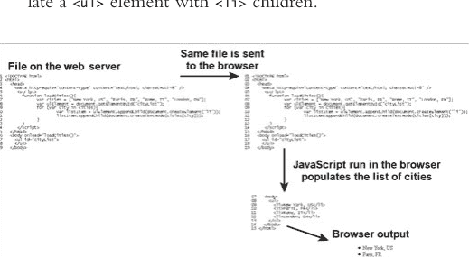

**图 1.1** JavaScript 在浏览器中运行，无需从 Web 服务器获取额外页面即可更改网页上的 HTML 元素。

## 将 JavaScript 添加到 HTML 文档

```html
<head>
  <script type="text/javascript">
    alert("JavaScript is Enabled!");
  </script>
</head>
```

您可以使用 HTML 的 `<script>` 标签将 JavaScript 添加到 HTML 文档中。当浏览器遇到 `<script>` 标签时，它会解析其中的内容，然后执行内部的 JavaScript 代码。通常，`<script>` 标签被添加到 `<head>` 元素中，但您也可以将它们添加到 `<body>` 元素中。

目前，所有 Web 浏览器默认将脚本类型设为 javascript；但是，为了未来的兼容性，最好仍然将类型设置为 `"text/javascript"`，以防情况发生变化。

> **注意！**
>
> HTML 文档中 `<script>` 标签出现的顺序决定了它们的加载顺序。如果您加载多个脚本，请记住，在后续脚本中使用相同的变量和函数名会覆盖在前面脚本中已定义的内容。

## 从外部文件加载 JavaScript

```html
<head>
    <script type="text/javascript"
        src="scripts/scriptA.js"></script>
    <script type="text/javascript"
        src="scripts/scriptB.js"></script>
</head>
```

随着您创建的 JavaScript Web 应用程序越来越复杂，您会发现将 JavaScript 直接添加到 HTML 文件中并不合理。文件会变得太大，而且您常常希望在其他网页中重用这些脚本。

您无需将 JavaScript 包含在 `<script>` 标签内，而是可以为脚本指定一个 `src` 位置来从中加载。当浏览器在 `<script>` 标签中遇到 `src` 属性时，它会从服务器下载脚本并将其加载到内存中。

> **注意！**
>
> 浏览器会异步下载外部脚本。这意味着，如果您在脚本中引用另一个脚本需要特别小心，因为第二个脚本可能尚未下载完成。

## 认识 jQuery

jQuery 是一个基于 JavaScript 构建的库。其底层代码实际上是 JavaScript；然而，jQuery 将许多 JavaScript 代码简化为易于使用的功能。使用 jQuery 的两个主要优势是选择器和内置函数。

选择器可以快速访问网页上的特定元素，例如列表和表格。选择器还提供对元素组的访问，例如所有段落，或具有特定类的所有段落。这使您能够快速、轻松地访问特定的文档对象模型（DOM）元素。

jQuery 还提供了一套丰富的内置功能，使得用更少的代码就能轻松完成更多任务。例如，像隐藏屏幕上的元素或动画调整元素大小这样的任务，只需一行代码即可完成。

## 在您的网页中加载 jQuery

```html
<head>
    <script src="local/jquery-2.0.3.min.js"></script>
    . . . 或 . . .
    <script src=
      "http://code.jquery.com/jquery-2.0.3.min.js">
    </script>
</head>
```

jQuery 库本身就是一个 `.js` 文件。您可以像加载任何其他 JavaScript 文件一样加载它。有两种方法可以将 jQuery 添加到您的网页中。

将 jQuery 添加到网页最简单的方法是使用几个内容分发网络（CDN）中的一个。CDN 允许您从遍布全球的 jQuery 托管服务器网络中加载库。这种方法的好处在于服务器分布广泛，因此下载会分配到多个服务器。此外，如果用户之前加载过另一个链接到该 CDN 文件的网页，那么 jQuery 库可能已经被缓存。以下是一些托管 CDN 的示例：

```html
//jQuery
<script src="http://code.jquery.com/jquery-2.0.3.min.js"></script>
<script src="http://code.jquery.com/jquery-migrate-1.1.0.min.js"></script>
//google
<script src="https://ajax.googleapis.com/ajax/libs/jquery/2.0.3/jquery.min.js"></script>
//Microsoft
<script src="http://ajax.aspnetcdn.com/ajax/jQuery/jquery-2.0.3.min.js"></script>
```

另一个选择是从 `http://jquery.com/download` 下载 `.js` 文件，并与其他 JavaScript 库一起加载。这样做的好处是与您网站的内容绑定更紧密，您无需担心外部位置可能出现的不可用问题或网站屏蔽问题。

## 在 JavaScript 中访问 jQuery

```javascript
jQuery("#myElement")
. . . 或 . . .
$("#myElement")
```

可以通过加载库时定义的 `jQuery` 对象来访问 jQuery。jQuery 还提供了一个快捷字符 `$`，您可以在本书中随处可见的短语中使用它。例如，以下两个 jQuery 语句是等效的：

```javascript
jQuery("#myElement")
$("#myElement")
```

## 认识 jQuery UI

jQuery UI 是一个构建在 jQuery 之上的附加库。其目的是提供一组可扩展的交互、特效、小部件和主题，使您能够更轻松地将专业的 UI 元素整合到网页中。

jQuery UI 由两部分组成：JavaScript 和层叠样式表（CSS）。jQuery UI 的 JavaScript 部分扩展了 jQuery，以添加特定于 UI 元素或应用于这些元素的特效的附加功能。jQuery UI 的 CSS 部分则为页面元素设置样式，这样开发者就不必每次都手动为元素设计样式。

jQuery UI 通过提供开箱即用的预构建 UI 元素（如日历和菜单）及其交互功能（如拖动和调整大小），为开发者节省了时间。

## 获取 jQuery UI 库

要开始使用 jQuery UI，您需要下载该库并将其添加到您的网页中。您可以从 `http://jqueryui.com/download/` 下载 jQuery 库，选择您想要包含的选项，然后点击底部的下载按钮。这将下载 jQuery UI 文件。

# 第1章 踏入 jQuery、JavaScript 与动态 Web 开发的世界

当你下载 jQuery UI 库时，会得到一个 zip 文件。该文件内包含三个你需要理解的主要文件夹。它们分别是：

-   **js**——这个文件夹包含 jQuery UI 和 jQuery 库文件。你需要部署这些文件，以便在网页中加载它们。

-   **css**——这个文件夹包含以主题命名的文件夹，其中存放 `.css` 文件以及 jQuery UI 库使用的 images 文件夹。`.css` 文件和 images 文件夹需要放置在同一位置，并且可以从你的网页访问。

-   **development-bundle**——这个文件夹包含 jQuery UI 的完整源代码。如果你不打算修改 jQuery UI 代码，可以忽略这个文件夹。

## 加载 jQuery UI

```html
<head>
    <link rel="stylesheet" type="text/css" href="local/jquery-ui-1.10.3.css">
    <script src="local/jquery-2.0.3.min.js"></script>
    <script src="local/jquery-ui-1.10.3.min.js"></script>
    . . . 或使用 CDN . . .
    <link rel="stylesheet" type="text/css" href="http://code.jquery.com/ui/1.10.3/themes/base/jquery-ui.css">
    <script src="http://code.jquery.com/jquery-2.0.3.min.js"></script>
    <script src="http://code.jquery.com/ui/1.10.3/jquery-ui.js"></script>
</head>
```

要加载 jQuery UI，你首先需要加载 jQuery 库。jQuery UI 也是一个 `.js` 文件。你可以像加载任何其他 JavaScript 文件一样加载它。同样，就像 jQuery 一样，你可以从外部 CDN 源加载脚本，或者下载库并进行本地加载。

你还需要使用 `<link>` 标签加载 jQuery UI 的 `.css` 文件。这可以是一个本地文件，也可以是一个外部 CDN 位置。例如：

```html
<link rel="stylesheet" type="text/css"
  href="local/jquery-ui-1.10.3.min.css">
. . . 或使用 CDN . . .
<link rel="stylesheet" type="text/css"
  href="http://code.jquery.com/ui/1.10.3/themes/
  base/jquery-ui.css">
```

## 介绍 jQuery Mobile

移动设备是增长最快的发展平台。其中许多发展都致力于使网站对移动设备友好。实现和维护一个移动网站比维护一个移动应用程序要容易得多。

jQuery Mobile 是一个构建在 jQuery 之上的额外库。它旨在简化构建移动网站所需的许多必要结构、UI 和事件实现。jQuery Mobile 在开发移动解决方案方面提供了几个优势，包括：

-   隐藏了将页面元素调整大小以适应各种移动设备的许多复杂性。
-   提供了内置移动事件交互的简单 UI 组件。
-   基于 JavaScript 和 jQuery 构建，提供了一个基于成熟概念的通用且成熟的平台。
-   开发移动 Web 应用程序很简单，不需要用户进行任何安装。这就是它们越来越受欢迎的原因。

## 获取 jQuery Mobile 库

要开始使用 jQuery Mobile，你需要下载该库并将其添加到你的网页中。你可以从 `http://jquerymobile.com/download/` 下载 jQuery 库。你也可以从 `http://jquerymobile.com/download-builder/` 下载 jQuery Mobile，方法是选择你想要包含的版本和选项，然后点击底部的 Download 按钮。这将下载一个包含 jQuery Mobile 库的 zip 文件。

> **注意！**
>
> 与 jQuery Mobile 库一起提供的 `.css` 文件和 images 文件夹是一套完整的。你需要确保它们安装在同一位置，并且不要从不同的自定义下载中混合搭配。

当你下载 jQuery Mobile 库时，会得到一个 zip 文件。在 zip 文件内，有三个主要组件，你需要将它们放置在你的移动网页可以加载它们的位置。它们分别是：

-   **js 文件**——会有一个 `jquery.mobile.###.js` 以及一个压缩版本。这是主要的库文件，你需要将其中一个放置在可以通过 `<script>` 标签添加到你的项目文件中的位置。
-   **css 文件**——会有 `jquery.mobile.###.css`、`jquery.mobile.###.structure.css` 和 `jquery.mobile.###.theme.css` 文件以及它们的压缩形式。这些都是样式代码，应该与 `jquery.mobile.###.js` 文件放置在同一位置。
-   **images 文件夹**——此文件夹包含 jQuery Mobile 用于设置元素样式的图像和图标。这也应该与 `jquery.mobile.###.js` 文件放置在同一位置。

## 加载 jQuery Mobile

```html
<head>
    <link rel="stylesheet"
      href="local/jquery.mobile-custom.min.css" />
    <script src="local/jquery-2.0.3.min.js"></script>
    <script src="local/jquery.mobile-
      custom.min.js"></script>
    . . . 或使用 CDN . . .
    <link rel="stylesheet" href=
      "http://code.jquery.com/mobile/1.4.0/jquery.
      mobile-1.4.0.min.css" />
    <script src=
      "http://code.jquery.com/jquery-
      1.8.2.min.js"></script>
    <script src=
      "http://code.jquery.com/mobile/1.4.0/jquery.
      mobile-1.4.0.min.js"></script>
</head>
```

与你为 jQuery UI 所做的类似，你需要在加载 jQuery Mobile 之前先加载 jQuery。jQuery 加载后，你可以从外部 CDN 源或本地下载的库版本加载 jQuery Mobile 的 `.js` 文件。

你还需要使用 `<link>` 标签加载 jQuery Mobile 的 `.css` 文件。例如，以下代码首先加载 jQuery 库（因为 jQuery Mobile 需要它），然后加载 jQuery Mobile 的 JS 和 CSS 文件：

```html
<script type="text/javascript" src="local/jquery-2.0.3.min.js"></script>
<script type="text/javascript" src="local/jquery.mobile-custom.min.js"></script>
<link rel="stylesheet" href="local/jquery.mobile-custom.min.css" />
```

## 配置浏览器开发工具

使用 JavaScript 和 jQuery 开发的一个重要方面是利用网络浏览器内置的 Web 开发工具。这些工具允许你查看加载的脚本文件、设置断点、单步调试代码等等。本书不深入探讨浏览器工具。但是，我想为你提供启用它们的步骤，并鼓励你去学习它们（如果你还没有这样做的话）。

### 在 Firefox 上安装 Firebug

按照以下步骤在 Firefox 上启用 JavaScript 调试：

1.  打开 Firefox。
2.  从主菜单中选择 **工具 > 附加组件**。
3.  在右上角的搜索框中输入 `Firebug` 以搜索 Firebug。然后点击 **Install** 按钮进行安装。
4.  在右上角的搜索框中输入 `FireQuery` 以搜索 FireQuery。然后点击 **Install** 按钮进行安装。FireQuery 扩展了 Firebug，使其也支持 jQuery。
5.  当你重新加载 Firefox 时，点击 Firebug 按钮以显示 Firebug 控制台。

### 在 Internet Explorer 中启用开发人员工具

按照以下步骤在 Internet Explorer 中启用 JavaScript 调试：

1.  打开 IE。
2.  点击设置按钮，然后从下拉菜单中选择 **开发人员工具**。或者你可以按 `F12` 键。
3.  开发人员控制台将显示出来。

### 在 Chrome 中启用 JavaScript 控制台

按照以下步骤在 Chrome 中启用 JavaScript 调试：

1.  打开 Chrome。
2.  点击设置按钮，然后从下拉菜单中选择 **工具 > 开发人员工具**。或者你可以在 PC 上按 `Ctrl+Shift+J`，或在 Mac 上按 `Cmd+Shift+J`。
3.  JavaScript 控制台将显示出来。

# 第2章 使用 JavaScript 语言

本章中的短语侧重于 JavaScript 语言的各个方面。你需要了解这些，才能充分利用 jQuery 和 JavaScript 在 HTML 技术栈中提供的全部功能。

## JavaScript 语法

作为一种编程语言，JavaScript（以及基于它的 jQuery）需要特定的语法。本节在深入语言细节之前，将为你提供 JavaScript 语法的快速入门。

你应该熟悉以下关于 JavaScript 语法的规则：

-   所有 JavaScript 语句都以分号结尾。
-   语句按照它们在脚本中出现的顺序执行。

## 定义和访问数据

JavaScript 最重要的方面之一是能够定义变量来表示不同形式的数据，从单个数字和字符串到具有属性和方法的复杂对象，再到包含多个项目的数组。一旦定义了数据，你就可以将其用于各种目的。本节提供短语来帮助你创建在 JavaScript 中需要使用的各种数据结构。

## 定义和访问变量

```javascript
var x = y = 5;
var z = 10;
var results = "x + y + z = " + (x+y+z);
var s1 = "jQuery";
var s2 = "JavaScript"
var s3 = s1 + " & " + s2;
```

JavaScript 使得定义变量变得简单。变量使用 `var name = value;` 语法进行赋值。`var` 关键字告诉 JavaScript 这是一个新的变量名。一旦变量被赋值，你就可以使用变量名来访问它。你可以使用 `var name1 = name2 = value;` 语法在单行上定义多个变量。

当你将一个变量赋值给一个表达式，例如 `x + y + z` 时，表达式会在给变量赋值之前被求值。以下代码片段向你展示了如何定义和访问不同的变量。

```html
<script>
    var x = y = 5;
    var z = 10;
    var results = "x + y + z = " + (x+y+z);
    var s1 = "jQuery";
    var s2 = "JavaScript"
    var s3 = s1 + " & " + s2;
    document.write(results);
    document.write("<br>");
    document.write(s3);
</script>
```

**ch0201.html**

```
x + y + z = 20
jQuery & JavaScript
```

**ch0201.html 的输出**

## 创建数组

```javascript
var x = y = 5;
var z = 10;
var results = "x + y + z = " + (x+y+z);
var s1 = "jQuery";
var s2 = "JavaScript"
var s3 = s1 + " & " + s2;
```

你可以通过几种不同的方式创建数组。你可以在定义时使用 `[]` 括号创建它们，例如 `var arr=[1,2,3]`。你也可以创建一个新的数组对象并使用 `push()` 方法添加项目。你可以使用 `arr[index]` 方法访问数组中的项目。以下代码片段展示了以每种方式创建数组的示例。

```html
<script>
    var weekdays = ["Mon", "Tue", "Wed", "thur",
                   "Fri"];
    var weekend = new Array();
    weekend.push("Sat");
    weekend.push("Sun");
    document.write(weekdays.toString() + "<br>");
    document.write(weekend[0] + ", " + weekend[0]);
</script>
```

**ch0202.html**

```
Mon,Tue,Wed,thur,Fri
Sat,Sun
```

**ch0202.html 的输出**

## 创建对象

```javascript
var obj1 = {name:"Brad", title:"Author", "last-name":"Dayley" };
var obj2 = new Object();
obj2.name = "Frodo";
obj2.title = "Hobbit";
obj2["last-name"] = "Baggins";
```

你可以使用 `{property:value, ..}` 语法在定义中创建对象，例如 `var obj={name:"Brad", title:"Author"};`。你也可以创建一个新对象并使用标准的点语法向其添加属性。

以下代码片段展示了以每种方式创建对象的示例。

```html
<script>
    var obj1 = {name:"Brad", title:"Author", "last-name":"Dayley" };
    var obj2 = new Object();
    obj2.name = "Frodo";
    obj2.title = "Hobbit";
    obj2["last-name"] = "Baggins";
    document.write(obj1.name + " " + obj1["last-name"]
    + ", " + obj1.title + "<br>");
    document.write(obj2.name + " " + obj2["last-name"]
    + ", " + obj2.title);
</script>
```

**ch0203.html**

```
Brad Dayley, Author
Frodo Baggins, Hobbit
```

**ch0203.html 的输出**

## 定义函数

```javascript
function add(a, b){
    return a + b;
}
var result1 = add(5, 20);
```

你需要熟悉在 JavaScript 中创建和使用函数。函数使用以下语法定义：

`function function_name(arguments){function_block}`

你可以指定任意数量的参数，并且由于 JavaScript 是松散类型的，你可以在每次调用函数时传递不同的对象类型。要调用函数，只需通过名称引用它并在 `()` 括号中传递所需的参数。然后执行函数块中的代码。你可以使用 `return` 关键字从函数调用中返回一个值。

以下代码片段展示了定义和调用函数的示例：

```html
<script>
    function add(a, b){
        return a + b;
    }
    var result1 = add(5, 20);
    var result2 = add("Java", "Script")
    document.write(result1 + "<br>");
    document.write(result2);
</script>
```

**ch0204.html**

**ch0204.html 的输出**

## 操作字符串

字符串是 JavaScript 中最重要的数据结构之一。字符串代表在网页上传递给用户的数据，无论是段落元素、按钮上的名称、菜单标签还是图表标题。字符串也用于后台定义位置、文件名以及用于网页元素的各种其他值。

有一些特殊字符可以用来定义无法用其他方式表示的值，例如换行符和制表符。表 2.1 列出了 JavaScript 字符串中的特殊字符。

### 表 2.1 字符串对象特殊字符

| 字符 | 描述 |
| :--- | :--- |
| `\'` | 单引号 |
| `\"` | 双引号 |
| `\\` | 反斜杠 |
| `\n` | 换行 |
| `\r` | 回车 |
| `\t` | 制表符 |
| `\b` | 退格 |
| `\f` | 换页 |

## 获取字符串的长度

```javascript
var s = "One Ring";
s.length; //返回 8
var s2 = "To Rule\nThem All";
s2.length; //返回 16，因为 \n 只是一个字符
```

字符串对象有一个 `length` 属性，包含字符串中的字符数。这包括特殊字符的数量，例如 `\t` 和 `\n`。要获取字符串的长度，只需在字符串对象上使用 `.length` 属性。

## 查找字符串中特定位置的字符

```javascript
var s = "In The Darkness Bind Them";
s.charAt(7); //返回 'D'
s[7]; // 也返回 'D'
```

字符串对象提供了 `charAt(offset)` 方法，它返回指定偏移量处的字符。此外，JavaScript 中的字符串本质上是字符数组，所以你可以使用 `stringName[offset]` 来获取特定偏移量处的字符。请记住，偏移量总是从零开始，所以第一个字符在偏移量 0 处。

## 将数字转换为字符串

```javascript
var n=16;
var a = n.toString(); //a = 16
var b = n.toString(16); //b = 10
```

要在 JavaScript 中将数字转换为字符串，请创建一个具有数值的变量（如果你还没有的话），然后在该数字上调用 `.toString(radix)`。可选的 `radix` 参数指定转换数字时使用的基数。你可以指定从 2 到 36 的基数。

## 将字符串转换为数字

```javascript
new Number("16");     //返回 16
new Number("0x20");   //返回 32
new Number("32.8");   //返回 32.8
```

要将基于数字的字符串转换为数字，请创建一个新的 `Number` 对象。JavaScript 会自动检测字符串是否是数字（甚至是 `0x##` 格式的十六进制数）并创建一个新的数字对象。如果字符串不是有效的数字格式，则会返回一个 `NaN` 对象。

## 组合字符串

```javascript
var str1="jQuery";
var str2=" ";
var str3="JavaScript";
var str4 = str1.concat(str2, str3); //str4 = "jQuery JavaScript"
var str5 = str4 + " Phrasebook";     //str5 = "jQuery JavaScript Phrasebook"
```

你可以使用 `.concat(str, str, ...)` 方法组合多个字符串。或者你也可以直接使用 `str + str + str ...` 方法。

## 更改字符串大小写

```javascript
var s1 = "jQuery and JavaScript";
var s2 = s1.toLowerCase();  //s2 = "jquery and javascript"
var s3 = s1.toUpperCase(); //s3 = "JQUERY AND JAVASCRIPT"
```

字符串有内置的函数来更改大小写。`.toLowerCase()` 方法返回字符串的小写版本。`.toUpperCase()` 方法返回字符串的大写版本。

## 拼接字符串

```javascript
var s1 = "The play's the thing";
var s2 = s1.splice(4,8); // s2 = "play"
```

你可以使用 `.splice(start, end)` 通过指定起始索引和结束索引来将字符串切割成子字符串。返回的是从 `start` 索引指定的字符开始，到 `end` 索引之前的字符结束的那一段字符串。所有索引都是从零开始的。

## 分割字符串

```javascript
var s1 = "on-the-way-to-the/forum";
var arr = s1.split("-"); // arr = ["on", "the", "way", "to", "the","forum"];
```

要使用特定的分隔符将字符串分割成块，请使用 `.split(separator [, limit])`。`separator` 定义了在何处分割字符串，并且不包含在结果中。`limit` 指定在停止之前要返回的项目数量。返回的是字符串分割后各部分组成的数组。

## 检查字符串是否包含子字符串

```javascript
var s1 = "I think therefore I am";
var a = s1.indexOf("think");    // a = 2
var b = s1.indexOf("thought"); // b = -1
```

检查一个字符串是否是另一个字符串的子字符串的最简单方法是在主字符串上使用 `.indexOf(substring)`。此函数返回第一次出现的索引位置，如果未找到子字符串，则返回 -1。

## 不区分大小写地查找和替换子字符串

```javascript
var s1 = "jQuery, sometimes JQUERY or JQUERY";
var s2 = s1.replace(/jquery/gi, "jQuery");
//s2 现在为 "jQuery, sometimes jQuery or jQuery"
```

不区分大小写地查找和替换子字符串的最佳方法是在 `.replace()` 方法中使用正则表达式。如果你不熟悉它们，我建议你至少了解一下。它们可以使用复杂的公式在字符串中查找匹配项。目前，我只给你看一个简单的表达式。

例如，要查找术语 *jQuery* 的所有实例，而你可能不知道字符串中指定的大小写，你可以定义以下正则表达式。字符 `g` 指定全局搜索（意味着不在第一个实例处停止）。字符 `i` 指定不区分大小写。

`/jquery/gi`

## 操作数组

JavaScript 中最有用的数据结构之一是数组。数组是项目的集合，项目可以是任何类型。你已经看到了如何创建和访问单个项目。本节包含一些短语，旨在向你展示如何通过组合、切片、搜索项目等来操作数组。

## 组合数组

```javascript
var fruits = ["banana", "apple", "orange"];
var veggies = ["broccoli", "carrots", "spinach"];
var grains = ["wheat", "oats"];
var food = grains.concat(fruits, veggies);
//food = ["wheat","oats","broccoli","carrots", "spinach","banana","apple","orange"]
```

你可以使用 `.concat(arr, arr, ..)` 方法组合多个数组。这将返回一个包含组合后的数组元素的新数组对象。

## 切割数组

```javascript
var week = ["sun", "Mon", "Tue", "Wed", "thur", "Fri", "sat"];
var weekdays = week.slice(1,6);
```

你可以像切割字符串一样切割数组，使用 `.splice(start, end)` 方法并指定起始索引和结束索引。数组中从起始索引开始直到结束索引之前的项目将被返回到一个新的数组对象中。所有索引都是从零开始的。

## 检测数组是否包含某个项目

```javascript
var food = ["broccoli", "carrots", "spinach"];
var a = food.indexOf("spinach"); // a = 2
var b = food.indexOf("pizza"); // b = -1
```

检查某个项目是否已存在于数组中的最简单方法是使用 `.indexOf(item)`。如果找到该项目，则返回第一个实例的索引；否则，返回 -1。

## 从数组中移除项目

```javascript
var week = ["sun", "Mon", "Tue", "Wed", "thur",
  "Fri", "sat"];
var weekdays = week.splice(1,5);
var day = week.pop();
// weekdays= ["Mon", "Tue", "Wed", "thur", "Fri"]
// day = "sat"
// week = ["sun", "Mon", "Tue", "Wed", "thur",
  "Fri"];
```

你可以使用 `pop()` 移除数组中的最后一个项目。如果你想移除数组中间的项目，你需要使用 `splice(index, count)`，其中 `index` 是开始移除项目的索引，`count` 是要移除的项目数量。

## 从数组创建制表符分隔的字符串

```javascript
var weekdays= ["Mon", "Tue", "Wed", "thur", "Fri"]
var weekStr = weekdays.join("\t");
// weekStr = "Mon\tTue\tWed\thur\tFri"
```

`.join(separator)` 方法允许你将数组组合成一个字符串。可选的 `separator` 参数指定了在新创建的字符串中每个项目之间放置的字符或字符串。

## 数组排序

```javascript
arr1.sort(function(a,b){return a-b;});
...
arr1.sort(function(a,b){return Math.abs(a)-Math.abs(b);});
...
arr1.sort();
```

JavaScript 提供了一个很好的接口来排序数组。数组对象有一个 `sort(function)` 方法。`sort()` 方法按字母顺序对数组的元素进行排序，如果可能的话会将元素转换为字符串，这对于数字数组来说是个问题。你可以指定自己的排序函数，该函数接受两个元素并返回以下值：

-   **true** 或 **正数**，如果第一个值应该排在后面
-   **0**，如果它们相等
-   **false** 或 **负数**，如果第一个值应该排在前面

```html
<script>
    var arr1 = [-10, -5, -1, 0, 2, 6, 8];
    var arr2 = ["a","b", "c", "A", "B", "C"];
    arr1.sort(function(a,b){return a-b;});
    document.write(arr1 + "<br>");
    arr1.sort(function(a,b){return Math.abs(a)-Math.abs(b);});
    document.write(arr1 + "<br>");
    arr1.sort();
    document.write(arr1 + "<br>");
    arr2.sort();
    document.write(arr2 + "<br>");
    arr2.sort(function(a,b){return a.toUpperCase()>b.toUpperCase();});
    document.write(arr2 + "<br>");
</script>
```

**ch0205.html**

```
-10,-5,-1,0,2,6,8
0,-1,2,-5,6,8,-10
-1,-10,-5,0,2,6,8
A,B,C,a,b,c
A,a,B,b,C,c
```

**来自 ch0205.html 的输出**

## 应用逻辑

像任何其他编程语言一样，JavaScript 提供了基本的逻辑运算符和操作。以下部分提供了关于使用 JavaScript 比较运算符来生成 if/else 块、循环和其他各种逻辑的短语。

## 判断一个对象是否等于或小于另一个对象

```javascript
var x=5;
var y="5";
var resultA = x==y; //计算结果为 true
var result = x===y; //计算结果为 false
```

JavaScript 使用标准的 `==`、`!=`、`>`、`<`、`>=`、`<=` 运算符来比较两个对象。它还包括类型敏感的 `===` 和 `!==` 运算符。例如，`1=="1"` 计算结果为 true，而 `1==="1"` 则不是，因为前者是数值类型，后者是字符串类型。

## 添加条件代码块

```javascript
if (age >= 100){
  document.write("哇，你是个百岁老人！");
} else if (age >= 18) {
  document.write("你是个成年人。");
} else {
  document.write("你是个孩子。");
}
```

If 块使用基本的 `if (comparison) {IF_BLOCK}` 创建。If 块之后可以跟一个额外的 else 块，使用 `else{ELSE_BLOCK}`。此外，你可以使用 `else(condition){ELSE_BLOCK}` 为 else 块添加条件。

## 使用 while 循环

```javascript
var weekdays = ["Mon", "Tue", "Wed", "Thur", "Fri"];
do{
  document.write(day);
  var day = weekdays.pop();
  document.write(day+", ");
} while (day != "Wed");
//输出为 "Fri, Thur, Wed, "
```

`while(condition){LOOP_BLOCK}` 和 `do{LOOP_BLOCK}while(condition);` 循环允许你循环执行代码，直到满足特定条件。你的 LOOP_BLOCK 中的代码在每次循环时都会执行。

## 遍历数组

```javascript
var weekdays = ["Mon", "Tue", "Wed", "Thur", "Fri"];
for(var x=0; x < weekdays.length; x++){
  document.write(day+"|");
}
//输出为 "Mon|Tue|Wed|Thur|Fri|"
```

## 遍历对象属性

遍历 JavaScript 数组的最佳方法是使用 `for(init; condition; adjustment){LOOP_BLOCK}` 循环。`for()` 循环允许你初始化一个变量，然后进行迭代直到满足某个条件。要循环遍历数组，可以初始化一个索引，然后当索引等于数组长度时停止循环。

```javascript
var obj = {first:"Bilbo", last:"Baggins",
    title:"Hobbit"};
for (var key in obj){
    document.write(key + "=" + obj[key] + "&");
}
```

JavaScript 在 `for()` 循环中提供了一种额外的选项类型。使用 `in` 关键字，你可以遍历数组中的值或对象中的属性。其语法为 `for( var name in object){LOOP_BLOCK}`。在 `LOOP_BLOCK` 内部，`name` 会被赋值为属性名。

## 数学运算

JavaScript 有一个内置的 `Math` 对象，它提供了扩展数学运算的功能。`Math` 对象具有属性值，如表 2.2 所列，其中包含最常见的常量。你可以直接从 JavaScript 代码中访问 `Math` 对象。例如，要获取圆周率的值，你可以使用以下代码：

```javascript
Math.PI
```

### 表 2.2 Math 对象属性

| 属性 | 描述 |
| :--- | :--- |
| `E` | 返回欧拉数（约等于 2.718） |
| `LN2` | 返回 2 的自然对数（约等于 0.693） |
| `LN10` | 返回 10 的自然对数（约等于 2.302） |
| `LOG2E` | 返回 E 的以 2 为底的对数（约等于 1.442） |
| `LOG10E` | 返回 E 的以 10 为底的对数（约等于 0.434） |
| `PI` | 返回圆周率（约等于 3.14） |
| `SQRT1_2` | 返回 1/2 的平方根（约等于 0.707） |
| `SQRT2` | 返回 2 的平方根（约等于 1.414） |

`Math` 对象还包括几种方法，允许你进行更高级的数学运算。以下章节将提供这些运算的相关表述。

### 生成随机数

```javascript
// 0 到 1 之间的随机数
Math.random();
// 1 到 10 之间的随机数
Math.floor(Math.random() * 10) + 1;
// -10 到 10 之间的随机数
Math.floor(Math.random() * 20) - 10;
```

`Math.random()` 函数生成一个介于 0 和 1 之间的随机浮点数。要将其转换为整数，请将 `Math.random()` 的结果乘以你想要的最大整数值，然后使用 `Math.floor()` 向下取整。

### 数字取整

```javascript
var x = 3.4;
var y = 3.5;
Math.round(x); //返回 3
Math.round(y); //返回 4
Math.ceil(x); //返回 4
Math.ceil(y); //返回 4
Math.floor(x); //返回 3
Math.floor(y); //返回 3
```

JavaScript `Math` 对象提供了三种数字取整的方法。`.round()` 方法将 #.5 向上舍入到下一个更高的整数，将 #.49999... 向下舍入到下一个更低的整数。`.ceil()` 始终向上舍入到下一个最高的整数。`.floor()` 始终向下舍入到下一个最低的整数。

### 获取集合中的最小值

```javascript
Math.min(8,"0x5",12,"44",8,23,77); //返回 5
var arr1 = [4,8,12,3,7,11];
Math.min.apply( Math, arr1 ); //返回 3
var arr2 = ["0x5",8,12,"4",8,23,77,"0x1F"];
Math.min.apply( Math, arr2 ); //返回 4
```

`Math.min(item, item, ...)` 方法允许你找到一组数中的最小值。你也可以将数组对象应用到 `.min()` 方法上，使用 `Math.min.apply(Math, array)`。这将返回数组中的最小值。数组可以包含数字的字符串表示形式，例如 `"4"` 和 `"0x5B"`，但不能包含像 `"A"` 这样的字符字符串。如果数组包含字符字符串，结果将是 `NaN`。

### 获取集合中的最大值

```javascript
Math.max(8,"0x5",12,"44",8,23,77); //返回 77
var arr1 = [4,8,12,3,7,11];
Math.max.apply( Math, arr1 ); //返回 12
var arr2 = ["0x5",8,12,"4",308,23,77,"0xFF"];
Math.max.apply( Math, arr2 ); //返回 308
```

`Math.max(item, item, ...)` 方法允许你找到一组数中的最大值。你也可以将数组对象应用到 `.max()` 方法上，使用 `Math.max.apply(Math, array)`。这将返回数组中的最大值。数组可以包含数字的字符串表示形式，例如 `"26"` 和 `"0x1F"`，但不能包含像 `"A"` 这样的字符字符串。如果数组包含字符字符串，结果将是 `NaN`。

### 计算绝对值

```javascript
Math.abs(-5); //返回 5
Math.abs(5); //返回 5
Math.abs("-15"); //返回 15
Math.abs("0xFF"); //返回 255
```

`Math.abs(x)` 方法返回 `x` 的绝对值。变量 `x` 可以是数字或数字字符串，例如 `"5"`、`"-5"` 或 `"0xFF"`。

### 应用三角函数

```javascript
Math.log(2); //返回 0.693
Math.sin(0); //返回 0
Math.cos(0); //返回 1
Math.tan(1); //返回 1.5574
```

`Math` 对象提供了几种三角函数方法，可对数字应用三角函数。表 2.3 列出了应用诸如自然对数、正弦、余弦和正切运算等操作的三角函数方法。

#### 表 2.3 Math 对象三角函数方法

| 方法 | 描述 |
| :--- | :--- |
| `acos(x)` | 返回 x 的反余弦值（以弧度表示） |
| `asin(x)` | 返回 x 的反正弦值（以弧度表示） |
| `atan(x)` | 返回 x 的反正切值，结果在 -PI/2 与 PI/2 弧度之间 |
| `atan2(y,x)` | 返回其参数商的反正切值 |
| `cos(x)` | 返回 x 的余弦值（x 以弧度表示） |
| `log(x)` | 返回 x 的自然对数（以 E 为底） |
| `sin(x)` | 返回 x 的正弦值（x 以弧度表示） |
| `tan(x)` | 返回角度的正切值 |

### 应用幂函数

```javascript
Math.exp(4); //返回 54.59815
Math.pow(2,16); //返回 65536
Math.sqrt(25); //返回 5
```

`Math` 对象提供了几种幂函数，允许你对数字应用指数和根运算。表 2.4 列出了应用欧拉指数、幂和平方根函数的幂方法。你可以以数字或数字字符串的形式传入值。

#### 表 2.4 Math 对象幂函数

| 方法 | 描述 |
| :--- | :--- |
| `exp(x)` | 返回 E^x 的值 |
| `pow(x,y)` | 返回 x 的 y 次幂的值 |
| `sqrt(x)` | 返回 x 的平方根 |

## 处理日期

一个有用的内置 JavaScript 对象是 `Date` 对象。`Date` 对象允许你通过浏览器访问系统时钟来获取用户的时间。这使你可以使用 JavaScript 获取用户的本地时间。`Date` 对象还提供了操作时间值的方法，以确定时间差并生成时间和日期字符串。

### 创建 Date 对象

```javascript
var d = new Date();
//Wed Jan 30 2013 09:37:42 GMT-0700
var d = new Date(1209516513246);
//Tue Apr 29 2008 18:48:33 GMT-0600
var d = new Date("May 17 2014 13:55:13 GMT-0600");
//Sat May 17 2014 13:55:13 GMT-0600
var d = new Date("1/1/2020");
//Sat Jan 01 2020 00:00:00 GMT-0700
var d = new Date("12/12/2012 12:12:12");
//Wed Dec 12 2012 12:12:12 GMT-0700
var d = new Date(2014, 8, 6, 16, 5, 10, 3);
//Sat Sep 06 2014 16:05:10 GMT-0600
```

一个 `Date` 对象表示一个具有毫秒精度的特定日期和时间。要创建一个 `Date` 对象，你只需使用以下方法之一调用 `new Date()`。`dateString` 可以是几种不同格式之一，例如 `"7-17-2013"`、`"11/22/2014 10:12:05"`、`"Dec 12 2012 12:12:12"` 和 `"2014-01-05T08:03:22.356Z"`。

- `new Date();`
- `new Date(milliseconds);`
- `new Date(dateString);`
- `new Date(year, month, day, hours, minutes, seconds, milliseconds);`

### 获取当前日期和时间

```javascript
new Date();
```

要获取当前的日期和时间，创建一个新的 `Date()` 对象而不传递任何参数。这将创建一个具有当前日期和时间的对象。

### 创建日期字符串

```javascript
var d = new Date();
d.toDateString();
//返回 Sat May 17 2014
d.toLocaleDateString();
//返回 Saturday, May 17, 2014
d.toISOString();
//返回 2014-05-17T19:55:13.000Z
d.toUTCString();
//返回 Sat, 17 May 2014 19:55:13 GMT
d.toString();
//返回 Sat May 17 2014 13:55:13 GMT-0600
//(Mountain Daylight Time)
```

JavaScript 提供了几种方法来生成日期字符串。第一步是获取一个 `Date` 对象。`Date` 对象提供了以下方法，这些方法返回格式不同的日期字符串：

- `.toDateString()`——返回一个简短的日期字符串。
- `.toLocaleDateString()`——返回一个本地化的日期字符串。
- `.toISOString()`——返回符合 ISO 标准的日期字符串。
- `.toUTCString()`——返回一个转换为 UTC 时间的日期字符串。
- `.toString()`——返回包含时区等信息的完整日期字符串。

### 创建时间字符串

```javascript
var d = new Date();
d.toLocaleTimeString()
//1:55:13 PM
d.toTimeString()
13:55:13 GMT-0600 (Mountain Daylight Time)
```

Date 对象也允许你获取单独的时间字符串。Date 对象上有两个方法可以返回时间字符串。`.toTimeString()` 方法返回一个包含时间、时区甚至夏令时信息的时间字符串。`.toLocaleTimeString()` 返回一个更基础的时间字符串，其中包含本地格式化的时间。

### 获取时间差

```javascript
var atime = new Date("2014-01-05T08:03:22.356Z");
var btime = new Date("2014-01-05T09:08:57.758Z");
var delta = Math.abs(btime - atime); //3935402ms
var totalSec = Math.floor(delta * .001); //3935s
var hours = Math.floor(totalSec / 3600); //1hr
var minutes = Math.floor(totalSec / 60) % 60; //5min
var seconds = totalSec % 3600 % 60; //35sec
```

Date 对象本质上代表自 1970 年 1 月 1 日以来的毫秒数。因此，你可以通过将两个 Date 对象相减来获取它们之间的时间差。结果是一个数字，表示两个日期之间的毫秒差。

> **顺便提一下**
>
> 在通过相减两个日期来获取它们之间的毫秒差时，根据哪个日期减去哪个日期，结果可能是一个负数。使用 `Math.abs(timeA-timeB)` 可以始终生成正数的时间差。

### 获取特定的日期组成部分

```javascript
var d = new Date("Sat Jan 04 2014 15:03:22 GMT-0700");
d.getDate(); //返回 4
d.getDay(); //返回 6
d.getFullYear(); //返回 2014
d.getHours(); //返回 15
d.getMinutes(); //返回 3
d.getSeconds(); //返回 22
d.getTime(); //返回 1388873002000
d.getTimezoneOffset(); //返回 420
```

Date 对象提供了多种方法来获取日期特定组成部分的值，例如年份、月份中的日期、星期几等。表 2.5 列出了从 Date 对象获取特定日期组成部分的方法。

### 表 2.5 用于获取特定日期组成部分的 Date 对象方法

| 方法 | 描述 |
| :--- | :--- |
| `getDate()` | 月份中的日期 (1–31) |
| `getDay()` | 星期几 (0–6) |
| `getFullYear()` | 年份 (4 位数字) |
| `getHours()` | 小时 (0–23) |
| `getMilliseconds()` | 毫秒 (0–999) |
| `getMinutes()` | 分钟 (0–59) |
| `getMonth()` | 月份 (0–11) |
| `getSeconds()` | 秒数 (0–59) |
| `getTime()` | 自 1-1-1970 12:00:00 以来的毫秒数 |
| `getTimezoneOffset()` | UTC 时间与本地时间的差值，以分钟为单位 |

**你知道吗？**

Date 对象也有获取 UTC 组成部分的方法，只需在 `get` 后加上 `UTC`，例如 `getUTCHour()` 和 `getUTCSeconds()`。

```html
<script>
var atime = new Date("2014-01-04T08:45:22.356Z");
var btime = new Date("2014-01-04T12:12:57.758Z");
var delta = Math.abs(btime - atime); //3935402ms
var totalSec = Math.floor(delta * .001); //3935s
var hours = Math.floor(totalSec / 3600); //1hr
var minutes = Math.floor(totalSec / 60) % 60;
//5min
var seconds = totalSec % 3600 % 60; //35sec

document.write("Total Milliseconds: " + delta + "<br>");
document.write("Total Seconds: " + totalSec + "<br>");
document.write("Delta: " + hours + "hrs ");
document.write(minutes + "secs " + seconds + "s");
</script>
```

**ch0206.html**

```
Total Milliseconds: 12455402
Total Seconds: 12455
Delta: 3hrs 27secs 35s
```

**ch0206.html 的输出**

此页有意留白

# 第3章 与浏览器交互

动态网页通常需要你访问，有时甚至操作 HTML 元素之外的内容。JavaScript 提供了一套丰富的对象和函数，允许你访问关于屏幕、浏览器窗口、历史记录等信息。

本章中的短语描述了使用 `screen`、`window`、`location` 和 `history` 对象的方法，这些对象为 JavaScript 提供了访问网页之外信息的接口。额外的短语描述了如何利用这些对象来实现 Cookie、弹出窗口和计时器。

## 写入 JavaScript 控制台

```javascript
console.log("This is Debug"); //"This is Debug" 显示在控制台
var x=5;
console.log("x="+x); //"x=5" 显示在控制台
```

JavaScript 控制台是调试 jQuery 和 JavaScript 代码问题时的重要工具。控制台日志只是你可以查看 JavaScript 代码数据输出的位置。每个主要浏览器都有一个显示输出的控制台日志工具。

要将数据输出到控制台日志，请使用 `console.write(DEBUG_STRING)` 并将要显示在控制台上的文本传递给它。

## 重新加载网页

```javascript
location.reload()
```

JavaScript 的一个有用功能是能够强制浏览器重新加载当前网页。你可能希望重新加载网页，因为服务器上的数据已更改或经过了一定的时间。`location.reload()` 方法请求浏览器重新加载当前 URL。

## 重定向网页

```javascript
location.href="newpage.html";
location.href="http://jqueryin24/index.html";
```

JavaScript 的另一个极其有用的功能是能够将浏览器从当前 URL 重定向到另一个位置。你可以通过将 `location.href` 的值设置为一个新的 URL 来实现这一点。新 URL 可以是一个完整地址，例如 `http://mysite.com/newlocation/index.html`，也可以是相对于当前 URL 的位置，例如 `page2.html`。

## 获取屏幕尺寸

```javascript
screen.availHeight; // 返回以像素为单位的屏幕高度
screen.availWidth; // 返回以像素为单位的屏幕宽度
```

如今 JavaScript 的一个重要功能是获取屏幕尺寸。浏览器的屏幕尺寸差异很大，因此你经常需要为较大、中等或较小的屏幕使用不同的代码集。要获取屏幕尺寸，请使用 `screen.availHeight` 和 `screen.availWidth` 属性。这些值以像素数指定。

## 获取当前位置详情

JavaScript 的 `location` 对象提供了一种简单的方法来获取用户当前正在查看的 URL 的各种信息。由于 JavaScript 和 jQuery 代码经常在多个页面上使用，`location` 对象是获取浏览器当前正在查看的 URL 信息的手段。以下部分提供了一些提供有关浏览器当前位置信息的短语。

## 查找当前哈希值

```javascript
location.hash
```

`location.hash` 值返回浏览器当前使用的哈希值（如果有的话）。当你在显示一个具有多个哈希锚点的网页时，这很有用。哈希提供了用户实际点击的页面上位置的上下文。

## 获取主机名

```javascript
location.hostname
```

`location.hostname` 值返回将页面发送给用户的服务器的域名。这只是协议之后但在端口号或路径之前的部分。这允许你确定将 AJAX 请求发送回哪个服务器。通常，多个服务器可能处理该网站，但你可能只想与最初提供网页的服务器进行交互。

## 查看文件路径

```javascript
location.pathname
```

`location.pathname` 返回页面在服务器上加载的路径。pathname 也提供了用户正在查看哪个页面的上下文。

## 获取查询字符串

```javascript
location.search
```

`location.search` 值返回传递给服务器以加载页面的查询字符串。通常，你将查询字符串视为服务器端脚本工具。然而，对于处理从服务器返回的数据并请求通过 AJAX 从服务器获取额外信息的 JavaScript 代码来说，它同样有价值。

## 判断页面是否在安全协议下被访问

```javascript
location.protocol
```

判断页面是否从服务器的安全位置被访问的最简单方法是查看 `location.protocol` 的值。该值在普通请求时为 `http`，在安全请求时则为 `https`。

## 访问浏览器

JavaScript 中另一个重要的内置对象是 `window` 对象。`window` 对象代表浏览器，并为你提供了关于浏览器位置、大小等的丰富信息。它还允许你打开新的子窗口、关闭窗口，甚至调整窗口大小。

## 获取最大可视网页尺寸

```javascript
window.innerHeight; // 返回浏览器视口高度（像素）
window.innerWidth; // 返回浏览器视口宽度（像素）
```

`window` 对象提供了浏览器窗口的 `innerHeight` 和 `innerWidth`。这些值代表了网页将在其中显示的浏览器窗口内的实际像素数。如果你需要根据实际显示的区域来调整网页上元素的大小和位置，这是一个关键信息。

## 设置浏览器状态栏中显示的文本

```javascript
window.status = "正在从服务器请求数据 . . . ";
```

浏览器底部有一个状态栏。你可以设置在那里显示的文本，以向用户提供不属于页面本身的额外信息，例如服务器名称、请求的当前状态等。要设置浏览器状态栏中显示的文本，请将 `window.status` 的值设置为你想要显示的字符串。

## 获取网页中的当前位置

```javascript
window.pageXOffset;
// 页面向右滚动的像素数
window.pageYOffset;
// 页面向下滚动的像素数
```

编写动态代码时，通常需要确定当前正在查看的网页中的确切位置。当用户向下或向右滚动时，页面相对于浏览器视口框架的位置会发生变化。

要确定页面向右滚动的像素数，请使用 `window.pageXOffset` 属性。要确定页面向下滚动的像素数，请使用 `window.pageYOffset` 属性。

## 打开和关闭窗口

```javascript
//打开一个新的空白窗口，向其写入内容，然后关闭它。
var newWindow = window.open();
newWindow.document.write("来自新窗口的问候");
newWindow.close();
//在新的窗口中打开另一个 URL
window.open("http://google.com");
```

`window` 对象还提供了一组方法，允许你从 JavaScript 代码中创建和管理额外的子窗口。

例如，`window.open(URL)` 方法会打开一个新窗口并返回一个新的窗口对象。如果你未指定 URL，浏览器会打开一个空白页面，可以使用 `window.document` 对象向其写入内容。

你可以对你创建的窗口对象调用 `.close()`，它们将会被关闭。

## 使用浏览器历史记录前进和后退页面

```javascript
history.forward(); //前进 1 页
history.back(); //后退 1 页
history.go(-2); //后退 2 页
```

浏览器会通过历史记录来跟踪已导航过的页面。JavaScript 允许你访问此历史记录以前进或后退页面。这使你可以为网页提供前进和后退控件。你还可以使用此功能提供面包屑导航，显示指向历史记录中多个页面的链接。

要前进一页，请使用 `history.forward()`。要后退一页，请使用 `history.back()`。

要前进或后退多页，请使用 `history.go(n)`，其中 `n` 是页数。负数表示后退那么多页，正数表示前进那么多页。

## 创建弹出窗口

```javascript
var result = confirm("你输入了 " + response +
    "，确定吗？");
if(result){ alert("你点击了确定。") }
else {alert("你点击了取消。")}
```

`Window` 对象提供了几种不同的方法，允许你启动弹出窗口，你可以与之交互以进行警报、提示和通知。弹出窗口会显示出来，用户需要与弹出窗口交互后才能继续访问网页。

可以创建三种类型的弹出框：

- **`alert(msg)`**——启动一个弹出窗口，显示警报消息，并提供一个关闭弹出窗口的按钮。
- **`confirm(msg)`**——启动一个弹出窗口，显示确认消息，并提供“确定”和“取消”按钮，两个按钮都会关闭弹出窗口。如果你点击“确定”按钮，`confirm()` 的返回值为 `true`；否则为 `false`。
- **`prompt(msg)`**——启动一个弹出窗口，显示消息、用于输入的文本框以及“确定”和“取消”按钮，两个按钮都会关闭弹出窗口。如果你点击“确定”按钮，`prompt()` 的返回值是输入到文本框中的文本；否则为 `false`。

下面的代码演示了这些弹出框，如图 3.1 所示。

```html
01 <html>
02 <head>
03   <title>Python Phrasebook</title>
04   <meta charset="utf-8" />
05   <script type="text/javascript"
06         src="../js/jquery-2.0.3.min.js"></script>
07   <script>
08     var response = prompt("一只未经载重的燕子的 " +
09       "空速是多少：");
10     var result = confirm("你输入了 " + response +
11       "，确定吗？");
12     if(result){ alert("你可以通过。") }
13     else {alert("无人可以通过。")}
14   </script>
15 </head>
16 <body>
17 </body>
18 </html>
```

**ch0301.html**

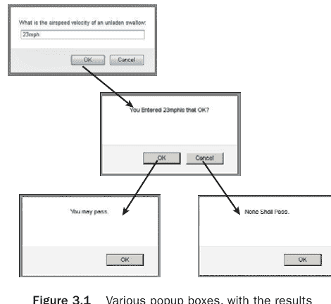

**图 3.1** 各种弹出框，结果通过 JavaScript 在弹出窗口之间传递。

> **顺便一提**
>
> 通常，使用一个固定定位的 `<div>` 元素配合覆盖层比使用这些弹出框要好得多，因为你可以对它们有更多的控制。稍后在本书中，我将向你展示如何做到这一点。

## 操作 Cookie

JavaScript 中的一个常见任务是获取和设置浏览器中的 Cookie。Cookie 允许你以持久化的方式在浏览器中存储简单的键值对信息。服务器端脚本和 JavaScript 可以访问 Cookie 以确定这些值是什么。

你可以使用 `document.cookie` 对象访问 Cookie 信息。该对象包含所有以字符串格式 `name=value; name=value; ....` 表示的 Cookie。

## 在浏览器中设置 Cookie 值

```javascript
function setCookie(name, value, days) {
  var date = new Date();
  date.setTime(date.getTime()+(days*24*60*60*1000));
  var expires = " "; expires=" "+date.toGMTString();
  document.cookie = name + "=" + value +
                    expires + "; path=/";
}
```

要为你的网站添加新的 Cookie，请设置 `document.cookie = "name=value; expireDate; path;"`。过期日期需要是使用 `.toGMTString()` 设置的日期，路径是 Cookie 适用的你网站上的路径。

## 从浏览器获取 Cookie 值

```javascript
function getCookie(name) {
  var cArr = document.cookie.split(';');
  for(var i=0;i < cArr.length;i++) {
    var cookie = cArr[i].split("=",2);
    cookie[0] = cookie[0].replace(/^\s+/,'');
    if (cookie[0] == name){ return cookie; }
  }
}
```

要获取 Cookie 的值，请使用 `;` 字符分割 `document.cookie` 值，然后遍历生成的数组，直到找到你要找的名称。

## 获取和设置 Cookie 的示例

以下代码展示了设置和获取 Cookie 的完整示例。当代码运行时，会设置两个 Cookie：一个用于名称，另一个用于语言。然后从浏览器中检索这些 Cookie 并写入网页，如图 3.2 所示。

```html
01 <html>
02 <head>
03    <title>Python Phrasebook</title>
04    <meta charset="utf-8" />
05    <script type="text/javascript"
06    src="../js/jquery-2.0.3.min.js"></script>
07    <script>
08        function setCookie(name, value, days) {
09            var date = new Date();
10            date.setTime(date.getTime()+(days*24*60*60*1000));
11            var expires = ""; expires=""+date.toGMTString();
12            document.cookie = name + "=" + value +
13                                expires + "; path=/";
14        }
15        function getCookie(name) {
16            var cArr = document.cookie.split(';');
17            for(var i=0;i < cArr.length;i++) {
18                var cookie = cArr[i].split("=",2);
19                cookie[0] = cookie[0].replace(/^\s+/,"");
20                if (cookie[0] == name){ return cookie; }
21            }
22        }

setCookie("name", "Brad", 1);

setCookie("language", "English", 1);

document.write("<h3>Cookies</h3>");

var c1 = getCookie("name");

document.write(c1[0] + " 已被设置为 " + c1[1] + "<br>");

var c2 = getCookie("language");

document.write(c2[0] + " 已被设置为 " + c2[1]);

</script>

</head>

<body>

</body>

</html>
```

**ch0302.html**

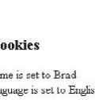

**图 3.2** 使用 JavaScript 添加 cookie 输出。

## 添加定时器

JavaScript 的另一个有用功能是能够设置定时器，在特定时间后或以特定间隔执行函数或求值表达式。

使用定时器可以延迟代码的执行，这样它就不必在事件触发或页面加载的确切时刻发生。以下小节将向你展示如何创建定时器来延迟代码执行以及应用重复操作。

## 添加延迟定时器

```javascript
function myTimer () {
    alert("Timer Function Executed");
}
var timerId = setTimeout(myTimer, 10000);
```

要简单地将代码执行延迟一定时间，请使用 `setTimeout(code, ms)` 方法，其中 `code` 是当时间到期时执行的语句或函数。`ms` 是毫秒数。例如，要执行名为 `myTimer()` 的函数，延迟 10 秒，你需要使用以下代码：

`setTimeout(myTimer, 10000);`

## 取消定时器

```javascript
function myTimer () {
    alert("Timer Function Executed");
}
var timerId = setTimeout(myTimer, 10000);
clearTimeout(timerId); //timer will not execute
```

在时间耗尽、代码执行之前的任何时刻，你都可以通过调用 `clearTimeout(id)` 方法（使用 `setTimeout()` 返回的 ID）来清除定时器。一旦定时器被清除，它就不会执行。你需要使用一个变量来跟踪 `setTimeout()` 返回的 ID。

## 添加重复定时器

```javascript
var statusTimerId;
var status = "OK";
//checks status every minute as long as it is "OK"
function checkStatus () {
    if(status == "OK"){
        alert("Status OK");
        statusTimerId = setInterval(checkStatus, 60000);
    } else {
        alert("Status Failed");
    }
    statusTimerId = setInterval(checkStatus, 60000);
}
```

你也可以使用 `setInterval(function, ms)` 方法启动一个按固定间隔触发的定时器。该方法也接受函数名和毫秒数作为参数。在函数内部，你需要对同一个函数再次调用 `setInterval()`，这样代码才会被再次调用。

要关闭重复定时器，只需不在定时器函数内部再次调用 `setInterval()`，或者在函数外部使用 `clearInterval()`。

此页有意留白。

# 第4章 访问 HTML 元素

动态 Web 开发中最重要的部分是能够快速高效地访问 DOM 元素。JavaScript 天生就提供了访问 DOM 元素的功能。这个 JavaScript 特性有时很有用，但这正是 jQuery 真正脱颖而出的领域。有时你将需要使用 JavaScript 方法来访问 DOM 元素，但在可能的情况下，我建议使用 jQuery。

本章中的小节涵盖了使用 JavaScript 和 jQuery 选择器方法来查找 DOM 元素。

## 在 JavaScript 中查找 HTML 元素


# 使用 JavaScript 查找 HTML 元素

使用 JavaScript 查找 HTML 元素有三种方式。你可以通过 ID 属性名、类名或标签类型来搜索它们。以下代码示例展示了一个定义好的 HTML `<div>` 元素，以便每种方法都可以使用它：

```html
<div id="myDiv" class="myClass">Content</div>
```

通过添加 `id` 和 `class` 属性，你可以使用这些值 "myDiv" 和 "myClass" 来搜索 `<div>` 元素。

## 通过 ID 查找 DOM 对象

```javascript
var containerObj = document.getElementById("myDiv");
```

查找 HTML 元素最简单的方法是使用 `document.getElementById(id)` 函数和 `id` 属性的值。`document.getElementById(id)` 函数在 DOM 中搜索具有匹配 `id` 属性的对象。如果找到该对象，函数就返回该 DOM 对象。

## 通过类名查找 DOM 对象

```javascript
var objs = document.getElementsByClassName("myClass");
for (var i = 0; i < objs.length; i++) {
    var htmlElement = objs[i];
    ...
}
```

你也可以使用 `document.getElementsByClassName(class)` 按它们的 `class` 属性搜索 HTML 元素。此函数返回一个包含所有具有匹配 `class` 属性的 DOM 对象的数组。然后你可以使用 JavaScript 循环遍历该列表并对每个 DOM 元素应用更改。

## 通过标签名查找 DOM 对象

```javascript
var objs = document.getElementsByTagName("div");
for (var i = 0; i < objs.length; i++) {
    var htmlElement = objs[i];
    ...
}
```

另一种搜索 HTML 元素的方法是使用它们的 HTML 标签，通过 `document.getElementsByTagName(tag)`。此函数在文档中搜索所有具有指定标签名的 DOM 对象，并将它们作为数组返回。然后你可以使用 JavaScript 循环遍历该数组，并访问或对每个 DOM 元素应用更改。

## 使用 jQuery 选择器查找 HTML 元素

与 JavaScript 不同，jQuery 允许你使用选择器以无数种方式查找 HTML 元素。是的，就像 CSS 选择器一样。事实上，大多数 jQuery 选择器都基于 CSS 选择器，因此提供了两者之间更无缝的过渡。

正如接下来几节中的小节所示，jQuery 选择器使得选择几乎任何一组 HTML 元素变得容易。请记住，jQuery 选择器返回的是代表一组 DOM 对象的 jQuery 对象，而不是 DOM 对象的直接数组。

jQuery 选择器语法很简单。一旦加载了 jQuery 库，只需使用 `$(selector)`。例如：

```javascript
$("#myElement")
```

## 第 4 章 访问 HTML 元素

> **注意！**
>
> jQuery 选择器语法中使用了几个元字符。如果你想使用任何元字符（如 `!"#$%&'()*+,./:;<=>?@[\]^`{|}~`）作为类名、ID 或名称的一部分，你需要使用 `\\`（两个反斜杠）转义该字符。例如，如果你有一个 `id="my.element"` 的元素，你应该使用选择器 `$("#my\\.element")`。

### 应用基本 jQuery 选择器

```javascript
$("*"); //selects all elements
$(".myClass"); //selects elements with class="myClass"
$("#myDiv"); //selects the element with id="myDiv"
$("div"); //selects <div> elements
$("div, span, p"); //selects <div>, <span>, and <p> elements
$("div.myClass"); //selects <div> elements with class="myClass"
```

最常用的选择器是基本选择器。基本选择器侧重于 HTML 元素的 ID 属性、class 属性和标签名。表 4.1 列出了一些示例，向你展示如何定义一些基本选择器。

**表 4.1 使用基本 jQuery 选择器的示例**

| 语法/示例 | 描述 |
| :--- | :--- |
| `$("*")` | 选择所有 HTML 元素。 |
| `$(".class")` | 基于 `class` 属性选择元素。 |
| `$(".container")` | 示例：选择所有 `class="container"` 的 HTML 元素。`.` 字符前缀表示类名。 |
| `$("#id")` | 基于 `id` 属性选择元素。<br>示例：选择 `id="menu"` 的 HTML 元素。`#` 字符前缀表示 `id` 值。 |
| `$("#menu")` | |
| `$("element")` | 基于标签类型选择元素。<br>示例：选择所有 `<div>` 元素。 |
| `$("div")` | |
| `$("element,element...")` | 基于标签选择多种类型的元素。<br>示例：选择所有 `<div>`、`<span>` 和 `<p>` 元素。你也可以指定多个由逗号分隔的元素。 |
| `$("div, span, p")` | |
| `$("element.class")` | 选择特定标签和类的元素。<br>示例：通过组合元素名和类名，选择所有具有 `class="bigList"` 的 `<ul>` 元素。<br>请注意，元素和类名之间没有空格。 |
| `$("ul.bigLists")` | |

## 基于 HTML 属性选择元素

```javascript
$("input[value=0]"); //selects <input> with value="0"
$("p[class*=my]"); //selects elements with "my" in classname
$("img[src^='icons/']"); //selects  elements where src starts with "icons/"
$("input[value!='default']"); //selects <input> elements where the value is not "default"
$("p[id]"); //selects <p> elements that have id set
$("p[id][class$=Menu]"); //selects <p> elements with id set and classname ending with "Menu"
```

使用 jQuery 选择器的另一种方法是通过 HTML 元素的属性值进行选择。这可以是默认属性，也可以是你添加到 HTML 元素上的属性。在选择器语法中，属性值用 `[]` 方括号括起来表示。表 4.2 展示了应用属性选择器的一些方式。

**表 4.2 使用 jQuery 属性选择器的示例**

| 语法/示例 | 描述 |
| :--- | :--- |
| `$("[attribute=value]")` | 选择属性 `attr=value` 的元素。 |
| `$("input[value=0]")` | 示例：选择所有 `value` 属性等于 0 的 `<input>` 元素。 |
| `$("[attr*=value]")` | 属性 `attr` 包含 `value`。 |
| `$("p[class*='Content']")` | 示例：选择所有类名中包含 "Content" 的 HTML 元素。例如，以下所有 `<p>` 元素都会被选中：<br>`<p class="leftContent">...</p>`<br>`<p class="centerContent">...</p>`<br>`<p class="rightContent">...</p>` |
| `$("[attr^=value]")` | 属性 `attr` 以 `value` 开头。 |
| `$("img[src^='icons/']")` | 示例：选择所有 `src` 属性以 "icons/" 开头的 `` 元素。注意，由于表达式不是简单的文本，值周围需要引号。同时注意 `/` 字符需要用 `\\` 转义。 |
| `$("[attr!=value]")` | 属性 `attr` 不等于 `value`。 |
| `$("input[value!='default text']")` | 示例：选择所有 `value` 不等于 "default text" 或没有 `value` 属性的 `<input>` 元素。 |
| `$("[attr]")` | 选择具有属性 `attr` 的元素。 |
| `$("p[id]")` | 示例：选择所有具有 `id` 属性的 `<p>` 元素。 |
| `$("[attr][attr2$=value]")` | 选择具有属性 `attr` 且属性 `attr2` 等于 `value` 的元素。 |
| `$("p[id][class$=Menu]")` | 示例：选择所有具有 `id` 属性且类属性以 "Menu" 结尾的 `<p>` 元素。例如，以下 HTML 元素中只有前两个会被选中：<br>`<p id="topMenu" class="topMenu">...</p>`<br>`<p id="topMenu" class="leftMenu">...</p>`<br>`<p id="contentMenu" class="contentMenuItem">...</p>`<br>`<p class="contentMenu">...</p>` |

## 基于内容选择元素

```javascript
$("p:contains('free')"); //selects <p> elements that contain "free"
$("div:has(span)"); //selects <div> elements that contain <span> elements
$("div:empty"); //selects <div> elements with no content or children
$("div:parent"); //selects <div> elements that have at least some content
```

另一组有用的 jQuery 选择器是内容过滤选择器。这些选择器允许你基于 HTML 元素内部的内容来选择 HTML 元素。表 4.3 展示了使用内容选择器的示例。

**表 4.3 使用 jQuery 内容选择器的示例**

| 语法/示例 | 描述 |
| :--- | :--- |
| `$(":contains(value)")` | 选择其内容中包含 `value` 文本的元素。 |
| `$("div:contains('Open Source')")` | 示例：选择所有包含文本 "Open Source" 的 `<div>` 元素。 |
| `$(":has(element)")` | 选择包含特定子元素的元素。 |
| `$("div:has(span)")` | 示例：选择所有包含 `<span>` 元素的 `<div>` 元素。例如，以下元素中只有第一个会被选中：<br>`<div><span>Span</span></div>`<br>`<div>No Span Text</div>` |
| `$(":empty")` | 选择没有内容的元素。 |
| `$("div:empty")` | 示例：选择所有没有内容的 `<div>` 元素。 |
| `$(":parent")` | `:empty` 的反向选择，选择至少有一些内容的元素。 |
| `$("div:parent")` | 示例：选择所有至少有一些内容的 `<div>` 元素。 |

## 通过层级位置选择元素

```javascript
$("div span"); //selects <span> elements with a <div> ancestor
$("div.menu > span"); //selects <span> elements whose immediate parent is a <div> with class="menu"
$("label + input.textItem"); //selects <input> elements with class="textItem" that are immediately preceded by a <label>
$("#menu ~ div"); //selects all <div> elements that are siblings of the element with id="menu"
```

一组重要的 jQuery 选择器是层级选择器。这些选择器允许你基于 DOM 层级结构来选择 HTML 元素。这使你能够编写更具内容感知性的动态代码，只需基于 DOM 树中的父元素、子元素或其他周围元素来选择元素。表 4.4 展示了一些层级选择器的示例。

**表 4.4 使用 jQuery 层级选择器的示例**

| 语法/示例 | 描述 |
| :--- | :--- |
| `$(" ancestor element")`<br>`$("div span")` | 选择具有类型为 `ancestor` 的祖先元素且与 `element` 匹配的元素。<br><br>示例：选择所有具有 `<div>` 祖先元素的 `<span>` 元素。`<div>` 元素不一定是直接祖先。例如，以下 `<span>` 元素仍会被选中：<br><br>`<div><p>Some <span>Span Text</span></p></div>` |
| `$("parent > child")`<br>`$("div.menu > span")` | 选择具有特定父类型的元素。`>` 表示直接的子/父关系。<br><br>示例：选择所有 `<span>` 元素，其直接父元素是具有 `class="menu"` 的 `<div>`。 |
| `$("prev + next")`<br>`$("label + input.textItem")` | 选择紧随特定类型元素之后的元素。`+` 表示 `prev` 项必须紧邻 `next` 项。<br><br>示例：选择所有紧随具有 `class="textItem"` 的 `<input>` 元素之后的 `<label>` 元素。 |
| `$("prev ~ siblings")`<br>`$("#menu ~ div")` | 选择在 `prev` 之后、具有相同父元素且与 `siblings` 选择器匹配的元素。`~` 表示兄弟元素。<br><br>示例：选择所有与 `id="menu"` 的元素是兄弟关系且在 DOM 树中位于 `"#menu"` 项之后的 `<div>` 元素。注意，在之前出现的 `<div>` 元素不会被选中。例如，只有以下最后两个元素会被选中：<br>`<div>...</div>`<br>`<ul id="menu"> ... </ul>`<br>`<span> ... </span>`<br>`<div> ... </div>`<br>`<div> ... </div>` |

> **注意：** 在设计你的 jQuery 选择器时，始终最好尽可能具体。例如，如果你想选择所有 `class="menu"` 的 `span` 元素，并且这些元素仅位于 `id="menuDiv"` 的 `<div>` 元素下，那么 `$("div#menuDiv .menu")` 会比简单的 `$("menu")` 高效得多，因为它会在检查 `menu` 类属性之前，先将搜索范围限制在 `<div>` 元素内。

## 通过表单状态选择元素

```javascript
$("input:checked"); //selects <input> elements that are checked
$("option:selected"); //selects <option> elements that are selected
$("#myForm :focus"); //selects the element in the #myForm <form> that currently has the focus
$("input:disabled"); //selects <input> elements that are currently disabled
```

在处理动态 HTML 表单时，一组极其有用的选择器是表单 jQuery 选择器。这些选择器允许你基于表单元素的状态来选择表单中的元素。表 4.5 展示了一些表单选择器的示例。

**表 4.5 使用 jQuery 表单选择器的示例**

| 语法/示例 | 描述 |
| :--- | :--- |
| `$(":checked")`<br>`$("input:checked")` | 选择 `checked` 属性为 `true` 的元素。<br><br>示例：选择所有当前处于选中状态的 `<input>` 元素。 |
| `$(":selected")`<br>`$("option:selected")` | 选择 `selected` 属性为 `true` 的元素。<br><br>示例：选择所有当前被选中的 `<option>` 元素。 |
| `$(":focus")`<br>`$(":focus")` | 选择在表单中获得焦点的元素。<br><br>示例：选择所有当前获得焦点的 HTML 元素。 |
| `$(":enabled")` | 选择启用的元素。 |
| `$("input:enabled")` | 示例：选择所有处于启用状态的 `<input>` 元素。 |
| `$(":disabled")` | 选择禁用的元素。 |
| `$("input:disabled")` | 示例：选择所有处于禁用状态的 `<input>` 元素。 |

## 基于可见性选择元素

```javascript
$("div:visible"); //选择当前可见的 <div> 元素
$("div:hidden"); //选择当前隐藏的 <div> 元素
```

如果你使用可见性来控制网页组件的流程和交互，那么使用 jQuery 的可见性选择器可以轻松地选择隐藏或可见的 HTML 元素。表 4.6 展示了一些可见性选择器的示例。

**表 4.6 使用 jQuery 可见性选择器的示例**

| 语法/示例 | 描述 |
| :--- | :--- |
| `$(":visible")` | 选择可见元素。 |
| `$("div:visible")` | 示例：选择所有当前具有一定高度和宽度的 `<div>` 元素，这意味着它们在浏览器中占据空间。这甚至会包括通过 `visibility:hidden` 或 `opacity:0` 隐藏的元素，因为它们仍然占据空间。 |
| `$(":hidden")` | 选择隐藏元素。 |
| `$("div:hidden")` | 示例：选择所有当前 CSS 属性为 `visibility:hidden` 或 `opacity:0` 的 `<div>` 元素。 |

## 在 jQuery 选择器中应用过滤器

```javascript
$("tr:even"); //选择偶数的 <tr> 元素
$("li:odd"); //选择奇数的 <li> 元素
$("div:first"); //选择第一个 <div> 元素
$("div:last"); //选择最后一个 <div> 元素
$(":header"); //选择 <h1>、<h2>、... 等元素
$("div:eq(5)"); //选择第六个 <div> 元素
$("li:gt(1)"); //选择前两个之后的 <li> 元素
$("li:lt(2)"); //选择前两个 <li> 元素
$(":animated"); //选择当前正在执行动画的元素
```

通常你需要将 jQuery 选择器细化到更具体的子集。一种实现方法是使用过滤选择器。过滤选择器在选择器语句的末尾附加一个过滤器，以限制选择器返回的结果。表 4.7 展示了向选择器添加过滤器的一些示例。

**表 4.7 使用 jQuery 过滤选择器的示例**

| 语法/示例 | 描述 |
| :--- | :--- |
| `$(":even")` | 过滤掉所有索引为奇数的元素。 |
| `$("tr:even")` | 示例：选择所有 `<tr>` 元素，然后将结果过滤到仅包含偶数编号的项。 |
| `$(":odd")` | 过滤掉所有索引为偶数的元素。 |
| `$("li:odd")` | 示例：选择所有 `<li>` 元素，然后将结果过滤到仅包含奇数编号的项。 |
| `$(":first")` | 过滤掉除第一个元素外的所有元素。 |
| `$("div:first")` | 示例：仅选择遇到的第一个 `<div>` 元素。 |
| `$(":last")` | 过滤掉除最后一个元素外的所有元素。 |
| `$("div:last")` | 示例：仅选择遇到的最后一个 `<div>` 元素。 |
| `$(":header")` | 选择标题类型的元素，如 `<h1>`、`<h2>`、`<h3>` 等。 |
| `$(":header")` | 示例：选择所有标题元素。 |
| `$(":eq(index)")` | 选择特定基于零索引位置的元素。 |
| `$("div:eq(5)")` | 示例：选择遇到的第六个 `<div>` 元素。之所以选择第六个而不是第五个元素，是因为索引从零开始，所以 0 代表第一个。 |
| `$(":gt(index)")` | 过滤列表以仅包含特定基于零索引位置之后的元素。 |
| `$("li:gt(1)")` | 示例：选择遇到的第二个之后的每个 `<li>` 元素。同样，此索引从零开始。 |
| `$(":lt(index)")` | 过滤列表以仅包含特定基于零索引位置之前的元素。 |
| `$("li:lt(2)")` | 示例：仅选择遇到的第一个和第二个 `<li>` 元素。同样，此索引从零开始。 |
| `$(":animated")` | 选择当前正在执行动画的元素。 |
| `$(":animated")` | 示例：选择所有当前正在执行动画的元素。 |

## 链式 jQuery 对象操作

```javascript
$("div#content").children("p:first").css("font-weight", "bold").children("span").css("color", "red");
```

jQuery 对象的一大优点是你可以将多个 jQuery 操作链接到一个语句中。链中的每个连续语句都对前一个操作的结果进行操作。这可以简化你的选择器，并减少 CSS 中所需的类和 ID 定义的数量。

为了说明这一点，请考虑以下语句。代码首先找到 `id="content"` 的 `<div>` 元素，然后在其中找到第一个 `<p>` 元素，并将字体粗细更改为粗体。然后它找到 `<p>` 中的 `<span>` 元素，并将颜色设置为红色：

```javascript
var $contentDiv = $("div#content");
var $firstP = $contentDiv.children("p:first");
$firstP.css("font-weight", "bold");
var $spans = $firstP.children("span");
$spans.css("color", "red");
```

之前的代码用了五行来完成所有任务。下面这个链式 jQuery 操作语句做了同样的事情，但只用了一个语句：

```javascript
$("div#content").children("p:first").css("font-weight", "bold").children("span").css("color", "red");
```

因为每个操作都返回一个 jQuery 对象，所以你可以根据需要链接任意多的 jQuery 操作。即使 `.css()` 操作旨在修改 DOM 对象而不是查找它们，它仍然返回相同的 jQuery 对象，因此你可以对结果执行其他操作。

## 通过导航 jQuery 对象来选择元素

附加到 jQuery 对象的另一组重要方法是 DOM 遍历方法。DOM 遍历允许你根据元素与其他元素的关系来选择元素。DOM 遍历的一些示例是访问所有作为 `<div>` 元素子元素的 `<p>` 元素，以及找到作为 `<input>` 元素兄弟元素的 `<label>` 元素。

jQuery 对象提供了一套令人难以置信的方法，允许你以几乎无数的方式遍历 DOM，通过允许你使用 jQuery 对象中当前选择的 DOM 元素来选择树中的其他 DOM 元素集合。以下短语提供了一些在 jQuery 对象中遍历 DOM 元素以到达其他对象集合的示例。

### 获取元素的子元素

```javascript
$("div").children("p");
//选择作为 <div> 元素直接子元素的 <p> 元素
```

`.children([selector])` 方法返回一个 jQuery 对象，表示当前对象所代表元素的子元素。你可以指定一个可选的选择器，将结果限制为仅包含与该选择器匹配的子元素。

### 获取最近的祖先元素

```javascript
$("p.menu").closest("div");
//选择具有 class="menu" 的 <p> 元素的最近 <div> 祖先
```

`.closest(selector, [context] 或 object 或 element)` 方法返回一个 jQuery 对象，表示与传入参数匹配的第一个元素。参数可以是选择器、带有搜索起点上下文的选择器、jQuery 对象或 DOM 对象。搜索从当前元素集开始，然后搜索祖先。

### 获取包含的内容

```javascript
$("div").contents();
//选择 <div> 元素中的所有直接子元素
$("select").contents();
//选择 <select> 元素中的所有 <option> 元素
```

`.contents()` 返回一个 jQuery 对象，表示当前元素集的直接子元素。这对于获取列表中的所有 `<li>` 元素或 `<select>` 块中的 `<option>` 元素特别有用。

### 查找后代元素

```javascript
$("table").find("span");
//选择 <table> 元素中某处包含的所有 <span> 元素
$("#myForm").find("input");
//选择元素 #myForm 中某处包含的所有 <input> 元素
```

`.find(filter)` 方法返回一个 jQuery 对象，表示当前集合中与提供的过滤器匹配的后代。过滤器可以是选择器、用于匹配元素的 jQuery 对象或元素标签名称。

示例：选择 `<table>` 元素中某处包含的所有 `<span>` 元素。

### 获取选定对象之后的同级元素

```javascript
$("#title").next("p");
//查找 id="title" 的元素并选择其紧随其后的下一个同级 <p> 元素

$("p:first").nextAll();
//选择它找到的第一个 <p> 元素，然后选择该元素的所有 <p> 同级元素

$("p:first").nextUntil("ul");
//选择它找到的第一个 <p> 元素，然后选择所有同级元素，直到找到一个 <ul> 元素
```

`.next([selector])` 方法返回一个 jQuery 对象，表示当前集合中每个元素的下一个同级元素。如果提供了可选的选择器，则仅当下一个同级元素匹配该选择器时才会被添加。

`.nextAll([selector])` 方法返回一个 jQuery 对象，表示当前集合中每个元素的所有后续同级对象。同样接受一个可选的选择器。

`.nextUntil([selector] 或 [element] [,filter])` 方法返回一个 jQuery 对象，表示当前集合中每个元素之后的所有同级对象，直到遇到与元素或选择器参数匹配的对象。第一个参数可以是 DOM 对象或选择器。第二个可选参数是一个过滤选择器，用于限制结果中返回的项目。

### 获取定位父级

```javascript
$("#notify").offsetParent();
//选择 id="notify" 的元素，然后选择用于定位该元素的祖先元素
```

`.offsetParent()` 方法返回一个 jQuery 对象，表示具有 CSS `position` 属性为 `relative`、`absolute` 或 `fixed` 的最近的祖先元素。这使你可以获取用于定位的元素，当你需要获取定位容器的大小时，这一点变得至关重要。

### 查找选定项目的父级或祖先

```javascript
$("div#menu").parent();
//选择 id="menu" 的 <div> 元素，然后查找其直接父级

$("#data").parents("div");
//选择 id="data" 的元素，然后返回包含所有 <div> 祖先的集合

$("#data").parentsUntil("#menu");
//选择 #data 的父级，直到找到 id="#menu" 的元素
```

`.parent([selector])` 方法返回一个 jQuery 对象，表示当前集合中每个元素的直接父级对象。可选的选择器参数允许你将结果限制为匹配选择器的那些父级。

`.parents([selector])` 方法返回一个 jQuery 对象，表示当前集合中每个元素的祖先。可选的选择器参数允许你将结果限制为匹配选择器的那些父级。

`.parentsUntil([selector] 或 [element] [, filter])` 方法返回一个 jQuery 对象，表示当前集合中每个元素的祖先，直到遇到与元素或选择器参数匹配的对象。第一个参数可以是元素标签名或选择器。第二个可选参数是一个过滤选择器，用于限制结果中返回的项目。

### 获取前一个同级元素

```javascript
$("p#footer").prev("p");
//查找 id="footer" 的 <p> 元素，并选择其前一个同级 <p> 元素

$("div#footer").prevAll("div");
//选择 id="footer" 的 <div> 元素，然后选择该元素之前的所有 <div> 同级元素

$("div#footer").prevUntil("div#header");
//查找 id="footer" 的 <div> 元素，然后选择之前的所有同级元素，直到找到 #header
```

`.prev([selector])` 方法返回一个 jQuery 对象，表示当前集合中每个元素的前一个同级元素。如果提供了可选的选择器，则仅当前一个同级元素匹配该选择器时才会被添加。

`.prevAll([selector])` 方法返回一个 jQuery 对象，表示当前集合中每个元素的所有先前同级对象。它同样接受一个可选的选择器。

`.prevUntil([selector] 或 [element] [,filter])` 方法返回一个 jQuery 对象，表示当前集合中每个元素之前的所有同级对象，直到遇到与元素或选择器参数匹配的对象。第一个参数可以是 DOM 对象或选择器。第二个可选参数是一个过滤选择器，用于限制结果中返回的项目。

### 获取同级元素

```javascript
$(".menu").siblings("span");
//选择所有与 class="menu" 的元素互为同级的 <span> 元素
```

`.siblings([selector])` 方法返回一个 jQuery 对象，表示当前集合中每个元素的所有同级对象。可选的选择器参数允许你将结果限制为匹配选择器的那些同级元素。

## 操作 jQuery 对象集合

jQuery 对象的一个重要方面是能够访问和操作由该对象表示的 DOM 元素集合。这与操作 DOM 元素本身不同。

jQuery 提供了几种方法，允许你修改 jQuery 对象表示的 DOM 元素。还有一些方法可以遍历每个元素以构建不同的元素或应用其他操作。

以下章节旨在向你展示如何以各种方式使用 jQuery 对象集合。

## 从 jQuery 对象集合中获取 DOM 对象

```javascript
$("div").get();
//返回所有 <div> 元素的 DOM 对象数组

$("div").get(0);
//返回第一个 <div> 的 DOM 对象

$("div").get(-1);
//返回最后一个 <div> 的 DOM 对象
```

`.get([index])` 方法返回 jQuery 对象集合中表示的 DOM 元素。如果未指定索引，则返回 DOM 对象的数组。如果指定了索引，则返回数组中该从零开始的偏移位置处的 DOM 元素。

如果索引是负数，则返回从数组末尾反向偏移位置处的项目。例如，`-1` 是最后一项，`-2` 是倒数第二项。

## 将 DOM 对象转换为 jQuery 对象

```javascript
var containerObj = document.getElementById("myDiv");
$(containerObj); //等同于 $("#myDiv");

var objs = document.getElementsByClassName("myClass");
$(objs); //等同于 $(".myClass");

var objs = document.getElementsByTagName("div");
$(objs); //等同于 $("div");
```

jQuery 构造函数 `$()` 接受 DOM 对象和数组作为参数。如果你传入一个 DOM 对象，`$()` 会将该 DOM 对象或数组转换为一个 jQuery 对象，然后你可以以常规的 jQuery 方式对其进行操作。

## 使用 `.each()` 遍历 jQuery 对象集合

```javascript
$("p").each(function (idx){
    $(this).html("这是第 " + idx + " 段落");
});
```

`.each(function)` 方法是最重要的 jQuery 对象方法之一，因为它允许你遍历 jQuery 集合中的所有元素，并对每个元素单独执行操作。这与仅仅对查询中的所有项目应用相同的操作是不同的。

`.each()` 方法允许你为 jQuery 对象集合中的每个元素指定一个要运行的函数。该函数接收一个索引号作为第一个参数。在函数内部，`this` 变量指向当前的 DOM 元素。

为了说明 `.each()` 的使用，请查看以下代码片段。它遍历所有段落元素，并将空 `<p>` 元素的内容设置为包含该元素索引号的字符串，如图 5.1 所示：

```html
01 <html>
02 <head>
03 <title>Python Phrasebook</title><meta charset="utf-8" />
04 <script type="text/javascript" src="../js/jquery-2.0.3.min.js"></script>
05 <script>
06   $(document).ready(function (){
07     $("p").each(function (idx){
08       $(this).html("这是第 " + idx + " 段落");
09     });
10 });
11 </script>
12 </head>
13 <body>
14 <p></p>
15 <p></p>
16 <p></p>
17 <p></p>
18 </body>
19 </html>
```

ch0501.html

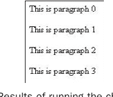

请注意，`idx` 是作为索引号传入的，第一个 `<p>` 元素为 0，第二个为 1，依此类推。另请注意，我使用 `$(this)` 将其转换为 jQuery 对象，以便调用 `.html()` 方法。

> **顺便提一下**
>
> 当使用 jQuery 方法遍历 DOM 元素时，你可以使用 `this` 关键字来访问当前正在迭代的 DOM 对象。`this` 是一个 DOM 对象，而不是 jQuery 对象，因此如果你需要使用 DOM 对象的 jQuery 形式，请使用 `$(this)`。不过，请记住，构建 DOM 对象的 jQuery 形式需要一些开销，因此只在需要其提供的功能时才创建 jQuery 形式。

## 使用 `.map()`

```javascript
var liValues = $("li").map(function (idx){
  return $(this).html();
}).get();
```

`.map(function)` 方法同样遍历 jQuery 对象集合中的每个元素。虽然与 `.each()` 相似，但有一个重大区别：`.each()` 返回同一个 jQuery 对象，而 `.map()` 返回一个包含每次迭代返回值的**新的 jQuery 对象**。

为了说明 `.map()` 的使用，请查看下面的代码片段。这段代码遍历所有 `<li>` 元素，并返回一个包含图 5.2 所示 `<li></li>` 元素内 HTML 内容值的数组：

```html
01 <html>
02   <head>
03     <title>Python Phrasebook</title>
04     <meta charset="utf-8" />
05     <script type="text/javascript"
06       src="../js/jquery-2.0.3.min.js"></script>
07     <script>
08       $(document).ready(function (){
09         var liValues = $("li").map(function (idx){
10           return $(this).html();
11         }).get();
12       });
13     </script>
14   </head>
15   <body>
16     <ul>
17       <li>Aragorn</li>
18       <li>Legolas</li>
19       <li>Gimli</li>
20     </ul>
21   </body>
22 </html>
```

ch0502.html

```json
[
    "Aragorn",
    "Legolas",
    "Gimli"
]
```

liValues 的最终值

- Aragorn
- Legolas
- Gimli

**图 5.2** 运行 ch0502.html 代码的结果。

请注意，在每次迭代期间，函数都返回 `<li>` 元素中的 HTML 内容。该值被添加到 `.map()` 方法返回的映射对象集合中。最后的 `.get()` 调用获取映射集合中表示的 JavaScript 数组对象。

## 将数据值分配给对象

```javascript
$("li:eq(0)").data("race", "Men");
$("li:eq(1)").data("race", "Elves");
$("li:eq(2)").data({race: "Dwarves"});
$("li").each(function(){
  $(this).append(" of the race of ");
  $(this).append($(this).data("race"));
});
```

jQuery 提供了 `.data(key [,value])` 方法，用于将数据片段以键=值对的形式存储在 DOM 对象内部。这允许您向对象附加额外的数据片段，以便稍后访问。

`.data(object)` 是另一种形式，它接受包含键值对的 JavaScript 对象。当您已经在处理对象时，这会变得很有用。

要访问已存储的数据项，只需调用 `.data(key)`，它将返回对象值。您可以将数据附加到任何类型的 HTML 对象。例如，您可以向提供比传统值更多信息的 `<option>` 元素附加额外数据。

以下代码展示了在对象中存储数据的示例。第 9-11 行将数据存储在 `<li>` 元素中。然后第 12-15 行中的 each 函数遍历 `<li>` 元素，并将包含存储值的字符串追加到内容上。图 5.3 显示了生成的 HTML 页面：

```html
01 <html>
02 <head>
03 <title>Python Phrasebook</title>
04 <meta charset="utf-8" />
05 <script type="text/javascript"
06 src="../js/jquery-2.0.3.min.js"></script>
07 <script>
08 $(document).ready(function (){
09 $("li:eq(0)").data("race","Men");
10 $("li:eq(1)").data("race","Elves");
11 $("li:eq(2)").data("race","Dwarves");
12 $("li").each(function(){
13 $(this).append(" of the race of ");
14 $(this).append($(this).data("race"));
15 });
16 });
17 </script>
18 </head>
19 <body>
20 <ul>
21 <li>Aragorn</li>
22 <li>Legolas</li>
23 <li>Gimli</li>
24 </ul>
25 </body>
26 </html>
```

ch0503.html

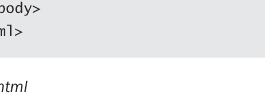

## 向 jQuery 对象集合添加 DOM 元素

```javascript
var pars = $("p");
//包含所有 <p> 元素
var pAndDiv = $("div").add(pars);
//包含所有 <div> 和 <p> 元素
var pAndDivAndSpan = $("span").add("p").add("div");
//包含所有 <span>、<div> 和 <p> 元素
```

jQuery 的一个强大特性是向 jQuery 对象集合添加额外元素是多么容易。`.add(selector)` 方法将匹配选择器的元素添加到 jQuery 对象表示的集合中。

`.add(object)` 方法接受另一个 jQuery 对象，并将该对象中的元素添加到当前对象的集合中。

## 从 jQuery 对象集合中移除对象

```javascript
var items = $("span");
items.css({color: "red"});
//将所有 <span> 元素中的文本颜色设置为红色
items.remove(".menu");
items.css({"font-weight": "bold"});
//将所有 <span> 元素（.menu 除外）设置为粗体
```

jQuery 的另一个强大特性是很容易从 jQuery 对象集合中移除项目以及添加额外的元素。`.remove([selector])` 方法将从 jQuery 对象表示的集合中移除匹配选择器的元素。不带选择器调用 `.remove()` 将移除集合中的所有元素。

## 筛选 jQuery 对象结果

jQuery 对象提供了一组良好的方法，允许您更改查询中表示的 DOM 对象。当您试图在 jQuery 选择器结果中精确定位一组特定元素时，减少结果会很有帮助。以下示例提供了筛选 jQuery 选择器结果以找到对象集的示例。

### 基于索引筛选项目

```javascript
$("div#content").eq(1);
//选择选择器找到的第二个元素
```

`.eq(index)` 筛选器将返回 jQuery 对象集合中特定索引处的元素。索引从零开始，因此 `.eq(1)` 实际上检索的是选择器找到的第二个元素。

### 使用筛选函数筛选选择器结果

```javascript
$("option").filter(
  function (index) {
    return (this.value > 5); });
//仅选择 value=5 的 <option> 元素
$("div").filter(".myClass");
//仅选择具有 class="myClass" 的 <div> 元素
```

`.filter(filter)` 方法将集合缩减为仅匹配指定筛选器的项目。筛选器可以是选择器、特定的 DOM 元素、jQuery 对象或测试每个元素并在应包含时返回 `true` 的函数。

> **你知道吗？**
>
> 与 CSS 选择器相同的 jQuery 选择器能够使用原生 DOM 方法 `querySelectorAll()`，该方法在 DOM 对象上有一些高级优化。其他 jQuery 选择器无法利用该优化，因此最好先使用基于 CSS 的选择器，然后将筛选器作为链式选择器添加。例如，不应使用 `$("div:animated")`，而应使用 `$("div").filter(":animated")`。

### 获取第一项或最后一项

```javascript
$("p").first(); //选择集合中的第一个 <p> 元素
$("p").last(); //选择集合中的最后一个 <p> 元素
```

`.first()` 方法选择 jQuery 对象集合中的第一个元素。许多返回值的 jQuery 方法最终都使用集合中的第一个元素。`.last()` 方法选择 jQuery 对象集合中的最后一个元素。

### 获取包含其他项目的项目

```javascript
$("div").has("p");
//选择具有 <p> 后代元素的 <div> 元素
$("div").has("#menu");
//选择包含具有 id="menu" 的元素的 <div> 元素
```

`.has(selector or element)` 方法将集合缩减为那些具有匹配选择器的后代元素或包含指定 DOM 元素的元素。

### 使用 Not 逻辑筛选项目

```javascript
$("div").not(".menu");
//选择 <div> 元素；不具有 .menu 类
$("option").not(function(){
    return (this.value == 0);
});
//选择不具有 value=0 的 <option> 元素
```

`.not(filter)` 方法将集合缩减为匹配筛选器的项目。筛选器可以是选择器、一个或多个特定的 DOM 元素、jQuery 对象或测试每个元素并在应包含时返回 `true` 的函数。

### 切片选择器结果

```javascript
$("tr").slice(2, 5);
//选择索引在 2 到 4 之间（含）的 <tr> 元素
$("p").slice(1, -1);
//选择除第一个和最后一个之外的所有 <p> 元素
```

`.slice(start, [end])` 方法移除索引 `start` 之前和索引 `end` 之后的元素，并仅返回中间的项目。这允许您将大型选择拆分为较小的块。索引从零开始。负的 `end` 表示从列表末尾开始的偏移量，其中 `-1` 是最后一个元素，`-2` 是倒数第二个元素。

# 第 6 章 捕获与使用浏览器和用户事件

jQuery 和 JavaScript 的主要目标之一是让开发者能够创建功能极其复杂且交互丰富的网页。交互式网页的核心在于事件。*事件*指的是浏览器环境中发生的任何事情，从页面加载、鼠标移动或点击、键盘输入，到窗口大小调整等。

理解事件、代表事件的对象以及如何将它们应用于网页，将使你能够创造出令人惊叹的用户交互效果。本章涵盖了理解事件以及如何在构建丰富的交互式网页中应用事件所需的概念。

本章的代码示例旨在向你展示 JavaScript 事件引擎的工作原理，以及如何应用 JavaScript 和 jQuery 代码来实现事件处理程序。你将能够结合其他章节的概念，运用本章的知识来实现专业且丰富的用户交互。

## 理解事件

浏览器事件的概念相当简单。事件是任何改变浏览器或网页状态的事情。这些包括页面加载、鼠标移动和点击、键盘输入，以及表单提交和其他在页面中发生的事情。每个事件都有一个事件对象，描述了发生的事件以及发生在哪个对象上。

本节提供了一些表格，帮助你快速了解事件对象的外观、JavaScript 中触发的一些更常见的事件以及触发它们的原因。

### 回顾事件类型

事件类型是 JavaScript 和 jQuery 用来识别所发生的物理事件的关键字。这些关键字用于附加特定类型的事件处理程序。此外，正如你稍后将看到的，这些关键字也用于方法的名称中，以便你可以附加事件处理程序或手动触发事件。

JavaScript 提供了几种事件类型，对应于动态页面交互过程中发生的不同事件。jQuery 事件处理支持所有 JavaScript 事件类型，并添加了一些自己的事件类型。表 6.1 列出了 JavaScript 和 jQuery 支持的不同事件类型。

**表 6.1 JavaScript 和 jQuery 事件类型**

| 事件类型 | 描述 |
| :--- | :--- |
| `abort` | 在图像加载完成之前被中止时触发。 |
| `blur` | 当表单元素失去焦点时触发。 |
| `change` | 当表单元素的内容、选中状态或检查状态发生改变时触发。适用于 `<input>`、`<select>` 和 `<textarea>` 元素。 |
| `click` | 当用户点击一个 HTML 元素时触发。 |
| `dblclick` | 当用户双击一个 HTML 元素时触发。 |
| `error` | 当图像未能正确加载时触发。 |
| `focus` | 当表单元素获得焦点时触发。 |
| `focusin` | 当表单元素或其内部的任何元素获得焦点时触发。与 `focus` 的不同之处在于它支持事件冒泡到父元素。这是 jQuery 专有的事件。 |
| `focusout` | 当表单元素或其内部的任何元素失去焦点时触发。与 `blur` 的不同之处在于它支持事件冒泡到父元素。这是 jQuery 专有的事件。 |
| `keydown` | 当用户按下按键时触发。 |
| `keypress` | 当用户按下按键时触发。 |
| `keyup` | 当用户释放按键时触发。 |
| `load` | 当文档、框架集或 DOM 元素加载完成时触发。 |
| `mousedown` | 当用户按下鼠标按钮时触发。目标元素是鼠标在按下按钮时所经过的元素。 |
| `mousemove` | 当鼠标光标在元素上移动时触发。 |
| `mouseover` | 当鼠标光标移动到元素或其任何子元素上时触发。 |
| `mouseout` | 当鼠标光标移出元素或其任何子元素时触发。 |
| `mouseup` | 当用户释放鼠标按钮时触发。目标元素是鼠标在释放按钮时所经过的元素。 |
| `mouseenter` | 当鼠标光标进入元素时触发。与 `mouseover` 的不同之处在于它仅由元素本身触发，而不是其子元素。这是 jQuery 专有的事件。 |
| `mouseleave` | 当鼠标光标离开元素时触发。与 `mouseout` 的不同之处在于它仅由元素本身触发，而不是其子元素。这是 jQuery 专有的事件。 |
| `reset` | 当表单被重置时触发。 |
| `resize` | 当通过调整浏览器窗口或框架的大小来改变文档视图大小时触发。 |
| `scroll` | 当文档视图被滚动时触发。 |
| `select` | 当用户在 `<input>` 或 `<textarea>` 中选择文本时触发。 |
| `submit` | 当表单被提交时触发。 |
| `unload` | 当页面从 `<body>` 或 `<frameset>` 元素卸载时触发。 |

## 添加事件处理程序

事件处理程序是在事件触发时被调用的函数。事件对象会传递给事件处理程序，因此你可以在事件处理程序中访问有关事件的信息。

以下代码示例展示了在 HTML、JavaScript 和 jQuery 中添加事件处理程序的方法。

### 在 JavaScript 中添加页面加载事件处理程序

```html
<script>
  function onloadHandler(){
    （此处为初始化代码...）
  }
</script>
...
<body onload="onloadHandler()">
```

要在 JavaScript 中添加在页面加载时运行的初始化代码，请创建一个执行初始化的 JavaScript 函数。例如，以下 JavaScript 代码展示了一个简单的骨架初始化函数：

```javascript
function onloadHandler(){
    （此处为初始化代码...）
}
```

要使 `onloadHandler()` 在页面完全加载时触发，请将事件处理函数添加到 HTML 中 `<body>` 元素的 `onload` 属性中。例如：

```html
<body onload="onloadHandler()">
```

### 在 jQuery 中添加初始化代码

```javascript
$(document).ready(function(){
    （此处为初始化代码...）
});
// 或
$(document).load(function(){
    （此处为初始化代码...）
});
```

在 jQuery 中，你可以在两个不同的时间触发并执行初始化代码：DOM 就绪时，以及文档及其资源完全加载后。使用哪个选项取决于你的初始化代码需要做什么。

使用 `.ready()` jQuery 方法会在 DOM 完全就绪时触发初始化代码运行。所有的 DOM 对象都将被创建，页面将展示给用户。请注意，此时并非所有页面资源（如图像）都已完全下载。这是我最常使用的选项，因为它允许我尽快添加交互和功能。以下是一个使用 `.ready()` 附加简单初始化函数的示例：

```javascript
$(document).ready(function(){
    （此处为初始化代码...）
});
```

使用 `.load()` jQuery 方法会在所有页面资源加载完成并呈现给用户后触发初始化代码运行。有时，如果我在应用初始化代码时需要资源信息（如图像尺寸），我会使用此选项。以下代码展示了使用 `.load()` 附加简单初始化函数的示例：

```javascript
$(document).load(function(){
    （此处为初始化代码...）
});
```

> **注意！** `.ready()` 和 `.load()` 方法与在 `<body>` 标签中使用 `onload="..."` 属性不兼容。如果你使用 jQuery，请使用 `.ready()` 或 `.load()`；如果不使用 jQuery，则使用 `onload` 属性。

### 在 HTML 中指定事件处理程序

```javascript
function clickHandler(e){
    $("div").html("clicked at X position: " + e.screenX);
}
...
<div onclick="clickHandler(event)">点击此处</div>
```

向 DOM 元素添加事件处理程序的最基本方法是在 HTML 代码中直接指定。这种方法的优点是简单易用。

#### 事件处理程序

事件处理程序是通过设置标签语句中处理程序属性的值，将其添加到 HTML 中的 DOM 对象。对于元素支持的每个事件，都有一个以 `on` 开头后跟事件名称的属性。例如，点击事件属性是 `onclick`，加载事件属性是 `onload`。要查看事件类型列表，请参阅表 6.1。

以下示例展示了在 HTML 代码中为 DOM 元素添加点击事件处理程序是多么简单：

```html
<div onclick="clickHandler()">Click Here</div>
```

当你点击 `<div>` 元素时，浏览器将调用以下函数：

```javascript
function clickHandler(){
  $("div").html("clicked");
}
```

你也可以使用 `event` 关键字将 DOM 事件对象作为参数包含在事件处理程序中。这允许你在事件处理程序中访问事件信息，例如：

```html
<div onclick="clickHandler(event)">Click Here</div>
```

当点击 `<div>` 元素时，浏览器将调用以下函数，并通过读取 `e.screenX` 将文本更改为显示鼠标光标的 x 坐标：

```javascript
function clickHandler(e){
    $("div").html("clicked at X position: " + e.screenX);
}
```

### 在 JavaScript 中添加事件处理程序

```javascript
function clickHandler(e, data){
    (Event Handler Code)
}
...
document.getElementById("div1").addEventListener
    ("click",
        function(e){
            eventHandler(e, "data");
        }, false);
```

你还可以在 JavaScript 代码中动态添加和移除 DOM 对象的事件处理程序。要在 JavaScript 中添加事件处理程序，只需在 DOM 对象上调用 `addEventListener()` 即可。

`addEventListener()` 函数接受三个参数。第一个是事件类型（事件类型在表 6.1 中定义），一个要调用的函数，以及一个布尔值，该值指定如果为 `true`，则处理程序应在捕获阶段和冒泡阶段被调用，如果为 `false`，则处理程序应仅在冒泡阶段被调用。

要将自定义数据传递到处理程序调用中，请将实际的函数处理程序包装在一个简单的包装函数内，该包装函数将参数传递给事件处理程序。

例如，以下代码使用附加信息调用点击处理程序，包括另一个被更新对象的 ID：

### 在 JavaScript 中移除事件处理程序

```javascript
var obj = document.getElementById("div1");
obj.addEventListener("click", clickHandler);
...
obj.removeEventListener("click", clickHandler);
```

你也可以使用 DOM 对象上的 `removeEventListener()` 函数从事件中移除事件处理程序。你需要指定要移除的事件类型和事件处理程序的名称。例如，以下代码添加了一个事件处理程序，然后将其移除：

```javascript
function clickHandler(e){
    . . .
}
var obj = document.getElementById("div1");
obj.addEventListener('click', clickHandler);
```

### 在 jQuery 中添加事件处理程序

```javascript
$("div").on("click", "span", {name: "Brad", number: 7},
    function(e){
        (event handler code here)
    }
);
```

在 jQuery 中使用 `.on(events[, selector][, data], handler(eventObject))` 方法添加事件。此方法接受一个或多个事件类型（如表 6.1 中所列）作为第一个参数。

可选的 `selector` 值定义了触发事件的后代元素。任何匹配选择器的后代元素也会触发事件。

`data` 对象是你想通过 `event.data` 属性传递给事件处理程序的任何内容。通常，这是一个单一值或一个 JavaScript 对象。但是，它接受任何内容。

`handler` 函数是事件触发时要执行的函数。`eventObject` 被传递给处理程序函数，并为你提供有关事件的详细信息。

使用 jQuery 添加事件处理程序的最大好处是你可以使用 jQuery 选择器功能。例如，要将点击处理程序添加到文档中的第一个段落，你可以使用以下代码：

```javascript
$("p:first").on("click", function(e){ (event handler code here) });
```

或者要将按键释放事件处理程序添加到所有设置了 `.texting` 类的 `<input>` 元素，你可以使用以下代码：

```javascript
$("input.texting").on("keyup", function(e){ (event handler code here) });
```

另一个示例是为所有 `<div>` 元素添加点击事件处理程序，该处理程序也在 `<span>` 后代上触发，并传递一个对象：

```javascript
$("div").on("click", "span", {name: "Brad", number: 7},
    function(e){
        (event handler code here)
    });
```

### 在 jQuery 中移除事件处理程序

```javascript
$("div").off("keypress");
// 或者
$("div").off("click", "span",
    function(e){
        (event handler code here)
    });
```

在 jQuery 中移除事件处理程序非常简单，使用 `.off(events[, selector][, handler(eventObject)])` 方法即可。此方法的参数与 `.on()` 事件处理程序类似。参数非常匹配，因此你可以为元素添加多个事件处理程序。使用这些参数有助于 jQuery 知道哪个事件与你想要关闭的事件相匹配。

## 控制事件

处理 JavaScript 的一个重要方面是控制事件行为的能力。以下列表描述了用户与网页或浏览器窗口交互时发生的事件过程。

1.  **物理事件发生**—一个物理事件发生。例如，用户点击或移动鼠标，或按下一个键。
2.  **浏览器中触发事件**—用户交互导致网页浏览器触发事件。通常，多个事件会同时触发。例如，当用户在键盘上按下一个键时，会触发三个事件：`keypressed`、`keydown` 和 `keyup`。
3.  **浏览器为事件创建对象**—网页浏览器为每个触发的事件创建一个单独的对象。这些对象包含处理程序可以使用的有关事件的信息。
4.  **调用用户事件处理程序**—调用用户定义的事件处理程序。你可以在 JavaScript 中创建与事件对象或页面元素交互的处理程序，以提供与 HTML 元素的交互性。事件处理程序可以在三个阶段中起作用。以下描述了图 6.1 所示的三个阶段：
    *   **捕获**—捕获阶段发生在从文档直接通过每个父元素向下到达目标 HTML 元素的过程中。默认情况下，禁用捕获阶段的事件处理程序行为。
    *   **目标**—目标阶段发生在事件位于其最初触发的 HTML 元素中时。
    *   **冒泡**—冒泡阶段发生在通过目标 HTML 元素的每个父元素向上回到文档的过程中。默认情况下，事件的冒泡阶段是启用的。
5.  **调用浏览器处理程序**—除了用户事件处理程序外，浏览器还有根据触发的事件执行不同操作的默认处理程序。例如，当用户点击一个链接时，浏览器会调用一个事件处理程序，并导航到链接中指定的 `href` 位置。

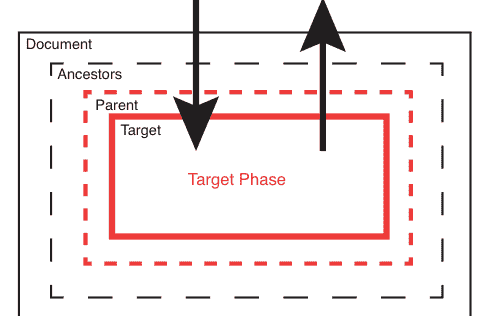

**图 6.1** 事件首先在捕获阶段从文档向下到目标，然后在目标阶段，最后在冒泡阶段从目标向上到文档。

以下短语描述了与事件过程交互和控制的方法。

### 停止事件冒泡到其他元素

```javascript
function myEventHandler(e){
    ...handler code...
    e.stopPropagation();
    return false;
}
```

通常，你不想让事件冒泡到父对象，因为你已经在子对象中处理了它。JavaScript 提供了一种简单的方法来阻止冒泡发生。在传递给处理程序的事件对象上调用 `event.stopPropagation()` 方法可以阻止事件冒泡到父元素。事件仍然会触发浏览器中的默认处理程序，这些处理程序提供网页交互，例如选择一个复选框或激活一个链接。

### 停止默认行为

```javascript
function myEventHandler(e){
    ...handler code...
    e.preventDefault();
    return false;
}
```

有时，你可能希望禁止浏览器应用事件的默认处理程序交互。例如，你可能不希望浏览器激活一个链接，或者你可能不允许重置一个表单。你可以通过调用传递给处理程序的事件对象上的 `event.preventDefault()` 方法来停止浏览器的默认操作。

## 在 jQuery 中手动触发事件

```javascript
$("span").mouseenter();
$("#myButton").click();
$("input.bigText").trigger({type: 'keypress', 'charCode': 13});
```

jQuery 对象具有诸如 `click()` 和 `dblclick()` 之类的方法，这些方法对应于许多你可以直接调用的事件类型。表单元素添加了额外的方法，如 `blur()`、`focus()`、`keypress()`、`keydown()` 和 `keyup()`，这些方法可以被调用来触发特定的事件。例如，以下语句会触发所有 `<span>` 元素的点击事件：

```javascript
$("span").click();
```

jQuery 还提供了一种在触发事件的同时，使用 `trigger()` 方法指定事件对象值的方式。`trigger()` 方法有两种不同的语法，如下所示：

```javascript
trigger(eventType [, extraParameters])
trigger(eventObject)
```

以下是使用第一种方法触发所有 `class="checkbox"` 元素点击事件的示例：

```javascript
$(".checkbox").trigger("click");
```

接下来是使用第二种方法作用于所有 `class="bigText"` 的 input 元素的示例。此方法实际上为 `keypress` 事件传入一个简单的事件对象，该对象将事件对象的 `charCode` 属性设置为 13，即回车键。

```javascript
$("input.bigText").trigger({'type': 'keypress', 'charCode': 13});
```

## 使用事件对象

当浏览器检测到事件发生时，会创建事件对象。如果事件处理器是由 jQuery 定义的，那么事件对象会被转换为一个 jQuery 事件对象，该对象具有更多的属性和方法。因此，你需要了解你正在使用的是哪种类型的事件对象。

事件对象提供了关于事件的附加信息，例如事件的类型（如点击或按键）、按下了哪个键、鼠标的位置、事件发生在哪个 HTML 元素上等等。表 6.2 描述了你将要使用的最常用的事件属性。

**表 6.2 JavaScript 和 jQuery 事件对象属性**

| 属性 | 描述 |
| :--- | :--- |
| `altKey` | 如果事件期间按下了 Alt 键，则为 `true`；否则为 `false`。 |
| `button` | 返回按下的鼠标按钮编号：0 为左键，1 为中键，2 为右键。 |
| `cancelable` | 如果事件的默认操作可以被取消，则为 `true`；否则为 `false`。 |
| `charCode` | 如果是键盘事件，则返回按下的字符的序数值。 |
| `clientX` | 鼠标指针相对于当前窗口的水平坐标。 |
| `clientY` | 鼠标指针相对于当前窗口的垂直坐标。 |
| `ctrlKey` | 如果事件期间按下了 Ctrl 键，则为 `true`；否则为 `false`。 |
| `currentTarget` | 当前正在执行的事件处理器所附加到的 HTML 元素的 DOM 对象。 |
| `data` | 在事件对象创建时定义的用户数据，并附加到触发事件时传递给事件处理器的事件对象上。 |
| `delegateTarget` | 用于在 jQuery `.delegate()` 或 `.on()` 方法中附加事件处理器的 HTML 元素的 DOM 对象。（`.on()` 和 `.delegate()` 将在本章稍后讨论。）仅在 jQuery 事件对象上可用。 |
| `eventPhase` | 事件处理器当前运行的阶段，其中 1 表示在目标上，2 表示冒泡阶段，3 表示捕获阶段。 |
| `metaKey` | 如果事件期间按下了“meta”键，则为 `true`；否则为 `false`。 |
| `relatedTarget` | 标识与 UI 事件相关的次要目标。例如，当使用 `mouseover` 和 `mouseout` 事件时，这表示正在进入或离开的目标。 |
| `results` | 此事件触发的事件处理器最后返回的值。仅在 jQuery 事件对象上可用。 |
| `screenX` | 基于实际显示坐标的水平坐标。 |
| `screenY` | 基于实际显示坐标的垂直坐标。 |
| `shiftKey` | 如果事件期间按下了 Shift 键，则为 `true`；否则为 `false`。 |
| `target` | 事件起源的 HTML 元素的 DOM 对象。 |
| `type` | 描述事件的文本，例如 `click` 或 `keydown`。 |
| `timeStamp` | 自 1970 年 1 月 1 日以来，事件触发时的毫秒数。 |
| `which` | 实际的数值。 |

以下代码片段提供了利用事件对象中数据的示例。

### 获取事件目标对象

```javascript
function myHandler(e){
    // 获取触发事件的对象的值
    var originalValue = $(e.target).val();
    // 获取当前对象的值
    var currentValue = $(e.currentTarget).val();
    // 获取当前对象的内部 HTML
    var currentHTML = $(this).html();
}
```

事件对象通过 `event.target` 属性提供了一个指向最初触发事件的 DOM 对象的链接。事件对象还通过 `event.currentTarget` 属性提供了一个指向触发当前事件处理器的 DOM 对象的链接。能够访问这些对象很有用，因为它允许你获取额外的信息，例如选中状态或值。

触发事件处理器的对象也可以使用 `this` 关键字访问。例如，你可以使用以下方式获取元素的内部 HTML 值：

```javascript
var currentHTML = $(this).html();
```

### 获取鼠标坐标

```javascript
function myHandler(e){
    $("#p1").html("距屏幕左侧: " + e.screenX);
    $("#p2").html("距屏幕右侧: " + e.screenX);
    $("#p3").html("距浏览器左侧: " + e.clientX);
    $("#p4").html("距浏览器右侧: " + e.clientY);
}
```

对于许多图形化 Web 应用程序来说，不仅要知道鼠标事件的目标是什么，还要知道它在屏幕或 Web 浏览器显示区域中的确切位置，这一点至关重要。JavaScript 鼠标事件对象包括 `event.screenX` 和 `event.screenY` 属性，这些属性允许你获取距屏幕顶部和左侧的像素偏移量。

此外，JavaScript 鼠标事件还包括 `event.clientX` 和 `event.clientY` 属性，这些属性允许你获取距浏览器窗口顶部和左侧的像素偏移量。这些通常是更重要的坐标，因为它们有助于确定鼠标相对于网页的位置。

## 处理鼠标事件

Web 浏览器中最常见的事件是鼠标事件。鼠标的每一次移动都是一个事件。事件还包括鼠标进入或离开 HTML 元素、鼠标点击和滚动。本节中的代码片段为您提供了一些在 JavaScript 和 jQuery 代码中利用鼠标事件的示例。

### 添加鼠标点击处理代码

```javascript
$("p").on("click", function (e){
    $(this).html("你点击了这里。");
});
$("span").on("dblclick", function (e){
    $(this).html("你双击了这里。");
});
```

要在 jQuery 中注册点击处理器，你应该使用 `.on("click")` 或 `.on("dblclick")` 方法。在处理器函数内部，你可以执行应用程序所需的任何事件功能。使用 jQuery 选择器可以轻松地将点击处理器应用于多个对象。例如，以下代码为所有 `<div>` 元素应用了点击处理器：

```javascript
$("div").on("click", function (e){
  $(this).html("你点击了这里。");
});
```

### 处理鼠标进入或离开元素

```javascript
$("p").on("mouseover", function (e){
  $(this).html("你好，鼠标。");
});
$("p").on("mouseout", function (e){
  $(this).html("等等，别走。");
});
```

每次鼠标进入或离开元素时，浏览器都会提供一个事件。标准的 JavaScript 事件是 `mouseover` 和 `mouseout`，因此你可以使用 `.on("mouseover")` 为鼠标进入元素添加事件处理器，并使用 `.on("mouseout")` 为鼠标离开添加事件处理器。

### 应用右键点击

```javascript
$("#menu").hide();
$("#main").on("mousedown", function(e){
  if(e.button == 2){ $("#menu").show(); }
});
$("#main").on("mouseup", function(e){
  if(e.button == 2){ $("#menu").hide(); }
});
$("#main").on("contextmenu", function(e){
  return false;
});
```

对元素应用右键单击需要一些额外的操作，因为默认的浏览器行为是为浏览器页面弹出右键菜单。

在事件处理程序中，你需要做的第一件事是确定单击了哪个鼠标按钮，方法是查看 `event.button` 属性，其中 0 代表左键，1 代表中键，2 代表右键。

你还需要抑制默认的浏览器 `contextmenu` 行为，如第 14 行和第 15 行所示，在大多数情况下，你需要添加自己的右键单击行为。以下代码示例展示了如何实现一个自定义弹出菜单的框架，该菜单仅在右键单击时显示，如图 6.2 所示：

```html
01 <html>
02 <head>
03   <title>Python Phrasebook</title>
04   <meta charset="utf-8" />
05   <script type="text/javascript"
06     src="../js/jquery-2.0.3.min.js"></script>
07   <script>
08     $(document).ready(function(){
09       $("#menu").hide();
10       $("#main").on("mousedown", function(e){
11         if(e.button == 2){ $("#menu").show(); }
12       });
13       $("#main").on("mouseup", function(e){
14         if(e.button == 2){ $("#menu").hide(); }
15       });
16       $("#main").on("contextmenu", function(e){
17         return false; })
18     });
19   </script>
20 </head>
19 <body>
20   <div id="main"> 右键单击我
21     <div id="menu">
22       <p>项目 1</p><p>项目 2</p><p>项目 3</p>
23     </div>
24   </div>
25 </body>
26 </html>
```

ch0601.html

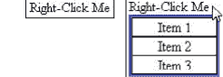

**图 6.2** 右键单击文本会弹出一个简单的项目列表。

## 处理键盘事件

处理网页时经常被忽略的一个事件是键盘事件。然而，键盘事件可能是最有用的事件之一，特别是当你试图让你的网站感觉更像一个网络应用程序时。用户习惯于在应用程序中输入数据时执行不同功能和交互的快捷键。键盘事件让你能够实现这一点。以下片段向你展示如何检测键盘输入并利用事件对象确定按下了哪个键。

### 检测文本输入元素的更改

```javascript
$("input[type=text]").on("keypress",
    function(){
        $("#p1").html("Key Pressed");
    });
$("input[type=text]").on("keydown",
    function(){
        $("#p1").html("Key is Down");
    });
$("input[type=text]").on("keyup",
    function(){
        $("#p1").html("Key is Up");
    });
```


# JavaScript 键盘事件

JavaScript 提供了三个在按下键盘按键时触发的事件：`keydown`、`keypress` 和 `keyup`。这些事件允许你捕获每次按键输入到文本输入中。

例如，如果你想添加一个在文本输入中每次按键时触发的事件处理程序，你可以使用以下代码：

```javascript
$("input[type=text]").on("keypress", function(){handler_code});
```

> **你知道吗？**
>
> 在处理输入元素的键盘事件以获取文本框中的文本时，一个有用的技巧是使用 `keyup` 事件而不是 `keypress` 事件。当 `keypress` 事件触发时，输入框的值可能还不包含刚刚键入的键值。然而，如果你使用 `keyup` 事件，文本框的值将始终包含键入的键值。

## 确定按下了哪个键

```javascript
$("input[type=text]").on("keypress", function(e){
    var s = "You Pressed ";
    if (e.ctrlKey){ s += "CTRL + "; };
    if (e.altKey){ s += "SHIFT + "; };
    if (e.shiftKey){ s += "SHIFT + "; };
    s += String.fromCharCode(e.charCode);
    $("#p1").html(s);
});
```

传递给事件键盘事件处理程序的事件包括字符代码和辅助键信息。要确定按下了哪个键，请使用 `event.charCode` 属性获取字符代码。你可以使用 `String.fromCharCode(code)` 方法将字符代码转换为字符。例如：

```javascript
var charcter = String.fromCharCode(event.charCode);
```

要确定是否按下了 Ctrl、Alt 或 Shift 键，你可以检查 `event.shiftKey`、`event.altKey` 和 `event.ctrlKey` 属性。这些是布尔值，表示是否按下了该键。

以下代码展示了如何使用事件数据来确定按下了哪个键，并将该信息显示在网页上。图 6.3 显示了最终的网页交互效果：

```html
01 <html>
02 <head>
03   <title>Python Phrasebook</title>
04   <meta charset="utf-8" />
05   <script type="text/javascript"
06     src="../js/jquery-2.0.3.min.js"></script>
07   <script>
08     $(document).ready(function(){
09       $("input[type=text]").on("keypress",
10         function(e){
11           var s = "You Pressed ";
12           if (e.ctrlKey){ s += "CTRL + "; };
13           if (e.altKey){ s += "SHIFT + "; };
14           if (e.shiftKey){ s += "SHIFT + "; };
15           s += String.fromCharCode(e.charCode);
16           $("#p1").html(s);
17         });
18     });
19   </script>
20 </head>
21 <body>
22   <p id="p1"></p>
23   <input type="text" />
24 </body>
25 </html>
```

`ch0602.html`

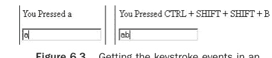

**图 6.3** 在 `ch0602.html` 中使用 JavaScript 在事件处理程序中获取按键事件。

## 表单事件

对于电子商务网站等来说，一些最重要的事件是表单事件。当为用户提供购物车交互、结账、注册等功能时，表单事件被大量使用。向表单事件添加事件处理程序允许你在用户填写表单时提供一些动态交互。

以下片段旨在涵盖处理不同类型表单事件的基本概念。此外，表单中还有本章已经介绍过的键盘和鼠标事件。

### 处理焦点变化

```javascript
$("input").on("focus", function(e){
    gain_focus_code_here
});
$("input").on("blur", function(e){
    lose_focus_code_here
});
```

处理表单事件时，两个重要的事件是 `focus` 和 `blur`。当表单元素获得或失去焦点时，这些事件会被触发。这些事件有很多用途。例如，你可能希望在表单元素获得焦点或失去焦点时更改其外观和感觉。

### 处理选择变化

```javascript
$("select").on("change", function(e) {
    select_change_code_here });
$("input[type=checkbox]").on("change", function(e) {
    checkbox_change_code_here });
$("input[type=radio]").on("change", function(e) {
    radio_change_code_here });
```

处理表单时需要处理的另一种重要事件类型是复选框、单选输入和选择元素中的选择更改。所有这些元素都有一个 `change` 事件处理程序，当选择发生更改时触发。

要在 jQuery 中处理这些项目的选择更改，请添加以下事件处理程序。然后在处理函数内部放置你想要的任何更改代码：

```javascript
$("#formElement").on("change", function(e) {
    change_code_here
});
```

# 第 7 章 动态操作网页元素

动态编程的核心是通过编程实时更改现有的网页元素，以响应用户输入。这提供了人们开始期望从所有网站获得的丰富交互体验。

jQuery 和 JavaScript 提供了多种方法来轻松更改页面元素的外观、样式和内容，从更改图像源和段落内容到动态高亮显示文本和容器边框。

以下各节描述了如何利用 jQuery 和 JavaScript 来访问和操作网页元素。

## 获取和设置 DOM 元素属性和特性

DOM 对象提供对其所表示的 HTML 元素的 DOM 对象属性以及 DOM 元素特性的直接访问。这在 jQuery 中并不合理，因为 jQuery 对象通常表示具有不同属性的多个元素。因此，jQuery 提供了 `.attr()` 和 `.prop()` 方法来获取和设置这些元素的特性和属性。

`.attr(attribute, [value])` 方法允许你仅指定特性名来获取当前值，以及一个可选值来设置当前值。例如，以下代码获取具有 `id="bannerImg"` 的特定图像元素的 `src` 值：

```javascript
var state = $("#bannerImg").attr("src");
```

然后，以下语句为所有 `` 元素设置 `src` 特性值：

```javascript
$("img").attr("src","images/default.jpg");
```

`.prop(property, [value])` 方法允许你指定属性来获取当前值，以及一个可选值来设置当前值。例如，以下代码获取具有 `id="firstCheckbox"` 的特定元素的选中状态：

```javascript
var state = $("#firstCheckbox").prop("checked");
```

下面的语句将所有 `<input>` 元素的选中状态设置为 true：

```javascript
$("input").prop("checked", true);
```

> **你知道吗？**
>
> 在 jQuery 中，属性和特性之间唯一的区别是，特性是定义 HTML 结构的值，而属性是影响对象动态状态的值。例如，在一个 `<input>` 元素中，“type” 是一个特性，因为它定义了结构，而 “checked” 是一个属性，因为它只影响状态。

## 更改链接位置

```html
<script>
  $("#pageLink").attr("href", "complexpage.html");
</script>
....
<body>
  <a id="pageLink" href="simplepage.html">Link</a>
</body>
```

随着网页变得越来越动态，即使是内置的链接也变得动态化了。在你的页面中使用 jQuery 和 JavaScript 的一个巨大优势是，你可以根据用户输入或其他数据源轻松地动态更改链接指向的 URL。

要更改链接指向的 URL，请使用 `.attr("href", newURL)` 方法。当用户点击该链接时，浏览器会读取 `<a>` 元素的 `href` 特性，然后将该位置作为下一个页面加载。

## 更改图像源文件

```javascript
var imgArr = ["bison.jpg", "peak.jpg", "falls.jpg"];
var idx = 0;
$(document).ready(function (){
    $("img").on("click", function(){
        if(idx<2) { idx++; } else { idx=0; }
        $(this).attr("src", imgArr[idx]);
    });
});
```

在 jQuery 和 JavaScript 中，一个常见的任务是更改屏幕上显示的图像。无论是在线广告、游戏还是图像画廊，简单地交换 `` 元素的源文件比重新加载网页要好得多。

要更改 `` 元素中显示的图像，请使用 `.attr("src", newImageURL)` 方法指定新用户文件的新位置。当 src 特性改变时，浏览器会在需要时自动下载新图像并在网页中渲染它，而无需重新加载。

以下代码展示了一个交换图像的好例子，如图 7.1 所示。网页中有一张图像。在第 13 行，在点击处理程序中，src 特性被更改为 imgArr 数组中的一个值：

```html
01 <html>
02   <head>
03     <title>Python Phrasebook</title>
04     <meta charset="utf-8" />
05     <script type="text/javascript"
06       src="../js/jquery-2.0.3.min.js"></script>
07     <script>
08       var imgArr =
09       var imgArr=["bison.jpg","peak.jpg","falls.jpg"];
10       var idx = 0;
11       $(document).ready(function (){
12           $("img").on("click", function(){
13               if(idx<2) { idx++; } else { idx=0; }
14               $(this).attr("src", imgArr[idx]);
15           });
16       });
17     </script>
18     <style>
19         img { width:300px; border:3px ridge white;
20             box-shadow: 5px 5px 5px #888888; margin:10px; }
21     </style>
22   </head>
23   <body>
24     
25   </body>
26 </html>
```

`ch0701.html`

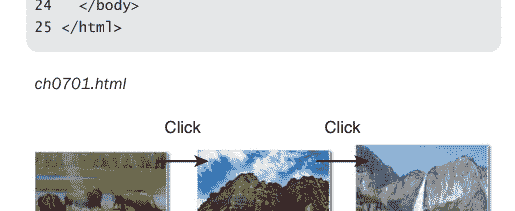

**图 7.1** 使用 `ch0701.html` 中的 jQuery 代码交换图像。

## 获取和设置 DOM 元素的 CSS 样式

jQuery 使得使用 `.css(property, [value])` 方法获取和设置 CSS 值变得极其简单。例如，以下代码检索一个元素的光标 CSS 属性值：

```javascript
$("#buttonA").css("cursor");
```

然后以下代码设置 border-radius 值：

```javascript
$("#buttonA").css("border-radius", "10px 15px");
```

`.css()` 方法还允许你传递一个包含属性和值的映射对象。这允许你一次设置多个设置。例如，以下代码使用 `.css()` 同时设置 margin、padding、float 和 font-weight 属性：

```javascript
$("span").css({margin:0, padding:2, float:"left", "font-weight":"bold"});
```

注意，属性名可以用引号括起来，也可以不用。如果属性名包含 - 或 JavaScript 对象名称中无效的其他字符，则需要使用引号。值可以是数字或字符串。数字值表示距离，可以用 px、cm 或 % 表示。默认是 px，所以如果你想指定像素，只需要输入数字。如果你想指定 cm、% 或其他值类型，则需要使用字符串，例如 `"100%"`。

## 更改颜色

```javascript
$("h1").on("click", function(){
    $(this).css({color:"white", "background-color":"black"});
});
```

与用户操作交互的一个好方法是更改屏幕上元素的颜色。颜色可以提供额外的含义。例如，将文本颜色更改为红色或将文本背景色更改为黄色高亮，可以强调该文本是重要的阅读内容。

在 jQuery 中，你可以使用 `.css(property, value)` 方法更改控制屏幕上颜色的所有 CSS 属性。但是，如果你正在更改多个颜色属性，使用 `.css({property:value, property:value...})` 方法更有意义，该方法允许你一次更改多个属性。

以下代码提供了一个好例子，使用 jQuery 在单击标题时动态更改其颜色。点击处理程序更改背景色和前景色，使标题更加突出，如图 7.2 所示。注意，background-property 键必须放在引号中以支持 JavaScript 语言语法。

```html
01 <html>
02   <head>
03     <title>Python Phrasebook</title>
04     <meta charset="utf-8" />
05     <script type="text/javascript"
06       src="../js/jquery-2.0.3.min.js"></script>
07     <script>
08        $(document).ready(function (){
09            $("h1").on("click", function(){
10                $(this).css({color:"white",
11                                 "background-color":"black"});
12            });
13        });
14      </script>
15      </head>
16      <body>
17        <h1>Heading 1</h1>
18        <h1>Heading 2</h1>
19      </body>
20      </html>
```

`ch0702.html`

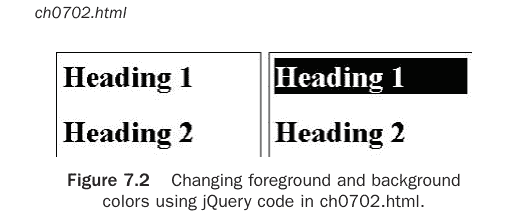

**图 7.2** 使用 `ch0702.html` 中的 jQuery 代码更改标题颜色。

## 添加边框

```javascript
$("ul").on("click", function(){
    $(this).css({"border":"3px groove black"});
});
$("li").on("click", function(){
    $(this).css({"border-style":"dotted", "border-size":1, "border-color":"blue"});
});
```

另一个可以通过编程应用于元素的有用样式是边框。边框为你提供了一种突出页面上特定元素或仅仅改变外观的方式。

你可以使用 `.css(property, value)` 或 `.css({property:value, property:value...})` 方法在 jQuery 中更改应用于元素的边框的 CSS 属性。

> **顺便说一下**
>
> 你可以使用 border 属性同时设置所有边框选项，包括尺寸、样式和颜色，例如：
>
> `$(this).css({"border":"3px groove black"});`

以下代码提供了一个好例子，使用 jQuery 动态地为 `<ul>` 和 `<li>` 元素添加边框。我提供了两个例子：一个是在单个 border 属性设置中更改所有属性，另一个是单独更改它们。一个点击处理程序将边框应用于列表元素和列表项元素，如图 7.3 所示：

```html
01 <html>
02 <head>
03 <title>Python Phrasebook</title>
04 <meta charset="utf-8" />
05 <script type="text/javascript"
06 src="../js/jquery-2.0.3.min.js"></script>
07 <script>
08 $(document).ready(function (){
09 $("ul").on("click", function(){
10 $(this).css({"border":"3px groove black"});
11        });
12        $("li").on("click", function(){
13            $(this).css({"border-style":"dotted",
14                            "border-size":1,
15                            "border-color":"blue"});
16        });
17    });
</script>
</head>
<body>
    <ul>
        <li>George Washington</li>
        <li>John Adams</li>
        <li>Thomas Jefferson</li>
    </ul>
</body>
</html>
```

`ch0703.html`

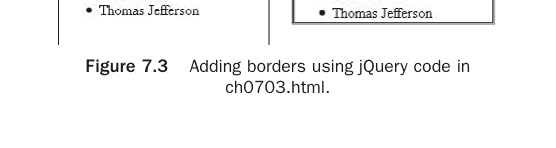

**图 7.3** 使用 `ch0703.html` 中的 jQuery 代码添加边框。

## 更改字体

```javascript
$("p").on("click", function(){
    $(this).css({"font-weight":"bold", "font-style":"italic", "font-size":22, "font-family":"cursive, sans-serif"});
});
```

## 添加类

```javascript
$("span").addClass("baseClass");
```

丰富的交互式网页的重要组成部分是良好的 CSS 设计。JavaScript 和 jQuery 可以通过动态地为元素添加和移除类来增强 CSS 设计。

jQuery 使得添加、移除和切换类变得极其简单。如果你的 CSS 代码设计得当，应用一些不错的效果会很容易。

你可以使用 `.addClass(className)` 方法来添加类。例如，要为所有 `<span>` 元素添加一个名为 `active` 的类，你可以使用以下语句：

```javascript
$("span").addClass("active");
```

## 移除类

```javascript
$("span").removeClass("oldClass");
```

你可以使用 `.removeClass([className])` 方法来移除类。例如，要从 `<span>` 元素中移除 `active` 类，你可以调用以下代码：

```javascript
$("span").removeClass("active");
```

你也可以使用不带 `className` 的 `removeClass`，这会移除元素的所有类。例如，以下语句会移除 `<p>` 元素的所有类：

```javascript
$("p").removeClass();
```

## 切换类

```javascript
$("span").on("click", function(){
  $(this).toggleClass("active");
});
```

你可以使用 `.toggleClass(className [, switch])` 方法来切换类的开关状态。除了 `className`，你还可以为可选的 `switch` 参数指定 `true` 或 `false`，表示开启或关闭该类。

例如，要为所有 `<span>` 元素关闭 `active` 类和 `inactive` 类，代码如下所示：

```javascript
$("span").toggleClass("active", true);
$("span").toggleClass("inactive", false);
```

以下代码提供了一个很好的例子，展示了如何使用 jQuery 在用户点击 `<span>` 元素时动态切换类的开关状态。第 9-11 行的点击处理程序使用了 `.toggleClass()` 方法来切换 `.active` 类的开关状态。图 7.5 展示了这段代码的外观和行为：

```html
<html>
  <head>
    <title>Python Phrasebook</title>
    <meta charset="utf-8" />
    <script type="text/javascript"
           src="../js/jquery-2.0.3.min.js"></script>
    <script>
      $(document).ready(function (){
        $("span").on("click", function(){
          $(this).toggleClass("active");
        });
      });
    </script>
    <style>
      span {
        border:3px ridge white; border-radius:10px;
        padding:3px; color:black;
        background-color:#CCCCCC; cursor:pointer; }
      .active {
        background-color:blue; color:white;
        border-color:blue; font-weight:bold;}
    </style>
  </head>
  <body>
    <span>Option 1</span>
    <span>Option 2</span>
  </body>
</html>
```

`ch0705.html`

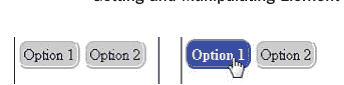

**图 7.5** 使用 `ch0705.html` 中的 jQuery 代码切换类的开关状态。

## 获取和操作元素内容

通常，在用户开始使用网页之前，你并不知道页面上所有的元素，或者你将从 Web 服务或其他交互中获得额外信息。在这些情况下，你可能需要能够使用 jQuery 和 JavaScript 代码动态添加或替换元素内容。

元素内容的文本存储在 DOM 元素的 `innerHTML` 属性中。你可以通过将 `innerHTML` 设置为新内容来使用 JavaScript 更改内容。例如：

```javascript
document.getElementById("#p1").innerHTML = "New Text";
```

在 jQuery 中，你可以使用 `.html()` 方法更改 `innerHTML` 内容，该方法获取或设置 `innerHTML` 字符串。例如：

```javascript
$("#p1").html("Paragraph 1 goes here");
```

### 获取 HTML 元素的内容

```javascript
var p1Contents = $("#p1").html();
var div1Contents = $("#div1").html();
```

使用 jQuery 的 `.html()` 方法可以轻松包含 HTML 元素内的内容。调用此方法而不传递参数会返回内容的 HTML 字符串版本。如果内容只是文本，则返回一个简单的字符串。如果内容是 HTML 元素，则字符串包含在 HTML 标签中。

### 在基本 HTML 元素前添加和后追加文本

```javascript
$("#p1").prepend("*New* :");
$("#p1").append(". . . read");
```

另一个常见的动态任务是向基本 HTML 元素（如 `<span>` 或 `<p>`）添加文本。jQuery 使用 `.append()` 方法使这变得极其简单。此方法将内容追加到元素当前内容的末尾。无论内容是字符串还是其他元素，都没有关系。

例如，以下代码将文本 ". . . read" 追加到 id="p1" 的段落中：

```javascript
$("#p1").append(". . . read");
```

你可能还希望将文本前置到元素内容的开头。在 jQuery 中，`.prepend()` 方法将内容前置到元素当前内容的开头。无论内容是字符串还是其他元素，都没有关系。

例如，以下代码将文本 "*New* :" 前置到 id="p1" 的段落中：

```javascript
$("#p1").prepend("*New* :");
```

### 替换元素文本

```javascript
$("#mySpan").html("content");
// ...
$("#mySpan").html("newer content");
// ...
$("#mySpan").html("even newer content");
```

与向元素前置或追加文本（或内容）相反，你可能希望完全替换元素内容。在 jQuery 中，最简单的方法是使用 `.html()`，它将内容的值设置为你传入的任何字符串或对象，从而替换现有内容。

### 将元素追加到父内容中

```javascript
var newP = $("<p></p>");
newP.html("This is the first paragraph.");
$("div").prepend(newP);
newP.html("This is the last paragraph.");
$("div").append(newP);
```

你还可以在 jQuery 中使用 `.prepend()` 和 `.append()` 方法将内容前置或追加到元素。jQuery 的另一个主要优势是你可以将使用 jQuery 构造器 `$(htmlString)` 或 `jQuery(htmlString)` 创建的 HTML DOM 元素追加到页面中，以添加新的 HTML 元素。例如，以下代码构造一个包含 `<p>` 元素的 jQuery 对象，使用 `.html()` 设置新段落元素的内容，然后将该段落追加到所有 `<div>` 元素。

```javascript
var newP = $("<p></p>");
newP.html("This is a new paragraph.");
$("div").append(newP);
```

# 第 8 章 动态操控网页布局

## 动态操作网页布局

你可以与网页进行的最酷的交互之一是基于用户交互重新排列页面上的元素。例如，你可以让元素变大或变小，甚至改变它们的位置。此外，你可以改变元素的可见性，在不需要它们时隐藏它们，在适当时显示它们。

本章重点介绍以改变页面基本布局的方式操作元素的方法。这些语句旨在为你提供适用于一系列目的的可用示例。

### 隐藏和显示元素

```javascript
$("#down").hide();
$("#up").on("click", function(){
    $("#up, #down").toggle();
    $("#leftNav").hide(); });
$("#down").on("click", function(){
    $("#up, #down").toggle();
    $("#leftNav").show(); });
```

改变网页外观的一个简单方法是切换元素的可见性。隐藏不必要的元素，只在需要时才显示它们，可以节省大量屏幕空间，这在设计良好的网页应用中至关重要。

在 JavaScript 中，你通过将 `style.display` 属性设置为 `"none"` 或 `""` 来隐藏或显示元素。相比之下，jQuery 提供了一种更优雅、更易扩展的解决方案。

要使用 jQuery 显示元素，只需在 jQuery 对象上调用 `.show()` 方法。对象集中的所有项都会被显示。然后，要隐藏元素，使用 `.hide()` 方法。就这么简单。例如，要隐藏所有 `<p>` 元素，你可以使用以下代码：

```javascript
$("p").hide();
```

然后，要再次显示它们，使用：

```javascript
$("p").show();
```

jQuery 提供的另一个有价值的工具是 `.toggle()` 方法。此方法将当前可见状态切换为完全相反的状态。这意味着对于你只想切换开关的元素，你不必跟踪或检查它们的可见性状态。

以下代码演示了如何更改可见性。它隐藏并显示一个简单的弹出菜单。请注意，用于显示和隐藏可见性的按钮本身也在被切换，以便显示的按钮与菜单状态相匹配。图 8.1 展示了菜单的基本外观：

```html
<div id="bar">
    </div>
<div id="leftNav"><p>选项 1</p>
    <p>选项 2</p><p>选项 3</p></div>
</body>
</html>
```

`ch0801.html`

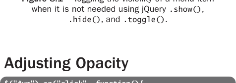

**图 8.1** 使用 `ch0801.html` 中的 jQuery 代码切换菜单可见性。

## 调整不透明度

```javascript
$("#up").on("click", function(){
    var op = parseFloat($("#photo").css("opacity"));
    if (op<1) {op += 0.2;};
    $("#photo").css("opacity", op);
});
$("#down").on("click", function(){
    var op = $("#photo").css("opacity");
    if (op>0) {op -= 0.2;};
    $("#photo").css("opacity", op);
});
```

更改元素的不透明度是改变页面布局的好方法。降低不透明度值会使元素变得不那么明显，从而揭示其下方的任何元素或背景图像。

> **顺便提一下**
>
> 使用 `.hide()` 隐藏元素的一个问题是，一旦应用，该元素就不再占据页面空间。其他流动元素会滑入并占据其位置。在许多情况下，这正是你想要的。但在其他情况下，你可能希望元素不可见但仍然占据空间，因此请将不透明度设置为 0。
>
> 降低不透明度（但不设置为 0）可以很好地演示元素当前不活跃，但仍然显示它们。例如，我喜欢将尚未实现和激活的菜单和按钮元素的不透明度设置为 .5，这样它们仍然显示，但显然不可点击。

不透明度由 CSS `opacity` 属性控制。要使元素不可见但仍占据空间，请将 `opacity` CSS 属性设置为 0。例如：

```javascript
obj.css("opacity", "0");
```

然后，要使元素再次可见，请将不透明度设置回 1：

```javascript
obj.css("opacity", "1");
```

要使元素部分可见，请将不透明度设置为 0 到 1 之间的值，例如 .5。以下示例创建了一个包含两个按钮的网页，这两个按钮控制一个图像元素的不透明度。随着不透明度增加，图像变得更可见，反之亦然。按钮的点击处理程序通过将当前不透明度增加或减少 .2 来更改不透明度。图 8.2 展示了不透明度变化的实际效果：

```html
<html>
  <head>
    <title>Python 短语手册</title>
    <meta charset="utf-8" />
    <script type="text/javascript"
      src="../js/jquery-1.9.0.min.js"></script>
    <script>
      var imgArr =
        ["bison.jpg","peak.jpg","falls.jpg"];
      var idx = 0;
      $(document).ready(function (){
        $("#up").on("click", function(){
          var op =
            parseFloat($("#photo").css("opacity"));
            if (op<1) {op += 0.2;};
            $("#photo").css("opacity", op);
        });
        $("#down").on("click", function(){
          var op = $("#photo").css("opacity");
          if (op>0) {op -= 0.2;};
            $("#photo").css("opacity", op);
        });
      });
    </script>
    <style>
      img{ vertical-align:middle;}
      #photo { width:300px; border:5px ridge white;
        box-shadow: 5px 5px 5px #888888;
        margin:10px; }
    </style>
  </head>
  <body>
    
    
    
</body>
</html>
```

`ch0802.html`

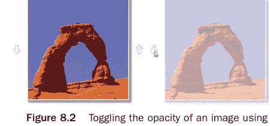

**图 8.2** 使用 `ch0802.html` 中的 jQuery 代码调整图像不透明度。

## 调整元素大小

```javascript
$("#up").on("click", function(){
    $("#photo").width($("#photo").width()*1.2);
});
$("#down").on("click", function(){
    $("#photo").width($("#photo").width()*.8);
});
```

动态处理 HTML 元素的另一个重要方面是获取和更改元素大小的能力。jQuery 通过附加到 jQuery 对象上的一组方法使这变得简单。表 8.1 展示了 jQuery 对象提供的用于获取元素高度和宽度的方法。

**表 8.1** 用于获取和设置元素大小的 jQuery 对象方法

| 方法 | 描述 |
| --- | --- |
| `height([value])` | 如果指定了值，则更改集合中所有 HTML 元素的高度；否则，返回第一个 HTML 元素的当前高度。 |
| `width([value])` | 如果指定了值，则更改集合中所有 HTML 元素的宽度；否则，返回第一个 HTML 元素的当前宽度。 |
| `innerHeight()` | 返回集合中第一个元素的当前高度，包括内边距。 |
| `innerWidth()` | 返回集合中第一个元素的当前宽度，包括内边距。 |
| `outerHeight([includeMargin])` | 返回集合中第一个元素的当前高度，包括内边距、边框，如果指定还包括外边距。 |
| `outerWidth([includeMargin])` | 返回集合中第一个元素的当前宽度，包括内边距、边框，如果指定还包括外边距。 |

> **注意！**
>
> `height` 和 `width` 方法只返回 jQuery 对象集中第一个元素的大小。对于单个对象集，这不是问题。只需记住，集合中的其他对象可能有不同的大小。

为了说明如何获取和设置元素的大小，请看以下示例代码。这段代码定义了一个包含一张照片和两个按钮的网页。按钮的点击处理程序通过使用 `.width()` 方法获取图像宽度来增加或减少图像的大小。当处理程序中的宽度改变时，图像会自动调整大小。要调整大小，请将新的值 `width*1.2` 或 `width*.8` 传回 `.width()` 方法。图 8.3 展示了用于调整图像大小的按钮：

```html
<html>
    <head>
        <title>Python 短语手册</title>
        <meta charset="utf-8" />
        <script type="text/javascript"
            src="../js/jquery-1.9.0.min.js"></script>
        <script>
            $(document).ready(function (){
                $("#up").on("click", function(){
                    $("#photo").width($("#photo").width()*1.2);
                });
                $("#down").on("click", function(){
                    $("#photo").width($("#photo").width()*.8);
                });
            });
        </script>
        <style>
            img{ vertical-align:middle;}
            #photo { width:300px; border:5px ridge white;
                box-shadow: 5px 5px 5px #888888;
                margin:10px; }
        </style>
    </head>
```

## 重新定位元素

```javascript
$("#up").on("click", function(){
  var offset = $("#photo").offset();
  offset.top -= 10;
  $("#photo").offset(offset);
});
```

除了 HTML 元素的大小，你通常还需要确定它们的位置。在处理 HTML 元素时，有两种不同类型的位置。第一种是相对于整个文档的位置。第二种是相对于充当偏移父级的 HTML 元素的位置。作为偏移父级的元素取决于 CSS 中的位置设置。

jQuery 提供了 `.position([position])` 方法来获取相对于偏移父级的位置。`.offset([position])` 方法则提供相对于文档的位置。你可以无参数调用这两个方法，它们会返回一个简单的对象，其中包含 `left` 和 `top` 属性，代表距离文档或偏移父级左边和上边的像素数。你也可以用一个包含 `left` 和 `top` 属性的简单位置对象来调用这些方法，在这种情况下，它们会设置元素的位置。

例如，以下代码获取 id 为 "myElement" 的元素距离文档顶部和左侧的像素数，以及距离其偏移父级顶部和左侧的像素数。为了在单个语句中获取每个值，我直接在 `offset` 或 `position` 调用后引用 `top` 和 `left` 属性：

```javascript
var pixelsFromPageTop = $("#myElement").offset().top;
var pixelsFromPageLeft = $("#myElement").offset().left;
var pixelsFromParentTop = $("#myElement").position().top;
var pixelsFromParentLeft = $("#myElement").position().left;
```

要将该元素精确地设置在距离文档左上角向下 10 像素、向右 10 像素的位置，请使用以下语句，该语句定义了一个包含 `left` 和 `top` 值的简单对象并将其传递给 `.offset()` 方法：

```javascript
$("#myElement").offset({"top":10,"left":10});
```

为了说明如何使用元素位置，以下代码构建了一个包含四个控制按钮和一个图像元素的网页。按钮的点击处理程序通过获取当前偏移量、调整 `top` 或 `left` 属性，然后使用 `.offset()` 方法再次设置偏移量来移动图像。图 8.4 展示了在屏幕上移动图像的按钮：

```html
<html>
  <head>
    <title>Python Phrasebook</title>
    <meta charset="utf-8" />
    <script type="text/javascript"
      src="../js/jquery-1.9.0.min.js"></script>
    <script>
      var imgArr =
        ["bison.jpg","peak.jpg","falls.jpg"];
      var idx = 0;
      $(document).ready(function (){
        $("#up").on("click", function(){
          var offset = $("#photo").offset();
          offset.top -= 10;
          $("#photo").offset(offset);
        });
        $("#down").on("click", function(){
          var offset = $("#photo").offset();
          offset.top += 10;
          $("#photo").offset(offset);
        });
        $("#left").on("click", function(){
          var offset = $("#photo").offset();
          offset.left -= 10;
          $("#photo").offset(offset);
        });
        $("#right").on("click", function(){
          var offset = $("#photo").offset();
          offset.left += 10;
          $("#photo").offset(offset);
        });
      });
    </script>
    <style>
      img{ vertical-align:middle;}
      #photo { width:300px; border:5px ridge white;
        box-shadow: 5px 5px 5px #888888; position: fixed; }
    </style>
  </head>
  <body>
    <div id="buttons">
      
      
      
      
    </div>
    
  </body>
</html>
```

`ch0804.html`

**图 8.4** 使用 `ch0804.html` 中的 jQuery 代码在屏幕上移动图像元素。

## 堆叠元素

```javascript
$("img").on("click", function(){
    $("img").css("z-index", 0);
    $(this).css("z-index", 1);
});
```

你可以用网页实现的最酷的交互之一就是根据用户交互重新排列元素，将它们堆叠在一起。这个想法是 HTML 元素可以像桌子上的纸一样简单地相互堆叠。在任何时候，你可以显示一个被隐藏或部分隐藏的元素，并将其放在其他元素的顶部。

z-index 是一个 CSS 属性，它指定了一个 HTML 元素相对于其他元素的位置，不是在垂直或水平方向上，而是向用户方向投射。具有最高 z-index 的元素在浏览器渲染页面时会显示在其他元素的顶部。

在 jQuery 中，要获取和设置 z-index，请使用 `.css()` 方法。例如，要获取某个项目的 z-index，可以使用：

```javascript
var zIndex = $("#item").css("z-index");
```

要将某个项目的 z-index 设置为，比如说 10，请使用以下语句：

```javascript
$("#item").css("z-index", "10");
```

为了说明 z-index 的工作原理，以下代码生成了一个包含三张图片的网页。这些图片以重叠的方式采用固定定位。当你点击其中一张图片时，点击处理程序首先将所有项目的 z-index 调整为 0，然后将被点击项目的 z-index 设置为 1，从而将其置于顶部。这在图 8.5 中有所展示：

```html
<html>
  <head>
    <title>Python Phrasebook</title>
    <meta charset="utf-8" />
    <script type="text/javascript"
      src="../js/jquery-1.9.0.min.js"></script>
    <script>
      var imgArr =
        ["bison.jpg","peak.jpg","falls.jpg"];
      var idx = 0;
      $(document).ready(function (){
        $("img").on("click", function(){
          $("img").css("z-index", 0);
          $(this).css("z-index", 1);
        });
      });
    </script>
    <style>
      img{ width:300px; border:5px ridge white;
        box-shadow: 5px 5px 5px #888888; position: fixed; }
      #photo1 { top:10px; left:20px; }
      #photo2 { top:60px; left:60px; }
      #photo3 { top:120px; left:120px; }
    </style>
  </head>
  <body>
    
    
    
  </body>
</html>
```

`ch0805.html`

**图 8.5** 使用 `ch0805.html` 中的 jQuery 代码将元素相互堆叠并重新排序。

# 第 9 章 动态操作表单元素

## 动态处理表单元素

Web 表单是动态 Web 编程不可或缺的一部分。你可能只认为表单是用于信用卡支付、在线注册等，但任何时候你需要从用户那里获取实际数据输入时，你都在使用 Web 表单。

Web 表单对用户来说可以是积极的或消极的体验。如果因为表单笨重或难以理解而觉得输入数据很困难，用户会讨厌它，并且体验很差。

通过动态访问和操作表单流程，对 Web 表单应用动态调整，可以让用户体验好得多。本章中的短语重点在于访问表单数据，然后使用该数据动态操作表单以改善整体用户体验。

## 获取和设置文本输入值

```javascript
var inText = $("#inBox").val();
if (inText != "default"){
    $("#outBox").val(inText);
}
```

最常见的表单元素类型是文本输入。这些元素包括 `<textarea>` 元素以及具有以下 `type` 属性值的 `<input>` 元素：`color`、`date`、`datetime`、`datetime-local`、`email`、`month`、`number`、`password`、`range`、`search`、`tel`、`text`、`time`、`url` 和 `week`。

尽管浏览器使用这些值的方式略有不同，但它们都渲染成相同的基本文本框，并且以相同的基本方式访问。每个元素都有一个 `value` 属性，在元素渲染时作为文本框中显示的内容。

在 jQuery 中，你可以使用 jQuery 对象的 `.val()` 方法访问文本输入的值。要获取键入文本框中的文本，你应该无参数调用 `.val()` 方法。例如，要获取 `#textbox1` 的值，你可以使用以下代码：

```javascript
var textbox1text = $("#textbox1").val();
```

要设置文本框中显示的文本，你可以使用 `.val(string)`。例如，要将 `#textbox1` 的值设置为 "new string"，你可以使用以下代码：

```javascript
$("#textbox1").val("new string");
```

> **注意！**
>
> `.attr()`、`.prop()` 和 `.val()` 方法仅获取匹配的 jQuery 集合中第一个元素的值。如果你需要处理集合中的多个元素，可能需要使用 `.map()` 或 `.each()` 方法来获取所有元素的值。

## 检查和更改复选框状态

```javascript
if ($("#myCheckbox").is(":checked")){
    $("#myCheckbox").removeAttr("checked");
}
else{
    $("#myCheckbox").attr("checked", true);
}
```

复选框输入元素的值是一个布尔值，基于该元素是否被选中。你可以通过获取 `checked` 属性的值来访问它。如果元素被选中，那么 `checked` 的值为 `true` 或 `"checked"`。否则，该值将是 `undefined` 或 `false`。

你可以通过 JavaScript 以以下方式获取和设置复选框元素的状态：

```javascript
domObj.checked = true;
domObj.checked = false;
var state = domObj.checked;
```

使用 jQuery 确定某个项目是否被选中则稍有不同。请记住，在 jQuery 中，你可能一次处理多个复选框，因此查看 jQuery 对象是否表示一个被选中对象的最安全方法是使用 `.is()` 方法。例如：

`$("#myCheckbox").is(":checked");`

要将表示复选框的 jQuery 对象的状态设置为选中，只需按如下方式设置 `checked` 属性：

`$("#myCheckbox").attr("checked", true);`

将表示复选框的 jQuery 对象的状态设置为未选中则稍有不同。你需要使用 `removeAttr()` 移除 `checked` 属性。例如：

`$("#myCheckbox").removeAttr("checked");`

## 获取和设置单选按钮组中的选中选项

```javascript
if ($("#maleRB").is(":checked")){
    $("#maleRB").removeAttr("checked");
}else{
    $("#maleRB").attr("checked", true);
}
var genderGroup = $("input[name=gender]");
var checkedGender = genderGroup.filter(":checked");
var selectedGender = checkedGender.val();
```

单选按钮输入几乎总是成组使用。一组单选按钮输入的值不是布尔值。相反，它是当前选中元素的 `value` 属性。例如，下面的单选按钮组的值是 "male" 或 "female"：

```html
<input id="maleRB" type="radio" name="gender" value="male">
<label for="maleRB">Male</label>
<input id="femaleRB" type="radio" name="gender" value="female">
<label for="femaleRB">Female</label>
```

要在代码中获取单选按钮组的值，你首先需要访问组中的所有元素，找出哪个被选中，然后从该对象获取 `value` 属性。以下代码使用 jQuery 获取按 `name="gender"` 分组的单选按钮组的值：

```javascript
var genderGroup = $("input[name=gender]");
var checkedGender = genderGroup.filter(":checked");
var selectedGender = checkedGender.val();
```

设置单个单选按钮的选中值的工作方式与复选框相同。要查看 jQuery 对象是否表示一个被选中的单选按钮，请使用 `.is()` 方法。例如：

```javascript
$("#maleRB").is(":checked");
```

要将表示单选按钮的 jQuery 对象的状态设置为选中，只需按如下方式设置 `checked` 属性：

```javascript
$("#maleRB").attr("checked", true);
```

要将表示单选按钮的 jQuery 对象的状态设置为未选中，你需要使用 `removeAttr()` 移除 `checked` 属性。例如：

```javascript
$("#maleRB").removeAttr("checked");
```

## 获取和设置选择框的值

```javascript
var value = $("#singleSelect").val();
var values = $("#multiSelect").val();
// ...
$("#singleSelect").val("one");
$("#multiSelect").val(["two", "three"]);
```

选择框输入实际上是一系列 `<option>` 元素的容器输入。选择框元素的值是当前选中选项的值。同样，jQuery 和 JavaScript 中的提交和序列化会自动为你处理这一点。然而，手动操作则需要一些代码。

> **你知道吗？**
>
> 如果你没有为 `<option>` 元素指定 `value` 属性，返回的值是 `innerHTML` 的值。例如，以下选项的值是 "one"：
>
> ```html
> <option>one</option>
> ```

在访问 `<select>` 元素时，你可能需要两个不同的值。一个是由该元素表示的完整值。在 jQuery 中使用 `.val()` 方法获取该值很简单。例如，考虑以下代码：

```html
<select id="mySelect">
  <option value="one">One</option>
  <option value="two">Two</option>
  <option value="three">Three</option>
</select>
```

jQuery：

```javascript
$("#mySelect").val();
```

如果选中第一个选项，jQuery 语句返回的值是：

```javascript
"one"
```

对于多选框，`.val()` 方法返回的是一个值数组而不是单个值。在多选框上，如果选中第一个选项，jQuery 语句返回的值是：

```javascript
["one"]
```

在多选框上，如果选中前三个选项，jQuery 语句返回的值是：

```javascript
["one", "two", "three"]
```

你也可以使用 `.val()` 方法来设置选中的元素。例如，以下语句在前面的选择框中选择第一个元素：

```javascript
$("#mySelect").val("one");
```

以下语句在一个多选框元素中选择第二个和第三个选项：

```javascript
$("#mySelect").val(["two", "three"]);
```

## 获取和设置隐藏表单属性

```javascript
var hiddenValue = $("#hidden").val();
var hiddenValue = $("#hidden").attr("other");
var hiddenValue = $("#hidden").prop("otherProp");
var hiddenValue = $("#hidden").data("storedValue");
```

如果你需要从表单向浏览器提供额外信息，一个很棒的 HTML 元素是隐藏输入。隐藏输入不会随表单一起显示，但它可以包含要提交的名值对，甚至只是你希望存储在表单中并在动态操作期间可访问的值。

要随表单发送的部分是 `name` 和 `value` 属性。但是，你可以使用 jQuery 的 `.data(key [,value])` 方法为隐藏表单对象或任何 HTML DOM 对象附加额外的值。这个方法的工作方式类似于 `.attr()` 和 `.prop()`：如果你想获取值，只需传递一个键；或者，如果你想设置键的值，则传递一个键和一个值。例如，以下代码定义了一个简单的隐藏元素，然后使用 jQuery 分配提交值和扩展属性：

HTML：

```html
<input id="invisibleMan" name="InvisibleMan" type="hidden" />
```

jQuery：

```javascript
$("#invisibleMan").val("alive");
$("#invisibleMan").data("hairColor", "clear");
var state = $("#invisibleMan").val();
var state = $("#invisibleMan").data("hairColor");
```

### 禁用表单元素

```javascript
$("#cbSame").on("click", function(){
    if($(this).is(":checked")){
        $("#billInfo :input").attr("disabled",true); }
    else {
        $("#billInfo :input").removeAttr("disabled"); }
});
```

禁用网页元素仍然会显示它们，但可以防止用户与它们交互。通常，只有当你仍然希望用户能够看到元素的值时，禁用表单元素才有意义，而不是直接禁用它。

要禁用一个表单元素，你需要设置 `disabled` 属性。在 JavaScript 中，你可以直接在 DOM 对象上操作。在 jQuery 中，你使用 `.attr()` 方法。例如：

```javascript
$("#deadElement").attr("disabled", "disabled");
```

要重新启用一个被禁用的元素，你需要移除 `disabled` 属性。例如：

```javascript
$("#deadElement").removeAttr("disabled");
```

以下代码展示了使用复选框来启用和禁用多个表单元素的示例。点击处理程序检查复选框的状态，如果被选中，则禁用 `#billInfo` `<div>` 内的输入元素。否则，它们将被启用。图 9.1 展示了被禁用和启用的表单元素。

```html
<html>
  <head>
    <title>Python Phrasebook</title>
    <meta charset="utf-8" />
    <script type="text/javascript"
      src="../js/jquery-2.0.3.min.js"></script>
    <script>
      $(document).ready(function (){
        $("#cbSame").on("click", function(){
          if($(this).is(":checked")){
            $("#billInfo :input").attr("disabled",true); }
          else {
            $("#billInfo :input").removeAttr("disabled"); }
          });
        });
    </script>
    <style>
    </style>
  </head>
  <body>
    <form>
      <span>Shipping Info</span><br>
      <div id="shipInfo">
        <input type="text">Name</input><br>
        <input type="text">Address</input><br>
        <input type="text">City</input><br>
        <select class="state" id="state"></select>
        <input type="text">Zip</input><br>
      </div>
```

## 显示/隐藏表单元素

为网页表单提供流程控制的另一个妙招是动态隐藏和显示元素。少即是多；你不一定需要向用户显示比他们所需填写的更多的元素。

例如，如果表单同时包含男装尺码和女装尺码的元素，不要同时显示两者。等待用户选择性别，然后显示相应的尺码元素。

在 jQuery 中，可以使用 `.show()` 和 `.hide()` 方法来显示和隐藏表单元素。或者，如果你想让元素不可见但仍占据空间，可以将 CSS 的 opacity 属性设置为 0 或 1。

以下代码展示了一个包含三个选择框的基本网页表单。最初只显示允许用户选择汽车制造商的选择框，但当用户选择制造商后，型号菜单就会出现。同样，当用户选择型号后，轮胎尺寸菜单也会出现。点击处理程序使用 `.show()` 和 `.hide()` 来适当地显示和隐藏菜单。图 9.2 展示了随着选择更多项目，表单元素被显示出来的情况：

```javascript
$(document).ready(function (){
    $("#tires,#model").hide();
    $("#make").on("change", function(){
        if($(this).val() == ""){
            $("#tires,#model").hide(); }
        else{ $("#model").show(); }
    });
    $("#models").on("change", function(){
        var v = $(this).val();
        if($(this).val() == ""){
            $("#tires").hide(); }
        else{
            $("#tires").show(); }
    });
});
```

```html
<html>
  <head>
    <title>Python Phrasebook</title>
    <meta charset="utf-8" />
    <script type="text/javascript"
        src="../js/jquery-2.0.3.min.js"></script>
    <style>
        select {width:100px; }
    </style>
  </head>
  <body>
    <form>
        <select id="make">Maker
            <option></option>
            <option>Jeep</option>
        </select><label>Make</label><br>
        <div id="model"><select id="models">
            <option></option>
            <option>Wrangler</option>
            <option>Cherokee</option>
        </select><label>Model</label></div>
        <div id="tires"><select>
            <option></option>
            <option>32"</option>
            <option>33"</option>
            <option>36"</option>
        </select><label>Tires</label></div>
    </form>
  </body>
</html>
```

`ch0902.html`

**图 9.2** 使用 jQuery 代码在 `ch0902.html` 中动态显示和隐藏 select 元素。

## 将焦点强制移向和移开表单元素

网页表单的一个重要流程控制功能是，当你知道用户已准备好输入时，自动将焦点移至相应元素。例如，如果用户选择了年份，下一个元素是月份选择，那么自动将月份激活供用户操作是合理的。

要在 jQuery 中设置元素的焦点，只需在该对象上调用 `.focus()` 方法。例如，以下代码为 `id="nextInput"` 的对象设置焦点：

```javascript
$("#nextInput").focus();
```

你也可以通过调用 `.blur()` 方法，将焦点从想要让用户离开的元素上移开：

```javascript
$("#nextInput").blur();
```

以下代码展示了一个信用卡支付表单的示例。用户在选择卡片类型后，逻辑上的下一步是输入信用卡号。表单检测到单选按钮组的变化，然后立即将焦点转移到卡号输入元素。图 9.3 展示了表单中的自动选择操作：

```javascript
$(document).ready(function (){
    $("input[type=radio]").on("change", function(){
            $("#cardNum").focus();
        });
});
```

```html
<html>
  <head>
    <title>Python Phrasebook</title>
    <meta charset="utf-8" />
    <script type="text/javascript"
      src="../js/jquery-2.0.3.min.js"></script>
    <style>
    </style>
  </head>
  <body>
    <form>
        <input type="radio" name="ptype" id="visa" />
        <label for="visa"></label>
        <input type="radio" name="ptype" id="mc" />
        <label for="mc"></label>
        <input type="radio" name="ptype" id="amex" />
        <label for="amex"></label>
        <div id="ccInfo">
            <input type="text" id="cardNum">Card Number</input>
            <br><input type="text" id="csc">CSC</input><br>
            <label>Expires</label><select id="expiresY"></select>
            <select id="expiresM"></select><br>
        </div>
    </form>
  </body>
</html>
```

`ch0903.html`

**图 9.3** 使用 jQuery 代码在 `ch0903.html` 中，选择卡片类型时自动聚焦到信用卡号字段。

## 控制表单提交

动态表单流程控制的另一个重要方面是拦截提交和重置事件，并根据各种条件执行操作。例如，你可能希望在允许表单提交之前验证表单值。

控制表单提交的方法是向表单附加一个 submit 事件处理程序。在事件处理程序内部，你可以访问有关事件的信息以及要提交的表单数据。你可以执行任何需要的任务，然后允许表单提交或重置，或者阻止浏览器的默认操作。

以下代码示例展示了通过调用事件对象的 `.preventDefault()` 方法来阻止表单提交：

```javascript
$("form").submit(function(e){
    alert("Sorry. Not yet Implemented.");
    e.preventDefault();
});
```

# 第 10 章 动态构建网页内容

使用 jQuery 和 JavaScript 的一个关键部分是能够动态构建内容并添加到页面中。这些内容可以是表单元素、图像、列表、表格或任何适合需求的元素类型。通过动态添加内容到页面，而不是向服务器请求一个新页面，可以消除服务器请求时间，并且只构建那些新的部分，而不是全部重建。

本章中的短语旨在帮助你理解向网页创建和添加内容的方法。它们涵盖了附加、前置和插入不同类型的元素。同时也涵盖了如何从网页中移除内容。

## 使用 jQuery 创建 HTML 元素

jQuery 一个极其重要的方面是能够从 HTML 字符串创建 HTML 元素。要从字符串创建 HTML 对象，只需调用 `jQuery(htmlString)` 或 `$(htmlString)`。该字符串可以包含属性设置和内容。例如：

```javascript
var newP = $('<p id="newp" class="nice">new Paragraph</p>');
```

请注意，我使用单引号来定义 htmlString。这允许我在其中放入 `id="newp"` 和 `class="nice"`，而无需转义双引号。生成的 `newP` 对象是一个 jQuery 对象，其集合中包含一个 `<p>` 元素。

构建 HTML 的另一个巨大优势是，你可以使用 `.attr()`、`.html()`、`.prop()`、`.val()` 和 `.data()` 方法来存储额外的值并设置属性、特性和内容。

例如，以下代码创建一个图像元素，然后分配 src 属性：

```javascript
var img = $("</img>");
img.attr("src", "images/newImg.jpg");
```

# 向其他元素添加元素

动态网页编程的一个重要方面是能够根据用户交互添加内容，而无需向服务器请求新页面。这为用户提供了更快速、更无缝的体验。本节中的短语旨在说明将新的 HTML 元素前置、附加和插入到现有元素中的基础知识。

## 在元素内容的开头前置内容

```javascript
var newDiv = $("<div></div>");
$("body").prepend(newDiv);
newDiv.prepend($("<p>Paragraph A</p>"));
$("<p>Paragraph A</p>").prependTo("div");
```

jQuery 提供了方法，用于在现有内容之前前置内容。例如，你可以在现有的列表项、表格行或段落文本之前添加列表项、表格行或段落文本。这些方法是 `existingObject.prepend(newContent)` 和 `newContent.prependTo(existingObject)`。`existingObject` 可以是你已有的对象，或者你可以使用选择器来指定现有对象。例如，以下代码创建一个新的 `<div>` 并将其前置到 body。然后它使用两种不同的方法各前置一个段落：

```javascript
var newDiv = $("<div></div>");
$("body").prepend(newDiv);
newDiv.prepend($("<p>Paragraph A</p>"));
$("<p>Paragraph A</p>").prependTo("div");
```

## 在元素内容的底部附加内容

```javascript
var newDiv = $("<div></div>");
$("body").append(newDiv);
newDiv.append($("<p>Paragraph A</p>"));
$("<p>Paragraph B</p>").appendTo("div");
```

jQuery 还提供了方法，用于在现有内容之后附加内容。例如，你可以在列表项、表格行或段落文本的末尾添加列表项、表格行或段落文本。这些方法是 `existingObject.append(newContent)` 和 `newContent.appendTo(existingObject)`。`existingObject` 可以是你已有的对象，或者你可以使用选择器来指定现有对象。例如，以下代码创建一个新的 `<div>` 并将其附加到 body。然后它使用两种不同的方法各附加一个段落：

```javascript
var newDiv = $("<div></div>");
$("body").append(newDiv);
newDiv.append($("<p>Paragraph A</p>"));
$("<p>Paragraph A</p>").appendTo("div");
```

## 在元素内容的中间插入内容

```javascript
$("ul li:eq(2)").insertBefore($("<li>New — Item</li>"));
$("<p>Title</p>").before("#subtitle");
$("ul li:eq(2)").insertAfter($("<li>New Item</li>"));
$("<p>Sub Title</p>").after("#title");
```

通常，你会想要在元素内容的中间添加新项目。例如，你可能需要在列表或选择的中间插入一个项目，或者在现有段落之前添加一个新的段落。

jQuery 提供了方法，用于在现有内容的紧前面和紧后面插入内容。新内容是现有内容的同级元素。

要在现有元素之前插入一个元素，使用 `existingObject.insertBefore(newContent)` 或 `newContent.before(existingObject)`。`existingObject` 可以是你已有的对象，或者你可以使用选择器来指定现有对象。

例如，以下代码在列表中的第三个项目之前立即插入一个新的列表项：

```javascript
$("ul li:eq(2)").insertBefore($("<li>New — Item</li>"));
```

以下代码使用 `.before()` 方法在 id="subtitle" 的段落之前插入一个新的段落：

```javascript
$("<p>Title</p>").before("#subtitle");
```


# 向现有元素之后插入元素

要在现有元素之后插入一个元素，使用 `existingObject.insertAfter(newContent)` 或 `newContent.after(existingObject)`。`existingObject` 可以是你已有的对象，或者你可以使用选择器来指定现有对象。

例如，以下代码在列表中的第三个项目之后立即插入一个新的列表项：

```javascript
$("ul li:eq(2)").insertAfter($("<li>New Item</li>"));
```

以下代码使用 `.after()` 方法在 `id="title"` 的段落之后立即插入一个新的段落：

```javascript
$("<p>Sub Title</p>").after("#title");
```

## 添加元素示例

当按钮被点击时，以下代码会向现有的 `<div>` 元素附加、插入和前置段落，以便你可以看到动态插入是如何工作的。图10.1展示了添加元素前后的页面外观：

```html
<html>
  <head>
    <title>Python Phrasebook</title>
    <meta charset="utf-8" />
    <script type="text/javascript"
      src="../js/jquery-2.0.3.min.js"></script>
    <script>
      $(document).ready(function (){
        $("button").on("click", function(){
          $("div").prepend("<p>Paragraph 1</p>");
          $("div p:eq(1)").after("<p>Paragraph 3</p>");
          $("div").append("<p>Paragraph 5</p>");
        });
      });
    </script>
  </head>
  <body>
    <button>Add Paragraphs</button>
    <div>
      <p>Paragraph 2</p>
      <p>Paragraph 4</p>
    </div>
  </body>
</html>
```

ch1001.html

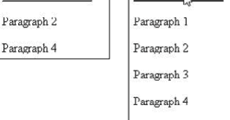

图10.1 使用 ch1001.html 中的 jQuery 代码动态添加段落元素。

# 从页面中移除元素

```javascript
$("p").remove();
$("p").remove(".menu");
$("#myList").children("li").remove();
```

你使用 jQuery 对象的 `.remove([selector])` 方法从网页中移除元素。此方法会修改 DOM 并从树中移除节点。

有几种不同的方法可以使用 `.remove()`。不带参数调用 `.remove()` 会移除 jQuery 对象集合中的所有元素。例如，以下语句移除所有 `<p>` 元素：

```javascript
$("p").remove();
```

你也可以向 `.remove()` 传递一个选择器，这会将移除操作限制在集合中匹配选择器值的项目上。例如，以下语句移除所有 class="menu" 的 `<p>` 元素：

```javascript
$("p").remove(".menu");
```

通常，你不想移除元素本身，而是它的子元素。例如，以下代码移除 `id="myList"` 的列表中的所有 `<li>` 元素：

```javascript
$("#myList").children("li").remove();
```

以下代码展示了使用选择器从列表中移除元素的示例。该代码首先生成一个包含十个元素的列表，然后提供按钮来调用处理函数，这些函数使用 `.remove("li:even")` 或 `.remove("li:odd")` 仅从列表中移除偶数或奇数位置的元素，如图10.2所示：

```html
<html>
  <head>
    <title>Python Phrasebook</title>
    <meta charset="utf-8" />
    <script type="text/javascript"
      src="../js/jquery-2.0.3.min.js"></script>
    <script>
      $(document).ready(function (){
        for(var i=0; i<10; i++){
          $("ul").append($("<li></li>").html("Item "+ i));
        }
        $("#odd").on("click", function(){
          $("li:odd").remove(); });
        $("#even").on("click", function(){
          $("li:even").remove(); });
      });
    </script>
  </head>
  <body>
    <button id="odd">Remove Odd</button>
    <button id="even">Remove Even</button>
    <ul></ul>
  </body>
</html>
```

ch1002.html

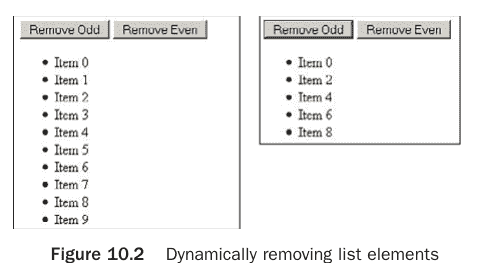

图10.2 使用 ch1002.html 中的 jQuery 代码动态移除列表元素。

# 动态创建 select 表单元素

```javascript
var select = $("<select></select>");
var opt = $("<option></option>");
opt.val("1");
opt.html("Option 1");
select.append(opt);
select.val(opt.val());
```

jQuery使得动态生成 select 元素变得简单。如果你需要添加具有大量选项的 select，或者 select 的数据以动态方式获取（如用户输入或 AJAX 请求），这将非常有用。

要动态创建一个 select，你首先需要使用以下代码创建一个 `<select>` 元素：

```javascript
var select = $("<select></select>");
```

然后你需要通过创建 `<option>` 元素、为选项设置值，然后将其附加到 select 中来添加选项。

然后定义要在`<select>`中显示的HTML内容。以下代码创建一个新的`<option>`并将其添加到`<select>`中：

```javascript
var opt = $("<option></option>");
opt.val("1");
opt.html("Option 1");
select.append(opt);
```

你也可以使用以下语句将某个选项设置为选中状态，从而将`<select>`的值设置为该选项的值：

```javascript
select.val(opt.val());
```

以下代码示例展示了如何使用`for`循环和月份名称数组动态构建月份、日期、年份的日期选择器。图10.3展示了动态生成的选择器：

```html
<html>
  <head>
    <title>Python Phrasebook</title>
    <meta charset="utf-8" />
    <script type="text/javascript"
      src="../js/jquery-2.0.3.min.js"></script>
    <script>
      var mNames = ["Jan", "Feb", "Mar", "Apr",
        "May", "Jun", "Jul", "Aug", "Sep", "Oct", "Nov",
        "Dec" ];
      $(document).ready(function (){
        var months = $('<select id="mon"></select>');
        var days = $('<select id="day"></select>');
        var years = $('<select id="year"></select>');
        for(var i=0; i<mNames.length; i++){
            var month = $("<option></option>");
            var v = mNames[i];
            month.val(mNames[i]).html(mNames[i]);
            months.append(month); }
        for(var i=1; i<=31; i++){
            var day = $("<option></option>");
            day.val(i).html(i);
            days.append(day); }
        for(var i=2010; i<=2030; i++){
            var year = $("<option></option>");
            year.val(i).html(i);
            years.append(year); }
        $("body").append(months, days, years);
        $("select").on("change", function(){
            $("p").html($("#mon").val() +" " +
                $("#day").val() +", " +
                $("#year").val());
        });
        $("select").attr("size", 3);
    });
</script>
</head>
<body>
    <p>Date</p>
</body>
</html>
```

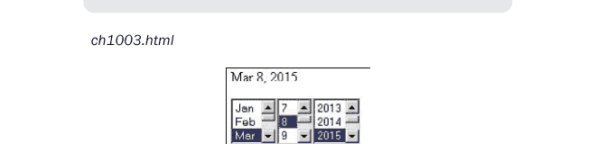

图10.3 使用ch1003.html中的jQuery和JavaScript代码动态创建`<select>`元素。

# 向表格追加行

```javascript
var newRow = $("<tr></tr>");
var newCell = $("<td>cell1</td>");
newRow.append(newCell);
$("tbody").append(newRow);
```

动态操作网页时，一个常见任务是向表格元素中添加行。要向表格添加行，你需要创建一个新的`<tr>`元素，然后添加`<td>`元素。例如：

```javascript
var newRow = $("<tr></tr>");
var newCell = $("<td>cell1</td>");
newRow.append(newCell);
$("tbody").append(newRow);
```

以下示例展示了如何使用一系列数组来构建表格并填充数据。`buildTable()`函数从数组中随机选取项目放入`<td>`元素中。图10.4展示了最终表格：

```html
<html>
  <head>
    <title>Python Phrasebook</title>
    <meta charset="utf-8" />
    <script type="text/javascript"
      src="../js/jquery-2.0.3.min.js"></script>
    <script>
      var tArr = ["Mens", "Womens", "Youth",
          "Childs"];
      var sArr = ["XL", "M", "S", "XS"];
      var kArr = ["pants", "shirt", "sweater",
          "belt"];
      function randInt(max) {
        return Math.floor((Math.random()*max)+1); }
      function buildTable(){
        for(var x=1;x<10;x++){
          var row =$("<tr></tr>");
          row.append($("<td></td>").html(x));
          row.append($("<td></td>").html(
            tArr[randInt(3)]+" "+sArr[randInt(3)]
            +" "+kArr[randInt(3)]));
          row.append($("<td></td>").html(randInt(20)));
          row.append($("<td></td>").html(
            ((Math.random()*80)+5).toFixed(2)));
          $("tbody").append(row);}
      }
      $(document).ready(function (){
        buildTable()
      });
    </script>
    <style> td {border:.5px dotted black; }
    </style>
  </head>
  <body>
    <table>
      <thead><tr>
        <th class="numeric"><span>ID#</span></th>
        <th ><span>Product</span></th>
        <th class="numeric"><span>Quantity</span></th>
        <th class="numeric"><span>Price</span></th>
        <td class="spacer"></td>
      </tr></thead>
      <tbody></tbody>
    </table>
  </body>
</html>
```

| ID# | 产品 | 数量 | 价格 |
| :--- | :--- | :--- | :--- |
| 1 | Childs M belt | 20 | 67.84 |
| 2 | Womens XS sweater | 17 | 84.95 |
| 3 | Childs XS belt | 15 | 80.49 |
| 4 | Youth XS shirt | 17 | 56.82 |
| 5 | Youth M belt | 2 | 56.31 |
| 6 | Womens S belt | 13 | 5.91 |
| 7 | Youth XS sweater | 8 | 10.80 |
| 8 | Womens S belt | 11 | 62.23 |
| 9 | Womens S sweater | 3 | 61.91 |

**图10.4** 使用ch1004.html中的jQuery和JavaScript代码动态向表格添加行。

# 向列表插入项目

```javascript
var item = "New Item";
var nextItem = false;
$("ul li").each(function(i, item){
    if ($(item).html() > newItem){
        nextItem = item;
        return false; }});
if (!nextItem){
    $("ul").append($("<li></li>").html(newItem)); }
else {
    $(nextItem).before($("<li></li>").html(newItem));}
```

动态操作网页时，另一个常见任务是向列表中插入元素。但如果列表需要排序呢？有几种不同的方法可以实现。

一种添加项目的方法是遍历列表元素，直到找到一个大于新项目的元素。然后将新项目插入到该现有元素之前。如果未找到更大的项目，则只需将项目追加到列表末尾。

以下示例展示了一个文本输入框，允许用户通过输入项目并按回车键将项目添加到购物清单中。在`addToList()`函数中，项目按字母顺序添加。图10.5展示了向列表添加项目的过程：

```html
<html>
  <head>
    <title>Python Phrasebook</title>
    <meta charset="utf-8" />
    <script type="text/javascript"
        src="../js/jquery-2.0.3.min.js"></script>
    <script>
        function addToList(newItem){
            var nextItem = false;
            $("ul li").each(function(i, item){
                if ($(item).html() > newItem){
                    nextItem = item;
                    return false; }
            });
            if (!nextItem){
                $("ul").append($("<li>").html(newItem)); }
            else {
                $(nextItem).before($("<li>").html(newItem));}
        }
        $(document).ready(function (){
            $("input").on("keyup",function(e){
                if (e.keyCode == 13){
                    addToList($(this).val());
                    $(this).val("");
                }
            });
        });
    </script>
</head>
<body>
  <p>Grocery List</p>
  <input type="text" />
  <ul><li>eggs</li><li>milk</li></ul>
</body>
</html>
```

ch1005.html

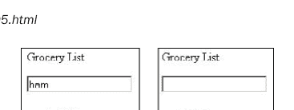

图10.5 使用ch1005.html中的jQuery和JavaScript代码动态按字母顺序插入列表项目。

# 创建动态图片库

```javascript
var img = $("</img>");
img.attr("src", "images/newImage.jpg");
$("div").append(img);
```

图片已成为网页的主力。它们能传递更多内容，并且通常比文本更快、更准确地实现这一点。jQuery和JavaScript允许你根据需要通过创建图片元素、设置每个图片的`src`属性，然后将其追加到正确位置来动态地向网页添加图片。

例如，以下代码创建一个``元素，设置`src`属性以定义文件位置，然后将图片追加到`<div>`元素：

```javascript
var img = $("</img>");
img.attr("src", "images/newImage.jpg");
$("div").append(img);
```

作为示例，以下代码使用图片名称数组在网页上动态构建一个小型图片库。`addImages()`函数遍历图片列表，然后通过创建``、`<span>`和`<p>`元素将图片追加到页面。图10.6展示了最终图片库：

```html
<html>
  <head>
    <title>Python Phrasebook</title>
    <meta charset="utf-8" />
    <script type="text/javascript"
      src="../js/jquery-2.0.3.min.js"></script>
    <script>
      var images = ["arch", "flower", "sunset2",
                    "tiger", "falls", "volcano",
                    "beach", "img1", "flower2"];
      function addImages(){
        for (i in images){
          var imgbox = $("<span></span>");
          var img = $("</img>");
          var label = $("<p></p>").html(images[i]);
          img.attr("src", images[i] + ".jpg");
          imgbox.append(label, img );
```

# 第 11 章 添加 jQuery UI 元素

jQuery UI 是一个构建在 jQuery 之上的附加库。jQuery UI 的目的在于提供一套可扩展的交互、效果、部件和主题，使得将专业用户界面（UI）元素整合到你的网页中变得更容易。

jQuery UI 库提供了大量功能。本章中的内容旨在让你开始使用 jQuery UI。虽然这些概念并非面面俱到，但你可以将它们应用于更多的 UI 元素和交互。

## 添加 jQuery UI 库

```html
<script type="text/javascript" src="jquery-ui-1.10.3.min.js"></script>
<link rel="stylesheet" type="text/css" href="jquery-ui-1.10.3.min.css">
```

要开始使用 jQuery UI，请下载该库，将其添加到你的网页可以访问的位置，然后在网页中加载 JS 和 CSS 文件。添加 jQuery UI 库的过程在以下步骤中描述。

1.  从 http://jqueryui.com/download/ 下载该库。
2.  解压下载文件的内容。
3.  将下载中的 `jquery-ui-###.js`、`jquery-ui-###.css` 和 images 文件夹复制到你网站中页面可以访问的位置。images 文件夹需要与 .css 文件位于同一位置。
4.  将以下几行添加到你网页的头部以加载 jQuery UI 代码。你需要替换版本号以匹配你下载的版本，并在 src 和 href 属性中设置适当的路径：

```html
<script type="text/javascript"
        src="jquery-ui-1.10.3.min.js"></script>
<link rel="stylesheet" type="text/css"
      href="jquery-ui-1.10.3.min.css">
```

> **顺便提一下**
>
> jQuery UI 库基于 jQuery 库，因此你需要先加载 jQuery 库。

## 实现自动完成输入

```javascript
...
jQuery . . .
$( "#autocomplete" ).autocomplete({
    source: ["Monday", "Tuesday", "Wednesday",
             "Thursday", "Friday"]
});
. . . HTML . . .
<input id="autocomplete">
```

自动完成部件附加到文本输入元素上。当用户在文本输入中键入时，会显示来自列表的建议。当你有一组有限的可能输入项，并且希望确保使用正确的拼写时，这尤其有帮助。

要应用自动完成部件，请定义一个源数组，其中包含可用于文本输入自动完成的字符串。然后，在输入元素上调用 `.autocomplete({source:array})` 方法。例如：

```javascript
$( "#autocomplete" ).autocomplete({
    source: ["Monday", "Tuesday", "Wednesday",
             "Thursday", "Friday"]
});
```

以下代码通过将一个日期数组自动完成部件添加到名为 `#autocomplete` 的 `<input>` 元素，来说明使用自动完成的示例。自动完成在图 11.1 中展示。要自动完成的日期集合通过在第 16 和 17 行将 source 属性设置为一个日期名称数组来添加：

```html
01 <html>
02   <head>
03     <title>Python Phrasebook</title>
04     <meta charset="utf-8" />
05     <script type="text/javascript"
06       src="../js/jquery-2.0.3.min.js"></script>
07     <script type="text/javascript"
08       src="../js/jquery-ui-1.10.3.min.js"></script>
09     <link rel="stylesheet" type="text/css"
10       href="../js/css/jquery-ui-1.10.3.min.css">
11     <script>
12       function dateChanged(dateStr, Object){
13         $("span").html("Updated to " + dateStr); }
14       $(document).ready(function(){
15         $( "#autocomplete" ).autocomplete({
16           source: ["Monday", "Tuesday",
17           "Wednesday", "Thursday", "Friday"]
18         });
19       });
20     </script>
21     <style>
22       input { border:2px ridge blue;
23       border-radius:5px;
24       padding:3px; }
25     </style>
26   </head>
27   <body>
28     <label for="autocomplete">Day of Week:</label>
29     <input id="autocomplete">
30   </body>
31 </html>
```

ch1101.html

## 实现拖放功能

```javascript
$("#drag1, #drag2, #drag3").draggable(
    {helper:"clone", cursor:"move",
     opacity:.7, zIndex:99});
$("#drop").droppable({accept:"img",
     tolerance:"intersect", hoverClass:"drop-hover"});
$("#drop").on("drop", function(e,ui){
     var item = $("<div></div>");
     item.append($("").attr("src",
          ui.draggable.attr("src")));
     item.append($("<span>").html(
          ui.draggable.attr("src")));
     $(this).append(item);
});
```

你可以定义一个元素为可拖拽，另一个为可放置。当可拖拽元素被放置到可放置组件上时，你可以添加 JavaScript 和 jQuery 代码来提供必要的交互。

可拖拽组件为元素在鼠标拖动时提供了必要的交互性。例如，通过鼠标拖动将元素移动到浏览器窗口的另一个位置。

### 表 11.1 常用可拖拽组件选项

| 选项 | 描述 |
| :--- | :--- |
| axis | 可设置为 x、y 或 false。x 仅水平拖动，y 仅垂直拖动，false 可自由拖动。 |
| containment | 指定一个容器以限制拖动范围。可选值有 "parent"、"document" 或 "window"。 |
| cursor | 指定拖动时显示的光标。 |
| helper | 定义拖动时显示的元素。值可以是 "original"、"clone"，或返回 DOM 对象的函数。 |
| opacity | 设置拖动时的不透明度。 |
| revert | 布尔值。指定拖动停止时"原始"对象是否应回到其原始位置。字符串。若设为 "valid"，则仅在对象成功放置后回弹。"invalid" 则在对象未成功放置时回弹。 |
| stack | 设置为 false 或选择器。若指定选择器，项目将被置于选择器指定元素的最高 z-index。 |
| zIndex | 拖动时使用的 z-index 值。 |

可拖拽组件还提供了额外事件，以便在拖动开始、进行中和停止时为元素添加处理程序。表 11.2 列出了可拖拽项目上可访问的事件。以下代码展示了添加 `dragstop` 事件的示例，在项目放置时应用弹跳效果：

```javascript
$("#drag1").draggable({cursor:"move", opacity:.5});
$("#drag1").on("dragstop",
function(){$(this).effect("bounce", 1000); });
```

### 表 11.2 可拖拽组件事件

| 事件 | 描述 |
| :--- | :--- |
| drag(event, ui) | 拖动时触发。event 是 JavaScript 事件对象。ui 是包含以下值的对象：<br>▪ helper—表示可拖拽项目辅助元素的 jQuery 对象。<br>▪ position—当前 CSS 位置的 {top, left} 对象。<br>▪ offset—当前 CSS 偏移量的 {top, left} 对象。 |
| dragstart(event, ui) | 拖动开始时触发。 |
| dragstop(event, ui) | 拖动停止时触发。 |

可放置组件将一个元素定义为有效的放置容器，供可拖拽项目使用。这允许你使用简单的鼠标控件提供元素间的交互。

可放置组件允许你指定一个 `accept` 函数，该函数可以处理事件信息，例如鼠标坐标和涉及的可拖拽项目。表 11.3 描述了更常见的可放置选项。以下代码展示了将可放置组件附加到元素并指定容差级别的示例：

```javascript
$("#div1").droppable({tolerance:"touch"});
```

### 表 11.3 常用可放置组件选项

| 选项 | 描述 |
| :--- | :--- |
| accept | 指定用于筛选可放置项目接受的元素的选择器。 |
| activeClass | 指定在有效可拖拽项目被拖动时应用于可放置项目的类。 |
| greedy | 布尔值。默认为 false，意味着所有有效父级可放置项目也会接收可拖拽项目。当为 true 时，仅第一个可放置项目接收可拖拽项目。 |
| hoverClass | 指定在有效可拖拽项目悬停在其上时应用于可放置项目的类。 |
| tolerance | 指定用于确定可拖拽项目是否有效的方法。可接受的值有：fit—可拖拽完全覆盖可放置。intersect—可拖拽在两个方向上至少重叠可放置 50%。pointer—鼠标在可放置上方。touch—可拖拽在任何位置与可放置元素重叠。 |

可放置组件也提供了额外事件，以便在拖动和放置时为元素添加处理程序。表 11.4 列出了可放置项目上可访问的事件。以下代码展示了添加 `dropactivate` 事件的示例，在拖动开始激活可放置项目时应用抖动效果：

```javascript
$("#drop1").droppable({tolerance:"pointer"});
$("#drop1").on("dropactivate",
function(){$(this).effect("shake", 1000); });
```

### 表 11.4 可放置组件事件

| 事件 | 描述 |
| :--- | :--- |
| dropactivate(event, ui) | 当有效可拖拽项目开始拖动时触发。event 是 JavaScript 事件对象。ui 是包含以下值的对象：<br>▪ draggable—表示实际可拖拽项目的 jQuery 对象。<br>▪ helper—表示可拖拽项目辅助元素的 jQuery 对象。<br>▪ position—当前可拖拽 CSS 位置的 {top, left} 对象。<br>▪ offset—当前可拖拽 CSS 偏移量的 {top, left} 对象。 |
| drop(event, ui) | 当可拖拽项目被放置到可放置项目上时触发。 |
| dropout(event, ui) | 当可拖拽项目基于容差离开可放置项目时触发。 |
| dropover(event, ui) | 当可拖拽项目基于容差进入可放置项目时触发。 |

现在我将尝试以实际方式将所有内容整合在一起。以下代码使三个图像元素可拖拽，然后使一个 `<div>` 元素可放置。我在第 14 行使用了 "clone" 选项，以便我可以移动图像的副本并将原图留在原地。`drop` 事件处理程序使用图像信息创建一个新的 `<div>` 元素，其中包含图像和文件名，如图 11.2 所示：

```html
01 <html>
02   <head>
03     <title>Python Phrasebook</title>
04     <meta charset="utf-8" />
05     <script type="text/javascript"
06       src="../js/jquery-2.0.3.min.js"></script>
07     <script type="text/javascript"
08       src="../js/jquery-ui-1.10.3.min.js"></script>
09     <link rel="stylesheet" type="text/css"
10       href="../js/css/jquery-ui-1.10.3.min.css">
11 <script>
12   $(document).ready(function(){
13     $("#drag1, #drag2, #drag3").draggable(
14       {helper:"clone", cursor:"move",
15        opacity:.7, zIndex:99});
16     $("#drop").droppable({accept:"img",
17       tolerance:"intersect", hoverClass:"drop-hover"});
18     $("#drop").on("drop", function(e,ui){
19       var item = $("<div></div>");
20       item.append($("").attr("src",
21         ui.draggable.attr("src")));
22       item.append($("<span></span>").html(
23         ui.draggable.attr("src")));
24       $(this).append(item);
25     });
26   });
27 </script>
28 <style>
29   div {display:inline-block; vertical-align:top;
30        margin:10px;}
31   img {width:100px; margin:0px; }
32   #images { width:100px; height:300px; }
33   #drop { width:300px; min-height:150px; padding:3px;
34          border:3px ridge white; box-shadow:
35          5px 5px 5px #888888; }
36   #drop div{ height:80px; width:280px; padding:4px;
37            border:2px dotted; margin-top:5px; }
38   #drop div img {height:80px; margin-right:10px; }
39   #drop div span { display:inline-block;
40      vertical-align:top; font:16px/70px arial; }
41   .drop-hover { background-color:#BBDDFF; }
42 </style>
```

```html
<html>
<head>
    <title>Python 短句集</title>
    <meta charset="utf-8" />
    <script type="text/javascript"
        src="../js/jquery-2.0.3.min.js"></script>
    <script type="text/javascript"
        src="../js/jquery-ui-1.10.3.min.js"></script>
    <link rel="stylesheet" type="text/css"
        href="../js/css/jquery-ui-1.10.3.min.css">
    <script>
        function dateChanged(dateStr, Object) {
            $("span").html("更新至" + dateStr);
        }
        $(document).ready(function () {
            $("#month").datepicker({
                onSelect: dateChanged,
                showOn: "button",
                buttonImage: "calendar.png",
                buttonImageOnly: true,
                numberOfMonths: 2,
                showButtonPanel: true,
                dateFormat: "yy-mm-dd"
            });
        });
    </script>
    <style>
        input { border: 2px ridge blue; border-radius: 5px; }
    </style>
</head>
<body>
    <label>日期: </label>
    <input type="text" id="month">
    <span></span>
</body>
</html>
```

ch1103.html

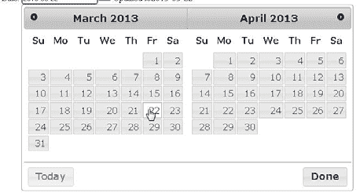

图 11.3 在 ch1103.html 的 jQuery UI 代码中实现一个日期选择器小部件。

## 使用滑块操作元素

```javascript
$("#red, #green, #blue").slider({
    orientation: "horizontal",
    range: "min",
    max: 255,
    value: 127,
    slide: refreshSwatch,
    change: refreshSwatch
});
$("#red").slider("value", 128);
$("#green").slider("value", 128);
$("#blue").slider("value", 128);
```

滑块小部件允许你创建滑块控件，通过拖动鼠标来调整值。滑块有两个组成部分：滑动条和手柄。滑动条由 `.ui-slider-range` 类定义样式，手柄由 `.ui-slider-handle` 类定义样式。

**你知道吗？**

你可以同时定义最小和最大手柄，这样就可以使用单个滑块控件来定义一个范围，而不是一个单一的值。

以下代码提供了一个实现一组滑块来调整另一个元素背景色的示例。滑块被应用到第 23–33 行的 `<div>` 元素上，并设置了以下选项：

-   **orientation** — 可以设置为 "horizontal" 或 "vertical"。
-   **range** — 可以设置为 true、"min" 或 "max"。用于定义范围。"min" 表示从滑块最小值到一个手柄，"max" 表示从滑块最大值到一个手柄。
-   **max** — 指定最大值。
-   **value** — 指定当前值。
-   **slide** — 当滑块移动时调用的事件处理程序。
-   **change** — 当滑块值改变时调用的事件处理程序。

另外，请注意第 41–46 行 CSS 中的类设置，它们改变了滑块和手柄的外观。图 11.4 展示了这些滑块：

```html
<html>
<head>
    <title>Python 短句集</title>
    <meta charset="utf-8" />
    <script type="text/javascript"
        src="../js/jquery-2.0.3.min.js"></script>
    <script type="text/javascript"
        src="../js/jquery-ui-1.10.3.min.js"></script>
    <link rel="stylesheet" type="text/css"
        href="../js/css/jquery-ui-1.10.3.min.css">
    <script>
        function cValue(selector) {
            var v = $(selector).slider("value").toString(16);
            if (v.length === 1) { v = "0" + v; }
            return v;
        }
        function refreshSwatch() {
            $("#mix").css("background-color", "#" +
                cValue("#red") + cValue("#green") + cValue("#blue"));
            $("#mix").html($("#mix").css("background-color"));
        }
        $(document).ready(function () {
            $("#red, #green, #blue").slider({
                orientation: "horizontal",
                range: "min",
                max: 255,
                value: 127,
                slide: refreshSwatch,
                change: refreshSwatch
            });
            $("#red").slider("value", 128);
            $("#green").slider("value", 128);
            $("#blue").slider("value", 128);
        });
    </script>
    <style>
        #mix { width: 160px; height: 100px; text-align: center; font: 18px/100px arial; }
        #red, #green, #blue { float: left; clear: left; width: 150px; margin: 15px; }
        #red .ui-slider-range { background: red; }
        #red .ui-slider-handle { border-color: red; }
        #green .ui-slider-range { background: green; }
        #green .ui-slider-handle { border-color: green; }
        #blue .ui-slider-range { background: blue; }
        #blue .ui-slider-handle { border-color: blue; }
    </style>
</head>
<body>
    <div id="mix"></div>
    <div id="red"></div>
    <div id="green"></div>
    <div id="blue"></div>
</body>
</html>
```

ch1104.html

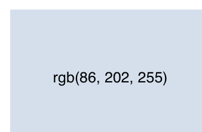
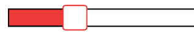
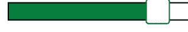


图 11.4 在 ch1104.html 的 jQuery UI 代码中添加滑块。

# 创建菜单

```javascript
// ... jQuery ...
$("#menu").menu();
$("#menu").on("menuselect", function (e, ui) {
    $("p").html("已选择 " +
        ui.item.children("a:first").html());
});
// ... HTML ...
<ul id="menu">
    <li><a href="#">打开</a></li>
    <li><a href="#">最近</a><ul>
        <!-- ... -->
        <li class="ui-state-disabled"><a href="#">...</a></li>
    </ul></li>
</ul>
```

最常用的 jQuery UI 小部件之一是菜单小部件。菜单小部件允许你将元素树转换为可展开的菜单。通常，菜单是通过使用 `<ul>/<li>` 元素的级联集以及一个定义链接行为和菜单文本的 `<a>` 元素来创建的。

**你知道吗？**

你可以使用 menus 选项来自定义用于构建菜单的元素标签；例如：`menus:"div.menuItem"`。

以下代码从一组列表创建了一个 jQuery UI 菜单。注意在 HTML 中，一些 `<li>` 字段包含一个带有 `class="ui-icon ui-icon-{type}"` 的 `<span>`。这些项目将在菜单文本旁包含指定的 jQuery UI 图标。

选中的项目显示在 `<p>` 元素中，以展示如何使用第 14 行定义的 `menuselect` 事件处理程序来处理选择。菜单的宽度在第 21 行的 CSS 代码中通过设置 `.ui-menu` 类的 `width` 值来定义。菜单操作如图 11.5 所示：

```html
<html>
<head>
    <title>Python 短句集</title>
    <meta charset="utf-8" />
    <script type="text/javascript"
        src="../js/jquery-2.0.3.min.js"></script>
    <script type="text/javascript"
        src="../js/jquery-ui-1.10.3.min.js"></script>
    <link rel="stylesheet" type="text/css"
        href="../js/css/jquery-ui-1.10.3.min.css">
    <script>
      $(document).ready(function(){
        $( "#menu" ).menu();
        $( "#menu" ).on("menuselect", function(e, ui){
            $("p").html("Selected " +
              ui.item.children("a:first").html());
          });
        });
    </script>
    <style>
      .ui-menu { width: 200px; }
      p { border:3px ridge red; color:red;
        display:inline-block; height:80px; width:100px; }
    </style>
    <body>
      <ul id="menu">
        <li><a href="#">Open</a></li>
        <li><a href="#">Recent</a><ul>
          <li><a href="#">Some File</a></li>
          <li><a href="#">Another File</a></li>
          </ul></li>
        <li><a href="#">Save</a></li>
        <li class="ui-state-disabled"><a href="#">
          <span class="ui-icon ui-icon-print">
          </span>Print...</a></li>
        <li><a href="#">Playback</a><ul>
          <li><a href="#">
            <span class="ui-icon ui-icon-seek-start"></span>
            Prev</a></li>
          <li><a href="#">
            <span class="ui-icon ui-icon-stop"></span>
            Stop</a></li>
          <li><a href="#">
            <span class="ui-icon ui-icon-play"></span>
            Play</a></li>
            <li><a href="#">
              <span class="ui-icon ui-icon-seek-end"></span>
              Next</a></li>
            </ul></li>
          </ul>
          <p></p>
        </body>
      </html>
```

ch1105.html

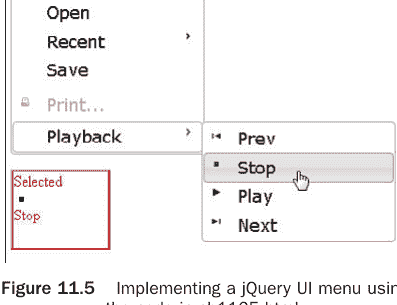

**图 11.5** 使用 ch1105.html 中的代码实现 jQuery UI 菜单。

# 添加工具提示

```javascript
$(document).tooltip({
    items: "img, input",
    position: {my:"left+15 top", at:"left bottom",
               collision:"flipfit" },
    content: function() {
        var obj = $(this);
        if (obj.is("input")) {
            return obj.attr( "title" ); }
        if (obj.is("img")) {
            var img = $("").addClass(
                "mini").attr("src", obj.attr("src"));
            var span = $("<span>").html(
                obj.attr( "alt" ));
            return $("<div>").append(img, span); }
    }
});
```

工具提示小部件允许你轻松地为表单输入、图像以及几乎任何其他页面元素添加工具提示。要实现工具提示，请对文档或其他容器应用 `.tooltip(options)`。在选项中，指定应包含工具提示的项目，然后指定工具提示内容处理程序。

当鼠标悬停在工具提示支持的元素上时，会显示工具提示消息。以下代码提供了一个示例，展示了如何在 `<input>` 和 `` 元素上实现工具提示，如图 11.6 所示。

- **items**——指定用于确定页面元素是否支持工具提示的选择器。
- **content**——当鼠标悬停在受支持的元素上时调用的工具提示处理程序函数。该函数应返回要显示的内容。请注意，对于图像，会在工具提示中显示一个迷你版本。
- **position**——指定放置工具提示的位置；例如：

```html
01 <html>
02   <head>
03     <title>Python Phrasebook</title>
04     <meta charset="utf-8" />
05     <script type="text/javascript"
06       src="../js/jquery-2.0.3.min.js"></script>
07     <script type="text/javascript"
08       src="../js/jquery-ui-1.10.3.min.js"></script>
09     <link rel="stylesheet" type="text/css"
10       href="../js/css/jquery-ui-1.10.3.min.css">
11     <script>
12       $(document).ready(function(){
13         $(document).tooltip({
14           items: "img, input",
15           position: {my:"left+15 top", at:"left bottom",
16                       collision:"flipfit" },
17           content: function() {
18             var obj = $(this);
19             if (obj.is("input")) {
20               return obj.attr( "title" ); }
21             if (obj.is("img")) {
22               var img = $("</img>").addClass(
23                           "mini").attr("src",
24                 obj.attr("src"));
25               var span = $("<span></span>").html(
26                 obj.attr( "alt" ));
27               return $("<div></div>").append(img,
28                 span); }
29             }});
30       });
31     </script>
32     <style>
33       input { border:2px ridge blue; border-radius:
34               5px;
35             padding:3px; }
36       img { height:200px; margin:15px; }
37     </style>
38   </head>
39   <body>
40     <div id="content">
41       <h2>Tooltip for Images</h2>
42       <p></p>
43       <h2>Tooltip for Input Fields</h2>
44       <p>Name: <input type="text" title="Please enter your first name" /></p>
45     </div>
46   </body>
47 </html>
```

```html
34  .mini {height:30px;}
35  </style>
36  <body>
37  <label for="size">Who are you? </label>
38  <input id="size"
39    title="Nosce te ipsum (Know Thyself)"
40  /><br>
41  
43  </body>
44  </html>
```

ch1106.html

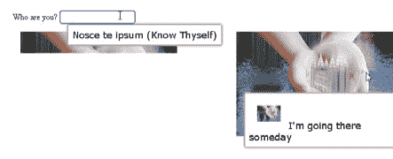

**图 11.6** 使用 ch1106.html 中的 jQuery UI 代码为元素添加工具提示。

此页有意留白

# 第 12 章 动画与其他特殊效果

jQuery 最重要的特性之一是能够为元素的更改添加动画。这会给用户一种流畅、精心开发的应用程序的感觉，而不是笨重、传统的网页。

这一点在你移动、调整大小或动态向网页添加元素时尤其明显。作为用户，突然出现或消失一堆新东西会令人感到沮丧。使用过渡效果可以给用户一个机会，看到元素从哪里扩展、收缩到哪里，以及移动的方向，这样他就能调整心态以接受这些变化。

## 理解 jQuery 动画

jQuery 动画是以用户可见的增量方式将 HTML 元素的属性从一个值修改为另一个值的过程。本节描述该过程以及如何在 CSS 属性上实现动画。

### 动画化 CSS 设置

```javascript
$("img").animate({height:100, width:100});
$("p").animate({margin-left:30});
```

jQuery 中的大多数动画都是通过 `.animate()` 方法完成的。`.animate()` jQuery 方法允许你在一个或多个 CSS 属性上实现动画。请记住，`.animate()` 方法会同时作用于 jQuery 对象集中的所有元素。通常，你只想作用于单个元素，因此你需要将集合过滤到一个元素。

`.animate()` 方法接受一个 CSS 属性对象映射作为第一个参数。你可以在对象中指定多个属性，以同时动画化多个属性。例如，以下代码动画化了 `` 元素的高度和宽度属性：

```javascript
$("img").animate({height:100, width:100});
```

> **顺便提一下**
>
> `.animate()` 方法只能动画化具有数值的属性。例如，你不能动画化边框样式，但你*可以*动画化边框大小。

有两种不同的方式可以调用 .animate() 方法。以下显示了这两种方式的语法：

```javascript
.animate(properties [, duration] [, easing] [, complete])
.animate(properties, options)
```

第一种方法允许你将持续时间、缓动和完成函数指定为可选参数。第二种方法允许你将选项指定为单个选项映射对象。例如，以下调用使用持续时间和缓动对象映射调用 .animate()：

```javascript
$("img").animate({height:100, width:100}, {duration:1000, easing:"linear"});
```

> **你知道吗？**
>
> 你不能使用颜色名称来动画化颜色变化，但你可以使用十六进制值（如 #ff0000）来动画化颜色变化。

### 表 12.1 .animate() 方法可用选项

| 选项 | 描述 |
| :--- | :--- |
| complete | 定义动画完成时要调用的函数。 |
| duration | 指定动画运行时长的字符串或数字。可选的字符串值为 "slow" 或 "fast"。数字指定动画运行的毫秒数。如果未指定 duration，则默认为 400ms。 |
| easing | 指示要使用哪个缓动函数的字符串。jQuery 提供了 "swing"（默认）和 "linear" 缓动函数。jQuery UI 添加了更多缓动函数。图12.1来自 jqueryui.com，展示了缓动函数图。可以将图表的水平轴视为持续时间，左侧为0秒，右侧为完成点。将图表的垂直轴视为设置值的变化百分比，底部为0%，顶部为100%。 |
| queue | 可以是 true，表示动画将排队在对象其他动画之后执行；false，表示动画将立即开始；或者是指定特定队列名称的字符串。 |
| step | 指定动画每一步要执行的函数，直到动画完成。 |
| specialEasing | 你也可以在属性映射中直接映射缓动，允许你为不同元素设置不同的缓动。例如： |

```javascript
$("img").animate({height: [100, "swing"], width: [100, "linear"]}, 1000);
```

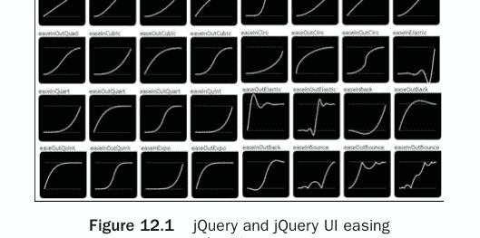

### 理解动画队列

动画是异步发生的，与代码执行并行，这意味着在动画发生时代码会继续执行。那么，如果在第一个动画完成之前为对象指定了另一个动画会发生什么？答案是 jQuery 会将动画排队，然后按顺序依次执行，直到所有动画都完成。除非你在动画选项中指定 `queue:false`。

你需要理解动画队列，因为如果允许用户交互（如移动鼠标或点击）排队太多动画，动画会变得迟钝，落后于用户的操作。

**注意！**

你需要注意从哪里触发动画。记住事件会冒泡。如果在冒泡阶段的所有层级执行相同的动画，可能会产生非常不期望的结果。为了防止这种情况，你可以使用 `stopPropagation()` 和 `stopImmediatePropagation()` 方法。

### 停止动画

```javascript
$("*").stop();
$("#img1").stop(true);
$("img").stop(true, true);
```

jQuery 允许你停止 jQuery 对象集中包含的元素上当前正在执行的动画。`.stop([clearQueue] [, jumpToEnd])` 方法允许你以几种不同的方式停止动画。

不带参数调用 `.stop()` 只是暂停队列中的动画。下一个开始的动画将再次开始执行队列中的动画。例如，以下代码暂停所有动画：

```javascript
$("*").stop();
```

调用 `.stop(true)`，将 `clearQueue` 选项设置为 `true`，会停止当前点的动画并从队列中移除所有动画。例如，以下代码停止图像上的所有动画并从队列中移除动画：

```javascript
$("img").stop(true);
```

调用 `.stop(true, true)`，将 `jumpToEnd` 选项设置为 `true`，会导致当前执行的动画立即跳到结束值，清空队列，然后停止所有动画。例如，以下代码停止图像上的所有动画，但完成当前动画进行的调整，然后从队列中移除动画：

```javascript
$("img").stop(true, true);
```

`.stop()` 方法返回 jQuery 对象，因此你可以将附加方法链式调用。例如，以下代码停止图像上的所有动画，然后开始一个新的动画将不透明度设置为 .5：

```javascript
$("img").stop(true, true).animate({opacity:.5}, 1000);
```

### 延迟动画

```javascript
$("img").animate({width:500}, 1000).delay(2000).animate({opacity:1}, 1000);
```

实现动画时一个很好的选项是在将动画添加到队列之前添加延迟。你可以使用此功能以更高级的方式提供动画，因为你延迟了动画队列的执行，为用户提供更好的视觉体验。

`.delay(duration, [, queueName])` 方法允许你指定延迟的毫秒持续时间，以及一个可选的 `queueName`，用于指定将延迟应用于哪个队列。例如，以下代码向图像添加大小动画。一旦大小完成，有2秒的延迟，然后不透明度动画上升到1：

```javascript
$("img").animate({width:500}, 1000).delay(2000).animate({opacity:1}, 1000);
```

> **顺便提一下**
>
> `.delay()` 方法非常适合在排队的 jQuery 效果之间延迟；但是，它不能替代 JavaScript 的 `setTimeout()` 函数，后者可能更适用于某些用例——特别是当你需要能够取消延迟时。

## 动画化可见性

jQuery 还在附加到 jQuery 对象的 fade 方法中提供了动画功能。最终，fade 方法等同于在 opacity 属性上使用 `.animate()`。

以下各节描述将动画应用于各种淡入淡出方法。

### 淡入元素

```javascript
$("img").fadeIn(1000, "swing");
```

`.fadeIn( [duration] [, easing] [, callback])` 方法提供了可选的 `duration`、`easing` 和 `callback` 选项，允许你动画化元素不透明度从其当前值到 1 的淡入。

例如，以下代码为所有图像元素应用一个 1 秒的动画，使用 swing 缓动：

```javascript
$("img").fadeIn(1000, "swing");
```

### 淡出元素

```javascript
$("img").fadeOut(1000, "swing", function() {
    $(this).fadeIn(1000);
});
```

`.fadeOut( [duration] [, easing] [, callback])` 方法提供了可选的 `duration`、`easing` 和 `callback` 选项，允许你动画化元素不透明度从其当前值到 0 的淡出。

例如，以下代码为所有图像元素应用一个 1 秒的动画，使用 swing 缓动。然后，在完成时，再次淡入它们：

```javascript
$("img").fadeOut(1000, "swing", function() {
    $(this).fadeIn(1000);
});
```

### 切换元素可见性

```javascript
$("img").fadeToggle(3000, "swing");
```

`.fadeToggle( [duration] [, easing] [, callback])` 方法提供了可选的 `duration`、`easing` 和 `callback` 选项，允许你根据元素的当前值，动画化元素不透明度从其当前值到 0 的淡出或淡入。

例如，以下代码为所有图像元素应用一个 3 秒的动画，使用 swing 缓动。当前可见的图像将淡出，当前透明的图像将淡入：

```javascript
$("img").fadeToggle(3000, "swing");
```

### 淡入到特定不透明度级别

```javascript
$("img").fadeTo(2000, .5);
$("img").fadeTo(2000, 1);
$("img").fadeTo(2000, .1);
```

`.fadeTo( duration, opacity [, easing] [, callback])` 方法提供了 `duration` 和 `opacity` 选项，指定要达到的特定不透明度以及动画过渡的持续时间。它还提供了可选的 `easing` 和 `callback` 参数。

例如，以下代码为所有图像应用一个 2 秒的动画，从当前不透明度过渡到 .5：

```javascript
$("img").fadeTo(2000, .5);
```

### 更改图像时添加过渡效果

```javascript
// jQuery
$("img").on("click", function(){
    $("#top").fadeToggle(2000);
});
```

```html
<!-- HTML -->


```

你不能直接动画化从一个图像到另一个图像的过渡，使得一个图像淡入而另一个图像淡出。克服这一挑战的方法是有两个图像——一个在另一个之上——然后动画化顶部的图像淡出。

以下代码正是这样做的。有两个固定定位的图像。当你点击顶部图像时，它会切换图像不透明度的淡入淡出，如图12.2所示。

```html
01 <html>
02   <head>
03     <title>Python Phrasebook</title>
04     <meta charset="utf-8" />
05     <script type="text/javascript"
06       src="../js/jquery-2.0.3.min.js"></script>
07     <script type="text/javascript"
08       src="../js/jquery-ui-1.10.3.min.js"></script>
09     <link rel="stylesheet" type="text/css"
10       href="../js/css/jquery-ui-1.10.3.min.css">
11     <script>
12       $(document).ready(function(){
13         $("img").on("click", function(){
14           $("#top").fadeToggle(2000);
15         });
16       });
17     </script>
18     <style>
19       img { position:fixed; height:300px;
20         border:3px ridge white;
21         box-shadow:5px 5px 5px #888888;
22         margin:10px; background-color:black;}
23     </style>
24   </head>
25   <body>
26     <div>
27 
28 
29 </div>
30 </body>
31 </html>
```

ch1201.html

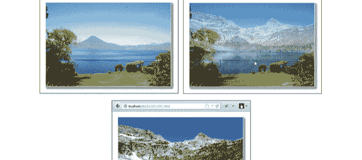

图 12.2 使用 ch1201.html 中的 jQuery 代码在图像之间实现动画过渡。

### 使元素滑动消失

```javascript
$("span").mouseover(function(){
    var i = $(this).index("span");
    $("img").eq(i).animate({height:100}, 1000); });
$("span").mouseout(function(){
    var i = $(this).index("span");
    $("img").eq(i).animate({height:.1}, 1000); });
```

```javascript
$("#container").mouseenter(function(e){
    e.stopPropagation();
    $("#images").stop(true).slideToggle(1000); });
$("#container").mouseleave(function(e){
    e.stopPropagation();
    $("#images").stop(true).slideToggle(1000); });
```

`.slideDown()`、`.slideUp()` 和 `.slideToggle()` 方法提供了 `duration`、`easing` 和 `callback` 参数，允许你实现垂直方向的滑动动画效果。

例如，以下代码应用一个1秒的动画将元素向下滑动，然后延迟3秒再将元素向上滑动：

```javascript
$("#menu").slideDown(1000).delay(3000).slideUp(1000);
```

你可以用类似的方式为 `.slideToggle()` 方法添加动画。例如，以下代码使用滑动动画来切换一个 `<div>` 元素的可见性：

```javascript
$("div").slideToggle(1000);
```

我喜欢使用 `width` 和 `height` 属性来创建滑动元素。你可以通过动画 `height` 创建垂直滑动效果，通过动画 `width` 创建水平滑动效果。

这里有几个技巧。如果你想要实现完整的滑动效果而不仅仅是调整大小的效果，你需要为元素同时提供 `width` 和 `height` 值。另外，如果你希望元素在页面上保留其占据的空间，你不能将值动画化到0。但是，你可以将值动画化到 .1，这样另一个维度就会保留其空间。

下面的例子展示了通过将高度更改为100实现向下滑动，然后通过将高度更改为 .1 实现向上滑动的动画：


```javascript
$("img").animate({height:100}, 1000);
$("img").animate({height:.1}, 1000);
```

以下代码创建了一个带有滑动效果标题栏的简单网页，该效果会显示出一个图像菜单，如图 12.3 所示。当你将鼠标悬停在菜单中的每个项目上时，一张图像会滑动下来，当你离开菜单时，图像又会滑动回去：

```html
01 <html>
02   <head>
03   <title>Python Phrasebook</title>
04   <meta charset="utf-8" />
05   <script type="text/javascript"
06     src="../js/jquery-2.0.3.min.js"></script>
07   <script type="text/javascript"
08     src="../js/jquery-ui-1.10.3.min.js"></script>
09   <link rel="stylesheet" type="text/css"
10     href="../js/css/jquery-ui-1.10.3.min.css">
11   <script>
12   $(document).ready(function(){
13     $("div div").hide();
14     $("span").mouseover(function(){
15       var i = $(this).index("span");
16       $("img").eq(i).animate({height:100},
17         1000); });
18     $("span").mouseout(function(){
19       var i = $(this).index("span");
20       $("img").eq(i).animate({height:.1},
21         1000); });
22     $("#container").mouseenter(function(e){
23         e.stopPropagation();
24         $("#images").stop(true).slideToggle(1000); });
25     $("#container").mouseleave(function(e){
26         e.stopPropagation();
27         $("#images").stop(true).slideToggle(1000); });
28     });
29     </script>
30     <style>
31     img{ display:inline-block; width:100px;
 height:.1px;
32     margin:0px; padding:0px; float:left;}
33     p, span { display:inline-block; width:400px;
34     background-color:black; color:white;
35     margin:0px; padding:0px; text-align:center;
36     }
37     span {width:100px; margin:-1px; float:left;
38     border:1px solid; background-color:blue; }
39     #container { width:410px; }
40     </style>
41     </head>
42     <body>
43     <div id="container">
44     <p>Images</p>
45     <div id="images">
46     <span>Image 1</span><span>Image 2</span>
47     <span>Image 3</span><span>Image 4</span><br>
48     
49     
50     </div>
51     </div>
52     </body>
53     </html>
```

ch1202.html

### 第12章 动画与其他特效

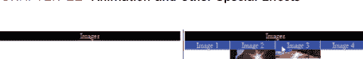

图 12.3 使用 ch1202.html 中的 jQuery 代码，通过滑动技术实现菜单的展开和折叠动画。

### 显示和隐藏动画

你已经在第9章“动态操作表单元素”中看到了 `.show()` 和 `.hide()` 方法的实际应用。通常的做法是为这些功能添加动画，因此 jQuery 为这些方法提供了动画选项，以使你的工作更轻松。

## 动画隐藏()

```javascript
$("#box").hide(1000, "linear", function() {
    $("#label").html("Hidden!")
});
```

`.hide( [duration] [, easing] [, callback])` 方法提供了可选的 `duration`、`easing` 和 `callback` 选项，允许你为隐藏效果添加动画，使元素在消失时过渡更平滑。

例如，以下代码应用一个1秒的线性缓动动画来隐藏一个元素，并在隐藏完成后执行一个简单的回调函数：

```javascript
$("#box").hide(1000, "linear", function() {
    $("#label").html("Hidden!")
});
```

## 动画显示()

```javascript
$("#box").show(1000, "linear", function() {
    $("#label").html("Shown!")
});
```

`.show( [duration] [, easing] [, callback])` 方法提供了可选的 `duration`、`easing` 和 `callback` 选项，允许你为显示效果添加动画，使元素出现时的过渡更平滑。

例如，以下代码应用一个1秒的线性缓动动画来显示一个元素，并在显示完成后执行一个简单的回调函数：

```javascript
$("#box").show(1000, "linear", function() {
    $("#label").html("Shown!")
});
```

## 动画切换()

```javascript
if ($("#handle").html() == '+'){
    $("#photo").show(1000, function(){
        $("#footer").toggle();});
    $("#handle").html('-');
} else {
    $("#footer").toggle();
    $("#photo").hide(1000);
    $("#handle").html('+');
}
```

`.toggle( [duration] [, easing] [, callback])` 方法提供了可选的 `duration`、`easing` 和 `callback` 选项，允许你为显示和隐藏效果之间的切换添加动画。

例如，以下代码应用一个1秒的线性缓动动画来切换一个元素在隐藏和显示状态之间的转换，并在切换完成后执行一个简单的回调函数：

```javascript
$("#switch").show(1000, "linear", function() {
    $("#label").html("Switch Toggled!")
});
```

以下代码实现了 `.hide()`、`.show()` 和 `.toggle()` 方法，并创建了一个简单的网页元素，该元素带有一个标题栏，左侧有一个折叠/展开按钮，你可以用它来展开和折叠一张图像。图 12.4 展示了该动画效果。

```html
01 <html>
02   <head>
03     <title>Python Phrasebook</title>
04     <meta charset="utf-8" />
05     <script type="text/javascript"
06       src="../js/jquery-2.0.3.min.js"></script>
07     <script type="text/javascript"
08       src="../js/jquery-ui-1.10.3.min.js"></script>
09     <link rel="stylesheet" type="text/css"
10       href="../js/css/jquery-ui-1.10.3.min.css">
11     <script>
12       function toggleImage(){
13         if ($("#handle").html() == '+'){
14           $("#photo").show(1000, function(){
15             $("#footer").toggle();});
16           $("#handle").html('-');
17         } else {
18           $("#footer").toggle();
19           $("#photo").hide(1000);
20           $("#handle").html('+');
21         }
22       }
23       $(document).ready(function(){
24         $("#handle").click(toggleImage);
25       });
26     </script>
27     <style>
28       div{ width:200px; text-align:center; }
```

## 动画调整图像大小

```javascript
$("img").mouseover(function(){
    $(this).animate(
        {width:"200px", opacity:1}, 1000); });
$("img").mouseout(function(){
    $(this).animate(
        {width:"100px", opacity:.3}, 1000); });
```

类似于你使用 `height` 和 `width` 创建滑动效果的方式，你可以用它们来创建缩放动画。滑动和缩放的区别在于，缩放时图像的宽高比会被保持，因此元素看起来是在放大或缩小，而不是在展开或收起。

要创建缩放动画，你需要在 `.animate()` 语句中同时指定 `height` 和 `width`，或者其中一个在 CSS 设置中必须是 `auto`，这样你只能为那个有具体值的属性添加动画效果。

以下代码展示了将图像在 1 秒内放大到 500 像素，然后用 5 秒时间缓慢缩小回 400 像素的缩放动画：

```javascript
$("img").animate({height:500, width:500}, 1000).
    animate({height:500, width:500}, 5000);
```

以下代码创建了一个基本的图片库视图，当鼠标移入和移出图像时，会在同一个动画中调整图像大小并改变不透明度（参见图 12.5）。

```html
<html>
<head>
<title>Python 速查手册</title>
<meta charset="utf-8" />
<script type="text/javascript"
src="../js/jquery-2.0.3.min.js"></script>
<script type="text/javascript"
src="../js/jquery-ui-1.10.3.min.js"></script>
<link rel="stylesheet" type="text/css"
href="../js/css/jquery-ui-1.10.3.min.css">
<script>
$(document).ready(function(){
$("img").mouseover(function(){
$(this).animate(
{width:"200px", opacity:1}, 1000);
});
$("img").mouseout(function(){
$(this).animate(
{width:"100px", opacity:.3}, 1000);
});
});
</script>
<style>
div{ padding:0px; }
img{ opacity:.3; width:100px; float:left; }
</style>
</head>
<body>
<div id="photos">


</div>
</body>
</html>
```

ch1204.html

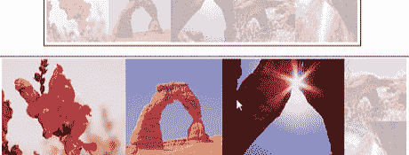

**图 12.5** 使用 ch1204.html 中的 jQuery 代码动画调整图像大小。

## 动画移动元素

```javascript
var position = $("#element").offset();
$("#element").animate({top:position.top+10,
left:position.left+100}, 1000);
```

另一个适合动画化的动态效果是元素的重新定位——具体来说，是将元素从一个位置移动到另一个位置。用户讨厌在执行操作后，页面元素突然出现在不同的位置。通过动画移动，用户可以看到元素移动到哪里，从而在思维上做出必要的调整。

要应用移动动画，你将为 `top` 和 `left` 这两个 CSS 属性的更改制作动画。要垂直移动，使用 `top`；要水平移动，使用 `left`。例如，以下语句将元素向右移动 10 像素，然后向下移动 10 像素：

```javascript
var position = $("#element").offset();
$("#element").animate({left:position.left+10}, 1000);
$("#element").animate({top:position.top+10}, 1000);
```

你也可以通过同时对 `top` 和 `left` 进行动画处理，实现对角线方向的移动。例如，以下代码在同一个动画中将元素向下移动 10 像素，向右移动 100 像素：

```javascript
var position = $("#element").offset();
$("#element").animate({top:position.top+10,
left:position.left+100}, 1000);
```

以下代码展示了一个使用移动动画的示例，尽管目的有点无厘头，但它确实演示了这一技巧的用法。当鼠标悬停在图 12.6 所示的按钮上时，移动动画会将该元素移动到屏幕上的新位置，使其无法被点击：

```html
<html>
  <head>
  <title>Python 速查手册</title>
  <meta charset="utf-8" />
  <script type="text/javascript"
    src="../js/jquery-2.0.3.min.js"></script>
  <script type="text/javascript"
    src="../js/jquery-ui-1.10.3.min.js"></script>
  <link rel="stylesheet" type="text/css"
    href="../js/css/jquery-ui-1.10.3.min.css">
  <script>
  function randInt(max, min) {
      return Math.floor((Math.random()*max)+min);
  }
    $(document).ready(function(){
      $("span").mouseover(function(){
        var newTop = randInt(500,10);
        var newLeft = randInt(700,10);
        $(this).animate(
            {top:newTop, left:newLeft}, 200); }));
    });
 </script>
 <style>
 span {border:3px ridge blue; padding:5px;
 position:fixed;
       border-radius: 30px 10px; background-color:blue; color:white;
       font:bold italic 22px cursive, serif; }
 </style>
 </head>
 <body>
 <span>点击此处</span>
 </body>
</html>
```

ch1205.html

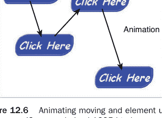

# 第13章 使用 AJAX 与 Web 服务器和 Web 服务通信

AJAX 通信是大多数网站最关键的部分之一。它允许 jQuery 和 JavaScript 从服务器获取额外数据，并更新页面上的单个元素，而无需重新加载或加载新的网页。

本章中的技巧旨在帮助你探索使用 jQuery 和 JavaScript 中的 AJAX 请求，与服务器进行异步通信的世界。

## 理解 AJAX

尽管 AJAX 非常重要，但一开始接触时可能会让人有些畏惧。面对众多通信术语，很容易让人感到不知所措。但其实并非如此。AJAX 只是 jQuery 或 JavaScript 向 Web 服务器发出的一个请求。该请求向服务器发送数据，服务器则以成功或失败的状态进行响应，并可能返回额外的数据。仅此而已——不多也不少。

> **注意！**
>
> 不要混淆服务器端动态创建网页与 AJAX。动态创建网页仍是传统方法，只是更易于管理一些。每次请求仍需要服务器返回一个完整的新网页。唯一的优点是网页是在内存中生成的，而不是从磁盘读取的。

AJAX 请求的妙处在于，它们只发送和接收必要的数据片段，而不是整个页面。传统的 Web 请求总是构建完整的网页并在浏览器中加载/重新加载。图 13.1 说明了在浏览器中更新数据的两种方法之间的区别。以下是 AJAX 请求的一些好处：

- 从 Web 服务器请求的数据更少。
- 允许用户在请求处理过程中继续使用网页。
- 可以在客户端捕获和处理错误，然后再向服务器发出请求。

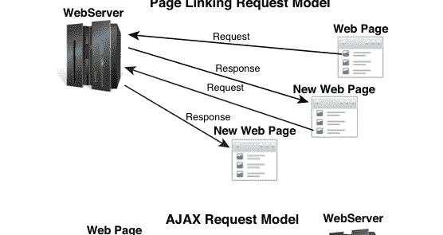

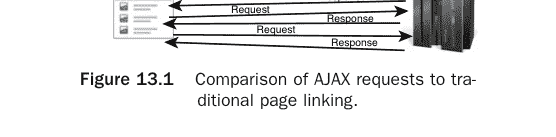

**图 13.1** AJAX 请求与传统页面链接的对比。

## 理解异步通信

当你从 Web 服务器请求一个网页时，对于你的浏览器来说，该通信是同步的。这意味着浏览器会等待，直到 HTML 文档从服务器下载完毕，然后才开始渲染它并获取所需的其他资源。

### 你知道吗？

你可以同时使用 jQuery 和 JavaScript 进行同步 AJAX 请求。jQuery 的 `.ajax()` 方法和 JavaScript 的 `send()` 函数都有一个布尔字段允许这样做。不过，我不建议这样做，因为这可能导致浏览器锁定，从而让用户感到不满。事实上，在 jQuery 1.8 及更高版本中，该选项已被弃用。

异步 AJAX 通信则不同。当你发送 AJAX 请求时，控制权会立即返回给 jQuery 或 JavaScript，后者可以执行其他操作。只有在请求完成或超时时，浏览器才会触发相应的事件，允许你处理请求数据。

## 理解跨域请求

当你向来自不同域名的独立服务器发送 AJAX 请求时，就会发生跨域请求。出于众多安全原因，浏览器会阻止这种操作，这样做是正确的。

阻止跨域请求的唯一问题是，你经常希望从当前网站外部的服务获取数据。你可以通过几种不同的方式来解决这个问题。

第一种方法是让 Web 服务器充当其他服务器或服务的代理，这意味着你不是直接通过 JavaScript 进行通信，而是将请求发送给服务器，让服务器为你执行。

另一种选择是执行所谓的按需 JavaScript，这就是带填充的 JSON（JSONP）所使用的方法。这种方法利用了你可以使用以下语法将另一个网站的脚本作为资源下载的事实：

```html
<script type="text/javascript"
    src="http://new.domain.com/getData?jsonp=parseData">
</script>
```

## 理解 GET 与 POST 请求

你发送到 Web 服务器的两种主要请求类型是 GET 和 POST。GET 请求将参数作为 URL 的一部分传递，而 POST 请求则将它们作为请求数据的一部分传递。

GET 请求 URL：

```
http://localhost/code/example1.html?first=Brad&last=Dayley
```

GET 请求数据：

```
<empty>
```

POST 请求 URL：

```
http://localhost/code/example1.html
```

POST 请求数据：

```
first=Brad
last=Dayley
```

## 理解响应数据

当你向服务器发送 AJAX 请求时，服务器会用响应数据进行响应。你将处理四种主要的响应类型。这些响应数据类型是脚本、文本、JSON 和 XML/HTML。

在 JavaScript 中，一旦请求完成，响应数据就可以在 `XMLHttpRequest` 对象的 `response` 和 `responseText` 属性中获取。在 jQuery 中，响应数据会作为第一个参数传递给你定义的 AJAX 处理函数。

脚本和文本通过 `.load()` 和 `.getScript()` 方法处理起来相当简单。JSON 和 XML/HTML 可能稍微复杂一些。

### 使用 `.getScript()` 通过 AJAX 加载 JavaScript

```javascript
$.getScript("scripts/ajax/newLibrary.js",
function(script, status, jqxr){
  ... 这里是处理代码 ...
});
```

脚本数据是可以在浏览器中加载并在 AJAX 请求之后使用的 JavaScript 代码。处理脚本数据的最佳方法是使用 jQuery 的 `.getScript(url [,successHandler(script,status,jqXHR)])` 方法。此方法会自动加载脚本，使其可供使用。

`url` 是脚本在服务器上的位置，可选的 `successHandler` 是在成功时触发的 AJAX 处理函数。

### 处理文本数据

```javascript
...
jQuery
...
function ajaxHandler(data){
    $("#myP").html(data); }
...
JavaScript
...
var xmlhttp = new XMLHttpRequest();
xmlhttp.onreadystatechange=function() {
    document.getElementById(
        "myP").innerHTML=xmlhttp.responseText;
}
```

文本数据是最基本的返回值类型。你可以将文本数据视为一个简单的字符串。例如，在 jQuery 中，要将一个段落元素设置为服务器返回的文本，你会使用以下 AJAX 处理程序：

```javascript
function ajaxHandler(data){
    $("#myP").html(data); }
```

在 JavaScript 中，你可以直接使用 `XMLHttpRequest` 对象的 `responseText` 属性：

```javascript
var xmlhttp = new XMLHttpRequest();
xmlhttp.onreadystatechange=function() {
    document.getElementById(
        "myP").innerHTML=xmlhttp.responseText;
}
```

### 使用 JSON 响应对象

```javascript
function ajaxHandler(jsonData){
    var name = jsonData.first + " " + jsonData.last;
}
```

在处理复杂数据时，JSON 数据是迄今为止在 AJAX 响应中最容易处理的格式。在 jQuery 中，JSON 数据会自动转换为 JavaScript 对象。因此你可以通过点表示法访问数据。例如，以下来自服务器的 JSON 响应：

```json
{"first":"Brad", "last":"Dayley"}
```

可以在响应数据中这样访问：

```javascript
var name = data.first + " " + data.last;
```

### 将 JSON 响应字符串转换为 JavaScript 对象

```javascript
... jQuery ...
var data = $.parseJSON(
    '{"first":"Brad", "last":"Dayley"}');
var name = data.first + " " + data.last;
... JavaScript ...
var data = JSON.parse(
    '{"first":"Brad", "last":"Dayley"}');
var name = data.first + " " + data.last;
```

在 JavaScript 中，甚至在某些情况下在 jQuery 中，你最终会得到一个包含 JSON 字符串的文本响应。这也很容易处理。在 jQuery 中，你可以使用 `$.parseJSON()` 将 JSON 字符串转换为 JavaScript 对象。例如：

```javascript
var data = $.parseJSON('{"first":"Brad",
"last":"Dayley"}');
var name = data.first + " " + data.last;
```

在 JavaScript 中，你使用 `JSON.parse()` 方法将 JSON 字符串转换为 JavaScript 对象：

```javascript
var data = JSON.parse('{"first":"Brad",
"last":"Dayley"}');
var name = data.first + " " + data.last;
```

### 使用 XML/HTML 响应数据

```javascript
... jQuery ...
var name  = $(data).find("first").text() + " " +
    $(data).find("last").text();;
}
... JavaScript ...
var first =
    xmlhttp.responseXML.getElementsByTagName("first");
var last =
    xmlhttp.responseXML.getElementsByTagName("last");
```

XML/HTML 数据不像 JSON 那么容易处理，但 jQuery 确实使其变得相当简单。响应中的 XML 数据以 DOM 对象的形式返回，可以将其转换为 jQuery 并使用 jQuery 丰富的选项进行搜索/导航。例如，以下来自服务器的 XML 响应：

```xml
<person><first>Brad</first><last>Dayley</last></person>
```

可以在响应数据中这样访问：

```javascript
var name  = $(data).find("first").text() + " " +
$(data).find("last").text();
```

XML/HTML 数据可以在 JavaScript AJAX 响应的 `XMLHttpRequest` 对象的 `responseXML` 属性中访问。例如：

```javascript
var first = xmlhttp.responseXML.getElementsByTagName("first");
var last = xmlhttp.responseXML.getElementsByTagName("last");
```

### 将 XML/HTML 响应数据转换为 XML DOM 对象

```javascript
var xmlStr = "<person><first>Brad</first><last>Dayley</last></person>";
... jQuery ...
var data = $.parseXML(xmlStr);
var name = $(data).find("first").text() + " " + $(data).find("last").text();
... JavaScript ...
parser=new DOMParser();
xmlDoc=parser.fromString(xmlStr,"text/xml");
var last = xmlDoc.getElementsByTagName("last");
```

与 JSON 类似，如果响应数据对象以字符串形式出现，你可以使用 `.parseXML()` 获取 DOM 对象。例如：

```javascript
var data = $.parseXML("<person><first>Brad</first><last>Dayley</last></person>");
var name = $(data).find("first").text() + " " + $(data).find("last").text();
```

在 JavaScript 中，你需要获取一个 XML DOMParser 对象，然后调用 `parseFromString(xmlString, "text/xml")` 方法。这将返回 XML 字符串的 DOM 对象：

```javascript
parser=new DOMParser();
xmlDoc=parser.parseFromString(
    xmlhttp.responseText,"text/xml");
```

## 来自 JavaScript 的 AJAX

要在 JavaScript 中实现 AJAX 请求，你需要访问一个新的 `window.XMLHttpRequest` 对象。表 13.1 描述了 `XMLHttpRequest` 对象的重要方法和属性。

### 表 13.1 XMLHttpRequest 对象的重要方法和属性

| 方法/属性 | 描述 |
| :--- | :--- |
| `open()` | 允许你构建 GET 或 POST 请求。 |
| `send()` | 将请求发送到服务器。 |
| `onreadystatechange` | 当 XMLHttpRequest 对象的状态改变时执行的事件处理程序。 |
| `response` | 浏览器根据数据类型创建的对象。 |
| `responseText` | 服务器响应数据中返回的原始文本。 |
| `setRequestHeader` | 允许你设置实现请求所必需的 HTTP 请求头。 |
| `status` | 来自服务器的状态响应代码（例如，200 表示成功，404 表示未找到，等等）。 |

## 获取 XMLHttpRequest 对象

```javascript
var xmlhttp;
if (window.XMLHttpRequest) { //newer Browsers
    xmlhttp = new XMLHttpRequest();
} else { // Older IE6, IE5
    xmlhttp = new ActiveXObject("Microsoft.XMLHTTP");
}
```

较新的浏览器直接提供 `window.XMLHttpRequest` 作为 `XMLHttpRequest` 对象。较旧的 IE 浏览器不直接提供 `XMLHttpRequest` 对象。相反，它们使用 `ActiveXObject("Microsoft.XMLHTTP")` 对象。如果你的 AJAX 代码需要支持较旧的浏览器，则需要添加一种替代方法来获取 `XMLHttpRequest`，即在 `window.XMLHttpRequest` 不可用时构建 IE 版本。

## 从 JavaScript 发送 GET 请求

```javascript
var xmlhttp = new XMLHttpRequest();
xmlhttp.onreadystatechange=function() {
    if (xmlhttp.readyState==4 && xmlhttp.status==200) {
        document.getElementById("email").innerHTML = xmlhttp.responseText;
    }
}
xmlhttp.open("GET","getUserEmail.php?userid=brad",true);
xmlhttp.send();
```

要从 JavaScript 发送 GET 请求，首先需要实现一个 `onreadystatechange` 事件处理程序来处理 `response` 或 `responseText` 的值。然后，你需要调用 `open("GET", URL)` 来打开连接，并调用 `send()` 来发送请求。

以下代码展示了通过 JavaScript 发送到 Web 服务器的 GET 请求示例。用户值在第 15 行被添加到查询字符串中。图 13.2 显示了输入字段下方的响应字符串：

```html
01 <html>
02   <head>
03     <title>Python Phrasebook</title>
04     <meta charset="utf-8" />
05     <script>
06       var xmlhttp = new XMLHttpRequest();
07       xmlhttp.onreadystatechange=function() {
08         if (xmlhttp.readyState==4 && xmlhttp.status==200){
09           document.getElementById(
10             "message").innerHTML=xmlhttp.responseText;
11         }
12       }
13       function getEmail(){
14         var user = document.getElementById("email").value;
15         xmlhttp.open("GET","getEmail.php?user="+user);
16         xmlhttp.send();
17       }
18     </script>
19   </head>
20   <body>
21     <input id="email" type="text" />
22     <button onclick="getEmail()">Get Email</button>
23     <p id="message"></p>
24   </body>
25 </html>
```

ch1301.html

## 从 JavaScript 发送 POST 请求

```javascript
var xmlhttp = new XMLHttpRequest();
var params = "first=Brad&last=Dayley&email=brad@dayleycreations.com";
xmlhttp.setRequestHeader("Content-type", "application/x-www-form-urlencoded");
xmlhttp.setRequestHeader("Content-length", params.length);
xmlhttp.onreadystatechange=function() {
  if (xmlhttp.readyState==4 && xmlhttp.status==200)
    { alert("Email Updated: " + xmlhttp.responseText); }
}
xmlhttp.open("POST","setUserEmail.php",true);
xmlhttp.send(params);
```

要从 JavaScript 发送 POST 请求，首先需要实现一个 `onreadystatechange` 事件处理程序来处理 `response` 或 `responseText` 的值。例如：

```javascript
xmlhttp.onreadystatechange=function() {
  if (xmlhttp.readyState==4 && xmlhttp.status==200)
    { alert("Email Updated: " + xmlhttp.responseText); }
}
```

接下来，你需要添加 `Content-length` 和 `Content-type` 头信息，以确保数据在服务器端得到正确处理。`Content-length` 被设置为 `params` 字符串的长度。`Content-type` 告诉服务器如何处理 POST 中的数据。提交表单数据时使用 `"application/x-www-form-urlencoded"`。

```javascript
var params = "first=Brad&last=Dayley&email=brad@dayleycreations.com";
xmlhttp.setRequestHeader("Content-type",
    "application/x-www-form-urlencoded");
xmlhttp.setRequestHeader("Content-length",
    params.length);
```

最后，你可以调用 `open("POST", URL)` 来打开连接，并调用 `send(params)` 来发送请求：

```javascript
xmlhttp.open("POST","setUserEmail.php",true);
xmlhttp.send(params);
```

以下代码展示了通过 JavaScript 发送到 Web 服务器的 POST 请求示例。用户和电子邮件值被添加到 `params` 字符串中，该字符串在第 24 行的 `send(params)` 调用中发送。图 13.3 显示了输入字段下方的响应字符串：

```html
01 <html>
02   <head>
03     <title>Python Phrasebook</title>
04     <meta charset="utf-8" />
05     <script>
06       var xmlhttp = new XMLHttpRequest();
07       xmlhttp.onreadystatechange=function() {
08         if (xmlhttp.readyState==4 && xmlhttp.status==200){
09           var response =
10              JSON.parse(xmlhttp.response);
11           document.getElementById(
12               "message").innerHTML=response.msg;
13           }
14       }
15       function setEmail(){
16           var params = "user=";
17           params +=
18               document.getElementById("user").value;
19           params += "&email=";
20           params +=
21               document.getElementById("email").value;
22           xmlhttp.open("POST","postEmail.php",true);
23           xmlhttp.setRequestHeader("Content-type",
24               "application/x-www-form-urlencoded");
25           xmlhttp.setRequestHeader("Content-length",
26               params.length);
27           xmlhttp.send(params);
28       }
29       </script>
30   </head>
31   <body>
32       <input id="user" type="text" />
33       <input id="email" type="text" />
34       <button onclick="setEmail()">Set Email</button>
35       <p id="message"></p>
36   </body>
37 </html>
```

ch1302.html

图 13.3 使用 ch1302.html 中的 JavaScript 代码发送 POST 请求的结果。

## 使用 jQuery 的 AJAX

jQuery 提供了包装函数，为发送 AJAX 请求提供了一点更简洁的接口。在 jQuery 中，`XMLHttpRequest` 对象被 `jqXHR` 对象所取代，后者是 jQuery 版本，并包含一些额外的方法来支持 jQuery AJAX 包装函数。以下是 jQuery AJAX 包装函数的列表：

- `.load(url [, data ] [, success(data, textStatus, jqXHR) ] )` — 此方法用于直接将服务器加载的数据加载到 jQuery 对象所代表的元素中。
- `.getScript (url [, data ] [, success(data, textStatus, jqXHR) ] )` — 此方法用于加载并立即执行一个 JavaScript/jQuery 脚本。
- `.getJSON(url [, data ] [, success(data, textStatus, jqXHR) ] )` — 此方法用于使用 JSONP 请求从不同域的服务器加载 JSON 格式的数据。
- `.get(url [, data ] [, success(data, textStatus, jqXHR) ] [, dataType ] )` — 此方法用于向服务器发送通用的 GET 请求。
- `.post(url [, data ] [, success(data, textStatus, jqXHR) ] [, dataType ])` — 此方法用于向服务器发送通用的 POST 请求。

这些方法中的每一个都允许你指定请求的 URL。`.load()` 方法将数据直接加载到 jQuery 对象所代表的元素中。`.get()` 和 `.post()` 方法用于发送 GET 和 POST 请求。

`data` 参数可以是字符串或基本的 JavaScript 对象。在下面的示例中，`obj`、`objString` 和 `formString` 都是有效的 `data` 参数：

```javascript
var obj = {"first":"Brad", "last":"Dayley"};
var objString = $.param(obj);
var formString = $("form").serialize();
```

你还可以指定当服务器响应成功时执行的函数。例如，以下成功处理程序将 `#email` 元素的值设置为响应数据的值：

```javascript
$.get("getEmail.php?first=Brad&last=Dayley", null,
  function (data, status, xObj){
    $("#email").html(data);
}));
```

`.get()` 和 `.post()` 方法还允许你将 `dataType` 参数指定为字符串，例如 `"xml"`、`"json"`、`"script"` 和 `"html"`，以格式化来自服务器的预期响应数据格式。例如，要指定 JSON 响应类型，你可以使用：

## 将 HTML 数据加载到页面元素

```javascript
$.get("getUser.php?first=Brad&last=Dayley", null,
    function (data, status, xObj){
        $("#email").html(data.email);
    }, "json");
```

```javascript
$("#content").load("new.html");
```

一种向网页添加动态数据的好方法是让 Web 服务器提供已经格式化为 HTML 的数据。然后，使用 jQuery 的 `.load()` AJAX 方法，你可以将数据直接加载到某个元素中。

`.load()` AJAX 方法可以从任何 jQuery 对象调用，它在后台执行 AJAX 获取请求，格式化响应，并将其作为元素的 innerHTML 注入。例如：

```javascript
$("#content").load("new.html");
```

以下代码展示了使用 `.load()` 方法将 lorem ipsum 文章数据从 Web 服务器加载到现有 `<div>` 容器的示例。图 13.4 演示了通过点击左侧导航项加载不同文章：

```html
01 <html>
02   <head>
03     <title>Python Phrasebook</title>
04     <meta charset="utf-8" />
05     <script type="text/javascript"
06             src="../js/jquery-2.0.3.min.js"></script>
07     <script>
function setArticle(){
  $("#content").load($(this).attr("article")+".html");
}
$(document).ready(function(){
  $(".navItem").click(setArticle);
});
</script>
<style>
div {display:inline-block; float:left;
  text-align:center; }
.navItem { border:1px dotted; display:block;
  margin:3px; cursor:pointer;}
#content {border:1px solid blue;}
#article { width: 372px; height:360px;
  padding:10px;
  overflow-y:scroll; border:1px solid;}
#title { font-size:20px; display:block;
  background-color:black; color:white; }
p {background-color:#DDDDDD; border-radius:
  5px; }
</style>
</head>
<body>
 <div>
  <div id="leftNav">
   <span class="navItem" article="article1">
    jQuery Under the Hood</span>
   <span class="navItem" article="article2">
    jQuery Your New Best Friend</span>
  </div>
  <div id="content">
   <span id="title"></span>
   <div id="article"></div>
  </div>
 </div>
</body>
</html>
```

ch1303.html

## 使用 jQuery `.get()` AJAX 请求处理 JSON 数据

```javascript
$.get("getJSONData.php", myHandler);
function myHandler(data){
    var responseValue = data.value;
}
```

使用 jQuery 从服务器获取 JSON 数据极其简单。只需调用 `.get(url, handler(data))` 方法，传入服务器位置的 url，并指定一个处理数据的处理程序。例如：

```javascript
$.get("getJSONData.php", myHandler);
```

响应返回的 JSON 数据将是一个 JSON 对象，作为第一个参数传递给处理函数。你可以使用点语法访问数据；例如：

```javascript
function myHandler(data){
    var responseValue = data.value;
}
```

演示如何使用 JSON 数据处理 `.get()` 请求的最佳方式是向你展示一个示例。以下代码直接向一个 JSON 文件发出 `.get()` 请求，然后使用该数据构建如图 13.5 所示的图像列表。

```html
01 <html>
02   <head>
03     <title>Python Phrasebook</title>
04     <meta charset="utf-8" />
05     <script type="text/javascript"
06       src="../js/jquery-2.0.3.min.js"></script>
07     <script>
08       function updateImages(data){
09         for (i=0; i<data.length; i++){
10           var imageInfo = data[i];
11           var img = $('').attr("src",
12             "../images/"+imageInfo.image);
13           var title =
14             $("<p></p>").html(imageInfo.title);
15           var div = $("<div></div>").append(img,
16             title);
17           $("#images").append(div);
18         }
19       }
20       $(document).ready(function(){
21         $.get("images.json", updateImages);
22       });
23     </script>
24     <style>
25       div {border:3px ridge white; display:inline-block;
26         box-shadow: 5px 5px 5px #888888;
27         margin:10px; }
28       p { background-color:#E5E5E5;
29         margin:0px; padding:3px; text-align:center;
30       }
31       img { height:130px; vertical-align:top; }
32       #images { background-color:black;
33         padding:20px; }
34     </style>
35   </head>
36   <body>
37     <div id="images"></div>
38   </body>
39 </html>
```

ch1304.html

```json
[
  {"title":"Rugged Strength", "image":"bison.jpg"},
  {"title":"Great Heights", "image":"peak.jpg"},
  {"title":"Summer Fun", "image":"boy.jpg"},
  {"title":"Grandeur of Nature", "image":"falls.jpg"},
  {"title":"Soft Perfection", "image":"flower.jpg"},
  {"title":"Looking Forward", "image":"boy2.jpg"},
  {"title":"Joy of Finishing", "image":"sunset.jpg"}
]
```

JSON 服务器响应

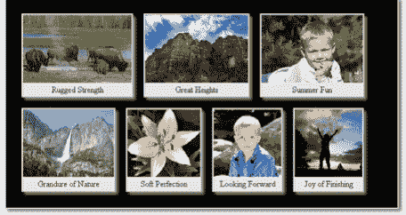

**图 13.5** 使用 `.get()` AJAX 请求，利用 ch1304.html 中的 jQuery 代码将 JSON 数据转换为图像画廊。

## 使用 jQuery `.get()` AJAX 请求处理 XML 数据

```javascript
$.get("getXMLData.php", myHandler);
function myHandler(data){
  var parks = $(data).find("park");
  parks.each(function(){
    var value = $(this).children("value").text();
  })
}
```

使用 jQuery 从服务器获取 XML 数据与使用 JSON 数据有些不同。你仍然调用 `.get(url, handler(data))` 方法，传入服务器位置的 url，并指定一个处理数据的处理程序。例如：

```javascript
$.get("getXMLData.php", myHandler);
```

然而，响应返回的 XML 数据将是一个 DOM 对象，作为第一个参数传递给处理函数。处理 DOM 对象的最佳方式是将其转换为 jQuery 对象，然后使用广泛的 jQuery 过滤和导航方法来获取所需数据。例如：

```javascript
function myHandler(data){
    var parks = $(data).find("park");
    parks.each(function(){
        var value = $(this).children("value").text();
    })
}
```

演示如何使用 XML 数据处理 `.get()` 请求的最佳方式是向你展示一个示例。以下代码直接向一个 XML 文件发出 `.get()` 请求，然后使用该数据构建如图 13.6 所示的图像列表。

```html
01 <html>
02   <head>
03     <title>Python Phrasebook</title>
04     <meta charset="utf-8" />
05     <script type="text/javascript"
06       src="../js/jquery-2.0.3.min.js"></script>
07     <script>
08       function updateTable(data){
09         var parks = $(data).find("park");
10         parks.each(function(){
11           var tr = $("<tr></tr>");
12           tr.append($("<td></td>").html(
13             $(this).children("name").text()));
14           tr.append($("<td></td>").html(
15             $(this).children("location").text()));
16           tr.append($("<td></td>").html(
17             $(this).children("established").text()));
18           var img = $('').attr("src",
19             $(this).children("image").text());
20           tr.append($("<td></td>").append(img));
21           $("tbody").append(tr);
22         });
23       }
24       $(document).ready(function(){
25         $.get("parkdata.xml", updateTable);
26       });
27     </script>
28     <style>
29       img {width:80px;}
30       caption, th { background-color:blue; color:white;
31         font:bold 18px arial black; }
32       caption { border-radius: 10px 10px 0px 0px;
33         font-size:22px; height:30px; }
34       td { border:1px dotted; padding:2px; }
35     </style>
36   </head>
37   <body>
38     <table>
39       <caption>Favorite U.S. National Parks</caption>
40       <thead><th>Park</th><th>Location</th>
41       <th>Established</th><th>&nbsp;</th></thead>
42       <tbody></tbody>
43     </table>
44     <p></p>
45   </body>
46 </html>
```

ch1305.html

```xml
<parkinfo>
  <park>
    <name>Yellowstone</name>
    <location>Montana, Wyoming, Idaho</location>
    <established>March 1, 1872</established>
    <image>bison.jpg</image>
  </park>
  <park>
    <name>Yosemite</name>
    <location>California</location>
    <established>March 1, 1872</established>
    <image>falls.jpg</image>
  </park>
  <park>
    <name>Zion</name>
    <location>Utah</location>
    <established>November 19, 1919</established>
    <image>peak.jpg</image>
  </park>
</parkinfo>
```

XML 服务器响应

| 公园 | 位置 | 建立日期 | |
| :--- | :--- | :--- | :--- |
| 黄石 | 蒙大拿州、怀俄明州、爱达荷州 | 1872年3月1日 |  |
| 优胜美地 | 加利福尼亚州 | 1872年3月1日 |  |
| 锡安 | 犹他州 | 1919年11月19日 |  |

**图 13.6** 使用 `.get()` AJAX 请求，通过 ch1305.html 中的 jQuery 代码将 XML 数据转换为表格。

## 使用 jQuery `.post()` AJAX 请求更新服务器数据

```javascript
var params = [{name:"user",value:"Brad"},
              {name:"rating", value:"1"}]
$.post("setRating.php", params, myHandler);
```

使用 jQuery 通过 `.post()` 辅助方法向服务器发送数据非常简单，因为 `.post()` 会在后台处理所有必要的请求头。你调用 `.post(url, params, handler(data))` 方法，并传入服务器地址、参数字符串或对象。然后指定一个处理程序来处理数据。

如果你传入的是一个对象，它需要是一个包含 `name` 和 `value` 键值对的对象列表。例如：

```javascript
var params = [{name:"user",value:"Brad"},
              {name:"rating", value:"1"}]
$.post("setRating.php", params, myHandler);
```

处理函数的工作方式与 `.get()` 的处理函数相同。下面的代码展示了使用 `.post()` 请求更新服务器上数据的示例。你需要关注的代码在第 31-39 行。该函数构建 `params` 数组，然后向服务器发送 `.post()` 请求，以使用 PHP 脚本更新评分。

该 PHP 脚本会修改用于构建图 13.7 所示数据的 JSON 文件。请注意，`.post()` 请求的处理函数会从服务器检索更新后的数据，并使用提交的值更新网页。

```html
<html>
  <head>
    <title>Python Phrasebook</title>
    <meta charset="utf-8" />
    <script type="text/javascript"
      src="../js/jquery-2.0.3.min.js"></script>
    <script>
      function addTrip(data){
        for (var idx in data){
          var item = data[idx];
          var div = $("<div></div>").attr("id",
            item.location);
          div.append($("</img>").attr("src",
            "../images/"+item.image).addClass("photo"));
          div.append($("<span></span>").html(
            item.location));
          for(var i=0;i<parseInt(item.rating);i++){
            div.append($("</img>").attr("src",
              "../images/star.ico").addClass("star"));
          }
          for(var i=0;i<(5-parseInt(item.rating));i++){
            div.append($("</img>").attr("src",
              "../images/empty.ico").addClass("star"));
          }
          $("#vacations").append(div);
        }
      }
      $(".star").click(sendRating);
    }
    function getTrips(){
      $("#vacations").children().remove();
      $.get("trips.json", addTrip);
    }
    function sendRating(){
      var parent = $(this).parent();
      var rating =
      parent.children(".star").index($(this))
      var params = [{name:"location",
           value:parent.attr("id")},
           {name:"rating", value:
      rating}]
      $.post("setRating.php", params, getTrips);
    }
    $(document).ready(function(){
      getTrips();
    });
    </script>
    <style>
        #banner, #vacations { display:block;
            font-size:30px; width:500px;}
        div, span { display:inline-block;
            width:120px; text-align:center;}
        span { font-size:20px; }
        .photo { height:50px; border:5px ridge
        white;
            box-shadow: 10px 10px 5px #888888;
        margin:20px;
            border-radius:10px;}
        .star { border:none; height:auto; width:auto;
        }
    </style>
    </head>
    <body>
        <div><div id="banner">Vacations</div>
        <div id="vacations"></div>
    </body>
</html>
```

ch1306.html

```
location=Zion&rating=5
```

发送到 setRating.php 的 POST 数据

```json
[{"location":"Hawaii","image":"flower.jpg","rating":"4"},{"location":"Yosemite","rating":"4","image":"falls.jpg"},{"location":"Montana","rating":"5","image":"bison.jpg"},{"location":"Zion","rating":"5","image":"peak.jpg"}]
```

JSON 服务器响应

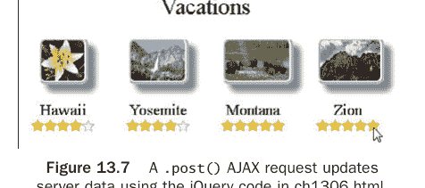

**图 13.7** 使用 ch1306.html 中的 jQuery 代码，通过 `.post()` AJAX 请求更新服务器数据。

## 处理 jQuery AJAX 响应

```javascript
$.get("getUser.php?first=Brad&last=Dayley", null,
-function (data, status, xObj){
    alert("Request Succeeded");
}), "json").fail(function(data, status, xObj){
    alert("Request Failed");
}).always(function(data, status, xObj){
    alert("Request Finished");
});
```

除了指定 success 选项外，包装方法还允许你使用以下方法附加额外的处理程序：

- `.done(data, textStatus, jqXHR)` — 当从服务器接收到成功响应时调用。
- `.fail(data, textStatus, jqXHR)` — 当从服务器接收到失败响应或请求超时时调用。
- `.always(data, textStatus, jqXHR)` — 当从服务器接收到响应时始终调用。

例如，以下代码添加了一个事件处理程序，以便在请求失败时调用：

```javascript
$.get("getUser.php?first=Brad&last=Dayley", null,
-function (data, status, xObj){
    $("#email").html(data.email);
}), "json").fail(function(data, status, xObj){
    alert("Request Failed");
});
```

为了通过一个实际的例子来说明，以下代码在一个基本的登录请求上实现了 `.done()`、`.fail()` 和 `.always()` AJAX 事件处理程序。登录页面将用户名和密码发送到一个服务器端的 PHP 脚本，该脚本检查 `username="user"` 和 `password="password"`。如果输入了正确的用户名和密码，请求就会成功；否则，请求失败。所有三种类型的处理函数都会调用警报，如图 13.8 所示。

```html
<html>
  <head>
    <title>Python Phrasebook</title>
    <meta charset="utf-8" />
    <script type="text/javascript"
      src="../js/jquery-2.0.3.min.js"></script>
    <script>
      function failure(){ alert("Login Failed"); }
      function success(){ alert("Login Succeeded"); }
      function always(){ alert("Login Request done"); }
      function login(){
        $.get("login.php",
          $("#loginForm").serialize()).done(
            success).fail(failure).always(always);
        return false;
      }
      $(document).ready(function(){
        $("#loginButton").click(login);
      });
    </script>
    <style>
      #login { border-radius: 15px; text-align: center;
          height:180px; width:250px; border:3px ridge blue;}
      #title { background-color:blue; color:white;
          border-radius:10px 10px 0px 0px;
          height:30px;
      font:bold 22px arial black; }
      input { border-radius:10px; border:3px groove
      margin-top:20px; padding-left:10px; }
      label { font:italic 18px arial black; }
    </style>
  </head>
  <body>
    <div id="login">
      <div id="title">Login</div>
      <form id="loginForm">
      <label>Username: </label>
      <input type="text" name="user" /><br>
      <label>Password: </label>
      <input type="password" name="pw" /><br>
      <input id="loginButton" type="button"
        value="Login" />
      </form>
    </div>
  </body>
</html>
```

ch1307.html

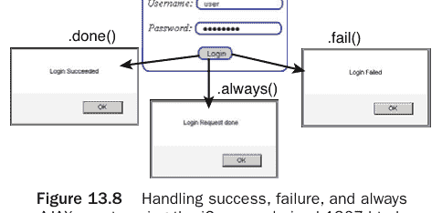

**图 13.8** 使用 ch1307.html 中的 jQuery 代码处理成功、失败和 always 的 AJAX 事件。

## 使用高级 jQuery AJAX

本章已经涵盖的概念应该能满足你大部分的 AJAX 需求。然而，它们远未涵盖 jQuery AJAX 接口的全部功能。以下章节将讨论一些直接内置于 jQuery 中的额外 AJAX 功能。

## 更改全局设置

```javascript
$.ajaxSetup({url:"service.php", accepts:"json"})
```

jQuery 提供了 `.ajaxSetup()` 方法，允许你指定在整个脚本中配置 AJAX 请求的选项。表 13.2 列出了调用 `.ajaxSetup()` 时可以指定的一些选项。例如，以下代码设置了请求的默认全局 URL：

```javascript
$.ajaxSetup({url:"service.php", accepts:"json"})
```

## 使用全局事件处理器

```javascript
$(document).ajaxStart(function(){
    $("form").addClass("processing");
});
$(document).ajaxComplete(function(){
    $("form").removeClass("processing");
});
```

jQuery 提供了创建全局事件处理器的方法，这些处理器在初始化或完成所有 AJAX 请求等事件时被调用。全局事件在每次 AJAX 请求时都会触发。表 13.2 列出了可用于注册全局事件处理器的方法。

以下是一个使用全局事件处理器设置表单类的示例：

```javascript
$(document).ajaxStart(function(){
  $("form").addClass("processing");
});
$(document).ajaxComplete(function(){
  $("form").removeClass("processing");
});
```

> **顺便提一下**
> 无论 `global` 的值如何，跨域脚本或 JSONP 请求永远不会触发全局事件。

### 表 13.2 jQuery 全局 AJAX 事件处理器注册方法

| 方法 | 描述 |
| :--- | :--- |
| `.ajaxComplete (function)` | 注册一个在 AJAX 请求完全完成时调用的处理器。 |
| `.ajaxError (function)` | 注册一个在 AJAX 请求失败时调用的处理器。 |
| `.ajaxSend (function)` | 注册一个在 AJAX 请求发送前执行的函数。 |
| `.ajaxStart (function)` | 注册一个在第一个 AJAX 请求开始时调用的处理器。 |
| `.ajaxStop (function)` | 注册一个在所有 AJAX 请求完成时调用的处理器。 |
| `.ajaxSuccess (function)` | 注册一个在 AJAX 请求成功完成时执行的函数。 |

## 实现底层 AJAX 请求

```javascript
$.ajax({
    url: "setEmail",
    type: "get",
    accepts: "json",
    contentType: 'application/x-www-form-urlencoded;charset=UTF-8',
    data: {"first":"Brad", "last":"Dayley"}
}).fail(function(){ alert("request Failed"); });
```


本章你一直在使用的所有 AJAX 请求包装器方法，在底层都是通过 `.ajax(url [, settings])` 接口处理的。这个接口使用起来稍难一些，但它为你提供了更大的灵活性和对 AJAX 请求的控制力。

`.ajax()` 方法的调用方式与 `.get()` 和 `.post()` 相同，但 `settings` 参数允许你在发起请求时设置各种设置。

表 13.3 列出了可以应用于 `.ajax()` 方法的更常见设置。

### 表 13.3 `.ajax()` 请求方法中的常用设置

| 方法/属性 | 描述 |
| :--- | :--- |
| accepts | 指定服务器在响应中可以发送回的内容类型，例如 `application/json`。 |
| async | 布尔值。默认为 `true`，表示请求被发送后异步接收。 |
| beforeSend | 指定一个在发送请求前应运行的函数。 |
| complete | 响应完全接收时执行的函数。 |
| contentType | 设置随请求发送的内容类型。服务器使用该内容类型来确定如何解析数据。 |
| crossDomain | 布尔值。允许你发送跨域请求，例如 JSONP。 |
| data | 指定随请求发送的数据负载。 |
| error | 指定如果请求失败时要执行的函数。 |
| headers | 包含应发送给服务器的值的请求头的对象。例如：`{'Content-length': data.length}` |
| success | 如果响应返回 200 状态码（表示请求成功）时执行的函数。 |
| timeout | 指定在放弃获取响应前等待的毫秒数。 |
| type | 设置为 `GET` 或 `PUT` 以指定请求类型。 |
| url | 指定发送请求的网络服务器上的 URL。 |

以下代码展示了一个使用 `.ajax()` 接口的简单示例：

```javascript
$.ajax({
    url: "setEmail",
    type: "get",
    accepts: "json",
    contentType: 'application/x-www-form-urlencoded;charset=UTF-8',
    data: {"first": "Brad", "last": "Dayley"}
}).fail(function(){ alert("request Failed"); });
```

`.ajax()` 方法返回一个 `jqXHR` 对象，该对象提供了一些额外的功能，特别是在处理响应时。表 13.4 列出了一些附加到 `jqXHR` 对象的方法和属性。

### 表 13.4 `.ajax()` 返回的 jqXHR 对象的常用方法和属性

| 方法/属性 | 描述 |
| :--- | :--- |
| abort() | 中止请求。 |
| always(function) | 指定一个在请求完成时调用的函数。 |
| done(function) | 指定一个在请求成功完成时调用的函数。 |
| fail(function) | 指定一个在请求失败时调用的函数。 |
| getAllResponseHeaders() | 返回响应中包含的请求头。 |
| getResponseHeader(name) | 返回特定响应头的值。 |
| setRequestHeader(name, value) | 设置要随 AJAX 请求发送的 HTTP 请求头的值。 |
| readyState | 取值：1—尚未开始加载，2—正在加载，3—已加载足够内容，用户可以与之交互，4—完全加载 |
| status | 包含从服务器返回的响应状态码，例如 200 状态码表示请求成功。 |
| statusText | 包含从服务器返回的状态字符串。 |

# 第 14 章 使用 jQuery 实现移动网站

移动设备是增长最快的开发平台。其中大部分开发都致力于使网站对移动设备友好。用户期望获得其移动设备提供的便携性，同时也期望获得传统网站中已经实现的稳健性。

本章重点介绍如何使用 jQuery Mobile 库来帮助你开始创建一些简洁、酷炫的移动网页。jQuery Mobile 库功能强大。本章的内容涵盖了基本结构、语法和概念，以帮助你实现更广泛的移动解决方案。

## jQuery Mobile 入门

jQuery Mobile 框架的大部分内容是通过为现有 HTML 元素扩展额外功能来构建的。jQuery Mobile 在 HTML 框架的基础上，通过向 HTML 元素添加数据属性来实现。

所有数据属性都以 `data-` 开头，以某个描述属性含义的简短描述性词语结尾。jQuery Mobile 库中适合移动需求的额外方法、事件、样式和值都附加到这些元素上。在接下来的示例中，你将广泛看到这一点。

表 14.1 列出了许多属性及其支持的一些值。该表是理解数据属性工作方式的好方法，也可以作为参考。

### 表 14.1 jQuery Mobile 中添加的一些数据属性

| 属性 | 描述 |
| :--- | :--- |
| data-role | 用于定义 HTML 在移动页面中扮演的角色，例如对话框、按钮或面板。 |
| data-mini | 每个 UI 元素都有一个紧凑版本，如果设置为 `true`，则使用该版本。 |
| data-theme | 指定渲染 UI 组件时使用的字母（a-z）。 |
| data-transition | 指定从一个页面/状态过渡到另一个页面/状态时使用的过渡效果，例如 `slide` 或 `pop`。 |
| data-direction | 指定动画的方向，以便可以匹配过渡效果。例如 `reverse` 用于页面返回。 |
| data-rel | 定义元素与链接的关系。可选值包括 back、dialog、external 和 popup。 |
| data-title | 页面显示时显示的文本。 |
| data-icon | 指定附加到 HTML 元素的图标。可能的值有 home、delete、plus、arrow-u、arrow-d、check、gear、grid、star、custom、arrow-r、arrow-l、minus、refresh、forward、back、alert、info 和 search。 |
| data-iconpos | 指定图标附加到元素时的位置：left、right、top、bottom、notext。 |
| data-add-back-btn | 对于带有 data-role="dialog" 的项目，如果为 true，则会添加一个返回按钮。 |
| data-collapsed | 对于带有 role="collapsible" 的项目，指定状态是否为折叠。 |
| data-collapsed-icon | 定义 role="collapsible" 元素的折叠图标。 |
| data-expanded-icon | 定义 role="collapsible" 元素的展开图标。 |
| data-close-btn | 对于带有 role="dialog" 的项目，如果为 true，则会添加一个关闭按钮。 |

## 判断页面是否在移动设备上查看

你可以使用以下 JavaScript 和正则表达式语句来解析 `navigator.userAgent` 值，并判断用户是否正在通过移动设备访问你的网站：

```javascript
if( /Android|webOS|iPhone|iPod|BlackBerry/i.test(navigator.userAgent) ) { }
```

该语句解析 `userAgent` 属性，并尝试查找移动浏览器中包含的最常见的字符串。

## 检测移动设备屏幕尺寸

在当今的移动世界中，用户是否在移动设备上不再是关键问题。新的关键问题是：用户有多少屏幕空间可供使用？你需要检查设备的屏幕尺寸。它是 3 英寸、4 英寸还是 11 英寸屏幕？差别很大。要获取屏幕尺寸，请在 JavaScript 中使用 `screen.height` 和 `screen.width`，然后动态调整你的页面以支持该尺寸。

```javascript
$("#contentBody").width(screen.width).height(screen.height);
```

## 指定不同的主题色板

jQuery Mobile 附带的 CSS 文件包含多个版本的样式，称为色板。*色板* 只是一个字母赋值，用于指定在渲染移动元素时使用的配色方案。色板通常使用 `data-theme` 属性指定。例如：

```html
<div data-role="header" data-theme="b"><h1>Teach</h1></div>
```

```html
<div data-role="header" data-theme="b">
  <h1>Teach</h1></div>
<a data-role="button" data-theme="a" src="next">Next</a>
```

## 处理新的移动事件

我最喜欢 jQuery Mobile 的特性之一是它实现移动事件非常简单。该库会自动创建事件，并基于 data 属性将它们添加到元素。如果你想添加或移除特定的移动事件，可以使用你已经熟悉的 jQuery `.on()` 方法。

例如，要为元素 `#myImage` 添加一个点击处理器，你可以使用以下代码：

```javascript
$("#myImage").on("swipeleft", function() { });
```

表 14.2 列出了一些移动事件并描述了它们的用途。

### 表 14.2 jQuery Mobile 添加的新事件

| 事件 | 描述 |
| :--- | :--- |
| tap | 快速触摸时触发。 |
| taphold | 触摸被保持超过阈值后触发。默认为 750 毫秒。 |
| swipe | 快速水平拖动时触发。 |
| swipeleft | 快速向左水平拖动时触发。 |
| swiperight | 快速向右水平拖动时触发。 |
| orientationchange | 当设备方向从纵向变为横向或反之时触发。 |
| scrollstart | 滚动开始时触发。 |
| scrollstop | 滚动停止时触发。 |
| pagebeforeload | 移动页面加载到 DOM 之前立即触发。 |
| pageload | 移动页面加载到 DOM 之后触发。 |
| pagebeforechange | 移动页面切换到不同页面之前立即触发。这两个页面可能位于同一个 HTML 文档中。 |
| pagechange | 移动页面切换到不同页面之后触发。 |
| pagebeforeshow | 页面过渡发生之前立即触发。该事件在新页面上触发。 |
| pageshow | 页面过渡发生之后触发。 |

jQuery Mobile 包含的一个重要功能是能够触发和处理与页面更改和加载相关的事件。

当你更改页面时，会触发以下事件：

- pagebeforechange、pagechange、pagebeforeload、pageload、pageshow、pagehide

当你加载页面时，会触发以下事件：

- pagebeforeload、pageload

这些事件允许你实现代码来处理新页面的过渡，并防止页面从服务器下载。这些事件作为标准的 jQuery 事件实现，传递给处理器的对象包括 url、toPage、absUrl、dataUrl、xhr 对象以及用于更改页面的选项。

以下代码展示了添加 pageload 事件处理器的示例：

```javascript
$(document).on("pageload", function(e, obj){
    if($("#pageThree .ui-content").length) {
        $("#pageThree .ui-content").append("Page loaded from "+ obj.url);
    }
});
```

> **顺便提一下**
> jQuery Mobile 还包含几个虚拟鼠标事件，例如 mask、mouse 和 touch 事件，允许开发者只注册基本的鼠标事件。这些在大多数情况下运行良好，但仍然有一些小问题。这些虚拟事件是 vmouseover、vmouseout、vmousedown、vmousemove、vmouseup、vmouseclick 和 vmousecancel。

## 使用 jQuery 代码更改页面

jQuery 提供了 `$.mobile.changePage(URL, options)` 方法来动态更改页面，其中 URL 是新页面的位置。表 14.3 显示了 `.changePage()` 调用的可用选项。以下代码是一个示例，当用户在设备上向左滑动页面时，添加一个 swipeleft 事件处理器来加载远程网页。注意使用了 "slide" 过渡效果，并且 reverse 选项设置为 true：

```javascript
$("#pageTwo").on("swipeleft", function(){
  $.mobile.changePage("newPage.html", {transition:
    "slide", reverse:true}); });
```

### 表 14.3 .changePage() 和 .loadPage() 调用的选项

| 方法 | 描述 |
| :--- | :--- |
| changeHash | 指定是否应更新位置栏中的哈希值。 |
| data | 与 AJAX 请求一起发送的对象或字符串数据。 |
| dataUrl | 更新浏览器位置时使用的 URL。如果未指定，则使用 data-url 属性的值。 |
| pageContainer | 指定应包含页面的元素。 |
| reloadPage | 布尔值。如果页面已在 DOM 中，则从服务器重新加载页面。 |
| reverse | 布尔值。指定页面更改过渡运行的方向。 |
| role | 显示页面时要使用的 data-role 值。 |
| showLoadMsg | 布尔值。指定是否应显示加载消息。 |
| transition | 显示页面时使用的过渡效果。 |
| type | 指定 AJAX 请求的方法："get"（默认）或 "post"。 |

## 加载移动页面但不显示它们

另一个有用的函数是 `.loadPage(URL, options)`。它使用 AJAX 调用从 Web 服务器下载移动页面，但不会将移动页面更改为下载的那个。实际上，`.changePage()` 内部是调用 `.loadPage()` 来获取页面的。表 14.3 中列出的大多数选项也可通过 `.loadPage()` 使用，除了 `changeHash`、`dataUrl`、`reverse` 和 `transition`。

`.loadPage()` 函数对于在初始化函数中预加载页面很有用，这些页面是你希望稍后可用但暂时不想显示的。以下代码展示了如何使用表单的 POST 数据加载页面的示例：

```javascript
$.mobile.loadPage("newPage.php",
    {data: $("form").serialize(), type: "post"});
```

## 定义视口元标签

使用 jQuery Mobile 的一个关键组成部分是在页面 `<head>` 标签内添加带有视口设置的 `<meta>` 标签。视口定义了浏览器如何显示页面的缩放级别和使用的尺寸。

具体来说，你需要如接下来所示设置 `content="width=device-width, initial-scale=1"`。这些设置强制设备的浏览器以设备上可用的精确像素数来渲染网页宽度：

```html
<meta name="viewport" content="width=device-width,
    initial-scale=1">
```

如果不指定视口设置，移动页面会以比屏幕宽度大得多的尺寸显示，使得页面看起来很小。用户仍然可以放大网页。

## 配置 jQuery Mobile 默认设置

jQuery Mobile 在库加载时即被初始化。所有带有 jQuery Mobile 标签的页面元素也会被初始化，并使用默认设置来创建这些元素的移动版本。

有时，你可能想要覆盖默认设置。为此，你需要在加载 jQuery Mobile 库之前向文档对象添加一个 *mobileinit* 事件处理程序。然后你可以在该处理函数中添加你的默认覆盖代码。

我主要使用 *mobileinit* 处理器来更改默认主题配色，因为这在库加载后无法动态完成。以下代码展示了设置默认页眉和页脚主题的示例：

```html
<script src="../js/jquery-2.0.3.min.js"></script>
<script>
    $(document).bind("mobileinit", function () {
        $.mobile.page.prototype.options.headerTheme = "b";
        $.mobile.page.prototype.options.footerTheme = "b";
    });
</script>
<script src="../js/jquery.mobile-custom.min.js"></script>
```

请注意，初始化 `<script>` 被放置在 jQuery 加载之后，但在 jQuery Mobile 加载之前。

## 构建移动页面

创建移动页面实际上很简单。页面由 `<div>` 元素组成，这些元素在 jQuery Mobile 中使用上一章讨论的数据标签进行增强。本节重点介绍如何使用数据标签来定义移动网页。

## 创建移动网页

移动页面主要由三部分组成：页眉、页脚以及它们之间的内容。这三者并非都是必需的，但至少拥有页眉和内容是个好主意，尤其是在处理多个页面时。
所有这些元素都通过向 `<div>` 元素添加 `data-role` 属性来定义。`<div>` 元素内的内容几乎可以是任何东西，包括文本、图像、表单和列表。
以下代码展示了创建一个带有页眉、页脚以及文本和图像内容的简单移动网页的示例。图 14.1 展示了该网页的外观：

```html
01 <html>
02 <head>
03   <title>Python Phrasebook</title>
04   <meta charset="utf-8" />
05   <meta name="viewport" content="width=device-width,
06       initial-scale=1">
07   <script src="../js/jquery-2.0.3.min.js"></script>
08   <script src="../js/initmobile.js"></script>
09   <script
10     src="../js/jquery.mobile-custom.min.js"></script>
11   <link rel="stylesheet"
12     href="../js/css/jquery.mobile-custom.min.css" />
13   <script>
14     $(document).ready(function() {
15       checkForMobile();
16     });
17   </script>
18   <style>
19     p { text-align:center; font:italic 45px Helvetica;
20         color:blue; margin:5px; }
21 img { width:235px; }
22 </style>
23 </head>
24 <body>
25 <div id="border"><div id="frame"><div data-role="page">
26 <div data-role="header"><h1>Header</h1></div>
27 <div data-role="content" id="content">
28 <p>Yosemite</p>
29 <p>Falls</p>
30 
31 </div>
32 <div data-role="footer"><h4>Footer</h4></div>
33 </div></div></div>
34 </body>
35 </html>
```

ch1401.html

请注意，每个组件的 `data-role` 值都不同。图 14.1 展示了最终的移动网页。

> **顺便提一下**
> 本章包含的所有移动示例都在 HTML `<body>` 中包含了 `<div id="border"><div id="frame">` 元素，并在 jQuery 代码中调用了 `checkForMobile()`。`checkForMobile()` 代码位于我创建的包含文件 `initmobile.js` 中。它为非移动浏览器设置了这些元素的样式，以便显示一张手机图片作为背景。我用这个来为本章截取图片。我也在移动开发中使用这个概念，因为我可以在我的开发浏览器中看到效果。然后我再在真实设备上进行测试。

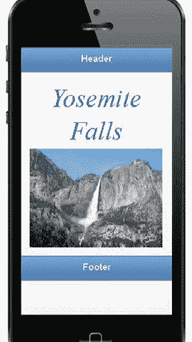

**图 14.1** 来自 ch1401.html 的一个带有页眉、页脚以及包含文本和图像的注释区域的基础移动网页。

## 创建固定的页眉和页脚

默认情况下，页眉和页脚都随内容一起流动，这意味着如果你上下滚动内容，页眉也会随之滚动。通常，你希望页眉、页脚或两者都固定在设备屏幕上的某个位置，以便始终显示。jQuery Mobile 使得这种调整变得简单。

要使页眉或页脚——就此而言是任何工具栏——固定，你只需向 `<div>` 添加 `data-position="fixed"` 属性即可。这会使它们保持原位，无论内容如何滚动，页眉始终在页面顶部，页脚始终在底部。

```html
<div data-role="header" data-position="fixed">
  <h1>Header</h1></div>
…
<div data-role="footer" data-position="fixed">
  <h4>Footer</h4></div>
```

## 实现具有多个页面的移动站点

移动站点可以由包含多个 `<div data-role="page">` 元素的单个 HTML 文档组成，也可以由包含这些元素的多个 HTML 文档组成。每个 `<div>` 元素代表一个单独的移动页面。

在移动网站中使用多个页面时，你需要实现代码和 UI 控件来提供用户从一个移动页面切换到另一个移动页面的方式。过渡效果应该根据控件和内容交互变得平滑且直观。

你可以通过从第一个页面链接到第二个页面来更改移动页面，可以使用以下两种方法之一：添加导航按钮或在你的 jQuery 代码中以编程方式更改页面。

这些页面可以是来自同一网页中的 `<div>` 元素，也可以是下载到设备的外部 URL。以下短语描述了实现多页面移动站点的方法。

## 添加导航按钮

导航按钮是链接到其他移动页面的链接。通常，导航按钮被添加到页眉或页脚元素中以便于查看。但是，你也可以将它们放在移动内容内部。

导航按钮是通过向 `<a>` 链接添加 `data-role="button"` 属性来创建的。`href` 属性应指向你要切换到的移动页面的哈希标签或 URL。以下代码展示了将 `<a>` 标签定义为本地链接导航链接的语法：

```html
<a href="#page2" data-role="button">Page2</a>
```

以下代码展示了将 `<a>` 标签定义为远程链接导航链接的语法：

```html
<a href="hour2201-page3.html"
data-role="button">Page3</a>
```

## 定位导航按钮

你可以将按钮定位在头部或尾部的左侧或右侧，只需为 `<a>` 元素添加 `.ui-btn-right` 或 `.ui-btn-left` 类。这会应用 jQuery Mobile CSS 样式，将按钮放置在头部或尾部的右侧或左侧。

```html
<a href="#page3" data-role="button"
class="ui-btn-right">Next</a>
<a href="#page1" data-role="button"
class="ui-btn-left">Prev</a>
```

## 添加页面切换过渡效果

通过向触发过渡效果的 `<a>` 链接或其他元素添加 `data-transition` 属性，可以为页面切换添加过渡效果。如果你调用 `.changePage()`，也可以在选项对象中指定过渡效果。例如：

```html
<a data-role="button" data-transition="slide">下一页</a>
```

或

```javascript
$.mobile.changePage("#next", {transition:"slide" });
```

你还可以反转过渡效果的方向，这在你希望屏幕看起来像是向后滚动到上一页时特别有用。

要改变过渡效果的方向，请在 `<a>` 标签中使用 `data-direction="reverse"`，或在 `.changePage()` 选项中添加 `reverse:true`。例如：

```html
<a data-role="button" data-transition="slide"
data-direction="reverse">上一页</a>
```

或

```javascript
$.mobile.changePage("#prev", {transition:"slide",
reverse:true });
```

## 创建返回按钮

jQuery Mobile 包含的另一个有用功能是能够将导航按钮定义为返回按钮。返回按钮使用浏览器历史记录导航到上一个移动页面。要将链接定义为返回按钮，你需要添加 `data-rel="back"` 属性。例如：

```html
<a data-rel="back" data-role="button" class="ui-btn-
right">下一页</a></div>
```

请注意，这里没有 `href` 属性。这是因为 `href` 属性会被忽略；取而代之的是，浏览器导航历史记录列表中的最近一个 URL 会被弹出。

## 使用滑动事件处理器切换页面

第二种方法是使用 `$.mobile.changePage(URL, options)` 函数调用，其中 URL 是链接位置。表 14.3 显示了 `.changePage()` 调用可用的选项。

以下是添加 `swipeleft` 事件处理器的示例，当用户在设备上向左滑动页面时加载远程网页。请注意，使用了 "slide" 过渡效果，并且将反向选项设置为 true，使过渡效果向左滑动：

```javascript
$("#pageTwo").on("swipeleft", function(){
    $.mobile.changePage("#page3", {transition:"slide",
    reverse:true}); });
```

以下是添加 `swiperight` 事件处理器的示例，当用户在设备上向右滑动页面时加载远程网页。请注意，使用了 "slide" 过渡效果，但未设置反向选项：

```javascript
$("#pageTwo").on("swiperight", function(){
    $.mobile.changePage("#page1", {transition:"slide"
    }); });
```

## 添加导航按钮和滑动事件示例

以下代码展示了实现导航按钮和滑动事件以遍历三个不同页面的完整示例。第 14–27 行的代码实现了滑动事件处理器，通过调用 `.changePage()` 并使用过渡效果来处理手指滑动操作。第 38–47 行实现了第一个移动页面，第 48–59 行实现了第二个移动页面，第 60–68 行实现了第三个移动页面。每个页面的头部都有一到两个导航按钮。图 14.2 展示了这个多页面应用：

```html
01 <html>
02 <head>
03   <title>Python 速查手册</title>
04   <meta charset="utf-8" />
05   <meta name="viewport" content="width=device-width,
06      initial-scale=1">
07   <script src="../js/jquery-2.0.3.min.js"></script>
08   <script src="../js/initmobile.js"></script>
09   <script
10     src="../js/jquery.mobile-custom.min.js"></script>
11   <link rel="stylesheet"
12     href="../js/css/jquery.mobile-custom.min.css" />
13   <script>
14     $(document).ready(function() {
15       checkForMobile();
16       $("#page1").on("swipeleft", function(){
17         $.mobile.changePage("#page2",
18           {transition:"slide"}); });
19       $("#page2").on("swiperight", function(){
20         $.mobile.changePage("#page1",
21           {transition:"slide", reverse:true});
22       });
23       $("#page2").on("swipeleft", function(){
24         $.mobile.changePage("#page3",
25           {transition:"slide", }); });
26       $("#page3").on("swiperight", function(){
27         $.mobile.changePage("#page1",
28           {transition:"slide", reverse:true});
29       });
30     });
31   </script>
32   <style>
33     p { text-align:center; font:italic 45px
34       Helvetica;
35       color:blue; margin:5px; }
36     img { width:235px; }
37   </style>
38 </head>
39 <body>
40   <div id="border"><div id="frame">
41   <div data-role="page" id="page1">
42     <div data-role="header"><h1>第1页</h1>
43       <a data-role="button" href="#page2"
44       data-transition="slide"
45       class="ui-btn-right">第2页</a>
46     </div>
47     <div data-role="content">
48       <p>拱门国家公园</p>
50     </div>
51   </div>
52   <div data-role="page" id="page2">
53     <div data-role="header"><h1>第2页</h1>
54       <a data-role="button" href="#page1"
55         data-transition="slide"
56         data-direction="reverse">第1页</a>
57       <a data-role="button" href="#page3"
58         data-transition="slide">第3页</a>
59     </div>
60     <div data-role="content">
61       <p>蒂卡尔</p>
63     </div>
64   </div>
65   <div data-role="page" id="page3">
66     <div data-role="header"><h1>第3页</h1>
67       <a data-role="button" href="#page2"
68         data-transition="slide"
69         data-direction="reverse">第2页</a>
70     </div>
71     <div data-role="content">
72       <p>日落</p></div>
74   </div>
75   </div></div>
76 </body>
77 </html>
```

ch1402.html

## 创建导航栏

另一种页面导航方式是导航栏。*导航栏* 是一组按钮集合在一个单一的栏元素中。每个按钮链接到一个不同的移动页面。

导航栏通过向 `<div>` 添加 `role="navbar"` 来定义，然后使用 `<ul>`、`<li>` 和 `<a>` 元素添加要链接到的页面列表。例如，以下代码渲染一个类似于图 14.2 中的导航栏：

```html
<div data-role="navbar" >
  <ul>
    <li><a href="#pageTwo">第2页</a></li>
    <li><a href="#pageThree">第3页</a></li>
    <li><a href="#pageFour">第4页</a></li>
  </ul>
</div>
```

导航栏 `<div>` 可以放在任何地方；你可以将其放在头部（如图 14.3 所示）、尾部、内容中，或者它可以独立存在于移动页面的其他部分之间。一个常见的放置导航栏的位置是固定尾部。这使得导航栏即使在内容滚动时也能保持可见。

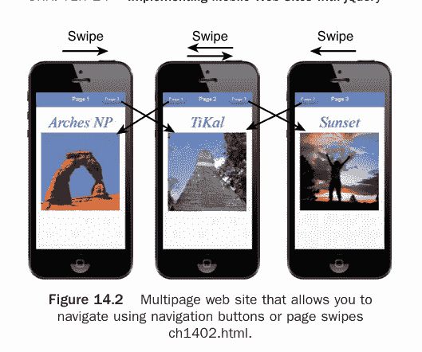

导航栏位于头部下方

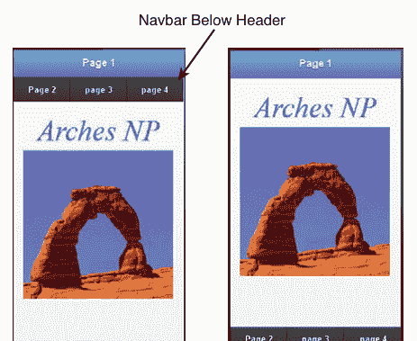

导航栏位于固定尾部

**图 14.3** 带有导航栏位于头部下方和作为固定尾部的移动网页。

## 应用网格布局

jQuery Mobile 提供的基本布局之一是网格。网格布局背后的理念是将页面分割成等大小的块，类似于 HTML 表格。然后你可以将内容放置在这些块中，它们会自动正确地布局。

要添加网格布局，你需要添加一个 `<div class="ui-grid-#">`，其中 `#` 指定要包含的列数。取值为 `a`（2列）、`b`（3列）、`c`（4列）等等。例如，以下定义了一个三列网格：

```html
<div class="ui-grid-b"> </div>
```

通过指定 `<div ui-block-#>` 将项目添加到网格中，其中 `#` 是列字母，`a`（第一列）、`b`（第二列），依此类推。第一次指定列字母时，项目被放置在该列的第 1 行。第二次则放置在第 2 行。例如，要创建一个 2×2 的网格，请使用以下代码：

```html
<div class="ui-grid-a">
    <div class="ui-block-a">第1行 第1列</div>
    <div class="ui-block-b">第1行 第2列</div>
    <div class="ui-block-a">第2行 第1列</div>
    <div class="ui-block-b">第2行 第2列</div>
</div>
```

## 实现列表视图

组织移动内容最常见的方法之一就是使用列表视图。列表视图将内容组织成可滚动、可链接的列表，便于查看和导航。jQuery UI 提供了一个出色的框架，能让你在代码中轻松实现列表视图。

列表视图的应用方式因所放置的数据的数量和类型不同而有很大差异。为处理这种情况，jQuery 提供了一系列不同类型的列表。以下部分介绍了最常用的几种。

> **注意！**
> 如果你在 jQuery 代码中动态地向列表、表格等元素添加项，则需要对该元素调用 `refresh()` 操作，以便使用 jQuery Mobile 刷新其内容。

### 创建基本列表视图

通过向 `<ul>` 或 `<ol>` 元素添加 `data-role="listview"` 来创建列表。jQuery 会自动处理将 `<li>` 元素格式化为列表形式。对于 `<ol>` 元素，格式化后的列表视图会包含每个列表项的编号。

```html
<ul data-role="listview">
    <li><a href="#one">Link 1</a></li>
    <li><a href="#two">Link 2</a></li>
    <li>Non Linkable Item</li>
</ul>
```

### 使用嵌套列表

通过在列表视图内嵌套额外的 `<ul>` 元素来创建嵌套列表。jQuery Mobile 会自动检测这种情况，并构建指向子列表的可链接页面。以下代码展示了实现嵌套列表的示例，如图 14.5 所示：

```html
01 <html>
02 <head>
03   <title>Python Phrasebook</title>
04   <meta charset="utf-8" />
05   <meta name="viewport" content="width=device-width,
06        initial-scale=1">
07   <script src="../js/jquery-2.0.3.min.js"></script>
08   <script src="../js/initmobile.js"></script>
09   <script src="../js/jquery.mobile.js"></script>
10   <link rel="stylesheet"
11         href="../js/css/jquery.mobile.css" />
12   <script>
13     $(document).ready(function() {
14       checkForMobile();
15     });
16   </script>
17 </head>
18 <body>
19   <div id="border"><div id="frame">
20   <div data-role="page" id="nested">
21     <div data-role="header"><h1>Nested List</h1></div>
22     <div data-role="content">
23       <ul data-role="listview">
24         <li>Hobbits<ul><li>Frodo</li><li>Sam</li>
25           <li>Bilbo</li></ul></li>
26         <li>Elves<ul><li>Legolas</li><li>Elrond</li>
27           <li>Galadriel</li></ul></li>
28         <li>Men<ul><li>Aragorn</li><li>Boromir</li>
29           <li>Theoden</li></ul></li>
30       </ul>
31     </div>
32   </div>
33   </div></div>
34 </body>
35 </html>
```

ch1404.html

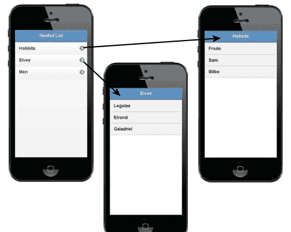

图 14.5 使用 ch1404.html 中的 jQuery Mobile 代码应用嵌套列表。

### 实现分割按钮列表

*分割按钮列表* 是指每一行包含多个选项的列表。这在多种场景下都很有用。例如在列出待售产品时，主要部分可以链接到更多详情，次要链接则可以将商品添加到购物车。要创建分割按钮列表，需要在 `<li>` 项内创建两个 `<a>` 元素。

```html
<ul data-role="listview">
  <li><a href="#">Jeep</a><a href="#" data-icon="star">Like</a></li>
  <li><a href="#">Ford</a><a href="#" data-icon="star">Like</a></li>
  <li><a href="#">Chevy</a><a href="#" data-icon="star">Like</a></li>
</ul>
```

### 向列表添加分隔符

*带分隔符的列表* 是指列表中的元素被一条简单的横条分隔开来。其目的是通过划分视图，让用户更容易查看列表项。

你可以通过插入自定义分隔符并为某个 `<li>` 元素添加 `data-role="list-divider"` 来手动创建带分隔符的列表。例如：

```html
<ul data-role="listview" >
    <li data-role="list-divider">Numbers</li>
        <li>1</li><li>2</li><li>3</li>
    <li data-role="list-divider">Letters</li>
        <li>A</li><li>B</li><li>C</li>
</ul>
```

你也可以通过向 `<ul>` 元素添加 `data-autodividers="true"` 来自动添加分隔符。这会在每个首字符变化时划分元素，并为该字母创建一个分隔符。例如，以下代码添加了一个自动分隔符：

```html
<ul data-role="listview" data-autodividers="true">
    <li>Alex</li><li>Alice</li><li>Brad</li><li>DaNae</li><li>David</li>
    <li>Isaac</li><li>Jordan</li><li>Nancy</li>
</ul>
```

### 实现可搜索列表

另一个实用功能是可搜索列表。jQuery Mobile 内置了一个很好的搜索功能，允许你搜索当前列表。该搜索功能会添加一个文本输入位于列表顶部，并在您输入内容时过滤列表项。只有匹配过滤文本的项目才会显示。

通过在包含列表的 `<ul>` 元素中添加 `data-filter="true"` 属性，即可创建可搜索列表。例如，以下代码添加了一个可搜索列表：

```html
<ul data-role="listview" data-filter="true">
    <li>Rome</li><li>Milan</li><li>Florence</li><li>Genoa</li><li>Venice</li>
    <li>Naple</li><li>Balonga</li><li>Bari</li><li>Turin</li><li>Palermo</li>
</ul>
```

### 使用可折叠区块和集合

另一种表示内容的有用方式是将其划分为可折叠元素。系统会显示一个用户可见的标题，但标题所代表的内容在点击标题之前是隐藏的。

这允许您在页面内直接显示和隐藏内容，而无需链接到另一个页面。可折叠元素可以表示为独立的区块，也可以表示为一组相连的区块。

要创建可折叠项目，只需在 `<div>` 元素中添加 `data-role="collapsible"` 属性。该 `<div>` 元素需要有一个标题，以便在折叠时显示在标题栏中。要将项目分组，您需要在 `<div data-role="collapsible-set">` 元素内添加多个 `<div data-role="collapsible">` 元素。

要强制某个项目处于展开状态，请添加 `data-collapsed="false"` 属性。这会将初始状态设置为展开，尽管您仍然可以通过点击标题来折叠和展开它。

此外，您可以使用 `data-theme` 定义标题主题，使用 `data-content-theme` 定义折叠内容的主题，从而控制用于渲染可折叠集合的主题。

```html
<div data-role="collapsible" data-collapsed="false">
    <h3>Photo Information</h3>
    <p>Single Content.</p>
</div>
<div data-role="collapsible-set">
    <div data-role="collapsible">
        <h3>Image 1</h3>
    </div>
    <div data-role="collapsible">
        <h3> Image 2</h3>
    </div>
    <div data-role="collapsible">
        <h3> Image 3</h3>
    </div>
</div>
```

### 向面板添加辅助内容

面板是呈现不一定属于页面主体但相关数据的一种有用方式。面板类似于页面，但位于页面的左侧或右侧。当打开时，面板会显示附加信息。

面板使用 `data-role="panel"` 定义，并且必须是移动页面内 `header`、`content` 和 `footer` 元素的同级元素。面板通过链接到其 `id` 值来打开，类似于打开一个新页面。当链接被点击时，面板会使用以下三种显示模式之一进行显示：

- `data-display="overlay"` — 面板元素以透明背景覆盖在现有页面上。
- `data-display="push"` — 面板内容在显示时会“推动”现有页面。
- `data-display="reveal"` — 面板位于当前页面下方，当当前页面滑走时被揭示。

面板使用 `data-position="right"` 或 `data-position="left"` 进行定位。打开时，它会随页面一起滚动。您可以使用 `data-position-fixed="true"` 强制其固定位置，此时面板内容将相对于屏幕而不是滚动位置显示。

要关闭面板，请添加一个链接按钮，并设置 `<a data-rel="close">` 属性指向面板页面。您也可以通过以下 jQuery 代码关闭面板：

```javascript
$( "#panelId" ).panel( "close" );
```

```html
<div data-role="panel" id="config"
    data-position="right" data-display="reveal">
  <div data-role="header" data-theme="a">
    <h3>Panel</h3></div>
  <h3>Settings</h3>
  <label for="Option1">Option 1</label>
  <input type="checkbox" id="Option1"></input>
  <label for="Option2">Option 2</label>
  <input type="checkbox" id="Option2"></input>
  <a data-role="button" data-icon="delete"
     data-rel="close" data>Close Config</a>
</div>
```

### 使用弹出窗口

实现移动页面内容时，您最好的帮手之一是弹出窗口。弹出窗口与面板的不同之处在于，它可以显示在当前查看页面的任何位置。这使您可以添加用户可以轻松点击查看的额外信息片段。

弹出窗口使用 `data-role="popup"` 定义，可以放置在移动页面内容的任何位置。弹出窗口也通过链接到 `<div data-role="popup">` 标签的 `ID` 值来打开。但是，您必须在链接到弹出窗口的 `<a>` 标签中添加 `data-rel="popup"` 属性。您也可以使用以下 jQuery 代码手动打开弹出窗口：

```javascript
$("#popupId").popup();
```

弹出窗口使用 `data-position-to` 属性进行定位，该属性可以设置为 `window`、`origin` 或某个元素的 `#id`。jQuery Mobile 会尝试将弹出窗口居中显示在该元素上方。

要关闭弹出窗口，只需点击弹出窗口以外的页面区域即可。此外，您可以通过添加 `data-rel="back"` 属性在弹出窗口的 `<div>` 中添加一个关闭按钮。例如，以下代码添加了一个关闭按钮，并指定了删除图标和 `notext`：

```html
<a href="#" data-rel="back" data-role="button" data-theme="a"
    data-icon="delete" data-iconpos="notext"
    class="ui-btn-right">Close</a>
```

下面展示了一个创建链接弹出菜单的示例，这些链接关联到照片弹出窗口，如图 14.6 所示。需要注意的是，图片弹出窗口具有 `class="photopopup"`。这为图片弹出容器的样式提供了类设置。

```html
<html>
<head>
  <title>Python Phrasebook</title>
  <meta charset="utf-8" />
  <meta name="viewport" content="width=device-width, initial-scale=1">
  <script src="../js/jquery-2.0.3.min.js"></script>
  <script src="../js/initmobile.js"></script>
  <script src="../js/jquery.mobile.js"></script>
  <link rel="stylesheet"
        href="../js/css/jquery.mobile.css" />
  <script>
    $(document).ready(function() {
      checkForMobile();
    });
  </script>
  <style>
    .photopopup img { width:220px; }
    #menu-popup {width:200px; }
  </style>
</head>
<body>
<div id="border"><div id="frame">
<div data-role="page" id="pageOne">
<div data-role="header"><h1>Popups</h1></div>
<div data-role="content">
<a data-role="button" href="#menu" data-rel="popup"
    id="menuLink">Popup Menu</a>
<div data-role="popup" id="menu"
    data-position-to="#menuLink">
<ul data-role="listview">
<li><a href="#photo1" data-rel="popup"
    id="imageLink">Image 1</a></li>
<li><a href="#photo2" data-rel="popup"
    id="imageLink">Image 2</a></li>
</ul></div>
<div data-role="popup" id="photo1"
    data-position-to="window" class="photopopup">
<a href="#" data-rel="back" data-role="button"
    data-icon="delete" data-iconpos="notext"
    class="ui-btn-right">Close</a>
</div>
<div data-role="popup" id="photo2"
    data-position-to="window" class="photopopup">
<a href="#" data-rel="back" data-role="button"
    data-icon="delete" data-iconpos="notext"
    class="ui-btn-right">Close</a>
</div>
</div>
</div>
</div></div>
</body>
</html>
```

ch1405.html

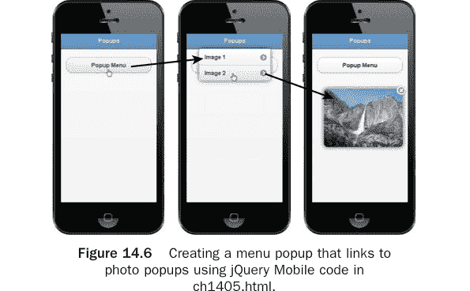

## 构建移动友好的表格

jQuery Mobile 为 `<table>` 标签添加了 data-mode 属性，以允许移动友好的表格。有两种方式可以实现表格的移动友好化。

第一种是减少显示的列数，第二种是将行折叠成列集，以便它们可以相互堆叠。这是通过向 `<table>` 标签添加 `data-role="table"` 和 `data-mode="reflow"` 来完成的。表格中的单元格被重新定位，以便它们与页面的其余部分一起流动。在 reflow 模式下，当表格宽度为 2 列时，列会被拆分成单个单元格并相互堆叠。然后，列中的标题作为标签添加到单元格中，以便每个单元格的左侧都包含列标题以标识该值。

第二种解决方案是向 `<table>` 标签添加 `data-mode="column-toggle"`。这为用户提供了一个弹出菜单，以便用户可以启用/禁用要显示的列。在 columntoggle 模式下可以启用/禁用的列是通过向 `<thead>` 元素的第一个 `<tr>` 中的 `<th>` 项添加 `data-priority=#` 属性来指定的。没有 data-priority，你就无法禁用列。data-priority 的 # 值范围从 1（最高）到 6（最低）。

```html
<table data-role="table" data-mode="reflow"
       id="parkTable">
  <thead><tr><th>Park</th>
    <th data-priority="1">State</th>
    <th data-priority="2">Est.</th>
    <th data-priority="3">Photo</th></tr>
  </thead>
  <tbody>
```

| 公园 | 州 | 年份 | 图片 |
| :--- | :--- | :--- | :--- |
| 黄石 | MT | 1872 |  |
| 优胜美地 | CA | 1872 |  |
| 锡安 | UT | 1919 |  |

## 创建移动表单

jQuery Mobile 引入了若干用于扩展和定义元素行为以支持移动设备的属性。表 14.4 列出了其中一些你在实现移动表单时需要熟悉的属性。此列表并非详尽无遗。

### 表 14.4 用于表单元素的 jQuery Mobile 数据属性

| 属性 | 描述 |
| :--- | :--- |
| data-role="fieldcontain" | 允许将多个表单元素样式化为一个组。 |
| data-role="controlgroup" | 允许你将按钮分组到一个单独的块中，类似于导航栏。 |
| data-type | 指定 controlgroup 中的项目是“垂直”还是“水平”组织。 |
| data-corners="true" | 为元素添加圆角。 |
| data-icon | 指定要添加到元素的图标：home, delete, plus, arrow-u, arrow-d, check, gear, grid, star, custom, arrow-r, arrow-l, minus, refresh, forward, back, alert, info, search |
| data-iconpos | 指定图标放置的位置：left, right, top, bottom |
| data-mini | 布尔值。如果为 true，则渲染元素的迷你版本，具有有限的填充和边距。 |
| data-theme | 为元素应用主题色块 (a-z)。 |

### 添加/隐藏标签

在 jQuery Mobile 中，表单输入元素需要标签。这允许库为移动设备适当地格式化表单元素。因此，你需要添加一个标签，并使用 for 属性将其链接到表单输入。好消息是，jQuery mobile 提供了一个类，你可以轻松地用它来隐藏标签。

```html
<div data-role="fieldcontain" class="ui-hide-label">
  <label for="username">Username:</label>
  <input type="text" name="username" id="username"
  value="" placeholder="Username"/>
</div>
```

### 禁用表单元素

你可以通过在 HTML 定义中向它们添加 ui-disabled 类或在 jQuery 代码中以编程方式添加来禁用表单元素。禁用元素会阻止控件接受用户的输入。此外，jQuery Mobile 具有应用于禁用控件的特殊样式，以向用户表明该表单元素无法使用。

```html
<input type="text" name="username" id="username"
value="" placeholder="Username" class="ui-disabled" />
```

### 刷新表单元素

当以编程方式更改表单中的项目（例如向 select 添加选项）时，你需要调用该项目的 refresh 函数。以下是使用 jQuery 调整表单元素然后刷新它们的一些示例。

```javascript
var mySelect = $("#mySelect");
mySelect[0].selectedIndex = 1;
mySelect.selectmenu("refresh");
$("#myCheckbox").prop("checked",true).checkboxradio("refresh");
$("#myRadio").prop("checked",true).checkboxradio("refresh");
$("#mySlider").val(100).slider("refresh");
```

### 添加表单元素

jQuery Mobile 元素大部分是标准的。jQuery Mobile 对其进行格式化以在移动设备上更好地显示。但是，有一些数据属性你应该注意：

- `data-role="fieldcontain"`——添加到多个表单元素周围的容器类。有助于移动元素，特别是 `<label>` 元素，更紧密地跟踪。
- `class="ui-hide-label"`——向 fieldcontain 容器添加此类会导致标签隐藏。
- `data-role="button"`——强制 `<a>` 链接显示为移动按钮。
- `data-icon`——指定可以添加到按钮或链接的图标。
- `data-iconpos`——指定图标的位置。
- `data-role="controlgroup"`——添加到多个表单元素周围的容器类。元素被渲染为一组。你也可以添加 `data-type="horizontal"` 和 `data-type="vertical"` 来定义按钮是相互堆叠还是成一行。

说明移动表单的最佳方式是向你展示一个示例。以下代码实现了几个 HTML 表单元素并对其应用了 jQuery Mobile 属性。表单的渲染版本如图 14.7 所示：

```html
<html>
<head>
  <title>Python Phrasebook</title>
  <meta charset="utf-8" />
  <meta name="viewport" content="width=device-width, initial-scale=1">
  <script src="../js/jquery-2.0.3.min.js"></script>
  <script src="../js/initmobile.js"></script>
  <script src="../js/jquery.mobile.js"></script>
  <link rel="stylesheet" href="../js/css/jquery.mobile.css" />
  <script>
    $(document).ready(function() {
      checkForMobile();
    });
  </script>
  <style>
  </style>
</head>
<body>
<div id="border"><div id="frame">
<div data-role="page" id="pageOne">
  <div data-role="header"><h1>Form</h1></div>
  <div data-role="content">
    <div data-role="controlgroup"
        data-type="horizontal" data-mini="true">
      <button data-icon="grid"
        data-iconpos="notext">b</button>
      <button data-icon="gear"
        data-iconpos="notext">b</button>
      <button data-icon="star"
        data-iconpos="notext">b</button>
    </div>
    <div data-role="fieldcontain" class="ui-hide-label">
      <label for="search">Search</label>
      <input type="search" name="search"
        id="search" value="" />
    </div>
    <div data-role="fieldcontain" class="ui-hide-label">
      <input type="text" name="username"
        id="username"
        placeholder="your name here"/>
      <label for="username">Name</label>
    </div>
    <fieldset data-role="controlgroup" data-mini="true">
      <input type="radio" name="rc" id="rc1"
        value="rc1"/>
      <label for="rc1">Family</label>
      <input type="radio" name="rc" id="rc2"
        value="rc2"/>
      <label for="rc2">Friend</label>
    </fieldset>
    <div data-role="controlgroup" data-type="horizontal"
      data-mini="true" data-theme="a">
        <input type="checkbox" name="hcb" id="hcb1" />
        <label for="hcb1">Post</label>
        <input type="checkbox" name="hcb" id="hcb2" />
        <label for="hcb2">Link</label>
        <input type="checkbox" name="hcb" id="hcb3" />
        <label for="hcb3">Share</label>
    </div>
    <div data-role="fieldcontain" class="ui-hide-label">
      <label for="area">Comments:</label>
      <textarea name="textarea" id="area" data-theme="a">
        Comments</textarea>
    </div>
    <button data-inline="true"
        data-theme="b">Accept</button>
    <button data-inline="true"
        data-theme="e">Decline</button>
</div>
</div></div>
</body>
</html>
```


# 索引

## A

- **绝对值，计算**，34
- **访问**
    - 浏览器，47-49
        - 访问 `Cookie`，52-55
        - 历史记录，49
    - **HTML**
        - 链式对象操作，75-76
        - 元素，59
        - 导航对象，76-82
        - 搜索元素，59-68，71-74
- `JavaScript` 中的 `jQuery`，6
- 库，7
- `Mobile`，10
- 变量，16
- **`addEventListener()` 函数**，103
- **添加**
    - 辅助内容到面板，328
    - 边框，134
    - 条件代码块，30
    - `Cookie`，53
    - 分割线到列表，324
    - `DOM` 元素到对象，91
    - 元素到元素，179-183
    - 事件处理器，99，105
    - **表单**
        - 元素，336
        - 移动端，334-336，340
    - 初始化代码，100
    - 项目到列表，191-193
    - **`JavaScript`**
        - 到 `HTML` 文档，3
        - 从外部文件加载，4
    - `jQuery` 到网页，5-6
    - 标签，335
    - 鼠标点击处理代码，115
    - 导航按钮，307，311，314
    - 页面加载事件处理器，99
    - 行到表格，189-191
    - 表格，333
    - 定时器，55-57
    - 过渡效果，308
    - **`UI` 元素**
        - 应用滑块，215-216，219
        - 添加日期选择器，212-215
        - 编写工具提示，223-225
        - 创建菜单，220-222
        - 下载库，201-202
        - 拖放，205-212
        - 实现自动完成，203-205
        - `jQuery`，201
- **`.toggle()` 方法**，243-245
    - `CSS` 设置，228-229
    - 延迟，233
    - 图像
    - 移动元素，248-250
    - 调整大小，246-248
    - 队列，231
    - 滑动切换，239-242
    - 停止，232-233
    - 可见性，234-238
- **调整不透明度**，146-149。另请参阅修改
- `adjValues()` 函数，197
- **`AJAX`**
    - 异步通信，253-254
    - 跨域请求，254
    - `GET`/`POST` 请求，255
    - `JavaScript`，261-267
    - `jQuery`，267-289
    - 概述，251-252
    - 响应数据类型，256-259
- 祖先元素，搜索，80
- **`.animate()` 方法**，228-229
- 动画，227-228
- **`.hide()` 方法**，242
- **`.show()` 方法**，243
- **追加**
    - 元素内容的底部，180
    - 元素，141
    - 行到表格，189-191
    - 文本，140
- 应用程序，`Mobile`，9-12
- **应用**
    - `AJAX`，251-252
        - 异步通信，253-254
        - 跨域请求，254
        - `GET`/`POST` 请求，255
        - `JavaScript`，261-267
        - `jQuery`，267-289
        - 响应数据类型，256-259
    - 事件对象，111-114
    - 过滤器到选择器，74
    - `for()` 循环，31
    - 网格布局，316-317，320
    - 逻辑，29-31
    - **`.map()` 方法**，87-88
    - 嵌套列表，322
    - 弹出窗口，329，332
    - 幂函数，35
    - 右键单击，117-118
    - 选择器，62
    - 滑块，215-216，219
    - 三角函数，35
    - `while()` 循环，30
- 参数，20
- **数组**
    - 合并，26
    - 创建，18
    - 项目
        - 删除，27
        - 检测，27
        - 迭代，31
        - 操作，25-27
        - 排序，28
        - 拼接，26
- **赋值**
    - 数据值到对象，89
    - 事件处理器到 `HTML`，101
- **异步通信**，253-254
- **添加日期选择器元素**，212-215
- **`.attr()` 方法**，126，166
- **属性，基于 `HTML` 选择**，64
- **自动完成，实现**，203-205
- **后退按钮，创建**，309
- **行为，事件**，107-110
- **代码块，添加**，30
- **`.blur()` 方法**，173
- **边框，添加**，134
- **元素内容的底部，追加**，180
- **浏览器**。另请参阅接口
    - 访问，47-49
    - `Cookie`，修改，52-55
    - 当前位置详情，45-47
    - 开发工具，配置，12-13
    - 事件
        - 添加事件处理器，99-106
        - 表单，122-123
        - 键盘，118-120
        - 管理，107-110
        - 鼠标，115-118
        - 对象，111-114
        - 概述，96
        - 类型，96，99
    - 历史记录，访问，49
    - `JavaScript` 控制台，应用，44
    - 导航，43
    - 弹出窗口，创建，50-51
    - 屏幕，调整大小，45
    - 定时器，添加，55，57
    - 网页
        - 重定向，44
        - 重新加载，44
- **构建移动页面**，302-304
- **`buttonImage` 选项**，213
- **`buttonImageOnly` 选项**，213
- **按钮**
    - 后退，创建，309
    - 导航
        - 添加，307，311，314
        - 定位，308
    - 分割列表，324
- **复选框状态，修改**，161-162
- **检查**
    - 数组中的项目，27
    - 子字符串，25
- **子元素，检索元素**，77
- **`Chrome`，启用 `JavaScript`**，13
- **类**
    - 删除，137
    - 名称，搜索 `DOM` 对象，60
    - 切换，137，139
- **`click()` 方法**，110
- **最近元素，检索**，77
- **关闭窗口**，49
- **代码**
    - 块，添加，30
    - 动态编程。参见动态编程
    - 初始化，添加，100
- **`JavaScript`**
    - 添加到 `HTML` 文档，3
    - 控制台，44
    - 从外部文件加载，4
    - 概述，2
    - 鼠标点击处理，添加，115
- **可折叠元素，将内容划分为**，326-327
- **颜色，修改**，131-132

## C

- **计算绝对值**，34
- 调用函数，20
- 取消定时器，56
- 层叠样式表。参见 `CSSs`
- 大小写，修改字符串，24
- `CDNs`（内容分发网络），5，9
- 链式对象操作，75-76
- `change` 选项，216
- **`.changePage()` 方法**，298
- 文本更改，检测，119
- 字符
    - 搜索，22
    - 特殊字符，字符串对象，21
- **`CSSs`（层叠样式表）**，345
- **合并**
    - 数组，26
    - 字符串，23
- **通信，**
    - 异步，253-254
- **`complete` 函数**，229-230
- **组件，日期**，39
- **条件代码块，**
    - 添加，30
- **配置**
    - 浏览器开发工具，12-13
    - `Cookie` 值，53
    - `CSS` 属性，130-139
    - 默认移动设置，301
    - `DOM` 元素属性，126-129
    - 隐藏表单属性，166
    - 选择输入，164-165
    - 单选按钮组中的选中选项，162
    - 文本
        - 输入值，160
        - 状态栏，48
- **定时器**，55-57
- **控制台，`JavaScript`**，44
- **内容**
    - 辅助，添加到面板，328
    - `HTML` 元素，基于内容选择，66
    - 父级，追加元素，141
- **网页**
    - 添加元素，179-183
    - 追加行到表格，189-191
    - 动态构建，177
    - 删除元素，184-185
    - `HTML` 元素，178
    - `HTML5 canvas` 图形，197-199
    - 图像库，193-196
    - 插入项目到列表，191-193
    - 选择表单元素，186-188
- **内容分发网络。** 参见 `CDNs`
- **内容工具提示**，223
- **转换**
    - `DOM` 对象到 `jQuery` 对象，84
    - 数字到字符串，22
    - 字符串到数字，23
- **坐标，获取**
    - 鼠标，115
- **跨域请求，`AJAX`**，254
- **`.css()` 方法**，130
- **`CSSs`（层叠样式表）**，7
    - 动画，228-229
    - 元素，130-139
    - 主题色板，295

## D

- **当前日期和时间，获取**
    - 获取，37
- 当前哈希，
    - 搜索，45
- 当前位置详情，
    - 45-47
- 网页的当前位置，48
- 自定义。另请参阅配置
    - 表单，334-336，340
    - 弹出窗口，329-332
    - 表格，333
- **`.data()` 方法**，166
- **数据类型，`AJAX`**，256-259
- **`Date` 对象**，36-40
- `dateFormat` 选项，213
- `datepicker` 元素，添加，212-215
- 日期，组件，39
- **`dblclick()` 方法**，110
- 调试 `JavaScript` 控制台，44
- 默认行为，停止，109
- 默认移动设置，配置，301
- **定义**
    - 函数，20
    - 变量，16
    - `viewport meta` 标签，300
- 延迟定时器，添加，56
- **延迟动画**，233
- **删除**
    - 类，137
    - 元素到元素，184-185
    - 事件处理器
        - `JavaScript`，104
        - `jQuery`，106
    - 数组中的项目，27
    - 对象，91
- 差值，格式化时间，39
- 后代元素，搜索，78
- **检测**
    - 文本更改，119
    - 数组中的项目，27
    - 移动屏幕尺寸，294
- 开发者工具（`Internet Explorer`），13
- **开发**
    - 浏览器工具，配置，12-13
    - `jQuery Mobile`，9-12
- 设备，`Mobile`，9-12
- 禁用表单元素，167-169，335
- 分割线，添加到列表，324
- 将内容划分为可折叠元素，326-327
- 文档对象模型。参见 `DOM`
- 文档，添加 `JavaScript` 到 `HTML`，3
- **当前日期和时间，获取**

## DOM (文档对象模型)，5

### 元素
- 添加，91
- 配置属性，126-129
- 内容，139-141
- 对象，60-61，84

- 下载 `jQuery UI` 库，201-202
- 拖放元素，205-212
- 可放置组件选项，208
- 持续时间函数，229-230

### 动态编程

#### 表单
- 复选框状态，161-162
- 禁用元素，167-169
- 元素，159
- 强制焦点到/离开元素，172-174
- 隐藏属性，166
- 管理提交，175
- 单选按钮输入，162
- 选择值，164-165
- 显示/隐藏元素，170-172
- 文本输入值，160

#### 网页，177
- 添加元素，179-183
- 调整不透明度，146-149
- 向表格追加行，189-191
- `CSS` 属性，130-139
- 删除元素，184-185
- `DOM` 元素属性，126-129
- 元素内容，139-141
- 隐藏/查看元素，144-146
- `HTML` 元素，178
- `HTML5` 画布图形，197-199
- 图像画廊，193-196
- 向列表中插入项目，191-193
- 修改，125
- 修改布局，143
- 重新定位元素，152-153，156
- 调整元素大小，149，152
- 选择表单元素，186-188
- 堆叠元素，156-158

## E

- **`.each()` 方法**，85
- **缓动函数**，229-230
- **效果，动画**，227-228
    - `CSS` 设置，228-229
    - 延迟，233
    - `.hide()` 方法，242
    - 移动元素，248-250
    - 队列，231
    - 调整图像大小，246-248
    - `.show()` 方法，243
    - 滑动切换，239-242
    - 停止，232-233
    - `.toggle()` 方法，243-245
    - 可见性，234-238
- **元素**
    - 追加，141
    - 检索子元素，77
    - 内容，139-141
    - `CSS` 属性，130-139
    - 搜索后代，78
    - `DOM`，5
        - 添加，91
        - 配置属性，126-129
    - 淡入淡出，239，242
    - 表单，159
        - 添加，336
        - 复选框状态，161-162
        - 创建选择框，186-188
        - 禁用，167-169，335
        - 强制焦点到/离开元素，172-174
        - 隐藏属性，166
        - 管理提交，175
        - 单选按钮输入，162
        - 刷新，336
        - 选择值，164-165
        - 显示/隐藏，170-172
        - 文本输入值，160
- **`HTML`**
    - 添加，179-183
    - 删除，184-185
    - `jQuery`，178
    - 移动，动画，248-250
- **用户界面**
    - 添加，201
    - 应用滑块，215-219
    - 附加日期选择器，212-215
    - 编码工具提示，223-225
    - 创建菜单，220-222
    - 下载库，201-202
    - 拖放，205-212
    - 实现自动完成，203-205

## F

- **强制焦点到/离开表单元素**，172-174
- 网页
    - 隐藏/查看，144-146
    - 加载 `HTML` 到其中，269-271
    - 重新定位，152-156
    - 调整大小，149-152
    - 堆叠，156-158
- 移动端，295-297
- 重置，175
- 提交，175
- **`existingObject`**，180
- 外部文件，从 `JavaScript` 加载，4

### 启用
- `Internet Explorer` 上的开发者工具，13
- `Chrome` 中的 `JavaScript`，13

### 淡入淡出
- `.eq (索引)` 过滤器，92
- 动画元素进入/退出，234-235
- 元素，239-242
- 到不同的不透明度级别，236
- 等值性，对象，29

### 事件处理程序

### 文件
- 全局，285
- 滑动，310，314
- 访问，6
- `JavaScript`，从外部加载，4
- 路径，查看，46
- 网页，加载，5-6

- `event.preventDefault()` 方法，109
- `.filter(filter)` 方法，92
- `event.stopPropagation()` 方法，109

### 过滤器

### 事件
- 对象结果，92-94
- 应用选择器，74

### 浏览器
- 添加事件处理程序，99-106
- 表单，122-123
- 键盘，118-120
- 管理，107-110
- 鼠标，115-118
- 对象，111-114
- 概述，96
- 类型，96，99

- 查找。请参阅 搜索
- `Firefox`，安装 `Firebug`，13
- `.first()` 方法，93
- **焦点**，修改，122
- `.focus()` 方法，173
- **字体**，修改，136
- **页脚**，移动网页，304
- `for()` 循环，31
- 可拖动组件，207
- 可放置组件，209

### 格式化
- 数组，18
- 返回按钮，309
- 日期，36-40
- `HTML`
    - 添加元素，179-183
    - 删除元素，184-185
    - 元素，178
- 图像画廊，193-196
- 列表视图，320-325
- 菜单，220-222
- 移动页面，302-304
- 导航栏，314
- 对象，19
- 弹出窗口，50-51
- 字符串，修改，21-25
- 文本，输入值，160
- 时间
    - 时间增量，39
    - 字符串，38
- 工具提示，223-225
- 隐藏属性，166
- 管理提交，175
- 单选按钮输入，162
- 刷新，336
- 选择值，164-165
- 显示/隐藏，170-172
- 文本输入值，160
- 事件，122-123
- `HTML` 元素，基于...选择，71
- 移动端，添加，334-336，340

### 功能，`AJAX`，285-289

### 函数
- `addEventListener()`，103
- `adjValues()`，197
- 调用，20
- 完成，229-230
- 定义，20
- 持续时间，229-230
- 缓动，229-230
- 处理程序，105
- 幂运算，应用，35
- 队列，230
- `removeEventListener()` 函数，104
- `renderSpark()`，197
- 三角函数，应用，35

### 表单
- 元素，159
    - 添加，336
    - 复选框状态，161-162
    - 创建选择框，186-188
    - 禁用，167-169，335
    - 强制焦点到/离开元素，172-174
    - 隐藏属性，166
    - 管理提交，175
    - 单选按钮输入，162
    - 刷新，336
    - 选择值，164-165
    - 显示/隐藏，170-172
    - 文本输入值，160
- 历史记录，浏览器导航，49

## G

- 画廊，格式化图像，193-196
- 生成随机数，32
- `GET` 请求，`AJAX`，255，262-264
- `.get()` 方法，84
    - `JSON`，处理，271-274
    - `XML`，处理，274，277
- `.getScript()` 方法，256
- 获取
    - `CSS` 属性，130-139
    - `DOM` 元素属性，126-129
    - 元素内容，139-141
    - 事件目标对象，114
    - 隐藏表单属性，166
    - 鼠标坐标，115
    - 选择输入框，164-165
    - 单选按钮组中的选中选项，162
    - 文本输入值，160
- 全局事件处理程序，285
- 全局设置，修改，285
- 图形，`HTML5` 画布，197-199
- 网格，布局，316-320
- 分组，获取/设置单选按钮选项，162

## H

- 处理程序
    - 函数，105
    - 事件
        - 添加，99
        - 滑动，310-314
    - 全局事件，285
- 处理
    - 事件
        - 表单，122-123
        - 键盘，118-120
        - 鼠标，115-118
    - `JSON` 数据，271-274
    - 选择变化，123
    - 文本数据 (`AJAX`)，257
    - `XML` 数据，274-277
- `.has(选择器或元素)` 方法，93
- 哈希值，当前，45
- 页眉，移动网页，304
- 隐藏表单属性，166
- `.hide()` 方法，144，170，242
- 隐藏
    - 元素，网页，144-146
    - 表单元素，170-172
    - 标签，335
- 层次结构，基于 `HTML` 元素选择，68
- 历史记录，浏览器导航，49
- **主机，搜索名称，46**

### `HTML` (超文本标记语言)
- 元素
    - 访问，59
    - 添加，179-183
    - 追加/前置文本，140
    - 链式对象操作，75-76
    - 删除，184-185
    - 获取内容，140
    - `jQuery`，178
    - 导航对象，76-82
    - 重新定位，152-156
    - 调整大小，149，152
    - 搜索，59-68，71-74
    - 堆叠，156-158
- 在其中分配事件处理程序，101
- `JavaScript`，添加到其中，3
- 响应数据，259
- **`HTML5` 画布图形，196-199**
- `.html()` 方法，140

## I

- **`ID`，搜索 `DOM` 对象，60**
- **图像**
    - 画廊，创建，193-196
    - 调整大小，动画，246-248
    - 源文件，修改，128
    - 过渡效果，添加，237-238
- **实现**
    - 自动完成，203-205
    - 底层 `AJAX` 请求，287-289
    - 多页面移动网站，306-314
    - 可搜索列表，325
    - 分割按钮列表，324
- **初始化代码，添加，100**
- **内部高度，47**
- **内部宽度，47**
- **输入**
    - 自动完成，实现，203-205
    - 单选按钮，162
    - 选择框，164-165
    - 文本值，160
- **插入到元素内容中间，181**
- **在 `Firefox` 上安装 `Firebug`，13**
- **界面**
    - 浏览器开发工具，配置，12-13
    - 加载，9
    - 导航，7
- **`Internet Explorer`，启用开发者工具，13**
- `.is()` 方法，161-163
- 项目
    - 数组
        - 删除，27
        - 检测，27
    - 列表，191-193
    - 工具提示项，223
- 迭代
    - 数组，31
    - `jQuery` 对象，85-86
    - 遍历对象属性，31
- `HTML`
    - 添加到文档，3
    - 搜索元素，59-61
- `JavaScript`
    - 访问 `jQuery`，6
    - 应用逻辑，29-31
    - 数学运算，31-35
    - 创建对象，19
    - 按需加载，255
    - 概述，2
    - 从中发送 `POST` 请求，264，267
    - 操作字符串，21-25
    - 语法，15
    - 定义变量，16

## J

### `JavaScript`
- 通过其发送 `AJAX`，261-267
- 数组
    - 创建，18
    - 操作，25-27
- `Chrome`，启用，13
- 控制台，44
- `Date` 对象，36-40
- 事件处理程序
    - 添加，103
    - 删除，104
- 事件，96，99
    - 添加页面加载事件处理程序，99
    - 管理，107-110
- 外部文件，从中加载，4
- 定义函数，20
- 从中发送 `GET` 请求，262-264
- `JavaScript` 对象表示法。请参阅 `JSON`
- `.join()` 方法，27

### `jQuery`
- 通过其发送 `AJAX`，267-289
- 动画，227-228
    - `CSS` 设置，228-229
    - 延迟，233
    - `.hide()` 方法，242
    - 队列，231
    - `.show()` 方法，243
    - 滑动切换，239-242
    - 停止，232-233
    - `.toggle()` 方法，243-245
    - 可见性，234-238
- 事件处理程序
    - 添加, 105
    - 删除, 106
- 事件, 96, 99
- `HTML` 元素, 178
- 初始化代码, 100
- `JavaScript`, 访问, 6
- 移动端, 9-12
- 移动网站, 291
    - 应用网格布局, 316-320
    - 构建网页, 302-304
    - 创建导航栏, 314
    - 自定义弹出窗口, 329, 332
    - 划分为可折叠元素, 326-327
    - 格式化列表视图, 320-325
    - 表单, 334-340
    - 通过多页实现, 306-314
    - 概述, 291-300
    - 表格, 333
    - 查看面板, 328
- 对象
    - 添加 `DOM` 元素, 91
    - 应用 `.map()` 方法, 87-88
    - 为对象赋值数据, 89
    - 链式操作, 75-76
    - 将 `DOM` 对象转换为 `jQuery` 对象, 84
    - 删除, 91
    - 过滤结果, 92-94
    - 获取, 84
    - 迭代, 85-86
    - 修改, 83
    - 导航至选择元素, 76-82
    - 概述, 4
- 用户界面
    - 访问库, 7
    - 添加, 201
    - 应用滑块, 215-219
    - 附加日期选择器, 212-215
    - 编写工具提示, 223-225
    - 创建菜单, 220-222
    - 下载库, 201-202
    - 拖放, 205-212
    - 实现自动完成, 203-205
    - 加载, 9
    - 导航, 7
- 网页, 加载, 5-6
- **`jQuery` 选择器, 搜索 `HTML` 元素**, 61-74

## JSON (`JavaScript` 对象表示法)
- 处理, 271-274
- 响应数据, 257-258

## K–L

- 键盘事件, 118-120
- `jQuery Mobile`, 291
- 按键, 按下, 120
- 关键字, 17, 96, 99
- 标签, 添加/隐藏, 335

### 语言
- `JavaScript`
    - 添加到 `HTML` 文档, 3
    - 从外部文件加载, 4
    - 概述, 2
    - 语法, 15
- `.last()` 方法, 93

### 布局
- 网格, 应用, 316-317, 320
- 应用网格布局, 316-320
- 网页
    - 调整不透明度, 146-149
    - 构建网页, 302-304
    - 隐藏/查看元素, 144-146
    - 修改, 143
    - 创建导航栏, 314
    - 重新定位元素, 152-153, 156
    - 自定义弹出窗口, 329-332
    - 划分为可折叠元素, 326-327
    - 格式化列表视图, 320-325
    - 表单, 334-340
    - 通过多页实现, 306-314
    - 概述, 291-300
    - 表格, 333
    - 查看面板, 328
- `jQuery UI`, 添加, 201-202
- 加载, 9
- 移动端, 9-12
- 链接, 修改
- 位置, 127

### 列表
- 分隔符, 添加, 324
- 可搜索, 实现, 325
- 分割按钮, 324
- 列表视图, 格式化, 320-325
- `.load()` 方法, 101
- 加载
    - 将 `HTML` 加载到页面元素, 269-271
    - 从外部文件加载 `JavaScript`, 4
    - 在网页中加载 `jQuery`, 5-6
    - 库, 5, 9
    - 移动端, 12
    - 不显示地加载移动页面, 299
- `.loadPage()` 方法, 298
- `location.reload()` 方法, 44
- 位置
    - 当前位置, 45-47
    - 链接, 修改, 127
    - 网页, 47-48
- 逻辑, 应用, 29-31
- 循环
    - `for()`, 31
    - `while()`, 30
- 底层 `AJAX` 请求, 287-289
- 管理
    - 事件, 107-110
    - 表单提交, 175

## M

- 操作
    - 数组, 25-27
    - `Cookie`, 52-55
    - 字符串, 21-25
- `.map()` 方法, 应用, 87-88
- `Math` 对象, 31-35
- `max` 选项, 216
- 集合中的最大数, 34
- 菜单, 格式化, 220-222
- `meta` 标签, 定义视口, 300
- 方法
    - `.animate()`, 228-229
    - `.attr()`, 126, 166
    - `autocomplete`, 203
    - `.blur()`, 173
    - `.changePage()`, 298
    - `click()`, 110
    - `.css()`, 130
    - `.data()`, 166
    - `.datepicker()`, 213
    - `dblclick()`, 110
    - `.delay()`, 234
    - `.each()`, 85
    - `event.preventDefault()`, 109
    - `event.stopPropagation()`, 109
    - `.filter(filter)`, 92
    - `.first()`, 93
    - `.focus()`, 173
    - `.get()`
        - `JSON` 数据, 271-274
        - `XML` 数据, 274, 277
    - `.get([index])`, 84
    - `.getScript()`, 256
    - `.has(selector or element)`, 93
    - `.hide()`, 144, 170, 242
    - `.html()`, 140
    - `.is()`, 161-163
    - `.join()`, 27
    - `JSON.parse()`, 258
    - `.last()`, 93
    - `.load()`, 101
    - `.loadPage()`, 299
    - `location.reload()`, 44
    - `.map()`, 87-88
    - `.not(filter)` 方法, 94
    - `.off()`, 106
    - `.offset()`, 153
    - `.on()`, 105
    - `onloadHandler()`, 100
    - `pop()`, 27
    - `.position()`, 153
    - `.post()`, 278-281
    - `.prop()`, 126, 166
    - `push()`, 18
    - `.ready()`, 101
    - `.remove()`, 184
    - `.removeAttr()`, 162
    - `setTimeout()`, 197
    - `.show()`, 144, 170, 243
    - `sort()`, 28
    - `.slice(start, [end])`, 94
    - `.slideToggle()`, 239
    - `.toggle()`, 243, 245
    - `.toLowerCase()`, 24
    - `.toUpperCase()`, 24
    - `.val()`, 160, 164
- **元素内容的中间, 插入到**, 181
- **集合中的最小数**, 33
- **移动端 (`jQuery`)**, 9-12
- **移动网站 (`jQuery`)**, 291
    - 概述, 291-300
    - 网页
        - 应用网格布局, 316-320
        - 构建, 302-304
        - 创建导航栏, 314
        - 自定义弹出窗口, 329-332
        - 划分为可折叠元素, 326-327
        - 格式化列表视图, 320-325
        - 表单, 334-340
        - 通过多页实现, 306-314
        - 表格, 333
        - 查看面板, 328
- **修改**
    - 复选框状态, 161-162
    - 颜色, 131-132
    - `Cookie`, 52-55
    - 元素
        - 应用滑块, 215-219
        - 内容, 139-141
        - 焦点, 122
        - 字体, 136
        - 全局设置, 285
        - 图片源文件, 128
        - 链接位置, 127
        - 移动网页, 298
        - 对象, 83
            - 添加 `DOM` 元素, 91
            - 应用 `.map()` 方法, 87-88
            - 为对象赋值数据, 89
            - 将 `DOM` 对象转换为, 84
            - 删除, 91
            - 过滤结果, 92-94
            - 获取, 84
            - 迭代, 85-86
        - 单选按钮输入, 162
        - 选择输入, 164-165
        - 选择, 123
        - 字符串, 21-25
        - 文本, 检测, 119
        - 网页
            - 调整不透明度, 146-149
            - `CSS` 属性, 130-139
            - `DOM` 元素属性, 126-129
            - 动态编程, 125
            - 元素内容, 139-141
            - 隐藏/查看元素, 144, 146
            - 布局, 143
            - 重新定位元素, 152-153, 156
            - 调整元素大小, 149-152
            - 堆叠元素, 156-158

### 鼠标
- 坐标, 获取, 115
- 事件, 115-118
- 鼠标点击处理代码, 添加, 115
- `mouseout` 事件, 116
- `mouseover` 事件, 116

### 移动
- 元素, 动画, 248-250
- `HTML` 元素, 152-156

## N

## 名称
- 属性, 166
- 类, 搜索 `DOM` 对象, 60
- 主机, 搜索, 46
- 标签, 搜索 `DOM` 对象, 61

### 导航栏, 格式化, 314

### 导航
- 浏览器, 43
    - 访问, 47-49
    - 添加计时器, 55-57
    - 应用 `JavaScript` 控制台, 44
    - 当前位置详情, 45-47
    - 历史记录, 49
    - 修改 `Cookie`, 52-55
    - 弹出窗口, 50-51
    - 重定向网页, 44
    - 重新加载网页, 44
    - 调整屏幕大小, 45
- `jQuery Mobile` 库, 291-300
- 对象以选择元素, 76-82
- 用户界面, 7
    - 访问库, 7
    - 加载, 9
- 导航按钮
    - 添加, 307-314
    - 定位, 308
- 嵌套列表, 应用, 322
- 网络, `CDN`, 5
- `.not(filter)` 方法, 94
- `numberOfMonths` 选项, 213
- 数字
    - 日期, 格式化, 36-40
    - 集合中的最大数, 34
    - 集合中的最小数, 33
    - 随机数, 生成, 32
    - 四舍五入, 33
    - 字符串, 转换, 22

## 对象
- 创建, 19
- `Date`, 36-40
- `DOM`, 60-61
    - 元素, 导航至选择, 76-82
- 相等性, 29
- 事件, 111-114
- 现有, 180
- 获取, 84
- `jQuery`
    - 添加 `DOM` 元素, 91
    - 应用 `map()` 方法, 87-88
    - 为对象赋值数据, 89
    - 将 `DOM` 对象转换为, 84
    - 删除, 91
    - 过滤结果, 92-94
    - 迭代, 85-86
- `location`, 45-47
- `Math`, 31, 34-35
- 修改, 83
- 操作, 链式, 75-76
- 属性, 迭代, 31
- 字符串, 特殊字符, 21
- `window.XMLHttpRequest`, 261
- `windows`, 47-49
- `XMLHttpRequest`, 261

## 父级
- 内容, 追加元素, 141
- 搜索, 80

## 路径, 查看文件, 46

## 物理事件, 107。另见事件

## `pop()` 方法, 27

## 弹出窗口
- 创建, 50-51
- 应用, 329, 332

## `position tooltip`, 223

## `.position()` 方法, 153

## 定位
- `HTML` 元素, 152-156
- 导航按钮, 308
- 父级
    - 检索, 80
    - 搜索, 80

## `POST` 请求, `AJAX`, 255, 264, 267

## `.post()` 方法, 278-281

## 幂函数, 应用, 35

## 前置
- 内容, 179
- 文本, 140

## 按键, 120

## 前一个兄弟元素, 81

## 编程
- 动态, 125。另见动态编程
- `JavaScript`
    - 添加到 `HTML` 文档, 3

## P

## 页面
- 元素, 将 `HTML` 加载到, 269-271
- 加载事件处理程序, 添加, 99

## 面板, 查看, 328

## Q-R

- 从外部文件加载，4
- 概述，2
- 语法，15
- `.prop()` 方法，126，166
- 传播，停止事件，109
- 属性
    - `CSS`，获取/设置，130-139
    - `DOM`，配置元素，126-129
    - 对象，迭代，31
- `push()` 方法，18
- 替换
    - 字符串，25
    - 文本，141
- 重新定位 `HTML` 元素，152-156
- 请求，`AJAX`
    - 跨域，254
    - `GET`/`POST`，255
    - `JavaScript`，261-267
    - `jQuery`，267-289
    - 响应数据类型，256-259
- 重置事件，175
- 调整大小
    - `HTML` 元素，149-152
    - 图片，动画，246-248
- 响应，`AJAX`
    - `jQuery`，282-284
    - 数据类型，256-259
- 查询，检索字符串，46
- 队列
    - 动画，231
    - 函数，230
- 单选按钮输入，162
- 随机数，生成，32
- `range` 选项，216
- `.ready()` 方法，101
- 递归计时器，添加，57
- 重定向网页，44
- 刷新表单元素，336
- 重新加载网页，44
- `.remove()` 方法，184
- `removeAttr()` 方法，162
- `removeEventListener()` 函数，104
- `renderSpark()` 函数，197
- 结果，过滤对象，92-94
- 检索，79
    - 子元素，77
    - `Cookie` 值，53
    - 父元素，定位，80
    - 前一个兄弟元素，81
    - 查询字符串，46
    - 兄弟元素，79-82
- 右键单击，应用，117-118
- 四舍五入数字，33
- 行，向表格追加，189-191

## S

### 发送
- 从 `JavaScript` 发送 `GET` 请求，262-264
- 从 `JavaScript` 发送 `POST` 请求，264-267

- 屏幕
    - 移动设备，检测尺寸，294
    - 尺寸调整，45
- 可搜索列表，实现，325
- 搜索
    - 祖先元素，80
    - 字符，22
    - 当前哈希值，45
    - 网页当前位置，48
    - 后代元素，78
    - 主机名，46
    - `HTML`
        - 链式对象操作，75-76
        - 元素，59-68，71-74
    - 父元素，80
    - 字符串，25
- 安全位置，从此处查看，47
- 选择表单元素，创建，186-188
- 选择输入框，164-165
- 选择
    - 元素，通过导航对象，76-82
    - 修改，123
- 选择器
    - 应用，62
    - 过滤器，74
- 服务器
    - `AJAX`
        - 异步通信，253-254
        - 跨域请求，254
        - `GET`/`POST` 请求，255
        - `JavaScript`，261-267
        - `jQuery`，267-289
        - 概述，251-252
        - 响应数据类型，256-259
    - 更新，278-281
- 集合
    - 集合中的最大数，34
    - 集合中的最小数，33
- `setTimeout()` 方法，197
- 设置。另请参阅 配置
    - `CSS`
        - 动画，228-229
        - 属性，130-139
    - `DOM` 元素属性，126-129
    - 隐藏表单属性，166
    - 选择输入框，164-165
    - 单选按钮组中的选中选项，162
    - 文本输入值，160
- 设置，修改全局，285
- `.show()` 方法，144，170，243
- `showButtonPanel` 选项，213
- `showOn` 选项，213

## siblings（兄弟元素）
- 前一个，81
- 检索，79-82

## 尺寸调整
- 屏幕，45，294
- 网页，47
- `.slice(start, [end])` 方法，94
- `slide` 选项，216
- `.slideToggle()` 方法，239
- 滑块，应用，215-216，219
- 滑动切换，239-242
- 数组排序，28
- 源文件，修改图片，128
- 特殊字符，21

## 特效，动画，227-228
- `CSS` 设置，228-229
- 延迟，233
- `.hide()` 方法，242
- 移动元素，248-250
- 队列，231
- 调整图片大小，246-248
- `.show()` 方法，243
- 滑动切换，239-242
- 停止，232-233
- `.toggle()` 方法，243-245
- 可见性，234-238

## 拼接
- 数组，26
- 字符串，24
- 分割按钮列表，324
- 分割字符串，24
- 堆叠 `HTML` 元素，156-158
- 状态，修改复选框，161-162
- 状态栏，配置文本，48
- `step` 函数，231

## 停止
- 动画，232-233
- 默认行为，109
- 事件传播，109

## 字符串
- 大小写修改，24
- 组合，23
- 日期，格式化，37
- 操作，21-25
- 数字，转换，22
- 查询，检索，46
- 替换，25
- 搜索，25
- 拼接，24
- 分割，24
- 子串，检查，25
- 时间，格式化，38
- 提交事件，175
- 提交表单，管理，175
- 提交表单，管理，363
- 子串，检查，25
- 切换
    - 色板，主题，295
    - 类，137-139
    - 元素可见性
    - 开/关，235
- 语法，`JavaScript`，15
- `.toLowerCase()` 方法，24
- 工具
    - 浏览器开发工具，配置，12-13
    - `JavaScript` 控制台，44
- 表格
    - 添加，333
    - 行，追加，189-191
- 工具提示，格式化，223-225
- 标签，搜索 `DOM` 对象，61
- `.toUpperCase()` 方法，24
- 目标，获取事件对象，114
- 过渡
    - 添加，308
    - 动画，237-238
- 文本
    - `AJAX`，257
    - 追加/前置，140
    - 自动完成，实现，203-205
    - 输入值，160
    - 修改，检测，119
    - 替换，141
    - 状态栏，配置，48
- 触发
    - 动画，232
    - 手动触发事件，110
- 三角函数，应用，35
- 主题色板，295
- 事件类型，96，99
- 时间
    - 当前时间，获取，37
    - 时间差，格式化，39
    - 字符串，格式化，38
- 计时器，添加，55-57

## T

## U

## `UIs`（用户界面）
- 元素
    - 添加，201
    - 应用滑块，215-219
    - 附加日期选择器，212-215
    - 编码工具提示，223-225
    - 创建菜单，220-222
    - 下载库，201-202
    - 拖放，205-212
    - 实现自动完成，203-205
    - 访问库，7
    - 加载，9
- 更新服务器，278-281
- 用户交互，添加，179-183
- 用户界面。参见 `UIs`
- 移动页面，加载而不显示，299
- 面板，328
- 网页，47
- 移动设备上的网站，294
- 视口，定义 `meta` 标签，300
- 可见性
    - 动画，234-238
    - `HTML` 元素，根据可见性选择，72

## V

- `.val()` 方法，160，164
- `value` 选项，216
- 值
    - 绝对值，计算，34
    - 属性，166
    - `Cookie`，配置，53
    - 对象，赋值，89
    - 文本输入，160

## W

网页表单，159。另请参阅 表单
网页。另请参阅 `HTML` 内容

- `var` 关键字，17
- 变量
    - 访问，16
    - 定义，16
- 查看
    - 元素，网页，144-146
    - 文件路径，46
    - 表单元素，170-172
    - 列表视图，格式化，320-325
- 添加元素，179-183
- 向表格追加行，189-191
- 动态构建，177
- 删除元素，184-185
- `HTML` 元素，178
- `HTML5 canvas` 图形，197-199
- 图片库，193-196
- 向列表插入项，191-193
- 选择元素，186-188

## 网页
- 当前位置，48
- 动态编程
    - `CSS` 属性，130-139
    - `DOM` 元素属性，126-129
    - 元素内容，139-141
    - 修改，125
- 事件
    - 添加事件处理程序，99-106
    - 表单，122-123
    - 键盘，118-120
    - 管理，107-110
    - 鼠标，115-118
    - 对象，111-114
    - 概述，96
    - 类型，96-99
- 历史，导航，49
- `HTML`，加载到，269-271
- `jQuery`，加载，5-6
- 布局
    - 调整不透明度，146-149
    - 隐藏/查看元素，144-146
    - 修改，143
    - 重新定位元素，152-156
    - 调整元素大小，149-152
    - 堆叠元素，156-158
- 移动端，构建，302-304
- 导航栏，格式化，314
- 重定向，44
- 重新加载，44
- 安全位置，从此处查看，47
- `UI` 元素
    - 添加，201
    - 应用滑块，215-219
    - 附加日期选择器，212-215
    - 编码工具提示，223-225
    - 创建菜单，220-222
    - 下载库，201-202
    - 拖放，205-212
    - 实现自动完成，203-205
    - 查看，47

## `Web` 服务器，`AJAX`
- 异步通信，253-254
- 跨域请求，254
- `GET`/`POST` 请求，255
- `JavaScript`，261-267
- `jQuery`，267-289
- 概述，251-252
- 响应数据类型，256-259
- `z-index`，367

## X–Z

网站，移动端（`jQuery`），291。**另请参阅 网页**
- 应用网格布局，316-320
- 构建网页，302-304
- 创建导航栏，314
- 自定义弹出窗口，329-332
- 划分为可折叠元素，326-327
- 格式化列表视图，320-325
- 表单，334-340
- 使用多页实现，306-314
- 概述，291-300
- 表格，333
- 查看面板，328

**`while()` 循环，30**

## 小部件
- 日期选择器，附加，212-215
- 可拖拽/可拖放，205-212
- 菜单，创建，220-222
- 工具提示，创建，223-225

## `XML`（可扩展标记语言）
- 处理，274，277
- 响应数据，259

## `XMLHttpRequest` 对象，261
## `window.XMLHttpRequest` 对象，261

## 窗口
- 关闭，49
- 对象，47-49
- 打开，49
- 弹出窗口，创建，50-51

## `z-index`，157
