# Jquery 与 Jquery Ui 视觉快速启动指南


ISBN-13: 978-0-321-88514-2

ISBN-10: 0-321-88514-7

## 献词

谨以此书纪念科伊·沃特金斯先生，他向数百名学生，**尤其是我**，灌输了对科学和探索的热爱。

## 特别感谢：

没有众多才华横溢且给予支持的人在身边，开启创作一本书的旅程是不可能的。我感激他们接受真实的我，包括所有缺点，即使这意味着我会说：“我不能……我得去写作。”

致我的女儿布列塔尼和凯特琳，感谢你们给我的灵感和鼓励。你们让生命中的每一刻都值得。我爱你们，从地球到月球再返回……无限倍！

致我的爸爸，没有您如此慷慨地分享给一个固执孩子的生活经验、支持和爱，我不可能走到今天。谢谢您做我的爸爸。我爱您。

致丽贝卡·古利克，随着旅程的推进，它变得越来越有趣。感谢您在保持幽默感的同时，给予我耐心而坚定的指导。您真是一个宝藏。

致戴夫·奥尔，感谢您在波涛汹涌的海面上掌舵。您教会了我很多关于这方面的事。

致杰西·卡斯特罗，我还能说什么？您的知识深度和广度总是让我惊叹。您让我保持专注的能力令人难以置信。您的友谊和古怪的幽默感让我微笑。谢谢您！

致 Peachpit/培生 团队，感谢您的耐心，以及将劣质产品（sows' ears）变成优质产品（silk purses）的能力。您的“惊喜指数”高得无法衡量。

致我尊敬的导师拉里·乌尔曼，您知道如何直击问题核心，并提醒我谦逊的价值。

致我的朋友们，感谢你们在压力巨大、时间紧迫时支持我、帮助我渡过难关，我对你们的感激之情远超书页上文字所能表达的。

致 jQuery 团队和社区，感谢你们致力于将优秀的产品带给大众，感谢你们的鼓励，以及你们对 JavaScript 库应有的样子所抱持的坚定愿景。你们愿意分享知识并将人们纳入其中，这极具价值，我们深表欢迎。


https://archive.org/details/jqueryjqueryui0000blan

## 引言

欢迎来到jQuery的世界！

你即将学习如何将全球最流行的JavaScript库应用于你的网站和网页应用。你将跻身于谷歌、ESPN、百思买等公司的开发者行列，将jQuery纳入你的网页开发工具箱。

jQuery库最初由John Resig于2005年开发，如今已发展成为一个成熟且功能强大的网页增强工具。全球的开发者们高举旗帜，开始以jQuery库为基础开发称为“插件”的组件。jQuery团队也加入了这场插件热潮，将一些非常流行的插件吸收进其框架，并于2007年将一些组件添加到额外的库jQuery UI中。

从那时起，jQuery基金会持续增强和重构该库，使其更加健壮和高效。库的新版本以惊人的速度推出，带来新功能和增强，以跟上不断变化的网页开发生态。

### 为什么选择这本书？

本书的目标是向你介绍jQuery和jQuery UI库的概念，以及如何在实际示例中使用这些概念。你将能够在你的网页项目中立即应用这些概念。

## 什么是jQuery？

这个问题的答案非常简单：jQuery就是JavaScript。更具体地说，jQuery是一个用JavaScript编程语言编写的免费、开源的代码库。

因为jQuery是JavaScript，所以它可以利用JavaScript的许多函数和概念，例如对象表示法，并且在许多情况下使它们更易于使用。

jQuery的核心是其选择器引擎Sizzle，它也是用JavaScript编写的。Sizzle选择器引擎使得使用CSS（层叠样式表）选择器作为jQuery对象来处理特定的网页元素或元素组变得简单。

## 变量、函数和参数，天哪！

如果这是你第一次接触编程语言，让我们先介绍一些构建可运行软件的基本概念。你几乎会在每个练习中看到这些概念的示例。

第一个概念是变量。变量本质上是信息的容器，可以是值、数组（项目的索引集合）或对象（具有属性集合的项目）的载体。下面的代码将声明一个变量并将其值设为空白：

```
var myVariable = '';
var myNewVariable = '';
```

## 学习jQuery

学习如何使用jQuery是一个循序渐进的过程。例如，只知道如何创建选择器，而不对选中的项目做任何操作，这并不有趣。

你将在早期接触到许多jQuery的方法和函数，即使本书尚未涵盖这些概念。每个练习结束时，你将被引导到可以找到有关这些方法和函数更多信息的章节。

从第2章“处理事件”开始，你将在网站模板的框架内开始构建jQuery函数。完成后，网页将使用许多可用的jQuery方法，包括一些jQuery UI插件组件（组件和插件是易于添加到网站的小型独立工具）。完成后的网页的标记和代码（包括PHP和MySQL查询）将在附录B“一个活跃的jQuery网站”中为你提供。

书中使用的所有代码都可以从www.jayblanchard.net下载。只需查找jQuery and jQuery UI Visual QuickStart Guide下载链接。

变量现在可以使用了，你可以通过引用它来填充任何你需要的值：

```
myVariable = 1234;
myNewVariable = $('#id');
```

有一件事你需要注意：变量有作用域。换句话说，一个变量可能只在函数的范围内可用，而在代码的其他任何地方都不可用。JavaScript变量作用域一直是一个热门讨论话题，你会发现网上有很多很好的参考资料。

> 提示 为你的变量和函数起有意义的名字，因为这样做不仅有助于你日后维护代码，还能提供关于变量或函数如何使用的线索。

下一个概念是为测试条件并对该条件做出反应而设计的。条件语句以if（如果是这样，那么那样）或while（当条件存在时，这样做）的形式出现：

```
if(myNewVariable == 1234) {
    // 那么这样做
} else {
    // 那么那样做
}
```

**while** 条件通常用于启动循环（还有一个用于设置循环的 **for** 条件）。这里你将测试 **myVariable** 的值，打印出变量的值，然后将变量的值减1。只要 **myVariable** 的值大于0，循环就会运行。

```
var myVariable = 10;
while(myVariable > 0) {
    // 做点什么
    document.write(myVariable + "<br>");
    myVariable--;
}
```

一个稍微难一点的概念是函数。*函数* 通常是一组指令，允许你仅通过调用函数名来执行一系列操作。然后你可以返回函数操作的结果。

要声明一个函数，你可以这样做：

```
function myFunction() {
    // 将指令放在这里
    var result = 1 + 1; // 指令
    return result;
}
```

要使用该函数，你可以这样做：

```
var myVariable = myFunction();
//myVariable 现在等于 2
```

有时你会想向函数发送信息。这被称为传递参数。将你的函数修改如下：

```
function myFunction(argument) {
    var result = argument + 1;
    return result;
}
```

现在你可以向函数传递一个参数：

```
var myVariable = 5;
var myNewVariable = myFunction(myVariable);
```

你将 **myVariable** 传递给 **myFunction**。然后 **myVariable** 变成了 **argument**。你将1加到 **argument** 上并返回结果。**myNewVariable** 现在等于6。

函数在你需要反复执行相同操作（可能传递不同参数）时非常有用。你还可以设置函数来接收和处理多个参数。函数将成为你开发工具箱中的关键工具。

这远非对编程的详尽介绍，但它应该足以让你入门，并为你提供理解本书中jQuery练习所需的基础。有很多好的资源可以学习如何用JavaScript以及许多其他语言（概念相同，只是语法不同）进行编程。

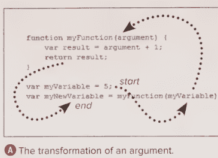

**A** 参数的转换过程。

### 函数还是方法？

一个可能有点模糊的概念是函数和方法之间的区别。表面上看，它们似乎是同一回事。实际上并非如此。

*函数* 是一段通过名称调用的代码。你可以向函数传递数据，函数将对这些数据进行操作。你也可以从函数返回数据。任何传递给函数的数据都是显式传递的——你选择向函数传递数据。

*方法* 通常是一段与对象关联的代码，就像当选择器绑定到jQuery方法时。你仍然通过名称调用方法，并且在大多数方面，它与函数相同，除了两个关键区别：方法被隐式传递了为其调用的对象，并且方法能够对包含在对象中的数据进行操作。

当你开始理解函数可能包含方法，并且类似地，你可以创建包含函数的方法（如jQuery插件和扩展）时，情况就变得复杂了。如果你记住信息是如何传递的——无论是显式还是隐式——你就能分清它们之间的区别。

### 学习基础知识

在很多情况下，作为使用 jQuery 的 Web 开发者，你的第一个决策是：是将 jQuery 核心库下载到你的 Web 服务器上提供服务，还是使用名为 CDN（内容分发网络）的托管服务。两者各有利弊。

使用 CDN（如 Google 提供的）最大的优势在于，其分布式网络几乎总是使用离网站访客最近的服务器来分发 jQuery 库。一旦浏览器缓存了来自 CDN 的库，只要浏览器缓存未被清除，就无需再次下载，这使得网站加载更快。最大的劣势是，当你的网站首次访客请求时，你不得不依赖第三方服务的可用性。

如果你决定自己托管 jQuery 库，最大的优势是你拥有完全的控制权。如果有人能访问你的网站，他们就能获取使用网站所需的所有文件。一旦从你的站点缓存了库，回访用户将获得与使用 CDN 时相同的优势。你还可以创建不需要连接到互联网的 jQuery 应用程序，前提是应用本身没有远程数据源的需求。最大的劣势是，某些浏览器会限制它们同时连接到服务器的数量，因此快速下载所有文件可能会有困难。

在当今时代，对大多数人而言，带宽不是问题，但你可能需要考虑那些带宽有限或使用对服务器连接数限制较低的浏览器的用户。

你最好的选择可能是使用 CDN，并配备一个本地（你的 Web 服务器上的）jQuery 库副本作为备选方案。让我们先下载一份 jQuery 副本，为创建备选方案做准备。

### 从 jquery.com 下载 jQuery：

1. 打开浏览器并访问 jquery.com (A)。

2. 选择你想要下载的 jQuery 版本，是生产版还是开发版。生产版是压缩过的（去除了空格和注释），以提供尽可能小的体积和开销。

3. jQuery 文件将显示在你的浏览器中 (B)。

4. 将文件保存到你的计算机，然后将其移动到 Web 服务器上的适当位置。

> 提示 为了方便离线开发，你需要下载一份 jQuery 副本并托管在你的本地机器上。

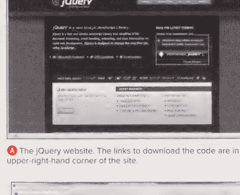

A jQuery 网站。下载代码的链接位于网站右上角。

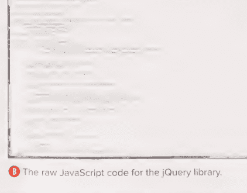

B jQuery 库的原始 JavaScript 代码。

下载文件后，你可以将其包含在你的 Web 项目中。让我们设置一个使用 Google CDN 的备选方案。

### 在你的项目中使用 jQuery：

在网页的 `<head></head>` 标签内添加以下代码：

```html
<script type="text/javascript" src="https://ajax.googleapis.com/ajax/libs/jquery/1.7.2/jquery.min.js"></script>

<script type="text/javascript">
if (typeof jQuery == 'undefined') {
    document.write(unescape("%3Cscript src='path/to/jquery-1.7.2.min.js' type='text/javascript'%3E%3C/script%3E"));
}
</script>
```

第一个 script 标签尝试从 CDN 将 jQuery 核心库包含到你的 Web 项目中。第二个 script 标签接着检查 jQuery 对象是否可用。如果 jQuery 对象不可用，则会向 HTML 文件写入一行代码，从本地源加载 jQuery 文件。

- **提示：** 如果你使用的是 HTML5，在 script 标签中不必包含 type 属性。

- **提示：** 在 CDN 方面你有多种选择。微软、Google 和 jQuery 都提供 CDN 服务。

### 压缩你的代码

在开发你的标记、样式表和 jQuery 代码时，你会在文件中保留大量的空格、制表符和注释，以使文件易于维护和阅读。这在开发期间很好，但对于生产环境，你应该考虑压缩你的代码。

压缩代码的过程会移除所有不必要的空格、注释和格式字符，这使得代码下载速度快得多。一些压缩工具甚至会检查你的代码错误并执行其他操作，以在不丢失功能的情况下将代码缩减到尽可能小的大小。

我最喜欢的压缩工具是 Google Closure Compiler。

### 使用 Google Closure Compiler 压缩你的代码：

1. 访问 http://closure-compiler.appspot.com/home 以使用该应用。

2. 修改编译器左侧面板中包含指令 `@output_file_name` 的代码行。使用你希望保存压缩代码的文件名。

3. 将你的 jQuery 代码复制到指令下方的空间。

4. 点击编译器左上方面板中的 Compile 按钮。

```javascript
// ==ClosureCompiler==
// @compilation_level WHITESPACE_ONLY
// @output_file_name jquery.custom.min.js
// ==/ClosureCompiler==
```

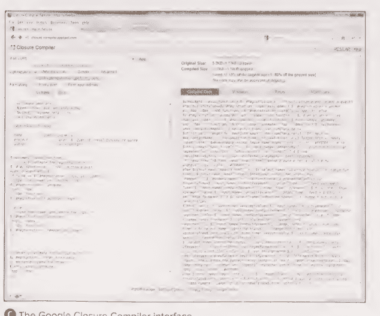

完成这些步骤后，你将在应用程序的右侧面板中看到编译后的代码。在界面右上部分，你可以获取有关代码原始大小的统计信息，随后是编译后的代码大小，以让你了解压缩的程度。

编译器右上部分还有一个指向你压缩代码的链接，使用你在指令中指定的文件名。点击该链接将在浏览器窗口中打开你的原始压缩 JavaScript 代码。将代码保存到你的计算机，并将其移动到 Web 服务器上的适当位置。

> 提示 始终保留代码的开发版本，其中包含所有注释和空格以保证可读性，仅在生产环境进行压缩。

### 实行渐进增强

使用 jQuery 库的主要好处之一是，你可以在任何网站上使用它，而无需修改任何 HTML 或 CSS。

大多数网站使用类似的工作流程开发。首先开发 HTML 标记和 CSS，以及任何赋予网站外观的美术作品。完成后，网站可能已完全功能化。大多数开发者将他们的样式表与标记分开，选择通过 HTML 文档头部的 link 标签在项目中包含 CSS。这是良好的组织方式。维护更容易，效率也高得多。

因为 jQuery 能够与全范围的 CSS 选择器和 HTML 元素交互，所以它可以与标记分开存放，而许多 JavaScript 调用则需要内联编写在标记中。例如，要捕获来自 a 标签的点击事件，你必须在锚标签内包含对 JavaScript **onClick()** 方法的调用：

```html
<a href="some.html" onClick="jsFunction">
```

回到你已经开发的网站添加 JavaScript 交互可能是一项繁重的工作。

> 提示 在规划你将使用 jQuery 的新网站和应用程序时，务必添加类和 ID，以辅助你的开发过程。

使用 jQuery，你只需在一个 script 标签中包含 jQuery 文件，就像之前在“学习基础知识”中包含 jQuery 核心库一样。然后你可以将点击事件处理程序写入你的 jQuery 代码文件：

```javascript
$('a[href="some.html"]').click(...
```

这意味着你永远不需要修改你现有的标记。这种将所有内容保持分离的概念被称为*渐进增强*。

渐进增强的基本规则很简单。开发你的标记，添加你的样式，然后用 jQuery 进行增强——所有这些都放在独立的文件中。在第 1 章“使用选择器”中，没有使用渐进增强——你将编写的所有 HTML、CSS 和 jQuery（除了 jQuery 核心库）都在一个文件中。这样做是为了简化。一旦你开始认真地开发 jQuery（从第 2 章“处理事件”开始），标记、样式和 jQuery 代码将保存在单独的文件中，并根据需要包含在 HTML 中。

### 追踪工具

除了 jQuery 核心文件，你所需要的是一个优秀的文本编辑器。每位开发者都有自己的偏好，因此我将给你一些推荐。我鼓励你尝试几种不同的编辑器，直到找到一个你用起来得心应手的。此外，**表 I.1** 包含了一些其他工具的推荐，这些工具将帮助你成为更好的 jQuery 开发者和更好的 Web 开发者。

随着你的技能和能力的增长，你可能会发现其他工具将增强你的工作流程，使你的开发过程更有效率。

## 回顾与复习

花点时间反思一下你在本章导言中学到的内容：

-   你从哪里获取 jQuery 库？

-   托管自己的 jQuery 代码还是依赖内容分发网络（CDN）更好？

-   什么是 jQuery？

-   渐进增强的优势是什么？

**表 I.1 建议工具**

| 名称 | 信息 |

| :--- | :--- |

| Eclipse IDE | 适用于 Windows 或 Mac 的通用文本编辑器。可从 www.eclipse.org 获取。 |

| Sublime Text 2 | 适用于 Windows、Mac 和 Linux 的通用文本编辑器。可从 www.sublimetext.com 获取。 |

| Firebug | 适用于 Windows 和 Mac 上 Firefox 的 DOM 检查器和故障排除工具。可从 http://getfirebug.com 获取。 |

| 开发者工具 | 适用于 Windows 上 Internet Explorer 9 的 DOM 检查器和故障排除工具。只需按 F12。 |

| 开发者工具 | 适用于 Google Chrome 的 DOM 检查器和故障排除工具。它随 Chrome 一起捆绑提供：选择工具 > 开发者工具。 |

| XAMPP | 你可以安装在计算机上用本地开发的个人 Web 服务器。包含 PHP 和 MySQL，可在 Windows 上运行。可从 www.apachefriends.org 获取。 |

| MAMP | 你可以安装在 Mac 上的个人 Web 服务器。包含 PHP 和 MySQL。可从 www.mamp.info 获取。 |

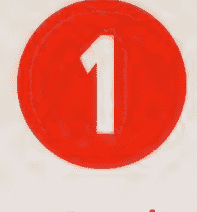

## 使用选择器

jQuery 库的优势之一是它让你能够轻松选择并与网页中的文档对象模型（DOM）元素进行交互。如果你曾使用过层叠样式表（CSS）进行任何 Web 开发，你会对选择器感到熟悉，因为 jQuery 的选择器语法几乎与你为网站准备样料属性时使用的完全相同。jQuery 使用了 Sizzle JavaScript CSS 选择器引擎，该引擎由 jQuery 的创建者 John Resig 开发。jQuery 库还添加了几个特定的选择器扩展，以增强库的语法并使其更易于使用。

在本章中，你将学习如何选择和使用 jQuery 的选择器来控制网页中的 DOM 元素以及元素组。你还将学习如何组合选择器，然后对选择器应用过滤器，以获得更大的灵活性和控制力。

### 本章内容

-   使用基本选择器 2

-   将过滤器应用于选择器 6

-   回顾与复习 14

## 使用基本选择器

尽管 jQuery 提供了多种选择器选项，但你会发现自己大多数时候都在使用基本选择器（元素、id 或 class）。表 1.1 列出了基本选择器及其功能。

在为网页创建标记时，你应该仔细规划类和 ID。良好的规划将使你在准备将 jQuery 应用于网站时轻松许多。如果你不保持 **id** 唯一或未正确定义它们，很容易陷入困境并怀疑为什么你的 jQuery 代码不工作。在 HTML5 中，ID 的大部分限制已经放宽。你可以在 ID 中使用任何字符，并且它必须至少包含一个字符，但网页中的每个 ID 必须是唯一的。如果两个元素具有相同的 ID，当将 jQuery 代码应用于这些元素时，你可能会得到奇怪的结果，并且结果可能因浏览器而异。

当你希望添加旨在影响一组元素的 jQuery 代码时，我建议你为这些元素使用类。首先，通常更容易记住命名组，其次，你可以将 jQuery 方法应用于所有具有相同类的元素。明智的使用类可以为你的 jQuery 交互设计提供极大的灵活性。

### 使用 ID 和类

如果你是 Web 开发的新手，你可能不熟悉 HTML 标记和 CSS 中 ID 和类的概念。

在 HTML 中，ID 是一个属性，通过将 **id="id_name"**（其中 **id_name** 对于每个分配了 ID 的元素是唯一的）放在元素标签内来分配给元素。例如，你可以像这样为段落元素分配一个 ID：**&lt;p id="paragraph_1"&gt;**。在 CSS 中，你会通过在 ID 名称前放置井号（#）来引用该 ID：**#paragraph_1**。

另一方面，你可以将相同的类分配给任意数量的元素。例如，**class="redline"** 可以分配给任何元素。在 CSS 中，你会通过在名称前放置一个句点来寻址一个类：**.redline**。

在 jQuery 中，你使用与 CSS 相同的语法，ID 以井号开头，类以句点（.）开头。

**表 1.1 基本选择器**

| 选择器名称 | 功能 |

| --- | --- |

| all $('*') | 选择网页内的每个元素，从 body 元素开始。**all** 选择器很少使用，如果网页包含大量元素，可能会很慢。 |

| element $('element') | 选择所有这种元素类型，例如 **div**、**p** 或 **h1**。 |

| id $('#id_name') | 选择网页中具有该 ID 的那个元素。ID 必须以井号或磅号开头。（网页中的每个 ID 必须是唯一的！） |

| class $('.class_name') | 选择所有具有特定类的元素。类名以句点开头。 |

<p class="content">Nulla ut Auctor dui. Duis ultricies eros faucibus neque aliquet vel tempus sem tincidunt.</p>

<p class="content">Integer eget tellus nec diam pellentesque cursus. Nulla facilisi.</p>

<p class="content">Curabitur dictum tortor vitae nulla vehicula sed porta tellus porta.</p>

**要使用基本选择器：**

1.  在你最喜欢的文本编辑器或集成开发环境（IDE）中打开 **basic_html5.html**（附录 B 中描述的基本 HTML5 模板）[A]，或者打开脚本 **1.1.html** 来跟随操作。

2.  将以下标记放在 HTML 页面的 body 中：

```
<h1>Header 1</h1>
<p id="introduction">Lorem ipsum dolor sit amet, consectetur adipiscing elit.</p>
<h2>Header 2</h2>
```

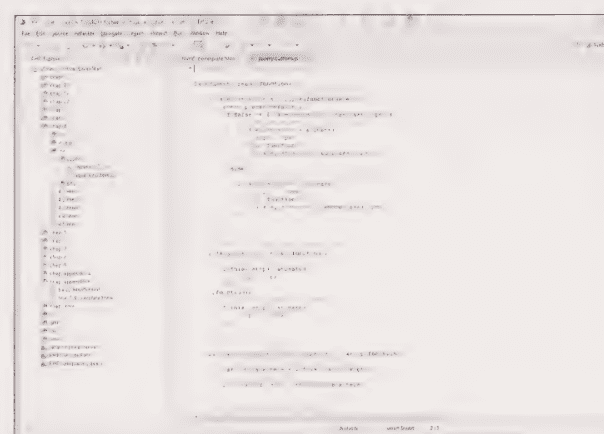

[A] 我喜欢在 Eclipse IDE 中工作，因为它允许我轻松组织项目。

3.  将此 jQuery 代码添加到页面的 head 部分，直接放在你包含 jQuery 核心库的下方 **B**：

```
<script type="text/javascript">
$(document).ready(function(){
$( '*' ).css({ 'border': '1px solid #FF0000', 'margin':'5px', 'padding': '5px' });
$( 'h1' ).css({ 'background': '#FFFF00' });
$( '.content' ).css({ 'font-style': 'italic'});
$( '#introduction' ).css({ 'color': '#0000FF' });
});
</script>
```

这些示例使用了 jQuery 的 **css()** 方法为每个选择器应用样式。**css()** 方法很灵活，可以让你快速轻松地为网页中的元素设置样式。你将在第 6 章“遍历 DOM 树”中了解更多关于 CSS 方法的内容。

> **提示**  好好规划你的 id 和 class 的使用。这将使使用 jQuery 添加交互元素变得容易得多。

> **提示**  谨慎使用 all 选择器；它可能会使你的浏览器变慢，尤其是当你的网页包含大量元素时。

> **提示**  为了提高性能，特别是如果你打算反复使用相同的选择器，你可以将选择器缓存到变量中。例如，`var cachedSelector = $('selected elements');` 将所有选定的元素放入变量 cachedSelector 中，然后可以在你的 jQuery 函数调用中使用该变量，如本例所示：`cachedSelector.css({...});`

4.  将新文件保存为 **basic.html**，将其放在你的 Web 目录中，并在 Web 浏览器中加载它 **C**。

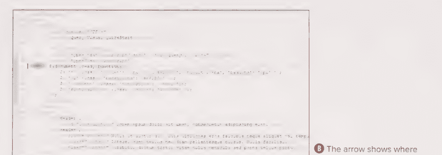

**B** 箭头指示你应该在页面的何处添加 jQuery 代码。

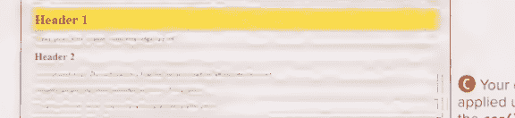

**C** 你使用 jQuery 的基本选择器和 css() 方法应用样式的完成后的网页。

D 该样式现在应用于所有 h1 和 h2 元素。

### 组合选择器

使用 jQuery 时，你可以像编写 CSS 一样组合选择器。组合选择器有多种好处，包括缩短编码时间、使代码更整洁——还有助于减少浏览器需要下载和解析的代码量。更小的加载时间意味着更少的开销和更高效的 Web 应用程序。

在创建 Web 应用程时，你可以在合理的情况下组合所有 jQuery 选择器，就像在 CSS 中组合这些选择器一样。

#### 组合选择器的步骤：

1. 在文本编辑器中打开 **basic.html** 文件，或参考脚本 **1.2.html**。

2. 找到以下 jQuery 代码行：

### 为选择器应用过滤器

jQuery 库提供了许多过滤器，允许你在构建网站和应用程序时细化选择。这些过滤器可以直接应用于你的选择器。例如，你可能想选择一个包含特定文本的 **div**。你的选择器可以这样写：

`$('div:contains("my text")')`

任何包含文本 **"my text"** 的 **div** 都会被选中，从而可以对其应用任何 jQuery 方法。

对于 jQuery 独有的过滤器扩展，你需要使用 `filter()` 方法来恢复损失的性能。（**表 1.2** 列出了所有 jQuery 过滤器扩展。）jQuery 过滤器扩展不属于当前 CSS 规范的一部分；因此，原生 DOM 方法，特别是 `querySelectorAll()`，并不知道 jQuery 扩展。这将导致 jQuery 库和浏览器的 JavaScript 引擎在处理 jQuery 的非标准扩展时承担更大的开销。对于使用的每个扩展，都会损失一些性能，久而久之，可能会使你的应用程序变得迟缓。一个很好的例子是，当你选择某个属性不等于特定值的元素时，可以这样写：

`$('input[name!="myName"]')`

要恢复损失的性能，请对选择器应用 **filter()** 方法：

`$('input').filter('[name!="myName"]')`

你可以将 **.filter()** 方法与所有过滤选择器一起使用，但当你将其与那些当前在 CSS 规范中的选择器一起使用时，不会注意到任何性能提升。这些过滤器通常被称为 CSS 伪类。（CSS 伪类在 **表 1.3** 中列出。）

让我们先看看如何使用基本过滤器。

> **提示** 你会发现所有过滤器组中都有 jQuery 扩展，因此为了方便编码，你可以在使用任何过滤选择器时使用 **filter()** 方法。这样你就不必跟踪哪个过滤器是扩展，哪个不是。

> **提示** 低于 1.7 版本的旧版 jQuery 有其他可用的过滤器扩展，最主要的是针对表单的。这些额外的扩展可以在 http://api.jquery.com/category/selectors/jquery-selector-extensions/ 在线找到。

#### 表 1.2 jQuery 过滤器扩展

| 过滤器名称 | 它选择什么 |

| :--- | :--- |

| `:animated` | 选择器运行时所有正在被动画处理的元素。 |

| `[name!="value"]` | 未指定属属性或指定了属性但值不等于特定值的元素。 |

| `:eq()` | 匹配集中指定索引处的元素，索引从零开始。 |

| `:even` | 组中的偶数索引元素，索引从零开始。 |

| `:first` | 第一个匹配的元素。 |

| `:gt()` | 匹配集中索引大于指定索引的所有元素，索引从零开始。 |

| `:has()` | 包含至少一个匹配指定选择器的元素的元素。选择器可以是任何 jQuery 选择器或选择器的组合。 |

| `:header` | 所有标题元素：`h1`、`h2`、`h3` 等。 |

| `:hidden` | 所有隐藏的元素，例如具有 `type="hidden"` 属性的表单元素。 |

| `:last` | 元素集合中最后一个匹配的元素。 |

| `:lt()` | 匹配集中索引小于指定索引的所有元素，索引从零开始。 |

| `:odd` | 组中的奇数索引元素，索引从零开始。 |

| `:parent` | 所有是另一个元素父元素的元素，包括文本节点。 |

| `:selected` | 表单选择列表中被选中的所有元素。 |

| `:visible` | 所有可见的元素。 |

#### 表 1.3 CSS 伪类选择器

| 过滤器名称 | 它选择什么 |

| :--- | :--- |

| `:link` | 所有未访问过的链接。 |

| `:visited` | 所有已访问过的链接。 |

| `:active` | 活动的链接。 |

| `:hover` | 鼠标悬停时的链接。 |

| `:focus` | 获得焦点的输入元素。 |

| `:first-letter` | 每个匹配元素的首字母。 |

| `:first-line` | 每个匹配元素的首行。 |

| `:first-child` | 每个作为其父元素第一个子元素的元素。 |

| `:before` | 在每个选中元素的内容之前插入内容。 |

| `:after` | 在每个选中元素的内容之后插入内容。 |

| `:only-child` | 每个作为其父元素唯一子元素的匹配元素。 |

| `:nth-child(n)` | 每个作为其父元素第 *n* 个子元�的匹配元素。 |

| `:nth-last-child(n)` | 每个作为其父元素第 *n* 个子元素的匹配元素，从最后一个子元素开始计数。 |

| `:last-child` | 每个作为其父元素最后一个子元素的匹配元素。 |

| `:root` | 文档的根元素。 |

| `:empty` | 每个没有子元素（包括文本节点）的元素。 |

| `:enabled` | 每个已启用的元素。 |

| `:disabled` | 每个已禁用的元素。 |

| `:checked` | 每个被选中的元素。 |

| `:not(selector)` | 每个不匹配指定选择器的元素。 |

#### 使用基本过滤器的步骤：

1. 打开基本 HTML 模板，并在模板的 body 中添加以下标记（你也可以参考脚本 **1.3.html**）：

```html
<ul>
    <li id="first">First Item</li>
    <li id="second">Second Item</li>
    <li id="third">Third Item</li>
    <li id="fourth">Fourth Item</li>
</ul>
```

2. 将以下 jQuery 代码添加到文档的 head 中（记住将 jQuery 代码放在 `<script></script>` 标签之间）：

```javascript
$(document).ready(function() {
    $('li:not(#third)').css({'border': '1px solid #0000FF'});
});
```

3. 将文件保存为 **basic_filter.html** 并加载到浏览器中。第一个、第二个和第四个列表项将会有边框，但第三个不会。

 CSS 未应用于你用 `:not()` 选择器过滤掉的元素。

- 第一项

- 第二项

- 第三项

- 第四项

> **提示** 如果你经常使用 `:not` 过滤器，可以通过使用 `.not()` 方法使你的代码更具可读性和更易于维护。

> **提示** 因为示例中使用了 HTML5，所以你不再需要在 `<script>` 标签中添加声明 `type="text/javascript"`。

- 第一项

- 第二项

- 第三项

- 第四项

第三个列表项被高亮显示，因为它包含单词“Third”。

#### 使用内容过滤器的步骤：

1. 进行以下修改，将 CSS 添加到 **basic\_filter.html** 的 head 部分（参见示例代码中的 **脚本 1.4.html**）：

```html
<!-- CSS -->
<style>
.highlight {
    background-color: #FFFF00;
}
</style>
```

2. 将这行 jQuery 代码放在你的 document-ready 包装器中：

```javascript
$('li:contains("Third")')
.addClass('highlight');
```

3. 将更新后的文件保存为 **content\_filter.html**。在 Web 浏览器中加载时，结果是任何包含单词 "**Third**" 的列表项将根据 CSS 类 **highlight** 获得背景色。

任何包含单词 "**Third**" 的列表项都将被选中。请记住，你字符串中的单词不限于一个，并且 **:contains()** 过滤器只能用于文本。字母大小写很重要，因此如果你没有找到所需的匹配项，请务必仔细检查你的代码。

**add\_class()** 方法是一个用于操作 DOM 元素的函数，它允许你轻松地为这些元素添加复杂的类。你将在第 3 章“获取和设置 DOM 属性”中了解更多关于 **addClass()** 的信息。

> **提示** HTML5 允许你使用 `<style>` 标签而无需添加 type="text/css" 声明。

> **提示** 内容过滤器区分大小写。"Third" 不会匹配 "third"。

#### 使用过滤扩展：

1.  使用你创建的网页（**content_filter.html**），将以下 jQuery 代码行添加到你之前编写的代码中（脚本 **1.5.html**）：

    ```javascript
    $('li').filter(':first').css({'color':'#FF0000'});
    ```

2.  将更新后的文件保存为 **extended_filter.html** 到你的网页服务器，并在网页浏览器中加载该文件。第一个列表项现在变成了红色 **C**。

> **C** 当应用样式达到精准控制时，基本选择器和过滤器的强大之处开始显现。

你可以使用选择器过滤，将 jQuery 的方法应用于特定元素或不易定义的元素组，例如列表的某一部分或表格中的某些行。

幸运的是，jQuery 库提供了多种选择器过滤器和组合，以便在需要时定位元素。例如，`:gt` 和 `:lt` 过滤器可以从组中的特定位置开始，选取一组元素中的一部分。

```javascript
$('li').filter(':lt(3)').addClass('highlight');
```

这行 jQuery 代码会将 **highlight** 类应用于无序列表中的前三个列表元素。像这样的选择器会为元素创建一个基于零的索引，这意味着你从 0 开始计算元素。

```html
<ul>
    <li>索引 0</li>
    <li>索引 1</li>
    <li>索引 2</li>
    <li>索引 3</li>
    <li>索引 4</li>
</ul>
```

> **提示** jQuery 还提供了一个遍历方法 `slice()`，它能提供非常精细的选项来选取一组项目。你将在第 6 章了解更多关于 `slice()` 的内容。

该类将应用于索引为 0、1 和 2 的项目。

#### 使用 :even 或 :odd 过滤器：

1.  在你的文本编辑器中打开基本 HTML 模板，并将以下 CSS 添加到文档的头部（脚本 1.6.html）：

```css
.highlight { background-color: #FFFF00;}
td { border: 1px solid #333333;
padding: 2px;}
```

2.  将以下标记添加到模板的主体中以创建一个表格：

```html
<table>
<tr><td>第 1 行 - 索引 0</td></tr>
<tr><td>第 2 行 - 索引 1</td></tr>
<tr><td>第 3 行 - 索引 2</td></tr>
<tr><td>第 4 行 - 索引 3</td></tr>
<tr><td>第 5 行 - 索引 4</td></tr>
<tr><td>第 6 行 - 索引 5</td></tr>
<tr><td>第 7 行 - 索引 6</td></tr>
<tr><td>第 8 行 - 索引 7</td></tr
<tr><td>第 9 行 - 索引 8</td></tr>
<tr><td>第 10 行 - 索引 9</td></tr>
</table>
```

3.  将 jQuery 代码放在文档的头部。不要忘记将其放在 document-ready 函数内：

```javascript
$('tr').filter(':odd')
.addClass('highlight');
```

4.  将文件保存为 odd.html 并在你的网页浏览器中加载。你会看到表格的每一其他行都应用了 highlight 类。

表格中的奇数行已被高亮显示。

表格中包含索引号是为了演示 :odd 选择器是使用基于零索引的过滤器之一。如果你将过滤器更改为 :even，第一行和每个偶数索引的行将被选中。

> jQuery 的 :nth-child() 过滤器使用基于一的索引，所以你会从 1 开始计算选中的元素。:nth-child 过滤器不是扩展；而是 CSS 规范的一部分。

一些最有用的选择器是属性选择器。你可以单独使用它们，或者与基本选择器之一结合使用，从已在 HTML 标记中包含的元素创建 jQuery 对象。这是一个例子：

```javascript
$('img[src="foo.jpg"]').css({
    'border':'2px solid #0000FF' 
});
```

在这里，你已将样式属性应用于网页中的一张图片 foo.jpg。能够选择元素而无需添加类或 ID，使你可以在创建 HTML 标记时不必担心将来如何使用 jQuery 来增强你的网站。

#### 使用属性选择器：

1.  将以下 CSS 放入你的样板 HTML 文件（脚本 1.7.html）的头部：

```css
.alert {
    background-color: #FFFF00;
    color: #FF0000;
}
```

2.  在主体中创建一个小表单：

```html
<form action="" method="post">
<input name="firstName"
   placeholder="名字" />
<span class="alert"></span><br />
<input name="lastName"
   placeholder="姓氏" />
   <span class="alert"></span><br />
<input name="emailAddress"
   placeholder="电子邮件地址"/>
<span class="alert"></span><br />
<input type="submit" value="发送
   你的信息" />
</form>
```

3.  添加旨在检查电子邮件字段值长度的 jQuery 函数：

```javascript
$('input[name="emailAddress"]')
.blur(function(){
if(0 == $(this).val().length) {
$(this).next('.alert').text(
  '请填写你的电子邮件地址');
} else {
$(this).next('.alert').text('');
}
});
```

4.  使用名称 **attribute.html** 保存文件。将文件放在你的网页服务器上，并将页面加载到你的网页浏览器 **G** 中。

5.  依次切换（Tab）到每个字段，而不填写任何信息。当你从电子邮件字段切换（Tab）或点击离开时，警报消息将会出现 **H**。

6.  在电子邮件字段中输入一些字符，然后切换（Tab）或点击离开该字段，警报消息将消失。

在这个练习中，你使用了多个方法：**blur()**，一个表单事件；**next()**，一个 DOM 遍历方法；**text()**，一个 DOM 操作方法；**val()**，一个可以用来获取和设置属性值的方法；以及 **length**，一个 JavaScript 测量函数。

当你从字段切换（Tab）或点击离开时，会发生 blur 事件。创建一个由事件触发的函数（使用 jQuery 时的常见任务）很容易。你在这里创建的函数检查表单字段值的长度是否为零。如果长度值为零，该函数会查找下一个具有 alert 类的元素，然后更改该元素的文本。关于这些函数的更多细节将在本书后面讨论。

属性选择器有多个版本。你可以选择属性值的开头或结尾、值的子字符串，甚至元素是否具有特定属性。你将在第 5 章“驾驭高级选择器”中了解更多关于属性选择器的知识。

**G** 这是你的简单表单。

**H** 一定要填写电子邮件字段！

## 回顾与复习

花点时间反思一下你在本章中学到的内容：

-   四种基本的 jQuery 选择器类型是什么？

-   如何组合选择器，以便将 jQuery 方法和函数应用于不止一组元素？

-   为什么你应该将 `filter()` 方法与 jQuery 的过滤扩展结合使用？

-   当指代一组选中的元素时，什么是基于零的索引？

-   如果你将示例中 `$(this)` 的 jQuery 选择器从 `$('#secondLink')` 更改为 `$('a')`，你认为会发生什么？

-   使用属性选择器是否可以避免使用 ID 和类？

## 什么是 $(this)？

许多刚接触 JavaScript 和其他面向对象语言的开发者常常难以理解 `$(this)`，因为 JavaScript 也有一个名为 `this` 的对象。由于 jQuery 是 JavaScript，那么区别在哪里呢？

单独使用时，`this` 是一个 JavaScript 对象，当前的 JavaScript 方法正在其上执行。换句话说，`this` 会在 JavaScript 函数中出现。你可以将 JavaScript 方法应用于 `this`，但不能将 jQuery 方法应用于该对象，因为 `this` 不在 jQuery 函数的作用域内。

在 jQuery 中，`$(this)` 是一个对象，通常是选择器中包含的项目。该对象可以立即访问所有 jQuery 方法。你会在 jQuery 函数内部看到 `$(this)` 对象的使用。

由于 jQuery 与 JavaScript 的关系，jQuery 中的 `$(this)` 对象（或任何选中的元素）也可以访问 JavaScript 的方法和函数。能够使用 jQuery 的 `$(this)` 对象，让你在设计函数使你的网站和应用更强大、更具交互性时拥有极大的灵活性。

通过在文本编辑器中打开脚本 1.8.html 并在浏览器中加载它，查看一个关于 `this` 和 `$(this)` 如何工作的示例。在纯 JavaScript 示例中，`this`（指代链接）通过内联 JavaScript 调用传递给函数 `clicked()`。

在 jQuery 函数中，使用选择器来识别被点击的链接，并在 `click()` 函数内部使用 `$(this)` 对象。

两个函数都使用 JavaScript 的 `length` 函数来获取链接文本中的字符数。

当任一链接被点击时，链接文本中的字符数会使用 `alert()` 函数 F 显示在浏览器中。

F 页面上第二个链接的警报被触发。

## 处理事件

在jQuery中，你会发现自己最常执行的任务就是处理事件。浏览器事件、鼠标事件和键盘事件都能通过jQuery库的方法和函数轻松地被指向和解析。

当你将jQuery的事件处理能力与轻松选择DOM元素的能力结合起来时，你就获得了一个功能强大且易于使用的组合。例如，一次鼠标点击就可以触发一连串的指令，比如执行动画、向服务器发送信息或更改页面文本。一个模糊事件（如第1章“使用选择器”中所见）可用于触发函数来检查表单字段中的值或触发Ajax请请求。你可以捕获鼠标悬停在页面元素上的时刻，以创建图像翻转效果或向网站访问者展示更多信息。

在本章中，你将探索事件处理器，并学习如何使用jQuery选择器来连接和使用它们，从而创建独特的交互并触发其他流程。

### 本章内容

- 连接事件处理器

- 调用文档事件

- 捕获鼠标事件

- 捕获键盘事件

- 触发表单事件

- 回顾与总结

### 连接事件处理器

随着jQuery 1.7的推出，通过直接关注事件方法，连接事件处理器到选择器变得更加容易和易读。在jQuery较新版本之前，看到以下语法将点击事件处理器连接到选择器的情况并不少见：

```
$('element').bind('click', function() { ...});
```

jQuery添加了许多快捷方法来简化编码，因此你现在可以使用以下语法来完成同样的事情：

```
$('element').click(function() {...});
```

在底层，jQuery无需所有额外的代码就能处理事件处理器的绑定。

你通常将连接到四个常见的事件类别：浏览器事件、表单事件、键盘事件和鼠标事件。

此外，还有一些更专用的事件处理器。你已经使用过其中一个：`ready()`事件处理器。当DOM完全加载到浏览器中时，`ready()`事件处理器会执行。通常，这个事件处理器用于防止你的jQuery代码运行，直到所有元素都已就位，可供你的jQuery代码选择。

### 构建网站

学习如何使用jQuery最实际的方法就是将其包含在一个网站中。从本章开始，你将根据附录B“一个活跃的jQuery网站”中包含的标记和代码脚本，从头开始构建一个网站。

在附录B中，所有代码都已为你准备好，并包含在可下载的代码示例包中。在每个练习中，你将提取示例代码的一部分，并将其应用于标记。此外，随着网站的增长，每个练习的代码将单独提供。

你还将使用一些基本的代码组织原则，因为HTML5、CSS3和jQuery文件将彼此分离，并在需要时存储在子目录中。所有jQuery文件将存储在标记文件根目录下的`inc/`文件夹中。

尽管你将深入了解HTML5和CSS3，但本书不会详细介绍如何使用这些技术。要更深入了解HTML5和CSS3，请阅读：

- *Introducing HTML5*（Peachpit Press），作者：Bruce Lawson和Remy Sharp

- *Practical CSS3: Develop and Design*（Peachpit Press），作者：Chris Mills

- *HTML5 and CSS3 Visual QuickStart Guide*（Peachpit Press），作者：Elizabeth Castro和Bruce Hyslop

### 调用文档事件

由于jQuery通常与网页中的元素交互，你需要确保在调用任何jQuery方法之前，所有元素都已加载到浏览器中。为此，你可以使用`ready()`事件处理器来确保所有DOM元素都已加载。有几种方法可以捕获事件，你可以使用其中任何一种——直接在页面标记中或在单独的文件中。

要在单独的文件中使用`ready()`处理器：

1.  在文本编辑器中打开一个空白文档，并将`ready()`处理器附加到文档：

```
$(document).ready(function() {
    // 你的jQuery代码放在这里
});
```

或者你可以使用

```
$(function() {
    // 你的jQuery代码放在这里
});
```

2.  将文件保存为`jquery.custom.js`，放在`inc/jquery/`文件夹中，供你将构建的网站使用。

3.  在HTML文件中，在调用jQuery核心库的行之后，将以下行放在`head`部分：

```
<script src="inc/jquery/jquery.custom.js"></script>
```

如果你只打算在网页中使用一两个jQuery方法，你也可以选择在网页本身内编写所有jQuery代码。

要在网页中使用`ready()`处理器：

1.  在文本编辑器中创建一个HTML文件，或加载附录B中提供的其中一个样板模板。

2.  通过在`head`标签内、包含jQuery核心库的行之后添加以下标记和代码，将**ready()**处理器附加到文档：

```
<script>
$(document).ready(function() {
    // 你的jQuery代码放在这里
});
</script>
```

或者你可以使用

```
<script>
$(function() {
    // 你的jQuery代码放在这里
});
</script>
```

`$(function() {...});`语法是调用**ready()**事件处理器的简写方法。

请记住，你不必在页面顶部的`head`标签内包含jQuery。你可以在页面中的任何位置添加script标签；你经常会看到其他开发人员将他们的jQuery代码放在页面底部的script标签内。他们可以确保，当jQuery代码在页面底部被解析时，所有DOM元素都已加载。这是一个个人偏好和代码组织的问题。

> **提示** 文档可能已完全加载到浏览器中，但这并不意味着页面已完全加载。**ready()**事件处理器仅考虑了所有DOM元素。当处理器发出DOM已准备就绪的信号时，图像和其他媒体可能仍在加载。

> **提示** 如果你的jQuery代码不工作，首先检查代码是否包裹在ready处理器或简写函数中。

> **提示** JavaScript文件的名称并不重要，只要你记得正确包含它即可。在名称中包含*jquery*有助于组织和维护。

现在你已经检查并确保文档已加载，是时候开始处理网页中的其他事件了。让我们从鼠标事件的快捷方式开始。

### 捕获鼠标事件

尽管看起来简单，鼠标实际上是计算机用户可用的最高效和最通用的工具之一。鼠标使得浏览网站和选择你希望查看或交互的信息变得轻而易举。对许多人来说，鼠标是（从物理接触的角度来看）连接到计算机上最常用的硬件。

原因很简单——鼠标易于理解且用户友好。由于人们广泛使用鼠率，jQuery为鼠标提供了许多事件处理器（见**表2.1**），你可以加以利用。其中最基本的是点击事件。

#### 表 2.1 jQuery 鼠标事件

| 处理器名称 | 处理器用途 |

|---|---|

| **click()** | 处理点击事件，或在元素上触发该事件。 |

| **dblclick()** | 用于双击事件，或在元素上触发该事件。 |

| **focusin()** | 用于处理元素获得焦点的瞬间；也可以通过键盘触发。 |

| **focusout()** | 处理元素因鼠标或键盘而失去焦点的瞬间。 |

| **hover()** | 将两个处理器绑定到选定的元素上，一个在鼠标指针进入元素时执行，另一个在鼠标指针离开元素时触发。 |

| **mousedown()** | 当鼠标按钮被激活时调用的事件处理器。 |

| **mouseup()** | 当鼠标按钮被释放时调用的事件处理器。 |

| **mouseenter()** | 当鼠标进入一个元素时触发事件处理器。 |

| **mouseleave()** | 当鼠标离开一个元素时触发的事件处理器。 |

| **mousemove()** | 当事件绑定到元素时，处理由鼠标移动引起的事件。可用于跟踪元素内的鼠标位置。 |

| **mouseover()** | 用于处理将鼠标光标移入区域时触发的事件。 |

| **mouseout()** | 用于处理将鼠标移出区域时引起的事件。 |

#### 使用点击事件处理器：

1.  使用HTML样板模板（附录B中的 `html5_boilerplate.html`），添加以下标记，在一个 `id="registration"` 的 `div` 中创建一个表单。将文件保存为 `index.html`（脚本 2.1.html）。

```html
<div id="registration">
<form action="inc/php/registration.php" method="post">
<input type="text" name="userEMail" placeholder="your e-mail address"/>
<button type="submit">Subscribe</button>
</form>
<a href="">Click Here to Subscribe</a>
</div>
```

2.  将样式表文件夹和 `base.css` 样式表复制到 `index.html` 文件下方的目录中（脚本 `css/base.css`）。你的目录结构应如 Ⓐ 所示。

3.  将 `index.html` 文件和包含 `base.css` 的 CSS 文件夹上传到你的 Web 服务器，并在 Web 浏览器中打开 `index.html`。如果一切就绪，你的页面将如 Ⓑ 所示。点击链接不应发生任何事情。

4.  创建 `inc/jquery/` 目录，用于存放 `index.html` 文件下方的 jQuery 文件，如 Ⓐ 所示。

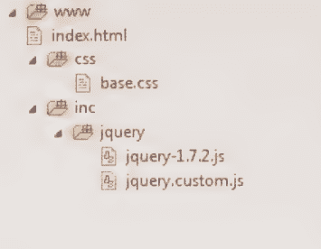

Ⓐ 这是你将用于构建网站的目录结构。

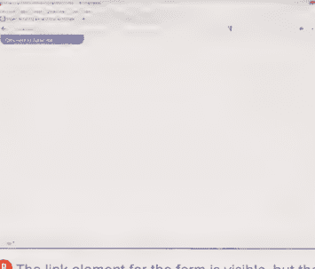

Ⓑ 表单的链接元素可见，但表单隐藏在页面顶部之外。


Ⓒ 点击事件触发动画，显示注册表单。

5.  在文本编辑器中打开 **jquery.custom.js**，并添加以下代码（脚本 `inc/jquery/jquery.custom.js`）：

```javascript
$('#registration a')
.click(function(event){
    event.preventDefault();
    if(false == $('#registration').hasClass('open')) {
        $('#registration').animate({
            'top': '0px'
        }, 500, function(){
            $('#registration').addClass('open');
        });
    } else {
        $('#registration').animate({
            'top': '-40px'
        }, 500, function(){
            $('#registration').removeClass('open');
        });
    }
});
```

6.  将文件保存为 **jquery.custom.js** 到 **inc/jquery/** 目录中，并确保将该目录及其中的文件上传到你的 Web 服务器。

7.  在浏览器中重新加载 **index.html**，并尝试点击链接。第一次点击后，注册表单应向下动画显示（Ⓒ）。

再次点击链接应使注册 `div` 向上移动以隐藏表单。

一切是否如你所预期的那样工作？是否产生了任何错误？如果出现错误，你需要查找错误信息，例如由 Firebug **D** 生成的那些。

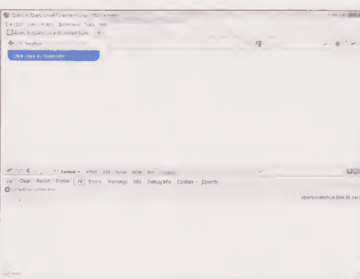

**D** 哎呀！错误显示在 Firebug 中。

当你点击链接时，会生成一个点击事件。在这个例子中，你使用点击事件根据抽屉是否具有 **open** 类来打开或关闭滑动抽屉。链接的默认行为（通常是导航到另一个页面）被绕过，以便可以执行动画。

在这个练习中，你使用了许多 jQuery 方法：**preventDefault()**，是 JavaScript 事件对象的一部分；**hasClass()**，允许你从元素获取 CSS 类信息（参见第3章，“获取和设置 DOM 属性”）；**animate()**，一个用于在 CSS 属性上执行动画的自定义方法（第8章，“创建引人注目的效果”）；**addClass()**，为 jQuery 对象设置任意数量的 CSS 类（第3章）；以及 **removeClass()**，从 jQuery 对象移除类（同样在第3章）。

让我们应用动画概念进行基本页面导航，但使用 jQuery 的 **hover()** 方法。**hover()** 方法实际上是两个函数的组合：一个用于 `mouseenter` 事件的函数，另一个用于 `mouseleave` 事件的函数。

> **提示** 为代码编写文档总是一个好主意。根据需要在代码中添加尽可能多的注释。这将使代码更易于维护和修复，以防出现任何问题。

#### 使用 hover() 方法：

1.  编辑并保存你在第一个练习中创建的 `index.html` 文件，为网站导航添加以下标记（脚本 2.2.html）：

```html
<div id="navigation">
    <a href="content_index.html">Home</a>
    <a href="content_product.html">Products</a>
    <a href="content_services.html">Services</a>
    <a href="content_about.html">About Us</a><br />
    <span id="drawer_title">Site Navigation</span>
</div>
```

2.  在文本编辑器中打开 `jquery.custom.js`，并在 `document ready` 处理器内添加以下代码：

```javascript
$('#navigation').hover(function(){
    $(this).stop().animate({
        'top': '0px'
    });
},function(){
    $(this).stop().animate({
        'top': '-40px'
    });
});
```

3.  将两个文件保存到你的 Web 服务器，并将 `index.html` 加载到你的 Web 浏览器中。将鼠光标移到“站点导航”抽屉上。抽屉应向下移动以显示站点导航链接。

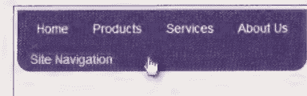

导航抽屉已打开以显示导航元素。

因为动画是由鼠标位置触发的，所以无需像你在点击练习中所做的那样为抽屉添加类。在这个例子中，你确实使用了另一个 jQuery 方法 `stop()`，这是另一个自定义动画方法。你将在第8章了解更多关于 `stop()` 方法的内容。

> hover() 和 toggle() 方法是唯一由两个函数组成的 jQuery 方法。

一些鼠标事件存在细微差别。你在练习中使用的 `hover()` 方法在第一个函数中捕获 `mouseenter` 事件，在第二个函数中捕获 `mouseleave` 事件。如果你想将事件处理器更改为 `mouseover()` 和 `mouseout()` 方法，你最终需要编写两个选择器并将它们绑定到各个事件，但结果将相同。

```javascript
$('#navigation').
    mouseover(function(){
        $(this).stop().animate({
            'top': '0px'
        });
    });
$('#navigation').
    mouseout(function(){
        $(this).stop().animate({
            'top': '-40px'
        });
    });
```

随着你继续构建网站，你将使用一些其他鼠标事件处理器，它们的专门用途将得到更全面的解释。

与 Web 页面交互的第二种最常见方式是使用键盘。

接下来让我们看看键盘的事件处理器。

### 表 2.2 jQuery 键盘事件

| 事件名称 | 处理器用法 |

| :--- | :--- |

| focusin() | 用于确定何时发生 `focusin` 事件；也可用作鼠标事件。 |

| focusout() | 用于确定何时发生 `focusout` 事件；也可用作鼠标事件。 |

| keydown() | 用于捕获 `keydown` 事件。 |

| keypress() | 用于捕获 `keypress` 事件；可能因浏览器而异。 |

| keyup() | 用于捕获 `keyup` 事件。 |

### 捕获键盘事件

你会发现在构建支持 jQuery 的网站时，捕获和使用键盘事件是一项常见任务。这些事件分为两个不同的类别：捕获按键何时被按下或释放，以及确定按下了哪个键。现在让我们专注于 **表 2.2** 中显示的确定按键何时被按下或释放的事件处理器。

#### 使用 keyup() 事件处理器：

1.  在文本编辑器中编辑 **comments.html** 文件，并为评论表单添加以下标记（脚本 **2.3.html**）：

```html
<div id="content">
<p>Send us your comments, we'd love to hear from you!</p>
<p class="textInfo">You have typed <span>0</span> characters.</p>
<form name="contact" action="inc/php/contact.php" method="post">
<input type="text" name="contactName" placeholder="your name"/><br />
<input type="text" name="contactEMail" placeholder="your e-mail address"/><br />
<textarea name="contactComments" placeholder="your comments"> </textarea><br />
```

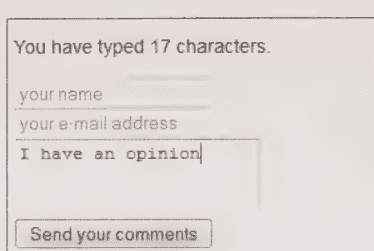

2.  打开 **jquery.custom.js**，添加以下代码以统计表单 **textarea** 中输入的字符数：

```javascript
$('textarea[name="contactComments"]')
.keyup(function(){
  var numCharacters = $(this).val().length;
  $('.textInfo span').html(numCharacters);
});
```

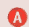

每次按键都会更新字符计数。

3.  保存这两个文件，并将它们上传到网络服务器上的相应目录，然后在网页浏览器中加载 **comments.html** 页面。开始在 **textarea** 中输入内容，你会看到以下标记中的 span 会更新为在 **textarea** 中输入的按键次数：。

```html
<p class="textInfo">You have typed <span>0</span> characters.</p>
```

你已经使用属性选择器（更多内容请参见第 5 章“利用高级选择器”）将 **keyup()** 事件处理程序绑定到了 **textarea**。当 **textarea** 内发生按键松开事件时，会确定字符的长度（或数量）并将其放入变量 **numCharacters** 中。然后该变量用于修改 **textInfo** 类内 span 的 HTML。**html()** 是一个 DOM 插入方法，你将在第 4 章“操作 DOM 元素”中了解更多。

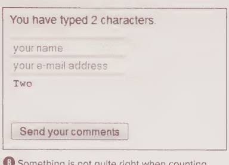

**使用 `keydown()` 事件处理程序进行计数时，有些地方不太对劲。**

在文本框中输入时，知道是 `keyup` 还是 `keydown` 事件发生是否重要？就本练习而言，知道哪个事件发生了——更重要的是，事件何时发生——是使字符计数器正常工作的关键。如果改用 `keydown()` 事件处理程序，你会看到输入第一个字符时计数器没有变化。`keydown` 事件在文本框中的值改变之前就被触发了。计数器直到输入第二个字符（`keydown`）时才会改变，并且会比你预期的少一个，因为第二个 `keydown` 事件在值再次更新之前就已经发生了。

使用 `keyup()` 事件处理程序是统计字符的正确方法，因为文本框在 `keydown` 事件期间被更新，而计数函数在 `keyup` 事件发生时被触发。

> **提示** JavaScript 的 `keypress` 事件是特定于浏览器的，在某些情况下甚至特定于某些浏览器版本。jQuery 在幕后对这类事件进行标准化，使事件处理程序可以跨浏览器工作。在大多数情况下，你只需要使用 `keyup()` 或 `keydown()` 事件处理程序。

> **提示** 了解事件何时被触发非常重要。在选择事件处理程序时，应始终考虑这一点。

让我们使用键盘事件处理程序和计数函数来实现另一个目的——确保表单字段没有留空。

### 使用 focusout() 方法

1.  修改 **comments.html** 文件中的表单，在联系人姓名和联系人电子邮件字段末尾添加一个空的 span 元素（脚本 **2.4.html**）：

```html
<input type="text"
name="contactName"
placeholder="your name"/>
<span></span><br />
<input type="text"
name="contactEmail"
placeholder= "your e-mail address"/>
<span></span><br />
```

2.  在你的自定义 jQuery 文件中添加以下代码块：

```javascript
$('input[name="contactName"]')
.focusout(function(){
  if(0 == $(this).val().length) {
    $(this).next('span')
    .html('&nbsp;please do not leave name blank')
    .css({'color': '#FF0000'});
  } else {
    $(this).next('span').html('');
  }
});
```

3.  将两个文件上传到网络服务器，并在网页浏览器中重新加载 **comments.html** 文件。将光标放入姓名字段，然后按 Tab 键切换到下一个字段，而不输入任何文本。错误消息将会出现。

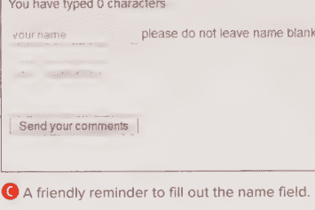

> 友情提示，请填写姓名字段。

在本练习中，你将 **focusout()** 事件处理程序附加到表单的联系人姓名字段。当该字段获得焦点（当您将光标放入其中时），然后基于键盘事件（在本例中为 Tab 键）或鼠标事件（单击页面上的其他内容）失去焦点时，**focusout()** 事件处理程序会触发一系列方法，以在你在步骤 1 中添加到标记中的 span 标签内创建并显示或移除错误消息。

在此过程中，你使用了 **next()** 函数（这是一个树遍历方法）和 **html()** 函数（这是一个 DOM 操作方法）。

> **提示** `focusin` 和 `focusout` 事件不限于表单元素。许多浏览器能够在网页上的每个元素上注册这两个事件。

> **提示** 确保字段不为空是一种非常基本的表单验证方法。使用 jQuery，你只能在客户端验证表单。即使在进行客户端验证时，你也应该始终进行服务器端验证。务必如此。同时执行客户端和服务器端验证是确保没有人试图用诸如 **SQL** 注入或跨站攻击之类的东西破坏你的服务器的保险措施。

你正在成为事件处理专家！但我们还没有涵盖一类事件处理程序：特定于表单的事件。接下来就讲！

### 锻造表单事件

在 jQuery 早期的开发中，人们注意到表单元素在网页中是有些独特的。与静态文本或图像不同，表单是网站访问者实际以超出基本方式进行交互的东西。填写、选择、勾选和选择提供了允许用户向网站所有者发送某些内容或从网站数据库获取更多信息的交互。

由于表单提供的交互是独特的，jQuery 库提供了五个强大的事件处理程序专门设计用于表单（参见 **表 2.3**）。在接下来的练习中，你将修改之前创建的表单，并附加各种事件处理程序以增强与表单元素的交互。让我们从 **blur()** 事件处理程序开始，以触发电子邮件地址的验证。

**表 2.3** jQuery 表单事件处理程序

| 处理程序名称 | 处理程序用途 |

| :--- | :--- |

| blur() | 使用此事件处理程序在输入失去焦点时触发函数。 |

| change() | 当输入中重新输入文本或从下拉列表中选择新内容时触发更改事件时使用此事件处理程序。 |

| focus() | 使用此事件处理程序在元素获得焦点时触发函数。 |

| select() | 执行选择事件（如选择文本）时使用此事件处理程序。 |

| submit() | 使用此事件处理程序在表单提交时触发函数。 |

#### 使用 blur() 事件处理程序

1.  打开 **jquery.custom.js** 文件，并将以下代码放在文档就绪处理程序内：

```javascript
$('input[name="contactEMail"]')
.blur(function() {
  var regexEmail = /^[a-zA-Z9._-]+@[a-zA-Z0-9.-]+\.[a-zA-Z]{2,4}$/;
  var inputEmail = $(this).val();
  var resultEmail = regexEmail.test(inputEmail);
  if(!resultEmail){
    $(this).next('span').html('&nbsp please enter a valid e-mail address').css({
      'color': '#FF0000'
    });
  } else {
    $(this).next('span').html('');
  }
});
```

无需对 **comments.html**（脚本 2.4.html）进行任何更改，因为你在之前的练习中已经将 span 标签添加到了表单中。

2.  保存 jQuery 文件并将其上传到服务器上的适当位置。

3.  在浏览器中重新加载 **comments.html** 文件，并将光标放入电子邮件输入框内。然后按 Tab 键或单击离开输入框。错误消息应该会出现，因为该字段为空。

4.  返回该字段并输入一个非标准的电子邮件地址，例如 **jquery@**。按 Tab 键或单击离开输入框，错误消息应仍然存在。

5.  在该字段中输入一个有效的电子邮件地址，然后按 Tab 键或单击离开。错误消息应该会消失。

此函数中有一些你从未见过的内容，最值得注意的是包含在 **regexEmail** 变量中的表达式和 JavaScript **test()** 方法。

包含在 **regexEmail** 中的表达式被称为*正则表达式*。本质上，正则表达式是一种你可以用来测试文本字符串格式的模式。学习和使用正则表达式为你提供了一个测试像电子邮件地址这样的复杂字符串信息的工具。

continues on next page

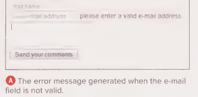

当 `blur` 事件发生时，表单字段的值被放入一个变量（**inputEmail**）。

JavaScript 的 **test()** 方法可以这样理解：获取正则表达式，并在输入字段的值上进行测试。如果存在匹配，函数返回 "true"。如果没有匹��，函数返回 "false"。在练习中，你将 **resultEmail** 的值设置为该函数的返回值。

```javascript
var resultEmail = regexEmail.
    test(inputEmail);
```

一旦变量的值被设置，你可以在 **if** 条件语句中对其进行测试：

```javascript
if(!resultEmail) {...}
```

大声读出这个条件，你会说："if not true **resultEmail**"。当然，这样大声读让你听起来像科幻电影里的智慧长者，但这是有道理的。变量前的感叹号是 "非" 条件。移除感叹号则测试 "true" 条件。

> 提示 **blur()** 方法与 **focusout()** 事件处理器略有不同，因为 **focusout()** 可以检测到父元素何时失去焦点。

> 提示 无论你在客户端执行了多少验证，都应该始终执行服务器端验证。

**blur()** 事件处理器也被 **change()** 事件处理器使用，当输入或文本区域中的信息被更改时。但 **change()** 事件处理器有一个额外的优点：它还可以检查当用户在选择列表中通过鼠标选择导致更改时。准备好看看它的实际应用了吗？

#### 关于正则表达式的更多信息

正则表达式是可以被正则表达式引擎（如 JavaScript 提供的引擎）解析的模式。这些模式可用于测试字符串，以确保字符串和正则表达式模式之间存在匹配。

对正则表达式的完整讨论超出了本书的范围，但你可以通过访问以下网站来了解更多关于正则表达式的知识，甚至测试这些表达式：

**www.regular-expressions.info/** 是一个关于该主题的综合性网站，有许多清晰的示例。

**http://regexlib.com/** 是一个可搜索的、包含一些最常用正则表达式的库。

**www.vagibone.com/regular-expressions/** 是一个正则表达式快速参考指南。

**http://regexpai.com/** 是一个在线正则表达式测试器。

使用 jQuery 并不需要你是正则表达式的专家，但当需要匹配复杂的信息字符串时，使用它们可以使你的代码功能更强大。

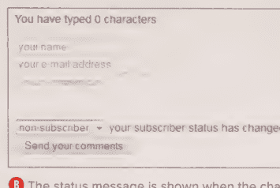

#### 使用 change() 事件处理器：

1. 修改 **comments.html**，在文本区域下方添加一个下拉列表：

```html
<select name="subscriberStatus">
  <option></option>
  <option value="non-subscriber">non-subscriber</option>
  <option value="subscriber">subscriber</option>
</select><span></span><br />
```

2. 将以下代码块添加到 **jquery.custom.js** 文件中，以将 `change` 事件处理器附加到下拉列表的选择器：

```javascript
$('select [name="subscriberStatus"]')
  .change(function(){
    $(this).next('span')
      .html('&nbsp;your subscriber status has changed');
  });
```

3. 保存 **comments.html** 并将其放置在你的 Web 服务器上。从下拉菜单中选择一个状态，更改事件将被事件处理器捕获以显示消息 B。

如这里所用，**change()** 事件处理器为你提供了一种确定下拉列表何时被更改的方法。但当用户在文本框或输入字段中进行更改时，你也可以捕获该事件。


在你继续构建网站时，你将使用其他事件处理器。

> 提示 `change()` 事件处理器也可用于允许多选的下拉框。

## 回顾与复习

本章介绍了许多新概念。花点时间反思一下你学到了什么。

- 四种基本事件处理器类型是什么？
- 哪种事件处理器用于确定 DOM 何时加载完成？
- 你能用事件处理器触发的函数数量有限制吗？
- `hover()` 方法中有多少个函数？
- 为什么事件发生的顺序很重要？
- 在执行客户端验证时，你应该进行服务器端验证吗？
- `focusout()` 和 `blur()` 事件处理器之间有什么区别？
- 什么是正则表达式？
- document ready 处理器的简写方法是什么？

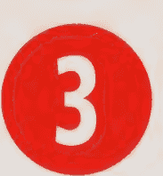

## 获取和设置 DOM 属性

想象一下，能够访问你网页中每个元素的所有属性和特性。现在想象你完全控制这些属性和特性。拥有这种访问和控制级别会让你的 Web 开发工作更轻松吗？

jQuery 库让你能够按照期望访问和控制每个元素的属性和特性。这些强大的函数统称为 DOM（文档对象模型）通用属性方法，它们允许你获取或设置属性和特性、添加和删除类，甚至直接在元素或元素组上设置层叠样式表（CSS）属性，如第 1 章“使用选择器”中所见。

在本章中，你将学习标记中属性和特性的区别，以及如何使用 jQuery 的函数（参见下一页的 **表 3.1**）来获取和设置它们。你还将深入了解不同浏览器处理属性和特性的某些方式。好戏开始！

### 本章内容

- 更改属性：37
- 管理值：43
- 使用和更新特性：45
- 处理 CSS 类：50
- 回顾与复习：54

| 函数名称 | 用于... |
| --- | --- |
| `attr()` | 获取匹配元素集中第一个元素的属性值。 |
| `removeAttr()` | 从匹配元素集中的每个元素移除一个属性。 |
| `prop()` | 添加或设置一个特性或获取特性的值。 |
| `removeProp()` | 从匹配元素集中移除一个特性。 |
| `val()` | 与表单元素一起使用，获取或设置匹配元素集中第一个元素的当前值。 |
| `addClass()` | 将指定的类或类添加到匹配元素集中的每个元素。 |
| `hasClass()` | 测试匹配的元素中是否有任何元素被分配了给定的类。 |
| `removeClass()` | 从匹配元素集中的每个元素移除一个或多个类。 |
| `toggleClass()` | 根据元素是否存在该类，从匹配元素集中的每个元素添加或移除一个或多个类。 |

### 理解 DOM

文档对象模型（DOM）是一种应用程序编程接口（API），它允许像 JavaScript 这样的语言访问网页的内部工作原理。这使你，Web 开发者，能够以一种方式修改网页文档的内容、样式甚至结构。

当从服务器请求一个网页时，构成文档的片段被发送到浏览器。当这些片段到达浏览器时，它们会根据浏览器创建者对文档模型的解释（对于本书来说，这是一个过于冗长且激烈的讨论）进行组装和解析。然后浏览器渲染文档。

你需要理解的关键点之一是，所有的标记（DOM）首先被加载，然后才是其他媒体，如图形、图片、视频和音频。DOM 可能远在页面完成加载和在浏览器中渲染之前就准备就绪了。

同样重要的是你要理解，不同的浏览器解析和渲染 DOM 的方式不同——有时甚至差异巨大。在将你的创作发布给公众之前，请务必在各种浏览器中测试你的网站。

### 更改属性

在我们深入探讨获取和更改 HTML 元素的属性之前，理解属性和特性的区别很重要。

在正常情况下，特性是 HTML 元素的一部分，可以用布尔值或某些元素在 DOM 加载时的原始状态来设置。

但属性可能有多个值之一，例如表单元素上的 `name` 属性，或任何元素上的 ID 和类。HTML5 的出现为你提供了自定义的 `data-*` 元素，这些是你命名的属性，可以用作你可能在 CSS 或 jQuery 中使用的各种信息的存储。

理解特性的最佳方式是将它们想象成电灯开关。它们仅限于几种状态（通常是布尔值，如 true 或 false）。另一方面，属性用于存储数据，其内容可以非常灵活。

有一种特殊情况你会在属性上使用 property 方法。让我们先看看如何处理这种特殊情况。

#### 使用 `prop()` 更改输入类型：

1. 在你的文本编辑器中打开 **comments.html**，并在表单的电子邮件输入元素之后添加以下标记（脚本 3.1.html）：

```html
<input type="text"
name="contactPassword"
placeholder="password" />
<span></span><br />
<a href="" class="small_text"
id="showPassword">Hide Password
</a><br />
```

2. 编辑 **jquery.custom.js**，包含以下代码：

```javascript
$('#showPassword')
.click(function(e) {
e.preventDefault();
var propertyType = $("input[name=
contactPassword]")
.prop('type');
if('text' == propertyType) {
$("input[name='contactPassword']")
.prop('type', 'password');
$(this).html('Show Password');
} else {
$("input[name='contactPassword']")
.prop('type', 'text');
$(this).html('Hide Password');
}
});
```

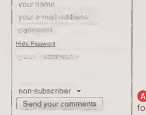

**A** 新的密码表单字段。

3. 保存这两个文件并上传到你的 Web 服务器。将页面加载到浏览器中，你应该能看到表单中新增的部分 **A**。

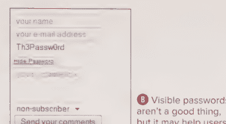

4. 在表单中输入密码，密码应该是可见的 🅱️。

5. 点击 "Hide Password" 链接，输入的类型将更改为 **password**，隐藏密码 🅲。

6. 点击 "Show Password" 链接将向用户显示密码 🅳。

> 🅱️ 可见的密码不是一件好事，但它可能在用户创建长密码时有所帮助。

**提示** **jQuery 禁止使用 `attr()` 方法更改 `<input>` 或 `<button>` 元素的 `type` 属性。** 尝试更改这些元素中的 `type` 会在所有浏览器中抛出错误。这是因为 Internet Explorer 的旧版本（8 之前）不允许进行更改。但是，通过使用 jQuery 的 **`prop()`** 方法（自 jQuery 1.6 版本可用），你可以更改该属性 🅳。

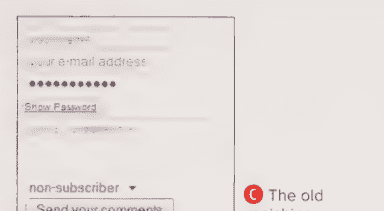

**提示** **事实上，你可以使用 `prop()` 方法更改某些属性，使用 `attr()` 方法更改某些属性，但我鼓励你将这些方法用于其预期目的。** 这将减少混淆，使你的代码更易于阅读，并避免不同浏览器之间的不一致行为。

> 🅲 旧的密码消失技巧起作用了！

**提示** **自定义 HTML5 数据属性必须以 `data-` 开头，但你可以在连字符之后以任何你喜欢的方式描述或命名数据——例如 `data-author="Jay"` 或 `data-dessert="pie"`。**

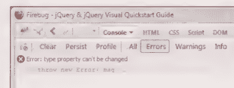

> 🅳 当你尝试使用 `attr()` 更改 `type` 属性时，Firebug 中生成的错误消息。

在此示例中，你以两种方式使用了 **`prop()`** 方法。通过使用第一种方式，你能够获取 `type` 属性的值。第二种方式允许你设置属性的值。通常，你会使用 **`prop()`** 方法来设置布尔值，例如 `true` 或 `false`。

让我们看看使用 **`prop()`** 方法更常规的方式。

#### 使用 `prop()` 启用或禁用表单元素：

1. 编辑 **comments.html**（脚本 3.2.html）中的密码字段，更改占位符和输入的状态：

```html
<input type="text"
       name="contactPassword"
       placeholder="password not required" DISABLED/>
<span></span><br />
```

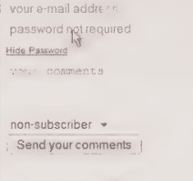

密码字段不可访问。

2. 将以下代码添加到 **jquery.custom.js**，以启用或禁用密码字段并更改 **placeholder** 属性：

```javascript
$('select[name="subscriberStatus"]')
    .change(function() {
        var selectValue = $(this).val();
        if('subscriber' == selectValue) {
            $('input[name="contactPassword"]')
                .prop('disabled', false);
            $('input[name="contactPassword"]')
                .attr('placeholder', 'password required');
        } else {
            $('input[name="contactPassword"]')
                .prop('disabled', true);
            $('input[name="contactPassword"]')
                .attr('placeholder', 'password not required');
        }
    });
```

3. 将文件保存到你的 Web 服务器，并将 **comments.html** 加载到浏览器中，以测试该函数。

尝试点击密码字段。你会发现你无法点击，因为该字段是禁用的。

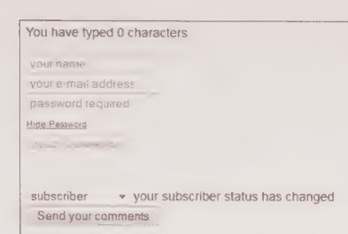

4. 从下拉列表中选择 "subscriber"。该字段现已启用，占位符文本已设置为 "password required" 🇫

在这个练习中，你使用了 **`prop()`** 方法来完成其最擅长的工作：处理元素的布尔值。你还初步体验了使用 **`attr()`** 函数来更改占位符的值。随着你继续构建网站，你会再次使用 **`prop()`**，但首先让我们介绍另一个属性函数：**`removeProp()`**。

> 🇫 密码字段现已启用，占位符已更改。

#### 使用 `removeProp()`：

1. 将以下代码行添加到 **jquery.custom.js**。此代码为密码字段添加一个自定义属性（**comments.html** 无需更改）：

```javascript
$('input[name="contactPassword"]')
    .prop('defaultStatus', 'non-subscriber');
```

2. 在 **jquery.custom.js** 中插入以下代码片段，以便在发生适当更改时移除自定义属性：

```javascript
$('select[name="subscriberStatus"]')
    .change(function() {
        var statusValue = $(this).val();
        if('subscriber' == statusValue) {
            $('input[name="contactPassword"]')
                .removeProp('defaultStatus');
        }
    });
```

3. 将 jQuery 文件放在你的 Web 服务器上，并重新加载 **comments.html**。查看 DOM 检查器（如 Firebug），你可以检查自定义属性 🅰。

4. 从下拉列表中选择 "subscriber"。刷新 DOM 检查器将让你看到该属性已从 DOM 中移除 🅱。

为什么要设置自定义属性？在此练习中，你可能希望将属性的状态保存到数据库中，以确定有多少人从未选择使用密码，或者跟踪有多少用户更改了下拉列表。

> **提示** 切勿使用 `removeProp()` 来移除原生属性，如 `checked`、`disabled` 或 `selected`，因为这些属性将从当前文档中永久移除，直到重新加载或刷新为止。一旦移除，就无法将这些属性重新添加回页面中。

还有一个专门针对表单的通用属性函数：**`val()`** 方法。让我们看看使用 **`val()`** 方法获取和设置值的方法。

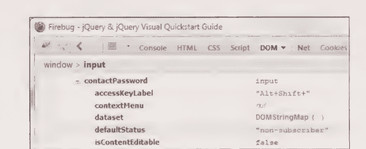

🅰 自定义属性 **`defaultStatus`** 及其值已添加到 DOM 中。

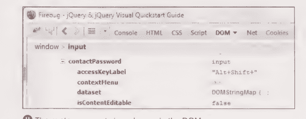

🅱 自定义属性已不在 DOM 中。

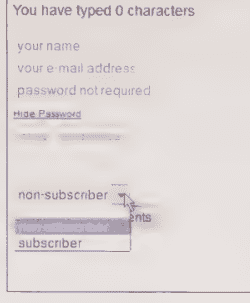

选择了非订阅者值。

### 管理值

`val()` 方法专门设计用于处理所有表单元素，如输入框、复选框、选择列表和文本区域。你在第 2 章 "处理事件" 中让它为你工作，以获取表单元素的值并检查这些值，以确保它们具有适当的长度或包含适当的信息。使用 `val()` 从表单元素获取值是该函数最常见的用途。

你也可以使用 `val()` 函数为表单元素设置值。如果你想设置默认值或根据其他某些事件的触发来更改值，此技术非常方便。

**使用 `val()` 设置输入的值：**

1. 将以下代码行添加到你的 jQuery 文件。你不必修改 `comments.html`：

```javascript
$('select[name="subscriberStatus"]').val('non-subscriber');
```

2. 将 jQuery 文件放在你的 Web 服务器上，并将 `comments.html` 加载到浏览器中。选择列表现在应该选择了 `non-subscriber` 项 **A**。

```javascript
$('select
    [name="subscriberStatus"]')
    .val('non-subscriber');
```

**使用 `val()` 获取输入框的值：**

1. 将以下函数添加到 `jquery.custom.js` 文件中，以测试强密码（无需对 `comments.html` 进行编辑）：

```javascript
$(document).ready(function() {
    var regexPassword = /^(?=^.{8,}$)((?=.*\d)|(?=.*\W+))(?![.\n])(?=.*[A-Z])(?=.*[a-z]).*$/;
    var thisPassword = $(this).val();
    var resultPassword = regexPassword.test(thisPassword);
    if (!resultPassword) {
        $(this).next('span').html('&nbsp;密码必须至少包含1个大写字母、1个小写字母、1个数字和1个特殊字符，且长度至少为8个字符').css({'color': '#FF0000'});
    } else {
        $(this).next('span').html('');
    }
});
```

2. 保存 jQuery 文件并将其放置在你的 Web 服务器上。在浏览器中加载 comments.html。

3. 从下拉列表中选择“订阅者”以启用密码字段。输入一个密码，然后按 Tab 键或点击字段外。如果密码不符合要求，将会显示一条错误信息。

当密码字段的 blur 事件处理程序被调用时，该函数会获取密码字段的值并将其赋给变量 thisPassword。然后，包含密码值的变量会与正则表达式进行测试，以确定密码是否包含构成强密码的所有必要部分。

处理表单很有趣，但让我们将注意力转向更具视觉化的内容。在接下来的几个练习中，你将构建并增强一个照片库。

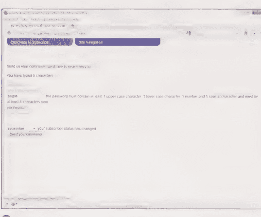

哎呀！一个错误的密码显示了一条非常长的错误信息。

### 使用和更新属性

在前几章的许多练习中，你已经看到属性有多么方便，因为你选择的许多元素都使用了属性选择器（你将在第 5 章“掌握高级选择器”中学习更多关于属性选择器的知识），例如这个：
`$('element[name="element_name"]')`
能够识别和设置属性使得开发人员可以轻松地将 jQuery 交互添加到标记（markup）早已确定的现有网站中。在现有站点上，你可能不必编辑现有的标记就能添加 jQuery。

作为开始，你将从库中的图像标签获取 **alt** 属性，并将它们显示为图像标题。

#### 使用 `attr()` 方法获取属性信息：

1. 在你的 IDE 中打开一个新的 **html5_boilerplate.html** 文件副本，并添加以下标记以创建图像列表：

```html
<ul class="imageGallery">
  <li></li>
  <li></li>
  <li></li>
  <li></li>
  <li></li>
  <li></li>
</ul>
```

2. 将文件保存为 **gallery.html**（脚本 3.3.html）。将文件上传到你的 Web 服务器；你应该会看到普通图库 A。

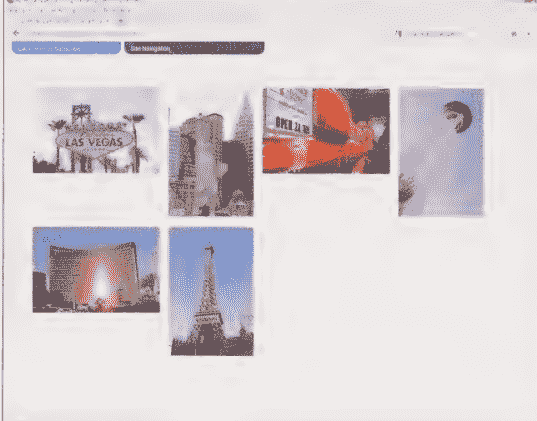

> A 照片库的起始点。

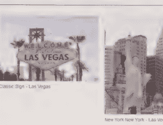

**B** **alt** 属性值已用于设置图片的标题。

3. 将以下代码添加到 **jquery.custom.js** 文件中，以获取 **alt** 属性的值：

```javascript
$('.imageGallery li img')
.each(function() {
  var thisAltTag =
  $(this).attr('alt');
  $(this).parent().append('<br />
    <span class="imageTitle">' +
    thisAltTag + '</span>');
});
```

一旦你从每张图片获取了 **alt** 属性信息（使用 **each()**，这是一个在第 9 章“启用 jQuery 工具”中介绍的 jQuery 工具函数），你就可以将其附加到列表项中。（关于 **append()** 的更多内容请参阅第 4 章“操作 DOM 元素”。）你还使用了 **parent()** 方法，该方法允许你遍历 DOM 树。你将在第 6 章“遍历 DOM 树”中了解更多关于 **parent()** 的知识。

4. 保存 **jquery.custom.js**，将其上传到你的 Web 服务器，并在浏览器中重新加载 **gallery.html**。你应该会在图片下方看到标题 **B**。

添加和设置属性同样容易，两种操作的语法完全相同。你将在同一个练习中同时进行这两种操作，只需修改上一个练习中的函数即可。

#### 使用 `attr()` 设置和添加属性：

1. 对上一个练习中创建的 jQuery 函数进行以下修改（突出显示部分）：

```javascript
$('.imageGallery li img')
.each(function() {
  var thisAltTag =
  $(this).attr('alt');
  $(this).attr({
    'alt': thisAltTag +
    '<br />by Jay Blanchard ',
    'data-camera': 'Canon 7D'
  });
  var newAltTag =
  $(this).attr('alt');
  var cameraTag =
  $(this).attr('data-camera');
  $(this).parent()
  .append('<br /><span class="imageTitle">' + newAltTag + '</span>');
  $(this).parent()
  .append('<br /><span class="imageCamera">' + cameraTag + '</span>');
});
```

2. 将 jQuery 文件上传到 Web 服务器，并在浏览器中重新加载 **gallery.html**。如果一切顺利，你将看到更新的 **alt** 属性以及新添加的 **data-camera** 属性 (C)。

3. 在你的 DOM 检查工具中查看 HTML，你应该会看到修改后的标记 (D)。

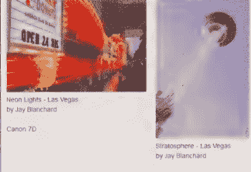

(C) 修改后的 **alt** 属性文本和新的 **data-camera** 属性文本可见。

```html
HTML DOM 检查器显示修改后的标记，其中包含带有新 alt 文本（包括 '<br />by Jay Blanchard'）的 `` 标签、`data-camera="Canon 7D"` 属性，以及为标题和相机附加的 `<span>` 元素。
```

(D) 标记已在 DOM 中被修改。

#### JavaScript 对象字面量

简而言之，JavaScript 对象字面量是一个包裹在一对花括号中的名称-值对列表。每个名称-值对由逗号分隔，每一对描述了对象的一个属性。

下面是一个如何使用特定属性声明对象的示例：

```javascript
var person = {
    'name': 'Jay',
    'location': 'Texas',
    'occupation': 'developer'
};
```

最后一个属性后面不应有逗号。然后可以使用语法 **person.name**（返回 Jay）或 **person.occupation**（返回 developer）来访问 person 的每个属性。

在 JavaScript 和 jQuery 中，JavaScript 对象字面量是存储属性以供函数使用的便捷方式。随着你学习 jQuery，你会看到它们被广泛使用。

你可以像本练习中那样，在一次 **`attr()`** 方法调用中更改或设置任意数量的属性。通过将每个属性名和值包含在一个用花括号括起来的映射中（参见侧边栏“JavaScript 对象字面量”），就可以根据手头工作的需要设置或添加任意数量的属性。

```javascript
{'name': 'value', 'name': 'value', ...}
```

> **提示** 除了 class 属性（需要引号）外，属性名的引号是可选的。

> **提示** 当你查看浏览器页面的源代码时，你看到的是从服务器请求后处于原始状态的标记。源代码永远不会改变；你必须使用 DOM 检查器才能看到你使用 jQuery 进行的更新。

此时，你应该对获取和修改值、属性和特性已经相当熟悉了。处理值、属性和特性的方法很简单，并具有用于有效获取、添加和设置每个属性的简洁语法。

### 处理 CSS 类

我们在前几章简要介绍了使用 **`css()`** 方法创建样式——但如果你有一个更复杂的类，希望将其封装在你的 CSS 文件中呢？jQuery 库提供了四种处理任何元素的 class 属性的方法。它们是 **`addClass()`**、**`removeClass()`**、**`hasClass()`** 和 **`toggleClass()`**（见表 3.1）。

让我们从使用 **`addClass()`** 开始，探索如何使用这些方法。

#### 使用 `addClass()` 方法：

1. 将以下代码添加到你的 **jquery.custom.js** 文件中。每行代码向照片库中的特定元素添加一个或多个类（这些类已在 **css/base.css** 文件中定义）：

```javascript
$('.imageGallery li img')
.addClass('imageBoxShadow');
$('.imageCamera')
.addClass('blueBoxShadow small_text');
```

2. 保存 jQuery 文件并将其放置在 Web 服务器上。在 Web 浏览器中加载 **gallery.html**（无需修改）。结果是图像和相机信息被应用了复杂的类 Ⓐ。

你会注意到这两行 jQuery 代码的两个特点。第一是使用了一个复杂选择器来捕获第一组元素（列表中的图像），第二是向第二组元素（由类 **imageCamera** 标识的项目）添加了两个类。

第一行中的选择器允许你针对特定的一组元素（特定列表中的图像）添加类

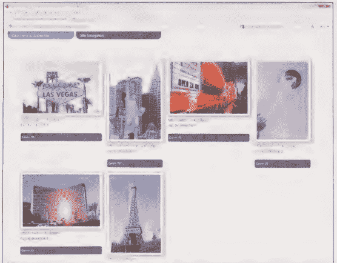

带样式的图片！

无需你修改标记。jQuery 库从右向左读取这样的选择器："选择作为容器中具有 imageGallery 类的列表项子元素的所有图像。"

#### 使用 `removeClass()` 方法：

第二行中的 `addClass()` 方法向你展示了如何向选中的元素添加多个类。你可以向一个或一组元素添加任意数量的类。

1. 向 jQuery 文件添加一个悬停事件处理器，以从相机信息中移除 `small_text` 类：

```javascript
$('.imageCamera')
.hover(function() {
    $(this)
        .removeClass('small_text');
}, function() {
    $(this).addClass('small_text');
});
```

2. 将保存的 jQuery 文件上传到 Web 服务器，并在浏览器中重新加载 gallery.html。将鼠标光标悬停在相机信息 div 上，你会看到文本变大。(B)

> 提示 CSS 样式是浏览器之间差异最大的地方。务必在多个浏览器中检查你的类，以确保它们按照你的预期应用。

> 提示 不要使用 jQuery 为网页添加所有样式。这样做效率低下且难以管理。

> 提示 由于 jQuery 从右向左读取选择器，因此在使用冗长的选择器时要小心。jQuery 团队持续改进此类选择器的效率。

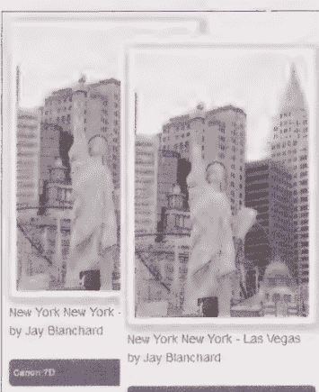

下页继续

(B) `small_text` 类被移除，文本恢复其正常大小，使信息更易于阅读。

有时，你需要知道某个元素是否应用了特定的类。例如，一个大型网站可能有一个类应用于 body 元素，开发人员将根据该类的存在来确定当 body 元素具有该类时，允许（如果有）哪些操作。`hasClass()` 方法非常适合用于测试元素是否存在该类。如果类存在，该函数将返回 true，否则返回 false。

#### 使用 `hasClass()` 方法：

1. 添加以下测试条件来检查无序列表是否具有 `imageGallery` 类：
2. 保存 `jquery.custom.js` 文件并将其上传到 Web 服务器上的适当位置。
3. 你只是在记录测试结果，因此请检查 Web 开发工具中的控制台日志工具，看看消息是否存在 ⓒ。

```javascript
if(true == $("ul")
    .hasClass("imageGallery")) {
        console.log("ul has the imageGallery class");
} else {
    console.log("ul does not have the imageGallery class");
}
```

虽然这个练习只是使用 `hasClass()` 方法进行测试的一个小例子，但毫无疑问，随着你 jQuery 技能的提升，你会找到更好的方法来使用该函数。

轻松切换类的开关对 jQuery 的 `toggleClass()` 方法来说是小菜一碟。让我们看看应用 `toggleClass()` 方法的一种方式。

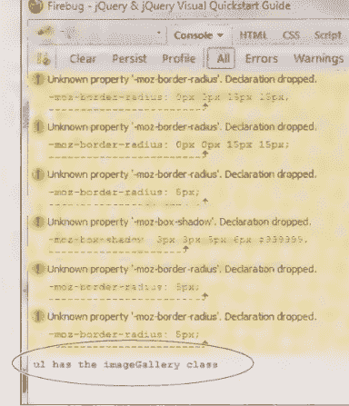

> **imageGallery** 类位于无序列表上，如 Firebug 控制台日志所示。

#### 使用 `toggleClass()` 方法：

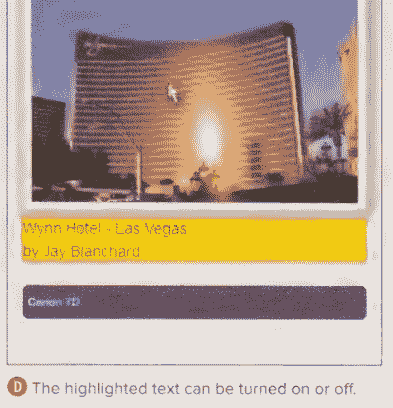

1. 修改 `jquery.custom.js` 以添加以下函数，该函数将在点击图片标题时触发高亮显示的开或关：

```javascript
$('.imageGallery li img')
.click(function() {
    $(this)
        .parent()
        .find('.imageTitle')
        .toggleClass('textHighlight');
});
```

2. 将 jQuery 文件保存到你的 Web 服务器，并在 Web 浏览器中重新加载 `gallery.html`。

3. 在浏览器中点击一张或多张图片，图片的标题文本将应用或移除 **highlight** 类 🔴。

在这个练习中，你使用了两种 DOM 遍历方法：**`parent()`** 和 **`find()`**。你将在第 6 章中了解更多关于它们的内容。任何类方法都可以用于处理多个类，这是一个非常实用的功能，可以装入你的开发工具箱。CSS 属性函数允许你在 CSS 文件中构建复杂的类，然后你可以在 jQuery 代码中使用它们，同时保持代码组织的整洁。

jQuery 属性操作器为你提供了前所未有的能力来控制与标记元素相关的值、属性和特性。花点时间回顾一下你到目前为止学到的内容，然后准备好迎接更多 DOM 操作的精彩内容！

D 高亮文本可以被开启或关闭。

## 回顾与复习

花点时间反思一下你在本章中学到的内容：

- 属性和特性之间有什么区别？
- 为什么 input 的 "type" 被认为是一个特性？
- 当你声明一个自定义属性（HTML5）时，属性的名称必须以什么开头？
- 你能说出 HTML 元素的所有布尔属性吗？
- 什么是 JavaScript 对象字面量？
- jQuery 以哪个方向读取选择器？
- 你永远不应从 DOM 中移除哪些属性？
- 为什么像 Firebug 这样的 DOM 检查工具很重要？
- 在 `toggleClass()` 示例中，`hasClass()` 方法如何派上用场？

# 4 操作 DOM 元素

根据用户交互向网页添加、更改和删除元素，是使用 jQuery 可以做到的最酷的事情之一。这个库功能强大，包含许多可以应用于网页以实现戏剧性效果的函数。

在本章之前的许多练习中，你已经使用了 `css()` 方法来即时创建样式。在本章中，你将使用 CSS 的高度、宽度和定位属性更进一步。当表单元素填写不正确时，你也使用了 `html()` 方法来添加错误消息。在运用一些自定义 HTML 属性时，你将进一步探索 `html()` 的使用。

DOM 操作器的功能不止于此。你将学习如何复制、添加、更改和删除 DOM 元素，以增强网站访客的体验。让我们开始吧！

### 本章内容

- 插入元素 56
- 创建灯箱效果 57
- 更多 DOM 操作器的乐趣 67
- 获取和设置测量值 69
- 克隆 72
- 更改输入元素 76
- 回顾与复习 80

### 插入元素

你会发现有时需要向网页中添加和删除元素。jQuery 库提供了许多执行这些操作的方法，使你在创建特定交互时具有很大的灵活性（参见表 4.1）。

特别值得注意的是那些执行相同功能但使用不同语法的方法。例如 **`before()`** 和 **`insertBefore()`**。两者都允许你以相同的方式将内容放入页面，只是语法相反：

```javascript
$('element')
    .before('<p>before element</p>');
$('p')
    .insertBefore('element');
```

无论哪种情况，包含 "before element" 的段落都将插入到 "element" 之前——你的选择是风格问题。许多人说使用 **`insertBefore()`** 更容易阅读，因为它从左到右阅读且更容易理解。另一方面，许多人喜欢第一个示例的语法，即使这是另一个 jQuery 听起来有点像尤达大师的例子。执行相同任务的方法在其描述中会指出。

#### 表 4.1 DOM 插入操作器

| 方法 | 用途... |
| :--- | :--- |
| `after()` | 在每个选中的元素之后插入内容。 |
| `insertAfter()` | 执行与 `after()` 相同的操作；需要不同的语法。 |
| `append()` | 在每个选中元素的末尾插入内容。 |
| `appendTo()` | 执行与 `append()` 相同的任务，但语法相反。 |
| `prepend()` | 在每个选中元素的开头插入内容。 |
| `prependTo()` | 执行与 `prepend()` 相同的任务，但语法相反。 |
| `before()` | 在每个选中的元素之前插入内容。 |
| `insertBefore()` | 执行与 `before()` 相同的操作，但语法相反。 |
| `clone()` | 创建选中元素集的深拷贝（复制所有后代）。 |
| `detach()` | 从 DOM 中移除匹配的元素集，并保留数据以备重新插入。 |
| `empty()` | 从 DOM 中移除选中元素集的所有子节点。 |
| `remove()` | 从 DOM 中移除选中的元素集。 |
| `removeAttr()` | 从每个选中的元素中移除一个属性。 |
| `replaceAll()` | 用选中的元素集替换每个目标元素。 |
| `replaceWith()` | 用新内容替换选中元素集中的每个元素。 |
| `wrap()` | 在选中元素集中的每个元素周围包裹一个 HTML 结构。 |
| `unwrap()` | 从 DOM 中移除选中元素集的父元素。 |
| `wrapAll()` | 在选中元素集中的所有元素周围包裹一个 HTML 结构。 |
| `wrapInner()` | 在选中元素集中每个元素的内容周围包裹一个 HTML 结构。 |

#### 创建灯箱效果

在接下来的几个练习中，你将使用多种 DOM 操作方法来创建一个灯箱效果。许多网站使用灯箱效果来突出显示网页上居中放大的照片。一旦你学会了如何将这些功能组合起来，你也能在自己的网页上使用这种效果。

练习中你将使用的一些操作方法专门用于获取或修改 CSS 相关信息。这些方法在 **表 4.2** 中有详细描述。

首先要做的是用半透明背景覆盖当前页面，照片将显示在这个背景上。

##### 表 4.2 DOM CSS 操作方法

| 方法 | 用途 |
|---|---|
| `css()` | 获取或设置选中元素集中第一个元素的样式属性值。 |
| `height()` | 获取选中元素集中第一个元素的当前计算高度。 |
| `innerHeight()` | 获取选中元素集中第一个元素的当前计算高度，包括内边距但不包括边框。 |
| `outerHeight()` | 获取选中元素集中第一个元素的当前计算高度，包括内边距、边框，以及可选的外边距。 |
| `width()` | 获取选中元素集中第一个元素的当前计算宽度。 |
| `innerWidth()` | 获取选中元素集中第一个元素的当前计算宽度，包括内边距但不包括边框。 |
| `outerWidth()` | 获取选中元素集中第一个元素的当前计算宽度，包括内边距和边框。 |
| `offset()` | 获取选中元素集中第一个元素的当前坐标，相对于文档。 |
| `position()` | 获取选中元素集中第一个元素的当前坐标，相对于其父元素。 |
| `scrollLeft()` | 获取选中元素集中第一个元素的任何可滚动区域内左侧隐藏的像素数。 |
| `scrollTop()` | 获取匹配元素集中第一个元素的任何可滚动区域上方隐藏的像素数。 |
| `remove()` | 从 DOM 中移除选中的元素集。 |
| `removeAttr()` | 从每个选中的元素中移除一个属性。 |
| `replaceAll()` | 用选中的元素集替换每个目标元素。 |
| `replaceWith()` | 用新内容替换选中元素集中的每个元素。 |
| `wrap()` | 在选中元素集中的每个元素周围包裹一个 HTML 结构。 |
| `unwrap()` | 从 DOM 中移除选中元素集的父元素。 |
| `wrapAll()` | 在选中元素集中的所有元素周围包裹一个 HTML 结构。 |
| `wrapInner()` | 在选中元素集中每个元素的内容周围包裹一个 HTML 结构。 |

#### 使用 `append()` 方法显示半透明遮罩：

1. 在文本编辑器中打开 `gallery.html`，并为每个列表项添加 `data-photo` 属性（脚本 4.1.html）：

```html
<li>

</li>
<li>

</li>
<li>

</li>
<li>

</li>
<li>

</li>
<li>

</li>
```

2. 保存 `gallery.html` 文件并将其上传到你的网络服务器。

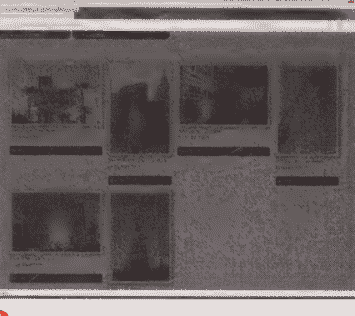

3. 编辑 **jquery.custom.js** 并插入以下代码，为浏览器窗口添加半透明背景：

```javascript
$('.imageGallery li img')
.click(function() {
  $('body').append
  ('<div class="shade"></div>');
  $('.shade')
  .css('opacity', 0.7).fadeIn();
});
```

A 背景遮罩已为灯箱就位。

4. 保存 jQuery 文件并将其上传到你的服务器。

5. 点击照片库中的任何图像，背景应该会出现。此时，除非重新加载页面，否则无法移除它。你稍后会添加代码来移除它 **A**。

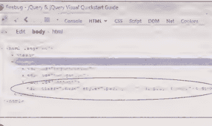

B 背景遮罩 **div** 元素是 `body` 标签内的最后一个元素。

要使背景遮罩出现，你必须向页面的 `body` 元素追加一个 **div**，并为该 **div** 声明 `shade` 类（`shade` 类已在 **css/base.css** 中为你定义）。此时，你应用一个 CSS 的 `opacity` 属性（使背景遮罩半透明），并使用 **`fadeIn()`** 将背景遮罩带入视野。（关于 **`fadeIn()`** 和其他效果的更多内容，请参见第 8 章“创建引人入胜的效果”）。

当你将 **div** 应用于 `body` 时，可以查看 DOM 检查工具。注意，背景遮罩 **div** 是 `body` 标签内的最后一个元素，因为 **`append()`** 在选中元素的末尾插入内容 **B**。

背景遮罩就位后，是时候添加照片了。你将需要处理两件事：预加载所有全尺寸图像，以及将图像居中放置在浏览器窗口中。

预加载图像的原因是为了确保灯箱功能能够正确测量图像，并知道如何将其放置在窗口内。jQuery 方法无法获取当前不在 DOM 中的元素的高度和宽度。未能执行此步骤会导致图像无法正确居中 **C**。

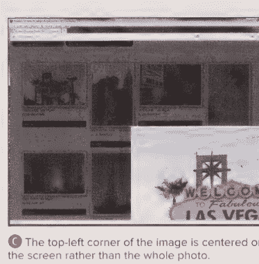

你还将使用浏览器窗口的高度来设置图像的大小，以确保照片完全显示在浏览器窗口的边界内。示例中的许多全尺寸图像要么比浏览器窗口高，要么比浏览器窗口宽 **D**。


为了组织有序，大多数开发者会将图像预加载器之类的功能放在其 jQuery 文件的顶部附近。在这种情况下，预加载器需要在灯箱功能被调用之前完成其工作，因此让我们先创建预加载函数。

#### 使用 `appendTo()` 创建图像预加载器：

1. 编辑你的 jQuery 文件以添加图像预加载器：

```javascript
function preload(arrayOfImages) {
    $(arrayOfImages).each(function(){
        $('')
            .attr('src',this)
            .appendTo('body')
            .css('display','none');
    });
}
```

你首先声明一个名为 **preload** 的函数。该函数接收一个参数 **arrayOfImages**。一旦调用该函数，jQuery 方法 **`each()`** 会遍历你传递给函数的数组中的每个项目。（关于 **`each()`** 的更多信息，请参见第 9 章“启用 jQuery 工具”）。

对于每张图像，你向 `body` 追加一个图像标签。然后，你将图像标签的 **`src`** 属性设置为当前的图像信息。最后，通过将它们的 CSS `display` 方法设置为 **none**，确保图像在需要之前不可见。

在这里使用 **`appendTo()`** 非常有意义，因为它允许你在将标签添加到页面之前更容易地为每个图像标签指定属性。

2. 在一个 **preload** 函数调用中创建数组：

```javascript
preload([
    'images/lv01.jpg',
    'images/lv02.jpg',
    'images/lv03.jpg',
    'images/lv04.jpg',
    'images/lv05.jpg',
    'images/lv06.jpg'
]);
```

方括号表示使用 JavaScript 对象表示法的 JavaScript 数组。每个全尺寸图像的路径都已在一个逗号分隔的列表中指定。查看你的 DOM 检查器，你应该能在 `body` 结束标签之前看到图像标签。

现在让我们进一步扩展灯箱功能。

### 使用 `height()` 和 `width()` 设置元素尺寸与位置：

1. 在文本编辑器中打开 `jquery.custom.js`。
2. 添加以下 jQuery 代码来创建图像标签：

```javascript
var imgSRC = $(this)
    .attr('data-photo');
var imgTAG =
    '';
```

这段代码应紧接在您为背景层应用 `fadeIn()` 的那行代码之后。

3. 继续完善函数，添加以下代码将模态窗口附加到 `body` 并将图像标签放入模态窗口中：

```javascript
$('body')
    .append('<div class="photoModal"></div>');
$('.photoModal').html(imgTAG);
$('.photoModal')
    .fadeIn('slow')
    .append('<div><a href="#" class="closePhoto">Close X</a></div>');
```

额外的 `append()` 方法向模态窗口添加了一个锚点标签，用于关闭照片。

4. 输入代码以检测窗口高度并将高度应用于图像：

```javascript
var windowHeight = $(window).height();
$('.photoModal img').css('height', (windowHeight - 200));
```

您从窗口高度中减去了 200 像素，以确保图像能够适应浏览器窗口。

这两个变量将应用于模态窗口，使其在浏览器窗口中水平和垂直居中：

```javascript
var modalTopMargin = ($('.photoModal').height() + 20) / 2;
var modalLeftMargin = ($('.photoModal').width() + 20) / 2;
```

之所以在高度和宽度上都加了 20，是因为为模态窗口指定的 CSS 中，每边都有 10 像素的边框。

5. 将模态窗口当前的高度和宽度信息保存到两个变量中。

注意边框，以确保照片完美居中。

6. 添加代码将 CSS 应用于模态窗口：

```javascript
$('.photoModal')
.css({
    'margin-top' : -modalTopMargin,
    'margin-left': -modalLeftMargin
});
```

在原始的 CSS 中（参见 **css/base.css**），模态窗口的左上角最初被设置为屏幕中心。浏览器窗口的左上角坐标是 0, 0。

为确保照片居中，您应用了负的边距值，从照片的左上角将其移动到正确位置。

浏览器窗口的基本坐标从左上角开始。

通过计算照片的高度和宽度，您可以应用负值将其移动到位。

7. 保存 jQuery 文件并上传到您的 Web 服务器。重新加载 `gallery.html` 网页，然后单击其中一张图片。

目前还有一个问题：一旦打开图片，就无法关闭它。因为您向 DOM 添加了以前不存在的元素，所以必须使用特殊方法来附加事件处理程序，以适应这些新元素。

图片的尺寸已设置好并呈现出来了！

### 使用 `remove()` 关闭图片：

1. 在文本编辑器中重新打开 **jquery.custom.js**。
2. 向文件中添加以下函数：

```javascript
$('body')
  .on('click', '.closePhoto',
      function(e){
        e.preventDefault();
        $('.photoModal, .shade')
          .fadeOut(function(){
            $(this).remove();
          });
      });
```

**`on()`** 方法能够处理当前在 DOM 中的元素或未来添加的元素。您使用它将事件处理程序绑定到选定元素内的项目上。在本练习中，您将点击事件处理程序附加到了 `body` 上，并指定该处理程序应响应任何具有 **`closePhoto`** 类的项目。您会记得在前面的练习中，您附加了一个具有 **`closePhoto`** 类的锚点标签。

一旦标签被点击，照片模态窗口和背景层会淡出，然后使用 **`remove()`** 方法将其移除，从而使灯箱功能得以重置，以便下次使用。

您无疑注意到了这里使用的 **`preventDefault()`** 方法。您将点击事件 *e* 传递给了函数：

**`function(e){...}`**

为了阻止链接执行其默认行为（通常是导航到另一个页面），您对事件应用了 **`preventDefault()`** 方法，它的作用如其名——阻止默认事件动作发生。

3. 保存文件并上传到您的 Web 服务器。
4. 重新加载 **gallery.html** 页面。单击一张图片，然后单击图片右下角的 “Close X” 链接。您的画廊页面已恢复正常。

### DOM 操作器的更多趣味用法

让我们看看使用其他一些 DOM 操作器的更多方法。

#### 使用 `before()` 重新排序：

1. 在文本编辑器中打开一个新的 HTML5 模板副本，并添加以下标记（Script 4.2.html）：

```html
<div id="content">
  <div class="article">
    <h3>Article 1</h3>
    <p>Lorem ipsum...</p>
    <a href="" class="mover">move to top</a>
  </div>
  <div class="article">
    <h3>Article 2</h3>
    <p>Lorem ipsum... </p>
    <a href="" class="mover">move to top</a>
  </div>
  <div class="article">
    <h3>Article 3</h3>
    <p>Lorem ipsum...</p>
    <a href="" class="mover">move to top</a>
  </div>
  <div class="article">
    <h3>Article 4</h3>
    <p>Lorem ipsum...</p>
    <a href="" class="mover">move to top</a>
  </div>
  <div class="article">
    <h3>Article 5</h3>
    <p>Lorem ipsum...</p>
    <a href="" class="mover">move to top</a>
  </div>
</div>
```

2. 将文件保存为 `article.html` 并上传到您的 Web 服务器。在浏览器中加载该页面。
3. 使用以下代码修改 **jquery.custom.js**，将一篇文章移动到文章列表的顶部：

```javascript
$('.mover').click(function(e) {
    e.preventDefault();
    $('#content div:first')
        .before($(this).parent('div'));
});
```

4. 保存 jQuery 文件并上传到您的 Web 服务器。
5. 在 Web 浏览器中重新加载 **article.html** 并单击任意 “move to top” 链接。该文章会移动到列表顶部。

让我们看看这里发生了什么。使用 **`before()`** 会使事情读起来有点反直觉，选择器使用了 jQuery 选择器扩展（更多内容见第 5 章 “掌握高级选择器”），`:first`，选中了第一个 **`div`**。组中的第一个 **`div`** 就是您即将在其前面插入所选 **`div`** 的那个 **`div`**。然后您调用 **`before()`** 方法将您选择的 **`div`** 携带到组中的第一个位置。

您可以重新排序列表，将一篇文章带到顶部。

要获取所选的 **`div`**，您需要获取被点击链接的父级 **`div`**。**`parent()`** 方法是一个 DOM 遍历方法，您将在第 6 章 “遍历 DOM 树” 中再次见到它。

**`before()`** 方法有一个功能完全相同的对应方法，即 **`insertBefore()`** 方法。**`insertBefore()`** 方法有一个巨大的优势：它读起来更容易理解：

```javascript
$(this).parent('div')
    .insertBefore($('#content div:first'));
```

这行代码的意思是，取被点击元素的父级 **`div`** 并将其插入到所选 **`div`** 组的第一个 **`div`** 之前。应该使用哪一个？如前所述，这取决于个人偏好。

单击第三个 **`div`** 会将其移动到列表顶部。

### 获取和设置尺寸

有一些 DOM 操作器的唯一目的是帮助您获取和设置尺寸。让我们使用其中几个来帮助制作一个浮动菜单动画。

**使用 `scrollTop()` 和 `offset()` 创建浮动菜单：**

1. 首先通过添加一个 div 来包裹 id="content" 的 div，从而修改 article.html 的标记（Script 4.3.html）：

```html
<div class="pageWrapper">
  <div id="content">
    // all of the content is here
  </div>
</div>
```

2. 添加以下标记以定义浮动菜单。它必须在 pageWrapper div 内：

```html
<div class="sidebar">
  <a href="article.html">Articles</a><br />
  <a href="gallery.html">Photo Gallery</a>
</div>
```

3. 保存 article.html 并上传到您的 Web 服务器。
4. 在 `jquery.custom.js` 中创建使菜单浮动的 jQuery 函数：

```javascript
var sidebarOffset =
  $('.sidebar').offset();
var paddingTop = 10;
$(window).scroll(function() {
  if ($(window).scrollTop() >
      sidebarOffset.top) {
    $('.sidebar').stop()
      .animate({
        marginTop: $(window).scrollTop() -
        sidebarOffset.top + paddingTop
      });
  } else {
    $('.sidebar').stop()
      .animate({
        marginTop: $(window).scrollTop()
      });
  }
});
```

5. 保存 `jquery.custom.js` 并上传到您的 Web 服务器。

6. 将 article.html 加载到你的网页浏览器中，你会看到页面右侧的浮动菜单。

当你向下滚动页面时，菜单会浮动到合适的位置。

让我们来看看这个小功能背后的实现原理。首先，你需要将侧边栏的偏移量保存到一个变量中。**`offset()`** 函数用于获取元素相对于文档的当前位置。该函数返回一个包含两个属性的对象：**top** 和 **left**。

你获取的另一个测量值是窗口的 **`scrollTop()`** 量。这个测量值以像素为单位，表示当你向下滚动页面时，在浏览器窗口上方被隐藏的像素数。

一旦滚动事件发生，你剩下的工作就是将 `div` 动画化到它的新位置（你将在第 8 章了解更多关于动画的内容）。你将基于 **`scrollTop()`** 提供的测量值来执行此操作。然后你需要进行一些计算，减去原始的偏移量，并加上一个填充值，以确保 `div` 位于浏览器窗口顶边下方 5 像素处。

**提示：** 你可以通过使用 **`offset()`** 和一些简单的计算来确定对象的底部和右侧属性。

**`scrollTop()`** 方法衡量的是你看不见的部分。

动画完成后，原始的间距得以保持。

### 克隆

你应该已经对操作 DOM 中的元素相当熟悉了。你已经学习了如何添加和移除元素、获取测量信息以及设置测量信息。现在让我们把注意力转向在页面上复制元素，这是一个 jQuery 称为 *克隆* 的小功能。

表面上看，克隆页面上的一组元素似乎很简单。你只需要使用 `clone()` 函数就大功告成了，对吧？让我们深入探讨一下。

当你使用 `clone()` 方法时，你是在创建所选元素及其所有后代以及包含在所选元素和后代中的任何文本节点的副本。这被称为 *深拷贝*。

你还可以复制绑定到所选元素的所有事件处理程序，确保即使你向 DOM 添加新元素，你的函数也能继续工作。你可以通过将 `clone()` 的 `withDataAndEvents` 和 `deepWithDataAndEvents` 属性设置为 `true` 来实现这一点。

为了演示 `clone()`，你将为网站创建一个新表单，允许访客提交食谱。有些食谱的配料比其他食谱多，但你不想用输入元素使页面变得杂乱。你将使用 `clone()` 方法让表单用户根据需要添加任意数量的配料字段。

#### 如何使用 `clone()` 添加表单元素：

1. 在你的文本编辑器中使用一个全新的 HTML5 模板副本，并添加以下标记来创建一个食谱表单（脚本 4.4.html）：

```html
<div id="content">
<h2>Submit a recipe...</h2>
<form name="recipe" action="inc/php/recipe.php" method="post">
<input name="recipeName"
    placeholder="Recipe Name"/>
<div id="ingredients">
<p>Ingredients</p>
<span class="inputSpan">
<input name="recipeIngredient[]"
    placeholder="Ingredient" />
<br /></span>
<span class="inputSpan">
<input name="recipeIngredient[]"
    placeholder="Ingredient" />
    <br /></span>
<span class="inputSpan">
<input name="recipeIngredient[]"
    placeholder="Ingredient" />&nbsp;
<a href="newIngredient">add another ingredient</a>
<br /></span>
</div>
<p>Instructions</p>
<textarea name="recipeInstructions">
</textarea><br />
<input type="submit" name="submit"
    value="Submit Recipe" />
</form>
</div>
```

新的食谱表单几乎准备就绪。

请注意围绕配料输入框的 span 标签。这些标签的使用使你的代码编写更简单、更紧凑。此外，每个配料标签都使用方括号 ([]) 命名，使它们成为数组的一部分，便于 PHP 等服务器端语言处理。

2. 将文件保存为 **recipe.html** 并将其上传到你的 Web 服务器。当在浏览器中加载时，它看起来像示例中的图片。

3. 向 **jquery.custom.js** 添加一个函数，以克隆最后一个食谱配料 span：

```javascript
$('a[href="newIngredient"]')
.click(function(e){
e.preventDefault();
var clonedInput =
  $('.inputSpan').filter(':last')
.clone(true, true);
```

在包围它的 span 标签上使用类有助于保持你的选择器简短。请务必将 **`clone()`** 函数的属性设置为 **true, true**，以便复制事件处理程序。

4. 获取最后一个输入的当前值。你将使用此值以确保不会丢失任何配料：

```javascript
var lastInputData = $('input[name=
"recipeIngredient[]"]')
.filter(':last').val();
```

5. 设置最后一个配料输入的 HTML 以移除链接，并确保它保留其当前值：

```javascript
$('.inputSpan').filter(':last')
.html('<span class="inputSpan">
<input name="recipeIngredient[]"
placeholder="Ingredient"
value="' + lastInputData + '" /><br /></span>');
```

重置元素的 HTML 可以防止它反复创建“添加另一个配料”链接。

复制链接不仅看起来很糟糕，而且对用户来说也很困惑。

6. 将克隆的输入附加到配料 div：

```javascript
$('#ingredients')
.append(clonedInput);
```

一个新的配料字段已被添加，并且现在获得了焦点。

7. 通过将新输入的值设置为空，然后将焦点置于新输入上来清理它：

```javascript
$('input[name="recipeIngredient[]"]')
.filter(':last').val('');
$('input[name="recipeIngredient[]"]')
.filter(':last').focus();
});
```

将焦点设置到新输入中为用户提供了便利。它允许用户在新元素添加后立即开始输入。

由于你设置了 `clone()` 来复制表单的事件处理程序，因此每次点击仍会触发点击事件。

### 链式调用 jQuery 方法

在本书的许多练习中，你已经在单个选择器上使用了多个 jQuery 方法。在一个选择器上使用多个函数被称为 *链式调用*。

链式调用有两个好处。首先，你不必重新选择元素来向它们添加另一个函数，从而节省时间。其次，你可以使用链式调用使你的代码更具可读性。你被允许在每个函数之间放置换行符：

```javascript
$('input[name="recipeIngredient[]"]')
    .filter(':last')
    .val('')
    .focus();
});
```

你需要注意的唯一警告是函数顺序。请务必按照你希望它们执行的顺序添加函数，否则结果可能不是你所期望的。

请记住，链式调用 jQuery 函数并不适用于所有情况。有时你可能需要重新选择元素，这是因为函数的长度或你需要事情发生的顺序。在这些情况下，你可能希望通过将选择器保存在变量中来缓存它：

```javascript
var ingredients = $('input[name="recipeIngredient[]"]');
```

选择器 `$(ingredients)` 现在可以重用：

```javascript
$(ingredients)
    .filter(':last')
    .val('')
    .focus();
```

缓存选择器还可以防止 jQuery 在每次使用时重新选择元素，从而提高性能——特别是当一个选择器定义了大量元素时。

### 更改输入元素

让我们对表单进行另一项更改。假设用户想要指定某种配料实际上是香料。为了完成此更改，你将使用 **`replaceWith()`** 操作器来更改输入。

#### 如何使用 `replaceWith()` 更改元素：

1. 修改 **recipe.html** 的前两个配料输入，以创建一个链接，该链接将触发更改为香料的操作，如以下突出显示的标记所示（脚本 4.5.html）：

```html
<span class="inputSpan">
  <input name="recipeIngredient[]"
         placeholder="Ingredient" />
  &nbsp;<a href="makeSpice"
        class="ingredientType">change
  to spice</a><br /></span>
```

2. 保存 **recipe.html** 并将其上传到你的 Web 服务器。

新链接已添加到输入框中。

3. 打开 **jquery.custom.js** 并修改你在上一个练习中创建的函数，以考虑额外的链接。你需要添加的部分已用高亮标出：

```javascript
$('.inputSpan')
    .filter(':last')
    .html('<span class="inputSpan"><input name="recipeIngredient[]" placeholder="Ingredient" value="' + lastInputData + '" />&nbsp;<a href="makeSpice" class="ingredientType">change to spice</a><br /></span>');
```

通过进行此修改，你确保用于更改输入元素的链接可用。

4. 在 **jquery.custom.js** 中创建一个新函数。该函数将确定哪种类型的输入可用，并进行所需的更改：

```javascript
$('#ingredients').on('click', '.ingredientType', function(e) {
    e.preventDefault();
    var ingredientType = $(this).attr('href');
    if('makeSpice' == ingredientType) {
```

5. 获取输入的现有值：

```javascript
        var oldElement = $(this).closest('span');
        var oldElementValue = $(this).closest('span').find('input').val();
```

6. 创建新的输入元素并将其分配给一个变量，以便在函数中稍后使用：

```javascript
        var newElement = '<span class="inputSpan"><input name="recipeSpice[]" placeholder="Spice" value="' + oldElementValue + '" />&nbsp;<a href="makeIngredient" class="ingredientType">change to ingredient</a><br /></span>';
```

7. 用新输入替换旧输入：

```javascript
        $(oldElement).replaceWith(newElement);
```

8. 根据表单中已输入的内容设置新输入的值：

```javascript
        $(newElement).find('input').val(oldElementValue);
    }
```

9. 添加函数的剩余部分，以便在需要时将输入更改回配料输入：

```javascript
    else {
        var oldElement = $(this).closest('span');
        var oldElementValue = $(this).closest('span').find('input').val();
        var newElement = '<span class="inputSpan"><input name="recipeIngredient[]" placeholder="Ingredient" value="' + oldElementValue + '" />&nbsp;<a href="makeSpice" class="ingredientType">change to spice</a><br /></span>';
        $(oldElement).replaceWith(newElement);
        $(newElement).find('input').val(oldElementValue);
    }
});
```

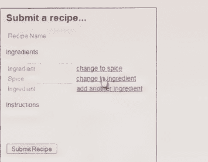

**else** 条件的功能与 **if** 条件完全相同，只是它将输入类型更改回配料。

**B** 输入已更改以反映其作为香料的状态。

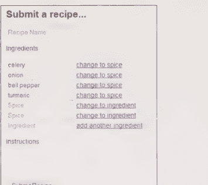

10. 保存 **jquery.custom.js** 并将其上传到你的 Web 服务器。在浏览器中重新加载 **recipe.html**，然后点击其中一个“更改为香料”链接 **B**。

**C** 已添加新输入，准备好在配方中作为配料或香料占据其位置。

> **提示** 当你添加配料时，会创建另一个输入元素，并添加“更改为香料”链接 **C**。

查看你的 DOM 检查工具，你将看到你实施的更改 D。

毫无疑问，jQuery 使得操作 DOM 元素变得非常容易。该库擅长于在其创建的每个网页上添加、删除、测量和更改元素。该库修改标记的能力是一套宝贵的工具集，让你更少担心现有的标记——赋予你进行合理更改的能力，从而使你的函数能够有效运行。

你还学习了如何链接 jQuery 方法以创建复杂函数。链接使你的代码紧凑、易于阅读且高效。

接下来，你将加深对选择器的理解和使用。选择器训练营即将开始！

```html
<div id="ingredients">
    <p>Ingredients</p>
    <span class="inputSpan">
        <input placeholder="Ingredient" name="recipeIngredient[]">
        <a class="ingredientType" href="makeSpice">change to spice</a>
        <br>
    </span>
    <span class="inputSpan">
</div>
```

**D** 检查 DOM 时，替换的输入元素显而易见。

## 回顾与复习

花点时间反思你在本章中学到的内容：

- jQuery 的多少 DOM 操作函数具有执行相同操作的对应函数？
- 使用执行相同操作但语法不同的函数有优势吗？有哪些优势？
- 为什么预加载图像是个好主意？
- 使用像 Firebug 这样的 DOM 检查工具有什么好处？
- `preventDefault()` 的用途是什么？
- `position()` 和 `offset()` 之间有什么区别？
- 如何保留克隆元素上的事件处理程序？
- “深拷贝”这个术语如何应用于克隆元素？
- 什么时候应该缓存选择器？
- 你可以链接多少个 jQuery 函数？
- 链接 jQuery 方法时是否允许换行？

## 5 掌握高级选择器

### 掌握高级选择器

到目前为止，在每个练习中，你主要使用了 jQuery 的基本选择器来识别你想要处理的元素。基本选择器运行良好，并将继续满足你的大部分需求。

你也使用了更高级的选择器之一，属性选择器。这些类型的选择器首先识别元素，然后是元素具有的特定属性，例如 `$('a[href="foo.html"]')`。但属性选择器还有很多其他功能，例如选择以特定值开头或结尾或包含某个单词的属性。许多属性选择器提供了类似正则表达式的功能。

在使用属性进行选择时，你可以创建强大的 AND/OR 条件。在本章中，你将学习如何设置这些条件并组合选择器，以便在应用 jQuery 方法时获取你正在寻找的元素。

### 本章内容

- 构建属性选择器 82
- 组合选择器 91
- 回顾与复习 94

### 构建属性选择器

jQuery 属性选择器（列于表 5.1 中）旨在帮助你能够根据可能放入元素标签的各种属性来选择元素。它们都基于 CSS 选择器语法，但有一个例外：*不等于* 选择器。

*不等于* 选择器是 jQuery 选择器扩展的另一个例子。它允许你创建一个选择器，该选择器具有不含特定值的属性或根本没有该属性。

通常，你将通过从一个元素开始，然后跟上你正在寻找的属性和值来使用属性选择器。以下是语法示例：

```javascript
$('img[src="images/foo.jpg"]')
```

首先，你声明你正在寻找一个图像，并且图像标签应具有值为 "images/foo.jpg" 的 `src` 属性。元素对于使用属性选择器不是必需的。使用属性选择器而不是 ID 或类的原因之一是，当你无法更改标记时可以使用它。

引号在属性选择器中很重要，我使用的是从 jQuery 1.5 版本开始推荐的引号顺序。对我来说这看起来很自然，因为大多数开发者在标记中将其属性值放在双引号内。你并不限于此引号顺序，但在指定属性选择器时必须使用引号。

第一个练习将教你如何使用子字符串选择器来识别同一位作者的文章。准备好开始使用属性选择器了吗？我们开始吧！

#### 表 5.1 jQuery 属性选择器

| 语法 | 选择的内容 |
|---|---|
| `[name|="value"]` | 具有包含前缀的属性的元素。前缀后面也可以跟一个连字符 (-)。 |
| `[name*="value"]` | 具有包含特定子字符串的属性的元素。 |
| `[name~="value"]` | 属性值包含特定单词的元素，其中单词由空格分隔。 |
| `[name$="value"]` | 属性值恰好以给定字符串结尾的元素。 |
| `[name="value"]` | 属性值与给定值完全相等的元素。 |
| `[name!="value"]` | 要么没有指定属性，要么有指定属性但不是特定值的元素。这是 jQuery 扩展。 |
| `[name^="value"]` | 属性值恰好以给定字符串开头的元素。 |
| `[name]` | 具有指定属性的元素，值为任意值。 |

#### 如何使用 `[name*="value"]` 查找子字符串：

1. 在你的文本编辑器中打开已保存的 article.html 文件，并将高亮显示的标记添加到前五个文章 div 中（脚本 5.1.html；为简洁起见并消除不必要的填充文本，练习中未显示完整段落）：

```html
<div class="article">
<h3>Article 1</h3>
<p class="by-line">
<span data-author="Blanchard, Jay"
class="author">Jay Blanchard</span>
&nbsp;posted:&nbsp;
<span data-date="2012-08-16"
class="postDate">August 16, 2012</span>
</p>
<p>Lorem ipsum ... </p>
<a href="" class="mover">
move to top</a></div>
```

```html
<div class="article">
```


### Article 2

**Jesse Castro** posted: **June 18, 2012**

Lorem ipsum...

### Article 3

**David Awl** posted: **May 7, 2012**

Lorem ipsum...

### Article 4

**Jay Blanchard** posted: **February 3, 2012**

Lorem ipsum...

### Article 5

**Jesse Castro** posted: **February 2, 2012**

Lorem ipsum...

---

2. 保存文件并将其上传到你的 Web 服务器。一旦在浏览器中加载，你将看到每篇文章的署名行 🅰。

3. 将以下函数添加到你的 `jquery.custom.js` 文件中，从初始选择器开始：

```javascript
$('.author').hover(function(){
```

4. 捕获包含作者姓名的自定义属性的值：

```javascript
thisAuthor = $(this).attr('data-author');
```

5. 使用 JavaScript 的 `split` 函数创建一个包含作者姓和名的数组。你将在子字符串属性选择器中使用作者的姓氏：

```javascript
authorNameArray = thisAuthor.split(',');
authorLastName = authorNameArray[0];
```

6. 使用作者的姓氏设置子字符串属性选择器：

```javascript
$('.author[data-author*="" + authorLastName + ""]').addClass('textHighlight');
```

7. 通过从 `author` 类中的每个元素移除添加的 `textHighlight` 类来完成 hover 函数的后半部分：

```javascript
}, function(){
    $('.author').removeClass('textHighlight');
});
```

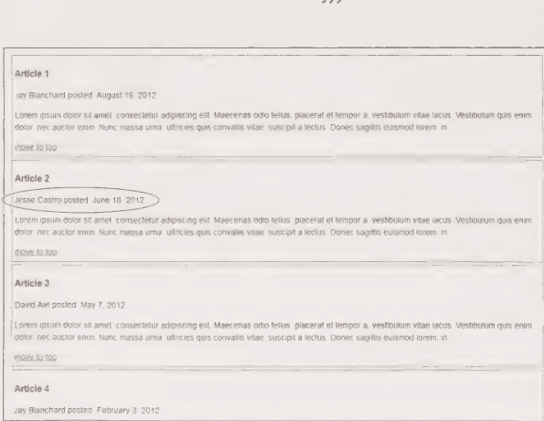

🅰 现在所有文章都具有带发布时间的署名行。

8. 将 `jquery.custom.js` 文件放在你的 Web 服务器上，并在你的 Web 浏览器中重新加载 `article.html`。将鼠标悬停在作者姓名上，你应该会看到该姓名在该作者撰写的所有文章中高亮显示。

能够定位属性值内的部分或子字符串，在向现有网站添加 jQuery 时尤其有价值。通过研究现有标记，你可以寻找使用子字符串属性选择器完全满足需求的案例。

在下一个练习中，你将为每篇文章添加一些关键词，以便执行类似的搜索，以确定哪些文章被应用了相同的标签。为此，你将使用 word 属性选择器。

#### 如何使用 `[name~=value]` 属性选择器：

1. 修改 `article.html` 中的标记（脚本 5.2.html），为每篇文章添加标签，如高亮显示所示：

```html
<div class="article">
    <h3>Article 1</h3>
    <p class="by-line">
        <span data-author="Blanchard, Jay" class="author">Jay Blanchard</span>
        &nbsp;posted:&nbsp;
        <span data-date="2012-08-16" class="postDate">August 16, 2012</span>
    </p>
    <p>Lorem ipsum...</p>
    <a href="" class="mover">move to top</a>
    &nbsp;Tags:<span data-tags="JavaScript jQuery Scripting" class="articleTags"> <span>JavaScript</span> <span>jQuery</span> <span>Scripting</span> </span>
</div>

<div class="article">
    <h3>Article 2</h3>
    <p class="by-line"><span data-author="Castro, Jesse" class="author">Jesse Castro</span>
        &nbsp;posted:&nbsp;
        <span data-date="2012-06-18" class="postDate">June 18, 2012</span></p>
    <p>Lorem ipsum... </p>
    <a href="" class="mover">move to top</a>
    &nbsp;Tags:<span data-tags="PHP MySQL" class="articleTags"> <span>PHP</span> <span>MySQL</span> </span>
</div>

<div class="article">
    <h3>Article 3</h3>
    <p class="by-line">
        <span data-author="Awl, Dave" class="author">David Awl</span>
        &nbsp;posted:&nbsp;
        <span data-date="2012-05-07" class="postDate">May 7, 2012</span></p>
    <p>Lorem ipsum... </p>
    <a href="" class="mover">move to top</a>
    &nbsp;Tags:<span data-tags="Social Media Facebook Twitter" class="articleTags"> <span>Social Media</span> <span>Facebook</span> <span>Twitter</span></span>
</div>

<div class="article">
    <h3>Article 4</h3>
    <p class="by-line"><span data-author="Blanchard, Jay" class="author">Jay Blanchard</span>
        &nbsp;posted:&nbsp;
        <span data-date="2012-02-03" class="postDate">February 3, 2012</span></p>
    <p>Lorem ipsum... </p>
    <a href="" class="mover">move to top</a>
    &nbsp;Tags:<span data-tags="JavaScript jQuery HTML5 CSS3" class="articleTags"> <span>JavaScript</span> <span>jQuery</span> <span>HTML5</span> <span>CSS3</span> </span>
</div>

<div class="article">
    <h3>Article 5</h3>
    <p class="by-line"><span data-author="Castro, Jesse" class="author">Jesse Castro</span>
        &nbsp;posted:&nbsp;
        <span data-date="2012-02-02" class="postDate">February 2, 2012</span></p>
    <p>Lorem ipsum... </p>
    <a href="" class="mover">move to top</a>
    &nbsp;Tags:<span data-tags="PHP jQuery HTML5" class="articleTags">
        <span>PHP</span>
        <span>jQuery</span> <span>HTML5</span>
    </span>
</div>
```

2. 将 **article.html** 文件上传到你的 Web 服务器，并将其加载到浏览器中以查看文章标签 Ⓒ。

3. 通过将 hover 事件处理程序绑定到标签来准备函数：

```javascript
$('.articleTags span').hover(function(){
```

4. 获取用户当前悬停的 span 中的文本：

```javascript
thisTag = $(this).html();
```

5. 使用当前 span 中的值创建 word 属性选择器。使用 **parent()** 和 **find()** 遍历方法（更多关于这些方法的内容在第 6 章“遍历 DOM 树”中）来标识文章的标题。然后将 **textHighlight** 类应用于标题：

```javascript
$('[data-tags~="' + thisTag + '"]')
    .parent('.article')
    .find('h3')
    .addClass('textHighlight');
```

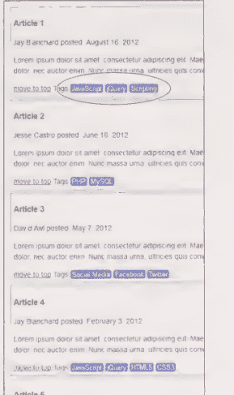

6. 当鼠标不再悬停在某个标签上时，通过移除 `textHighlight` 类来完成 hover 函数：

```javascript
},function(){
    $('.article h3')
        .removeClass('textHighlight');
});
```

7. 保存并将 `jquery.custom.js` 文件上传到 Web 服务器，并在 Web 浏览器中重新加载 `article.html`。将鼠标悬停在一个标签上，并注意标题高亮显示 D。

word 属性选择器会查找被空格包围的单个单词。你在测试期间可能已经注意到其中一个标签有问题。Social Media 标签包含两个单词。该问题的解决方案将在本章后面的“组合选择器”部分揭示。

但在我们进入组合选择器之前，让我们看看属性选择器的 jQuery 扩展，即 `not equal` 选择器。

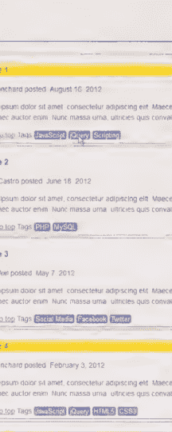

D 将鼠标悬停在一个标签上会显示包含相同标签的其他文章。

#### 使用 `[name!=value]` 选择器：

1. 在 `article.html` (脚本 5.3.html) 中的 h3 标签上添加自定义属性。不要修改其余的任何标记。为清晰起见，此处仅显示 h3 标签，修改部分已高亮显示：

```html
<h3 data-title="Article 1">Article 1</h3>
<h3 data-title="Article 2">Article 2</h3>
<h3 data-title="Article 3">Article 3</h3>
<h3 data-title="Article 4">Article 4</h3>
<h3 data-title="Article 5">Article 5</h3>
<h3 data-title="In other news...">In other news...</h3>
```

添加这些自定义属性不会改变页面的外观。

2. 通过将以下内容添加到 `jquery.custom.js` 文件，将每篇文章的标题标签绑定到 hover 事件处理程序：

```javascript
$('.article h3').hover(function(){
```

3. 获取 h3 的文本值，并将其放入名为 `thisTitle` 的变量中：

```javascript
var thisTitle = $(this).html();
```

4. 创建不等于属性选择器，选择所有 h3 中与当前悬停的 h3 不相等的项。找到每个项的父级 article div，并淡出其不透明度使其变得不那么可见：

```javascript
$('h3[data-title!="' + thisTitle + '"]')
    .parent('.article')
    .fadeTo(350, 0.4);
```

`parent()` 函数属于 DOM 遍历方法，而 `fadeTo()` 方法是 jQuery 的特殊效果之一，你将在第 8 章“创建引人入胜的效果”中了解更多相关内容。

5. 通过在 hover 事件处理程序的 mouseout 部分淡出所有文章恢复到正常状态来完成函数：

```javascript
}, function(){
    $('.article').fadeTo(250, 1.0);
});
```

6. 将 `article.html` 和 `jquery.custom.js` 上传到你的 Web 服务器。将 `article.html` 加载到浏览器中，并将光标悬停在文章标题上。

有时你需要更强大的选择器，这是由你的网页构建方式或处理页面内特定任务的方式决定的。使用 jQuery，你可以组合属性选择器，并利用它们获得构建选择器所需的力量，以解决你最复杂的问题。接下来让我们深入探讨。

非常巧妙！仅用几行 jQuery 代码和强大的*不等于*属性选择器，其他所有文章信息都变淡了，将更多注意力吸引到当前选中的文章上。你无疑会发现这个选择器的许多用途。

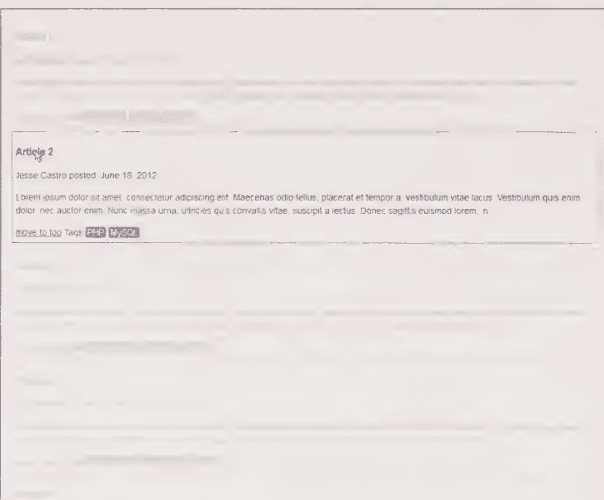

*图示：焦点放在当前文章的信息上。*

### 组合选择器

属性选择器是 jQuery 中唯一允许你创建和使用 OR 条件的选择器。考虑以下选择器，你可能想要影响具有不同类的两个或更多元素：

`$('.class_A, .classB')`

本质上，你是说你通过在每个类名之间放置逗号选择了 **class_A** 和 **class_B**。你可以使用任何通常组合的选择器来实现这一点。如果你在类之间留一个空格，像这样：

`$('.class_A .class_B')`

你表示要选择所有是 **class_A** 元素子元素的 **class_B** 元素。

使用属性选择器，你可以通过在选择器之间放置逗号来利用 OR 条件：

`$('[name~="foo"],[name~="bar"]')`

在这种情况下组合属性选择器表示选择属性值中包含单词 "foo" 或 "bar" 的元素。去掉逗号则创建了一个 AND 条件。

让我们修改使用标签来确定哪些文章标题需要突出显示的函数，使其能够处理两个单词的标签，例如 "Social Media"。

#### 组合属性选择器以实现 OR 条件：

1. 修改 **article.html** (脚本 **5.4.html**)，为文章 5 添加一个仅限 Media 的标签，如高亮部分所示：

```html
<span data-tags="PHP jQuery HTML5 Media" class="articleTags">
    <span>PHP</span>
    <span>jQuery</span>
    <span>HTML5</span>
    <span>Media</span>
</span>
```

2. 将 `article.html` 放在你的 Web 服务器上，并将其加载到浏览器中以确认新标签已就位。

3. 在文本编辑器中打开 `jquery.custom.js`，编辑当标签悬停时突出显示文章标题的函数。首先，保持初始绑定不变：

`$('.articleTags span').hover(function(){`

4. 保持持有标签 HTML 的变量赋值不变：

`var thisTag = $(this).html();`

5. 添加一个 JavaScript `split` 函数，该函数将按空格分隔标签中的所有单词：

`var tagArray = thisTag.split(' ');`

6. 测试由 `split` 函数创建的数组，查看其长度是否为两个单词：

`if(2 == tagArray.length) {`

7. 为属性选择器（在这种情况下是单词选择器）设置 OR 条件，以处理数组中的每个单词。遍历和类添加保持不变：

`$('[data-tags~="' + tagArray[0] + '"], [data-tags~="' + tagArray[1] + '"]').parent('.article').find('h3').addClass('textHighlight');`

8. 配置 else 条件：

`} else {`

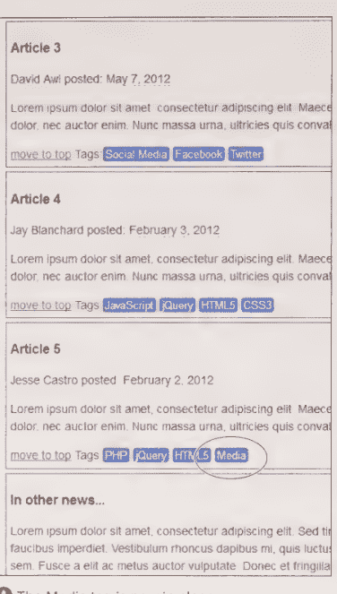

*图示：Media标签现在已经就位。*

9. 通过将 **thisTag** 替换为 **tagArray[0]** 来更改原始选择器，以处理单个单词的标签：

```javascript
$('[data-tags~="' + tagArray[0] + '"]')
    .parent('.article')
    .find('h3')
    .addClass('textHighlight');
}
```

10. 通过当鼠标移开标签时移除文本高亮类来结束 hover 事件处理程序：

```javascript
},function(){
    $('.article h3')
        .removeClass('textHighlight');
});
```

11. 将 **jquery.custom.js** 上传到你的 Web 服务器，并在浏览器中重新加载 **article.html** 文件。将鼠标悬停在 Social Media 标签上，你会看到其当前文章标题以及带有 Media 标签的文章标题都被高亮显示。

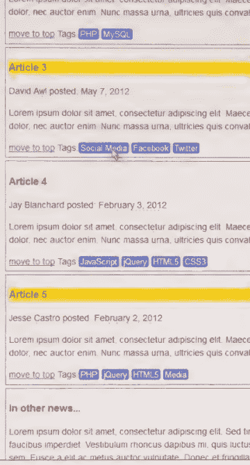

*图示：OR条件使得选择正确的标题变得容易。*

如果你想确保只获取带有 Social Media 标签（或任何其他两个单词标签）的文章，你需要在属性选择器之间放置一个逗号。

既然你已经使用了几个属性选择器，其余的在需要时实现起来应该很容易。你现在已装备好使用 jQuery 库中的所有选择器。掌握了这些知识，是时候攀登另一棵树了——DOM 树。

### 利用高级选择器

## 回顾与复习

花点时间反思一下你在本章中学到的内容：

- 在 jQuery 属性选择器中，AND 和 OR 条件有什么区别？
- 哪些属性选择器是 jQuery 的扩展？
- 使用属性选择器时，选择器中必需的是什么？
- 是否需要将元素与属性选择器结合使用？
- 在属性选择器中，引号顺序重要吗？
- 子字符串属性选择器的语法是什么？

## 遍历 DOM 树

引用一句著名圣诞故事中的话：“是的，弗吉尼亚，我们可以从这里到达那里——即使沿途有很多步骤。”

选择器通常对于识别你想使用 jQuery 处理的元素来说已经足够好了，但你经常会发现你需要根据页面上元素与所选元素的关系来识别其他元素。这些元素可能是父级、祖父级、子级或兄弟级，基本概念是，根据你当前所处的树枝（所选元素），你在家族树（DOM）中上下左右移动。这种移动被称为*遍历 DOM 树*。你在前面的章节中已经看到了几个这种移动的例子，但现在是时候深入研究并了解如何使用 jQuery 的 DOM 遍历方法了。

jQuery 库提供三种类型的遍历方法：树遍历、遍历过滤器，以及一些不太适合其他类别的杂项方法。让我们从树遍历开始。

### 本章内容

- 遍历树 (96)
- 应用遍历过滤器 (102)
- 回顾与复习 (108)

### 遍历树

在网页元素间上下左右地移动，可能是一场相当有趣的冒险。你需要小心导航，以确保将函数应用于树中正确的元素。在你迄今为止完成的许多练习中，你已经看到了这种导航的示例，轻松地在 DOM 树中移动，以识别和操作你构建的网页部分。

jQuery 库提供了几种方法（表 6.1），使你能够轻松执行遍历移动。几乎在所有情况下，只要按正确顺序使用和组合正确的遍历方法，你就可以从页面上的任何元素到达页面上的任何其他元素。但要小心。你需要在遍历操作中注重实效，以使你的函数易于维护和扩展。

在任何遍历方法的考察中，你都需要关注标记

**表 6.1 jQuery 遍历方法**

| 函数名 | 功能 |
| :--- | :--- |
| `children()` | 获取匹配元素集合中每个元素的子元素；可以使用选择器进行过滤。 |
| `closest()` | 获取与选择器匹配的第一个元素，从当前元素开始向上遍历 DOM 树。 |
| `find()` | 获取当前匹配元素集合中每个元素的后代元素；可以通过选择器、jQuery 对象或元素进行过滤。 |
| `next()` | 获取匹配元素集合中每个元素的紧邻的后一个同级元素。如果提供了选择器，则仅当该同级元素匹配选择器时才被检索。 |
| `nextAll()` | 获取匹配元素集合中每个元素之后的所有同级元素；可选择地通过选择器进行过滤。 |
| `nextUntil()` | 获取匹配元素集合中每个元素之后的所有同级元素，直到但不包括由传入的选择器、DOM 节点或 jQuery 对象匹配的元素。 |
| `offsetParent()` | 获取最近的、具有绝对、相对或固定定位（即定位元素）的祖先元素。 |
| `parent()` | 获取当前匹配元素集合中每个元素的父元素；可选择地通过选择器进行过滤。 |
| `parents()` | 获取当前匹配元素集合中每个元素的祖先元素；可以通过选择器进行过滤。 |
| `parentsUntil()` | 获取当前匹配元素集合中每个元素的祖先元素，直到但不包括由选择器、DOM 节点或 jQuery 对象匹配的元素。 |
| `prev()` | 获取匹配元素集合中每个元素的紧邻的前一个同级元素；可以通过选择器进行过滤。 |
| `prevAll()` | 获取匹配元素集合中每个元素之前的所有同级元素；可以通过选择器进行过滤。 |
| `prevUntil()` | 获取匹配元素集合中每个元素之前的所有同级元素，直到但不包括由选择器、DOM 节点或 jQuery 对象匹配的元素。 |
| `siblings()` | 获取匹配元素集合中每个元素的所有同级元素，可选择地通过选择器进行过滤。 |

以及用于在该标记中移动的代码。这里的练习将反映这一点，让你了解如何使用 jQuery 代码在 DOM 树中移动。

让我们看看你目前构建的函数以及是什么使这种导航成为可能。

要使用 **next()** 方法：

1. 在你的文本编辑器中打开脚本 **6.1.html**，并找到表单的标记行。特别注意，寻找后面跟有 span 元素的 input 元素 🔴。
2. 在 **jquery.custom.js** 中找出用于检查联系人姓名是否为空的代码。使用 **next()** 方法的行已高亮显示：

```javascript
$('input[name="contactName"]')
    .focusout(function(){
        if(0 == $(this).val().length) {
            $(this).next('span')
                .html('&nbsp;please do not leave name blank')
                .css({
                    'color': '#FF0000'
                });
        } else {
            $(this).next('span').html('');
        }
    });
```

**next()** 函数标识出 input 元素的兄弟 span 🔴。

**next()** 方法标识紧随所选元素之后的元素，因为它是一个同级元素。只要所选项目和 **next()** 方法中的所选项目处于同一层级，该方法就会找到紧随所选项目之后的同级元素。

**prev()** 方法的工作方向相反，查找位于所选元素之前的同级元素。**siblings()** 方法则从你选定的元素出发，在两个方向上工作。

> **提示** 你标记中的缩进可以帮助你轻松定位祖先、后代和同级元素。

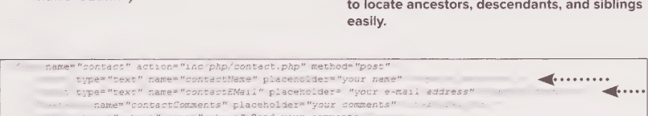

🔴 带有附加 span 部分的表单输入标记。

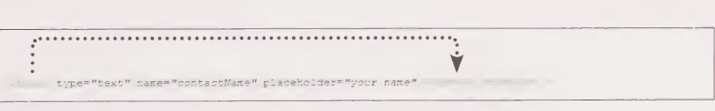

🔴 input 元素的隔壁邻居是紧随其后的 span。

使用正确的遍历方法，查找祖先（父级、祖父级等）同样容易。让我们先找一个直接父级。

#### 使用 `parent()` 方法：

1. 在你的网络浏览器中加载脚本 6.2.html。你将处理图像列表以找到它们的父级 ©。
2. 打开 `jquery.custom.js`，找到用于向每个图像添加信息的代码块。使用 `parent()` 方法的行已高亮显示：

```javascript
$('.imageGallery li img')
    .each(function() {
        var thisAltTag = $(this).attr('alt');
        $(this).attr({
            'alt': thisAltTag + '<br />by Jay Blanchard ',
            'data-camera': 'Canon 7D'
        });
        var newAltTag = $(this).attr('alt');
        var cameraTag = $(this).attr('data-camera');
        $(this).parent()
            .append('<br /><div class="imageTitle">' + newAltTag + '</div>');
        $(this).parent()
            .append('<br /><div class="imageCamera">' + cameraTag + '</div>');
    });
```

这些新信息可以附加到 img 标签上，但那会使信息成为 img 标签本身的一部分，网站访问者将无法看到。处理附加信息的最佳方法是将其附加到列表项（li）上。列表项是图像的父级，因此你可以使用 `parent()` 方法将附加信息添加到列表项 𝐃 中。

```html
<ul class="imageGallery">
    <li>
    <li>
    <li>
    <li>
    <li>
    <li>
</ul>
```

© 图像列表的标记。


𝐃 查找图像的父级。

单个元素可以容纳任意数量的元素，有时嵌套层级很深。让我们看看一种查找元素父级，然后定位该父级后代中的另一个元素的方法。

#### 使用 `find()` 方法定位子元素：

1. 在你的浏览器中打开脚本 6.3.html，然后在 DOM 检查工具（如 Firebug）中查看标记。你正在搜索的元素 `<div class="imageTitle">` 是在页面加载时添加的，此处已高亮显示 🔴。

```html
<li>
    by Jay Blanchard "
        data-photo="images/lvo1.jpg"
        src="images/thumb_lvo1.jpg"
        data-camera="Canon 7D">
    <br>
    <div class="imageTitle">
        Classic Sign - Las Vegas
        <br>
        by Jay Blanchard
    </div><br>
    <div class="imageCamera blueBoxShadow small_text">
        Canon 7D</div>
</li>
```

2. 在 `jquery.custom.js` 文件中定位用于在点击图像时高亮图像标题的 jQuery 代码部分：

```javascript
$('.imageGallery li img')
    .click(function() {
        $(this).parent()
            .find('.imageTitle')
            .toggleClass('textHighlight');
    });
```

当你创建的 jQuery 函数中的点击事件处理程序被调用时，首先会定位图像的父级（列表项）。然后你使用 `find()` 方法定位列表项中具有 `imageTitle` 类的子元素 🔴。
你通过包含一个选择器（在本例中是一个类名）来使用 `find()`，该选择器指向一个你期望是原始选择器后代的元素。

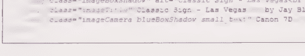


🔴 E 标记在页面加载时被修改，以添加图像标题和其他信息。

🔴 F 你向上遍历 DOM 树到父元素，然后从父元素向下查找你要找的后代。

除了 **parent()** 之外，还有不止一个 jQuery 方法可用于查找类似于它的祖先元素。**closest()** 方法可以帮助你精确定位一个特定的祖先——即与所选元素最接近的祖先。为了理解其工作原理，让我们来看一下你在之前练习中创建的食谱表单。

#### 使用 `closest()` 查找祖先：

1. 在文本编辑器和浏览器中打开 **recipe.html** 文件（Script 6.4.html）㊅。
2. 找到描述配料列表输入项的标记。这里显示了其中一个 span：
3. 定位到你创建的、用于将配料输入更改为香料输入的函数。请注意该函数中的以下两行代码：

```html
<span class="inputSpan">
    <input name="recipeIngredient[]" placeholder="Ingredient" />&nbsp;<a href="makeSpice" class="ingredientType">change to spice</a><br />
</span>
```

```javascript
var oldElement = $(this).closest('span');
var oldElementValue = $(this).closest('span').find('input').val();
```


㊅ 要将配料更改为香料，你需要定位到该链接最近的 span 元素。

要使此函数正常工作，你需要替换整个 span，并复制该 span 内包含的输入值（如果存在值的话）。你使用了 **closest()** 方法，并指定了一个选择器，表明你正在查找作为所点击链接祖先的最近 span。

使用 jQuery 的遍历方法可以轻松导航 DOM，尤其是在将标记想象成树状图时。在更复杂的标记中，保持一致的缩进、打印标记并在需要时绘制箭头通常很有帮助。

在下一行中，你执行相同的动作来查找祖先，然后使用 **find()** 来识别子输入框并将其值放入一个变量中。

jQuery 遍历方法中包含一些过滤函数，它们可以进行切片、分割、映射等等！不，这不是深夜推销某个不可或缺产品的广告；这是 jQuery 遍历过滤器。我们将在下一节中探讨它们。

请记住，你不必像第二行那样输入 jQuery 语法。因为你已经将 `$(this).closest('span')` 放入了变量 **oldElement**，所以在查找输入及其值时可以使用以下写法：

```javascript
var oldElementValue = $(oldElement).find('input').value();
```


**H** 指向最近 span 的路径。


**I** 在 DOM 树中下降以查找输入值。

### 应用遍历过滤器

就像选择器有过滤器一样，jQuery 提供了许多过滤器（参见 **表 6.2**）来帮助你导航页面标记。在前面的章节中，已经展示了如何使用其中一种方法 `filter()`，以在使用 jQuery 选择器过滤器扩展时提高性能。

大多数遍历过滤器有一个共同目标：将选中的元素数量减少到符合特定条件的元素。其中两个过滤器 `is()` 和 `map()` 则有其他用途。

每个过滤方法都会创建一个新的 jQuery 对象，该对象包含被选中和过滤后的元素。`is()` 方法不创建新对象，但它允许你测试任何 jQuery 对象的内容。

#### 表 6.2 jQuery 遍历过滤器

| 函数名 | 功能描述 |
| :--- | :--- |
| `eq()` | 匹配指定索引处的元素。 |
| `filter()` | 将匹配的元素集减少到与选择器匹配或通过函数测试的元素。 |
| `first()` | 将匹配的元素集减少到集合中的第一个元素。 |
| `has()` | 将匹配的元素集减少到具有与选择器或 DOM 元素匹配的后代的元素。 |
| `is()` | 将当前匹配的元素集与选择器、元素或 jQuery 对象进行比较，如果至少有一个元素匹配给定的参数，则返回 true。 |
| `last()` | 将匹配的元素集减少到集合中的最后一个元素。 |
| `map()` | 将当前匹配集中的每个元素传递给一个函数，生成一个包含返回值的新 jQuery 对象。 |
| `slice()` | 将匹配的元素集减少到由索引范围指定的子集。 |

**map()** 函数允许你将一个函数应用于选定集中的每个元素。它会创建一个新的 jQuery 对象，该对象包含你的函数的返回值。

杂项遍历方法不太能整齐地归入 jQuery 遍历方法的其他类别，但正确使用时，它们能提供无与伦比的强大功能。

为了开始探索遍历过滤器，让我们看看如何使用 **eq()** 方法来识别一组元素中的特定项目。在此过程中，你将使用一个杂项遍历方法（参见 **表 6.3**）—— **not()** ，来协助定位和过滤结果。

#### 表 6.3 jQuery 杂项遍历方法

| 函数名 | 功能描述 |
| :--- | :--- |
| **add()** | 将元素添加到匹配的元素集中。 |
| **andSelf()** | 将堆栈上的上一组元素添加到当前集中。 |
| **contents()** | 获取匹配元素集中每个元素的子元素，包括文本节点。 |
| **end()** | 结束当前链中最近的筛选操作，并将匹配的元素集返回到其先前的状态。 |
| **not()** | 从匹配的元素集中移除元素。 |

#### 使用 `eq()` 方法：

1. 创建一个新的 HTML 页面（Script 6.5.html），并将以下表格数据插入到内容区域：

```html
<h3>Products</h3>
<table id="product_table">
    <thead>
        <tr>
            <th>Date</th>
            <th>Water Pistols</th>
            <th>Balloons</th>
            <th>Party Packs</th>
            <th>Streamers</th>
            <th>Total Shipped Today</th>
        </tr>
    </thead>
    <tbody >
        <tr>
            <td>2002-03-01</td>
            <td>270</td>
            <td>352</td>
            <td>368</td>
            <td>360</td>
            <td>1350</td>
        </tr>
        <tr>
            <td>2002-03-02</td>
            <td>250</td>
            <td>212</td>
            <td>374</td>
            <td>310</td>
            <td>1146</td>
        </tr>
        <tr>
            <td>2002-03-03</td>
            <td>167</td>
            <td>208</td>
            <td>421</td>
            <td>311</td>
            <td>1107</td>
        </tr>
        <tr>
            <td>2002-03-04</td>
            <td>165</td>
            <td>223</td>
            <td>404</td>
            <td>297</td>
            <td>1089</td>
        </tr>
        <tr>
            <td>2002-03-05</td>
            <td>115</td>
            <td>214</td>
            <td>409</td>
            <td>301</td>
            <td>1039</td>
        </tr>
        <tr>
            <td>Total By Items</td>
            <td>967</td>
            <td>1209</td>
            <td>1976</td>
            <td>1279</td>
            <td>&nbsp;</td>
        </tr>
    </tbody>
</table>
```

2. 将文件保存为 **products.html** 并上传到你的 Web 服务器。

在文本编辑器中打开 **jquery.custom.js**，并开始编写一个函数，该函数将在鼠标悬停于某个项目时高亮显示列合计：

```javascript
$('#product_table th')
    .not(':first-child, :last-child')
    .hover(function(){
```

由于第一列和最后一列没有相关的合计，你已指定选择器忽略第一个和最后一个表头项目，使用的是 first 和 last child 选择器过滤器。

4. 使用 jQuery 的 **index()** 方法，获取被悬停项目的数字索引并将其放入变量：

```javascript
var thisIndex = $(this).index();
```

5. 使用 **eq()** 方法创建表格最后一行的选择器。遍历该行，找到与表头具有相同数字索引的表格单元格。找到后，为该单元格添加一个类以高亮文本：

```javascript
$('tr').eq(6)
    .find('td').eq(thisIndex)
    .addClass('textHighlight');
```

如果你实际数过表格的行数，你知道共有七行。**eq()** 方法使用从零开始的索引，这就是为什么你要查找第 6 行。

请记住，在大多数情况下，特别是当有像表格行这样的动态生成元素时，你将通过编程方式计算行数，将该数字分配给一个变量，并使用该变量代替硬编码的数字值。这样做将使你的代码灵活，更重要的是，具有可扩展性。

列标题也有一个索引，这就是你存储在 **thisIndex** 变量中的值，然后用它来定义最后一行中的哪个表格单元格将被添加该类。

6. 当鼠标移开表头单元格时，通过移除已高亮显示的表格单元格的类来结束悬停函数：

```javascript
}, function(){
    $('td').removeClass('textHighlight');
});
```

7. 保存 **jquery.custom.js** 文件并将其上传到你的 Web 服务器。在浏览器中重新加载产品页面，并将鼠标悬停在表格标题上以查看值变为高亮显示。

内容接续下一页


你将要处理的表格。

哇！这么多气球！

你已经执行了相当繁重的 DOM 遍历和过滤，以获得所需的结果。现在，我们来给报告增加一个复杂点：找到一种方法，在鼠标悬停于日期时高亮显示最后一列的合计值。你需要确保第一行和最后一行不响应悬停事件。通常这会是一个复杂的操作，但 jQuery 的 **slice()** 方法使其变得简单。

| 产品 | 日期 | 水枪 | 气球 | 派对礼包 | 彩带 | 今日总发货量 |
|---|---|---|---|---|---|---|
| | 2002-03-01 | 219 | 162 | 398 | 361 | 1250 |
| | 2002-03-02 | 159 | 212 | 421 | 315 | 1146 |
| | 2002-03-03 | 167 | 208 | 421 | 311 | 1167 |
| | 2002-03-04 | 165 | 223 | 404 | 297 | 1090 |
| | 2002-03-05 | 115 | 214 | 409 | 301 | 1039 |
| 按物品总计 | | 867 | 1209 | 1976 | 1279 | |

**slice()** 方法同样使用从零开始的索引进行计数，但它还提供了在计数中定义终点的能力。例如，你可以像这样使用 **slice()**，为除第一行和最后一行之外的所有行应用样式。

**C** 通过切片实现行的高亮显示。

```javascript
$('#product_table tr')
    .slice(1, 6)
    .find('td').addClass('textHighlight');
```

你必须记住，**slice()** 函数的第二个数字定义了元素应停止被选中的位置。再次数一下表格行，你会发现有五行数据，最后一行数据的索引是 5。该函数的第一个数字是包含在内的，而第二个数字是不包含在内的，这就是为什么在函数中第二个参数的索引被定义为 6。

| 日期 | 水枪 | 气球 | 派对礼包 | 彩带 | 总发货量 | 今日 |
|---|---|---|---|---|---|---|
| 2002-03-01 | 270 | 352 | 368 | 360 | | 1350 |
| 2002-03-02 | 250 | 212 | 374 | 310 | | 1146 |
| 2002-03-03 | 167 | 208 | 421 | 311 | | 1107 |
| 2002-03-04 | 165 | 223 | 404 | 297 | | 1089 |
| 2002-03-05 | 115 | 214 | 409 | 301 | | 1039 |
| 按物品总计 | 967 | 1209 | 1976 | 1279 | | |

让我们为这些行设置一个悬停函数。

#### 使用 `slice()` 函数：

1. 编辑 **jquery.custom.js** 文件，开始编写函数，以在鼠标悬停于日期时高亮显示该行的最后一列。首先，切片选取你想要处理的行数。然后找到该行中的第一个表格单元格，以绑定悬停事件处理程序：

```javascript
$('#product_table tr')
    .slice(1, 6)
    .find('td:first-child')
    .hover(function(){
```

2. 找到这个表格单元格的父元素，因为它是该行中所有表格单元格的父元素。找到第六个子元素（索引 5），并为其添加高亮显示类：

```javascript
$(this).parent().find('td').eq(5)
    .addClass('textHighlight');
```

3. 通过在 **mouseout** 事件发生时从表格单元格移除高亮类来结束悬停函数：

```javascript
}, function(){
    $('td').removeClass('textHighlight');
});
```

4. 保存 jQuery 文件并将其上传到你的 Web 服务器。在浏览器中重新加载 **product.html** 页面，并将鼠标悬停在某个日期上。**D**

能够轻松地在 DOM 元素间移动，使得 jQuery 的遍历方法非常值得你花时间学习。你会发现自己会一遍又一遍地使用 DOM 遍历和过滤方法。

## 回顾与总结

花点时间回顾一下你在本章中学到的内容：

- 什么是从零开始的索引？
- jQuery 库提供了多少组不同的遍历方法？它们是如何分组的？
- 在同一层级上紧邻另一个元素的元素被称为什么？
- 任何 HTML 页面的第一个祖先是什么？（提示：你在确保页面已加载完成时会用到它。）
- 哪种格式化方式能帮助你更好地可视化元素之间的关系？
- 祖先让你在 DOM 树中向上移动；后代让你向下移动。是什么让你在 DOM 树中横向移动？
- `slice()` 方法中哪个参数是不包含在内的？
- 为什么链式调用 jQuery 方法在 DOM 遍历中如此有价值？
- 你可以使用什么方法来查找网页上任何元素的数字索引？

# 7 使用 Ajax

在近年来涌现的所有技术中，可能没有比 Ajax（异步 JavaScript 和 XML）更令人兴奋和实用的了。不幸的是，Ajax 也可能是最令人沮丧的技术之一。不同的浏览器使用不同的语法和方法来实现相同的目的，开发者发现自己需要创建庞大而复杂的函数来处理这些差异。

jQuery 库的出现通过简化 Ajax 的理解和使用，消除了处理它的烦恼。jQuery 团队还适时地添加了几个快捷 Ajax 方法，如 `get()` 和 `post()`，以适应特定需求，而无需构建更复杂的函数来从 Web 服务器发送和检索信息。

本章将重点介绍这些快捷方法。你还将学习如何处理许多网站用于共享信息的 JSON（JavaScript 对象表示法）数据。让我们开始吧。

### 本章内容

- 应用快捷方法 110
- 处理 JSON 122
- 回顾与总结 126

### 应用快捷方法

jQuery Ajax 快捷方法的美妙之处在于它们的简洁性，以及其函数名称侧重于该方法最适合的用途（**表 7.1**）。请记住，所有快捷方法都旨在向 Web 服务器发送请求信息，包括需要时的数据。

在处理 Ajax 请求时，至关重要的是你拥有一个可以让你观察发送到服务器的请求和服务器返回的响应的应用程序。有许多优秀的工具可用于所有 Web 浏览器，但在练习中，我使用了 Firebug（可从 http://getfirebug.com 获取）。其控制台易于理解，并在执行 Ajax 请求时提供即时反馈 **A**。

在你正在构建的网站中，你将使用 Ajax 将其他页面的内容加载到主页面，并处理表单。让我们从页面加载开始。

#### 表 7.1 jQuery Ajax 快捷方法

| 函数名 | 功能 |
| --- | --- |
| **get()** | 使用 HTTP GET 请求从服务器加载数据。 |
| **getJSON()** | 使用 HTTP GET 请求从服务器加载 JSON 编码的数据。 |
| **getScript()** | 使用 HTTP GET 请求从服务器加载 JavaScript 文件，然后立即执行该脚本文件。 |
| **load()** | 从服务器加载数据，并将返回的 HTML 放置到匹配的元素中。 |
| **post()** | 使用 HTTP POST 请求从服务器加载数据。 |

> **提示** 并非所有 Web 浏览器在本地加载文件时都会执行 Ajax 请求。测试 Ajax 时，请始终使用 Web 服务器，以确保 Ajax 请求被正确处理。

**A** 显示发送到 Web 服务器的 HTTP 请求的 Firebug 控制台。

### 使用 `load()` 方法：

1. 创建一个新的 **index.html** 文件 (Script 7.1.html)，其中包含所有菜单元素，包括浮动菜单 ❶

```html
<!DOCTYPE html>
<!--[if lt IE 7 ]>
<html class="ie ie6" lang="en">
  <![endif]-->
<!--[if IE 7 ]>
<html class="ie ie7" lang="en">
  <![endif]-->
<!--[if IE 8 ]>
<html class="ie ie8" lang="en">
  <![endif]-->
<!--[if (gte IE 9)|!(IE)]>
><!--><html lang="en">
<!--<![endif]-->
<head>
    <meta charset="utf-8">
    <title>jQuery &amp; jQuery Visual Quickstart Guide</title>
    <meta name="description" content="">
    <meta name="author" content="">
    <!-- CSS -->
    <link rel="stylesheet" href="css/base.css">
    <!-- JAVASCRIPT / JQUERY -->
    <!--[if lt IE 9]>
    <script src="http://html5shim.googlecode.com/svn/trunk/html5.js"></script>
    <![endif]-->
    <script src="inc/jquery/jquery-1.7.2.js"></script>
    <script src="inc/jquery/jquery.custom.js"></script>
</head>
<body>
    <div id="registration">
        <form action="inc/php/registration.php" method="post">
            <input type="text" name="userEmail" placeholder="your e-mail address" />
            <button type="submit">Subscribe</button>
        </form>
        <a href="">Click Here to Subscribe</a>
    </div>
    <div id="navigation">
        <a href="content_index.html">Home</a>
        <a href="content_product.html">Products</a>
        <a href="content_services.html">Services</a>
        <a href="content_about.html">About Us</a><br />
        <span id="drawer_title">Site Navigation</span>
    </div>
    <div class="pageWrapper">
        <!-- CONTENT -->
        <div id="newContent"></div>
        <div class="sidebar">
            <a href="article.html">Articles</a><br />
            <a href="gallery.html">Photo Gallery</a><br />
            <a href="recipe.html">Recipes</a>
        </div>
    </div>
</body>
</html>
```

这里特别需要注意的是一个额外的 div（已高亮显示），它将用于容纳所有加载到页面中的新内容。此外，在可下载的代码中，article.html、gallery.html 和 recipe.html 页面都保留了数字编号。此处描述的标记将适用于之前练习中命名的文件。

2. 将 `index.html` 上传到你的网络服务器。
3. 将以下代码添加到 `jquery.custom.js` 中，以创建一个处理浮动菜单点击事件的函数：

首先获取链接的 `href` 属性，然后使用它来识别你正在加载的页面。其次，你需要识别被调用页面中你想要放置到调用页面元素中的那个元素。

```javascript
$('.sidebar a')
    .click(function(e) {
        e.preventDefault();
```

4. 创建 Ajax 加载函数，将被调用页面的内容放置到调用页面中正确的 `div` 里：

```javascript
var loadHREF = $(this).attr('href');
$('#newContent').load(loadHREF + ' #content');
});
```

5. 将 `jquery.custom.js` 文件放置到你网络服务器上的适当位置，然后在你的网络浏览器中重新加载 `index.html`。
6. 点击浮动菜单中的任何链接，内容就会加载到 `index.html` 中。


C 新内容加载到页面中。

当你使用 `load()` 时，你是在请求信息并将其放置到调用该函数的页面中的一个元素里。`load()` 方法还允许你指定将加载页面的特定部分放置到该元素中，这正是你在这里所做的。你实际上并不想将所有内容都加载到现有页面中，因此你指定了远程页面上一个元素的 ID，该元素应显示在 `newContent` div 中 D

> 注意：你可以从本书配套网站（www.jayblanchard.net）下载的代码中，脚本 7.2 到 7.5 是通过 Ajax 加载的 HTML 文件，因此本章不会对其进行详细阐述。

> 提示：通过正确使用变量并设置你的 jQuery 函数来使用它们，你可以保持函数简短，并能够处理标记的变化。如果你向此站点添加更多页面，并在浮动菜单中添加更多链接，则无需修改此函数即可处理新内容。


D 从远程页面获取 **#content** 并将其放置到调用页面的 **#newContent** 中。

在 Firebug 中查看控制台，你会看到每加载一个页面就有一行。如果加载页面时出错，该行将显示为红色，并且你会看到有关错误的信息。


**E** 文件的 HTTP 请求已成功发出。


**F** 找不到你正在寻找的页面。

通过在 Firebug 中展开成功的 Ajax 请求行，可以更仔细地检查控制台信息。你会看到有三个选项卡：一个用于请求和响应头 ⓖ，另一个用于响应 ⓗ，还有一个用于返回的 HTML ⓘ。

由于你使用 `load()` 命令请求了一个完整页面，因此成功的请求会返回页面的完整标记，而不仅仅是你想要处理的元素。当应用过滤器时（如你在练习中所做的那样），`load()` 方法会处理返回的页面，并将过滤后的内容放置到正确的元素中。


ⓖ 请求和响应头选项卡。


ⓗ 响应的标记。

ⓘ 请求返回的 HTML。

### 管理 Ajax 加载的内容

如果你是一个经验丰富的开发者（我相信你是！），你可能已经领先于我一步，并且可能注意到一些你认为不寻常的地方。所有 jQuery 函数都无法对已加载到 `index.html` 中的任何内容生效！

你包含在页面中的 jQuery 代码会在 DOM 完全加载到页面时执行，并将事件处理程序附加到所有现有元素。当新信息加载到页面中时，jQuery 并不知道这些元素的存在，因此这些元素的事件处理程序都不会被附加。

不过，不用担心——有一种简单的方法可以确保事件处理程序正确附加到新内容上，而无需刷新页面或任何特殊的魔法。请允许我介绍 `on()` 方法。

`on()` 方法允许你将事件处理程序附加到文档中发生的任何事件上，无论用于该事件的元素何时被添加到文档中。（你可以在 jQuery 网站 http://api.jquery.com/on/ 上找到 `on()` 方法的深入技术描述。）你通过将其附加到页面加载时你知道存在的元素上来使用此方法。你经常会看到 `on()` 方法像这样附加到 document 或 body 上：

```javascript
$('document').on(..
$('body').on(..
```

将 `on()` 方法附加到一个在页面初始加载时你知道会存在的元素上的原因是 *事件冒泡*。

当事件发生时，关于该事件的信息会沿着事件目标的每个祖先节点向上冒泡 DOM 树。通过将 `on()` 方法附加到树中在页面加载时存在并包含事件目标的元素，你可以确保该事件会冒泡到一个位置，从而被你的 jQuery 代码处理。


事件在 DOM 树中向上冒泡。

要查看事件冒泡和 `on()` 方法的效果，你需要对现有的 jQuery 代码进行一些更改。因为所有内容都被加载到 id="newContent" 的 div 中，所以你将把 `on()` 绑定到该选择器上。

#### 使用 `on()` 方法附加事件处理程序：

1. 在 `jquery.custom.js` 中找到你为灯箱创建的函数。将函数的第一行注释掉：
```javascript
//$('.imageGallery li img')
//    .click(function() {
```

2. 设置一个新行作为函数的第一行，使用 `on()` 方法。语法很简单：选择正确的 div，并将 `on()` 方法绑定到它，事件作为第一个参数，原始选择器作为第二个参数：
```javascript
$('#newContent').on('click',
    '.imageGallery li img',
    function() {
```

3. 将 `jquery.custom.js` 文件上传到你的网络服务器，然后重新加载 `index.html`。点击浮动菜单中的 Gallery 链接，然后点击其中一张图片。灯箱功能已恢复 🔄。

你无疑已经注意到，许多之前用 jQuery 添加的元素已经不存在了。这些元素是使用一些 jQuery 的实用函数添加的，仅用于演示目的。

> 提示：使用 `on()` 方法时，最好将 hover 事件分解为它的 `mouseenter` 和 `mouseleave` 部分。


你现在可以浏览你的 **jquery.custom.js** 文件，并根据需要将其更改为 `on()` 方法。

现在你知道了如何从服务器获取信息，让我们把注意力转向使用 **post()** 方法向服务器发送信息。

#### 使用 `post()` 方法：

1. 在文本编辑器中打开 **index.html**，确保电子邮件注册表单的标记完整：
```html
<form name="registration"
    action="inc/php/registration.php"
    method="post">
    <input type="text" name="userEMail" placeholder="your e-mail address" />
    <button type="submit">Subscribe</button>
</form>
```

2. 将 **index.html** 文件放置到你的网络服务器上，并在你的网络浏览器中打开它。
3. 使用处理电子邮件表单提交的函数更新 **jquery.custom.js**。首先，将表单的选择器附加到 **submit()** 事件处理程序。确保防止提交按钮的默认操作：
```javascript
$('form[name="registration"]')
    .submit(function(e) {
        e.preventDefault();
```

4. 获取表单要被处理的位置信息，并将其放入一个变量中：
```javascript
var formAction = $(this).attr('action');
```

### 使用 PHP 和 MySQL

对于需要服务器交互的练习，我们采用了 PHP 作为脚本语言，MySQL 作为数据库。你可以自由选择任何你偏好的服务器端技术。

所有 PHP 脚本都已包含在附录 B 以及本书的可下载代码中。你还将找到用于设置数据库以保存所提交信息的必要脚本。

PHP 和 MySQL 的概念超出了本书的范围。以下是一些学习 PHP 和 MySQL 的优质资源：

- *PHP and MySQL for Dynamic Web Sites: Visual QuickPro Guide, 4th Edition* by Larry Ullman (Peachpit Press)
- PHP 文档可从 PHP 官网获取：http://www.php.net
- MySQL 的信息和文档可在 www.mysql.com/ 获取

5. 使用 jQuery **serialize()** 方法将表单数据放入一个变量中：

```javascript
var formData = $(this).serialize();
```

**serialize()** 方法将获取所有表单输入的名称及其值，并将它们放入一个键值对查询字符串中，该字符串随后可由服务器端脚本解析。对于此练习，该字符串可能如下所示：

```text
userEmail=you@youremail.com
```

6. 创建 **post()** 函数，其中第一个参数是服务器端脚本的地址，第二个参数是序列化后的表单数据：

```javascript
$.post(
    formAction,
    formData,
    ...
```

7. 为 **post()** 方法设置回调函数。服务器预期在提交成功时发送一个响应（响应保存在名为 **data** 的变量中），值为 **1**：

```javascript
function(data){
    if(1 == data) {
```

8. 如果提交成功，则清空表单并更改输入元素的占位符：

```javascript
$('form[name="registration"] input')
    .val('');
$('input[name="userEmail"]')
    .attr('placeholder', 'Thank you!');
```

9. 通过清空表单并告知用户需要重新提交信息来处理提交失败的情况。这可以通过更改占位符来实现：

```javascript
} else {
    $('form[name="registration"] input')
        .val('');
    $('input[name="userEMail"]')
        .attr('placeholder', 'Please resubmit!');
}
});
```

电子邮件地址的提交一定出现了问题。

10. 将 `jquery.custom.js` 上传到你的 Web 服务器。只要你的服务器端脚本工作正常，你应该就能将电子邮件地址提交到你的数据库，并在控制台工具中观察到正确的响应。

在 Firebug 中查看来自服务器端脚本的正确响应。

> **提示** 在应用任何 jQuery 代码之前，请务必先开发和测试你的服务器端脚本。试图在尝试实现 jQuery 代码的同时对服务器端流程进行初步测试，可能会且必将使故障排除过程变得更加困难。

### 使用 JSON

在许多情况下，你会希望与远程网站交互，请求数据，然后在你的网页中处理该响应。许多网站提供应用程序编程接口（API），这些接口接受你的请求，然后向你发送响应。

在很多情况下，他们提供的数据以 JSON（JavaScript 对象表示法）的形式传递给你，这是一种轻量级数据格式，用于以特定方式描述信息。通常，JSON 中的数据以名称-值对或数组的形式定义，你可以轻松地操作。（你可以在 www.json.org 上了解更多关于 JSON 的信息。）

然而，这里有一个问题。Ajax 请求通常被阻止从你自己的域外部请求或检索数据。有一些复杂的方法可以绕过这个问题，但幸运的是，使用 jQuery，你可以请求带填充的 JSON——也就是所谓的 JSONP。

因为“同源策略”禁止页面中的脚本跨域请求，你需要另一种方法来简单有效地检索信息。本质上，你可以从其他网站*包含*脚本、图像和其他信息片段。为了实现这一点，你需要向远程站点注入一组 script 标签。该 script 标签的源是远程服务器 API 的 URL。远程服务器看到该脚本属于它，就会以 JSONP 的形式返回请求的数据。

> **提示** 你必须始终在请求 API 的 URL 字符串中包含一个回调函数。

#### 使用 `getJSON()`：

1. 编辑 **index.html**（Script 7.6.html），在你的浮动菜单中为推文添加一个容器：

```html
<div class="sidebar">
    <a href="7.5.html">Articles</a><br />
    <a href="7.4.html">Photo Gallery</a><br />
    <a href="7.3.html">Recipes</a><br />
    <hr />
    <div id="tweets">Recent Tweets -</div>
</div>
```

推文将成为你浮动菜单的一部分。

2. 保存 **index.html** 并将其上传到你的 Web 服务器。

3. 修改 **jquery.custom.js** 以包含检索推文的功能。首先指定 URL。请务必将 **YOUR_USER_NAME** 替换为你的 Twitter 用户名：

```javascript
var twitterURL = 'http://twitter.com/statuses/user_timeline.json?screen_name=YOUR_USER_NAME&count=8&callback=?';
```

除了你的用户名，你还指定了要获取的推文数量。注意 URL 字符串末尾的 **&callback=?**。你必须包含此参数才能以 JSONP 格式从 API 获取数据。

4. 发起对 JSON 的 Ajax 请求：

```javascript
$.getJSON(twitterURL,
    function(data){
```

5. 遍历返回的 JSON 数据，以便正确解析它。因为 Twitter 响应的每个部分都是 JSON 对象的一部分，你可以通过其名称来访问它，例如 **item.text**：

```javascript
$.each(data, function(i, item){
    var tweetText = item.text;
```

6. 在遍历每个项目时，使用正则表达式确保推文中的链接被捕获并正确格式化：

```javascript
tweetText = tweetText.replace
    (/http:\/\/\S+/g, '<a href="$&" target="blank">$&</a>');
tweetText = tweetText.replace(/(@)(\w+)/g, '<a href="http://twitter.com/$2" target="blank">$1$2</a>&nbsp;');
tweetText = tweetText.replace
    (/(#)(\w+)/g, '<a href="http://search.twitter.com/search?q=%23$2" target="blank">$1$2</a>&nbsp;');
```

7. 将每条推文附加到推文容器中：

```javascript
$('#tweets')
    .append('<div class="tweet">'+ tweetText +'</div>');
});
```

8. 保存并放置 **jquery.custom.js** 在你的 Web 服务器上。重新加载 **index.html**，你的推文将显示在浮动菜单中。

**推文，推文，推文！** 一只小鸟在你的网页里留下了一些信息。

在你前往 Firebug 查看请求和响应之前，请准备好迎接一个小惊喜。请求和响应不像其他 Ajax 请求那样出现在“Console”（控制台）标签页下。

记住，你实际上是在*包含*来自另一个网站的信息，因为你使用了一组引用该网站的 script 标签。在 Firebug 中，你可以通过查看“Net”（网络）标签页来查看请求和响应头。

控制台标签页中没有你的 JSON 请求。

当菜单加载到页面中时，你通过包含在函数中用于获取推文的 URL，向 Twitter API 发起了一个 HTTP 请求。如果请求成功，Twitter API 会返回 JSONP 数据，然后该数据被解析并放置到页面中。

“Net”标签页包含关于 JSON 信息的请求和响应信息。

使用 jQuery 的 Ajax 简写方法将让你快速开始在网站中包含动态内容的道路，但还有很多东西可以学习。请继续阅读 jQuery 网站上关于底层 jQuery `ajax()` 方法的文档：http://api.jquery.com/jQuery.ajax/。

现在是时候仔细研究一些可以为你的网站提供酷炫视觉效果的方法了。接下来是 jQuery 动画方法！

Ajax 函数的请求-响应周期已图示说明。

## 回顾与复习

花点时间反思一下你在本章中学到了什么：

- 测试你的 Ajax 函数时，必须始终使用哪个应用程序？
- 当通过 Ajax 加载的内容无法正常响应 jQuery 事件时，应该使用哪种事件绑定方法？
- 排查 Ajax 问题时，你的工具箱中应该有什么工具？
- 是否应该将 `on()` 方法与 jQuery 的 `hover()` 方法一起使用？
- JSON 这个缩写代表什么？JSON 是如何构成的？
- 什么是事件冒泡？
- 同源策略阻止你执行什么特定操作？
- URL 查询字符串中的回调（callback）表示什么？

## 8. 创建引人入胜的效果

没有什么比轻松地为你的网站和 Web 应用程序添加动画更令人兴奋的了。无论是微妙还是大胆，制作精良的动画都可以吸引眼球，并增加一种令人惊叹的元素，让你的网站访客一次又一次地回访。

jQuery 库提供了许多动画和效果方法，让你可以随意淡入淡出和移动元素。添加 jQuery UI 库还可以让你在颜色甚至类之间进行过渡。为了完善效果库，你可以使用 jQuery 缓动插件，它允许你在动画序列的不同点控制动画速度。

jQuery 库与插件的结合，为你提供了丰富的选项，为你的网站添加有趣且实用的效果。让我们开始吧！

### 本章内容

- 控制可见性 128
- 管理动作 131
- 组合自定义动画 133
- 回顾与复习 140

### 控制可见性

使用 jQuery 效果方法吸引网站访客的注意力易如反掌。这些方法分为三个不同的组：控制项目的可见性、使项目移动，然后组合效果以创建自定义动画。

让我们首先关注控制项目的可见性（见 **表 8.1**）。

让我们给用户一个选项，可以隐藏或显示添加到浮动菜单中的最新推文。

#### 使用 `toggle()` 方法：

1. 修改你的 **index.html** 文件（脚本 8.1.html）中的浮动菜单，为标题 "Recent Tweets" 添加一个 span，如下所示：

你还需要为该元素添加一个类。该类将用于确定 span 中显示什么文本。

2. 保存文件并将其上传到你的 Web 服务器。你会看到 span，推文也会显示出来。

3. 在 **jquery.custom.js** 中编写一个新函数来隐藏或显示推文。首先绑定 click 事件处理器：

```html
<div id="tweets" class="shown">
    Recent Tweets <span>(hide)</span>
</div>
```

```javascript
$('#tweets').click(function() {
```

#### 表 8.1 jQuery 可见性方法

| 函数名称 | 用于... |
| :--- | :--- |
| **fadeIn()** | 通过淡入（使其不透明）来显示选定的元素。 |
| **fadeOut()** | 通过淡出（使其透明）来隐藏选定的元素。 |
| **fadeTo()** | 调整选定元素的不透明度。 |
| **fadeToggle()** | 通过动画化其不透明度来显示或隐藏选定的元素。 |
| **hide()** | 立即隐藏选定的元素。 |
| **show()** | 立即显示选定的元素。 |
| **toggle()** | 使用相同的事件处理器来显示或隐藏选定的元素。 |

推文被隐藏了，但你可以点击再次显示它们。

元素会根据切换触发的侧面而折叠或展开。这里展示的是动画进行到中间时的状态。

4. 将 toggle 方法绑定到具有 tweet 类的元素：

```javascript
$('.tweet').toggle('slow');
```

此时，你可以结束该函数，元素将在每次点击时被隐藏或显示。为了确保访客知道发生了什么，让我们在函数中添加更多内容。

5. 添加一个条件语句来测试 `#tweets` 是否具有 `shown` 类：

```javascript
if(true == $(this).hasClass('shown')) {
```

6. 如果类存在，则移除它，并将 span 文本设置为提示访客可以再次点击以显示推文：

```javascript
$(this).removeClass('shown')
    .find('span').text('(show)');
```

7. 如果类不存在，则添加 `shown` 类，并将 span 文本改回原始措辞。结束函数的括号：

```javascript
} else {
    $(this).addClass('shown')
    .find('span').text('(hide)');
}
});
```


## 8. jQuery 动画与效果

保存 `jquery.custom.js` 并将其上传到你的 Web 服务器。点击 "Recent Tweets" 文本，你会看到你的推文折叠和展开。

`toggle()` 函数本质上是两个函数：`hide()` 和 `show()`。该函数依赖于对象可见性的状态来确定触发时应采取的操作。你可以分别使用 `hide()` 和 `show()` 来构造相同的函数，但使用 `toggle()` 方法使你的函数更整洁。

为了增加效果，你还可以引入缓动函数。这很简单，只需包含缓动插件，然后将你选择的缓动函数放在 `toggle()` 方法的调用中。

### 使用缓动插件

1. 从 `http://gsgd.co.uk/sandbox/jquery/easing/` 下载缓动插件，并将其保存到你 Web 服务器上的 `inc/jquery/` 文件夹中。
2. 修改 `index.html`（脚本 8.2.html）以包含缓动文件。将对缓动插件的引用放在添加 jQuery 核心文件的行之后：

```html
<script src="inc/jquery/jquery-1.7.2.js"></script>
<script src="inc/jquery/jquery.custom.js"></script>
<script src="inc/jquery/jquery.easing.1.3.js"></script>
```

3. 保存 `index.html` 文件并将其上传到你的 Web 服务器。
4. 在文本编辑器中打开 `jquery.custom.js` 文件，并将缓动方法调用添加到你刚刚创建的 `toggle` 函数中：

```javascript
$('.tweet').toggle('slow', 'easeInSine');
```

5. 将修改后的 `jquery.custom.js` 文件上传到你的 Web 服务器，并在浏览器中加载 `index.html`。点击 "Recent Tweets" 标题查看效果。

现在是进行一些小实验的好时机。尝试更改 `toggle` 函数的持续时间，并更改缓动方法，以查看各种可用的效果。

### 缓动动画

缓动究竟是什么？最简单的解释是，缓动在动画运行时的特定时间点控制动画的速度。

例如，如果你希望动画缓慢开始但更快结束，你可以选择 `easeInQuad`。想在动画结束时加一点弹跳效果吗？使用 `easeOutBounce`。

缓动的工作原理是在动画期间的特定时间点更改 CSS 属性。每个缓动函数都有一个数学定义，用于确定何时更改 CSS 属性。

jQuery 缓动插件（可从 `http://gsgd.co.uk/sandbox/jquery/easing/` 下载）定义了许多缓动函数，可用于增强你的动画效果。

有关各种缓动函数工作方式的直观表示，James Padolsey 提供了一个在线小部件：`http://james.padolsey.com/demos/jquery/easing/`。

> **提示：** 根据正在动画的元素，某些缓动方法可能效果更好或更美观。有效使用缓动的关键在于了解有哪些可用选项，并通过实验找到适合你正在处理的元素的正确缓动方法。

#### 表 8.2 jQuery 运动方法

| 函数名称 | 用于... |
| :--- | :--- |
| `slideDown()` | 通过从上到下动画化元素的高度来显示选定的元素。 |
| `slideToggle()` | 通过滑动动作显示或隐藏选定的元素。 |
| `slideUp()` | 通过从下到上动画化元素的高度来隐藏选定的元素。 |

### 管理动作

jQuery 的大部分运动效果由自定义动画方法处理，但有一些特定的方法可用于使选定的元素运动（见表 8.2）。

滑动效果通过动画化高度来工作，根据方法的不同，可以从顶部或底部开始。`slideUp()` 方法使高度向上动画化。`slideDown()` 方法则相反。你可以操作持续时间并为这些方法添加缓动，以改变动画的外观。

#### 使用 `slideToggle()` 方法

1. 向 `index.html`（脚本 8.3.html）添加一个新元素来定义版本号。

```html
<div id="version">
  <a href="">Version</a>
  <div class="version_info">
    &nbsp;&nbsp;Version 0.6 Beta
  </div>
</div>
```

新元素应放置在 class 为 `pageWrapper` 的 `div` 开始标签之前。

2. 保存文件并将其上传到你的 Web 服务器。版本信息显示在网站上。

3. 在你的 `jquery.custom.js` 文件中创建一个新函数，用于切换版本信息的显示。首先，将链接绑定到点击方法：

```javascript
$('#version a').click(function(e){
  e.preventDefault();
});
```

4. 定义函数，对适当的 `div` 应用 `slideToggle()`：

```javascript
$(this).parent().find('.version_info').slideToggle();
});
```

5. 将 jQuery 文件上传到你的 Web 服务器，并在浏览器中加载该页面。点击“Version”链接以隐藏或显示版本信息。


信息会向上滑动并消失！

#### 表 8.3 jQuery 自定义动画方法

| 函数名 | 用途 |
| :--- | :--- |
| `animate()` | 对选定的元素执行一组 CSS 属性的自定义动画。 |
| `clearQueue()` | 清空尚未运行的所有排队函数的队列。 |
| `dequeue()` | 执行选定元素的排队函数栈中的下一个函数。 |
| `delay()` | 设置一个定时器，延迟队列中后续函数的执行。 |
| `queue()` | 显示要在选定元素上执行的函数队列。 |
| `stop()` | 停止选定元素上当前正在运行的动画。 |

### 组合自定义动画

jQuery 效果方法的核心在于其能够同时操作多个 CSS 属性来创建自定义动画。这为构建效果提供了无限的可能性。除了效果本身，jQuery 还提供了几种管理这些效果的方法（见表 8.3）。

为了演示动画，你将回到文章页面并替换移动函数。你将创建的新函数是本书中最复杂的函数之一，需要创建一个新方法来扩展 jQuery 的功能。

这个函数的基本前提是能够将选定的文章动画移动到列表顶部，同时只将选定文章上方的文章向下移动，以便为更改腾出空间。在创建如此复杂的交互之前，你必须做好规划。在开始编码之前，一定要勾勒出你的想法。

让我们从创建辅助函数 `outerHTML()` 开始。

#### 创建 `outerHTML()` 辅助函数

1. 在你的文本编辑器中打开 `jquery.custom.js`，并声明一个新的 jQuery 函数，名为 `outerHTML`：

```javascript
$.fn.outerHTML = function() {
```

2. 创建你希望从该函数返回的对象。然后结束该函数：

```javascript
return $(this).clone()
    .wrap('<div></div>').parent()
    .html();
};
```

3. 保存 `jquery.custom.js` 文件。

在这种情况下，你希望返回一个克隆的、绑定到它的对象。克隆的父 HTML 将被包裹在 `div` 标签中。你想要克隆元素的原因是为了不修改原始元素。

向 jQuery 添加一个函数就像使用 `fn` 方法一样简单。你像往常一样以 `$` 开始函数，然后调用 `fn` 方法，后跟你的新函数名：

```javascript
$.fn.functionName
```

在这一点上，你的函数可以像你希望的那样简单或复杂。只需确保返回一个对象，这样你的函数就可以与其他 jQuery 方法链式调用。

在你添加新的 mover 方法之前，你需要通过在代码块开头放置 `/*` 并在块末尾放置 `*/` 来注释掉你之前创建的函数（A）。

```javascript
/* article mover */
/*$('#newContent').on('click', '.mover', function(e) {
    $('.mover').click(function(e) {
        e.preventDefault();
        $('#content div:first').before($('#content div:last'));
        $(this).parent('div').insertBefore($('#content div:first'));
    });
});*/
```

旧的 mover 函数已被注释掉，因此它不会干扰新函数。

#### 使用 `animate()` 方法

1. 在 `article.html` 中为每篇文章添加一个 ID（`Script 8.4.html` 是文章页面的简化版本）：

```html
<div class="article" id="article1">
    <h3>Article 1</h3>
    <p>Lorem ipsum dolor sit amet...</p>
    <a href="" class="mover">move to top</a>
</div>
<div class="article" id="article2">
    <h3>Article 2</h3>
    <p>Lorem ipsum dolor sit amet...</p>
    <a href="" class="mover">move to top</a>
</div>
<div class="article" id="article3">
    <h3>Article 3</h3>
    <p>Lorem ipsum dolor sit amet...</p>
    <a href="" class="mover">move to top</a>
</div>
<div class="article" id="article4">
    <h3>Article 4</h3>
    <p>Lorem ipsum dolor sit amet...</p>
    <a href="" class="mover">move to top</a>
</div>
<div class="article" id="article5">
    <h3>Article 5</h3>
    <p>Lorem ipsum dolor sit amet...</p>
    <a href="" class="mover">move to top</a>
</div>
```

2. 保存 `article.html` 并将其放置在你的 Web 服务器上。


> 缩小后的文章页面已准备好进行动画处理。

3. 在 **jquery.custom.js** 中，使用 **on()** 方法将点击函数绑定到内容 **div** 中的 mover 链接，从而启动新的 mover 函数：

```javascript
$('#content').on('click', '.mover', function(e) {
    e.preventDefault();
```

4. 声明一组将在 mover 函数中使用的变量。这些变量都是基于选择器的对象，并结合了 jQuery 方法来获取元素的高度和位置：

```javascript
var article = $(this).parent();
var contentHeight = $('#content').innerHeight();
var articleHeight = article.height();
var articleTop = article.position().top;
var moveUp = articleTop;
var moveDown = articleHeight;
var articleID = article.attr("id");
var articleHTML = article.outerHTML();
```

你将声明的最后一个变量使用了你在上一个练习中创建的辅助函数。它返回克隆的文章 `div`。

5. 创建一个函数，用于测试需要向下移动的文章。你只会将选定文章上方的文章向下移动。为了找出哪些需要移动，你遍历每篇文章，当到达你选定的要移动到顶部的文章时，返回 `false`。

```javascript
$('.article').each(function() {
  if ($(this).attr("id") == articleID)
    return false;
})
```

6. 将选定文章上方的每篇文章向下动画移动，将其 CSS `top` 值改变一个文章的高度，该高度包含在变量 `moveDown` 中。动画需要 1000 毫秒完成，如 `animate()` 方法末尾所定义：

```javascript
$(this).animate({
  "top": "+=" + moveDown
}, 1000);
```

7. 使用 **animate()** 方法将选定的文章移动到容器 **div** 的顶部：

```javascript
article.animate({
    "top": '-=' + moveUp
}, 1000, function() {
```

文章向上移动的量包含在变量 **moveUp** 中，这是文章 CSS 位置相对于内容容器的 `top` 值。

8. 移除旧文章，因为你将用克隆的文章替换它，以确保动画中一切顺序正确：

```javascript
article.remove();
```

如果不克隆，元素在用户的 Web 浏览器中仍然会移动。在 DOM 中，文章仍然在开始时的位置。再次点击一篇文章可能会导致一些有趣的动画和一个非常混乱的页面。在移除克隆的旧副本后，你将把克隆的元素添加到标记的开头。

```html
<div id="content">
  <div id="article3" class="article" style=""></div>
  <div id="article1" class="article" style=""></div>
  <div id="article2" class="article" style=""></div>
  <div id="article4" class="article" style=""></div>
  <div id="article5" class="article" style=""></div>
</div>
```

移动后 DOM 中的标记。注意文章 3 现在处于顶部位置。

9. 获取当前内容容器中的标记。然后用克隆的元素加上当前元素替换这些标记：

```javascript
var oldHTML = $('#content').html();
$('#content').html(articleHTML + oldHTML);
```

10. 移除在移动文章过程中可能应用到文章上的所有样式标签，以保持整洁。然后闭合你的花括号：

```javascript
$('.article').attr('style', '');
});
});
```

11. 保存 `jquery.custom.js` 文件，并将其放置在 Web 服务器的正确位置。

12. 在浏览器中加载 `article.html`，然后点击任意一个“移到顶部”链接。选中的文章应会过渡到列表顶部，而原本在其上方的文章则会向下滑动（图 D）。

（图 D）文章在动画过程中移动到列表顶部。

这是一个很酷的效果，而且你已经看到，这个动画比计算元素需要移动多少距离所涉及的数学要更容易实现。请记住，你还可以为其他具有数值的 CSS 属性制作动画——你并不仅限于位置属性。

尽管制作元素动画很有趣，但这并不是你精通 jQuery 之旅的终点。接下来，你将学习如何使用 jQuery 的一些实用方法。

## 回顾与总结

花点时间反思一下你在本章中学到了什么：

- 当你使用滑动方法时，你是在为哪个 CSS 属性制作动画？
- 你如何使用缓动效果使动画更有趣？
- 要制作颜色动画，你必须使用哪个库？
- 在 jQuery 中创建函数需要使用什么方法？
- 你应该在哪里包含缓动插件的引用？
- `toggle` 方法使用哪两个函数？

## 9. 开启 jQuery 的实用工具

jQuery 库提供了许多便捷的函数，称为 *实用工具*（`http://api.jquery.com/category/utilities/`）。这些实用函数虽然不像 jQuery 提供的所有其他功能那样引人注目，但这些强大的小工具将增强你每天编写和使用的 jQuery 代码。

其中许多实用工具模拟了其纯 JavaScript 的对应物，但带来了 jQuery 库所提供的易用性。jQuery 库还提供了一些专用的实用函数，用于在 DOM 元素上存储和删除数据元素，或者遍历选定的元素集。当需要时，你还会发现用于解析 XML 或 JSON 的方法。

有大量的实用方法可用（见下一页的 **表 9.1**）。这里的重点将放在你日常编码中最可能使用的实用工具上，所以让我们开始吧！

### 本章内容

| 遍历元素 | 143 |
| :--- | :--- |
| 设置和获取数据 | 146 |
| 回顾与总结 | 150 |

#### 表 9.1 jQuery 实用方法

| 函数名称 | 用途 |
| :--- | :--- |
| `clearQueue()` | 从队列中移除所有尚未运行的项目。 |
| `jQuery.contains()` | 检查一个 DOM 元素是否在另一个 DOM 元素内部。 |
| `jQuery.data()` | 存储与指定元素关联的任意数据。 |
| `dequeue()` | 执行所选元素队列中的下一个函数。接受一个队列名称作为参数。 |
| `jQuery.dequeue()` | 执行匹配元素队列中的下一个函数。接受一个 DOM 元素和一个队列名称作为参数。 |
| `jQuery.each()` | 遍历对象和数组。 |
| `jQuery.extend()` | 将两个或多个对象的内容合并到第一个对象中。 |
| `jQuery.globalEval()` | 全局执行一些 JavaScript 代码。 |
| `jQuery.grep()` | 查找满足过滤函数的数组元素。 |
| `jQuery.inArray()` | 在数组中搜索指定值并返回其索引（如果未找到则返回 -1）。 |
| `jQuery.isArray()` | 判断参数是否为数组。 |
| `jQuery.isEmptyObject()` | 检查对象是否为空（不包含任何属性）。 |
| `jQuery.isFunction()` | 判断传递给它的参数是否为 JavaScript 函数对象。 |
| `jQuery.isNumeric()` | 判断其参数是否为数字。 |
| `jQuery.isPlainObject()` | 检查对象是否为简单对象（使用 `"{}"` 或 `"new Object"` 创建）。 |
| `jQuery.isWindow()` | 判断其参数是否为 window 对象。 |
| `jQuery.isXMLDoc()` | 检查 DOM 节点是否在 XML 文档内或本身就是一个 XML 文档。 |
| `jQuery.makeArray()` | 将类数组对象转换为真正的 JavaScript 数组。 |
| `jQuery.map()` | 将数组或对象中的所有项转换为新的项数组。 |
| `jQuery.merge()` | 将两个数组的内容合并到第一个数组中。 |
| `jQuery.noop()` | 这是一个空函数。 |
| `jQuery.now()` | 返回一个表示当前时间的数字。 |
| `jQuery.parseJSON()` | 从格式正确的 JSON 字符串返回结果 JavaScript 对象。 |
| `jQuery.parseXML()` | 将字符串解析为 XML 文档。 |
| `jQuery.proxy()` | 接受一个函数并返回一个将具有特定上下文的新函数。 |
| `jQuery.queue()` | 显示要应用于所选元素的函数队列。 |
| `jQuery.removeData()` | 移除先前存储的数据。 |
| `jQuery.support` | 确定不同浏览器功能的存在。 |
| `jQuery.trim()` | 移除字符串开头和结尾的空白字符。 |
| `jQuery.type()` | 确定对象的内部 JavaScript 类。 |
| `jQuery.unique()` | 对 DOM 元素数组进行就地排序，并移除重复项。这仅适用于 DOM 元素数组，不适用于字符串或数字。 |

### 遍历元素

有时你想遍历一组对象并对它们应用一个函数。jQuery 库提供了一个很棒的实用工具来完成此操作：`jQuery.each()` 方法。

为了演示，让我们看一个产品发货表，并确定哪些日期发出了特定数量的物品。

#### 使用 `jQuery.each()` 实用工具

1. 打开之前创建的 `products.html` 页面（脚本 9.1.html），并修改每列的表格单元格以添加 "units" 类。这里的标记仅作为表格的一部分示例。

```html
<tr>
    <td>2002-03-01</td>
    <td class="units">270</td>
    <td class="units">352</td>
    <td class="units">368</td>
    <td class="units">360</td>
    <td class="units">1350</td>
</tr>
<tr>
    <td>2002-03-02</td>
    <td class="units">250</td>
    <td class="units">212</td>
    <td class="units">374</td>
    <td class="units">310</td>
    <td class="units">1146</td>
</tr>
```

2. 将以下标记放在页面中 `<table>` 开标签的上方：

每日发货单位

```html
<a href="100" class="dailySales">100+</a> |
<a href="200" class="dailySales">200+</a> |
<a href="300" class="dailySales">300+</a> |
<a href="400" class="dailySales">400+</a> |
<a href="500" class="dailySales">500+</a><br />
```

3. 保存产品页面并将其上传到你的 Web 服务器。

4. 编辑 `jquery.custom.js` 文件，通过将点击事件处理程序绑定到 `dailySales` 类来开始一个函数：

```javascript
$('.dailySales').click(function(e){
```

5. 从任何可能具有 `numberHighlight` 类的表格单元格中移除该高亮类。然后阻止被点击链接的默认行为：

```javascript
$('td').removeClass('numberHighlight');
e.preventDefault();
```

6. 将被点击链接的 `href` 属性的实际整数值保存在一个变量中。你将使用 JavaScript 的 `parseInt()` 函数将文本转换为数字：

```javascript
var thisValue = parseInt($(this).attr('href'));
```

文本变成数字？在你看来，屏幕上的项目看起来像一个数字，但它实际上不是。它是表示数字的文本，因为 HTML 传递的是字符串，而不是数字。

JavaScript，因此 jQuery，有几种数据类型分类。有些是文本，有些是数字，还有一些是对象。要执行此函数所需的计算，你必须将文本字符串转换为可以用数学操作的数字。

7. 创建一组具有 `units` 类的表格单元格对象，但排除每行的最后一个单元格，因为你不想包含每日总计：

```javascript
var units = $('.units').not(':last-child');
```

（图 A）带有用于选择“每日发货单位”的新链接集合的产品表格。

### 设置与获取数据

如今几乎没有网站不使用存储的数据，在网站访问者请求时动态生成结果。在 jQuery 的实用函数中，有一种方法可以将数据附加到 DOM 元素上以便日后检索。它很简单，被称为 `jQuery.data()` 方法。

为了了解它的工作原理，我们将在页面加载时计算产品表格最后一列的数字总和，然后将最终结果存储为附加到表格的数据。当用户点击链接请求该数据时，我们将检索它进行显示。

#### 使用 `jQuery.data()` 方法在 DOM 元素上存储数据

1. 首先在 `jquery.custom.js` 中创建一个函数，用于计算每个已发货项目的值总和：
   `function getPeriodTotal() {`
2. 声明一个变量，该变量最终将保存已发货列的总和：
   `var periodTotal = 0;`
3. 获取需要计算总和的对象并将其放入一个变量中：
   `var dailyShippedTotal = $('.units').filter(':last-child');`

你将为表格附加一些数据。

4. 使用 `jQuery.each()` 方法创建一个循环，获取每个对象的值并将它们相加：

```javascript
jQuery.each(dailyShippedTotal,
    function(){
        periodTotal = periodTotal +
            parseInt($(this).html());
    });
```

5. 从函数中返回计算出的数字并结束函数：

```javascript
return periodTotal;
}
```

6. 通过调用函数并将返回值赋给一个变量来获取计算后的列：

```javascript
var thisPeriod = getPeriodTotal();
```

7. 使用 `jQuery.data()` 方法通过键（`tableTotal`）将总数附加到表格元素：

```javascript
var productTable = $('#products_table');
jQuery.data(productTable, 'tableTotal', thisPeriod);
```

在检索表格的总数时，你将使用分配的键来获取数据。现在我们来设置它。

#### 使用 `jQuery.data()` 方法获取存储的数据值

1. 在文本编辑器中打开 **products.html**（脚本 9.2.html），并在表格标签上方添加以下标记：

```html
<a href="totalShipped">Total Units Shipped</a> (this period)<br />
```

2. 保存 **products.html** 并将其上传到你的 Web 服务器。在浏览器中加载该页面。

3. 在 **jquery.custom.js** 中为放入产品页面的链接添加一个点击处理程序：

```javascript
$('a[href="totalShipped"]').click(function(e){
    e.preventDefault();
```

4. 使用 **jQuery.data()** 检索之前存储的信息并将其放入一个变量：

```javascript
var theShippedTotal = jQuery.data(productTable, 'tableTotal');
```

5. 定位表格最后一行的最后一个单元格，并将其文本设置为变量 **theShippedTotal** 的值。添加一个类以在数字出现时突出显示它，并关闭点击处理程序：

```javascript
$('tr').eq(6).find('td').filter(':last-child').text(theShippedTotal).addClass('numberHighlight');
});
```

| 产品 | | | | | |
| :--- | :--- | :--- | :--- | :--- | :--- |
| 每日发货数量 | 100+ | 200+ | 300+ | 400+ | 500+ |
| 本期发货总数 | | | | | |
| 日期 | 水枪 | 气球 | 派对礼包 | 彩带 | 今日总发货量 |
| 2002-03-01 | 270 | 352 | 368 | 360 | 1350 |
| 2002-03-02 | 250 | 212 | 374 | 310 | 1146 |
| 2002-03-03 | 167 | 208 | 421 | 311 | 1107 |
| 2002-03-04 | 165 | 223 | 404 | 297 | 1089 |
| 2002-03-05 | 115 | 214 | 409 | 301 | 1039 |
| 按物品总计 | 967 | 1209 | 1976 | 1579 | |

存储的结果被揭示出来。

6. 将 jQuery 文件上传到你的 Web 服务器，并在浏览器中重新加载产品页面。点击“本期发货总数”链接，存储的数字将出现在最后一个单元格中。

这些练习使用的是 jQuery 库的底层数据实用程序，但 jQuery 也提供了一个高级数据方法，你可以使用基于选择器的方法来执行相同的操作。使用该方法设置数据的语法如下：

```javascript
$('#production_table').data('tableTotal', thisPeriod);
```

类似地，使用高级方法获取数据的语法如下：

```javascript
$('#production_table').data('tableTotal');
```

随着 HTML5 及其自定义数据属性的出现，jQuery 库已被调整为能够使用 **data()** 方法检索这些值。给定此标签：

```html
<span data-camera="Canon">
```

你可以使用 **data()** 方法通过以下 jQuery 代码检索该值：

```javascript
$('span').data('camera');
```

你可以在同一个 DOM 元素上存储多条信息，包括 JSON 风格的对象定义。这是一个相当强大的实用工具。

8. 使用 **jQuery.each()** 实用工具开始遍历每个对象，获取其文本，并将该文本更改为整数，然后将值保存到变量中：

```javascript
jQuery.each(units, function() {
    var cellValue = parseInt($(this).html());
```

9. 在迭代过程中，将当前单元格的值与从被点击链接获得的值进行比较。如果测试为真，则为当前单元格应用一个类。然后关闭括号以结束循环和事件处理程序：

```javascript
    if(cellValue > thisValue){
        $(this).addClass('numberHighlight');
    }
});
```

10. 保存 **jquery.custom.js** 文件并将其放在你的 Web 服务器上。将产品页面重新加载到 Web 浏览器中，然后点击其中一个链接（B）。

既然你知道了如何遍历一组对象，让我们通过存储一些数据到页面中并在需要时显示该数据来添加一些功能。

> **提示** 不要将 **jQuery.each()** 方法与 **$(element).each()** 遍历方法混淆。尽管它们的操作几乎相同，但遍历方法专为 jQuery 对象设计。**jQuery.each()** 方法可以遍历对象，例如在 JSON 中创建的对象或元素的集合，以及数组。

> **提示** 使用实用工具方法时，字母大小写很重要。请务必以 "jQuery" 开头，而不是 "jquery"。


(B) 派对礼包的发货量持续超过每天 300 件。

## 回顾与复习

花点时间反思一下你在本章中学到的内容：

- 你可以使用 `jQuery.each()` 遍历哪些类型的项目？
- 附加到任何单个 DOM 元素上的信息数量是否有限制？
- 底层的 `jQuery.data()` 方法和高级的 `data()` 方法有什么区别？
- 你能用 jQuery 实用工具方法解析 JSON 吗？
- 如何将 `jQuery.data()` 方法与 HTML5 的自定义数据属性结合使用？

## 10. 使用插件

当 jQuery 首次推出并被发现具有可扩展性时，世界各地的开发者开始开发自己的库，以利用 jQuery 库提供的特性。许多开发者将他们对 jQuery 库的扩展提供给其他人，最终这些扩展被称为插件。

似乎每天都有新的 jQuery 插件向公众推出。开发者创建了用于显示和操作图像、处理表单验证、执行复杂动画等等的插件。选择几乎是无穷无尽的，并且通常不止一个插件可以为你解决问题或以其他方式增强你的网站。你之前安装了缓动插件来增强动画效果。

一旦你练习 jQuery 一段时间，你无疑会自己编写插件。也许你甚至会与你的开发者同伴分享它们。你对插件的学习从学习如何使用它们开始，所以现在是时候开始了。

### 本章内容

- 使用插件
- 回顾与复习

### 使用插件

使用插件的第一步是确定你想要解决的问题，或者你想为网站添加什么样的效果。第二步是找到一组合适的插件，然后选择你想要使用的那一个。第二步通常是最困难的。

> **提示** 当决定是否使用 jQuery 插件时，你应该问自己，是否能自己创建一些东西来更快、更轻松地解决问题。

寻找插件时，你应该考虑几个关键点。首先，它是否易于使用？其次，它是否提供你所寻找的选项类型？插件及其文档是否足够完善，以便于自定义？

让我们看看一种将无聊的图片列表变成引人入胜的滚动轮播的方法。最简单易用且功能丰富的插件之一是 jCarousel Lite。您可以从 `www.gmarwaha.com/jquery/jcarousellite/` 下载并查看文档。

#### 安装 jCarousel Lite

1. 访问网站并单击下载链接。您将看到多个选项。


**A** 下载选项列表。

2. 单击最新版本插件的未压缩链接。在本练习中，我们选择了 1.0.1 版。您将看到 JavaScript 页面。

3. 将文件保存到您的 `inc/jquery/` 目录。

4. 创建一个新的 HTML5 模板，其中包含导航元素（脚本 **10.1.html**）、CSS 链接以及之前使用的 jQuery 文件，并将其保存为 `carousel.html`。

5. 添加一个 script 标签以包含新下载的插件。

插件的脚本现已安装并准备就绪。


**B** jCarousel Lite 的原始未压缩代码。


**C** 将轮播的 script 标签放在 jQuery 核心文件之后。

#### 使用 jCarousel Lite

1. 将以下标记放入 `carousel.html` 文件（脚本 10.2.html）中。这是一个简单的无序列表，位于一组 `div` 标签内，该 `div` 被赋予了 `jCarouselLite` 类：

```html
<div class="jCarouselLite">
<ul>
<li></li>
<li></li>
<li></li>
<li></li>
<li></li>
<li></li>
<li></li>
<li></li>
<li></li>
<li></li>
<li></li>
</ul>
</div>
```


> 图片列表已准备好变成特别的东西。

2. 保存 `carousel.html` 并将其上传到您的 Web 服务器。将页面加载到浏览器中，查看以列表形式显示的图片。

3. 在文本编辑器中打开 `jquery.custom.js`，通过选择 `div` 的类并附加 `jCarouselLite()` 方法来启动轮播函数：

```javascript
$(".jCarouselLite").jCarouselLite({
```

4. 定义选项以添加缓动效果、轮播速度和自动滚动功能。然后关闭方法：

```javascript
easing: "easeOutSine",
speed: 1000,
auto: 1000
});
```

5. 保存 jQuery 文件，然后将其放在 Web 服务器的适当目录中。

6. 在浏览器中重新加载 `carousel.html`，轮播将获得所有 CSS 属性并开始滚动。


**E** 轮播已启动并运行。

jCarousel Lite 插件具备您在寻找插件时希望获得的所有优点，因为它易于使用、选项丰富且文档完善。

### 创建您自己的插件

系统地教授您如何创建 jQuery 插件是一个相当广泛的主题，超出了本书的范围。但这里有一些信息可以帮助您走向正确的方向。

开始阅读 jQuery 网站上的插件教程：`http://docs.jquery.com/Plug-ins/Authoring`。

随着您开始学习和理解插件编写，请继续通过研究您所使用的插件的源代码（如本书中包含的那些）来学习。

一旦您掌握了所有这些概念的基础，您可以通过阅读 Addy Osmani 关于使用插件模式将插件开发提升到新水平的优秀博客文章来提高您的理解和技能：`http://coding.smashingmagazine.com/2011/10/11/essential-jquery-plugin-patterns/`。

让我们看看另一个插件，它可以帮助您创建当您将鼠标悬停在页面元素上时出现的那些小信息框：工具提示。

有一个工具提示插件非常灵活且易于使用，同时让您完全控制样式、位置甚至动画。它叫做 Tooltipsy，可以从 `http://tooltipisy.com/` 获取。

Tooltipsy 的一个优点是它提供了许多选项，用于样式设置以及工具提示相对于被悬停项目的位置放置。


**F** 您下载 Tooltipsy 的 GitHub 网站上的按钮。

#### 安装 Tooltipsy

1. 访问网站并单击 "Download Tooltipsy" 链接。这将带您到 GitHub 网站，您将单击 Download .zip 按钮。

2. 将 zip 文件保存到您的计算机。

3. 解压缩 zip 文件以显示 Tooltipsy 文件。

4. 将 `tooltipisy.min.js` 文件复制并放入 Web 服务器的 `inc/jquery/` 目录。


**G** Tooltipsy 下载中包含的文件。

5. 创建一个新的 HTML 文件，其中包含所有导航元素以及浮动菜单（脚本 10.3.html）。将其保存为 **tooltip.html**。

6. 通过在 **tooltip.html** 的 head 部分添加 script 标签来包含 Tooltipsy 插件。请确保在包含 jQuery 核心文件之后包含插件文件。

Tooltipsy 插件现已安装并可在您的网页中使用。您将为浮动菜单中的菜单项添加工具提示。


**H** 您将在其上使用工具提示的网页。


**I** Tooltipsy 插件 script 标签的放置位置。

#### 在网页中使用 Tooltipsy

1. 修改 `tooltip.html` 中的标记，以更改浮动菜单中的链接（脚本 10.3.html）。更改在此处突出显示：

```html
<a href="7.5.html" class="hastip" title="阅读最新内容！">文章</a><br />
<a href="7.4.html" class="hastip" title="查看我们的照片！">照片库</a><br />
<a href="7.3.html" class="hastip" title="烹饪特别的东西！">食谱</a><br />
```

2. 保存 HTML 文件并将其上传到您的 Web 服务器。

3. 创建一个函数，将 Tooltipsy 附加到分配给链接的类：

```javascript
$('.hastip').tooltipsy({
```

4. 首先通过设置工具提示的偏移量来开始分配选项。偏移量决定了工具提示出现的位置。这些坐标将位于链接的左侧：

```javascript
offset: [-10, 0],
```

5. 分配其余选项，本例中是工具提示的样式属性。完成后，关闭函数的括号：

```javascript
css: {
  'padding': '5px',
  'max-width': '200px',
  'color': '#303030',
  'background-color': '#f5f5b5',
  'border': '1px solid #deca7e',
  '-moz-box-shadow': '0 0 10px rgba(0, 0, 0, .5)',
  '-webkit-box-shadow': '0 0 10px rgba(0, 0, 0, .5)',
  'box-shadow': '0 0 10px rgba(0, 0, 0, .5)',
  'text-shadow': 'none'
}
});
```

6. 保存 `jquery.custom.js` 并将其上传到您的 Web 服务器。

7. 在浏览器中加载 `tooltip.html` 文件，并将鼠标悬停在浮动菜单中的链接上，以查看工具提示出现。

该插件获取每个标签中的 `title` 属性用作工具提示的文本。您可以根据需要使文本任意长，工具提示都会显示它。


> **提示** 如果您计划在网站中使用大量独立的插件，您可能需要考虑将所有插件代码连接到一个文件中，以减少服务器请求并提高性能。

在选项中设置工具提示样式的能力也是一个真正的省时利器。您可以将 CSS 属性直接放在对工具提示方法的调用中，这将缩短您的编码和开发时间。请务必查看 Tooltipsy 提供的其他一些选项——您会发现一些真正的珍宝。

毫无疑问，您可以在这些示例中看到一个编写良好的插件的价值，您应该知道，在 Web 上有数千个 jQuery 插件可用于 Web 开发的几乎每个方面。当您找到一个喜欢的插件时，请务必检查其代码，以了解您可以应用于日常开发的 JavaScript 和 jQuery 编码实践和技术。

## 回顾与复习

花点时间反思一下你在本章中学到的内容：

- 决定插件选择的三个因素是什么？
- 为什么良好的文档对插件至关重要？
- 使用 jQuery 插件可以做哪些事情？
- 网页中通常如何安装插件？
- 在一个网站上使用多个插件时，可以采取什么措施来提升性能？

## 11. jQuery UI 简介

也许 jQuery 库中最强大的插件集合就是 jQuery 自己的 UI（用户界面）库。jQuery UI 库集成了丰富的效果和部件，当你寻找增强网站和应用程序的方法时，它应该是你的首选。

jQuery UI 库中的许多部件最初是由像你一样的独立开发者开发的插件。随着这些插件越来越受欢迎，它们被整合进了 jQuery UI 库，以利用该库设计中的优化功能。你可以在 jQuery UI 中找到日期选择器、选项卡等众多部件。你还会发现许多高级动画效果。一个高级缓动插件已包含在核心效果模块中。

再加上 jQuery ThemeRoller，它让你可以设置无数种样式，包括颜色、字体和阴影。ThemeRoller 提供了多种现成的主题，或者你也可以在下载库之前自定义你的主题。让我们从 ThemeRoller 开始吧。

### 本章内容

- 驾驭 ThemeRoller 过山车
- 探索流行的 UI 部件
- 添加对话框部件
- 回顾与复习

### 驾驭 ThemeRoller 过山车

jQuery UI 网站 (`http://jqueryui.com`) 最便捷的功能之一就是 ThemeRoller。它让你能够轻松设置将在网站中使用的部件的颜色、字体、阴影等。

如果你不想自定义主题，可以从主题库中选择大量预配置的设置。我们将从这里开始配置、下载和安装 jQuery UI 的练习。

**配置 jQuery UI：**

1. 在浏览器中打开 jQuery UI 网站，并点击 ThemeRoller。
2. 在 ThemeRoller 顶部选择 Gallery 选项。
3. 选择 Start 主题，因为它与练习中使用的颜色非常接近。这让你可以预览所有元素的外观。

jQuery UI ThemeRoller 为你提供了大量选项来匹配样式和设计。

有多种现成的主题可供选择。

4. 点击主题下方的 Download 按钮。这将把你带到配置 jQuery UI 库选项的页面。
5. 选择你正在构建的网站所需的选项。在当前网站中，你将只使用选项卡、手风琴和日期选择器。如果你不确定将使用哪些部件，可以选择并下载整个库。
6. 选择 UI Core 部分的所有选项。没有这些，你的部件将无法工作。
7. 点击 Download 按钮，并将压缩文件夹保存到你的计算机。
8. 将所有文件解压到你系统上的一个文件夹中。

jQuery 库现在已准备就绪；你所要做的就是将其正确安装到你的网站上。下载中包含多个文件，但你的网站只需使用其中几个。

> **提示** 学习自定义 ThemeRoller 的一个好方法是，找一个你设计或参与过的网站，调整 ThemeRoller 中的选项，直到所有样式都匹配。完成主题后，保存网站的配置 URL，以便在需要时返回。该 URL 将包含一个包含你所有修改内容的查询字符串。

> **提示** 你在 ThemeRoller 中创建的样式可以用于网站中的任何元素。研究生成的 CSS 以了解样式类，然后将它们应用到网站中的其他元素，以创建更统一的外观和感觉。你还可以在 `http://api.jqueryui.com` 获取 UI 类的全面概述。

jQuery UI 高度可定制，允许你只下载需要的元素。

**安装 jQuery UI 库：**

1. 打开你解压 jQuery UI 下载文件的文件夹。
2. 从 `js/` 文件夹复制 `jquery-ui-1.8.23.custom.min.js` 和 `jquery-1.8.0.min.js` 核心文件（截至撰写本文时，UI 版本 1.8.23 是可用版本；你的版本号可能不同），并将它们粘贴到 jQuery 核心库所在的同一文件夹中。下载附带的 jQuery 核心文件将是支持当前 UI 版本的最新兼容版本。
3. 通过复制 `start/css/` 目录中的 images 文件夹和 `jquery-ui-1.8.23.custom.css` 来获取 UI 库的 CSS（Start 是你配置库时选择的主题名称）。
4. 将这两个文件粘贴到你存放 CSS 文件的目录中。

jQuery UI 文件就位后，你就可以将它们包含到你的 HTML 文件中了。

> 务必将 jQuery UI 文件放置在正确的位置。

**在 HTML 中包含 jQuery UI 文件：**

1. 在 HTML 文档的 head 中放置一个指向 jQuery UI CSS 文件的 link 标签。花时间确保文件路径正确。
2. 在 HTML 文件的 head 中放置一个指向 jQuery UI 文件的 script 标签。jQuery UI 文件的包含必须在原始 jQuery 核心库的标签之后。

再次检查以确保路径正确，并且 jQuery UI 库已准备好在你的网站中使用。

包含 jQuery UI 文件的标记为使用做好了一切准备。

### 探索流行的 UI 部件

得益于 jQuery 团队的广泛工作，向你的网站和应用程序添加部件变得前所未有的简单。在许多情况下，HTML 标记是设置 jQuery 部件最繁琐的部分。

每个部件都附带多个选项以增强其功能。（务必阅读每个部件在 `http://jqueryui.com` 上的文档。）在选择和使用部件选项时，你将拥有很大的灵活性，并且每个选项都非常容易包含。

让我们从当今最流行的部件之一——选项卡开始探索 jQuery UI 部件。

**实现 jQuery UI 选项卡：**

1. 在你的文本编辑器中打开包含所有导航的基础 HTML 页面（脚本 11.1.html）。
2. 在 id 为 `content` 的 `div` 中放置以下标记：

```html
<div id="tab_container">
<ul>
<li><a href="#tab1">功能特点</a></li>
<li><a href="#tab2">规格参数</a></li>
<li><a href="#tab3">用户评价</a></li>
</ul>
```

无序列表为选项卡提供了文本和导航元素。

3. 插入定义每个选项卡内容的 `div`。你可以放置任何你想要的标记作为选项卡的内容。

```html
<div id="tab1">
<ul>
    <li>外观出众！</li>
    <li>更加轻巧！</li>
    <li>家庭办公两相宜！</li>
    <li>减少褶皱！</li>
    <li>多种颜色可选！</li>
</ul>
</div>
<div id="tab2"></div>
<div id="tab3">
<p>这款应用做到了您能想到的一切，不仅如此，它设计精美，操作极其直观。</p>
<p>以下是我们非常荣幸地收到的一些关于此应用的精彩评价：</p>
<ul>
    <li>我爱这款应用，现在我已离不开它。</li>
    <li>在我拥有便携设备的整个生涯中，这款应用一直缺席？</li>
    <li>官方认证 - 我的移动设备现在完美了！</li>
    <li>这款应用确实做到了它所承诺的一切，而且做得很好，充满风格。</li>
</ul>
</div>
</div>
```

第二个 `div` 故意留空。你稍后将为其填充内容。

### 创建 jQuery UI 折叠面板

1. 编辑 `product.html`（Script 11.3.html），在第二个标签页的 `div` 中放入以下标记：

```html
<div id="specifications">
<h3><a href="#">重量与尺寸</a></h3>
<div>
<ul>
    <li>重量：42kg</li>
    <li>高度：27"，宽度：41.3"，深度：5.7"</li>
    <li>运输重量：61kg</li>
</ul>
</div>
<h3><a href="#">输入接口</a></h3>
<div>
<table>
<tr><td>HDMI 输入</td><td>2</td></tr>
<tr><td>USB 端口</td><td>有</td></tr>
<tr><td>USB 输入</td><td>有</td></tr>
<tr><td>DVI 输入</td><td>1</td></tr>
<tr><td>分量视频输入</td><td>2</td></tr>
<tr><td>复合视频输入</td><td>2</td></tr>
<tr><td>存储卡插槽</td><td>无</td></tr>
</table>
</div>
<h3><a href="#">附件</a></h3>
<div>
<ul>
    <li>货舱装饰件</li>
    <li>真皮包裹换挡旋钮</li>
    <li>发光杯架</li>
    <li>带照明化妆镜的遮阳板</li>
    <li>带手动折叠功能的电动后视镜</li>
    <li>遥控无钥匙进入系统</li>
</ul>
</div>
<h3><a href="#">运输信息</a></h3>
<div>
<p>Suspendisse eu nisl. Nullam ut libero. Integer dignissim consequat lectus. Class aptent taciti sociosqu ad litora torquent per conubia nostra, per inceptos himenaeos.</p>
</div>
</div>
```

2. 保存文件并将其上传到你的 Web 服务器。将页面加载到浏览器后，你将在第二个标签页 "Specification" 中看到内容。

你已添加了使用 `mouseover` 事件的选项，当鼠标悬停在折叠面板的某个部分标题上时，该事件将为每个部分添加动画效果。

3. 编辑 **jquery.custom.js** 文件，并包含将折叠面板添加到页面的函数：

```javascript
$('#specifications').accordion({
    event: "mouseover"
});
```

4. 保存 jQuery 文件并将其上传到你的 Web 服务器。重新加载 **product.html** 页面，点击 "Specification" 标签页，你将看到折叠面板。

**C** 新内容被放置到第二个标签页中。

**D** 当你将光标放在每个标题部分上时，折叠面板便启动了。

你可能已经注意到你的折叠面板存在问题。它可能没有达到显示内容所需的全高。

如果是这种情况，这意味着你将折叠面板函数放在了标签页函数之后。标签页在折叠面板完成渲染之前就已渲染完毕。修复方法很简单：调换函数调用的顺序，先折叠面板，后标签页。这样做将允许折叠面板先渲染，为标签页函数提供其成为内容所需正确高度的信息。

> **提示** 在另一个 jQuery UI 控件的范围内使用 jQuery UI 控件时，渲染每个控件的顺序可能很重要。

### 使用日期选择器控件

1. 修改食谱表单页面（Script **11.4.html**）以接受两个日期：一个用于发布食谱，另一个用于将食谱从发布状态移除。此处突出显示了受日期输入影响的区域的标记：

```html
<p>说明</p>
<textarea name="recipeInstructions"></textarea><br />
<input type="text" name="publishDate" placeholder="发布日期" /><br />
<input type="text" name="removeDate" placeholder="移除日期" /><br />
<input type="submit" name="submit" value="提交食谱" />
```

良好的标记再次成为处理内容函数成功的关键。折叠面板紧盯着折叠面板容器中每个包含内容的 `div` 之前的链接引用。

让我们通过查看另一个流行的控件——日期选择器，来完成 jQuery UI 的介绍。选项更复杂，但一旦你完成练习，它们就会对你有意义。

**E** 噢！折叠面板出问题了！

2. 保存 **recipe.html** 并将其上传到你的 Web 服务器。

3. 在文本编辑器中打开 **jquery.custom.js**，通过将 **datepicker()** 控件绑定到第一个日期输入来开始日期选择器函数：

```javascript
$('input[name="publishDate"]').datepicker({
```

你希望食谱被发布的最早时间是提交后的第二天。添加值为 `+1` 的 **minDate** 选项可以解决此问题，它确保日历仅允许从明天开始进行选择，基于当前系统日期。

4. 添加选项以在当前系统日期的后一天开始显示日历：

```javascript
minDate: +1,
```

你还要确保第二个日期选择器的日历选择在第一个日期选择器选择的日期之后（这样每个食谱将至少发布一天）。日期选择器控件有一个名为 **onSelect** 的事件处理程序，你可以在其中定义一个函数。**onSelect** 事件处理程序会将选定的日期作为参数传递。然后可以使用选定的日期来计算新日期，该日期将用于设置第二个日期选择器。

5. 将 **onSelect** 函数作为日期选择器的第二个选项，并创建一个变量来保存选定日期的信息：

```javascript
onSelect: function(dateText) {
  var remove = new Date(dateText);
```

**F** 日期的表单输入已就位。

6. 通过向第一个日期选择器中的当前选定日期添加一天来计算第二个日期选择器的开始日期：

```javascript
remove.setDate(remove.getDate()+1);
```

7. 将计算出的日期作为其值应用于第二个日期选择器的 **minDate** 选项，并闭合括号：

```javascript
$('input[name="removeDate"]')
  .datepicker({
    minDate: remove
  });
}
});
```

8. 保存 **jquery.custom.js** 并将其上传到你的 Web 服务器。在你的 Web 浏览器中重新加载 **recipe.html**，并点击或按 Tab 键进入第一个日期字段。

9. 选择一个发布日期，然后按 Tab 键或点击进入下一个日期字段。你会看到日历从你最初选择的日期的后一天开始显示。

这仅仅是当你决定在项目中使用日期选择器控件时可用的众多选项之一。

**G** 第一个日期输入显示的日历以明天的日期开始，前提是今天的日期是 9 月 14 日。

**H** 你可以选择一个日期来停止发布此食谱，并且知道它是在未来。

### 添加对话框小部件

让我们为表单再添加一个小部件：一个用户在添加新的食材字段时必须确认的对话框。由于你在之前的练习中为 jQuery UI 库创建了自定义下载，你需要回到 jQuery UI 网站，配置一个新的库，然后下载并安装包含对话框小部件的新库。让我们从那里开始。

要安装新版的 jQuery 库：

1. 返回 jQuery UI 网站，并点击网站导航栏中的“Download”按钮。
2. 从下拉框中选择“Start”主题，并确保所有小部件都被勾选。点击“Download”按钮以获取包含新库的 zip 文件。


下载按钮位于主导航中，网址为 `http://jqueryui.com`。


确保所有小部件都被选中，选择你的主题，然后点击“Download”。


**C** 新配置库的文件被放置在 Web 服务器上的适当文件夹中。

3. 将新文件复制到 CSS 和 JavaScript 文件的相应目录中（截至撰写本文时，jQuery UI 库已升级到版本 1.8.24。我在文件夹中保留了之前的版本以支持早期的练习。）
4. 在你的 Web 浏览器中打开 **recipe.html** (Script 11.5.html)，并修改包含 jQuery UI 库 CSS 和 JavaScript 文件的标签。如果适用，请更改版本号。


**D** 务必修改链接和脚本标签以反映正确的文件。

既然你已经安装了重新配置的库，是时候将对话框添加到网页上了。首先要做的是修改 CSS（**base.css**）文件，以确保对话框标记是隐藏的。这是添加的规则：

```css
#recipe-dialog {
    display: none;
    font-size: .7em;
}
```

现在 CSS 已经修改好了，让我们将标记添加到文件中，并添加必要的 jQuery 函数来启用对话框。

**E** 勾选图标已添加在对话框内容的正前方。

#### 添加 jQuery UI 对话框小部件

1. 在你的文本编辑器中修改 `recipe.html` (Script 11.5.html)，以包含以下标记。将标记放在结束的 `body` 标签之前：

```html
<div id="recipe-dialog" title="New Ingredient">
<p>
    <span class="ui-icon ui-icon-circle-check" style="float:left; margin: 0 7px 50px 0;"></span>
    You have added another ingredient to your recipe. Please make sure to fill is out.
</p>
</div>
```

注意 `span` 标记，它将在对话框的内容前包含一个勾选标记。

2. 保存 `recipe.html` 并将其上传到你的 Web 服务器。
3. 在你的文本编辑器中打开 `jquery.custom.js`，并找到你为向表单添加食材字段而创建的函数。
4. 修改该函数，在函数中读取以下行的代码之后添加以下代码块：

```javascript
$('input[name="recipeIngredient[]"]').filter(':last').focus();
```

首先，将 `recipe` 对话框的选择器绑定到 `dialog()` 方法：

```javascript
$('#recipe-dialog').dialog({
```

5. 设置对话框的选项，使其成为模态对话框并包含一个确认按钮。点击“确定”将关闭对话框及其模态覆盖层。然后关闭对话框函数的括号：

```javascript
modal: true,
buttons: {
    OK: function() {
        $( this ).dialog("close");
    }
}
});
```

jQuery UI 对话框提供了广泛的选项，允许你在需要时创建复杂的交互。

6. 保存 **jquery.custom.js** 文件，然后将其上传到你的 Web 服务器。
7. 将 **recipe.html** 加载到你的浏览器中，并点击“添加另一个食材”链接。该字段将被添加，并且对话框将被显示。

jQuery UI 库负责处理模态对话框以及模态覆盖层的样式。点击“确定”按钮将关闭对话框并移除覆盖层。

既然你已经对 jQuery UI 中可用的小部件和选项有了初步体验，务必要回到该网站，尝试为你提供的其他小部件和选项。


**F** 添加食材字段时会出现新的对话框。

## 回顾与复习

花点时间反思一下你在本章中学到的内容：

- 你需要 jQuery 核心文件才能使用 jQuery UI 小部件库吗？
- 为了确保你的小部件正常工作，你必须拥有压缩 jQuery UI 文件中的哪三项内容？
- 你能在 jQuery UI ThemeRoller 中自定义预定义主题吗？
- 如果你在 jQuery UI 中使用缓动效果，你是否必须包含第三方插件？
- 你以什么顺序包含 jQuery 核心和 jQuery UI 文件？
- 通常哪个更耗时：为小部件创建标记，还是使用该小部件？
- 日期选择器小部件是否有不止一个函数作为选项可用？

## 12. 修复常见问题

学习任何新东西，尤其是像 jQuery 这样的语言，都会伴随着相当多的错误和挫折。这些路上的小磕碰可能范围很广，从编写选择器不正确的小错误，到 Ajax 没有返回正确的信息——或者根本没有返回任何信息。掌握了正确的工具和一点知识，你通常可以轻松解决这些问题，而不会在故障排除上浪费太多时间。

这里的重点将是识别问题（许多问题在浏览器提供的错误信息中已被指出），然后应用技术来解决问题。

### 本章内容

- 什么都不工作！
- Ajax 什么都没返回！
- jQuery 在 Ajax 加载的内容中不起作用
- 加载两个库
- 回顾与复习

### 什么都不工作！

你刚刚创建了一个网页并包含了你的 jQuery 代码，但当你在浏览器中加载该页面时，你编写的 jQuery 代码都不起作用。你如何查找错误并纠正它们？

第一个出问题的提示是浏览器本身上的错误指示器。使用 Firefox 的 Firebug 插件，你会立即看到一个错误计数。


**A** 糟糕！我们的代码出了问题。

#### 追踪并修复加载错误

1. 打开 Web 开发工具的控制台并搜索错误。


**B** 这些错误告诉你 jQuery 没有加载。

2. 确定错误的原因。在这种情况下，**jquery** 和 jQuery 的别名 `$` 未定义，这意味着 jQuery 库没有加载。通过查看 HTML 标签来确认这一点。在 Firebug 中，你可以展开文件引用以查看文件的内容。在本练习中，jQuery 核心文件引用无法展开。
3. 仔细查看文件的定义路径。你会看到在不应该有斜杠的路径前面有一个斜杠。


**C** jQuery 核心文件的路径输入错误。

4. 从脚本标签中删除斜杠，然后保存并重新加载页面。这些错误应该消失了！

如果你有类似插件的错误，故障排除步骤是相同的。

> **提示：** 在开发 jQuery 代码时，请务必确保你的浏览器的开发工具或其他故障排除工具（如 Firebug）已安装并随时可用。

> **提示：** 一些开发者喜欢在初始开发时，在文档就绪处理程序内部立即添加警报消息或 `console.log` 消息。如果 jQuery 加载成功，这两种消息之一都会被触发。一旦你确信 jQuery 正在工作，就可以删除警报或日志消息。

### Ajax 请求没有返回结果！

**A** 表单提示你出现了错误。

在为开发者制造错误和问题方面，使用 Ajax 可能会提高门槛。问题可能始于浏览器，比如格式错误的请求、指向目标文件的路径问题，甚至如果响应应该是动态生成的，还可能出现数据库错误。

排查 Ajax 问题需要更深入一些，因为你至少需要具备所使用服务器端技术的基础知识，包括可能涉及的任何数据库系统。你的开发者工具在表面上可能不会显示任何错误计数。

重要的是，你的开发者工具需要有一种方法来检查请求/响应过程，以便在出现问题时进行分析。例如，电子邮件注册表单已被填写并提交，并且你知道已将表单设置为在请求成功时显示“Thank you”消息。你也很明智地设置了在出错时显示“Please resubmit!”消息。现在这条消息正盯着你。

#### 排查 Ajax 请求问题

1. 转到你的开发者工具控制台，找到那个看似成功的请求。
2. 展开请求以查找响应（Firebug 有一个 Response 选项卡）。

在这种情况下，看起来是 MySQL 数据库拒绝连接。请检查并确保数据库正在运行。

如果数据库一直在运行，你可能会得到另一个错误，比如拒绝数据库用户访问的错误。

> **提示** 你必须始终在工作的 Web 服务器上测试 Ajax 脚本，因为该过程需要向 URL 发起 HTTP 请求。你可以在开发机上安装一个 Web 服务器，以便在开发过程中协助你。

### jQuery 在 Ajax 加载的内容中不起作用

当使用 Ajax 加载动态内容时，你会发现动态加载的元素不会响应为这些元素编写的 jQuery 代码。

原因是新加载的元素与原始页面中的 jQuery 彼此互不知晓。原始页面的 jQuery 代码已经运行，并已绑定到执行时存在于 DOM 中的元素。

好消息是，发生在新加载内容中的事件会向上冒泡到 DOM，包括 jQuery 被加载到的 DOM 元素。

**A** 事件从动态加载的元素冒泡到它们之前加载的原始元素。

**B** 原始页面中内容容器的标记。

#### 如何使用带委托的 `on()` 方法

1. 修改用于触发事件处理程序的 jQuery 代码，将其委托给原始 DOM 中存在的一个元素，方法是选择该元素并附加 `on()` 方法。在 `on()` 方法开头，使用你想要在动态加载内容中处理的选择器：

```javascript
$('#content').on('input[name="contactEMail"]',
```

2. 添加你希望冒泡到 DOM 的事件处理程序，然后打开函数调用：

```javascript
'blur', function() {...
```

原始的选择器及其绑定如下所示：

```javascript
$('input[name="contactEMail"]').blur(function() {...
```

现在 jQuery 应该能在这个事件上处理动态加载的内容了，因为它冒泡到了 DOM 中一个在 jQuery 代码最初运行时就存在的元素。

### 加载两个库

如果你观察周围，就会发现还有其他 JavaScript 库可用于你的网站。有时你可能会决定在网站上除了 jQuery 之外再使用其中一个库。你为两个库都完成了安装；你为两个库都编写了代码。然后你第一次加载网页，发现一个库的效果有效，而另一个库的效果却无效。

你可能会偶然发现，通过改变库的加载顺序，在网页中将一个库放在另一个库之前，问题就解决了。但现在你发现另一组效果有效了，而之前有效的一组反而失效了。

你遇到的是命名空间冲突。两个库都试图使用相同的别名，这里指的是 `$`，来运行它们的函数。幸运的是，有一个简单的解决方法：**jQuery.noConflict()** 方法。有几种使用 **noConflict()** 方法的方式；以下是最简单快捷的一种。

#### 使用 `jQuery.noConflict()` 方法

在你的文本编辑器中打开 jQuery 或 JavaScript 文件，修改代码为 jQuery 创建一个新的命名空间。

```javascript
$.noConflict();
jQuery(document).ready(function($) {
    // 使用 jQuery 的 $ 的代码可以放在这里。
});
// 使用其他库的 $ 的代码可以放在这里。
```

## 回顾与复习

花点时间反思一下你在本章中学到的内容：


在此阶段，加载顺序并不重要；你所要做的就是确保将所有的 jQuery 代码放在文档就绪处理程序内。在该处理程序内，你仍然可以为所有的 jQuery 函数使用 `$` 别名。这种技术可以让你免于重写代码，这在你在发现问题之前已经进行了大量开发的情况下尤其方便。任何其他库的代码都可以放在 jQuery 文档就绪处理程序之外。

<sup>A</sup> 在 jQuery 之前加载 `Script.aculo.us`。

随着你在 jQuery 开发能力上的成长，你无疑会遇到其他更复杂的问题，需要识别和解决。幸运的是，有一个庞大的 jQuery 开发者社区，他们每天都在线，愿意帮助你排查问题和创建解决方案。

你可以在 jQuery 论坛，`http://forum.jquery.com`，或者编程问答网站，`http://stackoverflow.com/`，找到帮助。

## 回顾与思考

花点时间反思一下你在本章中学到的内容：

- 有什么便捷的小方法可以确保 jQuery 库已加载？
- 你必须始终在何处测试 Ajax 代码？
- 什么是事件委托？
- 你可以在网站中同时使用多个 JavaScript 库吗？
- jQuery 的别名是什么？
- 非 jQuery 库的代码应该放在哪里？
- 当事件沿着 DOM 树向上移动时，称为什么？
- 使用两个或更多不同的 JavaScript 库时，加载顺序重要吗？
- 额外加分：一只非洲燕子（一种候鸟）能否将一个椰子（一种非候果）搬运很远的距离？

## jQuery 与其他技术

在 JavaScript 库方面，你找不到比 jQuery 库更完整和更直观的库了。但有时你可能需要寻找 jQuery JavaScript 库系列未提供的特定功能。本附录提供了有关流行库的信息。

### Dojo

`http://dojotoolkit.org`

一个极小且快速的 JavaScript 库，支持 DOM 操作、事件、效果和动画。

**优点：** 模块可单独加载，使你能够仅为任何给定网页加载所需内容。支持 AMD（异步模块定义），这意味着模块（包括支持 AMD 的第三方模块）及其依赖项可以异步加载。

**缺点：** 管理模块加载可能耗时且在大中型网站中难以记录。语法不如 jQuery 的 CSS 选择器风格直观。

### YUI

`http://yuilibrary.com`

一个轻量级的 JavaScript 和 CSS 库，非常适合桌面和移动应用程序，由 Yahoo 的前端工程师构建。

**优点：** 模块化方法允许你按页面定义所需操作。有大量模块可供选择，这些模块支持 DOM 操作、事件处理和动画。该库还包含许多“皮肤”，类似于 jQuery UI 小部件。利用 CSS 选择器。

**缺点：** 模块管理可能难以控制。语法冗长，读起来不简洁。

### Prototype

`http://prototypejs.org`

一个基于经典面向对象编程（OOP）的、以类驱动的 JavaScript 库，旨在实现 DOM 操作和 Ajax 功能。

**优点：** 该库非常简洁，专注于提供 DOM 操作和执行 Ajax 请求的特定功能。

**缺点：** 动画和效果需要外部库（推荐使用 `Script.aculo.us` 作为附加组件，可从 `http://script.aculo.us/` 获取）。OOP 方法论使得学习曲线并不平缓。

### MooTools

`http://mootools.net`

MooTools 库最初源于为 Prototype 发布的一个插件，现已发展成为一个成熟的模块化、轻量级 JavaScript 库。它包含用于增强 JavaScript 原生对象、创建效果、执行 Ajax 请求和操作 CSS 的组件。

**优点：** 该库采用模块化方法，允许你只加载所需内容。它具有极强的可扩展性，允许你创建新的、有用的功能。

**缺点：** 文档稀缺，缺乏良好的教程。在线的第三方教程内容较旧，且在库更新后不再实用。

### ExtJS

`http://www.sencha.com/products/extjs`

ExtJS 最初是作为 YUI 库的附加组件构建的，最终成为一家名为 Sencha 的公司的产品线的一部分。它更像是一个 jQuery UI 风格的库——其特点是包含小组件，并包括动画和绘图包。也许它最好的特性是开箱即用的图表包。

**优点：** 内置用于创建引人注目的图表的小组件。为使用和配置小组件提供了多种选择。

**缺点：** 许可选项繁多，但商业选项并非免费。文档内容广泛，但对于 JavaScript 新手来说可能难以理解。

这些只是当今网络上可用的众多 JavaScript 库中的一小部分。还有一些高度专业化的库，专注于可以使用 JavaScript 执行的特定操作，例如效果、Ajax、表单验证和图表绘制。许多此类库可以在网站 `http://javascriptlibraries.com` 上找到。

### 一个活跃的 jQuery 网站

当你学习使用 jQuery 进行开发时，你会发现在构建网站和 Web 应用程序时，代码组织、文档和可读性应该是首要考虑的因素。

本附录可以作为你的指南，帮助你理清思路，并为你可能使用 jQuery、HTML5 和 CSS 创建的任何 Web 项目提供一个起点。

你还可以找到从 `www.jayblanchard.net` 下载的代码示例的相关信息。

### HTML5 模板

提供了两个示例：一个非常基础，使用了 Google CDN；另一个是当 CDN 不可用时的备用方案。以下是基础模板（脚本 `basic_html5.html`）的标记：

```html
<!DOCTYPE html>
<html>
<head>
    <!-- BASIC INFORMATION -->
    <meta charset="UTF-8">
    <title>insert title here</title>
    <!-- CSS -->
    <!-- JAVASCRIPT / JQUERY -->
    <script type="text/javascript" src="https://ajax.googleapis.com/ajax/libs/jquery/1.7.2/jquery.min.js"></script>
    <script type="text/javascript">
        if (typeof jQuery == 'undefined') {
            document.write(unescape("%3Cscript src='inc/jquery-1.7.2.min.js' type='text/javascript'%3E%3C/script%3E"));
        }
    </script>
    <!--[if (gte IE 9)||!(IE)]><!--<html lang="en"> <!--<![endif]-->
    <head>
        <!-- BASIC INFORMATION -->
        <meta charset="utf-8">
        <title>insert page title</title>
        <meta name="description" content="">
        <meta name="author" content="">
        <!-- CSS -->
        <!-- JAVASCRIPT / JQUERY -->
        <!--[if lt IE 9]>
        <script src="http://html5shim.googlecode.com/svn/trunk/html5.js"></script>
        <![endif]-->
        <script type="text/javascript" src="https://ajax.googleapis.com/ajax/libs/jquery/1.7.2/jquery.min.js"></script>
        <script type="text/javascript">
            if (typeof jQuery == 'undefined'){
                document.write(unescape("%3Cscript src='inc/jquery-1.7.2.min.js' type='text/javascript'%3E%3C/script%3E"));
            }
        </script>
    </head>
    <body>
        <!-- CONTENT -->
    </body>
</html>
```

基础模板适用于小型项目以及学习如何将 jQuery 集成到你的 Web 项目中。页面顶部的 DOCTYPE 声明对所有 HTML5 都是正确的。

更健壮的模板（脚本 `html5_boilerplate.html`）包含一些条件语句，用于处理 Microsoft Internet Explorer 浏览器不同版本的问题。该标记还引用了一个 HTML5 shim 的 CDN 版本，该版本将协助 Internet Explorer 9 之前的版本正确渲染和使用 HTML5 标记。

```html
<!DOCTYPE html>
<!--[if lt IE 7 ]><html class="ie ie6" lang="en"> <![endif]-->
<!--[if IE 7 ]><html class="ie ie7" lang="en"> <![endif]-->
<!--[if IE 8 ]><html class="ie ie8" lang="en"> <![endif]-->
```


### 下载代码

所有练习的代码以及 HTML5 模板示例均可从 `www.jayblanchard.net` 下载。

每一章都是独立的，因为它包含了 jQuery 文件、CSS 和标记，可以独立于其他章节的代码运行。

下载内容按章节组织。

请随时从 `http://jquery.com/download/` 下载并使用最新版本的 jQuery（截至撰写本文时，版本 1.8.2 可用）。所有示例都将与较新版本兼容。所有练习均使用版本 1.7.2 进行开发，并包含在从 `www.jayblanchard.net` 的下载包中。

`jquery.custom.js` 中的 jQuery 代码是随着本书的进展而开发的，并在每个 `inc/jquery/` 目录中随着每一章的进展而更新。

下载内容包含每一章的代码。第 5 章被展开显示，以便你可以看到其组织结构。

### PHP 和 MySQL

三个文件用于支持第 7 章“使用 Ajax”中的 Ajax 交互。一个是处理注册请求的 PHP 文件。另一个 PHP 文件用于建立与 MySQL 数据库的连接。最后一个 SQL 文件用于设置数据库中存放电子邮件地址的表。

#### registration.php

```php
<?php
/* database connection */
include 'dbconnect.php';

/* insert email address into database */
$userEMail = mysql_real_escape_string($_POST['userEMail']);

if('' != $userEMail) {
    $sql = "INSERT INTO `jqvqs`.`registeredemail`(`address`) VALUES('" . $userEMail . "')";

    if(!$result = mysql_query($sql, $dbc)) {
        /* there is a problem */
        echo mysql_error() . "\n";
    } else {
        /* the insert was a success */
        echo 1;
    }
}
?>
```

#### dbconnect.php

```php
<?php
// change the user and password if needed
$user = 'jqvqs';
$pass = 'jqueryrocks';

if(!$dbc = mysql_connect('localhost', $user, $pass)) {
    echo mysql_error() . "\n";
}
?>
```

#### create_registration.sql

```sql
CREATE TABLE IF NOT EXISTS
`registeredemail` (
    `id` int(11) NOT NULL AUTO_INCREMENT,
    `address` varchar(256) NOT NULL,
    PRIMARY KEY (`id`)
) ENGINE=InnoDB DEFAULT CHARSET=latin1 AUTO_INCREMENT=1 ;
```

如何设置 PHP 服务器和 MySQL 数据库的讨论超出了本书的范围，但你可以下载一些软件包，这些包允许你轻松地在桌面上设置一个包含 PHP 和 MySQL 的 Web 服务器。Windows 用户，请访问 `www.apachefriends.org/en/xampp.html`。Mac 用户，你可以使用 XAMPP 或访问 `www.mamp.info/en/index.html`，在那里你可以下载并安装 MAMP Web 服务器软件包。这两个软件包都易于安装和配置，并且拥有出色的社区支持。

## 索引

### 符号

- `{}` （花括号），与属性一起使用，49
- `"` （引号），与属性选择器一起使用，82

### A

- 折叠面板组件，169–171
- `:active` CSS 伪类选择器，7
- `add()` DOM 树遍历方法，103
- `addClass()` 函数，36，50–51
    - 用法，36
    - 使用，50–51
- `:after` CSS 伪类选择器，7
- `after()` DOM 插入操作符，56
- AJAX（异步 JavaScript 和 XML）。另见 JSON（JavaScript 对象表示法）
    - 附加 `on()` 方法，117–119
    - 事件冒泡，117–118
    - 请求的执行，110
    - `get()` 简写方法，110
    - `getJSON()` 简写方法，110，123–125
    - `getScript()` 简写方法，110
    - `load()` 简写方法，110–116
    - 管理加载的内容，117–118
    - PHP 和 MySQL，120
    - `post()` 简写方法，110，119–121
    - 简写方法，110
    - 测试服务器端脚本，121
- Ajax 请求，故障排除，181–182
- Ajax 脚本，测试，182
- `all` 选择器，2，4
- `alt` 属性，使用，47
- `andSelf()` DOM 树遍历方法，103
- `animate()` 自定义动画方法，133，135–139
- 动画，缓动，130。*另见自定义动画方法*
- `append()` DOM 插入操作符，56，58–60
- `appendTo()` DOM 插入操作符，56，60–61
- 应用程序，规划，xix
- 参数
    - 解释，xii–xiv
    - 传递给函数，xiv
    - 参数的转换，xiv
- 作为窗口，142

### A

- 数组元素，查找，142
- 类数组对象，转换为 JavaScript 数组，142。*另见* 对象
- 数组
    - 识别其中的参数，142
    - 遍历，142
    - 合并内容，142
    - 在其中搜索值，142
    - 转换其中的项，142
- `article.html` 文件，保存，67
- 文章
    - 带署名和发布时间的，84
    - 带标签显示，88
    - 高亮显示，85
    - 聚焦于其中的信息，90
    - 在其中选择标题，93
- `attr()` 函数
    - 添加属性，48-49
    - 设置属性，48-49
    - 用法，36
    - 使用，46-47
- 属性方法
    - `addClass()` 函数，36, 50-51
    - `attr()` 函数，36, 46-47
    - `hasClass()` 函数，36, 52
    - `prop()` 函数，36
    - `removeAttr()` 函数，36
    - `removeClass()` 函数，36, 51-52
    - `removeProp()` 函数，36
    - `toggleClass()` 函数，36, 53
    - `val()` 函数，36, 43-44
- 属性选择器。*另见* 选择器
    - 组合用于 OR 条件，91-93
    - 查找子字符串，83-85
    - `[name*]`，82
    - `[name*="value"]`，83-85
    - `[name~=value]`，85-88
    - `[name!=value]`，89-90
    - 属性选择器 *（续）*
    - 使用引号 (`"`)，82
    - 使用，12-13
- 属性
    - 更改，49
    - 数据元素，37
    - 与花括号 (`{}`) 一起使用，49
- 气球示例，105
- `basic_filter.html` 文件，保存，8
- `basic.html` 文件，保存，4
- `:before` CSS 伪类选择器，7
- `before()` DOM 插入操作器，56, 67-68
- `blur()` 事件处理器，使用，30-32
- 浏览器功能，检测其是否存在，142

### B

- CDN（内容分发网络），xv, xvii
- `change()` 事件处理器，使用，30, 32-33
- `:checked` CSS 伪类选择器，7
- `children()` DOM 树遍历方法，96
- `[[Class]]` 对象，确定，142
- 类，分配给元素，2
- `clearQueue()` 自定义动画方法，133
- 点击事件处理器
    - 由其触发的动画，21
    - 生成，22
    - 使用，20-22
- `clone()` 函数，56, 72-74
- `closest()` DOM 树遍历方法，96, 100-101
- 代码
    - 编写文档，22
    - 下载各章节的代码，191
    - 压缩，xviii-xix
- 条件语句
    - `for`，xiii
    - `while`，xiii
- `console.log`，包含，180
- 内容过滤器，使用，9
- `contents()` DOM 树遍历方法，103
- `css()` 方法，57
- CSS 伪类选择器。*另见* 选择器
    - `:active`，7
    - `:after`，7
    - `:before`，7
    - `:checked`，7
    - `:disabled`，7
    - `:empty`，7
    - `:enabled`，7
    - `:first-child`，7
    - `:first-letter`，7
    - `:first-line`，7
    - `:focus`，7
    - `:hover`，7
    - `:last-child`，7
    - `:link`，7
    - `:not(selector)`，7
    - `:nth-child(n)`，7, 12
    - `:nth-last-child(n)`，7
    - `:only-child`，7
    - `:root`，7
    - `:visited`，7
- 花括号 (`{}`)，与属性一起使用，49
- 自定义动画方法。*另见* 动画
    - `animate()`，133, 135-139
    - `clearQueue()`，133
    - `delay()`，133
    - `dequeue()`，133
    - `outerHTML()` 辅助函数，134
    - `queue()`，133
    - `stop()`，133

### D

- 数据。*另见* 存储的数据值
    - 获取，146-149
    - 移除，142
    - 设置，146-149
    - 存储，142
- 数据元素，解释，37
- 日期选择器小部件，使用，171-173
- `dbconnect.php` 文件，192
- `delay()` 自定义动画方法，133
- `dequeue()` 自定义动画方法，133
- `detach()` DOM 插入操作器，56
- 开发者工具，描述，xx
- 对话框小部件，添加，174-177
- `:disabled` CSS 伪类选择器，7
- 文档事件，调用，17
- 为代码编写文档，22
- Dojo 与 jQuery 对比，187
- DOM（文档对象模型）
    - 解释，35-36
    - 修改其中的标记，48
- DOM CSS 操作器
    - `css()` 方法，57
    - 获取尺寸，69-71
    - `height()` 方法，57, 62-65
    - `innerHeight()` 方法，57
    - `innerWidth()` 方法，57
    - `offset()` 方法，57, 69-71
    - `outerHeight()` 方法，57
    - `outerWidth()` 方法，57
    - `position()` 方法，57
    - `remove()` 方法，57, 66
    - `removeAttr()` 方法，57
    - `replaceAll()` 方法，57
    - `replaceWith()` 方法，57, 76-79
    - `scrollLeft()` 方法，57
    - `scrollTop()` 方法，57, 69-71
    - 设置尺寸，69-71
    - `unwrap()` 方法，57
    - `width()` 方法，57, 62-65
    - `wrap()` 方法，57
    - `wrapAll()` 方法，57
    - `wrapInner()` 方法，57
- DOM 元素
    - 检查，142
    - 对数组排序，142
    - 在其上存储数据，146-149
- DOM 插入操作器
    - `after()`，56
    - `append()` 方法，56, 58-60
    - `appendTo()` 方法，56, 60-61
    - `before()`，56, 67-68
    - `clone()`，56
    - `detach()`，56
    - `empty()`，56
    - `insertAfter()`，56
    - `insertBefore()`，56
    - `prepend()`，56
    - `prependTo()`，56
    - 重新排列顺序，67-68
    - `remove()`，56
    - `removeAfter()`，56
    - `replaceAll()`，56
    - `replaceWith()`，56
    - `unwrap()`，56
    - `wrap()`，56
    - `wrapAll()`，56
    - `wrapInner()`，56
- DOM 节点
    - 作为 XML 文档，142
    - 在 XML 文档中，142
- DOM 树事件冒泡，117-118
- DOM 树遍历过滤器
    - `eq()`，102-106
    - `filter()`，102
    - `first()`，102
    - `has()`，102
    - `is()`，102
    - `last()`，102
    - `map()`，102-103
    - `slice()`，102, 106-107
- DOM 树遍历方法
    - `add()`，103
    - `andSelf()`，103
    - `children()`，96
    - `closest()`，96, 100-101
    - `contents()`，103
    - `end()`，103
    - `find()`，96, 99-100
    - `next()`，96-98
    - `nextAll()`，96
    - `nextUntil()`，96
    - `not()`，103
    - `offsetParent()`，96
    - `parent()`，96, 98
    - `parents()`，96
    - `parentsUntil()`，96
    - `prev()`，96-97
    - `prevAll()`，96
    - `prevUntil()`，96
    - `siblings()`，96

### E

- 缓动动画，130
- Eclipse IDE，描述，xx, 3
- 元素选择器，2
- 元素，循环遍历，143-145
- `:empty` CSS 伪类选择器，7
- `empty()` DOM 插入操作器，56
- 空函数，表示，142
- `:enabled` CSS 伪类选择器，7
- `end()` DOM 树遍历方法，103
- `eq()` DOM 树遍历过滤器，102-106
- 事件冒泡。*另见* 故障排除
    - 解释，117-118
    - 与 Ajax 加载的内容一起使用，183
- 事件处理器。*另见* 表单事件处理器；键盘事件；鼠标事件
    - 附加，16
    - `ready()`，16
- ExtJS 与 jQuery 对比，188

### F

- `fadeIn()` 可见性方法，128
- `fadeOut()` 可见性方法，128
- `fadeTo()` 可见性方法，128
- `fadeToggle()` 可见性方法，128
- `filter()` DOM 树遍历过滤器，102
- `filter()` 方法，使用，8
- 过滤器
    - `:animated`，6
    - 应用于选择器，6-7
    - 内容类型，9
    - `:eq()`，6
    - `:even`，6, 11-12
    - 扩展，6, 10
    - `:first`，6
    - `:gt()`，6
    - `:has()`，6
    - `:header`，6
    - `:hidden`，6
    - `:lt()`，6
    - `[name!="value"]`，6
    - `:odd`，6, 11-12
    - 过滤器 *（续）*
    - `:parent`，6
    - `:selected`，6
    - 使用，8
    - `:visible`，6
- `find()` DOM 树遍历方法，96, 99-100
- Firebug，描述，xx
- `first()` DOM 树遍历过滤器，102
- `:first-child` CSS 伪类选择器，7
- `:first-letter` CSS 伪类选择器，7
- `:first-line` CSS 伪类选择器，7
- 浮动菜单，创建，69-71
- `:focus` CSS 伪类选择器，7
- `focus()` 表单事件处理器，30
- `focusout()` 方法，使用，28-29
- `for` 条件，使用，xiii
- 表单元素
    - 使用 `prop()` 函数禁用，40-41
    - 使用 `prop()` 函数启用，40-41
- 表单事件处理器。*另见* 事件处理器
    - `blur()`，30-32
    - `change()`，30, 32-33
    - `focus()`，30
    - `select()`，30
    - `submit()`，30
    - `test()` 方法，32
- 表单，更改输入元素，76-79
- 函数。*另见* 方法
    - 空，142
    - 在队列上执行，142
    - 解释，xiii
    - 与方法对比，xiv
    - 命名，xiii
    - 显示待执行的队列，142
    - 使用，xiv

### G

- GitHub 网站，访问以获取 Tooltipsy，156
- Google Closure Compiler，用于压缩代码，xviii-xix

### H

- `has()` DOM 树遍历过滤器，102
- `hasClass()` 函数，36, 52
- `height()` 方法，57, 62-65
- `hide()` 可见性方法，128-129
- `:hover` CSS 伪类选择器，7
- `hover()` 方法
    - 函数，23
    - `hover()`，22
    - 导航元素，23
    - 用法，19
    - 使用，22
- HTML5 模板，189-190

### I

- ID 属性，解释，2
- `id` 选择器，2
- `innerHeight()` 方法，57
- `innerWidth()` 方法，57
- 输入
    - 使用 `val()` 获取值，43-44
    - 使用 `val()` 设置值，43
- 输入元素，更改，76-79
- 输入类型，通过 `prop()` 更改，38-39
- `insertAfter()` DOM 插入操作器，56
- `insertBefore()` DOM 插入操作器，56
- 安装
    - jCarousel Lite，152-153
    - jQuery UI 库，164
    - Tooltipsy，156
- `is()` DOM 树遍历过滤器，102
- 遍历对象和数组，142

### J

- JavaScript 代码，全局执行，142
- JavaScript 对象字面量，49
- jCarousel Lite。*另见* 插件
    - 安装，152-153
    - 使用，154-156

### jQuery

- 参数，xii-xiv
- 描述，xii
- 与 Dojo 库对比，187
- 下载，xvi-xvii, 191
- 与 ExtJS 库对比，188
- 函数，xiii
- 学习，xii
- 与 MooTools 库对比，188
- 与 Prototype 库对比，188
- 在项目中使用，xvii
- 变量，xii-xiv
- 与 YUI 库对比，187
- jQuery 库，安装版本，174-175

### jQuery 方法

- 缓存选择器，75
- 链式调用，75

### jQuery UI

- 配置，162-163
- ThemeRoller，162
- 网站，162
- jQuery UI 文件，在 HTML 中包含，165
- jQuery UI 库，安装，164

### jQuery UI 小部件

- 手风琴，169-171
- 日期选择器，171-173
- 对话框，174-177
- 实现选项卡，166-168
- 顺序，171
- `jquery.*()` 实用方法，142
- `jquery.custom.js` 文件，保存，21

### jQuery.data() 方法，使用，146-149

### jQuery.each() 实用函数

- 与 `$(element).each()` 的比较，145，147
- 使用，143-145

### JSON（JavaScript 对象表示法），122

另请参阅 AJAX（异步 JavaScript 和 XML）

### 键盘事件

另请参阅 事件处理器

- 捕获，25-29
- `focusin()`，25
- `focusout()`，25，28-29
- `keydown()`，25
- `keypress()`，25
- `keyup()`，25
- `keydown()` 事件处理器，问题，27
- `keyup()` 事件处理器，使用，25-27

### last() DOM 树遍历过滤器，102

### `:last-child` CSS 伪类选择器，7

### 库，加载，185-186

### 灯箱效果

- 使用 `remove()` 关闭图片，66
- 创建，57
- 显示半透明遮罩，58-60
- 元素大小和位置，62-65
- 图片预加载器，60-61
- `on()` 方法，66

### `:link` CSS 伪类选择器，7

### 列表，重新排列，68

### 加载错误

- 修复，180
- 追踪，180

### 遍历元素，143-145

### MAMP，描述，xx

### `map()` DOM 树遍历过滤器，102-103

### 菜单，浮动，69-71

### 方法

另请参阅 函数

- 链式调用，75
- 与函数的比较，xiv

### 代码压缩，xviii-xix

### MooTools 与 jQuery 的比较，188

### 运动方法

- `slideDown()`，131
- `slideToggle()`，131-132
- `slideUp()`，131

### 鼠标事件

另请参阅 事件处理器

- `click()`，19-22
- `dblclick()`，19
- 差异，24
- `focusin()`，19
- `focusout()`，19
- `hover()`，19
- `mousedown()`，19
- `mouseenter()`，19
- `mouseleave()`，19
- `mousemove()`，19
- `mouseout()`，19
- `mouseover()`，19
- `mouseup()`，19
- 捕获，19-24

### MySQL 和 PHP

- `dbconnect.php` 文件，192
- `registration.php` 文件，192
- 使用，120

## N

### `[name*="value"]` 选择器，使用其查找子字符串，83–85

### `[name~=value]` 选择器，使用，85–88

### `[name!=value]` 选择器，使用，89–90

### `next()` DOM 树遍历方法，96–98

### `nextAll()` DOM 树遍历方法，96

### `nextUntil()` DOM 树遍历方法，96

### `noConflict()` 方法，与库一起使用，185–186

### `not()` DOM 树遍历方法，103

### 不等于选择器

- 描述，82
- 使用，88–90

### `:not(selector)` CSS 伪类选择器，7

### `:nth-child(n)` CSS 伪类选择器，7，12

### `:nth-last-child(n)` CSS 伪类选择器，7

## O

### 对象

另请参阅 类数组对象

- 确定空状态，142
- 迭代，142
- 合并内容，142
- 普通类型，142
- 从 JSON 字符串返回，142

### `offset()` 方法，57，69–71

- DOM CSS 操作器，69–71
- 用法，57

### `offsetparent()` DOM 树遍历方法，96

### `on()` 方法

- 与委托一起使用，183–184
- 与灯箱效果一起使用，66

### `:only-child` CSS 伪类选择器，7

### `outerHeight()` 方法，57

### `outerHTML()` 辅助函数自定义动画方法，134

### `outerWidth()` 方法，57

## P

### `parent()` DOM 树遍历方法，96，98

### `parents()` DOM 树遍历方法，96

### `parentsUntil()` DOM 树遍历方法，96

### 密码

- 错误消息，44
- 表单字段，38
- 可见性，39

### 启用密码字段，41

### 照片库

- 为图片设置标题，47
- 起点，46

### PHP 和 MySQL

- `dbconnect.php` 文件，192
- `registration.php` 文件，192
- 使用，120

### 插件代码，连接，158

### 插件

另请参阅 jCarousel Lite

- 创建，155
- 下载选项，152
- 查找，152
- Tooltipsy，156

### `position()` 方法，57

### `prepend()` DOM 插入操作器，56

### `prependTo()` DOM 插入操作器，56

### `prev()` DOM 树遍历方法，96–97

### `prevAll()` DOM 树遍历方法，96

### `prevUntil()` DOM 树遍历方法，96

### 问题

另请参阅 故障排除

### Products 表，144–145

### 渐进增强，执行，xix

### `prop()` 函数，36

- 与 `attr()` 方法的比较，39
- 禁用表单元素，40–41
- 启用表单元素，40–41
- 用于更改输入类型，38–39

### 属性

- 更改，37–42
- `removeProp()` 函数，41–42

### Prototype 与 jQuery 的比较，188

### `removeProp()` 函数，36，41–42

### `replaceAll()`

- DOM 插入操作器，56
- 方法，57

### `replaceWith()`

- DOM 插入操作器，56
- 方法，57，76–79

### `:root` CSS 伪类选择器，7

## Q

### 队列，从中移除项目，142

### `queue()` 自定义动画方法，133

### 引号（`"`），在属性选择器中使用，82

## R

### `ready()` 处理器

- 执行，16
- 与 DOM 元素的关系，18
- 在单独的文件中使用，17
- 在网页中使用，18

### 重新排列顺序 DOM 插入操作器，67–68

### 食谱表单

- 更改成分，100
- 创建，73

### `registration.php` 文件，192

### 正则表达式，32

### `remove()`

- DOM 插入操作器，56
- 方法，57，66

### `removeAfter()` DOM 插入操作器，56

### `removeAttr()` 函数，36，57

### `removeClass()` 函数，36，51–52

- 用法，36
- 使用，51–52

## S

### `scrollLeft()` 方法，57

### `scrollTop()` 方法，57，69–71

### `select()` 表单事件处理器，30

### 选择器

另请参阅 属性选择器；CSS 伪类选择器

- 所有，2，4
- 应用过滤器，6–7
- 属性类型，12–13
- 缓存，4，75
- 类，2
- 组合，5，91–93
- 元素，2
- id，2
- 提高性能，4
- 不等于，82，88–90
- 使用，3–4

### 服务器端脚本，测试，121

### `show()` 可见性方法，128–129

### `siblings()` DOM 树遍历方法，96

### `slice()`

- DOM 树遍历过滤器，102，106–107
- 遍历方法，10

### `stop()` 方法，23，133

### 存储的数据值，获取，148–149

另请参阅 数据

### 存储数据，142

### 字符串，解析为 XML 文档，142

### Sublime Text 2，描述，xx

### `submit()` 表单事件处理器，30

### 子字符串，查找，83-85

## T

### 选项卡，使用 jQuery UI 实现，166-168

### `test()` 方法表单事件处理器，32

### ThemeRoller

- 描述，162
- 学习，163
- 使用样式，163

### `this` 与 `$(this)` 的比较，14

### 时间，返回数字，142

### `toggle()` 方法，23，128-130

### `toggleClass()` 函数，36，53

- 用法，36
- 使用，53

### 工具

- Developer Tools，xx
- Eclipse IDE，xx
- Firebug，xx
- MAMP，xx
- Sublime Text 2，xx
- XAMPP，xx

### 工具提示

- 安装，156
- 在网页中使用，157-159

### 故障排除

另请参阅 事件冒泡

- Ajax 请求，181-182
- Ajax 加载的内容，183-184
- 加载错误，180
- 加载库，185-186
- 使用 `noConflict()` 方法，185-186
- 使用 `on()` 方法进行委托，183-184

### 推文，隐藏和显示，129

## U

### UI（用户界面）

另请参阅 jQuery UI

### `unwrap()` 方法，56-57

### 实用工具网站，141

### 实用方法

- 获取数据，146-149
- `jQuery.data()`，146-149
- `jQuery.each()`，143-145，147
- 大小写，145
- 设置数据，146-149
- 表，142

## V

### `val()` 函数

- 用法，36
- 使用，43-44

### 值，管理，43-44

### 变量

- 解释，xii-xiv
- 命名，xiii

### 可见性方法

- easing 插件，130
- `fadeIn()`，128
- `fadeOut()`，128
- `fadeTo()`，128
- `FadeToggle()`，128
- `hide()`，128-129
- `show()`，128-129
- `toggle()`，128-130

### `:visited` CSS 伪类选择器，7

## W

### 网站

- 构建，16
- 各章代码，xii，191
- 目录结构，20
- Dojo JavaScript 库，187
- ExtJS 库，188
- Google Closure Compiler，xviii
- HTML5 模板，189-190
- jCarousel Lite，152
- jQuery，xvi-xvii，191
- jQuery UI，162
- 表单中的链接元素，20
- MooTools 库，188
- 规划，xix
- Prototype 类驱动的 JavaScript 库，188
- 正则表达式，32
- 实用工具，141
- YUI JavaScript 和 CSS 库，187

### `while` 条件，使用，xiii

### 空白，移除字符串周围的，142

### 小部件

另请参阅 jQuery UI 小部件

### `width()` 方法，57，62-65

### `wrap()` 方法，56-57

### `wrapAll()` 方法，56-57

### `wrapInner()` 方法，56-57

## X

### XAMPP，描述，xx

### XML 文档

- 作为 DOM 节点，142
- DOM 节点在其中，142
- 将字符串解析为，142

## Y

### YUI 与 jQuery 的比较，187

## 观看
阅读
创建

无限在线访问所有 Peachpit、Adobe Press、Apple Training 和 New Riders 的视频和书籍，以及其他领先出版商的内容，包括：O'Reilly Media、Focal Press、Sams、Que、Total Training、John Wiley & Sons、Course Technology PTR、Class on Demand、VTC 等。

无需时间承诺或合同！
注册一个月或一年。
仅需每月 $19.99

## 立即注册

`peachpit.com/creativeedge`

### 可视化快速入门指南

#### 以快速简便的方式学习 jQuery 脚本！

- **三种学习方式！** 现在你可以舒适地阅读本书，在你选择的移动设备上学习，或观看作者引导你掌握 jQuery 核心功能。本书以相同价格包含了电子书版本和 *jQuery 与 jQuery UI：视频快速入门*！
- **简洁的步骤和解释** 让你能够快速上手。
- **必备参考指南** 让你反复查阅。
- **无论你是** jQuery 脚本新手，还是只想扩展现有知识，本书都将教你所需的一切，包括库中的最新变化以及更多内容！
- **访问配套网站** `www.jayblanchard.net` 下载本书代码。


**Jay Blanchard** 是一位常驻路易斯安那州的网页开发者、设计师和顾问，同时也是一名信息技术与应用开发部门的经理。他撰写了 *Applied jQuery: Develop and Design*，并发表了关于 PHP、MySQL 和 jQuery 的文章。他还参与了 *jQuery Mobile: Develop and Design* 一书的编写，并在众多著作中担任技术编辑。

Peachpit Press
`www.peachpit.com`

涵盖：jQuery
类别：Web 开发 / JavaScript
书籍级别：入门 / 中级
封面图片：Sebastian Duda, Shutterstock

美国定价 $29.99 加拿大定价 $30.99
ISBN-13: 978-0-321-88514-2
ISBN-10: 0-321-88514-7
9 780321 885142
