# jQuery、CSS3 与 HTML5 移动和桌面设备开发入门指南

## 前言

### 本书目标

本书是面向移动设备的 jQuery、CSS3 和 HTML5 入门指南，旨在向您展示如何利用 HTML5 及相关技术来创建网页和移动应用程序。这是一项艰巨的任务，因为有许多技术常与 HTML5 相关联，尽管它们并未被正式包含在规范中。

本书的方法是从讨论 HTML5 中那些对其他技术没有显著依赖的方面开始（在第1章中讨论）。在您读完 jQuery 相关章节后，您将从“jQuery 视角”学习更多与 HTML5 相关的技术。这种策略使您能够学习如何使用那些为相关 HTML5 技术提供抽象层的 jQuery 插件。此外，这些 HTML5 技术将通过适用于桌面浏览器以及支持这些 HTML5 技术的 Android 移动设备浏览器的代码示例来阐释。

关于代码示例，有几点需要记住。首先，本书中的每个代码示例都能在 Macbook® 上的 Google Chrome™（版本 17）和 Safari®（版本 5.1.2）中运行。除非遇到 Webkit 特定的问题，这些代码示例也将在其他平台的基于 Webkit 的浏览器中运行。其次，本书中许多截图来自配备 Android™ ICS（冰淇淋三明治）的华硕 Prime 10英寸平板电脑或 Sprint® Nexus S 4G 手机。第三，本书中的 HTML5 Canvas、CSS3 和 SVG 代码示例在 iPhone® 4/iPad® 以及 Android 4.x 或更高版本上均受支持。第12章展示了如何创建基于 HTML5 的移动应用来复现本书中的截图。顺便一提，iPad 3 的官方名称是“新 iPad”，但本书使用 iPad 3 以区别于 iPad 2。在本书付印时，iPad Mini® 已经发布，而“新 iPad”的后续机型也可能在不久的将来推出（因此旧款型号将不再是“新款”）。

### 本书快速概览

在第1章，您将了解新的 HTML5 元素（语义化标签、音频和视频）、HTML5 表单、HTML5 `localStorage`、HTML5 数据库、以及地理定位。本章主要代码示例的主题是创建一个包含英语单词及其在多种语言中对应词的列表。此示例的第一个版本使用HTML5表单，后续版本则整合了HTML5 localStorage。我们将使用一些简单的CSS3选择器，向你展示如何使HTML5页面比不使用CSS选择器的页面更加生动。

在第二章中，我们将深入探讨能够创建更复杂效果的CSS3选择器的细节。本章中的一些代码示例使用了CSS3选择器，目的是使网页比普通的网页更具视觉吸引力（但即使不使用CSS样式表，这些代码示例仍能正常工作）。在某些情况下，你可能需要先阅读第二章中与CSS3相关的材料，然后再回过头来看本章的HTML5/CSS3代码示例，这会对你有所帮助。

由于jQuery和jQuery Mobile占据了本书内容的一半以上，第2章以高层次的方式讨论了几个API的基本用法；在你阅读了jQuery相关的章节之后，这些API（与jQuery结合使用）的更详细的代码示例将变得更有意义。这种方法是有道理的，因为你更有可能编写将jQuery的强大功能与本书讨论的HTML5技术相结合的HTML5页面（我们也减少了类似代码的重复）。这些经过jQuery增强的代码示例将在第10章中介绍。

第2章和第3章涵盖CSS3，第4章讨论CSS3和SVG，第5章至第9章讨论jQuery和jQuery Mobile的各个方面。第10章向你展示如何将jQuery与HTML5拖放、文件API、地理定位、离线应用、Web Storage以及通过jQuery使用WebSockets相结合。第11章和第12章向你展示如何将jQuery与HTML5 Canvas结合使用以及如何渲染图表和图形。第13章向你展示如何创建能够渲染基于Canvas和CSS3图形效果的HTML5页面的Android应用程序，这将使你能够为本书中的代码示例创建Android移动应用程序。

还有一点涉及WebKit引擎，这是一个开源项目，你可以从这里下载：

```
http://www.webkit.org
```

如果你想测试WebKit的最新功能，可以从这个网站下载每夜构建版本：

```
http://nightly.webkit.org/
```

请记住，每夜构建版本不一定稳定或完整，因此请确保你也在WebKit的稳定版本发布时测试特定功能。

如果你计划编写CPU密集型的HTML5网页，那么这个网站将很有用：

```
http://demos.hacks.mozilla.org/openweb/HWACCEL/
```

这个Mozilla网站会对你浏览器进行图形测试，以确定其速度，以FPS（每秒帧数）衡量。

## 本书的假设

由于本书是一本入门书，你将在大多数章节中找到更多入门材料而非高级概念。同时，本书也为你提供了一个集中位置，用于查找广泛的资源，包括超出本书范围的工具包和库的参考。

如你所见，第1章中的某些主题比其他主题讲解得更简略，这样做有几个原因。首先，本书并非一本包罗万象的巨著，不会深入讨论jQuery、CSS3和HTML5的所有方面。其次，HTML5的某些方面（如WebSockets）吸引的是特定受众，这与入门书的目的并不完全重叠。第三，jQuery在某些更高级的HTML5技术之上提供了一个抽象层，这些内容将在你学习jQuery之后的章节中介绍。考虑到本书的书名，向你展示使用这些技术的“jQuery方式”更为合理。第四，本书的篇幅影响其成本，减少材料重复是管理本书售价的一种方式。

无论如何，当你想要获取超出本书范围的HTML5更深入知识时，你都可以找到深入讲解HTML5各个方面的在线教程。

## 本书术语

尽管本书力求保持一致，但有时术语并非100%正确。例如，WebKit是一个引擎，而不是一个浏览器。因此，“基于WebKit的浏览器”是正确的，而“WebKit浏览器”是不正确的，但你会看到两者都在使用（即使只有前者在技术上是正确的）。第二，你会看到“HTML网页”和“HTML页面”交替使用。第三，有时引用HTML元素时不指定“HTML”，因此你会在代码示例前后的讨论中看到“`<p>`元素”和“HTML `<p>`元素”（以及其他HTML元素）。

有些代码行比本书中的文本行更长。每当你在代码中看到 `⏎` 符号时，紧随其后的行是续行，在你的实际代码中应位于同一行。配套DVD上的代码片段包含了正确行数的代码，可供直接使用。

请记住以上要点，这样在阅读本书时就不会产生任何困惑。

O. Campesato

2013年2月

## 致谢

我要感谢Andrea Campesato、他的妻子Gianna以及他们的儿子Pietro、Marco和Luca，他们总是给予支持。其他对我产生影响的亲戚还有Lia Campesato以及Elda和Carlo Grisostolo。

还要感谢我终生的朋友和知己Laurie Dresser和Farid Sharifi，以及Jeanine Swatton，她在硅谷的日常生活中对我产生了积极的影响。此刻，我无法想象世界上还有比这里更让我想待的地方，除了冬天和春天的日本。

特别感谢理查德·克拉克（技术审稿人），他花费了大量时间完善本书的内容。理查德·克拉克，文学硕士（@rdclark），是Kaazing公司经验丰富的软件开发人员和讲师。他曾为苹果和惠普公司任教，编写过沉浸式模拟程序，为《财富》100强企业开发了多个高性能Web应用程序，并发布了苹果iOS应用程序。作为国际会议的热门演讲者，他对使用移动、互联、实时应用程序帮助人们更好地生活、工作和娱乐有着特殊的兴趣。在业余时间，理查德为非营利组织进行Web开发，照料一个种满加州本土植物的花园，并为家庭和慈善活动烹饪。

最后，如果我不感谢Dave Pallai（出版人）和Rachel Leach（文字编辑），那将是一种疏忽，他们为提高本书的质量做出了宝贵贡献。一如既往，我对您可能在任何章节中发现的任何错误或遗漏负责。

# 第1章

# HTML5的新特性

在本章中，你将了解几个HTML5主题，如HTML5特定元素（语义标记、音频和视频）、HTML5表单、HTML5 `localStorage`和HTML5数据库。其他各种HTML5技术被有意推迟到第10章，即jQuery和jQuery Mobile章节之后。因此，我们可以将jQuery（及相关插件）与第10章讨论的HTML5技术一起介绍，所以在你阅读jQuery材料之后，代码示例将更有意义。

在本章中，还有一个代码示例出现在多个地方（使用不同的HTML5功能），它涉及创建一个包含英语单词及其在多种语言中对应词的列表。此代码示例的第一个版本使用HTML5表单，后续版本则整合了HTML5 localStorage。我们将使用简单的CSS3选择器，因为它们会使HTML5网页比不使用CSS选择器的页面更加生动和吸引人。这涉及到一点“向前引用”，即代码示例在向你介绍之前就使用了一些CSS3功能。但是，你可以在阅读了后续章节中关于CSS3功能的信息后，轻松地回到这个代码示例。在第2、3和4章中，我们将深入探讨能够创建更复杂效果的CSS3选择器的细节。

如果你是HTML5新手，请记住，其某些功能在相关应用程序编程接口（API）的复杂性方面可能存在很大差异。为了说明这一点：`localStorage` API非常直接（正如你对管理名称/值对的API所期望的那样），并且比HTML5拖放API简单得多。因此，第1章试图提供一些你作为Web开发人员可能遇到的、不太复杂（但仍然有用）的HTML5相关技术的信息，在你阅读了前九章之后，

## HTML5与各种工作组

W3C（万维网联盟）、WHATWG（网页超文本应用技术工作组）和DAP（设备API工作组）是提供本书所涵盖的HTML5和移动设备规范与API的组织。

W3C是一个国际性社区，由多个工作组共同协作制定Web标准。该组织由Web的发明者蒂姆·伯纳斯-李和CEO杰弗里·贾菲领导，其主页位于此处：

```
http://www.w3.org
```

提交给W3C的每项提案都需经过以下流程，才能成为W3C推荐标准：

- 工作草案（WD）
- 候选推荐标准（CR）
- 提案推荐标准（PR）
- W3C推荐标准（REC）
- 后续修订版

已提交给W3C的HTML5相关技术正处于W3C"评估"流程的不同阶段。以下链接包含一个图表，简洁直观地展示了HTML5技术及其在2011年12月的状态：

```
http://en.wikipedia.org/wiki/File:HTML5-APIs-and-related-technologies-by-Sergey-Mavrody.png
```

如需查询最新状态更新，以下链接提供了HTML5 API列表及其状态：

```
http://www.w3.org/TR/
```

WHATWG主要专注于HTML和Web应用所需API的开发。该组织于2004年由苹果公司、Mozilla基金会和Opera软件公司的员工共同创立。WHATWG的核心关注点是HTML标准，其中也包括Web Workers、Web Storage、Web Sockets API以及Server-Sent Events。以下是两个关于WHATWG的补充信息链接：

```
http://www.whatwg.org/
http://wiki.whatwg.org/wiki/FAQ
```

HTML5是W3C和WHATWG共同协作的成果。如果你喜欢阅读提案，会在本章和第10章中找到各种W3C规范的链接。

另一个工作组是设备API工作组，其使命是创建客户端API，以开发能与日历、联系人、摄像头等设备服务交互的Web应用和Web小部件。目前DAP正积极开展以下规范的制定工作：

- Battery Status API
- HTML Media Capture
- Media Capture and Streams（访问 `getUserMedia`）
- Network Information API
- Proximity Events
- Vibration API
- Web Intents（服务发现）

有关这些（及其他）DAP规范状态的更多信息，请访问：

```
http://www.w3.org/2009/dap/
```

## HTML5规范：W3C还是WHATWG？

根据W3C规范说明：

> WHATWG发布的HTML规范与本规范并不完全相同。主要区别在于WHATWG版本包含了一些未纳入本W3C版本的功能：部分功能因被视为HTML未来版本（而非HTML5）的一部分而被省略；另一些功能则因其在W3C中作为独立规范发布而被排除。此外还存在一些细微差别。如需查看具体差异列表，请参阅WHATWG规范。

本质上，WHATWG持有主规范，W3C HTML工作组以此为基础制定"官方"规范。W3C主要对规范进行格式调整以匹配其发布风格（包括拆分为子规范），并与WHATWG保持同步。

WHATWG规范导言中的具体变更列表位于此处：

```
http://www.whatwg.org/specs/web-apps/current-work/multipage/introduction.html#introduction
```

既然你已了解负责各项规范的工作组，接下来我们将探索HTML5的多个方面，这正是下一节的主题。

## 什么是HTML5？

HTML5目前由多种技术混合构成，其中部分技术被正式纳入HTML5规范，另一些则不属于规范范畴。似乎很少有人能明确说出HTML5的"定义"，或许正因如此，Peter-Paul Koch（QuirksMode.org创建者）曾讽刺地建议："你当下正在开发的任何炫酷Web技术……就是HTML5。"正如你将发现的，HTML5对不同人意味着不同含义，因此若无法找到统一的"定义"也无需惊讶（要是情况真如此简单就好了！）。

HTML5是HTML的最新版本，采用无插件架构设计，且与大多数早期HTML标记版本保持向后兼容。HTML5提供了丰富的新功能：音频、视频、语义化标记的新标签；表单的新输入类型与验证；本地与会话存储；Canvas图形API支持；以及Server-Sent Events和Web Sockets。

尽管CSS3并非HTML5的正式组成部分，但许多人认为它是HTML5网页的重要组成。正如你在第2章和第3章将看到的，CSS3支持丰富的视觉效果；第4章你将了解到CSS3中一些强大的新功能（如CSS Shaders）。

关于HTML标记，你可能见过许多网页采用HTML `<table>`元素与HTML `<div>`元素组合的结构。幸运的是，新的HTML5语义化标签为网页各部分提供了更具意义的描述信息，这些信息比HTML4编写的网页更容易理解。本章后续将展示一些语义化标签示例。

HTML5令人兴奋的特性之一是它被设计为可在桌面设备和移动设备上运行。实际上，基于HTML5的移动应用能够通过单一代码库快速开发并部署到多种移动设备，这对那些不需要密集计算（如游戏）或硬件功能访问（如加速计）的移动应用开发者颇具吸引力。

需要注意的是，移动Web应用有时缺乏对原生应用功能的支持，如离线模式、位置查找、文件系统访问和摄像头。此外，基于Web的移动应用不支持某些Android特有功能，如添加铃声、发送通知或更换壁纸。不过，你可以使用常规Ajax API（`XMLHttpRequest`）传输文件，且Android支持File API（通过JavaScript），iOS即将提供支持：

```
http://caniuse.com/#feat=fileapi
```

还需注意一点：HTML 4.01（HTML5的前身）规范于1999年发布，因此HTML5代表了HTML十年来的最大进步，纳入其他技术或许不可避免。HTML5引发了极大关注，规范的重大更新计划于2014年发布。确实，人们对HTML5的热情可能加速了其成为基于开放标准的正式规范的进程。

## 浏览器对HTML5的支持

基于WebKit的浏览器（Chrome和Safari）、Mozilla Firefox、Opera以及IE10都支持许多HTML5特性，适用于桌面和移动设备。除了知名浏览器外，还有海豚浏览器和Tizen操作系统提供的浏览器；在2012年中，它们在HTML5特性支持方面名列前茅。

如你所知，本书聚焦于基于WebKit的浏览器，所有代码示例均在Macbook的Chrome浏览器上测试通过。此外，本书中几乎所有代码示例都可部署在以下至少一种设备上：

- 搭载Android ICS（冰激凌三明治）的华硕Prime平板电脑
- 搭载Android JB（果冻豆）的Nexus 7
- iPad 3（也可能兼容iPad 2）
- 搭载Android ICS（或更高版本）的Sprint Nexus S 4G

唯一的例外是第4章中展示CSS3最新特性（如CSS Shaders）的代码示例（及相关截图），这些特性在Adobe提供的特殊Chromium版本中渲染，该版本安装在Macbook上。此特殊版本的下载链接位于第4章，预计这些新CSS3特性将在近期获得支持。实际上，CSS混合与合成的工作已开展：

```
http://www.webkit.org/blog/2102/last-week-in-webkit-a-new-content-security-policy-api-and-transitioning-from-percentages-to-pixels
```

## HTML5包含哪些技术？

以下列表包含正式纳入HTML5规范的技术组合，以及几种常与HTML5关联的其他技术：

- Canvas 2D
- CSS3
- 拖放（DnD）
- File API
- Geolocation
- 微数据
- 离线应用
- Server-Sent Events（SSE）
- SVG
- Web Intents
- Web Messaging

## W3C 技术

前面的链接将 HTML5 技术分类如下：

- W3C 推荐标准
- 候选推荐标准
- 最后征求意见阶段
- 工作草案
- 非 W3C 规范
- 已弃用的 W3C API

请记住，其中一些技术的状态会发生变化，因此请务必访问包含每项技术详细信息的 W3C 规范链接，以查找其最新状态。此外，前面图表中的许多 HTML5 技术都在第 10 章中有所涉及，通常还会介绍提供 HTML5 技术抽象层的 jQuery 插件。

## HTML4 标签与 HTML5 标签的区别

广义上说，HTML5 与早期版本的 HTML 在以下方面有所不同：

- 不再支持某些 HTML4.x 元素
- 提供了对新元素的支持
- 简化了某些现有元素
- 支持自定义属性

不推荐在 HTML5 中用于新工作的 HTML 元素包括：`<acronym>`、`<applet>`、`<basefont>`、`<big>`、`<center>`、`<dir>`、`<font>`、`<frame>`、`<frameset>`、`<noframes>`、`<isindex>`、`<strike>`、`<tt>` 和 `<u>`。

HTML5 中的一些新标签：`<article>`、`<aside>`、`<audio>`、`<canvas>`、`<command>`、`<datalist>`、`<details>`、`<dialog>`、`<embed>`、`<figure>`、`<footer>`、`<header>`、`<hgroup>`、`<keygen>`、`<mark>`、`<meter>`、`<nav>`、`<output>`、`<progress>`、`<rp>`、`<rt>`、`<ruby>`、`<section>`、`<source>`、`<time>` 和 `<video>`。

你可能已经知道新的 HTML5 `<audio>` 标签和 HTML5 `<video>` 标签；在本章后面，你将看到如何在 HTML5 网页中使用这些标签的示例。

一个被低估的新 HTML5 特性是支持自定义数据属性，这些属性始终以 `data-` 为前缀。对自定义数据属性的这种支持为 HTML5 标记提供了 XML 中可用的部分功能，即能够将特定于应用程序的逻辑注入 HTML5 标记。事实上，jQuery Mobile 非常广泛地使用自定义数据属性，你将在本章后面看到一个示例。

## 用于 HTML5 网页的实用在线工具

在深入研究本章讨论的新 HTML5 标签之前，你需要了解可用于协助创建设计良好的 HTML5 网页的在线工具。这些工具之所以可用，是因为一个重要的事实：现代浏览器对 HTML5 功能的支持各不相同（无论是桌面浏览器还是移动浏览器）。幸运的是，像 Modernizr 这样的工具使你能够使用简单的 JavaScript 代码检测现代浏览器对 HTML5 功能的支持情况。

为了方便你，本节列出的工具和网站如下：

- http://www.modernizr.com/
- http://yepnopejs.com/
- http://www.caniuse.com
- http://mobilehtml5.org/
- http://www.quirksmode.org/mobile/
- http://html5boilerplate.com/

以下小节简要概述了这些工具以及它们在你设计 HTML5 网页时如何提供帮助。

### Modernizr

Modernizr 是一个非常有用的工具，用于在各种浏览器中检测与 HTML5 相关的功能。其主页在此：

```
http://www.modernizr.com/
```

“浏览器嗅探”曾经是检测用于渲染特定网页的浏览器的流行技术，但由于浏览器中快速变化的实现（换句话说，你今天使用的逻辑将来可能不适用），这种技术已不那么准确（或“干净”）。事实上，检查 HTML5 支持的最流行的网站使用的是功能检测，而不是浏览器嗅探。

在某些时候，你将开始在 HTML5 网页中使用 JavaScript（实际上，你可能已经在这样做了），Modernizr 提供了一种编程方式来检查不同浏览器中对许多 HTML5 和 CSS3 功能的支持情况。

要使用 Modernizr，请将以下代码片段包含在网页的 `<head>` 元素中：

```html
<script src="modernizr.min.js" type="text/javascript"></script>
```

以下类型的代码块展示了你可以在 HTML 页面中使用 Modernizr 的一种方式：

```javascript
if(Modernizr.canvas) {
// canvas 可用
// 在这里做点什么
} else {
// canvas 不可用
// 在这里做点别的
}
```

访问 Modernizr 主页，你可以阅读文档、教程以及有关功能检测集的详细信息。

### YepNope.js

你还可以使用一个名为 yepnope.js 的 JavaScript 加载脚本（也是 Modernizr 的一部分），它是一个异步条件资源加载器，用于加载 JavaScript 文件等。其主页在此：

```
http://yepnopejs.com/
```

### Caniuse

以下网站（“When Can I Use…”）非常有用，因为它提供了关于许多 HTML5 功能在现代浏览器中支持情况的信息：

```
http://www.caniuse.com
```

目前，该网站上有两个主要选项卡。第一个（也是默认）选项卡分为多个部分（CSS、HTML5、SVG、JS API 和其他）。每个部分包含一个技术项目列表，这些项目是到其他网页的超链接，提供详细信息。

该网站上的第二个选项卡名为“tables”，当你单击此选项卡时，你将看到一组表格中以表格形式显示的信息。每个表格中的列是现代浏览器，行指定功能，而表格中的单元格提供支持指定功能的浏览器版本号。

### 移动设备上的 HTML5

以下网站包含关于移动设备上 HTML5 支持的信息：

```
http://mobilehtml5.org/
http://www.quirksmode.org/mobile/
```

第一个网站包含一组行，其中每一行是一个 HTML5 功能，列指定各种移动浏览器。当特定浏览器支持某个 HTML5 功能时，单元格中会包含一个勾选标记。

第二个网站包含 20 个基于 WebKit 的浏览器的比较、浏览器的触摸支持以及其他有用信息。

### HTML5 BoilerPlate

HTML5 BoilerPlate 是另一个非常有用的工具，它为 HTML5 元素提供默认值。其主页在此：

```
http://html5boilerplate.com/
```

根据该网站，“HTML5 BoilerPlate 是一个专业的前端模板，可帮助你构建快速、健壮、适应性强且面向未来的网站。”这个工具为 HTML、CSS 和 JavaScript 提供了起点，并包含几个有用的视频。你也可以将此工具与其他工具集成，例如 Twitter Bootstrap 和 960.css，并且可以用不同的 JavaScript 库替换 jQuery。花时间访问这个网站以了解其功能集是非常值得的。

## 设计 HTML5 网页

设计 HTML5 网页有两种主要视角：优雅降级和渐进增强，它们使用不同的网页设计方法，如以下小节简要讨论的那样。HTML5 BoilerPlate 对这两种方法都非常有用。

### 优雅降级

这种技术假设网页中的功能在多个浏览器中都受到支持，当某个功能在特定浏览器中不可用时，有时会提供一条“备用”消息。你无疑已经看到过这种技术的示例，即当 HTML 元素不受支持时，HTML 元素包含文本字符串“此功能不受支持”。例如，本书中包含 HTML5 `<canvas>` 元素的代码示例将始终提供这样的备用消息。

广义上说，优雅降级优先考虑表现层，而渐进增强（在下一节讨论）则以内容为中心。虽然这个概念并不新鲜（事实上，你可以找到 1998 年讨论优雅降级的链接），但最近似乎又重新引起了人们的兴趣。

### 渐进增强

这种技术涉及一种自下而上的方法：从一组可在多个浏览器中工作的核心功能开始，然后逐步添加新功能。渐进增强使特定网页的基本内容对所有用户可访问；拥有更好浏览器的用户将能够访问该网页的增强版本。像 Modernizr 这样的工具包允许你使用渐进增强。需要记住的一点是，对于非常依赖 JavaScript 进行用户交互的网页来说，渐进增强可能更具挑战性。进行互联网搜索以查找提供有关渐进增强更多信息的文章。

## 响应式设计

响应式网页设计指的是一种创建网站的理念，其布局和元素能够“适应”并符合网站被查看的设备。简而言之，响应式网页设计涉及使用媒体查询、弹性布局以及弹性图像和媒体。

伊桑·马科特撰写了一篇关于响应式网页设计的优秀文章：

```
http://www.alistapart.com/articles/responsive-web-design/
```

这里收集了15篇讨论响应式网页设计的文章：

```
http://designwoop.com/2012/03/15-detailed-responsive-web-design-tutorials/
```

通过互联网搜索，可以找到更多关于响应式网页设计的文章。你也可以在这里找到许多用于响应式网页设计的jQuery插件：

```
http://designbeep.com/2012/03/28/38-useful-and-effective-jquery-plugins-for-responsive-web-design/
```

如果你不熟悉jQuery，那么在阅读本书的jQuery章节后，你将更能理解上述链接中的插件。

如果你更愿意从响应式设计的模板开始，而不是从头开始设计自己的网站，可以在这里找到一个模板：

```
http://verekia.com/initializr/responsive-template
```

最后，响应式设计开发套件Skeleton是一个与样式无关的工具包，也设计为能在各种设备间良好缩放。其主页在这里：

```
http://getskeleton.com/
```

## 一个简单的HTML5网页

除了引入许多新的语义标签外，HTML5还简化了几个标签，包括`<!DOCTYPE>`声明以及`lang`和`charset`属性。清单1.1展示了`Sample1.html`，这是一个HTML5网页，说明了HTML5简化的语法。

**清单 1.1 Sample1.html**

```html
<!DOCTYPE html>
<html lang="en">
<head>
<meta charset="utf-8"/>
<title>This is HTML5</title>
</head>
<body>
<div id="outer">
</div>
</body>
</html>
```

清单1.1包含一个HTML5 `<!DOCTYPE>`元素，其简单的结构非常直观且易于记忆，尤其是与HTML4 `<!DOCTYPE>`元素的语法相比（试着凭记忆构建一个！）。此标记向后兼容：它在所有支持标准模式（与怪异模式相对）的浏览器中触发标准模式。

此外，`<meta>`标签及其`lang`和`charset`属性比早期版本HTML中的对应部分更简单。请注意，HTML5支持新的语法以及早期的语法，因此你现有的HTML页面将被HTML5识别。

## 新的HTML5元素

本节讨论HTML5中一些有用的新元素，包括语义相关元素、`<video>`元素和`<audio>`元素。`<input>`元素的新类型将在HTML5表单部分（本章后面）讨论。需要具备一定的新HTML5标签知识才能理解本书中的示例，因此如果你不需要深入了解HTML5元素，可以略读本节。

### 语义标记HTML5元素

HTML5提供了用于“语义标记”的新元素，旨在为你的HTML5网页提供更多有意义的结构。其中一些新标签包括：`<section>`、`<article>`、`<aside>`、`<nav>`、`<header>`、`<hgroup>`、`<canvas>`、`<video>`、`<audio>`、`<time>`、`<figure>`、`<figcaption>`以及ARIA相关标签。

例如，HTML5的`<section>`标签可以用作文档的“容器”，而HTML5的`<article>`标签则非常适合表示报纸文章或博客文章的内容。HTML5的`<header>`标签和HTML5的`<footer>`标签代表HTML5 `<section>`标签的页眉和页脚。HTML5的`<aside>`标签包含与网页主要内容有些相关的信息（性质类似于“顺便一提”类型的注释）。

HTML5的`<nav>`标签支持网页中某个文档部分的导航。其他新标签包括用于标记对话的HTML5 `<dialog>`标签，以及用于为视频或图形关联标题的HTML5 `<figure>`标签（这对搜索引擎很有用）。

这些标签的语义很直接，但随着你对HTML5网页经验的积累，你会了解到一些更微妙的方面。

### 文章与节：如何使用它们？

下面的简单示例说明了“article”和“section”这两个词的用法。一份报纸可以包含多个版块，每个版块可以包含多篇文章；此外，一篇文章可以包含多个部分。因此，一个节包含文章，文章又包含部分，这是一种标签1包含标签2又包含标签1的层级场景。显然，在包含许多此类元素的冗长复杂的HTML网页中，这种情况会使理解`<section>`元素和`<article>`元素的预期用途变得更加困难。

HTML5 `<article>`元素的内容被认为是准备用于联合发布的，而作为HTML5 `<article>`元素子元素的HTML5 `<section>`元素的内容在某种程度上类似于博客文章（但请记住，博客文章可以是一篇文章，所以这个类比只部分有效）。另一方面，包含一个或多个HTML5 `<article>`元素的HTML5 `<section>`元素被认为是“内容的专题分组”。

然而，你可能会遇到使用语义标记元素不正确的HTML5网页，或者你可能会无意中在自己的工作中创建这样的页面。你可以考虑插入一个或多个`data-`属性来提供更多特定于上下文的信息，以澄清嵌套较深的HTML元素的预期目的（回忆一下你不得不处理带有“div森林”的HTML网页的日子）。

在使用`<section>`和`<article>`元素处理HTML5网页中的内容之前，请思考内容之间的逻辑关系，以确定HTML5网页的结构布局。如果存在任何混淆的可能性，包含一个注释部分可能也有助于其他人更容易理解你的HTML5网页布局的原理。

### 为什么使用语义标记？

在你的网页中使用语义标签至少有两个原因。首先，语义标签可以帮助你理解网页的结构和某个标记部分的目的。其次，使用语义标签使你更容易以编程方式定位和管理逻辑上相似的代码段集合（例如`<nav>`元素、`<aside>`元素等）。这些是使用语义标记的一些更重要的原因，你可能也能想到其他原因。

顺便提一下，jQuery Mobile使用自定义属性（始终以字符串`data-`开头）作为嵌入数据的方式，这些数据可以以编程方式访问，并在较小程度上用于“记录”网页的不同部分。在本节后面，你将看到一个使用自定义属性的jQuery Mobile网页示例。

### 使用语义标记的简单网页

清单1.2展示了`SemanticMarkup1.html`的内容，说明了如何使用WebSQL数据库创建和管理我们的数据。

**清单 1.2 SemanticMarkup1.html**

```html
<!DOCTYPE HTML>
<html>
<head>
    <meta charset="utf-8"/>
    <title>Examples of HTML5 Semantic Markup </title>
</head>

<body>
  <article> <!-- start article #1 -->
    <header>
      <h1>An HTML5 CSS3 Canvas Graphics Primer</h1>
    </header>

    <header>
      <aside style="font-size:larger;font-style:italic;color:red;float:right;width:150px;">
        16 • jQuery, CSS3, and HTML5 for Mobile and Desktop Devices

        The book is available on Amazon as well as MercLearning.
      </aside>

      <p>This book covers the features of HTML5 Canvas graphics
      and CSS3 graphics, and shows how to extend the power of CSS3 with
      SVG.</p>
      <p>The material is accessible to people with basic knowledge
      of HTML and JavaScript, and more advanced users will benefit from
      the examples of sophisticated CSS3 2D/3D animation effects.</p>
      <p>Learn how to create HTML5 web pages that use Canvas, CSS3,
      and SVG to render 2D shapes and Bezier curves, create linear and
      radial gradients, apply transforms to 2D shapes and JPG files,
      create animation effects, and generate 2D/3D bar charts and line
      graphs.</p>
    </header>

    <nav>
        <ul>
            <li><a href="http://www.amazon.ca/HTML5-Canvas-
CSS3-Graphics-Primer/dp/1936420341">Amazon Link</a></li>
            <li><a href="http://www.merclearning.com/titles/
html5_canvas_css3_graphics.html">MercLearning Link</a></li>
        </ul>
    </nav>

    <details>
        <summary>More Details About the Book</summary>
        <p>The code samples in this book run on WebKit-based browsers
        on desktops and tablets. A companion DVD contains all the source
        code and color graphics in the book.</p>
    </details>
    </header>

    <section>
        <h3>Other Books by the Author</h3>
        <article> <!-- start article #2 -->
            <p>Previous books include: Java Graphics Programming,
            Web 2.0 Fundamentals, SVG Fundamentals, and Pro Android Flash.</p>
            <footer>
                <p>Posted by: Oswald Campesato</p>
            </footer>
            <details>
                <summary>More Details</summary>
                <p>Contact me for more detailed information</p>
            </details>
        </article> <!-- end article #2 -->
    </section>
```

## HTML5 `<hgroup>` 元素

HTML5 `<hgroup>` 元素使您能够在 HTML5 `<header>` 元素内部将一组与标题相关的标签“组合”在一起。HTML5 `<hgroup>` 元素必须包含至少两个 `<h1>` 到 `<h6>` 元素（并且不能包含其他内容）。该元素的用途与嵌套大纲类似：用于将标题与一个或多个副标题组合起来。

> **注意** HTML5 `<hgroup>` 元素只能包含 `<h1>` 到 `<h6>` 元素，而 HTML5 `<header>` 元素可以包含 `<h1>` 到 `<h6>` 以及其他 HTML 元素。如果您不需要 `<hgroup>` 副标题或其他 `<header>` 内容，只需使用 `<h1>` 到 `<h6>` 元素即可。

HTML5 `<hgroup>` 元素内部标签的缩进以一种与标题标签常规层级显示不同的“局部”层级方式呈现。

以下简单代码片段展示了如何在 HTML5 `<header>` 元素内部使用 HTML5 `<hgroup>` 元素：

```html
<header>
  <hgroup>
    <h1>Title of post One</h1>
    <h2>subtitle of the post One</h2>
  </hgroup>
  <p>posted 12-10-2012</p>
</header>
```

虽然 HTML5 `<hgroup>` 元素可能很有用，但它在本章中并非优先级较高的内容，因此我们不会提供完整的代码示例，但您可以轻松地将上述代码块复制粘贴到 HTML5 网页中，并在浏览器中启动网页以查看结果。

## HTML5 中的自定义属性

HTML5 支持自定义属性，这实际上使您能够编写 HTML5 网页，在这些网页中可以存储网页或应用程序私有的自定义数据。

清单 1.3 展示了网页 `CustomAttributes1.html` 的内容，该网页说明了 jQuery Mobile 中可用的一些自定义属性。

**清单 1.3 CustomAttributes1.html**

```html
<!doctype html>
<html lang="en">
<head>
    <meta charset="utf-8"/>
    <title>Hello World from jQuery Mobile</title>
</head>

<body>
    <div id="page1" data-role="page">
        <header data-role="header" data-position="fixed">
            <h1>jQuery Mobile</h1>
        </header>

        <div class="content" data-role="content">
            <h3>Content Area</h3>
        </div>

        <footer data-role="footer" data-position="fixed">
            <h3>Fixed Footer</h3>
        </footer>
    </div>
</body>
</html>
```

清单 1.3 展示了用于 jQuery Mobile 的 HTML5 网页结构，但它是不完整的，因为它没有包含对任何 jQuery JavaScript 文件或 CSS 样式表的引用。清单 1.3 的目的是向您展示一个简单 jQuery Mobile 页面的布局，该页面在此案例中包含一个所谓的“页面视图”，以及 jQuery Mobile 中常见的一些自定义数据属性。我们将在第 8 章和第 9 章更详细地探讨 jQuery Mobile 网页。

## HTML5 `<audio>` 元素

HTML5 `<audio>` 标签使用起来非常简单，其语法如下所示：

```html
<audio src="Sample1.mp3" controls autoplay loop>
    HTML5 audio tag not supported
</audio>
```

HTML5 `<audio>` 标签支持多个属性，包括 `autoplay`（音频准备就绪后立即播放）、`controls`（显示播放、暂停和音量控制）、`loop`（重新播放音频）、`preload`（加载音频以便在页面加载时即可运行）和 `src`（指定音频文件的位置）。

清单 1.4 展示了 HTML5Audio1.html 的内容，其中说明了如何在 HTML5 网页中使用 `<audio>` 标签的一个极简示例。

**清单 1.4 HTML5Audio1.html**

```html
<!doctype html>
<html>
<head>
<meta charset="utf-8"/>
<title>HTML5 Audio</title>
</head>
<body>
<h1>Audio Recording in Japanese</h1>
<!-- Display control buttons -->
<audio src="Japanese1.mp3" controls autoplay loop>
HTML5 audio tag not supported</audio>
</body>
</html>
```

清单 1.4 非常简单明了：样板代码和一个 HTML5 `<audio>` 元素，该元素指定了 mp3 音频文件 Japanese1.mp3，以及允许用户重新播放音频片段的音频控件。

不同的浏览器支持不同的音频文件格式；幸运的是，HTML5 `<audio>` 标签支持 `<source>` 元素，该元素又提供了一个 `src` 属性，使您能够指定不同的文件格式，如下所示：

```html
<audio controls="true">
<source src="s.mp3" type="audio/mp3">
<source src="s.ogg" type="audio/ogg">
<source src="s.aac" type="audio/mp4">
HTML5 audio not supported
</audio>
```

上述 HTML5 `<audio>` 标签以多种格式指定了一个文件，当您启动带有此标签的网页时，您的浏览器将从第一个 `<source>` 元素开始，按顺序查找它能识别的格式，然后播放 `src` 属性中指定的音频文件。

您还可以使用 JavaScript 代码以编程方式控制 `<audio>` 标签。清单 1.5 展示了一个 HTML5 网页的内容，其中包含一个 `<audio>` 标签和一些错误处理 JavaScript 代码。

**清单 1.5 HTML5Audio2.html**

```html
<!DOCTYPE HTML>
<html lang="en">
<head>
    <meta charset="utf-8"/>
    <title>HTML5 Audio With Error Detection</title>
    <script>
        function ReportError(e) {
            switch (e.target.error.code) {
                case e.target.error.MEDIA_ERR_ABORTED:
                    alert("User aborted the playback.");
                    break;
                case e.target.error.MEDIA_ERR_NETWORK:
                    alert("Network error.");
                    break;
                case e.target.error.MEDIA_ERR_DECODE:
                    alert("The File is Corrupted.");
                    break;
                case e.target.error.MEDIA_ERR_SRC_NOT_SUPPORTED:
                    alert("Unsupported Format or File not Found.");
                    break;
                default:
                    alert("An Unknown Error Occurred.");
                    break;
            }
        }
    </script>
</head>

<body>
    <h1>HTML 5 Audio</h1>
    <audio controls onerror="ReportError(event)" src="Japanese1.mp3">
    </audio>
</body>
</html>
```

清单 1.5 包含 JavaScript 函数 `ReportError()`，该函数在播放此 `<audio>` 元素中的音频文件时发生错误时被调用：

```html
<audio controls onerror="ReportError(event)" src="Japanese1.mp3">
```

`ReportError()` 函数包含一个 `switch` 语句，当发生以下任何错误时会显示警告：

- MEDIA_ERR_ABORTED
- MEDIA_ERR_NETWORK
- MEDIA_ERR_DECODE
- MEDIA_ERR_SRC_NOT_SUPPORTED

Google Chrome 中一些有趣的音频演示在此处：

```
http://chromium.googlecode.com/svn/trunk/samples/audio/index.html
```

如果您想了解更多关于 HTML5 音频功能的信息，可以阅读 W3C 音频规范：

```
https://dvcs.w3.org/hg/audio/raw-file/tip/webaudio/specification.html
```

## HTML5 `<video>` 元素

HTML5 `<video>` 标签可以像 HTML5 `<audio>` 标签一样简洁，其语法如下所示：

```html
<video>
  <source type="video/mp4" src="filename">
</video>
```

正如您可能推测的那样，您也可以在 HTML5 `<video>` 元素中包含多个 `<source>` 元素，如下所示：

```html
<video poster="MyVideo.gif" controls>
  <source src='MyVideo.mp4' type='video/mp4; codecs="avc1.4D401E, mp4a.40.2"'>
  <source src='MyVideo.ogv' type='video/ogg; codecs="theora, vorbis"'>
  <source src='MyVideo.webm' type='video/webm; codecs="vp8.0, vorbis"'>
</video>
```

当前 HTML5 规范并未规定必须支持任何特定的视频格式，但以下视频格式在现代浏览器中普遍得到支持：

- MP4（使用 H.264 视频编解码器和 AAC 音频编解码器的 MPEG4 文件）。
- Ogg 文件（使用 Theodora 视频编解码器和 Vorbis 音频编解码器）在现代浏览器中普遍支持。在移动设备方面，iPhone 模拟器支持 MP4，Android 硬件支持 H.264，而 Android 模拟器支持 Ogg Vorbis。
- WebM 或 VP8，这是一种免版税的开放音视频压缩格式，文件扩展名为 .WebM（目前采用率较低）。

在移动端，iOS 和 Android 都仅支持 MP4 视频。

清单 1.6 展示了 `HTML5Video1.html` 的内容，它演示了如何在 HTML5 网页中播放视频文件。

**清单 1.6 HTML5Video1.html**

```html
<!DOCTYPE HTML>
<html>
<head>
    <meta charset="utf-8"/>
    <title>Working With HTML5 Video</title>
</head>
<body>
    <video width="800" height="500"
           controls poster="Laurie2.jpeg" id="video1">
        <source src="Rectangle1.mov" type="video/mp4">
        <source src="Rectangle1.ogg" type="video/ogg">
    </video>
</body>
</html>
```

清单 1.6 包含一些样板代码，以及一个 HTML5 `<video>` 元素，其属性与 HTML5 `<audio>` 元素类似。请注意，清单 1.6 中的 HTML5 `<video>` 元素指定了两个 `<source>` 元素，它们的 `src` 属性引用的是同一个视频文件，但采用两种不同的格式。浏览器处理 HTML5 `<video>` 元素的方式与处理 HTML5 `<audio>` 元素类似：当你在浏览器中打开一个包含 HTML5 `<video>` 元素的 HTML5 网页时，浏览器会播放其识别格式的第一个视频。

> **注意** 您需要为清单 1.6 提供一个视频文件才能看到视频功能。

在前面的章节中，您已经了解了如何使用 JavaScript 绑定到音频元素，您也可以对视频元素执行相同的操作（并包含一个自定义进度条）。

清单 1.7 展示了 HTML5Video2.html 的内容，它演示了如何在 HTML5 网页中播放视频文件，该网页包含 JavaScript 中的错误处理代码。

**清单 1.7 HTML5Video2.html**

```html
<!DOCTYPE HTML>
<html lang="en">
<head>
    <meta charset="utf-8"/>
    <title></title>

    <style>
    /* selectors for playing and paused */
    .paused { }
    .playing { }
    </style>

    <script>
    function init() {
        var video = document.getElementById("video1");
        var toggle = document.getElementById("toggle1");

        toggle.onclick = function() {
            if (video.paused) {
                video.play();
                toggle.className="playing"
            } else {
                video.pause();
                toggle.className="paused"
            }
        }
    }
    </script>
</head>

    <body onload="init()">
<figure>
    <video src="media/video1.webm" controls autoplay
           id="video1" width="400" height="300"
           data-description="Sample Video">
      This browser does not support the video tag
    </video>
    <legend>Sample Video</legend>
</figure>

<div id="toggle1"> </div>
</body>
</html>
```

清单 1.7 包含一个 JavaScript `init()` 方法，该方法在网页加载到浏览器时执行。此方法包含处理视频元素播放和暂停事件的 JavaScript 代码，如下所示：

```javascript
var video = document.getElementById("video1");
var toggle = document.getElementById("toggle1");

toggle.onclick = function() {
    if (video.paused) {
        video.play();
        toggle.className="playing"
    } else {
        video.pause();
        toggle.className="paused"
    }
}
```

清单 1.7 也包含样板代码和一个 HTML5 `<video>` 元素，该元素指定了一个视频文件以及用户可用于控制视频的控件，如下所示：

```html
<video src="media/video1.webm" controls autoplay
       id="video1" width="400" height="300"
       data-description="Sample Video">
  This browser does not support the video tag
</video>
```

如您所见，CSS 选择器 `playing` 和 `paused` 目前是空的；它们的内容将包含用于执行样式效果的属性。

**注意** 您需要为清单 1.7 提供一个视频文件才能看到视频功能。

以下是有关 HTML5 视频状态的有用链接，以及一个关于 HTML5 视频支持的有趣网站链接：

- http://www.longtailvideo.com/html5/
- http://videojs.com/

HTML `<video>` 元素还支持 `canPlayType()` 方法，该方法允许您以编程方式确定浏览器播放不同视频类型的可能性。此方法返回 "probably"、"maybe" 或一个空字符串。

清单 1.8 展示了 `HTML5Video3.html` 的内容，它演示了如何检查浏览器对不同视频类型的支持。

**清单 1.8 HTML5Video3.html**

```html
<!DOCTYPE HTML>
<html lang="en">
<head>
    <meta charset="utf-8"/>
    <title>Detecting Video Support</title>

<script>
var videoTypes = ['video/ogg; codecs="theora, vorbis"',
                 'video/ogg',
                 'video/mp4',
                 'video/ogv',
                 'video/webm'
                ];

function init() {
    var video = document.getElementById("video1");
    var canPlay, videoType;

    for(var v=0; v<videoTypes.length; v++) {
        videoType = videoTypes[v];
        canPlay = video.canPlayType(videoType);
        console.log("Type: "+videoType+" Can Play: "+canPlay);
    }
}
</script>
</head>
<body onload="init()">
  <figure>
    <video src="media/HelloWorld.ogg" controls autoplay
           id="video1" width="400" height="300"
           data-description="Sample Video">
      This browser does not support the video tag </video>
    <legend>Sample Video</legend>
  </figure>
</body>
</html>
```

清单 1.8 包含一个 JavaScript 数组 `videoTypes`，其中指定了各种视频格式的信息，第一个条目是最详细的信息。JavaScript 函数 `init()` 在网页加载到浏览器时被调用，它包含一个循环，用于遍历视频格式数组并检查您的浏览器支持哪些格式。

如果您在 Macbook 上启动 Chrome 浏览器（版本 19 或更高版本），您将在控制台中看到以下输出：

```
Type: video/ogg; codecs="theora, vorbis" Can Play: probably
Type: video/ogg Can Play: maybe
Type: video/mp4 Can Play: maybe
Type: video/ogv Can Play:
Type: video/webm Can Play: maybe
```

请注意，第一行指定了编解码器。浏览器已确定它可能可以播放给定的视频类型，而第二行是 "maybe"，因为未指定编解码器。

## Popcorn.js：HTML5 媒体框架

Popcorn.js 是 Mozilla Popcorn 项目的一部分。它是一个基于 JavaScript 的 HTML5 媒体框架，用于创建基于时间的交互式媒体。Popcorn.js 主页和下载链接如下：

```
http://popcornjs.org
http://popcornjs.org/download
```

Popcorn.js 由一个核心 JavaScript 库（可单独下载）和插件组成。您还可以创建 Popcorn.js 的自定义下载，包括压缩版和调试版。请访问主页获取更多信息，以及文档和演示 Popcorn.js 的视频。

## HTML5 `<video>` 和网络摄像头支持

您可以使用 HTML5 `<video>` 标签实现实时摄像头支持。此功能已在 Opera 中可用（请参见下面的链接）。在本书付印时，此功能已出现在 Chrome 的“每夜”构建版本中，可通过 `getUserMedia()` API 访问。

有关 HTML5 视频的其他有用信息，请访问此网站：

```
http://html5video.org/
```

清单 1.9 展示了 WebCamera1.html 的内容。它演示了如何在浏览器中激活摄像头（目前仅在 Opera 中有效）。

**清单 1.9 WebCamera1.html**

```html
<!DOCTYPE HTML>
<html>
<head>
    <meta charset="utf-8"/>
    <title>HTML5 Web Camera</title>
</head>

<body>
<h1>Web camera display demo</h1>
<video autoplay></video>
<script>
    var video = document.getElementsByTagName('video')[0],
        heading = document.getElementsByTagName('h1')[0];

    if(navigator.getUserMedia) {
        navigator.getUserMedia('video', successCallback, errorCallback);
        function successCallback( stream ) {
            video.src = stream;
        }
        function errorCallback( error ) {
            heading.textContent =
                "An error occurred: [CODE " + error.code + "]";
        }
    } else {
        heading.textContent =
            "Native web camera streaming is not supported in this browser";
    }
</script>
</body>
</html>
```

清单1.9检查`navigator.getUserMedia`是否存在，如果存在，则通过调用`getUserMedia()`方法来搜索HTML5 `<video>`标签，并提供成功和失败的JavaScript回调函数，如下所示：`navigator.getUserMedia('video', successCallback, errorCallback);`

适用于Linux、Mac、Windows和Android并提供网络摄像头支持的Opera构建版本可在此处下载：

```
http://dev.opera.com/articles/view/labs-more-fun-using-the-web-with-getusermedia-and-native-pages/
```

下一节将讨论HTML5表单。你将看到第一个版本的`Form1.html`，它允许用户跟踪一组单词及其在多种语言中的翻译。

## HTML5 表单

HTML5 表单元素支持新元素，并且与输入相关的元素可以为预期的输入类型显示合适的“提示”。其中一些新元素类型在移动设备上渲染的HTML5网页中时，可以为各种输入类型显示合适的键盘输入。例如，电子邮件输入类型和URL输入类型会显示不同的键盘，从而简化输入格式正确信息的过程。请注意，目前没有支持语音的输入标签。

### 新输入类型

新的HTML5表单输入类型包括：`color`、`date`、`email`、`month`、`datetime`、`datetime-local`、`number`、`range`、`search`、`tel`、`time`、`url`和`week`。新输入类型以其提供的功能命名：电子邮件类型用于电子邮件地址，数字类型用于数字，搜索类型用于搜索字段，依此类推。本章后面展示的清单1.9中的HTML5表单将向你展示如何使用其中一些新输入类型（以及新属性）。

一个关于HTML5表单元素的优秀网站在此处：

```
http://www.wufoo.com/html5/
```

本节中的HTML5网页允许用户在表单元素中的输入字段中输入新单词。此版本解决了HTML5表单的一些UI方面问题，包括一些简单的CSS3选择器，我们将在该HTML5网页中使用它们来设置各种HTML5元素的样式。此基于表单示例的第二个版本将向你展示如何使用`localStorage`来持久化你的字典内容。第三个版本将说明如何使用IndexedDB（代替`localStorage`）在兼容HTML5的浏览器的数据库中存储我们的字典内容。除了创建新条目，我们还将能够删除或更新现有条目，并搜索字典中的特定单词。

### 新属性

本节简要讨论HTML5 `<input>`元素可用的一些有用的新属性。

`autocomplete`属性：当你希望保存在字段中输入的值时，指定值为`on`（另一个值是`off`）。

`autofocus`属性：为网页加载到浏览器后将获得焦点的元素指定此属性。

`novalidate`属性：为不需要验证的`<form>`元素指定此属性。

`placeholder`属性指定在输入字段中显示的字符串：

```html
<input type="text" size="20" placeholder="Full name">
```

`required`属性使关联的字段成为必填项：

```html
<input type="text" name="name" required placeholder="Name"/>
```

`pattern`属性支持一个正则表达式，用于验证在关联字段中输入的数据。例如，表达式`\d{3}`（在许多编程语言中可用）指定一个由三个数字组成的模式，每个数字在0到9之间。

`form`属性将元素与表单关联，你提供的值必须与表单元素的`id`属性匹配。

`list`属性将元素与`<datalist>`元素关联，以显示该元素的可能值列表（例如菜单），提供的值必须是`<datalist>`元素的`id`属性。

### 一个简单的HTML5表单示例

清单1.10展示了`HTML5Form1.html`的内容，它说明了如何指定几种新的HTML5输入类型和属性。

**清单 1.10 HTML5Form1.html**

```html
<!DOCTYPE HTML>
<html lang="en">
<head>
<meta charset="utf-8"/>
<title>HTML5 Form Input Fields</title>
</head>

<body>
<form action="" method="post">
<label for="name">Name:</label>
<input type="text" name="name" required placeholder="Name"/>

<label for="email">Email:</label>
<input type="email" name="email" required placeholder="email@foo.com"/>

<label for="message">Message:</label>
<textarea name="message" required></textarea>

<label for="number">Number:</label>
<input type="number" name="number" min="0" max="50" step="1" required placeholder="Maximum 50">

<label for="range">Range:</label>
<input type="range" name="range" min="0" max="10" step="2"/>

<label for="website">Website:</label>
<input type="url" name="website" required placeholder="http://www.acme.com"/>

<input type="submit" value="Send Message"/>
</form>
</body>
</html>
```

清单1.10包含一个HTML表单元素，其中包含多个HTML `<input>`元素，其中四个指定了`required`属性，这意味着这些`<input>`元素要求用户输入一个值。这些相同的`<input>`元素还指定了`placeholder`属性以及该属性的文本字符串；当网页渲染时，将显示此文本字符串。本质上，`placeholder`属性充当用户需要为`<input>`元素提供的字符串类型或模式的“提示”。

在清单1.10中，第一个`<input>`元素显示占位符字符串`Name`，除了确保该字段非空外，不执行任何验证：

```html
<input type="text" name="name" required placeholder="Name"/>
```

然而，第二个`<input>`元素显示占位符字符串`email@foo.com`。执行验证，这意味着用户必须提供格式正确的电子邮件字符串：

```html
<input type="email" name="email" required placeholder="email@foo.com"/>
```

清单1.11展示了`MultiLingualForm1.html`的内容，它说明了如何输入一个英文单词及其在日语（罗马字）、意大利语、西班牙语和法语中的对应词。

**清单 1.11 MultiLingualForm1.html**

```html
<!DOCTYPE HTML>
<html lang="en">
<head>
    <meta charset="utf-8"/>
    <title>Our Multi-Lingual Dictionary</title>
</head>

<style>
label {
    width: 30%;
    float: left;
    text-align: right;
    margin-right: 0.5em;
    display: block
}

input[type="text"] {
    width: 60%;
    background: #FFCCCC;
}
</style>

<body>
    <h1>Our Multi-Lingual Dictionary</h1>
    <form action="" id="dictionary" method="post">
    <fieldset>
        <label for="english">English:</label>
        <input type="text" size="30" name="english" id="english"/>
        <label for="japanese">Japanese:</label>
        <input type="text" size="30" name="japanese" id="japanese"/>
        <label for="spanish">Spanish:</label>
        <input type="text" size="30" name="spanish" id="spanish"/>
        <label for="french">French:</label>
        <input type="text" size="30" name="french" id="french"/>
        <label for="italian">Italian:</label>
        <input type="text" size="30" name="italian" id="italian"/>
        <input type="submit" name="Save"/>
    </fieldset>
    </form>
</body>
</html>
```

清单1.11是一个基本的HTML5表单，包含一组`<div>`元素，每个元素包含一个类型为`text`的`<input>`元素（带有相应的`<label>`元素），允许用户输入英文、日文、西班牙文、法文和意大利文的单词。请注意，不执行任何验证，这意味着用户可以输入拼写错误的单词和错误语言的单词。

## HTML5 FormData 对象

HTML5 的 `FormData` 对象可以通过编程方式实例化并填充数据，然后通过 XHR2（`XmlHttpRequest Level 2`）提交，如下所示：

```javascript
var formData = new FormData();

formData.append("username", "Dave");
formData.append("accountId", 54321);
// 在此追加其他数据值

var myXHR = new XMLHttpRequest();
myXHR.open("POST", "http://www.acme.com/FormSubmission.php");
myXHR.send(formData);
```

在第 10 章中，你将看到一个更详细的示例，展示如何使用 HTML5 FormData 和 XHR2。

既然你已经知道如何创建一个处理数据输入的 HTML5 表单，那么你已经准备好迎接下一个代码示例了，该示例演示了如何创建一个使用 HTML5 本地 localStorage 来管理输入数据的 HTML5 表单。

## 使用 HTML5 Web 存储

HTML5 Web 存储的本质在于它提供了一种非常简单的方式来存储键值对，并配备了一套用于管理数据的 API。除了存储简单的键值对，你还可以创建一个由 JSON 表达式组成的值字符串，该表达式包含一组名称/值对。你可以在将 JSON 数据存储到 Web 存储之前对其进行序列化，然后在从 Web 存储中检索数据时对其进行反序列化。

尽管 localStorage 没有查询语言，但你可以通过 `localStorage.length` 确定 localStorage 中的键数，并且可以在遍历 localStorage 中的条目时使用正则表达式来选择合适的键。作为一个简单的示例，以下代码块遍历 localStorage 中的键，并检查那些以字符串 "Emp" 开头的值：

```javascript
var itemCount = localStorage.length, i=0, key="", value="";

while ( ++i < itemCount ) {
    // 检索当前键的值
    key = localStorage.key( i );

    // 检索与当前键关联的值
    value = localStorage.getItem( key );

    if(value.substr(0,3) == "Emp") {
        // 处理此元素
    }
}
```

除了在 Web 存储中存储字符串，你还可以存储 JSON 数据，如下所示：

```
http://www.codeproject.com/Articles/361428/HTML5-Web-Storage
```

HTML5 Web 存储（包括本地存储和会话存储）的优点在于 API 的简单性。HTML5 Web 存储的缺点包括：

1. 初始平台特定的数据限制。
2. 不支持事务处理。
3. 没有用于访问结构化数据的查询语言。

每个浏览器都有自己独特的机制，用于在超过初始限制后增加可用存储空间。

## HTML5 Web 存储与 IndexedDB 的比较

IndexedDB 相对于 HTML5 Web 存储的首要优势在于其容量：IndexedDB 具有更大的限制（Firefox 4+ 中为 50MB 配额），当超过该限制时，Firefox 会提示用户请求许可以增加最大容量。配额增加的方式取决于浏览器（包括桌面和移动设备），因此如果你正在编写跨浏览器的应用程序，你需要研究每个浏览器的具体细节。

在 Web 存储和 IndexedDB 之间做选择，取决于你的数据的复杂性以及你应用程序的要求。

本章后面，你将看到一个使用 IndexedDB 的示例。它的优缺点与之前章节中列出的 HTML5 Web 存储的前两个优点正好相反。

## HTML5 Web 存储与 Cookies 的比较

HTTP cookie 是一组用于与 Web 服务器通信的键值对。只要 cookie 数据仍然有效，并且请求的域名和路径也与原始 cookie 的域名和路径匹配，cookie 就会包含在 HTTP 请求头中。尽管 cookies 很方便，但它们确实有一些缺点，例如它们的大小和数量（通常为 4K 字节和 300 个 cookies）、性能和安全性问题。


# HTML5 Web 存储与安全性

localStorage 和 sessionStorage 旨在提供支持存储更大量数据（兆字节而非千字节）、在当前会话之外存储数据，以及支持在多个浏览器窗口中同时发生的事务处理，所有这些都使得 HTML5 Web 存储成为比 cookies 更强大的技术。

这些 API 遵循“同源”策略，其安全性定义方式与 `XMLHttpRequest` 对象相同。因此，不要在共享域上使用 localStorage，因为该域上的每个网页都可以访问你存储的数据。默认情况下，你本地存储的数据不会在子域之间共享。

关于“同源”策略的更多信息，请参考：

https://developer.mozilla.org/en/Same_origin_policy_for_JavaScript

既然你已经对 localStorage 有了基本的了解，下一节将包含一个代码示例，说明如何在 localStorage 中存储文本字符串（由连接的单词组成）。

# HTML5 LOCALSTORAGE 示例

本节中的示例使用 localStorage，以便我们可以持久化多语言词典中的数据。如果你决定用 sessionStorage 替换 localStorage，那么数据将仅在当前浏览器会话期间可用（因此得名“会话存储”）。

清单 1.12 展示了 `MultiLingualForm2.html` 的内容，该示例说明了如何在 localStorage 中创建和管理我们的数据。

## 清单 1.12 MultiLingualForm2.html

```html
<html lang="en">
<head>
<meta charset="utf-8"/>
<title>Our Multi-Lingual Dictionary</title>
<link rel="stylesheet" media="screen" href="MultiLingualForm2.css"/>

<script>
function displayItem() {
    var dictionary   = document.forms["dictionary"];
    var english      = dictionary.english.value;
    var storageItem  = localStorage.getItem(english);

    var splitItem    = storageItem.split(":");
    var english      = splitItem[0];
    var japanese     = splitItem[1];
    var spanish      = splitItem[2];
    var french       = splitItem[3];
    var italian      = splitItem[4];

    dictionary.english.value  = english;
    dictionary.japanese.value = japanese;
    dictionary.spanish.value  = spanish;
    dictionary.french.value   = french;
    dictionary.italian.value  = italian;
}

function addWord() {
    var dictionary = document.forms["dictionary"];

    var english    = dictionary.english.value;
    var japanese   = dictionary.japanese.value;
    var spanish    = dictionary.spanish.value;
    var french     = dictionary.french.value;
    var italian    = dictionary.italian.value;
    var incomplete = 0;

    var concatenated = english + ":" + japanese + ":" +
                      spanish + ":" + french + ":" +
                      italian;

    if(english == "" || japanese == "" || spanish == "" ||
       french == "" || italian == "")
    {
        ++incomplete;
        console.log("跳过不完整/空行！");
        return;
    }

    try {
        localStorage.setItem(english, concatenated);
        alert("已添加新单词: " + concatenated);
        clearFields();

        // 将新单词追加到下拉列表
        option = new Option( english );
        wordList.options[wordList.length] = option;
    } catch (e) {
        if (e == QUOTA_EXCEEDED_ERR) {
            alert("本地存储配额已超出");
            // 你可以在此处清除本地存储：
            //clearLocalStorage();
        }
    }
}

function clearFields() {
    var dictionary = document.forms["dictionary"];

    dictionary.english.value  = "";
    dictionary.japanese.value = "";
    dictionary.spanish.value  = "";
    dictionary.french.value   = "";
    dictionary.italian.value  = "";
}

function clearLocalStorage() {
    localStorage.clear();
    populateDropDownList();
}

// 从列表中移除选项
function removeItemsFromDropDownList() {
    while ( wordList.options.length ) wordList.options[0] = null;
}

function createTestData() {
    removeItemsFromDropDownList();
    clearLocalStorage();

    localStorage.setItem("eat", "eat:taberu:comer:manger:mangiare");
    localStorage.setItem("go", "go:iku:andar:aller:andare");
    localStorage.setItem("buy", "buy:kau:comprar:acheter:comprare");
}

function populateDropDownList() {
    // length 属性包含存储中的条目数
    var i = -1, key, itemCount, items = {};

    createTestData();
    itemCount = localStorage.length;

    // option = new Option( "eat:taberu:comer:manger:mangiare" );
    // wordList.options[wordList.length] = option;

    while ( ++i < itemCount ) {
        // 检索当前键的值
        key = localStorage.key( i );

        // retrieve the value of the current item
        items[key] = localStorage.getItem( key );

        option = new Option( key );

        // Append to existing options
        wordList.options[wordList.length] = option;
    }

    // Ensure option 0 is selected
    wordList.selectedIndex = 0;
}
</script>
</head>

<body onLoad="populateDropDownList()">
<h1>我们的多语言词典</h1>
<form id="dictionary" onsubmit="return false;">
<fieldset>
<div>
    <button id="add" onClick="addWord()">添加新单词</button>
</div>
<div>
    <label for="english">英语：</label>
    <input type="text" name="english" id="english"/>
</div>

<div>
    <label for="japanese">日语：</label>
    <input type="text" name="japanese" id="japanese"/>
</div>

<div>
    <label for="spanish">西班牙语：</label>
    <input type="text" name="spanish" id="spanish"/>
</div>

<div>
    <label for="french">法语：</label>
    <input type="text" name="french" id="french"/>
</div>

<div>
    <label for="italian">意大利语：</label>
    <input type="text" name="italian" id="italian"/>
</div>

<div>
<button id="clear1" onClick="clearFields()">清除输入字段</button>
<button id="clear2" onClick="clearLocalStorage()">清除本地存储</button>
</div>
<label for="none">我们词典中的单词列表：</label>
<br/>
<div>
<select id="wordList" onchange="update()">
<option value=""></option>
</select>
</div>
</fieldset>
</form>
</body>
</html>
```

清单 1.12 包含了处理相关功能的 JavaScript 函数。每当添加一个新行时，JavaScript 函数 `addWord()` 会执行该行单词的拼接，并以分号（“:”）作为单词之间的分隔符，如下所示：

```javascript
var concatenated = english + ":" + japanese + ":" +
                             spanish + ":" + french + ":" +
                             italian;
```

接下来，拼接后的字符串会作为一个“词典”存储在 `localStorage` 的 `try/catch` 块中，其代码行如下：

```javascript
localStorage.setItem(english, concatenated);
```

请记住，前面的代码片段等价于以下代码片段：

`localStorage["eat"] = "eat:taberu:comer:manger:mangiare";`

相反，当从词典中检索单词时，JavaScript 函数 `displayItem()` 会将每个拼接字符串“分割”成存储在拼接字符串中的单词，然后将各个单词显示在相应的语言字段中。

JavaScript 函数 `displayItem()` 在每种指定语言的输入字段中显示一个单词。JavaScript 函数 `clearFields()` 和 `clearLocalStorage()` 会从输入字段和 `localStorage` 词典中移除数据。

请注意，每次加载 HTML 页面时，都会调用 `populateDropDownList()` 函数，该函数会创建一些测试数据（通过 JavaScript 函数 `createTestData()`），然后用 `localStorage` 词典中的单词填充下拉列表，如下所示：

```javascript
localStorage.setItem("eat", "eat:taberu:comer:manger:mangiare");
localStorage.setItem("go", "go:iku:andar:aller:andare");
localStorage.setItem("buy", "buy:kau:comprar:acheter:comprare");
```

最后，JavaScript 函数 `removeItemsFromDropDownList()` 使用以下代码行从下拉列表中移除数据：

```javascript
while ( wordList.options.length ) wordList.options[0] = null;
```

## 清单 1.13 MultiLingualForm2.css

```css
fieldset {
    float: left;
    border: 2;
    width: 50%;
    background: #F88;
}

div label {
    float: left;
    border: 0;
    width: 20%;
    background: #FF0;
    -webkit-border-radius: 6px;
    -webkit-box-shadow: 0 0 4px #222222;
}

label {
    float: left;
    border: 0;
    width: 60%;
    background: #0AD;
    -webkit-border-radius: 6px;
    -webkit-box-shadow: 0 0 4px #222222;
}

input {
    border: 0;
    width: 40%;
    border: 2px solid white;
    background: #F44;
    -webkit-border-radius: 6px;
    -webkit-box-shadow: 0 0 4px #333333;
}

button, select {
    font-size: 16px;
    border: 1px solid white;
    background: #CCC;
    -webkit-border-radius: 6px;
    -webkit-box-shadow: 0 0 4px #222222;
    width: 60%;
    padding: 6px;
}
```

清单 1.13 显示了四个 HTML 元素的 CSS3 选择器：`fieldset`、`label`、`input` 和 `submit` 按钮。这些选择器指定了相应 HTML 元素的边框、宽度、内边距和圆角等属性。例如，HTML `<label>` 元素的 CSS3 选择器指定了 `background` 为黄色（#FF0），`border-radius` 为六像素，如下所示：

```css
background: #FF0;
-webkit-border-radius: 6px;
```

清单 1.12 中的其他 CSS 选择器也类似，其内容与 `<label>` 元素的 CSS 选择器相似。

图 1.4 展示了渲染后的 HTML5 网页 `MultiLingualForm2.html`。这个页面比图 1.3（不包含任何 CSS3 选择器）要生动得多。

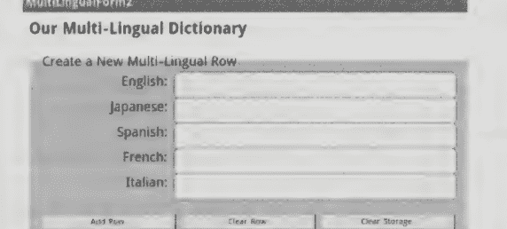

**图 1.4** 在 Sprint Nexus S 4G (Android ICS) 上显示的带有 CSS3 的 HTML5 表单。

下一节中的示例也使用了处理数据输入的 HTML5 表单，但这次数据将存储在 HTML5 数据库中，而不是在线 localStorage。

# LocalStorage 和 iOS 5.1

不幸的是，iOS 5.1 将 localStorage 视为“临时”数据，这意味着在 iOS 5.1 设备上，当存储空间不足时，localStorage 中的数据可能会被处置：

> http://www.infoworld.com/d/mobile-technology/new-ipad-complicates-life-html5-developers-190266

到本书出版时，这个问题可能已经得到解决。

# 在 localStorage 中存储图像

除了在 HTML5 localStorage 中存储简单的文本字符串外，你还可以存储图像和文件。你可以在这里找到一些有用的信息和代码示例：

> https://hacks.mozilla.org/2012/02/saving-images-and-files-in-localstorage/

你可以从 Github 获取上述文章的完整代码：

> https://github.com/robnyman/robnyman.github.com/tree/master/html5demos/localstorage

请注意，由于 localStorage 的大小限制，最好将图像存储在 IndexedDB 中。

# HTML5 WEB 数据库

除了使用 Web Storage 存储数据外，还有两个提供更强大功能的数据库。正在积极开发的数据库是 IndexedDB，截至本书出版时，它尚未在所有现代浏览器中完全实现。

另一个数据库是 WebSQL，但该数据库的开发已于 2010 年 11 月停止。但是，如果你有一个使用 WebSQL 的 Web 应用程序，以下文章提供了有用的信息，以帮助你迁移到 IndexedDB：

> http://www.html5rocks.com/en/tutorials/webdatabase/websql-indexeddb/

有各种开源项目可用于为 Web 应用程序提供数据库功能。例如，html5sql 是一个 JavaScript 模块，专注于在事务中顺序处理 SQL 语句：

> http://html5sql.com/

通过 html5sql，你可以将 SQL 作为单语句字符串、字符串或对象数组处理，或者从包含 SQL 语句的单独文件中处理。另一个开源项目是 JavaScript 数据库 TaffyDB。其主页在这里：

> http://taffydb.com/

这个开源项目包括更新和插入等功能，以及跨浏览器支持，以及用你自己的函数扩展数据库的能力。此外，TaffyDB 兼容多种工具包，如 jQuery、YUI 和 Dojo。

下一节将向你介绍 IndexedDB，并向你展示如何在 IndexedDB 数据库中存储文本字符串。

# 使用 HTML5 IndexedDB 数据库

在本节中，我们将使用 IndexedDB 数据库来存储多语言词典中的数据。IndexedDB 支持 SQLITE 语法，你可能对此很熟悉。

清单 1.14 显示了 HTML5 网页 MultiLingualForm2DB1.html 内容的部分内容，该网页说明了如何使用 IndexedDB 数据库创建和管理我们的数据。请注意，清单 1.14 的完整内容在 DVD 中提供。

## 清单 1.14 MultiLingualForm2DB1.html

```html
<html lang="en">
<head>
 <meta charset="utf-8"/>
 <title>Our Multi-Lingual Dictionary with IndexedDB</title>
 // code omitted for brevity

<script>
/* some database-related initialization here */
var dbName = "MultiLingual1";
var multilingual = {};

var indexedDB = window.indexedDB || window.webkitIndexedDB ||
                window.mozIndexedDB || window.moz_indexedDB;

console.log("indexedDB: " + indexedDB);

if ('webkitIndexedDB' in window) {
  window.IDBTransaction = window.webkitIDBTransaction;
  window.IDBKeyRange = window.webkitIDBKeyRange;
  console.log("initializing transaction and range");
}

multilingual.indexedDB = {};
multilingual.indexedDB.db = null;

multilingual.indexedDB.onerror = function(e) {
  console.log(e);
};

multilingual.indexedDB.open = function() {
  //console.log("dbName in open: "+dbName);
  var request = indexedDB.open(dbName, 1);

  request.onsuccess = function(e) {
    //console.log("top of onsuccess function");
    var v = "1.0";
    multilingual.indexedDB.db = e.target.result;
    var db = multilingual.indexedDB.db;

    // We can only create Object stores in a setVersion
    // transaction;
    if (v != db.version) {
      var setVrequest = db.setVersion(v);

      // onsuccess is the only place we can create Object Stores
      setVrequest.onerror = multilingual.indexedDB.onerror;

      setVrequest.onsuccess = function(e) {
        if(db.objectStoreNames.contains(dbName)) {
          db.deleteObjectStore(dbName);
        }
        var store = db.createObjectStore(dbName,
                                        {keyPath: "timeStamp"});

        multilingual.indexedDB.getAllWords();
      };
    } else {
      multilingual.indexedDB.getAllWords();
    }
  };

  request.onerror = multilingual.indexedDB.onerror;
};
</script>
</head>
</html>
```

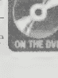

前面的代码块创建了一个名为 MultiLingual1 的 IndexedDB 数据库，并使用各种浏览器特定的前缀检查了 indexedDB 的存在性，之后代码定义了 `onerror()` JavaScript 函数。

```javascript
multilingual.indexedDB.open = function() {
  //console.log("dbName in open: "+dbName);
  var request = indexedDB.open(dbName, 1);

  request.onsuccess = function(e) {
    //console.log("top of onsuccess function");
    var v = "1.0";
    multilingual.indexedDB.db = e.target.result;
    var db = multilingual.indexedDB.db;

    // We can only create Object stores in a setVersion
    // transaction;
    if (v != db.version) {
      var setVrequest = db.setVersion(v);

      // onsuccess is the only place we can create Object Stores
      setVrequest.onerror = multilingual.indexedDB.onerror;

      setVrequest.onsuccess = function(e) {
        if(db.objectStoreNames.contains(dbName)) {
          db.deleteObjectStore(dbName);
        }
        var store = db.createObjectStore(dbName,
                                        {keyPath: "timeStamp"});

        multilingual.indexedDB.getAllWords();
      };
    } else {
      multilingual.indexedDB.getAllWords();
    }
  };

  request.onerror = multilingual.indexedDB.onerror;
};
```

前面的代码块定义了 `open()` JavaScript 函数，用于打开我们将存储多语言信息的 MultiLingual1 数据库。同时还会执行版本检查，以便我们能够灵活地创建不同版本的数据库。

```javascript
function addWord() {
  // code omitted for brevity
  var concatenated = english + ":" + japanese + ":" +
                     spanish + ":" + french + ":" +
                     italian;
  // more code omitted for brevity

  // add new words to our database
  multilingual.indexedDB.addWord(concatenated);
}
```

前面的代码块包含的代码几乎与清单 1.12 中的相应函数相同，区别在于高亮显示的代码行，它向你展示了向我们的 IndexedDB 多语言词典中添加新行是多么直接简单。

```javascript
multilingual.indexedDB.deleteWord = function(id) {
  var db = multilingual.indexedDB.db;
  var dbNameArray = new Array();
  dbNameArray.push(dbName);

  var trans = db.transaction(dbNameArray, IDBTransaction.READ_WRITE);
  var store = trans.objectStore(dbName);

  var request = store.delete(id);
  request.onsuccess = function(e) {
    multilingual.indexedDB.getAllWords();
  };

  request.onerror = function(e) {
    console.log("Error Adding: ", e);
  };
};
```

前面的代码块向你展示了如何以面向事务的方式从 IndexedDB 数据库中删除一行，其中 `id` 代表我们想要从数据库中删除的那一行。

请注意，在清单 1.14 中，只有存储功能发生了变化，并且当你启动这个网页时，它的外观将与图 1.4 完全相同。

# 将 Twitter 推文存储在 Web 数据库中

Remy Sharp 创建了一个使用 Web 数据库存储 Twitter 推文的开源项目。你可以在这里 fork 他的代码项目：

http://html5demos.com/database

本节不会展示 Remy 项目的代码，而是提供一些在 Google Chrome 中的截图，这在你调试应用程序中的 JavaScript 代码时会很有帮助。

导航到上面的网页，然后在屏幕上右键单击，稍等片刻你会看到 Chrome 控制台。现在选择 `Resources` > `html5demos` > `tweets`，然后将水平面板分隔符稍微向上拖动，你将看到类似于图 1.5 的内容。

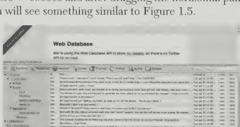

**图 1.5** Remy Sharp 的 Twitter 数据库。

现在选择 `Resources` > `html5demos`，然后在屏幕中央的 ">" 提示符右侧，输入以下 SQL 命令：

```sql
select * from tweets;
```

稍等片刻，你将在控制台中看到一组数据（不包括已添加到 localStorage 的任何新推文）。这个功能的好处在于，你可以根据需要调用任何 SQL 命令，以查看数据库中数据的不同方面。

你也可以通过图 1.6 所示的路径，在 Chrome 控制台中查看 JavaScript 文件 `tweet.js` 的内容。

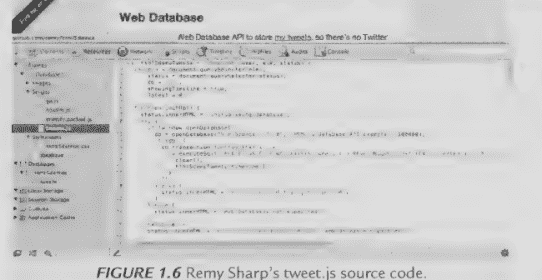

**图 1.6** Remy Sharp 的 tweet.js 源代码。

# Web 数据库与移动设备

你可以尝试将用于 Web 应用程序的相同技术用于移动应用程序，但你将在这两种环境中遇到类似的限制。虽然你可以使用原生代码来访问数据库，但该解决方案将特定于每种设备类型。你的选择取决于应用程序的要求。

一个跨平台的解决方案是使用 CouchDB Mobile，它是 CouchDB 的移动版本。另一个基于移动设备的替代方案是 TouchDB，它是一个兼容 Apache CouchDB 的轻量级数据库引擎。TouchDB 的创建者做了一个类比：“如果 CouchDB 是 MySQL，那么 TouchDB 就是 SQLite。” 这里提供了 TouchDB 的 Android 移植版和 iOS 移植版：

> https://github.com/couchbaselabs/TouchDB-Android

> https://github.com/couchbaselabs/TouchDB-iOS

# 性能、调试与测试工具

有多种优秀的性能和调试工具可供使用，本节将简要提及其中几种：

- Blaze（移动网站）
- Chrome Speed Tracer
- Page Speed
- WEINRE
- YSlow

在讨论这些工具之前，请记住本书中的代码示例适用于基于 WebKit 的浏览器，如果你还没有这样做，你应该熟悉内置在 Chrome 和 Safari 中的 Web Inspector。每当导航到一个网页时，你可以右键单击该网页，查看有关已启动网页的详细信息。

例如，图 1.7 显示了在 Chrome 浏览器中启动 HTML5 网页 HTML5Video1.html（如清单 1.6 所示），右键单击页面，然后点击 "Resources" 后将看到的内容。

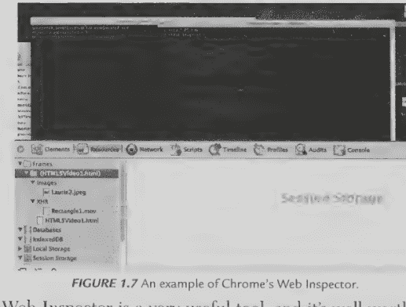

Web Inspector 是一个非常有用的工具，值得你花时间熟悉它的功能。这里有一个关于 Web Inspector 的 Wiki 页面，包含有用信息：

http://trac.webkit.org/wiki/WebInspector

## Blaze

Blaze 提供了移动网站性能的测试结果，包括总加载时间以及各个页面的加载时间。Blaze 支持多种移动设备，包括 iPhone、iPad 2（但不包括 iPad 3），以及运行 Android 2.2/2.3/3.0 的设备（但尚未支持 Android ICS）。请导航到以下 URL 并按照说明操作：

http://www.blaze.io/mobile/

## Chrome Speed Tracer

Chrome Speed Tracer 是一个开源项目，可帮助你识别 Web 应用程序中的性能瓶颈。其主页位于：

https://developers.google.com/web-toolkit/speedtracer/

Speed Tracer 执行底层检测，在分析完成后，结果将以可视化的方式显示。Speed Tracer 目前作为 Chrome 扩展提供，并在其支持的平台（Windows 和 Linux）上工作。

## PageSpeed

PageSpeed 实际上是一个用于优化网页性能的“工具集”。其主页位于：

https://developers.google.com/speed/pagespeed

PageSpeed 提供的可用工具包括：

- PageSpeed 浏览器扩展
- PageSpeed Insight
- mod_pagespeed Apache 模块
- PageSpeed Service

PageSpeed 浏览器扩展适用于 Chrome 和 Firefox，可帮助你提高网页的性能。

PageSpeed Insights 是一个基于 Web 的工具，无需下载扩展程序即可在任何浏览器中分析页面。mod_pagespeed Apache 模块会自动重写页面和资源以提高其性能。最后，PageSpeed Service 是一种在线服务，可加快网页的加载速度。

## WEINRE

WEINRE（读作“winery”）是一款出色的调试工具，其用户界面显示与 Chrome 的 Web Inspector 相同。其主页位于：

http://phonegap.github.com/weinre/

WEINRE 支持远程调试，这意味着你可以查看移动设备上的网页。你可以在以下位置找到关于 WEINRE 的 YouTube 视频、文档和讨论组：

```
http://www.youtube.com/results?search_query=weinre
http://callback.github.com/callback-weinre
http://groups.google.com/group/weinre
```

## Firefox 的 Firebug

Firebug 是一款 Firefox 浏览器的附加组件调试工具。你可以在此安装 Firebug：

https://addons.mozilla.org/en-US/firefox/addon/firebug/

还有一些模拟工具可用，例如 Remy Sharp 开发的工具，它允许你在移动设备上模拟运动事件。其主页位于：

http://remote-tilt.com/

你可以通过在网页中包含一行 JavaScript 来使用此工具，之后将出现一个弹出窗口，使你能够模拟各种运动事件。

遗憾的是，关于这些工具的进一步讨论超出了本书的主要范围，但至少学习其中一种工具绝对值得，这将为你提供在本书代码示例之外用于调试的知识。

## jsconsole

jsconsole 是一个用于调试目的的 JavaScript 和 CoffeeScript Web 控制台。此工具（由 Remy Sharp 创建）可在此下载：

https://github.com/remy/jsconsole

你可以在以下网站上看到 jsconsole 功能的示例：

http://jsconsole.com/

## Socketbug

Socketbug 是 Peter Schmalfeldt 创建的一个工具，可帮助你调试移动应用程序。其主页位于：

http://socketbug.com/

Socketbug 支持 iOS Safari、Android Webkit 和 Palm WebOS，你可以使用任何现代浏览器作为调试控制台。

## Adobe Shadow

Adobe Shadow 是 Adobe 开发的移动调试工具。其主页位于：

http://labs.adobe.com/technologies/shadow/

Adobe Shadow 提供了一种在多台设备上同时测试网站的方法，如果你对响应式设计感兴趣，这也很有吸引力。Adobe Shadow 使用 WEINRE 在设备上执行远程 DOM 检查，目前支持 Mac（OS X 10.6 和 10.7）和 Windows 7。关于 Adobe Shadow 的四分钟视频位于：

http://tv.adobe.com/watch/adobe-technology-sneaks-2012/adobe-shadow

另一个有用的调试工具是 WebKit 远程调试，它自 2011 年起就已可用，也包含在 iOS 和 Android 中。详细信息可在以下位置查看：

http://www.webkit.org/blog/1875/announcing-remote-debugging-protocol-v1-0/

## 其他有用链接

一个较新的网站是 HTML5 Please，它由知名行业人士贡献：

http://html5please.com

上述网站提供了一个输入字段，你可以在其中指定 HTML5 和 CSS3 功能，以确定它们是否已准备好使用，并查看如何使用它们。

W3C 为 HTML 网页（包括 HTML5 网页）提供免费的在线验证服务：

```
http://validator.w3.org/#validate_by_uri+with_options
```

上述网站使你能够验证 URL、文件或直接输入的代码。

以下网站提供了 HTML5 电子邮件输入字段的“样板”模板（以及 CSS 和 jQuery 的模板）：

```
http://favbulous.com/post/848/6-useful-web-development-boilerplates
```

以下两个链接分别指向 HTML5 草案规范和 HTML5 草案建议（2009年5月）。

```
http://www.w3.org/TR/html5/
```

```
http://www.whatwg.org/specs/web-apps/current-work/
```

还有一个“Web开发者版”的 HTML5 规范，它经过简化以提高可读性（不含供应商相关细节），你可以在此阅读：

```
http://developers.whatwg.org
```

# 总结

本章概述了几种使用 HTML5 表单管理和持久化用户提供的 HTML5 相关技术。在本章中，你学习了如何执行以下操作：

- 创建 HTML5 网页
- 使用新的语义标记
- 使用 HTML5 `<audio>` 和 `<video>` 元素
- 使用 Web Forms 创建 HTML5 网页
- 使用简单的 CSS3 增强 HTML5 网页
- 将数据持久化保存到 localStorage
- 将数据持久化保存到在线数据库

接下来的三章讨论基于 CSS3 的功能（以及将 CSS3 与 SVG 结合使用的示例），并深入探讨一些更复杂的 CSS3 功能，这些功能可以帮助你创建具有生动有趣视觉效果的 HTML5 网页。

# 第2章

# CSS3 简介

本章是专门介绍 CSS3 的两章中的第一章。本章讨论并通常通过代码示例或代码块说明大量的 CSS3 相关内容。在某些情况下，由于篇幅限制，某些概念没有附带代码示例；但是，这些概念被包含在内是因为让你了解它们很重要。尽管省略了许多 CSS3 主题，你仍将获得对 CSS3 各个方面的工作知识。

本章假定你对 CSS 有适度的理解，这意味着你知道如何在 CSS 选择器中设置属性。如果你不熟悉 CSS 选择器，可以通过互联网搜索找到许多入门文章。如果你确信 CSS 在令人困惑且看似深奥的规则下运作，那么阅读一篇关于 CSS 盒模型的在线文章可能值得你一读，之后你将更好地理解 CSS 的底层逻辑。

本章的第一部分包含代码示例，说明如何创建阴影效果、如何渲染带圆角的矩形以及如何使用线性和径向渐变。第二部分涵盖 CSS3 变换（缩放、旋转、倾斜和平移），以及说明如何将变换应用于 HTML 元素和 JPG 文件的代码示例。

本章第三部分简要讨论了 CSS3 媒体查询，它使你能够检测设备的一些特征，因此可以根据这些属性渲染 HTML5 网页。你将看到一些使用 CSS3 媒体查询的示例，例如根据移动设备的方向更改网页的布局。本章最后一部分讨论了 CSS3 Web 字体，你将看到如何在 HTML5 网页中使用 Web 字体的示例。

完成本章后，你将知道如何使用 CSS3 变换方法 `translate()`、`rotate()`、`skew()` 和 `scale()`。这将为你学习第3章的内容做好准备，第3章包含其他新 CSS3 功能（如 2D/3D 动画）的代码示例，以及一些 CSS 框架的概述。

你可以在桌面或笔记本电脑上基于 WebKit 的浏览器中启动本章中的代码示例；你也可以在移动设备上查看它们，只要你在支持代码示例中使用的 CSS3 功能的浏览器中启动它们。为方便起见，本章中的许多代码示例都附有在 Sprint Nexus S 4G 和 Asus Prime Android ICS 10 英寸平板电脑（均运行 Android ICS）上的截图，使你可以将这些截图与在桌面和笔记本电脑上基于 WebKit 的浏览器渲染的相应图像进行比较。在第13章中，你将学习创建可以启动 HTML5 网页的 Android 应用程序的过程。别忘了，Android apk 文件在附带的 DVD 上可用，你可以在支持 Android ICS（或更高版本）的 Android 设备上启动它们。

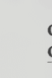

## CSS3 支持和 CSS3 属性的浏览器特定前缀

在深入探讨 CSS3 的细节之前，有两个重要的细节你需要了解关于为 HTML 页面定义基于 CSS3 的选择器。首先，你需要知道不同浏览器中可用的 CSS3 功能。确定浏览器对 CSS3 功能支持的最佳网站之一位于：

http://caniuse.com/

上述链接包含关于 IE、Firefox、Safari、Chrome 和 Opera 中 CSS3 支持的表格信息。

另一个非常有用的检查 CSS3 功能支持的工具是 Enhance.js，它测试浏览器以确定它们是否能支持一组基本的 CSS 和 JavaScript 属性，然后将功能传递给满足测试的浏览器。你可以在此下载 Enhance.js：

http://filamentgroup.com/lab/introducing_enhancejs_smarter_safer_apply_progressive_enhancement/

你需要知道的第二个细节是，许多 CSS3 属性目前需要浏览器特定前缀才能正常工作。前缀 `-ie-`、`-moz-` 和 `-o-` 分别用于 Internet Explorer、Firefox

## CSS3 功能快速概览

CSS3 采用模块化的方法来扩展现有 CSS2 的功能，并支持新功能。因此，CSS3 可以逻辑上分为以下几个类别：

- 背景/边框
- 颜色
- 媒体查询
- 多栏布局
- 选择器

使用 CSS3，你可以创建具有圆角和阴影效果的框，使用线性渐变和径向渐变创建丰富的图形效果，检测纵向和横向模式，使用媒体查询选择器检测移动设备的类型，以及生成多栏文本渲染和格式化。

此外，CSS3 允许你在选择器中使用伪类、首或末子元素（`first-child`、`last-child`、`first-of-type` 和 `last-of-type`）以及属性模式匹配测试来定义复杂的节点选择规则。本章的多个部分包含了如何创建此类选择规则的示例。

## CSS3 伪类、属性选择与关系符号

本简短部分包含一些伪类的示例，以及一些代码片段，向你展示如何基于文本字符串在各种属性中的相对位置来选择元素。尽管本节重点介绍 `nth-child()` 伪类，但你也将熟悉其他各种 CSS3 伪类。如果你需要使用这些伪类，本节末尾提供了一个链接，其中包含更多信息和示例，说明如何使用它们。

CSS3 支持广泛且丰富的伪类集合，包括 `nth-child()` 以及一些与其语义相关的“变体”，例如 `nth-of-type()`、`nth-first-of-type()`、`nth-last-of-type()` 和 `nth-last-child()`。

CSS3 还支持布尔选择器（也是伪类），如 `empty`、`enabled`、`disabled` 和 `checked`，这些对于与表单相关的 HTML 元素非常有用。另一个伪类是 `not()`，它返回一组不匹配选择条件的元素。

CSS3 使用元字符 `^`、`$` 和 `*`（后跟 `=` 符号）来匹配文本字符串的起始位置、末尾位置或任意位置。如果你熟悉 Unix 工具 `grep` 和 `sed` 以及 `vi` 文本编辑器，那么这些元字符对你来说会非常熟悉。

### CSS3 伪类

CSS3 的 `nth-child()` 是一个非常强大且有用的伪类，它具有以下形式：

```
nth-child(insert-a-keyword-or-linear-expression-here)
```

以下列表提供了在 HTML `<div>` 元素（也可用其他 HTML 元素替代）的子元素中使用 `nth-child()` 伪类以匹配各种子集的各种示例：

- `div:nth-child(1)`：匹配第一个子元素
- `div:nth-child(2)`：匹配第二个子元素
- `div:nth-child(even)`：匹配偶数位置的子元素
- `div:nth-child(odd)`：匹配奇数位置的子元素

`nth-child()` 伪类有趣且强大的方面在于它支持 `an+b` 形式的线性表达式，其中 `a` 是正整数，`b` 是非负整数，如下所示（使用 HTML5 `<div>` 元素）：

- `div:nth-child(3n)`：从位置 0 开始，匹配每隔三个的子元素
- `div:nth-child(3n+1)`：从位置 1 开始，匹配每隔三个的子元素
- `div:nth-child(3n+2)`：从位置 2 开始，匹配每隔三个的子元素
- `div:nth-child(3n+3)`：与 `div:nth-child(3n)` 相同

如你从上面最后一个示例所见，如果常数 `b` 的值等于常数 `a` 的值，则结果表达式会“环绕”。因此，表达式 `nth-child(an)` 和 `nth-child(an+a)` 是等效的。所以，你可以专注于 0 到 `a-1` 之间的“偏移量”（如果这有帮助的话，此行为与模运算相同）。

### CSS3 属性选择

你可以使用各种正则表达式来指定匹配 HTML 元素（以及基于 HTML 元素属性值匹配 HTML 元素）的 CSS3 选择器。例如，以下选择器选择 `src` 属性以文本字符串 "Laurie" 开头的 `img` 元素，然后将所选 `img` 元素的 `width` 属性和 `height` 属性设置为 100px：

```css
img[src^="Laurie"] {
    width: 100px; height: 100px;
}
```

当你想根据图像的名称（Laurie、Shelly、Steve 等）为图像设置不同的尺寸时，前面的 CSS3 选择器很有用。

以下 HTML `` 元素不匹配前面的选择器：

```html


```

以下选择器选择 `src` 属性以文本字符串 `jpeg` 结尾的 HTML `img` 元素，然后将所选 `img` 元素的 `width` 属性和 `height` 属性设置为 150px：

```css
img[src$="jpeg"] {
    width: 150px; height: 150px;
}
```

当你想根据图像的类型（jpg、png、jpeg 等）为图像设置不同的尺寸时，前面的 CSS3 选择器很有用。

以下选择器选择 `src` 属性包含文本字符串 `baby` 任意出现的 HTML `img` 元素，然后将所选 HTML `img` 元素的 `width` 属性和 `height` 属性设置为 200px：

```css
img[src*="baby"] {
    width: 200px; height: 200px;
}
```

当你想根据图像的“分类”（mybaby、yourbaby、babygirl、babyboy 等）为图像设置不同的尺寸时，前面的 CSS3 选择器很有用。

如果你想了解更多关于可以在 CSS3 选择器中使用的模式（及其描述），这里有一个广泛的列表：

http://www.w3.org/TR/css3-selectors

### CSS3 关系符号

除了支持伪类，CSS3 还引入了符号 `>`、`+` 和 `~`，以指定将被选作“结果集”一部分的元素之间的关系类型，如下所示：

```
div > p：匹配作为 `<div>` 元素子元素的 `<p>` 元素。
div + p：匹配紧随 `<div>` 元素后的一个 `<p>` 元素，且两者具有相同的父元素。
div ~ p：匹配所有 1.) 处于同一层级，2.) 紧随 `<div>` 元素，且 3.) 具有相同父元素的 `<p>` 元素。
```

包含 HTML 表单元素的网页。此外，你可以在包含 jQuery 和 jQuery Mobile 代码的 HTML5 网页中使用相同的关系符号。

本章第一部分到此结束。下一节将深入探讨 CSS3 的图形效果，例如圆角和阴影效果。

## CSS3 阴影效果与圆角

CSS3 阴影效果对于使用简单选择器创建生动的视觉效果非常有用。你可以将阴影效果用于文本和矩形区域。CSS3 还使你能够轻松渲染带有圆角的矩形，因此你不需要 JPG 文件来创建这种效果。

### 使用 RGB 和 HSL 指定颜色

在我们深入了解 CSS3 的有趣功能之前，你需要知道如何表示颜色。一种方法是使用 (R,G,B) 三元组，它表示颜色的红、绿、蓝分量。例如，三元组 (255,0,0)、(255,255,0) 和 (0,0,255) 分别代表红色、黄色和蓝色。指定颜色的其他方法包括：十六进制三元组 (FF, 0, 0) 和 (FF, 0, 0)；十进制三元组 (100%,0,0)；或字符串 #F00。

你也可以使用 (R,G,B,A)，其中第四个分量指定不透明度，这是一个介于 0（不可见）和 1（不透明）之间的十进制数。

然而，还有 HSL（色相、饱和度、亮度）颜色表示法，其中第一个分量是 0 到 360 之间的角度（0 度为正北），另外两个分量是 0 到 100 之间的百分比。例如，(0,100%,50%)、(120, 100%, 50%) 和 (240, 100%, 50%) 分别代表红色、绿色和蓝色。

本书中的代码示例使用 (R,G,B) 和 (R,G,B,A) 来表示颜色，但你可以通过互联网搜索获取更多关于 HSL 的信息。

### CSS3 与文本阴影效果

文本的阴影效果可以使网页看起来更生动、更有吸引力，许多网站在添加不过分的阴影效果（除非你特别需要）后看起来效果更好。

## 清单 2.1 TextShadow1.html

```html
<!DOCTYPE html>
<html lang="en">
<head>
    <meta charset="utf-8"/>
    <title>CSS Text Shadow Example</title>
    <link href="TextShadow1.css" rel="stylesheet" type="text/css">
</head>
<body>
    <div id="text1">
        Line One Shadow Effect
    </div>
    <div id="text2">
        Line Two Shadow Effect
    </div>
    <div id="text3">
        Line Three Vivid Effect
    </div>

    <div id="text4">
        <span id="dd">13</span>
        <span id="mm">August</span>
        <span id="yy">2012</span>
    </div>

    <div id="text5">
        <span id="dd">13</span>
        <span id="mm">August</span>
        <span id="yy">2012</span>
    </div>

    <div id="text6">
        <span id="dd">13</span>
        <span id="mm">August</span>
        <span id="yy">2012</span>
    </div>
</body>
</html>
```

清单 2.1 中的代码很直接：它引用了 CSS 样式表 `TextShadow1.css`，该样式表包含两个 CSS 选择器。其中一个选择器指定了如何渲染 id 属性值为 `text1` 的 HTML `<div>` 元素，另一个选择器则匹配 id 属性值为 `text2` 的 HTML `<div>` 元素。尽管本例中包含了 CSS3 `rotate()` 函数，但我们将在本章稍后部分再详细讨论该函数。

## 清单 2.2 TextShadow1.css

```css
#text1 {
    font-size: 24pt;
    text-shadow: 2px 4px 5px #00f;
}

#text2 {
    font-size: 32pt;
    text-shadow: 0px 1px 6px #000,
                4px 5px 6px #f00;
}

#text3 {
    font-size: 40pt;
    text-shadow: 0px 1px 6px #fff,
                2px 4px 4px #0ff,
                4px 5px 6px #00f,
                0px 0px 10px #444,
                0px 0px 20px #844,
                0px 0px 30px #a44,
                0px 0px 40px #f44;
}

#text4 {
    position: absolute;
    top: 200px;
    right: 200px;
    font-size: 48pt;
    text-shadow: 0px 1px 6px #fff,
                2px 4px 4px #0ff,
                4px 5px 6px #00f,
                0px 0px 10px #000,
                0px 0px 20px #448,
                0px 0px 30px #a4a,
                0px 0px 40px #fff;
    -webkit-transform: rotate(-90deg);
}

#text5 {
    position: absolute;
    left: 0px;
    font-size: 48pt;
    text-shadow: 2px 4px 5px #00f;
    -webkit-transform: rotate(-10deg);
}

#text6 {
    float: left;
    font-size: 48pt;
    text-shadow: 2px 4px 5px #f00;
    -webkit-transform: rotate(-170deg);
}

/* `transform` is explained later */
#text1:hover, #text2:hover, #text3:hover,
#text4:hover, #text5:hover, #text6:hover {
    -webkit-transform : scale(2) rotate(-45deg);
    transform : scale(2) rotate(-45deg);
}
```

清单 2.2 中的第一个选择器指定了 `24pt` 的字体大小，以及一个将文本渲染为蓝色背景（由十六进制值 `#00f` 表示）的 `text-shadow`。属性 `text-shadow` 从左到右依次指定了阴影的 x 坐标、y 坐标、模糊半径和颜色。第二个选择器指定了 `32pt` 的字体大小和红色的阴影背景 (`#f00`)。第三个选择器通过在 `text-shadow` 属性中指定多个组件，创造了更丰富的视觉效果，这些组件是通过尝试不同值可能产生的效果而选择的。

最后一个 CSS3 选择器在用户将鼠标悬停在六个文本字符串中的任何一个上时创建动画效果。动画的细节将推迟到本章稍后部分讨论。

图 2.1 展示了将 CSS 样式表 `TextShadow1.css` 中的选择器与 HTML 页面 `TextShadow1.html` 中的 HTML `<div>` 元素匹配后的结果。横向模式的截图来自一个运行在 Nexus S 4G (Android ICS) 智能手机上的 Android 应用程序（基于清单 2.1 和清单 2.2 中的代码）。

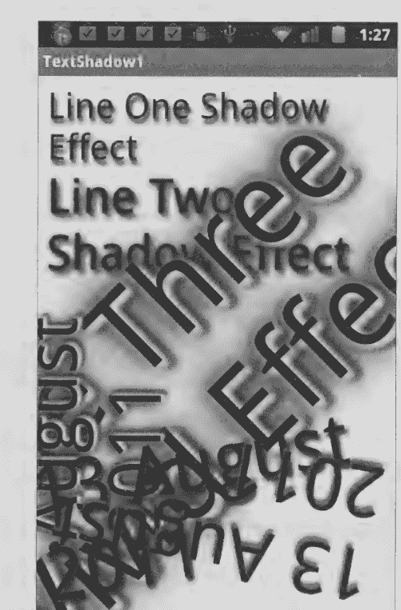

**图 2.1** CSS3 文本阴影效果。

## CSS3 和盒子阴影效果

你也可以为包含文本字符串的盒子应用阴影效果，这对于吸引用户注意网页的特定部分非常有效。但是，同样的警告也适用于盒子阴影，即避免过度使用。

清单 2.3 显示了渲染盒子阴影效果的 HTML 页面 `BoxShadow1.html` 的内容，清单 2.4 显示了包含相关 CSS3 选择器的 `BoxShadow1.css` 的内容。

## 清单 2.3 BoxShadow1.html

```html
<!DOCTYPE html>
<html lang="en">
<head>
    <meta charset="utf-8"/>
    <title>CSS Box Shadow Example</title>
    <link href="BoxShadow1.css" rel="stylesheet" type="text/css">
</head>

<body>
    <div id="box1"> Line One with a Box Effect </div>
    <div id="box2"> Line Two with a Box Effect </div>
    <div id="box3"> Line Three with a Box Effect </div>
</body>
</html>
```

清单 2.3 中的代码引用了 CSS 样式表 `BoxShadow1.css`（而不是 `TextShadow1.css`），其中包含三个 CSS 选择器。这些选择器分别指定了如何渲染 id 属性值为 `box1`、`box2` 和 `box3` 的 HTML `<div>` 元素（这三个 HTML `<div>` 元素在 `BoxShadow1.html` 中定义）。

## 清单 2.4 BoxShadow1.css

```css
#box1 {
    position:relative;top:10px;
    width: 50%;
    height: 30px;
    font-size: 20px;
    -moz-box-shadow: 10px 10px 5px #800;
    -webkit-box-shadow: 10px 10px 5px #800;
    box-shadow: 10px 10px 5px #800;
}

#box2 {
    position:relative;top:20px;
    width: 80%;
    height: 50px;
    font-size: 36px;
    padding: 10px;
    -moz-box-shadow: 14px 14px 8px #008;
    -webkit-box-shadow: 14px 14px 8px #008;
    box-shadow: 14px 14px 8px #008;
}

#box3 {
    position:relative;top:30px;
    width: 80%;
    height: 60px;
    font-size: 52px;
    padding: 10px;
    -moz-box-shadow: 14px 14px 8px #008;
    -webkit-box-shadow: 14px 14px 8px #008;
    box-shadow: 14px 14px 8px #008;
}
```

清单 2.4 中的第一个选择器指定了 `width`、`height` 和 `font-size` 属性，这些属性控制着相关 HTML `<div>` 元素及其包含的文本字符串的尺寸。接下来的三个属性由一个特定于 Mozilla 的 `box-shadow` 属性、一个特定于 WebKit 的 `box-shadow` 属性以及一个“通用”的 `box-shadow` 属性组成。

图 2.2 展示了一个来自安装了 Android ICS 的 Sprint Nexus S 4G 的横向模式截图（基于清单 2.3 和清单 2.4 中的代码）。

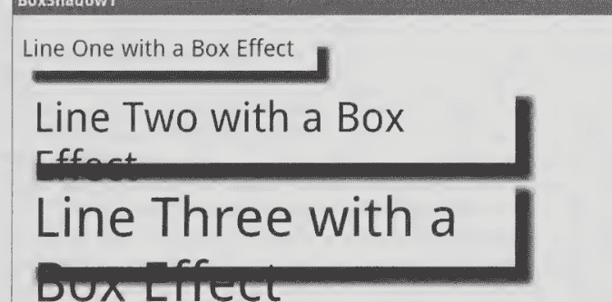

**图 2.2** 安装了 Android ICS 的 Sprint Nexus S 4G 上的 CSS3 盒子阴影效果。

## CSS3 和圆角

Web 开发人员在 CSS 中期待圆角已经很久了，而 CSS3 使得渲染带圆角的盒子变得非常容易。

清单 2.5 显示了 HTML 页面 `RoundedCorners1.html` 的内容，该页面在带圆角的盒子中渲染文本字符串，清单 2.6 显示了 CSS 文件 `RoundedCorners1.css` 的内容。

## 清单 2.5 RoundedCorners1.html

```html
<!DOCTYPE html>
<html lang="en">
<head>
    <meta charset="utf-8"/>
    <title>CSS Text Shadow Example</title>
    <link href="RoundedCorners1.css" rel="stylesheet" type="text/css">
</head>
<body>
    <div id="outer">
        <a href="#" class="anchor">Text Inside a Rounded Rectangle</a>
    </div>
    <div id="text1">
        Line One of Text with a Shadow Effect
    </div>
    <div id="text2">
        Line Two of Text with a Shadow Effect
    </div>
</body>
</html>
```

清单 2.5 包含了对 CSS 样式表 `RoundedCorners1.css` 的引用，该样式表包含三个 CSS 选择器，分别匹配 `id` 属性值为 `anchor`、`text1` 和 `text2` 的元素。在 `RoundedCorners1.css` 中定义的 CSS 选择器创建了视觉效果，并且正如你将看到的，`hover` 伪类选择器使你能够创建动画效果。

## 清单 2.6 RoundedCorners1.css

```css
a.anchor:hover {
    background: #00F;
}

a.anchor {
    background: #FF0;
    font-size: 24px;
    font-weight: bold;
    padding: 4px 4px;
    color: rgba(255,0,0,0.8);
    text-shadow: 0 1px 1px rgba(0,0,0,0.4);
    -webkit-transition: all 2.0s ease;
    -transition: all 2.0s ease;
}
```

## CSS3 渐变

CSS3 支持线性渐变和径向渐变，使您能够创建在视觉上与 SVG 等其他技术中渐变一样丰富的渐变效果。本节中的代码示例说明了如何在 CSS3 中定义线性渐变和径向渐变，然后将其应用到 HTML 元素。

### 线性渐变

CSS3 线性渐变要求您指定一个或多个“颜色停止点”，每个停止点指定了起始颜色、结束颜色和渲染模式。基于 WebKit 的浏览器支持以下语法来定义线性渐变：

- 一个起始点
- 一个结束点
- 使用 `from()` 指定的起始颜色
- 零个或多个中间颜色停止点
- 使用 `to()` 指定的结束颜色

起始点可以指定为一对 $(x, y)$ 数字或百分比。例如，$(100, 25\%)$ 这对值指定了一个点，该点位于原点右侧 100 像素，且从图案顶部向下 25% 的位置。请记住，原点位于屏幕的左上角。

清单 2.7 显示了 `LinearGradient1.html` 的内容，清单 2.8 显示了 `LinearGradient1.css` 的内容，它们说明了如何将线性渐变应用于包含在 `<p>` 元素和一个 `<h3>` 元素中的文本字符串。

#### 清单 2.7 LinearGradient1.html

```html
<!doctype html>
<html lang="en">
<head>
    <meta charset="utf-8"/>
    <title>CSS 线性渐变示例</title>
    <link href="LinearGradient1.css" rel="stylesheet" type="text/css">
</head>
<body>
    <div id="outer">
        <p id="line1">带线性渐变的第1行</p>
        <p id="line2">带线性渐变的第2行</p>
        <p id="line3">带线性渐变的第3行</p>
        <p id="line4">带线性渐变的第4行</p>
        <p id="outline">带阴影轮廓的第5行</p>
        <h3><a href="#">一行渐变文本</a></h3>
    </div>
</body>
</html>
```

清单 2.7 是一个简单的网页，包含四个 `<p>` 元素和一个 `<h3>` 元素。清单 2.7 还引用了 CSS 样式表 `LinearGradient1.css`，其中包含与清单 2.7 中的四个 `<p>` 元素和 `<h3>` 元素匹配的 CSS 选择器。

#### 清单 2.8 LinearGradient1.css

```css
#line1 {
width: 50%;
font-size: 32px;
background-image: -webkit-gradient(linear, 0% 0%, 0% 100%,
                    from(#fff), to(#f00));
background-image: -gradient(linear, 0% 0%, 0% 100%,
                    from(#fff), to(#f00));
-webkit-border-radius: 4px;
border-radius: 4px;
}

#line2 {
width: 50%;
font-size: 32px;
background-image: -webkit-gradient(linear, 100% 0%, 0% 100%,
                    from(#fff), to(#ff0));
background-image: -gradient(linear, 100% 0%, 0% 100%,
                    from(#fff), to(#ff0));
-webkit-border-radius: 4px;
border-radius: 4px;
}

#line3 {
width: 50%;
font-size: 32px;
background-image: -webkit-gradient(linear, 0% 0%, 0% 100%,
                    from(#f00), to(#00f));
background-image: -gradient(linear, 0% 0%, 0% 100%,
                    from(#f00), to(#00f));
-webkit-border-radius: 4px;
border-radius: 4px;
}

#line4 {
width: 50%;
font-size: 32px;
background-image: -webkit-gradient(linear, 100% 0%, 0% 100%,
                    from(#f00), to(#00f));
background-image: -gradient(linear, 100% 0%, 0% 100%,
                    from(#f00), to(#00f));
-webkit-border-radius: 4px;
border-radius: 4px;
}

#outline {
font-size: 2.0em;
font-weight: bold;
color: #fff;
text-shadow: 1px 1px 1px rgba(0,0,0,0.5);
}

h3 {
width: 50%;
position: relative;
margin-top: 0;
font-size: 32px;
font-family: helvetica, ariel;
}

h3 a {
position: relative;
color: red;
text-decoration: none;
-webkit-mask-image: -webkit-gradient(linear, left top, left bottom,
                                       from(rgba(0,0,0,1)),
                                       color-stop(50%, rgba(0,0,0,0.5)),
                                       to(rgba(0,0,0,0)));
}

h3:after {
content:"这是一行渐变文本";
color: blue;
}
```

清单 2.8 中的第一个选择器指定了文本的字体大小为 32、边框半径为 4（这会渲染圆角），以及一个从白色到蓝色的线性渐变，如下所示：

```css
#line1 {
width: 50%;
font-size: 32px;
background-image: -webkit-gradient(linear, 0% 0%, 0% 100%,
                                      from(#fff), to(#f00));
background-image: -gradient(linear, 0% 0%, 0% 100%,
                              from(#fff), to(#f00));
-webkit-border-radius: 4px;
border-radius: 4px;
}
```

如您所见，第一个选择器包含两个带有 -webkit- 前缀的属性和两个不带此前缀的标准属性。由于清单 2.8 中接下来的三个选择器与第一个选择器相似，我们将不再讨论它们的内容。

下一个 CSS 选择器通过将文本渲染为白色并带有细黑色阴影，创建了具有良好阴影效果的文本轮廓，如下所示：

```css
color: #fff;
text-shadow: 1px 1px 1px rgba(0,0,0,0.5);
```

清单 2.8 的最后部分包含三个影响 `<h3>` 元素及其嵌入 `<a>` 元素渲染的选择器：h3 选择器指定了宽度和字体大小；h3 选择器指定了线性渐变；h3:after 选择器指定了要显示的文本字符串。还指定了其他属性，但这些是这些选择器的主要属性。

图 2.4 显示了在运行 Android ICS 的 Asus Prime 平板电脑上，Android 应用程序横屏模式截图中，CSS 样式表 `LinearGradient1.css` 中的选择器与 HTML 页面 `LinearGradient1.html` 匹配的结果。

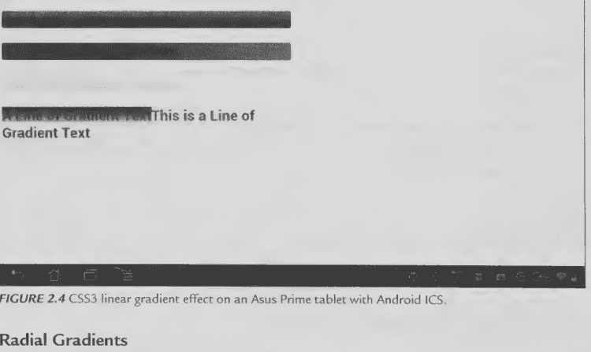

### 径向渐变

CSS3 径向渐变比 CSS3 线性渐变更复杂，但您可以使用它们来创建更复杂的渐变效果。基于 WebKit 的浏览器支持以下语法来定义径向渐变：

- 一个起始点
- 一个起始半径
- 一个结束点
- 一个结束半径
- 使用 `from()` 指定的起始颜色
- 零个或多个中间颜色停止点
- 使用 `to()` 指定的结束颜色

请注意，径向渐变的语法与线性渐变的语法相似，只是您还需要指定一个起始半径和一个结束半径。

清单 2.9 显示了 `RadialGradient1.html` 的内容，清单 2.10 显示了 `RadialGradient1.css` 的内容，它们说明了如何使用径向渐变渲染各种圆形。

#### 清单 2.9 RadialGradient1.html

```html
<!doctype html>
<html lang="en">
<head>
  <meta charset="utf-8"/>
  <title>CSS 径向渐变示例</title>
  <link href="RadialGradient1.css" rel="stylesheet" type="text/css">
</head>
<body>
  <div id="outer">
    <div id="radial3">Text3</div>
    <div id="radial2">Text2</div>
    <div id="radial4">Text4</div>
    <div id="radial1">Text1</div>
  </div>
</body>
</html>
```

清单 2.9 包含五个 HTML `<div>` 元素，其 `id` 属性的值分别为 `outer`、`radial1`、`radial2`、`radial3` 和 `radial4`。清单 2.9 还引用了 CSS 样式表 `RadialGradient1.css`，其中包含五个与这五个 HTML `<div>` 元素匹配的 CSS 选择器。

#### 清单 2.10 RadialGradient1.css

```css
#outer {
position: relative; top: 10px; left: 0px;
}

#radial1 {
font-size: 24px;
width: 300px;
height: 300px;
position: absolute; top: 300px; left: 300px;

background: -webkit-gradient(
  radial, 500 40%, 0, 301 25%, 360, from(red),
  color-stop(0.05, orange), color-stop(0.4, yellow),
  color-stop(0.6, green), color-stop(0.8, blue),
  to(#fff)
);
}

#radial2 {
font-size: 24px;
width: 500px;
height: 500px;
position: absolute; top: 100px; left: 100px;

background: -webkit-gradient(
  radial, 500 40%, 0, 301 25%, 360, from(red),
  color-stop(0.05, orange), color-stop(0.4, yellow),
  color-stop(0.6, green), color-stop(0.8, blue),
  to(#fff)
);
}

#radial3 {
font-size: 24px;
width: 600px;
height: 600px;
position: absolute; top: 0px; left: 0px;

background: -webkit-gradient(
  radial, 500 40%, 0, 301 25%, 360, from(red),
  color-stop(0.05, orange), color-stop(0.4, yellow),
  color-stop(0.6, green), color-stop(0.8, blue),
  to(#fff)
);
-webkit-box-shadow: 0px 0px 8px #000;
}

#radial4 {
font-size: 24px;
width: 400px;
height: 400px;
position: absolute; top: 200px; left: 200px;

background: -webkit-gradient(
  radial, 500 40%, 0, 301 25%, 360, from(red),
  color-stop(0.05, orange), color-stop(0.4, yellow),
  color-stop(0.6, green), color-stop(0.8, blue),
  to(#fff)
);
}
```

清单 2.10 中 `#radial1` 选择器的第一部分包含了 `width` 和 `height` 属性，它们指定了渲染矩形的尺寸，以及一个与 `#outer` 选择器中类似的 `position` 属性。


# CSS3 径向渐变与 2D 变换

## 径向渐变详解

`#radial1` 还包含一个 `background` 属性，该属性使用 `-webkit-` 前缀定义了径向渐变，如下所示：

```css
background: -webkit-gradient(
  radial, 100 25%, 20, 100 25%, 40, from(blue), to(#fff)
);
```

前面的径向渐变指定了以下内容：

- 起点为 (100, 25%)
- 起始半径为 20
- 终点为 (100, 25%)
- 结束半径为 40
- 起始颜色为蓝色
- 结束颜色为白色 (#fff)

请注意，起点和终点相同，这会渲染出一组从蓝色渐变到白色的同心圆。

清单 2.10 中的另外四个选择器具有与第一个选择器相同的语法，但渲染出的径向渐变效果差异显著。你可以通过指定不同的起点和终点，以及指定大于结束半径的起始半径，来创建这些（以及其他）效果。

`#radial4` 选择器通过两个 `stop-color` 属性创建了“环状效果”，如下所示：

```css
color-stop(0.2, orange), color-stop(0.4, yellow),
color-stop(0.6, green), color-stop(0.8, blue),
```

你可以添加额外的 `color-stop` 属性来创建更复杂的径向渐变。

图 2.5 展示了在运行 Android ICS 的华硕 Prime 平板电脑（横屏模式）上，将 CSS 样式表 `RadialGradient1.css` 中的选择器与 HTML 页面 `RadialGradient1.html` 匹配后的结果截图。

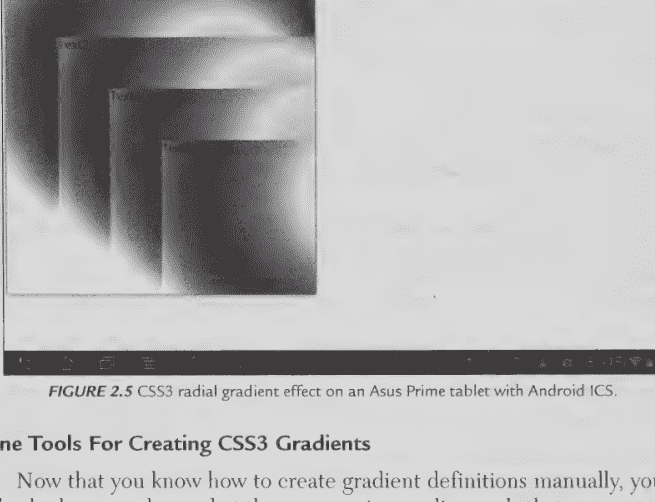

**图 2.5** 运行 Android ICS 的华硕 Prime 平板电脑上的 CSS3 径向渐变效果。

## 创建 CSS3 渐变的在线工具

现在你知道了如何手动创建渐变定义，可能也会很高兴地了解到，有各种在线工具可以为你创建渐变。以下网站提供的工具支持创建视觉上吸引人的 CSS3 渐变效果：

- http://css3please.com
- http://www.westciv.com/tools/gradients
- http://gradients.glrzad.com

由于这些工具提供不同的选项集，请尝试每个网站，评估哪个工具最适合你的特定需求。如果这些工具缺少你需要的功能，请通过互联网搜索来寻找更多创建基于 CSS3 效果的网站。

## CSS3 2D 变换

除了过渡效果，CSS3 还支持四种可以应用于 2D 形状和 JPG 文件的变换。这四种 CSS3 变换分别是缩放 (`scale`)、旋转 (`rotate`)、倾斜 (`skew`) 和平移 (`translate`)。以下各节包含代码示例，说明如何将这些 CSS3 变换分别应用于一组 JPG 文件。当用户将鼠标悬停在任何 JPG 文件上时，会触发动画效果；此外，通过在相邻 JPG 文件之间快速移动鼠标，你可以创建“局部”动画效果。

### 使用缩放变换实现放大/缩小效果

CSS3 的 `transform` 属性允许你指定 `scale()` 函数来创建放大/缩小效果，`scale()` 方法的语法如下所示：

```javascript
scale(someValue);
```

你可以将 `someValue` 替换为任何非零数字。当 `someValue` 在 0 到 1 之间时，你会减小 2D 形状或 JPG 文件的大小，从而创建“缩小”效果；当 `someValue` 大于 1 时，会增加 2D 形状或 JPG 文件的大小，从而创建“放大”效果；值为 1 则不执行任何更改。

清单 2.11 显示了 `Scale1.html` 的内容，清单 2.12 显示了 `Scale1.css` 的内容，它们说明了如何缩放 JPG 文件以创建“悬停框”图片库。

**清单 2.11** `Scale1.html`

```html
<!DOCTYPE html>
<html lang="en">
<head>
    <meta charset="utf-8"/>
    <title>CSS 缩放变换示例</title>
    <link href="Scale1.css" rel="stylesheet" type="text/css">
</head>

<body>
    <header>
        <h1>将鼠标悬停在任意图片上：</h1>
    </header>

    <div id="outer">
        
        
        
        
    </div>
</body>
</html>
```

清单 2.11 引用了 CSS 样式表 `Scale1.css`（其中包含用于创建缩放效果的选择器）以及引用了 JPG 文件 `Laurie1.jpeg` 和 `Laurie2.jpeg` 的四个 HTML `` 元素。清单 2.11 的其余部分很直接，包含简单的样板文本和 HTML 元素。

**清单 2.12** `Scale1.css`

```css
#outer {
  float: left;
  position: relative; top: 50px; left: 50px;
}

img {
  -webkit-transition: -webkit-transform 1.0s ease;
  transition: transform 1.0s ease;
}

img.scaled {
  -webkit-box-shadow: 10px 10px 5px #800;
  box-shadow: 10px 10px 5px #800;
}

img.scaled:hover {
  -webkit-transform: scale(2);
  transform: scale(2);
}
```

清单 2.12 中的 `img` 选择器指定了一个 `transition` 属性，该属性应用了一个在一秒间隔内使用 `ease` 函数发生的 `transform` 效果，如下所示：

```css
transition: transform 1.0s ease;
```

接下来，选择器 `img.scaled` 指定了一个 `box-shadow` 属性，该属性创建了一个红色阴影效果（你之前在本章中已经看到过），如下所示：

```css
img.scaled {
  -webkit-box-shadow: 10px 10px 5px #800;
  box-shadow: 10px 10px 5px #800;
}
```

最后，选择器 `img.scaled:hover` 指定了一个 `transform` 属性，该属性使用 `scale()` 函数，以便在用户将鼠标悬停在任何 `` 元素上时，将相关 JPG 文件的大小加倍，如下所示：

```css
transform: scale(2);
```

由于 `img` 选择器指定了一个使用 `ease` 函数的一秒间隔，缩放效果将持续一秒。尝试为 CSS3 的 `scale()` 函数设置不同的值，以及为时间间隔设置不同的值，以创建适合你需求的动画效果。

另一点要记住的是，你可以同时进行水平和垂直缩放：

```css
img {
  -webkit-transition: -webkit-transform 1.0s ease;
  transition: transform 1.0s ease;
}

img.mystyle:hover {
  -webkit-transform: scaleX(1.5) scaleY(0.5);
  transform: scaleX(1.5) scaleY(0.5);
}
```

图 2.6 展示了在运行 Android ICS 的 Nexus S 4G 智能手机（横屏模式）上，将 CSS 样式表 `Scale1.css` 中的选择器与 HTML 页面 `Scale1.html` 匹配后的结果截图（基于清单 2.11 和清单 2.12 中的代码）。

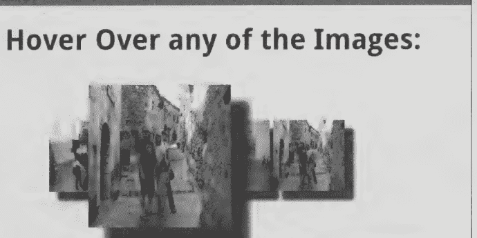

## 旋转变换

CSS3 的 `transform` 属性允许你指定 `rotate()` 函数来创建缩放效果，其语法如下：

```css
rotate(someValue);
```

你可以将 `someValue` 替换为任何数字。当 `someValue` 为正数时，旋转为顺时针方向；当 `someValue` 为负数时，旋转为逆时针方向；当 `someValue` 为零时，则没有旋转效果。在所有情况下，旋转效果的初始位置都是正水平轴。

清单 2.13 展示了 `Rotate1.html` 的内容，清单 2.14 展示了 `Rotate1.css` 的内容，它们说明了如何反向旋转 JPG 文件。

**清单 2.13** `Rotate1.html`

```html
<!DOCTYPE html>
<html lang="en">
<head>
    <meta charset="utf-8"/>
    <title>CSS 旋转变换示例</title>
    <link href="Rotate1.css" rel="stylesheet" type="text/css">
</head>
<body>
    <header>
        <h1>将鼠标悬停在任意图片上：</h1>
    </header>
    <div id="outer">
        
        
        
        
    </div>
</body>
</html>
```

清单 2.13 引用了 CSS 样式表 `Rotate1.css`（其中包含创建旋转效果的选择器）以及一个引用了 JPG 文件 `Laurie1.jpeg` 和 `Laurie2.jpeg` 的 HTML `` 元素。清单 2.13 的其余部分由简单的样板文本和 HTML 元素组成。

**清单 2.14** `Rotate1.css`

```css
#outer {
    float: left;
    position: relative;
    top: 100px;
    left: 150px;
}

img {
    -webkit-transition: -webkit-transform 1.0s ease;
    transition: transform 1.0s ease;
}

img.imageL {
    -webkit-box-shadow: 14px 14px 8px #800;
    box-shadow: 14px 14px 8px #800;
}

img.imageR {
    -webkit-box-shadow: 14px 14px 8px #008;
    box-shadow: 14px 14px 8px #008;
}

img.imageL:hover {
    -webkit-transform: scale(2) rotate(-45deg);
    transform: scale(2) rotate(-45deg);
}

img.imageR:hover {
    -webkit-transform: scale(2) rotate(360deg);
    transform: scale(2) rotate(360deg);
}
```

清单 2.14 包含了 `img` 选择器，该选择器指定了一个 `transition` 属性，该属性使用 `ease` 计时函数在一秒的时间间隔内创建动画效果，如下所示：`transition: transform 1.0s ease;`

接下来，选择器 `img.imageL` 和 `img.imageR` 包含一个属性，该属性分别渲染出红色和蓝色的背景阴影。

选择器 `img.imageL:hover` 指定了一个 `transform` 属性，每当用户将鼠标悬停在 `` 元素上时，该属性会执行一个逆时针的缩放效果（将原始尺寸放大一倍）和一个旋转效果（逆时针旋转 45 度），如下所示：`transform: scale(2) rotate(-45deg);`

选择器 `img.imageR:hover` 类似，不同之处在于它执行的是 360 度的顺时针旋转。

图 2.7 展示了将 CSS 样式表 `Rotate1.css` 中的选择器与 HTML 页面 `Rotate1.html` 中的元素进行匹配的结果。该横向截图来自一个运行在搭载 Android ICS 系统的 Nexus S 4G 智能手机上的 Android 应用程序（基于清单 2.13 和清单 2.14 中的代码）。

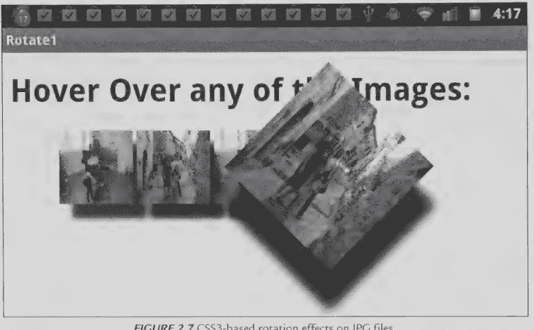

## 倾斜变换

CSS3 的 `transform` 属性允许你指定 `skew()` 函数来创建倾斜效果，其语法如下：`skew(xAngle, yAngle);`

你可以将 `xAngle` 和 `yAngle` 替换为任何数字。当 `xAngle` 和 `yAngle` 为正数时，倾斜效果为顺时针方向；当 `xAngle` 和 `yAngle` 为负数时，倾斜效果为逆时针方向；当 `xAngle` 和 `yAngle` 为零时，则没有倾斜效果。在所有情况下，倾斜效果的初始位置都是正水平轴。

清单 2.15 展示了 `Skew1.html` 的内容，清单 2.16 展示了 `Skew1.css` 的内容，它们说明了如何倾斜一个 JPG 文件。

### 清单 2.15 `Skew1.html`

```html
<!DOCTYPE html>
<html lang="en">
<head>
    <meta charset="utf-8"/>
    <title>CSS 倾斜变换示例</title>
    <link href="Skew1.css" rel="stylesheet" type="text/css">
</head>
<body>
  <header>
    <h1>将鼠标悬停在任意图片上：</h1>
  </header>

  <div id="outer">
    
    
    
    
  </div>
</body>
</html>
```

清单 2.15 引用了 CSS 样式表 `Skew1.css`（其中包含创建倾斜效果的选择器）以及一个引用了 JPG 文件 `Laurie1.jpeg` 和 `Laurie2.jpeg` 的 `` 元素。清单 2.15 的其余部分由简单的样板文本和 HTML 元素组成。

### 清单 2.16 `Skew1.css`

```css
#outer {
  float: left;
  position: relative;
  top: 100px;
  left: 100px;
}

img {
  -webkit-transition: -webkit-transform 1.0s ease;
  transition: transform 1.0s ease;
}

img.skewed1 {
  -webkit-box-shadow: 14px 14px 8px #800;
  box-shadow: 14px 14px 8px #800;
}

img.skewed2 {
  -webkit-box-shadow: 14px 14px 8px #880;
  box-shadow: 14px 14px 8px #880;
}

img.skewed3 {
  -webkit-box-shadow: 14px 14px 8px #080;
  box-shadow: 14px 14px 8px #080;
}

img.skewed4 {
  -webkit-box-shadow: 14px 14px 8px #008;
  box-shadow: 14px 14px 8px #008;
}

img.skewed1:hover {
  -webkit-transform: scale(2) skew(-10deg, -30deg);
  transform: scale(2) skew(-10deg, -30deg);
}

img.skewed2:hover {
  -webkit-transform: scale(2) skew(10deg, 30deg);
  transform: scale(2) skew(10deg, 30deg);
}

img.skewed3:hover {
  -webkit-transform: scale(0.4) skew(-10deg, -30deg);
  transform: scale(0.4) skew(-10deg, -30deg);
}

img.skewed4:hover {
  -webkit-transform: scale(0.5, 1.5) skew(10deg, -30deg);
  transform: scale(0.5, 1.5) skew(10deg, -30deg);
  opacity: 0.5;
}
```

清单 2.16 包含了 `img` 选择器，并指定了一个 `transition` 属性，该属性使用 `ease` 计时函数在一秒的时间间隔内创建动画效果，如下所示：`transition: transform 1.0s ease;`

四个选择器 `img.skewed1`、`img.skewed2`、`img.skewed3` 和 `img.skewed4` 分别创建了深浅不同的红色、黄色、绿色和蓝色的背景阴影效果（这些效果你在前面的代码示例中都见过）。

选择器 `img.skewed1:hover` 指定了一个 `transform` 属性，每当用户将鼠标悬停在第一个 `` 元素上时，该属性就会执行倾斜效果，如下所示：`transform: scale(2) skew(-10deg, -30deg);`

另外三个 CSS3 选择器也结合使用了 CSS 函数 `skew()` 和 `scale()` 来创建独特的视觉效果。请注意，第四个悬停选择器还将 `opacity` 属性设置为 0.5，这与该选择器中的其他效果并行发生。

图 2.8 展示了将 CSS 样式表 `Skew1.css` 中的选择器与 HTML 页面 `Skew1.html` 中的元素进行匹配的结果。该横向截图来自一个运行在搭载 Android ICS 系统的 Nexus S 4G 智能手机上的 Android 应用程序（基于清单 2.15 和清单 2.16 中的代码）。

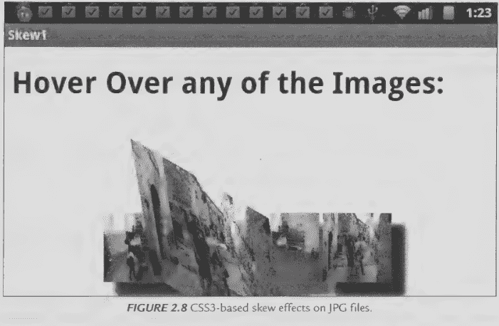

## 平移变换

CSS3 的 `transform` 属性允许你指定 `translate()` 函数来创建一个涉及元素水平和/或垂直“移动”的效果，其语法如下：`translate(xDirection, yDirection);`

平移是相对于原点（即屏幕的左上角）而言的。因此，`xDirection` 和 `yDirection` 的正值分别产生向右和向下的移动，而负值则产生向左和向上的移动；`xDirection` 和 `yDirection` 的零值不会引起任何平移效果。

清单 2.17 展示了 `Translate1.html` 的内容，清单 2.18 展示了 `Translate1.css` 的内容，它们说明了如何将平移效果应用于 JPG 文件。

### 清单 2.17 `Translate1.html`

```html
<!DOCTYPE html>
<html lang="en">
<head>
    <meta charset="utf-8"/>
    <title>CSS Translate Transform Example</title>
    <link href="Translate1.css" rel="stylesheet" type="text/css">
</head>

<body>
    <header>
        <h1>Hover Over any of the Images:</h1>
    </header>

    <div id="outer">
        
        
        
        
    </div>
</body>
</html>
```

清单 2.17 引用了 CSS 样式表 `Translate1.css`（其中包含用于创建平移效果的选择器）以及一个引用了 JPG 文件 `Laurie1.jpeg` 和 `Laurie2.jpeg` 的 `` 元素。清单 2.17 的其余部分由简单的样板文本和 HTML 元素组成。

### 清单 2.18 `Translate1.css`

```css
#outer {
    float: left;
    position: relative; top: 100px; left: 100px;
}

img {
    -webkit-transition: -webkit-transform 1.0s ease;
    transition: transform 1.0s ease;
}

img.trans1 {
    -webkit-box-shadow: 14px 14px 8px #800;
    box-shadow: 14px 14px 8px #800;
}

img.trans2 {
    -webkit-box-shadow: 14px 14px 8px #880;
    box-shadow: 14px 14px 8px #880;
}

img.trans3 {
    -webkit-box-shadow: 14px 14px 8px #080;
    box-shadow: 14px 14px 8px #080;
}

img.trans4 {
    -webkit-box-shadow: 14px 14px 8px #008;
    box-shadow: 14px 14px 8px #008;
}

img.trans1:hover {
    -webkit-transform: scale(2) translate(100px, 50px);
    transform: scale(2) translate(100px, 50px);
}

img.trans2:hover {
    -webkit-transform: scale(0.5) translate(-50px, -50px);
    transform: scale(0.5) translate(-50px, -50px);
}

img.trans3:hover {
    -webkit-transform: scale(0.5,1.5) translate(0px, 0px);
    transform: scale(0.5,1.5) translate(0px, 0px);
}

img.trans4:hover {
    -webkit-transform: scale(2) translate(50px, -50px);
    transform: scale(2) translate(50px, -50px);
}
```

清单 2.17 中包含 `img` 选择器，并使用 `ease` 时序函数指定了在 1 秒间隔内进行的变换效果，如下所示：

`transition: transform 1.0s ease;`

四个选择器 `img.trans1`、`img.trans2`、`img.trans3` 和 `img.trans4` 分别创建了具有红色、黄色、绿色和蓝色深浅阴影的背景效果，正如你在前面章节中所见。

选择器 `img.trans1:hover` 指定了一个变换属性，当用户将鼠标悬停在第一个 `` 元素上时，它会执行缩放效果和平移效果，如下所示：

```css
-webkit-transform: scale(2) translate(100px, 50px);
transform: scale(2) translate(100px, 50px);
```

其他三个选择器包含类似的代码，涉及平移和缩放效果的组合，每种组合都创建了独特的视觉效果。图 2.9 展示了将 CSS3 样式表 `Translate1.css` 中定义的选择器与 HTML 页面 `Translate1.html` 中的元素进行匹配的结果。这张横向截图来自一个运行在 Android ICS 系统 Nexus S 4G 智能手机上的 Android 应用程序（基于清单 2.17 和 2.18 中的代码）。

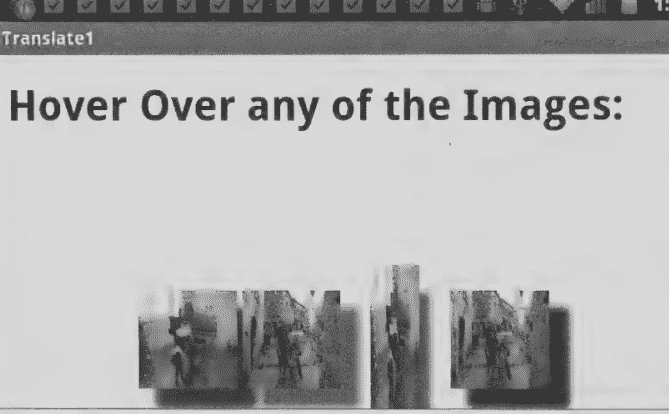

**图 2.9** 具有 CSS3 缩放和平移效果的 JPG 文件。

## CSS3 媒体查询

本节包含一系列 CSS3 媒体查询，它们是非常有用的逻辑表达式，使你能够检测具有不同物理属性和方向的设备上的移动应用程序。例如，使用 CSS3 媒体查询，你可以更改应用程序的尺寸和布局，以便它们在智能手机和平板电脑上都能正确呈现。具体来说，你可以使用 CSS3 媒体查询来确定设备的以下特征：

- 浏览器窗口宽度和高度
- 设备宽度和高度
- 方向（横向或纵向）
- 宽高比
- 设备宽高比
- 分辨率

CSS3 媒体查询是布尔表达式，包含一个或多个“简单项”（通过 `and` 或 `or` 连接），这些项的值为 `true` 或 `false`。因此，CSS3 媒体查询代表了条件逻辑，其求值结果为 `true` 或 `false`。

例如，以下链接元素仅在设备是屏幕且设备的最大宽度为 480px 时加载 CSS 样式表 `mystuff.css`：

```html
<link rel="stylesheet" type="text/css"
      media="screen and (max-device-width: 480px)" href="mystuff.css"/>
```

上述链接包含一个媒体属性，该属性指定了两个组件：一个 `screen` 类型的 `media` 和一个指定 `max-device-width` 为 `480px` 的查询。CSS3 媒体查询中 `media` 的支持值包括 `braille`、`embossed`、`handheld`、`print`、`projection`、`screen`、`speech`、`tty` 和 `tv`。

下一个 CSS3 媒体查询检查媒体类型、设备的最大宽度以及设备的分辨率：

```css
@media screen and (max-device-width: 480px) and (resolution: 160dpi) {
    #innerDiv {
        float: none;
    }
}
```

如果上述代码片段中的 CSS3 媒体查询结果为 `true`，那么嵌套的 CSS 选择器将匹配 `id` 属性值为 `innerDiv` 的 HTML 元素，并且在任何最大屏幕宽度为 `480px` 的设备上，其 `float` 属性将被设置为 `none`。如你所见，可以创建包含复杂逻辑的紧凑 CSS3 媒体查询，这显然非常有用，因为 CSS3 没有其他编程语言中可用的 `if/then/else` 结构。

下一个 CSS3 媒体查询测试媒体类型、设备的最小宽度以及设备的分辨率：

```css
@media screen and (min-device-width: 481px) and (resolution: 160dpi) {
    #innerDiv {
        float: left;
    }
}
```

在上述 CSS 选择器中，在任何最小屏幕宽度为 481px 的设备上，`id` 属性值为 `innerDiv` 的 HTML 元素的 `float` 属性将为 `left`。

下一个 CSS3 媒体查询在屏幕宽度介于 321px 和 480px 之间时，将 div 元素的宽度设置为 100px：

```css
@media screen and (min-width: 321px) and (max-width: 480px) {
    div { width: 100px; }
}
```

在以下示例中，`myphone.css` 将应用于浏览器视为“手持设备”或屏幕宽度 <= 320px 的设备。

```html
<link rel="stylesheet" media="handheld, only screen and (max-device-width: 320px)" href="myphone.css">
```

> **注意**
>
> 在媒体查询中使用 `only` 关键字会导致不兼容 CSS3 的浏览器忽略该规则。另一个例子，以下 `<link>` 加载了适用于屏幕尺寸在 641px 到 800px 之间的 CSS 样式表：

```html
<link rel="stylesheet" media="only screen and (min-width: 641px) and (max-width: 800px)" href="wide.css">
```

媒体查询可以包含在内联 `<style>` 标签中，如此查询所示，它适用于所有处于纵向模式的媒体类型：

```html
<style> @media only all and (orientation: portrait) { ... } </style>
```

既然你已经对 CSS3 媒体查询的基本功能有了了解，你就可以理解下一节中的代码了，该节包含一个 HTML5 网页和一个 CSS3 样式表，它们展示了如何处理移动设备方向的改变。

## 使用 CSS3 媒体查询检测方向

清单 2.19 和 2.20 展示了样式表 `CSS3MediaQuery1.css` 和 HTML5 网页 `CSS3MediaQuery1.html` 的内容，它们说明了当用户旋转移动设备时如何更改两个图像的大小。

### 清单 2.19 `CSS3MediaQuery1.css`

```css
@media all and (orientation: portrait) {
    #img1, #img2 {
        float: left;
        width: 120px; height: 300px;
    }
}

@media all and (orientation: landscape) {
    #img1, #img2 {
        float: left;
        width: 200px; height: 200px;
    }
}
```

清单 2.19 中的代码很直接：第一个选择器指定了当移动设备处于纵向模式时两个 JPG 文件的 `float`、`width` 和 `height` 属性的值；第二个选择器指定了当设备处于横向模式时这两个 JPG 文件的 `width` 和 `height` 属性的不同值。

### 清单 2.20 `CSS3MediaQuery1.html`

```html
<!DOCTYPE html>
<html lang="en">
<head>
    <meta charset="utf-8"/>
    <title>CSS3 Media Query</title>
    <link href="CSS3MediaQuery1.css" rel="stylesheet" type="text/css">
</head>

<body>
    <header>
        <h2>Rotate Your Device:</h2>
    </header>

    <div id="outer">
        <div id="one">
            
        </div>
        <div id="two">
            
        </div>
    </div>
</body>
</html>
```

清单 2.20 引用了清单 2.19 中的 CSS 样式表 `CSS3MediaQuery1.css`，以便将 CSS 选择器应用于 `<body>` 元素中的 JPG 文件。

接着，HTML `<body>` 元素包含两个 HTML `<div>` 元素，它们的 `id` 属性值分别为 `img1` 和 `img2`，这些值在对应的 CSS 选择器中被引用。

图 2.10 展示了在配备 Android ICS 系统的 Sprint Nexus S 4G 智能手机上以横屏模式渲染 HTML 页面 `CSS3MediaQuery.html` 的结果。

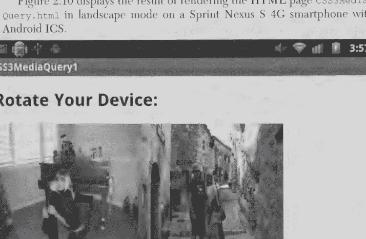

## 使用简单 JavaScript 检测方向

在本章前面，你了解了如何使用 CSS3 媒体查询来检测移动设备的方向变化。然而，请记住，同样可以通过简单的 JavaScript 代码来实现相同的功能，因此你并非“被迫”使用 CSS3 媒体查询。

代码清单 2.21 展示了 Web 页面 `CSS3OrientationJS1.html` 的内容，该示例说明了如何使用标准 JavaScript 在用户旋转移动设备时改变两个图像的大小。

**代码清单 2.21** `CSS3OrientationJS1.html`

```html
<!DOCTYPE html>
<html lang="en">
<head>
<meta charset="utf-8"/>
<title>CSS3 and Orientation with JS</title>

<style>
  #img1, #img2 {
    float: left;
    width: 120px; height: 300px;
  }
</style>

<script>
  function init() {
    // Event listener to determine device orientation
    window.onresize = function() { updateOrientation(); }
  }

  function updateOrientation() {
    var orientation = window.orientation;

    switch(orientation) {
      case 0: /* portrait mode */
        document.getElementById("img1").style.width  = "120px";
        document.getElementById("img1").style.height = "300px";
        document.getElementById("img2").style.width  = "120px";
        document.getElementById("img2").style.height = "300px";
        break;

      case 90: /* landscape (screen turned to the left) */
        document.getElementById("img1").style.width  = "200px";
        document.getElementById("img1").style.height = "200px";
        document.getElementById("img2").style.width  = "200px";
        document.getElementById("img2").style.height = "200px";
        break;

      case -90: /* landscape (screen turned to the right) */
        document.getElementById("img1").style.width  = "200px";
        document.getElementById("img1").style.height = "200px";
        document.getElementById("img2").style.width  = "200px";
        document.getElementById("img2").style.height = "200px";
        break;
    }
  }
</script>
</head>

<body onload="init()">
  <header>
    <h2>Rotate Your Device:</h2>
  </header>
  <div id="outer">
    <div id="one">
      
    </div>
    <div id="two">
      
    </div>
  </div>
</body>
</html>
```

如你所见，与代码清单 2.20 相比，代码清单 2.21 中的代码要多得多。本质上，这段代码使用变量 `window.orientation` 的值来检测移动设备的四种不同方向，并在每种情况下，使用以下类型的代码更新 JPG 文件的尺寸：

```javascript
document.getElementById("img1").style.width = "120px";
document.getElementById("img1").style.height = "300px";
```

尽管这是一个非常简单的例子，但希望这段代码能让你领略到 CSS3 媒体查询的强大功能。

## 使用 Web 字体

Web 字体在 CSS2 中引入，现在你可以将它们与 CSS3 选择器结合使用。如果你尚未使用过它们，你需要使用 `@font-face` 选择器声明字体系列的每种形式，然后通过 `font-family` 属性引用每种字体。请务必检查你计划在 Web 页面中使用的每种字体的许可条款。

代码清单 2.22 和代码清单 2.23 展示了 `WebFonts1.html` 和 `WebFonts1.css` 的内容，说明了如何在 HTML5 Web 页面中使用 CSS3 Web 字体。

**代码清单 2.22** `WebFonts1.html`

```html
<!DOCTYPE html>
<html lang="en">
<head>
    <meta charset="utf-8"/>
    <title>CSS Transition Example</title>
    <link href="WebFonts1.css" rel="stylesheet" type="text/css">
</head>
<body>
  <h1>H1 Heading: a WebFont and Shadow</h1>
  <h2>H2 Heading: a WebFont, Spacing, and Shadow</h2>
  <h3>H3 Heading: Does not Use a WebFont or Effects</h3>
</body>
</html>
```

代码清单 2.22 引用了 CSS 样式表 `WebFonts1.css`（如代码清单 2.23 所示），随后是一些按照 CSS 样式表中的 Web 字体进行样式化的 HTML 样板代码。

**代码清单 2.23** `WebFonts1.css`

```css
@font-face {
  font-family: "Kimberley";
  src: url(http://www.princexml.com/fonts/larabie/kimberle.ttf) format("truetype");
}

h1 {
  font-family: "Kimberley", sans-serif;
  text-shadow: 2px 4px 5px #00f;
}

@import url(http://www.princexml.com/fonts/larabie/index.css) all;

h2 { font-family: Goodfish, serif;
  letter-spacing: 0.1em;
  text-shadow: 0px 1px 6px #000,
               4px 5px 6px #f00;
}
```

代码清单 2.23 以一个 `@font-face` 定义开始，该定义指定了 `font-family` 的值以及字体所在的 URL。接下来，`h1` 选择器指定了代码清单 2.22 中 HTML `<h1>` 元素的字体，以及一个 `h2` 选择器，它指定了一种字体和文本阴影效果来为 HTML `<h2>` 元素设置样式。在这两个选择器之间，有一个 `@import` 规则，其中包含许多其他字体的定义，包括在 `h2` 选择器中指定的 Goodfish 字体。导入样式表中的定义优先级低于已在代码清单 2.23 中定义的定义。

## 在线字体资源

有多个在线资源可用于字体。如果你计划使用自定义字体，可以考虑使用 "Font Dragr"，这是一个用于测试自定义字体的在线工具：

http://www.css3.info/css3-resource-preview-custom-web-fonts-with-font-dragr/

一个提供大量免费字体的绝佳资源在这里：

http://www.fontsquirrel.com/

Font Squirrel 提供了预包装的字体包，其中包含 TrueType 字体 (TTF)、EOT 字体、WOFF 字体、SVG 字体和 Cufon 字体。此外，你可以上传自己的字体，并使用 Font Squirrel 的字体生成器来生成你自己的字体包。

## CSS3 与演示工具

存在各种基于 CSS3 变换和过渡（以及一些 JavaScript）的开源演示工具，使你能够创建精美的演示文稿。

其中一个工具是 Deck.js，它同时使用 CSS3 和 jQuery，其主页在这里：

http://imakewebthings.github.com/deck.js/

Deck.js 中的一个“幻灯片”由 HTML 组成，其结构如代码清单 2.24 所示。

**代码清单 2.24** 示例幻灯片

```html
<body class="deck-container on-slide-1">
    <section class="slide deck-previous">
        <h1>A Simple Presentation</h1>
    </section>

    <section class="slide deck-current">
        <h1>Slide Header</h1>
        <p>The main points:</p>
        <ul>
            <li>Item #1</li>
            <li>Item #2</li>
            <li>Item #3</li>
        </ul>
    </section>

    <section class="slide deck-next">
        <h1>Slide Two</h1>
        <blockquote cite="http://some.website.com">
          <p>Quod erat demonstratum </p>
          <p><cite>Unknown</cite></p>
        </blockquote>
    </section>
</body>
```

Deck.js 包含一个用于跟踪 deck 及其幻灯片状态的模块，它使用 CSS 来渲染每个状态。

另一个演示工具是 impress.js，它使用 CSS3 和 JavaScript（但不使用 jQuery）。你可以在其主页下载源代码：

https://github.com/bartaz/impress.js

Impress.js 使用 CSS3 3D 变换以 3D 方式呈现元素，并使用 CSS 过渡来处理演示步骤之间的过渡。请记住，如果你的浏览器没有硬件加速，你可能会在过渡之间经历明显的延迟。Impress.js 还要求浏览器支持一些其他 HTML5 功能，包括 `classList` 和 `dataset`。有关更多详细信息，请查阅网站上的文档。

毫无疑问，不久的将来还会有许多其他演示工具可用，你可以通过互联网搜索来查找其他工具并比较其支持的功能。如果你受到启发，也许可以为其项目贡献改进，或者创建自己的演示工具！

## 总结

本章向你展示了如何在 CSS3 中创建图形效果、阴影效果，以及如何使用 CSS3 变换。你学习了如何创建可应用于 HTML 元素的动画效果。你看到了如何定义 CSS3 选择器来执行以下操作：

- 渲染圆角矩形
- 为文本和二维形状创建阴影效果
- 创建线性渐变和径向渐变
- 使用 `translate()`、`rotate()`、`skew()` 和 `scale()` 方法
- 创建基于 CSS3 的动画效果

# 第三章 CSS3 二维/三维动画与 CSS 框架

本章继续讨论第二章引入的 CSS3，从一个将 CSS3 变换应用于基于 CSS3 的立方体的示例开始，接着是使用 CSS3 过渡创建简单动画效果（如发光效果和弹跳效果）的示例，以及创建三维效果的示例。本章的这一部分还包含代码示例，向你展示如何定义能对文本执行更复杂效果（如渲染多列文本）的 CSS3 选择器。

本章的第二部分向你展示如何定义 CSS3 选择器以创建三维效果和三维动画效果。具体来说，你将学习如何使用 CSS3 `keyframes` 以及 CSS3 函数 `scale3d()`、`rotate3d()` 和 `translate3d()`，这些功能使你能够创建三维动画效果。

本章的最后部分向你介绍了基于 CSS 的框架（如 Sass、Compass 和 CSS Scaffold），这些框架可以帮助你更快地开发代码，并简化代码维护的任务。虽然你可以手动创建 CSS 样式表，但请记住，CSS 框架提供了纯 CSS3 中不具备的强大功能。

尽管本书三个专注于 CSS3 的章节中的 HTML 页面在没有 JavaScript 的情况下使用了 CSS3，但请记住，你也可以将 CSS3 与 JavaScript 结合起来，以创建比单独使用 CSS3 更容易实现的视觉效果。事实上，第六章包含了一个将 jQuery 与 CSS3 结合以创建丰富图形效果的示例。

回想一下，你可以使用 CSS3 `媒体查询`（在第二章中讨论）在不同的移动设备上以不同的方式呈现 HTML5 网页。本章还包括一个使用 JavaScript 检测移动设备方向变化的示例。因此，你可以在你的 HTML5 网页中结合使用 JavaScript、CSS3 和其他技术，而具体选择取决于你的软硬件约束（例如，不支持 JavaScript，或支持智能手机和平板电脑）以及你的 HTML5 网页所需的功能。

在你的 HTML5 网页中使用 CSS3 有几个优点。首先，你将学习如何使用 CSS3 三维创建你自己的视觉效果。其次，像 jQuery Mobile 这样的工具包严重依赖 CSS3 来呈现内容和创建动画效果（包括页面过渡）。因此，你从本书中与 CSS3 相关的章节获得的知识将为你提供一个基础，帮助你理解 jQuery Mobile 如何实现其“魔法”，甚至可能使你更容易阅读 jQuery Mobile 的源代码。

第三，创建基于 CSS3 的非常令人印象深刻的图形和动画效果（尤其是三维效果）比用其他语言（包括 SVG）创建相同效果更容易。第四，如果你使用 CSS3 而不是依赖 JavaScript 和 JPG 文件来处理图形和动画，你的代码更有可能更紧凑，这对于移动设备来说是一个特别重要的点。请注意，许多 CSS3 三维效果需要硬件加速，好消息是越来越多的移动设备支持 CSS3 的硬件加速（HTML5 Canvas 也支持硬件加速）。

请记住，第二章中的截图是在华硕 Prime Android ICS 10 英寸平板电脑、搭载 Android ICS 的 Sprint Nexus S 4G 手机以及 iPad 3 上截取的；本章中的截图也是如此。你可以再次将本章中的截图与代码示例在基于 WebKit 的笔记本电脑和台式机浏览器上渲染的结果进行比较。

## 基于 CSS3 的立方体

本节向你展示如何使用 CSS3 创建一个立方体，这涉及渲染前面（一个矩形）、顶面（一个平行四边形）和右面（也是一个平行四边形）。

本节将使用以下 CSS3 变换和效果：

1. CSS3 `skew()` 函数来创建左右面。
2. CSS3 `scale()` 和 `rotate()` 函数来创建顶面。
3. 线性渐变和径向渐变用于着色效果。

本节的示例包含大量 CSS3 代码，在学习代码时，你最好在浏览器中启动网页。

清单 3.1 显示了 `3DCube1.html` 的内容，清单 3.2 显示了 `3DCube1.css` 的内容，它们说明了如何在 CSS3 中模拟一个立方体。

**清单 3.1** `3DCube1.html`

```html
<!DOCTYPE html>
<html lang="en">
<head>
    <meta charset="utf-8"/>
    <title>CSS 3D Cube Example</title>
    <link href="3DCSS1.css" rel="stylesheet" type="text/css">
</head>
<body>
    <header>
        <h1>Hover Over the Cube Faces:</h1>
    </header>
    <div id="outer">
        <div id="top">Text1</div>
        <div id="left">Text2</div>
        <div id="right">Text3</div>
    </div>
</body>
</html>
```

清单 3.1 是一个简单的 HTML 页面，引用了 CSS 样式表 `3DCSS1.css`，该样式表包含了为本网页中的 HTML `<div>` 元素设置样式的 CSS3 选择器。

**清单 3.2** `3DCube1.css`

```css
/* animation effects */
#right:hover {
    -webkit-transition: -webkit-transform 3.0s ease;
    transition: transform 3.0s ease;
    -webkit-transform: scale(1.2) skew(-10deg, -30deg) rotate(-45deg);
    transform: scale(1.2) skew(-10deg, -30deg) rotate(-45deg);
}

#left:hover {
    -webkit-transition: -webkit-transform 2.0s ease;
    transition: transform 2.0s ease;
    -webkit-transform: scale(0.8) skew(-10deg, -30deg) rotate(-45deg);
    transform: scale(0.8) skew(-10deg, -30deg) rotate(-45deg);
}

#top:hover {
    -webkit-transition: -webkit-transform 2.0s ease;
    transition: transform 2.0s ease;
    -webkit-transform: scale(0.5) skew(-20deg, -30deg) rotate(45deg);
    transform: scale(0.5) skew(-20deg, -30deg) rotate(45deg);
}

/* size and position */
#right, #left, #top {
    position: relative; padding: 0px; width: 200px; height: 200px;
}

#left {
    font-size: 48px;
    left: 20px;
    background-image:
        -webkit-radial-gradient(red 4px, transparent 28px),
        -webkit-repeating-radial-gradient(red 0px, yellow 4px, green 8px,
            red 12px, transparent 26px,
            blue 20px, red 24px,
            transparent 28px, blue 12px),
        -webkit-repeating-radial-gradient(red 0px, yellow 4px, green 8px,
            red 12px, transparent 26px,
            blue 20px, red 24px,
            transparent 28px, blue 12px);
    background-size: 100px 40px, 40px 100px;
    background-position: 0 0;
    -webkit-transform: skew(0deg, 30deg);
}

#right {
    font-size: 48px;
    width: 170px;
    top: -192px;
    left: 220px;
    background-image:
        -webkit-radial-gradient(red 4px, transparent 48px),
        -webkit-repeating-linear-gradient(0deg, red 5px, green 4px,
            yellow 8px, blue 12px,
            transparent 16px, red 20px,
            blue 24px, transparent 28px,
            transparent 32px),
        -webkit-radial-gradient(blue 8px, transparent 68px);
    background-size: 120px 120px, 24px 24px;
    background-position: 0 0;
    -webkit-transform: skew(0deg, -30deg);
}

#top {
    font-size: 48px;
    top: 50px;
    left: 105px;
    background-image:
        -webkit-radial-gradient(white 2px, transparent 8px),
        -webkit-repeating-linear-gradient(45deg, white 2px, yellow 8px,
            green 4px, red 12px,
            transparent 26px, blue 20px,
            red 24px, transparent 28px,
            blue 12px),
        -webkit-repeating-linear-gradient(-45deg, white 2px, yellow 8px,
            green 4px, red 12px,
            transparent 26px, blue 20px,
            red 24px, transparent 28px,
            blue 12px);
    background-size: 100px 30px, 30px 100px;
    background-position: 0 0;
    -webkit-transform: rotate(60deg) skew(0deg, -30deg) scale(1, 1.16);
}
```

清单 3.2 中的前三个选择器定义了当用户悬停在立方体的顶面、左面或右面上时的动画效果。具体来说，`#right:hover` 选择器在用户悬停在立方体右面上时，执行一个三秒钟间隔的动画效果，如下所示：

```css
#right:hover {
  -webkit-transition: -webkit-transform 3.0s ease;
```

`transition` 属性你已经熟悉了，请注意 `transform` 属性指定了 CSS3 变换函数 `scale()`、`skew()` 和 `rotate()`，这三个函数你都已经在本章中见过。这三个函数同时被调用，这意味着你将看到缩放、倾斜和旋转效果同时发生，而不是依次发生。

代码清单 3.2 中的最后三个选择器定义了立方体每个面的属性。例如，`#left` 选择器指定了某些文本的字体大小，以及立方体左面的位置属性。`#left` 选择器中最复杂的部分是 `background-image` 属性的值，它由 WebKit 特有的径向渐变、重复径向渐变和另一个径向渐变组合而成。注意，左面是一个矩形，使用这行代码将其变换为平行四边形：`-webkit-transform: skew(0deg, -30deg);`

`#top` 选择器和 `#right` 选择器包含与 `#left` 选择器相当的代码，你可以尝试调整它们的值以创建其他令人愉悦的视觉效果。

图 3.1 展示了在一款运行 Android ICS 的华硕 Prime 10 英寸平板电脑上，将 `3DCube1.css` 中的 CSS 选择器与 HTML 页面 `3DCube1.html` 中的 `<div>` 元素匹配后的结果（横向截图）。

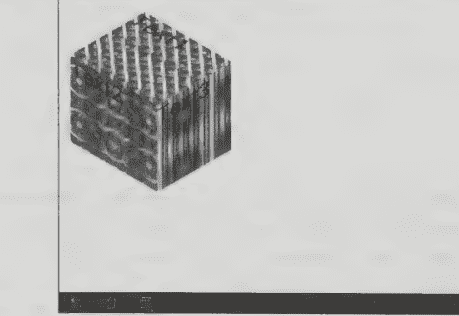

**图 3.1** 基于 CSS3 的立方体在华硕 Prime Android ICS 10 英寸平板电脑上。

## CSS3 过渡

CSS3 过渡是指以平滑的方式改变 CSS 值。它们由用户手势触发，例如鼠标点击、聚焦或“悬停”效果。过渡非常实用，因为你可以使用它们在特定时间段内，通过所谓的“缓动函数”为 CSS 属性创建动画效果，这些函数以不同的变化速率产生动画效果。例如，一些缓动函数在动画效果期间以恒定速率变化，而另一些则产生非线性效果（慢-快-慢、快-慢-快等）。缓动函数功能强大且实用，因为它们能够创建逼真的效果，例如看着一个棒球在空中向你飞来（这就是快-慢-快动画的一个例子）。

CSS3 过渡最初由 WebKit 开发，它们也可在 Safari、Chrome（3.2 或更高版本）、Opera（10.5 或更高版本）和 Firefox（4.0 或更高版本）中通过使用浏览器特定前缀来使用，你将在本节后面看到。请记住，有些工具包（如 jQuery 和 Prototype）支持与其基于 CSS3 的对应物类似的过渡效果。

创建 CSS 过渡的基本语法是一个“三元组”，它指定了：

- 一个 CSS 属性
- 一个持续时间（以秒为单位）
- 一个过渡时间函数

这是一个基于 WebKit 的过渡示例：

```css
-webkit-transition-property: background;
-webkit-transition-duration: 0.5s;
-webkit-transition-timing-function: ease;
```

幸运的是，你也可以将这些过渡合并在一行中，如这里所示：

```css
-webkit-transition: background 0.5s ease;
```

这是一个包含这些过渡的 CSS3 选择器示例：

```css
a.foo {
    padding: 3px 6px;
    background: #f00;
    -webkit-transition: background 0.5s ease;
}

a.foo:focus, a.foo:hover {
    background: #00f;
}
```

过渡目前需要浏览器特定前缀才能在所有浏览器中正常工作。这是一个为 Internet Explorer、Firefox 和 Opera 指定浏览器特定前缀的示例：

```css
-webkit-transition: background 0.5s ease;
-moz-transition: background 0.5s ease;
-o-transition: background 0.5s ease;
```

目前，你可以指定以下过渡时间函数之一（使用浏览器特定前缀）：

- Ease
- Ease-in
- Ease-out
- Ease-in-out
- Cubic-bezier

如果这些过渡函数都不足以满足你的需求，你可以使用这个在线工具创建自定义函数：

http://www.matthewlein.com/ceaser

一个展示过渡时间函数比较的网站在这里：

http://www.roblaplaca.com/examples/bezierBuilder/

你可以使用 `-webkit-transition-property` 指定多个属性。一个详尽的属性列表在这里：

https://developer.mozilla.org/en/CSS/CSS_transitions

## 简单的 CSS3 动画效果

到目前为止你看到的基于 CSS3 的代码示例主要涉及静态视觉效果（但你确实看到了如何使用 hover 伪选择器来创建动画效果）。本节中的 CSS3 代码示例说明了如何为基于表单的元素创建“发光”效果和“弹跳”效果。

## 使用 CSS3 关键帧的动画效果

CSS3 `@keyframes` 规则包含一组选择器，这些选择器通过一个表示 0 到 100 之间百分比的数字来标识。你还需要指定元素上动画效果的持续时间；`keyframe` 每个部分的持续时间被计算为整个效果持续时间的百分比。

例如，以下 CSS3 `@keyframes` 规则使用了 `-webkit-` 前缀，它定义了动画效果的前一半和后一半期间发生的情况：

```css
@-webkit-keyframes glow {
    0% {
        -webkit-box-shadow: 0 0 24px rgba(255, 255, 255, 0.5);
    }
    50% {
        -webkit-box-shadow: 0 0 24px rgba(255, 0, 0, 0.9);
    }
    100% {
        -webkit-box-shadow: 0 0 24px rgba(255, 255, 255, 0.5);
    }
}
```

因此，如果动画效果持续 10 秒，那么前两个动画效果各持续 5 秒，紧接着是动画效果完成时创建的视觉效果。

前面的代码块是一个简单但具有说明性的示例，向你展示了如何使用 CSS3 `@keyframes` 规则，你将在下一节中了解前面动画效果的细节。

## 发光效果

本节中的示例使用 `keyframes` 和 `:hover` 伪选择器，以便在用户将鼠标悬停在 HTML 页面中的特定元素上时创建动画效果。

代码清单 3.3 显示了 `Transition1.html` 的内容，代码清单 3.4 显示了 `Transition1.css` 的内容，其中包含在输入字段上创建“发光”效果的 CSS3 选择器。

### 代码清单 3.3 `Transition1.html`

```html
<!DOCTYPE html>
<html lang="en">
<head>
    <meta charset="utf-8"/>
    <title>CSS Animation Example</title>
    <link href="Transition1.css" rel="stylesheet" type="text/css">
</head>
<body>
<div id="outer">
    <input id="input" type="text" value="This is an input line">
</div>
</body>
</html>
```

代码清单 3.3 是一个简单的 HTML 页面，包含对 CSS 样式表 `Transition1.css` 的引用，以及一个包含 `<input>` 字段元素的 HTML `<div>` 元素。正如你将看到的，当用户将鼠标悬停在 `<input>` 元素上时，会创建一个动画效果。

### 代码清单 3.4 `Transition1.css`

```css
#outer {
    position: relative; top: 20px; left: 20px;
}

@-webkit-keyframes glow {
    0% {
        -webkit-box-shadow: 0 0 24px rgba(255, 255, 255, 0.5);
    }
    50% {
        -webkit-box-shadow: 0 0 24px rgba(255, 0, 0, 0.9);
    }
    100% {
        -webkit-box-shadow: 0 0 24px rgba(255, 255, 255, 0.5);
    }
}

#input {
    font-size: 24px;
    -webkit-border-radius: 4px;
    border-radius: 4px;
}

#input:hover {
    -webkit-animation: glow 2.0s 3 ease;
}
```

代码清单 3.4 包含一个名为 `glow` 的 CSS3 `@keyframes` 规则，该规则指定了三个阴影效果。第一个阴影效果（在动画效果时间 0 时发生）渲染一个不透明度为 0.5 的白色。第二个阴影效果（在动画效果的中点）渲染一个不透明度为 0.9 的红色。第三个阴影效果（在动画效果结束时发生）与第一个动画效果相同。

`#input` 选择器匹配 `Transition1.html` 中的输入字段，该字段产生一个圆角矩形。`#input:hover` 选择器使用 `glow` `@keyframes` 规则，以便在两秒钟的时间间隔内创建动画效果，重复三次，使用 `ease` 函数，如这里所示：

```css
-webkit-animation: glow 2.0s 3 ease;
```

图 3.2 展示了在运行 Android ICS 的 Sprint Nexus S 4G 上启动 HTML 页面 `Transition1.html` 后的结果。请记住，在桌面浏览器上，你只需将鼠标悬停在输入字段上即可触发动画效果，而在移动设备上，你需要点击输入字段才能触发动画效果，这还会导致键盘显示。

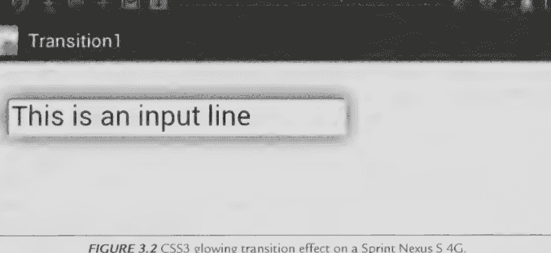

**图 3.2** Sprint Nexus S 4G 上的 CSS3 发光过渡效果。

## 使用 CSS3 的图像淡入淡出和旋转效果

前面的示例向你展示了如何创建发光动画效果。本节向你展示如何使用 JPG 图像创建淡入淡出效果。代码清单 3.5 显示了 `FadingImages1.html` 的内容，代码清单 3.6 显示了 `FadeRotateImages1.css` 的内容，它们说明了如何在一个 JPG 文件上创建“淡入淡出”效果，在另一个 JPG 文件上创建发光效果。

### 代码清单 3.5 `FadingImages1.html`

```html
<!DOCTYPE html>
<html lang="en">
<head>
    <meta charset="utf-8"/>
    <title>CSS3 图片淡入淡出与旋转效果</title>
    <link href="FadingImages1.css" rel="stylesheet" type="text/css">
</head>

<body>
    <div id="outer">
        
        
    </div>

    <div id="third">
        
    </div>
</body>
</html>
```

代码清单 3.5 引用了一个名为 `FadingImages1.css` 的 CSS 样式表，其中包含用于创建淡入淡出和发光效果的 CSS 选择器。代码清单 3.5 中的第一个 HTML `<div>` 元素包含两个 `` 元素；当用户将鼠标悬停在渲染后的 JPG 文件上时，它会“淡出”，并显露出另一个 JPG 文件。第二个 HTML `<div>` 元素包含一个 `` 元素，当用户将鼠标悬停在此 JPG 上时，一个 CSS3 选择器将使引用的 JPG 文件绕垂直轴旋转。

**代码清单 3.6** `FadingImages1.css`

```css
#outer {
    position: absolute; top: 20px; left: 20px;
    margin: 0 auto;
}

#outer img {
    position: absolute; left: 0;
    -webkit-transition: opacity 1s ease-in-out;
    transition: opacity 1s ease-in-out;
}

#outer img.upper:hover {
    opacity: 0;
}

#third img {
    position: absolute; top: 20px; left: 250px;
}

#third img:hover {
    -webkit-animation: rotatey 2.0s 3 ease;
}

@-webkit-keyframes rotatey {
    0% {
        -webkit-transform: rotateY(45deg);
    }
    50% {
        -webkit-transform: rotateY(90deg);
    }
    100% {
        -webkit-transform: rotateY(0);
    }
}
```

我们将跳过你已经熟悉的代码清单 3.6 中的代码细节。创建淡入淡出效果的关键点是在用户将鼠标悬停在最左侧的图像上时，将 `opacity` 值设置为 0。CSS 选择器中的这一行代码如下所示：

```css
#outer img.upper:hover {
    opacity: 0;
}
```

如你所见，这段代码示例向你展示，无需复杂的代码或逻辑，就能创建出吸引人的视觉效果。

接下来，代码清单 3.6 定义了一个 CSS3 选择器，该选择器通过调用标记为 `rotatey` 的关键帧中的 CSS3 函数 `rotateY()` 来创建绕垂直轴的旋转效果。请注意，你可以通过将 `rotateY()` 替换为 CSS3 函数 `rotateX()` 或 CSS3 函数 `rotateZ()` 来创建绕其他两个轴的旋转效果。你甚至可以在同一个关键帧中同时使用这三个函数来创建 3D 效果。CSS3 3D 效果将在本章后面更详细地讨论。

图 3.3 显示了在 Sprint Nexus S 4G (运行 Android ICS) 上启动 `FadeRotateImages1.html` 后，点击左侧图像（该图像最初与右侧图像相同，使用了淡入淡出效果渲染）的结果。请注意，在桌面浏览器中，用户可以将鼠标悬停在任一图像上，而悬停在右侧图像上会产生旋转效果。

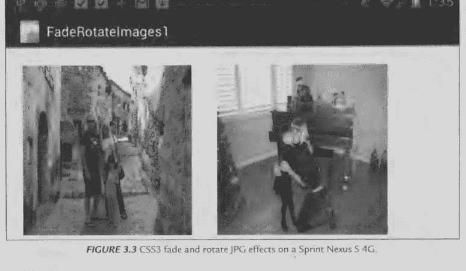

### 弹跳效果

上一个示例向你展示了如何创建淡入淡出动画效果，本节将向你展示如何创建“弹跳”动画效果。代码清单 3.7 展示了 `Bounce2.html` 的内容，代码清单 3.8 展示了 `Bounce2.css` 的内容，它们说明了如何在输入字段上创建“弹跳”效果。

**代码清单 3.7** `Bounce2.html`

```html
<!DOCTYPE html>
<html lang="en">
<head>
  <meta charset="utf-8"/>
  <title>CSS 动画示例</title>
  <link href="Bounce2.css" rel="stylesheet" type="text/css">
</head>
<body>
  <div id="outer">
    <input id="input" type="text" value="An input line" />
  </div>
</body>
</html>
```

代码清单 3.7 是另一个简单的 HTML 页面，它包含对 CSS 样式表 `Bounce2.css` 的引用，以及一个包含 `<input>` 字段元素的 HTML `<div>` 元素。当用户将鼠标悬停在 `<input>` 元素上时，CSS 样式表会创建弹跳动画效果。

**代码清单 3.8** `Bounce2.css`

```css
#outer {
  position: relative; top: 50px; left: 100px;
}

@-webkit-keyframes bounce {
  0% {
    left: 50px;
    top: 100px;
    background-color: #ff0000;
  }
  25% {
    left: 100px;
    top: 150px;
    background-color: #ffff00;
  }
  50% {
    left: 50px;
    top: 200px;
    background-color: #00ff00;
  }
  75% {
    left: 0px;
    top: 150px;
    background-color: #0000ff;
  }
  100% {
    left: 50px;
    top: 100px;
    background-color: #ff0000;
  }
}

#input {
  font-size: 24px;
  -webkit-border-radius: 4px;
  border-radius: 4px;
}

#outer:hover {
  -webkit-animation: bounce 2.0s 4 ease;
}
```

代码清单 3.8 包含一个标记为 `bounce` 的 `@keyframes` 规则，该规则指定了五个时间间隔：动画效果持续时间的 `0%`、`25%`、`50%`、`75%` 和 `100%` 点。每个时间间隔都指定了 `<input>` 字段的 `left`、`top` 和 `background-color` 属性的值。尽管这个 `@keyframes` 规则很简单，但它创建了一个令人愉悦的动画效果。

`#input` 选择器匹配 `Bounce2.html` 中的输入字段，结果形成一个圆角矩形。选择器 `#outer:hover` 使用 `bounce` 关键帧，以 `ease` 函数为动画效果创建一个持续两秒、重复四次的动画，如下所示：


`-webkit-animation: bounce 2.0s 4 ease;`

图 3.4 显示了在 Sprint Nexus S 4G (运行 Android ICS) 的 HTML 网页 `Bounce2.html` 中动画效果的快照。

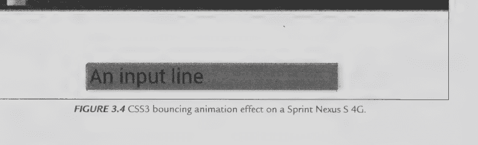

# CSS3 文本效果

你在前面章节的几个代码示例中（特别是在 `TextShadow1.html` 中）已经看到了将文本字符串作为一部分进行渲染的例子。在本节中，我们将讨论 CSS3 一个非常好的新特性，它使你能够以多列形式渲染文本。

## 渲染多列文本

CSS3 支持多列文本，当网页包含大量文本时，这可以创造出非常好的视觉效果。

代码清单 3.9 展示了 `MultiColumns1.html` 的内容，代码清单 3.10 展示了 `MultiColumns1.css` 的内容，它们说明了如何渲染多列文本。

**代码清单 3.9** `MultiColumns1.html`

```html
<!doctype html>
<html lang="en">
<head>
    <meta charset="utf-8"/>
    <title>CSS 多列示例</title>
    <link href="MultiColumns.css" rel="stylesheet" type="text/css">
</head>
<body>
    <header>
        <h1>将鼠标悬停在多列文本上：</h1>
    </header>
    <div id="outer">
        <p id="line1">.</p>
        <article>
            <div id="columns">
                <p> CSS 使你能够定义选择器，指定你希望渲染 HTML 页面中元素的样式或方式。CSS 帮助你将 HTML 内容模块化，由于你可以将 CSS 定义放在单独的文件中。你还可以在多个 HTML 文件中重复使用相同的 CSS 定义。 </p>
                <p> 此外，CSS 还使你能够简化需要对 HTML 页面中的元素进行的更新。例如，假设有多个 HTML 表格元素使用一个指定颜色为红色的 CSS 规则。如果你后来需要将颜色更改为蓝色，你只需在一个 CSS 规则中进行一处更改（即将红色更改为蓝色）即可实现这种更改。 </p>
                <p> 如果没有 CSS 规则，你将被迫手动更新每个受影响的 HTML 表格元素中的颜色属性，这容易出错、耗时且效率极低。 </p>
            </div>
        </article>
        <p id="line1">.</p>
    </div>
</body>
</html>
```

代码清单 3.9 中的 **HTML5** 页面包含语义标签（在第 1 章讨论过），这些标签在几个 HTML `<p>` 元素中渲染文本。如你所见，这个 **HTML5** 页面很简单，多列效果是在代码清单 3.10 中显示的 CSS 样式表 `MultiColumns1.css` 中定义的。

**代码清单 3.10** `MultiColumns1.css`

```css
/* 动画效果 */
#columns:hover {
  -webkit-transition: -webkit-transform 3.0s ease;
  -transition: transform 3.0s ease;
  -webkit-transform : scale(0.5) skew(-20deg, -30deg) rotate(45deg);
  -transform : scale(0.5) skew(-20deg, -30deg) rotate(45deg);
}

#line1:hover {
  -webkit-transition: -webkit-transform 3.0s ease;
  -transition: transform 3.0s ease;
  -webkit-transform : scale(0.5) skew(-20deg, -30deg) rotate(45deg);
  -transform : scale(0.5) skew(-20deg, -30deg) rotate(45deg);
  background-image: -webkit-gradient(linear, 0% 0%, 0% 100%,
    from(#fff), to(#00f));
  background-image: -gradient(linear, 0% 0%, 0% 100%,
    from(#fff), to(#00f));
  -webkit-border-radius: 8px;
  border-radius: 8px;
}

#columns {
  -webkit-column-count : 3;
  -webkit-column-gap : 80px;
  -webkit-column-rule : 1px solid rgb(255,255,255);
  column-count : 3;
  column-gap : 80px;
  column-rule : 1px solid rgb(255,255,255);
}

#line1 {
  color: red;
  font-size: 24px;
  background-image: -webkit-gradient(linear, 0% 0%, 0% 100%,
    from(#fff), to(#f00));
  background-image: -gradient(linear, 0% 0%, 0% 100%,
    from(#fff), to(#f00));
  -webkit-border-radius: 4px;
  border-radius: 4px;
}
```

代码清单 3.10 中的前两个选择器在用户将鼠标悬停在 `id` 属性为 `columns` 或 `line1` 的 `<div>` 元素上时创建动画效果。这两个选择器都使用 CSS3 的 `scale()`、`skew()` 和 `rotate()` 函数，在三秒的时间间隔内创建动画效果，如下所示：

```css
-webkit-transition: -webkit-transform 3.0s ease;
-transition: transform 3.0s ease;
-webkit-transform : scale(0.5) skew(-20deg, -30deg) rotate(45deg);
```

第二个选择器还定义了线性渐变背景效果。代码清单 3.10 中的 `#columns` 选择器包含三个与布局相关的属性。`column-count` 属性为 3，因此文本以三列显示；`column-gap` 属性为 80px，因此相邻列之间有 80 像素的间距；`column-rule` 属性指定了白色背景。`#line1` 选择器指定了一个线性渐变，为多列文本的上方和下方创建了良好的视觉效果。

图 3.5 展示了在运行于 iPad 3 上的 iOS 应用程序中，以横向截图方式拍摄的 MultiColumns.css 样式表中的 CSS 选择器与 MultiColumns.html 网页中的文本匹配的结果。

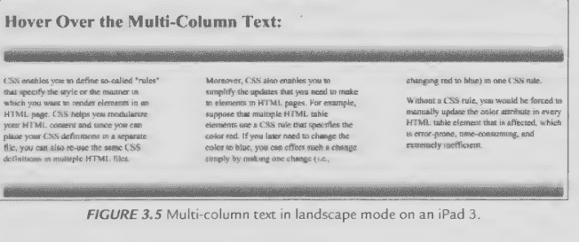

# CSS3 中的 3D 效果

CSS3 提供了创建 3D 效果的支持，但目前这些 3D 效果仅在运行于 Windows Vista 和 MacBook 上的基于 WebKit 的浏览器（Chrome 和 Safari）中得到支持。其他浏览器（如 Opera）的支持可能很快也会推出。代码清单 3.11 展示了 `Threed2.html` 的内容，它使用 CSS3 选择器创建 3D 效果。

**代码清单 3.11** `Threed2.html`

```html
<!DOCTYPE html>
<html lang="en">
<head>
  <meta charset="utf-8"/>
  <title>CSS 3D 效果示例</title>
  <link href="Threed2.css" rel="stylesheet" type="text/css">
</head>

<body>
  <h2>将鼠标悬停在矩形上：</h2>
  <div id="outer">
    <div id="radial1">文本1</div>
    <div id="radial2">文本2</div>
  </div>
</body>
</html>
```

代码清单 3.11 是一个简单的网页，在 HTML `<head>` 元素中引用了 CSS 样式表 `Threed2.css`。其顶级 `<div>` 元素的 `id` 属性为 `outer`，包含两个更多的 HTML `<div>` 元素，它们使用径向渐变进行渲染。代码清单 3.12 中的 CSS 选择器会导致它们在代码清单 3.11 的 HTML 元素中匹配的元素上产生动画效果。

**代码清单 3.12** `Threed2.css`

```css
#outer {
  position: relative; top: 10px; left: 0px;
}

#radial1 {
  opacity: 0.8;
  font-size: 24px;
  width: 200px;
  height: 200px;
  position: absolute; top: 0px; left: 0px;
  background: -webkit-gradient(
    radial, 300 40%, 0, 301 25%, 360, from(blue),
    color-stop(0.05, orange), color-stop(0.4, yellow),
    color-stop(0.6, green), color-stop(0.8, red),
    to(#fff)
  );
}

#radial2 {
  opacity: 0.6;
  font-size: 24px;
  width: 200px;
  height: 200px;
  position: absolute; top: 200px; left: 200px;
  background: -webkit-gradient(
    radial, 300 40%, 0, 301 25%, 360, from(red),
    color-stop(0.05, orange), color-stop(0.4, yellow),
    color-stop(0.6, green), color-stop(0.8, blue),
    to(#fff)
  );
}

#radial1:hover {
  -webkit-transform: rotate3d(20,30,40, 50deg)
    translate3d(50px,50px,50px) skew(-15deg,0);
  transform: rotate3d(20,30,40, 50deg) translate3d(50px,50px,50px)
    skew(-15deg,0);
}

#radial2:hover {
  -webkit-transform: rotate3d(1,0,0, 60deg) scale3d(1.5, 0.5, 0.75);
  transform: rotate3d(1,0,0, 60deg) scale3d(1.5, 0.5, 0.75);
}
```

代码清单 3.12 中的 `#outer` 选择器包含简单的位置属性，随后是 `#radial1` 和 `#radial2` 选择器的定义，这两个选择器都指定了径向渐变模式，类似于你在讨论 CSS3 径向渐变的章节中所看到的。

`#radial1:hover` 选择器包含 `-webkit-transform` 属性，该属性指定了 `rotate3d()` 函数，该函数接受一个向量 `(20,30,40)` 以及一个 50 度的旋转角度。这些数字的相对值将决定旋转。例如，你可以将向量 `(20,30,40)` 替换为向量 `(2,3,4)` 或 `(200,300,400)`，或任何其他指定向量的倍数，旋转效果将是相同的。该选择器 `-webkit-transform` 属性的第二部分还包含 `translate3d()` 函数（类似于 2D `translate()` 函数），它指定了以像素为单位的目标点，在这种情况下，目标点是 `(50px,50px,50px)`。该选择器 `-webkit-transform` 属性的第三部分也是最后一部分指定了 CSS3 2D 函数 `skew(-15deg, 0)`，因为该函数没有对应的 3D 版本。

`#radial2:hover` 选择器也包含 `-webkit-transform` 属性，该属性指定了 `rotate3d()` 函数，该函数接受一个向量 `(1, 0, 0)` 以及一个 60 度的旋转角度。在这种情况下，旋转将围绕 x 轴进行，因为 `(1, 0, 0)` 指定了正 x 轴。你可以通过分别指定向量 `(0, 1, 0)` 或 `(0, 0, 1)` 来围绕 y 轴或 z 轴进行旋转。

该选择器 `-webkit-transform` 属性的第二部分还包含 `scale3d()` 函数，它是 CSS3 2D 函数 `scale()` 的 CSS3 3D 对应物。在此函数中指定的值为 `(1.5, 0.5, 0.75)`，这分别在 x、y 和 z 轴上创建了 1.5、0.5 和 0.75 的缩放效果。

这个简单的示例说明了如何使用可用的三个 3D 变换函数，你可以通过实验此代码来创建一些你自己的有趣视觉效果。

图 3.6 展示了在 HTML 页面 `ThreeD2.html` 中，`ThreeD2.css` 样式表中的选择器与元素匹配的结果。

**将鼠标悬停在矩形上：**

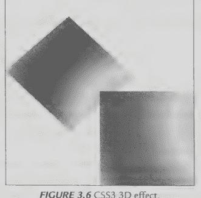

*图 3.6 CSS3 3D 效果。*

# CSS3 3D 动画效果

正如你现在所知，CSS3 提供了 `keyframes`，使你能够在动画序列的不同时间点创建不同的动画效果。本节中的示例使用 CSS3 `keyframes` 和 CSS3 函数 `scale3d()`、`rotate3d()` 和 `translate3d()` 的各种组合，以创建一个持续四分钟的动画效果。

**代码清单 3.13** `Anim240Flicker3DLGrad4.html`

```html
<!DOCTYPE html>
<html lang="en">
<head>
  <meta charset="utf-8"/>
  <title>CSS3 动画示例</title>
  <link href="Anim240Flicker3DLGrad4.css" rel="stylesheet" type="text/css">
</head>

<body>
  <div id="outer">
    <div id="linear1">文本1</div>
    <div id="linear2">文本2</div>
    <div id="linear3">文本3</div>
    <div id="linear4">文本4</div>
  </div>
</body>
</html>
```

代码清单 3.13 是一个非常简单的 HTML5 页面，具有相应的 CSS 选择器（如代码清单 3.14 所示）。像往常一样，真正的复杂性在于包含创建动画效果代码的 CSS 选择器中。

正如你将看到的，代码清单 3.14 中的一些 CSS 选择器包含 CSS3 `matrix()` 函数，这需要矩阵知识才能完全理解使用 CSS3 `matrix()` 函数可以创建的效果。如果你有兴趣学习矩阵（这超出了本书的范围），你可以阅读这篇关于矩阵的介绍（在 CSS3 的背景下）：

> http://www.eleqtriq.com/2010/05/css-3d-matrix-transformations/

由于 `Anim240Flicker3DLGrad4.css` 是一个如此长的代码示例，在代码清单 3.14 中只显示了部分代码。不过，完整的代码可在本书附带的 DVD 中找到。

**代码清单 3.14** `Anim240Flicker3DLGrad4.css`

```css
@-webkit-keyframes upperLeft {
  0% {
    -webkit-transform: matrix(1.5, 0.5, 0.0, 1.5, 0, 0)
      matrix(1.0, 0.0, 1.0, 1.0, 0, 0);
  }
  10% {
    -webkit-transform: translate3d(50px,50px,50px)
                   rotate3d(50,50,50,-90deg)
                   skew(-15deg,0) scale3d(1.25, 1.25, 1.25);
  }
  // 类似的代码已省略
  90% {
    -webkit-transform: matrix(2.0, 0.5,  1.0, 2.0, 0, 0)
                     matrix(1.5, 0.0,  0.5, 2.5, 0, 0);
  }
  95% {
    -webkit-transform: translate3d(-50px,-50px,-50px)
                     rotate3d(-50,-50,-50, 120deg)
                     skew(135deg,0) scale3d(0.3, 0.4, 0.5);
  }
  96% {
    -webkit-transform: matrix(0.2, 0.3, -0.5, 0.5, 100, 200)
                     matrix(0.4, 0.5,  0.5, 0.2, 200, 50);
  }
  97% {
    -webkit-transform: translate3d(50px,-50px,50px)
                     rotate3d(-50,50,-50, 120deg)
                     skew(315deg,0) scale3d(0.5, 0.4, 0.3);
  }
  98% {
    -webkit-transform: matrix(0.4, 0.5,  0.5, 0.3, 200, 50)
                     matrix(0.3, 0.5, -0.5, 0.4, 50, 150);
  }
  99% {
    -webkit-transform: translate3d(150px,50px,50px)
                     rotate3d(60,80,100, 240deg)
                     skew(315deg,0) scale3d(1.0, 0.7, 0.3);
  }
  100% {
    -webkit-transform: matrix(1.0, 0.0,  0.0, 1.0, 0, 0)
                     matrix(1.0, 0.5,  1.0, 1.5, 0, 0);
  }
}
// 为简洁起见，代码已省略
#linear1 {
font-size: 96px;
text-stroke: 8px blue;
text-shadow: 8px 8px 8px #FF0000;
width:  400px;
height: 250px;

position: relative; top: 0px; left: 0px;
background-image: -webkit-gradient(linear, 100% 50%, 0% 100%,
from(#f00),
color-stop(0.2, orange),
color-stop(0.4, yellow),
color-stop(0.6, blue),
color-stop(0.8, green),
to(#00f));

// 类似的代码已省略
-webkit-border-radius: 4px;
border-radius: 4px;
-webkit-box-shadow: 30px 30px 30px #000;
-webkit-animation-name: lowerLeft;
-webkit-animation-duration: 240s;
}
```

清单 3.14 包含一个名为 `upperLeft` 的 WebKit 特定关键帧定义，它以以下行开始：

```css
@-webkit-keyframes upperLeft {
    // 基于百分比的定义放在这里
}
```

`#linear` 选择器包含你已经见过的属性，以及一个引用了由 `lowerLeft` 标识的关键帧的属性，和一个指定持续时间为 240 秒的属性，如下所示：

```css
#linear1 {
    // 为简洁起见，代码已省略
    -webkit-animation-name: lowerLeft;
    -webkit-animation-duration: 240s;
}
```

现在你已经知道如何在 CSS3 选择器中引用关键帧定义，让我们看看 `lowerLeft` 定义的细节，它包含 19 个指定各种动画效果的元素。`lowerLeft` 的每个元素都发生在动画的特定阶段。例如，`lowerLeft` 中的第八个元素指定值为 50%，这意味着它将发生在动画效果的中点。由于 `#linear` 选择器包含一个值为 240 秒的 `-webkit-animation-duration` 属性（在清单 3.14 中以粗体显示），这意味着动画将持续四分钟，从 HTML5 页面启动的时间点开始。

`lowerLeft` 的第八个元素指定了平移、旋转、扭曲和缩放效果（所有这些都是三维的），其示例如下所示：

```css
50% {
    -webkit-transform: translate3d(250px,250px,250px)
                             rotate3d(250px,250px,250px,-120deg)
                             skew(-65deg,0) scale3d(0.5, 0.5, 0.5);
}
```

动画效果以顺序方式发生，从平移开始，以缩放效果结束，`lowerLeft` 中的其他元素也是如此。

图 3.7 展示了在 iPad 3 上运行的 iOS 应用程序中，以横向模式截取的 CSS3 样式表 `Anim240Flicker3DLGrad4.css` 中定义的 CSS3 选择器与 HTML 页面 `Anim240Flicker3DLGrad4.html` 中的 HTML 元素匹配的初始视图。

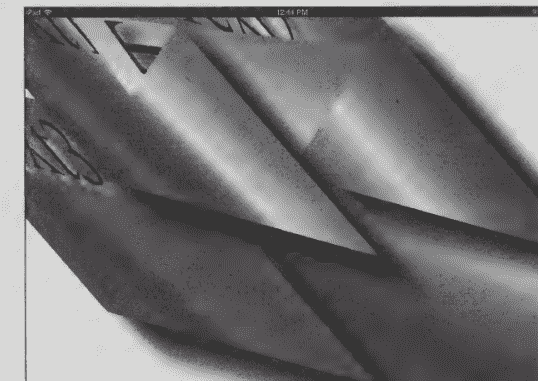

**图 3.7** iPad 3 上的 CSS3 3D 动画效果。

# CSS3 动画和 CSS 精灵

CSS 精灵减少了 HTTP 请求的数量（从而减少了网页的响应时间），同时也减小了总文件大小。这个想法很简单：下载一个包含网站上所有较小图像的单一图像（称为精灵），然后通过它们在精灵中的位置来引用较小的图像。

这个过程需要两个步骤：1.) 创建精灵，2.) 对于精灵中的每个图像，计算其在精灵中的位置，然后相应地更新 CSS 选择器。虽然你可以手动执行这两个步骤，但一个更简单的替代方案将为你节省大量的时间和精力，那就是一个名为 SpriteMe 的优秀工具，其主页在这里：

http://spriteme.org/

这个网站包含一个演示，向你展示如何将该工具安装到书签工具栏中，以及如何在几分钟内轻松创建一个精灵。此外，你可以下载生成的精灵和包含精灵中每个图像位置的 CSS 选择器。创建精灵后，你可以使用本章前面学到的技术来对精灵应用 2D 和 3D 动画效果。

另一个包含有关 CSS 精灵技术和教程集合的有用网站在这里：

http://nambuvick.blogspot.in/2012/05/building-faster-websites-with-css.html?goback=%2Egde_2071438_member_120537762

# 使用 CSS3 动画的滑动面板

面向菜单的移动应用程序通常涉及支持触摸的“页面”，这些页面使用滑动效果来显示详细页面，而详细页面通常有一个“返回”按钮来导航（也通过滑动效果）回主菜单。

此时，你已经具备了创建此类移动应用程序的知识，这涉及 HTML、简单的 JavaScript（用于处理触摸相关事件）、CSS 选择器和用于滑动效果的简单 CSS3 动画。

本节中的代码将让你了解创建滑动效果所需的技术细节，并深入了解编写更复杂的面向菜单的移动应用程序所需的工作量。请记住，CSS 样式表中唯一的 CSS3 功能是滑动动画效果。

清单 3.15 显示了 `SlidingPanels.html` 的内容，清单 3.16 显示了 `SlidingPanels.css` 的内容，它们说明了如何使用 CSS3 动画在用户点击或点击列表中的菜单项时创建滑动效果。

**清单 3.15** `SlidingPanels.html`

```html
<!DOCTYPE html>
<html>
<head>
    <meta charset="utf-8"/>
    <title>不使用jQuery的滑动面板</title>
    <meta name="viewport"
          content="width=device-width; initial-scale=1.0; minimum-scale=1.0; maximum-scale=1.0;">
    <link rel="stylesheet" href="SlidingPanels.css">
</head>

<body>
    <section id="outer">
        <dl id="panelContainer" style="width: 2000px; ">
            <!-- “左”面板显示菜单项 -->
            <dd id="leftPanel" style="width: 1000px; ">
                <header class="pageHeader">
                    <span>不使用jQuery的滑动面板</span>
                </header>

                <article class="content" id="mainPage">
                    <p>这是此网页的主要内容，要查看详细页面的内容，只需点击或点击下面的任何菜单项。被点击的菜单项将向左滑动出视图，然后你将看到详细页面。当你点击任何详细页面右上角的图标时，当前显示的详细页面将向右滑动，原始菜单项将再次显示。滑动效果的速度由此HTML网页中JavaScript变量'speed'的值指定。注意顶部和底部菜单项中不同的圆角效果：这是通过为顶部指定'px'值和为底部指定'%'值创建的。</p>
                </article>

                <!-- 显示菜单项列表 -->
                <nav>
                    <dl>
                        <dd onclick="clickedMenuItem(event)">
                            关于 
                        </dd>
                        <dd onclick="clickedMenuItem(event)">
                            工作区域 
                        </dd>
                        <dd onclick="clickedMenuItem(event)">
                            项目 
                        </dd>
                        <dd onclick="clickedMenuItem(event)">
                            文档 
                        </dd>
                        <dd onclick="clickedMenuItem(event)">
                            图像 
                        </dd>
                        <dd onclick="clickedMenuItem(event)">
                            收藏夹 
                        </dd>
                        <dd onclick="clickedMenuItem(event)">
                            报告 
                        </dd>
                        <dd onclick="clickedMenuItem(event)">
                            帮助 
                        </dd>
                    </dl>
                </nav>
            </dd>

            <!-- “右”面板显示详细页面 -->
            <dd id="rightPanel" style="width: 1000px; ">
                <header class="pageHeader">
                    <span id="detailsPageHeader">详细页面</span>
                    
                </header>

                <article class="content" id="detailsPageContent">
                    <p>这是详细页面的内容。当用户点击此页面右上角的图标时，页面将向右滑动，原始菜单项将再次显示。</p>
                </article>
            </dd>
        </dl>
    </section>

    <script>
        var panelContainer, leftPanel, rightPanel, panelCount = 2;
        var backButton, clickedMenuText = "", detailsText, speed = 300;

        window.addEventListener('load', init, false);

        function init() {
            //hide the browser address bar in iPhone/Android
            setTimeout(function() { window.scrollTo(0, 1); }, 10);

            panelContainer = document.getElementById("panelContainer");
            panelContainer.style.width = 
                (panelCount * window.innerWidth) + "px";

            leftPanel = document.getElementById("leftPanel");
            leftPanel.style.width = window.innerWidth + "px";

            rightPanel = document.getElementById("rightPanel");
            rightPanel.style.width = window.innerWidth + "px";

            backButton = document.getElementById("closeIcon");
            backButton.addEventListener("click",
                backButtonClicked, false);
        }

        function clickedMenuItem(event) {
            // slide left panel to the left...
            panelContainer.style.webkitTransform =
                "translate3d(-" + window.innerWidth + "px, 0, 0)";

            panelContainer.style.webkitTransitionDuration = speed +
                "ms";

            clickedMenuText =
                event.currentTarget.firstChild.nodeValue.trim();
            detailsPageHeader.innerText = clickedMenuText + " Menu Item";

            detailsText = document.getElementById("detailsPageContent");
            detailsText.innerText =
                detailsPageHeader.innerText + ": " + detailsText.innerText;
        }

        function backButtonClicked() {
            // slide right panel to the right...
            panelContainer.style.webkitTransform = "translate3d(0, 0, 0)";
            panelContainer.style.webkitTransitionDuration = speed + "ms";
        }
    </script>
</body>
</html>
```

清单 3.15 包含了 HTML5 元素 `<section>`、`<article>` 和 `<nav>`，它们提供了语义化标记，你已经在第一章中熟悉了它们。

初始或主页面包含 `<nav>` 元素，该元素由菜单项组成；每当用户点击其中一个项目，主页面就会向左滑动，并显示详情页面的内容。当用户点击详情页面右上角的图标时，详情页面会向右滑动，再次显示主页面的内容。

JavaScript 代码包含以下代码片段，它会在网页加载到浏览器后执行 JavaScript 函数 `init()`：

```javascript
window.addEventListener('load', init, false);
```

JavaScript `init()` 函数初始化了 JavaScript 变量 `leftPanel`、`rightPanel` 和 `backButton`，这些变量会在用户点击主页面中的菜单项以及详情页面中的返回按钮时被引用。

JavaScript `clickedMenuItem()` 函数包含了将主页面向左滑动以显示详情页面内容的代码，而 JavaScript 函数 `backButtonClicked()` 则处理相反的过渡效果。

阅读此代码示例后，你可能会更倾向于使用移动端工具包（如 jQuery Mobile），它们能处理编写跨浏览器移动应用程序的许多繁琐细节。

**清单 3.16** `SlidingPanels.css`

```css
* { margin:0; padding:0;}

html { background-color:#FCC; }

p { color: #00f; }

/* layout details for "outer" div */
#outer {
    width:100%;
    height:auto;
    overflow:hidden;
}

#outer dl {
    -webkit-transition:-webkit-transform ease;
}

#outer dl dd {
    float:left;
}

.pageHeader {
    width:100%;
    line-height:40px;
    padding-top:4px;
    color: #FFF;
    display: block;
    overflow:hidden;
    text-align: center;
    background-color:#4444FF;
}

/* layout details for article */
article.content {
    width:90%;
    margin:10px 10px auto 10px;
}

/* panel-related selectors */
#leftPanel nav {
    width:95%;
    margin:3%;
    height:auto;
    overflow:hidden;
    margin-bottom:40px;
}

#leftPanel nav dl {
    width:100%;
    height:100%;
    overflow:hidden;
}

#leftPanel nav dl dd {
    width:90%;
    background-color:#FFF;
    border:1px solid #AAAAAA;
    padding-left:10px;
    padding-top:10px;
    padding-bottom:10px;
    padding-right:10px;
    color: #333333;
    display: block;
    font-size: 14px;
    font-weight: bold;
    margin-bottom: -2px;
}

#leftPanel nav dl dd img {
    float:right;
    height:20px;
}

#closeIcon {
    position:relative;
    top:5px;
    width:50px;
    float:right;
    margin-right:5px;
}

/* rounded corners for the first menu item */
#leftPanel nav dl dd:first-of-type {
    -webkit-border-top-left-radius: 15px;
    -webkit-border-top-right-radius: 15px;
}

/* rounded corners for the last menu item */
#leftPanel nav dl dd:last-of-type {
    -webkit-border-bottom-left-radius: 30%;
    -webkit-border-bottom-right-radius: 30%;
}
```

清单 3.16 包含各种选择器和标准 CSS 属性，其中大部分你已熟悉，因此对此代码的讨论在此省略。有两点需要你注意，因为它们影响了 HTML 网页的布局。第一，HTML 网页占据全屏，因为清单 3.16 的第一行将所有元素的 margin 和 padding 属性设置为 0：

```css
* { margin:0; padding:0; }
```

第二，第一个和最后一个菜单项的圆角效果有显著不同，因为分别使用了 15px 和 30% 的值。图 3.8 显示了在 iPad 3 上运行的 iOS 应用程序中启动 `SlidingPanels.html` 的结果。

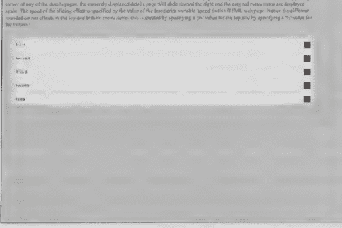

# CSS 框架

CSS3 提供了强大的功能，但如果你想让你的代码在多个浏览器中工作，就需要在选择器中包含特定于浏览器的代码。维护可能是一个繁琐且容易出错的过程，尤其是在你有许多 CSS 样式表时，并且增强 CSS 样式表的功能可能成为一项非平凡的任务。

CSS 存在一些局限性，例如缺乏对变量或“混入”（稍后在本节讨论，类似于其他编程语言中的宏或函数）的支持。

幸运的是，有许多 CSS 框架（如 Twitter Boilerplate、HTML5 Boilerplate、LESS、Blueprint 等）可用，它们以简化 CSS 样式表维护的方式扩展了 CSS 的功能。本节包含对几个知名 CSS 框架的简要概述，以及一些代码示例，展示了如何使用它们的部分特性。读完本节后，你将对 CSS 框架在创建和维护 CSS 样式表方面提供的功能有基本的了解。

要更深入地理解这些 CSS 框架的相对优势，显然需要你进行更详细的分析，你可以通过阅读相应文档以及阅读各种文章（可通过互联网搜索找到）来完成，其中一些文章讨论了其他人使用这些及其他 CSS 框架的经验。

正如你可能推测的那样，即使不包含特定于浏览器的前缀，CSS 样式表也可能变得非常长。例如，你会发现这个 CSS3 项目中包含超过 600 行的 CSS 样式表：

http://code.google.com/p/css3-graphics

因此，维护和增强 CSS 样式表的任务可能既繁琐又容易出错。

幸运的是，有许多 CSS 框架（互联网搜索会返回数十个框架的链接）可以帮助你简化维护 CSS 样式表的任务，包括 Compass/Sass、Blueprint 和 LESS。

请注意，你需要在你的机器上安装 Ruby 才能使用 Blueprint 验证器和 LESS 框架。其次，如果你想使用 LESS 框架支持的服务器端功能，需要安装 Node.js。

## Compass/Sass 框架

Compass 是一个框架，允许你使用 Sass 而非纯 CSS 来创建 CSS 样式表。其主页在这里：

http://compass-style.org/

Sass 语言（你将与 Compass 一起使用）的链接在这里：

http://sass-lang.com/

Sass 支持以下功能：

- `@import`
- 参数
- 算术运算和函数
- Mixins
- 嵌套
- 父级引用
- 变量

如果你想使用基于 Sass 的代码示例，你需要在 Windows 或 Linux 机器上安装 Ruby（请在网上搜索安装说明），而如果你使用的是 OS X，则 Ruby 已经安装好了。

安装 Ruby 后，通过执行以下命令安装 Sass：

```bash
gem install sass
```

接下来的几个小节包含一些简单的代码示例，用以说明 Sass 框架的部分功能。

### Sass 变量

Sass 支持使用变量，这对于快速轻松地修改 CSS 样式表非常有用。清单 3.17 显示了 `Sass1.scss` 的内容，清单 3.18 显示了生成的 CSS 样式表 `Sass1.css`。这两个文件的内容都很直观且不言自明，因此我们将不提供进一步的细节。

**清单 3.17** `Sass1.scss`

```scss
$theColor1: #ff0000;
$theColor2: #0000ff;
$theWidth: 400;
$theHeight: 300;

#linear1 {
    width: $theWidth;
    height: $theHeight;
    color: $theColor1;
}

a {
    color: $theColor1;
    &:hover { background: $theColor2; }
}
```

**清单 3.18** `Sass1.css`

```css
#linear1 {
    width: 400;
    height: 300;
    color: #ff0000;
}
a {
    color: #ff0000;
}
a:hover { background: #0000ff; }
```

### Sass Mixins

Sass mixins 允许你在多个 CSS 选择器中重用样式，它们通过 `@mixin` 指令定义。作为 Sass mixins 的一个示例，清单 3.19 显示了 `Sass2.scss` 的内容，清单 3.20 显示了生成的 CSS 样式表 `Sass2.css`。

**清单 3.19** `Sass2.scss`

```scss
@mixin rounded-top {
    $side: top;
    $radius: 10px;

    border-#{$side}-radius: $radius;
    -moz-border-radius-#{$side}: $radius;
    -webkit-border-#{$side}-radius: $radius;
}

#navbar li { @include rounded-top; }
#footer { @include rounded-top; }
```

注意，清单 3.19 底部的两个选择器通过 `@include` 语句引用了 `rounded-top` mixin，这将产生这样的效果：每当引用变量时，将指定的变量替换为其值后，再用 `rounded-top` 的内容替换该语句。

**清单 3.20** `Sass2.css`

```css
#navbar li {
    border-top-radius: 10px;
    -moz-border-radius-top: 10px;
    -webkit-border-top-radius: 10px;
}

#footer {
    border-top-radius: 10px;
    -moz-border-radius-top: 10px;
    -webkit-border-top-radius: 10px;
}
```

清单 3.20 显示了在对清单 3.19 中的 Sass 文件执行指定替换后，生成的 CSS 选择器的内容。前面的示例说明了在 Sass 中使用变量和 mixins 是多么容易。有关更多信息，请查阅 Sass 参考指南（其中提供了功能和代码片段的详尽列表）以及以下 Sass 教程：

http://sass-lang.com/docs/yardoc/file.SASS_REFERENCE.html

http://sass-lang.com/tutorial.html

## Blueprint 框架

Blueprint CSS 框架提供了一套广泛的功能，其主页在这里：

http://www.blueprintcss.org

Blueprint 支持以下功能：

- 一个 CSS 重置样式表
- 表单样式
- 打印样式
- 用于按钮、标签页和精灵图的插件
- 编辑器、模板和工具

你需要在 HTML5 页面中包含以下三个 CSS 样式表才能使用 Blueprint：`screen.css`、`print.css` 和 `ie.css`。例如，你可以通过以下 HTML 代码片段包含这三个样式表：

```html
<link rel="stylesheet" href="css/blueprint/screen.css"
      type="text/css" media="screen, projection">
<link rel="stylesheet" href="css/blueprint/print.css"
      type="text/css" media="print">
<!--[if lt IE 8]>
  <link rel="stylesheet" href="css/blueprint/ie.css"
        type="text/css" media="screen, projection">
<![endif]-->
```

请注意，上面列出的第三个样式表使用了条件逻辑来决定是否包含该样式表（仅适用于版本低于 8 的 Internet Explorer）。

Blueprint 的一个重要特性是其对网格的支持。请查阅在线文档以了解 Blueprint 网格及其其他功能。

## LESS 框架

LESS CSS 框架可以在客户端（IE 6+、Webkit 和 Firefox）和服务端（配合 Node.js）运行。其主页在这里：

http://lesscss.org/

LESS 支持以下功能：

- 函数
- Mixins
- 操作
- 变量

你可以将 LESS 代码放在一个文本文件中（通常扩展名为 `.less`），然后通过命令行将该文件编译成 CSS 代码，如下所示：

```bash
lessc mylessfile.less > mycssfile.css
```

以下小节将向你展示如何在 LESS 框架中使用变量和 mixins。

### LESS 变量

以下示例说明了如何在 LESS 代码中使用变量：

```less
@color: #FF0000;

#header {
    color: @color;
}
p {
    color: @color;
}
```

前面的代码块定义了变量 `@color`，并在两个选择器中引用了这个变量。生成的 CSS 代码的内容如下所示：

```css
#header {
    color: #FF0000;
}
p {
    color: #FF0000;
}
```

如你所见，变量 `@color` 在两个 CSS 选择器中都被其值 `#FF0000` 所替换（这显然是预期的行为）。

### LESS Mixins

以下示例说明了如何在 LESS 中使用 mixin：

```less
#rounded-corners (@radius: 4px) {
    border-radius: @radius;
    -webkit-border-radius: @radius;
    -moz-border-radius: @radius;
}
#header {
    #rounded-corners;
}
#footer {
    #rounded-corners(10px);
}
```

前面的代码块包含一个 `#rounded-corners` mixin，它定义了一个变量 `radius`，其默认值为 `4px`，以及三个被赋值为变量 `radius` 的值的属性。生成的 CSS 代码如下所示：

```css
#header {
    border-radius: 4px;
    -webkit-border-radius: 4px;
    -moz-border-radius: 4px;
}
#footer {
    border-radius: 10px;
    -webkit-border-radius: 10px;
    -moz-border-radius: 10px;
}
```

请注意，`#header` 选择器中的 `border-radius` 属性值为 `4px`，这是 `rounded-corners` mixin 中 `radius` 变量的默认值，而 `#footer` 选择器中的 `border-radius` 值为 `10px`。

你还可以在 LESS 中使用操作符和函数来创建复杂的 mixins，这在 LESS 的在线文档中有说明。

### 在客户端和服务端代码中使用 LESS

这是一个直接的过程，涉及包含一个 LESS CSS 样式表和 LESS JavaScript 文件。包含以下指向 LESS 样式表的链接：

```html
<link rel="stylesheet/less" type="text/css" href="styles/less"/>
```

从 LESS 主页下载 JavaScript 文件 `less.js`，然后包含以下引用 LESS JavaScript 文件的代码行：

```html
<script src="less.js"></script>
```

关于 `Node.js` 的详细讨论超出了本书的范围，如果你不打算使用 LESS 的服务端功能，你可以省略本节而不会损失内容的连续性。另一方面，如果你确实打算使用 `Node.js`，请从 `Node.js` 主页下载发行版到你的机器上：

http://nodejs.org

安装 `Node.js` 和 `npm`（Node 包管理器）后，使用以下命令安装 LESS：

```bash
npm install less
```

可以使用以下命令安装最新版本的 LESS：

```bash
npm install less@latest
```

至此，我们对 CSS 框架的简短讨论就结束了。尽管代码示例很简单，但你可以看到这些框架为编写和维护 CSS 样式表所提供的功能的强大之处。

# CSS3 性能

尽管此处仅简要介绍此主题，但 CSS3 性能显然非常重要。本书中的许多 CSS3 样式表都包含具有 2D/3D 动画效果的选择器，而硬件加速将显著提升性能。事实上，某些平板设备并未提供良好的硬件加速支持，在这些设备上使用包含大量 2D 或 3D 动画效果的样式表几乎是不可能的。

幸运的是，存在一种技术可以为具备 GPU 的设备触发 CSS3 选择器的硬件加速（使用 `translateZ(0)` 或 `translate3d(0,0,0)`），同时 WebKit（Safari 和 Chrome）也提供了相应的调试技术。Google 开发者布道师 Paul Irish 的以下 30 分钟视频讨论了这些以及其他相关技术：

http://paulirish.com/2011/dom-html5-css3-performance/

本文提供了编写更高效 CSS 选择器的相关信息：

http://www.pubnub.com/blog/css3-performance-optimizations

关于编写 CSS3 选择器的“最佳实践”信息，请参阅：

http://webdesignerwall.com/trends/css3-examples-and-best-practices

http://www.impressivewebs.com/css3-best-practices/

您可以通过网络搜索查找有关 CSS3 性能以及 CSS3 和 HTML5 Canvas 的“最佳实践”的其他在线视频和教程。

# 有用的链接

以下按字母顺序排列的链接列表虽短但非常有用。每个链接都包含非常好的信息（当然，您也可以随时自行进行网络搜索）。

一组使用 CSS3 实现的“素描风格”视觉效果，请见：

http://andrew-hoyer.com/index.html

关于桌面和移动浏览器对 HTML5、CSS3、SVG 等支持情况的兼容性表格，请见：

http://caniuse.com

一个使用各种 CSS3 特性生成 CSS3 代码的网站：

http://CSS3generator.com

一个允许您实时编辑各种 CSS3 选择器的内容并查看结果的网站：

http://CSS3please.com

一个处理浏览器特定 CSS3 属性扩展的工具包，使您能够编写无需前缀的 CSS3 选择器：

http://ecsstender.org

一个允许您在线创建渐变并查看相关 CSS3 代码的网站：

http://gradients.glrzad.com

另一个提供有关浏览器对 HTML5 和 CSS3 特性支持信息的网站：

http://html5readiness.com

大量关于 HTML5 的文章集合，请访问：

http://www.html5rocks.com/en/

一个在 IE6-8 中模拟 CSS3 伪类和属性选择器的 JavaScript 工具：

http://selectivizr.com

一个致力于所有 CSS3 相关内容的网站：

http://www.CSS3.info

互联网上一个极佳的浏览器兼容性信息来源（由 Peter-Paul Koch 维护）：

http://www.quirksmode.org

一个非常好的在线工具，允许您试验许多 CSS3 特性并显示相关的 CSS3 代码：

http://www.westciv.com/tools/3Dtransforms/index.html

这些链接提供了大量信息和有用的技术，因此您很有可能找到创建网站所需视觉效果的信息。

以下是对 15 种跨浏览器测试工具的比较（大多数是免费的，有些是商业软件），并附有功能比较表格：

http://www.smashingmagazine.com/2011/08/07/a-dozen-cross-browser-testing-tools/

# 总结

本章向您展示了如何创建图形效果，包括阴影效果，以及如何在 CSS3 中使用 CSS3 变换来定义 CSS3 选择器。您学习了如何创建可应用于 HTML 元素的 2D/3D 动画效果。您看到了如何定义 CSS3 选择器以实现以下功能：

*   创建简单的动画效果
*   显示多列文本
*   使用 CSS3 选择器创建 2D/3D 效果
*   使用 CSS 框架创建 CSS 样式表
*   使用变量和混入生成样式表

下一章将向您介绍 CSS 着色器，并提供各种代码示例。然后您将学习如何将 CSS3 选择器与 SVG 结合使用。

# 第 4 章

## CSS3 与 SVG

在上一章中，您学习了如何创建基于 CSS3 的渐变和 2D/3D 动画效果。本章的第一部分讨论了一些即将到来的 CSS3 特性，并提供了展示 CSS 排除、CSS 区域和 CSS 着色器的代码示例。在本书付印时，要在 WebKit 中查看这些代码示例，唯一的方法是使用 Adobe 提供的 Chromium“特殊构建版本”。在 Adobe 将其代码合并到 WebKit 主干之后，本章中的一些代码示例可能无法在包含 Adobe 代码的最新“正式发布”版本的 WebKit 中正常工作。但是，如果您下载并安装当前可用的 Adobe 版本的 WebKit（本章稍后将提供链接），那么这些代码示例将在此特殊构建版本的 Chromium 中正确渲染。

本章的第二部分向您展示如何将 CSS3 与 SVG（可缩放矢量图形）结合使用，SVG 是一种基于 XML 的二维图形渲染技术。我将提供一些指导原则，说明在何种情况下使用 SVG 而非 CSS3（或何时将两者结合使用）更为合适。SVG 支持线性渐变、径向渐变、滤镜效果、变换（平移、缩放、倾斜和旋转）以及使用基于 XML 语法的动画效果。虽然 SVG 不支持 3D 效果，但它提供了 CSS3 中不可用的功能，例如对任意多边形、椭圆弧、二次和三次贝塞尔曲线以及滤镜的支持。SVG 的另一个优点是能够为 SVG 元素定义事件处理程序。

幸运的是，您可以通过 CSS `url()` 函数在 CSS 选择器中引用 SVG 文档，本章的第三部分包含在 HTML 网页中结合使用 CSS3 和 SVG 的示例。正如您将看到的，CSS3 和 SVG 的结合为您提供了一种强大的机制，可以在 CSS 选择器中利用 SVG 的功能。事实上，您甚至可以将 SVG 与本章中将看到的一些 CSS3 新特性结合使用。

DVD 上的 SVG 附录提供了 SVG 的概述，足以理解本章中的代码示例。阅读本章后，您可以通过网络搜索并从众多提供 SVG 代码示例的在线教程中选择，来了解更多关于 SVG 的知识。SVG 附录中的许多基于 SVG 的示例（线条、圆、椭圆、贝塞尔曲线等）都有对应的 HTML5 Canvas 示例，将在第 11 章中讨论。

本章的最后一部分简要概述了一些与 CSS 相关的集成开发环境（IDE），例如 Sencha Animator 和 Adobe Edge，以及用于 CSS3 的开源工具包 AliceJS。请记住，本书中的 CSS3 示例是针对基于 WebKit 的浏览器，但您可以通过使用特定于浏览器的前缀（在第 1 章中已简要讨论过）插入其他浏览器的 CSS3 代码。除非另有说明，本章中涵盖新 CSS 特性的部分中的代码示例是在 MacBook 上的 Chrome 浏览器中渲染的。

## 新的 CSS3 特性

Several new CSS features are under development, and most (possibly all) of them will be available in WebKit-based browsers. In many cases, the W3C specification for each of the new CSS features is a "work-in-progress," so it's possible that they will be modified by the time you read this book. Check a Web site such as www.caniuse.com for information about the latest feature support in your browser of choice.

Fortunately, Adobe has provided a downloadable "special build" of Chromium that you can use in order to render the code samples that illustrate some of the new features of CSS3. If you want to launch the code samples in this chapter, you need to use Adobe's version of Chromium, which is downloadable here:

https://github.com/adobe/webkit/downloads

In fact, many of the code samples are derived from the code that is included in the download file containing Adobe's version of Chromium. Among the new and experimental features that you will find in this special build of Chromium are:

1.  CSS 合成
2.  CSS 排除
3.  CSS 区域
4.  CSS 着色器

请记住，本章中的 CSS 着色器代码示例涉及的概念，其完整内容超出了本书的范围，并且在代码清单后的解释中，许多细节被“略过”了。然而，你仍然可以熟悉代码的功能，以及不同的代码块如何组合在一起。你也可以尝试这些代码示例，并查看代码更改的效果（始终使用 Adobe 构建的 Chromium 浏览器）。这个过程将帮助你更好地理解 CSS3 中的即将到来的功能，并决定你想深入探索哪些功能。此外，包含代码示例的章节中的截图将使你能够判断该功能是否对你自己的 HTML 网页有用。

考虑到以上几点，以下是部分新 CSS3 功能的列表：

-   CSS 画布背景（WebKit 和 FF）
-   CSS 设备适配（IE10）
-   CSS 排除区域（IE10）
-   CSS 滤镜（IE10 和 WebKit）
-   CSS 弹性盒（IE10）
-   CSS 网格（IE10 和 WebKit）
-   CSS 区域（IE10 和 WebKit）
-   CSS 着色器（WebKit）
-   CSS 模板（IE10）

本章后面的部分将简要讨论其中大部分功能。讨论 CSS 排除区域、CSS 区域和 CSS 着色器的部分包含代码示例和截图，展示了如何使用这些 CSS3 功能创建图形效果。

## CSS 画布背景

画布背景不是一个新功能，但之所以包含在本章中，是因为其功能最近被纳入为一个官方的 CSS 功能。画布背景允许你指定通过 HTML5 Canvas API 渲染的图像作为 `background` 属性的背景图像，如下所示：

```css
.myelement {
    background: -webkit-canvas(mycanvas);
}
```

**清单 4.1** `CSSCanvasBackground2.html`

```html
<!DOCTYPE HTML>
<html>
<head>
    <meta charset="utf-8"/>
    <title>CSS Canvas Background</title>
    <style>
        div {
            background: -webkit-canvas(multisquares);
            width: 600px; height: 400px;
            border: 4px solid black
        }
    </style>

    <script>
        function draw(width, height) {
            var ctx = document.getCSSCanvasContext("2d",
                    "multisquares", width, height);

            ctx.fillStyle = "rgb(192,0,0)";
            ctx.fillRect(10, 10, 50, 50);

            ctx.fillStyle = "rgba(0, 0, 192, 0.5)";
            ctx.fillRect(35, 35, 50, 50);
        }
    </script>
</head>

<body onload="draw(200, 200)">
    <div></div>
</body>
</html>
```

清单 4.1 在网页加载到浏览器时调用 `draw()` JavaScript 函数。在这个示例中，`draw()` 方法包含渲染红色矩形和蓝色矩形的代码，但显然你也可以渲染许多其他形状。

请注意，`getCSSCanvasContext()` 方法指定了名称 `multisquares`，该名称被引用在赋给 `background` 属性的值中，如下所示：`background: -webkit-canvas(multisquares);`

清单 4.1 有趣的一点是，JavaScript `draw()` 函数定义了一个由一对重叠的正方形组成的图案，并且该图案以“饼干切割”的方式被渲染多次。

`<div>` 元素指定了宽度和高度分别为 `600` 和 `400`，并且 JavaScript `draw()` 方法以值 `200` 和 `200` 被调用，这会渲染一个包含基本图案的两行三列的网格状布局。如果你将 `<div>` 元素的尺寸更改为 `1000` 和 `800`，你将看到一个由四行五列的基本图案组成的网格状布局。

在浏览器中启动清单 4.1 的 HTML 网页，你将看到创建的效果（清单 4.1 的截图被省略，但可在 DVD 上找到）。

## CSS 设备适配

CSS 设备适配使你能够使用 CSS 来指定 HTML5 网页中 `viewport` meta 元素的大小、缩放因子和方向。一个简单的例子，以下选择器指定了 `width` 属性和 `zoom` 属性：

```css
@viewport {
  width: device-width;
  zoom: 0.5;
}
```

你也可以将 `@viewport` 嵌入 `@media` 中（使用你已经熟悉的条件逻辑，如下例所示）：

```css
@media screen and (min-width: 200px) {
  @viewport {
    width: 100px;
  }
}

@media screen and (max-width: 200px) {
  @viewport {
    width: 300px;
  }
}
```

`viewport` meta 元素的允许值在此列出：

-   width
-   height
-   initial-scale
-   minimum-scale
-   maximum-scale
-   user-scalable
-   target-densityDpi

有关 CSS 设备适配的更多信息可在 W3C 规范（这是一个进行中的工作）中找到：http://www.w3.org/TR/css-device-adapt/

## CSS 排除区域

CSS 排除区域使你能够指定一个被排除在文本流之外的任意区域，这意味着文本将围绕该区域流动。相反的情况，即文本在区域内部流动，由 CSS 区域支持（本章后面讨论）。一个有趣的事实是，你可以在任何 CSS 块级元素上使用 CSS 排除区域，这实际上扩展了之前仅限于浮动的内容环绕的概念。

CSS 排除区域指定一个形状作为文本的“边界”，在这种情况下，文本将被渲染在区域内（“包含”）或区域外（“排除”）。CSS 形状可以应用于任何元素，这控制了用于在元素外部或内部环绕文本的几何形状。例如，浮动上的圆形形状会导致文本围绕圆形形状环绕，而不是浮动的边界框。

**清单 4.2** `CSSEXclusions1.html`

```html
<!--
Copyright 2011 Adobe Systems, incorporated
This work is licensed under a Creative Commons Attribution-Noncommercial-Share Alike 3.0 Unported License <http://creativecommons.org/licenses/by-nc-sa/3.0/>.
Permissions beyond the scope of this license, pertaining to the examples of code included within this work are available at Adobe <http://www.adobe.com/communities/guidelines/ccplus/commercial-code_plus_permission.html>.
-->
<!DOCTYPE HTML>
<html>
<head>
<meta charset="UTF-8">
<title>CSS Regions - Simple Template Demo</title>
<style type="text/css">

<!-- 为简洁起见省略代码 -->

.exclusion {
    position:absolute;
    height:300px;
    width:300px;

    /* 围绕此元素环绕文本 */
    -webkit-wrap-shape-mode: around;

    /* 显示形状轮廓 */
    /* -webkit-render-wrap-shape: auto; */
}

.circle{
    /* 将元素塑造成圆形 */
    -webkit-wrap-shape: polygon(0px, 150px 3px, 120px 12px, 92px 26px, 66px 44px, 26px 92px, 12px 120px, 3px 150px, 0px, 180px, 3px, 208px, 12px, 234px, 26px, 256px, 44px, 274px, 66px, 288px, 92px, 297px, 120px, 300px, 150px, 297px, 180px, 288px, 208px, 274px, 234px, 256px, 256px, 234px, 274px, 208px, 288px, 180px, 297px, 150px, 300px, 120px, 297px, 92px, 288px, 66px, 274px, 44px, 256px, 26px, 234px, 12px, 208px, 3px, 180px, 0px, 150px, 150px);
}

.heart{
    /* 将元素塑造成心形 */
    -webkit-wrap-shape: polygon(150px, 32px 142px, 23px 132px, 15px 122px, 9px 112px, 4px 100px, 1px 89px, 0px 77px, 0px 64px, 2px 53px, 6px 42px, 11px 32px, 18px 23px, 25px 16px, 34px 10px, 44px 5px, 55px 2px, 67px 0px, 80px 0px, 92px 2px, 103px 6px, 114px 9px, 122px 14px, 130px 21px, 136px 30px, 140px 40px, 142px 51px, 143px 62px, 142px 74px, 139px 85px, 134px 95px, 127px 104px, 118px 111px, 108px 117px, 97px 121px, 86px 122px, 75px 121px, 65px 117px, 55px 111px, 46px 103px, 39px 93px, 34px 82px, 32px 70px, 32px 57px, 35px 45px, 41px 34px, 50px 24px, 61px 17px, 74px 13px, 87px 13px, 100px 17px, 112px 24px);
    11px, 125px 17px, 135px 25px, 144px 35px, 151px 73px, 180px 89px, 194px 103px, 208px 116px, 226px 128px, 246px 139px, 270px 150px, 300px 161px, 270px 172px, 246px 184px, 226px 197px, 208px 211px, 194px 227px, 180px 265px, 151px 275px, 144px 283px, 135px 289px, 125px 294px, 114px 298px, 103px 300px, 92px 300px, 80px 298px, 67px 295px, 55px 290px, 44px 284px, 34px 277px, 25px 268px, 18px 258px, 11px 247px, 6px 236px, 2px 223px, 0px 211px, 0px 200px, 1px 188px, 4px 178px, 9px 168px, 15px 158px, 23px 150px, 32px 150px, 32px);
}
```


进入`/path/to/xxx`目录，找到`xxx.json`。

在表达式`cvar = avar + bvar`中，加法运算符（`+`）将`avar`与`bvar`相加，得到它们的和`cvar`

在`List.of(arg0, arg1, arg2)`中，`List`接口的工厂方法`of()`接受一系列的元素，返回包含它们的只读列表。

之后我们这样调用`cmd`命令：`cmd arg0 arg1 arg2`。

```
if (condVar > someVal) {console.log("xxx")}
```


第三种选项是使用 `window.jQuery`，但这不如使用 `jQuery` 或简单的“$”美元符号常见。

另一个要记住的点是，jQuery 搜索实际上返回一个“结果集”，即与选择条件匹配的元素集。每次返回一组元素时，该组元素都可以传递给第二次 jQuery 搜索，后者又会返回与第二次 jQuery 搜索的选择条件匹配的一组元素。事实上，这个过程被称为方法链接，你可以将任意多的函数调用“链接”在一起。方法链接使你能够编写非常紧凑且功能强大的代码，你将在本章的一些示例中看到这一点。作为预览，清单 5.10 中的以下代码片段说明了 jQuery 方法链接的用法：

```
$("ul li#item4").next().next().css({'font-size':24,
                                    'background-color':'blue' });
```

作为如何使用 jQuery 在 HTML 网页中选择一组元素的简单示例，以下代码片段返回 HTML 网页中所有 `<p>` 元素（如果有的话）的集合，并将该元素集赋值给 JavaScript 变量 `pElements`：

```
var pElements = $("p");
```

# 使用 jQuery 的 "Hello World" 网页

本节中的示例将查找单个 HTML `<p>` 元素，然后更改其文本。稍后你还将看到经过修改的代码，这些代码使你能够操作包含多个 HTML `<p>` 元素的 HTML 网页。清单 5.2 展示了 HelloWorld1.html 的内容，该示例说明了如何将 jQuery 功能添加到包含单个 HTML `<p>` 元素的 HTML5 网页中。

> 清单 5.2 中包含 `console.log()`，该函数在基于 WebKit 的浏览器中可用，但在其他浏览器中可能需要某种类型的插件或扩展程序才能使用。

```
清单 5.2 HelloWorld1.html

<!DOCTYPE html>
<html lang="en">
<head>
    <meta charset="utf-8"/>
    <title>Hello World</title>
    <script src="http://code.jquery.com/jquery-1.7.1.min.js"></script>
</head>
<body>
    <p id="Steve">Hello World From a Paragraph</p>
    <script>
        $(document).ready(function(){
            // 获取 <p> 元素中的文本
            var pText = $("p").text();
            console.log(pId + " says " + pText);
            // 更新 <p> 元素中的文本
            $("p").text("Goodbye World From a Paragraph");
            pText = $("p").text();
            console.log(pId + " says " + pText);
        });
    </script>
</body>
</html>
```

清单 5.1 使用以下代码片段引用了所需的 jQuery 文件：

```
<script src="http://code.jquery.com/jquery-1.7.1.min.js"></script>
```

请注意，HTML `<body>` 元素中的第一个 HTML `<script>` 元素以这行代码开头：

```
$(document).ready(function(){
    // 在这里做一些事情
});
```

上述构造确保 DOM 已加载到内存中，因此可以安全地访问和操作 DOM 元素。

你可以使用 $ 符号来表示 jQuery，并且可以使用 jQuery 的 `attr()` 函数获取 HTML 元素（如 `<p>` 元素）的属性值。例如，你可以按如下方式获取 HTML `<p>` 元素的 `id` 属性值：

```
var pId = $("p").attr("id");
```

你可以使用 jQuery 的 `text()` 函数获取 HTML `<p>` 元素中的文本字符串，如下所示：

```
// 获取 <p> 元素中的文本
var pText = $("p").text();
console.log (pId+' says '+pText);
```

最后，你可以使用 jQuery 的 `text()` 函数更新 HTML `<p>` 元素中的文本，如下所示：

```
// 更新 <p> 元素中的文本
$("p").text("Goodbye World From a Paragraph");
```

启动清单 5.2 中的文件，并打开基于 WebKit 的浏览器中提供的检查器。接下来，选择“检查元素”，并单击网页底部的“>>”符号，以查看清单 5.2 中两个 `console.log()` 语句的输出。

你可以使用 Chrome Web Inspector 查看变量的内容，这对于调试非常有帮助。你可以尝试 Chrome Web Inspector 的各种功能，也可以阅读关于这个优秀工具的在线教程。

## jQuery 限定符与 jQuery 方法

简单来说，jQuery 方法是代码（前面带有一个点“.”），而限定符（前面带有一个冒号“:”）则在选择器中进行解释。jQuery 限定符涉及某种逻辑，而 jQuery 方法则检索属性值或将值赋给属性。

例如，以下代码片段使用 jQuery 限定符检索网页中第一个 HTML `<p>` 元素的文本值：

```
var pText = $("p:eq(0)").text();
```

将上述代码片段与以下代码行进行对比，后者检索网页中所有 HTML `<p>` 元素的文本值：

```
var pText = $("p").text();
```

在清单 5.2 中，你了解了如何操作单个 HTML `<p>` 元素。你可以通过修改清单 5.2 来修改第一个出现的 HTML `<p>` 元素，如下所示：

```
<body>
    <p style="color:red" id="Steve">Hello From a Paragraph</p>
    <p style="color:blue" id="Steve2">Hello2 From a Paragraph</p>

    <script>
        $(document).ready(function(){
            // $("p") 是一个 <p> 元素的集合
            var pId = $("p:eq(0)").attr('id');

            // 获取 <p> 元素中的文本
            var pText = $("p:eq(0)").text();
            console.log(pId+' says '+pText);

            // 更新 <p> 元素中的文本
            $("p:eq(0)").text("Goodbye From a Paragraph");
            pText = $("p:eq(0)").text();
            console.log(pId+' says '+pText);
        });
    </script>
</body>
```

以粗体突出显示的文本是修改后的代码，它仅使用 jQuery 的 `:eq()` 限定符来操作第一个 HTML `<p>` 元素。jQuery 提供了丰富的限定符和函数集，用于选择元素的子集。此外，你可以通过“方法链”（稍后讨论）将 jQuery 函数组合起来，从而编写出非常简洁而又复杂的 jQuery 代码来操作 HTML 网页中的元素。

## 在 jQuery 中使用 Web 存储

在第 1 章中，你学习了 HTML5 的 `localStorage`，你已经对 jQuery 有了足够的了解，知道如何读取用户输入的字符串，然后如何将这些字符串存储到浏览器的 `localStorage` 中。尽管最好不要在 `localStorage` 中存储敏感信息（如密码），但此示例说明了如何存储上下文信息，以便在不同的浏览器会话中进行检索。

清单 5.3 展示了 JQLoginLS.html 的内容，该示例说明了如何创建一个使用 jQuery 和 `localStorage` 的登录页面。

清单 5.3 JQLoginLS.html

```
<!DOCTYPE html>
<html lang="en">
<head>
<meta charset="utf-8"/>
<title>jQuery and Local Storage</title>

<script src="http://code.jquery.com/jquery-1.7.1.min.js">
</script>
</head>

<body>
<p>Please register with a user name an email address: </p>

<form id="LoginForm" action="">
<fieldset>
<legend>Enter a Username and EMail Address</legend>
<label for="username">Username:</label>
<input type="text" id="username" width="50"/>
<label for="email">EMail:</label>
<input type="text" id="email" width="50"/>
<input type="button" id="register" value="Register"/>
</fieldset>
</div>
</form>

<script>
$(document).ready(function(){
    $("#register").click(function() {
        var username = $("#username").val();
        var password = $("#password").val();
        var userExists = localStorage.getItem("username");

        if(userExists && username == userExists) {
            alert("Error: "+userExists+" already exists");
        } else {
            alert("Saving "+username+"/"+email+" to local storage");
            console.log("Saving "+username+"/"+email+" to local storage");
            localStorage.setItem("username", username);
            localStorage.setItem("email", email);
        }
    });
});
</script>
</body>
</html>
```

清单 5.3 引用了所需的 jQuery 文件，然后包含了一个简单 HTML 表单的代码，用于捕获用户名和密码。

用于在 `localStorage` 中访问和存储用户名和密码的 jQuery 代码位于 HTML 按钮的 `click` 事件处理程序中，如下所示：

```
var username = $("#username").val();
var password = $("#password").val();
var userExists = localStorage.getItem("username");

if(userExists && username == userExists) {
    alert("Error: "+userExists+" already exists");
} else {
    alert("Saving "+username+" to local storage");
    localStorage.setItem("username", username);
    localStorage.setItem("password", password);
}
```

上述代码块还执行了一些简单的验证，并且在 jQuery 中使用 `val()` 函数检索文本字段的值，如下所示：

```
var username = $("#username").val();
var password = $("#password").val();
```

由于其余代码你已经熟悉，因此关于清单 5.2 中代码的讨论到此结束。

图 5.1 展示了在 Macbook 上的 Chrome 浏览器中渲染 JQLoginLS.html 页面的结果，截图为横向截图。

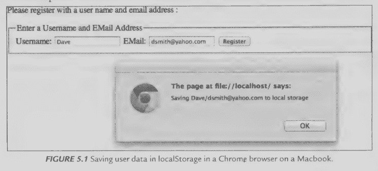

## 使用 QUERYING 和 MODIFYING THE DOM 与 JQUERY

在本章的前面部分，你已经了解了如何使用 jQuery 的 `eq()` 选择器在一组 `<p>` 元素中找到第一个 HTML `<p>` 元素。本节将向你展示如何使用各种 jQuery 修饰符，这些修饰符使得在 HTML5 网页中查找和更新元素变得非常容易。代码示例很短，因为它们只说明了一两个限定符，但你显然可以将它们组合起来执行非常复杂的 DOM 遍历和上下文敏感的 DOM 元素修改。

本节代码示例中讨论的一些限定符包括 `:first`、`:last`、`:even` 和 `:odd`。选择器的部分列表包括 `:eq()`、`:lt()`、`:gt()`、`:has()`、`:contains()` 和 `:eq()`。

### 使用 :first 和 :last 限定符查找和修改元素

本节中的示例将向你展示如何使用 jQuery 的 `:first` 和 `:last` 限定符来操作 HTML 元素中的文本。

清单 5.4 展示了 JQModifyElements1.html 的内容，该示例说明了如何交换两个 `<p>` 元素的内容。

```
清单 5.4 JQModifyElements1.html
<!DOCTYPE html>
```

清单 5.4 引用了所需的 jQuery 文件，添加了两个 HTML `<p>` 元素，然后提取了第一个 `<p>` 元素的 `id` 属性值和文本内容，如下所示：

```javascript
// 获取第一个段落中的信息：
var pId1    = $("p:first").attr('id');
var pText1  = $("p:first").text();
```

下一段代码对第二个 `<p>` 元素执行相同操作，然后通过以下两行代码交换两个 `<p>` 元素的文本：

```javascript
$("p:first").html(pText2);
$("p:last").html(pText1);
```

尽管 jQuery 代码很简单，但这说明了通过可用的 jQuery 函数，你可以轻松地操作 HTML 网页中的 HTML 元素。

顺便说一下，你可以通过以下两行代码获取和设置 HTML `<input>` 字段（其 `id` 属性值为 `myInput`）的值：

```javascript
$("#myInput").val()
$("#myInput").text("new input value");
```

图 5.2 展示了在搭载 Android ICS 的华硕 Prime 平板电脑上以横屏模式渲染页面 `JQModifyElements1.html` 的截图结果。

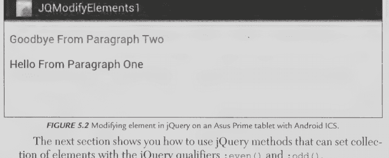

**图 5.2** 在搭载 Android ICS 的华硕 Prime 平板电脑上使用 jQuery 修改元素。

下一节将向你展示如何使用 jQuery 方法，通过 jQuery 限定符 `:even()` 和 `:odd()` 来设置元素集合。

## 使用 :even 和 :odd 限定符查找元素

本节中的示例展示了更复杂的操作，例如用单行代码设置所有偶数或奇数 HTML `<p>` 元素的颜色。

清单 5.5 展示了 `JQFindByEvenOrOdd1.html` 的内容，演示了如何根据元素在 HTML 网页中的相对位置（如第一个、最后一个、偶数或奇数）来选择和更新元素。

### 清单 5.5 JQFindByEvenOrOdd1.html

```html
<!DOCTYPE html>
<html lang="en">
<head>
<meta charset="utf-8"/>
<title>Using jQuery find with even or odd</title>
<script src="http://code.jquery.com/jquery-1.7.1.min.js"></script>
<style>
  #div1 {
    position: relative;
    width: 400px;
    height: 200px;
    background: #aaa;
  }
</style>
</head>
<body>
<div id="div1">
  <p style="color:red" id="Steve">Hello From Paragraph One</p>
  <p style="color:blue" id="Dave">Goodbye From Paragraph Two</p>
  <p style="color:yellow" id="Jane">Jane Says Hello</p>
  <p style="color:green" id="Michelle">Michelle Says Goodbye</p>
  <p style="color:black" id="Jim">Jim Just Woke Up</p>
</div>
<script>
$(document).ready(function(){
  // 获取第一个段落中的信息：
  var pId1 = $("p:first").attr('id');
  var pText1 = $("p:first").text();
  // 获取最后一个段落中的信息：
  var pId2 = $("p:last").attr('id');
  var pText2 = $("p:last").text();
  $("p:first").html(pText2);
  $("p:last").html(pText1);
  $("p:even").css({color:'white'});
  $("p:odd").css({color:'red'});
  $("p:last").css({color:'blue'});
});
</script>
</body>
</html>
```

清单 5.5 引用了所需的 jQuery 文件，添加了几个 HTML `<p>` 元素，并以与清单 5.4 相同的方式交换了第一个和最后一个 `<p>` 元素的内容。此外，清单 5.5 将偶数位置的 `<p>` 元素设置为白色，奇数位置的 `<p>` 元素设置为红色，最后一个 `<p>` 元素设置为蓝色，如下所示：

```javascript
$("p:even").css({color:'white'});
$("p:odd").css({color:'red'});
$("p:last").css({color:'blue'});
```

## 使用 :eq、:lt 和 :gt 限定符查找元素

有许多 jQuery 函数可以相对轻松地对 HTML 元素进行复杂的操作。本节包含一些有用的代码片段，展示了一些其他可用的 jQuery 函数。

例如，jQuery 限定符 `:eq()`、`:lt()` 和 `:gt()` 分别匹配位置等于、小于或大于列表中某个索引的元素。请记住，jQuery 中的列表从索引 0 开始。

查找索引为 3 的 `<p>` 元素的示例：

```javascript
$('p:eq(3)').text('index equals three');
```

查找索引大于 3 的 `<p>` 元素的示例：

```javascript
$('p:gt(3)').text('index is greater than three');
```

查找索引小于 3 的 `<p>` 元素的示例：

```javascript
$('p:lt(3)').text('index is less than three');
```

前面的代码片段向你展示了使用 jQuery 函数可以实现的一些功能。还有一些 jQuery 函数可以对 HTML 元素执行条件测试。

例如，jQuery 提供了自定义选择器，如 `:has()`、`:contains()` 和 `:eq()`。你可以使用这些选择器来选择元素，如下例所示：

```javascript
$("div:contains('foo')")
```

你可以使用这些选择器来过滤其他选择器，如下所示：

```javascript
$("div").contains('foo')
```

或者通过特定的类属性来选择元素，如下一节所示。

## 通过 class 或 id 查找 HTML 元素

jQuery 使用与 CSS 选择器相同的语法：“#”符号表示 `id` 属性，“.”符号表示 `class` 属性。例如，如果你想查找 `id` 属性为 `abc` 的 HTML `<div>` 元素，那么 jQuery 在搜索该 `<div>` 元素时使用字符串 `#abc`。如果你想查找 `class` 属性为 `abc` 的 HTML `<p>` 元素，那么 jQuery 在搜索该 `<p>` 元素时使用字符串 `.abc`。

清单 5.6 展示了 `JQFindByClassOrId1.html` 的内容，演示了如何在 HTML 网页中通过 `id` 或 `class` 选择和更新元素。

### 清单 5.6 JQFindByClassOrId1.html

```html
<!DOCTYPE html>
<html lang="en">
<head>
    <meta charset="utf-8"/>
    <title>Using jQuery find with class or id</title>

    <script src="http://code.jquery.com/jquery-1.7.1.min.js">
    </script>

    <style>
        #div1 {
            position: relative;
            width:  400px;
            height: 200px;
            background: #aaa;
        }

        .class1 {
            background: #f00;
        }

        .class2 {
            background: #fff;
        }
    </style>
</head>

<body>
    <div id="div1">
        <p style="color:red" id="Steve">Hello From Paragraph One</p>
        <p style="color:blue" id="Dave">Goodbye From Paragraph Two</p>
        <p style="color:yellow" id="Jane">Jane Says Hello</p>
        <p style="color:green" class="Michelle">Michelle Says Goodbye</p>
        <p style="color:black" class="Jim">Jim Just Woke Up</p>
    </div>

<script>
    $(document).ready(function(){
        // 获取第一个段落中的信息：
        var pId1 = $("p:first").attr('id');
        var pText1 = $("p:first").text();

        // 获取最后一个段落中的信息：
        var pId2 = $("p:last").attr('id');
        var pText2 = $("p:last").text();

        // 更新第一个和最后一个段落
        $("p:first").html(pText2);
        $("p:last").html(pText1);

        // 更新 class 为 "Michelle" 的段落
        $("p.Michelle").css({'font-size':20, color:'blue'});

        // 更新 class 为 "Jim" 的段落
        $("p.Jim").css({'font-size':24, color:'red'});

        // 添加 CSS 类 css-class1
        $('div').addClass('class1');
        // 移除 CSS 类 css-class1
        $('div').removeClass('class2');
    });
</script>
</body>
</html>
```

清单 5.6 的第一部分与清单 5.4 类似，同时包含了新代码，向你展示如何使用 jQuery 的 `css()` 函数来更新 HTML 元素的 CSS 属性。

例如，你可以设置 `font-size` 属性，由于连字符的存在，它需要放在引号中，如下所示：

```javascript
// 更新 class 为 "Michelle" 的段落
$("p.Michelle").css({'font-size':20, color:'blue'});
```

你可以使用 `addClass()` 方法为 HTML 元素添加 CSS 类，如下面的示例所示：

```javascript
// 添加 CSS 类 css-class1
$('div').addClass('class1');
```

最后，你可以使用 `removeClass()` 方法从 HTML 元素中移除 CSS 类，如下面的示例所示：

```javascript
// 移除 CSS 类 css-class1
$('div').removeClass('class2');
```

顺便提一下，在执行方法链时，你可以指定更复杂的条件，如下例所示（你能猜出它的作用吗？）：

```javascript
$("ul li#item4").prev().css({'font-size':24,
    'background-color':'blue'});
```

前面的代码片段将在本章后面的一个代码示例中进行讨论。

## 查找和设置元素属性

你已经了解了如何使用各种 jQuery 函数来操作元素，以及如何查找属性值。本节包含更新元素属性的示例。

以下代码片段获取元素的 `src` 属性值：

```javascript
var $source = $("img").attr("src");
```

下一个代码片段展示如何设置一个属性的值：

```javascript
$("img").attr("src", "/images/MyHouse.jpg");
```

以下代码片段展示如何在一条命令中设置多个属性（为了方便，显示在多行中）：

```javascript
$("img").attr({
    src: "/images/MyHouse.jpg",
    title: "House",
    alt: "House"
});
```

请注意，jQuery `attr()` 方法的语法与 jQuery `css()` 方法非常相似，因此当你理解了一个函数，你也会理解另一个函数。

HTML5 支持自定义属性，前提是属性名称以字符串 `data-` 开头，后跟一个属性名称。虽然你现在可能不需要使用自定义属性，但 jQuery Mobile 严重依赖于自定义属性，因此此功能非常有用。你可以使用 jQuery `.data()` 方法检索自定义属性的值。例如，假设你的 HTML 网页包含以下代码片段：

```html
<div data-role="page" data-value="99" data-status="new"></div>
```

你可以按照以下方式检索这些自定义属性的值：

```javascript
$("div").data("role") 返回值 page
$("div").data("value") 返回值 99
$("div").data("status") 返回值 true
```

你将在 jQuery Mobile 代码示例中看到更多操作自定义数据属性的例子，如果你真的有野心，可以在 jQuery Mobile 源代码中找到更多示例。

## 查找表单元素及其属性

jQuery 使你能够使用直观的语法根据各种条件选择 HTML 表单元素。例如，你可以使用下面列出的选择器来查找处于各种状态（已选中、未选中、隐藏、可见）的元素（复选框、输入字段等）：

- `:checkbox`（`type` 属性为 `checkbox` 的元素）
- `:checked`（已选中的单选按钮和复选框）
- `:input`（按钮、输入框、选择框和文本域）
- `:radio`（`type` 属性为 “radio” 的元素）
- `:text`（`type` 属性为 “text” 的元素）
- `:hidden`（选择隐藏元素）
- `:visible`（选择可见元素）

你可以使用以下语法找到查询返回的结果集的大小：

```javascript
var textCount = $(":text").length;
```

你可以使用以下选择器根据属性值选择元素：

`[attribute!=somevalue]` 选择属性不等于 `somevalue` 的元素。

如果你编写过处理 HTML 表单元素的 JavaScript 代码，那么你可以很容易地看到这些选择器在编写对应的 jQuery 代码时有多大的用处。

## 使用 `nth-child()` 查找元素

你知道如何在 CSS 中使用 `:even` 和 `:odd` 来指定元素集合中处于偶数位置和奇数位置的元素；如果你喜欢这个功能，那么你一定会喜欢 jQuery 的 `nth-child()` 操作符，它使你能够指定算术表达式以及 `:even`、`:odd` 和特定的位置值。

清单 5.7 展示了 `JQFindByCSS3StyleExpressions1.html` 的内容，它演示了如何使用 jQuery 选择器 `nth-child()` 在 HTML 网页中选择和更新元素。

### 清单 5.7 JQFindByCSS3StyleExpressions1.html

```html
<!DOCTYPE html>
<html lang="en">
<head>
    <meta charset="utf-8"/>
    <title>使用 jQuery 的 find 方法</title>

    <script src="http://code.jquery.com/jquery-1.7.1.min.js">
    </script>

    <style>
        #div1 {
            position: relative;
            width: 400px;
            height: 350px;
            background: #aaa;
        }
        ul li {
            font-size: 18px;
            color: blue;
        }
    </style>
</head>

<body>
<div id="div1">
    <ul>
<li>List Item 1</li>
<li>List Item 2</li>
<li>List Item 3</li>
<li>List Item 4</li>
<li>List Item 5</li>
<li>List Item 6</li>
<li>List Item 7</li>
<li>List Item 8</li>
<li>List Item 9</li>
</ul>
</div>

<script>
    $(document).ready(function(){
        // 获取第一个段落中的信息：
        var pId1    = $("ul li:first").attr('id');
        var pText1  = $("ul li:first").text();

        // 获取最后一个段落中的信息：
        var pId2    = $("ul li:last").attr('id');
        var pText2  = $("ul li:last").text();

        $("ul li:first").html(pText2);
        $("ul li:last").html(pText1);

        $("ul li:nth-child(even)").css({color:"#f00",
                                       "font-size":8});
        $("ul li:nth-child(3n+1)").css({"font-size":24});
        $("ul li:nth-child(1)").css({color:"#ff0","font-size":18});
    });
</script>
</body>
</html>
```

清单 5.6 包含一个无序元素列表，以及以下用于切换第一个和最后一个列表元素文本的代码。这段代码与清单 5.4 中切换第一个和最后一个 `<p>` 元素文本的代码类似：

```javascript
// 获取第一个段落中的信息：
var pId1    = $("ul li:first").attr('id');
var pText1  = $("ul li:first").text();

// 获取最后一个段落中的信息：
var pId2    = $("ul li:last").attr('id');
var pText2  = $("ul li:last").text();

$("ul li:first").html(pText2);
$("ul li:last").html(pText1);
```

清单 5.6 中有趣的代码使用 jQuery `css()` 函数来更新偶数位置元素的 CSS 属性，如下所示：

```javascript
$("ul li:nth-child(even)").css({color:"#f00","font-size":8});
```

下一个代码片段从第二个列表元素开始，更新每隔第三个列表元素：

```javascript
$("ul li:nth-child(3n+1)").css({"font-size":24});
```

清单 5.6 中最后一行代码更新第二个列表元素：

```javascript
$("ul li:nth-child(1)").css({color:"#ff0","font-size":18});
```

其他有用且相关的 jQuery 选择器是 `:first-child()`、`:last-child()` 和 `parent()`，你可以分别用它们来查找第一个子元素、最后一个子元素和父元素。

图 5.3 展示了在搭载 Android ICS 系统的华硕 Prime 平板电脑上以横向模式截屏显示的 `JQFindByCSS3StyleExpressions.html`。

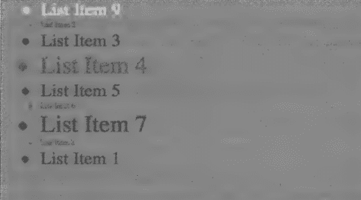

**图 5.3** 在 iPad 3 上使用 jQuery 查找元素。

## 使用 jQuery 移除元素

正如你可能猜到的，除了查找和修改 HTML 网页中的元素外，jQuery 还能让你移除元素。

清单 5.8 展示了 `JQRemovingElements1.html` 的内容，它演示了如何在 HTML 网页中通过 `id` 或 `class` 选择并移除元素。

### 清单 5.8 JQRemovingElements1.html

```html
<!DOCTYPE html>
<html lang="en">
<head>
  <meta charset="utf-8"/>
  <title>使用 jQuery 移除元素</title>

  <script src="http://code.jquery.com/jquery-1.7.1.min.js">
  </script>

  <style>
    #div1 {
      position: relative;
      width: 400px;
      height: 200px;
      background: #aaa;
    }
  </style>
</head>

<body>
  <div id="div1">
    <p style="color:red"    id="Steve">来自段落一的问候</p>
    <p style="color:blue"   id="Dave">来自段落二的告别</p>
    <p style="color:yellow" id="Jane">Jane说你好</p>
    <p style="color:green"  id="Michelle">Michelle说再见</p>
    <p style="color:black"  id="Jim">Jim刚醒</p>
    <p style="color:red"    id="Tracy">Tracy去睡觉了</p>
  </div>

  <script>
    $(document).ready(function(){
      $("p:even").css({color:'white'});
      $("p:odd").css({color:'red'});
      $("p:first").css({color:'yellow'});
      $("p:last").css({color:'blue'});

      // 移除 <p> 元素 Dave
      $("#Dave").remove();

      // 移除 <p> 元素 Michelle
      $("div1").remove("#Michelle");
    });
  </script>
</body>
</html>
```

jQuery 基础 • 211

```javascript
// 移除包含 "Goodbye" 的 <p> 元素
$("p").filter(":contains('Goodbye')").remove();
});
</script>
</body>
</html>
```

清单 5.8 包含了三行用于移除元素的代码，这里展示的是第一行（第二行类似）：

```javascript
// 移除 id 为 Dave 的 <p> 元素
$("#Dave").remove();
```

尽管前面的代码片段按预期工作，但接下来的代码片段展示了一个更能体现 jQuery 真正威力的例子。它使用了 jQuery 的 `filter()` 方法，来查找并移除所有包含字符串 `Goodbye` 的 HTML `<p>` 元素：

```javascript
$("p").filter(":contains('Goodbye')").remove();
```

将前面这一行简单直观的 jQuery 代码与实现相同功能所需对应的 JavaScript 代码进行比较。

图 5.4 显示了在 iPad 3 上运行的 iOS 应用程序中，以竖屏模式渲染 `RemovingElements1.html` 的结果截图。

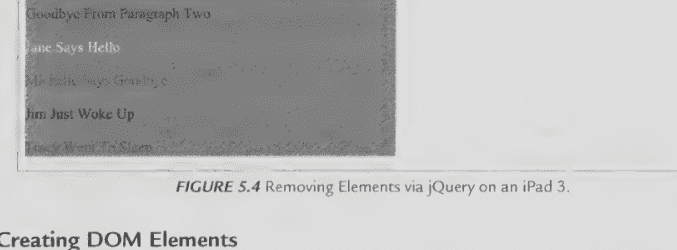

图 5.4 在 iPad 3 上通过 jQuery 移除元素。

# 创建 DOM 元素

jQuery 提供了 `clone()` 方法和 `append()` 方法用于创建新的 DOM 元素。`clone()` 方法创建元素的真实副本，如果你指定 `true`，那么 `clone(true)` 也会复制源元素的事件处理程序。另一方面，`append()` 方法作用于指定的元素。清单 5.9 展示了 `JQCreatingElements1.html` 的内容，说明了如何使用这两个 jQuery 方法在 HTML 网页中创建新元素。

## 清单 5.9 JQCreatingElements1.html

```html
<!DOCTYPE html>
<html lang="en">
<head>
  <meta charset="utf-8"/>
  <title>使用 jQuery 创建元素</title>

  <script src="http://code.jquery.com/jquery-1.7.1.min.js">
  </script>

  <style>
    div {
      position: relative;
      width: 400px;
      background: #aaa;
    }
  </style>
</head>

<body>
  <div id="div1">
    <p style="color:red" id="Steve">来自第一个段落的问候</p>
  </div>
  <div id="div2">
    <p style="color:red" id="Dave">Dave 从第二个段落说再见</p>
  </div>
  <div id="div3">
    <p style="color:yellow" id="Jane">Jane 说你好</p>
  </div>
  <div id="div4">
    <p style="color:green" id="Michelle">Michelle 说再见</p>
  </div>
  <div id="div5">
    <p style="color:black" id="Jim">Jim 刚刚醒来</p>
  </div>
  <div id="div6">
    <p style="color:red" id="Tracy">Tracy 去睡觉了</p>
  </div>

  <script>
    $(document).ready(function(){
```

清单 5.9 引入了 jQuery 的 `clone()` 方法，其示例如下：

```javascript
// 将 #Dave 元素的克隆追加到 "#div2"：
$("#Dave").clone().css({color:"#000"}).appendTo("#div2");
```

前面代码片段的目的很明确，你甚至可以从左到右阅读来理解其用途：克隆 `id` 为 `Dave` 的元素，将其颜色设置为 `black`，并将此克隆元素追加到 `id` 为 `div2` 的元素中。

清单 5.9 中唯一另一个新功能是 jQuery 的 `prependTo()` 函数，它在一个指定元素之前（而不是之后）插入元素，如下所示：

```javascript
// 将 #Dave 预置到所有 'div' 元素中：
//$("#Dave").clone().prependTo("div");
```

还有其他用于插入 DOM 元素的 jQuery 方法，其中一些将在下一节中描述。

图 5.5 显示了在 iPad 3 上运行的 iOS 应用程序中，以横屏模式渲染 `JQCreatingElements1.html` 的结果截图。

214 • 面向移动和桌面设备的 jQuery、CSS3 和 HTML5

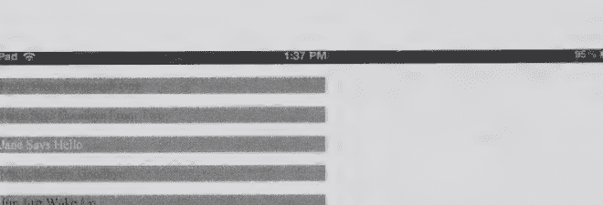

# 其他用于插入 DOM 元素的 jQuery 方法

jQuery 提供了一组用于源元素已存在于 HTML 网页中的方法。另一组方法则用于动态创建新元素时。

例如，如果 `myDiv1` 和 `myImg1` 是 HTML 网页中的两个元素，那么你可以使用 jQuery 的 `append()` 方法创建 `myDiv1` 的克隆并将其插入到 DOM 中 `myImg1` 元素的后面，如下所示：

```javascript
$("myDiv1").clone().append("#myImg1");
```

另一方面，以下代码片段动态创建一个新的 `<div>` 元素，因此你必须使用 jQuery 的 `appendTo()` 方法，如下所示：

```javascript
$("myDiv1").clone().appendTo("#myImg1");
```

在 HTML 网页中移动元素：

```javascript
$("#myDiv2").insertBefore("#myDiv1");
$("#myDiv3").insertAfter("#myDiv1");
```

jQuery 的 `appendTo()` 方法的另一个便捷用途是根据条件逻辑插入 CSS 样式表，如下所示：

```javascript
if ($('body').width() > 900) {
  $('<link rel="stylesheet" href="wide.css"/>')
    .appendTo('head');
} else {
  $('link[href=wide.css]').remove();
}
```

前面的代码块会在 HTML `<body>` 元素宽度大于 900 时插入 CSS 样式表 `wide.css`；否则，此样式表将被移除。你可以使用此类代码来代替 CSS 媒体查询，但要小心不要无意中将此类逻辑“散布”在你的 HTML 网页中，这可能会使它们更难以调试或添加新功能。

jQuery 支持以下方法来创建新的 DOM 元素并将其插入到相对于现有 DOM 元素的不同位置：

- `append()`
- `insert()`
- `prepend()`
- `appendTo()`
- `appendAfter()`
- `insertBefore()`
- `insertAfter()`

jQuery 方法 `append()`、`insert()` 和 `prepend()` 用于源元素已存在于 HTML 网页中的情况；其他方法用于动态创建新元素的情况。

# 实用的 jQuery 代码块

本节包含一组代码片段，使你能够执行条件逻辑，然后执行自定义代码。本节中的代码示例都很直接，注释解释了它们的用途。

检查 jQuery 是否已加载：

```javascript
if (typeof jQuery == 'undefined') {
    // jQuery 未加载
}
```

检查元素是否存在：

```javascript
if ( $('#myElement').length > 0 ) {
    // 元素存在
}
```

检查空元素：

```javascript
$('*').each(function() {
    if ($(this).text() == "") {
        // 在此处执行某些操作
    }
});
```

根据 `<div>` 元素的内容返回 true 或 false：

```javascript
var emptyTest = $('#myDiv').is(':empty');
```

确定复选框是否被选中（返回 true/false）：

```javascript
$('#checkBox').attr('checked');
```

查找所有被选中的复选框：

```javascript
$('input[type=checkbox]:checked');
```

禁用/启用按钮元素的输入：

```javascript
$("#submit-button").attr("disabled", true);
```

从按钮元素移除属性：

```javascript
$("#submit-button").removeAttr("disabled");
```

另一类重要的 jQuery 函数涉及能够让你在 DOM 中导航的函数，其中一些方法将在下一节中讨论。

# jQuery 元素导航方法

至此，你知道如何使用 jQuery 在 HTML 网页中查找、更新、删除和创建元素。然而，有时你需要处理其位置相对于另一个元素的元素。例如，假设你有一个无序元素列表，每当用户单击一个元素时，你就交换它与其紧随（或前面）元素的位置。幸运的是，jQuery 通过直观命名的方法提供了此功能，如下一节所述。

## next()/prev()/closest()/parent() 方法

jQuery 的 `next()` 方法选择当前“上下文”元素的下一个直接兄弟元素，而 jQuery 的 `prev()` 方法选择直接的前一个兄弟元素。jQuery 的 `parent()` 方法选择当前元素的父元素，而 jQuery 的 `closest()` 方法选择与指定类型匹配的最近元素。

清单 5.10 展示了 `JQNextPrevClosestParent1.html` 的内容，说明了如何使用这些方法来操作 HTML 网页中的元素。

## 清单 5.10 JQNextPrevClosestParent1.html

```html
<!DOCTYPE html>
<html lang="en">
<head>
    <meta charset="utf-8"/>
    <title>jQuery 与 next、previous、closest parent</title>

    <script src="http://code.jquery.com/jquery-1.7.1.min.js"></script>

    <style>
        #div1 {
            position: relative;
            width:  400px;
            height: 250px;
            background: #aaa;
        }
        ul li {
            font-size: 18px;
            color: white;
        }
    </style>
</head>

<body>
    <div id="div1">
        <ul>
            <li id="item1">列表项 1</li>
            <li id="item2">列表项 2</li>
            <li id="item3">列表项 3</li>
            <li id="item4">列表项 4</li>
            <li id="item5">列表项 5</li>
            <li id="item6">列表项 6</li>
            <li id="item7">列表项 7</li>
            <li id="item8">列表项 8</li>
            <li id="item9">列表项 9</li>
        </ul>
    </div>

    <script>
        $(document).ready(function(){
```

## 其他 jQuery 导航选择方法

除了前面章节讨论过的相对导航方法外，jQuery 还支持相对选择方法。例如，jQuery 的 `.siblings()` 方法会选择当前元素的所有兄弟元素，而 `.children()` 方法则会选择当前元素的所有子元素。

本节的 jQuery 代码既简洁又清晰，仅占网页内容的四分之一。一个有趣的练习是仅使用 JavaScript（不借助任何工具包）来实现相同功能，然后将代码大小与清单 5.11 中的代码进行比较，同时比较 JavaScript 代码的可读性以及编写所需的时间。

清单 5.11 展示了 `JQSiblingsChildren1.html` 的内容，它演示了如何使用 jQuery 方法 `.siblings()`、`.children()`、`.each()` 和 `.data()` 来对 HTML 网页中的元素执行各种操作。

## 清单 5.11 JQSiblingsChildren1.html

```html
<!DOCTYPE html>
<html lang="en">
<head>
  <meta charset="utf-8"/>
  <title>Siblings and Children with jQuery</title>

  <style>
  ul { float:left; font-size:14px; }
  li { color:blue; font-size:16px; }
  p  { color:red;  font-size:16px; }
  </style>

  <script src="http://code.jquery.com/jquery-1.7.1.min.js">
  </script>
</head>

<body>
  <ul>
    <li id="top1">List 1 One</li>
    <li>List 1 Two</li>
    <li>List 1 Three</li>
    <li>List 1 Four</li>
  </ul>

  <ul>
    <li>List 2 One</li>
    <li>List 2 Two</li>
    <li id="middle2">List 2 Three</li>
    <li>List 2 Four</li>
    <li>List 2 Five</li>
  </ul>

  <ul>
    <li>List 3 One</li>
    <li>List 3 Two</li>
    <li>List 3 Four</li>
    <li>List 3 Five</li>
    <li id="bottom3">List 3 Five</li>
  </ul>

  <script>
    $(document).ready(function(){
      $("#top1").siblings()
               .css("color", "red");

      $("#middle2").parent().css("font-size", 32);

      $("#bottom3").siblings().each(function() {
          if (this.style.color != "blue") {
              this.style.color = "red";
          } else {
              this.style.color = "yellow";
          }
      });
    });
  </script>
</body>
</html>
```

清单 5.11 定义了三个 HTML `<ul>` 元素，每个元素都包含一个带有 `id` 属性的列表项，其值分别为 `top1`、`middle2` 和 `bottom3`。

第一段 jQuery 代码块查找 `id` 属性为 `top1` 的元素的兄弟元素，然后将这些元素设置为红色，如下所示：

```javascript
$("#top1").siblings().css("color", "red");
```

第二段 jQuery 代码片段查找 `id` 属性为 `middle2` 的元素的父元素，然后将其 `font-size` 设置为 `32`：

```javascript
$("#middle2").parent().css("font-size", 32);
```

最后一段 jQuery 代码块最为复杂，它查找 `id` 属性为 `bottom3` 的元素的兄弟元素，并将它们的 `color` 属性设置为红色（如果当前不是蓝色的话），否则代码将其颜色设置为黄色：

```javascript
$("#bottom3").siblings().each(function() {
    if (this.style.color != "blue") {
        this.style.color = "red";
    } else {
        this.style.color = "yellow";
    }
});
```

启动清单 5.11 中的代码，以验证 jQuery 代码是否执行了此处描述的更新。

## 缓存 jQuery 调用结果

对于功能复杂且执行大量基于 DOM 搜索的 HTML5 网页，你可以通过缓存通过 jQuery 遍历 DOM 结构的结果来提高性能。

例如，如果你的 HTML 网页有很多 `<li>` 元素，你可以通过检索 HTML 网页中所有 `<ul>` 元素的列表、将该列表存储在一个变量中，然后在该变量上调用操作而不是多次遍历 DOM，从而编写更高效的代码，如下所示：

```javascript
$("button").click(function() {
    // store the list of <ul> elements in a variable
    var ulList = $("ul");

    // remove the first <li> element
    ulList.find("li:first-element").remove();

    // change the text of the last <li> element
    ulList.find("li:last-element").text("last li");
})
```

上面的代码块很简单，但对于包含数百个类似 HTML 元素的 HTML 页面，这种编码技术绝对可以提高你的性能。如有疑问，可以在不使用这种缓存技术编写 HTML 网页时比较速度差异。

## 关于 this、$this 和 $(this)？

上一节包含一个带有 `this` 关键字的代码示例，在 HTML 网页中找到这个关键字实际上很常见。不幸的是，它可能成为混淆的来源，因此本节提供一个简要描述，以帮助你理解其目的以及如何使用 `this` 关键字。

JavaScript 中的 `this` 关键字按如下方式确定：

- 如果对象 `callingObject` 的一个方法导致当前代码块执行，那么 `this` 就是对象 `callingObject`，除非函数引用被传递给事件处理程序。

jQuery 的一大优点是它简化了关于 `this` 关键字的相当复杂的规则。

例如，如果你在按钮上关联一个点击事件，用户点击该按钮，那么在 jQuery 中关键字 `this` 指的是被点击的按钮（而不是网页上尚未被点击的其他按钮）。但是，我们必须通过将其“包裹”在括号中（以 "$" 开头）来“jQuery 化”关键字 `this`，以便能够访问 jQuery 方法，如下所示：

```javascript
$("button").click(function() {
    $(this).css('background-color', 'red');
    $(this).text("I am a red clicked button");
})
```

请记住，你必须使用 `$(this)` 来调用 jQuery 函数，并且 jQuery 向 `$(this)` 对象添加了 jQuery 特有的函数。

回想一下，在前面的部分中，你学会了如何将 jQuery DOM 遍历的结果缓存到变量中。虽然你没有获得性能提升，但你也可以缓存对 `this` 关键字的引用，如下所示：

```javascript
$("button").click(function() {
    var $this = $(this);
    $this.css('background-color', 'red');
    $this.text("I am a red clicked button");
})
```

## 在 jQuery 中处理点击事件

jQuery 支持各种类型的事件和用户手势，你可以将它们“绑定”到自定义代码（由你编写），当这些事件或手势发生时，这些代码将被执行。你可以在 jQuery Mobile 中检测和绑定的事件包括 `click`、`tap`、`taphold`、`swipe`、`swipeleft` 和 `swiperight`（关于这些事件的更多细节将在后面讨论）。

`click()` 函数使你能够处理点击事件，其语法示例如下：

```javascript
$("#button1").click(function() {
    // do something
})
```

处理事件有几种技术（本章后面将提供更多信息），推荐的做法是如图所示：

```javascript
$("#button1").on("click", function() {
    // do something
});
```

同样，你可以使用前面两个代码片段来为上述其他 jQuery 事件以及后续章节列出的鼠标事件定义事件处理程序。

`dblclick()` 函数使你能够处理双击事件。其语法示例如下：

```javascript
$("#button2").dblclick(function() {
    // do something
});
```

`focus()` 函数为选定的元素提供焦点。例如，下面的代码在你点击一个 `id` 属性等于 `firstInput` 的输入框时显示光标：

```javascript
$("#firstInput").focus(function() {
    // do something
});
```

清单 5.12 展示了 `JQClickDivs1.html` 的内容，该文件演示了如何在 HTML5 网页中检测点击事件，然后更新两个 `<div>` 元素的内容。

## 清单 5.12 JQClickDivs1.html

```html
<!DOCTYPE html>
<html lang="en">
<head>
    <meta charset="utf-8"/>
    <title>Detecting Click Events with jQuery</title>
    <script src="jquery-1.7.1.js"></script>
    <style>
        div {
            position: relative;
            width: 200px;
            height: 100px;
            background-color: red;
            color: white;
            margin: 2px;
        }
    </style>
</head>

<body>
    <div id="div1">The first div element </div>
    <div id="div2">The second div element </div>

    <script>
        var click1=0, click2=0, total=0;

        $(document).ready(function() {
            $("#div1").click(function() {
                ++click1;
                ++total;
                $(this).text("Clicked: "+click1+" total: "+total);
                $("#div2").text("Clicked: "+click2+" total: "+total);
            });

            $("#div2").click(function() {
                ++click2;
                ++total;
                $(this).text("Clicked: "+click2+" total: "+total);
                $("#div1").text("Clicked: "+click1+" total: "+total);
            });
        });
    </script>
</body>
</html>
```

清单 5.12 引入了所需的 jQuery 文件，接着是一些 CSS 样式定义，以及两个 HTML `<div>` 元素：

```html
    <div id="div1">The first div element </div>
    <div id="div2">The second div element </div>
```

为第一个 HTML `<div>` 元素添加点击事件监听器的代码如下所示（第二个 HTML `<div>` 元素有类似的 jQuery 代码）：

```javascript
    $("#div1").click(function() {
        ++click1;
        ++total;
        $(this).text("Clicked: "+click1+" total: "+total);
        $("#div2").text("Clicked: "+click2+" total: "+total);
    });
```

每当用户点击前面的 HTML `<div>` 元素时，其点击计数和总点击计数都会增加，并且两个 HTML `<div>` 元素的文本都会更新，显示各自 `<div>` 元素的点击计数以及两个 `<div>` 元素点击计数的总和。

尽管清单 5.12 中的例子很简单，但它确实展示了如何在 HTML 网页中跟踪不同 HTML 元素的事件。一个更现实的例子可能涉及一个包含 HTML 表单的 HTML 网页，其中表单元素之间存在相互依赖关系。

图 5.7 展示了在运行 Android ICS 的华硕 Prime 平板电脑上以横屏模式截取的渲染 HTML 页面 `JQClickDivs1.html` 的结果。

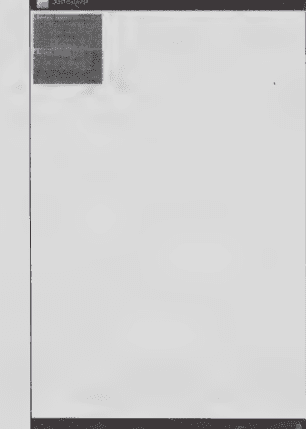

**图 5.7** 在运行 Android ICS 的华硕 Prime 平板电脑上统计点击事件。

# 用于遍历元素的 jQuery API

jQuery 支持 jQuery `.find()` 方法，这是一个非常强大的 jQuery API，使你能够执行复杂的 DOM 遍历并操作结果集。

例如，你可以设置多个 CSS 属性，如 `background` 和 `width` 属性。在本节中，你将看到更多关于 jQuery `css()` 函数的示例。

清单 5.13 展示了 `JQFindAndUpdate1.html` 的内容，该文件演示了如何查找各种 `<li>` 元素集合，然后更新它们的一个或多个 CSS 属性。

## 清单 5.13 JQFindAndUpdate1.html

```html
<!DOCTYPE html>
<html lang="en">
<head>
    <meta charset="utf-8"/>
    <title>Using the jQuery find Method with Lists</title>
    <script src="http://code.jquery.com/jquery-1.7.1.min.js"></script>
    <style>
        li { width: 50%; padding: 1px; }
    </style>
</head>
<body>
    <ul class="level-1">
        <li class="item-i">I
            <ul class="level-2">
                <li class="item-a">A</li>
            </ul>
        </li>
        <li class="item-ii">II
            <ul class="level-2">
                <li class="item-a">A</li>
                <li class="item-b">B
                    <ul class="level-3">
                        <li class="item-1">1</li>
                        <li class="item-2">2</li>
                    </ul>
                </li>
                <li class="item-c">C</li>
            </ul>
        </li>
        <li class="item-iii">III
            <ul class="level-2">
                <li class="item-1">1</li>
                <li class="item-2">2</li>
            </ul>
        </li>
        <li class="item-iv">IV
            <ul class="level-2">
                <li class="item-1">3</li>
                <li class="item-2">4</li>
            </ul>
        </li>
    </ul>

<script>
$(document).ready(function(){
    // 'li' descendants of item II are now green:
    $('li.item-i').find('li').css('background-color', 'green');

    // 'li' descendants of item II are now red:
    $('li.item-ii').find('li').css('background-color', 'red');

    // the first 'li' of list B under item II is now black:
    var item1 = $('li.item-1')[0];
    $('li.item-ii').find(item1).css('background-color', 'black');

    // the 'li' descendants of item III are now yellow:
    var $allListItems = $('li');
    $('li.item-iii').find($allListItems).css({
        'background-color': 'yellow', 'width': '100px' });

    // 'li' descendants of item IV are now blue:
    $('li.item-iv').find('li').css({'background-color':
        'blue', 'width': '100px' });
});
</script>
</body>
</html>
```

清单 5.13 包含通常的初始化，接着是一个带有嵌套子列表的 HTML `<ul>` 元素。jQuery 代码部分包含注释，解释了每个 jQuery 代码片段的用途。如你所见，每个代码片段都从一个特定的元素开始，使用 jQuery `find()` 方法选择其子元素的一个子集，然后使用 jQuery `css()` 方法更新各种 CSS 属性。

运行清单 5.13 中的代码，并将结果与你的预期进行比较（它们是否相同？）。作为最后一个例子，思考一下这段代码片段会做什么，然后将其插入到清单 5.13 中以确认你的猜测：

```javascript
$('*').find('li').css('background-color', 'red');
```

你可以在以下网址找到更多关于 jQuery `.find()` 方法的信息：http://api.jquery.com/find/

另一个包含大量 DOM 遍历示例的有用链接在这里：http://api.jquery.com/category/traversing/

图 5.8 展示了在运行 Android ICS 的华硕 Prime 平板电脑上以横屏模式截取的渲染 `JQFindAndUpdate1.html` 的结果。

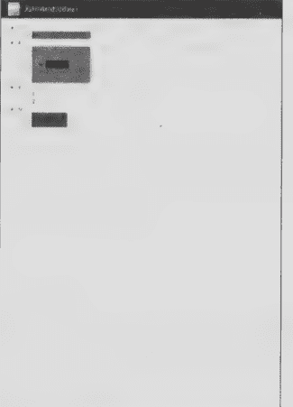

**图 5.8** 在运行 Android ICS 的华硕 Prime 平板电脑上查找和更新元素。

# 链式调用 jQuery 函数

你已经见过链接 jQuery 命令的例子，本节将向你展示如何执行更复杂的链式命令。具体来说，本节的代码示例将向你展示如何使用 `.end()` 方法，该方法允许你在一系列链式命令中需要时“重置”上下文列表：

http://blog.pengoworks.com/index.cfm/2007/10/26/jQuery-Understanding-the-chain

相比之下，你可能在 Java（特别是 JAXB）中使用过链式命令，如下所示：

```java
myList().getFirstElem().getCustomer().setFirstName("Dave");
```

然而，jQuery 的链式调用可以涉及更复杂的操作，因为你可以在应用新操作之前更改对当前结果集的引用。

清单 5.14 展示了 JQChaining1.html 的内容，该文件演示了如何在 jQuery 中调用链式命令。

## 清单 5.14 JQChaining1.html

```html
<!DOCTYPE html>
<html lang="en">
<head>
<meta charset="utf-8"/>
<title>Chaining jQuery Methods</title>

<script src="http://code.jquery.com/jquery-1.7.1.min.js">
</script>

<style>
#outer {
    width:300px;
    height:300px;
    background:red;
}
#first {
    width:400px;
    height:150px;
    background:green;
}
#second {
    width:400px;
    height:200px;
    background:yellow;
}
</style>
</head>

<body>
<div id="outer">
```

## jQuery基础 • 233

清单 5.14 包含对所需 jQuery 文件的引用、一些 CSS 样式、一个 HTML `<ul>` 元素，以及一段 jQuery 代码，移除注释后如下所示：

```
var $first = $("<div id='first'>first</div>")
  .appendTo("<div id='second'>second</div>")
  .parent()
  .appendTo("#outer")
  .end();
```

尽管 jQuery 使你能够构建几乎任意复杂度的表达式，但这类表达式也更容易出错。作为对比（这只是一个类比），如果你编写过复杂的正则表达式，你大概还记得想出一个完全符合需求的表达式所需的时间。

## 使用 JQUERY 实现 HTML5 地理定位

第 10 章将更详细地讨论 HTML5 地理定位，如果你不熟悉地理定位 API，可以阅读该章。本节的示例说明了如何使用 jQuery 渲染用户的当前位置。正如你将看到的，清单 5.14 中的 jQuery 代码是 HTML 网页末尾非常简短的一段代码（以粗体显示），这说明在某些情况下，你可以编写主要包含“常规” JavaScript 代码的 HTML 网页。

清单 5.15 显示了 JQGeoLocation1.html 的内容，该示例演示了如何确定用户的位置，然后在 Google 地图中渲染该位置。


# 清单5.15 JQGeoLocation1.html

```html
<!DOCTYPE html>
<html lang="en">
<head>
    <meta charset="utf-8"/>
    <title>地理定位</title>

    <style>
    #div1 {
        font-size: 16px;
        height: 200px;
        width:  400px;
    }
    </style>

    <script src="http://ajax.googleapis.com/ajax/libs/jquery/1.5.0/jquery.min.js">
    </script>

    <!-- Google地图API -->
    <script src="http://maps.google.com/maps/api/js?sensor=false">
    </script>

    <script>
    function findUserLocation() {
        // 此方法指定了‘成功’和‘失败’的JS函数
        navigator.geolocation.getCurrentPosition(successCallback, errorCallback);
    }

    function successCallback(position) {
      var latitude  = position.coords.latitude;
      var longitude = position.coords.longitude;
      var latlong   = new google.maps.LatLng(latitude, longitude);

      var myOptions = {
          zoom: 14,
          center: latlong,
          mapTypeId: google.maps.MapTypeId.ROADMAP
      };

      // 使用Google地图显示当前位置
      var map = new google.maps.Map(document.getElementById("div1"),
                                    myOptions);
      map.setCenter(latlong);

      var marker = new google.maps.Marker({
          position: initialLocation,
          map: map,
          title: "我在这里！"
      });
    }

    function errorCallback(error) {
      if(error.code == error.PERMISSION_DENIED) {
          console.log("错误：您必须启用地理定位访问");
      } else if(error.code == error.PERMISSION_UNAVAILABLE) {
          console.log("错误：地理定位服务不可用");
      } else if(error.code == error.TIMEOUT) {
          console.log("错误：发生超时");
      }

      //console.log(error);
    }

    function positionDetails(position) {
      var positionStr = 
        "纬度:"+ pos.coords.latitude +"<br>"+
        "经度:"+ pos.coords.longitude +"<br>"+
        "精度:"+ pos.coords.accuracy +"<br>"+
        "海拔:"+ pos.coords.altitude +"<br>"+
        "海拔精度:"+ pos.coords.altitudeAccuracy +"<br>"+
        "航向:"+ pos.coords.heading +"<br>"+
        "速度:"+ pos.coords.speed +"";

      // 不使用jQuery：
      document.getElementById("position").innerHTML = positionStr;

      // 使用jQuery：
      // $("#position").html(positionStr);
      console.log(positionStr);
    }
    </script>
</head>

<body>
  <div id="div1">
    <p>点击按钮显示您的位置：</p>
    <form id="geoLocationForm">
      <input type="button" id="geobutton" value="查找我的当前位置">
    </form>
  </div>

  <script>
    $(document).ready(function() {
      $('#geobutton').click(findUserLocation);
    });
  </script>
</body>
</html>
```

清单5.15以一些CSS样式、对所需jQuery文件的引用以及对Google地图JavaScript文件的引用开始。

接下来，JavaScript函数`findUserLocation()`调用`geolocation`对象（通过`navigator`对象暴露）的`getCurrentPosition()`方法，以获取用户的当前位置，如下所示：

```javascript
// 此方法指定了‘成功’和‘失败’的JS函数
navigator.geolocation.getCurrentPosition(successCallback,
                                     errorCallback);
```

请注意，前面的代码片段指定了当`getCurrentPosition()`函数成功或失败时分别调用的JavaScript `successCallback()`函数和JavaScript `errorCallback()`函数。

`successCallback()`函数接收到一个位置参数，我们可以用它来确定用户当前位置的三个位置值，如下所示：

```javascript
function successCallback(position) {
  var latitude  = position.coords.latitude;
  var longitude = position.coords.longitude;
  var latlong = new google.maps.LatLng(latitude, longitude);
  // 省略其他代码
```

JavaScript变量`myOptions`指定了属性，例如我们要显示的地图类型，如下所示：

```javascript
var myOptions = {
    zoom: 14,
    center: latlong,
    mapTypeId: google.maps.MapTypeId.ROADMAP
};
```

JavaScript map变量使用`myOptions`变量创建一个地图，并将其渲染在`id`属性值为`div1`的HTML `<div>`元素中，如下所示：

```javascript
// 使用Google地图显示当前位置
var map = new google.maps.Map(document.getElementById("div1"),
                          myOptions);
map.setCenter(latlong);
```

错误函数也很重要，因为它可以提供有关发生错误原因的信息，如下所示：

```javascript
function errorCallback(error) {
  if(error.code == error.PERMISSION_DENIED) {
    console.log("错误：您必须启用地理定位访问");
  } else if(error.code == error.PERMISSION_UNAVAILABLE) {
    console.log("错误：地理定位服务不可用");
  } else if(error.code == error.TIMEOUT) {
    console.log("错误：发生超时");
  }
  //console.log(error);
}
```

清单5.15还包含一个JavaScript函数`positionDetails()`，其中包含一些额外的细节，你也可以将它们包含在处理`getCurrentPosition()` JavaScript函数成功调用的回调函数中。

最后，清单5.15包含一个HTML `Form`元素，其中有一个按钮，其`id`属性值为`geobutton`，后面跟着一段非常简短的jQuery代码块（以粗体显示），当用户点击该按钮时，它会调用JavaScript函数`getCurrentPosition()`，如下所示：

```javascript
$('#geobutton').click(findUserLocation);
```

如你所见，清单5.15中的代码很简单，它让你对如何编写包含地理定位相关细节的HTML网页有了基本的了解。下一节包含本章的最后一个示例，你将学习如何获取和显示移动设备的加速度计相关数据。图5.9显示了在Macbook的Chrome浏览器中渲染JQGeoLocation1.html的结果。

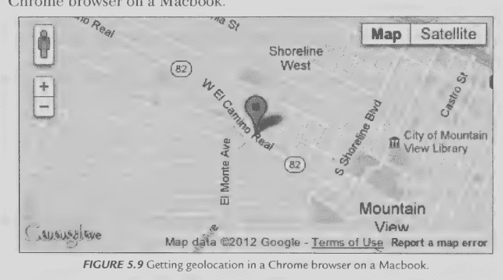

# 使用JQUERY获取加速度计数值

本节的示例说明了如何使用jQuery获取移动设备的加速度计数值。清单5.16显示了JQAccelerometer1.html的内容，该示例演示了如何在设备沿任何方向加速时显示其加速度计数值。清单5.16显示了CSS样式表JQAccelerometer1.css的内容，其中的选择器用于匹配HTML网页中的元素。

## 清单5.16 JQAccelerometer1.html

```html
<!DOCTYPE html>
<html lang="en">
<head>
<meta charset="utf-8"/>
<title>jQuery与加速度计</title>
<script
src="http://ajax.googleapis.com/ajax/libs/jquery/1.6.4/jque-
ry.min.js">
</script>

<script>
    var colorX = "", colorY = "", colorZ = "";
    var intx = 0, inty = 0, intz = 0;
    var colors = ['#f00', '#ff0', '#00f'];

    $("document").ready(function(){
        $(window).bind("devicemotion", function(e){
            var accelEvent = e.originalEvent,
            accel = accelEvent.accelerationIncludingGravity,
            x = accel.x, y = accel.y, z = accel.z;

            if(x < 0)       { intx = 0; }
            else if(x < 1) { intx = 1; }
            else            { intx = 2; }

            if(y < 0)       { inty = 0; }
            else if(y < 1) { inty = 1; }
            else            { inty = 2; }

            if(z < 0)       { intz = 0; }
            else if(z < 1) { intz = 1; }
            else            { intz = 2; }

            colorX = colors[intx];
            colorY = colors[inty];
            colorZ = colors[intz];

            $("#valueX").css("backgroundColor", colorX);
            $("#valueY").css("backgroundColor", colorY);
            $("#valueZ").css("backgroundColor", colorZ);

            $("#valueX").html("<p>Acceleration x: <b>" + x + "</b></p>");
            $("#valueY").html("<p>Acceleration y: <b>" + y + "</b></p>");
            $("#valueZ").html("<p>Acceleration z: <b>" + z + "</b></p>");
        });
    });
</script>
</head>

<body>

<h2>Accelerometer Values</h2>
<div id="outer">
    <div id="valueX"></div>
    <div id="valueY"></div>
    <div id="valueZ"></div>
</div>
</body>
</html>
```

清单5.16中的代码获取移动设备三个方向（所有方向彼此垂直）的加速度计值，然后计算整数值，用作颜色值数组的索引。确定每个方向关联的颜色后，相应的矩形 `<div>` 元素将更新为对应的颜色。

将 `window` 对象绑定到 `devicemotion` 事件后，我们可以使用事件对象（在此例中称为 `e`）获取加速对象（称为 `accel`）的 JavaScript 引用，然后提取三个不同轴的当前值，如下所示：

```javascript
$('document').ready(function() {
    $(window).bind('devicemotion', function(e) {
        var accelEvent = e.originalEvent,
            accel = accelEvent.accelerationIncludingGravity,
            x = accel.x, y = accel.y, z = accel.z;
```

为简单起见，颜色数组仅包含三种颜色，以下代码计算 0 到 2 之间的数字以确定 x 方向的颜色：

```javascript
if(x < 0)       { intx = 0; }
else if(x < 1)  { intx = 1; }
else            { intx = 2; }
```

x 方向的颜色计算如下：

```javascript
colorX = colors[intx];
```

与 x 方向关联的 HTML `<div>` 元素的背景颜色通过以下代码更新：

```javascript
$("#valueX").css("backgroundColor", colorX);
```

最后，使用以下代码片段显示 x 方向的当前加速度值：

```javascript
$("#valueX").html("<p>Acceleration x: <b>" + x + "</b></p>");
```

y 方向和 z 方向的相应值以类似方式计算。

## 清单 5.17 JQAccelerometer1.css

```css
#outer {
position: relative; top: 10px; left: 0px;
}

p { font-size: 24px; }

#valueX {
width: 480px;
height: 100px;
position: absolute; top: 0px; left: 0px;
background-color: white;
}

#valueY {
width: 480px;
height: 100px;
position: absolute; top: 100px; left: 0px;
background-color: white;
}

#valueZ {
width: 480px;
height: 100px;
position: absolute; top: 200px; left: 0px;
background-color: white;
}
```

清单 5.17 非常直接：它包含三个选择器，用于指定清单 5.16 中三个 HTML `<div>` 元素的初始属性，这段代码您应该看起来非常熟悉。

图 5.10 显示了在运行 Android ICS 的华硕 Prime 平板电脑上，以横屏模式截取的 Android 应用程序中渲染清单 5.16 中 HTML 网页的结果。

# 使用 JQUERY 插件

在 jQuery 概述中，您了解到 jQuery 支持插件，而且实际上有数百个（甚至可能数千个）可用插件。此主题超出了本书的范围，但请充分利用大量的 jQuery 插件，因为它们可以为您节省大量工作。以下两个链接提供了各种 jQuery 插件：

- [http://www.devarticles.com/c/a/JavaScript/More-of-the-Top-jQuery-Plugins-for-Animation/](http://www.devarticles.com/c/a/JavaScript/More-of-the-Top-jQuery-Plugins-for-Animation/)
- [http://www.devarticles.com/c/a/JavaScript/The-Top-jQuery-Slider-Plugins/](http://www.devarticles.com/c/a/JavaScript/The-Top-jQuery-Slider-Plugins/)

您也可以执行互联网搜索以查找更新的 jQuery 插件，然后选择适合您需求的插件。如果没有找到符合您要求的插件，您可以找到在线教程，这些教程将向您展示如何创建自己的 jQuery 插件。

# 总结

本章向您介绍了 jQuery，以及展示如何使用 jQuery 函数创建简单动画效果的代码示例。您看到了展示如何执行以下操作的代码示例：

- 创建基于 jQuery 的简单 HTML5 网页
- 使用 `:first` 和 `:last` 限定符查找和修改元素
- 使用 `:even` 和 `:odd` 限定符查找元素
- 使用 `:eq`、`:lt` 和 `:gt` 限定符查找元素
- 查找 HTML 元素
- 通过类或 id 查找元素
- 查找/设置元素属性
- 查找表单元素及其属性
- 使用 CSS3 风格的表达式查找元素
- 移除 DOM 元素
- 创建 DOM 元素
- 在 jQuery 中处理事件
- 使用 `click()` 函数
- 检测键盘事件
- 处理鼠标事件
- 用于遍历元素的 jQuery API
- jQuery 函数的链式调用

下一章将向您展示如何使用 jQuery 创建具有动画效果并为用户提供交互性的 HTML5 网页。

# 第 6 章

## 使用 JQUERY 和 CSS3 的动画效果

本章向您展示如何创建具有动画效果并为用户提供交互性的 HTML5 网页。您将看到各种 jQuery 函数，它们可以创建各种动画效果，您可以轻松地将这些效果融入到您的 HTML5 网页中。这一精选章节旨在为您提供多种动画效果，以及一系列可以融入到其他 HTML5 网页中的代码示例和代码片段。

本章的第一部分向您展示如何使用 jQuery 通过设置 CSS3 选择器中的属性值来操作元素的属性，以及使用 `animate` 和 `effect` 创建动画效果的示例。您将看到创建基于滑动和淡入淡出（`fadeIn`、`fadeOut`、`fadeTo`）动画效果的代码示例。本节还演示了如何将 jQuery 与 CSS3 关键帧结合使用来创建 2D 动画效果。

本章的第二部分演示了如何创建一个“跟随鼠标”的 HTML5 网页，该网页使用 CSS3 实现视觉效果，并使用 jQuery 更新渐变填充矩形的位置。

本章的第三部分包含使用基于 CSS3 的渐变色动态创建 HTML `<div>` 元素的示例，其视觉效果可与使用 SVG 图形或基于 Canvas 的图形相媲美。请记住，本书各章中的 CSS3 示例专门针对基于 WebKit 的浏览器，但您可以修改代码示例以包含特定于浏览器的前缀，以便代码示例可以在其他浏览器中运行。本章的最后一个示例演示了如何使用 jQuery 插件通过 jQuery 渲染 SVG。

请注意，本章涵盖 jQuery 动画效果，第 8 章包含一些使用 jQuery Mobile 的相应动画效果。两章也都包含基于 CSS3 的动画效果。由于篇幅限制，本章仅涵盖 jQuery 中可用的部分动画相关功能。您可以通过阅读在线 jQuery 文档或通过互联网搜索额外的教程和文章来了解更多关于 jQuery 动画的信息。

## 在 JQUERY 中使用 CSS3 选择器

本节包含代码示例，演示如何使用 jQuery 以编程方式创建 HTML 元素，并使用 CSS3 为其设置样式以创建各种效果，例如圆角、渐变和阴影效果。您当然可以通过手动创建所需的 CSS3 选择器和 HTML 元素来创建这些效果，但您也可以利用 jQuery 的强大功能来创建更复杂的视觉效果。

### HTML `<div>` 元素和 jQuery css() 函数

jQuery `css()` 函数使您能够设置使用 `$('div')` 创建的 HTML `<div>` 元素中属性的值。您可以通过指定键/值对（类似于 CSS 选择器中的属性/值对）来执行此操作，然后可以使用 jQuery `append()` 方法将这些新元素附加到现有元素上。

## 清单 6.1 JQCssDivElements1.html

```html
<!DOCTYPE html>
<html lang="en">
  <head>
    <meta charset="utf-8"/>
    <title>使用 jQuery 创建 div 元素</title>
    <script src="http://code.jquery.com/jquery-1.7.1.min.js"></script>
  </head>

  <body>
    <div id="outer"> </div>

    <script>
var basePointX = 50, basePointY = 50;
var rectWidth = 60, rectHeight = 60;
var currentX = 0, currentY = 0;
var rowCount = 5, colCount = 8;
var fillColor = "";
var fillColors = ["rgb(255, 0, 0)",
					"rgb(0, 255, 0)",
					"rgb(255, 255, 0)",
					"rgb(0, 0, 255)"];

$(document).ready(function() {
	for(var r=0; r<rowCount; r++) {
		for(var c=0; c<colCount; c++) {
			currentX = basePointX+c*rectWidth;
			currentY = basePointY+r*rectHeight;
			fillColor = fillColors[(r+c) % fillColors.length];
			// 在当前位置创建一个矩形
			newNode = $('<div>').css({'position':'absolute',
											'width':rectWidth+'px',
											'height':rectHeight+'px',
											'left': currentX+'px',
											'top': currentY+'px',
											'backgroundColor':
fillColor
											});
			$("#outer").append(newNode);
		}
	}
});
</script>
</body>
</html>
```

清单 6.1 使用 jQuery 的 `css()` 函数渲染了一个类似网格的 HTML `<div>` 元素显示效果，如下所示：

```javascript
newNode = $('<div>').css({'position':'absolute',
								'width':rectWidth+'px',
								'height':rectHeight+'px',
								'left': currentX+'px',
								'top': currentY+'px',
								'backgroundColor': fillColor
								});
```

每个新创建的元素都通过以下代码片段附加到容器 `<div>` 元素中：

```javascript
$("#outer").append(newNode);
```

请记住，这段代码之所以能渲染出正确效果，是因为每个动态构建的 `<div>` 元素的 `position` 属性都被设置为了 `absolute`。尝试为 `position` 属性设置不同的值，以观察产生的效果。

图 6.1 展示了在华硕 Prime 平板电脑（运行 Android ICS）上渲染 `JQCssDivElements1.html` 的结果。

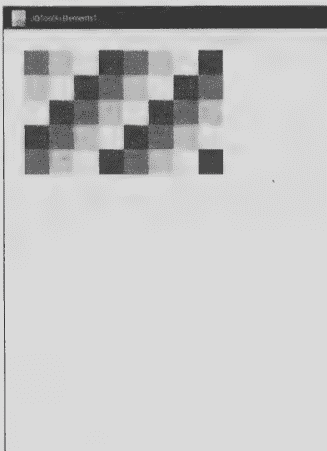

**图 6.1** 在华硕 Prime 平板电脑（Android ICS）上使用 jQuery 创建的矩形网格。

## 使用 jQuery 创建圆角

上一个示例使用了 jQuery 的 `css()` 函数来创建 HTML `<div>` 元素的矩形阵列，本节将展示一个通过 `css()` 函数为 CSS3 的 `border-radius` 属性指定随机生成的值来创建圆角效果的示例。

清单 6.2 展示了 `JQRoundedCorners1.html` 的内容，该示例说明了如何渲染一个由动态创建的 HTML `<div>` 元素组成的带有圆角的矩形网格。

### 清单 6.2 RoundedCorners1.html

```html
<!DOCTYPE html>
<html lang="en">
<head>
    <meta charset="utf-8"/>
    <title>使用 jQuery 创建 div 元素</title>
    <script src="http://code.jquery.com/jquery-1.7.1.min.js">
    </script>
</head>
<body>
    <div id="outer"> </div>

    <script>
        var basePointX = 20, basePointY = 20;
        var rectWidth  = 60, rectHeight = 60;
        var currentX   = 0, currentY = 0;
        var rowCount   = 5, colCount = 8;
        var index = 0, fillColor  = "";
        var radius = 0, radiusValues = [0, 10, 20, 30, 40, 50];

        var fillColors = ["rgb(255, 0, 0)",
                          "rgb(0, 255, 0)",
                          "rgb(255, 255, 0)",
                          "rgb(0, 0, 255)"];

        $(document).ready(function() {
            for(var r=0; r<rowCount; r++) {
                for(var c=0; c<colCount; c++) {
                    currentX  = basePointX+c*rectWidth;
                    currentY  = basePointY+r*rectHeight;
                    fillColor = fillColors[(r+c) % fillColors.length];
                    index     = Math.floor(
                        Math.random()*radiusValues.length+1);
                    radius    = radiusValues[index];

                    // 在当前位置创建一个矩形
                    newNode = $('<div>').css({'position':'absolute',
                                              'width':rectWidth+'px',
                                              'height':rectHeight+'px',
                                              'left': currentX+'px',
                                              'top': currentY+'px',
                                              'backgroundColor': fillColor,
                                              'borderRadius': radius+'%'
                    });

                    $("#outer").append(newNode);
                }
            }
        });
    </script>
</body>
</html>
```

清单 6.2（与清单 6.1 非常相似）的关键点在于将 CSS3 的 `border-radius` 属性的值设置为一个介于 0 和 50 之间的整数。在 jQuery 中，对于带连字符的 CSS 属性，你需要使用所谓的"驼峰命名法"；因此，在 jQuery 的 `css()` 函数中，你必须使用 `borderRadius`。

当 `border-radius` 的值为 0 时，没有圆角效果，所以 `<div>` 元素看起来像一个矩形。当 `border-radius` 的值为 50 时，如果 `width` 和 `height` 属性相等，`<div>` 元素会渲染成一个圆形；否则，`<div>` 元素会渲染成一个椭圆。

顺便提一下，确实存在一些可以创建圆角效果的 jQuery 插件，你可以通过互联网搜索来了解目前有哪些可用的插件。你可以查看它们的功能，看看：1.) 是否包含你需要的功能，以及 2.) 它们支持的特性是否比你手动编写代码更易于使用。

图 6.2 展示了在 Macbook 上的 Chrome 浏览器中渲染 `JQRoundedCorners1.html` 的结果。


**图 6.2** 在华硕 Prime 平板电脑（Android ICS）上使用 jQuery 创建的圆角效果。

## 使用 jQuery 创建渐变和阴影效果

本章的前两个示例让你对如何使用 jQuery 的 `css()` 函数创建圆角有了基本的了解。本节包含一个通过编程方式添加 CSS3 渐变并创建阴影效果的示例。

此代码示例的主要目的是说明如何将各种 CSS 属性与一个简单的方程结合使用，以创建一个有趣的视觉效果。

清单 6.3 展示了 `JQArchTripleShadowSkewEllipsesGrad3.html`，它说明了如何创建一个包含 `<div>` 元素（这些元素遵循阿基米德螺旋线的路径）的 HTML5 网页，这些元素具有线性渐变、径向渐变和阴影效果。

CSS 样式表 `JQArchTripleShadowSkewEllipsesGrad3.html` 如清单 6.4 所示。

### 清单 6.3 JQArchTripleShadowSkewEllipsesGrad3.html

```html
<!DOCTYPE html>
<html lang="en">
  <head>
    <meta charset="utf-8"/>
    <title>带有渐变和阴影的阿基米德椭圆</title>
    <link rel="stylesheet"
          href="ArchTripleShadowSkewEllipsesGrad3.css"/>
    <script src="http://code.jquery.com/jquery-1.7.1.min.js"></script>
  </head>
  <body>
    <div id="outer"> </div>
    <script>
      var fillColor = "rgb(255, 0, 0)";
      var basePointX = 400, basePointY = 160;
      var majorAxis = 40, minorAxis = 80;
      var currentX = 0, currentY = 0;
      var deltaAngle = 3, maxAngle = 720;
      var Constant = 0.25, newNode, addClass;
      var rVal = 0, gVal = 0, bVal = 0;
      var stripCount = 10, currStrip = 0;
      var stripWidth = Math.floor(maxAngle/stripCount);

      $(document).ready(function() {
          for(var angle=0; angle<maxAngle; angle++) {
              radius    = Constant*angle;
              offsetX   = radius*Math.cos(angle*Math.PI/180);
              offsetY   = radius*Math.sin(angle*Math.PI/180);
              currentX  = basePointX+offsetX;
              currentY  = basePointY-offsetY;

              rVal = 0; gVal = 0; bVal = 0;
              currStrip = Math.floor(angle/stripWidth);

              if(currStrip % 3 == 0) {
                  rVal = Math.floor(255*(angle%stripWidth)/stripWidth);
              } if(currStrip % 3 == 1) {
                  rVal = Math.floor(255*(angle%stripWidth)/stripWidth);
                  gVal = Math.floor(255*(angle%stripWidth)/stripWidth);
              }
              else {
                  bVal = Math.floor(255*(angle%stripWidth)/stripWidth);
              }

              fillColor = "rgb("+rVal+","+gVal+","+bVal+")";

              // 在当前位置创建一个椭圆
              if(angle % 20 == 0) {
                  newNode = $('<div>').css({
                      'position':'absolute',
                      'width':(0.75*majorAxis)+'px',
                      'height':(2.5*minorAxis)+'px',
                      left: currentX+'px',
                      top: currentY+'px',
                      'backgroundColor': fillColor,
                      'borderRadius': '20%'
                  }).toggleClass("skew1");
              } else {
                  newNode = $('<div>').css({
                      'position':'absolute',
                      'width':majorAxis+'px',
                      'height':minorAxis+'px',
                      left: currentX+'px',
                      top: currentY+'px',
                      'backgroundColor': fillColor,
                      'borderRadius': '20%'
                  });
              }
              // ...
          }
      });
```

```javascript
top: currentY + 'px',
'backgroundSize': '240px 240px, 80px 80px',
'backgroundColor': fillColor,
'borderRadius': '40%'
}).
toggleClass("radiall3");
}

$("#outer").append(newNode);

// 在当前位置创建一个椭圆
newNode = $('<div>').css({'position':'absolute',
                          'width': majorAxis + 'px',
                          'height': minorAxis + 'px',
                          left: (currentX + majorAxis) + 'px',
                          top: currentY + 'px',
                          'backgroundColor': fillColor,
                          'borderRadius': '50%'
                         }).
toggleClass("skew2");

$("#outer").append(newNode);

// 在当前位置创建一个椭圆
newNode = $('<div>').css({
                          'position':'absolute',
                          'width': majorAxis + 'px',
                          'height': minorAxis + 'px',
                          left: (currentX + majorAxis / 2) + 'px',
                          top: (currentY - minorAxis / 2) + 'px',
                          'backgroundColor': fillColor,
                          'borderRadius': '50%'
                         }).
toggleClass("skew1");

$("#outer").append(newNode);
}
});
</script>
</body>
</html>
```

清单 6.3 中包含了你熟悉的代码。每个通过程序创建的 `<div>` 元素都被附加到了 `id` 值为 `outer` 的 `<div>` 元素（初始时为空）中。请注意，你可以通过检查该元素的存在与否来使代码更加健壮：如果元素不存在，则显示相应信息，或者通过程序创建一个这样的元素并将其附加到 DOM 中。

此外，清单 6.3 使用了条件逻辑来为每个 `<div>` 元素指定一组 CSS3 属性。在这个例子中，代码使用了以下代码块：

```javascript
if(angle % 20 == 0) {
    // 创建一个 <div> 元素并使用方法链调用 toggleClass()
} else {
    // 创建另一个 <div> 元素并同样使用方法链调用 toggleClass()
}
```

请注意，你在第 5 章已经学习了 jQuery 方法链；本章后面你将学习 jQuery 的 `toggleClass()` 方法。

## 清单 6.4 JQArchTripleShadowSkewEllipsesGrad3.css

```css
#outer {
    position: absolute;
    width: 90%; height: 90%;
    border: solid 2px #000;
}

.radial13 {
    background-color: white;
    background-image:
        -webkit-radial-gradient(red 4px, transparent 48px),
        -webkit-repeating-linear-gradient(25deg, yellow 2px,
                                                    green 4px,
                                                    yellow 8px, blue 12px,
                transparent 16px, blue 20px, red 24px,
                transparent 28px, transparent 32px),
        -webkit-repeating-linear-gradient(-25deg, yellow 2px,
                                                    green 4px,
                                                    yellow 8px, blue 12px,
                transparent 16px, blue 20px, red 24px,
                transparent 28px, transparent 32px),
        -webkit-radial-gradient(blue 8px, transparent 68px);
    -webkit-transform : skew(60deg, -20deg) scale(2, 1);
    background-size: 240px 240px, 380px 380px;
    -webkit-box-shadow: 1px 1px 1px #000;
}
```

```css
.skew1 {
  -webkit-transform: skew(60deg, -10deg) scale(0.75, 1.75) rotate(-60deg);
  transform: skew(60deg, -10deg) scale(0.75, 1.75) rotate(-60deg);
  -webkit-box-shadow: 3px 1px 1px #00f;
  box-shadow: 2px 1px 1px #00f;
}
```

```css
.skew2 {
  -webkit-transform: skew(-80deg, 60deg) scale(1.5, 0.5) rotate(50deg);
  transform: skew(-80deg, 60deg) scale(1.5, 0.5) rotate(50deg);
  -webkit-box-shadow: 3px 3px 3px #000;
  box-shadow: 3px 3px 3px #000;
}
```

清单 6.4 包含了在清单 6.3 代码中引用的 CSS3 选择器。如你所见，`skew1` CSS3 选择器指定了一个径向渐变，该渐变也使用了 CSS3 属性 `repeating-radial-gradient`，后面跟着一个 `-webkit-transform` 属性，该属性指定了倾斜、旋转和缩放效果。

类似的注释也适用于 CSS3 选择器 `skew2` 和 `radial13`，如果你需要复习 CSS3 径向渐变的相关知识，可以参考第 2 章。

图 6.3 展示了在装有 Android ICS 的华硕 Eee Pad Transformer Prime 平板电脑上的 `JQArchTripleShadowSkewEllipsesGrad3.html`。

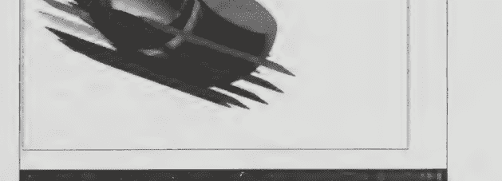

图 6.3 在装有 Android ICS 的华硕 Eee Pad Transformer Prime 平板电脑上的 jQuery 椭圆图形。

## JQUERY 中的基本动画效果

本节包含的是代码片段而非完整的代码清单，这些代码片段演示了如何在 jQuery 中使用 `hide()` 和 `show()` 函数创建动画效果，以及如何设置动画速度。你还将学习如何使用 jQuery 的 `toggle()` 函数来切换 CSS 属性。

请记住，本节仅涵盖了 jQuery 创建动画效果函数所提供的丰富功能的一部分。务必阅读 jQuery 在线文档，以了解它支持的许多其他功能。

jQuery 的 `hide()` 和 `show()` 函数使你能够更改 HTML 页面中元素的可见性。例如，以下代码块在用户点击第一个按钮时隐藏第二个按钮；当用户双击第一个按钮时，第二个按钮又变得可见：

```javascript
$("#myButton1").click(function() {
    $("#myButton2").hide();
});
$("#myButton1").dblclick(function() {
    $("#myButton2").show();
});
```

jQuery 的 `toggle` 函数可以处理同一个元素上的两次或多次相同事件。例如，以下代码片段处理了具有指定 `id` 值的元素上的一次、两次或三次点击事件：

```javascript
$("#myDiv1").toggle(
    function() {
        $("#myText").text("First click");
    },
    function() {
        $("#myText").text("Second click");
    },
    function() {
        $("#myText").text("Third click");
    }
);
```

另外两个有用的 jQuery 方法是 `removeClass()` 和 `addClass()`，它们分别用于移除或添加 CSS 类。示例如下：

```javascript
$("#myDiv1").toggle(
    function() {
        $("#myText").addClass("shiny");
    },
    function() {
        $("#myText").addClass("dark");
    }
);
```

jQuery 的 `addClass()` 方法添加一个 CSS 类，而 `toggleClass()` 方法则“切换”CSS 类；即，如果该类不存在则添加，如果已存在则移除。

其他相关的 jQuery 方法包括 `fadeClass()`（使用淡入淡出效果）和 `slideClass()`（创建滑动效果）。

## 使用回调函数

许多 jQuery 函数（包括 `hide()`、`show()`、`toggle()` 以及与滑动相关的函数）使你能够指定一个回调函数，该函数在指定操作完成后执行。例如，你可以定义以下代码块：

```javascript
$("#myButton1").click(function() {
    $("#myButton2").hide('slow',
        function callback() {
            // 执行其他操作
        }
    );
});
```

当用户点击 `id` 为 `myButton1` 的元素时，上述代码块会缓慢隐藏 `id` 为 `myButton2` 的元素，并且在动画完成后，`callback` 函数中的代码将被执行。

本书包含基于 WebKit 的代码示例，但如果你决定在 IE 中使用上述代码块，请注意 IE 中关于在回调中使用命名函数存在一个 bug。以下文章提供了有关命名函数的有用信息：

http://kangax.github.com/nfe

## JQUERY 淡入淡出和滑动动画效果

jQuery 的淡入淡出相关和滑动相关效果很容易创建，并且如果定义得当，它们可以在你的网页中产生非常漂亮的视觉效果。

以下示例结合了 jQuery 的 `.fadeIn()` 和 `.fadeOut()` 函数，并向你展示了如何链式调用这些函数以创建多重动画效果。

### `fadeIn()`、`fadeOut()` 和 `fadeToggle()` 函数

这三个 jQuery 方法 `.fadeIn()`、`.fadeOut()` 和 `.fadeToggle()` 可以指定三个参数。其语法如下所示：

```javascript
jQuery(list-of-elements).fadeIn(speed);
jQuery(list-of-elements).fadeOut(speed);
jQuery(list-of-elements).fadeTo(speed);
```

以下代码块演示了如何使用这三个 jQuery 函数：

```javascript
$("#something").click(function() {
    $(this).fadeIn('slow');
});
$("#something").click(function() {
    $(this).fadeOut('slow');
});
$("#something").click(function() {
    $(this).fadeTo('slow', .65);
});
```

## 清单 6.5 FadeInOut.html

```html
<!DOCTYPE html>
<html lang="en">
<head>
    <meta charset="utf-8"/>
    <title>jQuery 淡入淡出相关效果</title>

<script
    src="http://code.jquery.com/jquery-1.7.1.min.js">
</script>
</head>
```

## jQuery 滑动相关函数

jQuery 的 `slideUp()`、`slideDown()` 和 `slideToggle()` 方法可以指定三个参数。它们的语法如下：

```javascript
jQuery(elements).slideUp([milliseconds],
                        [easing-function],
                        [callback-function]);

jQuery(elements).slideDown([milliseconds],
                          [easing-function],
                          [callback-function]);

jQuery(elements).slideToggle([milliseconds],
                           [easing-function],
                           [callback-function]);
```

毫秒的值指定了动画效果的持续时间，而回调函数是一个可选的 JavaScript 函数，在动画完成后执行。

## 清单 6.6 JQSlideUpDown.html

```html
<!DOCTYPE html>
<html lang="en">
  <head>
    <meta charset="utf-8"/>
    <title>jQuery Slide-Related Effects</title>
    <script
      src="http://code.jquery.com/jquery-1.7.1.min.js">
    </script>
  </head>
  <body>
    <div>
      <div> <p>Hello World from jQuery (hover on me)</p> </div>
      <div> <p>Goodbye World from jQuery (hover on me)</p> </div>
      <div>
        <input type="button" id="button1"
               value="Click to Slide Me Up and Hide Me"/>
      </div>
    </div>
    <script>
      $(document).ready(function(){
        var para = $("div > p");
        para.each(function(){
          var p = $(this);
          p.append('<span style="color:red;font-size:18px">'+
                   'This Text Will Slide on Hover</span>');
        });
        para.hover(function() {
          // you can use 'slow' or 'fast'
          //$(this).find("span").slideDown("slow");
          $(this).find("span").slideDown(3000).slideUp("fast")
                       .slideDown("slow");
        }, function() {
            //$(this).find("span").hide();
            $(this).find("span").slideUp(2000).slideDown("slow")
                .slideUp("fast").slideDown(2000)
                .slideUp("slow");
        });
        $("#button1").click(function() {
            $(this).slideUp(2000, function() {
                //$(this).remove();
            });
        });
      });
    </script>
  </body>
</html>
```

清单 6.6 与清单 6.5 类似，只是它使用了与滑动相关的 jQuery 方法，而不是与淡入淡出相关的 jQuery 方法。因此，此代码示例的描述与清单 6.5 的描述类似。

需要记住的一点是，对于具有 CSS `padding` 或 `margin` 属性，或者 `width` 属性未设置为固定宽度的元素，滑动效果并不总是按预期工作（可能会出现一些卡顿）。请尝试这些场景，看看产生的行为是否是您所期望的，或者是否可以接受您的网页。

顺便说一下，您也可以在自定义函数定义中组合滑动和淡入淡出函数，如下所示：

```javascript
$.fn.slideFadeToggle = function(speed, easing, callback) {
    return this.animate(
        {opacity: 'toggle', height: 'toggle'}, speed, easing, callback);
};
```

您可以按如下方式使用前面的自定义函数：

```javascript
$("#something").click(function() {
    $(this).slideFadeToggle();
});
```

## jQuery 中的缓动函数

jQuery 支持一系列所谓的“缓动”函数，这些函数提供不同类型的动画效果。一般来说，缓动函数使用某种类型的方程作为动画效果的路径。例如，您可以使用线性方程创建恒定速度的动画，也可以使用二次方程（二次多项式）创建具有加速效果的动画，或用于二次贝塞尔曲线，以及用于三次贝塞尔曲线的三次方程。

jQuery 还提供了一些缓动函数，用于在缓动函数的不同位置实现更复杂（慢、快、慢）的速度动画。在您搜索 jQuery 插件之前，花时间探索现有的 jQuery 缓动函数是非常值得的，其中一些列于此处：

- linear
- swing
- jswing
- easeInQuad
- easeOutQuad
- easeInOutQuad
- easeInCubic
- easeOutCubic
- easeInOutCubic
- easeInQuart
- easeOutQuart
- easeInOutQuart
- easeInQuint
- easeOutQuint
- easeInOutQuint
- easeInSine
- easeOutSine
- easeInOutSine
- easeInExpo
- easeOutExpo
- easeInOutExpo
- easeInCirc
- easeOutCirc
- easeInOutCirc
- easeInElastic
- easeOutElastic
- easeInOutElastic
- easeInBack
- easeOutBack
- easeInOutBack
- easeInBounce
- easeOutBounce
- easeInOutBounce

您可以找到许多链接，它们提供了大量 jQuery 缓动函数的演示，例如此处显示的这两个：

```
http://jqueryui.com/demos/effect/easing.html
http://james.padolsey.com/demos/jquery/easing/
```

如果您对 jQuery 缓动函数的 jQuery 代码感到好奇，以下代码块包含两个定义：

```javascript
$.extend($.easing,
{
    def: 'easeOutQuad',
    swing: function (x, t, b, c, d) {
        //alert($.easing.default);
        return $.easing[$.easing.def](x, t, b, c, d);
    },
    easeInQuad: function (x, t, b, c, d) {
        return c*(t/=d)*t + b;
    },
    // code omitted for brevity
}
```

有许多 jQuery 插件可用于自定义与动画相关的缓动函数，或者如果您找不到符合您需求的插件，也可以创建自己的 jQuery 插件。

## JQUERY 的 .ANIMATE() 方法

jQuery 的 `animate()` 方法可以接受四个参数，它们的形式如下：

```javascript
jQuery(elements).animate([properties],
                      [milliseconds],
                      [easing-function],
                      [complete-function]);
```

而 `milliseconds` 参数指定了动画效果的持续时间。`easing-function` 参数指定了上一节讨论的某个缓动函数，而 `complete-function` 则指定了动画效果完成时要执行的 JavaScript 回调函数。

## 清单 6.7 JQAnimate1.html

```html
<!DOCTYPE html>
<html lang="en">
  <head>
    <meta charset="utf-8"/>
    <title>jQuery Animate Function</title>

<script
  src="http://code.jquery.com/jquery-1.7.1.min.js">
</script>
  </head>

  <body>
    <div id="outer">
      <div>
        
        
      </div>
      <div>
        <input type="button" id="button1" value="Animate Left"/>
        <input type="button" id="button2" value="Animate Right"/>
      </div>
    </div>

    <script>
      $(document).ready(function(){
        $('#button1').click(function() {
          $('#text1').animate({
            opacity: 0.25,
            left: '+=50',
            height: '+=100'
          }, 5000, function() {
            // Animation complete (do something else)
          });
        });

        $('#button2').click(function() {
          $('#text1').animate({
            opacity: 0.25,
            left: '+=50',
            height: 'toggle'
          }, 5000, function() {
            // Animation complete (do something else)
          });
        });
      });
    </script>
  </body>
</html>
```

清单 6.7 包含两个 PNG 图像，以及针对两个 HTML `<button>` 元素的 jQuery 点击事件处理程序。

每当用户点击左侧按钮时，jQuery 代码会将 PNG 的不透明度从 1.0 降低到 0.25，在五秒的时间间隔内将图像文件向右移动 50 个单位，并将其高度增加 100 个单位，如下所示：

```javascript
$('#text1').animate({
    opacity: 0.25,
    left: '+=50',
    height: '+=100'
}, 5000, function() {
    // Animation complete (do something else)
});
```

每当用户点击第二个按钮时，jQuery 代码会对右侧的图像文件执行类似的动画效果。启动清单 6.7 中的代码并点击按钮以查看动画效果。

如果你创建了一个包含许多动画效果的 HTML 网页，另一个有趣的属性是 `jQuery.fx.off`，它可以停用网页中的所有 jQuery 动画效果。如果由于设备响应时间的原因需要这样做，此功能会非常方便。


你可以在 HTML 网页 `JQAnimate2.html`（可在 DVD 上找到）中看到清单 6.7 中动画效果的一个变体。

## 清单 6.8 JQAnimate3.html

```html
<!DOCTYPE html>
<html lang="en">
    <head>
        <meta charset="utf-8"/>
        <title>jQuery Animate Function</title>
    </head>
    <script
        src="http://code.jquery.com/jquery-1.7.1.min.js">
    </script>
    <style>
        #div1 {
            position:relative;
            left:50px;
            width:200px;
            height:100px;
            background-color:#f00;
            border:2px solid yellow;
        }
        #div2 {
            position:relative;
            left:50px;
            width:200px;
            height:100px;
            background-color:#00f;
            border:2px solid red;
        }
    </style>
</head>
<body>
    <div id="outer">
        <div id="div1"> </div>
            <input type="button" id="button1" value="Click me to Animate"/>
        <div>
            <div id="div2"> </div>
                <input type="button" id="button2" value="Click me to Animate"/>
            </div>
        </div>
    </div>
    <script>
        $(document).ready(function(){
            $('#button1').click(function() {
                $("#div1").animate({
                    width: "80%",
                    opacity: 0.6,
                    marginLeft: "1.0in",
                    fontSize: "4em",
                    borderWidth: "12px"
                }, 2000 );
            });

            $('#button2').click(function() {
                $("#div2").animate({"left": "+=100px"}, "slow")
                       .animate({"width": "+=150px"}, "slow")
                       .animate({"height": "+=50px"}, "slow");
            });
        });
    </script>
</body>
</html>
```

清单 6.8 包含的代码与清单 6.7 类似，它说明了两个 HTML `<div>` 元素的动画效果。此外，清单 6.8 通过使用 jQuery `animate()` 方法的链式调用，创建了一个有趣的顺序动画效果，该效果在用户点击第二个 HTML `<div>` 元素时触发：

```javascript
$("#div2").animate({"left": "+=100px"}, "slow")
         .animate({"width": "+=150px"}, "slow")
         .animate({"height": "+=50px"}, "slow");
```

如上所示，前面的代码块只是在每次调用 jQuery `animate()` 时更改第二个 HTML `<div>` 元素的 `left` 属性值。

你可以通过改变 HTML 元素的不同 CSS 属性，使用 jQuery `animate()` 函数来创建其他有趣的视觉效果。例如，以下代码为属于 HTML `<ul>` 元素的列表项创建了一个“摇摆”效果：

```javascript
$('#mylist li').hover(function() {
    $(this).animate({paddingLeft: '+=15px'}, 200);
}, function() {
    $(this).animate({paddingLeft: '-=15px'}, 200);
});
```

你还可以创建 `linear` 和 `swing` 动画效果，如下所示：

```javascript
$('p:first').toggle(function() {
    $(this).animate({'height':'+=150px'}, 1000, 'linear');
}, function() {
    $(this).animate({'height':'-=150px'}, 1000, 'swing');
});
```

## 使用 .animate() 函数创建自定义 CSS 动画

你可以使用 jQuery 为许多 CSS 属性添加动画效果，包括 `border-width`、`bottom`、`font-size`、`height`、`margin`、`opacity`、`padding`、`right`、`top`、`width` 和 `word-spacing`。此外，你可以用 `slow`、`fast` 或表示毫秒的整数值来指定持续时间。

以下代码为 HTML `<div>` 元素的 `width` 和 `height` 属性添加了动画效果，使其最终值分别为 `500` 和 `300`：

```javascript
$("#myDiv").click(function() {
    $(this).animate({
        width: '500px', height: '300px'
    });
});
```

在前面的 jQuery 代码片段中，如果 `width` 的初始值小于 `500px`，它将增加到 `500px`；否则，它将把 `width` 减少到 `500px`（对于 `height` 属性也类似）。

## jQuery 队列和动画效果

jQuery 队列是 HTML 网页中等待在元素上执行的动画列表。由于 jQuery 队列是先进先出（FIFO）的，动画按照它们被添加到此列表的顺序执行，新的动画会被添加到列表的末尾。

jQuery 允许你通过 jQuery 操作 `dequeue`、`queue` 和 `stop` 以及 `queue` 选项来控制动画队列。

例如，以下代码块使用 jQuery `animate()` 函数来更改 HTML 网页中第一个 `<p>` 元素的 CSS 属性，同时设置 `duration`、`easing` 和 `complete` 的值，并且将 `queue` 设置为 `false`，这意味着动画效果将立即开始：

```javascript
$('p:first').animate( {
    height: '+=150px',
    backgroundColor: 'red'
},
{
    duration: 'fast',
    easing: 'swing',
    complete: function() {console.log('Finished.');},
    queue: false
}
);
```

其他有用的功能包括 `clearQueue` 参数，当 `clearQueue` 设置为 `true` 时，它会删除队列中的所有动画；以及 `gotoEnd` 参数，它会跳过动画并直接进入特定动画效果的最终状态。有关 jQuery 队列的更多详细信息，请查看 jQuery 文档。

## 创建图片幻灯片

## 清单 6.9 JQSlideShow1.html

```html
<!DOCTYPE html>
<head>
    <meta charset="utf-8"/>
    <title>jQuery Slide-Related Effects</title>
    <script src="http://code.jquery.com/jquery-1.7.1.min.js">
    </script>
</head>
<body>
    <div id="photos">
        
        
        
    </div>
    <script>
        var i = 0, curr, next, shortPause = 3000;
        $(document).ready(function(){
```

# 基于 CSS3 的动画效果

本节展示了多种可以通过 CSS3 创建的动画效果，其中代码示例使用了 CSS3 的 `@keyframes` 规则和 2D/3D 变换。

## 使用 CSS3 关键帧和 2D 变换的动画效果

清单 6.10 展示了 `JQButtonAnimation1.html` 的内容，该示例说明了如何创建由悬停伪类触发的按钮相关动画效果。


清单 6.10 `JQButtonAnimation1.html`

```
<!DOCTYPE html>
<html lang="en">
<head>
<meta charset="utf-8"/>
<title>jQuery Button Animation Effect</title>
<script src="http://code.jquery.com/jquery-1.7.1.min.js"></script>
<style>
@-webkit-keyframes AnimButton {
  0% {
    font-size: 18px;
    background-color: #0f0;
    -webkit-transform: translate(0px,0px) rotate(-60deg) skew(-15deg,0);
  }
  25% {
    font-size: 24px;
    background-color: #0ff;
    -webkit-transform: translate(100px,100px) rotate(-180deg) skew(-15deg,0);
  }
  50% {
    font-size: 32px;
    background-color: #00f;
    -webkit-transform: translate(50px,50px) rotate(-120deg) skew(-25deg,0);
  }
  75% {
    font-size: 24px;
    background-color: #0ff;
    -webkit-transform: translate(100px,100px) rotate(-180deg) skew(-15deg,0);
  }
  100% {
    font-size: 18px;
    background-color: #f00;
    -webkit-transform: translate(0px,0px) rotate(0) skew(0,0);
  }
}

#button1 {
    font-size: 12px;
    background-color: #f00;
}

#button1:hover {
    font-size: 36px;
    background-color: #00f;
    -webkit-animation-name: AnimButton;
    -webkit-animation-duration: 4s;
}

#button2 {
    font-size: 12px;
    background-color: #00f;
}

#button2:hover {
    font-size: 24px;
    background-color: #00f;
    -webkit-animation-name: AnimButton;
    -webkit-animation-duration: 2s;
}
</style>
</head>

<body>
<div>
    <input type="button" id="button1"
           value="Click Me or Hover Over Me"/>
</div>
<div>
    <input type="button" id="button2"
           value="Click Me or Hover Over Me"/>
</div>

<script>
    $(document).ready(function(){
        $("#button1").click(function() {
            $(this).fadeOut(500, function() {
                //$(this).remove();
            });
        });

        $("#button2").click(function() {
            $(this).fadeOut(500, function() {
                //$(this).remove();
            });
        });
    });
</script>

</body>
</html>
```

清单 6.10 包含一个带有 CSS3 关键帧定义的 HTML `<style>` 元素（您也可以将其移至单独的 CSS 样式表中），随后是两个类型为 button 的 HTML `<input>` 元素，这两个元素都在清单 6.10 的 `<script>` 元素中定义了点击事件处理程序。

每当用户点击任一按钮时，CSS3 关键帧就会应用于该按钮，这会使用关联选择器中指定的时间段（2 秒或 4 秒）内 `translate()`、`rotate()` 和 `skew()` 函数的组合来创建动画效果。此外，点击处理程序还会创建一个持续 500 毫秒的淡出效果。

当您在浏览器中启动 HTML 网页 `JQButtonAnimation1.html` 时，每当将鼠标悬停在任一按钮上，您都会看到动画效果。

## 使用 CSS3 和 jQuery 的 2D 变换

本节中的代码示例向您展示了如何使用 jQuery 的 css() 函数，基于用户触发的事件，将 CSS 变换直接应用于元素。

清单 6.11 展示了 JQTransforms2D1.css 的内容，其中包含应用于清单 6.12 所示的 HTML5 网页 JQTransforms2D1.html 的 CSS3 选择器。

清单 6.11 JQTransforms2D1.css

```
#outer {
    position: absolute;
    left: 50px;
    top: 150px;
}

#inner1 {
    float: left;
    background-color:#F00;
    width: 200px;
    height:150px;
}

#inner2 {
    float: left;
    background-color:#FF0;
    width: 200px;
    height:150px;
}

#inner3 {
    float: left;
    background-color:#00F;
    width: 200px;
    height:150px;
}
```

清单 6.11 非常简单明了：为清单 6.12 中定义的三个 HTML `<div>` 元素指定了几个属性，如宽度和高度。

清单 6.12 JQTransforms2D1.html

```
<!DOCTYPE html>
<html lang="en">
<head>
<meta charset="utf-8"/>
<title>jQuery Transform Effects</title>
<link href="Transforms1.css"
      rel="stylesheet" type="text/css">
<script src="http://code.jquery.com/jquery-1.7.1.min.js">
</script>
</head>

<body>
<h1>Click Inside Any of the Rectangles:</h1>

<div id="outer">
  <div id="inner1"></div>
  <div id="inner2"></div>
  <div id="inner3"></div>
</div>

<script>
$(document).ready(function() {
  $("#inner1").click(function() {
    $("div").css({height: '300px',
      'webkit-transform': 'scale(0.5, 0.5) skew(-10deg, 20deg)'
    });
  });

  $("#inner2").click(function() {
    $("div").css({height: '200px',
      width: '250px',
      'webkit-transform': 'scale(0.5, 0.8) rotate(-45deg)'
    });
  });

  $("#inner3").click(function() {
    $("div").css({height: '100px',
      width: '250px',
      'webkit-transform': 'skew(-10deg, 10deg) rotate(-45deg)'
    });
  });
});
</script>

</body>
</html>
```

清单 6.12 为三个 HTML `<div>` 元素的点击事件定义了事件处理程序，这些处理程序都调用了 jQuery 的 css() 函数，以更新接收到点击事件的 `<div>` 元素的属性。

例如，每当用户点击第一个 HTML `<div>` 元素时，该元素会按如下方式更新：

```
$("div").css({height: '300px',
    'webkit-transform': 'scale(0.5, 0.5) skew(-10deg, 20deg)'
});
```

如您所见，当用户点击时，高度属性被设置为 300px，并且变换被应用于 `<div>` 元素。

请记住，您可以将清单 6.12 中点击处理程序所引用的 CSS3 代码移至单独的 CSS 样式表中，这使得在单个文件中维护 CSS3 代码更加容易。您也可以在多个 HTML 网页中引用相同的 CSS 样式表。

除了 CSS3 2D 动画效果，您显然也可以创建 CSS3 3D 动画效果。可以使用清单 6.12 中的代码进行实验，添加第 2 章中可用的一些 3D 效果，或者参考以下开源项目：

http://code.google.com/p/css3-graphics

图 6.4 展示了在 Macbook 的 Chrome 浏览器中显示的 JQTransforms2D1.html。

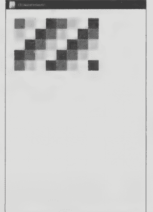

本章剩余部分包含了一些与之前代码示例不同的示例。清单 6.13 和清单 6.14 涉及鼠标相关功能以及如何以编程方式处理鼠标事件。清单 6.14 展示了一个非常基础的、面向游戏的代码示例，它比之前的示例更广泛地结合了 JavaScript、jQuery 和 CSS3。

## 使用 jQuery 实现跟随鼠标的示例

本节的代码示例扩展了上一节介绍的功能，向您展示了如何以编程方式创建 HTML `<div>` 元素并将其附加到 DOM。

清单 6.13 展示了 `JQSketchFollowMouse1.html` 的内容，该示例演示了如何在 HTML5 网页中使用 jQuery 和 CSS3 在用户当前鼠标位置下方渲染一个 `<div>` 元素。

**清单 6.13** `JQSketchFollowMouse1.html`

```html
<!DOCTYPE html>
<html lang="en">
<head>
    <meta charset="utf-8"/>
    <title>jQuery Follow the Mouse Example</title>
    <script src="http://code.jquery.com/jquery-1.7.1.min.js"></script>
</head>
<body>
    <script>
        $(document).ready(function() {
            var rectWidth = 20;
            var rectHeight = 20;
            var moveCount = 0;
            var insertNode = true;
            var currColor = "";
            var rectColors = new Array('#ff0000', '#ffff00', '#00ff00', '#0000ff');
            var newNode;

            $(document).mousemove(function(e) {
                ++moveCount;

                // are users are moving their mouse?
                if (insertNode == true) {
                    // create a rectangle at the current position
                    newNode = $('<div id=newNode>').css({'position':'absolute',
                        'background-color':'#ff0000',
                        'width':rectWidth+'px',
                        'height':rectHeight+'px',
                        top: e.pageY,
                        left: e.pageX
                    });

                    //append the rectangle to body
                    $(document.body).append(newNode);
                    insertNode = false;
                } else {
                    currColor = rectColors[moveCount % rectColors.length];

                    $('div').each(function() {
                        $(this).css({top: e.pageY,
                                    left: e.pageX,
                                    'background-color': currColor
                        });
                    });
                }
            });
        });
    </script>
</body>
</html>
```

清单 6.13 初始化了一些 JavaScript 变量，然后使用 jQuery 的 css() 方法动态创建一个 HTML `<div>` 元素，该元素的左上角顶点与 mousemove 事件发生点的坐标相同，从而创造出“跟随鼠标”的效果：

```javascript
// create a rectangle at the current position
newNode = $('<div id=newNode>').css({'position':'absolute',
    'background-color':'#ff0000',
    'width':rectWidth+'px',
    'height':rectHeight+'px',
    top: e.pageY,
    left: e.pageX
});

//append the rectangle to body
$(document.body).append(newNode);
```

需要注意的关键点是，事件对象（在此代码示例中称为 e）允许我们通过属性 `e.pageX` 和 `e.pageY` 访问当前移动位置的坐标，我们可以用它们分别设置 CSS 属性 `left` 和 `top`。

## 你的第一个绘图程序

清单 6.14 展示了 JQSketchSolid1.html 的内容，该示例演示了如何在 HTML5 网页中使用 jQuery 和 CSS3 创建一个基础的绘图程序。后续的代码示例将展示如何创建更复杂的效果，例如添加渐变和创建动画。

**清单 6.14 JQSketchSolid1.html**

```html
<!DOCTYPE html>
<html lang="en">
<head>
    <meta charset="utf-8"/>
    <title>jQuery Follow the Mouse Example</title>
    <script
        src="http://code.jquery.com/jquery-1.7.1.min.js">
    </script>
</head>
<body>
    <script>
        $(document).ready(function() {
            var draw = false;

            //mousedown means draw:
            $(document).mousedown(function() { draw=true; });

            //mouseup means no draw:
            $(document).mouseup(function() { draw=false; });

            $(document).mousemove(function(e) {
                // are users are moving their mouse?
                if(draw==true) {
                    // create a rectangle at the current position
                    pointer = $('<span>').css({'position':'absolute',
                        'background-color':'#ff0000',
                        'width': '4px',
                        'height': '4px',
                        top: e.pageY, //offsets
                        left: e.pageX //offsets
                    });

                    //append the rectangle to body
                    $(document.body).append(pointer);
                }
            });
        });
    </script>
</body>
</html>
```

清单 6.14 与清单 6.13 类似，不同之处在于，现在每当用户移动鼠时，我们都会创建并附加一个新的 HTML `<div>` 元素到 DOM，从而产生绘图效果。你还可以添加其他 CSS3 效果，例如渐变和动画，甚至可以让用户选择不同的“画笔”颜色（以及大小和形状），以创造更丰富的视觉效果。

图 6.5 展示了在 Macbook 上的 Chrome 浏览器中打开 `JQSketchSolid1.html` 的效果。

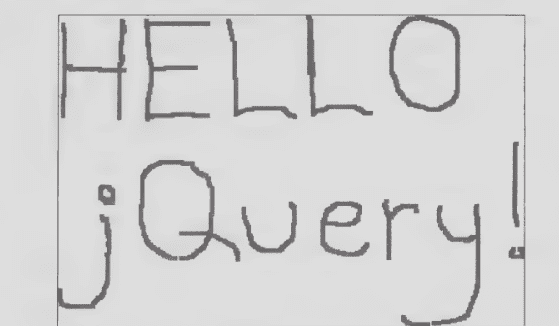

**图 6.5** 在 Macbook 上的 Chrome 浏览器中使用 jQuery 绘图。

如果你喜欢创建这种视觉效果，随附的 DVD 包含了网页 `JQSketchGradient2.html` 和 `JQSketchAnimation1.html`，它们通过添加渐变和动画效果增强了清单 6.14 中的代码。

## 使用 jQuery 实现其他动画效果

用于 3D 动画的 jQuery 插件 `rotate3di` 可以让你为 HTML 内容以及其他视觉效果创建动画。其主页在这里：

http://www.zachstronaut.com/projects/rotate3di/


你也可以将 jQuery 与 SVG 结合使用，而不是动态创建使用 CSS3 选择器设置样式的 `<div>` 元素。随附的 DVD 包含了 `JQArchDoubleEllipse1Rotate1.html` 的 HTML5 网页，它演示了如何将 jQuery 与 SVG 结合使用。然而，这段代码与之前的代码示例类似，因此其内容在本章中省略。

## 使用 jQuery 和 CSS3 渲染一组弹跳的球

本节的示例向您展示了如何在 jQuery Mobile 中渲染一组弹跳的球。当“球”在一个矩形内四处弹跳时，它们的宽度、高度和颜色会更新，并且它们的形状会从矩形变为圆形。虽然这个代码示例主要是为了有趣，但你可以通过动态修改其他 CSS 属性来实验代码，创造出其他有趣的效果。

清单 6.15 展示了 `JQBouncingBalls1.html` 的内容，该示例演示了如何在 jQuery HTML5 网页中渲染一组垂直弹跳的球。

```html
<!DOCTYPE html>
<html lang="en">
<head>
    <meta charset="utf-8"/>
    <title>jQuery Bouncing Balls</title>
    <style>
        #outer {
            width: 400px; height: 300px;
            margin:0px; padding:0;
            border: 3px solid blue;
        }
        #circle0 { left: 50px; top: 250px; }
        #circle1 { left: 100px; top: 200px; }
        #circle2 { left: 150px; top: 150px; }
        #circle3 { left: 200px; top: 100px; }
        #circle4 { left: 250px; top: 80px; }
        #circle5 { left: 250px; top: 80px; }
        #circle6 { left: 250px; top: 80px; }
        #circle7 { left: 250px; top: 80px; }
        #circle8 { left: 250px; top: 80px; }
        #circle9 { left: 250px; top: 80px; }

        div[id^="circle"] {
            position:absolute;
            width: 40px; height: 40px;
            margin:0px; padding:0;
            -webkit-border-radius: 50%;
        }
    </style>
</head>
<body onload="startAnimation()">
    <div id="outer">
        <div id="circle0"> </div>
        <div id="circle1"> </div>
        <div id="circle2"> </div>
        <div id="circle3"> </div>
        <div id="circle4"> </div>
        <div id="circle5"> </div>
        <div id="circle6"> </div>
        <div id="circle7"> </div>
        <div id="circle8"> </div>
        <div id="circle9"> </div>
    </div>

    <script src="http://code.jquery.com/jquery-1.7.1.min.js">
    </script>

    <script>
        //var xPosPts    = [50, 100, 150, 200, 250, 80, 30, 180,
        //                  130, 250];
        var xPosPts    = [0, 50, 100, 150, 200, 250, 300, 350,
                          400, 450];
        var yPosPts    = [250, 200, 150, 100, 50, 80, 30, 180,
                          130, 250];

        //var dirXPts    = [1, -1, 1, -1, 1, 1, -1, 1, -1, 1];
        var dirXPts    = [0, 0, 0, 0, 0, 0, 0, 0, 0, 0];
        var dirYPts    = [-1, 1, 1, -1, 1, -1, 1, 1, -1, 1];

        var deltaXPts  = [5, 10, 15, 20, 25, 15, 10, 25, 10, 20];
        var deltaYPts  = [25, 20, 15, 10, 5, 15, 10, 25, 10, 20];

        var leftX = 20, rightX = 380, topY = 60, bottomY = 250;
        var loopCount = 0, maxCount = 500, shortPause = 80;
        var currWidth = 0, currHeight = 0, tapCount = 0;
        var index = 0, radius = 10, color="", theTimeout;

        var ballColors = ['#f00','#ff0','#0f0','#00f','#f0f'];

        function updatePosition() {
           for(var i=0; i<xPosPts.length; i++) {
              xPosPts[i] += dirXPts[i]*deltaXPts[i];
              yPosPts[i] += dirYPts[i]*deltaYPts[i];

              if(xPosPts[i] < leftX) {
                 xPosPts[i] = leftX;
                 dirXPts[i] *= -1;
              }

              if(xPosPts[i] >= rightX) {
                 xPosPts[i] = rightX;
                 dirXPts[i] *= -1;
              }

              if(yPosPts[i] <= topY) {
                 yPosPts[i] = topY;
                 dirYPts[i] *= -1;
              }

              if(yPosPts[i] >= bottomY) {
                 yPosPts[i] = bottomY;
                 dirYPts[i] *= -1;
              }
           }

           displayBalls();

           // 再次反弹？
           if(++loopCount < maxCount) {
              if(theTimeout != null) {
                 theTimeout = setTimeout("updatePosition()",
                                         shortPause);
              }
           }
        }

        function displayBalls() {
            //index = loopCount % 40;
            index = Math.floor(loopCount/40);

            if(index % 2 == 0) {
                currWidth  = (5+loopCount%40)+'px';
                currHeight = (5+loopCount%40)+'px';
            } else {
                currWidth  = (45-(loopCount%40))+'px';
                currHeight = (45-(loopCount%40))+'px';
            }

            for(var i=0; i<xPosPts.length; i++) {
                //color = ballColors[i % ballColors.length];
                color = ballColors[(i+loopCount) % ballColors.length];

                var theCircle = $("#circle"+i);
                // 更新小球的属性...
                $(theCircle).css('left',           xPosPts[i]+'px');
                $(theCircle).css('top',            yPosPts[i]+'px');
                $(theCircle).css('width',          currWidth);
                $(theCircle).css('height',         currHeight);
                $(theCircle).css('background',     color);
                $(theCircle).css('borderRadius',   (loopCount%50)+"%");
            }
        }

        function startAnimation() {
            event.preventDefault();
            theTimeout = setTimeout("updatePosition()",
                                    shortPause);

            updatePosition();
        }
    </script>
</body>
</html>
```

清单 6.15 比你在本章中看到的许多其他代码示例都要长，但它可以被分成几个逻辑单元。第一部分包含一个 HTML `<style>` 元素，该元素定义了一组 HTML `<div>` 元素，随后是一个为这些元素设置各种属性的代码块，如下所示：

```css
div[id^="circle"] {
    position:absolute;
    width:  40px; height: 40px;
    margin:0px; padding:0;
    -webkit-border-radius: 50%;
}
```

接下来的代码块初始化了一些 JavaScript 变量，包括两个包含 `<div>` 元素左上顶点值的数组，如下所示：

```javascript
//var xPosPts    = [50, 100, 150, 200, 250, 80, 30, 180,
//                  130, 250];

var xPosPts    = [0, 50, 100, 150, 200, 250, 300, 350,
                  400, 450];

var yPosPts    = [250, 200, 150, 100, 50, 80, 30, 180,
                  130, 250];

//var dirXPts    = [1, -1, 1, -1, 1, 1, -1, 1, -1, 1];
var dirXPts    = [0,  0, 0,  0, 0, 0,  0, 0,  0, 0];
var dirYPts    = [-1, 1, 1, -1, 1, -1, 1, 1, -1, 1];
```

接下来，JavaScript 函数 `updatePosition()` 通过循环迭代来更新 HTML `<div>` 元素的位置，循环中计算新的位置。每当新位置超出边界矩形的边界时，代码就会反转 HTML `<div>` 元素的移动方向，如下所示：

```javascript
function updatePosition() {
    for(var i=0; i<xPosPts.length; i++) {
        xPosPts[i] += dirXPts[i]*deltaXPts[i];
        yPosPts[i] += dirYPts[i]*deltaYPts[i];

        if(xPosPts[i] < leftX) {
            xPosPts[i] = leftX;
            dirXPts[i] *= -1;
        }
        // 为简洁起见，省略了部分代码
    }
}
```

在前面的代码块中，代码更新了每个 HTML `<div>` 元素的左上顶点位置。如果 `<div>` 元素移动到外部边界矩形的左边界之外，它的方向将被反转，并且它的最左值（代表水平方向）将被重置为左边界，如下所示：

```javascript
if(xPosPts[i] < leftX) {
    xPosPts[i] = leftX;
    dirXPts[i] *= -1;
}
```

类似的条件逻辑被用于确保每个 `<div>` 元素不会移动到边界矩形的右侧；此外，另外两个代码块确保 `<div>` 元素不会越过边界矩形的上、下水平边界。

`updatePosition()` 函数的下一部分在新计算出的位置渲染弹跳的小球，并检查是否继续动画效果，如下所示：

```javascript
displayBalls();

// 再次反弹？
if(++loopCount < maxCount) {
    theTimeout = setTimeout("updatePosition()",
        shortPause);
}
```

JavaScript 函数 `displayBalls()` 包含一些用于更新 `border-radius` 属性值的条件逻辑，随后是一个循环，该循环遍历一组 HTML `<div>` 元素，将它们渲染到新位置。

这个 HTML 网页的最后一部分包含一些 jQuery 代码，用于在点击次数为奇数时停止动画，并在点击次数为偶数时重新启动动画。

你也可以指定用户手势来启动动画效果。例如，如果你想在用户触摸屏幕时启动动画效果，请使用以下代码块：

```javascript
$("#outer").bind("vmousedown", function(e, ui) {
    e.preventDefault();
    updatePosition();
});
```

如果你想看到小球围绕封闭矩形的四条边弹跳，只需反转以下代码片段中活动代码的顺序即可：

```javascript
//var dirXPts      = [1, -1, 1, -1, 1, 1, -1, 1, -1, 1];
var dirXPts       = [0,  0,  0,   0, 0, 0,  0,  0,   0, 0];
```

图 6.6 展示了在运行 Android ICS 的华硕 Prime 平板电脑上渲染清单 6.16 中 HTML5 网页的结果。

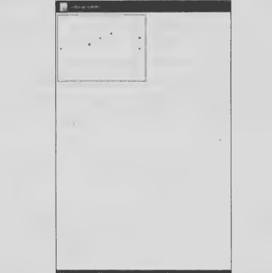

## 使用 JQUERY 处理其他事件

你已经看到了演示如何使用 jQuery 处理各种事件的代码示例。jQuery 为鼠标相关事件提供了广泛的支持，同时也支持键盘事件，如下两节所述。

### 处理鼠标事件

jQuery 支持以下常见的鼠标事件，这些事件你可能很熟悉：mousedown、mouseenter、mouseleave、mousemove、mouseout、mouseover 和 mouseup。你可以使用以下 jQuery 代码构造来检测每一个鼠星事件：

```javascript
$("#myInput").mousedown(function() {
    // 执行某些操作
});
$("#myInput").mouseenter(function() {
    // 执行某些操作
});
$("#myInput").mouseleave(function() {
    // 执行某些操作
});
$("#myInput").mousemove(function() {
    // 执行某些操作
});
$("#myInput").mouseout(function() {
    // 执行某些操作
});
$("#myInput").mouseover(function() {
    // 执行某些操作
});
$("#myInput").mouseup(function() {
    // 执行某些操作
});
```

你可以将上述任何你需要的代码片段包含在你的 HTML 网页中，然后添加处理逻辑以提供预期的功能。

### 在 jQuery 1.7 及更高版本中处理事件

在 jQuery 1.7 及更高版本中，定义事件处理程序的首选方法使用以下构造：

```javascript
$("some-element").on(some-event)
```

然而，jQuery 1.7 之前的版本提供了多种将事件绑定到元素的技术，其中三种技术已被弃用。由于 1.7 版本是最近引入的，你很可能会在很长一段时间内接触到包含早期版本 jQuery 的 HTML 网页。因此，你需要了解那些其他的编码技术，以便能够阅读使用早期版本 jQuery 的 HTML 网页中的 jQuery 代码。

举例说明，假设你需要将一个“点击”事件绑定到一个 `id` 属性为 `div1` 的 HTML `<div>` 元素。

使用此代码块（你之前在本章中见过）定义事件处理程序的首选方法如下所示：

```javascript
$("#div1").on("click", function() {
```

## 288 • 面向移动设备和桌面设备的 jQuery、CSS3 和 HTML5

```javascript
// do something
}
```

然而，使用较旧版本 jQuery 的 HTML 网页也会使用像这样定义的事件处理程序：

```javascript
$("#div1").click(function() {
    // do something
});
```

定义事件处理程序的第三种方法是使用 `bind()` 方法，该方法在 1.7 版中已被弃用：

```javascript
$("#button1").bind("click", function() {
    // do something
});
```

定义事件处理程序的第四种方法是使用 `live()` 方法，该方法也在 1.7 版中被弃用：

```javascript
$("#div1").live("click", function() {
    // do something
});
```

`bind()` 方法和 `live()` 方法将处理程序附加到与当前选择器匹配的任何元素的事件上。此外，`live()` 方法会将相同的处理程序附加到后来创建的、与当前选择器匹配的元素上。

定义事件处理程序的第五种方法是使用 `delegate()` 方法，该方法同样在 1.7 版中被弃用：

```javascript
$("#div1").delegate("click", function() {
    // do something
});
```

在前面的代码块中，定义了一个事件处理程序来处理点击事件，但类似的注释也适用于其他用户触发的事件，例如 `swipeleft` 和 `swiperight`。如果您想了解更多关于 jQuery 1.7 的其他变化，可以在此处找到变更摘要（附有链接）：

> http://api.jquery.com/category/version/1.7/

您也可以在此网页上找到有关 jQuery 1.7 新功能和变更的详细信息：

> http://blog.jquery.com/2011/11/03/jquery-1-7-released/

## 处理键盘事件

您还可以在 jQuery 中检测 `keypress`、`keyup` 和 `keydown` 事件。例如，以下代码在用户点击大写字母"Z"键时显示警报：

```javascript
$("#myInput").keypress(function(e) {
  if (e.which == 90) alert('Z was typed.');
});
```

您可以检查其他按键事件，但请记住，大写字母 A 是十进制 65（十六进ique 41），小写字母 a 是十进制 97（十六进制 61），小写字母 z 是十进制 122（十六进制 7A）。

您还可以添加许多其他效果，包括本章前面代码示例中可用的动画效果。

## 总结

本章向您介绍了 jQuery 图形和动画效果，以及说明如何使用 jQuery 函数创建简单动画效果的代码示例。特别是，您学习了如何执行以下操作：

- jQuery 中的基本动画效果

- jQuery 中的 `effect` 操作

- jQuery 中的滚动效果

- 在 jQuery 中使用 CSS3 选择器

- 使用 `css()` 函数设置属性

- 切换 CSS 属性

- 创建圆角

- 创建阴影效果

- 设置线性渐变和径向渐变

- 处理图像

- `hide()` 和 `show()` 函数

- 使用回调函数

- `fadeIn()`、`fadeOut()` 和 `fadeTo()` 方法

- 设置速度

- 切换 `hide()` 和 `show()`

- jQuery 的淡入淡出和滑动动画效果

- `fadeIn()` 和 `fadeOut()` 函数

- jQuery 的 `slideUp()` 和 `slideDown()` 函数

- jQuery 中的缓动函数

- 使用 `animate()` 自定义 CSS 动画

- 用图像创建幻灯片

- 基于 CSS3 的动画效果

- 使用 CSS3 实现简单滑动效果

- 使用 CSS3 更新多个属性

- 使用 CSS 实现滑动效果

- 使用 CSS3 `keyFrames` 和 2D 变换实现动画效果

- 使用 CSS3 和 jQuery 实现 2D 变换

- 使用 CSS3 和 jQuery 实现 3D 变换

- 一个使用 jQuery 跟随鼠标的示例

- 您的第一个草图程序

下一章将向您介绍各种 jQuery UI 控件，以及展示如何在 HTML5 网页中呈现一些 jQuery UI 控件的代码示例。

# jQuery UI 控件

本章向您介绍各种 jQuery UI 控件，以及展示如何在 HTML5 网页中呈现一些 jQuery UI 控件的代码示例。使用这些 UI 控件的理由很简单：它们比编写自己的自定 UI 控件所需的工作量少得多，并且您无需维护这些控件的代码。您将看到使用 jQuery 呈现手风琴、按钮、组合框、日期选择器、进度条、滑块和选项卡的示例。此外，您还将学习如何以编程方式处理涉及 jQuery UI 控件的用户触发事件。还有更多可用的 UI 控件，您可以通过查阅 jQuery 主页来了解。

本章中的 jQuery UI 控件按字母顺序呈现，因此您可以随意跳转阅读您感兴趣的 UI 控件。尽管关于这些 UI 控件的信息可在 jQuery 文档中找到，但这是一本入门书籍，因此将 UI 控件列表包含在一个方便的位置比告诉您“去阅读文档”更合适。在阅读本章之后，您也将能更好地理解本章末尾那个较长的代码示例，该示例展示了一个 HTML5 网页，其中包含以某种反映现实场景的方式呈现的各种 jQuery UI 控件。

本章还包含处理用户点击事件的代码示例，这些事件会触发在同一个 HTML5 网页其他地方（有时是图形）定义的元素的更新。这种方法使得理解如何实现与事件相关的功能变得容易。希望您能够将本章中的代码示例调整以适应您的特定需求。

有一点需要记住，本章中的 HTML 网页同时包含 HTML 标记和 jQuery 代码。对于较长的网页，将 jQuery 代码放在单独的文件中更有意义（就像我们处理 CSS 样式表一样）。然而，本章中几乎每个网页都很短（介于 1 到 1.5 页之间），因此为了方便，将代码保留在单个文件中是一个选择。

第二点涉及如何编写您自己的 jQuery 插件，这超出了本书的范围。如果您找不到任何现有的 jQuery 插件来满足您的需求，可以在网上找到教程，这些教程会向您展示如何编写 jQuery 插件。

## 手风琴效果

http://jqueryui.com/demos/accordion/

jQuery UI 支持手风琴小部件，它包含一个或多个“文件夹”，只有当用户点击特定文件夹时，其内容才会显示。

清单 7.1 展示了 HTML5 网页 `JQUIAccordion1.html` 的内容，它说明了如何呈现手风琴小部件。

**清单 7.1 JQUIAccordion1.html**

```html
<!DOCTYPE html>
<html lang="en">
<head>
    <meta charset="utf-8"/>
    <title>jQuery Accordion</title>

    <link href="JQUIAccordion1.css" rel="stylesheet"
        type="text/css">
    <link type="text/css"
        href="css/themename/jquery-ui-1.8.14.custom.css"/>
    <script src="http://code.jquery.com/jquery-1.7.1.min.js">
        </script>
    <script src="js/jquery-ui-1.8.14.custom.min.js"></script>
    <link href="JQUIAccordion1.css" rel="stylesheet"
        type="text/css">
</head>

<body>
    <script>
        $(function() {
            $("#accordion").accordion();
        });
    </script>

<div id="accordion">
    <h3><a href="#">Section 1</a></h3>
    <div>
        <p>This is the first section of the accordion.</p>
    </div>

    <h3><a href="#">Section 2</a></h3>
    <div>
        <p>This is the second section of the accordion.</p>
        <ul>
            <li>List item one</li>
            <li>List item two</li>
            <li>List item three</li>
        </ul>
    </div

    <h3><a href="#">Section 3</a></h3>
    <div>
        <p>This is the section of the third accordion.</p>
    </div>

    <h3><a href="#">Section 4</a></h3>
    <div>
        <p>This is the section of the fourth accordion.</p>
        <div id="outer">
            <div id="inner1"></div>
            <div id="inner2"></div>
            <div id="inner3"></div>
        </div>
    </div>
</div>
</body>
</html>
```

清单 7.1 很简单：在通常的文件引用之后，有一个 HTML `<script>` 元素引用了一个 HTML `<div>` 元素（其 id 属性值为 accordion）。您可能会惊讶地发现，jQuery 代码只需一行代码就能将此 HTML `<div>` 元素的内容渲染成手风琴，如下所示：

```javascript
<script>
    $(function() {
        $("#accordion").accordion();
    });
</script>
```

事实上，前面 `<script>` 元素中的代码是 jQuery 将 HTML `<div>` 元素内容渲染为 jQuery 小部件的典型方式：

`$("#theDivID").widgetType();`

在此示例中，`widgetType` 函数就是 `jQuery.accordion()` 函数。你可以通过覆盖 jQuery 手风琴的某些默认 CSS 定义来创建不同的手风琴效果。例如，在清单 7.1 的手风琴的第一个部分之前插入以下代码片段，并观察这如何改变选择手风琴每个部分的效果：

```
<h3 class="ui-accordion-header ui-helper-reset ui-state-active ui-corner-top">
    <span class="ui-icon ui-icon-triangle-1-s"/>
    <a href="#">Section 1</a>
</h3>
```

## 清单 7.2 JQUIAccordion1.css

```
#inner1 {
    float: left;
    background-color:#F00;
    width: 200px;
    height:200px;
}

#inner2 {
    float: left;
    background-color:#FF0;
    width: 200px;
    height:200px;
}

#inner3 {
    float: left;
    background-color:#00F;
    width: 200px;
    height:200px;
}
```

清单 7.2 中的三个选择器与清单 7.1 中对应的 HTML `<div>` 元素匹配，这会渲染出红色、黄色和蓝色的三个矩形形状。当用户点击手风琴中的最后一个文件夹（标记为“第 4 部分”）时，此效果可见。从某种意义上说，手风琴可以被视为一组垂直标签页，每个标签页的内容包含你想要渲染的任何 HTML 内容，包括图形化效果。

启动清单 7.1 中的 HTML5 网页，并点击渲染的手风琴中的每个“文件夹”，这将显示当前选定文件夹的内容，同时隐藏此手风琴中其他文件夹的内容。

图 7.1 展示了在运行 Android ICS 的 Nexus S 4G 上，Android 应用程序以横向模式截屏渲染清单 7.1 中 JQUIAccordion1.html 的结果。

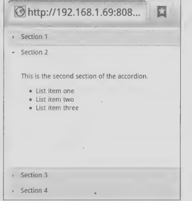

**图 7.1** 运行 Android ICS 的 Nexus S 4G 上的 jQuery 手风琴。

## 按钮

按钮在网页中显然很重要，尤其是在提交基于表单的数据时，jQuery 为按钮相关功能提供了重要的支持。你可以定义 CSS3 选择器来为 HTML 按钮应用所需的任何样式效果，包括渐变和阴影效果。

清单 7.3 展示了 HTML5 网页 JQUIButtons1.html 的内容，该网页演示了如何在 HTML 网页中渲染按钮。CSS 样式表 JQUIButtons1.css 被省略，因为其内容与清单 7.2 相同。

```
清单 7.3 JQUIButtons1.html

<!DOCTYPE html>
<html lang="en">
<head>
	<meta charset="utf-8"/>
	<title>jQuery Buttons</title>

	<link href="JQUIButtons1.css" rel="stylesheet"
		  type="text/css">
	<link type="text/css" rel="stylesheet"
		href="css/themename/jquery-ui-1.8.14.custom.css"/>
	<script
		src="http://code.jquery.com/jquery-1.7.1.min.js">
	</script>
	<script
		src="http://code.jquery.com/jquery-ui-
			 1.8.14.custom.min.js">
	</script>
	<script src="js/jquery-ui-1.8.14.custom.min.js"></script>

	<script>
		var divColors = new Array('#000', '#F0F', '#F00',
							 '#0F0', '#00F', '#0FF');
		var clickCount = 0;
		var color1 = "";
	</script>
</head>

<body>
	<div id="outer">
		<div class="buttons">
			<button>A regular button</button>
			<input type="submit" value="A submit button">
			<a href="#">An anchor button</a>
		</div>

		<div id="inner1"></div>
		<div id="inner2"></div>
		<div id="inner3"></div>
	</div>

	<script>
		$(function() {
			$( "input:submit, a, button", ".buttons" ).button();
		});
	</script>
</body>
</html>
```

```
});
</script>

<script>
$(document).ready(function() {
    $("button").click(function() {
        ++clickCount;
        color1 = divColors[(clickCount) % divColors.length];
        $("#inner1").css({background: color1});
    });

    $("input").click(function() {
        ++clickCount;
        color1 = divColors[(clickCount) % divColors.length];
        $("#inner2").css({background: color1});
    });

    $("a").click(function() {
        ++clickCount;
        color1 = divColors[(clickCount) % divColors.length];
        $("#inner3").css({background: color1});
    });
});
</script>

</body>
</html>
```

清单 7.3 包含一个 HTML `<script>` 元素，该元素将 jQuery `button()` 方法应用于三个 HTML 元素，并用一行代码将它们转换为 jQuery 按钮，如下面的代码片段所示：

```
$("input:submit, a, button", ".buttons").button();
```

请注意，类 `.buttons`（用于设置包含 HTML 按钮和链接的 HTML `<div>` 元素的样式）也在前面的代码片段中被指定。这个额外的类在此代码片段中是多余的，但它确实展示了指定一组要转换为 jQuery 按钮的 HTML 元素的灵活性。

下一块代码渲染三个 HTML `<div>` 元素，其颜色由相应的选择器指定，并在关联的 CSS 样式表中定义。

启动清单 7.3 中的 HTML 网页，当你点击顶行的按钮（包括链接）时，矩形将改变颜色。例如，每当用户点击按钮时，由于以下代码，按钮会改变颜色：

```
$("button").click(function() {
    ++clickCount;
    color1 = divColors[(clickCount) % divColors.length];
    $("#inner1").css({background: color1});
});
```

在前面的事件处理程序中，颜色是从一个名为 divColors 的 JavaScript 数组中选择的，该数组包含一组颜色。

图 7.2 展示了在 iPad 3 上以横向模式截屏渲染清单 7.3 中 JQUIButtons1.html 的结果。

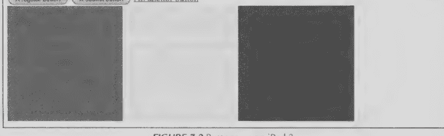

**图 7.2** iPad 3 上的按钮。

## 复选框和单选按钮

jQuery 使你能够向 HTML 复选框和单选按钮添加事件处理程序，从而可以确定用户选择了哪些项。

清单 7.4 展示了 JQUICheckBoxRadio1.html 的内容，该网页演示了如何在 HTML 网页中渲染一个复选框和一组单选按钮。CSS 样式表 JQUICheckBoxRadio1.css 被省略，因为其内容与清单 7.2 相同。

### 清单 7.4 JQUICheckBoxRadio1.html

```
<!DOCTYPE html>
<html lang="en">
<head>
    <meta charset="utf-8"/>
    <title>jQuery Checkbox and Radio ButtonsEffect</title>
    <link href="JQCheckBoxRadio1.css" rel="stylesheet"
          type="text/css">
    <link type="text/css"
          href="css/themename/jquery-ui-1.8.14.custom.css"/>
    <script src="http://code.jquery.com/jquery-1.7.1.min.js">
    </script>

    <style>
        #CheckBoxRadioInfo, #CheckBoxRadioInfo2 {
            font-size: 20px;
            top: 10px;
            width: 50%;
            height: 50px;
        }
    </style>
</head>

<body>
    <div id="outer">
        <div>
            <fieldset id="CheckBoxRadioInfo">
                <label for="checkbox1"><strong>Check Something:</strong></label>
                <input type="checkbox" name="checkbox1" id="checkbox1">

                <input type="radio" name="radio"
                       value="radio1" checked="checked">
                <input type="radio" name="radio" value="radio2">
                <input type="radio" name="radio" value="radio3">
            </fieldset>
        </div>

        <div>
            <fieldset id="CheckBoxRadioInfo2">
                <label for="input1"><strong>You Clicked On:</strong></label>
                <input type="text" name="input1" id="input1">
            </fieldset>
        </div>
    </div>

<script>
    $(document).ready(function() {
        $("input[name='checkbox1']").click(function() {
            $("#input1").val("checkbox1");
        });

        $("input[name='radio']").click(function() {
            $("#input1").val($(this).val());
        });
    });
</script>
</body>
</html>
```

清单 7.4 包含两个 HTML `<div>` 元素，每个元素包含一个 HTML `<fieldset>` 元素，该元指定一个 HTML 复选框后跟 HTML 单选按钮。

你可以使用以下事件处理程序找到 `name` 属性值为 checkbox1 的复选框的状态：

```
$("input[name='checkbox1']").click(function() {
    $("#input1").val("checkbox1");
});
```

类似地，你可以使用以下代码确定哪个单选按钮被选中：

```
$("input[name='radio']").click(function() {
    $("#input1").val($(this).val());
});
```

此外，你还可以使用以下代码片段检查选择了哪个单选按钮：

```
var value = $("input[@name= fieldname] :checked" ).val();
```

在前面的代码片段中，你需要将“fieldname”一词替换为表单字段中对应的名称。

```
$('input:radio[ name="postage" ]').change( function(){
    if ($(this).is( ':checked' ) && $(this).val( ) == 'Yes') {
        // append goes here
    }
});
```

图 7.3 展示了在 Macbook 的 Chrome 浏览器中渲染清单 7.4 中 JQUICheckBoxRadio1.html 的结果。

## 组合框

jQuery 为 HTML 组合框提供了支持，你可以为这些 HTML 元素附加事件处理程序，以检测与这些元素相关的事件。代码清单 7.5 展示了 JQUIComboBox1.html 的内容，说明了如何在 HTML 网页中渲染一个组合框，以及在用户选择组合框中的不同值时执行一段代码。

代码清单 7.5 JQUIComboBox1.html

```html
<!DOCTYPE html>
<html lang="en">
<head>
    <meta charset="utf-8"/>
    <title>jQuery ComboBox</title>

    <link type="text/css"
          href="css/themename/jquery-ui-1.8.14.custom.css"/>
    <script src="js/jquery-1.5.1.min.js"></script>
    <script src="js/jquery-ui-1.8.14.custom.min.js"></script>

    <style>
        #ComboBoxInfo {
            position: relative;
            font-size: 20px;
            top: 10px;
            width: 50%;
            height: 50px;
        }
    </style>
</head>

<body>
  <div id="outer">
    <div>
      <fieldset id="ComboBoxInfo">
        <label for="ComboBox"><strong>我的组合框：</strong></label>
        <select id="ComboBox" >
          <option value="1">值 1</option
          <option value="2">值 2</option>
          <option value="3">值 3</option>
          <optgroup label="分组1">
            <option value="4">值 4</option>
            <option value="5">值 5</option>
            <option value="6">值 6</option>
          </optgroup>
        </select>

        <label for="selected1"><strong>你选择了：</strong></label>
        <input id="selected1" type="text" value="">
      </fieldset>
    </div>
  </div>

  <script>
    $(document).ready(function() {
      $("#ComboBox").change(function() {
        // 显示选中的值
        $("#selected1").val(
          $("#ComboBox option:selected").text());
      });
    });
  </script>
</body>
</html>
```

代码清单 7.5 很直观：第一部分引用了所需的 jQuery 文件；接着是一个 HTML `<style>` 元素，然后是组合框中各项的定义。

每当用户更改组合框中的选中项时，就会执行以下代码块：

```javascript
$("#ComboBox").change(function() {
  // 显示选中的值
  $("#selected1").val(
    $("#ComboBox option:selected").text());
});
```

图 7.4 显示了在 MacBook 上的 Chrome 浏览器中渲染代码清单 7.5 中的 JQUIComboBox1.html 的结果。

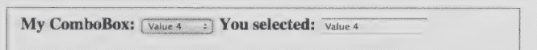

**图 7.4** 在 MacBook 的 Chrome 浏览器中的组合框。

## 日期选择器

jQuery 支持“日期选择器”功能，使你能够设置过去、当前和未来的日期，以及以与上下文相关的方式修改这些日期。代码清单 7.6 展示了 HTML5 网页 JQUIDatePicker1.html 的内容，说明了如何在 HTML 网页中渲染一个 jQuery 日期选择器小部件。CSS 样式表 JQUIDatePicker1.css 被省略，因为其内容与代码清单 7.2 相同。

代码清单 7.6 JQUIDatePicker1.html

```html
<!DOCTYPE html>
<html lang="en">
<head>
    <meta charset="utf-8"/>
    <title>jQuery Date Picker</title>

    <link type="text/css"
          href="css/themename/jquery-ui-1.8.14.custom.css"/>
    <script src="http://code.jquery.com/jquery-1.7.1.min.js">
    </script>
    <script src="js/jquery-ui-1.8.14.custom.min.js"></script>

    <style>
        #input1, #input2, #input3 {
            width: 150px;
            height: 50px;
            float: left;
        }
    </style>
</head>

<body>
    <div id="outer">
        <div id="input1">
            上周：
            <input type="text" name="date" id="date1"/>
        </div>

        <div id="input2">
            今日日期：
            <input type="text" name="date" id="date2"/>
        </div>

        <div id="input3">
            未来日期：
            <input type="text" name="date" id="date3"/>
        </div>
    </div

    <script>
        $(document).ready(function() {
            $("#date1").datepicker();
            $("#date2").datepicker();
            $("#date3").datepicker();

            // 将日期设置为上周
            var defaultDate1 = $("#date1").datepicker("option", "defaultDate" );
            $("#date1").datepicker( "option", "defaultDate", -7 );

            // 将日期设置为今天
            var defaultDate2 = $("#date1").datepicker("option", "defaultDate");
            $("#date2").datepicker("option", "defaultDate", +0 );

            // 将日期设置为未来
            var futureDate = "07/07/2017";
            $("#date3").datepicker("setDate",futureDate);
        });
    </script>
</body>
</html>
```

代码清单 7.6 引用了常用的 jQuery 文件，然后是一个 `<style>` 元素，为三个 HTML `<div>` 元素应用样式。接下来，HTML `<body>` 元素指定了三个 HTML `<div>` 元素的内容，然后是一段代码，将三个 HTML `<input>` 字段转换为 jQuery 日期对象，如下所示：

```javascript
$("#date1").datepicker();
$("#date2").datepicker();
$("#date3").datepicker();
```

你可以指定一个未来的日期，并在需要更改该未来日期时；jQuery 将显示相对于该日期的前一个月和后一个月，如下所示：

```javascript
// 将日期设置为未来
var futureDate = "07/07/2017";
$("#date3").datepicker("setDate", futureDate);
```

图 7.5 显示了在 MacBook 上的 Chrome 浏览器中渲染代码清单 7.6 中的 JQUIDatePicker1.html 的结果。

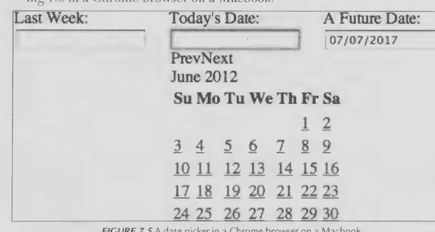

**图 7.5** 在 MacBook 的 Chrome 浏览器中的日期选择器。

## 进度条

你可以使用 jQuery 非常轻松地创建和更新进度条。代码清单 7.7 展示了 JQUIProgressBar1.html 的内容，说明了如何在 HTML 网页中渲染一个进度条。

代码清单 7.7 JQUIProgressBar1.html

```html
<!DOCTYPE html>
<html lang="en">
<head>
    <meta charset="utf-8"/>
    <title>jQuery Progress Bar</title>
    <link rel="stylesheet" type="text/css"
        href="http://ajax.googleapis.com/ajax/libs/jqueryui/1.8/themes/base/jquery-ui.css"/>
    <script src="http://ajax.googleapis.com/ajax/libs/jquery/1.5/jquery.min.js"></script>
    <script src="http://ajax.googleapis.com/ajax/libs/jqueryui/1.8/jquery-ui.min.js"></script>
    <style>
        #progressBarDiv1 {
            width: 30%;
        }
    </style>
</head>

<body>
    <div id="outer">
        <div id="progressBar1">
            进度条：
            <div id="progressBarDiv1"></div>
        </div>

        <div id="value1">
            进度条值：
            <input id="text1" type="text" value="0"/>
        </div>

        <div id="newValue">
            设置新值：
            <input id="newVal" type="text" value="0"/>
        </div>

        <script>
            $(document).ready(function() {
                $("#progressBarDiv1").progressbar({ value: 40 });
                $("#text1").val($("#progressBarDiv1").progressbar("value"));

                $("#newValue").bind("change", function() {
                    var newVal = $("#newVal").val();
                    $("#progressBarDiv1").progressbar("option", "value",
                        parseInt(newVal));
                });
            });
        </script>
    </div>
</body>
</html>
```

代码清单 7.7 引用了常用的 jQuery 文件，然后是一个 HTML `<div>` 元素（其 id 值为 outer），其中包含进度条的 HTML 代码、进度条的当前值（初始化为 40）以及一个允许用户更改状态栏值的输入字段。进度条值的创建、显示和更新在以下代码块中处理：


```javascript
$(document).ready(function() {
    $("#progressBarDiv1").progressbar({ value: 40 });

    $("#text1").val($("#progressBarDiv1").progressbar("value"));

    $("#newValue").bind("change", function() {
        var newVal = $("#newVal").val();
        $("#progressBarDiv1").progressbar("option", "value", parseInt(newVal));
    });
});
```

如你所见，上面的代码块将一个 `change` 事件绑定到第二个 HTML `<input>` 字段，当用户输入一个新值时，进度条将用该值更新。

图 7.6 显示了在 MacBook 上的 Chrome 浏览器中渲染代码清单 7.7 中的 `JQUIProgressBar1.html` 的结果。

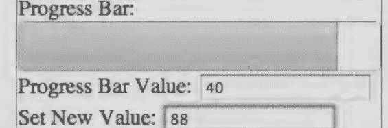

## 使用 JQUERY JSCROLLPANE 插件实现滚动窗格

目前 jQuery 并未提供滚动窗格组件，但你有其他选项可用。一种选择是使用 HTML5 进度条，它使用简单并提供了一些“合理的”功能。如果 HTML5 进度条不足以满足你的需求，你可以使用支持滚动窗格组件的 jQuery 插件，例如 `jScrollPane` 插件，其主页在这里：

http://jscrollpane.kelvinluck.com/

`jScrollPane` 插件提供了 `jScrollPane-<version>.min.js` JavaScript 文件以及一个 CSS 样式表（`jScrollPane.css`），你可以使用自定义样式覆盖它。

该插件提供了超过 20 个演示，向你展示如何创建滚动条（水平、垂直或两者兼有）、箭头按钮的使用、其 `scrollTo` 和 `scrollBy` 方法、如何在 IFRAME 中设置滚动条样式以及其他各种效果。

访问 `jScrollPane` 插件的主页，你将找到这些演示的链接、示例以及该 jQuery 插件的下载链接。

## 滑块

jQuery UI 滑块组件支持各种选项、方法和事件，其中一些在本节的代码示例中有所说明。

列表 7.8 展示了 `JQUISlider1.html` 的内容，演示了如何在 HTML 网页中渲染水平和垂直滑块。

```
列表 7.8 JQUISlider1.html

<!DOCTYPE html>
<html lang="en">
<head>
    <meta charset="utf-8"/>
    <title>jQuery Slider</title>

    <link href="http://ajax.googleapis.com/ajax/libs/jqueryui/1.8/themes/base/jquery-ui.css" rel="stylesheet" type="text/css"/>
    <script src="http://ajax.googleapis.com/ajax/libs/jquery/1.5/jquery.min.js"></script>
    <script src="http://ajax.googleapis.com/ajax/libs/jqueryui/1.8/jquery-ui.min.js"></script>

<style>
    #slider1 {
        width: 50%; padding: 5px; background-color: #fcc;
    }
    #sliderDiv2 {
        height: 120px; width: 50px; padding: 1px; background-color: #ccf;
    }
</style>
</head>
<body>
<div id="outer">
    <div id="slider1">
        水平滑块：
        <br>
        <div id="sliderDiv1"></div>
    </div>

    <div id="value1">
        <br>
        水平滑块值：
        <input id="text1" type="text" value="0"/>
    </div>

    <div id="slider2">
        <br>
        垂直滑块：
        <br>
        <div id="sliderDiv2"></div>
    </div>

    <div id="value2">
        <br>
        垂直滑块值：
        <input id="text2" type="text" value="0"/>
    </div>
</div>

<script>
    $(document).ready(function() {
        $("#sliderDiv1").slider({
            orientation: 'horizontal',
            min: 0,
            max: 200,
            step: 10,
            value: 100
        });

        $("#sliderDiv1").bind("slidechange", function(event, ui) {
            var slider1Val = $("#sliderDiv1").slider("option", "value");
            $("#text1").val(slider1Val);
        });

        $("#sliderDiv2").slider({
            orientation: 'vertical',
            min: 0,
            max: 200,
            value: 100
        });

        $("#sliderDiv2").bind("slidechange", function(event, ui) {
            var slider2Val = $("#sliderDiv2").slider("option", "value");
            $("#text2").val(slider2Val);

            if (slider2Val > 100) {
                $("#sliderDiv2").slider({ orientation: 'horizontal' });
            } else {
                $("#sliderDiv2").slider({ orientation: 'vertical' });
            }
        });
    });
</script>
</body>
</html>
```

列表 7.8 引用了常规的 jQuery 文件，定义了一些基于 CSS 的水平滑块样式，然后创建了一个水平滑块、一个垂直滑块以及两个 HTML `<input>` 字段。每当用户更改任一 jQuery 滑块的值时，关联的文本字段就会用 jQuery 滑块的当前值进行更新。

jQuery 滑块可以动态地从垂直滑块更改为水平滑块（反之亦然）。在此代码示例中，当滑块的值超过 100 时，垂直滑块会变成水平滑块，如以下代码片段所示：

```javascript
$("#sliderDiv2").bind("slidechange", function(event, ui) {
    var slider2Val = $("#sliderDiv2").slider("option", "value");
    $("#text2").val(slider2Val);

    if (slider2Val > 100) {
        $("#sliderDiv2").slider({ orientation: 'horizontal' });
    } else {
        $("#sliderDiv2").slider({ orientation: 'vertical' });
    }
});
```

前面的代码片段还会在垂直滑块的值不超过 100 时，将（或重置）垂直滑块设置为垂直方向。有关 jQuery UI 滑块的其他选项、方法和事件的更多信息，请访问这里：

http://jqueryui.com/demos/slider/

请记住，有时将 CSS3 效果与滑块结合使用可能会产生意外的视觉效果。

例如，将以下代码片段添加到列表 7.8 的 HTML `<style>` 元素中，然后观察当你移动垂直 jQuery 滑块时会发生什么：

```css
#sliderDiv2 {
    height: 120px; width: 50px; padding: 1px; background-color: #ccf;
}
```

图 7.7 展示了在 Macbook 上的 Chrome 浏览器中渲染列表 7.8 中 `JQUISlider1.html` 的结果。

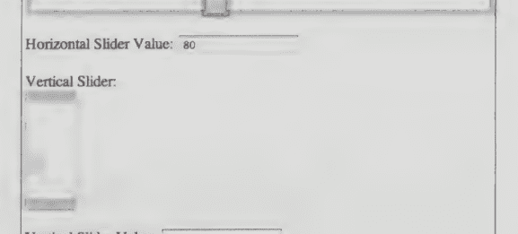

图 7.7 Macbook 上的 Chrome 浏览器中的滑块。

jQuery 滑块的一个简单用法是使用它们来控制动画效果的速度（也可以使用微调器来完成）。

列表 7.9 展示了 `JQUIAnimSlider1.html` 的内容，演示了如何使用滑块组件来控制动画效果。CSS 样式表 `JQUIAnimSlider1.css` 未显示，因为该 CSS 样式表与列表 7.2 相同：

http://awardwinningfjords.com/2011/04/13/adjustable-animations-with-sliders.html

```
缓动：
<select class="easing">
    <option></option>
    <option>swing</option>
    <option>easeInOut</option>
</select>
</div>

<div id="inner1"></div>
<div id="inner2"></div>
<div id="inner3"></div>
</div>

<script>
$(document).ready(function() {
    $("#speed").change(function() {
        var newVal = $("#speed").val();
        $("#speedSpan").html(newVal);
    });

    $("#inner1").click(function() {
        $("#inner1").animate(
            { left: 480, width: 100, height: 100 },
            { duration: $("input[type=range]").val() }
        );
    });

    $("#inner2").click(function() {
        $("#inner1").css({background: 'blue'});
        $("#inner2").css({background: 'red'});
        $("#inner3").css({translate: [100, 200]});
    });

    $("#inner3").click(function() {
        $("#inner1").css({background: 'red'});
        $("#inner2").css({background: 'yellow'});
        $("#inner3").css({background: 'blue'});
    });
});
</script>
</body>
</html>
```

在引用了所需的 jQuery 文件之后，列表 7.9 包含一个 HTML `<body>` 元素，其中又包含一个 HTML `<div>` 元素（其 `id` 属性值为 `outer`）。这个 HTML5 `<div>` 元素充当多个元素的容器：一个 HTML `<header>` 元素（用于显示说明）、一个 HTML `<input>` 元素（用于以毫秒为单位显示动画速度）以及三个 HTML `<div>` 元素，它们被渲染为不同颜色的矩形。

每当用户更改水平 jQuery 滑块的值时，以下绑定到 `change` 事件的代码块会显示动画速度的值：

```javascript
$("#speed").change(function() {
    var newVal = $("#speed").val();
    $("#speedSpan").html(newVal);
});
```

当用户点击最左边的矩形时，使用以下代码创建动画效果：

```javascript
$("#inner1").click(function() {
    $("#inner1").animate(
        { left: 480, width: 100, height: 100 },
        { duration: $("input[type=range]").val() }
    );
});
```

请注意前面的代码块如何使用 jQuery `animate()` 方法，结合用户选择的动画速度值，来创建动画效果。

要在此代码示例中最佳地查看动画效果，请在 Chrome 浏览器中启动列表 7.10。

## 标签页

jQuery 标签页组件支持各种选项、方法和事件，其中一些在本节的代码示例中有所说明。

列表 7.10 展示了 `JQUITabs.html` 的内容，演示了如何在 HTML 网页中渲染标签页。

### 列表 7.10 `JQUITabs.html`

```html
<!DOCTYPE html>
<html>
    <head>
        <meta charset="utf-8"/>
        <title>jQuery Tabs</title>

        <link href="JQUITabs.css" rel="stylesheet" type="text/css">
        <script src="http://ajax.googleapis.com/ajax/libs/jquery/1.7.1/jquery.min.js"></script>

        <style>
            .tabs a {
                padding: 5px 10px;
                background: #f88;
                color: #fff;
                text-decoration: none;
            }

            .tabs li {
                list-style: none;
                display: inline;
            }
        </style>

        <script>
            $(document).ready(function(){
                $('ul.tabs').each(function(){
                    // keep track of the currently active tab
                    var $active, $content, $links = $(this).find('a');

                    // first link is the initial active tab
                    $active = $links.first().addClass('active');
                    $content = $($active.attr('href'));

                    // hide the other tabs
                    $links.not(':first').each(function () {
                        $($(this).attr('href')).hide();
                    });

                    // bind the click event handler
                    $(this).on('click', 'a', function(e){
                        // Make the old tab inactive.
                        $active.removeClass('active');
                        $content.hide();

                        // Update the variables with the new link and content
                        $active = $(this);
                        $content = $($(this).attr('href'));

                        // Make the tab active
                        $active.addClass('active');
                        $content.show();

                        // prevent the anchor's default click action
                        e.preventDefault();
                    });
                });
            });
        </script>
    </head>

    <body>
        <ul class='tabs'>
            <li><a href='#tab1'>Tab 1</a></li>
            <li><a href='#tab2'>Tab 2</a></li>
            <li><a href='#tab3'>Tab 3</a></li>
            <li><a href='#tab4'>Tab 4</a></li>
        </ul>

        <div id="tab1">
            <p>Some text in the first tab. Some text in the first tab. Some text in the first tab.</p>
        </div>

        <div id="tab2">
            <p>Some text in the second tab. Some text in the second tab. Some text in the second tab.</p>
        </div>

        <div id="tab3">
            <p>Some text in the third tab. Some text in the third tab. Some text in the third tab.</p>
        </div>

        <div id="tab4">
            <div id="outer">
                <div id="inner1"></div>
                <div id="inner2"></div>
                <div id="inner3"></div>
            </div>
        </div>
    </body>
</html>
```

代码清单 7.10 引用了所需的 jQuery 文件，然后是一个 HTML `<style>` 元素，它为文档后面指定的选项卡（即 HTML `<div>` 元素）添加了一些样式效果。特别要注意以下针对带有 "tabs" 类的 `<div>` 的子 `<a>` 元素的代码片段：

```css
text-decoration: none;
```

...以及以下针对带有 "tabs" 类的 `<div>` 元素的子 `<li>` 元素的代码片段：

```css
list-style: none;
```

这些代码片段使我们能够以水平行的形式渲染选项卡，没有“项目符号”，因此它们看起来就像真正的选项卡。

以下代码块跟踪当前活动的选项卡并使其可见，同时使所有其他选项卡的内容不可见：

```javascript
var $active, $content, $links = $(this).find('a');

// first link is the initial active tab
$active = $links.first().addClass('active');
$content = $($active.attr('href'));

// hide the other tabs
$links.not(':first').each(function () {
    $($(this).attr('href')).hide();
});
```

图 7.9 展示了在 Macbook 上的 Chrome 浏览器中渲染代码清单 7.10 的 `JQUITabs.html`（并点击第四个选项卡）后的结果。

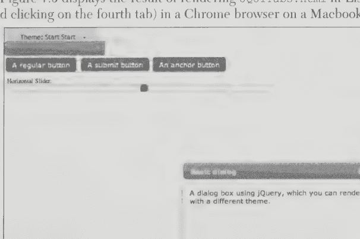

**图 7.9** Macbook 上 Chrome 浏览器中的选项卡。

## JQUERY UI 主题定制

jQuery UI 提供了非常出色的支持，用于在不同主题之间切换，这些主题由应用于小部件和文本的不同视觉效果组成。你可以在以下网站上找到关于 jQuery 主题的优质信息：

- http://jqueryui.com/docs/Theming
- http://jqueryui.com/docs/Theming/API
- http://jqueryui.com/docs/Theming#Using_ThemeRoller_and_Themes

代码清单 7.11 展示了 `JQUIThemes1.html` 的内容，该示例演示了如何为包含一组小部件的 HTML 网页动态应用不同主题：

- http://midnightprogrammer.net/post/Change-Page-Themes-Dynamically-Using-JQuery-Theme-Roller.aspx

```
代码清单 7.11 JQUIThemes1.html

<!DOCTYPE html>
<html>
<head>
<meta charset="utf-8"/>
<title>jQuery Themes</title>

<link type="text/css" rel="stylesheet" href="http://jqueryui.com/themes/base/ui.all.css"/>
<link rel="stylesheet" href="http://ajax.googleapis.com/ajax/libs/jqueryui/1.8.2/themes/base/jquery-ui.css" type="text/css" media="all"/>
<link rel="stylesheet" href="http://static.jquery.com/ui/css/demo-docs-theme/ui.theme.css" type="text/css" media="all"/>
<script src="http://jqueryui.com/js/jquery.js"></script>
<script src="http://ajax.googleapis.com/ajax/libs/jquery/1.4.2/jquery.min.js"></script>
<script src="http://ajax.googleapis.com/ajax/libs/jqueryui/1.8.2/jquery-ui.min.js"></script>

<script>
$(document).ready(function () {
// the set theme roller
$('#MyThemeRoller').themeswitcher();

// style the buttons
$( "input:submit, a, button" ).button();

// create a slider
$("#sliderDiv1").slider({
    orientation: 'horizontal',
    min: 0,
    max: 200,
    step: 10,
    value: 100
});
});

// display a Dialog
$(function () {
    $("#MyDialog").dialog();
});

// display a progress bar
$(function () {
    $("#MyProgressbar").progressbar({ value: 80 });
});
</script>

<style>
    #slider1 { width: 50%; padding: 5px; }
</style>
</head>

<body style="font-size:60%;">
<script src="http://jqueryui.com/themeroller/themeswitcher-tool/"></script>

<div id="MyThemeRoller"></div>

<div id="MyProgressbar" style="width:200px;"> </div>

<div id="MyDialog" title="Basic dialog">
    <p> A dialog box using jQuery, which you can render with a different theme.</p>
</div>

<div class="buttons">
  <button>A regular button</button>
  <input type="submit" value="A submit button">
  <a href="#">An anchor button</a>
</div>

<div id="slider1">
  Horizontal Slider:
  <br>
  <div id="sliderDiv1"></div>
</div>
</body>
</html>
```

代码清单 7.11 的主要目的是说明切换 jQuery 主题是多么容易；除了 jQuery 对话框，代码清单 7.11 中的所有其他元素都已在之前的代码示例中讨论过。

如你在代码清单 7.11 的第一部分所见，主题相关功能涉及的文件比之前的代码示例更多：首先是两个 jQuery 主题 CSS 文件的引用；接着是核心 jQuery 文件和一对 jQuery 主题相关 JavaScript 文件的引用。

图 7.10 展示了在 Macbook 上的 Chrome 浏览器中渲染代码清单 7.11 的 `JQUIThemes1.html` 后的结果。

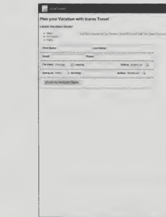

**图 7.10** Macbook 上 Chrome 浏览器中的 jQuery 主题切换。

你可能已经猜到 jQuery UI 支持自定义主题。你可以在这里找到有用的信息：

- http://jqueryui.com/docs/Theming/CustomThemes

这是一个更高级的主题，超出了本书的范围，但如果你需要为你的网页创建自定义主题，绝对值得阅读该网站上的大量信息。

## JQUERY UI EFFECT 函数

以下示例纯粹是为了趣味，你甚至可能发现 jQuery 的 `effect()` 函数有很好的用途，它可以让你创建一些不错的视觉效果。

代码清单 7.12 展示了 `JQUIEffects1.html` 的内容，该示例演示了如何对一个 HTML `<div>` 元素及其 HTML `<p>` 子元素进行水平晃动然后“爆炸”效果。

```
代码清单 7.12 JQUIEffects1.html

<!DOCTYPE html>
<head>
<meta charset="utf-8"/>
<title>jQuery Effect Function</title>

<link rel="stylesheet" href="http://ajax.googleapis.com/ajax/libs/jqueryui/1.8.2/themes/base/jquery-ui.css" type="text/css" media="all"/>
<link rel="stylesheet" href="http://static.jquery.com/ui/css/demo-docs-theme/ui.theme.css" type="text/css" media="all"/>
<script src="http://jqueryui.com/js/jquery.js"></script>
<script src="http://ajax.googleapis.com/ajax/libs/jquery/1.4.2/jquery.min.js"></script>
<script src="http://ajax.googleapis.com/ajax/libs/jqueryui/1.8.2/jquery-ui.min.js"></script>

<style>
#outer {
    width: 300px;
    height: 150px;
    border: 1px solid black;
}
</style>
</head>
<body>
<div id="outer">
    <div> <p id="p1">来自 jQuery 的 Hello World</p> </div>
    <div> <p id="p2">点击矩形内部</p> </div>
    <div> <p id="p3">来自 jQuery 的 Goodbye World</p> </div>
</div>
<script>
$(document).ready(function(){
    $("#outer").click(function() {
        $("#outer").effect('shake', {times:3}, 300)
        .effect('highlight', {}, 3000)
        .hide('explode', {}, 1000);
    });
});
</script>
</body>
</html>
```

清单 7.12 主要包含样板标记，以及一个“容器” HTML `<div>` 元素（其 `id` 属性值为 `outer`），该元素有三个子 HTML `<div>` 元素。

清单 7.12 的有趣之处在于 `<script>` 元素，它通过方法链使用 jQuery 的 `effect()` 方法为容器 HTML `<div>` 元素定义了点击处理程序，如下所示：

```javascript
$("#outer").effect('shake', {times:3}, 300)
.effect('highlight', {}, 3000)
.hide('explode', {}, 1000);
```

当用户点击此元素时，它将首先水平摇晃三次（每次 300 毫秒），然后变为高亮效果，三秒钟后，它将创建一个持续一秒的“爆炸”效果。

由于无法在清单 7.12 中捕捉到“爆炸”效果的逼真快照，请在基于 WebKit 的浏览器中启动清单 7.12 中的 HTML 网页，您将看到 jQuery `effect()` 方法所能实现的一些有趣视觉效果示例。作为练习，请尝试使用 JavaScript 和/或 CSS3 而不使用像 jQuery 这样的工具包来创建相同的效果。即使您不打算使用此功能，您可能也能欣赏到 jQuery 中提供的一些“花哨功能”。

## 一个包含各种 UI 组件的示例网页

本节中的示例说明如何使用您在本章前面看到的一些 UI 组件。为了说明如何在合理长度的代码示例中操作 UI 组件，省略了验证细节，您可以将这些技术用于您自己的网页。

清单 7.13 展示了 `JQUITravel1.html` 的内容，它说明了如何以编程方式确定用户选择的值，以及如何处理涉及 UI 组件的用户发起事件。

### 清单 7.13 `JQUITravel1.html`

```html
<!DOCTYPE html>
<html lang="en">
<head>
  <meta charset="utf-8"/>
  <title>使用 jQuery 小部件</title>
  <link href="JQUIButtons1.css" rel="stylesheet" type="text/css">
  <link href="http://ajax.googleapis.com/ajax/libs/jqueryui/1.8/themes/base/jquery-ui.css" rel="stylesheet" type="text/css"/>
  <script src="http://ajax.googleapis.com/ajax/libs/jquery/1.5/jquery.min.js"></script>
  <script src="http://ajax.googleapis.com/ajax/libs/jqueryui/1.8/jquery-ui.min.js"></script>
  <script>
    var startCity = "", destCity = "",
        flightItem = "", submitButton = "";
    var flightTimes = new Array('11-09-2011 5AM', '11-09-2011 3PM', '11-09-2011 6PM');
    var flightCount = flightTimes.length;
    var flightDest = new Array(flightCount);
  </script>
</head>
<body>
<article>
<header>
<h1>用 Icarus Travel 规划您的假期</h1>
<p><time pubdate datetime="2011-10-30T14:14-14:00"></time></p>
</header>
<header>
<h3>最新假期优惠！</h3>
<aside style="font-size:larger;font-style:italic;color:red;float:right;width:550px;">较早的优惠券（最多两个月内）可用作抵扣。</aside>
<p></p>
<nav>
<ul>
<li><a href="Maui092011.html">毛伊岛</a></li>
<li><a href="SaintTropez092011.html">圣特罗佩</a></li>
<li><a href="Paris092011.html">巴黎</a></li>
</ul>
</nav>
</header>
</article> <!-- 文章 #1 结束 -->
<div id="outer">
<form action="">
<fieldset id="nameinfo">
<label for="firstName"><strong>名字：</strong></label>
<input type="text" name="firstName" id="firstName" value="" />
<label for="lastName"><strong>姓氏：</strong></label>
<input type="text" name="lastName" id="lastName" value="" />
</fieldset>
<fieldset id="contactinfo">
<label for="email"><strong>电子邮件：</strong></label>
<input type="text" name="email" id="email" value="" />
<label for="phone"><strong>电话：</strong></label>
<input type="text" name="phone" id="phone" value="" />
</fieldset>
<fieldset id="FromAndDate">
    <label for="startFrom"><strong>我在此：</strong></label>
    <select id="startFrom">
        <option>芝加哥</option>
        <option>纽约</option>
        <option>明尼阿波利斯</option>
    </select>
    <label for="departureDate"><strong>出发：</strong></label>
    <input type="date" name="departureDate" id="departureDate" value="" />
    <label for="goingPreferredAirline"><strong>航空公司：</strong></label>
    <select id="goingPreferredAirline">
        <option>美国航空</option>
        <option>日本航空</option>
        <option>全日空航空</option>
    </select>
</fieldset>
<fieldset id="departureDate">
    <label for="destination"><strong>前往：</strong></label>
    <select id="destination">
        <option>毛伊岛</option>
        <option>巴哈马</option>
        <option>巴黎</option>
    </select>
    <label for="arrivalDate"><strong>抵达：</strong></label>
    <input type="date" name="arrivalDate" id="arrivalDate" value="" />
    <label for="returningPreferredAirline"><strong>航空公司：</strong></label>
    <select id="returningPreferredAirline">
        <option>美国航空</option>
        <option>日本航空</option>
        <option>全日空航空</option>
    </select>
</fieldset>
<fieldset id="checkAvailableFlights">
    <input id="availableFlights" type="submit" value="查询可用航班">
</fieldset>
<div id="availableFlightsList"></div>
</form>
</div> <!-- 外部容器 -->
<script>
    var search = function() {
        $("#availableFlights").parent().remove();
        startCity = $("#startFrom").val();
        destCity  = $("#destination").val();
        for(var i=0; i<flightCount; i++) {
            flightItem   = flightTimes[i]+" from "+ startCity+" to "+destCity;
            submitButton = "<input id=\"reserve\" type=\"submit\" value=\"预订！\">";
            flightDetails = flightItem+submitButton;
            $("#availableFlightsList").append("<li>"+flightItem+submitButton+"</li>");
        }
    };
    $(document).ready(function() {
        // 用户更改了“出发城市”...
        $("#startFrom").change(search);
        // 用户更改了“目的地城市”...
        $("#destination").change(search);
        // 用户想查看可用航班...
        $("#searchNow").change(search);
    });
</script>
</body>
</html>
```

清单 7.13 是一个虚构旅行社的示例，它显示了选择旅行目的地的选项。在一些初始样板标记之后，清单 7.13 包含用于跟踪航班终点的 JavaScript 变量，如 `startCity` 和 `destCity`，以及包含硬编码航班时间列表的 JavaScript 变量 `flightTimes`。

清单 7.13 的下一部分包含一个带有多个 HTML 下拉列表的 HTML Form 元素，随后是一个 JavaScript 代码块，该代码块定义了一个 JavaScript 变量，每当用户更改任何下拉列表中的选择时，该变量都会处理搜索功能，如下所示：

```javascript
var search = function() {
    $("#availableFlights").parent().remove();
    startCity = $("#startFrom").val();
    destCity = $("#destination").val();
    for(var i=0; i<flightCount; i++) {
        flightItem = flightTimes[i]+" from "+ startCity+" to "+destCity;
        submitButton = "<input id=\"reserve\" type=\"submit\" value=\"预订！\">";
        flightDetails = flightItem+submitButton;
        $("#availableFlightsList").append("<li>"+flightItem+submitButton+"</li>");
    }
};
```

清单 7.13 的最后一部分将“change”事件绑定到三个下拉列表中的任何一个，当用户更改其中任何一个的选择时，就会执行 JavaScript 变量 `search` 中的代码，从而在网页上显示用户选择的结果。

图 7.11 显示了在 Macbook 上的 Chrome 浏览器中渲染清单 7.13 中的 `JQUITravel1.html` 的结果。

## JQUERY 的未来版本

在本书付印之际，jQuery 1.8（测试版）现已发布。jQuery 1.9 将在 2013 年发布时支持旧版本（6、7 和 8）的 IE，并且在 jQuery 2.0 发布后，jQuery 团队将继续支持 1.9 版本。但是，jQuery 2.0 将停止对 IE 6、7 和 8 的支持。根据预测，jQuery 2.1 不太可能在 2014 年之前推出。jQuery 团队的目标是保持 jQuery 的 1.x 和 2.x 版本同步，并通过插件添加功能。

一些新的 jQuery 1.8 功能包括：

- 能够构建排除一个或多个模块的自定义版本 jQuery
- 基于当前浏览器为无前缀的属性名称生成前缀
- Sizzle CSS 选择器引擎
- 使用新方法 `$.parseHTML` 提供 XSS 保护

目前你可以排除的模块有 `ajax`、`css`、`dimensions`、`effects` 和 `offset`。前缀生成的一个简单例子是，如果你的 HTML 网页在 Chrome 上包含以下 jQuery 代码片段：

```javascript
$("#myscroll").css("marquee-direction", "backwards")
```

...那么 jQuery 将会把 CSS 设置为以下内容：

```css
-webkit-marquee-direction: backwards
```

上述信息以及 jQuery 1.8 中其他改进的详细列表，可在此处查阅：
http://blog.jquery.com/2012/06/28/jquery-core-version-1-9-and-beyond/
http://blog.jquery.com/2012/07/01/jquery-1-9-and-2-0-tldr-edition/

## 实用链接

jQuery UI 网站提供了关于 jQuery UI 组件的广泛文档和详细信息，其主页在此：
http://jqueryui.com/
另一个有用的 jQuery UI 链接是一个提供 jQuery UI 组件演示的网站：
http://jqueryui.com/demos/
你可以将 jFormer jQuery 插件与 HTML5 表单一起使用：
https://www.jformer.com/
一个用于播放音频和视频文件的 jQuery 插件集合在此：
http://superdit.com/2011/04/27/12-jquery-plugins-for-playing-audio-video-files/
用于显示推文的 jQuery 插件 `jTweetsAnywhere` 在此：
http://thomasbillenstein.com/jTweetsAnywhere/

## 总结

本章介绍了 jQuery UI 控件，以及展示如何使用 jQuery UI 控件创建 HTML5 网页的代码示例。你学习了如何使用以下 jQuery UI 控件：

- 手风琴效果
- 按钮
- 复选框和单选按钮
- 组合框
- 日期选择器
- 对话框
- 进度条
- 滚动窗格
- 滑块
- 选项卡
- jQuery UI 主题化
- ThemeRoller 和主题

下一章将介绍 jQuery Mobile，展示如何使用 jQuery Mobile 创建基于 HTML5 的应用程序。

# 第 8 章：JQUERY MOBILE 简介

本章包含 jQuery Mobile 的简介，展示如何使用 jQuery Mobile 创建基于 HTML5 的应用程序。桌面浏览器的网页在移动设备上的渲染方式不同，当你看到移动设备上渲染文本的微小字体时，这一点会立刻显现出来。幸运的是，jQuery Mobile 具有高度的“页面感知”能力，并提供了许多有用的、与页面相关的前置和后续事件，你可以使用根据需求定制的自定义内容来覆盖这些事件。

事实上，jQuery Mobile 围绕（主要是）具有多个“页面视图”的单页应用的概念设计（本章稍后讨论），而 jQuery 则是在多页面站点和应用占主导地位时设计的。因此，jQuery Mobile 具有面向视图的模型，而 jQuery 具有面向网页的模型。这一重要区别将帮助你理解 jQuery Mobile 中可用功能背后的设计原理。

如果你想编写在不同设备上正确显示的网页，那么你至少需要考虑这些设备的尺寸（宽度和高度）。其他需要考虑的因素包括（但不限于）DPI（每英寸点数），这在不同移动设备之间有所不同，以及你是否希望允许用户捏合或缩放网页。jQuery Mobile 的优势之一，连同其丰富的功能集和对众多移动平台的支持，在于它为你自动处理了设备差异。

本章的第一部分概述了 jQuery Mobile 的一些特性，以及与 jQuery 的一些重要区别。你将看到 jQuery Mobile 如何通过编程方式增强你的网页，添加额外的功能，从而减少你为创建移动友好型网页所需的编码工作量，并确保你的网页在不同移动设备上正确渲染。此外，你将了解 jQuery Mobile 暴露的、与页面相关的事件（有很多），以及一些你可以通过编程方式覆盖的默认行为。

本章的第二部分讨论了 jQuery Mobile 中的多页面视图，以及定位页眉和页脚的各种方式。第三部分讨论了 jQuery Mobile 中的按钮，这是一个内容广泛、功能丰富的主题，你将看到完整的代码示例和有用的代码片段。

第四部分包含展示如何在 jQuery Mobile 中使用各种小部件的代码示例，包括列表视图、导航栏和菜单。这些代码示例的目的不仅是向你展示如何使用这些小部件，还展示如何在代码示例中结合基于 CSS3 的图形效果。其中一些效果，如阴影和渐变（你在第 3 章学习了如何实现），向你展示了如何创建超越 jQuery Mobile “开箱即用”功能的更丰富的视觉效果。本章的最后一部分包含展示如何在使用 jQuery Mobile 的 HTML 网页中使用 Ajax 和地理位置的代码示例。

在阅读本章材料时，请牢记以下几点。首先，关于 HTML 小部件的代码示例是从如何在 jQuery Mobile 页面中使用的角度来讨论的。这里隐含的假设是你具备基本的 HTML 知识，因此省略了关于 HTML 小部件的详细信息。其次，本章的信息将为你学习第 9 章中的代码示例做好准备，在那里你将学习如何在 jQuery Mobile 应用程序中创建动画效果。

第三，当你读完本章后，你将理解 jQuery 和 jQuery Mobile 之间的许多主要区别，同时也将了解如何在 jQuery Mobile 应用程序中使用各种 HTML 小部件。

## JQUERY MOBILE 概述

jQuery Mobile 本质上是一组 jQuery 插件和小部件的集合，使你能够编写可在多个平台上运行的移动 Web 应用程序。你已经知道 jQuery 专注于桌面 Web 应用程序；相比之下，jQuery Mobile（包括一个 CSS 样式表和一个 JavaScript 库）则针对移动设备。但是，jQuery Mobile 依赖于“基础” jQuery 库，你必须在 Web 页面中包含 jQuery Mobile 库之前引用该库。此外，jQuery Mobile 使用了 HTML5 和 CSS3 的特性（如过渡和动画），以及用于导航的小图标。

jQuery Mobile 依赖于带有 `data-` 前缀的自定义属性，一个简单的 jQuery Mobile 页面具有以下结构：

- 一个可选的 `<div>` 元素，带有 `data-role="header"` 属性
- 一个必需的 `<div>` 元素，带有 `data-role="content"` 属性
- 一个可选的 `<div>` 元素，带有 `data-role="footer"` 属性

在初始化过程中，jQuery Mobile 会预处理一个 Web 页面，并插入额外的标记、CSS 类和事件处理程序。你将在本章后面的“Hello World”代码示例中看到 jQuery Mobile 如何修改 Web 页面的示例。

在编写 jQuery Mobile 网页时，有几个重要的细节你需要了解。首先，jQuery Mobile 提供了以下页面相关事件，你可以在 jQuery Mobile 页面的生命周期中通过编程方式调用它们：`pageInit()`、`pageCreate()`、`pageShow()` 和 `pageHide()`。其次，jQuery Mobile 支持处理用户手势的自定义事件，例如 `swipe`、`tap`、`tap-and-hold` 以及设备方向更改。第三，jQuery Mobile 使用主题来定制移动应用程序的外观和感觉，以及渐进式增强（在第 1 章中简要讨论过），以使你的移动应用程序能够在各种支持 Web 的设备上运行。

另一个需要牢记的关键点是，jQuery 使用以下构造：

```javascript
$(document).ready(function() {
    // 在这里做些事情
});
```

另一方面，jQuery Mobile 使用以下构造：

```javascript
$(selector).live('pageinit', function(event) {
    // 在这里做些事情
});
```

注意不同的焦点：jQuery 在网页加载完成时发送事件，而 jQuery Mobile 在页面（或页面视图）初始化完成时发送事件。

## jQuery Mobile 的关键特性和组成部分

如果你已经阅读了前面涵盖 jQuery 的章节，那么你已经掌握了大量关于 jQuery 特性的知识。这些知识之所以有用还有另一个原因：jQuery Mobile 以 jQuery 为基础，在你的 HTML5 网页中，jQuery 库必须始终位于 jQuery Mobile 库之前。

jQuery Mobile 提供了许多有用的功能，这些功能将简化创建移动应用程序的过程。其中一些 jQuery Mobile 功能如下所列：

- 兼容主要移动平台（Android、iOS 等）
- 使用 HTML5 标记
- 采用渐进增强方法
- 提供紧凑的工具包（压缩后约 12K）
- 支持插件和主题
- 支持基于触摸和鼠标的用户手势
- 支持 WAI-ARIA

此外，jQuery Mobile 支持以下组件（以及其他未在此列出的组件）：

- 按钮
- 表单元素
- 列表视图
- 页面和对话框
- 工具栏

本书中的 jQuery 代码示例使用了一个简单的命名约定：包含 jQuery 代码的 HTML5 网页名称以“JQ”开头，而包含 jQuery Mobile 的 HTML5 网页名称则以字母“JQM”开头。请记住，此命名约定仅适用于本书。

## 一个最简的 jQuery Mobile 网页

清单 8.1 展示了 `JQMHelloWorld1.html` 的内容，该文件说明了如何在在桌面浏览器、平板电脑或智能手机上渲染的 HTML5 网页中显示“Hello World”消息。

### 清单 8.1 `JQMHelloWorld1.html`

```html
<!DOCTYPE html>
<html lang="en">
  <head>
    <meta charset="utf-8"/>
    <title>Hello World from jQuery Mobile</title>
    <link rel="stylesheet" href="http://code.jquery.com/mobile/1.1.0/jquery.mobile-1.1.0.min.css"/>
    <script src="http://code.jquery.com/jquery-1.7.1.min.js"></script>
    <script src="http://code.jquery.com/mobile/1.1.0/jquery.mobile-1.1.0.min.js"></script>
  </head>
  <body>
    <div data-role="page">
      <div data-role="header">
        <h2>This is the Header</h2>
      </div>
      <div data-role="content">
        <p>Hello World from a Simple jQuery Mobile Page</p>
      </div>
      <div data-role="footer">
        <h2>This is the Footer</h2>
      </div>
    </div>
  </body>
</html>
```

清单 8.1 非常简单：它包含一个单独的页面视图（一个带有 `data-role="page"` 属性的 HTML `<div>` 元素），该视图包含三个 `<div>` 元素：分别是一个页眉部分、内容部分和页脚部分。

图 8.1 展示了在运行 Android ICS 的华硕 Prime 平板电脑上以横屏模式截取的、渲染清单 8.1 中 HTML 网页的结果。

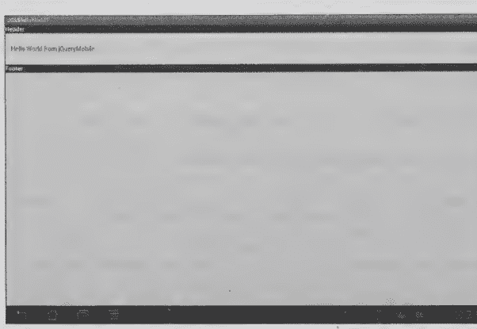

*图 8.1* 在运行 Android ICS 的华硕 Prime 平板电脑上的“Hello World”（横屏模式）。

将图 8.1 与图 8.2 进行比较，图 8.2 展示了在运行 Android ICS 的 Sprint Nexus S 4G 智能手机上以横屏模式运行的示例 jQuery Mobile 应用程序，使用的是与捕捉图 8.1 时相同的 Android apk 二进制文件。请注意在两个截图中，页眉和页脚是如何自动扩展到屏幕宽度的。

图 8.2 展示了在运行 Android ICS 的 Sprint Nexus S 4G 智能手机上以横屏模式渲染清单 8.1 中 HTML 网页的结果。

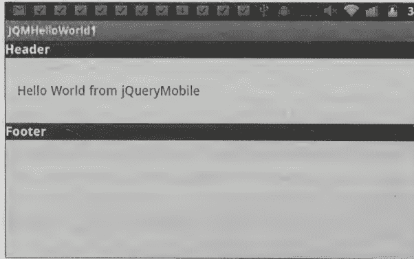

*图 8.2* 在运行 Android ICS 的 Sprint Nexus S 4G 上的“Hello World”（横屏模式）。

现在在一个基于 WebKit 的浏览器中启动清单 8.1，并将你看到的结果与图 8.1 和图 8.2 进行比较。

早些时候你已经了解到，jQuery Mobile 通过添加额外的标签和 CSS 类来增强移动网页。清单 8.2 展示了 `JQMHelloWorld1Enhanced.html`，它展示了 jQuery Mobile 如何增强 `HelloWorld1.html` 这个 HTML 网页。

### 清单 8.2 `JQMHelloWorld1Enhanced.html`

```html
<!DOCTYPE html>
<html lang="en" class="ui-mobile landscape min-width-320px min-width-480px min-width-768px max-width-1024px">
<head>
    <meta name="viewport" content="width=device-width, minimum-scale=1, maximum-scale=1">
    <base href="file:///Users/ocampesato/jqm/">
    <title>Hello World from jQuery Mobile</title>
    <link rel="stylesheet" href="jquery.mobile-1.1.0.min.css">
    <script src="jquery-1.7.1.js"></script>
    <script src="jquery.mobile-1.1.0.min.js"></script>
</head>
<body class="ui-mobile-viewport">
    <div data-role="page" class="ui-page ui-body-c ui-page-active">
        <div data-role="header" class="ui-bar-a ui-header" role="banner">Header</div>
        <div data-role="content" class="ui-content" role="main">
            <p>Hello World from jQuery Mobile</p>
        </div>
        <div data-role="footer" class="ui-bar-a ui-footer" role="contentinfo">Footer</div>
    </div>
    <div class="ui-loader ui-body-a ui-corner-all" style="top: 295.5px; ">
        <span class="ui-icon ui-icon-loading spin"></span>
        <h1>loading</h1>
    </div>
</body>
</html>
```

正如你在清单 8.2 中所看到的，jQuery Mobile 将各种 CSS 类（这些类是 jQuery Mobile 的一部分）“注入”到清单 8.1 的 HTML5 网页中。通常，你不需要关心这些细节；但是，如果你需要更深入地理解这些细节，可以深入研究 jQuery Mobile 的源代码。

## jQuery 和 jQuery Mobile 之间的更多区别

jQuery 是一个用于在桌面浏览器上创建 HTML 网页的工具包，而 jQuery Mobile 则为移动设备提供了对额外功能的支持：

- 支持多个页面视图
- 用于页面视图和过渡效果的带有 `data-` 前缀的自定义属性
- 页面过渡效果（`pagebeforehide`、`pagebeforeshow` 等）
- `jqmData()` 自定义选择器
- `mobileInit` 事件

## jQuery Mobile 页面视图

正如你在之前的代码示例中所看到的，jQuery Mobile 应用程序中的每个页面视图都由一个带有 `data-role="page"` 属性的 HTML `<div>` 元素定义，同时包含一个可选的页眉元素、一个必需的内容元素和一个可选的页脚元素。

在页面视图之间进行导航非常简单：只需在 jQuery Mobile 应用程序中为带有 `data-role="content"` 属性的 `<div>` 元素添加一个链接，如下所示：

```html
<div data-role="content">
    <p>A second page view<a href="#home">Home</a></p>
</div>
```

当用户点击链接时，页面视图之间的转换就会发生，jQuery Mobile 会自动处理转换所需的细节。本章后面将提供一个具有多个页面视图（以及如何在页面视图之间导航）的 jQuery Mobile 网页的完整示例。

## jQuery Mobile 自定义属性

自定义属性的 `data-` 前缀是 HTML5 规范（第 3.2.3.8 节）的一部分，jQuery Mobile 广泛使用带有 `data-` 前缀的自定义属性，而 jQuery 中则不使用自定义属性。实际上，jQuery Mobile 使用这些自定义属性来指定行为、功能和布局。你将经常遇到的两个自定义属性是 `data-role` 和 `data-transition`。

`data-role` 属性用于标识“页面视图”（本质上是一个屏幕）的不同部分，其一些支持的值是 `page`、`header`、`content` 和 `footer`。`data-role` 属性也用于增强 HTML 元素。例如，如果你在无序列表的 HTML `<ul>` 标签中指定属性 `data-role="listview"`，那么 jQuery Mobile 将进行必要的增强（如插入标记、添加 CSS 类和暴露监听器），以便你可以将该无序列表视为一个小部件。

再举一个例子，你可以通过将属性 `data-role="navbar"` 添加到块级 HTML5 `<nav>` 元素来创建导航栏。相关列表项（包含在 HTML5 `<nav>` 元素中）中的文本字符串将作为选项卡元素显示在导航栏中。

`data-transition` 属性在更改页面视图或显示对话框时指定过渡效果。由于这些过渡基于 CSS3，因此它们仅在支持 CSS3 的浏览器（如基于 WebKit 的浏览器）中有效。`data-transition` 属性的允许值是 `fade`、`flip`、`pop`、`slide`、`slidedown` 和 `slideup`。

其他一些 jQuery Mobile 自定义属性包括 `data-backbtn`、`data-divider`、`data-direction`、`data-icon`、`data-inline`、`data-position`、`data-rel` 和 `data-url`。

## jQuery Mobile 页面过渡

jQuery Mobile 提供了页面过渡以及事件和 ui 对象，你可以在绑定到任何页面过渡的自定义代码块中引用它们。请记住，“页面”既可以是单独的 HTML 网页，也可以是当前加载的 HTML 网页内部的 HTML `<div>` 元素。

以下是页面初始化期间发生的页面事件序列：

- `pagebeforecreate`：最先触发
- `pagecreate`：在填充 DOM 时触发

每当用户点击一个导航到首次加载页面的链接时，会发生以下事件序列：

- `pagebeforehide`：在过渡前于“来源”页面上触发
- `pagebeforeshow`：在过渡前于“目标”页面上触发
- `pagehide`：在过渡后于“来源”页面上触发
- `pageshow`：在过渡后于“目标”页面上触发

每当使用 Ajax 加载新页面时，会发生以下事件序列：

- `pagebeforeload`：在发出 AJAX 调用之前
- `pageload`：在 AJAX 调用完成之后
- `pageloadfailed`：如果 AJAX 调用失败则触发

在页面过渡期间，`ui.nextPage` 被赋值为过渡的目标页面，如果没有下一个页面，则赋值为空的 jQuery 对象。类似地，`ui.prevPage` 被赋值为过渡前的当前页面，如果没有上一个页面，则赋值为空的 jQuery 对象。

jQuery Mobile 为其内部功能使用基于 Ajax 的异步方法调用，因此它区分页面加载事件与页面显示和隐藏事件。当文件以同步方式加载到浏览器中时，会发生页面加载事件，此时 `jQuery(document).ready()` 方法以及其他初始化事件均可用。请注意，在某些情况下你可以显式指定同步而非异步方法调用，但本章不讨论此功能（如需更多细节，请查阅 jQuery Mobile 在线文档）。

正如你将在本章稍后看到的，一个 HTML 网页可能包含多个 jQuery Mobile 页面视图，用户可以在这些页面视图之间多次导航。这些过渡不会触发页面加载事件；jQuery Mobile 提供了一组在每次页面过渡发生时都会触发的事件。

由于每次页面过渡发生时都会触发页面隐藏和显示事件，请确保不要重复绑定事件处理程序，方法是首先检查事件处理程序是否尚未绑定（否则不执行任何操作），或者在重新绑定到给定事件之前先清除绑定。

代码清单 8.3 展示了 `JQMPageEvents1.html` 的内容，说明了页面事件的执行顺序。

### 代码清单 8.3 `JQMPageEvents1.html`

```html
<!DOCTYPE html>
<html lang="en">
<head>
    <meta charset="utf-8">
    <title>JQuery Mobile Page Events</title>
    <link rel="stylesheet" href="http://code.jquery.com/mobile/1.1.0/jquery.mobile-1.1.0.min.css"/>
    <script src="http://code.jquery.com/jquery-1.7.1.min.js"></script>
    <script src="http://code.jquery.com/mobile/1.1.0/jquery.mobile-1.1.0.min.js"></script>
</head>
<body>
    <div data-role="page" id="page1">
        <div data-role="header">
            <h3>JQuery Mobile Page Events</h3>
        </div>
        <div data-role="content" id="content"></div>
        <div data-role="footer"><h3>Footer</h3></div>
    </div>
    <script>
        $("#page1").live('pagebeforecreate', function(event){
            console.log("pagebeforecreate event");
        });
        $("#page1").live('pagecreate', function(event){
            console.log("pagecreate event");
        });
        $("#page1").live('pageinit', function(event){
            console.log("pageinit event");
        });
        $("#page1").live('pagebeforehide', function(event){
            console.log("pagebeforehide event");
        });
        $("#page1").live('pagebeforeshow', function(event){
            console.log("pagebeforeshow event");
        });
        $("#page1").live('pagehide', function(event){
            console.log("pagehide event");
        });
        $("#page1").live('pageshow', function(event){
            console.log("pageshow event");
        });
    </script>
</body>
</html>
```

代码清单 8.3 是一个简单的 HTML5 网页，包含用于单个页面视图的 HTML 标记和 jQuery Mobile 代码。主要代码块使用 jQuery 的 `live()` 方法来绑定各种页面相关事件，每当页面事件发生时，都会在控制台中显示一条消息。

图 8.3 展示了在 Macbook 上的 Chrome 浏览器中渲染代码清单 8.3 中 HTML 网页的结果。图 8.3 底部的 Chrome 检查器向你展示了在 jQuery Mobile 中触发的页面相关事件的顺序。

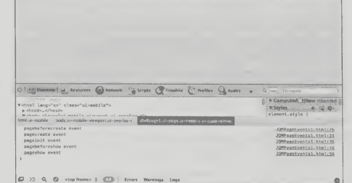

## JQUERY MOBILE 与 CSS 相关的页面初始化

除了公开页面相关事件外，jQuery Mobile 还会在网页在浏览器中渲染之前对其进行额外处理。首先，jQuery Mobile 触发 `beforecreate` 事件，然后为所有页面元素添加 `ui-page` 类，并为所有应用了 `data-role="none"` 或 `data-role="nojs"` 的页面元素添加 `ui-nojs` 类。

接下来，jQuery Mobile 搜索具有 `data-` 属性的子元素，并添加主题类、适当的 ARIA 角色，并且（如有必要）还会为第一页之后的所有页面在标题中添加一个返回按钮。

最后，jQuery Mobile 增强按钮、控件组和表单控件，并对工具栏进行任何必要的调整。

因此，jQuery Mobile 为你执行了大量工作，这意味着你不必被这些繁琐的底层细节所困扰，从而可以专注于移动应用程序的功能性。

还有一个好消息：当用户在你的移动应用程序的各个页面之间导航时，jQuery Mobile 会自动处理页面过渡和返回按钮，并通过执行异步获取（使用 Ajax）来处理外部页面，然后将该外部页面集成到当前文档中（如果找不到外部页面，则会显示错误消息）。外部页面被合并到当前文档中具有 `data-role="page"` 属性的第一个元素中（该页面的所有其他内容将被忽略）。

请注意，如果 jQuery Mobile 找不到网页，或者网页不包含具有 `data-role="page"` 属性的元素，它会显示一条错误消息。请确保外部网页中的 `id` 值与当前网页的 `id` 值不同。

顺便提一下，你可以通过两种方式覆盖默认的页面加载：在链接上指定 `target` 属性（如 `_blank`）或在链接上指定 `rel="external"` 属性。

## mobileinit 事件

jQuery Mobile 在执行时立即在 document 对象上触发 `mobileinit` 事件，因此你可以绑定它并覆盖任何默认配置。

例如，假设你需要阻止 jQuery Mobile 将样式规则应用于整个移动应用程序中的特定类型 HTML 元素。以下代码块阻止 jQuery Mobile（在全局层面）将其样式规则应用于 HTML `<input>` 和 `<textarea>` 元素：

```javascript
$(document).bind('mobileinit', function () {
    $.mobile.page.prototype.options.keepNative = "input, textarea";
});
```

请注意，`data-role="none"` 属性与前面代码块具有相同的目的，不同之处在于它仅应用于包含此属性的特定元素。

## JQUERY MOBILE 选项与自定义

jQuery Mobile 为各种对象提供选项和方法，包括 `.mobile`、`.mobile.path` 和 `.mobile.history`。有许多选项可以为你的移动应用程序配置，我们将在本节中仅介绍其中一些。一个显然有用的方法是 jQuery Mobile 的 `pageLoading()` 方法，它用于显示和隐藏 jQuery Mobile 加载对话框。你调用此方法时传递布尔值 `true` 以隐藏对话框，不带参数调用此方法以显示对话框，如下所示：

```javascript
// 显示页面加载对话框
$.mobile.pageLoading();
```

```javascript
// 隐藏加载对话框
$.mobile.pageLoading(true);
```

你还可以自定义“加载消息”和过渡效果类型，如下所示：

```javascript
$.mobile.loadingMessage = "请稍候 ";
$.mobile.defaultPageTransition = "pop";
```

执行与前两行相同操作的另一种方式如下所示：

```javascript
$.extend($.mobile, {
    "loadingMessage": "请稍候",
    "defaultPageTransition": "pop"
});
```

## 页面导航与页面切换

当用户在你的移动 Web 应用中导航时，jQuery Mobile 也会更新 `location.hash` 对象，其值是每个页面视图的唯一 URL（该 URL 由带有 `data-role="page"` 属性的元素定义）。jQuery Mobile 会自动将每个页面的 URL 存储在其分配给页面“容器”元素的 `data-url` 属性中。

jQuery Mobile 还提供了一组方法，使你能够以编程方式处理页面切换和滚动。其中一种方法是 `changePage()`，其语法如下：

`changePage(to, transition, back, changeHash);`

`to` 参数是一个字符串，用于指定元素 ID 或文件名（以及许多其他选项），它是对目标页面的引用。`transition` 参数是应用程序跳转到目标页面时创建的过渡效果名称。`back` 参数是一个布尔值，指定过渡是否反向进行。最后，`changeHash` 参数是一个布尔值，指定是否更新 `location.hash` 对象。

`changePage()` 方法使你能够创建更复杂的页面过渡效果。例如，当用户点击带有 "flip" 效果且反向进行的 `.back-btn` 时，以下代码片段会跳转到页面 `#first`，且不更新 location hash：

```javascript
$(".back-btn").bind("click", function() {
    $.mobile.changePage("#first", "flip", true, false);
});
```

jQuery Mobile 还提供了 `silentScroll()` 方法，它接受一个整数值来指定目标位置的 `y` 坐标。调用此方法时，不会触发滚动事件监听器。例如，以下代码片段会静默滚动到位置 200：

```javascript
$.mobile.silentScroll(200);
```


## jqmData() 自定义选择器

在前面的章节中，你学习了 `jQuery data()` 方法。jQuery Mobile提供了一个相应的方法，称为 `jqmData()`，这是一个专门用于选择自定义 `data-` 属性的选择器。

例如，在jQuery中，你可以使用以下代码片段选择Web页面中所有包含 `data-role` 属性且值为 `page` 的元素：

```
$("[data-role='page']")
```

你可以使用 `jqmData()` 选择同一组元素，如下所示：

```
$(":jqmData(role='page')")
```

选择所选页面内所有具有任何自定义 `data-` 属性的元素：$(":jqmData(role='page')").jqmData(role)

请注意，`jqmData()` 选择器通过指定字符串 `namespace-` 的值（默认为空）自动为你处理命名空间，从而避免标签名冲突。

## 在单个HTML5网页中实现多视图

jQuery Mobile使你能够方便地在单个HTML5网页中定义多个页面视图，并为用户提供在HTML5网页中不同页面视图之间导航的简单机制。建议使用单个HTML5网页，因为这种方法比创建包含多个HTML5网页的移动应用更高效。尽管HTML5网页的初始下载可能较长，但用户导航到网页的不同部分时无需额外的网络访问。

清单8.4展示了 `JQMMultiPageViews1.html` 的内容，该文件说明了如何在单个HTML5网页中导航多个内部页面视图。

```
清单 8.4 JQMMultiPageViews1.html

<!DOCTYPE html>

<html>

<head>

  <meta charset=utf-8"/>

  <title>jQuery Mobile: Multiple Page Views</title>

  <link rel="stylesheet"

    href="http://code.jquery.com/mobile/1.1.0/jquery.mobile-1.1.0.min.css"/>

  <script

    src="http://code.jquery.com/jquery-1.7.1.min.js">

  </script>

  <script src="http://code.jquery.com/mobile/1.1.0/jquery.mobile-1.1.0.min.js">

  </script>

</head>

<body>

  <div data-role="page" id="home">

    <div data-role="header"> <h1>Home Page Header</h1> </div>

    <div data-role="content">

      <p>This is the content of the main page</p>

      <p><a href="#about">Click here to get more information</a></p>

    </div>

    <div data-role="footer"> <h1>Home Page Footer</h1> </div>

  </div>

  <div data-role="page" id="about">

    <div data-role="header"> <h1>About This Page Header</h1></div>

    <div data-role="content">

      <p>A second page view (that's all for now)</p>

      <a href="#home"> Click Here or the 'Back' Button to go Home</a>

    </div>

    <div data-role="footer"> <h1>About This Page Footer</h1></div>

  </div>

</body>

</html>
```

清单8.4包含两个页面视图，由 `id` 属性值为 `home` 和 `about` 的HTML `<div>` 元素指定（在清单8.4中以粗体显示）。当用户导航到第二个页面视图时，此代码片段会返回到第一个页面视图：

```
<a href="#home"> Click Here or the 'Back' Button to go Home</a>
```

348 • 适用于移动和桌面设备的jQuery、CSS3和HTML5

jQuery Mobile应用中的页面视图或屏幕是顶级的兄弟元素，每个元素都包含属性data-role="page"（因此页面不能嵌套）。

jQuery Mobile框架会在每个页面视图上自动生成返回按钮和主页按钮，但你可以通过指定属性data-backbtn="false"来禁用返回按钮，如下所示：

```
<div data-role="header" data-backbtn="false">

    <h1>Page Header</h1>

</div>
```

图8.4展示了在Sprint Nexus S 4G（运行Android ICS）上横屏截图渲染清单8.4中HTML网页的结果。

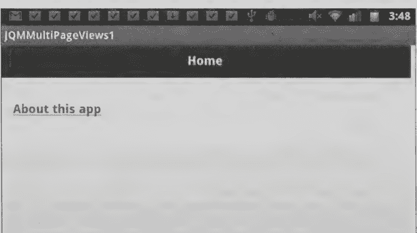

图8.4 在Sprint Nexus S 4G（运行Android ICS）上的多页面应用。

当你点击网页上的链接时，应用程序导航到第二个屏幕，其代码定义也包含在清单8.4中。

图8.5展示了在Sprint Nexus S 4G（运行Android ICS）上横屏截图渲染清单8.4中HTML网页的结果。

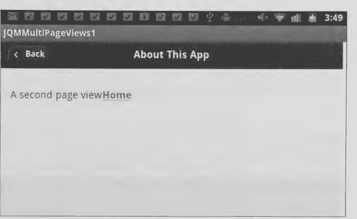

图8.5 在Sprint Nexus S 4G（运行Android ICS）上的多页面应用。

## 在页面视图中定位页眉和页脚

jQuery Mobile可以通过三种方式动态定位页眉和页脚工具栏：

**标准方式**：工具栏根据文档流呈现，随着用户滚动数据而进入和退出视口。这是默认方式。

**固定方式**：页眉和页脚将出现在视口的顶部和底部，并随着用户滚动而保持在那里。点击屏幕将使它们返回到文档流中的常规位置。

**全屏方式**：页眉和页脚将出现在视口中，并随着用户滚动而保持显示，无论用户在内容中的哪个位置。点击屏幕将隐藏它们。本质上，页眉和页脚从文档流中移除，并始终动态定位在视口的顶部和底部。

在 `<header>` 或 `<footer>` 标签中包含 `data-position="fixed"` 属性可以创建固定的页眉和页脚，如清单8.5所示，该清单展示了JQMobile.html的内容。

## 清单 8.5 JQFixed1.html

```
<!DOCTYPE html>

<html lang="en">

<head>

  <meta charset="utf-8"/>

  <title>Fixed Header and Footer in jQueryMobile</title>

  <link rel="stylesheet"

    href="http://code.jquery.com/mobile/1.1.0/jquery.mobile-1.1.0.min.css"/>

  <script

    src="http://code.jquery.com/jquery-1.7.1.min.js">

  </script>

  <script src="http://code.jquery.com/mobile/1.1.0/jquery.mobile-1.1.0.min.js">

  </script>

</head>

<body>

  <div id="page1" data-role="page">

    <header data-role="header" data-position="fixed">

      <h1>jQuery Mobile</h1>

    </header>

    <div class="content" data-role="content">

      <h3>Content area.</h3>

    </div>

    <footer data-role="footer" data-position="fixed">

      <h3>Fixed Footer</h3>

    </footer>

  </div>

</body>

</html>
```

清单8.5包含HTML标记和一个页面视图，该视图也为页眉和页脚元素指定了属性 `data-position="fixed"`。你还可以通过在包含 `data-role="page"` 属性的元素中添加属性 `data-fullscreen="true"`，并在页眉和页脚元素中添加属性 `data-position="fixed"` 来创建全屏页眉或页脚，如下所示：

## 在 jQuery Mobile 中使用按钮

jQuery Mobile 提供了一套按钮标记选项，允许你将链接样式化为按钮，并且内置了自动处理各类 HTML `<input>` 元素的功能，就像处理按钮一样。此外，jQuery Mobile 还支持内联按钮、按钮组（包括垂直和水平方向），以及多种按钮主题效果。

jQuery Mobile 通过向 HTML `<input>` 按钮、`<button>` 标签和锚点链接应用 `data-role="button"` 来创建样式化的按钮。按钮的宽度默认与其容器元素相同；但是，如果你指定属性 `data-inline="true"`，则按钮将仅根据其内容宽度进行渲染。

在 jQuery Mobile 的一些早期版本（1.7 之前）中，你可以通过将自定义标记放在位于 HTML5 `<header>` 元素内部的 HTML `<div>` 元素中来阻止 jQuery Mobile 将其样式应用于按钮。但是，此功能在 1.7 版本（及更高版本）中已不再可用，因此请注意这一点，以防你在使用旧版本 jQuery Mobile 的网页中遇到此功能。

你还可以通过使用属性 `data-direction="reverse"` 代替 `data-rel="back"` 来创建反向过渡，而无需在历史记录中返回，如下所示：

```
<div data-role="header">

    <a href="index.html" data-direction="reverse">Reverse Transition</a>

    <h1>Left and Right Buttons </h1>

    <!-- This appears on the right -->

    <a href="info.html" data-icon="plus">Add</a>

</div>
```

按钮可以移动到左侧或右侧，如下所示：

```
<div data-role="header">

<a href="index.html" class="ui-btn-right">Right</a>

 <h1>Page title</h1>

<a href="info.html" class="ui-btn-left">Left</a>

</div>
```

## 导航按钮作为锚点链接

在 jQuery Mobile 中，推荐的做法是将导航按钮定义为锚点链接，并将表单提交按�定义为按钮元素。

包含属性 `data-role="button"` 的锚点链接将被样式化为按钮，如下所示：

```
<a href="external.html" data-role="button">Link-based button</a>
```

类型为 submit、reset、button 或 image 的 jQuery Mobile 按钮元素或输入元素不需要属性 `data-role="button"`，因为 jQuery Mobile 会自动将这些元素视为基于链接的按钮。

尽管原始的基于表单的按钮不会显示，但它包含在 HTML 标记中，当点击事件发生在链接按钮上时，相应的点击事件也会发生在原始的表单按钮上。

## 按钮组与列网格

jQuery Mobile 允许你将一组按钮（或复选框或单选按钮）渲染为一个块，方法是定义一个包含指定属性 `data-role="controlgroup"` 的容器 HTML `<div>` 元素，然后包含一个或多个按钮元素。包含的按钮的默认渲染方式是水平排列（一行），你可以通过指定属性 `data-type="vertical"` 将按钮渲染为垂直组。

jQuery Mobile 会渲染按钮，移除按钮之间的边距（和阴影），并对第一个和最后一个按钮进行“圆角”处理，以创建群组效果。以下代码块展示了如何指定一个水平按钮组：

```
<div data-role="controlgroup">

  <a href="index1.html" data-role="button">One</a>

  <a href="index2.html" data-role="button">Two</a>

  <a href="index3.html" data-role="button">Three</a>

</div>
```

有一点需要注意：如果按钮数量超过屏幕宽度，按钮会“换行”到额外的行。清单 8.5 展示了如何渲染一个水平按钮组和一个垂直按钮组。

jQuery Mobile 框架通过一种称为 `ui-grid` 的块级样式类约定，使你能够渲染基于 CSS 的列。你可以使用类值 `ui-grid-a`、`ui-grid-b`、`ui-grid-c` 和 `ui-grid-d` 分别渲染两列、三列、四列和五列布局。以下代码块说明了如何渲染一个两列布局：

```
<div class="ui-grid-a">

  <div class="ui-block-a">Block 1 and text inside will wrap</div>

  <div class="ui-block-b">Block 2 and text inside will wrap</div>

</div>
```

注意以下代码块中显示三列布局的区别：

**354** • 适用于移动和桌面设备的 jQuery、CSS3 和 HTML5

```
<div class="ui-grid-b">

  <div class="ui-block-a">Block 1 and text inside will wrap</div>

  <div class="ui-block-b">Block 2 and text inside will wrap</div>

  <div class="ui-block-c">Block 3 and text inside will wrap</div>

</div>
```

你可以在此处找到更多详细信息和代码示例：

http://jquerymobile.com/demos/1.0b1/#/demos/1.0/docs/content/content-grids.html

## 使用主题渲染按钮

jQuery Mobile 有一个广泂的主题系统，标签从“a”到“e”，用于控制按钮的样式方式。当一个链接被添加到容器时，jQuery Mobile 会为其分配一个与父级主题匹配的“主题色板”字母。例如，一个放置在主题为“a”（在默认主题中为黑色）的内容容器内的按钮，会自动被分配按钮主题“a”（在默认主题中为炭灰色）。

按钮主题的一个示例如下所示：

```
<div data-role="footer" class="ui-bar">

  <a href="left.html" data-icon="arrow-l"

     data-role="button" data-theme="a">Left</a>

</div>
```

清单 8.6 显示了 *JQMButtons1.html* 的内容，它演示了如何水平和垂直渲染按钮、如何应用不同的主题，以及如何指定自定义 CSS 选择器。

### 清单 8.6 *JQMButtons1.html*

```
<!DOCTYPE html>

<html lang="en">

  <head>

    <meta charset="utf-8"/>

    <title>Multiple Buttons and Themes in jQuery Mobile</title>

    <link rel="stylesheet" href="CSS3Background1.css"/>

    <link rel="stylesheet"

          href="http://code.jquery.com/mobile/1.1.0/jquery.mobile-1.1.0.min.css"/>

    <script src="http://code.jquery.com/jquery-1.7.1.min.js"></script>

    <script src="http://code.jquery.com/mobile/1.1.0/jquery.mobile-1.1.0.min.js"></script>

  </script>

</head>

<body>

  <div id="pagel" data-role="page">

    <div data-role="header">

      <!-- This button appears on the left -->

      <a href="abc.html" data-icon="arrow-l"

         data theme="b">Index</a>

      <h1>Rendering Buttons in jQuery Mobile</h1>

      <!-- This button appears on the right -->

      <a href="def.html" data-icon="plus" data-theme="e">Add</a>

    </div>

    <div class="content" data-role="content">

      <div data-role="controlgroup" data-type="horizontal">

        <a href="index1.html" data-role="button">One</a>

        <a href="index2.html" data-role="button">Two</a>

        <a href="index3.html" data-role="button">Three</a>

        <a href="index4.html" data-role="button">Four</a>

        <a href="index5.html" data-role="button">Five</a>

      </div>

      <a href="index6.html" class="shadow"

         data-role="button">Vertical1</a>

      <a href="index7.html" class="shadow"

         data-role="button">Vertical2</a>

      <a href="index8.html" class="shadow"

         data-role="button">Vertical3</a>

      <div data-role="controlgroup">

        <a href="index6.html" data-role="button">Vertical1</a>

        <a href="index7.html" data-role="button">Vertical2</a>

        <a href="index8.html" data-role="button">Vertical3</a>

      </div>

      <div>

        <a href="index9.html" data-role="button" id="cancel"

           data-inline="true">Cancel</a>

        <a href="index10.html" data-role="button" id="submit"

           data-inline="true" data-theme="b">Save</a>

      </div>

    </div>

    <!-- Display four directional array keys -->

```

## JQUERY MOBILE 图标

jQuery Mobile 提供了一组默认的按钮图标，这些图标在移动应用中频繁使用，同时也支持自定义图标。正如你在上一节的清单 8.5 中所看到的，你可以通过在锚点元素上添加 `data-icon` 属性来为按钮添加内置图标，该属性指定了具体的图标，示例如下：

```
<a href="index.html" data-role="button"

data-icon="delete">Delete</a>
```

你也在清单 8.5 中看到，jQuery Mobile 支持左箭头、右箭头、上箭头和下箭头的图标集，它们通过相应的名称来标识（例如，`data-icon="arrow-d"` 用于下箭头）。其他支持的图标集包括：alert、back、check、delete、down、forward、gear、grid、home、info、minus、plus、refresh、search 和 star，它们对应的 `data-icon` 值与图标名称相同（例如，`data-icon="alert"` 用于警报图标）。

内置图标在按钮中的默认位置是在按钮文本的左侧；此外，jQuery Mobile 支持以下选项：左（`iconpos="left"`）、**右**（`iconpos="right"`）、**上**（`iconpos="top"`）、**下**（`iconpos="bottom"`）和**无文本**（`iconpos="notext"`）。

以下代码片段展示了如何将数据图标放在文本的右侧：

```
<a href="abc.html" data-role="button" data-icon="home"

data-iconpos="right">Home</a>
```

如果你想使用自定图标，请指定一个唯一的 `data-icon` 值，jQuery Mobile 将生成一个类名，该类名是 `ui-con` 与你指定的唯一名称的串联。例如，如果你指定 `abc` 作为唯一名称，那么 jQuery Mobile 将生成类 `ui-icon-abc`。然后，你可以编写一个针对 `ui-icon-abc` 类的 CSS 规则来指定图标背景源。

jQuery Mobile 包含一个单一的白色图标精灵图以最小化下载大小，图标后面还有一个半透明的黑色圆圈，以确保它与任何背景颜色形成良好对比。

## JQUERY MOBILE 中的表单和表单元素

jQuery Mobile 中的表单遵循与普通 HTML 相同的准则，表单提交通过 POST 或 GET 方式进行。jQuery Mobile 渲染元素以适应移动设备屏幕的宽度。如果屏幕宽度超过 480 像素，则标签和关联元素会并排显示；否则，元素会渲染在其关联标签的下方。请注意，你可以通过指定 `data-role="none"` 来阻止 jQuery Mobile 增强元素，如下所示：

```
<input id="myinput1" data-role="none" value=""/>
```

本节中的示例包含一个 `<form>` 元素，其中有以下元素：复选框、下拉列表、单选按钮、滑块、文本输入框和文本区域。

jQuery Mobile 会自动将复选框和单选按钮增强为用户界面中类似按钮的元素。你可以通过在容器元素中添加 `data-role="controlgroup"` 属性将它们分组为一个控件组。控件组是垂直堆另的按钮，它们会拉伸到其容器元素的宽度，但你也可以通过 `data-type="horizontal"` 创建水平控件组。

清单 8.8 展示了 JQMForm1.html 的内容，说明了如何渲染各种类型的 HTML 小部件。本节中的代码示例旨在向你展示如何创建一些有趣的视觉效果，但请务必阅读清单 8.9 之前的注意事项。

清单 8.8 JQMForm1.html

```
<!DOCTYPE html>

<html lang="en">

<head>

<meta charset=utf-8"/>

<title>jQueryMobile Form Example</title>

<link rel="stylesheet" href="CSS3Background2.css"/>

<link rel="stylesheet"

href="http://code.jquery.com/mobile/1.1.0/jquery.mobile-

1.1.0.min.css"/>

<script

src="http://code.jquery.com/jquery-1.7.1.min.js">

</script>

<script src="http://code.jquery.com/mobile/1.1.0

/jquery.mobile-1.1.0.min.js">

```

<div data-role="footer" class="ui-bar">
<a href="left.html" data-icon="arrow-l"
data-role="button" data-theme="a">Left</a>
<a href="up.html" data-icon="arrow-u"
data-role="button" data-theme="b">Up</a>
<a href="down.html" data-icon="arrow-d"
data-role="button" data-theme="c">Down</a>
<a href="right.html" data-icon="arrow-r"
data-role="button" data-theme="e">Right</a>
</div>
</div>
</body>
</html>
```

清单 8.6 包含 HTML 标记和对 jQuery 文件的引用，随后是一个单页视图，渲染了各种按钮（它们具有 `data-role="button"` 属性），其中一些处于水平组中，另一些处于垂直组中。

请注意，垂直按钮被渲染为带有微红色背景阴影，从而创造出更丰富的视觉效果，这仅仅是通过为类属性指定 `shadow` 值来实现的，如本代码块中粗体所示：

```
<a href="index6.html" class="shadow" data-role="button">Vertical1</a>
<a href="index7.html" class="shadow" data-role="button">Vertical2</a>
<a href="index8.html" class="shadow" data-role="button">Vertical3</a>
```

此外，“cancel”和“submit”按钮指定了 `class="shadow"`，它们被渲染出一种迷幻效果，这在大多数情况下你显然不想渲染。尽管如此，你还是可以看到使用基于自定义 CSS3 的视觉效果来设置按钮样式是多么容易，而 `shadow` 选择器的定义在清单 8.7 中显示。

清单 8.5 底部一排四个 HTML `<a>` 元素渲染了四个方向箭头，因为它们分别设置了 `data-icon` 属性为 `arrow-l`、`arrow-u`、`arrow-d` 和 `arrow-r`。此外，这四个 HTML `<a>` 元素为 `data-theme` 属性指定了不同的值，它们根据这些预定义的 jQuery Mobile 主题的视觉显示进行渲染。

请注意，清单 8.6 中的 HTML `<a>` 元素引用了未为此移动应用定义的 HTML 网页，因此当用户单击这些链接时，他们将看到错误消息。

### 清单 8.7 CSS3Background1.css

```
#cancel, #submit, .shadow {
    background-color: white;
    background-image:
        -webkit-radial-gradient(red 4px, transparent 18px),
        -webkit-repeating-radial-gradient(red 2px, green 4px,
                yellow 8px, blue 12px,
                transparent 28px,
                green 20px, red 24px,
                transparent 28px,
                transparent 32px),
        -webkit-repeating-radial-gradient(red 2px, green 4px,
                yellow 8px, blue 12px,
                transparent 28px,
                green 20px, red 24px,
                transparent 28px,
                transparent 32px);
    background-size: 50px 60px, 70px 80px;
    background-position: 0 0;
    -webkit-box-shadow: 30px 30px 30px #400;
}
```

清单 8.7 包含你在第四章中已经熟悉的定义，如果你需要复习，可以参考该章的相关章节。

图 8.7 显示了在 Sprint Nexus S 4G（搭载 Android ICS）上渲染清单 8.6 中 HTML 网页的结果。

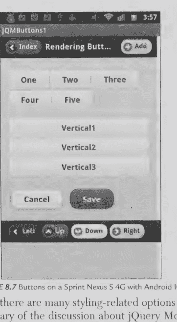

**图 8.7** 在 Sprint Nexus S 4G（搭载 Android ICS）上的按钮。

如你所见，jQuery Mobile 中有许多与样式相关的选项可用，因此对 jQuery Mobile 按钮的讨论进行总结可能会有所帮助：

-   带有 `data-role="button"` 属性的锚点链接被渲染为按钮。

-   任何类型为 button、submit、reset 或 image 的 input 元素都会被分配一个 `ui-btn-hidden` 类，并显示一个基于链接的按钮。

-   添加 `data-icon` 属性以创建带图标的按钮。

-   添加 `data-iconpos` 属性以更改图标的位置。

-   指定 `data-inline="true"` 以仅将按钮渲染为其文本的宽度。

-   `data-role="controlgroup"` (`data-type="horizontal"`) 在 `<div>` 元素中垂直（水平）分组按钮。

-   `data-theme="e"` 属性是五个 jQuery 主题（“a”到“e”）中的第五个。

# JQUERY MOBILE 中的列表视图

jQuery Mobile 支持列表视图（这在移动应用中非常常见），以及几种变体，包括列表视按钮、嵌套列表视图和列表视图拆分按钮。

## 带按钮的简单列表视图

jQuery Mobile 可以通过为列表应用属性 `data-role="listview"` 来增强有序列表和无序列表。嵌入在锚点标签内的列表视图元素可以响应用户手势，如清单 8.10 所示，该清单展示了 jQuery Mobile 网页 JQMSimpleListView1.html 的内容。

```
清单 8.10 JQMSimpleListView1.html

<!DOCTYPE html>
<html lang="en">
<head>
  <meta charset=utf-8"/>
  <title>jQuery Mobile 中的简单列表视图</title>

  <link rel="stylesheet"
  href="http://code.jquery.com/mobile/1.1.0/jquery.mobile-1.1.0.min.css"/>

  <script
    src="http://code.jquery.com/jquery-1.7.1.min.js">
  </script>
  <script src="http://code.jquery.com/mobile/1.1.0/jquery.mobile-1.1.0.min.js">
  </script>
</head>

<body>
  <div data-role="page">
    <div data-role="header"> <h2>这是页头</h2> </div>
    <div data-role="content">
      <h3>简单无序列表示例</h3>
      <ul data-role="listview">
        <li><a href="#">无序项 1</a></li>
        <li><a href="#">无序项 2</a></li>
        <li><a href="#">无序项 3</a></li>
      </ul>
      <h3>简单有序列表示例</h3>
      <ol data-role="listview">
        <li><a href="#">有序项 1</a></li>
        <li><a href="#">有序项 2</a></li>
        <li><a href="#">有序项 3</a></li>
      </ol>
    </div
    <div data-role="footer"> <h2>这是页脚</h2> </div>
  </div>
</body>
</html>
```

每当用户点击清单 8.10 中的任何列表项时，你都可以检测到该事件并执行你已绑定到该事件的自定�代码（如果有的话）。在此示例中，`href` 属性的值为 #，因此当用户点击或轻敲列表项时，页面会重新加载。

图 8.9 展示了在配备 Android ICS 的华硕 Prime 平板电脑上以横屏模式渲染清单 8.10 中 HTML 网页的结果。


图 8.9 在配备 Android ICS 的华硕 Prime 平板电脑上显示的列表视图。

## 嵌套列表视图

jQuery Mobile 可以使用嵌套列表创建交互式视图，用户可以通过轻敲列表项来“向下钻取”。第一个视图显示顶层列表中的项目，轻敲其中一个项目将显示该项目的子列表（依此类推）。此外，jQuery Mobile 自动提供一个返回按钮，并处理页面之间的 URL 映射和过渡效果。

清单 8.11 展示了 JQMNestedListViews1.html 的内容，这是一个 jQuery Mobile 网页，演示了如何渲染嵌套列表以及当用户点击列表项时如何在页面之间导航。

```
清单 8.11 JQMNestedListViews1.html

<!DOCTYPE html>
<html lang="en">
<head>
<meta charset="utf-8"/>
<title>jQuery Mobile 嵌套列表视图</title>
<link rel="stylesheet"
href="http://code.jquery.com/mobile/1.1.0/jquery.mobile-1.1.0.min.css"/>
<script
src="http://code.jquery.com/jquery-1.7.1.min.js">
</script>
<script src="http://code.jquery.com/mobile/1.1.0/jquery.mobile-1.1.0.min.js">
```

```
</script>
</head>
<body>
  <div data-role="content">
    <form action="#" method="get">
      <div data-role="fieldcontain">
        <label for="name">文本输入：</label>
        <input id="textinput" type="text"
               name="name" id="name" value="" />
      </div>

      <div data-role="fieldcontain">
        <label for="textarea">文本区域：</label>
        <textarea id="textarea" cols="40" rows="3"
                  name="textarea" id="textarea"></textarea>
      </div>

      <div data-role="fieldcontain">
        <label for="searchinput">搜索输入：</label>
        <input id="searchinput" type="search"
               name="password" value="" />
      </div>

      <div data-role="fieldcontain">
        <label for="flipl">切换开关：</label>
        <select name="flipl" id="flipl" data-role="slider">
          <option value="off">关</option>
          <option value="on">开</option>
        </select>
      </div>

      <div data-role="fieldcontain">
        <label for="slider">滑块：</label>
        <input type="range" name="slider" id="slider" value="50"
               min="0" max="100" data-highlight="true" />
      </div>

      <div data-role="fieldcontain">
        <fieldset id="control1" data-role="controlgroup"
                  data-type="horizontal">
          <legend>饮料类型：</legend>
          <label for="checkbox-1">啤酒</label>
          <input type="checkbox" name="checkbox-1"
                 id="checkbox-1" class="custom"/>

          <label for="checkbox-2"><em>葡萄酒</em></label>
          <input type="checkbox" name="checkbox-2"
                 id="checkbox-2" class="custom"/>

          <label for="checkbox-3">香槟</label>
          <input type="checkbox" name="checkbox-3"
                 id="checkbox-3" class="custom"/>
        </fieldset>
      </div>

      <!-- 单选按钮 -->
      <div data-role="fieldcontain">
          <fieldset data-role="controlgroup" data-
                    type="horizontal">
              <legend>性格倾向：</legend>
              <input type="radio" name="radio-choice-b"
                     id="radio-choice-c" value="on"
                     checked="checked"/>
              <label for="radio-choice-c">外向</label>
              <input type="radio" name="radio-choice-b"
                     id="radio-choice-d" value="off"/>
              <label for="radio-choice-d">忧郁</label>
              <input type="radio" name="radio-choice-b"
                     id="radio-choice-e" value="other"/>
              <label for="radio-choice-e">内省</label>
          </fieldset>
      </div>

      <!-- 下拉列表 -->
      <div data-role="fieldcontain">
          <label for="select-choice" class="select">你的类型：</label
          <select name="select-choice" id="select-choice">
              <option value="MP">早起型</option>
              <option value="NP">夜猫子型</option>
              <option value="NP">都不是</option>
          </select>
      </div>

      <div class="ui-body ui-body-b">
          <fieldset class="ui-grid-a">
              <div class="ui-block-a"><button type="submit"
                      data-theme="d">取消</button></div>
              <div class="ui-block-b"><button type="submit"
                      data-theme="a">提交</button></div>
          </fieldset>
      </div>
    </form>
  </div>
</body>
</html>
```

清单 8.8 包含一个 HTML `<div>` 元素，其中包含各种小部件，如文本输入字段、文本区域、滑块、多个复选框、单选按钮、下拉列表和两个按钮。文本相关字段和滑块相关小部件通过 CSS 样式表 CSS3Background2.css 中的选择器应用了样式，其内容显示在清单 8.8 中。

> **注意** 文本输入字段的圆角和阴影可能会让用户误以为它们是按钮而不是输入字段，因此在创建此类视觉效果时请牢记这一点。

```
清单 8.9  CSS3Background2.css

#textinput, #textarea {
    background-image: -webkit-radial-gradient(red 8px);
    -webkit-box-shadow: 10px 10px 20px #400;
}

#flip1, #slider {
    background-image: -webkit-radial-gradient(red 8px);
    -webkit-box-shadow: 10px 10px 20px #004;
}
```

清单 8.8 中的第一个选择器匹配清单 8.7 中的文本输入字段，第二个选择器匹配滑块和“翻转”元素。第一个选择器渲染带有红色调的阴影效果，而第二个选择器渲染带有蓝色调的阴影。你会注意到的一件事是，你可以为输入字段和按钮应用自定义样式，但其他类型的小部件不一定“拾取”你的自定�效果，因此你需要针对你的 HTML 网页中包含的其他类型的 jQuery 小部件（如下拉列表和组合框）来测试你的选择器。jQuery Mobile 也处理输入字段和文本区域；输入字段可以应用 `type` 属性并使用 HTML5 中定义的几个新值，通过显示正确的键盘类型来帮助用户。例如，具有 `type="number"` 的输入在大多数移动设备上将显示数字键盘，以此类推。文本区域将随着用户输入内容而增加高度，从而避免创建滚动条。jQuery Mobile 使用文本输入插件来处理文本区域和输入字段，如下所示：

```
$("#page").live('pageinit', (function(event){
  // 禁用一个输入框
  $("#myinput").textinput('disable');
  // 启用一个输入框
  $("#myotherinput").textinput("enable");
}))
```

图 8.8 展示了在 Macbook 上的 Chrome 浏览器中截取的清单 8.8 中 HTML 网页的渲染结果。


图 8.8 Macbook 上的 Chrome 浏览器中的复选框和单选按钮。

## 导航栏

移动应用中的导航栏通常由一组按钮组成，用于让用户在页面视图之间进行导航。jQuery Mobile 允许你在页面视图的页眉、页脚或内容区域中包含导航栏（并为导航栏提供适当的格式）。要指定一个导航栏，请将 `data-role="navigation"` 应用于一个块级元素，例如 HTML5 的 `<nav>` 元素。包含在指定导航元素内的锚点标签将被格式化为按钮组，jQuery Mobile 将自动处理按钮的激活和非激活状态的切换，如清单 8.12 所示。

**清单 8.12** JQMNavigationBar1.html

```
<!DOCTYPE html>
<html lang="en">
  <head>
    <meta charset=utf-8"/>
    <title>jQuery Mobile Navigation Bar</title>

    <link rel="stylesheet" href="CSS3Background3.css"/>

    <link rel="stylesheet"
          href="http://code.jquery.com/mobile/1.1.0/jquery.mobile-1.1.0.min.css"/>
    <script
          src="http://code.jquery.com/jquery-1.7.1.min.js">
    </script>
    <script src="http://code.jquery.com/mobile/1.1.0/jquery.mobile-1.1.0.min.js">
    </script>
  </head>

  <body>
    <div data-role="page">
      <div data-role="header">
        <div data-role="navbar">
          <a href="#" class="ui-btn-active">HBar1</a>
          <a href="#">HBar2</a>
          <a href="#">HBar3</a>
          <a href="#">HBar4</a>
          <a href="#">HBar5</a>
          <a href="#">HBar6</a>
        </div>
      </div>
      <div data-role="content">
        <div data-role="navbar">
          <ul>
            <li><a href="#" class="ui-btn-active">Content1</a></li>
            <li><a href="#">Content2</a></li>
            <li><a href="#">Content3</a></li
            <li><a href="#">Content4</a></li>
            <li><a href="#">Content5</a></li>
            <li><a href="#">Content6</a></li>
          </ul>
        </div>

        <div data-role="navbar">
          <a href="#" class="ui-btn-active">CBar11</a>
          <a href="#">CBar22</a>
          <a href="#">CBar33</a>
          <a href="#">CBar44</a>
          <a href="#">CBar55</a>
        </div>
      </div>

      <div data-role="footer">
        <div data-role="navbar">
          <a href="#" class="ui-btn-active">FBar1</a>
          <a href="#">FBar2</a>
          <a href="#">FBar3</a>
          <a href="#">FBar4</a>
          <a href="#">FBar5</a>
          <a href="#">FBar6</a>
        </div>
      </div>
    </div>
  </body>
</html>
```

清单 8.12 包含单个页面视图的 HTML 标记和 jQuery 代码，以及四个包含 `data-role="navbar"` 属性（用于指定导航栏）的 HTML `<div>` 元素。

第一个导航栏显示在带有 `data-role="header"` 属性的 HTML `<div>` 元素中；第二个和第三个显示在带有 `data-role="content"` 属性的 HTML `<div>` 元素中；第四个显示在带有 `data-role="footer"` 属性的 HTML `<div>` 元素中。

自定义 CSS 样式表 `CSS3Background3.css`（如清单 8.13 所示）包含一个选择器，它为清单 8.12 中的 HTML `<a>` 元素应用了阴影效果，这使得一些内容比没有 CSS 选择器的效果更生动突出（带有一些 3D 效果）。请注意，jQuery Mobile 在格式化的导航栏中最多适合放置五个项目；如果指定了额外的元素，jQuery Mobile 会将它们堆叠成两列。

**清单 8.13** CSS3Background3.css

```
a {
    background-image:
        -webkit-radial-gradient(red 12px);
    -webkit-box-shadow: 20px 20px 40px #880;
}
```

清单 8.13 包含一个选择器，它为 HTML `<a>` 元素应用了带黄色色调的阴影效果，如图 8.13 所示，该图在搭载 Android ICS 的 Sprint Nexus S 4G 上渲染了清单 8.12 中的 HTML 网页。


*图 8.13* 在搭载 Android ICS 的 Sprint Nexus S 4G 上的导航栏。

## JQUERY MOBILE 中的选择菜单

jQuery Mobile 允许你显示和隐藏菜单选项列表，你还可以在菜单列表显示或隐藏时使用过渡来创建动画效果。清单 8.14 展示了 JQMMenu1.html 的内容，说明了如何在 HTML5 网页中创建滑动菜单。

**清单 8.14** JQMMenu1.html

```
<!DOCTYPE html>
<html lang="en">
  <head>
    <meta charset="utf-8"/>
    <title>Sliding Menus in jQuery Mobile</title>

    <link rel="stylesheet" href="CSS3Background4.css"/>

    <link rel="stylesheet"
          href="http://code.jquery.com/mobile/1.1.0/jquery.mobile-1.1.0.min.css"/>
    <script src="http://code.jquery.com/jquery-1.7.1.min.js"></script>
    <script src="http://code.jquery.com/mobile/1.1.0/jquery.mobile-1.1.0.min.js"></script>
  </head>

  <body>
    <div id="page1" data-role="page">
      <header data-role="header">
        <h1>JQuery Mobile Sliding Menu Example (header)</h1>
      </header>

      <p class="show-menu">Show/Hide Menu</p>
      <div data-role="content" class="sliding-menu slide out">
        <label for="select-choice-1"
               class="select">Choose a Menu Item:</label>
        <select name="select-choice-1" id="select-choice-1">
          <option value="item1">First menu item</option>
          <option value="item2">Second menu item</option>
          <option value="item3">Third menu item</option>
        </select>
      </div>

      <footer data-role="footer">
```

## jQuery Mobile 滑动菜单示例（页脚）

```
<footer>
</div>

<script>
    $("#page1").live('pageinit', (function(event){
        $(".show-menu").click(function() {
            $(".sliding-menu").toggleClass("reverse out in");
        })
    }))
</script>
</body>
</html>
```

清单 8.14 包含 HTML 标记、一个对 CSS3 样式表（见清单 8.15）的引用，以及用于单页面视图的 jQuery Mobile 代码。菜单项列表包含在一个 HTML `<div>` 元素中，该元素的 class 属性被赋予了多个值，如下所示：

```
<div class="sliding-menu slide out">
```

当网页首次渲染时，菜单项列表是隐藏的。当用户点击包含文本字符串 "Show/Hide Menu" 的 HTML `<p>` 元素时，将执行以下代码，该代码使用 jQuery 的 `toggleClass()` 方法和滑动效果来显示菜单项：

```
$(".show-menu").click(function() {
    $(".sliding-menu").toggleClass("reverse out in");
})
```

### 清单 8.15 CSS3Background4.css

```
div {
    background-image:
        -webkit-radial-gradient(red 12px);
    -webkit-box-shadow:  20px 20px 40px #400;
}
```

清单 8.14 包含一个选择器，用于为 HTML `<div>` 元素设置带红色阴影的效果。图 8.13 显示了在运行 Android ICS 的 Sprint Nexus S 4G 上以横向模式渲染清单 8.14 中 HTML 网页的结果。


**图 8.14** 在运行 Android ICS 的 Sprint Nexus S 4G 上的菜单栏。

## jQuery Mobile 与 Ajax

jQuery Mobile 使用 Ajax 进行表单提交，并会尝试将服务器响应集成到应用程序的 DOM 中，以按预期提供过渡效果。如果您希望阻止 jQuery Mobile 使用 Ajax 处理表单，请在表单标签上应用属性 `data-ajax="false"`。

清单 8.16 展示了 JQMAjax1.html 的内容，该示例说明了如何在 jQuery Mobile 应用程序中处理 Ajax 调用。

### 清单 8.16 JQMAjax1.html

```
<!DOCTYPE html>
<html lang="en">
<head>
    <meta charset="utf-8"/>
    <title>jQuery Mobile and AJAX</title>
    <link rel="stylesheet" href="http://code.jquery.com/mobile/1.1.0/jquery.mobile-1.1.0.min.css"/>
    <script src="http://code.jquery.com/jquery-1.7.1.min.js"></script>
    <script src="http://code.jquery.com/mobile/1.1.0/jquery.mobile-1.1.0.min.js"></script>
</head>

<body>
  <script>
    var xmlData = "", count = 0;

    $("#page1").live('pageinit', (function(event){
      $.ajax({
        url: 'http://localhost:9000/sample.xml',
        dataType: 'xml',
        success: function(data) {
          $(data)
            .find('svg')
            .children()
            .each(function() {
              var node = $(this);
              var x     = node.attr('x');
              var y     = node.attr('y');
              var width  = node.attr('width');
              var height = node.attr('height');
              var stroke = node.attr('stroke');
              var fill    = node.attr('fill');

              // other processing here...
              ++count;

              console.log("element: "+node);
          });
          console.log("element count: "+count);
      },
      error: function() {
          alert('no data found');
      }
    })
    );
  </script>

  <div id="page1" data-role="page">
    <div data-role="header">Header</div>
    <div data-role="content">
      <p>Hello World from jQuery Mobile</p>
    </div>
    <div data-role="footer">Footer</div>
  </div>
</body>
</html>
```

清单 8.16 包含 HTML 标记和一个在网页加载到浏览器后执行的 jQuery Mobile Ajax 调用。之后，该代码会处理 XML 文档 sample.xml（在清单 8.17 中显示）中 `<svg>` 元素的所有子元素，如下所示：

```
var node = $(this);
var x     = node.attr('x');
var y     = node.attr('y');
var width = node.attr('width');
var height = node.attr('height');
var stroke = node.attr('stroke');
var fill   = node.attr('fill');
```

为了演示，这段代码假设清单 8.17 中的 XML 文档 sample.xml 包含具有上述代码块中指定属性的 XML 元素。

### 清单 8.17 sample.xml

```
<?xml version='1.0' encoding='iso-8859-1'?>
<svg xmlns="http://www.w3.org/2000/svg"
     xmlns:xlink="http://www.w3.org/1999/xlink"
     width="100%" height="100%">
  <rect x="50" y="10" width="100" height="200"
        stroke="blue" fill="red"/>
  <rect x="200" y="10" width="100" height="200"
        stroke="blue" fill="green"/>
  <rect x="350" y="10" width="100" height="200"
        stroke="blue" fill="blue"/>
</svg>
```

将清单 8.16 和 8.17 中的文件放在同一个目录下，并启动一个在端口 9000 上处理请求的 Web 服务器。在笔记本电脑或台式机的 Chrome 浏览器中打开清单 8.16 中的 HTML 网页，打开 Chrome Inspector，并检查 Chrome 控制台的内容。您将看到类似于图 8.15 的内容，该图显示了 Macbook 上 Chrome 浏览器中的 Chrome Inspector 内容。


**图 8.15** 在 Macbook 上的 Chrome 浏览器中进行的 jQuery Mobile Ajax 调用。

## jQuery Mobile 与地理位置

在第 5 章中，您学习了如何获取用户的地理位置信息。在本节中，您将看到如何使用 jQuery Mobile 来获取地理位置信息。

清单 8.18 展示了 `JQMGeoLocation1.html` 的内容，该示例说明了如何在 HTML5 网页中获取地理位置信息。

### 清单 8.18 JQMGeoLocation1.html

```
<!DOCTYPE html>
<html lang="en">
<head>
    <meta charset="utf-8">
    <title>JQueryMobile Geolocation</title>

    <link rel="stylesheet"
        href="http://code.jquery.com/mobile/1.1.0/jquery.mobile-1.1.0.min.css"/>
    <script
        src="http://code.jquery.com/jquery-1.7.1.min.js">
    </script>
    <script src="http://code.jquery.com/mobile/1.1.0/jquery.mobile-1.1.0.min.js">
    </script>

<!-- google maps API -->
<script src="http://maps.google.com/maps/api/js?sensor=false"></script>

<style>
#theMap, #theCoords {
    font-size: 16px;
    height: 200px;
    width: 400px;
}
</style>

<script>
function findUserLocation() {
    // specify the 'success' and 'fail' JavaScript functions
    navigator.geolocation.getCurrentPosition(successCallback,
                                            errorCallback);
}

function successCallback(position) {
    var latitude  = position.coords.latitude;
    var longitude = position.coords.longitude;
    var latlong   = new google.maps.LatLng(latitude, longitude);

    var myOptions = {
        zoom: 14,
        center: latlong,
        mapTypeId: google.maps.MapTypeId.ROADMAP
    };

    // use Google Maps to display the current location
    var map = new google.maps.Map(document.getElementById("theMap"),
                                  myOptions);
    map.setCenter(latlong);

    /*
    var marker = new google.maps.Marker({
        position: initialLocation,
        map: map,
        title: "I Am Here!"
    });
    */

    // display position details in the console
    positionDetails(position);
}

function errorCallback(error) {
  if(error.code = error.PERMISSION_DENIED) {
    console.log("Error: you must enable geolocation access");
  } else if(error.code = error.PERMISSION_UNAVAILABLE) {
    console.log("Error: geolocation unavailable");
  } else if(error.code = error.TIMEOUT) {
    console.log("Error: timeout occurred");
  }

  //console.log(error);
}

function positionDetails(pos) {
  var positionStr =
    "Latitude:"+ pos.coords.latitude +"<br>"+
    "Longitude:"+ pos.coords.longitude +"<br>"+
    "Accuracy:"+ pos.coords.accuracy +"<br>"+
    "Altitude:"+ pos.coords.altitude +"<br>"+
    "AltitudeAccuracy:"+ pos.coords.altitudeAccuracy +"<br>"+
    "Heading:"+ pos.coords.heading +"<br>"+
    "Speed:"+ pos.coords.speed +"";

  $("#theCoords").html(positionStr);
  console.log(positionStr);
}
</script>
</head>

<body>
  <div data-role="page" id="pagel">
    <div data-role="header"><h3>JQuery Mobile Geolocation</h3></div>
    <div data-role="content" id="content">
      <div id="theMap"> </div>

      <form id="geoLocationForm">
        <input type="button" id="geobutton"
               value="Click to Find My Current Location">
      </form>
      <div id="theCoords"> </div>
    </div>
    <div data-role="footer"><h3>Footer</h3></div>
  </div>
</body>
</html>
```

```
<script>
    $("#page1").live('pageinit', (function(event){
        $("#geobutton").bind("vmousedown", function(event, ui){
            findUserLocation();
        });
    })
);
</script>
</body>
</html>
```

清单 8.18 中的代码与你在第5章看到的代码示例非常相似。唯一的区别是，清单 8.18 中的代码已针对 jQuery Mobile 进行了适配，而第5章中的代码使用的是标准的 jQuery。因此，你可以参考第5章中相关代码示例之后立即提供的解释。

如果你对移动地图感兴趣，网上有许多这样的示例可供参考，包括本网站上的详细信息：

> http://jquery-ui-map.googlecode.com/svn/trunk/demos/jquery-google-maps-mobile.html

## 总结

在本章中，你学习了 jQuery Mobile 的各种特性，并看到了展示如何处理事件、创建具有多个页面视图的网页以及如何使用 HTML 小部件创建表单的代码示例。你还看到了如何使用 CSS3 的阴影和渐变效果（你在第3章中已学过）来美化 jQuery Mobile 网页中的按钮。你学会了在使用 jQuery Mobile 的 HTML 网页中执行以下操作：

- 渲染按钮

- 显示简单和嵌套列表

- 渲染滑动菜单

- 将 jQuery Mobile 与 Ajax 结合使用

- 将 jQuery Mobile 与地理位置功能结合使用

既然你已经了解了如何使用 jQuery Mobile 创建移动应用，下一章将向你展示如何在 jQuery Mobile 中创建动画效果。

# 第9章

## JQUERY MOBILE 中的用户手势与动画效果

本章包含多个代码示例，演示了如何处理用户手势以及如何在 jQuery Mobile 中创建动画效果。幸运的是，jQuery Mobile 会为用户手势“触发”事件，例如 `orientationchange`、`scrollstart`、`scrollstop`、`swipe`、`swipeleft`、`swiperight`、`tap` 和 `taphold`。本章的第一部分将向你展示如何处理其中一些用户手势。此外，还有各种专门用于处理用户手势的 jQuery 插件（本章提到了其中两个），你可以使用它们而不是自己编写代码。你还将看到展示如何在 jQuery 中创建与滑动和淡入淡出相关的动画效果的代码示例。本节的最后一部分简要讨论了 jQuery Mobile 的虚拟鼠标事件，当你想在 HTML 网页中处理与鼠标相关的事件以及与触摸相关的事件时，它可以简化你的代码。

本章的第二部分向你展示如何使用 jQuery Mobile 创建 CSS3 2D/3D 动画效果。你将看到如何以编程方式创建 HTML `<div>` 元素，以便在网页中创建类似草图的效果。本章的最后一部分包含一个代码示例，展示如何使用 jQuery Mobile 创建一个 3D 立方体效果；DVD 中的另一个代码示例使用了 jQuery Mobile 和 CSS3 来创建“弹跳球”效果。本章的最后一个代码示例演示了如何访问移动设备的加速度计值，并在 jQuery Mobile 网页中实时显示这些值。

回想一下，在第2章中你学习了如何创建 CSS3 2D 和 3D 动画效果，在第5章中你学习了如何在 HTML5 网页中将这些效果与 jQuery 结合使用。在本章中，你将看到如何使用 jQuery Mobile 创建一些相应的效果。

## 在 JQUERY MOBILE 中处理用户手势与事件

jQuery Mobile 为用户手势触发了多种事件，例如 `orientationchange`、`scrollstart`、`scrollstop`、`swipe`、`swipeleft`、`swiperight`、`tap` 和 `taphold`。

如果你需要处理许多用户手势，可以考虑使用 jQuery 插件而不是自己编写代码。有各种插件可用，下一节将简要讨论其中的两个。

当你想在 HTML 网页中检测用户手�时，可以使用 jQuery 的 `bind()` 方法（你在前面各章的各种代码示例中已经见过）编写自定义的 jQuery 代码来处理这些手势。请记住，`bind()` 方法在 jQuery 1.7 及更高版本中已被弃用，但你很可能会在现有使用该版本的 jQuery 代码中遇到此方法。本书包含一个部分，讨论了 jQuery 1.7 及更高版本中被弃用的方法，以及处理事件的推荐 jQuery 方法。

正如你可能知道的，`tap` 事件在用户点击元素时触发，而 `taphold` 事件在用户触摸一个元素并保持接触一秒钟时触发。你可以使用以下代码片段在 jQuery Mobile 中绑定 `tap` 和 `taphold` 事件：

```
$("body").bind("tap", function () {
  console.log("Tap Event on the body Element");
  return false;
});

$("body").bind("taphold", function () {
  console.log("Tap Hold Event on the body Element");
  return false;
});
```

jQuery 事件处理程序中的 `return false` 语句，实际上等同于调用传递给 JavaScript 函数（本例中未提供）的 jQuery `Event` 对象上的 `e.preventDefault()`（阻止默认事件发生）和 `e.stopPropagation()`（*确实*阻止事件“冒泡”）。请记住，在非 jQuery 事件处理程序中的 `return false` 语句*不会*阻止所发生事件的“冒泡”行为。

当在一秒钟的时间间隔内以每秒30像素（或更大的速率）水平拖动时，会发生 `swipe` 事件。当滑动方向分别是向左或向右时，会发生 `swipeleft` 和 `swiperight` 事件。

清单 9.1 展示了 `JQMSwipeEvents1.html` 的内容，演示了如何在 jQuery Mobile 中处理 `tap` 事件以及 `swipeleft` 和 `swiperight` 事件。

### 清单 9.1 JQMSwipeTapEvents1.html


<!DOCTYPE html>
<html lang="en">
<head>
<meta charset=utf-8/>
<title>Swipe and Tap Events in jQuery Mobile</title>

<link rel="stylesheet"
href="http://code.jquery.com/mobile/1.1.0/jquery.mobile-1.1.0.min.css"/>
<script
src="http://code.jquery.com/jquery-1.7.1.min.js">
</script>
<script src="http://code.jquery.com/mobile/1.1.0
/jquery.mobile-1.1.0.min.js">
</script>
</head>

<body>
<div data-role="page" id="page1">
<div data-role="header"> <h3>Header</h3> </div>
<div data-role="content">


<div id="result1">Left Image:</div>
<div id="result2">Middle Image:</div>
<div id="result3">Right Image:</div>
</div>
<div data-role="footer"> <h3>Footer</h3> </div>
</div>
</body>
</html>

```
<script>
    <!-- jQuery event handling code starts here -->
    $("#page1").live('pageinit', (function(event){
        // handler for tap hold event
        $("#laurie1").bind("taphold",function(event, ui){
            console.log("Left image: tap hold event");
            $("#result1").html("Left image: tap hold event");
        })

        // handler for swipe left event
        $("#laurie2").bind("swipeleft",function(event, ui){
            console.log("Middle image: swipe left event");
            $("#result2").html("Middle image: swipe left event");
        })

        // handler for swipe right event
        $("#laurie3").bind("swiperight",function(event, ui){
            console.log("Right image: swipe right event");
            $("#result3").html("Right image: swipe right event");
        })
    })
    );
</script>
</body>
</html>
```

清单 9.1 显示了一排水平排列的三张图片，在这三张图片下方有三个文本字符串，分别充当与左、中、右图片相关联的用户手势的“标签”。清单 9.1 还包含了 `console.log()` 消息，当用户点击或滑动其中一张渲染的图片时，这些消息会显示在 Chrome Inspector 中。

顺便提一下，清单 9.1 中的代码是作为 Android 应用程序从 Eclipse 内部部署的，在打开 DDMS（Dalvik 调试监视器服务器）视图后，如果你的手指滑动太快，你可能会在 Eclipse 控制台中看到以下类型的消息：

> “Miss a drag as we are waiting for Webcore's response for touch down.”

## 两个用于检测用户手势的 jQuery 插件

jGestures jQuery 插件能够处理大量用户手势，包括捏合、旋转、滑动相关和点击相关的用户手势。该 jQuery 插件可在此处下载：

`https://jgestures.codeplex.com/`

处理用户手势的语法使用 jQuery 的 `bind` 方法。例如，你可以使用以下代码片段通过 jGestures 插件绑定一个滑动手势：

```
jQuery('#swipe').bind('swipeone', eventHandler);
```

另一个处理各种用户手势的 jQuery Mobile 插件在这里：

`https://github.com/eightmedia/hammer.js`

这个 JavaScript 工具包收集了丰富的示例，展示了如何处理用户手势。你可以在线查看这些示例：

`http://eightmedia.github.com/hammer.js/demo/`

`http://eightmedia.github.com/hammer.js/slideshow/`

`http://eightmedia.github.com/hammer.js/scroll/`

`http://eightmedia.github.com/hammer.js/drag/`

`http://eightmedia.github.com/hammer.js/draw/`

`http://eightmedia.github.com/hammer.js/zoom/`

由于有很多用于处理用户手势的 jQuery Mobile 插件可用，因此进行互联网搜索以找到许多此类插件是个好主意，之后你可以评估它们，以确定哪些最适合你的需求。

## jQuery Mobile 中的滚动事件

jQuery Mobile 支持以下自定义事件：`orientationchange`（当设备方向（垂直或水平）改变时触发）、`scrollstart`（当滚动开始时触发）和 `scrollstop`（当滚动结束时触发）。你可以像使用其他 jQuery 事件一样绑定到这些事件，使用 `live()` 或 `bind()`，它们在 jQuery 1.7 版本之前的用法在第 6 章中有讨论。此外，当你的 jQuery Mobile 代码绑定到 `orientationchange` 事件时，回调函数可以指定第二个参数，该参数包含一个 `orientation` 属性，其值等于 `portrait` 或 `landscape`。

代码清单 9.2 展示了 `JQMScrollEvents1.html` 的内容，该示例说明了如何在 jQuery Mobile 中处理滚动事件。

```
代码清单 9.2 JQMScrollEvents1.html
<!DOCTYPE html>
<html lang="en">
  <head>
    <meta charset=utf-8"/>
    <title>jQuery Mobile 中的滚动事件</title>

    <link rel="stylesheet"
      href="http://code.jquery.com/mobile/1.1.0/jquery.mobile-1.1.0.min.css"/>
    <script
      src="http://code.jquery.com/jquery-1.7.1.min.js">
    </script>
    <script src="http://code.jquery.com/mobile/1.1.0
      /jquery.mobile-1.1.0.min.js">
    </script>
  </head>

  <body>
    <div data-role="page" id="page1">
      <div data-role="header"> <h3>页眉</h3> </div>
      <div data-role="content">
        
        
        
        
        
        
        <div id="events"></div>
      </div>
      <div data-role="footer"> <h3>页脚</h3> </div>
    </div>

    <script>
    $("#page1").live('pageinit', (function(event,ui){
      var eventsElement = $('#events');
      $(window).bind('scrollstart', function () {
        console.log('Scroll start');
        $('.ui-body-c').css('background', 'green');
        eventsElement.append('<li><a href="">开始滚动</a></li>');
        eventsElement.listview('refresh');
      });

      $(window).bind('scrollstop', function () {
        console.log('Scroll stop');
        $('.ui-body-c').css('background', 'red');
        eventsElement.append('<li><a href="">停止滚动</a></li>');
        eventsElement.listview('refresh');
      });

      $(window).bind('orientationchange', function () {
        console.log('Orientationchange change');
        $('.ui-body-c').css('background', 'red');
        eventsElement.append('<li><a href="">方向改变</a></li>');
        eventsElement.listview('refresh');
      });
    })
    );
    </script>
  </body>
</html>
```

代码清单 9.2 渲染了六张图片，其显示方式（两列三行，或者一行六张图片，等等）取决于当前浏览器窗口的尺寸。此外，有一个 `id` 值为 `events` 的 `<div>` 元素；每当绑定的事件发生时，消息都会被附加到这个 `<div>` 元素中。

代码清单 9.2 中的消息只是简单地报告了滚动停止和开始事件，以及移动设备的方向变化，但你可以在网页的其他位置提供更细粒度的消息。例如，以下代码块检测移动设备是横向模式还是纵向模式，然后使用合适的文本字符串更新 `<header>` 元素或 `<footer>` 元素：

```
$(document).on("orientationchange", function(event) {
    if(event.orientation == "landscape") {
        $("header h1").text("JQM 横向");
        $("footer h1").text("JQM 横向");
    } else {
        $("header h1").text("JQM 纵向");
        $("footer h1").text("JQM 纵向");
    }
});
```

## 纵向模式与横向模式

除了检测移动设备的方向之外，当方向发生变化时，你可能还需要更改用于设置网页元素样式的 CSS 类。

代码清单 9.3 展示了 `JQMOrientation1.html` 的内容，该示例说明了如何根据移动设备的方向轻松更改与 HTML 元素关联的 CSS 类。

### 代码清单 9.3 JQMOrientation1.html

```
<!DOCTYPE html>
<html lang="en">
<head>
    <meta charset="utf-8"/>
    <title>jQuery Mobile 方向检测</title>

    <link rel="stylesheet"
          href="http://code.jquery.com/mobile/1.1.0/jquery.mobile-1.1.0.min.css"/>
    <script
            src="http://code.jquery.com/jquery-1.7.1.min.js">
    </script>
    <script src="http://code.jquery.com/mobile/1.1.0
                  /jquery.mobile-1.1.0.min.js">
    </script>

    <style>
        .portrait { background-color: red; width: 320px; }
        .landscape{ background-color: blue; width: 480px; }
    </style>
</head>

<body>
    <div data-role="page" id="page1">
        <div data-role="header"><h3>方向检测</h3></div>
        <div data-role="content" class="portrait" id="content">
            <p>来自 jQuery Mobile 的问候</p>
        </div>
        <div data-role="footer"><h3>页脚</h3></div>
    </div>

<script>
    $("#page1").live('pageinit', (function(event,ui){
        $(window).bind ('orientationchange', function (e) {
            console.log("new orientation: "+e.orientation);
            $("#content").removeClass('portrait landscape')
                .addClass (e.orientation ? 'landscape' : 'portrait');
        });
    })
    );
</script>
</body>
</html>
```

在代码清单 9.2 中，你看到了如何检测移动设备的方向变化，而代码清单 9.3 向你展示了如何根据移动设备的方向移除 CSS 类并添加正确的 CSS 类，如下面的代码片段所示：

```
$(window).bind ('orientationchange', function (e) {
    $("#content").removeClass('portrait landscape')
        .addClass (e.orientation ? 'landscape' : 'portrait');
});
```

请注意，`orientationchange` 事件绑定到了 `window` 对象。在当前示例中，在 `portrait`（纵向）模式下，背景颜色设置为 `red`（红色），`width`（宽度）设置为 `320px`；而在 `landscape`（横向）模式下，背景颜色设置为 `blue`（蓝色），`width`（宽度）设置为 `480px`。另一件需要记住的事情是，`window.orientation` 在 `portrait`（纵向）模式下值为 `0`，而在 `landscape`（横向）模式下值为 `-90` 或 `90`。

另一种方法是在你的 `HTML` 网页中使用以下类型的代码：

```
@media all and (orientation: portrait) { body {background-color: red} }
<link rel="stylesheet"
    media="all and (orientation: landscape)" href="landscape.css"/>
```

## 使用 jQuery Mobile 实现动画效果

你可以利用 jQuery Mobile 创建多种基于 jQuery 的动画效果，包括淡入淡出效果、滑动效果以及自定义动画效果。创建动画效果的方法（在 jQuery 和 jQuery Mobile 中均可使用）包括：`animation()`、`clearQueue()`、`delay()`、`dequeue()`、`fadeIn()`、`fadeOut()`、`fadeTo()`、`fadeToggle()`、`hide()`、`queue()`、`show()`、`slideDown()`、`slideToggle()`、`slideUp()`、`stop()` 和 `toggle()`。

本节包含一些代码示例，展示如何在 jQuery Mobile 中创建其中一些动画效果。

## 与淡入淡出相关的方法

jQuery 的 `.fadeIn()` 和 `.fadeOut()` 方法提供了一种简便的方式来创建简单的动画效果。

清单 9.4 展示了 JQMFadeInOut1.html 的内容，该文件说明了如何在 jQuery Mobile 页面中使用 jQuery 的 `.fadeIn()` 和 `.fadeOut()` 方法。

```html
<!DOCTYPE html>
<html lang="en">
  <head>
    <meta charset=utf-8"/>
    <title>jQuery Mobile FadeIn</title>

    <link rel="stylesheet"
      href="http://code.jquery.com/mobile/1.1.0/jquery.mobile-1.1.0.min.css"/>
    <script
      src="http://code.jquery.com/jquery-1.7.1.min.js">
    </script>
    <script src="http://code.jquery.com/mobile/1.1.0/jquery.mobile-1.1.0.min.js">
    </script>
  </head>

  <body>
    <div data-role="page" id="page1">
      <div id="header" data-role="header">
        <h3>Click Header To Show Text</h3>
      </div>
      <div id="context" data-role="content">
        
        
        
        <p>Hello World from jQuery Mobile</p>
        <p>Goodbye World from jQuery Mobile</p>
        <p>Click on this text to toggle this paragraph.</p>
      </div>
      <div data-role="footer"><h3>Footer</h3></div>
    </div>

    <script>
      $("#page1").live('pageinit', (function(event,ui){
        var imgs = $("img");
// fade out when users click on the first 
$("img:first").click(function () {
    $("img:first").fadeOut("slow");
});

// display first  when users click on the last 
$("img:last").click(function () {
    $("img:first").fadeIn("slow");
});

// fade when users click on the first <p>
$("p:first").click(function () {
    $("p:first").fadeOut("slow");
});

// display first <p> when users click on the last <p>
$("p:last").click(function () {
    $("p:first").fadeIn("slow");
});
}
);
</script>
</body>
</html>
```

清单 9.4 包含一个 jQuery Mobile 单页视图的代码，它通过以下代码片段存储图像的引用来响应点击事件：

```javascript
var imgs = $("img");
```

如果你的 HTML 页面包含许多 `` 元素，使用像 `imgs` 这样的变量有时会更高效，因为 jQuery 只需执行一次 DOM 遍历。在这个代码示例中，我们没有使用 `imgs` 变量，因为我们只有三个 `` 元素，所以每次引用 `` 元素时执行搜索不会带来明显的性能损耗；然而，了解这种编码技巧对你来说很重要。

点击第一张图片会导致图片慢慢淡出，如下所示：

```javascript
// fade out when users click on the first 
$("img:first").click(function () {
    $("img:first").fadeOut("slow");
});
```

每当用户点击最右边的图片时，第一张图片会慢慢再次显示：

```javascript
// display first  when users click on the last 
$("img:last").click(function () {
    $("img:first").fadeIn("slow");
});
```

你可以使用类似的代码块来捕获其他 HTML 元素上的事件。在这个例子中，我们也可以用以下代码片段捕获所有 `<p>` 元素：

```javascript
var para = $("p");
```

然而，在清单 9.4 中，我们使用 `$("p:first")` 和 `$("p:last")` 来引用第一个和最后一个 HTML `<p>` 元素，然后执行类似的淡入淡出效果。

图 9.4 显示了在 Macbook 的 Chrome 浏览器中以横向模式渲染清单 9.4 中的 JQMFadeInOut1.html 的结果。

图 9.4 在 Macbook 的 Chrome 浏览器上显示的淡入淡出效果。

## 与滑动相关的 jQuery 方法

你可以推断，jQuery 的 `.slideUp()` 和 `.slideDown()` 方法为 jQuery Mobile 提供了与滑动相关的功能。

清单 9.5 展示了 JQMSlideUpDown1.html 的内容，该文件说明了如何在 jQuery Mobile 网页中使用 jQuery 的 `.slideUp()` 和 `.slideDown()` 方法。

```html
<!DOCTYPE html>
<html lang="en">
<head>
    <meta charset=utf-8"/>
    <title>jQuery Mobile Slide Up and Slide Down</title>

    <link rel="stylesheet"
    href="http://code.jquery.com/mobile/1.1.0/jquery.mobile-1.1.0.min.css"/>
    <script
        src="http://code.jquery.com/jquery-1.7.1.min.js">
    </script>
    <script
        src="http://code.jquery.com/mobile/1.1.0/jquery.mobile-1.1.0.min.js">
    </script>

    <style>
        #first, #second, #third, #fourth {
            background:#ff0000; margin:2px; width:100px;
            height:50px; float:left;
        }
        p {
            font-size:24px;
            color:blue;
        }
    </style>
</head>

<body>
    <div data-role="page" id="page1">
        <div data-role="header"><h3>Header</h3></div>
        <div data-role="content">
            <p>Click me or one of the Rectangles:</p>
            <div name="first" id="first">First</div>
            <div id="second">Second</div>
            <div id="third">Third</div>
            <div id="fourth">Fourth</div>
        </div>
        <div data-role="footer"><h3>Footer</h3></div>
    </div>

<script>
$(“#page1”).live(‘pageinit’, (function(event,ui) {
$(“#page1”).click(function() {
if ($(“div:first”).is(“:hidden”)) {
$(“div”).show(“slow”);
} else {
$(“div[name=’first’]”).slideUp(2000);
}

$(“div[name=’first’]”).css({background:’#00f’})
.show(2000).hide(2000).slideDown(2000);
})
})
)
</script>
</body>
</html>
```

清单 9.5 包含一个 `<style>` 元素，它使用 CSS 为四个矩形应用了一些样式，随后是一个处理页面视图中任意位置点击事件的代码块：

```javascript
$(“#page1”).click(function() {
// handle a click event on the page
});
```

清单 9.5 中 jQuery Mobile 代码的核心是一行使用了方法链的代码，每当用户点击一个矩形时，它创建一个多部分动画效果：1.) 将背景颜色更改为蓝色，2.) 执行两秒钟的“显示”和“隐藏”动画效果，3.) 接着是两秒钟的“滑动”效果，如下所示：

```javascript
$(“div[name=’first’]”).css({background:’#00f’})
.show(2000).hide(2000).slideDown(2000);
```

图 9.5 显示了在运行 Android ICS 的 Asus Prime 平板电脑上以横向模式渲染清单 9.5 中的 JQMSlideUpDown1.html 的结果。

图 9.5 在运行 Android ICS 的 Asus Prime 平板电脑上的淡入淡出效果。

## jQuery Mobile 和过渡效果

jQuery Mobile 使用基于 WebKit 的 CSS3 变换来动画化页面过渡，而基于 WebKit 的浏览器目前对 CSS3 变换提供了最好的支持（但其他浏览器正在提高其支持程度）。由于基于 WebKit 的浏览器使用硬件加速，CSS 动画效果在移动设备以及笔记本电脑和台式机上都显得流畅。

你通过应用 `data-transition` 属性来指定过渡，其支持的七个值分别为：

-   Fade（淡入淡出）：简单地将页面或对话框淡入到之前的页面内容之上

-   Flip（翻转）：动画化的页面翻转，将当前视图旋转出去，另一视图显示在背面

-   Pop（弹出）：页面从屏幕中心弹出进入视 view

-   Slide（滑动）：从左侧或右侧滑入，将之前的页面内容推开

-   Slidedown（向下滑动）：从顶部向下滑入，位于当前页面内容之上

-   Slideup（向上滑动）：向上滑动至顶部，显示下面的下一个内容

jQuery Mobile 还提供了 `animationComplete` 事件，在添加或移除应用了 CSS 过渡的类之后，该事件可能很有用。

清单 9.6 展示了 `JQMTransition1.html` 的内容，该文件说明了如何在 jQuery Mobile 页面中使用 `slidedown` 和 `flip` 过渡。

```html
<!DOCTYPE html>
<html lang="en">
<head>
<meta charset=utf-8"/>
<title>jQuery Mobile Transitions</title>
<link rel="stylesheet"
href="http://code.jquery.com/mobile/1.1.0/jquery.mobile-1.1.0.min.css"/>
<script src="http://code.jquery.com/jquery-1.7.1.min.js">
</script>
<script src="http://code.jquery.com/mobile/1.1.0/jquery.mobile-1.1.0.min.js">
</script>
</head>

<body>
  <div data-role="page" id="first">
    <div data-role="header">
      <h2>This is the first page header</h2>
    </div>

    <div data-role="content">
      <p>
        <a href="#second" data-transition="slidedown">Go to Page Two</a>
      </p>
    </div>

    <div data-role="footer">
      <h2>This is the first page footer</h2>
    </div>
  </div>

  <div data-role="page" id="second">
    <div data-role="header">
      <h2>This is the second page header</h2>
    </div>

    <div data-role="content">
      <p>You saw a slidedown effect
        <a href="#first" data-transition="flip"
                                   data-direction="reverse">
          Go to Page #1 via `flip` and reverse</a>
      </p>
    </div>

    <div data-role="footer">
      <h2>This is the second page footer</h2>
    </div>
  </div>
</body>
</html>
```

清单 9.4 包含了这个 jQuery Mobile 网页的代码。当你点击第一个页面视视图中的链接时，你会看到一个滑动效果，该效果由第一个页面视图（其 `id` 属性值为 `first`）的内容 HTML `<div>` 中的以下代码片段创建：

```html
<a href="#second" data-transition="slidedown">Go to Page Two</a>
```

第二个页面视图显示以下文本和超链接：

You saw a slidedown effect Go to Page #1 via 'flip' and reverse

当你点击前面的链接时，你会看到一个翻转效果，该效果由第二个页面视图（其 `id` 属性值为 `second`）的内容 HTML `<div>` 中的以下代码片段创建：

```html
<a href="#first" data-transition="flip" data-direction="reverse">
```

请注意，当使用自动返回按钮或隐藏对话框时，jQuery Mobile 会尝试使用反向过渡。这个简单的例子说明了你在页面视图之间导航时可以创建的一些页面过渡效果，你可以尝试多种不同的过渡效果，以找到适合你要求的效果。

图 9.6 显示了在 Macbook 的 Chrome 浏览器中以横向模式渲染清单 9.6 中的 `JQMtransition1.html` 的结果。


图 9.6 在 Macbook 的 Chrome 浏览器上的过渡效果。

## jQuery Mobile 与 CSS3 动画效果

回忆一下，jQuery Mobile 使用基于 WebKit 的 CSS3 变换来实现页面过渡动画，因此它们只在基于 WebKit 的浏览器，或者支持 CSS3 属性 `-webkit-` 前缀的浏览器（如 Opera）中有效。由于 WebKit 浏览器使用硬件加速，因此 CSS 动画效果在移动设备以及笔记本电脑和台式机上都显得流畅。清单 9.7 显示了 `JQMJPG1.html` 的内容，该文件展示了如何在 jQuery Mobile 页面中结合 JPG 文件使用 `slideDown()` 和 `slideUp()`。

### 清单 9.7 `JQMRenderJPG1.html`

```html
<!DOCTYPE html>
<html lang="en">
<head>
  <meta charset=utf-8"/>
  <title>jQuery Mobile Transitions</title>

  <link rel="stylesheet"
  href="http://code.jquery.com/mobile/1.1.0/jquery.mobile-
  1.1.0.min.css"/>
  <script
    src="http://code.jquery.com/jquery-1.7.1.min.js">
  </script>
  <script src="http://code.jquery.com/mobile/1.1.0
    /jquery.mobile-1.1.0.min.js">
  </script>
</head>

<body>
  <div data-role="page" id="page1">
    <div data-role="header">
      <h3>Header</h3>
    </div>

    <div data-role="content">
      
      
      <p>
        <a id="button1" href="#" data-role="button">
          Click Me To Display The Right Image</a>
        <a id="button2" href="#" data-role="button">
          Click Me To Shrink The Right Image</a>
      </p>
    </div>
    <div data-role="footer">
      <h3>Footer</h3>
    </div>
  </div>

<script>
    $("#page1").live('pageinit', (function(event,ui) {
        $("#laurie2").hover(function() {
            $(this).slideUp(800);
        });

        $("#laurie2").hover(function() {
            $(this).css({'position':'relative',
                'width':'200px',
                'height':'200px'
            });
        });

        $("#button1").click(function() {
            $("#laurie2").slideDown(800);
        });

        $("#button2").click(function() {
            $("#laurie2").css({'position':'relative',
                'width':'100px',
                'height':'100px'
            });
        });
    })
    )
</script>
});
</body>
</html>
```

清单 9.7 渲染了两张图片，并且包含两个绑定点击事件的按钮，视觉效果取决于按钮被点击的顺序。当用户点击第二个按钮（“Click Me To Shrink The Right Image”）时，最右边的图片将从其初始尺寸 200x200 缩小到 100x100，使用以下代码块：

```javascript
$("#button2").click(function() {
    $("#laurie2").css({'position':'relative',
        'width':'100px',
        'height':'100px'
    });
});
```

如你所见，前面的代码块使用了 jQuery 的 `css()` 函数来修改最右边图片的宽度和高度，这意味着没有过渡效果。

接下来，如果用户将鼠标悬停在最右边的图片上（此时图片已缩小），由于以下代码块，图片会缩小（并消失）并带有过渡效果：

```javascript
$("#laurie2").hover(function() {
    $(this).slideUp(800);
});
```

现在，如果用户点击第一个按钮（“Click Me To Display The Right Image”），由于以下代码，第二张图片将重新出现（同样使用过渡效果），并恢复其原始尺寸：

```javascript
$("#button1").click(function() {
    $("#laurie2").slideDown(800);
});
```

这个代码示例说明了编写 jQuery 代码来创建一些令人愉悦的图片动画效果是多么容易。此外，你可以将 jQuery 动画效果与 jQuery `css()` 函数结合使用。例如，你可以在用户点击图片时使用 `css()` 函数来渲染具有背景径向渐变效果的图片，或者更新该图片（或元素）的任何其他 CSS 属性。

因此，你可以结合你对 jQuery 动画、CSS 和 CSS3 图形与动画的知识，通过简单紧凑的 jQuery 代码来创建有趣的效果。

图 9.7 显示了在 Macbook 的 Chrome 浏览器中以横向模式渲染清单 9.7 中的 `JQMJPG1.html` 的结果。


图 9.7 在 Macbook 的 Chrome 浏览器上使用动画效果调整 JPG 尺寸。

## jQuery Mobile 虚拟鼠标事件

jQuery Mobile 提供了一组用于处理鼠标和触摸事件的“虚拟”鼠标事件。这些事件很有用，因为每一个事件都能同时处理鼠标事件及其对应的基于触摸的事件，这可以减少你需要在网页中编写的代码量。此外，使用虚拟鼠标事件可以在同一个网页中同时支持桌面端和移动端的交互范式。

jQuery Mobile 中的虚拟鼠标事件的名称以字母“v”（代表“虚拟”）开头，后跟鼠标事件的通用或标准名称。例如，`vmousedown` 虚拟事件“传递”了 `mousedown` 事件，同时也传递了 `touchstart` 事件。虚拟鼠标事件（及其对应的触摸相关和鼠标相关事件）列表如下：

- `vclick` (touchend 或鼠标点击事件)

- `vmousecancel` (touch 或鼠标 mousecancel 事件)

- `vmousedown` (touchstart 或 mousedown 事件)

- `vmousemove` (touchmove 或 mousemove 事件)

- `vmouseover` (touch 或 mouseover 事件)

- `vmouseup` (touchend 或 mouseup 事件)

请注意，在支持触摸的设备上，`vclick` 事件在 `vmouseup` 事件之后触发；然而，`vmouseup` 在 `vmousedown` 之前触发，而 `vmousedown` 在 `vclick` 之前触发，正如你所预期的那样。此外，事件对象包含属性 `pageX`、`pageY`、`screenX`、`screenY`、`clientX` 和 `clientY`，这些属性包含坐标信息，你将在后续的代码示例中看到。

## jQuery Mobile 与翻页效果

你可以在 jQuery Mobile 应用程序中以多种方式创建翻页效果，本节将向你展示如何使用 jQuery 插件 Turn.js，其主页如下：

http://www.turnjs.com

这个代码示例包含许多关于处理 jQuery Mobile 虚拟事件、用户手势和按键事件的示例。虽然由于篇幅所限，我们无法讨论这个代码示例的每一个细节，但非常值得你花时间仔细阅读代码，以学习一些实用的技术。

## 代码清单 9.8 JQMPageTurn1.html

代码清单 9.8 展示了 `JQMPageTurn1.html` 的内容，说明了如何使用 Turn.js 在 jQuery Mobile 应用中模拟翻页效果。

```html
<!DOCTYPE html>
<html lang="en">
<head>
  <meta charset="utf-8"/>
  <title>jQuery Mobile Page Turn</title>
  <link rel="stylesheet"
        href="http://code.jquery.com/mobile/1.1.0/jquery.mobile-1.1.0.min.css"/>
  <script
          src="http://code.jquery.com/jquery-1.7.1.min.js">
  </script>
  <script src="http://code.jquery.com/mobile/1.1.0
               /jquery.mobile-1.1.0.min.js">
  </script>

  <script src="jquery.easing.1.3.js"></script>
  <script src="turn.min.js"> </script>

  <style>
    #magazine {
      width:800px;
      height:300px;
      border-style: solid;
      border-width: 4px;
      border-color: black;
    }

    #magazine .turn-page{
      width:400px;
      height:300px;
      background-color:#fcc;
    }
  </style>
</head>

<body>
  <div data-role="page" id="page1">
    <div data-role="header"><h2>页眉1</h2></div>
    <div data-role="content" id="content">
      <div turn-effect="flipboard">
        <p>使用 Turn.js 在 HTML5 网页中创建翻页效果：</p>
        <p>http://www.turnjs.com</p>
      </div>
    </div>

    <div id="magazine" class="pages shadow turn-page">
        <div> 这是第 1 页的内容
            <p>
                使用 HTML5 Web 存储
                在 HTML5 LocalStorage 中存储图像
                HTML5 Web 数据库
                使用 HTML5 IndexedDB 数据库
            </p>
        </div>

        <div> 这是第 2 页的内容
            <p>
                使用 HTML5 Web 存储
                在 HTML5 LocalStorage 中存储图像
                HTML5 Web 数据库
                使用 HTML5 IndexedDB 数据库
            </p>
        </div>

        <div> 这是第 3 页的内容
            <p>
                第 1 章 HTML5 特性
                HTML5 的高层视角
                什么是 HTML5？
                用于 HTML5 网页的实用在线工具
                Modernizr
            </p>
        </div>

        <div> 这是第 4 页的内容
            <p>
                这是一个很棒的插件！
            </p>
        </div>
    </div>

    <div data-role="footer"><h2>页脚1</h2></div>
  </div>

<script>
    $("#page1").live('pageinit', (function(event,ui) {
        $('#magazine').turn();
    })
    }

    $('#page1').bind('vmouseddown', function(event) {
        $('#magazine').turn('next');
    })

    $('#page2').bind('vmousedown', function(event) {
        $('#magazine').turn('next');
    })

    $('#page3').bind('vmousedown', function(event) {
        $('#magazine').turn('next');
    })

    $('#page4').bind('vmousedown', function(event) {
        $('#magazine').turn({page:1});
    });

    <!--
        以下冗长的代码块使用方法链来绑定 touchstart、touchmove 和 touchend 事件
    -->
    $('#page1').bind('touchstart', function(e) {
        var t = e.originalEvent.touches;
        if (t[0]) touchStart = {x: t[0].pageX, y: t[0].pageY};

        touchEnd = null;
    }).bind('touchmove', function(e) {
        var t = e.originalEvent.touches, pos = $('#magazine').offset();

        if (t[0].pageX>pos.left && t[0].pageY>pos.top &&
            t[0].pageX<pos.left+$('#magazine').width() &&
            t[0].pageY<pos.top+$('#magazine').height()) {

            if (t.length==1)
            e.preventDefault();
            if (t[0]) touchEnd = {x: t[0].pageX, y: t[0].pageY};
        }
    }).bind('touchend', function(e) {
        if (window.touchStart && window.touchEnd) {
            var that = $('#magazine'),
            w = that.width()/2,
            d = {x: touchEnd.x-touchStart.x,
            y: touchEnd.y-touchStart.y},
            pos = {x: touchStart.x-that.offset().left,
                      y: touchStart.y-that.offset().top};

            if (Math.abs(d.y)<100)
              if (d.x>100 && pos.x<w)
                $('#magazine').turn('previous');
              else if (d.x<100 && pos.x>w)
                $('#magazine').turn('next');
        }
    });
</script>

<script>
  $(window).bind('keydown', function(e){
    if (e.keyCode==37) {
      $('#magazine').turn('previous');
    } else if (e.keyCode==39) {
      $('#magazine').turn('next');
    }
  }).bind('hashchange', function() {
    var page = checkHash();
    $('#magazine').turn('page', page);
  });
</script>
</body>
</html>
```

代码清单 9.8 包含了使用两个 JavaScript 库来模拟翻页效果的 jQuery Mobile 代码：

```html
<script src="jquery.easing.1.3.js"></script>
<script src="turn.min.js"> </script>
```

“页面”在多个 HTML `<div>` 元素中渲染，这些元素是外部“容器式” HTML `<div>` 元素的子元素，该外部元素的 `id` 属性值为 `magazine`。

```html
<div id="magazine" class="pages shadow turn-page">
  <div> 这是第 1 页的内容
    <p>
      使用 HTML5 Web 存储
      在 HTML5 LocalStorage 中存储图像
      HTML5 Web 数据库
      使用 HTML5 IndexedDB 数据库
    </p>
  </div>
  // 其他 <div> 元素已省略
</div>
```

请注意，容器 `<div>` 元素包含一个 `class` 属性，该属性指定了三个 Turn.js 特有的 CSS 类：`pages`、`shadow` 和 `turn-page`。

翻页效果在发生点击或鼠标按下事件时执行，代码如下：

```javascript
$('#page1').bind('vmousedown', function(event) {
    $('#magazine').turn('next');
});
```

你还可以控制渲染页面的方向（前进或后退）。例如，当用户点击最后一页（即 `page4`）时，以下代码块会显示杂志中的第一页：

```javascript
$('#page4').bind('vmousedown', function(event) {
    $('#magazine').turn({page:1});
});
```

除了代码清单 9.7 中的功能外，`Turn.js` 还支持用于翻动多页的方法链。例如，你可以使用以下代码片段一次向前翻两页：

```javascript
$('selector').turn('next').turn('next');
```

转到下一页，然后转到上一页（没有变化）：

```javascript
$('selector').turn('next').turn('previous');
```

转到下一页，不使用翻页动画效果：

```javascript
$('selector').turn('next').turn('stop');
```

探索 `Turn.js` 文档，你将在这个工具包中发现更多有用的功能。

jQuery Mobile 中的用户手势与动画效果 • 411


## 使用 JQUERY MOBILE 实现 CSS3 2D/3D 动画效果

代码清单 9.9 展示了 `JQM2DAnimationRGrad4Reflect1.html` 的内容，代码清单 9.10 展示了 `JQM2DAnimationRGrad4Reflect1.css` 的部分内容，说明了如何在 jQuery Mobile 中创建 CSS3 2D 动画效果。

### 代码清单 9.9 JQM2DAnimationRGrad4Reflect1.html

```html
<!DOCTYPE html>
<html lang="en">
<head>
    <meta charset="utf-8"/>
    <title>CSS3 2D Animation Radial Gradient Example</title>

    <link rel="stylesheet" href="JQM2DAnimationRGrad4Reflect1.css"
          type="text/css">

    <link rel="stylesheet"
          href="http://code.jquery.com/mobile/1.1.0/jquery.mobile-1.1.0.min.css"/>
    <script
            src="http://code.jquery.com/jquery-1.7.1.min.js">
    </script>
    <script src="http://code.jquery.com/mobile/1.1.0/jquery.mobile-1.1.0.min.js">
    </script>
</head>

<body>
    <div data-role="page">
        <div data-role="header"><h3>页眉</h3></div>
        <div data-role="content">
            <div id="outer">
                <div id="radial3">文本3</div>
                <div id="radial2">文本2</div>
                <div id="radial4">文本4</div>
                <div id="radial1">文本1</div>
            </div>
        </div>
        <div data-role="footer"><h3>页脚</h3></div>
    </div>
</body>
</html>
```

代码清单 9.9 很直接：jQuery Mobile 代码包含四个 HTML `<div>` 元素，它们在关联的 CSS 样式表中具有对应的 CSS3 选择器。这四个 CSS3 选择器定义了径向渐变（在代码清单 9.10 中定义），这与第 2 章中的 CSS3 代码示例非常相似（如果需要复习，请阅读相应章节）。

### 代码清单 9.10 JQM2DAnimationRGrad4Reflect1.css

```css
#outer {
position: relative; top: 10px; left: 0px;
width: 600px;
height: 400px;
}

/* 定义动画效果 */
@-webkit-keyframes upperLeft {
    0% {
        -webkit-transform: matrix(1.0, 0.5, -0.5, 1.0, 0, 0);
    }
    50% {
        -webkit-transform: matrix(1.0, 0.5, 0.0, 1.0, 0, 0);
    }
    75% {
        -webkit-transform: matrix(1.0, 0.0, 0.5, 1.0, 0, 0);
    }
    100% {
        -webkit-transform: matrix(1.0, 0.0, 0.0, 1.0, 0, 0);
    }
}
```

}

// 为简洁起见，省略了其他三个类似的关键帧

#radiall {

    font-size: 24px;

    width: 600px;

    height: 100px;

    position: absolute; top: 400px; left: 0px;

    background: -webkit-gradient(

        radial, 400 25%, 20, 100 25%, 40, from(red),

        color-stop(0.05, orange), color-stop(0.4, yellow),

        color-stop(0.6, red), color-stop(0.9, blue),

        to(#fff)

    );

    -webkit-box-reflect: right 15px;

    -box-reflect: right 15px;

    -webkit-animation-name: upperLeft;

    -webkit-animation-duration: 10s;

}

// 为简洁起见，省略了其他三个类似的选择器

清单 9.10 显示了名为 `upper-Left` 的 CSS3 关键帧定义，以及用于设置清单 9.9 中相应 HTML `<div>` 元素样式的 CSS3 选择器 `#radiall` 的内容。清单 9.10 中仅显示了部分代码以避免重复，但完整的代码清单可在附带的 DVD 上找到。

需要注意的关键点是，尽管此代码示例中的视觉效果并非新特性，但此代码演示了将 jQuery Mobile 代码与 CSS3 2D/3D 图形和动画效果结合是多么容易。

图 9.9 在 iPad 3 上以横向模式渲染了清单 9.9 中的 `JQM2DAnimationRGrad4Reflect1.html`。

**图 9.9** 在 iPad 3 上的 CSS3 2D 效果。

HTML5 网页 `JQM3DAnimRotate3DLGrad2SkewOpacityRep4Reflect1.html` 创建 CSS3 3D 动画效果。其内容未在此处显示，因为代码与清单 9.12 类似，但您可以在附带的 DVD 上找到完整的代码清单。图 9.10 在运行 Android ICS 的 Asus Prime 平板电脑上以横向模式显示了 `JQM3DAnimRotate3DLGrad2SkewOpacityRep4Reflect1.html`。

**图 9.10** 在运行 Android ICS 的 Asus Prime 平板电脑上的 CSS3 3D 效果。

## 带有点击事件的 CSS3 3D 动画

HTML5 网页 `JQMCSS3AnimTap.html` 向您展示了如何检测用户点击事件，然后创建 CSS3 3D 动画效果。完整的代码可在附带的 DVD 上找到，其内容未在此处显示，因为大部分您已经熟悉。然而，图 9.11 在运行 Android ICS 的 Asus Prime 平板电脑上以横向模式显示了 `JQMCSS3AnimTapTap.html`。

## JQUERY MOBILE 和动态动画效果

在本章前面，您学习了 jQuery Mobile 虚拟鼠标事件，在本节中，您将看到一个如何创建 DOM 元素并将其与动画相关的 CSS3 选择器关联的示例。清单 9.11 显示了 `JQMSketchSolidDynamicDOM1.html` 的内容，该示例说明了如何捕获用户手势，以动态创建新的 HTML `<div>` 元素并将其附加到 `id` 属性值为 `content` 的 HTML `<div>` 元素中，以创建一个“素描”程序。

### 清单 9.11 JQMSketchSolidDOM1.html

```html
<!DOCTYPE html>
<html lang="en">
<head>
  <meta charset=utf-8"/>
  <title>jQuery Mobile 素描示例</title>

  <link rel="stylesheet"
        href="http://code.jquery.com/mobile/1.1.0/jquery.mobile-1.1.0.min.css"/>
  <script
      src="http://code.jquery.com/jquery-1.7.1.min.js">
  </script>
  <script src="http://code.jquery.com/mobile/1.1.0/jquery.mobile-1.1.0.min.js">
  </script>
  <style>

    #content {
      width: 100%;
      height: 300px;
    }
  </style>
</head>

<body>
  <div data-role="page" id="page1">
    <div data-role="header"> <h3>页眉</h3> </div>
    <div data-role="content" id="content"> </div>
    <div data-role="footer"> <h3>页脚</h3> </div>
  </div>

  <script>
    $("#page1").live('pageinit', (function(event,ui){
      var insertNode = false;
      var newNode;

      // 鼠标按下意味着 insertNode：
      $("#content").bind('vmousedown', function() {
        console.log("开始");
        insertNode = true;
      });

      // 鼠标松开意味着 no insertNode：
      $("#content").bind('vmouseup', function() {
        console.log("停止");
        insertNode = false;
      });

      $("#content").bind('vmousemove', function(e) {
        // 用户是否在移动鼠标？
        if(insertNode == true) {
            console.log("移动");

            // 在当前位置创建一个矩形
            newNode = $('<div>').css({'position':'absolute',
                'background-color':'#ff0000',
                'width':'8px',
                'height':'8px',
                top: e.pageY,
                left: e.pageX
            });

            // 将矩形附加到 content <div>
            $("#content").append(newNode);
        }
      });
    });
  </script>
</body>
</html>
```

清单 9.11 包含 jQuery Mobile 代码，该代码绑定了 `vmousedown`、`vmouseup` 和 `vmousemove` 虚拟事件。代码使用前两个虚拟鼠标事件来确定 `vmousemove` 事件是否伴随 `vmousedown` 事件；如果后者为真，则会在用户鼠标当前位置以编程方式创建一个新的 HTML `<div>` 元素，然后将其插入到 DOM 中，如下所示：

```javascript
// 在当前位置创建一个矩形
newNode = $('<div>').css({'position':'absolute',
    'background-color':'#ff0000',
    'width':'8px',
    'height':'8px',
    top: e.pageY,
    left: e.pageX
});
```

```javascript
// 将矩形附加到 content <div>
$("#content").append(newNode);
```

清单 9.11 是另一个结合了本章前面学到的编程技术以创建新视觉效果（即屏幕上的自由素描）的示例。图 9.12 在 Macbook 上的 Chrome 浏览器中以横向模式显示了 `JQMSketchSolidDynamicDOM1.html`。

**图 9.12** 在 Macbook 上的 Chrome 浏览器中的素描效果。

## JQUERY MOBILE 和 3D 立方体动画效果

在前面的章节中，您学习了如何使用 CSS3 创建 HTML5 网页，制作一个 3D 立方体，当用户将鼠标悬停在立方体的任何三个面上时，这些面会移动。本节向您展示了如何将该代码转换为 jQuery Mobile 网页。

清单 9.12 显示了 `JQM3DCube1.html` 的内容，该示例说明了如何使用 CSS3 渲染一个 3D 立方体。由于 CSS 样式表与前面章节中相应的代码示例相同，因此本节未显示其内容，但源代码可在附带的 DVD 上找到。

### 清单 9.12 JQM3DCube1.html

```html
<!DOCTYPE html>
<html lang="en">
<head>
<title>CSS3 3D 立方体示例</title>
<meta charset="utf-8"/>
<link href="JQM3DCube1.css" rel="stylesheet" type="text/css">
<link rel="stylesheet"
href="http://code.jquery.com/mobile/1.1.0/jquery.mobile-1.1.0.min.css"/>
<script src="http://code.jquery.com/jquery-1.7.1.min.js"></script>
<script src="http://code.jquery.com/mobile/1.1.0/jquery.mobile-1.1.0.min.js"></script>
</head>
<body>
  <div data-role="page" id="page1">
    <div data-role="header">
      <h3>点击立方体面：</h3>
    </div>
    <div data-role="content">
      <div id="outer">
        <div id="top">文本1</div>
        <div id="left">文本2</div>
        <div id="right">文本3</div>
      </div>
    </div>
    <div data-role="footer"> <h3>页脚</h3> </div>
  </div>
  <script>
    $("#page1").live('pageinit', (function(event,ui){ }));
  </script>
</body>
</html>
```

清单 9.12 包含 jQuery Mobile 代码，该代码定义了三个 HTML `<div>` 元素，它们充当立方体左、上、右面的占位符，以及一个小型的 jQuery Mobile 代码片段，如下所示：

```javascript
<script>
  $("#page1").live('pageinit', (function(event,ui){ }));
</script>
```

此代码示例中所有真正的“动作”都发生在 CSS3 样式表 `JQM3DCube1.css` 中，其部分内容显示在清单 9.13 中。

### 清单 9.13 JQM3DCube1.css

```css
/* 动画效果 */
#right:hover {
```

## JQUERY MOBILE 弹力球

在第6章中，你已经学习了如何使用jQuery渲染一组"弹力球"，而使用jQuery Mobile你也可以创建相同的效果。DVD中包含了一些使用jQuery Mobile的类似技术的其他代码示例，你可以将这些技术作为"构建模块"来创建更复杂的视觉效果。

这些代码示例主要是为了趣味性。你可以通过它们进行实验，通过动态修改其他CSS属性来创造其他有趣的效果。

## 使用 JQUERY 获取加速度计数值

在第5章中，你学习了如何使用jQuery来获取加速度计的数值，而本节中的示例将说明如何使用jQuery Mobile来获取移动设备的加速度计数值。

清单9.14展示了`JQMAccelerometer1.html`的内容，它演示了当设备在任何方向上发生加速时，如何显示移动设备的加速度计数值。清单9.15展示了CSS样式表`JQMAccelerometer1.css`的内容，其选择器用于设置HTML网页中元素的样式。

### 清单 9.14 JQMAccelerometer1.html


```html
<!DOCTYPE html>
<html lang="en">
<head>
    <meta charset="utf-8">
    <title>jQuery Mobile Accelerometer</title>
    <link rel="stylesheet" href="JQMAccelerometer1.css"/>
    <link rel="stylesheet" href="http://code.jquery.com/mobile/1.1.0/jquery.mobile-1.1.0.min.css"/>
    <script src="http://code.jquery.com/jquery-1.7.1.min.js"></script>
    <script src="http://code.jquery.com/mobile/1.1.0/jquery.mobile-1.1.0.min.js"></script>
    <script>
        var colorX = "", colorY = "", colorZ = "";
        var intx = 0, inty = 0, intz = 0;
        var colors = ['#f00', '#ff0', '#00f'];

        $(window).bind("devicemotion", function(e){
            var accelEvent = e.originalEvent,
                accel = accelEvent.accelerationIncludingGravity,
                x = accel.x, y = accel.y, z = accel.z;

            if(x < 0)       { intx = 0; }
            else if(x < 1)  { intx = 1; }
            else            { intx = 2; }

            if(y < 0)       { inty = 0; }
            else if(y < 1)  { inty = 1; }
            else            { inty = 2; }

            if(z < 0)       { intz = 0; }
            else if(z < 1)  { intz = 1; }
            else            { intz = 2; }

            colorX = colors[intx];
            colorY = colors[inty];
            colorZ = colors[intz];

            $("#valueX").css("backgroundColor", colorX);
            $("#valueY").css("backgroundColor", colorY);
            $("#valueZ").css("backgroundColor", colorZ);

            $("#valueX").html("<p>Acceleration x: <b>" + x + "</b></p>");
            $("#valueY").html("<p>Acceleration y: <b>" + y + "</b></p>");
            $("#valueZ").html("<p>Acceleration z: <b>" + z + "</b></p>");

            $("#values").html(
                "Acceleration x: <b>" + x + "</b><br/>" +
                "Acceleration y: <b>" + y + "</b><br/>" +
                "Acceleration z: <b>" + z + "</b>"
            );
        });
    </script>
</head>
<body>
<div data-role="page" id="page1">
    <div data-role="header"><h3>JQuery Mobile Accelerometer</h3></div>
    <div data-role="content" id="content">
        <h2>JQuery Mobile and Accelerometer Values</h2>
        <div id="outer">
            <div id="valueX"></div> <div id="radial1"></div>
            <div id="valueY"></div> <div id="radial2"></div>
            <div id="valueZ"></div> <div id="radial3"></div>
        </div>
    </div>
    <div data-role="footer"><h3>Footer</h3></div>
</div>

<script>
    $("#page1").live('pageinit', (function(event){}));
</script>
</body>
</html>
```

清单9.14包含jQuery Mobile代码，它渲染了三个HTML5 `<div>`元素（每个加速度轴一个），其颜色取决于移动设备的加速度。每个方向的加速度被调整为颜色数组的索引，然后用于显示相应的颜色，如下所示（以x轴为例）：

```javascript
var accelEvent = e.originalEvent,
    acceler = accelEvent.accelerationIncludingGravity,
    x = acceler.x, y = acceler.y, z = acceler.z;

if(x < 0)      { intx = 0; }
else if(x < 1) { intx = 1; }
else            { intx = 2; }

colorX = colors[intx];
$("#valueX").css("backgroundColor", colorX);
$("#valueX").html("<p>Acceleration x: <b>" + x + "</b></p>");
```

类似的代码也用于渲染移动设备沿y轴和z轴加速度的颜色。

### 清单 9.15 JQMAccelerometer1.css

```css
#outer {
    width:  650px;
    height: 350px;
    position: relative; top: 10px; left: 10px;
}

p { font-size: 16px; }

#valueX {
    width: 350px;
    height: 100px;
    position: absolute; top: 0px; left: 0px;
    background-color: white;
}

#valueY {
    width: 350px;
    height: 100px;
    position: absolute; top: 100px; left: 0px;
    background-color: white;
}

#valueZ {
    width: 350px;
    height: 100px;
    position: absolute; top: 200px; left: 0px;
    background-color: white;
}

#radial1 {
    width: 200px;
    height: 100px;
    position: absolute; top: 0px; left: 350px;
    background: -webkit-gradient(
        radial, 500 40%, 0, 301 25%, 360, from(red),
        color-stop(0.05, orange), color-stop(0.4, yellow),
        color-stop(0.6, green), color-stop(0.8, blue),
        to(#fff)
    );
    -webkit-background-size: 50% 33%;
    -webkit-border-radius: 100%;
}

#radial2 {
    width: 200px;
    height: 100px;
    position: absolute; top: 100px; left: 350px;
    background: -webkit-gradient(
        radial, 500 40%, 0, 301 25%, 360, from(yellow),
        color-stop(0.05, orange), color-stop(0.4, yellow),
        color-stop(0.6, green), color-stop(0.8, blue),
        to(#fff)
    );
    -webkit-background-size: 50% 33%;
    -webkit-border-radius: 100%;
}

#radial3 {
    width: 200px;
    height: 100px;
    position: absolute; top: 200px; left: 350px;

    background: -webkit-gradient(
        radial, 500 40%, 0, 301 25%, 360, from(blue),
        color-stop(0.05, orange), color-stop(0.4, yellow),
        color-stop(0.6, green), color-stop(0.8, blue),
        to(#fff)
    );
    -webkit-background-size: 50% 33%;
    -webkit-box-shadow: 0px 0px 8px #000;
    -webkit-border-radius: 100%;
}
```

清单9.15包含熟悉的CSS3选择器，你可以在随附的DVD上找到完整的代码清单。

图9.14展示了清单9.15中的`JQMAccelerometer1.html`在搭载Android ICS的华硕Eee Pad Transformer Prime平板电脑上以横屏模式显示的效果。


**图9.14** 搭载Android ICS的华硕Eee Pad Transformer Prime平板电脑上的jQuery Mobile加速度计。

## 总结

本章向你介绍了jQuery Mobile中的动画效果，你看到了演示如何执行各种效果的代码示例。你学习了如何在jQuery Mobile中完成以下操作：

-   处理页面过渡事件
-   定位页眉和页脚
-   页面隐藏和显示事件
-   竖屏模式与横屏模式
-   使用jQuery方法创建动画效果
-   使用淡入淡出相关方法的动画
-   使用滑动相关方法的动画
-   CSS3 2D动画效果
-   CSS3 3D动画效果
-   使用点击事件的CSS3 3D动画
-   jQuery Mobile中的弹力球和立方体
-   jQuery Mobile与加速度计

下一章将概述几种HTML5相关技术，以及jQuery和jQuery Mobile为这些技术提供的插件。

## 第10章

## 其他HTML5技术

本章概述了几种与HTML5相关的技术，并提供了其中许多技术的代码示例。请记住，新的jQuery插件正在不断涌现，因此值得将最新的jQuery插件与本章涵盖的插件进行比较。然后，您可以根据您的具体需求，决定哪些插件最适合。

本章介绍的HTML5技术是按照其W3C状态呈现的：W3C推荐（REC）、候选推荐（CR）、最后征集（LC）、工作草案（WD）和实验性API。它们按章节字母顺序排列。这种方法使您能够快速确定每种HTML5技术的状态，这是相对于纯字母顺序列出HTML5技术的主要优势。

本章的第一部分简要描述了W3C流程的各个阶段，之后您会发现处于REC状态的HTML5技术只有两种：SVG（在前面的章节中介绍过）和MathML（本书未涵盖）。

本章的第二部分包含W3C状态为CR的HTML5技术，其中包括电池API、地理位置、WebSockets、振动API和XHR2。XHR2部分包含三个与Ajax相关的示例，首先是一个通用的Ajax代码示例，然后是一个基于jQuery的Ajax代码示例。之后您将了解CORS，这样使用Ajax和XHR2（XmlHttpRequest2）的代码示例就能说得通了。

接下来，您将看到一个基于jQuery的代码示例，演示JPG文件的拖放（这比“纯”HTML5拖放API更简单），一个在jQuery中调用某些HTML5文件API的示例，最后是一个用于获取用户地理位置信息的jQuery插件。您还将了解提供在HTML5存储API之上的抽象层的jQuery插件jStorage和jStore。

本章的第三部分介绍了W3C状态为LC的HTML5技术，包括HTML5通讯录、拖放（DnD）、Web消息传递和服务器发送事件（SSE）。

本章的第四部分概述了W3C状态为WD的HTML5技术，包括音频处理、HTML5文件API、Web Intents、微数据、Web通知、WAI ARIA、Web Workers、History API和离线Web应用程序。本章的最后一部分介绍了实验性的HTML5技术，包括Firefox OS（前身为B2G）和语音识别（TTS）。

本章还包含有关可用于各种HTML5技术的jQuery插件的信息，因为使用jQuery插件通常比使用底层的HTML5 API更容易，而后者只是大致介绍了。但是，如果您确实决定使用jQuery插件，您还需要考虑相关的权衡，例如更大的文件大小开销、性能差异以及对小型设备的内存占用，这些都可能影响您在Web应用程序中选择使用jQuery、jQuery Mobile还是其他工具包。此外，加载额外的文件也可能加载比您实际需要的更多的代码，并且还存在维护方面的问题（例如跟进版本更改）。

如果您有选择（也许还有“余力”），当有更简单的替代方案可用时，您可能会倾向于选择编码简便，而不是陷入冗长乏味的代码示例中。例如，使用jQuery进行HTML5拖放的代码示例比直接调用现有HTML5 DnD API的代码示例要简单得多。

更简单代码示例的另一个优点是，它们将快速向您介绍许多HTML5技术，之后您将能够更好地探索这些HTML5技术的细微差别。另一种情况是将jQuery Mobile与其他工具包结合使用，例如PhoneGap（在第13章讨论）或appMobi（本书未讨论）。PhoneGap等工具包提供对硬件功能的支持，您还可以将PhoneGap与jQuery Mobile结合使用。您的应用程序需求和约束将决定您为移动Web应用程序选择的工具包（如果有的话）。

总的来说，jQuery和jQuery Mobile可以与其他工具包一起工作，但您应该在线论坛上检查可能影响您Web应用程序的任何问题。最后，如果您不想使用jQuery插件，您可以通过互联网搜索找到在线教程，这些教程演示了如何使用纯HTML5 API为本书涵盖的所有HTML5技术创建HTML5网页。

## W3C评审流程的各个阶段

如果您不熟悉W3C流程的各个阶段，下面提供了简要描述（从最早阶段到最终阶段）。

WD（工作草案）文档是标准的第一种公开形式。广泛接受评论（但不保证被纳入），并且该文档可能与其最终形式有显著差异。

LC（最后征集）状态涉及创建工作组对规范所有评论响应的公共记录。此阶段还处理规范的错误报告。顺便提一下，HTML5在2011年5月在W3C达到了LC状态。

CR（候选推荐）状态比WD文档更确定（主要功能已最终确定）。目标是征求开发社区关于标准可实现程度方面的帮助。

PR（提议推荐）状态意味着该标准已通过前两个阶段，此时文档提交给W3C进行最终批准。

REC（推荐）状态是批准过程的最后阶段，相当于许多其他行业发布的技术标准。规范成为W3C推荐的标准是“两个100%完整且完全可互操作的实现”。

回想一下，第1章描述了一些制定规范的团体，以及关于本章讨论技术的API的详细信息。

## 处于W3C推荐状态（REC）的HTML5 API

本章的这一部分包含一组具有推荐状态的HTML5 API。您可能会惊讶地发现，只有SVG和MathML这两种技术具有REC状态。这两种技术都很成熟，并包含在HTML5的保护伞下。您在第4章中了解了SVG（附录中有额外材料），而MathML 3.0本书未涵盖。

## 处于W3C候选推荐状态（CR）的HTML5 API

本章的这一部分包含一组具有候选推荐状态的HTML5 API。尽管HTML5技术导航计时、RDFa和选择器具有CR状态，但本书未讨论它们。

### 电池API（DAP）

电池API（由DAP工作组维护）提供有关宿主设备电池状态的信息。以下简单的代码片段在电量每次变化时将电池电量写入控制台：

```javascript
navigator.battery.onlevelchange = function () {
    console.log(navigator.battery.level);
};
```

清单10.1显示了HTML网页`Battery.html`的内容，该网页说明了如何在网页中使用电池API。

清单 10.1 Battery.html

```html
<!DOCTYPE html>
<html>
<head>
    <meta charset="utf-8"/>
    <title>电池状态API示例</title>
    <script>
        var battery = navigator.battery;

        if (battery != null) {
            battery.onchargingchange = function () {
                document.querySelector('#charging').textContent =
                    battery.charging ? '正在充电' : '未在充电';
            };

            battery.onlevelchange = function () {
                document.querySelector('#level').textContent =
                    battery.level;
            };

            battery.ondischargingtimechange = function () {
                document.querySelector('#dischargingTime').textContent =
                    battery.dischargingTime / 60;
            };
        }
```

## HTML5 地理定位

地理定位允许用户共享其当前位置。位置可以通过以下方法确定：

*   蜂窝基站
*   设备上的GPS硬件
*   IP地址
*   无线网络连接

实际使用的方法取决于浏览器和设备的功能。然后，浏览器确定位置并将其传递回地理定位API。请注意，W3C地理定位规范提到，无法保证地理定位API返回的是设备的实际位置。

`geolocation`对象是`window.navigator`的子对象。你可以使用以下类型的代码块来检查你的浏览器是否支持`geolocation`：

```javascript
if (window.navigator.geolocation) {
    // geolocation supported
} else {
    // geolocation not supported
}
```

W3C地理定位API使你能够在设备上运行的浏览器会话中获取地理定位信息。`geolocation`对象在全局`window.navigator`对象中可用，可通过`window.navigator.geolocation`访问。

请注意，地理定位API要求用户允许Web应用程序访问位置信息。

Geolocation对象包含以下三个方法：

*   `getCurrentPosition(successCallback, errorCallback, options)`
*   `watchPosition(successCallback, errorCallback, options)`
*   `clearWatch(watchId)`

方法`getCurrentPosition()`尝试获取地理定位信息，然后如果成功则调用第一个方法；否则，它将调用其参数列表中的第二个方法。

方法`watchPosition()`以固定的时间间隔获取地理定位；成功和失败通过其参数列表中的两个JavaScript方法来处理。

最后，方法`clearWatch(watchId)`基于`watchId`的值停止监视操作。

这两种方法的主要区别在于，`watchPosition()`方法在被调用时会立即返回一个值，该值唯一标识该监视操作。

显示桌面和移动浏览器对地理定位支持情况的表格在此处：`http://caniuse.com/geolocation`

## 使用getCurrentPosition()获取用户位置

`PositionOptions`对象是一个可选参数，可以传递给`getCurrentPosition()`方法，该方法也是`watchPosition()`方法的一个可选参数。`PositionOptions`对象中的所有属性也是可选的。

例如，你可以通过以下JavaScript代码块定义一个`PositionOptions`对象的实例：

```javascript
var options = {
  enableHighAccuracy: true,
  maximumAge: 60000,
  timeout: 45000
};
```

接下来，我们可以通过指定一个JavaScript成功函数、一个JavaScript错误函数和之前定义的`options`变量来调用`getCurrentPosition()`方法，如下所示：

```javascript
navigator.geolocation.getCurrentPosition(successCallback,
                                         errorCallback,
                                         options);
```

## 使用watchPosition()跟踪用户位置

当应用程序需要在设备每次更改位置时都获取更新后的位置时，此方法非常有用。监视操作是一个异步操作，其调用方式如下所示：

```javascript
var watcher = null;
var options = { enableHighAccuracy: true, timeout: 30000 };

if (window.navigator.geolocation) {
    watcher = navigator.geolocation.watchPosition(
                successCallback, errorCallback, options);
} else {
    alert('Your browser does not support geolocation.');
}

function successCallback(position) {
    console.log("Success obtaining the device location");
}

// Error obtaining the location
function errorCallback(error) {
    console.log("Error obtaining the device location");
}
```

如果你的浏览器支持地理定位，JavaScript变量`watcher`将通过调用`geolocation`对象的`watchPosition()`方法来初始化。请注意，用于分别处理成功或失败的JavaScript函数`successCallback()`和`errorCallback()`（在我们的情况下，这些函数只是在你的浏览器控制台中显示一条消息）。

W3C地理定位API提供了一种通过将`watchId`传递给`clearWatch()`方法来清除监视操作的方法，如下所示：`navigator.geolocation.clearWatch(watcher);`

在创建新的监视操作后，你可以在成功检索到设备位置后移除该监视，如下所示：

```javascript
var watcher = null;
var options = {enableHighAccuracy: true, timeout: 45000 };

if (window.navigator.geolocation) {
    watcher = navigator.geolocation.watchPosition(successCallback,
        errorCallback, options);
} else {
    alert('Your browser does not support geolocation.');
}
```

```javascript
function successCallback(position) {
    navigator.geolocation.clearWatch(watcher);
    // Do something with a location here
}
```

如你所见，JavaScript `successCallback()`函数所做的不过是"清除"JavaScript变量`watcher`；关键点在于，你将继续接收信息，直到清除该变量。

DVD中包含HTML网页`JQGeolocation1.html`，向你展示如何使用地理定位和`geoPlugin`（这不是一个jQuery插件）：`http://www.geoplugin.com`

然而，如果你更喜欢使用jQuery插件进行地理定位，有几个可用的，包括这个：`http://mobile.tutsplus.com/tutorials/mobile-web-apps/html5-geolocation/`

## HTML5 WEBSOCKETS

WebSocket的目的是在单个TCP套接字上提供双向通道。WebSocket是为Web浏览器和Web服务器设计的，但实际上也可以被其他客户端或服务器应用程序使用。

关于两种基于通道的通信技术，需要澄清一下。服务器发送事件（SSE）是另一种用于通信的HTML5技术（本章后面也会介绍），但SSE和WebSocket之间有一个主要区别：两者都能够向浏览器推送数据，但SSE连接只能向浏览器推送数据，而WebSocket连接既可以向浏览器发送数据，也可以从浏览器接收数据。发送在线股票报价或更新Twitter时间线的应用程序可以从SSE中受益；另一方面，聊天应用程序可以从WebSocket中受益。

尽管SSE和WebSocket不是竞争技术，但SSE的功能是WebSocket可用功能的一个子集。请记住，浏览器对WebSocket的支持似乎比对SSE的相应支持更广泛。

你可以通过将以下代码块包含在HTML5网页中来以编程方式测试任何浏览器对WebSocket的支持：

```javascript
if(window.WebSocket) {
  alert("WebSockets is supported.");
} else {
  alert("WebSockets is supported.");
}
```

这些链接将报告你的浏览器对WebSocket的支持情况：

*   `http://jsconsole.com/?WebSocket`
*   `http://websockets.org/`

此外，你可以查看www.caniuse.com网站了解浏览器对WebSocket的支持情况。

清单10.2展示了WebSockets2.html的内容，该示例说明了如何从HTML5网页向WebSocket服务器发出Web请求。

### 清单10.2 WebSockets2.html

```html
<!DOCTYPE HTML>
<html lang="en">
<head>
```

## HTML5 WebSockets

清单10.2包含了JavaScript函数`WebSocketTest()`，该函数定义了所有WebSocket代码，从检查浏览器是否支持WebSockets的条件逻辑开始。如果支持WebSockets，那么一行代码将初始化JavaScript变量`ws`，该变量引用特定端口号上的WebSocket，如下所示：

`var ws = new WebSocket("ws://localhost:9998/echo");`

其余代码定义了`open`（向服务器发出请求）、`message`（处理从服务器收到的消息）、`close`（关闭连接）和`error`（报告错误消息）的处理器。

下一节将向您展示一个使用WebSockets更新HTML5网页内容的简单示例。

## 一个简单的WebSockets网页

清单10.3展示了WSTestSupport2.html的内容，它演示了如何在ws://echo.websocket.org上调用WebSocket，这是一个指定ws协议而非http协议的知名端点。

清单10.3 WSTestSupport2.html

```html
<!doctype html>
<html lang="en">
<head>
<meta charset="utf-8"/>
<title>Client-Side WebSocket Invocation</title>

<script>
// http://websocket.org/echo.html
var wsUri = "ws://echo.websocket.org/";
var websocket;

function init() {
    testWebSocket();
}

function testWebSocket() {
    websocket = new WebSocket(wsUri);

    websocket.onopen = onOpen;
    websocket.onclose = onClose;
    websocket.onmessage = onMessage;
    websocket.onerror = onError;
}

function onOpen(evt) {
    var msg = "Hello from Web Sockets Client";

    console.log("CONNECTED");
    websocket.send(msg);
    console.log("SENT: "+msg);
}

function onClose(evt) {
    console.log("DISCONNECTED");
}

function onMessage(evt) {
    console.log("RESPONSE: "+evt.data);
    websocket.close();
}

function onError(evt) {
    console.log("ERROR: "+evt.data);
}

window.onload = init;
</script>
</head>

<body>
  <h2>WebSocket Test</h2>
</body>
</html>
```

清单10.3包含HTML标记和在网页加载到浏览器后执行的JavaScript函数`init()`。`init()`函数首先找到`id`属性值为`output`的HTML `<div>`元素，然后为多个套接字相关的回调定义一组事件处理器，如下所示：

```javascript
function testWebSocket() {
    websocket = new WebSocket(wsUri);
    websocket.onopen = function(evt) { onOpen(evt) };
    websocket.onclose = function(evt) { onClose(evt) };
    websocket.onmessage = function(evt) { onMessage(evt) };
    websocket.onerror = function(evt) { onError(evt) };
}
```

正如您所见，前面代码块中的JavaScript函数在清单10.3中定义，每个函数通过使用以下JavaScript函数向网页附加一个HTML `<p>`元素来报告其结果：

```javascript
function writeToScreen(message) {
    var pre = document.createElement("p");
    pre.style.wordWrap = "break-word";
    pre.innerHTML = message;
    output.appendChild(pre);
}
```

您可以在W3C规范中找到关于WebSockets的更多信息：

http://dev.w3.org/html5/websockets/

您可以在此处下载DZone的WebSockets参考卡（免费PDF副本）：

http://refcardz.dzone.com/refcardz/html5-websocket

## SPDY 与 HTML5 WEBSOCKETS

SPDY（发音为“speedy”）是Google开发的一个实验性协议。它旨在增强HTTP，使同步HTTP请求更快，如SPDY白皮书所述：

http://www.chromium.org/spdy/spdy-whitepaper

虽然SPDY不是HTML的官方部分，但它被包含在本章中，因为它可能变得对您的Web应用程序很重要且有用（如果事实并非如此，它仍然是对您有用的信息）。

SPDY在HTTP和SSL之间添加了一层，允许在单个TCP连接上进行多个并发流。SPDY Push是一种在单个请求中发送多个文件（如网页中的JavaScript、CSS和图像）的技术，可以减少往返时间。因此，SPDY并不取代HTTP；其目的是修改HTTP请求和响应在“线路”上传输的方式。

相比之下，WebSockets是HTTP的替代方案，支持双向实时通信；实际上，WebSockets和SPDY是互补的协议。WebSockets通过HTTP与服务器进行初始握手以确定是否支持ws://协议，而SPDY的主要优化方法是压缩和缓存HTTP请求头。

目前，通过SPDY获得的性能提升取决于各种因素（在Guy Podjamy下面的链接中有讨论）。一方面，SPDY白皮书断言性能提升可能非常显著：

“头部压缩导致请求头大小减少了约88%，响应头大小减少了约85%……我们发现，仅由于头部压缩，页面加载时间减少了45 – 1142毫秒。”

另一方面，Akamai的Guy Podjamy对“真实世界”的网站进行了一系列测试，他得出结论认为SPDY并未提供显著的性能改进，他在此记录了这一点：

http://www.guypo.com/technical/not-as-spdy-as-you-thought/

Chrome和Firefox都支持SPDY，Twitter现在也在其服务器上支持SPDY。

## 迁移到 HTML5 WEBSOCKETS

每个应用程序都以某种形式维护状态，在服务器端的Web应用程序中，服务器必须做额外的工作来维护状态，因为1.) HTTP是无状态的，旨在作为获取文档的“即发即忘”方式；2.) 浏览器是作为渲染平台而不是统一的应用平台进行优化的。

Richard Clark指出，尽管状态可以存储在客户端或服务器上，但请记住存在XSS漏洞，这表明服务器端的状态可能是一个较弱的解决方案。哪一方维护状态（客户端或服务器）的问题更多是信任问题：如果数据必须被安全地管理，它就被保存在服务器端（在信任边界内。）然而，像购物车之类的东西可以安全地保存在任何一方；事实上，您希望将尽可能多的状态保留在客户端，以提高响应能力并异步地将更新发布到服务器。有关更多详细信息，请参阅以下链接：

http://alexmacca.com/posts/async_ui

关于此主题（“构建活的Web应用程序”）的一篇有趣的白皮书在此：

http://kaazingcorp.cachefly.net/com/file/Kaazing-WP-Living-Web-Architecture-Mar-2012.pdf

Richard Clark还建议，人们不会仅仅为了迁移而迁移；相反，当使用旧应用程序存在足够大的痛苦时，他们将使用WebSockets构建下一代应用程序。例如，有些客户使用的应用程序涉及购物车、通过不可靠的网络连接下订单（拨号上网比你想象的更常见），他们的Web系统迫使用户每次都要重新开始。使用WebSockets的解决方案可以优雅地处理这种情况。

考虑到WebSockets的好处，您可能想知道是否有办法加快当前系统的速度，以模拟WebSockets的一些好处。

例如，假设某人设置了一台Unix/Linux机器来处理50K连接，安装了Apache，并设置了“keep-alive”头部。这种配置类似于“穷人的SPDY服务器”，因为WebSockets和HTTP之间的区别超出了“keep-alive”。

高度优化的Comet与标准WebSockets之间的比较（注意两边的50K情况）在此：

http://webtide.intalio.com/2011/09/cometd-2-4-0-websocket-benchmarks/

顺便说一句，Cookies仍然适用于存储需要随每个请求发送回服务器的小块数据。具体来说，它们也可以在建立WebSockets连接时发送，这也有助于与期望请求中有cookies的系统（例如传统的单点登录系统）保持互操作性。

## 其他使用 HTML5 WEBSOCKETS 的项目

本节简要提及涉及WebSockets的其他一些计划，以及如何将其与移动设备一起使用。

Atmosphere是一个框架，使您能够使用WebSockets向移动应用程序（具体来说，是一个Android移动应用程序）发送数据：

https://github.com/Atmosphere/atmosphere

GitHub网站指出，Atmosphere是“唯一支持Scala、Groovy和Java的便携式WebSockets/Comet框架。”

## 可用的 WEBSOCKET 服务器

关于如何在移动设备上使用 Atmosphere 的说明，请参见：

http://www.slideshare.net/misterdom/html5-websockets-the-mobile-web

http://www.webofthings.org/2011/10/24/websockets-push-to-mobile/

XSockets.NET 是一个适用于 Microsoft .NET 的 WebSocket 服务器：

http://xsockets.net/xsockets-news

一个使用 XSockets.NET、KnockoutJS 和 jQuery Mobile 的项目示例在此：

http://dathor.blogspot.com/2011/12/knockoutauction-knockoutjsjquery-mobile.html

该网站包含代码、视频以及如何将 jQuery Mobile 与 WebSockets 配合使用的详细说明。

另一个有趣的工具是 Easy WebSocket，它提供了 WebSocket 广播功能：

http://easywebsocket.org/

一个使用设备 API 访问设备摄像头并通过 WebSockets 进行通信的示例在此：

https://www.youtube.com/watch?v=jqXo-AEVhK4&feature=related

上述演示从移动设备的摄像头捕获视频，然后通过 WebSockets 将快照发送到远程客户端。

目前有许多可用的 WebSocket 服务器，它们使用 Java、JavaScript、Ruby、Python 和 C++ 等语言编写。其中一些流行的包括 NodeJS、Kaazing 和 mod_pyWebSocket（在第 12 章的代码示例中使用），但还有很多其他选择。

以下链接列出了现代浏览器（包括桌面端和移动端）对 WebSockets 的支持情况：

http://caniuse.com/#search=websocket

WebSocket 服务器列表在此：

http://www.slideshare.net/fullscreen/peterlubbers/html5-realtime-and-connectivity/55

一个以表格形式详细列出多个 WebSocket 服务器功能支持情况的页面在此（但请务必阅读页面顶部的注意事项）：

http://en.wikipedia.org/wiki/Comparison_of_WebSocket_implementations

另一个需要记住的重要点是，WS 标准经历了多次迭代，开发者在最终协议确定之前，常常会实现其中一个中间版本。因此，你所选择的 WS 实现可能需要同时支持较旧的协议和最新的协议，直到大多数设备都完成升级。

## 振动 API (DAP)

振动 API（由 DAP 工作组维护）定义了一个用于访问宿主设备振动机制的 API。该 API 由一个名为 `vibrate()` 的单一方法组成，其内部必须运行处理振动模式的算法（详情请参见下方链接）。

在以下示例中，设备振动一秒：

```javascript
// 振动1秒
navigator.vibrate(1000);
```

使用以下代码片段使设备振动一秒，停止振动 0.5 秒，然后再次振动两秒：

```javascript
navigator.vibrate([1000, 500, 2000]);
```

取消任何现有的振动：

```javascript
navigator.vibrate(0);
```

取消任何现有振动的第二种方法：

```javascript
navigator.vibrate([]);
```

如需更多信息，请访问 W3C 振动 API（目前是工作草案）：

http://www.w3.org/TR/vibration/

## XMLHttpRequest 第 2 级 (XHR2)

XMLHttpRequest Level 2 规范支持以下新功能：

- 处理字节流，如用于上传和下载的 File、Blob 和 FormData 对象
- 在上传和下载过程中显示进度事件
- 进行跨域请求
- 发送匿名请求（不包含 HTTP referer）
- 为请求设置超时时间

在查看 XHR2 代码示例之前，我们将先从一个展示如何发起简单 Ajax 请求的代码示例开始，随后是一个使用 jQuery 的 Ajax 接着你将学习 CORS，本节的最后部分将讨论 XHR2。

### 不使用 jQuery 进行 Ajax 调用

本节的代码示例展示了如何发起一个“传统的” Ajax 调用，之后我们将了解如何使用 jQuery 完成相同的任务。这个例子的目的是说明 jQuery（再次）使你能够编写更简单、更易于维护、调试和扩展额外功能的代码（你已经从本书中看到的代码示例中了解了这一点）。

清单 10.4 BasicAjax1.html

```html
<!DOCTYPE html>
<html>
<head>
  <meta charset=utf-8/>
  <title>Basic Ajax</title>
  
  <script>
    var xmlHTTP, myFile = "http://localhost:8080/sample.xml";

    function loadXML(url, callback) {
      if (window.XMLHttpRequest) {
        // Chrome, Firefox, IE7+, Opera, and Safari
        xmlHTTP = new XMLHttpRequest();
      } else {
        // IE5 and IE6
        xmlHTTP = new ActiveXObject("Microsoft.XMLHTTP");
      }
      xmlHTTP.onreadystatechange = callback;
      xmlHTTP.open("GET", url, true);
      xmlHTTP.send();
    }

    function init() {
        loadXML(myFile, function() {
            if(xmlHTTP.readyState==4 && xmlHTTP.status==200) {
                document.getElementById("myDiv").innerHTML =
                    xmlHTTP.responseText;
            }
        });
    }
  </script>
</head>

<body onload="init()">
    <div id="myDiv"></div>
</body>
</html>
```

清单 10.4 包含一个 JavaScript 函数 `init()`，当网页加载到浏览器中时执行。`init()` 函数调用 `loadXML()` 函数，参数包括一个 XML 文档的名称，以及一个在 Ajax 请求完成时执行的 JavaScript 函数。

`loadXML()` 函数包含用于确定如何初始化 JavaScript 变量 `xmlhttp` 的条件逻辑，接着是一个代码块，该代码块设置了回调函数的名称，指定了 `GET` 方法和 `url` 变量中的 URL（此代码示例中未显示），然后发起了实际的 Ajax 请求，如下所示：

```javascript
xmlHTTP.onreadystatechange = callback;
xmlHTTP.open("GET", url, true);
xmlHTTP.send();
```

当 Ajax 请求完成时，清单 10.4 中的 HTML `<div>` 元素将更新为 Ajax 请求返回的数据。在这个代码示例中，XML 文档 `sample.xml` 与你在第 8 章看到的文件相同，因此我们不在这里重复其内容。回顾第 8 章，你会看到 `sample.xml` 是一个包含三个基于 SVG 的矩形的 SVG 文档，这些矩形将渲染在 `id` 属性为 `myDiv` 的 HTML `<div>` 元素内。

如果你是 Ajax 新手，那么这段代码可能看起来很复杂（并且可能令人困惑）。幸运的是，jQuery 通过屏蔽底层细节简化了发起 Ajax 请求的过程，正如你将在下一节中看到的那样。

### 使用 jQuery 进行 Ajax 调用

本示例是清单 10.4 的修改版本，它在代码中添加了 jQuery 功能。有几种提供基于 Ajax 功能的 jQuery 方法，包括 `jQuery.load()`、`jQuery.get()`、`jQuery.post()` 和 `jQuery.ajax()`。清单 10.5 显示了 JQueryAjax1.html 的内容，演示了如何在 HTML 网页中使用这些 jQuery Ajax 方法中的第一个，以产生与清单 10.4 相同的结果。

清单 10.5 JQueryAjax1.html

```html
<!DOCTYPE html>
<html>
<head>
<meta charset="utf-8"/>
<title>JQuery Ajax</title>

<script src="http://ajax.googleapis.com/ajax/libs/jquery/1.7.1/jquery.min.js">
</script>

<script>
var url = "http://localhost:8080/sample.xml";

$(document).ready(function() {
  $("#myDiv").load(url, function() {});
});
</script>
</head>

<body>
<div id="myDiv"></div>
</body>
</html>
```

清单 10.5 仅包含一行代码，通过 jQuery 的 `load()` 方法执行 Ajax 请求，如下所示：`$("#myDiv").load(url, function() {});`

执行清单 10.5 中代码的结果与执行清单 10.4 中代码的结果相同：`id` 属性为 `myDiv` 的 HTML `<div>` 元素的内容被替换为 `sample.xml` 的内容，并渲染出三个基于 SVG 的矩形。

或者，你可以使用 `jQuery.ajax()` 方法，如下所示：

```javascript
$.ajax({
    url: url,
    type: "get",
    success: GotData,
    dataType: 'xml'
});
```

在前面的代码块中，你还需要定义一个名为 `GotData()` 的 JavaScript 函数，用于处理 Ajax 调用的结果。

正如你所预期的，jQuery 提供了更丰富的 Ajax 功能。具体来说，jQuery 支持以下回调钩子：

- `beforeSend()`
- `fail()`
- `dataFilter()`
- `done()`
- `always()`

`beforeSend()`、`error()` 和 `done()` 这些函数名称直观，行为符合预期。`dataFilter()` 回调是第一个接收数据的回调；在它完成处理后，`done()` 回调将被调用。最后，无论 Ajax 调用的结果是成功还是出错，`always()` 回调都会被调用。

一个使用方法链和上述多个 API 发起 Ajax 请求的 jQuery 代码简洁示例如下：

```javascript
// 立即在发起请求后分配处理程序，
// 并获取此请求的 jqxhr 对象的引用
var jqxhr = $.ajax( "example.php" )
    .done(function() { alert("success"); })
    .fail(function() { alert("error"); })
    .always(function() { alert("complete"); });

// 在此处执行其他工作 ...
// 为上面的请求设置另一个完成函数
jqxhr.always(function() { alert("second complete"); });
```

如果你想探索更多 jQuery 中与 Ajax 相关的功能，这里有一个完整的 jQuery Ajax 方法列表：

http://api.jquery.com/category/ajax/

http://api.jquery.com/ajaxComplete/

本章包含另一个基于 Ajax 的代码示例，该示例使用 XHR2，但首先我们需要讨论跨源资源共享（CORS）以及它在 HTML5 中提供的一些特性。

## HTML5 跨源资源共享（CORS）

简而言之，“同源策略”允许来自同一站点的脚本执行，并且它们可以不受限制地访问彼此的方法和属性。另一方面，跨源资源共享（CORS）指定了 Web 服务器允许来自不同域的网页访问其资源的方式。尽管 CORS 比“同源策略”更灵活，但它不允许任何和所有请求访问资源。

简而言之，CORS 规范通过客户端和服务器之间的简单头部交换来提供对跨域通信的支持。

CORS 规范的一些新的 HTTP 头部是 OPTIONS、ORIGIN 和 Access-Control-Allow-Origin。当提供了适当的 CORS 头部时，CORS 使得可以向其他域发出异步 HTTP 请求成为可能。

CORS API 使用 XMLHttpRequest 对象作为发送和接收 CORS 所需头部的“容器”，以及可用于以编程方式确定 XMLHttpRequest 对象是否支持 CORS 的 withCredentials 属性。

有关 CORS 的更详细描述，请进行互联网搜索。你会发现许多包含此类信息的免费文章。

## 使用 XMLHttpRequest Level 2 (XHR2) 的 Ajax 请求

清单 10.6 显示了 AjaxForm.html，它说明了如何创建使用新的 FormData 对象与 XHR2 的 HTML5 Web 页面。

清单 10.6 AjaxForm.html

```html
<!doctype html>
<html lang="en">
<head>
<meta charset="utf-8"/>
<title>Ajax Form</title>

<script>
function sendForm(form) {
    var formData = new FormData(form);

    var xhr = new XMLHttpRequest();
    xhr.open('POST', form.action, true);
    xhr.onload = function(e) {
        // 在这里做些事情
    };

    xhr.send(formData);

    // 阻止页面提交
    return false;
}
</script>
</head>

<body>
<form id="myform" name="myform" action="xhr2.php">
    <input type="text"    name="uname" value="asmith">
    <input type="number"  name="id"     value="33333">
    <input type="submit"  onclick="return sendForm(this.form);">
</form>
</body>
</html>
```

清单 10.6 很直观。`<body>` 元素包含一个带有多个输入字段的 HTML `<form>` 元素。接下来，表单数据通过 JavaScript 函数 `sendForm()` 提交，该函数创建一个 FormData 对象，然后通过 XHR2 提交用户提供的数据，如以下代码块所示：

```javascript
var xhr = new XMLHttpRequest();
xhr.open('POST', form.action, true);
xhr.onload = function(e) {
    // 在这里做些事情
};
xhr.send(formData);
```

另外需要了解的两点是，XMLHttpRequest Level 2 规范支持二进制数据的传输，以及通过 `XMLHttpRequestUpload` 对象跟踪上传进度；因此，XHR2 可以通过 File APIs 和 `FormData` 对象用于二进制文件传输。

如果你需要在你的 HTML Web 页面中使用 XHR2，这里有一个 XHR2 库：

https://github.com/p-m-p/xhr2-lib

更多关于 XHR2 的教程和信息在这里：

http://www.html5rocks.com/en/tutorials/file/xhr2/
http://www.matiasmancini.com.ar/jquery-plugin-ajax-form-validation-html5.html

## W3C 最终草案状态（LC）的 HTML5 APIS

本节包含一组处于最终草案状态的 HTML5 API。以下 HTML5 API 也具有 LC 状态，它们将在后续章节中讨论：

- 音频和视频（第 1 章）
- Canvas 2D API（第 11 和 12 章）
- HTML 标记（第 1 章）
- Web 存储（在第 1 章介绍）

## HTML5 联系人

HTML5 联系人 API 使你能够访问有关你联系人的信息。联系人记录是 Contacts 接口的一个实例，它包含各种属性和联系人接口子类型，如 `ContactName`、`ContactAddress` 等。

以下（稍长的）代码块向你展示如何通过调用 `contacts` 对象的 `find()` 方法来检索用户联系人的三个属性。请注意，`find()` 方法指定了一个错误回调函数和一个成功回调函数，后者是执行联系人列表实际处理的地方：

```javascript
function findMyContacts() {
    // 联系人 API 是否可用？
    if (navigator.contacts) {
        // 设置要检索的字段数组
        var fieldList = ['displayName', 'phoneNumbers', 'emails'];

        // 在 contacts 对象上调用 find 方法
        navigator.contacts.find(fieldList,
                                contactsSuccess,
                                contactsError);
    } else {
        alert("此浏览器不支持联系人 API");
    }
}
```

```javascript
// 查找联系人的成功回调函数
function contactsSuccess(contactList) {
    // 定位用于显示结果的 'div'
    var myContacts = document.getElementById('myContacts');

    for(var c in contactList) {
        if(contactList.hasOwnProperty(c)) {
            // 查找每个联系人的电话号码：
            for(var p in contactList[c].phoneNumbers) {
                if(contactList[c].phoneNumbers.hasOwnProperty(p)) {
                    contactDetails = contactList[c].displayName + ': ' +
                                     contactList[c].phoneNumbers[p].value;

                    if (contactList[c].phoneNumbers[p].type === 'mobile') {
                        contactDetails += " (mobile) ";
                    }

                    // 显示联系人姓名和电话号码
                    myContacts.innerHTML += contactDetails;
                }
            }
        }
    }

    // 查找每个联系人的电子邮件地址：
    for(var e in contactList[c].emails) {
        if(contactList[c].emails.hasOwnProperty(e)) {
            contactDetails = contactList[c].displayName + ': ' +
                contactList[c].emails[e].value;

            // 显示联系人姓名和电子邮件地址
            myContacts.innerHTML += contactDetails;
        }
    }
}
```

```javascript
// 查找联系人的错误回调函数
function contactsError(error) {
    alert(error.code);
}
```

截至本书付印时，联系人 API 的最新编辑草案使用 Web Intent（本章稍后讨论）代替 `find()` 方法。你可以在联系人 API 的 W3C 草案中找到更多信息：

www.w3.org/TR/contacts-api

## HTML5 拖放（DND）

HTML5 拖放功能使你能够重新排列 HTML Web 页面中 HTML 元素的布局。HTML4 没有内置对 DnD 的支持，创建这样的支持需要比像 jQuery 这样的工具包更多的 JavaScript 代码。

另一方面，HTML5 提供了在 HTML5 Web 页面中支持拖放的拖放 API。HTML5 拖放支持以下事件：

- drag
- dragend
- dragenter
- dragleave
- dragover
- dragstart
- drop

此外，HTML5 DnD 提供了源元素、数据内容和目标，它们分别表示拖动“开始”元素、正在拖动的数据和“目标”元素。

在你的 HTML5 Web 页面中，你将事件监听器附加到元素上，如下所示：

```javascript
myElement.addEventListener('dragenter', handleDragEnter, false);
myElement.addEventListener('dragleave', handleDragLeave, false);
myElement.addEventListener('dragover', handleDragOver, false);
myElement.addEventListener('dragstart', handleDragStart, false);
```

接下来，你在每个 JavaScript 事件处理程序中定义自定义代码，这些代码将在关联的事件发生时执行。

但是，请记住，具有 DnD 功能的 HTML5 Web 页面仍然需要特定于浏览器的代码，这意味着如果你想支持多种浏览器，你需要在多个 HTML5 Web 页面中维护这些代码。

HTML5 拖放可能是最繁琐的 HTML5 API 之一。以“QuirksMode”闻名的 Peter Paul Koch 在他的一篇博文中表达了他对 DnD 的看法（请注意，这里使用了强烈的语言）：

http://www.quirksmode.org/blog/archives/2009/09/the_html5_drag.html

Eric Bidelman 撰写了一篇广泛而详细的博客文章，向你展示了如何编写具有拖放功能的 HTML5 Web 页面：

http://www.html5rocks.com/en/tutorials/dnd/basics/

我们将跳过“原生” HTML5 DnD 的示例，继续介绍使用 jQuery 与 HTML5 DnD 的示例，这将在下一节中介绍。

## JQUERY 和 HTML5 拖放

在 jQuery 中，拖放异常简单：一个 HTML 元素只需要一行代码。

清单 10.7 显示了 HTML5 Web 页面 JQDragAndDrop1.html 的内容，它说明了使用 jQuery 创建具有拖放功能的 HTML5 Web 页面是多么容易。

### 清单 10.7 JQDragAndDrop1.html

```html
<!doctype html>
<html lang="en">
<head>
    <meta charset="utf-8"/>
    <title>jQuery DnD</title>

    <style>
        div[id^="draggable"] {
            position:relative; width: 100px; height: 100px;
        }

        #draggable1 { background: red; }
        #draggable2 { background: yellow; }
        #draggable3 { background: blue; }
    </style>

    <script src="http://ajax.googleapis.com/ajax/libs/jquery/1.7.1/jquery.min.js"></script>
    <script src="http://ajax.googleapis.com/ajax/libs/jqueryui/1.8.9/jquery-ui.min.js"></script>

    <script>
        $(document).ready(function() {
            $('#draggable1').draggable();
            $('#draggable2').draggable();
            $('#draggable3').draggable();
        });
    </script>
</head>

<body>
    <div id="content" style="height: 400px;">
        <div id="draggable1">
            
        </div>
        <div id="draggable2">
            
        </div>
    <div id="draggable3">
            
        </div>
    </div>
</body>
</html>
```

清单 10.7 包含一段 jQuery 代码，它使用以下类型的代码片段使得三个 HTML `<div>` 元素（在 `<body>` 元素中定义）变得可拖动：

```javascript
$('#draggable2').draggable();
```

`<body>` 元素包含三个 `<div>` 元素，每个元素都包含一个 JPEG 图像，你可以在屏幕上拖动它们。图 10.1 展示了在 Macbook 的 Chrome 浏览器中渲染清单 10.7 的结果。


**图 10.1** Macbook 上 Chrome 浏览器中的三张图片。

图 10.2 展示了在 Macbook 的 Chrome 浏览器中，将清单 10.7 中的图片拖动到不同位置的示例。


**图 10.2** Macbook 上 Chrome 浏览器中拖动后的三张图片。

更多关于 jQuery 拖放（Drag and Drop）的信息（包括可用选项列表）可在此处获取：

http://jqueryui.com/demos/draggable/

- 这里列出了几个提供拖放功能的 jQuery 插件：

  http://plugins.jquery.com/projects/plugins?type=45

- 你也可以将 jQuery Mobile 与 HTML5 DnD 结合使用，虽然我们不会讨论具体示例，但你可以通过互联网搜索找到教程和代码示例，或者从这个链接中的详细信息开始：

  http://www.jsplugins.com/Scripts/Plugins/View/Jquery-Mobile-Drag-And-Drop/

## JQUERY 和 HTML5 LOCALSTORAGE

第 1 章讨论了 HTML5 localStorage，本节向你介绍提供了对 localStorage 和 sessionStorage 抽象层的 jQuery 插件。

jQuery 插件 *jStorage* 是一个跨浏览器插件，它允许你使用 jQuery 语法来管理 localStorage 中的数据，其主页在这里：

http://www.jstorage.info/

*jStorage* API 允许你获取、设置和删除存储中的数据；你还可以检查存储是否可用，以及已存储数据的大小（以字节为单位）。为了方便起见，这里列出了直观命名的 jStorage API：

```javascript
$.jStorage.set(key, value)
$.jStorage.get(key)
$.jStorage.deleteKey(key)
$.jStorage.flush()
$.jStorage.index()
$.jStorage.storageSize()
$.jStorage.currentBackend()
$.jStorage.reInit()
$.jStorage.storageAvailable()
```

清单 10.8 展示了 JQJStorage1.html 的内容，说明了如何使用 jStorage 将数据保存在浏览器的存储区域中。

### 清单 10.8 JQJStorage1.html

```html
<!DOCTYPE html>
<html lang="en">
<head>
  <title>JStorage Example</title>
  <meta charset=utf-8/>

<link rel="stylesheet"
href="http://code.jquery.com/mobile/1.1.0/jquery.mobile-1.1.0.min.css"/>

<script
    src="http://code.jquery.com/jquery-1.7.1.min.js">
</script>
<script src="http://code.jquery.com/mobile/1.1.0/jquery.mobile-1.1.0.min.js"></script>
<script src="jstorage.js"></script>
<script>
    $(document).ready(function() {
        // Check if "key" exists in the storage
        var value = $.jStorage.get("key");

        if(!value) {
            // if not - load the data from the server
            value = load_data_from_server()

            // save the value
            $.jStorage.set("key", value);
        }
    });
</script>
</head>

<body>
    <div> </div>
</body>
</html>
```

清单 10.8 中的核心功能在一个包含条件逻辑的短 JavaScript 代码块中进行，该逻辑检查 localStorage 中是否存在值为 key 的数据项。如果该值不存在，则调用 `load_data_from_server()` JavaScript 函数（未显示），然后将返回值存储在 localStorage 中。

你也可以使用 jQuery 插件 jStore 进行 HTML5 存储，这是一个跨浏览器插件，允许你使用 jQuery 语法来管理 localStorage 中的数据，其主页在这里：

> http://code.google.com/p/jquery-jstore/source/browse/trunk/src/engines/jStore.Html5.js?r=6

## 用于 HTML5 LOCALSTORAGE 的库

有许多用于 localStorage 的 JavaScript 工具包，其中一些使用了 jQuery。本简短部分将简要介绍一些可用的工具包。

lscache 使用 HTML5 localStorage 模拟 memcache 功能，在客户端浏览器中缓存数据，并为每个数据项设置过期时间。

lscache 主页在这里：

https://github.com/pamelafox/lscache

如果超过 localStorage 限制（约 5MB），则会移除最接近其过期日期的项目。如果 localStorage 不可用，则 lscache 不会缓存任何内容（所有缓存请求都返回 null）。

lscache 方法包括 set()、get()、remove() 和 flush()。jQuery lscache 插件可在此处获取：

https://github.com/mckamey

YQL LocalCache 是一个用于支持 localStorage 的 YQL 包装器，其主页在这里：

https://github.com/plunkei/autoStorage

这里有一个使用 YQL LocalCache 的示例调用，参数说明不言自明：

```javascript
yqlcache.get({
  yql: 'select * from flickr.photos.search where text="warsaw"',
  id: 'myphotos',
  cacheage: (60*60*1000),
  callback: function(data) {
    console.log(data);
  }
});
```

回调中返回的数据是一个包含两个属性的对象：data（YQL 数据）和 type（对于缓存数据为 "cached"，否则为 "freshcache"）。你可以在此处获取更多代码示例：

https://github.com/codepo8/yql-localcache

Savify 是一个 jQuery 插件，用于在用户填写表单时自动记录其进度，其主页在这里：

https://github.com/blackcoat/Savify

## HTML5 WEB 消息传递

Web 消息传递使文档能够共享信息，而无需暴露其底层 DOM 结构，从而降低了来自恶意跨域脚本的风险。Web 消息传递实际上涉及 **跨文档消息传递** 和 **通道消息传递**。跨文档消息传递使用 `window.postMessage()` 函数，通道消息传递也被称为 MessageChannel。

请记住，Web 消息传递 API 与 Messaging API（WD 状态）不同，后者定义了消息功能的高级接口，包括 SMS、MMS 和电子邮件。

Web 消息传递、SSE 和 WebSockets 是 HTML5 中可用的三种主要通信接口，这三种技术都涉及 `message` 事件。`message` 的结构由 `MessageEvent` 接口（继承自 DOM `Event` 接口）指定，该接口包含五个只读属性：`data`（从原始脚本发送的字符串）、`origin`（如 `http://www.acme.com:12345`）、`lastEventId`（唯一标识当前消息事件的字符串）、`ports`（随消息一起发送的 `MessagePort` 对象数组）以及 `source`（引用原始文档的窗口）。

需要注意的一点是，消息事件没有默认操作，不会“冒泡”，并且不可取消。

举一个简单的例子，假设你想从父文档向托管在另一台服务器上的 IFRAME 中的文档发送消息。Web 消息传递通过将数据作为 `message` 事件传递来实现这种类型的通信，从父文档发送到 IFRAME 的“发送”代码大致如下所示：

```javascript
var iframe = document.querySelector('iframe');
var button = document.querySelector('button');
var clickHandler = function() {
    // iframe.contentWindow refers to the iframe's window object
    iframe.contentWindow.postMessage('The message to send.', 'http://dev.opera.com');
};
button.addEventListener('click', clickHandler, false);
```

处理从 IFRAME 发送回父文档的消息的“接收”代码如下所示：

```javascript
var messageEventHandler = function(event) {
    // check that the origin is correct:
    if(event.origin == 'http://dev.opera.com') {
        alert(event.data);
    }
};
```

## 使用 HTML5 服务器发送事件 (SSE)

服务器发送事件（SSE）是一项 HTML5 技术，用于在建立初始客户端连接后，将数据从服务器发送到客户端。这种从服务器到客户端的单向通信在需要发送消息更新或数据流的场景中非常有用。

请记住，SSE 是服务器向客户端的“推送”，这与客户端从服务器“拉取”数据正好相反。其次，你可能会认为 SSE 是 WebSocket 的“一半”，因为它没有从客户端到服务器的通信。


SSE 规范要求服务器端具有消息 ID 和重连机制，而客户端 API 本质上与 WebSocket 相同。

SSE 使用 JavaScript EventSource API，客户端通过该 API 请求一个 URL，然后接收一系列事件，如代码清单 10.9 所示。

```
代码清单 10.9 EventSource1.html

<html>
<head>
<meta charset="utf-8"/>
<title>SSE Event Source</title>
<script>
    var source = new EventSource('Events');
    source.onmessage = function (event) {
        ev = document.getElementById('events');
        ev.innerHTML += "<br>[in] " + event.data;
    };
</script>
</head>
<body>
    <div id="events"></div>
</body>
</html>
```

代码清单 10.9 包含 HTML 标记和一些 JavaScript 代码，它首先实例化一个 JavaScript 变量 `source`，该变量是对 `EventSource` 对象的引用，随后是一段用于处理从服务器接收到的数据的回调函数代码，如下所示：

```
source.onmessage = function (event) {
  ev = document.getElementById('events');
  ev.innerHTML += "<br>[in] " + event.data;
};
```

上述代码块只是将从服务器获得的最新信息（在 `event.data` 中可用）附加到 `id` 属性值为 `events` 的 HTML `<div>` 元素中。

在 HTML5 SSE 之前，曾采用“服务器推送”技术来提供 HTML5 SSE 的功能。特别是，Comet 是一种流行的模型，可以通过“长轮询”来实现，即服务器维持来自客户端的 HTTP 请求，以便定期向客户端发送数据。

然而，最初的 Comet 文档并未指定实现方式，这意味着实际上你并不知道某个 Comet 实现使用的是轮询、长轮询还是 HTTP 流（或者其他方式）。这些方法中的每一种都对基础设施有不同的要求，而 SSE 是基于 HTTP 流标准化的，这提供了一致性。

顺便提一下，Comet 的其他术语包括“Ajax 推送”、“反向 Ajax”和“HTTP 服务器推送”。关于 Comet 的更多信息请见此处：

```
http://en.wikipedia.org/wiki/Push_technology
http://en.wikipedia.org/wiki/Comet_(programming)
```

代码清单 10.10 展示了 HTML5 网页 `HTML5SSE1.html` 的内容，该网页说明了如何使用 HTML5 SSE。

### 代码清单 10.10 HTML5SSE1.html

```
<!DOCTYPE html>
<html>
<head>
  <meta charset="utf-8"/>
  <title>Server Sent Events (SSE)</title>
```

代码清单 10.10 在网页加载到浏览器后调用 JavaScript 函数 `SetupSSE()`。在确认 `EventSource` 对象非空后，此函数实例化 JavaScript 变量 `eSource`，以与名为“echo”的服务器端程序进行通信，如下所示：

```
var eSource = new EventSource("echo");
```

接下来，`SetupSSE()` 函数定义了 `onmessage` 事件的函数，该函数使用从服务器接收到的数据更新客户端的一个 HTML `<div>` 元素，如下所示：

```
eSource.onmessage = function(event) {
    // 显示来自服务器的数据
    document.getElementById("serverData").innerHTML = event.data;
};
```

例如，在 Python 2.x 中，你可以通过键入以下命令来启动一个基于 Python 的 HTTP 服务器（你可以将 `[portnumber]` 替换为默认端口 8000 以外的其他端口号）：

```
python -m SimpleHTTPServer [portnumber]
```

在 Python 3 中，你可以使用以下命令：

```
python -m http.server [portnumber]
```

片刻之后，你将看到以下消息：

```
Serving HTTP on 0.0.0.0 port 8000 ...
```

在代码清单 10.8 中，你还需要在服务器上运行一个名为 `echo` 的程序，该程序定期向已与服务器建立连接的浏览器发送数据。

有关 HTML5 服务器发送事件的更多信息可在 W3C 规范中找到：

http://dev.w3.org/html5/eventsource/

## Ajax 与 SSE 的比较

在上一节中，我们简要对比了 SSE 和 WebSockets，你可能也想知道 Ajax 和 SSE 的比较。SSE 的一些优势如下：

-   只需一个长期的 HTTP 连接

-   在现代浏览器中得到良好支持

-   更简单、“更干净”的客户端实现

-   “从零开始”设计，追求高效

由于每个客户端都需要一个持久连接，大量客户端将导致服务器上有许多打开的连接，因此你的服务器显然需要能够处理这种负载。另一方面，Ajax 轮询由于建立和“拆除” HTTP 连接的过程而增加了大量 HTTP 开销。

请记住，“要点列表”功能只能为你提供指导，帮助你选择最适合你试图解决的任务的技术。一个好主意是向具有相关经验的人寻求对拟议解决方案的反馈。

顺便提一下，如果你使用 IE 浏览器，你可以进行互联网搜索，找到一个 jQuery 插件，它将为你的浏览器提供 SSE 支持。此外，由于 SSE 使用一种成熟的技术（HTTP 流），实现者可以使用较旧的 API 创建兼容的库。

## 处于 W3C 工作草案状态 (WD) 的 HTML5 API

本节中的 HTML5 技术目前处于“工作草案”状态。IndexedDB 具有 WD 状态，并在第 1 章中讨论过，因此我们不会在这里重复该内容。此外，以下 HTML5 技术也具有 WD 状态，但本章未讨论：

-   媒体捕获

-   RDFa

-   触摸事件

## 音频处理

W3C 音频处理 API 引入了两个 API：Google 的 Web Audio API 规范和 Mozilla 的 MediaStream Processing API 规范。本节中的代码示例演示了如何使用 Mozilla 的音频 API，这意味着你需要在 Firefox 中启动 HTML 网页。

在第 1 章中，你看到了 HTML5 `<audio>` 元素的示例，在本节中你将看到一个使用 Web Audio API 的代码示例，它使你能够访问底层数据。该代码示例向你展示了如何播放音频文件，然后渲染一组沿正弦波排列的矩形，这些正弦波表示音频文件中声音的振幅。

本节中的代码示例在 Firefox 和 Safari 6 中有效，并且无疑将来也会在 Chrome 中可用。代码清单 10.11 中的这个代码示例是本书中为数不多的非基于 Web-Kit 的代码示例之一，因为其视觉效果很有趣，值得纳入本书。

代码清单 10.11 展示了 HTML 网页 `WebAudio1.html` 的内容，该网页说明了如何在 HTML 网页中使用 Web Audio API。

### 代码清单 10.11 WebAudio1.html

```
<!DOCTYPE html>
<html lang="en">
<head>
 <meta charset="utf-8"/>
 <title>HTML5 Audio Visualization</title>
</head>

<body>
 <h2>音频采样示例</h2>
<audio tabloop="0" src="HelloWorld.ogg" controls="controls">
 </audio>

 <div>
 <canvas width="512" height="200"
 style="background-color:yellow;">
 </canvas>

 <canvas width="512" height="200"
 style="background-color:yellow;">
 </canvas>

 <canvas width="512" height="200"
 style="background-color:yellow;">
 </canvas>

 <canvas width="512" height="200"
 style="background-color:yellow;">
 </canvas>
 </div>

 <script>
 var sampleCount = 512, rectWidth=sampleCount,
 rectHeight=200;
var barWidth = 10, barHeight = 0, deltaX1 = 2, deltaX4 = 5;
 var x1, y1, x2, y2, x3, y3, x4, y4, index, loop = 0;
 var fillColors = ["#f00", "#ff0", "#00f", "#0ff", "#804"];
 var smallWidth = 10, smallHeight = 40, fbLength, channels;

 var audio   = document.getElementsByTagName("audio")[0];
var canvas1 = document.getElementsByTagName("canvas")[0];
var canvas2 = document.getElementsByTagName("canvas")[1];
var canvas3 = document.getElementsByTagName("canvas")[2];
var canvas4 = document.getElementsByTagName("canvas")[3];

 var context1 = canvas1.getContext('2d');
var context2 = canvas2.getContext('2d');
var context3 = canvas3.getContext('2d');
var context4 = canvas4.getContext('2d');

context1.lineWidth = 2; context1.strokeStyle = "#FFFFFF";

context2.lineWidth = 4; context2.strokeStyle = "#FFFFFF";

context3.lineWidth = 6; context3.strokeStyle = "#FFFFFF";

context4.lineWidth = 1; context4.strokeStyle = "#FFFFFF";

audio.addEventListener("MozAudioAvailable", writeSamples,

    false);

audio.addEventListener("loadedmetadata", getMetadata,

    false);

function getMetadata() {

    channels = audio.mozChannels;

    fbLength = audio.mozFrameBufferLength;

}

// 渲染波形图

function writeSamples (event) {

    var data = event.frameBuffer;

    var step = (fbLength / channels) / sampleCount;

    if(loop % 4 == 0) {

        // 清空画布：

        context1.fillRect(0, 0, rectWidth, rectHeight);

        context1.beginPath();

        for(var x=1; x<sampleCount; x+= deltaX1){

            barHeight = 2*data[x*step]*rectHeight/2;

            context1.fillStyle = fillColors[x % fillColors.

                length];

            context1.fillRect(x, rectHeight/2-barHeight,

                barWidth, barHeight);

        }

    } else if(loop % 4 == 1) {

        context2.strokeStyle = fillColors[loop % fillColors.

            length];

        context2.beginPath();

        context2.moveTo(0, rectHeight/2-data[0]*rectHeight/2);

        for(var x=1; x<sampleCount; x++){

            context2.lineTo(x, rectHeight/2-data[x*step]*rectHeight/2);

        }

        context2.stroke();

    } else if(loop % 4 == 2) {

        index = Math.floor(Math.random()*5);

        x1 = (8*loop) % sampleCount;

        y1 = rectHeight - (loop % rectHeight);

        x2 = sampleCount - (loop % sampleCount);

        y2 = rectHeight/2- data[step*(sampleCount-1)]*rectHeight/2;

        x3 = sampleCount/2;

        y3 = rectHeight/2-data[step*sampleCount/2]*rectHeight/2;

        context3.strokeStyle = fillColors[index % fillColors.length];

        context3.fillStyle = fillColors[(index+1)%fillColors.length];

        context3.moveTo(x1, y1);

        context3.quadraticCurveTo(x2, y2, x3, y3);

        context3.fill();

        context3.stroke();

    } else {

        context4.strokeStyle = fillColors[loop % fillColors.length];

        context4.beginPath();

        context4.moveTo(0, rectHeight/2-data[0]*rectHeight/2);

        for(var x=1; x<sampleCount; x+=deltaX4){

            context4.strokeRect(

                x, rectHeight/2-data[x*step]*rectHeight/2,

                smallWidth, smallHeight);

        }

        context4.stroke();

    }

    ++loop;

}

</script>

</body>

<html>
```

清单 10.11 中的图形效果包括一个基于正弦波的柱状图、一条波浪线、一组贝塞尔曲线，以及另一组“模糊”的随机波浪线。

清单 10.11 包含四个 HTML5 `<canvas>` 元素，它们用于渲染基于音频文件中声音振幅的图形。JavaScript 函数 `writeSamples()` 使用表达式 `loop%4` 的值来选择四个 HTML5 `<canvas>` 元素之一，然后在该元素中渲染一些图形。虽然这种渲染是以“循环”的方式进行的，但代码执行的速度营造出一种错觉，仿佛渲染效果同时在所有四个 `<canvas>` 元素中执行。

代码的第一部分初始化了一个 `channels` 变量（这是一个对象）和变量 `fbLength`（音频帧缓冲区的长度），以便我们捕获正在采样的音频信号的振幅，如下所示：

```
function getMetadata() {
  channels = audio.mozChannels;
  fbLength = audio.mozFrameBufferLength;
}
```

实际的图形图像很容易渲染，正如您从以下代码块中看到的，它根据 `data` 数组（该数组已预先为我们填充）中包含的音频值计算柱状元素的高度，然后渲染一个基于正弦波的柱状图：

```
for(var x=1; x<sampleCount; x+= deltaX1){
  barHeight = 2*data[x*step]*rectHeight/2;
  context1.fillStyle = fillColors[x % fillColors.length];
  context1.fillRect(x, rectHeight/2-barHeight,
                    barWidth, barHeight);
}
```

图 10.3 显示了在 Macbook 上的 Chrome 浏览器中渲染清单 10.11 的结果。


图 10.3 在 Macbook 上将音频波转换为图形。

## JQUERY 和 HTML5 文件 API

请注意，清单 10.11 中的代码基于本网站的一个代码示例：

http://html5videoguide.net/chapter8.html

Chris Wilson 创建了一个网站，您可以将组件拖放到网页上，以便对音频文件应用各种效果：

https://webaudioplayground.appspot.com/

Chris Wilson 也是 W3C Web MIDI API 规范的联合编辑：

https://dvcs.w3.org/hg/audio/raw-file/tip/midi/specification.html

其他有趣的 Web Audio 代码示例在这里：

- http://updates.html5rocks.com/2012/02/HTML5-audio-and-the-Web-Audio-API-are-BFFs

- http://www.html5audio.org/2012/05/new-google-doodle-uses-web-audio-api.html

- http://www.html5rocks.com/en/tutorials/webaudio/positional_audio/

- http://chromium.googlecode.com/svn/trunk/samples/audio/index.html

- http://jeromeetienne.github.com/slides/webaudioapi/#1

- https://bleedinghtml5.appspot.com/#1

HTML5 文件 API 使您能够在文件系统上创建、读取和写入文件。第一步是获得对 HTML5 FileSystem 的访问权限，之后您可以执行与文件相关的操作。您可以在此处阅读有关这些 API 的信息并查看代码示例：

- http://aquantum-demo.appspot.com/file-upload

- http://www.htmlgoodies.com/html5/other/responding-to-html5-filereader-events.html

- DVD 包含 HTML Web 页面 `JQFileInfo1.html`，它演示了如何使用 jQuery 来显示用户选择的文件的属性。一个更有趣（也更有用）的示例是清单 10.12 中的 `JQFileUpload2.html`，它演示了如何使用 jQuery 和 XHR2 来上传文件。

### 清单 10.12 JQFileUpload2.html

```
<!DOCTYPE HTML>
<html lang="en">
<head>
    <meta charset="utf-8"/>
    <title>JQuery File Upload</title>
    <title>File Upload with XHR2</title>
    <script src="http://ajax.googleapis.com/ajax/libs/jquery/1.7.1/jquery.min.js">
    </script>
</head>
<body>
<script>
    $(document).ready(function () {
        $("body").on("change", '#fileUploader', function() {
            // 准备 post 数据
            var data = new FormData();
            data.append('uploadfile', this.files[0]);

            // 调用 jQuery 的 .ajax 方法：
            $.ajax({
                type: 'POST',
                url: url,
                data: data,
                success: function(data) {
                    // 在这里做些事情
                },
                dataType: 'text'
            });
        });
    });
</script>

<div>
    <input id="fileUploader" type="file" multiple/>
</div>
</body>
</html>
```

清单 10.12 包含一个 HTML `<input>` 字段，允用户从文件系统中选择文件。选择文件后，jQuery 的 "change" 事件被触发，并创建一个 XHR2 FormData 对象（本章前面讨论过）并填充内容，如下所示：

```
var data = new FormData();
data.append('uploadfile', this.files[0]);
```

所选文件通过 jQuery 的 `.ajax()` 方法上传，该方法包含一个 "success" 函数，该函数在 Ajax 请求成功完成后被调用。

如果您想使用 jQuery 插件在 HTML5 网页中上传文件，有几个可用的插件，例如跨浏览器的 jQuery 插件 jquery-filedrop：

https://github.com/weixiyen/jquery-filedrop

## HTML5 WEB INTENTS

Web Intents 是一个即将推出的框架，它提供基于 Web 的应用程序间通信和服务发现。Web Intents 提供了一种发现机制和一种轻量级的 RPC 机制，其模型源自 Android 中的 Intents 系统。

Web Intents 的一个优点是它使 Web 应用程序能够相互通信，而无需它们知道彼此的身份。Google Chrome 18+ 原生支持 Web Intents，并且有一个支持 IE 8+（以及其他浏览器）的 JavaScript 垫片。

提议的意图注册方法是通过 Intent 标签，如下所示：

```
<intent
    action="http://webintents.org/share"
    type="image/*"
    href="share.html"
    disposition="window|inline"
/>
```

意图的调用如下所示：

```
var intent = new Intent("http://webintents.org/share",
                       "text/uri-list",
                       "http://news.bbc.co.uk");

window.navigator.startActivity(intent);
```

关于 Web Intents 的更多信息在这里：

http://webintents.org/

http://devs.w3.org/hg/web-intents/raw-file/tip/spec/Overview.html

Robin Berjon 制作的 Web Intents 视频演示在此处：

https://docs.google.com/file/d/0B-2pb_m94nPzRGV5LTRvM0pLaUU/edit?pli=1

## 使用 HTML5 微数据

与本章中其他 HTML5 技术不同，HTML5 微数据不提供 JavaScript API。即使这项技术现在对你来说不重要，也值得浏览本节内容，以便了解其用途，以备将来需要时使用。请记住，HTML5 微数据仅是标记语言，与其他 HTML5 技术不同，没有可用的 API。

有许多专门的微格式类型，可提供不同类型实体的信息。一些更常见的微格式包括：面包屑（显示给定页面相对于网站结构的位置）、企业和组织（用于公司结构和相关联系信息）、事件（提供日历数据）、产品信息（提供产品目录数据）和人物（人物信息，如联系信息）。

微数据提供了一种标准化的方式在 HTML5 网页中包含额外的语义。微数据定义了五个 HTML 属性，可应用于任何 HTML5 标签，每个属性本质上都是一个名称/值对。最常用的标签是 `itemscope`、`itemtype` 和 `itemprop`，而 `itemref` 和 `itemid` 在大多数常见格式中不需要。

微数据还支持自定元素，允许你在 HTML5 网页中嵌入自定义属性。每一组称为一个项，每个名称-值对是一个属性。项和属性由普通元素表示。你可以使用 `itemscope` 属性创建一个项，并使用项的某个后代上的 `itemprop` 属性为该项添加属性。

一个简单的例子是，以下代码块包含两个项，每个项都有属性 "name"：

```
<div itemscope>
<p>My name is <span itemprop="name">Zara</span>.</p>
</div>

<div itemscope>
<p>My name is <span itemprop="name">Nuha</span>.</p>
</div>
```

如需更多信息，请访问 W3C 微数据规范（目前仍在制定中）：

http://dev.w3.org/html5/md/

你也可以在此处找到 Google 当前支持的微数据格式：

http://www.google.com/support/webmasters/bin/topic.py?topic=21997

如果你想使用 jQuery 编写具有微数据功能的 HTML5 网页，可以在此处找到用于微数据的 jQuery 插件：

http://www.vanseodesign.com/web-design/html5-microdata/

## HTML5 网页通知

通知 API 允许你在给定事件发生时向用户显示通知。你可以通过多种方式显示通知，包括电子邮件、推文或日历事件。

你可以使用此代码块轻松检查浏览器是否支持通知，其条件逻辑检查 `window.notifications` 和 `window.webkitNotifications` 的存在（你可以扩展以包含前缀）：

```
if(window.webkitNotifications ||
    window.notifications) {
    console.log("Notifications are supported.");
}
else {
    console.log("Notifications are not supported.");
}
```

通知对象在其生命周期中会派发事件，你可以利用这些事件来生成所需的行为。例如，每当向用户显示通知时，就会发生 *show* 事件，以下代码片段说明了如何显示一个通知15秒：

```
new Notification("New Email Received",
                  { iconUrl: "mail.png",
                    onshow: function(){
                        setTimeout(notification.close(),
15000);
});
```

当用户关闭通知时会发生 close 事件，以下代码片段向你展示如何确保不显示额外的提醒：

```
new Notification("Meeting about to begin",
    { iconUrl: "calendar.gif",
      body: "Room 101",
      onclose: function() { cancelReminders(event); }
    });
```

如需更多信息，请访问 W3C 网页通知草案规范：

http://www.w3.org/TR/notifications/

你可以在此处找到展示如何授权网站显示通知的工作代码示例：

http://www.html5rocks.com/en/tutorials/notifications/quick/

前面的网站包含一个代码示例，展示了如何轻松地在网页中显示新的 Twitter 推文。

## HTML5 WAI-ARIA

WAI-ARIA（网络无障碍倡议：富互联网应用无障碍）是 W3C 的一项规范，它规定了如何提高使用 Ajax、HTML、JavaScript 和相关技术开发的网页（包括动态内容）和用户界面组件的无障碍性。

尽管 WAI-ARIA 早于 HTML5，但 HTML5 WAI ARIA 规范定义了对无障碍 Web 应用程序的支持，这涉及通常作为 HTML5 元素属性的标记扩展。Web 开发人员可以使用这些标记扩展来获取屏幕阅读器和其他辅助技术的更多信息。

一个简单的例子是，考虑来自 ARIA 规范的增强型 HTML `<li>` 元素的以下代码片段，它说明了 `role` 和 `aria-checked` 属性的使用：

```
<li role="menuitemcheckbox" aria-checked="true">
  
  <!-- 注意：需要额外的脚本来切换图片源 -->
  Sort by Last Modified
</li>
```

前面代码片段中的两个新属性不会影响浏览器呈现 `<li>` 元素的方式。支持 ARIA 的浏览器会将操作系统特定的无障碍信息添加到呈现的 `<li>` 元素中，并使屏幕阅读器能够以上下文方式朗读信息。

如果你打算使用 jQuery 并支持 ARIA，有一个提供 ARIA 支持的 jQuery 插件在此处：

http://webcloud.se/code/jQuery-Collapse/

你可以在此处获取有关 WAI-ARIA 规范的更多信息：

http://www.w3.org/TR/wai-aria/

## HTML5 网页工作者

JavaScript 在单线程环境中运行，这意味着事件不会中断正在运行的代码；相反，事件传递会延迟到浏览器空闲时。在浏览器中支持线程的主要好处是能够在线程（UI 线程）中处理事件，以及能够将长时间运行的代码委托给不同的线程。

简单来说，HTML5 网页工作者提供了对可以执行繁重计算任务的线程的支持，这些线程独立于 UI 线程，从而提高了浏览器的响应能力。

网页工作者有一些限制：它们无法访问网页的 window 对象，这意味着它们无法访问网页的 DOM。然而，网页工作者是后台脚本，你需要明智地使用它们，因为它们可能会消耗资源，导致系统响应能力明显下降。

网页工作者通过以下代码行初始化；其中 `worker1.js` 包含要为网页工作者执行的代码：

```
var worker1 = new Worker("worker1.js");
```

在前面的代码片段中，你的浏览器会话将生成一个新的工作者线程，该线程异步下载文件并在 JavaScript 文件（本例中称为 `worker1.js`）中执行代码。

如果 JavaScript 文件不存在，你可以向工作者注册一个错误事件。JS 事件模型确保该事件会被排队，直到浏览器空闲，因此你可以在创建工作者后立即定义处理程序，仍然可以接收到事件。

你可以使用 `importScripts` 语句来引用包含网页工作者代码的 JavaScript 文件，如下所示：

```
importScripts("helper1.js", "helper2.js", "helper3.js");
```

`postMessage()` 方法使主网页能够与网页工作者通信；根据你的浏览器和特定版本，你可以为该方法指定一个字符串或 JSON 字符串作为唯一参数。另一方面，网页工作者使用 `onmessage()` 方法与主网页通信。

尽管网页工作者功能强大，但它们也有一些无法做到的事情。例如，当脚本在网页工作者中执行时，它无法访问网页的 window 对象（`window.document`），这意味着网页工作者无法直接访问网页和 DOM API。虽然网页工作者无法阻塞浏览器 UI，但它们仍然可以消耗 CPU 周期并使系统响应能力下降。

大多数现代浏览器支持网页工作者。请访问网站 `http://caniuse.com`（搜索 Web Workers）以获取最新的支持矩阵。虽然对于大多数其他 API（例如用于 HTML5 Canvas 的 `excanvas.js` 和 `flashcanvas.js`，它们提供了对 Canvas API 的模拟，后者在底层使用 Flash）有“polyfill”（模拟）库可用，但网页工作者的模拟库似乎不值得考虑。你可以将工作者代码作为工作者调用，或者在页面中内联运行相同的代码，这会阻塞 UI 线程。基于工作者的页面的改进响应能力可能会促使人们升级到更现代的浏览器。

同时，使用网页工作者的代码示例通常用于执行诸如寻找质数（这有点刻意）或类似的事情，即将问题域划分为多个不相交的子集。由于你可以在网上找到这些代码示例，因此无需在此处重复它们。如果你有兴趣将 jQuery Mobile 与网页工作者一起使用，可以参考此示例：

http://www.davetech.com/blog/web_workers_jquery

## HTML5 历史 API

在 HTML5 之前，浏览器对与历史记录相关的 API 支持功能有限。你可以查找浏览器历史记录中的项目数量、前进后退以及回退若干链接，如下面所示：

```javascript
console.log(history.length);
console.log(history.forward());
console.log(history.back());
console.log(history.go(-2));
```

现在有一些新的 API 可用，如下面所示：

```javascript
history.pushState(data, title, url);
history.replaceState(data, title, url);
```

`history.pushState()` 方法的参数如下：

- `data` 是某种结构化数据，分配给历史记录项。

- `title` 是浏览器前进/后退按钮显示的历史下拉菜单中的项目名称。

- `url` 是（可选的）显示在地址栏中的 URL。

`history.replaceState()` 方法的参数与 `history.pushState()` 方法相同，区别在于前者更新的是浏览器历史记录中已有的信息。

此外，还有一个新的 `popstate` 事件，当用户查看其浏览器历史记录时触发，你可以通过以下方式使用它：

```javascript
window.addEventListener("popstate", function(event) {
  // 在这里做一些事情
});
```

请记住，不同的浏览器以不同的方式实现 HTML5 浏览器历史记录，因此以下 JavaScript 工具包很有用：

[https://github.com/balupton/History.js/](https://github.com/balupton/History.js/)

`History.js` 工具包支持 jQuery、MooTools 和 Prototype，并且在 HTML5 浏览器中，你可以直接修改 URL 而无需依赖哈希值。

## HTML5 离线 Web 应用

离线 Web 应用的目的很简单：即使用户断开互联网连接，也可以继续使用应用程序。当用户重新连接互联网时，他们的数据更改会同步，以确保所有内容都处于一致状态。

一个包含演示、额外链接和教程类信息的网站在这里：

http://appcachefacts.info/

HTML5 规范要求一个所谓的“清单文件”（建议使用 “appcache” 作为后缀），该文件包含以下三个部分：

- CACHE（将被缓存的文件列表）

- NETWORK（只能在线访问的文件）

- FALLBACK（指定当用户尝试访问未缓存资源时要显示的资源）

作为简单示例，清单 10.13 展示了一个名为 MyApp.appcache 的示例清单文件内容。

**清单 10.13** MyApp.appcache

```
CACHE MANIFEST
# Version 1.0.0
CACHE:
Index.html
Cachedstuff.html
Mystyle.css
Myimage.jpg

NETWORK:
*
FALLBACK:
/ noncached.html
```

你必须确保清单文件使用以下 MIME 类型提供服务：

`text/cache-manifest`

其次，每个使用离线功能的 Web 页面必须在其顶部引用清单文件：

`<html lang="en" manifest="mymanifest.manifest">`

如果你有一个由提供商托管的 Web 页面，你可以通过发出以下类型的命令来验证该 Web 页面是否包含正确的 MIME 类型：

```bash
curl -I http://www.myprovider.com/mymanifest.manifest
```

## 检测在线和离线状态

在 HTML5 Web 页面中判断应用程序是否离线的最简单方法是使用以下代码片段：

```javascript
if(navigator.onLine) {
    // 应用程序在线
} else {
    // 应用程序离线
}
```

对于使用 jQuery Mobile 的移动应用程序，你可以使用以下类型的代码块：

```javascript
$(document).bind("offline", function() {
    // 应用程序离线
});
```

如上所示绑定 offline 事件，对于处理应用程序在用户主动查看时变为离线的情况很有用。

此外，你只应在在线时将数据发送到服务器，并在离线时通过 HTML5 localStorage 在本地存储数据。

jQuery 插件 jquery-offline 是一个跨浏览器插件，使你能够使用 jQuery 语法进行离线应用开发，其主页在这里：

[https://github.com/wycats/jquery-offline](https://github.com/wycats/jquery-offline)

## 处于实验阶段的 HTML5 API

本节涵盖了处于 W3C 流程早期阶段的 HTML5 API，因此介绍比较简略。

CSS Compositing 规范是一个“编辑者注释”和进行中的工作，它最近出现在 WebKit “nightlies” 中，这意味着在本书付印时，该代码可能会成为 WebKit 主线的一部分。合成涉及将不同元素的形状组合成单个图像。以前的 SVG 版本使用简单 Alpha 合成，而最新的规范定义了一个新的合成模型，该模型扩展了简单 Alpha 合成模型。详细信息请参阅：

http://dvcs.w3.org/hg/FXTF/raw-file/tip/compositing/index.html

Mozilla Firefox OS（以前称为 B2G (Boot to Gecko)）旨在成为一个基于 HTML5 的新开放移动生态系统。运行 Firefox OS 的移动设备将支持能够访问移动设备所有功能的 HTML5 Web 页面。该操作系统（使用 Firefox）将使开发者能够作为 HTML5 应用程序的一部分访问这些移动设备的功能。更多详情请参阅：

https://blog.mozilla.org/blog/2012/07/02/firefox-mobile-os/

语音识别（TTS）规范涉及将文本转换为语音，这涉及通过语音合成来声明式地控制文档渲染的 CSS 属性，以及可选的音频提示。详细信息请参阅：

http://www.w3.org/TR/css3-speech

## 其他即将推出的 HTML5 功能

W3C 正在开发和讨论几组 API，其中一些列举如下：

- Web Components

- The Shadow DOM

- Pointer Lock API（面向游戏）

- Gamepad API（面向游戏）

关于 Web Components 的详细信息请参阅：

http://www.w3.org/TR/components-intro/

Shadow DOM 规范请参阅：

http://www.w3.org/TR/shadow-dom

Pointer Lock API（WebApps 工作组）的规范请参阅：

http://dvcs.w3.org/hg/pointerlock/raw-file/tip/index.html

你可以在这里获取 GamePad API 的信息：

https://dvcs.w3.org/hg/gamepad/raw-file/default/gamepad.html

一些实验性的 GamePad 代码（仅限 Firefox）请参阅：

https://developer.mozilla.org/en/API/Gamepad/Using_Gamepad_API

## 总结

本章概述了各种 HTML5 技术，并根据它们当前的 W3C 状态进行了分组。为了方便起见，这些 HTML5 技术按字母顺序列出如下：

- Ajax (XHR2)

- 拖放

- 文件 API

- 表单

- 地理定位

- 离线应用

- 服务器发送事件

- WebSockets

- Web Workers

在本章中，你了解了如何测试浏览器对 WebSocket 的支持，以及如何进行 WebSocket 调用。此外，你还学习了如何将 jQuery 与各种 HTML5 相关技术结合使用。

下一章将概述 HTML5 Canvas，这是一种使你能够编写图形程序，直接在 Web 页面的一部分上绘图的技术。

## 第 11 章

## HTML5 Canvas 简介

本章概述了 HTML5 Canvas，这是一种使你能够编写图形程序，直接在 Web 页面的一部分上绘图的技术。HTML5 Canvas 支持各种 API，用于渲染 2D 形状和各种图形效果。尽管网上有许多关于 Canvas 和 CSS3 的教程，但很少有教程提供同时使用 HTML5 Canvas 和 CSS3 图形效果的代码示例。

正如你将看到的，本章中的各种代码示例包含（有时令人惊叹的）HTML5 Canvas、CSS3 图形和 CSS3 2D/3D 动画效果的组合，这些组合你不太可能在任何在线资源或专题书籍中找到。这些代码示例为你创建自己的视觉上引人注目的图形效果提供了起点。

此外，本章的大多数章节都以相关代码清单中使用的 API 语法开始，部分原因是代码示例包含大量细节并阐述了多个概念。因此，尽管这是关于 HTML5 Canvas 的“入门”章节，你将学到的内容将远超你可能在其他书籍的基础概述中所期望的。

本章的第一部分向你展示如何在 HTML5 Canvas 中渲染线段、矩形和圆形，以及如何将 HTML5 Canvas 与 CSS3 样式表结合使用。

第二部分向你介绍 HTML5 Canvas 中的线性渐变和径向渐变，并给出如何将它们应用于贝塞尔曲线和 JPG 文件的示例。本章的第三部分讨论 jCanvas，这是一个用于 HTML5 Canvas 的 jQuery 插件，以及一个将基于 Canvas 的图形与 jQuery Mobile 结合使用的示例。

## 什么是 HTML5 Canvas？

本章的概念和代码示例将帮助你理解第12章中基于HTML5 Canvas的图表和图形，这些内容都基于二维形状。此外，如果你在阅读完本章后想进一步探索HTML5 Canvas图形，这里提供了大量的代码示例：

*http://code.google.com/p/html5-canvas-graphics*

本章提供了创建各种视觉效果的技术，你可以将这些技术用于自定义图表和图形中。同时，评估编写底层Canvas图形代码（例如本章中的代码示例）与使用开源项目及商业产品之间的权衡（时间、精力和成本）也至关重要。

Canvas最初作为一套小部件工具集诞生于OS/X平台，后来在Safari浏览器支持Canvas之后，它被制定为Web规范，如今通常被称为HTML5 Canvas。

HTML5 Canvas和SVG都允许你通过JavaScript在浏览器中编程渲染图形。然而，HTML5 Canvas使用的是“立即模式”，这是一种“即写即忘”的图形渲染方式。因此，如果你要编写一个基于HTML5 Canvas的绘图程序，并且希望提供“撤销”功能，那么你必须以编程方式跟踪用户在屏幕上绘制的所有内容。另一方面，SVG使用的是“保留模式”，它涉及一个DOM（文档对象模型）结构，该结构会跟踪已渲渲染的对象及其相互关系。

如果你打算编写大量使用图形效果的HTML Web页面，你可能需要理解HTML5 Canvas和SVG在性能方面的差异。你可以自由选择只使用一种技术，但也可以创建混合使用HTML5 Canvas、SVG和CSS3的HTML Web页面，而与性能相关的信息可以帮助你决定如何编写你的HTML Web页面。

尽管本章并未更详细地探讨上述要点，但你可以在这里找到关于HTML5 Canvas一些特性/优点的很好概述：

*http://thinkvitamin.com/code/how-to-draw-with-html-5-canvas/*

顺便提一下，如果你需要在Internet Explorer 8中获得HTML5 Canvas支持，你可以使用ExplorerCanvas，这是一个开源项目，可以在这里找到：

http://code.google.com/p/explorercanvas/

你只需在HTML Web页面中包含以下代码片段，即可使用上述代码项目：

```
<!-- [if IE]><script src="excanvas.js"></script><![endif]-->
```

## HTML5 Canvas 与 SVG 的比较

需要考虑的一点是，在什么情况下使用HTML5 Canvas比使用SVG等技术更有优势。在进行此类分析时，以下简短列表包含了一些需要考虑的特性：

- 原生支持与插件支持

- 不同浏览器对SVG的支持程度

- 动画支持

- 滤镜支持（仅SVG）

- 内置的类HTML小部件支持

- 第三方支持

大多数现代浏览器对SVG提供不同程度的内置支持，Adobe的SVG查看器可以与Microsoft的Internet Explorer配合使用。如果你需要基于滤镜的视觉效果，那么SVG提供了非常丰富（甚至可能是最好的）功能。如果你需要对HTML控件的内置支持，那么像Wijmo这样的框架可能是一个很好的解决方案。另一点需要考虑的是，Adobe已不再支持其SVG查看器。这是一个重要的决定，因为Adobe的SVG查看器多年来一直是事实上的标准。尽管Firefox和Opera在SVG支持方面取得了显著进展，并且都在增强其SVG支持，但它们在功能支持方面仍然落后于Adobe的SVG查看器。因此，你需要权衡最重要的因素，以做出满足项目需求的决定。

这里有一篇非常出色的文章，包含示例和图表，比较了HTML5 Canvas和SVG的使用：

http://blogs.msdn.com/b/ie/archive/2011/04/22/thoughts-on-when-to-use-canvas-and-svg.aspx

## HTML5 Canvas 坐标系

回想一下你在高中时代学到的知识，笛卡尔坐标系通过一对数字（通常写作(x, y)）来确定欧几里得平面中的任何点。第一个数字代表水平值，第二个数字代表垂直值。水平轴被标记为x轴，x轴上的正值在垂直轴的右侧（即向右）。垂直轴被标记为y轴，y轴上的正值在水平轴的上方。原点是x轴和y轴的交点。

在HTML5 Canvas坐标系中，情况几乎相同。x轴是水平的，正方向朝右。y轴是垂直的，但正方向朝下，这与大多数典型数学教科书中的图表方向相反。在HTML5 Canvas坐标系中，原点位于屏幕的左上角（而不是左下角），测量单位是像素，直到最近最大的可见显示屏还是1024x728。然而，Apple最近推出了一款新的笔记本电脑，拥有2880x1800的显示屏。

作为一个简单的示例，图11.1显示了HTML5 `<canvas>` 元素中的四个点。


如果你从原点（屏幕的左上角）开始，向右移动50个像素，然后向下移动50个像素，你将到达图11.1中的左上点。接下来，如果你从原点开始，向右移动200个像素，向下移动50个像素，你将到达图11.1中的右上点。类似地，第二“行”中的两个点坐标为(50, 100)和(200, 100)。注意，第一行中的两个点具有相同的y坐标值，这是合理的，因为它们距离网页顶部的距离相同；第二行中的两个点也是如此。同样，左“列”中的两个点具有相同的x坐标，因为它们距离网页左侧的距离相同。

既然你已经理解了HTML5 Canvas坐标系，让我们看看清单11.1的内容，它显示了一个准备渲染基于HTML5 Canvas图形的最小化HTML5 Web页面。本书中每个基于Canvas的代码示例都使用清单11.1中显示的代码（或其变体）。请注意，如果你在浏览器会话中启动此代码，你只会看到一个空白屏幕。

```
清单 11.1 Canvas1.html
<!DOCTYPE html>
<html lang="en">
<head>
  <meta charset="utf-8">
  <title>Canvas Drawing Rectangles</title>

  <script><!--
    window.addEventListener('load', function () {
      // Get the canvas element
      var elem = document.getElementById('myCanvas');
      if (!elem || !elem.getContext) {
        return;
      }

      // Get the canvas 2d context
      var context = elem.getContext('2d');
      if (!context) {
        return;
      }

      // Insert your custom Canvas graphics code here
    }, false);
  // --></script>
</head>

<body>
  <p>
    <canvas id="myCanvas" width="300" height="300">No support for Canvas.</canvas>
  </p>
</body>
</html>
```

清单11.1包含一个HTML `<head>` 元素，它检查Web页面HTML `<body>` 元素内部是否存在HTML `<canvas>` 元素，然后从HTML `<canvas>` 元素获取2D上下文。如果你跳过清单11.1中的各种条件语句，有两行代码使我们能够获得对变量 `context` 的引用，它代表一个可绘制的表面：

```
var elem = document.getElementById('myCanvas');
var context = elem.getContext('2d');
```

如果你在不支持HTML5 Canvas的浏览器中启动清单11.1，将显示文本消息“No support for Canvas.”。

以下代码片段会在你每次启动Web页面时执行，这是因为在 `load` 事件期间执行了一个匿名JavaScript函数：

```
<script><!--
window.addEventListener('load', function () {
  // do something here
}, false);
// --></script>
```

既然你已经理解了渲染基于Canvas的二维形状的底层代码，你可以专注于实际绘制一些二维形状的代码，从下一节的示例开始。

## 线段、矩形、圆形和阴影效果

本节包含一系列代码示例，展示了如何在HTML5 Canvas中渲染二维形状。本节介绍了很多概念，因此在深入代码示例之前，让我们先看看本节使用的一些HTML5 Canvas API。第2章包含一个描述指定颜色各种方法的部分，该部分的内容与本章中的代码示例相关。

HTML5 Canvas提供了 `fillRect()` 方法用于渲染矩形，它需要四个参数：矩形的左上角顶点（由其x坐标和y坐标定义）、矩形的宽度和所需矩形的高度。Canvas的 `fillRect()` API如下所示：

HTML5 Canvas 允许你通过指定线段两个端点的 (x,y) 坐标来渲染线段。本节代码示例中使用的两个新 API 是 `moveTo()` 和 `lineTo()`，它们的形式如下：

```
context.moveTo(x1, y1);
context.lineTo(x2, y2);
```

前面的代码片段表示由点 `(x1, y1)` 和 `(x2, y2)` 指定端点的线段。请注意，你也可以使用以下代码片段来渲染相同的线段：

```
context.moveTo(x2, y2);
context.lineTo(x1, y1);
```

阴影效果提供了更丰富的视觉体验，是对非阴影效果使用的改进。你通过为三个与阴影相关的属性赋值来创建阴影效果，这些属性控制底层阴影的大小以及阴影的“模糊度”，如下所示：

```
context.shadowOffsetX = shadowX;
context.shadowOffsetY = shadowY;
context.shadowBlur = 4;
```

你也可以为 `shadowColor`（这是绘图上下文的一个属性）赋值 `(R,G,B)` 或 `(R,G,B,A)`，如下所示：

```
context.shadowColor = "rgba(0,0,64,1.0)";
```

**代码清单 11.2** 中的 HTML5 网页 `RandRectanglesShadow.html` 使用了此技术，以渲染一组带有阴影效果的随机生成的矩形。

## **代码清单 11.2** `RandRectanglesShadow.html`

```
<!DOCTYPE html>
<html lang="en">
<head>
  <meta charset="utf-8">
  <title>Canvas Random Rectangles With Shadow Effects</title>
  <link href="CSS3Background2.css"
        rel="stylesheet" type="text/css">

<style>
input {
  width:300px;
  font-size:24px;
  background-color:#f00;
}
</style>

<script><!--
window.addEventListener('load', function() {
  var clickCount = 0;

  // Get the canvas element
  var elem = document.getElementById('myCanvas');
  if (!elem || !elem.getContext) {
    return;
  }

  // Get the canvas 2d context
  var context = elem.getContext('2d');
  if (!context) {
    return;
  }

  var basePointX = 10;
  var basePointY = 10;
  var canWidth   = 800;
  var canHeight  = 450;
  var shadowX    = 10;
  var shadowY    = 10;
  var rectCount  = 100;
  var rectWidth  = 100;
  var rectHeight = 100;
  var colorIndex = 0;
  var fillStyles = ['#f00', '#ff0', '#0f0', '#00f'];

  redrawCanvas = function() {
    // clear the canvas before drawing new set of rectangles
    context.clearRect(0, 0, elem.width, elem.height);

    for(var r=0; r<rectCount; r++) {
      basePointX = canWidth*Math.random();
      basePointY = canHeight*Math.random();

      // Alternate shadow effect based on an even/odd
      // click count with different (R,G,B,A) values
      if(clickCount % 2 == 0) {
        context.shadowColor = "rgba(0,0,64,1.0)";
      } else {
        context.shadowColor = "rgba(64,0,0,1.0)";
      }

      // code that specifies the size and also the
      // "fuzziness" of the underlying shadow effect
      context.shadowOffsetX = shadowX;
      context.shadowOffsetY = shadowY;
      context.shadowBlur    = 4;
      context.lineWidth     = 1;

      // render a colored rectangle
      colorIndex = Math.floor(basePointX) % fillStyles.length;
      context.fillStyle = fillStyles[colorIndex];

      context.fillRect(basePointX, basePointY,
                       rectWidth, rectHeight);

      ++clickCount;
    }
  }

  // render a set of random rectangles
  redrawCanvas();
}, false);
// --></script>
</head>

<body>
<div>
    <canvas id="myCanvas" width="800" height="450">No support for Canvas
    </canvas>
</div>

<div>
    <input type="button" onclick="redrawCanvas();return false"
           value="Redraw the Rectangles"/>
</div>
</body>
</html>
```

代码清单 11.2 中的 HTML5 代码首先初始化了一些 JavaScript 变量，然后定义了 JavaScript 函数 redrawCanvas()，该函数包含一个用于在屏幕上渲染矩形的循环。该循环计算每个矩形左上顶点的坐点，如下所示：

```
basePointX = canWidth*Math.random();
basePointY = canHeight*Math.random();
```

循环的下一部分分配背景色（在深蓝色和深红色阴影之间交替），然后通过指定属性 `shadowOffsetX`、`shadowOffsetY` 和 `shadowBlur` 的值来设置阴影效果，如下所示：

```
context.shadowOffsetX = shadowX;
context.shadowOffsetY = shadowY;
context.shadowBlur    = 4;
```

每个矩形的实际渲染由以下代码执行：

```
context.fillRect(basePointX, basePointY,
                rectWidth, rectHeight);
```

请注意，每次用户点击 HTML5 `<canvas>` 元素内部时，`clickCount` 变量都会递增，其值决定了应用于随机生成矩形的阴影颜色。

虽然阴影效果会创造出令人愉悦的效果，但它们也会影响性能。如果你需要类似阴影的效果但性能成为问题，一种替代方法是用黑色（或其他深色）渲染一个背景形状，然后使用不同的颜色（带小偏移量）渲染相同的形状。

例如，你可以通过先渲染一个黑色矩形，然后在其上渲染一个红色矩形来为矩形创建阴影效果，如下所示：

```
// render a black rectangle
context.fillStyle = '#000';
context.fillRect(50+shadowX, 50+shadowY, 200, 100);

// render a red rectangle
context.fillStyle = '#f00';
context.fillRect(50, 50, 200, 100);
```

`shadowX` 和 `shadowY` 的值决定了背景“阴影”的大小，而 `shadowX` 和 `shadowY` 的正值或负值的选择将决定黑色矩形相对于红色矩形的相对位置。

## **代码清单 11.3** `CSS3Background2.css`

```
#myCanvas {
position: relative; top: 0px; left: 0px;
background-color:white;
background-image:
    -webkit-radial-gradient(red 4px, transparent 18px),
    -webkit-repeating-radial-gradient(red 0px, green 4px, yellow 8px,
        blue 12px, transparent 28px,
        green 20px, red 24px,
        transparent 28px,
        transparent 32px),
    -webkit-repeating-radial-gradient(red 0px, green 4px, yellow 8px,
        blue 12px, transparent 28px,
        green 20px, red 24px,
        transparent 28px,
        transparent 32px);
background-size: 50px 60px, 70px 80px;
background-position: 0 0;
-webkit-box-shadow: 30px 30px 30px #000;

resize:both;
overflow:auto;
}

#myCanvas:hover {
    position: relative; top: 0px; left: 0px;

    background-color:white;
    background-image:
        -webkit-radial-gradient(red 4px, transparent 48px),
        -webkit-repeating-radial-gradient(red 2px, green 4px, yellow 8px,
            blue 12px, transparent 16px,
            red 20px, blue 24px,
            transparent 28px,
            transparent 32px),
        -webkit-radial-gradient(blue 8px, transparent 68px);

    background-size: 120px 120px, 4px 4px;
    background-position: 0 0;
}
```

代码清单 11.3 包含两个类似的 CSS3 选择器，用于渲染代码清单 11.3 中定义的 HTML5 `<canvas>` 元素，以及一个基于悬停的选择器，当用户将鼠标悬停在此元素上时，会更改 HTML5 `<canvas>` 元素的背景。`#myCanvas` 选择器定义了一个径向渐变，随后是两个重复径向渐变，它们在不同像素位置指定了红色、绿色、黄色和蓝色的各种组合。一个关键点是使用了 transparent，它改变了连续渲染颜色之间的间隙。

正如你在 #myCanvas 选择器的定义中所看到的，颜色、渐变（及其类型）以及渐变颜色、还有 background-size 属性的值有许多可能的组合。没有“正确”的方式来定义这些模式；请随意尝试不同的组合，你可能会创造出意想不到的令人愉悦的结果。

**图 11.2** Asus Prime 平板电脑上运行 Android ICS 的 Canvas 随机矩形。


## HTML5 CANVAS 线性渐变

HTML5 Canvas 提供了两种主要类型的颜色渐变（类似于 SVG 和 CSS3）：线性渐变和径向渐变。

线性颜色渐变可以进一步细分为三种类型：水平线性渐变、垂直线性渐变和对角线性渐变。因此，HTML5 Canvas 提供了颜色渐变，使你能够创建令人愉悦的视觉效果。

线性渐变通过 `addColorStop` 元素定义，每个元素包含一个介于0和1之间的小数以及一个表示颜色的十六进化值。例如，如果你定义了一个初始颜色为 #FF0000（红色的十六进制值）且最终颜色为 #000000（黑色的十六进制值）的线性渐变，那么生成的颜色渐变将以线性方式从红色过渡到黑色。线性渐变能让你创建生动有趣的色彩组合，它有三种变体：水平、垂直和对角线。请注意，本书中"线性渐变"和"线性颜色渐变"这两个术语可以互换使用。

## 水平、垂直和对角线线性渐变

正如你在本章引言部分所学，HTML5 Canvas 支持 `createLinearGradient()` 方法，你可以用它以编程方式创建线性渐变，其语法如下所示：

```
context.createLinearGradient(startX, startY, endX, endY);
```

清单 11.4 中的 HTML5 页面 `LGradRectangles1.html` 演示了如何使用水平、垂直和对角线线性渐变来渲染一组矩形。清单 11.4 引用了 CSS3 样式表 `HoverAnimation1.css`，该样式表在用户将鼠标悬停在第一个 HTML5 `<canvas>` 元素上时，会应用基于 CSS3 关键帧的 2D 动画。清单 11.4 还引用了 CSS3 样式表 `HoverAnimation2.css`，它以类似的方式工作；但是，该样式表将 CSS3 3D 动画效果应用于清单 11.4 中的第二个 HTML5 `<canvas>` 元素。由于这些 CSS 样式表中的动画技术在第 2 章中讨论，我们将在本章中省略它们，但完整源代码可在 DVD 中找到。

**清单 11.4** LGradRectangles1.html


# HTML5 Canvas 线性渐变矩形

```html
<!DOCTYPE html>
<html lang="en">
<head>
    <meta charset="utf-8">
    <title>Canvas Linear Gradient Rectangles</title>
    <link href="HoverAnimation1.css" rel="stylesheet" type="text/css">
    <link href="HoverAnimation2.css" rel="stylesheet" type="text/css">
    <style>
        input {
            width: 350px;
            font-size: 24px;
            background-color: #f00;
        }
    </style>
    <script><!--
        window.addEventListener('load', function () {
            var elem = document.getElementById('myCanvas');
            if (!elem || !elem.getContext) {
                return;
            }

            var context = elem.getContext('2d');
            if (!context) {
                return;
            }

            var elem2 = document.getElementById('myCanvas2');
            if (!elem2 || !elem2.getContext) {
                return;
            }

            var context2 = elem2.getContext('2d');
            if (!context2) {
                return;
            }

            var basePointX = 0;
            var basePointY = 0;
            var currentX   = 0;
            var currentY   = 0;
            var rectWidth  = 200;
            var rectHeight = 200;
            var clickCount = 0;
            var gradient1;

            redrawCanvas = function() {
                // clear the canvas before drawing new set of rectangles
                //context.clearRect(0, 0, elem.width, elem.height);
                //context2.clearRect(0, 0, elem.width, elem.height);

                // upper left rectangle: horizontal linear gradient
                currentX = basePointX;
                currentY = basePointY;
                gradient1 = context.createLinearGradient(
                    currentX,
                    currentY,
                    currentX + rectWidth,
                    currentY + 0 * rectHeight);

                gradient1.addColorStop(0, '#f00');
                gradient1.addColorStop(1, '#00f');
                context.fillStyle = gradient1;
                context.fillRect(currentX, currentY, rectWidth, rectHeight);

                // upper right rectangle: vertical linear gradient
                currentX = basePointX + rectWidth;
                currentY = basePointY;

                gradient1 = context.createLinearGradient(
                    currentX,
                    currentY,
                    currentX + 0 * rectWidth,
                    currentY + rectHeight);

                gradient1.addColorStop(0, '#ff0');
                gradient1.addColorStop(1, '#00f');
                context.fillStyle = gradient1;
                context.fillRect(currentX, currentY, rectWidth, rectHeight);

                // render the lower rectangles in the second <canvas> element
                // lower left rectangle: diagonal linear gradient
                currentX = basePointX;
                currentY = basePointY;
                //currentY = basePointY + rectHeight;

                gradient1 = context2.createLinearGradient(
                    currentX,
                    currentY,
                    currentX + rectWidth,
                    currentY + rectHeight);

                gradient1.addColorStop(0, '#f00');
                gradient1.addColorStop(0.5, '#0f0');
                gradient1.addColorStop(1, '#00f');
                context2.fillStyle = gradient1;
                context2.fillRect(currentX, currentY, rectWidth, rectHeight);

                // lower right rectangle: diagonal linear gradient
                currentX = basePointX + rectWidth;
                currentY = basePointY;
                //currentY = basePointY + rectHeight;

                gradient1 = context2.createLinearGradient(
                    currentX + rectWidth,
                    currentY,
                    currentX + 0 * rectWidth,
                    currentY + rectHeight);

                gradient1.addColorStop(0, '#fff');
                gradient1.addColorStop(0.3, '#000');
                gradient1.addColorStop(0.6, '#ff0');
                gradient1.addColorStop(1, '#f00');
                context2.fillStyle = gradient1;
                context2.fillRect(currentX, currentY, rectWidth, rectHeight);

                ++clickCount;
                basePointX += 4;
                basePointY += 2;
            }

            // render linear gradient rectangles
            redrawCanvas();
        }, false);
    // --></script>
</head>

<body>
    <div>
        <canvas id="myCanvas" width="600" height="250">No support for Canvas
            alt="Rendering linear gradient rectangles.">
        </canvas>
    </div>

    <div>
        <canvas id="myCanvas2" width="600" height="250">No support for Canvas
            alt="Rendering linear gradient rectangles.">
        </canvas>
    </div>

    <div>
        <input type="button" onclick="redrawCanvas();return false" value="Redraw the Rectangles"/>
    </div>
</body>
</html>
```

清单 11.4 渲染了四个带有线性渐变填充的矩形。这些线性渐变调用了两次、三次或四次 `addColorStop()` 方法，使用了多种颜色组合（以十六进制形式表示），以便你能看到一些可能的渐变效果。

尝试不同的色标定义值，看看它们如何改变渲染矩形的外观。

图 11.3 展示了一组基于清单 11.4 中 `LGradRectangles1.html` 随机生成的矩形，这些矩形带有阴影效果，在配备 Android Jelly Bean 系统的 Nexus 7 平板电脑上以横向模式显示。


**图 11.3** 在运行 Android Jelly Bean 的 Nexus 7 平板电脑上的线性渐变矩形。

## 径向颜色渐变

径向颜色渐变是第二种基于 HTML5 Canvas 的颜色渐变类型。你可以通过 `createRadialGradient()` 方法定义径向颜色渐变，使用 `addColorStop()` 方法添加颜色值，其语法（不包含 `addColorStop()` 方法）如下所示：

```
context.createRadialGradient(startCenterX, startCenterY, startRadius, endCenterX, endCenterY, endRadius);
```

径向颜色渐变可以比作石头投入池塘时产生的涟漪效果，每个"涟漪"都有一种以渐变方式变化的颜色。每个涟漪对应一个色标元素。例如，如果你定义了一个起始颜色为 `#FF0000`（红色）且结束颜色为 `#000000`（黑色）的径向渐变，那么生成的颜色渐变将以径向方式从红色过渡到黑色。径向渐变也可以包含多个起始/结束颜色组合。需要记住的关键点是，径向渐变以线性方式改变颜色，但渲染出的颜色是以扩展的径向方式绘制的。请注意，本书中"径向渐变"和"径向颜色渐变"这两个术语可以互换使用。

清单 11.5 展示了 HTML5 页面 `RGradRectangles1.html` 的内容，该页面在 HTML5 `<canvas>` 元素中使用线性和径向渐变渲染线段、矩形和圆形。

### 清单 11.5 RGradRectangles1.html

```html
<!DOCTYPE html>
<html lang="en">
<head>
    <meta charset="utf-8">
    <title>Canvas Radial Gradient Rectangles</title>
    <link href="HoverAnimation1.css" rel="stylesheet" type="text/css">
    <style>
        input {
            width: 300px;
            font-size: 24px;
            background-color: #f00;
        }
    </style>
    <script><!--
        window.addEventListener('load', function () {
            var elem = document.getElementById('myCanvas');
            if (!elem || !elem.getContext) {
                return;
            }

            var context = elem.getContext('2d');
            if (!context) {
                return;
            }

            var basePointX = 10;
            var basePointY = 10;
            var currentX   = 0;
            var currentY   = 0;
            var rectWidth  = 200;
            var rectHeight = 200;
            var clickCount = 0;
            var gradient1;

            redrawCanvas = function() {
                // 绘制新矩形集前清除画布
                //context.clearRect(0, 0, elem.width, elem.height);

                // 左上角矩形
                currentX = basePointX;
                currentY = basePointY;
                gradient1 = context.createRadialGradient(
                    currentX,
                    currentY,
                    0,
                    currentX + rectWidth,
                    currentY + rectHeight,
                    rectWidth);

                gradient1.addColorStop(0, '#f00');
                gradient1.addColorStop(1, '#00f');
                context.fillStyle = gradient1;
                context.fillRect(currentX, currentY, rectWidth, rectHeight);

                // 右上角矩形
                currentX = basePointX + rectWidth;
                currentY = basePointY;
                gradient1 = context.createRadialGradient(
                    currentX,
                    currentY,
                    0,
                    currentX + rectWidth,
                    currentY + rectHeight,
                    rectWidth);

                gradient1.addColorStop(0, '#ff0');
                gradient1.addColorStop(1, '#00f');
                context.fillStyle = gradient1;
                context.fillRect(currentX, currentY, rectWidth, rectHeight);

                // 左下角矩形
                currentX = basePointX;
                currentY = basePointY + rectHeight;
                gradient1 = context.createRadialGradient(
                    currentX,
                    currentY,
                    0,
                    currentX + rectWidth,
                    currentY + rectHeight,
                    rectWidth);

                gradient1.addColorStop(0, '#f00');
                gradient1.addColorStop(0.5, '#0f0');
                gradient1.addColorStop(1, '#00f');
                context.fillStyle = gradient1;
                context.fillRect(currentX, currentY, rectWidth, rectHeight);

                // 右下角矩形
                currentX = basePointX + rectWidth;
                currentY = basePointY + rectHeight;
                gradient1 = context.createRadialGradient(
                    currentX,
                    currentY,
                    0,
                    currentX + rectWidth,
                    currentY + rectHeight,
                    rectWidth);

                gradient1.addColorStop(0, '#fff');
                gradient1.addColorStop(0.3, '#000');
                gradient1.addColorStop(0.6, '#ff0');
                gradient1.addColorStop(1, '#f00');
                context.fillStyle = gradient1;
                context.fillRect(currentX, currentY, rectWidth, rectHeight);

                ++clickCount;
                basePointX += 2;
                basePointY += 2;
            }

            // 渲染一组矩形
            redrawCanvas();
        }, false);
    // --></script>
</head>

<body>
    <div>
        <canvas id="myCanvas" width="600" height="500">No support for Canvas
            alt="渲染径向渐变矩形。">
        </canvas>
    </div>

    <div>
        <input type="button" onclick="redrawCanvas();return false" value="重新绘制矩形"/>
    </div>
</body>
</html>
```

清单 11.5 与清单 11.4 类似，除了使用径向渐变（而非线性渐变），该渐变以径向方式从蓝色渐变到红色。方法 `addColorStop()` 被调用了四次，以便向径向渐变添加四个“颜色停止值”。清单 11.5 还引用了 `HoverAnimation1.css`；其完整源代码可在 DVD 上找到。


图 11.4 显示了基于清单 11.5 中 `RGradRectangles1.html` 的一组带有径向渐变的矩形，在 iPad 3 上以横向模式显示。


**图 11.4** iPad 3 上的径向渐变矩形。

## 贝塞尔曲线

HTML5 Canvas 支持二次贝塞尔曲线和三次贝塞尔曲线。本节中的代码示例展示了如何使用各种类型的渐变着色来生成有趣的贝塞尔曲线组合。在本书的后面部分，你将看到如何使用 ECMAScript 来以编程方式更改属性的值。

贝塞尔曲线以皮埃尔·贝塞尔命名，他在 1970 年代推广了它们。贝塞尔曲线可以表示许多非线性形状，它们在有趣的应用中可以找到，包括用于表示字体的 PostScript。互联网搜索会返回许多包含有趣演示的网页（其中一些还需要额外的插件）。你会发现用 C 和 Java 编写的计算机程序，其中一些是交互式的，演示了贝塞尔曲线。

三次贝塞尔曲线有两个端点和两个控制点，而二次贝塞尔曲线有两个端点和一个控制点。三次贝塞尔曲线的 x 坐标和 y 坐标可以表示为参数化三次方程，其系数源自控制点和端点。HTML5 Canvas 的美妙之处在于它允许你通过 `<path>` 元素定义二次和三次贝塞尔曲线，而无需深入研究贝塞尔曲线的数学基础。如果你有兴趣学习具体细节，可以浏览网页，在那里你会找到涵盖这个有趣主题的书籍和大量文章。

## 使用线性和径向渐变的贝塞尔曲线

HTML5 Canvas 提供了 `quadraticCurveTo()` 方法用于创建二次贝塞尔曲线，这需要一个控制点和一个端点。HTML5 Canvas 还提供了 `bezierCurveTo()` 方法用于创建三次贝塞尔曲线，这需要你指定两个控制点和一个端点。上下文点（即最近渲染点的位置）被用作二次贝塞尔曲线和三次贝塞尔曲线的起点。

HTML5 Canvas `quadraticCurveTo()` 方法的语法如下所示：

```
quadraticCurveTo(controlX, controlY, endX, endY);
```

HTML5 Canvas `bezierCurveTo()` 方法的语法如下所示：

```
bezierCurveTo(controlX1, controlY1, controlX2, controlY2, endX, endY);
```

清单 11.6 中的 HTML5 页面 `LRGradQCBezier1.html` 演示了如何渲染带有线性渐变着色的二次贝塞尔曲线和带有径向渐变着色的三次贝塞尔曲线。

清单 11.6 中引用的 `CSS3Background4.css` 和 `HoverAnimation1.css` 的源代码可在 DVD 上找到。

### 清单 11.6 LRGradQCBezier1.html

```html
<!DOCTYPE html>
<html lang="en">
<head>
    <meta charset="utf-8">
    <title>Canvas 二次和三次贝塞尔曲线</title>
    <link href="CSS3Background6.css" rel="stylesheet" type="text/css">
    <link href="HoverAnimation1.css" rel="stylesheet" type="text/css">
    <style>
        input {
            width: 300px;
            font-size: 24px;
            background-color: #f00;
        }
    </style>
    <script><!--
        window.addEventListener('load', function () {
            var elem = document.getElementById('myCanvas');
            if (!elem || !elem.getContext) {
                return;
            }

            var context = elem.getContext('2d');
            if (!context) {
                return;
            }

            var basePointX    = 0;
            var basePointY    = 250;
            var currentX      = basePointX;
            var currentY      = basePointY;
            var currentX2     = currentX;
            var currentY2     = currentY;
            var lineWidth     = 8;
            var rectWidth     = 50;
            var rectHeight    = 40;
            var clickCount    = 0;
            var multiplier    = 5;
            var gradient1;

            redrawCanvas = function() {
                // 绘制新矩形集前清除画布
                //context.clearRect(0, 0, elem.width, elem.height);

                // 绘制三次贝塞尔曲线
                currentX = currentX2 / 2;
                currentY = currentY2 / 2;

                gradient1 = context.createRadialGradient(
                    currentX,
                    currentY,
                    0,
                    currentX + multiplier * rectWidth,
                    currentY + multiplier * rectHeight,
                    3 * rectWidth);

                gradient1.addColorStop(0, '#f00');
                gradient1.addColorStop(0.2, '#ff0');
                gradient1.addColorStop(0.4, '#fff');
                gradient1.addColorStop(0.6, '#f00');
                gradient1.addColorStop(0.8, '#00f');
                gradient1.addColorStop(1, '#f00');

                context.fillStyle = gradient1;
                context.fill();

                context.beginPath();
                context.lineWidth = lineWidth;
                context.moveTo(currentX, currentY);

                context.bezierCurveTo(
                    currentX + 3 * multiplier * rectWidth,
                    currentY + 2 * multiplier * rectHeight,
                    currentX + 2 * multiplier * rectWidth,
                    currentY - multiplier * rectHeight,
                    currentX + 100, currentY + 300);
                context.fill();

                // 绘制二次贝塞尔曲线
                currentX = currentX2 / 2;
                currentY = currentY2 / 2;

                gradient1 = context.createLinearGradient(
                    currentX,
                    currentY,
                    currentX + multiplier / 2 * rectWidth,
                    currentY + multiplier / 2 * rectHeight);

                gradient1.addColorStop(0, '#f00');
                gradient1.addColorStop(0.3, '#ff0');
                gradient1.addColorStop(0.6, '#00f');
                gradient1.addColorStop(0.9, '#0f0');
                gradient1.addColorStop(1, '#f00');

                context.fillStyle = gradient1;

                context.beginPath();
                context.lineWidth = lineWidth;
                context.moveTo(currentX, currentY);
                context.quadraticCurveTo(
                    currentX + 3 * multiplier * rectWidth,
                    currentY + 1 * multiplier * rectHeight,
                    currentX + 2 * multiplier * rectWidth,
                    currentY - multiplier * rectHeight);

                context.fill();

                ++clickCount;
                currentX2 += 10;
                ++currentY2;
            }

            // 渲染贝塞尔曲线
            redrawCanvas();
        }, false);
    // --></script>
</head>
<body>
    <div>
        <canvas id="myCanvas" width="800" height="500">不支持 Canvas
            alt="渲染贝塞尔曲线。">
        </canvas>
    </div>

    <div>
        <input type="button" onclick="redrawCanvas();return false" value="重新绘制贝塞尔曲线"/>
    </div>
</body>
</html>
```

清单 11.6 初始化了一些 JavaScript 变量，然后定义了 JavaScript 函数 `redrawCanvas()`，该函数包含你之前在代码示例中见过的创建线性渐变的代码，因此我们将省略其细节。请注意，在渲染两个二次贝塞尔曲线之前，都调用了 HTML5 Canvas 的 `moveTo()` 方法，该点作为两条曲线的初始或“上下文”点。

清单 11.6 中的三次贝塞尔曲线使用径向渐变渲染，基于多个计算点，包含六个颜色停止点，如下所示：

```javascript
context.bezierCurveTo(
    currentX + 3 * multiplier * rectWidth,
    currentY + 2 * multiplier * rectHeight,
    currentX + 2 * multiplier * rectWidth,
    currentY - multiplier * rectHeight,
    currentX + 100, currentY + 300);
```

尝试使用贝塞尔曲线的不同点值，你可能会找到创建悦目视觉效果的其他方法。清单 11.6 的下一部分使用包含五个颜色停止点的线性渐变渲染一条二次贝塞尔曲线。

请注意，每当用户点击“重新绘制”按钮时，就会基于变量 `clickCount` 的值（每次用户点击该按钮时递增）绘制另一条三次和二次贝塞尔曲线。新曲线叠加在之前的曲线之上，从而产生良好的视觉效果。但是，如果你想在渲染另一对贝塞尔曲线之前刷新 HTML5 `<canvas>` 元素，只需取消注释以下代码片段中的第二行：

```javascript
// 在绘制新一组矩形之前清除画布
//context.clearRect(0, 0, elem.width, elem.height);
```

图 11.5 在 iPad 3 的横屏模式下渲染了清单 11.6 中 `LRGradQCBezier1.html` 定义的二次和三次贝塞尔曲线。


## 在 Canvas 上渲染图像

HTML5 Canvas 支持渲染 JPG 文件，你也可以将 CSS 选择器应用于 HTML5 `<canvas>` 元素。清单 11.7 显示了 `Image1.html` 的内容，清单 11.8 显示了 `Image1.css` 的内容，其选择器应用于清单 11.7 中的 HTML5 `<canvas>` 元素。

### 清单 11.7 Image1.html

```html
<!DOCTYPE html>
<html lang="en">
<head>
    <meta charset="utf-8"/>
    <title>在 HTML5 Canvas 中渲染 JPG 文件</title>

    <link href="Image1.css" rel="stylesheet" type="text/css">
    <link href="HoverAnimation1.css" rel="stylesheet" type="text/css">

    <script>
        function renderJPG() {
            // 获取 canvas 元素
            var elem = document.getElementById('myCanvas');
            if (!elem || !elem.getContext) {
                return;
            }

            // 获取 canvas 2d 上下文
            var context = elem.getContext('2d');
            if (!context) {
                return;
            }

            var basePointX  = 30;
            var basePointY  = 30;
            var rectWidth   = 150;
            var rectHeight  = 200;
            var borderX     = rectWidth / 2;
            var borderY     = rectHeight / 2;
            var offsetX     = 20;
            var offsetY     = 20;
            var gradientR   = 60;

            // 创建一个径向渐变：
            var rGradient = context.createRadialGradient(
                basePointX + rectWidth / 2,
                basePointY + rectWidth / 2,
                gradientR,
                basePointX + rectWidth / 2,
                basePointY + rectWidth / 2,
                3 * gradientR);

            rGradient.addColorStop(0,   '#FF0000');
            rGradient.addColorStop(0.5, '#FFFF00');
            rGradient.addColorStop(1,   '#000044');

            // 使用径向渐变绘制矩形背景：
            context.fillStyle = rGradient;
            context.fillRect(basePointX - offsetX,
                basePointY - offsetY,
                rectWidth + borderX + 2 * offsetX,
                rectHeight + borderY + 2 * offsetY);

            // 加载 JPG
            var myImage = new Image();
            myImage.onload = function() {
                context.drawImage(myImage,
                    basePointX,
                    basePointY,
                    rectWidth,
                    rectHeight);
            }

            myImage.src = "Laurie1.jpeg";
        }
    </script>

    <style type="text/css">
        canvas {
            border: 0px solid #888;
            background: #FFF;
        }
    </style>
</head>

<body onload="renderJPG();">
    <header>
        <h1>将鼠标悬停在图像上</h1>
    </header>

    <div>
        <canvas id="myCanvas" width="500" height="300">不支持 Canvas</canvas>
    </div>
</body>
</html>
```

清单 11.7 包含 JavaScript 代码，该代码创建了一个包含三个颜色停止点的径向渐变 `rGradient`。接着，使用变量 `rGradient` 引用的径向渐变渲染了一个矩形，随后是一段渲染 JPG 文件 `Laurie1.jpeg` 的代码。`<style>` 元素中的内联 CSS 代码渲染了一个白色背景和零宽度边框（因此不可见），但你可以修改此 CSS 代码以产生额外效果。`<body>` 元素包含 `onload` 属性，其值为 `renderJPG()`，这是一个在 HTML5 `<canvas>` 元素内渲染 JPG 文件的 JavaScript 函数。

### 清单 11.8 Image1.css

```css
#myCanvas:hover {
    width: 500px;
    height: 300px;
    position: relative; top: 0px; left: 0px;

    background-color: white;
    background-image:
        -webkit-radial-gradient(red 4px, transparent 24px),
        -webkit-repeating-radial-gradient(red 1px, green 4px, yellow 8px,
            blue 12px, transparent 16px,
            red 20px, blue 24px,
            transparent 28px,
            transparent 32px);

    background-size: 30px 30px, 40px 40px;
    background-position: 0 0;
}

#myCanvas {
    width: 500px;
    height: 300px;
    position: relative; top: 0px; left: 0px;

    background-color: white;
    background-image:
        -webkit-radial-gradient(black 4px, transparent 20px),
        -webkit-repeating-radial-gradient(blue 1px, yellow 4px,
            blue 8px,
            red 12px, transparent 16px,
            red 20px, blue 24px,
            transparent 28px,
            transparent 32px);

    background-size: 30px 30px, 40px 40px;
    background-position: 0 0;
}
```

清单 11.8 中的第一个选择器在用户将鼠标悬停在 HTML5 `<canvas>` 元素上时显示另一种图案（基于不同的径向渐变）。清单 11.8 中的第二个选择器渲染了一个彩色图案（也基于径向渐变）作为 HTML5 `<canvas>` 元素的背景矩形。

顺便提一下，HTML5 Canvas 也支持 `clip()` 方法，该方法使你能够以各种方式“裁剪”JPG 文件。此外，你可以执行合成效果，甚至可以操作 JPG 文件的单个像素。在互联网上搜索描述这些效果技术细节的文章。

图 11.6 在运行 Android Jelly Bean 的 Nexus 7 平板电脑的横屏模式下显示了一个带有两个径向渐变背景效果的 JPG 文件。


**图 11.6** 在运行 Android Jelly Bean 的 Nexus 7 平板电脑上的 Canvas 径向 JPG。

## 在画布上使用图案重复图像

HTML5 Canvas 提供了 `createPattern(image, type)` 方法，使您能够根据图案类型渲染一组图像，其值可以是 `repeat`、`repeat-x`、`repeat-y` 和 `no-repeat`。语法示例（以及如何使用）如下所示：

```javascript
var pattern = canvas.createPattern(img, "repeat");
canvas.fillStyle = pattern;
canvas.fillRect(0, 0, 500, 300);
```

清单 11.9 展示了 `RepeatingImage1.html` 的内容，该示例说明了如何在 HTML5 `<canvas>` 元素上重复一张 JPG 图像。

### 清单 11.9 RepeatingImage1.html

```html
<!DOCTYPE html>
<html lang="en">
<head>
    <meta charset="utf-8"/>
    <title>Repeating Images in HTML5 Canvas</title>
    <script>
        var elem, canvas, filename = "BlueBall1.png";

        function init() {
            elem = document.getElementById("myCanvas");
            canvas = elem.getContext('2d');

            var img = new Image();
            img.src = filename;
            img.addEventListener("load", modImage, false);
        }

        function modImage(e) {
            img = e.target;
            var pattern = canvas.createPattern(img, "repeat");

            canvas.fillStyle = pattern;
            canvas.fillRect(0, 0, 500, 300);
        }

        window.addEventListener("load", init, false);
    </script>
</head>
<body>
    <div>
        <canvas id="myCanvas" width="500" height="300">No support for Canvas</canvas>
    </div>
</body>
</html>
```

清单 11.9 包含以下代码行，当该网页加载到浏览器时，它会调用 JavaScript 的 `init()` 方法：

```javascript
window.addEventListener("load", init, false);
```

`init()` 方法在网页中查找一个 HTML5 `<canvas>` 元素，为简单起见，未执行错误检查（可以使用前面示例中的代码来处理）。

`init()` 方法还初始化了一个名为 `img` 的 JavaScript 变量，该变量引用一个 JPG 文件，然后添加一个事件监听器，当图像加载完成时执行 JavaScript 函数 `modImage()`，如下所示：

```javascript
var img = new Image();
img.src = filename;
img.addEventListener("load", modImage, false);
```

最后，`modImage()` 方法使用参数 `repeat` 调用 Canvas 的 `createPattern()` 方法，以基于一个 PNG 文件（在此示例中为 `BlueBall1.png`）创建一个矩形图像网格，如下所示：

```javascript
var pattern = canvas.createPattern(img, "repeat");
canvas.fillStyle = pattern;
canvas.fillRect(0, 0, 500, 300);
```

图 11.7 显示了在 Macbook 上以横屏模式运行 Chrome 浏览器时，清单 11.9 中 `RepeatingImage1.html` 的效果。


## HTML5 Canvas 变换与状态保存

HTML5 Canvas 允许您使用以下方法对 2D 图形和文本字符串进行旋转、缩放、错切或平移（水平或垂直移动）：

```javascript
rotate(x, y)
scale(x, y)
transform(x1, y1, x2, y2, x3, y3)
translate(x, y)
```

需要记住的一点是，您需要在 HTML5 网页中实际渲染图形形状之前，指定要应用的变换（并设置属性值）。

以下代码片段展示了可以在上述 Canvas 方法中使用的示例值，其中 `context` 是一个引用 HTML5 `<canvas>` 元素上下文的 JavaScript 变量：

```javascript
context.rotate(30 * Math.PI / 180);
context.scale(0.8, 0.4);
context.translate(100, 200);
context.transform(1, 0, 0.5, 1, 0, 0);
```

上面代码块中的 `rotate()` 方法引用了 JavaScript 常量 `Math.PI`，其值等于 PI 弧度。以防您忘记，PI 弧度等于 180 度，因此 `2 * PI` 弧度是 360 度，`PI / 2` 弧度是 90 度。所以，`Math.PI / 6` 弧度（或 `30 * Math.PI / 180`）等同于 30 度。您不需要了解关于弧度的更多知识，但如果您想阅读提供更多示例的教程，可以随意进行互联网搜索。

HTML5 Canvas 中还有两个额外的 API：`save()` 和 `restore()`，它们使您能够保存画布的当前状态，进行一些更改，然后恢复画布的原始状态。您可以在应用本节列出的任何变换后，以及在指定与阴影相关的属性值（以及其他属性）后，保存（并在之后恢复）画布状态。您可以多次在画布状态上调用 `save()` 和 `restore()` 方法，这使得这两个方法对与游戏相关的网页非常有用。我们不会在本章的任何代码示例中使用这两个方法，但您可以进行互联网搜索以阅读教程并找到代码示例。

清单 11.10 展示了 `JQMCanvasTransforms1.html` 的内容，该示例说明了如何将四种 HTML5 Canvas 变换应用于文本字符串。

### 清单 11.10 JQMCanvasTransforms1.html

```html
<!DOCTYPE html>
<html lang="en">
<head>
    <meta charset="utf-8">
    <title>Canvas Transforms on Text Strings</title>
    <style>
        input {
            width: 300px;
            font-size: 24px;
            background-color: #f00;
        }
    </style>
</head>
<body>
    <script>
        window.addEventListener('load', function () {
            var elem = document.getElementById('myCanvas');

            if (!elem || !elem.getContext) {
                return;
            }

            var context = elem.getContext('2d');
            if (!context) {
                return;
            }

            context.shadowColor = "rgba(0,0,128,0.5)";
            context.shadowOffsetX = 5;
            context.shadowOffsetY = 5;
            context.shadowBlur = 10;
            context.lineWidth = 2;
            context.font = "Bold 60pt Helvetica";

            redrawCanvas = function() {
                // 渲染文本...
                context.fillStyle = "#f00";
                context.strokeStyle = "#00f"
                context.fillText("Hello World", 40, 150);
                context.fill();

                // 渲染缩放后的文本...
                context.scale(0.3, 0.3);
                context.fillStyle    = "#ff0";
                context.fillText("Hello World", 40, 100);
                context.fill();

                // 渲染错切后的文本...
                context.transform(1, 10 * Math.PI / 180, 20 * Math.PI / 180, 1, 0, 0);
                context.fillStyle    = "#0f0";
                context.fillText("Hello World", 0, 700);
                context.fill();

                // 渲染旋转后的文本...
                context.transform(1, -10 * Math.PI / 180, -20 * Math.PI / 180, 1, 0, 0);
                context.rotate(-Math.PI / 8);
                context.scale(3, 1);

                context.fillStyle    = "#00f";
                context.fillText("Hello World", 0, 1400);
                context.fill();
            }

            redrawCanvas();
        }, false);
    // --></script>
</head>
<body>
    <div>
        <canvas id="myCanvas" width="800" height="450">No support for Canvas
            alt="Rendering transformed objects">
        </canvas>
    </div>
</body>
</html>
```

清单 11.10 包含了本章其他示例中您已见过的常规初始化代码，并且用于渲染文本字符串的属性在此代码块中设置：

```javascript
context.shadowColor    = "rgba(0,0,128,0.5)";
context.shadowOffsetX = 5;
context.shadowOffsetY = 5;
context.shadowBlur    = 10;
context.lineWidth     = 2;
context.font          = "Bold 60pt Helvetica";
```

您已经看到了前五个属性的示例，正如您所料，`font` 属性使您能够设置字体系列和字体大小。

`redraw()` JavaScript 函数渲染字符串 "Hello World"，然后在此文本字符串上应用变换后再重复渲染三次。

图 11.8 显示了在 iPad 3 上以横屏模式渲染清单 11.10 中 `JQMCanvasTransforms1.html` 的结果，其中展示了四个文本字符串。


尝试将本节中的变换应用于本章前面代码示例中的 2D 图形，以进行实验。

## jCanvas：用于 HTML5 Canvas 的 jQuery 插件

`jCanvas` jQuery 插件使您能够使用 jQuery 语法来指定在 HTML5 `<canvas>` 元素中渲染的 2D 图形，其主页在这里：

http://calebevans.me/projects/jcanvas/

清单 11.11 展示了 `JCanvasSamples1.html` 的内容，该示例演示了如何使用 jCanvas 渲染多个二维图形。

### 清单 11.11 JCanvasSamples1.html

```html
<!DOCTYPE html>
<html lang="en">
<head>
    <meta charset="utf-8"/>
    <title>JCanvas Graphics</title>
    <link rel="stylesheet" href="http://code.jquery.com/mobile/1.1.0/jquery.mobile-1.1.0.min.css"/>
    <script src="http://code.jquery.com/jquery-1.7.1.min.js"></script>
    <script src="jcanvas.js"></script>
    <style>
        #canvas { width: 100%; height: 90%; }
    </style>
    <script>
        $(document).ready(function() {
            $("canvas").drawEllipse({
                fillStyle: "#f00",
                x: 100, y: 50,
                width: 160, height: 60,
                fromCenter: true
            });
            $("canvas").drawRect({
                strokeStyle: "#f00",
                fillStyle: "#f08",
                strokeWidth: 3,
                x: 100, y: 120,
                width: 150,
                height: 50,
                cornerRadius: 10
            });
            $("canvas").drawPolygon({
                fillStyle: "#00f",
                x: 220, y: 80,
                radius: 50,
                sides: 5,
                angle: 25
            });
            $("canvas").drawQuad({
                strokeStyle: "#ff0",
                strokeWidth: 3,
                x1: 20, y1: 20,
                cx1: 200, cy1: 50,
                x2: 200, y2: 300
            });
            $("canvas").drawBezier({
                strokeStyle: "#404",
                strokeWidth: 8,
                x1: 50, y1: 50,
                cx1: 200, cy1: 50,
                cx2: 50, cy2: 150,
                x2: 200, y2: 150,
                cx3: 300, cy3: 150,
                cx4: 150, cy4: 1,
                x3: 320, y3: 50
            });
        });
    </script>
</head>
<body>
    <div id="CanvasParent" name="CanvasParent">
        <canvas name="canvas" id="canvas"></canvas>
    </div>
</body>
</html>
```

清单 11.11 中的代码直观易懂，因此我们仅对其内容进行概括。渲染椭圆和矩形的代码与你在本章前面示例中看到的对应 HTML5 Canvas 代码几乎直接对应。渲染多边形的代码块简洁直观，相比在 HTML5 Canvas 中渲染多边形所需的一系列 `lineTo()` 方法，这无疑更省力。最后，渲染二次或三次贝塞尔曲线的代码使用了一种区分端点和控制点的表示法，这与 HTML5 Canvas 中对应的代码具有可比性。

图 11.9 展示了在 iPad 3 上以横屏模式渲染清单 11.11（`JCanvasSamples1.html`）的结果。


*图 11.9 运行在 iPad 3 上的 jQuery Canvas 插件。*

你也可以在 HTML5 Canvas 中结合使用 jQuery Mobile，如下一节的代码示例所示。

## HTML5 Canvas 结合 CSS3 和 jQuery Mobile

既然你已经了解了如何在 HTML5 Canvas 中渲染二维图形，本节包含一个代码示例，向你展示如何结合 jQuery Mobile、HTML5 Canvas，以及当用户点击此网页内的 HTML5 `<canvas>` 元素时动态创建 HTML `<div>` 元素。

请记住，尽管图形效果不一定符合你的需求，但此代码示例确实说明了如何在 jQuery Mobile 中处理元素的动态创建以及点击事件，这些事件的处理方式与 jQuery 中的点击事件不同。

清单 11.12 展示了 HTML5 网页 `JQMCanvas1.html` 的内容，随后是清单 11.13，展示了 CSS 样式表 `JQMCanvas1.css` 的内容，其 CSS3 选择器应用于 HTML5 网页 `JQMCanvas1.html` 中的元素。

### 清单 11.12 JQMCanvas1.html

```html
<!DOCTYPE html>
<html lang="en">
<head>
    <meta charset="utf-8"/>
    <title>jQueryMobile and Canvas Graphics</title>

    <link rel="stylesheet" href="JQMCanvas1.css"/>

    <link rel="stylesheet" href="http://code.jquery.com/mobile/1.1.0/jquery.mobile-1.1.0.min.css"/>
    <script src="http://code.jquery.com/jquery-1.7.1.min.js"></script>
    <script src="http://code.jquery.com/mobile/1.1.0/jquery.mobile-1.1.0.min.js"></script>

    <script>
        var tapCount = 0;
        var xCoord = 0, yCoord = 0;
        var rectWidth = 20, rectHeight = 20;
        var rectColors = new Array('#ff0', '#0f0', '#00f');
        var elem, context;

        var gradient1 = `-webkit-gradient(radial, 5 25%, 5, 10 50%, 20, from(red), color-stop(0.05, orange), color-stop(0.4, yellow), color-stop(0.6, red), color-stop(0.9, blue), to(#fff))`;

        var gradient2 = `-webkit-gradient(radial, 5 25%, 5, 10 50%, 20, from(blue), color-stop(0.05, orange), color-stop(0.4, red), color-stop(0.6, black), color-stop(0.9, blue), to(#f00))`;

        var gradient3 = `-webkit-gradient(radial, 5 25%, 5, 10 50%, 20, from(blue), color-stop(0.05, yellow), color-stop(0.4, green), color-stop(0.6, red), color-stop(0.9, blue), to(#fff))`;

        var gradient4 = `-webkit-gradient(radial, 5 25%, 5, 10 50%, 20, from(blue), color-stop(0.05, yellow), color-stop(0.2, green), color-stop(0.6, blue), color-stop(0.8, red), to(#fff))`;

        var currentBG;

        $("#page1").live('pageinit', (function(event) {
            // 获取 canvas 元素
            elem = document.getElementById('MyCanvas');
            if (!elem || !elem.getContext) {
                return;
            }

            // 获取 canvas 2d 上下文
            context = elem.getContext('2d');
            if (!context) {
                return;
            }

            // 用户点击了 MyCanvas...
            $("#MyCanvas").live('vmousedown', function(event) {
                xCoord = 0.40 * (event.clientX) * window.devicePixelRatio;
                yCoord = 0.40 * (event.clientY) * window.devicePixelRatio;

                context.fillStyle = rectColors[++tapCount % rectColors.length];
                context.fillRect(xCoord, yCoord, rectWidth, rectHeight);

                $("#MyCanvas").hide("slow");
            });

            // 这会使 MyCanvas 重新可见
            $("#tapInside").live('tap', function(event) {
                $("#MyCanvas").show("slow");
            });

            $("#CanvasParent").live('vmousedown', function(event) {
                if (tapCount % 4 == 0) {
                    currentBG = gradient1;
                } else if (tapCount % 4 == 1) {
                    currentBG = gradient2;
                } else if (tapCount % 4 == 2) {
                    currentBG = gradient3;
                } else {
                    currentBG = gradient4;
                }

                newNode = $('<div>').css({
                    'position': 'absolute',
                    'background': currentBG,
                    'width': rectWidth + 'px',
                    'height': rectHeight + 'px',
                    top: event.clientY,
                    left: event.clientX
                });

                // 将新的矩形追加到 CanvasParent
                $("#CanvasParent").append(newNode);
            });
        }));
    </script>

    <style>
        #tapInside { color: #f00; }
        #MyCanvas { width: 80%; height: 30%; }
    </style>
</head>

<body>
    <div data-role="page" id="page1" data-theme="b">
        <div data-role="header">
            <h2>JQuery Mobile and Canvas Graphics</h2>
        </div>
        <div data-role="content">
            <div id="tapInside">
                <p>Tap Inside the Red Rectangle to Hide and Tap Here to Show:</p>
            </div>
            <div id="CanvasParent" name="CanvasParent">
                <canvas name="MyCanvas" id="MyCanvas" style="background:#f00;width=80%;height=200px"></canvas>
                <div id="outer">
                    <div id="radial3">Text3</div>
                    <div id="radial2">Text2</div>
                    <div id="radial4">Text4</div>
                    <div id="radial1">Text1</div>
                </div>

                <!-- jQuery 切换处理代码 -->
                <script>
                    $(document).ready(function() {
                        $("#outer").toggle(function() {
                            $("#radial1").show("slow");
                            $("#radial2").hide("slow");
                            $("#radial3").hide("slow");
                            $("#radial4").show("slow");
                        }, function() {
                            $("#radial1").hide("slow");
                            $("#radial2").show("slow");
                            $("#radial3").show("slow");
                            $("#radial4").hide("slow");
                        });
                    });
                </script>
            </div>
        </div>
        <div data-role="footer">
            <h3>JQuery Mobile and Canvas Graphics</h3>
        </div>
    </div>
</body>
</html>
```

清单 11.12 是一个 HTML5 网页，包含一个 jQuery Mobile 页面视图。在初始化一些 JavaScript 变量后，清单 11.12 包含 JavaScript 变量 `gradient1`、`gradient2`、`gradient3` 和 `gradient4` 的定义，每个变量都包含一个基于 WebKit 的径向渐变的定义。

当用户点击 id 值为 `MyCanvas` 的 `<canvas>` 元素时，代码会在点击事件的位置添加一个新的矩形，然后 `<canvas>` 元素会慢慢消失，如下所示：

```javascript
$("#MyCanvas").live("vmousedown", function(event) {
    xCoord = 0.40 * (event.clientX) * window.devicePixelRatio;
    yCoord = 0.40 * (event.clientY) * window.devicePixelRatio;

    context.fillStyle = rectColors[++tapCount % rectColors.length];
    context.fillRect(xCoord, yCoord, rectWidth, rectHeight);

    $("#MyCanvas").hide("slow");
});
```

请记住，必须使用 `vMouseDown` 事件，因为 jQuery Mobile 中的点击事件不会提供点击位置的坐标。同时，在计算点击位置时，还需要使用 `window.devicePixelRatio` 的值。

当用户点击 id 为 `tapInside` 的 `<canvas>` 元素时，之前通过 `fillRect()` 方法渲染的隐藏 `<canvas>` 元素及其上的所有矩形将重新显示。

当用户点击 id 为 `CanvasParent` 的 `<canvas>` 元素时，代码首先使用条件逻辑来决定选择哪个径向渐变并将其赋值给 JavaScript 变量 `currentBG`。

接下来，在点击事件的位置动态创建一个新的 HTML `<div>` 元素，然后将其附加到 `CanvasParent` 元素中，如下所示：

```javascript
newNode = $('<div>').css({
    'position': 'absolute',
    'background': currentBG,
    'width': '35px',
    'height': '35px',
    top: event.pageY,
    left: event.pageX
});

// append the new rectangle to CanvasParent
$("#CanvasParent").append(newNode);
```

请注意，前面的代码块中 `position` 属性被设置为 `absolute`，这意味着当 `MyCanvas` 元素逐渐淡出视图时，这个动态创建的 `<div>` 元素将保持可见，而所有使用 `fillRect()` 方法渲染的矩形也会逐渐消失。

最后，每当用户点击底部四个使用径向渐变的 `<div>` 元素中的任何一个时，代码会使它们“非顺序”地消失，其余可见元素将相应调整位置。

### 清单 11.13 JQMCanvas1.css

```css
#outer {
    position: relative; top: 10px; left: 0px;
}

#radial1 {
    color: red;
    font-size: 24px;
    height: 100px;
    width: 300px;
    position: relative; top: 0px; left: 0px;

    background: -webkit-gradient(
        radial, 100 25%, 20, 100 25%, 40, from(blue), to(#fff)
    );
}

#radial2 {
    color: red;
    font-size: 24px;
    width: 300px;
    height: 100px;
    position: absolute; top: 0px; left: 300px;

    background: -webkit-gradient(
        radial, 100 25%, 20, 150 25%, 40, from(red), to(#fff)
    );
}

#radial3 {
    color: blue;
    font-size: 24px;
    width: 300px;
    height: 100px;
    position: relative; top: 0px; left: 0px;
    background: -webkit-gradient(
        radial, 100 25%, 30, 100 25%, 20, from(yellow), to(#fff)
    );
    -webkit-box-shadow: 0px 0px 8px #000;
}

#radial4 {
    color: red;
    font-size: 24px;
    width: 300px;
    height: 100px;
    position: absolute; top: 100px; left: 300px;

    background: -webkit-gradient(
        radial, 100 25%, 20, 100 25%, 40, from(green),
        color-stop(0.2, orange), color-stop(0.4, yellow),
        color-stop(0.6, green), color-stop(0.8, blue),
        to(#fff)
    );
}
```

清单 11.13 包含四个选择器，分别对应 `JQMCanvas1.html` 中 id 值为 `radial1`、`radial2`、`radial3` 和 `radial4` 的 HTML `<div>` 元素。由于这些选择器各自定义了基于 WebKit 的径向渐变，而这些渐变在本书前面的示例中已经见过，因此我们不再讨论这些渐变的细节。

图 11.10 显示了在 Nexus 7 平板电脑（运行 Android Jelly Bean 系统）的横屏模式下渲染清单 11.12 中 `JQMCanvas1.html` 的结果。


## 其他 HTML5 Canvas 主题

使用 HTML5 Canvas 还可以实现许多其他有趣的功能，这里简要介绍一些工具包。

K3D 工具包（由 Kevin Roast 创建）可以让你使用 JavaScript 在 HTML5 Canvas 中创建 3D 效果。该工具包不需要 WebGL，你可以从这里下载：

https://launchpad.net/canvask3d/+download

这里展示了一些有趣的演示：http://kevs3d.co.uk/dev/canvask3d/k3d_test.html


# HTML5 Canvas 图表与图形

## 相关资源

- **Canvas3D**：在 HTML5 Canvas 中渲染 3D 形状的工具包，主页：<http://www.cs.cornell.edu/zeno/projects/Canvas3D/>
- **Three.js**：为 WebGL 提供抽象层的 JavaScript 工具包，支持 Canvas 渲染器，GitHub：<https://github.com/mrdoob/three.js/>
- **更多 3D 效果代码**：<http://msdn.microsoft.com/en-us/library/hh535759(v=vs.85).aspx>
- **音频转 Canvas 图形**：<http://js.do/>（仅 Firefox 支持）
- **拖放教程**：<http://www.html5canvastutorials.com/labs/html5-canvas-drag-and-drop-resize-and-invert-images/>
- **创建缩略图**：<https://hacks.mozilla.org/2012/02/creating-thumbnails-with-drag-and-drop-and-html5-canvas/>
- **动画精灵文章**：<http://www.codeproject.com/Articles/271509/HTML5-Gaming-How-to-Animate-Sprites-in-Canvas-with>

## 其他 HTML5 Canvas 工具包

有几个优秀的 JavaScript 工具包为 HTML5 Canvas 提供抽象层。附录 C 讨论了其中一些，包括 `Easel.js`、`Fabric.js` 和 `Paper.js`。

除了各工具包主页的代码示例外，你可能还对以下使用 `Easel.js` 创建图形代码示例的开源项目感兴趣：

<http://code.google.com/p/easeljs-graphics>

## 总结

本章介绍了 HTML5 Canvas，并展示了使用 `<canvas>` 元素创建二维图形的示例。你还学习了如何将 HTML5 Canvas 与 jQuery 自定义代码结合，以操作基于 Canvas 二维图形的 HTML5 网页。具体来说，你学习了如何在 HTML5 Canvas 中完成以下任务：

- 渲染线段、矩形和圆形
- 创建线性渐变和径向渐变
- 创建贝塞尔曲线
- 显示 JPG 文件
- 使用 `jCanvas`（一个用于 Canvas 的 jQuery 插件）
- 将 HTML5 Canvas 与 CSS3 结合
- 将 HTML5 Canvas 与 jQuery Mobile 结合

既然你已经了解了如何使用各种 HTML5 Canvas API，就可以准备进入下一章了。下一章将运用本章中的许多概念，使用 HTML5 Canvas 渲染各种图表和图形。

# 第 12 章：HTML5 Canvas 中的图表和图形

HTML5 Canvas 使你能够使用第 11 章中见过的一些 Canvas API（包括基于 Canvas 的线性渐变和径向渐变，以及具有渐变效果的 CSS3 样式表）来创建图表和图形。本章中的代码示例展示了如何为图表和图形编写自定义代码，它们很大程度上依赖于第 11 章中介绍的概念，因此当你遇到不熟悉的 HTML5 Canvas API 时，可以参考那一章。

本章从使用渐变效果在 HTML5 Canvas 中渲染柱状图的示例开始，接着是一个包含支持鼠标交互柱状图的 HTML5 网页示例。在本章的后半部分，你将学习如何渲染折线图、面积图、饼图和三维柱状图。本章的最后一个示例展示了一个 HTML5 网页，它接收从 WebSocket 服务器定期发送的数据，用于更新并渲染一个二维柱状图。请注意，这个示例需要对 WebSocket 有基本的了解，这在第 10 章中有介绍。

在阅读代码示例时，有几个有用的要点需要记住。首先，本章中的示例篇幅在两到四页不等，但所有示例的复杂度水平都非常相似。其次，代码示例通常包含一个用于渲染柱状图或折线图（或饼图）的代码块，一个用于渲染水平轴和垂直轴的代码块，以及一个用于渲染文本或处理鼠标相关事件的代码块。第三，执行图表渲染的代码块几乎总是代码示例中最短的部分；此外，这也是在不同代码清单之间变化最大的代码部分。

一个简单的建议：你总是可以将渲染坐标轴和标签的代码“注释掉”，这样你就能专注于渲染图表或图形的代码（但显然这样做会使视觉效果吸引力降低）。

虽然从概念上理解图表和图形很容易，但渲染它们的代码可能很长而且有些乏味（“细节决定成败”）。因此，你可能会决定使用开源项目，而不是创建自己的自定义图表和图形。然而，在你读完本章后，你将能更好地理解第三方工具包，你也可能具备修改外部代码示例以满足特定需求的能力。

最后一点，你可能会惊讶地发现，本章只需要三个 HTML5 Canvas API：`fillRect()` 方法渲染柱状图中的矩形；`lineTo()` 方法渲染折线图中的线段以及面积图中的梯形；以及 `arc()` 方法渲染饼图中的每个扇形。此外，大约一半的代码示例使用了 CSS3 样式表，其选择器与第 2 章和第 3 章讨论的代码示例类似。

## 渲染渐变柱状图

你可以通过添加线性渐变或径向渐变（你在第 11 章学过的语法）在 HTML5 Canvas 中渲染带有渐变效果的柱状图，这可以创建比使用标准颜色填充柱状图更丰富的视觉效果。

清单 12.1 中的 HTML 页面 `BarChart2LG1.html` 演示了如何渲染带有线性渐变填充的柱状图。清单 12.1 中引用的 CSS3 样式表 `CSS32Background2.css` 的完整源代码可在 DVD 中找到。


### 清单 12.1 BarChart2LG1.html

```html
<!DOCTYPE html>
<html lang="en">
<head>
    <meta charset="utf-8"/>
    <title>HTML5 Canvas Bar Chart Linear Gradient</title>

    <link href="CSS32Background1.css" rel="stylesheet" type="text/css">
    <script>
        var currentX = 0;
        var currentY = 0;
        var barCount = 12;
        var barWidth = 40;
        var barHeight = 0;
        var maxHeight = 280;
        var xAxisWidth = (2*barCount+1)*barWidth/2;
        var yAxisHeight = maxHeight;
        var labelY = 0;
        var indentY = 5;
        var shadowX = 2;
        var shadowY = 2;
        var axisFontSize = 12;
        var fontSize = 16;
        var leftBorder = 30;
        var topBorder = 15;
        var arrowWidth = 10;
        var arrowHeight = 6;
        var barHeights = new Array(barCount);
        var elem, context, gradient1;

        function drawGraph() {
            // Get the canvas element
            elem = document.getElementById('myCanvas');
            if (!elem || !elem.getContext) {
                return;
            }

            // Get the canvas 2d context
            context = elem.getContext('2d');
            if (!context) {
                return;
            }

            drawGraph2();
        }

        function drawAndLabelAxes() {
            // draw vertical axis...
            context.beginPath();
            context.fillStyle = "rgb(0,0,0)";
            context.lineWidth = 2;
            context.moveTo(leftBorder, topBorder);
            context.lineTo(leftBorder, yAxisHeight);
            context.stroke();

            // draw top arrow...
            context.beginPath();
            context.moveTo(leftBorder-arrowHeight/2, topBorder);
            context.lineTo(leftBorder+arrowHeight/2, topBorder);
            context.lineTo(leftBorder, topBorder-arrowWidth);
            context.lineTo(leftBorder-arrowHeight/2, topBorder);
            context.fill();

            // draw horizontal axis...
            context.beginPath();
            context.moveTo(leftBorder, yAxisHeight);
            context.lineTo(xAxisWidth, yAxisHeight);
            context.stroke();

            // draw right arrow...
            context.beginPath();
            context.moveTo(xAxisWidth, yAxisHeight-arrowHeight/2);
            context.lineTo(xAxisWidth+arrowWidth, yAxisHeight);
            context.lineTo(xAxisWidth, yAxisHeight+arrowHeight/2);
            context.lineTo(xAxisWidth, yAxisHeight);
            context.fill();

            // label the horizontal axis
            context.font = "bold "+axisFontSize+"pt New Times Roman";
            context.lineWidth   = 2;
            context.strokeStyle = "#000";

            for(var i=0; i<barCount; i++) {
                context.beginPath();
                currentX = leftBorder+i*barWidth;
                currentY = maxHeight+axisFontSize;
                //context.fillStyle = fillColors[i%4];
                context.fillStyle = "#000";

                // Outline a text string
                context.strokeText(""+currentX,
                                currentX+shadowX,
                                currentY+shadowY);

                // Fill a text string
                context.fillStyle = "#FF0";
                context.fillText(""+currentX,
                                currentX,
                                currentY);
            }

            // label the vertical axis
            context.font = "bold "+axisFontSize+"pt New Times Roman";
            context.lineWidth = 2;
            context.strokeStyle = "#000";

            for(var i=0; i<barCount; i++) {
                context.beginPath();
                currentX = 0;
                currentY = Math.floor(maxHeight-i*maxHeight/barCount);
                labelY   = Math.floor(i*maxHeight/barCount);

                //context.fillStyle = fillColors[i%4];
                context.fillStyle = "#000";

                // Outline a text string
                context.strokeText(""+labelY,
                                  currentX+shadowX,
                                  currentY+shadowY);

                // Fill a text string
                context.fillStyle = "#FF0";
                context.fillText(""+labelY,
                                 currentX,
                                 currentY);
            }
        }

        function randomBarValues() {
            for(var i=0; i<barCount; i++) {
                barHeight = (maxHeight-indentY)*Math.random();
                barHeights[i] = barHeight;
            }
        }

        function drawGraph2() {
            // clear the canvas before drawing new set of rectangles
            context.clearRect(0, 0, elem.width, elem.height);

            drawAndLabelAxes();
            randomBarValues();
            drawElements();
        }

        function drawElements() {
            for(var i=0; i<barCount; i++) {
                currentX = leftBorder+i*barWidth;
                currentY = maxHeight-barHeights[i];

                gradient1 = context.createLinearGradient(
                    currentX,
                    currentY,
                    currentX+barWidth,
                    currentY+barHeights[i]);

                gradient1.addColorStop(0, '#f00');
                gradient1.addColorStop(0.3,'#000');
                gradient1.addColorStop(0.6,'#ff0');
                gradient1.addColorStop(1, '#00f');

                context.fillStyle = gradient1;

                context.shadowColor   = "rgba(100,100,100,.5)";
                context.shadowOffsetX = 3;
                context.shadowOffsetY = 3;
                context.shadowBlur    = 5;

                context.fillRect(leftBorder+i*barWidth,
                                 maxHeight-barHeights[i],
                                 barWidth,
                                 barHeights[i]);
            }

            drawBarText();
        }

        function drawBarText() {
            // Define some drawing attributes
            context.font = "bold "+fontSize+"pt New Times Roman";
            context.lineWidth   = 2;
            context.strokeStyle = "#000";

            for(var i=0; i<barCount; i++) {
                context.beginPath();
                currentX = leftBorder+i*barWidth;
                currentY = maxHeight-barHeights[i]+fontSize/4;
                //context.fillStyle = fillColors[i%4];
                context.fillStyle = "#000";

                barHeight = Math.floor(barHeights[i]);

                // Outline a text string
                context.strokeText(""+barHeight,
                                  currentX+shadowX,
                                  currentY+shadowY);

                // Fill a text string
                context.fillStyle = "#F00";
                context.fillText(""+barHeight,
                                    currentX,
                                    currentY);
            }
        }
    </script>
</head>

<body onload="drawGraph();">
    <header>
        <h1>Linear Gradient Bar Chart</h1>
    </header>

    <div>
        <canvas id="myCanvas" width="500" height="300">No support for Canvas</canvas>
    </div>

    <input type="button" onclick="drawGraph();return false"
           value="Update Graph Values"/>
</body>
</html>
```

清单 12.1 包含一个用于初始化柱状图元素随机生成高度的循环，随后是另一个循环，该循环使用由四个颜色停靠点组成的线性渐变来渲染这些柱状图元素。

变量 `barHeight` 用于每个矩形的高度，并被赋予一个基于随机生成数字的整数值。一个简单的条件语句确保柱高始终至少等于一个最小值。当前柱元素的左上顶点的 x 坐标被赋给变量 `currentX`，而变量 `currentY` 被赋予一个将在计算该顶点的 y 坐标时使用的值。

每个矩形的宽度和高度分别被赋予 `barWidth` 和 `barHeight` 的值，并且每个矩形都使用线性渐变进行渲染。由于柱高是基于随机生成的数字，图表会在你每次刷新显示时发生变化。你可以将本例中的代码作为起点，从中添加更多细节，例如水平和垂直轴的标签。

图 12.1 渲染了一个带有线性渐变填充的柱状图，截图取自运行 Android ICS 系统的华硕 Prime 平板电脑的横屏模式。

## 支持鼠标操作的柱状图

HTML5 Canvas 支持早期 HTML 版本中所有与鼠标相关的事件，这些鼠标事件可以通过 JavaScript 函数进行处理。

代码清单 12.2 展示了 HTML 页面 `MouseBarChart2LG1.html` 的内容，该示例演示了如何在 HTML5 `<canvas>` 元素中处理鼠标点击事件。

### 清单 12.2 MouseBarChart2LG1.html

```html
<!DOCTYPE html>
<html lang="en">
<head>
    <meta charset="utf-8"/>
    <title>HTML5 Canvas Bar Chart With Mouse Events</title>

    <style type="text/css">
        canvas {
            border: 5px solid #888;
            background: #CCC;
        }
    </style>

    <script>
        var basePointX   = 20;
        var basePointY   = 0;
        var currentX     = basePointX;
        var currentY     = basePointY;
        var barCount     = 12;
        var barWidth     = 40;
        var barHeight    = 0;
        var shadowX      = 2;
        var shadowY      = 2;
        var axisFontSize = 12;
        var fontSize     = 16;
        var lineWidth    = 2;
        var currentBar   = 0;
        var maxHeight    = 330;
        var xAxisWidth   = (2*barCount+1)*barWidth/2;
        var yAxisHeight  = maxHeight;
        var labelY       = 0;
        var indentY      = 5;
        var leftBorder   = 30;
        var topBorder    = 15;
        var arrowWidth   = 10;
        var arrowHeight  = 6;
        var barHeights   = new Array(barCount);
        var gradient1;
        var elem, context, gradient1;

        function drawGraph() {
            elem = document.getElementById('myCanvas');
            if (!elem || !elem.getContext) {
                return;
            }

            // 获取画布的 2d 上下文
            context = elem.getContext('2d');
            if (!context) {
                return;
            }

            drawGraph2();
        }

        function drawAndLabelAxes() {
            // 为简洁起见，省略了代码
        }

        function randomBarValues() {
            for(var i=0; i<barCount; i++) {
                barHeight = (maxHeight-indentY)*Math.random();
                barHeights[i] = barHeight;
            }
        }

        function drawGraph2() {
            // 清空画布...
            context.fillStyle = "#ccc";

            context.fillRect(0, 0, 600, 350);
            context.fill();

            drawAndLabelAxes();
            randomBarValues();
            drawElements();
        }

        function drawElements() {
            for(var i=0; i<barCount; i++) {
                currentX = leftBorder+i*barWidth;
                currentY = maxHeight-barHeights[i],

                gradient1 = context.createLinearGradient(
                                                currentX,
                                                currentY,
                                                currentX+barWidth,
                                                currentY+barHeights[i]);

                gradient1.addColorStop(0,   '#f00');
                gradient1.addColorStop(0.3, '#000');
                gradient1.addColorStop(0.6, '#ff0');
                gradient1.addColorStop(1,   '#00f');

                context.fillStyle = gradient1;

                context.shadowColor   = "rgba(100,100,100,.5)";
                context.shadowOffsetX = 3;
                context.shadowOffsetY = 3;
                context.shadowBlur    = 5;

                context.fillRect(leftBorder+i*barWidth,
                                 maxHeight-barHeights[i],
                                 barWidth,
                                 barHeights[i]);
            }
        }

        function drawBarText(e) {
            var event = window.event || e;
            var currX = event.clientX;

            currentBar = Math.floor((currX-basePointX)/barWidth);

            if((currentBar >= 0) && (currentBar < barCount)) {
                barHeight = Math.floor(barHeights[currentBar]);

                currentX = leftBorder+currentBar*barWidth;
                currentY = maxHeight-barHeight;

                // 定义一些绘图属性
                context.font = "bold "+fontSize+"pt New Times Roman";
                context.lineWidth = 2;
                context.strokeStyle = "#000";

                // 描边文本字符串
                context.strokeText(""+barHeight,
                                  currentX+shadowX,
                                  currentY+shadowY);

                // 填充文本字符串
                context.fillStyle = "#F00";
                context.fillText(""+barHeight,
                                 currentX,
                                 currentY);
            }
        }
    </script>
</head>

<body onload="drawGraph();">
  <header>
    <h1>HTML5 Canvas 柱状图线性渐变</h1>
  </header>

  <div style="margin-left:0px;">
    <canvas id="myCanvas" width="600" height="350"
           style="border: 5px blue solid"
           onmousemove="drawBarText()"
           onclick="drawBarChart()">
    </canvas>
  </div>

  <input type="button" onclick="drawGraph();return false"
         value="更新图表数据"/>
</body>
</html>
```

代码清单 12.2 使用与本章前面示例类似的代码渲染了一个柱状图。此代码示例的关键区别在于 HTML5 `<canvas>` 元素中的附加属性，如下所示：

```html
<canvas id="myCanvas" width="600" height="350"
       style="border: 5px blue solid"
       onmousemove="drawBarText()"
       onclick="drawBarChart()">
</canvas>
```

每当用户在 HTML5 `<canvas>` 元素内单击时，就会调用 JavaScript 函数 `drawBarChart()`，该函数会刷新柱状图。每当用户移动鼠标时，就会调用 `drawBarText()` 方法，该方法通过以下代码片段检查用户是否在柱状图内单击：

```javascript
var currX = event.clientX;
currentBar = Math.floor((currX-basePointX)/barWidth);
if((currentBar >= 0) && (currentBar < barCount)) {
    barHeight = Math.floor(barHeights[currentBar]);
    // 省略的代码显示一个包含
    // 当前矩形高度的文本字符串
}
```

请注意，前面的代码仅检查鼠标点击的 x 坐标是否在柱状图的某个柱状元素内；如果你想确保 y 坐标也在柱状图内，需要在代码中添加额外的条件逻辑。

图 12.2 展示了一个柱状图，当用户在屏幕上移动鼠标时，它会显示与柱状条相关的信息。这是一个从运行在华硕 Prime Android ICS 10 英寸平板电脑上的 Android 应用程序中截取的横屏截图。


## 渲染 3D 柱状图

在第 4 章中，你学习了如何通过渲染立方体的顶面（一个平行四边形）、前面（一个矩形）和右面（一个平行四边形）在 HTML5 Canvas 中渲染一个立方体。本节使用相同的技术来渲染柱状图中的每个“柱状元素”。

代码清单 12.3 中的 HTML 页面 `BarChart13D1Mouse.html` 演示了如何渲染一个具有三维效果且支持鼠标操作的柱状图。

### 清单 12.3 BarChart13D1Mouse.html

```html
<!DOCTYPE html>
<html lang="en">
<head>
    <meta charset="utf-8"/>
    <title>HTML5 Canvas 3D Bar Chart Linear Gradient</title>
    
    <script>
        var currentX     = 0;
        var currentY     = 0;
        var barCount     = 12;
        var barWidth     = 40;
        var barHeight    = 0;
        var maxHeight = 330;
        var slantX = barWidth/3;
        var slantY = barWidth/3;
        var shadowX = 2;
        var shadowY = 2;
        var axisFontSize = 12;
        var fontSize = 16;
        var labelY = 0;
        var indentY = 10;
        var leftBorder = 30;
        var topBorder = 15;
        var arrowWidth = 10;
        var arrowHeight = 6;
        var topShading = "#888";
        var rightShading = "#444";
        var xAxisWidth = (barCount+1)*barWidth;
        var yAxisHeight = maxHeight;
        var barHeights = new Array(barCount);
        var elem, context, gradient1;

        function drawGraph() {
            elem = document.getElementById('myCanvas');
            if (!elem || !elem.getContext) {
                return;
            }

            // 获取画布的 2d 上下文。
            context = elem.getContext('2d');
            if (!context) {
                return;
            }

            drawBarChart();
        }

        function drawAndLabelAxes() {
            // 为简洁起见，省略了代码
        }

        function randomBarValues() {
            for(var i=0; i<barCount; i++) {
                barHeight = (maxHeight-indentY)*Math.random();
                barHeights[i] = barHeight;
            }
        }

        function drawBarChart() {
            // 在绘制新一组矩形前清除画布
            context.clearRect(0, 0, elem.width, elem.height);

            drawAndLabelAxes();
            randomBarValues();
            drawElements();
        }

        function drawElements() {
            for(var i=0; i<barCount; i++) {
                currentX = leftBorder+i*barWidth;
                currentY = maxHeight-barHeights[i];

                // 前脸（矩形）
                gradient1 = context.createLinearGradient(
                                        currentX,
                                        currentY,
                                        currentX+barWidth,
                                        currentY+barHeights[i]);

                gradient1.addColorStop(0, '#f00');
                gradient1.addColorStop(0.3,'#000');
                gradient1.addColorStop(0.6,'#ff0');
                gradient1.addColorStop(1, '#00f');

                context.fillStyle = gradient1;

                context.shadowColor = "rgba(100,100,100,.5)";
                context.shadowOffsetX = 3;
                context.shadowOffsetY = 3;
                context.shadowBlur = 5;

                context.fillRect(currentX,
                                currentY,
                                barWidth,
                                barHeights[i]);

                // 顶脸（平行四边形）
                // 从左下角顶点逆时针绘制
                context.beginPath();
                context.fillStyle = topShading;
                context.shadowColor = "rgba(100,100,100,.5)";
                context.shadowOffsetX = 3;
                context.shadowOffsetY = 3;
                context.shadowBlur = 5;
                context.moveTo(currentX, currentY);
                context.lineTo(currentX+barWidth, currentY);
                context.lineTo(currentX+barWidth+slantX,
                         currentY-slantY);
                context.lineTo(currentX+slantX,
                         currentY-slantY);
                context.closePath();
                context.fill();

                // 右脸（平行四边形）
                // 从左上角顶点顺时针绘制
                context.beginPath();
                context.fillStyle = rightShading;
                context.shadowColor = "rgba(100,100,100,.5)";
                context.shadowOffsetX = 3;
                context.shadowOffsetY = 3;
                context.shadowBlur = 5;
                context.moveTo(currentX+barWidth, currentY);
                context.lineTo(currentX+barWidth+slantX,
                         currentY-slantY);
                context.lineTo(currentX+barWidth+slantX,
                         currentY+barHeights[i]-slantY);
                context.lineTo(currentX+barWidth,
                         currentY+barHeights[i]);
                context.closePath();
                context.fill();
            }

            drawBarText();
        }

        function drawBarText() {
            // 定义一些绘制属性
            context.font = "bold "+fontSize+"pt New Times Roman";
            context.lineWidth = 2;
            context.strokeStyle = "#000";

            for(var i=0; i<barCount; i++) {
                context.beginPath();
                currentX = leftBorder+i*barWidth;
                currentY = maxHeight-barHeights[i]+fontSize/4;
                //context.fillStyle = fillColors[i%4];
                context.fillStyle = "#000";

                barHeight = Math.floor(barHeights[i]);

                // 描边一个文本字符串
                context.strokeText(""+barHeight,
                           currentX+shadowX,
                           currentY+shadowY);

                // 填充一个文本字符串
                context.fillStyle = "#F00";
                context.fillText(""+barHeight,
                           currentX,
                           currentY);
            }
        }
    </script>

    <style type="text/css">
        canvas {
            border: 5px solid #888;
            background: #CCC;
        }
    </style>
</head>

<body onload="drawGraph();">
    <header>
        <h1>HTML5 Canvas 3D 柱状图</h1>
    </header>

    <figure>
        <canvas id="myCanvas" width="600" height="350">您的浏览器不支持 Canvas</canvas>
    </figure>

    <input type="button" onclick="drawGraph();return false"
         value="更新图表数值"/>
</body>
</html>
```

清单 12.3 扩展了清单 12.2 中代码的功能，为柱状图中的每个柱形元素添加了两个平行四边形：一个位于柱形元素（即矩形）的上方，另一个位于柱形元素的右侧，从而创建出三维效果。清单 12.3 包含了创建柱形元素的正面“面”以及渲染水平轴和垂直轴的代码，这些代码与清单 12.2 中的代码相同。

清单 12.3 中的主循环创建了一个线性渐变（包含四种停止颜色），该渐变用于渲染柱状图中每个柱形元素的顶面、正面和右面。

图 12.3 展示了一个三维柱状图，当用户将鼠标悬停在柱形元素上时，各个柱形元素的高度会高亮显示。这是一个在 Nexus 7 平板电脑（搭载 Android Jelly Bean 系统）上横屏模式下的截图。


## 渲染多条折线图

在上一节中，你学习了如何渲染简单的折线图，在本节中，你将看到如何在同一个 HTML 页面中渲染多条折线图。

清单 12.4 展示了 HTML 页面 `MultiLineGraphs2.html` 的内容，该示例说明了如何渲染一组折线图。

### 清单 12.4 MultiLineGraphs2.html

```html
<!DOCTYPE html>
<html lang="en">
<head>
<meta charset="utf-8"/>

<title>HTML5 Canvas 折线图</title>

<style type="text/css">
    canvas {
        border: 5px solid #888;
        background: #CCC;
    }
</style>

<script>
    var currentX     = 0;
    var currentY     = 0;
    var barCount     = 12;
    var barWidth     = 40;
    var barHeight    = 0;
    var maxHeight    = 280;
    var xAxisWidth   = barCount*barWidth;
    var yAxisHeight  = maxHeight;
    var shadowX      = 2;
    var shadowY      = 2;
    var axisFontSize = 12;
    var fontSize     = 16;
    var labelY       = 0;
    var indentY      = 5;
    var leftBorder   = 30;
    var topBorder    = 15;
    var arrowWidth   = 10;
    var arrowHeight  = 6;
    var dotRadius    = 6;
    var lineCount    = 3;
    var barHeights   = new Array(barCount);
    var barHeights2  = new Array(barCount);
    var barHeights3  = new Array(barCount);
    var currHeights  = new Array(barCount);
    var multiLines   = new Array(lineCount);
    var fillColors   = new Array("#F00", "#FF0", "#0F0", "#00F");
    var elem, context, gradient1;

    function drawGraph() {
        // 获取 canvas 元素
        elem = document.getElementById('myCanvas');
        if (!elem || !elem.getContext) {
            return;
        }

        // 获取 canvas 2d 上下文
        context = elem.getContext('2d');

        if (!context) {
            return;
        }

        drawGraph2();
    }

    function drawAndLabelAxes() {
        // 为简洁起见省略代码
    }

    function randomBarValues() {
        for(var i=0; i<barCount; i++) {
            barHeight = maxHeight*Math.random();
            barHeights[i] = barHeight;

            barHeight = maxHeight*Math.random();
            barHeights2[i] = barHeight;

            barHeight = maxHeight*Math.random();
            barHeights3[i] = barHeight;
        }

        multiLines[0] = barHeights;
        multiLines[1] = barHeights2;
        multiLines[2] = barHeights3;
    }

    function drawGraph2() {
        // 在绘制新一组矩形前清除画布
        context.clearRect(0, 0, elem.width, elem.height);

        randomBarValues();
        drawAndLabelAxes();
        drawElements();
    }

    function drawElements() {
        for(var h=0; h<multiLines.length; h++) {
            currHeights = multiLines[h];

            currentX = leftBorder;
            //currentY = maxHeight-barHeights[0];
            currentY = maxHeight-currHeights[0];

            // 绘制线段...
            for(var i=0; i<barCount; i++) {
                context.beginPath();
                context.moveTo(currentX, currentY);
                currentX = leftBorder+i*barWidth;
                //currentY = maxHeight-barHeights[i];
                currentY = maxHeight-currHeights[i];

                context.shadowColor = "rgba(100,100,100,.5)";
                context.shadowOffsetX = 3;
                context.shadowOffsetY = 3;
                context.shadowBlur = 5;

                context.lineWidth = 4;
                context.strokeStyle = fillColors[i%4];
                context.lineCap = "miter"; // "round";

                context.lineTo(currentX, currentY);
                context.stroke();
            }

            // 绘制圆点...
            for(var i=0; i<barCount; i++) {
                context.beginPath();
                currentX = leftBorder+i*barWidth;
                //currentY = maxHeight-barHeights[i];
                currentY = maxHeight-currHeights[i];
                context.fillStyle = fillColors[i%4];

                context.arc(currentX,
                            currentY,
                            dotRadius, 0, Math.PI*2, 0);
                context.fill();
            }
        }

        drawBarText();
    }

    function drawBarText() {
        // 定义一些绘制属性
        context.font = "bold "+fontSize+"pt New Times Roman";
        context.lineWidth = 2;
        context.strokeStyle = "#000";

        for(var i=0; i<barCount; i++) {
            context.beginPath();
            currentX = leftBorder+i*barWidth;
```

清单 12.4 中的 JavaScript 函数 `drawGraph()` 在 HTML5 网页加载时被调用，该函数包含三个不同的循环。第一个循环计算三条不同折线图的顶点，并将计算出的值分别存储在数组 `barHeights`、`barHeights2` 和 `barHeights3` 中。

接下来，创建一个新数组，使用以下代码引用三条折线图的顶点：

```javascript
multiLines[0] = barHeights;
multiLines[1] = barHeights2;
multiLines[2] = barHeights3;
```

现在折线图数组已经初始化完毕，我们可以继续渲染三条折线图。这是通过嵌套循环实现的，其中外层循环遍历数组 `multiLines` 的元素，内层循环渲染一条折线图，如下所示的高级形式：

```javascript
for(var h=0; h<multiLines.length; h++) {
    currHeights = multiLines[h];
    // code omitted

    // draw line segments...
    for(var i=0; i<barCount; i++) {
        // code omitted
    }

    // render the dots
    for(var i=0; i<barCount; i++) {
        // code omitted
    }
}
```

图 12.4 基于清单 12.5 中的代码和数据值渲染了一组折线图，是在运行 Android Jelly Bean 系统的 Nexus 7 平板电脑上的横屏模式截图。


## 渲染面积图

条形图由相邻的矩形组成，而面积图则由一组相邻的梯形“坐”在同一水平线段上（通常是图形的水平轴）构成。由于矩形有两对平行边，而梯形只有一对平行边，因此条形图和面积图在程序实现上是相似的。然而，我们将通过使用 `moveTo()` 方法渲染线段来渲染面积图。

HTML 页面 `AreaGraph2.html` 包含四页代码，与你在 HTML5 页面 `MultiLineGraphs2.html` 中看到的代码类似。因此，清单 12.5 只显示了包含新代码段的函数 `drawElements()`。你可以在 DVD 上找到完整的代码清单。


### 清单 12.5 AreaGraph2.html

```html
<!DOCTYPE html>
<html lang="en">
<head>
    <meta charset="utf-8"/>
    <title>HTML5 Canvas Area Graph</title>
    <style type="text/css">
        canvas {
            border: 5px solid #888;
            background: #CCC;
        }
    </style>
    <script>
        // code omitted for brevity
        function drawElements() {
            for(var i=0; i<barCount-1; i++) {
                currentX1 = leftBorder+i*barWidth;
                currentY1 = maxHeight-barHeights[i];
                currentX2 = leftBorder+(i+1)*barWidth;
                currentY2 = maxHeight-barHeights[i+1];

                gradient1 = context.createLinearGradient(
                    currentX1,
                    currentY1,
                    currentX1+barWidth,
                    currentY1+barHeights[i]);

                gradient1.addColorStop(0,   '#f00');
                gradient1.addColorStop(0.3, '#000');
                gradient1.addColorStop(0.6, '#ff0');
                gradient1.addColorStop(1,   '#00f');

                context.beginPath();
                //context.fillStyle = fillColors[i%4];
                context.fillStyle = gradient1;

                context.shadowColor   = "rgba(100,100,100,.5)";
                context.shadowOffsetX = 3;
                context.shadowOffsetY = 3;
                context.shadowBlur    = 5;

                // this code renders the current trapezoid
                context.moveTo(currentX1, currentY1);
                context.lineTo(currentX2, currentY2);
                context.lineTo(currentX2, maxHeight);
                context.lineTo(currentX1, maxHeight);

                context.fill();
            }

            drawTheDots();
            drawBarText();
        }
    </script>
</head>

<body onload="drawGraph();">
  <header>
    <h1>HTML5 Canvas Area Graph</h1>
  </header>

  <div>
    <canvas id="myCanvas" width="500" height="300">No support for Canvas
    </canvas>
  </div>
  <input type="button" onclick="drawGraph();return false"
         value="Update Graph Values"/>
</body>
</html>
```

清单 12.5 中的 JavaScript 函数 `drawGraph()` 在 HTML5 页面加载时被调用，该函数包含三个不同的循环（与本章前面的示例类似）。第一个循环计算代表相邻梯形“顶部”的线段顶点。第二个循环使用这些顶点值来构建每个梯形。最后一个循环在线段的端点上渲染一组圆形。

图 12.5 基于清单 12.5 中的代码和数据值渲染了一个面积图，是在运行 Android Jelly Bean 系统的 Nexus 7 平板电脑上的横屏模式截图。


## 渲染饼图

饼图在图形化表示数据方面非常流行，你经常可以看到演示文稿中同时使用饼图和条形图来呈现一组数据。

清单 12.6 中的 HTML5 页面 `PieChart1.html` 包含渲染饼图的代码。

### 清单 12.6 PieChart1.html

```html
<!DOCTYPE html>
<html lang="en">
<head>
  <meta charset="utf-8"/>
  <title>HTML5 Canvas Pie Chart</title>

  <style type="text/css">
    canvas {
      border: 5px solid #888;
      background: #CCC;
    }
  </style>

  <script>
    var basePointX    = 200;
    var basePointY    = 150;
    var sumAngles     = 0;
    var endAngle      = 0;
    var startAngle    = 0;
    var fontSize      = 16;
    var shadowX       = 1;
    var shadowY       = 1;
    var currentX      = 0;
    var currentY      = 0;
    var pieAngle      = 0;
    var piePercent    = 0;
    var legendWidth   = fontSize;
    var legendHeight  = fontSize;
    var wedgeRadius   = 140;
    var wedgeCount    = 6;

    var maxAngle      = 360/wedgeCount;
    var minAngle      = 3*maxAngle/4;
    var pieAngles     = new Array(wedgeCount);
    var wedgeAngles   = new Array(wedgeCount);
    var fillColors    = new Array("#F00", "#FF0", "#0F0", "#00F",
                                 "#F0F", "#0BB", "#B44", "#44B",
                                 "#484", "#888", "#0FF", "#BB0");

    var elem, context, gradient1;

    function drawGraph() {
      elem = document.getElementById('myCanvas');
      if (!elem || !elem.getContext) {
        return;
      }

      context = elem.getContext('2d');

      if (!context) {
        return;
      }

      drawGraph2();
    }

    function randomPieValues() {
        sumAngles = 0;
        totalPieCount = 0;

        for(var i=0; i<wedgeCount; i++) {
            pieAngle = maxAngle*Math.random();

            if(pieAngle < minAngle) {
                pieAngle = minAngle;
            }

            pieAngles[i] = pieAngle;
            totalPieCount += pieAngle;
        }

        wedgeAngles[0] = 0;

        for(var i=1; i<wedgeCount; i++) {
            wedgeAngle = Math.floor(pieAngles[i]*360/totalPieCount);
            wedgeAngles[i] = wedgeAngles[i-1]+wedgeAngle;
        }
    }

    function drawGraph2() {
        // clear the canvas before drawing new pie chart
        context.clearRect(0, 0, elem.width, elem.height);

        randomPieValues();
        drawElements();
        drawPieText();
        drawLegend();
    }

    function drawElements() {
        for(var i=0; i<wedgeCount; i++) {
            startAngle = wedgeAngles[i]*Math.PI/180;

            if(i==wedgeCount-1) {
                endAngle = 360*Math.PI/180;
            }
```

560 • 适用于移动设备和桌面设备的 jQuery、CSS3 和 HTML5

```html
</canvas>
</div>

<input type="button" onclick="drawGraph();return false"
    value="Update Graph Values"/>
</body>
</html>
```

清单 12.6 中的 JavaScript 函数 `drawGraph()` 会在 HTML5 网页加载到浏览器时执行。此函数使用 `random()` 函数来初始化数组 `wedgeAngles`，为其赋一组角度值（以度为单位）。

第二个循环使用 HTML5 Canvas 的 `arc()` 方法，并利用 `wedgeAngles` 数组中的值来渲染饼图。请注意，每当用户重新加载此 HTML 网页时，“楔形”的角度跨度会以随机方式变化。第二个循环将循环变量作为数组 `fillColors` 的索引，为饼图的每个楔形选择一种标准颜色进行渲染。

此外，每个楔形都使用以下代码块添加了阴影效果进行渲染：

```javascript
context.shadowColor   = "rgba(100,100,100,.5)";
context.shadowOffsetX = 3;
context.shadowOffsetY = 3;
context.shadowBlur    = 5;
```

图 12.6 展示了基于代码和清单 12.6 中数据值的饼图，这是在华硕 Prime 平板电脑（运行 Android ICS 系统）上以横屏模式截取的。


## 渲染多种图表和图形

既然你已经完成了本章的学习，你便了解了可用于创建多种图表和图形的技术，以及如何进行自定义修改。本节的示例基于你在前面示例中见过的条形图、折线图和饼图的代码。由于代码几乎相同，因此不再赘述，你可以在 DVD 中找到完整的代码清单。

图 12.7 展示了基于 HTML5 页面 `BarChart2LG1Line1Pie1.html` 和 CSS3 样式表 `BarChart2LG1Line1Pie1.css`（两者均在 DVD 上）的代码的条形图、折线图和饼图，这是在华硕 Prime 平板电脑（运行 Android ICS）上运行的 Android 应用程序以横屏模式截取的。


## 使用 HTML5 Canvas 和 jQuery Mobile 创建条形图

前面的示例向你展示了如何使用 HTML5 Canvas 渲染条形图、折线图和饼图，而本节将向你展示如何使用 jQuery Mobile 渲染条形图。

清单 12.7 展示了 HTML5 页面 `JQMBarChart1.html` 的内容，CSS 样式表 `JQMCanvas1.css` 可在 DVD 上找到。

### 清单 12.7 JQMBarChart1.html


# HTML5/CSS3 和 Android 应用

## 示例 1：jQuery Mobile 条形图

以下代码展示了一个结合 jQuery Mobile 和 HTML5 Canvas 的条形图示例。

### HTML 结构

```html
<!DOCTYPE html>
<html lang="en">
<head>
 <meta charset="utf-8"/>
 <title>A Bar Chart with Random Data and jQuery Mobile</title>

 <link rel="stylesheet"
  href="http://code.jquery.com/mobile/1.1.0/jquery.mobile-1.1.0.min.css"/>
 <script
  src="http://code.jquery.com/jquery-1.7.1.min.js">
 </script>
 <script src="http://code.jquery.com/mobile/1.1.0
  /jquery.mobile-1.1.0.min.js">
 </script>

 <script>
  var tapCount = 0, touchX = 0, touchY = 0;
  var bar = 0, barCount = 15;
  var barWidth = 30, barHeight = 0, maxBarHeight = 200;
  var leftBorder = 20, topBorder = 50;
  var xPos = 0, yPos = 0, radius = barWidth/8;
  var circleColor = "rgb(255, 255, 255)";
  var barHeights = new Array(barCount);
  var barXSlots = new Array(barCount);

  var rectColors = new Array('#f00', '#ff0', '#0f0', '#00f');
  var elem, canvas, ctx, cWidth, cHeight, canvasString;

  $(function() {
   resizeCanvas();
   $(window).resize(function() { resizeCanvas() });

   function resizeCanvas() {
    cWidth = window.innerWidth / 1.2;
    cHeight = window.innerHeight / 2.0;

    canvasString = '<canvas id="mainCanvas" width="' + cWidth +
     '" height="' + cHeight +
     '">Canvas is not supported</canvas>';

    $('#chartholder').empty();
    $(canvasString).appendTo('#chartholder');
    ctx = $('#mainCanvas').get(0).getContext('2d');
    canvas = document.getElementById("mainCanvas");

$('#mainCanvas').bind('tap', function(event){
    touchX = event.pageX;
    touchY = event.pageY;

    ctx.clearRect(0, 0, canvas.width, canvas.height);
    for(bar=0; bar<barCount; bar++) {
        barHeights[bar] = maxBarHeight*Math.random();
        barXSlots[bar] = leftBorder+bar*barWidth;

        xPos = barXSlots[bar];
        yPos = topBorder+(maxBarHeight-barHeights[bar]);

        ctx.fillStyle = rectColors[bar%rectColors.length];
        ctx.fillRect(xPos, yPos, barWidth, barHeights[bar]);
    }

    ctx.moveTo(barXSlots[0]+barWidth/2,
               topBorder+(maxBarHeight-barHeights[0]));

    for(bar=0; bar<barCount; bar++) {
        xPos = barXSlots[bar]+barWidth/2;
        yPos = topBorder+(maxBarHeight-barHeights[bar]);

        ctx.lineTo(xPos, yPos);
        ctx.stroke();
    }

    for(bar=0; bar<barCount; bar++) {
        xPos = barXSlots[bar]+barWidth/2;
        yPos = topBorder+(maxBarHeight-barHeights[bar]);

        ctx.beginPath();
        ctx.fillStyle = circleColor;
        ctx.arc(xPos, yPos, radius, 0, 2*Math.PI, true);
        ctx.closePath();
        ctx.fill();
    }
});
});
</script>

<style>
#mainCanvas {
    background-color: #888;
    border: solid 3px #FF0;
}

#chartholder {
    width: 90%;
    height: 50%;
    margin: 0 auto;
    text-align: center;
}
</style>
</head>
```

```html
<body>
    <div data-role="page" data-theme="a">
        <div data-role="header">
            <h2>Tap Inside to Render a New Bar Chart</h2>
        </div>
        <div data-role="content">
            <div id="chartholder"></div>
        </div>
        <div data-role="footer">
            <h2>Each Tap Renders a Different Bar Chart</h2>
        </div>
    </div>
</body>
</html>
```

清单12.7中的几乎所有代码你都已经熟悉：条形图的代码与第11章中的一个代码示例几乎相同，而jQuery Mobile代码则包含一个页面视图，其中包含了“header”、“content”和“footer” `<div>` 元素。

条形图在一个HTML `<div>` 元素（其父元素是jQuery Mobile的“content” `<div>` 元素）中渲染，其`id`值为`chartholder`。

一个`id`值为`mainCanvas`的HTML5 `<canvas>` 元素是通过动态构造一个字符串来创建的，该字符串指定一个带有其`id`值、宽度和高度的HTML5 `<canvas>` 元素，如下所示：

```javascript
canvasString = '<canvas id="mainCanvas" width="' + cWidth +
    '" height="' + cHeight +
    '">Canvas is not supported</canvas>';
```

然后使用以下代码片段将HTML5 `<canvas>` 元素附加到`chartholder`元素：

```javascript
$('#chartholder').empty();
$(canvasString).appendTo('#chartholder');
ctx = $('#mainCanvas').get(0).getContext('2d');
canvas = document.getElementById("mainCanvas");
```

当用户调整浏览器窗口大小时，会在 `resize` 事件期间调用 `resizeCanvas()` 函数来调整 `chartholder` 元素的大小，如下所示：

```javascript
$(window).resize(function() { resizeCanvas() });
```

调整大小后的 `<canvas>` 元素的新宽度和高度按以下方式计算：

```javascript
cWidth  = window.innerWidth / 1.2;
cHeight = window.innerHeight / 2.0;
```

现在，你可以将 jQuery Mobile 与你在第 11 章看到的其他图表和图形结合起来，创建基于图表的 jQuery Mobile 应用程序。一个使用 jQuery 创建的、具有“爆破”效果的饼图（带有可下载代码）的优秀示例在此处：

http://www.elated.com/articles/snazzy-animated-pie-chart-html5-jquery/

图 12.8 展示了在一台搭载 Android ICS 系统的华硕 Prime 平板电脑上，以横屏模式运行的带有 jQuery Mobile 的条形图。


## 使用 WEBSOCKET 服务器更新 HTML5 CANVAS 条形图

第 11 章向你展示了如何创建各种图表和图形，前一节向你展示了如何使用 jQuery Mobile 以便在移动设备上显示条形图。在本节中，你将学习如何使用从 WebSockets 服务器定期“推送”的数据，在客户端浏览器上动态更新和渲染条形图。请回想一下，第 10 章包含关于 WebSockets 的部分，你可以回顾该部分的信息以帮助你理解本节中的代码。

本节中的代码示例包含三个文件：用于渲染条形图的 HTML5 网页 `JQWSBarChart1.html`；用于向客户端浏览器发送数据的 Python 脚本 `echo_wsh.py`（使用 Python 2.7.1）；以及启动 WebSockets 服务器的 shell 脚本 `run.sh`。

清单 12.8 展示了 `JQWSBarChart1.html` 的部分内容，说明了如何从 WebSockets 服务器接收数据，并使用该数据在 HTML5 Canvas 中刷新条形图。请注意，为简洁起见，条形图的代码已被省略，但完整的清单可在 DVD 中找到。

### 清单 12.8 JQWSBarChart1.html

```html
<!DOCTYPE HTML>
<html lang="en">
<head>
    <meta charset="utf-8"/>
    <title>WebSockets and Bar Chart</title>
    <link href="CSS32Background1.css" rel="stylesheet" type="text/css">
    <script src="http://code.jquery.com/jquery-1.7.1.min.js"></script>
    <script>
        var currentX     = 0;
        var currentY     = 0;
        var barCount     = 10;
        var barWidth     = 40;
        var barHeight    = 0;
        var maxHeight    = 300;
        var xAxisWidth   = (2*barCount+1)*barWidth/2;
        var yAxisHeight  = maxHeight;
        var labelY       = 0;
        var indentY      = 5;
        var shadowX      = 2;
        var shadowY      = 2;
        var axisFontSize = 12;
        var fontSize = 16;
        var leftBorder = 50;
        var topBorder = 50;
        var arrowWidth = 10;
        var arrowHeight = 6;
        var barHeights = new Array(barCount);
        var fillColors = ['#f00', '#0f0', '#ff0', '#00f'];
        var elem, context, gradient1;

        var WSData = "", sendMsg = "Client-side Message", receiveMsg = "";
        var theTimeout, pollingDelay = 2000;

        function initialGraph() {
            var foundCanvas = setup();

            if(foundCanvas == true) {
                getWebSocketData();
            }
        }

        function setup() {
            // Get the canvas element
            elem = document.getElementById('myCanvas');
            if(!elem || !elem.getContext) {
                return false;
            }

            // Get the canvas 2d context
            context = elem.getContext('2d');
            if(!context) {
                return false;
            }

            return true;
        }

        //// bar chart code omitted for brevity

        function getWebSocketData() {
            if ("WebSocket" in window) {
                console.log("Your Browser supports WebSockets");

                // Open a web socket
                var ws = new WebSocket("ws://localhost:9998/echo");

                // specify handlers for open/close/message/error
                ws.onopen = function() {
                    // Web Socket is connected, send data using send()
                    ws.send(sendMsg);
                    console.log("Sending Message to server: "+sendMsg);
                };

                ws.onmessage = function (evt) {
                    var receivedMsg = evt.data;
                    console.log("Message from server: "+receivedMsg);
                    setupBarChart(receivedMsg);
                };

                ws.onclose = function() {
                    // websocket is closed.
                    console.log("Connection is closed...");
                };

                ws.onerror = function(evt) {
                    console.log("Error occurred: "+evt.data);
                };
            } else {
                // The browser doesn't support WebSocket
                console.log("WebSocket NOT supported by your Browser!");
            }
        }

        function setupBarChart(dataStr) {
            // populate the barHeights array
            barHeights = dataStr.split(" ");

            barCount = barHeights.length;

            drawGraph2();
        }
    </script>
</head>

<body onload="initialGraph();">
<script>
    $(document).ready(function() {
        $("#StartClientPoll").click(function() {
            getWebSocketData();
            theTimeout = setInterval("getWebSocketData()",
            pollingDelay);
        })

        $("#StopClientPoll").click(function() {
            clearInterval(theTimeout);
            theTimeout = null;
        })

        $("#StartWSPull").click(function() {
            getWebSocketData();
            theTimeout = setInterval("getWebSocketData()", pollingDelay);
        })

        $("#StopWSPull").click(function() {
            clearInterval(theTimeout);
            theTimeout = null;
        });
    </script>

    <div id="conn"></div>

    <div>
        <canvas id="myCanvas" width="800" height="400">No support for Canvas</canvas>
        alt="Example rendering of a bar chart">
    </div>

    <div id="WSDataDiv">
        <input type="button" id="StartClientPoll" value="Start Client Polling"/>
        <input type="button" id="StopClientPoll" value="Stop Client Polling"/>
        <input type="button" id="StartWSPull" value="Start Server"/>
        <input type="button" id="StopWSPull" value="Stop Server"/>
    </div>
</body>
</html>
```

需要记住的一点是，某些其他浏览器可能实现了旧版本的 WebSocket 协议。在此示例中，Chrome 19 实现了 2012 年底可用的当前 WebSocket 协议。

清单 12.8 中的 `<body>` 元素调用了 `initialGraph()` 函数，该函数执行一些初始化，然后调用 `getWebSocketData()` 函数来获取条形图数据（如果 Web 页面中存在 HTML5 `<canvas>` 元素），如下所示：

```javascript
function initialGraph() {
    var foundCanvas = setup();

    if(foundCanvas == true) {
        getWebSocketData();
    }
}
```

接下来，`getWebSocketData()` 函数实现了 JavaScript 中的标准回调函数，包括 `onmessage` 函数，该函数从 WebSocket 服务器获取数据，并将数据传递给 `setupBarChart()` 函数以渲染条形图，如下所示：

```javascript
function getWebSocketData() {
    if ("WebSocket" in window) {
        // Open a web socket
        var ws = new WebSocket("ws://localhost:9998/echo");

        // code omitted for brevity
        ws.onmessage = function (evt) {
            var receivedMsg = evt.data;
            console.log("Message from server: "+receivedMsg);
            setupBarChart(receivedMsg);
        };
    }
}
```

如你所知，本书中的代码示例在基于 WebKit 的浏览器中能正确渲染，在某些情况下，代码示例在其他浏览器中也能工作。一个例外是前面代码块中以粗体显示的代码片段，它在大多数版本的 Firefox 中将不起作用；但是，未来的 Firefox 版本可能会支持此代码。

`setupBarChart()` JavaScript 函数接受一个字符串参数，该参数由一组以空格分隔的条形图柱子高度值组成，用于将这些柱子高度填充到 JavaScript 数组中，如下所示：

```javascript
function setupBarChart(dataStr) {
    // populate the barHeights array
    barHeights = dataStr.split(" ");

    barCount = barHeights.length;

    drawGraph2();
}
```

柱状图的渲染由 JavaScript 函数 `drawGraph2()` 处理，该函数未在清单 12.8 中展示。

另一个需要考虑的部分是 WebSockets 服务器上返回柱状图数据值的代码。数据通过以下代码片段获取，该代码片段包含在 `getWebSocketData()` 函数中，如下所示：

```javascript
// Open a web socket
var ws = new WebSocket("ws://localhost:9998/echo");
```

现在，让我们将注意力转向服务器端代码。在深入探讨代码细节之前，你需要下载 `pywebsocket`，其地址如下：

`https://code.google.com/p/pywebsocket/`

现在，让我们检查 Python 脚本 `echo_wsh.py` 中发送数据从 WebSockets 服务器到客户端（通过端口 9998）的相关部分，其内容显示在清单 12.9 中。

### 清单 12.9 `echo_wsh.py`

```
# Copyright 2011, Google Inc.
# All rights reserved.
#
# Redistribution and use in source and binary forms, with or without
# modification, are permitted provided that the following conditions are
# met:
#
#     * Redistributions of source code must retain the above copyright
#       notice, this list of conditions and the following disclaimer.
#     * Redistributions in binary form must reproduce the above
#       copyright notice, this list of conditions and the following disclaimer
#       in the documentation and/or other materials provided with the
#       distribution.
#     * Neither the name of Google Inc. nor the names of its
#       contributors may be used to endorse or promote products derived
# from
# this software without specific prior written permission.
#
# THIS SOFTWARE IS PROVIDED BY THE COPYRIGHT HOLDERS AND CONTRIBU-
# TORS
# "AS IS" AND ANY EXPRESS OR IMPLIED WARRANTIES, INCLUDING, BUT
# NOT
# LIMITED TO, THE IMPLIED WARRANTIES OF MERCHANTABILITY AND FIT-
# NESS FOR
# A PARTICULAR PURPOSE ARE DISCLAIMED. IN NO EVENT SHALL THE COPY-
# RIGHT
# OWNER OR CONTRIBUTORS BE LIABLE FOR ANY DIRECT, INDIRECT, INCI-
# DENTAL,
# SPECIAL, EXEMPLARY, OR CONSEQUENTIAL DAMAGES (INCLUDING, BUT NOT
# LIMITED TO, PROCUREMENT OF SUBSTITUTE GOODS OR SERVICES; LOSS OF
# USE,
# DATA, OR PROFITS; OR BUSINESS INTERRUPTION) HOWEVER CAUSED AND
# ON ANY
# THEORY OF LIABILITY, WHETHER IN CONTRACT, STRICT LIABILITY, OR
# TORT
# (INCLUDING NEGLIGENCE OR OTHERWISE) ARISING IN ANY WAY OUT OF
# THE USE
# OF THIS SOFTWARE, EVEN IF ADVISED OF THE POSSIBILITY OF SUCH
# DAMAGE.

_GOODBYE_MESSAGE = u'Goodbye'

from random import randint

def web_socket_do_extra_handshake(request):
    pass  # Always accept.

def web_socket_transfer_data(request):
    while True:
        line = request.ws_stream.receive_message()
        if line is None:
            return
        if isinstance(line, unicode):
            barCount = 10;
            randomValues = ""

            for x in range(1, barCount):
                randomValues = randomValues + str(randint(50, 300))+" "

print 'randomValues2: %s' % randomValues
request.ws_stream.send_message(randomValues, binary=False)

if line == _GOODBYE_MESSAGE:
    return
else:
    print 'Sending2: %s' % line
    request.ws_stream.send_message(line, binary=True)
```

清单 12.14 中以粗体显示的代码是创建一个字符串的代码，该字符串包含一组随机生成的整数，代表柱状图的十个柱高：

```
barCount = 10;
randomValues = ""

for x in range(1, barCount):
    randomValues = randomValues + str(randint(50, 300))+" "

print 'randomValues2: %s' % randomValues
```

在连接柱高的字符串创建完成后，通过以下代码片段将其发送到客户端：

```
request.ws_stream.send_message(randomValues, binary=False)
```

我们需要的第三个文件是一个简单的 Bourne shell 脚本 `run.sh`，用于在端口 9998 上启动 WebSockets 服务器。

### 清单 12.10 `run.sh`

```
CURDIR=`pwd`
PYTHONPATH=$CURDIR
python ./mod_pywebsocket/standalone.py -p 9998 -d $CURDIR/example
```

清单 12.10 很直观：它设置了两个 shell 脚本变量，然后启动位于 `mod_pywebsocket` 子目录中的 Python 脚本 `standalone.py`，指定端口 9998 以及 `$CURDIR` 的 `example` 子目录（即清单 12.9 中 Python 脚本 `echo_wsh.py` 的父目录）。

打开一个命令 shell，导航到子目录 `pywebsocket/src`，并按如下方式启动清单 12.10 中的 shell 脚本：

```
./run.sh
```

清单 12.9 包含一个版权声明，这是显示此 Python 脚本内容所必需的。新的代码部分（在清单 12.14 中以粗体显示）如下所示：

```
barCount = 10;
randomValues = ""

for x in range(1, barCount):
    randomValues = randomValues + str(randint(50, 300))+" "

request.ws_stream.send_message(randomValues, binary=False)
```

图 12.9 展示了一个色彩非常丰富的柱状图，以及从服务器返回的数据，该数据指定了图表中每个柱元素的高度。


如果你更喜欢使用开源工具包来处理多种浏览器的各种 WebSocket 细节，也有一些 jQuery 插件可用，它们将 jQuery 作为 WebSockets 之上的抽象层（并提供对多种浏览器的支持，例如此处的这个）：

https://code.google.com/p/jquery-graceful-websocket/

这个 jQuery 插件在 WebSockets 不可用时提供 Ajax 回退支持，同时还提供了覆盖默认选项的选项。

## 一个结合 HTML5 Canvas、CSS3 和 SVG 的集成示例

既然你已经了解了如何创建图表、如何创建 CSS3 图形效果（第 2、3 和 4 章）以及如何使用 SVG（第 4 章），你就准备好阅读本节中的代码了。由于折线图、柱状图和饼图的代码与之前的代码示例非常相似，因此此处不会重复该代码，但完整的代码清单可在 DVD 上找到。


本节中的代码示例包含以下文件：

- `MouseCSS3SVGCanvas1.html`
- `MouseCSS3SVGCanvas1.css`
- `MouseCSS3SVGCanvas1.svg`
- `MouseCSS3EllipticPieChart1.svg`
- `CSS3Background1.css`

### 清单 12.11 `MouseCSS3SVGCanvas1.html`

```javascript
//--------------------------------------------------
// call JS function in MouseCSS3EllipticPieChart1.svg
var svgDoc = null, svgWin = null;

function renderSVGPieChartInit() {
  var embed = document.getElementById('embed1');
  svgDoc = embed.getSVGDocument();

  if (svgDoc) {
    svgWin = svgDoc.defaultView;
  } else {
    alert("The embedded SVG document is null");
  }
}

function renderSVGPieChartMain() {
  svgWin.renderSVGEllipticPieChart();
}

// pass the pieAngles array
function renderSVGPieChartAngles() {
  svgWin.renderSVGEllipticPieChartAngles(pieAngles);
}
```

清单 12.11 包含 JavaScript 函数 `renderSVGPieChartInit()`，该函数获取清单 12.11 中 SVG 文档的引用，以便可以将数据发送到相应的 JavaScript 函数，以更新其饼图中“切片”的值。饼图切片的数据包含在 JavaScript 数组 `pieAngles` 中，其值在代码其他位置的 JavaScript 函数 `randomPieValues()` 中计算得出。

柱状图和饼图的渲染使用你之前在代码示例中已经见过的代码执行，因此此处省略了该代码。

### 清单 12.12 `MouseCSS3EllipticPieChartSVG1.svg`

```javascript
function init(evt) {
    svgDocument = evt.target.ownerDocument;
    gcNode = svgDocument.getElementById("gc");

    initializeChart();
    drawChart();
}

// JS function called from MouseCSS3SVGCanvas1.html
function renderSVGEllipticPieChart(evt) {
    // reset to original vertex count (to be safe)
    vertexCount = vertexCountOri;
    angles = new Array(vertexCount);

    initializeChart();
    drawChart();
}

function renderSVGEllipticPieChartAngles(pieAngles) {
    newPieAngles = pieAngles;

    updateLocalPieAngles();
    drawChart();
}

function updateLocalPieAngles() {
    var localCount = newPieAngles.length;

    if(localCount > angles.length) {
        localCount = angles.length;
    }
```

### 代码清单 12.12

```javascript
// 较短数组的顶点数量
vertexCount = localCount;
angles = new Array(vertexCount);

for(var v=0; v<vertexCount; v++) {
    angles[v] = newPieAngles[v];
}
```

代码清单 12.12 展示了如何获取对 `id` 属性值为...的元素的引用，即图表被渲染的位置。由于这段 JavaScript 代码与本章前面的示例基本相同，因此被省略了。

### 代码清单 12.13 `MouseOverSVGCanvas1.svg`

```xml
<?xml version="1.0" encoding="iso-8859-1"?>
<!DOCTYPE svg PUBLIC "-//W3C//DTD SVG 20001102//EN"
    "http://www.w3.org/TR/2000/CR-SVG-20001102/DTD/svg-20001102.dtd">
<svg xmlns="http://www.w3.org/2000/svg"
     xmlns:xlink="http://www.w3.org/1999/xlink"
     width="100%" height="100%">
<defs>
    <linearGradient id="pattern1">
        <stop offset="0%" stop-color="yellow" />
        <stop offset="50%" stop-color="red" />
        <stop offset="100%" stop-color="blue" />
    </linearGradient>

    // 为简洁起见，省略了渐变定义
</defs>

<g id="chart1" transform="translate(0,0) scale(1,1)">
    <rect width="30" height="240" x="15" y="15" fill="black" />
    <rect width="30" height="240" x="15" y="15"
          fill="url(#pattern1)" />

    // 为简洁起见，省略了条形图元素

    <rect width="30" height="15" x="225" y="5" fill="black" />
    <rect width="30" height="15" x="225" y="5"
          fill="url(#pattern1)" />
</g>

<g id="chart2" transform="translate(0,125) scale(1,1.5)">
    <use xlink:href="#chart1"/>
</g>
</svg>
```

代码清单 12.13 包含一个带有“静态”数据的 SVG 文档，这意味着无论用户何时渲染 HTML 网页，都会呈现相同的条形图。如你所见，代码清单 12.13 不包含任何 JavaScript 代码，包含此功能是为了让你了解如何渲染在 SVG 文档中指定的只读数据。

### 代码清单 12.14 `CSS3Background1.css`

```css
#myCanvas {
    opacity: 0.8;
    position: relative; top: 0px; left: 0px;
    background-image: -webkit-gradient(linear, 0% 50%, 100% 50%,
                                       from(#f00),
                                       color-stop(0.4, yellow),
                                       to(#00f));
    -webkit-border-radius: 4px;
    border-radius: 4px;
    -webkit-box-shadow: 30px 30px 30px #000;
}

#myCanvas:hover {
    background-image:
        -webkit-radial-gradient(red 4px, transparent 48px),
        -webkit-repeating-linear-gradient(0deg, red 5px, green 4px,
                                         yellow 8px, blue 12px,
                                         transparent 16px, red 20px,
                                         blue 24px, transparent 28px,
                                         transparent 32px),
        -webkit-radial-gradient(blue 8px, transparent 68px);
    background-size: 120px 120px, 24px 24px;
    background-position: 0 0;
}
```

代码清单 12.14 包含了一些简单的 CSS 选择器定义，这些定义你在之前的示例以及本书的 CSS3 相关章节中已经见过。

### 代码清单 12.15 `MouseCSS3SVGCanvas1.css`

```css
#columns {
    -webkit-column-count : 4;
    -webkit-column-gap : 40px;
    -webkit-column-rule : 1px solid rgb(255,255,255);
    column-count : 3;
    column-gap : 40px;
    column-rule : 1px solid rgb(255,255,255);
}

#ellipticPieChart1 {
    opacity: 0.5;
    color: red;
    width: 550px;
    height: 300px;
    position: absolute; top: 50px; left: 420px;
    font-size: 20px;
    -webkit-border-radius: 4px;
    border-radius: 4px;
    -webkit-background: url(MouseCSS3EllipticPieChart1.svg) top right;
    background: url(MouseCSS3EllipticPieChart1.svg) top right;
}

#ellipticPieChart1:hover {
    opacity: 0.5;
    color: red;
    width: 550px;
    height: 300px;
    position: absolute; top: 60px; left: 430px;
    font-size: 20px;
    background-image: -webkit-gradient(linear, 0% 50%, 100% 50%,
                                       from(#f00),
                                       color-stop(0.4, yellow),
                                       to(#00f));
    -webkit-border-radius: 4px;
    border-radius: 4px;
}
```

代码清单 12.15 包含了一些熟悉的 CSS3 选择器，它们可以将文本渲染为三列。当你想为主要包含（或仅包含）文本文档创建基于列的样式时，这段 CSS 代码非常有用。

不要忘记，你还可以在代码清单 12.15 中添加 CSS3 媒体查询，以便根据屏幕尺寸或移动设备是处于竖屏模式还是横屏模式来更改列数。

图 12.10 展示了在 Safari 浏览器中启动代码清单 12.11 时渲染的条形图、折线图和饼图。


## 第三方图表库

如果你不想创建自定义图表，可以使用现有的图表库作为替代方案。使用现有库的一个好处是，你不需要负责修复错误，并且可以享受包含新功能或增强功能的库升级。

你也可以找到使用 jQuery 的第三方图表库，这里讨论几个：

http://www.1stwebdesigner.com/css/top-jquery-chart-libraries-interactive-charts/

你可能也有兴趣使用 jqPlot 图表库，它是一个 jQuery 插件，其主页在这里：

http://www.jqplot.com/

jqPlot 提供了“钩子”来添加你自己的自定义事件处理程序和创建新的绘图类型。此外，jqPlot 已在 Safari、Firefox、IE 和 Opera 上进行了测试，你甚至可以在平板电脑上使用 jqPlot。一些在线的 jqPlot 示例可以在这里找到：

http://www.jqplot.com/tests/

如果你更喜欢使用 SVG 而不是 HTML5 Canvas，另一个工具包是 SVG Google Charts API。你可以在这里查看一些使用此工具包的代码示例：http://www.netmagazine.com/tutorials/create-beautiful-data-visualisations-svg-google-charts-api

jQuery Visualize 插件使用渐进增强（并提供 ARIA 支持）来渲染图表。一组详细的代码示例和下载信息可以在这里找到：http://www.filamentgroup.com/lab/update_to_jquery_visualize_accessible_charts_with_html5_from_designing_with/

最后，你也可以通过互联网搜索找到各种提供图表的开源软件包以及商业产品。选择将取决于你的预算和网页所需的功能。

## 总结

本章向你展示了如何使用 HTML5 Canvas 中定义的线性渐变以及 CSS3 选择器中定义的线性渐变来创建图表和图形。你学会了如何渲染：

- 带渐变填充的条形图
- 3D 鼠标交互式条形图
- 简单的折线图和多线折线图
- 面积图
- 饼图


下一章将向你展示如何创建在 Android、iOS 和 Tizen 上运行的 HTML5 混合移动应用程序。代码示例包含 HTML5 以及 HTML5、CSS3、SVG 和 jQuery 或 jQuery Mobile 的各种组合。

本章的第一部分概述了如何开发混合式 Android 应用程序。本节中的代码示例使用了你在前面章节中见过的相同代码，它们向你展示了如何创建混合式 Android 移动应用程序，这些程序将使你能够创建相同的截图。如果你有雄心，你可以为本书的所有代码示例创建基于 Android 的移动应用程序！

本章的第二部分包含基于 Android 的代码示例，向你展示了如何将原生 Android 应用程序与 CSS3、SVG、HTML5 Canvas 和 jQuery Mobile 结合起来。本节包含一个示例，渲染了一个鼠标交互式的多线图，当用户点击折线图下方渲染的按钮时，可以更新其值。请记住，代码示例之后的讨论进展很快，因为 HTML 网页包含简单的标记，CSS3 选择器包含你在前面章节中见过的代码，并且 SVG 形状在附录 A 中有详细讨论。

本章的第三部分快速概述了 Apache Cordova（以前称为 PhoneGap），这是一个用于开发移动应用程序的流行跨平台工具包。2011 年，Adobe 收购了创建 PhoneGap 的公司 Nitobi，此后不久 Adobe 将 PhoneGap 开源。本节解释了 PhoneGap 能做什么，以及一些可以与 PhoneGap 一起使用的工具包。你将学习如何创建一个基于PhoneGap的Android应用程序，用于渲染基于CSS3的动画效果，您可以将此移动应用部署到支持Android ICS或更高版本的基于Android的移动设备上。

本章最后部分将向您展示Xcode 4.3的部分功能，您将看到为iOS设备创建"Hello World"移动应用的步骤。您还将学习如何使用Xcode的PhoneGap插件创建基于iOS的混合移动应用。

正如您将在本章中看到的，PhoneGap允许您使用HTML、CSS和JavaScript创建移动应用，并可以将这些移动应用部署到众多平台，包括Android、iOS、BlackBerry和Windows Mobile。您还可以创建将PhoneGap与Sencha Touch（另一个流行的框架）结合使用的移动应用，但由于篇幅限制，本章不讨论Sencha Touch。

如果您不熟悉本章中的任何移动平台，您仍然可以完成这些示例，因为它们包含基于HTML5的代码，并且在移动平台上创建基于HTML5的移动应用的步骤顺序实际上独立于实际代码。

顺便说一下，如果您想了解Android特有的功能，您可以阅读或浏览附录B的内容，其中包含有关Android项目结构、Android `Activity`和Android `Intent`的信息。本附录还将向您展示如何创建"Hello World" Android应用（使用Android而不是HTML5），然后将该应用部署到Android设备。

## HTML5/CSS3 和 Android 应用

如果您不熟悉Android，可以阅读本书的附录，其中包含本章代码示例中Android相关概念的简明概述。当您遇到不清楚的Android概念时，可以随时参考相应的章节。

本节中的代码示例向您展示如何在Android应用内启动HTML5网页（该网页也引用了CSS3样式表）。其核心思想包括三个步骤：

1.  修改Android `Activity`类以实例化Android `WebView`类，并进行一些与JavaScript相关的设置。
2.  引用位于Android项目`assets/www`子目录中的HTML5网页。
3.  将HTML5网页、CSS样式表和JavaScript文件复制到Android项目的assets/www子目录中。

在上面的第3步中，您可能会创建一个包含相同类型文件（HTML、CSS或JavaScript）的层级目录集，这与在Web应用程序中组织文件的方式非常相似。

现在启动Eclipse并创建一个名为`AndroidCSS3`的Android项目，确保选择Android版本3.1或更高版本，这是渲染基于CSS3的效果所必需的。

创建项目后，让我们看看四个包含此Android移动应用自定义代码的文件。清单13.1、13.2、13.3和13.4展示了项目文件`main.xml`、`AndroidCSS3.html`、`AndroidCSS3.css`和`AndroidCSS3Activity.java`的内容。

### 清单 13.1 `main.xml`

```xml
<?xml version="1.0" encoding="utf-8"?>
<LinearLayout xmlns:android="http://schemas.android.com/apk/res/android"
    android:orientation="vertical"
    android:layout_width="fill_parent"
    android:layout_height="fill_parent">
    <WebView android:id="@+id/webview"
             android:layout_width="fill_parent"
             android:layout_height="fill_parent">
    </WebView>
</LinearLayout>
```

清单13.1指定了一个LinearLayout，其中包含一个Android WebView，它将占据移动设备的整个屏幕。这是我们想要看到的行为，因为Android默认浏览器是在Android WebView中渲染的。

### 清单 13.2 `AndroidCSS3.html`

```html
<!doctype html>
<head>
    <meta charset="utf-8"/>
    <title>CSS Radial Gradient Example</title>
    <link href="AndroidCSS3.css" rel="stylesheet">
</head>
<body>
    <div id="outer">
    <div id="radial1">Text1</div>
    <div id="radial2">Text2</div>
    <div id="radial3">Text3</div>
    <div id="radial4">Text4</div>
    </div>
</body>
</html>
```

清单13.2是一个简单的HTML网页，引用了一个CSS样式表（在清单13.3中显示），以及一个HTML `<div>`元素（其`id`属性值为`outer`），该元素作为另外四个HTML `<div>`元素的"容器"。

### 清单 13.3 `AndroidCSS3.css`

```css
#outer {
    position: relative; top: 0px; left: 0px;
}

#radial1 {
    opacity: 0.8;
    font-size: 24px;
    width: 300px;
    height: 100px;
    position: absolute; top: 200px; left: 0px;
    background: -webkit-gradient(
        radial, 400 25%, 20, 100 25%, 40, from(red),
        color-stop(0.05, orange), color-stop(0.4, yellow),
        color-stop(0.6, red), color-stop(0.9, blue),
        to(#fff)
    );
}

#radial2 {
    opacity: 0.6;
    font-size: 24px;
    width: 200px;
    height: 100px;
    position: absolute; top: 50px; left: 50px;
    background: -webkit-gradient(
        radial, 200 50%, 20, 100 25%, 40, from(red),
        color-stop(0.05, orange), color-stop(0.4, yellow),
        color-stop(0.6, green), color-stop(0.9, blue),
        to(#fff)
    );
}

#radial3 {
    opacity: 0.8;
    font-size: 24px;
    width: 600px;
    height: 600px;
    position: absolute; top: 0px; left: 0px;
    background: -webkit-gradient(
        radial, 300 30%, 160, 250 25%, 80, from(red),
        color-stop(0.05, orange), color-stop(0.4, yellow),
        color-stop(0.6, green), color-stop(0.8, blue),
        to(#fff)
    );
    -webkit-box-shadow: 0px 0px 8px #000;
}

#radial4 {
    opacity: 0.4;
    font-size: 24px;
    width: 200px;
    height: 200px;
    position: absolute; top: 200px; left: 200px;
    background: -webkit-gradient(
        radial, 300 50%, 20, 100 25%, 40, from(red),
        color-stop(0.05, orange), color-stop(0.4, yellow),
        color-stop(0.6, green), color-stop(0.9, blue),
        to(#fff)
    );
}

#outer {
    background-image: -webkit-gradient(linear, right top, left bottom,
        from(yellow),
        color-stop(25%, yellow),
        color-stop(25%, red),
        color-stop(50%, red),
        color-stop(50%, yellow),
        color-stop(75%, yellow),
        color-stop(75%, red),
        to(red));
    -webkit-background-size: 20px;
}
```

清单13.3包含一个用于设置`id`值为`outer`的HTML `<div>`元素样式的CSS选择器，以及四个应用于清单13.2中相应HTML `<div>`元素的CSS选择器`radial1`、`radial2`、`radial3`和`radial4`。这些选择器的内容应该非常熟悉（您可以回顾前面章节中关于CSS3渐变的内容），因此本节将不再介绍它们的内容。

### 清单 13.4 `AndroidCSS3Activity.java`

```java
package com.iquarkt.css3;

import android.app.Activity;
import android.os.Bundle;
import android.webkit.WebChromeClient;
import android.webkit.WebSettings;
import android.webkit.WebView;
import android.webkit.WebViewClient;

public class AndroidCSS3Activity extends Activity
{
    /** Called when the activity is first created. */
    @Override
    public void onCreate(Bundle savedInstanceState)
    {
        super.onCreate(savedInstanceState);
        setContentView(R.layout.main);

        // Get a reference to the declared WebView holder
        WebView webview = (WebView) this.findViewById(R.id.webview);

        // Get the settings
        WebSettings webSettings = webview.getSettings();

        // Enable Javascript for interaction
        webSettings.setJavaScriptEnabled(true);

        // Make the zoom controls visible
        webSettings.setBuiltInZoomControls(true);

        // Allow for touching selecting/deselecting data series
        webview.requestFocusFromTouch();

        // Set the client
        webview.setWebViewClient(new WebViewClient());
        webview.setWebChromeClient(new WebChromeClient());

        // Load the URL
        webview.loadUrl("file:///android_asset/AndroidCSS3.html");
    }
}
```

清单13.4定义了一个Java类`AndroidCSS3Activity`，它扩展了标准的Android `Activity`类。该类包含`onCreate()`方法，该方法"指向"XML文档`main.xml`（在清单13.2中显示），以便我们可以通过`R.id.webview`（这是对清单13.2中WebView元素的引用）获得对其WebView子元素的引用，如下所示：

```java
WebView webview = (WebView) this.findViewById(R.id.webview);
```

接下来，`WebSettings`类的`webSettings`实例使我们能够设置各种属性，如清单13.4中注释行所示。最后一行代码加载HTML网页`AndroidCSS3.html`（位于`assets/www`子目录中）的内容，如下所示：

```java
webview.loadUrl("file:///android_asset/AndroidCSS3.html");
```

图13.1展示了一个基于CSS3的Android应用程序在搭载Android ICS的华硕Prime平板电脑上的运行效果。

## SVG 与 Android 应用程序

本节中的示例将向您展示如何创建一个Android移动应用程序，该程序能够渲染嵌入在**HTML5网页**中的SVG代码。现在启动Eclipse并创建一个名为 `AndroidSVG1` 的Android项目，确保选择Android版本3.1或更高版本，这是渲染SVG元素所必需的。

上一节的示例包含四个自定义文件，而本节中的Android/SVG示例包含两个包含自定义代码的文件：**HTML5网页** `AndroidSVG1.html` 和Java类 `AndroidSVG1.java`，它们分别显示在代码清单13.5和代码清单13.6中。

### 代码清单13.5 `AndroidSVG1.html`

```html
<!DOCTYPE html>
<html>
    <body>
        <h1>HTML5/SVG Example</h1>
        <svg>
            <ellipse cx="300" cy="50" rx="80" ry="40"
                     fill="#ff0" stroke-dasharray="8 4 8 1"
                     style="stroke:red;stroke-width:4;"/>
            <line x1="100" y1="20" x2="300" y2="350"
                  stroke-dasharray="8 4 8 1"
                  style="stroke:red;stroke-width:8;"/>

            <g transform="translate(20,20)">
              <path
                d="M0,0 C200,150 400,300 20,250"
                fill="#f00"
                stroke-dasharray="4 4 4 4"
                style="stroke:blue;stroke-width:4;"/>
            </g>

            <g transform="translate(200,50)">
              <path
                d="M200,150 C0,0 400,300 20,250"
                fill="#00f"
                stroke-dasharray="12 12 12 12"
                style="stroke:blue;stroke-width:4;"/>
            </g>
        </svg>
    </body>
</html>
```

代码清单13.5是一个HTML网页，其中包含一个SVG文档，定义了一个椭圆、一条线段和两条三次贝塞尔曲线。附录A包含这些二维形状（以及其他形状）的示例，如果您需要复习相关材料，可以参考相应内容。

代码清单13.6显示了Java类`AndroidSVG1Activity.java`的内容，该类负责启动HTML5网页`AndroidSVG1.html`。

### 代码清单13.6 `AndroidSVG1Activity.java`

```java
package com.iquarkt.svg;

import android.app.Activity;
import android.os.Bundle;

import android.webkit.WebChromeClient;
import android.webkit.WebSettings;
import android.webkit.WebView;
import android.webkit.WebViewClient;

public class AndroidSVG1Activity extends Activity
{
    /** Called when the activity is first created. */
    @Override
    public void onCreate(Bundle savedInstanceState)
    {
        super.onCreate(savedInstanceState);
        setContentView(R.layout.main);

        // Get a reference to the declared WebView holder
        WebView webView = (WebView) this.findViewById(R.id.webview);

        // Get the settings
        WebSettings webSettings = webView.getSettings();

        // Enable Javascript for interaction
        webSettings.setJavaScriptEnabled(true);

        // Make the zoom controls visible
        webSettings.setBuiltInZoomControls(true);

        // Allow for touching selecting/deselecting data series
        webView.requestFocusFromTouch();

        // Set the client
        webView.setWebViewClient(new WebViewClient());
        webView.setWebChromeClient(new WebChromeClient());

        // Load the URL
        webView.loadUrl("file:///android_asset/AndroidSVG1.html");
    }
}
```

代码清单13.6与代码清单13.4的内容几乎相同（Java类名不同），同样，最后一行代码加载HTML网页`AndroidSVG1.html`的内容（该文件位于`assets/www`子目录中），如下所示：

```java
webView.loadUrl("file:///android_asset/AndroidSVG1.html");
```

图13.2展示了一个基于SVG的Android应用程序在运行Android ICS的Asus Prime平板电脑上的效果。

## HTML5 Canvas与Android应用程序

除了渲染基于CSS3的效果和SVG文档外，您还可以在Android应用程序中渲染基于Canvas的二维形状。启动Eclipse并创建一个名为`AndroidCanvas1`的Android项目，确保选择Android版本3.1或更高版本，这是渲染SVG元素所必需的。

本节中的示例包含一个名为`AndroidCanvas1.html`的自定义文件，该文件显示在代码清单13.7中。

### 代码清单13.7 `AndroidCanvas1.html`

```html
<!DOCTYPE html>
<html lang="en">
<head>

<script>
function draw() {
    var basePointX = 10;
    var basePointY = 80;
    var currentX = 0;
    var currentY = 0;
    var startAngle = 0;
    var endAngle   = 0;
    var radius     = 120;
    var lineLength = 200;
    var lineWidth  = 1;
    var lineCount  = 200;
    var lineColor  = "";

    var hexArray   = new Array('0','1','2','3','4','5','6','7',
                              '8','9','a','b','c','d','e','f');

    var can = document.getElementById('canvas1');
    var ctx = can.getContext('2d');

    // render a text string...
    ctx.font = "bold 26px helvetica, arial, sans-serif";
    ctx.shadowColor = "#333333";
    ctx.shadowOffsetX = 2;
    ctx.shadowOffsetY = 2;
    ctx.shadowBlur = 2;
    ctx.fillStyle = 'red';
    ctx.fillText("HTML5 Canvas/Android", 0, 30);

    for(var r=0; r<lineCount; r++) {
        currentX = basePointX+r;
        currentY = basePointY+r;
        startAngle = (360-r/2)*Math.PI/180;
        endAngle   = (360+r/2)*Math.PI/180;

        // render the first line segment...
        lineColor = '#' + hexArray[r%16] + '00';
        ctx.strokeStyle = lineColor;
        ctx.lineWidth   = lineWidth;

        ctx.beginPath();
        ctx.moveTo(currentX, currentY+2*r);
        ctx.lineTo(currentX+lineLength, currentY+2*r);
        ctx.closePath();
        ctx.stroke();
        ctx.fill();

        // render the second line segment...
        lineColor = '#' + '0' + hexArray[r%16] + '0';
        ctx.beginPath();
        ctx.moveTo(currentX, currentY);
        ctx.lineTo(currentX+lineLength, currentY);
        ctx.closePath();
        ctx.stroke();
        ctx.fill();

        // render the arc...
        lineColor = '#' + '00' + hexArray[(2*r)%16];
        ctx.beginPath();
        ctx.fillStyle = lineColor;
        ctx.moveTo(currentX, currentY);
        ctx.arc(currentX, currentY, radius,
                startAngle, endAngle, false);
        ctx.closePath();
        ctx.stroke();
        ctx.fill();
    }
}
</script>

<body onload="draw()">
  <canvas id="canvas1" width="300px" height="200px"></canvas>
</body>
</html>
```

代码清单13.7包含一些样板HTML标记和一个JavaScript函数 `draw()`，当网页加载到Android浏览器时会执行该函数。`draw()` 函数包含JavaScript代码，用于在 `id` 属性值为 `canvas1` 的HTML5 `<canvas>` 元素中绘制一组线段和弧形。如果您不记得此JavaScript代码语法的详细信息，可以回顾第11章中具有类似功能的代码示例。

图13.3展示了一个基于Canvas的Android应用程序在运行Android ICS的Asus Prime平板电脑上的效果。

## Android与HTML5 Canvas多折线图

尽管Android没有内置支持来渲染图表和图形，但您可以使用与前一节中非常相似的基于Canvas的代码来创建它们。

启动Eclipse并创建一个名为`AndroidCanvasMultiLine2`的Android项目，确保选择Android版本3.1或更高版本。代码清单13.8显示了HTML5网页`AndroidCanvasMultiLine2.html`的内容，该页面包含使用HTML5 Canvas渲染多折线图的JavaScript代码。

### 代码清单13.8 `AndroidCanvasMultiLine2.html`


```html
<!DOCTYPE html>
<html lang="en">
<head>
<meta charset="utf-8"/>
<title>HTML5 Canvas Line Graphs</title>

<style type="text/css">
  canvas {
    border: 5px solid #888;
    background: #CCC;
  }
}</style>

<script>
var currentX = 0;
var currentY = 0;
var barCount = 11; // 12;
var barWidth = 40;
var barHeight = 0;
var maxHeight = 280;
var xAxisWidth = barCount*barWidth;
var yAxisHeight = maxHeight;
var shadowX = 2;
var shadowY = 2;
var axisFontSize = 12;
var fontSize = 16;
var labelY = 0;
var indentY = 5;
var leftBorder = 30;
var topBorder = 15;
var arrowWidth = 10;
var arrowHeight = 6;
var dotRadius = 6;
var lineCount = 3;
var barHeights = new Array(barCount);
var barHeights2 = new Array(barCount);
var barHeights3 = new Array(barCount);
var currHeights = new Array(barCount);
var multiLines = new Array(lineCount);
var fillColors = new Array("#F00", "#FF0", "#0F0", "#00F");
var elem, context, gradient1;

function drawGraph() {
    // Get the canvas element
    elem = document.getElementById('myCanvas');
    if (!elem || !elem.getContext) {
        return;
    }

    // Get the canvas 2d context
    context = elem.getContext('2d');
    if (!context) {
        return;
    }

    drawGraph2();
```

## 安卓与 HTML5 Canvas 动画

本节将向你展示如何创建一个在 HTML5 Canvas 中渲染弹跳球效果的 Android 移动应用。

启动 Eclipse 并创建一个名为 `HTML5CanvasBBall2` 的 Android 项目，确保你选择了 Android 3.1 或更高版本。清单 13.9 展示了包含用于创建弹跳球效果的 JavaScript 代码的 HTML5 网页 `HTML5CanvasBBall2.html` 的内容。

### 清单 13.9 HTML5CanvasBBall2.html

```html
<!DOCTYPE html>
<html lang="en">
<head>
<meta charset=utf-8/>
<title>HTML5 Bouncing Ball</title>

<script>
  var ballRadius = 20, cWidth = 300; cHeight = 300, context;
  var leftX = 0, rightX = 300, topY = 0, bottomY = 300;
  var dirX = 4, dirY = 4, currentX = ballRadius, currentY = 150;
  var tick = 0, shortPause = 20, stripWidth = 50, currStrip = 0;
  var fillStyle, fillColors = ["#ff0000", "#ffff00", "#0000ff"];

  function draw() {
    context = myCanvas.getContext('2d');
    context.clearRect(0, 0, cWidth, cHeight);
    context.strokeStyle = "#000000";
    context.strokeRect(0, 0, cWidth, cHeight);

    currStrip = ++tick / stripWidth;
    fillStyle = fillColors[currStrip % fillColors.length];

    context.beginPath();
    context.fillStyle = fillStyle;
    context.arc(currentX,currentY,ballRadius,0,Math.PI*2,true);
    context.closePath();
    context.fill();

    if( currentX < leftX+ballRadius || currentX > rightX-ballRadius) {
        dirX *= -1;
    }

    if( currentY < topY+ballRadius || currentY > bottomY-ballRadius) {
        dirY *= -1;
    }

    currentX += dirX;
    currentY += dirY;
  }

  setInterval(draw, shortPause);
</script>
</head>

<body>
<h1>HTML5 Bouncing Ball</h1>
<div id="container">
<canvas id="myCanvas" width="300" height="300"></canvas>
</div>
</body>
</html>
```

清单 13.9 包含标准的 HTML 标记和一个名为 `draw()` 的 JavaScript 函数，该函数在网页加载到 Android 浏览器时执行。`draw()` 函数包含 JavaScript 代码，用于在 id 属性值为 `myCanvas` 的 HTML5 `<canvas>` 元素内绘制弹跳球。该函数首先获取对 HTML5 `<canvas>` 元素的引用，然后清除屏幕，如下面的代码片段所示：

```javascript
context = myCanvas.getContext('2d');
context.clearRect(0, 0, cWidth, cHeight);
```

接下来的代码块为当前上下文设置了一些属性，弹跳球的渲染通过这行代码完成：

```javascript
context.arc(currentX,currentY,ballRadius,0,Math.PI*2,true);
```

JavaScript 变量 `currentX` 和 `currentY` 的值代表球的位置；每次执行 `draw()` 方法时，这些值都会更新。下面的代码块确保弹跳球始终在其边界矩形内：

```javascript
if(currentX < leftX+ballRadius || currentX > rightX-ballRadius) {
    dirX *= -1;
}
```

由于清单 13.8 中的代码与第 12 章中的多行图表几乎完全相同，我们将不再重复关于该代码的讨论。图 13.4 展示了一个运行在装有 Android ICS 系统的 Nexus S 4G 手机上的基于 Canvas 的多折线图 Android 应用。


图 13.4 在安卓智能手机上显示的基于 Canvas 的多折线图。

```javascript
if(currentY < topY+ballRadius || currentY > bottomY-ballRadius) {
    dirY *= -1;
}
```

弹跳球的位置通过以下两行代码进行更新：

```
currentX += dirX;
currentY += dirY;
```

最后，`draw()` 方法通过以下代码片段被重复执行：

```
setInterval(draw, shortPause);
```

图 13.5 展示了在华硕 Prime 平板电脑（运行 Android ICS 系统）的 Android 应用程序中，基于 Canvas 的弹跳球动画效果。


**图 13.5** Android 平板电脑上基于 Canvas 的弹跳球。

## 使用 JQUERY MOBILE 的 ANDROID 应用程序

本节示例向你展示如何使用 jQuery Mobile 创建一个 Android 移动应用程序，该应用使用的是第 8 章讨论的 HTML5 网页 `JQMTravelTabs1.html`。在本节中，我们将使用完全相同的 HTML 网页，因此将避免重复列出此网页的代码。

608 • jQuery、CSS3 与 HTML5 移动及桌面设备应用

清单 13.10 展示了 `JQMTravel1Tabs1Activity.java` 的内容，该文件用于启动 HTML5 网页 `JQMTravel1Tabs1.html`。

**清单 13.10** JQMTravel1Tabs1Activity.java

```java
package com.iquarkt.jqmandroid;

import android.app.Activity;
import android.os.Bundle;
import android.view.KeyEvent;
import android.webkit.WebView;
import android.webkit.WebViewClient;

public class JQMTravel1Tabs1Activity extends Activity
{
    WebView mWebView;

    public void onCreate(Bundle savedInstanceState) {
        super.onCreate(savedInstanceState);
        setContentView(R.layout.main);

        mWebView = (WebView) findViewById(R.id.webview);
        mWebView.setWebViewClient(new ChangeURLClient());
        mWebView.getSettings().setJavaScriptEnabled(true);
        mWebView.getSettings().setDomStorageEnabled(true);
        mWebView.loadUrl("file:///android_asset/www/JQMTravel1Tabs1.html");
    }

    public boolean onKeyDown(int keyCode, KeyEvent event)
    {
        if ((keyCode == KeyEvent.KEYCODE_BACK) && mWebView.canGoBack())
        {
            mWebView.goBack();
            return true;
        }
        return super.onKeyDown(keyCode, event);
    }

    private class ChangeURLClient extends WebViewClient
    {
        public boolean shouldOverrideUrlLoading(WebView view, String url)
        {
            System.out.println("Destination URL: " + url);
            view.loadUrl("javascript:changeLocation('" + url + "')");
            return true;
        }
    }
}
```

清单 13.10 对你来说应该非常熟悉。唯一的区别在于 Java 类的名称以及加载到 Android 浏览器中的 HTML 网页，如下所示：

```
mWebView.loadUrl("file:///android_asset/www/JQMTravel1Tabs1.html");
```

图 13.6 展示了在运行 Android ICS 系统的华硕 Prime 平板电脑上，一个使用 HTML5 的 jQuery Mobile 应用程序。


至此，关于如何使用 CSS3、SVG 和 HTML5 Canvas 手动创建 Android 应用程序的讨论就结束了。希望你已经领会到，使用这种优雅而简洁的方式创建具有悦目视觉效果的移动应用是多么便捷。

幸运的是，有多种适用于 iOS 和 Android 的 jQuery 插件可供使用：

-   http://www.jquery4u.com/mobile/10-jquery-iphone-style-plugins/
-   http://www.jquery4u.com/mobile/10-android-style-jquery-plugins/

上述两个网站提供了指向 jQuery 插件的链接，这些插件能让你创建具有 iOS 和 Android 风格的各种效果。如果你希望在不编写原生 iOS 或 Android 代码的情况下获得所需功能，这些 jQuery 插件将非常有帮助。

本章的下一部分将深入探讨 PhoneGap。PhoneGap 是一个工具包，它可以自动创建你在上一部分手动执行的底层“脚手架”工作。你将获得在 Eclipse 中安装 PhoneGap 插件以创建 Android 移动应用程序的指导，并且在本章后面，你还将学习如何在 Xcode 中安装 PhoneGap 插件，以便为 iOS 移动设备创建**基于 HTML5** 的移动应用程序。

## 什么是 PHONEGAP？

PhoneGap 是一个开源的、与设备无关的移动应用程序开发工具，它使你能够使用 CSS、HTML 和 JavaScript 创建跨平台的移动应用程序。其主页在此：

-   http://phonegap.com

PhoneGap 主页提供文档、代码示例以及 PhoneGap 发行版的下载链接。

PhoneGap 支持触摸事件、事件监听器、图像渲染、数据库访问、不同文件格式（XML 和 JSON）以及 Web 服务。PhoneGap 使你能够为 Android、BlackBerry、iPhone、Palm、Symbian 和 Windows Mobile 创建**基于 HTML** 的移动应用程序。请注意，如果你想开发 iPhone 应用程序，你必须有一台 Macbook 或其他基于 Mac 的机器，以及本章后面讨论的其他依赖项。

## PhoneGap 是如何工作的？

PhoneGap 移动应用程序涉及一个嵌入在原生“外壳”中的 Web 视图，你的自定义代码在该 Web 视图中运行。此外，PhoneGap 提供了一个 JavaScript API，用于访问移动设备的原生功能，你的代码可以使用 PhoneGap 来访问这些原生功能。例如，PhoneGap 包含用于访问加速计、摄像头、指南针、通讯录、设备信息、事件、地理位置、媒体、通知和存储的 JavaScript API。

请记住，PhoneGap 不提供 **HTML UI 元素**，因此如果你需要在移动应用程序中使用此功能，可以添加其他工具包和框架，例如 **jQuery Mobile**、Sencha Touch 或 Appcelerator。

现在你已经对 PhoneGap 的功能有了基本的了解，请按照以下说明安装适用于 XCode 和 Eclipse 的 PhoneGap 2.0（本书付印时发布）：

-   http://outof.me/phonegap-2-0-getting-started/

Adobe DreamWeaver CS6 支持 PhoneGap，此外，PhoneGap 也是 SalesForce Mobile SDK 的基础：

-   https://wiki.developerforce.com/page/Developing_Hybrid_Apps_with_the_Salesforce_Mobile_SDK?id=70130000000sgHHeRRID=314250788

如果你更喜欢在“云”中编译你的移动应用程序，Adobe 提供了一个网站用于此目的：

-   https://build.phonegap.com/

### 其他有用链接

有一个致力于解答 PhoneGap 相关问题的 Google 群组：

-   http://groups.google.com/group/phonegap

PhoneGap 常见问题解答（FAQ）在此：

-   http://wiki.phonegap.com/FAQ

你也可以在此下载 PhoneGap 源代码：

-   http://github.com/sintaxi/phonegap

如果你已经完成了 PhoneGap 插件在 Eclipse 中的安装，那么你已准备好为 Android 创建一个 PhoneGap 应用程序，这将是下一节的主题。

## 使用 PHONEGAP 插件创建 ANDROID 应用

在 Eclipse 中创建一个 Android 项目，方法是点击 PhoneGap 插件图标，然后（为本例目的）将项目名称指定为 `PGJQM1`，勾选包含 jQuery Mobile 文件的复选框，选择你的 Android 设备支持的 Android 版本，然后输入 `com.iquarkt.phonegap` 作为包名。

点击“完成”按钮，项目创建完成后，导航到新创建的 Android 项目的 `assets/www` 子目录，你将找到以下文件（本书付印时版本号可能不同）：

```
index.html
phonegap-1.3.0.js
```

还有一个生成的 Java 文件 `PhoneGap1Activity.java`，其内容显示在清单 13.11 中。

**清单 13.11** PhoneGap1Activity.java

```java
package com.iquarkt.phonegap;

import com.phonegap.*;
import android.os.Bundle;

public class PhoneGap1Activity extends Activity
{
    /** Called when the activity is first created. */
    @Override
    public void onCreate(Bundle savedInstanceState)
    {
        super.onCreate(savedInstanceState);
        super.loadUrl("file:///android_asset/www/index.html");
    }
}
```

清单 13.11 包含一个 `onCreate()` 方法，该方法启动 HTML 页面 `index.html`，如下所示：

```
super.loadUrl("file:///android_asset/www/index.html");
```

## 清单 13.12 index.html

```html
<!DOCTYPE HTML>
<html>
  <head>
    <meta name="viewport" content="width=320; user-scalable=no"/>
    <meta http-equiv="Content-type" content="text/html;charset=utf-8">
    <title>PhoneGap</title>
    <link rel="stylesheet" href="master.css"
          type="text/css" media="screen"
          title="no title" charset="utf-8">
    <script src="phonegap-1.0.0.js"></script>
    <script src="main.js"></script>
  </head>
  <body onload="init();" id="stage" class="theme">
    <h1>Welcome to PhoneGap!</h1>
    <h2>this file is located at assets/www/index.html</h2>
    <div id="info">
      <h4>Platform: <span id="platform"> &nbsp;</span>, Version: <span id="version">&nbsp;</span></h4>
      <h4>UUID: <span id="uuid"> &nbsp;</span>, Name: <span id="name">&nbsp;</span></h4>
      <h4>Width: <span id="width"> &nbsp;</span>, Height: <span id="height">&nbsp;</span>, Color Depth: <span id="colorDepth"></span></h4>
    </div>
    <dl id="accel-data">
      <dt>X:</dt><dd id="x">&nbsp;</dd>
      <dt>Y:</dt><dd id="y">&nbsp;</dd>
      <dt>Z:</dt><dd id="z">&nbsp;</dd>
    </dl>
    <a href="#" class="btn large" onclick="toggleAccel();">Toggle Accelerometer</a>
    <a href="#" class="btn large" onclick="getLocation();">Get Location</a>
    <a href="tel://411" class="btn large">Call 411</a>
    <a href="#" class="btn large" onclick="beep();">Beep</a>
    <a href="#" class="btn large" onclick="vibrate();">Vibrate</a>
    <a href="#" class="btn large" onclick="show_pic();">Get a Picture</a>
    <a href="#" class="btn large" onclick="get_contacts();">Get Phone's Contacts</a>
    <a href="#" class="btn large" onclick="check_network();">Check Network</a>
    <div id="viewport" class="viewport" style="display: none;">
      
    </div>
  </body>
</html>
```

清单 13.12 的第一部分包含一个 `<script>` 元素，它引入了 JavaScript 文件 `phonegap.js`，该文件定义了构成 PhoneGap 核心功能的函数。

清单 13.12 的第二部分展示了锚点元素，这些元素使您能够测试手机的媒体相关功能，包括加速度计、地理定位、拨打电话（在 Android 应用程序内部）、蜂鸣效果、振动效果以及使用智能手机或平板电脑的摄像头拍照。

## 614 • 适用于移动和桌面设备的 jQuery、CSS3 和 HTML5

清单 13.13 展示了 JavaScript 文件 `main.js` 的内容，其中包含支持 HTML5 网页 `index.html` 功能的 JavaScript 代码精选部分。

## 清单 13.13 main.js

```javascript
var deviceInfo = function() {
  document.getElementById("platform").innerHTML = device.platform;
  document.getElementById("version").innerHTML = device.version;
  document.getElementById("uuid").innerHTML = device.uuid;
  document.getElementById("name").innerHTML = device.name;
  document.getElementById("width").innerHTML = screen.width;
  document.getElementById("height").innerHTML = screen.height;
  document.getElementById("colorDepth").innerHTML = screen.colorDepth;
};

// 为简洁起见省略了部分代码
function dump_pic(data) {
  var viewport = document.getElementById('viewport');
  console.log(data);
  viewport.style.display = "";
  viewport.style.position = "absolute";
  viewport.style.top = "10px";
  viewport.style.left = "10px";
  document.getElementById("test_img").src =
      "data:image/jpeg;base64," + data;
}

function fail(msg) {
    alert(msg);
}

function show_pic() {
    navigator.camera.getPicture(dump_pic, fail, {
        quality : 50
    });
}

// 为简洁起见省略了详细信息
```

清单 13.13 的第一部分包含从 Android 设备加速度计获取数据的代码。清单 13.13 的第二部分展示了从这个 Android 应用程序拍照的 JavaScript 代码。现在，导航到“运行 > Android 应用程序”以启动此 Android 项目，您将在 Android 设备上看到类似于图 13.8 的内容。图 13.7 显示了一组允许您访问硬件相关功能的菜单项。


*图 13.7 基于 PhoneGap 的 Android 移动应用程序。*

# ANDROID 上的 PHONEGAP 表单输入示例

在 Eclipse 中创建一个 PhoneGap 项目，按照您用于创建之前基于 PhoneGap 的 Android 应用程序的相同步骤序列。

清单 13.14 展示了 `PhoneGapForm1.html` 的内容（在您的 Android 项目中实际上将命名为 `index.html`），它说明了如何在 PhoneGap 中创建用于用户输入的表单。

```html
<!DOCTYPE HTML>
<html>
<head>
<meta charset=utf-8/>
<title>PhoneGap</title>

<meta name="viewport" content="width=320; user-scalable=no"/>
<style>
input {
    width: 180px;
    margin-bottom: 18px;
    margin-top: 4px;
    -webkit-border-radius: 5px;
    left:100px;
    position:absolute;
}

input.disabled {
    opacity: 0.5;
}

label {
    margin-bottom: 18px;
    line-height:36px;
}
</style>

<script src="phonegap-1.3.0.js"></script>

<script type="text/javascript" charset="utf-8">
    function onWinLoad() {
        document.addEventListener("deviceready",onDeviceReady,false);
    }

    function onDeviceReady() { }
</script>
</head>
<body id="stage" onload="onWinLoad()">
  <div>
    <span>Form Inputs</span>
  </div>

  <form action="/">
    <br/>
    <!-- 显示标准键盘 -->
    <label for="tiText">Text:</label>
    <input type="text" id="tiText"/>
    <br/>

    <!-- 显示电话键盘 -->
    <label for="tiTel">Telephone:</label>
    <input type="tel" id="tiTel"/>
    <br/>

    <!-- 显示 URL 键盘 -->
    <label for="tiUrl">URL:</label>
    <input type="url" id="tiUrl"/>
    <br/>

    <!-- 显示电子邮件键盘 -->
    <label for="tiEmail">Email:</label>
    <input type="email" id="tiEmail"/>
    <br/>

    <!-- 显示数字键盘 -->
    <label for="tiZip">Zip Code:</label>
    <input type="text" pattern="[0-9]*" id="tiZip"/>
    <br/>

    <label for="tiSearch">Search:</label>
    <input type="search" id="tiSearch" style="width:192px;"/>
    <br/>
  </form>
</body>
</html>
```

## 618 • 适用于移动和桌面设备的 jQuery、CSS3 和 HTML5

清单 13.14 支持不同类型的输入，输入字段的类型使得当用户导航到此表单时会发生以下情况：

- 文本输入显示标准键盘
- 电话输入显示电话键盘
- URL 输入显示 URL 键盘
- 电子邮件输入显示电子邮件键盘
- 邮政编码输入显示数字键盘

图 18.9 展示了在运行 Android ICS 的华硕 Prime 平板电脑上基于表单的 PhoneGap Android 应用程序。


*图 13.8 在运行 Android ICS 的华硕 Prime 平板电脑上基于表单的 PhoneGap 应用程序。*

# 使用 HTML5、PHONEGAP 和 IOS

本节向您展示如何使用 PhoneGap 创建 iOS 移动应用程序，这正是本书中用于创建 iOS 移动应用程序的过程，其在 iPad 3 上的截图包含在各章节中。本书中的每个 iOS 移动应用程序都是在装有 Apple Xcode 4.3.1 和 PhoneGap 的 Macbook OS X 10.7.3 上开发的。

本章前面，您学习了如何在 Eclipse 中创建 Android 应用程序，Eclipse 是一个可在多种操作系统上运行的 IDE，但创建 iOS 应用程序（无论是否使用 PhoneGap）的情况则不同。

首先，您需要访问一台安装了 Apple Xcode 的 Apple 设备（如 Macbook、Mac Mini 或 Mac Pro），以便为 iOS 移动设备创建移动应用程序。如果您注册成为开发者，可以免费下载，或者在 Apple iStore 支付 4.99 美元。虽然本节使用 Xcode 4.3.1（需要 OS X 10.7.3），但也可以安装和使用较低版本的 Xcode（如 3.2）与较低版本的 OS X 配合使用。

其次，您需要按照此处的详细说明安装适用于 Xcode 4 的 PhoneGap 插件（其中也包含在 Xcode 3 上安装 PhoneGap 的链接）：

http://wiki.phonegap.com/w/page/39991939/Getting%20Started%20with%20PhoneGap%20iOS%20using%20Xcode%204

第三，如果您想将 iOS 移动应用程序部署到 iOS 设备，需要注册成为 Apple 开发者（每年费用为 99 美元）。但是，如果您只打算使用 iOS 模拟器，则可以免费进行。

在您按照所需软件设置好笔记本电脑后，就可以开始使用 PhoneGap 创建 iOS 移动应用程序了，这是下一节的主题。

> PhoneGap 应用程序始终具有相同的文件名 `index.html`，因此为了在 DVD 上的同一目录中提供多个 PhoneGap 项目文件，每个 PhoneGap 项目的 HTML 网页 `index.html` 都保存在一个与项目同名的网页中。例如，DVD 上的 HTML 网页 `ThreeDCube1.html` 实际上与下一节中特定于 PhoneGap 项目的生成网页 `index.html` 相同。

# 使用 PHONEGAP 在 IOS 上创建 CSS3 立方体

通过选择 PhoneGap 插件，创建一个名为 `ThreeDCube1` 的 Xcode 应用程序（确保您的文件名以字母字符开头，否则在尝试编译和部署应用程序时会出现错误）。

请注意，如果您使用的是 Xcode 4.3.1，则需要将生成的 `www` 子目录手动复制到当前 Xcode 应用程序的项目主目录中。正确执行此步骤后，当您在模拟器或 iOS 设备上启动移动应用程序时，将不再看到错误消息。

CSS 样式表 `ThreeDCube1.css` 与第 3 章中的 CSS 文件 `3DCube1.css` 相同，因此我们不在这里显示其内容。清单 13.15 展示了由 XCode 中的 PhoneGap 插件生成的 HTML 网页 `index.html` 的内容。

620 • 适用于移动和桌面设备的jQuery、CSS3与HTML5

## 清单 13.15 index.html

```html
<!DOCTYPE html>
<html>
  <head>
    <title>CSS 3D Cube Example</title>
    <link href="ThreeDCube1.css" rel="stylesheet" type="text/css">

    <meta name="viewport"
      content="width=device-width, initial-scale=1.0, maximum-scale=1.0, user-scalable=no;"/>
    <meta charset="utf-8">

    <!-- iPad/iPhone specific css below, add after your main css
    <link rel="stylesheet" media="only screen and (max-device-width: 1024px)" href="ipad.css" type="text/css"/>
    <link rel="stylesheet" media="only screen and (max-device-width: 480px)" href="iphone.css" type="text/css"/>
    -->

    <!-- If your application is targeting iOS BEFORE 4.0 you MUST put json2.js from
         http://www.JSON.org/json2.js into your www directory and include it here -->

    <script src="phonegap-1.3.0.js"></script>

    <script type="text/javascript">
    // If you want to prevent dragging, uncomment this section
    /*
    function preventBehavior(e)
    {
        e.preventDefault();
    };
    document.addEventListener("touchmove", preventBehavior, false);
    */

    function onBodyLoad()
    {
        document.addEventListener("deviceready", onDeviceReady, false);
    }

    function onDeviceReady()
    {
        // do your thing!
        //navigator.notification.alert("PhoneGap is working")
    }
    </script>
  </head>
  <body onload="onBodyLoad()">
    <div id="outer">
      <div id="top">Text1</div>
      <div id="left">Text2</div>
      <div id="right">Text3</div>
    </div>
  </body>
</html>
```

清单 13.15 是将第3章的HTML网页 `3DCube1.html`（本质上是一组HTML `<div>` 元素）与使用PhoneGap插件在Xcode中创建移动应用时PhoneGap自动生成的HTML网页 `index.html` 结合的结果。

现在，无论是在Xcode模拟器还是在你的移动设备上运行这个移动应用，你都会看到一个类似于图13.9的图形图像。


图 13.9 iPad 3上的一个CSS3立方体。

在本章中创建其他基于iOS的移动应用的过程与前面iOS移动应用的过程完全相同，因此无需包含额外的示例。然而，花时间创建额外的iOS移动应用是值得的，这将提高你的熟练程度，也许还能激励你学习Xcode的其他特性。

# TIZEN

Tizen是一个新的开源计算平台，专门开发用于支持Web应用，包括HTML5、JavaScript和CSS。Tizen旨在为Web应用提供优于竞争对手的性能，其架构和特性是专门为基于Web的应用开发的。Tizen 2.0（预计在2012年底发布）增加了对原生Tizen应用和混合应用的支持，这些应用将同时利用Web和原生能力。

Tizen页面包含下载Tizen SDK和源代码的链接，以及社区资源的链接：

https://www.tizen.org

Tizen隶属于Linux基金会，并在Tizen协会的支持下运营。Tizen协会是一个致力于提供市场支持和提升Tizen行业影响力的行业联盟。Tizen基金会的成员包括：

-   华为
-   英特尔
-   NEC
-   NTT DoCoMo
-   Orange
-   松下
-   三星
-   SK电信
-   Sprint
-   西班牙电信
-   沃达丰

有关Tizen协会的更多信息，请访问：

http://www.tizenassociation.org

Tizen将支持广泛的设备类别，包括智能手机、平板电脑、上网本、智能电视、车载工具和娱乐设备等。凭借HTML5强大的能力和跨平台灵活性，它作为移动应用和服务的开发环境正日益受到重视。Tizen SDK和API允许开发者使用HTML5及相关Web技术编写可在多个设备领域运行的应用。Tizen 2.0将支持原生Tizen应用以及利用HTML5和原生Tizen组件的混合应用。原生Tizen应用将使用C++开发。

## 优势

Tizen将提供一个适合HTML5应用的理想环境，包括更快的性能和对更多HTML5特性的支持。由于HTML5应用与开发平台无关，它们应该能够在其他平台（如iOS和Android）上运行，无需移植或修改。

然而，HTML5应用目前的性能因运行的浏览器和平台不同而差异很大。目前，HTML5应用在桌面系统上的表现不尽如人意，在移动设备上的表现则更差。Tizen的目标是提供一个专门用于支持HTML5应用的开发平台，从而为HTML5应用提供卓越的性能。

## 平台概述

Tizen平台为多种设备类别提供了一个基于标准的软件平台。下面描述的当前平台软件面向智能手机和平板设备——其他设备目标将很快确定。该软件平台支持Web应用。

图13.10展示了用于智能手机和平板设备的Tizen架构，它由三个层次组成：应用层、核心层和内核层。


图 13.10 Tizen架构。

### 应用层

Tizen支持Web应用。Tizen Web应用能够充分利用平台的全部功能，就像原生应用一样。核心层由Tizen API和Tizen Core Service组成。

### Tizen API

Tizen Web应用可以使用Tizen Web API进行开发。Tizen Web API是W3C（HTML5及更多）、Khronos WebGL和新定义的设备API的集合。

### Tizen Core Service

Tizen Core Service部分提供多项服务，将在以下小节中讨论。

**应用框架**

应用框架提供应用管理，包括使用包名、URI或MIME类型启动其他应用。它还启动预定义的服务，例如系统拨号应用。应用框架还会向应用通知常见事件，如低内存事件、低电量、屏幕方向变化和推送通知。

### 基础

基础层包含基于Linux的关键系统库，提供数据库支持、国际化和XML解析等关键功能。

### 连接

连接层包含所有与网络和连接相关的功能，如3G、Wi-Fi、蓝牙、HTTP和NFC（近场通信）。

数据网络基于ConnMan（连接管理器），它提供基于3G和Wi-Fi的网络连接管理。

### 图形和UI

图形和UI由系统图形和UI栈组成，包括EFL（Enlightenment基础库）、基于X11的窗口管理系统、输入法和OpenGL ES。

图形组件的核心EFL是一套库。它用于轻松创建具有丰富图形效果的应用，适用于所有UI分辨率。这些库分层构建UI，支持3D变换等更多功能。EFL包括Evas Canvas API库和elementary小部件库。

### 位置

位置服务提供基于位置的服务（LBS），包括位置信息、地理编码、卫星信息和GPS状态。它基于GeoClue，GeoClue可以从GPS、WPS（Wi-Fi定位系统）、基站ID和传感器等多种定位源获取位置信息。

### 消息

消息服务包括短信、彩信、电子邮件和即时通讯。

### 多媒体

多媒体基于GStreamer。它提供对媒体的支持，包括视频、音频、图像和VoIP。它还提供用于管理媒体文件元数据信息的媒体内容管理。

## PIM（个人信息管理）

PIM 能够在设备上管理用户数据，包括管理日历、联系人、任务，以及检索关于设备环境的数据（例如设备位置、线缆状态）。

## 安全

安全负责整个系统的安全部署。它由平台安全增强功能组成，例如访问控制、证书管理和安全应用程序分发。

## 系统

系统由系统和设备管理功能组成，包括：

- 访问设备（如传感器、显示屏或振动器）的接口。
- 电源管理，例如 LCD 显示屏背光调光/关闭以及应用处理器休眠。
- 监控设备和处理事件，例如 USB、MMC、充电器和耳机插孔事件。
- 系统升级。
- 移动设备管理。

## 电话

电话由与调制解调器通信的蜂窝功能组成：

- 管理 UMTS 和 CDMA 的呼叫相关信息和服务。
- 管理 UMTS 和 CDMA 的分组服务和网络状态信息。
- 管理 UMTS 和 CDMA 的 SMS 相关服务。
- 管理 SIM 文件、电话簿和安全。
- 管理 UMTS 的 SIM 应用程序工具包服务。

## Web

Web 提供了针对低功耗设备优化的 Tizen Web API 的完整实现。它包括 WebKit，这是一个布局引擎，旨在允许 Web 浏览器渲染网页。它还为 Web 应用程序提供了 Web 运行时环境。

## 内核层

内核层包括 Linux 内核和设备驱动程序。

## 开发工具

Tizen 1.0 Web SDK 使你能够为移动设备创建 Web 应用程序和小组件。

Web 应用程序是 HTML、JavaScript 和 CSS 的组合，打包成一个包安装在设备上。小组件包是自包含的，它包含了小组件所需的所有支持文件。因此，小组件可以成为一个完全独立的应用程序，不需要任何外部资源，并且可以避免运行小组件时出现的任何访问问题。

HTML 基于标准 HTML5。它支持丰富的 JavaScript 并带有原生扩展。这些扩展支持通过电子邮件、SMS、PIM（个人信息管理）和设备信息的形式与设备集成。初次开发者可以了解什么是 Web 应用程序以及如何使用 Web SDK 来创建一个。经验丰富的开发者可以了解如何加速 Web 应用程序的开发过程。

### 示例 Web 应用程序

示例 Web 应用程序可以在此处找到：

https://developer.tizen.org/resources/sample-web-applications

### 原生和混合应用程序支持

未来版本的 Tizen 将包括对原生 Tizen 应用程序以及混合应用程序的支持，混合应用程序是 Web 应用程序和原生 Tizen 代码的组合。原生 Tizen 应用程序将使用 C++ 开发。

### 更多信息链接

你可以通过访问以下网站找到关于 Tizen 的最新信息：

https://tizen.org

访问以下网站获取有关 Tizen 和 Tizen 应用程序开发的文档：

https://developer.tizen.org/documentation

## ANDROID 和 JQUERY MOBILE 用于机器人控制

简单来说，你可以把机器人看作带有电机和传感器的计算机，这意味着它们需要软件来与环境交互。这个软件可以运行在机器人本身（也称为“原生机器人应用程序”），也可以运行在外部设备上，例如智能手机、平板电脑、计算机，甚至来自云端。

你可能会惊讶地发现，你可以使用 jQuery Mobile 创建能够控制机器人运动的 HTML 网页。事实上，你可以创建 Android 混合移动应用程序，这些应用程序可以控制位于地理上远程位置的机器人，从而使你能够监控各种类型的事件。例如，你可以开发一个移动应用程序，该程序可以在你远程工作时控制机器人在家中启动任务。你还可以从设置在房屋不同区域用于监控事件的机器人获取实时图像，这很有利，因为机器人比安全摄像头更具移动性。有许多有趣的可能性，你可以发挥想象力创建各种各样的移动应用程序。

本节中的代码示例是与 Robot App Store 合作开发的：

http://www.RobotAppStore.com

使用这个 Android 移动应用程序，你可以驾驶你的 Roomba，与其他机器人比赛，甚至发出“哔哔”声。我们将不涵盖这个 Android 移动应用程序的控制和连接部分；相反，我们将专注于流畅的用户界面，以及开发者使用 jQuery Mobile 所实现的交互性。

代码清单 13.16 显示了 `JQMRobots.html` 的内容，它展示了可以控制机器人的 jQuery Mobile 代码类型。

**代码清单 13.16** JQMRobots.html

```html
<!DOCTYPE html>
<html lang="en">
<head>
<meta charset="utf-8"/>
<title>jQuery Mobile UI: Controlling Robots</title>

<meta name="viewport" content="user-scalable=no,width=device-width"/>
<meta name="apple-mobile-web-app-capable" content="yes"/>
<link rel="stylesheet" href="http://code.jquery.com/mobile/1.1.0/
jquery.mobile-1.1.0.min.css"/>

<link rel="apple-touch-icon" href="http://www.google.com/imgres?num=10&amp;hl=en&amp;biw=1366&amp;bih=689&amp;tbm=isch&amp;
tbnid=h7734DEtaTcpRM:&amp;imgrefurl=http://brickartist.
com/gallery/yellow/%3Ftag%3Dlego-art&amp;docid=_17mLzlqHy4-
NM6&amp;imgurl=http://brickartist.com/img/gallery/yellow.jpg&amp;w=
600&amp;h=537&amp;ei=P43zT_HyA6nKmAWc3-yhBQ&amp;zoom=1&amp;iact=hc
&amp;vpx=921&amp;vpy=177&amp;dur=772&amp;hovh=212&amp;hovw=237&amp;
tx=125&amp;ty=123&amp;sig=109563213596407122448&amp;page=1&amp;tb
nh=140&amp;tbnw=158&amp;start=0&amp;ndsp=19&amp;ved=1t:429,r:4,s:0
,i:153"/>

<script src="http://code.jquery.com/jquery-1.6.4.min.js"></script>
<script src="http://code.jquery.com/jquery.min.js"></script>
<script src="http://code.jquery.com/ui/1.8.21/jquery-ui.min.js"></script>
<script src="http://code.jquery.com/mobile/1.1.0/jquery.mobile-
1.1.0.min.js">
</script>

<style>
  .centerDiv {
    height: 263px; width: 263px;
    background-image: url('Images/joystick_back.png');
    background-repeat: no-repeat;
  }
</style>
</head>

<body>
  <div data-role="page" id="page1">
    <div data-role="header">
      <h1>
        <a href="http://www.RobotAppStore.com"
           style="color:White;">http://www.RobotAppStore.com</a>
      </h1>
    </div>

    <div data-role="content" data-theme="a" >
      <center>
        <div class="centerDiv" id="container">
          
        </div>
      </center>
    </div>

    <div data-role="footer">
      <h4>Roomba 驾驶机器人应用程序的 UI 代码</h4>
    </div>
  </div>

<script>
  function touchHandler(event) {
    var touches = event.changedTouches,
        first = touches[0],
        type = "";

    switch(event.type) {
        case "touchstart": type = "mousedown"; break;
        case "touchmove":  type = "mousemove"; break;
        case "touchend":   type = "mouseup";   break;
        default: return;
    }

    var simulatedEvent = document.createEvent("MouseEvent");

    simulatedEvent.initMouseEvent(type, true, true, window, 1,
                                  first.screenX, first.screenY,
                                  first.clientX, first.clientY, false,
                                  false, false, false, 0/*left*/, null);

    first.target.dispatchEvent(simulatedEvent);
    event.preventDefault();
  }

  function init() {
    document.addEventListener("touchstart", touchHandler,
                              true);
    document.addEventListener("touchmove", touchHandler, true);
    document.addEventListener("touchend",  touchHandler, true);
    document.addEventListener("touchcancel", touchHandler,
                              true);
  }

  $("#page1").live('pageinit', (function(event,ui){
    init();
    $('.draggable').draggable({ containment: '#container' });
  }));
</script>
```

清单 13.16 的第一部分包含 HTML 标记和常见的 jQuery 文件引用，以及一个 HTML `<style>` 元素，其中包含一个选择器，该选择器将在代码后面用于为 HTML `<div>` 元素设置样式。请注意对 jQuery UI（在第 7 章讨论过）的引用，我们需要它来将 JPG “转换”为可拖动的小部件。

清单 13.16 的第二部分包含一些用于单页视图 HTML 网页的标准 jQuery Mobile 代码，还包含一个指向 Robot App Store 的链接。HTML `` 元素（以粗体显示）引用了一个 JPG 文件，该文件将被清单 13.16 末尾的代码片段设置为“可拖动”。

清单 13.16 的第三部分以处理触摸相关和鼠标相关事件的 JavaScript 函数 `touchHandler()` 开始。JavaScript 函数 `init()` 定义了四个触摸相关事件的监听器，所有这些事件都由 `touchHandler()` 函数处理。清单 13.16 中的最后一个代码块是 jQuery 代码，它使 JPG（以粗体显示）变得可拖动。请注意，在此代码示例中，JPG 是一个操纵杆。

图 13.11 是一个机器人应用程序的截图，该应用程序旨在控制一款著名且非常流行的名为“Roomba”的吸尘器。如果你在浏览器中启动清单 13.16，你将看到图 13.11 右侧的图像，该图像已通过 jQuery 代码变为可拖动。


## Roomba 驾驶员机器人应用的 UI 代码

*图 13.11* 一个在 Macbook 的 Chrome 浏览器中渲染的机器人应用。

## 总结

本章向你展示了如何创建包含 HTML5、CSS3、SVG 和 jQuery Mobile 的混合 Android 移动应用程序。你手动创建了此类移动应用程序，这涉及在 Eclipse 中创建 Android 项目，然后修改 Android `Activity` 类的内容，并用 HTML 相关文件填充 assets 子目录。

接下来，你学习了如何使用 PhoneGap Eclipse 插件，它简化了创建 Android 项目的过程。你还了解了 PhoneGap 插件如何创建一个默认页面，允许你使用 Android 设备的“实时”功能。

本书的下一章（也是最后一章）包含对 IT 行业一些知名人士的采访。他们分享了对移动领域趋势的看法。

## 展望未来

### 行业领袖访谈

本书前几章重点介绍了各种技术的技术细节，因为有太多需要学习的内容，而且信息量绝对超过了一本书所能容纳的。同时，获得更广阔的学习视野也很重要：“为什么”与前几章中的“是什么”和“如何做”同样重要。

本章包含对几位知名人士的采访，他们在 IT 行业做出了重大贡献，并持续发挥着重要影响。

采访（按姓氏字母顺序排列）对象是文森特·哈迪、布莱恩·勒鲁和托尼·帕里西。

### 文森特·哈迪

文森特·哈迪在 CSS 工作组、FX 任务组和 SVG 工作组从事 Web 标准工作。文森特目前是 Adobe Web 标准与创新团队的首席科学家，他在那里从事 CSS Shaders、CSS Regions、CSS Exclusions 和可缩放矢量图形 (SVG) 的工作。在加入 Adobe 之前，文森特在 Oracle 从事商业智能领域的图形、交互和动画用户界面工作，帮助使大量复杂数据在视觉上易于理解，帮助用户更轻松地导航数据集、检测趋势或发现异常。在 Oracle 之前，文森特在 Sun Microsystems 工作，专注于图形、动画和交互技术，主要是 Java 2D API 和 SVG 格式。

文森特在 Apache 联合创立并领导了 Batik 项目，这是一个用于处理、查看或转码 SVG 内容的开源 Java 工具包。文森特参与了 SVG 规范及其移动设备版本 SVG Tiny 的开发。他在 W3C 主持了复合文档格式 (CDF) 工作。文森特是 *Java 2D API Graphics*（SUN Microsystems Press，1999）一书的作者，并对图形设计充满热情。

他之前的公司包括 SUN、Kno 和 Oracle Corporation。文森特在各种 JCP 和 W3C 倡议中担任多个角色：

- SVG 1.1 规范的联合编辑
- JSR 290 规范的主席和联合编辑
- CSS Filter Effects 规范的联合编辑
- CSS Regions 和 CSS Exclusions 规范的联合编辑
- W3C 复合文档格式工作组主席（现已解散）

文森特开发了以下软件和工具：

- Apache Batik (SVG 工具包)
- 移动 SVG 查看器
- 跨平台 JavaScript 2D 图形渲染和动画库
- SVG 创作工具
- 用于 PBX、集线器和路由器的网络管理软件

> *你在技术方面对什么充满热情？*

我对尽可能使技术易于使用充满热情。这是我喜欢 Web 技术的原因之一，因为除了其他方面，它们使得原本复杂的事情变得更容易。我认为让事情易于使用是我们需要解决的难题。例如，在图形领域，我们早已知道如何制作复杂的贝塞尔曲线和精细的填充样式（如渐变、网格或图案）——已经有几十年了。但是，虽然创作工具（如 Adobe Illustrator）一直存在，但对于开发人员来说，使用图形资源、在脚本中操作这些资源、将其部署给广大受众等等，却并没有太多简单的方法。二维图形只是一个例子；这种“易用性”也适用于其他领域，如高级文本布局、排版功能、动画或 3D 变换。

> *你的哪个项目给你带来了最大的满足感？*

过去，我非常喜欢在 Apache 从事 Batik 项目的工作，这是一个用于处理、渲染和转换 Web 图形（采用可缩放矢量图形格式）的 Java 工具包。在 Apache 与一个很棒的团队一起进行实现，并同时参与 W3C 活动，为 SVG 规范提供测试和反馈，真的很有趣。

目前，我在 Adobe 有机会参与的项目甚至更令人兴奋。例如，我们研究 CSS Regions 和 CSS Exclusions，它们正在为 CSS 带来非常先进的内容布局（例如，你可以将文本流排成汽水瓶的形状，或将内容从一个区域流动到另一个区域）。我们还研究 CSS Filter Effects（特别是 CSS Shaders），它为 Web 带来了电影般的效果。我真的很喜欢研究这些增强平台并让内容创作者部署以前无法创建的内容的新功能。

> *你最感兴趣学习哪些技术？*

我对学习如何在普通网页和用户界面中使用更多 3D 效果非常感兴趣。CSS Shaders 就是我非常感兴趣的一个例子。着色器最初是为 CAD 工具或游戏中的高级 3D 图形效果而设计的，我们发现它们对于普通的 Web 用户界面效果和内容极其有用且合适。还有其他 3D 功能，如粒子效果，也可能有助于增强用户体验。所有这些既高效（硬件加速）又能增强用户体验的东西，都让我高度关注。

> *你首选的开发环境（工具、编辑器等）是什么？*

多年来，我一直使用 Emacs 并且很喜欢它！但我已经转向使用 TextMate 进行大部分编码，现在我使用 Brackets 编辑 Web 文档（HTML、CSS 和 JavaScript）。Brackets 是 Adobe 一直在开发的一个新工具，它本身也是使用 Web 技术构建的。

> *Web 开发的 JavaScript 工具包是否“太多”了？*

确实有很多！我认为这是 Web 开发者社区极具活力和创造力的标志，我认为这是一件好事。而且，不同的工具包解决不同的问题。例如，有用于 UI 组件的工具包，如 Twitter 的 Bootstrap，或者用于数据可视化的 Michael Bostock 的 D3.js。很难说其中一个工具包是多余的：它们解决不同的问题，并且可以协同使用。

话虽如此，对于给定问题选择合适的框架确实可能很困难，如果有资源可以帮助开发人员进行选择，那将是有益的。

## 636 • 面向移动与桌面设备的 jQuery、CSS3 与 HTML5

> *基于云的移动开发是否会成为事实上的标准？*

我认为我们将看到越来越多的服务来帮助开发者完成他们的工作，无论是移动开发还是桌面开发。像 Github 这样的简单服务已经成为常态，这还是一个相对新近的现象。

我期待看到更多服务，帮助开发者更轻松地入门，并更轻松地部署他们的工作成果，我相信这些事情将在云端发生。

> *CSS3 的发展方向是什么？*

CSS3 的方向由 W3C 中的 CSS 工作组共同决定，该工作组决定关注哪些规范和领域。Adobe 与其他公司一起参与了该工作组的工作。

作为该工作的贡献者，我们的一个重点是增强 Web 平台提供并由 CSS3 暴露的核心功能。例如，CSS Regions 和 CSS Exclusions 旨在改进文档布局能力。另一个例子是 CSS Compositing and Blending，旨在改进核心图形功能。我认为 Web 平台的核心渲染和图形能力对于常规内容以及游戏和应用程序都至关重要，这是我们的重点之一。

CSS 工作组还在进行一项长期努力，以模块化该语言。虽然这是一项艰巨的任务，但我相信这是一项值得的工作，从长远来看有助于 Web 更可靠和互操作。

> *你认为 WebGL 何时会在平板电脑等设备上普及？*

WebGL Khronos 工作组已经做了大量工作来解决安全问题，这些问题迄今为止阻碍了更广泛的采用。这项工作深入而广泛，涉及浏览器公司和硬件制造商。现在，很难预测新一代硬件广泛部署并使 WebGL 无处不在所需的时间。但它已经在桌面端可用（尽管有时需要在“启用”菜单中开启），并且在多个浏览器（Safari、Chrome、Firefox）中可用，并且开始出现在移动端（例如，在一些诺基亚和黑莓手机或平板电脑上）。

> *ECMA5 对 Web 开发将产生怎样的即时和长期影响？*

ECMAScript 5 带来了几个重要特性。严格模式有助于在程序早期发现错误（在这些方法之前，程序的任何部分或库都可以修改任何对象属性）。这提高了封装性和安全性。此外，对 Array、String 和 Function 的有用增补是很好的渐进式改进。所有这些都有助于减少代码大小（精简库和/或用户脚本），并使代码更健壮，有时更易读。Object 上的一些额外功能，如 `Object.defineProperties` 和 `Object.getPrototypeOf`，提供了更多灵活性，但也引入了更多复杂性，我认为应该谨慎使用。

> *尽管 SVG 是 HTML5 的一部分，你认为它会被像 CSS3 那样广泛使用吗？*

我认为 SVG 提供的矢量图形是 Web 的核心需求。矢量图形需要支持与创作环境（例如 Illustrator 和 InkScape 等工具）的交换，并且需要与 Web 技术栈的其余部分良好集成。我真的很喜欢目前 CSS 和 SVG 工作组（在 FX 任务组中）共同努力将适用的 SVG 功能作为 CSS 核心的工作。例如，使 SVG 和 CSS 变换保持一致对于构建统一的 Web 技术栈至关重要。同样，以一致的方式将混合模式和合成引入 SVG 和 CSS 也很重要。最后，SVG 与 HTML5 的其余部分有许多集成方式。例如，可以在 HTML5 2D Canvas 上下文中绘制 SVG 资源。也可以使用 2D Canvas 上下文并在 SVG 图像中绘制其内容。最后，可以在 HTML 中内联 SVG，这非常强大。

与其他格式（如 PNG）一样，SVG 达到普及可能需要比我们希望的更长时间。但我认为 SVG 正在朝着那个方向发展，在一个屏幕分辨率差异巨大的世界（如 Apple 的 Retina 显示屏）中，对矢量格式（能在所有所需分辨率下清晰渲染）的需求比以往任何时候都更加迫切。

话虽如此，重要的是要记住，CSS 的范围比 SVG 广泛得多，即使我们尝试在 CSS 中提供一些 SVG 功能，SVG 也是 CSS 的极佳伴侣特性，而不是替代品或重叠技术。

> *移动开发者现在必须掌握的技能是什么？*

我认为，首先，移动开发者必须清晰理解响应式设计，以及他们的内容如何适应多种屏幕尺寸和分辨率。我们不再只有两三种尺寸或形态因子。随着平板电脑和手机数量和类型的爆炸式增长，使用媒体查询和布局来设计内容至关重要，这些布局需要适用于一系列尺寸和分辨率，并在内容切换到新设计的地方设置“断点”。此外，开发者必须非常小心地牢记高分辨率显示屏，因为一个小的高分辨率屏幕与一个更大的低分辨率屏幕非常不同，即使两者可能拥有完全相同的像素数量！

其次，我认为移动开发者应该思考如何最好地部署他们的应用程序。在某些情况下，可能最好简单地拥有一个移动就绪的网站。在其他情况下（例如，当需要比浏览器提供的更多 API 时，如摄像头捕获），将移动 HTML 内容打包为 PhoneGap/Cordova 应用程序是一个很好的解决方案。它保留了开发者在 HTML/JS/CSS 方面的投入，同时提供了丰富的应用程序环境以及在最流行的应用商店上打包和部署应用程序的能力。

> *你认为 Web 开发者在未来几年需要掌握哪些新技能？*

我相信 Web 将变得越来越图形化，我们刚刚开始通过圆角、渐变、不透明度以及对背景的更好支持等特性看到这种情况。Canvas API 很不错（并且对于某些特定用例如游戏是必需的），但我认为下一波浪潮将是 CSS 中的声明式图形特性，如 CSS Filter Effects、HTML 中更好的 SVG 集成，以及 CSS Shaders 等高级功能。

我也认为开发者与图形设计师之间的距离正在拉近，许多开发者正在变得（并且将需要变得）对图形设计和视觉质量更加敏感，而图形艺术家在编程和 Web 格式方面变得更加熟练。Web 格式在这方面帮助很大，因为图形设计师现在可以在用于部署的格式中创作和共享他们的作品。虽然在格式、特性和工具方面还有很多工作要做，但我认为这是我们前进的方向。

> *你认为移动开发工具领域下一个重大突破会是什么？是还没人想到的东西，还是已经有人在研究了？*

与前面的问题相关，我相信移动开发的下一个前沿是进一步降低开发者的门槛，让创建、构建、调试和部署移动应用程序及移动内容变得尽可能简单。诸如 PhoneGap build 之类的努力显然正朝着这个方向发展。另一个例子是 Adobe Shadow，它是一个实用工具，极大地简化了开发者的调试和测试过程（他们可以在多个设备上同时显示相同的 Web 内容并进行调试）。我认为我们将看到越来越多的这类工具，它们极大地简化了为移动设备创建、测试和部署内容与应用程序的过程。

## BRIAN LEROUX

Brian LeRoux 领导着 Adobe 的开源 PhoneGap 项目团队（目前正作为 Apache Cordova 进行孵化）。他从 PhoneGap 项目在 Nitobi Software 刚刚起步时就参与其中。用他自己的话说，Brian 是“Adobe 的自由/开源软件开发者，前 Nitobi 员工，致力于 PhoneGap、XUI、Lawnchair 和 WTFJS。热爱 JS。主要关注移动端。”

### *你对技术有什么热情所在？*

我觉得我们才刚刚开始看到自由开源软件对网络世界的影响。几乎每个人都随身携带一部配备传感器的联网手机。我们生活在科幻小说所描绘的美好未来中。我想帮助确保我们不会搞砸这一切。

### *你的哪个项目让你最有成就感？*

我从未真正思考过这个问题。显然，整个 PhoneGap 项目是一个很棒的项目，能参与其中很好，但我对工作本身并没有太多依恋。我真的试着享受当下正在做的任何事情。此刻我正在写作，这很酷。

### *你最感兴趣学习哪些技术？*

这可能看起来有点奇怪，但我收集绝版/旧的计算机书籍。我喜欢阅读和发现技术的起源，并看看所有这些事物是如何演变成我们今天所见的样子的。有时我觉得一些大厂商以及其他科技成功故事，会撰写修订版的历史，这可能会损害我们对需要前进方向的认知。

### *你首选的开发环境是什么（工具、编辑器等）？*

就我而言，我只需要一个 Posix shell 和现代的 Web 浏览器。我用 vim 编辑文本，不过最近我的思想被一个 Emacs 演示震撼了，所以我想我可能会尝试切换一段时间。（看看这个 http://emacsrocks.com。）鉴于如今浏览器开发工具的强大，我的工作流程中基本上不再需要一大堆其他工具了。

## 托尼·帕里斯

托尼·帕里斯是一位企业家，也是一位资深首席技术官/架构师。他制定过国际标准和协议，创造过值得关注的软件产品，并创立和出售过技术公司。托尼对创新的热情，仅次于他渴望将酷炫与乐趣带给尽可能多的受众。托尼的第一家创业公司 Intervista Software（1995-1998）开发了史上首个用于 Internet Explorer 的实时 VRML 插件，该插件被微软捆绑在数百万份浏览器副本中。他最近的公司 Vivaty（2007-2010）创造了一种新颖的端到端虚拟世界系统，该系统与网络完全集成，并处理了数百万笔虚拟商品交易。托尼或许最为人所知的是他作为网络 3D 标准先驱的工作。他是 VRML 和 X3D（用于网络 3D 图形的 ISO 标准）的联合创建者。托尼继续围绕 3D 创新构建社区，他担任 WebGL Meetup (www.meetup.com/WebGL-Developers-Meetup) 的联合主席，并且是 Rest3D 工作组 (http://www.rest3d.org/) 的创始人之一。托尼还是即将出版的 O'Reilly Media 图书 *WebGL Up and Running* 的作者。托尼目前是一家秘密在线游戏初创公司的合伙人，并拥有自己的咨询业务，为旧金山湾区的客户开发社交游戏、虚拟世界和基于位置的服务。

## 您在技术领域最热衷于什么？

技术中最让我兴奋的是，当我能构建触及广大用户的软件产品和引人入胜的图形用户体验时。我热爱新媒体技术——3D 渲染、动画、可视化以及社交媒体。我的最终目标是让所有消费者都能享受这些体验，我职业生涯的大部分时间都致力于实现这一目标。

## 您的哪个项目让您最满意？

从社区的角度来看，很难找到比创建 VRML 和 X3D 所带来的反响更令人满意的了。虽然很多人对参与标准委员会的工作感到厌烦——人们会想到“灌制香肠”的比喻——但这只是 Mark Pesce 和我为推出 VRML 所培育的、真正富有成效的社区建设工作的另一面。在 ISO 委员会和西装革履的人介入之前，创建一项新技术并与全球开发者社区合作使其发展，是一种乐趣。如今，我自己对标准组织有所忌惮，更倾向于通过使用 Github 等工具的协作开源工作来进行。但我仍然是社区努力的坚定信念者，真的很想重温那种“旧日的 VRML 感觉”。我在 WebGL 方面的书籍和本地 Meetup 小组工作正朝着这个方向前进。

从技术角度来看，我在旧公司 Vivaty 所做的工作非常有价值。我们构建了一个端到端的虚拟世界和社交游戏系统，以完全沉浸式的 3D 为特色。整个产品基于 Web 标准和技术构建，没有任何专有技术。3D 渲染是通过我们自己创建的插件实现的——那是在 WebGL 出现之前，没有其他方法可以在浏览器中渲染真正的 3D——但它完全基于 X3D 和 XML 等开放标准。后端是 LAMP，通信基于开放协议。迄今为止，还没有其他人能在完全开放的架构上构建如此功能齐全的沉浸式系统。

***

内容的分发工具正成为 Web 开发者的 IDE。想想看：内容的分发工具基本上就是编辑器和运行时。我们生活的世界真疯狂。

对于 Web 开发来说，JavaScript 工具包是否“太多”了？不。多样性是技术演进的方式。我们互相学习，这就是我们成长的方式。最佳实践只是当前的理解。

您认为仅针对移动设备的 JavaScript 工具包会变得流行吗？我认为几年后我们就不会做这种区分了，但它们肯定都会针对这个用例进行演进。触控事件支持就是一个例子。

基于云的移动开发会成为事实标准吗？这取决于情况，但越来越多的情况是：是的。这会产生一些问题，因为它确实将你束缚在某个供应商的技术栈上，这从商业战略角度来看可能不是一个负责任的选择。话虽如此，如果你达到了需要那种硬件性能的规模，那你面临的就是一个非常棒的问题！

CSS3 的发展方向是什么，它会取代其他技术吗？老实说我确实不知道，但我很感激它正在改进。我们还有很长的路要走。Twitter Bootstrap 这样的基础库代码量就有 5k 行。这是一个更大问题的症状。这东西不容易，它正在变得更好，但需要一兆字节的声明才能获得一个合理的网格和漂亮的按钮，这简直太蹩脚了。

您认为 WebGL 何时会在平板电脑等设备上普及？在 BlackBerry Playbook 上已经普及了。当然，也有工具可以在 OpenGL 上模拟上下文（但没有 DOM）。我认为我们离这个目标已经不远了。更大的问题是 WebGL 的工具/技术栈/库。目前情况比较复杂。

ECMA5 对 Web 开发的直接影响与长期影响分别是什么？JavaScript 即将发生重大演变。从我的角度来看，最大也是最关键的改进是一等模块。这由两部分组成：模块定义和模块加载。这在今天通过 RequireJS 基本解决了，但一等语言构造将真正改善客户端库和工具生态系统。我对此非常兴奋。不再需要编写文档化的 `<script>` 标签或者进行拼接“舞蹈”。将其与不错的离线方案、WebGL 以及设备 API 结合起来，Web 平台将变得远不止 URL 和文档。它会变成什么？老实说我确实不知道。James Pearce 有一句很棒的名言/俏皮话，大意是“网络不会坏掉；它是一个自我修复的系统。”我很喜欢这句话。而且我希望他是对的。

*您认为将 Node.js 与 HTML5 结合使用会成为移动应用程序的主要趋势吗？*

我不知道。NodeJS 确实是一项有趣的技术，发展迅速，并且已被证明是一个非常可行的技术栈，适用于大量场景。它非常适合处理 JSON 和协商 HTTP，因此可以作为 SOAP 时代留下的大量对移动设备不太友好的 XML 的一个很好的代理。总有新的玩具可以玩。

*HTML5 的哪些方面将在未来五年发生重大变化？*

它都会持续演进，而且我认为我们会看到越来越多的设备 API 现实被整合进来。坦率地说，我希望他们能优先修复 App Cache。

*移动开发者现在必须具备哪些技能？*

耐心。同理心。掌握命令行。自动化。单元测试。

*对于原生开发，您更喜欢 Android 还是 iOS？*

都不选，但两者都有优势。

*一些专家声称 Android 会步履蹒跚，您认为这种情况在多大程度上是真实的？*

所有技术随着时间的推移都会在某种程度上过时。因此，基于这个理解，我们知道所有技术在某个时候都会步履蹒跚。诀窍在于能够与你所热衷的任何技术栈保持足够的距离，以便在事情发生之前就能预见到它并相应地做出回应。防止你的技术过时的最佳方法，就是成为那个让它过时的人。


# 访谈：Web 开发的现状与未来

## 关于厂商平台与 Web 的未来

当人们崇拜某个厂商平台时，真的让我感到精疲力竭。这些组织很了不起，推动了技术发展，但它们最终要对股东负责，而这往往并不总是对整个社会有益。请时刻谨记这一点。我们正在使用人类历史上最大的可访问网络，其影响是惊人的。我们不要出卖它。

### 您认为 Web 开发者在未来几年需要掌握哪些新技能？

耐心。同理心。掌握命令行。自动化。单元测试。

### 您认为移动开发工具领域的下一个大事件会是什么？

嗯，几乎每个浏览器要么已经有了远程调试器，要么正在内置。（Opera Dragonfly、Chrome 开发工具/Web Inspector、Firebug，我想还有他们 IE 上叫什么的那个。）

虽然掌握这些新的浏览器工具对于高效工作至关重要，但我也想强调，这并不是放弃单元测试的借口！

### 这是不是一件还没人想到过的事情，还是已经有人在做了？

当我看到开发者们今天的协作时，我认为最大的问题是如何恰当地组合你的技术栈。我们倾向于为了当前的问题，随意使用那些几乎满足需求的开源东西。这带来了巨大的构建时复杂性。虚拟机和/或将这些系统置于 Web API 之后会让生活轻松一点，但本地开发环境的构建是棘手的黑魔法。

我不确定我们该如何解决这个问题，但我认为未来我们的更多工具会将自身与其运行时环境打包在一起，使分布式协作变得更容易。基本上，这又回到了让浏览器变得更强大。

### 您还有其他想分享的意见或建议吗？

请始终善待自己和与你共事的人。网络非常庞大，是一段分布式书写的历史。删除你的行为记录是不可能的，所以请思考一下，你在每一条信息、每一行代码中，想要留下什么样的遗产。

---

## 644 • 面向移动与桌面设备的 jQuery、CSS3 和 HTML5

### 你最感兴趣学习哪些技术？

我对云计算着迷。免费开源的应用开发技术与低成本托管相结合，有望降低各种创新的门槛。我正投入大量时间研究云计算解决方案，例如 `Amazon Web Services`，以了解如何从中获得最大价值，并可能将其作为我正打算创建的新产品和服务的支柱。

此外，与我在 `WebGL` 方面的游戏工作直接相关，我想看看其他与游戏相关的技术如何在浏览器中发展。`WebGL` 已经涵盖了渲染和合成，但游戏开发还有更多方面。`JavaScript` 虚拟机需要变得更快，并在内存管理方面做得更好。`Google` 在这方面处于领先地位，我们看到了巨大的进步。同时，我想紧跟输入技术（如鼠标锁定和游戏手柄支持）以及 `Web Audio/Video API` 在未来几年标准化的进展。

### 你首选的开发环境是什么（工具、编辑器等）？

我最初是来自旧时代的 `C/C++` 选手，但我逐渐爱上了 `JavaScript` 语言。最近我迷上了 `Node.js`，这样我也可以用 `JavaScript` 编写服务器端代码。大多数日子我在 `Eclipse` 中编写代码，在 `Chrome` 中调试。我发现它内置了最好的调试功能。

对于库，我是 `jQuery` 的忠实粉丝，不仅因为它的简洁，也因为它的强大。对于我的 `WebGL` 开发，我主要使用 `Three.js` 工具包，并辅以一些 `Tween.js`；但我也在开发自己的游戏引擎，目前基于 `Three.js`，但有一天可能会转向自己的底层渲染。

### Web 开发的 JavaScript 工具包是不是“太多了”？

永远不会太多。萝卜青菜，各有所爱。

### 你认为仅针对移动设备的 JavaScript 工具包会变得普遍吗？

它们可能会；这真的取决于移动平台在 `JavaScript` 性能方面改进的速度。目前仍然相当慢，并且存在内存问题。记住，这些是 `CPU` 比桌面设备慢、内存更少的小型设备。但如果它们发展到 `JavaScript` 成为移动设备事实上的开发语言（我希望我能活着看到这一天），那么我确信我们会看到仅针对移动设备的工具激增。

### 基于云的移动开发会成为事实上的标准吗？

如果你所说的基于云的移动开发是指“在云端进行渲染和游戏操作，只传输视频帧并回传点击操作”，类似于 `Gakai`、`OnLive` 和 `OTOY` 等流媒体服务，那么我非常怀疑。我个人认为这是一种有缺陷的方法。利用手头设备的计算能力。如果游戏在桌面或笔记本电脑上交付，就利用用户面前的计算能力。如果游戏运行在移动设备上，就为该平台设计游戏，并让本地性能达到最佳。否则，你就是在云端消耗周期和资金，而没有分担负载。

另一方面，如果你所说的基于云是指游戏和交易逻辑，以及任何多人游戏支持，转移到云端，那么我要说我们已经做到了。

### 你认为 WebGL 何时会在平板电脑等设备上普及？

我不是市场研究人员，所以手头没有最新的数据。在此前提下……`WebGL` 似乎在平板电脑上取得了巨大进展：我看到过运行它的三星 `Android` 设备、`RIM Playbook`、新款 `ChromeBook` 上网本，所有这些设备售价都在 500 美元左右。这太棒了。

### 你认为将 Node.js 与 HTML5 结合使用会成为移动应用程序的一个主要趋势吗？

我认为现在判断还为时过早。我当然喜欢用 `JavaScript` 编写一切的想法。然而，目前 `HTML5` 在移动客户端上的性能还不达标。简单的应用程序运行良好，但如果你有一个 `CPU` 或内存密集型应用程序（比如，一个需要快速反应的游戏），你就会遇到麻烦。我在过去一年开发过的应用程序中就遇到过这种情况。在其中一个案例中，我们有一个架构优美、完全可移植的基于 `HTML5` 的游戏（仅使用 `2D Canvas` 渲染，没有 `WebGL`），但最终不得不将其移植到原生 `iOS` 代码，因为它消耗了太多内存，并且会在动画过渡期间进行垃圾回收。

随着移动硬件平台整合更快的 `CPU` 和更多内存，以及 `JavaScript` 虚拟机进一步优化，开发者们学习到更多管理应用程序内存的技巧，我们将看到这种情况发生改变，`HTML5` 有望实现其作为移动开发平台的潜力。

### HTML5 的哪些方面在未来五年会发生重大变化？

我没有水晶球，但我希望看到音频和视频 `API` 的统一。从一个自私的、面向游戏开发者的角度来看，我还希望看到更多的输入支持，例如游戏手柄和鼠标锁定。

另一个潜在有趣的发展是 `Google` 的新语言 `Dart`，用于编程结构化的 `Web` 应用程序。它是一种类似 `Java` 和 `C#` 的类型化语言，旨在提供比 `JavaScript` 更好的性能和可靠性。`Dart` 更像是一种硬核编程语言，我不会把它放在今天的普通 `Web` 客户端开发者面前；但拥有计算机科学背景的严肃工程师将能够利用它来构建工业级的 `Web` 应用程序。目前 `Dart` 仅在 `Chromium` 的开发版本中；希望有一天它能进入正式版的 `Chrome` 和所有其他浏览器。

对于 `WebGL`，我当然希望看到标准化的文件格式出现。`WebGL` 只是一个 `API`，这是一个巨大的优势，但也是阿喀琉斯之踵。没有内容的标准格式，工具链的状况确实混乱不堪，互操作性也将非常困难。当然，这可能是我旧有的 `VRML` 偏见在作祟。

### 移动开发者现在必须具备哪些技能？

耐心、灵活性，以及厚脸皮（抗压能力）。

### 对于原生开发，你更倾向于 Android 还是 iOS？

我只为 `iOS` 做过生产开发，所以我的视野有限。我并不迷恋 `Objective-C` 和 `Cocoa`；另一方面，我也不讨厌它们，我能在那个环境中高效工作。总有一天我希望涉足 `Android` 开发。第一步是克服我对编写 `Java` 代码的非理性犹豫。这是十年来一直在我脑海中的事情……毫无道理。

### 一些专家声称 Android 会栽跟头，你认为这在多大程度上是真的？

我认为 `Android` 未来几年将保持强健。围绕 `Android` 的活动太多，有如此多的开发者为它构建应用，众多制造商的支持，以及 `Google` 的坚定支持。所有这些，加上每个人都对 `Apple` 足够敬畏，他们希望确保在相当长一段时间内有一个可行的替代方案。

### 你认为 Web 开发者在未来几年需要掌握哪些新技能？

首先，多媒体编程。`Flash` 失去其主导地位将重写规则。新世界将是 `HTML5`、`CSS3`、`WebGL`、`Canvas`。`SVG` 的命运不确定；也许它会复兴。动画并非这些标准中的一等公民，因此我们将看到用于开发动画和更高层次行为的工具包；程序员首先需要在那里评估和探索替代方案，也许有一天会出现一个明确的赢家（就像 `jQuery` 在文档操作方面做到的那样）。

其次，异步、事件驱动的服务器编程。`Node.js` 正在为一种新的思维方式铺平道路。一切都关于事件和监听器。这从可扩展性的角度来看非常棒，但对于习惯了像 `PHP` 和 `Python` 那样更经典的命令式方法的人来说，这相当噩梦般。但对这种学习方法进行投资，将在服务器端应用程序的可扩展性、性能和模块化方面产生回报。

最后，云服务。很明显，对于除大公司之外的所有人来说，集中式数据中心的时代已经结束。

本章访谈到此结束。也许这些访谈中的一些答案能为您提供宝贵的见解，帮助您进行技术开发和选择技术。

最后，`Web` 领域正处于激动人心的时代，新工具包和框架的创建速度既令人惊叹，也给那些想要跟上最新酷炫技术的人带来了挑战。希望本书中的信息能帮助您拓展知识，并助您实现技术目标。

---

# 附录 A-E

附录 A-E（标题如下）位于随附的 `DVD` 中。

- 附录 A：`SVG` 概述
- 附录 B：`Android` 简介
- 附录 C：`HTML 5` 和 `JavaScript` 工具包
- 附录 D：`Roomba` 机器人编程
- 附录 E：`SPA` 简介

---

# 索引

## A

- `addClass()` 函数，254
- `addClass()` 方法，205
- `addWord()`，41
- `Adobe Edge`，146，182–184
- `Adobe Shadow`，53
- `AjaxForm.html`，448–449
- `AliceJS`，184
- `Android` 应用程序
  - `HTML5` 与，586-591
  - `HTML5 Canvas` 与，595–607
  - 使用现有库绘制图表，583–584
  - 使用 `jQuery Mobile`，607–610
  - 使用 `PhoneGap` 插件，612–615
  - 用于机器人控制，628–631
  - `SVG`（可缩放矢量图形）与，592–594
- `AndroidCanvas1.html`，595–597
- `AndroidCanvasMultiLine2.html`，598–604
- `AndroidCSS3Activity.java`，590–591
- `AndroidCSS3.css`，588–590
- `AndroidCSS3.html`，587-588
- `AndroidSVG1Activity.java`，593-594
- `AndroidSVG1.html`，592–593
- `jQuery` 中的动画效果，254-255
- `CSS3` 的动画效果，108–116
  - “弹跳”效果，114–116
  - `3D`，122–126
  - “发光”效果，109–111
  - `glow @keyframes` 规则，111
  - 图像淡入淡出和旋转效果，111–113
  - `@keyframes`，109
  - 使用 `CSS3` 实现滑动面板，127–133
  - 精灵图与，126–127
- 使用 `jQuery Mobile` 的动画效果
  - 加速度计数值，421–425
  - “弹跳球”，421
  - 使用 `CSS3`，401–404
  - 使用点击事件实现 `CSS3 3D` 动画，415
  - 使用 `jQuery Mobile` 实现 `CSS3 2D/3D` 动画效果，411–414
  - `3D` 立方体，418–420
  - 与动态动画效果，415–418
  - 淡入淡出相关方法，393–396
  - 处理用户手势和事件，384–393
  - 翻页效果，405–411
  - 滑动相关方法，396–398
  - 过渡效果，399–401
  - “虚拟”鼠标事件，405
- `Anim240Flicker3DLGrad4.css`，123–126
- `Anim240Flicker3DLGrad4.html`，123，126
- `appendAfter()` 方法，215
- `append()` 方法，215
- `appendTo()` 方法，214–215
- 应用程序编程接口（`API`），1
- `AreaGraph2.html`，556–558
- `attr()` 方法，205

## B

- `backButtonClicked()` 函数，131
- `background-image` 属性，106
- `BarChart13D1Mouse1.html`，545–550
- `BarChart2LG1.html`，534–539
- `BasicAjax1.html`，444–445
- `Battery.html`，430–431
- `beforeSend()` 函数，447
- `Berners-Lee, Tim`，2
- 贝塞尔曲线，504–509
  - 使用线性和径向渐变，505–509
- `bind()` 方法，288
- `Blaze`，51
- `Blue3DCircle1.css`，173
- `Blue3DCircle1.html`，174
- `Blueprint CSS` 框架，137–138
- `border-radius` 属性，285
- `Bounce2.css`，115
- `Bounce2.html`，114–116

## C

- 缓存 `jQuery` 调用，222
- `Caniuse`，10
- `canPlayType()` 方法，26
- `canvas` 背景，147–149
- `Canvas1.html`，457–488
- `.children()` 方法，219
- `Chrome Speed Tracer`，51
- `clearFields()` 函数，41
- `clearLocalStorage()` 函数，42
- `clickElements()` 函数，191
- `click()` 函数，223
- `clone()` 方法，211，213
- `Compass/Sass CSS` 框架，135–137
- `Contacts API`，450–452
- `CouchDB Mobile`，49
- `createTestData()` 函数，42

### CSS3

- 动画效果，108–116，270–276
- 属性选择器，59–60
- 布尔选择器与，58
- 盒子阴影效果与，65–67
- 浏览器支持情况，56–57
- 使用 `RGB` 和 `HSL` 的颜色，61
- 使用 `CSS3` 实现圆角和阴影效果，58
- `CSS3` 中的 `3D` 效果，119–122
- `2D` 变换，78–90
- `IDE`，182–184
- 线性渐变，70–74
- 媒体查询，55，90–96
- 使用的元字符，58
- 新特性，146–147
- 用于渐变的在线工具，78
- 概述，57–58
- 性能，141
- 表示工具，98–99
- 伪类，58–59
- 径向渐变，74–78
- 关系符号，60–61
- 渲染文本字符串，116–119
- 圆角与，67–70
- 阴影效果和圆角，61–70
- 文本阴影效果与，61–65
- 工具包，182–184
- 过渡，107–108
- 有用链接，141–143
- `Web` 字体，96–98
- `WebKit` 特定前缀，57
- `960.css`，10
- `CSS3Background1.css`，357，581–582
- `CSS3Background2.css`，363–364，492–493
- `CSS3Background3.css`，372
- `CSS3Background4.css`，374
- `CSSCanvasBackground2.html`，148
- `CSS` 框架，134–140
  - `Blueprint`，137–138
  - `Compass/Sass`，135–137
  - `LESS`，138–140
- `css()` 函数，209，244–246，404
- `CSS3` 功能，1
- `css()` 方法，205，228
- `CSS` 相关 `IDE`，146
- `CSS` 样式表 `wide.css`，215
- `CSS3SVGBarChart1.css`，177
- `CSS3SVGBarChart1.html`，175–176
- `CSS3SVGBarChart1.svg`，178–179
- 使用 `CSS3` 制作立方体，102–106
- `CustomAttributes1.html`，18–19

## D

- `DAP`（设备 `API` 工作组），2–3
- `.data()` 方法，206
- `data-transition` 属性，399
- `dblclick()` 函数，224
- `3DCSS1.css`，103
- `3DCube1.css`，103
- `3DCube1CSSShaders1.html`，161–162
- `3DCube1.html`，106
- `3DCube1SVAnimation1.html`，165–166
- 调试工具，50
  - `Adobe Shadow`，53
  - `Blaze`，51
  - `Chrome Speed Tracer`，51
  - `Firebug`，52
  - `jsconsole`，52–53
  - `PageSpeed`，51–52
  - `Socketbug`，53
  - `Weinre`，52
- `CSS3` 中的 `3D` 效果，119–122
- `DetachedTiles.css`，168–169
- `DetachedTiles.html`，167–168
- `DetachedTiles.vs`，169–170
- 设备适配 `CSS`，149–150
- `devicemotion` 事件，238
- `displayItem()` 函数，41
- `Dolphin` 浏览器，5
- `done()` 函数，447
- 拖放，452–456
- `draw()` 函数，149
- `drawGraphics()` `JavaScript` 函数，148
- `CSS3` 的 `2D` 变换，78–90
  - 旋转效果，82–84
  - 倾斜效果，84–87
  - `translate()` 函数，87–90
  - 放大/缩小效果，79–81
- `2D translate()` 函数，121
- 着色器，160
- 顶点 `CSS` 着色器，161–165

## E

- 缓动函数参数，263
- `effect()` 函数，321–323
- `hgroup` 元素，18
- `img` 元素，60，80–81
- `e.preventDefault()`，384
- `errorCallback()` 函数，234
- `error()` 函数，447
- 错误处理 `JavaScript` 代码，21–22
- `e.stopPropagation()`，385
- `EventSource1.html`，461–462
- `CSS` 排除
  - 使用着色器实现动画效果，165–167
  - `CSSExclusions1.html`，150–153
  - 使用着色器实现幕帘效果，171–173
  - 使用着色器实现分离的图块，167–171
  - 滤镜效果，154
  - 弹性盒子（`Flexbox`），155
  - 网格（`Grid`），156
  - 区域（`Regions`），157–160
- `HTML5` 的 `Form` 元素，29–35
  - 属性，30
  - 示例，30–34
  - `FormData` 对象，34–35
  - 新的 `HTML5` 表单输入类型，29–30
- `fr`（“分数”），156
- `function testWebSocket()`，438

## F

- `fadeClass()` 函数，255
- `.fadeIn()` 和 `.fadeOut()` 方法，394–396
- `.fadeIn()` 函数，256
- `FadeInOut.html`，256–257
- `.fadeOut()` 函数，256
- `.fadeToggle()` 函数，256
- `FadingImages1.css`，112–113
- `FadingImages1.html`，111–112
- 文件 `API`，470–472
- `fillRect()` 方法，488
- `filter()` 方法，211
- `filter` 属性，166
- `find()` 方法，228
- `findUserLocation()` 函数，234
- `Firebug`，52
- `Firefox` 浏览器，173
- `first-child()` 函数，209
- `float` 属性，91
- `focus()` 函数，224
- `@font-face` 选择器，96
- `font-family` 属性，96
- `font-size` 属性，204

## G

- `getCSSCanvasContext()` 方法，149
- `getCurrentPosition()` 函数，234
- `getUserMedia()`，28
- `GotData()` 函数，447
- `CSS3` 的渐变
  - 线性渐变，70–74
  - 在线工具，78
  - 径向渐变，74–78

## H

- `Hardy, Vincent`，633–639
- `HelloWorld1.html`，193–195
- `hide()` 函数，254–255
- 与 `history` 相关的 `API`，478
- `HTML5`
  - 在 `Android` 应用程序中，586–591
  - `BoilerPlate`，10–11
  - 浏览器支持情况，5–6
  - `CanIuse`，10
  - `HTML5` 中的自定义属性，18–19
  - 数据库，1
  - 定义，4–5
  - 网页设计，11
  - 拖放 `API`，1
  - `hgroup` 元素，18
  - 用于“语义标记”的元素，13–17
  - 电子邮件输入字段，54
  - `Form` 元素，1，29–35
  - 优雅降级，11
  - `localStorage`，1，37–44
  - 在移动设备上，10
  - `Modernizr`，8–9
  - 渐进增强，11
  - 特定元素，1
  - 相关技术，1，6–7
  - 工具和网站，7–8
  - `Video1.html`，23
  - 与 `HTML4` 标签的对比，7–8
  - `Web` 数据库，44–45
  - 网页，1，12–13
  - `Web` 存储，35–37
  - `yepnope.js`，9
- `HTML5 Canvas`
  - `Android` 应用程序与，595–607
  - 面积图，556–558
  - 在 `Canvas` 中绘制柱状图，534–540
  - 使用 `jQuery Mobile` 绘制柱状图，564–569
  - 使用 `WebSocket` 服务器绘制柱状图，570–577
  - 贝塞尔曲线，504–509
  - 笛卡尔坐标系，486–487
  - 使用现有库绘制图表，583–584
  - 使用 `CSS3` 和 `jQuery Mobile`，522–529
  - 在 `Canvas` 中绘制 `3D` 柱状图，545–550
  - 定义，484–485
  - 图形效果示例，578–582
  - `JavaScript` 工具包，531
  - `jCanvas jQuery` 插件，519–522
  - `K3D` 工具包，529–530
  - 线性渐变，494–499
  - 线段、矩形、圆和阴影效果，488–494
  - 在 `Canvas` 中绘制与鼠标交互的柱状图，540–545
  - 多个图表和图形，564
  - 在 `Canvas` 中绘制多个折线图，550–555
  - 饼图，558–563
  - 径向颜色渐变，499–504
  - 使用 `CSS` 选择器渲染图像，510–513
  - 使用图案重复图像，514–515
  - 变换和保存状态，516–519
  - 与 `SVG` 的对比，485–488
- `HTML5CanvasBBall2.html`，605–607
- `HTML5` 草案建议，54
- 与 `HTML5` 相关的技术
  - 候选推荐状态的 `API`，430–431
  - 实验性状态的 `API`，480–481
  - `W3C` 最终征求意见状态（`LC`）的 `API`，450
  - `W3C` 推荐状态的 `API`，429
  - `Contacts API`，450–452
  - 跨源资源共享（`CORS`），448
  - 检测在线和离线状态，480
  - 拖放，452–453
  - 文件 `API`，470–472
  - `Geolocation API`，431–434
  - `getCurrentPosition()` 方法，432–433
  - 与 `history` 相关的 `API`，478
  - `localStorage` 的库，458–459
  - 微数据（`Microdata`），473–474
  - 迁移到 `WebSockets`，440–441
  - `Notifications API`，474–475
  - 离线 `Web` 应用程序，479–480
  - 使用 `WebSockets` 的项目，441–442
  - 服务器发送事件（`SSE`），461–465
  - 侧边栏，439–440
  - `SPDY` 与，439
- `HTML5SSE1.html`，462–464

### HTML 规范

- `W3C` 表单，3–4，7，53
- `WHATWG` 表单，4

## I

- `Ice Cream Sandwich (ICS)`，6
- `IE10` 浏览器，5
- `if/then/else` 构造，91
- `Image1.css`，512–513
- `Image1.html`，510–512
- `IndexedDB` 数据库，36，44–48
- `index.html`，613–614，619–621
- `init()` 函数，131
- `init()` 方法，25，515
- `innerDiv` 属性，91
- `#input` 选择器，111，116
- `insertAfter()` 方法，215
- `insertBefore()` 方法，215
- `insert()` 方法，215

## J

- `Jaffe, Jeffrey`，2
- `Japanese1.mp3`，20
- `Japanese1.mp3` 音频文件，22
- `JavaScript`，10
- `JavaScript` 回调函数，29
- `JavaScript` 库，27
- `JavaScript` 工具包，531
- `jCanvas jQuery` 插件，519–522
- `JCanvasSamples1.html`，520–521
- `Jelly Bean (JB)`，6
- `JQAccelerometer1.css`，239
- `JQAccelerometer1.html`，236–238
- `JQAnimate1.html`，263–264
- `JQAnimate3.html`，265–266
- `JQArchTripleShadowSkewEllipsesGrad3.css`，252–253
- `JQArchTripleShadowSkewEllipsesGrad3.html`，249–251
- `JQBouncingBalls1.html`，280–283
- `JQButtonAnimation1.html`，270–272
- `JQChaining1.html`，230–231
- `JQClickDivs1.html`，224–225
- `JQCreatingElements1.html`，212–213
- `JQCssDivElements1.html`，244–246
- `JQDragAndDrop1.html`，454–455
- `JQFileUpload2.html`，471–472
- `JQFindAndUpdate1.html`，227–228
- `JQFindByClassOrId1.html`，203–204
- `JQFindByCSS3StyleExpressions.html`，209
- `JQFindByCSS3StyleExpressions1.html`，207–208
- `JQFindByEvenOrOdd1.html`，200–201
- `JQGeoLocation1.html`，232–234
- `JQJStorage1.html`，457–458
- `JQLoginLS.html`，196–198
- `JQMAccelerometer1.css`，423–425
- `JQMAccelerometer1.html`，421–423
- `JQMAjax1.html`，375–377
- `JQMBarChart1.html`，565–567
- `JQMButtons1.html`，354–356
- `JQMCanvas1.css`，527–529
- `JQMCanvas1.html`，523–526
- `JQMCanvasTransforms1.html`，517–518
- `JQM2DAnimationRGrad4Reflect1.css`，412–414
- `JQM2DAnimationRGrad4Reflect1.html`，412–413
- `jqmData()` 选择器，346
- `JQM3DCube1.html`，418–420
- `JQMFadeInOut1.html`，394–395
- `JQMFixed1.html`，350–351
- `JQMForm1.html`，360–363
- `JQMGeoLocation1.html`，378–381
- `JQMHelloWorld1Enhanced.html`，337–338
- `JQMHelloWorld1.html`，334–335
- `JQMMenu1.html`，373–374
- `JQMMultiPageViews1.html`，346–347
- `JQMNavigationBar1.html`，370–371
- `JQMNestedListViews1.html`，366–367
- `JQModifyElements1.html`，198–199
- `JQMOrientation1.html`，391–392
- `JQMPageEvents1.html`，341–342
- `JQMPageTurn1.html`，406–410
- `JQMRenderJPG1.html`，402–403
- `JQMRotots.html`，628–631
- `JQMScrollEvents1.html`，388–390
- `JQMSimpleListView1.html`，365
- `JQMSketchSolidDynamicDOM1.html`，416–418
- `JQMSlideUpDown1.html`，397–398
- `JQMSwipeEvents1.html`，387
- `JQMSwipeTapEvents1.html`，385–386
- `JQMTransition1.html`，399–400
- `JQMTravel1Tab1Activity1.java`，608–609
- `JQRemovingElements1.html`，209–211
- `JQRoundedCorners1.html`，247–248
- `JQSiblingsChildren1.html`，220–221
- `JQSketchFollowMouse1.html`，276–277
- `JQSketchSolid1.html`，278–279
- `JQSlideShow1.html`，268–269
- `JQSlideUpDown.html`，259–260
- `JQTransforms2D1.css`，273
- `JQTransforms2D1.html`，273–275
- `jquery`（另见 `jQuery Mobile`；`UI` 控件，`jQuery`）
  - 加速度计值与，236–238
  - 1.7 及更高版本，287–288
  - `animate()` 函数，262–268
  - 中的动画效果，254–255
  - 遍历元素的 `API`，226–229
  - 调用缓存，222
  - 命令链式调用，229–231
  - 方法链式调用，192
  - 代码块，215–216
  - 创建图片幻灯片，268–270
  - `css()` 函数，209，244–246
  - 中的 `CSS3` 选择器，244–253
  - 定义，188–189
  - 拖放，453–456
  - 缓动函数，260–262
  - 淡入淡出和滑动相关效果，256–262
  - `filter()` 方法，211
  - 在网页中查找元素，192–198
  - 查找元素的属性，205–206
  - 使用 `:eq()`、`:lt()` 和 `:gt()` 查找匹配元素，202–203
  - 使用 `:even` 和 `:odd` 限定符查找元素，200–202
  - 查找表单元素及其属性，206–207
  - “跟随鼠标”效果，276–278
  - 未来版本，328–329
  - 使用渐变和阴影效果，249–253
  - 处理点击事件，223–226
  - `HTML5` 地理位置与，232–236
  - 在 `HTML5` 网页中，189
  - `id` 值，254
  - 用于插入 `DOM` 元素，214–215
  - 在 `iPad3` 上，214
  - `jQuery` 限定符与 `jQuery` 方法，195–196
  - 键盘事件，289
  - 鼠标事件与，286–287
  - 导航方法，216–221
  - `nth-child()` 运算符，207–209
  - 插件，240
  - `properties` 参数，262–263
  - 使用查询和修改 `DOM`，198–216
  - 移除元素，209–211
  - 渲染一组弹跳球，280–286
  - 用于 `3D` 动画的 `rotate3di` 插件，280
  - 圆角与，246–248
  - 选择器，209
  - 滑动相关函数，258–259
  - 有用链接，329–330
  - 使用回调函数，255
  - 使用 `Web` 存储，196–198
  - 与 `jQuery Mobile` 对比，338–339
- `JQueryAjax1.html`，446
- `jQuery.ajax()` 方法，447

### jQuery Mobile

- `Ajax` 与，375–378
- 在 `Android` 应用程序中，607–610
- 按钮标记选项，351–358
- 自定义属性，339
- 功能和组件，334
- 表单和表单元素，360–364
- 地理位置信息与，378–381
- `HTML5 localStorage` 与，457–458
- 图标，359
- `jqmData()` 选择器，346
- `JQMHelloWorld1Enhanced.html`，337–338
- `JQMHelloWorld1.html`，334–337
- 列表视图，364–369
- `mobileinit` 事件，343–344
- 单个 `HTML5` 网页中的多页面视图，346–348
- 导航栏，370–372
- 嵌套列表，366–369
- 选项和自定义，344–345
- 概述，332–334
- 页面导航和页面切换，345–346
- 页面过渡，339–342
- 页面视图，338
- 定位页眉和页脚工具栏，349–351
- 滚动事件，388–390
- 选择菜单，373–378
- 分割按钮，368
- `Sprint Nexus S 4G`，369
- 与 `jQuery` 对比，338–339
- `jQuery Mobile` 页面，19
- `jQuery` 网站，187
- `JQUIAccordion1.css`，294
- `JQUIAccordion1.html`，292–294
- `JQUIAnimSlider1.html`，312–313
- `JQUIButtons1.html`，296–297
- `JQUICheckBoxRadio1.html`，298–300
- `JQUIComboBox1.html`，301–302
- `JQUIDatePicker1.html`，303–305
- `JQUIEffects1.html`，321–322
- `JQUISlider1.html`，308–312
- `JQUITabs.html`，314–317
- `JQUIThemes1.html`，318–320
- `JQUITravel1.html`，323–327
- `JQWSBarChart1.html`，569–572
- `jsconsole`，52–53
- `jScrollPane` 插件，308

## K

- `K3D` 工具包，529–530

## L

- 横屏模式截图，83
- `last-child()` 函数，209
- `Laurie1.jpeg`，80
- `Laurie2.jpeg`，80
- `#left:hover` 选择器，106
- `LeRoux, Brian`，639–642
- `LESS CSS` 框架，138–140
- `LGradRectangles1.html`，495–499
- 用于 `localStorage` 的库，458–459
- `#linear` 选择器，125
- `localStorage`，37–44
  - 与 `iOS 5.1`，44
  - 存储图像和文件，44
- `localstorage.length`，35
- `LGradQCBezier1.html`，505–509

## M

- `main.js`，614–615
- `main.xml`，587
- `CSS3` 媒体查询，90–96
  - 中的布尔表达式，91
  - 使用检测方向，92–94
  - 内联样式标签，92
  - 媒体类型测试，91–92
- `menuItemClicked()` 函数，131
- 元字符 `^`、`$` 和 `\*`，58
- `Microdata`，473–474
- `milliseconds` 参数，263
- `Modernizr`，8–9
- `MouseBarChart2LG1.html`，540–545
- `MouseCSS3EllipticPieChartSVG1.svg`，579–580
- `MouseCSS3SVGCanvas1.html`，578–579
- `MouseCSS3SVGCanvas1.svg`，580–581
- `Mozilla Firefox`，5
- `Mozilla Popcorn` 项目，27
- `MP4` 文件，23
- `MultiLineGraphs2.html`，550–555
- `MultiLingualForm2.html`，37–41，43
- `MyApp.appcache`，479–480
- `myphone.css`，92

## N

- 非 `jQuery` 的 `JavaScript` 方法，190–192
- `Notifications API`，474–475
- `nth-child()` 伪类，58–59

## O

- 离线 `Web` 应用程序，479–480
- `Ogg` 文件，23
- `onerror()` 函数，46–47
- `open()` 函数，47
- `Opera`，5
- `#outer` 选择器，121

## P

- `pageLoading()` 方法，344
- `PageSpeed`，51–52
- `parent()` 函数，209
- `Parisi, Tony`，642–647
- 移动网站的性能，50
- `PhoneGap`，610–612
- `PhoneGap1Activity.java`，612–613
- `PhoneGapForm1.html`，616–618
- `PieChart1.html`，558–563
- 插件，`jQuery`，240
- `Popcorn.js`，27
- `populateDropDownList()` 函数，42
- `prepend()` 方法，215
- `prependTo()` 函数，213
- 用于 `CSS3` 的演示工具，98–99
- “prompt”（去掉符号），49

## Q

- `querySelectorAll` 方法，190
- `QuerySelectors1.html`，190–191

## R

- `#radial1:hover` 选择器，121
- `#radial2:hover` 选择器，122
- `#radial11:hover` 选择器，121
- `RandRectanglesShadow.html`，489–491
- `removeClass()` 函数，254
- `removeClass()` 方法，205
- `removeItemsFromDropDownList()` 函数，42
- `RepeatingImage1.html`，514–515
- `ReportError()` 函数，22
- 响应式 `Web` 设计，12
- `RGradRectangles1.html`，500–503
- `#right:hover` 选择器，105–106
- `rotate3d()` 函数，121–122
- `rotate()` 函数，82，102，106
- `rotate()` 方法，55，516
- `#rounded-corners`，139

## S

- 基于 `Sass` 的代码示例，135–137
- `scale3d()` 函数，122
- `scale()` 函数，79–81，102，106
- `scale()` 方法，55
- 语义化标记 `HTML5` 元素，13–17
- 分号 (`;`)，41
- `Sencha Animator`，146，182–183
- 服务器发送事件 (`SSE`)，461–465
- `setTimeout()` 函数，269
- 即将推出的功能，481–482
- `Vibration API`，443
- `WAI-ARIA` (`Web Accessibility Initiative: Accessible Rich Internet Applications`)，475–476
- `watchPosition()` 方法，433–434
- `W3C` 音频处理 `API`，465–470
- `W3C` 审查流程，429
- `Web Intents`，472–473
- `Web Messaging`，459–461
- `WebSockets`，435–439
- `Web Workers`，476–477
- `Working Draft` 状态，465
- `XMLHttpRequest Level 2` 规范，444–450

## T

- `TaffyDB` 数据库，45
- 音频标签，19–22
- 视频标签，22–27
  - 用于实时摄像头支持，28–29
- `TextShadow1.css`，62–64
- `JavaScript` 中的 `this` 关键字，222–223
- `Threed2.css`，120–122
- `Tizen`，622–628
- `toggleClass()` 方法，252
- `toggle()` 函数，255
- `Transition1.css`，110
- `Transition1.html`，109–110
- `CSS3` 的过渡，107–108
- `translate3d()` 函数，122
- `translate()` 函数，87–90
- `translate()` 方法，55
- `try/catch` 块，41
- `tweet.js` 文件，49
- `Twitter Bootstrap`，10
- `Twitter` 推文，48–49

## U

- `jQuery` 的 `UI` 控件
  - 折叠效果，292–295
  - 按钮，295–298
  - 复选框和单选按钮，298–300
  - “日期选择器”功能，303–305
  - `effect()` 函数，321–323
  - 用于 `HTML` 组合框，301–303
  - 进度条，305–307
  - 示例页面，323–328
  - 滚动窗格部件，308
  - 滑块部件，308–314
  - 选项卡，314–317
  - 主题，318–321
- `UIProgressBar1.html`，305–307
- `updatePosition()` 函数，284–285
- `upperLeft` 关键帧，125
- `SpriteMe`，127
- `SQLITE` 语法，45
- `src` 属性，23，60，205
- `successCallback()` 函数，234
- `SVG`（可缩放矢量图形），145–146，173–180
  - 在 `Android` 应用程序上，592–594
  - 条形图，175–180
  - 渲染 `3D` 表面，180–181
  - `translate()` 和 `scale()` 函数，179
  - 与 `CSS3` 的比较，181–182
- `.` 符号，203
- `#` 符号，203
- `CSS` 选择器的语法，203

## V

- `val()` 函数，197
- `viewport meta` 元素，150
- `VP8`，23

## W

- `WAI-ARIA`（`Web` 无障碍倡议：无障碍富互联网应用程序），475–476
- `W3C` 音频处理 `API`，465–470
- `W3C`（万维网联盟），3
- `WebAudio1.html`，466–468
- `WebCamera1.html`，28
- `Web` 数据库，44–45
  - 移动设备和，49
- `WebFonts1.css`，97
- `WebFonts1.html`，96–97
- `CSS3` 的 `Web` 字体，96–98
  - 在线资源，97–98
- `Web Intents`，472–473
- `-webkit-animation-duration` 属性，125
- 基于 `Webkit` 的浏览器，6，173，243
- `WebKit` 远程调试，53
- `-webkit-transform` 属性，121–122
- `Web Messaging`，459–461
- `.WebM` 扩展名，23
- `WebSocket` 服务器，442–443
- `WebSockets2.html`，435–437
- `WebSQL` 数据库，44
- `Web` 标准，`W3C` 推荐标准，3
- `Web Storage`，35–37
  - 优缺点，36
  - `cookies` 和，36
  - 安全性和，37
  - 与 `IndexedDB` 的比较，36
- `Web Workers`，476–477
- `WEINRE`，52–53
- `WHATWG`（`Web` 超文本应用技术工作组），2–4
- `width` 属性，149
- “工作草案”状态，465
- `WSTestSupport2.html`，437–438

## X

- `XMLHttpRequest Level 2` 规范，444–450

## Y

- `yepnope.js`，9

## Z

- `zoom` 属性，149

---

# jQuery，用于移动和桌面 Web 的 CSS3

**OSWALD CAMPESATO**

## DVD 包含！

- 所有源代码
- 书中所有图像（包括四色）

本书涵盖了 `HTML5` 和 `jQuery Mobile` 的功能，并展示了如何利用 `SVG` 扩展 `CSS3` 的能力。本书内容面向对 `CSS`/`HTML`/`JavaScript` 有一定了解的读者，但更高级的用户也能从众多图形技术中受益，这些技术在许多代码示例中都有演示。你将看到有助于学习的示例：使用 `jQuery` 和 `jQuery Mobile` 创建移动 `Web` 应用程序；在 `Android` 和 `iOS` 上渲染 `HTML5/CSS3/SVG` 网页；以及使用 `CSS3` 创建 `2D/3D` 图形和动画效果。本书附带一张包含源代码和图形的 `DVD`。

# 简要目录

1. `HTML5` 的新功能。
2. `CSS3` 简介。
3. `CSS3 2D/3D` 动画和 `CSS` 框架。
4. `CSS3` 和 `SVG`。
5. `jQuery` 基础。
6. 使用 `CSS3` 和 `jQuery` 的动画效果。
7. `jQuery UI` 控件。
8. `jQuery Mobile` 简介。
9. `jQuery Mobile` 中的用户手势和动画效果。
10. 其他 `HTML5` 技术。
11. `HTML5 Canvas` 简介。
12. `HTML5 Canvas` 中的图表和图形。
13. `Android`、`iOS` 和 `Tizen` 上的 `HTML5` 移动应用。
14. 展望未来。
- 附录 A-E（在 `DVD` 上）。
- 索引。

# 特色

- 学习如何使用 `jQuery` 和 `jQuery Mobile` 创建网页
- 使用 `HTML5/CSS3/SVG` 在 `Android` 和 `iOS` 上创建移动应用
- 使用 `jQuery` 和 `CSS3` 创建网页
- 了解即将推出的 `CSS3` 功能，如 `CSS3 Shaders` 和 `Regions`
- 使用 `CSS3` 创建 `2D/3D` 图形和动画效果
- 在 `HTML5 Canvas` 中使用渐变渲染 `2D` 形状、图表和图形
- 包含附带 `DVD`，提供源代码和四色图形

## 关于作者

`Oswald Campesato`（加利福尼亚州旧金山）专攻 `Java`、`Android`、`jQuery` 和 `CSS3/SVG` 图形。他是六本书的作者/合著者，包括《`HTML5 Canvas and CSS3 Primer`》（`Mercury Learning`）。

`MERCURY LEARNING AND INFORMATION LLC`

`22841 Quicksilver Drive | Dulles, VA 20166`

`www.merclearning.com | 1-800-758-3756`

所有商标和服务标志均为其各自所有者的财产。

封面设计：`Stephanie Torta`

印刷于美国

美国 51.95 美元 加拿大 52.95 美元

`ISBN 978-1-93854-903-8`
