# jQuery 入门指南

## 在 Dummies.com 获取更多资源与操作指南

## 从 **免费** 速查表开始


速查表包含

- 清单
- 图表
- 常用指令
- 以及其他实用内容！

要获取专为本书制作的速查表，请访问 **www.dummies.com/cheatsheet/jquery**

## 在 Dummies.com 变聪明

Dummies.com 提供数千种答案，从去除墙纸到使用最新版本的 Windows，让你的生活更轻松。

查看我们的

- 视频
- 图解文章
- 分步操作指南

此外，每月参与我们的 Dummies.com 抽奖活动，还有机会赢得丰厚奖品！*

想要每周获得 Dummies 的知识分享？订阅以下主题的新闻通讯：

- 数码摄影
- Microsoft Windows 与 Office
- 个人财务与投资
- 健康与养生
- 计算、iPod 和手机
- eBay
- 互联网
- 美食、家居与园艺


## 在 Dummies.com 探索 "HOW"（如何做）

*抽奖活动并非在所有国家或地区都可参与；请访问 Dummies.com 了解官方规则。

[www.it-ebooks.info](http://www.it-ebooks.info)

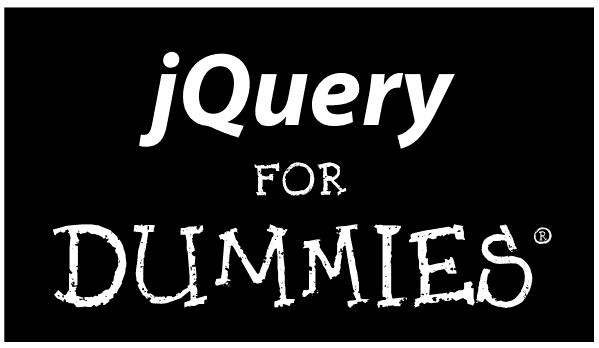

## 关于作者

**Lynn Beighley** 在 jQuery 成为 John Resig 眼中的一点灵光之前，就已经是一名网络开发者和计算机书籍作者了。这是她的第十一本书。Lynn 与她的丈夫 Drew 以及两只伯恩山犬一起生活在她充满 1920 年代风情的家中，这两只狗体型太大，无法成为它们自己认为的那种可以放在腿上的宠物狗。

www.it-ebooks.info

## 献词

献给 Drew。

## 作者致谢

我要感谢 Kyle Looper 提供我撰写另一本关于伟大主题的 *Dummies* 系列图书的机会，以及 Susan Pink 的出色奉献。她对细节一丝不苟，本书因此受益匪浅！

## 出版方致谢

我们为这本书感到自豪；请将您的意见发送至 http://dummies.custhelp.com。其他意见，请在美国境内致电 877-762-2974，美国境外致电 317-572-3993，或传真至 317-572-4002 联系我们的客户服务部门。

帮助本书面市的人员包括：

**排版服务**

**项目协调员：** Katherine Crocker

版面设计与图形：Joyce Haughey

**校对人员：** Lindsay Littrell, Toni Settle

**索引编制：** BIM Indexing & Proofreading Services

**策划、编辑**

**项目编辑：** Susan Pink

**策划编辑：** Kyle Looper

**文字编辑：** Susan Pink

**技术编辑：** Cody Lindley

**编辑经理：** Jodi Jensen

**编辑助理：** Amanda Graham

**高级编辑助理：** Cherie Case

**漫画：** Rich Tennant

(www.the5thwave.com)

**技术类 Dummies 图书的出版与编辑**

**Richard Swadley**，副总裁兼执行集团出版人

**Andy Cummings**，副总裁兼出版人

**Mary Bednarek**，执行策划总监

**Mary C. Corder**，编辑总监

**消费类 Dummies 图书的出版**

**Diane Graves Steele**，副总裁兼出版人

**排版服务**

**Debbie Stailey**，排版服务总监

## 第一部分：jQuery 入门

### 第一章：jQuery 快速上手

- 了解 jQuery 能为你做什么 ..................................................... 7
  - 定义 jQuery ............................................................................................... 8
  - 理解 jQuery 特效和事件 ..................................................... 9
  - 使用插件 .................................................................................................. 9
- 安装 jQuery ................................................................................................ 10
  - 下载 jQuery ....................................................................................... 10
  - 设置测试目录 .......................................................................... 11
  - 在网页中调用 jQuery ................................................................... 13
  - 在你的电脑上查看网页 ....................................................... 14
- 编写你的第一个 jQuery 代码 ..................................................................... 15

### 第二章：访问 HTML 元素

- 理解元素 .............................................................................. 21
  - 元素概述 ..................................................................................... 21
  - 常见 HTML 元素 ............................................................................ 23
- 获取和设置元素值 .............................................................. 24
  - 理解元素属性值 ...................................................... 24
  - 获取元素属性值 ................................................................... 24
  - 获取元素内容 ................................................................................ 26
  - 设置元素属性值 ........................................ 28
  - 移除元素属性值 ........................................ 29
  - 改变 HTML 内容 .................................................... 30
  - 改变文本内容 ..................................................... 32

### 第三章：选择 HTML 元素、属性和位置

- 使用 jQuery 选择器 ..................................................... 35
  - 选择特定元素类型 ........................................... 36
  - 选择所有元素 ..................................................... 38
  - 选择 id 选择器 .......................................................... 39
  - 选择类选择器 .......................................................... 40
  - 按顺序选择 ......................................................... 43
  - 从表单中选择 ....................................................... 46
  - 选择属性 ....................................................... 47
  - 选择可见性 ....................................................... 48
  - 选择父元素和子元素 ............................................. 48

### 第四章：管理事件

- 在页面加载时使用 jQuery .......................................... 51
- 处理事件 ........................................................... 52
  - 单击和双击 ............................................... 53
  - 使元素获得焦点 .................................................... 57
  - 检测键盘事件 ................................................. 59
  - 检测鼠标事件 .................................................... 61
- 使用交互助手 ............................................ 63
  - 悬停 .................................................................. 63
  - 切换功能 ......................................................... 65

## 第二部分：用特效影响元素

### 第五章：与网页元素玩捉迷藏

- 用 jQuery 隐藏元素 ................................................ 71
  - 通过按钮按类型隐藏元素 .................................... 71
  - 单击时按 id 隐藏元素 ....................................... 74
  - 使用 `this` 关键字隐藏元素 ........................... 76
  - 使用动画隐藏元素 ........................................... 76
- 用 jQuery 显示元素 ................................................ 79
  - 按 id 显示元素 ................................................... 79
  - 使用动画显示元素 ........................................... 81
- 用 jQuery 切换可见性 ............................................. 83
  - 使用 `toggle()` 函数 ............................................................. 84
  - 带动画的切换效果 ..................................................... 86
  - 使用回调函数 ................................................... 88

### 第六章：滑动和淡入淡出网页元素

- 用 jQuery 滑动元素 ........................................... 91
  - 向下滑动 ................................................................... 92
  - 向上滑动 ...................................................................... 94
  - 改变滑动速度 ..................................................... 96
  - 带切换效果的滑动 .................................................. 96
  - 带回调函数的滑动 ............................................. 97
- 用 jQuery 淡入淡出元素 .............................................. 100
  - 淡入 ..................................................................... 100
  - 淡出 .................................................................... 102
  - 部分淡入淡出 ................................................................. 104

### 第七章：动画化网页元素

- 理解 jQuery 动画工作原理 .......................... 107
- 用 jQuery 动画化元素 .......................................... 111
  - 动画化高度和宽度 ................................................ 111
  - 动画化外边距宽度和内边距 .................................. 113
  - 动画化不透明度 ............................................................ 115
  - 动画化字号和字间距 ................................. 117
- 控制动画持续时间 ........................................ 119
- 使用 `show()`、`hide()` 和 `toggle()` 动画 ............................. 120
- 禁用所有 jQuery 动画 .......................................... 121

## 第三部分：操控你的网页

### 第八章：让网页内容动起来

- 获取和设置文本内容 .................................... 125
- 获取和设置 HTML 内容 ..................................... 128
- 获取和设置表单值 ....................................... 131
- 在元素内部插入内容 .................................... 134
  - 追加内容 ......................................................... 135
  - 在开头插入内容 ....................................................... 136
- 在元素外部插入内容 .................................. 138
- 移动元素 .............................................. 139
- 用内容包裹元素 ................................. 141

### 第九章：替换、移除和复制网页元素

- 替换元素 ....................................................... 143
  - 使用 `replaceWith()` 替换元素 .......................... 143
  - 替换父元素同时保留子元素 ...... 144
  - 使用 `replaceAll()` 替换元素 .................................... 146
- 移除元素
  - 移除元素
  - 移除内容
- 克隆元素
  - 克隆带事件的元素
  - 复制元素及其事件和数据

## 第四部分：使用插件和小部件

### 第十章：理解插件

- jQuery 插件的工作原理
- 获取 jQuery 插件
- 测试你的第一个 jQuery 插件
  - 让你的页面下雪
  - 高亮表格行和列
  - 添加工具提示

### 第十一章：玩转图片效果

- 使用 Colorbox 创建灯箱效果
  - 获取 Colorbox
  - 创建基本的图片灯箱
  - 为灯箱添加标题
  - 在灯箱中显示一组图片
  - 显示幻灯片放映
- 创建图片画廊
  - 获取 Galleria
  - 创建基本的图片画廊

### 第十二章：美化表单

- 显示默认值
- 验证表单字段
- 创建日期选择器

### 第十三章：摆弄页面布局

- 创建手风琴菜单
- 为内容分页
- 创建浮动的 `<div>` 元素

### 第十四章：整合用户界面

- 使用 jQuery UI
- 选择自定义下载选项
  - 选择主题
  - 自定义主题
  - 下载主题
  - 构建你的下载文件
- 使用 jQuery UI 小部件
  - 添加手风琴
  - 创建日期选择器
  - 显示选项卡

## 第五部分：构建 AJAX 应用程序

### 第十五章：理解 jQuery 如何与 AJAX 协同工作

- 理解 AJAX
- 使用 AJAX 加载数据
  - 获取文本文件内容
  - 获取网页内容
  - 获取网页的一部分
- 使用 AJAX 发送数据

### 第十六章：使用 AJAX 插件

- AJAX jQuery 插件的工作原理
- 使用 AJAX 文件上传器
- 旋转动态内容
- 创建 AJAX 弹出窗口

## 第六部分：将 jQuery 与内容管理系统集成

### 第十七章：使用 jQuery 和 Drupal 实现酷炫图片效果

- 探索 Drupal 模块
  - 查找 Drupal 模块
  - 下载 Drupal 模块
  - 启用图片和图片画廊模块
  - 将图片添加到你的画廊
- 在 Drupal 中创建图片效果
  - 获取 Drupal 的 Thickbox jQuery 模块
  - 启用 Thickbox
  - 在图片画廊中使用 Thickbox
- 在 Drupal 中集成 jQuery
  - 配置 Drupal 以识别 jQuery
  - 在 Drupal 内容中包含 jQuery 库

### 第十八章：集成 jQuery 和 Joomla!

- 理解 jQuery 如何与 Joomla! 协同工作
  - 配置 Joomla! 以识别 jQuery
  - 从 Joomla! 访问 jQuery
- 为 Joomla! 寻找 jQuery 扩展
- 在 Joomla! 中使用 jQuery 扩展
  - 创建图片画廊
  - 在你的 Joomla! 页面上显示来自 Twitter 的推文

### 第十九章：使用 jQuery 和 WordPress 构建更好的博客

- 让 jQuery 与 WordPress 协同工作
- 寻找基于 WordPress 的 jQuery 插件
- 在 WordPress 中使用 Colorbox jQuery 插件

## 第七部分：十大精选

### 第二十章：十款不容错过的插件

- uploadify
- jCarousel
- qTip
- jQuery pager
- jQuery Flash
- toggleElements
- Coda-Slider 2.0
- pagination
- Humanized Messages for jQuery
- Single Drop Down Menu

### 第二十一章：十个设计和代码技巧

- 检测浏览器类型
- 为背景图片添加动画
- 调整文本大小
- 禁用右键菜单
- 从 Google 加载 jQuery
- 创建简单的滑动面板
- 创建消失效果
- 使用 jQuery 速查表
- 使元素可点击
- 简化 `document.ready` 代码

### 第二十二章：十个 jQuery 资源

- jQuery 网站
- 维基百科上的 jQuery
- jQuery 绝对初学者视频系列
- Visual jQuery
- Use jQuery
- jQuery 插件
- Smashing Magazine
- Speckyboy Design Magazine
- Nettuts+
- Woorkup

在《jQuery 从入门到精通》中，我将用通俗易懂的语言向你展示如何编写 jQuery 代码和使用 jQuery 插件。我不会假设你懂编程。你甚至不需要知道如何编写 HTML，尽管如果你懂的话，会从本书中收获更多。本书的目标是，在不用专业术语的情况下，向你展示如何仅通过在 HTML 页面中添加几行代码，就能利用 jQuery 的强大功能。

## 关于本书

这不是那种需要从头读到尾的书。你可以拿起这本书，翻到任何一页，然后开始阅读。它的 22 章每一章都涵盖了 jQuery 的一个特定方面——例如下载 jQuery、构建简单的 jQuery 特效、使用令人惊叹的 jQuery 插件，或者将 jQuery 与 Drupal、Joomla! 和 WordPress 等流行的内容管理系统集成。

## 如何使用本书

本书就像一本参考手册。决定一个你想了解的主题。在目录或索引中查找它。然后翻到感兴趣的区域，阅读你需要的内容。

你不需要记住任何东西。这是一本按需查阅的书。需要知道如何创建手风琴菜单？拿起这本书。需要知道如何在网页上淡入或淡出某些元素？拿起这本书。想找到一个超棒的 jQuery 插件来在图片库中展示你的照片？你找对地方了。

本书很少指引你去别处获取信息——你需要了解的关于 jQuery 的几乎所有内容都在这里。

最后，本书包含大量代码。你可以输入这些代码，或者从配套网站 www.dummies.com/go/jqueryfd 下载它们。

## 愚蠢的假设

关于你是谁，我只做一个假设：你是一个非程序员，听说过 jQuery，并想将其添加到你自己的网站。Mac 和 Windows 用户都可以使用本书。

## 本书的组织结构

在本书中，你将看到分为七个部分的章节。每章又细分为若干节，涵盖该章主题的各个方面。章节的安排符合逻辑顺序，因此按顺序阅读是合理的。但本书的模块化程度足够高，你可以拿起它，在任何地方开始阅读。

以下是关于这七个部分内容的简要说明。

## 第一部分：jQuery 入门

本部分的章节是对 jQuery 是什么、从哪里获取以及如何在网页中使用它的通俗介绍。如果你从未接触过 jQuery 代码，不清楚 Web 服务器是什么，也不知道如何构建基本网页，那么这部分是一个很好的起点。

第一部分最棒的地方在于它从最基础开始，不假设你懂得如何下载、上传和构建网页。它还涵盖了使用 jQuery 最基本的部分：将 jQuery 库连接到网页、选择网页上的元素，以及在需要时触发特殊效果。当你学完第一部分，你将能够：当访问者在页面上将鼠标悬停在链接上、点击图片等操作时，改变页面上元素的内容或外观。

### 第二部分：使用特效影响元素

第二部分各章的目标是向你展示如何开始使用 jQuery 根据用户操作改变网页的外观。我将引导你超越仅仅是显示和隐藏页面元素，进入诸如淡入淡出和动画等有趣的操作。

## 第三部分：操控你的网页

第二部分侧重于让页面上的元素移动、淡入淡出和动画化，而第三部分则深入核心。在这里，你将了解如何更改页面上的文本和内容。

# 第四部分：使用插件和小部件

在第四部分，你将把你的网站提升到一个新的水平，你会发现由众多才华横溢的程序员开发的、丰富的免费 jQuery 插件。这些插件正等着你去下载并集成到你自己的网站中。而且我提过它们是免费的吗？

# 第五部分：构建 AJAX 应用程序

在第五部分，你将广泛了解 AJAX，并将一些强大的 jQuery AJAX 插件集成到你自己的网站中。AJAX 很复杂，可能涉及多种编程语言的集成。这个主题完全可以填满一整本书，但本部分为你提供了一个简单的介绍，并为你指明了开始的方向。

## 第六部分：将 jQuery 与内容管理系统集成

内容管理系统（CMS）非常流行，这不足为奇。借助 CMS，你只需几个小时就能构建一个功能强大的网站。而使用最广泛的三种 CMS——Drupal、Joomla! 和 WordPress——都支持 jQuery。第六部分为你提供了关于如何将 jQuery 与这三者集成的指导。

### 第七部分：精选集锦

如果没有一系列有趣的精选内容，那就不是一本“从入门到精通”的书了：十个适合你网站的 jQuery 插件或扩展、十个 jQuery 设计技巧，以及十个你可以访问以了解更多 jQuery 知识的网站。所有这些都在第七部分。

## 本书中使用的图标

页边距上那些精巧的小图片不仅仅是为了美化版面。它们还有实际功能。


等一下——技术细节就在拐角处潜伏。只有当你想了解更多关于 jQuery 内部工作原理时，才继续阅读。但如果这些内容让你感到枯燥，那就继续往下读吧。

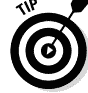

特别注意这个图标；它告诉你有一些特别有用的信息在手边——也许是一个快捷方式，或者是一个回报丰厚但使用较少的命令。有时，提示会将你指引到本书其他部分的重要信息。


这个图标表示重要的、通常是基础的信息，你应该尝试记住。你会一遍又一遍地需要这些信息，无论是在本书的示例中，还是在你自己的 jQuery 探索中。


危险，罗宾逊！这个图标突出了可能帮助你避免灾难的信息。我说的灾难，是指你的代码无法运行，你的插件无法工作，你的一天会毁掉。你会花太长时间试图找出问题所在。相反，请特别注意这个图标。

## 从这里开始

是的，你可以从这里到达那里。手握这本书，你已准备好为你的网页添加激动人心的 jQuery 特效和功能。浏览目录，决定你想从哪里开始。你的网页将从此与众不同！

## 第一部分：jQuery 入门

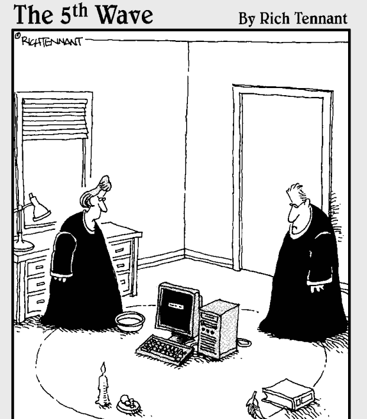

> “我们应该画一个圈，召唤元素，引导能量。如果那不管用，我们就去读说明书。”

### 本部分内容...

万事皆有开端，这里就是起点。在使用 jQuery 之前，你必须获取 jQuery 库。然后你需要知道如何使用它。那么，jQuery 到底是什么？这些章节将为你提供所有答案。

一旦你搞定了 jQuery 库，就该使用它了。只需按照清晰、简单的示例，将代码添加到你的网页中。

你还将学习如何精确定位网页元素，例如图片、`<div>` 和链接。以及如何在特定事件发生时调用 jQuery，例如当元素被点击或鼠标悬停在 `<div>` 上时。

如果你对 jQuery 一无所知，或者不知道如何选择元素，或者不知道如何检测事件，那么就从这里开始。

## 第1章

## jQuery入门与上手

**本章内容**

- 获取 jQuery
- 创建测试环境
- 在网页中使用 jQuery
- 在网页加载后执行代码

或许你正在阅读本书，是因为需要为网站创建一个图片查看器。也许你想让页面上的某些元素淡入淡出。又或许你想为访客提供一种上传文件的方式。jQuery 能帮助你轻松快速地为网页添加数百种令人印象深刻的交互效果。

本章将概述 jQuery 的工作原理、如何在自己的网页中使用它，以及如何创建第一个应用了 jQuery 效果的简单网页。

### 了解 jQuery 能为你做什么

jQuery 为 Web 开发者和设计师提供了一种简单的方法，几乎无需编码就能创建复杂的效果。由于 jQuery 实现起来如此简单，其受欢迎程度与日俱增。你会在网上看到大量 jQuery 的应用实例。例如，Facebook 和 Twitter 就使用了多种 jQuery 效果。

当在 Twitter 上发布新推文时，页面并不会重新加载。相反，网页背后的代码会调用一个 jQuery 函数，让你的新推文出现，同时页面上的其他推文向下移动。Twitter 上另一个 jQuery 特性是，当有新推文到达时你会收到通知，如图 1-1 所示。

**图 1-1：** Twitter 使用了多种 jQuery 函数。

如果点击通知，新推文就会出现在你的页面上，而旧的推文则向下滑动。网页从不重新加载；相反，页面上的内容会动态变化。

### 定义 jQuery

要理解 jQuery，需要对 JavaScript 有所了解，这是一种 Web 浏览器能理解的编程语言。JavaScript 代码可以与网页上的图像和文本进行交互——例如，隐藏图像、移动文本，或在一段时间后或当页面访问者进行某种操作（如将鼠标光标悬停在链接上）时改变内容。JavaScript 代码可以在访问网页的人点击按钮时显示一个图像，可以在你浏览网页 30 秒后弹出一个窗口，或者可以检查网站访问者是否正确填写了网页表单。JavaScript 功能强大，通常用于为网页添加交互性和动态效果。但 JavaScript 是一门完整的编程语言，要有效使用它，你必须学习编程。

jQuery 是一个 JavaScript 的附加库。可以将 jQuery 想象成为你写好的 JavaScript 代码。通常，你只需在页面中包含一两行代码来调用 jQuery 代码即可。jQuery 为你完成了艰苦的 JavaScript 编码工作。

## 理解 jQuery 效果和事件

jQuery 让你能够轻松地更改网页上元素的外观、位置或行为。在第 2 章中，我将深入讨论 HTML 元素，但现在可以将一个*元素*想象成网页上的某些东西，比如一幅图像、一段文本、一个超链接、一个表格或一个标题。

jQuery 代码为网页上的文本和图像元素提供各种特殊效果，包括以下几种：

- **隐藏：** 隐藏网页上的一个元素。
- **显示：** 如果元素被隐藏，则显示网页上的一个元素。
- **向下滑动：** 使网页上的一个元素向下滑动。
- **向上滑动：** 使网页上的一个元素向上滑动。
- **淡入：** 使网页上一个隐藏的元素淡入，使其可见。
- **淡出：** 使网页上的一个元素淡出，使其不可见。
- **动画：** 使网页上的一个元素沿特定方向进行动画。

你可以对页面上的元素使用 jQuery 效果，但 jQuery 也让你控制这些效果何时发生。你可以让你页面上的一个元素在你指定的时间进行淡入、滑动、动画等。以下是 jQuery 可用于触发效果的一些事件：

- **加载：** 当网页在浏览器中完成加载或页面中的某个元素（如图像）加载完成时，效果发生。
- **鼠标悬停：** 当鼠标光标移动到网页上的特定位置时，效果发生。
- **鼠标移出：** 当鼠标光标移出网页上的特定位置时，效果发生。
- **变化：** 如果某个东西的值（例如，网页表单上某个字段中的文本）发生变化，就会触发一个事件。这对于确保某人在文本框中输入正确的信息很有用。

## 使用插件

jQuery 的真正威力在于使用它来创建惊人效果的数百个插件。*插件*是使用和扩展 jQuery 的 JavaScript 程序。要查看一个流行且令人印象深刻的插件示例，请访问 Lightbox 插件网站：<http://leandrovieira.com/projects/jquery/lightbox>。这个插件让你页面的访客点击图像，就能看到覆盖显示的较大版本图像（参见图 1-2）。

**图 1-2：** jQuery Lightbox 插件。

在本书中，你会发现相当多的 jQuery 插件，它们都是免费且易于使用的，能将一个简单的网站转变为一个功能强大且动态的目的地。

### 安装 jQuery

在使用 jQuery 之前，你需要下载一份副本。然后你需要决定将其放置在哪里。本节我将讨论获取 jQuery 副本并将其保存到合适位置的基本步骤，具体位置取决于你是在个人计算机上还是在远程 Web 服务器上工作。稍后，你将了解如何在 HTML 文件或网页中包含一行代码，以在网页上看到 jQuery 效果。

#### 下载 jQuery

要获取 jQuery 副本，请按以下步骤操作：

1. **浏览到 `jquery.com` 并单击右侧的“Download jQuery”按钮（参见图 1-3）。**

   单击此按钮将带你到 `http://code.google.com` 上的一个页面，该页面有一个指向最新版本 jQuery 的链接。以我为例，文件名为 `jquery-1.4.min.js`。你的版本可能更新，数字也不同，但这对本书中的代码和示例不会有任何影响。

   文件名中的 `min` 字母表示该文件已最小化。这意味着额外的空格和不起作用的注释已被移除，使整体文件大小变小。通常，最好下载 jQuery 的最小化版本。

2. 单击指向 jQuery 文件的链接。

   将出现一个对话框，询问你是否要打开或保存此文件，如图 1-4 所示。

   根据你用来下载 jQuery .js 文件的浏览器，你可能看不到询问你保存文件的对话框。你可能会看到一个充满 JavaScript 代码的页面。如果发生这种情况，请选择“文件”>“另存为页面”，然后保存文件。

3. 将此文件保存到计算机上你记得住的目录中。

### 设置测试目录

现在你有了 jQuery 文件的本地副本，你需要在计算机上设置一个位置，在那里你可以创建使用 jQuery 的 HTML 文件。为此，请按以下步骤操作：

1. 在计算机上创建一个易于浏览的目录或文件夹，并将其命名为 `webtest`。

   在 PC 上，如果在 `C:/` 驱动器上创建该目录，则目录将是 `C:/webtest`。在 Mac 上，你可以在桌面上创建该目录。

2. 在 `webtest` 目录内，创建两个目录，分别命名为 `js` 和 `images`。

   图 1-5 显示了我名为 `webtest` 的目录及其内部的文件夹。

3. 将 jQuery 文件（在我的例子中是 `jquery-1.4.min.js`）复制或移动到 `js` 目录中。

## 从网页中调用 jQuery

目录设置完毕并将 jQuery 文件保存在 `js` 目录后，你就可以创建你的第一个网页了。

本书剩余的大部分内容，你需要一个 HTML 编辑器或至少一个文本编辑器。如果你使用的是 PC，可以通过选择“开始”⟶“所有程序”⟶“附件”⟶“记事本”来使用记事本程序。在 Mac 上，你可以通过选择“应用程序”⟶“TextEdit”来使用 TextEdit。

如果你在 Mac 上使用 TextEdit，请务必先选择“格式”⟶“制作纯文本”。

在以下步骤中，你将创建一个 HTML 页面，并添加一行代码将页面连接到 jQuery 库。这个页面不会产生任何令人兴奋的效果，但在你的网页中正确插入 jQuery 代码至关重要。即使只有一个字符不正确，jQuery 也无法工作，所以请仔细输入。

要创建你的页面，请执行以下操作：

1. 打开你选择的文本编辑器或 HTML 编辑器。

2. 在文本文档中输入以下代码：

```html
<!DOCTYPE html PUBLIC "-//W3C//DTD XHTML 1.0 Strict//EN"
    "http://www.w3.org/TR/xhtml1/DTD/xhtml1-strict.dtd">
<html>
<head>
<title>My Test Page</title>
</head>
<body>
<p>This is my test page.</p>
</body>
</html>
```

3. 将此文件保存为 `test.html`，放在你在上一节创建的 `webtest` 目录中。

   无论使用哪种编辑器，请确保以 `.html` 扩展名而不是 `.txt` 保存文件。

你仍然需要添加将 jQuery 库连接到此页面的代码行。

4. 紧接在 HTML 代码 `<title>My Test Page</title>` 之后，添加以下代码行：

```html
<script type="text/javascript" src="js/jquery-1.4.min.js"></script>
```

jQuery 文件名（上一行代码中的 `jquery-1.4.min.js`）必须与你从 `jquery.com` 下载的文件名匹配。这行代码调用了 jQuery 代码库。稍后，当你在这个网页中添加使用 jQuery 的简单代码时，你的 Web 浏览器就会知道如何找到 jQuery。

5. **再次保存你的 test.html 文件。**

   这次你的文件保存了刚刚添加的代码行。

## 在你的计算机上查看网页

你已经创建了一个简单的 HTML 现在你可以在浏览器中查看它了。要打开你的页面，请按照以下步骤操作：

1. **启动你选择的浏览器。**

   在这个示例中，我使用 Firefox。

2. **选择 文件 > 打开文件。**

   出现一个“打开文件”对话框。

3. **浏览到 webtest 目录并选择你之前创建的文件 test.html。**

4. **点击“确定”。**

   你的网页现在显示在浏览器中，如图 1-6 所示。

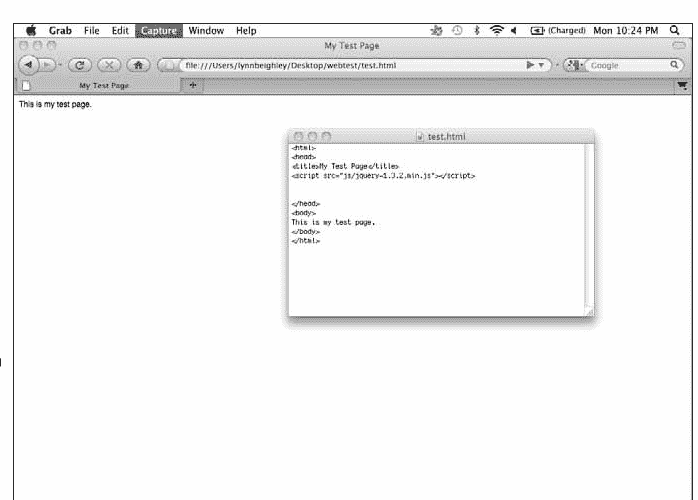

图 1-6：一个调用 jQuery 代码的基础网页。

## 第 1 章：jQuery 入门与启动

这个页面显示了标题 `My Test Page` 和一行文本 `This is my test page`。jQuery 代码可以被你的网页访问，但你还没有将其用于页面中的任何效果。

## 创建你的第一个 jQuery 代码

既然你知道了如何创建一个带有调用或包含 jQuery 库的 `<script>` 标签的简单网页，你就可以创建你的第一个 jQuery 效果了。在本节中，你将向页面添加一个图像，并添加 jQuery 代码，在警报框中显示有关该图像的信息。这不是 jQuery 最令人兴奋的用法，但它演示了你将在本书中使用的基本技术。

要将图像添加到你的 HTML 页面：

1. **找到一个小的 .gif 图像文件，并将其保存在之前在 webtest 目录内创建的 images 目录中。**

   尝试找一个不大于 300x300 像素的图像。

   如果你手头没有 .gif 图像，可以通过浏览以下位置获取一个：

   `http://media.wiley.com/spa_assets/site/dummies2/include/images/topnav/home.gif`

   这个文件是一个小房子的图像。选择“文件”>“文件另存为”，并将此图像保存到 webtest 下的 images 目录中。

2. **在文本编辑器中打开 test.html。**

3. **在行 `<p>This is my test page</p>` 之后添加以下代码：**

   ``

   确保将 `home.gif` 更改为与你正在使用的文件匹配。

   仔细观察这个 `` 标签。它包含称为 *属性* 的代码片段。这些属性是 `src`、`height`、`width` 和 `alt`。每个属性都包含有关图像的信息。`src` 属性包含图像的文件名和位置。`height` 和 `width` 属性包含图像的像素尺寸。`alt` 属性是当鼠标悬停在图像上或无法显示图像时要显示的附加文本。

4. **保存你的 test.html 文件，但保持它在文本编辑器中打开。**

如果你现在在 Web 浏览器中查看你的页面，图像将如图 1-7 所示显示。

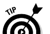


## 第一部分：jQuery 入门

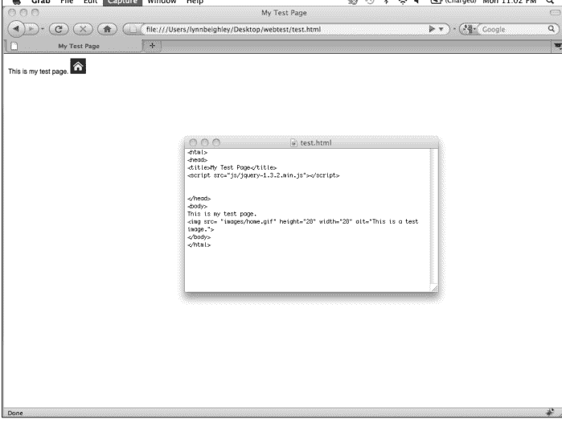

你已经准备好添加一些 jQuery 代码了。在接下来的步骤中，你将添加显示有关图像信息的代码：

1. 如果 test.html 尚未在文本编辑器中打开，请打开它。

2. 找到你添加的调用 jQuery 的 `<script>` 代码行。

3. 在那行代码下方，在 `</script>` 标签之后，添加以下代码：

```javascript
<script type="text/javascript">
$(document).ready(function(){
    
    //Do things here
    
});
</script>
```

你会在本书中一遍又一遍地看到这段代码。`$(document).ready` 代码调用了一个 jQuery 函数，该函数告诉浏览器，当页面的某个部分加载完成时，就执行某些操作。你仍然需要告诉它该做什么。

当你在代码中看到美元符号时，意味着该代码通过调用 jQuery 函数与 jQuery 交互。`$` 字符是代码关键字 `jQuery` 的替代符。

`//Do things here` 行是一条注释。两个前斜杠字符告诉 Web 浏览器忽略同一行中它们后面的文本。在代码中放入注释以告诉自己你仍然需要做什么或已经做了什么，这通常很方便。

4. 将 `//Do things here` 行替换为以下代码：

```javascript
alert(jQuery('img').attr('alt'));
```

还记得 `$` 符号吗？上面的代码行也可以这样写：

```javascript
alert($('img').attr('alt'));
```

5. 保存你的文件，但保持它在文本编辑器中打开。在浏览器中查看它。

你添加的代码行告诉浏览器在页面准备好时打开一个 JavaScript 警报框。图 1-8 显示了这个警报框。警报框显示了图像标签中 `alt` 属性之后的文本。图 1-8 还显示了 `test.html` 的整个源代码。

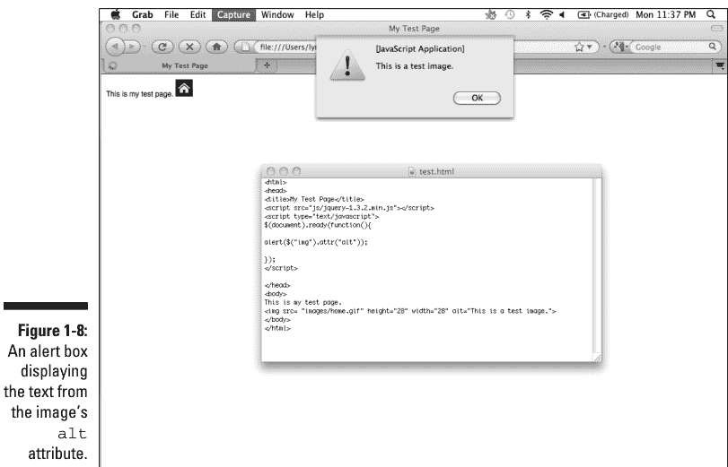

6. 修改 `alert` 代码以通过将其修改为以下内容来显示图像的高度：

```javascript
alert(jQuery('img').attr('height'));
```

7. 保存 `test.html` 并在你的 Web 浏览器中查看它。

你现在可以在警报框中看到图像的高度显示。

## jQuery 如何与你的网页协同工作

从最基本的层面上讲，一个网页包含一个包含 jQuery 库的 `<script>` 标签和一个包含对 jQuery 库中函数调用的 `<script>` JavaScript 代码块。

使用 JavaScript 代码调用 jQuery 函数一开始可能有点令人困惑，但不用担心。重要的是理解你在本章中使用的代码如何工作以及所有部分意味着什么。在本节中，我将带你逐行查看 `test.html`，以便更清晰：

- `<!doctype...>`：这个长元素告诉 Web 浏览器接下来的代码中使用的是哪个版本的 HTML。你应该始终在创建的任何 HTML 页面开头包含它。
- `<html>`：此元素开始 HTML 页面。
- `<head>`：此元素指定头部部分的开始。此部分通常包含标题和任何脚本元素。
- `<title>My Test Page</title>`：此行显示页面的标题。
- `<script src="js/jquery-1.4.min.js"></script>`：此行提供了 jQuery 库的位置。
- `<script type="text/javascript">`：此 script 标签告诉浏览器其内部的所有内容都是 JavaScript 代码。
- `$(document).ready(function() {`：美元符号是 jQuery 函数的别名。`ready` 函数等待网页加载，然后执行其内部包含的代码。
- `alert($('img').attr('height'));`：alert 函数打开一个弹出警报框。后面的美元符号调用了 jQuery 的 attr 函数。此函数返回引号中任何属性的值，在本例中是高度。注意 `img` 位于 `attr` 函数之前。简而言之，此函数的意思是，“查找 HTML 代码中找到的所有 `img` 元素，并返回第一个元素的 `height` 属性值。”
- `});`：此标点符号闭合了在 `$(document).ready(function() {` 行开始的花括号和圆括号。
- `</script>`：此标签关闭 `<script>` 标签并结束 JavaScript 代码块。
- `</head>`：此标签关闭 HTML 的头部部分。
- `<body>`：此标签开始主体部分，其中包含由 HTML 代码、文本和图像组成的主要内容。
- `<p>This is my test page.</p>`：此行是页面中出现的一行文本。
- ``：此 `img` 元素在网页上显示一个具有多个属性的图像。
- `</body>`：此标签结束页面的内容部分。
- `</html>`：此标签结束 HTML 页面。

## 第1章：启动和运行 jQuery


你可以在 jQuery 函数中的元素和文本周围使用单引号或双引号，但最佳实践是始终使用单引号。双引号最适合在 HTML 代码中使用。例如，这是一个使用单引号的 jQuery 函数：

```
alert($('#img').attr('width'));
```

而这是一个使用双引号的 HTML 代码：

```

```

## 第一部分：20 jQuery 入门

## 第2章：访问 HTML 元素

### 本章内容

- 了解元素的组成
- 获取 HTML 元素的属性值
- 更改 HTML 元素的属性值
- 显示属性值
- 更改 HTML 元素内的 HTML 和文本代码

jQuery 非常适合操作网页上的元素。但要有效使用它，你需要了解什么是元素，以及哪些 jQuery 函数可以用于你想要操作的元素。在本章中，我将讨论最常见的元素，以及如何使用 jQuery 来获取和设置元素的值。我还将向你展示如何获取和设置 HTML 元素内的 HTML 代码，以更改网页的内容。

### 理解元素

jQuery 允许你与网页上的元素进行交互和操作。HTML 元素构成了 HTML 页面，并由标签表示，标签是尖括号 `<` 和 `>` 中的字母或单词。例如，`` 是一个图像元素。

### 元素概览

考虑你在第 1 章末尾创建的 HTML 代码：

```html
<!DOCTYPE html PUBLIC "-//W3C//DTD XHTML 1.0 Strict//EN"
 "http://www.w3.org/TR/xhtml1/DTD/xhtml1-strict.dtd">
<html>
<head>
<title>My Test Page</title>
<script type="text/javascript" src="js/jquery-1.4.min.js"></script>
<script type="text/javascript">
$(document).ready(function(){
alert(jQuery('img').attr('alt'));
});
</script>
</head>
<body>
<p>This is my test page.</p>

</body>
</html>
```

这段代码包含八个元素，我将在下一节“常见 HTML 元素”中讨论它们：`<html></html>`、`<head></head>`、`<title></title>`、`<script></script>`（使用了两次）、`<body></body>`、`` 和 `<p></p>`。

当你在浏览器中打开此内容（参见图 2-1）时，唯一可见的元素是标题、`<p>` 元素中的文本，以及第二个 `<script>` 元素中的 jQuery 函数触发的警报框。

除了包裹 HTML 代码中所有其他内容的 `<html>` 元素外，元素总是嵌套在其他元素内部。例如，文本行 `This is my test page.` 嵌套在 `<p>` 标签内，而 `<p>` 标签又在 `<body>` 标签内，`<body>` 标签又在 `<html>` 标签内。想想俄罗斯套娃。

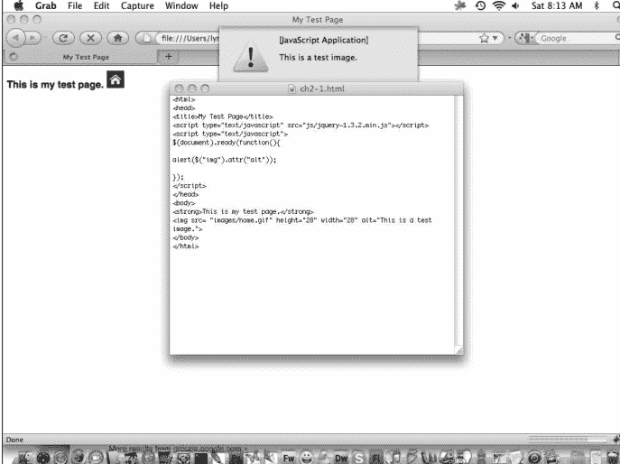

当你思考元素时，请记住这些顺序规则：

- 一个元素在另一个元素内部，它是外部元素的子元素。
- 外部元素是内部元素的父元素。
- 一个单独的元素可以并且通常是同时既是父元素又是子元素。

### 常见 HTML 元素

你可能已经熟悉 HTML。如果不熟悉，这里更详细地介绍一些你应该知道的最常见的 HTML 元素：

- `<html></html>`：告诉 Web 浏览器，标签内的所有内容都应被视为一个网页。
- `<head></head>`：包含控制页面显示方式的信息。负责 JavaScript 和 CSS 代码以及调用其他文件的元素通常放置在这些标签之间。
- `<title></title>`：包含网页的标题，显示在浏览器顶部的标题栏中。
- `<body></body>`：包含页面的所有内容。
- `<style></style>`：控制网页上元素的外观和行为。
- `<script></script>`：通过调用文件或在标签之间放置代码，使 JavaScript 和其他指定的代码可用。jQuery 通过此标签包含在页面中。
- `<strong></strong>`：将标签内的任何文本加粗。
- `<h1></h1>`：创建标题文本。
- `<div></div>`：创建一个内容容器。
- `<p></p>`：创建一个段落。
- `<a></a>`：创建一个超链接。
- ``：显示图像。请注意，此标签没有匹配的结束标签，因此在标签内使用斜杠字符来表示标签的结束。
- `<form></form>`：创建一个 Web 表单，该表单可以将用户提交的信息发送到另一个网页或可以处理此信息的代码。
- `<input></input>`：创建一个表单元素，例如单选按钮、文本输入框或提交按钮。用作 `<form></form>` 内部的子元素。
- `<br />`：插入换行符。不需要匹配的结束标签。
- `<table></table>`：创建一个表格，以及子标签 `<tr></tr>` 和 `<td></td>`。

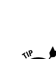

更完整的 HTML 元素列表位于 www.w3.org/TR/REC-html40/index/elements.html。

### 获取和设置元素值

jQuery 允许你获取和设置与元素相关的值。在本节中，我将描述元素的属性值，并向你展示如何获取它们以及如何通过使用 jQuery 为它们设置值来更改元素。

### 理解元素属性值

jQuery 如此强大的一个特点是它允许你操作元素的属性值。*属性*是一个 HTML 代码词，它控制元素的某个方面。例如，考虑这个 `` 元素：

```html

```

这行代码有以下四个属性：

- **src**：要显示的图像文件的 URL 或位置
- **height**：图像高度（以像素为单位）
- **width**：图像宽度（以像素为单位）
- **alt**：当图像未显示时（或在某些浏览器中，当鼠标悬停在图像上几秒钟时）出现的替代文本

这些是 `` 元素可能具有的许多属性值中的一些。其他元素具有不同的属性。

属性的*值*是等号后面跟着的文本。该值通常用双引号括起来。例如，在刚刚显示的 `` 元素中，`height` 属性的值为 28。

### 获取元素属性值

如果你想要获取某个属性的值，可以使用 jQuery 的 `attr()` 函数。`attr()` 函数接受你页面上属性的名称，例如 `attr('src')`，并给你该属性的值，即等号右侧的信息。

www.it-ebooks.info

考虑这行代码：

```javascript
var imageSource = $('img').attr('src');
```

要使用 `attr()` 方法，你需要调用 jQuery 库中的一个函数方法。你必须在代码中包含对 jQuery 函数名称的调用。`$` 函数告诉浏览器使用 jQuery 函数，并指定你感兴趣的元素。

`$` 是调用 jQuery 的简写方式。以下代码行的工作方式与前面的代码相同：

```javascript
imageSource = jQuery('img').attr('src');
```

此代码将 `` 元素的 `src` 属性的值存储到 `imageSource` 变量中。

*变量*是存储值的地方。将变量想象成一个盒子，里面装着等号另一边的所有东西。在前面的例子中，我创建了一个名为 `imageSource` 的变量，并将 `` 标签的 `src` 属性中的所有内容存储其中。

在以下步骤中，你将获取 `src` 属性的值。然后将其保存在变量中并在警报框中显示：

**1. 创建一个包含以下代码的网页：**

```html
<!DOCTYPE html PUBLIC "-//W3C//DTD XHTML 1.0 Strict//EN"
        "http://www.w3.org/TR/xhtml1/DTD/xhtml1-strict.dtd">
<html>
<head>
<title>My Test Page</title>
<script type="text/javascript" src="js/jquery-1.4.min.js"></script>
<script type="text/javascript">
$(document).ready(function(){

    // Your code goes here.

});
</script>
</head>
<body>
<strong>This is my test page.</strong>

</body>
</html>
```

你可以浏览到 www.dummies.com/go/jquery 并复制此代码，将其粘贴到你的文本编辑器或网页编辑器中。有关如何使用 Notepad（Windows）或 TextEdit（Mac）创建网页并在 Web 浏览器中查看的说明，请参阅第 1 章。

## 第二章：访问 HTML 元素

### 获取元素内容

一些 HTML 元素在开始标签和结束标签之间包含文本内容，你可以使用 jQuery 来操作它们。考虑以下代码：

```html
<p>This is some text.</p>
```

使用 jQuery，我可以获取 `<p>` 标签开始和结束之间的文本。要使用 jQuery 获取元素的内容，请执行以下操作：

1. 创建一个包含以下代码的网页：

```html
<!DOCTYPE html PUBLIC "-//W3C//DTD XHTML 1.0 Strict//EN"
    "http://www.w3.org/TR/xhtml1/DTD/xhtml1-strict.dtd">
<html>
<head>
<title>My Test Page</title>
<script type="text/javascript" src="js/jquery-1.4.min.js"></script>
<script type="text/javascript">
$(document).ready(function(){
    // Your code goes here.
});
</script>
</head>
<body>
<strong>This is my test page.</strong>
<p>This is some text.</p>
</body>
</html>
```

你可以浏览到 www.dummies.com/go/jquery 并将此代码复制粘贴到你的文本或网页编辑器中。

2. 将 `// Your code goes here.` 替换为以下两行代码：

```javascript
var pContent = $('p').text();
alert (pContent);
```

第一行代码的含义是：“获取 `<p>` 元素的 HTML 内容并将其保存在 `pContent` 变量中。”第二行代码的含义是：“在警报框中显示存储在 `pContent` 变量中的值。”

3. 保存此文件，然后在浏览器中打开它。

你会看到一个警报框，显示 `<p>` 元素的内容，如图 2-3 所示。

### 设置元素属性值

假设你想更改页面上显示的图像。因为显示的图像是基于存储在 `` 标签的 `src` 属性中的值，所以更改 `src` 值将更改页面上显示的图像。

对于下一个示例，你需要两个高度和宽度相同的图像文件。你可以从 www.dummies.com/go/jquery 下载 `cover1.jpg` 和 `cover2.jpg`。将这些文件保存到你的 webtest 目录中的 images 目录中。

要更改 HTML 元素的属性值，请按照以下步骤操作：

1. 创建一个包含以下代码的网页：

```html
<!DOCTYPE html PUBLIC "-//W3C//DTD XHTML 1.0 Strict//EN"
             "http://www.w3.org/TR/xhtml1/DTD/xhtml1-strict.dtd">
<html>
<head>
<title>My Test Page</title>
<script type="text/javascript" src="js/jquery-1.4.min.js"></script>
<script type="text/javascript">
$(document).ready(function(){

    // Your code goes here.

});
</script>
</head>
<body>
<strong>This is my test page.</strong>

</body>
</html>
```

2. 保存此文件，然后在浏览器中查看它。

请注意，出现的图像是 `cover1.jpg`。

3. 将 `// Your code goes here.` 替换为以下代码：

```javascript
$('img').attr({src: 'images/cover2.jpg', alt: 'cover2'});
```

这段代码的含义是：“找到 `` 元素，并将 `src` 属性更改为 `images/cover2.jpg`，将 `alt` 属性更改为 `cover2`。”

4. 保存此文件，然后在浏览器中打开它。

这次，出现的图像是 `cover2.jpg`，如图 2-4 所示。

### 移除元素属性值

移除属性值很容易；你只需要使用 `removeAttr()` 函数。例如，以下代码从 `` 标签中移除 `height` 属性：

```javascript
$('img').removeAttr('height');
```

### 更改 HTML 内容

在本章前面，你从一个元素复制了 HTML 内容并将其显示在警报框中。复制 HTML 内容后，你可以将其放置在页面上的任何其他 HTML 元素内部。

要将 HTML 内容从一个元素复制并放置到另一个元素中，请按照以下步骤操作：

1. 创建一个包含以下代码的网页：

```html
<!DOCTYPE html PUBLIC "-//W3C//DTD XHTML 1.0 Strict//EN"
        "http://www.w3.org/TR/xhtml1/DTD/xhtml1-strict.dtd">
<html>
<head>
<title>My Test Page</title>
<script type="text/javascript" src="js/jquery-1.4.min.js"></script>
<script type="text/javascript">
$(document).ready(function(){

// Your code goes here.

});
</script>
</head>
<body>
<strong>This is the code in the STRONG element.</strong>
<p>This is the code in the P element.
</p>
</body>
</html>
```

2. 保存文件，然后在浏览器中查看它。

注意 `<strong>` 和 `<p>` 元素中的文本（见图 2-5）。它们各自包含 HTML `<em>` 标签，用于将部分文本斜体化。

3. 将 `// Your code goes here.` 替换为以下代码：

```javascript
var strongContent = $('strong').html();
var pContent = $('p').html();
```

第一行获取 `<strong>` 元素内部的 HTML 内容并将其存储在 `strongContent` 变量中。第二行将 `<p>` 元素的内容存储在 `pContent` 变量中。现在你已经从每个元素中获取了内容，你需要将它们设置到每个元素中。

4. 在刚刚添加的两行代码下方添加此代码：

```javascript
$('strong').html(pContent);
$('p').html(strongContent);
```

第一行将存储在 `pContent` 中的 HTML 代码放入 `<strong>` 元素中。第二行将存储在 `strongContent` 中的 HTML 代码放入 `<p>` 元素中。

5. 保存此文件，然后在浏览器中打开它。

原本在 `<strong>` 元素中的代码现在在 `<p>` 元素中，反之亦然（见图 2-6）。

### 更改文本内容

有时你不想要元素中的实际 HTML 代码；你只想要文本。为此，请将 `html()` 函数替换为 `text()` 函数。在前面的例子中，你交换了 HTML 代码。如果你只想交换文本而不交换 HTML 代码，请使用以下代码：

```html
<!DOCTYPE html PUBLIC "-//W3C//DTD XHTML 1.0 Strict//EN"
    "http://www.w3.org/TR/xhtml1/DTD/xhtml1-strict.dtd">
<html>
<head>
<title>My Test Page</title>
<script type="text/javascript" src="js/jquery-1.4.min.js"></script>
<script type="text/javascript">

$(document).ready(function(){

var strongContent = $('strong').text();
var pContent = $('p').text();

$('strong').text(pContent);
$('p').text(strongContent);

});
</script>
</head>
<body>
<strong>This is the text in the <em>STRONG</em> element.</strong>
<p>This is the text in the <em>P</em> element.</p>
</body>
</html>
```

请注意，`<em>` 标签不再存在，因此没有任何文本被斜体化（见图 2-7）。使用 `text()` 方法会剥离 HTML 元素。

## 第 34 部分 I：jQuery 入门

## 第 3 章

### 选择 HTML 元素、属性和位置

### 本章内容

- 理解 jQuery 选择器
- 选择所有元素
- 计算所选元素的数量
- 识别表单元素
- 选择元素属性
- 查找隐藏元素
- 选择子元素和父元素

在第 2 章中，你学习了如何获取和设置元素的属性以及元素内的 HTML 内容。该章的所有示例都集中在页面上单个元素类型的值的获取和设置上。但当你有多个相同类型的元素时，有时你需要过滤特定的元素，而忽略其他元素。这就是 jQuery 选择器的用武之地。

你可以使用选择器来选择特定类型的元素，也可以根据元素的属性、id、CSS 类以及在页面上的顺序（例如，第三个 `` 或第五个 `<p>`）来选择元素。你甚至可以根据元素的父元素或子元素来选择它们。

在选择了你想要的元素之后，你可以使用其他 jQuery 函数来操作它们。本章将全面介绍如何使用 jQuery 选择器选择元素。

### 使用 jQuery 选择器

在本节中，你将学习如何选择单一类型的所有元素。你还将了解如何根据 id 值、CSS 类以及它们在页面上的顺序来过滤元素。

### 选择特定元素类型

你可能没有意识到，但在第 2 章中你已经使用了选择器。看看下面这段更改 `` 元素的 `src` 和 `alt` 属性的代码：

```html
<!DOCTYPE html PUBLIC "-//W3C//DTD XHTML 1.0 Strict//EN"
    "http://www.w3.org/TR/xhtml1/DTD/xhtml1-strict.dtd">
<html>
<head>
<title>My Test Page</title>
<script type="text/javascript" src="js/jquery-1.4.min.js"></script>
<script type="text/javascript">
$(document).ready(function(){

    $('img').attr({src: 'images/cover2.jpg', alt: 'cover2'});

});
</script>
</head>
<body>
<strong>This is my test page.</strong>

</body>
</html>
```

这段代码更改了一个 `` 元素的 `src` 和 `alt` 属性。代码 `$('img')` 就是用来选择 `` 元素的。

你可以将相同的选择器与 jQuery 的 `html()` 和 `text()` 函数结合使用，来更改页面上所有匹配元素的 HTML 代码或文本。要实际操作一下，请按照以下步骤更改页面上所有 `<strong>` 元素中的文本：

1. 创建一个包含以下代码的网页：

```html
<!DOCTYPE html PUBLIC "-//W3C//DTD XHTML 1.0 Strict//EN"
    "http://www.w3.org/TR/xhtml1/DTD/xhtml1-strict.dtd">
<html>
<head>
<title>My Test Page</title>
<script type="text/javascript" src="js/jquery-1.4.min.js"></script>
<script type="text/javascript">
$(document).ready(function(){

    // Your code goes here.

});
</script>
</head>
<body>
<strong>some name</strong>

<p>Some text</p>
<strong>another name</strong>
<p>More text</p>
<strong>another name</strong>
<p>Even more text</p>
<strong>your name</strong>
<p>Last bit of text</p>
</body>
</html>
```

你可以从 www.dummies.com/go/jquery 下载此代码。如果你选择自己输入代码，`<strong>` 和 `<p>` 元素中的文本并不重要，所以你可以随意填写。关键是要有几个 `<strong>` 元素。

2. 保存文件，然后在浏览器中查看它。

注意 `<strong>` 元素中的粗体文本（见图 3-1）。

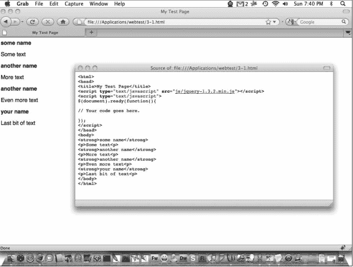

3. 将 `// Your code goes here.` 替换为以下代码：

```javascript
var strongContent = 'jQuery for Dummies';
```

`strongContent` 变量存储了文本 `jQuery for Dummies`。既然你已经有了想要放入 `<strong>` 元素中的内容，就需要使用一个选择器来选择所有 `<strong>` 元素，并使用 `text()` 函数更改其中的文本。

4. 在你刚添加的代码下方添加这行代码：

```javascript
$('strong').text(strongContent);
```

这行代码将 `strongContent` 中存储的文本放入页面上所有 `<strong>` 元素中。

5. 保存此文件，然后在浏览器中打开它。

原本在 `<strong>` 元素中的文本已被替换，如图 3-2 所示。

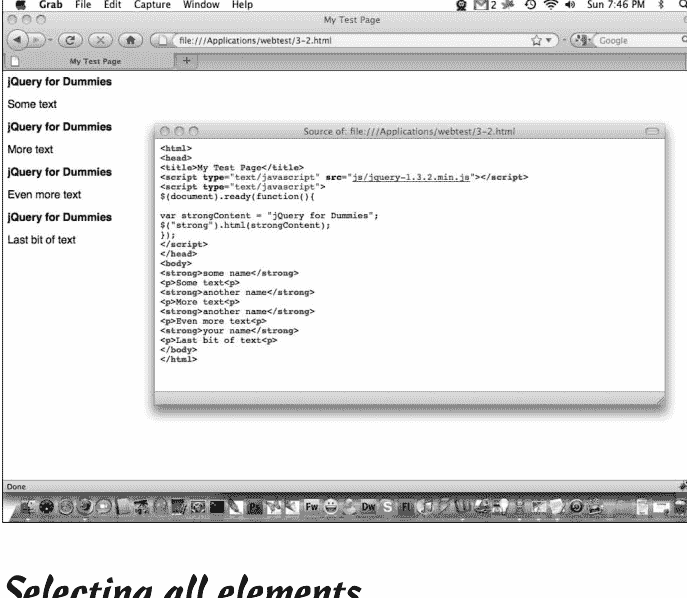

### 选择所有元素

你可以使用 `*` 字符来选择页面上的每个元素。例如，如果我想给前面代码中的每个元素添加一个 `id` 属性，我可以使用这行代码：

```javascript
$('*').attr({id: 'myNewID'});
```


你不应该将 `*` 字符与某些 jQuery 函数一起使用。考虑这行代码：

```javascript
$('*').text('Not a good idea.');
```

当这行代码执行时，它首先替换最外层元素的文本。因为任何 HTML 页面的最外层父元素都是 `<html>` 元素，所以你的页面上最终会得到这段 HTML 代码：

```html
<html>Not a good idea.</html>
```

一般来说，当你想为页面上的每个元素分配 CSS 样式或属性时，或者可以通过其他方式进一步缩小结果范围时，使用 `*` 选择器是实用的。

### 选择 id

在第 2 章中，你看到了用于 `` 元素的 `src`、`alt`、`height` 和 `width` 属性。还有其他属性，例如 `id` 属性，可以分配给所有元素。`id` 属性包含一个唯一标识符，你可以将其与选择器结合使用来精确定位特定元素。例如，下面是为两个 `<p>` 元素分配 id 的代码：

```html
<p id='someTxt'>Some text</p>
<p id='moreTxt'>More text</p>
```

第一个 `<p>` 元素的 id 是 `someTxt`。第二个是 `moreTxt`。如果我想选择第二个 `<p>` 元素，我可以在选择器中使用 id 名 `moreTxt`。

管理 `id` 属性有几条规则。id：

- **id 必须是唯一的。** 每个 HTML 页面只能使用一次 `id`。
- **id 只能包含字母、数字、连字符、下划线、冒号和句点。**
- **id 必须以字母开头。**
- **id 区分大小写。** 你在 HTML 标签中使用的 `id` 必须与你在选择器中使用的 `id` 匹配。
- **在 jQuery 中使用 id 时，id 名称前需要加一个井号 (#)。** 例如，在我的 HTML 代码中，我使用 `id = 'myidname'`。但是当我在 jQuery 代码的选择器中使用这个 `id` 时，我在 `id` 名称前加上一个井号，即 `'#myidname'`。

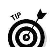

> 请注意以下示例中井号的使用方式。你会发现井号只在 `<script>` 部分的代码中使用，而不在 HTML 的 `<p>` 标签中使用。

要使用 `id` 选择器显示元素的某个属性，请按照以下步骤操作：

1. 创建一个包含以下代码的网页：

```html
<!DOCTYPE html PUBLIC "-//W3C//DTD XHTML 1.0 Strict//EN"
    "http://www.w3.org/TR/xhtml1/DTD/xhtml1-strict.dtd">
<html>
<head>
<title>My Test Page</title>
<script type="text/javascript" src="js/jquery-1.4.min.js"></script>
<script type="text/javascript">
$(document).ready(function(){

    // Your code goes here.

});
</script>
</head>
<body>
<p id='someTxt'>Some text</p>
<p id='moreTxt'>More text</p>
</body>
</html>
```

2. 在代码中找到这行：`// Your code goes here.` 将其替换为以下代码：

```javascript
alert ($('#moreTxt').text());
```

这行代码会打开一个警告框，其中包含名为 `moreTxt` 的 `id` 属性选择器所存储的文本。

3. 保存此文件，然后在浏览器中打开它。

带有 `moreTxt` 属性的 `<p>` 元素中的文本将显示在警告框中，如图 3-3 所示。

### 选择类

使用 `ids` 选择特定元素可以让你对页面上的元素进行大量控制。但由于 `ids` 是唯一的，你必须为每个元素单独选择。例如，如果你想选择页面上的四个元素，你必须在代码中使用全部四个 `ids`。例如，要设置页面上四个 `` 元素的 `src` 属性，你会使用以下代码：

```javascript
$('#anid').attr('src', 'images/newImage.gif');
$('#anotherid').attr('src', 'images/newImage.gif');
```

## 第三章：选择 HTML 元素、属性和位置

```javascript
$('#myid').attr('src') = 'images/newImage.gif';
$('#hereisanid').attr('src') = 'images/newImage.gif';
```

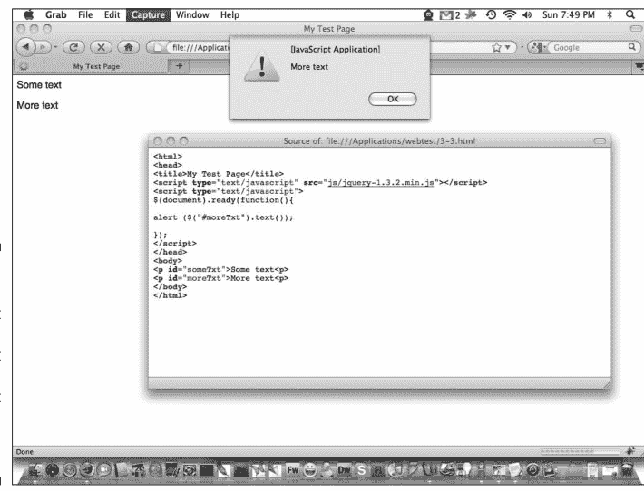

要通过 `id` 选择元素，HTML 中的代码为每个元素包含不带井号的 `id` 属性。

每一行代码都设置了特定 `` 元素的 `src` 属性。如果你使用一个称为 `class` 的特殊属性，只需一行代码就能选择所有具有该属性的元素，例如：

```javascript
$('.someClass').attr('src', 'images/newImage.gif');
```

`class` 属性遵循几条规则。


- 一个类可以被多个元素使用。你只能在每个 HTML 页面中使用一次 `id`。

- 一个元素可以包含多个类。如果你想给一个元素赋予多个类属性，请在类名之间使用空格。例如，这里将三个类属性分配给一个单独的 `<p>` 元素：

```html
<p attribute="firstclass anotherclass dogclass catclass">
```

www.it-ebooks.info

## 第一部分：jQuery 入门

> 在 jQuery 中，类属性的使用方式是在类名前加一个句点（.）。例如，在 HTML 代码中，我使用 `class = "myclass"`。但当我在 jQuery 代码中通过选择器使用 `class`class`时，我需要在`class`名前加上句点，即 `.myclass`。

要更改具有相同类的 `<p>` 和 `<strong>` 元素中的文本，请执行以下操作：

1.  创建一个包含以下代码的网页：

```html
<!DOCTYPE html PUBLIC "-//W3C//DTD XHTML 1.0 Strict//EN"
    "http://www.w3.org/TR/xhtml1/DTD/xhtml1-strict.dtd">
<html>
<head>
<title>My Test Page</title>
<script type="text/javascript" src="js/jquery-1.4.min.js"></script>
<script type="text/javascript">
$(document).ready(function(){

// Your code goes here.

});
</script>
</head>
<body>
<strong class="changemytext">some name</strong>
<p class="changemytext">Some text</p>
<strong>another name</strong>
<p>More text</p>
<strong>another name</strong>
<p>Even more text</p>
<strong class="changemytext">your name</strong>
<p class="changemytext">Last bit of text</p>
</body>
</html>
```

四个元素具有相同的类属性 `changemytext`。请注意，一个类可以按需使用多次，并且不同类型的元素可以共享一个类。如果你将此文件保存并在浏览器中打开，你会看到本章前面图 3-1 所示的相同页面。

2.  用以下代码替换 `// Your code goes here.`：

```javascript
$('.changemytext').text('This is new text.');
```

此代码会将所有具有 `changemytext` 类属性的 `<strong>` 和 `<p>` 元素中的文本更改为新文本。

3.  保存此文件，然后在浏览器中打开它。

原本在具有类属性 `changemytext` 的 `<strong>` 和 `<p>` 元素中的文本已被替换，如图 3-4 所示。

## 第三章：选择 HTML 元素、属性和位置

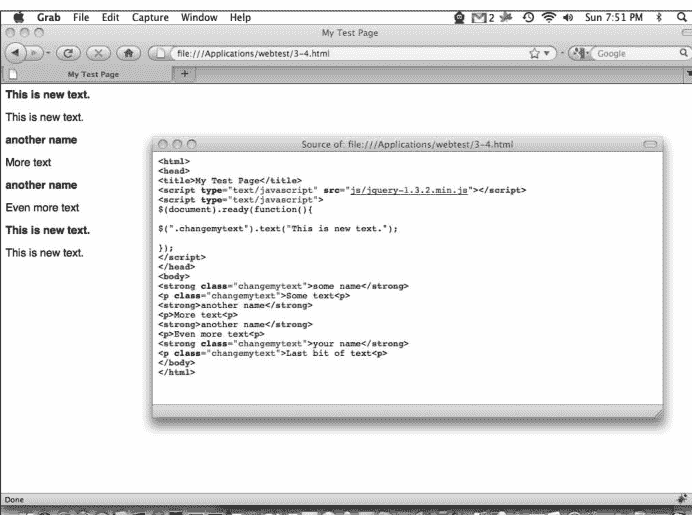

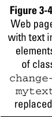

## 按顺序选择

当页面上有多个相同类型的元素时，你可能想按顺序选择。例如，你可能想选择页面上的第三个 `<p>` 元素。jQuery 提供了一组函数，让你可以根据元素在页面上的位置进行选择。

在使用 jQuery 库中的列表时，列表中的第一个项目始终被视为编号 0，而不是 1。本节中根据元素在列表中的位置选择元素的代码示例，都从列表开头开始计数，起始编号为 0。

考虑这段包含多个不同元素的代码：`<p>`、`<strong>` 和 ``。总共有十一个元素，四个 `<p>` 标签，四个 `<strong>` 标签和两个 `` 标签：

```html
<!DOCTYPE html PUBLIC "-//W3C//DTD XHTML 1.0 Strict//EN"
    "http://www.w3.org/TR/xhtml1/DTD/xhtml1-strict.dtd">

<html>
<head>
<title>My Test Page</title>
<script type="text/javascript" src="js/jquery-1.4.min.js"></script>
<script type="text/javascript">
$(document).ready(function(){

    // Your code goes here.

});
</script>
</head>
<body>
<strong>Element, first strong tag</strong>
<p>Element, first p tag</p>
<strong>Element, second strong tag</strong>
<p>Element, second p tag</p>
<strong>Element, third strong tag</strong>
<p>Element, third p tag</p>

<strong>Element, fourth strong tag</strong>

<p>Element, fourth p tag</p>

</body>
</html>
```

以下是一些顺序选择器及其在前面代码中元素上的使用示例：

通过用示例中的代码替换前面代码中的 `//Your code goes here` 行来尝试这些代码。

- **:first**：选择第一个匹配的元素。此代码返回第一个 `` 的 `src` 属性的值，即 `images/cover1.jpg`。

  `$('img:first').attr('src');`

- **:last**：选择最后一个匹配的元素。此代码返回最后一个 `` 的 `src` 属性的值，即 `images/cover2.jpg`。

  `$('img:last').attr('src');`

- **:even**：从 0 开始匹配偶数位置的元素。此代码更改第一个和第三个 `<strong>` 元素的文本（见图 3-5）。

  `$('strong:even').text('Changed this text.');`

- **:odd**：从 1 开始匹配奇数位置的元素。此代码更改第二个和第四个 `<strong>` 元素的文本。

  `$('strong:odd').text('Changed this text.');`

## 第三章：选择 HTML 元素、属性和位置

在 jQuery 中使用的列表从 0 开始编号，而不是 1。要选择第一个元素，使用索引 0。第二个元素的索引是 1，第三个元素的索引是 2，依此类推。

- **:eq(index)**：通过从第一个元素开始计数到索引值来匹配特定元素。假设你想选择页面上的第三个 `<strong>` 元素。因为计数从 0 开始，所以要选择第三个 `<strong>` 元素，请执行以下操作：

- **:gt(index)**：选择所有索引值大于指定索引的元素。选中的元素是页面上位于选定元素下方的元素。

- **:lt(index)**：选择所有索引值小于指定索引的元素。选中的元素是页面上位于选定元素上方的元素。

```javascript
$('strong:eq(2)').text('Changed this text.');
```

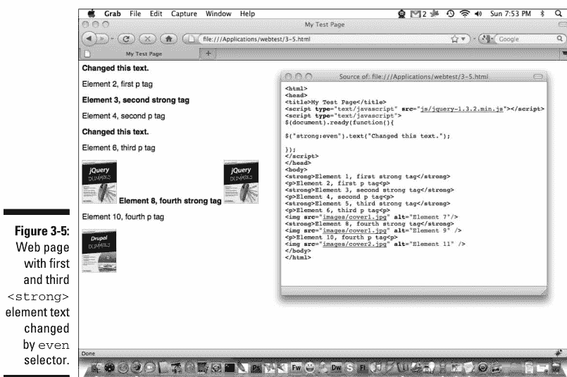

## 第一部分：jQuery 入门

## 从表单中选择

jQuery 有一组专门用于选择 HTML 表单元素的过滤器。本节中的示例使用以下代码来选择表单元素：

```html
<!DOCTYPE html PUBLIC "-//W3C//DTD XHTML 1.0 Strict//EN"
"http://www.w3.org/TR/xhtml1/DTD/xhtml1-strict.dtd">

<html>
<head>
<title>My Test Page</title>
<script type="text/javascript" src="js/jquery-1.4.min.js"></script>
<script type="text/javascript">
$(document).ready(function(){

// Your code goes here.

});
</script>
</head>
<body>
<form action="" method="post">
Your name<input type="text" />
<input type="checkbox" />
<input type="radio" />
<select><option>First Choice</option></select>
<input type="submit" />

</form>
</body>
</html>
```

以下是一些表单元素选择器及其在前面代码中元素上的使用示例：

- **:input**：选择所有表单元素，包括 `<input />`、`<select>`、`<textarea>` 和 `<button>`。此代码在一个警告框中显示我的表单中输入元素的数量：

  `alert( $(':input').length);`

  当一个选择器选择多个元素时，结果是一个称为 *数组* 的值列表。当我选择页面上所有输入元素时，我得到一个包含所有元素的数组。`length` 关键字告诉我数组中有多少个元素。

- **:text**：选择所有类型属性设置为 `text` 的元素。以下代码在警告框中返回值 1：

  `alert( $(':text').length);`

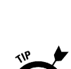

## 第三章：选择 HTML 元素、属性和位置

47

✔ `:radio` 选择所有 `type` 属性设置为 `radio` 的元素。以下代码将在警报框中返回值 1：

```
alert( $(':radio').length );
```

✔ `:checkbox`：选择所有 `type` 属性设置为 `radio` 的元素。以下代码将所有复选框的 `checked` 属性设置为 `true`（参见图 3-6）：

```
$(':checkbox').attr({checked: 'true'});
```

✔ `:checked`：选择所有被选中的复选框和单选按钮。

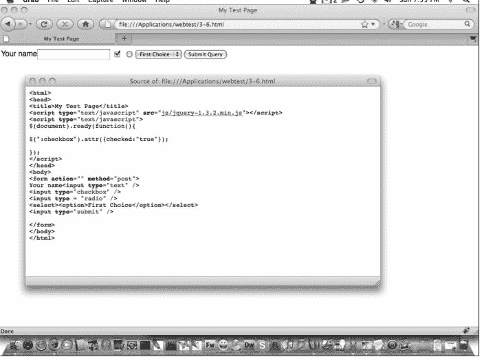

图 3-6：使用 checkbox 选择器选中的复选框。

## 选择属性

可以通过元素的属性及其属性值来选择元素。以下是一些属性过滤器：

www.it-ebooks.info

## 48 第一部分：jQuery 入门

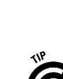

- `[attribute]`：选择所有具有特定属性的元素。以下代码显示具有 `height` 属性的 `` 元素的数量：

  `alert( $('img[height]').length );`

- 你可以省略元素名称，以选择所有具有特定属性的元素。例如，以下代码返回所有具有 `height` 属性的元素，无论它们是否为 `` 元素：

  `alert( $('[height]').length );`

- `[attribute=value]`：选择所有特定属性设置为特定值的元器。以下代码显示 `class` 属性设置为 `myclass` 的元素数量：

  `alert( $('[class=myclass]').length );`

- `[attribute!=value]`：选择所有特定属性未设置为特定值的元素。以下代码显示 `class` 属性不是 `myclass` 的元素数量。没有 `class` 属性的元素将被忽略：

  `alert( $('[class!=myclass]').length );`

## 选择可见性

能够隐藏和显示元素是你可以轻松用 jQuery 做的一些有趣的事情。在第五章中，你将了解如何隐藏元素。以下选择器届时会派上用场：

- `:hidden`：选择所有隐藏的元素

- `:visible`：选择所有可见的元素

## 选择父元素和子元素

通常你需要选择的元素嵌套在其他元素内部。以下代码显示了两个 `<div>` 元素，每个元素内部都有相同的内容：

```
<!DOCTYPE html PUBLIC "-//W3C//DTD XHTML 1.0 Strict//EN"
    "http://www.w3.org/TR/xhtml1/DTD/xhtml1-strict.dtd">
<html>
<head>
<title>My Test Page</title>
<script type="text/javascript" src="js/jquery-1.4.min.js"></script>
<script type="text/javascript">
$(document).ready(function(){

// Your code goes here.

});
</script>
</head>
<body>
<div id="myfirstdiv">
<strong class="changemytext">some name</strong>
<p class="changemytext">Some text</p>
<strong>another name</strong>
<p>More text</p>
</div>
<div id="myseconddiv">
<strong class="changemytext">some name</strong>
<p class="changemytext">Some text</p>
<strong>another name</strong>
<p>More text</p>
</div>
</body>
</html>
```

外部元素被视为父元素，内部元素是子元素。

要根据父元素或子元素选择元素，请尝试使用以下选择器：

- **`:first-child:`** 选择第一个子元素。以下代码选择第一个 `<div>` 的第一个子元素，并更改所选元素的文本：

  `$('div:first-child').text('Change me.');`

- **`:last-child:`** 选择最后一个子元素。以下代码选择第二个 `<div>` 的最后一个子元素，并更改所选元素的文本：

  `$('div:last-child').text('Change me.');`

- **`parent > child`**：选择父元�的子元素。此代码更改每个作为 `<div>` 元素子元素的 `<strong>` 元素的文本（参见图 3-7）。

  `$('div > strong').text('Change me.');`

请记住，本章中的选择器并非全部可用的 jQuery 选择器。幸运的是，知道如何使用这些选择器将使你能够轻松使用任何未在此处讨论的选择器。你可以在 http://api.jquery.com/category/selectors/ 找到完整的选择器列表。

## 50 第一部分：jQuery 入门

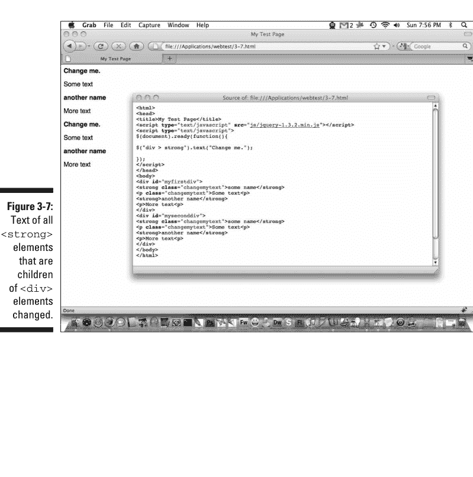

# 第四章

## 管理事件

### 本章内容

- 在网页加载时调用 jQuery

- 处理事件

- 响应点击和双击

- 检测元素获得焦点

- 注意键盘事件

- 捕捉鼠标移动

- 使用交互助手简化代码

第二章向你展示了如何更改 HTML 元素和属性的值。第三章揭示了如何精确选择你想要操作的元素或元素集。在这些章节中，你对选中元素所做的每次更改都发生在网页加载时。

但是，如果有人点击链接时你想更改页面上的某些内容怎么办？在 jQuery 中，点击链接是一个*事件*。其他事件包括按钮被点击、鼠标光标移动到页面上的某个位置以及页面被关闭。本章告诉你如何使用 jQuery 响应事件来操作 HTML 元素。

## 在页面加载时使用 jQuery

要使网页在浏览器中加载时发生某些事情，你需要使用 `ready()` 函数。此函数告诉 Web 浏览器执行 `ready` 命令后括号内的任何命令。

以下代码调用 jQuery 的 `ready()` 函数。该函数内的任何代码都将被执行：

```
<!DOCTYPE html PUBLIC "-//W3C//DTD XHTML 1.0 Strict//EN"
    "http://www.w3.org/TR/xhtml1/DTD/xhtml1-strict.dtd">
<html>
<head>
<script src="js/jquery-1.4.min.js"></script>
<script>
$(document).ready(function(){
var myImage= $('img').attr('src');
$('div').text(myImage);
});
</script>
</head>
<body>

<div></div>
</body>
</html>
```

你使用 jQuery 函数从 `` 元素中抓取 `src` 属性，并将该属性作为文本显示在 `<div>` 元素中。更具体地说，`ready()` 函数包含命令，首先定位 `` 元素，并将 `src` 属性值保存在 `myImage` 变量中。下一行使用选择器定位 `<div>` 标签，并将 `<div>` 元素内的文本设置为存储在 `myImage` 变量中的值。所有这些代码都发生在页面中的 HTML 代码加载时。图像和其他媒体可能仍在加载，但只要 HTML 代码加载完毕，`ready()` 事件就会触发。

> 提示

在本章的示例中，事件代码被放置在 `ready()` 函数内。你可以省略 `ready()` 函数，只包含其内部的代码，但确保在允许任何其他代码执行之前 HTML 代码已加载是一种良好的做法。将你的事件代码放在 `ready()` 函数内可确保所有 HTML 代码都已存在。

## 处理事件

能够知道页面访问者何时执行某些操作，例如将鼠标移到链接上或双击图像，是你的网页变得*动态*的方式。页面上的元素会响应访问者的行为。

在 jQuery 出现之前，你使用 JavaScript 代码检测事件。然而，你必须编写大量代码，并且每种浏览器类型都需要不同的代码。例如，当前版本的 Internet Explorer 中检测鼠标操作的代码与当前版本的 Safari 的代码不同。幸运的是，jQuery 为你处理了浏览器差异。使用 jQuery，无论访问者使用哪种浏览器，相同的代码都能正常工作。并且你只需要一两行代码而不是很多行。

在本节中，你将研究一些特定的事件以及如何使用它们使你的网页响应访问者的操作。

## 单击和双击

你想检测的最常见事件之一是网页上的元素被单击。以下示例向你展示当有人点击页面上的文本时如何打开警报框：

1. 创建一个包含以下代码的网页：

```
<!DOCTYPE html PUBLIC "-//W3C//DTD XHTML 1.0 Strict//EN"
    "http://www.w3.org/TR/xhtml1/DTD/xhtml1-strict.dtd">
<html>
<head>
<title>My Test Page</title>
<script type="text/javascript" src="js/jquery-1.4.min.js"></script>
<script type="text/javascript">
$(document).ready(function(){

    //Your code goes here.

});
</script>
</head>
<body>
<div class="clickme">Do something</div>
</body>
</html>
```

你可以从 `www.dummies.com/go/jquery` 下载此代码。如果你自己创建此文件，请确保包含一个带有 `class="clickme"` 属性的 `<div>` 元素，并在开始和结束 `<div>` 标签之间包含文本。

2. 保存文件，然后在浏览器中查看它。

3. 单击 `<div>` 元素中的文本（参见图 4-1）。什么都不会发生。

4. 将 `// Your code goes here.` 替换为以下代码：

```
$('.clickme').click(function() {
    alert('You clicked on something.');
});
```

一个选择器将 `click` 事件附加到 `clickme` 类。你可以根据需要命名你的类。

## 第一部分：jQuery入门

第3章向你展示了如何使用选择器查找页面上所有具有特定类属性的元素。请记住，你可以将第3章中的任何选择器与本章讨论的事件结合使用。

5.  保存此文件，然后在浏览器中打开它。

6.  点击文本。

点击事件会弹出一个警告框，如图4-2所示。

将`click`事件用于网页文本之类内容的问题在于，访问你页面的访客不会知道这是可以点击的东西。通常，`click`事件应与看起来可点击的元素一起使用，例如按钮或充当按钮的图像。

在下面的例子中，我们使用一个小图像作为按钮。这个例子使用了`dblclick`事件，这意味着必须双击元素才能执行事件代码：

1.  创建一个包含以下代码的网页：

```
<!DOCTYPE html PUBLIC "-//W3C//DTD XHTML 1.0 Strict//EN"
"http://www.w3.org/TR/xhtml1/DTD/xhtml1-strict.dtd">
<html>
<head>
<title>My Test Page</title>
<script type="text/javascript" src="js/jquery-1.4.min.js"></script>
<script type="text/javascript">
$(document).ready(function(){

//Your code goes here.

});
</script>
</head>
<body>
<div class="clickme"></div>
</body>
</html>
```

此代码使用了我网站目录中`images`目录下的`home.gif`图像。有关本书示例文件组织方式的更多信息，请参阅第1章。

2.  保存文件，然后在浏览器中查看它。

3.  点击`<div>`元素中的文本（参见图4-3）；什么也不会发生。

## 第4章：管理事件 55

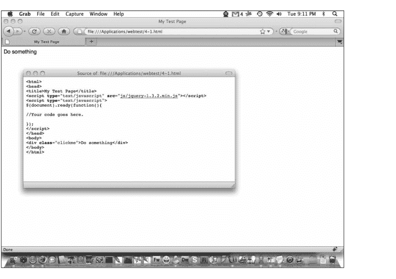

图4-1：包含<div>元素的网页。

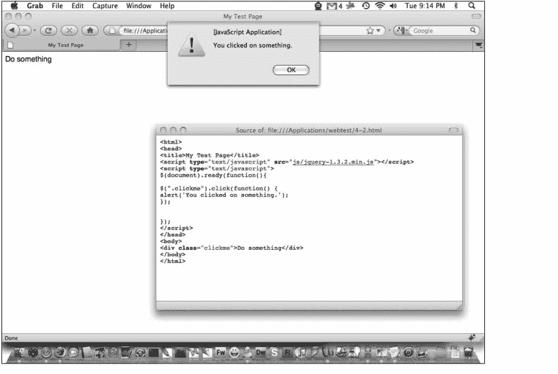

图4-2：当你点击<div>元素时，出现一个警告框。

www.it-ebooks.info

## 第一部分：jQuery入门

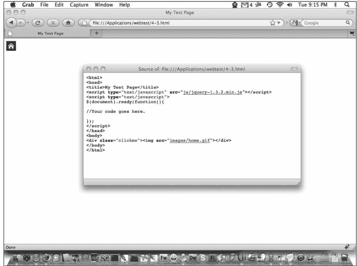

4.  将`// Your code goes here.`替换为以下代码：

```
$('.clickme').dblclick(function() {
alert('You double-clicked on something.');
});
```

选择器将`dblclick`事件附加到类值为`clickme`的元素上。`<div>`元素具有`clickme`类，并包含一个`img`元素。

5.  保存此文件，然后在浏览器中打开它。双击图像。

双击事件会弹出一个警告框，如图4-4所示。

具有`clickme`类的`<div>`元素现在是可点击的。双击`<div>`元素（包括其内部的所有内容）将打开一个警告框。

你不仅限于使用警告框来响应事件。在后面的章节中，你将了解如何使元素出现、消失、淡出、动画化以及实现其他效果。任何你可以在jQuery中使用的效果都可以用于响应事件。

## 第4章：管理事件

57

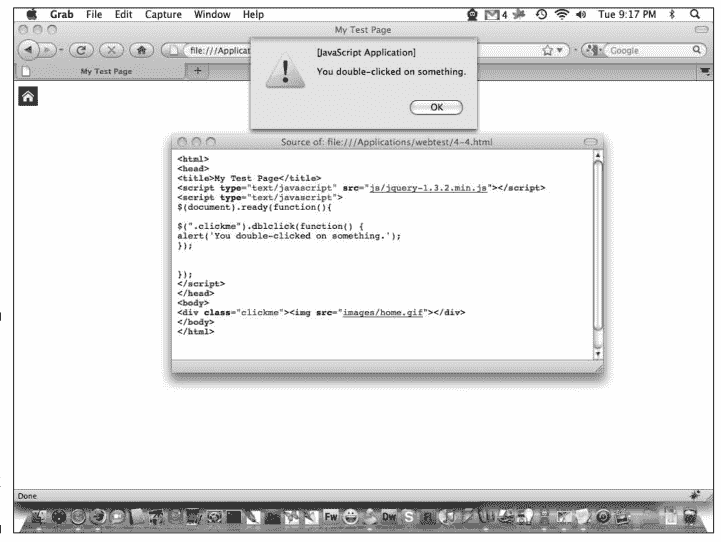

图4-4：当你点击<div>元素内的图像时，出现一个警告框。

## 使元素获得焦点

当你用鼠标点击网页上的元素或按下Tab键时，该元素会获得焦点。要了解这是如何工作的，请按照以下步骤操作：

1.  创建一个包含以下代码的网页：

```
<!DOCTYPE html PUBLIC "-//W3C//DTD XHTML 1.0 Strict//EN"
        "http://www.w3.org/TR/xhtml1/DTD/xhtml1-strict.dtd">
<html>
<head>
<title>My Test Page</title>
<script type="text/javascript" src="js/jquery-1.4.min.js"></script>
<script type="text/javascript">
$(document).ready(function(){

    //Your code goes here.

});
</script>
</head>
<body>
First Name: <input type="text" id="textbox1" />
```

www.it-ebooks.info

58 第一部分：jQuery入门

```
<br />
Last Name: <input type="text" id="textbox2" />
</body>
</html>
```

2.  保存文件，然后在浏览器中查看它。使用鼠标光标点击两个文本框中的每一个。

当你点击每个文本框时，注意那个小光标。当你点击一个文本框时，它就成为了当前焦点。

3.  按下键盘上的Tab键几次，观察焦点的变化。

4.  将`// Your code goes here.`替换为以下代码：

```
$('#textbox2').focus(function() {
alert('textbox2 has focus');
});
```

5.  保存此文件，然后在浏览器中重新加载页面。点击底部的文本框。

焦点事件会弹出一个警告框，如图4-5所示。你也可以使用Tab键使这个文本框获得焦点。

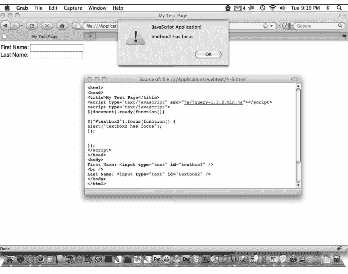

这个例子使用id属性作为选择器，而不是类选择器。你还可以使用许多其他选择器。有关使用选择器的更多信息，请参阅第3章。

## 检测键盘事件

检测访问你网站的人何时按下键盘上的某个键可能很有用。以下事件与键盘相关，你可以将事件附加到其中任何一个上：

- **keydown:** 按下一个键。

- **keyup:** 释放一个按下的键。

- **keypress:** 按下并释放一个键。

`keydown`事件发生在`keyup`事件之前。如果某人按住一个键不释放，会发生`keydown`事件。如果某人按下并释放一个键，会发生`keypress`事件。

键盘上的每个键都与一个数值相关联。例如，A等于65，B等于66，Z等于90。这些数字被称为ASCII值。你可以在www.ascii.cl上看到这些值的图表。现在我们知道这些值了，我们可以检测特定字母键何时被按下。

要检测某人何时按下并释放特定键（`keypress`事件），请执行以下操作：

1.  创建一个包含以下代码的网页并保存它：

```
<!DOCTYPE html PUBLIC "-//W3C//DTD XHTML 1.0 Strict//EN"
    "http://www.w3.org/TR/xhtml1/DTD/xhtml1-strict.dtd">
<html>
<head>
<title>My Test Page</title>
<script type="text/javascript" src="js/jquery-1.4.min.js"></script>
<script type="text/javascript">
$(document).ready(function(){

//Your code goes here.

});
</script>
</head>
<body>
Type the letter Z: <input type="text" id="textbox1" />
</body>
</html>
```

第一部分：jQuery入门

2.  将`// Your code goes here.`替换为以下代码：

```
$('input').keypress(function (e) {
    if (e.which == 90) alert ('Z was typed.');
});
```

这段代码包含一个if语句。键盘的ASCII值保存在`e.which`中，if语句的意思是：“如果ASCII值等于90，则打开一个警告框。”参数`e`包含有关按下了哪个键的信息。

这段代码的秘密全在`e`参数中。每个事件都有一个事件对象传递给函数，这就是你知道发生了哪个事件的方式。要了解更多关于按键和按钮事件的信息，请访问http://api.jquery.com/event.which/。

3.  保存此文件，然后在浏览器中打开它。在输入框中输入一些字母，包括大写的Z。

输入大写Z会触发一个警告框，如图4-6所示。

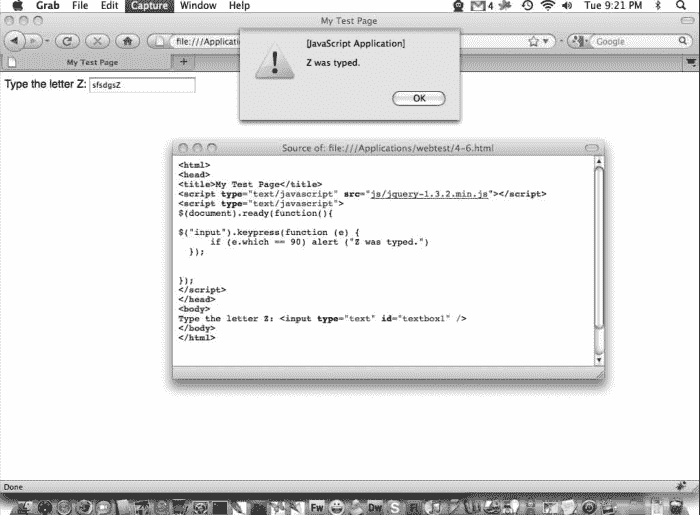

图4-6：当在文本框中输入大写Z时，出现一个警告框。

第4章：管理事件 61

## 检测鼠标事件

可以说，比检测键盘按键更有用的是那些让你检测鼠标移动的事件。本章前面的一个例子向你展示了如何检测鼠标点击和双击。但你还可以检测许多其他鼠狭事件，包括

- **mousedown:** 鼠标按钮在元素上被按下。

- **mouseenter:** 鼠标光标进入选定元素，但该元素不是子元素。

- **mouseleave:** 鼠标光标离开选定元素。

- **mousemove:** 鼠标被移动。

- **mouseout:** 鼠标光标离开选定元素。

- **mouseover:** 鼠标光标进入选定元素或其任何子元素。

- **mouseup:** 鼠标按钮被释放。

下面的例子向你展示了如何检测鼠标在页面元素上移动和离开：

1.  创建一个包含以下代码的网页并保存它：

```
<!DOCTYPE html PUBLIC "-//W3C//DTD XHTML 1.0 Strict//EN"
   "http://www.w3.org/TR/xhtml1/DTD/xhtml1-strict.dtd">
<html>
<head>
<title>My Test Page</title>
<script type="text/javascript" src="js/jquery-1.4.min.js"></script>
<script type="text/javascript">
$(document).ready(function(){

//Your code goes here.

});
</script>
</head>
<body>

<div id="outputdiv">This text will change.</div>
</body>
</html>
```

这将在页面上放置一个id属性为`mouseoverme`的图像。页面还有一个id属性为`outputdiv`的`<div>`元素。当你的鼠标移动到图像上时，`<div>`元素用于显示文本。

## 第一部分：jQuery 入门

2. 将 `// Your code goes here.` 替换为以下代码：

```
$('#mouseoverme').mouseover(function() {
    $('#outputdiv').text('You moused over the image.');
});
```

一个选择器将 `mouseover` 事件附加到具有 `mouseoverme` id 的 `` 元素上。代码的第二行在 `` 元素被鼠标悬停时，更改具有 `outputdiv` id 的 `<div>` 元素中的文本。

3. 保存此文件，然后在浏览器中打开它。

4. 将鼠标移到图像上，注意文本如何变化，如图 4-7 所示。

5. 在步骤 2 中添加的代码下方添加以下代码：

```
$('#mouseoverme').mouseout(function() {
    $('#outputdiv').text('You moused out of the image.');
});
```

这段代码与你在步骤 2 中添加的代码几乎完全相同。但是，这段代码使用的是 `mouseout` 事件，而不是 `mouseover` 事件，并且出现在 `<div>` 元素中的文本会更改，以表明你正在将鼠标移出 `` 元素。

6. 保存此文件，然后在浏览器中打开它。

7. 将鼠鼠标移到图像上并移出图像，注意文本如何变化，如图 4-8 所示。

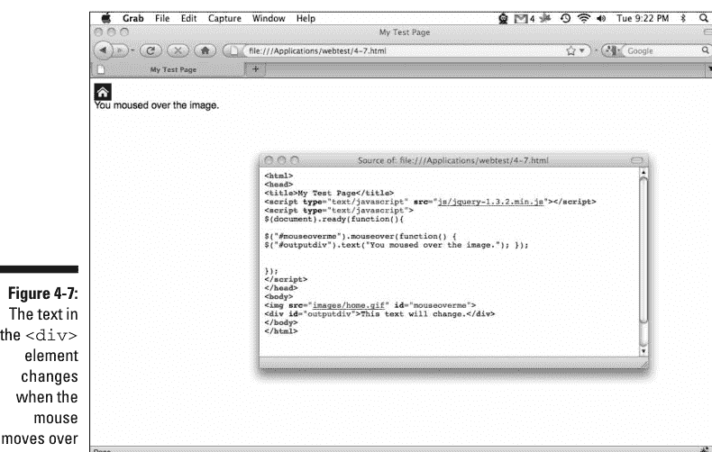

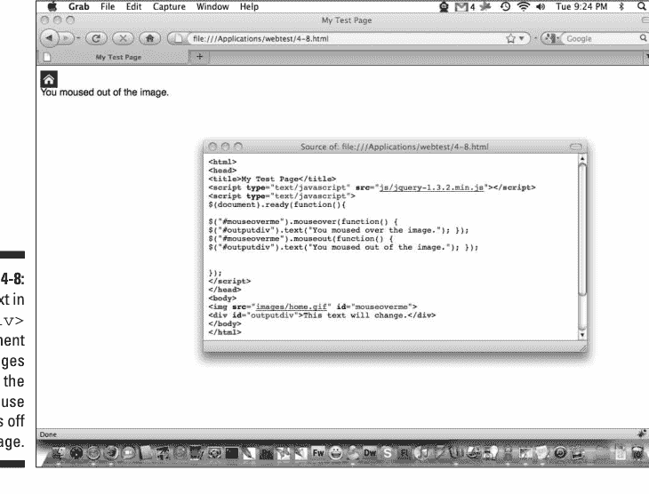

**图 4-8：** 当鼠标移出图像时，`<div>` 元素中的文本会更改。

## 使用交互助手

假设你经常想一起使用 `mouseover` 和 `mouseout` 事件，或者你想检测对一个元素的多次点击。jQuery 有两个事件函数可以简化这两种活动。它们被称为交互助手。将一个 *交互助手* 视为多个事件捆绑在一个函数中，以简化你的代码。

## 悬停

在前面的示例中，你一起使用了两个鼠标事件来更改 `<div>` 元素中的文本：`mouseover` 和 `mouseout`。为了使事情更简单，jQuery 有一个称为 `hover` 的事件，它结合了 `mouseenter` 和 `mouseleave` 事件。要使用单个 `hover` 事件，请按照以下步骤操作：

## 第一部分：jQuery 入门

1. 创建一个包含以下代码的网页并保存它：

```
<!DOCTYPE html PUBLIC "-//W3C//DTD XHTML 1.0 Strict//EN"
    "http://www.w3.org/TR/xhtml1/DTD/xhtml1-strict.dtd">
<html>
<head>
<title>My Test Page</title>
<script type="text/javascript" src="js/jquery-1.4.min.js"></script>
<script type="text/javascript">
$(document).ready(function(){

    //Your code goes here.

});
</script>
</head>
<body>

<div id="outputdiv">This text will change.</div>
</body>
</html>
```

2. 将 `// Your code goes here.` 替换为以下代码：

```
$('#mouseoverme').hover(
function() {
    $('#outputdiv').text('You moused over the image.');
},
function(){
    $('#outputdiv').text('You moused out of the image.');
});
```

一个选择器将 `hover` 事件附加到具有 `mouseoverme` id 的 `` 元素上。`hover` 事件内的第一个函数在 `` 元素被鼠标悬停时更改具有 `outputdiv` id 的 `<div>` 元素中的文本。第二个函数更改 `<div>` 元素中的文本，以表明鼠标已移出图像。

`hover` 事件的语法是 `hover(over, out)`。你首先放置的函数在 `mouseover` 事件发生时执行。你在逗号后放置的第二个函数在 `mouseout` 事件发生时执行。

请注意 `hover` 事件助手中的括号、大括号、分号和逗号。

3. 保存此文件，然后在浏览器中查看它。

4. 将鼠标移到图像上并移出图像，注意文本如何变化，如图 4-9 所示。

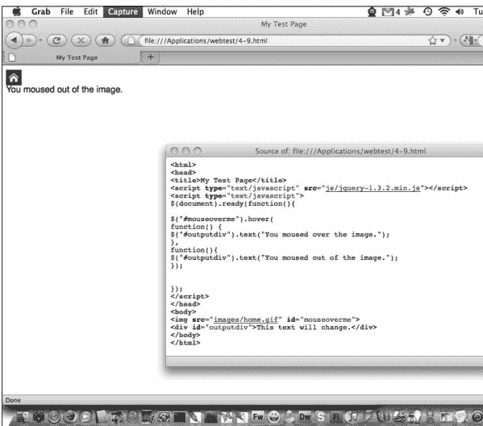

## 切换函数

`toggle` 事件允许你在每次点击元素时执行不同的代码。以下示例允�你在每次用户点击元素时自定义 `<div>` 元素中的文本：

1. 创建一个包含以下代码的网页并保存它：

```
<!DOCTYPE html PUBLIC "-//W3C//DTD XHTML 1.0 Strict//EN"
    "http://www.w3.org/TR/xhtml1/DTD/xhtml1-strict.dtd">
<html>
<head>
<title>My Test Page</title>
<script type="text/javascript" src="js/jquery-1.4.min.js"></script>
<script type="text/javascript">
$(document).ready(function(){

    //Your code goes here.

});
</script>
</head>
<body>

<div id="outputdiv">This text will change.</div>
</body>
</html>
```

2. 将 `// Your code goes here.` 替换为以下代码：

```
$('#toggleme').toggle(
function() {
    $('#outputdiv').text('You clicked the image once.');
},
function(){
    $('#outputdiv').text('You clicked the image twice.');
},
function(){
    $('#outputdiv').text('You clicked the image three times.');
});
```

一个选择器将 `toggle` 事件附加到具有 `toggleme` id 的 `` 元素上。`toggle` 事件内的第一个函数在你第一次点击 `` 元素时更改包含 `outputdiv` id 值的 `<div>` 元素中的文本。第二个函数在你第二次点击图像时更改 `<div>` 元素中的文本，第三个函数在你第三次点击元素时更改 `<div>` 元素中的文本。

`toggle` 事件的语法是 `toggle(function1, function2, function3, function4, ...)`。你首先放置的函数在 `click` 事件首次发生时执行。你在逗号后放置的第二个函数在 `click` 事件再次发生时执行，依此类推。

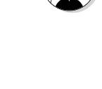

3. 保存此文件，然后在浏览器中打开它。

4. 反复点击图像，注意文本如何变化，如图 4-10 所示。

当你到达函数列表的末尾时，第一个 `toggle` 函数会再次执行。

### 第四章：管理事件

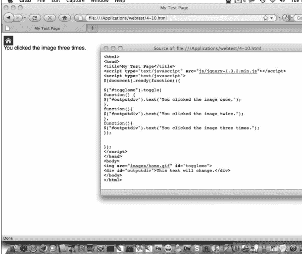

**图 4-10：** 每次点击图像时，`<div>` 元素中的文本都会更改。

## 第二部分：使用效果影响元素


> “你为什么不试试模糊硫磺，然后在地狱之火周围放一个漂亮的光晕效果呢？”

[www.it-ebooks.info](http://www.it-ebooks.info)

> 在本部分中...

在这里，你将能够让页面中的元素变戏法。隐藏它们，显示它们，让它们淡入淡出，甚至让它们在页面上移动。现在轮到你从帽子里拉出兔子了。

## 第五章：与网页元素玩捉迷藏

**本章内容**

- 隐藏元素

- 显示隐藏的元素

- 切换元素的可见性

网页上常用且令人印象深刻的两个效果是隐藏可见页面元素和显示隐藏页面元素。在本章中，你将了解如何使用 jQuery 使网页元素消失、出现以及在可见和不可见之间切换。

要触发元素的隐藏或显示，你可能想要使用一个事件，例如按钮按下或鼠标悬停在图像上。本章使用第四章中讨论的简单事件。

## 使用 jQuery 隐藏元素

你可以作为事件的结果隐藏页面上的元素。本节中的示例向你展示了如何使用各种选择器和事件来隐藏元素。

### 使用按钮按类型隐藏元素

以下示例向你展示了当用户点击页面上的按钮时，如何使 `<div>` 元素内的所有内容消失：

**1. 创建一个包含以下代码的网页：**

```
<!DOCTYPE html PUBLIC "-//W3C//DTD XHTML 1.0 Strict//EN"
"http://www.w3.org/TR/xhtml1/DTD/xhtml1-strict.dtd">
<html>
<head>
<title>My Test Page</title>
<script type="text/javascript" src="js/jquery-1.4.min.js"></script>
<script type="text/javascript">
$(document).ready(function(){

    //Your code goes here.

});
</script>
</head>
<body>
<div>This will be hidden.</div>
<div>This will be hidden.</div>
<input value="Hide" type="submit">
</body>
</html>
```

此代码包含两个 `<div>` 元素和一个按钮。

2. 保存文件，然后在浏览器中查看它。

3. 注意 `<div>` 元素中的文本，如图 5-1 所示。点击按钮；没有任何反应。

4. 将 `// Your code goes here.` 替换为以下代码：

```
$(':submit').click(function () {
    $('div').hide();
});
```

这里发生了很多事情。代码说，“当按钮被点击时，隐藏 `<div>` 元素中的所有内容。”这段代码使用 `:submit` 选择器和 `click` 事件来设置操作。`hide` 函数与 `<div>` 选择器一起使用，隐藏两个 `<div>` 元素。

第三章向你展示了如何使用选择器，第四章向你展示了如何使用事件，例如 `click` 事件。

5. 保存此文件，然后在浏览器中查看它。

6. 点击按钮。

两个 `<div>` 元素中的所有内容现在都被隐藏了，如图 5-2 所示。

在这个例子中，当你点击按钮时，你隐藏了页面中包含 `<div` 选择器的所有元素。通常，作为事件的结果，直接指定要隐藏的特定元素更有意义。

你可以将 `id` 分配给你想要的任何 HTML 元素。如果你想选择页面上的多个元素，也可以使用类选择器。有关选择器的更多信息，请查看第三章。

## 第五章：与网页元素玩捉迷藏

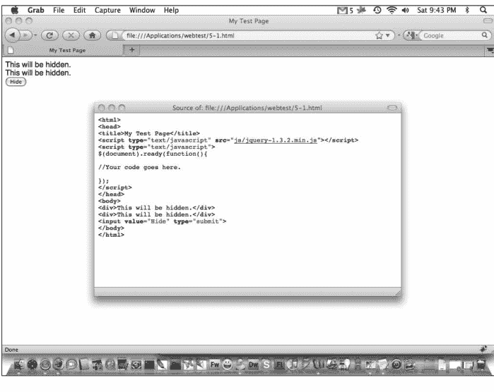

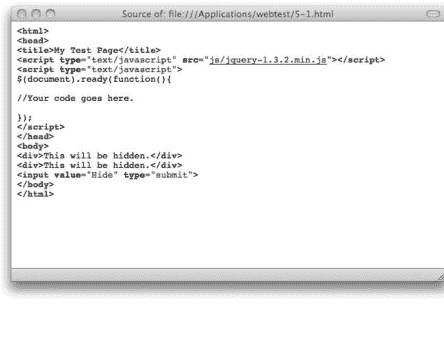

**图5-1：**

包含 `<div>` 元素和一个按钮的网页。

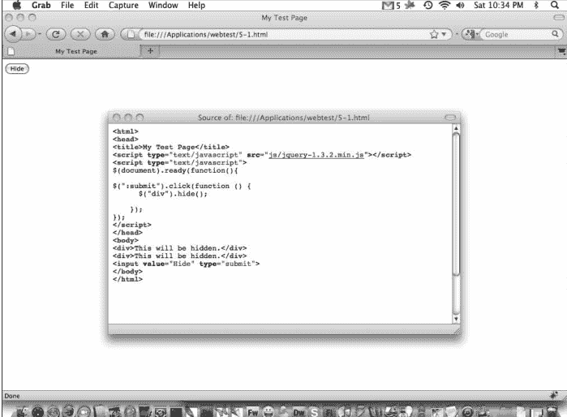

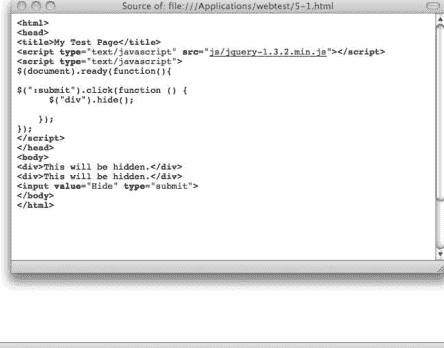

**图5-2：**

当你点击按钮时，`<div>` 元素消失了。

### 通过 id 点击隐藏元素

下一个示例向你展示，当有人点击一个 `<div>` 元素时，如何使该元素内部的所有内容（该元素具有一个 `id`）消失：

1.  创建一个包含以下代码的网页：

```html
<!DOCTYPE html PUBLIC "-//W3C//DTD XHTML 1.0 Strict"
      "http://www.w3.org/TR/xhtml1/DTD/xhtml1-strict.dtd">
<html>
<head>
<title>My Test Page</title>
<script type="text/javascript" src="js/jquery-1.4.min.js"></script>
<script type="text/javascript">
$(document).ready(function(){

//Your code goes here.

});
</script>
</head>
<body>
<div id="hideme">This will be hidden.</div>
<div>This will not be hidden.</div>
</body>
</html>
```

此代码包含一个带有 `id` 属性（名为 `hideme`）的 `<div>` 元素。与前面的示例不同，这里没有按钮。

2.  保存文件，然后在你的浏览器中查看。

注意 `<div>` 元素中的文本，如图5-3所示。

3.  将 `// Your code goes here.` 替换为以下代码：

```javascript
$('#hideme').click(function () {
    $('#hideme').hide();
});
```

这段代码表示，“当按钮被点击时，隐藏带有 `hideme` id 的元素。”该代码使用 `:submit` 选择器和 `click` 事件来设置动作。`hide` 函数与 `id` 选择器一起使用，隐藏带有 `hideme` id 的元素。

4.  保存此文件，然后在你的浏览器中查看。

5.  点击第一行文本，“This will be hidden.”

两个 `<div>` 元素中的所有内容现在都被隐藏了，如图5-4所示。

请注意，第二个 `<div>` 元素在页面上向上移动了。当你隐藏一个元素时，它不仅不可见，而且表现得就像从页面上移除了一样。它下方的所有页面元素都会向上移动。

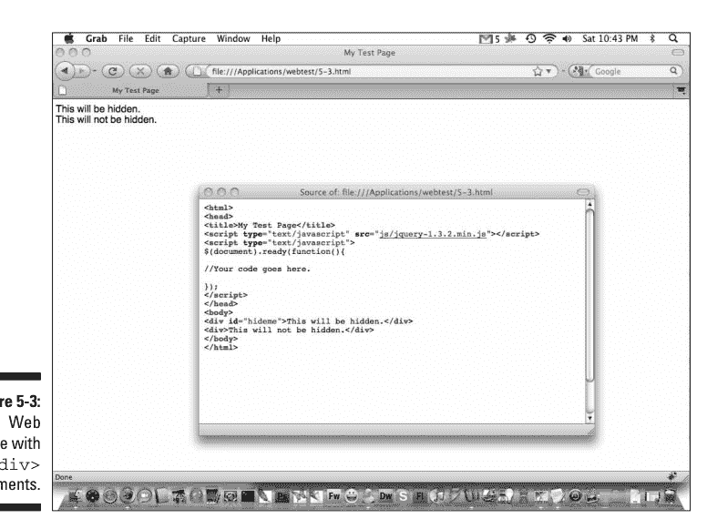

**图5-3：** 包含 `<div>` 元素的网页。

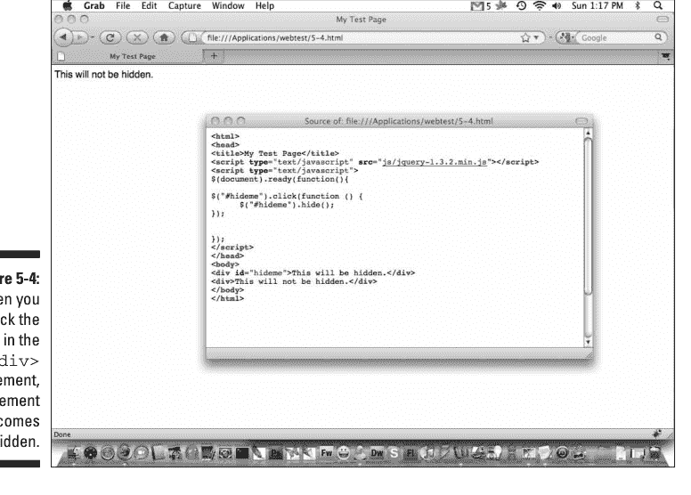

**图5-4：** 当你点击第一个 `<div>` 元素中的文本时，该元素变为隐藏状态。

## 第二部分：使用效果影响元素

### 使用 `this` 关键字隐藏元素

再看一下你在前面的示例中使用的代码：

```javascript
$('#hideme').click(function () {
    $('#hideme').hide();
});
```

外部的 click 事件选择 `hideme` id。内部的 hide 函数也选择相同的 `hideme` id。以下代码使用特殊的 `this` 关键字与 hide 函数一起使用，其工作方式与前面的代码相同：

```javascript
$('#hideme').click(function () {
    $(this).hide();
});
```

在你选择了类 id 或使用任何其他选择器之后，代码块内的函数可以使用 `this` 关键字来引用所选的元素。要测试这一点，请重复上一节中的示例，但在步骤3的代码中用 `this` 替换 '#hideme'。请注意，当你使用 `this` 时，不需要使用引号。

### 使用动画隐藏元素

默认情况下，当你隐藏一个元素时，它会立即消失。`hide` 函数允许你为效果设置动画，使其看起来像是元素正在淡出。要在元素隐藏时添加淡出动画，请按照以下步骤操作：

1.  创建一个包含以下代码的网页：

```html
<!DOCTYPE html PUBLIC "-//W3C//DTD XHTML 1.0 Strict//EN"
    "http://www.w3.org/TR/xhtml1/DTD/xhtml1-strict.dtd">
<html>
<head>
<title>My Test Page</title>
<script type="text/javascript" src="js/jquery-1.4.min.js"></script>
<script type="text/javascript">
$(document).ready(function(){

//Your code goes here.

});
</script>
</head>
<body>
<div id="slowhide">This will be hidden slowly.</div>
<div id="fasthide">This will be hidden quickly.</div>
<div>This will not be hidden.</div>

<input value="Hide" type="submit">
</body>
</html>
```

此代码包含一个按钮和三个 `<div>` 元素，其中两个带有 id。

2.  保存文件，然后在你的浏览器中查看。

3.  注意 `<div>` 元素中的文本，如图5-5所示。点击按钮；什么也不会发生。

4.  将 `// Your code goes here.` 替换为以下代码：

```javascript
$(':submit').click(function () {
    $('#slowhide').hide('slow');
    $('#fasthide').hide('fast');
});
```

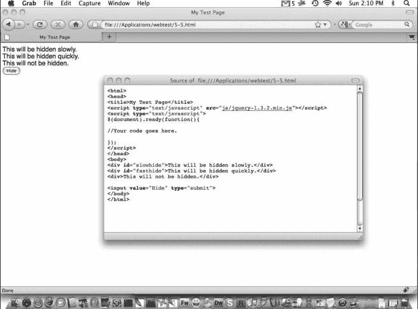

这段代码表示，“当按钮被点击时，以慢速隐藏带有 `slowhide` id 的元素。快速隐藏带有 `fasthide` id 的元素。”这段代码使用 `:submit` 选择器和 click 事件来设置动作。

jQuery 有两个预定义的速度——slow 和 fast。你也可以使用一个数字，该数字表示你希望动画持续的毫秒数。例如，如果我想要一个非常慢的动画，我可以将这行代码

```javascript
$('#slowhide').hide('slow');
```

替换为

```javascript
$('#slowhide').hide(1000);
```

请注意，当你使用数字时，不需要使用引号。此外，数字1000是非常慢的。为了好玩，试试使用10000。淡出效果真的非常非常慢。如果你没有提供速度，那么默认值是400。

5.  保存文件，然后在你的浏览器中查看。

6.  点击按钮。

`<div>` 元素以不同的速度隐藏，按钮和剩余的 `<div>` 元素向上移动，如图5-6所示。

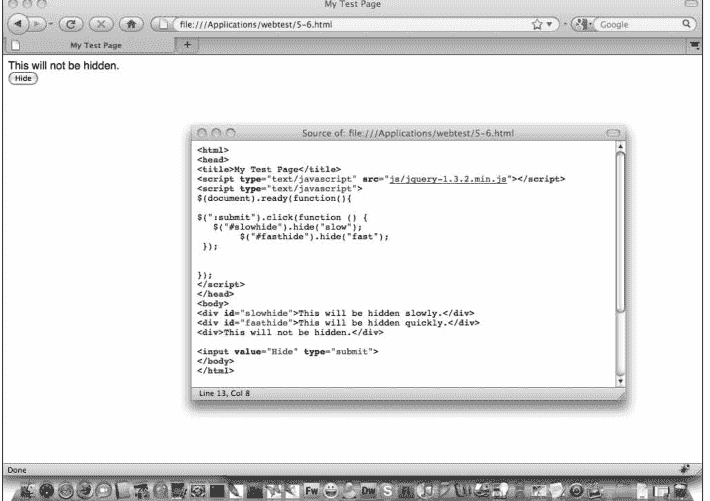

**图5-6：** 当你点击按钮时，`<div>` 元素淡出。

## 使用 jQuery 显示元素

显示隐藏的页面元素与隐藏页面元素类似，只是你必须要有可以显示的内容，也就是说，你必须在显示它们之前已经将它们隐藏。在本节中，示例代码包含隐藏的元素，这些元素会响应事件而显示。

### 通过 id 显示元素

以下示例演示了当有人点击你页面上的一个按钮时，如何使一个隐藏的带有 `id` 的 `<div>` 元素显示出来：

1.  创建一个包含以下代码的网页：

```html
<!DOCTYPE html PUBLIC "-//W3C//DTD XHTML 1.0 Strict//EN"
"http://www.w3.org/TR/xhtml1/DTD/xhtml1-strict.dtd">
<html>
<head>
<title>My Test Page</title>
<script type="text/javascript" src="js/jquery-1.4.min.js"></script>
<script type="text/javascript">
$(document).ready(function(){

//Your code goes here.

});
</script>
</head>
<body>
<div id="showme" style="display:none">This will appear.</div>
<input value="Show" type="submit"></body>
</html>
```

此代码包含一个带有 `id` 属性（名为 `showme`）的 `<div>` 元素。此 `<div>` 元素通过将 CSS `style` 属性设置为 `display:none` 而被设置为隐藏。

2.  保存文件，然后在你的浏览器中查看。

`<div>` 元素未出现在页面上，如图5-7所示。

3.  将 `// Your code goes here.` 替换为以下代码：

```javascript
$(':submit').click(function () {
    $('#showme').show();
});
```

这段代码表示，“当按钮被点击时，显示带有 `showme` id 的元素。”这段代码使用 `:submit` 选择器和 `click` 事件来设置动作。`show` 函数与 `id` 选择器一起使用，显示带有 `showme` id 的元素。

4.  保存此文件，然后在你的浏览器中查看。

5.  点击按钮。

隐藏的 `<div>` 元素现在可见了，如图5-8所示。

请注意，现在可见的 `<div>` 元素如何将按钮向下推移。当一个隐藏的元素变为可见时，它表现得就像被添加到页面上一样。它下方的所有页面元素都会向下移动。此操作称为*浏览器重绘*。

## 第5章：与网页元素玩捉迷藏

### 使用动画显示元素

当你显示一个隐藏的元素时，它会立即出现。与 `hide` 函数类似，`show` 函数允许你让元素看起来像是淡入出现。要为元素显示时添加淡入动画，请遵循以下步骤：

1.  创建一个包含以下代码的网页：

```
<!DOCTYPE html PUBLIC "-//W3C//DTD XHTML 1.0 Strict//EN"
    "http://www.w3.org/TR/xhtml1/DTD/xhtml1-strict.dtd">
<html>
<head>
<title>我的测试页面</title>
<script type="text/javascript" src="js/jquery-1.4.min.js"></script>
<script type="text/javascript">
$(document).ready(function(){

//你的代码放在这里。
```

## 第二部分：用效果影响元素

```
});
</script>
</head>
<body>
<div id="slowshow" style="display:none">这将缓慢显示。</div>
<div id="fastshow" style="display:none">这将快速显示。</div>
<input value="显示" type="submit">
</body>
</html>
```

这段代码包含两个 `<div>` 元素和一个按钮。

2.  保存文件，然后在你的浏览器中查看。

注意，`<div>` 元器中的文本不可见，如图5-9所示。

3.  将 `// Your code goes here.` 替换为以下代码：

```
$(':submit').click(function () {
    $('#slowshow').show(2000);
    $('#fastshow').show(500);
});
```

图5-9：包含隐藏 `<div>` 元素和按钮的网页。

## 第5章：与网页元素玩捉迷藏

这段代码的意思是：“当按钮被点击时，以2000毫秒的速度显示 `slowshow` id的元素。以500毫秒的速度显示 `fastshow` id的元素。” 这段代码使用了 `:submit` 选择器和 `click` 事件来设置操作。

> 记住

你可以使用三种预定义速度——慢速、中速和快速——或者使用一个数字来表示你希望动画发生的毫秒数。

4.  保存此文件，然后在你的浏览器中查看。

5.  点击按钮。

`<div>` 元素以不同的速度出现，按钮向下移动，如图5-10所示。

图5-10：当你点击按钮时，`<div>` 元素淡入出现。

## 使用jQuery切换可见性

能够显示和隐藏元素很方便，但如果你想在隐藏和显示元素之间来回切换时会怎样呢？`toggle` 函数会为你处理这些任务。

## 第二部分：用效果影响元素

### 使用切换功能

以下示例向你展示，当有人重复点击你页面上的按钮时，如何使 `<div>` 元素内的所有内容在隐藏和显示之间切换：

1.  创建一个包含以下代码的网页：

```
<!DOCTYPE html PUBLIC "-//W3C//DTD XHTML 1.0 Strict//EN"
            "http://www.w3.org/TR/xhtml1/DTD/xhtml1-strict.dtd">
<html>
<head>
<title>我的测试页面</title>
<script type="text/javascript" src="js/jquery-1.4.min.js"></script>
<script type="text/javascript">
$(document).ready(function(){

    //你的代码放在这里。

});
</script>
</head>
<body>
<div>这将被隐藏。</div>
<div>这将被隐藏。</div>
<input value="切换" type="submit">
</body>
</html>
```

这段代码包含两个 `<div>` 元素和一个按钮。

2.  将 `// Your code goes here.` 替换为以下代码：

```
$(':submit').click(function () {
    $('div').toggle();
});
```

这段代码的意思是：“当按钮被点击时，如果 `<div>` 元素是显示的，则隐藏它们；如果它们是隐藏的，则显示它们。” 这段代码使用了 `:submit` 选择器和 `click` 事件来设置操作。`toggle` 函数与 `<div>` 选择器一起使用，会切换两个 `<div>` 元素。

3.  保存此文件，然后在你的浏览器中查看。

4.  点击按钮。

第一次点击时，两个 `<div>` 元素中的所有内容现在都被隐藏了，如图5-11所示。

## 第5章：与网页元素玩捉迷藏

5.  再次点击按钮，使 `<div>` 元素中的所有内容重新出现。

6.  找到代码 `<body>` 部分中的第二个 `<div>`，并将其替换为这一行：

`<div style="display:none">这是初始隐藏的。</div>`

这会在页面加载时隐藏第二个 `<div>` 元素。

7.  保存此文件，然后在你的浏览器中查看。

8.  点击按钮。

现在当你加载页面时，你只能看到第一个 `<div>` 元素。

点击按�会使第一个 `<div>` 元素消失，第二个出现，如图5-12所示。

9.  再次点击按钮以切换两个 `<div>` 元素。

## 第二部分：用效果影响元素

### 使用动画切换

你可以通过向 `toggle` 函数添加速度设置来使用动画进行切换，就像你可以用 `hide` 和 `show` 函数一样。要为 `toggle` 函数添加动画，请遵循以下步骤：

1.  创建一个包含以下代码的网页：

```
<!DOCTYPE html PUBLIC "-//W3C//DTD XHTML 1.0 Strict//EN"
			"http://www.w3.org/TR/xhtml1/DTD/xhtml1-strict.dtd">
<html>
<head>
<title>我的测试页面</title>
<script type="text/javascript" src="js/jquery-1.4.min.js"></script>
<script type="text/javascript">
$(document).ready(function(){

	//你的代码放在这里。

});
</script>
</head>
<body>
<div>这将被隐藏。</div>
<div style="display:none">这是初始隐藏的。</div>
<input value="切换" type="submit">
</body>
</html>
```

```
});
</script>
</head>
<body>
<div>这将是一个动画切换。</div>
<input value="切换" type="submit">
</body>
</html>
```

2.  将 `// Your code goes here.` 替换为以下代码：

```
$(':submit').click(function () {
    $('div').toggle('slow');
});
```

此代码中的 `toggle` 函数设置为慢速。

3.  保存此文件，然后在你的浏览器中查看。

4.  点击按钮。

现在，每次点击按钮时，`<div>` 元素都会缓慢淡出或淡入，如图5-13所示。

图5-13：`<div>` 切换淡入和淡出。

## 第88页 第二部分：用效果影响元素

### 使用回调函数

本章中的三个效果——hide、show和toggle——都允许你添加回调函数。*回调函数*是在效果完成后执行的代码。以下是使用回调函数的代码示例，该示例在切换元素后打开一个警告框：

1.  创建一个包含以下代码的网页：

```
<!DOCTYPE html PUBLIC "-//W3C//DTD XHTML 1.0 Strict//EN"
    "http://www.w3.org/TR/xhtml1/DTD/xhtml1-strict.dtd">
<html>
<head>
<title>我的测试页面</title>
<script type="text/javascript" src="js/jquery-1.4.min.js"></script>
<script type="text/javascript">
$(document).ready(function(){

    //你的代码放在这里。

});
</script>
</head>
<body>
<div>这将是一个动画切换。</div>
<input value="切换" type="submit">
</body>
</html>
```

2.  将 `// Your code goes here.` 替换为以下代码：

```
$(':submit').click(function () {
    $('div').toggle('slow',
    function callback() {
        alert('切换已完成')
    });
});
```

此代码对任何 `<div>` 元素执行动画切换。当切换动画完成时，会出现一个警告框。

仔细观察回调函数的语法。`toggle` 函数使用以下语法：

```
toggle(speed, function callback(){})
```

如果你不想为你的切换添加动画，你可以删除 `speed` 设置并使用此代码：

```
toggle(function callback(){})
```

## 第5章：与网页元素玩捉迷藏

3.  保存此文件，然后在你的浏览器中查看。

4.  点击按钮。

现在，每次点击按钮时，`<div>` 元素都会缓慢淡出或淡入。然后回调函数会打开警告框，表明效果已完成，如图5-14所示。

你也可以对 `show` 和 `hide` 函数以及 `toggle` 函数使用回调函数。

图5-14：动画完成时，回调函数打开一个警告框。

# 第二部分：使用特效影响元素

## 第六章：滑动与淡入淡出网页元素

**本章内容**

- ► 滑动元素上下显示

- ► 控制滑动速度

- ► 淡入淡出元素

- ► 使元素半透明

jQuery 让实现淡入淡出和滑动这两种令人印象深刻的特效变得轻而易举。当元素淡出时，它会从完全不透明变为半透明或完全透明。当元素滑动时，它会从页面上慢慢出现，可以从上往下或从下往上滑入。

本章中，你将学习如何滑动和淡入淡出元素，以及如何控制这些特效发生的速度。你还将了解如何使用回调函数——即在特效完成后执行的代码。

## 使用 jQuery 滑动元素

*滑动*特效指的是一个元素从上往下或从下往上逐渐变得可见。页面上除了该元素在变得可见的过程中，并无其他东西移动。

当你将向下和向上滑动特效应用于图片或带有背景色的区块时，效果会更加显著。因此，本章中的示例使用带有背景色和图片的 `<div>` 区块来演示这些特效。


### 向下滑动

要使网页元素呈现向下滑动的效果，首先需要隐藏该元素。要隐藏元素，需将其样式属性设置为 `display=none`。

本章的大多数示例使用图片，并且当图片较大时效果更明显。如果你的测试图片目录中没有保存大图片文件，可以从以下地址获取一张：

```
http://media.wiley.com/spa_assets/site/dummies2/include/images/bg/hp-header-bg.gif
```

浏览到此地址，选择“文件” > “另存为”。将图片保存到你用于测试代码的 `images` 目录中，该目录在第1章中已创建。将图片命名为 `big.gif`。

要使用向下滑动特效使页面元素出现，请按照以下步骤操作：

1.  创建一个包含以下代码的网页：

```html
<!DOCTYPE html PUBLIC "-//W3C//DTD XHTML 1.0 Strict//EN"
  "http://www.w3.org/TR/xhtml1/DTD/xhtml1-strict.dtd">
<html>
<head>
<title>我的测试页面</title>
<script type="text/javascript" src="js/jquery-1.4.min.js"></script>
<script type="text/javascript">
$(document).ready(function(){
  //你的代码放在这里。
});
</script>
</head>
<body>
<div style="display:none"> </div>
<input value="向下滑动" type="submit">
</body>
</html>
```

此代码包含一个隐藏的 `<div>` 元素（内含图片）和一个按钮。

2.  保存文件，然后在浏览器中查看。

3.  注意图片没有出现（参见图6-1）。点击按钮；没有任何反应。

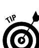

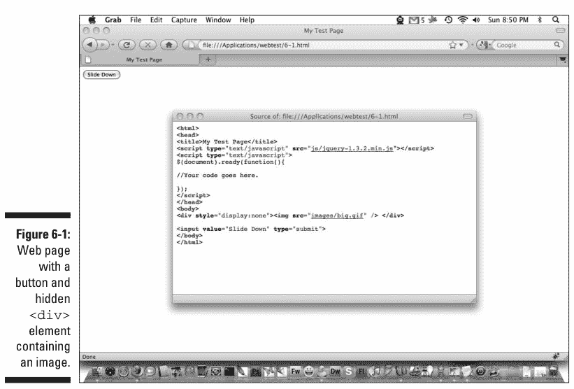

**4. 将 // Your code goes here. 替换为以下代码：**

```javascript
$(':submit').click(function () {
    $('div').slideDown();
});
```

这段代码的意思是：“当按钮被点击时，使用 slideDown 特效使 `<div>` 元素中的所有内容出现。” 此代码使用了 `:submit` 选择器和 `click` 事件来设置该操作。

第3章介绍了如何使用选择器，第4章介绍了如何使用事件（如 `click` 事件）。

**5. 保存此文件，然后在浏览器中查看。**

**6. 点击按钮。**

slideDown 特效使隐藏的 `<div>` 元素中的图片从上往下出现，如图6-2所示。

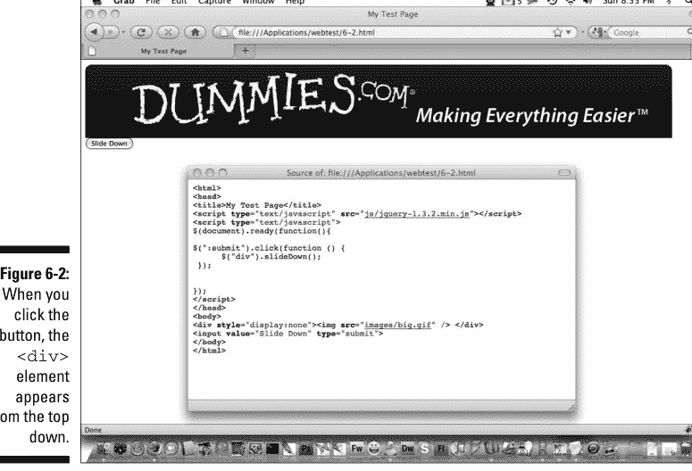

**图6-2：** 当你点击按钮时，`<div>` 元素从上往下出现。

### 向上滑动

向上滑动特效通过使元素向上滑动来隐藏它。

要使用向上滑动特效使页面上的元素消失，请按照以下步骤操作：

1.  创建一个包含以下代码的网页：

```html
<!DOCTYPE html PUBLIC "-//W3C//DTD XHTML 1.0 Strict//EN"
         "http://www.w3.org/TR/xhtml1/DTD/xhtml1-strict.dtd">
<html>
<head>
<title>我的测试页面</title>
<script type="text/javascript" src="js/jquery-1.4.min.js"></script>
<script type="text/javascript">
$(document).ready(function(){

//你的代码放在这里。

});
</script>
</head>
<body>
<div> </div>
<input value="向上滑动" type="submit"></body>
</html>
```

此代码包含一个带有图片的 `<div>` 元素和一个按钮。

2.  保存文件，然后在浏览器中查看。

注意图片出现了，如图6-3所示。

3.  将 // Your code goes here. 替换为以下代码：

```javascript
$(':submit').click(function () {
    $('div').slideUp();
});
```

这段代码的意思是：“当按钮被点击时，使用 `slideUp` 特效使 `<div>` 中的所有内容消失。” 此代码使用了 `:submit` 选择器和 `click` 事件。

4.  保存此文件，然后在浏览器中查看。

5.  点击按钮。

`slideUp` 特效使 `<div>` 元素中的图片向上滑动，然后从视图中消失，如图6-4所示。

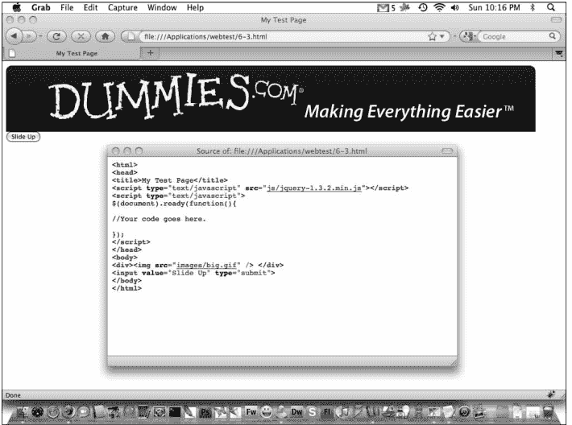

**图6-3：** 包含一个按钮和一个内含图片的 `<div>` 元素的网页。

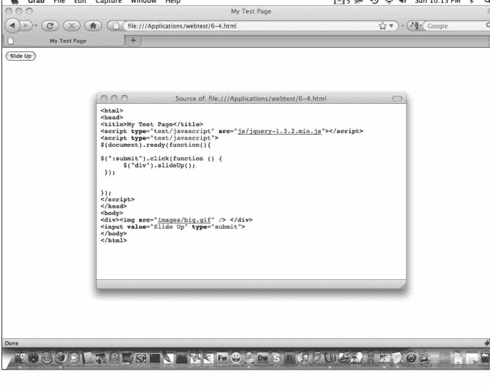

**图6-4：** 当你点击按钮时，`<div>` 元素通过向上滑动而消失。

### 改变滑动速度

你可以通过速度设置来控制向上或向下滚动特效的速度。jQuery 有三个预定义的速度：slow、medium 和 fast。你也可以使用一个数字来表示你希望动画发生的毫秒数。例如，如果我想要一个非常慢的向上滑动，我可以使用这行代码

```javascript
$('div').slideUp('slow');
```

或

```javascript
$('div').slideUp(1000);
```

注意，当你使用数字时，不需要加引号。另外，数字 1000 表示非常慢。向下滑动特效的工作方式相同。

### 使用切换效果进行滑动

向上和向下滑动特效共同作用，用于隐藏和显示元器。你可以使用切换滑动特效，让访问者在向上滑动和向下滑动之间切换。要使用切换滑动特效，请按照以下步骤操作：

1.  创建一个包含以下代码的网页：

```html
<!DOCTYPE html PUBLIC "-//W3C//DTD XHTML 1.0 Strict//EN"
         "http://www.w3.org/TR/xhtml1/DTD/xhtml1-strict.dtd">
<html>
<head>
<title>我的测试页面</title>
<script type="text/javascript" src="js/jquery-1.4.min.js"></script>
<script type="text/javascript">
$(document).ready(function(){

//你的代码放在这里。

});
</script>
</head>
<body>
<div></div>
<input value="切换滑动" type="submit">
</body>
</html>
```

此代码包含一个按钮和一个包含图片的可见 `<div>` 元素。

2.  将 // Your code goes here. 替换为以下代码：

```javascript
$(':submit').click(function () {
    $('div').slideToggle();
});
```

这段代码的意思是：“当按钮被点击时，切换所有 `<div>` 元素：如果它们是显示状态，则向上滑动隐藏；如果它们是隐藏状态，则向下滑动显示。” 此代码使用了 `:submit` 选择器和 `click` 事件来设置操作。`toggle` 函数切换了 `<div>` 元素的状态。

3.  保存此文件，然后在浏览器中查看。

4.  点击按钮。

第一次点击时，`<div>` 元素中的所有内容向上滑动消失，如图6-5所示。

5.  再次点击按钮，使 `<div>` 元素中的所有内容向下滑动显示。

### 使用回调函数进行滑动

向上滑动、向下滑动和切换滑动特效允许你使用一个*回调*函数，即在特效完成后执行的代码。这是一个使用回调函数的代码示例，在元素切换状态后打开一个警告框：

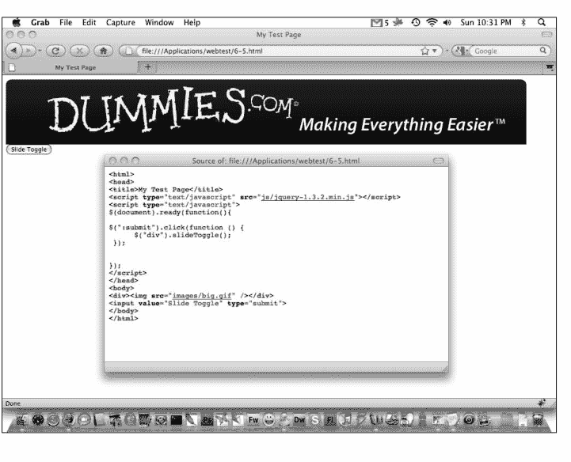

图6-5：当你点击按钮时，`<div>` 元素在向上和向下滑动之间切换。

1.  创建一个包含以下代码的网页：

```html
<!DOCTYPE html PUBLIC "-//W3C//DTD XHTML 1.0 Strict//EN"
       "http://www.w3.org/TR/xhtml1/DTD/xhtml1-strict.dtd">
<html>
<head>
<title>我的测试页面</title>
<script type="text/javascript" src="js/jquery-1.4.min.js"></script>
<script type="text/javascript">
$(document).ready(function(){

//你的代码放在这里。
});
</script>
</head>
<body>
<div></div>
<input value="切换滑动" type="submit">
</body>
</html>
```

2.  将 // Your code goes here. 替换为以下代码：

```javascript
$(':submit').click(function () {
    $('div').slideToggle(
function callback() {
```

## 第六章：网页元素的滑动与淡入淡出效果

```
alert('The slide effect is finished')
});
});
```

此代码会对所有`<div>`元素执行滑动切换。当滑动动画完成后，会弹出一个提示框。滑动切换函数使用以下语法：

```
slideToggle(speed, function callback(){});
```

如果你不想对切换进行动画处理，可以删除速度设置，并使用以下代码：

```
slideToggle(function callback(){});
```

3.  保存此文件，然后在浏览器中查看。

4.  点击按钮。

现在，每次点击按钮，`<div>`元素都会上下滚动。然后回调函数会打开提示框，表明效果已完成，如图6-6所示。

> 请记住

> 你也可以将回调函数与向上滑动、向下滑动效果以及滑动切换函数一起使用。

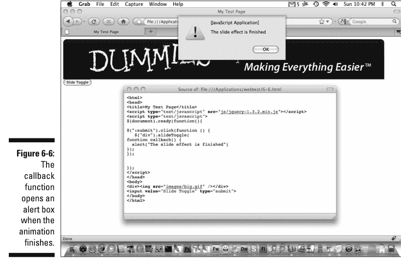

## 第二部分：使用效果影响元素

## 使用jQuery实现元素淡入淡出

*淡入淡出效果*是指一个元素通过随时间变得越来越透明而淡出，直到消失；或者通过变得不那么透明而淡入。jQuery提供了淡出和淡入效果，还允许你部分地淡化元素，使其变为半透明。

## 淡入

要使一个页面元素淡入，首先需要将其隐藏。你可以通过将元素的style属性设置为`display=none`来实现。

要跟随以下练习，你需要一个用于测试代码的`images`目录中的图像。将此图像命名为`big.gif`。

要使元素呈现出淡入效果，请按照以下步骤操作：

1.  创建一个包含以下代码的网页：


# 第六章：淡入淡出效果

## 淡入

淡入效果获取一个隐藏的元素，并通过使其呈现出淡入效果来显示它。

要使用淡入效果使页面上的元素出现，请按照以下步骤操作：

1. 创建一个包含以下代码的网页：

```html
<!DOCTYPE html PUBLIC "-//W3C//DTD XHTML 1.0 Strict//EN"
"http://www.w3.org/TR/xhtml1/DTD/xhtml1-strict.dtd">
<html>
<head>
<title>My Test Page</title>
<script type="text/javascript" src="js/jquery-1.4.min.js"></script>
<script type="text/javascript">
$(document).ready(function(){

//Your code goes here.

});
</script>
</head>
<body>
<div style="display:none"> </div>
<input value="Fade In" type="submit">
</body>
</html>
```

此代码包含一个按钮和一个带有图像的隐藏`<div>`元素。

2. 保存文件，然后在浏览器中查看。

图像不会显示（参见图6-7）。

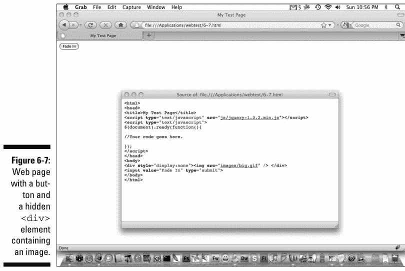

3. 将 `// Your code goes here.` 替换为以下代码：

```javascript
$(':submit').click(function () {
    $('div').fadeIn();
});
```

这段代码的意思是：“当按钮被点击时，让`<div>`中的所有内容淡入。”此代码使用了`:submit`选择器和`click`事件。

4. 保存此文件，然后在浏览器中查看。

5. 点击按钮。

隐藏的`<div>`元素中的图像似乎淡入了，如图6-8所示。

6. 将 `$('div').fadeIn();` 替换为以下代码：

```javascript
$('div').fadeIn('fast');
```

现在，当你保存并在浏览器中重新加载此文件，然后点击按钮时，淡入效果会发生得更快。

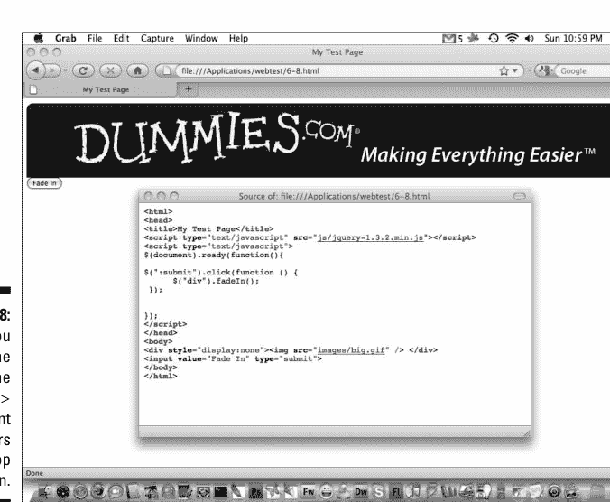

图6-8：当你点击按钮时，`<div>`元素从上到下出现。

## 淡出

淡出效果获取一个可见的元素，并通过使其呈现出淡出效果来隐藏它。

要使用淡出效果使页面上的元素消失，请按照以下步骤操作：

1. 创建一个包含以下代码的网页：

```html
<!DOCTYPE html PUBLIC "-//W3C//DTD XHTML 1.0 Strict//EN"
    "http://www.w3.org/TR/xhtml1/DTD/xhtml1-strict.dtd">
<html>
<head>
<title>My Test Page</title>
<script type="text/javascript" src="js/jquery-1.4.min.js"></script>
<script type="text/javascript">
$(document).ready(function(){

//Your code goes here.

});
</script>
</head>
<body>
<div> </div>
<input value="Fade Out" type="submit">
</body>
</html>
```

此代码包含一个按钮和一个带有图像的`<div>`元素。

2. 保存文件，然后在浏览器中查看。

图像可见，如图6-9所示。

3. 将 `// Your code goes here.` 替换为以下代码：

```javascript
$(':submit').click(function () {
    $('div').fadeOut();
});
```

这段代码的意思是：“当按钮被点击时，使用`fadeOut`效果使`<div>`元素中的所有内容消失。”此代码使用了`:submit`选择器和`click`事件。

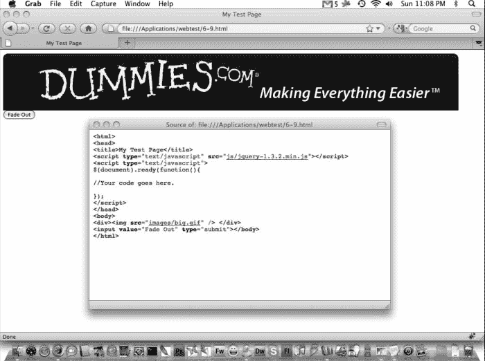

4. 保存此文件，然后在浏览器中重新加载它。

5. 点击按钮。

`<div>`元素中的图像淡出并从视图中消失（参见图6-10）。

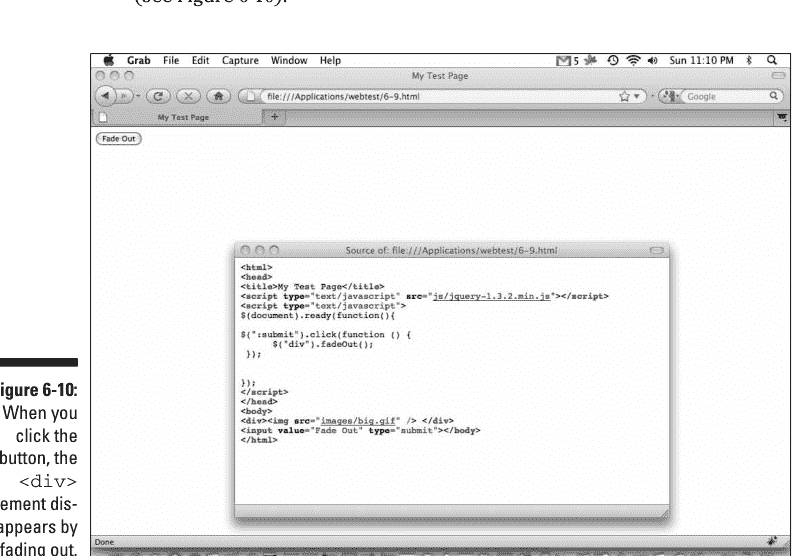

图6-10：当你点击按钮时，`<div>`元素通过淡出消失。

## 部分淡入淡出

jQuery提供了一个淡入淡出效果，允许元素淡化一定程度并变为透明。函数语法是：

```javascript
fadeTo(speed, percent, [callback]);
```

`percent`以小数形式表示，用于控制元素淡出的程度。例如，如果你想让某个元素淡出一半，就使用.5作为`percent`值。

`callback`函数是可选的，但你必须指定一个`speed`和一个`percent`。与其他效果不同，必须指定持续时间。

要使元素部分淡出，请按照以下步骤操作：

1. 创建一个包含以下代码的网页：

```html
<!DOCTYPE html PUBLIC "-//W3C//DTD XHTML 1.0 Strict//EN"
    "http://www.w3.org/TR/xhtml1/DTD/xhtml1-strict.dtd">
<html>
<head>
<title>My Test Page</title>
<script type="text/javascript" src="js/jquery-1.4.min.js"></script>
<script type="text/javascript">
$(document).ready(function(){

    //Your code goes here.

});
</script>
</head>
<body>
<div> </div>
<input value="Partial Fade" type="submit">
</body>
</html>
```

2. 保存文件。

3. 将 `// Your code goes here.` 替换为以下代码：

```javascript
$(':submit').click(function () {
    $('div').fadeTo('slow', .55);
});
```

这段代码的意思是：“当按钮被点击时，让`<div>`元素中的所有内容以50%的程度淡出。”

4. 保存此文件，然后在浏览器中查看。

5. 点击按钮。

`<div>`元素中的图像似乎部分淡出了，如图6-11所示。


图6-11：当你点击按钮时，`<div>`元素部分淡出。

# 第七章：网页元素的动画

## 本章内容

- 动画高度和宽度
- 动画字体大小和单词间距
- 动态停止动画
- 控制动画速度

第五章向你展示了如何对网页元素的隐藏和显示进行动画处理。第六章讨论了更多的动画效果：滑动和淡入淡出。除了这些预设的效果外，jQuery还允许你轻松地为元素的许多CSS样式设置进行动画处理。这些样式设置包括字体大小、图像或`<div>`元素的高度和宽度。事实上，任何数值类型的CSS值都可以进行动画处理。借助jQuery动画，你可以使页面元素随时间变大或变小，或者在页面上移动。

在本章中，你将学习如何对元素和元素属性（如高度和宽度）进行动画处理。你还将了解如何控制动画速度，以及如何根据事件停止和启动动画。

## 理解jQuery动画的工作原理

jQuery允许你对与HTML元素相关的许多CSS样式设置进行动画处理。考虑以下代码：

```html
<div style="width:200px; height:200px; background-color: gray; border:10px; border-color:red; border-style:dotted ">My div</div>
```

此代码创建了一个带有粗体、红色虚线边框的灰色方框，如图7-1所示。

此代码中的 `<div>` 元素与以下样式相关联：

- **width**：`<div>` 的宽度，以像素为单位
- **height**：`<div>` 的高度，以像素为单位
- **border**：`<div>` 周围边框的厚度，以像素为单位
- **background-color**：`<div>` 的颜色
- **border-color**：边框的颜色
- **border-style**：边框的外观

jQuery 可以对 `width`、`height` 和 `border` 进行动画。这些值都是数值，因此可以增长或缩小。

关于可动画化的对象存在一些限制。jQuery 无法在动画中将一个样式设置从一种颜色更改为另一种颜色，也无法改变边框的样式。但是，你可以使用插件来为颜色添加动画效果。更多信息，请访问 `http://plugins.jquery.com/project/color`。

这是一个对 `<div>` 元素的高度和宽度进行动画的代码示例。动手试试看吧。下面是代码功能的解释：

```html
<head>
<title>My Test Page</title>
<script type="text/javascript" src="js/jquery-1.4.min.js"></script>
<script type="text/javascript">
$(document).ready(function(){
    $(':submit').click(function(){
        $('div').animate({
            width: '280px',
            height: '140px'
        });
    });
});
</script>
</head>
<body>
<div style="width:200px; height:200px; background-color: gray; border:10px">My div</div>
<br />
<input value="Animate" type="submit">
</body>
</html>
```

这段代码对 `<div>` 元素进行动画，将其宽度从200像素变为280像素，高度从200像素变为140像素，如图7-2所示。

图7-2：动画后具有不同高度和宽度的 `<div>` 元素。

这段代码的核心是 `animate` 函数。jQuery animate函数的一个简单语法形式是

```javascript
animate(params, duration, callback)
```

该函数包含三个部分：

- **params**：要动画化的样式规则的逗号分隔列表。例如：`width: '100px', right: '600px'`
- **duration**：一个可选参数，用于控制动画速度。可接受的值有 slow、medium、fast，或表示速度的毫秒数值。
- **callback**：一个可选的代码块，在动画完成后执行。

一个可选的 easing 参数指定动画是在接近结束时变快，还是开始时变快然后变慢。Easing 需要一个额外的插件。在 jquery.com 上了解更多关于它的信息。

当你查看 jQuery 代码示例时，你可能会注意到 jQuery 的样式元素有时与 CSS 样式元素的命名略有不同。CSS 样式使用连字符（例如，`border-width`），而 jQuery 版本省略连字符，将单词连在一起，并将第二个单词首字母大写（例如，`borderWidth`）。jQuery 可以使用任一版本。

将两个连写的单词的第二个单词首字母大写的实践，例如 `borderWidth`，被称为 *驼峰命名法（camel case）*，因为大写字母使得表达式看起来中间有一个驼峰，就像骆驼一样。这可不是我编的！

以下是更多可以使用 jQuery 进行动画的常见样式。驼峰命名法和连字符版本都可以在 jQuery 中使用。

- **borderWidth (border-width)**：四条边框的宽度。你也可以使用 `border-bottom-width`、`border-left-width`、`border-right-width` **和** `border-top-width` 单独设置每条边框的宽度。
- **height**：元素的高度。
- **width**：元素的宽度。
- **fontSize (font-size)**：文本的字体大小。
- **margin**：元素的外边距。你也可以使用 `margin-bottom`、`margin-left`、`margin-right` **和** `margin-top` 单独设置每个外边距。
- **padding**：内边距，或元素周围的间距。你也可以使用 `padding-bottom`、`padding-left`、`padding-right` 和 `padding-top` 为每一边单独设置内边距。
- **bottom**：定位框的下外边距边界。
- **left**：定位框的左外边距边界。
- **right**：定位框的右外边距边界。
- **top**：定位框的上外边距边界。
- **wordSpacing (word-spacing)**：增加或减少单词之间的间距。

## 使用 jQuery 为元素添加动画

本节包含 jQuery 可以动画化的不同元素类型和 CSS 样式的示例。请记住，你可以将许多样式与不同元素混合搭配使用。例如，你可以将 `width` 样式同时用于 `<div>` 元素和 `` 元素。

### 动画化高度和宽度

要为元素的高度和宽度添加动画，请按照以下步骤操作：

1. 创建一个包含以下代码的网页：

```html
<!DOCTYPE html PUBLIC "-//W3C//DTD XHTML 1.0 Strict//EN"
    "http://www.w3.org/TR/xhtml1/DTD/xhtml1-strict.dtd">
<html>
<head>
<title>My Test Page</title>
<script type="text/javascript" src="js/jquery-1.4.min.js"></script>
<script type="text/javascript">
$(document).ready(function(){

    //Your code goes here.

});
</script>
</head>
<body>
<div style="width:200px; height:200px;
background-color: gray; border:10px">My div</div>
<br />
<input value="Animate" type="submit"></body>
</html>
```

这段代码包含一个 `<div>` 元素和一个按钮。

2. 将 `// Your code goes here.` 替换为以下代码：

```javascript
$(':submit').click(function(){
    $('div').animate({
        width:'280px', height: '500px'
    });
});
```

这段代码的意思是：“当按钮被点击时，让 `<div>` 元素动画变为280像素宽和500像素高。” 这段代码使用 `:submit` 选择器和 `click` 事件来设置该动作。

第3章向你展示如何使用选择器，第4章向你展示如何使用事件，例如 `click` 事件。

3. 保存此文件，然后在浏览器中查看它。

4. 点击按钮。

`<div>` 元素将动画化，并从200像素乘以200像素增长到280像素乘以600像素，如图7-3所示。

图7-3：当你点击按钮时，`<div>` 元素动画化并增长。

5. 将 `width:'280px', height: '500px'` 替换为

```javascript
width:'20px', height: '50px'
```

这将使原始的 `<div>` 元素缩小而不是增长。

6. 保存此文件，然后在浏览器中查看它。

7. 点击按钮。

`<div>` 元素将动画化，并从200像素乘以200像素缩小到20像素乘以50像素，如图7-4所示。请注意，`<div>` 元素内的文本会自动换行以适应较小的空间。

图7-4：当你点击按钮时，`<div>` 元素动画化并缩小。

### 动画化外边距宽度和内边距

要为元素的外边距和内边距添加动画，请按照以下步骤操作：

1. 创建一个包含以下代码的网页：

```html
<!DOCTYPE html PUBLIC "-//W3C//DTD XHTML 1.0 Strict//EN"
    "http://www.w3.org/TR/xhtml1/DTD/xhtml1-strict.dtd">
<html>
<head>
<title>My Test Page</title>
<script type="text/javascript" src="js/jquery-1.4.min.js"></script>
<script type="text/javascript">
$(document).ready(function(){

//Your code goes here.

});
</script>
</head>
<body>
<div style="width:200px; height:200px;
background-color: gray; border:10px">My div</div>
<br />
<input value="Animate" type="submit"></body>
</html>
```

这段代码包含一个 `<div>` 元素和一个按钮。

2. 将 `// Your code goes here.` 替换为以下代码：

```javascript
$(':submit').click(function(){
    $('div').animate({
        margin:'50px'
    });
});
```

这段代码的意思是：“当按钮被点击时，将 `<div>` 元素的外边距动画化为50像素宽。”

3. 保存此文件，然后在浏览器中查看它。

4. 点击按钮。

`<div>` 元素的外边距将动画化，从0增长到50像素，如图7-5所示。

### 透明度动画

jQuery 允许你对元素的透明度进行动画处理，使其呈现出从半透明状态淡入淡出的效果。要制作透明度动画，请遵循以下步骤：

1. 创建一个包含以下代码的网页：

```html
<!DOCTYPE html PUBLIC "-//W3C//DTD XHTML 1.0 Strict//EN"
    "http://www.w3.org/TR/xhtml1/DTD/xhtml1-strict.dtd">
<html>
<head>
<title>My Test Page</title>
<script type="text/javascript" src="js/jquery-1.4.min.js"></script>
<script type="text/javascript">
$(document).ready(function(){

    //Your code goes here.

});
</script>
</head>
<body>
<div class="fadethis" style="width:200px; height:200px;
background-color: red; border:10px">My div</div>
<br />

<br />
<input value="Animate" type="submit"></body>
</html>
```

这段代码包含一个 `<div>` 元素和一个图像，它们具有相同的类名 `fadethis`。

你可以将类名命名为任何你想要的名称。类允许你轻松地使用相同的选择器来选择多个元素。

2. 将 `// Your code goes here.` 替换为以下代码：

```javascript
$(':submit').click(function(){
    $('.fadethis').animate({
        opacity: 0.25
    });
});
```

这段代码的含义是：“当按钮被点击时，将所有 `fadethis` 类的元素动画化至 0.25 的透明度（25%）。”

3. 保存此文件，然后在浏览器中查看。

4. 点击按钮。

`<div>` 元素和 `` 元素都会进行动画处理，并淡出至 25% 的透明度，如图 7-7 所示。


图 7-7：当你点击按钮时，`<div>` 和 `` 元素会淡出至 25% 的透明度。

### 字体大小和单词间距动画

要制作文本缩小或放大的动画，并改变单词之间的间距，请遵循以下步骤：

1. 创建一个包含以下代码的网页：

```html
<!DOCTYPE html PUBLIC "-//W3C//DTD XHTML 1.0 Strict//EN"
         "http://www.w3.org/TR/xhtml1/DTD/xhtml1-strict.dtd">
<html>
<head>
<title>My Test Page</title>
<script type="text/javascript" src="js/jquery-1.4.min.js"></script>
<script type="text/javascript">
$(document).ready(function(){

    //Your code goes here.

});
</script>
</head>
<body>
<div>I'd like to say a few short words.</div>
<br />
<input value="Animate" type="submit"></body>
</html>
```

这段代码包含一个带有一些文本的 `<div>` 元素。

2. 将 `// Your code goes here.` 替换为以下代码：

```javascript
$(':submit').click(function(){
    $('div').animate({
        fontSize: '100px'
    });
});
```

虽然你正在改变名为 `font-size` 的 CSS 样式，但请确保在使用 `animate` 函数时使用 `fontSize`。

这段代码的含义是：“当按钮被点击时，对 `<div>` 元素中的文本进行动画处理，将其字体大小增加到 100px。”

3. 保存此文件，然后在浏览器中查看。

4. 点击按钮。

`<div>` 元素中的文本会进行动画处理并增长到 100px，如图 7-8 所示。


图 7-8：当你点击按钮时，`<div>` 元素中的文本会进行动画处理并增长。

5. 将 `fontSize: '100px'` 替换为

```javascript
wordSpacing:'50px'
```

6. 保存此文件，然后在浏览器中查看。

7. 点击按钮。

`<div>` 元素中每个单词之间的间距会进行动画处理并增加，如图 7-9 所示。


## 控制动画时长

你可以使用 `duration` 参数来控制任何动画的长度。你可以使用预设的速度 `slow` 或 `fast`。或者，你可以使用一个代表你希望动画发生所需毫秒数的数字。例如，如果我想要一个如前面示例中所示的非常缓慢的单词间距变化动画，我可以使用代码

```javascript
$('div').animate({
    fontSize: '100px'
}, 'slow');
```

或者

```javascript
$('div').animate({
    fontSize: '100px'
}, 1000);
```

请注意，使用数字时不需要引号，并且在两种情况下，都需要在花括号之后、`duration` 设置之前添加一个逗号。

## 使用 Show、Hide 和 Toggle 进行动画

在第 5 章中，你学习了如何使用 `show`、`hide` 和 `toggle` 效果。它们也可以用在 `animate` 函数内部，以替代样式属性的数值。例如，以下代码使用 `toggle` 效果来隐藏然后显示一个 `<div>` 元素：

```html
<head>
<title>My Test Page</title>
<script type="text/javascript" src="js/jquery-1.4.min.js"></script>
<script type="text/javascript">
$(document).ready(function(){

    $(':submit').click(function(){
        $('div').animate({
            width:'toggle',
        } );
    });
});
</script>
</head>
<body>

<div style="width:200px; height:200px; background-color: gray; border:10px">My div</div>
<br />
<input value="Animate" type="submit">
</body>
```

第一次点击“Animate”按钮时，宽度会收缩直到 `<div>` 元素消失。再次点击按钮会使该元素展开并重新出现。

## 禁用所有 jQuery 动画

有时提供一种停止动画的方式很有用。`stop` 函数允许你停止动画。当你点击“Stop”按钮时，以下代码会调用 `stop` 函数：

```html
<!DOCTYPE html PUBLIC "-//W3C//DTD XHTML 1.0 Strict//EN"
    "http://www.w3.org/TR/xhtml1/DTD/xhtml1-strict.dtd">
<html>
<head>
<title>My Test Page</title>
<script type="text/javascript" src="js/jquery-1.4.min.js"></script>
<script type="text/javascript">
$(document).ready(function(){

$('#gobtn').click(function(){
    $('div').animate({
        fontSize: '100px'
    },3000);
});
$('#stopbtn').click(function(){
    $('div').stop();
});

});
</script>
</head>
<body>
<div>I'd like to say a few short words.</div>
<br />
<input id="gobtn" value="Animate" type="submit"><br />
<input id="stopbtn" value="Stop" type="submit"></body>
</html>
```

这段代码包含一个带文本的 `<div>` 元素和两个按钮。第一个带有 `gobtn` id 属性的按钮通过以下代码触发 `animate` 函数，并以较慢的速度（3000 毫秒）使文本大小增加：

```javascript
$('#gobtn').click(function(){
    $('div').animate({
        fontSize: '100px'
    },3000);
});
```

第二个带有 `stopbtn` id 属性的按钮在你点击时触发 `stop` 函数。

如果你在点击“Stop”按钮之后再点击“Go”按钮，动画将从它停止的地方恢复。


# 第三部分：操作你的网页

Rich Tennant 的《The 5th Wave》


> “Mary-Jo，快过来！看看我用 jQuery 学到的这个特效。”

## 在这部分中...

你在网页上展示的内容很重要。而 jQuery 允许你根据用户事件（如点击或鼠标悬停）动态地改变你所说的内容。你甚至可以获取访问者在表单中输入的内容。本节的重点是如何从你的网页中获取内容，并动态地在你的网页上添加、编辑和删除内容。

如果这还不够，你将学习如何替换、删除和复制页面上的任何 HTML 元素或元素组。jQuery 让你完全掌控你网页的内容。

## 第八章：让网页内容动起来

### 本章内容

- 控制页面上的文本
- 动态更改 HTML 内容
- 将元素放入另一个元素内部
- 将内容放置在元素外部
- 将元素包裹在其他元素周围
- 获取表单元素的值
- 更改元素的顺序

前面的章节讨论了如何为页面添加动画和隐藏内容。但当涉及到让页面动起来时，jQuery 的功能远不止特殊效果。使用 jQuery，你可以轻松更改网页内容而无需重新加载页面。文本和图像内容可以根据事件（如动画完成、点击链接或将光标移过元素）进行更改。

## 获取和设置文本内容

你可以通过使用选择器和 `text()` 函数，从页面上任何包含文本的元素中检索文本内容。

> **提示**
>
> `text()` 函数不适用于在文本框中输入的值。要获取在表单元素中输入的值，请使用 `val()` 函数，本章后面的“获取和设置表单值”一节会讨论该函数。

要在用户点击提交按钮时获取所有 `<div>` 元素的文本，请按照以下步骤操作：

1. 创建一个包含以下代码的网页：

```html
<html>
<head>
<title>My Test Page</title>
<script type="text/javascript" src="js/jquery-1.4.min.js"></script>
<script type="text/javascript">
$(document).ready(function(){

//Your code goes here.

});
</script>
</head>
<body>
<div>This is text from a div.</div>
<div>This is text from a another div.</div>
<br />
<input value="Get Text" type="submit">
</body>
</html>
```

此代码包含一个按钮和两个带有文本的 `<div>` 元素。

2. 将 `// Your code goes here.` 替换为以下代码：

```javascript
$(':submit').click(function () {
alert( $('div').text() );
});
```

这段代码的含义是：“当按钮被点击时，在一个警告框中显示所有 `<div>` 元素的文本。”


第 3 章向你展示了如何使用选择器，第 4 章则向你展示了如何使用事件，例如鼠标悬停事件。

3. 保存此文件，然后在浏览器中查看。

4. 点击按钮。

    两个 `<div>` 元素的文本都出现在一个警告框中，如图 8-1 所示。

当你获取文本时，你是将其从页面上的某个元素提取到你的代码中。你也可以反向操作，根据事件来更改或设置文本。要在用户点击提交按钮时更改所有 `<div>` 元素的文本，请按照以下步骤操作：

1. 创建一个包含与上一个练习步骤 1 相同代码的网页。

2. 将 `<input value="Get Text" type="submit">` 更改为 `<input value="Set Text" type="submit">`。

3. 将 `// Your code goes here.` 替换为以下代码：

```javascript
$(':submit').click(function () {
    $('div').text('This is new text.') ;
});
```

这段代码的含义是：“当按钮被点击时，将所有 `<div>` 元素的文本设置为 `text()` 函数中引号内的文本。”

4. 保存此文件，然后在浏览器中查看。

5. 点击按钮。

    两个 `<div>` 元素中的文本都发生了变化，如图 8-2 所示。


图 8-2：当你点击按钮时，两个 `<div>` 元素中的文本都发生了变化。

## 获取和设置 HTML 内容

与获取和设置文本内容类似，你也可以使用选择器和 `html()` 函数，从页面上的任何元素中获取和设置任何 HTML 代码。

要在用户点击提交按钮时使用 `id` 属性选择 `<div>` 元素内部的 HTML，请按照以下步骤操作：

1. 创建一个包含以下代码的网页：

```html
<html>
<head>
<title>My Test Page</title>
<script type="text/javascript" src="js/jquery-1.3.2.min.js"></script>
<script type="text/javascript">
$(document).ready(function(){

//Your code goes here.

});
</script>
</head>
<body>
<div id="outer">
<div>This is text from a div.</div>

<div>This is text from a another div.</div>
</div>
<br />
<input value="Get HTML" type="submit">
</body>
</html>
```

此代码包含一个按钮和一个父级 `<div>` 元素，该父级元素包含两个 `<div>` 元素和一个 `` 元素。

2. 将 `// Your code goes here.` 替换为以下代码：

```javascript
$(':submit').click(function () {
alert( $('#outer').html()  );
});
```

这段代码的含义是：“当按钮被点击时，打开一个警告框并显示 `id` 为 `outer` 的元素内部的 HTML。”

3. 保存此文件，然后在浏览器中查看。

4. 点击按钮。

    外部 `<div>` 元素的 HTML 出现在一个警告框中，如图 8-3 所示。

因为 HTML 代码显示在警告框中，所以它只显示为纯文本，而不是 HTML。但是当你在页面上设置 HTML 代码时，它会作为 HTML 显示出来，从而让你可以控制外观并添加 HTML 链接和图像。要在页面上设置 HTML 代码，请执行以下操作：

1. 创建一个包含与上一个练习步骤 1 相同代码的网页。

2. 在 `<input value="Get HTML" type="submit">` 这行下面，添加 `<div id="showcode"></div>`。这个 `<div>` 元素将用作放置 HTML 代码的地方。

3. 将 `// Your code goes here.` 替换为以下代码：

```javascript
$(':submit').click(function () {
$('#showcode').html( $('#outer').html());
});
```

这段代码的含义是：“当按钮被点击时，将 `id` 为 `showcode` 的元素内部的 HTML 设置为 `id` 为 `outer` 的元素内部的 HTML。”

4. 保存此文件，然后在浏览器中查看。

5. 点击按钮。

    底部 `<div>` 元素中的 HTML 发生了变化，如图 8-4 所示。


图 8-3：当你点击按钮时，一个警告框显示来自 `<div>` 元素的 HTML。


图 8-4：当你点击按钮时，会出现 HTML 的副本。

## 获取和设置表单值

`text()` 和 `html()` 函数操作的是页面上已存在的文本和代码。但如果你有一个表单，并且想要获取输入框的值，例如，你需要改用 `val()` 函数。

以下示例获取用户在文本字段中输入的文本，并在用户将光标从该文本字段移开后立即将其显示在页面上：

1. 创建一个包含以下代码的网页：

```html
<html>
<head>
<title>My Test Page</title>
<script type="text/javascript" src="js/jquery-1.4.min.js"></script>
<script type="text/javascript">
$(document).ready(function(){

//Your code goes here.

});
</script>
</head>
<body>
<input type = "text" />
<div></div>
</body>
</html>
```

此代码包含一个文本字段和一个 `<div>` 元素。

2. 将 `// Your code goes here.` 替换为以下代码：

```javascript
$(':text').mouseout(function () {
  alert( $(':text').val() );
});
```

这段代码的含义是：“当鼠标光标移出文本字段时，打开一个警告框并显示文本字段内部的值。”

3. 保存此文件，然后在浏览器中查看。

4. 在文本字段中输入一些内容，然后将光标移出该字段。

    一个警告框会打开，其中包含来自文本字段的文本，如图 8-5 所示。这种行为相当烦人。我们可以将值显示在 `<div>` 元素中，而不是使用警告框。


**图 8-5：** 一个警告框显示来自文本字段的值。

5. 将 `alert( $(":text").val() );` 更改为 `$("div").text( $(":text").val() );`。

6. 保存文件，然后在浏览器中查看。

7. 在文本字段中输入一些内容，然后将光标移出该字段。

    现在，文本字段中的文本出现在 `<div>` 元素中，如图 8-6 所示。

## 第8章：让网页内容动态化


要在表单元素中设置一个值，请遵循以下步骤：

1. 创建一个网页，其代码与上一个练习中的步骤1相同。

2. 在下面这行代码

    ```
    <input type = "text" />
    ```

    之下，添加以下代码来创建一个选择框：

    ```
    <select id="colorselect">
    <option>Red</option>
    <option>Green</option>
    <option>Yellow</option>
    </select>
    ```

3. 将 `// Your code goes here.` 替换为以下代码：

    ```
    $('#colorselect').change(function () {
    $(':text').val( $(this).val() );
    });
    ```

`change()` 函数会检测 `colorselect` id 对应元素的值何时发生变化。当选择框的值发生改变时，就会触发此 change 事件。第二行代码将选择框中的值赋值给文本字段。外层的 `val()` 函数赋值括号中的值。内层的 `val()` 函数使用 `this` 关键字从选择框中获取值。

JavaScript 关键字 `this` 意味着代码应使用外层函数中用到的选择器。在上述代码示例中，`this` 代表了 `"#colorselect"` 代码。`this` 关键字不需要引号，但选择器需要。


4. 保存此文件，然后在浏览器中查看它。

5. 选择一个下拉值。

文本字段中的值会改变以匹配你的选择，如图8-7所示。


## 在元素内部插入内容

有时 `html()` 函数并不足够。例如，假设你想在现有内容的末尾添加内容。如果你只能使用 `html()` 函数，你可能会：

1. 获取元素中的当前内容。
2. 将当前内容保存到变量中。
3. 使用 JavaScript 连接将此内容与新内容组合起来。
4. 使用 `html()` 函数将新的组合内容放回原始元素中。

幸运的是，jQuery 有一些函数将这四个步骤组合成一个简单的操作。

### 追加内容

要在元素内部的现有内容之后追加或添加内容，请执行以下操作：

1. 创建一个包含以下代码的网页：

    ```
    <html>
    <head>
    <title>My Test Page</title>
    <script type="text/javascript" src="js/jquery-1.4.min.js"></script>
    <script type="text/javascript">
    $(document).ready(function(){

    //Your code goes here.

    });
    </script>
    </head>
    <body>
    <div>My name is</div>
    <br />
    <input value="Go" type="submit">
    </body>
    </html>
    ```

2. 将 `// Your code goes here.` 替换为以下代码：

    ```
    $(':submit').click(function () {
      $('div').append(' Lynn');
    });
    ```

这段代码的意思是，“当按钮被点击时，将此内容追加到 `<div>` 元素的内容之后。” 即使 `<div>` 元素是空的，内容也会被放入 `<div>` 元素中。

3. 保存此文件，然后在浏览器中查看它。

4. 点击按钮。

内容被追加了，如图8-8所示。

### 前置内容

`prepend` 函数允许你在所选元素之前放置内容。以下示例展示了如何使用 `prepend()` 函数在元素之前放置内容：

1. 创建一个包含上一个练习中步骤1代码的网页。

2. 将 `// Your code goes here.` 替换为以下代码：

    ```
    $(':submit').click(function () {
      $('div').append(' Lynn');
      $('div').prepend('<strong>Hi</strong>', '');
    });
    ```

这段代码的意思是，“当按钮被点击时，将此内容追加到任何 `<div>` 元素的内容之后，然后将内容前置到任何 `<div>` 元素的内容之前。” 注意，你可以使用常规的 HTML 代码以及文本，只要它们用引号括起来。

3. 保存此文件，然后在浏览器中查看它。

4. 点击按钮。

现在内容已被前置和追加，如图8-9所示。


图8-8：当你点击按钮时，内容被追加到 `<div>` 元素的内容之后。


图8-9：当你点击按钮时，内容被添加到 `<div>` 元素中的现有内容之前。

## 在元素外部插入内容

除了在元素内部追加和前置内容外，jQuery 还有一个简单的函数，允许你在元素之前或之后放置内容。`prepend` 和 `append` 函数将内容放置在选定元素内部。`before()` 和 `after()` 函数则将内容放置在选定元素的外部。

要在元素之前或之后插入内容，请执行以下操作：

1. 创建一个包含以下代码的网页：

    ```
    <html>
    <head>
    <title>My Test Page</title>
    <script type="text/javascript" src="js/jquery-1.4.min.js"></script>
    <script type="text/javascript">
    $(document).ready(function(){

    //Your code goes here.

    });
    </script>
    </head>
    <body>
    <div>Inside  Inside</div>
    <br />
    <input value="Go" type="submit">
    </body>
    </html>
    ```

2. 将 `// Your code goes here.` 替换为以下代码：

    ```
    $(':submit').click(function () {
      $('div').before('Before<br />');
      $('div').after('<br />After');
    });
    ```

jQuery 最好的一点是函数命名合理。很容易就能推断出 `before()` 函数将内容放在 `<div>` 元素之前，而 `after()` 函数将内容放在 `<div>` 元素之后。

3. 保存此文件，然后在浏览器中查看它。

4. 点击按钮。

内容已被放置在 `<div>` 元素的前后，如图8-10所示。


图8-10：当你点击按钮时，内容被放置在 `<div>` 元素的前后。

## 移动元素

你还可以分别使用 `insertBefore()` 和 `insertAfter()` 函数在其他元素之前或之后移动元素。例如，假设你的页面有一个图片和一个 `<div>` 元素，按此顺序排列，但你希望在点击按钮后图片跟随在 `<div>` 元素之后。请执行以下操作：

1. 创建一个包含以下代码的网页：

    ```
    <html>
    <head>
    <title>My Test Page</title>
    <script type="text/javascript" src="js/jquery-1.4.min.js"></script>
    <script type="text/javascript">
    $(document).ready(function(){

    //Your code goes here.

    });
    </script>
    </head>
    <body>
    
    <div>Move the house!</div>
    <br />
    <input value="Go" type="submit">
    </body>
    </html>
    ```

2. 将 `// Your code goes here.` 替换为以下代码：

    ```
    $(':submit').click(function () {
      $('div').insertBefore('img');
    });
    ```

`insertBefore()` 函数将 `<div>` 元素放置在 `` 元素之前。

此代码区分大小写。你必须使用驼峰式大写来书写这两个函数（`insertBefore()` 和 `insertAfter()`）；否则代码将无法工作。

3. 保存此文件，然后在浏览器中查看它。

4. 点击按钮。

`<div>` 元素被放置在 `` 元素之前，如图8-11所示。


图8-11：当你点击按钮时，`<div>` 元素被放置在 `` 元素之前。

> 我们也可以在前面的例子中使用 `insertAfter()` 函数，如下所示：
>
> ```
> $(':submit').click(function () {
>   $('img').insertAfter('div');
> });
> ```
>
> 这段代码表示将 `` 元素放在 `<div>` 元素之后。

## 用内容包裹元素

你可以使用 `wrap()` 函数用一个元素包裹页面上的另一个元素。例如，以下代码在用户点击按钮时，为页面上的每个 `<div>` 元素插入一个带有红色背景色的 `<div>` 元素：

```
<html>
<head>
<title>My Test Page</title>
<script type="text/javascript" src="js/jquery-1.4.min.js"></script>
<script type="text/javascript">
$(document).ready(function(){

$(':submit').click(function () {
$('div').wrap('<div style=background-color:red;></div>');
});
});
</script>
</head>
<body>
<div>Color me red.</div>
<br />
<div>Me too.</div>
<br />
<input value="Go" type="submit">
</body>
</html>
```

当你点击按钮时，这段代码会用一个红色的 `<div>` 元素包裹每个 `<div>` 元素，如图8-12所示。

另一个函数将用一个元素包裹所有匹配的元素。假设你想让前面代码中的两个 `<div>` 元素都被一个红色的 `<div>` 元素包裹。将 `wrap()` 函数替换为 `wrapAll()` 函数，如图8-13所示。

包裹家族中的最后一个函数是 `wrapInner()`。此函数会用指定的 HTML 代码包裹所选元素的所有子元素。

# 第九章：替换、删除和复制网页元素

## 本章内容

- 用其他元素替换HTML元素
- 选择性地删除元素
- 克隆元素和事件
- 复制不带事件的元素

在第8章中，你学习了如何更改页面上的内容。本章重点介绍如何定位元素，并根据事件对其进行替换、删除或复制到页面的其他位置。

## 替换元素

jQuery有两个函数可以让你替换元素。这两个函数是 `replaceWith()` 和 `replaceAll()`，它们允许你选择元素，指定要用来替换它们的内容，并完成替换。

### 使用 replaceWith() 替换元素

假设你有一个 `<p>` 元素，想在响应点击事件时将其转换为带有格式的 `<div>` 元素。要完成此任务，请遵循以下步骤：

1. 创建一个包含以下代码的网页：

```html
<!DOCTYPE html PUBLIC "-//W3C//DTD XHTML 1.0 Strict//EN"
    "http://www.w3.org/TR/xhtml1/DTD/xhtml1-strict.dtd">
<html>
<head>
<title>My Test Page</title>
<script type="text/javascript" src="js/jquery-1.4.min.js"></script>
<script type="text/javascript">
$(document).ready(function(){

    //Your code goes here.

});
</script>
</head>
<body>
<p>It will be nice if <strong>this text</strong> and image <image src="images/home.gif" /> appear inside a gray div when the
             button is clicked.</p>
<br />
<input value="Replace" type="submit">
</body>
</html>
```

此代码包含一个按钮和一个包含子元素的 `<p>` 元素。

2. 将 `// Your code goes here.` 替换为以下代码：

```javascript
$(":submit").click(function () {
    $("p").replaceWith("<div>I am a div</div>") ;
});
```

这段代码的意思是：“当按钮被点击时，选择所有 `<p>` 元素，并将每个元素替换为 `<div>` 元素。”

3. 保存此文件，然后在浏览器中打开它。

4. 点击按钮。

`<p>` 元素现在变成了一个 `<div>` 元素，但原来在 `<p>` 元素中的所有子元素都被文本 `I am a div` 替换了，如图9-1所示。

### 替换父元素同时保留子元素

在上一个例子中，`replaceWith()` 函数用括号中的内容替换了所有选中的元素。虽然这种行为有时很有用，但更合理的做法通常是保留被替换元素中的当前HTML，以便它能出现在新元素中。

你可以通过使用 `html()` 函数来保留被替换元素的原始子元素，并将捕获到的代码放入新元素中。要完成此操作，请遵循以下步骤：

1. 创建一个包含上一个例子步骤1中相同代码的网页。

2. 将 `// Your code goes here.` 替换为以下代码：

```javascript
$(":submit").click(function () {
  $("p").replaceWith() ;
});
```

3. 在 `replaceWith()` 函数的括号内添加以下代码行：

```javascript
"<div style=background-color:#aaaaaa>" + $("p").html() + "</div>"
```

请确保包含引号。此代码将 `<p>` 元素更改为带有前置CSS样式的 `<div>` 元素。它还表示：“将 `<p>` 元素中的HTML放入新的 `<div>` 元素中。”

`html()` 函数在 `replaceWith()` 函数将 `<p>` 元素更改为 `<div>` 元素之前，从 `<p>` 元素中获取内容。

4. 保存此文件，然后在浏览器中打开它。

5. 点击按钮。

`<p>` 元素现在是一个灰色的 `<div>` 元素，围绕着原来在 `<p>` 元素中的HTML，如图9-2所示。

图9-1：当你点击按钮时，`<p>` 元素变成了 `<div>` 元素。

图9-2：`html()` 函数在 `replaceWith()` 函数更改元素之前捕获了内容。

### 使用 replaceAll() 替换元素

`replaceWith()` 和 `replaceAll()` 函数功能相同，但语法不同。例如，以下代码使用 `replaceAll()` 将 `<p>` 元素替换为格式化的 `<div>` 元素：

1. 创建一个包含上一个例子步骤1中相同代码的网页。

2. 将 `// Your code goes here.` 替换为以下代码：

```javascript
$(":submit").click(function () {
  $("p").replaceAll("p") ;
});
```

这段代码的意思是：“当按钮被点击时，调用 `replaceAll()` 函数。” `replaceAll()` 函数内的代码是选择器。该函数仍然需要在前置的空括号内包含代码。代码需要表示：“将 `<p>` 元素替换为具有灰色背景色的 `<div>` 元素。”

```javascript
"<div style=background-color:#aaaaaa>" + $("p").html() + "</div>"
```

此代码将 `<p>` 元素更改为附加了CSS样式的 `<div>` 元素。它还包括 `html()` 函数，该函数将原本在 `<p>` 元素中的HTML放入新的 `<div>` 元素中。

3. 保存此文件，然后在浏览器中打开它。

4. 点击按钮。

与上一个例子一样，`<p>` 元素现在是一个灰色的 `<div>` 元素，围绕着内容，如图9-3所示。

图9-3：`replaceAll()` 函数的作用与 `replaceWith()` 类似。

## 删除元素

你可以通过不为每个函数提供替换代码，来使用 `replaceAll()` 和 `replaceWith()` 函数删除元素。对于 `replaceWith()`，以下代码会删除所有 `<p>` 元素而不替换它们：

```javascript
$("p").replaceWith() ;
```

以下代码也会删除 `<p>` 元素：

```javascript
$(" ").replaceAll("p") ;
```

但是，你也可以使用 `remove()` 函数来删除元素。另一个方便的函数是 `empty()`，它可以从选定的父元素中移除任何子元素。接下来的两节将向你展示这些函数的示例。

### 使用 remove() 删除元素

以下示例使用 `remove()` 函数删除 `<strong>` 元素：

1. 创建一个包含以下代码的网页：

```html
<!DOCTYPE html PUBLIC "-//W3C//DTD XHTML 1.0 Strict//EN"
    "http://www.w3.org/TR/xhtml1/DTD/xhtml1-strict.dtd">
<html>
<head>
<title>My Test Page</title>
<script type="text/javascript" src="js/jquery-1.4.min.js"></script>
<script type="text/javascript">
$(document).ready(function(){

//Your code goes here.

});
</script>
</head>
<body>
<strong>Remove me.</strong>
<br />
<em>Don't remove me.</em>
<br />
Remove the extra word <strong>here</strong> in this sentence.
<input value="Remove" type="submit">
</body>
</html>
```

此代码包含两个 `<strong>` 元素。

2. 将 `// Your code goes here.` 替换为以下代码：

```javascript
$(":submit").click(function () {
    $("strong").remove() ;
});
```

这段代码的意思是：“当按钮被点击时，移除所有 `<strong>` 元素及其内部的任何代码。”

3. 保存此文件，然后在浏览器中打开它。

4. 点击按钮。

`<strong>` 元素消失了，如图9-4所示。

图9-4：`remove()` 函数移除了所有 `<strong>` 元素。

## 第9章：替换、移除和复制网页元素


### 移除内容

`empty()`函数用于从选定的父元素中移除所有内容，包括元素和文本。父节点本身会保留。

以下示例使用`empty()`函数移除`<strong>`元素内的所有内容：

1. 创建一个包含以下代码的网页：

```
<!DOCTYPE html PUBLIC "-//W3C//DTD XHTML 1.0 Strict//EN"
    "http://www.w3.org/TR/xhtml1/DTD/xhtml1-strict.dtd">
<html>
<head>
<title>My Test Page</title>
<script type="text/javascript" src="js/jquery-1.4.min.js"></script>
<script type="text/javascript">
$(document).ready(function(){

//Your code goes here.

});
</script>
</head>
<body>
<div> Outside <em> Outside <strong> Inside <p> Inside </p> Inside </strong>
Outside </em> Outside </div>
<input value="Empty" type="submit">
</body>
</html>
```

此代码包含多个`<strong>`元素。

2. 将`// Your code goes here.`替换为以下代码：

```
$(":submit").click(function () {
  $("strong").empty();
});
```

此代码的含义是，“当按钮被点击时，移除`<strong>`元素内的所有内容。”

3. 保存此文件，然后在浏览器中打开它。

4. 点击按钮。

`<strong>`元素内的内容消失了，如图9-5所示。


## 克隆元素

你可以使用`clone()`函数来复制一个元素，然后将其副本放置在页面的其他位置。你甚至可以让这个元素出现在多个位置。

### 克隆带有事件的元素

要在页面上多次克隆一个``元素，请执行以下操作：

**1. 创建一个包含以下代码的网页：**

```
<!DOCTYPE html PUBLIC "-//W3C//DTD XHTML 1.0 Strict//EN"
         "http://www.w3.org/TR/xhtml1/DTD/xhtml1-strict.dtd">
<html>
<head>
<title>My Test Page</title>
<script type="text/javascript" src="js/jquery-1.4.min.js"></script>
<script type="text/javascript">
$(document).ready(function(){

//Your code goes here.

});
</script>
</head>
<body>

<p>Put an image after this line.</p>
<p>Put an image after this line.</p>
<p>Put an image after this line.</p>
<p>Put an image after this line.</p>
<input value="Copy" type="submit">
</body>
</html>
```

此代码包含多个`<p>`元素。

**2. 将`// Your code goes here.`替换为以下代码：**

```
$(":submit").click(function () {
    $("img").clone().insertAfter("p");
});
```

此代码的含义是，“当按钮被点击时，复制``元素并将副本放置在每个`<p>`元素之后。”

**3. 保存此文件，然后在浏览器中查看它。**

**4. 点击按钮。**

现在，房屋图片出现在每个`<p>`元素之后，如图9-6所示。


图9-6：点击按钮后，``元素在每个`<p>`元素后被复制。

### 连同事件和数据一起复制元素

假设你有一个附加了`mouseover`事件的图片。如果你想按照前面的示例克隆该图片，新副本默认情况下不会带有`mouseover`事件。但使用`clone()`函数和`true`关键字，你可以复制一个元素及其相关的行为。要查看此效果，请按照以下步骤操作：

1. 创建一个包含前面示例中步骤1代码的网页。

2. 将`// Your code goes here.`替换为以下代码：

```
$('img').mouseover(
    function() {alert('mouseover');}
);
```

此代码的含义是，“当你将鼠标悬停在``元素上时，打开一个警告框。”

3. 保存此文件，然后在浏览器中打开它。

4. 将鼠标悬停在图片上。

一个警告框出现。

5. 在步骤2插入的代码之后添加以下代码：

```
$(':submit').click(function () {
  $('img').clone().insertAfter('p');
});
```

此代码的含义是，“当按钮被点击时，复制``元素并将副本放置在每个`<p>`元素之后。”

6. 保存此文件，然后在浏览器中打开它。

7. 点击按钮。

现在，房屋图片出现在每个`<p>`元素之后，如图9-7所示。但是，只有原始的``元素在鼠标悬停时会显示警告框。你需要在clone函数中添加`true`关键字，以告知它要复制图片及其事件。


图9-7：点击按钮后，``元素在每个`<p>`元素后被复制。

8. 找到`clone()`函数，并在其空括号内添加单词`true`，如下所示：

```
$('img').clone(true).insertAfter('p');
```

9. 保存此文件，然后在浏览器中查看它。

10. 点击按钮。

现在，当你将鼠标悬停在任何图片上时，警告框都会打开。

# 第四部分：使用插件和小部件

由 Rich Tennant 绘制的第5波漫画


## 本部分内容简介...

与你上学时不同，有时候使用别人的成果会更好。在接下来的几章中，你将探索一个充满jQuery精华的世界。从让你创建华丽菜单和图片画廊的插件，到诸如带有自定义配色方案的日历等小部件，接下来的几章充满了酷炫的免费jQuery资源。

## 第10章：理解插件

### 本章内容

- 查找插件
- 安装插件
- 动态高亮显示表格列
- 使用工具提示

第一和第二部分主要关注使用jQuery库中函数的代码。其中，你学习了如何根据事件来选择、动画化和更改HTML内容。将这些技术组合起来，就能使你的网页变得动态。但构建复杂的效果可能需要大量工作。

幸运的是，插件可以为你代劳。*jQuery插件*是jQuery库的免费扩展，它们能以你最少的努力创建出强大的JavaScript效果，且易于安装和使用。

本章将向你介绍jQuery插件，告诉你从哪里获取它们，并展示如何安装一些小型插件。

## jQuery插件的工作原理

jQuery插件的工作方式与jQuery非常相似。当你找到一个想要的插件时，你需要下载一个`.js`文件并将其保存到Web服务器上的某个目录。然后在你的网页中，你需要包含该文件的路径。例如，以下代码包含两行。第一行连接到jQuery库，第二行连接到`jquery.columnhover.js` JavaScript插件文件：

```
<script type="text/javascript" src="js/jquery-1.4.min.js"></script>
<script type="text/javascript" src="js/jquery.columnhover.js"></script>
```

在你的网页调用了插件的源代码之后，你就可以使用它了。

有些插件需要在`<script>`元素中添加代码，有些需要CSS代码，而大多数插件要求你的HTML元素具有特定的`id`或`class`属性。每个插件都有文档说明其使用方法。

## 获取jQuery插件

你可以在 plugins.jquery.com 上找到jQuery插件的详尽列表。插件被分为不同的类别，如图10-1所示。

以下是一些更受欢迎的插件类别：

- ✓ **Ajax**：允许网页从你的Web服务器或数据库传递和接收数据
- ✓ **动画与效果**：创建有趣的动画和特殊效果
- ✓ **浏览器调整**：管理特定浏览器的行为方式
- ✓ **DOM**：操作HTML元素
- ✓ **拖放**：创建允许用户拖放元素的效果
- ✓ **事件**：检测更高级的事件和用户操作
- ✓ **表单**：操作和验证Web表单
- ✓ **jQuery扩展**：改变jQuery的行为和接口
- ✓ **布局与用户界面**：改变元素的外观
- ✓ **媒体**：处理Flash影片或视频等媒体
- ✓ **菜单与导航**：创建高级菜单系统
- ✓ **表格**：改变HTML表格的工作方式
- ✓ **小部件**：包含可重用的组件，如日历和颜色选择器
- ✓ **窗口与覆盖层**：在网页上创建弹出窗口效果

要获取一个插件，请遵循以下步骤：

1. **浏览至 plugins.jquery.com**，并点击类别浏览，直到找到你想要使用的插件。
2. **在插件的信息页面上找到发布版本表**，并点击与你正在使用的jQuery版本相匹配的发布版本。
    推荐的发布版本列在发布版本表的右侧，如图10-2所示。
3. **点击下载链接**，并将文件保存到你计算机上能记住的位置。
4. **解压新文件**，然后将.js文件保存到你的jQuery文件所在的同一Web服务器目录。

### 第十章：理解插件

159


图 10-1：plugins.jquery.com 上的可用插件。


图 10-2：插件信息页上的发布版本表。

## 测试你的第一个 jQuery 插件

在本节中，你将了解如何安装和使用三个不同的插件：Snowfall 插件、用于表格的 Colorize 插件以及 Hovertip 工具提示插件。Snowfall 插件可以创建动画雪花飘落在网页上的效果。Colorize 是一个使 HTML 表格更易于查看的插件，它允许访问者点击并突出显示表格中的行或列。Hovertip 创建一个小的工具提示框，当鼠标悬停在页面元素上时显示。

## 让你的页面下雪

Snowfall 插件是一个简单有趣的插件，可以创建动画降雪效果。你可以将雪应用到单个元素（如图像）或整个页面。要使用 Snowfall 插件，请遵循以下步骤：

1. **创建一个包含以下代码的网页：**

```html
<!DOCTYPE html PUBLIC "-//W3C//DTD XHTML 1.0 Strict//EN"
       "http://www.w3.org/TR/xhtml1/DTD/xhtml1-strict.dtd">
<html>
<head>
<title>My Test Page</title>
<script type="text/javascript" src="js/jquery-1.4.min.js"></script>
<script type="text/javascript">
$(document).ready(function(){

//Your code goes here.

});
</script>
</head>
<body style="background-color: #000;">
<div style="background-color: #AAA; width: 400px;height: 500px;">Is it
snowing in here?</div>
</body>
</html>
```

此代码创建一个带有灰色 `<div>` 元素的黑色页面。

2. **浏览至 `plugins.jquery.com/project/snowfall` 并下载最新的 Snowfall 插件。**

3. **解压插件，然后将其保存到 Web 服务器上的 `js` 目录中。**

4. **在代码中找到这一行：**

```
<script type="text/javascript" src="js/jquery-1.4.min.js"></script>
```

并在其下方添加这一行：

```
<script type="text/javascript" src="js/snowfall.jquery.js"></script>
```

代码中的插件文件名必须与你下载并保存到 Web 服务器 **js** 目录中的插件文件名匹配。

5. **将 `// Your code goes here.` 替换为以下代码：**

```
$(document).snowfall();
```

`snowfall()` 函数是 Snowfall 插件的一部分。这行代码告诉插件在整个网页上降雪。

6. **保存此文件，然后在浏览器中查看它。**

你会看到小的白色雪花飘落在你的页面上，如图 10-3 所示。


前面的示例使整个页面看起来在下雪。如果你想将插件限制在屏幕上的特定区域，请执行以下操作：

1. 遵循前面示例中的步骤 1-4。

2. 将 `// Your code goes here.` 替换为以下代码：

```
$('div').snowfall();
```

3. **保存文件，然后在浏览器中查看它。**

现在降雪仅显示在 `<div>` 元素中，如图 10-4 所示。

插件通常有许多选项。对于 Snowflake 插件，你可以更改一些默认设置，例如雪花的颜色和下落的速度。以下是你可以更改的选项及其默认值列表：

- flakeCount: 35
- flakeColor: '#ffffff'
- minSize: 1
- maxSize: 3
- minSpeed: 2
- maxSpeed: 3


要更改雪花的颜色和大小，请执行以下操作：

1. 遵循前面示例中的所有步骤。

2. 将 `$('div').snowfall();` 替换为以下代码：

```
$('div').snowfall({flakeColor:'#ff0000', maxSize: 20});
```

设置必须位于 `snowfall()` 函数内的花括号中。每个设置之间用逗号分隔。

3. 保存此文件，然后在浏览器中查看它。


现在雪由小的和大的方形块组成，如图 10-5 所示。


**图 10-5：** 红色方块在 `<div>` 元素中飘落。

## 突出显示表格行和列


虽然 HTML 表格不像以前那样流行，但它们对于呈现表格信息仍然很有用。Colorize 插件可以为表格的每个隔行着色，并在单击时突出显示一行。要使用 Colorize 插件，请遵循以下步骤：

### 使用 Colorize 插件

1. 创建一个包含以下代码的网页：

```html
<!DOCTYPE html PUBLIC "-//W3C//DTD XHTML 1.0 Strict//EN"
   "http://www.w3.org/TR/xhtml1/DTD/xhtml1-strict.dtd">
<html>
<head>
<title>My Test Page</title>
<script type="text/javascript" src="js/jquery-1.4.min.js"></script>
<script type="text/javascript">
$(document).ready(function(){

//Your code goes here.

});
</script>
</head>
<body>
<table border=1>
   <tr><td>A</td><td>B</td><td>C</td><td>D</td></tr>
   <tr><td>E</td><td>F</td><td>G</td><td>H</td></tr>
   <tr><td>I</td><td>J</td><td>K</td><td>L</td></tr>
   <tr><td>M</td><td>N</td><td>O</td><td>P</td></tr>
   <tr><td>Q</td><td>R</td><td>S</td><td>T</td></tr>
</table>
</body>
</html>
```

此代码创建一个带边框的简单八单元格表格。

2. 浏览至 `plugins.jquery.com/project/Colorize` 并下载最新的 Colorize 插件。

3. 解压插件，然后将其保存到 Web 服务器上的 `js` 目录中。

4. 在代码中找到这一行：

```html
<script type="text/javascript" src="js/jquery-1.4.min.js"></script>
```

并在其下方添加这一行：

```html
<script type="text/javascript" src="js/jquery.colorize-2.0.0.js" ></script>
```

代码中的插件文件名必须与你下载并保存到 Web 服务器 `js` 目录中的插件文件名匹配。

5. 将 `// Your code goes here.` 替换为以下代码：

```javascript
$('table').colorize();
```

`colorize()` 函数告诉插件为表格的每个隔行添加彩色背景。

6. 保存此文件，然后在浏览器中查看它。

你会看到一个带有彩色行的表格。单击一行以突出显示它，如图 10-6 所示。


> 与 Snowfall 插件一样，Colorize 提供了许多自定义选项。请查阅插件网页 `http://plugins.jquery.com/project/Colorize` 上的文档。

## 添加工具提示

工具提示是当你在网页上的特定位置（如链接或图像）移动光标时出现的弹出框或气球。工具提示通常包含描述光标悬停项目的文本。有数百种工具提示插件可用。以下示例向你展示如何安装和使用一个名为 Hovertip 的基本工具提示插件：

1. 创建一个包含以下代码的网页：

```html
<!DOCTYPE html PUBLIC "-//W3C//DTD XHTML 1.0 Strict//EN"
    "http://www.w3.org/TR/xhtml1/DTD/xhtml1-strict.dtd">
<html>
<head>
<title>My Test Page</title>
<script type="text/javascript" src="js/jquery-1.4.min.js"></script>
<script type="text/javascript">
$(document).ready(function(){

//Your code goes here.
});
</script>
</head>
<body>
<a href="" id="mylink">Move your mouse over me</a>
<div class="hovertipContent">You are hovering over a link.</div>
</body>
</html>
```

此代码包含一个链接和一个 `<div>` 元素。当光标悬停在链接上时，`<div>` 元素中的文本将显示。

2. 保存此文件，然后在浏览器中查看它。

请注意 `<div>` 元素中的文本当前可见，如图 10-7 所示。当你添加链接插件的代码时，它将被隐藏。

3. 浏览至 `code.google.com/p/hovertip/downloads/list` 并下载最新的 Hovertip 文件。

4. 解压此文件。

请注意，此 zip 文件包含一个 `.js` 文件和一个 `.css` 文件。


5. 将 Hovertip `.js` 文件保存到 Web 服务器的 `js` 目录中，并将 Hovertip `.css` 文件保存到 Web 服务器的 `css` 目录中。

如果你没有 `css` 目录，你应该在与 `js` 目录相同的位置创建一个。

6. 在代码中找到这一行：

```html
<script type="text/javascript" src="js/jquery-1.4.min.js"></script>
```

并在其下方添加以下几行：

```html
<script type="text/javascript" src="js/jquery.hovertip.min.js" ></script>
<link rel=StyleSheet href="css/jquery.hovertip.css" TYPE="text/css">
```

7. 将 `// Your code goes here.` 替换为以下代码：

```javascript
$('#mylink').hovertip();
```

`hovertip()` 方法告诉插件使用链接后面的 `<div>` 元素中的文本，并将其显示为工具提示。

8. 保存此文件，然后在浏览器中查看它。

当您将鼠标悬停在链接上时，您会看到来自隐藏的 `<div>` 元素的文本显示在工具提示中，如图 10-8 所示。

图 10-8：一个带有简单工具提示的链接。

该插件的一个很好的特性是它允许您在工具提示中使用 HTML 代码。例如，如果您希望工具提示显示图像，请按照以下步骤操作：

1. 按照前面示例中的步骤 1-6 操作。

2. 在代码中找到这一行：

```html
<div class="hovertipContent">You are hovering over a link.</div>
```

并将其替换为这一行：

```html
<div class="hovertipContent">Here is an image of a house: </div>
```

3. 保存此文件，然后在浏览器中查看它。

当您将鼠标悬停在链接上时，您会看到来自 `<div>` 元素的文本和图像显示在工具提示中，如图 10-9 所示。您可以在 `<div>` 元素中使用任何您想要的 HTML 代码，它将出现在工具提示中。

## 第 11 章：玩转图像效果

### 本章内容

- 在灯箱中显示图像
- 创建幻灯片
- 使用图像库

过去，如果你想在网页上创建一个图像库，通常会使用缩略图，并将它们链接到包含所点击图像较大视图的 HTML 页面。现在许多以图像为特色的网站都依赖于 jQuery 来动态显示这些图像。您可以将鼠标悬停在图像上以打开一个较大的版本，而不是点击缩略图并切换到另一个页面。

这只是您可以使用 jQuery 和 jQuery 插件呈现图像的众多创造性方式之一。本章介绍了用于向访客展示图像的流行 jQuery 插件技术。

### 使用 Colorbox 创建灯箱

在摄影中，灯箱是一个下面有光源的玻璃板，用于查看半透明胶片上的照片。术语“灯箱”已扩展用于描述显示在黑色框架中间的图像（或其他网页内容）。通常，访客会点击一个链接或缩略图图像，一个深色块将动画覆盖网页。该块的中心是访客点击的图像的较大版本。图 11-1 显示了点击链接之前的页面。图 11-2 显示了一个灯箱叠加在原始页面上，带有半透明填充和图像的较大版本。

图 11-1：一个带有打开灯箱链接的网页。

图 11-2：一个带有灯箱叠加层的网页。

有许多灯箱插件可用，但我最喜欢的一个是 Colorbox (`colorpowered.com/colorbox`)，这是一个使用 jQuery 构建的强大的插件。本节将向您展示如何在网页中安装和使用 Colorbox 插件。

#### 获取 Colorbox

要获取并安装 Colorbox 插件，请按照以下步骤操作：

1. 浏览到 `colorpowered.com/colorbox`。
2. 点击页面左侧的“下载”链接，如图 11-3 所示。
3. 将文件保存到计算机上您能记住的位置。
4. 解压新文件。此文件包含多个目录。
5. 打开解压后的 `colorbox` 目录，并将 `jquery.colorbox-min.js` 文件保存到 Web 服务器上与 jQuery 文件相同的目录中。
6. 导航回解压后的 `colorbox` 目录并打开 `example1` 目录。将 `colorbox.css` 文件保存到 Web 服务器的 `css` 目录中。

如果您没有 `css` 目录，您应该在与 `js` 目录相同的位置创建一个。

7. 在离开 colorbox 压缩文件中的 example1 目录之前，找到 `example1/images` 目录。将 `example1/images` 中的所有图像复制到 Web 服务器的 `css` 目录中。

这些是 Colorbox 插件使用的图像。

在开始创建第一个 Colorbox 效果之前，您应该手头有一些图像文件。在接下来的几个示例中，我使用了一组保存在我 Web 服务器 `content` 目录中的大型图像。我的图像是巴黎的照片，所以我将它们命名为 `paris1.jpg`、`paris2.jpg` 等。

您的 Web 服务器目录结构应包含四个目录：`js`、`css`、`images` 和 `content`。图 11-4 显示了 Web 目录的结构。

图 11-4：Web 服务器目录的结构。

现在文件已经组织在您的 Web 服务器上，您可以在网页中链接它们并使用 Colorbox 插件。

#### 创建基本的图像 Colorbox

保存并组织好文件后，您就可以创建第一个 Colorbox 效果了。要创建一个简单的 Colorbox，请按照以下步骤操作：

1. 创建一个包含以下代码的网页：

```html
<!DOCTYPE html PUBLIC "-//W3C//DTD XHTML 1.0 Strict//EN"
        "http://www.w3.org/TR/xhtml1/DTD/xhtml1-strict.dtd">
<html>
<head>
<title>My Test Page</title>
<script type="text/javascript" src="js/jquery-1.4.min.js"></script>
<script type="text/javascript">
$(document).ready(function(){

    //Your code goes here.

});
</script>
</head>
<body>
<a href="content/paris1.jpg">Click me</a>
</body>
</html>
```

此代码创建了一个指向图像链接的简单页面。

2. 在代码中找到这一行：

```html
<script type="text/javascript" src="js/jquery-1.4.min.js"></script>
```

并在其**上方**添加以下几行：

```html
<script type="text/javascript" src="js/jquery.colorbox-min.js"></script>
<link type="text/css" media="screen" rel="stylesheet" href="css/colorbox.css" />
```

代码中 js 和 css 插件文件的文件名必须与您下载并保存到 Web 服务器 `js` 和 `css` 目录中的名称匹配。您还需要将 `<a>` 元素中的图像名称从 `paris1.jpg` 更改为 `content` 目录中的图像名称。

3. 将 `// Your code goes here.` 替换为以下代码：

```javascript
$('a').colorbox();
```

`colorbox()` 方法是 Colorbox 插件的一部分。这行代码告诉插件响应页面上的 `<a>` 元素。

4. 保存此文件，然后在浏览器中打开它。

当您点击链接时，页面会被半透明的动画背景覆盖，您的图像会出现在灯箱中，如图 11-5 所示。

此示例使用 `<a>` 元素内的文本来创建打开灯箱的链接。您也可以通过用指向缩略图图像的 `` 标签替换链接文本来使用图像作为链接。

图 11-5：图像出现在灯箱中。

#### 为灯箱添加标题

您还可以在灯箱中的图像下方显示标题。只需执行以下操作：

1. 按照前面示例中的步骤 1-3 操作。
2. 用以下代码替换包含 `<a>` 链接元素的那一行：

```html
<a href="content/paris1.jpg" title="Paris Rain Spout" >Click me</a>
```

图像中的 `title` 属性将成为标题。
3. 保存此文件，然后在浏览器中打开它。

```html
<a href="content/paris1.jpg" title="Paris Rain Spout" >Click me</a>
```

图像现在有了一个标题，如图 11-6 所示。

#### 在灯箱中显示一组图像

Colorbox 还可以显示一组图像，灯箱中会出现上一张和下一张按钮以查看图像。要在灯箱中显示一组图像，请按照以下步骤操作：

### 创建图片库

*图片库*由网页上的一组缩略图组成。当您将鼠标悬停在缩略图上或点击时，通常在同一网页上会显示该图片的更大版本。

在本节中，您将了解如何安装和使用 Galleria 图片库插件，如图 11-8 所示。


图 11-8：Galleria 图片库。

#### 获取 Galleria

要获取并安装 Galleria 插件，请执行以下操作：

1. 浏览到 `devkick.com/lab/galleria`。
2. 向下滚动页面，找到下载 Galleria 插件和 Galleria CSS 文件的链接，如图 11-9 所示。


图 11-9：Galleria 下载链接。

3. 右键单击 Galleria 插件链接。选择“链接另存为”，然后将 `jquery.galleria.js` 文件保存到您 Web 服务器上的 `js` 目录中。
4. 右键单击 `galleria.css` 链接。选择“链接另存为”，并将 `galleria.css` 保存到您 Web 服务器上的 `css` 目录中。

与本章第一节中的 Colorbox 一样，您需要有一些图片。在下面的示例中，我使用了一组保存在我 Web 服务器上 `content` 目录中的大图。

#### 创建基本图片库

要创建一个简单的 Galleria 图片库，请执行以下操作：

1. 创建一个包含以下代码的网页：

```html
<!DOCTYPE html PUBLIC "-//W3C//DTD XHTML 1.0 Strict//EN"
 "http://www.w3.org/TR/xhtml1/DTD/xhtml1-strict.dtd">
<html>
<head>
<title>My Test Page</title>
<script type="text/javascript" src="js/jquery-1.4.min.js"></script>
<script type="text/javascript">
$(document).ready(function(){

//Your code goes here.

});
</script>
</head>
<body>
</body>
</html>
```

2. 在代码中找到这一行：

```html
<script type="text/javascript" src="js/jquery-1.4.min.js"></script>
```

并在其下方添加以下几行：

```html
<script type="text/javascript" src="js/jquery.galleria.js"></script>
<link type="text/css" media="screen" rel="stylesheet" href="css/galleria.css" />
```

> 请记住：您代码中 `js` 和 `css` 插件文件的文件名必须与您下载并保存到 Web 服务器上 `js` 和 `css` 目录中的名称相匹配。

3. 将 `// Your code goes here.` 替换为以下代码：

```javascript
$(function($) { $("ul.gallery").galleria(); });
```

4. 将此代码放在页面 `<body>` 标签之后：

```html
<ul class="gallery">
<li></li>
<li></li>
<li></li>
<li></li>
<li></li>
</ul>
```

请注意，每个 `<li>` 元素都包含一个 `` 标签，其路径指向一张库中的图片。`title` 属性指定了将在大图下方显示的标题。

您需要将 `<li>` 元素中的图片名称更改为您 `content` 目录中的图片名称。

5. 保存此文件，然后在浏览器中查看它。

Galleria 会自动生成缩略图。当您点击一个时，会出现图片的大版本，下方显示相应的标题，如图 11-10 所示。


## 第 12 章：为表单增添活力

### 本章内容

- 在表单字段中显示默认值
- 要求特定的表单字段
- 验证表单字段
- 使用日期选择器处理日期表单字段

当连接到后端处理脚本时，简单的 HTML 表单功能强大。您可以从访客那里收集信息并将其存储或通过电子邮件发送。但基本的 HTML 表单仅此而已，是基础的。它们不会检测正在输入的信息。除非您添加描述性文本，否则没有任何迹象表明在给定字段中应输入什么。

存在数百个出色的表单增强插件。本章的目标是向您介绍如何使用 jQuery 插件来美化 HTML 表单的一些示例。

### 显示默认值

图 12-1 显示了一个包含多个字段的基本 HTML 表单。Clearfield 插件允许您指定每个字段中出现的文本，当用户点击该字段时该文本会消失。图 12-2 显示了与图 12-1 相同的表单，但使用了 Clearfield 插件。


图 12-1：一个基本的 HTML 网页表单。


图 12-2：使用了 Clearfield 插件的表单。

要获取并安装 Clearfield 插件，请按照以下步骤操作：

1. 浏览到 `labs.thesedays.com/projects/jquery/clearfield`。
2. 找到页面右侧下载 Clearfield 插件的链接，如图 12-3 所示。
3. 右键单击 Clearfield 插件链接并选择“链接另存为”。将 `jquery.clearfield.js` 文件保存到您 Web 服务器上的 `js` 目录中。

要将 Clearfield 插件提示添加到您的表单字段中，请执行以下操作：

1. 创建一个包含以下代码的网页：

```html
<!DOCTYPE html PUBLIC "-//W3C//DTD XHTML 1.0 Strict//EN"
          "http://www.w3.org/TR/xhtml1/DTD/xhtml1-strict.dtd">
<html>
<head>
<title>My Test Page</title>
<script type="text/javascript" src="js/jquery-1.4.min.js"></script>
<script type="text/javascript">
$(document).ready(function(){

//Your code goes here.

});
</script>
</head>
<body>
</body>
</html>
```

2. 在代码中找到这一行：

```html
<script type="text/javascript" src="js/jquery-1.4.min.js"></script>
```

并在其下方添加这一行：

```html
<script type="text/javascript" src="js/jquery.clearfield.js"></script>
```

3. 将 `// Your code goes here.` 替换为以下代码：

```javascript
$('input').clearField();
```

4. 将此代码放在 `<body>` 标签之后：

```html
<form>
First Name: <input type="text" class="hint" value="Enter your first name"
        />
<br />
Last Name: <input type="text" value="Enter your last name" />
<br />
Comment: <input type="text" value="Comments" />
</form>
```

存储在每个字段 `value` 属性中的文本将显示在相应的字段中，直到用户点击它。

### 验证表单字段

对 Web 表单最实用的增强功能之一就是添加验证。经过验证的表单字段意味着在表单提交时会检查该字段，以确保已输入正确的信息。通常，当字段中输入了不正确的信息时，填写表单的人员会收到通知。例如，一个要求输入名字的验证字段，当有人试图在该字段中输入数字时，应该返回一条消息。在所有字段都输入正确的信息之前，表单无法提交。

jQuery 验证插件功能强大且易于实现。要获取并安装验证插件，请按照以下步骤操作：

1. **浏览至 `plugins.jquery.com/project/validate`。**
2. **将验证插件 zip 文件的最新版本下载到您记得的位置。**
3. **解压缩验证插件 zip 文件。**

解压缩后的文件包含许多目录和文件，如图 12-4 所示。

4. 将 `jquery.validate.pack.js` 文件的副本保存到 Web 服务器上的 `js` 目录中。

要将验证插件添加到您的页面，请按照以下步骤操作：

1. 创建一个包含以下代码的网页：

```html
<!DOCTYPE html PUBLIC "-//W3C//DTD XHTML 1.0 Strict//EN"
        "http://www.w3.org/TR/xhtml1/DTD/xhtml1-strict.dtd">
<html>
<head>
<title>My Test Page</title>
<script type="text/javascript" src="js/jquery-1.4.min.js"></script>
<script type="text/javascript">
$(document).ready(function(){

//Your code goes here.

});
</script>
</head>
<body>
</body>
</html>
```

2. 在代码中定位这一行：

```html
<script type="text/javascript" src="js/jquery-1.4.min.js"></script>
```

并在其下方添加这一行：

```html
<script type="text/javascript" src="js/jquery.validate.pack.js"></script>
```

3. 将 `// Your code goes here.` 替换为以下代码：

```javascript
$('#commentForm').validate();
```

4. 在 `<body>` 标签后添加以下代码：

```html
<form id="commentForm" >
First Name: <input name="name" size="25" class="required" minlength="2" />
<br />
E-Mail: <input name="email" size="25" class="required email" />
<br />
URL: <input name="url" size="25" class="url" value="" />
<br />
Comment: <textarea id="ccomment" name="comment" cols="22" class="required"></textarea>
<br />
<input class="submit" type="submit" value="Submit"/>
</form>
```

名字字段是必填项，由 `class="required"` 属性表示。名字必须至少两个字符，由 `minlength="2"` 属性表示。电子邮件字段是必填项，并且必须符合电子邮件的模式，即包含 `@` 符号和后跟域名的句点，由 `class="required email"` 属性表示。URL 字段不是必填项，但如果用户输入了 URL，则必须符合正确的模式，例如，`http://abc.abc`。URL 模式由 `class="url"` 属性控制。

5. **保存此文件，然后在浏览器中查看。**

验证会检查由您在代码中设置的规则控制的有效输入。当输入了无效数据时，错误消息会出现在无效字段的右侧，如图 12-5 所示。

前面的示例只是验证插件功能的冰山一角。要了解验证插件的更多选项和自定义功能，请查看 `http://bassistance.de/jquery-plugins/jquery-plugin-validation`。

### 创建日期选择器

当用户需要在表单中输入日期时，他们可能会以多种格式输入日期。例如，日期 2010 年 1 月 31 日可以输入为 `1/31/2010`、`Jan. 31 2010`、`1-31-10`，甚至是欧洲格式 `31/1/2010`。您可以使用验证来强制执行特定的日期格式，但一个更友好的解决方案是为您的访客提供一个迷你弹出式日历，让他们从中选择日期。图 12-6 展示了一个 jQuery 日历插件的示例。

> 仅当您希望用户输入的日期在当前日期的前后几周内时，使用日历才有意义。让他们不得不向前或向后滚动数月或数年来选择日期是不方便的。

Date Input 是一个简洁的日期选择器插件，当访客点击表单中的日期字段时会弹出。要获取并安装 Date Input 插件，请按照以下步骤操作：

1. 浏览至 `plugins.jquery.com/project/date-input`。
2. 向下滚动至插件下载链接，并下载 `date_input-1.2.1.zip` 或该插件的最新版本。
3. 解压缩文件。
4. 打开解压缩后的 `date_input` 目录。
5. 将 `jquery.date_input.pack.js` 文件保存到 Web 服务器上的 `js` 目录，并将 `date_input.css` 保存到 Web 服务器上的 `css` 目录。

要使用 Date Input 插件创建包含日期输入字段的表单，请执行以下操作：

1. 创建一个包含以下代码的网页：

```html
<!DOCTYPE html PUBLIC "-//W3C//DTD XHTML 1.0 Strict//EN"
       "http://www.w3.org/TR/xhtml1/DTD/xhtml1-strict.dtd">
<html>
<head>
<title>My Test Page</title>
<script type="text/javascript" src="js/jquery-1.4.min.js"></script>
<script type="text/javascript">
$(document).ready(function(){

//Your code goes here.

});
</script>
</head>
<body>
</body>
</html>
```

2. 在代码中定位这一行：

```html
<script type="text/javascript" src="js/jquery-1.4.min.js"></script>
```

并在其下方添加这些行：

```html
<script type="text/javascript" src="js/jquery.date_input.pack.js"></script>
<link type="text/css" media="screen" rel="stylesheet" href="css/date_input.css" />
```

3. 将 `// Your code goes here.` 替换为以下代码：

```javascript
$('#datefield').date_input();
```

4. 在 `<body>` 标签后添加以下代码：

```html
<input type='text' id='datefield' />
```

5. 保存此文件，然后在浏览器中查看。
6. 在输入框中点击。

日历将出现在表单字段下方，如图 12-7 所示。

图 12-7：一个使用 Date Input 插件的输入字段。

## 第 13 章：玩转页面布局

### 本章内容

- 创建手风琴式菜单
- 将长页面分解为更短、可导航的块
- 使元素浮动

jQuery 和 jQuery 插件非常适合让您对网站布局有更多控制权，本章将向您展示一些有趣的页面布局技巧。您将了解如何创建一个手风琴菜单，该项目在被点击时会展开和收缩。您还将看到如何将大型、内容密集的 Web 页面分块（或分页），并自动生成导航链接。最后，您将了解如何创建一个浮动元素，该元素在您向下滚动页面时保持可见。

### 创建手风琴菜单

网站上的*静态菜单*由一组链接组成，通常位于页面的顶部或左侧。*手风琴菜单*向访客呈现一个链接和子链接列表，这些链接在被点击时会展开和收缩。图 13-1 显示了一个关闭状态的手风琴菜单。图 13-2 显示了点击菜单项后同一菜单的某个部分展开的状态。


**图 13-1：** 折叠状态的手风琴菜单。


**图 13-2：** 手风琴菜单的展开部分。

要获取并安装一个简单的手风琴菜单插件，请按照以下步骤操作：

1. 浏览至 `www.unwrongest.com/projects/accordion`。
2. 在页面右侧找到下载 `jquery.accordion-1.3.zip` 插件的链接，如图 13-3 所示。
3. 点击并保存 `jquery.accordion-1.3.zip` 文件。
4. 解压缩该 zip 文件。将 `jquery.accordion.source.js` 文件保存到你的 Web 服务器的 `js` 目录中。


要使用手风琴菜单，请执行以下操作：

1. 创建一个包含以下代码的 Web 页面：

```html
<!DOCTYPE html PUBLIC "-//W3C//DTD XHTML 1.0 Strict//EN"
"http://www.w3.org/TR/xhtml1/DTD/xhtml1-strict.dtd">
<html>
<head>
<title>My Test Page</title>
<script type="text/javascript" src="js/jquery-1.4.min.js"></script>
<script type="text/javascript">
$(document).ready(function(){
//Your code goes here.
});
</script>
</head>
<body>
</body>
</html>
```

2. 在代码中找到这一行：

```html
<script type="text/javascript" src="js/jquery-1.4.min.js"></script>
```

并在其下方添加这一行：

```html
<script src="js/jquery.accordion.source.js" type="text/javascript" charset="utf-8"></script>
```

3. 用以下代码替换 `// Your code goes here.`：

```javascript
$('ul').accordion();
```

4. 将此代码放在 `<body>` 标签之后：

```html
<ul class="accordion">
  <li><a href="#a">第一组</a>
    <ul>
      <li><a href="#a"><a href="test.html">子链接 1</a></a></li>
      <li><a href="#a"><a href="test.html">子链接 2</a></a></li>
      <li><a href="#a"><a href="test.html">子链接 3</a></a></li>
    </ul>
  </li>
  <li><a href="#b">第二组</a>
    <ul>
      <li><a href="#b"><a href="test.html">子链接 1</a></a></li>
      <li><a href="#b"><a href="test.html">子链接 2</a></a></li>
      <li><a href="#b"><a href="test.html">子链接 3</a></a></li>
    </ul>
  </li>
</ul>
```


请注意不要遗漏任何标签。每个 `<ul>` 标签和 `<li>` 标签都有对应的 `</ul>` 标签或 `</li>` 标签。

你可以从 `www.dummies.com/go/jquery` 下载本书中的所有代码。

5. 保存此文件，然后在浏览器中查看。

Accordion 插件将你的无序列表元素转换为具有手风琴效果的菜单，如图 13-4 所示。当前版本比较朴素。在下一步中，你将应用 CSS 格式化使其更加出色。

6. 在结束 HEAD 部分的 `</head>` 标签之前，添加以下 CSS 样式代码：

```css
<style>
.accordion { list-style-type: none; padding: 0; margin: 0 0 30px; border: 1px solid #17a; border-top: none; border-left: none; }
.accordion ul { padding: 0; margin: 0; float: left; display: block; width: 100%; }
.accordion li { background: #3cf; cursor: pointer; list-style-type: none; padding: 0; margin: 0; float: left; display: block; width: 100%;}
.accordion li div { padding: 20px; background: #aef; display: block; clear: both; float: left; width: 360px;}
.accordion a { text-decoration: none; border-bottom: 1px solid #4df; font: bold 1.1em/2em Arial, sans-serif; color: #222; padding: 0 10px; display: block;}
.accordion li ul li { background: #7FD2FF; font-size: 0.9em; }
</style>
```

此 CSS 代码更改了背景颜色，指定了边框，并控制菜单中文本的外观，如图 13-5 所示。


网页上的演示包含小图形，用于指示选项卡是打开还是关闭。浏览至 `http://sandbox.unwrongest.com/jquery.accordion` 并选择 查看>源代码 进行更仔细的查看。

CSS 代码可用于设置你使用 jQuery 操作的大多数元素的样式。如果你想了解更多关于 CSS 的知识，我推荐你看看 Andy Harris (Wiley) 的《HTML、XCSS 和 CSS 一册通（第二版）》。

### 内容分页

假设你有一个充满文本的长页面。你的访问者可能愿意滚动浏览所有这些文本，但将其显示为可读的块状内容更为优雅。你可以通过创建一堆网页和导航链接来分割文本，但为何不让插件为你完成这项工作呢？

要安装易于使用的 Pagination 插件，请按照以下步骤操作：

1. 浏览至 `plugins.jquery.com/project/jquery-pagination`。
2. 找到下载 `paginator.js` 文件的链接。
3. 点击并将其保存到你的 Web 服务器的 `js` 目录中。

要使用 Pagination 插件，请执行以下操作：

1. 创建一个包含以下代码的 Web 页面：

```html
<!DOCTYPE html PUBLIC "-//W3C//DTD XHTML 1.0 Strict//EN"
     "http://www.w3.org/TR/xhtml1/DTD/xhtml1-strict.dtd">
<html>
<head>
<title>My Test Page</title>
<script type="text/javascript" src="js/jquery-1.4.min.js"></script>
<script type="text/javascript">
$(document).ready(function(){
//Your code goes here.
});
</script>
</head>
<body>
</body>
</html>
```

2. 在代码中找到这一行：

```html
<script type="text/javascript" src="js/jquery-1.4.min.js"></script>
```

并在其下方添加这一行：

```html
<script src="js/paginator.js"></script>
```

3. 用以下代码替换 `// Your code goes here.`：

```javascript
$('div').pagination();
```

4. 将此代码放在 `<body>` 标签之后：

```html
<div>
<p>A</p>
<p>B</p>
<p>C</p>
<p>D</p>
<p>E</p>
<p>F</p>
<p>G</p>
<p>H</p>
<p>I</p>
<p>J</p>
<p>K</p>
<p>L</p>
</div>
```

你可以随意用任何文本填充 `<p>` 元素。

5. 保存此文件，然后在浏览器中查看。

Pagination 插件将你的 `<div>` 元素中的内容转换为带有导航链接的分段内容（参见图 13-6）。

你可以在 `<p>` 元素中包含不仅仅是文本的内容。其他 HTML 元素也可以使用，例如 `` 和 `<div>` 标签。


**图 13-6：** Pagination 插件将你的内容分割成更短的部分。

### 创建浮动 `<div>` 元素

Floating Div 插件允许你创建一个 `<div>` 元素，当用户向下滚动长页面时，该元素始终停留在浏览器屏幕上。要查看示例，请访问 `amirharel.com/labs/fo/float_demo.html`。歌词在页面上向下延伸；当你滚动时，嵌入的视频也会向下滚动。

要安装 Floating Div 插件，请按照以下步骤操作：

1. 浏览至 `plugins.jquery.com/project/floatobject`。
2. 找到下载最新版本插件的链接。
3. 右键单击并选择"另存为"。
4. 删除文件名中的 `.txt`（参见图 13-7）。

此文件以 `.txt` 文件扩展名结尾。你需要移除该额外扩展名，使文件名以 `.js` 结尾。

5. 将重命名后的文件保存到你的 Web 服务器的 `js` 目录中。


要创建浮动元素，请按照以下步骤操作：

1. 创建一个包含以下代码的 Web 页面：

```html
<!DOCTYPE html PUBLIC "-//W3C//DTD XHTML 1.0 Strict//EN"
    "http://www.w3.org/TR/xhtml1/DTD/xhtml1-strict.dtd">
<html>
<head>
<title>My Test Page</title>
<script type="text/javascript" src="js/jquery-1.4.min.js"></script>
<script type="text/javascript">
$(document).ready(function(){
//Your code goes here.
});
</script>
</head>
<body>
</body>
</html>
```

2. 在代码中找到这一行：

```html
<script type="text/javascript" src="js/jquery-1.4.min.js"></script>
```

并在其下方添加这一行：

```html
<script src="js/jquery.floatobject-1.4.js"></script>
```

确保 `.js` 文件的名称与你在上一练习步骤 4 中保存在 `js` 目录中的文件名称匹配。

3. 用以下代码替换 `// Your code goes here.`：

```javascript
$('#mydiv').makeFloat({x:'current',y:'current'});
```

此代码选择 `id` 属性为 `mydiv` 的元素。该代码跟踪所选元素的当前位置，并在网页向下滚动时将其移动到屏幕上的相同坐标。

4. 将此代码放在 `<body>` 标签之后：

```html
<div style="float:right;" id="mydiv">I'm floating</div>
```

5. 为页面添加足够多的内容，使其需要向下滚动才能看到页面底部。

例如，你可以反复剪切粘贴 `<br />` 内容 `<br />` 来填满页面。

6. 保存此文件，然后在浏览器中查看。

浮动元素最初位于右上角。当你滚动时，即使页面向下滚动，浮动 `<div>` 元素也能保持其在屏幕上的位置（参见图 13-8）。

你可以在浮动 `<div>` 元素中放入任何 HTML 元素。你也可以放入附带 jQuery 代码和效果的元素，例如手风琴菜单。


图 13-8：当你向下滚动时，浮动元素会随之移动。

## 第 14 章：整合用户界面

### 本章内容

- 理解 jQuery 用户界面
- 自定义主题
- 下载并安装 jQuery UI
- 选择特定的小部件

一些 jQuery 插件和小部件非常流行。jQuery 开发者社区在 jQuery 库的基础上创建了一个特殊的代码库，其中包含一系列用户界面小部件、元素交互和特殊效果。jQuery 用户界面库还允许你自定义包含的小部件的外观，控制颜色和字体。

在本章中，你将了解如何自定义 jQuery 用户界面库并在你的页面中使用它。你选择一组预定义的 CSS 样式和图形，称为*主题*，对其进行自定义、安装，然后在页面上使用选定的交互、效果和小部件。

### 使用 jQuery 用户界面

jQuery 用户界面（UI）网站位于 `http://jqueryui.com`。在这个网站上，如图 14-1 所示，你可以下载通过 jQuery UI 提供的所有效果、小部件和主题。


jQuery UI 让你可以以新的方式与 HTML 元素交互。可用的交互方式包括：

- **拖动：** 点击一个元素并按住鼠标按钮，可以在页面上或页面内的另一个元素中拖动该元素。
- **放置：** 将一个元素拖放到目标元素上。目标元素可以根据被拖放的元素进行响应。
- **调整大小：** 通过点击并拖动元素的角落来调整元素大小。
- **选择：** 通过按住鼠标按钮并在一组元素周围拖动选择框来选择它们。
- **排序：** 通过将元素拖动到列表中的新位置来对列表中的元素进行排序。

jQuery UI 还提供了许多新效果。这些效果包括：

- **效果核心：** 扩展了内部 jQuery 效果；包括变形和缓动。这些核心效果是此列表中其他附加效果所必需的。
- **百叶窗：** 在元素上创建百叶窗动画，使元素从其底部边框打开或关闭。
- **弹跳：** 使元素水平或垂直弹跳指定的次数。
- **裁剪：** 同时从底部和顶部关闭或打开一个元素。
- **掉落：** 将元素向一个方向移动并同时隐藏它。
- **爆炸：** 将元素分解成指定数量的碎片。也可以反向工作，从爆炸的碎片汇聚形成元素。
- **折叠：** 先水平折叠元素，然后垂直折叠。
- **高亮：** 在定义的时间内，以指定颜色高亮显示元素的背景。
- **脉动：** 通过使元素淡入淡出指定的次数来使其脉动。
- **缩放：** 放大或缩小元素。
- **抖动：** 使元素水平或垂直抖动指定的次数。
- **滑动：** 将元素滑入或滑出视图。
- **转移：** 将效果从一个元素转移到另一个元素。

你可以在 `jqueryui.com/demos/effect` 看到这些效果的演示。当你下载 jQuery UI 时，所有这些效果都可供你使用。

### 选择自定义下载选项

在使用 jQuery UI 库之前，你需要选择一个主题。该主题控制小部件的外观（例如，日期选择器、手风琴菜单或选项卡）。主题包含关于小部件外观的信息，包括使用哪种字体、使用什么颜色以及如何设置边框样式。最终，你页面中使用的所有小部件都将具有一致的外观。

#### 选择主题

你可以下载带有你选择的主题的 jQuery UI 库。你甚至可以自定义主题的颜色和字体。要选择主题，请按照以下步骤操作：

1. 在 `jqueryui.com` 点击主题按钮，或直接浏览到 `jqueryui.com/themeroller`。
2. 在页面的 ThemeRoller 部分，点击图库标签页（见图 14-2）。你会看到日历的缩略图。每个缩略图代表一个不同的主题，并展示了日历小部件在该主题下的样子。
3. 点击 UI 黑暗主题以选择它。在图 14-3 中，右侧的示例小部件会改变外观以匹配所选主题。


图 14-2：带有缩略图的主题图库。


#### 自定义主题

选择主题后，你可以自定义其许多特性，包括颜色、字体，甚至小部件边框所用圆角的圆度。

你可以通过两种方式选择和自定义主题：

1. 在主题页面上选择名为 Smoothness 的简单灰白主题。点击 ThemeRoller 的“Roll Your Own”标签页。
2. 从 ThemeRoller 的“Gallery”标签页中，点击你想自定义的主题下方的“Edit”链接。

当你自定义主题时，请留意右侧的示例小部件。你的每一次更改都会立即更新小部件，因此你可以预览你的更改。

“Roll Your Own”标签页呈现了一个手风琴式的选项列表，你可以更改这些选项，如图 14-4 所示。


点击每个水平条会打开其下方的选项集。图 14-4 显示了展开的“圆角半径”和“内容”部分。

> 不要害怕更改这些设置。尝试调整大小和颜色，并在右侧的小部件上看到变化的反映，这将帮助你在下载自定义主题时了解你想要的设置。

“Roll Your Own”标签页上可用于自定义的部分如下：

- **字体设置：** 控制小部件标题（例如，手风琴小部件下的第 1、2、3 部分标题）的字体、字重和大小。
- **圆角半径：** 控制圆角的圆度。数字越大，圆角越圆。为了好玩，尝试将此值设置为 `200px`。右侧的方框几乎变成圆形。将值设置为 `0px` 则会得到方角。
- **页眉/工具栏：** 控制小部件页眉和工具栏的外观。图 14-5 显示了点击背景色设置时打开的色轮。色轮的中心控制颜色的明暗，而色轮控制色调（实际颜色）。你可以通过点击背景色右侧的小方框为页眉添加图案。在图 14-5 中，页眉被设置为对角线条纹图案。你还可以在“页眉/工具栏”部分控制边框、文本和图标的颜色。
- **内容：** 控制每个小部件中内容的颜色、图案和字体。
- **可点击状态：默认、悬停和活动状态：** 这些状态控制小部件的可点击部分在被选中以及鼠标光标移过它们之前和之后的外观。例如，当选项卡是当前顶部选项卡时，它处于活动状态。否则，选项卡处于默认状态，当鼠标悬停时会变为悬停状态。
- **高亮：** 控制任何小部件高亮显示部分的颜色、图案和字体。例如，“高亮”部分控制日历中当前日期的外观。
- **错误：** 控制小部件显示的错误消息的颜色、图案和字体。


图 14-5：色轮弹出窗口。

- **模态遮罩屏幕：** 控制遮罩层的颜色、图案和透明度。遮罩层是覆盖当前网页的半透明屏幕，用于在页面中央显示内容。
- **投影效果：** 控制遮罩层的颜色、图案和透明度，以及投影的方向和粗细。

要修改现有主题，请在“主题画廊”选项卡中选择该主题，然后点击其下方的“编辑”链接。

#### 下载主题

当您从“画廊”选项卡中选择了所需主题，或使用“自定义主题”选项卡修改了主题后，需要将其下载：

- 要从“画廊”下载未作更改的主题，请点击所选主题下方的“下载”链接。
- 要下载您使用“自定义主题”选项卡定制的主题，请点击该选项卡顶部的“下载主题”按钮。

两种下载选项都会将您带到同一位置——“构建下载文件”页面，如图 14-6 所示。


#### 构建下载文件

“构建下载文件”页面是您将所有内容整合在一起的地方。选择主题后，您需要选择希望包含在下载文件中的组件、效果和交互功能。


请在进入“构建下载文件”页面之前，先选择或编辑主题。

要创建下载文件，请按照以下步骤操作：

1. **选择或编辑您的主题，并点击“下载”链接或“下载主题”按钮。**

   （有关选择和自定义主题的更多信息，请参阅上一节“下载主题”）。“构建下载文件”页面将出现（参考图 14-6）。默认情况下，“UI核心”、“交互功能”、“组件”和“效果”选项均被选中。

2. **选择您希望在网站上使用的交互功能。**
3. **选择您希望在网站上使用的组件。**
4. **选择您希望在网站上使用的效果。**
5. **点击位于屏幕右侧的“下载”按钮。**

   系统会提示您保存一个包含自定义 jQuery UI 文件的 `.zip` 文件。请将此文件保存到您能记住的位置。


此时您已选择了主题，因此它会被包含在下载内容中。

现在，包含您所选选项和主题的 jQuery UI 已被下载。接下来，您需要将 zip 文件的内容安装到您的 Web 服务器上。

要安装 jQuery UI 代码，请执行以下操作：

1. **解压缩您在上一练习中下载的文件。**

   您将看到多个目录，包括 `css`、`development-bundle` 和 `js`，如图 14-7 所示。

2. **将 zip 文件中 `css` 目录的文件复制到 Web 服务器的 `css` 目录中。**
3. **将 zip 文件中 `js` 目录的文件复制到 Web 服务器的 `js` 目录中。**
4. **将 zip 文件中的 `index.html` 文件复制到 Web 服务器的 HTML 根目录。**


**图 14-7：** 包含 jQuery UI 和自定义主题的已解压文件。


如果您不知道 `js` 和 HTML 目录的位置，请参考第 1 章了解更多关于网站组织结构的信息。

5. 在您的 Web 浏览器中打开 `index.html` 文件。

您将看到使用所选主题设置的组件，如图 14-8 所示。


**图 14-8：** 示例 index.html 文件展示了使用自定义主题的组件。

### 使用 jQuery UI 组件

您下载的 jQuery UI 文件包含运行所选组件所需的代码。本节将向您展示如何使用几个 jQuery UI 组件。本章所有示例均需输入以下代码：

```html
<!DOCTYPE html PUBLIC "-//W3C//DTD XHTML 1.0 Strict//EN"
        "http://www.w3.org/TR/xhtml1/DTD/xhtml1-strict.dtd">
<html>
<head>
<title>My Test Page</title>
<link type="text/css" href="css/ui-darkness/jquery-ui-1.7.2.custom.css"
    rel="stylesheet" />
<script type="text/javascript" src="js/jquery-1.4.min.js"></script>
<script type="text/javascript" src="js/jquery-ui-1.7.2.custom.min.js"></script>
<script type="text/javascript">
$(document).ready(function(){

    //Your code goes here.

});
</script>
</head>
<body>
</body>
</html>
```

> 对 css 文件和 jquery-ui 文件的引用，例如 `css/ui-darkness/jquery-ui-1.7.2.custom.css`，必须与您存储在 css 和 js 目录中的文件名相匹配。

#### 添加手风琴菜单

手风琴菜单在点击某个部分时会展开。要创建手风琴菜单，请按照以下步骤操作：

1. 创建一个包含本节开头列出代码的网页。
2. 将 `// Your code goes here.` 替换为以下代码：

```javascript
$('#accordion').accordion({ header: 'h3' });
```

3. 在 `<body>` 标签后添加以下代码：

```html
<div id="accordion">
 <div><h3><a href="#">A</a></h3>
  <div>关于A的文本</div>
 </div>
 <div><h3><a href="#">B</a></h3>
  <div>关于B的文本。</div>
 </div>
 <div><h3><a href="#">C</a></h3>
  <div>关于C的文本。</div>
 </div>
</div>
```

4. 保存此文件，然后在浏览器中打开它。

您将看到一个手风琴菜单。

#### 创建日期选择器

日期选择器是一个弹出的小日历，方便您点击选择特定日期。要创建日期选择器，请按照以下步骤操作：

1. 创建一个包含本节开头列出代码的网页。
2. 将 `// Your code goes here.` 替换为以下代码：

```javascript
$('#datepicker').datepicker({
 inline: true
});
```

3. 在 `<body>` 标签后添加以下代码：

```html
<div id="datepicker"></div>
```

4. 保存此文件，然后在浏览器中打开它。

您将看到一个使用您所选主题的日期选择器，如图 14-9 所示。

#### 显示选项卡

要创建带选项卡的菜单，请按照以下步骤操作：

1. 创建一个包含本节开头列出代码的网页。
2. 将 `// Your code goes here.` 替换为以下代码：

```javascript
$('#tabs').tabs();
```

3. 在 `<body>` 标签后添加以下代码：

```html
<div id="tabs">
<ul>
<li><a href="#tab-a">选项卡A</a></li>
<li><a href="#tab-b">另一个选项卡</a></li>
<li><a href="#tab-c">第三个选项卡</a></li>
</ul><div id="tab-a">这是第一个选项卡</div>
<div id="tab-b">这是第二个选项卡</div>
<div id="tab-c">这是第三个选项卡</div>
</div>
```

4. 保存此文件，然后在浏览器中打开它。

您将看到使用您所选主题的选项卡，如图 14-10 所示。


图 14-9：使用自定义主题的日期选择器。


图 14-10：使用自定义主题的选项卡。

## 第五部分：构建 AJAX 应用程序

> “作为一名网站设计师，我从没想过我会这么说，但我觉得你的网站缺乏足够的亮点和特色。”

### 关于本部分...

您可能没听说过 AJAX，但很可能见过它的应用。每次您访问一个网站，页面内容在不重新加载的情况下更新，可以肯定正在使用 AJAX 技术。AJAX 现在非常重要，聪明的 jQuery 插件开发者们都深知这一点。

接下来的两章将向您展示 jQuery 与 AJAX 如何协同工作。AJAX 这个主题本身就足以写成一本书；第五部分是一个友好的入门介绍。阅读完本部分后，您将知道在哪里可以找到适用于 jQuery 的最佳 AJAX 插件。

# 第 15 章：理解 AJAX 如何与 jQuery 协同工作

### 本章要点

- 使用 AJAX 函数
- 从其他网页加载内容
- 将表单数据发送到 Web 服务器
- 在不重新加载页面的情况下更新网页
- 在特定时间触发代码

直到不久前，当您在网页上搜索内容或填写表单并点击“提交”按钮时，都会加载一个新页面。现在使用 AJAX，您可以构建允许访客提交信息或搜索而无需重新加载页面的页面。相反，结果会动态地显示在与表单相同的网页上。在本章中，您将了解 AJAX 的基础知识。

### 理解 AJAX

AJAX 代表异步 JavaScript 和 XML，这是一个听起来很吓人的技术组合，但不要被这些术语吓倒。将 AJAX 视为一种结合了多种技术的编程技巧。请记住，您很幸运，因为 jQuery 为您简化了 AJAX。

AJAX 背后的基本思想是允许网页与 Web 服务器交互，并在访客无需离开当前页面的情况下，向当前页面发送信息并从中获取信息。

使用 jQuery AJAX 函数，您可以从 Web 服务器上的其他页面或程序获取数据并发送数据，而无需自己编写 AJAX 代码。jQuery 为您处理了动态获取和发送数据的艰巨工作。

### Web 上的 AJAX

以下是一些你可能在网络上看到 AJAX 应用的示例：

- 在雅虎或谷歌邮箱账户中，AJAX 会在不离开邮件页面的情况下向你发送新邮件通知。
- 在 Facebook 上，点击页面上的多个不同链接和选项会更改页面内容，而不会将你引导至不同的页面或重新加载当前页面。
- 当你使用 Twitter 时，当你关注的人发推文时，你会自动收到通知。点击通知加载这些新推文，同样无需你离开页面。
- 雅虎地图和谷歌地图在你滚动或缩放地图时动态更新内容。

jQuery 提供的一个额外好处是，你可以轻松地让 AJAX 通信响应事件。AJAX 内容不再只在用户点击某处时出现，例如，你可以使用 jQuery 事件让 AJAX 内容在访问者将鼠标悬停在页面某处时淡入显示。本章稍后将介绍如何让 AJAX 与事件交互。


大多数章节都提供了示例代码，你可以将其保存在文本文件中并在计算机上的浏览器中查看。本章中的示例必须在 Web 服务器上测试，因为它们需要与 Web 服务器上的其他页面或程序进行交互。

以上是 AJAX 的简要介绍。大多数 AJAX 应用程序依赖于 PHP、SQL 或其他 Web 编程语言或技术来在后台管理发送到 Web 页面或从 Web 页面接收的信息。本章的重点是帮助你理解数据如何被发送和接收，而不是其在后台的处理。

### 使用 AJAX 加载数据

AJAX 最简单但最强大的用途之一是从网页、文本文件或 XML 文件中获取信息，并将其动态显示在你的页面上。

#### 获取文本文件的内容

要将文本文件的内容显示在你的网页上，请按照以下步骤操作：

1. 创建一个包含以下文本的文本文件：

```
This text is from my text file.
```

2. 将此文件保存为 `mytext.txt`，放在你的 Web 服务器上。

此文件必须与你在接下来的几步中创建的网页保存在 Web 服务器上的同一目录中。

3. 创建一个包含以下代码的网页：

```html
<!DOCTYPE html PUBLIC "-//W3C//DTD XHTML 1.0 Strict//EN"
    "http://www.w3.org/TR/xhtml1/DTD/xhtml1-strict.dtd">
<html>
<head>
<title>My Test Page</title>
<script type="text/javascript" src="js/jquery-1.4.min.js"></script>
<script type="text/javascript">
$(document).ready(function(){

//Your code goes here.

});
</script>
</head>
<body>
<div></div>
</body>
</html>
```

4. 将 `// Your code goes here.` 替换为以下代码：

```javascript
$('div').load('mytext.txt');
```

5. 保存此文件，然后在浏览器中打开它。

文本文件中的内容将出现在你的网页上，如图 15-1 所示。

#### 获取网页的内容

你也可以使用 AJAX 来获取网页的内容。

要将另一个网页的内容显示在你的页面上，请执行以下操作：

1. 创建一个包含以下代码的网页：

```html
<html>
<body>
<strong>This is from my Web page.</strong>
</body>
</html>
```

2. 将此文件保存为 `mywebpage.html`，放在你的 Web 服务器上。

与前面的示例一样，此文件必须与你在接下来的几步中创建的网页保存在 Web 服务器上的同一目录中。

3. 创建一个包含以下代码的网页：

```html
<!DOCTYPE html PUBLIC "-//W3C//DTD XHTML 1.0 Strict//EN"
    "http://www.w3.org/TR/xhtml1/DTD/xhtml1-strict.dtd">
<html>
<head>
<title>My Test Page</title>
<script type="text/javascript" src="js/jquery-1.4.min.js"></script>
<script type="text/javascript">
$(document).ready(function(){

//Your code goes here.

});
</script>
</head>
<body>
<div></div>
</body>
</html>
```

4. 将 `// Your code goes here.` 替换为以下代码：

```javascript
$('div').load('mywebpage.html');
```

5. 保存此文件，然后在浏览器中打开它。

网页文件的内容将出现在 `<div>` 元素中，如图 15-2 所示。


图 15-1：文本文件的内容出现在你的页面上。

#### 获取网页的一部分

前面的示例获取了整个网页的内容。`load()` 函数允许你获取选定的部分。

要将网页中选定的内容显示在你的页面上，请执行以下操作：

1. **创建一个包含以下代码的网页：**

```html
<html>
<body>
<div id="monday">Content for Monday.</div>
<div id="tuesday">Content for Monday.</div>
<div id="wednesday">Content for Monday.</div>
<div id="thursday">Content for Monday.</div>
<div id="friday">Content for Monday.</div>
<div id="saturday">Content for Monday.</div>
<div id="sunday">Content for Monday.</div>
</body>
</html>
```

2. **将此文件保存为 `days.html`，放在你的 Web 服务器上。**
3. **创建一个包含以下代码的网页：**

```html
<!DOCTYPE html PUBLIC "-//W3C//DTD XHTML 1.0 Strict//EN"
"http://www.w3.org/TR/xhtml1/DTD/xhtml1-strict.dtd">
<html>
<head>
<title>My Test Page</title>
<script type="text/javascript" src="js/jquery-1.4.min.js"></script>
<script type="text/javascript">
$(document).ready(function(){

//Your code goes here.

});
</script>
</head>
<body>
<div></div>
</body>
</html>
```

4. 将 `// Your code goes here.` 替换为以下代码：

```javascript
$('div').load('days.html #friday');
```

只有 `days.html` 中 `id` 为 `friday` 的内容会被选中并显示在页面上的 `<div>` 元素中。

5. 保存此文件，然后在浏览器中打开它。

网页文件中选定的内容将出现在 `<div>` 元素中，如图 15-3 所示。


### 使用 AJAX 发送数据

传统的 Web 表单工作流程如下：

1. 访问者填写表单字段。
2. 访问者点击提交按钮。
3. 浏览器将表单字段中的数据发送到 Web 服务器上包含代码（如 PHP）的文件。
4. 该代码对信息进行处理，例如将其通过电子邮件发送或保存到数据库。
5. 该代码向访问者的浏览器发送一个新的网页。

使用 AJAX，流程变为：

1. 访问者填写表单字段。
2. 访问者点击提交按钮。
3. AJAX 技术将表单字段中的数据发送到 Web 服务器上包含代码的文件。
4. 该代码对信息进行处理，例如将其通过电子邮件发送或保存到数据库。
5. AJAX 代码从处理代码接收响应，并在不重新加载的情况下更新当前网页。

你可以使用 jQuery 的 `post()` 函数来发送和接收数据。一个简单的 `post()` 函数如下所示：

```javascript
$.post( url, data, success())
```

以下是 `post()` 函数的组成部分：

- `$.post`：开始函数。
- `url`：包含你要发送数据到的 Web 服务器上的文件路径。例如，路径可能指向一个 PHP 文件，当访问者提交时，该文件会将表单数据通过电子邮件发送给你。
- `data`：包含你要发送到 Web 服务器的数据。访问者输入到 Web 表单中的信息，如姓名和电子邮件地址，可以是 `data` 元素的一部分。
- `success`：包含当数据成功发送到 `url` 时执行的代码。例如，`success()` 函数中的代码可以向填写表单的人发送消息，告知他或她表单已发送。

### 使用其他 AJAX 函数

在本章中，你将了解如何将数据从表单发送到 Web 服务器上的 PHP 文件进行进一步处理。其他 jQuery AJAX 函数允许你在发送数据之前、接收数据之后、数据传输出错时，或者数据成功发送或接收时执行代码。

- **ajaxStart()**：包含在 AJAX 请求开始时执行的代码。
- **ajaxStop()**：包含在所有 AJAX 请求停止后执行的代码。
- **ajaxSuccess()**：包含在 AJAX 请求成功完成时执行的代码。
- **get()**：执行 AJAX 请求。此函数可以使用 GET 从 Web 服务器发送和接收数据。
- **getScript()**：从 Web 服务器加载 JavaScript 文件。
- **load()**：从 Web 加载数据。例如，从文本文件或 HTML 文件加载数据。如本章第一个示例所示，加载的数据可以显示在当前页面的一个元素内。
- **post()**：执行 AJAX 请求。此函数可以使用 POST 从 Web 服务器发送和接收数据。
- **serialize()**：获取 Web 表单中的值，并将其转换为要使用 `get()`、`post()` 或 `ajax()` 函数发送的单一数据字符串。

AJAX 涉及使用 Web 服务器语言（如 PHP、.NET 和 SQL）和技术处理数据。有关更多信息和使用示例，请访问 `api.jquery.com/category/ajax`。

以下是一些 jQuery AJAX 函数的概述：

- **ajax()**：执行 AJAX 请求。此函数可以使用 GET 或 POST 从 Web 服务器发送和接收数据。
- **ajaxComplete()**：包含在 AJAX 请求完成时执行的代码。
- **ajaxError()**：包含在 AJAX 请求导致错误时执行的代码。
- **ajaxSend()**：包含在 AJAX 请求发送之前执行的代码。

执行以下操作以创建一个基本的 Web 表单，该表单使用 AJAX 将代码发送到 PHP 脚本：


1. 创建一个包含以下代码的网页：

你的 Web 服务器必须能够处理 PHP 代码，这些步骤才能生效。

```html
<!DOCTYPE html PUBLIC "-//W3C//DTD XHTML 1.0 Strict//EN"
"http://www.w3.org/TR/xhtml1/DTD/xhtml1-strict.dtd">
<html>
<head>
<title>My Test Page</title>
<script type="text/javascript" src="js/jquery-1.4.min.js"></script>
<script type="text/javascript">
$(document).ready(function(){

//在此处输入您的代码。

});
</script>
</head>
<body>
<form id="testform">
电子邮件: <input type="text" name="email" />
<br />
名: <input type="text" name="fname" />
<br />
姓: <input type="text" name="lname" />
<br />
<input type="button" name="submit" id="submit" value="提交" />
</form>
</body></html>
```

2. 将此文件保存到您的 Web 服务器。

此代码创建了一个简单的 Web 表单，要求填写电子邮件地址、名和姓（参见图 15-4）。


3. 将 `// Your code goes here.` 替换为以下代码：

```javascript
$("#testform").submit(function(){
    //表单提交后执行的代码
})
```

当访问者点击表单上的提交按钮时，将触发此代码。AJAX 代码将放在此函数内部。

4. 将 `// Code after form submitted` 替换为以下代码：

```javascript
$.post( "test.php",
    $("#testform").serialize(),
    function(data){
```


## 第 15 章：理解 AJAX 如何与 jQuery 协同工作

```javascript
alert(data);

});

return false;

```

`$.post` jQuery 函数使用 `POST` 方法将数据发送到 PHP 文件。


您可以以与 `post()` 相同的方式使用 jQuery 的 `get()` 函数。`POST` 和 `GET` 是两种将表单数据发送到 Web 服务器的技术。要了解更多关于 Web 编程、`GET`、`POST` 以及 Web 服务器处理表单发送数据的知识，请查阅 Ed Tittel 和 Jeff Noble 所著的 *《HTML, XHTML, & CSS 从入门到精通》*。

`serialize()` 函数是一个方便的 jQuery 函数，它将提交表单的所有值放入一个查询字符串中。

最后，`alert(data)` 命令在一个弹出框中显示表单中提交的数据。在弹出警报框中看到您的数据对于测试很有用，但当您使用 PHP 代码处理表单数据时，这是不必要且烦人的。

### 5. 使用以下代码创建 `test.php` 文件：

```php
<?php
    print_r($_POST);
?>
```


此 PHP 代码显示由 jQuery `post()` 函数发送的信息。如果您不使用 AJAX，来自表单的数据将打印在一个空白页面上。但是，AJAX 函数将数据以警报框的形式显示在当前页面上。

### 6. 在浏览器中打开该网页。在表单字段中输入数据，然后单击提交按钮。

您将看到一个警报框，其中包含发送到 PHP 文件的表单数据，如图 15-5 所示。


图 15-5：使用 AJAX 将表单数据提交到 PHP 表单的网页。

您可以通过多种方式扩展此示例中的代码。您可以在表单提交时使用警报显示成功消息。或者，在表单提交后，通过在网页上使用 `<div>` 元素显示成功消息。您还可以在表单提交后使用 jQuery 的隐藏方法将其隐藏。

## 第 16 章：使用 AJAX 插件

### 本章内容

- 了解 jQuery 插件的操作
- 创建一个 jQuery 上传器
- 使用 AJAX 轮换内容
- 创建一个 AJAX 弹出窗口

第 15 章向您介绍了 jQuery AJAX 函数。您学习了如何从其他网页加载内容，以及如何从 Web 服务器上的代码文件或脚本发送和接收数据。AJAX 函数允许您在 AJAX 请求之前和之后执行代码，以及在请求成功或失败时执行代码。但是，与所有 jQuery 函数一样，每个 AJAX 函数都扮演着相对较小的角色。要构建一个健壮的 AJAX Web 应用程序需要大量的编码。

正如本书前面讨论的 jQuery 插件一样，构建基于 AJAX 的健壮应用程序的工作已经以 jQuery AJAX 插件的形式存在。这些是 jQuery 库的免费扩展，只需最少的安装和使用工作即可创建 AJAX 效果。

本章向您介绍几个使用 AJAX 技术的 jQuery 插件，告诉您从哪里获取它们，并向您展示如何使用它们。

### AJAX jQuery 插件的工作原理

与所有 jQuery 插件一样，AJAX 插件的工作方式与 jQuery 非常相似。当您找到要使用的插件时，您下载一个 `.js` 文件并将其保存到 Web 服务器上的目录中。在您的网页中，您需要包含该文件的路径。（有关 jQuery 插件如何工作的概述，请参阅第 10 章。）

然而，与其他 jQuery 插件不同，AJAX 插件通常需要 Web 服务器上的其他代码文件。AJAX 的存在是为了允许在不重新加载当前页面的情况下与 Web 服务器之间传输数据，而接收数据并将数据返回当前页面的代码通常存在于 Web 服务器上的其他文件中。

大多数章节都提供了示例代码，您可以将其保存在文本文件中，并在计算机上的浏览器中查看。本章中的示例必须在 Web 服务器上进行测试，因为它们与 Web 服务器上的其他页面或程序进行交互。

### 使用 AJAX 文件上传器

一个常见的做法是允许网页访问者将文件上传到 Web 服务器。使用 AJAX，上传过程无需重新加载网页即可完成。相反，会显示成功或失败消息。更棒的是，大多数 jQuery 文件上传器都包含一个进度条，以便用户可以看到上传进度。

有许多优秀的 jQuery AJAX 文件上传器可用。一个易于安装的叫做 AJAX Upload；其主页位于 http://valums.com/ajax-upload（参见图 16-1）。


要安装和使用 AJAX Upload，请执行以下操作：

1. 创建一个包含以下代码的网页：

```html
<!DOCTYPE html PUBLIC "-//W3C//DTD XHTML 1.0 Strict//EN"
"http://www.w3.org/TR/xhtml1/DTD/xhtml1-strict.dtd">
<html>
<head>
<title>我的测试页面</title>
<script type="text/javascript" src="js/jquery-1.4.min.js"></script>
<script type="text/javascript">
$(document).ready(function(){
//在此处输入您的代码。
});
</script>
</head>
<body>
<input type="button" id="upload_button" value="上传">
</body>
</html>
```

此代码创建了一个包含按钮的页面。

2. 浏览到 valums.com/ajax-upload 并下载最新版本的插件。
3. 解压此插件并将 `ajaxupload.js` 文件保存到 Web 服务器上的 `js` 目录中。
4. 在代码中找到这一行：

```html
<script type="text/javascript" src="js/jquery-1.4.min.js"></script>
```

并在其下方添加这一行：

```html
<script type="text/javascript" src="js/ajaxupload.js"></script>
```

您代码中插件的文件名必须与您下载并保存到 Web 服务器上 `js` 目录的插件相匹配。

5. 将 `// Your code goes here.` 替换为以下代码：

```javascript
new AjaxUpload('#upload_button', {action: 'upload.php'});
```

`AjaxUpload()` 函数是 AJAX Upload 插件的一部分。这行代码告诉插件将 id 为 `upload_button` 的元素与插件绑定。当访问者单击该按钮时，将出现一个文件浏览对话框，如图 16-2 所示。

用户选择要上传的文件后，文件信息将被发送到 PHP `upload.php` 脚本，该脚本处理实际的上传。

`upload.php` 脚本只是用于处理文件上传本身您想使用的任何代码的占位符。

AJAX Upload 插件的下载文件不仅包含许多示例，还包含您可以在应用程序中使用的 PHP 代码。此文件名为 `upload-handler.php`，位于 `server-side` 目录中。


图 16-2：单击上传以打开文件浏览对话框。

### 轮换动态内容

Rich HTML Ticker 插件显示每隔几分钟就会变化的内容。可以将该插件视为一个旋转的广告牌。该插件从 Web 服务器上的 HTML 页面将内容块拉入您的网页，如图 16-3 所示。

要安装和使用 Rich HTML Ticker 插件，请执行以下操作：

#### 1. 创建一个包含以下代码的网页：

```html
<!DOCTYPE html PUBLIC "-//W3C//DTD XHTML 1.0 Strict//EN"
  "http://www.w3.org/TR/xhtml1/DTD/xhtml1-strict.dtd">
<html>
<head>
<title>我的测试页面</title>
<script type="text/javascript" src="js/jquery-1.4.min.js"></script>
<script type="text/javascript">
$(document).ready(function(){
});
</script>
</head>
<body>
<div id="myhtmlticker" class="tickerstyle">
</div>
</body>
</html>
```

2. 浏览至 www.javascriptkit.com/script/script2/richhtmlticker.shtml，并找到 `richhtmlticker.js` 的链接。
3. 右键点击该链接并选择“另存为”。然后将 `richhtmlticker.js` 保存到你 Web 服务器的 `js` 目录中。
4. 在代码中找到这一行：

```html
<script type="text/javascript" src="js/jquery-1.4.min.js"></script>
```

并在其下方添加以下代码行：

```html
<script type="text/javascript" src="js/richhtmlticker.js">
/**
 ************************************************************
 * Rich HTML Ticker- by JavaScript Kit (www.javascriptkit.com)
 * This notice must stay intact for usage
 * Visit JavaScript Kit at http://www.javascriptkit.com/ for full source code
 ************************************************************
 */
</script>
```

该插件的作者要求，如果你在自己的网站上使用此插件，需要通过在代码中添加前述注释来包含署名。请在闭合的 `</script>` 标签之前添加这些注释。这些注释仅在有人查看你网页源代码时才可见。


图 16-3：Rich HTML Ticker 插件会在指定的时间间隔后更改内容。

5. 在文本编辑器中，打开你在步骤 3 中保存的文件。
6. 向下滚动到此文件中的最后一个函数，即 `richhtmlticker.define()`，如下所示：

```javascript
richhtmlticker.define({
    id: "myhtmlticker", //主滚动条DIV的id
    msgclass: "messagediv", //包含每条滚动消息的DIV的CSS类
    msgsource: "inline", //消息来源："inline" 或 "你服务器上的文件路径"
    rotatespeed: 3000, //轮换之间的暂停时间（毫秒）
    animateduration: 1000 //淡入淡出动画的持续时间（毫秒）
})
```

7. 将代码

```javascript
msgsource: "inline",
```

修改为

```javascript
msgsource: "mycontent.html",
```

`mycontent.html` 文件将包含你想要显示的动态内容。

8. 保存 `richhtmlticker.js` 文件。
9. 创建一个包含以下代码的网页：

```html
<!DOCTYPE html PUBLIC "-//W3C//DTD XHTML 1.0 Strict//EN"
        "http://www.w3.org/TR/xhtml1/DTD/xhtml1-strict.dtd">
<html>
<body>
<div class="messagediv">
First content
</div>
<div class="messagediv">
Second content
</div>
<div class="messagediv">
Third content
</div>
</body>
</html>
```

10. 将此文件保存为 `mycontent.html`。

此文件包含所有内容。每个 `<div>` 元素将依次显示在你在步骤 1 中创建的页面上。

你可以在 `mycontent.html` 文件的 `<div>` 元素内使用任何你想要的 HTML 代码。你也可以根据需要添加任意数量的 `<div>` 块。

11. 在浏览器中打开你在步骤 1 中创建的文件。

`mycontent.html` 中的每个 `<div>` 元素会一次一个地显示，如图 16-4 所示。


再看一下步骤 6 中来自 `richhtmlticker.js` 的代码：

```javascript
richhtmlticker.define({
id: "myhtmlticker", //主滚动条DIV的id
msgclass: "messagediv", //包含每条滚动消息的DIV的CSS类
msgsource: "inline", //消息来源："inline" 或 "你服务器上的文件路径"
rotatespeed: 3000, //轮换之间的暂停时间（毫秒）
animateduration: 1000 //淡入淡出动画的持续时间（毫秒）
})
```

你有三个可能需要修改的选项：

- **msgsource**：控制内容来源。你可以像前面步骤中那样，将 `<div>` 代码放在单独的文件中，也可以放在主文件中。
- **rotatespeed**：控制包含内容的每个 `<div>` 元素可见的时间长度。
- **animateduration**：控制动画的速度。

你也可以使用 CSS 样式来控制滚动内容的外观。www.javascriptkit.com/script/script2/richhtmlticker.shtml 上的演示使用了以下代码来创建一个带有边框的黄色方框来包围动态内容，如图 16-5 所示。

```css
<style type="text/css">
.tickerstyle{width:200px; height:180px; border:1px solid black;
background:lightyellow; padding:8px; overflow:hidden;}
.messagediv{display: none;background:lightyellow}
</style>
```


### 创建 AJAX 弹出窗口

在第 15 章中，你使用了 jQuery 的 `load` 函数将另一个网页的部分或全部内容加载到当前页面。`jmpopups` 插件允许你将另一个网页作为灯箱风格的弹出窗口加载到当前页面之上。你可以同时加载多个弹出窗口（参见图 16-6）。

要使用 `jmpopups` 插件创建带有 AJAX 弹出窗口的页面，请执行以下操作：


#### 1. 创建一个包含以下代码的网页：

```html
<!DOCTYPE html PUBLIC "-//W3C//DTD XHTML 1.0 Strict//EN"
    "http://www.w3.org/TR/xhtml1/DTD/xhtml1-strict.dtd">
<html>
<head>
<title>My Test Page</title>
<script type="text/javascript" src="js/jquery-1.4.min.js"></script>
<script type="text/javascript">
//你的代码放在这里。
</script>
</head>
<body>
<a href="javascript:;" onclick="ajaxPopup()">Open popup</a>
</body>
</html>
```

此代码创建了一个带链接的页面，该链接将打开 AJAX 弹出窗口。

#### 2. 浏览至 code.google.com/p/jmpopups 并下载最新版本的该插件。

#### 3. 解压插件，并将 `jquery.jmpopups-0.5.1.js` 文件保存到你 Web 服务器的 `js` 目录中。


你下载的文件版本可能与此不同。请记录实际文件名，并在后续步骤中使用。

4. 在代码中找到这一行：

```html
<script type="text/javascript" src="js/jquery-1.4.min.js"></script>
```

并在其下方添加这一行：

```html
<script type="text/javascript" src="js/jquery.jmpopups-0.5.1.js"></script>
```

你代码中的插件文件名必须与你下载并保存到 Web 服务器 `js` 目录中的插件文件名相匹配。


5. 将 `// Your code goes here.` 替换为以下代码：

```javascript
$.setupJMPopups({
    screenLockerBackground: "#000000",
    screenLockerOpacity: "0.5"
});

function ajaxPopup() {
    $.openPopupLayer({
        name: "myPopup",
        width: 300,
        url: "mypopup.html"
    });
}
```

`setupJMPopups()` 函数包含两个选项，用于控制弹出窗口打开时屏幕遮罩的外观。`ajaxPopup()` 函数指定了弹出窗口的宽度以及内容来源。在此示例中，内容来自我们将在下一步创建并保存的 `mypopup.html` 页面。

6. 创建一个名为 `mypopup.html` 的网页，并使用文本编辑器添加你希望在弹出窗口中显示的内容。将该页面保存到你的 Web 服务器。

7. 打开你在步骤 1 中创建的页面，然后点击 "Open pop-up" 链接。

一个弹出窗口出现，其中包含来自 `mypopup.html` 的内容。


图 16-7：来自另一个 HTML 页面的内容显示在弹出窗口中。

# 第六部分：将 jQuery 与内容管理系统集成


“显然，他是死于自然原因，在为他个人网站上的所有内容进行动画制作的马拉松式工作之后。而且，不，摩根斯坦——我并没有错过其中的讽刺意味。”

### 在本部分中...

自行创建 HTML 页面可能很繁琐。作为一种替代方案，许多人转向内容管理系统，以帮助他们快速、轻松地构建和管理功能强大的网站。你可能至少听说过三个最受欢迎的内容管理系统之一：Drupal、Joomla! 和 WordPress。更棒的是，它们都是免费的。

这三个软件应用程序都可以使用 jQuery 库，甚至一些 jQuery 插件。在接下来的三章中，你将了解如何将 jQuery 与每个系统结合使用，以及在哪里可以找到每个系统兼容的 jQuery 插件。

## 第 17 章：使用 jQuery 和 Drupal 实现炫酷的图片效果

### 本章内容

- 查找 jQuery Drupal 模块
- 在 Drupal 文章中包含 jQuery 效果
- 在 Drupal 中使用 Thickbox jQuery 插件
- 在 Drupal 中安装并启用 jQuery 模块

Drupal 是一款流行的免费软件应用程序，用于构建和管理网站及其发布的内容。Drupal 还允许你使用模块或附加组件来扩展网站的功能。其中一些模块就集成了 jQuery 插件。

本章将向你展示如何查找和使用几个基于 jQuery 的 Drupal 模块，这些模块专门用于实现花哨的图片效果。

> **警告！**
> 本章不会提供关于如何搭建 Drupal 网站的信息。重点在于向你现有的 Drupal 网站添加基于 jQuery 的 Drupal 模块。要搭建并运行一个 Drupal 网站，请参考我的 *《Drupal 宝典》*。

### 探索 Drupal 模块

在使用基于 jQuery 的 Drupal 模块之前，你必须先找到、下载并安装它。本节将介绍如何操作。

#### 查找 Drupal 模块

寻找新的 Drupal 模块，最佳去处是 `http://drupal.org`。要查找使用 jQuery 的模块，请按照以下步骤操作：

1. 浏览到 `drupal.org`，如图 17-1 所示。


图 17-1：Drupal 主页。

2. 点击页面右侧的 Modules 链接。
3. 在右侧的 Search Modules 部分，在搜索框中输入 jQuery，然后点击 Submit。

屏幕将显示一个基于 jQuery 的 Drupal 模块列表，如图 17-2 所示。


你可以通过点击页面右侧 Sort by 菜单中的 Usage Statistics 链接来查看最流行的模块。点击一次链接可按最流行优先的顺序显示列表。再次点击链接则会反转顺序。

#### 下载 Drupal 模块

在将基于 jQuery 的 Drupal 模块用于图片之前，你需要先在 Drupal 网站上准备好图片。在 Drupal 网站上包含图片最简单的方法是使用 Image 模块。Image 模块不是 Drupal 默认安装的一部分。一些 jQuery Drupal 模块需要 Image 模块才能正常工作，因此你需要将其下载并安装到你的 Drupal 网站上。Drupal 模块需要下载到你的计算机，上传到你的 Web 服务器，解压缩，启用并配置。

要下载 Image 模块，请按照以下步骤操作：


1. 浏览到 `drupal.org/project/image`。
2. 向下滚动页面找到下载链接，如图 17-3 所示。
3. 点击链接下载 Image 模块，并将其保存到一个你记得的目录中。
4. 登录到你的 ISP 网站的控制面板。
5. 点击指向文件管理器的链接，例如 File Manager 或 File Manager Pro。

该模块以单个压缩的 `.tar.gz` 文件形式下载。

在撰写本文时，适用于 Drupal 6 的最新 Image 模块版本是 6.x-1.0-beta5。你可以自由下载更新的 Image 模块版本。

控制面板是一个网页，列出了各种 Web 应用程序，允许你控制你的网站。

如果你习惯使用 FTP 软件，可以直接使用 ISP 提供的 FTP 登录名和密码连接到你的 Web 服务器。如果你选择这种方式，请在本地计算机上解压模块，然后使用你的 FTP 应用程序将解压后的 `Images` 目录上传到 Web 服务器上 Drupal 安装目录下的 `module` 目录中。

你需要一个文件管理器，以便选择 `.tar.gz` 文件并将其放入 Web 服务器上的 `module` 目录。点击文件管理器后，你将看到一个显示 Web 服务器上文件的界面。


图 17-3：Image 模块下载页面。

6. 点击名为 html、www 或 htdocs 的单个文件夹或目录。
   可能会有多个目录，但你的网站目录应该很容易识别。寻找包含多个子目录（包括 modules、scripts、sites 和 themes）的目录。这个区域是所有网页的归属地，也是你安装 Drupal 的位置。
7. 点击 modules 目录。
8. 点击文件管理器中的 Upload 链接。
   你会看到一个带有 Browse 按钮的上传表单。
9. 点击 Browse 并选择你在步骤 3 下载的 .tar.gz 文件。点击 Upload。
   包含模块的压缩文件现在已位于你网站上的正确文件夹中，准备解压。
10. 点击 .tar.gz 模块文件以选中它。
    你会看到压缩文件内存储的文件列表，全部被选中。
11. 保持选择设置为 Uncompress All，然后点击 Go 按钮。
12. 选择 Web 服务器上的原始 .tar.gz 模块文件并将其删除。

#### 启用 Image 和 Image Gallery 模块

在上传并解压 Image 模块后，它将出现在 Drupal 的模块列表中。要启用 Image 模块，请按照以下步骤操作：

1. 以管理员身份登录到你的 Drupal 网站，选择 Administer › Site Building › Modules。
   如你所见，Image 模块由几个子模块组成，如图 17-4 所示。
2. 选中 Image 模块和 Image Gallery 模块旁边的 Enabled 复选框。
3. 点击 Save configuration。
   新模块被激活。


在开始使用 jQuery 创建图片效果之前，你需要先创建一个 Drupal 图片画廊，并将图片上传到你的 Drupal 网站。要完成这些任务，请按照以下步骤操作：

1. 以管理员身份登录到你的 Drupal 网站，选择 **Administer** ▸ **Content Management** ▸ **Image Galleries**。
2. 点击 **Add Gallery** 标签。
   添加画廊表单出现，如图 17-5 所示。
3. 在 **Gallery Name** 中，输入一个简短、描述性的标题。
4. 在 **Description** 中，输入几句话来描述你将存储在画廊中的图片。
5. 点击 **Save**。

Image Gallery 模块允许你创建任意数量的画廊。只需重复前面的步骤即可添加更多画廊。

##### 向画廊中添加图片

既然你已经创建了画廊，就可以向其中添加图片了。要向你的新画廊添加图片，请执行以下操作：


1. 以管理员身份登录到你的 Drupal 网站，选择 Create Content ► Image。
2. 在 Title 字段中输入图片的标题。
3. 从 Image Galleries 下拉列表中选择你在前面示例中创建的一个画廊。
4. 点击 Image 文本框或 Browse 按钮，选择你想要上传的文件。
5. 如果你想添加关于此图片的更多信息，请在 Body 字段中输入。
6. 点击 Save。

创建图片表单出现，如图 17-6 所示。

你的图片被放置在图片画廊中。你可以通过重复这些步骤，将更多图片添加到这个画廊，或其他你创建的画廊中。

要查看你的新图片画廊，请浏览到你的 Drupal 网站，*yourwebsitename.com/image*。例如，我的位于 drupalfordummies.com/image。


图 17-6：使用创建图片表单向画廊添加图片。

### 在 Drupal 中创建图片效果

现在 Image 和 Image Gallery 模块已经就位，你可以添加更多基于 jQuery 的图片模块，从而为图片添加 jQuery 效果。一个简单但效果惊人的 jQuery 模块是 Thickbox，你可以在 jquery.com/demo/thickbox 看到它。Thickbox 是一个易于使用的、基于 jQuery 的 lightbox，如图 17-7 所示。

本节将向你展示从哪里获取 Thickbox，以及如何将其安装和用于你的 Drupal 图片。

#### 获取适用于 Drupal 的 Thickbox jQuery 模块

Thickbox 模块可在 drupal.org 网站上找到。要下载此文件，请执行以下操作：

1. 浏览到 `drupal.org/project/thickbox`。
2. 按照本章前面“下载 Drupal 模块”一节中的步骤 2-12 操作。

#### 启用 Thickbox

1. 以管理员身份登录到你的 Drupal 网站，选择 Administer → Site Building → Modules。
   Thickbox 模块位于页面上的 Other 部分下，如图 17-8 所示。
2. 选中 Thickbox 模块旁边的 Enabled 选项。
3. 点击 Save configuration。

Thickbox 现在已启用。


图 17-7：Thickbox 模块允许您为图像创建一个灯箱叠加层。


图 17-8：模块页面上的 Thickbox 模块。

#### 在图像库中使用 Thickbox

要将 Thickbox jQuery 模块添加到您的图像库，请执行以下操作：

1. 以管理员身份登录到您的 Drupal 站点，然后选择“管理”>“站点配置”>“Thickbox”。
   Thickbox 配置页面出现，如图 17-9 所示。
2. 在“图像模块选项”部分下，选择“为图像节点启用”选项。
3. 从“图像衍生品”下拉列表中选择“原始”。
4. 单击“保存配置”。
   当您单击图像库中的图像时，Thickbox 插件会出现。
   您可以通过单击 `drupalfordummies.com/image` 处图像库中的一个缩略图（参见图 17-10）来查看此操作的示例。


图 17-10：当单击缩略图时，Thickbox jQuery 插件出现。

### 在 Drupal 中集成 jQuery

前面的示例使用了为 Drupal 提供的众多 jQuery 模块之一。但是，假设您想在您的 Drupal 站点上，为 HTML 元素创建一个简单的 jQuery 效果——就像您在第 5、6 和 7 章中所做的那样？Drupal 管理着您站点的内容和导航，因此您无法轻松地创建一个 HTML 页面并将其集成到您的 Drupal 站点中。

首先，您需要设置您的 Drupal 内容以包含 jQuery 代码。其次，必须使用 `<script>` 标签在您的页面中包含 jQuery 库。

#### 配置 Drupal 以识别 jQuery

为了确保您可以在 Drupal 生成的内容（如页面和文章）中包含 jQuery 代码，请执行以下操作：

1. 以管理员身份登录到您的 Drupal 站点，然后选择“管理”>“站点配置”>“输入格式”。
2. 选择“完整 HTML”选项。
3. 单击“设置默认格式”按钮。

现在，每次您发布内容时，都可以包含 jQuery 代码，Drupal 将正确解释它。但是，您仍然需要确保包含 jQuery 库的路径。

#### 在 Drupal 内容中包含 jQuery 库

默认情况下，Drupal 会安装一个 jQuery 副本。它不是最新版本的 jQuery，但通常本书中的大多数代码都可以与包含的版本一起工作。但是，即使 jQuery 代码已经安装，它也不会包含在您创建的 Drupal 生成的页面和文章的 HTML 代码中。需要额外的步骤将 jQuery 库包含在您的页面中。


一个方便的 Drupal 模块称为 jQuery Update，它使您的 jQuery 版本保持最新。您可以从 `drupal.org/project/jquery_update` 下载此模块。要安装和启用 jQuery Update 模块，请遵循“下载 Drupal 模块”和“启用 Image 和 Image Gallery 模块”部分中介绍的安装和启用 Image 模块的步骤。

为确保包含当前的 jQuery 库，请执行以下操作：

1. 选择**管理** ⌈ 站点构建 ⌉ **主题**。
2. 找到并记下当前启用的主题的名称。
3. 登录到您的 ISP 网站上的控制面板。
4. 单击指向文件管理器的链接。
5. 单击名为 `html`、`www` 或 `htdocs` 的单个文件夹或目录。
6. 单击 `themes` 文件夹。
7. 找到并打开与您当前 Drupal 主题同名的文件夹，该主题已在步骤 2 中确定。
8. 打开 `theme` 文件夹中的 `.info` 文件，并使用文本编辑器在末尾添加以下行：
   `scripts[] = jquery.js`
   `.info` 文件包含许多行，用于控制主题的显示方式。图 17-11 显示了添加了 `scripts` 行的 Bluemarine 主题的 `.info` 文件。


图 17-11：特定主题的 `.info` 文件控制包含哪些脚本。

9. 保存修改后的 `.info` 文件。
   当您在页面或文章中包含 jQuery 代码时，代码将正确执行。

现在您可以在页面或文章中包含任何 jQuery 效果。例如，在您的 Drupal 站点上使用以下代码创建一篇文章：

```html
<p>
    This text will fade out if you click it.
</p>
<script>
    $('p').click(function () {
        $('p').fadeOut('slow');
    });
</script>
```

当您在站点上预览或查看此内容时，它将按预期运行，单击时段落中的文本会逐渐消失（参见图 17-12）。


图 17-12：您可以在 Drupal 文章和页面中包含 jQuery 代码。

## 第 18 章：将 jQuery 与 Joomla! 集成

### 本章内容

- 让 jQuery 与 Joomla! 协同工作
- 在 Joomla! 文章中创建 jQuery 效果
- 在 Joomla! 中使用 jQuery 扩展
- 为 Joomla! 添加基于 jQuery 的图像库

第 17 章讨论了在 Drupal 中使用 jQuery。与 Drupal 类似，Joomla! 是一个免费的软件应用程序，可帮助您构建和管理网站及其内容。并且 Joomla! 与 Drupal 一样，可以通过添加扩展进行增强，其中一些扩展包含了 jQuery 插件。然而，与 Drupal 不同的是，Joomla! 默认不支持 jQuery。Joomla! 使用不同的 JavaScript 库，这使得在 Joomla! 站点中集成 jQuery 代码比在 Drupal 中更困难。

本章向您展示如何安装一个扩展，以帮助您克服 jQuery 与 Joomla! 使用的 JavaScript 库之间的代码冲突。您还将发现可以在哪里找到并集成几个基于 jQuery 的 Joomla! 扩展。

本章不提供有关设置 Joomla! 网站的信息。相反，您是将基于 jQuery 的 Joomla! 扩展添加到现有的 Joomla! 站点中。要启动并运行 Joomla! 站点，请查阅 Steve Holzner 和 Nancy Conner 所著的《Joomla! 入门》。

### 理解 jQuery 如何与 Joomla! 协同工作

假设您想为 HTML 元素创建一个简单的 jQuery 效果，就像您在第 5、6 和 7 章中所做的那样。Joomla! 管理您的内容，但如果不进行一些初始设置，您无法将 jQuery 与 Joomla! 一起使用。首先，您需要安装 jQuery 库，然后在代码中调用它。

#### 配置 Joomla! 以识别 jQuery

您很幸运。一个名为 SC jQuery 的方便 Joomla! 插件安装了一个 jQuery 版本，并允许您使用它。以下是获取和安装 SC jQuery 的方法：

1. 浏览至 http://snellcode.com/downloads。
2. 单击页面右侧的 SC jQuery 菜单栏。
3. 单击“Download plg_system_scjquery.zip”按钮，并将文件保存到您记得的位置。
4. 浏览至您的 Joomla! 站点的控制面板，然后选择“扩展” ➤ “安装/卸载”。


图 18-2：Joomla! 扩展管理器。

5. 单击“上传包文件”部分下方的“浏览”按钮，然后选择 `plg_system_scjquery.zip` 文件。
6. 选择“扩展” ➪ “插件管理器”。
   您将看到所有已安装 Joomla! 插件的列表，包括您刚刚安装的那个。您仍然需要启用新的 SC jQuery 插件。
7. 浏览列表并找到 SC jQuery 插件。单击 SC jQuery 插件“启用”列下的小红色 x 图标，如图 18-3 所示。
   如有必要，请单击“下一步”以显示第二页。


图 18-3：通过点击右侧的小红叉图标来启用 SC jQuery。

#### 从 Joomla! 访问 jQuery

当您向 Joomla! 站点添加新帖子时，您将创建一个 Joomla! *文章*。要在 Joomla! 文章中使用 jQuery 代码，必须将代码放在以下代码中：

```javascript
jQuery(function($) {
    // Your jQuery code goes here.
});
```

要在 Joomla! 文章中单击 `<p>` 元素时创建简单的 jQuery 淡入淡出效果，请按照以下步骤操作：

1. 浏览到你的 Joomla! 网站的控制面板，然后选择**内容 > 文章管理器**。
2. 点击文章管理器菜单栏上的绿色**新建**按钮。

文章管理器将会出现，如图 18-4 所示。

新建文章页面将会出现，如图 18-5 所示。
如果你看到图 18-5 所示的文本编辑器，并在表单中输入 jQuery 代码，Joomla! 会将你的代码视为文本，而不是代码。你需要将其作为 HTML 代码输入，下一步将介绍如何操作。


图 18-4：Joomla! 文章管理器。


图 18-5：Joomla! 新建文章页面。

3. 点击蓝色的 HTML 单词。

HTML 编辑器将会打开，你可以输入 `<script>` 标签和 jQuery 代码，如图 18-6 所示。

4. 在 HTML 源代码编辑器中输入以下代码：

```html
This is a jQuery test.

<p>If you click on this paragraph you'll see it just fade away.</p>

<script type="text/javascript">
jQuery(function($) {
    $('p').click(function () {
        $('p').fadeOut('slow');
    });
});
</script>
```

5. 点击更新按钮。
6. 为你的页面输入一个标题，并像发布任何其他 Joomla! 文章一样将其发布。

当你在 Joomla! 网站上查看该文章时，点击 `<p>` 元素中的文本会导致该元素淡出。重新加载页面可以再次查看效果。


### 为 Joomla! 查找 jQuery 扩展

为 Joomla! 查找 jQuery 扩展的最佳地点是 joomla.com。要查找使用 jQuery 的扩展，请执行以下操作：

1. **浏览到 extensions.joomla.com**（参见图 18-7）。
2. 在页面右上角的搜索框中**输入 jQuery**，然后按回车键。

一个按用户评分排序的扩展列表将会显示。


### 将 jQuery 扩展与 Joomla! 配合使用

找到 jQuery 扩展后，你仍然需要安装、启用和配置它。本节将演示如何安装和使用两个 Joomla! 的 jQuery 扩展：一个图片画廊和一个 Twitter 插件。

#### 创建图片画廊

第一个基于 Joomla! 的 jQuery 插件是一个简单的图片画廊，名称恰如其分，叫做“非常简单的图片画廊”。要下载并启用“非常简单的图片画廊”扩展，请执行以下操作：

1. 浏览到 www.bretteleben.de/lang-en/joomla/very-simple-image-gallery.html。

如果你在下方“从 URL 安装”部分的字段中输入 zip 文件的完整 URL：http://www.bretteleben.de/attachments/080_plugin_vsig_1.5.5.zip，你可以跳过步骤 1-3 并直接安装插件。

2. 向下滚动页面，点击链接下载 `plugin_vsig_1.5.5.zip`。

该链接位于页面大约一半的位置，如图 18-8 所示。

3. 将 `plugin_vsig_1.5.5.zip` 文件保存到一个你记得住的位置。

4. 浏览到你的 Joomla! 网站的控制面板，选择扩展 > 安装/卸载。

5. 点击“上传包文件”部分下方的浏览按钮，然后选择 `plugin_vsig_1.5.5.zip` 文件。


6. 选择扩展 ➜ 插件管理器。

你将看到所有已安装 Joomla! 插件的列表。你仍然需要启用新插件。

7. 点击“非常简单的图片画廊”插件对应“已启用”列下的小红叉图标。

你可能需要点击列表底部的“下一个”链接来找到该插件。

现在你可以创建你的第一个图片画廊了。为此，请按照以下步骤操作：

1. **浏览到你的 Joomla! 网站的控制面板，选择站点 ➜ 媒体管理器。**

   媒体管理器将会出现，如图 18-9 所示。

2. **点击左侧的 stories 文件夹。**

3. **在右侧“文件”部分下方的文本框中，为新文件夹输入一个名称。**

   在图 18-9 中，我输入了名称 mygallery。


4. 点击“创建文件夹”按钮。

   你的新文件夹现在出现在左侧 `stories` 文件夹中的文件夹列表里。

5. 选择你的新文件夹，并滚动到页面底部的“上传文件”表单，如图 18-10 所示。

6. 点击浏览，选择你要上传的图片文件，然后点击打开。接着点击开始上传。

7. 重复步骤 6，直到你上传完画廊中所需的所有图片。

   现在你的图片已加载到文件夹中，你需要在文章中显示你的画廊。

8. 选择内容 文章管理器。编辑或新建一篇文章，将你的画廊放置在你想出现的位置。

9. 在新建文章或编辑文章页面，在你希望画廊出现的位置添加以下代码（参见图 18-11）：

```html
{vsig}mygallery{/vsig}
```

10. 点击保存按钮以保存你的文章。

    你的画廊现在出现在文章中，如图 18-12 所示。


图 18-10：上传文件表单。


图 18-11：代码指示了我期望画廊出现的位置。


图 18-12：“非常简单的图片画廊”插件示例。

#### 在你的 Joomla! 页面上显示来自 Twitter 的推文

另一个基于 Joomla! 的绝妙 jQuery 扩展叫做 jTweet，它可以将来自 Twitter.com 的推文显示在你的 Joomla! 网站上。要下载并启用 jTweet 扩展，请执行以下操作：

1. 浏览到 joomlabamboo.com/joomla-extensions/free-joomla-extensions/jtweet-free-joomla-twitter-module。
2. 向下滚动页面，点击链接下载 `JB_jTweet_J1.5_v1.5.2.zip`。然后将文件保存到一个你记得住的目录。
3. 浏览到 www.joomlabamboo.com/joomla-extensions/free-joomla-extensions/jb-library-plugin-a-free-joomla-jquery-plugin 并下载 JB Library 插件。
4. 浏览到你的 Joomla! 网站的控制面板。
5. 选择扩展 ► 安装/卸载。

下载链接位于右下角，如图 18-13 所示。


6. 点击“上传包文件”部分下方的浏览按钮，上传你刚刚下载的两个 `.zip` 文件之一。然后上传另一个。

7. 选择扩展 ➜ 插件管理器。

你将看到所有已安装 Joomla! 插件的列表。你仍然需要启用新插件。

8. 点击“JB Library”插件对应“已启用”列下的小红叉图标。

你可能需要点击列表底部的“下一个”链接来找到该插件。

9. 选择扩展 ➜ 模块管理器。

10. 点击“jTweet”扩展对应“已启用”列下的小红叉图标。

你需要将你的 Twitter 信息添加到此模块。为此，请执行以下操作：

1. 浏览到你的 Joomla! 网站的控制面板。
2. 选择扩展 ➜ 模块管理器，然后点击 jTweet 扩展。

jTweet 的编辑模块设置将会出现，如图 18-14 所示。


在 jTweet 的编辑模块设置中提供了许多选项。请访问 www.joomlabamboo.com/joomla-extensions/free-joomla-extensions/jtweet-free-joomla-twitter-module 以了解更多信息。

3. 在右侧的“Twitter 用户名”字段中，输入你的 Twitter 用户名。
4. 点击保存按钮。

你的推文现在显示在你的 Joomla! 网站上，如图 18-15 所示。


## 第 19 章：使用 jQuery 和 WordPress 打造更好的博客

### 本章内容

- 让 jQuery 在 WordPress 中正常工作
- 查找基于 jQuery 的 WordPress 插件
- 安装并激活 WordPress 插件
- 使用 Colorbox 插件

WordPress 是一款免费的软件应用程序，可帮助你构建和管理网站，通常是带有博客功能的网站。WordPress 会管理你发布的内容，并自动归档旧文章。与 Drupal 和 Joomla! 类似，WordPress 可以通过添加插件来增强功能，其中一些插件集成了 jQuery。WordPress 默认也支持 jQuery，这使得在你的文章中使用 jQuery 代码变得相对容易。

本章将向你展示如何在 WordPress 网站中使用 jQuery 代码，以及如何查找和使用一些令人印象深刻的基于 jQuery 的 WordPress 插件。

> **警告！** 本章不提供关于如何建立 WordPress 网站的信息。相反，重点是如何为现有的 WordPress 网站添加基于 jQuery 的扩展。要建立并运行一个 WordPress 网站，请参阅 Lisa Sabin-Wilson 所著的《WordPress For Dummies》第三版。

### 让 jQuery 在 WordPress 中工作

默认情况下，WordPress 会安装一份 jQuery。但即使 jQuery 代码已安装，它也并未包含在 WordPress 文章和页面的模板代码中。你必须显式地包含 jQuery 代码。

要在你的 WordPress 页面中包含 jQuery，请执行以下操作：

1. 浏览到你的 WordPress 管理面板并登录。
2. 点击展开左侧的“外观”菜单，如图 19-1 所示。


图 19-1：展开“外观”菜单后的 WordPress 管理面板。

3. 点击“编辑”链接。
   WordPress 编辑器出现，右侧是文件列表。
4. 点击右侧的“页眉”（`header.php`）文件链接。
   `header.php` 文件在编辑器中打开。
5. 在 `header.php` 文件中找到这一行：

```html
<head profile="http://gmpg.org/xfn/11">
```

并直接在其下方添加以下代码：

```php
<?php wp_enqueue_script("jquery"); ?>
<?php wp_head(); ?>
```

这段代码调用 WordPress 安装时附带的 jQuery 库（参见图 19-2）。因为这个 jQuery 调用发生在页眉文件中，所以 jQuery 现在将包含在此 WordPress 主题的所有网站页面中。
第二行 `<?php wp_head(); ?>` 可能已经存在于页眉文件的 `<head>` 部分。如果已存在，你可以省略它，但即使它出现两次也不会造成任何问题。


图 19-2：包含 jQuery 库代码的页眉文件。

6. 向下滚动页面，点击“更新文件”按钮以保存你的更改。

现在你可以在文章中包含任何 jQuery 效果。例如，要添加点击段落时的淡出效果，请执行以下操作：

1. 浏览到你的 WordPress 管理面板并登录。
2. 点击展开左侧的“文章”菜单，如图 19-3 所示。
3. 点击“新建文章”。
4. 点击“HTML”标签。

WordPress 的“新建文章”页面出现。
如果你在选择了“可视化”标签的表单中输入 jQuery 代码，WordPress 会将你的代码视为文本，而不是代码。你需要将代码作为 HTML 代码输入。你需要在 HTML 编辑器中输入代码，这正是你接下来要做的。
HTML 编辑器出现，这样你就可以输入 `<script>` 标签和 jQuery 代码了。

> **警告！**


5. 在文本框中输入以下代码：

```html
<p>
    This text will fade out if you click it.
</p>
<script>
    jQuery("p").click(function () {
        jQuery("p").fadeOut("slow");
    });
</script>
```

> 请注意，前面的代码使用了 `jQuery` 这个词，而不是你可能习惯的 `$` 简写。在你的代码中任何需要使用 `$` 来调用 jQuery 的地方，都请改用 `jQuery` 关键字！

6. 为你的文章输入标题，并像发布任何 WordPress 文章一样发布它。

当你在 WordPress 网站上查看你的文章时，点击 `<div>` 元素中的文本会导致该元素淡出。刷新页面可以再次查看。

### 查找基于 jQuery 的 WordPress 插件

你可以通过在你的 WordPress 网站的管理面板中搜索，或者浏览 http://wordpress.org 的“扩展”部分来查找基于 jQuery 的 WordPress 插件。最简单的方法是使用管理面板。然而，缺点是在管理面板中搜索得到的结果会比从“扩展”部分搜索得到的少。因此，我在这里同时介绍这两种方法。

要使用你的 WordPress 管理面板查找并安装基于 jQuery 的 WordPress 插件，请执行以下操作：

1. **浏览到你的 WordPress 管理面板并登录。**
2. **点击展开左侧的“插件”菜单，如图 19-4 所示。**
3. **点击“安装插件”。**
   WordPress 的“安装插件”页面出现。
4. **在搜索框中输入“jQuery Colorbox”，然后点击“搜索插件”。**
   你会看到一个结果列表。


5. **点击 jQuery Colorbox 插件右侧的“安装”链接。**
   一个窗口弹出，右上角有一个“现在安装”按钮，如图 19-5 所示。

6. **点击“现在安装”。**
   Colorbox 插件已安装。

要在 wordpress.org 上查找并安装基于 jQuery 的 WordPress 插件，请执行以下操作：

1. **浏览到 wordpress.org/extend/plugins。在搜索框中输入“jQuery Colorbox”，然后点击“搜索插件”（参见图 19-6）。**
2. **点击 jQuery Colorbox 插件，点击下载插件的链接，然后将文件保存到一个你记得住的目录。**
   此插件将作为单个 zip 文件下载。
3. **登录到你 ISP 网站上的控制面板。**
4. **点击文件管理器的链接。**
5. **点击名为 `html`、`www` 或 `htdocs` 的单个文件夹或目录。点击 `wp-content` 目录，然后点击其内部的 `plugins` 目录。**
   `plugins` 目录是你上传插件的地方。
6. **点击文件管理器中的上传链接。**
   你会看到一个带有“浏览”按钮的上传表单。
7. **点击“浏览”，选择你下载的 Colorbox zip 文件。点击“上传”。**
   压缩的 Colorbox zip 文件现在已位于你网站的正确文件夹中，准备解压缩。
8. **点击 Colorbox zip 文件以选中它。**
   你会看到压缩文件中存储的文件列表，全部被选中。
9. **确保选中了“解压缩全部”选项，然后点击“执行”按钮。**
10. **在你的 Web 服务器上选择原始的 Colorbox 插件 zip 文件并将其删除。**


图 19-5：插件详情页面，右上角有“现在安装”按钮。


图 19-6：插件搜索结果。

Colorbox 已安装，但仍需要激活。要激活 Colorbox，请按照以下步骤操作：

1. 浏览到你的 WordPress 管理面板并登录。
2. 点击展开左侧的“插件”菜单，如图 19-7 所示。
3. 点击“已安装”链接。
   “管理插件”页面出现。
4. 在列表中找到 jQuery Colorbox 插件，并点击其“激活”链接。
   插件已安装，你现在可以在文章中使用它了。


### 在 WordPress 中使用 Colorbox jQuery 插件

要将 Colorbox 与文章中的图像一起使用，请按照以下步骤操作：

1. 浏览到你的 WordPress 管理面板并登录。
2. 点击展开左侧的“媒体”菜单。
3. 点击“添加新媒体”，然后将一张图片上传到你的 WordPress 媒体库。
4. 点击展开左侧的“文章”菜单。
5. 点击“新建文章”以创建新文章。
6. 点击“编辑/插入”旁边的“添加媒体”按钮。
7. 点击“媒体库”标签，然后点击你想要插入文章中的图片旁边的“显示”链接。
8. 点击此窗口底部的“插入到文章”按钮。
9. 发布你的文章。

一个“添加媒体”弹出窗口出现。

你的图片现在在点击时会在 Colorbox 中显示，如图 19-8 所示。


# 第七部分：十大精选部分

第五波
作者：里奇·坦南特

“我们在此净化代码。”

## 本部分内容概述 ...

你已经为你的网站添加了一些令人惊叹的 jQuery 效果、插件和小部件，但你已准备好迎接更多挑战。本部分的每一章都包含十个技巧或网站，它们为你提供信息、将你与其他用户联系起来，并为你指向更多优秀的 jQuery 插件。你已准备好在 jQuery 的更多帮助下，构建一些真正令人惊叹的东西。

## 第 20 章：十大不可错过的插件

### 本章内容

- 在轮播图中显示图片
- 允许用户上传文件
- 将大段文本转换为标签页块
- 创建下拉菜单

正如你在前面章节所见，你的网站可以通过数百个可下载的免费 jQuery 插件来增强。我特别喜欢那些帮助你控制内容、让你的网站更用户友好的插件，例如用于管理大量图片的图片轮播、用于将长文本分割成较短部分的标签页或页面控件、用于链接的弹出工具提示以及下拉菜单。在本章中，我将指出几个有用或有趣的插件，并概述它们的功能。

本章提到的插件仅仅是一个起点。实际上，还有数百个同样有用的插件。本章的目的在于采样几类插件，让你更好地了解通过 jQuery 插件扩展可以实现哪些功能。

我没有包含如何安装这些插件的说明，因为它们已经附带了清晰的安装和使用文档。如果你选择使用其中任何一个，请参考该文档。

### uploadify

```
http://www.uploadify.com/
```

如果你有一个网站，希望允许用户上传文件，uploadify 可以帮你完成这项任务。

让你不认识的人向你的 Web 服务器上传文件很少是一个好主意。而且即使信任用户也不够，因为用户可能会在不知情的情况下上传恶意文件。确保你有代码在对文件进行任何操作之前检查所有上传的文件是否有病毒。

uploadify 插件为用户提供多种上传表单选项。你可以使用单个文件上传，或者如图 20-1 所示，使用带有浏览按钮和进度条的多文件上传，你也可以自定义按钮和进度条。你可以让用户在准备好时点击上传链接或按下按钮，也可以配置 uploadify 在用户选择文件后自动上传。

要创建一个包含基本 uploadify 脚本的页面以允许用户上传单个文件，请按照以下步骤操作：

1. 访问 http://www.uploadify.com/download 并下载最新版本的 uploadify 插件。截至本文撰写时，最新版本是 2.1.0。
2. 将 uploadify.zip 文件保存到你能记住的位置。
3. 解压文件。解压后的文件会展开成一个包含多个文件的目录，其中几个文件需要你在接下来的两步中移动。
4. 将 `swfobject.js` 和 `jquery.uploadify.v2.1.0.min.js` 文件保存到 Web 服务器上与 jQuery 副本相同的目录中。

图 20-1：Uploadify 插件界面，队列中有三个文件并显示进度条。

包含 JavaScript (.js) 文件的目录通常位于名为 `js` 的目录中。为了使示例代码正常工作，你的文件结构在 Web 目录（Web 服务器上包含 HTML 文件的目录）中需要如下所示：

```
your_uploadify_file.html
cancel.png
uploadify.swf
js（一个目录）
css（一个目录）
uploads（一个目录）
```

5. 将 **default.css** 和 **uploadify.css** 文件保存到你的 css 目录中。
6. 创建一个你最终希望保存上传文件的目录。在示例中，我将其命名为 `uploads`。
7. 将 **uploadify.swf** 和 **cancel.png** 文件复制到你的 HTML 文件所在的 Web 基础目录。
8. 创建一个包含以下代码的网页并将其保存到 Web 服务器上。如果你不想输入代码，可以从 www.dummies.com/go/jquery 下载：

```html
<html> <head>
<link href="css/default.css" rel="stylesheet" type="text/css" />
<link href="css/uploadify.css" rel="stylesheet" type="text/css" />
<script type="text/javascript" src="js/jquery-1.3.2.min.js"></script>
<script type="text/javascript" src="js/swfobject.js"></script>
<script type="text/javascript" src="js/jquery.uploadify.v2.1.0.min.js"></script>
<script type="text/javascript">
$(document).ready(function()
{ $("#uploadify").uploadify({
'uploader' : 'uploadify.swf',
'script' : 'scripts/yourfiletoprocessuploads.php',
'cancelImg' : 'cancel.png',
'folder' : 'uploads',
'queueID' : 'fileQueue',
'auto' : true,
'multi' : true });
});
</script></head><body>
<div id="fileQueue"></div>
<input type="file" name="uploadify" id="uploadify" />
<p><a href="javascript:jQuery('#uploadify').uploadifyClearQueue()">取消所有上传</a>
</p></body></html>
```

你可以更改 `uploadify` 块内的任何设置。例如，要将上传的文件放在名为 `uploads` 以外的目录中，请更改 `folder` 旁边的设置。此外，如果你打算在文件上传后对它们进行某些操作，请将 `script` 设置更改为适当的文件名和路径。我在此示例中使用的只是一个占位符。

### jCarousel

```
http://sorgalla.com/jcarousel/
```

你想在网页上显示图片，但又想为更多内容留出空间吗？精巧的 jCarousel 插件让你可以指定一组图片在一个方框中显示，用户可以通过点击箭头按钮滚动浏览，如图 20-2 所示。

你可以配置 jCarousel 是水平还是垂直显示图片。你可以控制点击箭头时一次滚动多少张图片，甚至可以设置在特定秒数后自动滚动。jCarousel 还提供两种皮肤可供选择。*皮肤* 是一组图片和一个控制 jCarousel 外观的 CSS 文件。

大多数插件都包含示例，jCarousel 也不例外。只需在浏览器中打开 `examples` 目录中的 `static_start.html` 文件，即可查看 jCarousel 的工作原理。

jCarousel 实现起来很简单。你可以使用 `static_start.html` 文件，并将其 JavaScript 和 CSS 文件的路径更正为正确的路径（通常是 Web 服务器上的 `js` 和 `css` 文件夹）。然后将你的图片放在类似以下的代码块中：

```html
<ul id="mycarousel" class="jcarousel-skin-tango">
<li></li>
<li></li>
<li></li>
</ul>
```

### qTip

```
http://craigsworks.com/projects/qtip
```

qTip 插件让你可以在有人将鼠标悬停在网页上的链接上时，添加一个包含文本的弹出气泡，称为工具提示（见图 20-3）。

qTip 的下载包含一个 zip 文件，其中有一些包含基本信息的文本文件和 `jquery.qtip-1.0.0-rc3.min.js` 文件，后者包含插件的代码。最好的起点是查看演示页面并阅读提供的文档。

### jQuery pager

```
http://rikrikrik.com/jquery/pager/
```

毫无疑问，你见过包含大量文本的网页，需要你向下滚动页面，并冒着失去位置感的风险。jQuery pager 为你提供了一种简便的方法，可以将长文本块分成较小的部分，供访客分页浏览，如图 20-4 所示。

要使用 jQuery pager 插件，请将其安装在与 jQuery 相同的目录中。从示例页面开始，确保将 `jquery` 和 pager JavaScript 文件路径更正为 Web 服务器上的正确路径。

你需要将文本分成若干块，并用 `<div>` 元素包裹每一块，从而创建分页效果。每个带标签的文本页都将位于一对 `<div>` 标签内。整组页面也将被一对 `<div>` 标签包围。例如，你的代码可能如下所示：

```html
<div id="pagertext">
    <div>This is the text I want in the first page.</div>
    <div>The second page should contain this text</div>
</div>
```

### jQuery Flash

```
http://jquery.lukelutman.com/plugins/flash/
```

如果你有 Flash 程序，你可以将 Flash (.swf) 文件自动保存到网页。但如果你没有 Flash，要弄清楚如何将 .swf 文件发布到网页上可能会有点麻烦——除非你有 jQuery Flash 插件。图 20-5 展示了用于播放 Flash 影片的 Flash 插件。


图 20-5：jQuery Flash 插件让你能轻松播放 Flash 影片。

下载该插件的 JavaScript 文件并保存到你的 `js` 目录中。然后在 HTML 页面中你希望影片出现的位置放置以下脚本块：

```javascript
<script type="text/javascript">
$(document).ready(function(){
    $('#example').flash({
        src: 'example.swf',
        width: 360,
        height: 215
    }, {
        version: 8
    });
});
</script>
```

你需要为影片提供高度、宽度和 Flash 版本号。

### toggleElements

```
http://jquery.andreaseberhard.de/toggleElements/
```

与前面的 jQuery pager 插件类似，toggleElements 插件会隐藏内容，直到用户点击链接来展开它。但不同于链接的水平呈现方式，toggleElements 提供了滑动窗口效果。当你点击标题栏旁边的箭头时，块中的文本和图像会向下滑动（参见图 20-6）。


作者在页面底部提供了该插件的清晰设置说明（向下滚动即可查看说明）。

### Coda-Slider 2.0

```
http://www.ndoherty.biz/2009/10/coda-slider-2/
```

Coda-Slider 插件，与前面提到的 jQuery pager 类似，以一系列水平标签块的形式呈现内容块（参见图 20-7）。

然而，Coda-Slider 比其分页兄弟更精致，拥有许多花哨的功能。你可以设置它自动滚动浏览你的标签块，甚至可以为它添加特殊效果，例如在块切换时产生弹性跳跃效果。请访问演示页面 http://www.ndoherty.biz/demos/coda-slider/2.0/ 并亲自尝试这些特殊效果。

> 到现在，你应该不会感到惊讶，jQuery 插件越精致复杂，让它运行起来所需的工作就越多，需要安装的部件也越多。无论复杂程度如何，你的首要、最佳选择是查看演示并在示例中检查源代码。在弄清楚并掌握它时，可以自由地在你的 Web 服务器上测试该插件。


### pagination

```
http://plugins.jquery.com/project/pagination
```

如果你想呈现一个长列表，pagination 插件可能正是你需要的。它与 jQuery pager 类似，但它通过一个出现在内容块顶部的健壮编号系统，让你的内容更具列表感，如图 20-8 所示。

pagination 插件为你提供了丰富的选项，例如：

- 每页显示的项目数量
- 显示的翻页链接数量
- 起始和结束点的数量
- “上一页”按钮的标签
- “下一页”按钮的标签


图 20-8：pagination 插件非常适合将长列表分解为较短的部分。

### Humanized Messages for jQuery

```
http://binarybonsai.com/2007/10/15/humanized-messages-for-jquery/
```

Humanized Messages 插件既有趣又实用。在 http://binarybonsai.com/misc/humanmsg/ 试用一个演示（如图 20-9 所示），感受一下该程序的工作原理。

当用户点击页面上的某个元素时，你可以显眼地显示一条自定义消息作为响应。也许你会提供有趣的反馈，或显示闪卡，或呈现算命风格的内容。

这些响应需要一些代码，但查看演示页面背后的源代码应该能让你更清楚地了解如何设置它。你也可以访问 http://code.google.com/p/humanmsg/wiki/UsingHumaneMessages 查看安装和使用此插件的指南。


图 20-9：Humanized Messages 在用户点击某物时会显示一条消息。

### Single Drop Down Menu

```
http://www.codenothing.com/archives/jquery/single-drop-down-menu/
```

Single Drop Down Menu 插件在鼠标悬停于某个分类上时创建下拉子菜单。例如，当鼠标悬停在图 20-10 中的“Home”链接上时，三个菜单选项会从其下方下拉出来。

> 提示 确保你的下拉菜单有意义。例如，如果你有一个名为“Company Info”的上级菜单，你可能不希望下拉链接指向“My Dog Photos”。

你可以从 http://www.codenothing.com/archives/jquery/single-drop-down-menu/#download 下载压缩的插件。


图 20-10：Single Drop Down Menu 创建了漂亮的菜单效果。

## 第 21 章：十个设计和代码技巧

### 本章内容

- 检测访客浏览器
- 为网页背景添加动画
- 调整文本大小
- 禁用右键菜单
- 获取最新版本的 jQuery
- 创建滑动面板
- 为消失元素添加特殊效果
- 使用 jQuery 速查表节省时间
- 使任何元素可点击
- 简化 document.ready 代码

许多网站提供 jQuery 技巧和窍门。本章精选了一些最有用的技巧。

### 检测浏览器类型

并非所有的网络浏览器都生而平等。在 Internet Explorer 中查看的网页，在 Firefox 中显示时可能看起来非常不同。这就是为什么能够检测访问者正在使用的浏览器，并根据浏览器显示不同的 CSS 或 HTML 代码非常有用。以下示例中的代码会显示一个包含浏览器信息的警告框（参见图 21-1）。

```html
<html>
<head>
    <title>My Test Page</title>
    <script type="text/javascript" src="js/jquery-1.4.min.js"></script>
    <script type="text/javascript">
        $(document).ready(function(){
            if( $.browser.safari )
                alert('The browser is Safari');
            if ($.browser.msie && $.browser.version > 6 )
                alert('The browser is IE6 or later');
            if ($.browser.mozilla && $.browser.version >= '1.8' )
                alert('The browser is Firefox 2 or later');
        });
    </script>
</head>
<body>
</body>
</html>
```


# 第 21 章：十个设计与代码技巧

你可以在 `www.catswhocode.com/blog/8-awesome-jquery-tips-and-tricks` 找到这段代码以及更多 jQuery 技巧。


## 为背景图像添加动画

上一节的技巧来自 `www.catswhocode.com`。该网站还有一篇教程，教你如何为网页背景图像添加动画。教程位于 `www.catswhocode.com/blog/animated-background-image-with-jquery`。为背景图像添加动画是一个令人印象深刻的技巧；你可以在 `www.codingkitty.com/demo/animated-background` 看到一个演示。在该演示中，网页顶部的云朵图像似乎在屏幕上移动（参见图 21-2）。


## 调整文本大小

为文本密集型网站的访客提供调整文本大小的链接是一个不错的功能。jQuery 提供了一种简单的方法来添加控制网页文本大小的链接（参见图 21-3）。

你可以在 `www.shopdev.co.uk/blog/text-resizing-with-jquery` 找到添加文本大小调整链接到你网页的代码。该代码添加了三个链接：放大、缩小和重置。点击放大使文本变大，点击缩小使文本变小，点击重置则将文本恢复到网页首次加载时的大小。


**图 21-3：** 提供调整文本大小的链接。

## 禁用右键菜单

默认情况下，用户可以在你的网页上右键单击，从而获得各种菜单选项，如图 21-4 所示。

你可以使用以下代码禁用此菜单：

```html
<html>
<head>
<title>My Test Page</title>
<script type="text/javascript" src="js/jquery-1.4.min.js"></script>
<script type="text/javascript">
$(document).ready(function(){
    $(document).bind("contextmenu",function(e){
        return false;
    });
});
</script>
</head>
<body>
A context menu will not open if you right-click this page.
</body>
</html>
```

这个技巧来自 `www.queness.com/post/126/useful-and-handy-jquery-tips-and-tricks`。


## 从 Google 加载 jQuery

本书中所有的代码示例都使用以下代码行来加载 jQuery 库：

```html
<script type="text/javascript" src="js/jquery-1.4.min.js"></script>
```

这行代码从你的 Web 服务器的 `js` 目录调用 jQuery 库。`www.tvdesign.co.uk/blog/improve-your-jquery-25-excellent-tips.aspx#tip1` 上的文章建议你调用存储在 Google 服务器上的 jQuery 副本。要从 Google 的 Web 服务器调用 jQuery，请将前面的代码替换为：

```html
<script type="text/javascript" src="http://ajax.googleapis.com/ajax/libs/jquery/1.4/jquery.min.js"></script>
```

`src` 属性被替换为 Google 服务器上当前版本的 jQuery 库的位置。

> Google 仓库保留了旧版本的 jQuery 库副本，这意味着即使当前版本的 jQuery 可能比 1.4 版本更新，旧版本仍然可用。这意味着你不必担心在切换到最新版本的 jQuery 时你的代码会中断。

从 Google 加载 jQuery 有几个很好的理由：

- **从 Google 加载 jQuery 可以节省带宽。** 因为代码托管在 Google 的 Web 服务器上，而不是你的服务器上，访问者访问的是那些机器，而不是你的机器。
- **jQuery 从 Google 加载更快。** Google 的 Web 服务器可能比你的服务器更快，因此 jQuery 库下载得更快。
- **jQuery 可能已经加载。** 如果你的访问者访问过任何其他从 Google Web 服务器调用 jQuery 的站点，他们将已经加载了 jQuery，从而使你的网页加载更快。

## 创建一个简单的滑动面板

你可以在 `www.webdesignerwall.com/tutorials/jquery-tutorials-for-designers` 找到一个很好的创建滑动面板的教程。这个简单的面板在访问者点击面板底部的选项卡时会滑动打开，如图 21-5 所示。


创建该面板的 jQuery 代码简短而简单，如下所示：

```javascript
$(document).ready(function(){
    $('.btn-slide').click(function(){
        $('#panel').slideToggle('slow');
        $(this).toggleClass('active');
    });
});
```

此效果需要具有特定 ID 或类的 CSS 样式和元素。你最好的选择是浏览 `www.webdesignerwall.com/demo/jquery/simple-slide-panel.html` 上的演示页面，然后选择 查看 -> 源代码。

## 创建消失效果

你可以创建一个带有按钮的简单 `<div>` 元素，该按钮使用淡入淡出或消失效果来关闭它。要查看演示，请访问 `www.webdesignerwall.com/demo/jquery/simple-disappear.html`。`www.webdesignerwall.com/tutorials/jquery-tutorials-for-designers` 上的教程向你展示如何创建一个带有关闭按钮的漂亮面板。当你点击关闭链接（见图 21-6）时，面板会淡出，其下方的任何其他面板会向上移动。


创建简单消失面板的 jQuery 代码如下：

```javascript
$(document).ready(function(){
    $('.pane .delete').click(function(){
        $(this).parents('.pane').animate({ opacity: 'hide' }, 'slow');
    });
});
```

这段代码会慢慢淡出面板，直到它不可见。此效果需要具有特定 ID 或类的 CSS 样式和元素。有关进一步的说明，请查看 `www.webdesignerwall.com` 网站上的教程。

## 使用 jQuery 速查表


当你使用 jQuery 而不记得正确的语法时，手边有一份速查表是非常好的。`www.javascripttoolbox.com/jquery/cheatsheet` 网站提供了当前 jQuery 版本的速查表，有多种格式，如图 21-7 所示。

查找当前版本 jQuery 的最佳网站始终是 `jquery.com`。


**图 21-7：** 以多种格式提供的 jQuery 速查表。

## 使元素可点击

你可以使用来自 `www.tripwire-magazine.com/2009/11/more-jquery-and-general-javascript-tips-to-improve-your-code.html` 的以下简单代码技巧，使任何 HTML 元素可点击。以下代码选择 `<li>` 元素并使其可点击，而不仅仅是每个元素内的 `<a>` 链接：

```html
<html>
<head>
<title>My Test Page</title>
<script type="text/javascript" src="js/jquery-1.4.min.js"></script>
<script type="text/javascript">
$(document).ready(function(){
    $("ul li").click(function(){
        window.location=$(this).find('a').attr('href'); return false;
    });
});
</script>
</head>
<body>
<ul>
    <li><a href="link1.html">Go somewhere</a></li>
    <li><a href="link2.html">Go somewhere else</a></li>
</ul>
</body>
</html>
```

这段代码创建了一个带有列表的网页（见图 21-8）。当你测试这段代码时，请注意，点击每个链接左侧的项目符号也起到链接的作用，并将你带到链接的页面。

> 你可以通过更改选择器代码来选择任何你想要的元素，而不仅仅是 `<li>` 元素。要了解更多关于使用选择器的信息，请参阅第 3 章。


## 简化 document.ready 代码

你可以使用来自 `www.geekology.co.za/blog/2009/10/12-tips-improve-your-jquery-code` 的这个便捷技巧来简化你的 `$(document).ready()` 代码。页面加载时执行 jQuery 函数的标准代码是：

```javascript
$(document).ready(function (){
//Your code goes here
});
```

相反，你可以节省几次按键，改用以下代码：

```javascript
$(function (){
//Your code goes here
});
```

# 第 22 章：十个 jQuery 资源

**本章内容**

- 从 jQuery 网站寻找灵感
- 通过视频教程理解 jQuery
- 获取优秀的 jQuery 插件
- 使用在线 jQuery 参考资料

这里有十个很棒的在线资源，可以帮助你进一步探索 jQuery。

## jQuery 网站

`jquery.com`

你学习所有 jQuery 内容的首要最佳来源是官方网站。最新版本的 jQuery 库和最新的文档总是发布在这里。

**提示**：每次 jQuery 库更新时，文件的版本号都会更改。为避免不得不更改所有网页中脚本行中的 jQuery 文件名以反映此文件名更改，请始终将最新的 jQuery `.js` 文件重命名为类似 `jquery-latest.js` 的名字，并在脚本代码中使用与此文件对应的调用：

```html
<script type="text/javascript" src="js/jquery-latest.js"></script>
```


# 第22章：十大jQuery资源

你可以通过点击网页右上角的 "Download jQuery" 按钮（如图 22-1 所示）来下载最新版本的 jQuery 库。

## Wikipedia 上的 jQuery

en.wikipedia.org/wiki/jQuery

jQuery Wikipedia 网页（见图 22-2）上的技术内容很密集，但文章中包含着很棒的信息。Wikipedia 页面为你提供：

- 当你忘记一些语法基础知识时，可以快速复习。
- 关于 jQuery 库最新版本和计划未来版本的最新记录。
- 关于 jQuery 的最新消息。
- 一组指向有关 jQuery 其他信息的参考链接。

## 《jQuery绝对初学者》视频系列

`blog.themeforest.net/screencasts/jquery-for-absolute-beginners-video-series/`

这个URL很长，导航到图22-3所示的网站有点麻烦，但内容绝对值得一访。如果你是视觉学习者，请看看这个视频教程系列。

每个视频开头都有一段你必须看完的广告。教程讲解清晰，jQuery代码和说明易于遵循。主题包括：

- 第1天：下载库
- 第2天：淡入淡出、滑动和显示方法
- 第3天：动画方法
- 第4天：高级选择器
- 第5天：创建和移除元素
- 第6天：`toggle()`和`toggleClass()`方法
- 第7天：`hover()`方法
- 第8天：图片幻灯片
- 第9天：调整文本大小
- 第10天：AJAX入门：使用Load方法
- 第11天：有趣的图片悬停效果
- 第12天：高级工具提示
- 第13天：异步向数据库提交信息
- 第14天：实现你的第一个插件
- 第15天：构建jQuery样式切换器

## Visual jQuery

`visualjquery.com`

人们很容易忘记想要使用的jQuery函数的确切名称。Visual jQuery网站是所有jQuery函数的速查表，其导航界面简单易用，如图22-4所示。

Visual jQuery使用的不是最新版本的jQuery库。尽管网站上的大部分信息是正确的，但一些函数已经发生了变化。关于jQuery的一切最终权威始终是jquery.com。

## Use jQuery

`usejquery.com/category/Background`

如果你需要灵感，Look no further than Use jQuery。这个自称是jQuery网站展示的网站，展示了数百个使用了有趣jQuery处理的、很棒的网站。这些展示的网站在页面右侧被分成一个类别列表，以便于浏览，如图22-5所示。

展示的jQuery应用类别包括：

- Ajax
- DOM操作
- 拖放
- 淡入淡出
- 表单
- 灯箱
- 导航
- 弹出窗口
- 预加载
- 滑动器
- 幻灯片
- 标签页
- 文本替换
- 工具提示
- 用户界面
- 验证

## jQuery插件

`plugins.jquery.com/`

当你需要一个特定的插件时，首先应该查看的是官方网站jQuery网站的插件部分。该网站的唯一问题可能是你很难选择一个插件，因为插件太多了。插件按类别组织（见图22-6），可搜索，也可浏览。

每个插件都有一个链接到详情页，其中包含下载链接和插件行为的概述。大多数插件详情页都有一个链接到插件的演示。

## Smashing Magazine

`smashingmagazine.com/tag/jquery`

Smashing Magazine是面向Web设计师和开发者的在线资源。如果你为Web创建任何内容，这里都是一个极好的去处，它还有一个专门针对jQuery主题的部分（见图22-7）。

你可以在Smashing Magazine网站右上角的搜索框中输入`jQuery`来查找更多关于jQuery主题的文章。我的搜索结果返回了1,270篇文章。

## Speckyboy Design Magazine

`speckyboy.com/category/ajax`

与Smashing Magazine类似，Speckyboy Design Magazine提供了大量的jQuery信息和教程，如图22-8所示。jQuery主题可以通过点击主菜单左侧的AJAX & JavaScript链接找到。

## Nettuts+

`net.tutsplus.com/category/tutorials/javascript-ajax/`

Nettuts+是一个专门致力于Web设计和开发主题教程的网站。他们有很多很棒的jQuery教程值得一看。你可以使用右上角的搜索框来查找jQuery主题，或者点击主菜单右侧的“类别”按钮下的JavaScript & AJAX。图22-9展示了JavaScript & AJAX类别页面。

> 当你搜索jQuery时，你会找到很多结果，但并非所有结果都专注于jQuery。此外，该网站提供付费服务，因此你的一些搜索结果将无法免费获得。

## Woorkup

`woorkup.com/tag/jquery/`

Woorkup是一个社区网站，为Web设计师和开发者提供了大量优秀的信息。它有一个专门致力于jQuery的完整类别，如图22-10所示。要到达jQuery类别，请点击主菜单中的jQuery链接。

# 索引

## 符号

- `$` 字符, 16, 25
- `*` 字符, 38–39
- `} );` 代码, 18

## A

- `<a>` 元素, 23, 173, 176, 305
- 从 Joomla! 访问 jQuery, 261–264
- 折叠菜单
    - 添加, 213–214
    - 折叠状态, 192
    - 创建, 191–196
    - 带展开部分, 192
    - 安装插件, 193
- 手风琴插件, 193, 195–196
- WordPress管理面板中的添加图片弹出窗口, 281
- Drupal中的添加图库表单, 250
- Drupal中的添加图库标签页, 250
- WordPress管理面板中的添加新选项, 275, 277, 281
- `after()` 函数, 138
- AJAX（异步JavaScript和XML）
    - 使用AJAX加载数据
        - 显示文本文件内容, 220–221
        - 显示网页内容, 221–223
        - 显示网页部分, 223–224
        - 概述, 219–220
    - 插件
        - 文件上传器, 232–234
        - 概述, 231–232
        - 弹出窗口, 238–241
        - 旋转动态内容, 234–238
    - 使用AJAX发送数据, 225–229
- `ajax()` 函数, 226
- Ajax 插件类别, 158
- AJAX Upload 插件, 232–233
- `ajaxComplete()` 函数, 226
- `ajaxError()` 函数, 226
- `ajaxPopup()` 函数, 240
- `ajaxSend()` 函数, 226
- `ajaxStart()` 函数, 226
- `ajaxStop()` 函数, 226
- `ajaxSuccess()` 函数, 226
- `AjaxUpload()` 函数, 233
- `ajaxupload.js` 文件, 233
- 警告框, 17, 27–28, 153
- `alert(data)` 命令, 228
- `alt` 属性, 15, 17, 24, 36
- 美国信息交换标准代码 (ASCII) 值, 59–60
- 动画函数, 9, 109, 118, 120–121
- `animatedduration` 选项, 237
- 动画
    - 背景图片, 299
    - 控制持续时间, 119–120
    - 禁用, 121
    - 字体大小和字间距, 117–119
    - 高度和宽度, 111–113
    - 使用动画隐藏元素, 76–78, 120
    - 边距宽度和内边距, 113–115
    - 不透明度, 115–117
    - 使用动画显示元素, 81–83, 120
    - 使用动画切换, 86–87, 120
- 动画和效果插件类别, 158
- WordPress管理面板中的外观菜单, 274
- 追加内容, 135–136
- 数组, 46
- Joomla! 网站中的文章管理器选项, 262, 268
- 美国信息交换标准代码 (ASCII) 值, 59–60
- 异步JavaScript和XML (AJAX)
    - 使用AJAX加载数据
        - 显示文本文件内容, 220–221
        - 显示网页内容, 221–223
        - 显示网页部分, 223–224
        - 概述, 219–220
    - 插件
        - 文件上传器, 232–234
        - 概述, 231–232
        - 弹出窗口, 238–241
        - 旋转动态内容, 234–238
    - 使用AJAX发送数据, 225–229
- `attr()` 函数, 24–25, 30
- 属性值
    - 更改, 29
    - 移除, 29–30
    - 检索, 24–26
    - 设置, 28–29
- 属性
    - 定义, 15, 24
    - 选择, 47–48

## B

- 背景图片动画, 299
- `background-color` 样式, 108
- 气球, 165
- `before()` 函数, 138
- 盲动效果, 205
- 博客. *参见* WordPress
- Bluemarine 主题, 256
- Drupal中的正文字段, 251
- `<body>` 元素, 18, 23, 85, 194
- `border` 样式, 108
- `border-color` 样式, 108
- `border-style` 样式, 108
- `borderWidth` 样式, 110
- `bottom` 样式, 111
- 弹跳效果, 205
- `<br />` 元素, 24
- 分割网页, 191
- 浏览按钮, 248, 251, 261, 271, 278
- 浏览器重绘操作, 80
- 浏览器调整插件类别, 158
- 浏览器，检测类型, 297–298
- 构建你的下载页面, 210–211
- 按钮，按类型隐藏元素, 71–73

## C

- 日历插件, 187–188
- 回调函数
    - 定义, 109
    - 部分淡入淡出, 105
    - 使用滑动, 97–99
    - 使用, 88–89
- 从网页调用jQuery, 13–14
- 驼峰式命名法, 110, 140
- cancel.png 文件, 287
- `change()` 函数, 133
- 变化效果, 9
- `changemytext` 类属性, 42
- 速查表, 304
- `:checkbox` 表单元素选择器, 47
- `:checked` 表单元素选择器, 47
- 子元素
    - 保留子元素同时替换父元素, 144–146
    - 选择, 48–50
- 类属性, 41–42, 48
- `class="required"` 属性, 186
- `class="required email"` 属性, 186
- `class="url"` 属性, 186
- 类，选择, 40–43
- Clearfield 插件, 181–184
- 点击事件, 53–54
- 可点击：活动状态部分, 209
- 可点击：默认状态部分, 209
- 可点击：悬停状态部分, 209
- 点击, 53–57
- `clickme` 类, 53, 56
- 裁剪效果, 205
- `clone()` 函数, 151–152, 154
- 克隆元素
    - 带事件, 151–152
    - 带事件和数据, 152–154
- Coda-Slider 2.0 插件, 293
- 代码
    - 创建, 15–19
    - 下载, 2
- 色轮弹出窗口, 209
- `colorbox()` 方法, 173
- colorbox 目录, 171
- Colorbox 插件
    - 附加选项, 177
    - 创建基本图像 Colorbox, 172–174
    - 定位和安装, 171–172, 278–280
    - 与 WordPress 一起使用, 281
- Colorbox 网站, 171
- Colorbox 压缩文件, 278
- `colorbox-min.js` 文件, 171
- `colorize()` 函数, 164
- Colorize 插件, 163–165
- colorselect id, 133–134

### 内容

*另请参阅* 动态内容

- 在元素内部插入
    - 追加, 135–136
    - 概述, 134–135
    - 前置, 136–137
- 在元素外部插入, 138–139
- 分页, 196–198
- 移除, 149–150
- 检索
    - HTML, 128–130
    - 文本, 125–128, 220–221
    - 网页, 221–223
- 设置
    - HTML, 128–130
    - 文本, 125–128
- 环绕元素, 141–142

- `content` 目录, 179–180
- Content 部分, 208–209
- 复制元素
    - 带事件, 151–152
    - 带事件和数据, 152–154
- Corner Radius 部分, 208
- Create Folder 按钮, Joomla!, 268
- Create Image 表单, Drupal, 251
- `css` 目录, 211–212
- `css` 文件, 166–167, 173, 179, 213
- CSS 样式, 79, 108, 110, 145, 238

## D

- darkness 主题, 206–207
- 数据
    - 复制元素时使用, 152–154
    - 通过 AJAX 加载
        - 显示文本文件内容, 220–221
        - 显示网页内容, 221–223
        - 显示网页部分, 223–224
    - 发送, 225–229
- `data, post()` 函数, 225
- Date Input 插件, 187–189
- `date_input-1.2.1.zip` 文件, 187
- `date_input` 目录, 187
- `date_input.css` 文件, 188
- 日期选择器，创建, 187–190, 214–215
- `days.html` 文件, 223
- `dblclick` 事件, 54, 56
- Decrease text 链接, 299
- 默认值，显示, 181–184
- `default.css` 文件, 287
- Description 字段, Drupal, 250
- `development-bundle` 目录, 211
- 禁用
    - 动画, 121
    - 右键菜单, 300–301
- 消失效果，创建, 303–304
- `display=none` 样式属性, 92, 100
- `<div>` 元素
    - 点击事件, 53
    - 定义, 23
    - 淡入效果, 101
    - 浮动, 198–201
    - 通过按钮按类型隐藏元素, 72
    - jQuery 分页插件, 291
    - 页面加载, 52
    - 滑动效果, 91
    - 切换, 84
- `//Do things here` 注释, 17
- `<!doctype . . .>` 元素, 18
- `$(document).ready()` 代码
    - 定义, 18
    - 功能, 16
    - 简化, 306
- DOM 插件类别, 158
- 双击, 53–57
- 下载文件，构建, 211–212
- Download jQuery 按钮, 10, 307
- Download 链接, 158, 171, 211
- 下载选项
    - 构建下载文件, 211–212
    - 自定义主题, 207–210
    - 下载主题, 210
    - 概述, 205
    - 选择主题, 206–207
- `Download plg_system_scjquery.zip` 文件, 260
- Download Theme 按钮, 210–211
- 下载 jQuery, 10–11
- 拖放插件类别, 158
- 拖动交互, 204
- 放下效果, 205
- Drop Shadows 部分, 210
- 放下交互, 204
- Drupal 应用程序
    - 图像
        - 添加到图库, 250–251
        - 创建图像效果, 252–255
    - 将 jQuery 集成到
        - 配置 Drupal 以识别 jQuery, 255–256
        - 在 Drupal 内容中包含 jQuery 库, 256–258
    - 模块
        - 下载, 246–248
        - 启用 Image 和 Image Gallery 模块, 249–250
        - 启用 Thickbox 模块, 252–253
        - 定位, 245–246
        - 将 Thickbox 模块与 Image Gallery 一起使用, 254–255
- duration 参数, 109, 119
- 动画持续时间，控制, 119–120
- 动态内容
    - 定义, 52
    - 在元素内部插入
        - 追加, 135–136
        - 概述, 134–135
        - 前置, 136–137
    - 在元素外部插入, 138–139
    - 移动元素, 139–141
    - 检索和设置
        - 表单值, 131–134
        - HTML, 128–130
        - 文本, 125–128
    - 轮换, 234–238
    - 环绕元素, 141–142

## 效果

*另请参阅* Drupal 应用程序

- 动画, 120
- 消失, 303–304
- Drupal 应用程序, 252–255
- 图像, 252–255
- 图像库
    - 创建, 179–180
    - Galleria 插件, 177–179
- 灯箱
    - Colorbox 插件, 171–172
    - 创建, 172–174
    - 显示一组图像, 174–176
    - 显示幻灯片, 177
    - 概述, 169–171
- 标题, 174
- 概述, 9
- 滑动元素, 96–97

- Effects Core 效果, 204
- 元素文本交换, 33

### 元素

*另请参阅* 网页

- 动画
    - 控制持续时间, 119–120
    - 禁用, 121
    - 字体大小和单词间距, 117–119
    - 高度和宽度, 111–113
    - 隐藏, 120
    - 外边距宽度和内边距, 113–115
    - 不透明度, 115–117
    - 概述, 107–111
    - 显示, 120
    - 切换, 120
- 属性值
    - 概述, 24
    - 移除, 29–30
    - 检索, 24–26
    - 检索内容, 26–28
    - 设置, 28–29
- 更改内容
    - HTML, 30–32
    - 文本, 32–33
- 可点击, 305–306
- 克隆
    - 带事件, 151–152
    - 带事件和数据, 152–154
- 通用, 23–24
- 定义, 9

## E

- e 参数, 60
- Edit 链接, ThemeRoller 部分, 207
- Edit Module 设置, 272
- Editor 链接, WordPress 管理面板, 274
- 淡入淡出
    - 淡入, 100–102
    - 淡出, 102–104
    - 部分淡入淡出, 104–106
- 焦点, 57–59
- 隐藏
    - 使用动画, 76–78
    - 点击时按 id 隐藏, 74–75
    - 使用按钮按类型隐藏, 71–73
    - 使用 this 关键字, 76
- 在内部插入内容
    - 追加, 135–136
    - 概述, 134–139
    - 前置, 136–137
- 在外部插入内容, 138–139
- 元素列表, 24
- 移动, 139–141
- 概述, 21–23
- 移除
    - 内容, 149–150
    - 概述, 147–150
- 替换
    - 替换父元素同时保留子元素, 144–146
    - 使用 `replaceAll()` 函数, 146–147
    - 使用 `replaceWith()` 函数, 143–144
- 排序规则, 23
- 选择
    - 所有元素, 38–39
    - 属性, 47–48
    - 类, 40–43
    - 从表单中选择, 46–47
    - id, 39–40
    - 按顺序选择, 43–45
    - 父元素和子元素, 48–50
    - 特定元素类型, 35–38
    - 可见性, 48
- 滑动
    - 使用回调函数, 97–99
    - 更改速度, 96
    - 向下滑动, 92–94
    - 概述, 91
    - 使用切换效果, 96–97
    - 向上滑动, 94–96
- 环绕内容, 141–142
- `<em>` 标签, 31, 33
- E-Mail 字段, 186
- `empty()` 函数, 148–149
- Enabled 复选框, Drupal, 249
- Enabled for Image Nodes 选项, Drupal, 254
- Enabled 选项, Drupal, 252
- `:eq(index)` 表单元素选择器, 45
- Error 部分, 209
- `:even` 表单元素选择器, 44
- 事件
    - 点击和双击, 53–57
    - 复制元素时使用, 151–154
    - 检测
        - 键盘事件, 59–60
        - 鼠标事件, 61–63
    - 焦点, 57–59
    - 交互助手
        - 悬停, 63–65
        - 切换函数, 65–67
    - 概述, 9
    - 在页面加载时使用 jQuery, 51–52
    - 一起使用, 63
- Events 插件类别, 158
- 双击, 53–57
- 扩展
    - 显示来自 Twitter 的推文, 270–272
    - 创建图像库, 266–269
    - 为 Joomla! 定位扩展, 265
    - 概述, 265

## F

- `fadeIn` 效果, 9
- `fademe` 类, 116
- `fadeOut` 效果, 9
- 淡入淡出元素
    - 创建效果, 261–264
    - 淡入, 100–102
    - 淡出, 102–104
    - 部分淡入淡出, 104–106
- fasthide id, 78
- 字段，验证, 184–187
- 文件浏览对话框, 234
- 文件管理器, 247, 256
- 文件上传器, 232–234
- Files 部分, 267
- `:first` 表单元素选择器, 44
- `:first-child` 选择器, 49
- 布局和用户界面插件类别, 158
- left 样式, 111
- length 关键字, 46
- `<li>` 元素, 180, 194, 305
- 灯箱插件, 9–10, 171
- 灯箱
    - Colorbox 插件, 171–172
    - 创建 Colorbox, 172–174
    - 定义, 169
    - 显示一组图片, 174–176
    - 显示幻灯片, 177
    - 概述, 169–171
    - 标题, 174
- 灯箱式弹出窗口, 239
- `load()` 函数, 223, 226, 238
- 加载效果, 9
- 加载
    - 使用 AJAX 加载数据
        - 检索文本文件内容, 220–221
        - 检索 Web 页面内容, 221–223
        - 检索 Web 页面的局部内容, 223–224
    - 从 Google 加载 jQuery, 301–302
- `:lt(index)` 表单元素选择器, 45

## M

- 纯文本选项, 13
- 管理插件页面, WordPress 管理面板, 280
- margin 样式, 110
- 边距宽度, 动画, 113–115
- 媒体库选项卡, WordPress 管理面板, 281
- 媒体管理器选项, 267
- 媒体菜单, WordPress 管理面板, 281
- 媒体插件类别, 158
- 菜单
    - 手风琴菜单
        - 添加, 213–214
        - 折叠, 192
        - 创建, 191–196
        - 展开部分, 192
        - 安装插件, 193
        - 使用 CSS 格式化, 196
    - 右键菜单, 禁用, 300–301
    - 静态菜单, 191
    - 带选项卡的菜单, 创建, 214
- 菜单和导航插件类别, 158

## N

- 变量命名, 26
- Nettuts+ 网站, 315–316
- 新建文章页面, 262
- 新建按钮, Joomla! 文章管理器菜单栏, 262
- 下一步按钮, 其标签, 294
- 记事本选项, 13

## O

- `:odd` 表单元素选择器, 44
- 在线资源
    - jQuery for Absolute Beginners 视频系列, 309–310
    - jQuery Plug-ins 网站, 313
    - jQuery 网站, 307–308
    - Nettuts+ 网站, 315–316
    - Smashing Magazine 网站, 314
    - Speckyboy Design Magazine 网站, 315
    - Use jQuery 网站, 311–312
    - Visual jQuery 网站, 310–311
    - Wikipedia 网页, 308–309
    - Woorkup 网站, 316–317
- 透明度, 动画, 115–117
- 打开文件对话框, 14
- 顺序, 按顺序选择元素, 43–45
- 原始选项, Drupal, 254
- 其他部分, Drupal, 252
- 外部元素, 23
- outer id, 129
- `outer val()` 函数, 134
- outputdiv id, 61–62, 64
- 面板, 滑动, 302–303
- params 函数部分, 109
- `parent > child` 选择器, 49
- 父元素
    - 替换时保留子元素, 144–146
    - 选择, 48–50
- 父节点, 149
- 部分淡入淡出, 104–106
- pContent 变量, 28, 31
- 百分比值, 104–105
- `plg_system_scjquery.zip` 文件, 261
- 插件管理器选项, 261, 267, 271
- `plugin_vsig_1.5.5.zip` 文件, 266
- 插件
    - Accordion（手风琴）, 193, 195–196
    - AJAX
        - 文件上传器, 232–234
        - 概述, 231–232
        - 弹出窗口, 238–241
        - 轮播动态内容, 234–238
    - 日历, 187–188
    - Clearfield, 181–184
    - Coda-Slider 2.0, 293
    - Colorbox
        - 添加标题, 174
        - 创建基本图片 Colorbox, 172–174
        - 显示一组图片, 174–176
        - 显示幻灯片, 177
        - 定位和安装, 171–172, 278–280
        - 其选项, 177
        - 概述, 169–171
        - 配合 WordPress 使用, 281
    - Colorize, 163–165
    - Date Input（日期输入）, 187–189
    - Flash, 291–292
    - Floating Div（浮动 div）, 198–199
    - 其功能, 157
    - Galleria, 177–179
    - HoverTip, 165–168
    - jQuery Extensions, 158
    - jQuery Flash, 291–292
    - jQuery Lightbox, 9–10
    - jQuery pager, 290–291
    - jQuery User Interface (UI), 203–204
    - jQuery 网站, 307–308
    - jCarousel, 288–289
    - jmpopups, 238–239
    - JB Library, 270–271
    - `JB_jTweet_J1.5_v1.5.2.zip` 文件, 270
    - 定位, 158–159
    - 概述, 9–10
    - 分页器, 290–291
    - 分页, 196–198, 294
    - qTip, 289–290
    - 要求, 157
    - 富HTML滚动条, 234–235, 237–238
    - SC jQuery, 260–262
    - 单下拉菜单, 296
    - 雪花, 160–163
    - 雪花片, 162
    - Thickbox, 252–255
    - toggleElements, 292–293
    - uploadify, 285–288
    - 验证, 184–187
    - 非常简单的图片画廊, 266–267, 269
    - WordPress, 277–280
        - 插件目录, 278
        - 插件菜单, WordPress管理面板, 277, 280
    - 弹出框, 165
    - 弹出日历, 214
    - 弹出窗口, 创建, 238–241
    - `$.post`, `post()`函数, 225
    - `post()`函数, 225–226, 228
    - `$.post`函数, 228
    - POST方法, 228
    - 文章菜单, WordPress管理面板, 275–276, 281
    - `prepend()`函数, 136
    - 预置内容, 136–137
    - 上一页按钮, 标签, 294
    - 脉动效果, 205
- 发布版本表, 158–159
- `remove()`函数, 148
- `removeAttr()`函数, 29
- 移除
    - 属性值, 29–30
    - 内容, 149–150
    - 元素, 147–149
- `replaceAll()`函数, 143, 146–147
- `replaceWith()`函数, 143–145, 147
- 替换元素
    - 替换父元素同时保留子元素, 144–146
    - 使用`replaceAll()`函数, 146–147
    - 使用`replaceWith()`函数, 143–144
- 重置文本链接, 299
- 调整大小交互, 204
- 调整文本大小, 299–300
- 检索
    - 属性值, 24–26
    - 内容
        - 元素, 26–28
        - HTML, 128–130
        - 文本, 125–128, 220–221
    - 表单值, 131–134
    - 插件, 158–159
    - 网页, 221–223
- 富HTML滚动条插件, 234–235, 237–238
- `richthtmlticker.define()`函数, 236
- `richthtmlticker.js`文件, 236
- 右样式, 111
- 右键菜单, 禁用, 300–301
- 自制标签页, ThemeRoller部分, 207–208, 210
- `rotatespeed`选项, 237
- 旋转动态内容, 234–238
- qTip插件, 289–290
- `:radio`表单元素选择器, 47
- `ready()`函数, 51–52
- `ready`命令, 51
- `rel`属性, 176
- `rel="mygroup"`属性, 176
- 另存为页面选项, 11
- SC jQuery菜单栏, 260
- SC jQuery插件, 260–262
- SC jQuery部分, 260
- 缩放效果, 205

## S

- `<script>`元素, 18, 23, 235, 264, 275
- `scripts`目录, 248
- 搜索框, WordPress安装插件页面, 277
- 搜索模块部分, Drupal主页, 246
- 搜索插件选项, WordPress安装插件页面, 277–278
- 下拉框值, 133
- 选择
    - 所有元素, 38–39
    - 属性, 47–48
    - 类, 40–43
    - 从表单中, 46–47
    - id, 39–40
    - 按顺序, 43–45
    - 父元素和子元素, 48–50
    - 特定元素类型, 35–38
    - 可见性, 48
- 选择交互, 204
- 选择器
    - `:checkbox`, 47
    - `:checked`, 47
    - `:eq(index)`, 45
    - `:even`, 44
    - `:first`, 44
    - `:first-child`, 49
    - `:gt(index)`, 45
    - `:hidden`, 48
    - `:input`, 46
    - `:last`, 44
    - `:last-child`, 49
    - `:lt(index)`, 45
    - `:odd`, 44
    - `:radio`, 47
    - `:submit`
        - 动画高度和宽度, 112
        - 淡入, 101
        - 淡出, 103
        - 点击时按id隐藏元素, 74
        - 使用按钮按类型隐藏元素, 72
        - 使用动画隐藏元素, 78
        - 按id显示元素, 80
        - 使用动画显示元素, 83
        - 向下滑动, 93
        - 向上滑动, 95
        - 使用切换效果滑动, 97
        - 切换, 84
    - `:text`, 46
    - `:visible`, 48
- 发送数据, 225–229
- `serialize()`函数, 226, 228
- 服务器端目录, 233
- 设置默认格式按钮, Drupal, 255
- 设置
    - 属性值, 28–29
    - 表单值, 131–134
    - HTML内容, 128–130
    - 文本内容, 125–128
- `setupJMPopups()`函数, 240
- 摇晃效果, 205
- 显示效果, 9, 120
- 显示函数, 80–81, 86, 89
- 显示链接, WordPress管理面板, 281
- `showcode` id, 129
- 使用动画显示元素, 81–83
- 按id, 79–81
- `showme` id, 79–80
- 单下拉菜单插件, 296
- 站点目录, 248
- 皮肤, 288
- 滑动动画警报框, 99
- 滑动效果, 205
- 滑动面板, 创建, 302–303
- `slideDown`效果, 9, 93
- 幻灯片, 显示, 177
- `slideUp`效果, 9, 95, 103
- 滑动效果, 91
- 使用回调函数滑动元素, 97–99
- 改变速度, 96
- 向下, 92–94
- 概述, 91
- 使用切换效果, 96–97
- 向上, 94–96
- 滑动窗口效果, 292
- `slowhide` id, 78
- Smashing Magazine网站, 314
- Smoothness主题, 207
- snellcode.com网站, 260
- `snowfall()`函数, 161, 163
- Snowfall插件, 160–163
- 雪花, 161
- 排序菜单, Drupal主页, 246
- 排序交互, 204
- 源选项, 196, 303
- Speckyboy Design Magazine网站, 315
- `speed`值, 88, 105
- `src`属性
    - 定义, 15, 24
    - 页面加载, 52
    - 选择类, 40–41
    - 选择特定元素类型, 36
    - 设置元素属性值, 28
- 开始上传选项, 268
- 静态菜单, 191
- `static_start.html`文件, 289
- 停止按钮, 121
- `stop`函数, 121
- `stopbtn` id属性, 121
- `stories`文件夹, 267
- 精简`document.ready`代码, 306
- `<strong>`元素
    - 更改HTML内容, 31–32
    - 定义, 23
    - 移除内容, 149–150
    - 移除元素, 148
    - 选择类, 42
    - 选择特定元素类型, 36–38
    - 选择器, 44–45, 49–50
- `strongContent`变量, 31, 38
- `<style>`元素, 23
- 提交按钮, 125
- `:submit`选择器
    - 动画高度和宽度, 112
    - 淡入淡出
        - 淡入, 101
        - 淡出, 103
    - 隐藏元素
        - 使用动画, 78
        - 点击时按`id`, 74
        - 使用按钮按类型, 72
    - 显示元素
        - 使用动画, 83
        - 按`id`, 80
    - 滑动
        - 向下, 93
        - 使用切换效果, 97
        - 向上, 95
    - 切换, 84
- `success, post()`函数, 225
- `success()`函数, 225
- 交换
    - 元素文本, 33
    - HTML内容, 32
    - `.swf` (Flash) 文件, 291–292
    - `swfobject.js`文件, 286

## T

- Tab键, 58
- `<table>`元素, 24
- 表格插件类别, 158
- 标签页, 显示, 214–215
- `.tar.gz`文件, 247–248
- 测试目录, 11–12
- 文本
    - 更改, 32–33
    - 包含元素, 31
    - 移除, 149
    - 调整大小, 299–300
    - 检索, 125–128, 220–221
    - 设置, 125–128
- `text()`函数
    - 更改文本内容, 32–33
    - 检索和设置表单值, 131
    - 检索和设置文本内容, 125, 127
    - 选择特定元素类型, 36, 38
- 文本编辑器, 236, 256
- 文本字段, 131
- 文本文件
    - 内容, 222
    - 显示内容, 220–221
- `:text`表单元素选择器, 46
- TextEdit选项, 13
- 主题画廊, 206–207
- ThemeRoller部分, 206
- 主题
    - 自定义, 207–210
    - 定义, 203
    - 下载, 210
    - 概述, 205
    - 选择, 206–207
- 主题按钮, 206
- 主题目录, 248, 256
- 主题选项, Drupal, 256
- 主题页面, 207
- Thickbox配置页面, Drupal, 254
- Thickbox模块
    - 启用, 252–253
    - 与图片画廊一起使用, 254–255
- Thickbox选项, Drupal, 254
- `this`关键字, 76, 134
- `title`属性, 174, 180
- 标题字段, Drupal, 251
- `<title>`元素, 23
- 标题, 添加到灯箱, 174–175
- 切换效果
    - 使用动画切换, 120
    - 使用切换滑动, 96–97
- 切换事件, 65–66
- 切换函数, 65–67, 83–84, 86–89, 97
- toggleElements插件, 292–293
- `toggleme` id, 66
- 切换
    - `<div>`元素, 86
    - 可见性
        - 使用动画, 86–87
        - 概述, 83
        - 使用回调函数, 88–89
        - 使用切换, 84–86
- 工具提示窗口, 289
- 工具提示, 289
- 顶部样式, 111
- 传统Web表单, 225
- 传输效果, 205
- `true`关键字, 152–153
- 教程视频, 309
- 推文, 显示, 270–272
- Twitter, 7–8, 270–272
- Twitter用户名字段, 272

## U

- UI（用户界面）
    - 下载选项
        - 自定义主题, 207–210
        - 下载文件, 构建, 211–212
        - 下载主题, 210
        - 概述, 205
        - 选择主题, 206–207
        - 使用, 203–205
    - 小部件
        - 手风琴菜单, 添加, 213–214
        - 日期选择器, 创建, 214
        - 选项卡, 显示, 214–215
        - 使用, 213–215
- `<ul>`标签, 194
- 解压缩所有选项, 278
- 解压缩所有选项, Drupal, 248
- 更新按钮, 264
- 更新文件按钮, 275
- 更新模块, 256
- 上传按钮, 234
- 上传文件表单, 268
- 上传链接, 文件管理器, 248
- 上传包文件部分, 261
- 上传器, 232–234
- `upload-handler.php`文件, 233
- `uploadify`块, 288
- `uploadify`插件, 285–288
- `uploadify.css`文件, 287
- `uploadify.zip`文件, 286
- `upload.php`脚本, 233
- `url`, `post()`函数, 225
- 使用统计链接, Drupal, 246
- Use jQuery网站, 311–312
- 用户界面库, 203
- 用户界面（UI）
    - 下载选项
        - 自定义主题, 207–210
        - 下载文件, 构建, 211–212
        - 下载主题, 210
        - 概述, 205
        - 选择主题, 206–207
        - 使用, 203–205
    - 小部件
        - 手风琴菜单, 添加, 213–214
        - 日期选择器, 创建, 214
        - 选项卡, 显示, 214–215
        - 使用, 213–215

## V

- 显示元素
    - 带动画效果, 81–83
    - 通过 id, 79–81
    - 带简单表单, 227
    - 使用 `<strong>` 元素, 37–38
- 切换元素可见性
    - 带动画效果, 86–87
    - 概述, 83
    - 使用回调函数, 88–89
    - 使用切换开关, 84–86
- 在计算机上查看, 14–15

## W

- Web 服务器语言, 226
- 网站
    - Colorbox, 171
    - jQuery, 307–308
    - jQuery 插件, 313
    - jQuery 用户界面, 203–204
    - Nettuts+, 315–316
    - Smashing Magazine, 314
    - snellcode.com, 260
    - Speckyboy Design Magazine, 315
    - Use jQuery, 311–312
    - Visual jQuery, 310–311
    - Woorkup, 316–317
- 小部件
    - 手风琴菜单, 添加, 213–214
    - 日期选择器, 创建, 214
    - 下载文件, 构建, 211
    - 选项卡, 显示, 214–215
    - 主题, 205
    - 使用, 213–215
- 小部件插件类别, 158
- 宽度, 动画效果, 111–113
- `width` 属性, 15, 24
- `width` 样式, 108, 110–111
- 维基百科网页, 308–309
- 窗口, 弹出式, 238–241
- 窗口和覆盖层插件类别, 158
- Woorkup 网站, 316–317
- 字间距, 动画效果, 117–119
- WordPress
    - 定位基于 jQuery 的插件, 277–280
    - 使 jQuery 与 WordPress 协同工作, 273–276
    - 概述, 273
    - 与 Colorbox 插件一起使用, 281
- WordPress 管理面板, 273, 275–277, 280–281
- WordPress 编辑器, 274
- *WordPress 入门经典* (Lisa Sabin-Wilson), 273
- WordPress 安装插件页面, 277
- WordPress 插件, 277
- x 图标, 261, 267, 271
- `wordSpacing` 样式, 111
- `wrap()` 函数, 141
- `wrapAll()` 函数, 141
- `wrapInner()` 函数, 141
- `//Your code goes here` 注释, 44
- `val()` 函数, 125, 131, 134
- 验证字段, 184–187
- Validation 插件, 184–187
- value 属性, 183–184
- 值
    - 属性
        - 更改, 29
        - 移除, 29–30
        - 检索, 24–26
        - 设置, 28–29
    - 表单, 131–134, 181–184
- 变量, 25–26
- Very Simple Image Gallery 插件, 266–267, 269
- 可见性, 选择, 48
- 可见按钮, 80
- `:visible` 选择器, 48
- Visual jQuery 网站, 310–311
- Web 浏览器, 检测类型, 297–298
- Web 表单, 传统的, 225
- 网页
    - 从网页调用 jQuery, 13–14
    - 内容, 223
    - 包含 `<div>` 元素, 55
    - 包含表单数据, 229
    - 获取内容, 221–223
    - 获取部分内容, 223–224
    - 隐藏元素
        - 带动画效果, 76–78
        - 点击时通过 id, 74–75
        - 通过按钮按类型, 71–73
        - 使用 this 关键字, 76

# 商业/会计与簿记

- 簿记入门经典，978-0-7645-9848-7
- eBay 业务大全入门经典，第 2 版，978-0-470-38536-4
- 求职面试入门经典，第 3 版，978-0-470-17748-8
- 简历入门经典，第 5 版，978-0-470-08037-5
- 股票投资入门经典，第 3 版，978-0-470-40114-9
- 成功的时间管理入门经典，978-0-470-29034-7

# 计算机硬件

- 黑莓手机入门经典，第 3 版，978-0-470-45762-7
- 老年人计算机入门经典，978-0-470-24055-7
- iPhone 入门经典，第 2 版，978-0-470-42342-4
- 笔记本电脑入门经典，第 3 版，978-0-470-27759-1
- Mac 入门经典，第 10 版，978-0-470-27817-8

# 烹饪与娱乐

- 烹饪基础入门经典，第 3 版，978-0-7645-7206-7
- 葡萄酒入门经典，第 4 版，978-0-470-04579-4

# 饮食与营养

- 节食入门经典，第 2 版，978-0-7645-4149-0
- 营养入门经典，第 4 版，978-0-471-79868-2
- 力量训练入门经典，第 3 版，978-0-471-76845-6

# 数码摄影

- 数码摄影入门经典，第 6 版，978-0-470-25074-7
- Photoshop Elements 7 入门经典，978-0-470-39700-8

# 园艺

- 园艺基础入门经典，978-0-470-03749-2
- 有机园艺入门经典，第 2 版，978-0-470-43067-5

# 绿色/可持续

- 绿色建筑与改造入门经典，978-0-470-17559-0
- 绿色清洁入门经典，978-0-470-39106-8
- 绿色 IT 入门经典，978-0-470-38688-0

# 健康

- 糖尿病入门经典，第 3 版，978-0-470-27086-8
- 食物过敏入门经典，978-0-470-09584-3
- 无麸质生活入门经典，978-0-471-77383-2

# 爱好/常识

- 国际象棋入门经典，第 2 版，978-0-7645-8404-6
- 绘画入门经典，978-0-7645-5476-6
- 编织入门经典，第 2 版，978-0-470-28747-7
- 整理入门经典，978-0-7645-5300-4
- 数独入门经典，978-0-470-01892-7

# 家庭装修

- 节能家居入门经典，978-0-470-37602-7
- 家庭影院入门经典，第 3 版，978-0-470-41189-6
- 乡村生活方式大全入门经典，978-0-470-43061-3
- 太阳能供电家居入门经典，978-0-470-17569-9

# 互联网

- 博客入门经典，第 2 版，978-0-470-23017-6
- eBay 入门经典，第 6 版，978-0-470-49741-8
- Facebook 入门经典，978-0-470-26273-3
- Google Blogger 入门经典，978-0-470-40742-3
- 网络营销入门经典，第 2 版，978-0-470-37181-7
- WordPress 入门经典，第 2 版，978-0-470-40296-2

# 语言与外语

- 法语入门经典，978-0-7645-5193-2
- 意大利语短语入门经典，978-0-7645-7203-6
- 西班牙语入门经典，978-0-7645-5194-9
- 西班牙语入门经典，音频套装，978-0-470-09585-0

# Macintosh

- Mac OS X Snow Leopard 入门经典，978-0-470-43543-4

# 数学与科学

- 代数 I 入门经典，第 2 版，978-0-470-55964-2
- 生物学入门经典，978-0-7645-5326-4
- 微积分入门经典，978-0-7645-2498-1
- 化学入门经典，978-0-7645-5430-8

# Microsoft Office

- Excel 2007 入门经典，978-0-470-03737-9
- Office 2007 全能桌边参考大全入门经典，978-0-471-78279-7

# 音乐

- 吉他入门经典，第 2 版，978-0-7645-9904-0
- iPod 与 iTunes 入门经典，第 6 版，978-0-470-39062-7
- 钢琴练习入门经典，978-0-470-38765-8

# 育儿与教育

- 育儿入门经典，第 2 版，978-0-7645-5418-6
- 1 型糖尿病入门经典，978-0-470-17811-9

# 宠物

- 猫咪入门经典，第 2 版，978-0-7645-5275-5
- 狗狗训练入门经典，第 2 版，978-0-7645-8418-3
- 幼犬入门经典，第 2 版，978-0-470-03717-1

# 宗教与励志

- 圣经入门经典，978-0-7645-5296-0
- 天主教入门经典，978-0-7645-5391-2
- 圣经中的女性入门经典，978-0-7645-8475-6

# 自助与人际关系

- 愤怒管理入门经典，978-0-470-03715-7
- 克服焦虑入门经典，978-0-7645-5447-6

# 体育

- 棒球入门经典，第 3 版，978-0-7645-7537-2
- 篮球入门经典，第 2 版，978-0-7645-5248-9
- 高尔夫球入门经典，第 3 版，978-0-471-76871-5

# Web 开发

- Web 设计大全入门经典，978-0-470-41796-6

# Windows Vista

- Windows Vista 入门经典，978-0-471-75421-3

在所有售书处均有售。如需更多信息或直接订购：美国客户请访问 www.dummies.com 或致电 1-877-762-2974。英国客户请访问 www.wileyeurope.com 或致电 (0) 1243 843291。加拿大客户请访问 www.wiley.ca 或致电 1-800-567-4797。

www.it-ebooks.info

# 如何操作？
如此简单。

从连接调制解调器到烹饪砂锅菜，从编织围巾到操作 iPod，您可以信赖 Dummies.com 以简单的方式指导您完成任务。
请访问我们的网站 Dummies.com

# Dummies 产品让生活更轻松！

DVD • 音乐 • 游戏 •
DIY • 消费电子产品 •
软件 • 手工艺 • 爱好 •
炊具 • 以及更多！

欲了解更多信息，请访问 **Dummies.com®** 并按类别搜索商店。

**FOR DUMMIES®** 让一切更简单！™

www.it-ebooks.info

# 这个领域也有“傻瓜”应用

“傻瓜”系列图书已出版超过2亿册，拥有1600多种独特书目，是全球操作指南类信息的领导者。现在，你可以在应用程序中获取同样优质的“傻瓜”信息。涵盖葡萄酒、西班牙语、数码摄影、资格认证等众多主题，你将以值得信赖的格式即时获取所需主题的知识。

要获取所有“傻瓜”应用的详细信息，请访问：从电脑访问 **www.Dummies.com/go/mobile**；从手机访问 **www.Dummies.com/go/iphone/apps**。

## 网页/页面设计

# 无需成为网络程序员，也能用jQuery让你的网站焕然一新！

想让你的网站保持前沿，但又不想投入大量时间？别担心！本书将帮助你为网站添加简单而引人注目的jQuery效果和酷炫的预制插件——无需任何极客技能。你可以快速使用小部件和AJAX插件，并掌握必要的jQuery知识以快速实现出色效果。

**打开本书，你将发现：**

- 如何获取和测试jQuery
- 理解父子元素的技巧
- 不同类型的事件处理器
- 用页面元素可以做的酷炫事情
- 通过动画可以实现的效果
- 让表单更易用、更具吸引力的方法
- 如何向页面添加日历
- 你会想要的十大精彩插件

- **起点**——了解jQuery能做什么，使用HTML元素，将jQuery库连接到网页，并理解基础知识
- **让事情发生**——学习如何让页面元素出现和消失、滑动、淡入淡出和移动
- **接入插件**——探索可用的各类插件，下载并测试它们，将小部件添加到你的网站
- **认识AJAX**——了解AJAX如何与jQuery协作，以及如何为你的网站访问者提供更丰富的体验
- **管理你的内容**——探索如何将jQuery与Drupal、Joomla!和WordPress内容管理系统结合使用

访问配套网站 [www.dummies.com/go/jqueryfd](http://www.dummies.com/go/jqueryfd) 获取本书中使用的所有代码示例

**访问 Dummies.com®**
获取视频、分步示例、
操作指南文章，或购物！

For Dummies®
WILEY旗下
品牌系列

$29.99 美元 / $35.99 加元 / £21.99 英镑

ISBN 978-0-470-58445-3

**林恩·比格利**是一位网页设计师、网页开发者，也是多本书籍和培训课程的作者。她使用Drupal、jQuery及其他技术创建各种类型的Web应用程序。
