# jQuery 轻松入门指南

## jQuery 核心要素

写得更少，做得更多。

选择器：

- `$("element")`
- `$(".class")`
- `$("#identity")`
- `$("[name='value']")`
- `$("ancestor descendant")`
- `$("parent > child")`
- `$("selector1, selector2")`

回调：

- `$.Callbacks()`
- `add()` `remove()`
- `fire()`

数据：

- `data()`
- `removeData()`
- `$.hasData()`

遍历：

- `each()`
- `find()` `filter()`
- `next()` `nextAll()` `nextUntil()`
- `prev()` `prevAll()` `prevUntil()`
- `first()` `last()` `eq()`
- `children()` `parent()` `siblings()`
- `has()` `is()` `not()`

核心：

- `jQuery` – 别名 `$`
- `jQuery.noConflict()`
- `jQuery.jquery`
- `jQuery.fn`
- `jQuery.extend()`

AJAX：

- `load()`
- `serialize()` `serializeArray()`
- `$.get()` `$.post()`
- `$.getJSON()` `$.getScript()`
- `$.ajax()`

延迟对象：

- `$.Deferred()`
- `done()` `fail()` `always()`
- `resolve()` `reject()` `state()`
- `promise()`
- `$.when(promise)`

CSS：

- `height()` `width()`
- `css()`
- `addClass()` `removeClass()`
- `toggleClass()`

属性：

- `attr()`
- `removeAttr()`
- `prop()`
- `val()`

特效：

- `hide()` `show()` `toggle()`
- `fadeIn()` `fadeOut()` `fadeToggle()`
- `slideUp()` `slideDown()` `slideToggle()`
- `animate()`

DOM 操作：

- `text()` `html()`
- `append()` `prepend()`
- `appendTo()` `prependTo()`
- `before()` `after()`
- `insertBefore()` `insertAfter()`
- `wrap()` `unwrap()`
- `detach()` `empty()` `remove()` `clone()`
- `replaceWith()` `replaceAll()`

事件：

- `ready()`
- `on(event, handler)` `one(event, handler)`
- `off()` `trigger()`
- `resize()` `scroll()`
- `blur()` `change()` `focus()` `select()` `submit()`
- `keydown()` `keyup()` `keypress()`
- `click()` `dblclick()` `mousedown()` `mouseup()`
- `mouseover()` `mouseout()` `mousemove()`

迈克·麦格拉思

## jQuery


## 前言

对我来说，迈克·麦格拉思，创建本书是一个令人兴奋的机会，可以在配套书籍“JavaScript in easy steps”中演示的脚本示例基础上进行扩展。使用 jQuery JavaScript 库可以让您轻松创建动态交互功能。本书中列出的示例代码描述了如何用简单步骤制作 jQuery 功能——截图展示了实际结果。我真诚地希望您在探索 jQuery 的激动人心的可能性时能享受到乐趣，并且和我写这本书时一样乐在其中。

为了清晰展示每个示例步骤中列出的代码，我采用了特定的着色约定。JavaScript 语言组件通常为蓝色，HTML 代码和字面值为黑色，注释为绿色。此外，为了易于识别 jQuery 对象所选的 HTML 组件，这些组件在列出的 HTML 代码和 JavaScript 代码中均为红色，如下所示：

```html
<p> <button id="btn"> 发送 AJAX 请求 </button> </p>
```

```javascript
$(document).ready(function() {
    $("#btn").on("click", function() {
        // 在此处添加 AJAX 请求。
    });
});
```

为了标识步骤中描述的每个源代码文件，边距中会在步骤旁显示彩色图标和文件名：

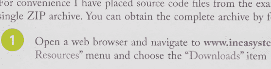

为方便起见，我已将本书中示例的源代码文件放入单个 ZIP 压缩包。您可以通过以下三个简单步骤获取完整压缩包：

1. 打开网页浏览器并导航至 www.ineasysteps.com，然后选择“Free Resources”菜单并选择“Downloads”项目
2. 接着在列表中找到“jQuery in easy steps”，然后点击名为“All Code Examples”的超链接下载压缩包
3. 现在将内容解压到任何方便的位置，例如桌面，并将 `htdocs` 子文件夹中的所有内容复制到您的 Web 服务器的文档目录中

# 1 入门

欢迎来到激动人心的 jQuery 动态网页脚本世界。

本章将介绍 jQuery 库，并演示如何选择 HTML 元素。

- **8** jQuery 简介
- **9** 启用 jQuery
- **10** 识别就绪状态
- **12** 避免冲突
- **13** 按标签名选择
- **14** 按 ID 和类选择
- **16** 选择属性和顺序
- **18** 选择家族关系元素
- **20** 选择多个元素
- **22** 过滤可见性
- **23** 优化选择
- **24** 小结

## jQuery 简介

jQuery 是一个轻量级的多浏览器 JavaScript 库，旨在简化在网站中整合 JavaScript 功能的过程。该库提供了只需一行代码即可调用的方法，以实现原本需要多行 JavaScript 代码才能完成的效果——因此你可以“写得更少，做得更多”。

jQuery 是一款免费的开源软件，最初由其原作者 John Resig 于 2006 年发布，但目前由 jQuery 开发者团队维护。该库目前被全球访问量排名前 10,000 的网站中超过 65% 的网站使用，是当今最受欢迎的 JavaScript 库。

jQuery 的语法设计旨在轻松选择网页组件，以便进行以下操作：

- 操纵 HTML/DOM 元素
- 修改 CSS 样式规则
- 附加事件处理程序以响应用户操作
- 创建动态效果和动画
- 开发交互式 AJAX 应用程序

jQuery 还允许开发者在标准 JavaScript 库的基础上创建自己的插件，以满足特定需求。这些插件可以提供从简单的小工具到复杂的组件或高级动画的任何功能。这种模块化方法使得利用 jQuery 库创建强大的动态网页和 Web 应用程序成为可能。

jQuery 得到 Adobe Dreamweaver Web 开发应用程序和 Microsoft Visual Studio Express For Web 开发应用程序的支持，可在 ASP.NET AJAX 和 ASP.NET MVC 框架中使用。这两个应用程序都具有“智能感知”功能，能够识别 jQuery 语法并提供编码提示。此功能非常有用，但绝非必需——本书中的所有示例都可以在纯文本编辑器（如 Windows 的记事本应用程序）中轻松创建。

> 切记
>
> JavaScript 是一种客户端脚本语言，而 jQuery 是使用 JavaScript 语言编写的库。

## 启用 jQuery

整个 jQuery 库包含在一个单独的 JavaScript 文件中，可以从 `jquery.com/download` 自由下载。jQuery 库文件的压缩版和未压缩版均可供下载。这些文件在功能上没有区别，但未压缩版包含空格和注释，便于人类阅读；而压缩版则通过移除空格和注释来最小化文件大小，从而提高性能。除非你想检查 jQuery 库本身的源代码，否则你应该下载压缩版，并将其放置在包含 HTML 网页文档的目录中。

> 实用提示：jQuery 自动解决多浏览器兼容性问题——它在所有主流浏览器（包括 Internet Explorer 6）中的表现完全一致。

为了在网页上使用 jQuery 库，必须通过在 HTML 文档的 head 部分包含一个 HTML `<script>` 标签来指明 jQuery 库的位置，从而将其整合到网页中。

最小化的 jQuery 库文件名类似于 `jquery-1.11.0.min.js`，描述了当前版本号，可以通过在网页的 head 部分包含这些 HTML 标签来启用：

```html
<script src="jquery-1.11.0.min.js"></script>
```

jQuery 库文件还有 2.x.x 版本，通过移除对旧版 Web 浏览器的支持而进一步最小化。作为将 jQuery 库副本与网页一同托管的替代方案，你可以像这样在线指明 Google CDN（内容分发网络）上的 jQuery 库位置：

> 注意：将标签中的版本号更改为与你下载的 jQuery 库文件或在线指明的版本号匹配。

```html
<script src="//ajax.googleapis.com/ajax/libs/jquery/1.11.0/jquery.min.js"></script>
```

或者在 Microsoft CDN（内容分发网络）上像这样指明：

```html
<script src="//ajax.aspnetcdn.com/ajax/jQuery/jquery-1.11.0.min.js"></script>
```

由于 jQuery 如此受欢迎，许多用户在访问其他网站时，可能已经将库文件下载到其浏览器缓存中。这意味着当他们访问你的网站时，可以快速从缓存中加载。

## 识别就绪状态

如前一页所述，在网页上启用 jQuery 后，你可以向 head 部分添加第二个 `<script>` 元素，其中包含调用 jQuery 函数的语句。每个 jQuery 语句通常包含一个“选择器”，用于选择文档中的一个或多个 HTML 元素，以及一个要对该选择执行的“操作”。语句语法如下所示：

`$(selector).action();`

`$()` 函数查询 HTML 文档以查找选择器指定的元素，然后返回一个 jQuery 对象，该对象是这些匹配元素的集合。然后使用点表示法附加要对元素执行的操作。

在 HTML 文档加载并构建其文档对象模型（DOM）之前，无法准确检索选择器指定的全面元素集合。此时，浏览器会触发一个“文档就绪”事件，以表明文档已准备好接受 jQuery 的操作。

可以通过将文档自身的 `document` 对象指定为选择器，并在“文档就绪”事件触发时调用 `ready()` 操作函数来识别文档就绪状态。

良好的做法是在 `ready()` 操作函数的括号内指定一个匿名 JavaScript 函数，其语句可以在确信所有元素都可用的情况下安全执行。完整的代码块如下所示：

```javascript
<script>
$(document).ready(function() {
    // 文档就绪时要执行的语句。
});
</script>
```

本书中的每个示例都将语句放在这个匿名 JavaScript 函数体内，以确保在尝试操作其内容之前文档已完全加载。对面列出的 HTML5 文档使得 jQuery 库可用，然后简单地生成一个提示就绪状态的警告对话框。

> 切记
>
> 对于 HTML5 文档，无需在 `<script>` 标签中包含 type 属性。

```html
<!DOCTYPE HTML>
<html lang="en">
<head>
<meta charset="UTF-8">
<title>jQuery 就绪函数</title>
<script src="jquery-1.11.0.min.js"></script>
<script>
$(document).ready(function() {
    alert("Hello World!");
});
</script>
</head>
<body>
<h1>jQuery</h1>
<!-- 将在此处添加元素。 -->
</body>
</html>
```

> 实用提示
>
> 本书中的示例仅使用这种 HTML5 文档格式，仅更改了突出显示的页面标题、匿名函数体中的语句以及文档体中的元素。

> 注意
>
> 使用较长的语法来调用识别文档就绪事件更容易理解，因此本书中的示例不使用较短的替代语法。

由于所有语句总是包装在对 `$(document).ready()` 函数的调用内，如果你愿意，jQuery 也允许使用这种较短的替代语法：

```javascript
$(function() {
    // 文档就绪时要执行的语句。
});
```

## 避免冲突

jQuery 语法中使用的“$”字符也被其他 JavaScript 库（如 MooTools、Backbone 和 JavaScriptMVC）所使用。因此，在调用 jQuery 函数和另一个库的函数时可能会发生冲突。

幸运的是，`$()` 函数语法只是实际库函数 `jQuery()` 的快捷方式，可以直接使用后者。此外，jQuery 库提供了一个 `jQuery.noConflict()` 方法，它可以移除“$”字符的快捷方式功能，从而避免库之间的冲突：

1. 在 HTML 文档的 head 部分，以一个移除 `$()` 快捷方式功能的调用开始一个脚本块

   `jQuery.noConflict();`

2. 接下来，添加一个直接调用来识别“document ready”事件，通过产生一个警报对话框消息

   `jQuery(document).ready(function() { alert("jQuery Is Working!"); });`

3. 将文档与 jQuery 库文件一起保存，然后在 Web 浏览器中打开它以查看直接调用的执行结果

> 热门提示
>
> 将对话框调用更改为 `alert(jQuery.jquery);` 以查看 jQuery 库的版本号。

> 别忘了
>
> `$()` 和 `jQuery()` 调用通常是可互换的，因此你可以使用其中任何一个。为简洁起见，本书示例中使用的是较短的 `$()` 调用。

## 按标签名选择

### 元素选择器

jQuery 选择器指定 HTML 文档的哪些元素将被返回到 jQuery 对象中进行操作。元素选择器只需在选择器函数的括号内指定引号内的标签名。例如，选择器调用 `$("p")` 查询 HTML 文档并返回所有 `<p>` 段落元素。

每个选择器调用都可以使用点表示法附加一个动作函数，以指定对返回元素集合执行的动作。例如，可以附加 jQuery `text()` 方法，并在括号内指定一个引号内的文本字符串。指定的字符串将被写入每个匹配的元素，替换任何现有内容。这可以用于替换列表中每个项目的现有文本内容：

1. 将一个有序列表添加到 HTML 文档的 body 中

   ```html
   <ol><li>Item</li><li>Item</li><li>Item</li></ol>
   ```

2. 在 HTML 文档的 head 部分添加一个脚本块，该脚本块通过选择所有列表项元素并替换文本来识别“document ready”事件

   ```javascript
   $(document).ready(function() {
       $("li").text("Generated Content");
   });
   ```

3. 将文档与 jQuery 库文件一起保存，然后在浏览器中打开它以查看生成的列表项内容

## 按 ID 和 class 选择

### ID 选择器

jQuery 选择器可以通过元素的标识来指定特定元素。ID 选择器指定分配给元素 id 属性的唯一值。这必须以 `#` 哈希字符为前缀，并包含在选择器函数括号内的引号中。例如，选择器 `$("#two")` 查询 HTML 文档并返回 id 属性值为“two”的元素。标识选择器调用可以使用点表示法附加一个动作函数，以指定对返回元素执行的动作：

将一个有序列表添加到 HTML 文档的 body 中

```html
<ol>
    <li id="one">ID Item</li>
    <li id="two">ID Item</li>
    <li id="three">ID Item</li>
</ol>
```

在 HTML 文档的 head 部分添加一个脚本块，该脚本块通过选择一个列表项元素并替换文本来识别“document ready”事件

```javascript
$(document).ready(function() {
    $("#two").text("Generated Content");
});
```

将文档与 jQuery 库文件一起保存，然后在浏览器中打开它以查看生成的列表项内容

> 热门提示
>
> 内部通过标识匹配使用的是 `getElementById()` DOM 方法，这是一种快速高效的技术。

### 类选择器

jQuery 类选择器也可以通过指定分配给其 `class` 属性的值来返回特定类的元素集合。这应以元素名称开头，后跟一个 `.` 点字符，并将整个表达式包含在选择器函数括号内的引号中。例如，选择器 `$("li.rest")` 查询 HTML 文档并返回 `class` 属性值为“rest”的列表项元素。类选择器调用可以使用点表示法附加一个动作函数，以指定对返回元素执行的动作：

1. 将一个有序列表添加到 HTML 文档的 body 中

   ```html
   <ol>
       <li class="start">Class Item</li>
       <li class="rest">Class Item</li>
       <li class="rest">Class Item</li>
   </ol>
   ```

2. 在 HTML 文档的 head 部分添加一个脚本块，该脚本块通过选择列表项元素并替换文本来识别“document ready”事件

   ```javascript
   $(document).ready(function() {
       $("li.rest").text("Generated Content");
   });
   ```

3. 将文档与 jQuery 库文件一起保存，然后在浏览器中打开它以查看生成的列表项内容

> 别忘了
>
> 内部，元素选择器使用 `getElementsByTagName()` DOM 方法，类选择器使用 `getElementsByClassName()` DOM 方法。

## 选择属性和顺序

### 属性选择器

jQuery 选择器可以通过属性名称或属性名称和值来指定元素。“Has Attribute”选择器选择所有在选择器函数括号内的双引号中用 `[]` 括号指定的属性名称的元素。例如，`$("[lang]")` 返回所有具有“lang”属性的元素。“Equals”选择器还指定了一个属性值 – 包含在单引号内以与外部双引号区分。例如，`$("[lang='fr']")` 返回所有“lang”属性值为“fr”的元素。属性选择器调用可以使用点表示法附加一个方法，以指定对返回元素执行的动作：

1. 将一个有序列表添加到 HTML 文档的 body 中

   ```html
   <ol>
       <li lang="fr">Attribute Item</li>
       <li lang="fr">Attribute Item</li>
       <li lang="en">Attribute Item</li>
   </ol>
   ```

2. 在 HTML 文档的 head 部分添加一个脚本块，该脚本块通过选择列表项元素并替换文本来识别“document ready”事件

   ```javascript
   $(document).ready(function() {
       $("[lang='fr']").text("Generated Content");
   });
   ```

3. 将文档与 jQuery 库文件一起保存，然后在浏览器中打开它以查看生成的列表项内容

### 过滤器选择器

jQuery 选择器也可以根据元素在选择中的从零开始的索引位置返回元素。元素名称可以后跟 `:first` 或 `:last` “过滤器”来选择单个元素。或者，可以使用 `:odd` 或 `:even` 过滤器来选择子集。也可以通过在 `:eq()` 过滤器的括号内指定其索引号来选择单个元素。可以通过在 `:gt()` 或 `:lt()` 过滤器的括号内指定该索引号来选择集合中高于和低于指定索引位置的子集。例如，选择器 `$("li:lt(2)")` 查询 HTML 文档并返回第一个和第二个元素。顺序选择器调用可以使用点表示法附加一个动作方法，以指定对返回元素执行的动作：

1. 将一个无序列表添加到 HTML 文档的 body 中

   ```html
   <ul>
       <li>Even Item 0</li><li>Odd Item 1</li><li>Even Item 2</li>
   </ul>
   ```

2. 在 HTML 文档的 head 部分添加一个脚本块，该脚本块通过选择列表项元素并替换文本来识别“document ready”事件

   ```javascript
   $(document).ready(function() {
       $("li:even").text("Generated Content");
   });
   ```

3. 将文档与 jQuery 库文件一起保存，然后在浏览器中打开它以查看生成的列表项内容

> 别忘了
>
> 索引编号从零开始，并且被认为是偶数。

## 选择家族亲属

### 后代选择器

jQuery选择器可以根据元素与另一个元素的关系来返回元素，使用“后代”选择器来指定外部父元素名称，后跟一个空格和内部后代元素的名称。例如，选择器 `$("p span")` 会查询HTML文档并返回文档中每个段落内的所有span元素。后代选择器调用可以使用点表示法附加一个操作方法，以指定对返回元素执行的操作。

向HTML文档的body添加一个有序列表。

```html
<ol>
<li>Descendant Item</li>
<li>Descendant <span>Item</span></li>
<li>Descendant Item</li>
</ol>
```

在HTML文档的head部分添加一个脚本块，通过选择一个span元素并替换其文本来识别“文档就绪”事件。

```javascript
$(document).ready(function() {
    $("ol span").text("Generated Content");
});
```

将文档与jQuery库文件一起保存，然后在浏览器中打开以查看生成的span内容。

> **请记住**
>
> 后代选择器不仅选择直接子元素，还会选择其他层级的元素，例如孙元素。

### 子选择器

可以使用“子”选择器选择指定父元素的所有子元素，该选择器声明父元素名称，后跟一个 `>` 字符和子元素名称。例如，选择器 `$("ol > li")` 会选择HTML文档中每个有序列表中的所有列表项。

与后代选择器不同，子选择器只选择直接子元素，而不选择孙元素。

### 子过滤选择器

jQuery选择器还可以使用子过滤器根据元素与其他元素的关系来指定元素，该过滤器指定子元素的名称，后跟 `:first-child` 或 `:last-child` 过滤器，以选择每个父元素的单个子元素。例如，选择器 `$("li:first-child")` 会选择HTML文档中每个列表内的第一个子列表项元素。带有子过滤器的选择器和子选择器可以使用点表示法附加一个方法，以指定对返回元素执行的操作。

```html
<ol><li>Child Item</li><li>Child Item</li><li>Child Item</li></ol>
```

向HTML文档的body添加一个有序列表。

在HTML文档的head部分添加一个脚本块，通过选择一个列表项元素并替换其文本来识别“文档就绪”事件。

```javascript
$(document).ready(function() {
    $("li:last-child").text("Generated Content");
});
```

将文档与jQuery库文件一起保存，然后在浏览器中打开以查看生成的列表项内容。

你也可以使用 `:first` 和 `:last` 过滤器仅选择HTML文档中的第一个和最后一个单个元素。例如，`$("p:first")` 仅选择第一个段落。

## 选择多个元素

### 多重选择器

jQuery选择器可以与另一个选择器组合以创建特定的选择表达式。例如，可以将目标定为HTML文档中特定列表的ID选择器与目标定为该列表中特定项目的“顺序”选择器组合起来。此外，多个选择表达式可以作为逗号分隔的列表出现在单个jQuery选择器中。每个多重选择器可以使用点表示法附加一个操作方法，以指定对所有返回元素执行的操作。

1. 向HTML文档的body添加两个有序列表，每个列表都有唯一的ID。

```html
<ol id="list1">
<li>List Item</li><li>List Item</li><li>List Item</li></ol>
<ol id="list2">
<li>List Item</li><li>List Item</li><li>List Item</li></ol>
```

2. 在HTML文档的head部分添加一个脚本块，通过选择每个列表中的一个项目并替换文本来识别“文档就绪”事件。

```javascript
$(document).ready(function() {
    $("#list1 li:eq(1), #list2 li:eq(2)").text("Generated Content");
});
```

> **请记住**
>
> 索引编号从零开始，因此列表中的第二个项目位于索引位置一。

3. 将文档与jQuery库文件一起保存，然后在浏览器中打开以查看生成的列表项内容。

### 全选选择器

在jQuery中，`*` 星号字符是一个通配符，可以在 `$("*")` 全选选择器中使用，以选择HTML文档中的所有元素。或许更有用的是，它也可以与jQuery `find()` 方法一起使用，以选择指定元素的所有后代。例如，选择器 `$("body").find("*")` 查询HTML文档并返回文档主体内的所有元素。返回的集合可以分配给一个变量，创建一个数组，然后可以使用循环来显示每个标签名称。

1. 在HTML文档body的标题后添加一个包含span的段落。

```html
<h1>jQuery</h1>
<p>Output: <span id="out"></span></p>
```

2. 在HTML文档的head部分添加一个脚本块，通过首先初始化计数器、字符串和数组变量来识别“文档就绪”事件。

```javascript
$(document).ready(function() {
    var i = 0, str = "", elements = $("body").find("*");
});
```

3. 接下来，在脚本块中添加一个循环来构建一个包含检索到的标签名称的字符串，然后在span中显示该字符串。

```javascript
for(; i < elements.length; i++) {
    str += (elements[i].tagName + " | ");
}
$("#out").text(str + elements.length);
```

4. 将文档与jQuery库文件一起保存，然后在浏览器中打开以查看生成的span内容。

> jQuery文档警告说，`*` 通选选择器“极其缓慢，除非单独使用”。

## 过滤可见性

### 可见性过滤选择器

jQuery选择器可以通过指定 `:visible` 或 `:hidden` 过滤器到jQuery `filter()` 方法，根据元素在页面上的可见性从返回的集合中过滤掉元素。只有样式为 `display:none` 的元素、类型为“hidden”的表单元素、宽度和高度设置为零的元素，或者是这些元素的后代的元素，才被视为隐藏。例如，选择器 `$("body").find("*").filter(":hidden")` 返回文档主体内所有真正隐藏的元素。

1. 在HTML文档的body中添加一个包含粗体文本的隐藏div和一个包含span的段落。

```html
<div style="display:none"><b>Hidden Text</b></div>
<p>Output: <span id="out"></span></p>
```

2. 在HTML文档的head部分添加一个脚本块，通过首先初始化计数器、字符串和数组变量来识别“文档就绪”事件。

```javascript
$(document).ready(function() {
    var i = 0, str = "Hidden: ";
    var hid = $("body").find("*").filter(":hidden");
});
```

3. 接下来，在脚本块中添加一个循环来构建一个包含隐藏标签名称的字符串，然后在span中显示该字符串。

```javascript
for(; i < hid.length; i++) {
    str += (hid[i].tagName + " | ");
}
$("#out").text(str + hid.length);
```

4. 将文档与jQuery库文件一起保存，然后在浏览器中打开以查看生成的span内容。

> **小心：** 样式为 `visibility:hidden` 或 `opacity:0` 的元素被视为可见，因为它们仍然保留页面空间。

## 优化选择

前面页面的示例演示了使用jQuery选择元素集合的各种方式，但应考虑选择器的效率。

- **尽可能使用ID选择** – HTML `id` 属性在每个页面中是唯一的，因此即使是较旧的浏览器也能快速找到元素。理想情况下，对每个选择器使用 `$("#theIdentity")` 格式。

- **同时使用元素和类进行选择** – 当通过**类**进行选择时，较旧的浏览器会检查页面上的每个元素，除非选择器提供元素名称来限制搜索。使用 `$("p.theClass")` 格式而不是 `$(".theClass")`。

- **以最简单的方式选择** – 避免不必要的复杂性。复杂的选择器 `$("body article.topic p#theIdentity em")` 可以简单地使用 `$("#theIdentity em")` 代替，因为**id** 是唯一的，所以包含其祖先是没有必要的。

- **从右向左选择** – jQuery从右向左选择，因此它会将所有最右边的匹配项加载到数组中，然后丢弃那些与选择器左侧不匹配的元素。选择器 `$("#theIdentity em")` 会加载所有文档中的 `em` 元素，然后丢弃那些与 `"#theIdentity"` 不匹配的元素。为了获得最佳效率，请使用 `$("#theIdentity").find("em")`。

- **只选择一次** – 避免重复选择，例如 `$("p").text("Generated Content");` `$("p").css("color", "red");`。通过“链式调用”可以在一条语句中应用多个方法。使用 `$("p").text("Generated Content").css("color", "red");`。如果需要多次引用jQuery对象，请将其分配给一个变量，就像对面示例中的语句一样 `var hid = $("body").find("*").filter(":hidden");`。然后，根据需要多次使用 `hid.length` 和 `hid[i].tagName`。

## 总结

- jQuery 是一个轻量级的多浏览器 JavaScript 库，它使在网站中整合 JavaScript 功能变得更加容易。
- 可以通过将 jQuery 库文件最小化后托管在你的网站上，或者通过在 Google 或 Microsoft CDN 上在线指定库文件位置来启用 jQuery。
- 一个 jQuery 语句通常包含一个选择器，用于返回元素集合，以及一个要对这些元素执行的动作。
- `$(document).ready()` 函数在 DOM 加载完成后调用，因此可以有效地包含一个匿名的 JavaScript 函数，该函数封装了所有的 jQuery 语句。
- `$()` 函数语法是 `jQuery()` 函数的快捷方式，可以代替使用；如果使用了 `jQuery.noConflict()`，则必须使用 `jQuery()`。
- jQuery 最基本的选择器通过标签名 `$("p")`、ID `$("#theId")` 和类 `$(".theClass")` 来指定元素。
- jQuery 属性选择器选择所有包含指定属性的元素 `$("[lang]")`，或选择属性值等于特定值的元素 `$("[lang='fr']")`。
- jQuery 顺序选择器根据元素在所选集合中的从零开始的索引位置来选择元素 `$("li:eq(1)")`。
- jQuery 子元素选择器仅选择指定父元素的所有直接子元素，但不包括孙元素 `$("ol > li")`。
- jQuery 后代选择器选择指定父元素下的所有层级的后代，包括孙元素 `$("p span")`。
- 多个选择表达式可以作为逗号分隔的列表出现在单个 jQuery 选择器中。
- `*` 通配符选择器可以与 `find()` 方法一起使用，以选择一个元素的所有后代 `$("body").find("*")`。
- 可以使用 `filter()` 方法根据可见性来选择元素 `$("body").find("*").filter(":hidden")`。

# 2 执行动作

本章演示如何从选定的元素集合中指定一个子集，以及如何操作 CSS 样式。

- 26 遍历元素
- 28 向前移动
- 30 访问亲属
- 32 查询选择
- 34 应用样式
- 36 添加值
- 38 切换类
- 40 计算尺寸
- 42 总结

## 遍历元素

jQuery 对象返回的选定元素集合可以通过该对象的 `each()` 方法进行迭代，依次循环。当前迭代的元素可以有效地使用 jQuery 的 `this` 关键字来引用，以便对该元素应用操作。

在内部，`each()` 方法维护一个当前循环迭代的索引计数器，该计数器可以附加到集合中每个元素的内容之后：

1. 在 HTML 文档的 body 中添加一个无序列表，包含通用的列表项内容。

2. 在 HTML 文档的 head 部分添加一个脚本块，该脚本块选择列表中的所有项，并在每个列表项后附加一个空格和一个索引号。

3. 将文档与 jQuery 库文件一起保存，然后在浏览器中打开以查看附加的列表项内容。

```html
<ul>
<li>List Item</li><li>List Item</li><li>List Item</li>
</ul>
```

```javascript
$(document).ready(function() {
    $("li").each(function(index) {
        $(this).text($(this).html() + " " + index);
    });
});
```

> **实用技巧**
>
> `text()` 和 `html()` 方法都获取和设置元素内容，但有细微差别——这里 `text()` 包含项目符号，而 `html()` 只包含项目文本。

jQuery 对象返回的选定元素集合可以通过该对象的 `first()` 方法简化为仅引用第一个匹配的元素。类似地，可以通过该 jQuery 对象的 `last()` 方法将选定元素集合简化为仅引用最后一个匹配的元素。

当需要多次操作同一组相同的元素集合时，最好将该集合赋值给一个变量，使用一条选择语句即可。然后可以在该变量上调用 jQuery 对象的方法，而无需重复选择过程：

1. 在 HTML 文档的 body 中添加一个无序列表，包含通用的列表项内容。

```html
<ul><li>Item</li><li>Item</li><li>Item</li></ul>
```

2. 在 HTML 文档的 head 部分添加一个脚本块，该脚本块将所有列表项的集合赋值给一个变量。

```javascript
$(document).ready(function() {
    var items = $("li");
});
```

3. 现在，在脚本块中添加语句以简化集合，并修改每个被引用的单个元素。

```javascript
items.first().text("First Item");
items.last().text("Last Item");
```

> **不要忘记**
>
> 将 jQuery 对象赋值给一个变量是高效且良好的实践，可以避免重复选择相同的元素集合。

4. 将文档与 jQuery 库文件一起保存，然后在浏览器中打开以查看修改后的列表项内容。

## 向前移动

可以通过从一个初始的 jQuery 选择沿着 DOM 树向前移动来引用文档 DOM 树中的元素。jQuery 对象中匹配元素的紧随其后的兄弟元素可以通过该对象的 `next()` 方法来引用。类似地，jQuery 对象中匹配元素的紧随其前的兄弟元素可以通过该对象的 `prev()` 方法来引用：

1. 在 HTML 文档的 body 中添加一个有序列表，包含唯一的列表项标识符和通用的内容。

```html
<ol>
    <li id="item1">Item</li>
    <li id="item2">Item</li>
    <li id="item3">Item</li>
    <li id="item4">Item</li>
    <li id="item5">Item</li>
</ol>
```

2. 在 HTML 文档的 head 部分添加一个脚本块，该脚本块选择第一个列表项，并修改下一个列表项的内容。

```javascript
$(document).ready(function() {
    $("#item1").next().text("Generated Text");
});
```

3. 现在，在脚本块中添加一条语句，该语句选择最后一个列表项，并修改其前一个列表项的内容。

```javascript
$("#item5").prev().text("Generated Text");
```

4. 将文档与 jQuery 库文件一起保存，然后在浏览器中打开以查看修改后的列表项内容。

> **实用技巧**
>
> 可选地，`next()` 和 `prev()` 方法可以接受一个选择器参数，以进一步测试兄弟元素是否应该匹配。

...接下文

通过使用 jQuery 对象的 `nextUntil()` 方法，可以从初始的 jQuery 选择沿着 DOM 树向前移动来引用文档 DOM 树中的多个元素。这会选择所有后续的兄弟元素，直到但不包括方法参数指定的元素。或者，可以使用 jQuery 对象的 `nextAll()` 方法选择所有后续的兄弟元素。

类似地，jQuery 对象的 `prevUntil()` 方法选择所有先前的兄弟元素，直到但不包括方法参数指定的元素。或者，可以使用 jQuery 对象的 `prevAll()` 方法选择所有先前的兄弟元素：

1. 在 HTML 文档的 body 中添加一个有序列表，包含唯一的列表项标识符和通用的内容。

```html
<ol>
    <li id="item1">Item</li>
    <li id="item2">Item</li>
    <li id="item3">Item</li>
    <li id="item4">Item</li>
    <li id="item5">Item</li>
</ol>
```

2. 在 HTML 文档的 head 部分添加一个脚本块，该脚本块修改三个兄弟列表项的内容。

```javascript
$(document).ready(function() {
    var collection = $("#item1").nextUntil($("#item5"));
    collection.text("Generated Text");
});
```

3. 将文档与 jQuery 库文件一起保存，然后在浏览器中打开以查看修改后的列表项内容。

> **不要忘记**
>
> 请记住，`nextUntil()` 和 `prevUntil()` 方法匹配到指定元素之前的兄弟元素，但不包括该元素本身。

## 访问亲属

可以通过与 jQuery 选择的关系来引用文档 DOM 树中的元素。选择的所有直接“子”后代可以通过该对象的 `children()` 方法来引用。此外，选择的所有相邻兄弟元素可以通过 jQuery 对象的 `siblings()` 方法来引用。可选地，`children()` 和 `siblings()` 方法可以指定一个选择器参数，以进一步筛选要引用的元素：

1. 在 HTML 文档的 body 中添加一个无序列表和一个有序列表。

```html
<ul><li>Son</li><li>Son</li><li>Son</li></ul>
<ol><li>Daughter</li><li>Daughter</li><li>Daughter</li></ol>
```

2. 在 HTML 文档的 head 部分添加一个脚本块，该脚本块选择无序列表并修改其每个子列表项的文本。

```javascript
$(document).ready(function() {
    $("ul").children().text("Child");
});
```

3. 现在，在脚本块中添加一条语句，该语句选择第一个有序列表项并修改其兄弟列表项。

```javascript
$("ol li:first-child").siblings().text("Sibling");
```

4. 将文档与 jQuery 库文件一起保存，然后在浏览器中打开以查看修改后的列表项内容。

> **注意**
>
> `children()` 方法仅向下遍历 DOM 树一级——如果需要向下遍历多级，请使用 `find()` 方法，如第 21 页所述。

文档DOM树中的父元素可以通过与jQuery选择的相对关系来引用。选择的直接"父"祖先可以通过该对象的 `parent()` 方法引用。此外，选择的所有更高层祖先可以通过jQuery对象的 `parents()` 方法引用。可选地，`parent()` 和 `parents()` 方法可以指定一个选择器参数，以进一步筛选要引用的元素：

1. 在HTML文档的body中添加一个division，其中包含一个带有强调文本的段落和一个带有span的段落


```html
<div>
    <p>Paragraph containing <em>Emphatic Text</em></p>
    <p>Output: <span id="out"></span></p>
</div>
```

2. 在HTML文档的head部分添加一个脚本块，用于初始化counter、string和array变量

```javascript
$(document).ready(function() {
    var i = 0, str = "", parents = $("em").parents();
});
```

3. 接下来，在脚本块中添加一个循环，构建一个父标签名称的字符串，然后在span中显示该字符串

```javascript
for (; i < parents.length; i++) {
    str += parents[i].tagName + " | ";
}
$("#out").text(str + parents.length);
```

4. 将文档与jQuery库文件一起保存，然后在浏览器中打开它以查看生成的span内容

> 注意 `$("html").parent()` 返回一个包含 `document` 的jQuery对象，而 `$("html").parents()` 返回一个空集。

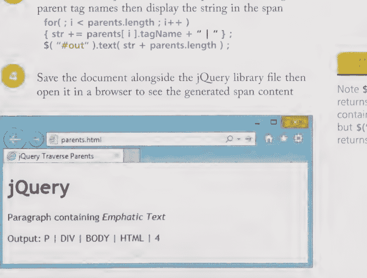

## 查询选择

jQuery集合中返回的元素可以被查询，以发现该集合是否在其后代中包含至少一个指定元素。要查找的元素必须作为参数指定给jQuery对象的 `has()` 方法。

jQuery集合也可以被查询，以发现任何包含的元素本身是否是一个指定元素。在这种情况下，要查找的元素必须作为参数指定给jQuery对象的 `is()` 方法。如果找到指定元素，此方法返回 `true`，否则返回 `false`：

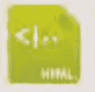

interrogate.html

1. 在HTML文档的body中添加一个有序列表（包含一个span）和一个包含span的段落

   `<ol><li>Item</li><li><span>Item</span></li><li>Item</li></ol>`

   `<p>Output: <span id="out"></span></p>`

2. 在HTML文档的head部分添加一个脚本块，用于修改列表项中span的文本

   ```javascript
   $(document).ready(function() {
       $("li").has("span").text("Item : Has Span");
   });
   ```

3. 现在，在脚本块中添加一个语句，仅当列表是有序列表类型时输出确认信息

   ```javascript
   if ($("li").parent().is("ol")) {
       $("#out").text("This Is An Ordered List");
   }
   ```

   `is()` 方法不会像其他方法那样创建一个新的jQuery对象，它只是检查jQuery对象的内容而不进行任何修改。

4. 将文档与jQuery库文件一起保存，然后在浏览器中打开它以查看修改后的列表项内容

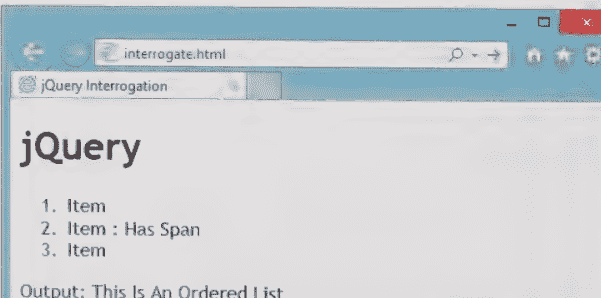

jQuery集合中返回的元素可以被查询，以发现它们是否在其后代中不包含至少一个指定元素。要查找的元素必须作为参数指定给jQuery对象的 `not()` 方法。而 `has()` 方法创建一个新的jQuery对象，只包含成功匹配的元素，`not()` 方法创建一个新的jQuery对象，只包含未匹配的元素：

1. 在HTML文档的body中添加一个无序列表（包含一个span）和一个包含span的段落

   `<ul><li>Item</li><li><span>Item</span></li><li>Item</li></ul>`

   `<p>Output: <span id="out"></span></p>`

2. 在HTML文档的head部分添加一个脚本块，用于修改没有span的列表项

   ```javascript
   $(document).ready(function() {
       var nospan = $("li").not($("li").has("span"));
       nospan.text("Item : Has No Span");
   });
   ```

3. 现在，在脚本块中添加一个语句，仅当列表是无序列表类型时输出确认信息

   ```javascript
   if ($("li").parent().not("ol")) {
       $("#out").text("This Is An Unordered List");
   }
   ```

4. 将文档与jQuery库文件一起保存，然后在浏览器中打开它以查看修改后的列表项内容和列表类型确认信息


> **小贴士**
>
> 注意，要查找的元素可以通过其标签名或作为jQuery选择器来指定。

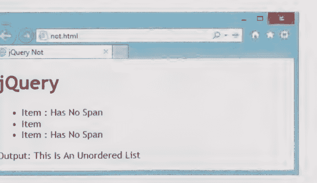

## 应用样式

jQuery集合中返回的第一个匹配元素的样式属性值可以使用该jQuery对象的 `css()` 方法检索。要检索其值的属性名称必须作为参数用引号括起来提供给 `css()` 方法。颜色值通常以 "rgb" 表示法返回，因此红色值为 `rgb(255, 0, 0)`；


**1** 在HTML文档的body中添加一个有序列表和一个包含span的段落

`<ol><li>Alpha</li><li>Bravo</li><li>Charlie</li></ol>`

`<p>Output: <span id="out"></span></p>`

**2** 在HTML文档的head部分添加一个简单的样式表，将列表内容颜色设置为红色

`<style> ol { color: red; } </style>`

**3** 接下来，在HTML文档的head部分添加一个脚本块，用于获取当前列表的颜色属性值

```javascript
$(document).ready(function() {
    $("#out").text($("ol").css("color"));
});
```

**4** 将文档与jQuery库文件一起保存，然后在浏览器中打开它以在span中查看列表颜色的值

> **不要忘记**
>
> 样式表也可以将红色指定为 `#FF0000` 或 `rgb(255,0,0)`——但检索到的颜色值将始终以 `rgb()` 表示法格式输出。

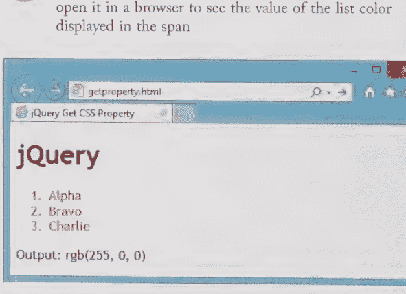

## ...续

jQuery对象中返回的元素的样式属性值可以使用该jQuery对象的 `css()` 方法设置。要设置的属性名称及其值必须用引号括起来，并作为逗号分隔的参数对提供给 `css()` 方法。颜色值可以使用公认名称、十六进制表示法或rgb表示法指定。例如，颜色值 `"blue"`、`"#0000FF"` 或 `"rgb(0, 0, 255)"`：

1. 在HTML文档的body中添加一个有序列表

   `<ol id="list"><li>Alpha</li><li>Bravo</li><li>Charlie</li></ol>`


setproperty.html

2. 在HTML文档的head部分添加一个脚本块，将列表jQuery对象存储在一个变量中

   ```javascript
   $(document).ready(function() {
       var list = $("#list");
   });
   ```

3. 现在，在脚本块中添加设置列表宽度和颜色的语句

   ```javascript
   list.css("background-color", "blue");
   list.css("color", "yellow");
   list.css("width", "300");
   ```

4. 将文档与jQuery库文件一起保存，然后在浏览器中打开它以查看应用的列表样式

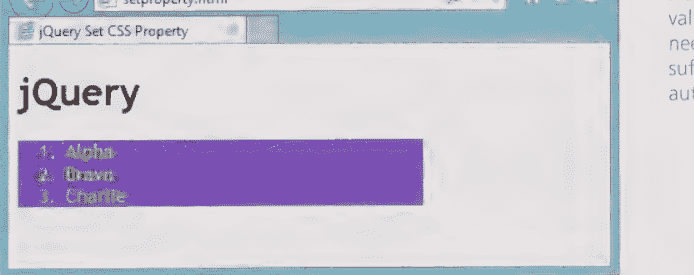

> 注意，宽度值 `"300"` 不需要明确的 `"px"` 后缀，因为会自动假定像素单位。

## 添加值

jQuery对象中元素的多个样式可以使用JavaScript对象表示法（JSON）在单个语句中设置。每个属性名称及其期望值必须用引号括起来，并用冒号字符分隔，以形成名称:值对。然后，这些名称:值对的逗号分隔列表可以放在 `{}` 花括号内，以创建一个完整的JavaScript"对象"。通过将该JavaScript对象作为参数指定给jQuery对象的 `css()` 方法来应用样式：

1. 在HTML文档的body中添加一个有序列表

   `<ol><li>Alpha</li><li>Bravo</li><li>Charlie</li></ol>`

2. 在HTML文档的head部分添加一个脚本块，用于设置列表的宽度和颜色

```javascript
$(document).ready(function() {
    $("ol").css({
        "background-color": "blue",
        "color": "yellow",
        "width": "300"
    });
});
```

3. 将文档与jQuery库文件一起保存，然后在浏览器中打开它以查看应用的列表样式

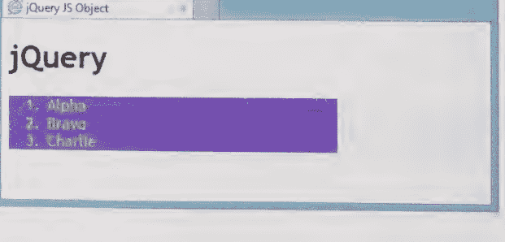

> **小贴士**
>
> 此示例复制了上一页的示例，但以更简洁的方式实现了相同的样式效果。

## ...续

除了使用 `css()` 方法为 jQuery 对象返回的元素添加样式外，还可以通过为元素添加类来应用样式——即定义一个或多个样式。要添加的类名必须作为参数包含在引号内，传递给 jQuery 对象的 `addClass()` 方法。通过将类名作为空格分隔的参数列表传递给 `addClass()` 方法，可以用单条语句为一个元素添加多个类：

向 HTML 文档的 body 中添加一个有序列表

`<ol><li>Xray</li><li>Yankee</li><li>Zulu</li></ol>`

在 HTML 文档的 head 部分添加一个样式表，以指定 width 和 color 类

```html
<style>
.W300 { width: 300px; }
.yelFG { color: yellow; }
.redBG { background: red; }
</style>
```

接下来，在 HTML 文档的 head 部分添加一个脚本块，将每个类添加到列表中

```javascript
$(document).ready(function() {
    $("ol").addClass("W300 yelFG redBG");
});
```

将文档与 jQuery 库文件一起保存，然后在浏览器中打开，以查看应用的类样式

> **注意**
>
> `addClass()` 方法不会替换类，而只是添加类——将它们附加到元素可能已有的任何类之后。

## 切换类

应用于 jQuery 对象返回的元素的样式类可以使用该对象的 `toggleClass()` 方法进行切换。类名必须作为参数包含在引号内，传递给 jQuery 对象的 `toggleClass()` 方法。如果元素已具有该样式类，则会被移除；否则，该类将被添加到元素上。此外，jQuery 对象的 `hasClass()` 方法可用于确认元素是否具有指定的样式类：

1. 向 HTML 文档的 body 中添加一个无序列表和一个包含带有 class 属性的 span 的段落

   `<ul><li>Item</li><li>Item</li><li>Item</li></ul>`

   `<p>Output: <span class="grnBG" id="out"></span></p>`

2. 在 HTML 文档的 head 部分添加一个简单的样式表，以指定一个 color 和 width 类

   ```html
   <style>
   .grnBG { background: green; color: white; width: 300px; }
   </style>
   ```

3. 接下来，在 HTML 文档的 head 部分添加一个脚本块，用于切换和确认 class 属性

   ```javascript
   $(document).ready(function() {
       $("span, ul").toggleClass("grnBG");
       $("#out").text($("span").hasClass("grnBG"));
   });
   ```

> **别忘了**
>
> `hasClass()` 方法返回一个布尔值 `true` 或 `false` —— 表示指定元素是否具有指定的类。

4. 将文档与 jQuery 库文件一起保存，然后在浏览器中打开，以查看切换的类样式

...续

通过将类名作为参数包含在引号内传递给 jQuery 对象的 `removeClass()` 方法，可以移除应用于该对象返回的元素的类。通常，这用于通过在单条语句中将调用 `removeClass()` 方法与调用 `addClass()` 方法“链式”连接，将应用于选定元素的一个类替换为另一个类：

1. 向 HTML 文档的 body 中添加一个带有类的无序列表和一个包含 span 的段落

   `<ul class="grnBG"><li>Item</li><li>Item</li><li>Item</li></ul>`

   `<p>Output: <span id="out"></span></p>`

2. 在 HTML 文档的 head 部分添加一个样式表，以指定两个 color 和 width 类

   ```html
   <style>
   .grnBG { background: green; color: white; width: 300px; }
   .yelBG { background: yellow; color: blue; width: 300px; }
   </style>
   ```

3. 接下来，在 HTML 文档的 head 部分添加一个脚本块，用于移除一个类并添加另一个类，然后确认 class 属性

   ```javascript
   $(document).ready(function() {
       $("ul").removeClass("grnBG").addClass("yelBG");
       $("#out").text($("ul").hasClass("yelBG"));
   });
   ```

4. 将文档与 jQuery 库文件一起保存，然后在浏览器中打开，以查看交换的类样式

> **实用技巧**
>
> “链式”调用方法的技术在 jQuery 脚本编写中是良好的实践，因为它用单条语句执行多个操作。

## 计算尺寸

可以使用 jQuery 对象的 `width()` 和 `height()` 方法检索该对象返回的框元素的尺寸。这些方法返回数字像素大小值，不带“px”后缀。或者，也可以使用该对象的 `css("width")` 和 `css("height")` 方法检索包含后缀的值：

向 HTML 文档的 body 中添加一个 division 和两个各自包含 span 的段落

```html
<div id="box">Box</div>
<p>Box Width: <span id="w"></span>
<br>Box Height: <span id="h"></span></p>
```

在 HTML 文档的 head 部分添加一个样式表，为 division 指定规则

```html
<style>
#box { width: 200px; height: 50px; background: yellow; padding: 5px; border: 5px solid red; }
</style>
```

接下来，在 HTML 文档的 head 部分添加一个脚本块，以显示框的尺寸

```javascript
$(document).ready(function() {
    var box = $("#box");
    $("#w").text(box.width() + " or " + box.css("width"));
    $("#h").text(box.height() + " or " + box.css("height"));
});
```

将文档与 jQuery 库文件一起保存，然后在浏览器中打开，以查看框的宽度和高度

> **别忘了**
>
> `width()` 和 `height()` 方法返回框的像素大小，不包括任何 padding 或 margin。

## ...续

可以使用 jQuery 对象的 `innerWidth()` 和 `innerHeight()` 方法（包含 padding），或使用 `outerWidth()` 和 `outerHeight()` 方法（包含 padding 和 margins）来检索该对象返回的框元素的整体尺寸：

1. 向 HTML 文档的 body 中添加一个 division 和一个包含 span 的段落

```html
<div id="box">Box</div>
<p>Output: <span id="out"></span></p>
```

2. 在 HTML 文档的 head 部分添加一个样式表，为 division 指定规则

```html
<style>
#box { width: 200px; height: 50px; background: yellow; padding: 5px; border: 5px solid red; }
</style>
```

3. 接下来，在 HTML 文档的 head 部分添加一个脚本块，以显示框的整体尺寸

```javascript
$(document).ready(function() {
    var box = $("#box"), str = "Including Padding - ";
    str += box.innerWidth() + "x" + box.innerHeight();
    str += "<br>Including Padding & Margin- ";
    str += box.outerWidth() + "x" + box.outerHeight();
    $("#out").html(str);
});
```

4. 将文档与 jQuery 库文件一起保存，然后在浏览器中打开，以查看框的整体尺寸

> **实用技巧**
>
> 你可以使用 `$(window)` 和 `$(document)` jQuery 对象的 `height()` 和 `width()` 方法来获取浏览器视口和文档的尺寸。

> **注意**
>
> `innerWidth()`、`outerWidth()`、`innerHeight()` 和 `outerHeight()` 方法各自返回一个数字像素值，不带“px”后缀。

## 总结

- 可以使用 jQuery 对象的 `each()` 方法遍历其中的元素，并且可以使用 `this` 关键字引用当前迭代中的元素。
- 可以使用 `first()` 方法引用集合中的第一个元素，使用 `last()` 方法引用最后一个元素。
- 可以使用 `next()`、`nextUntil()` 或 `nextAll()` 方法引用 DOM 树中后续的元素，使用 `prev()`、`prevUntil()` 或 `prevAll()` 方法引用之前的元素。
- 可以使用 `children()`、`siblings()`、`parent()` 或 `parents()` 方法引用 DOM 树中的相对元素。
- 可以在 jQuery 集合中使用 `has()`、`is()` 或 `not()` 方法来查找指定的元素。
- 可以使用 jQuery 对象的 `css()` 方法检索或设置其中元素的样式属性值。
- 当将多个样式作为 JavaScript (JSON) 对象参数传递给 `css()` 方法时，可以同时设置。
- 可以使用 jQuery 对象的 `addClass()` 方法为元素添加一个或多个类，并可以使用 `removeClass()` 方法移除它们。
- 可以使用其 jQuery 对象的 `toggleClass()` 方法切换应用于元素的样式类。
- 可以使用 jQuery 对象的 `hasClass()` 方法在元素中查找指定的类。
- 可以使用其 jQuery 对象的 `width()` 和 `height()` 方法以数字格式检索框元素的尺寸（不包括 padding 或 margin）。
- 可以使用其 jQuery 对象的 `outerWidth()` 和 `outerHeight()` 方法以数字格式检索框元素的整体尺寸（包括 padding 和 margin）。

# 3 表单管理

本章将演示如何选择HTML表单元素进行操作以及表单提交。

1. **44 选择文本字段**
2. **46 通过能力选择**
3. **48 选择单选按钮**
4. **49 选择复选框**
5. **50 选择选项**
6. **52 选择按钮**
7. **54 选择文件输入**
8. **56 识别焦点**
9. **58 提交表单**
10. **60 总结**

## 选择文本字段

要选择HTML表单元素以进行jQuery对象操作，最好是通过识别它们的input `type` 属性来实现。例如，所有 `<input type="text">` 文本字段表单元素都可以用选择器 `$("input[type='text']")` 来选中。返回的集合中的每个元素都可以通过该jQuery对象的 `eq()` 方法按索引号进行引用，其关联的值可以通过在语句后链式调用 `val()` 方法来获取：

向HTML文档的body中添加一个包含文本字段的表单和一个包含span的段落

```html
<form>
  <input type="text" name="user" value="Mike">
  <input type="text" name="addr" value="Broadway">
  <input type="text" name="city" value="New York">
</form>
<p>Output: <span id="out"></span></p>
```

在HTML文档的head部分添加一个脚本块，该脚本选择所有文本字段并显示第一个值

```javascript
$(document).ready(function() {
    var user = $("input[type='text']").eq(0).val();
    $("#out").text(user);
});
```

现在，在脚本块中添加一条语句，以替换第一个被选中文本字段中的值

```javascript
$("input[type='text']").eq(0).val("Replaced Content");
```

将文档与jQuery库文件一起保存，然后在浏览器中打开它，以查看文本字段的值

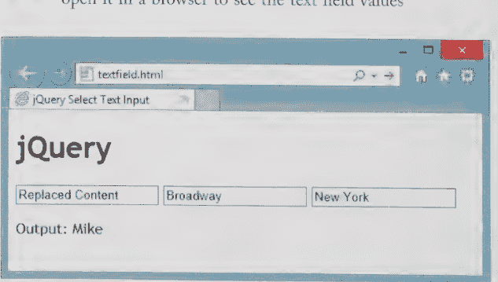

集合的索引编号从零开始，而不是从1开始。

还有一个jQuery文本字段选择器 `$("input:text")`，但为了获得更好的性能，首选方法是使用 `$("input[type='text']")`。

与使用 `<input>` 标签创建的文本字段不同，使用 `<textarea>` 标签创建的文本区域元素不包含type属性——因此可以使用它们的标签名和name属性及其分配的值，来选择用于jQuery对象。可以通过该jQuery对象的 `val()` 方法插入或获取文本区域元素的值：

向HTML文档的body中添加一个包含文本区域的表单和一个包含span的段落

```html
<form>
<textarea name="content" rows="3" cols="50">
</textarea>
</form>
<p>Output: <span id="out"></span></p>
```

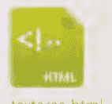

在HTML文档的head部分添加一个脚本块，该脚本选择文本区域并插入一个值

```javascript
$(document).ready(function() {
    var content = $("textarea[name='content']");
    content.val("Text Area Content");
});
```

现在，在脚本块中添加一条语句，以显示已插入到文本区域中的值

```javascript
$("#out").text(content.val());
```

将文档与jQuery库文件一起保存，然后在浏览器中打开它，以查看文本区域的值

**实用技巧**

密码文本字段只是密码类型的文本输入，因此可以使用 `$("input[type='password']")` 来选择

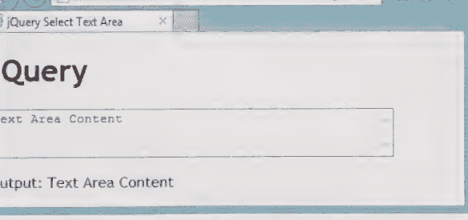

## 通过能力选择

可以通过将所需的属性名作为参数指定给该对象的 `prop()` 方法，来获取jQuery对象中属性的值。此外，可以通过将所需的值作为第二个参数指定给 `prop()` 方法，来设置属性值。这可以用来确定表单元素是否被禁用，也可以将一个启用的元素设置为禁用状态：

1. 向HTML文档的body中添加一个包含三个文本输入的表单和一个包含span的段落

```html
<form>
<input type="text" name="A" value="Alpha">
<input type="text" name="B" value="Bravo">
<input type="text" name="C" value="Charlie">
</form>
<p>Output: <span id="out"></span></p>
```

2. 在HTML文档的head部分添加一个脚本块，该脚本禁用第三个文本输入

```javascript
$(document).ready(function() {
    var box3 = $("input[type='text']").eq(2);
    box3.prop("disabled", true);
});
```

3. 现在，在脚本块中添加一条语句，如果第三个文本输入被禁用，则显示确认信息

```javascript
if (box3.prop("disabled") === true) {
    $("#out").text(box3.val() + " Disabled");
}
```

4. 将文档与jQuery库文件一起保存，然后在浏览器中打开它，以查看被禁用的文本输入字段

> **注意**
>
> 不要使用jQuery的 `removeProp()` 方法来移除 `disabled` 或 `checked` 属性，因为一旦移除，它们之后就无法重新添加——请改用 `prop()` 方法将这些属性设置为 `false`，如图所示。

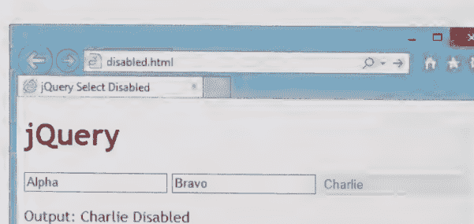

包含 `disabled` 属性的表单元素默认是禁用的，因此用户无法在其中输入内容。任何在jQuery对象中被选中的禁用表单元素，都可以通过将disabled属性名（带引号）作为第一个参数，关键字 `false` 作为第二个参数，传递给该对象的 `prop()` 方法来启用：

1. 向HTML文档的body中添加一个包含三个禁用文本输入的表单和一个包含span的段落

```html
<form>
<input type="text" name="A" value="Alpha" disabled>
<input type="text" name="B" value="Bravo" disabled>
<input type="text" name="C" value="Charlie" disabled>
</form>
<p>Output: <span id="out"></span></p>
```

2. 在HTML文档的head部分添加一个脚本块，该脚本启用第三个文本输入

```javascript
$(document).ready(function() {
    var box3 = $("input[type='text']").eq(2);
    box3.prop("disabled", false);
});
```

3. 现在，在脚本块中添加一条语句，如果第三个文本输入被禁用（此处原文如此，根据代码逻辑应为启用），则显示确认信息

```javascript
if (box3.prop("disabled") === false) {
    $("#out").text(box3.val() + " Enabled");
}
```

4. 将文档与jQuery库文件一起保存，然后在浏览器中打开它，以查看已启用的文本输入字段

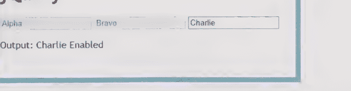

> **实用技巧**
>
> 使用 `prop()` 方法获取和设置 `disabled` 和 `checked` 属性值，但使用 `val()` 方法获取和设置所有其他属性值。

## 选择单选按钮

可以通过将 `checked` 属性名作为参数指定给该对象的 `prop()` 方法，来获取jQuery对象中表单单选按钮元素的状态。如果该单选按钮被选中，这将返回 `true` 值；否则将返回 `false`。状态可以通过将 `checked` 属性名（带引号）作为 `prop()` 方法的第一个参数，一个布尔值 `true` 或 `false` 作为第二个参数来更改：

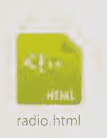

1. 向HTML文档的body中添加一个包含三个单选按钮的表单和一个包含span的段落

```html
<form>
ONE<input type="radio" name="btn" value="ONE">
TWO<input type="radio" name="btn" value="TWO">
THREE<input type="radio" name="btn" value="THREE">
</form>
<p>Output: <span id="out"></span></p>
```

2. 在HTML文档的head部分添加一个脚本块，该脚本选中第三个单选按钮

```javascript
$(document).ready(function() {
    var rad3 = $("input[type='radio']").eq(2);
    rad3.prop("checked", true);
});
```

3. 现在，在脚本块中添加一条语句，如果第三个单选按钮被选中，则显示确认信息

```javascript
if (rad3.prop("checked") === true) {
    $("#out").text(rad3.val() + " Checked");
}
```

**实用技巧**

还有一个jQuery单选按钮选择器 `$("input:radio")`，但为了获得更好的性能，首选方法是使用 `$("input[type='radio']")`。

4. 将文档与jQuery库文件一起保存，然后在浏览器中打开它，以查看被选中的单选按钮

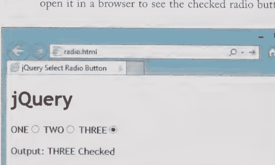

## 选择复选框

通过指定 `checked` 属性名作为 jQuery 对象 `prop()` 方法的参数，可以获取表单复选框输入元素的状态。如果该复选框被选中，此方法将返回 `true` 值，否则返回 `false`。可以通过将带引号的 `checked` 属性名作为 `prop()` 方法的第一个参数，并将布尔值 `true` 或 `false` 作为其第二个参数来更改状态：

1. 在 HTML 文档的 body 中添加一个包含三个复选框和一个包含 span 的段落的表单

```html
<form>
ONE<input type="checkbox" name="box1" value="1">
TWO<input type="checkbox" name="box2" value="2">
THREE<input type="checkbox" name="box3" value="3">
</form>
<p>输出: <span id="out"></span></p>
```

2. 在 HTML 文档的 head 部分添加一个脚本块，用于选中第三个复选框

```javascript
$(document).ready(function() {
    var chk3 = $("input[type='checkbox']").eq(2);
    chk3.prop("checked", true);
});
```

3. 现在，在脚本块中添加一条语句，如果第三个复选框被选中，则显示确认信息

```javascript
if (chk3.prop("checked") === true) {
    $("#out").text(chk3.val() + " 已选中");
}
```

4. 将文档与 jQuery 库文件一起保存，然后在浏览器中打开它，以查看选中的复选框


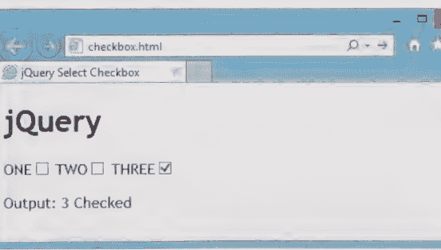

### 小贴士

还有一个 jQuery 复选框选择器 `$( "input:checkbox" )`，但 `$("input[type='checkbox']")` 是为了获得更好性能而推荐使用的方法。

## 选择选项

通过指定 `selected` 属性名作为 jQuery 对象 `prop()` 方法的参数，可以获取 select 选项元素的状态。如果该选项被选中，此方法将返回 `true` 值，否则返回 `false`。可以通过将带引号的 `selected` 属性名作为 `prop()` 方法的第一个参数，并将布尔值 `true` 或 `false` 作为其第二个参数来更改状态：

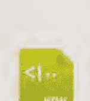

1. 在 HTML 文档的 body 中添加一个包含三个选项的 select 下拉框和一个包含 span 的段落的表单

```html
<form>
  <select>
    <option value="ONE">ONE</option>
    <option value="TWO">TWO</option>
    <option value="THREE">THREE</option>
  </select>
</form>
<p>输出: <span id="out"></span></p>
```

2. 在 HTML 文档的 head 部分添加一个脚本块，用于选中第三个选项

```javascript
$( document ).ready( function() {
  var opt3 = $( "option[value='THREE']" );
  opt3.prop( "selected", true );
} );
```

3. 现在，在脚本块中添加一条语句，如果第三个选项被选中，则显示确认信息

```javascript
if ( opt3.prop( "selected" ) === true ) {
  $( "#out" ).text( opt3.val() + " 已选中" );
}
```

4. 将文档与 jQuery 库文件一起保存，然后在浏览器中打开它，以查看选中的选项

> **别忘了**
>
> "selected" 属性仅适用于选项 - 单选按钮和复选框使用 "checked" 属性。

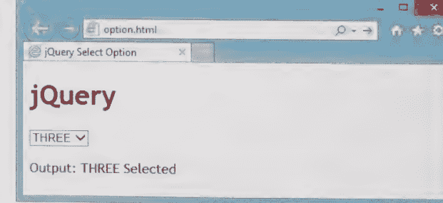

当用户在 select 列表中选择一个选项时，会发生一个 "change 事件"，可以被 jQuery 的 `change()` 方法识别。可以为此方法指定一个匿名函数参数来提供 change 响应。可以通过指定一个 `":selected"` 参数给 jQuery 对象的 `filter()` 方法，来确定该对象内选项元素集合中被选中的选项：

1. 在 HTML 文档的 body 中添加一个包含三个选项的 select 列表和一个包含 span 的段落的表单

```html
<form>
  <select>
    <option value="ONE">ONE</option>
    <option value="TWO">TWO</option>
    <option value="THREE">THREE</option>
  </select>
</form>
<p>输出: <span id="out"></span></p>
```


2. 在 HTML 文档的 head 部分添加一个脚本块，用于识别 select 列表中的更改

```javascript
$( document ).ready( function() {
    $( "select" ).change(
        // 将插入此处的匿名函数。
    );
} );
```

> 注意，`filter()` 方法的参数必须是 `":selected"` – 以冒号字符开头。

### 注意

3. 现在，在脚本块中插入一个匿名函数参数，以显示所选选项的确认信息

```javascript
function() {
  var pick = $( "option" ).filter( ":selected" );
  $( "#out" ).text( pick.val() + " 已选中" );
}
```

4. 将文档与 jQuery 库文件一起保存，然后在浏览器中打开它，以查看选中的选项


### 小贴士

还有一个 jQuery 选项选择器 `$( "option:selected" )`，但 `$("option").filter(":selected")` 是为了获得更好性能而推荐使用的方法。

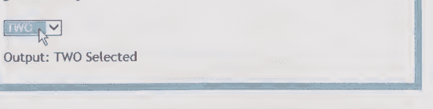

## 选择按钮

表单按钮输入元素可以通过识别其 input `type` 属性来为 jQuery 对象进行最佳选择。例如，所有 `<input type="button">` 类型的表单输入按钮元素。此外，`<button>` 元素也可以通过其元素名称进行选择。多重 jQuery 选择器可以同时指定两者，以确保所有按钮都在集合中被选中：

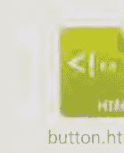

1. 在 HTML 文档的 body 中添加一个表单，包含一个常规输入按钮和一个元素按钮，以及一个包含 span 的段落

```html
<form>
  <input type="button" value="常规按钮">
  <button>元素按钮</button>
</form>
<p>输出: <span id="out"></span></p>
```

2. 在 HTML 文档的 head 部分添加一个脚本块，用于选择所有按钮

```javascript
$( document ).ready( function() {
    var btns = $( "input[type='button'], button" );
} );
```

3. 现在，在脚本块中添加语句，为每个按钮添加边框并显示选中的按钮数量

```javascript
btns.css( "border", "3px solid red" );
$( "#out" ).text( btns.length + " 个按钮被选中" );
```

4. 将文档与 jQuery 库文件一起保存，然后在浏览器中打开它，以查看选中的按钮

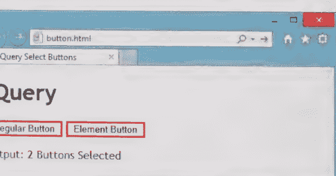

### 小贴士

还有一个 jQuery 输入按钮选择器 `$( "input:button" )`，但 `$("input[type='button']")` 是为了获得更好性能而推荐使用的方法。

非常规类型的表单按钮输入元素也可以通过识别其 type 属性来为 jQuery 对象进行选择。例如，所有带有 `<input type="reset">` 的表单重置按钮元素。多重 jQuery 选择器可以指定每种类型，以便在集合中选中非常规按钮：

1. 在 HTML 文档的 body 中添加一个表单，包含常规按钮、重置按钮和提交按钮，以及一个包含 span 的段落

```html
<form>
  <input type="button" value="常规按钮">
  <input type="reset" value="重置按钮">
  <input type="submit" value="提交按钮">
</form>
<p>输出: <span id="out"></span></p>
```

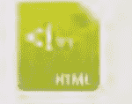

2. 在 HTML 文档的 head 部分添加一个脚本块，用于选择非常规按钮

```javascript
$( document ).ready( function() {
    var btns = $( "input[type='reset'], input[type='submit']" );
} );
```

3. 现在，在脚本块中添加语句，为每个选中的按钮添加边框并显示选中的数量

```javascript
btns.css( "border", "3px solid red" );
$( "#out" ).text( btns.length + " 个按钮被选中" );
```

4. 将文档与 jQuery 库文件一起保存，然后在浏览器中打开它，以查看选中的按钮

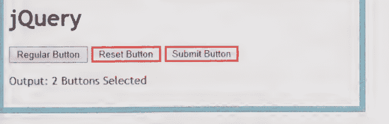

### 小贴士

还有 jQuery 输入选择器 `$( "input:reset" )` 和 `$( "input:submit" )`，但 type 属性选择是为了获得更好性能而推荐使用的方法。

## 选择文件输入

表单文件输入元素可以通过识别其 input `type` 属性来为 jQuery 对象进行最佳选择。当用户选择一个文件时，会发生一个 "change 事件"，可以被 jQuery 的 `change()` 方法识别。可以为此方法指定一个匿名函数参数来提供 change 响应。可以通过该对象的 `val()` 方法获取所选文件的地址：

1. 在 HTML 文档的 body 中添加一个包含文件输入和包含 span 的段落的表单

```html
<form enctype="multipart/form-data" method="POST" action="file.php">
  <input type="file" name="userfile" size="50">
  <input type="submit">
</form>
<p>输出: <span id="out"></span></p>
```

2. 在 HTML 文档的 head 部分添加一个脚本块，用于识别文件输入中的更改

```javascript
$( document ).ready( function() {
    $( "input[type='file']" ).change(
        // 将插入此处的匿名函数。
    );
});
```

3. 现在，在脚本块中插入一个匿名函数参数，以显示所选文件的确认信息

```javascript
function() {
  $( "#out" ).text( $( this ).val() );
}
```

4. 将文档与 jQuery 库文件一起保存，然后在浏览器中打开它，以查看所选文件

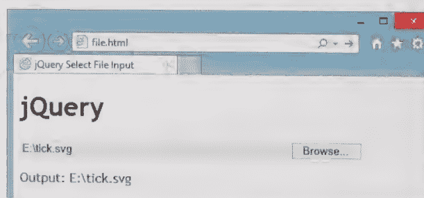

> **别忘了**
>
> 文件类型的 input 元素的值就是用户选择的文件。

### 小贴士

还有一个 jQuery 文件输入选择器 `$( "input:file" )`，但 `$( "input[type='file']" )` 是为了获得更好性能而推荐使用的方法。

# 4 操作元素

> "本章演示如何调整 HTML 元素内容以及如何向元素附加数据。"

- 62 更改内容
- 64 更改属性
- 66 添加内容
- 68 包裹元素
- 70 替换元素
- 72 移除元素
- 74 附加数据
- 76 存储数据
- 78 总结

## 识别焦点

当用户在 jQuery 对象中选择一个用于输入的表单元素时，会发生一个“焦点事件”，该事件可以被该对象的 `focus()` 方法识别；当焦点离开该表单元素时，会发生一个“失焦事件”，该事件可以被该对象的 `blur()` 方法识别。可以为每个方法指定一个匿名函数参数，以便对每个事件做出响应：

1. 向 HTML 文档的 body 中添加一个包含两个文本输入框和一个包含 span 的段落的表单

```html
<form>
  <input type="text" name="a" value="jQuery">
  <input type="text" name="b" value="in easy steps">
</form>
<p>Output: <span id="out"></span></p>
```

2. 在 HTML 文档的 head 部分添加一个脚本块，用于确认第一个文本输入框何时获得和失去焦点

```javascript
$( document ).ready( function() {
    var txt = $( "input[type='text']" ).eq(0);
    var out = $( "#out" );
    txt.focus( function() { out.text( "Active" ); } );
    txt.blur( function() { out.text( "Inactive" ); } );
} );
```

3. 将文档与 jQuery 库文件一起保存，然后在浏览器中打开它，并反复按 Tab 键以触发焦点和失焦

`focus()` 和 `blur()` 方法识别元素本身何时获得或失去焦点。与之相对，`focusin()` 和 `focusout()` 方法识别元素本身或其包含的任何元素何时拥有焦点——这意味着它们支持“事件冒泡”。可以为这些方法中的每一个指定一个匿名函数参数，以提供适当的焦点响应：

1. 向 HTML 文档的 body 中添加一个包含两个文本输入框和一个包含 span 的段落的表单

```html
<form>
  <input type="text" name="a" value="jQuery">
  <input type="text" name="b" value="in easy steps">
</form>
<p>Output: <span id="out"></span></p>
```

2. 在 HTML 文档的 head 部分添加一个脚本块，用于确认任何表单输入何时获得焦点

```javascript
$( document ).ready( function() {
    var frm = $( "form" );
    var out = $( "#out" );
    frm.focusin( function() { out.text( "Form Active" ); } );
    frm.focusout( function() { out.text( "Form Inactive" ); } );
} );
```

> 别忘了
>
> 在此示例中，当任一文本输入框拥有焦点时，表单将保持“活动”状态，只有当焦点移开时才会变为“非活动”状态。

3. 将文档与 jQuery 库文件一起保存，然后在浏览器中打开它，并反复按 Tab 键以查看焦点

## 提交表单

当 jQuery 对象中的表单元素被用户提交时，会发生一个“提交事件”，该事件可以被该对象的 `submit()` 方法识别。可以指定一个匿名函数参数来确认验证或确认用户确实希望将表单提交到 Web 服务器以获取响应：

### 1. 向 HTML 文档的 body 中添加一个表单，其中包含两个文本输入框和一个提交按钮，以及一个包含 span 的段落

```html
<form action="submit.php" method="POST">
  Name: <input type="text" name="name">
  City: <input type="text" name="city">
  <br><br><input type="submit">
</form>
<p>Output: <span id="out"></span></p>
```

> 实用技巧
>
> 在没有参数的情况下调用 jQuery 对象中表单元素的 `submit()` 方法会触发表单提交。

### 2. 在 HTML 文档的 head 部分添加一个脚本块，用于识别表单何时被提交

```javascript
$( document ).ready( function() {
    $( "form" ).submit(
        // 在此处插入匿名函数。
    );
} );
```

> 别忘了
>
> 此示例需要安装本地 Web 服务器以及 PHP 服务器支持——稍后将在 AJAX 部分（第 8 章）提供更多信息。

### 3. 现在，在脚本块中插入一个匿名函数参数，以确认用户确实希望提交表单

```javascript
function() {
    if ( confirm( "Submit Form?" ) ) {
        return true;
    } else {
        $( "#out" ).text( "Form Submission Cancelled" );
        return false;
    }
}
```

### 4. 将文档保存在 Web 服务器的文档文件夹中，与 jQuery 库文件和指定的响应脚本放在一起，然后在浏览器中打开该文档并提交表单以查看确认信息以及使用已提交用户输入的 Web 服务器响应

## 总结

- 表单元素最好通过识别其 `type` 属性来为 jQuery 对象进行选择
- 可以通过向 jQuery 对象的 `eq()` 方法指定其索引号来引用集合中的 input 元素，并通过将 `val()` 方法链接到语句来检索其值
- 可以使用其标签名和 `name` 属性为 jQuery 对象选择表单 `<textarea>` 元素
- jQuery 对象的 `prop()` 方法可以检索指定属性的值，也可以用指定值设置属性
- `disabled`、`checked` 和 `selected` 属性在设置时返回布尔值 `true`，否则返回 `false`
- 当用户选择下拉列表选项时，会发生“更改”事件，该事件可以被 jQuery 的 `change()` 方法识别
- 列表中当前选定的选项可以通过向 jQuery 的 `filter()` 方法指定 `":selected"` 参数来确定
- 表单 input 按钮元素和 `<button>` 元素都可以使用单个多重选择器为 jQuery 对象选择
- 表单 input submit、reset 和 file 类型按钮也可以通过识别其 `type` 属性为 jQuery 对象选择
- 当用户选择文件输入时，会发生“更改”事件，该事件可以被 jQuery 的 `change()` 方法识别
- 当用户选择表单元素时，会发生“焦点”和“失焦”事件，这些事件可以被 `focus()` 和 `blur()` 方法识别
- `focusin()` 和 `focusout()` 方法支持冒泡
- 当用户向服务器提交表单时，会发生“提交”事件，该事件可以被 jQuery 的 `submit()` 方法识别
- 所有识别事件的 jQuery 方法都可以指定一个匿名函数来执行适当的响应

## 表单图像输入元素

表单图像输入元素最好通过识别其 input `type` 属性来为 jQuery 对象选择。可以通过向对象的 `val()` 方法指定字符串参数来为图像输入赋值，也可以通过其 `val()` 方法检索其值：

1. 向 HTML 文档的 body 中添加一个包含图像输入和一个包含 span 的段落的表单

```html
<form>
  <input type="image" src="tick.png" alt="Action">
</form>
<p>Output: <span id="out"></span></p>
```

2. 在 HTML 文档的 head 部分添加一个脚本块，为图像输入元素赋值

```javascript
$( document ).ready( function() {
    var img = $( "input[type='image']" );
    img.val( "Action Button" );
} );
```

> 注意
>
> 不要将 `<input type="image">` 元素与常规的 `` 元素混淆。

3. 现在，在脚本块中添加一条语句来显示图像输入元素的值

```javascript
$( "#out" ).text( img.val() );
```

4. 将文档与 jQuery 库文件一起保存，然后在浏览器中打开它以查看赋值

> 实用技巧
>
> 也有一个 jQuery 图像输入选择器 `$( "input:image" )`，但 `$("input[type='image']")` 是首选方法，以获得更好的性能。

## 更改内容

要检索 jQuery 对象中元素的 HTML 标签之间包含的文本内容，只需调用该对象的 `text()` 方法；要替换现有文本，则可以向 `text()` 方法传递一个字符串参数作为新文本。此外，也可以将一个匿名函数作为 `text()` 方法的参数，该函数会接收元素的索引位置和现有文本内容作为其参数：

1. 向 HTML 文档的 body 中添加两个段落，每个段落包含一个 span - 仅第一个 span 中有文本

```html
<p>New Text :
<span id="new">Java in easy steps</span></p>
<p>Old Text :
<span id="old"></span></p>
```

2. 在 HTML 文档的 head 部分添加一个脚本块，该脚本引用第一个 span 中的文本内容

```javascript
$( document ).ready( function() {
  $( "#new" ).text(
    // 在此插入匿名函数。
  );
} );
```

3. 现在，插入一个匿名函数参数，将文本复制到第二个 span 中，然后用新文本替换它

```javascript
function( i, txt ) {
  $( "#old" ).text( txt );
  return "C Programming in easy steps";
}
```

4. 将文档与 jQuery 库文件一起保存，然后在浏览器中打开它，以查看操作后的元素文本

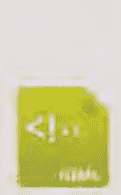

> **切记**
>
> `text()` 方法不能用于表单输入元素 - 对于输入字段文本，必须使用 `val()` 方法。

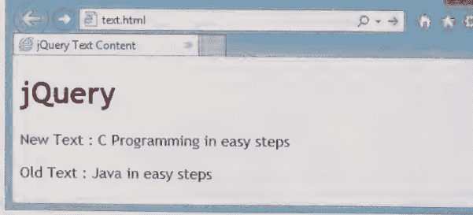

与仅检索元素 HTML 标签之间内容的 `text()` 方法不同，调用 `html()` 方法会同时检索标签及其包含的内容。可以通过向 `html()` 方法传递新元素作为参数来替换现有的完整元素。此外，可以指定一个匿名函数参数来接收索引位置和现有 HTML 元素作为其参数：

1. 向 HTML 文档的 body 中添加一个无序列表和一个包含 span 的段落

```html
<ul><li>Apple</li><li>Banana</li><li>Cherry</li></ul>
<p>Output : <span id="out"></span></p>
```

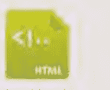

2. 在 HTML 文档的 head 部分添加一个脚本块，该脚本引用列表的 html 和文本内容

```javascript
$( document ).ready( function() {
  $( "ul" ).html(
    // 在此插入匿名函数。
  );
} );
```

3. 现在，插入一个匿名函数参数，将 html 作为文本复制到 span 中，然后用新元素替换它

```javascript
function( i, html ) {
  $( "#out" ).text( html );
  return "<li>Damson</li><li>Elderberry</li><li>Fig</li>";
}
```

4. 将文档与 jQuery 库文件一起保存，然后在浏览器中打开它，以查看操作后的元素文本

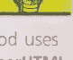

> **注意**
>
> `html()` 方法使用浏览器的 innerHTML 属性，可能无法完全复制原始 HTML 元素 - 请注意此处 Internet Explorer 会添加一个最终的闭合 `</li>` 标签。

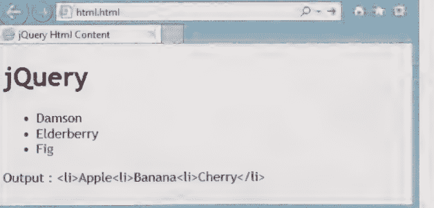

## 更改属性

可以通过将属性名作为参数传递给 jQuery 对象中元素的 `attr()` 方法来检索该属性的值。要设置属性值，可以将属性名及其期望值作为逗号分隔的参数对传递给 `attr()` 方法。例如，使用 `attr( "width", "100" )` 将 `width` 属性设置为 100。可以通过创建一个用 `{ }` 花括号括起来的、由逗号分隔的 name:value 对组成的 JavaScript 对象来设置多个属性：

1. 向 HTML 文档的 body 中添加一个包含图像和 span 的段落

```html
<p><br>Output: <span id="out"></span></p>
```

2. 在 HTML 文档的 head 部分添加一个脚本块，该脚本更改源图像和替代图像文本

```javascript
$( document ).ready( function() {
  var img = $( "img[alt='Firefox']" );
  img.attr( { "src": "tbird.png", "alt": "Thunderbird" } );
} );
```

3. 现在，在脚本块中添加一条语句以显示新的替代图像文本

```javascript
$( "#out" ).text( img.attr( "alt" ) );
```

4. 将文档与 jQuery 库文件一起保存，然后在浏览器中打开它，以查看更改后的属性

> **切记**
>
> 属性值始终是字符串 - `value` 和 `tabindex` 属性除外。

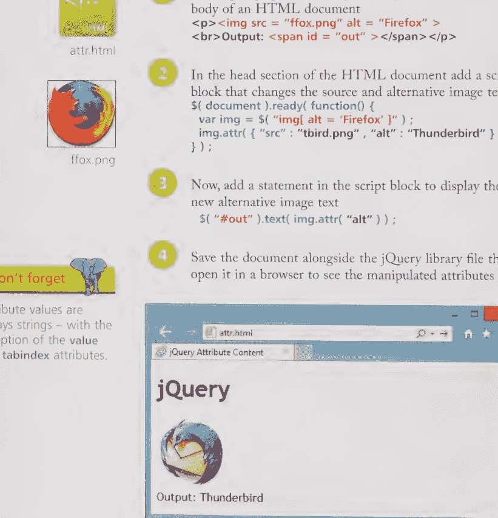

可以通过将属性名作为参数传递给 jQuery 对象中元素的 `removeAttr()` 方法，简单地将其从 DOM 中移除。布尔型 `checked`、`selected` 和 `disabled` 属性的属性属性值与状态之间存在微妙差异 - 建议使用 `prop()` 方法来获取或设置这些属性：

1. 向 HTML 文档的 body 中添加一个带有两个复选框的表单和一个包含两个 span 的段落

```html
<form>
  <input id="box1" type="checkbox" checked>
  <input id="box2" type="checkbox" checked>
</form>
<p>Box1 Checked? : <span id="out1"></span>
<br>Box2 Checked? : <span id="out2"></span></p>
```

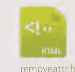

2. 在 HTML 文档的 head 部分添加一个脚本块，该脚本移除第一个复选框的 checked 属性

```javascript
$( document ).ready( function() {
  var b1 = $( "#box1" ), b2 = $( "#box2" );
  b1.removeAttr( "checked" );
});
```

3. 现在，在脚本块中添加一条语句，以显示每个复选框的 checked 属性值和属性状态

```javascript
$( "#out1" ).text( b1.prop( "checked" ) + " | " + b1.attr( "checked" ) );
$( "#out2" ).text( b2.prop( "checked" ) + " | " + b2.attr( "checked" ) );
```

4. 将文档与 jQuery 库文件一起保存，然后在浏览器中打开它，以查看属性值和状态

> HTML `checked` 属性实际上对应于 `defaultChecked` 属性。

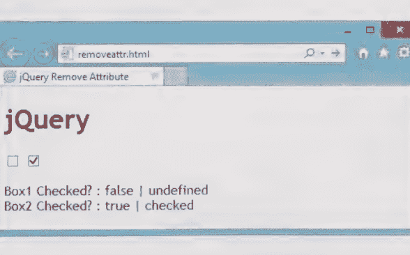

## 添加内容

可以通过将内容作为参数传递给 jQuery 对象的 `before()` 方法（在元素之前立即添加）和 `after()` 方法（在元素之后立即添加），在该对象中元素的外部添加内容。类似地，可以通过将内容作为参数传递给 `prepend()` 和 `append()` 方法（分别在元素的开头和结尾插入），在元素内部插入内容：

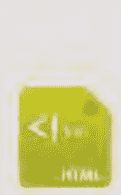

1. 向 HTML 文档的 body 中添加一个列表

```html
<ul><li>Apple</li><li>Banana</li><li>Cherry</li></ul>
```

2. 在 HTML 文档的 head 部分添加一个脚本块，该脚本在列表前后添加内容

```javascript
$(document).ready( function() {
  var list = $( "ul" );
  list.before( "+ BEFORE" );
  list.after( "+ AFTER" );
} );
```

3. 现在，在脚本块中添加语句，在列表的开头和结尾内部插入内容

```javascript
list.prepend( "< PREPEND" );
list.append( "< APPEND" );
```

4. 将文档与 jQuery 库文件一起保存，然后在浏览器中打开它，以查看添加的内容

> **切记**
>
> `before()` 和 `after()` 方法在选定元素**外部**添加内容，而 `prepend()` 和 `append()` 方法在元素**内部**添加内容。

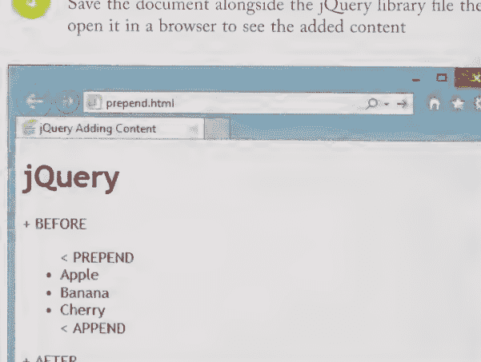

也可以使用 jQuery 对象的 `insertBefore()` 和 `insertAfter()` 方法在元素外部添加内容，或使用其 `prependTo()` 和 `appendTo()` 方法在元素内部插入内容。与前面描述的方法不同，这些方法必须在内容选择器或标记字符串之后调用，并以目标元素作为其参数：

1. 向 HTML 文档的 body 中添加一个列表

```html
<ul><li>Apple</li><li>Banana</li><li>Cherry</li></ul>
```


2. 在 HTML 文档的 head 部分添加一个脚本块，该脚本在列表前后添加内容

```javascript
$(document).ready( function() {
  var list = $( "ul" );
  $( "<p>+ BEFORE</p>" ).insertBefore( list );
  $( "<p>+ AFTER</p>" ).insertAfter( list );
} );
```

3. 现在，在脚本块中添加语句，在列表的开头和结尾内部插入标记内容

```javascript
$( "<span>< PREPEND</span>" ).prependTo( list );
$( "<span>< APPEND</span>" ).appendTo( list );
```

4. 将文档与 jQuery 库文件一起保存，然后在浏览器中打开它，以查看添加的内容

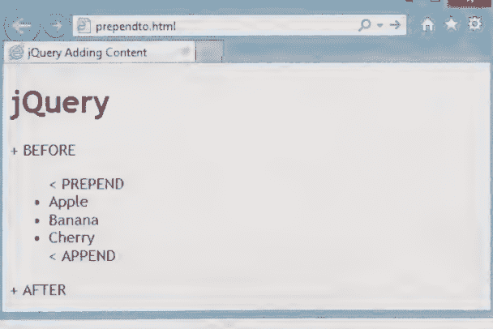

> **注意**
>
> 要添加到元素的标记内容应包含 HTML 标签，而不仅仅是文本字符串。

## 包裹元素

可以通过将容器元素或 HTML 结构指定为 jQuery 对象的 `wrap()` 方法的参数，将其包裹在 jQuery 对象中的某个元素周围。反之，可以通过将容器元素指定为该对象的 `unwrap()` 方法的参数，将其从元素周围移除：

1. 向 HTML 文档的 body 添加有序列表

```html
<ol id="abc"><li>Alpha</li><li>Bravo</li><li>Charlie</li></ol>
<ol id="xyz"><li>Xray</li><li>Yankee</li><li>Zulu</li></ol>
```

2. 在 HTML 文档的 head 部分添加样式表，为 division 元素指定规则

```html
<style>
div { background:yellow; border:3px solid red; width:300px; }
</style>
```

3. 接下来，在 HTML 文档的 head 部分添加一个脚本块，首先为两个列表各包裹一个 division，然后移除第一个列表周围的 division

```javascript
$(document).ready( function() {
  $( "#abc, #xyz" ).wrap( "<div></div>" );
  $( "#abc" ).unwrap( "<div></div>" );
} );
```

4. 将文档与 jQuery 库文件一起保存，然后在浏览器中打开以查看被包裹的元素

> **别忘了**
>
> 用于包裹的结构参数应该是格式正确的 HTML —— 包括闭合标签。

可以通过将容器元素指定为该对象的 `wrapAll()` 方法的参数，将其包裹在 jQuery 对象中的整个元素集合周围。类似地，可以通过将容器元素指定为该对象的 `wrapInner()` 方法的参数，将其包裹在集合中的每个单独元素周围：

1. 向 HTML 文档的 body 添加有序列表

```html
<ol id="abc"><li>Alpha</li><li>Bravo</li><li>Charlie</li></ol>
<ol id="xyz"><li>Xray</li><li>Yankee</li><li>Zulu</li></ol>
```

2. 在 HTML 文档的 head 部分添加样式表，为 division 元素指定规则

```html
<style>
div { background:yellow; border:3px solid red; width:300px; }
</style>
```

3. 接下来，在 HTML 文档的 head 部分添加一个脚本块，首先包裹第一个列表中的所有列表项，然后包裹第二个列表中的每个单独列表项

```javascript
$(document).ready( function() {
  $( "#abc li" ).wrapAll( "<div></div>" );
  $( "#xyz li" ).wrapInner( "<div></div>" );
} );
```

4. 将文档与 jQuery 库文件一起保存，然后在浏览器中打开以查看被包裹的元素

### 小贴士

被包裹的元素可能包含多个嵌套层级 —— 被包裹的元素将包含指定的元素及其所有嵌套层级。

## 替换元素

jQuery 对象中的元素或元素集合可以通过指定另一个元素和内容作为该对象的 `replaceWith()` 方法的参数来进行替换。

或者，可以在 jQuery 对象的 `replaceAll()` 方法之前指定替换内容，并将要替换的元素指定为该方法的参数：

1. 向 HTML 文档的 body 添加一个无序列表和一个包含 span 的段落

```html
<ul><li>ONE</li><li>TWO</li><li>THREE</li></ul>
<p>Output: <span id="out"></span></p>
```

2. 在 HTML 文档的 head 部分添加一个脚本块，显示每个列表项元素的标签和文本

```javascript
$(document).ready( function() {
  var list = $( "ul" );
  $( "#out" ).text( list.html() );
} );
```

3. 接下来，在脚本块中添加语句，将无序列表元素替换为有序列表元素，然后替换每个列表项元素及其内容

```javascript
list.replaceWith( "<ol>" + list.html() + "</ol>" );
$( "<li>List Item</li>" ).replaceAll( $( "li" ) );
```

4. 将文档与 jQuery 库文件一起保存，然后在浏览器中打开以查看被替换的元素

> **别忘了**
>
> `replaceAll()` 方法实现的结果与 `replaceWith()` 方法类似，但其源和目标的语法是相反的。

jQuery 对象中包含的元素及其所有子元素和内容可以使用该对象的 `clone()` 方法进行复制（克隆）。然后，该副本可以有效地插入到文档中需要的任何位置。原始元素中包含的内容可以通过指定新内容作为其 `text()` 或 `html()` 方法的参数来简单替换：

1. 向 HTML 文档的 body 添加一个常规的数字编号列表

```html
<ol><li>ONE</li><li>TWO</li><li>THREE</li></ol>
```

2. 在 HTML 文档的 head 部分添加一个脚本块，在原始第一个列表之后将列表的副本插入文档

```javascript
$(document).ready( function() {
  var list = $( "ol" );
  list.clone().insertAfter( list );
} );
```

3. 接下来，在脚本块中插入语句，替换原始第一个列表的编号样式和内容

```javascript
list.css( "list-style-type", "upper-alpha" );
list.html( "<li>Alpha</li><li>Bravo</li><li>Charlie</li>" );
```

4. 将文档与 jQuery 库文件一起保存，然后在浏览器中打开以查看复制和替换的列表

clone.html

> **注意**
>
> 避免克隆具有 ID 属性的元素，因为它们必须是唯一的。

> **注意**
>
> 用户在表单输入字段和下拉列表选择中输入的数据不会被复制到克隆的元素中 —— 它们会被设置为 HTML 中指定的默认值。

## 移除元素

可以使用 jQuery 对象的 `empty()` 方法移除该对象中包含的元素的所有子元素和内容。这将保留对象元素本身，但该元素本身也可以使用 `remove()` 方法与子元素和内容一起被移除：

1. 向 HTML 文档的 body 添加一个包含段落（段落内有一个 span）的 division，后跟一个包含两个 span 的段落

```html
<div id="box">Division Text
  <p id="txt">Paragraph Text<span>Span Text</span></p>
</div>
<p>Paragraph Emptied: <span id="out1"></span></p>
<br>Paragraph Removed: <span id="out2"></span></p>
```

2. 在 HTML 文档的 head 部分添加一个脚本块，清空该段落并显示其父级剩余的内容

```javascript
$(document).ready( function() {
  var parent = $("#box"), child = $("#txt");
  child.empty();
  $("#out1").text( parent.html() );
});
```

3. 接下来，在脚本块中插入语句移除该段落并显示其父级当前剩余的内容

```javascript
child.remove();
$("#out2").text( parent.html() );
```

4. 将文档与 jQuery 库文件一起保存，然后在浏览器中打开以查看被清空和移除的元素

> **别忘了**
>
> `remove()` 方法移除一个元素及其所有内容，而 `empty()` 方法仅移除元素的内容。

..续

使用 jQuery 对象的 `remove()` 方法从 DOM 中移除的 jQuery 对象元素会丢失由 jQuery 创建的所有行为。反之，可以使用该对象的 `detach()` 方法将元素从 DOM 中移除并保留由 jQuery 创建的行为：

1. 向 HTML 文档的 body 添加一个包含两个文本输入字段的表单

```html
<form>
  <input type="text" value="Removed">
  <input type="text" value="Detached">
</form>
```

detach.html

2. 在 HTML 文档的 head 部分添加一个脚本块，创建行为以便在每个输入字段获得和失去焦点时改变其背景颜色

```javascript
$(document).ready( function() {
    var fields = $( "input[type='text']" );
    fields.focus( function() {
        $( this ).css( "background", "red" );
    } );
    fields.blur( function() {
        $( this ).css( "background", "white" );
    } );
} );
```

### 小贴士

`detach()` 方法与 `remove()` 方法相同，但由于它保留了与被移除元素相关的所有 jQuery 数据，因此在将元素重新附加到 DOM 时更有用。

3. 接下来，在脚本块中插入语句，移除并追加第一个文本输入，然后分离并追加第二个文本输入 —— 将两个输入重新附加到表单

```javascript
fields.eq(0).remove().appendTo( "form" );
fields.eq(1).detach().appendTo( "form" );
```

4. 将文档与 jQuery 库文件一起保存，然后在浏览器中打开以查看第二个输入保留了行为

## 操作元素

## 附加数据

可以通过指定键和关联值，以键值对的形式传递给 jQuery 对象的 `data()` 方法，将数据附加到该对象包含的元素上。附加的值可以随时通过调用该对象的 `data()` 方法，并传递关联的键作为参数来检索：


1. 在 HTML 文档的 body 中添加一个图像和一个包含 span 的段落

```html

<p>输出: <span id="out"></span></p>
```

2. 在 HTML 文档的 head 部分添加一个脚本块，将两个键值对与图像关联

```javascript
$(document).ready( function() {
  var pic = $( "#pic" );
  pic.data( "Make", "Jaguar" );
  pic.data( "Model!", " F-Type" );
} );
```

3. 接下来，在脚本块中插入一条语句，显示与图像关联的两个数据值

```javascript
$( "#out" ).text( pic.data( "Make" ) + pic.data( "Model!" ) );
```

4. 将文档与 jQuery 库文件一起保存，然后在浏览器中打开以查看与元素关联的数据

> **注意**
>
> `data()` 方法不能用于 `<object>`（除非是 Flash 插件）、`<applet>` 或 `<embed>` 元素。

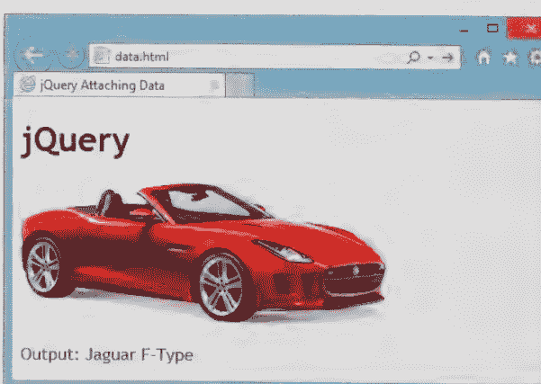

## 附加数据（续）

使用 jQuery 对象的 `data()` 方法附加到元素上的数据，可以通过将其关联的键作为参数传递给 `removeData()` 方法来移除。尝试检索已移除的数据将返回 "undefined"：

1. 在 HTML 文档的 body 中添加一个图像和一个包含 span 的段落

```html

<p>输出: <span id="out"></span></p>
```

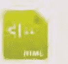

2. 在 HTML 文档的 head 部分添加一个脚本块，将两个键值对与图像关联

```javascript
$(document).ready( function() {
  var pic = $( "#pic" );
  pic.data( "Make", "Porsche " );
  pic.data( "Model", "Cayman" );
} );
```

3. 接下来，在脚本块中插入语句以移除一个值，然后尝试显示两个关联的数据值

```javascript
pic.removeData( "Model" );
$( "#out" ).text( pic.data( "Make" ) + pic.data( "Model" ) );
```

4. 将文档与 jQuery 库文件一起保存，然后在浏览器中打开以查看与元素关联的数据

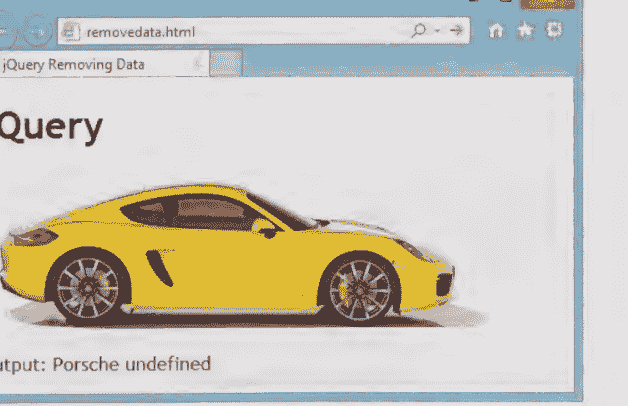

> **实用提示**
>
> 关联的数据值也可以通过设置为 `null` 来“移除”。例如，这里可以调用 `pic.data( "Model", null )`。

## 存储数据

内置的 jQuery `$.hasData()` 方法可用于通过指定元素作为参数来确定特定 HTML 元素是否附加了数据。`$.hasData()` 方法仅在找到附加数据时返回 `true`。可以通过引用 jQuery 对象的第一个数组项来指定元素：

1. 在 HTML 文档的 body 中添加一个图像和一个包含 span 的段落

```html

<p>输出: <span id="out"></span></p>
```

2. 在 HTML 文档的 head 部分添加一个脚本块，将数据与图像关联

```javascript
$(document).ready( function() {
  var pic = $( "#pic" ).data( "fg", "red" );
} );
```

3. 接下来，在脚本块中插入语句，仅在数据与图像元素关联时显示内容

```javascript
if ( $.hasData( pic[0] ) ) {
  $( "#out" ).text( pic[0] + " 有数据" ).css( "color", pic.data( "fg" ) );
}
```

4. 将文档与 jQuery 库文件一起保存，然后在浏览器中打开，查看是否有关联数据时显示的内容

> **别忘了**
>
> `$.hasData()` 调用使用了 `$` 别名快捷方式，也可以表示为 `jQuery.hasData()`。

> **注意**
>
> jQuery 对象是一个组件数组，其中 HTML 元素位于第一个数组元素中。

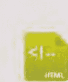

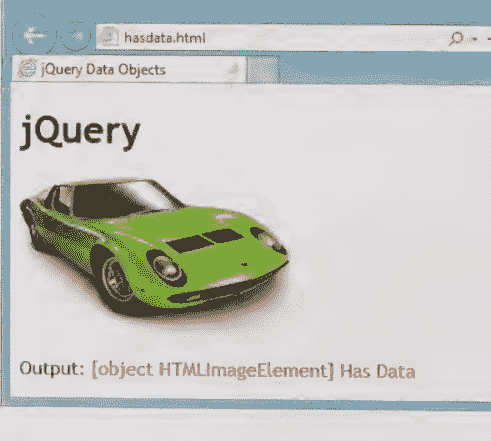

## 存储数据（续）

可以通过创建一个用花括号 `{ }` 括起来的、逗号分隔的键值对 JavaScript 对象，在单条语句中将多个数据项附加到 HTML 元素。通常，每个值随后都可以使用其关联的键来引用：

1. 在 HTML 文档的 body 中添加一个图像和一个包含 span 的段落

```html

<p>输出: <span id="out"></span></p>
```


2. 在 HTML 文档的 head 部分添加一个脚本块，将键值对与图像关联

```javascript
$(document).ready( function() {
  var pic = $( "#pic" );
  pic.data( "info", {
    make: "Lamborghini ",
    model: "Gallardo ",
    version: "Spyder"
  } );
} );
```

> **实用提示**
>
> 如果使用 `detach()` 方法移除的元素稍后重新附加，其数据将被保留。

3. 接下来，在脚本块中插入语句以显示所有关联的数据值

```javascript
$( "#out" ).text(
  pic.data( "info" ).make +
  pic.data( "info" ).model +
  pic.data( "info" ).version
);
```

4. 将文档与 jQuery 库文件一起保存，然后在浏览器中打开以查看与元素关联的数据

> **实用提示**
>
> 调用不带参数的 `data()` 方法会检索所有值作为一个 JavaScript 对象，该对象可以赋值给一个变量。

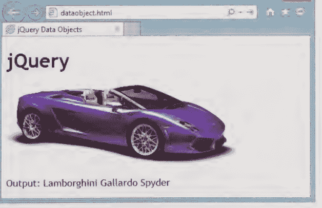

## 总结

- 元素的文本内容可以使用 jQuery 对象的 `text()` 方法检索或添加
- 元素的文本和 HTML 标签内容都可以使用 jQuery 对象的 `html()` 方法检索或添加
- 元素的属性值可以使用 jQuery 对象的 `attr()` 方法检索或添加
- 元素的属性可以从 DOM 中移除，使用 jQuery 对象的 `removeAttr()` 方法
- 内容可以添加到元素外部，使用 `before()`、`insertBefore()`、`after()` 和 `insertAfter()` 方法
- 内容可以添加到元素内部，使用 `prepend()`、`prependTo()`、`append()` 和 `appendTo()` 方法
- 可以使用 `wrap()` 方法在元素周围添加 HTML 结构，或使用 `unwrap()` 方法移除
- 可以使用 `wrapAll()` 和 `wrapInner()` 方法在一组元素周围添加 HTML 结构
- 可以使用 `replaceWith()` 和 `replaceAll()` 方法替换一个元素或一组元素
- 可以使用 `clone()` 方法复制元素的内容和后代，或使用 `empty()` 方法移除它们
- 可以使用 `remove()` 或 `detach()` 方法移除元素及其内容和后代
- 只有使用 `detach()` 方法移除的元素在重新附加时才会保留由 jQuery 创建的数据和行为
- 数据可以作为参数对附加到 `data()` 方法，并使用 `hasData()` 方法确认其存在性
- 附加到元素上的数据可以使用 `data()` 方法检索，使用 `removeData()` 方法移除

# 5 识别事件

本章演示如何创建事件处理函数来响应用户操作。

- 80 检测点击
- 82 感受压力
- 84 检测存在
- 86 守卫边界
- 88 发现移动
- 90 检测按键
- 92 调整大小
- 94 环顾四周
- 96 总结

## 检测点击

当用户点击或轻触 jQuery 对象中的元素时，会发生“点击事件”，该对象可以通过其 `click()` 方法识别。同样，当用户双击元素时，会发生“双击事件”，该对象可以通过其 `dblclick()` 方法识别。可以为每个方法指定一个匿名函数参数，以便为每个事件提供响应：

1. 在 HTML 文档的 body 中添加一个 division

```html
<div id="box">点击方框</div>
```

2. 在 HTML 文档的 head 部分添加一个样式表，为 division 指定初始规则

```html
<style>
#box { border:2px dashed gray; width:200px; height:50px; }
</style>
```

3. 接下来，在文档的 head 部分添加一个脚本块，为每个点击事件指定事件处理程序

```javascript
$( document ).ready( function() {
    var box = $( "#box" ).click( function() {
        $( this ).css( "background", "yellow" );
        $( this ).text( "检测到点击" );
    } );
    box.dblclick( function() {
        $( this ).css( "background", "aqua" );
        $( this ).text( "检测到双击" );
    } );
} );
```

4. 将文档与 jQuery 库文件一起保存，然后在浏览器中打开并点击 division 以查看响应

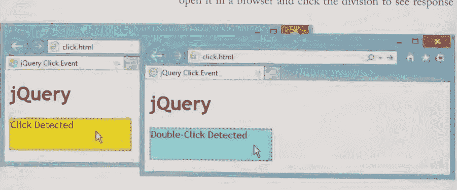

## 续接上文

jQuery 对象中元素的“点击事件”可以通过调用该对象的 `trigger()` 方法并在参数中指定事件名称（在引号内）从脚本中触发。这将执行该事件指定的事件处理函数中的语句，就像用户点击了该元素一样：

1. 向 HTML 文档的 body 中添加一个 division 元素

```html
<div id="box">Click Box</div>
```

2. 在 HTML 文档的 head 部分添加一个样式表，为该 division 元素指定初始规则

```html
<style>
#box { border:2px dashed gray; width:300px; height:50px; }
</style>
```

3. 接下来，在文档的 head 部分添加一个脚本块，为该 division 元素指定一个点击事件处理函数

```javascript
$( document ).ready( function() {
    var box = $( "#box" ).click( function() {
        $( this ).css( "background", "lime" );
        $( this ).text( "Click Triggered" );
    } );
} );
```

4. 现在，在脚本块中添加一条语句来触发该 division 的点击事件并调用其事件处理函数

```javascript
box.trigger( "click" );
```

5. 将文档与 jQuery 库文件一起保存，然后在浏览器中打开它以查看触发的点击事件

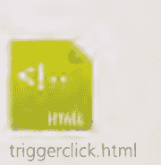

> 小贴士
>
> 注意这些事件处理函数如何高效地使用 `$( this )` 来引用元素。

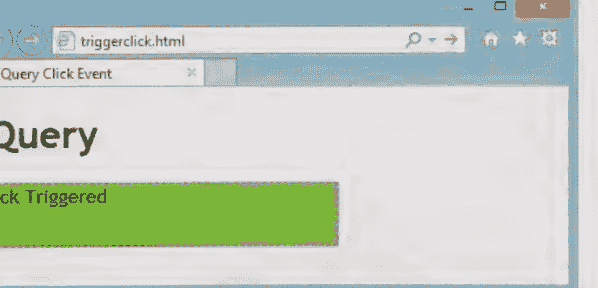

## 感受压力

当用户按下鼠标按钮并将光标悬停在 jQuery 对象中的元素上时，会发生一个“mousedown 事件”，该事件可以被该对象的 `mousedown()` 方法识别。类似地，当用户在元素上释放鼠标按钮时，会发生一个“mouseup 事件”，该事件可以被该对象的 `mouseup()` 方法识别。可以为每个方法指定一个匿名函数参数，以响应每个事件：

1. 向 HTML 文档的 body 中添加一个 division 元素

```html
<div id="box">Click Box</div>
```

2. 在 HTML 文档的 head 部分添加一个样式表，为该 division 元素指定初始规则

```html
<style>
#box { border:2px dashed gray; width:200px; height:50px; }
</style>
```

3. 接下来，在文档的 head 部分添加一个脚本块，为鼠标按钮事件设置事件处理函数

```javascript
$( document ).ready( function() {
    var box = $( "#box" ).mousedown( function() {
        $( this ).css( "background", "yellow" );
        $( this ).text( "Mouse Button Pressed" );
    } );
    box.mouseup( function() {
        $( this ).css( "background", "aqua" );
        $( this ).text( "Mouse Button Released" );
    } );
} );
```

4. 将文档与 jQuery 库文件一起保存，然后在浏览器中打开它并点击该 division 元素以查看响应

> **小贴士**
>
> 可以通过将事件作为参数传递给处理函数并引用其 `button` 属性来识别按下的特定按钮。例如，使用 `function(e) { alert( e.button ) }` 时，按钮在数值上被识别为 0（左）、1（中）或 2（右）。

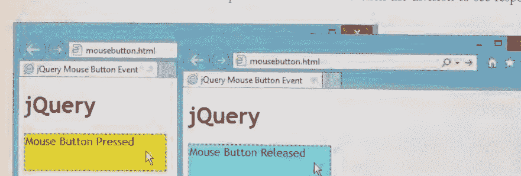

jQuery 对象中元素的鼠标按钮事件可以通过调用该对象的 `trigger()` 方法并在参数中指定事件名称（在引号内）从脚本中触发。这将执行该事件指定的事件处理函数中的语句，就像用户点击了该元素一样：

1. 向 HTML 文档的 body 中添加一个 division 元素

```html
<div id="box">Click Box</div>
```

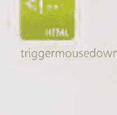

2. 在 HTML 文档的 head 部分添加一个样式表，为该 division 元素指定初始规则

```html
<style>
#box { border:2px dashed gray; width:300px; height:50px; }
</style>
```

3. 接下来，在文档的 head 部分添加一个脚本块，为该 division 元素设置一个 mousedown 事件处理函数

```javascript
$( document ).ready( function() {
    var box = $( "#box" ).mousedown( function() {
        $( this ).css( "background", "lime" );
        $( this ).text( "Mouse Button Down Triggered" );
    } );
} );
```

4. 现在，在脚本块中添加一条语句来触发该 division 的 mousedown 事件并调用其事件处理函数

```javascript
box.trigger( "mousedown" );
```

5. 将文档与 jQuery 库文件一起保存，然后在浏览器中打开它以查看触发的 mousedown 事件

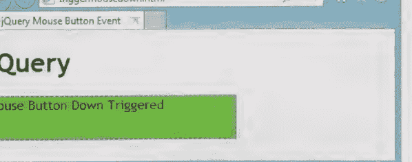

> **小贴士**
>
> 多个事件处理函数可以链接成一个长语句——但作为单独的语句更易于阅读。

## 检测存在

当用户将鼠标光标移动到 jQuery 对象中的元素上时，会发生一个“mouseover 事件”，该事件可以被该对象的 `mouseover()` 方法识别。类似地，当用户将鼠标光标移出元素的框区域时，会发生一个“mouseout 事件”，该事件可以被该对象的 `mouseout()` 方法识别。可以为每个方法指定一个匿名函数参数，以响应每个事件：

1. 向 HTML 文档的 body 中添加一个 division 元素

```html
<div id="zone">Mouse Zone</div>
```

2. 在 HTML 文档的 head 部分添加一个样式表，为该 division 元素指定初始规则

```html
<style>
#zone { border:2px dashed gray; width:200px; height:50px; }
</style>
```

3. 接下来，在文档的 head 部分添加一个脚本块，为鼠标事件设置事件处理函数

```javascript
$( document ).ready( function() {
    var zone = $( "#zone" ).mouseover( function() {
        $( this ).text( "Over" ).css( "background", "yellow" );
    } );
    zone.mouseout( function() {
        $( this ).text( "Out" ).css( "background", "aqua" );
    } );
} );
```

4. 将文档与 jQuery 库文件一起保存，然后在浏览器中打开它并移动光标以查看检测

> 注意：mouseover 事件会向下冒泡到内部元素——因此，当光标位于包含的内部元素上时，其事件处理函数也可能被触发。

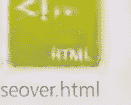

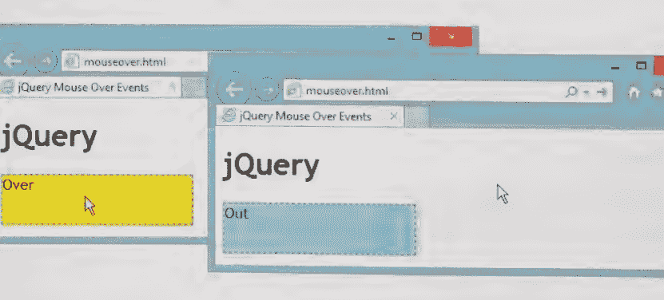

可选地，jQuery 事件识别方法在指定事件处理函数时可以指定一个额外的参数，以便将值传递给处理函数。多个值也可以在 JavaScript 对象参数中指定为键值对，并将该对象传递给事件处理函数。然后，这些值可以使用其键通过事件对象的 `data` 属性来引用：

1. 向 HTML 文档的 body 中添加一个 division 元素

```html
<div id="zone">Mouse Zone</div>
```

2. 在 HTML 文档的 head 部分添加一个样式表，为该 division 元素指定初始规则

```html
<style>
#zone { border:2px dashed gray; width:200px; height:50px; }
</style>
```

3. 接下来，在文档的 head 部分添加一个脚本块，为该 division 元素设置鼠标事件处理函数

```javascript
$( document ).ready( function() {
    var zone = $( "#zone" ).mouseover( { on:"Mouse Over" }, function(e) {
        $( this ).text( e.data.on ).css( "background", "lime" );
    } );
    zone.mouseout( { off:"Mouse Out", hue:"fuchsia" }, function(e) {
        $( this ).text( e.data.off );
        $( this ).css( "background", e.data.hue );
    } );
} );
```

4. 将文档与 jQuery 库文件一起保存，然后在浏览器中打开它并移动光标以查看检测


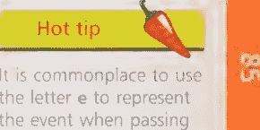


## 守卫边界

当用户将鼠标光标移动到 jQuery 对象中的元素上时，会发生一个“mouseenter 事件”，该事件可以被该对象的 `mouseenter()` 方法识别。类似地，当用户将鼠标光标移出元素的框区域时，会发生一个“mouseleave 事件”，该事件可以被该对象的 `mouseleave()` 方法识别。可以为每个方法指定一个匿名函数参数，以响应每个事件：


1. 向 HTML 文档的 body 中添加一个 division 元素

```html
<div id="zone">Mouse Zone</div>
```

2. 在 HTML 文档的 head 部分添加一个样式表，为该 division 元素指定初始规则

```html
<style>
#zone { border:2px dashed gray; width:200px; height:50px; }
</style>
```

3. 接下来，在文档的 head 部分添加一个脚本块，为鼠标事件设置事件处理函数

```javascript
$( document ).ready( function() {
    var zone = $( "#zone" ).mouseenter( function() {
        $( this ).text( "Enter" ).css( "background", "yellow" );
    } );
    zone.mouseleave( function() {
        $( this ).text( "Leave" ).css( "background", "aqua" );
    } );
} );
```

4. 将文档与 jQuery 库文件一起保存，然后在浏览器中打开它并移动光标以查看响应


> 当光标进入元素的边框区域时，会触发 mouseover 或 mouseenter 事件。

与“mouseover”和“mouseout”事件不同，“mouseenter”和“mouseleave”事件不会在 DOM 中冒泡——因此不会因内部嵌套元素上的鼠标操作而触发：

1. 向 HTML 文档的 body 中添加两个 division，每个包含一个段落

```html
<div id="d1"><p id="p1">0 Entries</p></div>
<div id="d2"><p id="p2">0 Overs</p></div>
```

2. 在 HTML 文档的 head 部分添加样式表，为 division 和段落指定规则

```css
div { background:aqua; width:100px; float:left; margin:10px }
p { background: yellow; margin: 10px; }
```

3. 接下来，在文档的 head 部分，添加一个 script 块，为鼠标事件设置事件处理程序

```javascript
$( document ).ready( function() {
    var en = 0, ov = 0; // Counter variables.
    $( "#d1" ).mouseenter( function() {
        $( "#p1" ).text( ++en + " Entries" );
    } );
    $( "#d2" ).mouseover( function() {
        $( "#p2" ).text( ++ov + " Overs" );
    } );
} );
```

4. 将文档与 jQuery 库文件一起保存，然后在浏览器中打开它，并将光标移动到每个段落上一次——以查看只有“mouseover”事件在外层 division 和内层段落元素上都触发

> 使用 `mouseenter()` 和 `mouseleave()` 方法而不是 `mouseover()` 和 `mouseout()` 以避免事件冒泡问题。


## 检测移动

当用户将鼠标光标移动到 jQuery 对象的元素上时，会发生一个“mousemove 事件”，该事件可以被该对象的 `mousemove()` 方法识别。可以为该方法指定一个匿名函数作为事件处理程序，并将事件对象作为参数传递给它。该事件具有 `pageX` 和 `pageY` 属性，其中包含相对于文档左上角的当前光标坐标（以像素为单位）：


1. 向 HTML 文档的 body 中添加一个 division

```html
<div id="zone">Mouse Zone</div>
```

2. 在 HTML 文档的 head 部分添加样式表，为该 division 指定初始规则

```css
<style>
#zone { border:2px dashed gray; width:200px; height:50px; }
</style>
```

> **不要忘记**
>
> 存储在 mousemove 事件的 `pageX` 和 `pageY` 属性中的坐标是相对于文档边缘的——而不是元素边缘。

3. 接下来，在文档的 head 部分，添加一个 script 块，为鼠标移动设置事件处理程序，以显示光标在文档中的位置

```javascript
$( document ).ready( function() {
    $( "#zone" ).mousemove( function( e ) {
        var left = e.pageX;
        var top = e.pageY;
        $( this ).text( "X: " + left + " Y: " + top );
    } );
} );
```

4. 将文档与 jQuery 库文件一起保存，然后在浏览器中打开它并移动光标以查看位置


...续

在跟踪鼠标光标时，通常希望引用其在元素内的坐标，而不是文档内的坐标。这可以通过从坐标中减去元素的 `offsetLeft` 和 `offsetTop` 属性值来简单实现：

1. 向 HTML 文档的 body 中添加一个 division

```html
<div id="zone">Mouse Zone</div>
```


2. 在 HTML 文档的 head 部分添加样式表，为该 division 指定初始规则

```css
<style>
#zone { border:2px dashed gray; width:200px; height:50px; }
</style>
```

3. 接下来，在文档的 head 部分，添加一个 script 块，显示光标在元素内的位置

```javascript
$( document ).ready( function() {
    $( "#zone" ).mousemove( function( e ) {
        var left = ( e.pageX - this.offsetLeft );
        var top = ( e.pageY - this.offsetTop );
        $( this ).text( "X: " + left + " Y: " + top );
    } );
} );
```

> **实用技巧**
>
> 您可以使用此技术在任何浏览器中引用相对于元素左上角的坐标。

4. 现在，在 script 块中，添加一条语句以根据光标位置应用适当的背景样式

```javascript
if ( left < 100 ) $( this ).css( "background", "yellow" );
else $( this ).css( "background", "aqua" );
```

5. 将文档与 jQuery 库文件一起保存，然后在浏览器中打开它并移动光标以查看位置


## 检测按键

当用户在 jQuery 对象的聚焦元素上按下键盘按键时，会发生一个“keypress 事件”，该事件可以被该对象的 `keypress()` 方法识别。可以为该方法指定一个匿名函数作为事件处理程序，并将事件对象作为参数传递给它。该事件具有一个 `which` 属性，其中包含按下按键的字符代码号——字母键的 a-z 是 65-90，A-Z 是 97-122：

1. 向 HTML 文档的 body 中添加一个表单文本输入框和一个包含 span 的段落

```html
<form><input type="text" id="txt" maxlength="1"></form>
<p>Output: <span id="out"></span></p>
```

2. 在 HTML 文档的 head 部分添加一个 script 块，设置一个 keypress 处理程序来清除文本输入框

```javascript
$( document ).ready( function() {
    $( "#txt" ).keypress( function( e ) {
        $( this ).val( null );
    } );
} );
```

3. 接下来，在事件处理程序中，插入语句以识别字符代码并显示字符类型

```javascript
var str = "Non-Alpha";
if ( (e.which > 64) && (e.which < 91) ) str = "Uppercase";
else if ( (e.which > 96) && (e.which < 123) ) str = "Lowercase";
$( "#out" ).text( str + " Character Pressed" );
```

4. 将文档与 jQuery 库文件一起保存，然后在浏览器中打开它，并在输入框中键入任何字符

keypress 事件识别按下按键的 ASCII 字符代码号。

字符代码和键码有微妙的区别——字符 'A' 的字符代码是 65，字符 'a' 的字符代码是 97，但 'A' 键的键码始终是 65。


## ...续

当用户按住键盘按键时，会发生“keydown 事件”，可以通过该对象的 `keydown()` 方法识别。同样，当用户释放键盘按键时，会发生“keyup 事件”，可以通过该对象的 `keyup()` 方法识别。传递给它们事件处理程序的事件对象具有一个 `which` 属性，其中包含按下按键的键码号：

1. 向 HTML 文档的 body 中添加一个表单文本输入框和一个包含 span 的段落

```html
<form><input type="text" id="txt" maxlength="1"></form>
<p>Output: <span id="out"></span></p>
```

2. 在 HTML 文档的 head 部分添加一个 script 块，设置一个 keydown 处理程序来显示键码

```javascript
$( document ).ready( function() {
    $( "#txt" ).keydown( function( e ) {
        $( "#out" ).text( "Key Code: " + e.which );
    } );
} );
```

3. 接下来，在 script 块中，插入一个 keyup 处理程序来清除文本输入框并显示释放确认信息

```javascript
$( "#txt" ).keyup( function() {
    $( this ).val( null );
    $( "#out" ).text( "Key Released" );
} );
```

4. 将文档与 jQuery 库文件一起保存，然后在浏览器中打开它，并在输入框中键入任何字符


```javascript
$(document).ready(function(){
    var txt = $("#txt"), out = $("#out");
    txt.keydown(function(e){
        out.text("Key " + e.which + " Down");
    });
});
```

```javascript
txt.keyup(function(e){
    $(this).val(null);
    out.text("Key " + e.which + " Up");
});
```


keydown.html

> **不要忘记**
>
> keydown事件识别表示按下按键的键码号，无论大小写。
>
> **实用技巧**
>
> 使用keydown通过代码号检测特殊键——例如方向键（37-40）。


## 调整大小

当用户调整浏览器窗口大小时，会发生一个“resize事件”，该事件被发送到DOM `window` 对象，并且可以通过该对象的 `resize()` 方法识别。可以为该方法指定一个匿名函数作为事件处理程序，以便在窗口大小调整时提供响应。

resize事件的实现在不同浏览器中有所不同，有些仅在调整完成后触发，有些则在调整操作的开始和结束时都触发。可以使用计时器来确保resize事件处理程序在任何浏览器中仅在调整完成后被调用一次：


1. 向HTML文档的body中添加一个division和一个包含span的段落

```html
<div>Resize the browser window.</div>
<p>Output: <span id="out"></span></p>
```

2. 在HTML文档的head部分添加一个script块，初始化计数器和计时器变量

```javascript
$( document ).ready( function() {
    var num = 0 , timer = null ;
} ) ;
```

3. 接下来，在script块中，插入一个函数来设置division的背景颜色并显示窗口大小

```javascript
function showsize() {
    num++ ;
    var hue = ( num % 2 === 0 ) ? "yellow" : "aqua" ;
    $( "div" ).css( "background" , hue ) ;
    var str = num + " - Browser" ;
    str += " Width: " + $( window ).width() ;
    str += " Height: " + $( window ).height() ;
    $( "#out" ).text( str ) ;
}
```

4. 现在，在script块中，添加一个resize事件处理程序，该程序仅调用一次该函数以确认调整已完成

```javascript
$( window ).resize(function () {
    clearTimeout( timer ) ;
    timer = setTimeout( showsize , 100 ) ;
} ) ;
```

> **不要忘记**
>
> 此示例根据计数器的奇偶值交替设置division的背景颜色。

## 5

将文档与 jQuery 库文件一起保存，然后在任何浏览器中打开并调整大小以查看响应。

> 注意
>
> 在 resize 事件处理程序中的代码永远不应依赖处理程序被调用的次数，因为在调整大小过程中，resize 事件可能会持续触发。


## 围绕滚动

当用户滚动 jQuery 对象的元素时，会发生一个“scroll 事件”，该事件可以通过该对象的 `scroll()` 方法识别。可以为该方法指定一个匿名函数作为事件处理程序，以识别该用户操作：


scroll.html

1. 在 HTML 文档的 body 中添加一个有序列表和一个包含 span 的段落

```html
<ol id="list"><li>Alpha<li>Bravo<li>Charlie<li>Delta<li>Echo<li>Foxtrot<li>Golf</ol>
<p>Output: <span id="out"></span></p>
```

2. 在 HTML 文档的 head 部分添加一个样式表，为列表指定允许滚动的规则

```html
<style>
ol { border:1px solid gray; }
#list { overflow-y: scroll; width: 150px; height: 90px; }
</style>
```


3. 接下来，在 HTML 文档的 head 部分，添加一个脚本块，该脚本块设置一个滚动处理程序来计算滚动次数

```javascript
$( document ).ready( function() {
    var num = 0 ;
    $( "#list" ).scroll( function() {
        num++;
        $( "#out" ).text( "Scrolls Detected = " + num ) ;
    } ) ;
} ) ;
```

4. 将文档与 jQuery 库文件一起保存，然后在浏览器中打开并滚动列表以查看计数


## ...续

当滚动 jQuery 对象的元素时，通过调用其 `scrollLeft()` 和 `scrollTop()` 方法可以揭示其沿 X 和 Y 轴相对于原始位置的像素偏移量：

1. 在 HTML 文档的 body 中添加两个嵌套的 div 和一个包含 span 的段落

```html
<div id="box"><div id="txt">Content</div></div>
<p>Offset: <span id="out">X: 0 Y: 0</span></p>
```


2. 在 HTML 文档的 head 部分添加一个样式表，为 div 指定大小和滚动规则

```html
<style>
div { width: 200px; height: 100px; border: 1px solid gray; }
#box { overflow: scroll; }
#txt { margin: 50px; background: yellow; }
</style>
```

3. 接下来，在 HTML 文档的 head 部分，添加一个脚本块来显示滚动偏移值

```javascript
$( document ).ready( function() {
    $( "#box" ).scroll( function() {
        var x = $( this ).scrollLeft() + " pixels";
        var y = $( this ).scrollTop() + " pixels";
        $( "#out" ).text( "X: " + x + " Y: " + y ) ;
    } ) ;
} ) ;
```

> 不要忘记
>
> 水平和垂直滚动位置与在可滚动区域中隐藏的像素数相同。

4. 将文档与 jQuery 库文件一起保存，然后在浏览器中打开并滚动以查看偏移量


## 总结

- jQuery 对象中元素的点击事件可以通过该对象的 `click()` 和 `dblclick()` 方法识别
- 事件处理程序可以指定为这些识别事件的方法的参数，以提供动态响应
- 事件可以通过将其名称（带引号）作为参数指定给 jQuery 对象的 `trigger()` 方法来触发
- 在元素上发生的鼠标按钮事件可以通过 `mousedown()` 和 `mouseup()` 方法识别
- 在元素上发生的鼠标移动事件可以通过 `mouseover()`、`mouseout()`、`mouseenter()`、`mouseleave()` 和 `mousemove()` 方法识别
- 事件可以作为参数传递给事件处理程序，并且可以在 JavaScript 对象中指定多个值
- 传递给事件处理程序的 JavaScript 对象中的值可以通过其关联的键通过 `data` 属性引用
- mousemove 对象具有 `pageX` 和 `pageY` 属性，包含相对于文档左上角的光标位置
- jQuery 对象中元素的按键事件可以通过该对象的 `keypress()`、`keydown()` 和 `keyup()` 方法识别
- 传递给 `keypress()` 方法的按键事件具有一个包含字符代码数字值的 `which` 属性
- 传递给 `keydown()` 和 `keyup()` 方法的按键事件具有一个包含键码数字值的 `which` 属性
- 调整大小事件发送到 DOM `window` 对象，并且可以通过该对象的 `resize()` 方法识别
- jQuery 对象中元素的滚动事件可以通过该对象的 `scroll()` 方法识别
- jQuery 对象中滚动元素的偏移位置可以通过调用其 `scrollLeft()` 和 `scrollTop()` 方法来揭示

# 6 附加处理程序

本章演示如何将事件处理程序和回调函数附加到事件。

1. 绑定到事件
2. 绑定多个处理程序
3. 传递事件数据
4. 触发处理程序
5. 移除处理程序
6. 注册回调
7. 延迟回调
8. 保持承诺
9. 总结

## 绑定到事件

诸如 `click()`、`focus()`、`mouseenter()` 和 `submit()` 等识别浏览器事件的 jQuery 方法，可以方便地允许指定一个事件处理程序，以对同名的浏览器事件提供响应。

事件处理程序也可以通过将事件名称和处理程序作为以逗号分隔的参数指定给 jQuery 对象功能更强大的 `on()` 方法来附加（“绑定”）到浏览器事件——使用此语法：`jQuery-object.on( event-name, event-handler )`

可以用于将处理程序绑定到浏览器事件的事件名称列在下表中，以及每个事件在浏览器中触发时的简要说明：

> ### 热门提示
>
> 识别浏览器事件的方法，如 `click()` 和 `focus()` 方法，通常被称为“快捷方法”—— `on()` 方法的快捷方式。

> ### 不要忘记
>
> 事件名称必须用引号括起来作为 `on()` 方法的参数。

| 事件名称： | 事件触发于： |
|---|---|
| blur | 表单 `<input>` 字段失去焦点 |
| change | 表单字段的值发生更改 |
| click | 元素被单击 |
| dblclick | 元素被双击 |
| focus | 表单 `<input>` 字段获得焦点 |
| keypress | 键盘按键被按下 |
| keydown | 键盘按键正在按下 |
| keyup | 键盘按键正在释放 |
| mousedown | 鼠标左键被按下 |
| mouseup | 鼠标左键被释放 |
| mouseover | 鼠标指针悬停在元素上 |
| mouseout | 鼠标指针离开元素 |
| mouseenter | 鼠标指针进入元素 |
| mouseleave | 鼠标指针离开元素 |
| mousemove | 鼠标指针在元素内移动 |
| resize | 浏览器窗口大小改变 |
| scroll | 用户滚动元素 |
| select | 文本在文本区域或文本字段中被选中 |
| submit | 表单被提交 |

## ...续

使用 `on()` 方法将事件处理程序绑定到浏览器事件会导致每次该事件在浏览器中触发时都执行指定处理程序函数内的语句。或者，可以将事件名称和处理程序指定为 jQuery `one()` 方法的参数，将一个事件处理程序绑定到浏览器事件，该事件处理程序将仅执行其语句一次——在指定事件在浏览器中首次触发时：

```html
<button id="btn">Click Me</button>
<p>Output: <span id="out"></span></p>
```

1. 在 HTML 文档的 body 中添加一个按钮和一个包含 span 的段落


2. 在 HTML 文档的 head 部分添加一个脚本块，该脚本块绑定一个只运行一次的事件处理程序

```javascript
$( document ).ready( function() {
    $( "#btn" ).one( "mouseenter" , function() {
        $( "p" ).prepend( "Count " ) ;
    } ) ;
} ) ;
```

3. 接下来，在脚本块中插入语句，将事件处理程序绑定到每次浏览器事件触发时都运行

```javascript
var num = 0 ;
$( "#btn" ).on( "click" , function() {
    num++ ;
    $( "#out" ).text( num ) ;
} ) ;
```

> **on()** 方法提供了附加事件处理程序所需的所有功能，并取代了 jQuery 旧版本中的 `bind()`、`delegate()` 和 `live()` 方法。

4. 将文档与 jQuery 库文件一起保存，然后在浏览器中打开并单击按钮以查看响应


## 绑定多个处理程序

jQuery `on()` 方法的多功能性允许将多个事件处理程序指定为一个 JavaScript 对象参数，该参数定义了事件名称和关联的处理程序：

1. 向 HTML 文档的主体添加一个包含一个段落和一个 span 的 division

```html
<div id="zone">Click Zone</div>
<p>Output: <span id="out"></span></p>
```

2. 在 HTML 文档的 head 部分添加一个样式表，为 division 指定初始规则

```css
<style>
#zone { border:2px dashed gray; width:200px; height:50px; }
</style>
```

3. 接下来，在文档的 head 部分添加一个脚本块，用于识别 division 上的浏览器事件

```javascript
$(document).ready(function() {
    $("#zone").on(
        // 事件处理程序语句将插入此处。
    );
});
```

4. 接下来，在脚本块中插入语句，将多个事件处理程序绑定到 division 上的事件

```javascript
{
    mouseenter: function() {
        $(this).css("background", "yellow");
        $("#out").text("Mouse Entered");
    },
    mousedown: function() {
        $(this).css("background", "lime");
        $("#out").text("Mouse Button Down");
    },
    mouseup: function() {
        $(this).css("background", "fuchsia");
        $("#out").text("Mouse Button Up");
    },
    mouseleave: function() {
        $(this).css("background", "aqua");
        $("#out").text("Mouse Exited");
    }
}
```

5. 将文档与 jQuery 库文件一起保存，然后在浏览器中打开它，点击 division 查看响应


> **别忘了**
>
> 在此示例中，可以使用 `var out = $("#out")` 来引用 span 元素，以避免重复。

> **注意**
>
> JavaScript 对象中指定的每个事件:处理程序对必须用逗号分隔。


## 传递事件数据

jQuery `on()` 方法可以选择性地包含三个参数，用于指定事件名称、要传递给事件处理程序的数据，以及在命名事件触发时要调用的处理函数。多个数据项可以存储在事件对象中的一个 JavaScript 对象中，该对象由逗号分隔的键值对组成。将事件对象传递给事件处理程序后，就可以在事件对象的 data 属性中通过其键来引用每个存储的值：


1. 向 HTML 文档的主体添加一个包含一个段落和一个 span 的 division

```html
<div id="zone">Click Zone</div>
<p>Output: <span id="out"></span></p>
```

2. 在 HTML 文档的 head 部分添加一个样式表，为 division 指定初始规则

```css
<style>
#zone { border:2px dashed gray; width:200px; height:50px; }
</style>
```

3. 接下来，在文档的 head 部分添加一个脚本块，定义一个使用传递数据的事件处理程序

```javascript
$(document).ready(function() {
    function handler(event) {
        $("#out").text("Mouse " + event.data.msg);
        $(this).css("background", event.data.bg);
    }
});
```

4. 接下来，在脚本块中插入语句，通过将数据传递给事件处理程序来识别鼠标事件

```javascript
$("#zone").on("mouseenter",
    { msg: "Entered", bg: "yellow" }, handler);

$("#zone").on("mousedown",
    { msg: "Button Down", bg: "lime" }, handler);

$("#zone").on("mouseup",
    { msg: "Button Up", bg: "fuchsia" }, handler);

$("#zone").on("mouseleave",
    { msg: "Exited", bg: "aqua" }, handler);
```

> 热门提示
>
> 此示例提供了一种替代方法，通过将数据传递给单个函数，实现了与前一个示例（使用四个函数）相同的效果。

5. 将文档与 jQuery 库文件一起保存，然后在浏览器中打开它，点击 division 查看响应


## 触发处理程序

一旦为 jQuery 对象中的元素定义了事件处理程序，它就会在事件触发时执行，但也可以通过远程调用该元素的 `trigger()` 方法来执行。此方法只需要将处理程序所附加的事件的名称指定为其参数即可：

向 HTML 文档的主体添加一个 division 以及包含两个按钮和一个 span 的段落

```html
<div id="box">Active Box</div>
<p>
    <button id="entr-btn">Enter</button>
    <button id="leave-btn">Leave</button>
</p>
<p>Output: <span id="out"></span></p>
```

在 HTML 文档的 head 部分添加一个样式表，为 division 指定初始规则

```css
<style>
#box { border:2px dashed gray; width:200px; height:50px; }
</style>
```

接下来，在文档的 head 部分添加一个脚本块，定义一个使用传递数据的事件处理程序

```javascript
$(document).ready(function() {
    function handler(event) {
        $("#out").text(event.data.action);
        $("#box").css("background", event.data.bg);
    }
    // 触发语句将插入此处。
});
```

现在，在脚本块中插入语句，通过将数据传递给事件处理程序来识别鼠标事件

```javascript
$("#box").on("mouseenter",
    { action: "Mouse Enter", bg: "Lime" }, handler);
$("#box").on("mouseleave",
    { action: "Mouse Leave", bg: "Fuchsia" }, handler);
```

最后，插入语句，通过触发鼠标事件处理程序来识别按钮事件，并追加文本

```javascript
$("#entr-btn").on("click", function() {
    $("#box").trigger("mouseenter");
    $("#out").append(" Triggered");
});

$("#exit-btn").on("click", function() {
    $("#box").trigger("mouseleave");
    $("#out").append(" Triggered");
});
```


triggerhandler.html

> 调用 `trigger()` 方法执行事件处理程序的方式与用户操作正常触发事件的方式完全相同。
>
> 你也可以向 `on()` 方法指定一个自定义命名的事件以及一个关联的处理函数，然后通过将自定义事件名称指定为 `trigger()` 方法的参数来调用该处理程序。

## ...接上文

6. 将文档与 jQuery 库文件一起保存，然后在浏览器中打开它，将鼠标悬停在 division 上以查看其鼠标事件处理程序的响应


7. 依次点击按钮，查看它们自己的事件处理程序从鼠标事件处理程序提供响应，并将文本追加到它们的 span 输出中


## 移除处理程序

就像可以通过 jQuery 对象的 `on()` 方法为特定事件指定事件处理程序一样，也可以通过该对象的 `off()` 方法移除先前指定的事件处理程序。使用这些方法，可以为逗号分隔的多个事件名称列表指定或移除单个事件处理程序：


1. 向 HTML 文档的主体添加一个包含两个按钮的段落和一个 division

```html
<div id="box">Active Box</div>
<p>
    <button id="on-btn">On</button>
    <button id="off-btn">Off</button>
</p>
```

2. 在 HTML 文档的 head 部分添加一个样式表，为 division 指定初始规则

```css
<style>
#box { border:2px dashed gray; width:200px; height:50px; }
</style>
```

3. 接下来，在文档的 head 部分添加一个脚本块，定义一个使用变量值的事件处理程序

```javascript
$(document).ready(function() {
    var num = 0, hue = null, box = $("#box");

    function run() {
        num++;
        hue = (num % 2 === 0) ? "aqua" : "yellow";
        $(this).css("background", hue);
        $(this).text("Border Crossing #" + num);
    }
    // 指定语句将插入此处。
});
```

> 别忘了
>
> `off()` 方法是移除事件处理程序的推荐方式，比旧的 jQuery `unbind()` 和 `undelegate()` 方法更受青睐。

> 热门提示
>
> 你可以在 `off()` 方法中省略处理程序名称参数以移除其所有事件处理程序，或者仅指定一个事件名称参数以仅移除该事件的事件处理程序。

4. 现在，在脚本块中插入一条语句，为 division 上的鼠标事件指定事件处理程序

```javascript
$("#on-btn").on("click", function() {
    box.on("mouseenter mouseleave", run);
    box.css("background", "lime");
});
```

5. 最后，插入一条语句，移除为 division 上的鼠标事件指定的事件处理程序

```javascript
$("#off-btn").on("click", function() {
    box.off("mouseenter mouseleave", run);
    box.css("background", "fuchsia");
});
```

## 注册回调

“回调”就是作为一个参数传递给另一个函数的函数，该参数函数期望在之后回调传入的函数。通常，简单的回调会向调用者返回一个值：


1. 向 HTML 文档的 body 添加一个按钮和一个包含 span 的段落

```html
<button id="btn">Call</button>
<p>Output: <span id="out"></span></p>
```

2. 在 HTML 文档的 head 部分添加一个 script 块，该块定义一个函数，该函数显示接收到的值，然后回调传入的函数

```javascript
$( document ).ready( function() {
  function process( arg, callback ) {
    $( "#out" ).html( "<br>From Caller: " + arg ) ;
    callback( 2 ) ;
  }
} ) ;
```

3. 接下来，在 script 块中，插入一个指定事件处理程序的语句，该程序传递一个值和一个回调函数，然后显示接收到的返回值

> **注意**
>
> 将函数作为参数传递时，作为参数名的只是被传递的函数的名称——不带尾部的 `()` 括号。

```javascript
$( "#btn" ).on( "click", function() {
  process( 1, function( num ) {
    $( "#out" ).append( "<br>From Callback: " + num ) ;
  } ) ;
} ) ;
```

4. 将文档与 jQuery 库文件一起保存，然后在浏览器中打开它并单击按钮以查看响应


多个回调函数的列表可以有效地注册在一个 jQuery Callbacks 对象中。该对象由 `$.Callbacks()` 构造函数创建，每个回调函数使用该对象的 `add()` 方法注册。然后调用该对象的 `fire()` 方法将依次执行每个回调函数：

1. 向 HTML 文档的 body 添加一个按钮和一个包含 span 的段落

```html
<button id="btn">Call</button>
<p>Output: <span id="out"></span></p>
```


2. 在 HTML 文档的 head 部分添加一个 script 块，该块创建一个回调列表，其中包含两个各自接受单个参数的函数

```javascript
$( document ).ready( function() {
  var callbacks = $.Callbacks() ;
  callbacks.add( function( str ) { $( "#out" ).text( str ) ; } ) ;
  callbacks.add( function( str ) { alert( str ) ; } ) ;
```

> **小贴士**
>
> Callbacks 对象还提供了其他方法来管理已注册的回调列表，例如 `disable()`、`lock()`、`empty()` 和 `remove()`。

3. 接下来，在 script 块中，插入一个指定事件处理程序的语句，该程序调用每个回调函数

```javascript
$( "#btn" ).on( "click" , function() {
  callbacks.fire( "Hello from the Callbacks List!" ) ;
} ) ;
```

4. 将文档与 jQuery 库文件一起保存，然后在浏览器中打开它并单击按钮以查看响应


## 推迟回调

作为在 Callbacks 对象中注册多个回调函数的替代方案（如上一页所述），回调可以附加到 jQuery Deferred 对象。这可以有效地通过触发附加的适当回调来指示任何调用的同步或异步函数的成功或失败。

> **别忘了**
>
> 对于 Deferred 对象，resolve 表示任务完成，reject 表示失败。

`$.Deferred()` 构造函数创建一个 Deferred 对象，该对象具有 `done()`、`fail()` 和 `always()` 方法，每个方法都可以接受一个回调函数作为其参数以附加到对象。

Deferred 对象提供 `resolve()` 方法来指示成功，这反过来会调用 `done()` 方法——触发其附加的回调。Deferred 对象还提供 `reject()` 方法来指示失败，这反过来会调用 `fail()` 方法——触发其附加的回调。此外，可选的 `always()` 方法在 Deferred 对象被 resolve 或 reject 之后触发其附加的回调。

可选地，`resolve()` 和 `reject()` 方法可以接受一个参数，在被调用时传递给相关的附加回调。

随时调用 Deferred 对象的 `state()` 方法会返回一个字符串，表示对象的当前状态，可以是“pending”、“resolved”或“rejected”：


1. 向 HTML 文档的 body 添加一个按钮和一个包含 span 的段落

```html
<button id="btn">Call</button>
<p>Output: <span id="out"></span></p>
```

2. 在 HTML 文档的 head 部分添加一个 script 块，该块首先指定一个事件处理程序，并使用变量来存储 Deferred 对象和对 span 的引用

```javascript
$( document ).ready( function() {
    $( "#btn" ).on( "click" , function() {
        var dfd = null , out = $( "#out" ) ;
        // 在此添加语句。
    } ) ;
} ) ;
```

3. 接下来，在函数块中，添加语句以创建 Deferred 对象并显示其初始状态

```javascript
dfd = $.Deferred() ;
out.text( dfd.state() ) ;
```

4. 现在，在函数块中，添加语句以将回调函数附加到 Deferred 对象

```javascript
dfd.done( function( n ) { out.text( this.state() ) ; } ) ;
dfd.fail( function( n ) { out.text( this.state() ) ; } ) ;
dfd.always( function( n ) { out.append( " " + n ) ; } ) ;
```

5. 最后，在函数块中，添加语句以创建一个 1 秒计时器，该计时器根据所选随机数的奇偶性 resolve 或 reject Deferred 对象

```javascript
setTimeout( function() {
    var n = Math.ceil( Math.random() * 100 ) ;
    ( n % 2 !== 0 ) ? dfd.reject( n ) : dfd.resolve( n ) ;
} , 1000 ) ;
```

6. 将文档与 jQuery 库文件一起保存，然后在浏览器中打开它并单击按钮以查看 Deferred 对象的 resolve 或 reject 响应


## 遵守承诺

当 Deferred 对象被封装在创建该对象、调用函数以确定成功或失败、然后向调用者返回该对象的版本（“promise”）——将其状态传递为“resolved”或“rejected”——的函数中时，Deferred 对象变得更加有用。这允许调用者将回调函数附加到返回的 promise 对象，这些函数将根据其状态执行。

每个 Deferred 对象都有一个 `promise()` 方法，调用时会返回其自身的 Promise 对象。Promise 对象具有 `done()`、`fail()` 和 `always()` 方法，回调可以作为参数指定给它们，但没有 `resolve()` 或 `reject()` 方法。

jQuery 的 `$.when()` 方法接受一个 Promise 对象参数，以便回调函数可以在完成时附加——从而允许每个调用者附加不同的回调：

1. 向 HTML 文档的 body 添加两个按钮和一个包含 span 的段落

```html
<button id="get-btn">Call</button>
<button id="eval-btn">Parity</button>
<p>Output: <span id="out"></span></p>
```

2. 在 HTML 文档的 head 部分添加一个 script 块，该块首先指定变量以存储 Deferred 对象和对 span 的引用

```javascript
$( document ).ready( function() {
    var dfd = null, out = $( "#out" );
    // 在此添加函数和语句。
} );
```

3. 接下来，在 script 块中，添加一个函数，该函数创建一个 Deferred 对象，然后显示其初始状态，添加一个定时器来 resolve 或 reject 该对象，并返回最终的 promise

```javascript
function getpromise() {
    dfd = $.Deferred();
    out.text( dfd.state() );

    setTimeout( function() {
        var n = Math.ceil( Math.random() * 100 );
        ( n % 2 !== 0 ) ? dfd.reject( n ) : dfd.resolve( n );
    }, 1000 );

    return dfd.promise();
}
```

始终“遵守承诺”，因为 Promise 对象确保 Deferred 对象的 `resolve()` 和 `reject()` 方法受到保护。

`promise()` 方法返回一个动态生成的 Promise 对象，该对象在所有未完成的操作完成后被 resolve。

## 总结

- 事件处理程序可以通过向 `on()` 方法指定事件和处理函数名称参数来绑定到浏览器事件。
- 通过 `one()` 方法绑定到事件的处理函数，在该事件在浏览器中首次触发时仅会执行一次。
- 多个事件处理程序可以作为定义事件和关联处理函数的 JavaScript 对象，指定给 `on()` 方法。
- 数据参数可以作为定义事件对象键值对的 JavaScript 对象，指定给 `on()` 方法。
- 将事件对象传递给处理函数，使得存储的值可以使用事件对象的 `data` 属性和键来引用。
- 通过调用 jQuery 对象中元素的 `trigger()` 方法，可以远程执行绑定到该元素的事件处理程序；通过调用该元素的 `off()` 方法可以移除它。
- 回调函数是作为参数传递给另一个函数的函数，该函数可以在稍后调用接收到的函数。
- jQuery 的 `$.Callbacks()` 构造函数创建一个 Callbacks 对象列表，其中可以使用其 `add()` 方法注册函数，并随后使用其 `fire()` 方法执行。
- jQuery 的 `$.Deferred()` 构造函数创建一个 Deferred 对象，其中可以指定表示成功或失败的回调。
- Deferred 对象的 `resolve()` 方法在成功时触发 `done()`，其 `reject()` 方法在失败时触发 `fail()`，而其 `always()` 方法无论成功与否，在完成时都会触发。
- 调用 Deferred 对象的 `state()` 方法返回一个描述当前状态为 "pending"、"resolved" 或 "rejected" 的字符串。
- Deferred 对象的 `promise()` 方法返回一个 Promise 对象，可以为其附加表示成功或失败的回调。
- jQuery 的 `$.when()` 方法接受一个 Promise 对象参数，以便在完成时附加回调函数。

# 7 产生效果

本章演示如何使用 jQuery 方法产生动态效果。

- 116 隐藏元素
- 118 切换元素
- 120 滑动元素
- 122 淡入淡出内容
- 124 淡入淡出到特定级别
- 126 动画元素
- 128 停止动画
- 130 处理队列
- 132 总结

## 隐藏元素

jQuery 对象中元素的可见性可以使用该对象的 `hide()` 和 `show()` 方法动态更改。简单地调用 `hide()` 方法（不带任何参数）将立即隐藏一个可见元素——就像其 CSS `display` 属性被设置为 `none` 一样。调用 `show()` 方法（不带任何参数）将立即显示一个隐藏元素——恢复其 CSS `display` 属性值。

更有趣的是，`hide()` 和 `show()` 方法可以选择性地接受一个参数来指定可见性更改的速度。然后，这些方法将在指定的持续时间内执行动画效果，改变宽度、高度和不透明度。持续时间可以以毫秒为单位数值指定，也可以通过关键字 “slow”（600 毫秒）或 “fast”（200 毫秒）指定。

此外，还可以将回调函数指定为 `hide()` 和 `show()` 方法的第二个参数，该回调将在动画完成时触发。

以毫秒为单位指定的持续时间表示值越大动画越慢，而不是越快。

请将要隐藏或显示的元素之后的其他元素的位置固定，以避免页面内容重新排列。

1. 向 HTML 文档的 body 中添加一个 div 和一个包含两个按钮及一个 span 的段落

```html
<div>Buttons Change Visibility</div>
<p> <button id="hide-btn">Hide</button> <button id="show-btn">Show</button>
<br>Output: <span id="out"></span> </p>
```

2. 在文档的 head 部分添加一个样式表，以指定 div 属性和段落位置

```html
<style>
div { padding:5px; width:200px; height:30px; background:yellow; border:2px dashed gray; }
p { position:absolute;top:120px; }
</style>
```

3. 接下来，在文档的 head 部分添加一个脚本块，指定一个事件处理程序，以便在按钮被点击时隐藏 div 并显示确认信息

```javascript
$(document).ready( function() {
    $("#hide-btn").on( "click" , function() {
        $("div").hide( "slow" , function() {
            $("#out").text( "Content Hidden" ) ;
        } ) ;
    } ) ;
} ) ;
```

现在，在脚本块中指定一个事件处理程序，以便在另一个按钮被点击时显示隐藏的 div 并显示确认信息

```javascript
$( "#show-btn" ).on( "click" , function() {
    $( "div" ).show( "slow" , function() {
        $( "#out" ).text( "Content Visible" ) ;
    } ) ;
} ) ;
```

> **请注意**
>
> 如果同时对多个元素进行动画处理，回调函数将针对每个匹配的元素执行一次，而不是针对整个动画执行一次。

将文档与 jQuery 库文件一起保存，然后点击“Hide”按钮以查看动画隐藏 div 并在完成后显示确认信息

点击“Show”按钮以查看动画显示 div 并在完成后显示确认信息

## 切换元素

jQuery 对象中元素的可见性可以使用该对象的 `toggle()` 方法动态更改。简单地调用 `toggle()` 方法（不带任何参数）将立即隐藏一个可见元素或立即显示一个隐藏元素——反转其当前的 CSS `display` 属性值。

`toggle()` 方法可以选择性地接受一个布尔参数来显式确定元素的可见性，其中 `true` 表示可见，`false` 表示隐藏。

此外，`toggle()` 方法可以接受一个参数来指定可见性更改的速度。然后，这些方法将在指定的持续时间内执行动画效果，改变宽度、高度和不透明度。持续时间可以以毫秒为单位数值指定，也可以通过关键字 "slow"（600 毫秒）或 "fast"（200 毫秒）指定。

此外，还可以将回调函数指定为 `toggle()` 方法的第二个参数，该回调将在动画完成时触发。

1. 向 HTML 文档的 body 中添加一个 div 和一个包含两个按钮及一个 span 的段落

```html
<div>Button Toggles Visibility</div>
<p> <button id="tog-btn">Toggle</button>
    <button id="show-btn">Show</button>
    <br>Output: <span id="out"></span> </p>
```

2. 在文档的 head 部分添加一个样式表，以指定 div 属性和段落位置

```html
<style>
div { padding:5px; width:200px; height:30px;
      background:lime; border:2px dashed gray; }
p { position:absolute;top:120px; }
</style>
```

3. 接下来，在文档的 head 部分添加一个脚本块，指定一个事件处理程序，以便在按钮被点击时，如果 div 是隐藏的，则将其显示出来

```javascript
$(document).ready(function() {
    $("#show-btn").on("click", function() {
        $("div").toggle(true);
        $("#out").text("Content Visible");
    });
});
```

## 4

现在，在脚本块中，指定一个事件处理程序，以便在单击另一个按钮时切换 `<div>` 的可见性并显示确认信息。

```javascript
$("#tog-btn").on("click", function() {
    $("div").toggle("slow", function() {
        if ($("div").css("display") == "none")
            $("#out").text("Content Hidden");
        else
            $("#out").text("Content Visible");
    });
});
```

> **小提示**
>
> 双击此切换按钮，你会看到 `<div>` 隐藏然后显示，因为 jQuery 对函数调用进行了排队处理。

## 5

将文档与 jQuery 库文件一起保存，然后单击按钮查看动画隐藏和显示 `<div>`，并在每次完成后显示确认信息。


## 滑动元素

可以使用 jQuery 对象中的 `slideUp()`、`slideDown()` 和 `slideToggle()` 方法动态改变元素的可见性，从而执行从可见到隐藏，以及从隐藏到可见的动画。

`slideUp()`、`slideDown()` 和 `slideToggle()` 方法接受一个参数来指定可见性变化的速度。然后，这些方法将在指定的持续时间内执行动画，垂直滑动元素的可见性。持续时间可以按毫秒数指定，也可以通过关键字 "slow"（600毫秒）或 "fast"（200毫秒）指定。

或者，可以为 `slideUp()`、`slideDown()` 和 `slideToggle()` 方法指定一个回调函数作为第二个参数，该函数将在动画完成时触发：


1. 向 HTML 文档的 `<body>` 添加一个 `<div>` 和一个 `<p>`，其中包含三个按钮和一个 `<span>`。

```html
<div>Buttons Slide Visibility</div>
<p>    <button id="up-btn">Up</button>
    <button id="dn-btn">Down</button>
    <button id="tog-btn">Toggle</button>
<br>Output: <span id="out"></span></p>
```

2. 在文档的 `<head>` 部分添加一个样式表，以指定 `<div>` 的属性和 `<p>` 的位置。

```html
<style>
div { padding:5px; width:200px; height:30px;
    background:aqua; border:2px dashed gray; }
p { position:absolute;top:120px; }
</style>
```


> 请注意，这些函数名必须使用驼峰命名法正确大写，而不是简单地全部小写——例如 `slideUp()` 而不是 `slideup()`。

3. 接下来，在文档的 `<head>` 部分添加一个脚本块，指定一个事件处理程序，以便在单击按钮时隐藏 `<div>` 并显示确认信息。

```javascript
$(document).ready( function() {
    $("#up-btn").on("click", function() {
        $("div").slideUp("slow", function() {
            $("#out").text("Content Hidden");
        });
    });
} );
```

4. 现在，在脚本块中，指定一个事件处理程序，以便在单击另一个按钮时显示隐藏的 `<div>` 并显示确认信息。

```javascript
$( "#dn-btn" ).on( "click", function() {
    $( "div" ).slideDown( "slow", function() {
        $( "#out" ).text( "Content Visible" ) ;
    } ) ;
} ) ;
```

5. 最后，在脚本块中，指定一个事件处理程序，以便在单击另一个按钮时切换 `<div>` 的可见性并显示确认信息。

```javascript
$( "#tog-btn" ).on( "click", function() {
    $( "div" ).slideToggle( "slow", function() {
        if ( $( "div" ).css( "display" ) === "none" )
            $( "#out" ).text( "Content Hidden" ) ;
        else $( "#out" ).text( "Content Visible" ) ;
    } ) ;
} ) ;
```

> **小提示**
>
> 这些动画通过动态调整元素的 CSS **高度** 属性来改变其可见性。

6. 将文档与 jQuery 库文件一起保存，然后单击按钮查看动画隐藏或显示 `<div>`，并在每次完成后显示确认信息。


## 淡入淡出内容

可以使用 jQuery 对象中的 `fadeIn()`、`fadeOut()` 和 `fadeToggle()` 方法动态改变元素的可见性，从而执行从可见到隐藏，以及从隐藏到可见的动画。

`fadeIn()`、`fadeOut()` 和 `fadeToggle()` 方法接受一个参数来指定可见性变化的速度。然后，这些方法将在指定的持续时间内执行动画，均匀地减少元素的不透明度。持续时间可以按毫秒数指定，也可以通过关键字 “slow”（600毫秒）或 “fast”（200毫秒）指定。

或者，可以为 `fadeIn()`、`fadeOut()` 和 `fadeToggle()` 方法指定一个回调函数作为第二个参数，该函数将在动画完成时触发：


1. 向 HTML 文档的 `<body>` 添加一个 `<div>` 和一个 `<p>`，其中包含三个按钮和一个 `<span>`。

```html
<div>Buttons Fade Visibility</div>
<p><button id="out-btn">Fade Out</button>
<button id="in-btn">Fade In</button>
<button id="tog-btn">Toggle</button>
<br>Output: <span id="out"></span></p>
```

2. 在文档的 `<head>` 部分添加一个样式表，以指定 `<div>` 的属性和 `<p>` 的位置。

```html
<style>
div { padding:5px; width:200px; height:30px; background:fuchsia; border:2px dashed gray; }
p { position:absolute;top:120px; }
</style>
```

3. 接下来，在文档的 `<head>` 部分添加一个脚本块，指定一个事件处理程序，以便在单击按钮时隐藏 `<div>` 并显示确认信息。

```javascript
$(document).ready(function(){
    $("#out-btn").on("click", function(){
        $("div").fadeOut("slow", function(){
            $("#out").text("Content Hidden");
        });
    });
});
```

> 请注意，这些函数名必须使用驼峰命名法正确大写，而不是简单地全部小写——例如 `fadeIn()` 而不是 `fadein()`。

4. 现在，在脚本块中，指定一个事件处理程序，以便在单击另一个按钮时显示隐藏的 `<div>` 并显示确认信息。

```javascript
$( "#in-btn" ).on( "click", function() {
    $( "div" ).fadeIn( "slow", function() {
        $( "#out" ).text( "Content Visible" ) ;
    } ) ;
} ) ;
```

> **小提示**
>
> 这些动画通过动态调整元素的 CSS 不透明度属性来改变其可见性。

5. 最后，在脚本块中，指定一个事件处理程序，以便在单击另一个按钮时切换 `<div>` 的可见性并显示确认信息。

```javascript
$( "#tog-btn" ).on( "click", function() {
    $( "div" ).fadeToggle( "slow", function() {
        if ( $( "div" ).css( "display" ) === "none" )
            $( "#out" ).text( "Content Hidden" ) ;
        else $( "#out" ).text( "Content Visible" ) ;
    } ) ;
} ) ;
```

6. 将文档与 jQuery 库文件一起保存，然后单击按钮查看动画隐藏或显示 `<div>`，并在每次完成后显示确认信息。


## 淡入淡出到指定级别

作为使用前一页描述的 jQuery 对象中的 `fadeIn()`、`fadeOut()` 和 `fadeToggle()` 方法来淡入淡出元素可见性的替代方法，可以使用对象的 `fadeTo()` 方法将其可见性淡入淡出到指定的不透明度级别。

`fadeTo()` 方法接受第一个参数来指定可见性变化的速度（按毫秒数指定，或通过关键字 “slow”（600毫秒）或 “fast”（200毫秒）指定），以及第二个参数来指定停止淡入时的不透明度级别（范围从 0.0（隐藏）到 1.0（最大））。此方法执行一个动画，在指定的持续时间内将元素的不透明度降低到指定的级别。

或者，可以为 `fadeTo()` 方法指定一个回调函数作为第三个参数，该函数将在动画完成时触发：


fadeto.html

1. 向 HTML 文档的 `<body>` 添加一个 `<div>` 和一个 `<p>`，其中包含两个按钮和一个 `<span>`。

```html
<div>Buttons Fade To Levels</div>
<p>
  <button id="btn25">Quarter</button>
  <button id="btn100">Maximum</button>
  <br>Output: <span id="out"></span>
</p>
```

2. 在文档的 `<head>` 部分添加一个样式表，以指定 `<div>` 的属性和 `<p>` 的位置。

```html
<style>
  div { padding:5px; width:200px; height:30px;
        background:black; color:white; }
  p { position:absolute;top:120px; }
</style>
```


> **请注意**
>
> 函数名必须使用驼峰命名法正确大写为 `fadeTo()`，而不是 `fadeto()`。

3. 接下来，在文档的 `<head>` 部分添加一个脚本块，指定一个事件处理程序，以便在单击按钮时将 `<div>` 淡出到指定级别并显示确认信息。

```javascript
$(document).ready( function() {
  $("#btn25").on("click", function() {
    $("div").fadeTo("slow", 0.25, function() {
      $("#out").text("Silver - 25");
    });
  });
});
```

## 动画元素

jQuery 对象中任何元素的数值型 CSS 属性，都可以通过该对象的 `animate()` 方法进行动态修改，以执行动画效果。

`animate()` 方法的第一个参数是一个 JavaScript 对象，其中包含指定 CSS 属性及其值的键值对；第二个参数用于指定动画的持续时间。持续时间可以以毫秒为单位用数字指定，或使用关键字 “slow”（600 毫秒）或 “fast”（200 毫秒）。

可选地，可以将回调函数指定为 `animate()` 方法的第三个参数，该函数将在动画完成时触发：

> **实用技巧**
>
> 可以通过在脚本块的开头添加语句 `$.fx.off = true` 来禁用所有 jQuery 动画效果。


1. 向 HTML 文档的 body 中添加一个 division 和一个包含按钮和 span 的段落

```html
<div>Button Animates Content</div>
<p> <button id="btn">Animate</button> <br>Output: <span id="out"></span></p>
```

2. 在文档的 head 部分添加样式表，以指定 division 属性和段落位置

```html
<style>
div, p { position:absolute; left:10px; top:120px; }
div { top:80px; padding:5px; width:200px; height:30px; background:fuchsia; border:2px dashed gray; }
</style>
```

> **切记**
>
> CSS 简写属性（如 `font`、`border` 和 `background`）不被 `animate()` 支持，因此要动画化字体大小，必须使用 `font-size` 而不是简单的 `font`。

3. 接下来，在文档的 head 部分添加一个脚本块，初始化一个用于切换动画的全局变量

```javascript
$(document).ready( function() {
    var tog = false ;
} ) ;
```

4. 现在，在脚本块中添加一个函数，以便在调用时显示元素的当前水平位置

```javascript
function report( ) {
    $( "#out" ).text( "Done. Left Now " + $( this ).css( "left" ) ) ;
}
```

5. 最后，在脚本块中指定一个事件处理程序，用于测试变量，然后在按钮被点击时水平动画化 division 并显示确认信息

```javascript
$( "#btn" ).on( "click", function() {
    tog = !tog ;
    if ( tog )
        $( "div" ).animate( { left: "100px" }, "slow", report );
    else
        $( "div" ).animate( { left: "10px" }, "slow", report );
} );
```

> **注意**
>
> 动画是在 CSS 属性上执行的，因此要动画化的元素必须具有现有的 `position` 属性值，如 `absolute`、`fixed` 或 `relative`。

将文档与 jQuery 库文件一起保存，然后点击按钮查看每次完成时的动画和位置确认。


## 停止动画

jQuery 对象中元素上当前正在运行的动画，可以通过调用该对象的 `stop()` 方法立即停止。例如，一个正在通过 `slideToggle()` 方法变为隐藏状态的元素，在调用 `stop()` 时将保持可见，但其高度将是之前的一部分。

`stop()` 方法可以不带任何参数直接调用。或者，可以提供一个逗号分隔的布尔值参数对，以指定是否应清除任何进一步的动画，以及当前动画是否应跳至其终点。如果未提供，这些 “clearQueue” 和 “jumpToEnd” 参数的默认值均为 `false`，但指定 `true` 值将跳至当前动画的结束点：


1. 向 HTML 文档的 body 中添加一个 division 和一个包含三个按钮和一个 span 的段落

```html
<div>Buttons Control Animation</div>
<p>
  <button id="run-btn">Run</button>
  <button id="stop-btn">Stop</button>
  <button id="end-btn">End</button>
  <br>Output: <span id="out"></span>
</p>
```

2. 在文档的 head 部分添加样式表，以指定 division 属性和段落位置

```html
<style>
div { padding:5px; width:200px; height:30px; background:lime; border:2px dashed gray; }
p { position:absolute;top:120px; }
</style>
```

> **切记**
>
> 如果为 jumpToEnd 参数提供了 `true` 值，当前动画将停止，并且该元素将立即获得指定 CSS 属性的目标值。


3. 接下来，在文档的 head 部分添加一个脚本块，为第一个按钮指定一个事件处理程序——该按钮用于运行动画、显示确认信息并确保另外两个按钮被启用

```javascript
$(document).ready( function() {
  $("#run-btn").on("click", function() {
    $("div").slideToggle( 2000 );
    $("#out").text("Running...");
    $("#stop-btn, #end-btn").removeAttr("disabled");
  });
});
```

4. 现在，在脚本块中，为其他两个按钮指定事件处理程序——这些按钮用于停止动画、显示确认信息并修改按钮的启用状态

```javascript
$( "#stop-btn" ).on( "click" , function() {
  $( "div" ).stop() ;
  $( "#out" ).text( "Stopped At "+$( "div" ).css( "height" ) ) ;
  $( "#end-btn" ).attr( "disabled" , "true" ) ;
} ) ;
```

```javascript
$( "#end-btn" ).on( "click" , function() {
  $( "div" ).stop( true , true ) ;
  $( "#out" ).text( "Done" ) ;
  $( "#stop-btn" ).attr( "disabled" , "true" ) ;
} ) ;
```

> **注意**
>
> 调用 `stop()` 函数时，不会调用回调函数。

将文档与 jQuery 库文件一起保存，然后点击按钮查看动画的运行和停止。


## 处理队列

分配给 jQuery 对象中元素的多个动画会被放入一个队列中，在该队列中的第一个动画完成后依次执行。默认的 jQuery 队列名为 “fx”，可以通过对象的 `queue()` 方法引用。该方法有一个 `length` 属性，其包含一个整数，表示当前队列中剩余的动画数量。

可以通过为元素对象的 `delay()` 方法指定毫秒为单位的 duration 参数来暂停队列中的动画。

调用元素对象的 `finish()` 方法可以立即终止队列中所有动画的执行——停止当前正在运行的动画，移除所有排队的动画，并结束在最后一个动画的结束点：


> **切记**
>
> 与 `stop( true, true )` 不同，`finish()` 方法会跳至最后一个动画的 CSS 值。

1. 向 HTML 文档的 body 中添加一个 division 和一个包含三个按钮和一个 span 的段落

```html
<div>Buttons Control Queue</div>
<p>
  <button id="run-btn">Run</button>
  <button id="fin-btn">Finish</button>
  <br>Output: <span id="out"></span>
</p>
```

2. 在文档的 head 部分添加样式表，以指定 division 属性和段落位置

```html
<style>
  div, p { position:absolute; left:10px; top:120px; }
  div { top:80px; padding:5px; width:200px; height:30px;
        background:aqua; border:2px dashed gray; }
</style>
```

> **实用技巧**
>
> 你也可以调用 `dequeue()` 来执行队列中的下一个动画，以及调用 `clearQueue()` 来移除队列中所有剩余的动画。

3. 接下来，在文档的 head 部分添加一个脚本块，定义一个用于显示队列长度的计时器函数

```javascript
$(document).ready( function() {
  var div = $( "div" );
  function count() {
    $( "#out" ).text( "Queue Length " + div.queue().length );
    setTimeout( count, 100 );
  }
} );
```

4. 现在，在脚本块中，指定一个事件处理程序，以便在按钮被点击时终止队列

```javascript
$( "#fin-btn" ).on( "click", function() { div.finish(); } );
```

# 8 使用 AJAX

本章演示如何通过 AJAX 向 Web 服务器发送异步请求来更新页面内容。

- 134 加载内容
- 136 加载 span 元素
- 138 测试加载
- 140 获取响应
- 142 发送请求
- 144 序列化表单数据
- 146 处理失败
- 148 设置全局处理器
- 150 总结

## 加载内容

AJAX（异步 JavaScript 和 XML）技术允许与 Web 服务器进行数据交换，并将此过程作为后台（异步）任务执行，从而可以在不更新整个页面的情况下向网页插入内容。

使用 jQuery 的 AJAX 方法可以轻松地从 Web 服务器请求数据，以检索文本、HTML、XML 或 JSON 对象。只需向 jQuery 对象的 `load()` 方法指定数据的 URL 地址，就可以用来自 Web 服务器的新数据替换该对象现有元素的内容。

在内部，当 `load()` 方法成功检索到指定数据后，默认会传递给 `html()` 方法进行网页插入。这意味着数据中的所有 HTML 标记和 CSS 样式都会被浏览器解析，并在新内容显示在页面上时得以保留：


```html
<p style="background:aqua">
<span id="content" style="background:yellow">
Web Server content </span>
supplied by AJAX Response</p>

```


```html
<div>Push The Load Button To Request Content</div>
<p><button id="btn">Load</button></p>
```

现在，在 HTML 文档的 head 部分，添加一个脚本块来为按钮指定事件处理程序：

```javascript
$(document).ready( function() {
	$( "#btn" ).on( "click" , function() {
		$( "div" ).load( "load.txt" ) ;
	} ) ;
} ) ;
```

最后，将文档保存到 Web 服务器的文档目录（htdocs）中，与文本文件、jQuery 库文件和图像文件放在一起。


> **注意**
>
> 本章中的所有示例都必须通过 Web 服务器加载以使用 HTTP – 直接在 Web 浏览器中打开将无法执行。

确保您的 Web 服务器正在运行，然后在浏览器中打开网页并按下按钮发送请求 – 看到内容被动态替换。

> **小贴士**
>
> 本地安装的 Web 服务器通常可以通过 HTTP 使用域名 localhost 或 IP 地址 127.0.0.1 访问。


> **别忘了**
>
> 浏览器安全限制只允许通过同一域名的 HTTP 发送 AJAX 请求 – 您无法从另一个 Web 服务器检索数据。


## 加载 span 元素

`load()` 方法的参数仅指定要从 Web 服务器检索的远程文档的 URL。可以通过添加 jQuery 选择器来扩展此参数，以指定要插入到网页中的远程文档片段。选择器必须在 URL 后添加一个空格字符。例如，可以添加一个 ID 选择器来指定远程文档中要插入页面的特定 span 元素。

当通过 AJAX 将内容插入网页后，浏览器的“后退”按钮无法恢复页面的原始状态，因为它会加载上一个页面。因此，存储被替换的原始内容以便用户稍后恢复可能会很有用：


1. 在 HTML 文档的 body 中添加一个 division 和一个段落，其中包含两个按钮和一个 span。

```html
<div>Push The Load Button To Request Content<div>
<p><button id="btn">Load</button> <button id="rtn">Unload</button><br>
Output: <span id="out">???</span></p>
```

2. 现在，在 HTML 文档的 head 部分，添加一个脚本块，将原始内容初始化到一个变量中。

```javascript
$(document).ready( function() {
    var store = $( "#out" ).html() ;
    // 在此处添加语句。
} ) ;
```

> **注意**
>
> `load()` 方法的字符串参数分别指定了一个文件名和一个选择器 – 它们必须用空格分隔。

3. 接下来，在脚本块中添加一条语句，指定一个事件处理程序，用检索到的文件中特定 span 的内容替换原始的 span 内容。

```javascript
$( "#btn" ).on( "click", function() {
    $( "#out" ).load( "load.txt #content" ) ;
} ) ;
```

4. 最后，在脚本块中添加一条语句，指定一个事件处理程序来恢复原始的 span 内容。

```javascript
$( "#rtn" ).on( "click", function() {
```


`$( "#out" ).html( store ) ;`

`} ) ;`

将文档保存在 Web 服务器上，与 jQuery 库文件和上一个示例中创建的文本文件放在一起，然后在浏览器中打开网页，按下按钮查看 span 内容的替换和恢复。


> **别忘了**

> 虽然只插入了远程文档的一部分，但在 jQuery 选择要插入的部分之前，会从 Web 服务器检索整个文档。


> **小贴士**

> 可以使用纯 JavaScript `window.location.ref = "loadspan.html"` 将此整个页面重新加载到其原始状态。


## 测试加载

可以选择将一个回调函数作为 `load()` 方法的附加参数来接收以下三个参数：

- **responseTxt** – 调用成功时返回的实际内容
- **statusTxt** – 描述调用状态的字符串
- **xhr** – XMLHttpRequest 对象

可以检查 **statusTxt** 字符串以测试内容是否加载成功，并且 XMLHttpRequest **xhr** 对象的 **statusText** 和 **status** 属性可以在失败时揭示详细信息。

1. 在 HTML 文档的 body 中添加一个 division 和一个段落，其中包含两个按钮和一个 span。

```
<div>Push The Load Button To Request Content</div>
<p>     <button id = "btn-a" >Load A</button>
     <button id = "btn-b" >Load B</button>
<br>Output: <span id = "out" ></span></p>
```

2. 现在，在 HTML 文档的 head 部分，添加一个脚本块，其中包含一个评估加载是否成功的函数。

```javascript
$(document).ready( function() {

    function assess( statusTxt , xhr ) {
        if( statusTxt == "success" )
            $( "#out" ).text( "External content loaded successfully!" ) ;
        if( statusTxt == "error" ) {
            $( "div" ).text( xhr.statusText ) ;
            $( "#out" ).text( xhr.status ) ; }     }
} ) ;
```

3. 接下来，在脚本块中添加语句，指定尝试加载内容并评估结果的事件处理程序。

```javascript
$( "#btn-a" ).on( "click" , function() {
    $( "div" ).load( "load.txt #content" ,
        function( responseTxt , statusTxt , xhr )
            { assess( statusTxt , xhr ) ; } ) ;
} ) ;

$( "#btn-b" ).on( "click" , function() {
    $( "div" ).load( "none.txt" ,
        function( responseTxt , statusTxt , xhr )
            { assess( statusTxt , xhr ) ; } ) ;
} ) ;
```


> **注意**

> 这里的 **statusTxt** 名称仅反映传递用于评估的字符串的性质，可以重命名，但 **xhr.statusText**（带有 e）是不能更改的属性名称。

## 总结

- jQuery 对象中元素的可见性可以使用该对象的 **hide()** 和 **show()** 方法来改变。
- 动画效果必须指定一个持续时间参数，以毫秒为单位，或使用关键字 "fast" 或 "slow"。
- 可以选择指定一个最终的回调函数参数，该函数在动画效果完成时被调用。
- **toggle()** 方法反转当前的 CSS **display** 属性，或者可以接受一个布尔值来明确确定可见性。
- **slideUp()**、**slideDown()** 和 **slideToggle()** 动画效果方法会改变可见的 CSS **height** 属性。
- **fadeIn()**、**fadeOut()** 和 **fadeToggle()** 动画效果方法会改变可见的 CSS **opacity** 属性。
- 使用 **fadeTo()** 方法指定一个介于 0.0 到 1.0 之间的范围参数作为参数，以确定停止淡入淡出的不透明度级别。
- jQuery 对象中元素的任何数值型 CSS 属性都可以通过该对象的 **animate()** 方法动态更改。
- CSS 属性和值在 JavaScript 对象中指定为键:值对，作为 **animate()** 方法的第一个参数。
- 元素对象上当前正在运行的动画可以通过调用该对象的 **stop()** 方法立即停止。
- **stop()** 方法可以接受一对布尔值来明确确定 "clearQueue" 和 "jumpToEnd" 属性。
- 分配给 jQuery 对象中元素的多个动画被放入名为 "fx" 的默认队列中。
- **queue()** 方法的 **length** 属性包含一个整数，表示队列中剩余的动画数量。
- 队列中的动画可以被 **delay()** 方法暂停，整个队列可以通过 **finish()** 方法终止。

## 获取响应

前几页描述的 `load()` 方法使用 HTTP GET 和 POST 方法来检索数据和发送数据。这些操作可以分别使用 jQuery 的 `$.get()` 和 `$.post()` 方法显式实现，并且存在显著差异：

此示例假设 Web 服务器支持 PHP 脚本。您可以在 aprelium.com/abyssws/php5win.html 上查找如何为 Abyss Web 服务器添加 PHP 支持，并通过本系列配套书籍《PHP & MySQL in easy steps》学习服务器端脚本。

| 特性 | GET | POST |
|---|---|---|
| 后退按钮 | 无法重新发送数据 | 可以重新发送数据 |
| 可添加书签 | 是 | 否 |
| 可缓存 | 是 | 否 |
| 历史记录 | 参数被保存 | 参数未被保存 |
| 数据长度 | 限制为 2048 个字符 | 不受限制 |
| 数据类型 | 仅限 ASCII 文本 | 不受限制 |
| 可见性 | 数据添加到 URL 中 | 数据被隐藏 |

jQuery 的 `$.get()` 和 `$.post()` 方法各自可以接受四个参数——一个必需的请求发送目标 URL，一个可选的由键值对组成的 JavaScript 对象或要发送的字符串数据，一个可选的请求成功时执行的回调函数，以及一个可选的数据类型，可以是 "text"、"html"、"xml"、"script" 或 "json"。此外，可以使用 `$.getJSON()` 检索 JavaScript 对象，使用 `$.getScript()` 方法检索和执行脚本：

1. 创建一个包含简单消息的纯文本文档，并将其保存为 Web 服务器上的 `getpost.txt` 文件。

    * 点击按钮获取数据

2. 接下来，创建一个包含用于显示数组值的函数的脚本，并将其保存为服务器上的 `getpost.js` 文件。

```javascript
function report( a ) {
    $( "#out" ).text( a.page + " at " + a.date + " via " + a.type );
}
```

3. 现在，创建一个用于返回 JavaScript 对象的服务器脚本，并将其保存为 Web 服务器上的 `getpost.php` 文件。

```php
<?php
date_default_timezone_set( 'UTC' );
$p = $_REQUEST['page'];
$d = date( 'H:i:s' );
$t = $_SERVER['REQUEST_METHOD'];
echo json_encode( array( "page"=> $p, "date"=> $d, "type"=> $t ) );
?>
```

..续

4. 向 HTML 文档的 body 中添加一个包含两个按钮的段落和一个包含 span 的段落。

```html
<p><button id="get-btn">GET</button><button id="post-btn">POST</button></p>
<p>Output: <span id="out"></span></p>
```

5. 现在，在 HTML 文档的 head 部分，添加一个脚本块，用于从服务器获取文本和脚本。

```javascript
$(document).ready( function() {
    $.get( "getpost.txt", function( msg ) {
        $( "#out" ).text( msg );
    } );
    $.getScript( "getpost.js" );
    // 事件处理程序语句将添加在这里。
} );
```

> **热门提示**

> 大多数 AJAX 请求无法从不同的域检索数据，但脚本请求可以。

6. 最后，在脚本块中添加语句，为指定按钮点击时获取数据的事件处理程序。

```javascript
$( "#get-btn" ).on( "click", function() {
    $.getJSON( "getpost.php",
        { page:document.title }, report );
} );

$( "#post-btn" ).on( "click", function() {
    $.post( "getpost.php",
        { page:document.title }, report, "json" );
} );
```

> **别忘了**

> JSON (JavaScript Object Notation) 是一种轻量级的数据交换格式。详情请参阅 json.org。

7. 将此文档保存在服务器上，与 jQuery 库和其他文件放在一起，然后点击按钮以获取响应。

## 使用 AJAX

## 执行请求

为了在执行 AJAX 请求时获得最大控制权，jQuery 提供了内置的 `$.ajax()` 方法。其最简单的形式可以接受一个参数，指定请求发送的目标 URL。但 `$.ajax()` 方法也可以接受一个键值对 "hook" 选项列表，以控制请求的各个方面：

> **别忘了**

> 您可以使用前几页描述的 `load()`、`$.post()`、`$.get()`、`$.getScript()` 和 `$.getJSON()` 方法，但 `$.ajax()` 方法提供了更多选项，以实现更精细的控制。

| 键名: | 选项描述: |
| :--- | :--- |
| async | 是否异步（默认 true） |
| beforeSend(xhr) | 提交前运行的函数 |
| cache | 是否允许缓存（默认 true） |
| complete(xhr, status) | 完成时运行的函数——成功或失败后都会执行 |
| contentType | 用于提交的 MIME 类型 |
| context | 为回调函数使用 "this" |
| data | 发送到服务器的数据 |
| dataFilter(data, type) | 如何处理响应数据 |
| dataType | 期望的响应 MIME 类型 |
| error(xhr, status, error) | 失败时运行的函数 |
| global | 是否允许触发事件（默认 true） |
| ifModified | 响应是否不同（默认 false） |
| password | HTTP 访问的认证密码 |
| processData | 是否转换为字符串（默认 true） |
| scriptCharset | 请求的字符集 |
| success(result, status, xhr) | 成功时运行的函数 |
| timeout | 请求超时时间（毫秒） |
| traditional | 是否使用传统风格序列化数组和对象（默认 false） |
| type | HTTP 请求方法（默认 GET） |
| url | 请求发送的目标 URL |
| username | HTTP 访问的认证用户名 |
| xhr | 创建 XMLHttpRequest 对象的回调函数 |

> **热门提示**

> XMLHttpRequest (xhr) 对象有自己的方法和属性，例如 readyState，但在 jQuery 中这些通常不需要用到。

..续

1. 创建一个包含简单消息的纯文本文档，并将其保存为 Web 服务器上的 `ajax.txt` 文件。

    * 此数据来自 AJAX 请求...

2. 向 HTML 文档的 body 中添加一个包含按钮的段落和一个包含 span 的段落。

```html
<p><button id="btn">Send AJAX Request</button></p>
<p>Output: <span id="out"></span></p>
```

3. 现在，在 HTML 文档的 head 部分，添加一个为按钮指定事件处理程序的脚本块。

```javascript
$(document).ready( function() {
    $( "#btn" ).on( "click", function() {
        // AJAX 请求将添加在这里。
    } );
} );
```

4. 接下来，在事件处理程序块中，添加 AJAX 请求以显示文本文档而不将其添加到缓存。

```javascript
$.ajax({
    url: "ajax.txt",
    cache: false,
    success: function( msg ) { $( "#out" ).text( msg ); },
    complete: function(){ $( "#out" ).append( "Done" ); }
});
```

> **注意**

> 请记住，每个键值对必须用逗号与下一对分隔。

5. 将此文档与 jQuery 库文件和文本文件一起保存在 Web 服务器上，然后在浏览器中打开网页并点击按钮以查看 AJAX 响应。

## 序列化表单数据

通过 AJAX 提交 HTML 表单数据因 jQuery 的 **serialize()** 和 **serializeArray()** 方法而变得异常简单。调用 jQuery 对象中表单元素的 **serialize()** 方法会创建一个可供提交的查询字符串——编码该表单所有有效元素的名称和值。类似地，调用 jQuery 对象中表单元素的 **serializeArray()** 方法会创建一个可供提交的数组——包含该表单所有有效元素的名称和值：

1. 向 HTML 文档的 body 中添加一个表单和一个包含两个 span 的段落。

```html
<form>
    <input type="text" name="fname" value="Bugs">
    <input type="text" name="lname" value="Bunny">
    <input type="button" id="btn" value="Serialize">
</form>
<p>Array... <span id="arr"></span><br>Query.. <span id="qry"></span></p>
```

只有具有 **name** 属性的表单元素才会被序列化。复选框和单选按钮的值只有在被选中时才包含在内，文件选择元素的数据不会被序列化。

2. 现在，在 HTML 文档的 head 部分，添加一个指定用于序列化数据的事件处理程序的脚本块。

```javascript
$(document).ready( function() {
    $("#btn").on("click", function() {
        $.each( $("form").serializeArray(), function( i, n ) {
            $("#arr").append(i+"="+n.name+":"+n.value+" ");
        } );
        $("#qry").text( $("form").serialize() );
    });
});
```

**serializeArray()** 方法生成一个名称和值的数组，可以使用 `JSON.stringify()` 轻松编码为 JSON 字符串。

3. 将此文档与 jQuery 库文件一起保存，然后点击按钮以查看序列化后的表单名称和值。

..续

1. 创建一个服务器脚本，用于返回包含提交表单中两个序列化值的消息

```php
<?php $fname = $_REQUEST['fname'];
      $lname = $_REQUEST['lname'];
      echo "Welcome $fname $lname";     ?>
```


2. 在 HTML 文档的主体中添加一个表单和一个包含 span 元素的段落

```html
<form> <input type="text" name="fname" value="Elmer">
       <input type="text" name="lname" value="Fudd">
<input type="button" id="btn" value="Send AJAX Request">
</form>
<p>Output: <span id = "out" ></span></p>
```


3. 现在，在 HTML 文档的头部区域，添加一个脚本块，指定一个用于发送数据的事件处理程序

```javascript
$(document).ready( function() {

    $( "#btn" ).on( "click" , function() {

        $.ajax( {
            url: "serialize.php" ,
            cache: false ,
            data: $( "form" ).serialize() ,
            success: function ( msg ) { $( "#out" ).text( msg ) }
        } ) ;
    } ) ;
} ) ;
```

> **注意**

> **serialize()** 方法会对特殊字符进行编码，将 **mike@example.com** 转换为 **mike%40example.com** - PHP 提供了 **urldecode()** 函数来还原这些字符。

4. 在 Web 服务器上保存这两个文档以及 jQuery 库，然后点击按钮查看响应


> **实用提示**

> 此服务器脚本可以处理作为查询字符串和数组的表单序列化 - 将指定的 **data** 更改为 **$("form").serializeArray()** 会产生类似的响应。

## 处理失败情况

使用 jQuery 发起 AJAX 调用总共有六种方式。本章前面的示例中已经演示了所有这些方式，并在下表中进行了总结：

| 方法： | 描述： |
|---|---|
| load() | 将内容加载到 HTML 元素中 |
| $.getJSON() | 以 JavaScript 对象形式获取数据 |
| $.getScript() | 获取并执行 JavaScript 代码 |
| $.get() | 获取数据以在响应中进行处理 |
| $.post() | 提交数据以便在服务器端进行处理 |
| $.ajax() | 使用特定选项发布和获取数据 |

前五种列出的方法通常提供足够的功能，但重要的是，与 `$.post()` 或 `$.get()` 不同，`$.ajax()` 方法提供了在 AJAX 调用失败时执行函数的能力。

可以为每次 AJAX 请求（包括失败时）触发的“本地事件”指定回调函数：

- **beforeSend** – 在 AJAX 请求开始前始终触发，如果需要，可用于修改 XMLHttpRequest 对象
- **success** – 仅在 AJAX 请求成功、数据中没有错误且服务器没有返回错误时触发
- **error** – 仅在 AJAX 请求因任何原因失败时触发，因此仅在 success 事件未触发时触发
- **complete** – 完成时始终触发，无论 AJAX 请求是成功还是失败

创建一个服务器脚本，用于返回包含提交表单中序列化值的消息或错误头信息

```php
<?php
$num = $_REQUEST['num'] ;
if( is_numeric($num) && ($num < 10) )
    echo "Output: $num received" ;
else header('HTTP/1.1 500 Internal Server Error') ;
?>
```

successfail.php

> **实用提示**

> AJAX 请求的行为类似于 Deferred 对象，因此可以通过在 `$.ajax()` 后链式调用 `.done()`、`.fail()` 和 `.always()` 来指定额外的 Promise 回调。在这种情况下，执行顺序是 **beforeSend**、**error 或 success**、**done() 或 fail()**，然后是 **always()**，最后是 **complete**。

..续

在 HTML 文档的主体中添加一个包含文本输入框、提交按钮和 span 元素的表单

```html
<form> <input type="text" name="num"> <br> <input type="submit"> <br> <span>Please Enter A Number 1 - 9</span> </form>
```


successfail.html

现在，在 HTML 文档的头部区域，添加一个脚本块，为表单提交指定一个事件处理程序，以阻止默认的提交动作

```javascript
$(document).ready( function() {

    $( "form" ).on( "submit" , function( event ) {

        event.preventDefault() ;
        // AJAX request to be added here.
    } ) ;
} ) ;
```

> **实用提示**

> 注意提交事件是如何作为参数传递给事件处理程序的，这样就可以调用其 `preventDefault()` 方法来阻止表单提交——以便 jQuery 可以通过 AJAX 提交表单数据。

接下来，在事件处理程序块中，添加 AJAX 请求以在不添加到缓存的情况下显示结果或错误

```javascript
$.ajax( {
    url: "successfail.php" ,
    cache: false ,
    data: $( this ).serialize() ,
    success: function( result , status , xhr ) {
        $( "span" ).text( result )
    } ,
    error: function( xhr , status , error ) {
        $( "span" ).text( error )
    }
} ) ;
```

在 Web 服务器上保存这两个文档以及 jQuery 库，然后点击按钮查看响应


## 设置全局处理程序

除了前面示例中描述的每次 AJAX 请求都会触发的“本地事件”外，这些“全局事件”也会在每次 AJAX 请求时触发：

- **ajaxStart** – 当第一个 AJAX 请求开始时触发
- **ajaxSend** – 在 AJAX 请求即将发送之前触发
- **ajaxSuccess** – 仅在 AJAX 请求成功完成时触发
- **ajaxError** – 仅在 AJAX 请求完成但出现错误时触发
- **ajaxComplete** – AJAX 请求完成时立即触发，无论成功或失败
- **ajaxStop** – 当所有 AJAX 请求完成时触发

> **实用提示**

> 通过将特定 AJAX 事件的 **global** 触发选项（见第 142 页）设置为 **false**，也可以禁用该事件的全局事件。

可以通过将每个事件作为参数指定给 **ajaxStart()**、**ajaxSend()**、**ajaxSuccess()**、**ajaxError()**、**ajaxComplete()** 和 **ajaxStop()** 方法，来为 AJAX 全局事件指定事件处理程序，但前提是这些方法必须附加到 document 对象上：


global.html

**1** 在 HTML 文档的主体中添加一个包含两个按钮和一个空有序列表的段落

```html
<p><button id = "good" >Good AJAX Request</button>
<button id = "fail" >Fail AJAX Request</button></p>
<ol> </ol>
```

> **不要忘记**

> 文件 **index.html** 应默认存在于服务器上，因此该请求会成功，但另一个请求会失败，除非添加了 **ghost.html**。

**4** 现在，在 HTML 文档的头部区域，添加一个脚本块，将一个函数赋值给一个变量，该函数在被调用时将清空列表并发起 AJAX 文件请求

```javascript
$(document).ready( function() {

    var go = function( file ) { $( "ol" ).empty() ; $.ajax( file ) } ;

} ) ;
```

**3** 接下来，在脚本块中，为每个按钮添加事件处理程序以调用 AJAX 请求函数

```javascript
$( "#good" ).on( "click" , function() { go( "index.html" ) } ) ;
$( "#fail" ).on( "click" , function() { go( "ghost.html" ) } ) ;
```

..续

4. 然后，将一个定时器函数赋值给一个变量，该函数将接收一个事件，然后在被调用时显示该事件类型和当前时间的毫秒部分

```javascript
var at = function( event ) {
    var et = event.type ;
    var ms = new Date().getMilliseconds() ;
    $( "ol" ).append( "<li>" + et + " at " + ms ) ;
}
```

> **注意**

> 你只能在 `$( document )` 查询之后链式调用 `ajaxStart()`、`ajaxSend()`、`ajaxSuccess()`、`ajaxError()`、`ajaxComplete()` 和 `ajaxStop()` 方法——但它们可以按任意顺序链式调用。

5. 最后，在脚本块中，为每个全局 AJAX 事件在 document 对象上链式调用事件处理程序——调用定时器函数并将其事件作为参数传递

```javascript
$( document ).ajaxStart( at ).ajaxSend( at ).ajaxSuccess( at ).ajaxError( at ).ajaxComplete( at ).ajaxStop( at ) ;
```

6. 在 Web 服务器上保存文档以及 jQuery 库，然后点击按钮查看全局事件按顺序触发


## 总结

- 可通过将 URL 传递给 jQuery 对象的 **load()** 方法，用 AJAX 替换该对象中元素的内容。
- 可在 URL 参数后添加一个空格和 jQuery 选择器作为 **load()** 方法的附加参数，以指定文档的特定部分。
- 可选择性地将回调函数指定为 **load()** 方法的附加参数，该函数将在请求完成时执行。
- **load()** 方法的回调函数可以接收返回的内容、状态和 XMLHttpRequest 对象。
- jQuery **$.getJSON()** 方法可用于检索 JavaScript 对象，jQuery **$.getScript()** 方法可用于检索脚本。
- 使用 jQuery **$.ajax()** 方法的选项，可在执行 AJAX 请求时获得最大程度的控制。
- 可使用 **serialize()** 方法将表单数据准备为字符串以供提交，或使用 **serializeArray()** 方法准备为数组。
- 与 **$.post()** 或 **$.get()** 不同，jQuery **$.ajax()** 方法提供了在 AJAX 调用失败时执行函数的能力。
- 可将回调函数指定为 AJAX “本地事件” **beforeSend**、**success**、**error** 和 **complete** 的 **$.ajax()** 选项。
- 可为 AJAX “全局事件” **ajaxStart**、**ajaxSend**、**ajaxSuccess**、**ajaxComplete** 和 **ajaxStop** 指定事件处理程序。
- 全局事件处理函数必须指定为附加在 **$(document)** 对象上的同名方法的参数。

# 9 使用插件

本章演示如何通过添加插件扩展 jQuery 库的功能。

- 获取插件
- 编写插件
- 启用链式调用
- 保护别名
- 传递参数
- 遍历每个元素
- 提供选项
- 插入对话框
- 总结

## 获取插件

jQuery 的众多乐趣之一在于其灵活性和通过“插件”脚本扩展核心功能的能力。这些 JavaScript 代码文件可以通过文档头部的另一个 `<script>` 标签轻松添加到您的网页中，通常放置在指向 jQuery 库文件的标签下方。

jQuery 插件注册中心是在线获取免费插件的主要位置，网址为 http://plugins.jquery.com，插件按类别列出：

1. 打开网络浏览器，导航到 jQuery 插件注册中心，然后下载您选择的插件。


2. 从下载的压缩包中提取插件，并将其放置在与 jQuery 库文件相同的目录中。

3. 在 HTML 文档的头部部分，添加一个标签以包含插件脚本，位于 jQuery 库标签下方。

```html
<script src="jquery-1.10.2.min.js"> </script>
<script src="jquery.get-outer-html.js"> </script>
```

在 HTML 文档的主体部分添加一个 `div` 和一个包含按钮和 `span` 的段落。

```html
<div>Push The Button To Reveal Outer HTML</div>
<p><button id="btn">Call Plugin</button>
<hr>Output: <span id="out"></span></p>
```

在 HTML 文档的头部部分添加一个脚本块，指定按钮的点击事件处理程序，以调用插件脚本中提供的函数。

```javascript
$( document ).ready( function() {
    $( "#btn" ).click( function() {
        $( "#out" ).text( $( "div" ).getOuterHTML() ) ;
    } ) ;
} ) ;
```

将文档与 jQuery 库和插件文件一起保存，然后在浏览器中打开它并点击按钮以执行插件功能。


通常，插件下载包是一个 ZIP 压缩文件，包含支持文件和如何集成该插件的说明。

用户界面小部件插件，如 Tabs、Datepicker、Progressbar 等，可以从 jqueryui.com 的 jQuery UI 子项目获取。

## 编写插件

正如第三方“插件”脚本可以包含在网页中以扩展 jQuery 库的功能一样，您也可以轻松创建自己的插件脚本来添加您自己的方法。

> jQuery 的 `fn` 项是 JavaScript `prototype` 关键字的别名 – 因此 `$.fn` 只是 `$.prototype` 的简写。

每当进行 jQuery 选择时，都会返回一个包含匹配元素及其方法（如 `css()`）的 jQuery 对象。jQuery 对象从其 `$.fn` 对象获取这些方法，该对象包含所有 jQuery 对象方法。因此，要提供您自己的方法，必须将它们添加到 `$.fn` 对象。

### 添加新方法

可以通过使用点表示法附加唯一的方法名称将方法添加到 `$.fn` 对象，并通过分配一个匿名函数来定义其功能 – 语法如下：

```
$.fn.method-name = function() { statements-to-be-executed } ;
```

> 方法定义是语句，因此应以 ` ; ` 分号字符结尾 – 这确保即使脚本被压缩，它们也能正常工作。

添加到 `$.fn` 对象的方法中包含的语句可以使用 JavaScript `this` 关键字引用同一对象中的其他熟悉方法。例如，`this.css()`。

### 命名插件脚本

插件脚本只是纯文本 JavaScript 文件，包含已添加到 `$.fn` 对象的方法。插件文件应遵循此 jQuery 插件命名约定：

```
jquery.plugin-name.js
```

然后，可以通过在文档头部部分放置另一个 `<script>` 标签将插件文件添加到您的网页，通常放在指向 jQuery 库文件的标签下方：


**1** 创建一个 JavaScript 插件文件，通过定义一个新方法来设置 CSS 属性，从而扩展 jQuery 对象

```javascript
$.fn.spotlight = function() {
    this.css( "background" , "silver" ) ;
} ;
```


**2** 接下来，向 HTML 文档的主体添加一个有序列表和一个包含按钮的段落

```html
<ol><li>In</li><li>Easy</li><li>Steps</li></ol>
<p><button id = "btn" >Call Plugin</button></p>
```

**3** 现在，在 HTML 文档的头部部分，添加一个样式表以指定列表及其项目的初始规则。

```css
<style>
ol { width:400px; border:2px dashed gray; }
li { margin:3px; border:2px solid transparent; }
</style>
```

**4** 然后，在 HTML 文档的头部部分，添加一个标签以包含 JavaScript 插件文件。

```html
<script src="jquery.basic-plugin.js"></script>
```

**5** 最后，在 HTML 文档的头部部分，添加一个脚本块，为按钮指定点击事件处理程序 – 调用插件中的方法。

```javascript
$( document ).ready( function() {

  $( "#btn" ).on( "click" , function() {
    $( "li" ).spotlight();
  } );

} );
```

> **注意：** 此示例功能正常，但使用了 `$` 别名，并且其定义的 `spotlight()` 方法不可链式调用 – 本章后续示例将对此进行改进。

**6** 将两个文档与 jQuery 库文件一起保存，然后在浏览器中打开页面并点击按钮，以查看插件方法应用的样式。


### 启用链式调用

在前一个示例的基础上，插件脚本中定义的方法可以通过向调用者返回 jQuery 对象来变得“可链式调用”，从而可以将其他调用附加到调用者之后。

使插件方法可链式调用所需做的只是在其语句块中添加一个最终的 **return this ;** 语句。这被认为是良好的实践，几乎可以在所有插件方法定义中找到：


**1** 创建一个 JavaScript 插件文件，通过定义一个新方法来设置 CSS 属性，从而扩展 jQuery 对象。

```javascript
$.fn.spotlight = function() {
    this.css( "background" , "silver" ) ;
    // 最终语句将添加在此处。
};
```

**2** 现在，在方法定义中插入最终语句，以允许其他方法调用链接到调用者。

```javascript
return this ;
```


**3** 向 HTML 文档的主体添加一个有序列表和一个包含按钮的段落。

```html
<ol><li>In</li><li>Easy</li><li>Steps</li></ol>
<p><button id="btn">Call Plugin</button></p>
```

**4** 接下来，在 HTML 文档的头部部分，添加一个样式表以指定列表及其项目的初始规则。

```css
<style>
ol { width:400px; border:2px dashed gray; }
li { margin:3px; border:2px solid transparent; }
</style>
```

**5** 然后，在 HTML 文档的头部部分，添加一个标签以包含 JavaScript 插件文件。

```html
<script src="jquery.chain-plugin.js"></script>
```

### 保护别名

前面的两个例子假设 `$` 是 **jQuery** 对象的别名，但当该插件与另一个也使用 `$` 字符的 JavaScript 库一起使用时，`$` 字符可能会产生冲突。为避免冲突并允许使用 `$` 别名，所有代码都应包含在一个标准的“立即调用函数表达式”中。这可以保护 `$` 别名并允许使用私有变量——避免与其他插件中同名变量冲突：

jquery.standard-plugin.js

**1** 创建一个 JavaScript 插件文件，提供一个立即调用函数块——以保护 `$` 别名免受冲突并允许使用私有变量

```javascript
(function ($) {
    // 所有 jQuery 代码将添加在此处。
} (jQuery));
```

**2** 在立即调用函数块内，插入一个方法定义块——以扩展 jQuery 对象

```javascript
$.fn.spotlight = function() {
    // 方法语句将添加在此处。
};
```

**3** 接下来，在方法定义中插入语句以初始化一个私有变量并设置一个 CSS 属性

```javascript
var hue = "yellow";
this.css("background", hue);
```

**4** 现在，在方法定义中插入最后一条语句，以允许其他方法调用链接到调用者

```javascript
return this;
```

standard-plugin.html

**5** 创建一个 HTML 文档，并在 head 部分添加一个标签以包含 JavaScript 插件文件

```html
<script src="jquery.standard-plugin.js"></script>
```

**6** 接下来，在 HTML 文档的 body 中添加一个有序列表和一个包含按钮的段落

```html
<ol><li>In</li><li>Easy</li><li>Steps</li></ol>
<p><button id="btn">Call Plugin</button></p>
```

**7** 现在，在 HTML 文档的 head 部分，添加一个样式表来指定列表及其项目的初始规则

```css
<style>
ol { width:400px; border:2px dashed gray; }
li { margin:3px; border:2px solid transparent; }
</style>
```

**8** 最后，在 HTML 文档的 head 部分，添加一个脚本块，为按钮指定一个点击事件处理程序——调用插件内的方法，并链接另一个调用以设置另一个 CSS 属性

```javascript
$( document ).ready( function() {

$( "#btn" ).on( "click" , function() {

$( "li" ).spotlight().css( "border", "2px solid orange" );

} );

} );
```

> **实用提示**

> 你应该为所有插件采用本例中描述的插件格式——以保护 jQuery `$` 别名、允许使用私有变量并启用链式调用。

将这两个文档与 jQuery 库文件一起保存，然后在浏览器中打开该页面并点击按钮，以查看插件调用和链式调用应用的样式。

### 传递参数

制作插件脚本时，最好避免在执行类似操作的方法中重复功能。例如，如果 **set_red()** 方法和 **set_green()** 方法可能使用各自的值设置同一个 CSS 属性，那么创建一个接受参数的单一 **set_color()** 方法会更高效，该参数就是要为该 CSS 属性设置的值。

从调用者向插件方法传递参数更灵活，但在方法定义中指定默认值也是值得的，这样就可以在没有参数的情况下调用它：

**1** 创建一个 JavaScript 插件文件，提供一个立即调用函数块——以保护 `$` 别名免受冲突并允许使用私有变量

```javascript
( function ( $ ) {
    // 所有 jQuery 代码将添加在此处。
} ( jQuery ) ) ;
```

**2** 在立即调用函数块内，插入一个接受一个参数的方法定义

```javascript
$.fn.spotlight = function( hue ) {
    // 方法语句将添加在此处。
} ;
```

**3** 接下来，在方法定义中插入一条语句，用传递的参数值或指定的默认值初始化一个私有变量

```javascript
var hue = hue || "yellow" ;
```

**4** 现在，在方法定义中插入语句以设置 CSS 属性并允许方法可链接

```javascript
this.css( "background", hue ) ;
return this ;
```

**5** 创建一个 HTML 文档，并在 head 部分添加一个标签以包含 JavaScript 插件文件

```html
<script src="jquery.param-plugin.js"></script>
```

**6** 接下来，在 HTML 文档的 body 中添加一个有序列表和一个包含按钮的段落

```html
<ol><li>In</li><li>Easy</li><li>Steps</li></ol>
<p><button id="btn">Call Plugin</button></p>
```

**7** 现在，在 HTML 文档的 head 部分，添加一个样式表来指定列表及其项目的初始规则

```css
<style>
ol { width:400px; border:2px dashed gray; }
li { margin:3px; border:2px solid transparent; }
</style>
```

**8** 最后，在 HTML 文档的 head 部分，添加一个脚本块，为按钮指定一个点击事件处理程序——向方法传递一个参数值

```javascript
$( document ).ready( function() {
  $( "#btn" ).on( "click", function() {
    $( "li" ).spotlight( "aqua" ).css( "border", "2px solid blue" );
  } );
} );
```

**9** 将这两个文档与 jQuery 库文件一起保存，然后在浏览器中打开该页面并点击按钮，以查看插件调用和链式调用应用的样式。

> **实用提示**

> 从调用者中移除参数值，然后重新加载页面并点击按钮，以查看默认颜色值被应用。

### 遍历每个元素

一个典型的 jQuery 对象包含一组 HTML 元素，而不仅仅是一个单独的元素。插件脚本可以简单地操作整个元素集合，如前面的示例所示，但为了操作特定的元素，插件可以使用 `each()` 方法来遍历这些元素。

`each()` 方法每次迭代的结果可以返回给调用者以保持链式调用能力，而不是返回 `this` 关键字。由于 `each()` 方法本身是可链接的，它自动返回 `this`，因此自动允许该方法可链接：

**1** 创建一个 JavaScript 插件文件，提供一个立即调用函数块——以保护 `$` 别名免受冲突并允许使用私有变量

```javascript
( function ( $ ) {
    // 所有 jQuery 代码将添加在此处。
} ( jQuery ) ) ;
```

**2** 在立即调用函数块内，插入一个接受一个参数的方法定义

```javascript
$.fn.spotlight = function( hue ) {
    // 方法语句将添加在此处。
} ;
```

**3** 接下来，插入一条方法语句，用参数值或指定的默认值初始化一个私有变量

```javascript
var hue = hue || "yellow" ;
```

**4** 现在，插入一条方法语句，以返回对元素集合进行每次迭代的函数调用结果——允许该方法可链接

```javascript
return this.each( function ( index ) {
    // 函数语句将添加在此处。
} ) ;
```

**5** 然后，插入函数语句，在每个偶数索引迭代时设置单个元素的 CSS 属性

```javascript
if ( index % 2 === 0 ) $( this ).css( "background" , hue ) ;
```

> **不要忘记**

> 记得在方法定义中为私有变量指定默认值——这样该方法就可以在没有参数的情况下被调用。

..续

接下来，向 HTML 文档的主体添加一个有序列表和一个包含按钮的段落

```html
<ol><li>In</li><li>Easy</li><li>Steps</li></ol>
<p><button id="btn">Call Plugin</button></p>
```


现在，在 HTML 文档的头部，添加一个标签以包含插件文件，并为列表添加一个样式表

```html
<script src="jquery.each-plugin.js"></script>
<style>
ol { width:400px; border:2px dashed gray; }
li { margin:3px; border:2px solid transparent; }
</style>
```

请注意，第 26 页介绍的 **each()** 方法会维护一个内部数字计数器，用于跟踪每次循环迭代（从零开始）。

最后，在 HTML 文档的头部，添加一个脚本块，为按钮指定一个点击事件处理程序——为每个元素传递一个参数值

```javascript
$( document ).ready( function() {
  $( "#btn" ).on( "click", function() {
    $( "li" ).spotlight( "lime" ).css( "border", "2px solid green" );
  } );
} );
```

将两个文档与 jQuery 库文件一起保存，然后在浏览器中打开页面，点击按钮查看插件调用和链式调用应用的样式。


## 使用插件

### 提供选项

插件方法当然可以接受多个参数，作为以逗号分隔的参数列表，但对于提供许多设置的方法来说，这可能会变得很繁琐。一个更好的解决方案是通过接受一个 JavaScript 对象中的选项列表，使插件方法可定制。

该方法可以包含一个初始选项列表，指定默认值，然后使用 jQuery 的 `$.extend()` 方法合并调用者传递的列表。该方法接受一个目标对象作为其第一个参数，以及一个要合并的对象作为第二个参数：


**jquery.option-plugin.js**

**1** 创建一个 JavaScript 插件文件，提供一个立即调用函数块——以保护 `$` 别名免受冲突，并允许使用私有变量

```javascript
( function ( $ ) {
  // 所有 jQuery 代码将添加在此处。
} ( jQuery ) );
```

**2** 在立即调用函数块内，插入一个接受一个选项列表对象的方法定义

```javascript
$.fn.spotlight = function( options ) {
  // 方法语句将添加在此处。
};
```

> **别忘了**

> 合并选项列表中包含的每个列表项值都可以使用列表（变量）名称和关联的列表项键来引用。

**3** 接下来，插入一条方法语句，用一个默认值列表初始化一个变量，并用另一个变量将该列表与调用者传递的任何列表合并

```javascript
var defs = { bg: "aqua" , fg: "blue" };
var opts = $.extend( defs , options );
```

**4** 现在，插入一条方法语句，在每次迭代集合中的元素时返回函数调用的结果——允许该方法可链式调用

```javascript
return this.each( function ( index ) {
  // 函数语句将添加在此处。
} );
```

**5** 然后，插入函数语句，在每个偶数迭代时设置单个元素的 CSS 属性

```javascript
if ( index % 2 === 0 )
  $( this ).css( { background:opts.bg , color:opts.fg } );
```

..续

**6** 接下来，向 HTML 文档的主体添加一个有序列表和一个包含按钮的段落

```html
<ol><li>In</li><li>Easy</li><li>Steps</li></ol>
<p><button id="btn">Call Plugin</button></p>
```


**option-plugin.html**

**7** 现在，在 HTML 文档的头部，添加一个标签以包含插件文件，并为列表添加一个样式表

```html
<script src="jquery.option-plugin.js"></script>
<style>
ol { width:400px; border:2px dashed gray; }
li { margin:3px; border:2px solid transparent; }
</style>
```

> **提示**

> 从调用者中移除选项列表，然后重新加载页面并点击按钮，查看默认颜色值被应用。

**8** 最后，在 HTML 文档的头部，添加一个脚本块，指定一个点击事件处理程序——传递一个包含选项值的对象并链式调用其他方法

```javascript
$( document ).ready( function() {
    $( "#btn" ).on( "click", function() {
        $( "li" ).spotlight( { bg: "yellow", fg: "red" } )
                  .css( "border", "2px solid blue" );
    } );
} );
```

**9** 将两个文档与 jQuery 库文件一起保存，然后在浏览器中打开页面，点击按钮查看插件调用和链式调用应用的样式。


## 插入对话框

综合本章演示的一些技术，可以创建一个简单的 jQuery 插件，在网页上生成“模态”对话框。该插件提供一个 **modal()** 方法，该方法接受一个布尔型 **vis** 选项来控制横跨整个页面的模态层的可见性，以及一个字符串型 **msg** 选项来指定要显示在该层上对话框中的消息：


**1** 创建一个 JavaScript 插件文件，提供一个立即调用函数块——以保护 `$` 别名免受冲突，并允许使用私有变量

```javascript
( function ( $ ) {
  // 所有 jQuery 代码将添加在此处。
} ( jQuery ) );
```


**2** 在立即调用函数块内，插入一个接受一个选项列表对象的方法定义

```javascript
$.fn.modal = function( options ) {
  // 方法语句将添加在此处。
};
```

**3** 现在，插入方法语句以提供选项、显示消息、确定可见性并允许链式调用

```javascript
var opts = $.extend( { vis: true , msg: "" } , options ) ;
$( "#out" ).text( opts.msg ) ;
opts.vis ? this.show() : this.hide() ;
return this ;
```


**4** 创建一个 HTML 文档，然后在主体部分添加一个包含按钮的段落和一个 division，其中包含一个嵌套的带按钮的 division

```html
<p><button id="btn">Call Plugin</button></p>
<div id="pop">
  <div id="dlg"><b>Dialog</b>
    <p id="out">_</p> <hr>
    <button id="end">Close</button>
  </div>
</div>
```

**5** 在 HTML 文档的头部，添加一个标签以包含插件文件

```html
<script src="jquery.modal-plugin.js"></script>
```

**6** 接下来，在 HTML 文档的头部，添加一个样式表以指定每个 division 的外观

```css
<style>
#pop { position:absolute; top:0px; left:0px; width:100%;
height:100%; background:rgba(0,0,0,0.3); display:none;
z-index:1; }

#dlg { width:200px; margin:50px auto; padding:5px;
border:1px solid black; background:white; z-index:2; }
</style>
```

> **提示** 🌶

> 请注意，模态 "pop" 层最初通过样式规则隐藏，但当显示时，它具有更高的 `z-index` 值，因此页面下方的元素将不可用。

**7** 最后，在 HTML 文档的头部，添加一个脚本块，指定一个点击事件处理程序——传递一个包含选项值的对象并链式调用其他方法

```javascript
$( document ).ready( function() {
    $( "#btn" ).on( "click" , function() {
        $( "#pop" ).modal( { msg: "That's All Folks!" } )
             .css( "color" , "red" ) ;
    } ) ;
    $( "#end" ).on( "click" , function() {
        $( "#pop" ).modal( { vis: false } ) ;
    } ) ;
} ) ;
```

**8** 将两个文档与 jQuery 库文件一起保存，然后在浏览器中打开页面，点击按钮查看带有指定值的模态对话框出现。


## 总结

- 插件脚本是可用于扩展 jQuery 库功能的 JavaScript 文件。
- jQuery 插件注册表提供免费可用的插件，可以下载并添加到您自己的网页中。
- jQuery 对象的所有方法都包含在 `$.fn` 对象中。
- 可以向 `$.fn` 对象附加其他方法，并且可以使用 `this` 关键字引用该对象中的其他方法。
- 插件文件应遵循 jQuery 命名约定。
- 良好的做法是让每个插件方法将 jQuery 对象返回给调用者，使其可链式调用。
- 所有插件代码都应包含在立即调用函数表达式（IIFE）中，以保护 `$` 别名免受冲突。
- 将代码封装在立即调用函数表达式中也可以保护变量免受可能的冲突。
- 插件脚本不应重复功能。
- 允许参数作为参数传递给它们的方法是高效且灵活的。
- 在方法定义中指定参数默认值是有价值的，这样可以在没有参数的情况下调用它。
- 插件方法可以操作 jQuery 对象中的整个元素集合，或者使用 `each()` 方法逐个操作各个元素。
- 由于 `each()` 方法本身是可链式调用的，它会自动返回 jQuery 对象，因此调用者也变得可链式调用。
- 插件方法可以通过接受 JavaScript 对象中的选项列表来变得可定制。
- jQuery 的 `$.extend()` 方法可以将两个参数对象合并为一个对象，指定要应用的选项列表。

# 10 便捷参考

本书的这一部分列出了 jQuery 选择器、属性和方法。

- 170 基础与层级选择器
- 171 属性选择器
- 172 过滤选择器
- 173 内容与表单选择器
- 174 核心与回调
- 175 CSS
- 176 AJAX
- 177 Deferred
- 178 效果
- 179 事件
- 182 操作
- 184 遍历树
- 185 遍历过滤
- 185 数据
- 186 工具方法

## 基础与层级选择器

| 选择器 | 描述 |
|---|---|
| **("***")** | 全选选择器 – 选择所有元素 |
| **(".class")** | 类选择器 – 选择所有具有给定类名的元素 |
| **("element")** | 元素选择器 – 选择所有具有给定标签名的元素 |
| **("#id")** | ID 选择器 – 选择具有给定 id 属性的单个元素 |
| **("sel1 , sel2")** | 多重选择器 – 选择所有给定选择器的组合结果 |

| 选择器 | 描述 |
|---|---|
| **("parent > child")** | 子元素选择器 – 选择给定父元素的所有直接子元素 |
| **("ancestor desc")** | 后代选择器 – 选择给定祖先元素的所有后代元素 |
| **("prev + next")** | 相邻兄弟选择器 – 选择紧随给定“prev”兄弟元素之后的所有“next”元素 |
| **("prev ~ sibs")** | 后续兄弟选择器 – 选择给定“prev”元素之后的所有“sibs”兄弟元素（具有相同的父元素） |

## 属性选择器

| 选择器 | 描述 |
| :--- | :--- |
| `[name\|="value"]` | 前缀包含选择器 – 选择具有指定属性且其值以给定值开头（后跟连字符）或等于该值的元素 |
| `[name*="value"]` | 包含选择器 – 选择具有指定属性且其值包含给定值的元素 |
| `[name~="value"]` | 单词包含选择器 – 选择具有指定属性且其值包含以空格分隔的列表中给定单词的元素 |
| `[name$="value"]` | 后缀匹配选择器 – 选择具有指定属性且其值以指定值结尾（区分大小写）的元素 |
| `[name="value"]` | 相等选择器 – 选择具有指定属性且其值等于给定值的元素 |
| `[name!="value"]` | 不等选择器 – 选择没有指定属性的元素，以及具有指定属性但值不等于给定值的元素 |
| `[name^="value"]` | 前缀匹配选择器 – 选择具有指定属性且其值以给定值开头（区分大小写）的元素 |
| `[name]` | 存在属性选择器 – 选择具有指定属性（任何值）的元素 |
| `[name="value"] [name2="value"]` | 多重属性选择器 – 选择同时具有所有指定属性且各自值匹配的元素 |

## 过滤选择器

### 基础过滤

| 选择器 | 描述 |
| :--- | :--- |
| **:animated** | 选择当前正在进行动画的所有元素 |
| **:eq()** | 选择索引号（从0开始）指定的元素 |
| **:even** | 选择所有索引号为偶数（包括零）的元素 |
| **:first** | 选择第一个匹配的元素 |
| **:gt()** | 选择索引号大于指定值的所有元素 |
| **:header** | 选择所有标题元素，如 h1、h2、h3 等 |
| **:lang** | 选择所有指定语言的元素 |
| **:last** | 选择最后一个匹配的元素 |
| **:lt()** | 选择索引号小于指定值的所有元素 |
| **:not()** | 选择所有不匹配给定选择器的元素 |
| **:odd** | 选择所有索引号为奇数的元素 |
| **:root** | 选择作为文档根的元素 |
| **:target** | 选择由 URL 的片段标识符指示的元素 |

### 子元素过滤

| 选择器 | 描述 |
| :--- | :--- |
| **:first-child** | 选择所有是其父元素的第一个子元素的元素 |
| **:first-of-type** | 选择所有是其同级元素中第一个同名元素的元素 |
| **:last-child** | 选择所有是其父元素的最后一个子元素的元素 |
| **:last-of-type** | 选择所有是其同级元素中最后一个同名元素的元素 |
| **:nth-child()** | 选择所有是其父元素的第 n 个子元素的元素 |
| **:nth-last-child()** | 选择所有是其父元素的第 n 个子元素的元素，计数从最后一个元素开始 |
| **:nth-last-of-type()** | 选择所有是其父元素中同名兄弟的第 n 个子元素的元素，计数从最后一个元素开始 |
| **:nth-of-type()** | 选择所有是其父元素中同名兄弟的第 n 个子元素的元素 |
| **:only-child** | 选择所有是其父元素的唯一子元素的元素 |
| **:only-of-type** | 选择所有没有同名兄弟的元素 |

### 可见性过滤

| 选择器 | 描述 |
| :--- | :--- |
| **:hidden** | 选择所有隐藏的元素 |
| **:visible** | 选择所有可见的元素 |

## 内容与表单选择器

| 选择器 | 描述 |
| --- | --- |
| **内容：** | |
| `:contains()` | 选择所有包含指定文本的元素 |
| `:empty` | 选择所有没有子元素（包括文本节点）的元素 |
| `:has()` | 选择至少包含一个匹配指定选择器的元素的元素 |
| `:parent` | 选择所有至少有一个子元素（元素节点或文本节点）的元素 |

| 选择器 | 描述 |
| --- | --- |
| **表单：** | |
| `:button` | 选择所有按钮元素和类型为 button 的 input 元素 |
| `:checkbox` | 选择所有类型为 checkbox 的 input 元素 |
| `:checked` | 选择所有被选中或勾选的元素 |
| `:disabled` | 选择所有禁用的元素 |
| `:enabled` | 选择所有启用的元素 |
| `:file` | 选择所有类型为 file 的 input 元素 |
| `:focus` | 选择当前获得焦点的元素 |
| `:image` | 选择所有图像元素 |
| `:input` | 选择所有 input、textarea、select 和 button 元素 |
| `:password` | 选择所有类型为 password 的 input 元素 |
| `:radio` | 选择所有类型为 radio 的 input 元素 |
| `:reset` | 选择所有类型为 reset 的 input 元素 |
| `:selected` | 选择所有被选中的元素 |
| `:submit` | 选择所有类型为 submit 的 input 元素 |
| `:text` | 选择所有类型为 text 的 input 元素 |

## 核心与回调

| 方法 | 描述 |
| :--- | :--- |
| **核心** | |
| jQuery( arg ) 和 $( arg ) | 根据传递的参数在 DOM 中查找匹配元素集，或由 HTML 字符串创建元素集 |
| jQuery.error( msg ) | 抛出一个包含指定消息的异常 |
| jQuery.holdReady() | 持有或释放 jQuery 的 ready 事件的执行 |
| jQuery.noConflict() | 放弃 jQuery 对 $ 别名变量的控制 |
| jQuery.support | 包含表示不同浏览器特性或 bug 存在的属性集合 |
| jQuery.jquery | 返回包含 jQuery 版本号的字符串 |
| jQuery.length | 返回当前匹配元素的数量 |
| jQuery.pushStack( elements ) | 将一组 DOM 元素添加到 jQuery 栈中 |

| 方法 | 描述 |
| :--- | :--- |
| **回调：** | |
| callbacks.add() | 向回调列表中添加一个或多个回调 |
| callbacks.disable() | 禁用回调列表 |
| callbacks.disabled() | 判断回调列表是否已被禁用 |
| callbacks.empty() | 从回调列表中移除所有回调 |
| callbacks.fire() | 用给定的参数调用所有回调 |
| callbacks.fired() | 判断回调是否已被至少调用过一次 |
| callbacks.fireWith() | 使用给定的上下文和参数调用列表中的所有回调 |
| callbacks.has() | 判断指定的回调是否在回调列表中 |
| callbacks.lock() | 将回调列表锁定在其当前状态 |
| callbacks.locked() | 判断回调列表是否已被锁定 |
| callbacks.remove() | 从回调列表中移除一个或多个回调 |
| $.Callbacks() | 创建一个回调列表对象 |

## CSS

| 方法 | 描述 |
| --- | --- |
| .addClass( class ) | 为每个匹配的元素添加指定的类 |
| .css( property ) | 获取第一个匹配元素的指定属性的值，或为每个匹配的元素设置一个或多个属性 |
| .hasClass( class ) | 判断是否有任意匹配的元素被分配了给定的类 |
| .height() | 获取第一个匹配元素的当前高度，或为每个匹配的元素设置高度 |
| .innerHeight() | 获取第一个匹配元素的当前高度，包括内边距但不包括边框 |
| .innerWidth() | 获取第一个匹配元素的当前宽度，包括内边距但不包括边框 |
| .offset() | 获取第一个匹配元素的当前坐标，或为每个匹配的元素设置坐标 |
| .outerHeight() | 获取第一个匹配元素的当前高度，包括内边距、边框，以及可选的外边距 |
| .outerWidth() | 获取第一个匹配元素的当前宽度，包括内边距和边框，以及可选的外边距 |
| .position() | 获取第一个匹配元素相对于偏移父元素的当前坐标 |
| .removeClass( class ) | 从每个匹配的元素中移除单个类、多个类或所有类 |
| .scrollLeft() | 获取第一个匹配元素的滚动条的水平位置，或设置每个匹配元素的水平位置 |
| .scrollTop() | 获取第一个匹配元素的滚动条的垂直位置，或设置每个匹配元素的垂直位置 |
| .toggleClass( class ) | 根据类的存在情况，为每个匹配的元素添加或移除一个或多个类 |
| .width() | 获取第一个匹配元素的当前宽度，或为每个匹配的元素设置宽度 |
| $.cssHooks | 直接挂钩到 jQuery 的对象，用于覆盖特定 CSS 属性的获取或设置方式、规范化 CSS 属性命名或创建自定义属性 |

## AJAX

| AJAX | |
|---|---|
| $.ajax() | 执行一个异步的 AJAX 请求 |
| $.ajaxPrefilter() | 在准备好处理 AJAX 请求时修改选项 |
| $.ajaxSetup() | 为未来的 AJAX 请求设置默认值 |
| $.ajaxTransport() | 创建一个处理 AJAX 数据传输的对象 |
| $.get() | 使用 HTTP GET 请求从服务器加载数据 |
| $.getJSON() | 使用 HTTP GET 请求从服务器加载 JSON 编码的数据 |
| $.getScript() | 使用 HTTP GET 请求从服务器加载并执行 JavaScript |
| $.param() | 创建数组或对象的序列化表示，可用于 AJAX 请求的 URL 查询字符串 |
| $.post() | 使用 HTTP POST 请求从服务器加载数据 |
| .ajaxComplete() | 指定当 AJAX 请求完成时运行的函数 |
| .ajaxError() | 指定当 AJAX 请求遇到错误时运行的函数 |
| .ajaxSend() | 指定在 AJAX 请求发送之前运行的函数 |
| .ajaxStart() | 指定当第一个 AJAX 请求开始时运行的函数 |
| .ajaxStop() | 指定当所有 AJAX 请求完成后运行的函数 |
| .ajaxSuccess() | 指定当 AJAX 请求成功完成时运行的函数 |
| .load( url ) | 从服务器加载数据，并将返回的 HTML 放入匹配的元素中 |
| .serialize() | 将一组表单元素编码为字符串以用于提交 |
| .serializeArray() | 将一组表单元素编码为名称和值的数组 |

## Deferred

| Deferred: | |
| :--- | :--- |
| deferred.always( callbacks ) | 添加在已解决或已拒绝时调用的处理程序 |
| deferred.done( callbacks ) | 添加在 Deferred 对象已解决时调用的处理程序 |
| deferred.fail( callbacks ) | 添加在 Deferred 对象已拒绝时调用的处理程序 |
| deferred.notify( args ) | 使用给定的参数调用 progressCallbacks |
| deferred.notifyWith( context , args ) | 使用给定的上下文和参数调用 Deferred 对象的 progressCallbacks |
| deferred.progress( progressCallbacks ) | 添加在 Deferred 对象生成进度通知时调用的处理程序 |
| deferred.promise() | 返回 Deferred 对象的 Promise 对象 |
| deferred.reject( args ) | 拒绝并使用给定的参数调用 fail 回调 |
| deferred.rejectWith( context , args ) | 拒绝 Deferred 对象并使用给定的上下文和参数调用 fail 回调 |
| deferred.resolve( args ) | 解决并使用给定的参数调用 done 回调 |
| deferred.resolveWith( context , args ) | 解决 Deferred 对象并使用给定的上下文和参数调用 done 回调 |
| deferred.state() | 确定 Deferred 对象的当前状态 |
| deferred.then( callbacks ) | 添加在 Deferred 对象已解决、已拒绝或进行中时调用的处理程序 |
| $.Deferred() | 构造一个新的 Deferred 对象 |
| $.when( deferreds ) | 执行回调并返回一个 Promise 对象 |

## Effects

| 函数 | 说明 |
|---|---|
| .animate( properties , options) | 对一组 CSS 属性执行自定义动画 |
| .clearQueue( queue ) | 从队列中移除所有尚未运行的项目 |
| .delay( duration ) | 设置一个定时器来延迟队列中后续项目的执行 |
| .dequeue( queue ) | 执行匹配元素的队列中的下一个函数 |
| .fadeIn( duration , complete ) | 通过淡入不透明显示匹配的元素，然后在完成后调用一个函数 |
| .fadeOut( duration , complete ) | 通过淡出透明隐藏匹配的元素，然后在完成后调用一个函数 |
| .fadeTo( duration , opacity , complete ) | 将匹配元素的不透明度调整到指定的值，然后在完成后调用一个函数 |
| .fadeToggle( duration , complete ) | 通过动画化其不透明度来显示或隐藏匹配的元素，然后在完成后调用一个函数 |
| .finish( queue ) | 停止当前运行的动画，移除所有排队的动画，并完成匹配元素的动画 |
| .hide() | 隐藏匹配的元素 |
| .queue( queue ) | 显示或操作将在匹配元素上执行的函数队列 |
| .show() | 显示匹配的元素 |
| .slideDown( duration , complete ) | 通过滑动动作显示匹配的元素，然后在完成后调用一个函数 |


# jQuery 参考手册

## 动画

| 方法 | 描述 |
| :--- | :--- |
| `.slideToggle( duration , complete )` | 通过滑动动作显示或隐藏匹配的元素，然后在完成后调用一个函数 |
| `.slideUp( duration , complete )` | 通过滑动动作隐藏匹配的元素，然后在完成后调用一个函数 |
| `.stop()` | 停止匹配元素上当前运行的动画 |
| `.toggle( duration , complete )` | 显示或隐藏匹配的元素，然后在完成后调用一个函数 |
| `$.fx.interval` | 动画触发的速率（以毫秒为单位） |
| `$.fx.off` | 全局禁用所有动画 |

## Events

| 类别 | 函数 | 描述 |
| :--- | :--- | :--- |
| 浏览器事件： | `.resize( handler )` | 将事件处理程序绑定到 JavaScript "resize" 事件，或在元素上触发该事件 |
| | `.scroll( handler )` | 将事件处理程序绑定到 JavaScript "scroll" 事件，或在元素上触发该事件 |
| 文档事件： | `.ready( handler )` | 指定在 DOM 加载完成后执行的函数 |
| 事件处理程序附加： | `.bind( event , handler )` | 为匹配元素的给定事件附加一个处理程序 |
| | `.delegate( selector , event , handler )` | 为所有现在或将来匹配选择器的元素的一个或多个事件附加一个处理程序 |
| | `.off( event )` | 移除匹配元素给定事件的处理程序，如果未指定事件，则移除其所有事件处理程序 |
| | `.on( event , handler )` | 为匹配元素的给定事件附加一个处理程序 |
| | `.one( event , handler )` | 为匹配元素的给定事件附加一个只对每个元素执行一次的处理程序 |
| | `.trigger( event )` | 执行匹配元素上附加的所有给定事件的处理程序和行为 |
| | `.triggerHandler( event )` | 执行元素上为一个事件附加的所有处理程序 |
| | `.unbind( event )` | 从匹配元素移除先前附加的事件处理程序 |
| | `.undelegate( selector , event , handler )` | 从当前选择器匹配的所有元素的事件中移除一个处理程序 |
| 键盘事件： | `.keydown( handler )` | 将事件处理程序绑定到 JavaScript "keydown" 事件，或在元素上触发该事件 |
| | `.keypress( handler )` | 将事件处理程序绑定到 JavaScript "keypress" 事件，或在元素上触发该事件 |
| | `.keyup( handler )` | 将事件处理程序绑定到 JavaScript "keyup" 事件，或在元素上触发该事件 |

## 事件（续）

### 表单事件

| 方法 | 描述 |
| :--- | :--- |
| `.blur( handler )` | 将事件处理程序绑定到 JavaScript 的 "blur" 事件，或在元素上触发该事件 |
| `.change( handler )` | 将事件处理程序绑定到 JavaScript 的 "change" 事件，或在元素上触发该事件 |
| `.focus( handler )` | 将事件处理程序绑定到 JavaScript 的 "focus" 事件，或在元素上触发该事件 |
| `.focusin( handler )` | 将事件处理程序绑定到 "focusin" 事件。与 "focus" 事件不同，此事件支持事件冒泡，因为它还能检测父元素获得焦点的情况 |
| `.focusout( handler )` | 将事件处理程序绑定到 "focusout" 事件。与 "blur" 事件不同，此事件支持事件冒泡，因为它还能检测后代元素失去焦点的情况 |
| `.select( handler )` | 将事件处理程序绑定到 JavaScript 的 "select" 事件，或在元素上触发该事件 |
| `.submit( handler )` | 将事件处理程序绑定到 JavaScript 的 "submit" 事件，或在元素上触发该事件 |

### 鼠标事件

| 方法 | 描述 |
| :--- | :--- |
| `.click( handler )` | 将事件处理程序绑定到 JavaScript 的 "click" 事件，或在元素上触发该事件 |
| `.dblclick( handler )` | 将事件处理程序绑定到 JavaScript 的 "dblclick" 事件，或在元素上触发该事件 |
| `.hover( entry-handler , exit-handler )` | 将事件处理程序绑定到匹配的元素，在鼠标指针进入和离开元素时执行 |
| `.mousedown( handler ) .mouseup( handler )` | 将事件处理程序绑定到 JavaScript 的 "mousedown" 或 "mouseup" 事件，或在元素上触发该事件 |
| `.mouseenter( handler )` | 将事件处理程序绑定到鼠标进入元素时触发的事件，或在元素上触发该处理程序 |
| `.mouseleave( handler )` | 将事件处理程序绑定到鼠标离开元素时触发的事件，或在元素上触发该处理程序 |
| `.mousemove( handler )` | 将事件处理程序绑定到 JavaScript 的 "mousemove" 事件，或在元素上触发该事件 |
| `.mouseout( handler ) .mouseover( handler )` | 将事件处理程序绑定到 JavaScript 的 "mouseout" 或 "mouseover" 事件，或在元素上触发该事件 |

## 事件（续）

| 属性 / 方法 | 描述 |
|---|---|
| `event.currentTarget` | 在事件冒泡阶段内的当前 DOM 元素，通常等同于 `this` 引用 |
| `event.data` | 当当前执行的处理程序被绑定时，传递给事件方法的可选数据对象 |
| `event.delegateTarget` | 当前调用的 jQuery 事件处理程序被附加的元素 |
| `event.isDefaultPrevented()` | 确定是否在此事件对象上调用过 `event.preventDefault()` |
| `event.isImmediatePropagationStopped()` | 确定是否在此事件对象上调用过 `event.stopImmediatePropagation()` |
| `event.isPropagationStopped()` | 确定是否在此事件对象上调用过 `event.stopPropagation()` |
| `event.metaKey` | 确定事件触发时是否按下了键盘的指定 "meta" 键（如果有） |
| `event.namespace` | 触发事件时指定的命名空间 |
| `event.pageX` | 鼠标相对于文档左边缘的位置 |
| `event.pageY` | 鼠标相对于文档上边缘的位置 |
| `event.preventDefault()` | 阻止触发事件的默认操作 |
| `event.relatedTarget` | 事件涉及的另一个 DOM 元素（如果有） |
| `event.result` | 由被此事件触发的事件处理程序返回的最后定义的值 |
| `event.stopImmediatePropagation()` | 通过停止所有其他事件处理程序的执行来阻止事件冒泡 |
| `event.stopPropagation()` | 通过阻止通知父事件处理程序来阻止事件冒泡 |
| `event.target` | 触发事件的 DOM 元素 |
| `event.timeStamp` | 浏览器创建事件的时间与 1970 年 1 月 1 日 00:00:00 纪元时间之间的毫秒差 |
| `event.type` | 描述事件的类型 |
| `event.which` | 对于键盘事件，指示按下的特定键；对于鼠标按钮事件，指示按下的特定按钮 |

## 操作

### 便捷参考

#### 属性

| 方法 | 描述 |
| :--- | :--- |
| `.attr( attribute )` | 获取第一个匹配元素的指定属性值，或为所有匹配元素设置属性值 |
| `.prop( property )` | 获取第一个匹配元素的指定属性值，或为所有匹配元素设置属性 |
| `.removeAttr( attribute )` | 从匹配元素集合中的每个元素移除指定属性 |
| `.removeProp( property )` | 从匹配元素集合中移除指定的属性 |
| `.val()` | 获取第一个匹配元素的当前值，或设置每个匹配元素的值 |

#### 复制

| 方法 | 描述 |
| :--- | :--- |
| `.clone()` | 创建匹配元素集合的深拷贝 |

#### DOM 外部插入

| 方法 | 描述 |
| :--- | :--- |
| `.unwrap()` | 从 DOM 中移除匹配元素的父元素——保留匹配元素在其原位 |
| `.wrap( element )` | 在每个匹配元素周围包裹一个 HTML 结构 |
| `.wrapAll( element )` | 在所有匹配元素周围包裹一个 HTML 结构 |
| `.wrapInner( element )` | 在匹配元素集合中每个元素的内容周围包裹一个 HTML 结构 |

#### DOM 内部插入

| 方法 | 描述 |
| :--- | :--- |
| `.append( content )` | 在每个匹配元素的末尾插入指定内容 |
| `.appendTo( target )` | 将每个匹配元素插入到指定目标的末尾 |
| `.html( )` | 获取第一个匹配元素的 HTML 内容，或设置每个匹配元素的 HTML 内容 |
| `.prepend( content )` | 在匹配元素集合中每个元素的开头插入指定内容 |
| `.prependTo( target )` | 将每个匹配元素插入到指定目标的开头 |
| `.text()` | 获取每个匹配元素的组合文本内容（包括其后代），或设置匹配元素的文本内容 |

## 操作（续）

### DOM 外部插入

| 方法 | 描述 |
|---|---|
| `.after( content )` | 在每个匹配元素之后插入指定内容 |
| `.before( content )` | 在每个匹配元素之前插入指定内容 |
| `.insertAfter( target )` | 将每个匹配元素插入到指定目标之后 |
| `.insertBefore( target )` | 将每个匹配元素插入到指定目标之前 |

### DOM 移除

| 方法 | 描述 |
|---|---|
| `.detach( selector )` | 从 DOM 中移除匹配元素集合，但保留所有与被移除元素关联的 jQuery 数据 |
| `.empty()` | 从 DOM 中移除匹配元素集合的所有子节点 |
| `.remove( selector )` | 从 DOM 中移除匹配元素集合，并删除所有与被移除元素关联的 jQuery 数据 |

### DOM 替换

| 方法 | 描述 |
|---|---|
| `.replaceAll( target )` | 用匹配元素集合替换每个指定的目标元素 |
| `.replaceWith( content )` | 用指定的新内容替换每个匹配元素，并返回被移除的元素集合 |

### DOM 元素方法

| 方法 | 描述 |
|---|---|
| `.get( index )` | 检索 jQuery 对象匹配的 DOM 元素之一 |
| `.index( element )` | 从匹配元素中查找给定元素 |
| `.toArray()` | 将 jQuery 集合中包含的所有 DOM 元素作为数组检索 |

## 遍历树

| 方法 | 描述 |
| :--- | :--- |
| `.children( selector )` | 获取匹配元素集合中每个元素的子元素，可选择性地通过选择器进行过滤 |
| `.closest( selector )` | 对于集合中的每个元素，通过测试元素本身并向上遍历其在 DOM 树中的祖先，获取匹配选择器的第一个元素 |
| `.contents()` | 获取匹配元素集合中每个元素的子元素，包括文本和注释节点。 |
| `.each( function )` | 遍历 jQuery 对象，为每个匹配元素执行一个函数 |
| `.find( selector )` | 获取每个匹配元素的后代元素，通过选择器、jQuery 对象或元素进行过滤 |
| `.next( selector )` | 获取匹配元素集合中每个元素的紧邻下一个兄弟元素。如果提供了选择器，则仅在其匹配该选择器时才检索下一个兄弟元素 |
| `.nextAll( selector )` | 获取匹配元素集合中每个元素的所有后续兄弟元素，可选择性地通过选择器进行过滤 |
| `.nextUntil()` | 获取每个元素的所有后续兄弟元素，直到但不包括通过选择器、DOM 节点或 jQuery 对象匹配的元素 |
| `.offsetParent()` | 获取最近的定位祖先元素 |
| `.parent( selector )` | 获取每个匹配元素的父元素，通过选择器进行过滤 |
| `.parents( selector )` | 获取每个匹配元素的祖先元素，通过选择器进行过滤 |
| `.parentsUntil( selector )` | 获取每个匹配元素的祖先元素，直到但不包括通过选择器、DOM 节点或 jQuery 对象匹配的元素 |
| `.prev( selector )` | 获取匹配元素集合中每个元素的紧邻上一个兄弟元素，可选择性地通过选择器进行过滤 |
| `.prevAll( selector )` | 获取匹配元素集合中每个元素的所有前序兄弟元素，可选择性地通过选择器进行过滤 |
| `.prevUntil( selector )` | 获取每个元素的所有前序兄弟元素，直到但不包括通过选择器、DOM 节点或 jQuery 对象匹配的元素 |
| `.siblings( selector )` | 获取匹配元素集合中每个元素的兄弟元素，可选择性地通过选择器进行过滤 |

## 遍历与筛选

| 方法 | 描述 |
| :--- | :--- |
| `.add( elements )` | 将元素添加到匹配元素的集合中 |
| `.addBack( selector )` | 将栈中的前一组元素添加到当前集合，可通过选择器进行过滤 |
| `.end()` | 结束当前链中最近的筛选操作，并将匹配元素的集合恢复到之前的状态 |
| `.filter( selector )` | 将匹配元素的集合减少为与选择器匹配或通过函数测试的元素 |
| `.first()` | 将匹配元素的集合减少为集合中的第一个元素 |
| `.has( selector )` | 将匹配元素的集合减少为拥有与选择器或DOM元素匹配的后代元素的元素 |
| `.is( arg )` | 根据选择器、元素或jQuery对象检查当前匹配的元素，如果参数匹配则返回true |
| `.last()` | 将匹配元素的集合减少为集合中的最后一个元素 |
| `.map( callback )` | 将当前匹配集合中的每个元素通过一个函数，生成一个包含返回值的jQuery对象 |
| `.not()` | 从匹配元素的集合中移除元素 |
| `.slice( start, end )` | 将匹配元素减少到指定索引的子集 |

## 数据

| 方法 | 描述 |
| :--- | :--- |
| `.data( key, value )` | 在每个匹配的元素上存储数据，或返回与第一个匹配元素上指定键关联的值 |
| `.removeData( key )` | 从匹配的元素上移除之前通过 `.data()` 存储的与指定键关联的数据 |
| `$.data( element, key, value )` | 在指定元素上存储jQuery数据，或返回与指定元素上指定键关联的值 |
| `$.removeData( element, key )` | 从指定元素上移除之前通过 `$.data()` 存储的与指定键关联的jQuery数据 |
| `$.hasData( element )` | 确定指定元素是否有之前通过 `$.data()` 存储的jQuery数据 |

## 工具函数

| 函数 | 描述 |
| :--- | :--- |
| `$.contains( container , contained )` | 确定一个DOM元素是否是另一个DOM元素的后代 |
| `$.extend( object1 , object2 )` | 将两个对象合并到第一个对象中 |
| `$.fn.extend( function )` | 扩展jQuery原型对象，提供可以链接到$()函数的新方法 |
| `$.globalEval( code )` | 全局执行一些JavaScript代码 |
| `$.grep( array , function )` | 查找满足过滤函数的数组元素 |
| `$.inArray( value , array )` | 返回给定值在数组中首次出现的索引号（如果未找到则返回-1） |
| `$.isArray( object )` | 确定给定对象是否为数组 |
| `$.isEmptyObject( object )` | 确定给定对象是否不可枚举 |
| `$.isFunction( object )` | 确定给定对象是否为JavaScript函数 |
| `$.isNumeric( value )` | 确定给定值是否为数字 |
| `$.isPlainObject( object )` | 确定给定对象是否为使用"{}"或"new Object"创建的普通对象 |
| `$.isWindow( object )` | 确定给定对象是否为window对象 |
| `$.isXMLDoc( node )` | 确定给定节点是否在XML文档中 |
| `$.makeArray( object )` | 将类数组对象转换为真正的数组 |
| `$.map( array , callback )` | 将数组或对象中的所有项转换为新数组 |
| `$.merge( array1 , array2 )` | 将两个数组合并到第一个数组中 |
| `$.noop()` | 不执行任何操作，但可用作占位符 |
| `$.now()` | 返回表示当前时间的数字 |
| `$.parseHTML( string )` | 将字符串解析为DOM节点数组 |
| `$.parseJSON( json )` | 将JSON字符串解析为JavaScript对象 |
| `$.parseXML( string )` | 将字符串解析为XML文档 |
| `$.proxy( function , context )` | 返回一个具有特定上下文的新函数 |
| `$.trim( string )` | 返回给定字符串的副本，移除开头和结尾的所有空白字符 |
| `$.type( object )` | 确定给定对象的JavaScript类 |
| `$.unique( DOM-element-array )` | 就地排序DOM元素数组，并移除任何完全相同节点的重复项 |

## 索引

### A

### B

- `add` 回调方法 `add()` 109
- `add` 类方法 `addClass()` 37
- 添加元素方法
  - `add()` `addBack()` 185
- AJAX (Asynchronous JavaScript and XML) 134
- AJAX Global Events 148
- AJAX Local Events 146
- AJAX 方法
  - `$.ajax()` 142, 176
  - `$.ajaxPrefilter()` 176
  - `$.ajaxSetup()` 176
  - `$.ajaxTransport()` 176
  - `$.get()` 140, 176
  - `$.getJSON()` 140, 176
  - `$.getScript()` 140, 176
  - `$.param()` 176
  - `$.post()` 140, 176
  - `ajaxComplete()` 148, 176
  - `ajaxError()` 148, 176
  - `ajaxSend()` 148, 176
  - `ajaxStart()` 148, 176
  - `ajaxStop()` 148, 176
  - `ajaxSuccess()` 148, 176
  - `load()` 134, 176
  - `load()` 回调 138
  - `load()` 片段 136
  - `serialize()` 144, 176
  - `serializeArray()` 144, 176
- AJAX 选项表 142
- AJAX 参数
  - `responseTxt`, `statusTxt`, `xhr` 138
- 全选通用选择器 `$("*")` 21, 170
- `always` 延迟方法 `always()` 110
- `always` Promise 方法 `always()` 112
- 动画方法
  - 另见
  - 淡入淡出、滑动和可见性元素方法
  - `$.fx.interval` 178
  - `$.fx.off` 178
  - `animate()` 126, 178
  - `clearQueue()` 178
  - `delay()` 130, 178
  - `dequeue()` 178
  - `finish()` 130, 178
  - `queue()` 130, 178
  - `stop()` 128, 178
- 属性方法 `attr()` 64, 182
- 属性选择器 `$("[attr]")` 16, 171
- 绑定数据 `on()` 102
- 绑定事件处理程序方法 `on()` 98
- 绑定多个事件处理程序 `on()` 100
- 按钮选择器 `$("input[type='button'], button")` 52

### C

- Callbacks 对象 108
  - `$.Callbacks()` 构造函数 109, 174
  - `add()` 方法 109, 174
  - `disabled()` 方法 174
  - `disable()` 方法 174
  - `empty()` 方法 174
  - `fired()` 方法 174
  - `fire()` 方法 109, 174
  - `fireWith()` 方法 174
  - `has()` 方法 174
  - `locked()` 方法 174
  - `lock()` 方法 174
  - `remove()` 方法 174
- `change` 事件方法 `change()` 51, 54, 180
- 字符代码数字 90
- 复选框选择器 `$("input[type='checkbox']")`
  - `checked` 属性 49
  - `checked` 属性 65
- 子元素过滤器
  - `:first-child` `:last-child` 19
- 子元素选择器 `$("ol > li")` 19, 170
- 类选择器 `$(".class")` 15, 170
- `click` 事件方法 `click()` 80
- 冲突
  - `$` 别名 158
  - `$()` `jQuery()` 方法 12
- 包含属性选择器
  - `$("[name*='value']")` 171
- 包含前缀属性选择器
  - `$("[name|='value']")` 171
- 包含单词属性选择器
  - `$("[name~='value']")` 171
- 复制方法 `clone()` 71, 182
- CSS 样式方法 `css()` 34. 另见样式方法
- 数据附加方法
  - `$.data()`
  - `$.hasData()`
  - `$.removeData()`
  - `data()`
  - `removeData()`
- 数据属性
- Deferred 对象
  - `$.Deferred()` 构造函数
  - `always()` 方法
  - `done()` 方法
  - `fail()` 方法
  - `notify()` 方法
  - `notifyWith()` 方法
  - `progress()` 方法
  - `promise()` 方法
  - `reject()` 方法
  - `rejectWith()` 方法
  - `resolve()` 方法
  - `resolveWith()` 方法
  - `state()` 方法
  - `pending`, `resolved`, `rejected`
  - `then()` 方法
- `delay` 动画方法 `delay()`
- 后代选择器 `$("p span")`
- 尺寸方法
  - `innerWidth()` `innerHeight()`
  - `outerWidth()` `outerHeight()`
  - `width()` `height()`
- `disabled` 属性
- 禁用的表单元素
- 文档对象模型 (DOM)
- 文档就绪事件
  - `$( document ).ready()` 函数
- DOM 元素方法
  - `get()` `index()` `toArray()`
- `done` 延迟方法 `done()`
- `done` Promise 方法 `done()`
- 点号表示法
- 双击事件方法 `dblclick()`
- `each` 方法 `each()`
- 元素选择器 `$("p")`
- `end` 筛选方法 `end()`
- 以...结尾属性选择器 `$("name$='value'")`
- 等于属性选择器 `$("[name='value']")`
- 等于选择器 `$("[attr='value']")`
- 偶数位置过滤器 `:even`
- 事件冒泡
- 事件处理程序绑定方法
  - `bind()`. 参见 `on()`
  - `delegate()`. 参见 `on()`
  - `off()`
  - `on()`
  - `one()`
  - `unbind()`. 参见 `off()`
  - `undelegate()`. 参见 `off()`
- 事件名称表
- 事件对象方法
  - `isDefaultPrevented()`
  - `isImmediatePropagationStopped()`
  - `isPropagationStopped()`
  - `preventDefault()`
  - `stopImmediatePropagation()`
  - `stopPropagation()`
- 事件对象属性
  - `currentTarget`
  - `data`
  - `delegateTarget`
  - `metaKey`
  - `namespace`
  - `pageX` `pageY`
  - `relatedTarget`
  - `result`
  - `target`
  - `timeStamp`
  - `type`
  - `which`
- 元素方法
  - `fadeIn()` `fadeOut()` `fadeToggle()`
  - `fadeTo()`
- `fail` 延迟方法 `fail()`
- `fail` Promise 方法 `fail()`
- 文件输入选择器 `$("input[type='file']")`
- `filter` 方法 `filter()`
- 过滤选择器
  - `:animated`
  - `:contains()`
  - `:empty`
  - `:eq()`
  - `:first-child`

### F

- `:first` `:last` 17, 172
- `:first-of-type` `:last-of-type` 172
- `form`
  - `:button` 173
  - `:checkbox` 173
  - `:disabled` 173
  - `:enabled` 173
  - `:file` 173
  - `:focus` 173
  - `:image` 173
  - `:input` 173
  - `:password` 173
  - `:radio` 173
  - `:reset` 173
  - `:selected` 173
  - `:submit` 173
  - `:text` 173
- `:gt()` `:lt()` 17, 172
- `:has()` 173
- `:header` 172
- `:lang()` 172
- `:last-child` 19, 172
- `:not()` 172
- `:nth-child()` `:nth-last-child()` 172
- `:nth-of-type()` `:nth-last-of-type()` 172
- `:odd` `:even` 17, 172
- `:only-child` 172
- `:only-of-type` 172
- `:parent` 173
- `:root` 172
- `:selected` 51
- `:target` 172
- `:visible` `:hidden` 22
- `find` 方法 `find()` 21
- `finish` 动画方法 `finish()` 130
- `fire` 回调方法 `fire()` 109
- 首个位置过滤器 `:first` 17
- 首个位置方法 `first()` 27
- 焦点事件方法
  - `focus()` `blur()` 56, 180
  - `focusin()` `focusout()` 57, 180
- 表单数据序列化方法
  - `serialize()` `serializeArray()` 144
- 表单元素选择器
  - `$("input[type='button'], button")` 52
  - `$("input[type='checkbox']")` 49
  - `$("input[type='file']")` 54
  - `$("input[type='image']")` 55
  - `$("input[type='radio']")` 48
  - `$("input[type='reset']")` 53
  - `$("input[type='submit']")` 53
  - `$("input[type='text']")` 44
  - `$("option[value='3']")` 50
  - `$("textarea[name='content']")` 45

### G

- Google CDN (内容分发网络) 9

### H

- `has` 类方法 `hasClass()` 38
- `has` 元素方法 `has()` 32
- 哈希字符 `#` 14
- `height` 方法 `height()` 40
  - 另见 `innerHeight()` 和 `outerHeight()`
- 十六进制表示法 35
- `hide` 元素方法 `hide()` 116
- `html` 内容方法 `html()` 63, 134, 182
- HTML 表单元素选择 44
- HTML `<script>` 标签 9
- HTTP 方法
  - `GET` `POST` 140

### I

- ID 选择器 `$("#id")` 14, 170
- 图像输入选择器 `$("input[type='image']")` 55
- 立即调用函数表达式 158
- 索引位置过滤器
  - `:eq()` `:gt()` `:lt()` 17
- 内部高度方法 `innerHeight()` 41
- 内部宽度方法 `innerWidth()` 41
- 内部插入方法
  - `prepend()` `append()` 66, 182
  - `prependTo()` `appendTo()` 67, 182
- 外部插入方法
  - `before()` `after()` 66, 183
  - `insertBefore()` `insertAfter()` 67, 183
  - `wrapAll()` `wrapInner()` 69, 182
  - `wrap()` `unwrap()` 68, 182
- 查询方法
  - `has()` 32, 185
  - `is()` 32, 185
  - `not()` 33, 185
- `is` 元素方法 `is()` 32
- `is not` 元素方法 `not()` 33

### J

- JavaScript 对象 100
- JavaScript 对象表示法 (JSON) 36
- jQuery
  - 引入 9
  - 简介 8
- jQuery `$.ajax()` 方法 142
- jQuery `$` 别名 158, 174
- jQuery `$.extend()` 方法 164, 186
- jQuery `$.fn` 对象 154
- jQuery `$.getJSON()` 方法 140
- jQuery `$.get()` 方法 140
- jQuery `$.getScript()` 方法 140
- jQuery `$.post()` 方法 140
- jQuery `$.when()` 方法 112, 177
- jQuery `$.error()` 方法 174
- `jQuery()` 函数 12, 174
- `jQuery.holdReady()` 方法 174
- `jQuery.jquery` 属性 12
- `jQuery.jquery` 版本属性 174
- `jQuery.length` 属性 174
- `jQuery.noConflict()` 方法 12, 174
- jQuery 插件注册表 152
- `jQuery.pushStack()` 方法 174
- `jQuery.support` 属性 174
- jQuery 工具方法
  - `$.contains()` 186
  - `$.fn.extend()` 186
  - `$.globalEval()` 186
  - `$.grep()` 186
  - `$.inArray()` 186
  - `$.isArray()` 186
  - `$.isEmpty()` 186
  - `$.isFunction()` 186
  - `$.isNumeric()` 186
  - `$.isPlainObject()` 186
  - `$.isWindow()` 186
  - `$.isXMLDoc()` 186
  - `$.makeArray()` 186
  - `$.map()` 186
  - `$.merge()` 186
  - `$.noop()` 186
  - `$.now()` 186
  - `$.parseHTML()` 186
  - `$.parseJSON()` 186
  - `$.parseXML()` 186
  - `$.proxy()` 186
  - `$.trim()` 186
  - `$.type()` 186
  - `$.unique()` 186

### K

- 键盘事件方法
  - `keydown()` `keyup()` 91, 179
  - `keypress()` 90, 179
- 键码数字 91
- 键值对 77, 102

### L

- 最后位置过滤器 `:last` 17
- 最后位置方法 `last()` 27, 185
- `load` AJAX 方法 `load()` 134
  - 回调 138
  - 片段选择器 136

### M

- `map` 元素方法 `map()` 185
- Microsoft CDN (内容分发网络) 9
- 鼠标事件方法
  - `mousedown()` `mouseup()` 82
  - 另见点击事件方法 `click()`
  - 另见双击事件方法 `dblclick()`
  - `mouseenter()` `mouseleave()` 86, 180
  - `mousemove()` 88, 180
    - `pageX` `pageY` 属性 88
  - `mouseover()` `mouseout()` 84, 180
- 多属性选择器
  - `$('[name='value'][name='value']')` 171
- 多选择器 `$('selector , selector')` 20, 170

### N

- `name:value` 对 64
- 下一个相邻选择器 `$("prev + next")` 170
- 下一个位置方法
  - `next()` 28
  - `nextAll()` 29
  - `nextUntil()` 29
- 下一个兄弟选择器 `$("prev ~ sibs")` 170
- 无冲突方法 `noConflict()` 12
- 不等于属性选择器 `$("[name!='value']")` 171

### O

- 奇数位置过滤器 `:odd` 17
- 偏移位置属性
  - `offsetLeft` `offsetTop` 89
- `one` 事件方法 `one()` 99, 179
- `on` 事件方法 `on()` 99, 179
- 选项选择器 `$("option[value='3']")`
  - `selected` 属性 50
- 外部高度方法 `outerHeight()` 41
- 外部宽度方法 `outerWidth()` 41

### P

- 插件脚本
  - `$` 别名保护 158
  - `$.extend()` 方法 164
  - 链式调用 156
  - `each()` 迭代 162
  - 方法创建 154
  - 模态对话框 166
  - 命名约定 154
  - 选项 164
  - 参数 160
  - 私有变量 158
- 前一个位置方法
  - `prev()` 28
  - `prevAll()` 29
  - `prevUntil()` 29
- 私有变量 158
- `promise` 延迟方法 `promise()` 112
- Promise 对象
  - `always()` 方法 112
  - `done()` 方法 112
  - `fail()` 方法 112
- `property` 方法 `prop()` 46, 50, 182

### Q

- `queue` 动画方法 `queue()` 130

### R

- `radio` 按钮选择器 `$("input[type='radio']")`
  - `checked` 属性 48
- `ready` 函数 `ready()` 10, 179
- `reject` 延迟方法 `reject()` 110
- 相对位置方法
  - `children()` 30
  - `parent()` 31
  - `parents()` 31
  - `siblings()` 30
- 移除方法
  - `detach()` 73, 183
  - `empty()` 183
  - `empty()` `remove()` 72
  - `remove()` 183
- 移除属性方法 `removeAttr()` 65, 182
- 移除类方法 `removeClass()` 39
- 移除属性方法 `removeProp()` 182
- 移除事件处理程序方法 `off()` 106
- 替换方法
  - `replaceWith()` `replaceAll()` 70, 183
- 重置按钮选择器 `$("input[type='reset']")` 53
- `resize` 事件方法 `resize()` 92, 179
- `resolve` 延迟方法 `resolve()` 110
- RGB 表示法 34

### S

- `script` 标签 9
- `scroll` 事件方法 `scroll()` 94, 179
- 滚动位置方法
  - `scrollLeft()` `scrollTop()` 95
- `selected` 属性 65
- `select` 事件方法 `select()` 180
  - 另见 change 事件方法 `change()`
- 选择器 `$()` 10, 174
- 选择器效率 23
- `show` 元素方法 `show()` 116
- `slice` 元素方法 `slice()` 185
- 滑动元素方法
  - `slideDown()` 178
  - `slideToggle()` 178
  - `slideUp()` 178
  - `slideUp()` `slideDown()` `slideToggle()` 120
- 以...开始属性选择器 `$("[name~='value']")` 171
- `state` 延迟方法 `state()` pending, resolved, rejected 110
- `stop` 动画方法 `stop()` 128
- 样式方法
  - `$.cssHooks` 对象 175
  - `addClass()` 37, 175
  - `css()` 34, 175
  - `hasClass()` 38, 175
  - `height()` 175
  - `innerHeight()` 175
  - `innerWidth()` 175
  - `offset()` 175
  - `outerHeight()` 175
  - `outerWidth()` 175
  - `position()` 175
  - `removeClass()` 39, 175
  - `scrollLeft()` 175
  - `scrollTop()` 175
  - `toggleClass()` 38, 175
  - `width()` 175
- `submit` 按钮选择器 `$("input[type='submit']")` 53
- `submit` 事件方法 `submit()` 58, 180

### T

- `text area` 选择器 `$("textarea[name='content']")` 45
- `text` 内容方法 `text()` 13, 62, 182
- `text field` 选择器 `$("input[type='text']")` 44
- `this` 关键字 26, 154
- `toggle class` 方法 `toggleClass()` 38
- `toggle` 元素方法 `toggle()` 118
- 遍历
  - `children()` 方法 30, 184
  - `closest()` 方法 184
  - `contents()` 方法 184
  - `each()` 方法 26, 184
  - `find()` 方法 184
  - `first()` 方法 27
  - `last()` 方法 27
  - `nextAll()` 方法 29, 184
  - `next()` 方法 28, 184
  - `nextUntil()` 方法 29, 184
  - `offsetParent()` 方法 184
  - `parent()` 方法 31, 184
  - `parents()` 方法 31, 184
  - `parentsUntil()` 方法 184
  - `prevAll()` 方法 29, 184
  - `prev()` 方法 28, 184
  - `prevUntil()` 方法 29, 184
  - `siblings()` 30
  - `siblings()` 方法 184

### V

- `value` 方法 `val()` 44, 45, 182
- 可见性过滤器
  - `:visible` `:hidden` 22, 172
- 可见性方法
  - `fadeIn()` `fadeOut()` `fadeToggle()` 122
  - `fadeTo()` 124
  - `hide()` 116, 178
  - `show()` 116, 178
  - `slideUp()` `slideDown()` `slideToggle()` 120
  - `toggle()` 118, 178

### W

- `width` 方法 `width()` 40
  - 另见 `innerWidth()` 和 `outerWidth()`

### 其他条目

- `trigger` 方法 `trigger()` 81, 104, 179
- `triggers` 方法 `triggerHandler()` 179

# 喜欢这本书吗？更多助您轻松领先的书籍

- Android 平板电脑
- 为老年人构建网站
- 构建 Android 应用程序
- C 编程
- C++ 编程
- CSS3
- 数码单反摄影
- Dreamweaver CS6
- 有效营销
- 有效时间管理
- 获得 Google 搜索第一名
- HTML
- HTML5
- iMac
- iPad
- Illustrator
- InDesign
- JAVA
- JavaScript
- Linux
- MacBook
- Microsoft Excel
- Microsoft Office
- Microsoft PowerPoint
- Microsoft Project
- OS X Mavericks
- Photoshop
- Photoshop Elements
- PHP & MySQL
- 公共演讲
- 树莓派
- Scratch 编程
- SQL
- Python
- Sage 50 Accounts
- 三星 Galaxy 平板电脑
- Scratch 编程
- 创办在线业务
- 成功销售
- Visual Basic
- 网页设计
- Windows 8.1
- Windows 8.1 - 特别版
- XML

# 轻松入门系列电子书

可从 ineasysteps.com 下载到您的智能手机

> 我们很乐意听到您的声音！

请在我们的用户论坛留下您的反馈

(http://ineasysteps.com/forum)

有机会*赢取

50美元

可兑换我们任何一本图书

*每季度抽奖

详见网站条款

访问 www.ineasysteps.com 了解更多信息

## 为何选择本书

采用通俗易懂的英文编写

被专业术语吓退？别担心，我们力求内容清晰易懂。

《jQuery 轻松入门》指导您如何使用流行的 jQuery JavaScript 库来编写动态网页脚本——通过完整的示例，并配以彩色高亮的源代码来阐释每个要点。

本书演示了如何：

- 集成免费的 jQuery 库，快速创建交互式网页
- 轻松选择网页元素以便进一步操作
- 简单地为用户事件生成动态响应
- 创建各种引人入胜的动画效果
- 利用 AJAX 的强大功能，在不刷新整个网页的情况下加载外部数据
- 让您的同行眼前一亮——为 jQuery 库创建您自己可分发的插件！

本书非常适合希望掌握最新动态技术并拥抱 jQuery “少写代码，多做事”理念的 Web 开发者和学生。

易于跟随

清晰、分步的指导让学习变得简单。

图文并茂

我们不仅告诉您如何做，还向您展示怎么做。

全彩印刷

本书采用全彩印刷，使其使用更简单，阅读更舒适。

物超所值

我们还需要多说吗？

让这些图标使学习更轻松

[图标：辣椒] 为您的学习增添趣味

[图标：大象] 突出值得记忆的要点

[图标：绿色怪物] 警示您潜在的危险！

£10.99 英镑 / $14.99 美元

ISBN-13: 978-1-84078-619-4


W7-BYW-500

分类：计算机/Web 开发

www.ineasysteps.com
