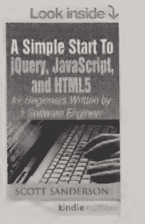
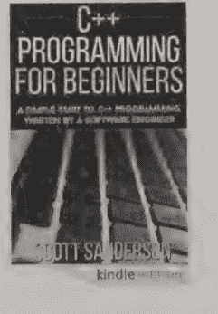
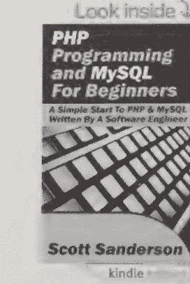
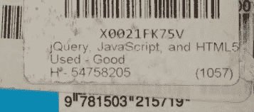

# jQuery, JavaScript 与 HTML5 简易入门指南（由软件工程师撰写）（jQuery, JavaScript, HTML5, Web 开发）（第 1 卷）


https://archive.org/details/simplestarttojqu0000sand

## 第1章

### 引言

如果说有一个可以称为全面的应用开发框架，那么 HTML5 毫无疑问地胜出。尽管 HTML5 的规范尚未最终完成，但大多数现代网络浏览器都支持从智能手机到台式机等设备上的流行功能。这意味着你只需编写一个应用程序，它就能在你的设备上运行，而不会出现任何互操作性问题。

毫无疑问，HTML5 是 Web 应用开发的未来。如果你希望在这个领域保持竞争力，就需要以前瞻性思维武装自己，以应对未来将向你袭来的技术挑战。HTML5 的应用范围之广，从大多数行业主要参与者都将目光投向这项技术并给予全力支持这一点就可见一斑。

如果 HTML5 多方面的功能和丰富的特性引起了你的兴趣，你想要立即开始编写自己的应用程序，但不知道如何着手以及从哪里开始，那么这本书正是为你准备的。本书涵盖了你使用 HTML、JavaScript/JQuery 和 CSS 创建可运行应用所需的一切知识。然而，它并非一本参考指南。我们希望为你提供实用知识，以便你能尽快投入开发。

本书是一本完美的入门指南，涵盖了 HTML5、JavaScript 和 CSS 开发的所有基本方面。它涵盖了从最基础的内容到你与这个框架初次接触时所需的一切。前三章将为你介绍这三项技术，为你打下起步的基础。

## 第2章

### HTML5 基础

HTML（超文本标记语言）是一种用于创建网页的语言。事实上，自第一个网页诞生以来，这种语言就一直被使用。然而，随着更新、更好的语言版本的引入，其功能也得到了发展。据信，HTML 起源于最初用于文档发布的 SGML（标准通用标记语言）。HTML 从 SGML 继承了格式化功能及其语法的概念。

在浏览器方面，HTML 使用最有趣且最有益的方面之一是浏览器同时支持向后兼容和向前兼容。向后兼容通常容易实现，而向前兼容则比较棘手，因为问题域在这种情况下是无限大的。然而，为了实现这一点，浏览器被设计为忽略它不识别的标签。

多年来，HTML 一直是人们所需的一切。然而，随着时间的推移，人们感觉需要更多，这因另一种名为 XML（可扩展标记语言）的技术的存在而加剧。尽管 XML 与 HTML 有许多相似之处，但两者之间也存在许多根本性差异。首先，XML 要求标签匹配，即对于每个起始标签，必须存在一个结束标签。除此之外，XML 允许你创建自己的标签，因为它不像 HTML 那样拥有一组固定的标签。

XML 中使用的标签是元标签，或描述起始标签和结束标签之间所包含数据的标签。为了确保 XML 文档的有效性，使用了一种名为 XSD（XML 架构定义）的技术。然而，这项技术不能用于验证 HTML 文档，因为 HTML 文档缺乏明确定义的结构。

W3C（万维网联盟）引入了 XHTML，试图修正 HTML 的缺陷。根据 XHTML 规范，HTML 文档被迫遵守用于 XML 的格式规范。因此，这允许使用 XSD 工具来验证 HTML 文档。尽管将 XML 集成到该框架中解决了一些问题，但一些问题仍然不断出现。现代最突出的问题之一是集成多媒体的需求日益增长。虽然 CSS 确实执行了一定程度的格式化，但对于用户不断增长的需求来说，它正变得力不从心。

为了提供交互性和动画视觉效果支持，一种名为 JavaScript 的可编程支持被添加到这个组合中。然而，这种支持的早期版本难以让程序员理解，并且执行时间缓慢。这导致了 Flash 等插件的引入，以吸引人们的关注。这些插件完成了它们预期的任务，但浏览器与多媒体的集成本质上仍然比较松散。

HTML5 并不是 XHTML 的进化形式。相反，HTML5 可以更好地描述为 HTML 4.01 的重新发明形式，以及如何将 HTML、CSS 和 JavaScript 一起使用以解决用户群不断增长的需求。

### 语义化标记

HTML5 的基本特征是它强调行为、表现和结构的分离。网站开发中的语义化标记指定了文档的结构。换句话说，它指定了标签的含义以及它们将为你做什么。另一方面，行为和表现分别由 CSS 和 JavaScript 控制。

### HTML5 元素

在 HTML 中，一个元素仅仅是一个包含起始标签、内容和结束标签的语句。因此，当你写下，

```
<div>
<b>This is my world!</b>
</div>
```

在这个例子中，div 元素包含了从 `<div>` 到 `</div>` 的所有内容。因此，`<b></b>` 标签也是 div 元素的一部分。

这里需要说明的是，HTML5 不区分大小写。因此，无论你是为粗体标签写 `<B>` 还是 `<b>`，浏览器都会认为两者相同。但是，W3C 标准推荐使用小写标签。

### 在 HTML5 中使用元素

HTML5 定义了超过 100 个元素。这些元素及其定义在附录中提供。

### 如何向元素添加属性？

附加数据可以以属性的形式添加到起始标签中。一个属性通常可以表示为 `name="value"`。属性名称的值包含在引号内。对于可以添加到起始标签的属性数量没有限制。对于这些属性，属性有一个名称，但没有值。

示例：

```
<div id="main" class="mainContent"></div>
```

这里，`id` 和 `class` 是属性，其中 `id` 唯一地标识元素，`class` 指定 CSS 样式。


### 布尔属性

可以使用多种类型的属性。其中最常用的一种是布尔属性。布尔属性可以从允许的值集合中取值。一些可能的值包括：

- Checked
- Disabled
- Selected
- Readonly

有两种方式可以指定布尔属性的值。

```
<input type="checkbox" name="vegetable"
value="Broccoli" checked="" />

<input type="checkbox" name="vegetable"
value="Broccoli" checked='checked' />
```

在第一种情况下，未提供值但被默认假定。虽然第二种形式看起来是冗余的，但它更受欢迎，特别是在使用 jQuery 时。

### 全局属性参考

HTML5 中有一组命名的属性，可用于任何元素。除了其他多个属性外，这些属性的示例包括 accesskey、spellcheck 和 draggable。

### 空元素

有些元素在任何情况下都不必包含内容。这些元素包括 `<link>`、`<br>` 和 `<area>`，以及其他许多元素。

### 自闭合标签

如果你使用不包含任何内容的元素，那么你可以使用自闭合标签。此标签的一个示例是 `<br/>`。但是，请注意，像 `<div>` 这样的其他标签，即使没有任何内容，也必须写为 `<div></div>`。

### 如何添加扩展属性

你作为作者定义的任何属性都称为扩展属性。你可以根据需要为这个自定义属性命名并赋值。

### 如何添加注释

可以使用感叹号和两个连字符（-）添加注释。添加注释的语法如下：

```
<!--text -->
```

你也可以使用以下语法添加条件注释：

```
<!--[if lte IE 7]> <html class="no-js ie6" lang="en"> <![endif]-->
```

此注释确定所使用的浏览器是否是早于 IE7 的早期版本。

### 如何创建 HTML 文档

HTML 文档可以简单地描述为一个包含元数据、内容和结构的框架。

HTML 文档必须以标签 `<!DOCTYPE html>` 开头。在 HTML5 中，该声明向浏览器表明它应在非怪异模式或 HTML5 兼容模式下工作。

下一个标签应该是 `<html>`。此元素本身包含 `<head>` 和 `<body>` 元素。`<head>` 元素可以包含 HTML 文档的元数据，这些元数据使用 `<meta>` 标签声明和定义。`<head>` 元素还包含 `<title>` 元素，其用途如下：

- 被搜索引擎使用
- 此内容显示在浏览器工具栏中
- 为页面提供默认名称。

`<body>` 元素包含要在 HTML 文档上显示的任何其他信息。

下面是一个 HTML 文档示例：

```
<!DOCTYPE html>
<html>
<head>
<meta charset="utf-8" />
<title>TITLE OF DOC</title>
</head>
<body>
CONTENT
</body>
</html>
```

注意：

1.  像 '>' 或 '<' 这样的特殊字符是 HTML 语法的一部分，可以在 HTML 文档上使用它们的名称或编号。它们的使用语法是：
    *   `&entity_name` 或 `&entity_number`
    *   附录中包含了要使用的实体名称和编号的表格。
2.  使用制表符、换行符和空格创建的空格会被 HTML 规范化为单个空格。因此，如果你想使用多个空格，必须使用不换行空格字符。例如，如果你想显示 `10 mph` 并且 `10` 和 `mph` 之间没有换行符分隔，你可以写成 `10&amp;nbsp;mph`。

### 如何嵌入内容

既然你已经知道如何创建包含内容的 HTML 文档，你可能希望从其他来源将内容嵌入到文档中。此内容可能是来自另一个 HTML 文档的文本或 flash 应用程序。

### 内联框架

内联框架用于将 HTML 文档内联嵌入到当前 HTML 文档的内容中。因此，从某种意义上说，此元素创建了嵌套浏览器，因为在同一个窗口中加载了多个网页。这些是使用 `<iframe>` 元素实现的。嵌套的浏览上下文可以使用以下方式导航：

- `window.parent` – 此 WindowProxy 对象表示父浏览上下文。
- `window.top` – 此 WindowProxy 对象表示顶层浏览上下文。
- `window.frameElement` – 这表示浏览上下文容器，如果没有上下文容器，则返回 null。

`<iframe>` 元素的语法如下：

```
<iframe src="name"></iframe>
```

这里属性的名称定义了浏览上下文的名称。这个名称可以是任何字符串，例如 'sample.html'。但是，字符串不应以下划线开头，因为以下划线开头的名称是为特殊键名（如 _blank）保留的。

### 沙盒

沙盒用于避免在你的 HTML 文档中引入弹出窗口或任何其他恶意软件。为了实现这一点，使用了 'sandbox' 属性。你可以使用以下方式使用此属性：

```
<iframe sandbox="keywords" src="name">
</iframe>
```

当你使用沙盒时，会对被调用的上下文施加多项限制。这些限制包括禁用表单、脚本、插件以及除自身之外的任何框架。你可以使用以下关键字强制系统覆盖这些限制：

- `allow-same-origin`
- `allow-scripts`
- `allow-forms`
- `allow-top-navigation`

可以使用空格分隔多个关键字。

### 无缝嵌入

`<iframe>` 元素中的 `seamless` 属性可用于以一种使内容看起来是主要内容一部分的方式嵌入内容。此属性可以按如下方式使用：

```
<iframe seamless="" src="name"></iframe>
<iframe seamless src="name"></iframe>
<iframe seamless="seamless" src="name"></iframe>
```

此属性可能不被许多浏览器支持。因此，你可以使用 CSS 来实现类似的效果。

### 超链接

超链接可以使用 `<a>` 元素实现。此元素可用于链接外部（不同的 HTML 文档）和内部（同一 HTML 文档中的另一个位置）链接。

所有链接都带有下划线，并且根据链接的性质，链接的颜色会发生变化。

- 蓝色 - 未访问的链接
- 紫色 - 已访问的链接
- 红色 - 活动链接

`<a>` 元素的第一个属性是 `href`，其值为 URL。

外部链接的语法：

```
<a href="address">Text</a>
```

内部链接的语法：

```
<a href="#id">Text</a>
```

这里的 `id` 是你希望链接跳转到的标签的 id。但是，如果你只使用 `#` 值，链接会跳转到页面顶部。

与 `<a>` 元素一起使用的另一个属性是 `target`，它允许你控制链接的行为。例如，如果你希望链接在另一个窗口中打开，那么可以使用此属性指定此要求。可以使用以下值：

- `_blank` - 这会在新的浏览器窗口中打开链接。
- `_parent` - 这会在父窗口中打开链接。
- `_self` - 这会在当前窗口中打开链接，这是默认设置。
- `_top` - 这会在当前窗口的最顶层框架中打开链接。
- `<iframe_name>` - 这会在 `<iframe>` 元素中打开链接。


指定的名称。这通常用于菜单中。

超链接也可用于发送电子邮件，语法如下：

```
<a href="mailto:email address">Text</a>
```

当用户点击链接时，一封电子邮件将被发送到指定的电子邮件地址。

### 嵌入图像

``元素用于将图像添加到HTML文档中。``标签是一个空元素，不需要结束标签。

此元素必需的属性是*src*，它指定图像存储的绝对或相对地址。可以与``标签一起使用的另一个属性是*target*，它用于指定在图像不可用时必须显示的文本。

语法：

```

```

需要注意的是，你实际上只提供了图像的引用，它们并未嵌入到HTML文档中。允许的图像格式包括jpeg、svg、png和gif。

### 如何创建图像映射

`<map>`元素可用于创建可点击的图像映射。为了在映射和图像之间建立链接，你必须为映射设置一个名称，并在img标签的usemap属性中使用此名称。

映射元素的区域使用`<area>`元素定义。这是一个自闭合标签，用于定义映射的区域。映射的区域可以使用属性shape、href、alt和coords来设置。

shape属性可以被赋予poly、circle、rect或default值。默认值将区域设置为图像的大小。href和alt属性的使用方式与在`<a>`元素中的使用方式相同。最后，coords属性根据所选形状按以下方式定义：

-   poly – $x_1, y_1, x_2, y_2, ..., x_n, y_n$
-   circle – $x, y, radius$
-   rect – x₁, y₁, x₂, y₂

对于多边形，起始和结束坐标应该相同。如果在这方面存在差异，会添加一个闭合值。

示例：

```

<map name="country">
<area shape="circle" coords="105,50,30" href="China.html" alt="China" />
<area shape="default" href="InvalidCountry.html" alt="Please Try Again" />
</map>
```

### 嵌入插件

插件同样可以使用`<embed>`和`<object>`元素嵌入到HTML文档中。尽管这两个元素执行类似的任务，但它们是由不同的浏览器创建的。因此，它们在HTML5中并存。虽然`<embed>`元素提供了易用性，但`<object>`元素为用户提供了更多功能。这两个元素的语法如下所示：

### `<embed>`标签

```
<embed src="Flash.swf"> </embed>
```

src属性指定要嵌入文件的URL或地址。`<embed>`元素接受的其他属性包括：

-   type – 用于指定内容的MIME类型
-   height – 用于指定内容的高度（以像素为单位）
-   width – 用于指定内容的宽度（以像素为单位）

如前所述，某些浏览器可能不支持`<embed>`元素。因此，如果你在文档中使用它，你必须添加备用内容规范。例如，如果你正在嵌入一个flash文件，如果浏览器尚不支持它，你必须将用户重定向到flash播放器的下载链接。

你可以按以下方式操作：

```
<embed src="Flash.swf" >
<a href="link for downloading flash player">

</a>
</embed>
```

### `<object>`标签

`<object>`标签允许你嵌入各种多媒体文件，如视频、音频、PDF、小程序和Flash。该元素接受以下属性：

-   type – 用于指定数据的MIME类型
-   form – 用于指定对象的表单ID
-   data – 用于指定对象使用的资源的URL
-   usemap – 用于指定对象使用的客户端图像映射的名称
-   name – 用于指定对象名称
-   height – 用于指定对象的高度（以像素为单位）
-   width – 用于指定对象的宽度（以像素为单位）

在所有上述属性中，必须指定data或type属性之一。

数据可以使用`<param>`标签传递到`<object>`元素中，该标签是name和value属性的组合。可以使用此标签声明多个参数。

```
<object data="file.wav">
<param name="autoplay" value="false" />
</object>
```

注意：

1.  `<object>`元素必须始终在`<body>`元素内使用。
2.  HTML5仅支持上述列出的属性以及`<object>`元素的全局属性。

## 第3章

### JavaScript基础

交互性是任何网站的一个重要方面。为了更好地与受众互动，为网站添加行为至关重要。这可以像按钮一样简单，也可以像动画一样复杂。这些任务可以使用JavaScript来添加，JavaScript是一种网络和编程语言。本章将介绍JavaScript，并将帮助你立即开始使用JavaScript。

### 背景

JavaScript是客户端脚本的首选编程语言。与普遍看法相反，JavaScript与Java毫无关系。事实上，它与ECMAScript有相似之处。除此之外，这种编程语言与C和C++等其他编程语言唯一的共同点是它使用花括号。JavaScript的国际标准在ISO/IEC 16262和ECMA-262规范中给出。

这种编程语言最重要的特性之一是它是无类型的。换句话说，使用变量时不必指定其类型。例如，如果你将一个字符串赋值给一个变量，你后来可以将一个整数赋值给同一个变量。变量使用关键字`var`声明。

### 数据与表达式

任何程序都会访问、操作并向用户表示数据。数据以不同的类型和形式存在。这些数据可以轻松地分解为值。在JavaScript中，数据可以表示为原始值、对象或函数。

最低级别的数据表示称为原始数据类型，包括null、undefined、number、string和Boolean。

JavaScript中定义了几个内置对象。这些包括Object对象、全局对象、Array对象、Function对象、Boolean对象、String对象、Math对象、Number对象、RegExp对象、Date对象、Error对象和JSON对象。

任何可调用的对象都称为函数。如果函数与对象关联，它也可以被称为方法。

数据通过表达式产生，表达式是生成值的任何代码的名称。它可以直接赋值，也可以通过替换和计算由操作数和操作符组成的表达式来计算值。需要注意的是，操作数也可以是另一个表达式。

#### 数字数据类型

数字数据类型是一种原始数据类型，它在内部存储为浮点数，这是一个64位双精度数。这个64位字段存储符号、指数和尾数。最左边的位保留用于符号，位0到51保留用于存储尾数，位52-62用于指数。

由于系统内存限制，253是可以存储的最大整数。需要注意的是，整数计算会产生精确的值。然而，分数数据计算可能会产生...


不精确的结果。因此，这些值必须被截断。

除了数字和字符串，JavaScript 还支持使用以下特殊字符。

- `undefined` 表示该值尚未被赋值。
- `NaN` 代表 'Not a Number'（非数字）。
- `-Infinity` 任何小于 -1.7976931348623157E + 10308 的数字都由 `-Infinity` 表示。
- `Infinity` 任何超过值 1.7976931348623157E + 10308 的数字都由 `Infinity` 表示。

#### 字符串数据类型

字符串可以简单地描述为字符的集合。无论何时，只要你用引号声明了字符，系统都会将其解释为一个字符串。示例字符串包括：

> 'Hello World!'

"Hello World!"

然而，如果你想将引号本身作为字符包含在字符串中，则必须在引号前添加 '\\'。
示例字符串：
'You\'re Welcome'
"You\'re Welcome"

JavaScript 还支持其他转义序列，例如 `\t` 代表制表符，`\n` 代表换行符。

#### 布尔数据类型

布尔数据类型是一种二元数据类型，返回 `true` 或 `false`。这些运算符通常用于表示比较的结果。例如，`10 > 5` 将得到 'true'，而 `5 > 10` 将得到 'false'。

#### 数字数据类型的操作

为了执行计算，需要使用运算符。JavaScript 支持所有基本运算符，运算符优先级如下：

- 加法和减法具有相同的优先级。
- 乘法和除法具有相同的优先级。
- 乘法和除法的优先级高于加法和减法。
- 如果一个表达式包含多个具有相同优先级的运算符，则该表达式从左到右进行计算。

除了基本运算符，JavaScript 还支持取模（`%`）运算符。此运算符执行除法并返回余数作为结果。例如，`23 % 7` 等于 2。

#### 一元运算符

像加法和减法这样的运算符需要两个操作数才能执行，而有些运算符只需要一个。这类运算符的一个例子是 `typeof`，它返回数据的数据类型。例如，`typeof 12` 返回 'number'。请注意，'+' 和 '-' 也可以用作一元运算符。这是当它们被用来指定一个数字的符号时的情况。

#### 逻辑运算符

JavaScript 中可用三种逻辑运算符，即 Not (!)、Or (||) 和 And (&&)。涉及这些运算符的操作结果是布尔值（`true` 或 `false`）。这些操作的结果根据以下规则计算：

| 运算符 | 描述 |
| --- | --- |
| AND (&&) | 二元运算符<br>两个条件都必须为真 |
| OR (\|\|) | 二元运算符<br>至少一个条件必须为真 |
| NOT (!) | 一元运算符<br>条件的值取反 |

例如，

'Red' != 'Blue' && 5 > 1 = 'true'

'Red' != 'Blue' && 5 < 1 = 'false'

'Red' == 'Blue' && 5 < 1 = 'false'

对于条件运算符，JavaScript 使用短路求值。换句话说，如果第一个条件的值被计算为 'false'，系统就不会评估其他条件，而是直接呈现结果。

#### 在 JavaScript 中编写代码

任何以分号结尾的语句都称为一条语句。这条语句可能产生也可能不产生一个值，不像表达式，它们必然会产生一个值。

#### 变量

数据的处理是借助变量完成的。数据被存储在内存中，而对这个内存位置的命名引用就称为一个变量。任何标识符都可以通过在其前面加上关键字 `var` 来声明为一个变量。一个变量声明的示例如下：

```
var result;
```

此语句声明了一个变量 *result*。你也可以在声明变量时同时定义它，使用像这样的语句：

```
var result = 0;
```

或者

```
var result = 23*4+6;
```

在命名变量时必须遵循某些规则。这些规则如下：

- 变量名可以是数字和字符的组合。
- 变量名不能以数字开头。
- 变量名中唯一允许的特殊字符是下划线 (_) 和美元符号($)。
- 变量名中不应有任何空格。例如，'result value' 是不允许的。
- JavaScript 关键字是保留的，不能用作变量名。

请注意，**JavaScript** 与 HTML 不同，**区分大小写**。因此，`VAL` 和 `val` 是两个不同的变量。此外，建议变量名应能描述其用途。例如，如果我们命名一个变量为 `result`，很明显这个变量将包含代码计算出的结果值。

JavaScript 中使用的另一个惯例是变量名的第一个字母小写。但是，变量名中的每个后续单词都以大写字母开头。一个例子是变量名 `arrayResult`。除此之外，不鼓励使用下划线和美元符号。不过，它们在 jQuery 对象中会用到。

#### 环境

一组完整的变量及其包含的值构成了所谓的环境。因此，每当你在浏览器中加载一个新网页时，你就是在创建一个新的环境。以 Windows 8 为例，它在应用程序启动时创建一个环境，并在应用程序结束时销毁该环境。

#### 函数

一组旨在解决特定目的的语句称为一个函数。使用函数的目的是代码重用。如果你的程序在多处使用相同的功能，则将其作为函数实现，可以在需要时随时调用。由于函数是从代码内部调用的，因此可以从代码向函数传递参数。执行后，函数会向调用它的函数返回一个值。函数声明和定义的语法如下：

```
function multiply(a, b){

return a*b;

}
```

**函数名前面必须始终带有关键字 `function`。** 变量 `a` 和 `b` 是传递给函数的参数，该函数返回通过计算 `a*b` 得到的值。这是一个简单的函数，但你可以根据所需的功能实现复杂和大型的函数。

既然你已经实现了函数，你一定想知道如何调用这个函数。这里有一个例子：

```
var x=2;

var y=5

var c=multiply(x, y);
```

这里，`x` 和 `y` 是函数 `multiply` 将作为参数接收的实参。

JavaScript 是一种弱类型语言。这意味着如果你传递给函数的参数数量多于其预期，系统将只使用所需的前 n 个参数，而丢弃其余部分。此功能的优点是你可以使用已实现的函数，并传递额外的参数来扩展该函数并为其添加功能。另一方面，如果你无意中传递了错误数量的参数，你将无法得到任何错误提示。

JavaScript 还提供了一些内置函数来与用户交互。这些函数如下：

- `alert`：此函数显示一个带有消息的警告框，用户单击“确定”按钮后系统恢复操作。示例实现：
    - `alert('Alert message!');`
- `prompt`：此函数向用户显示一个文本框，并要求其输入。你可以在显示的文本框中提供默认值，用户可以单击“确定”按钮以接受输入的值是正确的。示例实现：
    - `var result = prompt('Enter a value', 'default value');`
- `confirm`：此消息向用户提供选择以“确定”或“取消”某个操作。示例实现：
    - `var result = confirm('Do you wish to proceed?');`

#### 函数作用域

你声明的每个变量都拥有一个作用范围，即该变量在其中有效的函数内部。


变量已声明。这被称为局部作用域。与许多其他语言（通过变量所在的花括号来定义局部作用域）不同，<mark>JavaScript 的局部作用域与函数作用域相同</mark>。

此外，<mark>JavaScript 还支持全局作用域的概念</mark>，其中变量可以被声明为全局变量，因此可以在程序的任何地方使用。

##### 嵌套函数

函数可以在任何级别嵌套。换句话说，一个函数可以从另一个函数内部被调用，而后者可能从不同的函数中被调用。然而，需要注意的是，变量的作用域仅限于声明它们的函数内部。

#### 数据类型转换

前面讨论的 prompt 函数返回一个字符串。但是，您要求用户输入一个数字。在这种情况下，可能需要将字符串转换为数字。在 JavaScript 中，可以使用以下函数将变量从一种类型转换为另一种类型：

- **Number 函数**
    该函数将其接收到的对象转换为数字数据类型。但是，如果函数无法执行转换，则返回 *NaN*。
- **String 函数**
    该函数将其接收到的对象转换为字符串数据类型。

#### 条件编程

编写代码时，您会遇到多种情况，需要在条件为真时执行一组指令，而在条件为假时执行另一组指令。

##### if-else

为了实现这种场景，您可以使用 if-else 结构。

语法：

```
If(condition)
{
    //code
}
else
{
    //code
}
```

考虑一个场景，您要求用户使用 prompt 函数输入其年龄。现在，您必须在对提供的值执行任何计算之前，验证该年龄是否为一个有效的数字。这是实现条件编程的一个理想场景。此场景的示例实现如下：

```
var userAge = prompt('Enter your age: ', '');
if(isNaN(userAge))
{
    alert('Age entered is invalid!');
}
else
{
    //code
}
```

在此示例代码中，if 子句检查输入的值是否为数字。如果条件为真，即输入的对象不是数字，则向用户显示一条警告消息。但是，如果条件为假，则执行 else 中的代码。

需要注意的是，对于单条语句，不一定需要使用花括号。上述代码也可以写成：

```
var userAge = prompt('Enter your age: ', "");

if(isNaN(userAge))
    alert('Age entered is invalid!');
else
    //code
```

然而，使用花括号是一个好习惯，因为以后有添加额外代码的空间。

##### if-else if

另一种条件编程结构是 if- else if 结构。此结构允许您声明多个条件及其关联的操作。语法是：

```
if(condition)
{
    //code
}
else if(condition)
{
    //code
}
else
{
    //code
}
```

##### Switch

多个 else if 可以使用此结构实现。由于条件是顺序检查有效性，因此此条件编程结构的执行开销很高。作为替代方案，另一个关键字 `switch` 可用，它以跳转表的形式实现多个条件。因此，`switch` 的执行开销比 if-else if 小。

示例实现：

```
var userChoice = prompt('Choose an alphabet: a, b, c', 'e');

switch (userChoice) {
  case 'a':
    alert('a chosen\n');
    break;
  case 'b':
    alert('b chosen\n');
    break;
  case 'c':
    alert('c chosen\n');
    break;
  default:
    alert('None of the alphabets chosen\n');
    break;
};
```

`switch` 结构将用户输入的值与 case 中的值进行匹配。如果找到匹配值，则执行该 case。但是，如果没有一个 case 值与输入匹配，则执行 default case。除此之外，您还可以在 case 值中使用条件，条件为真的 case 将被执行。

如果您不在 case 代码后使用 `break` 语句，则匹配 case 之后的所有 case 都将被执行。例如，如果用户在上例中输入 'b'，并且在 case 代码后没有 `break` 语句，则输出将是：

```
b chosen
c chosen
None of the alphabets chosen
```

另外，在 default case 中使用 `break` 语句也是一个好习惯。

**注意：**

如果您想确定一个关键字是否已被赋值，可以使用以下代码：

```
if(c)
{
    //code
}
else
{
    //code
}
```

如果变量 `c` 被赋予了非空值，则 if 条件为真，并执行相应的代码。另一方面，如果变量 `c` 的值是 undefined 或 null，则执行 else 结构中的代码。

**注意：**

以下条件的值将始终为真：

```
"" == 0
null == undefined
'123' == 123
false == 0;
```

请注意，JavaScript 为了在比较中兼容，会转换相关变量的类型。

但是，如果您想比较两个变量的值和类型，那么 JavaScript 提供了另一组运算符 `===` 和 `!==`。当使用此运算符对上述示例中的值进行比较时，结果将始终为 false。

#### 实现代码循环

循环是任何编程语言中一个重要的、常用的结构。当您需要多次执行同一组指令时，就会面临多种情况。为了实现这种场景，必须使用循环。JavaScript 中可用的循环结构包括 `for`、`while` 和 `do-while`。

`while` 循环包含一个条件，只要条件保持为真，循环就会继续执行。`do-while` 循环是 `while` 循环的修改版。如果 `while` 中的条件为假，则 `while` 循环根本不会执行。另一方面，即使 `while` 条件为假，`do-while` 循环也会至少执行一次。

`while` 循环的语法：

```
while(condition)
{
    //code
}
```

`do-while` 循环的语法：

```
do
{
    //code
}
while(condition)
```

JavaScript 中最后一种可用的循环是 `for` 循环。`for` 循环允许您在同一条语句中初始化循环变量、检查条件和修改循环变量。

语法：

```
for(initialize; condition; modify)
{
    //code
}
```

示例代码：

```
for(i=0; i<10; i=i+1)
{
    //code
}
```

此循环将运行 10 次。

**注意：**

1.  如果在任何时候您希望中断循环，可以使用 `break` 语句。
2.  如果您未指定条件或指定的条件始终为真，则循环将无限运行。

#### 错误处理

预期在代码的多个点会发生异常。因此，最好实现一种可以帮助您处理这些异常并避免崩溃的机制。

异常可以描述为非法操作或任何意外且不寻常的情况。异常的一些示例包括未经授权的内存访问。


你可以在执行任何操作之前，通过验证变量的值来进行自己水平的异常处理。例如，在进行除法运算前，最好检查分母的值是否等于零。任何涉及将数字除以零的操作都会引发除零异常。

然而，有些情况无法用这种方式处理。例如，如果网络连接突然中断，你就无法提前采取任何措施来处理。因此，对于这类情况，可以使用 try、catch 和 finally 关键字。

期望抛出异常的代码被放入 try 块中。该异常发生时，会被 catch 块捕获，catch 块会执行在捕获异常后应立即执行的代码。catch 块之后还可以跟一个 finally 块，用于执行最后的清理工作。此块在 try 和 catch 块执行完毕后运行。

语法：

```
try
{
    //代码
}

catch(异常名称)
{
    //代码
}

finally
{
    //代码
}
```

#### 处理对象

JavaScript 允许用户访问许多现有对象。其中之一是数组。本节讨论与本章相关的所有基础知识。在 JavaScript 中处理对象也包括创建和处理自定义对象。不过，这个主题将在 JavaScript 和 jQuery 的章节中介绍。

#### 数组

一系列连续排列的相似对象的集合被称为数组。该数组有一个名称，并且每个元素都可以使用索引器以以下形式访问：

设 arrName[] 是一个名称数组。元素 arrName[2] 指的是数组的第三个元素。

可以使用以下三种方法创建数组：

- 使用索引器插入元素
    - 可以使用 new 关键字创建数组，然后通过为数组的独立元素赋值来向数组中添加元素。new 关键字使用其构造函数创建 Array 对象的一个实例。
        - 示例实现：
            - var arrName = new Array();
            - arrName[0] = 'Jack';
            - arrName[1] = 'Alex';
- 紧凑数组
    - 第二种实现方式也使用 new 关键字。但是，在这种情况下，值作为 Array 对象构造函数的参数赋给元素。
        - 示例实现：
            - var arrName = new Array('Jack', 'Alex');
- 字面量数组
    - 在这种数组定义方式中，值在方括号内提供。
        - 示例实现：
            - var arrName = ['Jack', 'Alex'];

使用第一种定义方式的优点是，它允许你在代码中的任何位置为元素赋值。而第二种和第三种实现方式则要求你事先准备好确切的元素列表。

所有对象都有一些属性。对你可能有用的属性之一是 *length*，它是一个只读值，调用时返回数组中存在的元素数量。你可以在循环和条件中使用此属性。

对象也可以有自己的函数。这些函数称为方法。**数组可用的方法包括**：

- concat
- 返回一个数组，该数组是提供给它的两个数组的连接结果。
- indexOf
- 查找相关元素在数组中的位置并返回其索引。
- join
- 此方法连接数组中存在的所有值。但是，默认情况下，所有这些值都用逗号分隔。你也可以指定自己选择的分隔符。
- lastIndexOf
- 此方法的工作方式与 indexOf 类似。但是，它从数组的最后一个元素开始搜索。因此，它返回与指定条件匹配的最后一个元素的索引。
- pop
- 移除最后一个元素并返回其值。
- push
- 将相关元素添加到数组末尾，并返回修改后的 length 值。
- reverse
- 此方法反转数组元素的顺序。此方法会修改原始数组。
- shift
- 移除并返回第一个值。如果数组为空，则返回 undefined。
- slice
- 此方法需要两个参数：起始索引和结束索引。创建一个新数组，其元素与（起始索引）和（结束索引 - 1）位置存在的元素相同。
- sort
- 此方法对元素进行排序并修改原始数组。
- splice
- 此方法从指定数组中移除和添加元素。此方法接受的参数是起始索引（系统应从哪个索引开始移除元素）、要移除的元素数量以及要添加的元素。如果传递的要移除的元素数量为 0，则不会删除任何元素。另一方面，如果此值大于数组的大小，则从起始索引到数组末尾的所有元素都将被删除。
- toString
- 此方法创建一个字符串，该字符串是由数组中存在的所有元素连接而成的逗号分隔字符串。
- unshift
- 此方法在数组的第一个位置添加一个元素，并返回修改后的 length 值。
- valueOf
- 此方法返回一个字符串，该字符串是包含数组中所有值的连接、逗号分隔的字符串。

**注意：**

1. 使用函数时，可以传递整个数组（使用数组名称）或数组的特定元素（使用 数组名称[索引器]）。
2. 可以通过使用索引器访问元素来修改数组元素。例如，arrName[1] = 'Danny'; 将值 'Danny' 赋给数组的第二个元素。

### DOM 对象

构建应用程序时需要访问的主要对象是与其关联的 DOM 对象。为了控制网页上发生的事件并接收相关通知，这种访问是必要的。

DOM 是对象层次结构的表示。这些对象可以使用内置的 document 变量访问。此变量引用 DOM 并执行搜索，该搜索可能返回一个活动 NodeList 或静态 NodeList。活动 NodeList 包含不断变化的元素列表，而静态 NodeList 包含随时间不变化的元素。由于检索静态 NodeList 耗时较长，建议选择适用于活动 NodeList 的搜索方法。

DOM 可用的搜索方法包括：

- getElementById
- 此方法返回对具有指定 ID 的第一个元素的引用。
- getElementsByTagName
- 此方法返回具有指定标签名称的活动 NodeList。
- getElementsByName
- 此方法返回具有指定名称的活动 NodeList。这是单选按钮的首选方法。
- getElementsByClass
- 此方法返回具有指定类名的活动 NodeList。但是，Internet Explorer 8 及更早版本不支持此方法。
- querySelector
- 此方法接受 CSS 选择器作为参数，并返回第一个匹配的元素。但是，Internet Explorer 7 及更早版本不支持此方法。
- querySelectorAll
- 此方法接受 CSS 选择器作为参数，并返回所有匹配的元素。因此，它返回一个静态 NodeList。但是，Internet Explorer 7 及更早版本不支持此方法。

### 事件

如果将 JavaScript 视为一个引擎，那么事件就是赋予其所需动力的火花。**事件可能在两种情况下发生。第一类事件是发生在用户交互期间的事件。** 用户可能点击图像或输入文本。所有这些都被归类为事件。此外，**系统状态的变化也被视为事件。** 例如，如果视频开始或停止播放，就认为发生了事件。DOM 允许你捕获事件并执行相应的代码。

**在 JavaScript 中，事件基于发布-订阅模型。** 创建对象后，开发人员可以发布与该对象相关的事件。此外，每当使用该对象时，都可以为其添加事件处理程序。事件处理程序函数会通知已订阅的事件已被触发。此通知包括关于...


事件包括鼠标位置和按键，以及与该事件相关的其他若干细节。

### 事件捕获：

在某些情况下，事件可能附加到按钮点击上，而该按钮可能位于超链接内部。这种情况下，元素是嵌套的。因此，当事件触发时，它会沿着DOM层级向下传递。这个过程称为事件捕获。然而，一旦事件到达目标元素，它就会沿着层级向上冒泡。这个过程称为事件冒泡。事件在层级中的这种移动为开发者提供了根据需要订阅或取消传播的机会。

### 订阅事件：

函数 `addEventListener` 可用于订阅过程。该函数需要三个参数：事件、需要为该事件调用的函数，以及一个布尔值，该值决定函数是在捕获阶段还是冒泡阶段被调用（`true` – 捕获，`false` – 冒泡）。通常，此值设置为 `false`。这是W3C标准中推荐的订阅方法。

示例代码：

```
var btn = document.getElementById('btnDownload');
btn.addEventListener('click', initiateDownload, false);
```

然而，也存在其他方法，包括为HTML标签提供内联订阅。这会将事件订阅到冒泡过程。使用此方法的优点在于它是最古老且最被广泛接受的方法。因此，你可以确信无论使用何种浏览器，此方法都将有效。请参阅下面的标签以了解如何操作。

```
<button id='btnDownload' onclick='initiateDownload();' >Download</button>
```

你也可以使用传统的订阅流程，该流程使用JavaScript来订阅事件。

```
var btn = document.getElementById('btnDownload');
btn.onclick = initiateDownload;
```

取消订阅：

可以使用函数 `removeEventListener` 来取消事件订阅，它接受与 `addEventListener` 相同的参数集。对于上例中使用的 `btn` 变量，可以按以下方式进行：

```
var btn = document.getElementById('btnDownload');
btn.removeEventListener('click', initiateDownload, false);
```

如何取消传播？

函数 `stopPropagation` 用于执行此操作。可以按以下方式进行：

```
var btn = document.getElementById('btnDownload');
btn.addEventListener('click', initiateDownload, false);
function initiateDownload (e){
    //下载
    e.stopPropagation();
}
```

如何阻止默认操作？

可以使用函数 `preventDefault` 按以下方式进行：

```
var hyperlink = document.getElementById('linkSave');
hyperlink.addEventListener('click', saveData, false);
function saveData(e){
    //保存数据
    e.preventDefault();
}
```

JavaScript还提供了 *this* 关键字，如果你需要频繁访问触发事件的元素，可以使用它。

### Window事件参考

当前浏览器窗口由 `window` 变量表示，它是 **Window对象** 的一个实例。与此对象关联的事件如下：

- afterprint
- beforeonload
- beforeprint
- error
- blur
- haschange
- load
- message
- focus
- online
- offline
- pageshow
- pagehide
- redo
- popstate
- storage
- resize
- unload
- undo

### 表单事件参考

在HTML表单内发生的操作会触发以下事件：

- change
- blur
- focus
- contextmenu
- forminput
- formchange
- invalid
- input
- submit
- select

### 键盘事件参考

键盘触发以下事件：

- keyup
- keypress
- keydown

### 鼠标事件参考

鼠标触发以下事件：

- click
- drag
- drop
- scroll
- dblclick
- dragenter
- dragstart
- dragend
- dragover
- dragleave
- mousemove
- mousedown
- mouseover
- mouseout
- mousewheel
- mouseup

### 媒体事件参考

视频、图像和音频等媒体元素也会触发事件，具体如下：

- canplay
- abort
- waiting
- durationchange
- canplaythrough
- ended
- emptied
- loadeddata
- error
- loadstart
- loadedmetadata
- play
- pause
- progress
- playing
- readystatechange
- ratechange
- seeking
- seeked
- suspend
- stalled
- volumechange
- timeupdate

## 第4章

### CSS3基础

层叠样式表（CSS）为网页提供了其广为人知的外观呈现。虽然HTML能够为网页提供基本结构，但CSS为开发者提供了大量设计选项。除此之外，它快速且高效，这使其成为更受欢迎的设计工具。

已知CSS是从SGML（标准通用标记语言）发展而来。这一方向的努力旨在使网页外观标准化。该技术的最新版本是CSS3，它是一个包含50个模块的集合。

CSS最强大的特性是其层叠能力。简单来说，它允许网页从多个样式表中获取样式，这样，在后续读取的样式表中对样式的更改会覆盖之前一个或多个样式表中已实现的样式。

### 如何定义和应用样式

样式的定义和应用涉及两个方面或部分，**选择器和声明块**。**选择器确定网页中需要设置样式的区域**，而**声明块描述需要实现的样式规范**。为了说明其工作原理，让我们看下面的例子：

```
body {
    color: white;
}
```

在这个例子中，选择器选择了网页的主体（body），声明块定义字体颜色应更改为白色。这是一个简单的例子，声明和选择器可以比这复杂得多。

### 如何添加注释

可以使用以下格式向样式表添加注释：

/*在此处编写注释*/

### 如何创建内联样式

每个元素都有一个关联的全局属性 `style`。可以在该元素的标签内操作此全局属性以修改该元素的外观。这种样式化不需要你指定选择器。只需要声明块。以下是操作示例：

```
<body style='color: white;'>
</body>
```

此HTML标签执行与上一节中指定的CSS代码相同的功能。使用此方法的优点在于，以这种方式给出的样式信息会覆盖任何其他样式信息。因此，如果你需要为某个元素使用不同的样式，而文档的其余部分需要遵循不同的样式，那么你可以为文档使用样式表，并在其标签中为该元素指定样式。

### 如何使用嵌入样式

实现与内联样式相同结果的另一种方法是在相关元素内使用 `<style>` 元素来定义其样式规范。操作如下：

```
<!DOCTYPE html>
<html xmlns='http://www.w3.org/1999/xhtml'>
<head>
    <title></title>
    <style>
        body {
            color: white;
        }
    </style>
</head>
<body>
```


### 如何创建外部样式表

对于需要在整个网页或多个网页上使用相同样式的场景，最佳做法是使用外部样式表。

此外部样式表可以通过以下方式链接到 HTML 页面：

```html
<!DOCTYPE html>
<html xmlns='http://www.w3.org/1999/xhtml'>
<head>
<title></title>
<link rel='stylesheet' type='text/css' href='Content/mainstyle.css' />
</head>
<body>
</body>
</html>
```

你必须在 Content 文件夹中创建一个名为 `mainstyle.css` 的文件，并将下面指定的样式规则放入该文件中。

```css
body {
    color: white;
}
```

### 定义媒体

需要注意的是，一个样式表可以包含任意数量的样式规则。除此之外，你还可以为不同的媒体链接不同的 CSS 文件。不同的媒体类型如下：

- all
- embossed
- braille
- print
- handheld
- speech
- screen
- tv
- tty

可以按以下方式定义所使用的媒体：

```html
<link rel='stylesheet' type='text/css' href='Content/all.css' media='all' />
```

### 定义字符编码

你还可以使用以下格式定义所使用的字符编码：

样式表：

在样式表的样式规则上方放置以下行。

```css
@charset 'UTF-8';
```

HTML 页面：

你必须将此行放在 `link` 元素上方。

```html
<meta http-equiv='Content-Type' content='text/html;charset=UTF-8' >
```

### 导入样式表

随着你的网页变得复杂，所使用的样式表也会相应变得复杂。因此，你可能需要使用多个样式表。你可以使用以下方式将一个样式表中的样式规则导入到另一个样式表中：

```css
@import url('/Content/header.css');
```

这里，`header.css` 被导入，而 `url` 提供了要导入的样式表的相对地址。

### 导入字体

可以使用以下格式导入字体：

```css
@font-face {
    font-family: newFont;
    src: url('New_Font.ttf'),
    url('New_Font.eot'); /* IE9 */
}
```

### 选择器、特异性与层叠

选择器可以分为三种类型：类选择器、ID 选择器和元素选择器。元素选择器类型是最简单的，你只需命名需要使用的元素即可。例如，如果你想改变 `body` 的背景颜色，那么使用的元素选择器就是 `body`。

在声明任何元素时，你可以使用 `id` 属性为其分配一个 ID。你可以使用以 `#` 为前缀的这个 ID 作为选择器。例如，如果你创建了一个 ID 为 `btnID` 的按钮，那么它的 ID 选择器就是 `#btnID`。类似地，你可以使用 `class` 属性为元素分配一个类名。类名可以以点（`.`）为前缀，如下所示：`.className`。

但是，如果你想选择网页的所有元素，则使用星号（`*`）。

#### 使用后代选择器和子选择器

你可能希望将特定样式应用于选择器的后代。这可以通过指定完整的选择器路径来完成。可以按以下方式进行：

```css
li a {
    text-color: black;
}
```

另一方面，你可能只想在元素是选择器的直接子元素时才应用样式。这可以通过指定父元素和子元素，并用大于号（`>`）分隔来实现，如下所示：

```css
li > a {
    color: white;
}
```

#### 伪元素和伪类选择器

既然你知道了如何将样式应用于特定元素，让我们继续探讨如何将样式应用于更具体的部分，例如第二段的第一行。为了对无法根据名称、内容分类或不是 DOM 树一部分的元素应用样式，可以使用伪类。可用的伪类包括：

- :visited
- :link
- :hover
- :active
- :checked
- :focus
- :nth-last-child(n)
- :not
- :only-child
- :nth-child(formula)
- :lang(language)
- :first-of-type
- :only-of-type

如果你想访问 DOM 树中通常无法访问的信息，可以使用伪元素。**伪元素**包括：

- ::first-letter
- ::first-line
- ::after
- ::before

#### 分组选择器

可以为一条样式规则使用多个选择器。这些选择器必须用逗号分隔。示例实现：

```css
body, button {
    color: white;
}
```

#### 使用相邻选择器

如果你想为 `div` 中的第一个标题或任何类似的相邻元素设置样式，选择器通过在两个选择器之间使用加号（`+`）来构造。示例实现：

```css
div + h1 {
    color: white;
}
```

#### 兄弟选择器

兄弟选择器与相邻选择器类似，不同之处在于所有匹配的元素都会被设置样式，而相邻选择器只设置第一个匹配元素的样式。选择器通过在两个选择器之间使用波浪号（`~`）来构造。示例实现：

```css
div ~ h1 {
    color: white;
}
```

#### 使用属性选择器

此选择器选择所有存在指定属性的元素。选择器书写形式如下：
`a[title]`
此选择器将选择所有指定了 `title` 属性的链接。此外，这种选择器类型可以通过指定属性值修改为属性-值选择器，如下所示：
`a[title="value"]`

#### 浏览器的内置样式

每个浏览器都有一个内置样式表，该样式表会应用于使用此浏览器打开的所有网页。事实上，此样式表会在任何其他样式表之前应用。你可以使用“工具”中的“辅助功能”选项为浏览器定义自己的样式表。但是，用户样式表是特定于浏览器的。因此，如果你打开一个不同的浏览器，你定义的样式表可能无法访问。

如果你希望你的用户定义样式表覆盖 HTML 页面中指定的任何其他样式，可以使用 `!important` 修饰符。此修饰符为指定的样式语句设置最高优先级。示例实现：

```css
body {
    color: white !important;
}
```

#### 样式的层叠

样式的优先级和优先顺序基于以下参数决定。

- 重要性
- 特异性
- 文本顺序

### 使用 CSS 属性

既然你已经熟练掌握了选择器的使用，下一步是了解 CSS 属性。

#### 颜色

网页中使用的最关键属性之一是颜色，它可以通过 ARGB、RGB 和颜色名称来定义。

RGB 值通常使用 0-255 之间的十进制数字定义。

- 白色 #ffffff
- 红色 #ff0000
- 黑色 #000000
- 绿色 #008000

颜色值也可以代替颜色名称使用。以下是其用法示例：

```css
body {
    color: #ffffff;
}
```

指定颜色的另一种方式是使用 RGB 函数，它通过 0-255 之间的数字或百分比来指定参数值。这种声明类型的示例如下：

```css
h1 { color: rgb(255,0,0); }
```

其他指定颜色的方式包括接受 4 个值的 RGBA，以及定义色相、饱和度和亮度的 HSL。

#### 透明度

透明度或不透明度由 0.0（不可见）到 1.0（不透明）之间的值定义。

#### 文本

关于文本，可以指定 `font-face` 和 `font-size`。这些属性可以按以下方式定义：

```css
h1 { font-family: arial, verdana, sans-serif; }
h1 { font-size: 12px; }
```


### CSS 盒模型

CSS 盒模型假定网页可以被视为由多个盒子构成。这些盒子之间的间距通过外边距（margin）和内边距（padding）设置来定义。这些属性可以按以下方式赋值：

```
margin: 15px;
padding: 25px;
border: 10px;
```

### 定位 `<div>` 元素

用于创建页面布局的元素是 `<div>`。尽管 HTML5 推荐使用语义化标记来代替 div 元素，但对于那些无法通过语义化标记来设置样式的部分，它们仍然被使用。一个 div 元素可以被想象为一个矩形块，并按以下方式声明：

```
<div>
  <!--other elements are enclosed within this area-->
</div>
```

用于定义 div 元素位置的属性包括：

- div 元素的位置可以使用 `top`、`bottom`、`left` 和 `right` 属性以像素为单位来定义。
- `position` 属性用于定义指定的位置是静态的还是相对的。
- `float` 属性可用于让元素向左或向右浮动，其定义为 `float: left` 或 `float: right`。
- `clear` 属性会在浮动元素之后紧随一个清除元素。
- 您还可以借助 `box-sizing` 属性来改变浏览器计算宽度的方式。该属性可以接受三个值：`content-box`（默认设置）、`border-box` 和 `padding-box`。

### 内容居中

如果您使用的是固定宽度，div 元素可以通过 `margin-left` 和 `margin-right` 属性来居中。如果您固定了宽度并将边距设置为 `auto`，那么边距上的额外空间会被平均分配。可以按以下方式实现：

```
#container {
  width: 850px;
  margin-left: auto;
  margin-right: auto;
}
```

### HTML5 详解

本章侧重于 HTML5 的基础知识，以及如何利用它们来创建高性能的新一代页面。然而，上一章解释的大多数元素都包含了 HTML5 从其前身继承而来的元素。本章将带您在学习 HTML5 的道路上更进一步，介绍这项技术中新增加的概念。

在之前的 CSS 章节中，我们向您介绍了 `<div>` 元素的概念。就页面布局创建而言，该元素优于其所有替代方案。虽然有些人也使用 `<table>` 元素，但通常不推荐这样做，因为它难以维护和使用。不过，本章会对这两个概念进行详细阐述。

### 语义化标记

`<div>` 和 `<span>` 元素是最常用且推荐用于内容定位和格式化的元素。然而，建议您为页面的不同部分（如页眉和页脚）使用不同的 `<div>` 元素。这将允许您以更有条理的方式单独定位它们。因此，W3C 将这些新元素命名为 `<footer>` 和 `<header>` 等。

### 浏览器支持

您的 HTML 代码确实不会被任何用户直接阅读。然而，有其他工具和机器在不断地解析您的代码。这些工具包括网络爬虫（为搜索引擎索引网页）和 NVDA（非视觉桌面访问）设备（许多有特殊需求的用户将其作为阅读和理解网页的替代工具）。因此，它们要求您使用易于理解的标签。

### 如何创建 HTML5 文档

尽管上述讨论明确提到了使用有意义标签的重要性，并禁止使用像 `<div>` 和 `<span>` 这样的标签，但您可能仍需出于样式设置的目的而使用它们。随着阅读的深入，您将理解如何必须提供语义化标签来赋予您的标签以意义。这里需要提及的是，应谨慎使用语义化标签。如果您意识到需要定义自定义元素，那么就继续使用 `<div>` 和 `<span>` 元素。但是，请务必为元素添加尽可能描述其含义的 ID 和类名。

### 如何创建 HTML5 布局容器

布局容器，顾名思义，是一个包含页面布局的容器。换句话说，该容器以一种灵活的方式包含布局的不同部分或其子元素，以便对它们进行定位。作为开发者，您可以根据它们的类名和 ID 轻松区分 `<div>` 元素。但是，浏览器并非如此。

因此，必须有一种方式可以让您指示浏览器如何解释元素。例如，您可能希望浏览器在打开时专注于某个 `<div>` 元素。所有这些以及更多功能，都可以通过布局容器来实现，这些容器以浏览器和用户都能理解的方式表达元素。

一些常用于创建布局容器的元素包括：

- `<header>`
  - 用于定义 HTML 文档的头部部分或最顶部部分。此元素也可以定义在 `<article>` 元素内部。
- `<footer>`
  - 用于定义 HTML 文档的页脚部分或最底部部分。此元素也可以定义在 `<article>` 元素内部。
- `<nav>`
  - 用于定义包含所有导航链接的部分。
- `<aside>`
  - 此元素通常用于侧边栏，并将 `<aside>` 元素内的内容与此元素外部的内容分隔开。
- `<section>`
  - 此元素定义了整体部分中的一个片段，并使用 `<h1>`、`<h2>`、`<h3>`、`<h4>`、`<h5>` 和 `<h6>` 元素来命名。
- `<article>`
  - 此元素定义了一个完整的内容单元，您可以将其从一个位置复制到另一个位置。例如，一篇博客文章就是一个这样的单元。

### 使用角色

`role` 属性可以在 `<div>` 和 `<aside>` 元素内声明。关于可访问性，角色类层次结构以及使用角色来提供特定含义的定义，在 WAI-ARIA（Web 无障碍计划 - 无障碍富互联网应用）中有规定。

父角色类之一是 `landmark` 角色类，它定义了网页上的导航地标。父角色类的子类包括：

- `banner`
  - 定义网站特定的内容，这些内容预期不会在不同网页之间变化，例如页眉。
- `application`
  - 定义指定区域是一个 Web 应用程序。
- `contentinfo`
  - 定义网页中包含的有关网页本身的信息，例如版权信息。这些信息通常是页脚内容的一部分。
- `complementary`
  - 定义一个部分，即使从页面中分离出来，该部分仍然有意义。
- `main`
  - 使用此子角色类定义网页的主要内容。
- `form`
  - 定义网页中预期接收用户输入的区域。
- `search`
  - 此子角色类用于定义网页上用于接收用户搜索查询并显示搜索结果的位置。
- `navigation`
  - 包含导航链接的区域属于此子角色类。

这些角色可以用于提供含义。然而，HTML5 中包含的新元素本身就具有意义。不过，HTML5 中缺少一些实用功能，对于这些功能，可以使用 `role` 属性。

### 如何使用 `<div>` 元素控制格式？

如前所述，`<div>` 元素本质上是不可见的，并且不为元素提供任何含义。然而，如果您只想将其用于格式设置目的，那么它非常适合这个用途。

### 如何添加主题分隔？

空元素 `<hr/>` 可用于添加主题分隔，用于表示从一组内容过渡到另一组内容。

### 如何标注内容？

有多种可用于标注的元素。这些包括您长期以来一直在使用的 `<b>` 和 `<i>`。然而，除了它们所表示的样式之外，现在它们有了新的含义。例如，`<b>` 元素表示“粗体”样式。此外


与此不同，HTML5 为 `<b>` 元素赋予了“具有特殊强调意义的文本段落，但不改变语气、重要程度或含义”的含义。

虽然在此上下文中使用粗体样式更为合理，但您仍可使用此元素来标记产品评论中的产品名称或关键词。同样，`<strong>` 元素表示内容的相对重要性，而 `<i>` 元素则表示相关内容的语气或含义发生变化。此外，`<em>` 元素用于标记读者会以不同方式朗读的文本。

### 如何使用 `<abbr>` 表示首字母缩写词和缩写？

在 HTML 的早期版本中，`<acronym>` 元素用于此目的。然而，该元素已被弃用，现在用于此目的的新元素是 `<abbr>`。它是一个内联元素，通常与其他内联元素（如 `<em>` 和 `<strong>`）一起使用。

### `<address>` 元素

此元素用于定义网页所有者或作者的联系信息。

### 引用

您可以使用 `<blockquote>` 元素（用于长引用）和 `<q>` 元素（用于内联引用）来表示特定文本为引用。您可以使用 `cite` 属性或 `<cite>` 元素来提及引用的来源。然而，在 `<q>` 和 `<blockquote>` 元素内部使用 `<cite>` 元素被认为是更好的做法。请记住，`<cite>` 元素只能提及作品的名称，不包含作者姓名和出版地点等其他信息元素。

### 如何在 HTML5 中记录代码？

`<code>` 和 `<samp>` 两个元素用于记录代码。`<code>` 元素用于记录源代码，而 `<samp>` 元素用于记录代码的输出。下面是一个示例 HTML，展示了如何实现这一点：

```
<code class="maintainWhiteSpace">  
echoContent('Screen');
function echoContent(name)
{
alert('This is' + name + '.');
}
</code>
<samp class="maintainWhiteSpace">
This is Screen.
</samp>
```

### `<pre>` 元素

这里需要强调的是，这些元素不会保留空白字符。因此，需要为此实现一个类。该类应如下所示：

样式规则。

```
.maintainWhiteSpace {
white-space: pre;
}
```

某些浏览器可能不支持此样式规则。因此，对于此类浏览器，建议使用 `<pre>` 元素。因此，`<pre>` 元素可用于定义预格式化规则。

### `<var>` 元素

此元素用于声明其内部指定的文本是一个变量。例如：

```
<p>
变量 <var>i</var> 表示循环执行的迭代次数。
</p>
```

### `<br />` 和 `<wbr />` 元素

`<br/>` 元素实现换行。另一方面，`<wbr/>` 实现单词间换行。

### `<dfn>` 元素

有时您可能希望定义一个术语。这可以使用 `<dfn>` 元素来完成，该元素将 `title` 作为其属性之一。

### 处理图形

图片和图形是任何网页内容不可或缺的一部分。因此，每个图形也可以被视为一个内容单元，该单元可能包含标题和指向其所属页面的引用。为了定义一个或多个图像，使用 `<figure>` 元素。`<figcaption>` 元素可用于定义图形的标题。

然而，这里需要强调的是，`<figure>` 元素不会对图形的位置给予任何重视，图形会随内容一起包含。但是，如果图形的位置和位置对您很重要，则必须考虑使用 `<div>` 元素。

### `<summary>` 和 `<details>` 元素

`<summary>` 元素包含网页内容的摘要，可以使用 `<details>` 元素以可折叠列表的形式显示。因此，当您加载页面时，只会显示 `<summary>` 元素的内容，而 `<details>` 元素的内容则在用户单击摘要时显示。

### 其他注释

除了上述内容外，还有更多可用的注释，包括：

- <s> - 用于删除文本
- <u> - 用于为文本添加下划线
- <mark> - 用于高亮显示文本
- <ins> - 用于指示文本已被插入
- <del> - 用于指示文本已被删除
- <small> - 用于指示文本必须以小字体打印
- <sub> - 表示文本是下标
- <sup> - 表示文本是上标
- <time> - 用于指示文本表示时间和日期
- <kbd> - 用于指示文本是用户输入

### 语言元素

您可能需要在文本中使用中文、日文或韩文字符。为了支持这种包含，可以使用 `<ruby>` 元素。在此元素内部，可以使用其他元素（如 `<bdi>` 和 `<bdo>`）来定义文本的隔离和方向。此外，还可以使用 `<rt>` 和 `<rp>` 元素在 `<ruby>` 元素的文本中放置注释或括号。

### 处理列表

在 HTML5 中，存在用于定义无序列表、有序列表和描述性列表的多个元素。还存在第四个类别“自定义列表”，允许开发者进行自定义。所有这些的列表项都使用 `<li>` 元素声明。此外，所有三种类型的列表都支持列表嵌套。

#### 有序列表

有序列表使用 `<ol>` 元素声明，此列表中的“顺序”元素通过自动编号包含在此列表中的元素来实现。可用于有序列表的属性包括：

- start - 用于设置列表的起始编号
- reversed - 用于声明列表必须按升序还是降序排序
- type – 用于声明列表的类型，可以是 A、a、1 或 I。

#### 无序列表

这种类型的列表使用 `<ul>` 元素声明，此情况下没有元素编号。列表的元素简单地表示为项目符号。

#### 描述性列表

这种类型的列表使用 `<dl>` 元素声明。使用此元素，您可以提供包含零个或多个术语的描述。此外，列表的元素使用 `<dt>` 元素（指定术语）和 `<dd>` 元素（提供术语的描述）声明。

#### 自定义列表

开发者可以利用 CSS 样式创建自定义列表。在这种情况下，可以为嵌套列表的每个级别创建不同的样式规则。

### 处理表格

在网页中排列和呈现数据的另一种格式是表格。表格使用 `<table>` 元素声明，以行-列格式表示数据。表格的单元格使用 `<tr>` 和 `<td>` 元素定义。`<tr>` 用于行，`<td>` 用于列。

尽管 HTML5 表格是开发者可用的最强大的结构之一，但理解如何以及在哪里最恰当地使用表格非常重要。以下是不应使用表格的原因：

- 为网页创建的表格在读取 `</table>` 标签之前不会渲染。另一方面，如果使用 `<div>` 元素创建相同的结构，内容将在读取时立即渲染。
- 表格极其难以维护。


- 表格对于辅助功能设备来说难以解读。

示例实现：

```html
<table>
<tr>
<td>Frank</td>
<td>1978</td>
</tr>
<tr>
<td>David</td>
<td>1967</td>
</tr>
<tr>
<td>Alex</td>
<td>1989</td>
</tr>
</table>
```

上面创建的表格看起来会是：

| Frank | 1978 |
|-------|------|
| David | 1967 |
| Alex  | 1989 |

当你观察这个表格时，你一定意识到，除非我们定义所谓的表头，否则这个表格是不完整的。这可以使用 `<th>` 元素来完成。你可以垂直或水平地创建表头。例如，我们可以在上面使用的代码中定义以下表头。

```html
<table>
<tr>
<th>Name</th>
<th>Year of Birth</th>
</tr>
<tr>
<td>Franky</td>
<td>1978</td>
</tr>
<tr>
<td>David</td>
<td>1967</td>
</tr>
<tr>
<td>Alex</td>
<td>1989</td>
</tr>
</table>
```

此代码生成的表格将如下所示：

| Name  | Year of Birth |
|-------|---------------|
| Franky| 1978          |
| David | 1967          |
| Alex  | 1989          |

在上面的例子中，表头只是字体较大。但是，你可以通过样式规则随心所欲地设置它们的样式。这可以通过以下方式完成：

```css
th {
    background-color: black;
    color: white;
}
```

此样式规则将把表头的单元格背景色设置为黑色，文本颜色设置为白色。

大多数浏览器的正常行为是自动将所有 `<tr>` 元素放在 `<tbody>` 中，表示这是表格的主体。然而，显式定义 `<tbody>` 是一个好习惯。除此之外，还可以显式定义 `<thead>` 和 `<tfoot>`。表格的头部、主体和页脚可以分别使用 CSS 进行样式设置。作为一条规则，你可以有一个头部元素、一个或多个主体元素以及一个页脚元素。

必须添加到上面创建的表格中的下一个重要内容特性是表格标题。为了定义表格标题，需要使用 `<caption>` 元素。

在某些情况下，你可能觉得需要为单个列设置样式。考虑到 HTML 中的表格本质上是行中心化的，这可能看起来像是一项困难的任务。虽然你有 `<tr>` 元素来标识行，但没有 `<tc>` 元素来标识列。`<td>` 元素标识一个单元格。但是，你仍然可以使用 `<colgroup>` 或 `<col>` 元素为单个列设置样式。`<table>` 元素可以包含 `<colgroup>` 元素，该元素又包含属于此元素组的各列的 `<col>` 元素。此外，`<col>` 元素还有一个 *span* 属性，用于定义属于此组的列。下面是一个解释其工作原理的示例实现：

```html
<colgroup>
<col span="2" class="vHeader" />
</colgroup>
```

用于为这组列设置样式的 CSS 样式规则可以像这样：

```css
.vHeader {
    color: red;
}
```

虽然到目前为止讨论的表格都是常规表格，但 HTML5 也支持不规则表格，可以描述为每行列数不同的表格。可以使用 rowspan 和 colspan 属性来管理表格的布局。

## 第 6 章：JavaScript 和 jQuery

你一定已经体会到了 JavaScript 的强大。在 JavaScript 章节中，你已经学习了如何创建和添加 JavaScript 以使网页动态化。Web 开发的最大挑战是设计网页元素，使其能在任何浏览器上运行得同样好，因为不同的浏览器对不同的元素提供支持，很难找到一个共同点。

本章将带你更进一步地学习 JavaScript 开发，教你如何创建和使用对象。除此之外，它还向你介绍了 jQuery 的概念，它试图创建浏览器兼容的代码。虽然它不能保证 100% 的浏览器兼容性，但它确实解决了日常的此类问题。

#### 如何创建 JavaScript 对象

从数字到字符串，任何东西在 **JavaScript** 中都是对象。因此，了解如何有效地创建和处理这些对象至关重要。**在 JavaScript 中创建对象最简单的方法是使用对象字面量语法。**以下示例说明了如何操作。

```javascript
var customer1 = {
    yearOfBirth: 2000,
    name: 'Alex',
    getCustomerInfo: function () {
        return 'Customer: ' + this.name + ' ' + this.yearOfBirth;
    }
};
```

此代码创建了一个名为 customer1 的对象，包含数据成员 name 和 yearOfBirth，以及成员函数 getCustomerInformation。同样重要的是要注意 *this* 关键字的使用，它能正确访问正在为相关对象使用或引用的值。

除此之外，你也可以使用 `new` 关键字动态创建对象。继承的方法包括：

- constructor
- isPrototypeOf
- hasOwnProperty
- toLocalString
- propertyIsEnumerable
- valueOf
- toString

对象创建后，可以按以下方式向其添加属性：

```javascript
function getCustomer(myName, myYearOfBirth) {
    var newCust = new Object();
    newCust.name = myName;
    newCust.yearOfBirth = myYearOfBirth;
    newCust.getCustomerInfo = function () {
        return 'Customer: ' + this.name + ' ' + this.yearOfBirth;
    };
    return newCust;
}
```

此代码动态创建了一个对象 newCust。可以按以下方式创建其多个实例：

```javascript
var cust1 = getCustomer('Alex', 1978);
var cust2 = getCustomer('David', 1986);
```

尽管 JavaScript 不支持特定的 'class' 关键字，但你可以使用上述方法模拟类。

#### 命名空间

没有像 *namespace* 这样的特定关键字来实现命名空间。但是，可以使用类和对象的概念来实现命名空间。如果你将变量和方法分类到对象中，并将它们作为这些对象的实例来访问，那么你实际上是将这些对象的名称放在全局命名空间中，从而将变量的范围缩小到它们所属的对象。

#### 实现继承

你可以通过创建对象，然后根据其共同特征对这些对象进行分类，来在 JavaScript 中定义对象之间的 'is-a' 关系。例如，如果你正在为公司的员工实现一个对象。你可以为特定类型的对象创建对象，如 managerTechnical、managerGeneral、technicalStaff、recruitmentStaff 和 officeStaff，然后将它们分类为对象，technicalStaff（包括 managerTechnical 和 technicalStaff 对象）和 adminStaff（包括 managerGeneral、recruitmentStaff 和 officeStaff）。同样，也可以定义新的函数。

#### 使用 jQuery

jQuery 是一个浏览器兼容的辅助函数库，你可以在代码中使用它来减少输入、实现和测试所需的工作量。这些函数本质上是用 JavaScript 编写的。因此，**你也可以将 jQuery 称为一个 JavaScript 库。**

jQuery 中可用的功能列表包括：

- 属性（Attributes），这是一组可用于获取和设置 DOM 元素属性的方法。
- Ajax，这是一组提供同步和异步服务器调用支持的方法。
- 核心方法（Core Methods）是基础的 jQuery 函数。
- 回调对象（Callbacks object）是为管理回调提供的对象。
- 数据方法（Data Methods）是促进在 DOM 元素和任意数据之间建立关联的方法。
- CSS 方法（CSS Methods）是可用于获取和设置 CSS 相关属性的方法。
- 尺寸（Dimensions）是可用于访问和操作 DOM 元素尺寸的方法。


## 第7章

### 表单

在前几章中，你**已经**学习了如何创建和操作HTML文档。以此为起点，我们现在可以开始理解表单，这是网页开发中最关键、最常用的内容单元之一。

简单来说，**表单是一种收集数据并将其发送到可处理位置的方式**，在大多数情况下这个位置是服务器。然而，由于我们尚未讨论服务器端脚本，我们将重点介绍将数据发送到电子邮件地址的方法。但需要注意的是，我们并不推荐这种做法，它仅用于理解目的。

**Web通信**

在了解表单的工作原理之前，有必要了解HTTP的一些基础知识。典型的Web通信包括以下活动：

1. 当用户浏览网页时，通过发送GET HTTP请求发起访问Web服务器资源的请求。
2. 服务器处理该请求，并使用HTTP协议向浏览器发送响应。
3. 浏览器处理服务器响应，并以“表单”的形式呈现给用户。
4. 用户在表单中输入信息，点击提交或回车按钮后，这些数据再次通过HTTP协议发送到服务器。
5. 服务器再次处理这些数据，并将响应发送回浏览器，显示在网页上。

### Web服务器

最初，Web服务器的设计目的是接收和处理请求，并使用HTTP将结果返回给浏览器。在早期，当网页还比较简单时，这类服务器每单位时间能够处理相当数量的请求。由于发送和接收请求就像打开连接、传输数据和关闭连接一样简单，因此不涉及状态问题。

现代Web服务器的功能远比这些简单的服务器强大得多。当今的Web服务器实现了所谓的“保持连接”功能，该功能确保连接在特定时间内保持打开状态，以便同一浏览器对服务器的后续请求能够得到处理。

### Web浏览器

Web浏览器是一种桌面应用程序，用于显示网页并管理网页与服务器之间的用户交互。Web服务器与网页之间的通信通过AJAX和异步JavaScript等技术建立。

### 数据如何提交到Web服务器

可以使用`<form>`元素以以下方式创建HTML表单：

```html
<form method="post"
action="getCustomerInformation.aspx" >

Enter Customer Number:
<input type="text" name="Number" />

<input type="submit" value="Get Customer Information" />

</form>
```

此表单接收客户编号，并返回一个显示客户详细信息的页面。

但需要注意的是，并非所有元素都可用于在表单中提交数据。允许用于此目的的元素包括：

- `<textarea>` - 它接受多行输入。
- `<button>` - 它是一个可点击的按钮，可以放置在任何内容或图像上。
- `<select>` - 它是一个下拉列表，允许多选。可以使用jQuery识别选中的选项：`$('option:selected')`。
- `<input type='checkbox'>` - 它是一个复选框，其`value`属性用于设置和读取复选框的状态。使用jQuery识别已选中的复选框：`$('input[type=checkbox]:checked')`。
- `<input type='button'>` - 它是一个可点击的按钮，带有文本提示。
- `<input type='datetime'>` - 它是一个日期和时间（UTC）控件。
- `<input type='date'>` - 它是一个仅包含日期的控件。
- `<input type='email'>` - 它是一个文件选择字段，带有用于上传文件的浏览按钮。
- `<input type='color'>` - 它是一个颜色选择器。
- `<input type='hidden'>` - 它是一个隐藏的输入字段。
- `<input type='datetime-local'>` - 它是一个日期和时间（任意时区）控件。
- `<input type='month'>` - 它是一个月份-年份控件。
- `<input type='image'>` - 它是一个图像提交按钮。
- `<input type='password'>` - 它是一个密码字段，字符会被隐藏显示。

---


在使用jQuery之前，你需要将其包含到你的项目中。一旦安装完毕并准备好在项目中使用，下一步就是学习如何使用它。

首先，你需要在需要使用jQuery的网页中以如下方式引用jQuery库：

```html
<script type="text/javascript" src="Scripts/qunit.js"></script>

<script src="Scripts/jquery-1.8.2.js"></script>
```

接下来需要知道的是，你希望在HTML页面中使用的jQuery代码位于jQuery命名空间中，该命名空间有一个别名`$`。因此，在引用jQuery的某个功能时，你可以写`jQuery.jFeature`或`$.jFeature`。

在网页中开始使用jQuery之前，你还需要按如下方式修改`default.js`文件：

```javascript
function initialize() {

    txtInput = $('#txtInput');

    txtResult = $('#txtResult');

    clear();

}
```

这允许你通过匹配ID来使用jQuery和CSS选择器。

此外，在使用jQuery进行编码时，请记住在进行任何更改后使用Ctrl+F5刷新屏幕，因为浏览器可能无法立即捕获JavaScript的修改。同时，尽可能使用jQuery对象，因为它们提供了跨浏览器兼容性。

可以按以下方式从jQuery包装器中引用DOM对象：

```javascript
var domElement = $('#txtInput')[0];
```

以下是一个简单的代码，在引用元素之前检查其是否存在。

```javascript
var domElement;
if($('#txtInput').length > 0){
    domElement = $('#txtInput')[0];
}
```

### 如何创建jQuery包装器以引用DOM元素

可以按以下方式从DOM元素引用创建jQuery包装器：

```javascript
var myDoc = $(document);
var inText = $(this).text();
```

第一条语句将包装后的对象赋值给变量。而第二条语句包装了使用`this`引用的对象。

### 如何添加事件监听器

jQuery提供了`.on`方法来订阅事件。除此之外，你可以使用`.off`方法取消订阅。这些方法可以按以下方式使用：

```javascript
$('#btnSubmitInfo').on('click', onSubmit);
$('#btnSubmitInfo').off('click', onSubmit);
```

### 如何触发事件处理程序

jQuery提供了触发器或`triggerHandler`方法，用于触发事件处理程序或处理程序代码的执行。可以按以下方式进行：

```javascript
$('#btnSubmitInfo').triggerHandler('click');
```

### 初始化代码

你经常会遇到在HTML文档加载时运行初始化代码的需求。你可以使用jQuery按如下方式实现：

```html
<script>

$(document).ready(function () {

initializationFunction();

});

</script>
```

这段代码可以放在HTML文档的底部。它将调用`initializationFunction`。


- `<input type='number'>` - 它是一个数字输入字段。
- `<input type='range'>` - 它是一个控件，接受一个数值并定义了允许的值范围。
- `<input type='radio'>` - 它是一个单选按钮，具有用于设置和读取按钮状态的 `value` 属性。用于识别被选中单选按钮的 jQuery 代码是 `$('input[type=radio]:checked')`。
- `<input type='search'>` - 它是一个文本字段，用于输入搜索字符串。
- `<input type='reset'>` - 它是一个可用于重置表单字段的按钮。
- `<input type='url'>` - 它是一个 URL 输入字段。
- `<input type='tel'>` - 它是一个电话号码输入字段。
- `<input type='submit'>` - 它是一个提交按钮。
- `<input type='time'>` - 它是一个控件，接受一个时间值。
- `<input type='text'>` - 它是一个单行文本输入字段。
- `<input type='week'>` - 它是一个周-年份控件。

### `<label>` 元素

`<label>` 元素用于向用户传达另一个元素的含义。该元素内的文本会显示在文本框内，当用户点击文本框时会自动移除。你也可以指定 `<label>` 的样式。

### 指定父表单

可能存在表单的提交元素不在同一个构造中的情况。因此，在这种情况下，收集数据可能是一个相当大的挑战。为了解决这个问题，HTML5 提供了一个 `id` 属性，可以为多个表单元素设置该属性。这将允许一次性从不同的表单元素收集数据。

### 如何触发表单提交

触发后，从相同 `id` 的一个或多个表单的提交元素收集到的所有数据，将通过 HTTP 方法发送到服务器。

`<input>` 元素可用于触发表单提交。除此之外，你也可以使用 JavaScript 来实现此目的。为此，你必须为相关的表单 `myFirstForm` 设置一个 `id`。链接到 HTML 文档的 `default.js` 文件必须包含以下代码：

```
$(document).ready(function () {
    $('#myFirstButton').on('click', submitMyFirstForm);
});

function submitMyFirstForm() {
    $('#myFirstForm').submit();
}
```

如果表单的 `method` 属性没有指定任何值，那么它将被设置为默认的 `GET`。此外，`action` 属性也会有一个默认值。因此，按钮点击将把页面引用到同一页面。但是，URL 现在将包含一个查询字符串（QueryString），这是用户选择或输入值的组合。例如，如果表单要求用户输入客户ID，用户输入了 `1245`，那么查询字符串将是：

```
customerID=1245
```

此查询字符串将按以下方式附加到 URL：

```
Mywebpage.asp?customerID=1245
``

这里还需要提一下，查询字符串是经过 URI 编码的。因此，特殊字符由特定的值表示。例如，空格表示为 `+`，感叹号（!）表示为 `%21`。名称-值对表示为 `name=value`，多个名称-值对之间用 `&` 分隔。

### 如何序列化表单

你可以使用 jQuery 的 `serialize` 方法序列化表单。可以按如下方式完成：

```
var myFormData = $('#myFirstForm').serialize();
```

你可以使用以下代码解码 URI 编码的字符串：

```
var data = decodeURIComponent(myFormData);
```

### 使用自动聚焦（Autofocus）属性

默认情况下，焦点不会设置在表单的任何元素上。但是，你可以使用 `focus` 方法设置焦点，可以按如下方式实现：

```
$('input[name="firstName"]').focus();
```

然而，你也可以按以下方式设置自动聚焦：

```
<input type="text" name="firstName" autofocus="autofocus"/>
```

### 如何使用数据提交约束

表单只有在满足以下约束条件时才能发送数据：

- 必须设置 `name` 属性。
- 你必须为表单提交元素设置了值。
- `<form>` 元素必须定义了其表单提交元素，且表单提交元素不能被禁用。
- 如果实现了多个提交按钮，只有在点击激活的提交按钮时才会提交值。
- 选中复选框。
- 选中单选按钮。
- `<option>` 元素必须设置 `<option>` 元素。
- 如果存在文件选择字段，必须选择一个字段。
- 对象元素的 `declare` 属性必须设置。

永远记住，重置按钮不发送任何数据，并且表单的数据发送也不需要拥有 ID。

### 如何使用 POST 或 GET

有两种 HTTP 方法可用于向服务器提交数据。这些方法是 GET 和 POST。在前者的情况下，URL 会附加查询字符串。然而，在后者的情况下，信息在消息体中发送。

### 表单验证

理解这一点是有益的：Web 应用程序中所有安全问题的根源是用户数据。一旦你决定将你的应用程序开放给用户数据和交互，你就会使你的应用程序容易受到安全威胁。因此，在处理任何接收到的数据之前，你需要对其进行验证，以防止出现任何问题。验证可以在浏览器端或服务器端提供。但是，建议进行服务器端验证，因为浏览器级别的验证很容易被操纵。

你能实现的最简单的验证形式是在 `<select>` 元素中使用 `required` 属性。你可以按以下方式设置此属性：

```
<select name="dateOfBirth" required="required">
```

生成的验证错误是浏览器相关的，每个浏览器都有不同的方式向用户传达某个字段是提交所必需的。

除此之外，还有 `placeholder` 属性可用，它会将提示固定在未填写的字段上，直到用户为其提供了值。可以按如下方式实现：

```
<input type="text" name="Date of birth" required="required" placeholder="enter the date of birth"/>
```

HTML5 中添加的基于时间、日期和类型的输入使验证变得更加简单，因为它们可以直接进行匹配，以查看是否具有有效的输入值。除此之外，电子邮件、数字和范围也可以轻松验证。

HTML5 执行验证并将其与 `:valid` 或 `:invalid` 伪类进行匹配。如果验证成功，则值与 `:valid` 匹配，否则与 `:invalid` 匹配。但是，如果某个值不是“必需的”，则它与 `:optional` 伪类匹配。

## 第8章

### Web 服务

到目前为止讨论的所有章节都涉及浏览器级别的编码和脚本。但是，现在是时候转向服务器端脚本了。本章重点介绍在服务器级别使用 JavaScript（这可以通过 Node.js 实现），以及如何使用 Web 服务。

### Node.js 基础

Node.js 是一个基于 Google Chrome 构建的平台，可用于创建可扩展和灵活的应用程序。它允许你用 JavaScript 编写服务器端代码。但是，在开始之前，你必须在系统上下载并安装 Node.js。

### 编写基本代码

第一步是打开任何文本编辑器并创建一个名为 `myfile.js` 的文件。在文件中，编写代码：

```
var http = require('http');
```


```
http.createServer(function (request, response) {
  response.writeHead(200, {'Content-Type': 'text/plain'});
  response.end('Hello World!\n');
  console.log('Handled request');
}).listen(8080, 'localhost');

console.log('Server running at http://localhost:8080/');
```

第一行加载了 `http` 模块，而第二行创建了一个服务器对象。`createServer` 函数接受两个参数：`request` 和 `response`。所有的网站处理都通过这些函数完成。在这个例子中，`response` 函数通过在屏幕上写入 "Hello World" 来结束。

`createServer` 函数返回一个服务器对象，该对象调用 `listen` 函数。此函数在端口 `8080` 上监听，主机的 IP 地址设置为 `127.0.0.1`。因此，如果你的系统上安装了网络适配器，你的 Web 服务器将立即开始监听 Web 请求。最后一行


在屏幕上打印一行内容，告知用户服务器正在运行并监听请求。

创建文件并按照上述方式保存内容后，必须打开命令提示符并输入以下命令：

```
Node myFile.js
```

现在，保持命令提示符活动状态，您需要打开网页浏览器并输入地址：http://localhost:8080/

一旦请求发送并收到响应，系统会通过控制台窗口将信息传达给用户。如果您已成功完成此操作，那么您刚刚创建了第一个 node.js 网站。如果希望停止代码运行，只需按 Cntl+C 即可。

了解请求如何被接收后，接下来需要查看这些请求如何被处理以及响应如何生成。您可能需要使用 url 模块来解析 QueryString。

以下代码展示了如何解析 URL 字符串并据此生成响应。

```javascript
var http = require('http');
var url = require('url');
http.createServer(function (request, response) {
    var url_parts = url.parse(request.url, true);
    response.writeHead(200, {'Content-Type': 'text/plain'});
    response.end('Hey ' + url_parts.query.name + ':\n');
    console.log('Handled request from ' + url_parts.query.name);
}).listen(8080, 'localhost');
console.log('Server is running at: http://localhost:8080/');
```

您可以使用与上一段代码类似的方式测试此代码的运行。

### 如何创建 Node.js 模块

您可以通过编写函数形式的代码来创建模块，然后从主代码中调用这些模块。

```javascript
var myHttp = require('http');
var myUrl = require('url');

function start(){
    http.createServer(function (request, response) {
        var url_parts = url.parse(request.url, true);
        response.writeHead(200, {'Content-Type': 'text/plain'});
        response.end('Hello ' + url_parts.query.name + '!\n');
        console.log('Handled request from ' + url_parts.query.name);
    }).listen(8080, 'localhost');
    console.log('Server running at http://localhost:8080/');
}
exports.start = start;
```

### 如何创建 Node.js 包

当您将这段代码保存在文件中时，就创建了一个模块。其他函数可以使用 require 函数来调用此模块。例如，如果文件保存为 sample1.js，则可以在另一个函数中通过以下方式使用 start()：

```javascript
var samplex = require('./sample1.js');
sample1.start();
```

模块的集合被称为应用程序。一旦发布包，就可以安装和使用它。例如，考虑一个包含不同数学模块的包。

根文件夹必须包含以下内容：

- README.md
- \packName
- \lib
- main.js
- \bin
- mod1.js
- mod2.js

### 创建聚合模块

您可能希望只提供一个对象供用户访问。用户应能通过此对象访问包中的所有模块。为此，必须在 bin 文件夹中创建一个 main.js 模块，该模块需要在 module.exports 中定义要包含的模块。

### 如何创建 README.md 文件

README.md 文件是一个帮助文件，开发者可以将其作为使用您包的入门指南。此文件的扩展名为 .md，是 mark-down 的缩写。这种格式提高了文件中文本的可读性。

以下是此类文件的示例：

```
samplePackage package
=====================
```

在 samplePackage 中，以下函数可用：

- **add** 执行两个数字的加法并显示结果。
- **sub** 执行两个数字的减法并显示结果。

### 如何创建 package.json 文件

此文件包含包的元数据，可以使用以下命令手动创建：

```
npm init
```

此命令会创建文件，之后可以进行编辑。以下是示例文件：

```json
{
  "name": "sampleFile",
  "version": "0.0.0",
  "description": "This is a sample file ",
  "main": "bin/main.js",
  "scripts": {
    "test": "echo \"This is a test file\" && exit 1"
  },
  "repository": "",
  "keywords": [
    "sample",
    "example",
    "add",
    "sub"
  ],
  "author": "XYZ",
  "license": "ABC"
}
```

除了测试脚本外，您还可以提供 git 脚本，它们是目前最好的版本控制管理工具。

### 如何发布包

如前所述，包可以通过文件夹结构来定义。发布包时，您使其对所有用户可访问。要执行此操作，必须使用 npm 命令，这也是用于搜索和安装包的命令。但是，在发布任何包之前，您需要使用命令为自己创建一个账户：npm adduser。输入所需信息后，您的账户就创建好了。然而，这也意味着不需要验证。因此，任何人都可以向仓库添加代码。因此，从注册表下载和安装包时应小心谨慎。

要发布包，您只需进入包的根目录并在命令提示符中输入命令 npm publish。

### 如何安装和使用包

发布的包可以被任何用户下载和安装。您只需进入文件夹并输入命令 npm install samplePackage。这会在本地安装包。另一方面，如果您希望全局安装包，可以使用命令 npm install -g samplePackage。对于全局安装，您需要使用命令 npm link samplePackage 为每个应用程序创建指向全局安装的链接。

全局安装的路径是一个 junction。您可以使用 cd 命令进入 node_modules 文件夹并返回。进入文件夹后，可以输入命令：npm install contoso，来启动安装。现在您可以编写一些使用该包的代码。以下是示例：

```javascript
var samplePackage = require('samplePackage');
var finalResult = 0;

console.log();
finalResult = samplePackage.add (5,10);
console.log('add (5,10) = ' + finalResult);

console.log();
result = samplePackage.sub (50,10);
console.log('sub(50,10) = ' + finalResult);

console.log();
console.log('done');
```

此代码测试包的模块。您可以使用以下命令执行代码：

```
node main
```

可以使用以下命令在本地卸载包：

```
npm uninstall samplePackage
```

但是，如果您希望全局卸载包，可以使用以下命令：

```
npm uninstall -g samplePackage
```

### 如何使用 Express

1. 第一步是安装 Node.js 并创建一个示例文件夹来存放所有 .js 文件和项目。此外，您还必须安装 Express，它是用于 Node.js 开发的 web 应用程序框架。
2. 您可以使用以下命令集和说明来创建一个包。
   - a. npm init
   - b. 您可以创建一个 myPackage.js 文件，包含以下内容：

```json
{
  "name": "Sample",
  "version": "0.0.0",
  "description": "This is a sample website.",
  "main": "main.js",
  "scripts": {
    "test": "echo \"Error: Test not specified\" && exit 1"
  },
  "repository": "",
  "author": "XYZ",
  "license": "BSD",
  "private": true,
  "dependencies": {
    "express": "3.0.0"
  }
}
```

要在 Express 中使用此文件，必须添加依赖项。此外，如果您未将其定义为私有，当计算机防火墙尝试加载页面时，您可能会收到错误信息。

   - c. 输入安装命令：npm install
   - d. 您可以使用命令 npm ls 来查看包是否存在于注册表中。

3. 您可以使用以下说明集创建一个简单的应用程序：
   - a. 创建一个文件 myApp.js 并将以下内容添加到文件中：
   - b. 您可以使用 myApp.Method() 语法来定义路由。

```javascript
var express = require('express');
var app = express();

app.get('/', function(request, response){
```


```javascript
response.send('Hey World!');
});
```

上述代码会在收到请求时，发送响应“Hey World!”。

c. 最后必须添加的代码段用于监听请求。该代码如下：

```javascript
var port = 8080;
app.listen(port);
console.log('Listening on port: ' + port);
```

d. 一旦文件完成，你可以保存它，并使用命令 `node app` 运行。因此，现在如果你打开浏览器并输入地址 http://localhost:8080/，你将获得响应 *Hey World!*。

4. 你可以通过将 `app.get` 语句替换为 `app.use(express.static(__dirname + '/public'));` 来向应用程序添加网页。这将允许你将同一段代码用于多个网页。此概念的示例实现如下：

```html
<!DOCTYPE html>
<html xmlns="http://www.w3.org/1999/xhtml">
<head>
    <title></title>
</head>
<body>
    <form method="get" action="/submitHey">
        Enter First Name: <input type="text" name="firstName" />
        <input type="submit" value="Submit" />
    </form>
</body>
</html>
```

请注意，action 属性被设置为 `/submitHey`。换句话说，这个资源会在服务器上被调用，以处理通过 QueryString 传递给它的数据。`myApp.js` 文件应包含以下内容：

```javascript
var express = require('express');
var app = express();
app.use(express.static(__dirname + '/public'));
app.get('/SubmitHey', function (request, response) {
    response.writeHead(200, {'Content-Type': 'text/html' });
    response.write('Hey ' + request.query.userName + '!<br />');
    response.end('Enjoy.');
    console.log('Handled request from ' + request.query.userName);
});
var port = 8080;
app.listen(port);
console.log('Listening on port: ' + port);
```

该应用程序可以按上述方式运行。

5. *formidable* 包可用于回传数据。虽然前面的方法使用 GET 方法，但此方法使用 POST 方法。

a. 为说明其工作方式，请创建如下 HTML：

```html
<!DOCTYPE html>
<html xmlns="http://www.w3.org/1999/xhtml">
<head>
    <title></title>
</head>
<body>
    <form method="post" action="/SubmitHeyPost">
        Enter Name: <input type="text" name="firstName" />
        <input type="submit" value="Submit" />
    </form>
</body>
</html>
```

b. 现在，在命令提示符下，你需要给出一个用于获取 formidable 包的命令，即：

```
npm info formidable
```

c. 你也可以按以下方式修改 `package.json` 文件：

```json
{
  "name": "HelloExpress",
  "version": "0.0.0",
  "description": "Sample Website",
  "main": "index.js",
  "scripts": {
    "test": "echo \"Error: test not specified\" && exit 1"
  },
  "repository": "",
  "author": "XYZ",
  "license": "BSD",
  "private": true,
  "dependencies": {
    "formidable": "1.x",
    "express": "3.0.0"
  }
}
```

d. 现在你可以通过在命令提示符中键入以下命令来安装 *formidable* 包：

```
npm install
```

此命令会将包安装在本地。因此，你需要在 `myApp.js` 中添加一行，以允许文件引用该包：

```javascript
var formidable = require('formidable');
```

e. 示例 `myApp.js` 文件如下所示：

```javascript
var express = require('express');
var app = express();
var formidable = require('formidable');
app.use('/forms', express.static(__dirname + '/public'));
app.post('/SubmitHeyPost', function (request, response) {
  if (request.method.toLowerCase() == 'post') {
    var form = new formidable.IncomingForm();
    form.parse(request, function (err, fields) {
      response.writeHead(200, { 'Content-Type': 'text/html' });
      response.write('Hey ' + fields.userName + '!<br />');
      response.end('Enjoy this POST.');
      console.log('Handled request from ' + fields.userName);
    });
  }
});
app.get('/SubmitHey', function (request, response) {
  response.writeHead(200, { 'Content-Type': 'text/html' });
  response.write('Hey ' + request.query.userName + '!<br />');
  response.end('Enjoy.');
  console.log('Handled request from ' + request.query.userName);
});
var port = 8080;
app.listen(port);
console.log('Listening on: ' + port + 'port');
```

f. 你现在可以像运行前一个示例那样运行应用程序。

### 使用 Web 服务

典型网站场景的一个最大缺点是，即使新页面与之前的页面相同，HTML 页面也会被重新绘制。这会导致你损失带宽和资源。这个缺点可以使用 Web 服务来解决，它可用于发送和接收数据，好处是 HTML 页面不会被重新绘制。用于发送请求的技术是 AJAX 或 异步 JavaScript 和 XML。这项技术允许你异步执行数据发送操作。

在进一步深入之前，了解 Web 服务的基础知识以及如何使用它们非常重要。客户端需要定期与 Web 服务器通信，而这种通信正是由 Web 服务促进的。在这种情况下，客户端可以是任何事物，从使用 Web 服务的机器到 Web 服务本身。因此，无论客户端是什么，它都需要创建并发送请求到 Web 服务，并接收和解析响应。

你一定听说过术语“mashups”，它用于描述将 Web 服务拼凑在一起的应用程序。存在两类主要的 Web 服务：任意 Web 服务和 REST（即表述性状态转移）。在第一种情况下，操作集是任意的，而在第二种情况下，存在一个统一的操作集。

### 表述性状态转移（REST）

此框架使用标准 HTTP 操作，这些操作映射到其创建、删除、更新和检索操作。此外，REST 不专注于与消息交互。相反，它的交互专注于无状态资源。这也许就是为什么 REST 概念以创建简洁的 URL 而闻名的原因。REST URL 的示例包括 http://localhost:8080/Customers/2（用于删除客户）和 http://localhost:8080/Vehicles?VIN=XYZ12（用于使用 GET 方法通过传递参数来检索有关车辆的信息）。

某些防火墙可能不允许使用 POST 和 GET 方法。因此，建议在 QueryString 中使用“动词”。URL 示例将是：

```
http://localhost:8080/Vehicles?verb=DELETE&VIN=XYZ987
```

HTTP 协议还允许你使用 HTTPS 版本实现安全性。REST 提供了多种好处，例如连接简单、操作更快以及资源消耗更少。然而，许多开发人员更喜欢使用 JSON（或 JavaScript 对象表示法），因为它体积紧凑。除此之外，REST 仅支持 GET 和 POST，这限制了其功能。因此，一些开发人员转向使用 RESTful。

### 任意 Web 服务

这种类型的 Web 服务也称为大型 Web 服务。此类服务的一个示例是 WCF（Windows Communication Foundation）。任意 Web 服务通过不将它们的操作仅映射到协议的某个方面，从而扩展了它们的操作领域。因此，它们提供了更多功能，包括许多安全机制和消息路由。

这种类型的 Web 服务具有一种典型的接口格式，客户端可以使用该格式来读取和解析信息。因此，客户端可以立即调用服务。一种常见的 API 格式是 Web 服务描述语言（WSDL）。在任意 Web 服务的情况下，客户端必须借助 SOAP（简单对象访问协议）消息来组装其请求。此 Web 服务不使用 HTTP 协议，而是使用 TCP。

### 如何使用 Node.js 创建 RESTful Web 服务

在前面提到的示例中，`samplePackage` 可以被暴露为 Web 服务。GET 方法可以


该包可被使用，并将操作作为参数传递。这个包一个良好的 RESTful 实现可能如下所示：

http://localhost:8080/samplePackage?operation=add&x=1&y=5

### 如何使用 AJAX 调用 Web 服务

可以使用 AJAX 异步调用 Web 服务，AJAX 实际上是一种 JavaScript。AJAX 不是调用服务器并重绘 HTML 文档，而是回调到服务器。在这种情况下，屏幕不会被重绘。以下是一个示例实现：

可以使用以下代码创建一个 MyPage.html：

```html
<!DOCTYPE html>
<html xmlns="http://www.w3.org/1999/xhtml">
<head>
    <title></title>
    <script type="text/javascript" src="/scripts/jquery-1.8.2.min.js"></script>
    <script type="text/javascript" src="/scripts/default.js"></script>
</head>
<body>
    <form id="myForm">
        Enter Value of X:<input type="text" id="x" /><br />
        Enter Value of Y:<input type="text" id="y" /><br />
        Result of Operation: <span id="result"></span><br />
        <button id="btnAdd" type="button">Add the Numbers</button>
    </form>
</body>
</html>
```

必须修改 default.js 文件，以包含处理这些功能所需的代码。请务必检查 jQuery 的版本，以及它是否与你在 default.js 文件中提到的版本名称相匹配。此处使用的 `<form>` 元素仅是一种安排数据格式的方式，数据实际上并非通过表单发送到服务器。JavaScript 和 jQuery 访问输入的数据并执行 AJAX 调用。

### 如何使用 XMLHttpRequest

实际发起 AJAX 调用的对象是 XMLHttpRequest，它可用于发送/接收 XML 和其他类型的数据。该对象可以按以下方式使用：

```javascript
var xmlhttp=new XMLHttpRequest();
xmlhttp.open("GET","/add?x=50&y=1",false);
xmlhttp.send();
var xmlDoc=xmlhttp.responseXML;
```

第一行创建对象，第二行设置使用 GET 方法和指定的 QueryString，'false' 的使用表示操作必须异步执行。下一行发送请求，最后一行将响应设置为一个变量，之后可以读取和解析该变量以处理响应。

但是，生成的输出是 JSON 而不是 XML，因此，必须将 default.js 文件更改为：

```javascript
$(document).ready(function () {
    $('#btnAdd').on('click', addTwoNum)
});

function addTwoNum() {
    var x = document.getElementById('x').value;
    var y = document.getElementById('y').value;
    var result = document.getElementById('finalResult');
    var xmlhttp = new XMLHttpRequest();
    xmlhttp.open("GET", "/add?x=" + x + "&y=" + y, false);
    xmlhttp.send();
    var jsonObject = JSON.parse(xmlhttp.response);
    result.innerHTML = jsonObject.result;
}
```

该代码从对应的 `<input>` 元素中提取 x 和 y 的值。之后，创建 XMLHttpRequest 对象，并使用 QueryString 调用 open 方法。执行 send 函数后，响应字符串被解析。为了测试页面，你可以给出命令：

```
node app
```

此命令启动 Web 服务，之后你可以使用以下链接在浏览器窗口中打开页面：

http://localhost:8080/SamplePage.html

这段代码现在可以运行了。但是，你可能希望以异步方式执行 AJAX 调用。为此，你必须找到 open 方法并将 'false' 参数更改为 'true'。除此之外，你还需要订阅 *onreadystatechange* 以管理异步调用。这可以按以下方式实现：

```javascript
function addTwoNum () {
    var a = document.getElementById('a').value;
    var b = document.getElementById('b').value;
    var result = document.getElementById('finalResult');
    var xmlhttp = new XMLHttpRequest();
    xmlhttp.onreadystatechange = function () {
        if (xmlhttp.readyState == 4 && xmlhttp.status == 200)
        {
            var jsonObject = JSON.parse(xmlhttp.response);
            result.innerHTML = jsonObject.result;
        }
    }
    xmlhttp.open("GET", "/add?a=" + a + "&b=" + b , true);
    xmlhttp.send();
}
```

状态码如下：

- 0 - 未初始化
- 1 - 加载中
- 2 - 已加载
- 3 - 交互中
- 4 - 完成

如果服务器提供了进度事件，你可以订阅浏览器的进度事件。然后，可以添加一个事件监听器，以便在事件触发时启动代码的执行。这可以按以下方式完成：

```javascript
function addTwoNum () {
    var a = document.getElementById('a').value;
    var b = document.getElementById('b').value;
    var finalResult = document.getElementById('finalResult');
    var xmlhttp = new XMLHttpRequest();
    xmlhttp.onreadystatechange = function () {
        if (xmlhttp.readyState == 4 && xmlhttp.status == 200)
        {
            var jsonObject = JSON.parse(xmlhttp.response);
            result.innerHTML = jsonObject.result;
        }
    }
    xmlhttp.addEventListener("progress", updateProgress, false);
    xmlhttp.open("GET", "/add?a=" + a + "&b=" + b , true);
    xmlhttp.send();
}

function updateProgress(evt) {
    if (evt.lengthComputable) {
        var percentComplete = evt.loaded / evt.total;
        //通过输出 percentComplete 来显示进度
    } else {
        //你需要知道总大小才能计算进度
    }
}
```

你也可以通过订阅 error 事件和 abort 事件来执行错误处理。这可以按以下方式完成：

```javascript
function addTwoNum () {
    var a = document.getElementById('a').value;
    var b = document.getElementById('b').value;
    var finalResult = document.getElementById('finalResult');
    var xmlhttp = new XMLHttpRequest();
    xmlhttp.onreadystatechange = function () {
        if (xmlhttp.readyState == 4 && xmlhttp.status == 200)
        {
            var jsonObject = JSON.parse(xmlhttp.response);
            result.innerHTML = jsonObject.result;
        }
    }
    xmlhttp.addEventListener("progress", updateProgress, false);
    xmlhttp.addEventListener("error", failed, false);
    xmlhttp.addEventListener("abort", canceled, false);
    xmlhttp.open("GET", "/addition?x=" + x + "&y=" + y , true);
    xmlhttp.send();
}

function transferFailed(evt) {
    alert("An error occurred");
}

function canceled(evt) {
    alert("canceled by the user");
}
```

你了解这一点也很有帮助：不同的浏览器以不同的方式实现和响应对象。因此，建议你必须使用 jQuery 包装器来包装 XMLHttpRequest。使用 jQuery 使代码与浏览器无关。用于 AJAX 调用的 jQuery 包装器是 `$ajax()`，它接受一个对象作为参数。上述代码可以按以下方式重新实现：

```javascript
function addTwoNum () {
    var a = $('#a').val();
    var b = $('#b').val();
    var data = { "a": a, "b": b };
    $.ajax({
        url: '/add',
        data: data,
        type: 'GET',
        cache: false,
        dataType: 'json',
        success: function (data) {
            $('#result').html(data.result);
        }
    });
}
```

检索变量值并将其提供给 ajax 调用。其他属性和对象如图所示进行设置。另一个值得关注的主题是 CORS，即跨域资源共享，它是一种允许跨站 AJAX 调用的方式。


## 第9章

### WebSocket 通信

某些场景可能需要在客户端与服务器之间建立双向通信。聊天应用程序就是这种通信形式的一个典型示例。本章将详细研究如何建立和使用 WebSocket 通信。

#### 使用 WebSocket 进行通信

WebSocket 通信使用 WebSocket 协议建立，该协议利用 TCP 连接来创建一个全双工通信通道。该协议已被 IETF 标准化（RFC 6455），并且其 API 的工作草案由 W3C 维护。

这项技术取代了长轮询的概念。在长轮询中，客户端发送请求并持续等待响应，直到收到响应。这种方法的好处是连接保持打开状态，数据一旦可用即可立即发送。然而，连接可能会超时，需要重新建立。

#### 理解 WebSocket 协议

WebSocket 协议允许建立双向连接，专为 Web 服务器和客户端的实现而设计。该技术仅与握手过程交互，并被解释为从 HTTP 到 WebSocket 的过渡。该协议的数据帧没有头部，只有 2 字节的开销。它是一种轻量级技术，其高性能使其能够用于实时内容和游戏的通信。

#### 定义 WebSocket API

WebSocket 技术的核心是 WebSocket 对象。该对象定义在 `window` 对象上，并包含以下成员：

- close
- WebSocket 构造函数
- binaryType
- send
- extensions
- bufferedAmount
- onerror
- url
- onclose
- onopen
- onmessage
- readyState
- protocol

#### 如何实现 WebSocket 对象

WebSocket 通信基于 TCP，因此它在端口号 80 上运行。你可以使用任何 HTML 表单进行演示。WebSocket URL 的形式为 `ws://` 和 `wss://`。为了实现此形式，你需要创建一个 WebSocket API 对象，然后可以使用 `onopen`、`onclose`、`onerror` 和 `onmessage` 事件进行配置。必须按以下方式修改 `default.js` 文件：

```javascript
/// <reference path="_references.js" />

var wsUri = 'ws://echo.websocket.org/';
var webSocket;

$(document).ready(function () {
    if (checkSupported()) {
        connect();
        $('#btnSend').click(doSend);
    }
});

function writeOutput(message) {
    var output = $("#divOutput");
    output.html(output.html() + '<br />' + message);
}

function checkSupported() {
    if (window.WebSocket) {
        writeOutput('WebSocket is supported!');
        return true;
    }
    else {
        writeOutput('WebSockets is not supported');
        $('#btnSend').attr('disabled', 'disabled');
        return false;
    }
}

function connect() {
    webSocket = new WebSocket(wsUri);
    webSocket.onopen = function (evt) { onOpen(evt) };
    webSocket.onclose = function (evt) { onClose(evt) };
    webSocket.onmessage = function (evt) { onMessage(evt) };
    webSocket.onerror = function (evt) { onError(evt) };
}

function doSend() {
    if (webSocket.readyState != webSocket.OPEN) {
        writeOutput("NOT OPEN: " + $('#txtMessage').val());
        return;
    }
    writeOutput("SENT: " + $('#txtMessage').val());
    webSocket.send($('#txtMessage').val());
}

function onOpen(evt) {
    writeOutput("CONNECTED");
}

function onClose(evt) {
    writeOutput("DISCONNECTED");
}

function onMessage(evt) {
    writeOutput('RESPONSE: ' + evt.data);
}

function onError(evt) {
    writeOutput('ERROR: ' + evt.data);
}
```

当你创建一个 WebSocket 对象时，会自动发起与 URI 的连接。`connect` 函数将该对象订阅到上述事件。消息使用 `doSend` 函数发送。然而，在发送任何消息之前，需要检查对象的 `readyState` 属性。该属性的可能取值如下：

- Open = 1
- Connecting = 0
- Closing = 2
- Closed = 3

当接收到服务器的消息时，客户端会调用 `onMessage` 函数，该函数接收事件对象。该对象的 `data` 属性包含从服务器发送的消息。相反，如果发生错误，则会调用 `onError` 函数，并且 `data` 属性包含错误生成的原因。在某些情况下，`data` 属性可能为“undefined”。这在连接超时的场景中尤为常见。

#### 如何处理超时

如果在长达 20 分钟内没有触发任何活动，则视为超时。处理超时最有效的方法之一是定期向服务器发送空消息。可以按以下方式完成：

```javascript
/// <reference path="_references.js" />
var wsUri = 'ws://echo.websocket.org/';
var webSocket;
var timerId = 0;
$(document).ready(function () {
    if (checkSupported()) {
        connect();
        $('#btnSend').click(doSend);
    }
});

function writeOutput(message) {
    var output = $("#divOutput");
    output.html(output.html() + '<br />' + message);
}

function checkSupported() {
    if (window.WebSocket) {
        writeOutput('WebSockets supported!');
        return true;
    }
    else {
        writeOutput('WebSockets NOT supported');
        $('#btnSend').attr('disabled', 'disabled');
        return false;
    }
}

function connect() {
    webSocket = new WebSocket(wsUri);
    webSocket.onopen = function (evt) { onOpen(evt) };
    webSocket.onclose = function (evt) { onClose(evt) };
    webSocket.onmessage = function (evt) { onMessage(evt) };
    webSocket.onerror = function (evt) { onError(evt) };
}

function keepAlive() {
    var timeout = 15000;
    if (webSocket.readyState == webSocket.OPEN) {
        webSocket.send('');
    }
    timerId = setTimeout(keepAlive, timeout);
}

function cancelKeepAlive() {
    if (timerId) {
        cancelTimeout(timerId);
    }
}

function doSend() {
    if (webSocket.readyState != webSocket.OPEN) {
        writeOutput("NOT OPEN: " + $('#txtMessage').val());
        return;
    }
    writeOutput("SENT: " + $('#txtMessage').val());
    webSocket.send($('#txtMessage').val());
}

function onOpen(evt) {
    writeOutput("CONNECTED");
    keepAlive();
}

function onClose(evt) {
    cancelKeepAlive();
    writeOutput("DISCONNECTED");
}

function onMessage(evt) {
    writeOutput('RESPONSE: ' + evt.data);
}

function onError(evt) {
    writeOutput('ERROR: ' + evt.data);
}
```

#### 如何处理断开连接

连接有时会因网络错误而关闭。因此，你可能需要在 `onClose` 函数的构造中调用 `connect` 函数。这可能会导致问题。这方面面临的一个常见问题是服务器无法识别这个新的连接请求是属于一个已存在的客户端的。你可以通过向服务器发送一条识别消息来处理此问题。

#### 如何处理 Web 场

你可能需要在 Web 场中运行你的应用程序，在这种情况下，传入的请求可能由多个服务器处理。使用多个服务器是为了执行负载均衡和性能优化。在这种情况下，你可以实现粘性服务器，确保一个客户端仅由一个服务器服务。换句话说，一个客户端的所有请求都由同一个服务器处理。这有助于你解决由于打开连接而可能出现的问题。这些问题也可以使用 Microsoft App Fabric Caching Service 和 Redis 等产品来处理。

### 如何使用 WebSocket 库

处理上述所有问题可能具有挑战性。因此，应对此情况的最佳方式是使用服务器和客户端库。有若干库可供探索，例如 SignalR 和 Socket.IO。

## 第10章：借助 Web Storage 管理本地数据

上一节讨论的大部分主题都侧重于提升网站性能及其为客户提供服务的能力。因此，对信息或数据的处理被限制于客户端与服务器之间传输的数据。在这种情况下，服务器需要等待完整的往返过程发生，这涉及成本开销。

为了解决这个问题，大多数现代浏览器已经开始支持 Web 或 DOM 存储，这允许在客户端级别存储一些数据。本章概述了所使用的存储机制，以及如何利用它们来提升系统在这方面的性能。

### Web Storage 简介

在大多数 Web 应用程序中，会实现一个服务器端的存储解决方案，比如 SQL 数据库服务器。这可能有点像“用牛刀杀蚊”。你并不需要如此庞大的存储解决方案，因为在浏览器级别存储少量信息就能达到目的。

Http cookies 一直是浏览器级别数据存储最受青睐且最常用的形式。事实上，大多数浏览器都使用它来存储用户信息。可以通过以下方式设置 cookie 值：

```javascript
function setCookieValue(cName, cValue, daysToExpire) {
    var daysToExpire = new Date();
    daysToExpire.setDate(daysToExpire.getDate() + daysToExpire);
    cValue = cValue + "; expires=" + daysToExpire.toUTCString();
    document.cookie = cName + "=" + cValue;
}
```

可以使用以下代码检索 cookie 值：

```javascript
function getCookieValue(cName) {
    var cookie = document.cookie.split(";");
    for (var i = 0; i < cookie.length; i++) {
        var cookies = cookie[i];
        var indexVal = cookies.indexOf("=");
        var keyVal = cookies.substr(0, indexVal);
        var actualVal = cookies.substr(indexVal + 1);
        if (keyVal == cName)
            return actualVal;
    }
}
```

下面的最后一段代码演示了如何使用 cookie。

```javascript
setCookie('fName', 'Clark', 1);

var fName = getCookie('fName');
```

你也可以使用 jQuery 中提供的 cookie 插件，可以按以下方式使用：

```javascript
$.cookie('fName', 'Clark');

var fName = $.cookie('fName');
```

尽管 cookies 被广泛使用，但它们带来了一些严重问题，如开销和容量限制。一些可用的替代方案包括：

- Google Gears
- User Data
- Java Applets
- Flash Player

这些选项比 cookies 更好，并解决了它们的局限性，但它们也存在一些问题，包括：

- 需要安装插件
- 用户可以阻止它们
- 对企业用户没有用处
- 它们是特定于供应商的。

### HTML5 Storage

尽管这些工具提供了一些不错但可能还有改进空间的解决方案，HTML5 还是推出了一些创新工具，试图提供一个全面的解决方案。

- **Web storage**：在网络上存储数据最简单的形式是 Web storage，它存储键值对。
- **Web SQL database**：如果应用程序需要完整的关系型数据库，那么 Web SQL 数据库也为我们提供了选择。
- **IndexedDB**：这是一个 NoSQL 数据库，被视为其关系型对应物的良好替代方案。它被认为是满足复杂数据库需求的好选择。
- **Filesystem API**：如果数据是较大的数据类型，如图像、音频和视频，这是首选的数据存储形式。

在上述所有类型的数据存储中，数据都与 URL 绑定。因此，其他网站无法访问这些数据。这是在共享域名上托管多个网站时的一个重要考虑因素。

### 探索 localStorage

LocalStorage 是用于数据存储的两种存储机制之一。它本质上是一个存储对象，作为全局变量存储。使用这种机制的最大优势在于，它提供的用于读写数据的 API 简单易用。

#### 如何使用 localStorage 对象引用

可用的属性和方法包括：

- **setItem(key, value)**：此方法用于通过关联的键设置值。此操作的语法为：

```javascript
localStorage.setItem('fName', $('#fName').val());
```

- **getItem(key)**：此方法用于获取与指定键关联的值。此操作的语法为：

```javascript
var fName = localStorage.getItem('fName');
```

如果未设置任何值，则返回 null。

- **removeItem(key)**：此方法用于移除与指定键关联的值。此操作的语法为：

```javascript
localStorage.removeItem('fName');
```

- **clear()**：从本地存储中移除所有项。其语法为：

```javascript
localStorage.clear();
```

- **length**：返回存储中条目数量的属性。

```javascript
var count = localStorage.length;
```

- **key(index)**：此方法用于查找与给定值关联的键。此操作的语法为：

```javascript
var keyValue = localStorage.key(1);
```

使用此存储机制的最大好处之一是，它受到大多数现代浏览器的支持，而不像其他存储机制那样仅被少数浏览器支持。尽管此机制受到大多数 Web 浏览器的支持，但在使用之前对其进行检查是一个好主意。如果首次引用此存储返回 null，则可以假定不支持该存储机制。此外，你也可以使用下面的构造来达到此目的：

```javascript
function isWSSupported() {
    return 'localStorage' in window;
}

if (isWSSupported()) {
    localStorage.setItem('fName', $('#fName').val());
}
```

此外，你也可以使用 Modernizr javascript 库进行检查。值得一提的是，这种类型的 Web 存储允许 5MB 的存储空间，而 cookies 仅允许 4KB 的 Web 存储。当存储空间超出时，系统会抛出相应的异常。

尽管 Web 存储只允许存储字符串，但你也可以借助 JSON 工具方法存储复杂的对象。

### 如何使用 sessionStorage 进行短期持久化

SessionStorage 也是一个存储对象，具有与 localStorage 相同的属性和方法。这两种存储机制的唯一区别在于，sessionStorage 仅存储当前会话的数据。如果浏览器窗口被关闭，数据将不再可用。

### 与 sessionStorage 和 localStorage 相关的问题

与这两种存储机制相关的一些问题包括：

1. 同时对硬盘进行读写操作。
2. 搜索能力较慢。
3. 不支持事务。

### 如何处理存储事件

同步是实现 Web 存储时面临的最大挑战。为了应对这个问题，你可以订阅存储事件，该事件会通知你可能已发生的任何更改。当你订阅一个 StorageEvent 时，你将可以访问以下属性：

- newValue
- oldValue
- url
- key
- storageArea

与其他事件不同，StorageEvent 不允许取消或冒泡。你可以使用以下结构来订阅事件：

```javascript
function respond(exc) {
    alert(exc.newValue);
}

window.addEventListener('storage', respond, false);
```

可以使用以下操作触发此事件：

```javascript
localStorage.setItem('name', 'Clark');
```

你也可以借助 jQuery 来绑定这些事件。


## 第11章

### 离线Web应用

上一章讨论了存储，这是最常用的离线应用之一。然而，在某些场景下，你可能需要更强大的工具和高级功能，例如索引、异步支持和事务处理。这些功能是众多其他离线应用的一部分。

本章将讨论用于数据存储的两种关系型结构：Web SQL和IndexedDB。然而，它们无法用于存储文件。因此，我们使用FileSystem API来实现此目的。本章最后将讨论如何利用HTTP缓存使你的网站支持离线访问。

#### Web SQL

Web SQL是一个关系型数据库，其最新实现基于SQLite构建。但需要指出的是，这一数据库结构已不再被W3C支持，不过它仍被许多浏览器所支持。

#### 如何创建和打开数据库

可以使用以下语法创建和打开数据库：

```
var dbase = openDatabase('Lib', '1.0', 'Sample library', 5 * 1024 * 1024);
```

参数如下：

- name
- version
- displayName
- estimatedSize
- creationCallback

#### 如何操作数据库

可以在`transaction.executeSql()`函数中传入SQL操作脚本来操作数据库。以下是一个创建表示例：

```
transaction.executeSql("CREATE TABLE IF NOT EXISTS
employees(
id INTEGER PRIMARY KEY AUTOINCREMENT,
fName TEXT,
lName TEXT
)");
```

#### IndexedDB

至此，你已经了解了在网络存储数据的两种极端情况。Web存储机制采用简单的键值对模型，而Web SQL则基于关系数据库模型。IndexedDB是一种介于两者之间的替代模型。它能够处理从字符串到复杂对象的一切数据。然而，使用这种存储机制时，请使用与浏览器无关的方法。

可以按以下方式打开或创建数据库：

```
var indexedDB = window.indexedDB;

var openRequest = indexedDB.open('Lib', 1);
```

IndexedDB对象的一个重要特性是keypath属性，它用于定义必须用作键的属性。如果指定的属性不存在，则可以创建一个自动递增或自动递减的属性。

可以使用以下代码添加索引：

```
var openRequest = indexedDB.open('Lib', 2);

openRequest.onupgradeneeded = function(response)
{

var store = response.currentTarget.transaction.objectStore("employees");

store.createIndex('lName', 'lName', { unique: false });
};
```

所需参数为：名称、键路径和可选参数。类似地，可以使用以下代码删除索引：

```
store.deleteIndex('lastName');
```

你可以使用以下代码添加和删除对象存储：

```
var openRequest = indexedDB.open('Lib', 3);

openRequest.onupgradeneeded = function(response)
{
    response.currentTarget.result.
    deleteObjectStore("employees");
};
```

类似地，可以按以下方式添加一个对象：

```
response.currentTarget.result.
createObjectStore("employees", { keyPath: 'email' });
```

接下来的操作是事务，按以下方式执行：

1. 必须按以下方式打开一个事务：

```
var newTrans = dbase.transaction(['employees', 'payroll']);
```

```
var openRequest = indexedDB.open('Lib', 1);
```

```
var dbase;

openRequest.onsuccess = function(response) {
    dbase = openRequest.result;
    addEmployee();
};

function addEmployee() {
    var myTrans = dbase.transaction('employees', 'readwrite');
    var employees = myTrans.objectStore("employees");
    var request = employees.add({fName: 'Sammy', lName: 'Carnie'});
    request.onsuccess = function(response) {
        alert('新记录的ID = ' + request.result);
    };
    request.onerror = function(response) {
        alert('添加记录时出错');
    };
}
```

2. 你可以按以下方式添加一条新记录：

```
var openRequest = indexedDB.open('Lib', 1);

var dbase;

openRequest.onsuccess = function(response) {
dbase = openRequest.result;
updateEmployee();
};

function updateEmployee() {
var myTrans = dbase.transaction('employees', 'readwrite');

var employees = myTrans.objectStore("employees");

var request = employees.put({fName: 'Sammy', lName: 'Carnie'}, 1);

request.onsuccess = function(response) {
alert('已更新记录的ID = ' + request.result);
};
};
```

3. 可以按以下方式更新一条记录：

```
request.onerror = function(response) {
    alert('更新记录时出错');
};
```

4. 你可以使用以下代码删除一条记录：

```
function deleteEmployee() {
    var myTrans = dbase.transaction('employees', 'readwrite');
    var employees = myTrans.objectStore("employees");
    var request = employees.delete(1);
    request.onsuccess = function(response) {
        alert('记录已删除');
    };
    request.onerror = function(response) {
        alert('删除记录时出错');
    };
}
```

#### 如何使用FileSystem API

上述存储机制可用于存储字符串形式的数据。然而，像文件和图像这样的复杂数据结构也可以使用URI来存储。不过，这是一个成本极高的选项。为此，HTML5提供了一种成本更低、更简单的选项，称为FileSystem API。使用此格式，你可以在用户文件系统的沙盒位置创建文件和目录。

可用的功能包括：

1. 可以使用以下方式打开和创建文件系统：

```
window.requestFileSystem(TEMPORARY, 5 * 1024 * 1024, getFile, handleError);

function getFile(fileSystem) {
    fileSystem.root.getFile("sample.txt", { create: true }, fileOpened, handleError);
}

function fileOpened(fileEntry) {
    alert("文件已打开！");
}

function handleError(error) {
    alert(error.code);
}
```

`requestFileSystem()`函数的参数是类型、大小、成功回调和错误回调。另一方面，`getFile()`函数的参数是路径和选项。

2. 你可以使用以下代码写入文件：

```
function writeToFile(fileWriter) {
  fileWriter.onwriteend = function() {
    alert('成功'); };

  fileWriter.onerror = function() { alert('失败'); };

  fileWriter.write(new Blob(['Hello world'], {type: 'text/plain'}));
}
```

你可以使用以下代码追加到文件：

```
function appendToFile(fileWriter) {
  fileWriter.onwriteend = function() {
    alert('成功'); };

  fileWriter.onerror = function() { alert('失败'); };

  fileWriter.seek(fileWriter.length);

  fileWriter.write(new Blob(['Hello world'], {type: 'text/plain'}));
}
```

3. 你可以使用以下代码读取文件：

```
function readFile(file) {
    var fileReader = new FileReader();
    fileReader.onloadend = function() { alert(this.result); };
    fileReader.onerror = function() { alert('失败'); };
    fileReader.readAsText(file);
}
```

4. 你可以使用以下代码删除文件：

```
fileEntry.remove(fileRemoved, handleError);
```

目录也存在类似的功能。

## 附录

- `<a>` 超链接
- `<abbr>` 缩写
- `<address>` 联系信息
- `<area>` 图像映射区域
- `<article>` 独立章节
- `<aside>` 辅助内容
- `<audio>` 音频流
- `<b>` 粗体文本
- `<base>` 文档基础URI
- `<bb>` 浏览器按钮
- `<bdo>` 双向文本覆盖
- `<blockquote>` 长引用
- `<body>` 主要内容
- `<br>` 换行
- `<button>` 按钮控件


## *面向初学者的 jQuery、JavaScript 和 HTML5 入门指南*

**\<canvas\>** 位图画布

**\<caption\>** 表格标题

**\<cite\>** 引用

**\<code\>** 代码片段

**\<col\>** 表格列

**\<colgroup\>** 表格列组

**\<command\>** 用户可调用的命令

**\<datagrid\>** 交互式树形结构、列表或表格数据

**\<datalist\>** 预定义控件值

**\<dd\>** 定义描述

**\<del\>** 删除内容

**\<details\>** 附加信息

**\<dfn\>** 术语的定义实例

**\<dialog\>** 对话框

**\<div\>** 通用分区

**\<dl\>** 描述列表

**\<dt\>** 描述术语

**\<em\>** 强调语气

**\<embed\>** 嵌入式应用

**\<fieldset\>** 表单控件组

**\<figure\>** 带标题的图表

**\<footer\>** 页脚区域

**\<form\>** 表单

**\<h1\>** 一级标题

**\<h2\>** 二级标题

**\<h3\>** 三级标题

**\<h4\>** 四级标题

**\<h5\>** 五级标题

**\<h6\>** 六级标题

**\<head\>** 文档头部

**\<header\>** 页眉区域

**\<hr\>** 水平分隔线

**\<html\>** 文档根元素

**\<i\>** 斜体文本

**\<iframe\>** 内联框架

**\** 图像

**\<input\>** 表单输入控件

**\<ins\>** 插入内容

**\<kbd\>** 用户输入

**\<label\>** 表单控件标签

**\<legend\>** 说明性标题或图例

**\<li\>** 列表项

**\<link\>** 链接到外部资源

**\<map\>** 客户端图像映射

**\<mark\>** 标记或高亮文本

**\<menu\>** 命令菜单

**\<meta\>** 元数据

**\<meter\>** 标量度量

**\<nav\>** 导航链接

**\<noscript\>** 不支持脚本时的替代内容

**\<object\>** 通用嵌入资源

**\<ol\>** 有序列表

**\<optgroup\>** 选项组

**\<option\>** 下拉选择项

**\<output\>** 输出控件

**\<p\>** 段落

**\<param\>** 插件参数

**\<pre\>** 预格式化文本

**\<progress\>** 任务进度

**\<q\>** 行内引用

**\<rp\>** Ruby 括号

**\<rt\>** Ruby 文本

**\<ruby\>** Ruby 注音标注

**\<samp\>** 示例输出

**\<script\>** 链接或嵌入的脚本

**\<section\>** 文档章节

**\<select\>** 下拉选择控件

**\<small\>** 小号文本

**\<source\>** 媒体资源

**\<span\>** 通用行内容器

**\<strong\>** 强烈重要性

**\<style\>** 嵌入式样式表

**\<sub\>** 下标

**\<sup\>** 上标

**\<table\>** 表格

**\<tbody\>** 表格主体

**\<td\>** 表格单元格

**\<textarea\>** 多行文本输入控件

**\<tfoot\>** 表格页脚

**\<th\>** 表格表头单元格

**\<thead\>** 表格表头

**\<time\>** 日期和/或时间

**\<title\>** 文档标题

**\<tr\>** 表格行

**\<ul\>** 无序列表

**\<var\>** 变量

**\<video\>** 视频或电影

**\<wbr\>** 在此元素处可选择性断开长单词

其他 Scott Sanderson 的书籍：



[jQuery、JavaScript 和 HTML5：由软件工程师撰写的 jQuery、JavaScript 和 HTML5 入门指南](link1)



[C++ 编程入门：由软件工程师撰写的 C++ 编程入门指南](link2)

223



PHP 编程与 MySQL 入门：由软件工程师撰写的 PHP 和 MySQL 入门指南

17040190R00129

美国制造
加利福尼亚州圣贝纳迪诺
2014年11月28日

### jQuery、JavaScript 和 HTML5 入门指南

想以最简单的方式学习 jQuery、JavaScript 和 HTML5 吗？

如果是，那么你即将找到答案。这本电子书由一位软件工程师撰写，将引导你一步步掌握 jQuery、JavaScript、HTML5 等技能！

以下是你将学到的内容预览：

- HTML 基础知识
- JavaScript 基础知识
- CSS3 基础知识
- HTML5
- jQuery
- 表单
- Web 服务
- WebSocket 通信
- 使用 Web 存储管理本地数据
- 离线 Web 应用
- 以及更多内容！



