构建 jQuery Mobile 网页结构有两种方式。第一种是将所有页面整合在同一个文件中；第二种是像典型网站一样创建独立的文件。要在单个 HTML 文件中创建多个页面，你可以定义多个 `page` `data-roles`，这允许每个 `page` `data-role` 包含自己的页眉（header）、内容（content）、页脚（footer）等。以下示例展示了如何在单个 HTML 文件中创建多页 jQuery Mobile 网站的基本思路：

```html
<!DOCTYPE html>
<html>
<head>
    <meta http-equiv="Content-Type" content="text/html; charset=UTF-8">
    <meta name="viewport" content="width=device-width, initial-scale=1">
    <title>Page Title</title>
    <link rel="stylesheet" href="http://code.jquery.com/mobile/1.0/jquery.mobile-1.0.min.css" />
    <script src="http://ajax.googleapis.com/ajax/libs/jquery/1.7.1/jquery.min.js"></script>
    <script src="http://code.jquery.com/mobile/1.0/jquery.mobile-1.0.min.js"></script>
</head>
<body>
    <div data-role="page" id="page-one">
        <div data-role="header">
            <h1>Page 1</h1>
        </div>
        <div data-role="content">Body copy for page 1</div>
        <div data-role="footer">Copyright</div>
    </div>
    <div data-role="page" id="page-two">
        <div data-role="header">
            <h1>Page 2</h1>
        </div>
        <div data-role="content">Body copy for page 2</div>
        <div data-role="footer">Copyright</div>
    </div>
</body>
</html>
```

这种方法并不被推荐，因为这种结构的文件通常会变得难以管理，且文件体积大得多，最终导致加载时间更长。对于演示或原型设计，这可能是一个选项，但强烈建议你将移动网站或应用程序构建为独立的 HTML 文件。

当使用独立的 HTML 文件构建网页时，`page` `data-role` 被用作容器，框架会将其他网页加载到容器中。例如，假设你有两个独立的 HTML 文件，`page-1.html` 和 `page-2.html`。然后你向两个文件中都添加 `page` `data-role` 属性，并将 `page-1.html` 超链接链到 `page-2.html`：

```html
<!DOCTYPE HTML>
<html>
<head>
    <meta http-equiv="Content-Type" content="text/html; charset=UTF-8">
    <meta name="viewport" content="width=device-width, initial-scale=1">
    <title>Page 1 - jQuery Mobile: Design and Develop</title>
    <link rel="stylesheet" href="http://code.jquery.com/mobile/1.0/jquery.mobile-1.0.min.css" />
    <script src="http://ajax.googleapis.com/ajax/libs/jquery/1.7.1/ jquery.min.js"></script>
    <script src="http://code.jquery.com/mobile/1.0/jquery.mobile-1.0.min.js"></script>
</head>
<body>
    <div data-role="page">
        <div data-role="header">
            <h1>Page 1</h1>
        </div>
        <div data-role="content">
            <a href="page-2.html">Link to page 2</a>
        </div>
        <div data-role="footer">
            Copyright
        </div>
    </div>
</body>
</html>
```

在包含 jQuery Mobile 框架后，`page-1.html` 的 `page` `data-role` 将自动成为容器，通过 `XMLHttpRequest` 加载 `page-2.html` 中 `page` `data-role` 内的标记。`XMLHttpRequest` 是 Ajax 用于与服务器交换数据而无需刷新网页的方法；它就像是通往后端的门户。图 3.2 显示了当 `page-1.html` 链接 `page-2.html` 时产生的 `XMLHttpRequest` 示例。该请求使用 Chrome 开发者工具记录。在此例中，使用 Chrome 开发者工具是为了查看点击指向 `page-2.html` 的链接是由 jQuery Mobile 发起的 `XMLHttpRequest`。Chrome 开发者工具是测试和调试代码的极佳方法。

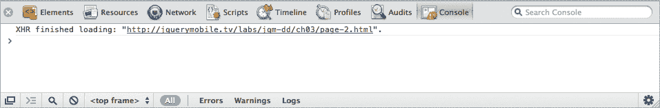

图 3.2. jQuery Mobile 使用 `XMLHttpRequest` 加载后续页面。


注意 Chrome 开发者工具是 Chrome 浏览器内置的集成 Web 开发环境。HTML 页面本身被请求，jQuery Mobile 使用其内容来显示新页面。关于这个简单的请求有很多值得学习的地方，我们将在后续章节中进行详细介绍。

## 总结

包含 jQuery Mobile 框架后，`page-1.html` 的 `page` `data-role` 将自动成为容器，通过 `XMLHttpRequest` 加载 `page-2.html` 中 `page` `data-role` 内的标记。`XMLHttpRequest` 是 Ajax 用于与服务器交换数据而无需刷新网页的方法；它就像是通往后端的门户。图 3.2 显示了当 `page-1.html` 链接 `page-2.html` 时产生的 `XMLHttpRequest` 示例。该请求使用 Chrome 开发者工具记录。在此例中，使用 Chrome 开发者工具是为了查看点击指向 `page-2.html` 的链接是由 jQuery Mobile 发起的 `XMLHttpRequest`。Chrome 开发者工具是测试和调试代码的极佳方法。


图 3.2. jQuery Mobile 使用 `XMLHttpRequest` 加载后续页面。


注意 Chrome 开发者工具是 Chrome 浏览器内置的集成 Web 开发环境。HTML 页面本身被请请求，jQuery Mobile 使用其内容来显示新页面。关于这个简单的请求有很多值得学习的地方，我们将在后续章节中进行详细介绍。

## 总结

包含 jQuery Mobile 框架后，`page-1.html` 的 `page` `data-role` 将自动成为容器，通过 `XMLHttpRequest` 加载 `page-2.html` 中 `page` `data-role` 内的标记。`XMLHttpRequest` 是 Ajax 用于与服务器交换数据而无需刷新网页的方法；它就像是通往后端的门户。图 3.2 显示了当 `page-1.html` 链接 `page-2.html` 时产生的 `XMLHttpRequest` 示例。该请求使用 Chrome 开发者工具记录。在此例中，使用 Chrome 开发者工具是为了查看点击指向 `page-2.html` 的链接是由 jQuery Mobile 发起的 `XMLHttpRequest`。Chrome 开发者工具是测试和调试代码的极佳方法。


图 3.2. jQuery Mobile 使用 `XMLHttpRequest` 加载后续页面。


注意 Chrome 开发者工具是 Chrome 浏览器内置的集成 Web 开发环境。HTML 页面本身被请求，jQuery Mobile 使用其内容来显示新页面。关于这个简单的请求有很多值得学习的地方，我们将在后续章节中进行详细介绍。

## 总结

包含 jQuery Mobile 框架后，`page-1.html` 的 `page` `data-role` 将自动成为容器，通过 `XMLHttpRequest` 加载 `page-2.html` 中 `page` `data-role` 内的标记。`XMLHttpRequest` 是 Ajax 用于与服务器交换数据而无需刷新网页的方法；它就像是通往后端的门户。图 3.2 显示了当 `page-1.html` 链接 `page-2.html` 时产生的 `XMLHttpRequest` 示例。该请求使用 Chrome 开发者工具记录。在此例中，使用 Chrome 开发者工具是为了查看点击指向 `page-2.html` 的链接是由 jQuery Mobile 发起的 `XMLHttpRequest`。Chrome 开发者工具是测试和调试代码的极佳方法。


图 3.2. jQuery Mobile 使用 `XMLHttpRequest` 加载后续页面。


注意 Chrome 开发者工具是 Chrome 浏览器内置的集成 Web 开发环境。HTML 页面本身被请求，jQuery Mobile 使用其内容来显示新页面。关于这个简单的请求有很多值得学习的地方，我们将在后续章节中进行详细介绍。

## 总结

（由于您提供的原文在起始处截断且存在重复，以上仅为对已出现部分的翻译。请提供完整的文本以获得准确的完整翻译。）


# jQuery Mobile 页面导航与组件详解

## 单页模板与链接类型

```html
<!DOCTYPE html>
<html>
<head>
    <meta http-equiv="Content-Type" content="text/html; charset=UTF-8">
    <meta name="viewport" content="width=device-width, initial-scale=1">
    <title>Single-page template - Page 1 - jQuery Mobile: Design and Develop</title>
    <link rel="stylesheet" href="http://code.jquery.com/mobile/1.0.1/jquery.mobile-1.0.1.min.css" />
    <script src="http://ajax.googleapis.com/ajax/libs/jquery/1.7.1/jquery.min.js"></script>
    <script src="http://code.jquery.com/mobile/1.0.1/jquery.mobile-1.0.1.min.js"></script>
</head>
<body class="container">
    <div data-role="page">
        <div data-role="header">
            <h1>Page 1</h1>
        </div>
        <div data-role="content">
            <p><a href="single-page-2.html">链接到页面 2</a></p>
            <p><a href="single-page-2.html" rel="external">到页面 2 的外部链接</a></p>
            <p><a href="single-page-2.html" data-ajax="false">禁用 Ajax 的链接到页面 2</a></p>
        </div>
        <div data-role="footer">
            Copyright
        </div>
    </div>
</body>
</html>
```

内部链接不需要特殊的标记，框架将在该处介入，并在当前页面与被链接的页面之间创建页面过渡。外部链接是需要 `rel` 属性的链接，该属性的值必须设置为 `external`。将超链接设置为外部链接会禁用 Ajax，将其从页面哈希历史记录（hashtag history）中移除，并在点击链接时刷新网页。禁用 Ajax 的链接需要一个值为 `false` 的 `data-ajax` 属性。这也会禁用 Ajax，将其从页面哈希历史记录中移除并刷新网页，与上一个示例相同，主要区别在于 `rel="external"` 属性可以在 jQuery 的轻微帮助下，作为一种符合标准的方式来创建目标为新窗口的超链接。

在接下来的示例中，有一个内部链接和一个充当返回按钮的超链接：

```html
<!DOCTYPE html>
<html>
<head>
    <meta http-equiv="Content-Type" content="text/html; charset=UTF-8">
    <meta name="viewport" content="width=device-width, initial-scale=1">
    <title>Single-page template - Page 2 - jQuery Mobile: Design and Develop</title>
    <link rel="stylesheet" href="http://code.jquery.com/mobile/1.0.1/jquery.mobile-1.0.1.min.css" />
    <script src="http://ajax.googleapis.com/ajax/libs/jquery/1.7.1/jquery.min.js"></script>
    <script src="http://code.jquery.com/mobile/1.0.1/jquery.mobile-1.0.1.min.js"></script>
</head>
<body class="container">
    <div data-role="page">
        <div data-role="header">
            <h1>Page 2</h1>
        </div>
        <div data-role="content">
            <p><a href="single-page.html">到页面 1 的 Ajax 链接</a></p>
            <p><a href="#" data-rel="back">返回按钮</a></p>
        </div>
        <div data-role="footer">
            Copyright
        </div>
    </div>
</body>
</html>
```

将 `data-rel` 属性设置为 `back` 会创建一个像返回按钮的超链接。当点击此链接时，jQuery Mobile 框架会自动链接到历史记录中的上一个页面。

## 预加载与缓存

在处理任何基于内容的操作时，页面缓存非常重要。缓存指的是收集文件的隐藏存储区域。默认情况下，浏览器通过将关联文件放在用户计算机的本地目录中来处理网页缓存，以便网页及其关联资源在访问时加载得更快。jQuery Mobile 将这一概念进一步了一步：框架允许页面在被链接或在浏览器中显示之前就进行缓存。利用此功能就像使用一个名为 `data-prefetch` 的 HTML 属性一样简单。只需将其添加到网页中的任何超链接中，一旦网页加载，这些超链接指向的 URL 就会被预加载并缓存。下一行代码显示了如何向超链接添加此属性，以预加载并缓存其指向的页面：

```html
<a href="page2.html" data-prefetch>链接到页面 2</a>
```

在网络浏览器中运行此示例时，请求会在页面加载时立即发出。图 4.2 显示了 Chrome 在页面加载时发出的 `XMLHttpRequest` 示例。

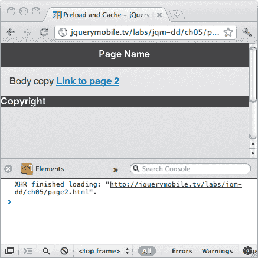

图 4.2. jQuery Mobile 使用 prefetch 属性预加载页面。

框架还提供了一种通过应用程序接口（API）处理页面预加载的方法。我们将在书后更具体地讨论 API，但了解如何访问它非常重要。

> **注意**：应用程序接口（API）允许多个软件之间进行通信。

要通过程序化预加载页面，你首先需要访问 jQuery Mobile 对象：

```javascript
$.mobile
```

一旦文档对象准备就绪，使用 `loadPage` 方法传递你想预加载的 URL，并为请求定义若干属性：

```javascript
$(document).ready(function() {
    $.mobile.loadPage( "page2.html", {
        type: false,
        reloadPage: false,
        type: 'get'
    });
});
```

在 `loadPage` 方法中，你可以传递许多参数作为选项。表 4.4 列出了这些可选参数。

表 4.4. loadPage 可选参数

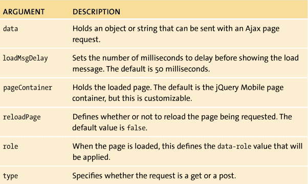

除了提供文件加载控制外，jQuery Mobile 框架还提供了在文档对象模型（DOM）中缓存的控制。就像预加载选项一样，你可以通过 HTML 属性或 jQuery Mobile API 定义是否应在 DOM 中缓存页面。以下示例显示了如何在 `page` 标签中使用该属性来缓存网页：

```html
<div data-role="page" data-dom-cache="true">
```

要使用 API 缓存网页，你可以设置所有页面默认缓存：

```javascript
$.mobile.page.prototype.options.domCache = true;
```

或者，你可以独立地缓存页面。你可以这样缓存 id 为 `my-page` 的页面：

```javascript
$('#my-page').page(true);
```

在处理单页模板时，jQuery Mobile 还会管理它预加载的页面，以防止 DOM 过大。如果许多页面保留在 DOM 中，浏览器的内存使用可能会失控，浏览器可能会变慢或崩溃。为了管理内存大小，框架会在访问者离开页面时，通过 `pagehide` 事件自动将 Ajax 加载的页面从 DOM 中移除。你将在书的后部分学习更多关于这一点以及其他事件的内容。

预加载和缓存页面有很多益处。它们加载速度更快，并且可以防止访问者尝试访问预加载页面时出现 Ajax 加载提示。然而，重要的是，每个预加载的页面都会创建一个额外的 HTTP 请求，这会消耗更多带宽。因此，只有在你认为访问者可能会查看后续网页时，才对页面进行预加载。

## 使用页面过渡

jQuery Mobile 框架可以使用多种页面过渡。所有的页面过渡都是基于 CSS 的效果。在使用 Ajax 导航时，页面过渡发生在链接页面或表单提交之间。表 4.5 列出了框架中可用的页面过渡。

表 4.5 页面过渡

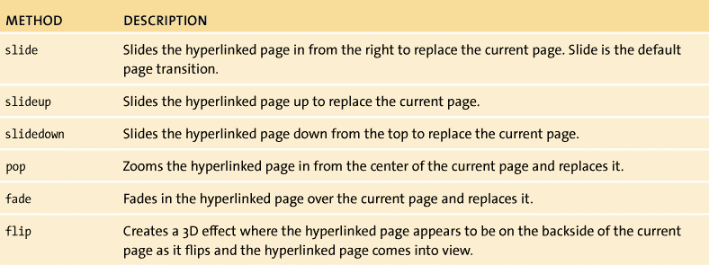

使用 `flip` 过渡时要小心，因为只有支持 3D CSS 变换渲染的浏览器才支持它。

这些页面过渡中的每一个都可以使用 `defaultPageTransition` 属性全局地设置为默认值。要正确设置它，必须绑定到 `mobileinit` 事件，可以通过 jQuery Mobile API 访问该事件：

```javascript
$(document).bind("mobileinit", function() {
    $.mobile.defaultPageTransition = 'fade';
});
```

事件处理器的绑定需要在 jQuery Mobile 库加载之前执行。因此，在你的 HTML 文件中，请按特定顺序安排 JavaScript 文件：

```html
<script src="http://ajax.googleapis.com/ajax/libs/jquery/1.7.1/jquery.min.js"></script>
<script src="assets/js/custom-jqm-transitions.js"></script>
<script src="http://code.jquery.com/mobile/1.0.1/jquery.mobile-1.0.1.min.js"></script>
```

也可以基于单个链接进行设置，以覆盖默认页面过渡。此选项在许多情况下非常有用，例如创建一个使用 `pop` 过渡的弹出窗口：

```html
<a href="popup.html" data-transition="pop">Pop-up</a>
```

或者，使用 `flip` 过渡的表单提交：

```html
<form action="" method="get" data-transition="flip">
    <input type="text" name="name">
    <input type="submit" value="Submit">
</form>
```

甚至可以将页面过渡设置为 `none`，以禁用特定超链接或表单提交的页面过渡：

```html
<form action="" method="get" data-transition="none">
    <input type="text" name="name">
    <input type="submit" value="Submit">
</form>
```

jQuery 会在按下返回键时自动应用相同的页面过渡，从而创建一个反向过渡。

全局和单个页面过渡的完整示例代码如下：

```html
<!DOCTYPE html>
<html>
<head>
    <meta http-equiv="Content-Type" content="text/html; charset=UTF-8">
    <meta name="viewport" content="width=device-width, initial-scale=1">
    <title>Page Transitions - jQuery Mobile: Design and Develop</title>
    <link rel="stylesheet" href="http://code.jquery.com/mobile/1.0.1/jquery.mobile-1.0.1.min.css" />
    <script src="http://ajax.googleapis.com/ajax/libs/jquery/1.7.1/jquery.min.js"></script>
    <script src="assets/js/custom-jqm-transitions.js"></script>
    <script src="http://code.jquery.com/mobile/1.0.1/jquery.mobile-1.0.1.min.js"></script>
</head>
<body class="container">
    <div data-role="page">
        <div data-role="header"><h1>Page Name</h1></div>
        <div data-role="content">
            <p><a href="popup.html" data-transition="pop">Pop-up</a></p>
            <form action="" method="get" data-transition="flip">
                <input type="text" name="name">
                <input type="submit" value="Submit">
            </form>
        </div>
    </div>
</body>
</html>
```

## 对话框

对话框（Dialog windows）可以像多页模板一样包含在单个 HTML 文件的一个或多个页面中，也可以像单页模板一样是外部网页。要创建一个包含对话框窗口的多页模板，你只需要添加另一个 jQuery Mobile 页面——区别在于你链接到它的方式。换句话说，任何页面都可以是对话框；它之所以成为对话框，取决于它的打开方式。以下示例显示了一个带有 `data-rel` 属性的超链接，它可以在对话框窗口中打开页面：

```html
<!DOCTYPE html>
<html>
<head>
    <meta http-equiv="Content-Type" content="text/html; charset=UTF-8">
    <meta name="viewport" content="width=device-width, initial-scale=1">
    <title>Dialog - jQuery Mobile: Design and Develop</title>
    <link rel="stylesheet" href="http://code.jquery.com/mobile/1.0.1/jquery.mobile-1.0.1.min.css" />
    <script src="http://ajax.googleapis.com/ajax/libs/jquery/1.7.1/jquery.min.js"></script>
    <script src="http://code.jquery.com/mobile/1.0.1/jquery.mobile-1.0.1.min.js"></script>
</head>
<body>
    <div data-role="page">
        <div data-role="header"><h1>Dialog Test</h1></div>
        <div data-role="content">
            <p><a href="#multipage-dialog" data-rel="dialog">Open Multi-page Dialog</a></p>
        </div>
        <div data-role="footer">Copyright</div>
    </div>
    <div data-role="page" id="multipage-dialog">
        <div data-role="header"><h1>Multi-page dialog window</h1></div>
        <div data-role="content">
            <p><a href="dialog.html" data-rel="back">OK</a></p>
        </div>
    </div>
</body>
</html>
```

在例示例中，页有两个页面：第一个页面是默认显示的。在这个默认页面内，有一个带有 `data-rel="dialog"` 属性并指向锚点的超链接。链接到的锚点是第二个页面的 ID。第二个页面的设置方式与任何 jQuery Mobile 页面一样：由于其链接方式，它是作为对话框打开的。图 5.1 显示了这段代码的结果。

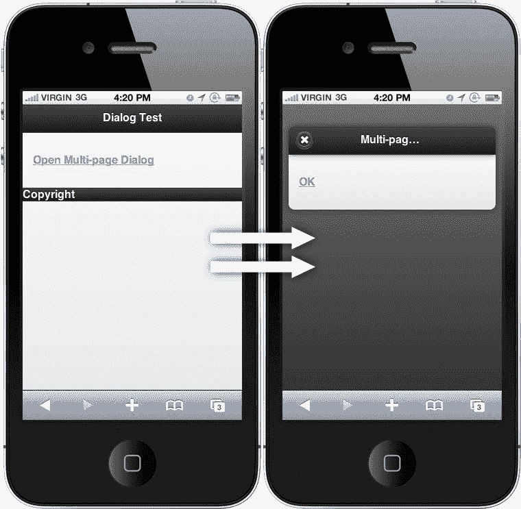

图 5.1。多页对话框窗口。

如所述，对话框窗口也可以通过带有 `data-rel="dialog"` 属性和值的超链接链接到外部网页。接下来的示例与上一个非常相似，主要区别是超链接现在指向了一个名为 `dialog-window.html` 的外部 HTML 文件：

```html
<!DOCTYPE html>
<html>
<head>
    <meta http-equiv="Content-Type" content="text/html; charset=UTF-8">
    <meta name="viewport" content="width=device-width, initial-scale=1">
    <title>Dialog - jQuery Mobile: Design and Develop</title>
    <link rel="stylesheet" href="http://code.jquery.com/mobile/1.0.1/jquery.mobile-1.0.1.min.css" />
    <script src="http://ajax.googleapis.com/ajax/libs/jquery/1.7.1/jquery.min.js"></script>
    <script src="http://code.jquery.com/mobile/1.0.1/jquery.mobile-1.0.1.min.js"></script>
</head>
<body>
    <div data-role="page">
        <div data-role="header"><h1>Dialog Test</h1></div>
        <div data-role="content">
            <p><a href="dialog-window.html" data-rel="dialog">Open Dialog</a></p>
        </div>
        <div data-role="footer">Copyright</div>
    </div>
</body>
</html>
```

被链接的 HTML 文件可以像任何 jQuery Mobile 一样设置：

```html
<!DOCTYPE html>
<html>
<head>
    <meta http-equiv="Content-Type" content="text/html; charset=UTF-8">
    <title>Dialog - jQuery Mobile: Design and Develop</title>
</head>
<body>
    <div data-role="page">
        <div data-role="header"><h1>Single-page window</h1></div>
        <div data-role="content">
            <p><a href="#" data-rel="back">OK</a></p>
        </div>
    </div>
</body>
</html>
```

这段代码的结果如图 5.2 所示。

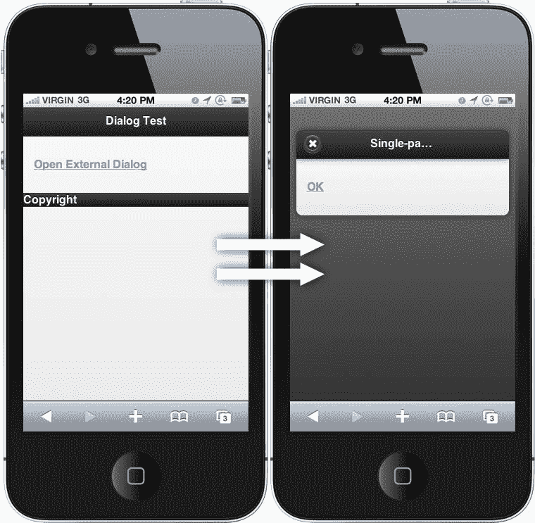

图 5.2。单页窗口。

对话框窗口也可以通过带有 `data-rel="dialog"` 属性和值的超链接链接到外部网页。对话框可以通过带有 `data-rel="dialog"` 属性的链接，在下面的示例中，它在对话框窗口中打开了：

```html
<!DOCTYPE html>
<html>
<head>
    <meta http-equiv="Content-Type" content="text/html; charset=UTF-8">
    <meta name="viewport" content="width=device-width, initial-scale=1">
    <title>Dialog - jQuery Mobile: Design and Develop</title>
    <link rel="stylesheet" href="http://code.jquery.com/mobile/1.0.1/jquery.mobile-1.0.1.min.css" />
    <script src="http://ajax.googleapis.com/ajax/libs/jquery/1.7.1/jquery.min.js"></script>
    <script src="http://code.jquery.com/mobile/1.0.1/jquery.mobile-1.0.1.min.js"></script>
    <style type="text/css">
        .ui-dialog .ui-header,
        .ui-dialog .ui-content,
        .ui-dialog .ui-footer {
            max-width: 640px;
        }
    </style>
</head>
<body>
    <div data-role="page">
        <div data-role="header"><h1>Dialog Test</h1></div>
        <div data-role="content">
            <p>President Obama's Inaugural Address</p>
            <p><a href="dialog.html" data-rel="dialog">Play now &gt;</a></p>
        </div>
        <div data-role="footer">Copyright</div>
    </div>
</body>
</html>
```

对话框具有预定义的宽度，但可以通过 `.ui-dialog` 类进行覆盖。被加载的 HTML 文件包含了奥马总统就职演视频。由于移动设备的宽度可能比 640 像素小得多，弹出窗口中的 iframe 宽度被设置为 100%。

```html
<!DOCTYPE html>
<html>
<head>
    <meta http-equiv="Content-Type" content="text/html; charset=UTF-8">
    <title>Pop-up - jQuery Mobile: Design and Develop</title>
</head>
<body>
    <div data-role="page">
        <div data-role="header"><h1>President Obama's Inaugural Address</h1></div>
        <div data-role="content">
            <iframe width="100%" height="360" src="http://www.youtube.com/embed/3PuHGKnNY" frameborder="0" allowfullscreen></iframe>
        </div>
    </div>
</body>
</html>
```

默认情况下，对话框（或弹出窗口）包含一个关闭按钮，因此你不需要为对话框窗口添加任何其他超链接或功能。图 5.3 显示了奥马总统就职视频弹出窗口的示例。

对话框包含过渡效果。默认过渡是 `pop`，但此过渡可以更改为 `flip` 或 `slidedown`。要更改过渡，请在包含 `data-rel="dialog"` 设置的超链接上添加 `data-transition` 属性。如果在上一个示例中添加 `slidedown` `data-transition`，代码如下：

```html
<a href="popup-window.html" data-rel="dialog" data-transition="slidedown">Play now &gt;</a>
```

## 按钮

jQuery Mobile 提供了一种通过 HTML 锚点元素和输入元素创建按钮的方法。通过创建更大的可点击区域，按钮为标准链接和输入框提供了更易用的替代方案。要将超链接转换为按钮，请将 `data-role` 属性设置为 `button` (图 5.4)：

```html
<a href="#" data-role="button">Hyperlink button</a>
```


图 5.4。一个 `data-role` 为 `button` 的链接元素。

默认情况下，按钮占据容器元素的全宽度，但你可以使用 `data-inline` 属性将其设置为行内显示。当该属性设置为 `true` 时，创建的按钮宽度将由链接中的文本决定 (图 5.5)：

```html
<a href="#" data-role="button" data-inline="true">Hyperlink button</a>
```

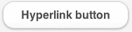

图 5.5。一个 `data-inline` 设置为 `true` 的链接元素。

按钮可以通过许多额外的 `data-` 属性进行增强。表 5.1 列出了所有可能的按钮 `data-` 属性及其值。

表 5.1 按钮 `data-` 属性

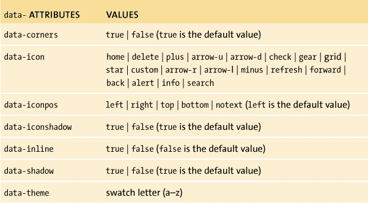

输入按钮与超链接的区别在于，它们默认都是按钮。接例的提交（Submit）按钮默认为 jQuery Mobile 按钮：

```html
<input type="submit" value="Submit button">
```

这个输入元素并没有特殊之处。图 5.6 显示了该输入按钮在经过 jQuery Mobile 增强后的外观。


图 5.6。一个 `data-role` 等于 `button` 的提交按钮。

许多类型的输入元素都会被 jQuery Mobile 自动增强为按钮。这包括 `type` 属性设置为 `button`、`submit`、`reset` 或 `image` 的输入元素，它们在默认情况下外观相同。更改这种默认增强的办法是将 `data-role` 设置为 `none`。

按钮可以使用 `data-icon` 属性包含图标。默认图标的数量非常惊人，而且图标极易使用。表 5.2 显示了通过 `data-icon` 属性添加到 jQuery Mobile 按钮的每个图标示例。

表 5.2 按钮图标

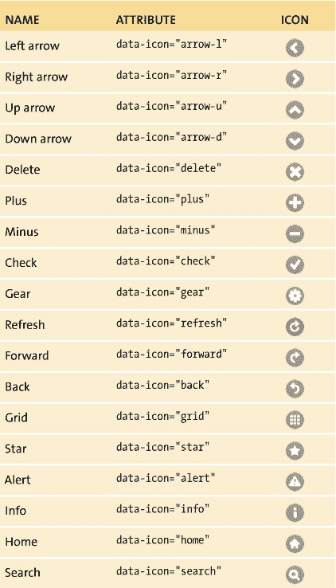

按钮图标可以放置在不同的位置。要实现这一点，请使用 `data-iconpos` 属性并将其设置为以下值之一：

- `left`（`left` 是默认值）
- `right`
- `top`
- `bottom`
- `notext`（如图 5.7 所示，此值仅使用图标，隐藏链接或输入值中的文本。）


图 5.7。一个使用 `notext` data-iconpos 配合首页 data-icon 图标的按钮示例。

也可以通过 CSS 使用自定义图标。要创建自定义图标，你首先需要选择一个名称值。为了本次演示，我们将使用 `checkmark`。在使用了按钮插件的链接或输入框中，在 `data-icon` 属性中使用该值会生成一个 CSS 类。该 CSS 类在自定义值之前包含 `ui-icon-`，因此我们定义的自定义值的 CSS 类为 `ui-icon-checkmark`。有了这个类，你可以轻松地定位到该类并添加背景图像作为图标：

```css
.ui-icon-checkmark {
    background-image: url("5-custom-icon.png");
}
```

在设计图标时，你可能想要创建一个 18 × 18 像素带 alpha 透明度的 PNG-8 图片，以匹配内置的 jQuery Mobile 图标。图 5.8 显示了自定义图标的示例。


图 5.8。一个自定义的点选图标。

现在我们已经创建了这个图标以及与其关联的 CSS 类，可以将图标分配给按钮了。要将新图标分配给按钮，我们只需使用 `data-icon` 属性并设置为 `checkmark`：

```html
<a href="#checkmark" data-role="button" data-icon="checkmark">Checkmark example</a>
```

这段代码的最终结果与图 5.9 相似。

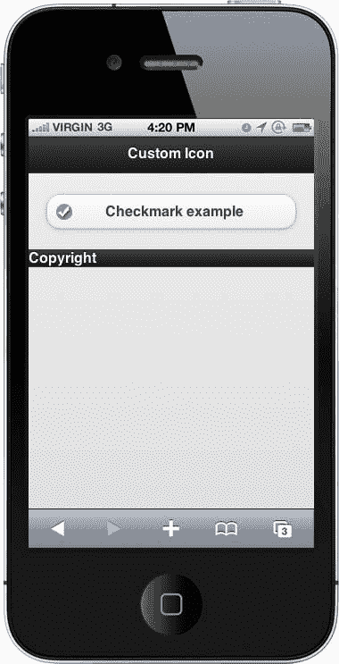

图 5.9。一个自定义的点选图标。

---

# 工具栏

## 总结

本章的内容是任何移动网站的基础。

另一个明显的区别是标题元素包含一个 `ui-title` 类。该类设置了一系列组合属性，可以使文本居中、添加外边距、为溢出的文本创建省略号等。框架还添加了 `tabindex`，它通过创建逻辑性的选项卡切换顺序，自动使网页更具可访问性，该顺序会被像 iOS 带有内置“下一步”按钮的移动设备使用。页眉还可以包含标题元素以外的元素；例如，按钮可以是你工具栏中重要的补充。

### 添加按钮

通过第 5 章中讨论的按钮选项、“对话框和按钮”以及无限数量的自定义图标，你可以满足想象到的任何功能需求。页眉是移动 Web 应用中突出显示重要按钮的绝佳位置，使用 jQuery Mobile 可以轻松实现。以下示例显示了如何在编辑用户个人资料的对话框页眉元素中添加保存（Save）按钮：

```html
<!DOCTYPE html>
<html>
<head>
    <meta http-equiv="Content-Type" content="text/html; charset=UTF-8">
    <meta name="viewport" content="width=device-width, initial-scale=1">
    <title>Header Toolbar - jQuery Mobile: Design and Develop</title>
    <link rel="stylesheet" href="http://code.jquery.com/mobile/1.0.1/jquery.mobile-1.0.1.min.css" />
    <script src="http://ajax.googleapis.com/ajax/libs/jquery/1.7.1/jquery.min.js"></script>
    <script src="http://code.jquery.com/mobile/1.0.1/jquery.mobile-1.0.1.min.js"></script>
</head>
<body>
    <div data-role="page">
        <div data-role="header">
            <h1>John Doe</h1>
            <a href="#options-dialog" data-icon="gear" class="ui-btn-right" data-rel="dialog">Edit Profile</a>
        </div>
        <div data-role="content">
            <p>123 E Street</p>
            <p>Chicago, Il 60622</p>
        </div>
    </div>
    <div data-role="page" id="options-dialog">
        <div data-role="header">
            <h1>Edit John Doe</h1>
            <a href="#" data-icon="check">Save</a>
        </div>
        <div data-role="content">
            <label for="profile-image">Profile Image</label>
            <p></p>
            <input type="file" id="profile-image" name="profile-image">
            <label for="street-address">Street Address</label>
            <input type="text" id="street-address" name="street-address" value="123 E Street">
            <label for="city">City</label>
            <input type="text" id="city" name="city" value="Chicago">
            <label for="state">State</label>
            <input type="text" id="state" name="state" value="Il">
            <label for="zip-code">Zip Code</label>
            <input type="text" id="zip-code" name="zip-code" value="6022">
        </div>
    </div>
</body>
</html>
```

使用单页模板，添加了第二个页面并设置了一个超链接从默认页面以对话框形式打开它。在对话框窗口中，保存按钮通过 `data-icon` 属性进行视觉表示。默认页面选项按钮使用齿轮图标，而保存按钮使用勾选图标。插图 6.4 展示了在对话框窗口中显示可编辑表单以修改用户个人资料的方法。在更新输入后，用户可以点击保存按钮。你可以编写代码来处理用户的更新并将其存储在数据库中。

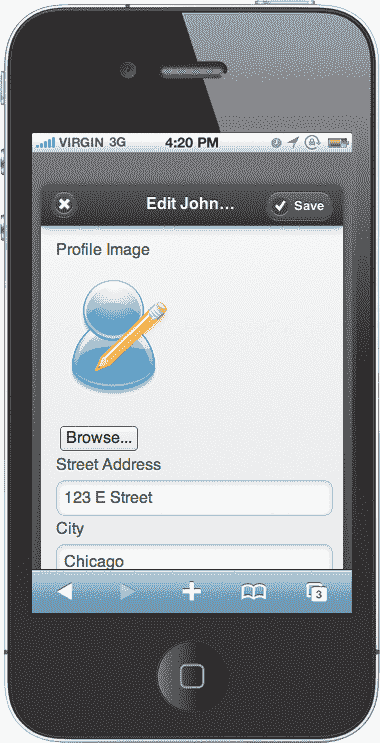

图 6.4。带有保存按钮的页眉工具栏。

按钮也可以进行分组，而不是单独显示。要对按钮进行分组，只需在它们周围添加一个 `div` 作为容器，并应用一个值为 `controlgroup` 的 `data-role`，同时将 `data-type` 设置为 `horizontal`：

```html
<div data-role="header">
    <div data-role="controlgroup" data-type="horizontal">
        <a href="#" data-role="button" data-icon="delete">Delete</a>
        <a href="#" data-role="button" data-icon="check">Save</a>
    </div>
</div>
```

你还会注意到 `data-role` 属性被设置为 `button`。此属性和值必须添加到 `controlgroup` 内部的按钮上，否则超链接将不会渲染为按钮。插图 6.5 显示此示例渲染了一个包含组合删除”和“保存”按钮的工具栏，因此这两个按钮不再显示为独立。

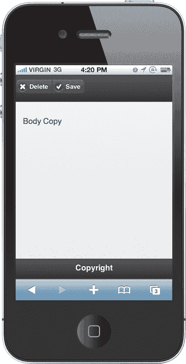

图 6.5。分组的按钮。

也可以向工具栏中添加多个组组，以便在视觉上将这些组相互隔离开：

```html
<div data-role="header">
    <div data-role="controlgroup" data-type="horizontal" class="align-left">
        <a href="#" data-role="button" data-icon="home">Home</a>
        <a href="#" data-role="button" data-icon="arrow-l">Back</a>
    </div>
    <div data-role="controlgroup" data-type="horizontal" class="align-right">
        <a href="#" data-role="button" data-icon="delete">Delete</a>
        <a href="#" data-role="button" data-icon="check">Save</a>
    </div>
</div>
```

这些按钮组也使用了自定义类，将一组左对齐，另一组右对齐。这些类的 CSS 是简单的左浮动和右浮动：

```css
<style type="text/css">
.align-left {
    float: left;
}
.align-right {
    float: right;
}
</style>
```

插图 6.6 显示了这些按钮组在工具栏中的效果。

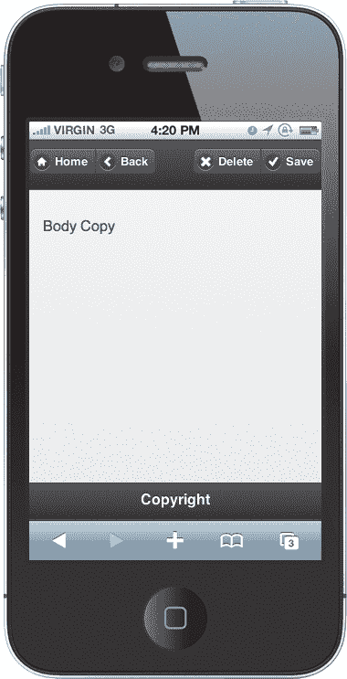

图 6.6。分组。

### 页脚工具栏

页脚工具栏与页眉工具栏相似，但通常位于页面底部而不是顶部。它们经常用于显示版权声明或其他信息。

```html
<div data-role="footer">
    <h4>Copyright</h4>
</div>
```

正如页眉工具栏中的标题，添加到页脚工具栏的任何文本都需要标题元素来包含间距、对齐等。以下代码示例显示了框架增强后的页脚工具栏：

```html
<div data-role="footer" class="ui-footer-a" role="contentinfo">
    <h4 class="ui-title" tabindex="0" role="heading" aria-level="1">Copyright</h4>
</div>
```

### 工具定位

你可以将工具栏设置为固定（fixed）或全屏（fullscreen）。固定工具栏在网页上始终可见。当页眉工具栏是固定的，即使页面滚动，它也始终出现在顶部。当页脚工具栏是固定的，它始终显示在网络浏览器的底部。要为工具栏添加固定定位，只需要一个值为 `fixed` 的 `data-position` 属性：

```html
<div data-role="page">
    <div data-role="header" data-position="fixed">
        <h1>Page Title</h1>
    </div>
    <div data-role="content">
        <p>Body Copy</p>
    </div>
    <div data-role="footer" data-position="fixed">
        <h4>Copyright</h4>
    </div>
</div>
```

插图 6.7 显示了这些工具栏在网络浏览器中的渲染情况。

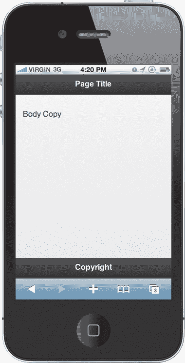

图 6.7。固定工具栏。

此代码的结果以类似于 CSS 中的固定定位的方式工作，但 jQuery Mobile 并没有使用 CSS 实现此功能。由于许多移动浏览器不支持固定定位，jQuery Mobile 使用动态重新定位来代替。

你也可以通过 jQuery Mobile API 更新工具栏的位置。这种方法有时是必要的，例如当小部件（如手风琴）展开并导致页面高度发生变化时。你可以调用以下代码来更新工具栏的位置：

```javascript
$.mobile.fixedToolbars.show(true);
```

当你正在构建动态内容时，这段代码非常好用。

除了固定工具栏外，你还可以创建全屏固定页眉。全屏固定页眉与固定头部相同，唯一区别是内容位于工具栏之后，因此内容仍然是全屏的，而工具栏是透明的。点击页面时，工具栏也会消失。要创建全屏固定工具栏，只需添加 `data-fullscreen` 属性并将其设置为 `true`：

```html
<div data-role="header" data-fullscreen="true" data-position="fixed">
    <h1>Page Title</h1>
</div>
```

对于普通的固定工具栏，内容位于页眉和页脚之间。全屏工具栏常用于视频播放器或幻灯片播放。

### 创建导航栏

导航在网页页眉中显示得最为显著。jQuery Mobile 提供了一个名为 `navbar` 的部件来创建导航。导航栏并不要求位于页眉工具栏中，但它们通常出现在页眉或页脚中。让我们看看如何有效地将其用作移动网站页眉中的页面导航。导航栏本质上是一个包含在带有 `data-role` 值为 `navbar` 的元素中的简单无序列表：

```html
<div data-role="header">
    <div data-role="navbar">
        <ul>
            <li><a href="/">Home</a></li>
            <li><a href="#">About</a></li>
            <li><a href="#">Contact</a></li>
        </ul>
    </div>
</div>
```

jQuery Mobile 再次通过添加单个属性，使其能够极其轻松地将简单的 HTML 标记转换为视觉上具有吸引力且功能完备部件。图 6.8 显示了此代码在视觉上的渲染效果。

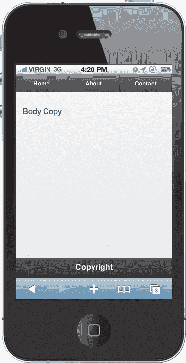

图 6.8。用在页眉工具栏中的导航栏。

该框架酷的地方在于，它根据按钮的数量均匀地划分导航栏的空间。这就是为什么图 6.8 中的每个按钮都是比例的。导航栏唯一的注意事项是，如果它们包含超过五个超链接，它们将开始换行到多行，如图 6.9 所示。

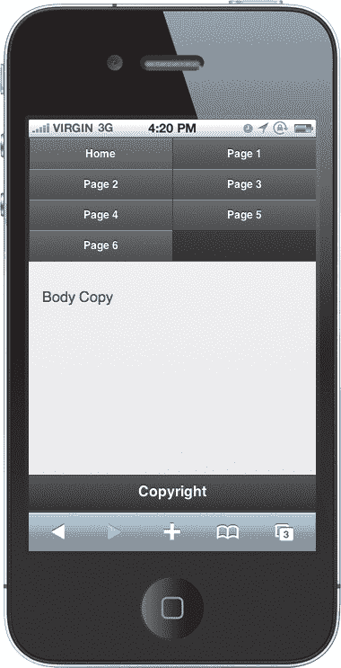

图 6.9。拥有五个按钮按钮的导航栏。

这在某种上是一个局限性，但它也是一种幸运，因为移动设备没有足够的水平空间来容纳这么多按钮。

页眉导航栏的另一个优点是，它们不需要你移除页面标题。你仍然可以使用带有页面标题的标题元素，然后在下方添加导航栏。或者，更好的是，你可以添加一个 Logo 然后添加一个导航栏，就像你在整个网络上通常看到的那样：

```html
<div data-role="header">
    
    <div data-role="navbar">
        <ul>
            <li><a href="/">Home</a></li>
            <li><a href="#">About</a></li>
            <li><a href="#">Contact</a></li>
        </ul>
    </div>
</div>
```

如图 6.10 所示，Logo 被添加在导航上方。页眉工具栏可以包含多个元素；它们不仅限于按钮或页面标题。

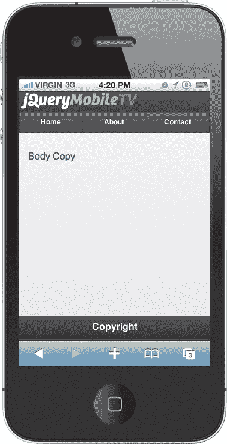

图 6.10。页眉中的导航栏和 Logo。

图 6.11 显示了一个导航栏。

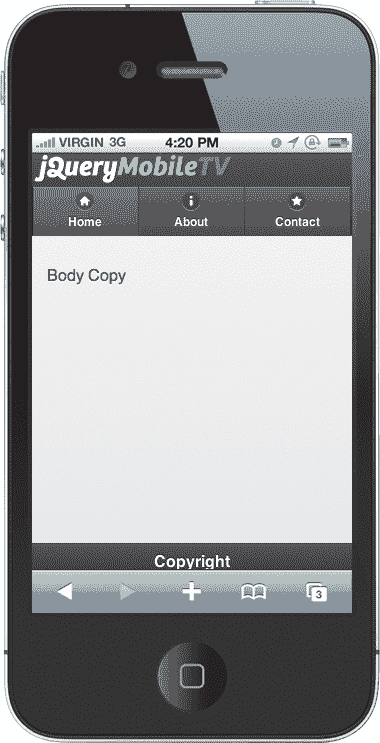

图 6.11。导航栏和 Logo。

## 总结

工具栏可以帮助你建立页面上的一致性。除了固定工具栏外，你还可以创建全屏固定页眉。全屏固定页眉与固定头部相同，唯一区别是内容位于工具栏之后，因此内容仍然是全屏的，而工具栏是透明的。点击页面时，工具栏也会消失。

---

# 布局选项

jQuery Mobile 的灵活之处在于它支持标准 HTML，同时也提供了自定义布局。当你需要将内容组织成网格时，网格非常有用。你可以通过定义你想要的列数来创建一个网格。以下示例显示了如何创建一个网格布局。

图 7.1。双列网格。

此代码的结果将与 图 7.2 类似。

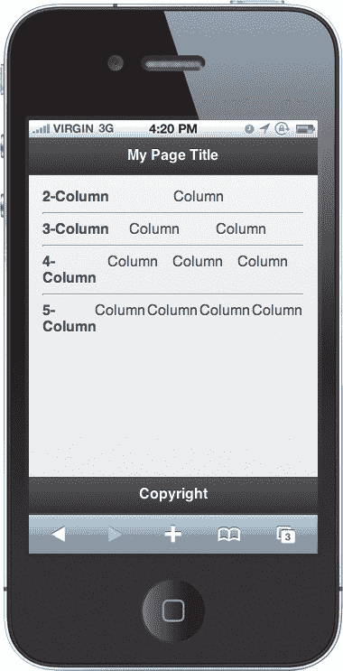

图 7.2。具有不同列数量的多个网格。

列本身是非常单调的，但你可以添加预定义的 jQuery Mobile 类，或者为现有的类编写你自己的 CSS。例如，jQuery Mobile 框架包含一个名为 `ui-bar` 的类，它添加了内边距，还有另一组类可以通过在末尾添加字母来定制主题，这会影响背景、杂项字体样式等。我们将在书的后部分学习更多关于 jQuery Mobile 主题的内容。接的示例使用 `ui-bar-a` 类来添加蓝色背景渐变、字体样式以及其他的 CSS 更新：

```html
<div class="ui-grid-a">
    <div class="ui-block-a">
        <div class="ui-bar ui-bar-b"><strong>双列</strong></div>
    </div>
    <div class="ui-block-b">
        <div class="ui-bar ui-bar-b">列</div>
    </div>
</div>
```

图 7.3 显示此代码的结果，它看起来比之前的示例漂亮得多，添加了增强网格的样式更新。

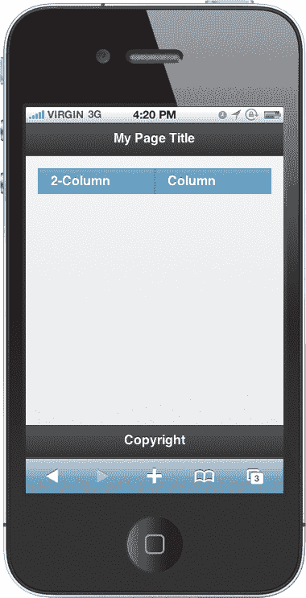

图 7.3。带有 `ui-bar` 类的双列网格。

在网格列中添加自定义 CSS 是非常简单的。由于网格是标准的 HTML 标记，你可以向任何元素添加自定义 CSS 类。在接下来的示例中，已向第一列添加了自定义类 `block-title`，并向网格中的所有 `div` 元素添加了另一个类：

```html
<!DOCTYPE html>
<head>
    <meta http-equiv="Content-Type" content="text/html; charset=UTF-8">
    <meta name="viewport" content="width=device-width, initial-scale=1">
    <title>Grids - jQuery Mobile: Design and Develop</title>
    <link rel="stylesheet" href="http://code.jquery.com/mobile/1.0.1/jquery.mobile-1.0.1.min.css" />
    <script src="http://ajax.googleapis.com/ajax/libs/jquery/1.7.1/jquery.min.js"></script>
    <script src="http://code.jquery.com/mobile/1.0.1/jquery.mobile-1.0.1.min.js"></script>
    <style type="text/css">
    .ui-grid-a div {
        background-color: #ccc;
    }
    .ui-grid-a div.block-title {
        background-color: #fff;
    }
    </style>
</head>
<body>
    <div data-role="page">
        <div data-role="header" data-position="fixed">
            <h1>My Page Title</h1>
        </div>
        <div data-role="content">
            <div class="ui-grid-a">
                <div class="ui-block-a block-title">2-Column</div>
                <div class="ui-block-b">Column</div>
            </div>
        </div>
        <div data-role="footer" data-position="fixed">
            <h4>Copyright</h4>
        </div>
    </div>
</body>
</html>
```

此代码的结果将与 图 7.4 类似。

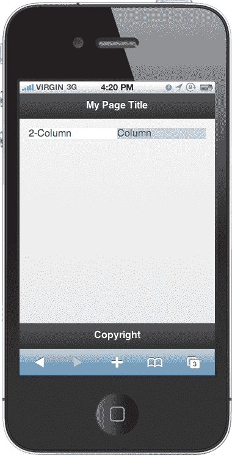

图 7.4。带有自定义 CSS 的双列网格。

使用双列网格是处理 第 5 章 对话框与按钮 中按钮组功能的更好方法。与其使用浮动（floats）来对齐控制组，不如使用网格将它们隔离开。下面的代码展示了如何使用网格在工具栏内创建布局：

```html
<!DOCTYPE html>
<html>
<head>
    <meta http-equiv="Content-Type" content="text/html; charset=UTF-8">
    <meta name="viewport" content="width=device-width, initial-scale=1">
    <title>Grid with controlgroup - jQuery Mobile: Design and Develop</title>
    <link rel="stylesheet" href="http://code.jquery.com/mobile/1.0.1/jquery.mobile-1.0.1.min.css" />
    <script src="http://ajax.googleapis.com/ajax/libs/jquery/1.7.1/jquery.min.js"></script>
    <script src="http://code.jquery.com/mobile/1.0.1/jquery.mobile-1.0.1.min.js"></script>
    <style type="text/css">
    .ui-grid-a div {
        background-color: #ccc;
    }
    </style>
</head>
<body>
    <div data-role="page">
        <div data-role="header" data-position="fixed">
            <div class="ui-grid-a">
                <div class="ui-block-a">
                    <div class="ui-bar ui-bar-b">Home</div>
                </div>
                <div class="ui-block-b">
                    <div class="ui-bar ui-bar-b">Back</div>
                </div>
            </div>
        </div>
        <div data-role="content">
            <p>Body</p>
        </div>
        <div data-role="footer" data-position="fixed">
            <h4>Copyright</h4>
        </div>
    </div>
</body>
</html>
```

图 7.5 显示此代码的结果，它比之前的示例漂亮得多，添加了增强网格的样式更新。


图 7.5。用于分离控制组的网格。

### 行

在网格列中添加自定义 CSS 是简单的。由于网格是标准的 HTML 标记，你可以向任何元素添加自定义 CSS 类。在接下来的示例中，已向第一列添加了自定义类 `block-title`，并向网格中的所有 `div` 元素添加了另一个类：

```html
<!DOCTYPE html>
<html>
<head>
    <meta http-equiv="Content-Type" content="text/html; charset=UTF-8">
    <meta name="viewport" content="width=device-width, initial-scale=1">
    <title>Grid with controlgroup - jQuery Mobile: Design and Develop</title>
    <link rel="stylesheet" href="http://code.jquery.com/mobile/1.0.1/jquery.mobile-1.0.1.min.css" />
    <script src="http://ajax.googleapis.com/ajax/libs/jquery/1.7.1/jquery.min.js"></script>
    <script src="http://code.jquery.com/mobile/1.0.1/jquery.mobile-1.0.1.min.js"></script>
    <style type="text/css">
    .ui-grid-a .block-b {
        text: right;
    }
    </style>
</head>
<body>
    <div data-role="page">
        <div data-role="header" data-position="fixed">
            <div class="ui-grid-a">
                <div class="ui-block-a">
                    <div class="ui-bar ui-bar-b">Home</div>
                </div>
                <div class="ui-block-b">
                    <div class="ui-bar ui-bar-b">Back</div>
                </div>
            </div>
        </div>
        <div data-role="content">
            <p>Body</p>
        </div>
        <div data-role="footer" data-position="fixed">
            <h4>Copyright</h4>
        </div>
    </div>
</body>
</html>
```

### 列

jQuery Mobile 也允许你创建具有多个列的网格。例如，为了创建一个四列网格，必须使用 `ui-grid` 类。接的示例展示了具有四列的网格：

```html
<div class="ui-grid-a">
    <div class="ui-block-a">
        <div class="ui-bar ui-bar-b">A</div>
    </div>
    <div class="ui-block-b">
        <div class="ui-bar ui-bar-b">B</div>
    </div>
    <div class="ui-block-c">
        <div class="ui-bar ui-bar-b">C</div>
    </div>
    <div class="ui-block-d">
        <div class="ui-bar ui-bar-b">D</div>
    </div>
</div>
```

每个带有 `ui-block-a` 类的元素会自动清除之前的行，从而产生新行。通过查看 jQuery Mobile 框架中包含 `ui-block-a` 类的实际 CSS，你可以看到它清除了左浮动，因此结果与 图 7.6 类似。

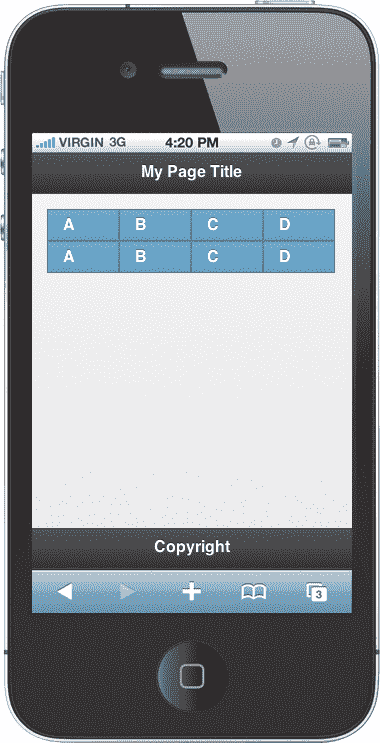

图 7.6。具有多个行和列的网格。

## 折叠内容

jQuery Mobile 提供了一个组件，允许开发者创建可以展开和收叠的内容。这种组件被称为折叠内容，包含一个头部和一个内容区域；头部作为可以点击以展开或收叠内容区域的按钮。创建一个折叠内容区域，将 `data-role` 属性的值设置为 `collapsible` 应用到包含标题和内容区域的 `div` 上。在接的示例中，`data-role` 设置为 `collapsible` 的容器元素包含标题和一个段落元素：

```html
<div data-role="collapsible">
    <h3>折叠内容头部</h3>
    <p>这是折叠的内容区域。</p>
</div>
```

Lorem ipsum dolor sit amet, consectetur adipiscing elit. Praesent non dolor quis elit suscipit commodo a eu velit. Nulla sodales velit arcu, at accumsan nisi. Donec porta tempus lorem, eget luctus diam luctus ac. Nunc et aliquam massa. Duis enim felis, varius quis pharetra quis, iaculis ac nulla. Morbi congue suscipit elit vel porta. Proin lacinia scelerisque risus, at elementum diam elementum et.

通过在容器上添加 `collapsible` `data-role`，标题元素将自动转换为按钮，用于展开和收起段落。在视觉上，该示例将产生如图 7.7 所示的序列。

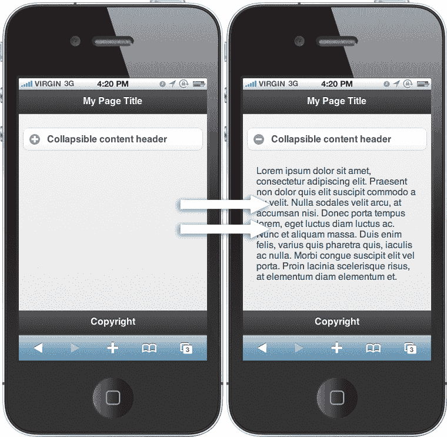

图 7.7。用于节省空间的折叠内容按钮。

可折叠内容是组织大量信息的极佳方法。一次性显示大量数据可能会让人无从从备，并阻止人们访问您的宝贵内容。通过在用户首次加载网页时隐藏内容，可以保持内容的整洁，让用户只显示他们感兴趣的内容区域。

可折叠内容区域还可以包含一个名为 `data-collapsed` 的属性。默认情况下，折叠内容区域在网页首次加载时是折叠的。`data-collapsed` 属性提供了一种在页面首次加载时展开折叠区域的方法。以下示例显示了实现此目的的标记：

```html
<div data-role="collapsible" data-collapsed="false">
    <h3>折叠内容页眉</h3>
    <p>Lorem ipsum dolor sit amet, consectetur adipiscing elit. Praesent non dolor quis elit suscipit commodo a eu velit. Nulla sodales velit arcu, at accumsan nisi. Donec porta tempus lorem, eget luctus diam luctus ac. Nunc et aliquam massa. Duis enim felis, varius quis pharetra quis, iaculis ac nulla. Morbi congue suscipit elit vel porta. Proin lacinia scelerisque risus, at elementum diam elementum et.</p>
</div>
```

通过在另一个折叠内容区域内部添加另一个折叠内容区域，也可以嵌套折叠内容。以下示例显示了如何编写标记来创建嵌套折叠内容区域：

```html
<div data-role="collapsible" data-collapsed="false">
    <h3>折叠内容页眉</h3>
    <p>Lorem ipsum dolor sit amet, consectetur adipiscing elit.</p>
    <div data-role="collapsible">
        <h3>折叠子项 #1</h3>
        <p>Lorem ipsum dolor sit amet.</p>
    </div>
    <div data-role="collapsible">
        <h3>折叠子项 #2</h3>
        <p>Lorem ipsum dolor sit amet.</p>
    </div>
</div>
```

此示例中两个高亮显示的折叠内容区域嵌套在主折叠区域中。这种嵌套折叠内容的结果看起来将与图 7.8 相似。

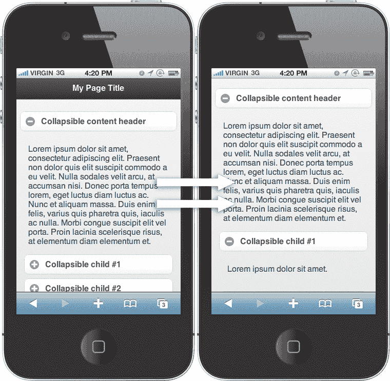

图 7.8。在打开嵌套折叠内容区域时发生的事件序列。

还可以进行更深层的嵌套；事实上，你可以根据需要进行任意深嵌套。

## 创建手风琴

可折叠内容区域还可以分组以创建手风琴。手风琴本质上是一组相互感知的折叠内容区域。例如，当其中一个折叠内容区域展开时，任何已展开的区域都会关闭，因此每次只有一个内容区域是展开的。

要定义手风琴，必须创建一个容器元素来包含一组可折叠内容区域。在该容器元素上，必须将 `data-role` 设置为值 `collapsible-set`。就这样。以下代码显示了带有两个折叠内容区域的手风琴的标记：

```html
<div data-role="collapsible-set">
    <div data-role="collapsible">
        <h3>头部 #1</h3>
        <p>Lorem ipsum dolor sit amet.</p>
    </div>
    <div data-role="collapsible">
        <h3>头部 #2</h3>
        <p>Lorem ipsum dolor sit amet.</p>
    </div>
</div>
```

此示例中的代码创建了一个手风琴，其功能类似于图 7.9 所示的序列。


图 7.9。手风琴示例

## 总结

jQuery Mobile 让 JavaScript 变得极其易用。使用 `data-` 属性，内容可以折叠。

---

# 8. 使用列表

列表被频繁使用。jQuery Mobile 提供了大量的选项来实现任何设计，例如链接列表、编号列表、内嵌列表、分割列表、带分隔符的列表，以及带有缩略图和图标的列表。你在 jQuery Mobile 中看到的的最常见模式之一是链接列表。

## 基础列表

你在 jQuery Mobile 中看到的常见模式之一是链接列表。以下标记显示了使用 `data-role` 的链接列表：

```html
<ul data-role="listview">
    <li><a href="#">首页</a></li>
    <li><a href="#">文章</a></li>
    <li><a href="#">视频</a></li>
    <li><a href="#">书籍</a></li>
    <li><a href="#">更多</a></li>
</ul>
```

此 `listview` 标记由框架增强以生成链接列表。图 8.1 显示了该标记的可视化结果。


图 8.1。链接列表。

增强会改变标记，产生不同的 HTML。下一个示例显示了框架增强后的标记片段。显示了列表标签和第一个列表项以提供增强示例，而新部分被高亮显示以显示代码进行了代码。注意缺失的列表项（`<!-- etc. -->`）都以与第一个列表相同的方式进行了更改：

```html
<ul data-role="listview" class="ui-listview">
    <li data-theme="c" class="ui-btn ui-icon-right ui-li-has-arrow ui-li ui-btn-up-c">
        <div class="ui-btn-inner ui-li" aria-hidden="true">
            <div class="ui-btn-text">
                <a href="#" class="ui-link-inherit">首页</a>
            </div>
            <span class="ui-icon ui-icon-arrow-r ui-icon-shadow"></span>
        </div>
    </li>
</ul>
```

正如你所看到的，框架对代码进行了大量补充以实现视觉增强。首先，添加了 `ui-listview` 类来设置页边距，并传递了 `list-style`。然后更新了列表项，将 `data-theme` 属性设置为 `c` 主题，并添加了一组 CSS 类。我们将在书的后部分学习更多关于 jQuery Mobile 主题的内容。添加的类包括 `ui-btn`、`ui-btn-icon-right`、`ui-li-has-arrow`、`ui-li` 和 `ui-btn-up-c`。这些名称基本上已经解释了一切；例如，`ui-btn` 添加了指针光标，将 `display` 设置为 `block`，并添加了一些间距使其更易点击，而 `ui-btn-icon-right` 则告诉 `span` 元素与箭头图标右对齐。你可以通过像 Chrome 开发者工具之类的代码检查器深入查看这些 CSS 类中的每一个一个。图 8.2 显示了列表项的一些类及其属性。

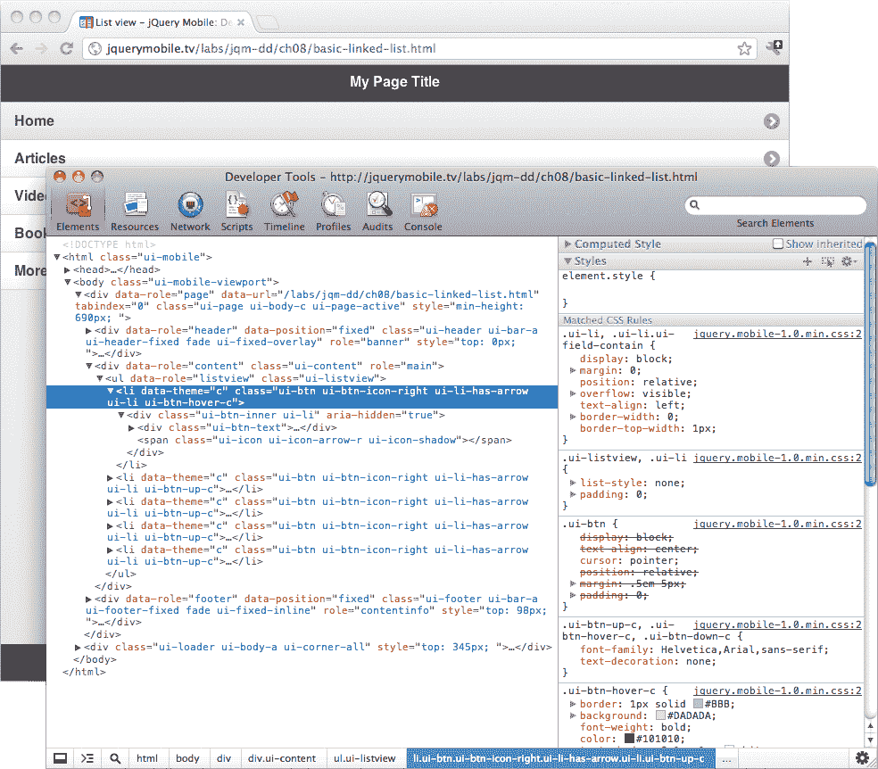

图 8.2。框架创建的自定义 CSS。

## 数字有序列表

你可以使用 `listview` 的 `data-role` 从相同的代码创建有序列表：只需将 `ul` 转换为 `ol` 即可。下面的示例显示了带有数字列表项的修改后的代码：

```html
<ol data-role="listview">
    <li><a href="#">首页</a></li>
    <li><a href="#">文章</a></li>
    <li><a href="#">视频</a></li>
    <li><a href="#">书籍</a></li>
    <li><a href="#">更多</a></li>
</ol>
```

视觉结果与 图 8.3 相似，数字作为列表项的一部分内缩显示。


图 8.3。一个基础有序列表。

## 嵌套列表

嵌套列表默认是隐藏的，并像额外的页面一样加载。当列表嵌套在另一个列表项内部时，父列表项将变成指向子列表的超链接，框架会为该列表生成一个新的 `ui-page`。要创建嵌套列表，只需取任何列表项并向其添加另一个无序或有序列表。在以下示例中，我们之前示例中的“更多”列表项被配置为 `h2` 标题，并带有描述和一个嵌套的无序列表：

```html
<ul data-role="listview">
    <li><a href="#">首页</a></li>
    <li><a href="#">文章</a></li>
    <li><a href="#">视频</a></li>
    <li><a href="#">书籍</a></li>
    <li>
        <h2>更多</h2>
        <p>在 jQuery Mobile 上寻找更多资源</p>
        <ul data-role="listview">
            <li><a href="http://www.jquerymobile.com">jQuery Mobile</a></li>
            <li><a href="http://www.jquery.com">jQuery</a></li>
        </ul>
    </li>
</ul>
```

当框架增强 `listview` 时，“更多”列表项将变为指向嵌套列表的超链接，如 图 8.4 所示。

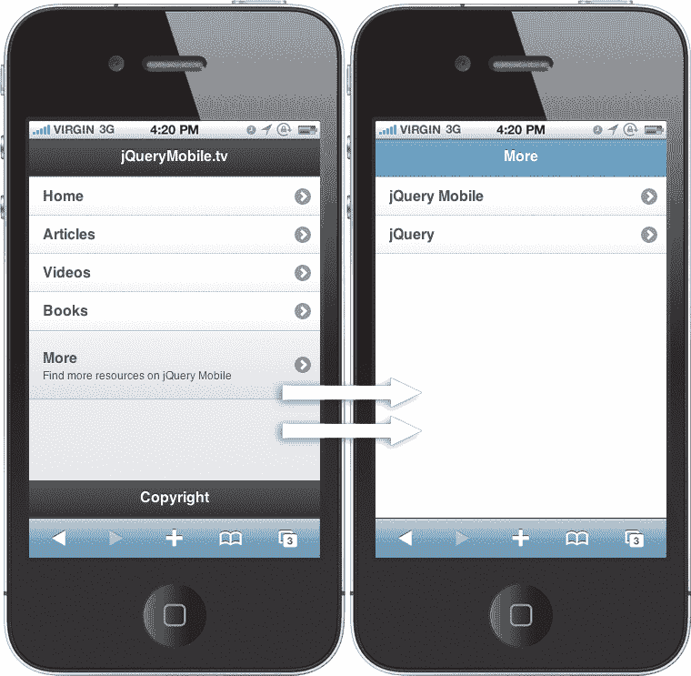

图 8.4。选择“更多”列表项后会出现嵌套列表。

从此嵌套列表生成的页面包含一个其值为列表项标题的页眉，然后是嵌套列表本身。列表可以根据你的需要进行任意深嵌套；框架将简单地生成更多的页面。

## 内缩列表

默认情况下，列表的宽度设置为查看列表的设备宽度；换句话说，它们的宽度始终被设置为 100%。你可以添加一个属性来创建所谓的“内缩列表（inset list）”，它看起来是内缩在页面之内的（而不是延伸到设备边缘），并且具有圆角。下面的示例显示了一个 `data-inset` 属性设置为 `true` 的基础链接列表：

```html
<ul data-role="listview" data-inset="true">
    <li><a href="#">首页</a></li>
    <li><a href="#">文章</a></li>
    <li><a href="#">视频</a></li>
    <li><a href="#">书籍</a></li>
    <li><a href="#">更多</a></li>
</ul>
```

将此属性设置为 `true` 会产生 图 8.5 所示视觉效果。

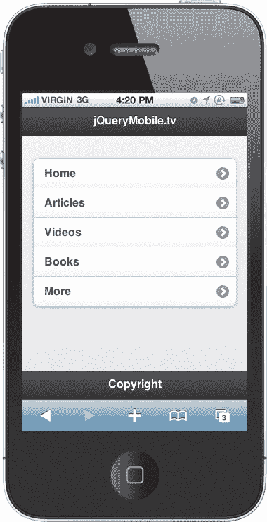

图 8.5。`data-inset` 属性设置为 `true` 的基础链接列表。

## 自定义列表

一旦你理解了如何创建基础列表，你可能会发现自己想要更多。可以使用 `data-` 属性使用分隔符、缩略图等对列表进行自定义。

### 分割列表

分割列表（Split lists）是带有更多选项的列表。你可以通过取任何列表项并添加另一个无序或有序列表来创建嵌套列表。如下示例所示：

```html
<ul data-role="listview" data-inset="true">
    <li>
        <a href="#item-detail">
            <h3>使用 jQuery Mobile</h3>
            <p>在 Mobile 中有很多组件</p>
        </a>
        <a href="#item-purchase" data-rel="dialog">购买</a>
    </li>
    <li>
        <a href="#item-detail">
            <h3>使用 jQuery API</h3>
            <p>jQuery 提供了对内容的额外控制</p>
        </a>
        <a href="#item-purchase" data-rel="dialog">购买</a>
    </li>
</ul>
```

当框架增强 `listview` 时，分割列表项将变为指向详细列表的超链接，如 图 8.6 所示。

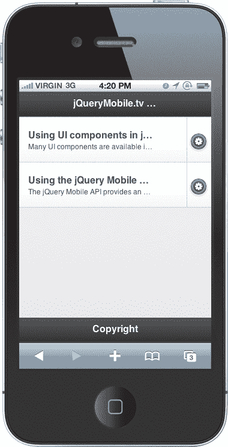

图 8.6。带有齿轮图标的列表。

你可以使用 `data-split-icon` 属性更改列表项右侧的默认图标。这些与 图 8.7 所示的按钮图标相同，但你也可以使用自定义图标。


图 8.7。`data-split-icon` 属性可用的图标。

### 列表分隔符

列表分隔符可以对你的列表项进行分类，是基础列表的另一个有用补充。例如，你可以对列表项进行排序并使用分隔符按字母进行分组，或者使用分隔符按类型对音乐列表进行分组。下面的示例显示了作为分隔符的乐队以及每个乐队的一些专辑标题：

```html
<ul data-role="listview">
    <li data-role="list-divider">The Beatles</li>
    <li>Meet The Beatles!</li>
    <li>A Hard Day's Night</li>
    <li>Help!</li>
    <li>Rubber Soul</li>
    <li>Revolver</li>
    <li data-role="list-divider">The Doors</li>
    <li>The Doors</li>
    <li>Strange Days</li>
    <li>Waiting for the Sun</li>
    <li>The Soft Parade</li>
    <li>Morrison Hotel</li>
    <li data-role="list-divider">The Jimi Hendrix Experience</li>
    <li>Are You Experienced</li>
    <li>Bold as Love</li>
    <li>Electric Ladyland</li>
</ul>
```

此代码示例中的高亮部分包含一个值为 `list-divider` 的 `data-role`。使用 `data-role` 属性值 `list-divider` 会在视觉上将其与其他列表项区分开来。图 8.8 显示了 `list-divider` `data-role` 如何创建这种隔离。

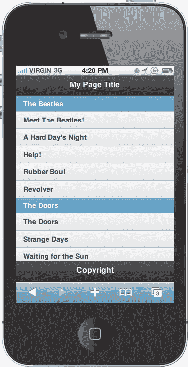

图 8.8。带有列表分隔符的长列表。

### 计数气泡、缩略图和图标

你可以通过计数气泡、缩略图和图标在列表中创建不同的视觉样式。要在列表项中添加计数气泡，只需使用 `ul-li-count` 类。要将计数气泡与列表项文本分开，请使用 `span` 元素来包含计数气泡的值：

```html
<ul data-role="listview">
    <li>
        <a href="#inbox">收件箱
            <span class="ui-li-count">12</span>
        </a>
    </li>
    <li>
        <a href="#outbox">发送箱
            <span class="ui-li-count">0</span>
        </a>
    </li>
    <li>
        <a href="#sent">已发送
            <span class="ui-li-count">57</span>
        </a>
    </li>
    <li>
        <a href="#trash">垃圾箱
            <span class="ui-li-count">1090</span>
        </a>
    </li>
</ul>
```

此示例代码的最终结果如 图 8.9 所示。

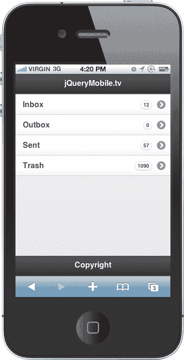

图 8.9。带有计数气泡的简单列表。


# 邮件文件夹与列表视图

邮件文件夹是可以使用计数气泡的列表项 Excellent 示例——在这种情况下，用于显示每个区域有多少封邮件——但计数气泡也可用于许多情况。例如，带有条带及其专辑的列表分隔符示例可以转换为嵌套列表，父元素可以显示每个父列表项中有多少专辑/子列表项：

```html
<ul data-role="listview">
    <li>
        <h2>The Beatles</h2>
        <span class="ui-li-count">5</span>
        <ul data-role="listview">
            <li>Meet The Beatles!</li>
            <li>A Hard Day's Night</li>
            <li>Help!</li>
            <li>Rubber Soul</li>
            <li>Revolver</li>
        </ul>
    </li>
    <li>
        <h2>The Doors</h2>
        <span class="ui-li-count">5</span>
        <ul data-role="listview">
            <li>The Doors</li>
            <li>Strange Days</li>
            <li>Waiting for the Sun</li>
            <li>The Soft Parade</li>
            <li>Morrison Hotel</li>
        </ul>
    </li>
    <li>
        <h2>The Jimi Experience</h2>
        <span class="ui-li-count">3</span>
        <ul data-role="listview">
            <li>Are You</li>
            <li>Bold as Love</li>
            <li>Electricyland</li>
        </ul>
    </li>
</ul>
```

此示例的结果如图 8.10 所示，在同一个列表项中包含计数气泡和嵌套列表。


图 8.10。带有计数气泡的简单列表。

你可以像向 HTML 页面添加图像一样添加缩略图。只需向列表项添加锚点元素，添加一张作为缩略图的图像，并添加你想显示在图标旁边的标题和文本：

```html
<ul data-role="listview">
    <li>
        <a href="#led-zeppelin/led-zeppelin-iv">
            
            <h3>Led Zeppelin</h3>
            <p>Led Zeppelin IV</p>
        </a>
    </li>
    <li>
        <a href="#led-zeppelin/houses-of-the-holy">
            
            <h3>Led Zeppelin</h3>
            <p>Houses of the Holy</p>
        </a>
    </li>
</ul>
```

jQuery Mobile 确切知道如何处理此类设置的列表，因为它会将图像转换为 `listview` 中列表项的缩略图。此代码的结果如图 8.11 所示。

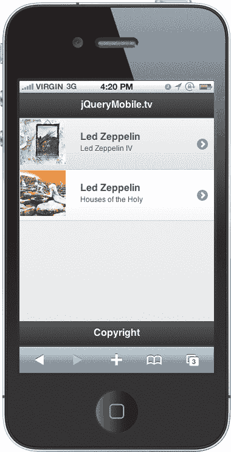

图 8.11。带有列表项缩略图的列表。

图标的添加方式与缩略图相同；不同之处在于图像元素上使用了 `ui-li-icon` 类：

```html
<ul data-role="listview">
    <li>
        <a href="#led-zeppelin/led-zeppelin-iv">
            
            Led Zeppelin IV
        </a>
    </li>
    <li>
        <a href="#led-zeppelin/houses-of-the-holy">
            
            Houses of the Holy
        </a>
    </li>
</ul>
```


已添加 `width` 和 `height`。

## 总结

列表对移动设备至关重要。正如你在本章看到的，jQuery Mobile 依赖列表。

# 搜索过滤

基础搜索功能是网站的常见功能，但开发非常耗时。幸运的是，jQuery Mobile 在用户输入时提供建议。

## 创建过滤栏

正如提到的，该框架为列表添加搜索过滤非常简单：只需为列表添加 `data-filter` 属性并将值设置为 `true`。以下示例是一个歌曲列表：

```html
<ul data-role="listview" data-filter="true">
    <li>Across The Universe</li>
    <li>Act Naturally</li>
    <li>Ain't She Sweet</li>
    <li>All I've Got To Do</li>
    <li>All My Loving</li>
    <li>All Together Now</li>
    <li>All You Need Is Love</li>
    <li>And I Love Her</li>
    <li>And Your Bird Can Sing</li>
    <li>Anna (Go To Him)</li>
    <li>Another Girl</li>
    <li>Any Time At All</li>
    <li>Ask Me Why</li>
    <li>Baby It's You</li>
    <li>Baby, You're A Rich Man</li>
    <li>Baby's In Black</li>
    <li>Back In The U.S.S.R.</li>
    <li>Bad Boy</li>
    <li>The Ballad Of John And Yoko</li>
    <li>Because</li>
    <li>Being For The Benefit Of Mr. Kite!</li>
    <li>Besame Mucho</li>
    <li>Birthday</li>
    <li>Blackbird</li>
</ul>
```

正如你可以想象的，这个列表非常长；但是 `data-filter` 属性会在列表顶部添加一个搜索过滤栏，帮助用户找到他想要的内容。图 9.1 显示了用户在过滤字段中输入时视觉上发生的事件示例。随着字母的输入，结果会缩小，只显示与搜索文本匹配的项。

如你所见，框架为搜索过滤器输入框添加了“过滤项目...”的默认值。你可以通过一个名为 `data-filter-placeholder` 的额外属性更改此默认文本，该属性可以使用在无序列表（`<ul>`）或有序列表（`<ol>`）元素。下面的示例显示了在之前的披头士歌曲列表中包含此属性的代码：

```html
<ul data-role="listview" data-filter="true" data-filter-placeholder="Search the song list...">
    <li>Across The Universe</li>
    <li>Act Naturally</li>
    <li>Ain't She Sweet</li>
    <li>All I've Got To Do</li>
    <li>All My Loving</li>
    <li>All Together Now</li>
    <li>All You Need Is Love</li>
    <li>And I Love Her</li>
    <li>And Your Bird Can Sing</li>
    <li>Anna (Go To Him)</li>
    <li>Another Girl</li>
    <li>Any Time At All</li>
    <li>Ask Me Why</li>
    <li>Baby It's You</li>
    <li>Baby, You're A Rich Man</li>
    <li>Baby's In Black</li>
    <li>Back In The U.S.S.R.</li>
    <li>Bad Boy</li>
    <li>The Ballad Of John And Yoko</li>
    <li>Because</li>
    <li>Being For The Benefit Of Mr. Kite!</li>
    <li>Besame Mucho</li>
    <li>Birthday</li>
    <li>Blackbird</li>
    <!-- etc. -->
</ul>
```

框架允许你通过 API 更改搜索过滤器文本。要做到这一点，必须在 `mobileinit` 事件触发后访问 `listview` 组件。你将在书的后部分学习更多关于 jQuery Mobile API 的知识，但现在重要的是要理解在成功访问 API 之前必须初始化框架。一旦访问了 `listview`，就可以更改它的选项。其中一个选项是 `filterPlaceholder` 属性，可以用于更新搜索过滤器文本。下面的代码显示了如何编写代码的完整示例，包括绑定到 `mobileinit` 事件：

```javascript
$(document).bind("mobileinit", function() {
    $.mobile.listview.prototype.options.filterPlaceholder = "Search the song list...";
});
```

这两个选项的视觉效果相同，允许你定义任何想要出现在搜索字段中的文本。图 9.2 显示了带有自定义占位符文本的搜索过滤器的示例。

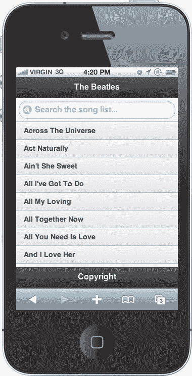

图 9.2。（左）一个带有自定义占位符文本的基础搜索过滤器。

搜索过滤器栏的另一个棒功能是，你不仅可以过滤基本的 `listview`，还可以过滤包含自定义格式的 `listview`。在自定义格式列表上的搜索过滤器实际上会搜索每个列表项中的所有文本，无论是标题、段落还是其他内容——只要你想到的，框架就会进行过滤。图 9.3 显示了一个带有搜索过滤器的自定义格式 `listview` 的示例序列。结果包含来自段落复制和标题的匹配文本的列表项。

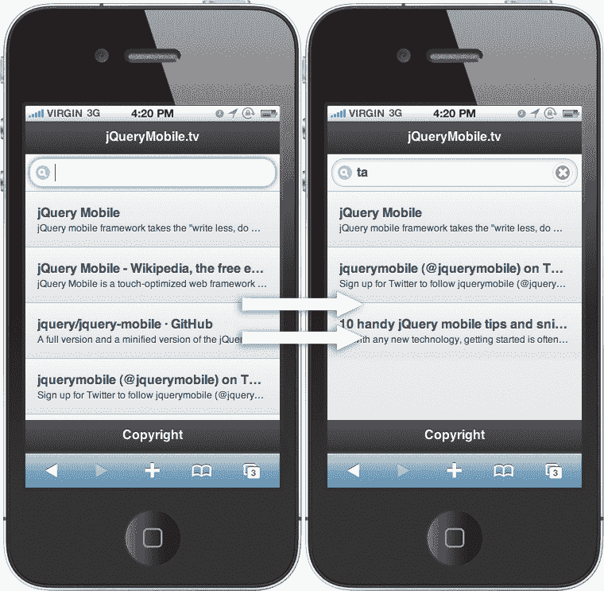

图 9.3。（右）在自定义格式 `listview` 上的基础搜索过滤器。

## 创建自定义搜索过滤器

jQuery Mobile 框架为你提供了两种创建自定义搜索过滤器的选项。`listview` 包含一个 `filterCallback` 选项，可以使用自定义回调函数对其进行扩展。通过扩展此回调函数，两个参数——`text` 和 `searchValue` 变得可用，并可用于编写自定义搜索准则。`text` 参数是当前列表项的值，而 `searchValue` 是输入到搜索过滤器中的文本值。当用户在搜索过滤器中输入内容时，`listview` 会遍历列表，比较列表项文本和搜索值，并根据需要过滤结果。图 9.4 显示了当 jQuery Mobile 比较搜索值和每个列表项文本时的 `console.log` 示例。

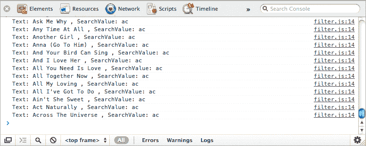

图 9.4. 搜索过滤器遍历列表项以匹配文本的过程。

要自定义准则，你可以简单地使用 `filterCallback` 属性设置回调函数：

```javascript
$.mobile.listview.prototype.options.filterCallback = myCallback;
```

或者，你可以通过 `id` 访问特定的 `listview` 并仅为该 `listview` 设置 `filterCallback` 属性：

```javascript
$('#my-listview').listview('option', myCallback);
```

让我们尝试使用 `listview` 函数为披头士列表添加自定义搜索过滤器。首先，我们将添加一个 `pageinit` 事件，以确保页面已加载并被框架增强。为此，我们需要为页面添加一个 `id`，这样我们就可以目标它。下面的示例显示了一个带有 `id` 的页面，通过一个名为 `filter.js` 的 JavaScript 文件来创建回调：

```html
<!DOCTYPE html>
<html>
<head>
    <meta http-equiv="Content-Type" content="text/html; charset=UTF-8">
    <meta name="viewport" content="width=device-width, initial-scale=1">
    <title>List - jQuery Mobile: Design and Develop</title>
    <link rel="stylesheet" href="http://code.jquery.com/mobile/1.4.3/jquery.mobile-1.4.3.min.css">
    <script src="https://ajax.googleapis.com/ajax/libs/jquery/1.7.1/jquery.min.js"></script>
    <script src="assets/js/filter.js"></script>
</head>
<body>
    <div data-role="page" id="beatles-page">
        <div data-role="header">
            <h1>The Beatles</h1>
        </div>
        <div data-role="content">
            <ul data-role="listview" data-filter="true">
                <li>Across The Universe</li>
                <li>Act Naturally</li>
                <li>Ain't She Sweet</li>
                <li>All I've Got To Do</li>
                <li>All My Loving</li>
                <li>All Together Now</li>
                <li>All You Need Is Love</li>
                <li>And I Love Her</li>
                <li>And Your Bird Can Sing</li>
                <li>Anna (Go To Him)</li>
                <li>Another Girl</li>
                <li>Any Time At All</li>
                <li>Ask Me Why</li>
                <li>Baby It's You</li>
                <li>Baby, You're A Rich Man</li>
                <li>Baby's In Black</li>
                <li>Back In The U.S.S.R.</li>
                <li>Bad Boy</li>
                <li>The Ballad Of John And Yoko</li>
                <li>Because</li>
                <li>Being For The Benefit Of Mr. Kite!</li>
                <li>Besame Mucho</li>
                <li>Birthday</li>
                <li>Blackbird</li>
                <!-- etc. -->
            </ul>
        </div>
    </div>
    <script src="http://code.jquery.com/mobile/1.4.3/jquery.mobile-1.4.3.min.js"></script>
</body>
</html>
```

现在，让我们尝试使用 `listview` 函数为披头士列表添加自定义搜索过滤器。

此示例使用了默认搜索标准来记录文本和 `searchValue` 以供测试。除去 `console.log` 之后，这正是 jQuery Mobile 在用户输入搜索过滤栏时用于过滤结果的完全精确代码。首先，将文本转换为小写以实现不区分大小写的搜索，然后使用 JavaScript 原生的 `indexOf` 函数在文本中查找与 `searchValue` 匹配的字符串。

现在让我们来看看如何编写自定义回调函数。这次，我们将使用上一个示例中的自定义格式化 `listview`，并对其应用过滤器，该过滤器仅搜索正文内容，而将列表项标题排除在搜索条件之外：

```javascript
$(document).bind("mobileinit", function() {
    $.mobile.listview.prototype.options.filterCallback = onlyBody;
});

function onlyBody( text, searchValue ) {
    var splitText = text.trim().split("\n");
    console.log("text: "+ splitText[1]);
    return splitText[1].toLowerCase().indexOf( searchValue ) === -1;
};

String.prototype.trim = function() {
    return this.replace(/^\s+|\s+$/g,"");
}
```

在例示例中，我们只需要等待 `mobileinit` 事件，因为所有 `listviews` 的 `filterCallback` 属性在 jQuery Mobile 框架增强页面标记之前就可以访问了。（在上一个示例中，我们针对的特定 `listview` 必须在框架对其进行增强后才能访问。）一旦触发了 `mobileinit` 事件，我们将 `filterCallback` 设置为 `onlyBody`，这是一个自定义回调函数，它的结构可以像任何其他函数一样，但它将接收两个参数：`text` 和 `searchValue`。通过这些参数，我们可以编写任何所需的规则。在这种情况下，我们将拆分 `text` 参数，并仅对包含之前的自定义格式列表示例中 `p` 元素中的正文内容匹配结果。

除了创建自定义过滤回调函数外，jQuery Mobile 还提供了一个名为 `data-filtertext` 的属性用于过滤列表项。该属性的之处在于，它实际上是发送给 `filterCallback` 函数的文本值。换句话说，`data-filtertext` 属性中的值变成了 `filterCallback` 函数在比较期间使用的值：

```html
<ul data-role="listview" data-filter="true">
    <li data-filtertext="AL">Alabama</li>
    <li data-filtertext="AK">Alaska</li>
    <li data-filtertext="AZ">Arizona</li>
    <li data-filtertext="AR">Arkansas</li>
    <li data-filtertext="CA">California</li>
    <li data-filtertext="CO">Colorado</li>
    <li data-filtertext="CT">Connecticut</li>
    <li data-filtertext="DE">Delaware</li>
</ul>
```

此示例中的标记使用 `data-filtertext` 属性通过州缩写而不是列表项的完整州名值来过滤列表。图 9.5 显示了此过滤器是如何工作的；输入“ar”通常会产生“Arizona”和“Arkansas”，但由于此列表是通过州缩写过滤的，因此“Arkansas”是唯一的匹配项。

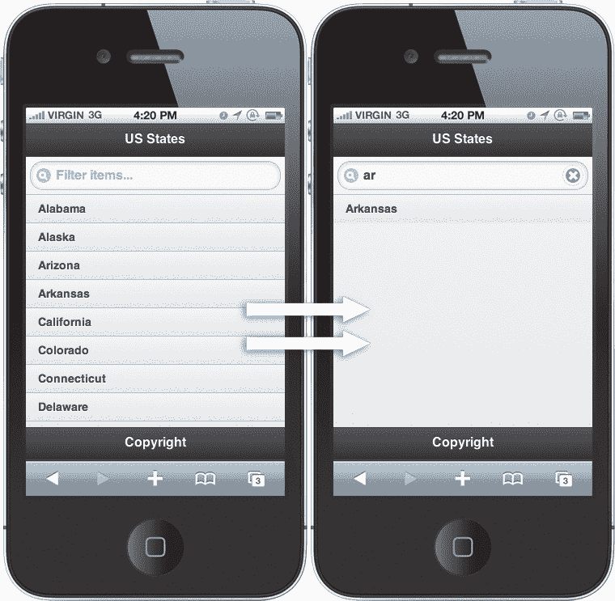

图 9.5。在应用 `data-filtertext` 属性后，搜索标准可以与实际列表项值不同。

## 总结

搜索过滤栏提供了如果通过编程来实现将相当复杂且耗时的功能。jQuery Mobile 让添加甚至自定义此项功能变得极其简单。除了节省时间外，此小部件还为任何大量数据提供了额外价值，并提供了极佳的可用性增强，帮助用户快速高效地找到他们需要的内容。有时，无法精简所有需要放在移动网站上的内容。当出现这种情况且你有一个非常长、似乎几乎无法使用的列表时，搜索过滤栏将是处理该问题的绝佳方法。

# 10. 表单元素

jQuery Mobile 框架为每个表单元素暴露了许多内部方法和事件，这意味着你可以从自定义代码中访问它们。这些方法和事件允许你更改和扩展 jQuery Mobile 表单元素的核心功能，创建让你的移动应用程序与众脱颖而出的定制功能。本章涵盖了你可以使用的每个暴露表单元素方法和事件。

## 文本输入

jQuery Mobile 支持许多不同的文本输入类型，包括 HTML5 输入，如数字、电子邮件、URL、电话以及一些与时间和日期相关的输入。框架增强了所有表单元素，使其在移动设备上更易用。识别具有特定元素类型的表单元素的一个主要优势是键盘会变化。以下是不同的文本输入以及经过 jQuery Mobile 增强后关联 iOS 键盘的一些示例。

设置元素类型是通过添加名为 `type` 的属性完成的。以下是不同的文本输入以及经过 jQuery Mobile 增强后关联 iOS 键盘的一些示例。

设置元素类型是通过添加名为 `type` 的属性完成的。这里：

```html
<input type="number">
```

当 `type` 设置为 `number` 时，iOS 会显示数字键盘。图 10.1


图 10.1 当 `type` 设置为 `number` 时的数字键盘。

设置元素类型是通过添加名为 `type` 的属性完成的。这里：

```html
<input type="number" pattern="0-9]*">
```

当 `type` 设置为 `number` 时，iOS 显示数字键盘。图 10.2


图 10.2 应用了 `pattern` 属性时的数字键盘。

设置元素类型是通过添加名为 `type` 的属性完成的。这里：

```html
<input type="email">
```

当 `type` 设置为 `email` 时，iOS 包含带有 `@` 符号和句点的字母键盘。图 10.3


图 10.3 用于电子邮件的 `@` 和 `.` 字母键盘。

### jQuery Mobile 1.1.0

在本书出版之前，jQuery Mobile 框架发布了一个新版本 1.1.0 正式版。为了从一些新的表单元素选项中受益，当需要在页面中包含框架、CSS 和 jQuery 时必须使用以下代码：

```html
<link rel="stylesheet" href="http://code.jquery.com/mobile/1.1.0/jquery.mobile-1.1.0.min.css" />
<script src="http://ajax.googleapis.com/ajax/libs/jquery/1.7.1/jquery.min.js"></script>
<script src="http://code.jquery.com/mobile/1.1.0/jquery.mobile-1.1.0.min.js"></script>
```

jQuery Mobile 框架不断升级。在启动项目之前，检查 jquerymobile.com 上的下载页面以确保拥有最新的代码。

*   `url` 元素类型显示带有正斜杠和 .com 键的字母键盘。图 10.4。
*   `tel` 元素类型显示用于电话号码的电话键盘。图 10.5。

`time`、`month`、`date` 和 `datetime` 元素类型都会显示与相应值对应的菜单（图 10.6）。

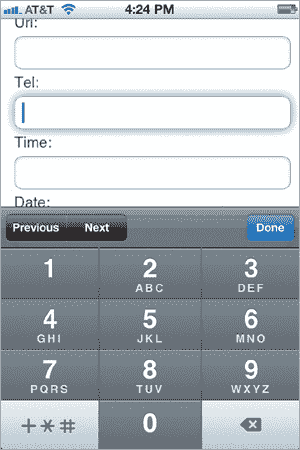

图 10.5。用于电话号码的电话键盘。

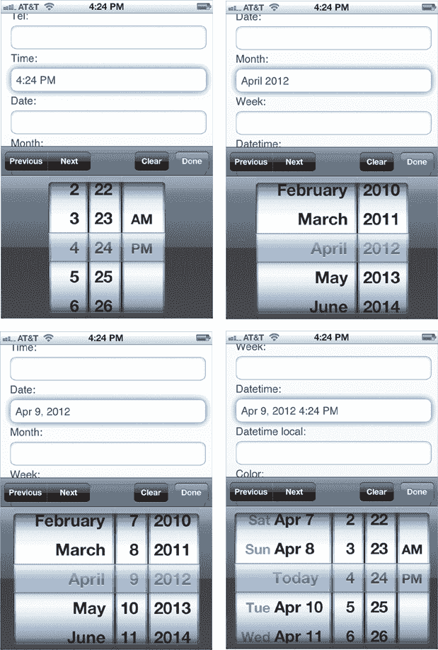

图 10.6。iOS 中与时间和日期相关的菜单。

### 选项

文本输入包含两个选项：`initSelector` 和 `theme`。通过 `$.mobile` 对象访问 `textinput` 时，这两个选项可用。以下代码显示了如何通过 `textinput` 访问这些选项：

```
$.mobile.textinput.prototype.options
```

一旦你访问了这些选项，就可以单独访问它们中的每一个。例如，如果你想获取 `initSelector` 选项，可以在上一行代码的末尾添加该选项：

```
$.mobile.textinput.prototype.options.initSelector
```

`initSelector` 选项定义了框架初始化时初始化的选择器。该选项的暴露允许你定义想要哪些选择器初始化为文本输入。这让你对核心功能具有很好的控制力，允许你根据特定情况定义初始化内容，最终最大限度地减少初始化时间。你不仅可以定义初始化哪些元素类型，还可以对数据角色（data roles）进行同样的操作。以下代码排除了所有 `number` 元素类型的 `textinputs`：

```javascript
$( document ).bind("mobileinit", function() {
    $.mobile.textinput.prototype.options.initSelector = "input[type='text'], input[type='search'], :jqmData(type='search'), input[type='password'], input[type='email'], input[type='url'], input[type='tel'], textarea, input:not([type])";
});
```

 注意

在 jQuery Mobile 中，可以使用 `textinput` 元素创建多种不同的元素类型，包括 `text`、`search`、`number`、`password`、`email`、`url` 和 `tel`。此外，`textarea` 也归类为 jQuery Mobile 中的 `textinput` 表单元素类别。这意味着每个元素类型都包含了本章文本输入部分的选项、方法和事件。

图 10.7 显示了一个未经过增强的 `number` 元素类型示例。

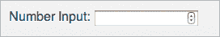

图 10.7。来自 jQuery Mobile 框架增强的数字元素。

经过增强后，`number` 元素看起来漂亮得多，并且用户在移动环境中更容易与之交互（图 10.8）。

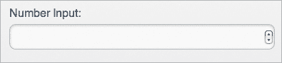

图 10.8。带有 jQuery Mobile 框架增强的数字元素。

`textinput` 还包含一个 `theme` 选项，你可以在选择文本输入元素时访问它。`theme` 的值可以根据包含 a–z 的任何预建或自定义色块进行设置：

```javascript
$('.my-textinput').textinput({theme: 'a'});
```

此示例访问了一个类名为 `.my-textinput` 的文本输入元素，并将主题设置为 `a`。你将在下一章学习更多关于主题的内容。

从 1.1.0 版本开始，jQuery Mobile 还包含了两个新选项：`mini` 和 `preventFocusZoom`。可以使用名为 `mini` 的 `data-` 属性设置单个表单元素设置。将表单元素设置为 `mini` 会创建一个更紧凑的版本。要用代码将表单元素设置为 `mini`，只需选择文本输入，然后使用 `textinput` 方法设置 `mini` 的值：

```javascript
$('.my-textinput').textinput({mini: true});
```

此代码在文本输入上的结果与图 10.9 中的右侧输入相似，该图显示了普通文本输入和 `mini` 文本输入的对比。


图 10.9。普通和 mini 文本输入。

文本输入的最后一个选项是 `preventFocusZoom` 布尔值。当仅在 iOS 中设置为 `true` 时，该选项可以防止网页在用户选择文本输入时被放大。这不是默认设置：通常 iOS 会将网页放大到输入框处，以便完全关注表单元素。这种行为通常没有必要，幸运的是 jQuery Mobile 团队提供了一个禁用它的选项。你也可以通过名为 `prevent-focus-zoom` 的 `data-` 属性在单个表单元素上设置此选项：

```javascript
$('.my-textinput').textinput({preventFocusZoom: true});
```

除了这些选项，文本输入还有一个特定的 `clearSearchText` 用于清除搜索。只需像之前那样设置它：

```javascript
$('.my-textinput').textinput({clearSearchText: 'this can be any text'});
```

### 方法

jQuery Mobile 为 `textinput` 提供了两个方法：`enable` 和 `disable`。`enable` 方法激活输入并允许用户输入：

```javascript
$('.my-textinput').textinput('enable');
```

当文本输入被禁用时，用户无法与之交互：

```javascript
$('.my-textinput').textinput('disable');
```

我们已经在图 10.8 中见过一个启用的文本输入；禁用的元素看起来像图 10.10。（见下图）

### 事件

文本输入还可以与虚拟事件或标准的 JavaScript 事件绑定。可以绑定到文本输入上的 JavaScript 事件包括 `focus`、`blur` 和 `change`。虚拟事件将在书后部分介绍，包括 `vmouseover`、`vmousedown`、`vmousemove`、`vmouseup`、`vclick` 和 `vmcancel`。要为文本输入绑定事件，只需使用 `bind` 方法，包含要绑定的事件，并将其连接到处理函数：

```javascript
$(".my-textinput").bind("change", function(event, ui) {
    console.log('my-textinput has changed');
});
```

jQuery Mobile 还为某些表单元素添加了自定义事件。文本输入包含 `create` 事件作为其自定义事件。`create` 事件可在创建文本输入时执行自定义代码：

```javascript
$('.my-textinput').textinput({
    create: function(event, ui) {
        console.log('my-textinput has been created');
    }
});
```

## 复选框和单选按钮

要向单选按钮或复选框组添加问题或说明，你可以使用 `legend` 元素。要将图例与输入元素分组，可以使用一个 `data-role` 为 `controlgroup` 的 `fieldset`。最后，用 `data-role` 为 `fieldcontain` 的 `div` 包围 `fieldset` 元素，可以为组披萨配料中的元素添加一些样式，例如外边距和下边框：

```html
<div data-role="fieldcontain">
    <fieldset data-role="controlgroup">
        <legend>Pizza ingredients:</legend>
        <label for="cheese">Cheese</label>
        <input type="checkbox" name="pizza-ingredients" id="cheese" value="cheese" />
        <label for="mushroom">Mushroom</label>
        <input type="checkbox" name="pizza-ingredients" id="mushroom" value="mushroom" />
        <label for="pepperoni">Pepperoni</label>
        <input type="checkbox" name="pizza-ingredients" id="pepperoni" value="pepperoni" />
        <label for="green-pepper">Green Pepper</label>
        <input type="checkbox" name="pizza-ingredients" id="green-pepper" value="green-pepper" />
    </fieldset>
</div>
```

`controlgroup` data-role 在视觉上对按钮分组，如图 10.12 所示。

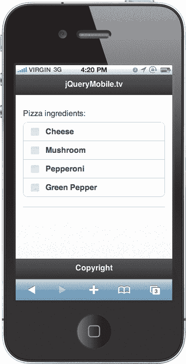

图 10.12。一个在 fieldset 中带有图例的输入元素组。

还可以创建所谓的水平切换集（horizontal toggle set）。它将元素分组并仅作为文本选项显示它们，而不是包含实际的单选按钮或复选框图标。要创建切换集，为 `fieldset` 添加 `data-type` 为 `horizontal`。以下标记是关于你何时以及为何使用这种格式的的良好示例：

```html
<div data-role="fieldcontain">
    <fieldset data-role="controlgroup" data-type="horizontal">
        <legend>Font styles:</legend>
        <label for="bold" class="bold">b</label>
        <input type="checkbox" name="font-style" id="bold" value="bold" />
        <label for="italic" class="italic">i</label>
        <input type="checkbox" name="font-style" id="italic" value="italic" />
        <label for="underline" class="underline">u</label>
        <input type="checkbox" name="font-style" id="underline" value="underline" />
    </fieldset>
</div>
```

这种格式提供了可以切换的类似按钮的功能，在这种情况下，用于开启和关闭字体样式。如果没有一些 CSS 格式化，这段代码将是不完整的；在这种情况下，以下 CSS 将应用到标签上：

```css
<style type="text/css">
.bold {
    font-weight: bold;
}
.italic {
    font-style: oblique;
}
.underline {
    text-decoration: underline;
}
</style>
```

这段代码的结果看起来与图 10.13 相似。

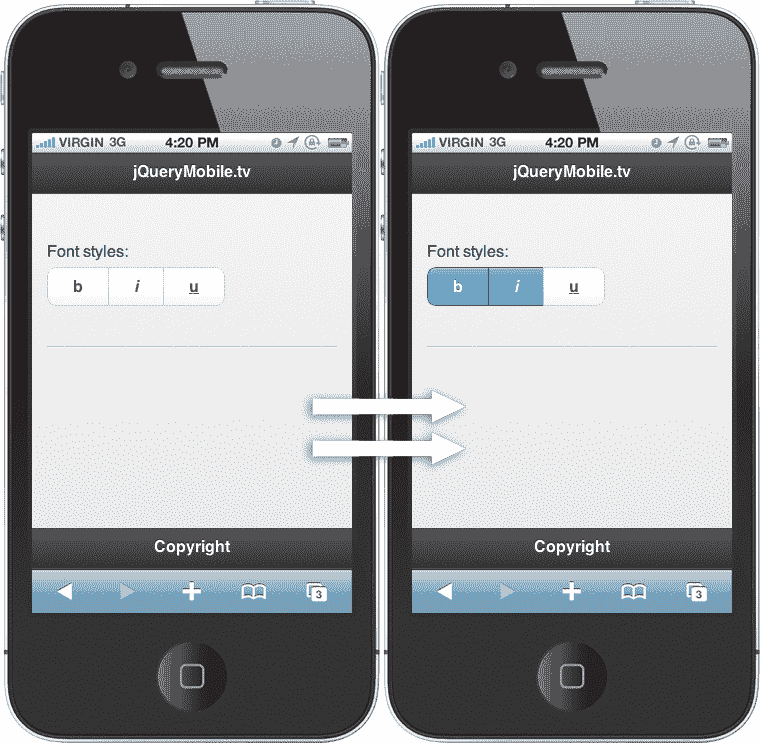

图 10.13。一个带有水平切换集格式的按钮组。

复选框和单选按钮比文本输入简单，因为它们只有 `theme` 和 `mini` 选项，这两者也可以作为 `data-` 属性可用。这两种元素都不包含不同的类型；元素类型要是 `checkbox` 要是 `radio`，因此不需要 `initSelector`。为复选框或单选按钮设置主题与为文本输入设置主题相似。主要区别在于你需要访问 `checkboxradio` 而不是 `textinput`。以下代码为所有复选框和单选按钮设置主题，并将它们都设为 `mini`：

```javascript
$("input[type='checkbox'], input[type='radio']").checkboxradio({
    mini: "true",
    theme: "e"
});
```

在方法方面，复选框和单选按钮都有 `enable` 和 `disable` 方法。然而，它们还包含一个 `refresh` 方法，你可以用它在视觉上操纵元素后更新该元素。例如，如果我们取披萨配料的示例并想要预选奶酪，可以使用带有 `refresh` 的以下代码：

```javascript
$("input#cheese").attr("checked", true).checkboxradio("refresh");
```

该方法确保了对复选框进行了视觉更新，以便用户看到它是被选中的。复选框和单选按钮元素包含了与文本输入相同的事件。这些包括绑定标准 JavaScript 事件的能力，如 `change`、`blur`、`focus`。这些元素还有一个 `create` 事件，你可以在它们在 jQuery Mobile 中被创建时使用它。

## 选择菜单 (Select Menus)

选择菜单的调整一直以来非常困难。最后，jQuery Mobile 提供了一种视觉效果，这种效果不需要额外的 CSS。为 jQuery Mobile 创建选择菜单，创建一个普通的 HTML `select`。以下示例展示了用于选择类型的选择菜单：

```html
<label for="select-cabin">Cabin type:</label>
<select name="select-cabin" id="select-cabin">
    <option value="economy">Economy</option>
    <option value="business">Business</option>
    <option value="first">First class</option>
</select>
```

这段标记的结果看起来和功能上如图 10.14 所示。

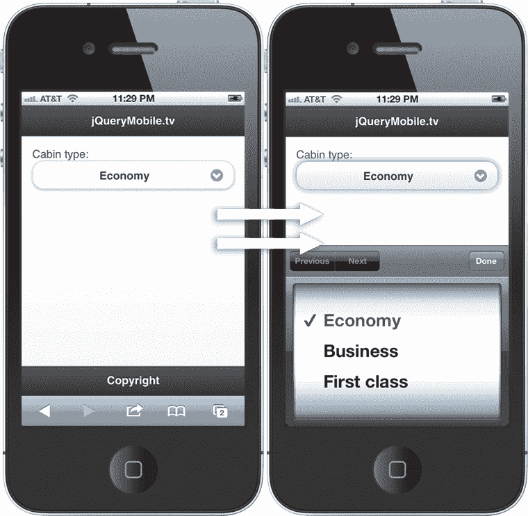

图 10.14。选择菜单。

正如复选框和单选按钮一样，你可以添加一些格式化。以下示例包含了带有 `fieldcontain` 的 `div`（见图 10.15）：

```html
<div data-role="fieldcontain">
    <label for="select-cabin">Cabin type:</label>
    <select name="select-cabin" id="select-cabin">
        <option value="economy">Economy</option>
        <option value="business">Business</option>
        <option value="first">First class</option>
    </select>
</div>
```


图 10.15。在 fieldcontain 中的选择菜单。

你也可以像对复选框和单选按钮一样对选择菜单分组。只需为 `fieldset` 添加 `controlgroup data-role` 并为该组菜单创建一个图例：

```html
<div data-role="fieldcontain">
    <fieldset data-role="controlgroup">
        <legend>Flight details:</legend>
        <label for="select-cabin">Cabin type:</label>
        <select name="select-cabin" id="select-cabin">
            <option>Cabin type</option>
            <option value="economy">Economy</option>
            <option value="business">Business</option>
            <option value="first">First class</option>
        </select>
        <label for="select-adults">Adults</label>
        <select name="select-adults" id="select-adults">
            <option>Adults</option>
            <option value="1">1</option>
            <option value="2">2</option>
        </select>
        <label for="select-time">Time</label>
        <select name="select-time" id="select-time">
            <option>Time</option>
            <option value="6">6:00AM</option>
            <option value="7">7:00AM</option>
        </select>
    </fieldset>
</div>
```

这段标记的结果看起来与图 10.16 相似。

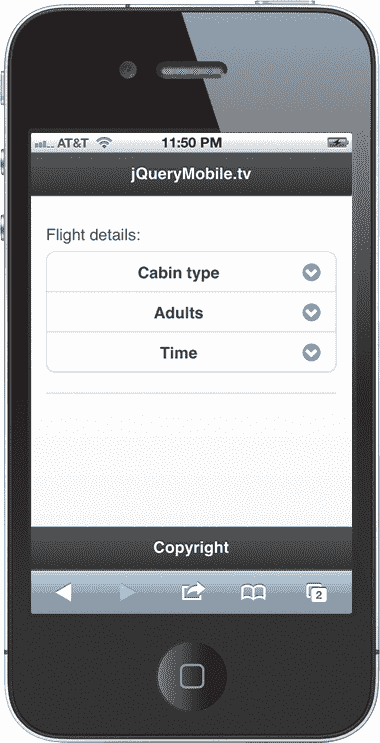

图 10.16。（左）controlgroup 中的选择菜单。

或者，此组可以是一个水平的可选输入项组，它非常适用于长度只有几个字符的项，例如出生日期（图 10.17）。

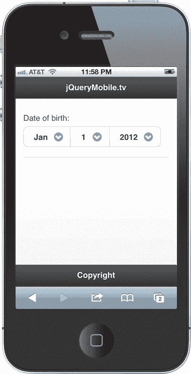

图 10.17。（右侧）水平分组的下拉菜单。

### 选项

你还可以通过 API 提供的选项或 `data-` 属性的等效项对下拉菜单进行相当的自定义。为下拉菜单可以设置的选项可以在表 10.1 所示。所有这些选项都可以通过 `selectmenu` 方法设置，但 `initSelector` 选项除外，该选项设置方法与文本输入相同。

表 10.1 下拉菜单选项

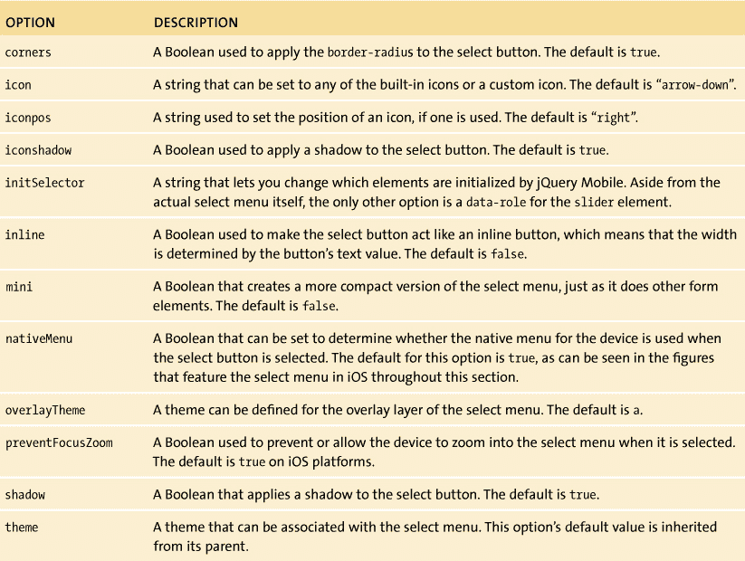

### 方法

下拉菜单的功能比文本输入、复选框或单选按钮更丰富，因此与之关联的方法更多。它包含了标准的 `enable` 和 `disable` 方法，但该元素还包含了 `close`、`open` 和 `refresh`。当下拉菜单被重新构建时，可以使用 `refresh`，例如，如果使用 Ajax 根据 Web 表单中之前的选择来更新下拉菜单。或者，如果进行了视觉更新，可以使用此方法来刷新菜单。`open` 和 `close` 方法是自言自明的，但这里有一个如何使用 `open` 方法的示例：

```
$('select').selectmenu('open');
```

此代码将把所有下拉菜单设置为默认打开。

我们已经涵盖了所有的下拉菜单事件。此表单元素包含了绑定到标准 JavaScript 事件的选项，并包含一个 `create` 事件。

## 滑块

滑块是可以通过 jQuery Mobile 增强的表单元素组的一项极佳补充。可以使用滑块在特定范围范围内选择一个数字，因为它会将该数字设置在相应的数字输入框中。要创建一个滑块，你必须将元素类型设置为 `range` 并包含 `min` 和 `max` 值：

```html
<label for="my-slider">My slider</label>
<input type="range" name="slider" id="my-slider" value="50" min="0" max="100" />
```

也可以添加默认值，它会设置滑块在轨道上的位置。此示例中的滑块显示类似于图 10.18。

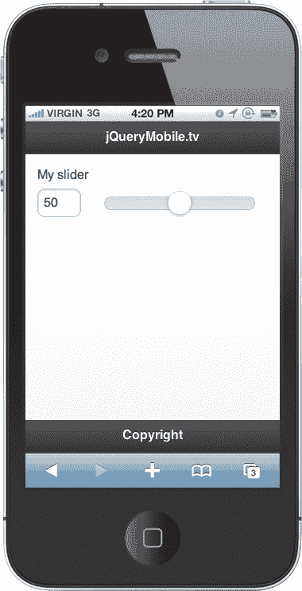

图 10.18 一个基础滑块的示例。

你还可以为返回的数值添加步长。例如，如果你不想返回 0 到 100 之间的每一个数字，你可以将 `step` 属性设置为 10，这将返回每隔十个数的数字：

```html
<label for="my-slider">My slider</label>
<input type="range" name="slider" id="my-slider" value="50" min="0" max="100" step="10" />
```

除了这些属性外，你还可以添加填充高亮，它会高亮滑块左侧的轨道区域（图 10.19）：

```html
<label for="my-slider">My slider</label>
<input type="range" name="slider" id="my-slider" value="50" min="0" max="100" step="10" data-highlight="true" />
```

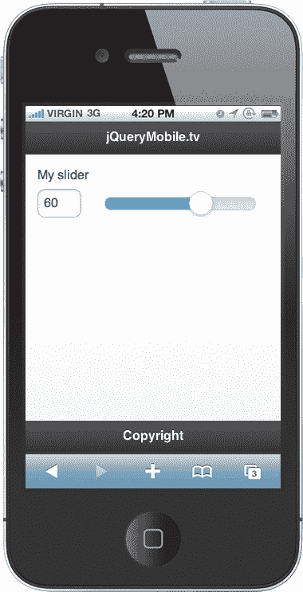

图 10.19 带有填充高亮的滑块。

### 选项

滑块元素有一系列相当的选项，你可以通过 API 或 `data-role` 属性进行设置，包括 `disabled`、`highlight`、`initSelector`、`mini`、`theme` 和 `trackTheme`。默认情况下，`disabled` 选项设置为 `false`。`highlight` 选项默认为 `false`；但是，如果设置为 `true`，则可以用于高亮所有滑块中滑块左侧的轨道，如下例例所示：

```
$('.selector').slider({ highlight: "true" });
```

我们已经涵盖了 `initSelector`、`mini` 和 `theme` 选项。`trackTheme` 选项是滑块特有的；你可以用它将轨道的主设置为与滑块其他部分不同的主题。

### 方法和事件

滑块插件包含了三个你可以用来修改 `slider` 元素的方法：`enable`、`disable` 和 `refresh`。`enable` 方法可以启用被禁用的滑块：

```
$('.selector').slider('enable');
```

`disable` 方法可以禁用滑块，使用户无法与其交互：

```
$('.selector').slider('disable');
```

`refresh` 方法可以在滑块被更新后用于刷新它：

```
$('.selector').slider('refresh');
```

滑块可用的事件与其他元素类似，滑块插件还包含一个 `create` 事件，当滑块创建时可以使用。

## 翻转开关

翻转开关是表单元素的另一项实用的补充。它们为二值数据提供了极佳的解决方案，例如是/否、开启/关闭或真/假。开关可以从一个位置移动到另一个位置，或者用户可以点击它使其切换到选定位置。制作翻转开关很简单：只需创建一个包含两个选项的滑块，因为它会根据文本调整大小：

```html
<label for="flip-switch">Do you like pizza?</label>
<select name="slider" id="flip-switch" data-role="slider">
  <option value="yes">Yes</option>
  <option value="no">No</option>
</select>
```

产生翻转开关的代码是一个 `data-role` 设置为 `slider` 值的下拉菜单，当然，关键在于包含两个选项。此滑块的视觉结果如图 10.20 所示。

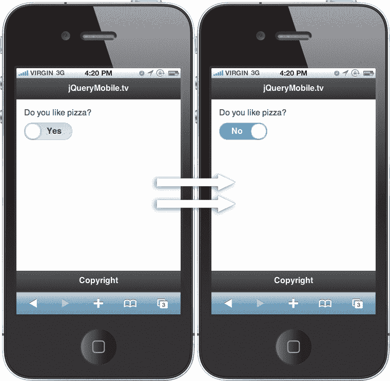

图 10.20 翻转开关交互序列。

翻转开关包含了与滑块完全相同的选项、方法和事件，可以使用相同的语法访问，因为翻转开关本质上是滑块的扩展。要了解更多关于翻转开关的选项、方法和事件，请查看本章前面的“滑块”。

## 总结

jQuery Mobile 为表单输入提供了极佳的元素选项。设备根据输入类型响应相应的键盘时，可用性大大提高。另一个益处是，所有这些表单元素在无法处理它们的浏览器中查看时都会降级，因此你永远不需要担心由于某人没有使用最新、最强大的手机而导致你的网页崩溃，例如。这仅仅是 jQuery Mobile 帮助消除通用的 Web 开发中伴随的一些常见困扰的又一种方式。

# 11. 为 jQuery Mobile 设置主题

jQuery Mobile 包含一个完整的主题框架，允许你自定义色板和图标集，以创建自定义主题的页面、工具栏、内容、表单元素、列表、按钮等。该框架使用 CSS3 许多许多增强功能，例如阴影、渐变和圆角，因此不使用图像来实现这些视觉效果，这使得主题更加轻量且加载速度更快。

本章提供了现有色板的概述，并详细说明了如何创建自定义主题。自定义主题允许你创建与桌面版本具有相同品牌设计的移动版本网站，从而在你的网站之间创建统一的设计。

## 核心色板

jQuery Mobile 有一个包含五个色块（swatches）的主题系统，这些色块由字母“a”到“e”定义。单个网页中混合使用这些色块以实现完全自定义。默认色块都包含颜色和纹理、内边距以及预定义的尺寸，以便将它们区分开来。表 11.1

使用色块就像使用 `data-theme` 属性一样简单，它可以用于任何带有 jQuery Mobile 框架的 HTML 元素。以下代码显示了一组五个按钮，每个按钮都有不同的默认主题：

```html
<a href="#" data-role="button" data-theme="a">Swatch A</a>
<a href="#" data-role="button" data-theme="b">Swatch B</a>
<a href="#" data-role="button" data-theme="c">Swatch C</a>
<a href="#" data-role="button" data-theme="d">Swatch D</a>
<a href="#" data-role="button" data-theme="e">Swatch E</a>
```

无论这是一组按钮、列表项还是栏，jQuery Mobile 框架都赋予了你为这些项目定义不同主题的能力。图 11.1 显示了示例中的按钮组。你可以看到，每个按钮根据其分配的主题具有不同的颜色。

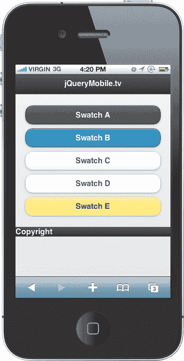

图 11.1 分配了不同主题色块的按钮组。

你可以更新现有的色块或创建自定义色块。要创建自定义色块，只需从 jQuery Mobile 样式表中复制一个现有主题色块并将其更新为尚未作为默认色块使用的字母（即“f”到“z”或任何自定义名称）。首先，你需要在表中找到想要复制的色块；在本例中我们使用“a”色块。我们要获取色块的样式表是全书中一直附加到所有示例中的那一个。唯一的区别是，我们将查看未压缩的版本，以便更容易找到色块的开始和结束位置。你可以在 `code.jquery.com/mobile/1.0.1/jquery.mobile-1.0.1.css` 找到该样式表的未压缩版本，这与一直以来包含的地址相同，只是缺少了文件名中的 `.min` 部分。要创建色块的副本，只需将许多 CSS 色块类复制粘贴到新的 CSS 文件中，对后缀 `-a` 进行搜索并替换，替换为“f”到“z”之间的字母。例如，要创建一个“f”色块，你会将 `-a` 搜索并替换为 `-f`，所有的 CSS 色块类将得到更新，从而得到一个新的“f”色块。以下是 `ui-bar` 类在为“f”色块修改后的示例：

```css
.ui-bar-f {
    border: 1px solid #cccccc;
    background: #cccccc;
    color: #cccccc;
    font-weight: bold;
    text-shadow: 0 -1px 1px #000000;
    background-image: -webkit-gradient(linear, left top, left bottom, from(#cccccc), to(#999));
    background-image: -webkit-linear-gradient(#cccccc, #999);
    background-image:      -moz-linear-gradient(#cccccc, #999);
    background-image:      -ms-linear-gradient(#cccccc, #999);
    background-image:      -o-linear-gradient(#cccccc, #999);
    background-image:          linear-gradient(#cccccc, #999);
}
```

现在由你来自定义这些类的属性。一旦你有了新色块，就可以像下方的按钮示例一样在任何 jQuery Mobile 元素上轻松使用：

```html
<a href="#" data-role="button" data-theme="f">Custom Swatch F</a>
```

### ThemeRoller

创建自定义色块的另一种方法是使用 ThemeRoller 工具，它让你能够在简单的界面中创建一个包含多个自定义色块的整个主题。


ThemeRoller 工具是创建自定义主题的一种简单方法，但可能很难理解底层的 CSS。ThemeRoller 提供了一个视觉化界面，无需编写任何代码即可修改颜色、字体、圆角等。

图 11.4 显示了使用 `data-theme` 修改此标记后的结果。

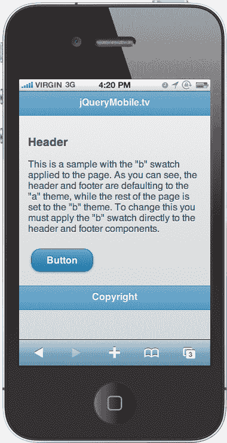

图 11.4。应用到页面组件以及页眉和页脚工具栏的“b”主题色块。

与页面一样，包含在工具栏中的任何组件都会继承工具栏的主题。以下示例显示了一个带有不同主题和主页图标的页眉：

```html
<div data-role="header" data-theme="b">
     <h1>jQueryMobile.tv</h1>
     <a href="#" data-theme="e" data-icon="home">Home</a>
</div>
```

此标记创建了一个在工具栏主题背景下突出的按钮图 11.5。


图 11.5。一个带有具有不同 `data-theme` 色块按钮的工具栏组件。

## 内容主题化

主内容区域或任何包含 `data-role="content"` 的元素都可以通过添加 `data-theme` 属性来设置主题。这允许内容区域对其及其组件覆盖继承的页面组件主题。以下示例显示了内容主题以及其包含的任何组件如何覆盖页面主题：

```html
<div data-role="page" data-theme="b">
    <div data-role="header" data-theme="b">
        <h1>jQueryMobile.tv</h1>
        <a href="#" data-theme="e" data-icon="home">Home</a>
    </div>
    <div data-role="content" data-theme="d">
        <h3>Header</h3>
        <p>这是一个示例，页面和工具栏应用了“b”色块，内容区域应用了“d”色块。</p>
        <a href="#" data-role="button" data-inline="true">Button</a>
    </div>
    <div data-role="collapsible" data-collapsed="true" data-theme="c" data-content-theme="c">
        <h3>Collapsible header</h3>
        <p>我使用 data-content-theme 来匹配我的页眉</p>
    </div>
    <div data-role="footer" data-theme="b"><h2>Copyright</h2></div>
</div>
```

注意页面如何使用“b”色块，而内容区域使用“d”色块。图 11.6 显示了内容组件及其子组件如何覆盖继承的页面组件主题。


图 11.6。一个具有与自身主题不同的内容区域的页面。

除了标准内容区域外，折叠内容区域可以包含自定义主题，以区别于其父元素：

```html
<div data-role="page" data-theme="b">
    <div data-role="header" data-theme="b">
        <h1>jQueryMobile.tv</h1>
        <a href="#" data-theme="e" data-icon="home">Home</a>
    </div>
    <div data-role="content" data-theme="d">
        <h3>Header</h3>
        <p>这是一个示例，页面和工具栏应用了“b”色块，内容区域应用了“d”色块。</p>
        <div data-role="collapsible" data-collapsed="true" data-theme="c" data-content-theme="c">
            <h3>Collapsible header</h3>
            <p>我使用 data-content-theme 来匹配我的页眉</p>
        </div>
    </div>
    <div data-role="footer" data-theme="b"><h2>Copyright</h2></div>
</div>
```

默认情况下，折叠内容区域的页眉包含自定义的 `data-theme`；但如果没有 `data-content-theme`，折叠内容区域体将与内容区域相同。图 11.7 显示了具有自定义 `data-theme` 和 `data-content-theme` 的折叠内容区域示例。


图 11.7。带有折叠内容区域的页面。

## 表单主题化

jQuery Mobile 允许你创建单个表单。与其他一样，表单和元素继承它们所属的页面组件主题。然而，可以使用 `data-theme` 来定制单个表单、所有表单或某些元素的外。让我们从整个表单开始。以下代码显示了一个包含“e”主题的表单，而页面组件包含“b”主题。注意表单元素包含了自己的 `data-role`，否则它将继承内容区域的主题：

```html
<div data-role="page" data-theme="b">
    <div data-role="header" data-theme="b">
        <h1>jQueryMobile.tv</h1>
        <a href="#" data-theme="e" data-icon="home">Home</a>
    </div>
    <div data-role="content" data-theme="d">
        <p>此内容区域包含“d”色块。</p>
        <form data-role="content" data-theme="e">
            <label for="my-text-input">Text input</label>
            <input type="text" name="name" id="my-text-input" value="" />
            <a href="#" type="submit" data-role="button" data-inline="true">Button</a>
        </form>
    </div>
    <div data-role="footer" data-theme="b"><h2>Copyright</h2></div>
</div>
```

为嵌套内容区域分配不同的 `data-theme` 值是有用的。表单显示了如何使用它们来区分某些内容 图 11.8。


图 11.8。一个与其内容区域分离的自带 data-theme 的表单。

要更改单个表单元素的色块，只需在实际元素上应用 `data-theme` 即可。

```html
<a href="#" type="submit" data-role="button" data-inline="true" data-theme="b">
```

这会将按钮设置为与表单其他部分不同的主题。在这种情况下，它有助于识别表单内的按钮，并在视觉上吸引注意力 图 11.9。


图 11.9。使用 data-theme 属性设置单个表单元素的色块值。

## 列表

列表可能是 jQuery Mobile 中复杂的组件，因为它们是唯一包含主题选项额外属性的元素。例如，`listview` 不仅可以包含列表项，还可以包含分割线、计数气泡和分割按钮，我们在本节中看到它们都有自己的主题选项。首先，像本章之前的组件一样，`listview` 本可以包含 `data-theme`，任何包含的项目都会继承它：

```html
<div data-role="page" data-theme="b">
    <div data-role="header" data-theme="b">
        <h1>jQueryMobile.tv</h1>
        <a href="#" data-theme="e" data-icon="home">Home</a>
    </div>
    <div data-role="content" data-theme="d">
        <p>此内容区域包含“d”色块。</p>
        <ul data-role="listview" data-inset="true" data-theme="e">
            <li><a href="#">List item</a></li>
            <li><a href="#">List item</a></li>
            <li><a href="#">List item</a></li>
            <li><a href="#">List item</a></li>
        </ul>
    </div>
    <div data-role="footer" data-theme="b"><h2>Copyright</h2></div>
</div>
```

图 11.10 显示了此标记在移动设备上渲染的示例。正如你所看到的，列表可以有自己的主题，与页面其他部分分开。然而，如果没有定义 `data-theme`，`listview` 将简单继承页面或其内容容器的主题。


图 11.10。带有自定义主题的 listview。

单个列表项也可以覆盖 `listview` 主题。如果某个特定列表项与其他项分开来是合理的，只需为其添加 `data-theme` 属性即可：

```html
<ul data-role="listview" data-inset="true" data-theme="e">
    <li>5</li>
    <li>20</li>
    <li>75</li>
    <li data-theme="a">Total = 100</li>
</ul>
```

图 11.11 显示此 `listview` 的示例，它包含“e”色块作为其数据主题（data-theme），以及一个用“a”色块覆盖该主题的列表项。在特定情况下，此功能非常有用，因为它突出并吸引了特定列表项的注意。


图 11.11。带有列表项的 listview，该列表项分配了不同的 `data-theme`。

要为分隔符设置主题，有一个名为 `data-divider-theme` 的特殊属性。可以将此属性添加到 `listview` 中，为所有列表分隔符设置主题：

```html
<ul data-role="listview" data-inset="true" data-theme="e" data-divider-theme="b">
    <li data-role="list-divider" role="heading">我的数字列表</li>
    <li>5</li>
    <li>20</li>
    <li>75</li>
    <li data-theme="a">总量 = 100</li>
</ul>
```

图 11.12 显示了此代码的效果，其中 `listview` 使用 `data-divider-theme` 属性作为分隔符。


图 11.12。带有列表分隔符主题的 listview。

计数泡可以使用 `data-count-theme` 属性设置主题，该属性可以应用于 `listview` 的 `ul` 元素，为列表中的所有的计数泡设置主题：

```html
<ul data-role="listview" data-inset="true" data-theme="e" data-divider-theme="b" data-count-theme="b">
    <li data-role="list-divider" role="heading">我的数字列表</li>
    <li>列表项 <span class="ui-li-count">5</span></li>
    <li>列表项 <span class="ui-li-count">20</span></li>
    <li>列表项 <span class="ui-li-count">75</span></li>
    <li data-theme="a">总量 <span class="ui-li-count">100</span></li>
</ul>
```

图 11.13 显示了计数泡主题的示例。


图 11.13。带有计数泡主题的 listview。

拆分按钮（Split buttons）允许你在同一个列表项中设置两个独立的链接。要为这些拆分按钮创建一个独立的主题，你可以向 `listview ul` 元素添加 `data-split-theme` 属性：

```html
<ul data-role="listview" data-inset="true" data-theme="e" data-split-theme="b">
    <li>
        <a href="#link1">列表项</a>
        <a href="#link1Alt">拆分示例</a>
    </li>
    <li>
        <a href="#link2">列表项</a>
        <a href="#link2Alt">拆分示例</a>
    </li>
</ul>
```

图 11.14 显示了 `data-split-theme` 的示例。


图 11.14。带有 data-split-theme 的 listview。

## 总结

jQuery Mobile 主题既易于使用又强大。每个组件都可以设置主题，当预设的色块不够用时，你始终可以进行自定义。在 ThemeRoller 和手动编辑类的能力之间，你应该已经能够顺畅地创建你自己的主题了。

# 第三部分：移动 API

## 1. 全局选项

从表面上看，jQuery Mobile 框架提供了一种创建移动网站的快速简单的方法。然而，该框架还拥有应用程序接口（API），可用于扩展基本功能。jQuery Mobile API 为你的移动网站的自定义提供了额外层次的控制。从全局选项的设置到挂钩事件以及与暴露的方法交互，通过 API 都是可能的。到本章结束，你将了解如何为你的移动网站定义自定义选项以及如何编写与 jQuery 框架交互的自定义代码。

### 扩展 mobileinit 事件

如之前介绍的，jQuery Mobile 包含一个名为 `mobileinit` 的初始化事件，它在 jQuery 的 `document.ready` 事件之前加载。这让你能够覆盖并扩展 jQuery Mobile 的默认选项，而这正是自定义的开始。要扩展 `mobileinit` 事件，你需要正确安排 JavaScript 文件的顺序。你的自定义 JavaScript 事件处理程序必须在 jQuery Mobile 加载之前且在框架加载之后包含：

```html
<script src="http://ajax.googleapis.com/ajax/libs/jquery/1.7.1/jquery.min.js"></script>
<script src="assets/js/custom-qm.js"></script>
<script src="http://code.jquery.com/mobile/1.0.1/jquery.mobile-1.0.1.min.js"></script>
```

要扩展 `mobileinit` 事件，你必须先向它绑定一个匿名函数，以便在事件触发时执行你的自定义代码：

```javascript
$(document).bind("mobileinit", function() {
    // 在此处覆盖全局选项
});
```

一旦你成功地为 `mobileinit` 事件绑定了回调函数，你就可以轻松地覆盖全局选项。`$.mobile` 对象是设置所有属性的起点。你将在这里覆盖影响网站运行方式的全局选项。要覆盖全局选项，你可以使用 jQuery 的 `extend` 方法来扩展 `$.mobile` 对象：

```javascript
$(document).bind("mobileinit", function() {
    $.extend( $.mobile, {
        property
    })
});
```

或者，你可以直接通过 `$.mobile` 对象来覆盖全局选项：

```javascript
$(document).bind("mobileinit", function() {
    $.mobile.property = value
    // 设置其他属性
});
```

如果你想更新多个属性，`extend` 方法更简洁，因为你不需要多次编写 `$.mobile`。但如果你只有一个属性要更新，单独设置代码更少。

### 创建命名空间

HTML5 `data-` 属性（例如 `data-role`）可以通过命名空间进行自定义。命名空间允许你在 `data-` 和 `-role` 部分之间添加一个自定义名称。这种属性对于自定义你的代码非常有用。当更多的第三方插件被开发并可能包含在项目中时，它可以防止命名冲突。用于自定义命名空间的 `$.mobile` 属性是 `ns`：

```javascript
$(document).bind("mobileinit", function() {
    $.mobile.ns = "-";
});
```

注意命名空间结尾有一个连字符；如果没有它，命名空间将不包含连字符，因此你的 `data-` 属性将难以阅读，且 jQuery Mobile 将查找类似这样的属性：`data-jquerymobilefoo`。

选择自定义命名空间要求你在编码时就投入该命名空间。在编码期间，你将在标记中为任何 `data-` 属性都包含此自定义命名空间。再次，这不仅自定义了你的标记，在使用第三方插件时还可以防止命名冲突。这里是一个显示 `jquerymobiletv-` 命名空间的示例：

```html
<div data-jquerymobiletv-role="page" id="home">
    <div data-jquerymobiletv-role="header">
        <h1>jQueryMobile.tv</h1>
    </div>
    <div data-jquerymobiletv-role="content">
        <p>Welcome to jQueryMobile.tv!</p>
    </div>
</div>
```


```html
<!DOCTYPE html>
<html>
<head>
    <meta http-equiv="Content-Type" content="text/html; charset=UTF-8">
    <meta name="viewport" content="width=device-width, initial-scale=1">
    <title>命名空间 - jQuery Mobile: 设计与开发</title>
    <link rel="stylesheet" href="http://code.jquery.com/mobile/1.0.1/jquery.mobile-1.0.1.min.css" />
    <script src="http://ajax.googleapis.com/ajax/libs/jquery/1.7.1/jquery.min.js"></script>
    <script src="http://code.jquery.com/mobile/1.0.1/jquery.mobile-1.0.1.min.js"></script>
    <script>
        $(document).bind("mobileinit", function() {
            $.mobile.ns = "jquerymobiletv-";
        });
    </script>
</head>
<body>
    <div data-role="page" data-jquerymobiletv-id="home">
        <h1 data-jquerymobiletv-role="heading">命名空间</h1>
        <ul data-jquerymobiletv-role="list">
            <li data-jquerymobiletv-role="get">列表项 1</li>
            <li data-jquerymobiletv-role="get">列表项 2</li>
        </ul>
    </div>
</body>
</html>
```

```html
<div data-jquerymobiletv-role="page">
    <div data-jquerymobiletv-role="header"><h1>页面名称</h1></div>
    <div data-jquerymobiletv-role="content"><p>主体内容</p></div>
    <div data-jquerymobiletv-role="footer">版权所有</div>
</div>
</body>
</html>
```

使用自定义命名空间的好处是不需要进行任何其他修改；代码的结果与使用默认命名空间运行 jQuery Mobile 网页的结果相同。

你甚至可以使用级联样式表（CSS）选择器来选择包含自定义 `data-` 属性的特定 HTML 元素。例如，你可以选择一个 jQuery Mobile 页面元素并对其应用 CSS：

点击此处查看代码图片

```css
.ui-mobile [data-jquerymobiletv-role="page"] {
    /*在此处编写自定义 CSS */
}
```

随着 `data-` 属性的引入，开发者对添加到网页中的数据拥有了更多的控制权。自定义属性提供了支持语义化 HTML 的手段，同时通过 JavaScript 等前端脚本语言增强了网页功能。

### 延迟页面初始化

在 jQuery Mobile 中，页面初始化是默认自动发生的。该框架包含一个名为 `autoInitializePage` 的属性，它决定了是否应该初始化网页。默认情况下，该属性的值设置为 `true`，因此当文档准备就绪时页面始终会被初始化。然而，通过扩展 `$.mobile` 对象，可以将此属性设置为 `false` 并在之后处理页面初始化。

你可以在其他脚本运行期间临时延迟页面初始化，这正是将 `autoInitializePage` 属性设置为 `false` 的完美场景：

点击此处查看代码图片

```javascript
$(document).bind("mobileinit", function() {
    $.extend( $.mobile, {
        autoInitializePage: false
    });
});
```

想象一下需要加载大量的客户端 JavaScript，例如一个长姓名列表。在这种情况下，延迟初始化直到文档对象模型（DOM）完成加载可能是一个好主意。这样一来，客户端 JavaScript 就有机会运行，并且你可以优雅地让数据淡入，而不是让它在访问者眼前一行一行地加载：

点击此处查看代码图片

```html
<!DOCTYPE html>
<html>
<head>
    <meta http-equiv="Content-Type" content="text/html; charset=UTF-8">
    <meta name="viewport" content="width=device-width, initial-scale=1">
    <title>页面初始化 - jQuery Mobile: 设计与开发</title>
    <link rel="stylesheet" href="http://code.jquery.com/mobile/1.0.1/jquery.mobile-1.0.1.min.css" />
    <script src="http://ajax.googleapis.com/ajax/libs/jquery/1.7.1/jquery.min.js"></script>
    <script src="assets/js/custom-jqm.js"></script>
    <script src="http://code.jquery.com/mobile/1.0.1/jquery.mobile-1.0.1.min.js"></script>
</head>
<body>
    <div data-jquerymobiletv-role="page" id="mypage">
        <div data-jquerymobiletv-role="header"><h1>页面名称</h1></div>
        <div data-jquerymobiletv-role="content">
            <ul data-jquerymobiletv-role="listview" id="my-list"></ul>
        </div>
        <div data-jquerymobiletv-role="footer">版权所有</div>
    </div>
    <script type="text/javascript">
        $("#mypage").css('display', 'none');
        var namesArray = new Array("Tom", "Lucy", "Lee", "Chris", "Albert", "Frank");
        for(var i=0; i<namesArray.length; i++) {
            $('#my-list').append('<li><a href="#">'+namesArray[i]+ '</a></li>');
        }
        $.mobile.autoInitializePage = true;
        $("#mypage").fadeIn(1000);
    </script>
</body>
</html>
```

运行此代码会延迟初始化；在循环完成且 `autoInitializePage` 属性设置为 `true` 之前，用户将看不到姓名列表，然后使用 `fadeIn` 方法让页面淡入。

图 12.1 显示了一旦 `autoInitializePage` 属性设置为 `true` 且页面淡入，页面是如何渲染的。

 图 12.1 延迟初始化后渲染的页面。

### 自定义 subPageKey

`subPageKey` 是一个 URL 查询参数，用作 jQuery 组件生成的子页面的引用（这些组件在书中前面介绍过）。该参数的默认键为 `ui-page`。然而，可以通过 `subPageKey` 属性更改此键，该属性是 `$.mobile` 对象的一个属性。可以使用字符串值来更新此属性的值，该更改将反映在组件生成的子页面中。创建一个自定义的 `subPageKey`：

例如，通过 `subPageKey` 属性更改此键，`ui-page` 就会变为 `my-page-key`

你甚至可以使用级联样式表（CSS）选择器来选择包含自定义 `data-` 属性的特定 HTML 元素。例如，你可以选择一个 jQuery Mobile 页面元素并对其应用 CSS：

点击此处查看代码图片

```css
.ui-mobile [data-jquerymobiletv-role="page"] {
    /*在此处编写自定义 CSS */
}
```

随着 `data-` 属性的引入，开发者对添加到网页中的数据拥有了更多的控制权。自定义属性提供了支持语义化 HTML 的手段，同时通过 JavaScript 等前端脚本语言增强了网页功能。

### 使用激活页面和类

在 jQuery Mobile 中，页面初始化是默认自动发生的。该框架包含一个名为 `autoInitializePage` 的属性，它决定了是否应该初始化网页。默认情况下，该属性的值设置为 `true`，因此当文档准备就绪时页面始终会被初始化。然而，通过扩展 `$.mobile` 对象，可以将此属性设置为 `false` 并在之后处理页面初始化。

你可以在其他脚本运行期间临时延迟页面初始化，这正是将 `autoInitializePage` 属性设置为 `false` 的完美场景：

点击此处查看代码图片

```javascript
$(document).bind("mobileinit", function() {
    $.extend( $.mobile, {
        autoInitializePage: false
    });
});
```

图 12.2 显示了框架如何转换标记，以包含我们创建并对其应用 CSS 的新类。


图 12.2 框架根据全局配置设置插入的自定义活动页面类。

另一个名为 `activeBtnClass` 的属性与 `activePageClass` 的工作原理完全相同。你可以在 `mobileinit` 回调中设置它。它可以包含任何字符串值，且该字符串值最终可以关联到包含在 CSS 文件中的自定义 CSS 类。`activePageClass` 和 `activeBtnClass` 属性唯一的区别在于，`activeBtnClass` 允许你对使用的任何按钮的活动状态进行样式设置。

## 启用/禁用 Ajax 导航

默认情况下，使用 `$.mobile` 对象的 `ajaxEnabled` 属性将基于 Ajax 的导航设置为 `true`。然而，你可以在配置文件中将此设置为 `false`：

点击此处查看代码图片

```javascript
$(document).bind("mobileinit", function() {
    $.extend( $.mobile, {
        ajaxEnabled: false
    });
});
```

这是一个非常容易修改的属性，但它具有重大影响。将此属性设置为 `false` 会禁用 URL hash 监听，并将所有 URL 加载为标准的 HTTP 请求。这样做会导致页面刷新、禁用页面预加载和缓存，并消除页面和对话框过渡。如果你希望你的移动网站运行像标准网站一样，将此选项设置为 `false` 将创建标准的 HTTP 请求。

## 修改默认页面和对话框过渡

默认情况下，当通过 Ajax 处理页面更改时，jQuery Mobile 中的页面和对话框包含过渡效果。默认页面过渡是 `slide`，而默认对话框过渡是 `pop`。要更改这些值，请定位到 `defaultPageTransition` 和/或 `defaultDialogTransition` 属性：

点击此处查看代码图片

```javascript
$(document).bind("mobileinit", function() {
    $.extend( $.mobile , {
        defaultPageTransition: "fade",
        defaultDialogTransition: "fade"
    });
});
```

如果你运行这段代码，你会看到页面和对话框的过渡都将变为淡入（fade）：

点击此处查看代码图片

```html
<!DOCTYPE html>
<html>
<head>
    <meta http-equiv="Content-Type" content="text/html; charset=UTF-8">
    <meta name="viewport" content="width=device-width, initial-scale=1">
    <title>Page Transitions - jQuery Mobile: Design and Develop</title>
    <link rel="stylesheet" href="http://code.jquery.com/mobile/1.0.1/jquery.mobile-1.0.1.min.css" />
    <script src="http://ajax.googleapis.com/ajax/libs/jquery/1.7.1/jquery.min.js"></script>
    <script src="assets/js/custom-jqm-transitions.js"></script>
    <script src="http://code.jquery.com/mobile/1.0.1/jquery.mobile-1.0.1.min.js"></script>
</head>
<body>
    <div data-role="page">
        <div data-role="header"><h1>Page Name</h1></div>
        <div data-role="content">
            <p><a href="sample-page.html">Open Another Page</a></p>
            <p><a href="dialog.html" data-rel="dialog">Open Dialog </a></p>
        </div>
        <div data-role="footer">Copyright</div>
    </div>
</body>
</html>
```

框架包含了六种基于 CSS 的过渡效果：`slide`、`slideup`、`slidedown`、`pop`、`fade`、`flip`，在第四章“使用 jQuery Mobile 创建多页网站”中都详细介绍过。这些效果也可以通过包含 `data-transition` 属性直接应用在超链接上：

点击此处查看代码图片

```html
<a href="sample-page.html" data-transition="flip">Data transition</a>
```

使用这段代码将覆盖之前的任何过渡设置。

## 总结

jQuery Mobile 框架易于使用，但不要被它的简单性欺骗了——幕后发生了很多事情。有许多方法可以添加自定义功能来创建强大的移动网站。访问 API 允许进行精细的控制，让你能够告诉框架默认如何行为，甚至可以挂钩到客户端发生的每一次交互中。在下一章节中，你将看到事件如何能为你的自定义项目提供更多控制。

## 13. 挂钩事件

jQuery Mobile 提供了你可以使用的自定义事件，用于扩展框架的功能，包括触摸、滚动、设备方向、页面过渡和页面初始化等。挂钩 jQuery 事件打开了通过基础设置无法实现的整个机会世界。了解网页在任何给定时间的状态可以提供一种你可用于扩展现有功能的控制水平。本章将向你展示如何挂钩到这些事件中的每一个。有许多触摸事件可以挂钩到 jQuery Mobile。请记住，这些事件仅对支持触摸的设备可用，因此桌面用户可能无法体验到这些事件或通过事件挂钩添加的任何自定义内容。尽管如此，触摸事件不会在桌面设备上引起错误：它们只是不会起作用，因为鼠标事件主导了桌面体验。这些事件可以触发一个包含任何 JavaScript 的回调函数。表 13.1 描述了通过 jQuery Mobile API 可用的五个触摸事件。

表 13.1 触摸事件


表 13.2 描述了在表 13.1 中提到的 `swipe` 事件属性。

表 13.2 swipe 属性


要绑定这些触摸事件中的任何一个，你必须使用 `document.ready` 事件。一旦文档就绪，你就可以访问 HTML 元素并绑定你选择的触摸事件：

点击此处查看代码图片

```javascript
$(document).ready(function(){
    $(".test-tap-hold").bind("taphold", function(event) {
        $(this).html("Tapped and held");
    });
});
```

一旦文档就绪，`taphold` 事件被绑定到类名为 `.test-tap-hold` 的元素。当手指触摸此元素并保持在该时，`taphold` 事件就会触发。以下示例包含了将该事件绑定到 HTML 元素的 JavaScript 文件：

点击此处查看代码图片

```html
<!DOCTYPE HTML>
<html>
<head>
    <meta http-equiv="Content-Type" content="text/html; charset=UTF-8">
    <meta name="viewport" content="width=device-width, initial-scale=1">
    <title>taphold- jQuery Mobile: Design and Develop</title>
    <link rel="stylesheet" href="http://code.jquery.com/mobile/1.0.1/jquery.mobile-1.0.1.min.css" />
    <script src="http://ajax.googleapis.com/ajax/libs/jquery/1.7.1/jquery.min.js"></script>
    <script src="http://code.jquery.com/mobile/1.0.1/jquery.mobile-1.0.1.min.js"></script>
</head>
<body>
    <div data-role="page">
        <div data-role="header"><h1>Page title</h1></div>
        <div data-role="content">
            <ul data-role="listview">
                <li class="test-tap-hold">Tap and hold test</li>
            </ul>
        </div>
        <div data-role="footer">Copyright</div>
    </div>
</body>
</html>
```

正如你所见，页面包含了一个 `listview`，其中包含一个类名为 `test-tap-hold` 的列表项。

表 13.1 中的事件允许你将自定义代码挂接到移动网站的任何状态中。了解用户何时以及如何与屏幕交互，可以为你响应这些交互奠定基础。

### 方向事件

jQuery Mobile 框架包含一个名为 `orientationchange` 的单一方向事件。每当设备垂直或水平旋转时，该事件就会触发（图 13.2）。


图 13.2 网页可以根据设备的方向垂直显示或水平显示。

在旋转过程中，可以通过访问 `orientationchange` 事件中的 `orientation` 属性来确定设备的方向。该属性返回一个只读值：`portrait`（竖屏）或 `landscape`（横屏）。要挂钩 `orientationchange` 事件，必须将 `body` 绑定到该事件：

点击此处查看代码图片

```javascript
$(document).ready(function(){
    $('body').bind('orientationchange', function(event) {
        console.log('orientationchange: '+ event.orientation);
    });
});
```

当然，在文档就绪后绑定该事件也是重要的，这样 `body` 才是可访问的，否则你将得到不一致的结果。你还可以通过 jQuery 的 `trigger` 方法在文档就绪后手动触发 `orientationchange` 事件，从而更进一步：

点击此处查看代码图片

```javascript
$(document).ready(function(){
    $('body').bind('orientationchange', function(event) {
        console.log('orientationchange: '+ event.orientation);
    });
    $('body').trigger('orientationchange');
});
```

在文档就绪后手动触发该事件，使得在页面首次加载时自动确定方向成为可能，而在其他情况下这是不会发生的。方向值还会被添加到网页内的 `html` 元素中，因此可以通过 CSS 访问。这提供了一种通过 jQuery Mobile 和 CSS 通过所谓的“响应式设计”来响应设备方向的方法。

### 响应式设计

随着如今市场上可用设备的激增，设计在所有不同格式下都能正常显示的网站变得越来越重要。响应式设计正如其名：根据设备格式显示内容。这包括设备尺寸、设备方向，甚至你的网站对桌面机器上浏览器窗口缩放的反应方式。实现响应式设计的常用方法是通过 CSS 媒体查询或简单地提供一个备用网站。jQuery Mobile 提供了一个自动响应的解决方案。

换句话说，在任何给定时刻知道设备的方向有助于决定如何渲染内容的布局。有了这种能力，就没有必要为处理不同的设备而准备多个网站了。

### 滚动事件

jQuery Mobile 提供了两个在用户滚动网页时触发的滚动事件：`scrollstart` 和 `scrollstop`。当页面滚动开始时，触发 `scrollstart` 事件。与 `orientationchange` 事件一样，`scrollstart` 事件必须在文档就绪后绑定到 `body` 元素上：

点击此处查看代码图片

```javascript
$(document).ready(function(){
    $('body').bind('scrollstart', function(event) {
        console.log("scrollstart");
    });
});
```

当页面滚动停止时，触发 `scrollstop` 事件。将 `scrollstop` 事件绑定到 `body` 元素的方法与绑定 `scrollstart` 事件的方法相同：

点击此处查看代码图片

```javascript
$(document).ready(function(){
    $('body').bind('scrollstart', function(event) {
        console.log("scrollstart");
    });
    $('body').bind('scrollstop', function(event) {
        console.log("scrollstop");
    });
});
```

滚动事件可以结合使用以运行自定义 JavaScript。例如，它们可以用于创建懒加载效果，这种功能可以在图像在滚动过程中在页面下方逐渐显现时按需加载它们：

点击此处查看代码图片

```javascript
$(document).ready(function() {
    var _scrollInterval;
    $(document).bind({
        scrollstart: function() {
            _scrollInterval = setInterval("onScroll()", 50);
        },
        scrollstop: function() {
            clearInterval(_scrollInterval);
        }
    });
});

function onScroll() {
    lazyLoad();
}

function lazyLoad() {
    $('img').each(function() {
        var viewablePosition = $(window).scrollTop() + $(window).height();
        var viewableImage = $(this).top();
        if ($(this).hasClass('lazy-img') && viewablePosition > viewableImage) {
            $(this).attr('src', 'assets/img/trademark.png');
            $(this).css('display', 'block');
        }
    });
}
```

### 页面过渡事件

想象一下，在页面过渡发生之前就知道它将要发生。此外，预先知道页面何时隐藏。通过页面过渡事件，这是可能的。jQuery Mobile 页面动画由页面过渡驱动。页面之间切换期间使用的动画在之前的章节中已经定义，但也与过渡的每一步都相关事件。事件会在每个页面过渡之前之后发生，并可以在此过程的任何时间执行自定义代码。如图 13.3 所示，有四个事件与页面过渡相关，并且按顺序发生。


图 13.3 与 jQuery Mobile 页面过渡相关的事件。

前两个事件在页面过渡开始时发生在当前视图页面上，最后两个事件发生在进入视图的页面上。

使用 jQuery 的 `on` 方法可以轻松为这些事件绑定事件处理器。你可以为每个事件的单个元素附加事件处理器。在以下示例中，`on` 方法被绑定到 `div#my-page`，允许为每个页面过渡事件创建自定义事件处理器。具有 `my-page` id 的 `div` 被用作 HTML 文档中的页面容器，因此在过渡的任何步骤，这些事件都会触发向控制台写入内容的自定义脚本：

点击此处查看代码图片

```javascript
$(document).ready(function() {
    $('div#my-page').on({
        pagebeforeshow: function(event, ui) {
            console.log('This page is about to be shown: '+ ui.prevPage);
        }
    });
});
```

```javascript
pageshow: function(event, ui) {
    console.log('This page was just hidden: '+ ui.prevPage);
},
pagebeforehide: function(event, ui) {
    console.log('This page is about to be hidden: '+ ui.nextPage);
},
pagehide: function(event, ui) {
    console.log('This page was just shown: '+ ui.nextPage);
}
});
```

如你所见，每个事件都有 `event` 和 `ui` 参数。`event` 参数是事件本身，而 `ui` 参数是一个数据对象，包含一个代表页面的属性。每个事件的 `ui` 对象都有不同的关联 `page` 属性：

*   `pagebeforeshow` 事件在它的 `ui` 数据对象中包含 `prevPage` 属性。该属性代表即将显示的页面。
*   `pagebeforehide` 事件在它的 `ui` 数据对象中包含 `nextPage` 属性。该属性代表正在切换到的页面。
*   `pageshow` 事件在它的 `ui` 数据对象中包含 `prevPage` 属性。该属性代表正在离开的页面。
*   `pagehide` 事件在它的 `ui` 数据对象中包含 `nextPage` 属性。该属性代表正在切换到的页面。

jQuery Mobile 文档使用 `live` 方法来附加页面过渡事件的处理器；然而，该方法在 jQuery 1.7 中已被弃用，对于使用旧版本 jQuery 的网站，现在推荐 `delegate` 方法。设置 `delegate` 方法与使用 `on` 方法类似：

点击此处查看代码图片

```javascript
$(document).ready(function() {
    $(document).delegate('div#my-page', {
        pagebeforeshow: function(event, ui) {
            console.log('This page is about to be shown: '+ ui.prevPage);
        },
        pageshow: function(event, ui) {
            console.log('This page was just hidden: '+ ui.prevPage);
        },
        pagebeforehide: function(event, ui) {
            console.log('This page is about to be hidden: '+ ui.nextPage);
        },
        pagehide: function(event, ui) {
            console.log('This page was just shown: '+ ui.nextPage);
        }
    });
});
```

能够钩入页面过渡事件可以带给你大量的控制权。你可以在页面过渡过程中的任何步骤中触发自定义代码。在页面显示之前知道哪个页面将显示，可以让你访问该页面的 HTML 结构，这对于丢弃不需要的标记、向页面中注入额外的标记等非常有用。这对于即将隐藏的页面也是如此：这些事件可以用于显示对话框或弹出窗口、将 JavaScript 属性从一个页面传递到另一个页面等。以下脚本展示了使用这些事件将 JavaScript 属性从一个页面传递到页面的示例：

点击此处查看代码图片

```javascript
$(document).ready(function() {
    $('div#my-page').on({
        pagebeforeshow: function(event, ui) {
            console.log('This page is about to be shown: '+ ui.prevPage);
            thePreviousPage = ui.prevPage;
        },
        pageshow: function(event, ui) {
            console.log('This page was just hidden: '+ ui.prevPage);
        },
        pagebeforehide: function(event, ui) {
            console.log('This page is about to be hidden: '+ ui.nextPage);
            console.log('thePreviousPage: '+ thePreviousPage);
        },
        pagehide: function(event, ui) {
            console.log('This page was just shown: '+ ui.nextPage);
            console.log('thePreviousPage: '+ thePreviousPage);
        }
    });
});
```

如你所见，这种功能可能非常强大，但实现非常简单。页面过渡事件允许你在 jQuery Mobile 生命周期期间的任何时间点利用页面数据。

### 页面初始化与自定义组件

jQuery Mobile 框架增强了 HTML 标记。这种标记增强发生在页面初始化时。页面初始化有三个步骤；它们按照图 13.4 中定义的顺序发生。


图 13.4 jQuery Mobile 页面初始化的三个步骤。

`pagecreatebefore` 事件在页面插入到 DOM 时发生，在 jQuery Mobile 初始化插件并增强网页之前发生。`pagecreatebefore` 事件提供了一个在 jQuery Mobile 接管并进行增强之前向网页中添加标记的绝佳机会：

点击此处查看代码图片

```javascript
$('div#my-page').on('pagecreatebefore', function(event) {
    console.log('This page is about to be created');
    $('div#my-page').attr('data-title', 'My Page');
});
```

在上面的示例中，在 jQuery Mobile 框架增强标记之前，为 `div#my-page` 添加了 `data-title`，因此 `data-title` 在增强期间被使用。

`pagecreate` 事件在 `pagecreatebefore` 事件之后发生，因此在页面创建于 DOM 之后。然而，此事件发生在 jQuery Mobile 框架增强 HTML 标记之前。`pagecreate` 事件是创建自定义组件的完美位置。以下脚本创建一个名为 `logo` 的组件，它具有 `image`、`width` 和 `height` 选项：

点击此处查看代码图片

```javascript
(function($){
    $.widget("mobile.logo", $.mobile.widget, {
        // HTML 标记可以使用属性（包含默认值）
        options: {
            image: '',
            width: 200,
            height: 200
        },
        // 此方法由 jQuery Mobile 调用以初始化方法
        _create: function() {
            console.log("Widget has been created");
            $(document).trigger("logocreate");
            var logoEl = this.element;
            logoEl.css('background', 'url('+logoEl.attr('data-image')+')');
            logoEl.width(logoEl.attr('data-width'));
            logoEl.height(logoEl.attr('data-height'));
        }
    });
    // pagecreate 事件用于初始化实例
    $(document).bind("pagecreate", function(e) {
        $(document).trigger("logocreate");
        return $(":jqmData(role='logo')", e.target).logo();
    });
})(jQuery);
```

当 `logo` 组件的标记包含在 HTML 文档中，jQuery Mobile 框架根据 `_create` 方法中的脚本进行增强。以下标记显示了如何在 jQuery Mobile 网页中包含此组件：

点击此处查看代码图片

```html
<div data-role="logo" data-image="assets/img/trademark-jquerymobile.png" data-width="200" data-height="30"></div>
```

框架还包含了 `pageinit` 方法，页面初始化过程的最后一步。此事件在页面被框架增强后触发，包含了所有现有和自定义组件的增强：

点击此处查看代码图片

```javascript
$('div#my-page').on('pageinit', function(event) {
    console.log('This page was just enhanced');
});
```

## 总结

钩入 jQuery Mobile 事件会开启一个机会世界。当你理解了如何钩入 jQuery Mobile 事件时，你可以创建你想象的任何自定义功能。从触摸事件到设备方向再到页面更改和过渡，所有事件都源自用户。了解何时以及如何对这些事件做出反应是无价的。

## 14. 使用暴露的方法

jQuery Mobile 框架包含了许多在 `$.mobile` 对象上暴露的方法和属性。暴露一个方法意味着允许第三方对其进行访问。换句话说，jQuery Mobile 为第三方开发者提供了对在其整个框架中使用的某些内部方法的访问权限。这些方法和属性让你能够利用一些 jQuery Mobile 的核心功能来创建让你的移动应用程序脱颖而出的定制功能。本章涵盖了切换页面、预加载页面以及许多实用方法和属性。

### 程序化切换页面

程序化切换页面意味着你可以使用代码在有或无用户交互的情况下引导浏览器跳转到另一个页面。jQuery Mobile 框架中暴露的方法之一是 `changePage`，它通过提供程序化切换页的方式，为标准链接和表单提交添加了功能。在基础 JavaScript 中，该方法的等效实现是 `document.location`，它有时用于实现程序化的页面切换。除了基本的页面切换外，通过框架的 API 程序化切换页面时，典型的 jQuery Mobile 视觉效果（如页面加载和页面过渡）也可用。`changePage` 方法在内容动态添加到页面时非常有用。让我们为第 13 章创建的“钩入事件”`logo` 组件添加一个 `click` 事件，这样你就可以使用 `changePage` 程序化切换页面了：

点击此处查看代码图片

```javascript
(function($){
    $.widget("mobile.logo", $.mobile.widget, {
        options: {
            image: '',
            width: 0,
            height: 0,
            hyperlink: '#'
        },
        _create: function() {
            $(document).trigger("logocreate");
            var logoEl = this.element;
            logoEl.css('background', 'url('+this.options.image+')');
            logoEl.width(this.options.width);
            logoEl.height(this.options.height);
            // 此方法将通过 jQuery Mobile API 触发页面切换
            logoEl.click(function() {
                console.log("Widget has been clicked: "+ $(this).attr('data-hyperlink'));
                $.mobile.changePage($(this).attr('data-hyperlink'));
            });
        }
    });
    $(document).bind("pagecreate", function(e) {
        $(document).trigger("logobeforecreate");
        return $(":jqmData(role='logo')", e.target).logo();
    });
})(jQuery);
```

有了 `changePage` 方法，组件可以在用户选择它时切换页面。在示例中，预期的链接是一个 HTML 属性，因为组件有一个支持此选项的额外属性。通过此选项，组件的每个实例都可以在 `data-hyperlink` 属性中包含自己的自定义链接：

点击此处查看代码图片

```html
<div data-role="logo" data-image="assets/img/trademark-jquerymobiletv.png" data-width="200" data-height="30" data-hyperlink="http://www.jquery.tv"></div>
```

虽然这可能不是最实用的示例，但它向你展示了创建一个自定义组件来处理任何功能。`changePage` 方法至少需要一个名为 `to` 的参数，用于指定请求期间要切换的页面。`to` 参数的值可以是一个字符串（如本例所示），也可以是一个 jQuery 对象。`changePage` 还有其他用于自定义请求的可选参数。表 14.1 `changePage` 属性。

在 `options` 参数中添加属性非常简单，只需使用 JavaScript 对象 (JSON) 创建一个逗号分隔的属性列表并设置特定值即可。JSON 是一种轻量级数据格式，可用于系统或数据库之间交换数据。jQuery 在整个库中使用 JSON 来传递数据和设置值。这些可选参数可以提供复杂的功能。例如，你可以设置请求类型来提交值：

点击此处查看代码图片

```javascript
$(document).ready(function() {
    $('#next-btn').click(function() {
        $.mobile.changePage("step2.php", {
            type: "post",
            data: $("form#my-form").serialize()
        });
    });
});
```

这在多步骤过程中可能很有帮助，其中表单值从一个页面传递到另一个页面。以下示例包含一个带有电子邮件地址输入字段的表单。该表单没有提交按钮，而是包含一个 `id` 为 `next-btn` 的锚点元素，点击它时，会触发上一个示例中的 `changePage` 方法：

点击此处查看代码图片

```html
<!DOCTYPE HTML>
<html>
<head>
    <meta http-equiv="Content-Type" content="text/html; charset=UTF-8">
    <meta name="viewport" content="width=device-width, initial-scale=1">
    <title>changePage</title>
    <!-- 省略部分内容以保持结构 -->
</head>
<body>
    <div data-role="page">
        <div data-role="header"><h1>Page Header</h1></div>
        <div data-role="content">
            <form action="" id="my-form">
                <label for="emailAddress">Email Address</label>
                <input type="text" name="emailAddress" id="emailAddress">
            </form>
            <a href="#" id="next-btn">Next</a>
        </div>
        <div data-role="footer">Copyright</div>
    </div>
</body>
</html>
```

`changePage` 方法设置为切换到名为 `step2.php` 的页面，其中 `type` 属性设置为 post 请求，`data` 属性设置为表单序列数据。表单包含一个名为 `emailAddress` 的输入框；当页面切换时，`emailAddress` 输入的值会被发送到 `step2.php`：

点击此处查看代码图片

```html
<!DOCTYPE HTML>
<html>
<head>
    <meta http-equiv="Content-Type" content="text/html; charset=UTF-8">
    <meta name="viewport" content="width=device-width, initial-scale=1">
    <title>changePage Form: Step2 - jQuery Mobile: Design and Develop</title>
</head>
<body>
    <div data-role="page">
        <div data-role="header"><h1>Page Header</h1></div>
        <div data-role="content">
            <form action="">
                <label for="firstName">First Name</label>
                <input type="text" name="firstName" id="firstName">
                <label for="lastName">Last Name</label>
                <input type="text" name="lastName" id="lastName">
                <label for="emailAddress">Email Address</label>
                <input type="text" name="emailAddress" id="emailAddress" value="<?php echo $_POST['emailAddress']; ?>">
                <input type="submit" value="Sign me up">
            </form>
        </div>
        <div data-role="footer">Copyright</div>
    </div>
</body>
</html>
```

`step2.php` 页面包含了额外的表单输入字段，以便在用户正式提交表单之前获取其更多信息。这个示例可以用于新闻邮件的订阅表单，例如先收集电子邮件地址，然后在实际提交表单之前询问姓和名。`emailAddress` 通过 PHP 的 `$_POST` 数组从上一个页面传递并写入相应的字段中。

`changePage` 方法是一种强大的手段，不仅可以处理页面切换，还可以处理表单提交。它允许你以许多有趣且独特的方式自定义页面切换。

### 静默加载页面

另一个强大的 `$.mobile` 对象方法是 `loadPage`。你可以使用 `loadPage` 方法加载外部页面而不显示它们。这是预加载页面的一种有用方法，可以让页面在用户点击链接时显示得更快。要使用此方法，你需要编写与我们 `changePage` 方法相似的代码。首先，你必须等待文档就绪或页面创建。然后，当其中任何一个事件触发时，你就可以调用 `loadPage` 事件来预加载一个或多个页面：

点击此处查看代码图片

```javascript
$(document).ready(function() {
    $.mobile.loadPage("page2.html");
});
```

这种方法极其易用并具有巨大的优势。接的示例嵌入了一个包含 `loadPage` 代码的 JavaScript 文件：

点击此处查看代码图片

```html
<!DOCTYPE HTML>
<html>
<head>
    <meta http-equiv="Content-Type" content="text/html; charset=UTF-8">
    <meta name="viewport" content="width=device-width, initial-scale=1">
    <title>loadPage- jQuery Mobile: Design and Develop</title>
    <link rel="stylesheet" href="http://code.jquery.com/mobile/1.0.1/jquery.mobile-1.0.1.min.css" />
    <script src="http://ajax.googleapis.com/ajax/libs/jquery/1.7.1/jquery.min.js"></script>
    <script src="http://code.jquery.com/mobile/1.0.1/jquery.mobile-1.0.1.min.js"></script>
    <script src="assets/js/custom-jqm-loadpage.js"></script>
</head>
<body>
    <div data-role="page">
        <div data-role="header"><h1>Page Header</h1></div>
        <div data-role="content">
            <a href="page2.html">Link to another page</a>
        </div>
        <div data-role="footer">Copyright</div>
    </div>
</body>
</html>
```

页面一加载完成且文档就绪，`page2.html` 文件就会在点击任何链接之前在后台静默加载。当用户点击链接到 `page2.html` 页面的锚点元素时，该文件会立即显示。图 14.1 显示了通过 `loadPage` 方法加载页面后的标记示例。你可以看到，页面已经加载并插入到当前页面的底部。


图 14.1 使用 `loadPage` 方法加载 page2.html 示例后的标记示例。如所示，页面已加载，但目前尚未显示。

`loadPage` 方法包含一个必需的 `url` 参数，它可以是表示相对或绝对 URL 的字符串，也可以是一个对象。表 14.2 列出了 `loadPage` 请求中可用的属性。

表 14.2 loadPage 属性


### 使用工具方法

jQuery Mobile 具有多个内置工具方法，在开发网站时提供实用的功能。表 14.3 列出了该框架支持的当前工具方法以及每个方法的用途描述。

表 14.3 工具方法


除了提到的工具方法外，还有 `$.mobile.activePage` 属性，它作为当前视图页面的引用。

表 14.4 列出了与调用 `$.mobile.path.parseUrl` 方法返回的对象相关的属性。

表 14.4 parseUrl 返回对象属性


## 总结

`loadPage` 方法包含一个必需的 `url` 参数，它可以是表示相对或绝对 URL 的字符串，也可以是一个对象。表 14.2 列出了 `loadPage` 请求中可用的属性。

数据库设置好后，访问网站并通过添加站点标题和创建管理员用户完成安装过程（图 15.3）。记住你创建此账户时使用的密码，因为在安装完成后你需要用到它。


图 15.3 WordPress 安装过程。

大功告成！安装好 WordPress 后，你现在可以使用刚刚输入的用户名和密码登录 WordPress 管理区域了。在管理区域内，你可以完全管理你的网站。例如，你可以创建网页、博客文章和用户，还可以安装插件和主题。尽管如此，现在是时候为我们的示例网站设置 `jQuery Mobile` 主题了。

### 创建 jQuery Mobile 主题

在 WordPress 中添加主题非常简单。你所做的就是下载、购买或创建一个主题，然后将其上传到 WordPress 站点内的 `/wp-content/themes/` 目录。一旦到达那里，你只需要激活该主题，大功告成了。接下来的示例使用了来自 Francis Robert 的 `jQuery Mobile` 主题，他是一位自由 Web 程序员，他拥有我目前为止发现的功能最强大的 `jQuery Mobile` WordPress 主题。你可以在他博客的 WordPress 分类中找到它：`frobert.com`。（感谢，Francis！看到开发者们互相分享优秀的东西真是太棒了。）

一旦你下载了 `jQuery Mobile` 主题，就可以像之前提到的那样将其上传到 `/wp-content/themes/` 目录。上传主题后，登录 WordPress 管理区域，并从左侧边栏访问“外观 > 主题”（Appearance > Themes）页面。到达后，选择 `jQuery Mobile` 主题下方的“激活”（Activate）链接（图 15.4）。


图 15.4 激活 jQuery Mobile WordPress 主题。

激活后，WordPress 网站将包含 `jQuery Mobile` 主题，该主题默认使用预构建的“a”主题。要更改此，你可以从 WordPress 管理区域左侧边栏访问“外观 > 编辑器”（Appearance > Editor）页面。在编辑器页面的右侧边栏中，有一个名为 `preferences.php` 的文件。点击此文件名，它将加载到页面中间的文本区域中。你可以编辑此文件并保存更改。图 15.5 显示了 WordPress 管理区域中 `jQuery Mobile` 主题的编辑模式的样子。编辑 `$jqtheme` 值将分配相应的 `jQuery Mobile` 主题并更改网站的外观。


图 15.5 配置 jQuery Mobile WordPress 主题。

一旦安装、激活并配置完成，`jQuery Mobile` 主题会自动将你的 WordPress 网站的前端转换为 `jQuery Mobile` WordPress 网站。图 15.6 显示了带有 Francis Robert 的 `jQuery Mobile` 主题的默认 WordPress 安装示例。这些是非常强大的功能。


图 15.6 带有 Francis Robert 的 jQuery Mobile WordPress 主题的默认 WordPress 安装。

图 15.6 还说明了当访问者从首页选择一个链接列表项时发生的顺序。首页包含了一篇标题为“Hello world!”的默认博客文章。通过选择此文章作为链接列表项，页面将跳转到博客文章，可以在那里阅读完整的描述和评论；甚至可以从该页面发表评论。

### 添加博客文章和页面

要创建更多页面和博客文章，你只需要登录 WordPress 管理区域。登录后，你可以通过左侧边栏的导航管理你所有的内容。要创建新的博客文章，请选择 `文章 > 写文章`（Posts > Add New）（图 15.7）。


图 15.7 创建新的博客文章。

从此网页，你可以添加标题和描述，并选择分类和标签。你可以点击右上角模块中的蓝色“发布”（Publish）按钮将博客文章保存为草稿或将其发布。一旦发布，你可以通过访问 WordPress 网站的首页来查看博客文章（图 15.8）。


图 15.8 查看新的博客文章。

要在 WordPress 中创建网页，请访问左侧边栏的“页面 > 新页面”（Pages > Add New）（图 15.9）。和博客文章一样，你可以添加标题和描述，但对于页面，还可以选择父页面并设置页面在网站主菜单中显示的顺序。完成后，点击右上角模块中的蓝色“发布”（Publish）按钮发布网页。


图 15.9 创建新的网页。

当新页面发布时，它将出现在网站顶部的主菜单中（图 15.10）。


图 15.10 查看新网页。

默认情况下，博客文章按日期列在首页。要更改首页显示的内容，访问“设置 > 阅读”（Settings > Reading），将首页设置为一个网页，并将博客文章设置为一个特定的网页。在这种情况下，使用了标题为“博客”的页面（图 15.11）。


图 15.11 设置首页和博客。

完成后，标题为“首页”的页面将成为首页，标题为“博客”的页面将是列出博客文章的页面（图 15.12）。


图 15.12 WordPress 网站。

## 安装移动 Drupal 主题

Drupal 是另一个内容管理系统（CMS），驱动着数百万网站和应用程序。与 WordPress 一样，你可以通过添加自定义功能或整合来自社区的模块和主题来构建博客、网站甚至企业应用。本章将介绍如何在服务器上安装 Drupal，然后解释如何获取 `jQuery Mobile` Drupal 主题和模块、如何安装它们以及如何创建新页面。

### 入门

一旦你设置好了 Web 服务器，就需要上传 Drupal 文件，然后创建一个 MySQL 数据库来配置 Drupal。有很多免费的 MySQL 应用程序供你下载并用于数据库。本示例使用了适用于 Mac OS 的 `Sequel Pro`，你可以在 `www.sequelpro.com` 找到它。对于本章的示例，我们将使用 `Sequel Pro` 创建名为 `jqm-drupal` 的数据库，如图 16.1 所示。


图 16.1 添加了一个名为 `jqm-drupal` 的数据库以存储 Drupal 数据。

数据库设置完成后，访问网站并完成六步安装过程。第一步是选择配置（图 16.2）。除非你完全清楚自己想要什么，否则请选择 `Standard` 选项，因为它包含了常用功能，可以防止你在 Drupal 配置上浪费时间去重复造轮子。


图 16.2 为 Drupal 安装过程选择配置。

现在是选择语言的时间（图 16.3）。默认情况下，英语是唯一的选项，但你可以点击此网页上的链接来了解如何使用其他语言安装 Drupal。


图 16.3 为 Drupal 安装过程选择语言。

选择语言后，系统将验证技术要求。如果技术要求未通过验证，将显示一个问题列表。在移动到下一个安装步骤之前，你需要解决所有问题。问题通常是需要调整的简单文件权限。一旦验证过程完成，下一步是数据库配置（图 16.4）。这一步包括选择数据库类型，在本例中为 MySQL。输入数据库登录信息，包括数据库名称 `jqm-drupal` 以及你创建数据库时使用的数据库用户名和密码。


图 16.4 Drupal 安装过程的数据库配置步骤。

现在是输入站点信息的时间（图 16.5），例如站点名称和用于自动电子邮件（如注册信息）的站点电子邮件地址，以及管理员账户的用户名、电子邮件地址和密码。记住这些登录信息非常重要：你需要它们来登录 Drupal 管理区域。


图 16.5 Drupal 安装过程的站点配置步骤。

最后，你将看到一个祝贺屏幕，并查看你的新 Drupal 网站（图 16.6）。


图 16.6 Drupal 安装过程已成功完成。

安装 Drupal 后，你可以使用刚刚输入的用户名和密码登录 Drupal 管理区域。在管理区域内，你可以完全管理你的网站：你可以创建网页、博客文章和用户，还可以安装模块和主题。现在是为我们的示例网站设置 jQuery Mobile 主题了。

### 使用 jQuery Mobile 为 Drupal 主题化

在 Drupal 中添加 jQuery Mobile 主题相当简单，但没有 WordPress 那么容易。Drupal 需要安装两个项目才能使用 jQuery Mobile 主题：jQuery Mobile 模块和 `jQM` 主题。

### 安装 jQuery Mobile 模块

创建 jQuery Mobile 模块是为了增强主题并提供管理功能，例如选择框架版本、设置色块（swatches），甚至对单个菜单和其他布局元素进行主题化。你可以在 `drupal.org/project/jquerymobile` 找到更多该模块的信息。下载后，需要将此模块放在 Drupal 安装的 `sites/all/modules/` 目录下。在模块文件夹内有一个名为 `README.txt` 的文件，列出了完成安装的步骤（图 16.7）。


图 16.7 jQuery Mobile 模块安装过程。

此过程的第一步是在 `sites/all` 目录下创建一个名为 `libraries` 的目录（图 16.8）。


图 16.8 创建一个 `libraries` 目录。

在该目录下，创建一个名为 `jquery` 的目录（图 16.9）。


图 16.9 创建一个 `jquery` 目录。

将 jQuery Mobile 框架和 jQuery 库下载并复制到你刚刚创建的 `jquery` 目录中（图 16.10）。


图 16.10 jQuery Mobile 框架和 jQuery 库。

在 `jquery` 目录下创建一个名为 `custom` 的目录（图 16.11）。


图 16.11 创建一个 `custom` 目录。

在 `settings.php` 文件中，你可以添加以下变量：

```php
$conf['jquerymobile_front'] = 0;
$conf['jquerymobile_ns'] = '';
$conf['jquerymobile_autoInitialize'] = true;
$conf['jquerymobile_subUrl'] = '';
$conf['jquerymobile_activePage'] = '';
$conf['jquerymobile_activeBtn'] = '';
$conf['jquerymobile_ajaxEnabled'] = true;
$conf['jquerymobile_hashEnabled'] = '';
$conf['jquerymobile_defaultTransition'] = 'slide';
$conf['jquerymobile_defaultDialog'] = '';
$conf['jquerymobile_minScrollBack'] = '';
$conf['jquerymobile_loadingMessage'] = '';
$conf['jquerymobile_errorMessage'] = '';
```

最后是在 Drupal 管理区域激活该模块。访问模块部分找到 jQuery Mobile 模块，它应该出现在 Mobile 部分（图 16.12）。


图 16.12 激活 jQuery Mobile 模块。

### 安装 jQuery Mobile 主题

在 jQuery Mobile 模块安装、配置并激活后，该是主题的时间了。你可以从 `drupal.org/project/jqm` 下载 `jQM` 主题。此主题将网站的前端转换为 jQuery Mobile 体验。该主题需要 `jquerymobile` 模块，因此在使用此主题之前下载并安装它是重要的。幸运的是我们刚刚完成了，现在是设置主题了。

下载主题后，将其放在 Drupal 安装的 `sites/all/themes/jqm/` 目录下。要激活主题，进入 Drupal 管理区域的 Appearance 页面并选择主题下方的 `Enable` 链接（图 16.13）。


图 16.13 激活 jQuery Mobile 主题。

默认情况下主题不会包含任何页面或文章，因此当你访问网站时将看到登录屏幕。然而，你应该看到 jQuery Mobile 主题现在已激活并驱动着页眉、页脚、文本框和按钮的样式（图 16.14）。


图 16.14 带有 jQuery Mobile 主题的默认 Drupal 安装。

在安装了 jQuery Mobile 模块和主题后，你可以自定义各种设置。主题允许你为不同的表单元素配置许多色块（swatches）。如果你访问 Drupal 管理区域的“Appearance”页面并点击 jQuery Mobile 主题旁边的“Settings”链接，你将在 JQM Settings 部分看到一组选项，如图 16.15 所示。


图 16.15 Drupal 安装中的 jQuery Mobile 主题设置。

你还可以在 jQuery Mobile 模块中配置设置。要编辑这些设置，请访问“Modules”页面，向下滚动找到 jQuery Mobile 模块，并选择模块旁边的“Configuration”链接。在该页面，你将看到一个名为 `File Settings` 的区域，如图 16.16 所示。如果你选择此标题，它将展开并显示文本框，你可以使用这些框来设置 jQuery 库和 jQuery Mobile 框架的版本，以及上传到 Drupal 安装的文件的路径位置，如图 16.10 所示。


图 16.16 Drupal 安装中的 jQuery Mobile 模块设置。

### 添加内容

要创建更多页面和博客文章，你需要登录 Drupal 管理区域。在这里，你可以通过“Content”页面管理所有内容：选择“Add content”来选择内容类型。在此页面上有两个默认内容类型：Article（文章）和 Basic page（基本页面）。要创建博客文章，选择 Article，输入标题，并在图 16.17 所示的 Web 表单的 Body 字段中编写你的文章。


图 16.17 在 Drupal 中创建博客文章。

默认情况下，这篇博客文章出现在你的 Drupal 网站首页上（图 16.18）。


图 16.18 带有博客文章的 Drupal 站点。

要创建一个页面，返回“Content”，选择“Add Content”并选择 Basic page。使用页面上的 Web 表单创建你的页面。在示例中，我们正在创建一个名为“Home”的页面，它最终将成为网站的首页（图 16.19）。


图 16.19 在 Drupal 中创建一个基本页面。

你可以使用此新页面作为 Drupal 安装的首页。要将某个页面定义为首页，请访问“Configuration”页面，选择“Site information”，并向下滚动直到看到“Default front page”。在这里，你会看到你的 Drupal 网站的 URL，并带有一个文本框，用于输入你想要使用的页面的节点 ID（node ID）。在查看任何基本页面时，你可以在浏览器地址栏中找到此节点 ID；在本示例中，我们的节点 ID 是 1，因此我们在文本框中输入了 `node/1`（图 16.20）。


图 16.20 在 Drupal 中设置自定义首页。

就是这样！图 16.21 显示了带有自定义首页的最终 Drupal 网站。


图 16.21 带有自定义首页的最终 jQuery Mobile Drupal 网站。

## 总结

使用本章介绍的 Drupal 以及 jQuery Mobile 主题和模块可以让你快速创建一个强大的移动端内容管理系统（CMS）并让其投入运行。通过你在书中所学到的技巧，你可以利用 jQuery Mobile 框架提供的小部件、格式和其他功能，创建独特且自定义的网页。现在，没有什么可以阻碍你创建一个具有完整移动能力的强大 CMS 了。

# 第五部分：超越 jQuery Mobile

## 17. 检测移动设备

移动端网站通常与主网站（那些旨在供桌面电脑或笔记本电脑查看的网站）分开开发，尽管它们可能使用许多相同的内容。为了确保你的网站为移动设备量身定制，你会希望检测移动设备何时访问站点，然后将设备重定向到专门为移动设备制作的标记。你可能还希望根据特定的移动设备提供网站布局和内容。在本章中，你将学习如何实现这两种方法。让我们开始学习如何检测移动设备何时访问你的网站。

### 使用 PHP

由于 PHP 是 Web 上最流行的脚本语言之一，让我们来看一个跨广泛移动设备执行移动检测的 PHP 函数。该函数非常简单，并且很容易扩展和修改：

点击此处查看代码图片


```
function mobile_detect(){
    $mobile_devices = '/(alcatel|amoi|android|avantgo|blackberry|benq|cell|cricket|docomo|elaine|htc|iemobile|iphone|ipad|ipaq|ipod|j2me|java|midp|mini|mmp|mobi|motorola|nec|nokia|palm|panasonic|philips|phone|sagem|sharp|smartphone|symbian|telus|vodafone|wap|webos|wireless|xda|xoom|zte)/i';
    if (preg_match($mobile_devices, $_SERVER['USER_AGENT'])) {
        return true;
    } else {
        return false;
    }
}
```

*(注：此处原文代码中存在一些语法错误，如多余的括号和引号，在翻译时已保持其原始逻辑或进行了微调以符合可读性，但根据指令“代码块不需要翻译”的原则，此处保留了代码的逻辑结构。*

### 世界上有多少种移动设备类型？

示例中的正则表达式并没有涵盖所有的移动设备类型。今天有成百上千不同的可以上网的类型。管道符号（`|`）表示设备之间的“或”关系。

你如何决定将哪些设备包含在测试中？坦率地说，只有你自己知道答案，因为这取决于你的移动网站受众。你可以找到许多在线来源。其中一个来源是 [`useragentstring.com`](https://www.useragentstring.com)，该网站定期更新且非常准确。你可以在 [`www.useragentstring.com/pages/Browserlist/`](http://www.useragentstring.com/pages/Browserlist/) 找到它。

### 识别浏览器

如果你需要添加手机的用户代理字符串，指示浏览器的字符串非常简单。只需在字符串中插入一个管道符号，后面跟着手机的用户代理字符串。列表不需要按字母顺序排列。

一旦你创建了搜索字符串，就可以使用 PHP 的 `preg_match` 函数进行测试。该函数的第一个参数是你的移动设备变量，第二个参数是 PHP 全局数组 `$_SERVER` 的一部分，特别是 `USER_AGENT`。当 Web 浏览器向服务器请求信息时，它会服务器发送大量自身的信息以生成请求。如果服务器端语言是 PHP（这种相同的信息在其他服务器端语言中可用），大部分信息存储在 `$_SERVER` 数组中。这就是判断移动设备是否访问你网站的关键。

### 更多关于正则表达式

虽然学习正则表达式可能枯燥且可怕，但它可以是你编程工具箱中非常有价值的一部分。幸运的是，网上有很多资源。以下是一些推荐的网站：

[`www.regular-expressions.info/`](http://www.regular-expressions.info/) 涵盖了开发、测试和使用正则表达式的广泛材料。

[`regexlib.com/`](http://regexlib.com/) 提供了一个可搜索的常用正则表达式库——非常适合不想自己写表达式的开发者！

[`regexpal.com/`](http://regexpal.com/) 让你实时开发和测试正则表达式变得非常简单。

### 调用 PHP 函数

要使用你创建的 PHP 移动设备检测函数，你需要在期望移动设备访问的页面中调用它。在这个示例中，该函数已保存在一个名为 `mobile_detection.php` 的独立文件中：

点击此处查看代码图像

```php
include('path/to/mobile_detection.php');

$mobile_device = mobile_detect();

// 如果检测到移动设备，则执行重定向

if($mobile_device == true) {
    header('Location: http://m.mywebsite.com');
    exit();
}
```

这里的代码非常浅俗易懂。你将函数的运行结果存储在名为 `$mobile_device` 的变量中，并测试该变量是真还是假。如果是真，你会将移动设备的浏览器重定向到你想让该设备 set 的内容。你可以在任何页面上使用该函数，并根据需要设置自定义重定向。当前函数的执行结果是将浏览器重定向到 [`m.mywebsite.com`](http://m.mywebsite.com)，如图 17.1 所示。


图 17.1。普通浏览器中的 Web URL 以及移动设备被重定向到的 URL。

你可以让函数返回用户代理（user agent）字符串，这样你就可以根据访问网站的设备类型来执行某些操作。与其那样，让我们学习如何在当浏览器到达移动站点时，使用 JavaScript 检测特定设备。

### 使用 JavaScript 检测特定设备

在某些情况下，你可能想知道是哪个特定的移动设备正在访问你的移动网站或应用程序，以便你对用户体验进行一些控制。这种控制可能以启用或禁用某些功能，或显示为用户特定设备定制的数据和内容的形式出现。

这种技术与我们为 PHP 使用的方法惊地相似。让我们检查检测特定移动设备的两种方法，首先使用纯 JavaScript，然后使用 jQuery。

### 使用 JavaScript 检测移动设备

在 JavaScript 中，与 PHP 一样，你将使用正则表达式来搜索设备的用户代理字符串。从那里，你可以添加代码，根据访问网站的设备在你的移动网站中提供特定功能。

这是一个简单的示例：

点击此处查看代码图像

```javascript
var mobile_device = navigator.userAgent.match(/(iPad)|(iPhone)/i);

if(mobile_device) {
    // 针对这些设备特定功能的代码
} else {
    // 处理这些设备之外功能的代码
}
```

如你所见，你正在使用正则表达式来查找用户代理字符串的匹配项。JavaScript 在其 `navigator` 对象中收集用户代器信息，你可以在 `navigator.userAgent` 中访问该信息。

在运行 Safari 浏览器的 iPhone 4 上，用户代理字符串可能看起来如下所示：

点击此处查看代码图像

```
Mozilla/5.0 (iPhone; U; CPU iPhone OS 4_3_3 like Mac OS X; en-us) AppleWebKit/533.17.9 (KHTML, like Gecko) Version/5.0.2 Mobile/8J2 Safari/6533.18.5
```

使用 JavaScript 的 `match()` 方法，你可以判断 `navigator.userAgent` 是否匹配正则表达式 `/(iPad)|(iPhone)/i`。如果你使用 [`regexpal.com`](http://regexpal.com) 工具来测试你的正则表达式，它看起来会像图 17.2。


图 17.2。正则表达式出现在上方窗格中，而下方窗格高亮了在用户代理字符串中找到的匹配。

现在你已经知道如何测试特定的移动设备，你可以在你的网站中构建功能，允许为这些设备提供自定义信息和交互。这是一个 JavaScript `switch` 语句的示例，说明了如何编写此类代码：

点击此处查看代码图像

```javascript
var mobile_device = navigator.userAgent;

switch(true) {
    case /(iPad)|(iPod)|(iPhone)/i.test(mobile_device):
        // 这些设备的代码
        break;

    case /(android)/i.test(mobile_device):
        // 该设备的代码
        break;

    default:
        // 其他设备的代码
        break;
}
```

请记住，正则表达式的测试在处理性能上可能是昂贵的，所以不要沉迷于大量的测试。

 备注

访问 [`detectbrowsers.com/`](http://detectbrowsers.com/) 获取开源现成代码。

### 使用 jQuery 检测浏览器功能

既然你已经知道如何测试特定的移动设备，你就可以在网站中构建功能，允许为那些设备提供自定信息和交互。当你需要知道是哪个移动设备正在访问你的网站时，使用纯 JavaScript 检测设备是更好的选择。你可以进一步使用 jQuery 判断是否支持某些功能。

从技术上讲，你无法用 jQuery 进行设备检测，但你可以判断浏览器是否支持某些功能。

例如，你可能想知道访问网站的浏览器是否符合 Web 联盟的盒模型建议，因为你的布局依赖于该功能。以下 jQuery 代码将判断盒模型功能是否可用：

`$.support.boxModel;`

现在你可以通过测试处理异常：

点击此处查看代码图像

```javascript
var box_model = $.support.boxModel;

if(!box_model) {
    //在此处放置你的异常处理代码
}
```

这里是可以使用 `.support` 检测的功能部分列表：

- `ajax` 如果浏览器支持 `XMLHttpRequest`，则为 `true`。

- `cors` 如果浏览器支持跨域 `XMLHttpRequest`，则为 `true`。

- `opacity` 如果浏览器支持此 CSS 属性，则为 `true`（所有 IE 浏览器将返回 false）。

- `submitBubbles` 如果提交事件可以向上 DOM 树冒泡，则为 true。

要找到其余 jQuery `.support` 属性的完整列表，请访问 [`api.jquery.com/jQuery.support/`](http://api.jquery.com/jQuery.support/)。

## 总结

既然你已经为构建 jQuery Mobile 网站和应用程序奠定了坚实的代码基础，现在检测移动设备何时访问网站并获取有关该设备的特定信息已经再不过简单了。

你现在拥有许多很好的工具来配置和测试正则表达式，并深入研究用户代理字符串。掌握了这些工具，为任何网站开发移动设备检测都是很容易的。

下一个问题是，“我如何在尽可能多的移动设备上测试我的网站？”我们大多数人负担不起购买所有的移动设备，因此我们将把注意力转向移动设备模拟器。接下来就是这个！

# 18. 使用模拟器进行测试

在对移动网站和应用程序进行测试时，你有几种选择：你可以使用开发标记和代码的桌面端浏览器、移动设备，或者移动模拟器。每种方式都有其优缺点。

使用模拟器进行测试最大的单一优势是，你可以立即获得关于移动网站在移动设备上显示效果的反馈。这将帮助你调整布局，并为你的页面间导航将如何工作提供线索。

但也有一个巨大的缺点。模拟器与你移动网站的交互与在物理设备上的交互截然不同。你将会错过设备的触控功能。你的最后一步测试应该始终在那些预计访问者实际会使用的类设备上进行。

## 探索你的测试选项

如果你在桌面端进行测试，可以获得即时结果。缺点是，即使调整了尺寸，桌面网页浏览器也无法提供与移动设备相同的体验。例如，滚动条在桌面浏览器上要宽得多且更具干扰性。使用桌面浏览器适用于进行即时的抽检检查。

大多数移动开发者都有二到三个物理设备用于测试，但无力购买更多。一种解决方案是“众测”，即你让朋友通过他们的设备访问你的网站或应用程序，并对发现的任何问题提供反馈。另一种解决方案是使用远程实验室。在远程实验室进行测试可能很昂贵，但它可以让你坐在桌前就能在多个设备上测试网站。

另一个选项是使用移动模拟器。移动模拟器正在不断演进，并分为几种类型：在线使用的类型和下载并安装在桌面电脑上的类型。某些模拟器配备了移动开发工具包和软件开发工具包 (SDK)。它们通常都提供与在桌面浏览器上测试相同的即时反馈。缺点是，你无法使用在许多触控移动设备上可用的手势与模拟器进行交互，而且有时模拟器的配置可能无法复制移动设备的浏览器和操作系统。

让我们深入研究并寻找一些移动模拟器。

## 为移动 Web 进行开发

你需要问自己的最重要的问题之一是：我是在为谁开发我的移动网站？

由于你专注于使用 `jQuery Mobile` 开发网站和应用程序，本章将讨论在全功能移动网络浏览器中提供良好体验的模拟器，这种浏览器通常出现在许多移动用户使用的智能手机和平板上。

还有其他针对移动设备的模拟器，但它们无法提供你从全功能浏览器中预期的那种体验。如果你预计网站访问者将使用这类设备，我强烈建议你研究这些模拟器并学习如何使用它们。为这些设备开发可能意味着你必须添加代码来重定向或精简你的网站以适应这些用户。

你应该在规划过程之初就回答为谁设计移动网站的问题。了解你的目标受众和预计他们将使用的设备将使开发和测试变得顺畅得多。

## 寻找在线模拟器

寻找可靠的在线移动设备模拟器就像寻找你的王子（或公主）一样。你必须先亲吻很多青蛙。在 Google 中输入“mobile device simulator”，结果可能会让你目目震惊且沮丧。

你需要考虑到，大多数在线模拟器都会受到你访问模拟器的浏览器的影响。大多数在线模拟器倾向于继承父浏览器的特征，许多不会呈现或尊重诸如移动用户代理字符串或移动设备浏览器中的视觉元素等属性。我们将在本章稍后的 `使用模拟器进行测试` 部分详细讨论这些问题。

以下是你在网上找到的一些较好的模拟器：

-   **位于 [`www.mobilephoneemulator.com/`](http://www.mobilephoneemulator.com/) 的 Cowemo**

这种移动模拟器的很棒之处在于它提供了几种不同的智能手机布局。菜单允许你轻松地在移动设备和方向之间切换，如 `图 18.1` 所示。


图 18.1。[mobilephoneemulator.com](http://mobilephoneemulator.com) 模拟器可用的菜单和选项。

模拟器的屏幕非常整洁（`图 18.2`），易于处理你的移动网站。缺点是浏览器继承了父浏览器的用户代理字符串，使得难以测试依赖特定移动设备的操作。此外，你无法访问可能在本地工作的站点 (`localhost`)；你必须将网站上传到可以从网络访问的服务器上。


图 18.2。[mobilephoneemulator.com](http://mobilephoneemulator.com) 网站的整洁布局。用户代理字符串从父浏览器继承了其属性。

如果你在测试布局，这是一个极佳的工具。你可以快速在设备之间切换。设备以正确的屏幕宽度和高度渲染（有一种模式可以放大屏幕尺寸以便关注细节），这使得它非常适合捕捉不同设备上网站的截图。

-   **位于 [`www.opera.com/developer/tools/mini/`](http://www.opera.com/developer/tools/mini/) 的 Opera Mini**

虽然 Opera Mini 可能不是最广泛使用的浏览器之一，但有越来越多的人选择下载并使用它，而不是移动设备自带的浏览器。在线测试站点（`图 18.3`）整洁且易用。


图 18.3。Opera Mini 模拟器。

注意 Opera Mini 解析层级样式表 (`CSS`) 的方式。有时，复杂的布局渲染效果并非你预期的那样。如果你在测试时需要这些用户代理字符串，它可以正确报告，但你必须将网站上传到服务器进行测试。

-   **位于 [`www.mobilewebsitesu.com/tester/`](http://www.mobilewebsitesu.com/tester/) 的 Mobile Websites 4U**

这种模拟器很棒，但也有一些缺点，例如仅提供四种屏幕布局并继承父浏览器的用户代理字符串。它还使用了桌面浏览器滚动条，可能会影响你的网站布局。查看 `图 18.4`，你就会看到滚动条占据了屏幕空间。


图 18.4。Mobile Websites 4U 模拟器使用了桌面标准滚动条，而不是符合移动浏览器的条。

一个显著优势是你可以在本地机器上测试，而无需将站点文件上传到 Web 服务器。快速检查布局的能力对于任何移动设备模拟器来说都是真正的加分项。

## 使用模拟器进行测试

现在你的工具箱里有了模拟器，是时候将它们整合到你的工作流中了。让我们从在在线模拟器测试开始。

### 使用在线模拟器测试

对于大多数在线模拟器，你只需要将你的移动网站上传到 Web 服务器，导航到在线模拟器，并在模拟器的地址栏中输入 URL（许多要求你在 URL 前加上 `http://` 前缀）。如果一切顺利，你将在模拟器的屏幕上看到你的移动网站。

有一点会显而易见：你无法像使用真实设备那样与桌面模拨器进行交互。如果你正在使用通常支持触控的设备进行测试，你无法在设备屏幕上用手指执行滚动或缩放等相同的操作。你必须使用连接到桌面环境的鼠标和键盘来滚动、点击并以其他方式与模拟器交互。

如果你设计的移动端网站依赖于用户代理字符串（user agent string）或功能检测，那么在桌面设备上也将缺失一些关键功能。你可以使用一些解决方案（参见侧边栏“**伪造用户代理字符串**”）来辅助你的测试。你也可以判断桌面版浏览器的功能集是否与移动浏览器的功能集匹配。重要的是要将在线模拟器加载到尽可能不同的浏览器中，这样你就可以查看浏览器的功能是否支持你为移动端网站或应用程序编写的程序了。

确保导航运行符合你的预期。仔细检查布局，以确保它适应设备的屏幕区域。使用在线模拟器将让你易于发现网站在移动设备上的显示是否良好以及导航是否正常。

***

## 伪造用户代理字符串

在测试过程中，你可以使用一种解决方案来修改请求头，以便向服务器发送正确的用户代理字符串。你必须使用带有 `Modify Headers` 插件的 `Mozilla Firefox` 浏览器。你可以在此处获取该插件：

[`addons.mozilla.org/en-US/firefox/addon/modify-headers/`](https://addons.mozilla.org/en-US/firefox/addon/modify-headers/)

如果你选择使用此工具，你可能需要了解用户代理字符串以及如何构建它们。这些信息可以从世界维网联盟（World Wide Web Consortium）获取：

[www.w3.org/Protocols/HTTP/HTRQ_Headers.html](http://www.w3.org/Protocols/HTTP/HTRQ_Headers.html)

该工具提供了一个方便的用户界面，可以从 Firefox 的插件工具栏轻松启动。我鼓励你将其成为你移动开发工具箱的一部分。

***

## 使用远程实验室

如果你无法获得一组物理设备来测试你的移动端网站和应用程序，你可以选择使用远程实验室进行测试。测试成本和体验在不同实验室之间差异很大，因此在决定使用哪个实验室之前，请务必做好研究。

一旦选定了实验室，在开始之前请确保你有一个清晰的测试计划，因为许多实验室按分钟或按小时收费。确保你仔细选择目标设备，一旦选定，就执行你的测试计划不要偏离，因为每一分钟都至关重要。

以下是一些你可能想要考虑的实验室：

- Keynote DeviceAnywhere ([www.keynotedeviceanywhere.com](http://www.keynotedeviceanywhere.com)) 支持超过 2000 台设备。

- Paca Mobile Center ([www.pacamobilecenter.com](http://www.pacamobilecenter.com)) 位于法国，拥有丰富的移动设备。

- Perfecto Mobile ([www.perfectomobile.com](http://www.perfectomobile.com)) 目前支持约 500 台设备，但具有激进的定价方案。

你通常有两种选择：有些实验室将设备连接到由测试人员电脑控制的服务器；另一些则允许你通过远程访问的摄像头监控测试。后一种方法需要现场测试人员，由测试人员与设备交互。有些实验室甚至提供自动化脚本测试。

## 使用桌面模拟器进行测试

某些设备制造商提供 SDK，允许你下载并安装模拟器以在桌面上进行测试。最流行的包括 `Android SDK` (developer.android.com/sdk/)、`BlackBerry` (bdsc.webapps.blackberry.com/devzone/) 以及随 `XCode` (developer.apple.com/xcode/) 用于 `Mac` 的 `iPhone` 模拟器。

另一个较近发布的、适用于 Mac 和 Windows 平台的模拟器称为 `Mobilizer` ([www.springbox.com/mobilizer/](http://www.springbox.com/mobilizer/))。它所示图 18.5。


图 18.5。Mobilizer 仅提供四个设备，但它们是可用的最流行的设备之一。

这些 SDK 各支持某些非常特定的功能集，通常不会涵盖特定制造商提供的所有设备，但使用它们可以让你对布局和导航等内容进行快速检查。

这些设备的测试计划与使用在线模拟器的测试计划类似。你将网站加载到本地服务器或 Web 可访问服务器上，打开模拟器并输入 URL。你的网站应该会加载，你可以使用电脑的键盘和鼠标与其进行交互。

优点是 SDK 会正确报告用户代理字符串，并让你根据设备标准浏览器的支持情况，测试网站添加或删除功能以及执行重定向的能力。使用多个模拟器进行测试将让你在向公众发布之前，对网站的外观和运行情况更有信心。

## 众测

我的朋友喜欢吃披萨，他们对自己选择的移动设备充满热情。将两者结合，你就获得了一个测试派对的绝佳资源！

在没有在真实设备上进行测试之前，千万不要向公众发布你的移动端网站或应用程序。这样做的一种方法是邀请拥有各种手机和平板电脑的朋友进行测试。

众测的规则与其他测试形式相同：你必须有一个计划。（在测试结束前不要提供披萨。）你可能需要为他们提供一份关于网站交互的简单问卷，以获取他们对网站外观和感受的反馈。

***

 注意

有如 `Mob4` ([www.mob4.com](http://www.mob4.com)) 这样的众测服务。它们可以引导你完成测试过程。

***

## 总结

测试移动端网站和应用程序有很多方法，你需要勤地设置并使用带有明确计划的模拟器来确保成功。

作为一名开发者，你可能会在工作流中结合在线和桌面模拟器来测试你开发的网站的功能。当你开发到某个阶段时，你可能希望将测试扩展到移动实验室（如果预算允许）。

你始终想要包含的一种模拟是在尽可能多的物理设备上与你的网站交互。这可能限于你现有的设备，也可以涉及邀请你的朋友和熟人进行几次手动检查。别忘记披萨！

## 索引

`$()` 函数，与 HTML 元素使用 7

`^` (脱字符)，在正则表达式中使用 46

`-` (连字符)

在命名空间结尾使用 178

与自定义命名空间使用 25

### A

`<a` `href>` 标记，48–49

折叠面板，创建 101–102

`activeBtnClass` 属性，186

`activePageClass` 属性，修改 184–186

a-e 色样

示例，162–163, 167

已解释，158

列表分隔符主题（list divider theme），168

Ajah（异步 JavaScript 和 HTML），45

Ajax

禁用，48–50

链接类型， 47

概览，14

请求与响应，15–16

用法， 16

`ajax` 方法，使用， 16

Ajax 导航，45

`ajaxEnabled` 属性，187

禁用，187

启用，187

字母键盘，135–136

锚点，在 HTML 中标识，46

Android SDK，270

动画方法，可用性，12–13

API（应用程序接口），52

异步，定义，14

异步 JavaScript 和 HTML (Ajah)，45

属性。参见 `data-` 属性

### B

后退按钮，作为超链接，50–51

背景渐变，添加，92–93

`bind` 方法

语法，10

与 `click` 事件一起使用，46

BlackBerry SDK，270

博客文章

添加到 WordPress，233–235

在 Drupal 中创建，248

“Hello world!”，232

在 WordPress 中列出，234–235

在 WordPress 中保存，233

在 WordPress 中查看，233

遵循盒模型特征，259–260

浏览器支持，确定，259–260

按钮类，使用，184–186

按钮控制组，分离，97

按钮。参见保存按钮;拆按钮列表

`activeBtnClass` 属性，186

对齐，81

复选标记 `data-icon`，72–73

将超链接转换为，69

`corners` `data-` 属性，70

自定义图标，72

`data` 属性，70

`data-inline`,69

`data-role`,69

定义主题，158

左浮动 CSS，81

右浮动 CSS，81

分组，80

首页 `data-icon`，71–72

`icon` `data-` 属性，70–71

`iconpos` `data-` 属性，70, 72

`iconshadow` `data-` 属性，70

`inline` `data-` 属性，70

输入元素，70

定位图标，72

分离，81

`shadow` `data-` 属性，70

`theme` `data-` 属性，70

按钮组件，161–162

### C

缓存网页，52–54

在 DOM（文档模型）中，54

使用 API，54

脱号 (^), 使用正则表达式，46

CDN（内容分发），6

CDN 托管文件，31

引用，30

`changePage` 方法设置为 `step2.php`，215–216

触发，213–214

使用，210–216

`changePage` 属性添加到 `options` 参数，213

`allowSamePageTransition`,212

`changeHash`,212

`data`,212

`dataUrl`,212

`pageContainer`,212

`reloadPage`,212

`reverse`,212

`role`,212

`showLoadMsg`,212

`transition`,212

`type`,212

复选框，141–145

应用 `mini`，145

`controlgroup` `data-role` 分组，142

`disable` 方法，145

`enable` 方法，145

事件，145

水平切换组，143–144

`fieldset` 中的 legend，142

问题，142

相对于单选按钮，141

`refresh` 方法，145

设置主题，145

语句，142

相对于文本输入，145

复选标记，72–73

Chrome 开发者工具，使用，37

`clear` 方法，13–14

`click` 事件，210–216 (注：此处对应原文逻辑)

`click` 示例，210–216

`click` 触发器，13–14

使用 `bind` 方法，46

CMS（内容管理系统），227, 237 参见 Drupal;WordPress

折叠区域，164

折叠内容嵌套，100–101

折叠内容组件，101 参见 jQuery Mobile

折叠风琴，101–102

已解释，99

使用，99

拖动颜色，160

颜色色块，158–159

内容区域分离，165

CDN（内容分发），6

内容主题，163–164 参见 form element theming;theming components

`controlgroup` 选择菜单在，142

计数气泡，115–117

添加到 `listview`，169

手机在线模拟器，265–266

众测，270 参见 testing

自定义数据

访问，24

使用，24

自定义命名空间，使用，24–26 参见 namespaces

自定义代码，178

### D

dash (`-`)

用于命名空间的结尾，178

与自定�命名空间一起，25

`data-` 属性

添加到图像标签，24

用于按钮，70

自定义命名空间，24–26

自定义，178

## 属性

- `data-role` 自定义属性, 25, 32–33

- 解释, 24

- 防止命名冲突, 24–25

- 值, 24

- `data-collapsed` 属性, 使用, 100

- `data-divider-theme`, 使用, 168

- `data-filter` 属性, 添加, 122–123

- `data-filter-placeholder` 属性, 使用, 123–124

- `data-filtertext` 属性, 添加, 130–131

- `data-hyperlink` 属性, 配合 `changePage` 方法使用, 211

- `data-prefetch` 属性, 使用, 52

- `data-rel` 属性

    - 设置为 back, 51

    - 设置为 `dialog`, 62–63

- `data-role` 属性

    - 用于按钮, 69–70

- `data-title` 属性, 43

- `data-theme` 属性

    - 应用于表单元素, 166

    - 描述, 25

    - 在 `listview` 中, 166–167

    - 与内容区域分离, 165

    - 与链列表使用, 107

## 值

- `collapsible` 值, 99

- `collapsible-set` 值, 101–102

- `list-divider` 值, 114

- `listview` 值, 106

- `navbar` 值, 85

## 组件

- `data-split-icon` 属性, 使用, 113

- `data-split-theme`, 配合 `listview` 使用, 170

## 页面与过渡

- 定义页面, 32

- 描述, 25

- 头部值, 76

- 默认页面过渡, 修改, 188–189

- `defaultDialogTransition` 属性, 目标, 188

- `defaultPageTransition` 属性, 目标, 188

- `delay` 方法, 13

- 删除按钮, 与保存结合, 80

- `dequeue` 方法, 13

- 桌面模拟器, 测试, 270。 *另需阅* 使用模拟器测试

- 检测设备. *参见* 设备检测

## 设备检测

- 使用 JavaScript, 257–260

- 使用 PHP, 254–256

## 对话过渡

- 修改, 188–189

- `pop`, 188

- 对话框创建, 62–68

- 作为外部网页, 64–65

- `flip` 过渡, 68

- `max-width`, 67

- 多页, 62–63

- 覆盖宽度, 67

- `pop` 过渡, 68

- 作为弹出态窗, 66–68

- 单页, 65

- `slidedown` 过渡, 68

- 过渡, 68

- `ui-dialog` 类, 67

- dialog-window.html 文件, 64–65

- 显示, 响应式设计, 196

- 显示内容, 23

- 为 `div.foo` jQuery 对象绑定 `click` 事件, 8–9

- 点击, 13

- `<!DOCTYPE>` 声明, 20

- `document.ready` 事件, 配合 touch 事件, 193

- 文档, 等待加载, 11–12

## CMS 与配置

- Drupal. *参见* CMS（内容管理系统); WordPress

- 添加内容, 248–249

- 博客文章, 248

- 创建创建页面, 248–249

- 自定设置, 247

- 数据库配置, 240

- 定义首页, 248–249

- 下载, 238

- 安装, 238–241

- 安装 jQuery Mobile 主题, 246

- `jquery` 目录, 243–244

- jQuery Mobile 模块, 242–245

- jQuery Mobile 主题, 246

- 语言选择, 239

- `libraries` 目录, 243

-节点 ID, 248–249

- 配置文件选择, 239

- Sequel Pro for Mac OS, 238

- 站点配置, 240

- 使用 jQuery Mobile 进行主题化, 242–247

### E

- 邮件文件夹, 使用计数气泡, 116–117

- `emailAddress;` 输入, 215–216

- 模拟器, 测试, 270

- “加载错误”消息, 58

### F

- `fade` 过渡, 55

- `fieldset` `data-role`, 148

- `filterCallback` 选项, 使用, 126

- 过滤项, 123

- `filter.js` 文件, 126–128

- Firefox 扩展, 269

- flip 切换开关, 154–155

- 制作, 154

- 字体样式, 添加, 92–93

- 按钮设置, [80]

- 页脚组件, 应用于, 162

- 页脚工具栏, 82

- 使用, 82

- 表单元素主题化, 165–170

## 表单元素

- 具有 `id` 为 `next-btn` 的锚链接, 213–214

- 应用 `data-theme` 于, 166

- 更改样式, 166

- 复选框, 141–145

- `emailAddress;` 输入, 215–216

- flip 切换开关, 154–155

- 单选框, 141–145

- 下拉菜单, 146–151

滑块，152–154

文本输入框，134–140

## functions

管理，8–11

与方法对比，10

### G

齿轮图标，与拆分按钮列表使用，113

## 全局选项

激活按钮类，184–186

激活页面类，184–186

自定义命名空间，178–179

自定义 `subPageUrlKey`，183

默认页面过渡，188–189

延迟页面初始化，180–182

对话框过渡，188–189

禁用 Ajax 导航，187

启用 Ajax 导航，187

扩展 `mobileinit` 事件，176–177

## 网格列

向其添加自定义 CSS，93–94

`block-title` 自定义类，93–94

`ui-bar-a` 类名前，92, 98

`ui-block` 类名前，90

`ui-grid-a` 类名前，90

网格行，97–98

## 网格

列，90–97

创建，90

CSS 类，90

描述，90

行，97–98

工具栏布局，95–97

双列布局，90–91

`ui-grid-c` 类，97

### H

使用标签（hasht）的历史，45–46

头部组件，应用切换效果到，162

头部元素，添加保存按钮到，78–80

头部工具栏 CSS 类，77

分组按钮，80

标题元素，77

标记，在导航栏中，85–86

带有标题的，76

`ui-title` 类，77

不带标题的，76

访问“Hello world!”博客，232

使用标签的历史，45–46

首页数据，71–72

在 WordPress 中设置首页，235

HTML 元素。另通过 ID 访问，7

`.class` 选择器，8

作用域，9

选择，7–8

目标定位，8

`$(this)`，9–10, 12

HTML 文件

锚点，46

单页模板，45

在网页上使用，35

HTML5 数据属性。另见 `data-` 属性(index.html_index_01)

HTML5 模板。另见多页模板(index.html_index_22);单页模板(index.html_index_28)

添加框架，31

创建，20

`<!DOCTYPE>` 声明，20

`viewport` meta 标签，22

超链接

应用过渡到，189

转换为按钮，69

标记，48

Ajax 的标记，47

包含井号 (#)，46

### I

图标

添加到列表项，118–119

自定义，72

包含在按钮上，71

`id` 值的引用，44

图像标签，添加 `data-` 属性到，24

带按钮的输入元素，70

创建内嵌列表，111

安装

Drupal，238–241

JQuery Mobile 模块，242–245

WordPress，228–230

使用内部链接，49–51

### J

JavaScript

设备检测，257–260

`match()` 方法，258

`navigator` 对象，257

正则表达式，257–259

`switch` 语句，258–259

用户代理信息，257–259

JSON ，213

数据库，228

跨浏览器兼容性，7

下载，8

选择，7–8

HTML 元素，7

`jquery()` 函数，使用 HTML 元素，7

添加框架，31

在网页上使用，35

HTML5 数据属性。另见 `data-` 属性(index.html_index_01)

HTML5 模板。另见多页模板(index.html_index_22);单页模板(index.html_index_28)

创建，20

`<!DOCTYPE>` 声明，20

`viewport` meta 标签，22

超链接

应用过渡到，189

转换为按钮，69

标记，48

Ajax 的标记，47

包含井号 (#)，46

### K

远程，257–260

### L

`orientation` 值，71

懒加载效果，滚动事件，197–199

链接类型，48

用于 Ajax 的标记，47

禁用 Ajax，47, 49–50

外部，49–50

内部，49–51

链接列表

`data-theme` 属性，107

内嵌列表（inset）描述，106

`listview` 值，107

嵌套，109–110

编号的，109

指针光标，107–108

`ui-btn` 类，107–108

`ui-btn-icon-right` 类，108

`ui-listview` 类，107

列表分隔符

添加主题到，168

创建，114

使用，116–117

# 列表项，过滤，130–131

### 列表

- 计数气泡，115–119

- 自定义，112–119

- 图标，118–119

- 链接的，106–111

- 搜索过滤栏，122–123

- 分离按钮，112–113

- 缩略图，117–118

## `listview`

- 添加 `id` 用于，126–128

- 计数气泡主题，169

- `data-divider-theme`，168

- `data-split-theme`，170

- 在 `data-theme` 中，166–167

- 使用带有“e”色块的 `data-theme`，167

- 配合搜索过滤文本，125–128

## `listview` 主题

- 自定，167

- 使用列表项覆盖，167

## 加载消息，自定义，58

- 加载网页，197–199

- `loadingMessage` 属性，设置，58

## `loadPage` 方法

- 标记，219

- `url` 参数，218

- 使用，53, 217–220

## `loadPage`方法参数

- `data`，53

- `loadMsgDelay`，53

- `pageContainer`，53

- `reloadPage`，53

- `role`，53

- `type`，53

## `loadPage` 属性

- `data`，218

- `loadMsgDelay`，218

- `pageContainer`，218

- `reloadPage`，218

- `role`，218

- `type`，218

## `logo` 控件

- 创建，204–205

- `height` 选项，204–205

- `image` 选项，204–205

- `width` 选项，204–205

### M

消息

- 加载，58

- 抑制显示，58

- 方法与函数，10。 *另见* 暴露的方法; 实用方法

- 压缩的优势，6

- 众测，271

- 移动设备，列表，254

`$.mobile` 对象

- `activePageClass` 属性，184

- 扩展，180

- `loadPage` 方法，217–220

- `mobileinit` 事件，177

- `pageKey` 属性，183

- `$.mobile` 属性，177

- 移动端模拟器，265–267

- 分离，270

- 在线，265–267

- 使用，264

- 移动端网页开发，264 *另见* 网页

- Chrome 开发者工具，37

- `data` 属性，35–36

- 结构，34–37

- 使用 HTML，35

-  模拟器，37

- 移动端基础，256

- `$.mobile` 属性，221

- 使用 JavaScript，250–256

- 页面，254

- `$.mobile` 固定工具栏，220

- 显示工具栏，220

- 加载消息，220 *另见* 方法

- `$.mobile` 对象，177

- 回调函数，176

- 处理器，176

- 扩展，176–177

- 全局属性，177

- 设置，177

- 更新，177

- 配合搜索过滤，124–125

- `$.mobile.path.absoluteUrl` 方法，220

- `$.mobile.path.relativeUrl` 方法，220

- `$.mobile.path.sameDomain` 方法，220

- `$.mobile.path.makePathAbsolute` 方法，220

- `$.mobile.path.makeUrlAbsolute` 方法，220

- `$.mobile.path.parseUrl` 方法，220

- 权限，221

- 目录，221

- 域名，221

- 文件名，221

- 散值，221

- 主机，221

- 主机名，221

- href，221

- hrefNo，221

- hrefSearch，221

- 密码，221

- 路径名，221

- 端口，221

- 协议，221

- 搜索，221

- 用户，221

- 用户名，221

数字模式，使用,135

数字列表，创建,109

数字键盘，134

### O

在线模拟器，测试用,268

在线模拟器

Cowemo,265–266

查找,265–267

Mobile Websites 4U,267

Opera Mini,266–267

开启/关闭功能，添加,154–155

Opera Mini 在线模拟器,266–267

组织信息,100

`orientation` 属性

`landscape` 值,195

`portrait` 值,195

`orientationchange` 事件，触发,195–196

### P

Paca Mobile Center 远程实验室,269

页面类，使用,184–186

页面组件,33–34, 161

`page` `data-role` 属性,35–36

页面初始化

`autoInitializePage` 属性,180, 182

延迟,180–182

事件,206

`pagecreate` 事件,204–206

`pagecreatebefore` 事件,204–206

`pageinit` 事件,204–206

页面主题组件,161–162

页面标题，包含在页眉工具栏中,76

页面过渡。*另参见* 网页

附加事件处理器,200–201

绑定事件处理器,55–56

代码示例,56–57

`defaultPageTransition` 属性,55

`delegate` 方法,201–202

禁用,56

事件,200–203

`fade` 方法,55

`flip` 方法,55, 57

`live` 方法,201

`on` 方法,200–201

`mobileinit` 事件,57–58

覆盖默认,56

`pagehide`,200](#ch13.html_page_200)–203

`pagebeforeshow`,200](#ch13.html_page_200)–203

`pagehide`,200](#ch13.html_page_200)–203

`pageshow`,200](#ch13.html_page_200)–203

`pop` 方法,55

反转,56

设置,55

`slide` 方法,55

`slidedown` 方法,55

`slideup` 方法,55

page2.html 文件

加载,219

静默加载,218

`pagebeforehide` 事件,200–203

`pagebeforeshow` 事件,200–203

`pagecreate` 事件,204–206

`pagecreatebefore` 事件,204–206

`pagehide` 事件,200–203

`pageinit` 事件

初始化阶段,204–206

使用搜索过滤器,126–128

`pageLoadErrorMessage` 属性，设置,58

页面。*另参见* 网页

`activeBtnClass` 属性,186

添加到 WordPress,233–235

更改默认过渡,188–189

缓存,52–54

程序化更改,210–216

在 Drupal 中创建,248–249

水平显示,195–196

链接,44

加载,197–199

静默加载,217–220

不显示加载,217–220

预加载,52–54

引用 `id` 值,44

作为单独页面,44

单页模板,42

`slide` 默认过渡,188

`.support` 属性,260

`ui-page-active` 元素,184

用户代理信息,254

垂直显示,195–196

在 WordPress 中查看,234

等待加载,11–12

`pageshow` 事件,200–203

Perfect 实验室,269

PHP 识别,255–256

带有正则表达式的 `/i`,254–255

移动检测函数,256

`mobile_detect()`,254

`OR` (`|`) 正则表达式,254–255

`preg_match()` 函数,255

正则表达式,255

测试字符串,255

URL 重定向,256

用户代理信息,254

指针光标，添加到列表,107–108

`pop` 过渡,188

使用,55

配合对话框使用,68

`portrait` 值，使用 `orientation` 属性,195

井符号 (#)，包含在超链接中,46

预加载页面,52–54

### Q

`queue` 方法

`clearQueue`,13](#ch01.html_page_13)–14

`delay`,13](#ch01.html_page_13)

`dequeue`,13](#ch01.html_page_13)

`queue`,13](#ch01.html_page_13)

使用,14

### R

单选按钮,141–145

应用 `mini`,145](#ch10.html_page_145)

对比复选框,141

`controlgroup` `data-role` 组,142

`disable` 方法,145

`enable` 方法,145

事件,145

水平切换组,143–144

`fieldset` 中的图例,142

问题,142

`refresh` 方法,145

设置主题,145

语句,142

对比文本输入,145

`ready` 事件，配合文档使用,11–12

正则表达式

在 JavaScript 中,257–259

学习,255

库的,255

测试,255

网页,255

# Perfecto Mobile, 269

# 响应式设计，考虑到, 196

# Roberts, Francis, 232

## S

### 保存按钮。*另见* 按钮

- 添加到 header 元素，78–80

- 与删除 (Delete) 结合，80

- 脚本，包括，6

### 滚动事件 (scroll events)

- 懒加载效果，197–199

- `scrollstart`, 197

- `scrollstop`, 197

### SDKs (软件开发包)

- Android，270

- 益处，270

- BlackBerry，270

- XCode，270

### 创建搜索过滤栏，122–125

- 搜索过滤文本变化，124

- 自定义格式化的 `listview`，125–128

- `mobileinit` 事件，124–125, 130

- 更新，124

### 搜索过滤器 (search filters)

- 自定义回调函数，129–130

- 自定义，126–131

- `defaultSearch` 函数，128–129

- `filterCallback` 选项，126

- `listview` 的 `id`，126–128

- 记录文本，129

- `pageinit` 事件，126–128

- 使用 `searchValue` 测试，129

### 选择菜单 (select menus), 146–151

- 动作序列，146

- 在 `controlgroup` 中，149

- `corners` 选项，150

- 在 `fieldcontain` 中，147

- 格式化，147

- 分组，148–149

- 水平分组，149

- `icon` 选项，150

- `iconpos` 选项，150

- `iconshadow` 选项，150

- `initSelector` 选项，150

- `inline` 选项，150

- 方法，151

- `mini` 选项，150

- `nativeMenu` 选项，150

- `open` 方法，151

- 选项，150

- `overlayTheme` 选项，150

- `preventFocusZoom` 选项，150

- `shadow` 选项，150

- `theme` 选项，150

- 语义 HTML，20。*另见* HTML 元素

### Sequel Pro for Mac OS

- 下载，228

- 与 Drupal 使用，238

- 与 WordPress 使用，228

- 模拟器，265。*另见* 使用模拟器测试

- 在线查找，265–267

### Mobilizer, 270

- 在线，265–267

- 使用，264

- 单页模板。*另见* HTML5 模板; 多页模板

### 基于 Ajax 的导航，45

- 描述，45

- 对话框，65

- hashtag 标签，45–46

- 历史，45–46

- 链接到多页模板，46

- 预加载页面，54

- `slide` 切换，188

- 使用，55

- `slidedown` 切换，使用，55

- 配合对话框使用，68

- 滑块，152–154

- 创建，152

- `disable` 方法，154

- `disabled` 选项，153

- `enable` 方法，154

- 事件，154

- 填充高，153

- 与 flip 切换，155

- `highlight` 选项，153

- 方法，154

- 选项，153

- `refresh` 方法，154

- `trackTheme` 选项，153

- `slideup` 切换，使用，55

- 特殊特效，应用，12–14

- 拆分列表。*另见* 按钮

- 默认，113

- 创建，112–113

- 带有齿轮图标，113

- 伪造 user 字符串，269

- step2.php 页面，`emailAddress` 输入，215–216

- Submit 按钮，70

- 子页面，引用，183

- 自定义 `subPageUrlKey`，183

- `ui-page` 参数，183

- `.support` 方法

- `ajax` 功能，260

- `cors` 功能，260

- 查找，265–267

- `opacity` 功能，260

- 列表，260

- `submit` 功能，260

- a，215–216

- a，215–216

- 页脚，215

- 页头，215

- 复制，215

- 默认值，215

- 用于，215

- 用于，215

- 水平，215

- 水平，215

- 垂直，215

- 垂直，215

## `preventFocusZoom` 选项, 138–139

对比单选按钮，145

普通和 `mini`, 138

## 设置元素类型, 134

电话数字键键盘， 134

## `theme` 选项, 137

## `type` 设置为数字, 134

## `textinput` 元素

- `disable` 方法, 139

- `enable` 方法, 139

## theme 选项, 138

使用， 137

## 主题分割线，`data-divider-theme`, 168

## 主题表单，创建， 165–170

## 主题色板 (swatches)

- a-e, 158–159, 162–163

- 应用于页脚组件， 162

- 应用于页眉组件， 162

- 在表单元素上更改， 166

- 复制， 159

- 定制， 158, 160

- 默认值， 158

- 更新， 158

- 使用， 158–160

ThemeRoller 工具，160。另另 色板

## 主题

- 添加到 WordPress, 231–232

- 定义， 158

- Drupal 的 jQuery Mobile, 246

- 组件主题化。另请 内容主题化; 表单元素主题化

- 按钮， 161–162

- 内容， 163–164

- 列表， 166–170

- 页面， 161–162

- 工具栏， 161–162

- `$(this)` 元素，使用， 9–10, 12

- 缩略图，添加到列表项， 117–118

- 切换开关，交互序列， 155

- 工具栏组件， 33–34

- 工具栏主题化组件， 161–162

## 工具栏

- 固定， 83

- 页脚， 82

- 全屏， 83–84

- 页眉， 76–77

- 定位， 83–84

- 更新位置， 84

## 触摸事件

- 绑定， 193–194

- `document.ready` 事件， 193

- `swipe` (滑动), 192

- `swipeleft` (左滑), 192

- `swiperight` (右滑), 192

- `tap` (点击), 192

- `taphold` (长按), 192–193

- `.test-tap-hold` 类， 193–194

- 渡效果，应用到链接， 189

- true/false 功能， 154–155

### U

- `ui-bar-a` 类，前缀，使用， 92, 98

- `ui-block` 类，前缀，使用， 90

- `ui-btn-icon-right` 类， 108

- `.ui-dialog` 类，使用， 67

- `ui-grid` 前缀，使用， 90–91

- `ui-grid-a` 类，前缀，使用， 90

- `ui-grid-c` 类，前缀，使用， 97

- `ui-li-count` 类，使用， 115

- `ui-li-icon` 类，使用， 118–119

- `ui-listview` 类，使用， 107

- `ui-page-active` 元素， 184

- `ui-title` 类，配合工具栏使用， 77

- 用户代理信息，获取， 254

- 用户代理字符串，伪造， 269

- 用户配置，修改， 78–80

- 工具方法。另请 公开方法; 方法

- `$.mobile.activepage` 属性， 221

- `jqmData`, 220

- `jqmRemoveData`, 220

- `$.mobile.base`, 220

- `$.mobile.fixedToolbars.hide`, 220

- `$.mobile.fixedToolbars.show`, 220

- `$.mobile.hidePageLoadingMsg`, 220

- `$.mobile.path.isAbsoluteUrl`, 220

- `$.mobile.path.isRelativeUrl`, 220

- `$.mobile.path.isSameDomain`, 220

- `$.mobile.path.makePathAbsolute`, 220

- `$.mobile.path.makeUrlAbsolute`, 220

- `$.mobile.path.parseUrl`, 220–221

- `$.mobile.showPageLoadingMsg`, 220

- `$.mobile.silentScroll`, 220 使用，222

### V

- `vclick` 事件，使用 `bind` 方法， 46

- 版本，压缩后的源码， 6

- `viewport` meta 标签属性添加， 22 描述， 21

- `height` 属性，在 HTML5 模板中， 23

- `initial-scale` 属性， 22–23

- `maximum-scale` 属性， 23

- `minimum-scale` 属性， 23

- `user-scalable` 属性， 23

- `width` 属性， 22–23

### W

- Web 主机，为 WordPress 选择， 228 网页。另请 移动网页; 页面过渡

- `activeBtnClass` 属性，添加到 WordPress， [233-235], 233–235

- 更改默认过渡， 188–189

- 缓存， 52–54

- 程序化更改， 210–216

- 在 Drupal 中创建， 248–249

- 水平显示， 195–196

- 链接， 44

- 加载， 197–199

- 静默加载， 217–220

- 不显示加载， 217–220

- 预加载， 52–54

- 引用 `id` 值，作为独立页面， 44

- 单页模板， 42

- `slide` 默认过渡， 188

- `.support` 属性， 260

- `ui-page-active` 元素， 184

- 用户代理信息， 254

- 垂直显示， 195–196

- 在 WordPress 中查看， 234

- 等待加载， 11–12

## 网站

- Cowemo 在线模拟器， 265–266

- Firefox Modify Headers 插件， 269

- jQuery Mobile 框架， 30

- Keynote DeviceAnywhere, 269

- Mob4Hire 众测， 271

- Mobile Websites 4U 模拟器， 267

- mobilephoneemulator.com, 265

- Mobilizer 预览工具, 21

- Mobilizer 模拟器, 270

- Mozilla Firefox Modify Headers 插件, 269

- 在线模拟器, 265–267

- Opera Mini 在线模拟器, 266–267

- Paca Mobile Center, 269

- Perfecto Mobile, 269

- 正则表达式, 255

- 适用于 Mac OS 的 Sequel Pro, 228

- 模拟器, 265–267

- 世界万网联盟 (W3C), 269

- 小组件，自定义, 204–206. 参见 可折叠内容组件;jQuery Mobile 小组件

- WordPress. 参见 CMS（内容管理系统) Drupal

- 添加主题到, 231–232

- 博客文章, 233–235

- 更改主题, 232

- 创建网页, 233–235

- 创建网站, 228

- 数据存储, 228

- 数据库配置变量, 229

- 数据库连接, 229

- 数据库登录数据, 229

- `DB_HOST` 变量, 229

- `DB_NAME` 变量, 229

- `DB_PASSWORD` 变量, 229

- `DB_USER` 变量, 229

- 描述, 227

- “Hello world!”博客文章, 232

- 安装, 228–230

- jqm-wp 数据库, 228

- `$jqtheme` 值, 232

- jQuery Mobile 主题, 231

- 在列出博客文章, 234–235

- 保存博客文章, 233

- 适用于 Mac OS 的 Sequel Pro, 228

- 设置首页, 235

- 查看博客文章, 233

- 查看网页, 234

-  主机, 228

- `wp-config.php` 文件, 229

- 世界万网联盟 (W3C), 269

- `wp-config.php` 文件，内容, 229

- 遵循 WWW 盒模型, 259–260

### X

- XCode SDK, 270

- XMLHttpRequest, 在网页中使用, 36–37

### Y

- 添加是/否功能, 154–155


](#ch01.html_p006pro01a)

](#ch01.html_p008pro01a)

](#ch01.html_p009pro01a)

](#ch01.html_p010pro01a)

](#ch01.html_p010pro02a)

](#ch01.html_p011pro01a)

](#ch01.html_p011pro02a)

](#ch01.html_p012pro01a)

](#ch01.html_p012pro02a)

](#ch01.html_p013pro01a)

](#ch01.html_p014pro01a)

](#ch01.html_p015pro01a)

](#ch01.html_p016pro01a)

](#ch02.html_p020pro01a)

](#ch02.html_p022pro01a)

](#ch02.html_p022pro02a)

](#ch02.html_p024pro01a)

](#ch02.html_p026pro01a)

](#ch03.html_p030pro01a)

](#ch03.html_p031pro01a)

](#ch03.html_p032pro01a)

](#ch03.html_p034pro01a)

](#ch03.html_p035pro01a)

](#ch04.html_p042pro01a)

](#ch04.html_p044pro01a)

](#ch04.html_p046pro01a)

](#ch04.html_p049pro01a)

](#ch04.html_p050pro01a)

](#ch04.html_p052pro01a)

](#ch04.html_p053pro01a)

](#ch04.html_p054pro01a)

](#ch04.html_p054pro02a)

](#ch04.html_p055pro01a)

](#ch04.html_p055pro02a)

](#ch04.html_p056pro01a)

](#ch04.html_p056pro02a)

](#ch04.html_p056pro03a)

](#ch04.html_p056pro04a)

](#ch04.html_p058pro01a)

](#ch04.html_p058pro02a)

](#ch04.html_p058pro03a)

](#ch04.html_p062pro01a)

](#ch04.html_p064pro01a)

](#ch04.html_p065pro01a)

](#ch04.html_p066pro01a)

](#ch04.html_p067pro01a)

](#ch04.html_p068pro01a)

](#ch04.html_p069pro01a)

](#ch04.html_p069pro02a)

](#ch04.html_p070pro01a)

](#ch04.html_p072pro01a)

](#ch04.html_p073pro01a)

](#ch04.html_p077pro01a)

](#ch04.html_p078pro01a)

](#ch04.html_p080pro01a)

](#ch04.html_p081pro01a)

](#ch04.html_p082pro01a)

](#ch04.html_p083pro01a)

](#ch04.html_p084pro01a)

](#ch04.html_p084pro02a)

](#ch04.html_p085pro01a)

](#ch04.html_p086pro01a)

](#ch04.html_p090pro01a)

](#ch04.html_p091pro01a)

](#ch04.html_p092pro01a)

](#ch04.html_p093pro01a)

](#ch04.html_p095pro01a)

](#ch04.html_p097pro01a)

](#ch04.html_p099pro01a)

](#ch04.html_p100pro01a)

](#ch04.html_p100pro02a)

](#ch04.html_p102pro01a)

](#ch08.html_p106pro01a)

](#ch08.html_p107pro01a)

](#ch08.html_p109pro01a)

](#ch08.html_p109pro02a)

](#ch08.html_p111pro01a)

](#ch08.html_p112pro01a)

](#ch08.html_p114pro01a)

](#ch08.html_p115pro01a)

](#ch08.html_p116pro01a)

](#ch08.html_p117pro01a)

](#ch08.html_p118pro01a)

](#ch08.html_p122pro01a)

](#ch08.html_p123pro01a)

](#ch08.html_p125pro01a)

](#ch08.html_p126pro01a)

](#ch08.html_p126pro02a)

](#ch08.html_p127pro01a)

](#ch08.html_p128pro01a)

](#ch08.html_p128pro02a)

](#ch08.html_p129pro01a)

](#ch08.html_p129pro02a)

](#ch08.html_p129pro03a)

](#ch08.html_p129pro04a)

](#ch08.html_p140pro01a)

](#ch08.html_p140pro02a)

](#ch08.html_p141pro01a)

](#ch08.html_p142pro01a)

](#ch08.html_p143pro01a)

](#ch08.html_p144pro01a)

](#ch08.html_p145pro01a)

](#ch08.html_p145pro02a)

](#ch08.html_p146pro01a)

](#ch08.html_p147pro01a)

](#ch08.html_p148pro01a)

](#ch10.html_p152pro01a)

](#ch10.html_p152pro02a)

](#ch10.html_p153pro01a)

](#ch10.html_p153pro02a)

](#ch10.html_p154pro01a)

](#ch10.html_p154pro02a)

](#ch10.html_p154pro03a)

](#ch10.html_p154pro04a)

](#ch10.html_p158pro01a)

](#ch10.html_p159pro01a)

](#ch10.html_p159pro02a)

](#ch10.html_p161pro01a)

](#ch10.html_p162pro01a)

](#ch10.html_p162pro02a)

](#ch10.html_p163pro01a)

](#ch10.html_p164pro01a)

](#ch10.html_p165pro01a)

](#ch10.html_p166pro01a)

](#ch10.html_p166pro02a)

](#ch10.html_p167pro01a)

](#ch10.html_p168pro01a)

](#ch10.html_p169pro01a)

](#ch10.html_p170pro01a)

](#ch12.html_p176pro01a)

](#ch12.html_p176pro02a)

](#ch12.html_p177pro01a)

](#ch12.html_p177pro02a)

](#ch12.html_p178pro01a)

](#ch12.html_p178pro02a)

](#ch12.html_p179pro01a)

](#ch12.html_p180pro01a)

](#ch12.html_p180pro02a)

](#ch12.html_p184pro01a)

](#ch12.html_p185pro01a)

](#ch12.html_p187pro01a)

](#ch12.html_p188pro01a)

](#ch12.html_p188pro02a)

](#ch12.html_p189pro01a)

](#ch13.html_p193pro01a)

](#ch13.html_p193pro02a)

](#ch13.html_p195pro01a)


](#ch13.html_p195pro02a)

](#ch13.html_p197pro01a)

](#ch13.html_p197pro02a)

](#ch13.html_p197pro03a)

](#ch13.html_p199pro01a)

](#ch13.html_p200pro01a)

](#ch13.html_p201pro01a)

](#ch13.html_p202pro01a)

](#ch13.html_p204pro01a)

](#ch13.html_p204pro02a)

](#ch13.html_p205pro01a)

](#ch13.html_p206pro01a)

](#ch14.html_p210pro01a)

](#ch14.html_p211pro01a)

](#ch14.html_p213pro01a)

](#ch14.html_p213pro02a)

](#ch14.html_p215pro01a)

](#ch14.html_p217pro01a)

](#ch14.html_p217pro02a)

](#ch16.html_p244pro01a)

](#ch17.html_p254pro01a)

](#ch17.html_p256pro01a)

](#ch17.html_p257pro01a)

](#ch17.html_p257pro02a)

](#ch17.html_p258pro01a)

](#ch17.html_p259pro01a)
