# jQuery：从新手到大师

## 关于 Earle Castledine

Earle Castledine（又名 Mr Speaker）拥有信息技术硕士学位，并在充满磨砺的网络世界中积累了丰富经验，对一切与计算机相关的事物都怀有兴趣。他在各种 8 位家用计算机的陪伴下于野外长大，于九十年代中期定居互联网，并从此在那里生活和工作。

作为一名高级系统分析师和 JavaScript 漫游者，他既能深入 .NET 代码的泥泞深潭，也能穿行于移动应用与游戏的茂密丛林，更能翱翔于客户端交互开发的蓬松云海。

作为客户端杰作 TurnTubelist^1^ 以及无数网络实验的共同创作者，Earle 并不将互联网视为社会变革的润滑剂，而是将其视为释放轻浮的 ECMAScript 小工具和有趣的消遣技术的载体。

## 关于 Craig Sharkie

美术学位是通往热爱编程的职业生涯的奇怪入口，但这就是 Craig 的起点。右脑式的编码和问题解决方法，使他得以在 AOL、微软、Yahoo!、Ziff-Davis 等网络巨头中施展技艺，目前则在 Atlassian 工作。

这种热情，以及对系列逗号等的偏爱，引领他从新闻业走向开发，再到会议，最终进入印刷出版。他于 1995 年接触 JavaScript，在 Crockford 创造这个术语之前就已成为“精华部分”的倡导者，并将这份热忱带到了 jQuery。

## 关于技术编辑

Louis Simoneau 于 2009 年加入 SitePoint，此前他游历于故乡蒙特利尔、卡尔加里、台北，最终来到墨尔本。如今，他得以将时间花在学习酷炫的网络技术上——这项活动以前只能安排在夜晚和周末。他喜欢嘻哈音乐、辛辣食物以及一切极客事物。

## 关于首席技术官

作为 SitePoint 的首席技术官，Kevin Yank 紧跟网络技术领域所有新颖而令人兴奋的事物。他最为人所知的是其著作 *Build Your Own Database Driven Web Site Using PHP & MySQL*，他还与 Cameron Adams 合著了 *Simply JavaScript*，与 Rachel Andrew 合著了 *Everything You Know About CSS Is Wrong!*。此外，Kevin 主持 *SitePoint Podcast*，并共同撰写免费电子邮件通讯 *SitePoint Tech Times*，该通讯拥有全球超过 240,000 名订阅者。

Kevin 住在澳大利亚墨尔本，喜欢在会议上演讲，也喜欢在加拿大探望朋友和家人。他还热衷于与 Impro Melbourne (http://www.impromelbourne.com.au/) 一起表演即兴喜剧剧场，并驾驶轻型飞机。Kevin 的个人博客是 *Yes, I'm Canadian* (http://yesimcanadian.com/)。

## 关于 SitePoint

SitePoint 专注于为网络专业人士出版有趣、实用且易于理解的内容。访问 http://www.sitepoint.com/ 即可获取我们的博客、书籍、通讯、文章和社区论坛。

致 Amelia。

我想放一张我高举收录机的图片在这里，但他们不让。

你愿意嫁给我吗？

—Earle

致 Jennifer：

了解我的人

自从认识你

才懂得

你引我走向的

美好

永远

—Craig

^1^ http://www.turntubelist.com/

# 前言

无论你是哪种类型的“忍者”——烹饪忍者、公司法务忍者，还是真正的忍者忍者——精进之道在于首先精通本行业的基本工具。一旦掌握，成熟的忍者便能以富有创意和独创性的方式运用这些知识。

近年来，jQuery 已证明自己是一个简单而强大的工具，可用于驯服和改造网页，甚至能让最顽固、最老旧的浏览器也屈从于我们的意志。jQuery 是一个库，其主要目的有两个：操作网页元素，以及辅助处理 Ajax 请求。当然，有相当多的命令可用于实现这些功能——但它们都保持一致且易于学习。一旦你将最初的几个动作链接起来，你就会对 jQuery 的构建块上瘾，而你的家人和朋友会希望你从未发现过它！

在核心 jQuery 库之上是 jQuery UI：一组外观精美的控件和小部件（如手风琴、标签页和对话框），以及一套功能齐全的行为集合，用于实现你自己的控件。jQuery UI 让你能够毫不费力地快速构建出色的界面，并成为展示 jQuery 技能所能实现成就的绝佳范例。

从本质上讲，jQuery 是一个帮助我们提升网站可用性并创造更好用户体验的工具。**可用性**指的是研究一个对象被感知的效率或优雅性背后的原则。jQuery 绝非仅仅是花哨、潮流的设计，它让我们能够以微妙而极致的方式，快速而愉悦地塑造我们的页面：从精细调整一个简单的滑动面板，到实现你在梦中构思的全新用户交互。

成为忍者并非要将 API 学得滚瓜烂熟——那只能称之为记性好。真正的技能和价值在于你能运用知识去创造卓越的事物：一种基于过去综合见解、比以往任何人所做都更胜一筹的东西。这绝非易事——但多亏了 jQuery，尝试的过程本身就充满乐趣。

# 谁应该阅读本书

如果你是一位前端网页设计师，希望为你的网站增添一些炫酷的互动性，并且听说过所有关于 jQuery 的热议，想了解其究竟，那么本书将引导你走上正轨。如果你曾涉猎 JavaScript，但被许多看似简单任务的复杂性所困扰，我们将向你展示 jQuery 如何助你一臂之力。即使你熟悉 jQuery 的基础，但希望将技能提升到更高水平，你也会发现大量优秀的编码建议和深入的知识。

你应该已经具备中级到高级的 HTML 和 CSS 技能，因为 jQuery 使用 CSS 风格的选择器来定位页面元素。具备一些基础的编程知识会很有帮助，因为 jQuery——尽管其巧妙的抽象——仍然基于 JavaScript。话虽如此，我们已尽力在讲解时解释任何 JavaScript 概念，因此只要你有一点学习的意愿，你就会做得很好。

# 本书内容

读完本书，你将能够运用 jQuery 的魔力，让你的静态 HTML 和 CSS 网页变得生动活泼。你将学习如何选择页面上的元素、移动它们、完全移除它们、通过 Ajax 添加新元素、为它们添加动画效果……简而言之，你将能够随心所欲地驾驭 HTML 和 CSS！我们还涵盖了 jQuery UI 库的强大功能。

本书包含以下九章。你可以按顺序从头到尾阅读，以全面理解主题，或者如果你只需要复习特定主题，也可以跳着阅读。

**第 1 章：*爱上 jQuery***

在我们深入学习 jQuery 的所有细节之前，我们先快速了解一下你最初为何要使用它：为什么它比自己编写 JavaScript 更好，为什么它比其他 JavaScript 库更好。我们将复习一些对理解 jQuery 至关重要的 CSS 概念，并简要介绍调用 jQuery 所需的基本语法。

**第 2 章：*选择、装饰与增强***

表面上看，jQuery 相对于普通 JavaScript 最显著的优势在于它让你能轻松选择页面上的元素进行操作。本章开头我们将教你如何使用 jQuery 选择器精确定位目标元素，然后探讨如何使用 jQuery 修改这些元素的 CSS 属性。

**第 3 章：*动画、滚动与调整大小***

jQuery 擅长动画：无论你是想轻轻滑动打开一个菜单，还是让一个对话框呼啸着划过屮屏，jQuery 都能帮你实现。在本章中，我们将探索 jQuery 丰富的动画辅助工具，并通过增强几个简单的用户界面组件来实践它们。我们还将快速了解一些类似于动画的辅助工具，用于滚动页面和调整元素大小。

**第 4 章：*图片、幻灯片与淡入淡出***

在扎实掌握基础知识后，我们将转向构建一些最常见的 jQuery 小部件：图片库和幻灯片。我们将学习如何构建灯箱显示、滚动缩略图画廊、淡入淡出画廊，甚至尝试制作一个类似 iPhoto 风格的翻页书。

**第 5 章：*菜单、标签页、工具提示与面板***

现在我们已能自如地使用 jQuery 构建炫酷的 UI 小部件，我们将深入探讨一些更为复杂的控件：下拉菜单和手风琴式菜单、标签页界面、工具提示以及各种类型的内容面板。我们现在可谓势如破竹：我们的网站看起来越来越不像九十年代的小册子式页面，而更像二十一世纪的富互联网应用！

**第 6 章：*构建、Ajax 与交互性***

这是你们都期待的一章：Ajax！为了在 Web 上构建真正的桌面式应用程序，你需要能够与服务器来回传递数据，而无需任何烦人的刷新操作清除屏幕上的界面——这正是 Ajax 的全部意义所在。jQuery 包含了一系列便捷的方法，可以以简单、跨浏览器的方式处理 Ajax 请让你能带着微笑下班。但在我们过于得意忘形之前——我们的代码正变得越来越复杂，因此我们最好了解一下组织代码的一些最佳实践。所有这些以及更多内容，尽在第 6 章。

## 第七章：表单、控件与对话框

表单是每个设计师的心头之痛，但它仍然是任何Web应用的关键基石。在本章中，我们将学习jQuery在简化表单相关脚本方面能为我们提供什么。我们将学习如何即时验证表单、为用户提供帮助，以及轻松操控复选框、单选按钮和选择列表。然后，我们将探讨一些允许网站用户进行交互的非常规方式：各种高级控件，如日期选择器、滑块以及拖放功能。最后，我们将介绍弹出窗口时代之后的模态对话框，以及一些原创的非模态通知样式。多么充实的一章！

## 第八章：列表、树与表格

无论你的应用有多么"Web 2.0"，你很可能仍然需要借助日常的列表、平淡的树，甚至是备受诟病的表格来向用户呈现信息。本章展示了jQuery如何让即使是枯燥的内容也变得有趣，我们将学习如何将列表转换为动态、可排序的数据，以及如何将表格转换为具有复杂功能的数据网格。

## 第九章：插件、主题与高级主题

jQuery不仅仅是酷炫的DOM操作、简单的Ajax请求和时髦的UI组件。它拥有大量面向更高级开发者（"忍者级"）的功能：出色的插件架构、高度可扩展和灵活的核心、可自定义的事件等等。在本章中，我们还将涵盖jQuery UI主题系统，该系统让您能够轻松定制jQuery UI小部件的外观以适应您的网站，甚至能让您自己的插件支持主题化皮肤。

## 在哪里获取帮助

jQuery正在积极开发中，因此很可能在你阅读本书时，这些技术中的某些细微之处已与书中描述的有所不同。值得庆幸的是，SitePoint拥有一个活跃的JavaScript和jQuery开发者社区，如果你遇到问题，他们随时准备提供帮助。我们还为本书维护了一份已知勘误表，你可以查阅以获取最新更新；详情如下。

## SitePoint论坛

SitePoint论坛是一个讨论区，在这里你可以提出与Web开发相关的任何问题。当然，你也可以回答问题。这就是讨论论坛的工作方式——有人提问，有人回答，而大多数人两者都参与一些。分享你的知识既能帮助他人，也能加强社区。许多有趣且经验丰富的Web设计师和开发者常驻于此。这是学习新知识、快速解决问题以及享受乐趣的好地方。

JavaScript论坛是你询问任何关于jQuery问题的地方。

## 本书网站

本书的支持网站位于 http://www.sitepoint.com/books/jquery1/，你将可以访问以下功能：

## 代码档案

随着你阅读本书的进展，你会注意到多处引用了代码档案。这是一个可下载的ZIP压缩包，包含了本书中印刷的每一行示例源代码。如果你想"作弊"（或者保护自己免受腕管综合症之苦），请尽管下载这个档案。

## 更新与勘误

没有一本书是完美的，我们期望细心的读者在读完本书之前至少能发现一两个错误。本书网站上的勘误页面将始终提供关于已知印刷错误和代码错误的最新信息。

## SitePoint时事通讯

除了像本书这样的书籍，SitePoint还发布免费的电子邮件时事通讯，例如SitePoint Tech Times、SitePoint Tribune和SitePoint Design View等等。在这些通讯中，你将了解到关于Web开发所有方面的最新消息、产品发布、趋势、技巧和技术。请访问 http://www.sitepoint.com/newsletter/ 注册一个或多个SitePoint时事通讯。

## SitePoint播客

加入SitePoint播客团队，获取面向Web开发者和设计师的新闻、访谈、观点和新鲜思想。我们讨论最新的Web行业话题，邀请嘉宾演讲，并采访行业内一些最优秀的人才。你可以在 http://www.sitepoint.com/podcast/ 收听最新及往期播客，或通过iTunes订阅。

## 你的反馈

如果你无法在论坛上找到答案，或出于任何其他原因希望联系我们，最好的联系邮箱是 books@sitepoint.com。我们配备了人员充足的电子邮件支持系统来跟踪你的咨询，如果我们的支持团队成员无法回答你的问题，他们会直接转交给我们。我们特别欢迎改进建议以及你可能发现的任何错误通知。

## 致谢

### Earle Castledine

我要感谢Agency Rainford的好心人运营Jelly（并让我有理由出门），Stuart Horton-Stephens教我如何绘制贝塞尔曲线（以及操作木偶秀），SitePoint的Andrew Tetlaw、Louis Simoneau和Kelly Steele将一页页的胡言乱语转化为通顺的英语，悉尼的Web社区（他们真的很棒），jQuery团队（及相关同仁）以JavaScript为动力启发着我们所有人，最后，感谢我了不起的爸爸妈妈当年给我买了一台Spectravideo 318而不是Commodore 64——这迫使我当年不得不阅读手册而不是玩游戏。

### Craig Sharkie

首先，我要感谢Earle邀请我参与这个项目，并向我介绍了真正的SitePoint。我在Web Directions上遇到过一些很棒的SitePointer，但与他们专业合作确实让我大开眼界。我还要感谢我美好的妻子Jennifer在我深夜打字时给予的理解，以及感谢我的父母在我还很小的时候允许我深夜阅读。最后，我要感谢启发过我的Web社区——有些人启发我努力达到他们的水准，有些人则启发我帮助他们达到更高的水准。

## 本书使用的约定

你会注意到我们在全书中使用了特定的排版和布局风格来表示不同类型的信息。请注意以下内容。

### 代码示例

本书中的代码将使用等宽字体显示，如下所示：

```html
<h1>A Perfect Summer's Day</h1>
<p>It was a lovely day for a walk in the park. The birds were singing and the kids were all back at school.</p>
```

如果代码可以在本书的代码档案中找到，文件名将显示在程序列表的顶部，像这样：

```css
/* example.css */

.footer {
    background-color: #CCC;
    border-top: 1px solid #333;
}
```

如果只显示了文件的一部分，这将通过单词 *excerpt* 来表示：

```css
/* example.css (excerpt) */

    border-top: 1px solid #333;
```

如果需要将额外的代码插入到现有示例中，新代码将以粗体显示：

```javascript
function animate() {
    new_variable = "Hello";
}
```

同样，当需要现代码作为上下文时，为了不重复所有代码，将显示一个 : ：

```javascript
function animate() {
    :
    return new_variable;
}
```

某些代码行本应在一行内输入，但由于页面限制我们不得不将其换行。符号 ⤵ 表示仅因格式目的而存在的换行，应予以忽略：

```
URL.open("http://www.sitepoint.com/blogs/2007/05/28/user-style-sheets-come-of-age/");
```

### 提示、注意与警告

**嘿，看这里！**

提示将为你提供有益的小提示。

**嗯，打扰一下...**

注意是与当前主题相关但并非关键的有用旁注。可以把它们看作额的信息片段。

**务必确保...**

... 注意这些重要事项。

**当心！**

警告将突出显示沿途可能让你绊倒的任何陷阱。

## 第一章：爱上 jQuery

你已经掌握了编写简洁、语义化 HTML 的编码技巧——并且能用精湛的 CSS 将你的设计构想转化为令访客为之着迷的精美网站。但如今你意识到，当你试图打造下一个 Facebook 或 Twitter 时，仅靠鼓舞人心的设计和无可挑剔的 HTML 是远远不够的。那么，前端开发拼图中缺失的那一块是什么呢？

就是 JavaScript。这个多年来被戏称为 Web 开发家族中“害群之马”的脚本语言。正是 JavaScript 让你能够为网站添加复杂的行为、精妙的交互以及额外的魅力。要征服这个沉睡的巨人——JavaScript，你只需沉下心来，花上几年时间学习编程语言的方方面面：函数、类、设计模式、原型、闭包……

或者，有一个秘密，或许像 Google、Digg、WordPress 和 Amazon 这样的互联网巨头们会乐意让我们与你分享：“**就用 jQuery 吧！**” 全世界的设计师和开发者都在使用 jQuery 库，优雅而迅速地实现他们的交互构想，从而完成了 Web 开发的拼图。

## 2 jQuery：从新手到忍者

在接下来的章节中，我们将探讨 jQuery 为何如此出色，以及它如何比我们那位既熟悉又头疼的老朋友——原生 JavaScript——以更自然的方式补充 HTML 和 CSS。我们还将了解让 jQuery 运行起来并在现有网站中使用它所需的准备工作。

### jQuery 有何如此出色？

你可能已经读到，jQuery 使得操作 DOM、添加特效和执行 Ajax 请求变得轻而易举，但相比自己编写一个库，或者使用其他（同样优秀的）JavaScript 库，它究竟好在哪里呢？

首先，我们提到了 jQuery 让操作 DOM、添加特效和执行 Ajax 请求变得轻而易举，不是吗？事实上，它如此简单，以至于变得非常有趣、极客范十足——你常常需要从刚刚发明的疯狂想法中抽身回来，戴上网页设计师的帽子，稍微克制一下（啊，要是没有品味这道门槛，我们能创造出多少酷炫的东西啊！）。但是，如果你打算投入宝贵的时间学习一个 JavaScript 库，有许多重要的因素值得考虑。

### 跨浏览器兼容性

除了使用起来令人愉悦，jQuery 最大的优势之一是它为你处理了许多令人头疼的跨浏览器问题。任何过去编写过严肃 JavaScript 代码的人都可以证明，跨浏览器的不一致性会让你抓狂。例如，一个在 Mozilla Firefox 和 Internet Explorer 8 中渲染完美的设计，在 Internet Explorer 7 中可能就完全崩溃了；或者你花了数天手工打造的一个界面组件，在所有主流浏览器（包括 Linux 上的 Opera）中都运行良好，唯独在那个上不行，而你的客户偏偏就用 Linux 上的 Opera。这类问题追踪起来从来都不容易，彻底根除则更加困难。

即使跨浏览器问题相对容易处理，你也总是需要在脑海中维护一个知识库。当项目上线前一晚 11 点，你只能祈祷自己能想起来，为什么在一个你忘记测试的浏览器上有个奇怪的内边距错误！

jQuery 团队对跨浏览器问题有着敏锐的认识，更重要的是，他们理解*为什么*会出现这些问题。他们将这些知识编写进了库中——因此 jQuery 为你规避了这些注意事项。你编写的大部分代码在所有主流浏览器中都将完全一样地运行，包括大家最爱的那个小麻烦制造者：Internet Explorer 6。

仅此一项功能，就能为普通开发者省去一辈子的头疼。当然，你应该始终致力于跟上行业最新的发展和最佳实践——但将追查晦涩浏览器错误的任务交给 jQuery 团队（他们每个新版本都会修复更多问题），能让你有更多时间去实现你的想法。

### CSS3 选择器

让当今的技术实现跨浏览器兼容固然很好，但 jQuery 同样完全支持即将到来的 CSS3 选择器规范。是的，甚至在 Internet Explorer 6.0 中也支持！通过在生产代码中学习和使用 CSS3 选择器，你可以为未来抢占先机。选择要更改的元素是 jQuery 强大功能的核心，而 CSS3 选择器为你提供了更多可用的工具。

### 实用工具函数

jQuery 还包含一系列实用工具函数，用于实现编写 jQuery 代码时常用的功能（或者是 JavaScript 中缺失的！）：字符串修剪、轻松扩展对象的能力等等。这些函数本身非常方便，但它们有助于促进 jQuery 和 JavaScript 之间的无缝集成，从使代码更易于编写和维护。

一个值得注意的工具是 `supports` 函数，它用于检测当前用户的浏览器是否支持某些功能。传统上，开发者依赖浏览器嗅探——根据浏览器自身提供的信息来确定最终用户使用的是哪种网络浏览器——来规避已知问题。这一直是一种令人不满意且容易出错的做法。使用 jQuery 的 `supports` 工具函数，你可以测试用户是否支持某个特定功能，并轻松构建在旧版浏览器或不符合标准的浏览器中优雅降级的应用程序。

### jQuery UI

jQuery 已经被用来创建了一些令人印象深刻的组件和效果，其中一些足够有用，足以被纳入 jQuery 核心库本身。然而，jQuery 团队明智地决定，为了保持核心库的专注，他们将高级构造分离出来，打包成一个简洁的库，置于 jQuery 之上。

这个库被称为 **jQuery 用户界面**（通常简称为 **jQuery UI**），它包含了一系列有用的特效和高级组件，这些组件可以通过主题系统方便地访问和高度自定义。其中一些功能如图 1.1 所示。

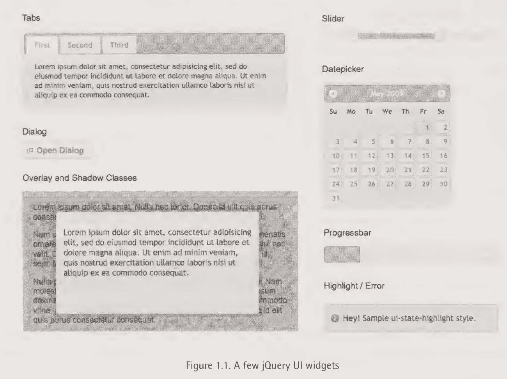

手风琴、滑块、对话框、日期选择器等等——所有这些都可以立即使用！你可以花大量时间在 jQuery 中自己创建它们（就像这些控件被创建出来一样），但 jQuery UI 控件配置灵活且足够完善，你的时间最好花在别处——也就是实现你独特的项目需求，而不是确保你自定义的日期选择器在不同浏览器中都能正确显示！

在本书的学习过程中，我们肯定会大量使用 jQuery UI 的功能。我们甚至会集成一些可用的酷炫主题，并学习如何使用 jQuery UI ThemeRoller 工具创建我们自己的主题。

### 插件

jQuery 团队非常注重让 jQuery 库具有可扩展性。通过只包含一组核心功能，同时提供一个扩展库的框架，他们使得创建插件变得容易，这些插件可以在你所有的 jQuery 项目中重用，也可以与其他开发者分享。许多相当常见的功能已经从 jQuery 核心库中省略，被归入插件的范畴。别担心，这是一个特性，而非缺陷。任何额外需要的功能都可以按页面轻松包含，以将带宽和代码膨胀降到最低。

值得庆幸的是，很多人已经利用了 jQuery 的可扩展性，因此已经有数百个优秀的、可下载的插件可以从 jQuery 插件库获取，并且一直在添加新的插件。图 1.2 展示了其中一部分。

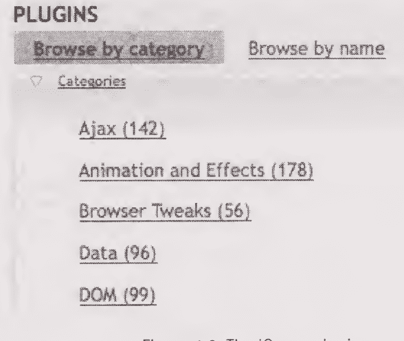

每当你面临一项任务或问题时，值得首先检查是否有适合你需求的插件。这是因为你可能需要的几乎任何功能都可能已经被制作成插件，并且可供你立即开始使用。即使最终需要自己动手做一些工作，插件库通常也是指引你走向正确方向的最佳场所。

### 保持标记语言的清洁

将脚本行为与页面呈现分离是 Web 开发领域的最佳实践——尽管它确实带来了一些挑战。jQuery 让这...

## 广泛采用

如果你愿意把能想到的每一个JavaScript库都放到Google Trends中，<sup>1</sup> 你会见证jQuery呈指数级增长成为超级明星。在库的世界里，跻身主流是件好事，因为受欢迎意味着更活跃的代码开发和大量有趣的第三方资源。

网络上无数的大玩家都加入了jQuery的阵营：IBM、Netflix、Google（它既使用又托管jQuery库），甚至微软，现在也将jQuery包含在其MVC框架中。有如此众多的大型公司支持，可以肯定jQuery将会存在相当长一段时间——因此，你投入的时间和精力学习它将是完全值得的！

jQuery的流行也催生了一个庞大而慷慨的社区，令人惊讶地乐于助人。无论你的技能水平如何，你都会发现其他开发者有足够的耐心帮助你，并解决你遇到的任何问题。这种关怀和分享的精神也传播到了更广泛的互联网，发展成为一个包含高质量教程、博客文章和文档的百科全书。

## 有什么缺点吗？

几乎没有缺点！反对使用任何JavaScript库的主要论点一直是速度和大小：有人说使用库会给页面增加太多下载负担，而另一些人则声称库的性能不如更精简的自定�代码。尽管这些论点值得考虑，但它们的相关性正在迅速减弱。

首先，就大小而言，jQuery非常轻量。核心jQuery库的体积一直相当小——基础部分大约19KB，比你的平均JPG图片还小。项目所需的任何额外内容（例如插件或jQuery UI库的组件）都可以以模块化方式添加——因此你可以轻松控制带宽消耗。

速度（和大小一样）随着计算机硬件规格的提升以及浏览器JavaScript引擎的日益加速而变得越来越不成问题。当然，这绝不是说jQuery很慢——jQuery团队似乎对速度非常执着！每次新版本都比上一次更快，因此你自己编写JavaScript可能带来的任何优势每天都在缩小。

当谈到竞争的JavaScript库时（而且这样的库不止一两个），jQuery在它所擅长的领域——操作DOM、添加效果和发送Ajax请求——做得最好。尽管如此，市面上许多其他库质量卓越，并在其他领域表现出色，例如复杂的基于类的编程。看看其他选择总是值得的，但如果我们概述的原因对你有吸引力，jQuery可能就是正确的选择。

但说得够多了：是时候让jQuery用行动证明自己了！

## 下载和引入jQuery

在你爱上jQuery（或者至少，亲自评判它）之前，你需要获取最新版本的代码并将其添加到你的网页中。有几种方法可以做到这一点，每种方法都有几个选项可用。无论你选择什么，你都需要将jQuery包含在你的HTML页面中，就像包含任何其他JavaScript源文件一样。

## 它就是JavaScript！

永远不要忘记jQuery只是JavaScript！表面上看和表现可能有所不同——但其底层是用JavaScript编写的，因此它无法做到任何普通JavaScript做不到的事情。这意味着我们将以与包含任何其他JavaScript文件相同的方式将其包含在我们的页面中。

## 下载jQuery

这是获取jQuery库最常见的方法——直接下载即可！最新版本始终可以从jQuery网站获得。<sup>2</sup> 那个醒目闪亮的下载按钮将引导我们到Google代码仓库，在那里我们可以获取最新的“生产压缩级别”版本。

点击下载链并将JavaScript文件保存到一个新的工作文件夹中，准备开始使用。你需要将其放在HTML文件能够找到的位置：通常在站点文档根目录下的**scripts**或**javascript**目录中。在接下来的示例中，我们将保持简单，将库放在与HTML文件相同的目录中。

为了让一切正常工作，我们需要告诉HTML文件包含jQuery库。这通过在HTML文档的head部分使用`script`标签来完成。包含jQuery的非常基础的HTML文件的head元素看起来有点像这样：

```html
<head>
    <title>Hello jQuery world!</title>
    <script type='text/javascript' src='jquery-1.4-min.js'></script>
    <script type='text/javascript' src='script.js'></script>
</head>
```

页面上的第一个script标签加载jQuery库，第二个script标签指向一个**script.js**文件，我们将在那里运行自己的jQuery代码。就这样：你已经准备好开始使用jQuery了。

我们之前说过，下载jQuery文件是最常见的方法——但还有其他几个选项可供你选择，所以在继续之前让我们快速看一下。如果你只想开始玩转jQuery，可以安全地跳过本节的其余部分。

## Google CDN

另一个值得考虑的包含jQuery库的方法是通过Google**内容分发网络（CDN）**。CDN是一个专门设计用于快速、可扩展地向用户提供内容的计算机网络。这些服务器通常在地理上分布，每个请由网络中最近的服务器提供服务。

Google在其CDN上托管了几个流行的开源库，包括jQuery（以及我们稍后会介绍的jQuery UI）。因此，你不必像上面那样在自己的网络服务器上托管jQuery文件，而是可以选择让Google承担部分带宽费用。你可以从Google庞大基础设施的速度和可靠性中受益，额外的好处是可以始终使用最新版本的jQuery。

使用Google CDN使用Google CDN的另一个好处是，许多用户在访问其他网站时已经从Google下载了jQuery。因此，当他们访问你的网站时，它将从缓存中加载（因为JavaScript文件的URL相同），从而显著加快加载时间。你还可以通过相同的方法包含更庞大的jQuery UI库，这使得Google CDN在你的项目中非常值得考虑：它将为你节省资金，并在你最新作品走红时提升性能！

有几种不同的方法可以从Google CDN引入jQuery。我们将使用更简单（虽然稍欠灵活）的基于路径的方法：

```html
<head>
  <title>Hello jQuery world!</title>
  <script type="text/javascript" src="http://ajax.googleapis.com/ajax/libs/jquery/1.4.0/jquery.min.js"></script>
  <script type='text/javascript' src='script.js'></script>
</head>
```

它看起来与我们最初的示例非常相似——但script标签不是指向jQuery的本地副本，而是指向Google的一台服务器。

10 jQuery：从新手到忍者


## 使用Google CDN获取最新版本

如果你仔细查看指向Google服务器的URL，你会看到jQuery版本由路径元素之一指定（在我们的示例中是1.4.0）。但是，如果你喜欢使用最新最好的版本，你可以从版本字符串末尾移除一个数字（例如，1.4），它将返回1.4系列中可用的最新发布版本（1.4.1、1.4.2等）。你甚至可以将其提升到整数（1），在这种情况下，即使jQuery 1.5及更高版本发布，Google也会为你提供最新版本！

但要小心：当jQuery新版本发布时，你无需更新HTML文件，但有必要留意任何可能影响现有功能的库更改。

如果你想了解稍微复杂一些的“Google加载器”引入库的方法，可以在其网站上阅读大量关于Google CDN的内容。<sup>3</sup>

## 每夜构建版本和Subversion

获取jQuery的更高级选项列在官方“下载jQuery”文档页面上。<sup>4</sup> 其中第一个选项是每夜构建版本。**每夜构建版本**是jQuery库的自动构建版本，包含当天添加或修改的所有新代码。每天晚上都会提供最新的开发版本供下载，并可以以与常规稳定库相同的方式引入。

如果*仍然*觉得每夜一次太频繁，你可以使用Subversion仓库获取最新的源代码。**Subversion**是jQuery团队使用的一个开源版本控制系统。每次开发人员向jQuery提交更改时，你都可以立即下载它。

但要注意：每夜构建版本和Subversion版本的jQuery库通常未经测试。它们可能（并且会）包含错误，并且经常发生变化。除非你打算研究jQuery库本身，否则最好跳过这些选项。

<sup>3</sup> http://code.google.com/apis/ajaxlibs/documentation/

<sup>4</sup> http://docs.jquery.com/Downloading_jQuery

## 未压缩还是压缩？

如果你在 jQuery 下载页面上浏览过，可能还会注意到几种不同的下载格式选项：压缩版（也称为**精简版**），以及未压缩版（也称为“开发版”）。

通常，你会希望在生产代码中使用精简版，此时 jQuery 源代码已被压缩：空格和换行符被移除，变量名被缩短。最终得到的是完全相同的 jQuery 库，但包含它的 JavaScript 文件比原始文件小得多。这对你来说能极大地降低带宽成本，对最终用户来说则能加快页面请求速度。

压缩文件的缺点是可读性差。如果你在文本编辑器中查看精简版的 jQuery 文件（试试看！），你会发现它几乎无法辨认：只有一行看起来杂乱无章的 JavaScript 代码。库的可读性在大多数情况下无关紧要，但如果你对 jQuery 的实际工作原理感兴趣，那么未压缩的开发版本就是一个有注释、可读性强且非常优美的 JavaScript 示例。

## jQuery 脚本剖析

现在我们已经将 jQuery 包含在网页中，让我们看看这个小家伙能做什么。第一次看到 jQuery 语法时，你可能会觉得有点奇怪，但它实际上非常简单直接，最重要的是，它高度一致。在编写了你的前几个命令后，其风格和语法就会牢牢记在你脑中，让你忍不住想写更多。

## jQuery 别名

在页面中包含 jQuery 后，你就能访问一个名为（奇怪的是）jQuery 的神奇函数。只有一个函数？正是通过这一个函数，jQuery 向你展示了数百种强大的工具，为你的网页增添另一个维度。

由于单个函数充当了整个 jQuery 库的入口，库函数名与其他库或你自己的 JavaScript 代码发生冲突的可能性很小。否则，可能会出现这样的情况：假设 jQuery 定义了一个名为 `hide` 的函数（它确实有），而你的代码中也有一个名为 hide 的函数，其中一个函数将被覆盖，导致不可预料的事件和错误。

我们说 jQuery 库包含在 jQuery *命名空间*中。命名空间是与页面上其他代码友好协作的一种绝佳方式，但如果我们打算大量使用 jQuery（事实确实如此），每次使用命令都必须输入完整的 jQuery 函数名会很快变得令人烦恼。为了解决这个问题，jQuery 提供了一个更短的别名来访问这个库。简单来说，它就是 $。

美元符号是一个简短、有效且看起来很酷的 JavaScript 变量名。这看起来可能有点懒（毕竟使用别名只节省了五次按键），但一整页的 jQuery 代码会包含大量的库调用，使用别名将使代码更具可读性和可维护性。

> ### 使用多个库

> 你可能想使用完整的 jQuery 调用而不是别名的主要原因是，当页面上有多个 JavaScript 库时，它们都在争夺美元符号函数名的控制权。$ 是多个库中的常用函数名，通常用于选择元素。如果你遇到多个库的问题，请查看第 9 章中的“避免冲突”部分。

## 解析 jQuery 语句

我们知道 jQuery 命令以调用 jQuery 函数或其别名开始。现在，让我们拿起手术刀，检查 jQuery 语句的其余组成部分。图 1.3 展示了同一个 jQuery 语句的两种变体（使用完整函数名或 $ 别名）。

| 选择器 | 动作 | 参数 |

|---|---|---|

| jQuery('p') | .css | ('color', 'blue'); |

| $('p') | .css | ('color', 'blue'); |

图 1.3. 一个典型的 jQuery 语句

每个命令由四个部分组成：jQuery 函数（或其别名）、选择器、动作和参数。我们已经了解了 jQuery 函数，现在让我们依次看看其他元素。首先，我们使用选择器来选择网页上的一个或多个元素。接下来，我们选择要应用于每个选定元素的动作。我们将在全书实现效果的过程中看到越来越多的动作。最后，我们指定一些参数来告诉 jQuery 我们希望如何应用所选的动作。每当看到 jQuery 代码时，试着将其分解成这些组成部分。这将使你在刚开始学习时更容易理解。

在我们的示例中，我们要求选择器选择页面上的所有段落标签（HTML `<p>` 标签）。接下来，我们选择了 jQuery 的 `css` 动作，它用于修改最初选定的段落元素的 CSS 属性。最后，我们传递了一些参数将 CSS `color` 属性设置为值 `blue`。最终结果？我们所有的段落现在都变成蓝色了！我们将在第 2 章深入探讨选择器和 `css` 动作。

我们的示例向 `css` 动作传递了两个参数（`color` 和 `blue`），但传递给动作的参数数量可以不同。有些不需要参数，有些接受多组参数（用于一次更改多个属性），还有些要求我们指定另一个 JavaScript 函数，以便在事件（如元素被点击）发生时运行代码。但所有命令都遵循这种基本结构。

## HTML 的片段——又名“DOM”

jQuery 被设计为与 HTML 和 CSS 无缝集成。如果你精通 CSS 选择器，并且知道例如 `div#heading` 指的是一个 `id` 为 `heading` 的 `div` 元素，你可能会想跳过这一部分。否则，你需要一个关于 CSS 选择器和**文档对象模型（DOM）**的简短速成课程。

DOM 并非 jQuery 特有；它是所有浏览器制造商都同意遵循的、表示 HTML 对象的一种标准方式。对 DOM 有良好的实践知识将确保你顺利过渡到 jQuery 高手境界。

当你和饮水机旁的酷小孩们聊天时，DOM 就是你用来称呼渲染后的 HTML 片段的术语。它是你 HTML 标记的层次化表示——其中每个元素（如 `div` 或 `p`）都有一个**父元素**（它的“容器”），并且也可以有一个或多个嵌套的**子元素**。每个元素可以有一个 `id` 和/或一个或多个 `class` 属性——通常你在 HTML 源文件中分配这些。当浏览器读取 HTML 页面并构建 DOM 时，它会将其显示为一个由对象组成的网页，这些对象要么静止在那里（作为静态页面），要么更有趣地，可以被我们的代码操作。

图 1.4 展示了一个示例 DOM 片段。如你所见，body 有两个子元素：一个 h1 和一个 p。由于这两个元素包含在同一个父元素中，它们被称为**兄弟元素**。

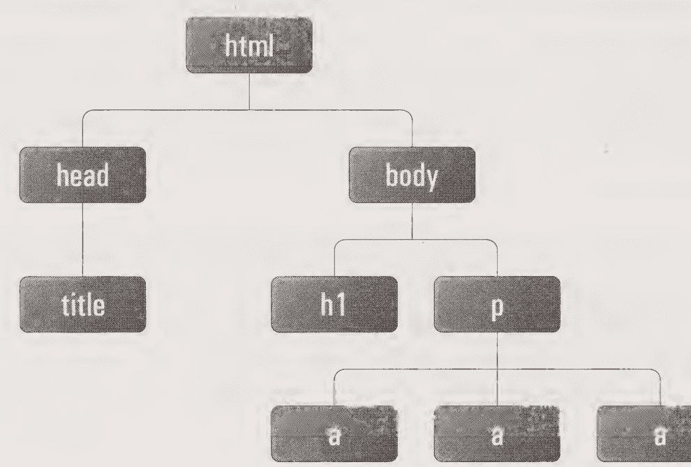

元素的 id 唯一地标识页面上的元素：

```html
<div id="footer">Come back and visit us soon!</div>
```

div 被分配了一个 id 为 footer。它使用 id 是因为它是唯一的：页面上应该只有一个，且仅有一个。DOM 还允许我们通过 class 属性为多个页面元素分配相同的名称。这通常用于具有共同特性的元素：

```html
<p class="warning">Sorry, this field must be filled in!</p>
<span class="warning">Please try again</span>
```

在此示例中，同一页面上的多个元素被归类为“warning”。任何应用于 warning 类的 CSS 将应用于这两个元素。同一元素上的多个 class 属性（当需要时）用空格分隔。

编写 CSS 时，你可以用井号符号按 id 钩住元素，或用点号按 class 钩住元素：

```css
#footer { border: 2px solid black }
.warning { color: red }
```

这些 CSS 规则将为 id 为 footer 的元素添加黑色边框，并确保所有 class 为 warning 的元素将以红色文本显示。

当需要编写一些 jQuery 时，你会发现了解 CSS 选择器和 DOM 很重要：jQuery 使用与 CSS 相同的语法来选择页面上的元素进行操作。一旦你掌握了选择，剩下的就很容易了——这要归功于 jQuery！

## 如果你选择接受...

jQuery 是一个稳定且成熟的产品，可以用于任何规模的网站，这一点已由互联网上一些真正的巨头采用所证明。尽管如此，它仍然是一个动态项目，不断开发和改进，每个新版本都提供性能提升和巧妙的附加功能。现在开始学习和使用 jQuery 再合适不过了！

当我们学习本书时，你会看到 jQuery 的座右铭“写得更少，做得更多”非常有道理。它是一个简单而有趣的库，学习曲线平缓，让你只需很少的代码就能完成很多很酷的事情。随着你在成为 jQuery 高手之路上不断进步，我们希望你也能获得对 JavaScript 本身的尊重和理解。

在第 2 章中，我们将深入探讨 jQuery，并开始使用它为客户的网站增添一些光彩。说到我们的客户，是时候见见他了……

# 第2章

## 选择、装饰与增强

“在第二阶段，我们希望能利用社交功能，实现基于Web 2.0社区的、众包的、Ajax，嗯，交互，”我们的新客户说道。“但现在，我们只需要对网站上的一些基础内容进行修改。”

我们的客户正在启动一个名为StarTrackr!的初创项目。该项目利用GPS和RFID技术来追踪知名名人的精确物理位置——然后将这些信息出售给粉丝。此前，项目在一家朋友的本地店铺里运营得如火如荼，但现在他们正将业务转移到线上。

“你们能搞定吗？这是需要在周五下班前上线的需求清单。”

你扫视了一遍清单。令人惊奇的是，你发现所有的需求都可以用jQuery来实现。你看了看日历。今天是周五早上。让我们开始吧！

清单上的第一项任务是在现有网站加载时添加一个简单的JavaScript提示框。这是为了告知访客，StarTrackr!目前并未因侵犯隐私而被起诉（这一点最近在一家地方报纸上被暗示过）。

当然，我们可以使用纯粹的原生JavaScript来实现，但我们知道使用jQuery会让我们的工作轻松很多——而且我们还能在实践中学习一项新技术！我们在第1章已经了解了jQuery语句的基本结构；现在让我们来看看将jQuery付诸实践所需的步骤：我们等待页面就绪，选择我们的目标，然后改变它。

你可能已经猜到jQuery可以比这更复杂一些——但也只是一点点！即使是高级效果也将依赖于这个基本公式，只是重复执行最后两个步骤多次，并可能需要一些JavaScript知识。目前，让我们从简单轻松开始。

## 确保页面就绪

在我们能够与页面上的HTML元素进行交互之前，这些元素需要已经被加载：只有在它们已经存在后，我们才能修改它们。在JavaScript的旧时代，唯一可靠的方法是等待整个页面（包括图片）完成加载后，才运行任何脚本。

幸运的是，jQuery有一个非常酷的内置事件，它会尽快执行我们的魔法代码。正因为如此，我们的页面和应用程序对最终用户来说加载速度似乎要快得多：

```
$(document).ready(function() {
  alert('Welcome to StarTrackr! Now no longer under police ...');
});
```

这里的重要部分（用粗体突出显示）表示：“当我们的文档就绪时，运行我们的函数。”这是你可能会经常看到的最常用的jQuery代码片段之一。通常，进行像这样的简单提示框测试是个好主意，可以确保你已经正确包含了jQuery库——并且没有出现奇怪的问题。

> 你会经常看到 `$(document).ready()`！

你在jQuery中做的几乎所有事情都需要在*文档就绪之后*完成——所以我们将经常使用这个操作。从现在起，它将被称为文档就绪事件。除非另有说明，本书中的每个后续示例都需要在文档就绪事件内部运行。不过，你通常只需要在每个页面中声明它一次。

事实上，文档就绪惯用法非常普遍，以至于有一个快捷版本：

```
$(function() { alert('Ready to do your bidding!'); });
```

如果你想使用快捷方法，请尽管使用！展开版本可以说是自文档化代码的一个更好范例；它更容易让人一目了然地看出发生了什么——特别是当它被埋没在其他开发者的JavaScript页面中时！

乍一看，文档就绪事件似乎与我们在jQuery解剖课上遇到的结构大相径庭，但仔细观察后，我们会发现所有必要的部分都已到位：选择器是`document`；操作是`ready`；参数是一个运行某些代码（我们的提示框）的函数。

## 选择：jQuery的核心

时间在流逝，截止日期不等人。客户指出，人们一直在从网站上引用错误的名人ID。这是因为名人的名字都排列在一个大表格中，用户很难将名人与正确的参考ID对应起来。我们的客户告诉我们，他希望每隔一行显示为浅灰色，这样用户就能轻松找到他们喜欢的名人。

我们已经准备好让jQuery听候调遣——它只需要我们为它选择一个目标。在页面上选择你想要修改的元素，真的是jQuery的艺术所在。新手和高手之间最大的区别之一，就是你抓取想要操作的元素所需的时间！

你可能还记得，在我们的jQuery解剖课中，我们所有的选择器都被包裹在jQuery函数中：

```
jQuery(<selectors go here>)
```

或者使用别名：

```
$(<selectors go here>)
```

在本书的剩余部分，我们将使用这个快捷别名——它方便得多。正如我们之前提到的，除非你遇到与其他库的冲突问题（参见第9章“避免冲突”一节），否则没有真正理由使用完整的`jQuery`名称。

## 简单选择

我们的任务是在名人表格中选择隔行的表格行。我们该如何做到这一点？使用jQuery进行选择时，你的目标应该是只达到所需的精确度：你需要找到能精确返回你想要更改内容的最简洁的选择器。让我们首先看看名人表格的标记，如图2.1所示。

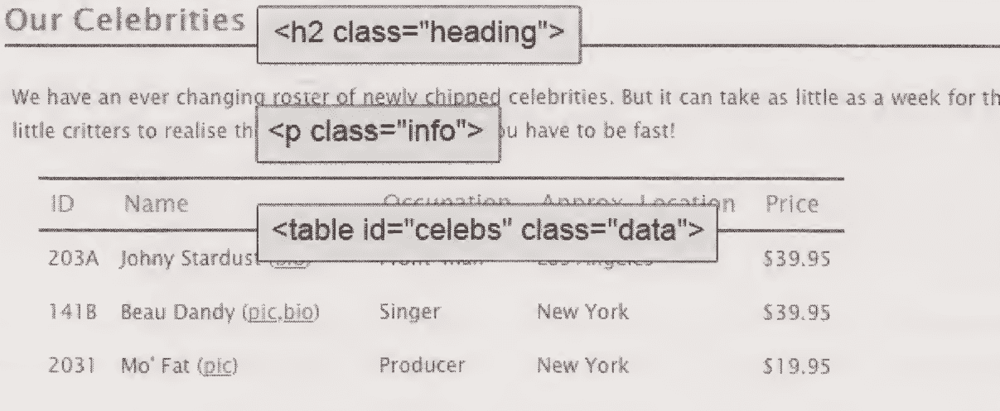

我们可以从选择整个页面上的所有表格行元素开始。要按元素类型选择，你只需将元素的HTML名称作为字符串参数传递给`$`函数。要选择所有表格行元素（用`<tr>`标签标记），你可以直接写：

```
$('tr')
```

## **什么都不会发生！**

如果你运行这个命令，页面上不会发生任何事情。这是预料之中的——毕竟，我们只是在选择元素。但不用担心；很快我们就会以各种奇妙的方式修改我们的选择。

同样，如果我们想选择页面上的每个段落、`div`元素、`h1`标题或输入框，我们会相应地使用这些选择器：

```
$('p')
$('div')
$('h1')
$('input')
```

但我们并不想修改名人页面上的*每一个*表格行：只想修改包含名人数据的表格行。我们需要更具体一些，首先选择包含名人列表的容器元素。如果你查看HTML和图2.1，你会看到包含我们名人表格的`div`的id是`celebs`，而表格本身的类名是`data`。我们可以使用其中任何一个来选择这个表格。

jQuery借用CSS的约定来引用id和类名。要按id选择，请使用井号（`#`）后跟元素的id，并将其作为字符串传递给jQuery函数：

```
$('#celebs')
```

你应该注意，我们传递给jQuery函数的字符串格式与CSS的id选择器完全相同。因为id应该是唯一的，我们期望这只会返回一个元素。jQuery现在持有了这个元素的引用。

同样，我们可以使用CSS类选择器来按类选择。我们传递一个由句点（`.`）后跟元素类名组成的字符串给jQuery函数：

```
$('.data')
```

这两个语句都会选择该表格，但正如之前在讨论DOM时提到的，一个类可以被多个元素共享——jQuery会很高兴地选择我们指向的所有元素。如果有多个表格（或其他任何元素）也拥有`class`属性`data`，它们都会被选中。因此，对于这个任务，我们将坚持使用`id`！

> **你能更具体一些吗？**

就像CSS一样，我们可以选择`$('.data')`或者更具体的`$('table.data')`。通过在类名之外指定一个元素类型，选择器将只返回具有`data`类的`table`元素——而不是*所有*具有`data`类的元素。另外，和CSS一样，你可以添加父容器选择器来进一步缩小你的选择范围。

## 缩小选择范围

我们已经成功选择了表格，但表格本身并非我们兴趣所在——我们想要的是表格内*每隔一行*。我们已经选择了容器元素，并从这个容器元素中，我们想要挑选出所有作为表格行的后代：也就是说，我们要指定包含在`table`容器*内*的所有表格行。为此，我们在祖先和后代之间放一个空格：

```
$('#celebs tr')
```

你可以使用这种结构来深入查找你所需的元素，但为了清晰起见，请尽量保持你的选择器简洁。

让我们把这个想法再推进一步。假设我们想要选择所有在`p`元素内部的`span`元素，而这些`p`元素本身又位于`div`元素内部——但仅限于那些碰巧具有`fancy`类的`div`。我们会使用选择器：

```
$('div.fancy p span')
```

如果你能理解这个，那么你几乎可以准备好选择任何东西了！

## 测试我们的选择

好的，回到我们手头的任务。感觉我们越来越接近了，但到目前为止我们只是在盲目地选择，没有办法知道我们是否走在正确的道路上。我们需要一种方法来确认我们选择了正确的元素。一个简单的方法是利用`length`属性。`length`返回数量

当前由选择器匹配到的所有元素。我们可以结合老派且可靠的`alert`语句来确保元素已被选中：

```javascript
$(document).ready(function() {
  alert($('#celebs tr').length + ' elements!');
});
```

这将弹出选择结果的长度——7个元素——对应名人`table`。这个结果可能与你的预期不同，因为表格中只有六位名人！如果你查看HTML，就会发现问题所在：`table`的表头也是一个`tr`，所以总共有七行。一个快速的解决方法是缩小选择器范围，只查找位于`tbody`元素内的表格行：

```javascript
$(document).ready(function() {
  alert($('#celebs tbody tr').length + ' elements!');
});
```

这将弹出正确的长度6个元素——此时jQuery对象正持有我们的六位名人的表格行元素。

如果弹出的是0，你就知道选择器出错了。排查这类问题的一个好方法是将选择器缩减到最小、最简单的形式。

在我们的例子中，我们可以简单地写`$('#celebs')`，它只会选中div元素并弹出长度1。从这里开始，你可以逐步使选择器更具体，并随时检查是否选中了正确数量的元素。

## 过滤器

知道我们已经成功选择了所有表格行后，将选择范围缩小到每隔一行很简单——因为jQuery有一个`filter`可以做到这一点。过滤器会移除某些项目，只保留我们想要的。通过更多实例，你会逐渐了解什么可以被过滤，但现在我们直接使用实现斑马条纹所需的过滤器：

jQuery: Novice to Ninja

```
chapter_02/04_filters/script.js

$(document).ready(function() {
    alert($('#celebs tbody tr:even').length + ' elements!');
});
```

过滤器附加在你想过滤的项目上（本例中是表格行），通过冒号后跟过滤器名称来定义。这里使用的`:even`过滤器会保留选择中所有偶数索引的元素，并移除其余部分，这正是我们想要的。现在当我们弹出选择长度时，会看到3，正如预期。我们所有奇数行都被过滤出了选择。有许多jQuery选择器过滤器可供使用：`:odd`（如你所想），`:first`，`:last`，`:eq()`（例如选择第三个元素）等等。在本书中，当我们需要时，会更详细地介绍每一个。

## 选择多个元素

基础选择的最后一个技巧是能够在单个语句中选择多个元素。这非常有用，因为我们经常想对页面不同部分的多个元素应用相同的动作。用逗号分隔选择器字符串即可实现。例如，如果我们想选择页面上的每个段落、div元素、h1标题和输入框，我们会使用这个选择器：

```javascript
$('p,div,h1,input')
```

学习如何将所有这些不同的选择器组合使用，以精确访问你想要的页面元素，是精通jQuery的重要部分。这也是使用jQuery最令人满足的部分之一，因为你可以在短短一行代码中包含相当复杂的逻辑！

## 成为选择高手

选择可能看起来相当容易，某种程度上确实如此。但到目前为止我们所涵盖的只是选择的表面。在大多数情况下，基础知识就足够了：如果你只是想针对某个元素或一组相关元素，元素名称、id和class是最有效且最简单的实现方式。

当从给定元素在DOM中移动时，情况会变得有些棘手。jQuery提供了无数选择器和动作来遍历DOM。**遍历**意味着在页面层次结构中上下移动，经过父元�和子元素。你可以边走边添加和删除元素，在每一步应用不同的动作——这让你能在单个jQuery语句中执行一些极其复杂的操作！

如果你精通CSS，你已经熟悉了许多语句；它们大多直接借鉴自CSS规范。但可能有一些你不熟悉，特别是如果你还没有花太多时间学习CSS3选择器。当然，我们将在示例和演示中学习和介绍高级选择技术。因此，任何时候你想了解更多可用的jQuery选择器，只需查阅在线文档[^1]并浏览即可！

## 装饰：使用jQuery进行CSS操作

在jQuery中选择元素是困难的部分。其他一切都既简单又有趣。一旦我们选定了目标，就能够操作它们来构建效果或界面。在本节中，我们将介绍一系列与CSS相关的jQuery动作：添加和移除样式、类等等。我们执行的动作将单独应用于每个选中的元素，让我们随心所欲地改变页面！

### 读取CSS属性

在尝试更改CSS属性之前，让我们先看看如何简单地访问它们。jQuery让我们通过css函数来做到这一点。试试这个：

```javascript
$(document).ready(function() {
  var fontSize = $('#celebs tbody tr:first').css('font-size');
  alert(fontSize);
});
```

此代码将弹出选择器匹配的第一个元素的字体大小（正如你可能猜到的，`:first`过滤器会返回选择器匹配结果中的第一个元素）。

> **多个元素的CSS属性**

>

> 你*可以*在选择多个元素后询问CSS属性，但这几乎总是个坏主意：一个函数只能返回一个结果，所以你仍然只能获得第一个匹配元素的属性。

使用此方法获取CSS属性的巧妙之处在于，jQuery给你的是元素的*计算后*样式。这意味着你将收到在用户浏览器中渲染的值，而不是CSS定义中输入的值。所以，如果你在CSS文件中给一个div设置了高度，比如200像素，但其内容将高度推超过了200像素，jQuery会给你提供元素的实际高度，而不是你指定的200像素。

当我们稍后实现一些奇妙的技巧时，你就会明白为什么这真的很重要。

### 设置CSS属性

到目前为止，我们还没看到jQuery实际*做*什么，现在是时候弥补这一点了。我们知道页面已就绪（因为我们弹出了alert），并且相当确定已经选择了我们感兴趣的元素。让我们验证一下：

```javascript
$(document).ready(function() {
  $('#celebs tbody tr:even').css('background-color', '#dddddd');
});
```

你可能预料到了！这就是我们用来读取CSS属性的同一个`css`函数，但现在它被传递了一个额的参数：我们希望为该属性设置的值。我们使用了这个动作将`background-color`设置为值`#dddddd`（浅灰色）。在浏览器中打开代码存档中的文件，测试它是否正常工作。你可以在图2.2中看到结果。

| ID    | Name                    | Occupation | Approx. Location | Price  |

| :---- | :---------------------- | :--------- | :--------------- | :----- |

| 203A  | Johny Stardust (bio)    | Front-man  | Los Angeles      | $39.95 |

| 141B  | Beau Dandy (pic,bio)    | Singer     | New York         | $39.95 |

| 2031  | Mo' Fat (pic)           | Producer   | New York         | $19.95 |

| 007F  | Kellie Kelly (bio,press)| Singer     | Omaha            | $11.95 |

| 8A05  | Darth Fader (pic)       | DJ         | London           | $19.95 |

| 6636  | Glendatronix (bio,press)| Keytarist  | London           | $39.95 |

图2.2. 使用jQuery实现的斑马条纹

## 你准备好了吗？

如前所述，此命令必须在文档就绪函数内发出。如果在DOM就绪前运行该命令，选择器将去寻找**#celebs**元素，但会找不到任何匹配项。此时它会放弃；它甚至不会去寻找`tr`元素，更不用说更改背景样式了。

以下所有示例都是如此，因此请记住将你的代码包裹在文档就绪函数中。

看起来不错！但也许我们应该给它加点东西——毕竟，多多益善！用稍浅一点的字体颜色来真正定义我们的条纹怎么样？有几种方法可以添加第二个CSS属性。最简单的方法是用新值重复整个jQuery语句：

```javascript
chapter_02/07_multiple_properties_1/script.js (excerpt)

$('#celebs tbody tr:even').css('background-color', '#dddddd');
$('#celebs tbody tr:even').css('color', '#666666');
```

这些行一个接一个地执行。虽然最终结果是正确的，但如果我们需要更改大量属性，这将变得相当混乱且低效。幸运的是，jQuery提供了一种很好的方式，使用**对象字面量**同时设置多个属性。对象字面量是一个超出本书范围的JavaScript概念，但就我们的目的而言，你只需要知道它们提供了一种将键/值对分组的简单方法。对于CSS，对象字面量允许我们

为了将我们的 CSS 属性（键）与匹配的 CSS 值（值）整齐地组合在一起：

```
chapter_02/08_multiple_properties_2/script.js (excerpt)
$('#celebs tbody tr:even').css(
  {'background-color': '#dddddd', 'color': '#666666'}
);
```

对象字面量用花括号包裹，每个键与其对应的值用冒号分隔，每个键/值对用逗号分隔。它作为单个参数传递给 `css` 函数。使用此方法，你可以根据需要指定任意数量的键/值对——只需用逗号分隔即可。最好以可读的方式排列你的键/值对，以便日后回顾代码时能一目了然。如果你需要设置大量属性，这一点尤其有用。例如：

```
chapter_02/09_multiple_properties_3/script.js (excerpt)
$('#celebs tbody tr:even').css({
  'background-color': '#dddddd',
  'color': '#666666',
  'font-size': '11pt',
  'line-height': '2.5em'
});
```

## 引号之惑

通常，在处理 JavaScript 对象时，键不需要加引号。但是，为了让 jQuery 正常工作，任何包含连字符的键（如我们的 `background-color` 和 `font-size` 示例）都必须加引号，或者使用驼峰命名法（如 `backgroundColor`）。

此外，任何已经是 JavaScript 语言关键字的键（例如 `float` 和 `class`)也必须加引号书写。

试图记住哪些键需要加引号、哪些不需要可能会令人困惑，因此建议每次都将所有对象键都加上引号。

## 类

太棒了！我们已经从客户列表中划掉了两项任务，而且我们正在使用一些炫酷的 jQuery。但如果你停下来看看我们最后的解决方案，可能会注意到一些可疑之处。如果你在 Firebug 等开发工具中检查斑马条纹行，会注意到 CSS 属性已内联添加到表格行中，如图 2.3 所示。

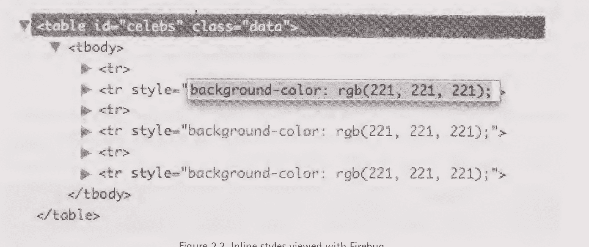

> **Firebug**

Firebug 是一个特别有用的工具，可用于检查浏览器中的 DOM，以及监控和编辑 CSS、HTML 和 JavaScript（包括 jQuery）。它是 Web 开发者的瑞士军刀，通过帮助你准确了解浏览器认为发生了什么，可以为你节省数小时的时间。它可作为 Mozilla Firefox 扩展使用，也可以作为独立的 JavaScript 文件包含在你的项目中，如果你使用其他浏览器进行开发的话。

内联样式在 HTML/CSS 最佳实践中是大忌，对吧？确实如此，这同样适用于 jQuery：为了让你的代码清晰易维护，将所有样式信息放在同一个地方——即你的 CSS 文件中——更有意义。然后，正如我们很快将看到的，你可以通过附加或移除 HTML 标签的类属性来简单地切换这些样式。

有时，以我们刚才看到的方式使用 `css` jQuery 方法是个好主意。最常见的应用场景是快速调试代码：如果你只想用红色轮廓标出某个元素以确保选中正确，切换到 CSS 文件添加新规则似乎是在浪费时间。

## 添加和移除类

如果我们需要从内联样式规则中移除 CSS，应该把它放在哪里？当然是放在一个单独的样式表中！我们可以将所需的样式放在 CSS 中针对特定类的规则里，并使用 jQuery 将该类添加到 HTML 中的目标元素或从中移除。或许不足为奇，jQuery 提供了一些方便的方法来操作 DOM 元素的类属性。我们将使用其中最常见的 `addClass`，将斑马条纹样式移动到它们应在的 CSS 文件中。

`addClass` 函数接受一个包含类名的字符串作为参数。你也可以通过用空格分隔类名来同时添加多个类，就像在 HTML 中编写的一样：

```
$('div').addClass('class_name');
$('div').addClass('class_name1 class_name2 class_name3');
```

不过，我们只想添加一个类名，我们称之为 `zebra`。首先，我们将规则添加到一个新的 CSS 文件中（在 HTML 页面中用 `link` 标签包含它）：

```
.zebra {
    background-color: #dddddd;
    color: #666666;
}
```

然后，回到我们的 JavaScript 文件中，我们将修改选择器以使用 jQuery 的 `addClass` 方法而不是 `css`：

```
$('#celebs tr:even').addClass('zebra');
```

结果完全相同，但现在当我们用 Firebug 检查表格时，会看到内联样式消失了——被我们的新类定义取代。这如图 2.4 所示。

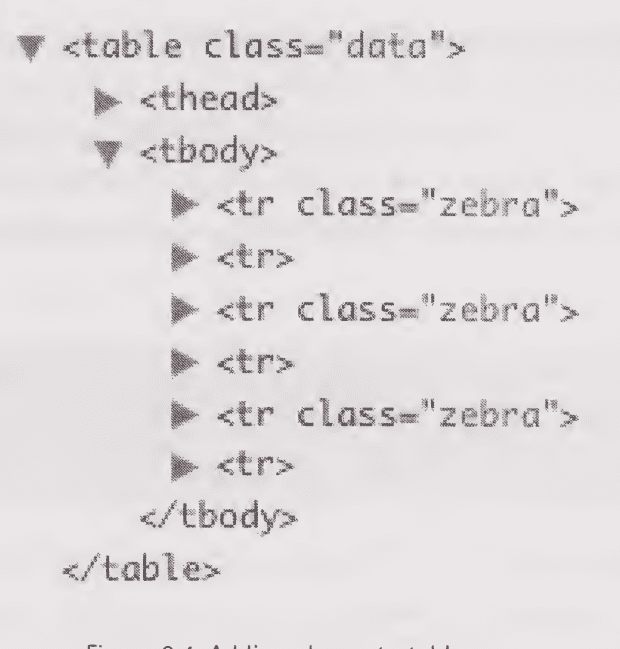

图 2.4. 为表格行添加类

这样好多了。现在，如果我们将来想更改斑马条纹的外观，只需修改 CSS 文件即可；这将省去我们在 jQuery 代码中（可能在多个地方）查找并更改值的麻烦。

有时我们也想从元素中移除类名（我们很快会看到一个必要的情况）。移除类的操作被方便地称为 `removeClass`。此函数的使用方式与 `addClass` 完全相同；我们只需传递（不）需要的类名作为参数：

```
$('#celebs tr.zebra').removeClass('zebra');
```

也可以使用 jQuery 的 `attr` 方法操作 `id` 属性或任何其他属性。我们将在本书后面更详细地介绍此方法。

## 增强：使用 jQuery 添加效果

现在你已经到达了一个重要的里程碑。你已经学习了 jQuery 语句的组成部分：选择器、操作和参数。并且你学习了使用该语句的步骤：确保文档准备就绪，选择元素，并更改它们。

在下一节中，我们将运用这些知识来实现一些酷炫且实用的效果——并且希望借此能巩固你对 jQuery 基础知识的理解。

## 隐藏和显示元素

客户不喜欢网站上的免责声明——他觉得这给产品带来了不好的影响——但他的律师坚持认为有必要。因此，客户要求你添加一个按钮，以便用户阅读完文本后可以将其移除：

```
chapter_02/11_hiding/index.html (excerpt)

<input type="button" id="hideButton" value="hide" />
```

我们在页面上添加了一个 ID 为 `hideButton` 的 HTML 按钮。当用户点击此按钮时，我们希望 ID 为 `disclaimer` 的免责声明元素被隐藏：

```
chapter_02/11_hiding/script.js (excerpt)

$('#hideButton').click(function() {
  $('#disclaimer').hide();
});
```

运行此代码，并确保当你点击隐藏按钮时，免责声明元素会消失。

本示例中使元素实际消失的部分是 `hide` 操作。那么，你可能会问，围绕这一行的其他所有代码是什么？那叫做**事件处理器**——理解它对于成为 jQuery 高手至关重要。我们可以使用多种事件处理器（我们在这里使用了 `click` 事件处理器），并且在后续内容中我们会经常用到它们。

### 事件处理器

**事件处理器**因其处理事件的功能而得名。事件是发生在网页上的操作和用户交互。当事件发生时，我们说它已经*触发*（*fired*）。而当我们编写一些代来处理该事件时，我们说我们*捕获*（*caught*）了该事件。

网页上每时每刻都有成千上万的事件被触发：当用户移动鼠标、点击按钮，或者当浏览器窗口调整大小、滚动条移动时。我们可以捕获并作用于其中任何一个事件。

你在本书中接触到的第一个事件是文档就绪事件。是的，那是一个事件处理器：当文档说“我准备好了”时，它触发了一个事件，我们的 jQuery 语句捕获了它。

我们使用了 `click` 事件处理器来告诉 jQuery 在按钮被点击时隐藏免责声明：

```
$('#hideButton').click(function() {
  $('#disclaimer').hide();
});
```

### this

当事件触发时，我们经常需要引用触发它的元素。例如，我们可能想以某种方式修改用户刚刚点击的按钮。这种引用可以在我们的事件处理器代码中通过 JavaScript 关键字 `this` 获得。要将 JavaScript 对象转换为 jQuery 对象，我们用 jQuery 选择器将其包裹：

```
chapter_02/12_this/script.js (excerpt)
$('#hideButton').click(function() {
  $(this).hide(); // a curious disappearing button.
});
```

`$(this)` 提供了一种更优雅的方式来指代触发事件的元素，而无需重新选择它。

> **操作在哪里？**

当你刚开始时，这可能会有点令人困惑，因为 jQuery 语句的“操作”组件似乎有多种用途：我们已经看到它用于运行动画、检索值，而现在，又用于处理事件！确实如此——它用途广泛！通常操作的名称能很好地提示其用途，但如果你迷失了方向，最好查阅索引。过一段时间后，你就能将处理器、动画和工具区分开来。

## 显示隐藏元素

继续我们的任务！客户还要求用户需要能够在错误关闭免责声明时重新获取它。因此，让我们在 HTML 中再添加一个按钮，这次的 id 为 `showButton`：

```html
<input type="button" id="showButton" value="show" />
```

我们还需要在脚本文件中添加另一个 jQuery 语句，用于处理点击 **显示** 按钮时显示免责声明：

```javascript
$('#showButton').click(function() {
    $('#disclaimer').show();
});
```

## 切换元素

为隐藏和显示免责声明分别设置按钮似乎浪费了宝贵的屏幕空间。最好是有一个按钮能同时执行这两项任务——在免责声明可见时将其隐藏，在隐藏时将其显示。一种实现方式是检查元素是否可见，然后相应地显示或隐藏。我们将移除旧按钮，并添加这个漂亮的新按钮：

```html
<input type="button" id="toggleButton" value="toggle" />
```

当点击它时，我们检查以确定是显示还是隐藏免责声明：

```javascript
$('#toggleButton').click(function() {
    if ($('#disclaimer').is(':visible')) {
        $('#disclaimer').hide();
    } else {
        $('#disclaimer').show();
    }
});
```

这引入了 `is` 操作。`is` 接受我们通常传递给 jQuery 函数的任何选择器，并检查它们是否与调用它的元素匹配。在这种情况下，我们检查选中的 `#disclaimer` 是否也被伪选择器 `:visible` 选中。它也可以用于检查其他属性：选择是否是一个 `form` 或 `div`，或是 `enabled` 状态。

## `if` 语句

如果你完全是编程新手（也就是说，你只使用过 HTML 和 CSS），那么整段代码可能让你相当困惑！别担心，它其实非常直观：

```javascript
if (condition) {
    // 如果条件为真，执行这部分代码
} else {
    // 如果条件为假，执行这部分代码
}
```

条件可以是任何 JavaScript 将其评估为 `true` 或 `false` 的内容。这种结构在任何类型的编程中都极其常见，在本书的剩余部分我们将大量使用它。如果你对此感到不适应，最好的学习方法就是动手尝试：尝试使用 jQuery 的 `is` 操作编写不同的 `if` / `else` 代码块，就像我们上面写的那样。你很快就能掌握它！

`is` 将根据元素是否匹配选择器返回 `true` 或 `false`。就我们的目的而言，如果元素隐藏，我们将显示它；如果可见，则隐藏它。这种在两种状态之间切换的逻辑称为**切换**，是一种非常有用的构造。

在两种状态之间切换元素非常常见，以至于许多 jQuery 函数都有一个允许切换的版本。`show/hide` 的切换版本就简单地称为 `toggle`，其工作方式如下：

```javascript
$('#toggleButton').click(function() {
    $('#disclaimer').toggle();
});
```

每次点击按钮，元素在可见和隐藏之间切换。

然而，如果按钮的标签是一个比“toggle”更有用的词（这可能会让用户困惑），那就更好了。如果你想同时切换按钮的文本怎么办？正如在使用 jQuery 时常遇到的情况，有几种方法可以解决这个问题。这里是一种：

```javascript
$('#toggleButton').click(function() {
    $('#disclaimer').toggle();

    if ($('#disclaimer').is(':visible')) {
        $(this).val('Hide');
    } else {
        $(this).val('Show');
    }
});
```

这段代码中有很多对你来说是新内容。我们将在后面详细讲解大部分细节，但先看看它，看你自己能否弄明白。（提示：记住选择器 `$(this)` 指的是触发事件的元素——在本例中，就是按钮。）

## 渐进式增强

我们的免责声明功能运行完美——客户无疑会对此印象深刻。然而，我们的解决方案有一个微妙之处需要注意：如果一个用户使用不支持 JavaScript 的浏览器访问我们的网站，他们会看到页面上有一个按钮，但点击后什么也不会发生。这会让用户非常困惑，甚至可能放弃访问我们的网站。

“不支持 JavaScript？”你可能会嗤之以鼻。“什么样的浏览器无法运行 JavaScript？！”

可能比你想象的有更多用户在没有 JavaScript 的情况下浏览网页：使用非常老旧的计算机或有限设备（如手机）的用户；需要屏幕阅读器上网的视觉障碍者；以及那些担心 JavaScript 是不必要安全风险而选择禁用它的人。

根据你网站的用户群体，可能有 5% 到 10% 的用户在没有 JavaScript 功能的情况下浏览，而没有人愿意疏远 10% 的客户！解决方案是为这些用户提供可接受的体验——并为其他所有人加强它。这种做法被称为渐进式增强。

对于我们的免责声明功能，我们可以采取这种折衷方案：我们希望所有用户都能看到免责声明，因此将其放在 HTML 中。然后，我们为拥有 JavaScript 的用户添加隐藏它的能力。话虽如此，我们最好避免向无法使用该功能的用户显示显示/隐藏按钮。

实现这一点的一种方法可能是用 CSS 隐藏按钮，仅通过 jQuery 的 `css` 语句显示它。这个技巧的问题在于，如果用户的浏览器也不支持 CSS，它就会失败。我们真正想做的是通过 jQuery 将按钮添加到页面中；这样，只有拥有 JavaScript 的用户才能看到按钮。完美！

## 添加新元素

到目前为止，我们看到 jQuery 函数用于选择，但它确实还有另一个同等重要的功能：创建新元素。事实上，你放在 jQuery 函数中的任何有效 HTML 字符串都会被创建并准备好让你粘贴到页面上。以下是我们如何创建一个简单的段落元素：

```javascript
$('<p>A new paragraph!</p>')
```

当你编写此代码时，jQuery 会执行几个有用的操作：将 HTML 解析为 DOM 片段并选中它——就像普通的 jQuery 选择器一样。这意味着它立即可以进行进一步的 jQuery 处理。例如，要为新创建的元素添加一个类，我们可以简单地写：

```javascript
$('<p>A new paragraph!</p>').addClass('new');
```

新段落现在将被赋予 `new` 类。使用此方法，你可以通过 jQuery 本身创建任何需要的新元素，而不是在 HTML 标记中定义它们。这样，我们就可以实现渐进式增强页面的目标。

> **innerHTML**

在内部，HTML 字符串通过创建一个简单元素（如 `div`）并将该 `div` 的 `innerHTML` 属性设置为提供的标记来解析。你传入的一些内容无法同样轻松地转换——因此最好让 HTML 片段尽可能简单。

一旦我们创建了新元素，就需要一种方法将它们插入到页面中我们想要的位置。有几个 jQuery 函数可用于此目的。我们将首先查看 `insertAfter` 函数。`insertAfter` 将获取我们当前的 jQuery 选择（在本例中，是新创建的元素），并将其插入到另一个选定元素之后，该元素作为参数传递给函数。

一个示例是展示如何工作的最简单方法。这就是我们如何使用 jQuery 创建切换按钮：

```javascript
$('<input type="button" value="toggle" id="toggleButton">')
    .insertAfter('#disclaimer');
$('#toggleButton').click(function() {
    $('#disclaimer').toggle();
});
```

如图 2.5 所示，按钮被插入到免责声明之后，就像我们将其放在 HTML 文件中一样。


`insertAfter` 函数将新元素作为兄弟元素直接添加在免责声明元素之后。如果你想让按钮出现在免责声明元素*之前*，

你可以选择在免责声明元素之前定位并使用 `insertAfter`，或者更合乎逻辑地使用 `insertBefore` 方法。`insertBefore` 同样会将新元素放置为现有元素的同级元素，但它会出现在现有元素的正前方：

```javascript
// chapter_02/18_insert_before/script.js (摘录)

$('<input type="button" value="toggle" id="toggleButton">')
    .insertBefore('#disclaimer');
```

简单回顾一下：当我们谈论 DOM 时，*兄弟元素*指的是在 DOM 层级结构中处于同一级别的元素。如果你有一个包含两个 `span` 元素的 `div`，那么这两个 `span` 元素就是兄弟元素。

如果你想将新元素作为现有元素的*子元素*添加（也就是说，如果你想让新元素出现在现有元素的*内部*），那么你可以使用 `prependTo` 或 `appendTo` 函数：

```javascript
// chapter_02/19_prepend_append/script.js (摘录)

$('<strong>START!</strong>').prependTo('#disclaimer');
$('<strong>END!</strong>').appendTo('#disclaimer');
```

如图 2.6 所示，我们的新元素被添加到了免责声明实际段落 `p` 的开头和结尾，而不是在其之前或之后。插入和移除元素还有更多操作，但由于在这一轮修改中不需要，我们将在后面讨论它们。

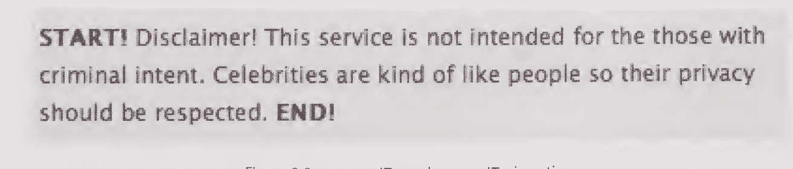

## 插入多个元素

一个新项目会为*与选择器匹配的每个元素插入一次*。例如，如果你的选择器匹配所有段落标签，那么 `insertAfter` 操作将在*每个*段落标签之后添加一个新元素。这使其成为一个相当强大的功能！

## 移除现有元素

我们告知客户，他可能有多达 10% 的用户缺乏 JavaScript 功能，因此会错过我们正在构建的一些高级功能。他询问我们是否可以为那些人添加一条说明，推荐启用 JavaScript。显然，这条消息应该对那些*确实*拥有 JavaScript 的用户隐藏。

这似乎是学习如何使用 jQuery 从页面中移除 HTML 元素的绝佳机会。我们将把消息放在 HTML 中，然后用 jQuery 移除它；这样，只有那些没有 JavaScript 的访客才会看到它。

现在，让我们将新的警告添加到我们的 HTML 页面中：

```html
<!-- chapter_02/20_removing_elements/index.html (摘录) -->

<p id="no-script">
    We recommend that you have JavaScript enabled!
</p>
```


现在我们需要运行代码从页面中移除该元素。如果用户禁用了 JavaScript，我们的 jQuery 语句将无法运行，消息将保留在屏幕上。要在 jQuery 中移除元素，你首先使用选择器选择它们（像往常一样），然后调用 `remove` 方法：

```javascript
// chapter_02/20_removing_elements/script.js (摘录)

$('#no-script').remove();
```

`remove` 操作将从 DOM 中移除所有选定的元素，并且也会移除附加到这些元素的任何事件处理程序或数据。`remove` 操作不需要任何参数，不过你也可以指定一个表达式来进一步精化选择。试试这个例子：

```javascript
// chapter_02/21_removing_with_selector/script.js (摘录)
$('#celebs tr').remove(':contains("Singer")');
```

这段代码不会移除 `#celebs` div 中的每一个 `tr`，而只会移除包含文本“Singer”的行。当我们下一章探讨一些高级效果时，这将派上用场。

感谢这些修改，我们的页面将为那 10% 没有 JavaScript 的用户运行良好，对于其余 90% 的用户甚至运行得更好！这是一个渐进增强的简单例子，但它让你很好地理解了基本思想：不要将 jQuery 作为你 UI 的基础，而是用它来为已经可用的体验添加一些“糖分”。这样，你就知道没有人会被遗漏。

为了保持示例代码的小巧和专注，我们将就此打住，不再深入探讨这个主题。但你可以自己去研究它——这是那种能让你成为更好的网络开发者的最佳实践。

## 修改内容

我们现在几乎可以对元素做任何想做的事情：显示它们、隐藏它们、添加新的、移除旧的、随心所欲地设置样式……但如果我们想改变元素的实际内容呢？同样，jQuery 提供了几种方法专门用于此目的：`text` 和 `html`。

`text` 和 `html` 操作非常相似，因为两者都设置我们选定元素的内容。我们只需向任一函数传递一个字符串：

```javascript
// chapter_02/22_modifying_content/script.js (摘录)
$('p').html('good bye, cruel paragraphs!');
$('h2').text('All your titles are belong to us');
```

在这两个例子中，匹配元素的内容都会变为我们提供的字符串：页面上的每个段落和 `h2` 标签都将被我们的新内容覆盖。`text` 和 `html` 的区别可以通过在内容字符串中添加一些 HTML 来观察：

```javascript
// chapter_02/23_text_vs_html/script.js (摘录)
$('p').html('<strong>Warning!</strong> Text has been replaced ... ');
$('h2').text('<strong>Warning!</strong> Title elements can be ...');
```

在这种情况下，我们的段落将包含粗体文本，但我们的 `h2` 标签将包含整个内容字符串，包括 `<strong>` 标签。你用来修改内容的操作取决于你的需求：纯文本用 `text`，HTML 用 `html`。

你可能会想，“这些新操作只能*设置*内容吗？”在这个阶段，你可能不会感到惊讶，我们也可以使用相同的操作从 jQuery 选择中获取内容：

```javascript
// chapter_02/24_get_content/script.js (摘录)
alert($('h2:first').text());
```

我们使用不提供参数的 `text` 操作，它会返回页面上第一个 `h2` 标签的文本内容（“Welcome!”）。与其他检索值的操作一样，这对于条件语句特别有用，也可以用于在用户交互中添加必要信息。

## 基础动画：炫酷地隐藏和显示

所有这些显示、隐藏和更改都很有用，但在视觉上有些平淡无奇。是时候介绍一些我们称之为*动画*的 jQuery 技术了。

核心 jQuery 库包含一些基本效果，我们可以用它们来丰富我们的页面。一旦你厌倦了这些，就可以去 jQuery 插件仓库看看，那里有数百种更疯狂的效果。

> **保持理性**

> 在处理网络上的效果和动画时，启用你的良好品味传感器可能是个明智的主意。记住，曾经 `<blink>` 标签被认为是完全合理的！

### 淡入淡出

jQuery 中最常见（也最经典）的效果之一是内置的淡入淡出效果。要以最简单的形式使用淡入淡出，只需将 `show` 替换为 `fadeIn`，或将 `hide` 替换为 `fadeOut`：

```javascript
// chapter_02/25_fade_in_out/script.js (摘录)
$('#hideButton').click(function() {
  $('#disclaimer').fadeOut();
});
```

还有一些可选参数可以用来修改效果，第一个参数用于控制淡入淡出完成所需的时间。许多 jQuery 效果和动画都接受时间参数——可以作为字符串或整数传递。

我们可以使用以下预定义词汇之一将时间跨度指定为字符串：`slow`、`fast` 或 `normal`。例如：`fadeIn('fast')`。如果你想要更精细地控制动画的持续时间，也可以以毫秒为单位指定时间，如：`fadeIn(1000)`。

### 切换效果和动画

虽然 jQuery 没有专门用于淡入淡出切换的操作，但这里有个小秘密：我们最初的 `toggle` 操作比我们最初想象的更有内涵。如果我们给它传递一个时间跨度参数，我们会发现 `toggle` 具有动画能力：

```javascript
// chapter_02/26_toggle_fade/script.js (摘录)
$('#toggleButton').click(function() {
  $('#disclaimer').toggle('slow');
});
```

你可以看到整个元素的宽度、高度和透明度都在变化。如果这对你来说有点过了，还有另一个核心 jQuery 动画效果*确实*包含内置的切换操作：滑动。

滑动会将元素滑入或滑出视野，就像从一个隐藏的隔间中滑出来一样。它的实现方式与淡入淡出相同，但

slideDown、slideUp 和 slideToggle 操作。与淡入淡出效果一样，我们也可以指定时间跨度：

```javascript
$('#toggleButton').click(function() {
  $('#disclaimer').slideToggle('slow');
});
```

## 回调函数

许多效果（包括我们的滑动和淡入淡出效果）都接受一个称为**回调函数**的特殊参数。回调函数指定了在效果完成其所需操作后需要运行的代码。在我们的例子中，当滑动完成滑动后，它将运行我们的回调代码：

```javascript
$('#disclaimer').slideToggle('slow', function() {
  alert('The slide has finished sliding!');
});
```

回调函数只是作为第二个参数传递给效果操作，以匿名函数的形式提供，其方式与我们为事件处理程序提供函数作为参数的方式非常相似。

> ### 匿名函数

在 JavaScript 中，内联定义的函数（例如我们的回调函数和事件处理程序）被称为**匿名函数**。它们被称为"匿名"仅仅是因为它们没有名字！当你只需要函数从一个特定位置运行时，你可以使用匿名函数。

在任何使用匿名函数的情况下，也可以传递一个函数名而在其他地方定义该函数。当同一个函数需要在多个不同地方调用时，这是最好的做法。在像我们示例这样的简单情况下，这可能会使代码更难理解，所以我们暂时坚持使用匿名函数。

让我们将回调函数付诸实际应用。如果我们想在免责声明滑出视图后隐藏按钮：

```javascript
$('#disclaimer').slideUp('slow', function() {
    $('#hideButton').fadeOut();
});
```

免责声明将向上滑动，只有当动画完成后，按钮才会从视图中淡出。

## 一些技巧

既然我们已经从客户的待办事项清单上划掉了几个优先级较高的请求，让我们稍微炫耀一下，为网站增添一些额外的光彩。我们将基于到目前为止所学的内容，添加一些效果和视觉亮点。将介绍一些新的构造和操作，如果这是你第一次涉足 jQuery 世界，值得仔细研究它们。

## 悬停时高亮显示

客户对斑马条纹的可用性问题非常关注。他要求，除了更改行颜色外，当用户将鼠标移到表格上时，还应该有一个额的高亮显示。

我们可以通过向表格添加事件处理程序来处理 mouseover 和 mouseout 事件来实现此效果。然后我们可以添加或移除一个 CSS 类，该类包含鼠标悬停元素特有的背景颜色。这与我们用普通 JavaScript 做的方式非常相似：

```javascript
$('#celebs tr').mouseover(function() {
    $(this).addClass('zebraHover');
});
$('#celebs tr').mouseout(function() {
    $(this).removeClass('zebraHover');
});
```

请记住，`$(this)` 指的是选定的对象——所以当用户将鼠标悬停在每一行上时，我们正在添加和移除该行的 zebraHover 类。现在我们只需要在 CSS 文件中添加一个样式规则：

```css
tr.zebraHover {
    background-color: #FFFACD;
}
```

在浏览器中尝试一下，你会看到它效果非常好。然而，事实证明有一种更简单的方法可以达到同样的效果：jQuery 包含一个 hover 操作，它将 mouseover 和 mouseout 合并到单个处理程序中：

```javascript
$('#celebs tbody tr').hover(function() {
    $(this).addClass('zebraHover');
}, function() {
    $(this).removeClass('zebraHover');
});
```

注意到悬停事件处理程序有什么奇怪之处了吗？它不是需要一个，而是需要两个函数作为参数：一个处理 mouseover 事件，另一个处理 mouseout 事件。

> ### 需要多少个回调？

一些事件处理程序需要不同数量的函数。例如，toggle 事件处理程序可以接受任意数量的函数；它每次触发时只是会依次循环调用每个回调函数。

我们已经越来越擅长添加和移除类属性了，所以现在可能是指出另一个有用的与类相关的操作的好时机：`toggleClass`。你可以猜到它是做什么的。这是一个非常有用的操作，如果元素没有该类，则添加它；如果已有，则移除它。

例如，假设我们希望用户能够从表格中选择多个行。单击表格行一次应该高亮显示它，再次单击应移除高亮显示。使用我们的新 jQuery 技能，这很容易实现：

```javascript
$('#celebs tbody tr').click(function() {
  $(this).toggleClass('zebraHover');
});
```

尝试单击表格行。很酷，不是吗？

## 剧透揭示器

StarTrackr! 网站的最新新闻版块提供了关于一系列流行名人的最新独家八卦。新闻是该网站的一大亮点——大多数用户每天都会回来获取最新更新。客户希望在此基础上利用其产生的炒作并增加兴奋感，因此他寻求我们的帮助。我们建议制作一个剧透揭示器：用户可以在点击查找答案之前，尝试猜测新闻是关于哪位名人的。

这种功能对于包含影评的网站来说也是一个很好的补充。你可以隐藏评论中泄露电影故事细节的任何部分，但允许已经看过电影的用户揭示它们。

要设置我们的剧透揭示器，我们需要在网站的新闻版块中添加一个新元素。任何应默认隐藏的"秘密"都将包裹在一个带有 `spoiler` 类的 span 元素中：

```html
Who lost their recording contract today?
<span class='spoiler'>The Zaxntines!</span>
```

让我们分解一下我们的脚本需要做什么：首先，我们需要隐藏答案并添加一个新元素，如果用户愿意，该元素允许揭示答案。当该元素被点击时，我们需要公开答案。隐藏？添加？处理点击？我们知道如何做到所有这些：

```javascript
$('.spoiler').hide();
$('<input type="button" class="revealer" value="Tell Me!"/>')
    .insertBefore('.spoiler');
$('.revealer').click(function(){
    $(this).hide();
    $(this).next().fadeIn();
});
```

这里有很多操作，其中一些是新的，但如果你逐行阅读，你会理解它的意思。首先，我们立即隐藏所有剧透元素，并使用 `insertBefore` 操作在每个剧透元素之前添加一个新按钮。此时，页面将显示新的"Tell Me!"按钮，而原始的剧透 span 将被隐藏。

接下来，我们选择刚刚添加的新按钮，并为它们附加 `click` 事件处理程序。当其中一个按钮被点击时，我们移除新的揭示器元素（我们使用 `$(this)` 找到它），并淡入它旁边的剧透元素。`next` 是一个我们尚未涵盖的操作。它用于遍历 DOM，毫不奇怪地，它让我们可以访问元素的下一个兄弟节点（即同一容器中的下一个元素）。

如果我们查看图 2.7 中修改后的 DOM，我们可以看到剧透 span 是揭示器按钮之后的下一个元素。`next` 操作只是将我们的选择移动到该元素。jQuery 还为我们提供了一个 `previous` 操作，可以将选择移动到当前选定元素之前的元素。

```
▼ <p>
      Who lost their recording contract today?
      <input class="revealer" type="button" value="Tell Me!"/>
      <span class="spoiler" style="display: none;">The Zaxntines!</span>
    </p>
```

图 2.7. 修改后的 DOM

事实上，jQuery 有大约十几个不同的操作可用于在 DOM 中移动；`previous` 和 `next` 只是两个特别有用的操作。我们将发现更多

## CSS 属性动画

到目前为止，我们已经掌握了一些有价值的动画示例——滑动、淡入淡出，以及一些巧妙的隐藏和显示效果——但我们对于动画具体如何发生以及动画的具体内容还缺乏足够的控制。现在是时候介绍一个非常令人兴奋的 jQuery 函数了，它被恰当地命名为 `animate`，它能让你为大量 CSS 属性添加动画，从而创造出属于自己的惊艳效果。让我们来看一个 `animate` 的实际示例：

```javascript
// chapter_03/01_animating_css/script.js (excerpt)
$('p').animate({
    padding: '20px',
    fontSize: '30px'
}, 2000);
```

这段代码将为页面上所有的段落添加动画，在 2 秒（2000 毫秒）内将内边距从其初始状态更改为 20px，并将字体大小增加到 30px。

要使用 `animate`，我们需要传递一个对象字面量，其中包含我们希望添加动画的属性，指定为键值对——这与使用 `css` 函数分配多个属性的方式非常相似。有一点需要记住：属性名必须使用驼峰命名法才能被 `animate` 函数使用；也就是说，你需要写 `backgroundColor` 而不是 `background-color`，写 `marginLeft` 而不是 `margin-left`。任何由多个单词组成的属性名都需要按此方式修改。

时间跨度参数的工作方式与我们在第 2 章中看到的简单动画完全相同：你可以传递毫秒数，或者字符串 `slow`、`fast` 或 `normal` 之一。CSS 属性的值可以以像素、em、百分比或点为单位设置。例如，你可以写 100px、10em、50% 或 16pt。

更令人兴奋的是，你定义的值可以*相对于*元素的当前值：你只需要在值前面指定 `+=` 或 `-=`，该值就会被添加到或从元素的当前属性值中减去。让我们利用这个功能，使用 `hover` 函数使我们的导航菜单在鼠标悬停在菜单项上时摇摆起来：

```javascript
// chapter_03/02_relative_css_animation/script.js (excerpt)
$('#navigation li').hover(function() {
    $(this).animate({paddingLeft: '+=15px'}, 200);
}, function() {
    $(this).animate({paddingLeft: '-=15px'}, 200);
});
```

将鼠标悬停在导航菜单上，你会看到链接优雅地晃动起来。

你还可以使用 `animate` 来对第 2 章中看到的显示、隐藏和切换功能进行精细控制。我们只需将属性的动画值指定为 show、hide 或 toggle，而不是数值：

```javascript
// chapter_03/03_animate_show_hide (excerpt)
$('#disclaimer').animate({
    opacity: 'hide',
    height: 'hide'
}, 'slow');
```

看到元素动画起来非常令人满意。作为练习，尝试为你能想到的每个元素属性添加动画——你会偶然发现一些有趣的效果！`animate` 函数还有一些强大的高级选项，我们将在本章中详细探讨。

## 颜色动画

一旦你意识到 `animate` 函数有多酷，你可能就想为元的颜色添加动画。然而，为颜色添加动画有点棘手，因为起始颜色和结束颜色之间的“中间”颜色值需要以一种特殊的方式计算。不像高度或宽度值那样以简单、线性的方式从一个值移动到另一个值，jQuery 需要做一些额外的数学运算来找出，例如，介于浅蓝色和橙色之间四分之三处的颜色是什么。

这种颜色计算功能在核心库中被省略了。仔细想想，这是有道理的：大多数项目不需要这个功能，所以 jQuery 可以将核心库的大小保持在最小。如果你想为颜色添加动画，你需要下载颜色动画插件。[^1]

> [^1]: http://plugins.jquery.com/project/color

## 使用插件

官方 jQuery 插件仓库² 包含数量不断增加的插件——有些比其他的更有用。你可以按名称、类别（如效果或实用工具）或 jQuery 社区给予的评分来搜索插件。

一旦你找到了感兴趣的插件，请将其下载到项目中的合适位置（很可能与你的 jQuery 源文件位置相同）。在使用插件之前，仔细阅读 **readme** 文件或相关文档是个好主意，但通常你需要做的只是像我们包含自定义 JavaScript 文件一样，将它包含在你的 HTML 文件中。

如何利用你新获得的功因插件而异，因此你需要查阅每个插件的文档以充分利用它。

下载并包含颜色动画插件后，你现在可以在你的 jQuery 动画代码中为颜色属性添加动画，就像处理其他 CSS 属性一样。让我们在页面加载时，在两秒钟内逐渐高亮显示我们的免责声明消息，以确保没有人错过它：

```javascript
// chapter_03/04_color_animation (excerpt)
$('#disclaimer').animate({'backgroundColor':'#ff9f5f'}, 2000);
```

看到动画效果如何让免责声明变得如此显眼了吗？

## 缓动

**缓动**是指动画过程中发生的加速和减速，以使其具有更自然的感觉。缓动应用一种数学算法来改变动画进行中的速度。值得庆幸的是，我们正在使用 jQuery，所以你可以安全地将你的高中数学技能锁起来。

在 jQuery 中有两种可用的缓动类型：`linear` 和 `swing`。任何时候你在 jQuery 中使用动画函数，你都可以指定这两个参数之一来控制动画的缓动。它们之间的区别可以

如图3.1所示，该图展示了在动画期间，根据所选缓动选项的不同，属性是如何被调整的。

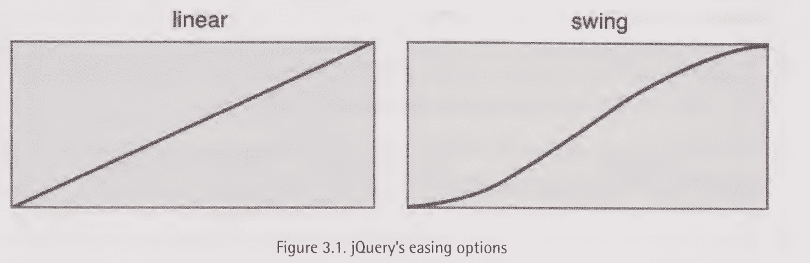

`swing`缓动在开始时较慢，随后加速，而在动画接近尾声时又平缓地减速。从视觉上看，`swing`缓动比`linear`缓动显得自然得多。如果未指定缓动参数，jQuery默认会使用它。

`linear`缓动方法没有加速或减速：动画以恒定速率进行。在大多数情况下，它看起来相当乏味且有些刻板，但值得尝试一下——它可能正好适合你的需求。

例如，我们将为第一个段落标签添加动画，使其在被点击时放大和缩小；在放大时使用`linear`缓动，在缩小时使用`swing`缓动。区别非常微妙，但如果你重复几次动画，应该能区分它们；缩小的动画感觉更自然一些：

```
chapter_03/05_easing/script.js (摘要)

$("p:first").toggle(function() {
  $(this).animate({'height': '+=150px'}, 1000, 'linear');
}, function() {
  $(this).animate({'height': '-=150px'}, 1000, 'swing');
});
```

这段代码中包含了不少jQuery内容，所以现在可能是个暂停并确保你理解此处所有内容的好时机：

- 我们使用过滤器结合选择器来仅获取第一个段落标签。

- 一个`toggle`事件处理程序（它在连续的点击上依次执行每个传入的函数）被附加到该段落上。

- 在处理程序内部，我们选择了`this`，它指的是触发事件的元素（在我们的例子中，它就是段落本身）。

- 第一个处理程序使用`+=`格式，利用`linear`缓动函数将段落高度增加150像素。

- 第二个处理程序使用`-=`格式，利用`swing`缓动函数将段落高度减少150像素。

如果你能跟上并理解这些步骤中的每一步，请为自己鼓掌！你正在真正掌握jQuery！

## 高级缓动

如前所述，`swing`缓动提供了视觉上更令人愉悦的过渡效果，可能足以应对大多数任务。但`swing`和`linear`缓动只是冰山一角。在jQuery核心库包含的这两种基本类型之外，还有大量的缓动选项。其中大部分可以在缓动插件中找到，该插件可从jQuery插件仓库获取。

> ### jQuery UI 包含多个插件

缓动库也包含在jQuery UI库的效果部分中，我们稍后会介绍它。如果你开始对插件感到疲倦，那么你可能想直接跳到名为“jQuery用户界面库”的章节——这个库包含几个常用插件，包括颜色动画、类转换和缓动。通过包含jQuery UI库，你可以避免在页面中单独包含每个插件。

只需下载插件的JavaScript文件并将其包含在HTML页面中，放在jQuery库之后的任何位置。缓动插件并非提供新函数，而是让你能够使用超过30种新的缓动选项。解释所有这些缓动函数的作用会考验最富想象力的作者，所以我们只需引导你关注图3.2，你可以在那里看到几种算法的图形化表示。

你会注意到一些算法的曲线超出了图表区域；当动画元素到达过渡的这一部分时，它们会移动到目标位置*之外*，然后最终折返并稳定在那里。效果就像一个连接在橡皮筋上的元素，它轻轻地将一切拉回原位。

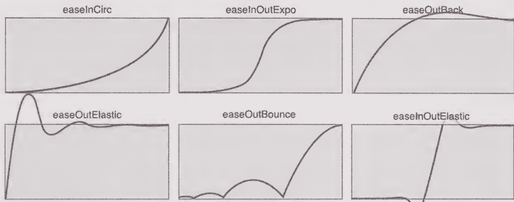

图3.2. 高级缓动选项

要使用新的算法之一，我们只需将其名称传递给`animate`函数。有很多选择，所以我们不妨直接尝试几种不同的：

```
chapter_03/06_other_easing_options/script.js (摘要)

$('p:first').animate({height: '+=300px'}, 2000, 'easeOutBounce');
$('p:first').animate({height: '-=300px'}, 2000, 'easeInOutExpo');
$('p:first').animate({height: 'hide'}, 2000, 'easeOutCirc');
$('p:first').animate({height: 'show'}, 2000, 'easeOutElastic');
```

看看那个段落的动画效果！你可能想知道这些缓动选项名称的来源——或者在哪里可以看到完整的列表。这些算法源于Robert Penner的缓动方程，他的网站上有详细描述。[^4]

查看所有可用方程的最佳方式是查看插件的源代码。如果你用文本编辑器打开下载的文件，你会看到一个可以在jQuery动画中使用的函数列表。

> **动手尝试一下**

休息一下，测试插件提供的所有缓动函数。你不太可能需要使用所有这些函数，但熟悉它们将让你能够选择正确的函数，为你的界面赋予精确想要的感觉。此外，尝试`animate`函数将巩固你的知识：它是jQuery忍者武器库中的重要组成部分！

## 弹跳内容面板

既然我们已经了解了一些`animate`函数的工作原理，让我们来看看客户最新的一轮请求。今天的待办事项清单包括添加一个至关重要的页面组件：*StarTrackr! 每日“当下红人”榜*（简称SDWHRNL）。该榜单包含最近人气上升或下降的名人，附带照片和简短简介。我们将运用刚才学到的一些动画和缓动技术，将该榜单实现为可以独立打开和关闭的面板。

该小组件在页面中的外观如图3.3所示。

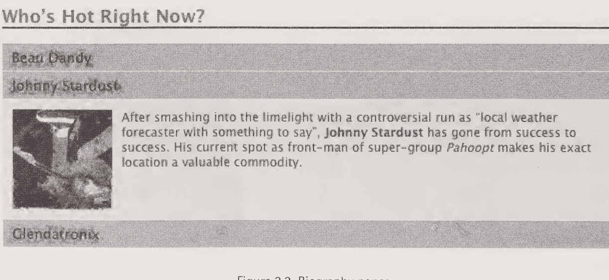

在HTML中，我们将把该部分实现为一个包含所有名人的div元素。每个名人的面板将标记为一个h3，后面跟着另一个包含图片和短段落的div：

```
chapter_03/07_bouncy_content_panes/index.html (摘要)

<div id="bio">
  <h2>Who's Hot Right Now?</h2>

  <h3>Beau Dandy</h3>
  <div>
    
    <p>Content about Beau Dandy</p>
  </div>

  <h3>Johnny Stardust</h3>
  <div>
    
    <p>Content about Johnny Stardust</p>
  </div>

  <h3>Glendatronix</h3>
  <div>
    
    <p>Content about Glendatronix</p>
  </div>
</div>
```

当用户点击其中一个标题时，我们希望关联的内容面板可以切换打开和关闭。你可以根据需要设置面板的样式，但为标题使用具有不同颜色背景的块级元素是一种常见技巧：它为用户提供了明确的点击操作提示。

> “跳跃式”动画？

需要注意的一个怪癖是，直接对紧邻标题标签的元素进行动画处理有时看起来会“跳跃”——尤其是在元素隐藏时。这是由于标题的边距在后续元素隐藏时会折叠。一个简单的解决方法（我们这里已使用）是从标题标签中完全移除边距。

我们希望页面加载时不显示任何内容，所以首先要做的就是隐藏所有内容容器：

```
chapter_03/07_bouncy_content_panes/script.js (摘要)

$('#bio > div').hide();
```

如果你希望默认打开一个面板，可以在这里指定。这有助于让用户更清楚地意识到面板中“隐藏”着内容，并且他们应该点击标题来揭示它。在jQuery中实现这一点很简单：我们只需应用`:first`过滤器并调用`show`动作来仅显示第一个面板：

```
$('#bio > div:first').show();
```

> **子选择器**

这些示例中有一个我们尚未涵盖的新选择器功能。它是**子**选择器，由大于角括号（>）表示。子选择器选择所有匹配选择器的直接子元素。如果我们省略子选择器，我们的代码将选择bio div元素下的所有div元素，即使它们嵌套在其他元素内部。有关此选择器的更多详情和代码示例，请随时在jQuery API文档中查找。

现在我们的内容已经按照我们想要的方式标记好了，我们只需要为它添加一些jQuery交互魔力。为了显示我们的秘密内容，我们将采用熟悉的方法：捕获点击事件，找到下一个元素（包含我们的内容），并显示它——就像我们在第2章中所做的那样。但这次，我们将加入一点“弹跳”，使用缓动来处理内容的高度，这样面板就会在视野中弹跳进出：

chapter_03/07_bouncy_content_panes/script.js（节选）

```javascript
$('#bio h3').click(function() {
    $(this).next().animate(
        {'height':'toggle'}, 'slow', 'easeOutBounce'
    );
});
```

缓动函数 `easeOutBounce` 能产生出色的弹跳球效果，对于这类内容面板来说效果极佳。你可以在浏览器中亲自体验一下！

## 动画队列

接下来我们要探讨的关于动画的最后一个主题，是 `animate` 函数的另一个高级用法。原来 `animate` 可以接收一组额外的选项参数，就像这样：

```javascript
animate(parameters, options);
```

`options` 参数是一个由键值对组成、打包在一起的对象字面量。我们已经熟悉其中一些可用的选项：`duration`（持续时间）、`easing`（缓动）和 `complete`（回调方法）。不过，还有几个新的选项：`step` 和 `queue`。在解释它们之前，让我们先看看使用 `options` 参数调用 `animate` 函数的语法：

```javascript
chapter_03/08_animation_queue/script.js（节选）

$('p:first').animate(
    {
        height: '+=100px',
        backgroundColor: 'green'
    },
    {
        duration: 'slow',
        easing: 'swing',
        complete: function() {alert('done!');},
        queue: false
    }
);
```

请注意，使用我们之前见过的更简单格式几乎也能完成所有这些操作。只有当你想要指定额外设置（如 `queue` 参数）时，才需要使用高级版本。

`queue`（队列）是指等待在特定元素上执行的动画列表。每当我们要求 jQuery 对一个元素执行动画时，该动画就会被添加到队列中。元素会依次执行队列中的动画，直到全部完成。如果你在我们的某个演示上快速连续点击，可能已经见识过这种效果。

不过，很多情况下我们并不希望出现这种情况。有时我们希望多个动画同时发生。如果在指定动画时禁用队列，后续动画就可以并行执行。

动画队列可以通过使用 `queue` 选项以及 jQuery 的 `stop`、`queue` 和 `dequeue` 操作来控制。这种操作与选项的组合，让我们能够对动画的执行方式进行极其精细的控制。但是，在我们真正深入这些妙趣横生的选项之前，是时候揭示 jQuery 中最重要的技巧之一了。

## 链式操作

到目前为止，我们一直在一条一条地编写语句——要么是顺序编写，要么是嵌套在回调函数中。我们需要重写选择器，或者使用 `this` 关键字来再次找到目标元素。然而，有一种技术允许我们对同一组元素连续执行多个 jQuery 命令。我们称之为“链式操作”——为了释放你内心的忍者精神，你最好仔细注意这一部分。

**链式操作**是将两个或多个 jQuery 操作链接成一个语句。要链接一个操作，只需将其附加到前一个操作之后即可。例如，让我们将 `hide`、`slideDown` 和 `fadeOut` 操作链接在一起。我们的元素会快速隐藏，然后滑入视图，最后淡出：

```javascript
$('p:first').hide().slideDown('slow').fadeOut();
```

你可以根据喜好链接任意多个操作。但要小心：链式操作很容易让人上瘾！除了可以根据初始选择器链接操作外，你还可以在 DOM 中移动，并在此过程中添加和移除元素——这可能会导致语句变得相当复杂。

为了清晰起见，通常最好将操作写在单独的行上。这会占用更多空间，但更容易阅读和维护。我们之前的例子可以这样重写：

```javascript
$('p:first')
    .hide()
    .slideDown('slow')
    .fadeOut();
```

重要的是要认识到，jQuery 选择器包含每个操作执行后的修改结果，然后才执下一个操作。这意味着我们可以在操作过程中添加和移除元素，操作只应用于当前的选择集。

如果你回顾一下我们之前的几个例子，可能会在代码中发现一些隐藏的链式操作——例如，当我们编写：`$(this).next().animate()` 时。`next` 操作将我们的选择移动到下一个 DOM 元素，然后 `animate` 操作对该元素进行动画处理，而不影响原始元素。

从现在开始，你将有很多机会尝试链式操作；本书的剩余部分将充满它。这是 jQuery 最有趣的部分！

## 暂停链

如果你想在 jQuery 链的中间短暂暂停，可以使用 `delay` 操作。只需给它一个数字，它就会暂停该链那么多毫秒，然后继续执行。所以，参考同一个例子，我们可以这样写：

```javascript
$('p:first')
    .hide()
    .slideDown('slow')
    .delay(2000)
    .fadeOut();
```

这段代码会滑下段落，然后等待两秒钟再将其淡出。这是一种更精确控制动画的好方法。

## 动画导航栏

客户在这个问题上坚持己见：他希望顶级导航是一个 Flash 控件，在用户交互时会摇晃和缩放。他解释说，Flash 效果更好。你向他保证你的 Flash 技术首屈一指，并且会立即为他制作一个概念验证。

好的。现在，等客户离开房间，让我们运用新发现的 jQuery 能力来创建一个类似 Flash 的导航栏。它将有一个背景“斑点”，当用户悬停在菜链接上时，会摇晃以突出显示该菜单项。我们将完全使用免费、标准的技术来实现：HTML、CSS 和 JavaScript。Flash？我们才不需要那破 Flash 呢！

我们采用一个相当基本的动画，以便更容易跟踪步骤。首先，我们修改了与导航菜单相关的 CSS，使其水平布局而非垂直布局。回顾一下，导航栏的 HTML 如下所示：

```html
chapter_03/09_animated_navigation/index.html（节选）

<ul id="navigation">
    <li><a href="#">Home</a></li>
    <li><a href="#">About Us</a></li>
    <li><a href="#">Buy!</a></li>
    <li><a href="#">Gift Ideas</a></li>
</ul>
```

我们的背景色斑点将是一个空的 `div` 元素，定位在用户鼠标悬停的导航链接后面。因此，我们的第一个任务是创建该元素并将其附加到文档中：

```javascript
chapter_03/09_animated_navigation/script.js（节选）

$('<div id="navigation_blob"></div>').css({
    width: $('#navigation li:first a').width() + 10,
    height: $('#navigation li:first a').height() + 10
}).appendTo('#navigation');
```

注意，我们在对象字面量*内部*选择导航链接来提供宽度和高度的值。如果你是编程新手，这可能看起来很奇怪，但你*不应该*让它吓到你——一般来说，在任何可以放置静态值的地方，你都可以使用函数的返回（或计算）值。我们还将这些值各增加了 10，这样斑点就会比它后面的锚点标签稍大一点。

斑点就位后，我们需要设置一个触发器来让它动起来。这应该在用户悬停在某个导航链接上时发生，因此我们将使用 `hover` 函数。记住 `hover` 接受两个参数：鼠标*移入*元素时运行的函数，以及鼠标*移出*元素时运行的函数。这是我们的事件处理程序的大致结构：

```javascript
// chapter_03/09_animated_navigation/script.js（节选）
$('#navigation a').hover(function() {
  // 鼠标移入函数
  :
}, function() {
  // 鼠标移出函数
  :
});
```

现在来看些有趣的部分。让我们看看鼠标移入元素时运行的第一个函数：

```javascript
// chapter_03/09_animated_navigation/script.js（节选）
// 鼠标移入函数
$('#navigation_blob').animate(
  {width: $(this).width() + 10, left: $(this).position().left},
  {duration: 'slow', easing: 'easeOutElastic', queue: false}
);
```

当用户将鼠标悬停在菜单项上时，我们对斑点的两个属性进行动画处理：宽度和位置。

链接在页面上的位置可以使用一个名为 `position` 的 jQuery 方法来确定。这是一个本身不执行任何操作的动作，但调用时会暴露两个属性：`left` 和 `top`；这些是所选元素相对于其父元素的左侧和顶部偏移量。在本例中，我们需要 `left` 属性，这样我们就知道在导航菜单中将斑点移动到何处。

我们设置 `queue` 选项为 `false`，以确保当用户频繁悬停时，我们的动画不会排队等待执行。当你移动到不同的链接时，无论当前动画是否完成，新的动画都会立即开始。

我们仍然需要告诉 jQuery 当用户将鼠标移出链接时该做什么。这段代码与我们刚刚看到的代码非常相似，只是包含了一些额外的链式操作：

```javascript
// Mouse out function
$('#navigation_blob')
    .stop(true)
    .animate(
        {width: 'hide'},
        {duration: 'slow', easing: 'easeOutCirc', queue: false}
    )
    .animate(
        {left: $('#navigation li:first a').position().left},
        'fast'
    );
}
```

这次我们将两个 `animate` 操作链接在一起：第一个操作使用一些优雅的缓动效果来隐藏 blob，第二个操作将其快速移动到一侧（移动到导航中第一个链接的位置）。

你可能注意到我们的动画中链接了一个额外的操作，即 `stop` 操作。`stop` 的功能正如你所期望的——它会停止动画！它接受两个可选参数：`clearQueue` 和 `gotoEnd`。我们将 `clearQueue` 参数设置为 `true`，这样任何排队的动画都会被清除。

`gotoEnd` 参数用于当你希望 jQuery 确定元素在当前动画队列结束时的状态，然后立即跳转到该状态的情况。我们这里不想使用这个参数，因为我们希望动画从 blob 的当前位置开始——即使它只移动到一半。

在你的浏览器中试用这个菜单，看看恰当的缓动效果如何让我们的控件感觉更自然。

现在是尝试不同缓动函数的好时机。只需将这里使用的函数替换为缓动插件中的任何其他函数——你会惊讶于它们对组件感觉产生的巨大差异。你还可以尝试动画化其他值：例如，改变 blob 的颜色。

## 动画导航，第二版

使用 jQuery 这样的库的一个巨大优势是，你可以快速尝试许多不同的替代方案，并挑选出你最喜欢的一个。

在客户想看到我们动画导航的进展之前，我们还有几个小时的时间。让我们尝试从不同的角度来解决同样的问题，看看我们能想出什么办法。

对于这个动画，我们的每个菜单项都有一个隐藏的图标，当链接被鼠标悬停时，该图标会弹出显示（如图 3.4 所示）。

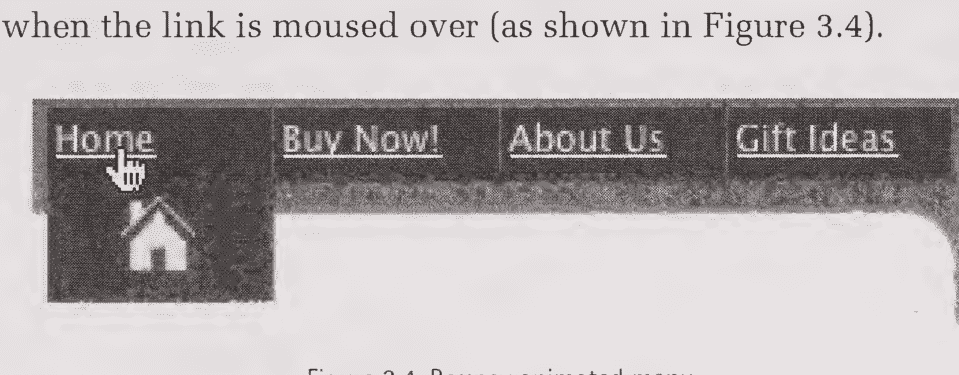

这个效果的设置非常简单。它是一个普通的无序列表，配置为水平菜单——但我们在通常可见的区域下方隐藏了一个秘密图标。这只需设置列表项的高度，使你默认只能看到链接文本，但当我们动画化高度时，图标就会弹入视野。

我们将从 CSS 开始：我们将菜单绝对定位在容器 div 的右上角，那里有空间供图标扩展。我们为图标设置了一个背景颜色，并采用了一个巧妙的技巧来保持背景图像不可见；注意列表项的高度是 20px，但背景从顶部偏移了 30px。因此，在我们扩展列表项的高度之前，它们将是不可见的。

我们还将每个链的背景图像设置为不同的图标：

```css
#container {
  position: relative;
}

#navigation {
  position:absolute;
  width: inherit;
  top: 0;
  right: 0;
  margin: 0;
}

#navigation li {
  height:20px;
  float:left;
  list-style-type: none;
  width:70px;
  padding:3px;
  border-right:1px solid #3687AF;
  background-color: #015287;
  background-repeat: no-repeat;
  background-position: center 30px;
}

#navigation li a {
  color: #FFFFFF;
}

#navigation #home{
  background-image:url('icon_home.png');
}
```

这个效果代码中唯一的新方面是，我们使用 `stop` 操作来清除鼠标悬停事件和鼠标移出事件的队列。然后我们只需动画化高度以显示隐藏的图标，并在悬停结束时将其缩回正常大小。一些精心选择的持续时间和缓动设置给我们带来了我们想要的活泼的弹跳效果。确保你尝试这些设置，以匹配你网站的感觉：

```javascript
chapter_03/10_animated_navigation_2/script.js (excerpt)

$('#navigation li').hover(
    function() {
        $(this)
            .stop(true)
            .animate(
                {height: '60px'},
                {duration: 500, easing: 'easeOutBounce'}
            )
    },
    function() {
        $(this)
            .stop(true)
            .animate(
                {height:'20px'},
                {duration: 500, easing: 'easeOutCirc'}
            )
    }
);
```

现在我们有两个有趣的动画导航示例可以展示给我们的客户！

## jQuery 用户界面库

如第 1 章所述，jQuery UI 库是一组高级 jQuery 小部件、效果和交互——例如日期选择器、手风琴和拖放功能——它们广泛适用于 Web 开发。但在开始有趣的部分之前，是时候看看如何下载和包含 jQuery UI 库了——这个过程比我们到目前为止一直在使用的核心库和插件的设置稍微复杂一些。这是因为完整的 jQuery UI 库大小接近 500KB（压缩后为 300KB）！那是很多代码！幸运的是，任何给定的项目通常只需要 jQuery UI 中包含的功能的一小部分，jQuery 网站为我们提供了一个方便的工具来创建我们自己的自定义版本的 jQuery UI，只包含我们需要的内容，仅此而已。

选项在你第一次访问下载构建器页面时可能看起来有点令人生畏，你可以通过点击 jQuery 主页上的 **Build custom download** 链接到达该页面。[^6]

下载构建器分为几个部分：核心、交互、小部件、效果和主题。核心是主要的 jQuery UI 库——小部件和交互组件都依赖它。使用构建器的一种好方法是取消选择所有内容，然后只添加你需要的内容。如果某个组件依赖于另一个组件来运行，它将自动为你选择。

在开发过程中，获取完整的库是安全的。这样，如果我们需要，一切都在那里供我们使用。一旦你对网站上的功能感到满意，你总是可以返回下载构建器并创建一个自定义库，省略任何未使用的内容。完整库和自定�版本之间的文件大小差异可能相当显著，如图 3.5 所示。

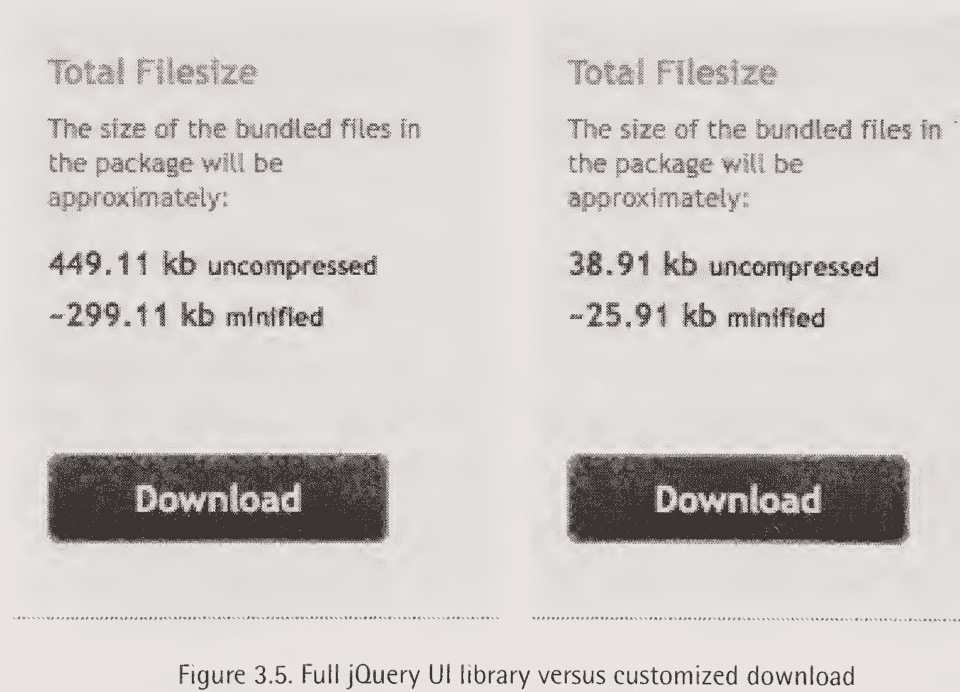

图 3.5. 完整的 jQuery UI 库与自定义下载

一个会极大地影响小部件和交互的视觉输出的选项是 *主题*。你可以使用下拉框从多个主题中进行选择。在第 9 章中，我们将深入探讨主题，包括制作你自己的主题。但为了能继续更令人兴奋的部分，我们将使用默认主题并返回工作。

自定义下载存档包含很多文件。**development-bundle** 目录中有大量的演示和文档供你试用和探索，但要使用 jQuery UI，你只需要 **jQuery-ui-1.7.2-min.js** 文件（或者你阅读本文时的任何当前版本），以及包含你所选主题的目录。

你必须将主题的目录放在 HTML 页面可以访问的位置。对于本书的示例，jQuery UI 被放置在 **lib** 目录中（与 jQuery 本身并列），主题文件放在 **css** 目录中。

jQuery UI 库包含一个 Effects 包，使我们能够实现一些有趣的效果。它还包括用于执行高级动画的有用方法和功能。我们已经见过其中一些功能，这要归功于颜色动画插件和缓动插件。这些都包含在 Effects 包中，因此如果你要使用 jQuery UI 效果库，就不再需要单独包含它们了。

在继续之前，让我们快速浏览一下一些可用的效果。我们将对我们饱受诟病的第一个段落元素进行抖动，将其高亮显示为黄色，然后将其炸成碎片：

```javascript
chapter_03/11_jquery_ui_effects/script.js *(excerpt)*

$( 'p:first' )
  .effect( 'shake', { times:3 }, 300 )
  .effect( 'highlight', {}, 3000 )
  .hide( 'explode', {}, 1000 );
```

看看它运行的效果！当然，这只是可用效果的一个微小样本。其中一些只能通过 `effect` 操作以这种方式使用，而其他则既可以使用这种方式，也可以作为 `hide`、`show` 或 `toggle` 参数的替代。后者的一些例子是 `blind`、`clip`、`puff`、`fold` 和 `slide`。

我们将避免在这里详细介绍所有效果——你最好在周日下午花时间探索它们。然而，并非所有的效果都是纯粹的装饰，其中许多在常见的用户交互场景中很有用，例如 `highlight`，这是向用户指示新消息的标准方式。

测试每个功能是个好主意，这样在需要时你就能记住它们。如果 jQuery UI 的效果组合还不够用，别担心——插件库中还有数百种效果可供选择！

## 开始动画之旅！

你现在已理解使用 jQuery 进行动画的所有基础：选择器、事件处理、回调、链式调用以及至关重要的 `animate` 函数。你还初步了解了庞大的 jQuery UI 库。然而，要真正掌握这些技能，最好的方法就是实践。去动手实现你能想到的一切动画吧！尝试页面上每个元素的每个属性，直到感觉能随心所欲地驾驭它们为止。

在结束动画主题、进入下一个 jQuery 技能集之前，我们将转向滚动和调整大小：这些主题可能不如动画炫酷，但它们对许多用户界面组件至关重要。它们也有助于巩固你对 jQuery 选择器、动作和链式调用的理解。那么，我们还在等什么呢？

## 滚动

滚动在某种程度上类似于动画，因为元素都在页面上移动。不过与动画不同的是，用户掌控着控制权！尽管如此，仍有大量方法可以自定义这些交互。在本节中，我们将了解用户滚动时保持固定位置的菜单、自定义主题滚动条，以及如何运用刚学的动画技术来实现文档滚动。

## scroll 事件

要改善用户的滚动体验，首先需要知道他们何时在滚动以及滚动的内容。事实上，有一个名为 `scroll` 的事件，当用户更新元素（如窗口或可滚动的 div）的滚动位置时就会触发。因此，每次用户与网站上的滚动条交互时，都会触发一个你可以捕获并响应的事件。

要捕获 `scroll` 事件，我们需要将事件处理程序附加到带有滚动条的元素上——通常是 `window` 元素。`window` 本身是一个 JavaScript 对象，所以我们只需用 jQuery 函数将其包裹起来即可选中。

当然，要实际查看 `scroll` 事件的运作，我们必须先设置一个带滚动条的区域！我们有几个想向客户展示的滚动效果创意，但为了学习 `scroll` 事件的工作原理，让我们通过设置页面中某个 div 的 `overflow: scroll;` 来模拟一个滚动环境：

```css
chapter_03/12_scroll_event/scroll.css (excerpt)
#news {
  height: 100px;
  width: 300px;
  overflow: scroll;
}
```

这会将我们的新闻部分变成页面内的一个小型滚动窗格。现在让我们捕获 `scroll` 事件，并在每次触发时向页面添加一些任意文本：

```javascript
chapter_03/12_scroll_event/script.js (excerpt)
$('#news').scroll(function() {
  $('#header')
    .append('<span class="scrolled">You scrolled!</span>');
});
```

现在，每当滚动新闻区域时，文本 "You Scrolled!" 就会出现在页面顶部。这很烦人，但你能明白原理。尝试不同的滚动方式：拖动滚动条、使用鼠标滚轮、在可滚动区域内点击并使用方向键。在以上所有情况下，`scroll` 事件都会触发。

## 浮动导航

我们现在知道用户何时滚动了，那么如何利用这些信息来改进我们的网站呢？一个相当常见的页面响应用户滚动的例子是浮动导航窗格。这是指主导航元素始终位于屏幕可见部分的顶部，无论滚动位置如何；就好像导航菜单随着用户向下滚动页面而跟随移动。使用 `scroll` 事件可以轻松实现：我们只需确定页面当前位置，然后将导航移动到该点。

我们的首要任务是设置 CSS，为动画导航做准备。我们将在导航元素上添加 `position: relative;` 声明，以便通过调整其 `top` 属性轻松地在页面上上下移动。为了本练习的目的，我们给内容应用了一个非常大的 `height` 属性，以强制其出现滚动条（当然，除非你有巨大的显示器！）：

```css
chapter_03/13_floating_nav_1/scroll.css (excerpt)

#navigation {
    position: relative;
}

#content {
    height: 2000px;
}
```

现在我们可以尝试制作浮动窗格了。乍一看似乎再简单不过——只需响应主窗口的 `scroll` 事件，更新导航块的 `top` 位置即可：

```javascript
chapter_03/13_floating_nav_1/script.js (excerpt)

$(window).scroll(function() {
    $('#navigation').css('top', $(document).scrollTop());
});
```

在浏览器中测试，你会发现我们达成了目标：当你向下滚动页面时，导航框会跟着你移动。它怎么知道顶部在哪里？我们使用 `scrollTop` 动作来获取屏幕顶部位置。`scrollTop` 返回匹配元素的顶部偏移量——在我们的例子中，我们请求整个文档的顶部位置：`$(document).scrollTop()`。这总是指向屏幕的最顶端。

它确实有效，但非常跳动，显得不太美观。原因应该很明显，如果你在我们介绍 `scroll` 事件时有留意的话：每次用户移动滚动条，都会触发*很多*个 scroll 事件。每个事件都会触发我们的代来更新导航位置——所以运动看起来抖动就不足为奇了。

我们在“动画导航”一节中介绍了如何使用 `stop` 命令来阻止动画像这样排队执行。这解决了抖动问题，但我们的效果还可以进一步优化。能不能用一些动画和一点回弹缓动效果让它更智能呢？下面是实现方法：

```javascript
chapter_03/14_floating_nav_2/script.js (excerpt)

$(window).scroll(function() {
  $('#navigation')
    .stop()
    .animate({top: $(document).scrollTop()}, 'slow', 'easeOutBack');
});
```

对于如此重要的效果，只需要如此简洁的代码，真是令人满意！

## 滚动文档

当需要在单个 HTML 页面上显示大量关于相关（但多样）主题的信息时，通常会在页面顶部包含一个带超链接的主题列表。

这些内部链接会立即跳转到所选菜单项对应的位置。内容之后，通常会有一个链接可以让你回到屏幕顶部——以便选择另一个菜单项。让我们尝试为页面添加此功能。

第一个任务是将链接添加到页面的页脚。要跳转到页面顶部，我们只需将链接的 `href` 属性设置为 `#`。

仔细想想，我们真正想做的是动画化页面的滚动位置，这在 jQuery 中由 `scrollTop` 表示。我们还需要取消链接的默认操作——否则页面会在我们的动画发生之前就跳转。如果你是 JavaScript 新手，有一个简单的方法可以实现：任何处理链接点击事件的函数只需包含 `return false` 语句即可取消链接的默认行为：

```javascript
$('a[href=#]').click(function() {
  $('html').animate({scrollTop: 0}, 'slow');
  return false; // Return false to cancel the default link action
});
```

这段代码引入了一种新的选择器：属性选择器。通过将属性和我们要查找的值放在方括号 `([])` 内，我们可以缩小选择范围，仅包含具有特定属性值的元素。在本例中，我们只查找 `href` 值为 `#` 的链接。

这段代码有效，且清晰简单，但它确实遇到一个小问题。如果用户的浏览器以怪异模式（quirks mode）运行，`$('html')` 选择器将失败。（不确定怪异模式是什么？请花时间阅读 SitePoint 关于该主题的 CSS 参考页面<sup>7</sup> 获取详细解释。）虽然你*应该*以触发标准模式的方式标记页面，但有时你会处理遗留代码，因此没有这个条件。要使上述代码在怪异模式下工作，你需要使用选择器 `$('body')`。我们也可以同时针对两者以确保兼容：`$('html, body')`。但这反过来又会导致某些版本的 Opera 浏览器出现问题，它（可能是正确地）尝试同时滚动两个元素。

“但你说过 jQuery 能解决我们所有的跨浏览器问题！”你可能会惊呼。公平地说，它解决了*大多数*跨浏览器问题。这是一个稍微棘手一点的问题，没有在核心 jQuery 库中解决。幸运的是，解决方法相当简单。更幸运的是，有人已经花时间将该解决方法（以及大量其他滚动功能）打包成了一个名为 ScrollTo 的插件。

ScrollTo 插件可从插件库获取，<sup>8</sup> 是一个用于滚动屏幕和溢出元素的稳定插件。它完全有能力处理我们目前见过的任何滚动任务。

下载并包含该插件后，你可以重写回到顶部链接的功能，再也不用担心那些晦涩的浏览器错误了：

```javascript
$('a[href=#]').click(function() {
    $.scrollTo(0, 'slow');
    return false;
});
```

这个语法对你来说可能看起来有点奇怪，因为我们在直接从 jQuery 别名调用 `scrollTo`。这个插件很智能，它知道如果我们调用它

7 http://reference.sitepoint.com/css/doctypesniffing

8 http://plugins.jquery.com/project/ScrollTo

直接以这种方式滚动整个窗口。如果需要滚动某个特定的溢出元素，我们可以使用传统的选择器语法，例如：

`$('div#scrolly').scrollTo(0, 'slow');`。

ScrollTo 插件功能丰富，不仅限于滚动到一个整数值。你可以传入一个相对值（如 +=50px）、一个 DOM 元素（它会滚动页面来找到该元素）、一个选择器字符串、一个包含 x 和 y 坐标的哈希值，或者关键字 `max`（它将滚动到文档末尾）。你还可以水平和垂直滚动，并且它有一些出色的选项用于微调目标位置。你可以在插件的主页上了解所有这些选项。[^1]

[^1]: http://flesler.blogspot.com/2007/10/jqueryscrollto.html

## 自定义滚动条

客户眉头紧锁地走到你的办公桌前，手里拿着一份“最终定稿”的设计稿。“那么，”他开始说道，“这里的滚动条不会看起来像这样，对吧？我的意思是，它们全是灰色的，非常显眼。”

通常，你只需要做很短一段时间的 Web 开发，就会有客户要求你用自定义滚动条替换标准操作系统滚动条——尤其是对于内部元素，如滚动 div。这似乎是一个合理的要求，但你需要注意一些可用性问题。

人们对操作系统核心界面组件的运作方式有一定的期望，而自定义实现可能与其正在替换的核心元素具有不同的功能。以这种方式打破用户的期望可能会令人极其沮丧，因此这类 UI 自定义应极其谨慎地进行。

话虽如此，有时一个精心设计的自定义 UI 元素可以给界面的整体感觉带来天壤之别。最终，你必须权衡预期受众的利弊。在我们的案例中，客户在付钱——所以我们会去做！

然而，没有必要试图从头开始构建：滚动条是一个复杂的用户界面元素，如果客户发现我们浪费了宝贵的开发时间自己构建它，他会不高兴的，尤其是当有一个完全合适的插件可以使用时：它叫做 jScrollPane。

jScrollPane 是一个 jQuery 插件，允许你在任何具有溢出内容的元素中，用自定�滚动条替换浏览器的默认垂直滚动条。你可以在官方仓库中找到该插件，但 Google Code 上有一个更新的版本。<sup>10</sup>

我们需要包含两个文件：JavaScript 代码文件 **jScrollPane-1.2.3.min.js**；以及随附的 CSS 文件 **jScrollPane.css**。CSS 文件为滚动条设置了一些默认样式，并为你开始实现自己的自定义提供了起点。只需用你自己的颜色和图像扩展或覆盖此文件中的样式，即可创建你的自定义滚动条。在我们的示例中，我们将坚持使用默认样式：一个时尚的灰色滚动条，几乎可以适应任何网站（如图 3.6 所示）。

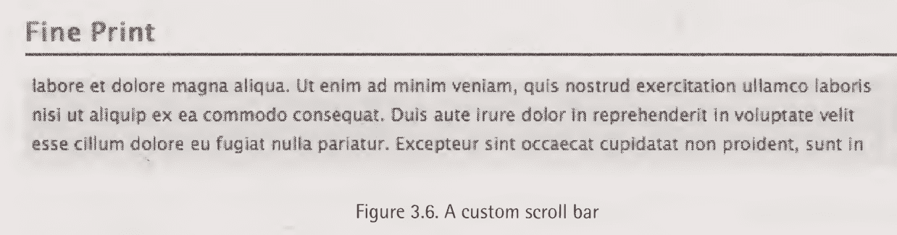

你可以通过简单地在任何元素上调用 jScrollPane 函数来激活自定义滚动条。虽然参数是可选的，但有十几个可供你调整，例如显示滚动条箭头，或将滚动条移动到面板的左侧。你可以在插件的主页上查看完整列表。<sup>11</sup> 对于我们的示例，我们将设置内容与滚动条之间的边距，设置滚动条的宽度，并选择隐藏顶部和底部的箭头：

```
# chapter_03/16_custom_scrollbar/script.js (excerpt)
$('#fine_print').jScrollPane({
  scrollbarWidth: 10,
  scrollbarMargin: 10,
  showArrows: false
});
```

我们的新滚动条看起来和工作起来都很棒，但你可能会注意到，当你将鼠标滚轮悬停在元素上时，它无法响应。jQuery 的核心库有意省略了鼠标滚轮功能以最小化库的大小，但有一个插件可以将其添加回来，¹² 并且 jScrollPane 在编写时考虑到了这个插件。因此，你只需要在页面中包含鼠标滚轮插件，jScrollPane 就会自动为所有滚动内容窗格添加鼠标滚轮事件处理，让你随心所欲地滚动它们！

## 缩放大小

调整大小在用户界面中意味着几种不同的含义：首先想到的是调整浏览器窗口大小的能力（这常常让 Web 开发人员头疼）。但同样常见的还有在应用程序内调整窗口大小，以及调整图像或其他元素的大小。

jQuery 包含一种收集用户发起的窗口大小调整信息的方法，也（通过 jQuery UI）提供了让用户对页面上任何元素进行终极大小调整的能力。让我们深入了解一下！

## `resize` 事件

`resize` 事件是一个核心 jQuery 事件，当文档视图被调整大小时触发。有许多原因你想对此事件做出反应。但在我们研究实际示例之前，让我们确保我们理解该事件是如何工作的：

```
chapter_03/17_resize_event/script.js (excerpt)

$(window).resize(function() {
  alert("You resized the window!");
});
```

在浏览器中加载 **index.html** 页面并尝试调整窗口大小：每次你这样做，都会弹出一个警报。每次用户更改浏览器窗口大小都让他们恼火，可能会让我们无法赢得任何用户体验得分——所以让我们将此事件用于更实际的示例。

## 布局切换器

如果你使用过一段时间 CSS，你会知道有一个持续的争论：哪种布局最好，流体布局还是固定宽度布局。一方面，流体布局最大限度地利用了用户的屏幕空间；另一方面，固定宽度布局允许你设计一个像素完美的布局，你知道当用户以不同的视口大小查看时它不会断裂。

对于 StarTrackr!，我们可以提供两全其美的方案：设计两个独立的固定宽度布局，并通过捕获 `resize` 事件在它们之间切换。

让我们开始吧！到目前为止我们一直在使用的默认 StarTrackr! 网站宽度为 650px。我们的第一个任务是编写一些样式使其变宽——我们将较宽的版本定为 850px：

```
chapter_03/18_layout_switcher/wide.css

body #container {
    width: 850px;
}

body #container p {
    width: 650px;
}

body #header {
    background-image: url('../../css/images/header-corners-wide.png');
}

body #celebs table {
    width: 650px;
    margin-left: 5px;
}
```

请注意，我们在每条规则的开头添加了一个看似多余的 `body`。这是为了让这些规则优先于基础样式表中针对相同元素的任何规则，因为它们更具体。

下一步是编写 jQuery 代码来添加或删除我们的新样式表。我们需要做的只是测试 `body` 元素的宽度是否大于 900px，如果是，则将样式表附加到 `head` 元素，如果不是，则将其移除：

```
chapter_03/18_layout_switcher/script.js (excerpt)

if ($('body').width() > 900) {
    $('<link rel="stylesheet" href="wide.css" type="text/css" />')
        .appendTo('head');
} else {
    $('link[href=wide.css]').remove();
}
```

这让我们陷入了困境。我们需要在两种不同的情况下运行此代码：一次是在我们首次加载页面时，另一次是在页面被调整大小时。你可能很想直接复制粘贴那段代码，然后就完事了。

请抵制这种诱惑！在代码中重复自己几乎总是一个坏主意：想象一下，几个月后，你决定 900px 是错误的截止点。你现在认为应该在 1000px 左右才切换样式表。你进入代码，更改值，然后重新加载页面。但它坏了，因为你忘了在另一个相同的代码块中更改相同的值。这种情况在任何类型的软件开发中都太容易发生了，你的代码越复杂，就越有可能发生——并且越难追踪。

幸运的是，几乎每种编程语言都有构造来帮助我们在这些情况下，JavaScript（以及 jQuery）也不例外。到目前为止，我们一直将匿名函数传递给所有事件处理程序，但现在是时候给我们的函数命名了：

我们将函数命名为`stylesheetToggle`，并调用了两次：一次在文档初次加载时，另一次在窗口大小调整时。你会注意到，我们只需将函数的`name`传递给`resize`事件处理程序；由于我们并非在此声明一个函数，因此无需使用`function`关键字，也不需要任何花括号或括号。

## 可调整大小的元素

jQuery UI 库在其交互功能中包含一个可调整大小插件。该插件通过在元素的底部角添加一个小的控制手柄，使你选择的元素能够被调整大小。你可以用鼠标拖动这个手柄（很像操作系统的窗口）。与所有 jQuery UI 组件一样，它高度可配置且易于使用。如果你之前下载了完整的 jQuery UI 库，那么该类已经准备就绪。否则，你需要返回下载构建器并包含可调整大小组件——这也将需要核心库和一个主题。

使用可调整大小组件的基本形式非常简单。我们只需选择要修改的元素或元素集合，并调用`resizable`函数：

```javascript
$('p').resizable();
```

如果我们在 StarTrackr! 网站上运行此代码，会看到一些不寻常的结果：每个段落元素立即变得可调整大小！

看到这个效果很有趣：突然间，我们的整个网页变得可塑。默认情况下，可调整大小交互在元素的右下角添加小控制手柄。这些手柄的样式在 jQuery UI 样式表中定义，因此如果你有兴趣更改它们的外观，可以查看该样式表。默认手柄如图 3.7 所示。

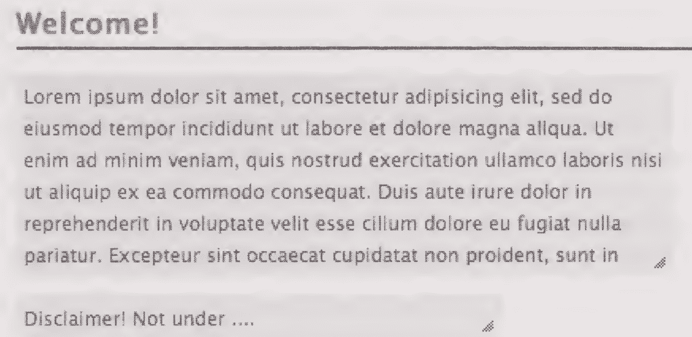

现在，让我们来看一个此功能非常方便的简单情况：调整 textarea 元素的大小。

## 可调整大小的 textarea

有时，提供一个可用的界面可能与保持设计平衡和美观的愿望相冲突。但多亏了 jQuery，我们可以两者兼得——并且能合理地通过那些棘手的客户演示。

形式与功能经常发生冲突的一个领域是 HTML 表单设计。这部分原因在于，访问你网站的用户可能有截然不同的需求。例如，如果你提供一个反馈区域，用户可能什么都不写、写一点或写很多。为了取得平衡，你可以从一个小的 textarea 开始，但使其可调整大小。因此，有很多话要说的用户会觉得你让他们说出来了。以下是我们如何使用 jQuery UI 的可调整大小功能来实现这一点：

```javascript
$('textarea').resizable({
    grid : [20, 20],
    minWidth : 153,
    minHeight : 30,
    maxHeight : 220,
    containment: 'parent'
});
```

这使得我们所有的 textarea 元素都可调整大小，就像我们处理段落元素一样。效果如图 3.8 所示。然而，我们指定了几个新参数以改善体验，并展示可调整大小组件的灵活性。它有大量的配置选项，你可以在 jQuery UI 文档网站上更详细地探索。13

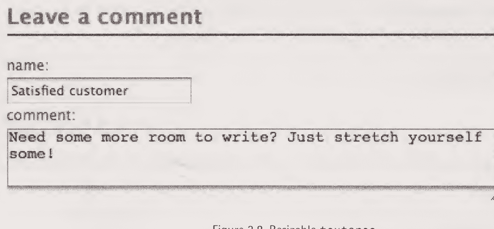

我们还通过指定 minHeight、minWidth 和 maxHeight 属性来约束元素可以拉伸的范围。你会注意到我们省略了 maxWidth 属性，而是使用了 containment 参数：这允许你指定一个容器来限制可调整大小的元素。你可以使用 jQuery 选择器作为参数，或者使用特殊关键字 parent 来引用可调整大小元素的父元素。

我们还使用了 grid 选项，将可调整大小对象限制在特定大小的步长内。出于某种原因，这似乎为调整大小交互增添了一种良好的感觉。网格被指定为一个包含两个元素的数组：水平网格大小和垂直网格大小。

另一个你会想要研究的参数是 `handles` 参数。该参数指定控制手柄将附着在元素的哪些边上，因此也决定了元素可以在哪些方向上被拉伸。该参数接受以下选项：n、e、s、w、ne、se、sw、nw 和 all。你可以通过逗号分隔来指定其中的任意数量。例如，`{ handles : 'n, se'}` 会在元素的顶部和右下角添加控制手柄。

这种功能通常内置于内容长度变化很大的输入页面中。

## 窗格分割器

尽管我们提供了免责声明消息功能，但客户的法律团队仍然担心，如果未能正确概述公司的条款和条件，可能会带来的影响。从设计和可用性的角度来看，问题在于条款和条件页面有很多页，被分成许多子部分——但它们需要在主页上显著展示。也许分割器可以帮助我们。

分割器是一种 UI 组件，它以允用户调整元素大小的方式划分页面上的多个区域；这样，用户就能决定为每个区域分配多少空间。分割器在桌面应用程序中很常见，并且随着富互联网应用程序的兴起，它们也逐渐进入 Web 领域。我们可以利用在可调整大小组件上的经验来模拟一个简单的分割器，其中一个窗格包含“目录”，另一个窗格包含 StarTrackr! 的“条款和条件”内容。该小部件的外观如图 3.9 所示。

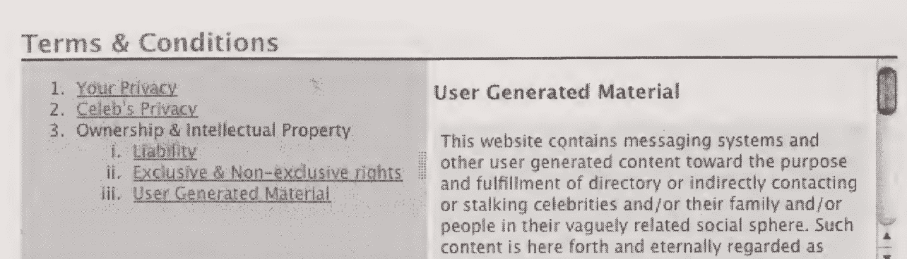

图 3.9. 一个水平窗格分割器

目前我们将只关注调整大小的功能。将每个部分的内容动态加载到窗格中将在第 5 章中详细讨论。

我们的分割器将由两个 div 元素组成，代表每个窗格，它们嵌套在一个具有固定尺寸的包含元素中。我们将目录包裹在一个块级元素中，这样当用户调整窗格大小时，文本不会换行并弄乱我们的嵌套列表：

```html
<div id="splitter">
  <div class="pane" id="tocPane">
    <div class="inner">
      ...
    </div>
  </div>
  <div class="pane" id="contentPane">
    <div class="inner">
      ...
    </div>
  </div>
</div>
```

我们现在将在一个新的 **splitter.css** 样式表中添加一些简单的样式。你可以看到，我们固定了包含 div 的高度，并让子元素默认各占 50% 的宽度。如果需要以非 50:50 的比例开始，你可以更改这些值。如果你需要使用 CSS 边框，你必须以像素为单位指定宽度，并确保它们加起来正确：

```css
#splitter {
    height: 150px;
    margin-top: 30px;
    margin-bottom: 50px;
}

#splitter .pane {
    width: 50%;
    height: 100%;
    float: left;
}

#splitter h2 {
    margin-bottom: 0;
    padding-bottom: 0;
}

#tocPane {
    overflow: hidden;
    background: #d6dde5 url(../images/handle.png) no-repeat right center;
}

#tocPane .inner {
    width: 300px;
}

#contentPane {
    overflow: auto;
}

#contentPane .inner {
    padding: 0 5px;
}
```

接下来是我们的 jQuery 代码。为了创建一个水平分割器，我们将第一个元素设置为可调整大小，并指定一个朝东的控制手柄——因此只有 div 的右边缘是可调整大小的。

如果你只用一个简单的 resizable 语句运行这个示例，你会注意到我们几乎完成了：这两个元素的行为有点像一个分割窗格——只是右侧元素的宽度保持不变，而不是扩展填充

拖动调整手柄时，会留下剩余空间。为了处理这个问题，我们需要在可调整大小控件的`resize`函数内进行一些计算。该事件处理程序会在组件被调整大小时触发：

```
chapter_03/21_horizontal_pane_splitter/script.js (excerpt)
$('#splitter > div:first').resizable({
  handles: 'e',
  minWidth: '100',
  maxWidth: '400',
  resize: function() {
    var remainingSpace = $(this).parent().width() - $(this).outerWidth();
    var divTwo = $(this).next();
    var divTwoWidth = remainingSpace - (divTwo.outerWidth() - divTwo.width());
    divTwo.css('width', divTwoWidth + 'px');
  }
});
```

现在，每次调整大小都会同时触发第二个元素宽度的变化。一些基础数学运算帮助我们计算出应有的宽度：我们获取父容器的宽度（即总宽度），然后减去第一个`div`的`outerWidth`。`outerWidth`函数是获取元素总宽度（包括任何内边距和边框）的实用方法（如果传递可选参数`true`，它也可以包含外边距）。也许并不令人意外，也有一个对应的`outerHeight`函数。

计算出剩余可用空间后，我们几乎可以设置第一个元素的宽度了。但还有一个问题需要考虑：如果第二个`div`有边框或内边距，我们需要将这些因素考虑在内。不幸的是，`outerWidth`函数是只读的，因此我们无法用它来设置总宽度。

要计算元素宽度中有多少是由边框和内边距组成的，我们需要用元素的`outerWidth`减去其`width`。用`remainingSpace`变量减去这个值，就恰好得到了第二个`div`需要的像素宽度——这样我们就可以完成水平分割器的设置了。

## JavaScript变量

这一行 `var remainingSpace = $(this).parent().width() - $(this).outerWidth();` 将计算结果赋值给一个名为 `remainingSpace` 的变量。从现在开始，在我们的代码中，每当需要访问这个值时，我们只需写 `remainingSpace` 即可。

下一行 `(var divTwo = $(this).next();)` 执行的功能非常相似，只是这次我们将一个 *jQuery选择* 赋值给了一个变量（`divTwo`）。这个变量随后可以像任何其他jQuery选择一样使用。

像这样使用变量有助于提高代码的可读性，因为它使每一行都尽可能简洁。它也使代码更高效；对于JavaScript来说，从变量中检索值比从头计算出值要快得多。

如果我们想尝试实现一个垂直分割器，几乎无需改动：我们的面板元素是上下堆叠（而非左右并排），我们的`resizable`调用使用一个朝南的手柄，而不是朝东的。代码也几乎一模一样——但现在我们关注的是元素的高度，而非宽度：

```
chapter_03/22_vertical_pane_splitter/script.js (excerpt)
$('#splitter > div:first').resizable({
  handles: 's',
  minHeight: '50',
  maxHeight: '200',
  resize: function() {
    var remainingSpace = $(this).parent().height() - $(this).outerHeight();
    var divTwo = $(this).next();
    var divTwoHeight = remainingSpace - (divTwo.outerHeight() - divTwo.height());
    divTwo.css('height', divTwoHeight + 'px');
  }
});
```

这些简单的分割器非常有用，所需代码很少，并且适用于许多目的。但如果你需要更复杂的分割器行为，例如多个分割窗格或嵌套窗格，请前往插件库并查看 jQuery Splitter 插件。

## 我们就是这样滚动和动画的。

多么精彩的一章啊！我们掌握了动画、滚动和调整大小，并看到了链式调用如何帮助我们以可读且自然的方式轻松编写简洁、强大的功能。我们开始运用我们的 jQuery 知识来创造一些很棒的效果。然而，在你阅读本书的过程中，重要的不是效果本身，而是我们用来实现它们的底层概念。

即使是最复杂的效果，往往也是由一些简单的操作巧妙地链接而成的。这需要你自己坐下来，思考一些想法，并尝试自己去实现它们。

# 第4章

## 图像与幻灯片

现在不再只是纸上谈兵了。掌握了扎实的基础知识后，我们已经具备了创造世界级效果的无限潜力。我们的客户欣喜若狂；我们给了他梦寐以求的“Web 2.0”，现在他那备受质疑的创业公司获得了几家大型社交网络的青睐。他要求我们添加一些真正“火辣”的“东西”：“图片库、幻灯片、淡入淡出效果——全套都要！”为什么不呢？我们有工具，我们有才能！


没有图像的互联网（至少在视觉上）会相当枯燥；我们在网络世界中获取的大部分内容都是以图片和设计元素的形式呈现的，例如边框、图标和渐变，这些元素有助于定义我们与网页的交互方式。当我们把这些元素与大量的 jQuery 结合起来时，我们开始看到一些充满活力且令人惊叹的效果涌现出来。除了我们已熟知和喜爱的标准组件外，jQuery 还提供了实现一些不太常见、相对较新的效果和特性的方法，这些效果和特性如果仅用 JavaScript 是很难实现的。

## 灯箱

我们的客户想要 Web 2.0，所以让我们给他 quintessential Web 2.0 效果：灯箱。**灯箱**——一个借用自摄影的术语——用于在模态对话框中显示图像缩略图的全尺寸版本。通常，整个背景会变暗以表示它已被禁用。用户必须与图像交互（例如，点击关闭按钮）才能继续操作页面。

## 自定义灯箱

如今，灯箱非常常见，许多灯箱都具有一些非常复杂的功能：动画、过渡效果，以及显示视频或通过 Ajax 加载内容的能力。一如既往，有一些优秀的插件可以完成所有这些功能，我们将在下一节介绍其中一个——但现在，我们将构建自己的灯箱。

为什么构建自己的？在我们的示例中，我们只需要一个基本的图像查看功能，没有任何花哨的东西，也没有那些花哨功能所耗费的千字节。我们还将有机会深入底层，看看这种类型的功能是如何实现的。

我们的灯箱将非常简单：任何具有 `lightbox` 类名的 HTML 链接，点击时都会弹出该链接指向的图像文件。图片将在屏幕上居中显示，周围区域将被禁用并变暗作为视觉提示。效果如图4.1所示。

让我们从 HTML 链接开始。它们只是指向图像文件并带有 `lightbox` 类的标签，这样我们就可以在 jQuery 中选中它们：

```
chapter_04/01_lightbox/index.html (excerpt)
<a href="/images/celeb01.jpg" class="lightbox">Pic</a>
```

当图像显示时，我们希望整个屏幕变暗。我们怎么做呢？最简单的方法是在页面上添加一个大的 `div`，使其高度和宽度与屏幕本身一样大。在这个 `div` 内部，我们将添加另一个 `div`，用于加载图像。


图 4.1. 我们的灯箱效果

覆盖层的样式非常简单：高度和宽度均为 100%，背景为黑色。稍后，我们将改变该元素的透明度以使其呈现阴影效果。另一个技巧是在该元素的中心添加一个旋转的加载器图像。当我们开始加载图像时，加载器将作为背景的一部分显示。当图像加载完成后，它看起来会消失，但实际上它只是被图像隐藏在了后面：

```
chapter_04/01_lightbox/lightbox.css
#overlay {
    position:absolute;
    top:0;
    left:0;
    height:100%;
    width:100%;
    background:black url(loader.gif) no-repeat scroll center center;
}
```

## 快速构建元素

创建新元素是一件非常令人满足的事情，也是你经常需要执行的任务。有一种设置新 jQuery 对象的替代方法，即传递一个对象作为第二个参数。该对象包含了你希望新元素具备的所有属性和设置。例如：

```
$('', {
  src: $(this).attr('href'),
  load: function() {
    positionLightboxImage();
  },
  click: function() {
    removeLightbox();
  }
}).appendTo('#lightbox');
```

jQuery 对你设置的属性的处理方式有些智能化。如果你给它一个事件，它会将提供的处理程序绑定到该事件上（正如我们对 `load` 和 `click` 所做的那样）。如果你使用 jQuery 方法名，如 `text`、`html` 或 `val`，它将使用 jQuery 方法来设置属性。其他所有内容都将被视为属性处理，就像 `src` 属性一样。最终结果与我们之前构造的 jQuery 对象相同，但如果你熟悉 JavaScript 对象表示法，你可能更喜欢这种元素构造方法。

最后，我们添加一个 `return false;` 以防止 HTML 链接的默认行为发生。否则，用户将离开我们的页面并导航到图像本身。

现在让我们看一下 `positionLightbox` 函数：

```
// chapter_04/01_lightbox/script.js (摘录)

function positionLightboxImage() {
  var top = ($(window).height() - $('#lightbox').height()) / 2;
  var left = ($(window).width() - $('#lightbox').width()) / 2;
  $('#lightbox')
    .css({
      'top': top + $(document).scrollTop(),
      'left': left
    })
    .fadeIn();
}
```

当图像加载完成后，会调用 `positionLightboxImage` 函数。它负责在屏幕中心显示图像。它通过获取窗口的高度或宽度，减去图像的高度或宽度，然后将结果除以 2 来计算中心点。然后，它执行一个漂亮的淡入效果来显示图像。

剩下的最后一个任务是在用户点击图像时移除灯箱。我们只需将新元素淡出然后移除它们，这样灯箱就准备好为下一张图像再次触发：

```
// chapter_04/01_lightbox/script.js (摘录)

function removeLightbox() {
  $('#overlay, #lightbox')
    .fadeOut('slow', function() {
      $(this).remove();
      $('body').css('overflow-y', 'auto'); // 显示滚动条！
    });
}
```

这可能是你能想象到的最基础的灯箱了，但看到它运行起来仍然令人满足。既然你了解了灯箱是如何构建的，你就可以想出改进和定制方案。尽管插件可能很多，但有时自己构建它们会更令人满足！

## 使用 console.log 进行故障排除

如果你尝试过扩展或定制这个简单的灯箱（或者，就此而言，我们到目前为止见过的任何代码），你无疑会遇到代码未能按预期执行的情况。准确了解代码在任何给定时刻的执行情况可能会令人沮丧。有时你需要知道是否调用了某个特定函数，或者某个变量在特定时间点的值是多少。

传统上，这种调试通常通过可靠的旧 `alert` 方法来实现。例如，如果你需要知道代码在 `top` 变量中存储了什么值，你可以输入 `alert(top);`。但这会中断程序的执行流程——并强制你在继续之前关闭警报。而且如果你感兴趣的代码位于循环的中间，你可能最终不得不关闭大量的警报窗口。

值得庆幸的是，Web 开发工具在不断进步，如果你使用优秀的 Firefox 插件 Firebug（在第 2 章介绍过），你可以利用内置的调试选项。Firebug 最便捷的功能之一是控制台，在那里，你不必使用警报来显示变量值，而是可以使用命令 `console.log`：

```
// chapter_04/01_lightbox/script.js (摘录)
console.log(top, left);
```

只需打开 Firebug 的 Console 标签页（你可能需要先启用它），你就会看到显示的值。不再有烦人的警报窗口！你可以在单个语句中指定任意多个变量或表达式，用逗号分隔即可。图 4.2 描绘了不同类型的日志语句生成的输出：两个简单的字符串输出、一个包含两个数字的多变量输出以及一个 jQuery 选择集。

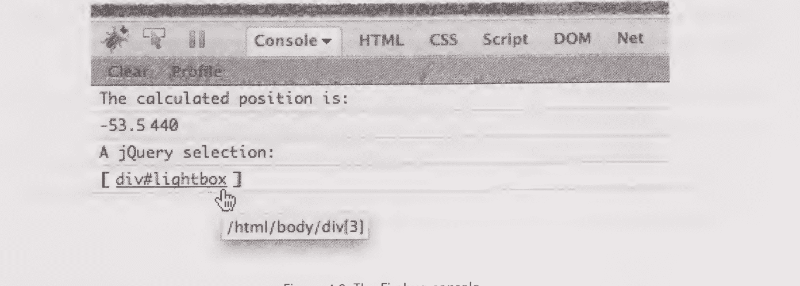

如果变量是一个 JavaScript 对象，你甚至可以在控制台中点击它来检查其内容。如果它是一个 DOM 节点或 jQuery 对象，点击它会在页面上高亮显示它，并在 Firebug 的 DOM 树中跳转到该位置。这将让你在被那些恼人的错误卡住时保持理智！只需记住在发布代码时移除任何 `console.log` 行。

## ColorBox：一个灯箱插件

我们自定义的灯箱对于我们适度的需求来说是一个不错的解决方案，但你不得不承认，就功能而言它相当有限。有时你需要更多。长期以来，“更多”的主要竞争者一直是 Cody Lindley 的 ThickBox。ThickBox 肯定经历过重要的竞争，但就像所有真正的冠军一样，你必须知道何时该退出擂台并挂起手套。

ThickBox 仍然是一个强大的插件，并且尽管它不再维护，但仍适合许多开发者。它做了它该做的事，并且做得很好。正是这种质量水平为新一代的灯箱插件树立了高标准。让我们来看看一个有力的挑战者：ColorBox。

ColorBox 是 Jack Moore 的心血结晶，它拥有一系列公共方法和事件钩子——以及多达 37 个可供选择的选项——即使经验丰富的用户也可能无法涉及它提供的所有功能。考虑到 ColorBox 专注于基于标准的 XHTML、依赖 CSS 进行样式设置，以及对内容选项的广泛支持，很容易看出其网页上的“轻量级”标签仅指其微小的 9KB 体积——而非其庞大的功能集！

从网站的下载区获取 ColorBox 并检查其内容。有一个名为 `ColorBox` 的目录，其中包含插件代码的压缩版和未压缩版。与往常一样，你应该使用压缩版，除非你热衷于了解 ColorBox 的内部工作原理。

下载内容还包括许多示例目录；这些示例都使用相同的标记和 JavaScript 代码，但展示了如何通过样式设置使灯箱看起来完全不同。最好的入门方法是查看示例，选择你最喜欢（和对应的图像）的 CSS 文件，然后在此基础上构建你的实现。

[第 119 页]

```css
#lightbox {
    position:absolute;
}
```

接下来，我们为灯箱链接添加一个点击处理程序。当它们被点击时，我们将添加深色覆盖层元素、图像容器和图像本身。容器对于我们的基础示例并非严格必要，但当你想扩展灯箱的功能时（例如添加边框、描述或**下一张**和**上一张**按钮），它会很有帮助：

```javascript
// chapter_04/01_lightbox/script.js (摘录)
$('a.lightbox').click(function(e) {
    // 隐藏滚动条！
    $('body').css('overflow-y', 'hidden');

    $('<div id="overlay"></div>')
        .css('top', $(document).scrollTop())
        .css('opacity', '0')
        .animate({'opacity': '0.5'}, 'slow')
        .appendTo('body');

    $('<div id="lightbox"></div>')
        .hide()
        .appendTo('body');

    $('')
        .attr('src', $(this).attr('href'))
        .load(function() {
            positionLightboxImage();
        })
        .click(function() {
            removeLightbox();
        })
        .appendTo('#lightbox');

    return false;
});
```

覆盖层被定位在屏幕顶部，并快速从不可见淡入到 50% 不透明度以提供背景效果。灯箱容器被添加到页面并立即隐藏，等待图像的加载。图像被添加到容器中，其 `src` 属性被设置为图像的位置（从链接的 `href` 中提取）。为此，我们使用了 jQuery 强大的 `attr` 方法，该方法可用于检索或设置 DOM 元素的任何属性。当仅使用一个参数调用时（如 `$(this).attr('href')`），它返回该属性的值。当使用第二个参数调用时（例如，`$('').attr('src', ...)`），它将属性设置为提供的值。

然后我们为图像附加几个事件处理程序。其中一个事件对我们来说是新的：`load`。它是 `ready` 事件的近亲，但在元素（在本例中是我们的图像）100% 加载完成时触发。

我们已从某个示例目录复制了CSS和图像文件，并在HTML中同时包含了该CSS文件和压缩后的插件文件：

```html
chapter_04/02_colorbox_plugin/index.html (excerpt)

<link rel="stylesheet" href="colorbox.css" type="text/css">
<script src="jquery.colorbox-min.js" type="text/javascript"></script>
```

ColorBox可以像我们在上一节中那样处理单张图片，但它尤其擅长显示幻灯片风格的图库——让用户在图片之间切换，如图4.3所示。要利用这一功能，我们需要对想要展示的图片进行分组，而ColorBox要求我们使用链接的`rel`属性来实现这一点。


在标记中，我们为所有想要分组在一起的图片都设置了`rel="celeb"`。现在我们可以使用jQuery属性选择器来找到这些图片：`a[rel="celeb"]`。在该选择集上调用`colorbox`方法，就能得到一个外观出色的灯箱效果：

```javascript
chapter_04/02_colorbox_plugin/script.js (excerpt)

$(document).ready(function() {
    $('a[rel="celeb"]').colorbox();
});
```

它默认的外观和工作方式已经非常出色，但还有大量选项可供我们调整。在接下来的示例中，我们为其添加了淡入淡出过渡效果，而不是默认的弹性调整大小（你可能已经猜到，`speed`选项指定了淡入淡出的持续时间）。为了契合StarTrackr!的风格，我们还将自定义灯箱文本的措辞。但这只是冰山一角——请探索ColorBox网站，了解所有其他可用于自定义灯箱的选项和事件：

```javascript
chapter_04/02_colorbox_plugin/script.js (excerpt)

$('a[rel=celeb]').colorbox({
    transition: 'fade',
    speed: 500,
    current: "{current} of {total} celebrity photos"
});
```

ColorBox的妙处在于它具有高度的不干扰性和可定制性：你可以更改行为设置、添加回调函数，并使用事件钩子，而无需修改你的标记或插件源文件。ColorBox会预加载任何必需的图片——甚至可以开始预加载你的图库图片——因此它在页面上总是显得响应迅速。最后但同样重要的是，ColorBox是在宽松的MIT许可证²下发布的——所以你可以根据需要将其用于商业项目。

## 使用Jcrop裁剪图像

当我们讨论成熟优秀的插件和灯箱效果时，如果跳过用于定义图像区域的Jcrop插件³，那将是一种疏忽。该插件在图像上添加了一个灯箱风格的覆盖层，允许用户拖动一个矩形来选择图像所需的区域。这种功能在许多大型网站上很常见，它允许用户裁剪上传的图像用作其个人资料图片。

如果你对网络图像处理略知一二，你可能知道这种图像处理通常发生在服务器端。对吧？是的，这是正确的——Jcrop插件实际上并不裁剪图像，它提供了一个直观的界面来定义用户希望裁剪图像的边界。然后可以将插件返回的结果传递给服务器，以执行实际的图像处理。你可以在图4.4中看到使用Jcrop裁剪图像的示例。


使用Jcrop插件的典型工作流程是：向用户显示需要裁剪的图像（可以是已存储的图像或新上传的图像），并覆盖Jcrop界面。当用户完成选择后，坐标将被发送到服务器，在那里创建生成的图像并保存以供显示或下载。

要应用Jcrop交互，你首先需要下载它并解压文件。下载包中包含Jcrop JavaScript文件、一个小的CSS文件、一个巧妙的动画GIF（负责你选择区域时“移动线条”的效果），以及一些突出显示Jcrop所有功能的演示页面。

你需要包含CSS文件（在页面顶部）和JavaScript文件（在页面底部）。`Jcrop.gif`图像应与CSS文件位于同一目录中：

```html
chapter_04/03_jcrop/index.html (excerpt)

<link rel="stylesheet" href="css/jquery.Jcrop.css" type="text/css">
<script src="jquery.Jcrop.min.js" type="text/javascript"></script>
```

一切就绪后，你只需将要使其可选择的图像添加到页面中。我们为图像添加了一个ID，以便使用jQuery轻松选择。如果你想让用户表示他们对自己的选择满意，也可以添加一个可点击的按钮：

```html
chapter_04/03_jcrop/index.html (excerpt)

<div id="crop">
  
  <input type="button" value="crop"/>
</div>
```

最简单的形式是，你只需将jQuery插件应用于图像。当你重新加载页面时，图像将增加可拖动的控制手柄和覆盖层：

```javascript
$('#mofat').Jcrop();
```

该插件暴露了一些有用的事件，你可以用它们来监视用户的选择。它还提供了一些默认选项来自定义选择器的工作方式。你可以限制裁剪区域的纵横比以及最小和最大选择尺寸，以及背景覆盖层的颜色和不透明度：

```javascript
var jcrop = $('#mofat').Jcrop({
  setSelect: [10,10,300,350],
  minSize:[50,50],
  onChange: function(coords) {
    // 使用坐标
  },
  onSelect: function(coords) {
    // 使用坐标
  }
});
```

这里我们包含了一些默认属性。**`setSelect`**允许我们定义一个默认的裁剪区域；我们需要以`[x1, y1, x2, y2]`的格式传递一个坐标数组。**`minSize`**选项是一个包含选择区域最小宽度和高度的数组。我们还演示了如何捕获**`onChange`**和**`onSelect`**事件。**`onChange`**事件将在用户拖动控制手柄或选择区域时多次触发。而**`onSelect`**事件，另一方面，只会在选择定义完成后触发；即用户停止拖动时。

事件的处理程序接收一个坐标对象，该对象包含`x`、`y`、`x2`、`y2`、`w`和`h`属性。因此，在处理程序代码中，你可以编写`coords.w`来获取当前选择区域的宽度。

迄今为止，Jcrop插件最常见的用途是在用户完成选择后定义要发送给服务器的点。插件触发的事件对此目的没有用，因为我们无法知道用户是否*真的*完成了选择——这就是为什么我们添加了一个按钮！我们想知道用户点击按钮时选择区域的位置。

为此，我们需要稍微修改一下原始代码。当你像上面那样在jQuery对象上调用`Jcrop`时，会返回jQuery对象，以便链接更多的jQuery方法。然而，这无法让我们访问选择坐标。为了获取这些坐标，我们需要以不同的方式调用`Jcrop`，直接从`$`调用。以这种方式调用时，它将返回一个特殊的Jcrop对象，该对象具有访问所选坐标（以及以编程方式修改选择）的属性和方法。我们需要为其传递要裁剪图像的选择器以及选项集：

```javascript
chapter_04/03_jcrop/script.js (excerpt)

var jcrop = $.Jcrop('#mofat',{
    setSelect: [10,10,300,350],
    minSize:[50,50]
});

$('#crop :button').click(function() {
    var selection = jcrop.tellSelect();
    alert('selected size: ' + selection.w + 'x' + selection.h);
});
```

我们使用`tellSelect`方法获取当前选择；它具有与事件坐标相同的属性，因此我们可以使用它们发送到服务器并裁剪图片！在没有服务器的情况下，我们选择简单地进行提醒，让你了解发生了什么。

Jcrop拥有大量的可用选项和方法，因此强烈建议你检查插件下载中包含的演示，以查看有哪些可用功能。

## 幻灯片放映

每天晚上，StarTrackr!网站的客户使用他们购买的位置信息来追踪并拍摄世界社交精英。许多照片被发布回网站，客户希望在主页上展示其中一些。我们对jQuery越来越熟悉，所以我们告诉客户我们会为他设计几个不同的幻灯片放映创意。首先，我们将看看一些交叉淡入淡出图像的方法；即，在淡入一张图像的同时淡出另一张图像。然后，我们将看一些滚动图库，最后是一个更复杂的翻页书风格图库。在这个过程中，我们将学习一堆新的jQuery技巧！

### 交叉淡入淡出幻灯片放映

如果你在电视行业工作，你会知道，除非你是乔治·卢卡斯，否则他们唯一允许你使用的转场效果就是交叉淡入淡出（也称为溶解）。这样做的原因是，滑动、星芒和漩涡转场几乎总是显得俗气。

这也同样适用于电视领域之外；回想一下你最近看到的PowerPoint演示文稿即可。

网页上实现图像交叉淡入淡出的技术多种多样——各有优缺点，主要区别在于简单性与功能性之间的权衡。我们将介绍一些用于实现交叉淡入淡出的主要方法，以便你在必要时有多种选择。

## 悬停淡入淡出

我们要介绍的第一个交叉淡入淡出效果是基础的悬停淡入淡出；它与我们之前探讨过的悬停效果类似，不同之处在于这次我们将在两个状态之间执行渐变淡入淡出。首先，我们需要解决在何处以及如何存储悬停图像的问题。

此解决方案的原理是将两张图像都放入一个 span（或任何你喜欢的容器）中。悬停图像被定位在第一张图像之上，并在用户将鼠标悬停其上之前保持隐藏状态；然后隐藏的图像会淡入。首先，我们设置悬停容器：

```
chapter_04/04_rollover_fade/index.html (excerpt)

<span id="fader">
  
  
</span>
```

要隐藏悬停图像，我们采用常用的位置和显示属性：

```
chapter_04/04_rollover_fade/style.css (excerpt)

#fader {
  position: relative;
}

#fader .to {
  display: none;
  position: absolute;
  left: 0;
}
```

现在我们有了可以为其附加悬停事件处理程序的对象。已知容器内有两个图像，我们可以使用 :eq 过滤器来访问它们：图像 0 是可见图像，图像 1 是悬停图像。

> **选择元素的方式不止一种**

我们主要使用此方法来突出显示 :eq 选择器属性。我们还有其他几种方式可以访问容器内的两个图像：使用 :first 和 :last 过滤器、相应的 .eq、.last 或 .first 方法、子元素选择器（>），或者简单地使用类名。使用 jQuery 通常有多种方式来完成任务，选择往往取决于个人偏好。

以下是我们将用于实现悬停效果的代码：

```
chapter_04/04_rollover_fade/script.js (excerpt)

$('#fader').hover(function() {
  $(this).find('img:eq(1)').stop(true,true).fadeIn();
}, function() {
  $(this).find('img:eq(1)').fadeOut();
})
```

这里没有使用新的东西——除了我们使用了 stop 命令的高级版本（我们在第 3 章名为“动画导航”的部分首次见到它）。我们为 clearQueue 和 gotoEnd 都指定了 true，因此我们的淡入淡出动画将立即停止任何其他排队的动画，并直接跳到它原本要到达的状态（在这种情况下，它将直接跳到完全淡出的状态，以便我们可以让它淡入）。这可以防止在你快速将鼠标移入和移出时动画堆积。

你可能考虑将此效果用于导航按钮——这是个好主意！不过，另一个考虑因素是在 CSS 中也将悬停图像作为链接的 :hover 状态背景图像。这样，对于没有 JavaScript 的用户，你的悬停效果将作为传统的悬停按钮发挥作用。

## JavaScript 定时器

网络是一个事件驱动的环境。页面元素大多只是耐心的等待用户到来并点击或滚动、选择或提交。当用户执行这些操作时，我们的代码可以被激活并执行我们的愿望。但有时我们希望避免等待用户操作，并希望以固定的频率执行任务。接下来我们要构建的几个幻灯片就是这种情况：我们希望自动轮播一系列图像，每隔几秒显示一张新图像。

与库的许多其他领域不同，jQuery 不需要扩展 JavaScript 的定时器功能；基本的 JavaScript 方法简单、灵活，并且在所有浏览器中都能工作。它们有两个：`setTimeout` 和 `setInterval`。

定时器函数的工作方式相同：它们在执行我们提供的代码之前会等待一定的时间。调用它们使用的语法也大致相同：

```
setTimeout(<要运行的代码>, <等待的毫秒数>);
setInterval(<要运行的代码>, <等待的毫秒数>);
```

关键区别在于 `setTimeout` 会等待指定的时间，运行我们提供的代码，然后停止。而 `setInterval` 会等待、运行代码——然后再等待并再次运行代码——如此重复下去（或者直到我们告诉它停止）。如果我们传递给它的代码更新了元素的可见属性，并且我们设置的延迟相对较小，我们就可以实现动画的错觉。事实上，在幕后，当我们使用 jQuery 的任何动画函数时，它所做的就是这样！

定时器的正确使用可能很棘手，主要因为它们会导致*作用域*问题，我们将在第 6 章名为“作用域”的部分更详经地讨论。然而，我们想要掌握它们，因为定时器是将页面从用户发起的事件的专制中解放出来的关键！

### 设置定时器

这里有一个小例子来演示定时器的工作：我们将简单地让一个绿色方框在屏幕上平滑移动。当然，我们可以依靠 jQuery 的 `animate` 方法为我们完成此操作，但我们要学习 JavaScript 中实际发生了什么。这将涉及定位一个方形 `div` 并持续更新其 `left` CSS 属性。让我们设置我们的方框：

# jQuery: 从新手到忍者

chapter_04/05_timers/index.html (excerpt)

```
<div>
    <div id="green" class="box">Go!</div>
    <div id="red" class="box">Go!</div>
</div>
```

方框静止不动；要让它们动起来，我们需要一个定时器。我们将使用 `setInterval` 定时器，因为我们希望代码被重复执行：

chapter_04/05_timers/script.js (excerpt)

```
var greenLeft = $('#green').offset().left;
setInterval(function() {
    $('#green').css('left', ++greenLeft);
}, 200);
```

我们的 div 在屏幕上缓慢移动：每 200 毫秒，我们就将它向右推一个像素。改变延迟的大小会影响动画的速度。不过要小心：如果你设置的延迟非常低（比如说，少于 50 毫秒），并且在每次循环中都进行大量 DOM 操作，普通用户的浏览器很快就会卡住。这是因为计算机没有足够的时间在你再次提出请求之前完成你要求的所有任务。如果你认为你的代码可能有风险，最好在各种机器上测试它，以确保性能可以接受。

也可以使用 `setTimeout` 函数来模拟 `setInterval` 的功能，只需稍微调整一下代码结构：

chapter_04/05_timers/index.html (excerpt)

```
var redLeft = $('#red').offset().left;
function moveRed() {
    setTimeout(moveRed, 200);
    $('#red').css('left', ++redLeft);
}
moveRed();
```

这里我们有一个名为 `moveRed` 的函数，其中包含一个 `setTimeout` 定时器，它调用…… `moveRed`！由于 `setTimeout` 只运行一次，它将只调用 `moveRed` 一次。但因为 moveRed 包含定时器调用，它将一遍又一遍地调用自身——实现与 setInterval 相同的效果。

### 停止定时器

通常，我们的定时器永久运行是不可取的（或不必要的）。值得庆幸的是，你启动运行的定时器可以通过调用相应的 JavaScript 命令 `clearInterval` 或 `setTimeout` 来强制停止：

```
clearInterval(<定时器 ID>);
clearTimeout(<定时器 ID>);
```

要调用这两个函数中的任何一个，你需要传入定时器的 ID。我们如何知道 ID 是什么？ID 是一个整数，在创建定时器时分配给它。如果你知道将来可能需要停止定时器，必须将该数字存储在变量中：

```
var animationTimer = setInterval(animate, 100);
```

现在可以使用以下代码随时停止定时器：

```
clearInterval(animationTimer);
```

这就是关于 setTimeout 和 setInterval 需要知道的全部内容！如果它们看起来仍然有点模糊，不用担心：我们将在本书的其余部分根据需要使用它们，并在上下文中看到它们将帮助你更习惯它们。

## 淡入淡出幻灯片

在两张图像之间进行交叉淡入淡出相当直接：总是一张图像淡入，另一张图像淡出。如果我们将这个想法扩展到一组图像，例如用于轮播图像库，任务就变得更加困难。现在我们需要计算接下来显示哪张图片，并确保在显示最后一张图像后循环回到第一张。

你在 jQuery 图像库中常见的一个技巧是通过隐藏除当前图像外的所有图像来模拟交叉淡入淡出。当需要切换时，你只需隐藏当前图像，然后淡入下一张。由于图像之间没有真正的重叠，这实际上并不算真正的交叉淡入淡出；

不过，这是一个简单的解决方案，可能正是你所需要的，所以我们先来研究它。接下来我们要看的例子将是一个真正的交叉淡入淡出效果。

我们的基本幻灯片将由一个 `div` 中的多张图片组成。我们将通过为其中一张图片指定 `show` 类，将其设定为可见图片：

```
chapter_04/06_slideshow_fade/index.html (节选)

<div id="photos">
  
  
  
  
  
</div>
```

默认情况下，我们将隐藏所有图片。`show` 类在这个幻灯片中有双重用途：它使我们能够在 CSS 中选中该图片进行显示，并且——同样重要的是——它为我们提供了指向当前图片的标识。我们无需跟踪一个变量，比如 `var currentImage = 1`，因为类名本身就充当了那个变量。

现在我们需要启动一个 JavaScript 定时器，以便我们能循环播放图片。我们将编写一个函数，每三秒调用一次自身：

```
chapter_04/06_slideshow_fade/script.js (节选)

$(document).ready(function() {
  slideShow();
});

function slideShow() {
  var current = $('#photos .show');
  var next = current.next().length ? current.next() :
    current.parent().children(':first');

  current.hide().removeClass('show');
  next.fadeIn().addClass('show');

  setTimeout(slideShow, 3000);
}
```

我们知道当前图片具有 `class show`，所以我们用它来选中它。为了找到我们想要显示的下一张图片，我们使用了一些条件逻辑。如果下一个兄弟元素存在，我们就选中它。如果不存在，我们就选中第一张图片，这样幻灯片就能循环播放。

## 三元运算符

你可能对用来给 `next` 变量赋值的语法有点困惑。在 JavaScript（以及许多其他编程语言）中，这被称为**三元运算符**。它是有条件地设置变量的一种快捷方式。

语法 `a ? b : c` 的意思是，如果 `a` 为 `true`，则返回 `b`；否则返回 `c`。你可以像我们上面那样在变量赋值中使用它，根据某些条件给同一个变量赋予不同的值。当然，更长的 `if / else` 语句总能完成同样的工作，但三元运算符要简洁得多，所以非常值得学习。

那么，回到那行代码：

```
var next = current.next().length ? current.next() : current.parent().children(':first');
```

可以翻译成这样的意思：如果当前元素在同一容器中有一个后续兄弟元素（如果 `next` 方法返回一个非空数组），我们将使用它。另一方面，如果 `next` 返回一个空数组（所以 `length` 为 0，在计算机术语中这表示 `false`），我们将导航到当前元父元素（`#photos` div）并选中它的第一个子元素（这将是幻灯片中的第一张照片）。

最后，我们隐藏当前图片并淡入下一张。我们还将 `show` 类从旧图片交换到新图片上，并为 `slideShow` 方法设置一个超时，以便在三秒钟后再次调用自身。

## 真正的交叉淡入淡出

我们之前的方案看起来不错——但它只是淡入淡出，而不是真正的交叉淡入淡出。我们希望能够真正地交叉淡入淡出：当当前图片淡出时，下一张图片淡入。实现 jQuery 效果不止一种方法，我们将采取的实现方法如下：

1.  将图片堆叠在一起，这样 `z-index` 最高的图片将会显示。

2.  淡出顶层图片，使得下一张图片看起来像是淡入。

3.  一旦淡入淡出完成，重新排列图片的 `z-index`，使当前图片位于顶层。

4.  重复步骤 2 和 3。

这种技术的一个缺点是我们会将图片堆叠在一起，所以它们必须都是相同的大小。这通常是个小问题，因为在网络上限制在某个特定区域内是很常见的。还应该注意的是，很容易将图片换成 `div`，并能在其位置上交叉淡入淡出任何 HTML 内容。

> **z-index**

>

> z-index 是一个 CSS 属性，用于指定元素的视觉层叠顺序。z-index 值较高的元素将出现在值较低的元素前面。这可以与绝对定位或相对定位结合使用，将元素堆叠在一起。

回顾我们的大纲，你应该能看出步骤 1 和 2 很直接。让我们从堆叠图片开始：

```
chapter_04/07_slideshow_cross_fade/index.html (节选)

<p id="photos">
  
  
  
  ...
</p>
```

我们需要将图片绝对定位并将它们包含在一个边界框内：

```
chapter_04/07_slideshow_cross_fade/style.css (节选)

#photos img {
  position: absolute;
}

#photos {
  width: 180px;
  height: 180px;
  overflow: hidden;
}
```

现在我们的图片已经堆叠好了，让我们退一步做一些规划。为了能够执行步骤 4（为下一张图片重复淡入淡出），我们需要将淡入淡出的代码放入某种循环中。由于循环需要跟踪当前照片，我们将把代码移到一个命名函数中，我们将在 `$(document).ready` 代码块中调用它：

```
chapter_04/07_slideshow_cross_fade/script.js (节选)

$(document).ready(function() {
  rotatePics(1);
}
```

现在我们将创建 `rotatePics` 函数，它将完成所有繁重的工作。这个方法接受一个数字，应该是当前照片的索引。我们稍后会看到这是如何使用的，但首先，我们将照片总数存储在一个变量中。我们这样做是因为我们将在代码中多次重用它——将其存储在变量中意味着 jQuery 可以避免浪费时间重复进行相同的计算：

```
chapter_04/07_slideshow_cross_fade/script.js (节选)

function rotatePics(currentPhoto) {
  var numberOfPhotos = $('#photos img').length;
  currentPhoto = currentPhoto % numberOfPhotos;
  :
```

第二行代码是 JavaScript 中一个常见的技巧，用于确保值被限制在给范围内。我们绝不希望 `currentPhoto` 大于照片总数，因此我们进行计算以确保传入的照片索引有效——通过取长度的**模**。模在 JavaScript 中用 `%` 符号表示，只返回除法的*余数*。所以如果我们总共有五张照片，我们传入一个索引 6，操作结果是 `6 % 5 = 1`。这个数字实际上被循环回起点，我们可以确保我们永远不会试图显示一张不存在的照片！

现在我们终于可以进行实际的交叉淡入淡出了。正如我们在大纲中描述的，该效果通过淡出当前图片来工作。这将产生下一张图片淡入的视觉效果。

我们使用 jQuery 的 `eq` 遍历命令来获取当前照片。`eq`——“equals”的缩写——从一组元素中选择索引等于我们传入数字的元素。我们传入我们的 `currentPhoto` 变量来选中当前图片。选中图片后，我们只需将其淡出，并运行一个回调函数来处理下一次淡入淡出的设置：

```
chapter_04/07_slideshow_cross_fade/script.js (节选)

$('#photos img').eq(currentPhoto).fadeOut(function() {
  // 重新排序 z-index
  $('#photos img').each(function(i) {
    $(this).css(
      'zIndex', ((numberOfPhotos - i) + currentPhoto) %
      numberOfPhotos
    );
  });

  $(this).show();
  setTimeout(function() {rotatePics(++currentPhoto);}, 4000);
});
```

这里发生了一些事情。首先，我们进行一些数学运算来重新排序图片。我们将每张照片的索引偏移当前显示照片的索引。然后我们的新模技巧再次派上用场，最终结果是每张图片的 `z-index` 向前移动了 1 位。要看到这个效果，打开 Firebug 并在效果运行时检查图片：你会看到每次新图片显示时，`z-index` 属性都在变化。

一旦我们完成了重新排序，我们刚刚淡出的图片将位于堆栈底部。这意味着可以安全地再次显示它，为下次它升到顶部做好准备：一个简单的 `$(this).show()`。

接下来是调用计时器函数 `setTimeout`，以设置在延迟 4,000 毫秒后再次运行该函数。我们通过写 `++currentPhoto` 将下一张照片的索引传递给它。

> **自增与自减**

在 JavaScript 中，如果在数字变量前或后使用 `--` 或 `++`，该变量将分别减少或增加 1。这是对已经见过的 `-=` 和 `+=` 运算符的一种便捷简写。

`++a` 和 `a++` 之间的区别很微妙，但很重要。如果你在代码中使用它，第一种形式（`++` 或 `--` *在* 变量名*之前*）会在返回变量*之前*对其进行自增。第二种形式将返回未修改的值，*然后*对其进行自增。

在我们上面的代件中，我们想用新的自增后的值来调用我们的函数，所以我们使用了 `++currentPhoto`。

你可以随意尝试这种效果；除了淡入淡出，你还可以尝试使用 `slideUp` 效果，或 jQuery UI 效果插件中的任何一种。

## 使用插件实现高级淡入淡出

正如你所想象的，已经存在无数用于图像之间过渡的 jQuery 插件。如果你有一些高级需求（有时你只需要一个星形擦除效果），直接去插件仓库可能是个好主意。

> **使用插件之前**

你在网络上找到的许多 jQuery 插件是相当一段时间前开发的，并且自那以后或多或少被废弃了。没有持续的开发和改进，它们通常会相对较慢且充满错误。尝试理解你添加到网站中的内容，而不是盲目地包含半打插件文件，这总是一个好主意。如果代码很重（从文件大小来看）并且包含大量对于你的需求来说不必要的功能，那么也许一个更轻量级、定制化的解决方案会更合适。

话虽如此，许多插件提供了优秀的、文档齐全的代码，可以为你节省大量的时间和精力。只是要确保充分考虑你的选择！

现在我们将看看两个可以用来实现幻灯片效果的插件；一个极其轻量级，而另一个功能更多。

## 使用 InnerFade 实现新闻滚动条

InnerFade<sup>4</sup> 是一个微小的插件，允许你在一系列元素之间进行过渡，就像我们刚刚构建的淡入淡出图像库一样。它确实比我们的代码有一些优点，值得考虑。首先，它是一个插件——这意味着我们可以轻松将其放入我们需要的任何地方。当然，我们也可以很容易地将我们的代码变成一个插件（只需跳到第 9 章名为“插件”的部分，看看这有多容易）。它还有一些额的选项，给我们更多的灵活性：能够随机顺序显示元素，为活动元素添加 `class` 名称，以及选择不同的动画类型。

你可能会想，所有这些功能添加到我们的自定�代码中应该相当容易——毕竟，我们正在成为 jQuery 忍者！如果你喜欢冒险，可以打开 InnerFade 插件文件，看看这些功能在那里是如何实现的，这应该能让你了解你自己会如何实现它们。

与我们的图像轮换不同，让我们看看如何轮换列表项以创建一个简单的新闻滚动条，其中文本链接列表将随机显示。为了启动它，我们需要在页面中包含该插件。

ZIP 文件链接在插件网页的最底部。它超过 100KB——但别担心，大部分大小由演示中使用的图像组成。实际脚本只有 8KB，而且这还是未压缩的！

```
chapter_04/08_innerfade/index.html (excerpt)
<script type="text/javascript" src="jquery.innerfade.js"></script>
```

接下来，我们将设置包含元素和我们想要滚动的项。该插件会将我们传递给它的容器的所有第一级子元素视为可以循环的有效对象。我们将使用无序列表作为容器，列表项作为元素：

```
chapter_04/08_innerfade/index.html (excerpt)

<div id="news">
  <h2>News</h2>
  <ul>
    <li><a href="#">Barron Von Jovi spotted ... </a></li>
    <li><a href="#">Mo'Fat signs up-and-coming rapper ... </a></li>
    <li><a href="#">Glendatronix rumored to be ... </a></li>
    <li><a href="#">Man claims to be Darth Fader's son ... </a></li>
  </ul>
</div>
```

当文档准备就绪时，我们在列表上使用插件提供的 `innerfade` 方法。有许多可用的选项可以自定义此方法的工作方式；我们在这里使用了一些，你应该查阅插件的文档以发现所有选项。我们将指定滑动效果而不是淡入淡出效果，以完善我们的新闻滚动条风格，并且我们将让元素随机轮换：

```
chapter_04/08_innerfade/script.js (excerpt)

$('#news ul').innerfade({
    animationtype: 'slide',
    speed: 750,
    timeout: 2000,
    type: 'random'
});
```

就这样，一个简单而酷炫的新闻条目显示效果就完成了。InnerFade 插件也非常适合我们已经构建的图像库，但你应该意识到一个重要的区别。InnerFade 在代码中处理了所有元素的隐藏、显示和定位——因此没有 JavaScript 时，*所有* 元素都会被显示（而在我们的自定义代码中，我们在 CSS 中隐藏了除一个以外的所有元素）。你需要考虑到这一点，并决定你希望网站的基线体验是什么，以及你希望如何用 jQuery 来增强它。

## Cycle 插件

Cycle 插件[^5] 是一个非常成熟、功能齐全的插件，它——就像我们一直在做的所有淡入淡出效果一样——使你能够在容器中的元素之间进行过渡。它的完整性导致了相对较大的下载量（完整压缩版为 25KB），但提供了一些令人印象深刻的过渡效果，非常适合以更有趣的方式显示图像库。

[^5]: http://malsup.com/jquery/cycle/

设置现在对你来说应该非常熟悉了：下载插件并将 JavaScript 文件添加到页面的 head 中。下载中实际上包含三个不同版本的插件：一个仅包含滑动过渡的基础版本（**jquery.cycle.min.js**，16KB），一个具有广泛可用过渡功能的全功能版本（**jquery.cycle.all.min.js**，25KB），以及一个仅包含最基本选项的精简版本（**jquery.cycle.lite.min.js**，4KB）。为了我们的示例，我们将使用全功能版本，以便说明可用选项。

我们将从与之前幻灯片完全相同的标记开始。你可以使用 Cycle 插件轻松实现图像的交叉淡入淡出，但考虑到它为我们提供了许多更花哨的选项，让我们尝试一个并“洗牌”图像：

```
chapter_04/09_cycle_plugin/script.js (excerpt)

$('#photos').cycle({
  fx: 'shuffle'
});
```

此效果如图 4.5 所示。


该插件为我们提供了超过 20 种方式来移动我们的画廊：shuffle、fade、zoom、wipe、toss、curtainX、growY……仅举几例。此外，如果找不到满足你需求的过渡效果，该插件可以自定义以包含你自己的过渡效果。

Cycle 提供的选项数量相当惊人，可能远超你所需。让我们尝试一个更复杂的例子：

```
chapter_04/10_cycle_plugin_2/script.js (excerpt)

$( '#photos' ).cycle({
    fx: 'scrollDown',
    speedIn: 2500,
    speedOut: 500,
    timeout: 0,
    next: '#photos'
});
```

`timeout` 设置控制过渡之间的时间——但值为 0 意味着什么？在这种情况下，它意味着“不要动画”。相反，我们使用了 `next` 选项来选择一个元素，当点击该元素时，将前进到下一张幻灯片。该选择器就是幻灯片本身——因此要移动到下一张图片，你只需点击图片即可。

此外，我们使用了 `speedIn` 和 `speedOut` 选项来指定“进入”和“退出”动画的持续时间：我们选择 *极其缓慢地* 将下一张图片带入视野，同时快速移除上一张。有如此多的选项可用，你需要认真玩味才能穷尽可用效果的可能性。

## 滚动幻灯片

正如我们使用 Cycle 插件时所看到的，交叉淡入淡出远非图像集之间过渡的唯一方式。在接下来的几个示例中，我们将探索另一种创建交互式幻灯片的技术。我们将把所有的图像放入一个巨大的容器中，并使用一个包装元素来隐藏除一张或几张以外的所有图像。然后，当我们想显示不同的图像时，我们只需将元素滚动到所需的位置。

## 缩略图滚动条

我们将要实现的第一个滚动画廊是一个水平排列的缩略图列表。如果点击控制按钮，列表就会滚动，显示出更多图片。

要构建这个控件，我们需要两个嵌套的元素。子元素会比较大，并包含所有的图片。父元素的大小则仅与视口区域相同，也就是我们希望用户看到的区域。当子元素移动时，用户会感觉内容在滚动。以下是其标记代码：

```
chapter_04/11_thumbnail_scroller/index.html (excerpt)

<div id="photos">
  <div id="photos_inner">
    
    
    ...
    
  </div>
</div>
```

外层元素需要隐藏超出的内容，因此需要设置 `overflow: hidden`。对于我们的滚动条，我们将内层元素的宽度定义得足够宽，以容纳15张缩略图：

```
chapter_04/11_thumbnail_scroller/style.css (excerpt)

#photos {
  overflow: hidden;
  width: 600px;
}

#photos_inner {
  height: 100px;
  width: 1500px;
  overflow: hidden;
  position: relative;
}

#photos_inner img {
  float: left;
  width: 100px;
  height: 100px;
}
```

容器已经设置完毕，图片也准备就绪，让我们来实现首次滚动图片的尝试：

```
chapter_04/11_thumbnail_scroller/script.js (excerpt)

$('#photos_inner').toggle(function() {
  var scrollAmount = $(this).width() - $(this).parent().width();
  $(this).animate({'left':'-=' + scrollAmount}, 'slow');
}, function() {
  $(this).animate({'left':'0'}, 'slow');
});
```

首先，我们需要计算需要滚动的距离。我们取包含图片的溢出元素的宽度，然后减去父容器的宽度。`parent`操作会选取一个元素的直接父元素（参见第1章中名为“HTML片段——即‘DOM’”的部分）。我们用它来告诉我们滚动到图片末尾需要滚动多远。当我们点击图片时，滚动效果会在图片的起点和终点之间切换。

如果我们拥有的图片宽度不超过两个屏幕，这个方法很棒。但如果图片更多，我们将无法看到两端之间所有的图片，因此我们需要一种不同的方法。一种更好的方式是，比如说，一次滚动半屏的图片。当我们到达列表末尾时，我们将滚动回起点。让我们扩展代码，使其更加健壮：

```
chapter_04/12_thumbnail_scroller_improved/script.js (excerpt)

$('#photos_inner').click(function() {
  var scrollAmount = $(this).width() - $(this).parent().width();
  var currentPos = Math.abs(parseInt($(this).css('left')));
  var remainingScroll = scrollAmount - currentPos;

  // 默认滚动半屏
  var nextScroll = Math.floor($(this).parent().width() / 2);

  // 但如果剩余空间不足一整次滚动，
  // 则只滚动剩余的部分。
  if (remainingScroll < nextScroll) {
    nextScroll = remainingScroll;
  }

  if (currentPos < scrollAmount) {
    // 向左滚动
    $(this).animate({'left':'-=' + nextScroll}, 'slow');
  }
  else{
    // 向右滚动
    $(this).animate({'left':'0'}, 'fast');
  }
});
```

哇，代码确实更多了——但如果你逐行查看，你会发现它们其实并不复杂。我们使用了大量的变量，由于我们给它们起了清晰的名字，这有助于让代码更容易理解：

1. 与之前的例子一样，我们首先计算总的滚动空间：我们的 `scrollAmount` 变量。

2. 因为我们的新滚动条需要能够处理超过两屏的图片，所以我们还需要弄清楚当前已经滚动到哪里。我们使用JavaScript函数 `Math.abs()` 将当前滚动位置转换为正数，因为向左滚动意味着我们将元素移动到了负值区域。如果你的高中数学知识还记得的话，这里复习一下：一个数的绝对值总是它的正值，无论这个数本身是正是负。所以 `Math.abs(3)` 是 3，而 `Math.abs(-3)` 也是 3。

3. 我们知道总共有多少空间，也知道当前滚动了多远——所以计算出剩余距离就很简单了！只需用前者减去后者即可。

4. 现在是关键部分：我们需要计算要滚动多远。默认情况下，这将是图片容器总宽度的一半。（`Math.floor()` 是一种将数字向下取整的方法，所以我们确保得到的是一个整数。）我们将想要滚动的距离存储在 `nextScroll` 变量中。

5. 如果剩余空间小于我们想要滚动的距离，我们将更改 `nextScroll` 变量，以便只滚动到图片的末尾。

6. 最后，我们执行滚动。如果我们还没有到达图片末尾（如果当前位置小于总可滚动宽度），我们就按计算出的量向左滚动。否则（如果我们已经在图片末尾），我们就完全滚回起点。

如果你觉得这对于一个基本效果来说代码太多了，你是对的！要是有一种方法可以不用做所有这些数学运算就能滚动内容就好了……

## 使用 scrollTo 实现滚动画廊

你可能还记得，当我们在第3章讨论滚动时，我们提到了一个特别有用的页面滚动插件：scrollTo。除了滚动整个页面，scrollTo插件也非常擅长滚动溢出的元素（比如图片画廊中的元素）！在我们第一次尝试实现滚动缩略图画廊时，我们不得不自己进行相当多的计算来确定可滚动区域的大小，以及我们是在容器的末尾还是开头。

scrollTo插件会自动帮我们解决很多这些问题，这样我们就可以专注于添加更复杂的功能。在这个演示中，我们将移除我们的缩略图列表，并用更大的图片来代替它们。这些大图片将包含在一个网格中——但我们一次只显示一张。当用户点击图片时，我们将在网格中滚动，并停在一张新的随机图片上。

首先，我们需要一个图片列表。为了简单起见，我们将其设置为一堆图片标签，放在一个div容器内——这个div本身又包含在另一个div中。你可能喜欢将其设置为一个div内的无序图片列表，这样语义上更好，但我们需要最终得到一个块级元素，其大小和宽度与我们的网格相同。这需要放在一个设置了 `overflow: hidden`（或 `auto`）的元素内。意思如下：

```
chapter_04/13_scrolling_gallery/index.html (excerpt)

<div id="pic_container">
  <div id="pic_scroller">
    
    
    ...
    
  </div>
</div>
```

我们将使 `pic_container` div的宽度等于，比如说，三张图片，高度等于四张图片；因此，图片将被限制在一个3x4的网格中。在这个演示中，我们将使用200x200像素的图片，所以我们的容器需要是800像素宽和600像素高。然后我们将可见区域设置为单张图片的大小，并隐藏其余所有内容：

```
chapter_04/13_scrolling_gallery/style.css (excerpt)

#pic_container {
  overflow: hidden;
  height: 200px;
  width: 200px;
  margin-bottom: 15px;
}

#pic_scroller {
  height: 600px;
  width: 800px;
  overflow: hidden;
}

#pic_scroller img {
  float: left;
}
```

网格准备好后，我们就可以添加一些随机滚动的魔法了。我们首先获取所有图片，然后选择一张随机的，并使用scrollTo滚动到它：

```
chapter_04/13_scrolling_gallery/script.js (excerpt)

$('#pic_scroller').click(function() {
    var numberOfPics = $(this).find('div > img').length;
    var next = Math.floor(Math.random() * numberOfPics);
    $(this)
        .scrollTo(
            '#pic_scroller>img:eq(' + next + ')',
            {duration: 1000}
        );
});
```

这当然比我们上一个例子简单多了！插件处理了几乎所有复杂的部分。话虽如此，里面有两个新的jQuery用法：`find` 操作和 `:eq` 过滤器。`find` 的工作方式与主jQuery `$` 选择器本身大致相同，只是它只在当前选定的元素内搜索，而不是在整个文档中搜索。

`:eq` 过滤器的工作原理与我们之前看到的 `eq` 操作完全相同，只不过它是一个过滤器，所以你需要在选择器字符串中使用它。我们向它传递一个0到图片总数之间的随机数来选择一张随机图片。

> **随机数**

>

> `Math.random` 会给你一个0到1之间的随机数。但更多时候，你需要的是特定范围内的随机整数。实现这一点最简单的方法是使用 `Math.floor(Math.random() * maximum)`。你将这个小数乘以你想要的最大值，然后将其向下舍入到最接近的整数。

注意，要求scrollTo滚动到特定元素是多么容易：我们只需传递一个选择器来匹配该元素即可！

## 使用 data 操作实现更智能的滚动

然而，我们构建的组件存在一个相当大的问题，尤其是在图片数量较少时：下一个要显示的随机图片可能就是我们当前正在查看的那张！在这种情况下，不会发生滚动，感觉就像出了bug。为了补救这个问题，我们需要跟踪上一张图片是什么：

## 类似 iPhoto 的幻灯片组件

我们正在使用一个全新且功能极其强大的 jQuery 操作：`data`。`data` 不同于我们之前见过的任何操作，因为它允许我们在任何 jQuery 对象中存储信息。我们使用两个参数调用它来存储数据。第一个参数成为数据项的名称，第二个是要存储的值。然后，要检索数据，我们只传入一个参数：数据项的名称。

在我们改进的示例中，一旦找到要滚动到的图像，我们就使用命令 `$(this).data('last', next)` 存储编号元素。当下次点击滚动器元素时，我们再次使用命令 `$(this).data('last')` 读取它。如果我们的新元素与上一个相同，我们就简单地将它加 1 以滚动到下一张图像。（我们再次使用模运算来确保我们保持在图像总数内）。

你应该仔细研究我们在元素上检索和设置数据的那两行代码（上面已突出显示）。在接下来的章节中，我们将经常使用这个令人惊叹的 jQuery 功能，所以帮自己一个忙——把它记在脑子里，并尽可能多地实践它！

我们将通过构建一个类 iPhoto 的组件（iPhoto 是 Mac OS X 中包含的图像画廊应用程序）来研究更高级的幻灯片。鼠标悬停在当前图像的左侧或右侧将滚动到下一张或上一张图像，因此用户可以随意浏览画廊。这是我们目前见过的最高级的 jQuery，你第一次可能很难完全理解它。在接下来的章节中，我们将更详细地探讨这里使用的许多概念，所以如果你现在需要跳过这个部分以后再回来看，也不必担心。

让我们基于一个熟悉的图像列表来构建幻灯片。我们将列表包装在一个 div 中，这将允许我们约束缩略图并添加一个作为我们触发器的锚点：

```html
<h2>昨夜城中漫步</h2>
<div id="photos">
  <a href="#" class="trigger">图像画廊</a>
  <ul id="photos_inner">
    <li>
      
    </li>
    <li>
      
    </li>
    :
  </ul>
</div>
```

如果用户在禁用 CSS 和 JavaScript 的情况下查看我们的页面，他们只会看到一大堆图像。虽然这远非我们期望提供的良好体验，但我们已经为他们提供了对我们内容的完全访问权限。如果只禁用 JavaScript，除一张外的所有图像都将被隐藏——但我们会覆盖一个链接到完整画廊页面的画廊，因此点击它将引导用户进入传统的 HTML 画廊页面。让我们从 CSS 开始我们的幻灯片增强功能：

```css
#photos {
  border: 1px solid #BEBEBE;
  height: 400px;
  overflow: hidden;
  position: relative;
  width: 400px;
}

#photos ul {
  left: 0;
  list-style-type: none;
  margin: 0;
  padding: 0;
  position: absolute;
  top: 0;
  width: 2400px;
}

#photos li {
  float: left;
}

#photos .trigger {
  left: 0;
  position: absolute;
  top: 0;
  z-index: 10;
  text-indent: -9999px;
  height: 400px;
  width: 400px;
  display: block;
}
```

从容器 div 开始，我们设置了显示约束。我们的图像是 400 像素见方，所以这就是我们容器的尺寸。如果图像尺寸各不相同，你可以简单地将容器的比例设置为它需要容纳的最大图像尺寸。`overflow: hidden;` 意味着我们的缩略图不会意外地露出来。对于我们的无序图像列表，我们在创建幻灯片之前控制定位，并且我们知道我们将使用十张图像，所以我们设置列表宽度为 2400px。在动态 Web 应用程序中，这需要在服务器端设置——当然，这取决于画廊中有多少图像。

CSS 的最后一点是将触发器锚点定位以完全覆盖画廊图像，并使用 `text-indent: -9999px` 隐藏其文本。搞定了这些，让我们深入研究 jQuery！

## 创建一个组件

组件的定义各不相同，但我们在这里使用它来表示一个独立的功能单元，我们可以在未来的项目中重用。组件的真正目的是将我们的代码封装到一个方便的包中。在整本书中，我们将越来越多地这样做（在第 6 章名为“为你的代码命名空间”的部分中，我们将对此进行深入探讨），因此到书的结尾时，结构和思路对你来说将变得相当熟悉！

我们组件的基础是一个 JavaScript 对象字面量（与我们一直用来向 jQuery 操作传递多选项集相同的类型）来定义组件的名称：`var gallery = {};`。到目前为止，我们已经看到对象字面量用花括号（{}）括起来。对象一开始是空的，但我们很快就会填充它。将所有代码放在这样的对象中将给我们的代码一个命名边界，这限制了我们的脚本与页面中其他可能存在的脚本发生冲突的机会。设置一个空对象是我们开始实现大多数组件的方式。

接下来，我们可以添加属性和方法，使我们的组件实际执行功能。通过向我们的对象添加属性，我们消除了页面中任何变量可能被其他脚本覆盖的风险：

```javascript
gallery.trigger = $("#photos .trigger");
gallery.content = $("#photos_inner");
gallery.scroll = false;
gallery.width = 400;
gallery.innerWidth = gallery.content.width();
gallery.timer = false;
```

当我们写 `gallery.timer = false` 时，它与我们写：

```javascript
var gallery = {
  var timer = false;
}
```

等同。点（.）符号是在对象声明外部读写属性的快捷方式。如果有点不清楚，请放心，随着你在示例中看到它的使用，它会变得越来越清晰。

让我们看看我们为自己创建了什么：`gallery.trigger` 是对触发器链接的 jQuery 选择的引用，`gallery.content` 是我们的图像列表。我们现在可以利用这些更短的名称，这节省了我们每次想使用它们时输入完整选择器字符串的时间。这也意味着我们可以轻松地将脚本指向不同页面上的不同画廊，只需更改这些值。

我们分配给画廊对象的下一个属性是函数。我们有 `gallery.offset`，它设置我们移动滑动列表的距离；`gallery.slide`，它移动列表并使其持续移动；巧妙命名的 `gallery.direction`，它设置幻灯片滚动的方向；以及一个可靠的初始化方法 `gallery.init`。让我们依次看看每一个：

```javascript
gallery.offset = function() {
  var left = gallery.content.position().left;
  if (gallery.scroll == '>') {
    if (left < 0) {
      left += gallery.width;
    }
  } else {
    if (left <= 0 && left >= ((gallery.innerWidth * -1) + 
      (gallery.width * 2))) {
      left -= gallery.width;
    }
  }
  return left + 'px';
}
```

我们在 `gallery.offset` 中做的第一件事是设置一个变量，保存列表相对于容纳 div 的 `left` 属性。通过使用 `position` 而不是 `offset`，jQuery 帮我们省去了计算画廊相对于视口位置的麻烦。

然后我们检查我们想要滚动缩略图的方向，并且我们还有滚动的空间，如果一切正常，我们生成新的 `left` 值（通过将我们的 400px 宽度属性添加到当前的 `left` 值）并返回它。注意，我们需要在返回值之前添加 "px"，因为我们将它用作 CSS 属性。

所以 `gallery.offset` 只是计算画廊要滑动多远。你可能在想，“为什么不直接在 `gallery.slide` 函数里计算呢？” 通过将此功能移动到它自己的方法中，如果我们需要从滑动画廊之外的不同上下文中访问它，我们使其更具可用性。它还有助于我们避免嵌套代码太深，这会使阅读变得更加困难。这是该函数：

```javascript
gallery.slide = function() {
  if (gallery.timer) {
    clearTimeout(gallery.timer);
  }
  if (gallery.scroll) {
    $(gallery.content)
      .stop(true,true)
      .animate({left: gallery.offset()}, 500);
    gallery.timer = setTimeout(gallery.slide, 1000);
  }
}
```

我们的 `slide` 方法的首要任务是检查 `gallery.timer` 是否已设置。如果已设置，则 `setTimeout` 已经被调用过，所以我们调用 `clearTimeout` 以确保安全。除非我们确定想要滚动，否则我们不会让滚动发生！然后我们检查 `gallery.scroll` 以查看是否应该发生滚动。如果用户在滚动之间将光标移开组件，我们希望停止任何更多的滚动发生。但如果他们仍然悬停在组件上，我们就对 `gallery.content` 的 `left` 属性调用 jQuery 的 `animate` 方法。这将平滑地将我们的画廊滚动到一侧。我们再次利用 `stop(true,true)` 来防止动画在队列中堆积。

`animate` 持续时间设置为 500，所以它既轻快又迅速，并且在使用 `setTimeout` 调度下一次滚动之前有充足的时间完成。`setTimeout` 应用于 `gallery.timer` 属性，这就是我们之前检查的，而 500

动画结束后多少毫秒会发生下一次滚动（因为我们将计时器设为1,000，比动画长500）。但我们将往哪个方向滚动？`gallery.direction`会为我们解决这个问题，就像这样：

```
chapter_04/15_iphoto_style_slideshow/script.js (摘录)

gallery.direction = function(e,which) {
  var x = e.pageX - which.offset().left;
  gallery.scroll = (x >= gallery.width / 2) ? ">" : "<";
}
```

当初始化方法调用`gallery.direction`时，它传入两个参数：`e`表示导致滚动的事件，`which`持有触发滚动的元素的引用。我们很快将在“事件处理程序参数”部分深入探讨`e`参数，但现在你只需要知道这个参数允许我们访问事件发生的页面坐标。使用这个`e.pageX`，我们可以计算从触发链接的左边缘到光标的距离。知道了这个数字，我们就使用三元运算符（参见“淡入淡出幻灯片”部分）为`gallery.scroll`赋值：如果光标在中心右侧，则赋值为">"，否则赋值为"<"。

我们需要查看的最后一个方法是小部件的初始化器，`gallery.init`：

```
chapter_04/15_iphoto_style_slideshow/script.js (摘录)

gallery.init = function() {
  $(gallery.trigger)
    .mouseout(function() {gallery.scroll = false;})
    .mousemove(function(e) {gallery.direction(e,gallery.trigger);})
    .mouseover(function(e) {
      gallery.direction(e,gallery.trigger);
      gallery.slide();
    });
}
```

到现在，你应该已经相当习惯我们所做的一切了。`gallery.init`只是对由`gallery.trigger`选择的jQuery对象链接jQuery方法。让我们稍微分解一下这个链。

`mouseout`将`gallery.scroll`设置为`false`。这是我们检查以确保用户希望我们继续滚动的属性。`mousemove`调用`gallery.direction`，这反过来设置了我们之前看到的`gallery.scroll`。最后，`mouseover`也调用`gallery.direction`，但同时也加入了`gallery.slide`。通过从初始的`mouseover`和任何后续的鼠标移动中调用`gallery.direction`，我们确保滚动方向始终正确设置。

就是这样。添加一个`$(document).ready()`以延迟增强功能直到DOM可用，现在你需要的只是想看看你的图库提供什么的快乐网站访客。

我们在构建这个小部件时采用的许多技巧可能对你来说是新的，所以你可能会感到有点不知所措！在接下来的章节中，我们将在不同的形式中重新审视它们，不知不觉中，它们将成为你的第二天性。在继续对StarTrackr!进行下一轮更改之前，让我们快速看看我们是如何从回调中访问鼠标悬停事件在页面上的位置的。

## 事件处理程序参数

我们现在已经看到了相当多的事件处理程序回调函数，但如果你仔细看上面的鼠标悬停处理程序，你可能会注意到一个冒名顶替者：`e`。`e`是我们给所有jQuery事件处理程序都可以接收的可选参数起的名字。我们之前没有看到它，因为它在我们迄今为止实现的任何效果中都不是必需的。

当事件处理程序被调用时，jQuery传入一个事件对象，其中包含有关已发生事件的详细信息和数据。数据的种类取决于事件的种类：按键事件将包含有关按下了哪个键的信息，点击事件将包含点击的位置，等等。jQuery对事件进行了一些魔法处理，以便无论用户使用哪种浏览器，相同的信息都是可用的。

> **为事件参数命名**

你当然不必将事件对象称为`e`——它只是一个参数名称，所以你可以随心所欲地称呼它。别名`e`或`evt`相当标准。人们倾向于避免使用`event`，因为各种浏览器都将`event`作为关键字响应，所以最好安全起见，避免错误。

无论如何，回到代码！当用户将鼠标移动到导航项上时，`mouseover`事件触发。我们在事件处理程序中捕获`e`参数并将其传递给`gallery.direction`。正如我们所看到的，这包含有关事件的一些特定信息，例如它发生的位置。我们使用此信息来计算鼠标在图库小部件上的水平位置：

```
var x = e.pageX - which.offset().left;
```

这给我们一个以像素为单位的数字。然后我们将此值与图库宽度的一半进行比较。如果数字较小，我们在左侧；否则，我们在右侧。这使我们能够确定滚动方向：

```
gallery.scroll = (x >= gallery.width / 2) ? ">" : "<";
```

`pageX`只是事件对象众多可用属性中的一个。我们将在下一章中看到更多，完整列表在附录A的“事件”部分中。

## 想象一下！

里程碑时刻！我们使用命名变量和函数创建的小部件对象是真正的jQuery忍者的首选武器！它使你的代码可读、简洁，并且最重要的是，可重用。你还掌握了计时器和事件对象，如果有人特别喜欢比喻的话，可以将它们等同于闪光弹和飞镖。很快就没有什么能阻止你了。

StarTrackr!网站看起来绝对更有活力了，现在我们已经添加了幻灯片、灯箱和一些优雅的交叉淡入淡出。我们的客户（和他的投资者）欣喜若狂，他还有另一系列希望尽快在网站上看到的更改。这对我们来说意味着更多的工作，这意味着更多jQuery的精华即将到来！

# 第5章

## 菜单、标签页、工具提示和面板

jQuery确实是DOM的大师——轻松地移动事物、动画CSS属性以及操作元素属性，帮助我们为静态内容增添趣味。但静态内容在Web中所占比例越来越小；每一天，越来越多功能齐全、高度实用且外观令人印象深刻的应用程序如雨后春笋般涌现。本章让我们告别静态文档，进入富互联网应用程序（RIA）的花哨功能世界。

我们的客户，特别是最近颇受欢迎的StarTrackr!名人地理标记和跟踪网站的所有者兼运营者，一直在阅读一些商业杂志；他学到了RIA这个术语，并决心尽可能多地使用它。他希望看到他的网站从简单的宣传册网站转变为一个用户可以轻松愉快地追踪他们最喜爱明星的在线应用程序。当然，这意味着我们可以转向一些真正有趣的东西。

本章全部关于用户界面：我们将研究如何将内容逻辑分组，并通过下拉菜标签页界面、滑动面板、工具提示和手风琴控件为用户提供便捷访问。掌握了这些工具，你将准备好将最复杂的接口组织成易于使用和操作的独立部分！

# 菜单

我们已经尝试过一些菜单，但它们大多只是简单的顶级导航窗格。在本节中，我们将研究将jQuery应用于更复杂的菜单式导航控件：可折叠和下拉菜单。

随着StarTrackr!网站越来越大（而且我们客户的要求也变得更加复杂），导航结构可能变得笨拙，并可能让用户感到困惑。精心设计的菜单允许我们对内容结构进行分类，同时最小化其占用的宝贵屏幕空间。当菜单滑动打开和关闭时，它看起来也很酷。


## 可展开/可折叠菜单

垂直网站导航的一个常见功能是子菜单系统，其中链接被分组到类似的类别中。这使用户可以轻松找到相关信息，并且通过允许顶级类别展开和折叠，让我们可以在相对较小的区域存储大量信息。当菜单滑动打开和关闭时，它看起来也很酷。一个简单而有效的可展开菜单非常容易设置；事实上，我们在第2章就已经学习了菜单所需的大部分代码。我们将从创建一个简单的菜单开始，然后为其添加一些额外的功能。我们最初的菜单将如图5.1所示。

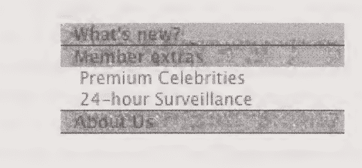

如今（直到HTML 5导航标签成为标准），几乎所有的导航控件都是使用无序列表创建的。从语义的角度来看，这完全合理，毕竟，导航菜单只是链接列表。对于我们的可展开菜单，我们将从一组嵌套列表开始：

## 第五章：可展开菜单

`chapter_05/01_expandable_menus/index.html`（节选）

```html
<ul id="menu">
    <li><a href="#">What's new?</a>
        <ul class="active">
            <li><a href="#">Weekly specials</a></li>
            <li><a href="#">Last night's pics!</a></li>
            <li><a href="#">Users' comments</a></li>
        </ul>
    </li>
    <li><a href="#">Member extras</a>
        <ul>
            <li><a href="#">Premium Celebrities</a></li>
            <li><a href="#">24-hour Surveillance</a></li>
        </ul>
    </li>
</ul>
```

现在，我们为其添加一些基本样式，以便操作一个外观更美观的菜单：

`chapter_05/01_expandable_menus/menus.css`（节选）

```css
#menu, #menu ul {
    list-style-type: none;
    padding: 0;
    margin: 0;
}

#menu li {
    cursor: pointer;
    background: #94C5EB;
    border-bottom: 1px solid #444;
}

#menu li a { text-decoration: none; }

#menu > li > a {
    padding: 2px 10px;
    font-weight: bold;
}

#menu li li {
    cursor: auto;
    border: 0;
    padding: 0 14px;
    background-color: #fff;
}
```

我们使用了CSS子代选择器来为顶级链接和嵌套链接设置不同的样式。这在所有现代浏览器中都受支持，但如果你需要支持Internet Explorer 6，只需在标记中添加一个类，并将样式基于该类即可。

由于我们将响应顶级列表项（包括未被锚点覆盖的区域）上任何位置的点击事件，因此我们为这些元素设置了指针光标，以便用户可以轻松识别它们是可点击的。

目前，我们拥有一个漂亮的多级菜单。所有项目都可见，这对于没有JavaScript功能的浏览器来说是一种良好的行为。现在，我们可以逐步增强这种行为。首先，我们隐藏所有类别的项目：

`chapter_05/01_expandable_menus/script.js`（节选）

```javascript
$('#menu > li > ul')
  .hide()
  .click(function(e) {
    e.stopPropagation();
  });
```

我们使用子代选择器来确保避免意外隐藏更深层嵌套在菜单结构中的元素。这样，如果你决定将菜单嵌套超过一级，你的代码仍然会按预期工作。

你可能会对这块代码中奇怪的`e.stopPropagation()`行感到疑惑。我们稍后会介绍，但首先让我们用一个`toggle`函数来完成我们的效果，使菜单可以上下滑动：

`chapter_05/01_expandable_menus/script.js`（节选）

```javascript
$('#menu > li').toggle(function() {
  $(this).find('ul').slideDown();
}, function() {
  $(this).find('ul').slideUp();
});
```

在浏览器中运行此代码，你会看到我们已经创建了一个功能完美的多级菜单。在我们继续通过一些额外的功能来增强它之前，让我们先看看`stopPropagation`函数的作用。

## 事件传播

事件传播描述了事件通过DOM层次结构的流动过程。当一个事件从一个元素触发时，该元素上的任何处理程序都有机会捕获该事件。在此处理发生后，事件会进一步向上传递到DOM树，使父元素有机会处理事件。这是合理的：当你点击段落内的链接时，你*同时*也在点击段落本身，因此两个元素上的事件处理程序都应该有机会做出反应。

理解事件传播最简单的方法是观察其实际工作。为了说明这个概念，我们将快速设置一个小实验。它将包含以下基本标记：两个div，一个在另一个内部。外部和内部的div将分别具有id `outer` 和 `inner`：

`chapter_05/02_event_propagation/index.html`（节选）

```html
<div id="outer">
  Click Outer!
  <div id="inner">
    Click Inner!
  </div>
</div>
```

接下来，我们将为每个div元素添加一个点击处理程序，这样当我们点击一个元素时，会弹出一个警报，并告诉我们元素的名称：

`chapter_05/02_event_propagation/script.js`（节选）

```javascript
$('div').click(function() {
  alert('Hello from ' + $(this).attr('id'));
});
```

首先，点击外部的div：不出所料，你会看到一个警报说“Hello from outer”。现在，点击内部的div。你会看到预期的“Hello from inner”。但接着你也会看到“Hello from outer”……这是怎么回事？我们只点击了一次，为什么看到了两个点击事件？

你可能猜到了，并非两个点击事件，实际上是*一个*点击事件发生在*两个不同的地方*。事件从我们的内部div开始，并检查是否有任何事件处理程序附加到它。然后它**冒泡**（或传播）到div的父元素（在这种情况下是外部`div`），并检查是否有任何事件处理程序附加到该元素。事件继续沿着DOM层次结构向上冒泡，直到没有更多的父元素可用。

这种事件冒泡在许多情况下是可取的；我们经常希望在DOM的多个层级处理相同的事件。例如，如果我们想在任何子节点被点击时设置父节点的类，将事件处理程序添加到父节点本身会比添加到每个子节点更有效率。但我们仍然希望能够为任何子节点附加单独的点击处理程序。

另一方面，让事件冒泡可能是不可取的。有时我们希望子节点阻止事件进一步传播。举个例子，假设我们正在制作一个打地鼠类型的游戏。游戏由两部分组成：一个游戏板和一些地鼠。地鼠在屏幕上随机出现几秒钟然后消失。我们可能希望为每个地鼠附加一个处理程序来检测直接命中，为游戏板附加另一个处理程序来检测未命中。使用事件传播，我们最终会记录一次命中和一次未命中，因为事件冒泡到了我们的游戏板。

有几种技术可以用来控制事件传播。一种常见的JavaScript技术是从事件处理程序返回`false`。这效果很好，并且在所有主要浏览器中都受支持。然而，jQuery的事件系统将所有事件规范化为W3C标准，这意味着不需要担心不同浏览器如何处理不同的边缘情况。

要使用jQuery停止事件传播，我们使用`stopPropagation`方法，就像我们在上面的可展开菜单代码中所做的那样。就像我们在上一章结束时所做的那样，我们向匿名回调函数传递一个`e`参数来保存事件。然后我们只需在该事件上调用`stopPropagation`，它就会停止进一步向上传播到DOM。

## 默认事件操作

现在可能是讨论控制事件流的另一个常用方法的好时机：`preventDefault`。`preventDefault`命令阻止浏览器执行事件通常会执行的默认操作。它最常见的用途是阻止链接在点击时加载其目标：

```javascript
$('a').click(function(e) {
  e.preventDefault();
});
```

这段代码有效地禁用了页面上的每个链接。当然，对所有链接都这样做是非常不寻常的，但当我们实现渐进增强时——比如我们在第4章看到的灯箱效果——以这种方式覆盖链接操作是很常见的。如果特定用户没有JavaScript，链接将正常工作。但如果JavaScript可用，正常的链接将被我们的jQuery功能替换。

JavaScript开发旧时代遗留的一个常见技术是从事件处理程序返回`false`以防止默认操作。但你需要意识到，在jQuery处理程序中使用此方法与同时调用`preventDefault`和`stopPropagation`具有相同的效果。

你还可以使用命令`isDefaultPrevented`和`isPropagationStopped`来测试事件流是否已被修改。正如它们的名称所暗示的，这些函数在默认操作被阻止或事件传播停止时将分别返回`true`，否则返回`false`。

## 开/关指示器

我们的菜单控件按计划运行，现在是时候遵守不可逃避的jQuery法则了：如果它没坏，就给它加点花里胡哨的东西吧！

我们要实现的第一个调整是在章节标题的右侧添加开/关指示器，如图5.2所示。

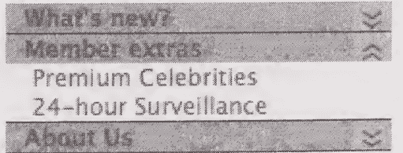

你可能以前在网页上（或在桌面应用程序中）见过这种指示器。它们通常采用小三角形的形式，其方向用于指示菜单是打开还是关闭。它们非常有帮助，因为它们向用户提供了一个提示，表明有隐藏的信息需要揭示。

我们将使用 CSS 雪碧图为菜单添加一个指示器；一张图片将包含菜单区域收起（向下）和展开（向上）的两种箭头状态。

默认情况下，所有区域都是收起的，因此我们在 CSS 中显示收起的箭头状态。在雪碧图中，收起状态与顶部对齐，而展开状态则位于顶部下方 20 像素处。我们将此背景图像应用于菜单内的 `li` 元素，然后从更深层嵌套的项目中移除它：

```
chapter_05/03_open_closed_indicators/menu.css (excerpt)

#menu li {
  cursor:pointer;
  border-bottom:1px solid #444;
  background: #94C5EB url(arrows.png) no-repeat right top;
}
:
#menu li li {
  cursor:auto;
  border:0;
  padding:0 14px;
  background-color:#fff;
  background-image: none;
}
```

背景图像就位后，我们现在需要在切换菜单项时调整 CSS 雪碧图的位置。当菜单项滑下时，我们显示展开状态；当它滑上时，我们显示收起状态。我们将巧妙地运用链式调用，在深入查找需要显示或隐藏的 `ul` 之前应用 CSS 操作：

```
chapter_05/03_open_closed_indicators/script.js (excerpt)

$('#menu > li').toggle(function() {
  $(this)
    .css('background-position', 'right -20px')
    .find('ul').slideDown();
}, function() {
  $(this)
    .css('background-position', 'right top')
    .find('ul').slideUp();
});
```

## 鼠标悬停时展开菜单

接下来的技巧，我们希望让菜单不仅响应点击事件，也响应鼠标悬停事件。当用户将鼠标悬停在某个父菜单项上时，我们会稍作停顿，然后展开菜单。现在，你已经见过足够多的切换和悬停效果了（别担心，后面还有更多！），所以我们要给这个效果来点变化。jQuery 的 hover 事件在鼠标移过目标项的瞬间就会触发。但为了这个效果，我们将延迟执行，使其仅在用户悬停一小段时间后才触发。否则，控件实际上将无法使用，因为鼠标只要轻轻擦过它，它就会猛地打开又关闭。

这是一个细微但重要的改变——如果你尝试菜单在有延迟和没有延迟两种情况下的表现，你会注意到控件的感觉发生了显著变化：

```
$('#menu > li').hover(function() {
    $(this).addClass('waiting');
    setTimeout(function() {
        $('#menu .waiting')
            .click()
            .removeClass('waiting');
    }, 600);
}, function() {
    $('#menu .waiting').removeClass('waiting');
});
```

当用户第一次将鼠标移到菜单元上时，我们给菜单项添加一个名为 `waiting` 的类，然后设置一个 600 毫秒的计时器。如果用户在延迟结束前将鼠标移开，我们就移除这个类。

延迟结束后，它会查找包含 `waiting` 类的菜单项（只有当用户没有移开鼠标时，该类才会存在）。如果用户仍在等待，我们就“点击”该菜单项，触发效果。这是我们第一次以这种方式使用点击操作；当不带参数调用它时，它实际上会触发目标元素上的点击事件，而不是设置事件处理程序。最后，一旦我们触发效果，就移除这个类——这样我们就回到了起点。我们还需要修改之前定义的点击操作。目前的情况是，如果用户将鼠标移到菜单上然后点击它，`waiting` 类会导致计时器触发时菜单关闭。我们只需要在点击处理程序中添加相同的 `removeClass` 调用即可。

我们正在做的是——之前在其他效果中也这样做过——使用类来提供状态管理。状态管理只是一种花哨的说法，意思是为我们提供一种让控件记住自己处于何种“状态”的方法。我们想记住用户是否在延迟结束前移开了鼠标——因此我们相应地添加和移除 `waiting` 类。使用类名进行状态管理是一个巧妙的技巧——但它当然不是唯一（或最好）的方法。我们已经见过 jQuery 提供的数据功能，这是存储简单状态信息的好方法。对于更大更复杂的控件，我们也可以将状态管理集成到小部件的代码中——正如我们在第 4 章末尾看到的那样。一如既往，你使用的方法取决于具体情况，以及你觉得最简单的方式。

## 下拉菜单

如果你曾经在 Web 的旧时代（使用当时所谓的 DHTML）编写过下拉菜单代码，你就会知道那是一段多么可怕的经历。网上遗留着大量糟糕的脚本，但谢天谢地，CSS 后来介入，将成堆的 JavaScript 意面代码扫进了垃圾堆。Suckerfish Drop-down[^1] 技术及其后续衍生技术，为下拉菜令问题提供了一个优雅的解决方案。

Suckerfish 下拉菜单通过精心地将列表的列表样式化为下拉结构，然后隐藏子菜单项来实现。样式表使用 `:hover` 伪选择器来触发子项的显示和隐藏。这是一个完美的无 JavaScript 解决方案；尽管我们热爱 JavaScript，但当更简单的技术（如 CSS）适用时，我们应始终优先使用它们。

话虽如此，使用纯 CSS 下拉菜单存在一些问题。一些较旧的浏览器无法对非链接元素的 `:hover` 伪选择器进行样式化，即使对于那些支持的浏览器，显示/隐藏效果也可能有点突兀。Suckerfish 下拉菜单为增强功能提供了一个极好的基础：它们提供了一个足够的解决方案，然后可以用 jQuery 进行改进和优化。在这个例子中，我们将调整 Suckerfish 技术，使其能在对 `:hover` 支持不完整的浏览器中工作。我们还将使用一些 jQuery 动画使下拉效果更加流畅。

[^1]: <http://www.alistapart.com/articles/dropdowns>

### 跨浏览器 Suckerfish 菜单

首先，让我们设置一个简单的 Suckerfish 下拉菜单作为基线。我们将使用与“可展开/可折叠菜单”部分中可扩展导航相同的标记。

CSS 直接采用 Suckerfish 的做法，将无序列表塑造成一个简单的水平菜单。唯一需要注意的是我们附加在 `:hover` CSS 声明上的额外类。我们将需要这个来在菜单本应隐藏时保持其下拉菜单可见：

```
chapter_05/05_dropdown_menu/menus.css

#container {
  position: relative;
}

#menu {
  position: absolute;
  top: 0;
  right: 0;
}

#menu, #menu ul {
  padding: 0;
  margin: 0;
  list-style: none;
}

#menu li {
  float: left;
  background: #FFF;
}

#menu a {
  display: block;
  padding: 4px;
  width: 10em;
}

#menu li ul {
  position: absolute;
  width: 10em;
  left: -999em;
}

#menu li:hover ul, #menu li ul:hover {
  left:auto;
}
```

如果你在大多数浏览器上尝试这个，你会惊喜地发现：一个完全无需 JavaScript 就能工作的菜单系统！我们现在想做的是在这个效果之上叠加一些 jQuery，使其在旧版浏览器中也能工作，并且动画更加平滑。我们的目标功能如图 5.3 所示。

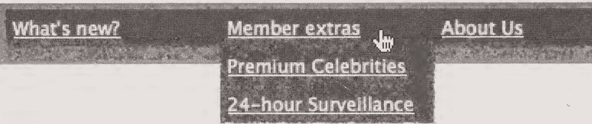

那么我们如何用 jQuery 来复制这个效果呢？“简单，”你可能会嗤之以鼻。“只需要添加一个带有下滑效果的 hover 动作就行。”你是对的：添加一个简单的 hover 函数就能给我们想要的行为，但这里有个问题。当我们同时在 CSS 和脚本中实现相同功能时会发生什么？在 CSS `:hover` 和 jQuery hover 之间的竞争中谁会赢？这很混乱——它们势均力敌！

一个明显的变通方法是在我们的 hover 事件处理程序中覆盖 CSS 类。但这会失败，因为目前你无法（直接）在 jQuery 中针对伪选择器来设置 CSS 属性：

```
$('#nav li:hover ul').css('left', '-999px'); // doesn't work!
```

这让我们陷入了困境：我们如何既能保留 Suckerfish CSS 菜单的优点，又能应用我们的 jQuery 增强功能？一个解决方案是在悬停时仔细撤销 CSS 属性——但更简单的方法是，无论是否悬停，都接管子菜单项的 CSS 属性：

## 悬停意图

我们已经见过一些由 `mouseover` 事件触发的效果，你可能已经注意到它们有时会感觉激活得过于急切。就在你的鼠标划过目标元素的瞬间，效果就生效了，即使你只是路过而已。这对于创建流畅的动画效果非常棒，但有时我们追求的是不同的结果。对于下拉菜单而言，这种误触发可能显得多余且令人分心。我们需要一种方法来延迟效果，直到我们确定用户确实想要激活目标元素。

之前，我们看到过一种方法，通过在用户移动到元素上时设置计时器来实现这一点。但这有一些副作用。例如，如果你有一个很短的计时器和一个很大的目标区域，用户可能在计时器到期前无法完全移动到该元素内部。

Brian Cherne 以 Hover Intent 插件的形式为这个问题提供了一个不错的解决方案。Hover Intent 插件内置了一些智能计算，可以计算鼠鼠在元素间移动的速度。只有当鼠标减速到让插件认为用户*意图*停留在那里时，效果才会启动。

一旦你引入了这个插件，你可以在任何通常使用 hover 操作的地方使用它。例如，如果我们想为上一节中的下拉菜单添加一个延迟，我们只需要将命令 `hover` 替换为 `hoverIntent`：

```
chapter_05/06_dropdown_with_hover_intent/script.js (excerpt)

$('#menu li').hoverIntent(function() {
    :
}, function() {
    :
});
```

菜单只会在它认为用户想要看到时才展开。体验这个插件功能的最佳方式是将此示例与前一个示例进行比较，在菜单上水平拖动鼠标。在前一个示例中，当你移动鼠标时，菜单会像波浪一样滑开；使用 `hoverIntent` 时，菜单只会在鼠标停止移动时才会滑开。

与大多数插件一样，文档概述了你可以指定的一些选项以微调效果，因此如果你计划使用此功能，请务必仔细阅读文档。

## 手风琴菜单

手风琴菜单以这种乐器命名，其展开一个区域会导致另一个区域收缩。通常，手风琴是固定布局的，因此始终必须有一个且仅有一个区域可见，尽管一些手风琴允许你折叠已经打开的区域，从而隐藏所有项目。

### 简单手风琴

手风琴可能比你预期的更棘手。我们之前看到，仅用几行 jQuery 代码就可以实现一个简单的展开和折叠菜单系统。因此，你可能会理所当然地认为添加一个约束（任何时候只能打开一个菜单元素）会很简单。虽然基本实现确实相当简单（毕竟这是 jQuery！），但在强制执行更复杂的约束时，你应该注意一些注意事项。

在这个例子中，我们将构建一个简单的手风琴，根据人气对名人进行分组；这将使我们能够在 StarTrackr! 网站上节省相当多宝贵的屏幕空间。我们想要达到的效果如图 5.4 所示。

你可以使用几乎任何 HTML 标记结构来设置手风琴；你真正需要的是一组清晰可识别的标题，每个标题与一个内容块相关联。在这个例子中，我们将使用一组嵌套列表，如下所示：

```
chapter_05/07_simple_accordion/index.html (excerpt)
<ul>
  <li class="active">
    "A" List Celebrities
    <ul>
      <li><a href="#">Computadors</a> &nbsp;New!</li>
      <li><a href="#">Johny Stardust</a></li>
      <li><a href="#">Beau Dandy</a></li>
    </ul>
  </li>
  <li>
    "B" List Celebrities
    <ul>
      <li><a href="#">Sinusoidal Tendancies</a></li>
      <li><a href="#">Steve Extreme</a></li>
    </ul>
  </li>
  ...
</ul>
```

这种列表标记是菜单的理想 HTML 结构，但肯定还有其他选择；你同样可以使用一组嵌套的 div，其中 header 元素提供每个部分的标题。几乎任何结构都是合适的，只要它是一致的，并且允许你选择所有标题触发器及相关内容。我们用一些 CSS 对列表进行了样式设置，你可以在示例代码归档中查阅。

当页面加载时，我们所有的内容区域都是可见的。现在你应该知道接下来会发生什么了：我们需要隐藏所有内容，除了我们的默认项目：

```
chapter_05/07_simple_accordion/script.js (excerpt)
$('#celebs ul > li ul')
  .click(function(e) {
    e.stopPropagation();
  })
  .filter(':not(:first)')
  .hide();
```

我们这样做的方式与之前略有不同。在这种情况下，我们还预先处理了事件冒泡问题（将在“事件传播”一节中介绍）。这类语句真正展示了 jQuery 的强大之处：我们首先为每个内容区域附加一个事件监听器，然后过滤我们的选择以排除第一个区域，并隐藏所有剩余部分。

`filter` 命令是在语句中间缩小选择范围的非常方便的方法。任何不匹配传递给它的条件的元素都会从选择中移除，并且不再受到后续 jQuery 命令的影响。你可以将条件指定为选择器或函数（参见下面的注释）。我们在前面的例子中使用了过滤选择器（`:not` 和 `:first`）——但你可以使用任何 jQuery 选择器来帮助你找到所需的元素。

`:not` 是一个巧妙的实用选择器，因为它选择括号中内容的相反项。所以 `$(':not(p)')` 将选择每个不是段落的元素，而 `$('p:not(.active)')` 将选择没有 `active` 类的段落。

`filter` 方法的相反操作叫做 `add`。`filter` 从选择中移除元素，而 `add` 将新元素附加到选择中。通过结合 `filter` 和 `add`，你可以在一个 jQuery 链中做大量的处理——根据需要沿途添加和删除元素。

### filter 的高级用法

有时你需要执行涉及更复杂标准的过滤；在这些情况下，你可以使用自定函数来定义你的规则。该函数针对 jQuery 选择中的每个元素进行处理。如果它返回 `true`，则该元素保留在选择中；否则，它将被丢弃。例如，让我们保留选择中的每个段落元素，它是选择中的第三个，或者具有 `active` 类：

```
$('p').filter(function(index) {
    return index == 2 || $(this).hasClass('active');
});
```

请注意，我们可以访问选择中每个元素的从零开始的索引，并且作用域是当前元素？这就是为什么我们可以用 `$(this)` 来引用它。你可以在标准函数中包含任意多的处理——只需确保如果你想保留该元素，就返回 `true`。

手风琴效果的代码需要关闭任何已打开的项目（因为一次只能有一个打开），然后打开我们点击的项目。但这个逻辑存在一个问题：如果我们点击一个已经打开的项目，它将

因此，首先我们需要检查点击的项目是否已经打开，避免不必要的上下滑动：

```javascript
// chapter_05/07_simple_accordion/script.js (excerpt)

$('#celebs ul > li').click(function() {
  var selfClick = $(this).find('ul:first').is(':visible'); // 1
  if (!selfClick) { // 2
    $(this)
      .parent()
      .find('> li ul:visible')
      .slideToggle();
  }
  $(this)
    .find('ul:first')
    .slideToggle(); // 3
});
```

让我们分解这段代码：

- 1. 我们使用 `.is(':visible')` 构造来检查嵌套的 `ul` 是否可见，并将结果存储在一个名为 `selfClick` 的变量中（如果用户点击的是已经打开的部分，该变量将为 true）。

- 2. 我们在 `if` 语句中使用 JavaScript 的 `!` 运算符，如果点击的不是可见部分，则隐藏该可见部分。`!` 表示“非”，因此只有在 `selfClick` 不为 true 时，才会运行嵌套的代码块。

- 3. 最后，我们切换被点击项目的状态：如果它是打开的，则向上滑动；如果它是关闭的，则向下滑动。

通过我们编写的解决方案代码，用户可以关闭手风琴中打开的部分，从而完全折叠它。如果你宁愿强制执行一条规则，即必须始终有一个项目保持可见，你可以调整代码，使得点击打开的项目不会产生任何效果。这可以用一些基础的 JavaScript 轻松实现；如果 `selfClick` 的计算结果为 true，我们只需使用 JavaScript 的 `return` 关键字退出函数即可：

```javascript
// chapter_05/08_simple_accordion_variant/script.js (excerpt)

$('#celebs ul > li').click(function() {
  var selfClick = $(this).find('ul:first').is(':visible');
  if (selfClick) {
    return;
  }
  $(this)
    .parent()
    .find('> li ul:visible')
    .slideToggle();
  $(this)
    .find('ul:first')
    .stop(true, true)
    .slideToggle();
});
```

## 多级手风琴

之前，我们看到你应该一致地设置手风琴的 HTML 结构——这就是原因！如果我们的 jQuery 选择器足够具体，那么为手风琴添加另一级别就像在事件处理程序中包含下一级别一样简单。首先，我们添加第二级菜单项。我们使用与第一级完全相同的结构，但将其嵌套在第一级列表项内：

```html
<!-- chapter_05/09_multi_level_accordion/index.html (excerpt) -->

<ul>
  <li class="active">"A" List Celebrities
    <ul>
      <li><a href="#">Computers</a> &nbsp;New!</li>
      <li>Rising Stars
        <ul>
          <li><a href="#">Johny Stardust</a></li>
          <li><a href="#">Beau Dandy</a></li>
        </ul>
      </li>
      <li>Falling Stars
        <ul>
          <li><a href="#">Kellie Kelly</a></li>
          <li><a href="#">Darth Fader</a></li>
          ...
```

对于我们的单级手风琴，我们通过使用以下代码将手风琴代码附加到根列表的所有第一级子项上：`$('#accordion > li').click(...)`。由于嵌套列表的结构与之前完全相同，我们只需要将相同的代码应用于嵌套元素，这可以通过将它们添加到选择器中轻松实现：

```javascript
// chapter_05/09_multi_level_accordion/script.js (excerpt)
$('#accordion > li, #accordion > li > ul > li').click(...);
```

如果你跟踪这个选择器链，你会看到我们将手风琴代码添加到了正确的列表项上。我们本可以将其添加到每个列表项上，但根据你的 HTML 结构，这可能会导致嵌套内容出现异常行为。生成的菜单如图 5.5 所示。

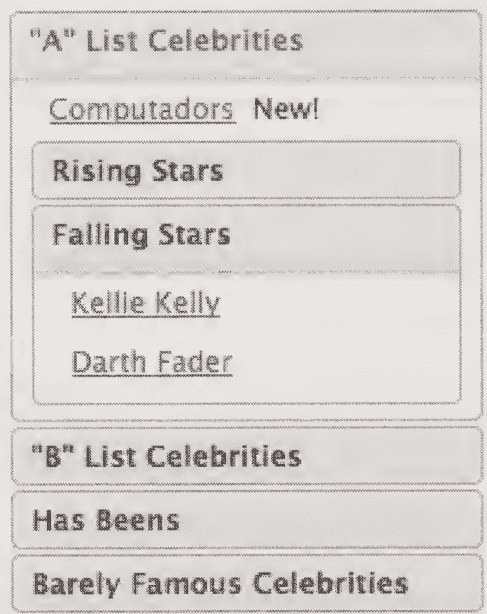

图 5.5. 一个多级手风琴菜单

如果你想为手风琴添加更多级别，只需重复此过程即可。如果长选择器变得难以管理，你可以为每个级别的根添加一个额外的类；不过，级别超过几个的话，也许有更合适的控件来更好地呈现你的信息，而不是手风琴（参见第 8 章）。

## jQuery UI 手风琴

正如我们所看到的，使用 jQuery 从头开始创建一个相当完整的手风琴控件很容易。然而，jQuery UI 库也包含一个手风琴控件，它包含一系列令人印象深刻的功能选项。这些选项包括更改图标、在鼠标悬停时触发以及对手风琴的包含元素以特定方式做出反应（例如，你可以选择让内容区域具有固定高度或自动高度）。使用 Sunny 主题的 jQuery UI 手风琴示例如图 5.6 所示。

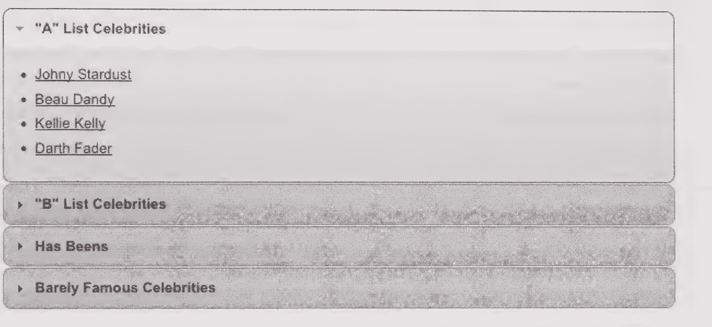

图 5.6. 一个 jQuery UI 手风琴

与我们的自定义手风琴一样，jQuery UI 手风琴的标记需要成对的标题和内容元素。默认情况下，它假定标题是链接标签，并且内容紧随其后；然而，如果内容包含链接，它可能会混淆，因此通常最好指定一个选择器来帮助它确定内容的哪个部分是标题：

```javascript
// chapter_05/10_jquery_ui_accordion/script.js (excerpt)
$('#accordion').accordion({header: 'h3'});
```

只要 `h3` 的下一个兄弟元素是你想要隐藏或显示的内容窗格，这就是将你的内容转变为功能齐全的手风琴所需的全部代码。

该手风琴还提供了以编程方式与控件交互的功能。例如，你可以使用 `activate` 选项以及要打开的窗格的索引来打开特定的内容窗格。要打开第三个窗格（记住，索引从零开始），你可以编写以下代码：

```javascript
// chapter_05/10_jquery_ui_accordion/script.js (excerpt)

$("#accordion").accordion('activate', 2);
```

还有许多其他选项可用于配置和交互手风琴，这些在 jQuery UI 网站上有很好的文档说明。³

与我们的自定义控件相比，使用 jQuery UI 控件在文件大小和带宽使用方面代价显著——但如果你需要高级功能，并且宁愿避免花费时间自己实现，它可以是一个可行的选择。

## 选项卡

选项卡提供了一种将内容进行逻辑分组的方式，并且已成为许多桌面应用程序界面的标准。如果你将顶层导航元素设计成*看起来*像选项卡，那么它们在网络上也很常见。然而，在 JavaScript 的世界中，选项卡通常用于将内容分成多个部分，可以按需切换以节省空间。

### 基本选项卡

我们的简单选项卡预加载了页面的所有内容——我们只需要根据需要隐藏和显示即可。如果你从一开始就在阅读本书，你大概能猜到该如何着手。

我们将选项卡控件分解为两个组件：选项卡导航和一个内容区域。这让我们能为不支持 JavaScript 的浏览器提供一个可接受的解决方案：一个指向页面上元素的简单锚链接列表。它可能看起来不如我们酷炫的选项卡那么花哨，但它功能齐全，并且提供了对所有相同内容的访问。首先，我们将选项卡内容设置为一组简单的 `div` 元素集合：

```html
<!-- chapter_05/11_simple_tabs/index.html (excerpt) -->

<div id="info">
    <p id="intro">
        Welcome to <strong>StarTrackr!</strong> the planet's premier ...
    </p>
    <p id="about">
        StarTrackr! was founded in early 2009 when a young ...
    </p>
    <p id="disclaimer">
        Disclaimer! This service is not intended for those ...
    </p>
</div>
```

接下来，我们需要创建我们的选项卡导航栏。正如许多控件和效果一样，整体错觉是重要的。一个链接的无序列表效果会很好，但我们会将其样式化为看起来像选项卡的样子：

```html
<ul id="info-nav">
  <li><a href="#intro">Intro</a></li>
  <li><a href="#about">About Us</a></li>
  <li><a href="#disclaimer">Disclaimer</a></li>
</ul>
```

我们已经用 CSS 将链接样式化为具有选项卡的外观，但有数十种不同的方法可以实现这一点，所以请使用你熟悉的或最合理的方法。我们选择了极其基础的样式，因为我们想要专注于功能性。

我们将执行的第一个任务（在文档准备好之后）是隐藏除第一个选项卡之外的所有选项卡——这将是我们的默认选项卡。我们可以通过隐藏所有窗格，然后显示第一个来实现，像这样：

```javascript
$('#info p').hide().eq(0).show();
```

但这使得 jQuery 做了不必要的工作；我们希望避免隐藏一个选项卡然后立即又显示它。相反，我们可以使用更具体的选择器；我们可以组合过滤器来选择除第一个元素之外的所有元素：

```javascript
$('#info p:not(:first)').hide();
```

关键点在于，页面加载后，只向用户显示一个标签页的内容面板。切换标签页的代码很简单，与我们之前构建的其他显示/隐藏控件非常相似：

```javascript
$('#info-nav li').click(function(e) {
    $('#info p').hide();
    $('#info-nav .current').removeClass("current");
    $(this).addClass('current');

    var clicked = $(this).find('a:first').attr('href');
    $('#info ' + clicked).fadeIn('fast');
    e.preventDefault();
}).eq(0).addClass('current');
```

有一个特别之处值得注意：为了选中与被点击链接对应的内容面板，我们直接使用 JavaScript 的 + 运算符将链接的 href 属性连接到我们的选择器中。这之所以有效，是因为锚点链接使用井号（#）来标识其目标，而 jQuery 也使用井号来按 id 选择元素。这纯属巧合，但对我们来说非常幸运，因为我们无需解析文本或使用正则表达式来创建选择器。

附加点击处理程序后，我们使用 eq 选择器筛选导航列表，只选取第一个元素，并为其添加 current 类。在我们的示例中，第一个标签页是默认标签页；如果你想让不同的标签页成为第一个，你需要将 0（因为它是一个从零开始的索引）更改为你想要的那个。

## jQuery UI 标签页

虽然我们的基本标签页解决方案为我们提供了一个很好的构建基础，但我们绝不是第一批尝试使用 jQuery 构建标签页内容面板的人。有足够多的人要求为 jQuery UI 库提供标签页接口，因此其控件集合中包含了一个功能非常丰富的标签页小部件。

在你抛弃我们的基本标签页而选择炫酷的 jQuery UI 标签页之前，请先考虑一下你希望你的标签页实现什么功能。运用你到目前为止所学的 jQuery 知识，你应该能够轻松实现许多功能——例如在鼠标悬停时切换标签页而不是点击切换、以编程方式切换标签页、或者双击标签页本身时折叠其内容。

有一个功能实现起来会花费我们更多的工作量（至少目前是这样），那就是通过 Ajax 加载内容的能力。我们将在第 6 章更详细地探讨 Ajax，但目前我们可以看看它最简单的用法：在不刷新页面的情况下，将内容从服务器加载到我们的页面中。

现在你可能已经习惯了包含 jQuery UI 功能。确保你构建的下载包中包含了 Tabs 组件，然后将 CSS 和 JavaScript 文件包含到你的 HTML 中。你可以在图 5.7 中查看我们的 jQuery UI 标签页的外观。

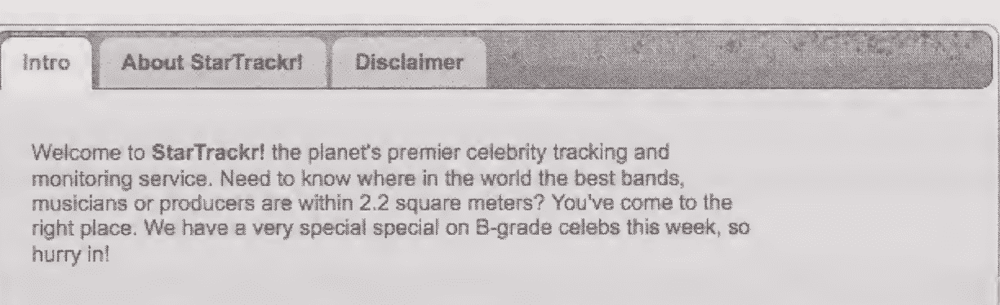

引入了 UI 库和 CSS 样式后，添加内容就变得容易了。通过 Ajax 加载的内容不需要预先设置容器——插件会自动生成所需的 DOM 元素：

```html
<div id="info">
  <ul id="info-nav">
    <li><a href="#intro">Intro</a></li>
    <li><a href="about.html">About StarTrackr!</a></li>
    <li><a href="disclaimer.html">Disclaimer</a></li>
  </ul>
  <div>
    <p id="intro">
      Welcome to <strong>StarTrackr!</strong> the planet's premier ...
    </p>
  </div>
</div>
```

和之前一样，我们首先创建一个标签页导航列表。对于静态内容，你需要指定一个与包含相关内容的元素的 id 相对应的锚点名称（在我们的示例中是 #intro）。接下来的两个标签页是我们的 Ajax 标签页；它们只是指向服务器上的 HTML 文件（在我们的例子中，是硬盘上的文件）。在真实的 Web 应用程序中，它们会指向生成动态内容的服务器端脚本；为了说明 jQuery UI 的 Ajax 标签页如何工作，我们将使用几个静态 HTML 文件。这些文件可以包含你希望加载到标签页中的任何内容。

我们实现的功能将在 JavaScript 不可用时优雅降级；这些标签页将简单地充当指向被引用文件的链接。但是，当 JavaScript 启用时，jQuery 会将目标页面的内容加载到标签页内容面板中，而无需刷新页面。不用担心它会引入整个 HTML 页面——它很智能，只包含 <body> 标签之间的内容。

要将上述标记转换为支持 Ajax 的标签页接口，你只需编写以下代码：

```javascript
$('#info').tabs();
```

在你的浏览器中试试，确认它有效。如果这还不算“写得更少，做得更多”，那我们真不知道什么才算！

## 标签页选项

标签页控件带有大量的自定义选项，你可以在 jQuery UI 标签页演示页面上找到它们。⁴ 我们现在将探索几个有趣的选项：

```javascript
$('#info').tabs({
  event: 'mouseover',
  fx: {
    opacity: 'toggle',
    duration: 'fast'
  },
  spinner: 'Loading...',
  cache: true
});
```

作为控件初始化的一部分，我们传递了一个包含选项集合的 JavaScript 对象：event、fx、spinner 和 cache。event 选项允许你选择切换标签页的事件——这里我们将默认的 click 替换为 mouseover。现在要切换标签页，用户只需将鼠标悬停在所需的标签页上即可。

接下来，我们添加了一些动画选项，用于在切换标签页时指定快速的淡入淡出过渡效果。fx 选项的工作方式与 animate 命令完全相同，允许你以任何需要的方式调整过渡效果。

最后两个选项用于我们的 Ajax 标签页。spinner 指定在内容加载期间显示的 HTML。由于你所有的页面都放在本地机器上，你可能永远看不到这个文本——但是当你把页面放到真实的 Web 服务器上时，你肯定会注意到延迟（因此也会注意到 spinner 文本）。它之所以被称为 spinner，是因为它经常用于显示一个旋转图标的动画 GIF 图像，这表示正在加载，并且几乎总是被命名为 **spinner.gif**。

cache 选项指示浏览器在加载标签页内容后保留其副本。这样，如果用户频繁点击你的标签页——反复来回切换——浏览器就无需每次都下载全新的数据副本。

## 标签页控件方法

还有许多方法可以以编程方式与标签页进行交互。你可以添加、删除和重新加载标签页，并自动更改打开的标签页。例如：

```javascript
$('#info').tabs().tabs('rotate', 3500);
```

第一个 tabs 调用设置了我们的标签页面板，第二个调用指示 jQuery 每 3,500 毫秒（即 3.5 秒）循环切换一次标签页。你可以用你的标签页做更多的事情，所以请查看文档以了解有哪些可能。

我们将探讨的最后一点是以编程方式选择标签页。你可以使用 selected 选项找到当前选中的标签页：

```javascript
$('#tabs').tabs('option', 'selected');
```

当然，你也可以设置当前标签页。如果你想让你内容中的链接只是更改打开的标签页而不是链接到新页面，这会很方便。在这个示例中，我们在第一个标签页的内容中插入了一个指向关于我们页面的链接。我们可以劫持该链接，让它打开关于我们标签页：

```javascript
$("#info p a[href=about.html]").click(function() {
    $('#info').tabs('select', 1);
    return false;
});
```

## 面板和窗格

面板和窗格只不过是用来容纳其他控件的控件！正确使用时，它们有助于将页面组织成逻辑区域，从而最大限度地减少用户的复杂性。这使得经验丰富的用户可以利用你站点或应用程序的所有功能，而不会让你的新手用户淹没在按钮和小部件的海洋中。当面板提供与打开或聚焦的文档相关的上下文工具和控件时，它们最为有效。

## 下拉式登录表单

一种日益流行的方法是减少可见杂乱，即使用隐藏的菜单，该菜单位于屏幕最顶部。一个小按钮或链接向用户表明有更多信息可用。点击按钮会导致一个面板滑入视野，而移开面板则会导致它滑回原位。

这确实是一种方便实用的节省空间的方法，但那里应该存储什么信息呢？下拉式面板最流行的用途是显示网站的登录字段。大多数用户知道这些功能通常会显示

## 登录面板

登录表单位于网站浏览器窗口的右上角，一个位置恰当的图标或链接会吸引那些想要登录的用户的注意。我们将要创建的登录表单如图5.8所示。

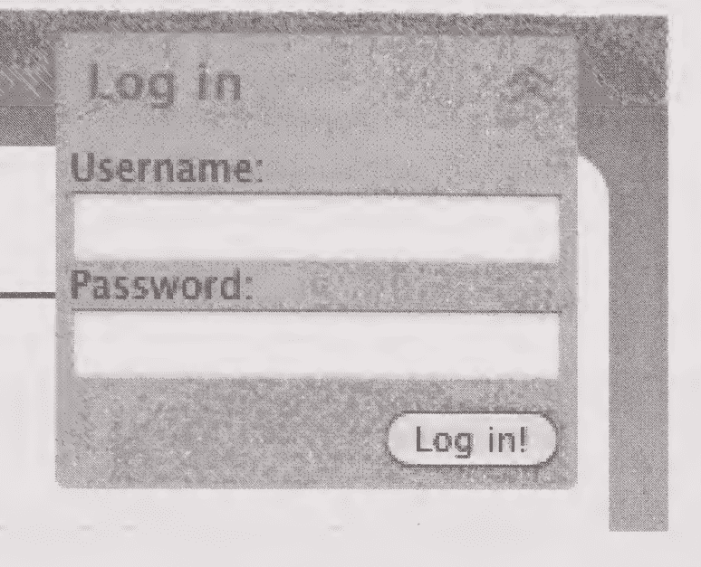

这将是网站的一个简单添加，因为我们已经了解了将要涉及的大部分jQuery命令。我们将为控件添加一些快速的CSS样式，但一如既往，你可以根据自己的网站风格来设计它。然后就是熟悉的流程——在页面加载时隐藏表单，然后捕获点击事件来切换其显示和隐藏状态：

```javascript
chapter_05/15_login_panel/script.js (excerpt)

$('#login form').hide();
$('#login a').toggle(function() {
  $(this)
    .addClass('active')
    .next('form')
    .animate({'height':'show'}, {
      duration:'slow',
      easing: 'easeOutBounce'
    });
}, function() {
  $(this)
    .removeClass('active')
    .next('form')
    .slideUp();
});
```

这段代码与本章开头的可展开菜单的唯一区别在于，这里我们使用CSS类来控制背景图像的位置，而不是jQuery的css操作。因为这些类只在JavaScript可用时才会使用（否则我们将呈现一个始终打开的控件），所以两种方案不一定有优劣之分，选择哪一种更多取决于你的个人偏好。

这太简单了，所以我们来精进一下。如果我们的登录表单通过Ajax提交（不触发页面刷新），我们希望在表单提交后面板消失。实际上，即使我们加载新页面，点击后菜单向上滑动也是一个不错的点缀：

```javascript
// chapter_05/15_login_panel/script.js (excerpt)
$('#login form :submit').click(function() {
    $(this)
        .parent()
        .prev('a')
        .click();
});
```

我们首先捕获表单提交按钮的点击事件，然后向上遍历DOM树寻找包含元素。我们本可以直接在这里执行隐藏操作，但鉴于我们已经在原始处理程序中编写了处理隐藏的代码，我们只需通过prev方法回退DOM，并点击我们的显示/隐藏链接。

## 滑动覆盖层

半透明的滑动覆盖层最近随处可见：从消息对话框、购物车摘要到导航控件等等。它们受欢迎的原因很简单：它们看起来酷炫无比——就像动作电影电脑场景中高度可疑的界面——但它们实际上很有用！

创建滑动覆盖层时需要考虑的最重要的因素是内容的滑出方向以及覆盖层的触发方式。这些选择将影响用户如何与控件交互以及他们期望它如何运作。这种控件在Web上还比较新——所以还没有你需要遵循的约定

——但你可以参考桌面上的类似控件来思考它们应该如何工作。也许你会创建一个实际设定一些规则的版本！

例如，你可能想包含一个内容面板，当用户将鼠标移动到页面边缘时它会滑出——就像许多操作系统上的自动隐藏任务栏或Dock。或者，将鼠标移到内容区域的底部边缘可能会导致一个**上一个/下一个**控件滑入视野。

我们的覆盖层将通过将鼠标悬停在购物车链接上来触发。鼠悬停链接将导致一个菜单从标题下方滑下，覆盖在页面上，告知用户购物车中当前的商品数量，并提供结账或查看购物车的链接。如图5.9所示，作为触发器的购物车图标位于内容区域的右上角。

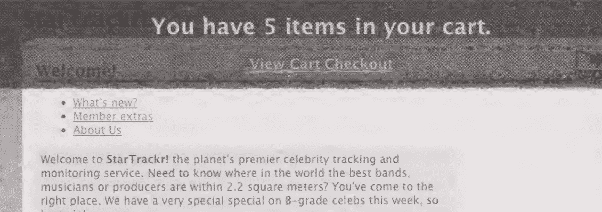

**图5.9. 滑动购物车覆盖层**

一如既往，样式为我们的效果提供了真正的基础。这将决定我们的触发器外观，以及滑动的起始位置。我们的触发器将绝对定位在页面内容的右上角：

```css
chapter_05/16_sliding_overlay/panel.css (excerpt)

.cart a {
  position: absolute;
  width: 32px;
  height: 32px;
  right: 15px;
  top: -10px;
  background: transparent url(shoppingcart.png) no-repeat 0 0;
  text-indent: -9999px;
}
```

```css
.cart a:hover, .cart-hover {
  background-position: 0 -32px;
}

#overlay {
  position: absolute;
  width: 100%;
  height: 100px;
  top: 0;
  left: 0;
  color: #fff;
  background-color: #000;
  display: none;
  text-align: center;
}

#overlay a {
  font-size: 130%;
  font-weight: bold;
}
```

因为覆盖层只会由jQuery触发，所以理应也使用jQuery将其添加到页面标记中。覆盖层设置为页面100%宽度，高度为100像素。我们希望覆盖层从顶部滑下，所以将top位置设置为0。当然，我们也将其隐藏，使其在页面加载时不出现。

第一步是将覆盖层添加到标记中。我们将为其添加一个hover处理程序，因为当它滑入页面时，我们希望只要用户保持鼠标悬停，它就保持可见。只要它处于打开状态，我们就为其添加`active`类，并使用该类来确定何时需要关闭它。当用户将鼠标移开时，我们移除该类，并设置一个计时器，该计时器会查找没有`active`类的覆盖层，并在不到一秒后关闭它。这样，如果用户在计时器运行期间重新打开覆盖层，计时器方法将不起作用：

```javascript
chapter_05/16_sliding_overlay/script.js (excerpt)

$("<div></div>")
  .attr("id", "overlay")
  .css("opacity", 0.65)
  .hover(function() {
    $(this).addClass("active");
  }, function() {
    $(this).removeClass("active");
    setTimeout(function() {
      $("#overlay:not(.active)").slideUp(function() {
        $("a.cart-hover").removeClass("cart-hover");
      });
    }, 800);
  }).appendTo("body");
```

我们使用`opacity` CSS属性使覆盖层半透明。`opacity`值范围从0到1，其中1是完全不透明，0是不可见。

> **可访问性**

创建半透明控件时，请确保内容和背景之间有足够的颜色对比度。也许对你来说很容易阅读，但请始终考虑到一些访客的视力可能不完美。如有疑虑，宁可保守一些，使用比你认为必要的更高的对比度。

现在让我们为触发链接添加事件监听器：

```javascript
chapter_05/16_sliding_overlay/script.js (excerpt)

$(".cart a").mouseover(function() {
  $(this).addClass("cart-hover");
  $("#overlay:not(:animated)")
    .addClass("active")
    .html("<h1>You have 5 items in your cart.</h1>"
      + "<a href=\"#\">View Cart</a>&nbsp;<a href=\"#\">Checkout</a>")
    .slideDown();
});
```

这里的选择器中有一个新的过滤器：`:animated`，它允许我们选择当前正在进行动画的元素（或者，在本例中，与`:not`过滤器结合使用，选择未处于动画过程中的元素）。我们向覆盖层添加了一些静态标记

，但在实际应用中，你需要获取购物车商品数量以在此显示。

我们还为触发链接添加了一个类以设置其样式，否则当覆盖层在它和光标之间时，它的悬停样式会关闭。

当然，这只是这种功能的一个例子；你很可能想到许多其他用途。透明度在jQuery中非常容易操作，确实使界面组件感觉更加流畅。

## 工具提示

工具提示是一种当用户将鼠标悬停在控件上时出现的界面组件。它们已经存在于大多数浏览器中；当你为链接提供`title`属性或为图像提供`alt`属性时，当用户将鼠标悬停在该元素上时，浏览器通常会将其显示为工具提示。

JavaScript工具提示名声有点不太好。它们往往以恼人的方式实现，更像是广告弹出窗口而非有用的信息工具。然而，在某些情况下，工具提示可以为您的应用程序提供恰到好处的帮助，以情境化的方式告知用户，而不会使界面其余部分变得杂乱。

首先，我们将尝试用我们可以样式化和动画的自定义工具提示替换浏览器的默认工具提示。然后我们将研究将其扩展为创建一个用途更广泛的工具提示，它可以包含HTML并附加到页面上的任何元素。

## 简单工具提示

工具提示通常在用户将鼠标悬停在超链接上时出现——提供有关链接将带他们去哪里的附加信息。当然，你还会在其他地方想要使用工具提示，但这是一个好的开始。我们将用自定义的、可样式化、可动画的工具提示替换浏览器的默认工具提示，如图5.10所示。

## 高级工具提示

了解如何构建简单的工具提示固然很好，但我们知道可以做得更好。对于更复杂的工具提示，其内容可能包含其他标记（如图片或链接），我们需要将它们从 `title` 属性移至实际的标记中。我们将用 CSS 隐藏它们，然后根据需要使用 jQuery 显示和定位它们。最终效果如图 5.11 所示。

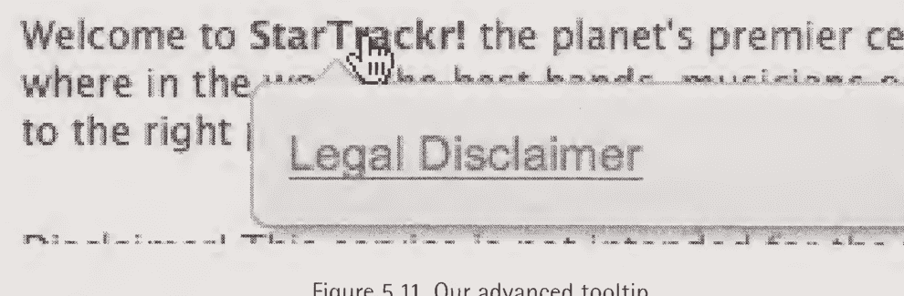

我们的工具提示标记将由两个嵌套的 span 元素组成，它们将位于我们想要用来触工具提示的元素内部。这偶尔可能需要你发挥一些标记设计的创意，但有助于我们定位工具提示，因为我们可以为其设置相对于父元素的绝对定位偏移。它还帮助我们处理触发事件，因为如果用户将鼠标移到工具提示上，它仍然位于触发元素上，因此无需额外的悬停事件处理。

以下是工具提示标记的示例：

```html
chapter_05/18_advanced_tooltips/index.html (excerpt)

<p>
  Welcome to
    <strong>StarTrackr!
      <span class='tooltip'>
        <span><a href='#'>Legal Disclaimer</a></span>
      </span>
    </strong> the planet's premier celebrity tracking ...
</p>
```

当我们完成时，工具提示将看起来很棒，并包含一个指向免责声明页面的链接。但我们别再拖延了；我们已经考虑了一些工具提示方法，所以让我们直接开始吧。

正如我们在开始编写代码时将看到的，我们的工具提示将相当智能，它会定位在目标元素有足够显示空间的任一侧。为了在这种情况下让一个酷炫的文本气泡图形生效，我们需要四种不同的气泡：左上、右上、左下和右下。我们将为工具提示的四种可能状态使用一个精灵图，如图 5.12 所示。

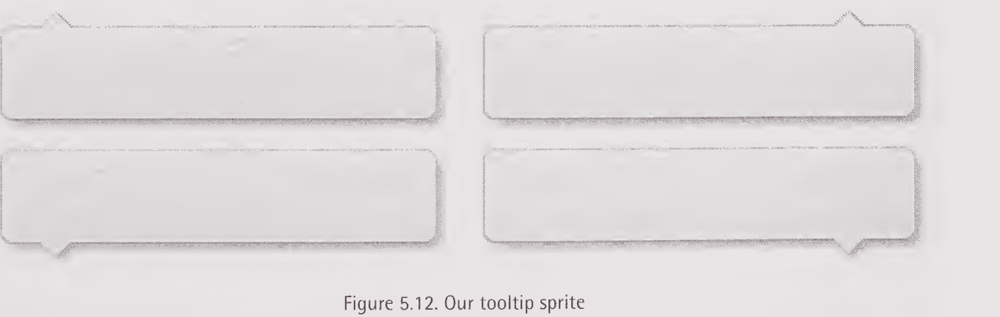

这些工具提示需要一些相当复杂的 jQuery 代码。我们将逐块讲解，但如果你现在难以完全理解，也不必担心。从编写快速的两三行脚本来替换和高亮页面内容，到编写更复杂的 UI 小部件，这其中存在一定的跨越。在下一章的开头，我们将探讨一些方法，以便在代码变得更长、更复杂时，尽量降低复杂度并保持代码的可读性。

对于我们的简单控件，我们将使用链接的 title 属性。这对于我们持续努力为没有 JavaScript 支持的用户保持可接受的功能性非常有益；根据他们的浏览器，他们很可能会看到作为基本浏览器工具提示显示的文本：

```html
chapter_05/17_simple_tooltips/index.html (excerpt)
<a href="#" title="Check out all the ... ">New York</a>
```

使用 title 属性可能有点受限：你无法（在技术上或可靠地）在工具提示中嵌套 HTML，并且需要小心可能破坏标签的特殊字符。有几种替代技术可以存储工具提示的文本。我们将在制作高级工具提示时探讨另一种方法——但重要的是要注意，任何方法都有其优缺点，你需要根据每个特定情况决定哪种最合适。

能够设置工具提示样式是实现自定义控件的主要原因——所以尽情发挥你的样式设计吧！然而，对于我们的示例，我们将为工具提示定义一些非常基本的样式：

```css
chapter_05/17_simple_tooltips/tooltips.css (excerpt)
.tooltip {
  display: none;
  position: absolute;
  border: 1px solid #333;
  background-color: #ffed8a;
  padding: 2px 6px;
}
```

工具提示控件使用绝对定位，这允许我们根据需要移动它。接下来，我们将为代码设置一些存根，让你看到整体结构：一个简单的悬停函数，后跟一个链式的 mousemove 函数。我们希望工具提示随着悬停事件打开和关闭，并在鼠标移动时更新其位置：

```javascript
chapter_05/17_simple_tooltips/script.js (excerpt)

$('.location').hover(function(e) {
    // Hover over code
}, function() {
    // Hover out code
}).mousemove(function(e) {
    // Mouse move code
});
```

从整体结构开始，然后填充细节，是规划代码的好方法，确保你在深入编写之前了解整体情况。在编写代码时，始终理解当前代码片段在大局中的位置会很有帮助。

让我们开始填充这些存根。悬停代码是最有趣的，所以我们从这里开始。注意我们将可选参数 `e` 传递给了悬停代码。这很重要，因为我们需要访问事件的 X 和 Y 坐标来定位工具提示：

```javascript
chapter_05/17_simple_tooltips/script.js (excerpt)

// Hover over code
var titleText = $(this).attr('title');
$(this)
    .data('tipText', titleText)
    .removeAttr('title');

$('<p class="tooltip"></p>')
    .text(titleText)
    .appendTo('body')
    .css('top', (e.pageY - 10) + 'px')
    .css('left', (e.pageX + 20) + 'px')
    .fadeIn('slow');
```

首先，我们需要从链接中获取 `title`，这将是我们工具提示要显示的文本。代码的下一部分有点特别：它使用我们在第 4 章“使用 `data` 操作实现更智能滚动”一节中见过的 `data` 方法保存工具提示文本。我们需要这样做，因为我们将从链接中移除 `title`，以防止浏览器显示与其默认工具提示冲突。通过使用 `data` 命令存储文本，我们以后可以恢复并替换链接的标题。

现在我们拥有了创建工具提示控件所需的一切。我们将创建一个新的段落元素，其类为 `tooltip`，以便连接到我们之前创建的样式。然后我们使用 `text` 方法设置工具提示的内容。我们*可以*在这里使用 `html` 而不是 `text`，但根据 W3C 标准，`title` 属性不应包含 HTML。我们即将探讨的高级工具提示将允许我们包含 HTML，但目前我们只使用纯文本。

### 样式问题

我们本可以像这样用 jQuery 指定段落的 `id`：

`$('<p></p>').attr('id', 'tooltip')`。同样，我们可以使用 JavaScript 字符串连接来填充元素内容：`$('<' + 'p>' + titleText + '</p>')`。这两种方法都会产生相同的 DOM 对象，而且两者都相当清晰易读，所以这取决于你的个人编码风格，看你更喜欢使用 jQuery 链式调用还是纯 JavaScript。

在将新节点添加到页面（使用 `appendTo`）之后，我们设置一些内联样式，使用事件对象（`e`）获取我们需要放置工具提示的位置。`pageX` 和 `pageY` 是事件对象的属性，允许你找出事件在页面上发生的位置。这在许多不同情况下都极其有用；你经常会发现自己需要根据刚刚触发的事件在屏幕上定位一个元素：

```javascript
chapter_05/17_simple_tooltips/script.js (excerpt)

// Hover out code
$(this).attr('title', $(this).data('tipText'));
$('.tooltip').remove();
```

悬停移出代码再简单不过了：我们只需逆转悬停代码中的操作，恢复 `title` 属性并移除工具提示。

```javascript
chapter_05/17_simple_tooltips/script.js (excerpt)

// Mouse move code
$('.tooltip')
    .css('top', (e.pageY - 10) + 'px')
    .css('left', (e.pageX + 20) + 'px');
```

最后，我们需要通过更新工具提示的位置来响应鼠标移动。这样工具提示就会跟随鼠标移动，就像浏览器内置的工具提示一样。瞧！我们用自定义工具提示替换了默认工具提示，并完全控制了它们的外观和动画。

目前，请尝试专注于将你已知的jQuery部分应用到更广阔的上下文中；这将让你了解如何将零散的逻辑组合成一个真正令人印象深刻的庞大画面。

我们的第一个任务是创建一个包含我们所有代码的TT对象。我们在对象顶部设置一个延迟变量（这将使得修改小部件的配置更加容易，无需在代码中四处寻找该变量被设置的位置）：

```
chapter_05/18_advanced_tooltips/script.js (节选)

var TT = {
  delay: 600,
```

然后我们添加一个名为setTips的函数，我们将在页面加载或调整大小时运行它。这个函数将找到页面上的所有工具提示，并通过查看它们的父元素来确定它们的位置。它还将为每个工具提示设置一个悬停事件，以便在鼠标悬停时显示它们。以下是悬停事件：

```
chapter_05/18_advanced_tooltips/script.js (节选)

setTips: function() {

  $('.tooltip').parent().hover(function() { ❶
    // 存储被悬停的工具提示
    TT.current = $(this); ❷
    TT.timer = setTimeout(function() { ❸
      // 找到工具提示，
      TT.current.find(".tooltip").fadeIn('fast');
    }, TT.delay);
  }, function() {
    // 鼠师移出时，清除计时器并隐藏工具提示
    clearTimeout(TT.timer); ❹
    $(this).find(".tooltip").fadeOut('fast');
  }).attr("title", ""); // 清除title属性以阻止浏览器自带的工具提示
```

这是一个相当密集的代码块，所以让我们看看能否理解其中发生了什么：

❶ 我们将悬停事件附加到了工具提示span的父元素上。如果你回顾一下标记，你会发现这是正确的：我们把工具提示放在了我们想要附加到它的元素内部。

❷ 我们将对该父元素的引用存储在一个变量中。这里不寻常的是，我们使用的是我们TT对象的一个属性，而不是全局变量。我们将在下一章回到这个问题，但现在只需要知道，这与编写 `var current = $(this);` 大致相同。

❸ 我们使用熟悉的 `setTimeout` 函数，只是这次我们将计时器保存到一个变量中。这样，如果我们需要，就可以通过名称来关闭它。我们之前设置的delay属性作为 `setTimeout` 的第二个参数被访问。正如我们所看到的，这是浏览器在显示工具提示之前等待的时间长度。

❹ 当用户将鼠标移开目标时，我们希望停止计时器，以便在延迟时间过后工具提示将保持隐藏状态。我们通过JavaScript的 `clearTimeout` 方法来实现这一点，传入我们计时器的引用。

好的，现在我们的悬停处理程序已经设置好了，我们需要确定每个工具提示的位置。我们将使用 `each()` 来遍历它们，但首先我们要获取屏幕的高度和宽度。如果我们在循环 *内部* 做这件事，jQuery将需要为每个工具提示计算这些值一次，即使它们始终是相同的。通过在循环外部存储这些值，我们避免了这种浪费的计算，并提高了脚本的性能：

```
chapter_05/18_advanced_tooltips/script.js (节选)

var screenWidth = $(window).width();
var screenBottom = $(window).scrollTop() + $(window).height();

$(".tooltip").each(function() {
    // 获取包含元素
    $container = $(this).parent();

    // 如果需要，设置其定位方式为相对定位
    if ($container.css("position") != "absolute"
        && $container.css("position") != "fixed") {
        $container.css({position: "relative"});
    }

    var totalHeight = $container.height() + $(this).outerHeight();
    var width = $(this).outerWidth();
    var offset = $container.offset();

    // 现在我们获取工具提示的位置
    var top = $container.height(); // 默认放置位置
    var left = 0;

    // ... (代码继续)
});
```

这部分代码应该更容易理解一些。我们遍历页面上的每个工具提示，并首先存储对容器元素的引用，只是为了避免反复编写 $(this).parent()。请注意变量名以 $ 开头：这只是为了帮助我们记住该变量包含一个jQuery选择。以下是循环内容的分解：

1.  我们检查父元素是否具有 `position: absolute;` 或 `position: fixed;`。它必须是已定位的，因为我们将使用 `position: absolute;` 来使其相对于父元素偏移。如果它已经具有绝对定位或固定定位，我们将保持原样。但如果它没有，我们将给它设置 `position: relative;`。

2.  我们需要知道工具提示和父元素组合的总高度，所以我们将其存储在一个变量中以备后用。

3.  默认情况下，我们给工具提示一个等于容器高度的top位置。这意味着它将直接出现在容器的 *下方*（因为它从顶部偏移的距离正好是容器的高度）。

菜单、选项卡、工具提示和面板

177

> **逻辑运算符**

>

> 在JavaScript中，当你在if语句中测试值时，可以使用 && 运算符表示 *并且*。因此，在上面的例子中，if块的内容只有在 *两个* 条件（&& 两侧的条件）都满足时才会执行。

>

> 你也可以使用 ||（两个管道符号）表示 *或者*。如果我们在上面使用 || 而不是 &&，if块的内容将在 *任一* 条件满足时执行。

到目前为止做得很好！我们几乎完成了，但我们需要修复一个小问题：如果工具提示的位置使其超出了屏幕怎么办？如果目标元素正好位于屏幕底部，而我们希望工具提示出现在它下方，那么工具提示将无法被看到！

是时候进行一点碰撞检测了。我们需要找出工具提示是否碰到了屏幕的底部或右边缘。让我们看看如何实现这一点：

```
chapter_05/18_advanced_tooltips/script.js (节选)

// 如果超出屏幕右侧，重新定位
if (offset.left + width > screenWidth) {
    left = 0 - width + 42;
    $(this).addClass('left');
} else {
    $(this).removeClass('left');
}

// 如果超出屏幕底部，重新定位
if (offset.top + totalHeight > screenBottom) {
    top = 0 - $(this).outerHeight();
    $(this).addClass('above');
} else {
    $(this).removeClass('above');
}
```

我们检查工具提示的水平或垂直偏移量加上其宽度或高度是否大于屏幕的宽度或高度（我们之前计算过）。如果是，我们分别修改top或left属性，并分配一个类，我们将使用该类来显示背景图像精灵图的相应部分。

最后（也是最简单的）步骤是使用css操作将计算出的top和left属性分配给工具提示：

```
$(this).css({
  "top": top,
  "left": left
});
```

我们将在文档就绪时调用setTips方法，并在每次窗口调整大小时也调用它，以确保我们的工具提示始终处于适当的位置：

```
$(document).ready(function() {
  TT.setTips();
});

$(window).resize(function() {
  TT.setTips();
});
```

有了这段代码，我们只需要添加一些CSS，根据我们分配的类来适当地定位我们的背景精灵图：

```
span.tooltip.left {
  background-position: 100% 0;
}

span.tooltip.left span {
  padding: 15px 0 0 17px;
}

span.tooltip.above {
  background-position: 0 100%;
}

span.tooltip.above span {
  padding: 13px 0 0 12px;
}

span.tooltip.above.left {
  background-position: 100% 100%;
}

span.tooltip.above.left span {
  padding: 13px 0 0 17px;
}
```

## IE6 支持

尽管jQuery在处理我们JavaScript代码中的跨浏览器问题方面做得非常出色，但对于我们的CSS来说就不那么好了。上面的样式规则依赖于将几个 `class` 选择器链接在一起。这将使Internet Explorer 6感到困惑，它在任何样式规则中只会看到最后一个 `class`。此外，我们的PNG图像依赖于alpha通道透明度来实现工具提示的投影，而这也是IE6不支持的。

在过去的几年里，一些主要网站（包括YouTube和Facebook）开始逐步淘汰对IE6的支持。这并不意味着他们完全忽略了这个浏览器，而是他们接受IE6用户将获得降级的体验（可能类似于没有JavaScript的访问者将看到的效果）。

对于我们工具提示的示例，我们可以使用条件注释⁵来专门针对IE6提供一些样式，并为其提供相同的工具提示功能——除了使用没有思想泡泡样式或投影的平面背景图像。这样，背景位置将变得无关紧要，PNG问题也得到了解决。

就是这样！最终的工具提示不仅会等待，看你是否真的打算让它显示，而且当它显示时，还会改变位置以确保它完全可见！因为我们避免将此代码与页面上的任何特特内容绑定，所以很容易在任何其他页面上重用此脚本——你只需要包含一些带有 `tooltip` 类的span，就可以开始使用了。这是一个重要的教训：你应该始终尝试以一种可以重用的方式来构建你的代码。从长远来看，这将为你节省工作，并给你更多时间去尝试酷炫的新功能，而不是每次需要时都重建相同的小部件。

⁵ http://reference.sitepoint.com/css/conditionalcomments/

## 按菜单点单

呼！冲刺到终点线的这段路可真不容易。在本章的学习过程中，我们不断提升 jQuery 的技能，运用它超越了简单的隐藏与显示，真正踏入了 UI 界面忍者的领域。你学会了如何通过将链接和小部件打包成可折叠菜单、手风琴、面板和工具提示，来简化屏幕上的复杂度。

在下一章中，我们将探讨如何简化代码中的复杂度，然后攻克 jQuery 中公认最重要的部分：Ajax！

## 第 6 章

## 构造、Ajax 与交互性

在前面的章节中，我们用一系列视觉效果和光学魔术戏法让客户惊叹不已，为他的网站赋予了逼真的外观。不幸的是，客户变得精明了：他不仅希望他的页面*看起来*像 Web 2.0，还希望它们*表现得*像 Web 2.0。而让页面表现得像 Web 2.0 意味着一件事：Ajax！

而且不是一点点——他想要全套：内联文本编辑、Twitter 小部件、无尽滚动的图片画廊……他希望 StarTrackr! 拥有的 Ajax 功能比 Facebook、Flickr 和 Netvibes 加起来还多。

这对我们来说没问题。实现客户端 Ajax 功能很容易，尤其是以 jQuery 作为我们的框架。但这些酷炫的新功能也带来了复杂度的增加。一些简单的任务（比如加载一段 HTML 片段）不成问题——但随着我们开始着手创建高级 Ajax 组件，写出难以维护的意大利面条式代码的风险就会大大增加。因此，在我们深入探讨之前，我们将回顾一些管理复杂度的方法，并编写出能让同行印象深刻的、规范整洁的代码。

## 构造与最佳实践

JavaScript 是一门美妙的语言。别让任何人告诉你相反的说法。它历史上声誉不佳源于多年的误解和滥用：几乎无限量的内联脚本，很少考虑像封装和重用这样良好的编码实践。但过去几年为这个 Web 领域的“黑马”迎来了新时代。开发者们开始尊重（并征服）这门语言，成果就是出现了一些优秀的代码库——包括我们最爱的 jQuery。

jQuery 极大简化了处理 Ajax 和 DOM 的过程，但它并没有改变编写整洁 JavaScript 代码的价值。我们没必要成为 JavaScript 大师——但有几点我们应该做到，以确保我们编写的代码能让未来的开发者和项目维护者愿意请我们喝一杯。

### 更整洁的 jQuery

在避免编写复杂的 JavaScript 代码方面，我们做得相当不错——这证明了 jQuery 在它擅长的领域做得有多好。但随着我们的 jQuery 组件和效果变得越来越复杂，我们需要开始思考如何最好地组织我们的代码。我们再次应该记住，在底层，jQuery 只是 JavaScript——因此从 JavaScript 的世界借鉴一些最佳实践对我们大有裨益。在第 5 章末尾构建高级工具提示脚本时，我们已经见识过一点这种代码组织方式。现在，让我们揭示编写更整洁 jQuery 代码的原因和方法。

#### 代码注释

就像 HTML 和 CSS 一样，JavaScript 也提供了注释代码的方式。任何以两个斜杠（//）开头的行都会被浏览器忽略，因此你可以安全地添加关于代码功能的说明。例如，在下面的代码片段中，第一行会被忽略，只有第二行会被当作代码处理：

```
// 将值 '3' 赋给变量 'count'：
var count = 3;
```

如果需要编写跨越多行的注释，你可以用 `/*` 开头，用 `*/` 结尾。例如：

```
/* 这是一个
   多行
   注释的示例
*/
var count = 3;
```

注释对于使代码可重用和可维护大有帮助：当你在几个月后重新查看自己编写的代码时，它们能帮助你一眼看清每一行或每个部分的作用。

### 映射对象

从第 2 章开始，我们一直在处理键/值对对象。我们将它们用于向单个 jQuery 操作传递多个选项，例如：

```
$('p').css({color:'green', padding:'3px'});
```


它们不是特殊的 jQuery 构造物——再次说明，这只是普通的 JavaScript——但它们非常适合封装数据，以便在你自己的函数和小部件中传递。例如，如果你从某些表单字段中提取数据，你可以将它们打包成键/值映射对，然后进行进一步处理：

```
var id = $('input#id').val();
var name = $('input#name').val();
var age = $('input#age').val();

var data = {
  type: 'person',
  id: id,
  name: name,
  age: age
}
```

数据全部包装好后，我们就能轻松地在各处传递并随意使用它。要访问对象中的任何值，我们只需键入对象名称，后跟一个句点（.），再跟上与要访问的值相关联的键。例如，对于上面定义的 data 对象，如果你想检查 type 属性是否包含字符串 'person'，如果是则弹出 name 属性，你可以这样写：

```
if (data.type == 'person') {
  alert('Hello ' + data.name);
}
```

### 为代码使用命名空间

即使是最好的库，仍然会让你写出最糟糕的意大利面条式代码——jQuery 也不例外。梳理 20 页的 hover 和 toggle 命令最终会让你抓狂，因此为了保持理智，你会希望将逻辑代码块组合在一起。

我们在第 5 章名为“高级工具提示”的部分已经尝试过这样做——如果你回头看看那个示例，你会注意到几乎所有代码都包装在一个名为 TT 的对象中。这个对象与上面的 data 对象（以及我们目前使用的所有对象字面量）非常相似，不同之处在于它还包含函数以及静态变量。

因此，当我们写下 `setTips: function() { ... }` 时，我们是在将那个函数赋值给 TT 对象的 setTips 属性。完成后，我们就可以编写 `TT.setTips()` 来执行该函数。现在我们编写的每一个与工具提示相关的函数都可以包含在 TT 中。因为我们在全局作用域（稍后详述）中声明的唯一对象是 TT，我们可以放心，我们的函数或变量不会与页面上的其他 JavaScript 代码冲突。我们将这种技术称为**命名空间**，并将所有 TT 变量和方法称为 TT **命名空间**的一部分。

我们的命名空间对象可以使用任何有效的变量名。这意味着它可以以美元符号、下划线或任何字母字符（大写或小写）开头。

此外，名称越独特、简短且有意义，效果就越好。我们希望避免函数名冲突，因此创建可能冲突的命名空间只会加剧问题。

TRKR 将是 StarTrackr! 的一个好选择。它简短，并且暗示了我们的站点名称，相当独特。

以下是我们希望避免的情况。假设你有一个名为 `exclaim` 的函数：

```
function exclaim () {
  alert("hooray");
}
exclaim();// hooray
```

就函数名而言，它并不特别有创意，但就这样了。问题是，你想放入网站的某个第三方代码也有一个名为 `exclaim` 的函数：

```
function exclaim () {
  alert("booooo");
}
exclaim();// booooo
```

现在，当你期望弹出“hooray”时，看到的却是令人沮丧的“booooo”。与其简单地选择另一个函数名并冒着同样的结果，不如将我们的方法放入 TRKR 命名空间：

```
var TRKR = {};

TRKR.exclaim = function () {
  alert("hooray");
};
```

现在，对于命名空间的方法和属性，我们可以做的事情没有限制：

```
var TRKR = {};
TRKR.namespaces = "cool";
TRKR.boolean = true;
TRKR.pi = 3.14159;
TRKR.css = {
  "color": "#c0ffee",
  "top": 0
};
TRKR.exclaim = function () {
  alert("hooray");
};
```

现在我们仍可以发出一声振奋的"万岁"，但其他代码踩到我们脚趾的可能性大大降低了：

```
TRKR.exclaim (); // 万岁
TRKR.namespaces; // "酷"
exclaim(); // 喝倒彩
```

这样命名空间化代码也意味着它可以轻松地在其他页面上重用。我们只需要把TRKR对象放到另一个页面上，就能访问我们所有精妙的函数。这才是高质量的代码！

一旦你设置好了命名空间，你可以像我们上面那样在声明对象后逐个添加属性，也可以把它们全部包含在对象字面量里，像这样：

```
var TRKR = {
    namespaces: "cool",
    boolean: true,
    pi: 3.14159,
    css: {
        "color": "#c0ffee",
        "top": 0
    },
    setup: function() {
        TRKR.one = 1;
        ...
    },
    exclaim: function() {
        alert("hooray");
    }
};
```

这段代码产生的命名空间对象与我们之前看到的完全一样，使用哪种方式取决于你的偏好。在本书后续内容中，你将遇到的大多数代码在合适的时候都会使用命名空间。

## 作用域

在编程中，**作用域**是指已定义变量存在的代码区域。例如，你可以通过在任何循环或构造函数之外声明变量来定义全局变量。全局变量可以从代码中的任何位置访问。

同样，在一个构造函数（如函数或对象）内部声明的变量被称为该构造函数的局部变量。

这看起来很简单，但当我们开始为Ajax请求定义回调方法时，情况会变得混乱，因为回调函数通常会在与定义时不同的上下文中运行。所以，如果你尝试在回调函数中引用`this`，期望它指向你的部件命名空间，你会惊讶地发现：它可能是`undefined`，或者可能完全指向其他东西。例如：

```
var WIDGET = {};
WIDGET.delay = 1000;
WIDGET.run = function() {
  alert(this.delay); // 1000 ... 很好！
  $(p).click(function() {
    alert(this.delay) // undefined! 糟糕！
  });
};
```

当`p`标签被点击时，我们的事件处理程序在一个与部件对象本身不同的上下文中运行。因此`this.delay`很可能不存在（即使存在，它也是另一个不同的变量，不是我们想要的！）。有几种方法可以处理这个问题，但最简单的方法（不涉及太多JavaScript特性）是将部件的作用域存储在一个变量中：

```
var WIDGET = {};
WIDGET.delay = 1000;
WIDGET.run = function() {
  alert(this.delay); // 1000 ... 很好！
  var _widget = this;
  $(p).click(function() {
    alert(_widget.delay) // 1000 ... 没错！
  });
};
```

通过将`_widget`设置为指向*部件上下文中的*`this`，我们总能引用回它，无论代码在哪里。在JavaScript中，这被称为**闭包**。通用约定是将其命名为`_this`（尽管有些人也使用`self`）。如果它在命名空间对象中使用，最好用下划线（`_`）后跟部件名称来命名。这有助于澄清我们正在操作的作用域。

## 客户端模板

到目前为止，我们看到的大多数菜单和效果都包含静态内容。当然，大多数菜单文本不太可能改变，但随着我们探索启用了Ajax的部件，动态注入和替换文本的需求变得更加重要。这就引出了模板问题：用于构建你插入页面的结构的标记应该放在哪里？

处理这个问题有多种方法。最简单的方法是每次显示窗格时都替换其全部内容——例如，通过`html`操作。每当我们需要更新内容窗格时，我们用新标记替换其全部内容，如下所示：

```
$('#overlay').html("<p>You have " + cart.items.length + " items in your cart.</p>");
```

### 数据源

在我们讨论模板时，我们将假设需要更新的内容来自某个虚构的JavaScript数据源（如上例中的`cart.items`）。你的数据源的格式可能因项目而异：有些通过Ajax获取，有些通过服务器端语言直接注入，等等。显然，代码的这些部分需要根据你的需求进行调整。

如果我们只有少量基本标记，直接编写HTML内容是可以的——但对于更复杂的内容，它很快就会导致JavaScript或jQuery字符串操作的混乱，难以阅读和维护。如果你尝试通过字符串拼接构建复杂表格，会遇到麻烦。

解决这个问题的一个方法是在HTML内容中提供钩子，在需要时可以用数据填充：

```
<div id='overlay'>
  <p>You have <span id='num-items'>0</span> items in your cart.</p>
  <p>Total cost is $<span id='total-cost'>0</span></p>
</div>
```

我们已经在HTML中添加了几个容器字段。当需要更新数据时，我们使用jQuery更新容器的文本：

```
$(this).find('#num-items').text(cart.items.length);
$(this).find('#total-cost').text(cart.getTotalCost());
```

这比我们的第一次尝试好得多：它将所有标记保留在HTML页面中（它本应所在的位置），并且很容易看出代码在做什么。

还有一个（非常方便的）选项可用于管理将被jQuery操作的标记。当你处理返回结果列表或网格的应用程序时——例如，购物车的商品列表——你可以包含一个充当每个项目模板的元素，只需在需要添加新项目时复制该元素并编辑其内容。

让我们通过StarTrackr!购物车的一些工作来实践这一点。我们希望能够使用jQuery添加和删除项目。项目位于一个HTML表格中，我们更倾向于避免在jQuery代码中编写完整的表格行。使用占位符也很困难，因为我们预先不知道购物车中会有多少个项目，所以简单地准备空的表格行等待jQuery用内容填充是不可行的。

我们的第一个任务是创建一个带有`display:none;`的空行作为模板：

```
<table id="cart">
  <thead>
    <tr>
      <th>Name</th>
      <th>Qty.</th>
      <th>Total</th>
    </tr>
  </thead>
  <tr class="template" style="display:none;">
    <td><span class="item_name">Name</span></td>
    <td><span class="item_qty">Quantity</span></td>
    <td><span class="item_total">Total</span>.00</td>
  </tr>
</table>
```

接下来，我们将创建一个辅助函数来为我们执行模板化。这使代码集中，便于在模板更改时进行维护。模板函数接受一个jQuery选择的表格行以及一个购物车项目（一个包含项目名称、数量和总价的对象）。结果是一个填充好的模板，准备插入到我们的HTML文档中：

```
chapter_06/01_client_side_templating/script.js (节选)

function template(row, cart) {
  row.find('.item_name').text(cart.name);
  row.find('.item_qty').text(cart.qty);
  row.find('.item_total').text(cart.total);
  return row;
}
```

因此，对于每一行新数据，我们需要复制模板，替换我们的值，并将其附加到表格末尾。复制选定元素的一个方便方法是通过clone方法。clone方法创建当前jQuery选择的副本。一旦克隆了一个元素，选择就会更改为新元素——允许你将其插入DOM树：

```
chapter_06/01_client_side_templating/script.js (节选)

var newRow = $('#cart .template').clone().removeClass('template');
var cartItem = {
  name: 'Glendatronix',
  qty: 1,
  total: 450
};
template(newRow, cartItem)
  .appendTo('#cart')
  .fadeIn();
```

模板类被移除——因为它不再是模板了！然后我们设置购物车项目（在真实示例中，此数据当然会来自服务器），然后使用我们的模板方法将数据替换到行中。替换完成后，我们将行添加到现有表格并使其淡入。我们的代码保持简单，所有标记都保留在HTML文件中。

# 浏览器嗅探（……这很糟糕！）

浏览器嗅探正迅速成为历史遗物，这样做可能会招致被拉黑——或者被取关——或者whatever网络上等同于绝交的事情。很多人对此难以置信或接受，因为我们做浏览器嗅探已经太久了，而且它似乎比替代方案容易得多（我们稍后会探讨）。**浏览器嗅探**，如果你足够幸运从未遇到过，是指使用JavaScript来判断用户正在使用哪个版本的哪个网页浏览器。其想法是，一旦你知道了这个信息，你就可以绕过该浏览器中任何已知的错误，从而让你的页面渲染和功能正常。

但这种技术变得非常不可靠：老浏览器不断更新补丁，新版本不断发布，全新的浏览器也层出不穷——似乎每天都在发生！这意味着你代码中的变通方案可能会（而且将会）失效或变得多余，而你将不得不成为一本活生生的浏览器错误百科全书。

好了，话虽如此，jQuery中确实有几个函数（尽管它们勉强维持着）可以帮助进行浏览器嗅探。

`$.browser`有一些标志位，用于判断当前用户的浏览器是否是Internet Explorer、Safari、Opera或Mozilla。有时你不得不使用它来解决那些恼人的跨浏览器错误。

另一方面，`$.browser.version`是一个已弃用的操作，你应该尽量避免使用（尽管它可能会因兼容性而保留在库中）。它报告用户浏览器的当前版本。使用这些命令，你可以执行条件代码，像这样：

```
if ($.browser.mozilla && $.browser.version.substr(0,3)=="1.9") {
    // 只在版本为3 (rv 1.9) 的Firefox中执行此代码
}
```

然而，依赖浏览器修订号和厂商名称，无异于自找麻烦。你希望避免修复旧代码，特别是当你本可以编写全新的、闪亮的代码时，所以也许是时候谈谈浏览器嗅探的替代方案了……

# 特性检测

浏览器嗅探被摒弃的原因是，它针对的是问题的表象，而非问题的根源。例如，Internet Explorer不直接支持`opacity` CSS属性。在我们代码中使用`opacity`之前，我们可以测试用户是否在使用Internet Explorer并相应地处理。但问题的关键其实不是Internet Explorer，而是`opacity`本身！

为了取代浏览器检测，jQuery引入了`$.support`方法来报告用户浏览器的能力。你现在应该问的问题不再是“用户的浏览器是Internet Explorer吗？”，而是“用户的浏览器支持`opacity`样式吗？”，像这样：

```
if (!$.support.opacity) {
  // 不支持opacity：应用一个变通方案
}
```

这种方法的美妙之处在于，如果未来出现的新浏览器同样不支持`opacity`样式，或者如果Internet Explorer突然*开始*支持它，你旧的代码仍然能完美运行。

除了`opacity`，还有大约十几个属性可以测试。例如：`$.support.boxModel`在浏览器处于怪异模式时返回`false`，`$.support.leadingWhitespace`在浏览器使用`innerHTML`时保留前导空白符时返回`true`，等等。如果你的项目需要，请务必查看附录A中的完整列表。

# Ajax速成课

“Ajax”曾一度是*当时*的流行词，而今它只是我们Web开发武器库中的另一个工具——一个我们用来提供无缝且自然的页面交互的工具。Ajax实现起来可能有点棘手……除非你正在使用jQuery！

# 什么是Ajax？

Ajax这个术语在2005年被创造出来，是Asynchronous JavaScript and XML（异步JavaScript和XML）的首字母缩写。许多人觉得这个术语有问题，因为他们已经在做类似Ajax的工作，但并不总是使用缩写中提到的技术。最终，这个词稳定下来，简单地指代几乎所有允许用户浏览器在不干扰现有页面的情况下与服务器交互的技术或技术。

与服务器交互的非Ajax方法是我们习惯于在Web上使用的熟悉模型：用户点击链接或提交表单，向服务器发送请务。服务器用一个全新的HTML页面作为响应，浏览器加载该页面并显示给用户。而在页面加载期间，用户被迫等待……再等待。

Ajax让我们可以在不重载页面的情况下从浏览器向服务器发起请求，因此我们可以在用户继续工作时更新页面的一部分。这有助于我们模仟桌面应用程序的感觉，并给用户带来更响应式、更自然的体验。

由于Ajax在浏览器上运行，我们需要一种方式与服务器进行动态交互。每个网页浏览器往往提供略有不同的方法来实现这一点。幸运的是，jQuery在这里确保我们不必担心这些差异。

我们已经看到大量用于操作DOM的jQuery函数，所以你可能担心需要消化大量的文档才能编写出出色的Ajax功能。好消息是，jQuery中只有少数几个Ajax函数——而其中大多数只是有用的包装函数来帮助我们。

# 加载远程HTML

我们最好开始写点代码了——StarTrackr!那家伙开始烦躁了，因为我们已经很久没给他更新了，而且他的网站上还没有任何Ajax的身影。我们将使用最简单的jQuery Ajax函数`load`为他快速添加一个Ajax增强功能。

`load`方法可以神奇地从服务器获取一个HTML文件，并将其内容插入到当前网页中。你可以加载静态HTML文件，或者生成HTML输出的动态页面。这里是一个快速使用示例：

```
$('div:first').load('test.html');
```

用这么少量的代码就能实现一些很酷的Ajax功能！这会动态地将**test.html**文件的所有内容（`<body>`标签内的任何内容）插入到页面上的第一个div中。你可以使用任何选择器来决定HTML应该放置的位置，甚至可以同时加载到多个位置。

> **哪个load？**

>

> 小心——jQuery中**load**关键字有几个不同的用途。一个是Ajax的**load**方法，我们刚刚看到了，另一个是**load**事件，当一个对象（如窗口或图像）加载完成时触发。

# 使用Hijax增强超链接

那么，让我们把这个好处应用到StarTrackr!上吧。我们将通过设置一系列包含关键名人传记的页面来给客户带来惊喜。主页将包含一堆标准超链接，指向传记页面。然后，运用我们新的Ajax技能，我们将在用户点击链接时拦截它们，而不是将用户发送到传记页面，而是将信息加载到链接下方。

这是一种加载外部信息的绝佳技巧；除了我们的主页能快速加载外，任何访问我们网站但没有JavaScript的用户仍然可以像访问普通链接一样访问传记页面。以这种方式渐进式地增强超链接有时被称为**hijax**，这个词由Jeremy Keith创造（你用Ajax劫持了超链接，明白了吧？）。

要在我们的网站上开始，我们需要一些HTML来加载。目前保持简洁，我们将构建仅包含标题和描述的页面：

```
chapter_06/02_hijax_links/baronVonJovi.html (摘要)
<body>
    <h1>Baron von Jovi</h1>
    <p id="description">
        It's a little known fact that Baron von Jovi ...
    </p>
</body>
```

每个名人需要一个HTML页面。如果你有数百万条目，你可能想避免手工编码所有页面——但你可以从数据库加载它们，通过向服务器端脚本传递查询字符串来加载正确的页面。我们只有几个特色名人，所以我们用最直接的方法。

### load函数的局限性

出于安全原因，你加载的内容必须与运行脚本的网页存储在同一个域中。网绚浏览器通常不允许你向第三方服务器发起请求，以防止**跨站脚本攻击**——即恶意脚本被恶意注入页面。如果你需要访问托管在不同域上的内容，你可能需要设置一个服务器端代理来为你调用其他服务器。或者，如果第三方服务器可以提供JSONP数据，你可以查看jQuery的`getJSON`函数。我们很快就会探讨这个函数。

一旦我们有了目录，我们将在StarTrackr!页面中插入一个常规的链接列表。然后我们应该能够点击进入正确的传记页面。

chapter_06/02_hijax_links/index.html (摘录)

```
<ul id="biographies">
  <li><a href="barronVonJovi.html">Baron von Jovi</a></li>
  <li><a href="computadors.html">The Computadors</a></li>
  <li><a href="darthFader.html">Darth Fader</a></li>
  <li><a href="moFat.html">Mo' Fat</a></li>
</ul>
<div id="biography">
  Click on a celeb above to find out more!
</div>
```

我们在列表下方添加了一个额外的 div。这就是我们将注入 Ajax 响应的地方。下一步是拦截链接——并执行一些 Ajax 操作：

```
chapter_06/02_hijax_links/script.js (摘录)

$('#biographies a').click(function(e) {
  var url = $(this).attr('href');
  $('#biography').load(url);
  e.preventDefault();
});
```

首先，我们选中无序列表内的所有链接，并阻止默认事件发生（默认事件是跟随链接并加载目标页面）。我们获取链接的原始目标地址（通过检索我们点击的链接的 href 属性），并将其传递给 load 函数。

这段代码运行得很好，但注入整个页面的内容变得有些问题。我们的新内容包含 `<h1>` 标签，这些标签本应用于给出整个页面的标题，而不是一个小的部分。问题在于，我们不一定想通过 Ajax 加载整个页面，只加载我们感兴趣的部分。jQuery 再次为我们提供了解决方案……

## 使用选择器挑选 HTML

load 操作允许你在 URL 字符串中指定一个 jQuery 选择器。只有匹该选择器的页面元素才会被返回。这非常强大，因为它让我们可以为常规链接构建一个完整独立的网页，然后为 Ajax 链接提取片段。

在 load 中使用选择器的格式非常简单：你只需在要加载的文件名后添加选择器字符串，用空格分隔：

```
$('#biography').load('computadors.html div:first');
```

你可以使用任意复杂的选择器——让你挑选出页面中最有趣的部分来加载。对于我们的 StarTrackr! 个人简介，我们希望显示 description 部分包含的信息。我们将代码修改如下：

```
chapter_06/03_load_with_selector/script.js (摘录)

var url = $(this).attr('href') + ' #description';
```

请确保在哈希符号前加一个空格，以将其与文件名分隔开。如果你运行这个版本，你会看到现在只加载了 description 这个 div。我们很快会详细介绍如何添加加载指示器，但在此之前，你可以实现一个简单粗糙的解决方案：只需在调用 load 之前，将目标元素的文本替换为“loading ...”。同样，当你的文件位于本地机器上时，你将看不到加载文本，但知道如何操作总是好的：

```
chapter_06/03_load_with_selector/script.js (摘录)

$('#biography').html('loading...').load(url);
```

就是这样！准备向客户展示。但既然它只花了我们 15 分钟，或许我们应该深入研究一下 load 函数的细节，以便更好地完善它。

> ### 整个页面仍然会被加载

你可能会认为指定选择器是减少 Ajax 调用带宽的一种巧妙方法。不幸的是，事实并非如此。无论你是否添加选择器，整个页面都会被返回，然后选择器会在其上运行！

## 高级加载

如果你需要，可以对你的 load 调用进行一些额外的调整。一个常见的需求是指定一些数据传递给服务器；例如，如果你有一个根据查询字符串返回信息的搜索函数，你可能会这样调用它：

```
$('div#results').load('search.php', 'q=jQuery&maxResults=10');
```

传递给 load 的第二个参数称为 data。如果你传递一个字符串（如上所示），jQuery 将执行 GET 请求。但是，如果你改为传递一个包含数据的对象，它将执行 POST 请求。

此外，我们可以在请求完成时通过提供一个回调函数来执行处理。回调函数将接收三个参数：响应文本（实际数据）、包含响应状态的字符串（希望是“success”），以及完整的响应对象本身：

```
$('div#result').load('feed.php', function(data, status, response) {
    // 后处理时间！
});
```

请求的 data 和 callback 参数是可选的，回调函数本身的参数也是可选的。这允许你在调用 load 时使用尽可能简单或复杂的语法。

## 面向未来：live 和 die

你已经让重要的 Ajax 组件运行起来了——所以是时候向客户展示了。他很兴奋。“这东西太棒了！”他大声说道。“哦，哦！你还能让它在鼠标悬停在传记上时高亮背景吗？”

“当然可以，”你说。“这只是一个两秒钟的工作……”然后你就在 Ajax 代码下面草草地写了一些简单的 jQuery：

```
$('p#description').mouseover(function() {
    $(this).css('background-color', 'yellow');
});
```

“给你，”你自信地说。但当你刷新页面时，你注意到这段代码失败了！为什么？想一想，这是有道理的：我们在文档加载时将事件处理程序附加到 `p#description` 元素，但在文档首次加载时，并没有 `p#description` 元素！我们是稍后用 Ajax 动态添加它的。怎么办？

我们 *可以* 通过仅在 Ajax 代码的回调函数中添加 mouseover 事件来解决这个问题，但有一个更好的方法：`live` 方法。`live` 让你以一种类似于我们迄今为止的方式绑定处理程序——不同之处在于它适用于所有当前的 *以及未来的* 匹配元素。这相当神奇；jQuery 会记住你的选择条件，如果它在你添加的任何新元素上看到匹配项，它就会附加事件处理程序！

语法与常规事件略有不同，但 `live` 是使用 Ajax（或者实际上，任何你计划向页面动态添加新元素的时间）时的一个非常强大的功能。为了修复我们上面的示例，我们将使用 `live` 方法重写 mouseover 事件：

```
chapter_06/04_live_event_handler/script.js (摘录)

$('#description').live('mouseover', function() {
  $(this).css('background-color', 'yellow');
});
```

> **live 像 jive 还是 live 像 give？**

`live` 函数有一个对应的 `die` 事件——所以你可能想知道如何发音“live”？*Live* 像 *jive* 还是 *live* 像 *give*？经过多次激烈的内部辩论，我们转向了好的传统研究，我们可以揭示答案是……*live* 像 *jive*！

有了这段代码运行，每当添加一个匹配 `#description` 的新元素时，我们的事件处理程序代码就会被附加。要使用 `live`，你需要指定你想要处理的事件，以及在事件触发时你想要运行的函数。如果你想稍后停止事件发生，你需要使用 `die` 方法解除绑定：

```
$('p#description').die('mouseover');
```

mouseover 事件处理程序将被移除，并且不再附加到匹配选择器的新元素上。

> **命名函数**

如果你使用 live 附加一个命名函数（而不是匿名函数），你可以通过指函数名称作为 die 的第二个参数来移除单个函数：`$('#el').die('click', myFunction);`。这样，你绑定到元素的任何其他处理程序将继续运行。

## 使用 $.getJSON 获取数据

“既然你已经运行了所有这些 Ajax 东西，”客户以一种令人惊讶的随意口吻说道，“你能在页面顶部添加一个关于名人的最新 Twitter 评论列表吗？我的投资者今天下午要过来，我向他们承诺过会有 Web 2.0 混搭内容展示给他们看。这应该很容易，不是吗？我的意思是，你已经有 Ajax 工作了……谢谢。”

几年前，**混搭** (mashup) 这个术语被创造出来，用于描述从多个第三方网站抓取数据，并将其以新的（希望是有趣的）方式混合在一起的应用程序或网站。许多网站所有者认识到开放数据供人们使用的好处，并开放了程序员可以访问的 XML feeds。这种开放的数据源通常被称为 **API**，即应用程序编程接口；它是开发者以编程方式访问站点或应用程数据的一种方式。然而，XML 是一种臃肿的格式，并且在客户端解析起来很困难。

最近，**JSON**（JavaScript 对象表示法，通常发音像“Jason”）已成为 Ajax 应用程序中数据交换的一种流行格式。JSON 是 XML 的轻量级替代品，其中数据被构造为普通的 JavaScript 对象。不需要解析或解释——它可以直接在我们的脚本中使用！

jQuery 为我们提供了一个获取 JSON 数据的绝佳方法：`$.getJSON`。这个方法的基本版本接受一个 URL 和一个回调函数。URL 是一个返回 JSON 格式数据的服务。如果 feed 是 JSONP 格式，你就能够进行跨域请求。例如，让我们获取一个网页列表……

## 什么是 AJAX？

AJAX 是 Asynchronous JavaScript and XML 的缩写。它是一组技术的集合，允许网页在不重新加载整个页面的情况下，与服务器进行异步数据交换。这意味着您可以更新网页的某一部分，而无需重新加载整个页面。

让我们从一个简单的例子开始：获取最新添加到 Delicious 书签网站上、标签为 "celebs"（名人）的书签：

```
chapter_06/05_getJSON/script.js (摘录)

$.getJSON(
  'http://feeds.delicious.com/v2/json/tag/celebs?callback=?',
  function(data) {
    alert('Fetched ' + data.length + ' items!');
  });
```

这个 URL 从哪里来的？我们是通过阅读该网站 API 帮助页面上的文档找到的。每个网站都会有不同的约定和数据格式，因此花时间阅读 API 文档非常重要！

## 一个客户端 Twitter 搜索器

但我们为什么要浪费时间在 Delicious 上呢？我们有一个 Twitter 流需要整合，而且我们需要快速完成。按照 Twitter 主页上的 API 链接，我们将找到开始这项工作所需的信息。我们将使用搜索 URL 来返回关于名人的最近公共推文的 JSON 数据：

```
chapter_06/06_twitter_search/script.js (摘录)

var searchTerm = "celebs";
var baseUrl = "http://search.twitter.com/search.json?q=";
$.getJSON(baseUrl + searchTerm + "&callback=?", function(data) {
  $.each(data.results, function() {
  $('<div></div>')
    .hide()
    .append('')
    .append('<span><a href="http://www.twitter.com/'
      + this.from_user + '">' + this.from_user
      + '</a>&nbsp;' + this.text + '</span>')
    .appendTo('#tweets')
    .fadeIn();
  });
```

搜索结果以包含 `results` 数组的对象形式返回。我们使用 jQuery 的 `$.each` 辅助方法遍历数组中的每一项。这个函数会为初始数组中的每个项目执行一次我们传入的函数。对于每个项目，我们创建一个新的 `div`，包含用户的头像、指向其 Twitter 个人资料的链接以及与名人相关的推文文本。结果就是：仅用几行代码就创建了一个很酷的 Twitter 显示！

## 处理 JSON

如果你尝试过几次对远程服务器的 `getJSON` 调用，你可能会注意到返回的数据需要稍加处理才能解读。你（大部分时候）需要自己弄清楚。不同的服务具有不同质量和清晰度的 API 文档。有时它会为你提供示例，但有时你需要自己摸索。检查 API 数据结构的一种方法是将 API URL 直接输入到 Web 浏览器中并直接检查生成的 JSON。

## jQuery 的 Ajax 主力

如果你特别有探索精神，并在 jQuery 核心库源代码中找到了 `load` 函数，你会发现坐在函数底部的是对 `$.ajax` 方法的调用。事实上，如果你研究 jQuery 的任何 Ajax 函数，你会发现它们都一样！

所有 jQuery 的 Ajax 函数都只是 `$.ajax` 方法的封装，每个都旨在为你提供一个针对特定类型任务的简单接口。通过拥有这些辅助方法和额外功能，jQuery 为你提供了一把 Ajax 瑞士军刀，在功能和易用性之间取得了完美的平衡。

`$.ajax` 方法是 jQuery Ajax 能力的核心，也是我们可以使用的最强大、最可定制的 Ajax 方法。作为 jQuery 武库中最复杂的成员，它可能需要一些时间来掌握，但非常值得付出努力；这将是你在 Ajax 工作中投入大部分时间的对象。

## 使用源代码，卢克！

如果你在 jQuery 探索中已经走到了这一步，你应该有足够的勇气去一窥组成你所选库的 JavaScript 源代码。即使你难以理解所有正在发生的事情，通常看到底层代码大致在做什么也很有帮助——它有时能帮助你发现如果你只阅读文档可能会错过的功能。确保你看的是非压缩版本，否则你只会看到一堆乱码！

`$.ajax` 方法使用的语法比我们目前遇到的其他方法更复杂，因为你需要详细说明你想让它做的所有事情：它不会做任何假设。不过，它的使用仍然相当直接。这里有一个简单的 GET 请求示例：

```
$.ajax({
  type: 'GET',
  url: 'getDetails.php',
  data: { id: 142 },
  success: function(data) {
    // 获取到一些数据了！
  }
});
```

我们指定了请求类型、要访问的 URL 以及一个成功回调函数，在回调函数中我们可以操作数据。很简单。复杂性源于你可以提供的选项数量。有超过 20 个可用选项，范围从错误回调、用于认证请求的用户名和密码，到用于预处理返回信息的数据过滤函数……大多数时候你只需要其中一些选项——最常用的功能只需要几个。但我们在接下来的章节中将会好好利用许多选项，所以它们会变得相当熟悉。所有可用选项的完整参考可以在附录 A 中找到。

## 通用 Ajax 设置

很多时候，你会想在同一脚本中的多个 Ajax 调用中应用几个相同的设置。每次都冗长地输入它们会变得乏味，因此 jQuery 允许你使用 `$.ajaxSetup` 操作指定全局设置：

```
$.ajaxSetup({
  type: 'POST',
  url: 'send.php',
  timeout: 3000
});
```

这设置了后续 Ajax 调用的默认值，但如果你需要，你仍然可以覆盖它们。通过为页面指定通用的默认值，我们可以大大简化实际发送请请求所需的代码：

```
$.ajax({
  data: { id: 142 }
});
```

这个调用将向 `send.php` 发送一个 POST 请求，如果耗时超过 3000 毫秒，请求将超时。有些设置无法通过 `$.ajaxSetup` 方法设置；例如，错误、完成和成功回调函数应该使用下一节中描述的全局 Ajax 事件来处理。

## 使用 $.getScript 加载外部脚本

将桌面风格的功能塞入我们的 Web 应用程序很棒，但也有一个缺点：随着我们的应用程序变大，下载时间会成比例地增加。而善变的公众有更好的事情要做，而不是干坐着无聊地等待我们的杰作揭晓——并且会转向别处。我们需要我们的应用程序尽可能地快。毫不奇怪，jQuery 在这里向我们伸出了援手。

`$.getScript` 函数将通过 Ajax 加载并执行一个 JavaScript 文件。这如何帮助我们呢？嗯，如果我们仔细规划，我们可以在页面加载时加载最少量的代码，然后在需要时再引入其他文件。如果我们需要任何体积较大的插件，这一点尤其有用，但无论大小，你都应该尝试将代码的加载延迟到绝对必要的时候。

举个例子，让我们从 jQuery 插件仓库加载我们在第 3 章“颜色动画”一节中看到的 Color 插件：

```
$.getScript('http://view.jquery.com/trunk/plugins/color/jquery.color.js', function() {
  $('body').animate({'background-color': '#fff'}, 'slow');
});
```

## GET 和 POST 请求

最后，jQuery 内置了一些用于执行 GET 和 POST 请求的辅助函数。这些是围绕 `$.ajax` 方法的简单封装函数，但使用起来更方便；只需选择一个 URL 和任何你想要发送的数据——然后就完成了！

这两个调用几乎相同，唯一的区别是 HTTP 请请求类型：`$.get` 将执行 GET 请求，`$.post` 将执行 POST 请求。两个请求接受相同的参数，这些参数（除了 URL）都是可选的：

```
$.get(url, data, callback, dataType);
$.post(url, data, callback, dataType);
```

`data` 参数应包含需要发送到服务器的数据。与 `$.ajax` 函数一样，我们指定的回调函数将接收响应数据和状态。`dataType` 参数允许你指定传递给回调函数的数据类型；这可以是 `xml`、`html`、`script`、`json`、`jsonp` 或 `text`，但你可能永远不需要使用这个参数。以下是这些方法的实际使用示例：

```
$.get("getInfo.php", function(data) {
  alert("got your data:" + data);
});

$.post("setInfo.php", {id: 2, name: "DJ Darth Fader"});
```

是的，它们非常简单方便，但要小心！`$.get` 和 `$.post` 方法应该用于快速、一次性的请请求。回调函数仅在一切顺利时触发——因此，除非你正在使用全局事件处理器（我们将在下一节中介绍），否则你永远不会知道调用是否失败。在某些情况下这完全没问题：也许你只是间歇性地 ping 一个服务，在这种情况下 `$.get` 是一个不错的解决方案。但对于大多数生产级功能，你将不得不习惯使用更复杂的 `$.ajax` 方法！

## jQuery Ajax 事件

在使用 jQuery 发起 Ajax 请求时，会触发一系列事件。当需要进行额外处理时，可以在任何时候处理这些事件——例如，在请求开始时添加“加载中”消息，并在请求结束时移除它，或者处理可能发生的任何错误。

jQuery 中的 Ajax 事件有两种类型：局部事件和全局事件。局部事件仅适用于单个 Ajax 请求。你像处理我们之前见过的任何其他事件一样，通过回调函数来处理局部事件。全局事件会广播给所有正在监听的处理程序，因此是实现适用于所有请求的功能的好方法。

例如，jQuery 定义了一个局部 `error` 事件和一个全局 `ajaxError` 事件。可以为单个请求处理 `error` 事件，而 `ajaxError` 可以处理任何请求中发生的错误。局部事件在 `$.ajax` 调用内部处理，如下所示：

```javascript
$.ajax({
  url: "test.html",
  error: function() {
    alert('an error occurred!');
  }
});
```

另一方面，全局事件通常附加到你希望向用户显示响应的 DOM 节点上。例如，你可能有一个用于显示 Ajax 错误消息的 div 元素：

```javascript
$("#msg").ajaxError(function(event, request, settings) {
  $(this).html("Error requesting page " + settings.url + "!");
});
```

每当页面中的任何 Ajax 调用触发错误时，都会调用此处理程序。然而，我们感兴趣的不仅仅是错误：如果需要，我们还可以挂钩一系列其他有趣的事件。它们的结构都如上所示，大多数都有对应的局部版本和全局版本——因此你可以选择处理它们的粒度。

`success`（局部）和 `ajaxSuccess`（全局）事件在事件成功完成时通知我们。`complete`（局部）和 `ajaxComplete`（全局）事件在 Ajax 请求结束时通知我们，无论其成功与否。每个请求你只会收到一个 `success` 或 `error` 事件——但你总会收到一个 `complete` 事件。

`beforeSend`（局部）和 `ajaxSend`（全局）事件让我们在 Ajax 请求被发送出去之前做出反应。最后，`ajaxStart` 和 `ajaxStop` 全局事件分别在 Ajax 请求触发且没有其他请求正在运行时，以及在所有请求完成时发生。

我们将在接下来的 Ajax 交互示例中探讨这些事件的一些实际用途。

## 交互：使用 Ajax

呼！要达到这一点有很多内容要讲，但我们已经做到了。我们知道如何在 JavaScript 中很好地组织我们的想法，并且准备好运用我们闪亮的全新 AJAX 工具了。是时候拿出客户的需求清单，检验我们的技能了！

客户现在全神贯注。他相信 StarTrackr! 将成为世界上最大的照片分享网站之一。因此，他对竞争对手进行了一些业务分析，并确定大多数照片网站最大的问题是它们并非主要关注名人。StarTrackr! 在这方面遥遥领先——事实上，它已经有来自世界各地用户上传的数千张照片。为了利用公司的优势，他希望吸引网站的社区来组织这些收藏。

## Ajax 图片画廊

将 StarTrackr! 推入照片分享领域的第一步是在主页上展示一些图片。我们的初始版本旨在作为一个概念验证，向客户展示画廊可能的样子。它将通过 Ajax 获取随机图片并将其显示在一个容器中。每隔几秒钟，它就会再去获取一些图片。

使用 Ajax 最棘手的部分是与你的后端程序员讨论数据格式。你需要坐下来，就你发送和接收的数据应该是什么样子达成一致。服务器会发送 XML、JSON 还是某种自定义文本格式？你需要向服务器传递哪些字段来更新数据库？如何指定空字段？会发回任何成功或错误消息吗？

我们的服务每次调用时都会返回半打随机的图片名称。我们有一位特别懒惰的开发人员，坚持给我们一个简单的、用管道符分隔的图片名称字符串。一个示例响应可能如下所示：

```
computadors.jpg|night_out.jpg|mr_speaker.jpg|dj_snazzy_jeff.jpg
```

许多 Web 框架现在可以愉快地为你返回 XML 或 JSON 响应供你使用，但在使用手工制作的 API 时，收到纯文本分隔的消息并需要将其处理转换为可用数据的情况并不少见。在本例中，我们将使用 JavaScript 在管道符上分割字符串：`data.split('|');`。这将给我们一个可以处理的图像名称数组。

我们的画廊只是一个包含 div 元素内的一堆 img 标签，因此样式由你决定。初始 HTML 如下所示：

```html
chapter_06/07_ajax_image_gallery/index.html (excerpt)

<div id="gallery"></div>
```

接下来，我们创建一个 GALLERY 对象字面量，它将作为我们的小部件命名空间。我们需要定义几个常量：画廊的选择器、图像服务的 URL 以及轮换图像的延迟时间（以毫秒为单位）。我们还将草拟出几个方法，它们将构成画廊的骨架：

```javascript
chapter_06/07_ajax_image_gallery/script.js (excerpt)

var GALLERY = {
  container: "#gallery",
  url: "getImages",
  delay: 5000,
  load: function() {
    // Load our data
  },
  display: function(image_url) {
    // Process the data
  }
};
```

现在进入关键部分：填充 Ajax 加载器的内容。我们要处理的第一个任务是存储对 GALLERY 对象本身的引用——因为当我们的 Ajax 回调方法运行时，作用域将被更改，`this` 将不再指向 GALLERY。我们在“作用域”一节中看到过，这只需将当前作用域存储在一个变量中，以便稍后检索：`var _gallery = this;`。

对于示例代码，我们使用一个名为 **getImages** 的简单文本来替代我们的服务器端功能；它包含一个我们期望从服务器收到的响应示例。请注意，出于安全原因，Internet Explorer 将拒绝执行针对本地文件系统的 Ajax 请求。因此，出于测试目的，最好使用另一个浏览器。当然，如果你可以访问服务器，你应该使用它而不是本地文件！

我们可以使用 `$.get` 辅助方法获取数据，但我们的画廊很快会变得更加复杂，因此我们将需要 `$.ajax` 函数的高级功能。我们使用 `success` 选项设置回调函数。该回调函数将数据拆分为一个数组，其中每个元素包含对图像的引用：

```javascript
load: function() {
  var _gallery = this;

  $.ajax({
    type: "get",
    url: this.url,
    success: function(data) {
      var images = data.split('|');
      $.each(images, function() {
        _gallery.display(this);
      });
    }
  });
}
```

> 循环操作

`$.each` 工具函数是 jQuery 中遍历 JavaScript 对象和数组元素的一种好方法——只需将数组和每个元素的回调函数传递给它即可。回调函数还接受一个可选参数，如果你需要的话，它会提供元素在原始数组中的索引。

现在手头有了一系列文件名，我们需要创建 img 标签并将它们附加到文档中。我们可以在 load 函数的成功回调中完成此操作，但如果我们像这样将所有功能都扔进一个大桶中，我们的小部件很快就会变得混乱不清。一个更好的方法是将加载代码与显示代码分开。这就是我们之前创建 display 脚手架的原因——它接受我们的图像 URL 并将新图像添加到画廊的包含元素中：

```javascript
chapter_06/07_ajax_image_gallery/script.js (excerpt)

display: function(image_url) {
  $('</img>')
    .attr('src', 'images/' + image_url)
    .hide()
    .load(function() {
      $(this).fadeIn();
    })
    .appendTo(this.container);
}
```

我们在这里调用的 `load` 不是 `GALLERY.load`；而是常规的 jQuery `load` 事件。因此，当图像标签完成其源的加载后，我们执行淡入操作。

我们已经设置了画廊小部件，但还没有启动它。所需的一切只是在文档准备好后调用 `GALLERY.load()`：

```javascript
chapter_06/07_ajax_image_gallery/script.js (excerpt)

$(document).ready(function() {
  GALLERY.load();
});
```

## 随机化图像

在你的浏览器中运行此代码，你将看到新的 Ajax 图库完全运作起来！嗯，某种程度上是这样……它实际上只是从主页面单独加载的一组静态图像。这并不太符合 Ajax 的理念！理想情况下，我们希望定期向服务器发送请求，以随机轮换图像。

### 并非随机

因为我们使用静态文本文件模拟服务器响应，所以图像不会随机：每次加载的都是相同的六张图像。如果你具备一些服务器端知识，编写一个快速脚本来提供随机图像应该很简单。

我们当前的图库还存在另一个问题：如果你在禁用 JavaScript 的情况下加载页面，你会看到一个没有任何图像的“图像画廊”部分。理想情况下，我们希望默认显示一些静态图像，然后在 JavaScript 可用时用 Ajax 替换它们。

如果我们首先解决定期替换图像的问题，那么我们也应该能够设置替换一批初始静态图像，所以让我们先来看看这个。我们需要设置一个计时器，每隔几秒钟调用我们的加载函数。

计时器可以设置在几个不同的位置，每个位置的效果略有不同。我们希望设置它，使请求在上一批图像加载完成后延迟一段固定时间再发生。如果我们设置请求之间的固定延迟（例如，使用 `setInterval` 函数），缓慢的网络响应可能会导致一些图像显示很短时间后就被下一批图像替换。

我们可以通过在处理完上一批图像后启动计时器来避免这种情况。也许我们应该在成功回调中启动计时器？想一想：如果请求不成功会怎样？我们的成功回调永远不会触发，因此我们永远无法设置计时器，也永远无法重新加载新图像。

解决方案是在我们的 `$.ajax` 调用中处理 `complete` 事件。我们在“Ajax 速成课程”部分看到过，无论请求成功还是失败，`complete` 都会在请求结束时被调用。这似乎是设置计时器的完美位置：

```
chapter_06/08_ajax_image_gallery_improved/script.js (excerpt)

complete: function() {
    setTimeout(function() {
        _gallery.load();
    }, _gallery.delay);
}
```

`setTimeout` 函数会等待延迟期过期，然后再次调用我们的 `GALLERY.load` 方法。但我们的显示方法只是将图像附加到图库的包含元素中，因此每次调用都会在页面上添加另一堆图像。这很快就会失控！显然，在添加新图像之前，有必要清除现有图像。同样，我们有几个地方可以这样做；成功方法的开头是一个不错的选择，但我们也可以尝试其他地方。

对于我们的效果，我们希望在请求下一批图像时立即淡出当前图像。这使我们能够在一段时间内获得图像淡入淡出的优美效果。本地的 `beforeSend` 事件在这里是我们的帮手。它让我们在用户请求发送到服务器之前有机会做出反应：

```
chapter_06/08_ajax_image_gallery_improved/script.js (excerpt)

beforeSend: function() {
    $(_gallery.container)
        .find('img')
        .fadeOut('slow', function() {
            $(this).remove();
        });
}
```

我们要做的就是抓取当前的图像集并缓慢淡出它们。当 `fadeOut` 函数的回调方法触发时（表示淡出完成），我们将从页面中移除这些图像。下一批图像现在可以愉快地取而代之了。

这也解决了我们的渐进增强问题。既然我们的图库小部件在加载新图像之前会从页面中移除现有图像，我们就可以安全地为没有 JavaScript 的访问者在 HTML 页面中添加一组静态图像。

如果我们向客户展示当前状态下的这个酷炫小工具，他很难相信它真的在使用 Ajax，因为没有动画旋转 GIF 图像！我们最好在他过来之前添加一个……

## 添加旋转指示器

旋转指示器是一种动画图像，用于向用户显示页面上的工作正在进行中；它通常表示正在进行 Ajax 请求，我们正在等待服务器响应。

因为旋转指示器是依赖于 JavaScript 的功能，所以应该使用 JavaScript 将其添加到页面中。通常页面会以一个或多个旋转中的指示器开始，以向用户显示正在加载额外信息。当加载完成时，旋转指示器被移除。但一些 Web 开发者的常见做法是将图像包含在 HTML 或 CSS 代码中。这会造成一个问题：如果用户禁用了 JavaScript，他们看到的将是一个满是旋转 GIF 的页面，让他们不知道是否有任何事情正在发生！规则应该是：如果你打算用 JavaScript 移除它，你就应该用 JavaScript 添加它！

你可以非常灵活地创建你的旋转指示器。我们将把它设置为一个块级元素的背景图像，但你也可以同样轻松地将其作为 `img` 标签包含进来。以下是 CSS：

```
chapter_06/09_ajax_gallery_with_spinner/script.js (excerpt)

#spinner{
  height: 100%;
  background: transparent url(spinner.gif) no-repeat center center;
}
```

我们的旧图像在 Ajax 请求发送之前的 `beforeSend` 事件中被移除。听起来这是开始旋转我们的指示器的完美位置，这样用户就永远不会看到空白、空荡荡的页面。新元素会覆盖整个图库显示区域——我们的旋转指示器在水平和垂直方向上都居中：

```
chapter_06/09_ajax_gallery_with_spinner/script.js (excerpt)

$('<div></div>')
    .attr('id', 'spinner')
    .hide()
    .appendTo(gallery.container)
    .fadeTo('slow', 0.6);
```

天下没有不散的筵席，所以在 Ajax 调用完成后，我们需要移除新元素。我们这样做最好的地方是在 `complete` 处理程序中，以确保无论请求结果如何，我们都会移除旋转指示器。在移除之前添加一个缓慢的淡出效果似乎是一个不错的点缀：

```
chapter_06/09_ajax_gallery_with_spinner/script.js (excerpt)

$('#spinner').fadeOut('slow', function() {
    $(this).remove();
});
```

## 模拟服务器延迟

如果你的代码在本地服务器上运行，你的请求通常会得到非常快的响应——远比你看到你的淡入淡出动画效果运行所需的时间快。大多数服务器端语言都有一个方法可以在返回前“休眠”一段时间。例如，在 PHP 中，你可以使用 `sleep(4);` 来等待四秒钟后再继续。这可以帮助你的测试更真实一些。

## 全局进度指示器

我们可以为页面上受 Ajax 请求影响的每个部分添加单独的旋转指示器，但最终我们的页面将包含大量 Ajax 交互，而这些交互都围绕着同一个小部件。我们不妨添加一个位于小部件顶部的全局旋转指示器，让它作为所有 Ajax 事件的指示器。每当任何 Ajax 请求开始时，旋转指示器就会显示。当所有请请求完成时，它停止。

让我们先为进度指示器添加一个位置。（虽然你可以像我们之前那样动态添加和移除它，但我们的全局元素将被频繁使用，所以我们将把它留在页面上。）我们还将添加一个类，以便在适当的时候将其附加到元素上并移除：

```
chapter_06/10_global_event_handlers/gallery.css (excerpt)

.progress {
  background: #fff url(progress.gif) no-repeat center right;
}
```

然后我们注册全局 Ajax 事件处理程序 `ajaxStart` 和 `ajaxStop`。记住，`ajaxStart` 方法在发生 Ajax 请求且当前没有其他请求运行时执行，而 `ajaxStop` 在所有请求完成后触发。

### jQuery 是如何知道的？

在内部，一个计数器跟踪正在进行的 Ajax 请求数量。你可以随时通过 `$.active` 属性访问这个计数器。它将返回一个数字值，包含当前正在工作的 Ajax 请求数。

以下是我们全局处理程序：

```
chapter_06/10_global_event_handlers/script.js (excerpt)

$('#ajaxInProgress')
  .ajaxStart(function() {
    $(this).addClass('progress');
  })
  .ajaxStop(function() {
    $(this).removeClass('progress');
  });
```

### 首先设置进度指示器

当页面加载时通过 Ajax 加载内容时，有一个需要注意的地方。你需要*在*进行初始请求*之前*定义你的全局处理程序，否则它们会错过触发的事件。

## 无尽滚动

Ajax 允许我们随时从服务器获取更多内容。在某个阶段，有人意识到这意味着数据分页不再是绝对必要的；我们不必滚动到页面底部并点击**下一页**链接，而是可以自动加载更多内容。

## 保持上下文

到目前为止，我们一直通过将画廊对象存储在变量 `var _gallery = this;` 中来确保可以访问它。但如果你习惯于自己跟踪任何作用域变化，那么有一个更好的方法：ajax 操作有一个名为 `context` 的选项，允许你设置作用域，从而避免保留本地引用的需要：

```javascript
var GALLERY = {
  url: "getImages",
  load: function() {
    $.ajax({
      type: "get",
      url: this.url,
      context: this,
      success: function(data) {
        // "this" now refers to the GALLERY object!
        alert('loaded ' + this.url);
      }
    });
  }
};
```

这使你的代码更整洁、更短——但你必须意识到，jQuery 在函数回调中修改了作用域。其他代码（例如显示图像的 `$.each` 循环）仍将遵守常规的 JavaScript 作用域规则，因此对于这些代码，你仍然需要保留自己的引用。`context` 选项不必像上面所示那样是自定义对象——它也可以是 jQuery 或 DOM 对象：

```javascript
$("<div>").attr("id", "result").appendTo("body");
$.ajax({
  type: "get",
  url: "GetResults.html",
  context: $("#result"),
  success: function(data) {
    // "this" now refers to the #result element
    $(this).html(data);
  }
});
```

## 处理错误

Ajax 中的错误处理通常被归入“我们最后再做”的篮子里。但这个篮子很少被清空。原因有几个。一是正确的错误处理可能实现起来很棘手。二是错误可能看起来发生得很少——尤其是在我们在本地网络上开发时。结果，有时会感觉花在开发错误处理上的时间是浪费的。

没有什么比这更离谱的了！错误时有发生——一直如此。你知道这是真的，因为你已经见过成百上千次了，在网站上和桌面应用程序中。你的应用程序如何从问题中恢复，是用户对你网站整体印象的关键。

最终用户体验的最常见的错误类型之一，是 Ajax 交互开始……但从未结束。这通常表现为一个永恒旋转的、动画的 GIF。这是一种令人痛苦的处境：页面还在工作吗？我应该再等一分钟吗？我的数据真的提交了吗，如果我刷新页面，它会再次全部发送吗？有时这可能是由 JavaScript 错误引起的（通常是当返回意外数据时），但更多时候，是因为开发者未能实现任何超时处理。

jQuery 包含一个处理超时的简单方法——因此没有借口省略这一步。与许多 Ajax 选项一样，你可以指定本地和全局级别的设置，因此你可以根据应用程序定制错误处理。要为所有请求设置全局超时，请使用 `$.ajaxSetup` 方法并设置 `timeout` 属性。让我们将其设置为 20 秒：

```javascript
$.ajaxSetup({
    timeout: 20000
});
```

如果你有一些请求期望（或需要）更快返回，你可以在请求本身中覆盖全局超时：

```javascript
$.ajax({
    timeout: 4000,
    ...
});
```

看到你的请求已超时是一回事——但你该如何处理呢？jQuery 会给我们一个相当好的线索，说明出了什么问题。每当发生错误时，`error` 事件就会触发——这包括当你的超时延迟到期时。

我们为此事件指定的处理程序将接收 `XmlHTTPRequest` 对象和一条状态消息，我们可以用它来确定错误的原因；`timeout`、`error`（用于 HTTP 错误，例如每个人都喜欢的 404）和 `parsererror`（表示格式不正确的 XML 或 JSON）是你可能会看到的值。

这种无尽滚动技术正日益流行，作为显示大量数据的一种方式：图像、评论、RSS 源、电子邮件……但它也有反对者。

无尽滚动很容易被滥用；你需要评估你的需求并决定它是否合适。你必须确保这种交互对用户有意义，并且使用起来感觉自然。对于 StarTrackr!，无尽滚动是可行的，因为图像更像是一个随机的图片流，并且用户不关心数据的规模；例如，他们不需要知道自己正在查看的是第 1037 张图片中的第 10 张。

在我们开始 Ajax 画廊的第二阶段之前，我们需要从 `complete` 事件处理程序中移除 `setTimeout` 调用。我们现在希望用户掌控，而不是计时器。

无尽滚动组件的第一个要求，毫不意外，是一个滚动条。我们将通过在画廊容器上设置 `overflow:auto` 并稍微减小其宽度来显示一个。

我们已经在 `GALLERY` 对象中添加了一些新方法：一个 `init()` 函数用于执行一些必要的设置代码，以及一个 `checkScroll()` 方法，每当滚动事件触发时都会被调用：

```javascript
// chapter_06/11_endless_scrolling/script.js (excerpt)

init: function() {
  var _gallery = this;
  $(this.container).scroll(function() {
    _gallery.checkScroll();
  });
  this.load();
},
```

我们再次保留了画廊对象的本地引用，以便它在我们的事件处理程序中可用。

正如你可能从第 3 章记得的那样，每当用户移动滚动条时，scroll 事件都会通知我们：

```javascript
// chapter_06/11_endless_scrolling/script.js (excerpt)

checkScroll: function() {
    var gallery_div = $(this.container);
    if (gallery_div[0].scrollHeight - gallery_div.height() -
        gallery_div.scrollTop() <= 0) {
        this.load();
    }
}
```

我们的 `checkScroll` 函数乍一看有点复杂，但其实没什么。我们将在这个函数中大量操作画廊的包含对象，因此我们存储了对它的引用，以避免反复运行相同的选择器。（这将导致显著的性能损失——尤其是当用户滚动滚动条时，jQuery 会生成大量事件。）

接下来，我们进行一些数学运算来确定滚动条是否已经到达底部。为此，我们需要暂时脱离 jQuery 并处理一些纯 JavaScript。`scrollHeight` 属性是一个非标准的 JavaScript 属性，但所有主要浏览器都支持它。它告诉我们元素的总可滚动高度，不像 `height` 只告诉我们元素在页面上占据多少垂直空间。为了访问它，我们需要从 jQuery 对象中提取原始 DOM 节点；快捷方式是 `[0]`。

通过从 `scrollHeight` 属性中减去元素的高度和当前滚动位置，我们将确定用户滚动到距离元素底部多远。如果这等于 0，则滚动条停留在底部，我们可以加载图像。

但是，如果用户像个疯子一样开始上下滚动会怎样？我们会开始随意发送请求吗？我们当然会！而且随着请求开始返回，我们的代码将开始添加图像——大量的图像！这可能对我们的画廊控件来说有点不合适，所以作为最后一步，让我们构建一个小保护措施。

我们将在 `GALLERY` 对象中添加一个名为 `running` 的布尔属性。当我们即将加载一些数据时，我们将首先检查 `running` 变量是否设置为 `true`。如果是，这意味着一个 Ajax 调用当前正在进行中，我们不会开始另一个调用：我们只会返回。如果它是 `false`，我们将继续进行调用，但首先将其设置为 `true`。

最后，当请求完成时（无论成功与否），我们将 `running` 变量重置为 `false`，准备重新开始：

```javascript
var GALLERY = {
    running: false,
    // ...
    load: function() {
        // Don't call if we're already running!
        if (this.running) {
            return;
        }
        this.running = true;

        var _gallery = this;
        $.ajax({
            // ...
            complete: function() {
                _gallery.running = false;
            }
        });
    }
};
```

你可以选择对不同的错误采取不同的反应方式，但通常情况下，你会希望简单地重试该请求。我们将使用 `setTimeout` 函数来等待一秒钟，然后再发送另一个请求（你可能需要添加一些代码，让服务器在超时时间内休眠，以便产生错误）：

```javascript
chapter_06/12_ajax_error_handling/script.js (excerpt)

var GALLERY = {
    delay: 1000,
    ...
    load: function() {
        var _gallery = this;
        $.ajax({
            type: "get",
            url: this.url,
            ...
            error: function(xhr, status) {
                setTimeout(function() {
                    _gallery.load();
                }, _gallery.delay);
            }
        });
    }
};
```

加载操作中出现的任何错误都会触发错误代码，该代码将再次调用加载……一遍又一遍，直到成功为止。这是个好主意吗？很可能不是！如果已经连续失败了十次，突然在第十一次成功似乎不太可能，因此在某个时刻，我们将不得不放弃并说：“到此为止吧！”

因此，为了更巧妙地处理这个问题，我们将做几处修改：首先，我们将添加一个计数器变量，称之为 `attempts`。其次，我们将在每次请求时修改延迟时间（我们很快就会看到原因），所以我们需要添加一个新方法来将所有内容重置为初始值：

```javascript
var GALLERY = {
    delay: 1000,
    attempts: 3,
    reset: function() {
        this.delay = 1000;
        this.attempts = 3;
    },
    ...
}
```

`reset` 方法将在每次请求成功完成时调用，或者在我们因错误过多而完全放弃时调用。有了新的属性，我们可以更明智地处理重试：

```javascript
error: function(xhr, status) {
    if (_gallery.attempts-- == 0) {
        // 抱歉，我们放弃了。
        _gallery.reset();
        return;
    }
    setTimeout(function() {
        _gallery.load();
    }, _gallery.delay *= 2);
}
```

### 自增和自减

在 JavaScript 中，如果你在一个数字变量后面加上 `--` 或 `++`，该变量将分别递减或递增 1。这是对 `-=` 和 `+=` 运算符的一种便捷简写。

每次出现错误时，我们都会递减 `attempts` 变量。如果递减到 0，我们就放弃重试。此外，我们还对 `setTimeout` 函数中的延迟时间做了一个微妙的更改：每次调用 `load` 方法尝试时，我们都将延迟时间加倍。因此，第一次错误我们等待一秒钟，第二次错误等待两秒，如果该调用也失败，我们等待四秒。这被称为*指数退避*，是一种在出现问题时降低请求频率的有效方式；如果用户的网络连接中断，疯狂地尝试等待它恢复是没有意义的。

> ### 先处理错误代码！

错误处理可能看起来很麻烦，被跳过的可能性确实很大！让错误处理有机会进入你下一个项目的一种方法是先编写错误情况的代码。这种方法的好处是，如果你做得好，你更有可能发现其他代码中不太明显的问题，因此从长远来看，你最终可以节省时间。

即使这些简单的步骤也能在大多数情况下挽救局面，但关于错误处理，我们还有很多可以做的。例如，你可以利用全局 `ajaxError` 处理器为页面实现一些通用处理器，对不同类型的错误做出不同响应，或提供错误消息让用户知道出了问题。

## 图像标签

显示图像是一回事，但我们在将 StarTrackr! Ajax 化的主要目标是从社区开始收集数据。标签已被证明是建立与内容相关的元数据集合的好方法。它的工作原理是让用户添加他们认为描述他们所查看项目的词语。如果很多人使用相同的词语，你可以相当确信两者之间存在关联。这反过来可以帮助其他用户浏览你的网站，找到与他们相关的内容。

## 使用 XML

你已经和你的开发者谈过了，告诉他你需要从数据服务返回一些额外的字段。他提供了一个解决方案，涉及使用管道符分隔行，使用分号分隔字段，使用花括号和波浪线包裹属性，以及……

幸运的是，你了解一些绝地武士的心灵技巧，迅速挥手间就说服了他 XML 才是他要找的格式。

虽然 JSON 是网络上数据交换格式的新贵，但你仍然会发现很多网络服务输出 XML。JSON 比 XML 更年轻，所以后端开发人员有更多可用的库来处理它。虽然 JSON 更容易处理（因为它本质上是一个现成的 JavaScript 对象），但 jQuery 使得操作 XML 数据变得轻而易举。我们被告知将要接收的数据如下所示：

```xml
<?xml version="1.0" encoding="UTF-8"?>
<celebs>
  <celeb id="421">
    <name>Johnny Stardust</name>
    <image>johnny_200.jpg</image>
  </celeb>
  <celeb id="422">
    <name>Kellie Kelly</name>
    <image>kellie_200.jpg</image>
  </celeb>
</celebs>
```

现在我们有了数据，我们需要更新初始实现以使用它。在第一次尝试中，我们只是分割文件名并使用 `$.each` 迭代每个文件名。但现在我们的需求有点复杂。我们接收的是 XML 节点，我们需要从中提取所需的信息。好消息是 jQuery 让我们处理 XML 文档的方式与处理 DOM 的方式完全相同！

这意味着我们可以使用所有已知的 jQuery 操作来遍历 DOM 并挑选出我们感兴趣的内容。例如，我们可以使用 `find()` 按名称搜索节点，使用 `next` 和 `prev` 遍历兄弟节点：

```javascript
chapter_06/13_consuming_xml/script.js (excerpt)

success: function(data) {
  $(data)
    .find('celebs')
    .children()
    .each(function() {
      var node = $(this);
      var id = node.attr('id');
      var name = node.find('name').text();
      var image = node.find('image').text();
      _gallery.display({'id': id, 'image': image, 'name': name});
    });
}
```

我们遍历每个 `celeb` 节点并提取其 ID、名称和图像 URL，然后将它们组合成一个对象字面量并传递给我们的 `display` 方法。（这就是 JSON 如此方便的原因：它已经包装成一个 JavaScript 对象了！）

接下来，我们必须修改 `display` 函数本身以接受我们的新数据对象，而不是一个简单的文本字符串。我们的数据对象有一些额外信息，当需要加载标签时我们将需要访问它，即一个 ID，我们将把它传递给标签服务。我们将通过 jQuery 的 `data` 函数将该值存储在 `img` 标签本身。

现在我们可以在数据中访问名人的姓名，我们也可以修复之前代码中的可访问性和标准符合性问题：我们可以为图像添加 `alt` 属性，其中包含名人的姓名：

```javascript
chapter_06/13_consuming_xml/script.js (excerpt)
display: function(dataItem) {
    $('')
        .attr({
            src: '../../images/' + dataItem.image,
            alt: dataItem.name
        })
        .hide()
        .data('id', dataItem.id)
        .load(function() {
            $(this).fadeIn();
        })
        .click(function() {
            CELEB.load($(this).data('id'));
        })
        .appendTo('#gallery');
}
```

能够用数据增强 DOM 节点非常有用；我们现在可以在 `click` 处理器中轻松知道我们需要加载哪个 ID 的标签数据。一旦我们有了 ID，我们就可以进入图像标记功能的下一阶段：抓取并显示标签数据本身。

我们可以将这个逻辑放入 `GALLERY` 小部件中，但现在我们处理的是一个全新的上下文。相反，我们将它分离到一个新的 `CELEB` 小部件中，以保持其清晰易读：

var CELEB = {

    url: 'celebs.json',

    load: function(image_id) {

        var _celeb = this;

        $('#details input').attr('disabled', 'disabled');

        $.getJSON(

            this.url,

            function(data) {

                $('#details input').removeAttr('disabled');

                _celeb.display(data);

            });

    },

    display: function(data) {

        $('#id').val(data.id);

        $('#name').val(data.name);

        $('#tags').val(data.tags.join(" "));

    }

}

谢天谢地，我们的开发者现在认同了JSON的想法，并搭建了一个JSON数据服务来让我们获取标签信息。该数据包含一个ID、一个名称以及供我们显示的标签数组。


我们使用`$.getJSON`来获取数据——但它缺少`beforeSend`或`complete`事件处理器，我们无法据此向用户提供请求正在进行的可见反馈。我们改为在发送请求之前禁用表单字段，然后在数据返回时使用`attr`方法设置`disabled`属性来重新启用它们。

数据返回后，我们将其传递给`display`函数并填充字段。又一次成功的Ajax实现！当然，使用我们模拟的JSON响应，无论你点击哪张图片，名人的名称和标签都会相同。但你可以尝试更改`celebs.json`的内容来模拟不同的服务器响应。

## 发送表单数据

所有这些数据的展示固然很棒——但如果我们想从用户生成的内容中获益并建立一个忠诚的、痴迷名人的社区，我们就必须开始将一些数据朝另一个方向传输！

jQuery自然能帮助我们——我们只需要将数据整理成可发送的形式。我们可以读取所有字段值并连接成一个字符串——这确实会很繁琐——或者创建一个包含表单中所有键/值对的对象。后者会稍好一些，但jQuery的神奇Ajax工具箱里还有一个巧妙的技巧：你可以使用`serialize`方法轻松地将表单数据整理好，准备发送。

`serialize`方法会获取具有`name`属性的输入字段。因此，如果你想利用此功能，需要确保你的字段有命名：

```
chapter_06/14_sending_form_data/index.html (excerpt)
<form>
  <input type="text" name="name" />
  <input type="text" name="tags" />
  <input type="hidden" name="id" />
  <input type="button" value="update" />
</form>
```

当我们的标记结构适当地设置好后，我们只需在表单的jQuery选择对象上调用`serialize`即可：

```
var form_data = $("form").serialize();
```

序列化数据会将其转换为典型的查询字符串格式，其中字段名称和值用“&”符号分隔：

```
name=Kellie+Kelly&tags=b-grade+has-been+rich&id=8
```

如果你更希望数据以更有条理的格式呈现，可以使用名称有些奇怪的`serializeArray`方法。名称奇怪是因为它返回的是一个对象（而非数组），其中包含所有表单字段的键/值对。

让我们来试试：

```
chapter_06/14_sending_form_data/script.js (excerpt)

update: function() {
    var form_data = $('form').serialize();
    $.post(this.set_url, form_data, function() {
        $('#status').text('更新成功！');
    });
}
```

`$.post`方法确实易于使用！但正如我们之前提到的，无法知道是否出了问题——所以我们无法告知用户。你最好用我们的新朋友`$.ajax`来替换这个调用。这样，除了添加“更新成功！”消息外，我们还可以添加错误消息并附加一个用于加载动画的样式类：

```
chapter_06/14_sending_form_data/script.js (excerpt)

$.ajax({
    type: "POST",
    url: this.url,
    data: form_data,
    beforeSend: function() {
        $('#ajaxDetails').addClass('progress');
    },
    error: function() {
        $('#status').text('更新失败——请重试。').slideDown('slow');
    },
    success: function() {
        $('#status').text('更新成功！');
    },
    complete: function() {
        $('#ajaxDetails').removeClass('progress');
        setTimeout(function() {
            $('#status').slideUp('slow');
        }, 3000);
    }
});
```

我们添加的最后一个小而有趣的内容是`setTimeout`，它在`complete`事件处理器中运行，在几秒钟后将消息滑走。为了将这一切整合起来，我们只需在点击提交按钮时调用此`update`方法：

```
chapter_06/14_sending_form_data/script.js (excerpt)

$('#update').click(function() {
    CELEB.update();
});
```

这效果很好，而且看起来很棒——干得漂亮。当然，与之前的例子一样，我们的模拟服务器无法响应发送的数据并更新数据库中的标签。如果你想验证发送的数据，可以打开Firebug（我们在第4章的“使用console.log进行故障排除”部分讨论过）中的Console选项卡。你的页面发出的每个Ajax请求都会显示在这个视图中，你可以检查每个请求的内容，如图6.1所示。

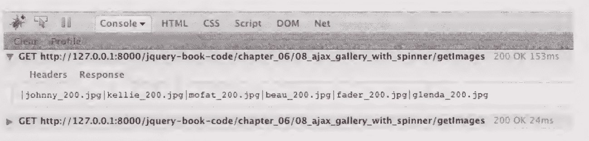

## Ajax高手？达标！

我们的客户欣喜若狂。我们根本没法让他闭嘴。但嘿，我们付出了相当令人印象深刻的努力：一个功能齐全、稳定、动态的图片库和图片标签系统，没有进行一次页面刷新。而我们几乎没怎么费劲。但我们还能做更多事情！

Ajax（如我们所知）最初是一个流行词，很快就被过度炒作和误解。现在炒作已经平息，我们都可以欣赏Ajax这个巧妙工具了。多亏了jQuery，它成为一个极其易于使用的工具——而且是一个极其容易让人上瘾的工具。随着越来越多的酷炫第三方JSON API和混搭工具的出现，只要你有一点独创性，似乎就没有你无法实现的事情！

# 第7章

# 表单、控件和对话框

在其初期，网络是一个只读的媒介。早期的Web开发者不满足于近乎无限的链接文档集合，他们想要更多；具体来说，他们不仅仅希望人们*阅读*他们关于猫的网页——他们希望人们在他们的留言簿上签名，并告诉他们他们的猫有多棒。HTML表单为我们提供了一种反馈机制，最终催生了今天我们所拥有的庞大而复杂的基于Web的应用程序。

JavaScript介入进来，帮助简单的HTML表单元素模拟桌面应用程序中许多更复杂和交互式的输入控件，但代码往往笨拙且臃肿。jQuery允许我们简化控件的创建，并让我们专注于快速而优雅地将我们的想法转化为功能性的控件。

幸运的是，我们做起来很快！我们的客户热衷于基于我们为他构建的炫酷Ajax控件进一步开发。现在他有了符合流行词特性的功能，他承认或许应该先修复网站上的一些表单，这些表单现在看起来痛苦地停留在1999年的风格。他想要“一些内联编辑、花哨的表单验证消息、酷炫的对话框，以及所有东西——*所有东西*——都应该可以拖放，就像一个来自未来的网站！”对我们来说幸运的是，jQuery让我们能够构建未来的网站。

# 表单

HTML表单很古老。而且有点笨拙。浏览器处理它们的方式也大相径庭。然而，多亏了JavaScript，这些表单已经成为一些令人惊叹的酷炫Web应用程序的基础。一如既往，如果JavaScript能做，jQuery就能让它变得有趣！

我们现在都知道套路：表单元素是DOM元素，因此jQuery非常擅长操作它们。但表单元素不是典型的DOM元素，因此有一些特殊的jQuery技巧来更具体地处理它们。到目前为止，我们在本书中已经见过很多了——但现在是时候更深入地关注它们了。

# 简单的表单验证

表单验证至关重要，即使它经常看起来很无聊。然而，适当、设计良好且实现得当的表单可以决定用户对你网站的看法。谁没有过因为一个特别令人沮丧的表单而放弃访问某个网站的经历呢？

> **服务器端表单验证**

使用jQuery进行客户端表单验证应该*仅*用于协助用户填写表单，*绝不*应依赖它来阻止某些类型的数据被发送到服务器。禁用JavaScript的用户将不受你的jQuery验证的阻碍，因此他们可以提交任何他们想要的值。因此，如果用户通过你的表单提交恶意数据存在任何安全风险，那么该数据需要在服务器端进行彻底验证。

尽管jQuery避免处理表单验证的细节，但它确实提供了一些方便的方法来访问和设置表单值——而这已经成功了一半！你可以像选择其他元素一样选择表单字段，但有一些额外的过滤器可以使你的代码更高效和可读。

例如，`:input` 过滤器会选择所有作为输入框、选择框、文本域或按钒的元素。你可以像使用任何其他过滤器一样使用它。以下是如何为所有表单元素设置可爱的柠檬雪纺背景色：

```javascript
$('#myForm:input').css('background-color', 'lemonchiffon')
```

如果你想更精确地选择特定元素，有多种更具体的表单元素过滤器可供使用：`:text`、`:password`、`:radio`、`:checkbox`、`:submit`、`:button`、`:image`（用于图像按钮）和`:file`。请记住，你可以在单个选择中自由应用多个过滤器。

此外，还有一些额外的过滤器允许你根据表单元素的状态和值进行选择。`:enabled` 和 `:disabled` 过滤器会根据元素的 `disabled` 属性获取元素，而 `:checked` 和 `:selected` 则帮助你找到被选中的单选按钮、选择框项目和复选框。

> **条件逻辑中的 `:checked` 和 `:selected`**

当你需要根据复选框或单选按钮的选中状态执行不同操作时，这些过滤器特别有用。例如，你可以使用 `if($(this).is(':checked'))` 来检查一个框是否被选中。

选择好元素后，就该获取它们的值，以便根据你的需求进行验证。我们已经多次使用 `val` 函数，知道它的作用：返回表单字段的值。我们现在可以执行一些简单的验证——让我们测试表单中是否有任何文本框为空：

```javascript
// chapter_07/01_simple_validation/script.js (摘录)

$(':submit').click(function(e) {
  $(':text').each(function() {
    if ($(this).val().length == 0) {
      $(this).css('border', '2px solid red');
    }
  });
  e.preventDefault();
});
```

234 jQuery: Novice to Ninja

填写一两个文本输入框，然后尝试提交表单；任何你留空的输入框都会被红色高亮显示。

`val` 操作也适用于选择框和单选按钮。例如，当用户更改选择时，我们来弹出单选按钮的值：

```javascript
// chapter_07/02_radio_buttons/script.js (摘录)

$(':radio[name=sex]').change(function() {
  alert($(this).val());
});
```

每当表单中的值发生变化时，都会触发这个 `change` 事件。对于复选框、选择框和单选按钮，这发生在值从其当前值更改时。对于文本输入框或文本域，它会在用户更改元素值时触发——但只有当焦点移开该元素时才会触发。这是实现一些简单的内联验证的好方法。

让我们重新审视简单的验证示例，只不过这次我们将在用户移动到下一个字段时测试空字段。为此，我们需要捕获 `blur` 事件，该事件在表单字段失去焦点时触发。这对于内联验证非常完美：

```javascript
// chapter_07/03_simple_inline_validation/script.js (摘录)

$(':input').blur(function() {
  if ($(this).val().length == 0) {
    $(this)
      .addClass('error')
      .after('<span class="error">此字段必须... </span>');
  }
});
$(':input').focus(function() {
  $(this)
    .removeClass('error')
    .next('span')
    .remove();
});
```

我们只是在检查字段是否已填写，但任何类型的验证都可以通过这种方式实现。你可以检查最小或最大字符数，或者使用正则表达式检查特定格式，或者检查密码确认字段是否与原始密码字段匹配。

> **避免过度验证！**

设计表单验证时一个需要考虑的重要点是：保持简单！你添加的规则越多，就越可能忘记某个边缘情况，最终让一些用户感到沮丧。提供提示、示例输入和指导，而不是那些如果邮政编码格式与预期不同就阻止用户提交表单的规则！

## 提交事件

我们还可以钩入 `submit` 事件，该事件在表单提交时触发。这比监听提交按钮上的点击事件更好的技术，因为如果用户按 **Enter** 键提交表单，它也会触发。如果你从提交事件处理程序返回 `false`，表单将不会被提交。在下面的例子中，我们将检查表单中的所有文本框。如果有任何留空，我们将弹出一个消息，并将焦点放在有问题的元素上：

```javascript
// chapter_07/04_submit_event/script.js (摘录)

$("form").submit(function() {
  var error = false;
  $(this).find(":text").each(function() {
    if ($(this).val().length == 0) {
      alert("文本框必须有值！");
      $(this).focus();
      error = true;
      return false; // 仅退出 “each” 循环
    }
  });
  if (error) {
    return false;
  }
  return true;
});
```

有了所有这些原始的、基于表单的工具供你使用，你可以轻松地逐页为表添加验证。如果你仔细规划表单并开发一致的命名标准，你可以使用 jQuery 来概括你的验证，使其适用于多个表单。

但是——正如我们已经看到的——在设计表单验证时需要考虑大量的边缘情况。如果你需要真正可靠的验证，并且宁愿将时间花在设计用户交互上，也许你应该考虑使用验证插件。

## 使用验证插件进行表单验证

构建自己的内联验证系统可能是一项艰巨的任务；你需要了解正则表达式才能验证电子邮件地址或电话号码是否有效，例如。验证插件为你解决了许多这些问题，让你可以轻松地为大多数表单添加复杂且可定制的内联验证。

我们不会在这里逐一介绍这个插件的所有可用选项（那会填满一整章！），但我们会看看最常见的选项。

让我们从表单开始。为了说明尽可能多的不同验证选项，我们将使用一个包含密码和密码确认字段的注册表单：

```html
<!-- chapter_07/05_validation_plugin/index.html (摘录) -->
<div id="signup">
  <h2>注册</h2>
  <form action="">
    <div>
      <label for="name">姓名：</label>
      <input name="name" id="name" type="text"/>
    </div>
    <div>
      <label for="email">电子邮件：</label>
      <input name="email" id="email" type="text"/>
    </div>
    <div>
      <label for="website">网站 URL：</label>
      <input name="website" id="website" type="text" />
    </div>
    <div>
      <label for="password">密码：</label>
      <input name="password" id="password" type="password" />
    </div>
    <div>
      <label for="passconf">确认密码：</label>
      <input name="passconf" id="passconf" type="password" />
    </div>
    <input type="submit" value="提交！" />
  </form>
</div>
```

要使用验验插件，我们只需要在表单选择上调用 `validate`，并传递任何我们想要使用的选项。最重要的选项是 `rules`，你需要在这里定义用于验证用户输入的规则：

```javascript
$('#signup form').validate({
    rules: {
        name: {
            required: true,
        },
        email: {
            required: true,
            email: true
        },
        website: {
            url: true
        },
        password: {
            minlength: 6,
            required: true
        },
        passconf: {
            equalTo: "#password"
        }
    },
    success: function(label) {
        label.text('OK!').addClass('valid');
    }
});
```

有相当多的预定义验证规则可用，当然你也可以定义自己的规则。你需要查阅文档来了解所有规则。这里我们使用了 `required`、`email`、`url`、`minlength` 和 `equalTo`。

`required` 将字段标记为必填项，因此如果为空将被标记为错误。`email` 和 `url` 验证字段的格式；电子邮件必须包含 @，URL 必须以 http:// 开头，等等。在 `rules` 对象内部，我们为每个表单字段定义了一个对象，以字段的 id 命名。`minlength` 是不言自明的（而且，正如你所料，有一个对应的 `maxlength`）。最后，`equalTo` 允许我们指定一个指向另一个表单字段的 jQuery 选择器，其内容将与当前字段进行比较，以查看它们是否相同。

验证插件将在每个表单字段后添加一个新的 label 元素来包含错误消息；默认情况下，它将具有 error 类，因此你可以随心所欲地为其设置样式，默认情况下，插件仅在字段值无效时才显示消息。然而，用户研究表明，如果也为用户提供*正确*条目的反馈，他们会更快、更自信地完成表单。这就是为什么我们使用 success 回调来设置消息标签的值，并为其添加一个类以用漂亮的绿色勾选标记进行样式设置。`success` 会传递消息元素本身，因此你可以以任何你喜欢的方式操作它。我们的示例表单在图 7.1 中展示了填写过程中的状态。

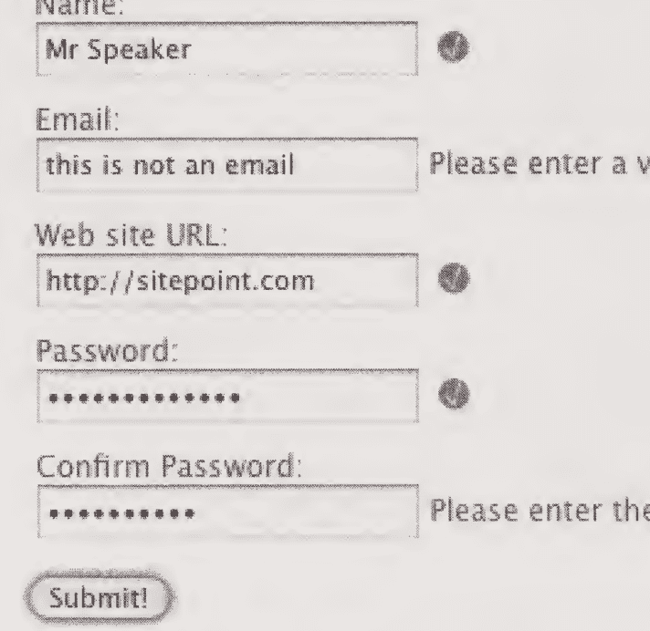

也可以自定义错误消息本身，值得注意的是，在插件目录的 **localization** 文件夹中提供了许多本地化变体。

此示例仅仅是 Validation 插件功能的起点。请务必查阅文档以及插件 demo 文件夹中的示例，以探索所有可用功能。

## 最大长度指示器

我们的客户希望将反馈表单内容字段限制在130个字符以内。"像推特那样？"你可能会问，"为什么要这么做？"他滔滔不绝地讲了一堆关于针对性反馈、注意力集中时间什么的……但我们知道他只是想模仿推特。"剩余字符"计数是另一个如今重新流行的特性，尽管限制输入长度的想法和计算机本身一样古老。

通过在表单字段旁边显示剩余字符数，用户可以清楚地知道自己还能输入多少内容。

我们将为需要应用此效果的文本区域（textarea）设置一个名为 `maxlength` 的类。然后，在脚本中，我们在其后追加一个 span 元素，并添加一种新的事件处理程序：

```
chapter_07/06_max_length_indicator/script.js (节选)

$(".maxlength")
  .after("<span></span>")
  .next()
  .hide()
  .end()
  .keypress(function(e) {
    // 处理按键;
  });
```

追加 span 之后，文本区域仍然是选中的元素。我们想要修改的是新的 span，因此使用 next 操作移动到它。接着我们隐藏这个 span，但现在需要回到表单元素上添加事件处理程序，所以我们使用了 end 操作。end 操作会将 jQuery 选择移回到你最后一次改变选择之前的状态。在我们的例子中，hide 没有改变选择，但 next 改变了。所以当我们调用 end 时，选择会回到调用 next 之前的状态。

现在我们回到了表单元素上，便附加一个 keypress 事件处理程序。正如你所料，每当按下按键时，这个事件就会触发。在这里我们可以检查是否还允许输入更多字符——如果不允许，就阻止用户输入更多字符：

```
chapter_07/06_max_length_indicator/script.js (节选)
var current = $(this).val().length;
if (current >= 130) {
  if (e.which != 0 && e.which != 8) {
    e.preventDefault();
  }
}
```

现在是这个效果的核心部分：我们获取元素的值，并使用 JavaScript 的 `length` 属性获取其长度。如果当前字符数已达到最大长度，我们将通过使用事件的 `preventDefault` 操作来阻止按键生效。

在处理 keypress 事件时，事件有一个 `which` 属性，对应于所按键的 ASCII 码。请注意，我们允许 **delete**（ASCII 码 0）和 **backspace**（ASCII 码 8）键无论字符数多少都能正常工作。如果我们不这样做，用户可能会粘贴一个超出限制的回复——但却无法删除任何字符来使其符合要求：

```
chapter_07/06_max_length_indicator/script.js (节选)
$(this).next().show().text(130 - current);
```

最后要做的任务是在我们创建的 span 中显示剩余字符数。我们移动到下一个元素，确保其可见，并显示我们简单计算的结果，以指示还允许输入多少字符。

## 表单提示

一个减少表单在页面上占用空间的不错技巧，是将表单字段的标签 *移动到* 输入框 *内部*。当用户将焦点移动到该字段时，标签会神奇地消失，允许他们开始输入。如果他们让字段为空并移开焦点，原始的标签文本会重新显示在原处。

此技术仅适用于简短、简单的表单。在较大的表单中，如果没有可见的标签，用户很容易忘记每个特定字段的用途。如果他们需要重新查看或更改已经输入的值，这可能会成为一个问题。

话虽如此，对于像登录或搜索表单这样的简单表单，大多数用户都非常熟悉每个字段的用途，这可以成为节省空间和简化界面的好方法。看一下图 7.2，你可能已经猜到了如何自己实现这个效果。唯一棘手的部分是当用户离开而没有在输入框中输入任何内容时，如何将默认值返回到输入框。

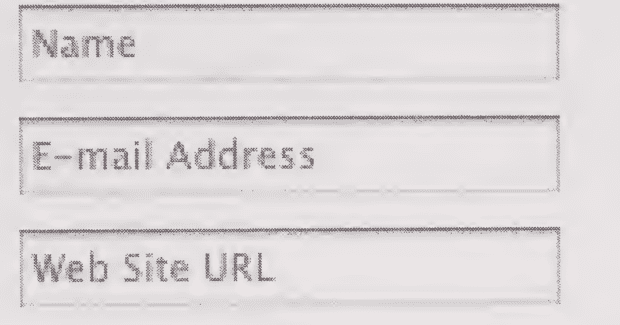

如果你猜到我们会使用 data 操作来实现，那你就猜对了。我们将把默认值存储在每个可清除元素的 data 中——如果用户离开时值仍然为空，我们将从那里恢复它：

```
chapter_07/07_form_hints/script.js (节选)

$('input.clear').each(function() {
    $(this)
        .data('default', $(this).val())
        .addClass('inactive')
        .focus(function() {
            $(this).removeClass('inactive');
            if ($(this).val() == $(this).data('default') || '') {
                $(this).val('');
            }
        })
        .blur(function() {
            var default_val = $(this).data('default');
            if ($(this).val() == '') {
                $(this).addClass('inactive');
                $(this).val($(this).data('default'));
            }
        });
});
```

我们需要在文档加载时遍历每个元素并保存默认值。然后我们跟踪焦点和失焦事件，这些事件会在用户进入或离开我们的输入框时触发。在获得焦点时，我们检查文本框的值是否与我们的默认文本相同；如果是，我们就清空该框，为用户输入做准备。

在离开时，我们检查文本框是否为空，如果为空，我们就将原始值放回去。我们在此过程中添加和移除一个类；这允许我们在表单字段显示提示时为其设置不同的样式。在我们的示例中，我们简单地将文本颜色设置得稍微浅一些。

## 全选复选框

文本输入已完全在我们的掌控之下，现在是时候处理其他表单控件了。我们将从 StarTrackr 用户的一个痛点开始：在填写各种名人信息表单时，需要勾选太多的复选框。这导致了数据失真、用户厌烦以及关于名人的报告不准确。我们的客户要求每个统计类别都有一个“全选”复选框，以便用户可以一键切换所有复选框的选中或取消选中状态。

了解 jQuery 表单过滤器使这项任务变得轻而易举。我们只需选择同一组中的所有复选框，并选中或取消选中它们。在 HTML 表单中，我们通过给所有相关的项相同的 name 属性来对复选框进行分组：

```
<div class="stats">
  <span class="title">成为名人的原因</span>
  <input name="reason"
    type="checkbox" value="net" />在网上出名<br/>
  <input name="reason"
    type="checkbox" value="crim" />犯罪<br />
  <input name="reason"
    type="checkbox" value="model" />与超模约会<br />
  <input name="reason"
    type="checkbox" value="tv" />主持电视节目<br />
  <input name="reason"
    type="checkbox" value="japan" />在日本很红<br />
  <hr />
  <input class="check-all"
    name="reason" type="checkbox" /><span>全选</span>
</div>
```

我们给最后一个复选框设置了特殊的类 `check-all`。这个复选框将作为我们的主复选框：当它被选中或取消选中时，我们的代码就会启动。首先，我们构造一个选择器字符串，用于选择所有与主复选框具有相同 name 属性的复选框。这需要将几个字符串连接起来，最终创建一个看起来像 `:checkbox[name=reason]` 的选择器。

然后我们将所有相关复选框的 checked 值设置为与主复选框相同。因为我们的代码是在用户改变值之后运行的，checked 属性将反映复选框的新状态——导致所有相关项相应地被选中或取消选中：

```
$('.check-all:checkbox').change(function() {
  var group = ':checkbox[name=' + $(this).attr('name') + ']';
  $(group).attr('checked', $(this).attr('checked'));
});
```

## 性能问题

如果你的页面很大，遍历每个 DOM 节点查找复选框可能会很慢。如果你注意到页面变得无响应，你可能需要研究一下 jQuery 选择器的上下文参数，它可以限制 jQuery 查找你所选内容的范围。我们将在第 8 章介绍这个上下文参数。

## 内联编辑

内联编辑（也称为就地编辑）是最初真正展示 Ajax 能力以创建自然、实用控件的效果之一。第一次使用内联编辑框时，你可能会感到惊讶；而之后的每一次，它都变得难以察觉——它就是像预期的那样工作。

有多种方法可以重现这种效果。最简单的方法是将你的表单字段伪装成标签：移除边框，赋予它们与页面相同的背景色，并在用户聚焦时重新添加边框！这是一个很棒的技巧，意味着你的表单就像普通表单一样工作（因为它本来就是）。然而，这可能很难实现，并且如果你希望页面的许多不同部分都可编辑，可能需要大量的额外标记和样式。

因此，更常见的方法是允许编辑非表单元素：例如段落标签和标题标签。当用户点击标签时，其内容会被一个文本框或文本区域替换，用户可以与之交互。任务完成后，原始标签将被新内容替换。

我们将使用类来标记内容为可编辑。对于简单的单行内容，我们将使用 input 元素（通过分配类名 editable），对于较长的段落，我们将使用 textareas（我们将赋予其类名 editable-area）。我们还将确保为每个元素分配一个唯一的 ID。这样我们就可以将数据发送到服务器以在数据库中进行更新，并在下次页面加载时重新加载新数据：

```
chapter_07/09_inline_editing/index.html (excerpt)
<h3 id="celeb-143-name" class="editable">Glendatronix</h3>
<p id="celeb-143-intro" class="editable-area">
    Glendatronix floated onto the scene with her incredible debut ...
</p>
```

为了使其工作，我们需要捕获一些事件。首先是 `hover` 事件，以添加效果让用户看到元素是可编辑的（我们将使用一种久经考验的黄色背景色）。

我们还想捕获 `click` 事件——当用户点击可编辑内容时触发——以及 `blur` 事件，它标志着编辑的结束：

```
chapter_07/09_inline_editing/script.js (excerpt)

$(".editable, .editable-area")
  .hover(function() {
    $(this).toggleClass("over-inline");
  })
  .click(function(e) {
    // Start the inline editing
  }).blur(function(e) {
    // End the inline editing
  });
```

当用户点击可编辑区域时，我们的代码就会启动。首先，我们获取被点击元素的引用并将其存储在 `$editable` 变量中（以避免每次都需要重新选择它）。我们还将用 `hasClass` 检查 `active-inline` 类。如果元素已经具有 `active-inline` 类，它就已经是一个编辑框了。我们宁愿不要用另一个编辑框替换编辑框：

```
chapter_07/09_inline_editing/script.js (excerpt)

// Start the inline editing
var $editable = $(this);
if ($editable.hasClass('active-inline')) {
  return;
}
```

接下来，我们想获取元素的内容——然后移除它。为了获取内容，我们将 html 数据保存到一个变量中……但我们也会使用 `$.trim` 方法移除内容字符串首尾的空白字符。这是必要的，因为根据你的 HTML 布局方式，字符串可能包含额外的回车和换行符，我们不希望这些出现在文本框中。

然后我们添加 active 类，它有两个目的：指示正在进行编辑，并为我们的样式提供钩子。最后，我们用 empty 操作清空当前元素。这个命令类似于 remove，不同之处在于对一个元素调用 empty 将导致其所有 *子元素* 被移除，而不是元素本身：

```
chapter_07/09_inline_editing/script.js (excerpt)

var contents = $.trim($editable.html());
$editable
  .addClass("active-inline")
  .empty();
```

> **使用 empty 和 remove 进行链式调用**

重要的是要记住，你在 remove 或 empty 命令之后链式调用的任何 jQuery 操作都将应用于已移除的选择集，而 *不是* 你在移除元素之前的选择集。这样做的理由是，如果你只是丢弃这些元素，它们就会永远丢失。这样你就有机会保留它们、处理它们或存储它们以备将来使用。

最后，是时候插入我们全新的文本框或文本区域了。我们将检查 editable 类以确定需要附加哪种类型的表单元素（记住我们用 editable-area 表示多行内容）。我们用移除的元素的内容设置新元素的值，并将其附加到目标元素：

```
chapter_07/09_inline_editing/script.js (excerpt)

// Determine what kind of form element we need
var editElement = $editable.hasClass('editable') ?
  '<input type="text" />' : '<textarea></textarea>';

// Replace the target with the form element
$(editElement)
  .val(contents)
  .appendTo($editable)
  .focus()
  .blur(function(e) {
    $editable.trigger('blur');
  });
```

你可能会对 `trigger` 函数的使用感到好奇。它只是一种触事件触发的不同方式（所以，在这个例子中，我们也可以使用我们已经见过的 `$editable.blur()` 语法）。trigger 操作比其更简短的对应部分更灵活——但现在我们将只坚持基本用法。

在这个例子中使用 `trigger` 是为了清晰：向任何阅读代码的人表明我们想手动触发事件。在这种情况下，我们只是在传递事件；`input` 被模糊了，所以我们告诉原始元素是时候结束编辑了。我们可以在 `input` 框的 `blur` 事件处理器内处理所有这些，但通过像这样委派事件，我们避免了将代码嵌套又一层（这会使代码更难阅读）。让原始元素处理自己的逻辑也有道理。

`trigger` 的对应部分是 `bind`。`bind` 让我们为对象添加事件处理器。听起来熟悉吗？到目前为止，我们一直使用像 `click`、`hover`、`ready` 等便捷的简写方法来绑定事件。但如果你深入内部，你会看到它们都依赖于 `bind`。

`bind` 操作接受一个包含要绑�的事件名称的字符串，以及一个要运行的回调函数。你也可以通过将事件包装在对象中，在单次调用中为项目绑定多个事件。例如，我们的代码为 `.editable` 和 `.editable-area` 元素附加了三个独立的事件：`click`、`hover` 和 `blur`。如果需要，你可以用 `bind` 语法重写：

```
$('.editable, .editable-area').bind({
	hover: function(e) {
		// Hover event handler
	},
	click: function(e) {
		// Click event handler
	},
	blur: function(e) {
		// Blur event handler
	}
});
```

让我们回到我们的例子；编辑结束，我们可以回到默认状态。我们将获取表单元素的值，并通过 `$.post` 将其发送到服务器，同时在过程中放置一条“保存中...”的消息。当 `POST` 完成后，我们删除该消息并用更新后的值替换它。就像我们在上一章看到的 Ajax 功能一样，我们用一个空的 **save** 文件伪造服务器端响应。在实际应用中，你会希望通过检查响应数据来确认更改是否确实已保存到数据库：

```
chapter_07/09_inline_editing/script.js (excerpt)

.blur(function(e) {
  // end the inline editing
  var $editable = $(this);

  var contents = $editable.find(':first-child:input').val();
  $editable
    .contents()
    .replaceWith('<em class="ajax">Saving ... </em>');

  // post the new value to the server along with its ID
  $.post('save',
    {id: $editable.attr('id'), value: contents},
    function(data) {
      $editable
        .removeClass('active-inline')
        .contents()
        .replaceWith(contents);
    });
});
```

这段代码中有两个新的 jQuery 函数，但它们都相当不言自明。**contents()** 返回 DOM 节点的全部内容，可能包括其他 DOM 元素和/或原始文本，而 **replaceWith()** 则用你传递给它的任何内容替换你选择的任何内容。使用后一种方法时要小心；在我们的例子中，我们知道 **contents()** 只会返回一个元素——但如果它返回多个元素，每个元素都会被相同的加载消息替换！

## 自动完成

我们已经安抚了客户——他在角落里玩内联编辑字段玩得很开心。趁他下一个请求之前还有几分钟空闲时间，让我们通过让名人表单的“最后已知去向”字段从主要城市列表中自动完成来真正给他留下深刻印象。生成的功能如图 7.3 所示。

我们将使用 jQuery 插件仓库中的 Autocomplete 插件。这是一个功能完善且稳定的插件，恰好提供了我们所需的功能，且体积轻量。

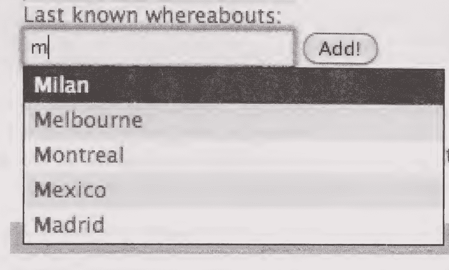

图 7.3. 为"最后已知位置"字段提供自动补全功能

首先，我们需要这个插件。前往仓库获取它^1，快速浏览一下示例，然后将其包含在你的页面中。

我们还需要设置一些 CSS 样式。插件附带了一个示例 CSS 文件，这样你就能了解添加了哪些类。我们使用了其中一些样式，为我们的下拉建议列表赋予标准的外观。

Autocomplete 插件会附加到一个 select 元素上。我们将其应用于简单表单中的位置字段：

```
chapter_07/10_autocomplete/index.html (节选)

<label for="location">最后已知位置：</label>
<input type="text" id="location"/>
```

现在让我们看看 Autocomplete 插件能为我们做什么。默认情况下，它需要一个存储在数组中的本地数据集合；这对我们来说非常完美，因为我们的数据来源是页面上的一个 HTML 列表：

```
chapter_07/10_autocomplete/script.js (节选)

var cities = ['New York', 'Melbourne', 'Montreal', 'London' ... ];
$('#location').autocomplete(cities, {
  autoFill: true,
  selectFirst: true,
  width: '240px'
});
```

我们只是传入了一个 JavaScript 数组，但 Autocomplete 也允许我们传入一个 URL，在这种情况下，它将通过 Ajax 检索潜在值的列表。自动完成将期望一个纯文本返回，其中每行包含一个值，这在与后端开发人员简单沟通后应该很容易获取！

上述代码足以让它运行起来，但我们也可以指定一系列选项。autoFill 提供了一个良好的输入联想效果（用当前建议的补全内容填充文本框），matchContains 会导致它匹配单词的子字符串，而不仅仅是首字母，等等。你可以进行很多微调，因此值得快速研究一下选项列表。

当用户选择一个选项时，Autocomplete 插件还会触发 result 事件。它会将所选标签的名称作为第二个参数传递给我们的事件处理程序（在事件对象之后）。例如，这将在选择时弹出所选选项的提示：

```
$('#location')
  .autocomplete(cities)
  .result(function(event, selection) {
    alert(selection);
  });
```

非常简单，但也非常酷炫。而且客户还在玩我们为他构建的上一个玩具！也许我们玩表单元素有点太在行了，最好回到待办事项列表上来！

## 星级评分控件

构建一个大型名人追踪社区是客户的主要目标；他开始意识到，他网站的用户正在成为他的产品——一个他可以开始卖给广告商的产品。为了探索这种可能性，他希望增加用户参与度，并让用户感到自己很重要。毕竟，他必须照顾好自己的产品。我们对此思考了一下，并向他提出了一个星级评分的想法——毕竟，人们最喜欢通过分配金色星星来表达自己的感受。我们的控件将如图 7.4 所示。

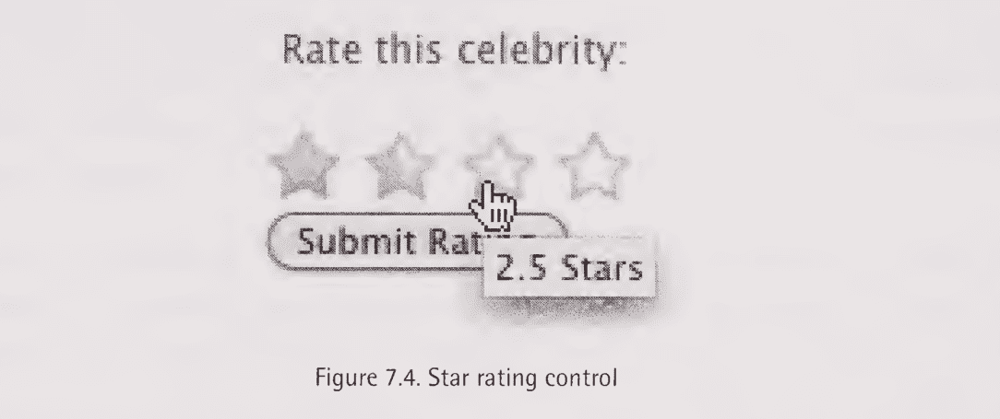

图 7.4. 星级评分控件

我们星级评分控件的基础是一个单选按钮组；这很完美，因为浏览器强制执行组内的单个选择。你可以通过添加正确数量的按钮来选择你希望用户从中选择的范围：

```
chapter_07/11_star_ratings/index.html (节选)

<div class="stars">
  <label><input id="rating-1" name="rating" type="radio" value="1"/>
  1 颗星</label>
  <label><input id="rating-2" name="rating" type="radio" value="2"/>
  2 颗星</label>
  <label><input id="rating-3" name="rating" type="radio" value="3"/>
  3 颗星</label>
  <label><input id="rating-4" name="rating" type="radio" value="4"/>
  4 颗星</label>
</div>
```

当然，困难的部分在于用我们的星级控件替换这些单选按钮。你可以尝试仅用 CSS 来处理 HTML 控件的样式，但如果你将控件分成两部分：存储数据的底层模型，以及带有星星的闪亮视图，会更容易且更灵活。在这种情况下，模型就是原始的 HTML 单选按钮组。我们的攻击计划是隐藏单选按钮，并显示我们通过 jQuery 添加的链接列表，这些链接被样式化为星星的样子。与链接的交互将切换所选的单选按钮。没有 JavaScript 的用户将简单地看到单选按钮本身，这对我们来说没问题。

对于星星本身，我们将再次依赖 CSS 精灵图。这样我们的控件将只依赖于一张图片（如图 7.5 所示），这节省了 HTTP 请求次数，也使我们的图形设计师更容易编辑。


我们的 CSS 将把 CSS 精灵图应用到我们创建的代表半星的链接上。为了在不同图像状态之间切换，我们只需要更新 background-position 属性：

```
chapter_07/11_star_ratings/stars.css (节选)

.stars div a {
  background: transparent url(../../css/images/sprite_rate.png) 0 0 no-repeat;
  display: inline-block;
  height: 23px;
  width: 12px;
  text-indent: -999em;
  overflow: hidden;
}

.stars a.rating-right {
  background-position: 0 -23px;
  padding-right: 6px;
}

.stars a.rating-over { background-position: 0 -46px; }

.stars a.rating-over.rating-right { background-position: 0 -69px; }

.stars a.rating { background-position: 0 -92px; }

.stars a.rating.rating-right { background-position: 0 -115px; }
```

我们决定让用户从四颗星中选择一个评分，而不是通常的五颗星。为什么？用户心理学！给人一个中间道路，他们就会选择它；通过没有中间选项，我们让用户更多地思考他们的选择。我们取得了更好的结果，也能够更好地向用户呈现最佳内容（由他们选择）！

但四是一个有限的范围——这就是为什么我们希望允许半星评分。这是通过一种视觉错觉实现的——你可能注意到我们的星星图片被切成了一半。我们的 HTML 将包含八个单选按钮，每个价值半颗星。将八个单选按钮转换成四颗星的代码有两部分。首先，`createStars` 函数将获取包含单选按钮的容器，并用星星链接替换它。然后，每个星星将通过适当的操作事件处理程序（在 `addHandlers` 方法中）进行补充，以让用户与控件交互。这是我们的 `starRating` 对象的骨架：

```
chapter_07/11_star_ratings/script.js (节选)

var starRating = {
  create: function(selector) {
    $(selector).each(function() {
      // 隐藏单选按钮并添加星星链接
    });
  },

  addHandlers: function(item) {
    $(item).click(function(e) {
      // 处理星星点击
    })
    .hover(function() {
      // 处理星星悬停进入
    }, function() {
      // 处理鼠标悬停移出
    });
  }
}
```

`create` 方法遍历每个与我们传入的选择器匹配的容器，并创建一个链接列表，作为单选按钮的代理。我们将样式化这些链接使其看起来像星星。它还会隐藏原始表单元素，因此用户只会看到我们可爱的星星：

```
$(selector).each(function() {
  var $list = $('<div></div>');
  // 遍历每个容器中的每个单选按钮
  $(this)
    .find('input:radio')
    .each(function(i) {
      var rating = $(this).parent().text();
      var $item = $('<a href="#"></a>')
        .attr('title', rating)
        .addClass(i % 2 == 1 ? 'rating-right' : '')
        .text(rating);

      starRating.addHandlers($item);
      $list.append($item);

      if ($(this).is(':checked')) {
        $item.prevAll().andSelf().addClass('rating');
      }
    });
});
```

我们首先为新链接创建一个容器（一个 div 元素）；我们将为我们替换的每个单选按钮创建一个新链接。使用 `:radio` 选择器过滤器选中所有单选按钮后，我们获取每个项目的评分，并使用它来创建一个超链接元素。

### 使用取模进行条件赋值

对于 `addClass` 操作，我们基于一点数学运算，使用三元运算符（参见第 4 章“渐隐幻灯片”一节）有条件地指定类名。正如我们之前在书中所做的那样，我们使用取模（%）运算符来确定索引是偶数还是奇数。如果索引是奇数，我们将添加 `rating-right` 类；这使得链接看起来像星星的右半部分。

一旦我们的链接准备就绪，我们就将其传递给 `addHandlers` 方法——这是我们将为其附加所需事件的地方。然后，我们将其添加到列表容器中。一旦它进入容器，我们会检查当前单选按钮是否被选中（我们使用 `:checked` 表单过滤器）。如果被选中，我们希望为这个半星以及它之前的所有半星添加 `rating` 类。任何附加了 `rating` 类的链接都将被分配金色星星图像（这将使用户能够看到当前评分）。

为了选择所有需要变成金色的元素，我们将借助两个新的 jQuery 方法：`prevAll` 和 `andSelf`。`prevAll` 方法选择当前选择项之前的*所有*兄弟元素（与只选择紧邻前一个兄弟元素的 `prev` 方法不同）。对于我们的示例，我们希望将类添加到之前的兄弟元素*以及*当前选择项。为此，我们应用了 `andSelf` 方法，该方法简单地将原始选择包含在当前选择中。现在我们有了所有将变为金色的链接，因此可以添加该类了。

### 其他遍历方法

你可能已经猜到，除了 `prevAll`，jQuery 还为我们提供了 `nextAll` 方法，它获取同一容器中当前元素之后的所有兄弟元素。jQuery 1.4 还引入了两个新的配套方法：`prevUntil` 和 `nextUntil`。它们通过选择器调用，并将扫描一个元素的兄弟元素（向前或向后，具体取决于你使用哪个方法），直到找到与选择器匹配的元素。

例如，`$('h2:first').nextUntil('h2');` 将给你页面中第一个 h2 之后、同一容器元素中下一个 h2 之前的所有元素。

如果你向 `prevUntil` 或 `nextUntil` 传递第二个参数，它将用作选择器来过滤返回的元素。例如，如果我们写 `nextUntil('h2', 'div')`，它将只返回当前选择项和下一个 h2 之间的 div 元素。

完成所有这些艰巨的工作后，我们现在可以将新的链接列表添加到控件中，并删除原始按钮。现在用户将只与星星交互：

```
chapter_07/11_star_ratings/script.js (excerpt)

// 隐藏原始单选按钮
$(this).append($list).find('input:radio').hide();
```

控件现在看起来初具规模——但它还不能做任何事情。我们需要附加一些事件处理程序并添加一些行为。我们关注三个事件。当用户将鼠标悬停在星星上时，我们希望更新 CSS 精灵图以显示悬停状态；当鼠标移开时，我们希望将 CSS 精灵图恢复到原始状态；当用户点击时，我们希望将选择变为金色：

```
chapter_07/11_star_ratings/script.js (excerpt)

$(item).click(function(e) {
  // 响应星星点击
})
.hover(function() {
  $(this).prevAll().andSelf().addClass('rating-over');
},function() {
  $(this).siblings().andSelf().removeClass('rating-over');
});
```

悬停函数是最简单的：悬停时，我们使用 `prevAll` 和 `andSelf` 选择当前半星之前的所有半星（包括当前半星），并为它们添加 `rating-over` 类，就像我们在设置中所做的那样。鼠标移出时，我们进行兜底处理，从所有链接中移除 `rating-over` 类。悬停处理完毕。

现在处理点击：

```
chapter_07/11_star_ratings/script.js (excerpt)

// 处理星星点击
var $star = $(this);
var $allLinks = $(this).parent();

// 设置单选按钮的值
$allLinks
  .parent()
  .find('input:radio[value=' + $star.text() + ']')
  .attr('checked', true);

// 设置评分
$allLinks.children().removeClass('rating');
$star.prevAll().andSelf().addClass('rating');

// 阻止链接的默认点击行为
e.preventDefault();
```

处理点击事件的重要部分是更新底层的单选按钮模型。我们通过使用 `:radio` 过滤器和属性选择器选择正确的单选按钮来实现这一点，该选择器搜索值与当前链接文本匹配的单选按钮。

模型更新后，我们可以继续处理 CSS 精灵图。首先，我们从任何当前具有 `rating` 类的链接中清除该类，然后将其添加到用户所选链接及其之前的所有链接。最后一步是取消链接的默认点击行为，这样点击星星就不会触发位置更改。

## 控件

这解决了我们客户的主要关注点：表单的可用性。现在我们可以开始做一些真正有趣的事情了。jQuery 和 jQuery UI 是超越我们都熟悉和接受的原始 HTML 表单控件的完美工具。一旦我们摆脱了 Web 古老历史的沉闷限制，我们就会发现，创造令人惊叹的新控件的能力仅受限于我们的想象力。毕竟，与网站交互的方式应该不止在框中输入一些文本！

## 日期选择器

我们的客户想在网站上添加一个“名人发现”版块，用户可以在其中报告发现名人。当然，他们需要报告发现的日期和时间。该功能的早期测试表明，用户经常对他们需要输入的日期格式感到困惑。这个问题通过添加示例数据和格式提示部分得到了缓解，但客户希望更进一步，为表单添加一个花哨的日期选择器。

如果你曾经坐下来用 JavaScript 创建一个功能相当完善的日期选择器，你可能会倾向于再也不做这件事了。这需要大量的艰苦工作，而最终只是一个日期选择器。请注意，日期选择器是非常重要的控件，如果做错了会令人极度沮丧。问题在于，由于它们非常复杂，出错的地方很多。为了我们的理智，幸运的是，jQuery UI 包含了一个高度可定制且功能齐全的日期选择器控件，让我们避免了许多自己构建时可能遇到的陷阱。图 7.6 显示了此控件的一个示例。

# 258  jQuery: Novice to Ninja

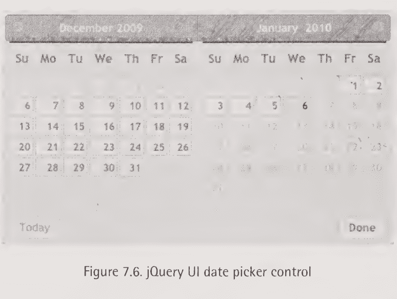

图 7.6. jQuery UI 日期选择器控件

我们将从当前用于日期的输入字段开始：

```
chapter_07/12_date_picker/index.html (excerpt)

<input type="text" id="date" />
```

如果你只寻找基本的日期选择器，jQuery 代码可能不会比一行更复杂：

```
$("#date").datepicker();
```

日期选择器在输入框获得焦点时触发，并滑入视图，当前月份和日期被选中。当文本框失去焦点或选择日期时，它会消失。当然，它看起来非常漂亮，并且具有我们所期望的 jQuery 流畅性——但它与竞争对手的日期选择器相比，提供了什么优势呢？（请记住，仅仅因为你在使用 jQuery，并不意味着你应该忽略其他合适的 JavaScript 组件。）

jQuery UI 中的日期选择器功能丰富。丰富！它完全可本地化，可以处理任何日期格式，允许你一次显示多个月份，拥有一个巧妙的日期范围机制，允配置按钮，可键盘导航（你可以使用 ctrl + 方向键移动），等等。

总的，有超过 50 个选项和事件可供你调整——几乎是日期选择器的每一个微小方面！为了制作图 7.6 中看到的日历，我们只使用了其中几个：

```
chapter_07/12_date_picker/script.js (excerpt)

$( '#date' ).datepicker({
    showOn: 'button',
    buttonText: 'Choose a date',
    buttonImage: 'calendar.png',
    buttonImageOnly: true,
    numberOfMonths: 2,
    maxDate: '0d',
    minDate: '-1m -1w',
    showButtonPanel: true
});
```

`showOn` 让我们选择日历何时弹出。可用选项是 '`focus`'（当文本框获得焦点时）、 '`button`'（在文本框旁边添加一个按钮，用户可以单击打开日历）或 '`both`'（允许两者）。为了使用图标作为按钮，我们指定了一个 `buttonImage`。我们还将 `buttonImageOnly` 设置为 `true`；这意味着只显示图像，而不是标准的表单按钮。

接下来，我们将 `numberOfMonths` 设置为 2——这意味着用户将同时看到两个月的日期。你甚至可以指定一个数组而不是整数；例如，[3, 3] 将显示一个 3x3 的月份网格！

`maxDate` 和 `minDate` 选项允许你设置用户可以选择日期的范围。你可以指定一个 JavaScript 日期对象，或者你可以使用字符串来指定相对日期。后者通常更容易，这就是我们在这里所做的。我们将 `maxDate` 设置为 0——这意味着今天的日期。我们将 `minDate` 设置为 -1m -1w，因此用户只能选择最多一个月零一周前的日期。你可以根据需要加上或减去任意时间：y 表示年，m 表示月，w 表示周，d 表示天。

## 日期验证

你可能已经为日期选择器设置了最大日期，但用户仍然能够选择该范围之外的日期——他们可以在文本框中手动输入。如果你必须确保日期在给定范围内，则需要在服务器端执行验证！你在日期选择器选项中指定的日期范围是为了帮助你的用户选择有效的选项；这样，他们就可以避免提交包含令人沮丧错误的表单。

## 日期选择器工具

jQuery UI 库还提供了一些日期选择器工具，用于全局配置日期选择器，并方便地操作日期。

`$.datepicker.setDefaults` 方法接受一个由日期选择器设置组成的对象。你指定的任何设置都将应用于页面上的所有日期选择器（除非你手动覆盖默认设置）。例如，如果你想让每个日期选择器一次显示两个月：

```javascript
$.datepicker.setDefaults({
  numberOfMonths: 2
});
```

其余的工具函数用于操作或辅助处理日期和日期格式。`$.datepicker.iso8601Week` 函数接受一个日期并返回它所在的年份中的周数（从1到53）。`$.datepicker.parseDate` 函数从给定的字符串中提取日期；你需要传递一个字符串和一个日期格式（例如，"mm-dd-yy"），然后你会得到一个 JavaScript 日期对象。最后，`$.datepicker.formatDate` 的作用相反。它会根据你指定的格式格式化一个日期对象——这非常适合在屏幕上显示日期。

## 滑块

我们的客户希望他的访客能够快速轻松地找到他们寻找的名人。他也认识到，他的许多客户会寻找地点信息在特定价格范围内的名人，因此他想让我们在网站上添加一个价格范围过滤器。这是一个绝佳的机会来介绍另一个很棒的 jQuery UI 组件：滑块！

我们将从一个基本的表单开始，由两个选择框组成：一个用于最高价格，一个用于最低价格。然后我们将调用 jQuery UI 来添加一个漂亮的滑块来控制这些选择框的值。最终结果如图7.7所示。

**拖动滑块按价格筛选：**


| ID | 名称 | 角色 | 地点 | 价格 |

|---|---|---|---|---|

| 203A | 约翰尼·星尘（简介） | 主唱 | 洛杉矶 | $79 |

| 141B | 博·丹迪（照片，简介） | 歌手 | 纽约 | $39 |

| 6636 | 格伦达特罗尼克斯（简介，新闻稿） | 键盘手 | 伦敦 | $55 |

图7.7. jQuery UI 滑块

让我们看看基本的标记：

```html
chapter_07/13_sliders/index.html (excerpt)

<div id="price-range">
  <form>
    <label for="min">最低价格：</label>
    <select id="min">
      <option value="0">0</option>
      <option value="10">10</option>
      <option value="20">20</option>
      :
      <option value="80">80</option>
      <option value="90">90</option>
    </select>
    <br/>
    <label for="max">最高价格：</label>
    <select id="max">
      <option value="10">10</option>
      <option value="20">20</option>
      <option value="30">30</option>
      :
      <option value="100">100</option>
    </select>
  </form>
</div>
```

现在来看代码。当页面加载时，我们首先获取选择框中的当前最大值和最小值。然后我们通过在新创建的空 `div` 上调用 `slider` 方法来初始化我们的滑块：

```javascript
chapter_07/13_sliders/script.js (excerpt)

var max = $('#max').val();
var min = $('#min').val();

var rangeSlider = $('<div></div>')
    .slider({
        min: 0,
        max: 100,
        step: 10,
        values: [min, max],
        range: true,
        animate: true,
        slide: function(e,ui) {
            $('#min')
                .val(ui.values[0]);
            $('#max')
                .val(ui.values[1]);
            showCelebs();
        }
    })
    .before('<h3>拖动滑块按价格筛选：</h3>');

$('#price-range').after(rangeSlider).hide();
```

哇！选项真不少。让我们看看能否分解一下：`min` 和 `max` 分别是滑块的最小值和最大值。`step` 是滑块递增的步长。`values` 用于指定滑块的默认值。因为我们指定了一个包含两个值的数组，所以滑块条将有两个手柄，每个手柄都有一个单独的值。这里我们使用的是之前获取的 `select` 列表中的值，这样滑块将始终与这些选择框中的数据匹配。

`range` 和 `animate` 是创建具有多个手柄的滑块时非常有用的选项，就像我们这里所做的：`range` 表示手柄之间的区域应该以不同的样式显示，通常使用阴影或不同的颜色。此选项也可以设置为 `min`（在这种情况下，最小值和第一个手柄之间的区域将被阴影覆盖）或 `max`（这将阴影覆盖最后一个手柄和最大值之间的区域）。`animate` 只是告诉 jQuery，如果用户点击滑块条的其他地方，平滑地动画手柄的位置，而不是直接跳转到那里。

最后，`slide` 允许你指定一个事件处理程序，每当用户在滑块上移动手柄时都会运行。事件处理程序可以接受一个可选的 `ui` 参数，该参数允许你访问滑块的一些属性；这里我们使用 `values` 属性来调整选择框的值。我们还调用 `showCelebs`，这是一个自定方法，我们将根据名人的价格是否在选定范围内来显示或隐藏他们。

也可以捕获 `change` 事件，这与 `slide` 事件非常相似，不同之处在于，如果滑块的值以编程方式修改，它也会触发（`slide` 仅在用户直接与滑块交互时触发）。

jQuery UI 滑块组件默认会创建一个水平滑块——但如果你想要一个垂直滑块，可以指定 `orientation: 'vertical'`。

我们使用了 `before` 和 `after` 来为滑块添加标题并将其固定到页面上，我们还隐藏了原始的选择框。现在试试这个，你会看到一个主题优美的滑块，你可以玩玩看，它会调整选择框的值。

为了使其能够筛选名人，我们只需要实现 `showCelebs` 方法：

```javascript
function showCelebs() {
  var min = $('#min').val();
  var max = $('#max').val();
  $('.data tr').each(function() {
    var price = parseInt($(this).find('td:last').text().substring(1));
    if (price >= min && price <= max) {
      $(this).fadeIn();
    } else {
      $(this).fadeOut();
    }
  });
}
```

我们提取选择框的值，然后遍历名人表中的每一行，并根据价格是否在选定范围内隐藏或显示它。这里唯一棘手的地方是一些 JavaScript 字符串处理，需要从行文本中提取价格；我们使用 `substring(1)` 提取从第一个字符开始的所有内容（这将方便地去掉价格的美元符号）。然后我们使用 `parseInt` 将字符串转换为数字。

我们还会在文档就绪时调用 `showCelebs`，这样列表就会根据表单中的默认值预先筛选。

这完全按照预期工作，允许用户轻松直观地根据他们想要的价格范围筛选名人。滑块是一个很棒的 UI 控件，正是因为它们非常直观：用户无需被告知就知道如何使用它们。你可能会想出一些其他可以受益于*滑块化*的控件！

## 拖放

拖放已经成熟。它一直存在于背景中，但在由普通的文本框和单选按钮组成的典型表单旁边，感觉格格不入（因此有损于良好的用户体验）。但那是过去了，是旧时代的形式了。如今，如果做得好，拖放可以以高度可用的方式增强表单，提供更自然的体验，提高生产力。它还增添了一丝酷感。

如果说有一项任务即使是初学者也知道如何做，那就是把一个项目拖到回收站。这个比喻非常令人满意——如果你不想要它，就把它扔掉！另一方面，标准的网页方法——点击复选框并按删除键——也是众所周知的，但远没那么令人满意。我们的客户不想点击复选框；他想把东西拖到它们的末日，让它们在烟雾中消失，以显示它们确实被摧毁了。

图7.8显示了一个正在被销毁的图像缩略图。用户选择了一张照片并将其从网格中拖出，拖进了回收站。照片网格不过是一组 `img` 标签。你可以选择任何类型的元素作为可拖动元素，只要你可以让它看起来漂亮并为你的用户工作良好。一个不错的做法是在可拖动元素上设置 `cursor: move`——这样用户会看到“抓取”图标并知道可以拖动它。

# 7.8 拖放与删除

如前所述，我们将从标记语言开始：

```html
chapter_07/14_drag_drop/index.html (excerpt)

<div class="trash">
  
  <span id="trash-title">Drag images here to delete</span>
</div>
<div id="photo-grid">
  
  
</div>
```

### 渐进增强

为了说明，我们在这里将 `.trash` div 包含在了标记中。然而，这会给禁用了 JavaScript 的用户带来问题：他们会看到一个垃圾桶区域，但无法进行任何操作！在真实的应用程中，你可能希望先提供一个完全基于 HTML 表单的界面来删除图像（或你打算使用拖放功能的任何内容）。然后，使用我们在本书中介绍的所有方法来移除页面上的这些界面元素，并替换为上述拖放标记。

使拖放在不同浏览器中工作可能非常麻烦。与其重新发明轮子，我们将借助我们值得信赖的 jQuery 伙伴——jQuery UI。它提供了一些非常方便的交互助手——`draggable`（可拖动）和 `droppable`（可放置）——来处理平滑的跨浏览器拖放。

### 无需主题！

你需要像之前介绍的那样在页面中包含 jQuery UI 库，但这次不需要 CSS 主题文件；`draggable` 和 `droppable` 是行为，无需预设样式。不过，它们确实提供了一些非常方便的 `class` 名称，供你应用自己的样式，我们很快就会看到。

让我们勾勒出交互代码的基本结构：

```javascript
$(document).ready(function() {
  $('#photo-grid > div').draggable({
    revert: 'invalid'
  });
  $('.trash').droppable({
    activeClass: 'highlight',
    hoverClass: 'highlight-accept',
    drop: function(event, ui) {
      puffRemove($(ui.draggable));
    }
  });
});

function puffRemove(which) {
  // 实现“烟雾”效果
}
```

这是交互的骨架。我们仍然需要做很多工作来实现漂亮的“烟雾”动画——但令人难以置信的是，这就是拖放所需要的一切！让我们仔细看看 jQuery UI 给了我们什么。

### draggable

`draggable` 交互助手使你选择的任何元素都可以用鼠标拖动。试试这个：`$('p').draggable()`。它可以让页面上的每个 `<p>` 标签都可拖动！试试看——这很有趣。自然，有大量的选项和事件来自定义行为。这里是一些更有用的：

```javascript
$('p').draggable({axis: 'y', containment: 'parent'});
```

`axis` 选项将对象限制为仅能沿 X 轴或 Y 轴拖动，`containment` 选项将对象限制在一个边界框内；可接受的值是 `'parent'`、`'document'` 和 `'window'`（分别保持在相应的 DOM 元素内），或者一个数组值来指定像素边界，形式为 `[x1, y1, x2, y2]`。你也可以使用 `grid` 选项将拖动限制在网格上，通过指定一个两元素数组（例如 `grid:[20,20]`）。

让我们看另一个例子：

```javascript
$('#dragIt').draggable({
    handle: 'p:first',
    opacity: 0.5,
    helper: 'clone'
});
```

对于接下来的一组选项，我们操作一个名为 `dragIt` 的 `div`，其中至少包含一个 `<p>` 标签。我们使用 `handle` 选项将第一个 `p` 元素指定为用户可以用来拖动可拖动元素的“手柄”。我们还指定了 `helper` 选项，该选项允许你指定一个元素来代表被拖动的节点。在本例中，我们将此选项设置为 `clone`。这会导致元素被复制，因此原始元素将保持原位，直到你完成拖动。`opacity` 应用于辅助元素。

另一个值得注意的选项是 `revert`。如果将其设置为 `invalid`（如我们在照片拖动示例中所做的那样），当你将其拖放到可放置目标区域之外时，你拖动的元素将弹回到其原始位置。

还有三个事件你可以捕获——`start`、`stop` 和 `drag`——它们分别在你开始拖动、停止拖动和拖动过程中触发。在我们的示例中，我们只需要响应 `drop`，但你可以很容易地想到其他两个事件可以发挥作用的情况。

### droppable

`droppable`（可放置）行为是 `draggable` 的搭档。可放置元素是可拖动项目的目标。可放置元素比可拖动元素少得多的选项；我们已经使用了最重要的选项 `activeClass` 和 `hoverClass`。当可拖动项目被拖动时，`activeClass` 会被添加到可放置元素。类似地，当可拖动项目悬停在可放置元素上时，`hoverClass` 会被添加。

你还可以为 `accept` 选项指定一个选择器，这会限制可以放置的可拖动项。这使你可以有多个放置点，其中只有某些可拖动项目可以放置。这对于列表操作非常有用。

可放置元素的事件与可拖动元素类似。我们用 `over`、`out` 和 `drop` 代替了 `start`、`stop` 和 `drag`。在我们的照片网格示例中，我们使用了 `drop` 事件来知道何时销毁可拖动物品。

`draggable` 和 `droppable` 行为都是复杂的组合。一旦你克服了它们实现起来如此容易的兴奋感，你就应该进一步阅读文档中的高级选项。

### “烟雾”效果

拖放功能都处理好了，你可以放心地离开，知道你只用了几行代码就创建了一个强大又酷的控件。但利用我们通过使用现有的拖放功能（而不是自己编写）节省下来的所有时间，我们不妨让它更令人印象深刻一点——并在图像被移除时添加“烟雾”效果。

我们不能使用 jQuery 的 `animate` 函数，而需要自己编写动画解决方案。这是因为我们需要循环播放图像帧——就像制作动画片。为此，我们将使用一个 PNG 图像，其中五个相同大小的动画帧全部堆叠在一起，然后偏移图像以显示正确的帧。这意味着我们需要以离散的块来改变图像的位置。如果我们使用 `animate`，它会逐渐改变背景位置，导致图像在帧之间被切断：

```
chapter_07/14_drag_drop/script.js (excerpt)

// 实现“烟雾”效果
var $this = $(which);
var image_width = 128;
var frame_count = 5;
```

首先，我们将存储我们的选择并设置几个常量。`image_width` 是动画图像的宽度（以像素为单位）。`frame_count` 是动画中的总帧数（因此图像的总高度应为 `image_width * frame_count`）。当然，在我们的示例中这些值总是相同的，但这样，如果你将来想使用不同的动画图像，你可以直接在脚本顶部找到需要更改的数字，而不用在多个地方寻找修改。

然后我们设置一个容器来容纳图像。该容器的大小将与我们删除的元素完全相同，并且位置也完全相同：

```
chapter_07/14_drag_drop/script.js (excerpt)

// 创建容器
var $puff = $('<div class="puff"></div>')
  .css({
    height: $this.outerHeight(),
    left: $this.offset().left,
    top: $this.offset().top,
    width: $this.outerWidth(),
    position: 'absolute',
    overflow: 'hidden'
  })
  .appendTo('body');
```

容器就位后，我们现在可以将动画图像附加到它上面。因为容器的 overflow 设置为 hidden，所以只有一帧图像会显示。要使图像适合容器（与删除的元素大小相同），我们需要缩放它以适应。缩放比例由容器的宽度除以图像的宽度决定：

```
chapter_07/14_drag_drop/script.js (excerpt)

var scale_factor = $this.outerWidth() / image_width;
var $image = $('')
  .css({
    width: image_width * scale_factor,
    height: (frame_count * image_width) * scale_factor
  })
  .data('count', frame_count)
  .appendTo($puff);
```

# 图片预加载

如果动画图像包含大量帧，最终可能形成一个相当大的文件，加载需要一段时间。如果用户在图像加载完成前删除了某个元素，动画将无法显示。一个预加载图片的技巧是：在文档就绪函数中将其加载到 jQuery 选择器中：`$( '' );`。这样会在不显示图像的情况下加载它，从而为动画做好准备。

我们还通过 data 操作为图像添加了一个 count 属性。该属性包含剩余要显示的帧总数。所有这些都就绪后，我们就可以继续删除被拖拽的原始元素：

```
// 移除原始元素
$this.animate({
    opacity: 0
}, 'fast').remove();
```


在淡出的同时，我们希望启动动画。这需要一点 JavaScript 技巧；我们将设置一个独立的、自执行的循环，使动画完整播放一次：

```
// 执行烟雾动画
(function animate() { //

    var count = $image.data('count'); //

    if (count) { //
        var top = frame_count - count;
        var height = $image.height() / frame_count;
        $image.css({
            "top": - (top * height),
            'position': 'absolute'
        });
        $puff.css({
            'height': height
        })
        $image.data("count", count - 1); //

        setTimeout(animate, 75); ❺
    } else {
        $image.parent().remove(); ❻
    }
})();
```

在此函数内部，我们执行动画。要点如下：

+   ❶ 我们将函数包裹在 `(function myFunction(){})()` 结构中，这是一种创建并执行匿名函数的方式，该函数仍可通过自身名称引用。这是一种奇特的 JavaScript 构造，你无需完全理解；在此情况下它很方便，因为它允许我们创建一个可以调用自身的独立功能模块（这将在我们使用 `setTimeout` 方法时很有用）。

+   ❷ 我们通过检查 count 数据来了解当前进行到哪一帧。

+   ❸ 如果仍有剩余帧要显示，我们计算图像的偏移量并将正确的帧移动到视图中。（我们可以这样使用 `if (count)` 是因为在 JavaScript 中，数字 0 等同于 `false`。）

+   ❹ 我们减少帧计数，这样当循环再次运行时，它将显示序列中的下一帧。

+   ❺ 最后，我们调用 `setTimeout`，将匿名函数指定为回调。这样，75 毫秒后，整个过程将再次运行。

+   ❻ 当计数达到零且动画结束时，我们将烟雾容器从 DOM 中移除。

试试看。拖动一个项目到回收站，看着它消失在一团烟雾中吧！

# jQuery UI 可排序功能

jQuery UI 的另一个出色功能是可排序行为。你声明为可排序的元素会成为其子元素的可拖放目标——而所有子元素都变得可拖动。结果是，你可以随心所欲地重新排列子元素。虽然可排序允许我们在容器内对项目进行排序，但它实际上并不进行任何排序：排序工作由用户完成。

这使其非常适合需要管理顺序的元素列表。与其使用我们通常在列表旁边看到的那些麻烦的**上移**或**下移**按钮，不如对它们应用可排序行为，允许用户以更直观的方式重新排列列表。

在 StarTrackr! 的主页上，有两个列表显示本周顶级名人的排名。一个是 A 级名人列表，另一个是 B 级列表。这是向客户展示一个酷炫技巧的绝佳机会：让我们使列表可由用户重新排序。他们可以上下移动名人，如果对其 A/B 级身份有争议，甚至可以交换。当他们对重新排序满意时，可以点击**接受**按钮，更改将提交到服务器。

列表是可排序行为的主要目标。只需稍加额外工作，一个 `div` 也可以接受挑战。对于这个示例，我们将使用以下标记：

```
chapter_07/15_sortables/index.html (摘录)

<ul id="a-list" class="connected">
  <li><a href="#">Glendatronix</a></li>
  <li><a href="#">Baron von Jovi</a></li>
  ...
</ul>

<ul id="b-list" class="connected">
  <li><a href="#">Mr Speaker</a></li>
  ...
</ul>
```

与可拖动和可拖放类似，将元素设置为可排序非常简单：

```
$("#a-list, #b-list").sortable();
```

当一个元素变为可排序时，有大量方法、事件和选项可用，我们可以组合它们来控制排序过程中发生的有趣时刻：

```
chapter_07/15_sortables/script.js (摘录)

$("#a-list, #b-list").sortable({
    connectWith: '.connected',
    placeholder: 'ui-state-highlight',
    receive: function(event, ui) { adopt(this) },
    remove: function(event, ui) { orphan(this) }
}).disableSelection();
```

我们为可排序列表指定了两个选项和两个方法，并将基于这些方法使我们的操作对用户更友好。我们可以利用的一个妙处是，在回调内部访问 `this`（如我们上面所做的）可以给我们对可排序元素的引用。

**disableSelection**

连接在 `sortable` 实例末尾的是一个巧妙的动作：`disableSelection`。`disableSelection` 及其反向操作 `enableSelection` 是 jQueryUI 中两个非常强大的方法。调用 `disableSelection` 会使用户无法选择目标元素内的文本。它可用于防止用户在拖动或排序元素时选中文本，并防止用户在只想拖动项目时意外高亮文本。

让我们看看我们分配为事件处理程序的两个方法：

```
chapter_07/15_sortables/script.js (摘录)

function adopt(which) {
    if ($(which).hasClass('empty')) {
        $(which).removeClass('empty').find('.empty').remove();
    }
}

function orphan(which) {
    console.log(which);
    if ($(which).children().length == 0) {
        $(which)
            .append($('<li class="empty">empty</li>'))
            .addClass('empty');
    }
}
```

这些方法允许我们在列表的最后一个项目被移除时添加文本“empty”，并在新项目添加时立即移除该文本。当可排序列表从连接的列表接收项目时，会触发 receive 事件。我们用它来调用我们自定义的 adopt 方法，如果发现“empty”文本，则将其移除。

从可排序列表中移除子项会触发 remove 事件，我们用它来调用我们的 orphan 函数。此方法检查父可排序列表是否没有子项。如果为空，我们为其添加一个子 `<li>` 并为其分配 empty 类。

## 进度条

我们的客户想要实现一个他称为 StarChirp 的新功能，这将允许他的用户通过简短的状态消息进行交流（大概是关于名人的）。我们不知道他是怎么想到这个主意的，但我们很乐意尝试一下。他明确表示，他希望通过以进度条的形式显示剩余字符数，使其产品与其他状态更新网站区分开来。这很有道理：它将显示还可以输入多少百分比，这样用户就可以轻松地看到他们是否接近字数限制。

进度条是用户能看到的最具识别度的消息之一。感谢无数的烂片，即使是外行也知道进度条是终极科技倒计时。进度条有效地显示了一个长时间运行的过程或一系列过程进行了多远——更重要的是，还剩多远。

模拟进度条最简单的方法是在一个块级元素内包含另一个块级元素。外部元素的宽度设置为进度条的长度，内部元素的宽度根据外部元素设置为正确的比例。给内部元素一点颜色，就这样！

由于我们最近的任务一直在使用 jQuery UI 库，我们不妨全面探索一下，看看 jQuery UI 进度条小部件能提供什么功能。

我们编写了一个小表单来包含相关元素，但对于进度条，只需要一个空的 div：

## 进度条

现在，我们只需告诉 jQuery UI 我们希望转换哪个元素：

```javascript
$('#bar').progressbar();
```

就这样，进度条就准备好了！不需要太多调整。如果你想让进度条默认显示的值不是 0%，可以这样指定：`$('#bar').progressbar({value: 50});`

对于我们的 StarChirp 框，我们将以与本章前面监测最大长度指示器类似的方式来监视用户的按键输入。不过，这次我们需要在用户输入时更新进度条：

```javascript
$('#chirper')
  .val('')
  .keyup(function(e) {
    var characters = 140;
    var chirp = $('#chirper').val();
    var count = chirp.length;

    if (count <= characters) {
      $('#bar').progressbar('value', (count / characters) * 100);
      $('#count').text(count);
    } else {
      $('#chirper').val(chirp.substring(0,characters));
    }
  });
```

关于 jQuery UI 进度条，要记住的重要一点是其范围是从 0 到 100。它是一个百分比，因此你需要计算出要传入的百分比值。我们将用当前字符数除以允许的总字符数，然后将结果乘以 100。现在我们就可以通过 `value` 选项向进度条传递一个有效的值了。

如果框中已有的字符数超过了允许的数量，我们将使用 JavaScript 的 `substring` 函数截取多余的部分。

效果就是，我们添加的每个字符都会使进度条向右移动，而删除的每个字符都会使进度条向左移动。

## 对话框与通知

在过去，我们的宣传网站很少需要向用户展示消息；可能只是“感谢您提交表单”，或者一个 JavaScript 弹出对话框告诉我们忘记了填写电子邮件字段。

如今，随着我们支持 Ajax 的 Web 应用程序变得越来越复杂，需要传达的信息范围也在不断扩大：验证消息、状态更新、错误处理消息等等。以一种不会让用户感到不知所措或烦恼的方式来传达这些信息，本身就是一门艺术。

### 简单模态对话框

**模态对话框**是弹出在用户眼前的、必须处理才能继续操作的通知。这是一种很明显的打扰——人们通常不喜弹出窗口，因此只有在交互确实有必要时才应使用。我们的客户告知我们，用户必须同意最终用户许可协议（EULA）才能使用 StarTrackr! 应用程序。不过，并非所有模态对话框都像我们的 StarTrackr! EULA 这样令人不悦，因此学习如何构建它们是一个有用的控件。

从图中你可能会注意到，模态对话框看起来非常像一个灯箱。它是一个带有按钮的灯箱！为了提供对话框的内容，我们会将 HTML 嵌入一个隐藏的 div 中。当我们想显示它时，会将内容复制到对话框结构中并使其淡入。这样，我们可以让多个对话框使用相同的灯箱元素：

```html
<div id="overlay">
  <div id="blanket"></div>
</div>
<!-- 对话框内容 -->
<div id="eula" class="dialog">
  <h4>最终用户许可协议</h4>
  ...
  <div class="buttons">
    <a href="#" class="ok">同意</a>
    <a href="#" class="cancel">不同意</a>
  </div>
</div>
```

你会看到我们在对话框底部包含了一些按钮链接。我们可以在这些按钮上挂接事件来处理用户交互。这是一个相当简单的 HTML 基础结构，因此可以想象，CSS 在对话框的外观效果中起着重要作用。我们希望将结构和灯箱“覆盖层”拉伸到整个屏幕。模态对话框将显示在其上方：

```css
#overlay {
    display:none;
    top: 0;
    right: 0;
    bottom: 0;
    left: 0;
    margin-right: auto;
    margin-left: auto;
    position: fixed;
    width: 100%;
    z-index: 100;
}

#blanket {
    background-color: #000000;
    top: 0;
    bottom: 0;
    left: 0;
    display: block;
    opacity: 0.8;
    position: absolute;
    width: 100%;
}

.dialog {
    display: none;
    margin: 100px auto;
    position: relative;
    width: 500px;
    padding: 40px;
    background: white;
    -moz-border-radius: 10px;
}
```

现在将对话框显示在屏幕上。我们将创建一个 `openDialog` 函数，负责获取对话框的 HTML，将其传输到覆盖层结构并显示出来。“传输”部分通过 `clone` 操作实现，它会创建当前 jQuery 选择的副本，而原始元素保持不变。当我们关闭对话框时，将移除内容，因此除非每次都克隆它，否则只能打开一次：

```javascript
function openDialog(selector) {
  $(selector)
    .clone()
    .show()
    .appendTo('#overlay')
    .parent()
    .fadeIn('fast');
}
```

因为我们已将此行为添加到一个函数中，所以可以在需要打开对话框时随时调用它，并传递要显示的元素的选择器：

```javascript
$("#eulaOpen").click(function() {
  openDialog("#eula");
});
```

第二部分是在对话框关闭时将一切恢复到初始状态。这通过找到覆盖层、使其淡出，然后移除克隆的对话框内容来实现：

```javascript
function closeDialog(selector) {
  $(selector)
    .parents("#overlay")
    .fadeOut('fast', function() {
      $(this)
        .find(".dialog")
        .remove();
    });
}
```

我们需要在当前对话框内调用 `closeDialog` 函数。但除了关闭它之外，对话框中的按钮还应具有其他效果。通过在对话框的 HTML 中添加额外的按钮，并在文档就绪部分的代码中为它们挂接事件，你可以运行任意数量的事件处理程序并根据需要处理它们：

```javascript
$('#eula')
    .find('.ok, .cancel')
    .live('click', function() {
        closeDialog(this);
    })
    .end()
    .find('.ok')
    .live('click', function() {
        // 点击了同意！
    })
    .end()
    .find('.cancel')
    .live('click', function() {
        // 点击了不同意！
    });
```

这段代码的重要部分在于我们使用了 `live` 操作。当我们使用 `clone` 复制一个 DOM 节点时，它的事件处理程序会在这个过程中丢失——但 `live` 无论我们克隆和删除节点多少次，都能保持一切正常！

这是一种简单但相当原始的处理按钮事件的方法。在第 9 章中，我们将探讨如何设置自定事件处理系统。这里使用的方法的优点是它非常轻量级，并且针对我们的特定需求。但如果你有许多复杂的对话框需要管理，手动创建按钮和处理相关事件很快就会变得乏味，因此你可能会对 jQuery UI Dialog 组件感兴趣。

### jQuery UI Dialog

正如你现在可能预料到的，jQuery UI Dialog 组件是功能齐全、花哨版本的对话框。它开箱即用即可拖拽和调整大小，可以是模态或非模态，允许各种过渡效果，并允许你以编程方式指定对话框按钮。图 7.9 展示了一个使用 UI lightness 主题样式的示例对话框。


就像我们的自定义对话框一样，主要内容在 HTML 中指定，然后由库根据需要隐藏和显示。这样你可以在对话框中放入任何你喜欢的东西——包括图片、链接或表单：

```html
<div id="dialog" title="你确定吗？">
  <p>你给当前名人的评分是 0...</p>
  <p>也许你只是基于糟糕的...来评判他们</p>
</div>
```

我们使用 UI lightness 主题作为 CSS，因为它与 StarTrackr! 网站很匹配——但这些对话框的外观完全可定制，而且一如既往地可以使用 ThemeRoller 工具创建自定义主题（第 9 章的“主题滚动”部分会详细介绍）。从 HTML 片段中可以看到，`title` 属性指定了要在对话框标题栏中显示的文本。除此之外，我们的 HTML 中几乎没有其他内容……那么这些按钮是从哪里来的呢？让我们看看脚本：

chapter_07/18_jquery_ui_dialog/script.js（摘录）

```
$('#dialog').dialog({
    autoOpen: false,
    height: 280,
    modal: true,
    resizable: false,
    buttons: {
        Continue: function() {
            $(this).dialog('close');
            // 提交评分
        },
        'Change Rating': function() {
            $(this).dialog('close');
            // 更新评分
        }
    }
});
```

啊，真有趣！这些按钮，包括它们的文本，都是通过传递给 `dialog` 函数的选项来指定的。

按钮被分组在一个对象中，并赋值给 `dialog` 的 `buttons` 属性。要定义一个按钮，你需要在 `buttons` 对象内部创建一个具名函数。当用户点击按钮时，该函数的代码就会执行——而函数的名称就是将显示在按钮上的文本。如果你希望按钮文本包含空格，你需要将函数名用引号括起来。按钮是从右到左添加到对话框中的，所以请确保按照你希望的显示顺序添加它们。这是一种非常巧妙的方式，可以将按钮功能与对话框打包在一起——与我们之前自定义的对话框（其功能独立于对话框代码指定）不同。

> **引用**

> 在上面的例子中，第二个按钮的名称加了引号，而第一个没有。这仅仅是为了说明将多单词按钮名用引号括起来的必要性；在你的代码中，为了保持一致性和简洁性，可能更倾向于将所有内容都用引号括起来。

默认情况下，对话框在定义后会立即弹出。这使得你可以根据需要轻松创建小型和简单的对话框。不过，对于我们这个例子，我们想先设置好对话框，并且只在特定触发条件下（当用户给这位可怜的名人打零分时）才让它弹出。为了防止对话框立即弹出，我们将 `autoOpen` 属性设置为 `false`。现在，当页面加载时，对话框会静候进一步的指令。

当用户点击评分为0的链接时，我们通过向 `dialog` 方法传递字符串 `'open'` 来告诉对话框显示自身。这是在初始化阶段之后与对话框通信的一种好方法：

```
chapter_07/18_jquery_ui_dialog/script.js（摘录）

$('#rating-0').click(function() {
  $('#dialog').dialog('open');
});
```

我们的对话框看起来真不错！现在，我们可以在对话框的按钮函数中执行任何所需的代码。作为代码的一部分，我们还需要告诉对话框我们希望它在何时关闭。如果你回顾一下上面的按钮定义，可以看到我们有 `$(this).dialog('close')` 这一行。正如你可能猜测的那样，`close` 命令是 `open` 命令的反向操作。你可以根据需要多次打开和关闭对话框。

这个插件还能做什么呢？嗯，我们指定了 `modal` 选项为 `true`；这就是为什么我们有漂亮的条纹背景——但默认情况下，`modal` 会是 `false`，这允用户在对话框打开时继续与页面其余部分交互。另外，我们设置了 `resizable` 为 `false`（并让 `draggable` 选项保持默认值——即 `true`）。这些选项利用了 jQuery UI 的可调整大小和可拖动行为，为对话框增添了一些桌面应用的感觉。

我们通过 HTML 指定了对话框的标题文本，但你也可以通过 jQuery 的 `title` 属性来设置，就像你可以设置其宽度和高度一样。一个不那么明显但极其有用的替代选项是 `bgiframe`。如果此选项设置为 `true`，将使用 `bgiframe` 插件来修复 Internet Explorer 6 中的一个问题，即选择框会显示在其他元素之上。

在事件方面，如果你需要执行一些与按钮无关的处理，可以利用对话框的 `open`、`close` 和 `focus` 事件。但还有一个极其有用的 `beforeClose` 事件，当对话框被要求关闭时——在它实际关闭之前——就会触发！这是一个处理你无论点击哪个按钮都必须执行的流程的绝佳位置。如果你需要阻止对话框关闭，除非满足某些条件，它也很有用。

至此，你可能开始体会到 jQuery UI 库的深度了。所有的控件都经过深思熟虑且功能丰富。一如既往，你需要权衡更轻量级的自定义选项与更占带宽（但实现迅速且功能更完整）的 jQuery UI 替代方案。选择哪一个应该取决于你的项目需求。

## Growl 风格的通知

我们的客户担心 StarTrackr！在实时网络领域落后于竞争对手。他希望能够与用户沟通，并让他们了解最新的信息：新的 Twitter 帖子、来自 RSS 源的新闻……任何能显示 StarTrackr！充满活力的东西。

数据不是问题——后端团队可以处理……但我们如何以一种既酷又有用的方式通知用户呢？我们将再次从桌面应用中寻找灵感，并实现 Growl 风格的通知气泡（Growl 是 Mac OS X 桌面上流行的通知系统）。

当我们有消息要分享给用户时，我们将在页面上添加一个气泡。该气泡将位于屏幕的右下角。如果我们有更多消息要分享，它们将出现在之前气泡的下方，形成一种倒置的堆叠。每个气泡将有一个关闭按钮，使用户在阅读后可以关闭它们。整体效果如图 7.10 所示。

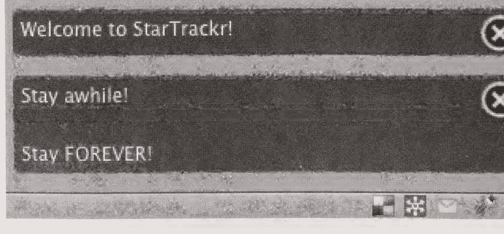

气泡的真正技巧在于 CSS。它负责处理定位对话框和使它们看起来非常酷的所有复杂工作。在 HTML 方面，我们只需要一个简单的容器：

```
chapter_07/19_growl_style_notifications/index.html（摘录）

<div id="growl"></div>
```

它需要能够被定位在页面右下角，以达到我们想要的效果。将其放在页脚或页面主容器元素之外是常见的做法。让我们应用一些基本的 CSS 来处理定位：

```
chapter_07/19_growl_style_notifications/style.css（摘录）

#growl {
  position: absolute;
  bottom: 0;
  right: 0;
  width: 320px;
  z-index: 10;
}
```

现在容器就位了，我们可以开始向其中添加消息气泡了。我们将创建一个简单的函数，该函数接受一个消息，将其包裹在一些结构中，并将其附加到我们定位好的气泡容器中：

```
chapter_07/19_growl_style_notifications/script.js（摘录）

function addNotice(notice) {
  $('<div class="notice"></div>')
    .append('<div class="skin"></div>')
    .append('<a href="#" class="close">close</a>')
    .append($('<div class="content"></div>').html($(notice)))
    .hide()
    .appendTo('#growl')
    .fadeIn(1000);
}
```

我们添加的结构包括一个容器元素，其中包含一个额外的 `div` 用于样式设置（我们用它将可见消息覆盖在半透明背景上）、一个关闭按钮和一个用于消息内容的容器。

关于这个函数还有另一点需要注意：我们传递给它的任何 HTML 都会被 jQuery 的 `$` 选择器包裹。这意味着我们可以传入纯文本、HTML 或 jQuery 对象，它们都会显示在框中。同样，你可以根据网站的需要随意设置样式——不过你需要给气泡容器设置 `position: relative`：

```
chapter_07/19_growl_style_notifications/style.css（摘录）

.notice {
  position: relative;
}

.skin {
  position: absolute;
  background-color: #000000;
  bottom: 0;
  left: 0;
  opacity: 0.6;
  right: 0;
  top: 0;
  z-index: -1;
  -moz-border-radius: 5px;
  -webkit-border-radius: 5px;
}

.close {
  background: transparent url('button-close.png') 0 0 no-repeat;
}
```

这将正确定位我们的气泡并给它们一些基本样式。在 `document-ready` 函数内，只需用一条消息调用 `addNotice` 函数，它就会淡入屏幕底部：

```
chapter_07/19_growl_style_notifications/script.js（摘录）

addNotice("<p>Welcome to StarTrackr!</p>");
addNotice("<p>Stay awhile!</p><p>Stay FOREVER!</p>");
```

你也可以传入图片，或者任何你喜欢的 HTML。当然，大多数时候你会想要显示用户交互或 Ajax 调用的结果——你只需在想向用户显示消息时调用 `addNotice` 即可。唯一的问题是……一旦气泡出现，它们就无法被移除——它们只会不断堆叠！让我们来修复这个问题：

我们不是直接将 `click` 处理程序添加到关闭按钮上，而是使用 `live` 函数来监听任何新添加的 `.close` 元素。这有助于我们将关闭代码分离出来，使所有内容保持清晰易读。现在剩下要做的就是处理实际的移除操作：

```javascript
// chapter_07/19_growl_style_notifications/script.js (excerpt)

// Remove the bubble
$(this)
  .closest('.notice')
  .animate({
    border: 'none',
    height: 0,
    marginBottom: 0,
    marginTop: '-6px',
    opacity: 0,
    paddingBottom: 0,
    paddingTop: 0,
    queue: false
  }, 1000, function() {
    $(this).remove();
  });
```

移除代码通过 `closest` 操作查找最近的父容器，并以一种吸引人的方式将其动画化至不可见。一旦它变得不可见，该容器就不再需要，因此我们将其从 DOM 中移除。`closest` 方法是 jQuery 的另一个 DOM 遍历操作，它具有一个很酷的功能：可以定位与你给定的选择器匹配的最近父元素——包括元素自身。

## 1-up 通知

又是周五下午，老板不在办公室。本周的冲刺工作已经完成，离办公室聚饮还有一个小时。这似乎是悄悄在网站上添加一个很酷小功能的绝佳时机。在整本书中，我们专注于为经过检验的控件注入活力并重现桌面效果，但 jQuery 最大的优势在于它能让你极其快速地尝试新效果。我们将发挥创意精神，制作一个直接源自 8 位电子游戏历史的通知机制：1-up 通知。

这个由网页开发者 Jeremy Keith 构思的通知方式，提供了一种非模态的反馈机制，向用户显示某个操作已发生。一个小消息（通常是一个单词）会出现在操作发生的地点，然后向上淡出并迅速消失——就像经典平台电子游戏中的得分通知一样！也许你会认为这个效果仅用于新奇价值——但它原来是一种非常令人满意且出奇细腻的方式来向用户传递信息。

既然是 jQuery，实现这个功能有很多方法。我们的方法是插入一个最初隐藏的新元素，将其定位在触发操作的元素的正上方居中位置。对于我们的触发器，我们使用一些简单的锚标签作为“添加到愿望清单”链当它们被点击时，一个写着“Adding”的通知将出现在链接上方，并在向上移动的同时快速淡出。动画完成后，按钮将变为“Added”，交互完成：

```html
<!-- chapter_07/20_1_up_notifications/index.html (excerpt) -->
<a class="wishlist" href="#">Add to wishlist</a>
```

我们要插入的消息元素将具有 `adding` 类——因此让我们确保当它们被添加时，它们是不可见且正确定位的：

```css
/* chapter_07/20_1_up_notifications/style.css (excerpt) */
.adding{
  position:relative;
  left:-35px;
  top:-4px;
  display:none;
}
```

当文档就绪后，我们就可以找到所有目标并为每个目标添加新的消息元素。当一个目标（具有 `wishlist` 类的元素）被点击时，我们调用一个自定义函数来启动我们的通知。

这个自定义函数接受当前对象的引用和一个在交互完成时运行的回调函数。该函数将通过 `prev` 操作将选择移至链接，并将其文本设置为“Added”：

```javascript
// chapter_07/20_1_up_notifications/script.js (excerpt)
$('<span>Adding</span>')
  .addClass('adding')
  .insertAfter('.wishlist');

$('.wishlist')
  .click(function(e) {
    doOneUp(this, function() {
      $(this).prev().text('Added');
    });
    e.preventDefault();
  })
```

我们的自定义函数此时对我们来说没有任何新内容：它只是移动到隐藏的 span 元素并显示它。现在消息对最终用户可见了。然后我们启动一个动画来调整 span 的 `top` 和 `opacity` 属性——以同时向上移动它并使其淡出：

```javascript
// chapter_07/20_1_up_notifications/script.js (excerpt)
function doOneUp(which, callback) {
  $(which)
    .next()
    .show()
    .animate({
      top: "-=50px",
      opacity: "toggle"
    },
    1000,
    function() {
      $(this)
        .css({top: ""})
        .hide(callback)
        .remove();
    });
}
```

## 传递回调函数

注意到示例中传递的 `callback` 变量了吗？我们将一个函数作为参数提供给 `doOneUp` 代码，但我们自己并不对它做任何处理；我们只是将其作为回调传递给 jQuery 的 `hide` 操作。当 `hide` 完成时，它将运行我们交给它的任何代码。在本例中，这是将链接文本从“Add to wishlist”更改为“Added”的代码。

这个效果令人印象深刻，但如果它可定制化，会更加有用，特别是在文本消息的定位方面；目前它是在 CSS 中硬编码的。最好将其设置为代码中的一个选项，并提供选项来选择消息移动的距离和速度。简而言之，这个效果作为插件会非常完美！你必须等到（或直接跳到）第 9 章才能学习如何做到这一点。

## 我们正步入正轨

构建可用的、无障碍且令人印象深刻的表单和界面控件是艰苦的工作，为了完成这项任务，我们必须使用手头的所有工具：HTML、CSS、JavaScript 和 jQuery。这是一个团队合作，作为开发者，我们需要意识到哪个工具适合这项工作。一旦我们弄清楚了这一点，那就无所顾忌了。表单和控件是 Web 应用程序开发的核心——所以这是一个令人兴奋的实验领域。在令人印象深刻、新颖和可用的交互之间取得平衡可能很棘手，但如果你做对了，你可以对人们使用和感知你网站的方式产生重大影响。

# 第 8 章

## 列表、树和表格

StarTrackr! 的人气刚刚飙升，原因是曝光了一个考虑不周的宣传活动，一位名人声称自己被困在一个意外被放飞的巨大气球里。幸运的是，这位名人碰巧是 StarTrackr! 上的“本周 B 级名人”，几位用户向媒体通报，他的追踪设备表明他实际上在当地一家高档水疗中心。

成群结队的新用户和充满好奇的传统媒体人士涌向该网站，形成了一股数据浪潮，网站的管理部门正疲于应对。我们的客户担心重要信息可能会被忽视，因为从当前非结构化的列表和表格数据中，几乎不可能提取出任何有意义的内容。

网站的管理区域传统上是最被忽视的；它不为普通大众所见，因此我们可以偷工减料，在可用性和用户体验方面少花心思。渐进增强和无障碍性等最佳实践都被抛在一边（通常是因为极其紧张的截止日期，注意！）。

但富互联网应用程序的兴起正在改变这一点。客户期望我们基于 Web 的系统在可用性和设计上能与他们的桌面应用程序相媲美。幸亏有 jQuery 在我们身边，这不成问题！

## 列表

列表是后表格布局时代网络中真正的无名英雄。当设计师们从专制的表格单元的束缚中解放出来时，他们开始寻找其他（语义正确的）方式来重建常见的用户界面元素，如菜单、导航面板、标签云等。一次又一次，当冗余的布局代码从底层数据中剥离出来时，剩下的就是一个列表！

StarTrackr! 网站已经拥有大量的列表：它们构成了我们的选项卡、手风琴、菜单、图片库等的基础——但我们还可以做更多来增强和提升这个不起眼的列表。

## jQuery UI 可选择项

海量的用户生成内容对我们的客户来说证明是个难题。成千上万的标签正从网站用户那里涌入——但现在法律部门表示，作为管理者，他必须手动批准每一个标签，以避免最近一次棘手诉讼的重演。

由于该网站采用了无限制的标签系统，列表中存在大量重复标签——而在当前系统下，这意味着大量的额外管理工作。客户真正想要的是一种可以轻松查看标签、选择它们（以及任何重复项）并点击按钮批准或拒绝它们的方法。

我们的攻击计划是在我们的列表中添加 jQuery UI 的 selectable 行为。使元素可选择赋予用户套选该元素任何子元素的能力：如果你点击一个元素，然后拖动到后续元素上，它们就会被高亮显示。然后你可以按照任何你认为合适的方式处理选择。非常适合管理无聊的列表！我们想要创建的行为如图 8.1 所示。

## 图 8.1. 可选列表项

除了套索选择，可选行为还允许您使用 **Ctrl** 键（就像在大多数桌面应用程序中一样）向列表中添加非连续项，甚至使用键盘导航选择。

> **让用户知情**

虽然能够通过点击和拖动在列表上进行选择非常酷且有用，但这只有在用户知道这种功能时才有意义！在网页上以这种方式进行选择是一种非标准的交互形式，因此您需要向用户提供说明，教他们如何使用您的新功能。

让我们看看标记代码。服务器输出了一长串标签，这是我们选择器网格的良好基础。我们还将添加一些按钮，允许用户批准或拒绝选择中的标签，以及一个重置选择的按钮：

```html
<ul id="tags">
  <li>bad singer</li>
  <li>old</li>
  <li>plastic surgery</li>
  <li>broke</li>
  :
</ul>
<button id="approve">Approve</button>
<button id="reject">Reject</button>
<button id="clear">Clear</button>
```

一个长长的列表有点令人生畏，所以我们使用一些基本的 CSS 将列表变成网格，并将每个标签转换为一个小方块。网格准备就绪后，我们必须将 jQuery UI 库添加到页面中。现在是时候让标签列表变得可选了：

```javascript
$("#tags").selectable();
```

启动浏览器查看一下。嗯……有什么变化吗？是的，有变化，但它不可见！`selectable` 方法通过向选中项添加 `class` 属性来工作，除非我们为这些类分配样式，否则我们将看不到任何变化。如果您在选择时使用 Firebug 检查列表项，您将看到变化的发生。让我们尝试为选中的元素添加样式：

```css
#tags .ui-selecting {
  background: #FEFF9F;
}

#tags .ui-selected {
  background-color:#eEeF8F;
}
```

`ui-selecting` 类在用户正在选择元素的过程中应用，而 `ui-selected` 类在用户停止选择时立即添加。如果您现在尝试，您将看到可以套索一些方块。这是一种相当自然的交互——这正是您希望页面组件所具备的。您也可以在按住 **Ctrl** 键的同时单击以选择单个项目。

我们接下来要做的任务是处理重复的标签。在标签系统中，每个术语的标签数量很重要——因此我们不是简单地删除重复项，而是编写一些代码来选择与用户选择匹配的所有标签。例如，如果他们点击“A-lister”，所有“A-lister”标签都将被高亮显示。

我们需要知道可以从 jQuery UI 组件中挂钩哪些事件。查阅文档¹，我们发现我们可以捕获 `start`、`stop`、`selecting`、`unselecting`、`selected` 和 `unselected` 事件。我们本可以捕获 `selecting` 事件——并在用户移动鼠时移除重复项——但这可能会有点混乱。我们将坚持使用 `stop` 事件，该事件在用户完成选择后立即触发：

```javascript
$('#tags').selectable({
  stop: function() {
    // The user stopped selecting!
  }
});
```

现在我们可以开始寻找重复标签了。我们的总体方法是创建一个用户所选所有标签的列表，然后在更大的标签列表中搜索这些标签的任何重复项：

```javascript
var names = $.map($('.ui-selected', this), function(element, i) {
  return $(element).text();
});

$('li', this)
  .filter(function() {
    if ($.inArray($(this).text(), names) != -1) {
      return true;
    } else {
      return false;
    };
  })
  .addClass('ui-selected');
```

为了找到重复项，我们借助了一系列新的 jQuery 功能，所以请做好准备！

其中第一个是最奇特的：`$('.ui-selected', this)`。这看起来像一个常规的 jQuery 选择器，但有第二个参数。事实上，jQuery 选择器的完整定义实际上是 `$(expression, context)`——我们只是省略了第二个参数。上下文定义了 jQuery 在哪里查找您的选择器；默认情况下它在页面的任何地方查找——但通过指定我们的无序列表作为上下文，表达式将仅限于列表内的元素。

## $.map 和 $.inArray

接下来我们使用几个 jQuery 实用方法：`$.map` 和 `$.inArray` 来处理列表项。jQuery 提供的实用方法大多用于处理 JavaScript 数组——而这正是我们现在要做的。首先我们创建一个名为 `names` 的数组，使用 `$.map` 方法填充它。

`$.map` 方法允许您获取数组中的每个元素，以某种方式处理它，并将结果作为新数组返回。当您想以相同方式转换每个元素时使用它。我们想将 jQuery 选择转换为简单的标签文本列表——因此我们传入选择，并定义一个匿名函数来返回每个元素的文本。看：一个标签文本的数组！

接下来，我们再次使用上下文技巧来检索所有列表项元素，并根据它们是否是重复项进行过滤。我们的 `filter` 函数使用 `$.inArray` 实用方法，该方法在数组（但只能是普通的 JavaScript 数组——不幸的是不是 jQuery 选择）中搜索指定的值。给定一个数组和一个搜索项，如 `$.inArray(value, array)`，它将返回该值在数组中的索引。有用的是，如果值*未*在数组中找到，它将返回 -1。请记住 `filter` 期望我们返回 `true` 或 `false`——因此我们只需检查 `$.inArray` 是否返回 -1，并相应地返回 `true` 或 `false`。以这种方式使用 `filter` 允许我们在标签文本数组中搜索每个列表项的文本——如果它在其中，它就是重复项，因此我们将其返回给过滤器以进行选择。

## 访问数据

现在我们可以进行选择了，我们如何使用它们？jQuery UI Selectable 组件使用类名，我们也将如此。要获取所选值的列表，我们只需搜索具有 `ui-selected` 类的项目：

```javascript
$('#approve').click(function() {
  $('#tags')
    .find('.ui-selected')
    .addClass('approve')
    .removeClass('ui-selected reject');
});

$('#reject').click(function() {
  $('#tags')
    .find('.ui-selected')
    .addClass('reject')
    .removeClass('ui-selected approve');
});

$('#clear').click(function() {
  $('#tags')
    .find('li')
    .removeClass('ui-selected approve reject');
  $('#approved').val('');
});
```

我们只是在用户点击按钮时添加 `approve` 或 `reject` 类——同时也确保移除 `ui-selected` 类，因为我们希望已批准的标签与选中的标签样式不同。

但如果我们想，比如说，将这些信息发送到服务器呢？也许最好将已批准标签的列表存储在隐藏的表单字段中，以便服务器可以访问它进行处理。让我们更新 `#approve` 单击处理程序，以遍历已批准的项目，并将每个项目的索引以简单的管道分隔格式附加到隐藏字段：

```javascript
$('#approve').click(function() {
  var approvedItems = "";
  $('#tags')
    .find('.ui-selected')
    .addClass('approve')
    .removeClass('ui-selected reject')
    .each(function() {
      approvedItems += $(this).index() + "|";
    });
  $('#approved').val(approvedItems);
});
```

我们还将向 `#clear` 按钮单击处理程序添加一行以清除该输入的值：

```javascript
$('#approved').val('');
```

感谢 `index` 方法，我们现在知道列表中哪些项目已被批准。`index` 将告诉您一个项目在其父元素内的位置。我们的控件令人印象深刻，因为它使用起来非常简单。jQuery UI 可选行为在幕后做了大量工作以允许列表变得可选——但最终结果是一个感觉自然的组件，这正是我们想要的。

## 排序列表

标签系统控制住了，现在是时候处理管理部分中散布的其他列表了。其中许多列表是服务器按照它们输入系统的顺序填充的。这对于查看

新内容不少，但找特定项目却很麻烦。我们的客户要求在管理部分的所有列表中加入排序功能，这样他只需点击按钮，就能按字母升序或降序排列列表。

我们将处理的标记是一个简单的无序列表，由链接组成：

```
chapter_08/02_sorting_lists/index.html (节选)

<ul class="sortable">
  <li><a href="#">Beau Dandy</a></li>
  <li><a href="#">Glendatronix</a></li>
  <li><a href="#">BMX Spandex Corporation</a></li>
  <li><a href="#">Maxwell Zilog</a></li>
  <li><a href="#">Computadors</a>
</ul>
```

jQuery 对象本身没有任何内置的排序功能。这很合理；一个选择集可能包含位于页面不同位置的不同类型的元素，因此无法以一致的方式对它们进行排序。所以，要对我们的 jQuery 选择集进行排序，我们需要借助一些 JavaScript 数组方法。jQuery 选择集实际上不是数组，但它们是“类数组”的，并且允许我们在其上使用 JavaScript 的 `sort` 函数。

我们将尝试构建一个可复用的列表排序小部件。我们称之为 `SORTER`，我们会调用 `SORTER.sort(list)` 来将列表按升序排序，调用 `SORTER.sort(list, 'desc')` 来按降序排序。我们假设传入的选择器会匹配有序或无序列表，但让我们看看是否能做到：

```
chapter_08/02_sorting_lists/script.js (节选)

var SORTER = {};
SORTER.sort = function(which, dir) {
  SORTER.dir = (dir == "desc") ? -1 : 1;
  $(which).each(function() {
    // 查找列表项并进行排序
    var sorted = $(this).find("> li").sort(function(a, b) {
      return $(a).text().toLowerCase() > $(b).text().toLowerCase() ?
        SORTER.dir : -SORTER.dir;
    });
    $(this).append(sorted);
  });
};
```

这段代码看似简短，但实际上做了很多事！首先，我们检查传入的 `dir` 参数是否是 `desc`，并据此设置 `SORTER.dir` 变量。我们只需要获取所有第一级子列表元素并对它们进行排序。我们只想要第一级的项；如果我们获取更深层的项，它们也会被排序并被拖拽到父级。因为调用 `sort` 会将我们的选择集转换为原始的 JavaScript 对象，所以我们需要重新用 `$()` 包裹它们，以便能够调用 jQuery 的 `text` 方法并比较它们的值。我们还将值转换为小写——这使得排序不区分大小写。

> **sort 函数**

`sort` 函数是纯粹的 JavaScript：它根据你传入的函数的结果对数组进行排序。`sort` 会遍历数组的内容，并将它们成对地传递给你的函数。如果你的函数返回 `1`，`sort` 就会交换这两个项目的位置，把第二个放在前面。如果你的函数返回 `-1`，JavaScript 就会保持第一个项目在前。最后，如果你的函数返回 `0`，`sort` 会认为这两个项目相等，不进行排序。

我们使用了一点技巧，以便使用同一个函数进行升序和降序排序：我们根据方向将 `SORTER.dir` 变量设置为 `-1` 或 `1`。然后在 `sort` 的比较函数中，我们进行进一步计算：如果 `a` 小于 `b`，我们就返回 `-SORTER.dir`。如果方向是 `-1`，我们将其处理为 `-(-1)`，即 `1`——因此，如果我们要降序排序，返回值就会被交换。

一旦我们对项目进行了排序，就可以将它们按正确的顺序重新插入列表中。记住，`append` 函数会先移除元素——所以它会移除该项目，然后将其附加到正确的位置。

为了测试它，我们将在 HTML 中添加一些按钮，并从它们的点击事件处理程序中调用 `SORTER.sort`：

```
$('#ascending').click(function() {
    SORTER.sort('.sortable');
});
$('#descending').click(function() {
    SORTER.sort('.sortable', 'desc');
});
```

## 操作选择框列表

尽管我们在上一章介绍了表单，但现在还有时间在列表的上下文中看看某些表单元素。这里我们将研究 select 元素，特别是那些带有 `multiple="multiple"` 属性的（即显示为可选项目列表的选择框）。

## 交换列表元素

StarTrackr! 的客户要求我们改进管理功能，以便将名人分配到 A 级名单。当前功能包括两个 select 元素：一个包含 A 级名人，另一个包含系统中的所有其他名人。但流行的世界是极其善变的——今天的 A 级明星明天可能就无人知晓了。所以客户希望能够轻松地在每个列表之间交换名人。我们将向界面添加一些控件让他实现这一点，如图 8.2 所示。

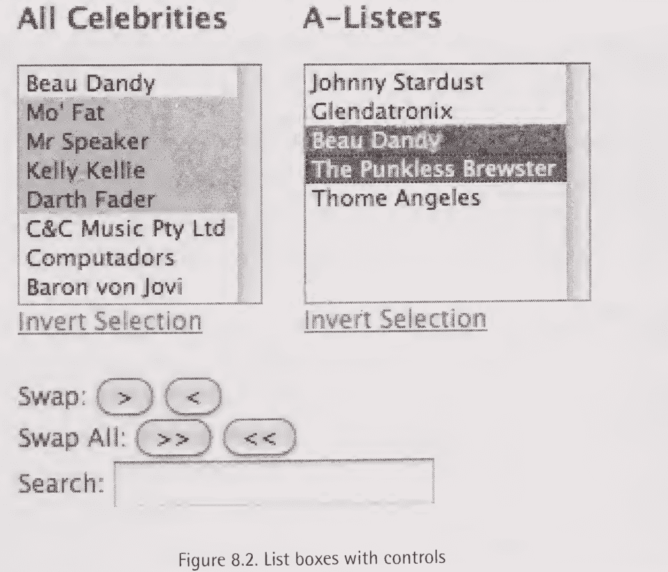

这是我们将要处理的 HTML，包含两个 select 元素和一些用于执行各种操作的按钮：

```
chapter_08/03_select_lists/index.html (节选)
<select id="candidates" multiple="multiple" size="8">
    <option value="142">Beau Dandy</option>
    …
</select>
<select id="a-listers" multiple="multiple" size="8">
    <option value="232">Johnny Stardust</option>
    …
</select>
<div id="controls">
    <input type="button" id="swapLeft" value="&gt;" />
    <input type="button" id="swapRight" value="&lt;" />
    …
</div>
```

如前所述，客户希望能够在列表之间交换选中的项目。我们将创建一个 `SWAPLIST` 对象，其中包含我们将构建的所有功能。然后，任何时候我们需要操作 select 元素时，都可以重用它：

```
chapter_08/03_select_lists/script.js (节选)
var SWAPLIST = {};
SWAPLIST.swap = function(from, to) {
    $(from)
        .find(':selected')
        .appendTo(to);
}
```

我们定义了一个 `swap` 函数，它接受两个目标列表的选择器字符串：一个源列表和一个目标列表。我们要做的第一件事是获取当前被选中的任何项目。我们可以使用带有 `:selected` 表单过滤器的 `find` 操作来实现。此过滤器将返回所有设置了 `selected` 属性的表单元素。然后我们可以用 `appendTo` 将选择项移动到目标列表。很简单！一旦我们定义了这个功能，我们就可以通过在适当的点击处理程序中调用 `swap` 方法，将其应用于任何两个列表：

```
chapter_08/03_select_lists/script.js (节选)
$('#swapLeft').click(function() {
    SWAPLIST.swap('#candidates', '#a-listers');
});
```

```
$('#swapRight').click(function() {
  SWAPLIST.swap('#a-listers', '#candidates');
});
```

现在选中的项目可以随意来回交换了！让我们为 `SWAPLIST` 对象添加更多功能。交换*所有*元素怎么样？这更容易：

```
chapter_08/03_select_lists/script.js (节选)

SWAPLIST.swapAll = function(from, to) {
  $(from)
    .children()
    .appendTo(to);
}
```

我们只需获取所有子元素（而不仅仅是选中的元素），并将它们附加到目标的底部——整个列表就会从源列表跳转到目标列表。

## 反转选择

客户的下一个请求是添加一个按钮来反转当前选择，以便他的员工在处理大量选择时更容易操作。点击此链接时，目标列表中所有当前选中的项目都将变为未选中，反之亦然。让我们在 `SWAPLIST` 对象中创建一个实现此功能的函数：

```
chapter_08/03_select_lists/script.js (节选)

SWAPLIST.invert = function(list) {
  $(list)
    .children()
    .attr('selected', function(i, selected) {
      return !selected;
    });
}
```

我们所要做的就是检索每个列表项并交换其 `selected` 属性。我们使用 `attr` 函数将我们的列表项设置为 `!$(this).attr('selected')`。JavaScript 的 NOT (`!`) 运算符（感叹号）会反转布尔值，所以如果值是 `true`，它就变成 `false`，如果值是 `false`，它就变成 `true`！

## 使用函数参数调用 attr

这是一个很棒的技巧：我们使用了 `attr` 操作——但这不是我们惯用的那个版本。之前我们使用 `attr(key, value)` 操作来为属性设置静态值，但 `attr` 也允许我们传入一个函数来决定值。这个函数会被传入两个参数：元素的索引和它当前的值。函数的返回值将成为属性的新值。对于我们的 `invert` 方法，我们返回元素当前选中值的相反值——这样每个元素就被切换了。我们可以用一系列命令进行这种动态处理：`text`、`html`、`val`、`addClass`、`wrap`……还有很多！

## 搜索列表

在不得不听客户抱怨找不到他想选的名人有多难之后，你决定附赠一个小功能：一个快速搜索功能，让他输入几个字符，就能自动选择所有匹配的元素：

```
chapter_08/03_select_lists/script.js（节选）

SWAPLIST.search = function(list, search) {
  $(list)
    .children()
    .attr('selected', '')
    .filter(function() {
      if (search == '') {
        return false;
      }
      return $(this)
        .text()
        .toLowerCase()
        .indexOf(search) > -1
    })
    .attr('selected', 'selected');
}
```

这是怎么回事？首先，我们获取所有列表项，然后通过将 `selected` 设置为空字符串来清除之前的任何选择。接下来，我们使用 `filter` 操作来查找我们正在搜索的任何元素。

`filter` 操作接受一个函数作为参数，并对选择中的每个 jQuery 对象运行该函数。如果函数返回 `true`，该元素就保留在选择中。但如果函数返回 `false`——它就消失了……不在选择中，不受后续处理的影响。

为了找到我们关心的元素，我们检查它们包含的文本是否包含我们正在寻找的文本。为此，我们使用 `text` 操作来获取一个字符串。我们将其转换为小写（这样搜索将不区分大小写），并检查我们的源文本是否位于元素字符串中。JavaScript 的 `indexOf` 方法会查找一个字符串在另一个字符串中的位置；例如，"hello".indexOf('ll'); 将返回 2（索引从 0 开始，通常如此）。如果未找到子字符串，`indexOf` 将返回 -1，这正是我们在这里检查的内容。

在 `filter` 函数运行后，保留在 jQuery 选择中的任何元素都必须包含我们正在寻找的关键词——因此我们再次使用 `attr` 方法来选择它们。

要使用我们创建的搜索方法，我们可以将其附加到一个 `click` 处理器上——这样用户输入一个词，然后点击搜索按钮。更好的是将 `keyup` 处理器附加到 `input` 本身，这样当你打字时它就会进行选择：

```
// chapter_08/03_select_lists/script.js（节选）
$('#search').keyup(function() {
  SWAPLIST.search("#a-listers, #candidates", $(this).val());
});
```

## 树

"这又是一团糟。我们有几个名人子类别……你知道，A 级名人是乐队成员，或者因为父母有钱而出名；B 级名人在某个真人秀比赛中得了第二名，诸如此类。现在他们都在一个大列表里。我需要看到这些类别是如何相互嵌套的！你能构建点东西来帮我吗？"

客户说的是一棵树。树在网页上很少见，原因有两个：很难做好，而且很少有适用场景。然而，一组嵌套的类别*是*树结构的一个有效用例（一个更常见的例子是表示目录结构），所以让我们深入了解一下！

## 可展开的树

关于树的秘密在于：它们其实就是嵌套列表！在 jQuery 中处理树的关键是确保你的 HTML 结构一致——这样我们才能弄清楚我们在哪里，并打开和关闭正确的分支。我们将构建的控件看起来像图 8.3 中的那样。我们特意保持了样式的简洁，但一如既往，提升外观的潜力仅受你的 CSS 技能限制！

-   A 级名人

    - 在成功的乐队中

        - Computadors

        - The Great Apes

        - Bosom

    - 在电影或电视中

    - 因为富有而出名

        - 著名的父母

        - 网络百万富翁

- B 级名人

- C 级名人

- 后起之秀

图 8.3. 树

我们标记中重要的部分是包含每个类别（或目录）名称的 span。我们将使用这个 span 作为插入一个小加号/减号图形的基础——作为分支开关。以下是我们将要使用的一个标记子集：

```
chapter_08/04_expandable_tree/index.html（节选）

<ul id="celebTree">
  <li><span>A-list Celebrities</span>
    <ul>
      <li><span>In a successful band</span>
        <ul>
          <li>Johnny Stardust</li>
          <li>Glendatronix</li>
        </ul>
      </li>
      :
      <li><span>Famous because they're rich</span>
        <ul>
          <li><span>Dot-Com millionaires</span>
            <ul>
              <li>Joel Mynor</li>
              :
            </ul>
```

树可以按需嵌套任意深度——只需在相应的子列表项内重复结构即可。因为它既好又一致，你可以轻松地在服务器端生成 HTML。

页面上有了列表后，下一步就是用一些 CSS 来美化它。这由你负责，但我们的代码会添加一些额外的类，你可以用来自定义显示。handle 类将被分配给我们将插入的元素，用作开关手柄。当树的分支打开时，它会获得 opened 类；否则它将具有 closed 类。我们在下面使用这些类来添加一个 CSS 雪碧图，它将在加号和减号之间切换：

```
chapter_08/04_expandable_tree/script.js（节选）

.handle {
  background: transparent url(tree-handle.png) no-repeat left top;
  display:block;
  float:left;
  width:10px;
  height:10px;
  cursor:pointer;
}
.closed { background-position: left top; }
.opened { background-position: left -10px; }
```

树的代码非常简单，这得益于树的递归特性：我们只需要一小段代码，并将其附加到每个子类别上。我们创建展开/折叠树效果的行动计划是首先隐藏所有嵌套的 ul 类别。然后我们将在类别标题前添加一个新元素，该元素包含一个点击事件处理器——这将打开和关闭其分支：

```
// chapter_08/04_expandable_tree/script.js（节选）
$('#celebTree ul')
  .hide()
  .prev('span')
  .before('<span></span>')
  .prev()
  .addClass('handle closed')
  .click(function() {
    // 加号/减号手柄点击
  });
```

六个链式操作。我敢打赌你现在能感受到 jQuery 的一些威力在你的血管中流淌！这里我们看到一致的标记如何帮助我们：在每个子类别列表中，我们查找前一个 span 元素——那就是子类别标题。然后我们在标题前插入一个新的 span 元素。

因为我们的手柄是在标题之前添加的，我们需要用 prev 操作回到它。我们给它添加 handle 和 closed 类（由于 hide 操作，默认是关闭的），并为其添加一个点击时的事件处理器。

在这个阶段，树将完全折叠，我们全新的手柄被置于标题之前。剩下的就是在我们点击它时切换分支：

```
// chapter_08/04_expandable_tree/script.js（节选）
// 加号/减号手柄点击
$(this)
  .toggleClass('closed opened')
  .nextAll('ul')
  .toggle();
```

当手柄被点击时，我们用 toggleClass 切换 closed 和 opened 类。如果你用 toggleClass 指定多个类名，元素上任何指定的已存在的类都会被移除，任何不存在的类则会被添加。

## 高级 toggleClass

`toggleClass` 的另一个巧妙技巧是它接受第二个参数：一个布尔值，指定是否应该添加或移除 `class`。这可能听起来很奇怪，但它是一个不错的快捷方式。考虑这段代码：

```
if (x == 1) {
    $(this).addClass('opened');
} else {
    $(this).removeClass('opened');
}
```

使用 `toggleClass(class, switch)` 语法，我们可以用以下简洁的语法替换 `if` 语句：

```
$(this).toggleClass('opened', x == 1);
```

找到需要打开和关闭的子类别很容易，这要归功于 `nextAll` 操作。jQuery 将检查下一个兄弟节点，看到它是一个 span 元素（类别标题），根据我们的表达式将其过滤掉，然后移动到下一个兄弟节点……那是一个 ul 项。搞定！我们只需切换这个，树就会摆动打开和关闭。

## 事件委托

**事件委托**是一个适用于各种场合的主题，但如果你正在处理大型树结构，它尤为重要。其理念是，你不对树中的每个节点应用单独的事件处理器，而是应用一个事件处理器来拦截点击——然后弄清楚点击的对象是谁，并运行相应的操作。

如果你一直仔细跟随，这可能听起来有点熟悉。我们在第 6 章名为“为未来做准备：live 和 die”的一节中介绍了 `live` 方法。`live` 为你处理事件委托——这是使其成为可能的魔法——但它带有一个你需要意识到的潜在陷阱。

为了更好地理解事件委托的工作原理及其重要性，让我们实际使用一下。我们将从以下 HTML 开始，它以分类列表的形式显示我们的产品：

## 事件委托

当用户点击某位名人时，其选择应以“类别 > 名人”的格式显示在列表上方，如图 8.4 所示。那么，捕获此信息的最佳方式是什么？

如果我们为每一个列表项都添加一个`click`事件处理程序——`$('#picker li').click(...)`——最终可能会得到数百个处理程序。这将严重影响性能，因为浏览器需要跟踪所有这些处理程序，并在页面发生点击时逐一检查。通过事件委托，我们将唯一的事件处理程序添加到列表的父元素上，然后通过访问事件的目标来确定实际被点击的元素。事件的 target 属性是实际的 DOM 元素——因此需要将其包装在 jQuery 选择器中以获取 jQuery 对象：

```javascript
$('#picker').click(function(e) {
  $('#current').text($(e.target).text());
});
```

我们的列表表现得仿佛每个项目都有自己的处理程序！这很好，但之前提到的注意事项是什么？事件委托之所以有效，是因为事件冒泡（我们在第 5 章“事件传播”一节中已探讨过）——事件会向上冒泡，直到被我们的父处理程序捕获。问题出现在，如果某个处理程序在父元器之前捕获了事件，并阻止了事件传播（使用`e.stopPropagation`或“return false”）。如果事件在向上传播途中被停止，事件委托将会失败！这就是为什么了解事件在底层如何被处理很重要——这将为您在处理其他难以理解的错误时节省大量麻烦。

我们用一个处理程序处理了所有点击，但现在需要更多地了解元素所在的位置。具体来说，如何找出元素属于哪个类别？试试这个：

```javascript
// chapter_08/05_event_delegation/script.js (摘录)

$('#picker').click(function(e) {
  var celebrity = $(e.target).text();
  var category = $(e.target)
    .closest('.category')
    .find('.title')
    .text();
  $('#current').text(category + " > " + celebrity);
});
```

我们请求`closest`方法查找最近的具有`category`类的元素。如果元素本身没有该类，`closest`会检查其父元素……依此类推，直到找到匹配的元素。这省去了我们编写冗长的`parent().parent().parent()`链，也让我们在 HTML 结构上更灵活。

## 表格

如果说 HTML 列表是网络新世界的无名英雄，那么表格就是那个最终改邪归正的坏孩子。表格本身从未有过错——多年来我们为了以合理的跨浏览器方式布局网页设计而误用并滥用了它们。但那是 CSS 的职责，不是可怜的老表格的。如今 CSS 已经成熟，我们终于可以回归表格的初衷：仅用于显示表格数据。

StarTrackr! 有大量数据要展示。数据多到几乎失控：表格变得过于庞大且难以阅读，信息没有分页或排序机制，也无法轻松编辑信息。我们在第 2 章看到过为表格添加斑马条纹和行高亮是多么容易；这能让我们快速取得一些成效，但要解决更严重的表格问题，我们需要 jQuery 的一些额外帮助。

### 固定表头

表头行至关重要：没有它，你将面对一堆毫无意义的数据。但如果你处理的是大量行，你会发现表头变得越来越没用，因为它们会滚动到视线之外，被抛在脑后。分页通常能解决这个问题——但如果你需要在一页上同时显示所有数据，就必须考虑其他选项。

将表头行固定在表格顶部是跟踪各列内容的有效方式，而且看起来真的很酷！当用户滚动表格以显示新数据时，表头会随之移动。你可以在图 8.5 中看到实际效果。

| Id | Name | Occupation | Approx. Location | Price |

|---|---|---|---|---|

| 1031 | Mo Tat | Producer | New York | $13.95 |

| 007F | Kellie Kelly | Singer | Omaha | $11.95 |

| 8A05 | Darth Fader | DJ | London | $19.95 |

如果你的表格是页面上的唯一元素，可以使用`position: fixed`来固定`thead`元素。然而，`position: fixed`只能相对于视口定位元素，而不是其包含元素。这意味着对于包含在其他元素内的表格（几乎总是如此），我们需要求助于 jQuery。

让我们看看如何实现这个效果。我们的标记与我们在第 2 章添加斑马条纹的名人表格相同：

```html
<!-- chapter_08/06_fixed_table_headers/index.html (摘录) -->

<table id="celebs">
  <thead>
    <tr>
      <th>Id</th>
      <th>Name</th>
      <th>Occupation</th>
      <th>Approx. Location</th>
      <th>Price</th>
    </tr>
  </thead>
  <tbody>
    :
  </tbody>
</table>
```

移动`thead`比较棘手。有些浏览器允许你随意移动它，而在其他浏览器中，它对样式化出奇地顽固。因此我们将采用一个技巧：我们将以无序列表的形式复制`thead`的内容，并样式化使其看起来与`thead`完全一样。然后我们给它`position: absolute;`，并在用户滚动时在屏幕上移动它。

我们首先创建一个`TABLE`部件来保存我们的代码，其中包含一个用于固定表头效果的`fixHeader`方法。该方法将期望接收一个指向页面上表格的选择器字符串。我们首先将一些选择结果存储在变量和`data`中，以加速后续代码：

```javascript
// chapter_08/06_fixed_table_headers/script.js (摘录)

var TABLE = {};

TABLE.fixHeader = function(table) {
  $(table).each(function() {
    var $table = $(this);
    var $thead = $table.find('thead');
    var $ths = $thead.find('th');
    $table.data('top', $thead.offset().top);
    $table.data('left', $thead.offset().left);
    $table.data('bottom', $table.data('top') + $table.height() - $thead.height());
  });
};
```

我们首先声明一个闭包来保持部件的上下文。然后我们选择与传入方法的选择器匹配的所有表格。我们用`each`循环遍历它们，并存储对表格本身（`$table`）、`thead`（`$thead`）及其包含的`th`元素集合（`$ths`）的引用。最后，我们存储`$thead`的 left 和 top 偏移量，以及表格底部的位置（以避免表头移动到底部之外！）。

> **编写基于选择器的函数时使用 `each`**

>

> 编写这类实用函数时，应始终预见到你的选择器可能返回多个元素的可能性。在我们的例子中，页面上只有一个表格，因此如果省略`each`循环，方法也能正常工作。但为了着眼于未来并使我们的代码可重用，我们仍然包含了循环；即使表格选择器返回多个表格，我们的函数也能优雅地处理它们。

接下来，我们创建假表头——一个`ul`——并复制表格表头的内容：

```javascript
// chapter_08/06_fixed_table_headers/script.js (摘录)

var $list = $('<ul class="faux-head"></ul>');
$ths.each(function(i) {
    _th = $(this);
    $list.append($('<li></li>')
        .addClass(_th.attr('class'))
        .html(_th.html())
        .width(_th.width())
        .click(function() {
            _th.click()
        })
    ).hide().css({left: $table.data('left'),top: $table.data('top')});
});
$('body').append($list);
```

将真正的`th`元素收集到`$ths`后，我们使用`each`操作遍历每个元素并制作我们的模仿者。我们复制原始元素的类、HTML 内容、宽度和点击事件处理程序。在我们简单的示例中，有些复制是不必要的，但有备无患总是好的！在列表完全填充后，我们将其隐藏并直接定位在真正的`thead`之上，然后将其插入页面。

#### 尽可能减少 Append 操作

你可能想知道为什么我们要等到列表完全构建好才将其附加到页面。虽然先将列表附加到页面，然后依次将每个项目附加到列表中也能达到相同的效果，但我们要选择的方法在浏览器中执行速度更快得多。

每次你向 DOM 插入一个新元素时，浏览器都需要重新计算页面上每个元素的位置。如果你这样做很多次（尤其是在循环中！），你的脚本可能会变得非常慢。我们上面使用的方法——将新元素存储在变量中，按需处理它们，然后一次性全部附加——确保了最佳性能。

现在我们的`thead`模仿者已妥善就位，我们需要响应滚动事件并适当地定位它：

## 重复表头

解决表头行消失问题的另一种方法，是简单地每隔一段距离重复表头一次。这在数据需要打印出来时特别方便——因为尽管动画表头看起来很酷，但当你需要翻阅十几页打印的表格时，它就毫无用处了！其目标是获取表格的第一行，然后每隔大约十行就复制一次。

结果显示在图 8.6 中。

| Id    | Name                 | Occupation | Approx. Location | Price  |

| :--- | :--- | :--- | :--- | :--- |

| 203A  | Johny Stardust (bio) | Front-man  | Los Angeles      | $39.95 |

| 6636  | Glendatronix         | Keytarist  | London           | $39.95 |

| 141B  | Beau Dandy (pic)     | Singer     | New York         | $39.95 |

| 2031  | Mo' Fat              | Producer   | New York         | $19.95 |

| 007F  | Kellie Kelly         | Singer     | Omaha            | $11.95 |

| 8A05  | Darth Fader          | DJ         | London           | $19.95 |

| 203A  | Johny Stardust (bio) | Front-man  | Los Angeles      | $39.95 |

| 6636  | Glendatronix         | Keytarist  | London           | $39.95 |

| 141B  | Beau Dandy (pic)     | Singer     | New York         | $39.95 |

| 2031  | Mo' Fat              | Producer   | New York         | $19.95 |

| Id    | Name                 | Occupation | Approx. Location | Price  |

| 007F  | Kellie Kelly         | Singer     | Omaha            | $11.95 |

| 8A05  | Darth Fader          | DJ         | London           | $19.95 |

图 8.6. 重复表头


复制表头行并将其放置在其他地方，到现在对你来说应该已经是老生常谈了。但是，我们究竟如何每十行添加一次表头呢？我们是否要遍历每一行并检查其索引？嗯，我们当然可以……但 jQuery 再次以其强大的内置过滤器拯救了我们：

```javascript
$('#celebs')
    .find('tr:first')
    .clone()
    .insertAfter('#celebs tr:nth-child(10n)');
```

这个解决方案的开始部分很简单——获取表格的第一行，然后用 `clone` 方法克隆它。接下来是巧妙的部分：**nth-child** 选择器非常适合将行添加到我们想要的确切位置。不过，你可能对我们的使用方式有点困惑，因为它的语法与其他过滤器略有不同。

在最基本的形式中，如果你给它一个简单的整数，它将选择该索引处的元素。例如，如果你选择 `:nth-child(2)`，你将获得第三个子元素。

但是 `:nth-child` 选择器也接受其他值，这会导致它同时选择多行。如果你传入文本值 **even** 或 **odd**，你将选择所有偶数或奇数子元素。最酷的是，你可以传递一个等式来计算要选择哪些子元素！

你可以使用字母 "n" 来表示重复；例如，`:nth-child(10n)` 将选择每第十行。然后你可以用加号或减号来调整选择哪些行。例如，如果你想选择第三行，以及之后的每一行，你可以使用 `:nth-child(10n+3)`。最后，如果你喜欢逆向思考，你可以用 `:nth-child(10n-7)` 达到相同的结果。

这一切都运行良好，但它有一个缺陷：如果表格的最后一行符合我们的等式，表头行将作为最后一行被重复——这看起来有点奇怪。此外，我们希望将重复表头应用于多个表格，并且希望避免复制/粘贴代码。下一章，我们将探讨如何通过插件使我们的代码可重用——但现在，我们将保持简单，使用一个可靠的 widget 对象：

```javascript
var TABLE = {};

TABLE.repeatHeader = function(table, every) {
  $(table).each(function() {
    var $this = $(this);
    var rowsLen = $this.find('tr:not(:first)').length;

    $(this).find('tr:first')
      .clone()
      .insertAfter($this.find('tr:nth-child(' + every + 'n)'));

    if ((rowsLen) % every === 0) {
      $this.find('tr:last').remove();
    }
  });
}
```

我们创建了一个函数，它接受表格的选择器字符串，以及一个数字，该数字表示在每次重复表头之间要留出多少行。然后我们遍历选择器找到的每个元素（因此我们的函数可以应用于同一页面上的多个表格）。对于每个项目，我们设置一个指向 `$(this)` 元素的快捷方式，并获取表格中的行数。提前存储行数很重要，因为当我们重复表头时，行数将会改变！

接下来是核心工作：我们复制第一行（如前所述），并将其插入到每隔“第 n”行。这需要稍作重写，使用 `find` 操作，以便它可以应用于选择器匹配的多个表格——但除此之外，它与我们的第一次尝试完全相同。代码的最后一部分做了一点数学运算，以确定我们是否在表格的最后一行添加了表头；如果总行数能被我们的重复数字整除，我们就需要删除最后一行。

## 数据网格

“这些对管理部分的改动真是太好了，”我们的客户用一种“大要求来了”的语气说道，“但是如果我们能替换掉市场经理使用的旧桌面应用程序就更好了。它连接到同一个数据库，但它让她可以对数据进行排序和移动，以及编辑不同的单元格——所有这些都在同一个页面上完成！不过我猜那是不可能的，对吧？”

当然，他已经给我们来了一手“激将法”，但每次都奏效。“当然有可能！”你笑道，看着他正在演示的那个老旧的 Windows 应用程序。“事实上，我可以做得更好——这只是一个关于采用……”

“太好了！”客户说着，拍了拍你的背。“等你能让我们看看的时候告诉我。”说完他就走了——又去参加他的某个“商务会议”了。回头看着那个应用程序，你意识到，是的，你确实可以做得更好。你需要做的是将我们简单的表格转换为数据网格。

对于什么构成数据网格没有固定的定义，但是一些常见功能包括排序、过滤、搜索、分页、列大小调整和行编辑。让我们来尝试分页和行内编辑。

## 分页

在网站上遇到一个巨大的长表格可能会很吓人——尤其是在屏幕空间如此宝贵的今天。为表格添加分页功能可以让我们一次显示一小部分数据，同时允许用户通过导航按钮轻松浏览。

分页通常由服务器处理。用户可以请求特定的数据页面，服务器将返回该页面。这对于海量数据来说很有意义：如果你将 10,000 行表格行加载到浏览器中，它可能会变得有点迟缓。但对于较小的数据集，将所有内容一次加载到页面上是有意义的；所有数据都存储在本地，并且当用户想要浏览数据时，每次都不需要刷新。我们的 jQuery 分页小部件如图 8.7 所示。

| Id    | Name                 | Occupation | Approx. Location | Price  |
|---|---|---|---|---|
| 203A  | Johny Stardust (bio) | Front-man  | Los Angeles      | $39.95 |
| 6636  | Glendatronix         | Keytarist  | London           | $39.95 |
| 141B  | Beau Dandy (pic)     | Singer     | New York         | $39.95 |

图 8.7. 表格分页

我们将创建的表格分页小部件将具有可点击的 **Next** 和 **Previous** 按钮，以及当前页和总页数的显示。HTML 的结构非常重要，因为 jQuery 将需要从分页表格遍历到导航项目：

```html
<div class="table-wrapper">
  <div class="wrapper-paging">
    <ul>
      <li><a class="paging-back">&lt;</a></li>
      <li><a class="paging-this"><b>0</b> of <span>x</span></a></li>
      <li><a class="paging-next">&gt;</a></li>
    </ul>
  </div>
  <div class="wrapper-panel">
    <table id="celebs">
      ...
```

**动态添加控件**

另一种方案是完全在 jQuery 中构建导航控件。这意味着你可以轻松地将其应用于任何表格，控件会自动添加。这种方法常常受到插件作者的青睐。

你可以随心所欲地为控件设置样式——但更好的做法是，在 CSS 中隐藏控件容器，然后在页面加载时用 jQuery 显示它。这样，即使访客禁用了 JavaScript，也能避免看到多余的控件。

我们的组件骨架如下所示：

```javascript
// chapter_08/08_pagination/index.html (excerpt)

var TABLE = {};
TABLE.paginate = function(table, pageLength) {
  // 1. 设置分页信息
  // 2. 设置导航控件
  // 3. 显示初始行
  pagination = function (direction) {
    reveal = function (current) {
      // 5. 显示正确的行
    };
    // 4. 上一页和下一页切换
  }
};
```

看起来要讲的内容很多——但请放心，这些都是你已经知道的。首先，我们获取需要分页的表格和行，并进行一些计算来确定总页数：

```javascript
// chapter_08/08_pagination/script.js (excerpt)

// 1. 设置分页信息
var $table = $(table);
var $rows = $table.find('tbody > tr');
var numPages = Math.ceil($rows.length / pageLength) - 1;
var current = 0;
```

现在我们需要配置导航控件。这里我们的结构设计很重要，因为我们通过从表格选择器向上遍历 DOM 找到包装器 div，然后再向下找到导航部分来定位控件。这种方法使得你可以将相同的代码应用于任何结构设计合理的表格：

```javascript
// 2. 设置导航控件
var $nav = $table
  .parents('.table-wrapper')
  .find('.wrapper-paging ul');
var $back = $nav.find('li:first-child a');
var $next = $nav.find('li:last-child a');
```

然后，我们在显示框中设置当前页和总页数（加一，因为我们的计数器从零开始）。接下来，我们为**上一页/下一页**按钮附加事件处理器。当这些按钮被点击时，我们调用分页函数，并传递我们想要移动的方向：

```javascript
$nav.find('a.paging-this b').text(current + 1);
$nav.find('a.paging-this span').text(numPages + 1);
$back
  .addClass('paging-disabled')
  .click(function() {
    pagination('<');
  });
$next.click(function() {
  pagination('>');
});
```

设置的最后一部分是限制用户最初能看到的行数。最简单的方法是隐藏所有表格行，只显示我们感兴趣的范围内的行。但是如何用 jQuery 选择一系列元素呢？我们可以使用 `:lt()` 和 `:gt()` 过滤器——但当需要显示，比如第10到20行时，选择器会变得有点复杂。幸运的是，jQuery 提供了 `slice` 操作，它接受一个起始索引和一个结束索引作为参数，只返回该范围内的对象：

```javascript
// chapter_08/08_pagination/script.js (excerpt)

// 3. 显示初始行
$rows
  .hide()
  .slice(0, pageLength)
  .show();
```

现在一切看起来都井然有序：我们的导航控件显示了正确的页码和总数，并且第一页数据也正确显示了。但我们的分页按钮还没有功能。我们将添加一些逻辑来切换当前页，并判断是否应该禁用按钮（如果我们已经到达表格的任一端）：

```javascript
// chapter_08/08_pagination/script.js (excerpt)

// 4. 上一页和下一页切换
if (direction == "<") { // 上一页
  if (current > 1) {
    reveal(current -= 1);
  }
  else if (current == 1) {
    reveal(current -= 1);
    $back.addClass("paging-disabled");
  }
} else { // 下一页
  if (current < numPages - 1) {
    reveal(current += 1);
  }
  else if (current == numPages - 1) {
    reveal(current += 1);
    $next.addClass("paging-disabled");
  }
}
```

我们更新了 `current` 变量——但并没有更新表格本身。为此，我们创建一个名为 `reveal` 的内部函数：

```javascript
// chapter_08/08_pagination/script.js (excerpt)

// 5. 显示正确的行
var reveal = function (current) {
    $back.removeClass("paging-disabled");
    $next.removeClass("paging-disabled");

    $rows
        .hide()
        .slice(current * pageLength, current * pageLength + pageLength)
        .show();

    $nav.find("a.paging-this b").text(current + 1);
}
```

`reveal` 函数首先清除禁用类，这样我们的按钮就不会陷入被禁用的状态。然后我们再次使用 `slice` 方法来选择要显示的正确行。

> **嵌套函数**

我们这里使用的结构有点特别——但仔细想想，其实很直接：我们将一个函数声明嵌套在另一个函数内部。这样做的唯一作用就是限制该函数的作用域（参见第6章“作用域”一节），因此它只能从其父函数内部调用。为什么这是个好主意呢？在这种情况下，我们的函数在其父函数之外没有任何作用，将其放在更宽的作用域只会增加它与其他函数或变量名冲突的风险。

## 编辑行

我们已经处理了单个元素的行内编辑，但如果你想让整个表格都可编辑呢？我们将在每行的末尾插入一个“编辑”按钮，将整行单元转换为输入元素，从而为数据网格添加编辑功能，如图 8.8 所示。

### 名人录

| ID | 姓名 | 职业 | 大致位置 | 价格 |
|---|---|---|---|---|
| 203A | 强尼·星尘（简介） | 主唱 | 洛杉矶 | $39.95 |
| 66 | 格伦达特罗尼克斯 | 键盘手 | http:// | $39. |
| 141B | 博·丹迪（图片） | 歌手 | 纽约 | $39.95 |

图 8.8. 可编辑行实例

包含表格数据的单元格为我们存储信息提供了绝佳的机会，就像我们在操作标记语言一样；这实际上是我们之前在表单控件中使用过的一个技巧。然而，我们还没有体验过的是用一个行元素来分组我们的工作区域。让我们看看如何使用它：

```html
<!-- chapter_08/09_editable_table_cells/index.html (excerpt) -->

<form action="null" method="post">
  <table id="celebs">
    <thead>
      <tr>
        <th>ID</th>
        <th>姓名</th>
        <th>职业</th>
        <th>大致位置</th>
        <th>价格</th>
      </tr>
    </thead>
    <tbody>
      <tr>
        <td>203A</td>
        <td>强尼·星尘</td>
        <td>主唱</td>
        <td>洛杉矶</td>
        <td>$39.95</td>
      </tr>
      :
    </tbody>
  </table>
</form>
```

看起来非常普通，对吧？理应如此，因为所有的编辑功能都将逐步添加——这样能让访问者更满意，并愿意再次光临！

这样做还有另一个好处：由于表格的 HTML 中没有包含任何编辑控件，我们可以轻松地向其中添加任意数量的行，完全依赖 jQuery 来完成繁重的工作。

我们将从一个设置方法开始，用于初始化表格并添加所需的按钮：

```javascript
// chapter_08/09_editable_table_cells/script.js (excerpt)

TABLE.formwork = function(table) {
  var $tables = $(table);

  $tables.each(function () {
    var _table = $(this);
    _table
      .find('thead tr')
      .append($('<th class="edit">&nbsp;</th>'));
    _table
      .find('tbody tr')
      .append($('<td class="edit"><input type="button" value="Edit"/></td>'));
  });

  $tables.find('.edit :button').live('click', function(e) {
    TABLE.editable(this);
    e.preventDefault();
  });
}
```

我们的 `TABLE.formwork` 方法查找我们传入的选择器，然后查找 `thead` 和 `tbody` 中的行，并在每行中添加一个额外的编辑单元格。`thead` 中的单元格是空的，但它的存在是为了保持表格的列结构，而 `tbody` 中新增的单元格则包含一个将行切换到编辑模式的按钮。即使我们知道在附加点击事件之前按钮已经存在，但通过 `live` 进行事件委托是未来的趋势。这就是为什么我们使用它来确保无论我们如何移动、删除或重新添加按钮，点击处理程序都会保持有效。

这里需要注意的另一点是，我们在 `each` 循环外部应用了 `live` 方法。通过在循环外部对 `$tables` 应用，而不是在循环内部对 `_table` 应用，我们确保了事件监听器只被添加一次。我们实现了完整的效果，但代码运行得更快。而忍者们喜爱快速的代码！

现在来到了精彩的部分。我们希望按钮能在两种状态下工作——编辑模式和保存模式——并且希望除按钮所在单元格之外的所有单元格都变为可编辑。下面是实现方法：

```javascript
chapter_08/09_editable_table_cells/script.js（摘录）

TABLE.editable = function (button) {
  var $button = $(button);
  var $row = $button.parents('tbody tr');
  var $cells = $row.children('td').not('.edit');

  if ($row.data('flag')) { // 编辑模式下，返回表格
    // 单元格操作

    $row.data('flag', false);
    $button.text('Edit');
  }
  else { // 表格模式下，进入编辑模式
    // 单元格操作

    $row.data('flag', true);
    $button.text('Save');
  }
};
```

TABLE.formwork 中的实时点击事件传入了我们想要编辑的行的按钮，因此我们将利用这一点来缓存对父行及其包含的其他单元格的引用。我们在 `$button` 对象上使用 `parents` 来查找行，在 `$row` 上使用 `children`——通过 `not` 排除编辑单元格——来查找所有其他单元格。

在 `if` 语句中，我们设置一个数据标志来表明该行处于编辑模式，并更改按钮文本以反映这一点。剩下的就是切换单元格内容了。

我们将以相反的顺序查看代码，先展示更简单的部分。我们需要做的最简单的部分是*退出*编辑模式：

```javascript
chapter_08/09_editable_table_cells/script.js（摘录）

$cells.each(function () {
  var _cell = $(this);
  _cell.html(_cell.find('input').val());
});
```

要退出编辑模式，我们获取 `_cell` 中 input 的值，并将其设置为 `_cell` 的 html。由于我们需要多次引用该单元格（即使是两次！），我们首先将其保存在变量中以提高性能。

现在来看切换*到*编辑模式所需的代码：

```javascript
$cells.each(function () {
    var _cell = $(this);
    _cell.data('text', _cell.html())
        .html('');

    var $input = $('<input type="text" />')
        .val(_cell.data('text'))
        .width(_cell.width() - 16);

    _cell.append($input);
});
```

使单元格可编辑只是稍微复杂一点。我们需要在添加 input 之前清空当前单元格的内容，否则会破坏布局。然而，在清空每个单元格之前，我们将当前内容存储在 `data` 中，以便稍后使用。

我们将附加一个创建的 input，并且正如我们所看到的，在将其添加到 DOM *之前*操作我们创建的任何元素很重要。input 的宽度设置得比单元格的宽度小，以避免任何布局破坏，并且我们获取刚刚保存的数据作为 input 元素的默认值。

试一下，你会对它运行得如此流畅印象深刻。打赌你现在开始感觉自己像个忍者了！

## DataTables 插件

我们已经开始着手创建可重用的数据网格。从此刻起有无穷多种可能性；表格可以按列排序或可搜索——我们可以为其添加所有能想到的疯狂功能。但如果你时间紧迫，需要快速获得大量功能，那么你需要研究现有的插件选项，例如 DataTables 插件。²

DataTables 是一个真正令人印象深刻的插件，可以将你的 HTML 表格转变为功能齐全的数据网格，包含分页、列排序、搜索、ThemeRoller 支持、Ajax 加载等等。一如既往，是使用插件还是构建自定�功能的决定取决于你有多少时间、需要多少功能，以及你愿意为访客提供多大的文件。哦，还有你认为自己开发这个功能会有多有趣！

目前，我们已经能够独立完成客户基于表格的需求所需的所有功能，并且在此过程中我们学到了很多关于 jQuery 的知识。在进入下一章（也是最后一章）之前，让我们在表格的背景下重新审视我们的全选复选框。

## 用复选框选择行

公众越来越习惯的另一个功能是能够通过勾选与行关联的复选框来选择表格（或任何类型的列表）的行。除了可以逐个选择外，通常还有快捷方式可以选择所有项、不选任何项或反转当前的复选框选择。这一切对我们来说都不陌生：我们已经构建了全选复选框和选择反转按钮。

但是，有些用户对此并不满意，他们还希望能够使用 **Shift** 键选择连续的行——就像在桌面应用程序中一样。

## 选择一列复选框

处理列数据比处理行数据要棘手得多。当它们在屏幕上一起显示时可能看起来紧密相连，但涉及 DOM 时，它们只是远亲。没有方便的 `next` 或 `previous` 函数可以利用。

自然，jQuery 可以帮助我们。得益于其精密的搜索引擎，我们可以随心所欲——这可能只需要一点思考。首先，我们知道我们需要获取表格；在我们的例子中，是老熟人 `#celebs`。

接下来，我们想检索表格行：`#celebs tr`，然后是每行的第一个单元格 `#celebs tr td:nth-child(1)`。最后，我们确保只选择复选框：`#celebs tr td:nth-child(1) :checkbox`。这是个相当复杂的选择器！与我们简单的 `$('tr:odd')` 相比，我们已经走了多远。

我们在表格的 `thead` 中放置另一个复选框（id 为 `checker`）。因为它在 `th` 而不是 `td` 中，我们的选择器会忽略它。我们可以为它附加一个点击处理程序来打开和关闭所有复选框：

```javascript
chapter_08/10_select_column_checkboxes/script.js（摘录）

var chkSelector = 'tr td:nth-child(1) :checkbox';

$('#checker').click(function() {
    $('#celebs ' + chkSelector)
        .attr('checked', $(this).attr('checked'));
});
```

## Shift 选择复选框

全部选中或全部取消是一回事……但我们的客户现在对我们期望很高。他要求他能够**Shift**+点击复选框来一次选择一系列行中的一批。就像在他的网络邮件客户端中一样。

Shift 选择带来了一些有趣的问题。首先，我们怎么知道用户是否按下了 **Shift**？幸运的是，jQuery 事件告诉我们！我们可以通过检查布尔属性 `e.shiftKey` 来了解事件中 **Shift** 键的状态。这很简单！那么找出点击了哪一行呢？我们可以直接向上遍历 DOM，找到复选框的父行，并使用 `index` 获取其索引。这也很简单。

接下来，我们必须知道用户*最后*点击了哪里，这样我们才能有一个复选框的起始点和结束点。最简单的方法是使用 `data` 方法在表格中存储每次点击。我们掌握了这么多信息，那么让我们付诸实践：

```javascript
chapter_08/10_select_column_checkboxes/script.js（摘录）

$('#celebs ' + chkSelector).click(function(e) {
  var $table = $(this).parents('table');
  var lastRow = $table.data('lastRow');
  var thisRow = $(this).parents('tr').index();

  if (lastRow !== undefined && e.shiftKey) {
    var numChecked = 0;
    var start = lastRow < thisRow ? lastRow : thisRow;
    var end = lastRow > thisRow ? lastRow : thisRow;
    $table
      .find(chkSelector)
      .slice(start, end)
      .attr('checked', true);
  }
  $table.data('lastRow', thisRow);
});
```

我们只在 `lastRow` 有值（第一次遍历时，在我们存储点击值到 `table` 之前，它将是未定义的）并且用户同时按住 **Shift** 时才采取行动。

知道了源行和目标行，我们需要弄清楚哪一行在表格中更靠下，以确保起始点在结束点之前。然后我们用 jQuery 的 `slice` 方法对复选框选择进行切片。拿到新切片的 jQuery 选择集后，我们可以通过选中选择集中所有剩余的复选框来完成它。现在你可以用一种非常直观的方式轻松选择一系列行了！

# 第9章

## 插件、主题与高级主题

jQuery 就像国际象棋或任何版本的俄罗斯方块一样，入门简单，精通却难。得益于与文档对象模型的无缝集成，jQuery 使用起来自然流畅。但 jQuery 是位低调的实干家：它不爱张扬，但在其底层架构中，蕴含着一个可扩展的体系、一个强大的事件处理系统，以及一个稳健的插件框架。

### 插件

“嘿，既然一切就位——你能回去把第三阶段的那个菜单放到管理区吗？还有，你能把你上个阶段做的那些酷炫列表加到前端的列表里——再把你的滚动效果也加上……你直接复制粘贴代码就行，对吧？”

啊，复制粘贴：我们的好朋友，也是最可怕的敌人。当然，这似乎是让功能快速运行起来的捷径——但我们都知道，这种代码复用很容易演变成我们最糟糕的 JavaScript 噩梦。我们绝不能让这种事发生在我们美丽的 jQuery 作品上。

在整本书中，你已经看到了 jQuery 插件架构是多么有用。我们使用了各种各样的第三方作品——从可定制样式的滚动条，到随机播放的图片画廊，再到表单字段的自动补全。好消息是，将你的代码打包成插件，以便在你的其他项目中复用，这极其容易——而且，如果你的代码真的很出色，还可以在其他开发者的项目中使用！

#### 创建插件

你踏上 jQuery 编写之路后不久，就会产生将某些代码转化为插件的冲动。没有什么比在 jQuery 链式调用中看到自己的一小段代码被调用更棒的了！最棒的是，将你现有的 jQuery 代码转化为插件是一个非常简单的过程，而且你可以随心所欲地让它变得可定制。

##### 准备工作

在我们开始之前，我们需要为插件构思一个点子。前段时间，客户提到他希望高亮页面上的所有文本段落，这样当用户将鼠标悬停在段落上时，文本就会取消高亮，表示已阅读。虽然你也会同意这绝非最佳的用户界面设计，但它足够简单，可以演示如何制作一个插件，而无需关注效果本身的代码。

要让插件能像普通 jQuery 方法一样被调用，我们只需将一个函数附加到 jQuery 的 **prototype**（原型）上。在 JavaScript 中，任何对象或内置数据类型的 prototype 属性都可以用来扩展新的方法或属性。对于我们的插件，我们将使用核心 jQuery 对象本身的 prototype 属性来添加新方法。

最安全（也是唯一！）的方法是为 jQuery 函数创建一个私有作用域。这个 JavaScript 技巧可以确保你的插件运行良好，即使在页面中有人使用 `$` 函数用于非 jQuery 目的的情况下也是如此：

```javascript
(function($) {
    // 你的插件代码的外壳
})(jQuery);
```

这段代码可以放在脚本中的任何位置，但标准做法是将其放在一个单独的、名为 **jquery.pluginname.js** 的 JavaScript 文件中，并像包含任何其他插件一样引入它。既然你有了一个独立的文件，你就可以轻松地在未来的项目中使用它，或者与全世界分享！

在这个保护壳内，我们可以放心地使用 `$` 别名。准备工作就是这些——现在是时候开始编写插件了。首先，我们需要给它一个名字，`highlightOnce`，并将其附加到 jQuery 插件钩子 `$.fn` 上：

```javascript
chapter_09/01_plugins/jquery.highlightonce.js （摘录）

(function($) {
    // 你的插件代码的外壳
    $.fn.highlightOnce = function() {
        // 插件代码
    }
})(jQuery);
```

在内部，`$.fn` 是 `jQuery.prototype` 这个 JavaScript 属性的快捷方式——它是我们放置插件的完美位置。jQuery 就是将其内置方法放在这里的，所以现在我们添加了自定义方法，就可以像调用 jQuery 内置方法一样调用它了。

此时，我们的代码*看起来*像一个 jQuery 插件，但它的行为还不像——还有一项任务需要完成。如果我们现在就在插件代码中执行一些操作，实际上是在*一次性处理整个选择集*；例如，如果我们运行 `$('p').highlightOnce()`，我们就是在将所有段落元素作为一个整体进行操作。我们需要做的是逐个处理每个元素，并返回该元素，以便 jQuery 链式调用可以继续。以下是一个相当标准的插件构造：

```javascript
chapter_09/01_plugins/jquery.highlightonce.js （摘录）

// 插件代码
return this.each(function() {
    // 对每个项目执行某些操作
});
```

现在你有了一个创建简单插件的优秀框架。保存这个模板，以便你可以随时快速创建新插件！

##### 添加插件功能

我们的 highlightOnce 插件已准备就绪，所以让我们给它分配一些工作。到目前为止我们添加的所有结构都只是脚手架——现在是时候建造一座大厦了！我们能在插件内部运行的代码类型与我们惯于编写的代码完全一样；我们可以使用 `$(this)` 构造来访问当前对象，并执行我们需要的任何 jQuery 或 JavaScript 代码。

我们的插件需要实现的第一个功能是高亮所有选中的元素，所以我们只需将背景设置为亮黄色。接下来，我们需要处理用户鼠标悬停在元素上时移除高亮的情况。我们希望这只发生一次，就在元素恢复为原始颜色之后（别忘了，我们需要 jQuery UI Effects 组件来完成这个动画）：

```javascript
// 对每个项目执行某些操作
$(this)
  .data('original-color', $(this).css('background-color'))
  .css('background-color', '#fff47f')
  .one('mouseenter', function() {
    $(this).animate({
      'background-color': $(this).data('original-color')
    }, 'fast');
  });
```

jQuery 恰好有一个完全符合我们需求的方法：one 方法。在功能上，one 方法与我们之前见过的 bind 方法相同，因为它允许我们为元素附加一个事件处理程序。与 bind 的区别在于，one 绑定的事件将*只运行一次*，之后事件会自动解绑。

在我们的代码中，我们将当前背景色保存在元素的数据存储中，然后将鼠标悬停事件绑定到选中的 DOM 元素上。当用户将鼠标悬停在元素上时，我们的代码就会运行，背景颜色就会动画恢复为原始颜色。这样，我们的插件就可以使用了。

这真是太令人兴奋了：我们的功能被封装在一个可链式调用、可复用的插件中，并巧妙地嵌入到 `hide` 和 `slideDown` 操作之间。看到仅仅 11 行代码就实现了全部功能（其中 6 行还是标准的插件框架代码！），你就会明白，将任何打算复用的功能转换成插件是多么值得！

##### 添加选项

jQuery 插件是生产可复用代码的绝佳方式，但要真正实用，我们的插件需要能在我们为之创建的上下文之外使用：它们必须是 *可定制的*。我们可以为插件添加用户指定的选项，这些选项随后可用于在插件使用时修改其行为。

从插件用户的角度来看，我们已经熟悉选项的工作方式，因为在本书中我们使用的几乎每个插件都传递了选项。选项让我们能够以细微或更明显的方式修改插件的功能，使其能够应用于我们能想象到的广泛场景。

插件选项有两种类型：简单值和对象字面量。让我们从更简单的开始，看看它是如何工作的。对于我们的 `highlightOnce` 插件，将颜色硬编码似乎过于限制。我们希望给开发者一个选择，让他们能用任何喜欢的颜色高亮显示元素。让我们将其设为一个选项：

```
$.fn.highlightOnce = function(color) {
    :
    $(this).css('background-color', color || '#fff47f')
    :
};
```

插件可以在带颜色参数的情况下调用，也可以不带参数调用——在这种情况下将使用默认值（这要归功于 JavaScript 的 `||` 运算符）。让我们用绿色高亮显示段落：

```
$('p')
    .hide()
    .highlightOnce('green')
    .slideDown();
```

如果你只有一两个始终需要的简单选项，这种方法是可以的。但当你的插件开始变得更复杂时，你最终会面临众多设置，而你的用户会希望覆盖其中一些，同时保留其他选项的默认值。这时我们就需要转向更复杂的对象字面量表示法。

这并不可怕——你已经知道如何定义这种类型的设置对象。我们已经为 `animate`、`css` 和大多数 jQuery UI 组件使用过它们。键/值对象的好处是只需要定义一个参数，用户就能在其中指多个设置。我们的第一步是为每个选项设置默认值：

```
$.fn.highlightOnce.defaults = {
    color : '#fff47f',
    duration : 'fast'
};
```

现在我们的默认值是一个对象，因此我们需要利用 jQuery 的 `$.extend` 函数。这个方便的函数有多种用途，但就我们的目的而言，我们将使用它通过从另一个对象添加所有属性来扩展一个对象。这样，我们就可以用我们的默认设置来扩展用户传入的选项：插件将为每个选项都预先指定好值，如果用户指定了其中一个，该默认值将被覆盖。完美！让我们看看代码：

```
$.fn.highlightOnce = function(options) {
    options = $.extend($.fn.highlightOnce.defaults, options);

    return this.each( ... );
};
```

我们的 `options` 变量包含了正确的设置——无论是由用户定义的，还是由默认对象定义的。现在我们可以在代码中使用这些设置了：

```
$(this)
    .data('original-color', $(this).css('background-color'))
    .css('background-color', options.color)
    .one('mouseenter', function() {
        $(this).animate({
            'background-color': $(this).data('original-color')
        }, options.duration);
    });
```

作为插件用户，我们可以指定高亮显示的颜色或持续时间——或者接受默认值。在下面的示例中，我们将接受默认颜色，但将持续时间覆盖为 2000 毫秒，而不是 “fast”：

```
$('p')
    .hide()
    .highlightOnce({duration: 2000})
    .slideDown();
```

##### 添加回调

你已经看到回调函数和事件可以非常有用。本书中的许多效果和控件都依赖于它们——我们使用的许多插件也提供了回调接口来自定义其功能。回调是一种机制，为你的插件用户提供一个基于插件内部发生事件来运行他们自己代码的地方。通常，你会相当清楚地知道你想向用户暴露哪些事件。例如，对于我们的 `highlightOnce` 插件，我们可能希望在效果设置时、效果结束时，以及可能在淡出开始时运行额外的代码。

为了演示，让我们尝试暴露一个 `setup` 事件（在 `mouseover` 处理程序附加后运行）和一个 `complete` 事件（在最终的 `animate` 操作结束后运行）：

```
$.fn.highlightOnce.defaults = {
    color : '#fff47f',
    duration : 'fast',
    setup : null,
    complete: null
};
```

回调函数默认情况下不应该做任何事情，所以我们将它们设置为 `null`。当需要运行回调时，有几种可能的方法。如果我们的回调需要在 jQuery 回调的位置运行，我们可以简单地将用户传入的函数提供给 jQuery 操作。否则，我们需要在适当的位置手动调用该函数：

```
$(this)
    .data('original-color', $(this).css('background-color'))
    .css('background-color', options.color)
    .one('mouseenter', function() {
        $(this).animate(
            {'background-color': $(this).data('original-color')},
            options.duration,
            options.complete
        );
    });

    // 触发 setUp 回调
    $.isFunction(options.setup) && options.setup.call(this);
```

在上面的代码中，我们可以看到两种类型的回调。`complete` 回调处理程序很简单：当 `animate` 操作完成时效果就完成了，而 `animate` 操作本身接受一个回调函数，所以我们只需将该函数传递下去。但对于 `setup` 处理程序就没有这样的好运了——我们需要自己触发它。我们借助 jQuery 和一些高级 JavaScript 来执行这段代码。首先，我们使用方便的 `$.isFunction` jQuery 操作来检查回调是否是一个函数，该操作返回一个布尔值：如果回调是函数则为 `true`，否则为 `false`。如果是后者（最有可能的情况，因为用户保留了默认值，此时它仍然是 `null`），那么尝试执行它是没有意义的！

##### 更多实用函数

除了 `$.isFunction`，jQuery 还提供以下函数：`$.isArray`（用于测试变量是否为数组）、`$.isPlainObject`（用于简单的 JavaScript 对象）和 `$.isEmptyObject`（用于没有属性的对象）。这些函数为你提供了多种方式来确定 JavaScript 构造的性质和属性。

如果回调 *已经* 被定义，我们需要运行它。运行 JavaScript 函数有几种方式，最简单的是直接调用它：`options.setup()`。这可以正常运行，但问题在于它是在 `default` 对象的 scope 中被调用的，而不是在我们通常习惯的目标元素的 scope 中。因此，回调函数将无法确定它正在处理哪个 DOM 元素。为了解决这个问题，我们使用 JavaScript 的 `call` 方法。你传递给 `call` 的第一个参数将覆盖你正在调用的方法中的 `this`。在我们的示例中，我们传入 `this`，也就是我们想要的 DOM 元素。

修正了 scope 后，我们现在可以在 `complete` 事件处理程序中使用 `$(this)`，以便在效果完成后将元素滑动隐藏：

```
$('p')
  .hide()
  .highlightOnce({
    color: '#FFA86F',
    complete: function() {
      $(this).slideUp();
    }
  })
  .slideDown();
```

##### jQuery 风格的回调

你可能已经注意到，jQuery 的回调似乎比我们插件的命名事件集成得更好。例如，在 `hide` 操作中，你可以将回调函数指定为第一个（也是唯一的）参数，或者你可以先包含速度参数，然后再包含回调函数。没有必要像我们上面那样包含一个键/值对。这其中的奥秘是什么？事实证明，这涉及到一点 JavaScript 技巧...

hack（技巧）。如果你检浀到第一个参数是一个函数，而不是一个对象，你可以假设只指定了一个回调函数，因此你需要调整参数。

以下是jQuery核心库中一个（截取的）示例，属于Ajax加载操作的部分。`params`参数是可选的，所以如果未提供，则假定第二个参数是回调函数：

```
load: function( url, params, callback ){
  // 如果第二个参数是函数
  if ( jQuery.isFunction( params ) ){
    // 我们假定它是回调函数
    callback = params;
    params = null;
```

`params`参数本应是一个包含各种设置的对象。但如果我们检测到它实际上是一个函数，我们就将该函数赋值给`callback`变量，并清空`params`变量。这是一个很酷的技巧，也是让你的插件感觉更jQuery化的好方法。

让我们修改我们的`highlightOnce`插件，使用这个回调检测技巧：

```
chapter_09/05_jquery_style_callbacks/jquery.highlightonce.js (节选)

$.fn.highlightOnce = function(options, callback) {
  if ($.isFunction(options)) {
    callback = options;
    options = null;
  }
  options = $.extend($.fn.highlightOnce.defaults, options);

  return this.each(function() {
    // 对每个项目执行某些操作
    $(this)
      .data('original-color', $(this).css('background-color'))
      .css('background-color', options.color)
      .one('mouseenter', function() {
        $(this).css('background-color', '');
        $.isFunction(callback) && callback();
      });
  });
};
```

## 高级主题

最终，创建插件的兴奋感会稍微减退，你会开始思考jQuery内部是否还隐藏着其他宝藏。你的这种好奇是有道理的。除了我们刚刚探索的出色插件架构外，jQuery还提供了一种扩展和覆盖其核心功能的机制，以及一个灵活的事件系统，用于定义和微调你的组件如何响应用户——以及其他组件。

### 扩展jQuery

插件并不是jQuery实现代码复用和可扩展性的唯一机制；你还可以使用一个系统来添加类似插件的功能，以及动态地自定义和覆盖jQuery核心系统的元素。如果你有一段代码希望以原生jQuery方式执行，你可以直接在脚本内部扩展jQuery，添加你的新功能，而无需创建一个插件。这样你可以微调你的代码使其更贴近jQuery的感觉，并微调jQuery以适应你的具体需求。

#### 向jQuery添加方法

有时你编写的代码部分对你的应用程序至关重要，以至于你发现自己会反复使用它们。这时，你可能找到了一个扩展jQuery的候选目标。`extend`方法隐藏在jQuery核心库的插件部分，通常是插件开发者的领域。但不要让这阻止你！

`jQuery.fn.extend()` 或 `$.fn.extend()` 接受一个对象，该对象允许我们提供一组新的方法来扩展jQuery——添加可以对jQuery选择集执行的新操作。这与扩展jQuery对象本身的`jQuery.extend()`密切相关。其最终结果与我们之前编写的插件完全相同。通常，当你有一小组相关的小方法想要添加，或者想要覆盖一些现有功能（我们稍后会看到）时，你会使用`extend`方法。

那么，让我们看看我们已经创建的一些代码，看看使用`extend`后它是如何演变的。回到第8章，我们研究了列表排序：

```
var SORTER = {};
SORTER.sort = function(which) {
    // 对选中的列表进行排序
}
```

不得不这样调用我们的小组件，缺乏那种jQuery的感觉。因此，我们将把反向排序方法转换一下，使用`extend`使其与jQuery更紧密地集成：

```
// chapter_09/06_extending_jquery/script.js (节选)
$.fn.extend({
    sorter: function() {
        return this.each(function() {
            var sorted = $(this).children('li').sort(function(a,b) {
                // 找到列表项并排序
                return $(a).text().toLowerCase() >
                $(b).text().toLowerCase() ? 1 : -1;
            });
            $(this).append(sorted);
        });
    }
});
```

在新的`sorter`方法内部，我们返回对每个选择集成员执行我们原始示例中函数的结果。这种返回结构允许我们使用链式操作：

```
// chapter_09/06_extending_jquery/script.js (节选)
$('#ascending').click(function() {
    $('ul.sortable')
    .hide()
    .sorter()
    .slideDown();
});
```

与我们原始的`SORTER`小组件相比，最大的变化是，一旦扩展就位，我们不再调用函数并传入参数；相反，我们将其视为一个普通的jQuery操作，就像我们将其打包成插件一样。当然，你可以把同样的代码做成一个插件！像这样动态地做，只是你可选的另一种方式。

#### $前缀函数

在本书的开头，我们赞扬jQuery是一个非常一致的库：每次我们调用它时，都有一个选择器、一个操作，可能还有几个参数。一旦你学会了这个基本模式，它基本上就是你需要记住的全部。然而，仅仅几段之后，我们就插入了一些根本不使用选择器的代码！从那以后，我们已经见过几种这样的操作：`$.ajax`、`$.map`、`$.slice`、`$.trim`等等。

`$`前缀函数不是作用于选择集；相反，它们是通用的实用程序命令，可以在jQuery命令链之外发挥作用。例如，`$.map`可以用于映射任何任意数组——但它也可以用于修改jQuery选择集。

客户喜欢我们在第6章开发的Twitter搜索Ajax组件，但希望为推文显示更人性化的时间：例如，不是"56 seconds ago"，而是"about a minute ago"。这听起来是一个添加到jQuery对象的好候选，因为这是那种你希望能够在选择集之外使用的功能。任何时候我们需要一个友好的时间显示，我们都希望能够调用`$.lapsed(time)`并获得一个漂亮的字符串。

为了开始，我们将先省略实际逻辑，看看函数的结构。骨架看起来非常像我们创建的插件——将jQuery对象传递给包装函数——因此即使`$`别名被重新定义，我们的代码也能工作：

```
chapter_09/07_$_prefixed_functions/script.js (节选)

(function($) {
    $.lapsed = function(time) {
        var then = new Date(Date.parse(time));
        var now = new Date();
        var minutes = Math.round((now-then) / 60000);
        var lapsed;

        // 确定友好的时间显示
        :
    };
})(jQuery);
```

现在我们只需要将我们的函数附加到jQuery对象本身。因为我们在扩展jQuery，所以你必须小心避免无意中覆盖任何内置函数名。我们将用来确定"友好"时间的代码不过是一系列if/else结构。为了保持示例简单，我们的辅助函数只会处理到"超过一分钟以前"——但你应该扩展它以处理更长的时间跨度：

```
// 确定友好的时间显示
if (minutes == 0) {
  var seconds = Math.round((now - then) / 1000);
  if (seconds < 10) {
    lapsed = "less than 10 seconds ago";
  }
  else if (seconds < 20) {
    lapsed = "less than 20 seconds ago";
  }
  else {
    lapsed = "half a minute ago";
  }
}
else if (minutes == 1) {
  var seconds = Math.round((now-then) / 1000);
  if (seconds == 30) {
    lapsed = "half a minute ago";
  } else if (seconds < 60) {
    lapsed = "less than a minute ago";
  } else {
    lapsed = "1 minute ago";
  }
} else {
  lapsed = "more than a minute ago";
}
return lapsed;
```

要在我们的jQuery代码中使用这个扩展，我们只需将一个时间戳传递给新的`lapsed`函数，并将结果附加到需要它的任何地方。我们的功能被封装得整整齐齐，随时可用于未来的任何项目：

chapter_09/07_$_prefixed_functions/script.js（节选）

.append('<span class="time">' + $.lapsed(this.created_at) +

'</span>')

#### 覆盖现有功能

通过 `$.fn.myPlugin` 添加插件与使用 `$.extend({ myPlugin : ... })` 的主要区别之一在于，`extend` 机制是*增强*你正在扩展的元素，而不是完全替换它。正是这样，我们才能用附加功能扩展 jQuery 本身（或现有插件）。正如我们上面所做的那样，除了向 jQuery 添加新方法，我们还可以扩展现有方法的功能！

举个简单的例子，我们将扩展 `$.trim` 方法的功能。`$.trim` 接收一个字符串并移除其首尾空格。我们将为该方法添加一个额外参数，如果设置为 `true`，则会移除给定字符串中的*所有*空格：

```javascript
// chapter_09/08_overwriting_existing_function/script.js（节选）
(function($) {
  var _trim = $.trim;
  $.extend({
    trim: function(text, clear) {
      if (clear) {
        return text.replace(/\s+/g, '');
      }
      return _trim.call(this, text);
    }
  });
})(jQuery);
```

首先，像往常一样，我们为不想为 jQuery 使用 `$` 的人考虑了兼容性（参见“插件”一节）。接下来，我们将原始的 `trim` 函数存储在一个变量中，以便稍后可以访问它。最后，我们到达重要部分：扩展 `trim` 函数。我们版本的 `trim` 将接受一个额外的布尔参数。如果设置了该参数，我们运行自定义的正则表达式来移除*所有*空白符；如果没有设置，我们则调用原始的 jQuery `trim` 函数。

以这种方式扩展代码在处理更复杂的对象时特别有用；例如，如果你需要修改 `$.ajax` 方法，以便在每个请求上执行一些额外的处理。在这种情况下，你只需要修改代码中需要修改的特定方面，而让其他所有部分保持不变。通过存储原始函数并在必要时引用它，这变得非常简单。

#### 创建你自己的选择器

十个基本过滤器、四个内容过滤器、两个可见性过滤器、约六个属性过滤器、四个子过滤器，以及 14 个表单聚焦过滤器。这不仅仅是创作一首古怪圣诞颂歌的素材：jQuery 的内置过滤器让你能够轻松地在页面上选择几乎任何东西！但当我们想要页面中的所有广告单元、所有点击离开页面的链接，或者所有位于折叠区域下方的弹出项时，我们该怎么办呢？

> ### 折叠区域

> 在网页设计术语中，“折叠区域上方”指的是页面加载时无需滚动即可看到的页面区域。因此，“折叠区域下方”指的是该区域下方需要滚动才能看到的全部区域。

这个词源于报纸，报纸通常对折展示。因此，标题或广告出现在折叠区域上方被认为是有利的，因为任何经过的人都能看到。特别重要的报道会被放置在这里，以吸引注意力并吸引人们购买报纸。

这些要求确实有些特殊，但让我们借此机会详细探讨自定义过滤器；此外，在某些情况下，它们绝对能为你带来便利。

与其查找折叠区域*下方*的元素，不如转向一个更有用的目的：检测元素在页面加载时是否可见，即是否在*折叠区域上方*。如果元素在折叠区域上方，我们可以立即通过 Ajax 加载其内容。如果不是，我们可以将 Ajax 请求推迟到稍后，从而节省带宽和页面加载时间：

```javascript
// chapter_09/09_custom_selectors/script.js（节选）
$.extend($.expr[':'], {
    abovethefold: function(el) {
        return $(el).offset().top < $(window).scrollTop() +
            $(window).height();
    }
});
```

我们已经多次查看过 `$.extend`，所以访问选择器引擎应该很熟悉了。我们需要扩展 `$.expr[:]` 对象来添加我们的自定义过滤器。我们传入一个键值对，其中键是过滤器的名称，值是一个接收元素引用的函数。该函数应返回 `true` 或 `false`。如果返回 `true`，被测试的元素 (`el`) 将被添加到选择集中。否则，它将被过滤掉：

```javascript
// chapter_09/09_custom_selectors/script.js（节选）
$('p:abovethefold').css('color', 'red');
```

如果在页面加载后测试我们新的 `:abovethefold` 过滤器，我们会发现只有无需滚动即可看到的段落会变成红色。

选择器引擎的可扩展性是 jQuery 中一个鲜为人知的特性，也是区分新手和高手的关键所在！

## 事件

jQuery 中的事件系统非常强大。它的主要目的是将所有浏览器事件标准化以符合 W3C 标准，从而使我们能够相对轻松地执行跨浏览器的事件处理——但这只是冰山一角。核心库中的内部事件系统经过深思熟虑，并且该功能也已暴露给那些希望超越简单事件响应的开发者。

## 事件属性

掌�一个标准化的事件后，你就可以依赖标准所规定的特性了。那么这到底意味着什么？jQuery 事件包装器为你提供了许多可供使用的属性和事件，不过这里无法一一列举（完整列表在附录 A 的“事件”一节中）。你已经在本书中见过许多常用特性——`pageX` 和 `pageY` 属性，以及 `stopPropagation` 和 `preventDefault` 方法。但你分配的这些事件实际上存在于哪里？一个普通的段落标签是如何知道在被点击时做出反应的？jQuery 通过将事件存储在 `'events'` 键下的 `data` 操作中，让你能够`查看`特定元素被设置来做什么。

为了展示这一点，我们设置了一个段落标签，并为其附加了三个事件：两个独立的点击事件和一个鼠标悬停事件。我们为这些函数命名，以便在调试器中轻松识别它们：

```javascript
// chapter_09/10_event_properties/script.js（节选）
$('p:first').click(function firstClick() {
  // 第一个点击处理程序
})
.click(function secondClick() {
  // 第二个点击处理程序
})
.mouseover(function firstMouse() {
  // 第一个鼠标悬停处理程序
});
```

如果你希望在代码的后续部分访问这些事件处理程序的详情，只需在段落上调用 `.data('events')` 即可：

```javascript
// chapter_09/10_event_properties/script.js（节选）
var events = $('p:first').data('events');
console.log(events);
```

`data('events')` 调用返回一个对象，其中包含对该段落附加的所有事件的引用。你可以在 Firebug 控制台中看到事件数据的输出（参见第 4 章“使用 console.log 进行故障排除”一节），如图 9.1 所示。

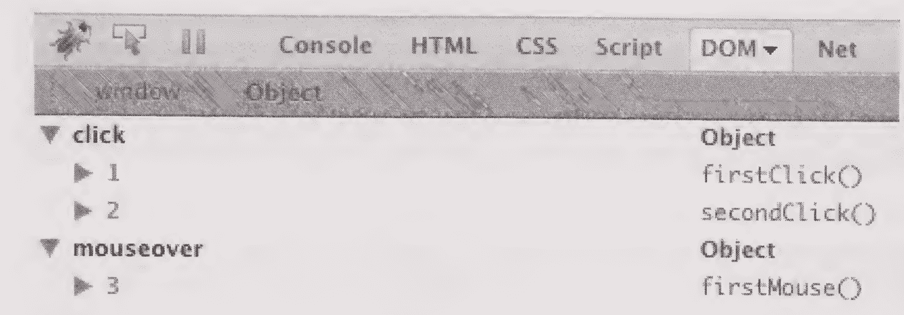

图 9.1. 在 Firebug 中检查 data('events')

事件数据包含事件类型和事件处理程序本身，嵌套在对象内部。

## 自定义事件

我们之前看到，`bind` 和 `trigger` 为我们触发的事件完成了所有实际工作；它们在 `click`、`mouseover`、`toggle` ... 每一个事件的幕后！简写动作使代码更短、更易读，而扩展的 `bind` 和 `trigger` 语法提供了完全相同的功能。那么为什么还要使用 `bind` 和 `trigger` 呢？事实证明，它们比我们目前所看到的更通用、更强大。首先，我们可以摆脱浏览器指定的事件，开始创建一些我们自己的事件！

创建你自己的事件有助于使你的代码更清晰；例如，埋没在 `click` 处理程序中的函数需要分析才能确定其用途，而一个具有特定名称的事件可能一眼就能理解。让我们看看创建自定义的 `do-toggle` 事件。为此，我们将回到第 2 章看到的免责声明消息示例：

```html
<!-- chapter_09/11_custom_events/index.html（节选） -->
<p id="disclaimer">
    免责声明！本服务不打算 ...
</p>
<input type="button" id="toggleButton" value="切换" />
```

这一次，不是按钮负责切换免责声明，而是免责声明自己负责切换：

## 自定义事件

```javascript
$('#disclaimer').bind('do-toggle', function() {
  $(this).toggle('slow');
});
```

我们已经将自定义的 `do-toggle` 事件绑定到了免责声明元素上。当 `do-toggle` 事件触发时，该函数就会运行，免责声明元素将自行隐藏或显示。但我们该如何触发 `do-toggle` 事件呢？可以使用 `trigger` 方法：

```javascript
$('#toggleButton').click(function() {
  $('#disclaimer').trigger('do-toggle');
});
```

当按钮被点击时，免责声明就被切换了。与直接使用切换按钮来隐藏和显示相比，这似乎是一种迂回的方式。但现在我们已经完成了两项非常重要的任务：我们将代码责任转移到了元素本身，并且使我们能够在任何其他位置触发该事件。无论我们是想通过切换按钮来切换免责声明，还是通过屏幕顶部的小图标来切换，都不需要复制代码——我们只需在任何我们喜欢的地方触发 `do-toggle` 事件即可。

但是，等等，还有更多！`bind`/`trigger` 系统还允许你在触发事件时附加参数。每个触发元素可以传递不同的数据，因此事件处理器可以自定义其响应。这使得自定义事件变得非常强大；你现在可以创建小部件，这些小部件可以被页面上的多个其他元素优雅地控制，从而实现页面行为的清晰分离和隔离，并使你的代码更具可重用性。

例如，我们将在页面上为第3章“弹性内容窗格”中的动画内容窗格放置一个备用触发机制。在这个例子中，我们制作了看起来很酷的内容窗格，展示名人传记，当点击其标题时会弹跳打开和关闭。为了清晰起见，这里我们将省略弹跳效果，因此当用户点击传记标题时，窗格将立即切换。

但是，在窗格上方还会有一个选择框。当从列表中选择一个名人时，传记将以相同的方式切换；相同的事件处理器将被触发，只是这次我们会有漂亮的滑动效果。

我们的选择框触发器包含用户可以查看的传记列表。稍后，我们将为其附加一个 `change` 事件处理器来触发滑动效果：

```html
<select id="chooser">
    <option>Beau Dandy</option>
    <option>Johny Startdust</option>
    <option>Glendatronix</option>
</select>
```

这是关键部分。我们将自定义的 `reveal` 事件绑定到所有传记标题上。代码将接受一个额外参数，我们将用它来决定如何显示传记。如果 `effect` 参数设置为 `ease`，我们将使用 `slideToggle`，否则用户将看到标准的非滑动切换：

```javascript
$('#bio h3').bind('reveal', function(e, effect) {
    if (effect == 'ease') {
        $(this).next().slideToggle();
    } else {
        $(this).next().toggle();
    }
})
.click(function() {
    // 触发器 1：普通切换
    $(this).trigger('reveal');
});
```

因为我们的第一个触发器不需要添加任何效果，所以我们不会在 `trigger` 调用中添加任何参数。当 `bind` 代码运行时，它找不到 `effect` 参数，因此执行常规切换：

```javascript
$('#chooser')
    .change(function() {
        // 触发器 2：滑动切换
        $('#bio h3:contains(' + $(this).val() + ')')
            .trigger('reveal', 'ease');
    });
```

当用户更改选择列表中的当前选择时，我们找到正确的内容窗格并再次触发 `reveal` 事件。但这次我们添加了 `'ease'` 参数，因此用户会体验到花哨的滑动版本。

向自定义事件添加数据是封装小部件代码并暴露接口供其他开发者用来定制功能的绝佳方式。要向 `bind` 函数传递多个项目，你需要将 `trigger` 的参数包装在一个数组中：

```javascript
$('#bio h3:contains(' + $(this).val() + ')')
    .trigger('reveal', ['ease', 2000]);
```

## 解绑与命名空间

jQuery 仅用少数几个动作就能创造出惊人的效果：我们的大部分控件使用不超过几个动作，以及非常少量的 JavaScript 代码。随着你开始扩展你的控件和效果——将它们转换为插件并使用多个控件一起制作更大、更酷的控件——你会发现你的事件开始变得有点难以管理。处理器被附加并且永远不会被移除，即使在你的效果完成之后也是如此，这可能会与你稍后尝试添加的任何新行为冲突。我们并不总是能够依赖我们到目前为止一直在使用的“设置后忘记”的方法。

jQuery 库为我们提供了处理这个问题的两种机制：**事件解绑**和**事件命名空间**。事件解绑让我们从对象中移除事件处理器，而事件命名空间提供了一种将事件处理器分组为逻辑组的方法，这些组可以被解绑而不影响其他事件。这在开发插件时特别有用。

事件解绑很简单：我们使用 `bind` 动作将事件添加到对象，因此我们使用 `unbind` 动作来移除它们！我们可以使用 `unbind` 的三种方式：从选择中的对象移除*所有*事件、移除选择中所有*特定类型*的事件，或移除*一个特定的*事件处理器。第一种形式如下：

```javascript
$('p').unbind();
```

这将移除与页面上所有段落相关联的所有事件处理器。这有点极端——更常见的是，我们只想移除特定类型的事件。例如，要移除所有的 `mouseover` 事件，我们将事件类型传递给 `unbind` 动作：

```javascript
$('p').unbind('mouseover');
```

最后，要解绑单个事件处理器，我们传递要解绑的函数。这有点复杂，因为我们需要在绑函数时为其命名。在我们的例子中，我们将两个函数绑定到 `click` 事件。然后我们解绑其中一个事件：

```javascript
var doToggle = function() { $(this).toggle(); };
var doSlide = function() { $(this).slideToggle(); };

$('p')
  .click(doToggle)
  .click(doSlide);

$('p').unbind('click', doToggle);
```

由于我们的 `unbind` 调用，任何后续点击段落标签仍然会触发 `doSlide` 方法，但不再触发 `doToggle` 方法。

> **简写解绑？**

你也可以使用简写的 `click` 和 `mouseover` 方法来绑定事件，那么是否存在 `unclick` 和 `unmouseover` 简写方法呢？没有。这些方法在 jQuery 中*曾经*存在过，很久以前，但它们已被移除，因为它们使核心 API 变大了很多，并且很少被使用。

尽管所有这些解绑选项看起来很全面，但它们无法应对所有情况。当你进行大量的绑定和解绑时，很容易失去对正在发生的事情的跟踪——因此 jQuery 提供了一种通过事件命名空间将相关事件分组的方法。命名空间事件可以独立于同一类型的其他事件触发，并且同一命名空间中的所有事件都可以用单个命令解绑。

要定义命名空间，你将一个句点（.）和你的命名空间名称附加到要附加处理器的事件上。无需做任何进一步的操作，该事件将像普通的非命名空间事件一样工作；但你现在有一个句柄，可以用它来更具体地指定触发哪些事件，而无需维护对每个事件函数的引用（如我们上面所做的）：

```javascript
$('p').bind('mouseover.colorize', function() {
  $(this).css('background-color', 'lemonchiffon')
})
.bind('mouseout.colorize', function() {
  $(this).css('background-color', '')
})
.click(function() {
  $(this)
    .trigger('mouseout.colorize')
    .unbind('.colorize');
});
```

在这个例子中，我们将常规的 `mouseover` 和 `mouseout` 事件处理器绑定到页面上的每个段落。当用户将鼠标移到元素上时，这会产生一个简单而令人信服的高亮效果。但这个高亮效果还有一个额外的技巧：当用户点击一个元素时，高亮将被移除。

当点击发生时，用户将悬停在元素上；如果我们直接移除处理器，`mouseout` 代码将永远不会运行，元素将保持高亮状态。为了解决这个问题，我们手动触发 `mouseout`。因为我们已经为事件添加了命名空间，所以我们可以指定只有与我们效果相关的 `mouseout` 代码应该运行。任何其他的 `mouseout` 处理器将保持休眠状态。

当我们取消元素的高亮显示时，可以通过一条简单的`unbind`命令移除效果命名空间中的所有事件处理程序。通过仅传递`'.colorize'`作为参数，我们即可定位到该命名空间。

在创建插件时，为事件添加命名空间尤其有用。你现在有了一种简单的方法来控制插件添加到DOM的所有事件，无需担心用户（或其他插件）可能附加了什么。当需要清理一切时，只需一个简单的`unbind`就能完成。

如果你想仅触发非命名空间事件，可以在`trigger`参数末尾添加一个感叹号（!）。例如，如果我们想触发所有不在我们（或任何其他）命名空间内的`mouseover`事件，可以这样执行：

`$('p').trigger('mouseout!')`。

> **多命名空间**

你不仅可以使用单一命名空间：如果需要在一条语句中定位多个命名空间，只需用点号将它们连接起来即可。

## 绑定 iPhone：非标准事件

如果说jQuery事件系统已经证明了自己是个小赢家，那么它还有另一个绝技：它能够响应它本不该知道的事件！随着我们开始从PC转向其他主要工具访问网络，这种能力将变得越来越重要。未来人们查看你页面的设备数量和类型将会激增：iPhone、其他手机、PSP、Chumbys、“下一个大热产品”等等。虽然它们大多数都需要遵守DOM规范，但它们都会试图添加一些自己的东西来改善人机交互。

这将意味着我们需要处理新的硬件触发的事件。iPhone的触摸界面就是一个很好的例子。虽然iPhone可以响应`mousedown`和`mouseup`事件，但还有其他更适合使用的事件。有一组专门处理触摸屏交互的事件，这些事件在大多数其他设备上没有意义。尽管jQuery不提供对这些事件的直接访问（如果它必须支持每个设备的事件，它很快就会成为一个庞大的库！），但`bind`方法足够通用，可以捕获任何触发的事件：

```
$(document).bind('touchstart', function(e) {
    var original = e.originalEvent;

    var x = original.changedTouches[0].pageX;
    var y = original.changedTouches[0].pageY;

    $('#block').css({top: y, left: x});
});
```

触摸事件由第三方定义，但只要我们能访问到关于这些事件的文档（或者可以用Firebug或其他调试工具收集自己的数据），我们就能轻松地捕获和响应。在我们的例子中，我们捕获的是每当用户触摸屏幕时触发的`touchstart`事件。

因为jQuery不知道`touchstart`，我们需要从传递给回调函数的jQuery事件对象中访问`originalEvent`。`originalEvent`让我们能够访问到未经jQuery包装的原始JavaScript事件。我们现在可以完全按照文档记录的方式来使用该事件。我们获取屏幕触摸的X和Y坐标，并更新一个绝对定位的块元素到触摸位置。

> **禁用 mousedown 和 mouseup**

如果你正在为iPhone编写事件处理程序，你可能需要禁用`mousedown`和`mouseup`的默认操作。你可以通过在`$(document)`上捕获它们并使用`event.preventDefault`方法来实现。否则，你将面临重复执行相同代码的风险，因为同时会触发触摸和鼠标事件。

## special 事件

创建自定义事件无疑相当高级——但jQuery的special事件构造方式简直是忍者级别的。如果你觉得常规的DOM事件有点受限，那么这个功能就是为你准备的！使用`special`是创建具有原生外观的自定义事件，或者覆盖和增强现有事件的一种方式。你可以在每次处理程序绑定时，以及事件被移除时（这发生在`beforeUnload`阶段）执行一些自定义代码处理。special事件是jQuery的一等公民。

点击事件在用户点击某物时触发，加载事件在元素加载完毕时触发……现在我们要创建一个在用户多次悬停在一个元素上时触发的事件。默认情况下，当一个元素接收到三次`mouseover`时，绑定的事件处理程序就会运行，但我们将看到如何按元素自定义这个次数。与常规事件一样，你需要指定在事件处理程序中执行的代码。

要创建一个special事件，你需要将一个JavaScript对象附加到`$.event.special`命名空间下。事件系统提供了四个钩子函数供你定义事件的工作方式：`setup`函数在事件首次绑时运行，`add`函数在事件*每次*绑定时运行，`remove`函数在事件解绑时运行，而`teardown`函数在*最后一个*事件解绑时运行（即没有更多此类类型的事件绑定到处理程序时）。

让我们看看`multihover`事件的骨架：

```
jQuery.event.special.multihover = {
  setup: function(data, namespaces) {
    // 第一个事件绑定时执行
  },
  add: function(handler, data, namespaces) {
    // 每次绑定另一个事件时执行
  },
  remove: function(namespaces) {
    // 事件解绑时执行
  },
  teardown: function(namespaces) {
    // 最后一个事件解绑时执行
  },
  handler: function(e) {
    // 执行你的逻辑
  }
}
```

一旦你创建了你的事件，你就可以像绑定任何事件一样绑定它。显然没有快捷方法来绑定你的自定义事件，因此你必须使用`bind`方法将其附加到页面元素：

```
chapter_09/15_special_event/script.js (excerpt)

$('p').bind('multihover', {times: 4}, function() {
  $(this).css('background-color', 'lemonchiffon');
});
```

我们将新的`multihover`事件绑定到页面上的所有段落，然后指定我们希望在一个元素上悬停多少次后才触发事件。在“自定义事件”一节中，我们看到可以通过`trigger`方法向事件传递数据，但现在我们了解到，你也可以在绑定事件时指定要传递的数据！

我们的special事件不会使用`add`或`remove`钩子，因为我们只想允许每个元素附加一个`multihover`事件。在`setup`钩子中，我们将使用数据操作将所需的悬停次数存储在元素本身上。如果没有用户指定的值，我们将默认为3。接下来，我们将自定义的事件处理程序（我们称为`jQuery.event.special.handler`）绑定到`mouseover`事件，因为我们需要在那里执行逻辑来判断第三次悬停何时发生：

```
chapter_09/15_special_event/script.js (excerpt)

setup: function(data, namespaces) {
  $(this)
    .data('times', data && data.times || 3)
    .bind('mouseover', jQuery.event.special.multihover.handler);
},
... teardown: function(namespaces) {
  $(this)
    .removeData('times')
    .unbind('mouseover', jQuery.event.special.multihover.handler);
```

> ### data 参数

`bind`方法的`data`参数并非special事件特有。它在你的任何事件上都完全一样地工作，所以好好利用它吧！

我们也在对应的`teardown`处理程序中撤销了所有这些设置。这里我们移除了添加的数据项，并解绑了`mouseover`的绑定。这清理了一切。现在我们有一个新事件，每当`mouseover`事件发生时都会调用我们的自定义处理程序，所以让我们来实现`multihover`逻辑：


```
handler: function(e) => {
    // 执行你的逻辑
    var times = $(this).data('times') || 0;
    times--;
    $(this).data('times', times);

    if (times <= 0) {
        e.type = 'multihover';
        jQuery.event.handle.apply(this, arguments);
        $(this).unbind('multihover');
    }
}
```

这是功能的核心部分。我们将其分离到自己的函数中只是为了保持清晰——我们同样可以用匿名函数轻松处理。

`multihover`逻辑首先从`times`数据项中减去1。当它达到0时（也就是说所有的悬停都完成了），我们修改事件属性`type`并将其设置为`multihover`，然后调用内部的`handle`函数。这将导致用户指定的任何绑定回调被执行，就像原生事件一样。

special事件是封装自定义事件以便在整个项目中重复使用的绝佳方式。除了像我们的`multihover`事件这样创建新功能外，你还可以重新定义现有事件；例如，你可以通过向`$.event.special.click`提供适当的钩子来覆盖内部的`click`事件。创建special事件是相对罕见的需求——但当你需要时，你会看到它们是jQuery的一个杀手级高级特性。

## jQuery 达人小窍门

即使在我们探索了 jQuery 中提供的完整系统和框架之后，这个库中仍然遍布着无数值得你利用的宝藏。其中一些是文档齐全的函数，尽管可能相当特定；另一些则是更为隐晦的高级主题。

## 避免冲突

正如我们所提到的，我们在编写代码时使用的 `$` 和 `jQuery` 对象及方法就是命名空间，就像我们自己创建的那些一样。`jQuery` 作为一个命名空间，在唯一性和清晰度方面都表现得很好，而且也比较简短。

虽然美元符号确实在简短性上得分很高，但在唯一性方面却差得很远。这种唯一性的缺乏可能会引起担忧，如果另一个开发者覆盖了我们假设为 `$` 的东西。例如，`Prototype.js` 使用 `$()` 作为 JavaScript `getElementById` 方法的简写，如果我们不注意，这样的命名空间冲突可能是灾难性的。为了应对此情况，jQuery 让我们能够使用 `noConflict`：

```
jQuery.noConflict();
```

最基本的用法是，这意味着 jQuery 将放弃对 `$` 命名空间的所有权，但仍然响应 `jQuery` 命名空间：

```
jQuery.noConflict();
// Do something with jQuery
jQuery("div p").hide();
// Do something with another library's $()
$("content").style.display = 'none';
```

这意味着你必须移除代码中任何对 `$` 的引用，用 `jQuery` 替换它们，坦白说这可能不可行。但有一种方法可以减轻这种工作量：

```
jQuery.noConflict();
(function($) {
  $(function() {
    // more code using $ as alias to jQuery
  });
})(jQuery);
// other code using $ as an alias to the other library
```

通过将我们所有的 jQuery 命令包装在一个匿名函数中，并传入 `jQuery` 和 `$` 的引用，我们创建了一个保护内部 jQuery 方法和属性的外壳。我们还有另一个选择可以利用：我们可以进一步将 `noConflict` 的返回值赋给一个变量，并使用它来代替 `jQuery` 或 `$`。在这种情况下，我们选择使用 `trkr` 作为 jQuery 的别名：

```
var trkr = jQuery.noConflict();
// Do something with jQuery
trkr ("div p").hide();
// Do something with another library's $()
$("content").style.display = 'none';
```

我们还可以进行进一步处理，即将 `noConflict` 赋给一个新的命名空间：

```
var trkr = {};
trkr.$ = jQuery.noConflict(true);
```

在所有这些选项中，你一定能找到适合你需求的解决方案！

## 动画队列与出队

尽管你可以使用多种动画选项，但有时它们无法满足你的需求；你可能想让动画暂停，或者让动画序列之外的元素在动画达到某个点时做出反应。动画序列中有很多有趣的时刻，如果能利用它们就好了。而你可以通过 `queue` 来实现！

一般来说，我们链式调用的选择器上的操作是异步的，或多或少是同时发生的：

```
$('#button1').click(function() {
    $(this).animate({
        height: 200,
        width: 200
    }, 'slow').text("rollin'");
});
```

当你点击那个按钮时，它会缓慢增长到 200x200 像素的大小，但文本几乎会立即更新。当我们使用 `animate` 操作时，它会为元素添加一个 fx 堆栈，我们添加的任何动画都会进入该堆栈。然而，`text` 操作会忽略 fx 堆栈（它专注于动画），而 `queue` 则会尊重该堆栈：

```
$('#button2').click(function() {
    $(this).animate({
        height: 200,
        width: 200
    }, 'slow').queue(function() {
        $(this).text('rolled!');
    }).text("rollin'");
});
```

现在 `animate` 和 `text` 操作一起发生，但 `queue` 也会在动画结束后改变文本。而且不止如此……或者更准确地说，它确实停止了！如果我们在链中添加另一个 `animate` 操作，`queue` 将会持有 fx 堆栈，并阻止链式操作继续执行：

```
$('#button3').click(function() {
  $(this).animate({
    height: 200,
    width: 200
  }, 'slow').queue(function() {
    $(this).text('rolled!');
  }).text("rollin'").animate({ // This animate won't fire
    height: 100,
    width: 100
  }, 'slow');
});
```

现在，`queue` 操作需要一些帮助来再次释放堆栈。就像 `live` 有 `die`，`animate` 有 `stop` 一样，`queue` 也有其相反的操作：`dequeue`。

`dequeue` 方法有点特别；它不是链接到 jQuery 链中，而是从 `queue` 的回调函数内部调用：

```
$('#button4').click(function() {
  $(this).animate({
    height: 200,
    width: 200
  }, 'slow').queue(function() {
    $(this).text('rolled!');
    $(this).dequeue();
  }).text("rollin'").animate({ // This animate WILL fire
    height: 100,
    width: 100
  }, 'slow');
});
```

现在，当我们点击按钮时，它的文本会变为 "rollin'"，然后增长到 200x200；接着文本变为 "rolled"，最后它会缩小到 100x100。这也许不是一个能改变你世界的动画，但 `queue` 很可能会改变你看待动画的方式。

## 将 JavaScript 对象视为 jQuery 对象

jQuery 通过选择 DOM 元素然后对其执行操作来工作。但一个鲜为人知的秘密是，jQuery 可以对 DOM 之外的东西执行操作；它也可以应用于常规的 JavaScript 对象。这与其说是一个刻意的功能，不如说是库内部设计的结果。尽管乍一看可能有点奇怪（你为什么要对一个 JavaScript 对象执行 `slideUp`？），但它确实有一些潜在的有趣影响。

首先：当然不可能对 JavaScript 对象执行 `slideUp`——毕竟，它缺少高度属性，或者任何可见属性。但你仍然可以像选择 DOM 元素一样选择它：

```
$(myobj);
```

有许多与视觉属性无关的 jQuery 操作，但我们可以想象在普通对象上使用它们。例如，非常有用的 `data` 操作用于在选定的元素上存储任意数据。我们可以使用它来向代码中的任何对象添加元数据。例如，我们可以在两个 JavaScript 对象之间建立双向链接。在下面的示例中，我们想在地图上存储额外信息。地图持有名人位置的定位标记，我们希望在点击标记时可以检索附加到定位器的额外信息：

```
// Our map pin location's meta data
var locationData = {
  name : "Bourgeois Burger Cafe",
  celebCount : 3,
  lat : latitude,
  lon : longitude,
}
// Get a pin locator from our fictional mapping service
var locator = Map.getLocator(latitude, longitude);
```

我们有两个对象：第三方定位标记对象，以及包含与该标记相关数据的 `locationData` 对象。如果用 jQuery 选择 `locator`，我们可以应用 `data` 操作并附加 `locationData` 对象。在内部，jQuery 会将关系存储在数据存储中——因此两个对象都没有被实际修改：

```
// Attach our data object to the JavaScript pin object
$(locator).data('pin_data', locationData);
```

现在，在将来用户点击地图并且定位器的点击处理程序触发时，我们就可以访问 `locationData` 对象：

```
// Later, when a location is clicked...
var currentData = $(clickedLocation).data('pin_data');

// We can retrieve the metadata stored on the object!
alert("You selected the location: " + currentData.name);
});
```

尽管在许多情况下，我们可能想将元素引用存储在对象本身中，但当对象来自第三方代码时，你必须非常小心地添加或删除属性。此外，由于第三方将来所做的任何更改都可能影响你的代码，最好稳妥起见。`data` 操作让我们可以在不修改对象的情况下对其进行扩展。

## 主题切换（Theme Rolling）

在前面的页面中，我们已经遍历并掌握了大部分 jQuery UI API。jQuery UI 最吸引人的特性之一是……它的外观！开箱即用的 UI 组件看起来很棒——而且（尽管我们可能不愿意承认）看起来很棒非常重要。有时它甚至比功能本身更重要！没有什么比向同事或老板展示你创建的控件的技术上出色的概念证明更糟糕的了，结果却遭到对其设计的批评。更糟糕的是，有时你最初没有考虑皮肤和主题，导致一个本质上难以设置样式的产物。

对于 jQuery UI 组件来说，这不是问题；有一个主题画廊可供选择——而且由于 ThemeRoller Web 应用程序的存在，选择或自定义一个新的时髦设计很简单。ThemeRoller 让你可以调整、设计和下载 jQuery UI 主题。此外，如果你在创建自己的控件时遵循一些简单的约定，你可以轻松利用现有的和自定义的主题，确保你创建的一切看起来和它运行的一样棒。

## 使用画廊主题

在我们的 jQuery UI 探索之旅中，我们已在多处提及主题——这是我们下载库时必须指定的选项之一。默认情况下，您会获得 UI Lightness 主题，但我们也使用过 Sunny 主题，或许在过程中您也浏览了其他几个主题。要查看可以使用哪些默认主题，请访问 ThemeRoller 网站。

现在，点击左侧边栏的**画廊**标签。在这里，您可以查看各种预先设计的主题，并找到适合您需求的主题。如果您点击下载按钮，您将被带到熟悉的 jQuery UI 构建界面。如果您需要整个库，请自定义您想要的组件。您选择的主题将在主题下拉框中预先选中。

另一方面，如果您只需要主题，请不要担心选中了哪些组件，只需下载库即可。捆绑的文件将包含您的主题，因此只需将 **css** 文件夹从下载中复制到您的项目中。然后更新页面内样式表链接中的主题名称，这样您的组件将查找正确的 CSS 文件。仅此而已。

## 自定义主题

默认主题可能不适合您的网站。值得庆幸的是，ThemeRoller 工具让自定义可用主题变得轻而易举。ThemeRoller 是一个 Web 应用程序，提供了一个简单的界面来修改 jQuery UI 主题的各个方面。当您在侧边栏中更新属性时，更改会立即反映在预览区域中，如图 9.2 所示。

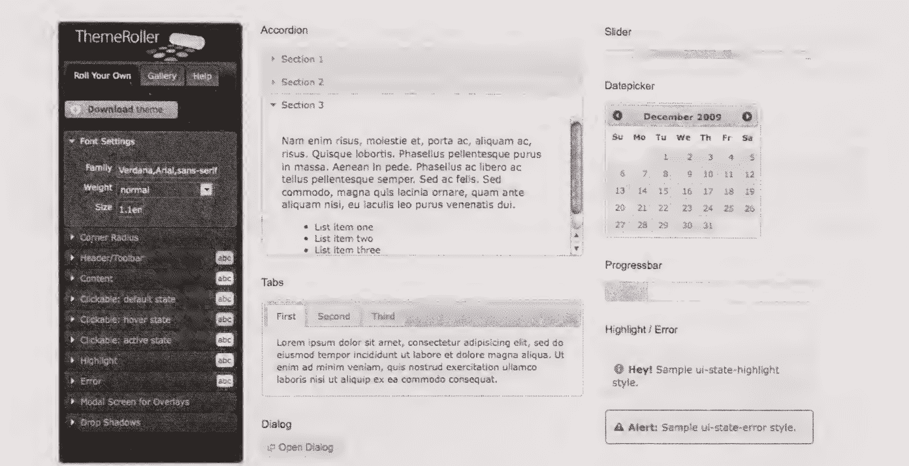

一旦您将主题调整到完美状态，您可以通过点击**下载主题**按钮来下载它。更改会传递到 jQuery UI 下载构建器，就像普通的画廊主题一样——只是主题下拉框现在会显示“自定义主题”。如果您现在下载捆绑包，您的主题将被命名为 custom-theme（因此您的 CSS 文件将存储在 **custom-theme** 文件夹中）。如果您觉得您的创作需要一个更贴切的标题，请展开**高级主题设置**面板并更新**主题文件夹名称**输入框。

> **有限的 IE6 支持**

> 尽管 ThemeRoller 主题外观精美且易于使用，但存在一个缺点。jQuery UI 团队对支持 Internet Explorer 6 的执着程度不如其 jQuery 核心团队，因此，主题使用了一些 CSS3 样式和半透明 PNG 图像，这些在 IE6 中会显得相当难看。建议您使用 PNG 支持库以获得漂亮的图标——并且您必须找到一个非 CSS 的解决方案来处理圆角问题！

## 使您的组件可主题化

ThemeRoller 的名字可能听起来很酷，您从中获得的结果可能相当令人印象深刻——但它真正做的只是生成一组 CSS 类，可用于为任何 DOM 元素集合设置样式。如果您以遵循 jQuery UI 的标记和命名约定的方式构建自己的自定义 UI 组件，它们也将可以被主题化。

在图 9.3 中，我们为第 3 章中的弹跳内容窗格应用了相应的 CSS 类，因此现在我们有了一个非常类似 jQuery UI 的组件。默认主题（或我们自定义的 ThemeRoller 主题）可以包含在页面顶部，我们的变色龙小部件将立即拥有新的外观和感觉（该图展示了正在使用的 UI Lightness、Dot Luv 和 Eggplant 预设计主题）。


图 9.3. 经过 ThemeRoller 处理的内容窗格

如果您习惯于构建语义正确的结构，您可能只需要在这里和那里添加一个类即可访问所有 ThemeRoller 的优点。主题假定您的小部件至少有一个包含元素，可以用作样式的基础。我们最初的传记窗格 HTML 如下所示：

```html
<div id="bio">
  <h3>Beau Dandy</h3>
  <div>
    
    <span>Glendatronix is the queen of ... </span>
  </div>
  <h3>Mr Speaker</h3>
  <div>
    
    <span>After smashing into the limelight ... </span>
  </div>
  :
</div>
```

首先，我们将通过应用 `ui-widget` 类将 `#bio` div 指定为容器。然后，通过添加 `ui-helper-reset` 来重置我们可能已应用的、可能会破坏小部件样式的任何样式：

```html
chapter_09/17_themable_components/index.html (excerpt)

<div id="bio" class="ui-widget ui-helper-reset">
```

这已经给了我们很多：当前主题的字体和颜色。接下来，我们可以开始将其他类添加到我们的组件中，以设置标题和内容区域的样式：

```html
chapter_09/17_themable_components/index.html (excerpt)

<h3 class="ui-widget-header ui-corner-all">Johnny Stardust</h3>
<div class="ui-widget-content">
  
  <span>After smashing into the limelight ... </span>
</div>
```

`ui-widget-header` 给我们闪亮的工具栏外观，而 `ui-corner-all` 将使小部件变得漂亮且圆润（当然，在支持的浏览器中）。您可以指定 `ui-corner-all` 或更具体的类来设置单个边的样式——例如 `ui-corner-tl` 用于左上角，或 `ui-corner-bottom` 用于两个底边，以在大多数元素上实现圆角。

我们还使用了一些额外的类在窗格中添加了引人注目的“售罄！”消息，这些类显示为警告和图标：

```html
chapter_09/17_themable_components/index.html (excerpt)

<div class="ui-state-error">
  <span class="ui-icon ui-icon-alert"></span>SOLD OUT!
</div>
```

`ui-state-error` 类提供了强烈的错误外观消息，而 `ui-icon-alert` 为 span 添加了一个小图标。

正如您从全面使用 jQuery UI 库所预期的那样，有更多选项可用于控制 ThemeRoller 主题如何为您的代码设置样式。有用于定义按钮交互状态、禁用表单元素、组件阴影的类，还有一些用于 z-index 修复（针对 Internet Explorer 6）的优秀辅助类，以及用于无障碍访问的快捷链接。文档[^2]非常详细，将为您的大多数小部件提供良好的基础。

要理解所有可用内容的最佳方式是阅读文档，查看 ThemeRoller 工具中影响了哪些元素，并检查 jQuery UI 应用到元素的类。另外，请记住，当您制作专注于 UI 的插件时，您可以通过 jQuery 在插件代码中轻松添加 ThemeRoller 类；这将让用户毫不费力地获得完全可主题化的组件！

## StarTrackr!：终章

“我们今天站在这里，作为地球上最臭名昭著的名人追踪网站的创造者！”客户对着满屋子的员工和股东大声宣布。项目的最终阶段已上线，您的工作即将结束。自从客户要求我们美化其网站的免责声明消息以来，这确实是一段漫长的旅程——一段带领我们经历淡入淡出、滑动、缓动、滚动、增强和 Ajax 化的旅程。换句话说，一段将我们从新手带向忍者的旅程。

“但有一个人让这一切成为可能，”客户继续说道。“一个人，我们所有这些都归功于……”他转身面对您，但您之前占据的空间是空的。您执行了最后一个 `$("#ninja").hide()`——并神秘地消失了，无影无踪。

您不需要客户和同事的感谢和赞扬；您的回报是，良好的 Web 开发实践已被灌输到另一个项目中。除此之外，还有您收到的丰厚报酬。两者兼而有之，真的。

[^2]: http://jqueryui.com/docs/Theming/API

# 附录 A：参考资料

jQuery 的全部意义在于灵活，并适用于尽可能多的情况。核心库和插件架构都鼓励这一理念。最常见的使用场景通常可以直接开箱即用，因此 jQuery 的灵活性在于能够覆盖这些默认值。这导致了大量的选项！不过，没有必要记住它们所有——只需手边有一份好的参考，并始终检查 jQuery 的在线文档¹。并且不要害怕深入研究 jQuery 或插件源代码，以查找文档可能遗漏的任何内容。

## $.ajax 选项

jQuery 中强大的 Ajax 功能数组由一个单一方法支持：`$.ajax`。此方法接受大量选项，使其能够在无数情况下灵活使用。我们在本书中探讨了一些选项，但正如 jQuery 的一贯特点，还有更多！

## 标志

“可标记”选项接受一个布尔值——true 或 false——以启用或禁用给定功能。大多数时候，默认值将是令人满意的，但很容易覆盖它们以自定义您的请求。

**async**

async 选项默认为 true，但如果您需要进行同步请求（您应该尽量减少这种请求——它会在工作时锁定浏览器！），您可以将其设置为 false。

**cache**

执行 Ajax 请请求时，缓存数据可能是一个问题；如果用户的浏览器存储了旧请求，它可能不会获取最新数据。要禁用缓存，您可以将 cache 选项设置为 false。脚本和 JSONP 请求默认是不缓存的。

## global

我们看到，通过全局事件处理程序可以处理来自任何 Ajax 请求的事件。你也可以通过为 `global` 参数指定 `false` 来阻止全局事件处理程序处理特定事件。

## ifModified

通过设置 `ifModified` 标志，你可以强制请求仅在文档自上次请求以来被修改时才“成功”（即触发成功处理程序）。如果你只想在有新数据需要显示时才进行某些处理，这会很有用。

## processData

当你有数据需要随请求一起发送时，jQuery 会处理它并将其转换为适当的查询字符串值。如果你不希望这样做（例如，如果你需要传递一个 DOM 文档或其他某种结构），你可以将 `processData` 标志设置为 `false`。

# 设置

许多 Ajax 选项允许你指定的不仅仅是一个简单的开/关值；它们通常接受字符串或对象来定制和定义你的 Ajax 请求。

**contentType**

`contentType` 设置允许你设置请请求的内容类型。默认值是 `application/x-www-form-urlencoded`，这对大多数情况来说已经足够了。

**context**

当 Ajax 回调执行时，它们的上下是 `window` 对象，这通常不太有用。你可以设置 `context` 选项，以便回调中的 `this` 属性指向一些方便的东西，比如自定义的 JavaScript 对象或 jQuery 元素。

**data**

要将数据传递给服务器，你需要为 `data` 设置指定一个字符串、JavaScript 数组或对象。如果你传递一个数组或对象（并且没有禁用 `processData` 标志），数据将使用 `jQuery.params` 工具函数进行序列化。这个函数将输入转换为查询字符串格式（非常方便）！如果是 GET 请求，字符串将被附加到 URL 中。

**dataType**

`contentType` 设置了你发送到服务器的数据类型，而 `dataType` 参数则设置了你期望从服务器接收的数据类型。默认类型是“所有类型”（*/*），但你可以指定 xml、html、script、json 或 text——在这种情况下，jQuery 将使用相应的内容类型字符串。

**jsonp**

当你进行 JSONP 调用（允许跨域请求）时，预期回调函数名称将是 callback。如果你使用的服务需要不同的名称，你可以使用 `jsonp` 设置来定义它。

**password**

身份验证请求需要你的用户名和密码。你可以在 `password` 设置中指定后者。

**scriptCharset**

`scriptCharset` 属性允许你指定由 script 或 jsonp Ajax 调用注入的 script 标签的字符集。

**timeout**

`timeout` 参数是唯一接受数字的 Ajax 设置：它定义了在中止 Ajax 请求之前需要经过多少毫秒。

**type**

Ajax 请求最重要的设置之一，`type` 属性定义了 HTTP 请求类型：GET、POST、PUT 或 DELETE。

**url**

与 `type` 一起最重要的另一个设置，`url` 字符串定义了你要调用的位置的地址。

**username**

最后但同样重要的是，`username` 选项指定了随任何身份验证请求发送的用户名。

# 回调和函数

最后，你可以定义一堆回调和函数来调整你的请求并处理在请求生命周期中发生的事件。

事件处理程序已经在第 6 章中介绍过。无论成功还是失败，`complete` 处理程序都会在 `$.ajax` 调用完成时触发——所以这是清理任何遗留问题的好地方。`error` 处理程序在调用失败时被调用，而 `success` 处理程序在调用正确完成时触发。

除了事件回调之外，还有少数函数作为钩子存在；这些让你可以逐个调用地修改请求的各个部分。`beforeSend` 函数在发送消息执行之前触发，如果你需要修改请求，它为你提供了一个位置。你的处理程序会接收到请求对象和当前的 jQuery 对象。这是修改请求头的常见位置。此外，这是你阻止任何事情发生的最后机会：如果你从这个函数返回 `false`，请请求将被中止。

在最底层，Ajax 的魔力来自浏览器对 `XMLHttpRequest`（简称 XHR）对象的实现。这是让我们能够从客户端与服务器通信的家伙。默认情况下，jQuery 查找适当的 XHR 对象并将其用于任何 Ajax 调用。如果你想增强或替换它，你可以通过指定你自己的 `xhr` 函数来修改它。该函数需要返回应该使用的对象。

最后一个可用的钩子是 `dataFilter` 函数。这在请求成功返回后被调用，是你确保响应数据没问题的地方。如果你需要进行任何数据清理，这就是该位置。`dataFilter` 函数接收原始的响应数据和类型；你应该在处理后返回数据，以便请求周期可以继续。

# $.support 选项

在过去，我们使用浏览器嗅探来确定使用的是哪个版本的哪个浏览器，并调整我们的代码以解决已知的错误。今天，这种方法不受欢迎——它太不可靠了。在可能的情况下，我们应该使用功能检测来检查浏览器是否支持特定的功能，并在需要时提供变通方法或后备方案。

如果你使用纯 jQuery，大多数这些问题都在内部处理好了，但如果你用一些原始的 JavaScript 搞得一团糟，有一个通过 `$.support` 操作可用的巧妙机制可以进行功能检测。我们在第 6 章中介绍了这个，但只是简要提到了可用的选项。有很多选项。它们都返回 `true` 或 `false` 值以指示是否支持，然后可以在 `if/then/else` 块中使用以提供对两种情况的支持。例如：

```javascript
var domObject = document.getElementById('content');
if ($.support.cssFloat) {
  domObject.style.cssFloat = "left";
} else {
  domObject.style.styleFloat = "left";
}
```

以下是可用的属性：

**boxModel**

`boxModel` 属性（最初设置为 `null`，在文档加载后更改为 `true` 或 `false`）如果浏览器按照 W3C 盒子模型进行渲染，则为 `true`。

**changeBubbles**

检测与事件相关的浏览器功能可能是一件棘手的事情——这曾经是进行浏览器嗅探的常见原因。幸运的是一些聪明人想出了办法，所以现在如果你想知道你是否可以（可靠地）响应 `change` 事件，你可以检查 `changeBubbles` 属性。

**cssFloat**

我们在上面的示例中看到了 `cssFloat` 的实际应用。它检测浏览器是否使用 `cssFloat` 标签来处理 JavaScript 中的浮动样式。（不可能简单地使用 `float`，因为那是引用浮点数的 JavaScript 关键字）。Internet Explorer 使用 `styleFloat` 而不是 `cssFloat`。

**hrefNormalized**

一些浏览器会修改他们认为构建不正确的链接——如果这是意料之外的，那就有问题了！`hrefNormalized` 属性将在浏览器修改链接时返回 `true`。

**htmlSerialize**

如果你需要确保链接元素（如 `link` 和 `script` 标签）在使用 `innerHTML` 时正确序列化，你可以使用 `htmlSerialize` 属性。Internet Explorer 在这方面存在问题——如果你想让它正常工作，你需要将有问题的标签包装在你自己的包装元素中。

**leadingWhitespace**

`leadingWhitespace` 选项让你知道浏览器是否将 DOM 子节点中的第一个节点作为空白处理。当使用 `innerHTML` 时，Internet Explorer 会删除第一个子节点（如果它是空白文本节点）；如果你依赖于固定数量的子节点，这可能会搞乱你的 jQuery 代码。

**noCloneEvent**

当你克隆一个 DOM 节点时，一些浏览器也会克隆附加到它的事件处理程序，而另一些则不会。如果事件没有被克隆，`noCloneEvent` 属性将为 `true`。

**opacity**

我们都是 `opacity` 的忠实粉丝：它让网站看起来很未来感。不幸的是，一些浏览器无法通过 JavaScript 使用 `opacity`（当然，如果你使用 jQuery，你就安全了）。`opacity` 属性测试渲染引擎是否理解 `opacity`——否则你需要转而使用浏览器的滤镜。

**scriptEval**

浏览器在执行通过注入的 script 标签注入的脚本时表现也不同。`scriptEval` 属性会告诉你是否可以通过 `appendChild` 安全地注入，或者是否应该使用 `script.text` 属性。

**style**

要找到当前应用于元素的样式，你可以使用 `getAttribute` 方法并请求 `style`——在某些浏览器中。要测试 `getAttribute("style")` 是否在你的用户浏览器上有效，你可以检查 `style` 属性。

**submitBubbles**

你可以通过 `submitBubbles` 属性检查的另一个事件是 `submit` 事件。在内部，这使用了与 `changeBubbles` 相同的功能检测技巧。

**tbody**

最后，在某些浏览器中，一个 `tbody` 元素会被自动插入到一个空的表格中——这可能会扰乱你的 DOM 操作。要检查你是否需要注意这一点，可以使用 `tbody` 属性。如果一个表格在没有自动插入 `tbody` 元素的情况下也是可以的（这可能会令人困惑），它会返回 `true`。

关于这种支持检测行为的妙处在于，它迫使你确切理解你正在规避哪些 bug。使用浏览器嗅探容易让人自满，并开始在条件块中放入不必要的代码。通过使用 `support`，你只针对非常具体的方面，确保你的用户无论浏览器厂商如何修改其浏览器代码，都能享受一致的（或至少是可接受的）体验。

## Events

我们已经花了很多时间研究事件，正如我们在几个场合提到的，jQuery 通过将事件规范化以符合 W3C 标准，简化了跨浏览器的事件处理过程。一个规范化的事件对象拥有一系列对我们有用的属性和方法。我们在整本书中已经使用了其中一些，现在让我们看看那些之前遗漏的！你可以在 jQuery Events 文档中找到完整的事件属性列表。²

² http://docs.jquery.com/Events/jQuery.Event

## Event Properties

我们在第 9 章简要看到过这一点：`type` 属性会告诉你触发的事件的名称（即使是自定义事件，如果你给它们命名了）。

当事件处理函数被调用时，你可以通过 `target` 属性获取作为事件来源的 DOM 元素。这个元素也可以被包装在 jQuery 选择器中，从而摆脱烦人的 DOM 操作，回到愉快的 jQuery 环境中。此外，如果事件是鼠标移动，你可以使用 `relatedTarget` 属性找到之前的目标（鼠标之前所在的位置）。如果事件正在层级中向上移动——当你处理冒泡事件时——`currentTarget` 会告诉你当前冒泡阶段的目标。

最后一个极其有用的属性是事件的 `timeStamp`。它给出了事件发生的精确时间，最常用于实现基于时间的效果。例如，如果你想在页面上创建一个特殊的三击事件，你可以查看事件的时间戳，看看是否在给定的时间跨度内发生了三次点击。

## Event Methods

我们已经看到许多可以使用的事件方法，比如 `preventDefault` 和 `stopPropagation`，它们让我们控制事件如何冒泡以及如何被浏览器处理。不过，还有一些额外的方法。其中另一个类似的方法是 `stopImmediatePropagation` 方法，它比 `stopPropagation` 更“强硬”一些。`stopPropagation` 阻止父级处理函数运行，而 `stopImmediatePropagation` 则阻止任何进一步的事件处理函数运行——即使是在同一个元素上。

其余的方法只是报告其他方法是否已被调用。`isDefaultPrevented`、`isPropagationStopped` 和 `isImmediatePropagationStopped` 方法返回一个布尔值，除非对应的命令已被发出，否则它们将返回 `false`。

## DIY Event Objects

在谈论事件时，你可能还想知道最后一个方面：你可以创建自己的事件对象并将它们直接传递给处理函数。看看这段代码：

```
// 常规事件绑定
$('p').bind('click', function(e) {
  $(this).text(e.pageX);
});
// 自制事件对象！
var e = $.Event('click');
e.pageX = 100;
e.pageY = 100;
$('p').trigger(e);
```

我们创建了一个模拟的点击事件并手动设置了它的 `pageX` 和 `pageY` 属性。这让你对触发事件处理函数的事件细节拥有最终的控制权。

# 附录 B：JavaScript 杂谈

我们怎么强调都不为过：jQuery 就是 JavaScript——所以提高 jQuery 技能的最佳方式是温习你的 JavaScript 知识！我们现在来看看本书中使用的几个 JavaScript 方面，你可能对此感到疑惑。

> **了解更多关于 JavaScript 的知识**

如果你想将你的 JavaScript 水平提升到一个新的高度，我们强烈推荐道格拉斯·克罗克福德的《JavaScript语言精粹》（O'Reilly, 2008）。这本书读起来可能不那么轻松，但它对 JavaScript 为何以及如何强大，做出了简洁而务实的解释！

## 类型强制转换

JavaScript 是一种所谓的松散类型语言。一些语言，比如 Java，是严格类型的：这意味着变量的类型在声明变量时就必须设定。另一方面，JavaScript 允许变量被**强制转换**。也就是说，它们的类型可以根据我们对它们的要求而改变：

```
var a = 2;
var b = "two";
var c = "2";
alert(typeof a);// 弹出 "number"
alert(typeof b);// 弹出 "string"
alert(typeof c);// 弹出 "string"
```

这里没什么意外——变量的表现符合我们的预期。但是，当我们让 JavaScript 猜测我们*想要*的变量类型时，情况就不同了：

```
alert(a * a);// 弹出 4
alert(a + b);// 弹出 2two
alert(a * c);// 弹出 4
alert(typeof (a * a));// 弹出 "number"
alert(typeof (a + b));// 弹出 "string"
alert(typeof (a * c));// 弹出 "number"
```

当我们使用 `+` 运算符“相加”一个字符串和一个数字时，JavaScript 假设我们想要连接这两个值，所以它创建了一个新字符串。这似乎改变了数字变量的类型为字符串。然而，当我们使用乘法运算符 `*` 时，JavaScript 则假设我们想要将这两个变量当作数字来处理。

变量本身在整个过程中保持不变，只是被区别对待。我们总是可以明确地告诉 JavaScript 我们打算如何对待一个变量，但如果我们不这样做，我们就需要理解 JavaScript 为我们做了什么。这里还有另一个例子：

```
alert(a + c);// 弹出 22
alert(a + parseInt(c));// 弹出 4
```

## 相等运算符

等号（=）及其相关运算符也可能为新手设下陷阱。在 JavaScript 1.3 中，它曾经只是有点奇怪，现在则变得更加如此。第一个陷阱是等号的含义与你学校数学课上记忆的有所不同：

```
var a = 2;
var b = "2";
```

单个等号是一个**赋值运算符**，用于将值赋给变量。我们都知道它做什么，但现在我们知道它叫什么了：

```
var c = (a == b);
```

两个等号在一起，`==`，被称为**相等运算符**，它建立一个布尔值。在我们的例子中，变量 `c` 的值将为 `true`，因为 JavaScript 比较相等运算符前后的值，并认为它们是相等的。使用相等运算符时，JavaScript 不考虑变量的类型，并尝试对值进行强制转换以进行评估。

把第一个等号换成感叹号，你就有了一个**不等运算符（`!=`）**。如果变量相等，这个运算符返回 `false`，如果不相等，则返回 `true`：

```
var d = (a != b);
```

变量 `d` 现在的值为 `false`，因为 `a` 和 `b` 是相等的。这可能有点复杂，但至少它是一致的。

在 JavaScript 1.3 中，情况变得更不简单了，引入了一个额外的运算符：**严格相等运算符**，表示为 `===`。

```
var e = (a === b);
```

严格相等运算符与相等运算符的不同之处在于，它在赋值布尔值时，不仅关注*值*，还严格关注*类型*。在上面的例子中，`e` 被设置为 `false`：虽然 `a` 和 `b` 的值都是 2，但它们的类型不同。

正如你可能猜到的，既然不等运算符与相等运算符成对出现，那么严格相等运算符也有一个相应的**严格不等运算符**：

```
var f = (a !== b);
```

在这种情况下，变量 `f` 将返回 `true`，因为我们知道这两个比较的变量类型不同，尽管值相似。

可以说，有些等号比其他等号更“等”！

## 真值性与假值性

JavaScript 的布尔类型有两个可能的值——`true` 和 `false`：

```
var jQueryIsFun = true;
var javaScriptIsJava = false;
```

但我们知道 JavaScript 喜欢比这更“狡猾”。实际上，变量有多种方式可以被评估为 `true` 或 `false`。这些值被称为**真值（truthy）**或**假值（falsy）**。所以当我们写 `if(variable) { ... }` 时，变量不必是一个布尔值：如果变量包含数字 5，或者字符串 "Hello World!"，甚至一个空数组，括号之间的代码都会运行。任何

在此类上下文中，行为类似于布尔值 `true` 的值被称为 *truthy*（真值），而任何行为类似于 `false` 的值被称为 *falsy*（假值）。

JavaScript 将以下所有值视为 truthy：

- `true`

- `1`（因为它是一个非零数字）

- `"0"`（因为它是一个非空字符串）

- `"false"`（因为它是一个非空字符串）

- `function() {}`（任何函数）

- `{}`（任何对象）

- `[]`（任何数组）

而以下值是 falsy：

- `false`

- `0`（数字零）

- `""`（空字符串）

- `null`

- `undefined`

- `NaN`（一个表示“非数字”的特殊数字值）

这些值可以与逻辑非运算符结合使用，以产生显著效果。使用单个感叹号：

```
var a = 0;
var b = 1;

if (!b) {
  // do something
}
else if (!a) {
  // do something else
}
```

逻辑非运算符在变量的值为 `false` 时返回 `true`，反之，当值为 `true` 时返回 `false`。在上面的例子中，`b` 是 truthy，所以 `!b` 返回 `false`，而 `a` 是 falsy，所以 `!a` 返回 `true` —— 因此 `else if` 代码块中的代码将会执行。

重要的是要记住，虽然一个值可能 == true，但它可能只是 truthy，而不是严格的 true：

```
var a = true;
var b = 1;

alert(a == b);// alerts true
alert(a === b);// alerts false
alert(a != b); // alerts false
alert(a !== b); // alerts true
```

如果可以选择，请始终选择使用布尔值 true 和 false。如果有一件事是毋庸置疑的，那就是追踪一个 truthy 或 falsy 的逻辑错误确实非常费力！

# 附录 C：插件辅助工具

有一些 jQuery 属性和操作，虽然适用于任何 jQuery 选择，但对插件开发尤其有用。它们之所以隐藏在这个附录中，是因为它们不常使用。尽管如此，它们功能强大，如果您打算花时间开发插件，应该熟悉它们。

## 选择器和上下文

我们首先来看选择器和上下文属性。它们协同工作，向您展示 jQuery 认为它正在操作的内容。

选择器属性返回当前 jQuery 选择器字符串的字符串值：因此命令 `$('p:first').selector` 将返回字符串 `"p:first"`。这在您的插件中很有用，如果您需要知道用户最初选择了什么。

您可能认为 jQuery 选择器的可选第二个参数（称为 `context`）是您使用 `context` 属性将获得的内容——但事实并非如此简单。实际上，如果您提供字符串形式的 `context`，它会在内部转换为常规的 jQuery 语句，这实际上会影响 `selector` 属性：

```
var selector = $('p:first', '#content').selector
var context = $('p:first', '#content').context
```

在上面的例子中，`selector` 解析为 `"#content p:first"`，而 `context` 解析为 `Document`（所有选择器默认使用的上下文）。只有当您为 `context` 属性提供一个实际的 DOM 节点时，它才会被修改：

```
var domContext = $('#content')[0]; // Get the DOM element
var selector = $('p:first', domContext).selector;
var context = $('p:first', domContext).context;
```

在这种情况下，`selector` 将报告为 `"p:first"`，而 `context` 将是 DOM 元素本身（在此示例中，是 `<div id="content">` 元素）。

指定 DOM 节点并不能保证您的查询运行得更快；从内部来看，jQuery 的选择器引擎无论如何都会只搜索您指定的上下文，即使上下文属性报告为 Document。

## jQuery 栈

为了让我们的插件与 jQuery 良好配合，我们了解到应该从代码中返回每个 jQuery 元素，以便命令可以在我们的插件之后继续链接。通常，我们在将元素传回之前修改选择中的元素，但有时我们想改变返回的项目——也许移除一些元素，或者添加一些新元素。实现这一点的最佳方式是通过 pushStack 操作。这是将一个 jQuery 选择包含在链中的便捷方式。

举个例子，我们将设置一个小插件，用于检索所选元素周囶的元素。用例可能是高亮元素列表中的下一个和上一个项目。我们的插件还将处理所选项目是列表中第一个或最后一个的情况，进行环绕：

```
jQuery.fn.surrounds = function() {
  var prev = this.index() == 0 ?
    this.siblings(':last') :
    this.prev();
  var next = this.index() == this.siblings().length ?
    this.siblings(':first') :
    this.next();

  var newStack = prev.add(next);
  return this.pushStack(newStack, 'surrounds', '');
};
```

该插件检索上一个和下一个元素，并使用 add 操作将它们组合成一个选择。这个新集合通过 pushStack 返回，pushStack 接受该集合、为其命名的名称以及选择器字符串的名称。这两个名称参数将可被我们上面查看的 selector 属性读取。要使用此插件，我们可以将其应用于一个名为 categories 的无序列表，如下所示：

```
$('#categories li:first')
  .surrounds()
  .css('color', 'red')
  .end()
  .css('color', 'blue');
```

这将选择围绕第一个列表项的两个元素，然后将它们着色为红色。因为我们使用了 pushStack，jQuery 链保持完整；然后我们可以使用 end 命令返回到原始选择（第一个列表项），并将其着色为蓝色。任何时候您想像这样操作链，都可以使用 pushStack。

关于 jQuery 内部链，我们将看的最后一个技巧是访问链中的其他步骤的能力。正如您可能记得的，end 操作会让您返回到上一层，即修改 jQuery 选择的最后一个命令。如果您查看 jQuery 核心，您会发现 end 是使用 prevObject 属性实现的。在您的插件内部，您可以通过使用 this.prevObject 访问之前的 jQuery 对象。如果之前的对象还有之前的对象，您也可以访问它！

## 压缩

您知道 jQuery、jQuery UI 以及许多 jQuery 插件都有两个版本：未压缩版本和压缩版本。为什么是这样？

无论您选择哪一个，当您将它们添加到页面时，都可以访问 jQuery（或相关插件）的所有功能。区别当然在于，“.min”版本的文件大小明显更小。jQuery 1.3.2 大约 118KB，而压缩版本为 55.9KB，您可以节省一半以上的带宽。

如果文件大小减半，它的传输速度就会快一倍。更快的下载意味着更快的页面加载，所以您可能想知道如何让自己编写的脚本文件——更重要的是，您的插件——享受压缩文件的好处。

有多种工具可以用来压缩您的文件，因此我们将介绍一些更常用的工具。

Douglas Crockford 的 JSMin¹ 于 2003 年 12 月首次发布，目前提供原始的可执文件版本（附带 C 源代码），以及多种其他语言选项：C#、Java、JavaScript、Perl、PHP、Python、OCaml 和 Ruby。

同样出自名家之手，但使用起来稍显方便的是 Dean Edwards 的 Packer。² 它主要通过网页界面访问，但也提供 .NET、Perl 和 PHP 应用程序供下载。

这两种解决方案都通过消除空白（换行符和多余空格）以及缩短变量和函数名来工作。代码按人类标准变得难以辨认，但浏览器的 JavaScript 引擎解释代码输出毫无问题。因此，例如，这段人类可读的代码：

```
$growl.animate({
  border: "none",
  height: 0,
  marginBottom: 0,
  marginTop: "-6px",
  opacity : 0,
  paddingBottom: 0,
  paddingTop: 0,
  queue: false
})
```

... 将被缩短为：

```
$growl.animate({border:"none",height:0,marginBottom:0,marginTop: "-6px",opacity :0,paddingBottom:0,paddingTop:0,queue:false})
```

第二条语句去除了空白，您已经可以看到它占据的空间更少，却达到了相同的效果。您也可以看到它变得多么难以阅读。将这个效果乘以 jQuery 源代码中的 4,377 行，您就能想象理解它会有多困难。而这还没有更改任何名称。

> ¹ http://www.crockford.com/javascript/jsmin.html

² http://dean.edwards.name/packer/

在这两种方法中，Packer 可以说是功能更强大的一个，它不仅移除空格，还能将名称转换为64进制。因此，其压缩后的文件体积可能更小，但这并不一定意味着它就是最快的解决方案，因为这意味着压缩后的代码在发送到浏览器时必须进行“解包”。Edwards 最近的修改在解包速度上取得了惊人的提升，但在采用最终方案时，应考虑这一额外开销。

另外两个流行的 JavaScript 压缩选项是 Yahoo 的 YUI Compressor³ 和 Google 的 Closure Compiler。⁴

这四种方法背后的团队——好吧，实际上是三个，因为 Crockford 的 JSMin 基本已经定型了——都在不断改进他们的解决方案，并且对行业和社区的反馈反应迅速。

## 索引

### 符号

- `!==` (严格不等) 运算符, 383

- `#` (井号) id 名称, 21

- `$` (美元符号)

    - JavaScript 变量名, 12

    - 唯一性, 362

- `$(document).ready()` 函数, 18, 27

- `$.` 前缀函数, 345

- `$.active` 属性 (Ajax), 215

- `$.ajax` 方法

    - 关于, 202

    - 回调与函数, 376

    - 标志, 373

    - 选项, 373–376

    - 设置, 374

- `$.ajaxSetup` 动作, 203

- `$.browser` 函数, 191

- `$.browser.version` 函数, 191

- `$.datepicker.setDefaults` 方法, 260

- `$.each` 函数, 202, 210

- `$.extend` 函数, 338

- `$.fn.extend()` 方法, 343

- `$.get` 请请求, 205

- `$.getJSON` 函数, 200, 226

- `$.getScript` 函数, 204

- `$.inArray`, 296

- `$.map`, 296

- `$.post` 方法, 228

- `$.post` 请求, 205

- `$.support` 方法, 376

- `$.trim` 方法, 347

- `%` (百分号) 取模, 114

- `&&` 与运算符, 177

- `'` (引号), 28, 282

- `+` 算术运算符, 158

- `++` 自增运算符, 115, 222

- `.` (点) 表示法, 130

- `.` (句点), 命名空间, 356

- 一次性通知, 287–290

- `:checked` 过滤器, 233

- `:eq` 过滤器, 125

- `:eq` 选择器属性, 106

- `:even` 过滤器, 24

- `:hover` 伪选择器, 144

- `:not` 选择器, 151

- `:selected` 过滤器, 233

- `=` (赋值) 运算符, 382

- `==` (相等) 运算符, 382

- `===` (严格相等) 运算符, 383

## A

- "首屏", 定义, 348

- 可访问性, 半透明控件, 167

- 动作

    - attr, 95

- 动作

    - `$.ajaxSetup` 动作, 203

    - 关于, 12, 33

    - attr 动作, 304

    - bind, 247

    - 链式动作, 62

    - closest 动作, 287

    - data 动作, 125, 126, 366

    - 默认事件动作, 140

    - delay, 63

    - disableSelection 动作, 273

    - enableSelection 动作, 273

    - filter 动作, 304

    - hide 动作, 32

    - html 动作, 41

    - is 动作, 35

    - live 动作, 280

    - one 动作, 336

    - 父级动作, 121

    - pushStack 动作, 388

    - remove 动作, 40

    - text 动作, 41, 305

- `add` 方法, 151

- `addClass` 函数, 30

- 添加

    - 回调到插件, 339–342

    - 类, 30

    - 元素, 37–40

    - 选项到插件, 337

- Ajax (异步 JavaScript 和 XML), 193–207

    - `$.ajax` 方法, 202

    - 关于, 193

    - 客户端 Twitter 搜索器, 201

    - 事件, 206

    - 使用 `$.getJSON` 获取数据, 200

    - GET 和 POST 请求, 205

    - Hijax, 194

    - 图片库, 207–223

    - 图片标记, 223–229

    - `live` 函数和 `die` 事件, 198

    - 加载, 198

    - 加载内容, 159

    - 加载外部脚本, 204

    - 加载远程 HTML, 194

    - 使用选择器选取 HTML, 196

    - 请求, 215

    - 设置, 203

- `ajaxComplete` 全局事件, 207

- `ajaxError` 全局事件, 206

- `ajaxSend` 全局事件, 207

- `ajaxStart` 全局事件, 207

- `ajaxStart` 方法, 215

- `ajaxStop` 全局事件, 207

- `ajaxStop` 方法, 215

- `ajaxSuccess` 全局事件, 207

- 别名

    - 事件参数, 133

    - 使用, 11

- `and` (`&&`) 运算符, 177

- 动画导航, 64–69

- 动画, 51–72

    - 动画导航, 64–69

    - 动画队列, 61

    - 链式动作, 62

    - 颜色, 53

    - 内容面板, 58

    - CSS 属性, 52

    - 缓动, 54–58

    - 效果, 42

    - jQuery UI 库, 69

    - "膨胀" 效果示例, 268

    - 排队和取消排队, 363

- 动画队列, 61

- 匿名函数, 44

- API (应用程序编程接口), 获取数据, 200

- 追加列表, 315

- 算术 (`+`) 运算符, 158

- 赋值 (`=`) 运算符, 382

- `async` Ajax 选项, 373

- 异步 JavaScript 和 XML (参见 Ajax)

- attr 动作, 95, 304

- 属性选择器, 75

- 属性

    - `:eq` 选择器属性, 106

    - `title` 属性 (链接), 169

- 自动完成, 表单, 248

- `axis` 选项 (可拖拽交互助手), 267

## B

- `beforeClose` 事件, 283

- `beforeSend` 局部事件, 207, 212

- bgiframe 插件, 283

- bind 动作, 247

- bind 方法, 360

- 绑定多个事件, 247

- 绑定, iPhone, 357

- 布尔类型, JavaScript, 383

- `boxModel` 属性 (`$.support` 方法), 377

- 浏览器嗅探, 191

- 浏览器

    - 兼容性, 2

    - 拖放, 265

- 冒泡, 事件, 139

## C

- `cache` Ajax 选项, 373

- 计算样式, 26

- `call` 方法 (JavaScript), 341

- 回调函数

    - `$.ajax` 方法, 376

    - 添加到插件, 339–342

    - 效果, 44

    - 数量, 46

    - 传递, 290

    - 运行, 340

    - 成功回调, 209

- 层叠样式表 (参见 CSS)

- CDN (内容分发网络), 9

- 链式

    - 动作, 62

    - 清空或移除命令, 246

- `changeBubbles` 属性 (`$.support` 方法), 377

- 复选框

    - 表单, 242

    - 选择列, 329

    - 使用行选择, 329–331

    - 按住 Shift 键选择复选框, 330

- 子元器, 定义, 13

- 子选择器, 为顶级链接设置样式, 138

- 类

    - 装饰, 29

    - `toggleClass` 方法, 309

- `clearInterval` 命令, 109

- `clearTimeout` 命令, 109

- `click` 事件处理器, 33, 310

- `click` 方法, 355

- 客户端表单验证与服务器端表单验证, 232

- 客户端模板, 188–191

- 客户端 Twitter 搜索器, 201

- `clone` 方法, 190

- closest 动作, 287

- 编码实践, 182–187

    - 注释, 182

    - 错误处理, 223

    - JavaScript, 182–192

    - 映射对象, 183

    - 命名空间, 184

    - 作用域, 186

- 颜色动画, 53

- ColorBox 插件, 98

- 列, 选择复选框列, 329

- 命令

    - (另见动作; 回调函数; 函数; 方法; 语句; 工具)

    - `clearInterval` 命令, 109

    - 构造, 12

    - `empty` 命令, 246

    - `filter` 命令, 151

    - `remove` 命令, 246

- 注释, 代码中, 182

- 兼容性, 浏览器, 2

- `complete` 回调处理器, 340

- `complete` 局部事件, 207

- 组件, 实现主题化, 369

- 压缩与未压缩的 jQuery 下载包, 11

- 条件赋值, 取模, 254

- 冲突, 避免, 362

- `console.log`, 调试灯箱, 96

- 内容

    - 通过 Ajax 加载, 159

    - 修改, 41

    - 更新, 188

- 内容分发网络 (CDN), 9

- 内容面板, 动画, 58

- `contents()` 函数, 248

- `contentType` Ajax 设置, 374

- `context` Ajax 设置, 218–219, 374

- 上下文, 插件和选择器, 387

- 控件

    - (另见对话框; 表单; 通知)

    - 可访问性和半透明控件, 167

    - 复选框, 242

    - 日期选择器, 257–260

    - 拖放, 264–271

    - 导航, 136

    - 插件中的导航控件, 321

    - 进度条, 274

    - 滑块, 260–264

    - 可排序行为, 271

    - 选项卡, 161

- `create` 方法, 254

- 创建 (参见 添加)

- 使用 Jcrop 裁剪图片, 101–104

- 交叉淡入淡出 JavaScript 定时器, 111–115

- 交叉淡入淡出多张图片, 109

- 交叉淡入淡出幻灯片, 104–119

    - JavaScript 定时器, 106–115

    - 悬停淡入淡出效果, 105

    - 使用插件, 115–119

- CSS (层叠样式表)

    - 动画 CSS 属性, 52

    - 子选择器, 138

    - CSS3 选择器, 3

    - IE6, 179

    - 布局切换器, 80

    - 属性, 25–28

    - 选项卡, 157

    - z-index 属性, 112

- `cssFloat` 属性 (`$.support` 方法), 377

- Cycle 插件, 117

## D

- 数据

    - 使用可选择项访问, 297

    - 使用 `$.getJSON` 获取, 200

    - 发送表单数据, 227–229

- data 动作, 125, 126, 366

- `data` Ajax 设置, 374

- 数据网格, 319–329

    - DataTables 插件, 328

    - 编辑行, 324–328

    - 分页, 319–324

- 数据交换, JSON 和 XML, 223

- `data` 参数 (bind 方法), 360

- 数据源, 模板, 188

- DataTables 插件, 328

- `dataType` Ajax 设置, 375

- 日期选择器, 257–260

- 日期, 验证, 259

- 调试 (参见故障排除)

- 装饰, 25–31

    - 类, 29

    - CSS 属性, 25–28

- 递减 (`--`) 运算符, 115

- 默认值, 事件动作, 140

- delay 动作, 63

- 委托, 事件委托, 309–311

- 删除 (参见 移除)

- 出队动画, 363

- 开发版与压缩版 jQuery 下载包, 11

- 对话框, 277–284

- `die` 事件, 198

- disableSelection 动作, 273

- 在 iPhone 上禁用 mousedown 和 mouseup 事件, 358

- `display` 函数, 225

- DIY 事件对象, 380

- 文档, 滚动, 75

- 美元符号 (`$`)

    - JavaScript 变量名, 12

    - 唯一性, 362

- DOM (文档对象模型)

    - 关于, 13, 39

    - Firebug, 29

- 点 (`.`) 表示法, 130

- 下载

    - jQuery, 8–10

    - jQuery UI 库, 69

- 拖放, 264–271, 293

- 可拖拽交互助手, 266

- 下拉菜单, 144–148

- 可放置元素, 267

- 重复标签, 查找, 292

## E

- `e` 参数, 133

- `e.stopPropagation()`, 138

- `each` 函数, 314

- 缓动, 动画, 54–58

- 编辑行, 324–328

- 效果, 31–45

    - 添加元素, 37–40

    - 动画, 42

    - 回调函数, 44

    - 隐藏和显示元素, 32–36

    - 悬停时高亮, 45

    - 修改内容, 41

    - 渐进增强, 36

    - 移除元素, 40

    - 剧透揭示器, 47

- 元素类型, 选择器中, 22

- 元素

    - 添加, 37–40

    - DOM, 13

    - 可放置元素, 267

    - 插入, 40

    - 属性, 26

    - 移除, 40

    - 可调整大小, 82–89

    - 选择, 24

    - 在选择框列表中交换, 301

+   切换，34

空命令，246

enableSelection 动作，273

无尽滚动，Ajax 图片库，215

:eq 过滤器，125

:eq 选择器属性，106

相等 (==) 运算符，382

相等运算符，JavaScript，382

错误处理，Ajax，219

错误本地事件，206

:even 过滤器，24

事件处理程序

    隐藏和显示元素，32

    参数，133

事件，349–361, 379–380

    Ajax，206

    beforeClose 事件，283

    beforeSend 本地事件，207, 212

    绑定 iPhone，357

    自定义事件，351–354

    默认动作，140

    事件委托，309–311

    die 事件，198

    自制事件对象，380

    可拖放元素，268

    键盘按键事件，133, 240

    加载事件，95

    方法，380

    鼠标按下事件，358

    鼠标悬停事件，147

    鼠标释放事件，358

    onChange 事件，103

    onSelect 事件，103

    事件传播，139

    事件属性，349, 379

    调整大小事件，79

    滚动事件，72

    特殊事件，358–361

    提交事件，235

    解除绑定和命名空间，354–357

可展开树，306–309

可展开/折叠菜单，136–141

悬停时展开菜单，143

指数退避，222

扩展 jQuery，343–349

    $. 前缀函数，345

    方法，343

    覆盖现有功能，347

    选择器，348

可扩展性，插件，5

## F

淡入淡出，动画

    *（另见交叉淡入淡出幻灯片）*

假值，JavaScript，383–385

使用 $.getJSON 获取数据，200

过滤动作，304

过滤命令，151

过滤器

    :checked 和 :selected 过滤器，233

    :eq 过滤器，125

    选择，23

Firebug，29

固定表头，312–316

标志，$.ajax 方法，373

浮动导航，73

折叠，定义，348

表单，232–257

    自动完成，248

    复选框，242

    提示，240

    内联编辑，244–248

    最大长度指示器，239

    发送数据，227–229

    星级评分控件，250–257

    验证，232–239

函数

    （另见动作；回调函数；命令；方法；工具）

    $(document).ready()，18

    $.ajax 方法，376

    $.browser 函数，191

    $.browser.version 函数，191

    $.each 函数，202, 210

    $.extend 函数，338

    $.getJSON 函数，200, 226

    $.getScript 函数，204

    关于，3

    addClass 函数，30

    animate 函数，52

    匿名函数，44

    contents() 函数，248

    display 函数，225

    each 函数，314

    hover 函数，256

    insertAfter 函数，38

    jQuery 别名，11

    live 函数，198

    load 函数，202

    嵌套函数，324

    removeClass 函数，31

    replaceWith() 函数，248

    基于选择器的函数，314

    setTimeout 函数，212, 221

    sort 函数，300

    supports 函数，3

    template 函数，190

    trigger 函数，247

    val 函数，233

## G

图库，主题

    （另见幻灯片放映）

GET 请求，205

全局 Ajax 选项，374

全局事件，Ajax，206

全局进度指示器，Ajax 图片库，214

Google CDN，9

Growl 风格通知，284–287

## H

处理程序

    complete 回调处理程序，340

    事件处理程序，32

    setup 处理程序，340

井号 (#) ID 名称，21

表头

    固定表头，312–316

    重复表头，316

隐藏菜单，162

隐藏动作，32

隐藏元素，32–36

悬停高亮显示，45

Hijax，194

提示，表单，240

hover 函数，256

Hover Intent 插件，147

:hover 伪选择器，144

悬停

    悬停时展开菜单，143

    悬停时高亮显示，45

hrefNormalized 属性 ($.support 方法)，377

HTML

    （另见 DOM）

    加载，18, 194

    用选择器挑取，196

html 动作，41

htmlSerialize 属性 ($.support 方法)，378

超链接，Hijax，194

## I

图标，IE6，369

IE6 (Internet Explorer 6)

    - CSS，179

    - select 元素问题，283

    - ThemeRoller，PNG 和图标，369

if 语句，35

ifModified Ajax 选项，374

图片

    - （另见幻灯片放映）

    - Ajax 图片库，207–223

    - 使用 Jcrop 裁剪，101–104

    - 图片标签，223–229

    - 图片对网页浏览的重要性，91

    - 预加载，270

包含 jQuery，8–10

自增 (++) 运算符，115

index 方法，298

indexOf 方法 (JavaScript)，305

指示器，打开/关闭指示器，141

内联编辑，表单，244–248

内联脚本，需要，5

InnerFade 插件，116

insertAfter 函数，38

insertBefore 方法，39

插入元素，40

Internet Explorer 6 (见 IE6)

在 select 列表框中反转选择，303

iPhone，绑定，357

iPhoto 风格的幻灯片小组件，126–134

is 动作，35

## J

## JavaScript，381–385

    - call 方法，341

    - 编码实践，182–192

    - 相等运算符，382

    - indexOf 方法，305

    - JavaScript 对象作为 jQuery 对象，366

    - 和 jQuery，8

    - scrollHeight 属性，217

    - 定时器方法，107

    - 真值与假值，383–385

    - 类型强制转换，381

    - 变量，89

JavaScript 对象表示法 (JSON)，数据交换，200, 223

JavaScript 对象，引号 (')，28

### JavaScript 定时器，106–115

    - 关于，106

    - 交叉淡入淡出，111–115

    - 淡入淡出幻灯片放映，109–111

    - 设置，107

    - 停止，109

Jcrop 插件，101–104

### jQuery 函数

    - 和 jQuery 别名，11, 19

    - 传递字符串给它，21

jQuery 堆栈，插件，388

jQuery UI (jQuery 用户界面)，3

    交互性，Ajax 图片库，207–223

jQuery UI 库

    手风琴菜单，154

    动画，69

    插件，56

    标签页，158–162

jQuery.fn.extend() 方法，343

jScrollPane 插件，78

JSMin，390

JSON (JavaScript 对象表示法)，数据

    交换，200, 223

jsonp Ajax 设置，375

加载事件，95

load 函数，202

加载

    通过 Ajax 加载内容，159

    操作中的错误，221

    外部脚本，204

    HTML，18

    jQuery，8–10

    远程 HTML，194

    使用 Ajax，198

## K

键盘按键事件，133, 240

关键字，引号 (')，28

## L

延迟，服务器延迟，214

布局切换器，CSS，80

leadingWhitespace 属性 ($.support

    方法)，378

length 属性，22

库，$ (美元符) 函数名

    （另见 jQuery UI 库）

灯箱，92–100

    ColorBox 插件，98

    自定义，92–96

    模态对话框，277

    使用 console.log 排查故障，96

线性缓动，54

列表，292–305

    select 列表框，301–305

    可选择项，292–298

    排序，298

live 动作，280

live 函数，198

## M

映射对象，183

混搭应用，获取数据，200

Math.random 方法 (ScrollTo 插件)，

    125

最大长度指示器，表单，239

菜单，136–156

    手风琴菜单，148–156

    下拉菜单，144–148

    可展开/折叠菜单，136–

        141

    悬停展开，143

    隐藏菜单，162

    打开/关闭指示器，141

方法

    $.ajax 方法，202, 373–376

    $.datepicker.setDefaults 方法，260

    $.fn.extend() 方法，343

    $.post 方法，228

    $.support 方法，376

    $.trim 方法，347

    add 方法，151

    ajaxStart 方法，215

    bind，247

    bind 方法，360

    call 方法 (JavaScript)，341

    click 方法，355

    clone 方法，190

    create 方法，254

    事件，380

    扩展 jQuery，343

    index 方法，298

    indexOf 方法 (JavaScript)，305

    insertBefore 方法，39

    jQuery.fn.extend() 方法，343

    Math.random 方法 (ScrollTo 插件)，125

    mouseover 方法，355

    nextAll 方法，255

    nextUntil 方法，255

    prevUntil 方法，255

    serialize 方法，227

    setTimeout 方法 (JavaScript)，108

    stopImmediatePropagation 方法，380

    stopPropagation 方法，140, 380

    标签页控件，161

    tellSelect 方法 (Jcrop 插件)，104

    定时器方法 (JavaScript)，107

    toggleClass 方法，309

压缩，插件，389

压缩版与开发版 jQuery 下载，11

minSize 属性 (Jcrop 插件)，103

模态对话框，277–280

模运算符

    条件赋值，254

    交叉淡入淡出，114

鼠标按下事件，358

鼠标悬停事件，147

mouseover 方法，355

鼠标释放事件，358

## N

命名空间

    - 关于，12

    - 编码实践，184

    - 事件，354–357

事件参数命名，133

导航

    - 动画导航，64–69

    - 插件中的控件，321

    - 浮动导航，73

    - 子菜单系统，136

嵌套函数，324

nextAll 方法，255

nextUntil 方法，255

Nightlies，10

noCloneEvent 属性 ($.support 方法)，378

:not 选择器，151

通知，284–290

通知 (续)

    - 单条通知，287–290

    - Growl 风格通知，284–287

:nth-child 选择器，317

## O

对象字面量，27

对象

    - 自制事件对象，380

    - JavaScript 对象和引号 (')，28

    - JavaScript 对象作为 jQuery 对象，366

## onChange 事件

- 103


暂停 jQuery 链式调用，63

单一操作，336

暂停动画，63

onSelect 事件，103

百分比符号 (%) 取模，114

透明度属性 ($.support 方法)，378

## 性能

- 开关指示器，141

- 复选框，244

## 运算符

- 点击事件处理程序，310

- 与 (&&) 运算符，177

- jQuery，7

- 算术 (+) 运算符，158

- 点 (.)，命名空间，356

- JavaScript 中的相等运算符，382

- 插件，387–391

- 自增 (++) 和自减 (--) 运算符，115, 222

- 关于，5

- 逻辑运算符，177

- Autocomplete 插件，249

- 三元运算符，111

- bgiframe 插件，283

- 为插件添加选项，337

- Color Animations 插件，53

- ColorBox 插件，98

- 创建，333–342

- Packer，390

- Cycle 插件，117

- 分页，数据网格，319–324

- DataTables 插件，328

- 窗格分割器，85–89

- 缓动插件，56

- 面板，162–168

- 使用淡入淡出效果，115–119

- 下拉登录表单，162

- Hover Intent 插件，147

- 滑动覆盖层，164–168

- InnerFade 插件，116

- 窗格，162–168

- Jcrop 插件，101–104

- 内容窗格动画，58

- jQuery 栈，388

- 下拉登录表单，162

- jQuery UI 库，56

- 滑动覆盖层，164–168

- jScrollPane 插件，78

## 参数

- 压缩，389

- 关于，12

- 命名空间，357

- data 参数 (bind 方法)，360

- 导航控件，321

- e 参数，133

- Resizable 插件，82

- params 参数，342

- params 参数，342

- 选择器和上下文，387

- 父级操作，121

prevUntil 方法，255

processData Ajax 选项，374

进度条，274

进度指示器，215

传播，事件，139

replaceWith() 函数，248

## 属性

- $.active 属性 (Ajax)，215

- CSS 属性，25–28

- 元素，26

- 事件，349, 379

- Jcrop 插件，103

- length 属性，22

- scrollHeight 属性 (JavaScript)，217

- 选择器和上下文属性，387

- z-index 属性 (CSS)，112

## 请求

- Ajax，215

- GET 和 POST 请求，205

## 调整大小

- 元素，82–89

- 调整大小事件，79

显示元素，32–36

revert 选项 (可拖动交互助手)，267

## 行

- 编辑，324–328

- 表头行，312, 316

- 选择，20, 46, 329–331

rules 选项 (Validation 插件)，237

原型，插件，334

puff 效果，268–271

pushStack 操作，388

## Q

- 量行动画，61, 363

- 快速元素构建，95

- 引号 (')，28, 282

## S

- 作用域，编码实践，186

- scriptCharset Ajax 设置，375

- scriptEval 属性 ($.support 方法)，378

## 脚本

- 关于，11

- 加载外部脚本，204

- 与页面表现层分离，5

## R

- 随机数，Math.random 方法 (ScrollTo 插件)，125

- 随机化图像，211

- 读取 CSS 属性，25

- 远程 HTML，加载，194

- 移除操作，40

- 移除命令，246

- removeClass 函数，31

## 移除

- 类，30

- 元素，40

scrollHeight 属性 (JavaScript)，217

## 滚动

- Ajax 图片库，215

- 自定义滚动条，77

- 文档，75

- 浮动导航，73

- 滚动事件，72

- 幻灯片放映，119–126

ScrollTo 插件，76, 123–125

## 搜索

- 客户端 Twitter 搜索器，201

- 选择框列表，304

选择框列表，301–305

- 反转选择，303

- 搜索，304

- 交换列表元素，301

可选择项，292–298

- $.map 和 $.inArray，296

- 关于，292–298

- 访问数据，297

选择，19–25

- 关于，19–22

- 复选框，330

- 复选框列，329

- 元素，24

- 过滤器，23

- 缩小范围，22

- 行，20, 46, 329–331

- 测试，22

选择，反转选择框列表中的选择，303

选择器

- :hover 伪选择器，144

- :not 选择器，151

- 关于，12

- 属性选择器，75

- 子选择器，138

- CSS3，3

- 扩展 jQuery，348

- nth-child 选择器，317

- 使用选择器选择 HTML，196

- 插件和上下文，387

半透明控件，可访问性，167

发送表单数据，227–229

serialize 方法，227

服务器端表单验证与客户端表单验证，232

setInterval 方法 (JavaScript)，107

setSelect 属性 (Jcrop 插件)，103

setTimeout 函数，212, 221

setTimeout 方法 (JavaScript)，107, 108

setup 处理程序，340

服务器延迟，模拟，214

Shift-选择复选框，330

兄弟元素，定义，14

模拟服务器延迟，214

jQuery 的大小，7

下拉登录表单，162

滑块，260–264

幻灯片放映，91–134

- 裁剪图像，101–104

- 交叉淡入淡出，104–119

- 类似 iPhoto 的小部件，126–134

- 灯箱，92–100

- 滚动，119–126

滑动覆盖层：面板和窗格，164–168

可排序行为，271

排序列表，298

特殊事件，358–361

速度（参见性能）

微调器，Ajax 图片库，213

分割器，85

隐藏揭示器，效果，47

栈，jQuery 栈和插件，388

星级评分控件，表单，250–257

语句

- （另见操作；回调函数；命令；函数；方法；工具）

- if 语句，35

stopImmediatePropagation 方法，380

停止 JavaScript 定时器，109

stopPropagation 方法，140, 380

严格不等于 (!==) 运算符，383

严格等于 (===) 运算符，383

字符串，传递给 jQuery 函数，21

style 属性 ($.support 方法)，378

样式，计算后的样式，26

子菜单系统，垂直站点导航，136

submit 事件，235

submitBubbles 属性 ($.support 方法)，378

Subversion，获取 jQuery，10

成功回调，209

成功本地事件，207

Suckerfish 下拉技术，144

Suckerfish 菜单，145

supports 函数，3

交换选择框列表中的元素，301

swing 缓动，54

测试选择，22

text 操作，41, 305

textarea，可调整大小，83

## ThemeRoller

- 关于，367–372

- 创建自定义主题，368

- 使组件可主题化，369

ThickBox 插件，98

this，隐藏和显示元素，33

缩略图，滚动条，120–123

timeout Ajax 设置，375

timeout 设置 (Cycle 插件)，119

超时，处理，220

定时器（参见 JavaScript 定时器）

title 属性 (链接)，169

toggleClass 方法，309

## 切换

- 关于，35

- 动画，43

- 元素，34

工具提示，168–179

半透明滑动覆盖层，164

回收站，拖放元素到其消亡处，264

遍历，定义，25

## 树形结构，305–311

- 事件委托，309–311

- 可展开的树，306–309

trigger 函数，247

使用 console.log 排查灯箱问题，96

真值，JavaScript，383–385

Twitter，客户端 Twitter 搜索器，201

type Ajax 设置，375

类型强制转换，JavaScript，381

## T

- 表格分页小部件示例，320

- 表格，312–331

  - 数据网格，319–329

  - 固定表头，312–316

  - 高亮显示，45

  - 重复表头，316

  - 选择行，20, 46, 329–331

## 选项卡，156–162

- 关于，156–158

- jQuery UI，158–162

## 标签

- 查找重复项，292

- 图像标签，223–229

tbody 属性 ($.support 方法)，379

tellSelect 方法 (Jcrop 插件)，104

客户端模板，188–191

三元运算符，111

## U

- UI（用户界面）（参见 jQuery UI）

- 解绑事件，354–357

- 未压缩与压缩 jQuery 下载，11

- url Ajax 设置，375

- username Ajax 设置，375

- 工具，260, 341

## V

- val 函数，233

- 验证

  - 日期，259

  - 表单，232–239

- 变量，JavaScript，89

## W

- Web 2.0，Ajax，181

## X

- XML

  - 数据交换，223

  - 图像标签，223–226

## Z

- z-index 属性 (CSS)，112

光盘并未丢失。

从以下地址下载本书所有代码：

http://www.sitepoint.com/books/jquery1/code.php

所有源代码均可下载

## 运用你的 jQuery 忍者技能，释放强大的 JavaScript 交互性

《jQuery：新手到忍者》是开启你 jQuery 学习之旅的完美书籍。你将学习所有基础知识，从而能够真正领略这个 JavaScript 框架的威力。然后，你将进阶到更高级的技术，例如插件开发以及创建几乎任何你能想到的 UI 小部件。

## 为什么选择 jQuery？

jQuery 是一个简化将 JavaScript 交互能力集成到网站中的框架。只需几行优雅的 jQuery 代码，你就能完成需要几十行 JavaScript 才能实现的功能。jQuery 消除了 JavaScript 的挫败感，将其真正的力量交到了每个人手中。

## 作者

Earle Castledine (又名 Mr Speaker) 拥有信息技术硕士学位和网络实战的终身经验，是 jQuery 框架的世界知名专家。在不进行无数网络实验的时候，他还在全球各地分享他的专业知识。

Earle Castledine

mrspeaker.net

Craig 以美术毕业生转行程序员的身份开启了 jQuery 之旅，曾与 AOL、Microsoft 和 Yahoo 等一些网络巨头合作。Craig 在 1995 年发现了 JavaScript，并在 Douglas Crockford 创造“好部分”这一术语之前就是它的倡导者。他现在将这些丰富的经验带到了 jQuery 中。

Craig Sharkie

machinetag.com

## 书中内容？

SITEPOINT 图书

- 提倡**最佳实践**技术

- 通过**实际**示例引导你

- 为你的网站提供**可运行的代码**

- 让学习变得**轻松**而**有趣**

网页设计

ISBN: 978-0-9805768-5-6

9780980576856

美元 $39.95 加元 $49.95

访问我们的网站 sitepoint.com，或发送销售和支持邮件至 books@sitepoint.com
