# jQuery： 从新手到忍者指南


## 第七章：*表单、控件与对话框*

表单是每位设计师的梦魇，但它依然是任何网络应用的关键基石。在本章中，我们将学习 jQuery 在简化表单相关脚本方面能为我们提供哪些帮助。我们将学习如何实时验证表单、为用户提供协助，以及轻松操作复选框、单选按钮和选择列表。然后，我们将探讨一些非常规的网站用户交互方式：各种高级控件，如日期选择器、滑块以及拖放功能。最后，我们将在后弹出窗口时代审视模态对话框，以及一些别出心裁的非模态通知风格。真是内容丰富的一章！

## 第八章：*列表、树与表格*

无论你的应用多么“Web 2.0”，你很可能仍然需要依赖日常的列表、平淡无奇的树，甚至常常被诟病的表格来向用户展示信息。本章将展示 jQuery 如何让即使是枯燥的内容也变得有趣，我们将学习如何将列表转换为动态、可排序的数据，并将表格转换为具有复杂功能的数据网格。

## 第九章：*插件、主题与高级主题*

jQuery 的魅力远不止于酷炫的 DOM 操作、便捷的 Ajax 请求和新颖的 UI 组件。它拥有丰富的功能，专为更*高手级*的开发者设计：出色的插件架构、高度可扩展和灵活的核心、可自定义的事件等等。在本章中，我们还将介绍 jQuery UI 主题系统，它让你可以轻松地定制 jQuery UI 组件的外观以适应你的网站，甚至可以让你自己的插件也支持主题皮肤。

## 在哪里获取帮助

jQuery 正处于积极开发中，因此当你读到本书时，这些技术的某些细节很可能已与书中描述的不同。值得庆幸的是，SitePoint 拥有一个活跃的 JavaScript 和 jQuery 开发者社区，如果你遇到困难，他们随时准备提供帮助。我们还维护着本书的已知勘误表，你可以查阅以获取最新更新；详情如下。

## SitePoint 论坛

SitePoint 论坛¹ 是一个讨论论坛，你可以在这里提出任何与 Web 开发相关的问题。当然，你也可以回答问题。这就是讨论论坛的运作方式——一些人提问，一些人回答，大多数人两者兼做。分享你的知识既能帮助他人，也能加强社区。许多有趣且经验丰富的 Web 设计师和开发者聚集在那里。这是学习新知识、快速获得问题解答以及尽情交流的好地方。

JavaScript 论坛是你提问任何关于 jQuery 问题的地方。

## 本书的网站

本书的支持网站位于 http://www.sitepoint.com/books/jquery1/，它将为你提供以下设施：

### 代码档案

在阅读本书的过程中，你会注意到许多对代码档案的引用。这是一个可下载的 ZIP 压缩包，包含了本书中印刷的每一个示例源代码行。如果你想偷懒（或预防腕管综合症），那就去下载吧。

### 更新与勘误

没有一本书是完美的，我们期望细心的读者在读完之前至少能发现一两个错误。本书网站上的勘误页⁴ 将始终提供有关已知印刷和代码错误的最新信息。

## SitePoint 新闻通讯

除了像本书这样的书籍，SitePoint 还发布免费的电子邮件新闻通讯，例如 *SitePoint Tech Times*、*SitePoint Tribune* 和 *SitePoint Design View* 等。在这些通讯中，你将读到关于 Web 开发各个方面最新消息、产品发布、趋势、技巧和技术。你可以在 http://www.sitepoint.com/newsletter/ 注册一个或多个 SitePoint 新闻通讯。

## SitePoint 播客

加入 SitePoint 播客团队，获取为 Web 开发者和设计师准备的新闻、访谈、观点和新颖思考。我们讨论最新的 Web 行业话题，邀请嘉宾演讲，并采访行业中一些最优秀的人才。你可以在 http://www.sitepoint.com/podcast/ 收听最新和往期播客，或通过 iTunes 订阅。

## 你的反馈

如果你无法通过论坛找到答案，或者因任何其他原因想联系我们，最好的联系地址是 books@sitepoint.com。我们有一个人员配备齐全的电子邮件支持系统来跟踪你的咨询，如果我们的支持团队成员无法回答你的问题，他们会直接将问题转给我们。我们特别欢迎改进建议以及你可能发现的任何错误通知。

## 致谢

### 厄尔·卡斯尔迪恩

我要感谢 Agency Rainford 的好心人举办 Jelly 活动（并让我有机会出门），感谢斯图尔特·霍顿-斯蒂芬斯教我如何绘制贝塞尔曲线（以及木偶表演），感谢 SitePoint 的安德鲁·泰特劳、路易·西蒙诺和凯利·斯蒂尔将一堆杂乱无章的文字变成了通顺的英文，感谢悉尼的 Web 社区（他们真的很棒），感谢 jQuery 团队（及相关的伙伴）成为我们所有人的 JavaScript 启发源泉，最后，感谢我了不起的父母，当年给我买了一台 Spectravideo 318 而不是 Commodore 64——从而迫使我只能阅读手册而不是玩游戏。

### 克雷格·沙基

首先，我要感谢厄尔邀请我参与这个项目，并将我引入真正的 SitePoint。我在 Web Directions 大会上遇到过一些优秀的 SitePoint 成员，但与他们共事确实让我大开眼界。我还要感谢我可爱的妻子詹妮弗，她在我深夜打字时给予了理解；感谢我的父母，他们在我小时候允许我深夜阅读。最后，我要感谢启发过我的 Web 社区——一些人激励我达到他们的标准，一些人激励我帮助他们达到更高的标准。

## 本书使用的约定

你会注意到我们在全书中使用了某些排版和布局风格来表示不同类型的信息。请注意以下事项。

### 代码示例

本书中的代码将使用等宽字体显示，如下所示：

```
<h1>A Perfect Summer's Day</h1>
<p>It was a lovely day for a walk in the park. The birds were singing and the kids were all back at school.</p>
```

如果代码可在本书的代码档案中找到，文件名将出现在程序清单的顶部，如下所示：

```
example.ess

.footer {
  background-color: #CCC;
  border-top: 1px solid #333;
}
```

如果只显示了文件的一部分，这将通过 *excerpt* 一词表示：

```
example.ess (excerpt)

border-top: 1px solid #333;
```

如果需要将额外代码插入到现有示例中，新代码将加粗显示：

```
function animate0 {
    new_variable = "Hello";
}
```

同样，当需要现有代码作为上下文时，为了不重复所有代码，将显示垂直省略号：

```
function animate0 {
    return new_variable;
}
```

有些代码行本应在一行内输入，但由于页面限制我们不得不将其换行。^ 仅表示因格式需要而存在的换行，应忽略：

```
URL.open("http://www.sitepoint.com/blogs/2007/05/28/user-style-she^ets-come-of-age/");
```

### 提示、注释与警告


**嘿，你！**
提示会提供一些有帮助的小提示。


**嗯，打扰一下……**
注释是与当前主题相关但非关键的有用旁注。可以把它们看作额外的信息花絮。


**请务必……**
……注意这些要点。


**当心！**
警告会强调任何可能在过程中绊倒你的陷阱。

¹ http://www.sitepoint.com/forums/
² http://www.sitepoint.com/forums/forumdisplay.php?f=15
³ http://www.sitepoint.com/books/jquery1/code.php


## 第1章

### 爱上jQuery

你已经具备了编写简洁、语义化的HTML代码的技巧，并且能够运用娴熟的CSS将你的设计构想转化为令访客着迷的精美网站。然而如今，你意识到，要想打造下一个Facebook或Twitter，光靠启发性的设计和无可挑剔的HTML是远远不够的。那么，前端开发拼图中缺失的那一块是什么？

是JavaScript。这种曾经被戏称为网络开发家族“害群之马”的脚本语言。JavaScript是你为网站添加复杂行为、精密交互和额外魅力的工具。要征服JavaScript这头沉睡的巨兽，你只需要静下心来，花上几年时间学习编程语言：函数、类、设计模式、原型、闭包……

或者，有个秘密，一些网络巨头——比如Google、Digg、WordPress和Amazon——可能不会介意我们分享给你：“直接用jQuery吧！”世界各地的设计师和开发者都在使用jQuery库，优雅而快速地实现他们的交互构想，从而完成网络开发的拼图。

在接下来的章节中，我们将看看jQuery为何如此出色，以及它如何比我们那位亦敌亦友的老朋友——纯JavaScript——更自然地补充HTML和CSS。我们还将探讨如何让jQuery运行起来，并与我们现有的网站协同工作。

### jQuery到底好在哪里？

你已经读到jQuery让操作DOM、添加效果和执行Ajax请求变得轻而易举，但相比自己编写库或使用其他（同样优秀的）JavaScript库，它好在哪里呢？

首先，我们提到过jQuery让操作DOM、添加效果和执行Ajax请求变得轻而易举了吗？事实上，它让这些事情变得如此简单，以至于这本身就是一种纯粹极客的乐趣——你常常需要从刚刚发明的疯狂想法中抽身，戴上你网页设计师的帽子，稍微克制一下（啊，要是品味不是障碍的话，我们能创造出多少酷炫的东西！）。但是，如果你打算投入宝贵的时间学习一个JavaScript库，还有许多值得注意的因素需要考虑。

### 跨浏览器兼容性

除了使用起来令人愉悦，jQuery最大的好处之一是它为你处理了许多令人头疼的跨浏览器问题。任何过去认真编写过JavaScript的人都可以证明，浏览器之间的不一致会让你发疯。例如，一个在Mozilla Firefox和Internet Explorer 8中渲染完美的设计，在Internet Explorer 7中却分崩离析；或者你花好几天手工打造的界面组件，在所有主流浏览器中都运行良好，唯独在Linux上的Opera里不行。而你的客户偏偏使用Linux上的Opera。这类问题从来都不容易追踪，更难以彻底根除。

即使跨浏览器问题处理起来相对简单，你也需要在脑中维护一个关于它们的知识库。当项目发布前一晚11点，你只能祈祷自己能想起来为什么在那个忘记测试的浏览器上会有一个奇怪的内边距错误！

jQuery团队敏锐地意识到了跨浏览器问题，更重要的是，他们理解这些问题产生的原因。他们将这些知识编写进了库中——因此jQuery为你规避了这些陷阱。你编写的大部分代码在所有主流浏览器中都将完全一致地运行，包括每个人都爱找麻烦的小淘气：Internet Explorer 6。

仅此一项功能就能为普通开发者省去一生的头痛。当然，你应该始终关注我们行业最新的发展和最佳实践——但把猎取那些晦涩浏览器错误的任务交给jQuery团队（他们每个新版本都在修复更多错误），能让你有更多时间去实现你的想法。

### CSS3选择器

让当今的技术实现跨浏览器兼容固然很好，但jQuery还全面支持即将到来的CSS3选择器规范。是的，甚至在Internet Explorer 6.0中！通过在生产代码中立即学习和使用CSS3选择器，你可以抢占未来先机。选择想要更改的元素是jQuery能力的核心，而CSS3选择器为你提供了更多可用的工具。

### 实用的工具函数

库中还包含一系列实现常用功能的实用工具函数，这些函数对于编写jQuery很有用（或者是JavaScript所缺失的！）：字符串修剪、轻松扩展对象的能力等等。这些函数本身非常方便，它们还有助于促进jQuery与JavaScript之间的无缝集成，从而编写出更易于编写和维护的代码。

一个值得注意的工具是`supports`函数，它可以检测当前用户的浏览器是否支持某些特定功能。传统上，开发者会采用浏览器嗅探——根据浏览器本身提供的信息来确定最终用户使用的网络浏览器——来规避已知问题。这一直是一种不尽如人意且容易出错的做法。使用jQuery的`supports`工具函数，你可以测试某个功能对用户是否可用，从而轻松构建在旧版浏览器或不符合标准的浏览器上也能优雅降级的应用程序。

### jQuery UI

jQuery已被用于制作一些令人印象深刻的组件和效果，其中一些因足够实用而被纳入jQuery核心库本身。然而，jQuery团队明智地决定，为了保持核心库的专注，他们将把更高层次的构件分离出来，打包成一个独立的、构建在jQuery之上的精美库。

这个库被称为jQuery用户界面（通常简称为jQuery UI），它包含了一系列有用的效果和高级组件，这些组件可通过主题进行访问和高度定制。其中一些功能在图1.1中有所展示。

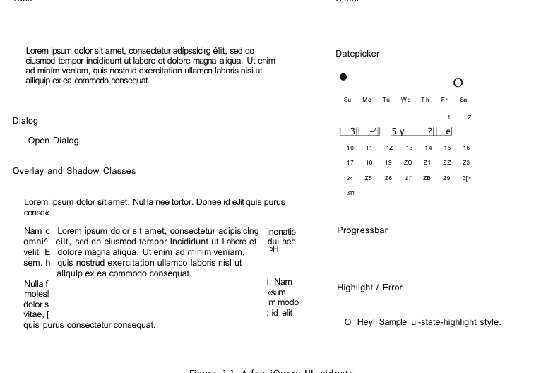

手风琴、滑块、对话框、日期选择器等等——都可以立即使用！你可以花大量时间在jQuery中自己创建它们（就像这些组件曾经被创建那样），但jQuery UI的组件足够可配置和复杂，你的时间最好花在其他地方——也就是实现你独特的项目需求，而不是确保你的自定义日期选择器在不同的浏览器上都能正确显示！

在本书的后续部分，我们肯定会使用大量jQuery UI功能。我们甚至会集成一些可用的炫酷主题，并学习如何使用jQuery UI ThemeRoller工具创建我们自己的主题。

### 插件

jQuery团队在使jQuery库可扩展方面煞费苦心。通过只包含一组核心功能，同时提供一个扩展库的框架，他们使得创建插件变得轻而易举。这些插件可以在你所有的jQuery项目中复用，也可以与其他开发者分享。许多相当常见的功能已从jQuery核心库中省略，归入了插件的范畴。别担心，这是一个特性，而非缺陷。任何额外需要的功能都可以轻松地按页面引入，以尽量减少带宽和代码臃肿。

值得庆幸的是，许多人利用了jQuery的可扩展性，因此从jQuery插件仓库中已经可以下载数百个优秀的插件，并且新的插件还在不断添加。其中一部分如图1.2所示。

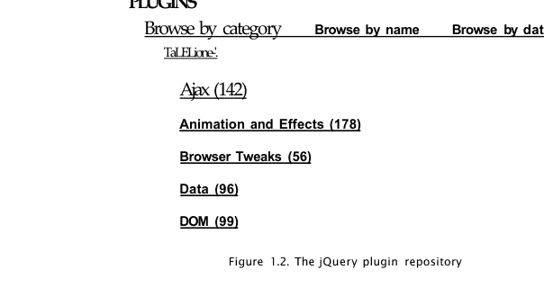

每当你遇到一个任务或问题，首先检查是否有符合你需求的插件是值得的。因为你可能需要的几乎任何功能，很可能已经有人将其制成了插件，并且可以立即供你使用。即使结果表明你需要自己动手，插件仓库通常也是引导你找到正确方向的最佳去处。

### 保持标记清洁

将脚本行为与页面表现分离是网络开发领域的最佳实践——尽管它确实带来了一些挑战。jQuery使得……


而且 jQuery 的功能不仅限于操作页面上现有的 HTML——它还能通过一系列便捷函数添加新的页面元素和文档片段。其中包含插入、追加和前置新 HTML 代码块到页面任意位置的函数。你甚至可以替换、移除或克隆现有元素——所有这些功能都能帮助你逐步增强网站，从而为浏览器支持的用户提供功能完善的体验，同时也为其他用户提供了可接受的体验。

jQuery 能让你轻松摆脱内联脚本，得益于它能以自然、类似 CSS 的方式轻松挂载页面元素并绑定代码。jQuery 本身不支持添加内联代码，因此这种关注点分离能带来更精简、更干净且更易于维护的代码。所以，用正确的方式做事情很容易，而用错误的方式做事情几乎不可能！

### 广泛采用

如果你有兴趣将能想到的每个 JavaScript 库都放入 Google Trends 中查看，你会见证 jQuery 指数级地成长为超级明星。在库的世界里，受欢迎是件好事，因为流行度意味着更活跃的代码开发以及大量有趣的第三方资源。

无数网络巨头纷纷加入 jQuery 的行列：IBM、Netflix、Google（既使用也托管 jQuery 库），甚至微软——其现在的 MVC 框架也包含了 jQuery。有如此众多的大型公司支持，可以肯定 jQuery 会在未来一段时间内继续存在——因此，你投入时间和精力去学习它将是值得的！

jQuery 的流行也催生了一个庞大而慷慨的社区，其乐于助人的程度令人惊讶。无论你的技能水平如何，你都会发现其他开发者有足够的耐心帮助你，解决你遇到的任何问题。这种关怀与分享的精神也传播到了更广阔的互联网，发展成为包含高质量教程、博客文章和文档的百科全书。

### 有什么缺点吗？

几乎没有缺点！反对使用任何 JavaScript 库的主要理由一直是速度和大小：有人说使用库会给页面增加太多下载负担，而另一些人则声称库的性能不如更精简的自定义代码。尽管这些观点值得考虑，但其相关性正在迅速消失。

首先，就大小而言，jQuery 非常轻量。jQuery 核心库的占用空间一直相当小——基础部分大约 19KB，比你常见的 JPG 图片还小。项目所需的任何额外功能（例如插件或来自 jQuery UI 库的组件）都可以模块化的方式添加——因此你可以轻松控制带宽消耗。

速度（像大小一样）正在成为越来越不令人担忧的问题，因为计算机硬件规格不断提升，浏览器的 JavaScript 引擎也越来越快。当然，这绝不意味着 jQuery 很慢——jQuery 团队似乎对速度有着执着的追求！每个新版本都比上一个更快，因此，自己编写 JavaScript 所能带来的任何优势每天都在缩小。

当涉及竞争的 JavaScript 库（市面上有不止少数几个）时，jQuery 在其擅长的领域（操作 DOM、添加效果和发起 Ajax 请求）做得最好。尽管如此，市面上的许多库质量都很优秀，并在其他方面表现出色，例如基于类的复杂编程。看看替代方案总是值得的，但如果我们概述的理由吸引了你，那么 jQuery 可能就是正确的选择。

但光说不练假把式：是时候让 jQuery 证明自己了！

### 下载与引入 jQuery

在你爱上 jQuery（或至少，亲自评判它）之前，你需要获取最新版本的代码并将其添加到你的网页中。有几种方法可以实现，每种方法都有几种选项可供选择。无论你选择哪种方式，你都需要将 jQuery 包含在你的 HTML 页面中，就像包含任何其他 JavaScript 源文件一样。

> **它只是 JavaScript！**

永远不要忘记 jQuery 只是 JavaScript！它表面上看起来和行为可能有所不同——但底层它是用 JavaScript 编写的，因此它无法做到任何普通的 JavaScript 做不到的事情。这意味着我们将像包含任何其他 JavaScript 文件一样，将其包含在我们的页面中。

#### 下载 jQuery

这是获取 jQuery 库最常见的方式——直接下载！最新版本始终可在 jQuery 网站上找到。那个显眼的下载按钮将引导我们到 Google 代码仓库，我们可以在那里获取最新的“生产压缩级别”版本。

点击下载链接，将 JavaScript 文件保存到一个新的工作文件夹中，准备使用。你需要将其放在 HTML 文件能找到的地方：通常是在网站文档根目录下的 `scripts` 或 `javascript` 目录中。在下面的例子中，我们会保持简单，将库放在与 HTML 文件相同的目录中。

为了使其正常工作，我们需要告诉 HTML 文件包含 jQuery 库。这是通过在 HTML 文档的 `head` 部分使用 `script` 标签来完成的。一个非常基础的包含 jQuery 的 HTML 文件的 `head` 元素可能看起来像这样：

```
<head>
  <title>你好 jQuery 世界！</title>
  <script type='text/javascript' src='jquery-1.4-min.js'></script>
  <script type='text/javascript' src='script.js'></script>
</head>
```

页面上的第一个 script 标签加载 jQuery 库，第二个 script 标签指向一个 `script.js` 文件，我们将在那里运行自己的 jQuery 代码。就这样：你准备好开始使用 jQuery 了。

我们之前说过下载 jQuery 文件是最常见的方法——但还有其他几种选择可供你使用，所以在继续之前，我们快速看一下。如果你只是想开始玩转 jQuery，可以安全地跳过本节的其余部分。

#### Google CDN

另一种值得考虑的包含 jQuery 库的方法是通过 Google 的 **内容分发网络**（CDN）。CDN 是一个专门设计用于以快速且可扩展的方式向用户提供内容的计算机网络。这些服务器通常在地理上分布，每个请求都由网络中最近的服务器处理。

Google 在其 CDN 上托管了几个流行的开源库，包括 jQuery（以及我们稍后会介绍的 jQuery UI）。因此，与其像我们上面那样在自己的网络服务器上托管 jQuery 文件，你可以选择让 Google 分担一部分带宽费用。你可以从 Google 庞大基础设施的速度和可靠性中受益，额外好处是还可以选择始终使用最新版本的 jQuery。

使用 Google CDN 的另一个好处是，许多用户在访问其他网站时已经从 Google 下载了 jQuery。因此，当他们访问你的站点时，它将从缓存加载（因为 JavaScript 文件的 URL 相同），从而显著缩短加载时间。你也可以通过相同的方法包含体积更大的 jQuery UI 库，这使得 Google CDN 对你的项目非常值得考虑：它将为你省钱，并在你的最新作品走红时提高性能！

通过 Google CDN 包含 jQuery 有几种不同的方式。我们将使用更简单（虽然灵活性稍差）的基于路径的方法：

```
<head>
    <title>你好 jQuery 世界！</title>
    <script type="text/javascript" src="http://ajax.googleapis.com/ajax/libs/jquery/1.4.0/jquery.min.js"></script>
    <script type="text/javascript" src="script.js"></script>
</head>
```

它看起来与我们的原始示例非常相似——但 script 标签不再指向本地副本的 jQuery，而是指向 Google 的一台服务器。

#### 通过 Google CDN 获取最新版本

如果你仔细查看指向 Google 服务器的 URL，你会看到 jQuery 的版本由路径元素之一指定（在我们的例子中是 1.4.0）。然而，如果你喜欢使用最新最好的版本，你可以从版本字符串末尾去掉一个数字（例如，1.4），它将返回 1.4 系列中可用的最新版本（1.4.1、1.4.2 等）。你甚至可以将其提升到整数（1），在这种情况下，即使 jQuery 1.5 及更高版本发布后，Google 也会给你最新版本！

但要小心：当新版本的 jQuery 发布时，你不需要更新 HTML 文件，但有必要留意任何可能影响你现有功能的库更改。

如果你想研究稍微复杂一点的包含库的 "Google loader" 方法，Google CDN 网站上有很多相关阅读内容。

#### 每夜构建版和 Subversion

获取 jQuery 的更高级选项列在官方的下载 jQuery 文档页面上。这些选项中的第一个是每夜构建版。**每夜构建版** 是 jQuery 库的自动化构建版本，包含当天添加或修改的所有新代码。每天晚上都会提供最新的开发版本供下载，并且可以像包含常规稳定库一样的方式包含。

如果每一晚对你来说*仍然*不够频繁，你可以使用 Subversion 版本库来获取最新的、即时更新的源代码。**Subversion** 是 jQuery 团队使用的一个开源版本控制系统。每次开发者向 jQuery 提交更改时，你都可以立即下载。

但要小心：每夜构建版和 Subversion 版的 jQuery 库通常未经测试。它们可以（并且将会）包含错误，并且会频繁更改。除非你打算研究 jQuery 库本身，否则最好跳过这些选项。


### 未压缩还是压缩？

如果你在 jQuery 下载页面上浏览过，可能还注意到有几种不同的下载格式选项：压缩版（也称为**精简版**）和未压缩版（也称为“开发版”）。

通常，对于生产环境代码，你会希望使用精简版，其中 jQuery 源代码经过了压缩：空格和换行符被移除，变量名被缩短。结果是完全相同的 jQuery 库，但包含在一个比原始文件小得多的 JavaScript 文件中。这对你减少带宽成本非常有利，同时也能为终端用户加快页面请求速度。

压缩文件的缺点是可读性差。如果你在文本编辑器中查看精简版的 jQuery 文件（试一下吧！），你会发现它几乎无法阅读：就是一行看起来乱糟糟的 JavaScript。大多数时候，库的可读性无关紧要，但如果你对 jQuery 实际如何工作感兴趣，那么未压缩的开发版本则是一个有注释、可读且相当优美的 JavaScript 示例。

### jQuery 脚本的剖析

现在我们已经在网页中引入了 jQuery，让我们来看看这个小宝贝能做什么。jQuery 语法第一次看可能有点奇怪，但它实际上非常简单直接，最重要的是，它高度一致。在编写了你的前几个命令后，这种风格和语法就会印在你脑海中，并让你想写更多。

### jQuery 别名

在页面中包含 jQuery 后，你就可以访问一个神奇的函数，奇怪的是它就叫做 `jQuery`。仅仅一个函数？正是通过这一个函数，jQuery 暴露了数百个强大的工具，为你的网页增添另一个维度。

因为单个函数充当了整个 jQuery 库的入口，所以库函数名与其他库或你自己的 JavaScript 代码冲突的可能性很小。否则，可能会出现这样的情况：假设 jQuery 定义了一个名为 `hide` 的函数（它确实有），而你自己的代码中也有一个名为 `hide` 的函数，其中一个函数会被覆盖，导致意外事件和错误的发生。

我们说 jQuery 库包含在 jQuery *命名空间*中。命名空间是一种与其他页面代码良好协作的优秀方法，但如果我们打算大量使用 jQuery（我们确实会），那么每个命令都必须输入完整的 jQuery 函数名很快就会变得烦人。为了解决这个问题，jQuery 提供了一个更短的别名来访问库。很简单，就是 `$`。

美元符号是一个简短、有效且看起来很酷的 JavaScript 变量名。这可能看起来有点懒（毕竟，使用别名你只节省了五次按键），但一整页的 jQuery 代码将包含数十次库调用，使用别名将使代码更具可读性和可维护性。

#### 使用多个库

你可能想使用完整的 `jQuery` 调用而不是别名的主要原因，是当同一个页面上有多个 JavaScript 库，它们都在争夺美元符号函数名的控制权时。美元符号是几个库中常见的函数名，通常用于选择元素。如果你遇到多个库的问题，请查看附录 A：处理冲突。

### 剖析 jQuery 语句

我们知道 jQuery 命令始于调用 `jQuery` 函数或其别名。现在让我们拿出手术刀，剖析 jQuery 语句的其余组成部分。图 1.3 显示了同一个 jQuery 语句的两种变体（使用完整函数名或 `$` 别名）。

```
selector   action   parameters
jQuery('p').css('color', 'blue');
$('p').css('color', 'blue');
```

图 1.3. 一个典型的 jQuery 语句

每个命令由四部分组成：jQuery 函数（或其别名）、选择器、操作和参数。我们已经了解了 jQuery 函数，所以让我们先看看选择器。选择器让我们能够定位（或选择）网页上的元素。接下来，我们选择要应用于每个所选元素的操作。随着我们在本书中实现效果，我们会看到越来越多的操作。最后，我们指定一些参数，告诉 jQuery 我们究竟想如何应用所选的操作。每当你看到 jQuery 代码时，试着将其分解为这些组成部分。这将使你在刚开始时更容易理解。

在我们上面的例子中，我们要求选择器选择页面上的所有段落标签（HTML 的 `<p>` 标签）。接下来，我们选择了 jQuery 的 `css` 操作，它用于修改最初选中的段落元素的 CSS 属性。最后，我们传入一些参数，将 CSS 颜色属性设置为蓝色值。最终结果？我们所有的段落现在都变成蓝色了！我们将在第 2 章更深入地探讨选择器和 `css` 操作。

我们的例子向 `css` 操作传递了两个参数（`color` 和 `blue`），但传递给操作的参数数量可以变化。有些需要零个参数，有些接受多组参数（用于一次性更改一大堆属性），有些则需要我们指定另一个 JavaScript 函数，以便在事件（如元素被点击）发生时运行代码。但所有命令都遵循这种基本结构。

### HTML 片段——又名“The DOM”

jQuery 被设计成与 HTML 和 CSS 无缝集成。如果你精通 CSS 选择器，并且知道例如 `div#heading` 指的是一个 id 为 `heading` 的 `div` 元素，那么你可以跳过这一节。否则，就需要一个关于 CSS 选择器和**文档对象模型（DOM）**的简短速成课程了。

DOM 并不专门针对 jQuery；它是所有浏览器制造商都同意遵循的、表示 HTML 对象的一种标准方式。对 DOM 有良好的工作知识将确保你顺利过渡到 jQuery 大师级别。

当你和水冷却器旁的酷孩子们交谈时，DOM 就是你对渲染后 HTML 片段的称呼。它是你的 HTML 标记的层次结构表示——其中每个元素（如 `div` 或 `p`）都有一个**父级**（它的“容器”），并且可以有一个或多个嵌套的**子级**元素。每个元素可以有一个 **id** 和/或可以有一个或多个 **class** 属性——你通常在 HTML 源文件中分配它们。当浏览器读取 HTML 页面并构建 DOM 时，它将其显示为一个由对象组成的网页，这些对象可以只是静静地待在那里（作为静态页面），或者更有趣的是，可以被我们的代码操作。

图 1.4 展示了一个示例 DOM 片段。如图所示，**body** 有两个子元素：一个 `h1` 和一个 `p`。这两个元素，由于被包含在同一个父元素中，被称为**兄弟元素**。

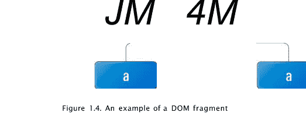

图 1.4. 一个 DOM 片段示例

元素的 id 在页面上唯一标识该元素：

```html
<div id="footer">Come back and visit us soon!</div>
```

该 `div` 被分配了一个 id **footer**。它使用 id 是因为它唯一：页面上应该有一个，并且只有一个。DOM 还允许我们通过 **class** 属性将相同的名称分配给多个页面元素。这通常用于共享某个特征的元素：

```html
<p class="warning">Sorry, this field must be filled in!</p>
<span class="warning">Please try again</span>
```

在这个例子中，同一页面上的多个元素被归类为“warning”。应用于 `warning` 类的任何 CSS 都将应用于这两个元素。同一元素上的多个 class 属性（当需要时）用空格分隔。

当你编写 CSS 时，你可以通过井号符号按 id 钩住元素，或者通过句点按 class 钩住元素：

```css
#footer { border: 2px solid black }
.warning { color: red }
```

这些 CSS 规则将给 id 为 `footer` 的元素添加黑色边框，并确保所有 class 为 `warning` 的元素将以红色文本显示。

当需要编写一些 jQuery 时，你会发现了解 CSS 选择器和 DOM 很重要：jQuery 使用与 CSS 相同的语法来选择页面上的元素进行操作。一旦你掌握了选择，其余的就很容易了——多亏了 jQuery！

### 如果你选择接受任务……

jQuery 是一个稳定且成熟的产品，可以用于任何规模的网站，这一点已被互联网上一些真正的巨头采用所证明。尽管如此，它仍然是一个动态的项目，在不断开发和改进中，每个新版本都提供性能提升和巧妙的附加功能。现在正是开始学习和使用 jQuery 的最佳时机！

随着我们深入本书，你会看到 jQuery 的座右铭“写得更少，做得更多”蕴含着很多真理。它是一个简单有趣的库，学习曲线平缓，让你能用很少的代码做很多很酷的事情。随着你在 jQuery 大师之路上不断前进，我们希望你也能对 JavaScript 本身产生一些尊重和理解。

在第 2 章中，我们将深入 jQuery，并开始使用它为我们客户的网站增添一些光彩。说到我们的客户，是时候我们见见他了……


## 章节

### 选择、装饰与增强

“在第二阶段，我们将希望利用社交网络，实现基于Web 2.0的社区化、众包式、Ajax，呃，交互，”我们的新客户说道。“但现在我们只需要对网站进行一些基础改动。”

我们的客户正在启动一个名为StarTrackr!的创业项目。它利用GPS和RFID技术追踪知名名人的精确地理位置，然后将这些信息出售给粉丝。他们一直在朋友本地的商店里运营得风生水起，但现在他们要把这项业务搬到线上。

“你能做到吗？这是需要在周五营业结束前上线的一份清单。”

你扫了一眼清单。令人惊讶的是，你注意到所有需求都可以用jQuery来实现。你看了看日历。现在是周五上午。我们开始吧！

清单上的第一项任务是在现有网站加载时添加一个简单的JavaScript警报。这是为了让访客知道，StarTrackr!目前没有因侵犯隐私而被起诉（这是当地一家报纸最近暗示的）。

当然，我们可以用普通的旧式JavaScript来完成，但我们知道使用jQuery会让我们的工作轻松得多——而且我们还可以边做边学习新技术！我们在第一章已经看过jQuery语句的结构；现在让我们看看将jQuery付诸行动所需的步骤：我们等待页面就绪，选择目标，然后进行修改。

你可能已经猜到jQuery可以比这更复杂一些——但只复杂一点点！即使是高级效果也将依赖于这个基本公式，只是最后两个步骤会多次迭代，可能还需要一点JavaScript知识。现在，让我们从简单轻松开始。

### 确保页面就绪

在我们能够与页面上的HTML元素交互之前，这些元素需要已经加载完成：我们只能在它们存在之后才能修改它们。在JavaScript的旧时代，唯一可靠的方法是在运行任何脚本之前等待整个页面（包括图片）加载完毕。

幸运的是，jQuery有一个非常酷的内置事件，可以尽快执行我们的代码。因此，我们的页面和应用程序在最终用户看来加载速度要快得多：

```javascript
$(document).ready(function() {
    alert('Welcome to StarTrackr! Now no longer under police ...');
});
```

这里的重要部分（以粗体突出显示）表示，“当我们的文档就绪时，运行我们的函数。”这可能是你最常看到的jQuery代码片段之一。通常，进行一个像这样的简单警报测试是个好主意，以确保你已正确引入jQuery库——并且没有发生任何奇怪的事情。

### 你将经常看到 $(document).ready()！

你在jQuery中所做的几乎所有事情都需要在文档就绪*之后*完成——所以我们将经常使用这个操作。从现在起，它将被称为文档就绪事件。除非另有说明，本书中的每个后续示例都需要从文档就绪事件内部运行。不过，每个页面只需声明一次。

文档就绪的用法非常普遍，事实上，它有一个快捷版本：

```javascript
$(function() { alert('Ready to do your bidding!'); });
```

如果你想使用快捷方法，尽管用吧！展开的版本可以说是自文档化代码更好的例子；它更容易一目了然地看出发生了什么——尤其是当它隐藏在其他开发者的JavaScript页面中时！

乍一看，文档就绪事件似乎与我们之前在jQuery结构课上遇到的结构相去甚远，但仔细观察，我们可以看到必要的部分都已齐备：选择器是 **document**；动作是 **ready**；参数是一个运行一些代码（我们的 **alert**）的函数。

### 选择：jQuery的核心

时间在流逝，截止日期不等人。客户指出，人们一直在网站上难以引用正确的名人ID。这是因为名人的名字都排列在一个大表格中，用户很难将名人与正确的参考ID对应起来。我们的客户告诉我们，他希望每隔一行显示为浅灰色，这样用户就可以轻松找到他们最喜欢的名人。

我们已经准备好让jQuery听候差遣——它只需要我们为它选择一个目标。在页面上选择要修改的元素真的是jQuery的艺术。新手和高手之间的最大区别之一就是你获取所需元素所花费的时间！

你可能还记得在我们的jQuery结构课上，我们所有的选择器都被包裹在 **jQuery** 函数中：

```javascript
jQuery(<selectors go here>)
```

或者使用别名：

```javascript
$(<selectors go here>)
```

在本书的剩余部分，我们将使用快捷别名——它方便得多。正如我们之前提到的，除非你与其他库有冲突问题（参见第9章的“避免冲突”部分），否则没有真正的理由使用完整的jQuery名称。

### 简单选择

我们的任务是选择名人表格中交替的行。我们该如何做？在使用jQuery进行选择时，你的目标应该是只具体到所需程度：你想找到能返回你想要修改内容的最简洁的选择器。让我们先来看看图2.1所示的名人表格的标记。

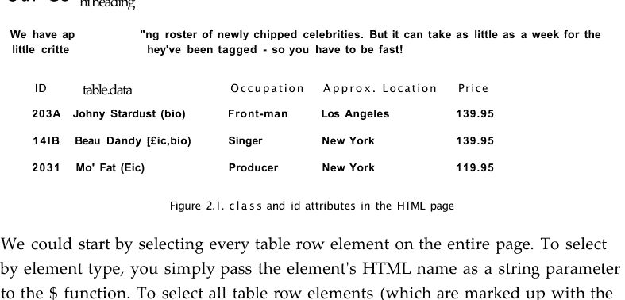

我们可以从选择整个页面上的每个表格行元素开始。要按元素类型选择，你只需将元素的HTML名称作为字符串参数传递给 $ 函数。要选择所有表格行元素（使用 `<tr>` 标签标记），只需写：

```javascript
$('tr')
```

### 什么也没发生！

如果你运行这个命令，页面上不会发生任何事情。这是预料之中的——毕竟，我们只是在选择元素。但不用担心；很快我们就会用各种奇妙的方式修改我们的选择。

同样，如果我们想选择页面上的每个段落、div元素、h1标题或输入框，我们将相应地使用这些选择器：

```javascript
$('p')
$('div')
$('h1')
$('input')
```

但我们不想改变名人页面上的每个表格行：只想改变包含名人数据的那些行。我们需要稍微具体一点，首先选择包含名人列表的容器元素。如果你查看HTML和图2.1，你可以看到包含我们名人表格的div的id为 celebs，而表格本身有一个名为 data 的类。我们可以使用这两个中的任何一个来选择表格。

jQuery借鉴了CSS中引用id和类名的惯例。要按id选择，请使用井号（#）后跟元素的id，并将此作为字符串传递给jQuery函数：

```javascript
$('#celebs')
```

你应该注意到，我们传递给jQuery函数的字符串与CSS id选择器的格式完全相同。因为id应该是唯一的，我们预计这只会返回一个元素。jQuery现在持有对该元素的引用。

同样，我们可以使用CSS类选择器按类进行选择。我们将一个由点（.）后跟元素类名组成的字符串传递给jQuery函数：

```javascript
$('.data')
```

这两条语句都会选择该表格，但正如我们在讨论id选择器时提到的，我们并不限于只选择一个元素。jQuery会很乐意选择我们指向的所有元素。如果有多个表格（或任何其他元素）也具有 `class data`，它们都会被选中。因此，对于这个表格，我们将坚持使用 `id`！

### 能更具体一些吗？

就像在CSS中一样，我们可以选择 `$('.data')` 或更具体的 `$('table.data')`。通过在 `class` 之外指定元素类型，选择器将只返回具有 `class data` 的 `table` 元素——而不是*所有*具有 `class data` 的元素。同样，像CSS一样，你可以添加父容器选择器来进一步缩小选择范围。

### 缩小我们的选择范围

我们已经成功选择了表格，尽管表格本身并不是我们关注的重点——我们想要的是它内部的*每隔一行*。我们已经选择了容器元素，从该容器元素中，我们想选出所有是表格行的后代元素：也就是说，我们想指定容器表格*内部*的所有表格行。为此，我们在祖先和后代之间放置一个空格：

```javascript
$('#celebs tr')
```

你可以使用这种结构深入到你正在寻找的元素，但为了清晰起见，尽量让你的选择器保持简洁。

让我们把这个想法再推进一步。假设我们想选择 `div` 元素内部的 `p` 元素内部的 `span` 元素——但前提是这些 `div` 的类恰好是 `fancy`。我们将使用选择器：

```javascript
$('div.fancy p span')
```

如果你能理解这个，你就准备好选择几乎任何东西了！

### 测试我们的选择

好了，回到我们手头的任务。感觉我们离目标越来越近了，但到目前为止我们只是在盲目选择，无法知道我们是否在正确的道路上。我们需要一种方法来确认我们选择了正确的元素。一个简单的方法是利用 `length` 属性，该属性返回选择中的元素数量。


选择器当前匹配的元素数量。我们可以结合这个与我们熟悉可靠的 `alert` 语句来确保我们的元素已被选中：

```
chapter_02/02_selecting/script.js

$(document).ready(function() {
    alert($('#celebs tr').length + ' elements!');
});
```

这会弹出显示所选集合的长度——7个元素——针对这个名人表格。这个结果可能出乎你的意料，因为表格中只有六位名人！如果你查看一下 HTML，就会发现问题所在：表头也是一个 `tr`，所以总共有七行。一个快速的修复方法是缩小我们的选择器范围，只查找位于 `tbody` 元素内部的表格行：

```
chapter_02/03_narrowing_selection/script.js

$(document).ready(function() {
    alert($('#celebs tbody tr').length + ' elements!');
});
```

这将弹出正确的长度6——jQuery 对象现在保存着我们的六个名人表格行元素。

如果 `alert` 显示0，你就知道你的选择器有错误。处理这类问题的一个好方法是将你的选择器缩减到尽可能小、尽可能简单的形式。

在我们的例子中，我们可以简单地写 `$('#celebs')`，这将只选择表格元素并弹出长度为1。从这里开始，你可以使你的选择器更具针对性，并在过程中检查你是否选择了正确数量的元素。

### 筛选器

既然我们已经成功选择了所有的表格行，将选择范围缩小到每隔一行就很简单了——因为 jQuery 提供了筛选器来实现这个功能。筛选器会移除某些项，只保留我们想要的。随着我们处理更多的例子，你会逐渐了解哪些可以被筛选，但现在我们将直接使用我们需要的用于斑马条纹的筛选器：

```
chapter_02/04_filters/script.js

$(document).ready(function() {
    alert($('#celebs tbody tr:even').length + ' elements!');
});
```

筛选器附加在你想要筛选的项目上（在本例中是表格行），并由一个冒号后跟筛选器名称定义。这里使用的 `:even` 筛选器保留选择中每个偶数索引的元素，移除其余的，这正是我们想要的。现在当我们弹出选择长度时，我们看到3，正如预期的那样。我们所有的奇数行都已被从选择中过滤掉了。有各种各样的 jQuery 选择器筛选器可供我们使用：`:odd`（正如你可能预料的那样）、`:first`、`:last`、`:eq()`（例如用于选择第三个元素）等等。在本书中，当我们需要时，我们将更详细地了解每一个。

### 选择多个元素

最后一个基础选择技巧是能够在单个语句中选择多个元素。这非常有用，因为我们经常希望对页面不相关部分的多个元素应用相同的动作。用逗号分隔选择器字符串就可以做到这一点。例如，如果我们想选择页面上的每个段落、`div` 元素、`h1` 标题和输入框，我们会使用这个选择器：

```
$('p,div,h1,input')
```

学习如何将所有这些不同的选择器组合在一起以精确访问你想要的页面元素，是掌握 jQuery 的重要部分。这也是使用 jQuery 最令人满意的部分之一，因为你可以在一行简短的代码中嵌入相当复杂的选择逻辑！

### 成为一个好选择者

选择似乎相当容易，在某种程度上确实如此。但我们到目前为止所涵盖的只是选择的皮毛。在大多数情况下，基础知识就足够了：如果你只是想定位一个元素或一组相关的元素，元素名称、id 和 class 是实现这一目标最有效、最简单的方法。

当从给定元素在 DOM 中移动时，情况会变得有点棘手。jQuery 提供了大量的选择器和动作用于遍历 DOM。**遍历** 意味着通过父元素和子元素在页面层次结构中上下移动。你可以在移动过程中添加和移除元素，在每个步骤应用不同的动作——这让你可以在一个 jQuery 语句中执行一些极其复杂的操作！

如果你是 CSS 高手，你已经熟悉其中很多语句；它们大多直接借鉴自 CSS 规范。但可能有一些你不熟悉，特别是如果你还没有花很多时间学习 CSS3 选择器。当然，我们将在我们的示例和演示中实现它们时涵盖和学习高级选择技巧。因此，任何时候你想了解更多关于所有可用的 jQuery 选择器，你只需访问在线文档¹ 并随意浏览即可！

### 装饰：用 jQuery 设置 CSS

在 jQuery 中选择元素是困难的部分。其他一切都是既简单又有趣的。在我们选择了目标之后，我们就可以操作它们来构建效果或界面。在本节中，我们将介绍一系列与 CSS 相关的 jQuery 动作：添加和移除样式、类等等。我们执行的动作将应用于我们选择的每一个元素，让我们能够随心所欲地改变页面！

### 读取 CSS 属性

在尝试更改 CSS 属性之前，让我们先看看如何简单地访问它们。jQuery 让我们使用 `.css()` 函数来做到这一点。试试这个：

```
chapter_02/05_reading_css_properties/script.js

$(document).ready(function() {
    var fontSize = $('#celebs tbody tr:first').css('font-size');
    alert(fontSize);
});
```

这段代码将弹出显示选择器匹配的第一个元素的字体大小（正如你可能猜测的那样，`:first` 筛选器将返回选择器匹配的元素中的第一个）。

### 多个元素的 CSS 属性

你*可以*在选择多个元素后请求一个 CSS 属性，但这几乎总是一个坏主意：一个函数只能返回一个结果，所以你仍然只会获得第一个匹配元素的属性。

使用此方法检索 CSS 属性的巧妙之处在于，jQuery 给你的是元素的*计算*样式。这意味着你将收到在用户浏览器中渲染的值，而不是 CSS 定义中输入的值。所以，如果你在 CSS 文件中给一个 `div` 设置了高度，比如200像素，但其内容将高度推超过了200像素，jQuery 将为你提供元素的实际高度，而不是你指定的200像素。

当我们稍后实现一些有趣的技巧时，我们会看到为什么这真的很重要。

### 设置 CSS 属性

到目前为止，我们还没有看到 jQuery 实际*做*任何事情，现在是时候补救这一点了。我们知道页面已就绪（因为我们弹出了一个 alert），并且我们相当确定我们选择了感兴趣的元素。让我们验证一下：

```
chapter_02/06_zebra_striping/script.js

$(document).ready(function() {
  $('#celebs tbody tr:even').css('background-color','#dddddd');
});
```

你大概料到了！这就是我们用来读取 CSS 属性的同一个 `.css()` 函数，但现在它被传递了一个额外的参数：我们希望为该属性设置的值。我们使用了这个动作将 `background-color` 设置为值 `#dddddd`（浅灰色）。在浏览器中打开代码存档中的文件，测试它是否正常工作。你可以在图2.2中看到结果。

| ID    | Name                      | Occupation | Appro*. Location | Price  |
|-------|---------------------------|------------|------------------|--------|
| Z03A  | Johny Stardust (bio)      | Front-man  | Los Angeles      | $39.95 |
| 141B  | Beau Dandy (pic,bio)      | Singer     | New York         | $39.95 |
| 2031  | Mo' Fat (pic)             | Producer   | New York         | $19.95 |
| Ü07F  | Kellie Kelly (bio,Dress)  | Singer     | Omaha            | $11.95 |
| 8 AO 5| Darth Fader (pic)         | DJ         | London           | $19.95 |
| 6636  | Glendatronix (bio,press)  | Keytarist  | London           | $39.95 |

图2.2. 用 jQuery 实现的斑马条纹

### 你准备好了吗？

如前所述，这个命令必须在文档就绪函数内部发出。如果我们运行命令时 DOM 尚未就绪，选择器会去寻找 `#celebs` 元素，但什么也找不到。此时它将放弃；它甚至不会寻找 `tr` 元素，更不用说更改背景样式了。

对于所有后续示例都是如此，所以请记住将你的代码包装在文档就绪函数中。

看起来不错！但也许我们应该给它添加一点额外的东西——毕竟，多多益善！为了真正定义我们的条纹，用一个稍浅一点的字体颜色怎么样？有几种方法可以添加第二个 CSS 属性。最简单的方法是使用我们的新值重复整个 jQuery 语句：

```
chapter_02/07_multiple_properties_1/script.js (excerpt)

$('#celebs tbody tr:even').css('background-color','#dddddd');
$('#celebs tbody tr:even').css('color','#666666');
```

这些行按顺序执行。虽然最终结果是正确的，但如果我们需要更改一长串属性，这将变得相当混乱且低效。值得庆幸的是，jQuery 为我们提供了一种使用**对象字面量**同时设置多个属性的好方法。对象字面量是 JavaScript 的一个概念，超出了本书的范围，但就我们的目的而言，你需要知道的是，它们提供了一种将键/值对分组在一起的简便方法。对于 CSS，对象字面量允许我们

要将我们的 CSS 属性（键）与匹配的 CSS 值（值）打包在一起：

```javascript
chapter_02/08_multiple_properties_2/script.js (excerpt)

$("#celebs tbody tr:even").css({
    'background-color': '#dddddd', 'color': '#666666'
});
```

对象字面量用花括号包裹，每个键与其对应的值用冒号分隔，每个键/值对之间用逗号分隔。它作为单个参数传递给 css 函数。使用这种方法，您可以指定任意数量的键/值对——只需用逗号分隔即可。建议您以可读的方式排列键/值对，这样当您稍后回顾代码时，可以轻松理解。如果您需要设置大量属性，这尤其有用。例如：

```javascript
chapter_02/09_multiple_properties_3/script.js (excerpt)

$("#celebs tbody tr:even").css({
    'background-color': '#dddddd',
    'color': '#666666',
    'font-size': '11pt',
    'line-height': '2.5em'
})
```

> 引号与否

通常，在处理 JavaScript 对象时，键不需要加引号。但是，为了让 jQuery 正常工作，任何包含连字符的键（如我们的 `background-color` 和 `font-size` 示例）都必须加引号，或者使用驼峰命名法（如 `backgroundColor`）。

此外，任何已经是 JavaScript 语言关键字的键（如 `float` 和 `class`）也必须加引号。

记住哪些键需要加引号，哪些不需要可能会令人困惑，因此建议您每次都把所有对象键都加上引号。

### 类

太棒了！我们已经从客户的任务清单上划掉了两项，我们还使用了一些酷炫的 jQuery。但如果您停下来看看我们上一个解决方案，您可能会注意到一些有点奇怪的地方。如果您在开发工具（如 Firebug）中检查斑马条纹的行，您会注意到 CSS 属性已*内联*添加到段落中，如图 2.3 所示。

```html
<table id="celebs" class="data">
    <tbody>
        <tr style="background-color: rgb(221, 221, 221);">
            <td>...</td>
        </tr>
        <tr>
            <td>...</td>
        </tr>
        <tr style="background-color: rgb(221, 221, 221);">
            <td>...</td>
        </tr>
        <tr>
            <td>...</td>
        </tr>
    </tbody>
</table>
```

图 2.3. 使用 Firebug 查看的内联样式


**Firebug**

Firebug 是一个非常有用的工具，用于在浏览器中检查 DOM，以及监控和编辑 CSS、HTML 和 JavaScript（包括 jQuery）。它是 Web 开发者的瑞士军刀，通过帮助您准确了解浏览器的想法，可以为您节省数小时的时间。它可作为 Mozilla Firefox 扩展使用，也可以作为独立的 JavaScript 文件，如果您使用其他浏览器进行开发，可以将其包含在您的项目中。

内联样式在 HTML/CSS 最佳实践中是个大忌，对吧？确实如此，这同样适用于 jQuery：为了保持代码清晰可维护，所有样式信息放在同一位置（您的 CSS 文件中）会更有意义。然后，正如我们很快会看到的，您可以通过向 HTML 标签添加或移除 `class` 属性来简单地切换这些样式。

有些时候，像我们刚才那样使用 css jQuery 方法确实是个好主意。最常见的应用场景是快速调试代码：如果您只想将某个元素用红色轮廓标出，以确保您正确选择了它，那么切换到 CSS 文件添加新规则似乎是在浪费时间。

#### 添加和移除类

如果我们需要从内联样式规则中移除 CSS，应该把它放在哪里？当然是放在单独的样式表中！我们可以在 CSS 中针对给定的类设置一个规则，将想要的样式放入其中，然后使用 jQuery 在 HTML 中为目标元素添加或移除该类。也许不足为奇，jQuery 提供了一些方便的方法来操作 DOM 元素的类属性。我们将使用其中最常见的 `addClass`，将我们的斑马条纹样式移到它们所属的 CSS 文件中。

`addClass` 函数接受一个包含类名的字符串作为参数。您还可以通过以空格分隔类名来同时添加多个类，就像在编写 HTML 时一样：

```javascript
$('div').addClass('class_name');
$('div').addClass('class_name1 class_name2 class_name3');
```

不过，我们只想添加一个类名，我们称之为 `zebra`。首先，我们将规则添加到一个新的 CSS 文件中（在 HTML 页面中使用 link 标签包含它）：

```css
/* chapter_02/10_adding_classes/zebra.css */
.zebra {
  background-color: #dddddd;
  color: #666666;
}
```

然后，回到我们的 JavaScript 文件，我们将修改选择器以使用 jQuery 的 `addClass` 方法，而不是 `.css()`：

```javascript
/* chapter_02/10_adding_classes/script.js */
$('#celebs tr:even').addClass('zebra');
```

结果完全相同，但现在当我们在 Firebug 中检查表格时，会看到内联样式消失了——取而代之的是我们新的类定义。如图 2.4 所示。

```html
<table id="celebs" class="data">
    <thead>
        ...
    </thead>
    <tbody>
        <tr class="zebra">
            <td>...</td>
        </tr>
        <tr>
            <td>...</td>
        </tr>
        <tr class="zebra">
            <td>...</td>
        </tr>
        <tr>
            <td>...</td>
        </tr>
    </tbody>
</table>
```

图 2.4. 为表格行添加类

这样好多了。现在，如果我们将来想更改斑马条纹的外观，只需修改 CSS 文件即可；这将省去我们在 jQuery 代码中（可能在多个位置）搜索更改值的麻烦。

有时我们也想从元素中移除类名（我们很快就会看到何时需要这样做）。移除类的操作被恰当地称为 `removeClass`。这个函数的使用方式与 `addClass` 完全相同；我们只需将（不）想要的类名作为参数传递：

```javascript
$('#celebs tr.zebra').removeClass('zebra');
```

使用 jQuery 的 `attr` 方法也可以操作 id 属性或任何其他属性。我们将在本书后面更详细地介绍这个方法。

### 增强：使用 jQuery 添加效果

现在您已经达到了一个重要的里程碑。您已经了解了 jQuery 语句的组成部分：选择器、操作和参数。并且您已经学习了使用该语句的步骤：确保文档就绪、选择元素并更改它们。

在下一节中，我们将应用这些知识来实现一些酷炫且有用的效果——希望能加强您对 jQuery 基础知识的理解。

#### 隐藏和显示元素

客户不喜欢网站上的免责声明——他觉得这反映了产品的负面形象——但他的律师坚持认为有必要。因此，客户要求您添加一个按钮，让用户有机会阅读后移除文本。

```html
chapter_02/11_hiding/index.html (excerpt)

<input type="button" id="hideButton" value="hide" />
```

我们在页面上添加了一个 ID 为 `hideButton` 的 HTML 按钮。当用户点击此按钮时，我们希望 ID 为 `disclaimer` 的免责声明元素被隐藏：

```javascript
chapter_02/11_hiding/script.js (excerpt)

$('#hideButton').click(function() {
    $('#disclaimer').hide();
});
```

运行此代码，确保当您点击隐藏按钮时，免责声明元素消失。

这个示例中让元素实际消失的部分是 `hide` 操作。所以，您可能会问，围绕这行代码的其他所有代码是什么？它被称为事件处理程序——理解它对于成为 jQuery 高手至关重要。我们可以使用许多事件处理程序（我们在这里使用了 `click` 事件处理程序），我们将在后续内容中大量使用它们。

### 事件处理程序

**事件处理程序**因其处理事件的功能而得名。事件是网页上发生的操作和用户交互。当事件发生时，我们说它被*触发*了。当我们编写一些代码来处理该事件时，我们说我们*捕获*了该事件。

网页上每时每刻都有成千上万个事件被触发：当用户移动鼠标、点击按钮、或者浏览器窗口调整大小、滚动条移动时。我们可以捕获并作用于任何这些事件。


本书中你接触到的第一个事件是文档就绪事件。没错，那是一个事件处理器：当文档宣布"我准备好了"时，就会触发一个事件，我们的jQuery语句会捕获它。

我们使用点击事件处理器来告诉jQuery在按钮被点击时隐藏免责声明：

```
$('#hideButton').click(function() {
    $('#disclaimer').hide();
});
```

### this

当事件触发时，我们通常需要引用触发它的元素。例如，我们可能想以某种方式修改用户刚刚点击的按钮。这种引用可以通过JavaScript关键字`this`在事件处理器代码内部获得。要将JavaScript对象转换为jQuery对象，我们用jQuery选择器将其包裹起来：

chapter_02/12_this/script.js（摘录）

```
$('#hideButton').click(function() {
    $(this).hide(); // 一个好奇地消失的按钮。
});
```

`$(this)`提供了一种更优雅的方式来引用触发事件的元素，而无需重新选择它。


### 行动在哪里？

刚开始时，这可能有点令人困惑，因为jQuery语句的"行动"部分似乎有多种用途：我们已经看到它用于运行动画、检索值，现在又用于处理事件！确实如此——它身兼数职！通常，行动的名称能很好地提示其目的，但如果你感到困惑，最好查阅索引。一段时间后，你就能分清处理器、动画和实用工具了。

### 显示隐藏的元素

继续我们的任务！客户还指明，用户需要能够在不小心关闭免责声明后重新获取它。因此，让我们在HTML中再添加一个按钮，这次的id为`showButton`：

**chapter_02/13_revealing/index.html（摘录）**

```
<input type="button" id="showButton" value="显示" />
```

我们还要在脚本文件中添加另一个jQuery语句，用于处理当点击**显示**按钮时显示免责声明：

**chapter_02/13_revealing/script.js（摘录）**

```
$('#showButton').click(function() {
  $('#disclaimer').show();
});
```

### 切换元素

为显示和隐藏免责声明分别设置按钮似乎浪费了宝贵的屏幕空间。更好的方式是使用一个按钮同时执行这两个任务——当免责声明可见时隐藏它，当它隐藏时显示它。一种实现方式是检查元素是否可见，然后相应地显示或隐藏。我们将移除旧按钮，添加这个漂亮的新按钮：

**chapter_02/14_toggle_1/index.html（摘录）**

```
<input type="button" id="toggleButton" value="切换" />
```

当它被点击时，我们检查是否需要显示或隐藏免责声明：

**chapter_02/14_toggle_1/script.js（摘录）**

```
$('#toggleButton').click(function() {
  if ($('#disclaimer').is('.visible')) {
    $('#disclaimer').hide();
  } else {
    $('#disclaimer').show();
  }
});
```

这引入了`is`行动。`is`接受我们通常传递给jQuery函数的任何选择器，并检查它们是否匹配被调用的元素。在这个例子中，我们检查选中的`#disclaimer`是否也被伪选择器`:visible`选中。它还可以用于检查其他属性：选择是否是`form`或`div`，或者是否启用。

### if语句

如果你完全是个编程新手（也就是说，如果你只接触过HTML和CSS），那么整段代码可能相当令人困惑！别担心，它实际上相当直接：

```
if (条件) {
    // 如果条件为真，执行这部分
} else {
    // 如果条件为假，执行这部分
}
```

条件可以是任何JavaScript会评估为`true`或`false`的东西。这种结构在任何类型的编程中都极其常见，我们将在本书的后续部分大量使用它。如果你对此感到不适应，最好的学习方法就是动手尝试：使用jQuery的`is`行动编写不同的`if / else`代码块，就像我们上面写的那样。你很快就能掌握！

`is`会根据元素是否匹配选择器返回`true`或`false`。就我们的目的而言，如果元素被隐藏，我们就显示它；如果可见，就隐藏它。这种在两种状态间切换的逻辑被称为**切换**，是一个非常有用的构造。

在两种状态间切换元素非常普遍，因此许多jQuery函数都有允许切换的版本。`show/hide`的切换版本就叫做`toggle`，工作方式如下：

chapter_02/15_toggle_2/script.js（摘录）

```
$('#toggleButton').click(function() {
    $('#disclaimer').toggle();
});
```

每次点击按钮，元素就在可见和隐藏状态间切换。

然而，如果按钮的标签能用一个比"切换"更有用的词来标注就好了，因为"切换"可能让用户感到困惑。如果你想同时切换按钮的文本呢？正如在使用jQuery时经常遇到的情况，有几种方法可以解决这个问题。这里是一种：

chapter_02/16_toggle_text/script.js（摘录）

```
$('#toggleButton').click(function() {
    $('#disclaimer').toggle();

    if ($('#disclaimer').is(':visible')) {
        $(this).val('隐藏');
    } else {
        $(this).val('显示');
    }
});
```

这段代码中有很多对你来说是新的内容。我们将把大部分细节留到后面，但请看看它，看看你自己能否弄明白。（提示：记住选择器`$(this)`指的是导致事件触发的元素——在这个例子中，就是按钮。）

### 渐进式增强

我们的免责声明功能运行完美——毫无疑问，客户会对它印象深刻。然而，我们的解决方案中有一个微妙的方面我们应该注意：如果用户使用不支持JavaScript的浏览器访问我们的网站，他们会在页面上看到一个点击后毫无反应的按钮。这会让用户非常困惑，甚至可能放弃我们的网站。

> "不支持JavaScript？"你可能会嗤之以鼻。"什么样的浏览器无法运行JavaScript？！"

在没有JavaScript的情况下浏览网页的用户可能比你想象的要多：使用非常老旧电脑或受限设备（如手机）的用户；需要屏幕阅读器来使用网络的视力障碍者；以及那些担心JavaScript是不必要的安全风险而选择禁用它的人。

根据你网站的受众群体，可能有5%到10%的用户在没有JavaScript功能的情况下浏览网页，而没有人想疏远10%的客户！解决方案是为这些用户提供可接受的体验——并为其他所有人增强它。这种做法被称为渐进式增强。

对于我们的免责声明功能，我们可能会采用这种折中方案：我们希望免责声明对所有用户都可见，因此我们将它放在HTML中。然后，我们为有JavaScript的用户添加隐藏它的能力。也就是说，我们更倾向于避免向无法使用它的用户显示显示/隐藏按钮。

实现这一点的一种方法可能是用CSS隐藏我们的按钮，只通过jQuery语句显示它。这个技巧的问题在于，如果用户的浏览器也缺少CSS支持，它就会失败。我们真正想做的是通过jQuery将按钮添加到页面中；这样，只有拥有JavaScript的用户才能看到按钮。完美！

### 添加新元素

到目前为止，我们看到jQuery函数用于选择，但它还有另一个同等重要的功能：创建新元素。实际上，任何放在jQuery函数内的有效HTML字符串都会被创建并准备好让你粘贴到页面上。下面是我们如何创建一个简单段落元素的例子：

```
$('<p>一个新段落！</p>')
```

当你编写这段代码时，jQuery会执行几个有用的操作：它将HTML解析为DOM片段并选中它——就像普通的jQuery选择器一样。这意味着它立即准备好进行进一步的jQuery处理。例如，要为新创建的元素添加一个类，我们可以简单地写：

```
$('<p>一个新段落！</p>').addClass('new');
```


新段落现在将被赋予 `class` 属性 `new`。使用这种方法，你可以通过 jQuery 本身创建任何需要的新元素，而无需在 HTML 标记中定义它们。这样，我们就能实现逐步增强页面的目标。

> **innerHTML**

在内部，HTML 字符串是通过创建一个简单元素（例如 div）并将该 div 的 innerHTML 属性设置为你提供的标记来解析的。你传入的一些内容无法同样轻松地转换——因此最好保持 HTML 片段尽可能简单。

一旦我们创建了新元素，就需要一种方法将它们插入到页面中我们希望的位置。有几种 jQuery 函数可用于此目的。我们要看的第一个是 `insertAfter` 函数。`insertAfter` 会将我们当前的 jQuery 选择（在本例中是我们新创建的元素）插入到另一个被选中的元素之后，该元素作为参数传递给该函数。

示例是展示此功能最简单的方法。以下是我们使用 jQuery 创建切换按钮的方式：

```javascript
$("<input type='button' value='toggle' id='toggleButton'>")
    .insertAfter('#disclaimer');
$('#toggleButton').click(function() {
    $('#disclaimer').toggle();
});
```

如图 2.5 所示，按钮被插入到免责声明之后，就像我们直接把它放在 HTML 文件中一样。

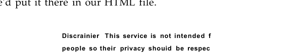

`insertAfter` 函数将新元素作为紧随免责声明元素之后的同级元素添加。

如果你想将元素插入到免责声明之前，你可以定位到免责声明之前的元素并使用 `insertAfter`，或者更合乎逻辑地，使用 `insertBefore` 方法。`insertBefore` 也会将新元素放置为现有元素的同级元素，但它会立即出现在该元素之前：

```javascript
// chapter_02/18Insert_before/script.js (摘录)
$(`<input type="button" value="toggle" id="toggleButton">`)
.insertBefore(`#disclaimer`);
```

快速回顾一下：当我们谈论 DOM 时，*兄弟元素*指的是在 DOM 层次结构中处于同一层级的元素。如果你有一个包含两个 span 元素的 div，那么这两个 span 元素就是兄弟元素。

如果你想将新元素添加为现有元素的 *子元素*（即，你希望新元素出现在现有元素 *内部*），那么你可以使用 `prependTo` 或 `appendTo` 函数：

```javascript
// chapter_02/19_prepend_append/script.js (摘录)
$('<strong>START!</strong>').prependTo('#disclaimer');
$('<strong>END!</strong>').appendTo('#disclaimer');
```

如图 2.6 所示，我们的新元素被添加到了实际免责声明 div 的开头和结尾，而不是在其之前或之后。还有更多用于插入和删除元素的操作，但由于在本轮修改中不需要，我们将在后面讨论。


### 插入多个元素

一个新项会 *为每个与选择器匹配的元素插入一次*。例如，如果你的选择器匹配每个段落标签，`insertAfter` 操作将在每个段落标签之后添加一个新元素。这使得它成为一个相当强大的函数！

### 删除现有元素

我们告知客户，他多达 10% 的用户可能缺乏 JavaScript 功能，因此会错过我们正在构建的一些高级功能。他询问我们是否可以添加一条消息，向这些人解释推荐使用 JavaScript。显然，这条消息应该对那些 *拥有* JavaScript 的用户隐藏。

这似乎是学习如何使用 jQuery 从页面中删除 HTML 元素的绝佳机会。我们将消息放在 HTML 中，然后用 jQuery 删除它；这样，只有没有 JavaScript 的访问者才会看到它。

让我们继续将新的警告添加到我们的 HTML 页面：

```html
<!-- chapter_02/20_removing_elements/index.html (摘录) -->
<p id="no-script">
    我们建议您启用 JavaScript！
</p>
```

现在我们需要运行代码从页面中移除该元素。如果用户禁用了 JavaScript，我们的 jQuery 语句将无法运行，消息将保留在屏幕上。要在 jQuery 中删除元素，首先使用选择器选择它们（通常如此），然后调用 `remove` 方法：

```javascript
// chapter_02/20_removing_elements/script.js (摘录)
$("#no-script").remove();
```

`remove` 操作将从 DOM 中移除所有被选中的元素，并且也会移除附加到这些元素上的任何事件处理程序或数据。`remove` 操作不需要任何参数，但你也可以指定一个表达式来进一步细化选择。试试这个例子：

```javascript
// chapter_02/21_removing_with_selector/script.js (摘录)
$('#celebs tr').remove(':contains("Singer")');
```

此代码不会删除 #celebs div 中的每个 tr，只会删除包含文本“Singer”的行。当我们下一章探讨一些高级效果时，这将派上用场。

由于这些更改，我们的页面将为那 10% 没有 JavaScript 的用户正常工作，对于其余 90% 的用户则运行得更好！这是一个非常简单的渐进式增强示例，但它让你很好地理解了基本思想：不要将 jQuery 用作你 UI 的基础，而是用它为已经可用的功能增添一些亮点。这样，你知道没有人会掉队。

为了保持示例代码小而专注，我们将停止深入探讨这个主题。但请自行研究——这是能让你成为更好的 Web 开发者的那种最佳实践。

### 修改内容

我们现在几乎可以对元素做任何想做的事情：显示它们、隐藏它们、添加新元素、删除旧元素、随心所欲地设置样式……但如果我们想更改元素的实际内容呢？同样，jQuery 提供了专门用于此目的的方法：`text` 和 `html`。

`text` 和 `html` 操作非常相似，因为两者都设置我们选择的元素的内容。我们只需向任一函数传递一个字符串：

```javascript
// chapter_02/22_modifying_content/script.js (摘录)
$('p').html('good bye, cruel paragraphs!');
$('h2').text('All your titles are belong to us');
```

在这两个示例中，匹配元素的内容将更改为我们提供的字符串：页面上的每个段落和 h2 标签都将被我们的新内容覆盖。如果我们尝试在内容字符串中添加一些 HTML，就可以看到 `text` 和 `html` 之间的区别：

```javascript
// chapter_02/23_callback_functions_2/script.js (摘录)
$( 'p' ).html( '<strong>Warning!</strong> Text has been replaced ... ' );
$( 'h2' ).text( '<strong>Warning!</strong> Title elements can be ...' );
```

在这种情况下，我们的段落将包含粗体文本，但我们的 h2 标签将包含整个内容字符串，包括 `<strong>` 标签。用于修改内容的操作取决于你的要求：纯文本用 `text`，HTML 用 `html`。

你可能会想，“这些新操作只能*设置*内容吗？”到这个阶段，你应该不会惊讶于我们也可以使用相同的操作从 jQuery 选择中获取内容：

```javascript
// chapter_02/24_get_content/script.js (摘录)
alert($('h2:first').text());
```

我们使用不带参数的 `text` 操作，它返回页面上第一个 h2 标签的文本内容（“Welcome！”）。与其他检索值的操作一样，这对于条件语句特别有用，也可以为我们的用户交互添加重要信息。

### 基础动画：富有魅力的隐藏与显示

所有这些显示、隐藏和更改都很有用，但从视觉上看有些平淡无奇。是时候转向一些更……让我们说，更*动态*的 jQuery 技巧了。

核心 jQuery 库包含一些基本效果，我们可以用来为页面增添趣味。一旦你对这些感到厌倦，可以前往 jQuery 插件仓库，在那里你会找到数百种更疯狂的效果。

> **保持合理**
> 在处理 Web 上的效果和动画时，启用你良好的品味传感器可能是个明智之举。记住，曾经 `<blink>` 标签被认为是完全合理的！


### 淡入淡出

jQuery 中最常见（也最经典）的效果之一就是内置的淡入淡出效果。要使用最基本的淡入淡出，只需将 `show` 替换为 `fadeIn`，或将 `hide` 替换为 `fadeOut`：

```
chapter_02/25_fade_in_out/script.js (excerpt)

$('#hideButton').click(function() {
    $('#disclaimer').fadeOut();
});
```

我们还可以使用几个可选参数来修改效果，第一个参数用于控制淡入淡出完成所需的时间。许多 jQuery 效果和动画都接受时间参数——该参数可以作为字符串或整数传递。

我们可以使用以下预定义字符串之一来指定时间跨度：`slow`、`fast` 或 `normal`。例如：`fadeIn('fast')`。如果您希望对动画的持续时间进行更精细的控制，也可以以毫秒为单位指定时间，如：`fadeIn(1000)`。

### 切换效果和动画

虽然 jQuery 没有专门用于切换淡入淡出的动作，但这里有个小秘密：我们最初的 `toggle` 动作比我们最初想象的有更多技巧。如果我们传递一个时间跨度参数，就会发现 `toggle` 具有动画能力：

```
chapter_02/26_toggle_fade/script.js (excerpt)

$('#toggleButton').click(function() {
    $('#disclaimer').toggle('slow');
});
```

您可以看到整个元素的宽度、高度和不透明度都进行了动画处理。如果这对您来说有点复杂，还有另一个包含内置切换动作的核心 jQuery 动画效果：滑动。

滑动效果使元素平滑地进入和离开视图，就像从隐藏的隔间中滑出一样。其实现方式与我们的淡入淡出相同，但使用了 `slideDown`、`slideUp` 和 `slideToggle` 动作。与淡入淡出效果一样，我们也可以指定时间跨度：

```
chapter_02/27_slide_toggle/script.js (excerpt)

$('#toggleButton').click(function() {
  $('#disclaimer').slideToggle('slow');
});
```

### 回调函数

许多效果（包括我们的滑动和淡入淡出效果）接受一个称为**回调函数**的特殊参数。回调函数指定在效果完成其所需操作后需要运行的代码。在我们的例子中，当滑动完成后，它将运行我们的回调代码：

```
chapter_02/28_callback_functions/script.js (excerpt)

$('#disclaimer').slideToggle('slow', function() {
  alert('The slide has finished sliding!');
});
```

回调函数只是作为第二个参数传递给效果动作，是一个匿名函数，与我们为事件处理程序提供函数的方式非常相似。

### 匿名函数

在 JavaScript 中，内联定义的函数（如我们的回调和事件处理程序）称为匿名函数。它们被称为“匿名”仅仅是因为它们没有名字！当您只需要函数从特定位置运行时，可以使用匿名函数。

在任何使用匿名函数的情况下，也可以传递一个函数名称而在其他地方定义该函数。当同一个函数需要在多个不同位置调用时，最好这样做。在像我们这样的简单示例中，这可能会使代码更难理解，所以目前我们将坚持使用匿名函数。

让我们将回调函数付诸实践。如果我们想在免责声明滑动消失后隐藏按钮：

```
chapter_02/29_callback_functions_2/script.js (excerpt)

$('#disclaimer').slideUp('slow', function() {
    $('#hideButton').fadeOut();
});
```

免责声明将向上滑动，只有在该动画完成后，按钮才会从视图中淡出。

### 一些技巧

既然我们已经完成了客户待办事项列表上的一些优先事项，让我们来点更炫的东西，为网站增添一些额外的亮点。我们将基于目前所学的知识，添加一些效果和视觉高亮。这里会介绍一些新的构造和动作，所以如果您是 jQuery 世界的新手，值得仔细研究一下。

### 悬停高亮

客户对斑马条纹的可用性问题非常热衷。他要求，在改变行颜色的同时，当用户将鼠标移到表格上时，还应该有一个额外的高亮效果。

我们可以通过向表格添加事件处理程序来实现这个效果，这些处理程序处理 `mouseover` 和 `mouseout` 事件。然后我们可以添加或移除一个包含鼠标悬停元素特定背景色的 CSS 类。这与我们在纯 JavaScript 中所做的非常相似：

```
chapter_02/30_hover_highlight/script.js (excerpt)

$('#celebs tr').mouseover(function() {
    $(this).addClass('zebraHover');
});
$('#celebs tr').mouseout(function() {
    $(this).removeClass('zebraHover');
});
```

请记住，`$(this)` 指的是选中的对象——所以当用户将鼠标悬停在每一行上时，我们正在为每一行添加和移除 `zebraHover` 类。现在我们只需要向 CSS 文件添加一个样式规则：

```
chapter_02/30_hover_highlight/zebra.css (excerpt)

tr.zebraHighlight {
    background-color: #FFFACD;
}
```

在您的浏览器中试一试，您会看到它效果有多好。然而，事实证明有一种更简单的方法可以实现相同的结果：jQuery 包含一个 `hover` 动作，它将 `mouseover` 和 `mouseout` 合并到一个处理程序中：

```
chapter_02/31_hover_action/script.js (excerpt)

$('#celebs tbody tr').hover(function() {
    $(this).addClass('zebraHighlight');
}, function() {
    $(this).removeClass('zebraHighlight');
});
```

注意到 `hover` 事件处理程序有什么特别之处了吗？它需要两个函数作为参数：一个处理 `mouseover` 事件，另一个处理 `mouseout` 事件。

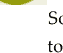

> **需要多少个回调？**
> 一些事件处理程序需要不同数量的函数。例如，`toggle` 事件处理程序可以接受任意数量的函数；每次触发时，它会简单地依次循环执行每个回调函数。

我们已经熟练掌握了添加和移除 `class` 属性，现在可能是指出另一个与类相关的实用动作的好时机：`toggleClass`。您可以猜出它的作用。这是一个极其有用的动作：如果元素没有该类，就添加它；如果已经有，则移除它。

例如，假设我们希望用户能够从表格中选择多行。单击表格行一次应高亮显示，再次单击应移除高亮。使用我们的新 jQuery 技能，这很容易实现：

```
$('#celebs tbody tr').click(function() {
    $(this).toggleClass('zebraHover');
});
```

试试点击表格行。很酷吧？

### 剧透揭示器

StarTrackr! 网站的最新新闻版块提供了一系列流行名人的即时八卦新闻。该新闻是网站的一大吸引点——大多数用户每天都回来查看最新更新。客户希望利用它产生的轰动效应并增加兴奋感，所以他寻求我们的帮助。我们建议了一个剧透揭示器：用户可以尝试猜测新闻是关于哪位名人的，然后再点击查找答案。

这种功能也非常适合包含电影评论的网站。您可以隐藏评论中可能透露电影剧情细节的部分，但允许已经看过电影的用户揭示它们。

要设置我们的剧透揭示器，我们需要向网站的新闻部分添加一个新元素。任何默认情况下应隐藏的“秘密”将被包装在一个带有 `spoiler` 类的 `span` 元素中：

```
Who lost their recording contract today?
<span class='spoiler'>The Zaxntines!</span>
```

让我们分解一下我们的脚本需要做什么：首先，我们需要隐藏答案并添加一个新元素，使用户可以在需要时显示答案。当该元素被点击时，我们需要显示答案。隐藏？添加？处理点击？我们知道如何做所有这些事情：


### 动画、滚动与尺寸调整

客户对我们快速且富有灵感的首轮改动感到非常满意，并希望进一步推进。他的公司从事娱乐行业，他认为网站应该反映出他眼中该行业固有的激动人心和充满活力的特质。此外，他认为炫酷的动画将有助于提升销售额。

"我觉得它需要一些我听过的那种 Web 2.0 风格，"他自信地说道。"你能让它看起来更像 Web 2.0 吗？"

"呃，我们当然可以，"你向他保证道，同时他递给你下一份充满激动人心改动的愿望清单——这份清单将使我们超越简单的隐藏与显示，更接近成为 jQuery 忍者的目标。

### 动画

jQuery 本身就是为了动画而构建的。无论是登录失败后淡出警告消息、向下滑动菜单控件，甚至是驱动一个完整的横版"射击"游戏——借助一些强大的内置方法，并辅以大量插件，这一切都轻而易举。

### CSS 属性动画

到目前为止，我们已经掌握了一些有价值的动画示例——滑动、淡入淡出，以及一些花哨的隐藏和显示——但我们对具体是什么在动画化以及它具体如何发生并没有太多控制权。是时候介绍一个非常令人兴奋的 jQuery 函数了，它被恰当地命名为 `animate`，它允许你对一系列 CSS 属性进行动画处理，以创造出你自己独特的效果。让我们来看一个 `animate` 实际运用的例子：

```javascript
// chapter_03/01_animating_css/script.js (excerpt)
$('p').animate({
    padding: '20px',
    borderBottom: '3px solid #8f8f8f',
    borderRight: '3px solid #bfbfbf'
}, 2000);
```

这段代码将对页面上的所有段落进行动画处理，在 2 秒（2000 毫秒）的时间内，将 padding 从初始状态更改为 20px，并添加一个斜面边框。

要使用 `animate`，我们需要传递一个对象字面量，其中包含我们希望动画化的属性，以键/值对的形式指定——这与使用 `css` 函数分配多个属性非常相似。有一个你需要记住的注意事项：属性名必须使用驼峰命名法才能被 `animate` 函数使用；也就是说，你需要写 `marginLeft`，而不是 `margin-left`，写 `backgroundColor`，而不是 `background-color`。任何由多个单词组成的属性名都需要以这种方式进行修改。

时间跨度参数的工作方式与我们在第 2 章看到的简单动画完全相同：你可以传递毫秒数，或者字符串 `slow`、`fast` 或 `normal` 之一。CSS 属性的值可以设置为像素（px）、em、百分比（%）或点（pt）。例如，你可以写 `100px`、`10em`、`50%` 或 `16pt`。

更令人兴奋的是，你定义的值可以相对于元素的当前值：你只需要在值前面指定 `+=` 或 `-=`，该值就会从元素的当前属性中增加或减去。让我们利用这个能力，使用 `hover` 函数在鼠标悬停于菜单项时让我们的导航菜单摆动起来：

```javascript
// chapter_03/02_relative_css_animation/script.js (excerpt)
$("#navigation li").hover(function() {
    $(this).animate({paddingLeft: '+=15px'}, 200);
}, function() {
    $(this).animate({paddingLeft: '-=15px'}, 200);
});
```

将鼠标悬停在导航菜单上，你会看到链接漂亮地晃动起来。

你还可以使用 `animate` 来对我们在第 2 章看到的显示、隐藏和切换功能进行精细控制。我们只需将属性的动画值指定为 `show`、`hide` 或 `toggle`，而不是一个数值：

```javascript
// chapter_03/03_animate_show_hide (excerpt)
$("#disclaimer").animate({
    opacity: 'hide',
    height: 'hide'
}, 'slow');
```

看到元素产生动画效果非常令人满足。作为一个练习，尝试动画化你能想到的每个元素属性——你会发现一些有趣的效果！`animate` 函数还有一些强大的高级选项，我们将在本章中详细探讨。

### 颜色动画

一旦你意识到 `animate` 函数有多酷，你可能就会想要动画化一个元素的颜色。然而，动画化颜色有点棘手，因为起始颜色和结束颜色之间的"中间"颜色值需要以一种特殊的方式计算。与高度或宽度值以简单、线性的方式从一个值移动到另一个值不同，jQuery 需要做一些额外的数学运算来确定颜色，例如，浅蓝色和橙色之间四分之三位置处的颜色是什么。

这种颜色计算功能从核心库中省略了。想一想这是有道理的：大多数项目不需要这个功能，所以 jQuery 可以将核心库的大小保持到最小。如果你想动画化颜色，你需要下载颜色动画插件。


### 使用插件

官方 jQuery 插件仓库² 包含了数量不断增长的插件——其中一些比其他的更有用。你可以按名称、类别（如效果或工具）或 jQuery 社区评分来搜索插件。

一旦找到感兴趣的插件，将其下载到项目中合适的位置（很可能与你的 jQuery 源文件在同一位置）。在使用插件前，最好先浏览一下 **readme** 文件或相关文档，但通常你只需像我们之前包含自定义 JavaScript 文件一样，将其包含在 HTML 文件中即可。

如何使用新获得的功能因插件而异，因此你需要查阅每个插件的文档以获得最佳使用方式。

下载并包含“颜色动画”插件后，你就可以在 jQuery 动画代码中像处理其他 CSS 属性一样，为颜色属性添加动画效果了。让我们在页面加载时，用两秒钟逐渐高亮显示免责声明消息，以确保没人会错过：

**chapter_03/04_color_animation** *（摘录）*

```
$('#disclaimer').animate({'backgroundColor':'#ff9f5f'}, 2000);
```

看到为免责声明添加动画使其变得更加醒目了吗？

### 缓动

**缓动**是指动画过程中发生的加速和减速，以使其感觉更自然。缓动通过应用数学算法来改变动画进程中的速度。幸运的是，我们使用的是 jQuery，所以你大可以安全地将你的高中数学技能锁起来。

jQuery 中有两种可用的缓动类型：`linear` 和 `swing`。在 jQuery 中使用任何动画函数时，你都可以指定这两个参数中的任何一个来控制动画的缓动效果。它们之间的区别如图 3.1 所示，该图展示了根据你选择的缓动选项，属性在动画期间是如何调整的。

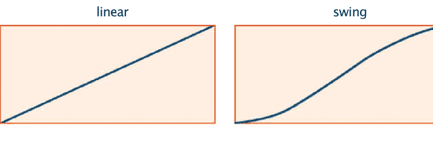

**swing** 缓动开始时较慢，然后加速，临近动画结束时又会缓缓减速。在视觉上，swing 缓动看起来比 linear 缓动自然得多，如果未指定缓动参数，jQuery 默认使用它。

linear 缓动方法没有加速或减速：动画以恒定速率发生。在大多数情况下，它看起来相当乏味且有点生硬，但值得尝试一下——它可能正好适合你的目的。

例如，我们将为第一个段落标签添加动画，使其被点击时能够放大和缩小；放大时使用 linear 缓动，缩小时使用 swing 缓动。区别相当微妙，但如果你重复播放动画几次，应该能够区分它们；缩小的动画感觉更自然一点：

chapter_03/05_easing/script.js（摘录）

```
$('p:first').toggle(function() {
    $(this).animate({'height':'+=150px'}, 1000, 'linear');
}, function() {
    $(this).animate({'height':'-=150px'}, 1000, 'swing');
});
```

这条语句中包含了不少 jQuery 知识，所以现在暂停一下，确保你理解这里发生的一切是个好时机：

- 我们使用带选择器的过滤器来仅获取第一个段落标签。
- 一个切换事件处理器（它会在连续点击时依次执行传入的函数）被附加到该段落上。
- 在处理器内部，我们选择了 `this`，它指的是触发事件的元素（在我们的示例中，它就是段落本身）。
- 第一个处理器使用 `+=` 格式，通过 `linear` 缓动函数将段落高度增加 300 像素。
- 第二个处理器使用 `-=` 格式，通过 `swing` 缓动函数将段落高度减少 300 像素。

如果你能跟上并理解这些步骤的每一步，那么恭喜你！你真的开始掌握 jQuery 了！

### 高级缓动

如前所述，swing 缓动提供了视觉上更令人愉悦的过渡效果，对于大多数任务来说可能已经足够了。但 swing 和 linear 缓动只是冰山一角。在 jQuery 核心库中包含的这两种基本类型之外，还有大量的缓动选项。其中大多数都可在 jQuery 插件仓库中的缓动插件中找到。

> **jQuery UI 包含多个插件**
>
> 缓动库也包含在 jQuery UI 库的效果部分中，我们稍后会讨论它。如果你开始感到插件疲劳，那么你可能想跳到“jQuery 用户界面库”一节——该库包含几个常用插件，包括颜色动画、类转换和缓动。通过包含 jQuery UI 库，你可以避免在页面中单独包含每个插件。

只需下载该插件的 JavaScript 文件并将其包含在 HTML 页面中 jQuery 库之后的任何位置即可。缓动插件并非提供新函数，而是让你能够访问超过 30 种新的缓动选项。解释所有这些缓动函数的功能将考验最有想象力的作家，因此我们将直接引导你关注图 3.2，你可以在其中以图形方式看到一些算法。

你会注意到一些算法超出了图表区域；当动画元素到达过渡的这一部分时，它们会移动到目标位置*之后*，然后最终返回并稳定在那里。效果就像是连接在一个弹性带上的元素，它会轻轻地将所有东西拉回原位。

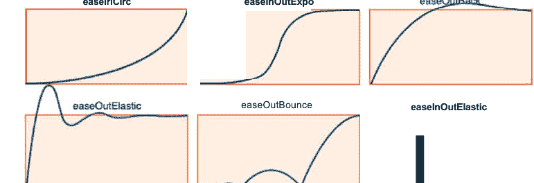

要使用其中一种新算法，我们只需将其名称传递给 `animate` 函数即可。有很多选择，所以我们不妨直接上手尝试几个不同的：

chapter_03/06_other_easing_options/script.js（摘录）

```
$('p:first').animate({height : '+=300px'}, 2000, 'easeOutBounce');
$('p:first').animate({height : '-=300px'}, 2000, 'easeInOutExpo');
$('p:first').animate({height : 'hide'}, 2000, 'easeOutCirc');
$('p:first').animate({height : 'show'}, 2000, 'easeOutElastic');
```

看看那个段落的运动！你可能想知道这些缓动选项名称从何而来——或者在哪里可以看到完整列表。这些算法源自 Robert Penner 的缓动方程，他的网站上有详细描述。⁴

查看所有可用方程的最佳方式是查看插件的源代码。如果你使用文本编辑器打开下载的文件，你会看到一个可以在 jQuery 动画中使用的函数列表。

### 动手实践时间

休息一下，测试插件提供的所有缓动函数。你不太可能用到所有这些函数，但熟悉它们将让你能够选择正确的函数，为你的界面提供你想要的精确感觉。此外，尝试 `animate` 函数将巩固你对它的了解：它是 jQuery 忍者武器库的重要组成部分！

### 弹跳内容面板

既然我们已经了解了 `animate` 函数的工作原理，让我们来看看客户最新的需求。今天的待办事项清单包括添加一个极其重要的页面组件：*StarTrackr! 当前“谁最火？”*列表（简称 SDWHRNL）。该列表包含最新得宠或失宠的名人，附带照片和简短简介。我们将应用刚才学到的一些动画和缓动技术，将这个列表实现为可以独立打开和关闭的面板。

该小部件在页面中的外观如图 3.3 所示。

#### 谁最火？

**Beau Dandy**

**Johnny Stardust**


在因作为“有话要说的当地天气预报员”而引发争议的亮相后，Johnny Stardust 一举成名，此后成功接踵而至。他目前作为超级组合 *Pahoopt* 主唱的位置使他的确切行踪成为一项宝贵的资源。

**Glendatronix**

图 3.3。简介面板

http://www.wowebook.com


在我们的HTML中，我们将把这一部分实现为一个包含所有名人的`div`元素。每位名人的面板将被标记为`h3`，后面跟着另一个包含图片和简短段落的`div`：

chapter_03/07_bouncy_content_panes/index.html（摘录）

```html
<div id="bio">
  <h2>Who's Hot Right Now?</h2>
  <h3>Beau Dandy</h3>
  <div>
    
    <p>Content about Beau Dandy</p>
  </div>
  <h3>Johnny Stardust</h3>
  <div>
    
    <p>Content about Johnny Stardust</p>
  </div>
  <h3>Glendatronix</h3>
  <div>
    
    <p>Content about Glendatronix</p>
  </div>
</div>
```

当用户点击其中一个标题时，我们希望关联的内容面板能够切换打开和关闭。你可以按照自己的喜好来设置面板的样式，但为标题使用一个具有不同颜色背景的块级元素是一种常见的技巧：它为用户提供了清晰的行动号召，提示他们点击。

> **“跳跃”的动画效果？**
> 需要注意的一个怪癖是，直接紧挨着标题标签的元素动画有时看起来会“跳跃”——尤其是在元素隐藏时。这是由于标题的边距在相邻元素隐藏时发生了折叠（collapses）。一个简单的解决方法（我们在此处使用）是完全移除标题标签的边距。

我们希望避免在页面加载时显示任何内容，因此首先要做的就是隐藏所有内容容器：

```javascript
// chapter_03/07_bouncy_content_panes/script.js（摘录）
$('#bio > div').hide();
```

相反，如果你希望默认有一个面板是打开的，你可以在这里进行指定。这有助于让用户更明显地意识到面板中“隐藏”了内容，并且他们是通过点击标题来揭示内容。在jQuery中实现这一点很简单：我们只需应用`:first`过滤器并调用`show`操作，即可只显示第一个面板：

```javascript
$('#bio > div:first').show();
```

#### 子选择器

在这些示例中，有一个我们尚未介绍的新选择器功能。它就是子选择器，由大于号（`>`）表示。子选择器选择所有与选择器直接匹配的子元素。如果我们省略了子选择器，我们的代码将选择`bio` `div`元素下的所有`div`元素，即使它们嵌套在其他元素内部。有关此选择器的更多详情和代码示例，请随意在jQuery API文档中查阅。

既然我们的内容已经按照我们想要的方式标记好了，我们只需要为它添加一些jQuery交互魔法。为了显示我们的秘密内容，我们将采用熟悉的方法：捕获点击事件，找到下一个元素（包含我们的内容），然后显示它——就像我们在第2章中所做的那样。但这一次，我们将加入一点“弹跳”效果，缓动到内容的高度，使得面板能够弹跳着出现和消失：

```javascript
// chapter_03/example_07/script.js（摘录）
$('#bio h3').click(function() {
    $(this).next().animate(
        {'height':'toggle'}, 'slow', 'easeOutBounce'
    );
});
```

缓动函数`easeOutBounce`产生出色的弹球效果，对于这样的内容面板来说效果非凡。在你的浏览器中亲自试一试吧！

#### 动画队列

我们要探讨的关于动画的最后一个主题是`animate`函数的另一个高级用法。原来，`animate`可以使用一组额外的选项来调用，像这样：

```javascript
animate(parameters, options);
```

`options`参数是一组打包在一起的选项，作为一个由键/值对组成的对象字面量。我们已经熟悉了几个可用的选项：`duration`、`easing`和`complete`（回调方法）。然而，还有几个新的选项：`step`和`queue`。在解释它们之前，让我们先看看使用`options`参数调用`animate`函数的语法：

```javascript
// chapter_03/08_animation_queue/script.js（摘录）
$('p:first').animate(
    {
        height: '+=100px',
        backgroundColor: 'green'
    },
    {
        duration: 'slow',
        easing: 'swing',
        complete: function() {alert('done!');},
        queue: false
    }
);
```

请注意，你可以用我们已经见过的更简单的格式来实现几乎所有这些功能。只有当你需要指定额外的设置时，比如`queue`参数，才需要使用这个高级版本。

`queue`是等待在特定元素上执行的动画列表。每次我们要求jQuery在元素上执行动画时，该动画都会被添加到队列中。元素会一次执行一个队列中的动画，直到所有动画完成。如果你在我们的某个演示中疯狂点击，可能已经见过这种情况了。

然而，在许多情况下，这是不可取的。有时你希望多个动画同时发生。如果你在指定动画时禁用了队列（`queue: false`），后续的动画就可以并行运行。

动画队列可以通过使用`queue`选项，以及jQuery的`stop`、`queue`和`dequeue`操作来控制。这种操作和选项的组合让我们能够超精细地控制动画的运行方式。但在我们真正深入探讨这些有趣的选项之前，是时候揭示最重要的jQuery技术之一了。

#### 链式操作

到目前为止，我们一直在逐条编写语句——要么是一个接一个地写，要么是嵌套在回调函数内部。我们需要重写选择器，或者利用`this`关键字来重新找到我们的目标。然而，有一种技术允许我们在同一组元素上连续运行多个jQuery命令。我们称之为**链式操作**——要释放你内心的忍者，你最好注意这一点。

**链式操作**将两个或多个jQuery操作链接成一个语句。要链接一个操作，你只需将其附加到前一个操作之后即可。例如，让我们将`hide`、`slideDown`和`fadeOut`操作链接在一起。我们的元素会快速隐藏，然后滑入视图，最后淡出消失：

```javascript
$('p:first').hide().slideDown('slow').fadeOut();
```

你可以根据需要链接任意多的操作。但要小心：链式操作可能很快让人上瘾！除了能够基于初始选择器链接操作外，你还可以在DOM中移动，在过程中添加和删除元素——这可能导致一些相当复杂的语句。

通常最好将操作分写在不同的行上以保持清晰。这虽然占用更多空间，但更易于阅读和维护。我们之前的例子可以改写成这样：

```javascript
$('p:first')
    .hide()
    .slideDown('slow')
    .fadeOut();
```

重要的是要认识到，jQuery选择器包含了每个操作运行后的修改结果，然后再运行下一个操作。这意味着我们可以在操作过程中添加和删除元素，只对当前的选择集合应用操作。

如果你回顾一下我们之前的几个示例，可能会在代码中发现一些隐藏的链式操作——例如，当我们写`$(this).next().toggle()`时。`next`操作将我们的选择移动到下一个DOM元素，然后`toggle`操作切换它的状态，而不影响原始元素。

从现在开始，你将有很多机会来尝试链式操作；本书的其余部分都将充满它。这是jQuery最有趣的部分！

#### 暂停链式操作

如果你想在jQuery链式操作中稍作暂停，可以使用`delay`操作。只需给它一个数字，它就会将链暂停指定的毫秒数，然后继续执行。因此，参考同一个例子，我们可以这样写：

```javascript
$('p:first')
    .hide()
    .slideDown('slow')
    .delay(2000)
    .fadeOut();
```

这段代码会滑动显示段落，然后等待两秒钟，再将其淡出。这是一种更精确地控制动画的好方法。


### 动画导航

客户在这个问题上固执己见：他希望顶层导航是一个 Flash 控件，当用户与之交互时会摆动和缩放。他解释说，Flash 看起来更好。你向他保证你的 Flash 技能无人能及，并且你会立即为他制作一个概念验证。

好的。现在，客户离开了房间，让我们运用新发现的 jQuery 力量来创建一个类似 Flash 的导航栏。它将有一个背景"斑点"，该斑点会摆动以突出显示用户悬停的菜单选项。我们将使用免费的标准技术来完成所有这些工作：HTML、CSS 和 JavaScript。Flash？我们不需要那该死的 Flash！

我们坚持使用相当基础的动画，以便步骤更容易遵循。首先，我们修改了与导航菜单相关的 CSS，使其水平布局而非垂直布局。作为回顾，这是导航的 HTML 结构：

```
chapter_03/09_animated_navigation/index.html (excerpt)

<ul id="navigation">
  <li><a href="#">Home</a></li>
  <li><a href="#">About Us</a></li>
  <li><a href="#">Buy!</a></li>
  <li><a href="#">Gift Ideas</a></li>
</ul>
```

我们的背景颜色斑点将是一个空的 div 元素，它被定位在用户鼠标悬停的任何导航链接后面。因此，我们的第一个任务是创建该元素并将其附加到文档中：

```
chapter_03/09_animated_navigation/script.js (excerpt)

$('<div id="navigation_blob"></div>').css({
  width: $('#navigation li:first a').width() + 10,
  height: $('#navigation li:first a').height() + 10
}).appendTo('#navigation');
```

请注意，我们是在对象字面量中选择导航链接来提供宽度和高度的值。如果你是编程新手，这可能看起来很奇怪。但你不应该让它吓到你——一般来说，你可以在可以放置静态值的任何地方使用函数的返回（或计算）值。我们还为每个值增加了 10，这样斑点就会比它后面的锚点标签稍大一些。

斑点就位后，我们需要设置一个触发器来启动它。这应该在用户悬停在其中一个导航链接上时发生，因此我们将使用 `hover` 函数。请记住，`hover` 接受两个参数：当鼠标移入元素时运行的函数，以及当鼠标移出元素时运行的函数。这是我们事件处理程序的总体轮廓：

```
chapter_03/09_animated_navigation/script.js (excerpt)

$('#navigation a').hover(function() {
    // 鼠标移入函数
}, function() {
    // 鼠标移出函数
});
```

现在来看一些有趣的内容。让我们看看第一个函数，它在鼠标移入元素时发生：

```
chapter_03/09_animated_navigation/script.js (excerpt)

// 鼠标移入函数
$('#navigation_blob').animate(
    {width: $(this).width() + 10, left: $(this).position().left},
    {duration: 'slow', easing: 'easeOutElastic', queue: false}
);
```

当用户鼠标移到菜单项上时，我们动画化斑点的两个属性：它的宽度和位置。

链接在页面上的位置可以使用一个名为 `position` 的 jQuery 方法来确定。这是一个本身不执行任何操作的行为，但当调用时会暴露两个属性：`left` 和 `top`；这些是所选元素相对于其父元素的左和上偏移量。在这种情况下，我们想要 `left` 属性，这样我们就可以知道在导航菜单中将斑点移动到何处。

我们将 queue 选项设置为 false，以确保如果我们的用户频繁悬停，我们的动画不会排成一行等待执行。当你移动到不同的链接时，新的动画将开始，无论当前动画是否完成。

我们还需要告诉 jQuery 当用户将鼠标移开链接时该怎么办。这段代码与我们刚刚看到的相当相似，尽管它包含了一些更多的链式操作：

```
chapter_03/09_animated_navigation/script.js (excerpt)

// 鼠标移出函数
$('#navigation_blob')
  .stop(true)
  .animate(
    {width: 'hide'},
    {duration: 'slow', easing: 'easeOutCirc', queue: false}
  )
  .animate(
    {left: $('#navigation li:first a').position().left},
    'fast'
  )
```

这次我们链接了两个 animate 行为：第一个隐藏斑点并应用了一些不错的缓动效果，第二个将它快速移动到旁边（移动到导航中第一个链接的位置）。

你可能注意到动画中链接了一个额外的行为，即 stop 行为。Stop 正是你所期望的那样——它停止动画！它接受两个可选参数：clearQueue 和 gotoEnd。我们将 clearQueue 参数设置为 true，这样任何排队的动画都会被清除。

gotoEnd 参数用于当你希望 jQuery 确定元素在当前动画队列结束时的状态，然后立即跳转到该状态。我们不想在这里使用它，因为我们希望我们的动画从斑点的当前位置开始——即使它只移动到一半。

在你的浏览器中试用一下菜单，看看适当的缓动使用如何赋予我们的控件一种自然的感觉。

现在是尝试一些不同缓动函数的好时机。只需将这里使用的函数替换为缓动插件中的任何其他函数——你会惊讶于它们对组件感觉的影响有多大。你还可以尝试动画化其他值：例如，改变斑点的颜色。

### 动画导航，第二版

使用像 jQuery 这样的库的一个巨大优势是你可以相当快地尝试一系列不同的选择，并挑选出你最喜欢的那个。

我们还有几个小时，之后客户就会想看看我们动画导航的进展。让我们尝试从不同的角度来解决同样的问题，看看我们能想出什么。

对于这个动画，我们的菜单项每个都有一个隐藏的图标，当链接被鼠标悬停时，图标会弹入视图（如图 3.4 所示）。

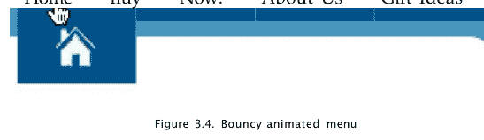

这个效果的设置既简单又优雅。它是一个常规的无序列表，被配置为水平菜单——但我们在通常可见区域下面藏了一个秘密图标。这只需要设置列表项的高度，这样你默认只能看到链接文本，但当我们动画化高度时，图标就会弹入视图。

我们将从 CSS 开始：我们将菜单移动到容器 div 的右上角绝对定位，那里有空间可以展开图标。我们为图标设置了一个背景颜色，并使用了一个巧妙的技巧来将背景图像隐藏在视线之外；注意列表项的高度是 20px，但背景从顶部偏移了 30px。因此，在我们扩展列表项的高度之前，它们将是不可见的。

我们还将每个链接的背景图像设置为不同的图标：

```css
/* chapter_03/10_animated_navigation_2/navigation.css (excerpt) */

#container {
    position: relative;
}

#navigation {
    position:absolute;
    width: inherit;
    top: 0;
    right: 0;
    margin: 0;
}

#navigation li {
    height:20px;
    float:left;
    list-style-type: none;
    width:70px;
    padding:3px;
    border-right:1px solid #3687AF;
    background-color: #015287;
    background-repeat: no-repeat;
    background-position: center 30px;
}

#navigation li a {
    color: #FFFFFF;
}

#navigation #home{
    background-image:url('icon_home.png');
}
```

这个效果代码中唯一新的方面是，我们对 mouseover 和 mouseout 事件都使用了 stop 行为来清除队列。然后我们只需动画化高度来显示隐藏的图标，并在悬停结束时将其缩回正常大小。一些精心选择的 duration 和 easing 设置为我们带来了我们想要的那种酷炫的弹跳效果。确保你实验这些设置以匹配你网站的感觉：


chapter_03/10_animated_navigation_2/script.js *(节选)*

```
$('#nav_stretch li').hover(
  function() {
    $(this)
      .stop(true)
      .animate(
        {height: '60px'},
        {duration: 500, easing: 'easeOutBounce'}
      )
  },
  function() {
    $(this)
      .stop(true)
      .animate(
        {height:'20px'},
        {duration: 500, easing: 'easeOutCirc'}
      )
  }
);
```

现在，我们有了不止一个，而是两个炫酷的动画导航示例可以展示给客户！

### jQuery 用户界面库

正如第 1 章所提到的，jQuery UI 库是一个集合了高级 jQuery 小部件、效果和交互功能的库——例如日期选择器、折叠面板和拖放功能——这些在 Web 开发中应用广泛。但在我们开始有趣的实践之前，是时候看看如何下载和包含 jQuery UI 库了——这个过程比我们目前使用的核心库和插件稍微复杂一点。这是因为完整的 jQuery UI 库大小接近 500KB（压缩后为 300KB）！这代码量可不小！幸运的是，任何给定的项目通常只需要 jQuery UI 所包含功能的一小部分，而 jQuery 网站为我们提供了一个便捷的工具，可以创建我们自己的 jQuery UI 自定义版本，只包含我们需要的内容，不多不少。

第一次访问下载构建器页面时，选项可能会显得有点令人望而生畏，你可以通过从 jQuery 主页点击 **自定义构建下载** 链接到达该页面。⁶

下载构建器分为几个部分：核心、交互、小部件、效果和主题。核心是主要的 jQuery UI 库——小部件和交互组件都依赖于它。使用构建器的一个好方法是先取消选择所有内容，然后只添加你需要的内容。如果一个组件依赖于另一个组件才能运行，它将被自动为你选中。

在我们开发期间，获取完整的库是安全的。这样，如果需要，所有功能都将为我们所用。一旦你对网站上的功能感到满意，你总是可以返回下载构建器，创建一个自定义库，省略任何未使用的部分。完整库和自定义版本之间的文件大小差异可能相当显著，如图 3.5 所示。

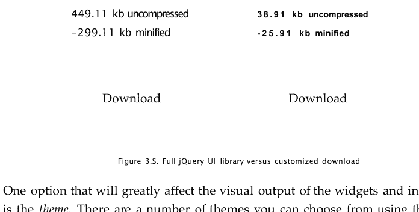

一个会极大影响小部件和交互视觉输出的选项是*主题*。使用下拉框，你可以从多个主题中选择。在第 9 章，我们将深入了解主题，包括制作你自己的主题。但为了继续更激动人心的内容，我们将使用默认主题，然后返回工作。

自定义下载的压缩包包含很多文件。在 `development-bundle` 目录中有大量演示和文档供你尝试和探索，但要使用 jQuery UI，你只需要 `jQuery-ui-1.7.2-min.js` 文件（或你阅读本文时的任何当前版本），以及包含你所选主题的目录。

你必须将主题目录放在你的 HTML 页面可以访问的位置。对于本书的示例，jQuery UI 已放置在 `lib` 目录中（与 jQuery 本身并列），主题文件则在 `ess` 目录中。

jQuery UI 库包含一个效果包，使我们能够实现一些有趣的效果。它还包括用于进行高级动画的有用方法和功能。由于颜色动画插件和缓动插件，我们已经见过一些这样的功能。这些插件已包含在效果包中，因此如果你打算使用 jQuery UI 效果库，就不再需要单独包含它们了。

在我们继续之前，让我们快速看一下一些可用的效果。我们将取我们那个备受诟病的第一个段落元素，摇晃它，用黄色高亮显示它，然后将它炸成碎片：

```
chapter_03/11_jquery_ui_effects/script.js (节选)

$('p:first')
    .effect('shake', {times:3}, 300)
    .effect('highlight', {}, 3000)
    .hide('explode', {}, 1000);
```

看它运行的样子！当然，这只是一个可用效果的微小样本。其中一些只能通过 `effect` 动作这种方式使用，而其他一些既可以这样使用，也可以替代 `hide`、`show` 或 `toggle` 参数。后者的例子包括 `blind`、`clip`、`puff`、`fold` 和 `slide`。

我们将避免在这里详细介绍所有内容——你最好在周日下午花时间探索它们。然而，并非所有效果都是纯粹的花哨，许多在常见的用户交互场景中都很有用，例如 `highlight`，这是向用户指示新消息的标准方式。

测试每个功能是个好主意，这样在它们适用时你就能记住它们。如果 jQuery UI 的效果组合对你来说还不够，没关系——插件仓库中还有数百种可用！

### 开始动画吧！

你现在理解了使用 jQuery 进行动画的所有基础知识：选择器、事件处理程序、回调、链式调用，以及至关重要的 `animate` 函数。你也已经对广泛的 jQuery UI 库有了初步了解。然而，真正掌握这些技能的最佳方法是将它们付诸实践。去吧，为你能触及的一切添加动画！尝试操作每个页面上的每个元素的每个属性，直到你觉得你真的能让它们为你所用。

在我们从动画转向你要掌握的下一个 jQuery 技能组之前，我们将把注意力转向滚动和调整大小：这些主题可能不如动画那么炫酷，但它们对于许多用户界面组件来说至关重要。它们还将帮助你巩固对 jQuery 选择器、动作和链式调用的理解。那么，我们还在等什么呢？

### 滚动

滚动在某种程度上类似于动画，因为元素在页面上移动。然而，与动画不同的是，用户是掌控者！尽管如此，自定义这些交互的方式多不胜数。在本节中，我们将看看当用户滚动时保持位置不变的菜单、自定义主题滚动条，甚至我们如何能应用刚刚学到的动画技术来处理文档滚动。

#### scroll 事件

在我们能够改善用户的滚动体验之前，我们需要知道他们何时以及正在滚动什么。事实证明，有一个名为 `scroll` 的事件，当用户更新元素的滚动位置（如窗口或可滚动的 `div`）时触发。因此，每次你的用户与你网站上的滚动条交互时，都会触发一个你可以捕获并响应的事件。

为了捕获 `scroll` 事件，我们将事件处理程序附加到具有滚动条的元素上——最常见的是窗口元素。窗口本身是一个 JavaScript 对象，所以我们需要做的就是用我们的 jQuery 函数包装它来选择它。

当然，要看到滚动事件的实际效果，我们必须设置一个带有滚动条的区域！我们有一些想要向客户展示的滚动效果想法，但为了学习滚动事件是如何工作的，让我们通过在一个页面的 `div` 上设置 `overflow: scroll;` 来模拟一个滚动环境：

chapter_03/12_scroll_event/scroll.css (节选)

```
#news {
    height: 100px;
    width: 300px;
    overflow: scroll;
}
```

这将把我们的新闻部分变成页面内的一个较小滚动窗格。现在让我们捕获滚动事件，并在每次滚动事件触发时在页面上添加一些任意文本：

chapter_03/12_scroll_event/script.js (节选)

```
$('#news').scroll(function() {
    $('#header')
        .append('<span class="scrolled">You scrolled!</span>');
});
```

现在，每当你滚动新闻部分时，文本 "You Scrolled!" 就会出现在页面顶部的红色背景上。非常烦人，但你明白意思了。尝试不同的滚动方式：拖动滚动条、使用鼠标滚轮，以及在滚动区域内点击以使用方向键。在以上所有情况下，滚动事件都会触发。

#### 浮动导航

我们现在知道了用户何时滚动，那么我们如何利用这些信息来改善我们的网站呢？嗯，一个相当常见的页面响应用户滚动的例子是浮动导航窗格。这是指主要导航元素始终出现在屏幕可见部分的顶部，与滚动位置无关；就好像导航菜单在用户向下滚动页面时跟随他们。使用滚动事件可以轻松实现这一点：我们只需要找出我们在页面上的位置，然后将导航移动到那个位置。


我们的首要任务是设置 CSS，为动态导航做好准备。我们将在导航元素中添加一个 `position: relative;` 声明，这样我们就可以通过调整其 `top` 属性轻松地将其在页面上上下移动。在本次练习中，我们为内容区域设置了一个非常大的 `height` 属性，以强制其出现滚动条（当然，除非你有一个超大屏幕显示器）：

```css
chapter_03/13_floating_nav_1/scroll.css (节选)

#navigation {
  position: relative;
}

#content {
  height: 2000px;
}
```

现在，我们可以着手处理浮动窗格了。乍一看，似乎没什么比这更简单的了——只需响应主窗口的滚动事件，更新导航框的 `top` 位置即可：

```javascript
chapter_03/13_floating_nav_1/script.js (节选)

$(window).scroll(function() {
  $('#navigation').css('top', $(document).scrollTop());
});
```

在浏览器中测试一下，你会发现我们已经达到了目标：当你向下滚动页面时，导航框会随之同步移动。它是如何知道顶部位置的呢？我们通过使用 `scrollTop` 操作来获取屏幕顶部的位置。`scrollTop` 返回匹配元素的顶部偏移量——在我们的示例中，我们请求的是整个文档的顶部位置：`$(document).scrollTop()`。这始终是屏幕的最顶端。

当然，它能用，但非常生硬，这使得它看起来有点不美观。原因应该很明显，如果你在我们初次引入滚动事件时有留意的话：每次用户移动滚动条，都会触发*许多*个滚动事件。每一个事件都会触发我们的代码去更新导航位置——所以它的动作会抖动也就不足为奇了。

我们在“停止动画”一节中了解了如何阻止动画这样排队执行，但我们的效果还可以进一步优化。我们能不能用一些动画和一点点弹跳缓动效果让它变得更智能呢？下面就是实现方法：

```javascript
chapter_03/14_floating_nav_2/script.js (节选)

$(window).scroll(function() {
  $('#navigation')
    .stop()
    .animate({top: $(document).scrollTop()}, 'slow', 'easeOutBack');
});
```

对于如此显著的效果，它只需要非常少量的代码，这让人非常满意！

### 滚动文档

当需要在一个 HTML 页面上显示大量关于相关（但各异）主题的信息时，通常会在页面顶部包含一个主题的超链接列表。

这些内部链接会立即跳转到所选菜单项对应的正确位置。在内容之后，通常会有一个链接带你回到屏幕顶部——这样你就可以选择另一个菜单项了。让我们尝试为我们的页面添加这个功能。

第一个任务是在页面的页脚添加链接。要跳转到页面顶部，我们只需将链接的 `href` 属性设置为 `#`。

如果我们思考一下，我们想要做的就是动画化页面的滚动位置，这在 jQuery 中由 `scrollTop` 表示。我们还需要取消链接的默认操作——否则页面会在我们的动画执行之前就跳转了。如果你是 JavaScript 新手，有一个简单的方法可以实现这一点：任何处理链接 `click` 事件的函数，只需包含 `return false;` 语句即可取消链接的默认行为：

```javascript
$('a[href=#]').click(function() {
  $('html').animate({scrollTop: 0}, 'slow');
  return false; // 返回 false 以取消链接的默认操作
});
```

这段代码引入了一种新的选择器：**属性选择器**。通过将属性值括在方括号中，我们可以将选择范围限制为仅包含具有特定属性值的元素。在本例中，我们只查找那些 `href` 值为 `#` 的链接。

这段代码有效，而且肯定清晰简单，但它确实遇到了一个小问题。如果用户的浏览器以怪异模式运行，`$('html')` 选择器将会失败。（不确定怪异模式是什么意思？请花时间阅读 SitePoint CSS 参考页面上的相关主题，了解详细解释。）虽然你*应该*以触发标准模式的方式标记页面，但有时你会处理遗留代码，从而没有这个优势。要使上述代码在怪异模式下工作，你需要使用选择器 `$('body')`。我们也可以同时针对两者以确保无误：`$('html, body')`。这反过来又会在某些版本的 Opera 浏览器中引发问题，这些版本（可能正确地）会尝试同时滚动两个元素。

“但你说过 jQuery 能解决我们所有的跨浏览器问题！”你可能会惊呼。公平地说，它解决了*大多数*跨浏览器问题。这是一个稍微棘手的问题，而核心 jQuery 库并未解决。幸运的是，这很容易绕过。更幸运的是，有人已经花时间将这种解决方法（以及大量其他滚动功能）打包成一个名为 ScrollTo 的插件。

ScrollTo 插件，可从插件仓库获取，是一个用于滚动屏幕和溢出元素的稳定插件。它完全能够处理我们目前看到的任何滚动任务。

下载并包含该插件后，你就可以重写顶部链接功能，无需再为那些晦涩的浏览器错误而烦恼了：

```javascript
chapter_03/15_page_scroll/script.js (节选)

$('a[href=#]').click(function() {
  $.scrollTo(0, 'slow');
  return false;
});
```

这种语法对你来说可能看起来有点奇怪，因为我们直接从 jQuery 别名调用 `scrollTo`。这个插件很聪明，它知道如果我们这样直接调用它，就是想要滚动整个窗口。如果我们想滚动一个特定的溢出元素，我们会使用传统的选择器语法，例如：`$('div#scroily').scrollTo(0, 'slow')`。

ScrollTo 插件功能丰富，不限于按整数值滚动。你可以传递一个相对值（如 `+=50px`）、一个 DOM 元素（它会滚动页面以找到该元素）、一个选择器字符串、一个包含 `x` 和 `y` 坐标的哈希值，或者关键字 `max`，它将滚动到文档的末尾。你可以水平滚动，也可以垂直滚动，并且它还有一些很棒的选项可以微调你的目标位置。你可以在该插件的主页上了解所有这些选项。

### 自定义滚动条

客户皱着眉头走到你的办公桌前，手里拿着一份“绝对最终”的已签字设计稿。“现在，”他开始说道，“这里的这些滚动条不会是这样的，对吧？我的意思是，它们全是灰色的，非常突眼。”

通常，你只需担任一段时间的 Web 开发人员，就会有客户要求你用自定义滚动条替换标准的操作系统滚动条——尤其是针对内部元素，比如可滚动的 div。这似乎是一个合理的要求，但它涉及一些你应该了解的可用性问题。

人们对他们的操作系统核心界面组件如何运作有一定的期望，而自定义实现可能与它们所替换的核心组件具有不同的功能。以这种方式打破用户的期望可能会令人非常沮丧，因此这类 UI 定制应极其谨慎地进行。

话虽如此，有时一个恰到好处的自定义 UI 元素可以极大地改变界面的整体感觉。最终，你必须权衡对你目标受众的利弊。在我们的例子中，客户付了钱——所以我们会做！

然而，没有必要尝试从头开始构建：滚动条是一个复杂的用户界面组件，如果客户发现我们浪费了宝贵的开发时间自己构建它，他会不高兴的，特别是当有一个非常合适的插件随时可用时：它叫做 jScrollPane。

jScrollPane 是一个 jQuery 插件，允许你在任何具有溢出内容的元素中，用自定义滚动条替换浏览器的默认垂直滚动条。你可以在官方仓库中找到该插件，但 Google Code 上提供了更新的版本。

我们需要包含两个文件：JavaScript 代码文件 `jScrollPane-1.2.3.min.js` 和配套的 CSS 文件 `jScrollPane.css`。CSS 文件为滚动条设置了一些默认样式，并为你实现自己的自定义提供了一个起点。只需扩展或覆盖此文件中包含的样式，使用你自己的颜色和图像来创建你的自定义滚动条。在我们的示例中，我们将坚持使用默认样式：一个外观时尚的灰色滚动条，几乎可以适应任何网站（如图 3.6 所示）。


你可以通过简单地在其上调用 `jScrollPane` 函数来为任何元素激活自定义滚动条。虽然参数是可选的，但有十多个可供你调整，例如显示滚动条箭头或将滚动条移动到面板的左侧。你可以在插件的主页上看到完整的列表。在我们的示例中，我们将在内容和滚动条之间设置边距，设置滚动条的宽度，并选择隐藏顶部和底部的箭头：

```javascript
chapter_03/16_custom_scrollbar/script.js (节选)

$('#fine_print').jScrollPane({
    scrollbarWidth: 10,
    scrollbarMargin: 10,
    showArrows: false
});
```

`http://code.google.com/p/jscrollpane/`


我们全新的滚动条外观和功能都很棒，但你可能注意到，当鼠标悬停在元素上滚动滚轮时，它没有反应。jQuery的核心库为了保持体积最小化，故意省略了鼠标滚轮功能，但有一个插件可以将其添加回来，而jScrollPane在编写时就考虑到了这个插件。因此，你只需要在页面中包含鼠标滚轮插件，jScrollPane就会自动为所有滚动内容窗格添加鼠标滚轮事件处理，让你可以随心所欲地滚动它们！

### 调整大小

调整大小在用户界面中有几种不同的含义：首先想到的是调整浏览器窗口大小的能力（这常常让网页开发者头疼）。但同样常见的是调整应用程序内部窗口的大小，以及调整图像或其他元素的大小。

jQuery提供了一种收集用户主动调整窗口大小信息的方法，同时也（通过jQuery UI）提供了一种让用户能够对页面上任何元素进行终极调整的方法。让我们深入了解一下！

### resize事件

`resize`事件是jQuery的一个核心事件，在文档视图大小改变时触发。有很多原因会让你想要响应这个事件。但在研究实际示例之前，让我们先确保理解这个事件的工作原理：

```javascript
chapter_03/17_resize_event/script.js (摘录)

$(window).resize(function() {
    alert("You resized the window!");
});
```

在浏览器中加载`index.html`页面并尝试调整窗口大小：每次调整时，都会弹出一个警告框。每次用户改变浏览器窗口大小时都这样做可能会让我们失去任何用户体验得分——所以让我们将这个事件用在一个更实际的例子中。

### 布局切换器

如果你使用过一段时间CSS，就会知道一直存在一个争论：哪种布局最好，流式布局还是固定宽度布局。一方面，流式布局最大限度地利用用户的屏幕空间；另一方面，固定宽度布局允许你设计像素级完美的布局，你知道当用户在不同的视口尺寸下查看时，布局不会错乱。

对于StarTrackr!，我们可以提供两全其美的方案：设计两个独立的固定宽度布局，并通过捕获resize事件在它们之间切换。

开始吧！我们到目前为止一直在使用的StarTrackr!默认网站宽度是适中的650px。我们的第一个任务是编写一些样式使其更宽——我们将宽版本设置为850px：

```css
chapter_03/18_layout_switcher/wide.css

body #container {
  width: 850px;
}

body #container p {
  width: 650px;
}

body #header {
  background-image: url('.../ess/images/header-corners-wide.png');
}

body #celebs table {
  width: 650px;
  margin-left: 5px;
}
```

注意我们在每个规则开头添加了看似多余的`body`。这样这些规则就会优先于基础样式表中针对相同元素的任何规则，因为它们更具特异性。

下一步是编写jQuery代码来添加或删除我们的新样式表。我们需要做的是测试`body`元素的宽度是否大于900px，如果是，则将样式表追加到`head`元素；如果不是，则将其移除：

```javascript
chapter_03/18_layout_switcher/script.js (摘录)

if ($('body').width() > 900) {
    $('<link rel="stylesheet" href="wide.css" type="text/css" />')
        .appendTo('head');
} else {
    $('link[href=wide.css]').remove();
}
```

这让我们陷入困境。我们需要在两种不同情况下运行这段代码：第一次加载页面时，以及每次页面大小改变时。你可能想要直接复制粘贴这段代码就完事了。

抵制住这种诱惑！在代码中重复自己几乎总是一个坏主意：想象一下，几个月后，你决定900px的临界点是错误的。你现在认为应该在1000px左右切换样式表。你进入代码，更改值，然后重新加载页面。但它坏了，因为你忘记在另一段相同的代码块中更改相同的值。在任何类型的软件开发中，这种情况都很容易发生，而且代码越复杂，发生的可能性就越大——也越难追踪。

幸运的是，几乎每种编程语言都有构造来帮助我们处理这类情况，JavaScript（以及jQuery）也不例外。到目前为止，我们一直将匿名函数传递给所有事件处理程序，但现在是时候给我们的函数命名了：

```javascript
chapter_03/18_layout_switcher/script.js (摘录)

$(document).ready(function() {
  stylesheetToggle();
  $(window).resize(stylesheetToggle);
});

function stylesheetToggle() {
  if ($('body').width() > 900) {
    $('<link rel="stylesheet" href="wide.css" type="text/css" />')
      .appendTo('head');
  } else {
    $('link[href=wide.css]').remove();
  }
}
```

我们将函数命名为`stylesheetToggle`，并调用了两次：一次是文档首次加载时，另一次是每次调整大小时。你会注意到我们只需要将函数的*名称*传递给`resize`事件处理程序；因为我们不是在这里声明函数，所以不需要`function`关键字，也不需要任何花括号或圆括号。

### 可调整大小的元素

jQuery UI库在其交互功能中包含了一个Resizable插件。Resizable插件通过在元素的右下角添加一个小手柄，使你选择的元素可以调整大小。可以用鼠标拖动这个手柄（很像你操作系统窗口的调整方式）。与所有jQuery UI组件一样，它高度可配置且易于使用。如果你之前下载了完整的jQuery UI库，那么你已经可以使用这个类了。否则，你需要返回下载构建器并包含Resizable组件——这也需要核心库和一个主题。

以最基本的形式使用Resizable组件非常简单。我们只需选择要修改的元素，然后调用`resizable`函数：

```javascript
chapter_03/19_resizable_elements/script.js (摘录)

$('p').resizable();
```

如果我们在StarTrackr!网站上运行这个，结果会有些出人意料：每个段落元素立即变得可以调整大小！

看到这个运行起来很有趣：突然间，整个网页都变得可以塑形。默认情况下，Resizable交互会在元素的右下角添加小手柄。这些手柄的样式在jQuery UI样式表中定义，因此如果你有兴趣更改它们的外观，可以查看该样式表。默认手柄如图3.7所示。

### 可调整大小的文本区域

有时，提供一个可用的界面可能与保持设计平衡和美观的愿望相冲突。但多亏了jQuery，我们可以两者兼得——并在那些棘手的客户演示中为自己辩护。

形式与功能经常冲突的一个领域是HTML表单设计。这部分是因为访问你网站的用户可能有截然不同的需求。例如，如果你提供一个反馈区域，用户可能什么都不写，写一点，或者写很多。为了取得平衡，你可以从一个较小的文本区域开始，但使其可调整大小。因此，有很多话要说的用户会觉得你让他们畅所欲言。以下是我们如何使用jQuery UI的Resizable功能来实现这一点：


## 第三章：可调整大小的文本区域

```javascript
// chapter_03/20_resizable_textarea/script.js (摘录)

$('textarea').resizable({
    grid: [20, 20],
    minWidth: 153,
    minHeight: 30,
    maxHeight: 220,
    containment: 'parent'
});
```

这使得我们所有的文本区域元素都可调整大小，就像我们对段落元素所做的那样。效果如图 3.8 所示。不过，我们指定了几个新参数来改善手感，并展示可调整大小组件的灵活性。它有大量配置选项，你可以在 jQuery UI 文档站点上更详细地探索它们。

### 留言评论

姓名：满意的客户
评论：需要更多空间来写东西吗？只需要拉伸一下自己

图 3.8. 可调整大小的文本区域

我们还通过指定 `minHeight`、`minWidth` 和 `maxHeight` 属性来约束元素可拉伸的范围。你会注意到我们省略了 `maxWidth` 属性，转而使用 `containment` 参数：这允许你指定一个限制可调整元素范围的容器。你可以使用 jQuery 选择器作为参数，或者使用特殊关键字 `parent` 来引用可调整元素的父元素。

我们还使用了 `grid` 选项，将可调整对象限制在特定大小的步长内。出于某种原因，这似乎为调整大小的交互增添了一种良好的手感。网格被指定为一个包含两个元素的数组：水平网格大小和垂直网格大小。

另一个你可能想研究的参数是 `handles` 参数。这指定了元素哪些边会附带控制手柄，因此也决定了元素可以在哪个方向上被拉伸。该参数接受以下选项：`n`、`e`、`s`、`w`、`ne`、`se`、`sw`、`nw` 和 `all`。你可以通过逗号分隔来指定其中的任意多个。例如，`{ handles: 'n, se' }` 会在元素的顶部和右下角添加手柄。

在内容长度会显著变化的输入页面中，常见这种功能。

### 窗格分割器

尽管我们提供了免责声明消息功能，但客户的法律团队仍然担心，未能恰当地概述公司条款和条件可能带来的潜在后果。从设计和可用性的角度来看，问题是存在许多页的条款和条件，分为许多小节——但它们需要在主页上突出显示。也许一个分割器能帮到我们。

分割器是一种 UI 组件，它以允许用户调整元素大小的方式划分页面上的多个区域；这样，用户就能决定为每个区域分配多少空间。分割器在桌面应用程序中很常见，随着富互联网应用程序的爆炸式发展，它们也正在进入 Web 领域。我们可以利用我们对可调整大小组件的经验来模拟一个简单的分割器，其中一个窗格包含“目录”，另一个窗格包含 StarTrackr! 的“条款和条件”内容。该小部件的外观如图 3.9 所示。

### 条款与条件

1. [您的隐私](Your Privacy)
2. [名人的隐私](Celeb's Privacy)
3. 所有权与知识产权
    i. 责任
    ii. 独占与非独占权利
    iii. [用户生成材料](User Generated Material)

### 用户生成材料

本网站包含消息传递系统和其他用户生成内容，旨在并用于目录或间接联系或跟踪名人，以及他们的家人和/或他们模糊关联的社交圈中的人员。此类内容**此处**被视为**永恒地** **mnm>rtv rkd^rjrTrjrtr.jnr1 n^rpnl mmnsnu pr**

图 3.9. 水平窗格分割器

目前，我们将仅关注调整大小功能。将每个部分的内容动态加载到窗格中的内容将在第五章中详细讨论。

我们的分割器将由两个 `div` 元素组成，代表每个窗格，嵌套在一个具有固定尺寸的容器元素内。我们将把目录包装在一个块级元素中，这样当用户调整窗格大小时，文本就不会换行并搞乱我们的嵌套列表：

```html
// chapter_03/21_horizontal_pane_splitter/index.html (摘录)

<div id="splitter">
  <div class="pane" id="tocPane">
    <div class="inner">

    </div>
  </div>
  <div class="pane" id="contentPane">
    <div class="inner">

    </div>
  </div>
</div>
```

现在我们将在一个新的 `splitter.css` 样式表中添加一些简单的样式。你可以看到我们固定了容器 `div` 的高度，并让子元素默认各占宽度的 50%。如果需要以非 50:50 的分割比例开始，你可以更改此设置以指定不同的值。如果你需要使用 CSS 边框，则必须以像素为单位指定宽度，并确保它们加起来等于总宽度：

```css
/* chapter_03/21_horizontal_pane_splitter/splitter.css */

#splitter {
  height: 150px;
  margin-top: 30px;
  margin-bottom: 50px;
}

#splitter .pane {
  width: 50%;
  height: 100%;
  float: left;
}

#splitter h2 {
  margin-bottom: 0;
  padding-bottom: 0;
}

#tocPane {
  overflow: hidden;
  background: #d6dde5 url(../images/handle.png) no-repeat
    right center;
}

#tocPane .inner {
  width: 300px;
}

#contentPane {
  overflow: auto;
}

#contentPane .inner {
  padding: 0 5px;
}
```

接下来，是我们的 jQuery 代码。要创建一个水平分割器，我们使第一个元素可调整大小，并指定一个朝东的手柄——这样只有 `div` 的右边缘是可调整的。

如果你只使用一个简单的 `resizable` 语句来运行该示例，你会注意到我们几乎成功了：这两个元素表现得*有点像*分割窗格——只是当拖动手柄时，右侧元素的宽度保持不变，而不是扩展以填充剩余空间。为了解决这个问题，我们将在可调整大小小部件的 `resize` 函数内进行一些计算。这是一个在组件被调整大小时触发的事件处理程序：

```javascript
// chapter_03/21_horizontal_pane_splitter/script.js (摘录)

$('#splitter > div:first').resizable({
    handles: 'e',
    minWidth: '100',
    maxWidth: '400',
    resize: function() {
        var remainingSpace = $(this).parent().width() -
            $(this).outerWidth();
        var divTwo = $(this).next();
        var divTwoWidth = remainingSpace - (divTwo.outerWidth() -
            divTwo.width());
        divTwo.css('width', divTwoWidth + 'px');
    }
});
```

每次调整大小现在也会触发第二个元素宽度的变化。一些基础数学帮助我们计算出应有的宽度：我们获取父容器的宽度（即总宽度），然后减去第一个 `div` 的 `outerWidth`。`outerWidth` 函数是获取元素总宽度的有用方法，包括任何内边距和边框（如果你传递可选参数 `true`，它也可以包含外边距）。也许并不令人惊讶的是，也有一个相应的 `outerHeight` 函数。

计算出剩余可用空间后，我们几乎准备好设置第一个元素的宽度了。只剩一个障碍：如果第二个 `div` 有边框或内边距，我们需要将它们考虑在内。不幸的是 `outerWidth` 函数是只读的，因此我们无法用它来设置总高度。

为了计算元素宽度中有多少是边框和内边距，我们需要从元素的 `outerWidth` 中减去其 `width`。从 `remainingSpace` 变量中减去这个值，恰好给出了第二个 `div` 需要的像素宽度——然后我们就可以完成我们的水平分割器了。

### JavaScript 变量

`var remainingSpace = $(this).parent().width() - $(this).outerWidth();` 这一行将计算结果赋值给一个名为 `remainingSpace` 的变量。从此在我们的代码中，每当我们需要访问这个值时，只需写 `remainingSpace` 即可。

下面一行（`var divTwo = $(this).next();`）执行非常相似的功能，只不过这次我们将一个 *jQuery 选择* 赋值给一个变量（`divTwo`）。这可以像任何其他 jQuery 选择一样使用。

使用这样的变量有助于使你的代码更具可读性，因为你可以保持每一行尽可能简洁。它也使你的代码更高效；对于 JavaScript 来说，从变量中检索值比一开始就算出值要快得多。

如果我们想尝试实现一个垂直分割器，几乎没什么需要更改的：我们的窗格元素垂直堆叠（而不是并排），我们的 `resizable` 调用使用朝南的手柄而不是朝东的手柄。代码也几乎完全相同——只不过现在我们关注的是元素的高度，而不是宽度：

```javascript
// chapter_03/22_vertical_pane_splitter/script.js (摘录)

$('#splitter > div:first').resizable({
    handles: 's',
    minHeight: '50',
    maxHeight: '1200',
    resize: function() {
        var remainingSpace = $(this).parent().height() -
            $(this).outerHeight();
        var divTwo = $(this).next();
        var divTwoHeight = remainingSpace -
            (divTwo.outerHeight() - divTwo.height());
        divTwo.css('height', divTwoHeight + 'px');
    }
});
```

这些简单的分割器相当有用，需要很少的代码，并且将适用于许多目的。但如果你需要复杂的分割器行为，例如多个分割窗格或嵌套窗格，请前往插件仓库查看。


### 这就是我们的滚动和动画实现方式。

多么精彩的一章！我们已经掌握了动画、滚动和调整大小，并看到了链式调用如何帮助我们以可读且自然的方式轻松编写简洁而强大的功能。我们开始运用 jQuery 知识来创建一些出色的效果。然而，在学习本书的过程中，重要的是要关注的并非效果本身，而是我们用来实现它们的基础概念。

即使是看起来最复杂的效果，也往往是由几个简单的动作巧妙地链式组合而成。你需要做的是坐下来，构思一些想法，并尝试自己动手去实现它们。

## 章节

### 图片与幻灯片

现在可不能再随意发挥了。既然基础知识已经牢牢掌握在手，我们已经拥有了创造世界级效果的无限潜力。我们的客户欣喜若狂；我们给了他想要的 "Web 2.0"，现在他那原本备受质疑的初创公司已经赢得了几家大型社交网站的青睐。他要求我们添加一些真正出彩的 "功能"："图片库、幻灯片、淡入淡出效果——全套！" 有何不可？我们有工具，也有才华！

互联网上若没有图片，那将会相当乏味（至少在视觉上）；我们在网络冲浪时获取的大部分内容都是以图片和设计元素的形式呈现的，例如边框、图标和渐变，它们帮助定义了我们与网页的交互方式。当我们把这些元素与充足的 jQuery 结合使用时，便开始看到一些生动且令人惊叹的效果涌现出来。除了我们熟知和喜爱的那些标准组件之外，jQuery 还提供了一些相对不那么常见、较新的效果和功能的实现方式，这些若只用 JavaScript 是很难做到的。

### 灯箱效果

我们的客户想要 Web 2.0，那么我们就给他最典型的 Web 2.0 效果：灯箱。**灯箱**——一个借用自摄影领域的术语——用于在模态对话框中显示图像缩略图的全尺寸版本。通常，整个背景会变暗以表示其已被禁用。用户必须与图像进行交互（例如点击关闭按钮）才能继续操作页面。

### 自定义灯箱

灯箱效果如今非常普遍，其中许多具备一些非常复杂的功能：动画、过渡效果，以及显示视频或通过 Ajax 加载内容的能力。一如既往，有一些优秀的插件可以完成所有这些工作，我们将在下一节介绍其中一个——但目前，我们将构建自己的灯箱。

为什么自建灯箱？对于我们的示例，我们只需要一个基本的图像查看器，不追求任何花哨的功能，这样可以节省因花哨而带来的额外字节开销。同时，我们也有机会深入了解内部机制，看看这类功能是如何实现的。

我们的灯箱将极其简单：任何带有 `lightbox` 类名的 HTML 链接，当被点击时，都会弹出该链接指向的图像文件。图片将居中显示，周围区域将被禁用并变暗，作为视觉提示。效果如图 4.1 所示。

让我们从 HTML 链接开始。它们只是指向图像文件的标签，带有 `lightbox` 类，因此我们可以在 jQuery 中定位它们：

```
chapter_04/01_lightbox/index.html (excerpt)

<a href="/images/celeb01.jpg" class="lightbox">Pic</a>
```

当图像显示时，我们希望整个屏幕变暗。我们该怎么做？最简单的方法是向页面添加一个大的 `div`，使其高度和宽度都等于屏幕本身。在这个 `div` 内部，我们将再添加一个 `div`，用于加载图像。

（此处省略了部分与上下文关联不紧密的示例文本内容，如“音乐家或制作人”、“关于B级名人的特别优惠”、“购买”、“关于我们”、“赠礼创意”、“免责声明”、“明星列表”、“评论区”等，这些似乎是示例页面中的模拟内容，与翻译教程的核心技术讲解关联较弱。）

Figure 4.1. 我们的灯箱效果

覆盖层的样式设置相当直接：100% 的高度和宽度，以及黑色背景。稍后，我们将淡入该元素的透明度，以赋予其阴影般的外观。还有一个技巧是在该元素的中心添加一个旋转的加载器图像。当我们开始加载图像时，旋转器将作为背景的一部分显示。当图像加载完毕时，它看起来似乎消失了，但实际上只是被图像隐藏在了后面：

```
chapter_04/01_lightbox/lightbox.css

#lightbox_overlay {
    position:absolute;
    top:0;
    left:0;
    height:100%;
    width:100%;
    background:black url(loader.gif) no-repeat scroll center center;
```

```
#lightbox_container {
    position:absolute;
```

接下来，我们为灯箱链接添加一个点击处理程序。当它们被点击时，我们将添加深色的覆盖元素、图像容器以及图像本身。对于我们这个基础示例，容器并非严格必需，但当你想扩展灯箱功能（例如添加边框、描述或“上一张/下一张”按钮）时，它会很有帮助：

```
chapter_04/01_lightbox/script.js (excerpt)

$('a.lightbox').click(function(e) {
    // hide scrollbars!
    $('body').css('overflow-y', 'hidden');

    $('<div id="overlay"></div>')
        .css('top', $(document).scrollTop())
        .css('opacity', '0')
        .animate({'opacity': '0.5'}, 'slow')
        .appendTo('body');

    $('<div id="lightbox"></div>')
        .hide()
        .appendTo('body');

    $('')
        .attr('src', $(this).attr('href'))
        .load(function() {
            positionLightboxImage();
        })
        .click(function() {
            removeLightbox();
        })
        .appendTo('#lightbox');

    return false;
});
```

覆盖层被定位在屏幕顶部，并快速从不可见淡入到 50% 不透明度，以提供背景效果。灯箱容器被添加到页面并立即隐藏，等待图像加载。然后图像开始加载，一旦加载完成，就会调用 `positionLightboxImage()` 来居中显示灯箱（从链接的 `href` 属性中提取）。为此，我们使用了 jQuery 强大的 `attr` 方法，该方法可用于获取或设置 DOM 元素的任何属性。当仅用一个参数调用时（例如 `$(this).attr('href')`），它返回该属性的值。当使用第二个参数时（例如 `$(' ').attr('src', ...)`），它会将属性设置为提供的值。

然后，我们给图像附加了几个事件处理程序。其中一个事件对我们来说是新的：`load`。它是 `ready` 事件的近亲，但当一个元素（在本例中是我们的图像）被 100% 加载时触发。

### 快速元素构建

创建新元素是一件非常令人满足的事情，也是你经常会执行的任务。还有一种替代方法来设置新的 jQuery 对象，即传递一个对象作为第二个参数。该对象包含你希望新元素具有的所有属性和设置。例如：

```
$(' ', {
    src: $(this).attr('href'),
    load: function() {
        positionLightboxImage();
    },
    click: function() {
        removeLightbox();
    }
}).appendTo('#lightbox');
```

jQuery 在处理你设置的属性方面有点智能。如果你给它一个事件，它会将提供的处理程序绑定到该事件（就像我们对 `load` 和 `click` 所做的那样）。如果你使用像 `text`、`html` 或 `val` 这样的 jQuery 方法名，它会使用 jQuery 方法来设置属性。其他所有内容都将被视为属性，就像 `src` 属性的处理方式一样。最终结果与我们之前构建的 jQuery 对象相同，但如果你熟悉 JavaScript 对象表示法，你可能会更喜欢这种元素构建方式。

最后，我们添加了 `return false;` 以防止 HTML 链接的默认行为发生。否则，用户将离开我们的页面，直接导航到图像本身。

现在让我们看看 `positionLightbox` 函数：


### 使用 console.log 进行故障排除

如果你尝试过扩展或自定义这个简单的灯箱，或者我们迄今为止看到的任何代码，那么你肯定遇到过代码未能按预期工作的情况。弄清楚代码在任何给定时刻到底发生了什么，可能会令人沮丧。有时你需要知道某个函数是否被调用，或者某个特定时间点变量的值是多少。

传统上，这种调试通常通过可靠的旧 `alert` 方法来实现。例如，如果你需要知道代码在 `top` 变量中存储了什么值，你就输入 `alert(top);`。但这会中断程序的流程——并迫使你在继续之前关闭警报。如果你感兴趣的代码位于循环中间，你可能最终需要关闭大量的警报。

值得庆幸的是，Web 开发工具在不断进步，如果你使用 Firefox 的优秀 Firebug 插件（在第 2 章中介绍过），你就可以利用内置的调试选项。Firebug 最方便的功能之一就是控制台，在这里你不必用警报显示变量的值，而是可以使用命令 `console.log`：

```
chapter_04/01_lightbox/script.js (excerpt)

console.log(top, left);
```

只需打开 Firebug 的 Console（控制台）选项卡（你可能需要先启用它），你就会看到显示的值。不再有烦人的警报窗口！你可以在单个语句中指定任意数量的变量或表达式，只需用逗号分隔即可。图 4.2 描绘了由不同类型的 log 语句生成的输出：两个简单的字符串输出、一个由两个数字组成的多变量输出和一个 jQuery 选择。

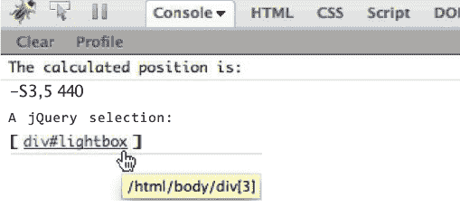

图 4.2. Firebug 控制台

如果变量是 JavaScript 对象，你甚至可以在控制台上点击它来检查其内容。如果它是 DOM 节点或 jQuery 对象，点击它将在页面上突出显示它，并在 Firebug DOM 树中跳转到它。当你陷入那些恼人的 bug 时，这将拯救你的理智！只需记住，在发布代码时删除任何 `console.log` 行。

### ColorBox：一个灯箱插件

我们自定义的灯箱对于我们的适度需求来说是一个不错的解决方案，但你不得不承认，就功能而言，它相当有限。有时你需要更多。长期以来，“更多”的主要竞争者一直是 Cody Lindley 的 ThickBox。ThickBox 肯定打过大仗，但就像所有真正的冠军一样，你必须知道何时退出擂台，挂起手套。

ThickBox 仍然是一个功能强大的插件，尽管它不再维护，但仍适合许多开发者。它做了它该做的，并且做得很好。正是这种质量水平为新一代灯箱插件设定了高标准。让我们来看看一个重要的挑战者：ColorBox。

ColorBox¹ 是 Jack Moore 的心血结晶，它具有一系列公共方法和事件钩子——以及多达 37 个可供选择的选项——即使是有经验的用户也可能无法触及它所提供的所有功能。考虑到 ColorBox 对基于标准的 XHTML 的关注、对样式 CSS 的依赖，以及对内容选项的广泛支持，很容易看出其网页上的“轻量级”标签仅指其微小的 9KB 体积——而不是指其庞大的功能集！

从网站的下载区域获取 ColorBox 并检查其内容。有一个名为 ColorBox 的目录，其中包含插件代码的压缩版和未压缩版。和往常一样，除非你渴望了解 ColorBox 的内部工作原理，否则你应该使用压缩版本。

下载中还包含许多示例目录；这些示例都使用相同的标记和 JavaScript 代码，但展示了灯箱如何被样式化以看起来完全不同。最好的开始方式是查看示例，选择你最喜欢的 CSS 文件（和相应的图像），然后在此基础上进行你的实现。

我们从其中一个示例目录复制了 CSS 和图像文件，并在我们的 HTML 中包含了该 CSS 文件和压缩版插件文件：

```
chapter_04/02_colorbox_plugin/index.html (excerpt)
<link rel="stylesheet" href="colorbox.css" type="text/css">
<script src="jquery.colorbox-min.js" type="text/javascript"></script>
```

ColorBox 可以像我们在上一节中那样处理单个图像，但它更擅长显示幻灯片风格的图库——让用户在图像之间移动，如图 4.3 所示。要利用这一点，我们需要对要显示的图像进行分组，而 ColorBox 要求我们通过链接的 `rel` 属性来完成。

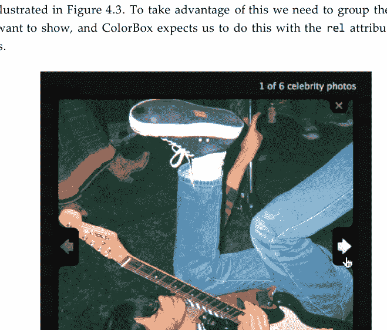

图 4.3. 使用 ColorBox 插件的样式化图库

在标记中，我们在所有要分组的图像上包含了 `rel="celeb"`。现在我们可以使用 jQuery 属性选择器来找到这些图像：`a[rel="celeb"]`。在选择上调用 `colorbox` 方法会给我们一个外观出色的灯箱：

```
chapter_04/02_colorbox_plugin/script.js (excerpt)

$(document).ready(function() {
  $('a[rel="celeb"]').colorbox();
});
```

默认情况下它看起来和工作都很出色，但有大量的选项可供摆弄。在下面的示例中，我们给了它一个淡入淡出的过渡效果，而不是默认的弹性调整大小（`speed` 选项，正如你可能猜到的，指定了淡入淡出的持续时间）。为了适应 StarTrackr! 的风格，我们还将自定义灯箱的文本措辞。但这只是冰山一角——请在 ColorBox 网站上探索所有可用于自定义灯箱的其他选项和事件：

```
chapter_04/02_colorbox_plugin/script.js (excerpt)

$('a[rel=celeb]').colorbox({
  transition: 'fade',
  speed: 500,
  current: "{current} of {total} celebrity photos"
});
```

ColorBox 的妙处在于它高度不显眼且可定制：你可以更改行为设置、添加回调并使用事件钩子，而无需修改你的标记或插件的源文件。ColorBox 会预加载任何所需的图像——甚至可以开始预加载你的图库图像——因此它在你的页面上总是显得轻快。最后但同样重要的是，ColorBox 在宽松的 MIT 许可证下发布——因此你可以根据需要将其用于你的商业项目。


# 使用 Jcrop 裁剪图片

当我们浏览成熟优秀的插件和灯箱效果时，若跳过用于定义图像区域的 Jcrop 插件，那将是我们的疏忽。该插件在图像上添加一个灯箱风格的覆盖层，允许用户拖动矩形来选择图像的所需区域。此功能在许多大型网站上都很常见，它允许用户裁剪上传的图片以用作头像。

如果你对网页图像处理略知一二，你可能会知道这种图像处理通常在服务器端进行。对吗？是的，没错——Jcrop 插件实际上并不裁剪图像，它提供了一个直观的界面，用于定义用户希望裁剪的图像边界。然后，可以将插件返回的结果发送到服务器，以执行实际的图像处理。你可以在图 4.4 中看到使用 Jcrop 裁剪图像的示例。


图 4.4. Jcrop 插件运行效果

使用 Jcrop 插件的典型工作流程是：向用户显示需要裁剪的图像（无论是存储的图像还是新上传的图像），并叠加 Jcrop 界面。当用户完成选择后，坐标将被发送到服务器，在那里生成最终图像并保存以供显示或下载。

要应用 Jcrop 交互，你首先需要下载并提取文件。下载包中包含 Jcrop JavaScript 文件、一个小巧的 CSS 文件、一个巧妙的动画 GIF（负责选择区域时出现的“移动线条”效果），以及一些突出显示 Jcrop 所有功能的演示页面。

你需要包含 CSS 文件（放在页面顶部）和 JavaScript 文件（放在页面底部）。Jcrop.gif 图像应与你的 CSS 文件位于同一目录：

```
chapter_04/03_jcrop/index.html (excerpt)

<link rel="stylesheet" href="css/jquery.Jcrop.css" type="text/css">
<script src="jquery.Jcrop.min.js" type="text/javascript"></script>
```

一切就绪后，你只需将要设置为可选择的图像添加到页面中。我们为图像分配了一个 ID，以便使用 jQuery 轻松选择。如果你想让用户确认他们对选择满意，也可以添加一个可点击的按钮：

```
chapter_04/03_jcrop/index.html (excerpt)

<div id="crop">
  
  <input type="button" value="crop"/>
</div>
```

最简单的形式是，你只需将 jQuery 插件应用于图像。当你重新加载页面时，图像将被增强，带有可拖动的控制柄和覆盖层：

```
$('#mofat').Jcrop();
```

该插件提供了一些有用的事件，你可以用来监视用户的选择情况。它还有一些默认选项，可用于自定义选择器的工作方式。你可以限制裁剪区域的纵横比以及选择的最小和最大尺寸，还可以设置背景覆盖层的颜色和不透明度：

```
var jcrop = $('#mofat').Jcrop({
  setSelect: [10,10,300,350],
  minSize:[50,50],
  onChange: function(coords) {
    // 使用坐标
  },
  onSelect: function(coords) {
    // 使用坐标
  }
});
```

这里我们包含了一些默认属性。**setSelect** 允许我们定义默认的裁剪区域；我们需要传递一个坐标数组，格式为 [x1, y1, x2, y2]。**minSize** 选项是一个包含选择区域最小宽度和高度的数组。我们还演示了如何捕获 **onChange** 和 **onSelect** 事件。**onChange** 事件会在用户拖动控制柄或在图像上拖动选择区域时多次触发。而 **onSelect** 事件仅在定义了选择后触发；即用户停止拖动时。

事件的处理函数接收一个坐标对象，其中包含 x、y、x2、y2、w 和 h 属性。因此，在你的处理代码中，你可以通过 coords.w 来获取当前选择的宽度。

目前，Jcrop 插件最常见的用途是在用户完成选择后，将点发送到服务器。插件触发的事件对此目的没有用，因为我们无法知道用户是否*真的*完成选择——这就是我们添加按钮的原因！我们想知道用户点击按钮时选择的位置。

为了做到这一点，我们需要稍微修改一下原始代码。当你像上面那样在 jQuery 对象上调用 **Jcrop** 时，会返回 jQuery 对象，以便链接更多的 jQuery 方法。然而，这让我们无法访问选择坐标。为了获取这些坐标，我们需要以不同的方式调用 Jcrop，直接通过 $ 调用。以这种方式调用时，它将返回一个特殊的 Jcrop 对象，该对象具有用于访问所选坐标（以及以编程方式修改选择）的属性和方法。我们需要同时传递要裁剪图像的选择器和一组选项：

```
chapter_04/03_jcrop/script.js (excerpt)

var jcrop = $.Jcrop('#mofat',{
    setSelect: [10,10,300,350],
    minSize:[50,50]
});

$('#crop_button').click(function() {
    var selection = jcrop.tellSelect();
    alert('selected size: ' + selection.w + 'x' + selection.h);
})
```

我们使用 **tellSelect** 方法获取当前选择；它与事件坐标的属性相同，因此我们可以用它们发送到服务器并裁剪我们的图片！在没有服务器的情况下，我们选择简单地弹出警告，让你知道发生了什么。

Jcrop 有大量可用的选项和方法，因此强烈建议你检查插件下载中包含的演示，以了解有哪些可用功能。

## 幻灯片

每晚，StarTrackr! 网站的客户都会使用他们购买的位置信息来追踪并拍摄世界上的社交名流。许多照片会发布回网站，客户希望在主页上展示其中一些。我们对 jQuery 越来越熟悉，所以我们告诉客户我们会为他设计几种不同的幻灯片想法。首先，我们将研究一些图像交叉淡入淡出的方法；即，在一张图像淡出时另一张图像淡入。然后我们将看一些滚动画廊，最后是一个更复杂的翻页风格画廊。在这个过程中，我们将学习一些新的 jQuery 技巧！

### 交叉淡入淡出幻灯片

如果你从事电视工作，你会知道，除非你是乔治·卢卡斯，否则他们只允许你使用的过渡效果是交叉淡入淡出（也称为溶解）。原因是滑动、星爆和漩涡过渡几乎总是显得俗气。这也适用于电视领域之外；回想一下你上次看到的 PowerPoint 演示文稿。

在网络上有不同的图像交叉淡入淡出技术——各有优缺点，主要归结为简单性与功能性。我们将介绍一些用于交叉淡入淡出项目的主要方法，以便你在需要时进行选择。

### 悬停淡入淡出效果

我们将看到的第一个交叉淡入淡出效果是一个基本的悬停淡入淡出；它很像我们已经看过的悬停效果，只是这次我们将在两种状态之间执行逐渐淡入淡出。首先，我们需要解决悬停图像存储位置和方式的问题。

这个解决方案是通过将两张图像放入一个 span（或任何你喜欢的容器）中来实现的。悬停图像位于第一张图像之上，并在用户鼠标悬停之前隐藏；然后隐藏的图像淡入。首先，我们设置悬停容器：

```
chapter_04/04_rollover_fade/index.html (excerpt)

<span id="fader">
  
  
</span>
```

为了隐藏悬停图像，我们使用通常的定位和显示属性：

```
chapter_04/04_rollover_fade/style.css (excerpt)

#fader {
  position: relative;
}

#fader .to {
  display: none;
  position: absolute;
  left: 0;
}
```

现在我们有了一些有趣的东西可以附加我们的悬停事件处理器。知道容器内有两个图片，我们可以使用`:eq`过滤器来访问它们：图像0是我们的可见图像，图像1是我们的悬停图像。

### 选择图片的多种方式
我们主要使用这种方法来强调`:eq`选择器属性。其实还有几种其他方式可以访问容器内的两个图像：使用`:first`和`:last`过滤器，对应的`.eq`、`.last`或`.first`操作，子元素（>）选择器，或者简单地使用`class`名称。通常使用jQuery可以有多种方式完成任务，选择往往归结为个人偏好。

以下是我们将用于实现悬停效果的代码：
chapter_04/04_rollover_fade/script.js（摘录）

```
$('#fader').hover(function() {
  $(this).find('img:eq(1)').stop(true,true).fadeIn();
}, function() {
  $(this).find('img:eq(1)').fadeOut();
})
```

这里没有使用新的技巧——除了我们使用了`stop`命令的高级版本（我们第一次在第3章的"动画导航"部分看到过）。我们为`clearQueue`和`gotoEnd`都指定了`true`，这样我们的淡入淡出动画会立即停止任何其他排队的动画，并直接跳转到它原本要到达的位置（在这种情况下，它会直接跳到完全淡出的状态，这样我们就可以让它淡入回来）。这可以防止在快速鼠标移入移出时动画堆积。

你可能会考虑将此效果用于导航按钮——这是个好主意！不过另一个考虑是，将悬停图像同时作为链接的`:hover`状态背景图像添加到CSS中。这样，对于没有JavaScript的用户，你的悬停效果也能作为传统的悬停按钮工作。

# JavaScript定时器

网络是一个事件驱动的环境。元素大多只是静静地待在页面上，耐心等待用户到来并点击或滚动、选择或提交。当用户这样做时，我们的代码就能活跃起来并执行我们的愿望。但有时我们希望避免等待用户操作，而是想以固定的频率执行任务。接下来我们要构建的几个幻灯片就是这种情况：我们希望自动轮播一系列图像，每隔几秒钟显示一张新图像。

与jQuery库的许多其他领域不同，jQuery没有必要扩展JavaScript的定时器功能；基本的JavaScript方法简单、灵活，并且可以在所有浏览器中工作。它们有两个：`setTimeout`和`setInterval`。

定时器函数的工作方式相同：它们等待一定的时间，然后执行我们传递给它们的代码。调用它们使用的语法也非常相似：

```
setTimeout(<要运行的代码>, <等待的毫秒数>);
setInterval(<要运行的代码>, <等待的毫秒数>);
```

关键的区别在于，`setTimeout`会等待指定的时间，运行我们传递给它的代码，然后停止。而`setInterval`会等待，运行代码——然后再等待，再运行代码——永远重复（或者直到我们告诉它停止）。如果我们传递给它的代码更新了元素的一个可见属性，并且我们分配的延迟相对较小，我们就可以实现动画的错觉。事实上，在幕后，当我们使用jQuery的任何动画函数时，这就是它正在做的事情！

定时器的正确使用可能很棘手，主要是因为它们会导致*作用域*问题，我们将在第6章的"作用域"部分更详细地讨论。然而，我们希望掌握它们，因为定时器是解放我们的页面摆脱用户发起事件束缚的关键！

# 设置定时器

这里有一个小例子来演示定时器的工作：我们将简单地让一个绿色方块在屏幕上平滑移动。当然，我们可以依赖jQuery的`animate`方法来为我们完成这个，但我们想了解JavaScript中实际发生了什么。这将涉及定位一个方形div并持续更新其CSS的left属性。让我们设置我们的方块：

```
chapter_04/05_timers/index.html（摘录）
<div>
    <div id="green" class="box">Go!</div>
    <div id="red" class="box">Go!</div>
</div>
```

方块静止不动；为了动画化它们，我们需要一个定时器。我们将使用setInterval定时器，因为我们希望我们的代码被重复执行：

```
chapter_04/05_timers/script.js（摘录）
var greenLeft = parseInt($('#green').css('left'));
setInterval(function() {
    $('#green').css('left', ++greenLeft);
}, 200);
```

我们的div在屏幕上缓慢移动：每200毫秒，我们把它向右移动一个像素。改变延迟的大小会影响动画的速度。不过要小心：如果你设置的延迟非常低（比如，少于50毫秒），并且每次循环都进行大量的DOM操作，普通用户的浏览器很快就会卡住。这是因为他们的计算机没有足够的时间在你再次请求之前完成你要求的所有事情。如果你认为你的代码可能有风险，最好在各种机器上进行测试，以确保性能可接受。

也可以通过稍微不同的代码结构来复制setInterval的功能，使用setTimeout函数：

```
chapter_04/05_timers/index.html（摘录）
var redLeft = parseInt($('#red').css('left'));
function moveRed() {
    setTimeout(moveRed, 200);
    $('#red').css('left', ++redLeft);
}
moveRed();
```

这里我们有一个名为moveRed的函数，其中有一个setTimeout定时器调用... moveRed！由于setTimeout只运行一次，它只会调用moveRed一次。但因为moveRed包含定时器调用，它会一遍又一遍地调用自己——达到与setInterval相同的结果。

# 停止定时器

通常情况下，我们的定时器永远运行下去是不希望的（或不必要的）。值得庆幸的是，你启动运行的定时器可以通过调用相应的JavaScript命令强制停止，clearInterval或clearTimeout：

```
clearInterval(<定时器ID>);
clearTimeout(<定时器ID>);
```

要调用这两个函数中的任何一个，你需要传入定时器的ID。我们怎么知道ID是什么？ID是创建定时器时分配给它的一个整数。如果你知道将来可能需要停止一个定时器，你必须将该数字存储在一个变量中：

```
var animationTimer = setInterval(animate, 100);
```

现在可以使用以下代码随时停止定时器：

```
clearInterval(animationTimer);
```

这就是关于setTimeout和setInterval需要知道的一切！如果它们看起来还有点模糊，请不要担心：我们将在本书的其余部分根据需要使用它们，在上下文中看到它们将帮助你更加习惯它们。

# 淡入淡出幻灯片

在两张图像之间交叉淡入淡出相当简单：总是一张图像淡入，而另一张淡出。如果我们把这个想法扩展到一整组图像，比如一个轮播图片库，任务就变得有点困难。现在我们需要计算接下来显示哪张图片，并确保在显示完最后一张图片后循环回到开始。

你会在jQuery图片库中看到一个常见的技巧，就是通过隐藏除当前图像外的所有图像来伪造交叉淡入淡出。当需要切换时，你只需隐藏当前图像，并淡入下一张图像。因为图像之间没有真正的重叠，这实际上并不算真正的交叉淡入淡出；然而，这是一个简单的解决方案，可能正是你需要的，所以我们将首先研究它。我们要看的下一个例子将是一个真正的交叉淡入淡出器。

我们的基本幻灯片将由div内的一组图像组成。我们将通过给其中一个图像分配`show`类来将其指定为可见图像：

```
<div id="photos">
  
  
  
  
  
</div>
```

我们将默认隐藏所有图像。`show`类对于这个幻灯片有两个目的：它使我们能够在CSS中定位它以显示它，并且——同样重要的是——它给了我们一个当前图像的句柄。我们不需要跟踪一个变量，比如`var currentImage = 1`，因为类名本身就充当了那个变量。

现在我们需要开始运行一个JavaScript定时器，以便我们可以在图像之间循环。我们将编写一个函数，每三秒调用自己一次：

```
$(document).ready(function() {
  slideShow();
});

function slideShow() {
  var current = $('#photos .show');
  var next = current.next().length ? current.next() :
    current.parent().children(':first');

  current.hide().removeClass('show');
  next.fadeIn().addClass('show');

  setTimeout(slideShow, 3000);
}
```

## 三元运算符

我们知道当前图像具有 `show` 类，因此我们用它来选择元素。为了找到我们要显示的下一张图片，我们使用了一点条件逻辑。如果下一个兄弟元素存在，我们就选择它。如果不存在，我们选择第一张图片，这样幻灯片就会循环播放。

你可能会对我们用于给 `next` 变量赋值的语法感到有点困惑。在 JavaScript（以及许多其他编程语言）中，这被称为三元运算符。它是*有条件地*设置变量的一种快捷方式。

语法 `a ? b : c` 的意思是，如果 `a` 为 `true`，则返回 `b`；否则，返回 `c`。你可以在变量赋值中使用它，就像我们上面所做的那样，根据某些条件为同一个变量赋不同的值。当然，更长的 `if / else` 语句总是可以完成同样的工作，但三元运算符要简洁得多，因此非常值得学习。

那么，回到正题，这行代码：

```
var next = current.next().length ? current.next() :
           current.parent().children(':first');
```

可以翻译如下：如果当前元素在同一容器中有下一个兄弟元素（如果 `next` 方法返回一个非空数组），我们将使用它。另一方面，如果 `next` 返回一个空数组（所以 `length` 为 `0`，在计算机术语中这表示 `false`），我们将导航到当前元素的父元素（即 `#photos` div），并选择它的第一个子元素（这将是幻灯片中的第一张照片）。

最后，我们隐藏当前图像并淡入下一张。我们还将 `show` 类从旧照片交换到新照片上，并设置一个超时，以便 `slideShow` 方法在三秒后再次调用自身。

## 真正的交叉淡入淡出

我们最后的解决方案看起来不错——但这只是一个淡入淡出，而不是真正的交叉淡入淡出。我们希望能够实现真正的交叉淡入淡出：当当前图片淡出时，下一张图片淡入。实现 jQuery 效果的方法不止一种，我们将采取的方法如下：

1.  将图像堆叠在一起，这样 z-index 最高的图片就会显示出来。
2.  淡出顶部图像，使下一张图像看起来像是淡入。
3.  一旦淡入淡出完成，重新排列图像的 z-index，使当前图像位于顶部。
4.  重复步骤 2 和 3。

这种技术的一个缺点是，我们将图像堆叠在一起，因此它们的大小必须全部相同。这通常是一个小问题，因为网络上通常会限制在某个特定区域内显示。还应注意的是，将图像替换为 div 以交叉淡入淡出任何 HTML 内容是非常容易的。


## z-index

z-index 是一个 CSS 属性，用于指定元素的视觉堆叠顺序。具有较高 z-index 值的元素将出现在具有较低值的元素前面。这可以与绝对或相对定位结合使用，将元素堆叠在一起。

回顾我们的大纲，你应该能够看出步骤 1 和 2 是直接了当的。让我们从堆叠图像开始：

`chapter_04/07_slideshow_cross_fade/index.html`（摘要）

```html
<p id="photos">
    
    
    
</p>
```

我们需要将图像绝对定位，并将它们包含在一个边界框内：

`chapter_04/07_slideshow_cross_fade/style.css`（摘要）

```css
#photos img {
    position: absolute;
}

#photos {
    width: 180px;
    height: 180px;
    overflow: hidden;
}
```

现在我们的图像已经堆叠好了，让我们退一步做一些规划。为了能够执行步骤 4（为下一张图像重复淡入淡出），我们需要将淡入淡出代码放在某种循环中。由于循环需要跟踪当前照片，我们将把代码提取到一个命名函数中，我们将在 `$(document).ready` 块中调用它：

`chapter_04/07_slideshow_cross_fade/script.js`（摘要）

```javascript
$(document).ready(function() {
    rotatePics(1);
});
```

现在我们将创建 `rotatePics` 函数，它将完成所有艰巨的工作。这个方法接受一个数字，这应该是当前照片的索引。我们稍后会看到这是如何使用的，但首先，我们将照片总数存储在一个变量中。我们这样做是因为我们将在代码中多次重用它——将它存储在一个变量中意味着 jQuery 免于浪费时间重复进行相同的计算：

`chapter_04/07_slideshow_cross_fade/script.js`（摘要）

```javascript
function rotatePics(currentPhoto) {
    var numberOfPhotos = $('#photos img').length;
    currentPhoto = currentPhoto % numberOfPhotos;
}
```

代码的第二行是 JavaScript 中确保值被限制在给定范围内的一个常用技巧。我们永远不希望 `currentPhoto` 大于我们可用的照片数量，否则我们会得到一个错误。这是通过取长度的**模**来实现的。模在 JavaScript 中由 `%` 符号表示，只返回除法的*余数*。因此，如果我们总共有五张照片，并传入索引 6，操作结果为 `6 % 5 = 1`。这个数字有效地回绕到了开头，我们可以确定永远不会尝试显示不存在的照片！

现在我们终于可以开始进行实际的交叉淡入淡出了。正如我们在大纲中描述的，这种效果的工作原理是淡出当前图像。这将产生下一张图像淡入的外观。

我们使用 jQuery 的 `eq` 遍历命令来获取当前照片。`eq`——是 "equals" 的缩写——从一组元素中选择索引等于我们传入数字的元素。我们传入 `currentPhoto` 变量来选择当前图像。选择图像后，我们只需将其淡出，并运行一个回调函数来处理下一次淡入淡出的设置：

`chapter_04/07_slideshow_cross_fade/script.js`（摘要）

```javascript
$('#photos img').eq(currentPhoto).fadeOut(function() {
    // 重新排列 z-index
    $('#photos img').each(function(i) {
        $(this).css(
            'zIndex', ((numberOfPhotos - i) + currentPhoto) %
                       numberOfPhotos
        );
    });

    $(this).show();
    setTimeout(function() { rotatePics(++currentPhoto); }, 4000);
});
```

这里发生了几件事。首先，我们进行一些数学运算来重新排列图像。我们将每张照片的索引偏移当前显示的照片索引。然后我们的新模技巧再次被使用，最终结果是每张图像的 **z-index** 移动了 1。要看到实际效果，请打开 Firebug 并在效果运行时检查图像：你会看到每次显示新图像时，**z-index** 属性都会被重新排列。

一旦我们完成了重新排列，我们刚刚淡出的图片将位于堆栈的底部。这意味着可以安全地再次显示它，为下一次被调用显示做好准备。然后调用计时器函数 `setTimeout` 设置函数在 4000 毫秒的延迟后再次运行。我们通过编写 `++currentPhoto` 将下一张照片的索引传递给它。

#### 自增和自减

在 JavaScript 中，如果你在一个数值变量前或后跟随 `++` 或 `--`，该变量将分别递减或递增 1。这是对我们已经看到的 `-=` 和 `+=` 运算符的一种便捷快捷方式。

`++a` 和 `a++` 之间的区别很细微，但很重要。如果你在代码中使用它，第一种形式（`++` 或 `--` _在变量名之前_）会在返回变量_之前_递增它。第二种形式将返回未修改的值，_然后_递增它。

在我们上面的代码中，我们想用新的递增值调用我们的函数，所以我们使用 `++currentPhoto`。

欢迎尝试不同类型的效果；除了淡入淡出，你还可以尝试使用 `slide` 效果或 jQuery UI 效果插件之一。

## 使用插件进行高级淡入淡出

正如你所想象的，已经有很多 jQuery 插件用于图像之间的过渡。如果你有一些高级要求（有时你只需要星爆擦除效果），直接去插件仓库可能是个好主意。

### 使用插件之前

你在网络上找到的许多 jQuery 插件都是在相当一段时间前开发的，并且从那以后或多或少被遗弃了。没有持续的开发和改进，它们通常会相对较慢且充满错误。总是尝试理解你添加到网站中的东西，而不是盲目包含半打插件文件，总是一个好主意。如果代码很重（就文件大小而言）并且有很多你的需求不需要的功能，那么也许一个更轻量级、定制的解决方案更为合适。

话虽如此，许多插件提供了优秀的、文档齐全的代码，将为你节省大量的时间和精力。只需确保充分考虑你的选择即可！


现在我们将了解两个可实现幻灯片效果的插件；一个非常轻量级，另一个则功能更丰富。

## 使用 InnerFade 实现新闻滚动条

InnerFade⁴ 是一个微型插件，可在一系列元素之间进行过渡，类似于我们刚才构建的图像淡入画廊。它确实比我们的代码有一些优势，值得考虑。首先，它是一个插件——这意味着我们可以轻松地将其集成到任何需要的地方。当然，我们也可以轻松地将自己的代码转换为插件（只需跳到第9章的“插件”部分即可了解这有多简单）。它还提供了一些额外选项，赋予我们更大的灵活性：能够以随机顺序显示项目、为活动元素指定一个 `class` 名称，以及选择不同的动画类型。

你可能认为所有这些功能都很容易添加到我们自定义的代码中——毕竟，我们正在成为 jQuery 忍者！如果你有冒险精神，可以打开 InnerFade 插件文件，看看这些功能是如何在其中实现的，这将让你了解如何自己实现它们。

为了有别于我们的图像轮播，让我们来看看如何旋转列表项以创建一个简单的新闻滚动条，其中将随机显示一系列文本链接。首先，我们需要在页面中包含该插件。

该插件网页的最底部有 ZIP 文件链接。它超过100KB——但别担心，大部分大小都是演示中使用的图片。实际脚本大小为8KB，而且这还是未压缩的！

```
chapter_04/08Innerfade/index.html (节选)

<script type="text/javascript" src="jquery.innerfade.js"></script>
```

接下来，我们将设置包含元素以及我们希望滚动的项目。插件将把传递给它的容器的所有第一级子元素都视为可以循环显示的对象。我们将使用一个无序列表作为容器，列表项作为元素：

```
chapter_04/08Innerfade/index.html (节选)

<div id="news">
  <h2>News</h2>
  <ul>
    <li><a href=" ">Barron Von Jovi spotted ... </a></li>
    <li><a href=" ">Mo'Fat signs up-and-coming rapper ... </a></li>
    <li><a href=" ">Glendatronix rumored to be ... </a></li>
    <li><a href=" ">Man claims to be Darth Fader's son ... </a></li>
  </ul>
</div>
```

当文档准备就绪时，我们对列表使用插件提供的 innerfade 方法。有许多可用选项可自定义此方法的工作方式；我们在这里使用了一些，你应该查阅插件文档以了解所有选项。我们将指定滑动效果而非淡入效果，以完善我们的新闻滚动条风格，并让元素随机轮播：

```
chapter_04/08Innerfade/script.js (节选)

$('#news ul').innerfade({
  animationtype: 'slide',
  speed: 750,
  timeout: 2000,
  type: 'random'
});
```

这样我们就有了一个简单而酷炫的效果来展示新闻项目。InnerFade 插件也非常适合我们之前构建的图像画廊，尽管你应该注意到一个重要区别。InnerFade 在其代码中处理了所有项目的隐藏、显示和定位——因此如果没有 JavaScript，所有元素都将显示出来（而在我们的自定义代码中，我们用 CSS 隐藏了除一个之外的所有元素）。你需要考虑这一点，并决定你希望网站的基础体验是什么，以及你希望通过 jQuery 如何增强它。

## Cycle 插件

Cycle 插件⁵ 是一个非常成熟、功能齐全的插件——就像我们一直做的所有淡入效果一样——使你能够在一个容器内的元素之间进行过渡。其完整性导致了相对较大的下载量（完整压缩版为25KB），但它提供了一些令人印象深刻的过渡效果，非常适合以更有趣的方式展示图像画廊。

设置现在对你来说应该非常熟悉：下载插件并将 JavaScript 文件添加到页面的 head 中。下载中实际包含三个不同版本的插件：一个仅包含滑动过渡的基础版本（jquery.cycle.min.js，16KB），一个具有多种可用过渡效果的全功能版本（jquery.cycle.all.min.js，25KB），以及一个仅包含最基本选项的精简版（jquery.cycle.lite.min.js，4KB）。为了我们的示例，为了说明可用选项，我们将使用全功能版本。

我们将从与之前幻灯片完全相同的标记开始。你可以使用 Cycle 插件轻松地交叉淡入图像，但既然它为我们提供了许多更花哨的选项，让我们尝试一个并“洗牌”图像：

```
chapter_04/09_cycle_plugin/script.js (节选)

$('#photos').cycle({
  fx: 'shuffle'
});
```

此效果如图4.5所示。


名人照片

我们的名人

我们不断变化的新星阵容

图4.5. Cycle 插件中包含的洗牌效果

该插件为我们提供了超过20种移动画廊的方式：洗牌、淡入、缩放、擦除、抛掷、 curtainX、growY ... 仅举几例。此外，如果无法找到适合你需求的过渡效果，可以自定义插件以包含你自己的过渡效果。

Cycle 提供的选项数量相当惊人，可能远超你所需。让我们尝试一个更复杂的示例：

```
chapter_04/10_cycle_plugin_2/script.js (节选)

$('#photos').cycle({
    fx: 'scrollDown',
    speedIn: 2500,
    speedOut: 500,
    timeout: 0,
    next: '#photos'
});
```

timeout 设置控制过渡之间的间隔——但值为 0 意味着什么？在这种情况下，它意味着“不进行动画”。相反，我们使用 next 选项选择了一个元素，当点击该元素时，将前进到下一张幻灯片。该选择器就是幻灯片本身——因此要移动到下一张图片，你只需点击图片即可。

此外，我们使用了 speedIn 和 speedOut 选项来指定“进入”和“退出”动画的持续时间：我们选择非常缓慢地让下一张图片进入视野，同时快速移除上一张图片。可用的选项如此之多，你需要认真尝试才能穷尽所有可用的效果可能性。

## 滚动幻灯片

正如我们在使用 Cycle 插件时看到的，交叉淡入远非在图像集之间过渡的唯一方式。在接下来的几个示例中，我们将探索创建交互式幻灯片的另一种技术。我们将把所有图像放入一个巨大的容器中，并使用一个包装元素来隐藏除一张或几张之外的所有图像。然后，当我们想显示不同的图像时，只需将元素滚动到所需位置即可。

## 缩略图滚动器

我们第一次尝试滚动画廊将是一个缩略图的水平列表。如果你点击控制按钮，列表将滚动以显示更多图像。

要构建这个控件，我们需要两个嵌套元素。子元素将很大，包含所有图像。父元素仅与查看区域一样大；即，我们希望用户看到的区域。随着子元素的移动，用户会觉得内容在滚动进来。以下是标记：

```
chapter_04/11_thumbnail_scroller/index.html (节选)

<div id="photos">
  <div id="photos_inner">
    
    
    
  </div>
</div>
```

外部元素需要隐藏多余内容，因此需要有 `overflow: hidden`。对于我们的滚动器，我们将内部元素定义为足够宽以容纳我们的15个缩略图：

```
chapter_04/11_thumbnail_scroller/style.css (节选)

#photos {
  overflow: hidden;
  width: 600px;
}

#photos_inner {
  height: 100px;
  width: 1500px;
  overflow: hidden;
  position: relative;
}

#photos_inner img {
  float: left;
}
```


## 使用 scrollTo 实现滚动画廊

你可能还记得，我们在第 3 章讨论滚动时，曾提到一个特别有用的页面滚动插件：scrollTo。除了能滚动整个页面外，scrollTo 插件也非常擅长滚动溢出元素（例如图片画廊中的元素）！在我们第一次尝试制作滚动缩略图画廊时，我们不得不自己进行大量计算，以确定可滚动区域的大小，以及我们是否位于容器的末尾或开头。

scrollTo 插件自动为我们解决了大量这些问题，因此我们可以专注于添加更复杂的功能。在这个演示中，我们将移除缩略图列表，并用更大的图像代替它们。大图像将包含在一个网格中——但一次只显示一张。当用户点击图像时，我们将滚动网格，并停在一张新的随机图片上。

首先，我们需要一个图片列表。为了简单起见，我们只将其设置为一堆 img 标签，放在一个 div 容器内——该容器本身又包含在另一个 div 中。你可能喜欢将其设置为无序列表的图像放在 div 中，这样语义上更好，但我们最终需要的是一个块级元素，其大小和宽度与我们的网格相同。这需要放在一个具有 `overflow: hidden`（或 `auto`）的元素内。

这就是我们的意思：

```
chapter_04/13_scrolling_gallery/index.html (excerpt)
<div id="pic_container">
  <div id="pic_scroller">
    
    
    
  </div>
</div>
```

我们将使 pic_container div 的宽度等于，比如说，三张图片的宽度，高度等于四张图片的高度；因此，图片将被限制在一个 3x4 的网格中。在这个演示中，我们将使用 200x200 像素的图像，因此我们的容器需要 800 像素宽和 600 像素高。然后，我们将可见区域设置为单个图像的大小，并隐藏其余所有内容：

```
chapter_04/13_scrolling_gallery/style.css (excerpt)
#pic_container {
  overflow: hidden;
  height: 200px;
  width: 200px;
  margin-bottom: 15px;
}

#pic_scroller {
  height: 600px;
  width: 800px;
  overflow: hidden;
}

#pic_scroller img {
  float: left;
}
```

现在我们的网格准备就绪，我们可以添加一些随机滚动的魔法。我们首先获取所有图像，然后随机选择一个并使用 scrollTo 滚动到它：

```
chapter_04/13_scrolling_gallery/script.js (excerpt)
$('#pic_scroll').click(function() {
  var numberOfPics = $(this).find('div > img').length;
  var next = Math.floor(Math.random() * numberOfPics);
  $(this)
    .scrollTo(
      '#photos_innen>img:eq(' + next + ')',
      {duration: 1000}
    );
});
```

这确实比我们上一个例子简单得多！该插件处理了几乎所有复杂的部分。话虽如此，这里面有两个新的 jQuery 知识点：`find` 方法和 `:eq` 过滤器。`find` 的功能与主要的 jQuery `$` 选择器本身非常相似，只是它只在当前选定的元素内搜索，而不是整个文档。

`:eq` 过滤器的工作方式与我们之前看到的 `eq` 方法完全相同，只是它是一个过滤器，因此你需要在选择器字符串中使用它。我们向它传递一个介于 0 和图像总数之间的随机数来选择一张随机图像。

## 随机数

`Math.random()` 会给你一个介于 0 和 1 之间的随机数。然而，更常见的是，你需要在给定范围内获得随机整数。实现此目的最简单的方法是编写 `Math.floor(Math.random() * maximum)`。你将这个小数乘以你想要的最大值，然后将其向下舍入到最接近的整数。

注意让 `scrollTo` 滚动到特定元素是多么容易：我们只需向它传递一个匹配该元素的选择器！

## 使用 data 方法实现更智能的滚动

然而，我们构建的组件存在一个相当大的问题，特别是当你只有少量图像时：下一个要显示的随机图像可能与当前显示的是同一张！在这种情况下，不会发生滚动，这感觉像是一个错误。为了补救这一点，我们需要跟踪上一张图像是什么。

容器已经设置好，并且有一堆图像要展示，让我们尝试第一次滚动图像：

```
chapter_04/11_thumbnail_scroller/script.js (excerpt)
$('#photos_inner').toggle(function() {
    var scrollAmount = $(this).width() - $(this).parent().width();
    $(this).animate({'left':'-=' + scrollAmount}, 'slow');
}, function() {
    $(this).animate({'left':'0'}, 'slow');
});
```

首先我们需要计算要滚动多少。我们取包含图像的溢出元素的宽度，并减去父容器的宽度。`parent` 方法选择元素的直接父元素（参见第 1 章中的“HTML 的部分——又名 “DOM””部分）。我们使用它来告诉我们，要滚动多远才能到达图像的末尾。当我们点击图像时，我们的滚动效果会在图像的开头和结尾之间切换。

如果我们拥有的图像宽度少于两个屏幕宽度，这很好。但如果我们拥有更多，我们将无法看到位于两端图像之间的所有图像，因此我们需要一种不同的方法。一种更好的方法是，比如说，每次滚动半屏宽度的图像。当我们到达列表末尾时，我们将滚动回开头。让我们扩展代码，使其更健壮：

```
chapter_04/12_thumbnail_scrollerImproved/script.js (excerpt)
$('#photos_inner').click(function() {
    var scrollAmount = $(this).width() - $(this).parent().width(); // Q
    var currentPos = Math.abs(parseInt($(this).css('left'))); // Q
    var remainingScroll = scrollAmount - currentPos; // Q

    // 默认滚动半屏
    var nextScroll = Math.floor($(this).parent().width() / 2); // Q

    // 但如果剩余空间不足一次完整滚动，
    // 则只滚动剩余的量，
    if (remainingScroll < nextScroll) { // O
        nextScroll = remainingScroll;
    }

    if (currentScrollPos < scrollAmount) { // @
        // 向左滚动
        $(this).animate({'left' : '-=' + nextScroll}, 'slow');
    }
    else{
        // 向右滚动
        $(this).animate({'left':'0'}, 'fast');
    }
});
```

哇，这代码确实多了不少——但如果你逐行分析，你会发现它都相当简单。我们使用了很多变量，而且因为给了它们清晰的命名，这有助于让代码更容易理解：

- Q 如同前面的例子，我们首先计算总的滚动空间：我们的 `scrollAmount` 变量。
- Q 因为我们的新滚动器需要能够处理超过两屏宽度的图像，我们还需要弄清楚我们当前的位置。我们使用 JavaScript 函数 `Math.abs()` 将当前滚动位置转换为正数，因为向左滚动意味着我们将元素移动到负值区域。如果你的高中数学知识已深藏记忆，这里复习一下：一个数的绝对值总是其正值，无论该数本身是正数还是负数。所以 `Math.abs(3)` 是 3，而 `Math.abs(-3)` 也是 3。
- Q 我们知道总共有多少空间，也知道我们当前位置——因此，找出我们还需要走多远就很简单了！只需用前者减去后者即可。
- Q 现在是真正的重点：我们需要计算滚动多远。默认情况下，这将是图像容器总宽度的一半。（`Math.floor()` 是一种向下舍入数字的方法，这样可以确保我们得到一个整数。）我们将想要滚动的距离存储在 `nextScroll` 变量中。
- Q 如果剩余空间小于我们想要滚动的距离，我们将改变 `nextScroll` 变量，使其只带我们到达图像的末尾。
- Q 最后，我们进行滚动。如果我们尚未到达图像末尾（如果当前位置小于总可滚动宽度），我们就按计算出的量向左滚动。否则（如果我们已在图像末尾），我们就一直滚动回开头。

如果你觉得这对于一个相当基础的效果来说代码太多，你是对的！要是能有一种无需做所有这些数学运算就能滚动内容的方法就好了……


## 类似 iPhoto 的幻灯片小部件

我们将通过构建一个类似 iPhoto 的小部件来研究更高级的幻灯片（iPhoto 是 Mac OS X 内置的图片库应用）。当鼠标悬停在当前图片的左侧或右侧时，它将滚动到下一张或上一张图片，这样用户就可以随意浏览图片库。这是我们目前见过的最复杂的 jQuery 应用，第一次接触可能难以完全理解。我们将在接下来的章节中详细探讨这里使用的许多概念，所以如果现在需要跳过这部分，稍后再回来也没关系。

让我们基于一个熟悉的图片列表来构建幻灯片。我们将把列表包装在一个 div 中，这样我们就可以约束缩略图并添加一个锚点作为触发器：

```html
<h2>Around town last night</h2>
<div id="photos">
  <a href="#" class="trigger">Image Gallery</a>
  <ul id="photos_inner">
    <li>
      
    </li>
    <li>
      
    </li>
  </ul>
</div>
```

如果用户在禁用 CSS 和 JavaScript 的情况下查看我们的页面，他们将只看到一大堆图片。虽然这远非我们希望提供的出色体验，但我们确实给了他们访问我们内容的完全权限。如果仅禁用 JavaScript，除一张图片外的所有图片都将被隐藏——但我们会在这个图片库上方覆盖一个指向完整画廊页面的链接，这样点击它将带用户进入一个传统的 HTML 画廊页面。让我们从 CSS 开始我们的幻灯片增强：

```css
#photos {
  border: 1px solid #BEBEBE;
  height: 400px;
  overflow: hidden;
  position: relative;
  width: 400px;
}

#photos ul {
  left: 0;
  list-style-type: none;
  margin: 0;
  padding: 0;
  position: absolute;
  top: 0;
  width: 2400px;
}

#photos li {
  float: left;
}

#photos .trigger {
  left: 0;
  position: absolute;
  top: 0;
  z-index: 10;
  text-indent: -9999px;
  height: 400px;
  width: 400px;
  display: block;
}
```

从容器 div 开始，我们设置了显示限制。我们的图片是 400 像素见方，所以这就是我们容器的尺寸。如果图片尺寸各不相同，你可以简单地将容器的比例设置为它需要容纳的最大图片尺寸。`overflow: hidden;` 意味着我们的缩略图不会意外地露出来。对于我们的无序图片列表，我们在创建幻灯片之前就控制了定位，并且我们知道将使用十张图片，所以我们设置列表宽度为 2400px。在动态 Web 应用中，这需要在服务器端设置——当然，这取决于画廊中有多少张图片。

CSS 的最后一步是将触发器锚点定位为完全覆盖画廊图片，并使用 `text-indent: -9999px` 隐藏其文本。搞定这些之后，让我们深入研究 jQuery！

## 创建小部件

小部件的定义多种多样，但在这里我们用它来指代一个独立的功能模块，可以在未来的项目中重用。小部件的真正目的是将我们的代码封装成一个方便的包。我们将在本书中越来越多地这样做（并且在第 6 章的“为代码命名空间”部分会对此进行深入探讨），因此到本书结束时，结构和概念对你来说会变得相当熟悉！

我们小部件的基础是一个 JavaScript 对象字面量（与我们之前用来向 jQuery 操作传递多组选项的类型相同），用来定义我们的小部件名称：`var gallery = {};`。到目前为止，我们已经看到对象字面量用花括号（`{}`）括起来。对象起初是空的，但我们将很快填充它。将所有代码放在这样的对象中，将为我们的代码提供一个命名的边界，这限制了我们的脚本与页面中可能存在的其他脚本发生冲突的机会。设置一个空对象是我们开始实现大多数小部件的方式。

接下来，我们可以添加属性和方法，使我们的小部件能够实际执行功能。通过向对象添加属性，我们消除了页面中的任何变量可能被其他脚本覆盖的风险：

```javascript
gallery.trigger = $("#photoshow .photoshow-trigger");
gallery.content = $("#photoshow .photoshow-content");
gallery.scroll = false;
gallery.width = 240;
gallery.innerWidth = gallery.content.width();
gallery.timer = false;
```

当我们写 `gallery.timer = false` 时，这等同于我们写了：

```javascript
var gallery {
    var timer = false;
}
```

`.`（点）表示法是在对象声明外部读写对象属性的一种快捷方式。如果这有点不清楚，请放心，随着你在我们的示例中看到它的使用，它会变得越来越有意义。

让我们看看我们为自己创建了什么：gallery.**trigger** 是对触发器链接的 jQuery 选择的一个引用，gallery.**content** 是我们的图片列表。我们现在可以使用这些更短的名称，这节省了我们每次想要使用它们时输入完整选择器字符串的麻烦。这也意味着我们可以通过简单地更改这些值，将脚本轻松指向不同页面上的不同画廊。

我们分配给 gallery 对象的下一个属性是函数。我们有 gallery.**offset**，它设置滑动列表的移动距离；gallery.**slide**，它移动列表并使其持续移动；巧妙命名的 gallery.**direction**，它设置幻灯片滚动的方向；以及一个可靠的初始化方法 gallery.**init**。让我们依次看看每一个：

```javascript
gallery.offset = function() {
    var left = gallery.content.position().left;
    if (gallery.scroll == '>') {
        if (left < 0) {
            left += gallery.width;
        }
    } else {
        if (left <= 0 && left >= ((gallery.innerWidth * -1) +
            gallery.width * 2)) {
            left -= gallery.width;
        }
    }
    return left + "px";
}
```

我们在 gallery.**offset** 中做的第一件事是设置一个变量，该变量保存列表相对于容器 div 的 left 属性。通过使用 position 而不是 offset，jQuery 为我们省去了计算画廊相对于视口位置的麻烦。


接下来，我们检查缩略图的滚动方向，并确认仍有滚动空间。如果一切正常，我们生成 `left` 的新值（将当前 `left` 值加上 `400px` 宽度属性），然后返回该值。注意，返回前需要在值后添加“px”，因为我们将把它用作 CSS 属性。

因此，`gallery.offset` 的作用仅仅是计算图库的滑动距离。你可能会想：“为什么不直接在 `gallery.slide` 函数内计算呢？”通过将此功能移至其独立的方法，我们提高了其可用性——万一将来需要在滑动图库之外的场景中使用它。这也有助于避免代码嵌套过深，从而提高可读性。以下是该函数：

```
chapter_04/15Jphoto_style_slideshow/script.js (摘录)

gallery.slide = function() {
    if (gallery.timer) {
        clearTimeout(gallery.timer);
    }
    if (gallery.scroll) {
        $(gallery.content)
            .stop(true,true)
            .animate({left: gallery.offset()}, 500);
        gallery.timer = setTimeout(gallery.slide, 1000);
    }
}
```

我们的 `slide` 方法的首要任务是检查 `gallery.timer` 是否已设置。如果已设置，说明 `setTimeout` 已经被调用过，因此为了安全起见，我们调用 `clearTimeout`。除非我们确定需要滚动，否则我们不会让滚动发生！接着，我们检查 `gallery.scroll` 以确认是否应执行滚动。如果用户在两次滚动之间将光标移出控件，我们希望停止后续的任何滚动。但如果用户仍悬停在控件上，我们则对 `gallery.content` 的 `left` 属性调用 jQuery 的 `animate` 方法。这将使图库平滑地向侧边滚动。我们再次利用 `stop(true, true)` 来防止动画在队列中堆积。

`animate` 的持续时间设置为 `500`，因此它既快速又流畅，并且在下一次通过 `setTimeout` 调度的滚动发生之前有充足的时间完成。`setTimeout` 被赋值给 `gallery.timer` 属性，这正是我们之前检查的属性。动画结束后 500 毫秒，下一次滚动尝试就会发生（因为我们设置的定时器是 1000 毫秒，比动画时间多 500 毫秒）。但我们该往哪个方向滚动呢？`gallery.direction` 帮我们解决了这个问题：

```
chapter_04/15Jphoto_style_slideshow/script.js (摘录)

gallery.direction = function(e,which) {
  var x = e.pageX - which.offset().left;
  gallery.scroll = (x >= gallery.width / 2) ? ">" : "<";
}
```

当初始化方法调用 `gallery.direction` 时，它传入两个参数：`e` 代表触发滚动的事件，`which` 用于保存触发滚动的元素的引用。我们很快将在“事件处理函数参数”一节中深入探讨 `e` 参数，但现在你需要知道的是，这个参数允许我们访问事件发生时的页面坐标。利用这个 `e.pageX`，我们可以计算从触发链接左边缘到光标的距离。拿到这个数字后，我们使用三元运算符（参见“淡入淡出幻灯片”一节）为 `gallery.scroll` 赋值：如果光标在中心点右侧则为 `">"`，否则为 `"<"`。

我们需要查看的最后一个方法是控件的初始化器 `gallery.init`：

```
chapter_04/15Jphoto_style_slideshow/script.js (摘录)

gallery.init = function() {
  $(gallery.trigger)
    .mouseout(function() {gallery.scroll = false;})
    .mousemove(function(e) {gallery.direction(e,gallery.trigger);})
    .mouseover(function(e) {
      gallery.direction(e,gallery.trigger);
      gallery.slide();
    });
}
```

到现在你应该对我们所做的一切相当熟悉了。`gallery.init` 只是在通过 `gallery.trigger` 选择的 jQuery 对象上链式调用 jQuery 方法。让我们稍微分解一下这个链式调用。

`mouseout` 将 `gallery.scroll` 设置为 `false`。这是我们在检查用户是否希望我们继续滚动时所用到的属性。`mousemove` 调用 `gallery.direction`，如前所见，这会依次设置 `gallery.scroll`。最后，`mouseover` 同样调用 `gallery.direction`，但还将 `gallery.slide` 加入了执行。通过在初始的 `mouseover` 事件和随后的所有 `mousemove` 事件中都调用 `gallery.direction`，我们确保了滚动方向始终被正确设置。

就是这样了。添加一个 `$(document).ready()` 以延迟功能增强，直到 DOM 可用，现在你所需要的只是那些想看看你的图库提供什么内容的快乐的网站访问者。

我们在这个控件构建中采用的许多技巧对你来说可能都是新的，所以你可能感到有点不知所措！在接下来的章节中，我们将在不同的形式中重新审视它们，在你意识到之前，它们就会成为你的第二天性。在继续 StarTrackr! 的下一轮更改之前，让我们快速看看我们是如何在回调函数中访问 `mouseover` 事件在页面上的位置的。

## 事件处理函数参数

我们现在已经见识了相当多的事件处理函数回调函数，但如果你仔细看上面的 `mouseover` 处理器，你可能会注意到一个不速之客：`e`。`e` 是我们给所有 jQuery 事件处理器都可以接收的可选参数起的名字。我们之前没有见过它，因为在我们目前为止实现的效果中都没有用到它。

当事件处理函数被调用时，jQuery 会传入一个事件对象，其中包含有关发生事件的详细信息和数据。数据的类型取决于事件的种类：`keypress` 事件会包含有关按下哪个键的信息，`click` 事件会包含点击的位置，以此类推。jQuery 对事件进行了一些处理，使得无论用户使用哪种浏览器，都可以获取到相同的信息。

**为事件参数命名**
你当然不必把事件对象命名为 `e`——它只是一个参数名称，所以你可以随心所欲地命名。`e` 或 `evt` 这样的别名相当标准。人们倾向于避免使用 `event`，因为各种浏览器会将 `event` 视为关键字进行响应，所以最好谨慎行事，避免错误。

总之，回到代码！每当用户将鼠标移到导航项上时，`mouseover` 事件就会触发。我们在事件处理函数中捕获 `e` 参数，并将其传递给 `gallery.direction`。如前所述，它包含了有关事件的一些特定信息，例如事件发生的位置。我们使用这些信息来计算鼠标在图库控件上的水平位置：

```
chapter_04/15Jphoto_style_slideshow/script.js (摘录)

var x = e.pageX - which.offset().left;
```

这会给我们一个像素为单位的数字。然后我们将其与图库宽度的一半进行比较。如果数字较小，说明我们在左侧；否则，我们在右侧。这使我们能够确定滚动方向：

```
chapter_04/15Jphoto_style_slideshow/script.js (摘录)

gallery.scroll = (x >= gallery.width / 2) ? ">" : "<";
```

`pageX` 只是事件对象众多可用属性中的一个。我们将在下一章看到更多，并且附录 A 的“事件”一节中有一个完整列表。

## 想象一下！

里程碑时刻！我们创建的控件对象，使用了命名变量和函数，是真正 jQuery 忍者的首选武器！它使你的代码可读、简洁，并且最重要的是，可重用。你还掌握了定时器和事件对象，如果你特别喜欢比喻，可以将它们等同于闪光弹和手里剑。很快，就没有什么能阻挡你了。

StarTrackr! 网站现在看起来绝对更有活力了，因为我们添加了幻灯片、灯箱和一些优雅的交叉淡入淡出效果。我们的客户（和他的投资者们）欣喜若狂，他希望尽快在网站上看到另一系列更改。这意味着我们有更多工作，也意味着更多的 jQuery 精华即将到来！


## 菜单、标签页、工具提示和面板

jQuery 无疑是 DOM 操作的高手——它能轻松移动元素、为 CSS 属性添加动画，以及操作元素属性，帮助我们为静态内容增添趣味。然而，静态内容在互联网上所占的比重正日益缩小；每天都有越来越多功能完备、高度实用且外观令人印象深刻的应用程序涌现。本章将带领我们从静态文档的世界，迈向富互联网应用程序（RIA）中那些花哨而有趣的功能。

我们的客户，具体说是最近颇受欢迎的明星地理标记与追踪网站 StarTrackr! 的所有者兼运营者，一直在阅读一些商业杂志；他学会了 RIA 这个术语，并决心尽可能多地使用它。他希望看到自己的网站从简单的宣传册式页面转变为一个在线应用程序，让用户能轻松愉快地追踪他们喜爱的明星。当然，这意味着我们可以着手开发一些真正有趣的功能了。

本章将完全聚焦于用户界面：我们将探讨如何逻辑地组织内容，并通过下拉菜单、标签页式界面、滑动面板、工具提示和手风琴控件为用户提供便捷访问。掌握了这些工具后，您将能够将最复杂的界面组织成易于操作且充满乐趣的独立模块！

### 菜单

我们之前已经尝试过一些菜单，但它们大多是简单的顶级导航窗格。在本节中，我们将研究如何将 jQuery 应用于更复杂的菜单式导航控件：可折叠和下拉菜单。

随着 StarTrackr! 网站规模的增长（以及我们客户的要求变得更为精细），导航结构可能变得笨重，并可能让用户感到困惑。一个精心设计的菜单使我们能够对内容结构进行分类，同时最大限度地减少其占用的宝贵屏幕空间。当菜单滑动展开和闭合时，看起来也很酷。一个简单高效的可扩展菜单非常容易设置；事实上，我们在第 2 章就已经学习了创建菜单所需的大部分代码。我们将从创建一个简单的菜单开始，然后为其添加一些额外的功能。我们最初的菜单将如图 5.1 所示。

- 有什么新鲜事？
- 会员专属
- 高级明星
- 24小时监控
- 关于我们

图 5.1. 可扩展菜单

如今（直到 HTML 5 的导航标签成为标准之前），几乎所有的导航控件都是使用无序列表创建的。从语义角度来看，这完全合理，毕竟导航菜单就是一系列链接的集合。对于我们可扩展的菜单，我们将从一组嵌套列表开始：

chapter_05/01_expandable_menus/index.html（摘录）

```html
<ul id="menu">
  <li><a href="#">What's new?</a>
    <ul class="active">
      <li><a href="#">Weekly specials</a></li>
      <li><a href="#">Last night's pics!</a></li>
      <li><a href="#">Users' comments</a></li>
    </ul>
  </li>
  <li><a href="#">Member extras</a>
    <ul>
      <li><a href="#">Premium Celebrities</a></li>
      <li><a href="#">24-hour Surveillance</a></li>
    </ul>
  </li>
</ul>
```

现在让我们给它添加一些基本样式，使其看起来更美观：

chapter_05/01_expandable_menus/menus.css（摘录）

```css
#menu, #menu ul {
  list-style-type: none;
  padding: 0;
  margin: 0;
}

#menu li {
  cursor: pointer;
  background: #94C5EB;
  border-bottom: 1px solid #444;
}

#menu li a { text-decoration: none; }

#menu > li > a {
  padding: 2px 10px;
  font-weight: bold;
}

#menu li li {
  cursor: auto;
  border: 0;
  padding: 0 14px;
  background-color: #fff;
}
```

我们使用了 CSS 子选择器来为顶级链接和嵌套链接设置不同的样式。这在所有现代浏览器中都受支持，但如果您需要支持 Internet Explorer 6，只需在标记中添加一个类，并基于该类设置样式即可。

由于我们将在顶级列表项的任何位置（包括锚点未覆盖的区域）响应点击事件，因此我们为这些元素设置了指针光标，以便用户可以轻松识别它们是可点击的。

目前，我们拥有一个漂亮的多级菜单。所有项目都可见，这对于没有 JavaScript 功能的浏览器来说是一种良好的行为。现在我们可以逐步增强这种行为。首先，我们隐藏所有分类下的项目：

```javascript
// chapter_05/01_expandable_menus/script.js（摘录）
$('#menu > li > ul')
    .hide()
    .click(function(e) {
        e.stopPropagation();
    });
```

我们使用子选择器以确保避免意外隐藏菜单结构中更深层次的嵌套元素。这样，即使您决定将菜单嵌套超过一级，您的代码仍将按预期工作。

您可能对代码块中奇怪的 `e.stopPropagation()` 行感到疑惑。我们很快就会解释它，但首先让我们通过一个切换函数来完善效果，实现菜单的上下滑动：

```javascript
// chapter_05/01_expandable_menus/script.js（摘录）
$('#menu > li').toggle(function() {
    $(this).find('ul').slideDown();
}, function() {
    $(this).find('ul').slideUp();
});
```

在浏览器中运行它，您会看到我们已经创建了一个功能完备的多级菜单。在我们继续用一些额外功能增强它之前，让我们先看看那个 `stopPropagation` 函数的作用。

### 事件传播

事件传播描述了事件在 DOM 层次结构中的流动过程。当一个元素上触发事件时，该元素上的任何处理程序都有机会捕获事件。在此处理完成后，事件会沿着 DOM 树进一步向上传递，给父元素处理该事件的机会。这是合理的：当您点击段落内的链接时，您*同时*也点击了该段落本身，因此两个元素上的事件处理程序都应该有机会做出反应。

理解事件传播最简单的方法就是观察其实际效果。为了说明这个概念，我们将进行一个快速的小实验。它将包含以下基本标记：两个 div，一个嵌套在另一个内部。外部和内部 div 将分别具有 id `outer` 和 `inner`：

chapter_05/02_event_propagation/index.html *（摘录）*

```html
<div id="outer">
  Click Outer!
  <div id="inner">
    Click Inner!
  </div>
</div>
```

接下来，我们将为每个 div 元素添加一个点击处理程序，这样当我们点击某个元素时，会弹出一个警告框并显示该元素的名称：

chapter_05/02_event_propagation/script.js *（摘录）*

```javascript
$('div').click(function() {
  alert('Hello from ' + $(this).attr('id'));
});
```

首先，点击外部 div：毫不奇怪，您会看到一个警告框显示 "Hello from outer"。现在，点击内部 div。您会看到预期的 "Hello from inner"。但随后您还会看到 "Hello from outer"……这是怎么回事？我们只点击了一次，为什么看到了两个点击事件？

正如您可能猜到的，并非两个点击事件，而是实际上*一个*点击事件发生在*两个不同的*地方。事件从我们的内部 div 开始，检查是否有任何事件处理程序附加到它。然后事件**冒泡**（或传播）到该 div 的父元素（在本例中是外部 div），并检查是否有任何事件处理程序附加到该元素。事件继续沿着 DOM 层次结构向上冒泡，直到没有更多的父元素为止。

这种事件冒泡在许多情况下是可取的；我们经常希望在 DOM 的多个层级处理相同的事件。例如，如果我们希望在任何子元素被点击时设置父节点的类，那么将事件处理程序添加到父节点本身比添加到每个子节点要高效得多。但我们仍然希望能够为任何子节点附加单独的点击处理程序。

另一方面，让事件冒泡有时可能是不希望的。有时我们希望子节点阻止事件继续传播。举个例子，假设我们正在制作一个打地鼠类型的游戏。游戏由两部分组成：一个游戏板和一些地鼠。地鼠在屏幕上随机出现几秒钟然后消失。我们可能希望为每个地鼠附加一个处理程序来检测直接命中，为游戏板附加另一个处理程序来检测未命中。如果发生事件传播，当事件冒泡到我们的游戏板时，我们最终会同时记录一次命中和一次未命中。

有几种技术可用于控制事件传播。一种常见的 JavaScript 技术是从事件处理程序中返回 `false`。这在所有主流浏览器中都能正常工作。然而，jQuery 的事件系统将所有事件规范化为 W3C 标准，这意味着无需担心不同浏览器如何处理不同的边缘情况。

要使用 jQuery 停止事件传播，我们使用 `stopPropagation` 方法，正如我们在上面可扩展菜单代码中所做的那样。就像我们在上一章末尾所做的那样，我们向匿名回调函数传递一个 `e` 参数来保存事件对象。然后我们只需在该事件上调用 `stopPropagation`，它就会停止向 DOM 树更高层传播。

### 默认事件行为

现在可能是讨论控制事件流的另一个常用方法的好时机：`preventDefault`。`preventDefault` 命令阻止浏览器执行事件通常会执行的默认操作。其最常见的用途是阻止点击链接时加载其目标页面：

这段代码有效地禁用了页面上的每一个链接。当然，想要对所有链接都这样做是极其罕见的，但在实现渐进增强时——例如我们在第4章看到的灯箱效果——通常会用这种方式覆盖链接的默认行为。如果某个用户无法使用 JavaScript，链接会像往常一样工作。但如果 JavaScript 可用，普通的链接就会被我们的 jQuery 功能所取代。

从 JavaScript 开发的早期时代流传下来的一个常见技巧是，简单地从事件处理程序中返回 `false` 来阻止默认操作。不过你需要知道，在 jQuery 处理程序中使用此方法，其效果等同于同时调用 `preventDefault` 和 `stopPropagation`。

你还可以使用命令 `isDefaultPrevented` 和 `isPropagationStopped` 来测试事件流是否已被修改。正如其名称所暗示的，如果默认操作被阻止或事件传播被停止，这些函数将分别返回 `true`，否则返回 `false`。

### 展开/折叠指示器

我们的菜单控件运行符合预期，现在是时候遵守那条无法回避的 jQuery 法则了：如果它没坏，就给它加点花哨的功能吧！

我们要实现的第一个小调整是在标题右侧添加展开/折叠指示器，如图 5.2 所示。

| | |
|---|---|
| **新内容？** | V |
| **会员专属** | |
| 名人精选 | |
| 24小时监控 | |
| **关于我们** | V |

图 5.2. 展开/折叠指示器

你可能以前在网上（或桌面应用程序中）见过这种指示器。它们通常采用小三角形的形式，其方向用于指示菜单是展开还是折叠。它们非常有用。

我们将使用 CSS 雪碧图来为我们的菜单添加指示器；一张图片将包含我们菜单部分折叠（向下）和展开（向上）的箭头。

默认情况下，所有部分都是折叠的，因此我们在 CSS 中显示折叠箭头状态。在我们的雪碧图中，折叠状态与顶部对齐，而展开状态位于顶部下方 20 像素处。我们将此背景图像应用于菜单内的 `li` 元素，然后从更深嵌套的元素中移除它：

```
chapter_05/03_open_closed_indicators/menu.css (节选)

#menu li {
    cursor:pointer;
    border-bottom:1px solid #444;
    background: #94C5EB url(arrows.png) no-repeat right top;
}

#menu li li {
    cursor:auto;
    border:0;
    padding:0 14px;
    background-color:#fff;
    background-image: none;
}
```

背景图像就位后，我们现在需要在切换菜单项时调整 CSS 雪碧图的位置。当菜单项向下滑动时，我们显示展开状态；当它向上滑动时，我们显示折叠状态。我们将巧妙地利用链式调用，在深入查找要显示或隐藏的 `ul` 之前应用 `css` 操作：

```
chapter_05/03_open_closed_indicators/script.js (节选)

$('#menu > li').toggle(function() {
    $(this)
        .css('background-position', 'right -20px')
        .find('ul').slideDown();
}, function() {
    $(this)
        .css('background-position', 'right top')
        .find('ul').slideUp();
});
```

### 悬停时展开菜单

对于我们的下一个技巧，我们希望让菜单不仅能响应点击事件，还能响应悬停事件。当用户将鼠标悬停在某个父菜单项上时，我们会稍作停顿，然后展开菜单。现在，你已经见识过足够多的切换和悬停效果，可以用一辈子了（别担心，后面还有很多！），所以我们要给这个来点不一样的。jQuery 的 `hover` 事件在鼠标移到目标项上时立即触发。但为了实现这种效果，我们将延迟执行，使其只有在用户悬停一段时间后才触发。否则，控件几乎无法使用，因为只要你鼠标轻轻擦过，它就会快速地打开和关闭。

这是一个微妙但重要的变化——如果你尝试一下有延迟和无延迟的菜单，你会注意到控件的体验发生了显著变化：

```
chapter_05/04_menu_expand_on_hover/script.js (节选)

$('#menu > li').hover(function() {
  $(this).addClass('waiting');
  setTimeout(function() {
    $('#menu .waiting')
      .click()
      .removeClass('waiting');
  }, 600);
}, function() {
  $('#menu .waiting').removeClass('waiting');
});
```

当用户首次将鼠标移到菜单元素上时，我们向菜单项添加一个名为 `waiting` 的类，然后设置一个 600 毫秒的定时器。如果用户在延迟结束前将鼠标移开，我们就移除该类。

一旦延迟时间到期，它会查找包含 `waiting` 类的菜单项（如果用户没有移开鼠标，该类才会存在）。如果用户仍在等待，我们就“点击”该菜单项，从而触发效果。这是我们第一次看到以这种方式使用 `click` 操作；当不带参数调用时，它实际上是在目标元素上触发点击事件，而不是设置事件处理程序。最后，一旦触发效果，我们就移除该类——这样我们就回到了起点。我们还需要修改之前定义的 `click` 操作。目前，如果用户将鼠标移到菜单上然后点击它，`waiting` 类会导致定时器到期时菜单关闭。我们只需要在 `click` 处理程序中添加相同的 `removeClass` 调用。

我们正在做的——我们在之前的效果中也这样做过——就是使用类来提供状态管理。状态管理只是一个花哨的说法，意思是我们为控件提供一种方式来记住它处于什么“状态”。我们想记住用户是否在延迟到期前移开了鼠标——所以我们适当地添加和移除 `waiting` 类。使用类名进行状态管理是一个巧妙的技巧——但它当然不是唯一（或最好）的方法。我们已经看到 jQuery 提供的 `data` 功能，这是存储简单状态信息的好方法。对于更大、更复杂的控件，我们也可以将状态管理集成到控件的代码中——正如我们在第4章末尾看到的那样。一如既往，你使用的方法取决于具体情况以及你认为最简单的方式。

### 下拉菜单

如果你曾在网页开发的早期时代（使用当时称为 DHTML 的技术）编写过下拉菜单，你会知道那是一段多么可怕的经历。网上充斥着那个时代遗留下来的糟糕脚本，但值得庆幸的是，CSS 已经介入，将成堆的 JavaScript 意面代码扫进了垃圾桶。Suckerfish Drop-down¹ 技术及其后续衍生版本，为下拉菜单问题提供了一个优雅的解决方案。

Suckerfish 下拉菜单通过精心设置嵌套列表的样式来构建下拉结构，然后隐藏子菜单项。样式表使用 `:hover` 伪选择器来触发子项的显示和隐藏。这是一个完美的无 JavaScript 解决方案；尽管我们热爱 JavaScript，但当更简单的技术（如 CSS）适用时，我们应该始终优先使用它们。

话虽如此，使用纯 CSS 下拉菜单存在一些问题。一些较旧的浏览器无法对非链接元素应用 `:hover` 伪选择器样式，即使对于那些能支持的浏览器，显示/隐藏效果也可能有点生硬。Suckerfish 下拉菜单是一个极佳的增强基础：它们提供了一个足够的解决方案，然后可以用 jQuery 进行改进和精简。在这个示例中，我们将调整 Suckerfish 技术，使其适用于对 `:hover` 支持不完整的浏览器。我们还将使用一些 jQuery 动画使下拉效果更流畅。

### 跨浏览器的 Suckerfish 菜单

首先，让我们设置一个简单的 Suckerfish 下拉菜单作为我们的基准。我们将使用与“可展开/可折叠菜单”部分中可展开导航相同的标记。

CSS 直接取自 Suckerfish 方案，它会将无序列表塑造成一个简单的水平菜单。唯一需要注意的额外方面是我们在 `:hover` CSS 声明上附加的额外 `class`。当菜单在某些情况下本应隐藏时，我们需要这个类来保持其下拉状态可见：

```
chapter_05/05_dropdown_menu/menus.css

#container {
    position: relative;
}

#menu {
    position: absolute;
    top: 0;
    right: 0;
}

#menu, #menu ul {
    padding: 0;
    margin: 0;
    list-style: none;
}

#menu li {
    float: left;
    background: #FFF;
}

#menu a {
    display: block;
    padding: 4px;
    width: 10em;
}
```


```markdown
### #menu li ul
{
  position: absolute;
  width: 10em;
  left: -999em;
}

#menu li:hover ul, #menu li ul:hover {
  left: auto;
}
```

如果你在大多数浏览器上尝试此代码，你会惊喜地发现：一个无需JavaScript即可完全运行的菜单系统！我们现在要做的是，在这个效果上层叠加一些jQuery，使其在旧版浏览器中也能工作，并实现更平滑的动画效果。我们的目标功能如图5.3所示。

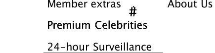

那么，我们如何用jQuery复现这个效果呢？“很简单，”你可能不屑一顾，“只需添加一个带有滑动效果的悬停操作。”你说得对：添加一个简单的悬停函数就能达到我们想要的行为，但这里有个问题。当我们在CSS和脚本中同时实现相同功能时，会发生什么？CSS的`:hover`和jQuery的`hover`之间，谁能胜出？局面很混乱——它们的实力不相上下！

一个显而易见的解决方法是在悬停事件处理程序中覆盖CSS类。但这会失败，因为目前无法在jQuery中针对伪选择器来设置CSS属性：

```
$('#nav li:hover ul').css('left', '-999px'); // 不起作用！
```

这让我们陷入了困境：我们如何在保留Suckerfish CSS菜单优点的同时，应用jQuery的增强功能呢？一个解决方案是在悬停时仔细地撤销CSS属性——但更简单的方法是用jQuery完全接管子菜单。

### chapter_05/05_dropdown_menu/script.js（摘录）

```javascript
$('#menu li ul').css({
    display: "none",
    left: "auto"
});
$('#menu li').hover(function() {
    $(this)
        .find('ul')
        .stop(true, true)
        .slideDown('fast');
}, function() {
    $(this)
        .find('ul')
        .stop(true, true)
        .fadeOut('fast');
});
```

此脚本的第一部分覆盖了我们先前设置的CSS，并使用`display: "none"`隐藏了子菜单。当用户将鼠标悬停在一个列表项上时，我们找到相关的子列表容器并将其显示出来。这里我们使用了`slideDown`和`fadeOut`——但你也可以想出一些奇特的缓动选项和CSS背景精灵图来使其更生动。`stop(true, true)`命令（正如我们在第3章“动画导航”一节中所见）确保当我们快速移动鼠标时，菜单不会排队堆积动画。

这个菜单控制的最佳之处在于，当用户禁用JavaScript访问该网站时，Suckerfish下拉菜单仍然可以正常工作——尽管没有动画效果。

### 悬停意图

我们已经看到了一些由鼠标悬停事件触发的效果——你可能已经注意到，它们有时会显得过于急切地激活。当你将鼠标移过目标元素的那一刻，效果就会立即生效，即使你只是路过。这对于制作流畅的动画效果非常棒，但有时我们想要不同的结果。对于我们下拉菜单来说，这种误触发可能显得不必要且令人分心。我们需要一种方法来延迟效果，直到确定用户确实想要激活目标元素。

早些时候，我们看到了一种通过设置定时器来实现此目的的方法。定时器方法的问题在于它不是动态的——如果你设置了一个较长的定时器和一个较小的目标区域，用户可能在菜单出现前就已将鼠标移开。如果定时器很短而目标区域很大，用户可能在定时器到期前未能完全移过该元素。

Brian Cherne针对这个问题实现了一个很好的变通方案，即Hover Intent插件。Hover Intent内置了一些智能算法，可以计算鼠标在元素间移动的速度。只有当鼠标移动速度足够慢，使插件认为用户*打算*停在那里时，效果才会触发。

一旦包含了该插件，你可以在通常使用`hover`操作的任何地方使用它。例如，如果我们想为上一节的下拉菜单添加延迟，只需将`hover`命令替换为`hoverIntent`命令：

```javascript
// chapter_05/06_dropdown_with_hover_intent/script.js（摘录）

$('#menu li').hoverIntent(function() {

}, function() {

});
```

菜单只有在认为用户想要查看时才会显示。体验此插件功能的最佳方式是将此示例与前一个示例进行比较，水平拖动鼠标穿过菜单。在前面的示例中，当你移动鼠标时，菜单会像波浪一样滑开；而使用`hoverIntent`时，菜单只会在鼠标停止移动时才会滑开。

与大多数插件一样，文档概述了你可以指定的少数几个选项以微调效果，因此如果你计划使用此功能，请务必通读文档。

### 手风琴菜单

手风琴菜单的名称源于乐器，其方式是一个区域的扩展会导致另一个区域的收缩。通常，手风琴是固定的，因此一次只能显示一个区域，尽管有些手风琴允许你折叠已经打开的区域，从而隐藏所有项目。

### 一个简单的手风琴

手风琴可能比你想象的更复杂。我们早些时候看到了如何用几行jQuery代码实现一个简单的展开和折叠菜单系统。因此，你可能会假设添加一个约束（即任何时候只能打开一个菜单元素）会很简单。虽然基本实现确实很简单（毕竟这是jQuery！），但在实施更复杂的约束时，有一些注意事项你需要了解。

在这个示例中，我们将构建一个简单的手风琴，根据流行程度对名人进行分组；这将使我们能够在StarTrackr!网站上节省相当多的宝贵屏幕空间。我们目标实现的效果如图5.4所示。

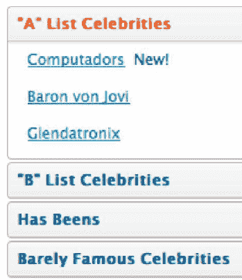

你可以使用几乎任何HTML标记结构来设置手风琴；你真正需要的是一组清晰可识别的标题，每个标题都与一个内容块相关联。在这个示例中，我们将使用一组嵌套列表，如下所示：

### chapter_05/07_simple_accordion/index.html（摘录）

```html
<ul>
  <li class="active">
    "A" List Celebrities
    <ul>
      <li><a href="#">Computadors</a> &nbsp;New!</li>
      <li><a href="#">Johny Stardust</a></li>
      <li><a href="#">Beau Dandy</a></li>
    </ul>
  </li>
  <li>
    "B" List Celebrities
    <ul>
      <li><a href="#">Sinusoidal Tendancies</a></li>
      <li><a href="#">Steve Extreme</a></li>
    </ul>
  </li>
</ul>
```

这种列表标记是菜单的理想HTML结构，但当然也有其他选择；你同样可以使用一组嵌套的div，其中header元素提供每个部分的标题。只要结构一致并允许你选择所有标题触发器和相关内容，几乎任何结构都是合适的。我们用一些CSS样式化了列表，你可以在示例代码包中查阅。

当页面加载时，我们所有的内容区域都是可见的。到现在你应该知道接下来会发生什么：我们需要隐藏所有内容，除了我们的默认项：

```javascript
// chapter_05/07_simple_accordion/script.js（摘录）

$('#celebs ul > li ul')
  .click(function(e) {
    e.stopPropagation();
  })
  .filter(':not(:first)')
  .hide();
```

我们这里的做法与之前略有不同。在这个例子中，我们还预先考虑了事件冒泡可能带来的问题（在“事件管理”一节中介绍）。我们为每个内容区域附加了一个事件监听器，然后通过过滤器排除第一个区域，并隐藏剩余的所有内容。

`filter`命令是在语句中途缩小选择范围的非常方便的方法。任何不匹配传递给它的条件的元素都会从选择中移除，并且不再受到后续jQuery命令的影响。你可以将条件指定为选择器或函数（参见下面的注释）。我们在前面的示例中使用了过滤选择器（`:not`和`:first`）——但你可以使用任何jQuery选择器来帮助你找到所需的元素。

`:not`是一个很实用的实用选择器，因为它选择其后括号中内容的相反项。所以`$(':not(p)')`会选择每个不是段落的元素，而`$('p:not(.active)')`会选择没有`active`类的段落。

与`filter`方法相反的是`add`。`filter`从选择中移除元素，而`add`则向选择中添加新元素。通过结合使用`filter`和`add`，你可以在一个jQuery链中完成大量处理——根据需要沿途添加和移除元素。

### filter的高级用法


有时你需要执行涉及更复杂标准的过滤；在这些情况下，你可以使用自定义函数来定义你的规则。该函数会对jQuery选择中的每个元素进行处理。如果返回`true`，则元素保留在选择中；否则，它将被丢弃。例如，让我们保留选择中是第三个或具有`active`类的每个段落元素：

```javascript
$('p').filter(function(index) {
    return index == 2 || $(this).hasClass('active');
});
```

注意，我们可以访问选择中每个元素的从零开始的索引，并且作用域是当前元素？这就是为什么我们可以用`$(this)`引用它的原因。你可以在标准函数中包含任意数量的处理——只要记住，如果你想保留该元素，就要返回`true`。

手风琴效果的代码需要关闭任何已打开的项目（因为一次只能有一个打开），然后打开我们点击的项目。但这个逻辑存在一个问题：如果我们点击一个已经打开的项目，它会

不必上下滑动。因此，首先我们需要检查点击的项目是否已经展开：

```
chapter_05/07_simple_accordion/script.js (摘录)

$('#celebs ul > li').click(function() {
  var selfClick = $(this).find('ul:first').is(':visible');
  if (!selfClick) {
    $(this)
      .parent()
      .find('> li ul:visible')
      .slideToggle();
  }
  $(this)
    .find('ul:first')
    .slideToggle();
});
```

我们来逐行分析这段代码：

- 我们使用 `.is(':visible')` 结构来检查嵌套的 `ul` 是否可见，并将结果存储在名为 `selfClick` 的变量中（如果用户点击的是已打开的部分，该变量将为 `true`）。
- 我们在 `if` 语句中使用 JavaScript 的 `!` 运算符，以便在不是点击的部分时隐藏可见部分。`!` 表示“非”，因此嵌套的代码块只有在 `selfClick` 不为 `true` 时才会执行。
- 最后，我们切换点击项目的显示状态：如果已打开则收起，如果已关闭则展开。

我们这样编码，用户可以关闭手风琴中已打开的部分，从而完全折叠它。如果你更希望强制保持一个项目始终可见，可以调整代码，使得点击已打开的项目不会产生任何效果。这可以通过一点基本的 JavaScript 轻松实现：如果 `selfClick` 的值为 `true`，我们只需使用 JavaScript 的 `return` 关键字退出函数：

```
chapter_05/08_simple_accordion_variant/script.js (摘录)

$('#celebs ul > li').click(function() {
    var selfClick = $(this).find('ul:first').is(':visible');
    if (selfClick) {
        return;
    }
    $(this)
        .parent()
        .find('> li ul:visible')
        .slideToggle();
    $(this)
        .find('ul:first')
        .stop(true, true)
        .slideToggle();
});
```

### 多级手风琴

之前我们提到，应该以一致的方式构建手风琴的 HTML 结构——原因就在这里！如果我们使用的 jQuery 选择器足够精确，为手风琴添加另一级就像将下一级包含在事件处理程序中一样简单。首先，我们添加第二级菜单项。我们使用与第一级完全相同的结构，但将其嵌套在第一级列表项内：

```
chapter_05/09_multi_level_accordion/index.html (摘录)

<ul>
    <li class="active">"A" List Celebrities
        <ul>
            <li><a href="#">Computadors</a> &nbsp;New!</li>
            <li>Rising Stars
                <ul>
                    <li><a href="#">Johny Stardust</a></li>
                    <li><a href="#">Beau Dandy</a></li>
                </ul>
            </li>
            <li>Falling Stars
                <ul>
                    <li><a href="#">Kellie Kelly</a></li>
                    <li><a href="#">Darth Fader</a></li>
                </ul>
            </li>
        </ul>
    </li>
</ul>
```

对于我们的单级手风琴，我们使用以下代码将手风琴功能附加到根列表的所有第一级子元素上：`$('#accordion > li').click(...)`。
由于嵌套列表的结构与之前完全相同，我们只需要将相同的代码应用于嵌套元素，这可以通过简单地将它们添加到选择器中来实现：

```
chapter_05/09_multi_level_accordion/script.js (摘录)
$('#accordion > li, #accordion > li > ul > li').click(...);
```

如果你遵循这个选择器链，你会发现我们正确地将手风琴功能添加到了相应的列表项上。我们也可以将其添加到每个列表项，但这可能会根据你的 HTML 结构导致嵌套内容出现奇怪的行为。生成的菜单如图 5.5 所示。

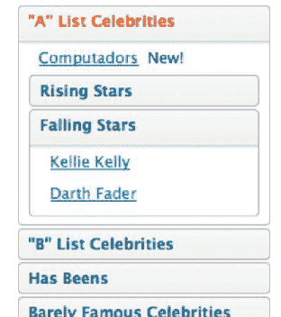

如果你想为手风琴添加更多级别，只需重复这个过程即可。如果过长的选择器变得难以管理，你可以为每一级的根元素添加一个额外的类；不过，如果级别超过几个，或许有更合适的控件能更好地呈现你的信息，而不是手风琴（参见第 8 章）。

### jQuery UI 手风琴

正如我们所见，使用 jQuery 从头开始创建一个相当完整的手风琴控件很容易。然而，jQuery UI 库也包含了一个手风琴控件，它提供了令人印象深刻的各种选项。这些选项包括更改图标、在鼠标悬停时触发，以及对包含手风琴的元素做出特定响应（例如，你可以选择让内容区域具有固定高度或自动高度）。图 5.6 展示了使用 Sunny 主题的 jQuery UI 手风琴示例。

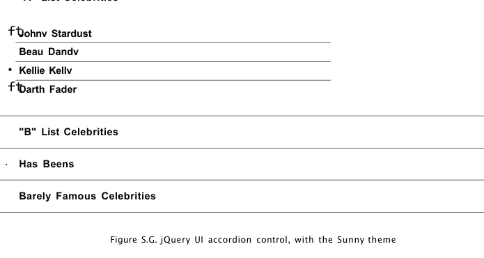

与我们的自定义手风琴类似，jQuery UI 手风琴的标记需要成对的标题和内容元素。默认情况下，它假定标题是链接标签，内容紧随其后；但是，如果内容包含链接，它就会混淆，因此最好指定一个选择器来帮助它确定你内容的哪个部分是标题：

```
chapter_05/10_jquery_ui_accordion/script.js (摘录)

$('#accordion1').accordion({header: 'h3'});
```

只要 `h3` 的下一个同级元素是你想要隐藏或显示的内容面板，这就是你将内容转换为功能完备的手风琴所需的全部代码。

该手风琴还提供了以编程方式与控件交互的功能。例如，你可以使用 `activate` 选项以及要打开的面板的索引来打开特定的内容面板。要打开第三个面板（记住，索引从零开始），你可以编写以下代码：

```
chapter_05/10_jquery_ui_accordion/script.js (摘录)

$("#accordion").accordion("activate", 2);
```

还有许多其他选项可用于配置和与手风琴交互，这些在 jQuery UI 网站上有详细的文档说明。

使用 jQuery UI 控件在文件大小和带宽使用方面相比我们的自定义控件代价显著——但如果你需要高级功能并且不想花费时间自己实现，它可能是一个可行的选择。

### 选项卡

选项卡提供了一种将内容逻辑分组的方式，已经成为许多桌面应用程序界面的标配。它们在 Web 上也很常见，如果你把那些样式像选项卡的顶级导航元素也算在内。然而，在 JavaScript 的世界里，选项卡通常用于将内容分成多个部分，以便在需要时交换以节省空间。

#### 基本选项卡

我们简单的选项卡预加载了页面的所有内容——我们只需要根据需要隐藏和显示。如果你从头开始一直在阅读本书，你大概能猜到如何处理这个问题。

我们将选项卡控件分为两个组件：选项卡导航和内容区域。这让我们在浏览器不支持 JavaScript 的情况下也能有一个可接受的解决方案：一个指向页面上元素的简单锚链接列表。它可能看起来不如我们炫酷的选项卡那么光鲜，但它功能完备，提供了对所有相同内容的访问。首先，我们将选项卡内容设置为一个简单的 div 元素集合：

```
chapter_05/11_simple_tabs/index.html (摘录)

<div id="info">
  <p id="intro">
    Welcome to <strong>StarTrackr!</strong> the planet's premier ...
  </p>
  <p id="about">
    StarTrackr! was founded in early 2009 when a young ...
  </p>
  <p id="disclaimer">
    Disclaimer! This service is not intended for the those ...
  </p>
</div>
```

接下来，我们需要创建选项卡导航栏。与许多控件和效果一样，整体效果很重要。一个链接的无序列表就很不错，但我们会将其样式化为看起来像选项卡的样子：

```
chapter_05/11_simple_tabs/index.html (摘录)

<ul id="info-nav">
    <li><a href="#intro">Intro</a></li>
    <li><a href="#about">About Us</a></li>
    <li><a href="#disclaimer">Disclaimer</a></li>
</ul>
```

我们使用 CSS 将链接样式化为具有选项卡外观，但实现这一点的方法有数十种，所以使用你熟悉的或觉得最合理的方法。我们选择了非常基本的样式，因为我们想专注于功能。

我们在文档准备就绪后要做的第一件事是隐藏除第一个以外的所有选项卡——这将作为我们的默认选项卡。我们可以通过隐藏所有面板，然后显示第一个来实现，像这样：

```
$('#info p').hide().eq(0).show();
```

但这会让 jQuery 做更多不必要的工作；我们希望避免隐藏一个选项卡然后又立刻显示它。相反，我们可以更精确地指定选择器；我们可以组合过滤器来选择除第一个元素之外的所有内容：

```
chapter_05/11_simple_tabs/script.js (摘录)

$('#info p:not(:first)').hide();
```


重要的一点是，一旦页面加载完成，用户只能看到一个标签页内容窗格。切换标签页的代码很简单，与我们之前构建的其他显示/隐藏控件非常相似：

chapter_05/11_simple_tabs/script.js（摘录）

```
$('#info-nav li').click(function(e) {
    $('#info p').hide();
    $('#info-nav .current').removeClass('current');
    $(this).addClass('current');

    var clicked = $(this).find('a:first').attr('href');
    $('#info ' + clicked).fadeIn('fast');
    e.preventDefault();
}).eq(0).addClass('current');
```

有一个特别之处值得指出：为了选择与点击链接对应的内容窗格，我们使用 JavaScript 的 `+` 运算符将链接的 `href` 属性直接连接到选择器中。这之所以有效，是因为锚点链接使用井号（#）来标识其目标，而 jQuery 也使用井号来按 id 选择元素。这纯属巧合，但对我们来说非常幸运，因为无需解析文本或使用正则表达式来创建选择器。

在我们附加点击处理程序之后，我们使用 `eq` 选择器过滤导航列表，仅保留第一个元素，并为其添加 `current` 类。在我们的示例中，第一个标签页是默认标签页；如果你希望不同的标签页作为第一个，你需要将 0（因为它是基于零的索引）更改为你想要的那个。

### jQuery UI 标签页

虽然我们的基本标签页解决方案为我们提供了一个很好的构建基础，但我们绝不是第一个尝试使用 jQuery 构建标签页内容窗格的人。由于足够多的人要求标签页界面，jQuery UI 库在其控件集合中包含了一个功能非常丰富的标签页部件。

在你丢弃我们基本的标签页而转向闪亮的 jQuery UI 标签页之前，请考虑一下你希望你的标签页做什么。凭借你目前所掌握的 jQuery 知识，你应该能够自己实现许多功能——例如在鼠标悬停而不是点击时切换标签页，以编程方式切换标签页，或者在你双击标签页本身时折叠标签页的内容。

有一个功能我们需要做更多的工作来实现（至少目前是这样），那就是通过 Ajax 加载内容的能力。我们将在第 6 章更详细地探讨 Ajax，但目前我们可以看看它最简单的用法：在不刷新页面的情况下从服务器将内容加载到我们的页面中。

到现在你可能已经习惯了包含 jQuery UI 功能。确保你构建一个包含 Tabs 组件的下载包，然后将 CSS 和 JavaScript 文件包含到你的 HTML 中。你可以在图 5.7 中查看我们的 jQuery UI 标签页会是什么样子。

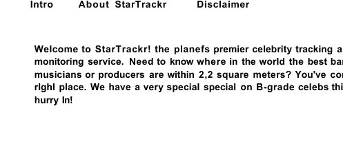

有了 UI 库和 CSS 样式，添加内容就变得容易了。通过 Ajax 加载的内容不需要预设容器——插件会自动生成所需的 DOM 元素：

chapter_05/12_jquery_ui_tabs/index.html（摘录）

```html
<div id="info">
  <ul id="info-nav">
    <li><a href="#intro">Intro</a></li>
    <li><a href="about.html">About StarTrackr!</a></li>
    <li><a href="disclaimer.html">Disclaimer</a></li>
  </ul>
  <div>
    <p id="intro">
      Welcome to <strong>StarTrackr!</strong> the planet's premier ...
    </p>
  </div>
</div>
```

就像我们之前做的那样，我们首先创建一个标签页导航列表。对于静态内容，你需要指定一个锚点名称，该名称与包含相关内容的元素的 id 对应（在我们的示例中是 #intro）。接下来的两个标签页是我们的 Ajax 标签页；它们只是指向服务器上的 HTML 文件（在我们的情况下，是硬盘上的文件）。在真实的 Web 应用程序中，它们会指向生成动态内容的服务器端脚本；为了说明 jQuery UI 的 Ajax 标签页如何工作，我们将坚持使用一些静态 HTML 文件。这些文件可以包含你希望加载到标签页中的任何内容。

我们将实现的功能在没有 JavaScript 的情况下会优雅地降级；这些标签页将简单地作为链接指向引用的文件。然而，当启用 JavaScript 时，jQuery 将在不刷新页面的情况下将目标页面的内容加载到标签页内容窗格中。无需担心它会拉取整个 HTML 页面——它足够智能，只包含 `<body>` 开始和结束标签之间的内容。

要将上述标记转换为支持 Ajax 的标签页界面，你只需要编写：

chapter_05/12_jquery_ui_tabs/script.js（摘录）

```javascript
$("#info").tabs();
```

在你的浏览器中试用以确认它有效。如果这还不算 "少写多做"，我们不知道什么才是！

### 标签页选项

标签页控件附带大量自定义选项，你可以在 jQuery UI 标签页演示页面上找到。我们现在将探讨一些有趣的内容：

chapter_05/13_jquery_ui_tab_options/script.js（摘录）

```javascript
$("#info").tabs({
    event: "mouseover",
    fx: {
        opacity: "toggle",
        duration: "fast"
    },
    spinner: "Loading...",
    cache: true
});
```

作为控件初始化的一部分，我们传递了一个包含选项集合的 JavaScript 对象：event、fx、spinner 和 cache。event 选项让你选择切换标签页的事件——这里我们用 mouseover 替换了默认的 click。现在要切换标签页，用户只需将鼠标悬停在所需的标签页上即可。

接下来，我们添加了一些动画选项，以指定在标签页之间切换时进行快速的淡入淡出过渡。fx 选项的工作方式与 animate 命令完全一样，让你可以根据需要以任何方式调整过渡效果。

最后两个选项用于我们的 Ajax 标签页。spinner 指定在内容加载时显示的 HTML。由于你的所有页面都放在本地机器上，你可能永远不会看到这段文本——但当你将页面放到真实的 Web 服务器上时，你肯定会注意到延迟（因此也会注意到 spinner 文本）。它被称为 spinner，因为它经常用于显示一个旋转图标的动画 GIF 图像，该图像旨在指示加载，并且几乎总是命名为 spinner.gif。

cache 选项指示浏览器在加载标签页内容后保留一份副本。这样，如果你的用户频繁点击你的标签页——反复来回切换——浏览器就不需要每次都下载新的数据副本。

### 标签页控件方法

还有一系列用于以编程方式与标签页交互的方法。你可以添加、删除和重新加载标签页，以及自动更改打开的标签页。例如：

chapter_05/14_jquery_ui_tab_control/script.js（摘录）

```javascript
$("#info").tabs().tabs("rotate", 3500);
```

第一个 tabs 调用设置我们的标签页窗格，第二个调用指示 jQuery 每 3,500 毫秒（或 3.5 秒）循环浏览一次标签页。你可以对标签页做更多的事情，所以请查看文档以了解可能的操作。

我们要看的最后一项是以编程方式选择标签页。你可以使用 selected 选项找到当前选中的标签页：

```javascript
$('#tabs').tabs('option', 'selected');
```

当然，你也可以设置当前标签页。如果你想让内容中的链接简单地更改打开的标签页，而不是链接到新页面，这会很方便。在这个示例中，我们在第一个标签页的内容中插入了一个指向"关于我们"页面的链接。我们可以劫持这个链接，让它打开"关于我们"标签页：

chapter_05/14_jquery_ui_tab_control/script.js（摘录）

```javascript
$("#info p a[href=about.html]").click(function() {
  $('#info').tabs('select', 1);
  return false;
});
```

### 面板和窗格

面板和窗格只不过是用来容纳其他控件的控件！正确使用时，它们有助于将页面组织成逻辑区域，最大限度地减少用户的复杂性。这让熟练用户能够利用你网站或应用程序的所有功能，而不会让新手淹没在按钮和部件的海洋中。当面板提供上下文工具和控件，供用户在文档打开或处于焦点时使用时，它们最为有效。

### 下拉登录表单

一种日益流行的方法是减少视觉杂乱，即使用一个隐藏在屏幕最顶部的菜单。一个小按钮或链接向用户表明有更多信息可用。点击按钮会使一个面板滑入视野，而离开该面板又会使它滑回去。

这确实是一种方便实用的节省空间的方法，但应该在其中存储什么信息呢？下拉面板最流行的用途是显示登录表单。

我们要创建的登录表单如图5.8所示。

这将是网站的一个简单添加功能，因为大部分所需的jQuery命令我们已经熟悉。我们会为控件添加一些快速的CSS样式，但一如既往，如何使其与你的网站风格保持一致，取决于你自己的设计。然后，便是那个如今已耳熟能详的步骤——在页面加载时隐藏表单，然后捕获点击事件来切换其显示与隐藏：

```
chapter_05/15_login_panel/script.js (excerpt)

$("#login form").hide();
$("#login a").toggle(function() {
    $(this)
        .addClass("active")
        .next("form")
        .animate({"height": "show"}, {
            duration: "slow",
            easing: "easeOutBounce"
        });
}, function() {
    $(this)
        .removeClass("active")
        .next("form")
        .slideUp();
});
```

这段代码与本章开头的可展开菜单之间的唯一区别在于，这里我们使用CSS类来控制背景图片的位置，而不是使用jQuery动画。由于这些类只在JavaScript可用时才真正使用（否则我们将始终显示一个打开的控件），因此两种方案并无绝对的优劣之分，你选择哪一种更多取决于个人偏好。

这有点太简单了，所以我们稍微优化一下。如果我们希望通过Ajax提交登录表单（不触发页面刷新），我们就会希望在表单提交后面板消失。实际上，即使我们在加载新页面，让菜单在点击后滑上去也是一个不错的点缀：

```
chapter_05/15_login_panel/script.js (excerpt)

$('#login form :submit').click(function() {
  $(this)
    .parent()
    .prev('a')
    .click();
});
```

我们首先捕获表单提交按钮上的点击事件，然后回溯DOM树寻找包含元素。我们本可以直接在这里执行隐藏操作，但鉴于我们已经在原始处理程序中编写了处理隐藏的代码，我们只需使用`prev`方法回溯DOM，并点击我们的显示/隐藏链接。

### 滑动覆盖层

半透明的滑动覆盖层最近随处可见：从消息对话框，到购物车摘要，再到导航控件等等。它们流行的原因很简单：它们看起来极其酷炫——就像动作电影中电脑场景里那些备受争议的界面——只不过它们确实实用！

创建滑动覆盖层时需要考虑的最重要因素是，你希望内容从何处滑入，以及覆盖层将如何被触发。这些选择会影响用户如何与控件交互，以及他们期望它如何表现。这种类型的控件对Web来说相当新——因此没有你需要遵循的固定惯例——但你可以参考桌面应用中的类比来确定它们应如何运行。或许你会创建一个实际上确立了一些规则的版本！

例如，你可能希望包含一个内容面板，当用户将鼠标移动到页面边缘附近时它会滑出——就像许多操作系统中的自动隐藏任务栏或程序坞一样。或者，当鼠标移动到内容区域底部边缘时，可能会导致“下一个/上一个”控件滑入视野。

我们的覆盖层将通过将鼠标悬停在“购物车”链接上来触发。鼠标悬停在链接上将导致一个菜单从页眉下方滑下，覆盖在页面上，告知用户购物车内当前的商品数量，并提供结账或查看购物车的链接。如图5.9所示，作为触发器的购物车图标位于内容区域的右上角。

一如既往，样式为我们效果提供了真正的基础。这将决定我们的触发器外观如何，以及我们的滑动从何处开始。我们的触发器将被绝对定位在页面内容的右上角：

```
chapter_05/16_sliding_overlay/panel.css (excerpt)

.cart a {
    position: absolute;
    width: 32px;
    height: 32px;
    right: 15px;
    top: -10px;
    background: transparent url(shoppingcart.png) no-repeat 0 0;
    text-indent: -9999px;
}

.cart a:hover, .cart-hover {
    background-position: 0 -32px;
}

#overlay {
    position: absolute;
    width: 100%;
    height: 100px;
    top: 0;
    left: 0;
    color: #fff;
    background-color: #000;
    display: none;
    text-align: center;
}

#overlay a {
    font-size: 130%;
    font-weight: bold;
}
```

因为覆盖层将只通过jQuery触发，所以理所当然地，它也应该用jQuery添加到页面标记中。覆盖层被设置为页面宽度的100%，高度为100像素。我们希望覆盖层从顶部滑下，所以我们将top位置设置为0。当然，我们也隐藏它，使其在页面加载时不存在。

第一步是将覆盖层添加到标记中。我们将为它添加一个hover处理程序，因为当它滑入页面时，我们希望只要用户将鼠标悬停在其上，它就保持可见。只要它处于打开状态，我们就给它一个`active`类，并使用该类来判断何时需要关闭它。当用户将鼠标移开时，我们移除该类，并设置一个计时器，该计时器将查找没有该类的覆盖层，并在不到一秒后关闭它。这样，如果用户在计时器运行时重新打开覆盖层，计时器方法将不会执行任何操作：

```
chapter_05/16_sliding_overlay/script.js (excerpt)

$("<div></div>")
  .attr('id', 'overlay')
  .css('opacity', 0.65)
  .hover(function() {
    $(this).addClass('active');
  }, function() {
    $(this).removeClass('active');
    setTimeout(function() {
      $("#overlay:not(.active)").slideUp(function() {
        $("a.cart-hover").removeClass('cart-hover');
      });
    }, 800);
  }).appendTo('body');
```

我们使用opacity CSS属性使我们的覆盖层半透明，opacity值范围从0到1，1表示完全不透明，0表示不可见。

**可访问性：** 创建半透明控件时，请注意内容与背景之间要有足够的颜色对比度。也许对你来说很容易阅读，但请始终考虑你的一些访客视力可能并非完美。如有疑虑，请谨慎行事，使用比你认为必要的更高的对比度。

现在，让我们为触发链接添加事件监听器：

```
chapter_05/16_sliding_overlay/script.js (excerpt)

$('.cart a').mouseover(function() {
    $(this).addClass('cart-hover')
    $("#overlay:not(:animated)")
      .addClass('active')
      .html('<h1>You have 5 items in your cart.</h1>
<a href="#">View Cart</a>&nbsp;<a href="#">Checkout</a>')
      .slideDown();
});
```

这里的选择器中有一个新的过滤器：`:animated`，它允许我们选择当前正在被动画处理的元素（或者，在本例中，与`:not`伪类结合使用，来选择当前未被动画处理的元素）。这可以防止在用户快速进出触发器时动画堆叠。

这是向覆盖层添加内容的一个良好开端，但在实际应用中，你需要获取购物车商品数量才能在此显示。

我们还向触发链接添加了一个类以设置其样式，因为否则当覆盖层出现在它和光标之间时，其悬停样式会关闭。

当然，这只是此类功能的一个例子；你很可能会想到许多其他的可能性。在jQuery中，透明度非常容易操控，它确实能让界面组件感觉更加流畅。

### 工具提示

工具提示是一种当用户将鼠标悬停在控件上时出现的界面组件。它们已经存在于大多数浏览器中；当你为链接提供`title`属性或为图像提供`alt`属性时，浏览器通常会在用户悬停在该元素上时将其显示为工具提示。

JavaScript工具提示名声有点不太好。它们往往以令人讨厌的方式实现，更像是一个广告弹出窗口，而不是一个有用的信息工具。然而，在某些情况下，工具提示可以为你的应用增添恰到好处的点睛之笔，以一种上下文相关的方式帮助告知用户，而不会使界面的其余部分显得杂乱。

首先，我们将尝试用我们可以自定义样式和动画的工具提示来替换浏览器的默认工具提示。然后，我们将研究如何扩展此功能以创建一个功能更强大的工具提示，它可以包含HTML并可以附加到页面上的任何元素。

#### 简单工具提示

工具提示通常在用户将鼠标悬停在超链接上时出现——以提供有关链接指向何处的附加信息。当然，还有其他地方你想使用工具提示，但这是一个很好的起点。我们将研究用我们自己自定义样式、带动画的工具提示来替换浏览器的默认工具提示，如图5.10所示。


### 自定义工具提示

对于我们的简单控件，我们将使用链接的 `title` 属性。这对于维护没有 JavaScript 支持的用户的基本功能非常有用；根据他们的浏览器，他们很可能会将文本视为基本的浏览器工具提示：

```
chapter_05/17_simple_tooltips/index.html (excerpt)

<a href="#" title="Check out all the ... ">New York</a>
```

使用 `title` 属性可能有些限制：你无法（技术上或可靠地）在工具提示中嵌套 HTML，并且需要注意可能破坏标签的特殊字符。存储工具提示文本还有一些替代技术。当我们制作高级工具提示时，我们将看看另一种方法——但重要的是要注意，任何方法都有优缺点，你需要在每种特定情况下决定哪种方法最合适。

能够设置工具提示样式是实现自定义控件的主要原因——因此尽情发挥你的样式吧！然而，对于我们的示例，我们将为工具提示定义一些非常基本的样式：

```
chapter_05/17_simple_tooltips/tooltips.css (excerpt)

tooltip {
  display: none;
  position: absolute;
  border: 1px solid #333;
  background-color: #ffed8a;
  padding: 2px 6px;
}
```

工具提示控件是绝对定位的，这将允许我们根据需要移动它。接下来，我们将为代码设置一些存根，这让你可以看到总体结构：一个简单的悬停函数，后跟一个链式鼠标移动函数。我们希望工具提示在悬停事件时打开和关闭，并在鼠标移动时更新其位置：

```
chapter_05/17_simple_tooltips/script.js (excerpt)

$('.location').hover(function(e) {
  // 悬停在代码上
}, function() {
  // 悬停在代码外
}).mousemove(function(e) {
  // 鼠标移动代码
});
```

从整体结构开始，然后填充细节是规划代码的好方法，确保在深入研究之前你知道发生了什么。在编写代码时，始终了解该部分在更大背景中的位置会有所帮助。

让我们开始填充这些存根。悬停在代码上是最有趣的，所以我们从那里开始。注意我们正在将可选参数 `e` 传递到悬停代码中。这很重要，因为我们需要访问事件的 X 和 Y 坐标来定位工具提示：

```
chapter_05/17_simple_tooltips/script.js (excerpt)

// 悬停在代码上
var titleText = $(this).attr('title');
$(this)
  .data('tipText', titleText)
  .removeAttr('title');

$('<p class="tooltip"></p>')
  .text(titleText)
  .appendTo('body')
  .css('top', (e.pageY - 10) + 'px')
  .css('left', (e.pageX + 20) + 'px')
  .fadeIn('slow');
```

首先，我们需要从链接中获取标题，这将是我们的工具提示要显示的文本。代码的下一部分有些奇特：它使用我们在第4章“使用data操作的智能滚动”一节中看到的 `data` 方法保存工具提示文本。我们需要这样做，因为我们即将从链接中删除 `title`，以防止浏览器显示其默认工具提示，这会与我们的自定义工具提示冲突。通过使用 `data` 命令存储文本，我们可以在以后恢复和替换链接标题。

我们现在拥有了创建工具提示控件所需的一切。我们将创建一个新的段落元素，其 `class` 为 `tooltip`，以便与我们之前创建的样式挂钩。然后我们使用 `text` 方法设置工具提示的内容。我们可以在这里使用 `html` 而不是 `text`，但根据 W3C 标准，`title` 属性不应包含 HTML。我们稍后将看到的高级工具提示将允许我们包含 HTML，但目前我们将坚持使用纯文本。

#### 样式问题

我们可以像这样用 jQuery 指定段落的 `id`：
`$( '<p></p>' ).attr( 'id', 'tooltip' )`。同样，我们可以使用 JavaScript 字符串连接来填充元素的内容：`$( '<p> ' + titleText + ' </p>' )`。两种方法都会得到相同的 DOM 对象，而且它们都相当清晰易读，所以这取决于你的个人编码风格，你更喜欢用 jQuery 链式调用还是普通 JavaScript 来完成更多操作。

在将新节点添加到页面后（使用 `appendTo`），我们使用事件对象（`e`）设置一些内联样式，以获取放置工具提示的位置。`pageX` 和 `pageY` 是事件对象的属性，允许你找出事件在页面上发生的位置。这在许多不同情况下都非常有用；你经常会发现自己需要根据刚刚触发的事件在屏幕上定位一个元素：

```
// 悬停在代码外
$(this).attr('title', $(this).data('tipText'));
$('.tooltip').remove();
```

悬停在代码外的代码再简单不过了：我们只是反向执行悬停在代码上时的操作，恢复 `title` 属性并移除工具提示：

```
chapter_05/17_simple_tooltips/script.js (excerpt)

// 鼠标移动代码
$('.tooltip')
	.ess('top', (e.pageY - 10) + 'px')
	.ess('left', (e.pageX + 20) + 'px');
```

最后，我们需要通过更新工具提示的位置来响应鼠标移动。这样工具提示就会跟随鼠标移动，就像浏览器内置的工具提示一样。就这样！我们已经用自己的工具提示替换了默认工具提示，并完全控制了它们的外观和动画。

### 高级工具提示

了解如何构建简单工具提示很好，但我们也知道我们可以做得更好。对于更复杂的工具提示，其内容中可以包含其他标记（如图像或链接），我们需要将它们从 title 属性移动到实际的标记中。我们将用 CSS 隐藏它们，然后在需要时使用 jQuery 显示和定位它们。最终效果如图 5.11 所示。

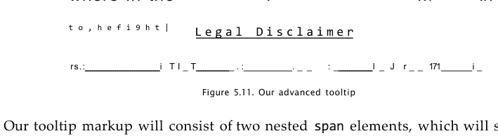

我们的工具提示标记将由两个嵌套的 span 元素组成，它们将位于我们想要用来触发工具提示的元素内。这可能偶尔需要一些创造性的标记，但它有助于我们定位工具提示，因为我们可以给它一个相对于父元素的绝对定位偏移量。它还有助于我们处理触发事件，因为如果用户将鼠标移到工具提示上，它仍然在触发元素上，因此不需要额外的悬停事件处理。

这是一个工具提示标记的例子：

```
<P>
  Welcome to
    <strong>StarTrackr!
      <span class="tooltip">
        <span><a href="#">Legal Disclaimer</a></span>
      </span>
    </strong> the planet's premier celebrity tracking ...
</p>
```

当我们完成时，工具提示看起来会很棒，并包含一个指向免责声明页面的链接。但我们不要再拖延了；我们已经考虑了几种工具提示方法，所以让我们直接开始吧。

正如我们开始编写代码时将看到的，我们的工具提示将相当巧妙，它会在目标元素的任一侧定位自己，只要有足够的空间显示它。为了使一个很酷的文本气泡图形在这种情况下工作，我们需要四个不同的气泡：左上、右上、左下和右下。我们将使用一个精灵图来处理工具提示的四种可能状态，如图 5.12 所示。

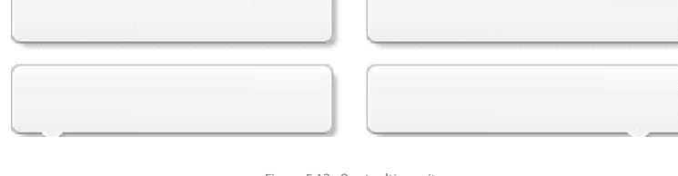

这些工具提示需要一些相当复杂的 jQuery 代码。我们将逐步介绍它，但如果你现在很难理解所有内容，请不要担心。从编写快速的两行或三行脚本来替换和突出显示页面上的内容，到编写更复杂的 UI 小部件，这是一个飞跃。在下一章的开头，我们将看看我们可以尝试最小化复杂性并保持代码可读性的一些方法，即使它变得更长、更复杂。


### 高级工具提示

目前，请尝试将注意力集中在观察你已知的 jQuery 代码如何应用于更广阔的上下文中；这应该能让你了解如何将小的逻辑片段组合成一个表现力令人印象深刻的大场景。

我们的第一个任务是创建一个 `TT` 对象来容纳所有代码。我们在对象顶部设置一个 `delay` 变量（这将使修改小部件的配置变得更方便，无需在整个代码中搜寻该变量被设置的位置）：

```javascript
chapter_05/18_advanced_tooltips/script.js (摘录)

var TT = {
    delay: 600,
```

然后我们添加一个名为 `setTips` 的函数，我们将在页面加载或调整大小时运行它。这个函数会找到页面上的所有工具提示，并通过查看它们的父元素来确定它们的位置。它还会为每个工具提示设置一个悬停事件，以便在鼠标悬停时显示它们。以下是悬停事件：

```javascript
chapter_05/18_advanced_tooltips/script.js (摘录)

setTips: function() {

    $(".tooltip").parent().hover(function() {
        // 存储正在悬停的工具提示
        TT.current = $(this);
        TT.timer = setTimeout(function() {
            // 找到工具提示，
            TT.current.find(".tooltip").fadeIn('fast');
        }, TT.delay);
    }, function() {
        // 鼠标移出时，清除计时器并隐藏工具提示
        clearTimeout(TT.timer);
        $(this).find(".tooltip").fadeOut('fast');
    }).attr("title", "");   // 清除 title 属性以阻止浏览器自带工具提示
```

这是一段相当密集的代码块，所以我们来看看能否理清其中发生了什么：

- 我们将悬停事件附加到了工具提示 span 的父元素上。如果你回顾一下标记结构，就会发现这是正确的：我们将工具提示放在了我们想要附加它的元素内部。
- 我们在变量中存储了对该父元素的引用。这里不寻常的是，我们使用的是 `TT` 对象的一个属性，而不是一个全局变量。我们将在下一章回到这一点，但现在只需知道这与编写 `var current = $(this);` 基本相同。
- 我们使用了熟悉的 `setTimeout` 函数，只是这次我们将计时器保存到了一个变量中。这样，如果我们需要，可以按名称将其关闭。我们将之前设置的 delay 属性作为 `setTimeout` 的第二个参数传入。正如我们所见，这是浏览器在显示工具提示之前会等待的时间。
- 当用户将鼠标移离目标时，我们希望停止计时器，这样工具提示就会在延迟时间过后保持隐藏状态。我们通过 JavaScript 的 `clearTimeout` 方法实现这一点，传入计时器的引用。

好了，现在我们的悬停处理程序已经设置好了，我们需要确定每个工具提示的位置。我们将使用 `each()` 来遍历它们，但首先我们获取屏幕的高度和宽度。如果我们*在*循环*内部*进行此操作，jQuery 将需要为每个工具提示重新计算这些值一次，即使它们始终相同。通过在循环外存储这些值，我们避免了这种浪费的计算，并提高了脚本的性能：

```javascript
chapter_05/18_advanced_tooltips/script.js (摘录)

var screenWidth = $(window).width();
var screenBottom = $(window).scrollTop() + $(window).height();

$(".tooltip").each(function() {
  // 获取包含元素
  $container = $(this).parent();

  // 如果需要，设置其 position 为 relative
  if ($container.css("position") != 'absolute'
      && $container.css("position") != "fixed") {
    $container.css({position: 'relative'});
  }

  var totalHeight = $container.height() + $(this).outerHeight();
  var width = $(this).outerWidth();
  var offset = $container.offset();

  // 现在我们获取提示的位置
  var top = $container.height(); // 默认放置位置
  var left = 0;
```

这部分代码应该更容易理解一些。我们遍历页面上的每个工具提示，首先存储对容器元素的引用，只是为了避免重复编写 `$(this).parent()`。注意变量名以 `$` 开头：这只是为了帮助我们记住该变量包含一个 jQuery 选择集。以下是循环内容的细分：

- 我们检查父元素是否具有 `position: absolute;` 或 `position: fixed;`。它必须是定位过的，因为我们将使用 `position: absolute;` 来使工具提示相对于它偏移。如果它已经有绝对定位或固定定位，我们就保持原样。如果没有，我们就给它设置 `position: relative;`。
- 我们需要知道工具提示和父元素的总合并高度，所以我们将其存储在一个变量中以备后用。
- 默认情况下，我们将工具提示的 top 位置设置为等于容器的高度。这意味着它将直接出现在容器*下方*（因为它从顶部偏移了恰好等于容器高度的距离）。

#### 逻辑运算符

在 JavaScript 中，当你在 `if` 语句中测试值时，可以使用 `&&` 运算符表示 *与*。因此，在上面的例子中，只有当*两个*条件（在 `&&` 两侧）都满足时，`if` 代码块的内容才会执行。

你也可以编写 `||`（两个管道符号）表示 *或*。如果我们上面用 `||` 代替 `&&`，那么只要满足*任一*条件，`if` 代码块的内容就会执行。

到目前为止做得很好！我们快完成了，但我们需要解决一个小问题：如果工具提示的位置使其超出了屏幕范围怎么办？如果目标元素就在屏幕底部，而我们想让工具提示出现在它下方，那么工具提示将不可见！

是时候进行一些碰撞检测了。我们需要找出工具提示是否碰到了屏幕的底部或右边缘。让我们看看如何实现这一点：

```javascript
chapter_05/18_advanced_tooltips/script.js (摘录)

// 如果超出屏幕右侧，则重新定位
if (offset.left + width > screenWidth) {
  left = 0 - width + 42;
  $(this).addClass('left');
} else {
  $(this).removeClass('left');
}

// 如果超出屏幕底部，则重新定位
if (offset.top + totalHeight > screenBottom) {
  top = 0 - $(this).outerHeight();
  $(this).addClass('above');
} else {
  $(this).removeClass('above');
}
```

我们检查工具提示的水平或垂直偏移量加上其宽度或高度是否大于屏幕的宽度或高度（我们之前已计算过）。如果是，我们相应地修改 `top` 或 `left` 属性，并分配一个类，我们将用它来显示背景图像精灵图的相应部分。

最后（也是最简单的）步骤是使用 `css` 动作将计算出的 `top` 和 `left` 属性分配给提示：

```javascript
$(this).css({
    "top":  top,
    "left": left
});
```

我们将在文档就绪时调用 `setTips` 方法，并在每次窗口调整大小时也调用它，以确保我们的提示始终得到恰当的定位：

```javascript
$(document).ready(function() {
    TT.setTips();
});

$(window).resize(function() {
    TT.setTips();
});
```

有了这段代码，我们只需要添加一些 CSS 来根据我们分配的类适当地定位我们的背景精灵图：

```css
span.tooltip.left {
    background-position: 100% 0;
}

span.tooltip.left span {
    padding: 15px 0 0 17px;
}

span.tooltip.above {
    background-position: 0 100%;
}

span.tooltip.above span {
    padding: 13px 0 0 12px;
}

span.tooltip.above.left {
    background-position: 100% 100%;
}

span.tooltip.above.left span {
    padding: 13px 0 0 17px;
}
```

#### IE6 支持

虽然 jQuery 在处理我们 JavaScript 代码中的跨浏览器问题方面做得非常出色，但对于我们的 CSS 则不然。上面的样式规则依赖于将多个 `class` 选择器链接在一起。这会让 Internet Explorer 6 感到困惑，它只会识别任何样式规则中的最后一个 `class`。此外，我们的 PNG 图像依赖于 alpha 通道透明度来实现工具提示的投影，这也同样不被 IE6 支持。

在过去几年里，一些主要网站（包括 YouTube 和 Facebook）开始逐步停止支持 IE6。这并不意味着他们完全忽略了这个浏览器，而是他们接受 IE6 用户将获得降级的体验（可能类似于没有 JavaScript 的访客将看到的内容）。

对于我们的工具提示示例，我们可以使用条件注释专门针对 IE6 应用某些样式，并为其提供相同的工具提示功能——只是使用一个平面的背景图像，没有对话框样式或投影。这样，背景位置就无关紧要了，PNG 问题也得到了解决。

就是这样了！最终的工具提示不仅会等待查看你是否真的打算显示它，而且还会移动其位置以确保它在显示时完全可见！因为我们避免了将此代码与页面上的任何特定内容关联，所以很容易在任何其他页面上重用此脚本——你只需要包含几个带有 `tooltip` 类的 span，就可以开始了。这是一个重要的教训：你应该始终尝试以可以重用代码的方式构建你的代码。从长远来看，这将节省你的工作，并给你更多时间去尝试酷炫的新功能，而不是每次需要时都重建相同的旧小部件。

http://www.wowebook.com


### 照单点菜

呼！这最后冲刺可真不容易。在本章中，我们提升了对jQuery的掌握程度，并利用它超越了简单的隐藏与显示，进入了真正的UI忍者的领域。你已经学会了如何通过将链接和小部件打包成折叠菜单、手风琴、面板和工具提示来简化屏幕上的复杂性。

在下一章中，我们将探讨如何在代码中简化复杂性，然后着手处理jQuery中看似最重要的部分：Ajax！

## 第6章：构建、Ajax与交互性

在前面的章节中，我们用各种视觉效果和光学魔术戏法让客户惊叹不已，为他的网站赋予了逼真的外观。不幸的是，客户变得越来越精明了：除了希望他的页面*看起来*像Web 2.0，他还希望它们*表现*得像Web 2.0。而页面表现得像Web 2.0意味着一件事：Ajax！

而且不是一点点——他想要全套功能：内联文本编辑、Twitter小部件、无限滚动的图片画廊……他希望StarTrackr!拥有比Facebook、Flickr和Netvibes加起来还要多的Ajax功能。

这对我们来说没问题。实现客户端Ajax功能很容易，特别是使用jQuery作为我们的框架。但这些炫酷的新功能会带来复杂性增加的代价。一些简单的任务（比如加载HTML片段）没问题——但当我们开始着手创建高级Ajax组件时，制造出难以维护的意大利面条式代码的风险就大大增加了。所以，在深入探讨之前，我们将回顾一些管理复杂性的方法，并编写出能让同行赞赏的优质代码。

### 构建与最佳实践

JavaScript是一门美妙的语言。别让任何人告诉你相反的话。它历史上不佳的声誉源于多年的误解和滥用：几乎无穷无尽的内联脚本集合，很少考虑像封装和重用这样的良好编码实践。但过去几年为这个Web世界的后起之秀迎来了一个新时代。开发者开始尊重（并征服）这门语言，其结果是一些优秀的代码库——包括我们最喜欢的jQuery。

jQuery极大地简化了处理Ajax和DOM的过程，但它并没有改变编写简洁JavaScript代码的好处。我们不需要成为JavaScript大师——但有几个步骤我们应该采取，以确保我们编写出的代码能让未来的开发者和维护者想请我们喝啤酒。

#### 更简洁的jQuery

我们已经做得相当不错，避免了涉及复杂的JavaScript代码——这证明了jQuery在其所做的事情上表现得有多好。但随着我们的jQuery组件和效果变得越来越复杂，我们需要开始思考如何最好地构建我们的代码。我们应该再次记住，在底层，jQuery只是JavaScript——因此，借鉴JavaScript世界的一些最佳实践对我们是有益的。在第5章末尾构建我们的高级工具提示脚本时，我们已经看到了一点这种代码组织方式。现在，让我们揭示编写更简洁jQuery代码的原因和方法。

#### 代码注释

就像HTML和CSS一样，JavaScript提供了一种为代码添加注释的方法。任何以两个斜杠（//）开头的行都会被浏览器忽略，因此你可以安全地包含关于代码功能的解释。例如，在这个代码片段中，第一行会被忽略，只有第二行会被处理为代码：

```
// Assign the value '3' to the variable 'count':
var count = 3;
```

如果你需要编写跨越多行的注释，可以用/*开头，以*/结尾。例如：

```
/* An example of
   a multiline
   comment
*/

var count = 3;
```

注释对于使你的代码可重用和可维护大有帮助：当你在几个月后重新审视自己编写的代码时，它们能帮助你一目了然地看出每行或每个部分的作用。

#### 映射对象

自第2章以来，我们一直在处理键/值对对象。我们将它们用于向单个jQuery操作传递多个选项，例如：

```
$('p').css({color:'green', padding:'3px'});
```

它们不是特殊的jQuery构造——再说一次，这只是普通的JavaScript——但它们非常适合封装数据，以便在你自己的函数和小部件中传递。例如，如果你从某些表单字段中提取数据，可以将它们打包成键/值映射对，然后进一步处理：

```
var id = $('input#id').val();
var name = $('input#name').val();
var age = $('input#age').val();

var data = {
    type: 'person',
    id: id,
    name: name,
    age: age
};
```

数据全部封装好后，我们就能轻松地传递并随心所欲地使用它。要访问对象的任何一个值，我们只需输入对象的名称，后跟一个句点（.），再后跟与我们希望访问的值关联的键。例如，根据上面定义的data对象，如果你想检查type属性是否包含字符串'person'，如果是，则弹出name属性的提示，可以这样写：

```
if (data.type == 'person') {
    alert('Hello ' + data.name);
}
```

#### 为代码命名空间

即使是最优秀的库仍然允许你写出最糟糕的意大利面条式代码——jQuery也不例外。翻阅20页的hover和toggle命令最终会让你发疯，所以为了保持理智，你需要将逻辑代码块分组在一起。

我们在第5章的“高级工具提示”部分已经尝试过这样做——如果你回头看看那个示例，你会注意到几乎所有的代码都包装在一个名为TT的对象中。这个对象与上面的data对象（以及我们到目前为止处理的所有对象字面量）非常相似，只是它还包含函数和静态变量。

所以当我们编写setTips: function () { ... }时，我们是将该函数赋值给TT对象的setTips属性。完成后，我们可以编写TT.setTips()来执行该函数。现在，我们编写的每个与工具提示相关的函数都可以包含在TT内。因为我们在全局作用域（稍后详述）中声明的唯一对象是TT，所以我们可以放心，我们的函数或变量不会与页面上的其他JavaScript代码冲突。我们将这种技术称为命名空间，并将所有TT变量和方法称为属于TT命名空间的一部分。

我们的命名空间对象可以被赋予任何名称，只要它是一个有效的变量名。这意味着它可以以美元符号、下划线或任何字母字符开头——小写或大写都可以。

此外，名称越独特、简短且有意义，就越成功。我们要避免函数名冲突，因此创建可能冲突的命名空间只会加剧问题。

TRKR将是StarTrackr!的一个好选择。它简短，有意义，因为它暗示了我们的网站名称，并且相当独特。

以下是我们想要避免的情况。假设你有一个名为exclaim的函数：

```
function exclaim () {
  alert("hooray");
}
exclaim();// hooray
```

作为函数名来说，它并不特别有创意，但问题在于，你想放入网站的某些第三方代码也有一个名为exclaim的函数：

```
function exclaim () {
  alert("booooo");
}
exclaim();// booooo
```

现在，当你期望提示显示"hooray"时，却看到了令人沮丧的"booooo"。与其简单地选择另一个函数名并冒着同样的结果，不如将我们的方法放在TRKR命名空间中：

```
var TRKR = {};

TRKR.exclaim = function () {
  alert("hooray");
};
```

现在，我们可以对命名空间的方法和属性做任何事情，没有限制：

```
var TRKR = {};
TRKR.namespaces = "cool";
TRKR.boolean = true;
TRKR.pi = 3.14159;
TRKR.ess = {
  "color": "#c0ffee",
  "top": 0
};
TRKR.exclaim = function () {
  alert("hooray");
};
```


现在我们仍然可以发出一声欢快的“好耶”，但其他代码踩我们脚趾的可能性大大降低了：

```javascript
TRKR.exclaim(); // hooray
TRKR.namespaces; // "cool"
exclaim(); // boooooo
```

以这种方式组织命名空间也意味着它可以在其他页面上轻松复用。我们只需要把 `TRKR` 对象放到另一个页面中，就能使用我们所有实用的函数了。这才是高质量的代码！

一旦设置好你的命名空间，你可以像上面那样在声明对象后逐个添加属性，也可以像这样把所有属性都包含在对象字面量中：

```javascript
var TRKR = {
    namespaces: "cool",
    boolean = true,
    pi = 3.14159,
    ess = {
        "color": "#c0ffee",
        "top": 0
    },
    setup: function() {
        TRKR.one = 1;
    },
    exclaim: function() {
        alert("hooray");
    }
}
```

这段代码块产生的命名空间对象与之前看到的完全相同，选择哪种方式取决于你个人的偏好。在本书后续内容中，你遇到的大部分代码在合适的情况下都会使用命名空间。

### 作用域

在编程中，**作用域** 指的是已定义变量存在的代码区域。例如，你可以通过在任何循环或结构之外声明一个变量来定义全局变量。全局变量可以从代码中的任何位置访问。

同样，在结构（如函数或对象）内部声明的变量被称为该结构的局部变量。

这看起来很简单，但当我们开始为 Ajax 请求定义回调方法时，情况可能会变得复杂，因为回调通常在其定义时的不同上下文中运行。因此，如果你在回调中试图引用 `this`，并期望它指向你的小部件命名空间，你会不愉快地发现：它可能是 `undefined`，或者它可能完全指向别的东西。例如：

```javascript
var WIDGET = {};
WIDGET.delay = 1000;
WIDGET.run = function() {
    alert(this.delay); // 1000 ... good!
    $(p).click(function() {
        alert(this.delay); // undefined! bad!
    });
};
```

当 `p` 标签被点击时，我们的事件处理程序在与小部件对象本身不同的上下文中运行。因此 `this.delay` 很可能不存在（即使存在，它也是与我们想要的不同变量！）。有几种方法可以处理这个问题，但不过于深入 JavaScript 细节的话，最简单的方法是将小部件的作用域存储在一个变量中：

```javascript
var WIDGET = {};
WIDGET.delay = 1000;
WIDGET.run = function() {
    alert(this.delay); // 1000 ... good!
    var _widget = this;
    $(p).click(function() {
        alert(_widget.delay); // 1000 ... yes!
    });
};
```

通过将 `_widget` 设置为指向 *在小部件上下文中的* `this`，无论我们处于代码的哪个位置，我们总能回溯到它。在 JavaScript 中，这被称为 **闭包**。通常的约定是将其命名为 `_this`（尽管有些人也使用 `self`）。如果它在命名空间对象中使用，最好用下划线（`_`）加上小部件名称来命名。这有助于澄清我们所操作的作用域。

### 客户端模板

到目前为止，我们看到的大多数菜单和效果都包含静态内容。当然，大多数菜单文本不太可能改变，但当我们探索支持 Ajax 的小部件时，动态注入和替换文本的需求变得更加突出。这就引出了模板问题：你将用于构建插入页面内容的标记放在哪里？

有几种方法可以处理这个问题。最简单的方法是每次显示时替换整个窗格的内容——例如，通过 `html` 操作。每当我们需要更新内容窗格时，我们就用新的标记替换它的全部内容，像这样：

```javascript
$('#overlay').html("<p>You have " + cant.items.length + " items in your cant.</p>");
```

### 数据源

在我们讨论模板的整个过程中，我们将假设需要更新的内容来自某个虚构的 JavaScript 数据源（如上例中的 `cant. items`）。数据源的格式在不同项目中可能差异很大：有些通过 Ajax 拉取，有些通过服务器端语言直接注入，等等。显然，这些部分的代码需要根据你的需求进行调整。

如果只有少量基本标记，直接编写 HTML 内容是没问题的——但对于更复杂的内容，这很快会导致难以阅读和维护的、混乱的 JavaScript 或 jQuery 字符串操作。如果你尝试通过字符串连接构建复杂的表格，你会遇到麻烦。

绕过这个问题的一种方法是在你的 HTML 内容中提供钩子，可以在需要时填充数据：

```html
<div id='overlay'>
    <p>You have <span id='num-items'>0</span> items in your cant.</p>
    <p>Total cost is $<span id='total-cost'>0</span></p>
</div>
```

我们现在在 HTML 中添加了一些容器字段。当需要更新数据时，我们使用 jQuery 更新容器的文本：

```javascript
$(this).find('#num-items').text(cart.items.length);
$(this).find('#total-cost').text(cart.getTotalCost());
```

这比我们的第一次尝试好多了：它将所有标记留在 HTML 页面中（它本该在那里），并且很容易看出代码在做什么。

还有一个（非常方便的）选项用于管理将被 jQuery 操作的标记。当你处理返回结果列表或网格的应用程序时——比如，购物车的商品列表——你可以包含一个元素，作为每个项目的模板，每当需要添加新项目时，只需复制该元素并编辑其内容。

让我们通过处理 StarTrackr! 购物车的少量工作来实践这一点。我们希望能够使用 jQuery 添加和移除项目。项目位于一个 HTML 表格中，我们倾向于避免在 jQuery 代码中编写完整的表格行。使用占位符也很困难，因为我们事先不知道购物车中会有多少个项目，因此简单地准备空表格行等待 jQuery 用内容填充是不可行的。

我们的第一个任务是创建一个带有 `display: none;` 的空行作为模板：

```html
chapter_06/01_client_side_templating/index.html (excerpt)
<table id="cart">
  <thead>
    <tr>
      <th>Name</th>
      <th>Qty.</th>
      <th>Total</th>
    </tr>
  </thead>
  <tr class="template" style="display:none;">
    <td><span class="item_name">Name</span></td>
    <td><span class="item_qty">Quantity</span></td>
    <td><span class="item_total">Total</span>.00</td>
  </tr>
</table>
```

接下来，我们将创建一个辅助函数来为我们进行模板化。这使代码集中化，当模板更改时易于维护。`template` 函数接受一个表格行的 jQuery 选择集，以及一个购物车项目（一个包含项目名称、数量和总价的对象）。结果是一个填充好的模板，准备插入我们的 HTML 文档：

```javascript
chapter_06/01_client_side_templating/script.js (excerpt)

function template(row, cart) {
  row.find('.item_name').text(cart.name);
  row.find('.item_qty').text(cart.qty);
  row.find('.item_total').text(cart.total);
  return row;
}
```

因此，对于每一行新数据，我们需要复制模板，替换我们的值，并将其附加到表格末尾。复制选定元素的一种方便方法是使用 `clone` 方法。`clone` 方法创建当前 jQuery 选择集的副本。克隆元素后，选择集会更改为新元素——允许你将其插入 DOM 树：

```javascript
chapter_06/01_client_side_templating/script.js (excerpt)

var newRow = $('#cart .template').clone().removeClass('template');
var cartItem = {
  name: 'Glendatronix',
  qty: 1,
  total: 450
};
template(newRow, cartItem)
  .appendTo('#cart')
  .fadeIn();
```

`template` 类被移除——因为它不再是模板了！然后我们设置购物车项目（在实际示例中，这些数据当然会来自服务器），然后使用我们的 `template` 方法将数据替换到行中。替换完成后，我们将行添加到现有表格中并使其淡入。我们的代码保持简洁，所有标记都留在它应该在的 HTML 文件中。


还有其他模板技术吗？当然有，而且数量众多！对于非常高层次的需求，你可能需要研究其他替代方案，但上述方法对大多数网站来说很常见，并且很可能就是你所需要的全部。

### 浏览器嗅探（……是不好的！）

浏览器嗅探正迅速成为过去的遗物，并且会受到“绝交”或“取关”或网络上等同于“死刑”的惩罚。这对许多人来说难以置信或接受，因为我们使用浏览器嗅探已经很长时间了，而且它似乎比替代方案（我们稍后会介绍）容易得多。**浏览器嗅探**——如果你足够幸运从未遇到过——是指使用JavaScript来弄清楚用户使用的是哪个版本的哪个网络浏览器的过程。其思想是，一旦你知道了这些信息，你就可以绕过该浏览器中存在的任何已知缺陷，从而让你的页面正确渲染和运行。

但这项技术已经变得非常不可靠：旧浏览器通过补丁进行更新，新版本发布，全新的浏览器几乎每天都在推出！这意味着你代码中的变通方案可能会（而且将会）失效或变得多余，而你将不得不成为一本活生生的浏览器缺陷百科全书。

话虽如此，jQuery中确实有几个函数（尽管勉强维持）可以辅助浏览器嗅探。

`$.browser`有一些标志，用于确定当前用户的浏览器是Internet Explorer、Safari、Opera还是Mozilla。有时你将无法避免使用它来解决恼人的跨浏览器缺陷。

另一方面，`$.browser.version`是一个已弃用的操作，你应该尽量避免使用（尽管它可能会出于兼容性考虑保留在库中）。它报告用户浏览器的当前版本。使用这些命令，你可以执行条件代码，如下所示：

```
if ($.browser.mozilla && $.browser.version.substr(0,3)=="1.9") {
    // Only do this code in Firefox with version 3 (rv 1.9)
}
```

然而，依赖浏览器的修订号和厂商名称，只是自找麻烦。你希望避免修复旧代码，尤其是当你本可以编写闪亮的新代码时，所以也许是时候谈谈浏览器嗅探的替代方案了……

### 特性检测

浏览器嗅探被摒弃的原因在于它针对的是症状，而不是问题的根源。例如，Internet Explorer不直接支持`opacity` CSS属性。在我们的代码中使用`opacity`之前，我们可以测试用户是否使用Internet Explorer并相应处理。但问题实际上不在于Internet Explorer：问题在于`opacity`本身！

为了取代浏览器检测，jQuery引入了`$.support`方法来报告用户浏览器的功能。现在，你应该问“用户的浏览器是否支持`opacity`样式？”，而不是问“用户的浏览器是Internet Explorer吗？”，如下所示：

```
if (!$.support.opacity) {
  // Doesn't support opacity: apply a workaround
}
```

这种方法的美妙之处在于，如果未来出现的新浏览器也不支持`opacity`样式，或者Internet Explorer突然*开始*支持它，你旧的代码仍然会完美运行。

除了`opacity`，还有大约十几个属性可以测试。例如：如果浏览器处于怪异模式，`$.support.boxModel`返回`false`；如果浏览器使用`innerHTML`时保留前导空白，`$.support.leadingWhitespace`返回`true`，依此类推。如果你的项目需要，请务必查看附录A中的完整列表。

### Ajax速成课程

曾经，“Ajax”是当时的*流行*词汇，如今它只是我们Web开发工具库中的另一个工具——一个我们用来提供无缝且自然页面交互的工具。Ajax的实现可能有点棘手……除非你使用jQuery！

#### 什么是Ajax？

Ajax一词创造于2005年，是异步JavaScript和XML的缩写。许多人发现这个词有问题，因为他们已经在做类似Ajax的工作，但并不总是使用缩写中提到的技术。最终，这个词稳定下来，简单地表示几乎任何允许用户浏览器与服务器交互而不干扰现有页面的技术。

非Ajax方法与服务器交互是我们熟悉的Web模式：用户单击链接或提交表单，向服务器发送请求。服务器用一个新的HTML页面响应，浏览器将加载并显示给用户。而在页面加载期间，用户被迫等待……一直等待。

Ajax让我们无需重新加载页面即可从浏览器向服务器发送请求，这样我们可以在用户继续工作时更新页面的一部分。这帮助我们模仿桌面应用程序的感觉，并给用户带来更具响应性和自然的体验。

由于Ajax运行在浏览器中，我们需要一种与服务器动态交互的方式。每个网络浏览器往往提供略有不同的实现方法。幸运的是，jQuery在这里确保我们不必担心这些差异。

我们已经看到大量用于操作DOM的jQuery函数，因此你可能会担心编写强大的Ajax功能需要吸收大量文档。好消息是，jQuery中只有少数几个Ajax函数——而且其中大多数只是有用的包装函数，用来帮助我们。

#### 加载远程HTML

我们最好开始编写一些代码——StarTrackr!的家伙变得暴躁了，因为我们已经有一段时间没给他更新，而且他的网站上还没有任何Ajax的身影。我们将使用最简单的jQuery Ajax函数`load`，为他快速添加一个Ajax增强。

`load`方法将神奇地从服务器获取一个HTML文件，并将其内容插入当前网页中。你可以加载静态HTML文件，或者生成HTML输出的动态页面。以下是如何使用它的快速示例：

```
$('div:first').load('test.html');
```

这是非常少量的代码就能实现一些酷炫的Ajax功能！这会将`test.html`文件的全部内容（`<body>`标签内的所有内容）动态插入到页面的第一个`div`中。你可以使用任何选择器来决定HTML应该放置在哪里，你甚至可以同时加载到多个位置。

> **哪个load？**
> 注意——jQuery中`load`关键字有几种不同的用法。一种是Ajax `load`方法，我们刚刚看到；另一种是`load`事件，当对象（如窗口或图像）加载完成时触发。

#### 用Hijax增强超链接

那么，让我们把这项好处应用到StarTrackr!上吧。我们将通过建立一系列包含关键名人传记的页面来让客户惊叹。主页将包含一堆标准超链接，带你到传记页面。然后，利用我们新的Ajax技能，我们将拦截用户点击的链接，不是将用户发送到传记页面，而是将信息加载到链接下方。

这是加载外部信息的绝佳技术；不仅我们的主页加载迅速，任何访问我们网站而没有启用JavaScript的用户仍然可以像普通链接一样访问传记页面。以这种方式逐步增强超链接有时被称为hijax，这个术语由Jeremy Keith创造（你用Ajax劫持了超链接，明白了吗？）。

为了开始我们的网站，我们需要一些HTML来加载。现在保持简单，我们将构建仅包含标题和描述的页面：

```
chapter_06/02_hijaxLinks/baronVonJovi.html  (excerpt)

<body>
  <h1>Banon von Jovi</h1>
  <p id="descniption">
    It's a little known fact that Banon von Jovi ...
  </p>
</body>
```

每个名人都需要一个HTML页面。如果你有数百万条目，你可能希望避免全部手动编码——但你可以从数据库加载它们，将查询字符串传递给服务器端脚本来加载正确的页面。我们只有少数几位特色名人，所以我们将采用笨办法。

### load函数的局限性


出于安全原因，你加载的内容必须与运行脚本的网页存储在同一域中。网络浏览器通常不允许你向第三方服务器发出请求，以防止跨站脚本攻击——即恶意脚本被恶意注入页面。如果你需要访问托管在不同域上的内容，你可能需要设置一个服务器端代理来为你调用其他服务器。或者，如果第三方服务器可以提供JSONP数据，你可以看看jQuery的`getJSON`函数。我们很快就会讨论这个函数。

一旦我们有了目录，我们将在StarTrackr!页面中插入一个常规的链接列表。然后我们应该能够点击进入正确的传记页面：


### 使用选择器提取 HTML 内容

`load` 操作允许你在 URL 字符串中指定一个 jQuery 选择器。只有匹配该选择器的页面元素才会被返回。这非常强大，因为它使我们能够为常规链接构建一个完整的独立网页，然后仅为 Ajax 链接提取出代码片段。

将选择器与 `load` 结合使用非常简单：只需在希望加载的文件名后添加选择器字符串，并用空格分隔：

```
$("#biography").load("computadors.html div:first");
```

你可以使用任意复杂的选择器——让你能挑选出页面中最有趣的部分进行加载。对于我们 StarTrackr! 的传记页面，我们希望显示 `description` 部分包含的信息。我们将修改代码如下：

```
var url = $(this).attr("href") + " #description";
```

请务必在 `#` 号前包含一个空格，以将其与文件名分隔开。如果你运行此版本，你会看到现在只加载了 `description` 这个 `div`。我们很快会详细探讨如何添加加载指示器，但在此之前，你可以先编写一个快速简陋的解决方案：在调用 `load` 之前，将目标元素的文本替换为“加载中...”。同样，如果文件位于本地机器上，你将看不到加载文本，但了解如何操作总是有益的：

```
$('#biography').html('loading...').load(url);
```

好了！可以展示给客户了。但既然我们只花了15分钟，或许我们应该深入研究一下 `load` 函数的方方面面，以便能把它做得更出色。

**整个页面仍然会被加载**

你可能会认为指定选择器是一种降低 Ajax 调用带宽的巧妙方法。但不幸的是，它并非如此工作。无论是否添加选择器，整个页面都会被返回，然后选择器才会在结果上执行！

### 高级加载

如果需要，你可以对 `load` 调用进行一些额外的调整。一个常见的需求是向服务器传递一些数据；例如，如果你有一个根据查询字符串返回信息的搜索函数，你可能会这样调用它：

```
$('div#results').load('search.php', 'q=jQuery&maxResults=10');
```

传递给 `load` 的第二个参数称为 `data`。如果你传递一个字符串（如上所示），jQuery 将执行 GET 请求。但是，如果你传递一个包含数据的对象，它将执行 POST 请求。

此外，我们可以通过提供一个回调函数在请求完成时执行处理。回调函数将被传入三个参数：响应文本（实际数据）、包含响应状态的字符串（祈祷成功），以及完整的响应对象本身：

```
$('div#result').load('feed.php', function(data, status, response) {
    // 后处理时间！
});
```

请求的 `data` 和 `callback` 参数是可选的，回调函数本身的参数也是可选的。这允许你在调用 `load` 时根据需要使用简单或复杂的语法。

### 面向未来：live 和 die

重要的 Ajax 组件已经运行起来了——是时候展示给客户了。他很兴奋。“这太棒了！”他大声说道。“哦，哦！你还能不能做到鼠标移到传记上时背景高亮？”

“当然可以，”你说。“这只需两秒钟……”然后你在 Ajax 代码下方快速写下一些简单的 jQuery：

```
$('p#description').mouseover(function() {
    $(this).css('background-color', 'yellow');
});
```

“好了，”你自信地说。但是当你刷新页面时，你注意到这段代码没有起作用！为什么？仔细想想，这很合理：我们在文档加载时将事件处理程序附加到 `p#description` 元素，但当文档首次加载时，并不存在 `p#description` 元素！我们稍后是通过 Ajax 动态添加它的。怎么办？

我们*可以*通过仅在 Ajax 代码的回调函数中添加鼠标悬停事件来绕过这个问题，但有一个更好的方法：`live` 方法。`live` 让你以一种类似于我们之前所做的方式绑定处理程序——不同之处在于它适用于所有当前*以及未来*匹配的元素。这相当神奇；jQuery 会记住你的选择条件，如果它看到任何你添加的新元素匹配，就会自动附加事件处理程序！

语法与常规事件略有不同，但 `live` 是在使用 Ajax（或实际上，任何时候你计划动态向页面添加新元素）时一个极其强大的功能。为了修复我们上面的例子，我们将使用 `live` 方法重写鼠标悬停事件：

```
$('p#description').live('mouseover', function() {
  $(this).css('background-color', 'yellow');
});
```

> ### live 发音像 jive 还是像 give？

`live` 函数有一个对应的 `die` 事件——所以你可能想知道“live”该怎么发音？*发音像 jive* 还是 *发音像 give*？经过多次激烈的内部讨论，我们求助于老式的研究，现在可以揭晓答案是……*发音像 jive*。

运行此代码后，每当添加匹配 `#description` 的新元素时，我们的事件处理程序代码就会被附加。要使用 `live`，你需要指定要处理的事件，以及事件触发时要运行的函数。如果你想稍后阻止该事件发生，你需要用 `die` 方法解绑它：

```
$('p#description').die('mouseover');
```

鼠标悬停事件处理程序将被移除，并且不再附加到匹配选择器的新元素上。

> **命名函数**
如果你使用 `live` 附加了一个命名函数（而不是匿名函数），你可以通过将其名称作为 `die` 的第二个参数来移除特定的函数：`$('#el').die('click', myFunction);`。这样，你绑定到该元素的任何其他处理程序将继续运行。

### 使用 $.getJSON 获取数据

“既然你让所有这些 Ajax 东西都运行起来了，”客户以一种令人惊讶的随意口吻说道，“你能不能就在页面顶部添加一个关于名人最新推特评论的列表？我的投资者下午要过来，我答应过他们我们会有一些 Web 2.0 混搭东西展示给他们看。这应该很容易，不是吗？我是说，你已经有 Ajax 在工作了……谢谢。”

几年前，**mashup（混搭）** 这个术语被创造出来，用于描述从多个第三方网站抓取数据并将其以新颖且（希望能）有趣的方式组合在一起的应用程序或网站。许多网站所有者认识到开放其数据供人使用的好处，并提供了程序员可以访问的 XML 源。这种类型的数据开放源通常被称为 **API**（应用程序编程接口）；它是一种让开发者以编程方式访问网站或应用程序数据的方式。然而，XML 是一种笨重的格式，并且在客户端难以解析。

最近，**JSON**（JavaScript 对象表示法，通常发音为“Jason”）已成为 Ajax 应用程序中流行的数据交换格式。JSON 是 XML 的轻量级替代方案，数据被结构化为普通的 JavaScript 对象。无需解析或解释——它可以直接在我们的脚本中使用！

jQuery 为我们提供了一个获取 JSON 数据的绝佳方法：`$.getJSON`。此方法的基本版本接受一个 URL 和一个回调函数。URL 是一个以 JSON 格式返回数据的服务。如果源是 JSONP 格式，你就可以进行跨域请求。举个例子，让我们获取一个网页列表


### 客户端推特搜索器

那些最近在社交书签网站 delicious.com 上被打上“celebs”标签的内容：

```javascript
$.getJSON(
    'http://feeds.delicious.com/v2/json/tag/celebs?callback=?',
    function(data) {
        alert('Fetched ' + data.length + ' items!');
    }
);
```

那个 URL 从何而来？我们通过阅读该网站 API 帮助页面的文档找到了它。每个网站都会有不同的惯例和数据格式，因此花些时间阅读 API 文档非常重要！

但我们为什么要浪费时间在 Delicious 上呢？我们需要整合一个 Twitter 流，并且需要快速高效地完成。从 Twitter 主页遵循 API 链接将引导我们获取启动此项目所需的信息。我们将使用搜索 URL 来返回关于名人的最近公开推文的 JSON 数据：

```javascript
var searchTerm = "celebs";
var baseUrl = "http://search.twitter.com/search.json?q=";
$.getJSON(baseUrl + searchTerm + "&callback=?", function(data) {
    $.each(data.results, function() {
        $('<div></div>')
            .hide()
            .append('')
            .append('<span><a href="http://www.twitter.com/'
                + this.from_user + '">' + this.from_user
                + '</a>&nbsp;' + this.text + '</span>')
            .appendTo('#tweets')
            .fadeIn();
    });
});
```

搜索结果以一个包含 `results` 数组的对象形式返回。我们使用 jQuery 的 `$.each` 辅助方法遍历该数组的每个项目。对于初始数组中的每个项目，此函数都会执行一次我们传递给它的函数。对于每个项目，我们创建一个新的 `div`，包含用户的个人资料图片、他们在 Twitter 上的个人资料链接以及与名人相关的推文文本。结果：仅用几行代码就实现了炫酷的 Twitter 展示！


#### 处理 JSON
如果您尝试过几次调用远程服务器的 `getJSON`，您可能已经注意到返回的数据需要一些工作才能解读。您（大部分时候）必须自己去弄清楚。不同的服务有不同质量和清晰度的 API 文档。有时它会提供示例，但有时则需要您自己摸索。检查 API 数据结构的一种方法是直接将 API URL 输入到您的网页浏览器中，并直接检查返回的 JSON。

### jQuery Ajax 工作主力

如果您感到特别有探索精神，并在 jQuery 核心库源代码中查找 `load` 函数，您会发现该函数底部舒适地安放着一个对 `$.ajax` 方法的调用。事实上，如果您研究 jQuery 的任何 Ajax 函数，您会发现它们都是一样的！

所有 jQuery 的 Ajax 函数都只是 `$.ajax` 方法的包装器，每个都旨在为您提供一个用于特定类型任务的简单接口。通过这些辅助方法和附加功能，jQuery 为您提供了 Ajax 瑞士军刀，在强大功能和易用性之间达到了完美平衡。

`$.ajax` 方法是 jQuery Ajax 能力的核心，是我们可用的最强大、最可定制的 Ajax 方法。作为 jQuery 武器库中最复杂的工具，掌握它可能需要一些时间，但付出的努力非常值得；这将是您 Ajax 工作中花费时间最多的对象。


### 使用源代码，卢克！

如果您在 jQuery 探索之旅中已经走到了这一步，您应该有足够的勇气去窥探构成您所选库的 JavaScript。即使您难以理解正在发生的一切，粗略了解底层代码的功能通常很有帮助——它有时可以帮助您发现如果您只阅读文档可能会错过的功能。但请确保您查看的是未压缩版本，否则您只会看到天书！

`$.ajax` 方法使用的语法比我们迄今遇到的其他方法更复杂，因为您需要明确说明您想让它做的一切：它不会想当然地接受任何东西。不过，它使用起来仍然相当直接。这是一个简单的 GET 请求示例：

```javascript
$.ajax({
    type: 'GET',
    url: 'getDetails.php',
    data: { id: 142 },
    success: function(data) {
        // 获取到一些数据了！
    }
});
```

我们指定了请求类型、要访问的 URL 以及一个成功回调函数，在其中我们可以操作数据。很简单。复杂性来自于您可以提供的众多可能选项。有超过 20 个可用选项，范围从错误回调，到用于身份验证请求的用户名和密码，再到用于预处理返回信息的数据过滤函数……大多数时候您只需要其中一些选项——最常用的功能只需几个。但我们将在接下来的章节中大量使用这些选项，因此它们会变得相当熟悉。所有可用选项的完整参考可以在附录 A 中找到。

### 常用 Ajax 设置

很多时候，您希望在同一脚本中的多个 Ajax 调用中应用相同的几个设置。每次都冗长地输入它们会变得乏味，因此 jQuery 允许您使用 `$.ajaxSetup` 操作指定全局设置：

```javascript
$.ajaxSetup({
    type: 'POST',
    url: 'send.php',
    timeout: 3000
});
```

这为后续的 Ajax 调用设置了默认值，不过如果您需要，仍然可以覆盖它们。通过为页面指定通用的默认值，我们可以大大简化实际发送请求所需的代码：

```javascript
$.ajax({
    data: { id: 142 }
});
```

此调用将向 `send.php` 发送 POST 请求，如果耗时超过 3,000 毫秒，则会超时。有些设置无法通过 `$.ajaxSetup` 方法设置；例如，错误、完成和成功回调函数应使用下一节描述的全局 Ajax 事件来处理。

### 使用 $.getScript 加载外部脚本

将桌面风格的功能塞入我们的 Web 应用程序很棒，但有一个缺点：随着应用程序变大，下载时间会成比例增加。而且善变的公众有比干坐着等待我们的杰作亮相更好的事情可做——他们会去别处。我们需要应用程序尽可能快速响应。毫不意外，jQuery 在此为我们提供帮助。

`$.getScript` 函数将通过 Ajax 加载并执行 JavaScript 文件。这如何帮助我们？嗯，如果我们仔细规划，我们可以在页面加载时只加载最少量的代码，然后根据需要引入更多文件。如果我们需要任何占用空间较大的插件，这一点尤其有用，但无论大小，您都应该尝试将代码的加载延迟到绝对必要时。

例如，让我们从 jQuery 插件仓库中加载我们在第 3 章“颜色动画”一节中看到的 Color 插件：

```javascript
$.getScript('http://view.jquery.com/trunk/plugins/color/jquery.color.js', function() {
    $('body').animate({'background-color': '#fff'}, 'slow');
});
```

### GET 和 POST 请求

最后，jQuery 内置了几个用于执行 GET 和 POST 请求的辅助函数。这些是 `$.ajax` 方法的简单包装函数，但使用起来更方便；只需选择一个 URL 和您想要发送的任何数据——然后就可以开始了！

这两个调用几乎相同，唯一的区别是 HTTP 请求类型：`$.get` 将执行 GET 请求，而 `$.post` 将执行 POST 请求。两个请求都接受相同的参数，其中（除了 URL 外）所有参数都是可选的：

```javascript
$.get(url, data, callback, dataType);
$.post(url, data, callback, dataType);
```

`data` 参数应包含需要发送到服务器的任何数据。与 `$.ajax` 函数一样，我们指定的回调函数将接收响应数据和状态。`dataType` 参数让您指定传递给回调函数的数据类型；可以是 `xml`、`html`、`script`、`json`、`jsonp` 或 `text`，但您不太可能需要使用此参数。以下是这些方法在实际使用中的样子：

```javascript
$.get("getInfo.php", function(data) {
    alert("got your data:" + data);
});

$.post("setInfo.php", {id: 2, name: "DJ Darth Fader"});
```

是的，它们非常简单方便，但要小心！`$.get` 和 `$.post` 方法本意是用于快速、一次性的请求。回调函数仅在一切顺利时触发——因此，除非您使用全局事件处理器（我们将在下一节介绍）来监视，否则您将永远不会知道调用是否失败。在某些情况下，这完全可以接受：也许您只是间歇性地 ping 一个服务，这种情况下 `$.get` 是个不错的解决方案。但对于大多数生产级功能，您只能习惯使用更复杂的 `$.ajax` 方法了！


# jQuery Ajax 事件

使用 jQuery 发起 Ajax 请求时，会触发一系列事件。我们可以随时处理这些事件以执行额外操作——例如在请求开始时添加“加载中”消息并在结束时移除，或处理可能发生的错误。

jQuery 中的 Ajax 事件分为两类：局部事件和全局事件。局部事件仅作用于单个 Ajax 请求。我们通过回调函数处理局部事件，就像处理之前见过的其他事件一样。全局事件会广播给所有正在监听的处理器，因此是实现适用于所有请求的功能的好方法。

例如，jQuery 定义了一个 error 局部事件和一个 ajaxError 全局事件。error 事件可以针对单个请求进行处理，而 ajaxError 则可以处理任何请求中发生的错误。局部事件在 `$.ajax` 调用内部处理，如下所示：

```
$.ajax({
    url: "test.html",
    error: function() {
        alert('an error occurred!');
    }
});
```

另一方面，全局事件通常附加到你希望向用户显示响应的 DOM 节点上。例如，你可能有一个 div 元素用于显示 Ajax 错误消息：

```
$("#msg").ajaxError(function(event, request, settings) {
    $(this).html("Error requesting page " + settings.url + "!");
});
```

每当页面中的任何 Ajax 调用触发错误时，都会调用此处理器。不过，我们不仅关注错误：如果需要，我们还可以利用其他一系列有趣的事件。它们的结构都如上所述，并且大多数都有对应的局部和全局版本——因此你可以选择处理它们的粒度。

success（局部）和 ajaxSuccess（全局）事件在请求成功完成时通知我们。complete（局部）和 ajaxComplete（全局）事件在 Ajax 请求结束时通知我们，无论其成功与否。对于每个请求，你只会收到 success 或 error 事件中的一个——但总会收到 complete 事件。

beforeSend（局部）和 ajaxSend（全局）事件让我们在 Ajax 请求发送之前进行响应。最后，ajaxStart 和 ajaxStop 全局事件分别在 Ajax 请求触发且没有其他请求正在运行时，以及所有请求完成时发生。

我们将在接下来的 Ajax 交互示例中探讨这些事件的实际应用。

# 交互性：使用 Ajax

呼！到达这里之前有很多内容需要涵盖，但我们已经到了。我们知道如何在 JavaScript 中良好地构建我们的想法，并且准备好运用我们崭新的 AJAX 工具了。是时候查看客户的需求列表，将我们的技能付诸实践了！

客户现在全神贯注。他确信 StarTrackr! 将成为世界上最大的照片分享网站之一。因此，他对竞争对手进行了一些业务分析，并确定大多数照片网站的最大问题是它们并不主要关注名人。StarTrackr! 在这方面遥遥领先——事实上，它已经有来自世界各地用户上传的数千张照片。为了利用公司的优势，他希望让网站社区参与整理这些收藏。

# Ajax 图片库

将 StarTrackr! 推入照片分享领域的第一步是在主页上展示一些图片。我们的初始版本旨在作为概念验证，向客户展示图片库可能的样子。它将通过 Ajax 获取随机图片并显示在容器中。每隔几秒钟，它会再次获取更多图片。

处理 Ajax 最棘手的部分是与后端开发人员讨论数据格式。你需要坐下来就发送和接收的数据达成一致。服务器会发送 XML、JSON 还是某种自定义文本格式？你需要向服务器传递哪些字段来更新数据库？如何指定空字段？会有任何成功或错误消息返回吗？

我们的服务每次调用时都会返回半打随机图片名称。我们有一个特别懒的开发人员，坚持给我们一个简单的、用管道符分隔的图片名称字符串。一个示例响应可能如下所示：

```
computadors.jpg|night_out.jpg|mr_speaker.jpg|dj_snazzy_jeff.jpg
```

许多 Web 框架现在可以轻松返回 XML 或 JSON 响应供你使用，但在使用手工编写的 API 时，收到纯文本分隔的消息并需要将其转换为可用数据的情况并不少见。在本例中，我们将使用 JavaScript 在管道符号处拆分字符串：`data.split('|');`。这将给我们一个图片名称数组供使用。

我们的图片库只是一个包含 div 元素内的一堆图像标签，因此样式由你决定。初始 HTML 非常简单：

```
chapter_06/07_ajaxImage_gallery/index.html (excerpt)

<div id="gallery"></div>
```

接下来，我们创建一个 GALLERY 对象字面量，它将作为我们的小部件命名空间。我们需要定义几个常量：图片库的选择器、图片服务的 URL 以及轮换图片的延迟时间（以毫秒为单位）。我们还将草拟几个方法，它们将构成图片库的核心：

```
chapter_06/07_ajaxImage_gallery/script.js (excerpt)

var GALLERY = {
    container: "#gallery",
    url: "getImages",
    delay: 5000,
    load: function() {
        // Load our data
    },
    display: function(image_url) {
        // Process the data
    }
}
```

进入正题：填充 Ajax 加载器的核心部分。我们要处理的第一个任务是存储 GALLERY 对象本身的引用——因为当我们的 Ajax 回调方法运行时，作用域会发生变化，`this` 将不再指向 GALLERY。我们在“作用域”一节中看到，这仅仅是将当前作用域存储在一个变量中，以便稍后检索：`var _gallery = this;`。

对于示例代码，我们使用一个名为 `getimages` 的简单文本来替代我们的服务器端功能；它包含我们期望从服务器接收的响应示例。请注意，出于安全原因，Internet Explorer 将拒绝执行针对本地文件系统的 Ajax 请求。因此，为了测试，最好使用另一个浏览器。当然，如果你可以访问服务器，应该使用它而不是本地文件！

我们可以使用 $.get 辅助方法获取数据，但我们的图片库很快就会变得更加复杂，因此我们将需要 $.ajax 函数的高级功能。我们使用 success 选项设置回调。该回调会将数据拆分为数组，每个元素包含一个图片的引用：

```
chapter_06/07_ajaxImage_gallery/script.js (excerpt)

load: function() {
  var _gallery = this;

  $.ajax({
    type: "get",
    url: this.url,
    success: function(data) {
      var images = data.split('|');
      $.each(images, function() {
        _gallery.display(this);
      });
    }
  });
}
```

# 循环处理

$.each 工具函数是 jQuery 中遍历 JavaScript 对象和数组元素的好方法——只需将数组和每个元素的回调函数传递给它。如果你需要，回调函数还接受一个可选参数，该参数提供元素在原始数组中的索引。

手头有文件名集合后，我们现在需要创建 img 标签并将它们附加到文档中。我们可以在 load 函数的成功回调中完成此操作，但如果我们将所有功能都扔进一个大桶中，我们的小部件很快就会变得混乱。更好的方法是将加载代码与显示代码分开。这就是我们之前创建显示存根的原因——它接受我们的图片 URL 并向图片库的容器元素添加新图片：

```
chapter_06/07_ajaxImage_gallery/script.js (excerpt)

display: function(image_url) {
    $('</img>')
        .attr('src', 'images/' + image_url)
        .hide()
        .load(function() {
            $(this).fadeIn();
        })
        .appendTo(this.container);
}
```

我们在这里调用的 `load` 不是 GALLERY.load；而是常规的 jQuery load 事件。因此，当图像标签完成其源的加载后，我们执行淡入操作。

我们已经设置了图片库小部件，但尚未启动它。只需在文档就绪后调用一次 GALLERY.load()：

```
chapter_06/07_ajaxImage_gallery/script.js (excerpt)

$(document).ready(function() {
    GALLERY.load();
});
```


### 随机显示图片

在浏览器中运行这个程序，你将看到全新的 Ajax 图画库正在运行！嗯，某种程度上……它实际上只是一组静态图片从主页面单独加载。这不太“Ajax化”！理想情况下，我们希望定期向服务器发送请求来随机轮换图片。

#### 不够随机

因为我们用静态文本文件模拟服务器响应，所以图片不会随机：每次加载的都是相同的六张图片。如果你有一些服务器端的知识，构建一个快速脚本来提供随机图片应该是个简单的任务。

我们当前的图画库还有另一个问题：如果禁用 JavaScript 加载页面，你会看到一个没有图片的“图画库”部分。理想情况下，我们希望默认情况下有一些静态图片，然后在 JavaScript 可用时用 Ajax 替换它们。

如果我们首先解决定期替换图片的问题，我们也应该能够替换初始的一批静态图片，所以让我们先看看这个。我们需要设置一个计时器，每隔几秒钟调用一次我们的加载函数。

计时器可以在几个不同的地方设置，每个地方的效果略有不同。我们希望设置它，使得请求在上一组图片加载完成后的固定时间间隔后发生。如果我们在请求之间设置一个恒定的延迟（比如使用 **setInterval** 函数），缓慢的网络响应可能导致一些图片在显示很短的时间后就被下一组图片替换。

我们可以通过在处理完最后一组图片后启动计时器来避免这个问题。也许我们应该在 **success** 回调中启动计时器？想一想：如果请求失败会发生什么？我们的 **success** 回调永远不会触发，所以我们永远不会设置计时器，也永远不会重新加载新图片。

解决方案是在我们的 **$.ajax** 调用中处理 **complete** 事件。我们在“Ajax 速成课”部分看到过，**complete** 无论请求成功还是失败都会被调用。这似乎是我们设置计时器的完美位置：

```
complete: function() {
  setTimeout(function() {
    _gallery.load();
  }, _gallery.delay);
}
```

`setTimeout` 函数会等待延迟期满后再次调用我们的 `GALLERY.load` 方法。但我们的显示方法只是将图片附加到图画库的容器元素中，所以每次调用只会向页面添加另一堆图片。这很快就会失控！显然，我们需要在添加新图片之前清除现有的图片。同样，有几个地方可以这样做；`success` 方法的开头是一个不错的选择，但我们也可能尝试其他地方。

为了实现我们的效果，我们希望在请求下一组图片时立即慢慢淡出当前图片。这给了我们一个图片随时间淡入淡出的良好效果。局部的 `beforeSend` 事件是我们的朋友。它让我们有机会在用户的请求发送到服务器之前做出反应：

```
beforeSend: function() {
  $(_gallery.container)
    .find('img')
    .fadeOut('slow', function() {
      $(this).remove();
    });
}
```

我们要做的就是获取当前的一组图片并慢慢淡出它们。当 `fadeOut` 函数的回调方法触发（表示淡出完成）时，我们将从页面中移除这些图片。下一组图片现在可以愉快地占据它们的位置了。

这也解决了我们的渐进式增强问题。既然我们的图画库小部件在加载新图片之前会从页面中移除现有图片，我们可以放心地为没有 JavaScript 的访问者在 HTML 页面中添加一组静态图片。

如果我们把这个很酷的小工具以当前状态展示给客户，他很难相信它真的在使用 Ajax，因为没有动画旋转的 GIF 图像！我们最好在他过来之前加一个……

### 添加加载指示器

加载指示器是一个动画图像，用于向用户显示页面上的工作正在进行中；它通常表示 Ajax 请求正在进行，我们正在等待服务器响应。

因为加载指示器是依赖 JavaScript 的功能，所以应该使用 JavaScript 添加到页面。通常页面一开始会有一个或多个旋转的加载指示器，向用户显示正在加载额外信息。加载完成后，加载指示器会被移除。但一些网页开发者的常见做法是在 HTML 或 CSS 代码中包含图像。这会产生一个问题：如果用户禁用了 JavaScript，他们会看到一个满是旋转 GIF 的页面，让他们想知道到底发生了什么！规则应该是：如果你要使用 JavaScript 移除它，你就应该使用 JavaScript 添加它！

你可以非常灵活地创建你的加载指示器。我们会将其设置为块级元素的背景图像，但你也可以轻松地将其包含为 `img` 标签。这是 CSS：

```css
#spinner {
  height: 100%;
  background: transparent url(spinner.gif) no-repeat center center;
}
```

我们的旧图片在 Ajax 请求发送出去之前就在 `beforeSend` 事件中被移除了。这听起来是一个开始我们的加载指示器旋转的完美位置，这样用户永远不会看到空白、空荡荡的页面。新元素延伸到整个图画库显示区域——我们的加载指示器水平和垂直居中：

```javascript
$('<div></div>')
  .attr('id', 'spinner')
  .hide()
  .appendTo(gallery.container)
  .fadeTo('slow', 0.6);
```

所有美好的事物都必须结束，所以在 Ajax 调用完成后，我们需要移除这个新元素。对我们来说，最佳位置是在 `complete` 处理器中，以确保无论请求结果如何，我们都会移除加载指示器。在移除前进行缓慢的淡出似乎是一个不错的点缀：

```javascript
$('#spinner').fadeOut('slow', function() {
  $(this).remove();
});
```

### 模拟服务器延迟

如果你的代码在本地服务器上运行，你的请求通常会得到非常快速的响应——比你看到淡入淡出动画效果所需的时间快得多。大多数服务器端语言都有一个方法，在返回前“休眠”给定的时间。例如，在 PHP 中，你可以使用 `sleep(4);` 来等待四秒钟后再继续。这可以使你的测试更真实一些。

### 全局进度指示器

我们可以为页面上受 Ajax 请求影响的每个部分添加单独的加载指示器，但最终我们的页面将包含一堆 Ajax 交互，它们都围绕着同一个小部件。我们不妨添加一个全局加载指示器，位于我们的小部件顶部，让它作为所有 Ajax 事件的指示器。每当任何 Ajax 请求开始时，加载指示器就会显示。当所有请求完成时，它就停止。

让我们先为进度指示器添加一个位置。（虽然你可以像之前那样动态添加和移除它，但我们的全局元素会使用得非常频繁，所以我们会将其保留在页面上。）我们还会添加一个类，我们将附加和移除它：

```css
.progress {
    background: #fff url(progress.gif) no-repeat center center;
}
```

然后我们注册全局 Ajax 事件处理器 `ajaxStart` 和 `ajaxStop`。记住，`ajaxStart` 方法在 Ajax 请求发生且当前没有其他请求运行时执行，而 `ajaxStop` 在所有请求完成后触发。

> jQuery 是如何知道的？
在内部，正在进行的 Ajax 请求数量由一个计数器跟踪。你可以随时通过 `$.active` 属性访问这个计数器。这将返回一个数值，包含当前正在工作的 Ajax 请求数量。

这是我们的全局处理器：

```javascript
$("#ajaxLoading")
    .ajaxStart(function() {
        $(this).addClass("progress");
    })
    .ajaxStop(function() {
        $(this).removeClass("progress");
    });
```

> 首先设置进度指示器
当页面加载时通过 Ajax 加载内容时，有一个需要注意的地方。你需要在执行初始请求之前定义你的全局处理器，否则它们会错过触发的事件。

### 无尽滚动

Ajax 允许我们随时从服务器获取更多内容。在某个阶段，有人意识到这意味着对数据进行分页不再绝对必要；我们不必滚动到页面底部并点击“下一个”链接，而是可以自动加载更多内容。


### 无限滚动

这种无限滚动技术正日益流行，成为展示大量数据（如图像、评论、RSS订阅源、电子邮件……）的一种方式，但它也存在争议。

无限滚动很容易被滥用；你需要评估自身需求，并判断其是否合适。必须确保这种交互方式对用户而言是合理的，且使用起来自然流畅。对于StarTrackr!应用，无限滚动是可行的，因为其图像更像是一系列随机图片流，用户并不关心数据总量；例如，他们无需知道自己正在查看的是第10张图，而总共有1037张。

在进入我们相册的第二阶段开发之前，我们需要从`complete`事件处理器中移除`setTimeout`调用。现在我们要让用户掌控流程，而非由计时器决定。

无限滚动组件的首要需求，不出所料，是一个滚动条。我们可以通过为相册容器设置`overflow: auto`并稍微减小其宽度来显示滚动条。

我们向`GALLERY`对象添加了几个新方法：一个用于执行必要初始化代码的`init()`函数，以及一个`checkScroll()`方法，该方法将在滚动事件触发时被调用：

```
chapter_06/11_endless_scrolling/script.js (节选)

init: function() {
    var _gallery = this;
    $(this.container).scroll(function() {
        _gallery.checkScroll();
    });
    this.load();
},
```

我们再次保存了对相册对象的本地引用，以便在事件处理器内部可以访问它。

正如你在第3章可能记住的，每当用户移动滚动条时，scroll事件都会通知我们：

```
chapter_06/11_endless_scrolling/script.js (节选)

checkScroll: function() {
    var gallery_div = $(this.container);
    if (gallery_div[0].scrollHeight - gallery_div.height() - 
    gallery_div.scrollTop() <= 0) {
        this.load();
    }
}
```

我们的checkScroll函数初看可能有点复杂，但实际上并不复杂。在这个函数中，我们将频繁操作相册的容器对象，因此我们存储了对它的引用，以避免重复运行相同的选择器。（这会导致显著的性能损失——尤其是在jQuery中，每当用户滚动滚动条时都会生成大量事件。）

接下来，我们进行一些数学运算来判断滚动条是否已到达底部。为此，我们需要暂时跳出jQuery，处理一些原生的JavaScript。scrollHeight属性是一个非标准的JavaScript属性，但所有主流浏览器都支持它。与height属性（仅告诉我们元素在页面上占据的垂直空间）不同，它告诉我们元素可滚动的总高度。为了访问它，我们需要从jQuery对象中提取原始的DOM节点；快捷方式是使用[0]。

通过从scrollHeight属性中减去元素的高度和当前滚动位置，我们可以确定用户距离元素底部还有多远。如果该值等于0，则表示滚动条已停在底部，我们可以加载图片了。

但是，如果用户开始像疯了一样上下滚动怎么办？我们会开始随意发起请求吗？确实会！而且当请求开始返回时，我们的代码将开始添加图片——大量的图片！这对我们的相册控件来说可能不太合适，因此作为最后一步，让我们内置一个小型保护机制。

我们将向GALLERY对象添加一个名为running的布尔属性。当我们即将加载一些数据时，首先检查running变量是否设置为true。如果是，则意味着一个Ajax调用正在进行中，我们将不会启动另一个：直接返回。如果为false，我们将继续执行调用，但首先将其设置为true。

最后，当请求完成（无论成功与否），我们将running变量重置为`false`，为重新开始做准备：

```
chapter_06/11_endless_scrolling/script.js (节选)

var GALLERY = {
    running: false,

    load: function() {
        // 如果正在运行，则不调用！
        if (this.running) {
            return;
        }
        this.running = true;

        var _gallery = this;
        $.ajax({
            complete: function() {
                _gallery.running = false;
            }
        });
    }
};
```

#### 保持上下文

到目前为止，我们一直通过将相册对象存储在变量中（`var _gallery = this;`）来确保可以访问它。但如果你习惯自己跟踪任何作用域变化，那么有一种更好的方法：`ajax`操作有一个名为`context`的选项，它允许你设置作用域，从而避免保持本地引用的需要：

```
var GALLERY = {
    url: "getImages",
    load: function() {
        $.ajax({
            type: "get",
            url: this.url,
            context: this,
            success: function(data) {
                // "this" 现在指的是 GALLERY 对象！
                alert("loaded " + this.url);
            }
        });
    }
}
```

这使你的代码更整洁、更短——但你必须意识到，作用域在函数回调中被jQuery修改了。其他代码（例如用于显示图像的`$.each`循环）仍然遵循常规的JavaScript作用域规则，因此对于这些你仍然需要保留自己的引用。`context`选项不一定必须是如上所示的自定义对象——它也可以是jQuery对象或DOM对象：

```
$("<div>").attr("id", "result").appendTo("body");
$.ajax({
    type: "get",
    url: "GetResults.html",
    context: $("#result"),
    success: function(data) {
        // "this" 现在指的是 #result 元素
        $(this).html(data);
    }
});
```

#### 处理错误

Ajax中的错误处理常常被归入“我们最后再做”的篮子。但这个篮子很少被清空。有几个原因。其一是正确的错误处理可能难以实现。其二是错误可能显得很少发生——尤其是当我们在本地网络上开发时。因此，有时会觉得投入时间开发错误处理是浪费。

没有什么比这更偏离事实了！错误时有发生——一直如此。你知道这是真的，因为你已经在网上和桌面应用程序中见过成百上千次。你的应用程序如何从问题中恢复，是用户对你的网站留下整体印象的关键。

最终用户体验的最常见错误类型之一是，Ajax交互开始了……但从未结束。这通常表现为一个永远旋转的动画GIF。这是一种折磨人的情况：页面还在工作吗？我应该再多等一分钟吗？我的数据真的提交了吗？如果刷新页面，会再次提交吗？有时这是由JavaScript错误引起的（通常当返回了意外数据时），但更多时候，是因为开发者未能实现任何超时处理。

jQuery包含一个处理超时的简单方法——所以没有借口省略这一步。像许多Ajax选项一样，你可以指定局部和全局级别的设置，从而可以根据你的应用定制错误处理。要为所有请求设置全局超时，请使用`$.ajaxSetup`方法并设置`timeout`属性。让我们将其设置为20秒：

```
$.ajaxSetup({
    timeout: 20000
});
```

如果你有一些请求期望（或需要）更快返回，你可以在请求本身中覆盖全局超时：

```
$.ajax({
    timeout: 4000,
});
```

看到你的请求超时是一回事——但你应该如何处理？jQuery会给我们一个相当好的线索来说明出了什么问题。`error`事件在发生错误时触发——这包括你的超时延迟到期时。

我们为此事件指定的处理程序将接收`XmlHttpRequest`对象和一条状态消息，我们可以用它来确定错误的原因；你可能会看到的值包括`timeout`、`error`（对于HTTP错误，比如大家熟悉的`404`）和`parsererror`（表示XML或JSON格式不正确）。


你可以选择对不同的错误采取不同的反应，但通常情况下，你只需简单地重试请求。我们将使用 `setTimeout` 函数来等待一秒钟，然后再发送一次请求（你可能需要添加一些代码，让服务器在超时时间内休眠，以便错误发生）：

```
chapter_06/12_ajax_error_handling/script.js (节选)

var GALLERY = {
  delay: 1000,

  load: function() {
    var _gallery = this;
    $.ajax({
      type:"get",
      url: this.url,

      error: function(xhr, status) {
        setTimeout(function() {
          _gallery.load();
        }, _gallery.delay);
      }
    });
  }
};
```

加载操作中出现的任何错误都会触发错误代码，这将再次调用 `load`...一遍又一遍，直到成功为止。这是个好主意吗？可能不是！如果它已经连续失败了十次，第十一次突然成功的可能性似乎不大，所以到了某个时候，我们必须摊手放弃，说：“够了！”

因此，为了更好地处理这个问题，我们将做几处修改：首先，我们添加一个计数器变量，我们称之为 `attempts`。其次，我们将在每次请求时修改延迟时间（我们很快就会看到原因），因此我们需要添加一个新方法将一切重置为初始值：

```
chapter_06/12_ajax_error_handling/script.js (节选)

var GALLERY = {
  delay: 1000,
  attempts: 3,
  reset: function() {
    this.delay = 1000;
    this.attempts = 3;
  },
}
```

每当请求成功完成时，或者当我们因为错误过多而完全放弃时，`reset` 方法都会被调用。有了这些新属性，我们就可以更智能地进行重试：

```
chapter_06/12_ajax_error_handling/script.js (节选)

error: function(xhr, status)
if (_gallery.attempts-- == 0) {
  // 抱歉。我们放弃了。
  _gallery.reset();
  return;
}
setTimeout(function() {
  _gallery.load();
}, _gallery.delay *= 2);
}
```

#### 自增和自减

在 JavaScript 中，如果你在一个数字变量后面跟上 `--` 或 `++`，该变量将分别减少或增加 1。这是对我们已经见过的 `-=` 和 `+=` 运算符的一个便捷快捷方式。

每次发生错误时，我们都会递减 `attempts` 变量。如果减到 0，我们就放弃重试。此外，我们在 `setTimeout` 函数中对延迟时间做了一个细微的改变：每次尝试调用 `load` 方法时，我们将延迟时间加倍。因此，第一次错误我们等待一秒钟，第二次错误等待两秒钟，如果那次调用也失败了，我们等待四秒钟。这被称为**指数退避**，当真正出现问题时，它是一种降低请求频率的便捷方式；如果用户的互联网连接已经中断，疯狂地发送请求等待它恢复是没有意义的。


### 错误处理优先！

错误处理可能看起来是件很麻烦的事，而且确实很容易被跳过！让错误处理有机会出现在你下一个项目中的一种方法是，首先编写错误处理代码。这种方法的好处在于，如果你做得好，你更有可能发现你的其他代码中不那么明显的问题，因此从长远来看，你最终可以节省时间。

即使只有这几个简单的步骤，也能在大多数情况下解决大部分问题，但关于错误处理，我们还有很多可以做的。例如，你可以利用全局的 `ajaxError` 处理程序为你的页面实现一些通用的处理程序，对不同类型的错误做出不同的响应，或者提供错误消息，让你的用户知道出了问题。

### 图像标签

显示图像是一回事，但我们在将 StarTrackr! 进行 Ajax 化改造时的主要目标是开始从社区收集数据。标签已被证明是构建与你内容相关的元数据集合的一种好方法。它通过让用户添加他们认为描述他们所看项目的词语来工作。如果很多人使用相同的词语，你可以相当确定两者之间存在关联。这反过来可以帮助其他用户浏览你的网站，找到与他们相关的内容。

### 使用 XML

你已经和你的开发人员聊过了，告诉他你需要从数据服务返回一些额外的字段。他提供了一个解决方案，涉及用管道分隔符表示行，用分号表示字段，用花括号和波浪号包裹属性，以及……

幸运的是，你知道几个绝地心灵技巧，你轻轻一挥手就说服了他，XML 正是他想要的格式。

虽然 JSON 是网络上数据交换格式中冉冉升起的新星，但你仍然会发现很多 Web 服务输出 XML。XML 有点难以处理。虽然 JSON 容易处理得多（因为它本质上就是一个现成的 JavaScript 对象），但 jQuery 使得操作 XML 数据变得轻而易举。我们被告知，我们将要接收的数据看起来像这样：

```
<?xml version="1.0" encoding="UTF-8"?>
<celebs>
  <celeb id="421">
    <name>Johnny Stardust</name>
    <image>johnny_200.jpg</image>
  </celeb>
  <celeb id="422">
    <name>Kellie Kelly</name>
    <image>kellie_200.jpg</image>
  </celeb>
</celebs>
```

现在我们有了数据，我们需要更新我们的初始实现以利用它。在我们的第一遍处理中，我们只是分割文件名并使用 `$.each` 迭代每个文件名。但现在我们的需求稍微复杂一些。我们正在接收 XML 节点，我们需要从中提取所需的信息。好消息是 jQuery 让我们可以像处理 DOM 一样处理 XML 文档！

这意味着我们可以使用所有我们已经知道的 jQuery 操作来遍历 DOM 并挑选出我们感兴趣的内容。例如，我们可以使用 `find()` 按名称搜索节点，并使用 `next` 和 `prev` 遍历兄弟节点：

```
chapter_06/13_consuming_xml/script.js (节选)

success: function(data) {
  $(data)
    .find('celebs')
    .children()
    .each(function() {
      var node = $(this);
      var id = node.attr('id');
      var name = node.find('name').text();
      var image = node.find('image').text()
      gallery.display({'id': id, 'image': image, 'name': name});
    });
}
```

我们遍历每个 `celeb` 节点并提取其 ID、名称和图像 URL，然后我们将它们组合成一个对象字面量并传递给我们的 `display` 方法。（这就是 JSON 如此方便的原因：它已经打包好，就是一个 JavaScript 对象！）

接下来，我们必须修改 `display` 函数本身，使其接受我们新的数据对象，而不是简单的文本字符串。我们的数据对象有一些额外的信息，在需要加载标签时我们将需要访问，即一个 ID，我们将把它传递给标签服务。我们将通过 jQuery 的 `data` 函数将该值存储在 `img` 标签本身中。

现在我们可以在数据中访问名人的姓名，我们还可以修复我们之前代码中的一个可访问性和标准符合性问题：我们可以为图像添加一个 `alt` 属性，其中包含名人的姓名：

```
chapter_06/13_consuming_xml/script.js (节选)

display: function(dataItem) {
    $('')
        .attr({
            src: '../../images/' + dataItem.image,
            alt: dataItem.name
        })
        .hide()
        .data('id', dataItem.id)
        .load(function() {
            $(this).fadeIn();
        })
        .click(function() {
            CELEB.load($(this).data('id'));
        })
        .appendTo('#gallery');
}
```

能够用数据增强 DOM 节点非常有用；我们现在可以很容易地在点击处理程序中知道需要为哪个 ID 加载标签数据。一旦我们有了 ID，我们就准备好进入图像标签功能的下一阶段：获取并显示标签数据本身。

我们可以将此逻辑全部放入 `GALLERY` 小部件中，但现在我们处理的是一个全新的上下文。相反，我们将它分离到一个新的 `CELEB` 小部件中，以保持其清晰可读：


chapter_06/13_consuming_xml/script.js（摘录）

```javascript
var CELEB = {
    url: 'celebs.json',

    load: function(image_id) {
        var _celeb = this;
        $('#details input').attr('disabled', 'disabled');
        $.getJSON(
            this.url,

            function(data) {
                $('#details input').removeAttr('disabled');
                _celeb.display(data);
            }
        );
    },

    display: function(data) {
        $('#id').val(data.id);
        $('#name').val(data.name);
        $('#tags').val(data.tags.join(' '));
    }
}
```

谢天谢地，我们的开发者现在认可了 JSON 的想法，并建立了一个 JSON 数据服务，使我们能够获取标签信息。这包括一个 ID、一个名称和一个供我们显示的标签数组。

我们使用 $.getJSON 来获取数据——但它缺少一个我们可以在请求发生时给出用户可见反馈的 `beforeSend` 或 `complete` 事件处理程序。我们转而采取的做法是，在发送请求之前禁用表单字段，并在数据返回时使用 `attr` 方法设置 `disabled` 属性来重新启用它们。

一旦数据返回，我们将其传递给 `display` 函数并填充字段。又一个成功的 Ajax 实现！当然，使用我们模拟的 JSON 响应，无论你点击哪张图片，名人姓名和标签都将相同。但你可以尝试更改 `celebs.json` 的内容来模拟不同的服务器响应。

### 发送表单数据

所有这些数据的展示都很棒——但如果我们想利用用户生成内容的一些好处，并建立一个忠诚的名人迷社区，我们就必须开始以相反的方向移动一些数据了！

jQuery 自然可以帮助我们——我们只需要将我们的数据整理成可以发送的格式。我们可以读取所有字段值并将它们连接成一个字符串——这确实会相当繁琐——或者创建一个包含表单中所有键/值对的对象。后者会稍微轻松一些，但 jQuery 的神奇 Ajax 技巧中还有一个巧妙的诀窍：你可以使用 `serialize` 方法轻松地从表单中整理数据，准备发送。

`serialize` 方法会获取附带了 `name` 属性的输入字段。因此，如果你想利用这个特性，你需要确保你的字段是有名称的：

```html
chapter_06/14_sending_form_data/index.html（摘录）

<form>
  <input type="text" name="name" />
  <input type="text" name="tags" />
  <input type="hidden" name="id" />
  <input type="button" value="update" />
</form>
```

在我们的标记设置妥当后，我们只需要对表单本身调用 `serialize`：

```javascript
var form_data = $("form").serialize();
```

序列化数据会将其转换为包含字段名称和值（用 `&` 分隔）的典型查询字符串格式：

```
name=Kellie+Kelly&tags=b-grade+has-been+rich&id=8
```

如果你更希望数据以更有条理的格式呈现，你可以使用名为 `serializeArray` 的操作。它的名称有点奇怪，因为它返回的是一个对象（而不是数组），其中包含所有表单字段的键/值对。

让我们来试一下：

```javascript
chapter_06/14_sending_form_data/script.js（摘录）
update: function() {
  var form_data = $('form').serialize();
  $.post(this.set_url, form_data, function() {
    $('#status').text('Update successful!');
  });
}
```

`$.post` 方法确实易于使用！但是，正如我们前面提到的，没有办法知道是否出了问题——所以我们无法告知用户。你最好用我们的新朋友 `$.ajax` 来替换这个调用。这样，除了添加“更新成功！”消息外，我们还可以添加错误消息并附加一个加载指示器的类：

```javascript
chapter_06/14_sending_form_data/script.js（摘录）
$.ajax({
  type: "POST",
  url: this.url,
  data: form_data,
  beforeSend: function() {
    $('#ajaxDetails').addClass('progress');
  },
  error: function() {
    $('#status').text('Update failed-try again.').slideDown('slow');
  },
  success: function() {
    $('#status').text('Update successful!');
  },
  complete: function() {
    $('#ajaxDetails').removeClass('progress');
    setTimeout(function() {
      $('#status').slideUp('slow');
    }, 3000);
  }
});
```

我们添加的最后一个有趣的小片段是一个 `setTimeout`，它在 `complete` 事件处理程序中运行，在几秒钟后滑走消息。为了将所有内容整合在一起，我们只需在单击提交按钮时调用此 `update` 方法：

```javascript
chapter_06/14_sending_form_data/script.js（摘录）

$('#update').click(function() {
    CELEB.update();
});
```

这运行得很好，看起来也很漂亮——任务完成得不错。当然，与之前的示例一样，我们的模拟服务器无法响应发送的数据并在数据库中更新标签。如果你想验证发送的数据，你可以打开 Firebug（我们在第 4 章“使用 console.log 进行故障排除”部分讨论过）中的控制台选项卡。你页面发出的每个 Ajax 请求都会显示在此显示中，你可以检查每个请求的内容，如图 6.1 所示。

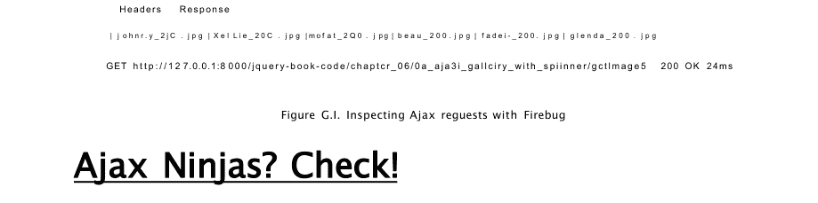

### Ajax 达人？搞定！

我们的客户欣喜若狂。我们没法让他闭嘴。但是，嘿，这对我们来说是一次相当令人印象深刻的尝试：一个功能齐全、稳定、动态的图片库和图片标签器，而无需刷新页面。我们几乎没费什么力气。但我们还能做更多的事情！

Ajax（如我们所知）一开始是一个流行语，很快被过度炒作和误解。现在热潮已经消退，我们都可以欣赏 Ajax 作为一项巧妙工具的价值了。多亏了 jQuery，它成了一个极其易于使用的工具——也是一个极其容易让人上瘾的工具。随着越来越多的酷炫第三方 JSON API 和混搭工具的可用，似乎只要你有一点创意，就能取得无限成就！

# 第 7 章

## 表单、控件和对话框

在其早期，网络是一种只读媒体。早期的网络开发者对近乎无限的链接文档集合感到不满足，他们想要更多；具体来说，他们不仅仅希望人们*阅读*关于他们猫的网页——他们希望人们在他们的留言簿上签名，并告诉他们他们的猫有多棒。HTML 表单为我们提供了一种反馈机制，这最终催生了我们今天拥有的庞大而复杂的基于 Web 的应用程序。

JavaScript 介入进来，帮助简单的 HTML 表单元素模拟桌面应用程序中许多更复杂和交互式的输入控件，但代码通常笨重而臃肿。jQuery 让我们能够简化控件的创建，并让我们能够快速而优雅地将想法转化为可用的控件。

对我们来说幸运的是，它很快！我们的客户热衷于在我们为他构建的华丽 Ajax 控件基础上继续发展。现在他有了符合他流行语要求的功能，他承认他可能应该首先修复网站上的一些表单，这些表单与现在相比看起来痛苦地停留在 1999 年。他想要“一些内联编辑、漂亮的表单验证消息、酷炫的对话框，以及所有东西——*所有东西*——都应该是拖放式的，就像它是一个来自未来的网站！”幸运的是，jQuery 让我们能够构建来自未来的网站。

### 表单

HTML 表单很古老。而且有点笨拙。浏览器处理它们的方式差异很大。然而，多亏了 JavaScript，这些表单已经成为一些非常酷的 Web 应用程序的基础。一如既往，如果 JavaScript 能做到，jQuery 就能让它变得有趣！

我们现在都知道这个套路：表单元素是 DOM 元素，所以 jQuery 非常擅长操作它们。但表单元素不是你典型的 DOM 元素，所以有一些特殊的 jQuery 技巧来更具体地处理它们。到目前为止，我们在书中已经见过不少了——但现在是时候更仔细地关注它们了。

### 简单的表单验证

表单验证至关重要，即使它通常看起来很乏味。然而，适当、设计良好且实现良好的表单可以成就或破坏用户对你网站的看法。谁没有因为一个特别令人沮丧的表单而放弃某个网站的经历？

> **服务器端表单验证**
使用 jQuery 进行客户端表单验证应*仅*用于协助用户填写表单，而*绝不应*依赖它来防止某些类型的数据被发送到服务器。禁用 JavaScript 的用户将不受你的 jQuery 验证的影响，因此他们可以提交任何他们想要的值。因此，如果用户通过你的表单提交恶意数据存在任何安全风险，则该数据需要在服务器端进行彻底验证。

虽然 jQuery 避免处理表单验证的细节，但它确实提供了一些方便的方法来访问和设置表单值——这已经成功了一半！你可以像选择任何其他元素一样选择表单字段，但有一些额外的过滤器可以使你的代码更高效、更可读。

例如，`:input` 过滤器会选取所有作为输入框、选择框、文本域或按钮的元素。它的用法与其他过滤器相同。下面是如何为所有表单元素设置一种美妙的柠檬雪纺背景色：

```javascript
$('#myForm:input').css('background-color', 'lemonchiffon')
```

如果你想更精确地选择特定元素，可以使用更多特定的表单元素过滤器：`:text`、`:password`、`:radio`、`:checkbox`、`:submit`、`:button`、`:image`（用于图像按钮）以及 `:file`。请记住，在单个选择中你可以自由地应用多个过滤器。

此外，还有一些额外的过滤器，允许你根据表单元素的状态和值进行选择。`:enabled` 和 `:disabled` 过滤器会根据元素的 `disabled` 属性来获取元素，而 `:checked` 和 `:selected` 则帮助你找到被选中的单选按钮、选择框选项和复选框。

> **条件逻辑中的 :checked 和 :selected**
>
> 当你需要根据复选框或单选按钮的选中状态执行不同操作时，这些过滤器尤其有用。例如，你可以使用 `if($(this).is(':checked'))` 来检查一个框是否被选中。

在你选中元素之后，就该找到它们的值，以便根据你的要求进行验证。我们已经使用过足够多次 `val` 函数，知道它的作用：它返回表单字段的值。现在我们可以执行一些简单的验证——让我们测试一下表单中的任何文本框是否为空：

`chapter_07/01_simple_validation/script.js`（摘录）

```javascript
$(':submit').click(function(e) {
    $(':text').each(function() {
        if ($(this).val().length == 0) {
            $(this).css('border', '2px solid red');
        }
    });
    e.preventDefault();
});
```

填写一个或两个文本输入框，然后尝试提交表单；任何你留空的输入框都会被红色高亮显示。

`val` 操作同样适用于选择框和单选按钮。例如，当用户更改选择时，让我们弹出单选按钮的值：

`chapter_07/02_radio_buttons/script.js`（摘录）

```javascript
$("input:radio").change(function(){
    alert($(this).val());
});
```

每当表单中的值发生变化时，就会触发这个 `change` 事件。对于复选框、选择框和单选按钮，这发生在值从当前值改变时。对于文本输入框或文本域，当用户更改元素的值时——但仅当焦点移出该元素时——才会触发。这是实现一些简单内联验证的好方法。

让我们重新审视我们的简单验证示例，不过这次我们将在用户移动到下一个字段时测试空字段。为此，我们需要捕获 `blur` 事件，每当表单字段失去焦点时该事件就会触发。这非常适合内联验证：

`chapter_07/03_simpleInline_validation/script.js`（摘录）

```javascript
$("input").blur(function(){
    if ($(this).val().length == 0) {
        $(this)
            .addClass('error')
            .after('<span class="error">This field must ... </span>');
    }
});

$("input").focus(function(){
    $(this)
        .removeClass('error')
        .next('span')
        .remove();
});
```

我们只是检查字段是否已填写，但任何类型的验证都可以用这种方式实现。你可以检查最小或最大字符数，或者使用正则表达式检查特定格式，或者检查密码确认字段是否与原始密码字段匹配。

#### 避免过度验证！

在设计表单验证时，一个重要的考虑点是：保持简单！你添加的规则越多，就越有可能忘记某个边缘情况，最终让一些用户感到沮丧。提供提示、示例输入和指导，而不是那种如果用户的邮政编码格式与你预期的不同就阻止用户提交表单的规则！

### `submit` 事件

我们还可以挂接到 `submit` 事件，该事件在表单提交时触发。这比监听提交按钮的点击事件更好，因为如果用户按 `Enter` 键提交表单，它也会触发。如果你在 `submit` 事件处理程序中返回 `false`，表单将不会被提交。在我们下面的例子中，我们将检查表单中的所有文本框。如果有任何一个留空，我们将弹出一条消息，并将焦点放到有问题的元素上：

`chapter_07/04_submit_event/script.js`（摘录）

```javascript
$("form").submit(function() {
    var error = false;
    $(this).find(":text").each(function() {
        if ($(this).val().length == 0) {
            alert("Textboxes must have a value!");
            $(this).focus();
            error = true;
            return false; // Only exits the "each" loop
        }
    });
    if (error) {
        return false;
    }
    return true;
});
```

有了所有这些原始的、基于表单的工具，你可以轻松地逐页为表单添加验证。如果你仔细规划表单并制定一致的命名标准，你可以使用 jQuery 来泛化你的验证，使其跨多个页面工作。

但是——正如我们已经看到的——在设计表单验证时需要考虑大量的边缘情况。如果你需要真正万无一失的验证，并且宁愿花时间设计用户交互，也许你应该考虑使用验证插件。

### 使用验证插件进行表单验证

构建自己的内联验证系统可能是一项艰巨的任务；例如，你需要了解正则表达式才能验证电子邮件地址或电话号码是否有效。验证插件为你解决了许多这类问题，并让你能够以最少的工作量为大多数表单添加复杂且可定制的内联验证。

我们不会在此详细介绍该插件的所有可用选项（那会占满整整一章！），但我们会看看最常用的一些选项。

让我们从表单开始。为了说明尽可能多的不同验证选项，我们将使用一个包含密码和密码确认字段的注册表单：

`chapter_07/05_validation_plugin/index.html`（摘录）

```html
<div id="signup">
    <h2>Sign up</h2>
    <form action="">
        <div>
            <label for="name">Name:</label>
            <input name="name" id="name" type="text"/>
        </div>
        <div>
            <label for="email">Email:</label>
            <input name="email" id="email" type="text"/>
        </div>
        <div>
            <label for="website">Web site URL:</label>
            <input name="website" id="website" type="text" />
        </div>
        <div>
            <label for="password">Password:</label>
            <input name="password" id="password" type="password" />
        </div>
        <div>
            <label for="passconf">Confirm Password :</label>
            <input name="passconf" id="passconf" type="password" />
        </div>
        <input type="submit" value="Submit! " />
    </form>
</div>
```

要使用验证插件，我们只需在表单选择上调用 `validate`，并传入我们想要使用的任何选项。最重要的选项是 `rules`，你需要在这里定义用于验证用户输入的规则：

`chapter_07/05_validation_plugin/script.js`（摘录）

```javascript
$('#signup form').validate({
    rules: {
        name: {
            required: true,
        },
        email: {
            required: true,
            email: true
        },
        website: {
            url: true
        },
        password: {
            minlength: 6,
            required: true
        },
        passconf: {
            equalTo: "#password"
        }
    },
    success: function(label) {
        label.text('OK!').addClass('valid');
    }
});
```

有相当多的预定义验证规则可用，当然你也可以定义自己的规则。你需要查阅文档来了解所有这些规则。这里我们使用了 `required`、`email`、`url`、`minlength` 和 `equalTo`。


# 验证插件

`required`标记将字段标记为必填项，因此如果该字段为空，则会标记为错误。`email`和`url`用于验证字段格式：电子邮件必须包含`@`，URL必须以`http://`开头，以此类推。在`rules`对象内部，我们为每个表单字段定义一个对象，以该字段的`id`命名。`minlength`的含义不言自明（并且，正如你所料，还有一个对应的`maxlength`）。最后，`equalTo`允许我们指定一个jQuery选择器，指向另一个表单字段，该字段的内容将与当前字段进行比较，以检查它们是否相同。

验证插件将在每个表单字段之后添加一个新的`label`元素，用于包含错误消息；默认情况下，该元素将具有`error`类，因此你可以自由地以其喜欢的任何严谨方式对其进行样式化。

默认情况下，插件仅在字段值无效时显示消息。然而，用户研究表明，如果也为正确的输入提供反馈，用户会更快、更自信地完成表单。这就是为什么我们使用`success`回调来设置消息标签的值，并为其赋予一个类，以漂亮的绿色勾号进行样式化。`success`回调会传递消息元素本身，因此你可以以任何你想要的方式操作它。我们的示例表单在图7.1中展示了填写过程中的状态。

| 字段 | 值 | 状态 |
|---|---|---|
| 姓名： | 议长先生 | |
| 电子邮件： | 这不是有效的电子邮件 | 请输入有效的电子邮件地址。 |
| 网站URL： | http://sitepoint.com | |
| 密码： | ****** | 请输入一个值。 |
| 确认密码： | . > > . . . > . | 请再次输入相同的值。 |
| 提交！ | | |

图7.1. 使用验证插件进行行内验证

也可以自定义错误消息本身，并且值得注意的是，插件目录的**本地化**文件夹中有许多本地化变体。

这个示例仅仅是验证插件可能性的开端。请务必查阅文档和插件演示文件夹中的示例，以探索所有可用功能。

### 最大长度指示器

我们的客户希望将反馈表单的内容字段限制为130个字符。“像Twitter一样？”你问道。“你为什么想这样做？”他滔滔不绝地讲述着关于目标反馈、注意力持续时间等等……但我们知道他只是想复制Twitter。“剩余字符”计数是如今另一个回归的功能，尽管对输入长度设置限制的想法与计算机本身一样古老。

通过在表单字段旁显示剩余字符数，用户可以清楚地预期他们还能输入多少内容。

我们将在要应用此效果的`textarea`上设置一个`maxlength`类。然后，在我们的脚本中，我们在其后添加一个`span`元素，并添加一种新的事件处理程序：

```
chapter_07/06_max_lengthIndicator/script.js (摘录)

$('.maxlength')
    .after("<span></span>")
    .next()
    .hide()
    .end()
    .keypress(function(e) {
        // 处理按键；
    });
```

我们添加`span`后，`textarea`仍然是选中的元素。我们想要修改新的`span`，因此我们使用`next`操作移动到它。然后我们隐藏`span`，但现在我们需要回到表单元素以添加事件处理程序，所以我们使用`end`操作。`end`操作将jQuery选择移回到上次更改之前的状态。在我们的例子中，`hide`不会更改选择，但`next`会。因此，当我们调用`end`时，选择移回到之前的状态。

现在我们回到了表单元素，我们附加一个`keypress`事件处理程序。正如你所料，每当按下键时，此事件就会触发。在这里，我们可以检查是否还允许输入另一个字符——如果不允许，则阻止用户添加更多字符：

```
chapter_07/06_max_lengthindicator/script.js (摘录)

var current = $(this).val().length;
if (current >= 130) {
  if (e.which != 0 && e.which != 8) {
    e.preventDefault();
  }
}
```

现在到了效果的核心部分：我们获取元素的值，并使用JavaScript的`length`属性获取其长度。如果当前字符数超过最大长度，我们将通过使用事件的`preventDefault`操作来阻止按键生效。

在处理`keypress`事件时，该事件有一个`which`属性，对应于按下的键的ASCII码。请注意，我们允许**删除**键（ASCII码0）和**退格**键（ASCII码8）无论字符数量多少都能正常工作。如果我们不这样做，用户可能粘贴了一个超出限制的响应——却无法删除任何字符以使其符合要求：

```
chapter_07/06_max_lengthindicator/script.js (摘录)

$(this).next().show().text(130 - current);
```

最后要做的任务是在我们创建的`span`中显示剩余字符数。我们移动到下一个元素，确保其可见，并显示我们简单计算的结果，以指示还允许输入多少字符。

### 表单提示

一个减少表单在页面上占用空间的好技巧是将表单字段的标签*移入*输入框本身。当用户将焦点移到该字段时，标签会神奇地消失，允许他们开始输入。如果他们离开字段且未输入任何内容，原始标签文本将重新显示。

此技术仅适用于简短简单的表单。在较大的表单中，如果没有可见的标签，用户很容易忘记每个特定字段的用途。如果他们需要重新访问或更改已输入的值，这可能会成为一个问题。

话虽如此，对于登录或搜索表单等简单表单，大多数用户非常熟悉每个字段的用途，这可以成为节省空间并简化界面的好方法。查看图7.2，你可能可以自己想出如何实现该效果的好办法。唯一棘手的部分是当用户未输入任何内容就离开时，如何将默认值恢复到输入框中。

姓名

**电子邮件地址**

**网站URL**

图7.2. 表单提示

如果你猜测我们会使用`data`操作来实现，那么你是对的。我们将每个可清除项目的默认值存储在`data`中——并且如果用户离开时值仍为空，我们将从中恢复它：

```
chapter_7/13_consuming_xml/script.js (摘录)

$("input.clear").each(function() {
  $(this)
    .data("default", $(this).val())
    .addClass("inactive")
    .focus(function() {
      $(this).removeClass("inactive");
      if ($(this).val() == $(this).data("default") || "") {
        $(this).val("");
      }
    })
    .blur(function() {
      var default_val = $(this).data("default");
      if ($(this).val() == "") {
        $(this).addClass("inactive");
        $(this).val($(this).data("default"));
      }
    });
});
```

我们需要在文档加载时遍历每个元素并保存默认值。然后我们跟踪用户移入或移出输入框时触发的`focus`和`blur`事件。在获得焦点时，我们检查文本框的值是否与我们的默认文本相同；如果是，我们清空该框，为用户输入做准备。

在失去焦点时，我们检查文本框是否为空，如果为空，我们放回原始值。我们在此过程中添加和移除一个类；这允许我们在表单字段显示提示时对其进行不同的样式设置。在我们的例子中，我们只是将文本颜色设得稍浅一些。

### 全选复选框

文本输入已完全在我们的掌控之下，现在是时候转向其他表单控件了。我们将从StarTrackr用户的一个烦恼开始：填写各种名人信息表单时需要勾选太多复选框。这导致数据失真、用户厌烦以及关于名人的报告不准确。我们的客户要求每个统计类别都有一个“全选”框，以便用户可以一次性切换所有复选框的选中状态。

了解 jQuery 表单筛选器能让这个任务变得轻而易举。我们只需选中同一组中的所有复选框，然后进行选中或取消选中操作。在 HTML 表单中，我们通过给所有相关项相同的 `name` 属性来将复选框分组：

```
chapter_07/08_check_all/index.html (excerpt)

<div class="stats">
  <span class="title">Reason for Celebrity</span>
  <input name="reason"
    type="checkbox" value="net" />Famous on the internet<br/>
  <input name="reason"
    type="checkbox" value="crim" />Committed a crime<br />
  <input name="reason"
    type="checkbox" value="model" />Dates a super model<br />
  <input name="reason"
    type="checkbox" value="tv" />Hosts a TV show<br />
  <input name="reason"
    type="checkbox" value="japan" />Big in Japan<br />
  <hr />
  <input class="check-all"
    name="reason" type="checkbox" /><span>Check all</span>
</div>
```

我们给最后一个复选框赋予了特殊的类 `check-all`。这个框将作为我们的主复选框：当它被选中或取消选中时，我们的代码就会启动。首先，我们构建一个选择器字符串，用于选中所有与主复选框同名的复选框。这需要将几个字符串拼接起来，最终创建出一个类似 `:checkbox[name=reason]` 的选择器。

然后，我们将所有相关复选框的选中状态设置为与主复选框相同。因为我们的代码是在用户更改值之后运行的，`checked` 属性将反映复选框的新状态——从而导致所有相关项相应地被选中或取消选中：

```
chapter_07/08_check_all/script.js (excerpt)

$('.check-all:checkbox').change(function() {
  var group = ':checkbox[name=' + $(this).attr('name') + ']';
  $(group).attr('checked', $(this).attr('checked'));
});
```

### 性能问题

如果你的页面很大，遍历每个 DOM 节点来查找复选框可能会很慢。如果你发现页面变得无响应，你可能需要研究 jQuery 选择器的 `context` 参数，它限制了 jQuery 查找选择元素的范围。我们将在第 8 章介绍 `context` 参数。

### 内联编辑

内联编辑（也称为就地编辑）是最早真正展示 Ajax 如何创建自然且实用控件的效果之一。第一次使用内联编辑框时，你会感到惊喜；之后每次使用时它都变得不那么引人注意——它就是按照应有的方式工作。

有多种方法可以重现这种效果。最简单的方法是将你的表单字段伪装成标签：移除边框，赋予它们与页面相同的背景色，并在用户聚焦时重新添加边框！这是一个很好的变通方法，意味着你的表单行为就像普通表单一样（因为它就是）。然而，这可能很难实现，并且如果你想让页面的多个不同部分可编辑，可能需要大量额外的标记和样式。

因此，一种更常见的方法是允许编辑非表单元素：例如，段落标签和标题标签。当用户点击标签时，其内容会被一个用户可以交互的文本框或文本区域替换。任务完成后，原始标签会被新内容替换。

我们将使用类来标记可编辑的内容。对于简单的单行内容，我们将使用 input 元素（通过分配类 `editable`）；对于较长的段落，我们将使用 textarea（我们将赋予其类名 `editable-area`）。我们还将确保为每个元素分配一个唯一的 id。这样我们就可以将数据发送到服务器以在数据库中更新，并在下次页面加载时重新加载新数据：

```
chapter_07/09_inline_editing/index.html (excerpt)

<h3 id="celeb-143-name" class="editable">Glendatronix</h3>
<p id="celeb-143-intro" class="editable-area">
    Glendatnonix floated onto the scene with hen incredible debut ...
</p>
```

要让它工作，我们需要捕获几个事件。首先是 `hover` 事件，用于添加效果，以便用户可以看到该元素是可编辑的（我们将采用经过验证的黄色背景色）。

我们还想捕获 `click` 事件——当用户点击可编辑内容时触发——以及 `blur` 事件，它表示编辑结束：

chapter_07/09_inline_editing/script.js (excerpt)

```
$(".editable, .editable-area")
  .hover(function() {
    $(this).toggleClass("over-inline");
  })
  .click(function(e) {
    // Start the inline editing
  }).blur(function(e) {
    // End the inline editing
  });
```

当用户点击可编辑区域时，我们的代码就开始工作了。首先，我们获取被点击元素的引用，并将其存储在 `$editable` 变量中（以避免每次都需要重新选择它）。我们还将使用 `hasClass` 检查 `active-inline` 类。如果元素已经有 `active-inline` 类，说明它已经是一个编辑框了。我们宁愿不要用另一个编辑框来替换这个编辑框：

chapter_07/09_inline_editing/script.js (excerpt)

```
// Start the inline editing
var $editable = $(this);
if ($editable.hasClass('active-inline')) {
  return;
```

接下来，我们想获取元素的内容——然后移除它。要获取内容，我们只需将 html 数据保存到一个变量中……但我们也将使用 `$.trim` 方法来移除内容字符串开头和结尾的空白。这是必要的，因为根据 HTML 的布局，字符串可能包含额外的回车和换行符，我们希望防止它们显示在文本框中。

然后我们添加 `active` 类，它具有双重目的：指示编辑正在进行中，并为我们的样式提供一个钩子。最后，我们用 `empty` 操作清除当前元素。这个命令类似于 `remove`，只不过对一个元素调用 `empty` 会移除它的所有*子元素*，而不是元素本身：

chapter_07/09_inline_editing/script.js (excerpt)

```
var contents = $.trim($editable.html());
$editable
  .addClass("active-inline")
  .empty();
```

#### 使用 `empty` 和 `remove` 进行链式调用

重要的是要记住，你在 `remove` 或 `empty` 命令之后链式调用的任何 jQuery 操作都将应用于被移除的选择集，*而不是*你移除元素之前的选择集。这样做的原因是，如果你只是扔掉这些元素，它们就永远丢失了。这样你就可以选择保留它们、处理它们或存储它们以供将来使用。

最后，是时候插入我们全新的文本框或 `textarea` 了。我们将检查 `editable` 类来确定需要附加哪种类型的表单元素（记住我们用 `editable-area` 表示多行内容）。我们用移除的元素的内容设置新元素的值，并将其附加到目标元素：

chapter_07/09_inline_editing/script.js (excerpt)

```
// Determine what kind of form element we need
var editElement = $editable.hasClass('editable') ?
  '<input type="text" />' : '<textarea></textarea>';

// Replace the target with the form element
$(editElement)
  .val(contents)
  .appendTo($editable)
  .focus()
  .blur(function(e) {
    $editable.trigger('blur');
```

你可能对 `trigger` 函数的使用感到好奇。它只是触发事件的一种不同方式（因此，在这个例子中，我们也可以使用我们已经见过的 `$editable.blur()` 语法）。`trigger` 操作比其简短的对应方法更灵活——但目前我们将坚持使用基本用法。

在这个例子中使用 `trigger` 是为了清晰起见：向任何阅读代码的人表明我们想要手动触发一个事件。在这种情况下，我们只是传递事件；输入框被模糊了，所以我们告诉原始元素是时候结束编辑了。我们可以在输入框的 `blur` 事件处理程序中处理所有这些，但通过这样委托事件，我们避免了将代码再嵌套一层（这会使其更难阅读）。让原始元素处理自己的逻辑也是合理的。

`trigger` 的对应方法是 `bind`。`bind` 允许我们向对象添加事件处理程序。听起来很熟悉吗？到目前为止，我们一直通过使用像 `click`、`hover`、`ready` 等简写便捷方法来绑定事件。但如果你深入探究，你会看到它们内部都依赖于 `bind`。

`bind` 操作接受一个包含要绑定的事件名称的字符串，以及一个要运行的回调函数。你也可以通过将多个事件包装在一个对象中，在单个调用中将多个事件绑定到一个项。例如，我们的代码向 `.editable` 和 `.editable-area` 元素附加了三个独立的事件：`click`、`hover` 和 `blur`。如果你愿意，你可以用 `bind` 语法重写那段代码：

```
$('.editable, .editable-area').bind({
  hover: function(e) {
    // Hover event handler
  },
  click: function(e) {
    // Click event handler
  },
  blur: function(e) {
    // Blur event handler
  }
});
```

让我们回到我们的例子；随着编辑结束，我们可以回到默认状态。我们将从表单元素中获取值，并用 `$.post` 将其发送到服务器，同时放置一条“正在保存...”的消息。当 POST 完成时，我们将消除该消息并用更新后的值替换它。与 Ajax

在上一章看到的功能中，我们通过一个空保存文件模拟了服务器端响应。在实际应用中，你会希望检查变更是否真的保存到了数据库中，方法是查看响应数据：

```
chapter_07/09Inline_editing/script.js (excerpt)

.blur(function(e) {
    // 结束内联编辑
    var $editable = $(this);

    var contents = $editable.find(':first-child:input').val();
    $editable
        .contents()
        .replaceWith('<em class="ajax">Saving ... </em>');

    // 将新值及其ID发送到服务器
    $.post('save',
        {id: $editable.attr('id'), value: contents},
        function(data) {
            $editable
                .removeClass('active-inline')
                .contents()
                .replaceWith(contents);
        });
});
```

这段代码中有两个新的jQuery函数，但它们都很直观：`contents()`返回DOM节点的全部内容，其中可能包含其他DOM元素和/或原始文本；而`replaceWith()`则会用你传入的内容替换你选中的内容。使用后一个方法时要小心；在我们的例子中，我们知道`contents()`只会返回一个元素——但如果它返回多个元素，每个元素都会被替换为相同的加载消息！

### 自动完成

我们已经安抚了客户——他正在角落里兴奋地玩着内联编辑字段。趁他下一个请求到来之前还有几分钟空闲，我们通过让名人表单中的“最后已知行踪”字段从主要城市列表中自动完成来真正打动他。实现的功能如图7.3所示。

我们将使用jQuery插件库中的自动完成插件。它是一个功能齐全且稳定的插件，以最小的负担提供了我们所需的确切功能。

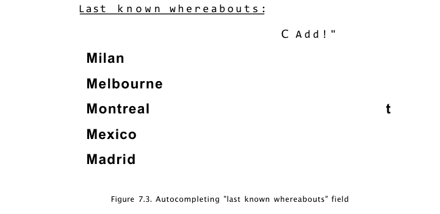

首先，我们需要这个插件。前往插件库获取它，快速浏览示例，然后将其包含在你的页面中。

我们还需要设置一些CSS样式。插件中附带了一个示例CSS文件，这样你就能了解添加了哪些类。我们使用了其中几种样式来使我们的下拉建议列表具有标准外观。

自动完成插件会附加到一个**select**框上。我们将其应用于简单表单中的位置字段：

```
chapter_07/10_autocomplete/index.html  (excerpt)

<label for="location">Last known whereabouts:</label>
<input type="text" id="location"/>
```

现在让我们看看自动完成插件能为我们做什么。默认情况下，它需要存储在数组中的本地数据集合；这非常适合我们，因为我们想从页面上的HTML列表中获取数据：

```
chapter_07/10_autocomplete/script.js  (excerpt)

var cities = ['New York',  'Melbourne',  'Montreal',  'London' ... ];
$('#location').autocomplete(cities,{
    autoFill: true,
    selectFirst: true,
    width: '240px'
});
```

我们只是传入了一个JavaScript数组，但自动完成也允许我们传入一个URL，在这种情况下，它将通过Ajax检索潜在值的列表。自动完成将期望一个纯文本返回，每行一个值，在与后端开发者简单沟通后应该很容易实现！

上述代码足以使其运行起来，但我们也可以指定一系列选项。`autoFill`提供了良好的预输入效果（用当前建议的补全填充文本框），`matchContains`会导致它匹配单词的子字符串，而不仅仅是首字母，等等。有很多可以微调的地方，因此值得快速研究一下选项列表。

自动完成插件在用户选择选项时也会触发`result`事件。它会将所选标签的名称作为第二个参数传递给我们的事件处理程序（在事件对象之后）。例如，这会在选择选项时弹出提醒：

```
$('#location')
    .autocomplete(cities)
    .result(function(event, selection) {
        alert(selection);
    });
```

非常简单，但也非常有趣。而客户还在玩我们为他做的上一个玩具呢！也许我们太擅长摆弄表单元素了，最好回到待办事项列表上！

### 星级评分控件

建立一个大型的名人追踪社区是客户的主要目标；他开始意识到他网站的用户正成为他的产品——一个他可以开始卖给广告商的产品。渴望探索这种可能性，他希望增加用户参与度，并让用户感到自己很重要。毕竟，他必须照顾好自己的产品。我们对此考虑了一点，给了他一个星级评分的想法——毕竟，人们最喜欢通过分配金色星星来表达自己的感受。我们的控件将如图7.4所示。

#### 请为这位名人评分。

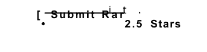

我们星级评分控件的基础是单选按钮组；这很完美，因为浏览器强制从组中进行单一选择。你可以通过添加正确数量的按钮来选择你希望用户选择的范围：

```
chapter_07/11_star_ratings/index.html (excerpt)

<div class="stars">
  <label><input id="rating-1" name="rating" type="radio" value="1" /> Star</label>
  <label><input id="rating-2" name="rating" type="radio" value="2" /> Stars</label>
  <label><input id="rating-3" name="rating" type="radio" value="3" /> Stars</label>
  <label><input id="rating-4" name="rating" type="radio" value="4" /> Stars</label>
</div>
```

当然，难的部分是用我们的星级控件替换这些单选按钮。你可以尝试仅用CSS来设计HTML控件的样式，但如果你将控件分成两部分会更容易、更灵活：存储数据的底层模型，以及带有星星的闪亮视图。在这种情况下，模型就是原始的HTML单选按钮组。我们的攻击计划是隐藏单选按钮，并显示一个我们通过jQuery添加的链接列表，其样式看起来像星星。与链接交互将切换选中的单选按钮。没有JavaScript的用户将只会看到单选按钮本身，这对我们来说没问题。

对于星星本身，我们将再次依赖CSS精灵图。这样我们的控件将只依赖于单张图片（如图7.5所示），这节省了HTTP请求，也使我们的图形设计师更容易编辑。

图7.5. 星级CSS精灵图

我们的CSS会将CSS精灵图应用到我们创建的代表半颗星的链接上。要在不同的图像状态之间切换，我们只需要更新`background-position`属性：

```
chapter_07/11_star_ratings/stars.css (excerpt)

.stars div a {
    background: transparent url(../../css/images/sprite_rate.png)
        0 no-repeat;
    display: inline-block;
    height: 23px;
    width: 12px;
    text-indent: -999em;
    overflow: hidden;
}

.stars a.rating-right {
    background-position: 0 -23px;
    padding-right: 6px;
}

.stars a.rating-over { background-position: 0 -46px; }

.stars a.rating-over.rating-right { background-position: 0 -69px; }

.stars a.rating { background-position: 0 -92px; }

.stars a.rating.rating-right { background-position: 0 -115px; }
```

我们决定让用户选择四星评分，而不是通常的五星。为什么？用户心理学！给一个人一个中间道路，他们就会选择；通过没有中间选项，我们让用户更多地思考他们的选择。我们能得到更好的结果，并且能更好地向用户呈现最好的内容（由他们选择）！

但四个星级范围有限——这就是为什么我们想允许半星评分。这通过视觉错觉实现——你可能注意到我们的星星图像被切成了一半。我们的HTML将包含八个单选按钮，每个价值半颗星。将我们的八个单选按钮转换为四颗星的代码有两个部分。首先，`createStars`函数将获取一个包含单选按钮的容器，并用星级链接替换它。然后每个星星将补充适当的事件处理程序（在`addHandlers`方法中）以让用户与控件交互。这是我们`starRating`对象的框架：

```
chapter_07/11_star_ratings/script.js  (excerpt)

var starRating = {
  create: function(selector) {
    $(selector).each(function() {
      // 隐藏单选按钮并添加星级链接
    });
  },

  addHandlers: function(item) {
    $(item).click(function(e) {
      // 处理星星点击
    })
    .hover(function() {
      // 处理鼠标悬停
    },function() {
      // 处理鼠标移出
    });
  }
}
```

`create`方法会遍历与我们传入的选择器匹配的每个容器，并创建一组链接作为单选按钮的代理。这些链接将是我们样式化为星星外观的对象。它还会隐藏原始的表单元素，这样用户就只能看到我们可爱的星星：

chapter_07/11_star_ratings/script.js (摘录)

```
$(selector).each(function() {
  var $list = $('<div></div>');
  // 遍历每个容器中的每个单选按钮
  $(this)
    .find('input:radio')
    .each(function(i) {
      var rating = $(this).parent().text();
      var $item = $('<a href="#"></a>')
        .attr('title', rating)
        .addClass(i % 2 == 1 ? 'rating-right' : '')
        .text(rating);

      starRating.addHandlers($item);
      $list.append($item);

      if ($(this).is(':checked')) {
        $item.prevAll().andSelf().addClass('rating');
      }
    });
});
```

我们首先为新的链接创建一个容器（一个div元素）；我们将为每个要替换的单选按钮创建一个新链接。使用 `:radio` 选择器过滤器选中所有单选按钮后，我们获取每个项目的评级文本，并用它来创建一个超链接元素。

### 带模运算的条件赋值

对于 `addClass` 操作，我们使用三元运算符（参见第4章“淡入淡出幻灯片”一节）基于一些数学计算来有条件地指定类名。正如我们在本书前面所做的那样，我们使用模运算符（%）来确定索引是奇数还是偶数。如果索引是奇数，我们将添加 `rating-right` 类；这使得链接看起来像星星的右半边。

链接准备就绪后，我们将其传递给 `addHandlers` 方法——这是我们将为其附加所需事件的地方。然后，我们将其追加到列表容器中。一旦它进入容器，我们检查当前的单选按钮是否被选中（我们使用 `:checked` 表单过滤器）。如果它被选中，我们希望为这个半星以及它之前的所有半星添加 `rating` 类。任何带有 `rating` 类的链接都将被分配金色星星图像（这将允许用户看到当前的评分）。

为了选中所有需要变金色的元素，我们将借助几个新的 jQuery 操作：`prevAll` 和 `andSelf`。`prevAll` 操作选择当前选择之前的所有兄弟元素（不同于 `prev` 操作，它只选择紧邻的前一个兄弟元素）。对于我们的示例，我们希望将 `class` 添加到前面的兄弟元素*以及*当前选择上。为此，我们应用 `andSelf` 操作，它只是将原始选择包含在当前选择中。现在我们有了所有将要变金色的链接，因此可以添加 `class` 了。

### 其他遍历方法

你可能已经猜到，除了 `prevAll`，jQuery 还为我们提供了 `nextAll` 方法，它获取同一容器中*当前元素之后*的所有兄弟元素。jQuery 1.4 还引入了两个新的配套方法：`prevUntil` 和 `nextUntil`。它们通过选择器调用，并将扫描元素的兄弟元素（向前或向后，取决于你使用的是哪个），直到遇到与选择器匹配的元素。

所以，例如，`$('h2:first').nextUntil('h2');` 将给你页面上第一个 h2 和同一容器中下一个 h2 之间的所有元素。

如果你向 `prevUntil` 或 `nextUntil` 传递第二个参数，它将被用作选择器来过滤返回的元素。所以，例如，如果我们写了 `nextUntil('h2', 'div')`，它只会返回当前选择和下一个 h2 之间的 `div` 元素。

完成所有这些辛苦工作后，我们现在可以将新的链接列表添加到控件中，并移除原始的按钮。现在用户只会与星星交互：

```
chapter_07/11_star_ratings/script.js (摘录)

// 隐藏原始的单选按钮
$(this).append($list).find('input:radio').hide();
```

控件现在看起来初具雏形——但它还没有任何功能。我们需要附加一些事件处理程序并添加一些行为。我们对三个事件感兴趣。当用户将鼠标悬停在星星上时，我们希望更新CSS精灵图以显示悬停状态；当他们移开鼠标时，我们希望将CSS精灵图恢复到原始状态；当他们点击时，我们希望使选择变为金色：

```
chapter_07/11_star_ratings/script.js (摘录)

$(item).click(function(e) {
  // 响应星星点击
})
.hover(function() {
  $(this).prevAll().andSelf().addClass('rating-over');
},function() {
  $(this).siblings().andSelf().removeClass('rating-over');
});
```

悬停功能是最简单的：悬停时，我们选择当前半星之前的所有半星——包括当前半星——并使用 `prevAll` 和 `andSelf` 给它们 `rating-over` 类，就像我们在设置时做的那样。悬停出去时，我们全面考虑，从所有链接中移除 `rating-over` 类。悬停事件就这样处理好了。

现在处理点击事件：

```
chapter_07/11_star_ratings/script.js (摘录)

// 处理星星点击
var $star = $(this);
var $allLinks = $(this).parent();

// 设置单选按钮的值
$allLinks
  .parent()
  .find('input:radio[value=' + $star.text() + ']')
  .attr('checked', true);

// 设置评级
$allLinks.children().removeClass('rating');
$star.prevAll().andSelf().addClass('rating');

// 阻止链接的默认点击行为
e.preventDefault();
```

处理点击事件的重要部分是更新底层的单选按钮模型。我们通过使用 `:radio` 过滤器和属性选择器来选中正确的单选按钮来实现这一点，该选择器搜索其值与当前链接文本匹配的单选按钮。

模型更新后，我们可以回来处理CSS精灵图。首先，我们从当前拥有 `rating` 类的所有链接中清除它，然后将其添加到用户选择的链接及其之前的所有链接上。最后一笔是取消链接的默认操作，这样点击星星就不会触发布局变化。

### 控件

这解决了我们客户的主要关注点：表单易用性。现在我们可以开始做一些真正有趣的事情了。jQuery 和 jQuery UI 是超越我们都知道并接受的原始HTML表单控件的完美工具。一旦我们摆脱了Web古老历史的沉闷束缚，我们就会发现，创建令人惊叹的新控件的能力只受限于我们的想象力。毕竟，与网站交互的方式不应该只有在框中输入文本！

### 日期选择器

我们的客户想在网站上添加一个“名人发现”板块，用户可以在那里报告发现名人的消息。当然，他们需要报告发现的日期和时间。该功能的早期测试表明，用户经常对他们需要输入的日期格式感到困惑。通过添加示例数据和格式提示，这个问题得到了部分缓解，但客户希望更进一步，在表单中添加一个花哨的日期选择器。

如果你曾经坐下来用JavaScript创建一个功能相当完善的日期选择器，你可能会倾向于永远不再做这件事了。为了一个最终只是日期选择器的控件，需要做大量的辛苦工作。请注意，日期选择器是极其重要的控件，如果做得不好，会令人极度沮丧。问题在于，由于它们涉及面很广，有很多地方容易出错。为了我们的理智，幸运的是，jQuery UI包含了一个高度可定制且功能齐全的日期选择器控件，让我们避免了许多自己构建时可能遇到的陷阱。该控件的一个示例如图7.6所示。

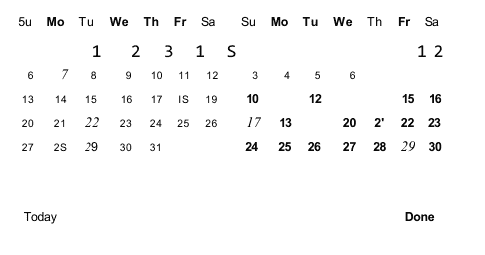

我们将从当前用于日期的输入字段开始：

chapter_07/12_date_picker/index.html (摘录)

```
<input type="text" id="date" />
```

如果你只是想要基本的日期选择器，jQuery代码可以简单到只有一行：

```
$("#date").datepicker();
```

当输入框获得焦点时，日期选择器被触发，并滑入视图，同时选中当前的月份和日期。当文本框失去焦点或选择了日期时，它就会消失。当然，它看起来非常漂亮，并且具有我们所期望的jQuery流畅性——但它为我们提供了什么超越其他竞争日期选择器的功能呢？（记住，仅仅因为你使用jQuery，并不意味着你应该忽略其他合适的JavaScript组件。）

jQuery UI中的日期选择器组件功能齐全。功能非常齐全！它完全可本地化，可以处理任何日期格式，允许你一次显示多个月份，具有巧妙的日期范围机制，允许可配置的按钮，支持键盘导航（你可以使用Ctrl + 箭头键移动），等等。

总的来说，有超过50个选项和事件可供你调整——几乎涉及到日期选择器的每一个微小方面！为了制作你在图7.6中看到的日历，我们只使用了其中几个：


### chapter_07/12_date_picker/script.js (摘录)

```javascript
$('#date').datepicker({
    showOn: 'button',
    buttonText: 'Choose a date',
    buttonImage: 'calendar.png',
    buttonImageOnly: true,
    numberOfMonths: 2,
    maxDate: '0d',
    minDate: '-1m -1w',
    showButtonPanel: true
});
```

`showOn` 参数让我们选择日历何时弹出。可用选项包括 `'focus'`（当文本框获得焦点时）、`'button'`（在文本框旁添加一个按钮，用户可点击打开日历）或 `'both'`（允许两种方式）。为了使用图标作为按钮，我们指定了按钮图片。我们还将 `buttonImageOnly` 设置为 `true`；这意味着将只显示图片，而不是标准的表单按钮。

接下来，我们将 `numberOfMonths` 设置为 2——这意味着用户将同时看到两个月的日历。你甚至可以指定一个数组而不是整数；例如，`[3, 3]` 将显示一个 3x3 的月份网格！

`maxDate` 和 `minDate` 选项允许你设置用户可以选择日期的范围。你可以指定一个 JavaScript 日期对象，或者使用字符串来指定相对日期。后者通常更简单，这里我们就是这么做的。我们将 `maxDate` 设置为 `0d`——表示今天的日期。我们将 `minDate` 设置为 `-1m -1w`，这样用户只能选择过去最多一个月零一周的日期。你可以根据需要增加或减少时间：`y` 表示年，`m` 表示月，`w` 表示周，`d` 表示日。

### 日期验证

你可能已经为日期选择器设置了最大日期，但用户仍然可以选择超出该范围的日期——他们可以在文本框中手动输入。如果你必须确保日期在给定的范围内，你需要在服务器端进行验证！你在日期选择器选项中指定的日期范围是为了帮助用户选择有效的选项；这样，他们就能避免提交包含错误信息的表单。

### 日期选择器实用工具

jQuery UI 库还提供了一些用于全局配置日期选择器以及方便处理日期的实用工具。

`$.datepicker.setDefaults` 方法接受一个由日期选择器设置组成的对象。你指定的任何设置都将应用于页面上的所有日期选择器（除非你手动覆盖默认值）。例如，如果你希望每个日期选择器一次显示两个月：

```javascript
$.datepicker.setDefaults({
    numberOfMonths: 2
});
```

其余的实用函数用于操作或辅助处理日期和日期格式。`$.datepicker.iso8601Week` 函数接受一个日期并返回它所在的年份中的周数（1 到 53）。`$.datepicker.parseDate` 函数从给定的字符串中提取日期；你需要传递一个字符串和一个日期格式（例如 `"mm-dd-yy"`），然后你会得到一个 JavaScript 日期对象。最后，`$.datepicker.formatDate` 则做相反的事情。它会根据你指定的格式化一个日期对象——这非常适合在屏幕上显示日期。

### 滑块

我们的客户希望他的访客能够快速轻松地找到他们想要的名人。他也认识到，他的许多客户会寻找地点信息落在特定价格范围内的名人，因此他希望我们在网站上添加一个价格范围过滤器。这是介绍另一个很棒的 jQuery UI 组件的绝佳机会：`slider`！

我们将从一个基本表单开始，包含两个 `select` 框：一个用于最高价格，一个用于最低价格。然后我们将调用 jQuery UI 来添加一个精美的滑块来控制这些框的值。最终结果如图 7.7 所示。

图 7.7. 一个 jQuery UI 滑块

拖动滑块按价格筛选：

|   |   |   |   |   |
|---|---|---|---|---|
| 203A | Johny Stardust (传记) | 主唱 | 洛杉矶 | $179 |
| 141B | Beau Dandy (图片,传记) | 歌手 | 纽约 | $139 |
| 6636 | Clendatronix (传记,新闻稿) | 键盘手 | 伦敦 | $155 |

让我们看看基本的标记：

chapter_07/13_sliders/index.html (摘录)

```html
<div id="price-range">
    <form>
        <label for="min">Minimum Price:</label>
        <select id="min">
            <option value="0">0</option>
            <option value="10">10</option>
            <option value="20">20</option>
            <option value="30">30</option>
            <option value="40">40</option>
            <option value="50">50</option>
            <option value="60">60</option>
            <option value="70">70</option>
            <option value="80">80</option>
            <option value="90">90</option>
        </select>
        <br/>
        <label for="max">Maximum Price:</label>
        <select id="max">
            <option value="10">10</option>
            <option value="20">20</option>
            <option value="30">30</option>
            <option value="40">40</option>
            <option value="50">50</option>
            <option value="60">60</option>
            <option value="70">70</option>
            <option value="80">80</option>
            <option value="90">90</option>
            <option value="100">100</option>
        </select>
    </form>
</div>
```

现在来看代码。当页面加载时，我们首先获取 select 框中的当前最大值和最小值。然后，我们通过在新创建的空 div 上调用 `slider` 方法来初始化滑块：

chapter_07/13_sliders/script.js (摘录)

```javascript
var max = $('#max').val();
var min = $('#min').val();

var rangeSlider = $('<div></div>')
  .slider({
    min: 0,
    max: 100,
    step: 10,
    values: [min, max],
    range: true,
    animate: true,
    slide: function(e, ui) {
      $('#min').val(ui.values[0]);
      $('#max').val(ui.values[1]);
      showCelebs();
    }
  })
  .before('<h3>Drag the slider to filter by price:</h3>');

$('#price-range').after(rangeSlider).hide();
```

哇！选项真多。让我们看看能否分解一下：`min` 和 `max` 分别是滑块的最小值和最大值，`step` 是滑块的增量，`values` 用于指定滑块的默认值。因为我们指定了一个包含两个值的数组，滑块条将有两个手柄，每个手柄都有一个独立的值。这里我们使用了之前获取的 select 列表中的值，以便滑块始终与这些框中的数据匹配。

`range` 和 `animate` 在创建具有多个手柄的滑块时非常有用，就像我们这里做的：`range` 表示手柄之间的区域应样式不同，通常使用阴影或不同的颜色。此选项也可以设置为 `min`（在这种情况下，最小值和第一个手柄之间的区域将被阴影覆盖）或 `max`（这将阴影覆盖最后一个手柄和最大值之间的区域）。`animate` 只是告诉 jQuery，如果用户在滑块条的其他地方单击，手柄的位置会平滑地动画移动，而不是直接跳过去。

最后，`slide` 允许你指定一个事件处理程序，每当用户移动滑块上的手柄时运行。该事件处理程序可以接受一个可选的 `ui` 参数，允许你访问滑块的一些属性；这里我们使用 `values` 属性来调整我们 select 框的值。我们还调用了 `showCelebs`，这是一个自定义方法，我们将根据名人的价格是否在选定范围内来显示或隐藏他们。

也可以捕获 `change` 事件，它与 `slide` 事件非常相似，不同之处在于，如果滑块的值被以编程方式修改，`change` 事件也会触发（`slide` 仅在用户直接与滑块交互时触发）。

jQuery UI 滑块组件默认创建水平滑块——但如果你想要垂直滑块，可以指定 `orientation: 'vertical'`。

我们使用了 `before` 和 `after` 来为滑块添加标题并将其固定在页面上，同时也隐藏了原始的 select 框。现在尝试一下，你会看到一个主题美观的滑块，你可以与之交互，并且它会调整 select 框的值。

为了使其能够筛选名人，我们只需实现 `showCelebs` 方法：

chapter_07/13_sliders/script.js (摘录)

```javascript
function showCelebs() {
  var min = $('#min').val();
  var max = $('#max').val();
  $('.data tr').each(function() {
    var price = parseInt($(this).find('td:last').text()
      .substring(1));
    if (price >= min && price <= max) {
      $(this).fadeIn();
    } else {
      $(this).fadeOut();
    }
  });
}
```

我们提取 select 框的值，然后遍历名人表中的每一行，并根据价格是否在选定范围内来隐藏或显示它。这里唯一棘手的部分是一些 JavaScript 字符串操作，将价格文本（如 "$139"）转换为我们可以与滑块值进行比较的整数。


处理是从行文本中提取价格所必需的；我们使用 `substring(1)` 来提取从第一个字符开始的所有内容（这将方便地去掉价格中的美元符号）。然后我们使用 `parseInt` 将字符串转换为数字。

我们还将在文档就绪时调用 `showCelebs`，以便列表根据表单中的默认值进行预筛选。

这完全按预期工作，允许用户轻松直观地根据他们期望的价格范围筛选名人。滑块之所以是一个出色的 UI 小部件，正是因为它如此直观：用户无需被告知就知道如何使用它们。你大概还能想出其他一些可以从被 `sliderized`（滑块化）中受益的控件！

### 拖放

拖放技术已臻成熟。它一直存在于背景中，但在由典型的文本框和单选按钮构成的普通表单旁边，总显得格格不入（因此有损良好的用户体验）。但那是过去，是旧式表单的时代。如今，如果做得好，拖放可以以高度可用的方式增强表单，提供更自然的体验，提高生产力。它还增添了一丝酷炫感。

如果说有一项任务连计算机初学者都知道如何做，那就是将项目拖到回收站。这个隐喻非常令人满意——如果你不想要它，就扔掉它！另一方面，标准的网页方法——点击复选框然后按删除键——虽然也很知名，但远没那么令人满意。我们的客户不想点击复选框；他想把东西拖向它们的末日，并让它们在烟雾中真正消失，以显示它们确实被销毁了。

图 7.8 显示了一个正在销毁中的图像缩略图。用户选择了一张照片，将其从网格中拖出并放入回收站。照片网格不过是一组 `` 标签。你可以选择任何类型的元素使其可拖动，只要能让它看起来美观并且对用户友好。一个不错的细节是为可拖动元素设置 `cursor: move`——这样用户会看到“抓取手”图标，并知道可以拖动它。

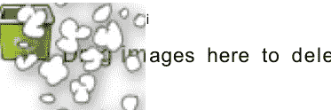

图 7.8. 拖放并销毁

和往常一样，我们从标记开始：

chapter_07/14_drag_drop/index.html（摘录）

```html
<div class="trash">
  
  <span id="trash-title">Drag images here to delete</span>
</div>
<div id="photo-grid">
  
  
</div>
```

#### 渐进增强

为了说明起见，我们在这里的标记中包含了 .trash div。然而，这对禁用了 JavaScript 的用户来说是个问题：他们会看到一个回收站区域，但却无法对其做任何事情！在实际应用中，你应该从一个完全可用的、基于 HTML 表单的界面开始，用于删除图像（或你打算使用拖放功能的任何东西）。然后，你将使用我们在本书中见过的所有方法，从页面中移除所有这些界面元素，并用上面的拖放标记替换它们。

跨浏览器实现拖放可能真的很麻烦。与其重新发明轮子，我们将求助于我们值得信赖的 jQuery 伙伴——jQuery UI。它提供了几个非常方便的交互辅助工具——`draggable` 和 `droppable`——来处理流畅的跨浏览器拖放。


### 不需要主题！

你需要像之前介绍的那样在页面中包含 jQuery UI 库，但这次不需要 CSS 主题文件；`draggable` 和 `droppable` 是行为，不需要预设样式。不过，它们确实为你提供了一些非常方便的类名，你可以为它们应用自己的样式，我们很快就会看到。

让我们勾勒出交互代码的基本结构：

```javascript
chapter_07/14_drag_drop/script.js（摘录）

$(document).ready(function() {
  $('#photo-grid > div').draggable({
    revert: 'invalid'
  });
  $('.trash').droppable({
    activeClass: 'highlight',
    hoverClass: 'highlight-accept',
    drop: function(event, ui) {
      puffRemove($(ui.draggable));
    }
  });
});

function puffRemove(which) {
  // 实现“烟雾”效果
}
```

这是我们交互的骨架。要实现漂亮的“烟雾”动画，我们还有很多工作要做——但令人难以置信的是，这就是拖放所需的一切！让我们更仔细地看看 jQuery UI 给了我们什么。

### draggable

`draggable` 交互辅助工具使你选择的任何元素都可通过鼠标拖动。试试这个：`$('p').draggable()`。它可以使页面上的每个 `<p>` 标签都可拖动！试试看——这很有趣。自然，有大量的选项和事件可以自定义行为。以下是一些更有用的选项：

```javascript
$('p').draggable({axis: 'y', containment: 'parent'});
```

`axis` 选项将对象限制为只能沿 X 轴或 Y 轴拖动，而 `containment` 选项将对象限制在一个边界框内；可接受的值是 `'parent'`、`'document'` 和 `'window'`（分别保持在各自的 DOM 元素内），或一个数组值以 `[x1, y1, x2, y2]` 的形式指定像素边界。你也可以使用 `grid` 选项通过指定一个两元素数组（例如 `grid: [20,20]`）将拖动限制在网格上。

让我们看另一个例子：

```javascript
$('#dragit').draggable({
    handle: 'p:first',
    opacity: 0.5,
    helper: 'clone'
});
```

对于接下来的这一组选项，我们操作的是一个名为 `dragit` 的 div，它至少包含一个 `<p>` 标签。我们使用 `handle` 选项指定第一个 p 元素作为用户可以用来拖动可拖动元素的“手柄”。我们还指定了 `helper` 选项，该选项允许你指定一个元素来代表被拖动的节点。在本例中，我们将此选项设置为 `clone`。这会导致元素被复制，因此原始元素将保持不动，直到你完成拖动。`opacity` 应用于辅助元素。

另一个值得注意的选项是 `revert`。如果你将其设置为 `invalid`（就像我们在照片拖动示例中所做的那样），当你将拖动的元素放置在可放置目标区域之外时，它会弹回其原始位置。

还有三个你可以捕获的事件——`start`、`stop` 和 `drag`——分别在你开始拖动、停止拖动和正在拖动时触发。在我们的示例中，我们只需要响应 `drop`，但你可以很容易地想到其他两个事件可以派上用场的场景。

### droppable

`draggable` 的邦妮（Bonnie）对应的是 `droppable`（可放置）行为。可放置元素是可拖动项目的目标。可放置元素的选项比可拖动元素少得多；我们在上面使用了最重要的 `activeClass` 和 `hoverClass`。当可拖动项目被拖动时，`activeClass` 会被添加到可放置元素上。类似地，当可拖动项目悬停在可放置元素上时，`hoverClass` 会被添加。

你还可以为 `accept` 选项指定一个选择器，以限制可以放置的拖动项。这使你可以有多个放置点，其中只有某些拖动项可以进入。这对于列表操作非常有用。

可放置元素的事件与可拖动元素类似。我们有 `over`、`out` 和 `drop`，而不是 `start`、`stop` 和 `drag`。在我们的照片网格示例中，我们使用了 `drop` 事件来知道何时销毁可拖动项。

`draggable` 和 `droppable` 行为都是复杂的猛兽。一旦你超越了它们如此容易实现的兴奋感，你应该进一步阅读文档中的高级选项。

### “烟雾效果”

拖放功能都处理好了，你可以走开了，知道你只用几行代码就创建了一个强大而酷炫的控件。但利用我们通过使用现有的拖放功能而不是自己编写而节省下来的所有时间，我们不妨让这更令人印象深刻一点——并在图像被移除时添加“一缕烟”。

我们将不使用 jQuery 的 `animate` 函数，而是需要自己实现动画解决方案。这是因为我们需要循环播放图像帧——就像制作动画一样。为此，我们将使用一个 PNG 图像，其中包含五个相同大小的动画帧，全部堆叠在一起，然后偏移图像以显示正确的帧。这意味着我们需要以离散的块更改图像的位置。如果我们改用 `animate`，它会逐渐更改背景位置，导致图像在帧与帧之间被裁剪：

```javascript
chapter_07/14_drag_drop/script.js（摘录）

// 实现“烟雾”效果
var $this = $(which);
var image_width = 128;
var frame_count = 5;
```

首先，我们将存储我们的选择并设置几个常量。`image_width` 是动画图像的宽度（以像素为单位）。`frame_count` 是动画中的总帧数（因此，图像的总高度应为 `image_width * frame_count`）。当然，在我们的示例中这些值始终相同，但这样，如果你想使用不同的动画图像，


你可以在脚本顶部直接找到需要更改的数字，而无需在多处搜索修改。

接下来，我们创建一个容器来容纳图像。该容器将与要删除的元素**大小完全相同**，并且**位置完全一致**：

```
chapter_07/14_drag_drop/script.js (节选)

// 创建容器
var $puff = $('<div class="puff"></div>')
    .css({
        height: $this.outerHeight(),
        left: $this.offset().left,
        top: $this.offset().top,
        width: $this.outerWidth(),
        position: 'absolute',
        overflow: 'hidden'
    })
    .appendTo('body');
```

容器就位后，我们现在可以将动画图像附加到其中。由于容器的 `overflow` 属性设置为 `hidden`，因此只会显示图像的单个帧。为了使图像适应容器（其大小与我们要删除的元素相同），我们需要对其进行缩放以适应。缩放比例通过将容器的宽度除以图像的宽度来确定：

```
chapter_07/14_drag_drop/script.js (节选)

var scale_factor = $this.outerWidth() / image_width;
var $image = $('')
    .css({
        width: image_width * scale_factor,
        height: (frame_count * image_width) * scale_factor
    })
    .data('count', frame_count)
    .appendTo($puff);
```

### 预加载图像

如果你的动画图像包含大量帧，它可能最终成为一个相当大的文件，并且需要一段时间才能加载。如果在图像加载完成之前用户就删除了某个元素，动画将无法显示。一个预加载图像的技巧是将图像加载到文档就绪函数中的一个 jQuery 选择器中：`$(' ');`。这将加载图像而不显示它，因此它将为你的动画做好准备。

我们还通过 `data` 操作向图像添加了一个 `count` 属性。该属性包含剩余要显示的帧总数。所有这些就位后，我们就可以继续删除被拖放的原始元素：

```
chapter_07/14_drag_drop/script.js (节选)

// 移除原始元素
$this.animate({
    opacity: 0
}, 'fast').nemove();
```

在它淡出的同时，我们想要启动动画。这将需要一点 JavaScript 技巧；我们将设置一个自包含的、自执行的循环，该循环将动画播放一次：

```
chapter_07/14_drag_drop/script.js (节选)

// 播放烟雾动画
(function animate() { Q

    van count = $image.data('count'); Q

    if (count) { Q
        van top = fname_count - count;
        van height = $image.height() / fname_count;
        $image.css({
            "top": - (top * height),
            'position': 'absolute'
        });
        $puff.css({
            'height': height
        })
        $image.data("count", count - 1); ©

        setTimeout(animate, 75) ©
    } else {
		$image.parent().remove(); 0
    }
})();
```

在这个函数内部，我们正在执行动画。以下是关键点：

- 我们将函数包装在 `(function myFunction(){})()` 结构中，这是一种创建和执行匿名函数的方式，但该函数仍然可以通过名称引用自身。这是一种奇怪的 JavaScript 结构，你不必完全理解；在本例中，它很方便，因为它允许我们创建一个可以调用自身的一段自包含功能（当我们使用 `setTimeout` 方法时，这将很有用）。
- 我们通过检查 `count` 数据来找出当前是哪一帧。
- 如果仍有帧需要显示，我们计算图像的偏移量并将其正确帧移动到视图中。（我们可以这样使用 `if (count)`，因为在 JavaScript 中，数字 `0` 等同于 `false`。）
- 我们减少帧计数，以便下次循环运行时它将显示系列中的下一帧。
- 最后，我们调用 `setTimeout`，指定我们的匿名函数作为回调。这样，在 75 毫秒后，整个过程将再次运行。
- 当计数达到零且动画结束时，我们从 DOM 中移除烟雾容器。

试试看。将一个项目拖到垃圾桶，看着它在烟雾中消失！

### jQuery UI sortable

jQuery UI 的另一个很棒的功能是 `sortable`（可排序）行为。你声明为 `sortable` 的元素对其子元素来说成为可放置目标——并且所有子元素都变得可拖动。结果是你可以随心所欲地重新排列子元素。虽然 `sortable` 允许我们对容器内的项目进行排序，但它实际上并不进行任何排序：排序取决于用户。

这使其非常适合需要管理顺序的元素列表。我们不必使用通常在列表旁边看到的那些繁琐的“向上移动列表”或“向下移动列表”按钮，而是可以对它们应用 `sortable` 行为，并允许用户以更直观的方式重新排列列表。

在 StarTrackr! 的首页上，有两个显示本周顶级名人排名的列表。一个是给 A 级名人的，另一个是给 B 级名人的。这是向客户展示一个很酷技巧的绝佳机会：让我们让用户可以重新排列列表。他们可以将名人上下移动，如果质疑他们的 A/B 级状态，甚至可以交换他们。当他们对重新排列满意时，可以单击 **接受** 按钮，更改将被提交到服务器。

列表是 `sortable` 行为的主要目标。稍加努力，一个 `div` 也可以承担这项挑战。在本例中，我们将使用以下标记：

```
chapter_07/15_sortables/index.html (节选)

<ul id="a-list" class="connected">
  <li><a href="#">Glendatronix</a></li>
  <li><a href="#">Baron von Jovi</a></li>
</ul>

<ul id="b-list" class="connected">
  <li><a href="#">Mr Speaker</a></li>
</ul>
```

就像 `draggable` 和 `droppable` 一样，将一个元素设置为 `sortable` 很简单：

```
$("#a-list, #b-list").sortable();
```

当一个元素成为 `sortable` 时，有一系列方法、事件和选项可用，我们可以将它们组合起来以控制排序过程中发生的有趣时刻：

```
chapter_07/15_sortables/script.js (节选)

$("#a-list, #b-list").sontable({
  connectWith: '.connected',
  placeholder: 'ui-state-highlight',
  receive: function(event, ui) { adopt(this) },
  remove: function(event, ui) { orphan(this) }
}).disableSelection();
```

我们为 `sortable` 指定了两个选项和两个方法，我们将基于这些方法使我们的操作对用户更友好。我们可以利用的一个很好的技巧是，在回调函数中访问 `this`（正如我们在上面所做的那样）可以给我们一个对 `sortable` 元素的引用。

### disableSelection

链在 `sortable` 实例化末尾的是一个巧妙的操作：`disableSelection`。`disableSelection` 及其反向操作 `enableSelection` 是 jQueryUI 中两个非常强大的方法。调用 `disableSelection` 使得用户无法在目标元素内选择文本。它可用于防止用户在拖动——或排序——元素时选择文本，并防止用户在只想拖动项目时意外高亮显示文本。

让我们看看我们分配为事件处理程序的两个方法：

```
chapter_07/15_sortables/script.js (节选)

function adopt(which) {
  if ($(which).hasClass('empty')) {
    $(which).removeClass('empty').find('.empty').remove();
  }
}

function orphan(which) {
  console.log(which);
  if ($(which).children().length == 0) {
    $(which)
      .append($('<li class="empty">empty</li>'))
      .addClass('empty');
  }
}
```

这些方法允许我们在列表的最后一个项目被移除时添加文本 "empty"，并在添加新项目时立即将其移除。当一个 `sortable` 列表从一个连接的列表接收到一个项目时，会触发 `receive` 事件。我们用它来调用我们自定义的 `adopt` 方法，如果找到 "empty" 文本，我们就移除它。

从 `sortable` 中移除一个子元素会触发 `remove` 事件，我们用它来调用我们的 `orphan` 函数。此方法检查父 `sortable` 是否没有子元素。如果它是空的，我们给它一个子 `<li>` 元素并为其分配 `empty` 类。

### Progress Bar

我们的客户想要实现一个他称为 StarChirp 的新功能，这将使他的用户能够通过简短的状态消息（大概是关于名人的）进行交流。我们完全不知道他怎么会想到这个主意，但我们很乐意尝试一下。他明确表示，他想通过以进度条的形式显示剩余字符数，使其产品与其他状态更新网站区别开来。这很有道理：它将显示剩余可输入空间的百分比，因此用户可以轻松看出是否接近他们的字数限制。

进度条是用户可以看到的最易识别的消息之一。由于无数糟糕的电影，即使是外行也明白进度条是最终的科技倒计时时钟。进度条有效地显示了我们在一个长时间运行的过程或一组过程中走了多远——更重要的是，我们还有多远要走。

模拟进度条最简单的方法是在另一个块级元素内包含一个块级元素。外部元素的宽度设置为进度条的长度，内部元素的宽度相对于外部元素设置为正确的比例。给内部元素添加一点颜色，就这样！

由于我们最近一直在使用 jQuery UI 库，我们不妨探索一下 jQuery UI progress bar 组件提供的全部功能。

我们已经编码了一个包含相关元素的小表单，但对于进度条，只需要一个空的 `div`：


### 进度条

`chapter_07/16_progress_bar/index.html`（摘录）

```html
<form>
  <fieldset>
    <legend>StarChirp</legend>
    <textarea id="chirper" rows=""></textarea>
    <div id="console">
      <div id="bar"></div>
      <div id="count">0</div>
    </div>
    <input type="submit" value="Chirp!" />
  </fieldset>
</form>
```

现在，我们只需告诉 jQuery UI 我们希望转换哪个元素：

`chapter_07/16_progress_bar/script.js`（摘录）

```javascript
$("#bar").progressbar();
```

就这样，进度条就准备好了！它没有太多可调整的地方。如果你希望进度条的默认值不是 0%，可以像这样指定：`$("#bar").progressbar({value: 50});`。

对于我们的 StarChirp 框，我们将以与本章前面最大长度指示器大致相同的方式来监控用户的按键。然而，这次我们需要在用户输入时更新进度条：

`chapter_07/16_progress_bar/script.js`（摘录）

```javascript
$('#chirper')
    .val('')
    .keyup(function(e) {
        var characters = 140;
        var chirp = $('#chirper').val();
        var count = chirp.length;

        if (count <= characters) {
            $('#bar').progressbar('value', (count / characters) * 100);
            $('#count').text(count);
        } else {
            $('#chirper').val(chirp.substring(0,characters));
        }
    });
```

关于 jQuery UI 进度条需要记住的重要一点是，它的范围是从 0 到 100。这是一个百分比，因此你需要计算出要传入的百分比。我们将当前字符数除以允许的总数，然后将结果乘以 100。现在我们有了一个有效的值，可以通过 `value` 选项传递给进度条。

如果框中已经有超过允许数量的字符，我们将使用 JavaScript 的 `substring` 函数来截取多余部分。

效果就是，我们添加的每个字符都会使进度条向右移动，而删除的每个字符都会使进度条向左移动。

### 对话框和通知

在过去，我们的宣传网站很少需要用户消息；也许只有“感谢提交表单”，或者一个 JavaScript 弹出对话框告诉我们忘记填写电子邮件字段了。

如今，随着我们的 Ajax 网络应用变得越来越复杂，需要传达的信息范围也在不断扩大：验证消息、状态更新、错误处理消息等等。以一种避免让用户感到困惑或烦恼的方式来完成这件事，本身就是一门艺术。

### 简单的模态对话框

**模态对话框**是弹出在用户面前的通知，用户必须采取行动才能继续。这相当具有侵入性——人们往往不喜欢弹出窗口，因此只应在交互至关重要时才使用。我们的客户告知，用户必须同意最终用户许可协议（EULA）才能使用 StarTrackr! 应用，这一点至关重要。不过，并非所有的模态对话框都像我们的 StarTrackr! EULA 那样令人反感，所以它是一种值得学习构建的有用控件。

你可能从图中注意到，模态对话框看起来非常像灯箱（lightbox）。它是一个带有一些按钮的灯箱！为了提供对话框的内容，我们将 HTML 嵌入到一个隐藏的 `div` 中。当我们想显示它时，我们会将内容复制到对话框结构中并使其淡入。这样，我们可以让多个对话框使用相同的灯箱元素：

`chapter_07/17_simple_modal_dialog/index.html`（摘录）

```html
<div id="overlay">
  <div id="blanket"></div>
</div>

<!-- 对话框内容 -->
<div id="eula" class="dialog">
  <h4>最终用户许可协议</h4>

  <div class="buttons">
    <a href="#" class="ok">同意</a>
    <a href="#" class="cancel">不同意</a>
  </div>
</div>
```

你会看到我们在对话框底部包含了几个按钮链接。这些是我们可以挂接事件以处理用户交互的地方。这是一个相当简单的 HTML 基础，因此可以想象，CSS 在对话框的外观效果上起着重要作用。我们希望将我们的结构和灯箱“毯子”拉伸覆盖整个屏幕。模态对话框将显示在其上方：

`chapter_07/17_simple_modal_dialog/dialog.css`（摘录）

```css
#overlay {
  display:none;
  top: 0;
  right: 0;
  bottom: 0;
  left: 0;
  margin-right: auto;
  margin-left: auto;
  position: fixed;
  width: 100%;
  z-index: 100;
}

#blanket {
  background-color: #000000;
  top: 0;
  bottom: 0;
  left: 0;
  display: block;
  opacity: 0.8;
  position: absolute;
  width: 100%;
}

.dialog {
  display: none;
  margin: 100px auto;
  position: relative;
  width: 500px;
  padding: 40px;
  background: white;
  -moz-border-radius: 10px;
}
```

现在让对话框显示在屏幕上。我们将创建一个 `openDialog` 函数，负责将对话框 HTML 运送到覆盖层结构并显示它。“运送”部分通过 `clone` 操作实现，它会创建当前 jQuery 选择的副本，并将原始元素保留在原位。当我们关闭对话框时，我们将删除内容，因此除非每次克隆它，否则我们只能打开一次：

`chapter_07/17_simple_modal_dialog/dialog.css`（摘录）

```javascript
function openDialog(selector) {
  $(selector)
    .clone()
    .show()
    .appendTo('#overlay')
    .parent()
    .fadeIn('fast');
}
```

因为我们已将行为添加到函数中，所以可以在需要打开对话框时随时调用它，并传递我们想要显示的元素的 selector：

`chapter_07/17_simple_modal_dialog/script.js`（摘录）

```javascript
$("#eulaOpen").click(function() {
  openDialog("#eula");
});
```

第二部分是在对话框关闭时将所有内容恢复到初始状态。这是通过找到覆盖层、使其淡出，然后删除克隆的对话框内容来实现的：

`chapter_07/17_simple_modal_dialog/script.js`（摘录）

```javascript
function closeDialog(selector) {
  $(selector)
    .parents("#overlay")
    .fadeOut('fast', function() {
      $(this)
        .find(".dialog")
        .remove();
    });
}
```

我们需要从当前对话框内部调用 `closeDialog` 函数。但除了关闭对话框外，对话框中的按钮还应该具有其他效果。通过在对话框的 HTML 中添加额外的按钮，并在代码的文档就绪部分挂接它们，你可以运行任意数量的事件处理程序，并根据需要进行处理：

`chapter_07/17_simple_modal_dialog/dialog.css`（摘录）

```javascript
$('#eula')
  .find('.ok, .cancel')
  .live('click', function() {
    closeDialog(this);
  })
  .end()
  .find('.ok')
  .live('click', function() {
    // 点击了同意！
  })
  .end()
  .find('.cancel')
  .live('click', function() {
    // 点击了不同意！
  });
```

这段代码的重要部分是我们使用了 `live` 操作。当我们使用 `clone` 复制 DOM 节点时，它的事件处理程序会在过程中丢失——但 `live` 无论我们克隆和删除节点多少次，都能让所有内容保持到位！

这是一种简单但相当粗糙的方式来处理按钮事件。在第 9 章，我们将研究如何设置自定义事件处理系统。这里使用的方法的优点是它极其轻量级，并且针对我们的特定需求。但是，如果你有许多复杂的对话框需要管理，手动创建按钮和处理相关事件很快就会变得乏味，因此你可能会对 jQuery UI Dialog 小部件感兴趣。

### jQuery UI 对话框

正如你到现在所预期的那样，jQuery UI Dialog 组件是对话框框的完整、功能齐全的版本。开箱即用时，它是可拖动和可调整大小的，可以是模态或非模态的，允许各种过渡效果，并允许你以编程方式指定对话框按钮。一个使用 UI lightness 主题样式化的示例对话框，如图 7.9 所示。

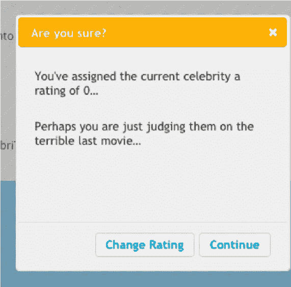

就像我们自定义的对话框一样，主要内容在 HTML 中指定，然后根据需要由库隐藏和显示。这样你就可以在对话框中放入任何你喜欢的东西——包括图像、链接或表单：

`chapter_07/18_jquery_ui_dialog/index.html`（摘录）

```html
<div id="dialog" title="你确定吗？">
    <p>你给当前名人的评分是 0...</p>
    <p>也许你只是根据他们糟糕的...</p>
</div>
```

我们使用 UI lightness 主题作为 CSS，因为它与 StarTrackr! 网站非常匹配——但对话框是完全可以自定义皮肤的，而且一如既往，你可以使用 ThemeRoller 工具创建自定义主题（关于这一点在第 9 章的“主题滚动”部分有更多介绍）。从 HTML 片段中可以看到，`title` 属性指定了要显示在对话框标题栏中的文本。除此之外，我们的 HTML 没有什么特别的...那么那些按钮是从哪里来的呢？


### 类似 Growl 风格的提醒

我们的客户担心 StarTrackr! 在实时网络领域落后于竞争对手。他希望能够与用户沟通，让他们随时掌握最新信息：新的 Twitter 帖子、来自 RSS 订阅源的新闻……任何能显示 StarTrackr! 充满活力的东西。

数据本身没有问题——后端团队可以处理……但我们如何以一种既酷炫又实用的方式通知用户呢？我们将再次从桌面应用中寻找灵感，并实现类似 Growl 风格的通知气泡（Growl 是 Mac OS X 桌面上流行的提醒系统）。

当我们有消息要分享给用户时，我们会在页面上添加一个气泡。该气泡将位于屏幕的右下角。如果我们有更多消息要分享，它们将出现在之前的下方，形成一种倒置的堆叠。每个气泡都会有一个关闭按钮，让用户在阅读后可以关闭它们。整体效果如图 7.10 所示。

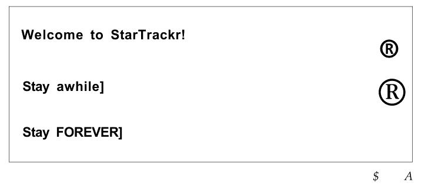

*图 7.10. 类似 Growl 风格的提醒*

气泡的关键在于 CSS。它处理了定位对话框和使其看起来非常酷的所有复杂工作。在 HTML 方面，我们只需要一个简单的容器：

```
chapter_07/19_growl_style_notifications/index.html  (摘录)

<div id="growl"></div>
```

它需要能够被定位在右下角，以实现我们想要的效果。将其放在页脚或页面主容器元素外部是常见的做法。让我们应用一些基本的 CSS 来处理定位：

```
chapter_07/19_growl_style_notifications/style.css  (摘录)

#growl {
    position: absolute;
    bottom: 0;
    right: 0;
    width: 320px;
    z-index: 10;
}
```

现在容器已经就位，我们可以开始向其中添加消息气泡了。我们将创建一个简单的函数，该函数接受一条消息，将其包装在一些结构中，并追加到我们定位好的气泡容器中：

```
chapter_07/19_growl_style_notifications/script.js  (摘录)

function addNotice(notice) {
    $('<div class="notice"></div>')
        .append('<div class="skin"></div>')
        .append('<a href="#" class="close">close</a>')
        .append($('<div class="content"></div>').html($(notice)))
        .hide()
        .appendTo('#growl')
        .fadeIn(1000);
}
```

我们添加的结构包括一个包含元素，以及一个可供额外样式化的 div（我们用它将可见消息布局在半透明背景上）、一个关闭按钮和一个消息内容的容器。

关于这个函数的另一个值得注意的地方是，我们传递给它的任何 HTML 都被包装在 jQuery 的美元选择器中。这意味着我们可以传递纯文本、HTML 或 jQuery 对象，它们都会显示在框中。同样，你可以根据你的网站进行任何样式的设置——不过你需要给气泡容器设置 `position: relative`：

```
chapter_07/19_growl_style_notifications/style.css (摘录)

.notice {
    position: relative;
}

.skin {
    position: absolute;
    background-color: #000000;
    bottom: 0;
    left: 0;
    opacity: 0.6;
    right: 0;
    top: 0;
    z-index: -1;
    -moz-border-radius: 5px; -webkit-border-radius: 5px;
}

.close {
    background: transparent url('button-close.png') 0 0 no-repeat;
}
```

这将正确定位我们的气泡并赋予它们一些基本样式。在文档就绪函数中，只需用一条消息调用 `addNotice` 函数，它就会在屏幕底部淡入：

```
chapter_07/19_growl_style_notifications/script.js (摘录)

addNotice("<p>欢迎来到 StarTrackr！</p>");
addNotice("<p>停留一会儿！</p><p>永远停留！</p>");
```

你也可以传入图像，或者实际上任何你喜欢的 HTML。当然，大多数时候你可能想显示用户交互的结果或 Ajax 调用的结果——你只需要在想向用户显示消息时调用 `addNotice`。唯一的问题是……一旦气泡出现，就无法移除——它们只会不断堆叠！让我们来修复这个问题：

***

chapter_07/18_jquery_ui_dialog/script.js (摘录)

```javascript
$('#dialog').dialog({
    autoOpen: false,
    height: 280,
    modal: true,
    resizable: false,
    buttons: {
        Continue: function() {
            $(this).dialog('close');
            // 提交评分
        },
        'Change Rating': function() {
            $(this).dialog('close');
            // 更新评分
        }
    }
});
```

啊哈，有意思！按钮，包括它们的文本，都是通过传递给 `dialog` 函数的选项来指定的。

按钮被分组在一个对象中，并分配给对话框的 `buttons` 属性。要定义一个按钮，你需要在 `buttons` 对象内创建一个命名函数。每当用户点击按钮时，函数代码就会执行——而函数的名称就是将在按钮上显示的文本。如果你想让按钮文本包含空格，你需要将函数名用引号括起来。按钮从右到左添加到对话框中，所以请确保你按想要显示的顺序添加它们。这是一种非常简洁的方式，可以将按钮功能与对话框打包在一起——不像我们的自定义对话框，其功能是独立于对话框代码指定的。

> **引号**

在上面的例子中，第二个按钮的名称用了引号，而第一个没有。这仅仅是为了说明将多词按钮名称用引号括起来的必要性；在你的代码中，为了保持一致性和简洁性，可能更倾向于将所有内容都加上引号。

默认情况下，对话框在你定义它后立即弹出。这使得在需要时创建小型简单对话框变得容易。然而，对于我们的示例，我们想先设置好对话框，只在特定触发时（当用户给可怜的名人零星评分时）才弹出它。为了防止对话框立即弹出，我们将 `autoOpen` 属性设置为 `false`。现在，当页面加载时，对话框会静待进一步指令。

当用户点击 `rating-0` 链接时，我们通过向 dialog 方法传递字符串 'open' 来告诉对话框显示自身。这是在初始化阶段之后与对话框通信的好方法：

```
chapter_07/18_jquery_ui_dialog/script.js (摘录)

$('#rating-0').click(function() {
    $('#dialog').dialog('open');
});
```

我们有一个外观不错的对话框了！我们现在可以在对话框按钮函数中执行任何所需的代码。作为代码的一部分，我们还需要告诉对话框何时关闭。如果你回顾上面的按钮定义，你可以看到我们有 `$(this).dialog('close')` 这一行。正如你可能猜到的，`close` 命令是 `open` 命令的反面。你可以根据需要任意多次地打开和关闭对话框。

这个插件还能做什么？嗯，我们指定了选项 `modal` 为 `true`；这就是为什么我们有漂亮的条纹背景——但默认情况下，`modal` 是 `false`，这允许用户在对话框打开时继续处理页面的其余部分。另外，我们将 `resizable` 设置为 `false`（并将 `draggable` 选项保持默认值——即 `true`）。这些选项利用了 jQuery UI 的可调整大小和可拖动行为，为对话框增添了一些桌面风味。

我们通过 HTML 指定了对话框的标题文本，但你也可以通过 jQuery 的 `title` 属性来设置，就像你可以设置其宽度和高度一样。一个不那么明显但极其有用的替代选项是 `bgiframe` 选项。如果此选项设置为 `true`，将使用 bgiframe 插件来修复 Internet Explorer 6 中下拉框显示在其他元素之上的问题。

在事件方面，如果你需要执行一些与按钮无关的处理，你可以利用对话框的 `open`、`close` 和 `focus` 事件。但还有一个极其有用的 `beforeClose` 事件，它在对话框被要求关闭时触发——在它实际关闭之前！这是处理任何无论点击哪个按钮都必须执行的进程的好地方。如果你需要阻止对话框关闭，除非满足某些条件，这也很有用。

到现在为止，你开始欣赏 jQuery UI 库的深度了。所有控件都经过深思熟虑且功能丰富。一如既往，你需要权衡更精简的自定义选项与更消耗带宽（但实现快速且功能更全面）的 jQuery UI 替代方案。选择哪一个应该取决于你的项目需求。


## 第7章

### 1-up 通知

又是一个周五下午，老板不在办公室。本周冲刺阶段的工作已经完成，距离办公室酒会还有整整一小时。这似乎是悄悄给网站添加一个炫酷小功能的完美时机。整本书中，我们专注于让那些久经考验的控件焕发生机，并重现桌面效果，但 jQuery 最棒的地方在于它能让你极其快速地尝试新效果。我们将拥抱这种创意精神，创建一个直接源自 8 位电子游戏历史的通知机制：1-up 通知。

这个想法源自网页开发者 Jeremy Keith，1-up 通知提供了一种非模态反馈机制，用于告知用户某个操作已发生。一条小消息（通常是一个词）会在操作发生的位置出现，然后向上方快速淡出——这就像经典平台电子游戏中的得分通知！你可能觉得这种效果仅具有新奇价值——但事实证明，它是一种非常令人满意且出人意料的巧妙方式来向用户传递消息。

既然是 jQuery，实现方式有很多种。我们的方法是插入一个初始隐藏的新元素，将其定位在触发操作的元素正上方居中位置。我们的触发器是一些简单的锚标签，作为“添加到愿望清单”链接。当它们被点击时，一条“正在添加”的通知将出现在链接上方，并在向上移动的同时快速淡出。动画完成后，按钮将变为“已添加”，交互完成：

```html
<!-- chapter_07/20_1_up_notifications/index.html (节选) -->
<a class="wishlist" href="#">Add to wishlist</a>
```

我们要插入的消息元素将具有 `adding` 类——因此我们需要确保在追加它们时，它们是不可见且位置正确的：

```css
/* chapter_07/20_1_up_notifications/style.css (节选) */
.adding{
    position:relative;
    left:-35px;
    top:-4px;
    display:none;
}
```

文档就绪后，我们就能找到所有目标元素，并为每个元素添加新的消息元素。当目标元素（具有 `wishlist` 类的元素）被点击时，我们会调用一个自定义函数来启动通知。这个自定义函数接收当前对象的引用和一个在交互完成时运行的回调函数。此函数会将选择移至链接（通过 `prev` 操作）并将其文本设置为“已添加”：

```javascript
// chapter_07/20_1_up_notifications/script.js (节选)
$(' <span>Adding</span>')
    .addClass('adding')
    .insertAfter('.wishlist');

$('.wishlist')
    .click(function(e) {
        doOneUp(this, function() {
            $(this).prev().text('Added');
        });
        e.preventDefault();
    })
```

我们的自定义函数此时对我们来说并无新意：它只是移动到隐藏的 `span` 元素并显示它。现在消息对最终用户可见了。然后我们启动一个动画，调整 `span` 的 `top` 和 `opacity` 属性——使其同时向上移动并淡出：

```javascript
// chapter_07/20_1_up_notifications/script.js (节选)
function doOneUp(which, callback) {
    $(which)
        .next()
        .show()
        .animate({
            top:"-=50px",
            opacity:"toggle"
        },
        1000,
        function() {
            $(this)
                .css({top: ""})
                .hide(callback)
                .remove();
        });
}
```

> **传递回调**
> 注意示例中传递的 `callback` 变量了吗？我们向 `doOneUp` 代码提供了一个函数作为参数，但我们自己并不直接使用它；我们只是将其作为回调传递给 jQuery 的 `hide` 操作。当 `hide` 完成时，它将运行我们提供的任何代码。在这个例子中，这段代码用于将链接文本从“添加到愿望清单”更改为“已添加”。

这个效果令人印象深刻，但如果它是可定制的，尤其是在文本消息的定位方面，会更加实用；目前它在 CSS 中是硬编码的。最好在代码中使其成为一个选项，并提供选项来选择消息移动的距离和速度。简而言之，这个效果非常适合作为一个插件！你必须等到（或直接跳到）第 9 章才能学习如何做到这一点。

### 重访表单

构建可用、可访问且令人印象深刻的表单和界面控件是一项艰巨的工作，为了完成这个任务，我们必须使用所有可用的工具：HTML、CSS、JavaScript 和 jQuery。这是一个团队合作，作为开发者，我们需要意识到哪个工具适合哪项工作。一旦我们弄清楚了这一点，一切就迎刃而解了。表单和控件是 Web 应用程序开发的核心——因此这是一个令人兴奋的实验领域。在令人印象深刻、新颖和可用的交互之间取得平衡可能很棘手，但如果你做对了，就能对人们使用和感知你应用程序的方式产生重大影响。

## 第 8 章

## 列表、树和表格

StarTrackr! 的人气刚刚飙升，因为曝光了一个考虑不周的宣传噱头：一位名人声称自己被困在一个意外被放飞的大气球里。幸运的是，这位名人恰好是 StarTrackr! 上的“本周 B 级明星”，有几位用户向媒体通报，他的跟踪设备显示他实际上在当地一家高端水疗中心。

成群结队的新用户和感兴趣的老派媒体人涌向网站，造成了数据海啸，网站的管理部分正疲于应对。我们的客户担心重要信息可能会被忽略，因为从目前那些无结构的列表和数据表格中几乎无法获取任何意义。

网站的管理区域传统上是最受忽视的；它对普通公众不可见，因此我们可以走捷径，少考虑可用性和用户体验。渐进增强和可访问性关注（通常由于极度紧张的截止日期！）等最佳实践就这样被抛之脑后。

但富互联网应用程序的兴起正在改变这一点。客户期望我们的基于 Web 的系统在可用性和设计上能与桌面应用程序相媲美。幸运的是，有 jQuery 在我们身边，这完全不是问题！

### 列表

列表是后表格布局时代 Web 中真正的无名英雄。随着设计师从专横的表格单元格约束中解放出来，他们开始寻找其他（语义正确的）方式来重建常见的用户界面元素，如菜单、导航面板、标签云等。一次又一次地，当冗余的布局碎片从底层数据中剥离后，剩下的就是——一个列表！

StarTrackr! 网站已经拥有大量的列表：它们构成了我们的选项卡、手风琴、菜单、图片库等的基础——但在增强和提升这个不起眼的列表方面，我们还有很多可以做的事情。

### jQuery UI 可选择项

用户生成内容的海洋对我们的客户来说被证明是个难题。成千上万的标签正从网站用户涌入——但现在法务部门表示，作为经理，他必须手动批准每一个标签，以避免最近一场严重诉讼的重演。

由于该网站采用了无约束的标签系统，列表中存在大量重复标签——在当前系统中，这意味着大量的额外管理工作。客户真正想要的是一种能轻松查看标签、选择它们（以及任何重复项），然后点击按钮批准或拒绝它们的方法。

我们的攻击计划是向列表添加 jQuery UI 的 **可选择** 行为。使元素可选择赋予用户套选该元素任何子元素的能力：如果你点击一个元素，然后拖动经过后续元素，它们就会高亮显示。然后你可以根据需要处理选择内容。非常适合管理枯燥的列表！我们旨在创建的行为如图 8.1 所示。


# 最近添加的标签

除了套索选择，可选择行为还允许你使用 Ctrl 键（就像在大多数桌面应用程序中那样）向列表中添加非连续的项目——甚至可以通过键盘导航选择。

### 让用户了解操作
虽然能够在列表上点击并拖动选择非常酷且实用，但这只有在你的用户知道它的情况下才酷且实用！在 Web 上以这种方式进行选择是一种非标准的交互形式，因此你需要向用户提供说明，教他们如何使用你的新功能。

让我们看看标记。服务器输出了一个长长的标签列表，这是我们选择器网格的绝佳基础。我们还将添加一些按钮，允许用户批准或拒绝他们选择中的标签，以及一个重置选择的按钮：

```html
chapter_08/01_jquery_ui_selectable/index.html (excerpt)

<ul id="tags">
  <li>bad singer</li>
  <li>old</li>
  <li>plastic surgery</li>
  <li>broke</li>
</ul>
<button id="approve">Approve</button>
<button id="reject">Reject</button>
<button id="clear">Clear</button>
```

一个又长又大的列表有点令人生畏，因此我们将使用一些基本的 CSS 将列表变成一个网格，并将每个标签转换成一个小方块。网格准备好后，我们需要将 jQuery UI 库添加到页面中。现在是时候让标签列表变得可选择了：

```javascript
chapter_08/01_jquery_ui_selectable/script.js (excerpt)

$("#tags").selectable();
```

启动你的浏览器并查看。嗯……实际上发生了什么吗？嗯，是的，它确实发生了，但它是不可见的！selectable 方法通过向选中的项目添加类属性来工作，除非我们为这些类分配样式，否则我们将无法看到任何变化。如果你在选择列表项时使用 Firebug 检查它们，你会看到变化的发生。让我们尝试为选中的元素设置样式：

```css
chapter_08/01_jquery_ui_selectable/style.css (excerpt)

#tags .ui-selecting {
  background: #FEFF9F;
}

#tags .ui-selected {
  background-color:#eEeF8F;
}
```

`ui-selecting` 类在用户选择元素的过程中被应用，而 `ui-selected` 类则在他们停止选择时立即添加。如果你现在尝试，你会看到你可以套索选择一些方块。这是一种相当自然的交互——这正是你想要的页面组件的效果。你也可以在按住 **Ctrl** 键的同时单击以选择单个项目。

我们接下来想要做的任务是帮助处理重复的标签。在一个标签系统中，每个术语的标签数量很重要——因此我们不会直接删除重复项，而是编写一些代码来选择任何与用户选择相匹配的标签。例如，如果他们点击“A-lister”，所有“A-lister”标签都会被高亮显示。

我们需要知道我们可以从 jQuery UI 组件中挂接到哪些事件。查阅文档，¹ 我们发现我们可以捕获 **start**、**stop**、**selecting**、**unselecting**、**selected** 和 **unselected** 事件。我们可以捕获 **selecting** 事件——并在用户移动鼠标时移除重复项——但这可能会有点令人困惑。我们将坚持使用 **stop** 事件，该事件在用户完成选择时立即触发：

```javascript
chapter_08/01_jquery_ui_selectable/script.js (excerpt)

$('#tags').selectable({
    stop: function() {
        // The user stopped selecting!
    }
});
```

现在我们可以开始我们寻找重复标签的任务了。我们的总体方法是列出用户选择的所有标签，然后在更大的标签列表中搜索这些标签的任何重复项：

```javascript
chapter_08/01_jquery_ui_selectable/script.js (excerpt)

var names = $.map($('.ui-selected', this), function(element, i) {
  return $(element).text();
});

$('li', this)
  .filter(function() {
    if ($.inArray($(this).text(), names) != -1) {
      return true;
    } else {
      return false;
    };
  })
  .addClass('ui-selected');
```

为了找到重复项，我们借助了一系列新的 jQuery 功能，所以请系好安全带！

其中第一个是最奇怪的：`$('.ui-selected', this)`。这看起来像一个常规的 jQuery 选择器，但有一个第二个参数。事实证明，jQuery 选择器的完整定义实际上是 `$(expression, context)`——我们之前只是省略了第二个参数。上下文定义了 jQuery 应该在哪里寻找你的选择器；默认情况下，它会在页面上的任何地方查找——但通过指定我们的无序列表作为上下文，表达式将被限制在列表内的元素中。

### $.map 和 $.inArray

接下来我们使用一些 jQuery 实用方法：`$.map` 和 `$.inArray` 来处理列表项。jQuery 提供的实用方法大多用于处理 JavaScript 数组——而这正是我们现在在做的事情。首先，我们创建一个名为 `names` 的数组，并使用 `$.map` 方法填充它。

`$.map` 方法允许你获取数组中的每个元素，以某种方式处理它，并将结果作为新数组返回。当你想以相同的方式转换每个元素时使用它。我们想将我们的 jQuery 选择转换为简单的标签文本列表——因此我们传入选择，并定义一个匿名函数来返回每个元素的文本。瞧！一个标签文本数组！

接下来我们像之前一样使用上下文技巧来检索所有列表项元素，并根据它们是否是重复项进行过滤。我们的 `filter` 函数使用了 `$.inArray` 实用方法，该方法在数组（但只是普通的 JavaScript 数组——不幸的是，不是 jQuery 选择）中搜索指定值。给定一个数组和一个搜索词，比如 `$.inArray(value, array)`，它将返回该值在数组中的索引。方便的是，如果该值*未*在数组中找到，它将返回 -1。记住 `filter` 期望我们返回 `true` 或 `false`——所以我们只需检查 `$.inArray` 是否返回 -1，并相应地返回 `true` 或 `false`。以这种方式使用 `filter` 允许我们在标签文本数组中搜索每个列表项的文本——如果它在里面，它就是重复项，因此我们将其返回给筛选器以进行选择。

### 访问数据

现在我们可以进行选择了，我们如何使用它们呢？jQuery UI Selectable 组件使用类名，因此我们也将使用类名。要获取选中的值列表，我们只需搜索任何具有 `ui-selected` 类的项目：

```javascript
chapter_08/01_jquery_ui_selectable/script.js (excerpt)

$('#approve').click(function() {
    $('#tags')
        .find('.ui-selected')
        .addClass('approve')
        .removeClass('ui-selected reject');
});

$('#reject').click(function() {
    $('#tags')
        .find('.ui-selected')
        .addClass('reject')
        .removeClass('ui-selected approve');
});

$('#clear').click(function() {
    $('#tags')
        .find('li')
        .removeClass('ui-selected approve reject');
    $('#approved').val('');
});
```

http://www.wowebook.com

当用户点击我们的按钮时，我们只是添加一个批准或拒绝类——同时确保移除 `ui-selected` 类，因为我们希望以不同于选中标签的方式来样式化已批准的标签。

但是如果我们想，比如说，将这些信息发送到服务器呢？也许最好将批准的标签列表存储在一个隐藏的表单字段中，以便服务器可以访问它进行处理。让我们更新 `#approve` 点击处理程序，以迭代已批准的项目，并将每个项目的索引以简单的管道分隔格式附加到隐藏字段中：

```javascript
chapter_08/01_jquery_ui_selectable/script.js (excerpt)

$("#approve").click(function() {
  var approvedItems = "";
  $("#tags")
    .find(".ui-selected")
    .addClass("approve")
    .removeClass("ui-selected reject")
    .each(function() {
      approvedItems += $(this).index() + "|";
    });
  $("#approved").val(approvedItems);
});
```

我们还将向 `#clear` 按钮点击处理程序添加一行，以清空该输入的值：

```javascript
chapter_08/01_jquery_ui_selectable/script.js (excerpt)

$("#approved").val("");
```

多亏了 `index` 方法，我们现在知道列表中哪些项目已被批准。`index` 会告诉你一个项目在其父元素中的位置。我们的控件令人印象深刻，因为它非常易于使用。jQuery UI 可选择行为在幕后做了大量工作，使列表变得可选择——但最终结果是一个感觉自然的组件，这正是我们想要的。

### 对列表排序

标签系统得到控制后，是时候转向管理部分中散落的其他一些列表了。其中许多列表是按照它们输入系统的顺序由服务器填充的。这对于查看

有什么新内容，但不利于查找特定条目。我们的客户要求我们为管理部分的所有列表添加一些排序功能，这样他就可以点击一个按钮，让列表按字母顺序升序或降序排列。

我们将要处理的标记是一个简单的无序列表，由链接组成：

```html
chapter_08/02_sorting_lists/index.html (摘录)
<ul class="sortable">
  <li><a href="#">Beau Dandy</a></li>
  <li><a href="#">Glendatronix</a></li>
  <li><a href="#">BMX Spandex Corporation</a></li>
  <li><a href="#">Maxwell Zilog</a></li>
  <li><a href="#">Computadores</a></li>
</ul>
```

jQuery 对象缺少任何内置的排序功能。这很有道理；一个选择集可能包含位于页面不同部分的不同类型的元素，因此无法以一致的方式对它们进行排序。因此，为了对我们的 jQuery 选择集进行排序，我们需要借助一些 JavaScript 数组方法。jQuery 选择集实际上不是数组，但它们是“类数组”的，并且允许我们对它们使用 JavaScript 的 `sort` 函数。

我们将尝试构建一个可重用的列表排序小部件。我们将其命名为 SORTER，我们将调用 `SORTER.sort(list)` 对列表进行升序排序，调用 `SORTER.sort(list, desc)` 进行降序排序。我们将假设传入的选择器将匹配有序列表或无序列表，但让我们看看是否能做到这一点：

```javascript
chapter_08/02_sorting_lists/script.js (摘录)
var SORTER = {};
SORTER.sort = function(which, dir) {
  SORTER.dir = (dir == "desc") ? -1 : 1;
  $(which).each(function() {
    // 查找列表项并进行排序
    var sorted = $(this).find("> li").sort(function(a, b) {
      return $(a).text().toLowerCase() > $(b).text().toLowerCase() ?
        SORTER.dir : -SORTER.dir;
    });
    $(this).append(sorted);
  });
};
```

这段代码看起来短得出奇，因为它实际上做了很多事情！首先，我们检查是否将 `desc` 作为 `dir` 参数传入，并相应地设置 `SORTER.dir` 变量。我们只需要获取所有一级子列表元素并对它们进行排序。我们只想要一级项；如果我们获取更深层次的项，它们会被排序并拖拽到父级。因为调用 `sort` 会将我们的选择集恢复为原始 JavaScript 对象，所以我们需要用 `$()` 重新包装它们，以便能够调用 jQuery 的 `text` 方法并比较它们的值。我们还将值转换为小写——这使得排序不区分大小写。

### sort 函数

`sort` 函数是纯 JavaScript：它基于你传递给它的函数的结果对数组进行排序。`sort` 会遍历数组的内容，并将它们成对传递给你的函数。如果你的函数返回 1，`sort` 会交换这两个元素的位置，将第二个元素放在第一个之前。如果你的函数返回 -1，JavaScript 会将第一个元素放在前面。最后，如果你的函数返回 0，`sort` 会认为两个元素相等，不进行任何排序。

我们运用了一点小技巧，使我们可以使用同一个函数进行升序和降序排序：我们根据排序方向，将 `SORTER.dir` 变量设置为 -1 或 1。然后在 `sort` 比较函数中，我们进行进一步的计算：如果 `a` 小于 `b`，我们返回 `-SORTER.dir`。如果方向是 -1，我们处理为 -(-1)，即 1——所以如果我们试图进行降序排序，返回值会被交换。

一旦我们对项进行了排序，我们就可以按照正确的顺序将它们重新插入列表中。请记住，`append` 函数首先会移除元素——所以它会移除该项并将其附加到正确的位置。

为了测试它，我们将向 HTML 中添加一些按钮，并在它们的点击事件处理程序中调用 `SORTER.sort`：

```javascript
// chapter_08/02_sorting_lists/script.js (摘录)
$('#ascending').click(function() {
  SORTER.sort('.sortable');
});
$('#descending').click(function() {
  SORTER.sort('.sortable', 'desc');
});
```

### 操作选择框列表

尽管我们在前一章中介绍了表单，但在列表的背景下，我们仍然可以看看某些表单元素。在这里，我们将研究 **select** 元素，特别是那些具有 `multiple="multiple"` 属性的元素（即，显示为可选项目列表的选择框）。

### 交换列表元素

StarTrackr! 客户要求我们改进将名人分配到 A 级榜单的管理功能。当前的功能包括两个 select 元素：一个包含 A 级名人，另一个包含系统中的所有其他名人。但人气的世界是极其善变的——今天的 A 级名人明天可能就默默无闻了。因此，客户希望能够轻松地在两个列表之间交换名人。我们将向界面添加一些控件，让他能够做到这一点，如图 8.2 所示。

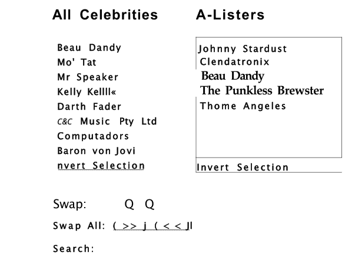

这是我们正在处理的 HTML，包含两个 **select** 元素和几个用于执行各种操作的按钮：

```html
chapter_08/03_select_lists/index.html (摘录)
<select id="candidates" multiple="multiple" size="8">
  <option value="142">Beau Dandy</option>
</select>
<select id="a-listers" multiple="multiple" size="8">
  <option value="232">Johnny Stardust</option>
</select>
<div id="controls">
  <input type="button" id="swapLeft" value="&gt;" />,
  <input type="button" id="swapRight" value="&lt;" />,
</div>
```

如前所述，客户希望能够在两个列表之间交换选中的项目。我们将创建一个 SWAPLIST 对象，其中包含我们将构建的所有功能。这样，任何时候我们需要操作 select 元素时，都可以重用它：

```javascript
chapter_08/03_select_lists/script.js (摘录)
var SWAPLIST = {};
SWAPLIST.swap = function(from, to) {
  $(from)
    .find(':selected')
    .appendTo(to);
};
```

我们定义了一个 `swap` 函数，它接受两个列表的选择器字符串：一个源列表和一个目标列表。我们要做的第一件事是获取当前选中的任何项。我们可以使用带有 `:selected` 表单过滤器的 `find` 操作来实现。此过滤器将返回任何设置了 `selected` 属性的表单元素。然后我们可以使用 `appendTo` 将选择移动到目标列表。很简单！一旦我们定义了这个功能，我们就可以通过从适当的点击处理程序中调用我们的 swap 方法，将其应用于任何两个列表：

```javascript
chapter_08/03_select_lists/script.js (摘录)
$('#swapLeft').click(function() {
  SWAPLIST.swap('#candidates', '#a-listers');
});
$('#swapRight').click(function() {
  SWAPLIST.swap('#a-listers', '#candidates');
});
```

现在，选中的项可以随意来回交换了！让我们为 SWAPLIST 对象添加更多功能。比如交换*所有*元素怎么样？那更简单：

```javascript
chapter_08/03_select_lists/script.js (摘录)
SWAPLIST.swapAll = function(from, to) {
  $(from)
    .children()
    .appendTo(to);
};
```

我们只需要获取所有子元素（而不仅仅是选中的元素），并将它们附加到目标列表的底部——整个列表就从源列表跳到了目标列表。

### 反转选择

下一个客户请求是添加一个按钮，用于反转当前的选择，以便他的员工在处理大型选择集时更容易操作。当点击此链接时，目标列表中当前所有选中的项将变为未选中，反之亦然。让我们在 SWAPLIST 对象中创建一个实现此功能的函数：

```javascript
chapter_08/03_select_lists/script.js (摘录)
SWAPLIST.invert = function(list) {
  $(list)
    .children()
    .attr('selected', function(i, selected) {
      return !selected;
    });
};
```

我们要做的就是获取每个列表项并交换其 `selected` 属性。我们使用 `attr` 函数将列表项设置为 `!$(this).attr('selected')`。JavaScript 的 NOT (`!`) 运算符（感叹号）会反转布尔值，所以如果值原来是 `true`，它就变成 `false`，如果原来是 `false`，它就变成 `true`！


# 使用函数参数调用 attr

这是一个很棒的技巧：我们使用了 `attr` 操作——但并非我们惯常使用的版本。之前我们使用 `attr(key, value)` 操作将属性设置为静态值，但 `attr` 也允许我们传入一个函数来确定值。该函数将接收两个参数：元素的索引及其当前值。函数的返回值将成为属性的新值。对于我们的 `invert` 方法，我们返回元素当前选择值的相反数——从而切换每个元素。我们可以用一堆命令进行此类动态处理：`text`、`html`、`val`、`addClass`、`wrap`……还有更多！

# 在列表中搜索

在不得不听客户一遍又一遍地抱怨很难找到他试图选择的名人之后，你决定附赠一个小礼物：一个快速搜索功能，让他输入一些字符就能自动选择任何匹配的元素：

chapter_08/03_select_lists/script.js（摘录）

```
SWAPLIST.search = function(list, search) {
    $(list)
        .children()
        .attr('selected1', '')
        .filter(function() {
            if (search == '') {
                return false;
            }
            return $(this)
                .text()
                .toLowerCase()
                .indexOf(search) > -1
        })
        .attr('selected1', 'selected');
}
```

这里发生了什么？首先，我们获取所有列表项，然后清除任何先前的选择（通过将 `selected` 设置为空字符串）。接下来，我们使用 `filter` 操作来查找我们搜索的任何元素。

`filter` 操作接受一个函数作为参数，并对该函数针对选择中的每个元素运行。如果函数返回 `true`，则元素保留在选择中。但如果函数返回 `false`——它就消失了……从选择中移除，并且不受进一步处理的影响。

为了找到我们关心的元素，我们检查它们包含的文本是否包含我们正在寻找的文本。为此，我们使用 `text` 操作获取一个字符串。我们将其转换为小写（这样搜索将不区分大小写），并检查源文本是否位于元素字符串中。JavaScript 的 `indexOf` 方法将查找一个字符串在另一个字符串中的位置；例如，`"hello world".indexOf('world');` 将返回 6（索引从 0 开始，通常如此）。如果未找到子字符串，`indexOf` 将返回 -1，这正是我们此处检查的内容。

在 `filter` 函数运行后，无论哪些元素保留在 jQuery 选择中，都必须包含我们正在寻找的关键词——因此我们再次使用 `attr` 方法来选择它们。

要使用我们创建的搜索方法，我们可以将其附加到一个点击处理程序——这样用户输入一个词然后点击搜索按钮。更好的方法是将 `keyup` 处理程序附加到 `input` 本身，这样就可以在输入时进行选择：

chapter_08/03_select_lists/script.js（摘录）

```
$("#search").keyup(function() {
    SWAPLIST.search("#a-listers, #candidates", $(this).val());
});
```

# 树

“这又是一团糟。我们有几个名人子类别……你知道，乐队的 A 级名人，或者因为他们父母有钱而出名的；在某个真人秀节目中获得第二名的 B 级名人，诸如此类。现在他们都混在一个大列表里。我需要看看这些类别是如何相互嵌套的！你能构建点什么来帮我吗？”

客户说的是树。树在 Web 上很少见，原因有二：它们很难做好，而且很少有适用场景。然而，嵌套的类别集合是树结构的有效用例（更常见的是表示目录结构），所以让我们开始吧！

# 可展开的树

关于树的秘密是：它们实际上只是嵌套的列表！在 jQuery 中处理树的关键是确保你的 HTML 是一致的——这样我们才能知道我们在哪里，并正确地打开和关闭分支。我们将构建的控件将如图 8.3 所示。我们特意保持了样式简洁，但像往常一样，改进外观的潜力仅限于你的 CSS 技能！

- A 级名人
    - 在成功的乐队中
        - Johnny Stardust
        - Glendatronix
    - 因为富有而出名
        - Dot-Com 百万富翁
            - Joel Mynor
- B 级名人
- C 级名人
- 新星

图 8.3. 树

我们标记中重要的部分是包含每个类别（或目录）名称的 `span`。我们将使用这个 `span` 作为基础来插入一个小的加/减图形——作为分支开关。这是我们将处理的标记的一个子集：

chapter_08/04_expandable_tree/index.html（摘录）

```
<ul id="celebTree">
  <li><span>A-list Celebrities</span>
    <ul>
      <li><span>In a successful band</span>
        <ul>
          <li>Johnny Stardust</li>
          <li>Glendatronix</li>
        </ul>
      </li>

      <li><span>Famous because they're rich</span>
        <ul>
          <li><span>Dot-Com millionaires</span>
            <ul>
              <li>Joel Mynor</li>
            </ul>
          </li>
        </ul>
      </li>
    </ul>
  </li>
  <li><span>B-list Celebrities</span></li>
  <li><span>C-list Celebrities</span></li>
  <li><span>Up and Comers</span></li>
</ul>
```

树可以按需嵌套——只需在相应的子列表项内重复结构。因为它整洁且一致，所以你可以轻松地在服务器上生成 HTML。

列表放在页面上后，下一步就是用一些 CSS 来美化它。这由你决定，但我们的代码会添加一些额外的类供你自定义显示。**handle** 类将被分配给我们插入的元素，作为开关手柄。当树的一个分支打开时，它将接收 **opened** 类；否则它将具有 **closed** 类。我们在下面使用这些类添加了一个 CSS 精灵图，它将在加号和减号之间切换：

```
chapter_08/04_expandable_tree/script.js（摘录）

.handle {
  background: transparent url(tree-handle.png) no-repeat left top;
  display:block;
  float:left;
  width:10px;
  height:10px;
  cursor:pointer;
}
.closed { background-position: left top; }
.opened { background-position: left -10px; }
```

树的代码非常简单，这要归功于树的递归特性：我们只需要做一小段代码，并将其附加到每个子类别上。我们创建展开/折叠树效果的攻击计划是首先隐藏所有嵌套的 `ul` 类别。然后我们将在类别标题前添加一个包含点击事件处理程序的新元素——这将打开和关闭其分支：

chapter_08/04_expandable_tree/script.js（摘录）

```
$('#celebTree ul')
    .hide()
    .prev('span')
    .before('<span></span>')
    .prev()
    .addClass('handle closed')
    .click(function() {
        // 加/减手柄点击
    });
```

六个链式操作。打赌你现在正感受到一些 jQuery 的力量在血管里流淌！在这里我们看到一致的标记如何帮助我们：在每个子类别列表中，我们寻找前一个 `span` 元素——那是子类别标题。然后我们在标题前插入一个新的 `span` 元素。

因为我们的手柄是在标题之前添加的，所以我们需要使用 `prev` 操作移回到它。我们为它添加了 `handle` 和 `closed`（由于 `hide` 操作，它默认是关闭的）类，以及一个点击时的事件处理程序。

在这个阶段，树将完全折叠，我们全新的手柄将放在标题前面。剩下的就是在点击它时切换分支：

chapter_08/04_expandable_tree/script.js（摘录）

```
// 加/减手柄点击
$(this)
    .toggleClass('closed opened')
    .nextAll('ul')
    .toggle();
```

当手柄被点击时，我们使用 `toggleClass` 来切换 `closed` 和 `opened` 类。如果你使用 `toggleClass` 指定多个类名，则元素上存在的任何指定类都将被移除，而元素上缺失的任何类都将被添加。


**`toggleClass` 的高级用法**

`toggleClass` 的另一个巧妙之处在于它接受第二个参数：一个布尔值，用于指定是应该添加还是移除 `class`。这听起来可能有点奇怪，但它确实是一个便捷的快捷方式。请看下面的代码：

```javascript
if (x == 1) {
  $(this).addClass('opened');
} else {
  $(this).removeClass('opened');
}
```

使用 `toggleClass(class, switch)` 语法，我们可以用以下简洁的语法来替代 `if` 语句：

```javascript
$(this).toggleClass('opened', x == 1);
```

得益于 `nextAll` 方法，查找我们需要打开和关闭的子类别变得很容易。jQuery 会检查下一个兄弟元素，发现它是一个 `span` 元素（类别标题），根据我们的表达式将其过滤掉，然后移动到下一个兄弟元素……这是一个 `ul` 元素。太棒了！我们只需切换它，树形结构就会随之展开和折叠。

## 事件委托

**事件委托**是一个适用于所有场景的主题，但如果你正在处理大型树形结构，它就显得尤为重要。其核心思想是，不是为树中的每个节点都单独应用事件处理程序，而是应用一个单独的事件处理程序来拦截点击事件——然后确定点击目标是谁，并执行相应的操作。

如果你一直紧跟前面的内容，这听起来可能有点耳熟。我们在第 6 章“为未来做准备：live 和 die”一节中介绍过 `live` 方法。`live` 方法为你处理了事件委托——这正是使其成为可能的魔法——但它有一个需要你注意的潜在陷阱。

为了更好地理解事件委托的工作原理及其重要性，让我们实际应用它。我们将从以下 HTML 开始，它展示了我们的 chapter_08/05_event_delegation/index.html（摘录）

```html
<span>Selection:</span>
<span id="current">--Choose a celebrity--</span>
<ul id="picker">
  <li class="category">
    <span class="title">A-List</span>
    <ul>
      <li>Beau Dandy</li>
      <li>Glendatronix</li>
    </ul>
  </li>
  <li class="category">
    <span class="title">B-List</span>
    <ul>
      <li>Mo\u1 Fat</li>
      <li>DJ Darth Fader</li>
    </ul>
  </li>
</ul>
```

当用户点击一位名人时，他们的选择应以“类别 > 名人”的格式显示在列表上方，如图 8.4 所示。那么，捕获此信息的最佳方式是什么？

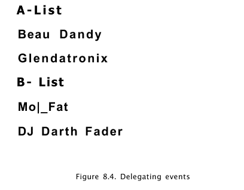

图 8.4. 事件委托

如果我们为每个列表项都添加一个点击事件处理程序——$(#picker li).click(...)——我们最终可能会得到数百个处理程序。这将严重影响性能，因为浏览器需要跟踪所有这些处理程序，并在页面上发生点击时检查它们。通过事件委托，我们将唯一的事件处理程序添加到列表的父元素上，然后访问事件的目标来确定实际被点击的元素。事件的 `target` 属性是实际的 DOM 元素——因此需要用 jQuery 选择器包装它以获取一个 jQuery 对象：

```javascript
$('#picker').click(function(e) {
    $('#current').text($(e.target).text());
});
```

我们的列表表现得就像每个项目都有自己的处理程序一样！很好，但之前提到的陷阱是什么？事件委托之所以有效，是因为事件冒泡（我们在第 5 章“事件传播”一节中探讨过）——事件会向上冒泡，直到我们的父级处理程序捕获它们。如果一个处理程序在父级之前捕获了事件，并阻止了事件传播（通过 `e.stopPropagation` 或 "return false"），问题就会发生。如果事件在向上冒泡的途中被停止，事件委托就会失败！这就是为什么了解事件在底层如何被处理如此重要——这将为你处理那些原本令人费解的错误节省大量精力。

我们已经用一个处理程序处理了所有点击，但现在我们需要更详细地了解元素的位置。具体来说，我们如何找出该元素属于哪个类别？可以这样做：

（摘录）

```javascript
$('#picker').click(function(e) {
    var celebrity = $(e.target).text();
    var category = $(e.target)
        .closest('.category')
        .find('.title')
        .text();
    $('#current').text(category + " > " + celebrity);
});
```

我们让 `closest` 方法查找最近的具有 `category` 类的元素。如果元素本身没有该类，`closest` 将检查其父元素……依此类推，直到找到匹配的元素。这省去了我们写一长串 `parent().parent().parent()` 的麻烦，也让我们在构建 HTML 时更加灵活。

## 表格

如果说 HTML 列表是新 Web 的无名英雄，那么表格就是那个最终浪子回头的坏孩子。表格本身从不是问题所在——多年来，我们为了以一种合理且跨浏览器的方式进行网页布局，滥用和误用了它们。但那是 CSS 该做的事，而不是可怜的老表格。如今，CSS 已经成熟，我们终于可以回归表格的原始用途：展示表格数据。

StarTrackr! 有大量数据需要展示。多到有些失控：表格变得过于庞大且难以阅读，信息没有分页或排序机制，也无法轻松编辑信息。我们在第 2 章看到了为表格添加斑马纹和行高亮是多么容易；这能给我们带来一些快速的改进，但要解决更严重的表格问题，我们需要 jQuery 的一些额外帮助。

### 固定表格表头

表头行至关重要：没有它，你将面对一堆毫无意义的数据行。但如果你处理大量行，你会发现表头的作用越来越小，因为它们会随着滚动而消失在视野之外。对数据进行分页通常能解决这个问题——但如果你需要同时在一个页面上显示所有数据，你就得另想办法了。

将表头行固定在表格顶部是跟踪列内容的一种有效方式，而且看起来非常酷！当用户滚动表格以显示新数据时，表头会随之移动。你可以在图 8.5 中看到实际效果。

| Id | Name | Occupation | Approx. Location | Price |
|---|---|---|---|---|
| 007F | Kellie Kelly | Singer | Omaha | $11.95 |
| 8A05 | Darth Fader | DJ | London | 119.95 |

如果你的表格是页面上唯一的元素，`position: fixed` 可以用来固定 `<thead>` 元素。但是，`position: fixed` 只能相对于视口定位元素，而不是其包含元素。这意味着对于包含在其他元素内部的表格（几乎总是如此），我们需要借助 jQuery。

让我们看看如何实现这个效果。我们的标记与第 2 章为其添加了斑马纹的 Celebrities 表格相同：

```html
chapter_08/06_fixed_table_headers/index.html (摘录)

<table id="celebs">
  <thead>
    <tr>
      <th>Id</th>
      <th>Name</th>
      <th>Occupation</th>
      <th>Approx. Location</th>
      <th>Price</th>
    </tr>
  </thead>
  <tbody>
  </tbody>
</table>
```

移动 `<thead>` 很棘手。有些浏览器允许你随意移动它，而在另一些浏览器中，它对样式的调整却出奇地顽固。所以我们将采用一个技巧：我们将以无序列表的形式复制 `<thead>` 的内容，样式设置得与 `<thead>` 完全相同。然后我们将其设置为 `position: absolute;`，并随着用户的滚动在屏幕上移动它。

我们首先创建一个 `TABLE` 小部件来存放我们的代码，其中包含一个用于固定表头效果的 `fixHeader` 方法。该方法将接收一个指向页面上表格的选择器字符串。我们首先将一些选择结果存储在变量和 `data` 中，以加速后续代码：

chapter_08/06_fixed_table_headers/script.js (摘录)

```javascript
var TABLE = {};

TABLE.fixHeader = function(table) {
    $(table).each(function() {
        var $table = $(this);
        var $thead = $table.find('thead');
        var $ths = $thead.find('th');
        $table.data('top', $thead.offset().top);
        $table.data('left', $thead.offset().left);
        $table.data('bottom', $table.data('top') + $table.height() - $thead.height());
    });
}
```

我们首先声明一个闭包来保存小部件的上下文。然后我们选择与传入方法的选择器匹配的任何表格。我们用 `each` 遍历它们，并存储对表格本身（`$table`）、`thead`（`$thead`）以及它包含的 `th` 元素集合（`$ths`）的引用。最后，我们存储 `$thead` 的左边和顶部偏移量，以及表格底部的位置（以避免表头移动到表格底部之外）！

> 💡 **编写基于选择器的函数时使用 each**

编写这类实用函数时，你应始终考虑到你的选择器可能返回多个元素的情况。在我们的例子中，页面上只有一个表格，所以如果我们省略 `each` 循环，方法也能正常工作。但为了未雨绸缪，并使我们的代码可重用，我们还是包含了循环；即使表格选择器返回多个表格，我们的函数也能优雅地处理它们。

接下来，我们创建 **OUT** *伪* 表头——一个 ul——并复制表格表头的内容：


chapter_08/06_fixed_table_headers/script.js（摘录）

```javascript
var $list = $('<ul class="faux-head"></ul>');
$ths.each(function(i) {
  _th = $(this);
  $list.append($("<li></li>")
    .addClass(_th.attr("class"))
    .html(_th.html())
    .width(_th.width())
    .click(function() {
      _th.click()
    })
  )
}).hide().css({left: _table.left});

$(' body').append($list);
```

我们将真实的 `th` 元素收集到 `$ths` 中，然后通过 `each` 操作遍历每一个并创建我们的模拟元素。我们复制了原始元素的 class、HTML 内容、宽度和点击事件处理程序。在我们的简单示例中，其中一些操作是不必要的，但做好准备总没错！在列表完全填充后，我们将其隐藏，并精确定位在真实的 `thead` 上方，然后将其插入页面。

### 尽可能减少追加操作

你可能想知道为什么我们要等到列表完全构建好才将其追加到页面。虽然先将列表追加到页面，再依次将每个项目追加到其中，会产生相同的预期效果，但我们选择的方法在浏览器中执行速度要快得多。

每次你向 DOM 中插入一个新元素时，浏览器都需要重新计算页面上每个元素的位置。如果你这样做很多次（尤其是在循环中！），你的脚本可能会变得非常慢。我们上面使用的方法——将新元素存储在变量中，按需处理它们，然后一次性全部追加——确保了最佳性能。

现在，我们的 `thead` 模拟元素已妥善就位，我们需要响应滚动事件并相应地定位它：

```javascript
chapter_08/06_fixed_table_headers/script.js（摘录）

$(window).scroll(function() {
    setTimeout(function() {
        if (Stable.data('top') < $(document).scrollTop() &&
            $(document).scrollTop() < Stable.data('bottom')) {
            $list
                .show()
                .stop()
                .animate({
                    top: $(document).scrollTop(),
                    opacity: 1
                });
        } else {
            $list.fadeOut(function() {
                $(this).css({top: Stable.data('top')});
            });
        }
    }, 100);
});
```

我们在滚动事件触发后设置了100毫秒的超时；这是一个非常短的时间，但足以确保我们避免在用户滚动时不断触发动画。我们检查是否已将 `thead` 滚动出视口，但尚未滚动到表格底部之外；如果是这样，我们会显示我们的模拟元素并将其动画到正确的位置。如果我们滚回足够高的位置，使得原始的 `thead` 可见，或者向下滚动到表格底部之外，我们会淡出这个冒牌列表（并将其位置重置回顶部，以便它再次出现时能从正确的位置开始动画）。

就这样！我们可以调用 `TABLE.fixHeader( "#celebs")` 并滚动页面，新的“thead”就会随之移动，确保标识标签始终可见。

### 重复表头

解决表头消失问题的另一种方法是简单地按固定间隔重复表头。如果数据需要打印出来，这尤其方便——尽管动画表格标题看起来很酷，但如果你需要整理十几页打印的表格，它就没什么用了！目标是获取表格的第一行，并每隔一定行数（比如每十行）复制一次。

结果如图 8.12 所示。

| lid   | Name                  | Occupation   | Approx. Location | Price |
|-------|-----------------------|--------------|------------------|-------|
| 203A  | Johny Stardust (bio)  | Front-man    | Los Angeles      | 139.95|
| 6636  | Glend at ronix        | Keytarist    | London           | 139.95|
| 141B  | Beau Dandy (pic)      | Singer       | New York         | 139.95|
| 2031  | Mo1 Fat               | Producer     | New York         | 119.95|
| 007F  | Kellie Kelly          | Singer       | Omaha            | 111.95|
| 8AO5  | Darth Fader           | DJ           | London           | 119.95|
| 203A  | Johny Stardust (bio)  | Front-man    | Los Angeles      | 139.95|
| 6636  | Glend at ronix        | Keytarist    | London           | 139.95|
| 141B  | Beau Dandy (pic)      | Singer       | New York         | 139.95|
| 2031  | Mo1 Fat               | Producer     | New York         | 119.95|
| lid   | Name                  | Occupation   | Approx. Location | Price |
| 007F  | Kellie Kelly          | Singer       | Omaha            | 111.95|
| 8AO5  | Darth Fader           | DJ           | London           | 119.95|

图 8.G. 重复表格标题

复制表头行并将其放置在其他地方，到现在对你来说应该已经是家常便饭了。但具体我们如何每隔十行添加一次表头呢？我们是否遍历每一行并检查其索引？嗯，我们确实可以……但 jQuery 再次以其强大的内置过滤器拯救了我们：

chapter_08/07_repeating_table_header/script.js *（摘录）*

```javascript
$("#celebs")
  .find("tr:first")
  .clone()
  .insertAfter("#celebs tr:nth-child(10n)");
```

这个解决方案一开始就很简单——抓取第一个表格行，然后用 `clone` 方法克隆它。接下来是巧妙的部分：**nth-child** 选择器非常适合将行精确地插入到我们想要的位置。不过，你可能对我们使用它的方式有点困惑，因为它的语法与我们之前见过的其他过滤器有点不同。最基础的用法是，如果你给它一个简单的整数，它将选择该索引位置的元素。

但是 `:nth-child` 选择器也接受其他值，这些值使其可以同时选择多行。如果你传入文本值 `even` 或 `odd`，你将选择所有偶数或奇数的子元素。最酷的是，你可以给它一个等式来计算要选择哪些子元素！

你可以使用字母“n”表示重复；例如，`:nth-child(10n)` 将选择每第十行。然后你可以通过加上或减去一个数来偏移选择的行。例如，如果你想选择第三行，然后是之后的每一行，你可以使用 `:nth-child(10n+3)`。最后，如果你喜欢逆向思考，你可以用 `:nth-child(10n-7)` 达到同样的效果。

这一切都运行良好，但确实有一个缺陷：如果表格的最后一行符合我们的等式，表头行将被作为最后一行重复添加——这看起来有点奇怪。此外，我们想将重复的表头应用到多个表格上，并希望避免复制/粘贴代码。下一章，我们将探讨如何通过插件使代码可重用——但现在，我们将保持简单，坚持使用一个可靠的 widget 对象：

```javascript
chapter_08/07_repeating_table_header/script.js（摘录）

var TABLE = {};

TABLE.repeatHeader = function(table, every) {
  $(table).each(function() {
    var $this = $(this);
    var rowsLen = $this.find('tr:not(:first)').length;

    $(this).find('tr:first')
      .clone()
      .insertAfter($this.find('tr:nth-child(' + every + ' n) '));

    if ((rowsLen) % every === 0) {
      $this.find('tr:last').remove();
    }
  });
};
```

我们创建了一个函数，它接受表格的选择器字符串，以及一个表示每次重复表头之间间隔多少行的数字。然后我们遍历选择器找到的每个元素（这样我们的函数就可以应用于同一页面上的多个表格）。对于每个元素，我们设置了一个指向 `$(this)` 元素的快捷方式，并获取表格中的行数。提前存储行数很重要，因为当我们重复添加表头时，行数会发生变化！

接下来是核心部分：我们复制第一行（就像之前做的那样），并将其插入到每“第n”行之后。这部分需要用 `find` 操作稍作重写，以便它可以应用于选择器匹配的多个表格中的任何一个——但除此之外，它与我们第一次的尝试完全相同。代码的最后一部分通过一点数学运算来确定我们是否已将表头添加为表格的最后一行；如果总行数能被我们的重复数字整除，我们就需要移除最后一行。

### 数据网格

“这些对管理部分的更改简直太棒了，”我们的客户以一种“*大请求要来了*”的语气说道，“但如果我们能替换掉市场经理使用的那个旧桌面应用程序就更好了。它连接到同一个数据库，但让她可以对数据进行排序、移动以及编辑不同的单元格——所有这些都在一个页面上完成！不过我想那是不可能的，对吧？”

当然，他对我们使出了老套的欲擒故纵的把戏，但这招每次都奏效。“当然是可能的！”你笑着回答，同时看着他正在演示的那个老旧的 Windows 应用程序。“事实上，我能做得更好——这只是个关于如何处理的问题……”

“太棒了！”客户说着，拍了拍你的背。“等我们可以看到的时候告诉我一声。”然后他就走了——去参加他的另一个“商务会议”了。回头看看那个应用程序，你意识到，是的，的确你能做得更好。你需要做的是将我们简单的表格转换为一个数据网格。

关于什么构成数据网格，没有固定的定义，但一些常见功能包括排序、过滤、搜索、分页、列宽调整和行内编辑。让我们尝试一些分页和行内编辑。

### 分页

在网站上遇到一个巨大的长表格可能会相当吓人——尤其是在屏幕空间如此宝贵的情况下。为表格添加分页功能，让我们一次只显示数据的一个小子集，同时允许用户通过导航按钮轻松地浏览数据。


分页通常由服务器处理。用户可以请求特定页面的数据，服务器会返回该页面。这对于海量数据非常有意义：如果你将 10,000 行表格数据加载到浏览器中，浏览器可能会变得有些卡顿。但对于较小的数据集，一次性加载所有数据到页面上可能是合理的；所有数据都存储在本地，用户在浏览数据时无需每次刷新页面。我们的 jQuery 分页控件如图 8.7 所示。

# Celebs

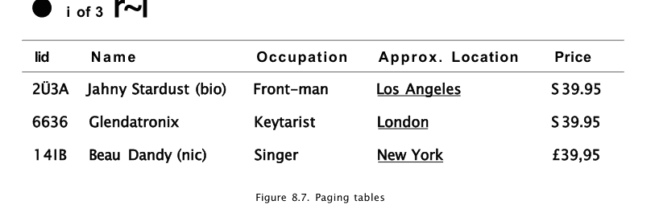

我们将创建的表格分页控件将包含可点击的 **"下一页"** 和 **"上一页"** 按钮，以及显示当前页码和总页数的控件。HTML 的结构非常重要，因为 jQuery 需要从分页表格遍历到导航控件：

```
chapter_08/08_pagination/index.html (excerpt)

<div class="table-wrapper">
  <div class="wrapper-paging">
    <ul>
      <li><a class="paging-back">&lt;</a></li>
      <li><a class="paging-this"><b>0</b> of <span>x</span></a></li>
      <li><a class="paging-next">&gt;</a></li>
    </ul>
  </div>
  <div class="wrapper-panel">
    <table id="celebs">

    </table>
  </div>
</div>
```

# 动态添加控件

另一种选择是在 jQuery 中完全构建导航控件。这意味着你可以轻松地将其应用于任何表格，并且控件会自动添加。这种方法通常受到插件作者的青睐。

你可以随心所欲地为控件设置样式——但一个好主意是在 CSS 中隐藏控件容器，然后在页面加载时用 jQuery 显示它。这样，任何没有启用 JavaScript 的人都不会看到多余的控件。

我们的控件骨架如下所示：

```
chapter_08/08_pagination/index.html (excerpt)

var TABLE = {};
TABLE.paginate = function(table, pageLength) {
  // 1. 设置分页信息
  // 2. 设置导航控件
  // 3. 显示初始行
  pagination = function (direction) {
    reveal = function (current) {
      // 5. 显示正确的行
    };
    // 4. 上一页和下一页
  }
```

看起来有很多内容要讲解——但请放心，这些内容都是你已经知道的。首先，我们获取要进行分页的表格和行，并进行一些计算以确定总共有多少页：

```
chapter_08/08_pagination/script.js (excerpt)

// 1. 设置分页信息
var $table = $(table);
var $rows = $table.find('tbody > tr');
var numPages = Math.ceil($rows.length / pageLength) - 1;
var current = 0;
```

现在我们需要配置导航控件。这正是我们结构重要的地方，因为我们需要通过从表格选择器向上遍历 DOM 到包裹 div，然后再向下到导航部分来查找控件。这种方法允许你将相同的代码应用于任何结构适当的表格：

```
chapter_08/08_pagination/script.js (excerpt)

// 2. 设置导航控件
var $nav = $table
    .parents('.table-wrapper')
    .find('.wrapper-paging ul');
var $back = $nav.find('li:first-child a');
var $next = $nav.find('li:last-child a');
```

然后我们设置显示当前页和总页数（加一，因为我们的计数器是从零开始的）的显示框文本。接下来，我们为 "上一页/下一页" 按钮添加事件处理程序。当这些按钮被点击时，我们调用分页函数并指定要移动的方向：

```
chapter_08/08_pagination/script.js (excerpt)

$nav.find('.paging-this b').text(current + 1);
$nav.find('.paging-this span').text(numPages + 1);
$back
    .addClass('paging-disabled')
    .click(function() {
        pagination('<');
    });
$next.click(function() {
    pagination('>');
});
```

设置的最后一步是限制用户最初看到的行数。最简单的方法是隐藏所有表格行，只显示我们感兴趣范围内的行。但是如何用 jQuery 选择一个范围的元素呢？我们可以使用 `:lt()` 和 `:gt()` 过滤器——但当需要显示，例如第 10 到 20 行时，选择器会变得有点混乱。幸运的是，我们有 `slice` 方法，它接受起始索引和结束索引作为参数，并只返回该范围内的对象：

```
chapter_08/08_pagination/script.js (excerpt)

// 3. 显示初始行
$rows
  .hide()
  .slice(0, pageLength)
  .show();
```

现在一切看起来都井然有序：我们的导航控件显示了正确的页码和总数，并且第一页数据也正确显示。但我们的分页按钮还没有功能。我们将添加一些逻辑来移动当前页，并确定是否应该禁用按钮（如果我们处于表格的任一端）：

```
chapter_08/08_pagination/script.js (excerpt)

// 4. 上一页和下一页
if (direction == "<") { // 上一页
  if (current > 1) {
    reveal(current -= 1);
  }
  else if (current == 1) {
    reveal(current -= 1);
    $back.addClass("paging-disabled");
  }
} else { // 下一页
  if (current < numPages - 1) {
    reveal(current += 1);
  }
  else if (current == numPages - 1) {
    reveal(current += 1);
    $next.addClass("paging-disabled");
  }
}
```

我们更新了 `current` 变量——但还没有更新表格本身。为此，我们创建了一个名为 `reveal` 的内部函数：

```
chapter_08/08_pagination/script.js (excerpt)

// 5. 显示正确的行
var reveal = function (current) {
    $back.removeClass("paging-disabled");
    $next.removeClass("paging-disabled");

    $rows
        .hide()
        .slice(current * pageLength, current * pageLength + pageLength)
        .show();

    $nav.find("a.paging-this b").text(current + 1);
}
```

`reveal` 首先清除禁用的类，这样我们的按钮就不会卡在禁用状态。然后我们再次使用 `slice` 方法来选择要显示的正确行。

> **嵌套函数**

我们这里使用的结构有点奇怪——但仔细想想，它很简单：我们将一个函数声明嵌套在另一个函数内部。这样做的唯一作用是限制函数的作用域（参见第 6 章“作用域”一节），使其只能从其父函数内部调用。为什么这是个好主意？在这种情况下，我们的函数在父函数之外没有用途，将其放在更广泛的作用域只会增加它与其他函数或变量名冲突的风险。

# 编辑行

我们已经处理了单个元素的行内编辑，但如果你想让整个表格可编辑呢？我们将在数据网格中添加编辑功能，在每一行的末尾插入一个“编辑”按钮，将整个单元格行转换为输入元素，如图 8.8 所示。

# Celebs

| Id | Name | Occupation | Approx. Location | price |
|---|---|---|---|---|
| 203A | Stardust (bio) | Front-man | Los Angeles | 139.95 Edit |
| 66 | Gleiidatronix | Keytarist | ... | Edit |
| 14IE | Beau Dandy (pic) | Singer | New York | 139.95 Edit |

图 8.8. 可编辑行的操作示例

包含表格数据的单元格为我们在操作标记时存储信息提供了绝佳的机会；这实际上是我们表单控件中使用的一个技巧。然而，我们还没有体验过使用行元素来组织我们的工作区。让我们看看如何使用它：

```
chapter_08/09_editable_table_cells/index.html (excerpt)

<form action="null" method="post">
  <table id="celebs">
    <thead>
      <tr>
        <th>ID</th>
        <th>Name</th>
        <th>Occupation</th>
        <th>Approx. Location</th>
        <th>Price</th>
      </tr>
    </thead>
    <tbody>
      <tr>
        <td>203A</td>
        <td>Johny Stardust</td>
        <td>Front-man</td>
        <td>Los Angeles</td>
        <td>$39.95</td>
      </tr>
    </tbody>
  </table>
</form>
```

看起来很正常，对吧？它就应该这样，因为所有可编辑功能都将逐步添加——这样可以更好地让访客满意并持续回访！


此外还有个额外好处：由于表格的HTML中未包含任何编辑控件，我们可以轻松地向其添加任意数量的行，而繁琐的工作则交给jQuery来完成。

我们将从一个设置方法开始，用于初始化表格并添加所需按钮：

chapter_08/09_editable_table_cells/script.js *（摘录）*

```javascript
TABLE.formwork = function(table) {
    var Stables = $(table);

    Stables.each(function () {
        var _table = $(this);
        _table
            .find('thead tr')
            .append($('<th class="edit">&nbsp;</th>'));
        _table
            .find('tbody tr')
            .append($('<td class="edit"><input type="button" value="Edit"/></td>'));
    });

    Stables.find('.edit :button').live('click', function(e) {
        TABLE.editable(this);
        e.preventDefault();
    });
};
```

我们的 `TABLE.formwork` 方法会查找传入的选择器，然后查找 `thead` 和 `tbody` 中的行，并为每一行添加一个额外的编辑单元格。`thead` 中的单元格是空的，但它在那里是为了保持表格的列结构；而 `tbody` 中的添加项则包含了可将该行切换为编辑模式的按钮。尽管我们知道在附加点击事件之前按钮就已经存在，但通过 `live` 进行事件委托是未来的趋势。这就是为什么我们使用它来确保无论我们如何移动按钮、移除它们还是恢复它们，点击处理程序都会保持有效。

这里需要记住的另一点是，我们在 `each` 循环之外应用 `live` 方法。通过在循环外对 `Stables` 应用它，而不是在循环内对 `_table` 应用，我们确保事件监听器只被添加一次。我们实现了完整的效果，但代码运行得更快。忍者们喜欢快速的代码！

现在来看看精彩的部分。我们希望按钮能在两种状态下工作——编辑模式和保存模式——并且我们希望除了包含按钮的单元格外，所有其他单元格都可编辑。以下是我们将要采用的方法：

chapter_08/09_editable_table_cells/script.js *（摘录）*

```javascript
TABLE.editable = function (button) {
    var $button = $(button);
    var $row = $button.parents('tbody tr');
    var $cells = $row.children('td').not('.edit');

    if ($row.data('flag')) { // 处于编辑模式，切换回表格视图
        // 单元格处理方法

        $row.data('flag', false);
        $button.text('Edit');
    }
    else { // 处于表格模式，切换到编辑模式
        // 单元格处理方法

        $row.data('flag', true);
        $button.text('Save');
    }
}
```

来自 `TABLE.formwork` 的 `live` 点击事件会传入我们要编辑的行的按钮，因此我们将使用它来缓存对父行及其包含的其他单元格的引用。我们在 `$button` 对象上使用 `parents` 来查找行，在 `$row` 上使用 `children`（并通过 `not` 排除编辑单元格）来查找所有其他单元格。

在 `if` 语句中，我们设置一个 `data` 标志，让我们知道该行处于编辑模式，并更改按钮文本以反映这一点。剩下的就是切换单元格内容了。

我们将按相反顺序查看代码，先呈现更简单的代码。我们需要做的最简单的部分是退出编辑模式：

chapter_08/09_editable_table_cells/script.js *（摘录）*

```javascript
$cells.each(function () {
    var _cell = $(this);
    _cell.html(_cell.find('input').val());
});
```

要退出编辑模式，我们获取 `_cell` 中 `input` 的 `val`，并将其作为 `_cell` 的 `html` 添加进去。由于我们需要多次引用该单元格（即使只有两次！），我们先将其保存在变量中以提高性能。

现在来看需要切换到*编辑*模式的代码：

chapter_08/09_editable_table_cells/script.js *（摘录）*

```javascript
$cells.each(function () {
  var _cell = $(this);
  _cell.data('text', _cell.html())
    .html('');

  var $input = $('<input type="text" />')
    .val(_cell.data('text'))
    .width(_cell.width() - 16);

  _cell.append($input);
});
```

使单元格可编辑只是稍微复杂一点。在添加输入框之前，我们需要清空当前的单元格内容，否则会破坏布局。但在清空每个单元格之前，我们将当前内容存储在 `data` 中，以便稍后使用。

我们将追加一个我们创建的 `input`，并且如前所述，在将其添加到DOM*之前*操作任何我们创建的内容很重要。输入框的宽度设置得比单元格宽度小，以避免任何布局破坏，而我们刚刚保存的数据将作为输入元素的默认值。

试一试，你会对其运行的流畅性印象深刻。打赌你现在开始觉得自己像个忍者了！

## DataTables 插件

我们已经踏上了创建可复用数据网格的道路。从这里开始有无穷无尽的方法；表格可以按列排序或可搜索——我们可以为其添加所有能想到的炫酷功能。但如果你时间紧迫，并且需要快速获得大量功能，你就需要研究现有的插件选项，比如 DataTables 插件。

DataTables 是一个真正令人印象深刻的插件，它可以将你的HTML表格转变为功能齐全的数据网格，具备分页、列排序、搜索、ThemeRoller 支持、Ajax 加载等功能。一如既往，是使用插件还是构建自定义功能取决于你有多少时间、需要多少功能以及你愿意为访问者提供多大的文件。哦，还有你认为自己开发这些功能会有多有趣！

到目前为止，我们已经能够独立为客户基于表格的需求添加所有必需的功能，并在此过程中学到了很多关于jQuery的知识。在进入下一章（也是最后一章）之前，让我们在表格的背景下重新审视我们的“全选”复选框。

## 使用复选框选择行

公众越来越习惯拥有的一个功能是能够通过勾选与行关联的复选框来选择表格（或任何类型的列表）的行。除了可以进行单个选择外，通常还有用于选择全部、不选任何项目或反转当前复选框选择的快捷方式。这些对我们来说都不新鲜：我们已经构建了全选复选框和选择反转按钮。

然而，一些用户对此并不满足，他们还希望能够通过使用 **Shift** 键来选择连续的行——就像在他们的桌面应用程序中一样。

## 选择一列复选框

处理列数据比处理行数据要棘手得多。当它们在屏幕上一起显示时，可能看起来紧密相关，但在DOM中，它们只是远亲。没有方便的 `next` 或 `previous` 函数可以供我们使用。

当然，jQuery可以帮助我们。得益于其复杂的选择器引擎，我们可以随心所欲——只是可能需要一点思考。首先，我们知道需要获取表格；在我们的例子中，就是老的 `#celebs`。

接下来，我们想检索表格行：`#celebs tr`，然后是每行的第一个列 `#celebs tr td:nth-child(1)`。最后，我们确保只选择复选框：`#celebs tr td:nth-child(1) :checkbox`。这真是个相当复杂的选择器！

我们在表格的 `th` 中放置另一个复选框（id为 `checker`）。因为它在 `th` 中而不是 `td` 中，我们的选择器会忽略它。我们可以为其附加一个点击处理程序来开启和关闭所有复选框：

chapter_08/10_select_column_checkboxes/script.js *（摘录）*

```javascript
var chkSelector = 'tr td:nth-child(1) input:checkbox';

$('#checker').click(function() {
  $('#celebs ' + chkSelector)
    .attr('checked', $(this).attr('checked'));
});
```

## Shift 选择复选框

全选或全不选是一回事……但我们的客户现在对我们期望很高。他要求能够**Shift+点击**复选框，以便在行范围内一次选择多个。就像在他的网络邮件客户端中一样。

Shift 选择带来了一些有趣的问题。首先，我们如何知道用户是否按下了 **Shift** 键？幸运的是，jQuery事件会告诉我们！我们可以通过检查布尔属性 `e.shiftKey` 来了解事件中 **Shift** 键的状态。这很简单！那么如何找出点击了哪一行呢？我们可以直接向上遍历DOM，找到复选框的父行，并使用 `index` 获取其索引。这也很简单。

接下来，我们需要知道用户*最后*点击了哪里，以便我们有一个选择复选框的起始点和结束点。最简单的方法是使用 `data` 方法将每次点击存储在表格中。我们掌握了大量信息，现在让我们将其付诸实践：


chapter_08/10_select_column_checkboxes/script.js (节选)

```javascript
$('#celebs tbody').find(chkSelector).click(function(e) {
  var $table = $(this).parents('table');
  var lastRow = $table.data('lastRow');
  var thisRow = $(this).parents('tr').index();

  if (lastRow !== undefined && e.shiftKey) {
    var numChecked = 0;
    var start = lastRow < thisRow ? lastRow : thisRow;
    var end = lastRow > thisRow ? lastRow : thisRow;
    $table
      .find(chkSelector)
      .slice(start, end)
      .attr('checked', true);
  }
  $table.data('lastRow', thisRow);
});
```

只有当存在 `lastRow` 值（在首次点击前，表格上尚未存储点击值时，该值将是 `undefined`）并且用户同时按住 Shift 键时，我们才会启动操作。

拿到起始行和目标行后，我们需要确定哪一行在表格中更靠下，以确保起始点在终点之前。然后，我们使用 jQuery 的 `slice` 方法截取复选框选择范围。拿到这个新截取的 jQuery 选择集后，我们可以通过选中选择集中所有剩余的复选框来完成操作。现在，你可以非常直观地轻松选择行范围了！

## 我们已跻身A级行列！

我们将 StarTrackr! 的管理部分从一团糟的格式混乱数据，转变成了一个可用的桌面风格应用程序——在此过程中，将原始数据转化为了有用信息。jQuery 让我们能够轻松地将标准 HTML 元素塑造成强大的、类似应用程序的控件，这意味着响应式、令人印象深刻且易于访问的富互联网应用这一终极目标已触手可及。

在此阶段真正令人惊叹的是，就核心 jQuery 库而言，我们发现自己使用的几乎所有函数都曾在更早的阶段见过。这无疑意味着我们正在深入掌握这个强大的工具！现在你只需要开始尝试自己的想法——自动伸手去拿插件的时代应该已经离你远去了。尝试自己快速实现一个概念验证，你会惊讶于达到预期结果是多么容易。不久之后，你会发现你的代码与你在插件仓库中找到的一样好（甚至更好！）。

说到插件仓库——那是我们 jQuery 之旅的最后几站之一。在下一章中，你将学习如何将你构建的所有这些精彩功能，以插件形式提供给全世界。我们还将涵盖一些其他高级主题，以完善你的 jQuery 忍者训练！

# 第9章

## 插件、主题和高级主题

jQuery，就像国际象棋或任何版本的俄罗斯方块一样，易于学习但难以精通。由于其与文档对象模型（DOM）的无缝集成，jQuery 感觉自然且易于使用。但 jQuery 是一个低调的成就者：它不喜欢吹嘘，但其底层是一个可扩展的架构、一个强大的事件处理系统和一个健壮的插件框架。

### 插件

“嘿，现在一切都就位了——你能回去把第三阶段的菜单放到管理部分吗？你能把你上个阶段做的那些很酷的列表加到前端的列表上吗——还有你做的那个滚动效果……你只需要复制粘贴代码就行了，对吧？”

啊，复制/粘贴：我们的好朋友，也是最坏的敌人。当然，它看起来像是让功能快速运行的一种方式——但我们都知道，这种代码重用很容易退化为最糟糕的 JavaScript 噩梦。我们不能让这种事发生在我们美丽的 jQuery 创作上。

你在整本书中已经看到 jQuery 插件架构是多么有用。我们使用了各种第三方创作——从可样式的滚动条，到随机播放的图片库，再到自动完成的表单字段。好消息是，将你的代码打包成插件以在其他项目中重用极其容易——而且，如果你的代码真的特别，还可以在其他开发者的项目中使用！

#### 创建插件

在你的 jQuery 编写生涯中，你很快就会有将一些代码转换为插件的冲动。没有什么比在 jQuery 链式调用中间看到自己的一小段代码被调用更棒的了！最棒的是，将你现有的 jQuery 转换为插件的过程非常简单，并且你可以根据需要使其高度可定制。

#### 准备工作

在我们开始之前，我们需要为我们的插件构思一个创意。不久前客户提到，他想突出页面上的所有文本段落，这样当用户将鼠标移过段落时，文本将取消高亮，表示已被阅读。虽然你可能会同意这远非最佳的用户界面创意，但它足够简单，可以演示如何制作插件，而无需专注于效果本身的代码。

要使插件能够像常规 jQuery 操作一样被调用，我们只需将一个函数附加到 jQuery 的 **prototype**（原型）上。在 JavaScript 中，任何对象或内置数据类型的 **prototype** 属性都可以用来扩展新的方法或属性。对于我们的插件，我们将使用核心 jQuery 对象本身的 **prototype** 属性来添加我们的新方法。

最安全的（也是唯一的！）方法是为 jQuery 函数创建一个私有作用域。这个 JavaScript 技巧确保你的插件即使在页面中有人使用 `$` 函数执行非 jQuery 目的的情况下也能正常工作：

```javascript
(function($) {
  // 您插件代码的外壳
})(jQuery);
```

这段代码可以放在脚本中的任何位置，但标准做法是将其放在名为 `jquery.pluginname.js` 的单独 JavaScript 文件中，并像包含任何插件一样包含它。现在你有了一个独立的文件，可以轻松地在未来的项目中使用它或与全世界分享！

在这个保护性外壳内，我们可以放心地使用 `$` 别名。准备工作就这么多——现在是时候开始编写插件了。首先我们需要给它一个名字，`highlightOnce`，并将其附加到 jQuery 插件钩子 `$.fn` 上：

```javascript
// chapter_09/01_plugins/jquery.highlightonce.js (节选)
(function($) {
    // 您插件代码的外壳
    $.fn.highlightOnce = function() {
        // 插件代码
    }
})(jQuery);
```

在内部，`$.fn` 是 jQuery `.prototype` JavaScript 属性的快捷方式——它是放置我们插件的完美位置。这是 jQuery 放置其操作的地方，因此现在我们添加了自定义操作，就可以像调用内置 jQuery 方法一样调用它。

此时我们的代码看起来像一个 jQuery 插件，但它还不会像插件那样运作——还有一项任务要做。如果我们现在在插件代码内部执行一些操作，我们实际上是在一次性处理整个选择集；例如，如果我们运行 `$('p').highlightOnce()`，我们将会把每个段落元素作为单个选择集进行操作。我们需要做的是一次处理一个元素，并返回元素以便 jQuery 链可以继续。这是插件的一个相当标准的结构：

```javascript
// chapter_09/01_plugins/jquery.highlightonce.js (节选)
// 插件代码
return this.each(function() {
    // 对每个项目执行某些操作
});
```

所以现在你有了一个创建简单插件的良好框架。保存这个大纲，以便你可以随时快速创建新插件！

#### 添加插件功能

我们的 `highlightOnce` 插件已准备就绪，让我们给它分配一些工作。到目前为止，我们添加的所有结构都只是脚手架——现在是时候建造一幢建筑了！我们可以在插件核心运行的代码类型与我们习惯编写的代码完全相同；我们可以使用 `$(this)` 构造访问当前对象，并执行任何需要的 jQuery 或 JavaScript 代码。

我们的插件需要实现的第一个功能是高亮每个选中元素，因此我们将背景设置为亮黄色。接下来，我们需要处理用户将鼠标移到元素上时的情况，以便我们可以移除高亮。我们只希望这发生一次，就在元素淡回原始颜色之后（别忘了，我们需要 jQuery UI 效果组件来实现这一点）：

```javascript
// chapter_09/01_plugins/jquery.highlightonce.js (节选)
// 对每个项目执行某些操作
$(this)
  .data('original-color', $(this).css('background-color'))
  .css('background-color', '#fff47f')
  .one('mouseenter', function() {
    $(this).animate({
      'background-color': $(this).data('original-color')
    }, 'fast');
  });
```

恰好有一个 jQuery 操作完全符合我们的需求：`one` 操作。在功能上，`one` 操作与我们之前看到的 `bind` 操作相同，因为它允许我们将事件处理程序附加到元素上。与 `bind` 的区别在于，该事件将只运行一次，之后事件将自动解除绑定。

对于我们的代码，我们将当前背景颜色保存在元素的数据存储中，然后将 `mouseover` 事件绑定到选中的 DOM 元素。当用户将鼠标移到元素上时，我们的代码运行，背景颜色动画恢复到原始状态。至此，我们的插件就可以使用了：

这非常令人兴奋：我们的功能被封装在一个可链式调用、可复用的插件中，我们将其巧妙地安置在 `hide` 和 `slideDown` 动作之间。看到只需 11 行代码（其中 6 行还是标准的插件脚手架！），你就会明白，将任何打算复用的功能转化为插件是值得的！

### 添加选项

jQuery 插件是生成可复用代码的绝佳方式，但要真正实用，我们的插件需要适用于其创建时的特定上下文之外：它们需要是*可定制的*。我们可以在插件中添加用户指定的选项，这些选项随后可用于在插件使用时修改其行为。

我们从插件用户的角度熟悉选项的工作方式，因为在本书中我们使用过的几乎每个插件都传入了选项。选项让我们能够以微妙和更明显的方式修改插件的功能，使其能够在尽可能广泛的场景中使用。

插件选项有两种类型：简单值和对象字面量。让我们从更简单的开始，看看这是如何工作的。对于我们的 `highlightOnce` 插件，将颜色硬编码似乎相当受限。我们希望给开发者一个选择，让他们可以用任何他们喜欢的颜色来高亮其元素。让我们将其设为一个选项：

```javascript
$.fn.highlightOnce = function(color) {
  $(this).css('background-color', color || '#fff47f')
};
```

插件可以在调用时指定一个颜色，也可以不带参数调用——在这种情况下将使用默认值（这要归功于 JavaScript 的 `||` 运算符）。让我们用绿色高亮我们的段落：

```javascript
$('P')
  .hide()
  .highlightOnce('green')
  .slideDown();
```

如果你有一个或两个总是必需的简单选项，这种方法没问题。但当你的插件开始变得更复杂时，你最终会有大量的设置，你的用户会希望覆盖其中一些，同时保留其他设置的默认值。这时我们就需要使用更复杂的对象字面量表示法了。

这并不可怕——你已经知道如何定义这种类型的设置对象。我们在 `animate`、`css` 和大多数 jQuery UI 组件中都使用过它们。键/值对象的好处在于只需要定义一个参数，用户可以在其中指定多个设置。我们的第一步是为每个选项设置默认值：

```javascript
$.fn.highlightOnce.defaults = {
  color : '#fff47f',
  duration : 'fast'
};
```

我们现在有了作为对象的默认值，因此需要利用 jQuery 的 `$.extend` 函数。这个方便的函数有多种用途，但就我们的目的而言，我们将使用它通过添加另一个对象的所有属性来扩展一个对象。这样，我们可以用默认设置扩展用户传入的选项：插件将已经为每个选项指定了值，如果用户指定了其中一个，该默认值将被覆盖。完美！让我们看看代码：

```javascript
$.fn.highlightOnce = function(options) {
  options = $.extend($.fn.highlightOnce.defaults, options);
  return this.each( ... );
};
```

我们的 `options` 变量包含了正确的设置——无论它们是由用户定义的，还是由默认对象定义的。现在我们可以在代码中使用这些设置了：

```javascript
$(this)
    .data('original-color', $(this).css('background-color'))
    .css('background-color', options.color)
    .one('mouseenter', function() {
        $(this).animate({
            'background-color': $(this).data('original-color')
        }, options.duration);
    });
```

作为插件用户，我们可以指定高亮的颜色或持续时间——或者接受默认值。在下面的例子中，我们将接受默认颜色，但将持续时间覆盖为 2000 毫秒，而不是“快速”：

```javascript
$('P')
    .hide()
    .highlightOnce({color: '#C0FFEE', duration: 2000})
    .slideDown();
```

### 添加回调

你已经看到回调函数和事件可以非常有用。本书中的许多效果和控件都依赖于它们——我们使用的许多插件也提供了回调来自定义其功能。回调是一种机制，允许插件的用户在你的插件内部发生的事件基础上运行自己的代码。通常你会相当清楚你想要向用户暴露哪些事件。例如，对于我们的 `highlightOnce` 插件，我们可能希望在效果设置时、效果结束时以及可能淡出开始时运行额外的代码。

为了演示，让我们尝试暴露一个 `setup` 事件（将在 `mouseover` 处理程序附加后运行）和一个 `complete` 事件（将在最终的 `animate` 动作结束后运行）：

```javascript
$.fn.highlightOnce.defaults = {
    color : '#fff47f',
    duration : 'fast',
    setup : null,
    complete: null
};
```

回调函数在默认情况下不应执行任何操作，因此我们将它们设置为 `null`。当需要运行回调时，有几种可能的方式。如果我们的回调需要在 jQuery 回调的位置运行，我们可以简单地将用户传入的函数提供给 jQuery 动作。否则，我们需要在适当的位置手动调用该函数：

```javascript
$(this)
    .data('original-color', $(this).css('background-color'))
    .css('background-color', options.color)
    .one('mouseenter', function() {
        $(this).animate(
            {'background-color': $(this).data('original-color')},
            options.duration,
            options.complete
        );
    });

// 触发 setup 回调
$.isFunction(options.setup) && options.setup.call(this);
```

上面我们可以看到两种类型的回调。`complete` 回调处理程序很简单：当 `animate` 动作完成时效果完成，而 `animate` 动作本身接受一个回调函数，所以我们只需将函数传递过去。对于 `setup` 处理程序就没有这么幸运了——我们必须自己触发它。我们借助 jQuery 和一些高级 JavaScript 来执行代码。首先，我们使用方便的 `$.isFunction` jQuery 动作检查回调是否是一个函数，该动作返回一个布尔值：如果回调是函数则为 `true`，否则为 `false`。如果是后者（这很有可能，因为用户保留了默认值，此时它仍然是 `null`），那么尝试执行它是没有意义的！

### 更多实用函数

除了 `$.isFunction`，jQuery 还提供了以下函数：
`$.isArray`（用于测试变量是否为数组），`$.isPlainObject`（用于简单的 JavaScript 对象），以及 `$.isEmptyObject`（用于没有属性的对象）。
这些函数为您提供了多种方式来确定 JavaScript 构造的性质和属性。

如果回调已被定义，我们需要运行它。运行 JavaScript 函数有几种方式，最简单的是直接调用：`options.setup()`。这可以正常运行，但问题在于它是在默认对象的作用域内调用的，而不是在事件目标元素的作用域内（正如我们所习惯的）。因此回调函数将无法确定它正在处理哪个 DOM 元素。为了解决这个问题，我们使用 JavaScript 的 `call` 方法。你传递给 `call` 的第一个参数将覆盖你所调用方法中的 `this`。在我们的例子中，我们传入 `this`，即我们想要的 DOM 元素。

修正了作用域后，我们现在可以在 `complete` 事件处理程序内使用 `$(this)`，以便在效果完成后将元素滑上去：

```javascript
$('P')
    .hide()
    .highlightOnce({
        color: '#FFA86F',
        complete: function() {
            $(this).slideUp();
        }
    })
    .slideDown();
```

### jQuery 风格的回调

你可能已经注意到，jQuery 回调似乎比我们插件的命名事件集成得更好。例如，在 `hide` 动作中，你可以将回调函数指定为第一个（也是唯一的）参数，或者你可以包含速度参数，然后再包含回调函数。没有必要像我们上面那样包含一个键/值对。秘诀是什么？事实证明，这有点 JavaScript 的


### 高级主题

最终，创建插件的新鲜感会稍微减退，你开始思考jQuery的内核中是否还隐藏着其他宝藏。你的思考是对的。除了我们刚刚探索过的出色插件架构外，jQuery还提供了一种扩展和覆盖其核心功能的机制，以及一个灵活的事件系统，用于定义和微调你的组件如何响应用户——以及如何响应其他组件。

#### 扩展jQuery

插件并非jQuery实现代码复用和扩展性的唯一机制；你可以利用一个系统来添加类似插件的功能，以及实时定制和覆盖核心jQuery系统的元素。如果你有一段代码希望以原生jQuery方式执行，你可以直接在脚本内部用新功能扩展jQuery，而无需创建插件。这样，你可以微调代码以更贴合jQuery的风格，并微调jQuery以满足你的确切需求。

##### 向jQuery添加方法

有时，你编写的代码段是应用程序的关键部分，以至于你会反复使用它们。当这种情况发生时，你可能已经找到了一个扩展jQuery的候选对象。隐藏在jQuery核心库插件部分中的`extend`方法，通常是插件开发者的领域。但不要让这阻止你！

`jQuery.fn.extend()` 或 `$.fn.extend()` 接受一个对象，允许我们提供一组新的方法来*扩展jQuery*——添加可在jQuery选择集上执行的新操作。这与`jQuery.extend()`密切相关，后者扩展jQuery对象本身。最终结果与我们之前编写的插件完全相同。通常，当你想添加一组相关的小方法，或者想覆盖一些现有功能时，你会使用extend方法（我们稍后会讨论这个）。

所以，让我们看看一些我们已经创建的代码，看看使用`extend`后它是如何演变的。回到第8章，我们研究了列表排序：

```javascript
var SORTER = {};
SORTER.sort = function(which) {
  // Sort the selected list
}
```

不得不这样调用我们的小部件缺乏jQuery的风格。所以我们将转换reverse方法，使用extend将其更紧密地与jQuery集成：

```javascript
// chapter_09/06_extending_jquery/script.js (excerpt)
$.fn.extend({
  sorter: function() {
    return this.each(function() {
      var sorted = $(this).children('li').sort(function(a,b) {
        // Find the list items and sort them
        return $(a).text().toLowerCase() >
       $(b).text().toLowerCase() ? 1 : -1;
      });
      $(this).append(sorted);
    });
  }
});
```

在新的sorter和reverser方法内部，我们返回对选择集中每个成员运行原始示例中函数的结果。这种返回结构允许我们在链式调用中使用该操作：

```javascript
// chapter_09/06_extending_jquery/script.js (excerpt)
$('#ascending').click(function() {
  $('ul.sortable')
  .hide()
  .sorter()
  .slideDown();
});
```

与我们最初的SORTER小部件相比，最大的变化是，一旦extend就位，我们不再调用函数并传入参数；相反，我们将其视为一个普通的jQuery操作，就像我们将其打包成插件一样。当然，你可以将这段相同的代码做成插件！像这样实时进行只是你可用的另一个选项。

### $前缀函数

在本书开头，我们赞扬jQuery是一个非常一致的库：每次调用它时，我们都有一个选择器、一个操作，也许还有一些参数。一旦你学会了这个基本模式，它基本上就是你需要记住的全部。然而，仅仅几段之后，我们就偷偷塞进了一些根本没有使用选择器的代码！从那时起，我们看到了几种这类操作：`$.ajax`、`$.map`、`$.slice`、`$.trim` 等等。

$前缀函数不作用于选择集；相反，它们是通用工具命令，可以在jQuery命令链之外发挥作用。例如，`$.map`可以用于映射任何任意数组——但它也可以用于修改jQuery选择集。

客户喜欢我们在第6章开发的Ajax Twitter搜索组件，但希望为推文显示更易读的时间：例如，他希望显示“大约一分钟前”，而不是“56秒前”。这听起来像是一个适合添加到jQuery对象中的候选功能，因为这类功能你希望能在选择集之外使用。任何时候我们需要一个友好显示的时间段，我们都希望能够调用`$.lapsed(time)`并获得一个不错的字符串。

首先，我们暂时忽略实际逻辑，先看看函数的结构。其结构与我们创建的插件非常相似——将jQuery对象传递给包装函数——因此即使`$`别名被重定义，我们的代码也能工作：

```javascript
// chapter_09/07_$_prefixed_functions/script.js (excerpt)
(function($) {
  $.lapsed = function(time) {
    var then = new Date(Date.parse(time));
    var now = new Date();
    var minutes = Math.round((now-then) / 60000);
    var elapsed;

    // Determine pretty time

  };
})(jQuery);
```

现在我们只需要将函数附加到jQuery对象本身。因为我们在扩展jQuery，所以你必须小心避免无意中覆盖任何内置函数名称。我们用来确定“漂亮”时间的代码不过是一系列if/else结构。为了保持示例简单，我们的辅助函数最多只处理到“超过一分钟前”——但你会希望扩展它以涵盖更大的时间跨度：

```javascript
// chapter_09/07_$.prefixed_functions/script.js (excerpt)
// Determine pretty time
if (minutes == 0) {
    var seconds = Math.round((now - then) / 1000);
    if (seconds < 10) {
        lapsed = "less than 10 seconds ago";
    }
    else if (seconds < 20) {
        lapsed = "less than 20 seconds ago";
    }
    else {
        lapsed = "half a minute ago";
    }
}
else if (minutes == 1) {
    var seconds = Math.round((now-then) / 1000);
    if (seconds == 30) {
        lapsed = "half a minute ago";
    } else if (seconds < 60) {
        lapsed = "less than a minute ago";
    } else {
        lapsed = "1 minute ago";
    }
} else {
    lapsed = "more than a minute ago";
}
return lapsed;
```

要在我们的jQuery代码中使用这个扩展，我们将时间戳传递给新的lapsed函数，并将结果附加到任何需要的地方。我们的功能被良好地封装起来，随时可以在未来的无数项目中使用：


### 覆盖现有功能

通过 `$.fn.myPlugin` 添加插件与 `$.extend({ myPlugin : ... })` 的主要区别之一在于，`extend` 机制是*增强*你正在扩展的元素，而不是完全替换它。这使得我们能够为 jQuery 本身（或现有插件）添加额外功能。除了像我们上面那样为 jQuery 添加新方法，我们还可以扩展现有方法的功能！

举个简单的例子，我们将扩展 `$.trim` 方法的功能。`$.trim` 接收一个字符串并移除其前后的空格。我们将为该方法添加一个额外参数，若将其设为 `true`，则会移除给定字符串中的*所有*空格：

```javascript
(function($) {
  var _trim = $.trim;
  $.extend({
    trim: function(text, clear) {
      if (clear) {
        return text.replace(/\s+/g,"");
      }
      return _trim.call(this, text);
    }
  });
})(jQuery);
```

首先，和往常一样，我们为那些不想使用 `$` 作为 jQuery 代号的人提供了友好方案（参见名为“插件”的部分）。接下来，我们将原始的 `trim` 函数存储在一个变量中，以便后续访问。最后，我们进入关键部分：扩展 `trim` 函数。我们版本的 `trim` 将接受一个额外的布尔参数。如果设置了该参数，我们将运行自定义的正则表达式来移除*所有*空白符；如果没有设置，则调用原始的 jQuery `trim` 函数。

以这种方式扩展代码在处理更复杂的对象时特别有用；例如，如果你需要修改 `$.ajax` 方法，以便在每次请求时执行一些额外的处理。在这种情况下，你只需要修改代码中需要修改的特定部分，而保持其他部分不变。通过存储原始函数并在需要时引用它，这便成为一个简单的任务。

### 创建你自己的选择器

十个基本过滤器、四个内容过滤器、两个可见性过滤器、六个左右的属性过滤器、四个子元素过滤器，以及十四个表单相关过滤器。这不仅仅是构成一首诡异圣诞颂歌的素材：jQuery 的内置过滤器允许你轻松选择页面上的几乎任何元素！但是，当我们想要获取页面中的所有广告单元，或者所有被点击以离开页面的链接，或者所有位于折叠区域下方的弹出项目时，我们该怎么办呢？


**折叠区域**

在网页设计术语中，“折叠区域上方”指的是页面加载时无需滚动即可看到的页面区域。因此，“折叠区域下方”指的是该区域下方的整个区域，不滚动则不可见。

这个词源于报纸，报纸通常折叠一半展示。因此，将头条新闻或广告放在折叠区域上方被认为是优势，这样任何路过的人都能看到。特别是，重要的新闻会被放置在这里，以吸引注意力并诱使人们购买报纸。

这些要求确实有些奇特，但让我们利用这个机会详细探讨自定义过滤器；此外，在某些情况下，它们绝对能为你带来优势。

与其查找位于折叠区域*下方*的元素，让我们转向一个更有用的目的：检测元素在页面加载时是否可见，即是否位于*折叠区域上方*。如果元素位于折叠区域上方，我们可以立即通过 Ajax 加载其内容；否则，我们可以将 Ajax 请求推迟到稍后，从而节省带宽和页面加载时间：

http://www.wowebook.com

```javascript
// chapter_09/09_custom_selectors/script.js (节选)
$.extend($.expr[':'], {
    abovethefold: function(el) {
        return $(el).offset().top < $(window).scrollTop() +
               $(window).height();
    }
});
```

我们已经多次了解了 `$.extend`，因此访问选择器引擎应该相当熟悉。我们需要扩展 `$.expr[':']` 对象来添加自定义过滤器。我们传入一个键值对，其中键是过滤器的名称，值是一个接受元素引用的函数。该函数应返回 `true` 或 `false`。如果返回 `true`，被测试的元素 (`el`) 将被添加到选择集中；否则，它将被过滤掉：

```javascript
// chapter_09/09_custom_selectors/script.js (节选)
$('p:abovethefold').css('color', 'red');
```

如果我们测试新的 **:abovethefold** 过滤器，将看到只有无需滚动即可看到的段落会变成红色。

选择器引擎的可扩展性是 jQuery 一个鲜为人知的特性，也是区分新手与高手的关键！

### 事件

jQuery 中的事件系统非常强大。其主要目的是规范化所有浏览器事件以符合 W3C 标准，从而使我们能够相对轻松地进行跨浏览器事件处理——但这仅仅是冰山一角。核心库内部的事件系统经过深思熟虑，并且该功能也已向那些希望不仅仅对简单事件做出反应的开发者开放。

#### 事件属性

手中掌握了标准化的事件，你就可以依赖标准所规定的特性。那么这到底意味着什么？jQuery 事件包装器为你提供了许多可供操作的属性和事件，虽然数量太多无法在此全部列出（完整列表在附录 A 的“事件”部分）。你将在本书中看到许多常用功能——`pageX` 和 `pageY` 属性，以及 `stopPropagation` 和 `preventDefault` 方法。但你所分配的这些事件究竟存在何处？一个普通的段落标签如何知道在被点击时需要响应？jQuery 提供了一种方式，通过使用 `data` 操作，以键 `'events'` 存储事件，从而让你查看特定元素被设置为执行的操作。

为了演示这一点，我们设置了一个段落标签并为其附加了三个事件：两个独立的 `click` 事件和一个 `mouseover` 事件。我们为函数命名，以便在调试器中轻松识别它们：

```javascript
// chapter_09/10_event_properties/script.js (节选)
$('p:first').click(function firstClick() {
    // 第一个点击处理程序
})
.click(function secondClick() {
    // 第二个点击处理程序
})
.mouseover(function firstMouse() {
    // 第一个鼠标悬停点击处理程序
});
```

如果你希望在代码的后续部分访问这些事件处理程序的详细信息，只需在你的段落上调用 `.data('events')`：

```javascript
// chapter_09/10_event_properties/script.js (节选)
var events = $('p:first').data('events');
console.log(events);
```

`data('events')` 调用返回一个对象，其中包含对附加到该段落的所有事件的引用。你可以在 Firebug 控制台（参见第 4 章的“使用 console.log 进行故障排除”部分）中看到事件数据的输出，如图 9.1 所示。

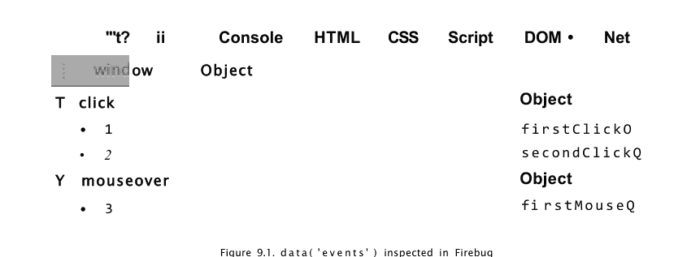

事件数据既包含事件类型，也包含嵌套在对象内部的事件处理程序本身。

### 自定义事件

我们之前看到 `bind` 和 `trigger` 为我们触发的事件完成了所有实际工作；它们是 `click`、`mouseover`、`toggle`……所有这些事件背后的机制！简写操作使代码更短、更易读，而扩展的 `bind` 和 `trigger` 语法提供了完全相同的功能。那么为什么还要使用 `bind` 和 `trigger` 呢？事实证明，它们比我们目前所见的要通用和强大得多。首先，我们可以脱离浏览器指定的事件，开始创建一些我们自己的事件！

创建你自己的事件有助于使代码更清晰；例如，一个埋藏在 `click` 处理程序中的函数需要被分析才能确定其目的，而一个具有特定名称的事件可能更容易一目了然。让我们来看看创建一个自定义的 `do-toggle` 事件。为此，我们将回到第 2 章看到的免责声明信息示例：

```html
<!-- chapter_09/11_custom_events/index.html (节选) -->
<p id="disclaimer">
  免责声明！本服务不旨在……
</p>
<input type="button" id="toggleButton" value="切换" />
```

这一次，按钮不再负责切换免责声明，而是由免责声明自身负责切换：


### 自定义事件

我们已经将自定义的 `do-toggle` 事件绑定到了免责声明元素上。当 `do-toggle` 事件触发时，函数会运行，免责声明会隐藏或显示自身。但我们如何触发 `do-toggle` 事件呢？使用 `trigger` 方法：

```javascript
$('#toggleButton').click(function() {
    $('#disclaimer').trigger('do-toggle');
})
```

当按钮被点击时，免责声明就会切换显示。与直接使用切换按钮来隐藏和显示相比，这看起来可能像是绕了远路，但现在我们完成了两项非常重要的任务：我们将代码的责任转移到了元素本身，并赋予了我们从任何其他位置触发事件的能力。无论我们是想通过切换按钮来切换免责声明，还是通过屏幕顶部的小图标来切换，都不需要复制代码——我们只需要从任何我们喜欢的地方触发 `do-toggle` 事件即可。

但等等，还有更多！`bind/trigger` 系统还允许你在触发事件时附加参数。每个触发元素可以传递不同的数据，因此事件处理器可以自定义其响应。这使得自定义事件非常强大；你现在可以创建能够被页面上多个其他元素优雅控制的小部件，从而可以清晰地分离和隔离页面行为，使你的代码更具可重用性。

举个例子，我们将为第3章“弹性内容面板”部分的动画内容面板添加一个备用的触发机制。在这个例子中，我们制作了看起来很酷的内容面板，显示名人传记，当点击标题时会弹跳打开和关闭。为了清晰起见，我们将省略弹跳效果，因此当用户点击传记标题时，面板会立即切换。

但是，在面板上方还会有一个选择框。当从列表中选择一位名人时，传记将以相同的方式切换；相同的事件处理器会触发，但这次我们将有一个漂亮的滑动效果。

我们的 **select** 框触发器包含了一个可供用户查看的传记列表。稍后，我们将为它附加一个 **change** 事件处理器来触发滑动效果：

```html
<select id="chooser">
    <option>Beau Dandy</option>
    <option>Johny Startdust</option>
    <option>Glendatronix</option>
</select>
```

这是重要的部分。我们将自定义的 **reveal** 事件绑定到所有传记标题上。该代码将接受一个额外的参数，我们将用它来确定如何显示传记。如果 **effect** 参数设置为 **ease**，我们将 **slideToggle**，否则用户将看到标准的非滑动切换：

```javascript
$('#bio h3').bind('reveal', function(e, effect) {
    if (effect == 'ease') {
        $(this).next().slideToggle();
    } else {
        $(this).next().toggle();
    }
})
.click(function() {
    // 触发器1：普通切换
    $(this).trigger('reveal');
});
```

因为我们的第一个触发器不需要添加任何效果，所以我们不会在 `trigger` 调用中添加任何参数。当 `bind` 代码运行时，它找不到 `effect` 参数，因此执行常规切换：

```javascript
$('#chooser')
  .change(function() {
    // 触发器2：滑动切换
    $('#bio h3:contains(' + $(this).val() + ')')
      .trigger('reveal', 'ease');
  });
```

当用户更改 `select` 列表中的当前选择时，我们找到正确的内容面板并再次触发 `reveal` 事件。但这次我们添加了 'ease' 参数，因此用户体验到的是花哨的滑动版本。

向自定义事件添加数据是封装小部件代码并暴露其他开发者可用于自定义功能的接口的绝佳方式。要向 `bind` 函数传递多个项目，你需要将 `trigger` 的参数包装在数组中：

```javascript
$('#bio h3:contains(' + $(this).val() + ')')
  .trigger('reveal', ['ease', 2000]);
```

### 解绑与命名空间

jQuery 可以仅用少数几个操作创建出惊人的效果：我们的大多数控件只使用了不超过几个操作和非常少量的 JavaScript 代码。当你开始扩展你的控件和效果——将它们转换为插件，并结合多个控件来创建更大、更酷的控件——你会发现你的事件开始变得有些难以管理。处理器被附加后从未移除，即使在你的效果完成之后也是如此，这可能会与你稍后尝试添加的任何新行为发生冲突。我们并不总是能够依赖我们到目前为止一直在使用的“设置后忘记”的方法。

jQuery 库为我们提供了两种处理这个问题的机制：**事件解绑**和**事件命名空间**。事件解绑允许我们从对象中移除事件处理器，而事件命名空间提供了一种方法，让我们可以将事件处理器分解为逻辑组，这些组可以被解绑而不影响其他事件。这在我们开发插件时尤其有用。

事件解绑很简单：我们使用 `bind` 操作来向对象添加事件，所以我们使用 `unbind` 操作来移除它们！我们有三种使用 `unbind` 的方式：从选择中的对象移除 *所有* 事件，移除选择中的所有 *特定类型* 事件，或移除 *一个特定的* 事件处理器。以下是第一种形式：

```javascript
$("p").unbind();
```

这将移除与页面上所有段落相关的所有事件处理器。这有点极端——更常见的是，我们只想移除某种特定类型的事件。例如，要移除所有的 `mouseover` 事件，我们将事件类型传递给 `unbind` 操作：

```javascript
$("p").unbind('mouseover');
```

最后，要解绑单个事件处理器，我们传递要解绑的函数。这有点复杂，因为我们需要在绑定时为函数命名。对于我们的示例，我们向 `click` 事件绑定了两个函数。然后我们解绑其中一个事件：

```javascript
var doToggle = function() { $(this).toggle(); };
var doSlide = function() { $(this).slideToggle(); };

$('p')
    .click(doToggle)
    .click(doSlide);

$('p').unbind('click', doToggle);
```

多亏了我们的 `unbind` 调用，随后点击段落标签仍然会触发 `doSlide` 方法，但不再触发 `doToggle` 方法。

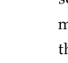

### 简写解绑？

你也可以使用简写的 `click` 和 `mouseover` 方法来绑定事件，那么是否存在 `unclick` 和 `unmouseover` 的简写方法呢？没有。这些方法在 jQuery 的很久以前 *曾经存在*，但它们被移除了，因为它们使核心 API 变得更大，而且非常不常用。

尽管所有这些解绑选项看起来很全面，但它们无法满足所有情况。当你在做大量的绑定和解绑时，很容易失去对正在发生的事情的跟踪——因此 jQuery 提供了一种通过事件命名空间将相关事件分组的方法。命名空间事件可以独立于同一类型的其他事件触发，并且同一命名空间中的所有事件都可以用单个命令解绑。

要定义命名空间，你需要在要附加处理器的事件后附加一个句点 (.) 和你的命名空间名称。无需进一步操作，事件将像常规的非命名空间事件一样工作；但你现在有了一个句柄，可以用来更具体地指定触发哪些事件，而无需维护对每个事件函数的引用（就像我们上面做的那样）：

```javascript
$('p').bind('mouseover.colorize', function() {
    $(this).css('background-color', 'lemonchiffon')
})
.bind('mouseout.colorize', function() {
    $(this).css('background-color', '11');
})
.click(function() {
    $(this)
        .trigger('mouseout.colorize')
        .unbind('.colorize');
});
```

在这个例子中，我们向页面上的每个段落绑定了常规的 `mouseover` 和 `mouseout` 事件处理器。当用户在元素上移动鼠标时，这会创建一个简单而逼真的高亮效果。但这个高亮效果有一个额外的小技巧：当用户点击元素时，高亮效果将被移除。

当点击发生时，用户将悬停在元素上；如果我们移除处理器，`mouseout` 代码将永远不会运行，元素将保持高亮状态。为了解决这个问题，我们手动触发 `mouseout`。因为我们对事件进行了命名空间化，所以我们可以指定只运行与我们的效果相关的 `mouseout` 代码。任何其他 `mouseout` 处理器将保持休眠状态。


### 绑定 iPhone：非标准事件

jQuery 事件系统似乎尚未完全证明其作为一个“小赢家”的实力，因为它还藏着另一手绝活：它能够响应那些它本不应知晓的事件！随着我们开始逐渐远离个人电脑作为访问网络的主要工具，这一能力将变得越来越重要。未来，人们用来浏览您页面的设备数量和类型将呈爆炸式增长：iPhone、其他手机、PSP、Chumbys、“下一个大事件”等等。虽然它们中的大多数都必须遵守 DOM 规范，但它们都会试图添加一些自己的东西来改善人机交互。

这意味着我们需要处理新的硬件触发事件。iPhone 的触摸界面就是一个很好的例子。虽然 iPhone 可以响应 `mousedown` 和 `mouseup` 事件，但也有一些首选的事件可以使用。有一组特定的事件用于处理与触摸屏的交互，这些事件在大多数其他设备上没有意义。虽然 jQuery 不提供对这些事件的直接访问（如果它必须支持每个设备的事件，它很快就会变成一个庞大的库！），但 `bind` 方法足够通用，可以捕获任何触发的事件：

```javascript
$(document).bind('touchstart', function(e) {
    var original = e.originalEvent;

    var x = original.changedTouches[0].pageX;
    var y = original.changedTouches[0].pageY;

    $('#block').css({top: y, left: x});
});
```

触摸事件由第三方定义，但只要我们能访问到关于这些事件的文档（或者可以用 Firebug 或其他调试工具收集我们自己的数据），我们就可以轻松地捕获和响应。在我们的例子中，我们捕获的是每当用户触摸屏幕时触发的 `touchstart` 事件。

因为 jQuery 不知道 `touchstart`，我们需要访问传递给回调函数的 jQuery 事件对象中的 `originalEvent`。`originalEvent` 让我们能够访问到未经包装的原始 JavaScript 事件，不受 jQuery 任何附加功能的影响。我们现在可以完全按照文档说明来使用该事件。我们正在获取屏幕触摸的 X 和 Y 坐标，并更新一个绝对定位的块元素到触摸位置。

禁用 `mousedown` 和 `mouseup`
如果您正在为 iPhone 编写处理程序，您可能需要禁用 `mousedown` 和 `mouseup` 的默认操作。您可以通过在 `$(document)` 上捕获它们，并使用 `event.preventDefault` 方法来实现这一点。否则，您将面临同一代码运行两次的风险，因为您会同时触发触摸和鼠标事件。

### 特殊事件

创建您自己的自定义事件无疑是相当高级的——但 jQuery 的特殊事件构造则完全是忍者级别的。如果您觉得普通的旧 DOM 事件有点受限，那么这就是为您准备的！使用 `special` 是创建看似原生的自定义事件，或者覆盖和增强现有事件的一种方式。您可以在每次绑定处理程序时，以及在事件被移除时（这发生在 `beforeunload` 阶段）执行一些自定义代码处理。特殊事件是 jQuery 的一等公民。

`click` 事件在用户点击某物时触发，`load` 事件在元素加载完成时触发……现在我们将创建一个在用户多次悬停于元素上时触发的事件。默认情况下，当一个元素接收到三次 `mouseover` 时，绑定的事件处理程序就会运行，但我们将看到如何根据每个元素进行自定义。与常规事件一样，由您来指定在事件处理程序中执行的代码。

要创建一个特殊事件，您需要将一个 JavaScript 对象附加到 `$.event.special` 命名空间。事件系统为您提供了四个钩子来定义事件的工作方式：`setup` 函数在事件首次绑定时运行，`add` 函数在每次绑定事件时运行，`remove` 函数在事件解除绑定时运行，而 `teardown` 函数在最后一个事件解除绑定时运行（即当没有更多此类类型的事件绑定到处理程序时）。

让我们看看我们的 `multihover` 事件的骨架：

```javascript
// chapter_09/15_special_event/script.js (excerpt)

jQuery.event.special.multihover = {
    setup: function(data, namespaces) {
        // 首次绑定事件时执行
    },
    add: function(handler, data, namespaces) {
        // 每次绑定另一个事件时执行
    },
    remove: function(namespaces) {
        // 事件解除绑定时执行
    },
    teardown: function(namespaces) {
        // 最后一个事件解除绑定时执行
    },
    handler: function(e) {
        // 执行您的逻辑
    }
}
```

一旦您创建了事件，就可以像绑定任何事件一样绑定它。显然，没有快捷方法来绑定自定义事件，因此您必须使用 `bind` 方法将其附加到页面元素：

```javascript
// chapter_09/15_special_event/script.js (excerpt)

$('p').bind('multihover', {times: 4}, function() {
    $(this).css('background-color', 'lemonchiffon');
});
```

我们将新的 `multihover` 事件绑定到页面上的所有段落，然后指定在触发事件之前需要悬停多少次元素。我们在“自定义事件”一节中看到，您可以使用 `trigger` 方法向事件传递数据，但现在我们了解到，在绑定事件时也可以指定要传递给事件的数据！

我们的特殊事件不会使用 `add` 或 `remove` 钩子，因为我们只希望每个元素只能附加一个 `multihover` 事件。在 `setup` 钩子中，我们将使用 `data` 方法将所需的悬停次数存储在元素本身上。如果没有用户指定的值，我们将默认为 3。接下来，我们将自定义事件处理程序（我们称之为 `jQuery.event.special.multihover`）绑定到 `mouseover` 事件，因为我们需要在那里执行逻辑来确定第三次悬停何时发生：

```javascript
// chapter_09/15_special_event/script.js (excerpt)

setup: function(data, namespaces) {
    $(this)
        .data('times', data && data.times || 3)
        .bind('mouseover', jQuery.event.special.multihover.handler);
},

teardown: function(namespaces) {
    $(this)
        .removeData('times')
        .unbind('mouseover', jQuery.event.special.multihover.handler);
}
```

### data 参数

`bind` 方法的 `data` 参数并非特殊事件所独有。它在任何自定义事件上的工作方式都完全相同，所以请充分利用它！我们也在相应的 `teardown` 处理程序中撤销了所有这些设置。在这里，我们移除了添加的数据项，并解除了 `mouseover` 的绑定。这整理了一切。现在我们有一个新事件，每当 `mouseover` 事件发生时都会调用我们的自定义处理程序，所以让我们实现我们的 `multihover` 逻辑：

```javascript
// chapter_09/15_special_event/script.js (excerpt)

handler: function(e) {
    // 执行您的逻辑
    var times = $(this).data('times') || 0;
    times--;
    $(this).data('times', times);

    if (times <= 0) {
        e.type = 'multihover';

        jQuery.event.handle.apply(this, arguments);

        $(this).unbind('multihover');
    }
}
```

这是功能的核心部分。我们将其分离到自己的函数中只是为了清晰起见——我们完全可以使用匿名函数来处理它。

`multihover` 逻辑首先将 `times` 数据项减 1。当它达到 0 时（也就是说所有的悬停都完成了），我们修改事件属性 `type` 并将其设置为 `multihover`，然后调用内部的 `handle` 函数。这将导致用户指定的任何绑定回调函数被执行，就像一个原生事件一样。

特殊事件是一种美妙的方式，可以将自定义事件包装起来，以便在您的项目中重用。除了像我们的 `multihover` 事件这样的新功能外，您还可以重新定义现有事件；例如，您可以通过向 `$.event.special.click` 提供适当的钩子来覆盖内部的 `click` 事件。创建特殊事件是一个相对罕见的需求——但当您确实需要时，您会发现它们是 jQuery 的一个杀手级高级功能。


# jQuery 达人的杂项技巧

即便我们已经探索了 jQuery 中提供的全套系统和框架，整个库中仍然埋藏着无数宝藏等待你去发掘。其中一些是文档齐全的函数，尽管可能相当具体；另一些则是更为晦涩的高级主题。

# 避免冲突

正如我们之前提到的，编写代码时使用的 `$` 和 `jQuery` 对象及方法是命名空间，就像我们自己创建的那些一样。`jQuery` 作为一个命名空间，在唯一性和清晰度方面表现良好，而且也相当简短。

虽然美元符号在简短性上确实得分很高，但在唯一性方面却大失水准。如果另一位开发者覆盖了我们默认的 `$`，这种唯一性的缺失可能会引起担忧。例如，`Prototype.js` 使用 `$()` 作为 JavaScript `getElementById` 方法的简写，如果我们不小心，此类命名空间冲突可能是灾难性的。为了预防这种情况，jQuery 提供了 `noConflict`：

```
jQuery.noConflict();
```

最基本地说，这意味着 jQuery 将放弃对 `$` 命名空间的所有权利，但仍然响应 `jQuery` 命名空间：

```
jQuery.noConflict();
// 使用 jQuery 做些事情
jQuery("div p").hide();
// 使用另一个库的 $() 做些事情
$("content").style.display = 'none';
```

这意味着你必须移除代码中对 `$` 的所有引用，将它们替换为 `jQuery`，坦率地说，这可能是不可行的。但有一种方法可以减轻这种工作量：

```
jQuery.noConflict();
(function($) {
    $(function() {
        // 更多使用 $ 作为 jQuery 别名的代码
    });
})(jQuery);
// 其他使用 $ 作为另一个库别名的代码
```

通过将所有 jQuery 命令包装在一个匿名函数中，并传入对 `jQuery` 和 `$` 的引用，我们创建了一个保护内部 jQuery 方法和属性的壳。我们还有另一个可用的选项：我们可以采用另一个技巧，即将 `noConflict` 的返回值赋给一个变量，并使用它来代替 `jQuery` 或 `$`。在这种情况下，我们选择使用 `trkr` 作为 jQuery 的别名：

```
var trkr = jQuery.noConflict();
// 使用 jQuery 做些事情
trkr("div p").hide();
// 使用另一个库的 $() 做些事情
$("content").style.display = 'none';
```

我们还可以使用一个进一步的过程，那就是将 `noConflict` 赋值给一个新的命名空间：

```
var trkr = {};

trkr.$ = jQuery.noConflict(true);
```

在所有这些选项中，你一定能找到适合你需求的解决方案！

# 队列与出队动画

尽管你拥有大量的动画选项可供选择，但有时它们仍不能满足你的需求；你可能希望动画暂停，或者让动画之外的某个元素在动画到达特定点时做出反应。动画序列中有许多有趣的时刻，能够驾驭它们会很棒。而你可以通过队列来实现！

一般来说，我们在选择集上链式调用的动作是异步的，它们或多或少同时发生：

```
$('#button1').click(function() {
    $(this).animate({
        height: 200,
        width: 200
    }, 'slow').text("rollin'");
});
```

当你点击那个按钮时，它会缓慢增长到 200x200 像素的大小，但文本几乎会立即更新。当我们使用 `animate` 动作时，它会向元素添加一个 fx 栈，我们添加的任何动画都会进入该栈。然而，`text` 动作忽略 fx 栈，因为它专注于动画，而 `queue` 则遵循栈：

```
$('#button2').click(function() {
    $(this).animate({
        height: 200,
        width: 200
    }, 'slow').queue(function() {
        $(this).text('rolled!');
    }).text("rollin'");
});
```

现在 `animate` 和 `text` 动作同时发生，但 `queue` 也会在动画结束后更改文本。而且这还没完……或者更准确地说，它停下了！如果我们向链中添加另一个 `animate` 动作，队列会保持 fx 栈，并阻止链式动作继续：

```
$('#button3').click(function() {
  $(this).animate({
    height: 200,
    width: 200
  }, 'slow').queue(function() {
    $(this).text('rolled!');
  }).text("rollin'").animate({ // 这个 animate 不会触发
    height: 100,
    width: 100
  }, 'slow');
});
```

现在 `queue` 动作需要一些帮助来再次释放栈。就像 `live` 有 `die`，`animate` 有 `stop`，`queue` 也有其对立面：`dequeue`。

`dequeue` 方法有点特别；它没有链接到 jQuery 链中，而是从 `queue` 的回调内部调用：

```
$('#button4').click(function() {
  $(this).animate({
    height: 200,
    width: 200
  }, 'slow').queue(function() {
    $(this).text('rolled!');
    $(this).dequeue();
  }).text("rollin'").animate({ // 这个 animate 不会触发
    height: 100,
    width: 100
  }, 'slow');
});
```

现在当我们点击按钮时，它的文本会变为 "rollin',"，然后增长到 200x200；接着文本变为 "rolled,"，最后收缩到 100x100。这或许不是一个能改变你世界的动画，但 `queue` 很可能会改变你看待动画的方式。

# 将 JavaScript 对象视为 jQuery 对象

jQuery 通过选择 DOM 元素然后对它们进行操作来工作。但一个鲜为人知的秘密是，jQuery 可以对不止 DOM 进行操作；它也可以应用于常规 JavaScript 对象。这与其说是一个刻意设计的功能，不如说是库内部设计的结果。尽管乍一看可能有点奇怪（你为什么要对一个 JavaScript 对象执行 `slideUp`？），但它确实有一些潜在的有趣影响。

不过首先：当然不可能对 JavaScript 对象执行 `slideUp`——毕竟，它缺少 `height` 属性，或者任何可见的属性。但你仍然可以像选择 DOM 元素一样选择它：

```
$(myobj);
```

有许多 jQuery 动作与视觉属性无关，但我们可以想象将它们应用于通用对象。例如，极其有用的 `data` 动作用于将任意数据存储在所选元素上。我们可以用它为代码中的任何对象添加元数据。例如，我们可以在两个 JavaScript 对象之间建立双向链接。在下面的例子中，我们希望在地图上存储额外信息。地图持有名人所在地的位置标记，我们希望为位置标记附加额外信息，以便在点击标记时检索：

```
// 我们地图标记位置的元数据
var locationData = {
  name : "Bourgeois Burger Cafe",
  celebCount : 3,
  lat : latitude,
  lon : longitude,
}
// 从我们虚构的地图服务获取一个位置标记
var locator = Map.getLocator(latitude, longitude);
```

我们有两个对象：第三方位置标记对象和包含与该标记相关数据的 `locationData` 对象。如果我们用 jQuery 选择 `locator`，我们可以应用 `data` 动作并附加 `locationData` 对象。在内部，jQuery 会将这种关系存储在数据存储中——因此两个对象实际上都没有被修改：

```
// 将我们的数据对象附加到 JavaScript 标记对象上
$(locator).data('pin_data', locationData);
```

现在，在将来某个时间点，当用户点击地图并触发位置标记的点击处理程序时，我们就可以访问 `locationData` 对象：

```
// 稍后，当某个位置被点击时...
var currentData = $(clickedLocation).data('pin_data');

// 我们可以检索存储在对象上的元数据！
alert("You selected the location: " + currentData.name);
});
```

尽管在许多情况下，我们可能希望将元素引用存储在对象本身中，但当对象来自第三方代码时，你必须非常小心地添加或删除属性。此外，由于第三方未来进行的任何更改都可能影响你的代码，最好采取稳妥的做法。`data` 动作让我们可以在不修改对象的情况下增强它。

# 主题滚动

在之前的章节中，我们已经遍历并掌握了 jQuery UI API 的大部分内容。jQuery UI 最吸引人的特性之一是……它的外观！开箱即用的 UI 组件看起来很棒——而且（尽管我们可能不愿意承认）看起来很棒非常重要。有时它甚至比功能本身更重要！没有什么比向同事或老板展示你创建的控件的技术上精彩的概念验证更糟糕的了，结果却遭到对其设计的批评。更糟糕的是，有时你最初在皮肤和主题方面缺乏考虑，导致了一个本质上难以设置样式的的产品。

对于 jQuery UI 组件来说，这不是问题；有一个主题库可供选择——而且选择或定制一个新的时髦设计很简单，这要归功于 ThemeRoller 网络应用程序。¹ ThemeRoller 让你能够调整、设计并下载 jQuery UI 主题。此外，如果你在创建自己的控件时遵循一些简单的约定，你可以轻松地利用现有和定制的主题，确保你创建的一切看起来像它运行的一样出色。


## 使用画廊主题

在我们的 jQuery UI 探索之旅中，我们已在几个场合提到过主题——这是我们下载库时需要指定的选项之一。默认情况下，您会收到 UI lightness 主题，但我们也曾使用过 Sunny 主题，或许您在学习过程中也浏览过其他几个主题。要查看您可以使用哪些默认主题，请访问 ThemeRoller 网站。

现在，点击左侧边栏中的 **画廊** 选项卡。在这里，您可以查看各种预设计的主题，并找到符合您需求的主题。然后，如果您点击下载按钮，您将被带到熟悉的 jQuery UI 构建屏幕。如果您需要整个库，请自定义您想要的组件。您选择的主题将预先在主题下拉框中选中。

另一方面，如果您只需要主题，请不要担心哪些组件被选中，只需下载库即可。捆绑文件将包含您的主题，因此只需将 **css** 文件夹从下载中复制到您的项目中。然后更新页面内样式表链接中的主题名称，以便您的组件能够找到正确的 CSS 文件。就这么简单。

## 自定义主题

默认主题可能不适合您的网站。值得庆幸的是，ThemeRoller 工使自定义可用主题变得轻而易举。ThemeRoller 是一个 Web 应用程序，提供了一个简单的界面来修改 jQuery UI 主题的各个方面。当您在边栏中更新属性时，更改会立即反映在预览区域中，如图 9.2 所示。

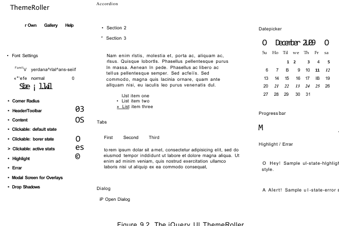

一旦您将主题调整到完美状态，您可以通过点击 **下载主题** 按钮进行下载。这些更改会传递到 jQuery UI 下载构建器，就像普通的画廊主题一样——只不过主题下拉框现在会显示“自定义主题”。如果您现在下载捆绑包，您的主题将被命名为 custom-theme（因此您的 CSS 文件将存储在 **custom-theme** 文件夹中）。如果您觉得您的创作需要一个更贴切的标题，请展开 **高级主题设置** 面板并更新 **主题文件夹名称** 输入框。

> 对 IE6 的有限支持
尽管 ThemeRoller 主题外观精美且易于使用，但有一个注意事项。jQuery UI 团队对支持 Internet Explorer 6 的执着程度不如其 jQuery 核心团队成员，因此，这些主题使用了一些 CSS3 样式和半透明的 PNG 图片，这些在 IE6 中会显得相当难看。它建议您使用 PNG 支持库以获得漂亮的图标——对于圆角问题，您将不得不找到一个非 CSS 的解决方案！

## 让您的组件支持主题化

ThemeRoller 这个名字听起来可能很酷，您从中获得的结果也可能相当令人印象深刻——但它真正做的只是生成一组 CSS 类，可用于设置任何 DOM 元素集合的样式。如果您以遵循 jQuery UI 标记和命名约定的方式构建自己的自定义 UI 组件，它们也将是可换肤的。

在图 9.3 中，我们将适当的 CSS 类应用于第 3 章中的弹出内容窗格，因此现在我们拥有了一个非常像 jQuery UI 的组件。默认主题（或我们自定义的 ThemeRoller 主题）可以包含在页面顶部，我们的变色龙小部件将立即拥有新的外观和感觉（图中展示了 UI lightness、Dot Luv 和 Eggplant 预设计主题的效果）。

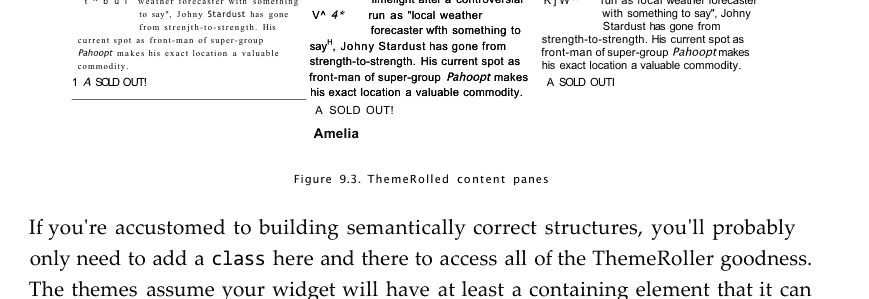

如果您习惯于构建语义正确的结构，您可能只需要在这里或那里添加一个类，就可以访问 ThemeRoller 的所有优点。这些主题假设您的小部件至少有一个容器元素，可以用作样式设置的基础。我们原始的传记窗格 HTML 如下所示：

```html
<div id="bio">
    <h3>Beau Dandy</h3>
    <div>
        
        <span>Glendatronix is the queen of ... </span>
    </div>
    <h3>Mr Speaker</h3>
    <div>
        
        <span>After smashing into the limelight ... </span>
    </div>
</div>
```

首先，我们将通过应用 ui-widget 类将 #bio div 指定为容器。然后，我们将通过添加 ui-helper-reset 重置我们可能已经应用的任何可能干扰小部件样式的样式：

```html
chapter_09/17_themable_components/index.html (excerpt)

<div id="bio" class="ui-widget ui-helper-reset">
```

这已经给了我们很多：当前主题的字体和颜色。接下来，我们可以开始将额外的类应用到我们的组件中，以设置标题和内容区域的样式：

```html
chapter_09/17_themable_components/index.html (excerpt)

<h3 class="ui-widget-header ui-corner-all">Johnny Stardust</h3>
<div class="ui-widget-content">
    
    <span>After smashing into the limelight ... </span>
</div>
```

ui-widget-header 给了我们闪亮的工具栏外观，ui-corner-all 将使小部件变得漂亮且圆润（当然，在支持的情况下）。您可以指定 ui-corner-all 或更具体的类来设置单个边缘的样式——例如用于左上边缘的 ui-corner-tl 或用于两个底边的 ui-corner-bottom，以在大多数元素上实现圆角。

我们还使用了一些额外的类为我们的窗格添加了戏剧性的“售罄！”消息，这些类显示为警告和图标：

```html
chapter_09/17_themable_components/index.html (excerpt)

<div class="ui-state-error">
    <span class="ui-icon ui-icon-alert"></span>SOLD OUT!
</div>
```

ui-state-error 类给出了强烈的错误样式消息，ui-icon-alert 为 span 添加了一个小图标。

正如您在观察 jQuery UI 库完整功能时所预期的那样，有更多选项可用于控制 ThemeRoller 主题如何设置您的代码样式。有用于定义按钮交互状态、禁用表单元素、组件阴影的类，以及一些用于修复 z-index（针对 Internet Explorer 6）的实用程序类，还有用于辅助功能的快捷链接。文档相当详细，将为您大多数小部件打下良好基础。要理解所有可用功能的最佳方法是阅读文档，查看 ThemeRoller 工具中哪些元素受到影响，并检查 jQuery UI 库中应用于元素的类。另外，请记住，当您制作具有强 UI 焦点的插件时，您可以通过 jQuery 在插件代码中轻松添加 ThemeRoller 类；这将使您的用户只需付出很少的努力就能获得完全可换肤的组件！

## StarTrackr!：尾声

“我们今天站在这里，作为地球上最臭名昭著的名人狩猎网站的创建者！”客户对着满屋的员工和股东大声宣布。项目的最后阶段已经上线，您的工作也接近尾声。自从客户要求我们美化其网站的免责声明消息以来，这确实是一段漫长的旅程——一段带领我们经历了淡入淡出、滑动、缓动、滚动、增强和 Ajax 化的旅程。换句话说，一段将我们从新手带向忍者的旅程。

“但有一个人让这一切成为可能，”客户继续说道。“我们这一切都归功于一个人……”他转向你，但你之前所在的位置已经空了。你执行了最后一个 `$( "#ninja" ).hide()`——然后神秘地消失得无影无踪。

您不需要客户和同事的感谢和赞美；您的回报是良好的 Web 开发实践已被灌输到又一个项目中。还有您收到的可观报酬。两者兼而有之，真的。

## 附录 A：参考材料

jQuery 全在于灵活性，并适用于尽可能多的情况。核心库和插件架构都鼓励这一理念。最常见的用例通常开箱即用，因此 jQuery 的灵活性在于覆盖这些默认值的能力。这导致了大量的选项！不过，无需记住所有选项——只需手头有一份好的参考，并始终检查 jQuery 的在线文档。不要害怕深入 jQuery 或插件源代码，寻找文档可能遗漏的任何内容。

### $.ajax 选项

jQuery 中强大的 Ajax 函数库由一个单一方法支撑：$.ajax。该方法接受大量选项，使其具有在无数情况下使用的灵活性。我们在本书中探讨了一些选项，但和 jQuery 一样，总有更多！

### 标志

“可标志”选项接受布尔值——true 或 false——以启用或禁用给定功能。大多数情况下，默认值是令人满意的，但很容易覆盖它们以自定义您的请求。

- **async**
async 选项默认为 true，但如果您需要执行同步请求（您应该尽量减少此操作——它会在工作时锁定浏览器！），您可以将其设置为 false。

- **cache**
在执行 Ajax 请求时，缓存数据可能是一个问题；如果用户的浏览器存储了旧请求，它可能不会获取最新数据。要禁用缓存，您可以将 cache 选项设置为 false。Script 和 JSONP 请求默认不缓存。


### global
我们看到可以通过全局事件处理程序来处理任何Ajax请求。您还可以通过将`global`参数指定为`false`来阻止全局事件处理程序处理特定事件。

### ifModified
通过设置`ifModified`标志，您可以强制请求仅在文档自上次请求以来被修改时才“成功”（即触发`success`处理程序）。如果您只想在有新数据需要显示时进行处理，这会非常有用。

### processData
当您有数据需要随请求一起发送时，jQuery会处理它并将其转换为适当的查询字符串值。如果这是不可取的（例如，如果您需要传递DOM文档或其他某种结构），您可以将`processData`标志设置为`false`。

### Settings
许多Ajax选项允许您指定不仅仅是简单的开/关闭值；它们通常接受字符串或对象来自定义和定义您的Ajax请求。

#### contentType
`contentType`设置允许您设置请求的内容类型。默认值是`application/x-www-form-urlencoded`，这在大多数情况下都适用。

#### context
当Ajax回调执行时，它们的上下文是`window`对象，这通常不是很有用。您设置`context`选项，以便回调中的`this`属性引用一些方便的东西，比如自定义JavaScript对象或jQuery元素。

#### data
要将数据传递给服务器，您可以为`data`设置指定一个字符串、JavaScript数组或对象。如果您传入数组或对象（并且没有禁用`processData`标志），数据将使用`jQuery.params`实用程序函数进行序列化。该函数将输入转换为查询字符串格式（非常方便）！如果是`GET`请求，该字符串将附加到URL。

#### dataType
`contentType`设置了您发送到服务器的数据的内容类型，而`dataType`参数则设置了您期望从服务器接收的数据类型。默认类型是“everything”(*/*)，但您可以指定xml、html、script、json或text——在这种情况下，jQuery将使用适当的内容类型字符串。

#### jsonp
当您进行JSONP调用（允许跨域请求）时，通常期望回调函数名是`callback`。如果您使用的服务需要不同的名称，您可以通过`jsonp`设置来定义它。

#### password
身份验证请求需要您的用户名和密码。您可以在`password`设置中指定后者。

#### scriptCharset
`scriptCharset`属性允许您指定通过`script`或`jsonp` Ajax调用注入的script标签的字符集。

#### timeout
`timeout`参数是唯一接受数字的Ajax设置：它定义了在中止Ajax请求之前需要经过多少毫秒。

#### type
`type`属性是Ajax请求最重要的设置之一，它定义了HTTP请求类型：GET、POST、PUT或DELETE。

#### url
与`type`一起是另一个最重要的设置，`url`字符串定义了您想要调用的地址。

#### username
最后但同样重要的是，`username`选项指定了随任何身份验证请求发送的用户名。

### Callbacks and Functions
最后，您可以定义一堆回调和函数来调整您的请求并处理请求生命周期中发生的事件。

事件处理程序已经在第6章中介绍过。无论成功或失败，`complete`处理程序都会在每次`$.ajax`调用完成时触发——因此它是清理任何遗留问题的好地方。`error`处理程序在调用失败时被调用，而`success`处理程序在调用正确完成时触发。

除了事件回调外，还有一系列作为钩子的函数；这些允许您根据每次调用修改请求的各个部分。`beforeSend`函数在发送消息执行之前触发，为您提供了一个在需要时修改请求的位置。您的处理程序会接收到请求对象和当前的jQuery对象。这是在需要时修改请求头的常见位置。此外，这是您阻止任何事情发生的最后机会：如果您从此函数返回`false`，请求将被中止。

在最底层，Ajax的魔力来自于浏览器对`XMLHttpRequest`（简称XHR）对象的实现。这个对象让我们能够从客户端与服务器通信。默认情况下，jQuery会查找适当的XHR对象并将其用于任何Ajax调用。如果您想增强或替换它，可以通过指定自己的`xhr`函数来修改它。该函数需要返回应使用的对象。

最后一个可用的钩子是`dataFilter`函数。它在请求成功返回后调用，是您确保响应数据没问题的地方。如果需要对数据进行任何清理，这就是`dataFilter`函数的作用。该函数被传递原始响应数据和类型；您应该在处理后返回数据，以便请求周期可以继续。

### $.support Options
在过去，我们会使用浏览器嗅探来确定使用的是哪个版本的浏览器，并调整我们的代码以绕过已知的错误。如今，这种方法不受欢迎——它太不可靠了。在可能的情况下，我们应该使用功能检测来检查浏览器是否支持特定的功能，并在需要时提供解决方案或备用方案。

如果您使用纯jQuery，大多数这些问题都会在内部处理，但如果您正在用一些原始JavaScript进行开发，那么通过`support`操作可以有一个巧妙的功能检测机制。我们在第6章中简要介绍了这一点，但只简单介绍了可用的选项。它们有很多。它们都返回一个`true`或`false`值来表示是否支持，然后可以在if/then/else块中使用，以提供对两种情况的支持。例如：

```
var domObject = document.getElementById('content');
if ($.support.cssFloat) {
    domObject.style.cssFloat = "left";
} else {
    domObject.style.styleFloat = "left";
}
```

以下是可用的属性：

#### boxModel
`boxModel`属性（最初设置为`null`，在文档加载后更改为`true`或`false`）如果浏览器按照W3C盒模型进行渲染，则为`true`。

#### changeBubbles
检测与事件相关的浏览器功能可能是一项棘手的事情——它过去是进行浏览器嗅探的一个非常普遍的原因。幸运的是，一些聪明人已经弄清楚了，所以现在如果您想知道是否可以（可靠地）响应`change`事件，可以检查`changeBubbles`属性。

#### cssFloat
我们在上面的示例中看到了`cssFloat`的实际应用。它检测浏览器是否使用`cssFloat`标签在JavaScript中处理浮动样式。（简单使用`float`是不可能的，因为那是引用浮点数的JavaScript关键字）。Internet Explorer使用`styleFloat`而不是`cssFloat`。

#### hrefNormalized
一些浏览器会修改它们认为构建不正确的链接——如果这是意料之外的，那就是个问题！`hrefNormalized`属性在浏览器修改链接时返回`true`。

#### htmlSerialize
如果您需要确保链接元素（如link和script标签）在使用`innerHTML`时被正确序列化，可以使用`htmlSerialize`属性。Internet Explorer在这方面存在问题——如果您希望它正常工作，您需要将有问题的标签包装在自己的包装元素中。

#### leadingWhitespace
`leadingWhitespace`选项让您知道浏览器是否将DOM子节点中的第一个节点保留为空白。当使用`innerHTML`时，Internet Explorer会剥离第一个子节点（如果它是空白文本节点）；如果您依赖于固定数量的子节点，这可能会搞乱您的jQuery代码。

#### noCloneEvent
当您克隆一个DOM节点时，一些浏览器也会克隆附加到它的事件处理程序，而另一些则不会。如果事件没有被克隆，`noCloneEvent`属性将为`true`。

#### opacity
我们都很喜欢opacity：它让网站看起来很未来感。不幸的是，一些浏览器无法通过JavaScript处理opacity（当然，如果您使用jQuery就安全了）。`opacity`属性测试渲染引擎是否理解opacity——否则您将需要使用浏览器的filter。

#### scriptEval
浏览器在通过注入的script标签执行脚本方面也表现不同。`scriptEval`属性会让您知道通过`appendChild`注入是否安全，或者您应该使用`script.text`属性。

#### style
要查找当前应用于元素的样式，您可以使用`getAttribute`方法并请求`style`——在某些浏览器中。要测试`getAttribute("style")`是否在您的用户浏览器上有效，您可以检查`style`属性。

#### submitBubbles
另一个可以通过`submitBubbles`属性检查的事件是submit事件。在内部，它使用与`changeBubbles`相同的功能检测技巧。


**tbody**
最后，在某些浏览器中，`tbody` 元素会被自动插入到一个空的 `table` 中——这可能会搞乱你的 DOM 操作。要检查是否需要留意这一点，可以使用 `tbody` 属性。如果你可以在没有 `tbody` 元素被自动插入的情况下使用表格，它会返回 `true`（这很令人困惑）。

`support` 操作最棒的地方在于，它迫使你确切理解你正在规避哪些错误。使用浏览器嗅探很容易让人自满，并开始在条件块中放入比必要更多的代码。通过使用 `support`，你只针对非常具体的方面，确保你的用户无论供应商如何修改其浏览器代码，都能享受一致（或至少可接受）的体验。

### 事件

我们花了很多时间研究事件，正如我们多次提到的，jQuery 通过将事件规范化以符合 W3C 标准，简化了跨浏览器的事件处理过程。规范化的事件对象具有一系列有用的属性和方法。我们在整本书中已经使用了其中一些，现在我们将看看那些被忽略的！你可以在 jQuery 事件文档中找到完整的事件属性列表。

#### 事件属性

我们在第 9 章简要见过这个：`type` 属性将返回触发的事件的名称（即使是自定义事件，如果你已经为它们命名了）。

当事件处理程序被调用时，你可以通过 `target` 属性获取作为事件源的 DOM 元素。这也可以被包装在 jQuery 选择器中，以便逃离烦人的 DOM，回到愉快的 jQuery 世界。此外，如果事件是鼠标移动，你可以使用 `relatedTarget` 属性找到之前的那个目标（鼠标之前所在的位置）。如果事件正在层级中向上移动——当你处理冒泡事件时——`currentTarget` 将告诉你当前冒泡阶段的目标。

最后一个极其有用的属性是事件的 `timeStamp`。它给出了事件发生的精确时间，最常用于实现基于时间的效果。例如，如果你想在页面上创建一个特殊的三次点击事件，你可以查阅事件的时间戳，看看在给定的时间跨度内是否发生了三次点击。

#### 事件方法

我们见过很多可以使用的事件方法，比如 `preventDefault` 和 `stopPropagation`，它们让我们控制事件如何冒泡以及如何被浏览器处理。不过还有一些额外的方法。另一个同类方法是 `stopImmediatePropagation`，它比 `stopPropagation` 更加强硬。`stopPropagation` 阻止父级处理程序运行，而 `stopImmediatePropagation` 阻止任何进一步的事件处理程序运行——甚至包括在同一元素上的。

其余方法只是报告是否调用了其他任何方法。`isDefaultPrevented`、`isPropagationStopped` 和 `isImmediatePropagationStopped` 方法返回一个布尔值，除非已经发出了相应的命令，否则它们将为 false。

#### DIY 事件对象

在我们谈论事件时，你可能还想了解最后一个方面：你可以创建自己的事件对象并直接将它们传递给处理程序。看看这段代码：

```javascript
// Regular event binding
$('p').bind('click', function(e) {
    $(this).text(e.pageX);
});
// Home-made event object!
var e = $.Event('click');
e.pageX = 100;
e.pageY = 100;
$('p').trigger(e);
```

我们创建了一个模拟的点击事件并手动设置了它的 `pageX` 和 `pageY` 属性。这让你对触发事件处理程序的事件细节拥有最终的控制权。

## 附录 B：JavaScript 小贴士

我们怎么强调都不为过：jQuery 就是 JavaScript——所以提高 jQuery 技能的最佳方式就是温习你的 JavaScript 知识！我们现在来看看我们在整本书中使用过的一些 JavaScript 方面，你可能对它们感到好奇。

### 了解更多关于 JavaScript 的知识

如果你想将你的 JavaScript 水平提升到新的高度，我们强烈推荐 Douglas Crockford 的《JavaScript: The Good Parts》（Sebastopol: O'Reilly, 2008）。它不是特别轻松的读物，但它简洁而务实地解释了 JavaScript 为何以及如何出色！

### 类型强制转换

JavaScript 是一种被称为弱类型的语言。有些语言，如 Java，是强类型的：这意味着变量的类型必须在声明变量时设置。另一方面，JavaScript 允许变量被**强制转换**。也就是说，它们的类型可以根据我们的要求而改变：

```javascript
var a = 2;
var b = "two";
var c = "2";
alert(typeof a);// alerts "number"
alert(typeof b);// alerts "string"
alert(typeof c);// alerts "string"
```

这没什么意外——变量的行为符合我们的预期。然而，当我们让 JavaScript 尽其所能地猜测我们*想要*变量是什么类型时，情况就不同了：

```javascript
alert(a * a) // alerts 4
alert(a + b) // alerts 2two
alert(a * c) // alerts 4
alert(typeof (a * a));// alerts "number"
alert(typeof (a + b));// alerts "string"
alert(typeof (a * c));// alerts "number"
```

当我们使用 + 运算符将字符串和数字“相加”时，JavaScript 假设我们试图连接这两个值，因此它创建了一个新的字符串。它看起来像是将数字的变量类型更改为字符串。然而，当我们使用乘法运算符（*）时，JavaScript 假设我们希望将这两个变量视为数字。

变量本身在整个过程中保持不变，只是被不同地对待。我们总是可以明确地告诉 JavaScript 我们打算如何处理一个变量，但如果我们不这样做，我们需要理解 JavaScript 为我们做了什么。这里还有另一个例子：

```javascript
alert(a + c); // alerts 22
alert(a + parseInt(c));// alerts 4
```

### 等号运算符

等号（=）及其相关运算符也可能给新手带来陷阱。如果说之前有点奇怪，在 JavaScript 1.3 中就变得更加奇怪了。第一个陷阱是等号的含义与你在学校数学课上学到的不同：

```javascript
var a = 2;
var b = "2";
```

单个等号是一个**赋值运算符**，用于给变量赋值。我们都知道它的作用，但现在我们知道它叫什么了：

```javascript
var c = (a == b) ;
```

两个等号连在一起，==，被称为**相等运算符**，它建立一个布尔值。在我们的例子中，变量 c 的值将为 true，因为 JavaScript 比较相等运算符两边的值，并认为它们相等。使用相等运算符时，JavaScript 不考虑变量的类型，并尝试强制转换值来评估它们。

将第一个等号换成感叹号，你就得到了一个**不等运算符 (!=)**。如果变量相等，此运算符将返回 false，如果不相等则返回 true：

```javascript
var d = (a != b);
```

变量 d 现在的值为 **false**，因为 a 和 b 相等。这可能有点复杂，但至少它是一致的。

在 JavaScript 1.3 中，情况变得更加不简单，引入了一个进一步的运算符：**严格相等运算符**，表示为 ===。

```javascript
var e = (a === b);
```

严格相等运算符与相等运算符的不同之处在于，在指定布尔值时，它严格关注类型和值。在上面的例子中，d 被设置为 **false**：虽然 a 和 b 的值都是 2，但它们具有不同的类型。

正如你可能猜到的，既然不等运算符与相等运算符配对，严格相等运算符也有一个对应的**严格不等运算符**：

```javascript
var f = (a !== b);
```

在这种情况下，变量 f 将返回 **true**，因为我们知道这两个比较的变量类型不同，尽管值相似。

 suffice it to say that some equal signs are more equal then others!（可以说有些等号比其他等号更平等！）

### 真值与假值

JavaScript 的布尔类型有两个可能的值——true 和 **false**：

```javascript
var jQueryIsFun = true;
var javascriptIsJava = false;
```

但我们知道 JavaScript 喜欢比这更狡猾。实际上，变量可以通过多种方式评估为 true 或 **false**。这些值被称为**真值**或**假值**。因此，当我们写 `if (variable) { ... }` 时，`variable` 不必是布尔值：如果变量包含数字 5，或字符串 "Hello World!"，甚至是一个空数组，方括号之间的代码就会运行。

在某种类型上下文中，行为类似于布尔值 `true` 的值被称为 *truthy*（真值），而行为类似于 **`false`** 的值则被称为 *falsy*（假值）。

JavaScript 将以下所有值视为 truthy：

```
true
1（因为它是非零数字）
"0"（因为它是非空字符串）
"false"（因为它是非空字符串）
function() {}（任意函数）
{}（任意对象）
[]（任意数组）
```

而以下值是 falsy：

```
false
0（数字零）
""（空字符串）
null
undefined
NaN（一个特殊的数值，表示"非数字"）
```

这些值可以与逻辑非运算符结合使用，产生显著效果。使用单个感叹号：

```
var a = 0;
var b = 1;

if (!b) {
    // do something
}
else if (!a) {
    // do something
}
```

当变量值为 **`false`** 时，逻辑非运算符返回 **`true`**；反之，当值为 true 时，它返回 **`false`**。在上面的例子中，`b` 是 truthy，所以 `!b` 返回 **`false`**，而 `a` 是 falsy，所以 `!a` 返回 **`true`**——因此 **`else if`** 代码块中的代码将执行。

重要的是要记住，虽然一个值可能 `== true`，但它可能只是 truthy，而非严格等于 true：

```
var a = true;
var b;

alert(a == b); // 弹出 true
alert(a === b); // 弹出 false
alert(a != b); // 弹出 false
alert(a !== b); // 弹出 true
```

如果可以选择，始终优先使用布尔值 `true` 和 `false`。如果说有一件事是毋庸置疑的，那就是排查 truthy 或 falsy 的逻辑错误确实非常辛苦！

## 附录 C：插件辅助工具

有一些 jQuery 属性和方法，虽然适用于任何 jQuery 选择，但在插件开发中特别有用。它们之所以被放在这个附录中，是因为它们并不常用。尽管如此，它们功能强大，如果你打算花时间开发插件，应该熟悉它们。

### 选择器和上下文

我们首先要看的是 `selector` 和 `context` 属性。它们共同作用，向你展示 jQuery 当前正在处理什么。

`selector` 属性返回当前 jQuery 选择器字符串的字符串值：因此命令 `$('p:first').selector` 将返回字符串 "p:first"。这在你的插件中很有用，如果你需要知道用户最初选择了什么。

你可能认为 jQuery 选择器的可选第二个参数（称为 `context`）就是 `context` 属性会返回的内容——但情况有点复杂。事实上，如果你提供的 `context` 是一个字符串，它会在内部转换为一个常规的 jQuery 语句，这实际上会影响 `selector` 属性：

```
var selector = $('p:first', '#content').selector;
var context = $('p:first', '#content').context;
```

在上面的例子中，`selector` 解析为 "#content p:first"，而 `context` 解析为 Document（你的所有选择器将默认使用的上下文）。只有当你提供一个实际的 DOM 节点给它时，`context` 属性才会被修改：

```
var domContext = $('#content')[0]; // 获取 DOM 元素
var selector = $('p:first', domContext).selector;
var context = $('p:first', domContext).context;
```

在这种情况下，`selector` 将报告为 "p:first"，而 `context` 将是 DOM 元素本身（在这个例子中，就是 `<div id="content">` 元素）。

指定 DOM 节点并不能保证你的查询运行得更快；在内部，jQuery 的选择器引擎只会搜索你指定的上下文，即使 `context` 属性将报告为 Document。

### jQuery 堆栈

为了让我们的插件与 jQuery 良好配合，我们了解到应该从代码中返回每个 jQuery 元素，这样命令就可以在我们的插件之后继续链式调用。通常，我们在将元素传递回去之前只是修改选择中的元素，但有时我们想改变返回的项目——也许删除一些元素，或者添加一些新元素。实现这一点的最佳方法是使用 `pushStack` 方法。这是创建一个 jQuery 选择以包含在链中的便捷方式。

举个例子，我们将设置一个小插件来获取所选元素周围的元素。用例可能是在一组元素列表中高亮显示下一个和上一个项目。我们的插件还会在所选项目是列表中的第一个或最后一个时循环返回：

```
jQuery.fn.surrounds = function() {
  var prev = this.index() == 0 ?
    this.siblings(':last') :
    this.prev();
  var next = this.index() == this.siblings().length ?
    this.siblings(':first') :
    this.next();

  var newStack = prev.add(next);
  return this.pushStack(newStack, 'surrounds', '1');
};
```

该插件获取前一个和下一个元素，并使用 `add` 方法将它们组合成一个选择。这个新的集合通过 `pushStack` 返回，它接受集合、集合的名称和选择器字符串的名称。这两个名称参数将被我们上面查看的 `selector` 属性读取。要使用这个插件，我们可以将其应用于一个名为 `categories` 的无序列表，如下所示：

```
$('#categories li:first')
    .surrounds()
    .css('color', 'red')
    .end()
    .css('color', 'blue');
```

这将选择围绕第一个列表项的两个元素，然后将它们着色为红色。因为我们使用了 `pushStack`，jQuery 链保持完整；然后我们可以使用 `end` 命令返回到原始选择（第一个列表项），并将其着色为蓝色。任何时候你想像这样操作链，都可以使用 `pushStack`。

关于 jQuery 内部链，我们将查看的最后一个技巧是能够访问链中的其他步骤。你可能记得，`end` 动作会带你返回上一级到修改 jQuery 选择的最后一个命令。如果你查看 jQuery 核心，你会看到 `end` 是使用 `prevObject` 属性实现的。在你的插件内部，你可以通过 `this.prevObject` 访问上一个 jQuery 对象。如果上一个对象还有上一个对象，你也可以访问它！

### 代码压缩

你知道 jQuery、jQuery UI 和许多 jQuery 插件都有两个版本：未压缩版本和压缩版本。为什么是这样？

无论你选择哪一个，当将它们添加到页面时，你都可以访问 jQuery（或相关插件）的所有功能。区别当然在于 ".min" 版本的文件大小显著更小。以 jQuery 1.3.2 为例，大约 118KB，而压缩版本为 55.9KB，你在带宽上节省了超过一半的文件大小。

如果文件大小减半，其传输速度就会快一倍。更快的下载意味着更快的页面加载，所以你可能想知道如何在自己的脚本文件中——更重要的是——在你的插件中享受压缩文件的好处。

有许多工具可用于压缩你的文件，所以我们将介绍一些更常用的。

Douglas Crockford 的 JSMin¹ 于 2003 年 12 月首次发布，目前有原始可执行版本（以及 C 源代码），以及多种其他语言选项：C#、Java、JavaScript、Perl、PHP、Python、OCaml 和 Ruby。

具有类似血统但使用起来稍微更容易的是 Dean Edwards 的 Packer。它主要通过网页界面访问，但也有 .NET、Perl 和 PHP 应用程序可供下载。

两种解决方案都通过消除空白（换行和多余空格）以及缩短变量和函数名称来工作。代码按人类标准变得难以理解，但浏览器的 JavaScript 引擎在解释代码输出时没有问题。因此，例如，这段人类可读的代码：

```
$growl.animate({
    border:  "none",
    height: 0,
    marginBottom: 0,
    marginTop:  "-6px",
    opacity : 0,
    paddingBottom: 0,
    paddingTop: 0,
    queue: false
})
```

... 会被缩短为：

```
$growl.animate({border:"none",height:0,marginBottom:0,marginTop:"-6px",opacity:0,paddingBottom:0,paddingTop:0,queue:false})
```

第二条语句移除了空白，你已经可以看到它占用的空间更少，但实现了相同的结果。你也可以看到它变得更难阅读。将这个效果乘以 jQuery 源代码中的 4,377 行，你可以想象要理解它会有多困难。而且这还没有改变任何名称。

> ¹ http://www.crockford.com/javascript/jsmin.html


在这两种方法中，Packer 的压缩范围可能更广，它不仅移除空白字符，还能将名称转换为 base 62 格式。因此，其压缩后的文件体积可能更小，但这并不一定意味着它是最快的解决方案，因为这意味着压缩后的代码在交付给浏览器时必须被“解包”。爱德华兹最近的一些修改显著提升了解包速度，但在采用最终方案时，应考虑到这一额外开销。

另外两种流行的 JavaScript 压缩选项是雅虎的 YUI Compressor³ 和谷歌的 Closure Compiler。⁴

这四种方法（嗯，实际上是三种，因为克罗克福德对 JSMin 已经相当满意）背后的团队都在持续改进他们的方案，并对行业和社区的反馈做出响应。

³ http://developer.yahoo.com/yui/compressor/

## 索引

### 符号

- !==（严格不等于）运算符，383
- #（井号）ID 名称，21
- $（美元符号）
  - JavaScript 变量名，12
  - 独特性，362
- $(document).ready() 函数，18, 27
- $. 前缀函数，345
- $.active 属性 (Ajax)，215
- $.ajax 方法
  - 关于，202
  - 回调与函数，376
  - 标志，373
  - 选项，373-376
  - 设置，374
- $.ajaxSetup 操作，203
- $.browser 函数，191
- $.browser.version 函数，191
- $.datepicker.setDefaults 方法，260
- $.each 函数，202, 210
- $.extend 函数，338
- $.fn.extend() 方法，343
- $.get 请求，205
- $.getJSON 函数，200, 226
- $.getScript 函数，204
- $. 在数组中，296
- $.map，296
- $.post 方法，228
- $.post 请求，205
- $.support 方法，376
- $.trim 方法，347
- %（百分号）取模，114
- && 与运算符，177
- '（引号），28, 282
- + 算术运算符，158
- ++ 自增运算符，115, 222
- .（点）表示法，130
- .（点），命名空间，356
- 1-up 通知，287-290
- :checked 过滤器，233
- :eq 过滤器，125
- :eq 选择器属性，106
- :even 过滤器，24
- :hover 伪选择器，144
- :not 选择器，151
- :selected 过滤器，233
- =（赋值）运算符，382
- ==（相等）运算符，382
- ===（严格相等）运算符，383

### A

- “首屏之上”（above the fold），定义，348
- 可访问性，半透明控件，167
- 操作
  - attr，95
- 操作
  - $.ajaxSetup 操作，203
  - 关于，12, 33
  - attr 操作，304
  - bind，247
  - 链式操作，62
  - closest 操作，287
  - data 操作，125, 126, 366
  - 默认事件操作，140
  - delay，63
  - disableSelection 操作，273
  - enableSelection 操作，273
  - filter 操作，304
  - hide 操作，32
  - html 操作，41
  - is 操作，35
  - live 操作，280
  - one 操作，336
  - parent 操作，121
  - pushStack 操作，388
  - remove 操作，40
  - text 操作，41, 305
- ajaxComplete 全局事件，207
- ajaxError 全局事件，206
- ajaxSend 全局事件，207
- ajaxStart 全局事件，207
- ajaxStart 方法，215
- ajaxStop 全局事件，207
- ajaxStop 方法，215
- ajaxSuccess 全局事件，207
- 别名
  - 事件参数，133
  - 使用，11
- add 方法，151
- 与（&&）运算符，177
- addClass 函数，30
- 动画导航，64-69
- 添加
  - 回调到插件，339-342
  - 类，30
  - 元素，37-40
  - 选项到插件，337
- 动画，51-72
  - 动画导航，64-69
  - 动画队列，61
  - 链式操作，62
  - 颜色，53
  - 内容面板，58
  - CSS 属性，52
  - 缓动，54-58
  - 特效，42
  - jQuery UI 库，69
  - “ puff ”特效示例，268
  - 排队与出队，363
- Ajax（异步 JavaScript 和 XML），193-207
  - $.ajax 方法，202
  - 关于，193
  - 客户端 Twitter 搜索器，201
  - 事件，206
  - 使用 $.getJSON 获取数据，200
  - GET 和 POST 请求，205
  - Hijax，194
  - 图像库，207-223
  - 图像标记，223-229
  - live 函数与 die 事件，198
  - 加载，198
  - 加载内容，159
  - 加载外部脚本，204
  - 加载远程 HTML，194
  - 使用选择器选取 HTML，196
  - 请求，215
- 动画队列，61
- 匿名函数，44
- API（应用程序编程接口），获取数据，200
- 追加列表，315
- 算术（+）运算符，158
- 赋值（=）运算符，382
- async Ajax 选项，373
- 异步 JavaScript 和 XML（参见 Ajax）
- attr 操作，95, 304
- 属性
  - :eq 选择器属性，106
  - title 属性（链接），169
- 自动完成，表单，248
- axis 选项（可拖动交互辅助工具），267
- 层叠样式表（参见 CSS）
- CDN（内容分发网络），9
- 链式
  - 操作，62
  - empty 或 remove 命令，246
- changeBubbles 属性（$.support 方法），377

### B

- beforeClose 事件，283
- beforeSend 本地事件，207, 212
- bgiframe 插件，283
- bind 操作，247
- bind 方法，360
- 绑定多个事件，247
- 绑定，iPhone，357
- 布尔类型，JavaScript，383
- boxModel 属性（$.support 方法），377
- 浏览器嗅探，191
- 浏览器
  - 兼容性，2
  - 拖放，265
- 冒泡，事件，139
- 复选框
  - 表单，242
  - 选择列，329
  - 使用复选框选择行，329-331
  - Shift 选择复选框，330
- 子元素，定义，13
- 子选择器，设置顶层链接样式，138
- 类
  - 装饰，29
  - toggleClass 方法，309
- clearInterval 命令，109
- clearTimeout 命令，109
- click 事件处理器，33, 310
- click 方法，355
- 客户端表单验证与服务器端表单验证，232
- 客户端模板，188-191
- 客户端 Twitter 搜索器，201
- clone 方法，190
- closest 操作，287

### C

- cache Ajax 选项，373
- 计算样式，26
- call 方法（JavaScript），341
- 回调函数
  - $.ajax 方法，376
  - 添加到插件，339-342
  - 特效，44
  - 数量，46
  - 传递，290
  - 运行，340
  - success 回调，209
- 编码实践，182-187
  - 注释，182
  - 错误处理，223
  - JavaScript，182-192
  - 映射对象，183
  - 命名空间，184
  - 作用域，186
- 颜色动画，53
- 列，选择复选框列，329
- 命令
  - （另见操作；回调函数；函数；方法；语句；实用工具）
  - clearInterval 命令，109
  - 构建，12
  - empty 命令，246
  - filter 命令，151
  - remove 命令，246
- 注释，代码中，182
- 兼容性，浏览器，2
- complete 回调处理器，340
- complete 本地事件，207
- 组件，使其支持主题，369
- 压缩与未压缩的 jQuery 下载，11
- 条件赋值，取模，254
- 冲突，避免，362
- console.log，故障排除灯箱，96
- 内容
  - 通过 Ajax 加载，159
  - 修改，41
  - 更新，188
- 内容分发网络（CDN），9
- 内容面板，动画，58
- contents() 函数，248
- contentType Ajax 设置，374
- context Ajax 设置，218-219, 374
- 上下文，插件与选择器，387
- 控件
  - （另见对话框；表单；通知）
  - 可访问性与半透明控件，167
  - 日期选择器，257-260
  - 拖放，264-271
  - 导航，136
  - 插件中的导航控件，321
  - 进度条，274
  - 滑块，260-264
  - 可排序行为，271
  - 选项卡，161
- create 方法，254
- 创建（参见添加）
- 使用 Jcrop 裁剪图像，101-104
- JavaScript 定时器交叉淡入淡出，111-115
- 多张图像交叉淡入淡出，109
- 幻灯片交叉淡入淡出，104-119
  - JavaScript 定时器，106-115
  - 鼠标悬停淡入淡出，105
  - 使用插件，115-119
- CSS（层叠样式表）
  - 动画化 CSS 属性，52
  - 子选择器，138
  - CSS3 选择器，3
  - IE6，179
  - 布局切换器，80
  - 属性，25-28
  - 选项卡，157
  - z-index 属性，112
- cssFloat 属性（$.support 方法），377
- Cycle 插件，117

### D

- 数据
  - 使用可选择项访问，297
  - 使用 $.getJSON 获取，200
  - 发送表单数据，227-229
- data 操作，125, 126, 366
- 数据网格，319-329
  - DataTables 插件，328
  - 编辑行，324-328
  - 分页，319-324
- 数据交换，JSON 和 XML，223
- data 参数（bind 方法），360
- 数据源，模板，188
- DataTables 插件，328
- dataType Ajax 设置，375
- 日期选择器，257-260
- 日期，验证，259
- 调试（参见故障排除）
- 装饰，25-31
  - 类，29
  - CSS 属性，25-28
- 减量（-）运算符，115
- 默认值，事件操作，140
- delay 操作，63
- 委托，事件委托，309-311
- 删除（参见移除）
- 动画出队，363
- 开发版与压缩版 jQuery 下载，11
- 对话框，277-284
- die 事件，198
- disableSelection 操作，273
- 禁用 iPhone 上的 mousedown 和 mouseup 事件，358
- display 函数，225
- DIY 事件对象，380
- 文档，滚动，75
- 美元符号（$）
  - JavaScript 变量名，12
  - 独特性，362
- DOM（文档对象模型）
  - 关于，13, 39
- 点（.）表示法，130
- 下载
  - jQuery，8-11
  - jQuery UI 库，69
- 拖放，264-271, 293
- 可拖动交互辅助工具，266
- 下拉菜单，144-148
- 可放置元素，267
- 重复标签，查找，292

### E

- e 参数，133
- e.stopPropagation()，138
- each 函数，314
- 缓动，动画，54-58
- 编辑行，324-328
- 特效，31-45
  - 添加元素，37-40
  - 动画，42
  - 回调函数，44
  - 隐藏与显示元素，32-36
  - 悬停时高亮，45
  - 修改内容，41
  - 渐进增强，36
  - 移除元素，40
  - 剧透揭示器，47
- 元素类型，选择器中，22
- 元素
  - 添加，37-40
  - DOM，13
  - 可放置元素，267
  - 插入，40
  - 属性，26
  - 移除，40
  - 可调整大小，82-89
  - 选择，24

774 - jQuery


### F

淡入淡出，动画
（另请参阅*交叉淡入淡出*幻灯片）

假值，JavaScript，383-385

使用 `$.getJSON` 获取数据，200

筛选器动作，304

筛选器命令，151

筛选器
- :checked 和 ;selected 筛选器，233
- :eq 筛选器，125
- 选择，23

Firebug，29

固定表头，312-316

标志，`$.ajax` 方法，373

浮动导航，73

折叠，定义，348

表单，232-257
- 自动完成，248
- 复选框，242
- 提示，240
- 内联编辑，244-248
- 最大长度指示器，239
- 下拉登录表单，162
- 星级评分控件，250-257
- 验证，232-239

函数
（另请参阅 动作；回调函数；命令；方法；实用程序）
- `$(document).ready()`，18
- `$.ajax` 方法，376
- `$.browser` 函数，191
- `$.browser.version` 函数，191
- `$.each` 函数，202, 210
- `$.extend` 函数，338
- `$.getJSON` 函数，200, 226
- `$.getScript` 函数，204
- 概述，3
- `addClass` 函数，30
- `animate` 函数，52
- 匿名函数，44
- `contents()` 函数，248
- `display` 函数，225
- `each` 函数，314
- `hover` 函数，256
- `insertAfter` 函数，38
- jQuery 别名，11
- `live` 函数，198
- `load` 函数，202
- 嵌套，324
- `removeClass` 函数，31
- `replaceWith()` 函数，248
- 基于选择器的函数，314
- `setTimeout` 函数，212, 221
- `sort` 函数，300
- `supports` 函数，3
- `template` 函数，190
- `trigger` 函数，247
- `val` 函数，233

### G

图库，主题
（另请参阅 幻灯片）

GET 请求，205

全局 Ajax 选项，374

全局事件，Ajax，206

全局进度指示器，Ajax 图片库，214

Google CDN，9

Growl 风格的通知，284-287

### H

### 处理程序
- complete 回调处理程序，340
- 事件处理程序，32
- setup 处理程序，340

哈希符号 (#) id 名称，21

### 表头
- 固定表头，312-316
- 重复表头，316

隐藏菜单，162

隐藏动作，32

隐藏元素，32-36

悬停时高亮显示，45

Hijax，194

提示，表单，240

`hover` 函数，256

Hover Intent 插件，147

:hover 伪选择器，144

### 悬停
- 展开菜单，143
- 高亮显示，45

hrefNormalized 属性（`$.support` 方法），377

### HTML
（另请参阅 DOM）
- 加载，18, 194
- 使用选择器挑选，196

html 动作，41

htmlSerialize 属性（`$.support` 方法），378

超链接，Hijax，194

### I

图标，IE6，369

IE6（Internet Explorer 6）
- CSS，179
- 下拉框问题，283
- ThemeRoller，PNG 和图标，369

if 语句，35

ifModified Ajax 选项，374

图片
（另请参阅 幻灯片）
- Ajax 图片库，207-223
- 使用 Jcrop 裁剪，101-104
- 图片标记，223-229
- 对网页浏览的重要性，91
- 预加载，270

包含 jQuery，8-10

递增 (++) 运算符，115

`index` 方法，298

`indexOf` 方法（JavaScript），305

指示器，展开/折叠指示器，141

内联编辑，表单，244-248

内联脚本，需要，5

InnerFade 插件，116

`insertAfter` 函数，38

`insertBefore` 方法，39

插入元素，40

交互性，Ajax 图片库，207-223

Internet Explorer 6（参见 IE6）

反转下拉列表中的选择，303

iPhone，绑定，357

类 iPhoto 的幻灯片部件，126-134

is 动作，35

### J

JavaScript，381-385
- `call` 方法，341
- 编码实践，182-192
- 相等运算符，382
- `indexOf` 方法，305
- JavaScript 对象作为 jQuery 对象，366
- 和 jQuery，8
- `scrollHeight` 属性，217
- 定时器方法，107
- 真值和假值，383-385
- 类型强制，381
- 变量，89

JavaScript 对象表示法（JSON），数据交换，200, 223

JavaScript 对象，引号 (')，28

JavaScript 定时器，106-115
- 概述，106
- 交叉淡入淡出，111-115
- 淡入淡出幻灯片，109-111
- 设置，107
- 停止，109

Jcrop 插件，101-104

jQuery 函数
- 和 jQuery 别名，11, 19
- 传递字符串给它，21

jQuery 栈，插件，388

jQuery UI（jQuery 用户界面），3

### jQuery UI 库
- 折叠菜单，154
- 动画，69
- 插件，56
- 选项卡，158-162

`jQuery.fn.extend()` 方法，343

jScrollPane 插件，78

JSMin，390

JSON（JavaScript 对象表示法），数据交换，200, 223

jsonp Ajax 设置，375

### K

按键事件，133, 240

关键字，引号 (')，28

### L

延迟，服务器延迟，214

布局切换器，CSS，80

leadingWhitespace 属性（`$.support` 方法），378

length 属性，22

库，$（美元符号）函数名（另请参阅 jQuery UI 库）

灯箱，92-100
- ColorBox 插件，98
- 自定义，92-96
- 模态对话框，277
- 使用 console.log 排除故障，96

线性缓动，54

列表，292-305
- 下拉列表，301-305
- 可选择项，292-298
- 排序，298

live 动作，280

`live` 函数，198

加载事件，95

`load` 函数，202

加载
- 通过 Ajax 加载内容，159
- 操作中的错误，221
- 外部脚本，204
- HTML，18
- jQuery，8-10
- 远程 HTML，194
- 使用 Ajax，198

本地事件
- Ajax，206
- beforeSend 本地事件，212

逻辑运算符，177

登录表单，下拉登录表单，162

### M

映射对象，183

混搭应用，获取数据，200

Math.random 方法（ScrollTo 插件），125

最大长度指示器，表单，239

菜单，136-156
- 折叠菜单，148-156
- 下拉菜单，144-148
- 可展开/折叠菜单，136-141
- 悬停展开，143
- 隐藏菜单，162
- 展开/折叠指示器，141

方法
- `$.ajax` 方法，202, 373-376
- `$.datepicker.setDefaults` 方法，260
- `$.fn.extend()` 方法，343
- `$.post` 方法，228
- `$.support` 方法，376
- `add` 方法，151
- `ajaxStart` 方法，215
- `bind`，247
- `bind` 方法，360
- `call` 方法（JavaScript），341
- `click` 方法，355
- `clone` 方法，190
- `create` 方法，254
- 事件，380
- 扩展 jQuery，343
- `index` 方法，298
- `indexOf` 方法（JavaScript），305
- `insertBefore` 方法，39
- `jQuery.fn.extend()` 方法，343
- `Math.random` 方法（ScrollTo 插件），125
- `mouseover` 方法，355
- `nextAll` 方法，255
- `nextUntil` 方法，255
- `prevUntil` 方法，255
- `serialize` 方法，227
- `setTimeout` 方法（JavaScript），108
- `stopImmediatePropagation` 方法，380
- `stopPropagation` 方法，140, 380
- 选项卡控件，161
- `tellSelect` 方法（Jcrop 插件），104
- 定时器方法（JavaScript），107
- `toggleClass` 方法，309

压缩，插件，389

压缩版与开发版 jQuery 下载，11

minSize 属性（Jcrop 插件），103

模态对话框，277-280

模
- 条件赋值，254

mousedown 事件，358

mouseover 事件，147

`mouseover` 方法，355

mouseup 事件，358

### N

### 命名空间
- 概述，12
- 编码实践，184
- 事件，354-357

命名事件参数，133

### 导航
- 动画导航，64-69
- 插件中的控件，321
- 浮动导航，73
- 子菜单系统，136

嵌套函数，324

`nextAll` 方法，255

`nextUntil` 方法，255

Nightlies，10

noCloneEvent 属性（`$.support` 方法），378

not 选择器，151

通知，284-290
- 1-up 通知，287-290
- Growl 风格的通知，284-287

:nth-child 选择器，317

### O

### 对象字面量，27

### 对象
- DIY 事件对象，380
- JavaScript 对象和引号 (')，28
- JavaScript 对象作为 jQuery 对象，366
- 映射对象，183

切换，34

empty 命令，246

enableSelection 动作，273

无限滚动，Ajax 图片库，215

:eq 筛选器，125

:eq 选择器属性，106

相等 (==) 运算符，382

相等运算符，JavaScript，382

错误处理，Ajax，219

error 本地事件，206

:even 筛选器，24

### 事件处理程序
- 隐藏和显示元素，32
- 参数，133

事件，349-361, 379-380
- Ajax，206
- beforeClose 事件，283
- beforeSend 本地事件，207, 212
- 绑定 iPhone，357
- 自定义，351-354
- 默认动作，140
- 委托，309-311
- die 事件，198
- DIY 事件对象，380
- 可放置元素，268
- 按键事件，133, 240
- 加载事件，95
- 方法，380
- mousedown 事件，358
- mouseover 事件，147
- mouseup 事件，358
- onChange 事件，103
- onSelect 事件，103
- 传播，139
- 属性，349, 379
- resize 事件，79
- 特殊事件，358-361
- submit 事件，235
- 解绑和命名空间，354-357

可展开树，306-309

可展开/折叠菜单，136-141

悬停展开菜单，143

指数退避，222

扩展 jQuery，343-349
- $. 前缀函数，345
- 方法，343
- 覆盖现有功能，347
- 选择器，348

可扩展性，插件，5


### P

onChange 事件，103

暂停 jQuery 链，63

单一操作，336

暂停动画，63

onSelect 事件，103

百分比符号 (%) 取模，114

不透明度属性（`$.support` 方法），378

性能

打开/关闭指示器，141

复选框，244

运算符

点击事件处理程序，310

与（&&）运算符，177

jQuery，7

算术（+）运算符，158

句点（.），命名空间，356

JavaScript 中的相等运算符，382

插件，387-391

自增（++）和自减（--）运算符，115, 222

概述，5

逻辑运算符，177

Autocomplete 插件，249

三元运算符，111

bgiframe 插件，283

选项，向插件添加选项，337

Color Animations 插件，53

创建插件，333-342

Cycle 插件，117

Packer，390

DataTables 插件，328

分页，数据网格，319-324

easing 插件，56

窗格分割器，85-89

使用插件实现淡入淡出，115-119

面板，162-168

Hover Intent 插件，147

下拉式登录表单，162

InnerFade 插件，116

滑动覆盖层，164-168

Jcrop 插件，101-104

窗格，162-168

jQuery 技术栈，388

内容窗格动画，58

jQuery UI 库，56

下拉式登录表单，162

jScrollPane 插件，78

滑动覆盖层，164-168

压缩，389

参数

命名空间，357

概述，12

导航控件，321

`data` 参数（`bind` 方法），360

Resizable 插件，82

`e` 参数，133

ScrollTo 插件，76, 123-125

`params` 参数，342

选择器和上下文，387

ThickBox 插件，98

父级操作，121

Validation 插件，236-239

父容器选择器，22

警告，关于，115

父元素，定义，13

PNG 图片，IE6，369

传递回调函数，290

POST 请求，205

`prevUntil` 方法，255

`processData` Ajax 选项，374

进度条，274

进度指示器，215

事件冒泡，事件，139

属性

- `$.active` 属性（Ajax），215
- CSS 属性，25-28
- 元素，26
- 事件，349, 379
- Jcrop 插件，103
- `length` 属性，22
- `scrollHeight` 属性（JavaScript），217
- 选择器和上下文属性，387
- `z-index` 属性（CSS），112

原型，插件，334

气泡效果，268-271

`pushStack` 操作，388

`replaceWith()` 函数，248

请求

- Ajax，215
- GET 和 POST 请求，205

调整大小，79-89

- 元素，82-89
- 调整大小事件，79

显示元素，32-36

`revert` 选项（拖拽交互助手），267

行

- 编辑行，324-328
- 表头行，312, 316
- 选择行，20, 46, 329-331

`rules` 选项（Validation 插件），237

### Q

动画队列，61, 363

快速元素构建，95

引号 (')，28, 282

### R

随机数，`Math.random` 方法（ScrollTo 插件），125

随机化图片，211

读取 CSS 属性，25

远程 HTML，加载，194

`remove` 操作，40

`remove` 命令，246

`removeClass` 函数，31

移除

- 类，30
- 元素，40

### S

作用域，编码实践，186

`scriptCharset` Ajax 设置，375

`scriptEval` 属性（`$.support` 方法），378

脚本

- 概述，11
- 加载外部脚本，204
- 与页面展示分离，5

`scrollHeight` 属性（JavaScript），217

滚动，72-79

- Ajax 图片画廊，215
- 自定义滚动条，77
- 文档，75
- 浮动导航，73
- 滚动事件，72
- 幻灯片放映，119-126

ScrollTo 插件，76, 123-125

搜索

- 客户端 Twitter 搜索器，201

选择框列表，301-305

- 反转选择，303
- 搜索，304
- 交换列表元素，301

可选择项，292-298

- `$.map` 和 `$.inArray`，296
- 概述，292-298
- 访问数据，297

选择，19-25

- 概述，19-22
- 复选框，330
- 复选框列，329
- 元素，24
- 过滤器，23
- 缩小范围，22
- 行，20, 46, 329-331
- 测试，22

选择，在选择框列表中反转选择，303

选择器

- `:hover` 伪选择器，144
- `:not` 选择器，151
- 概述，12
- 属性选择器，75
- 子选择器，138
- CSS3，3
- 扩展 jQuery，348
- `nth-child` 选择器，317
- 使用选择器选择 HTML，196
- 插件和上下文，387

半透明控件，无障碍访问，167

发送表单数据，227-229

`serialize` 方法，227

服务器端表单验证与客户端表单验证，232

`setSelect` 属性（Jcrop 插件），103

`setTimeout` 函数，212, 221

`setTimeout` 方法（JavaScript），107, 108

`setup` 处理程序，340

服务器延迟，模拟，214

Shift+点击选择复选框，330

兄弟元素，定义，14

模拟服务器延迟，214

jQuery 的大小，7

下拉式登录表单，162

滑块，260-264

幻灯片放映，91-134

- 裁剪图片，101-104
- 交叉淡入淡出，104-119
- 类似 iPhoto 的小部件，126-134
- 灯箱，92-100
- 滚动，119-126

滑动覆盖层面板和窗格，164-168

可排序行为，271

排序列表，298

特殊事件，358-361

速度（参见 性能）

加载指示器，Ajax 图片画廊，213

分割器，85

揭密器，效果，47

技术栈，jQuery 技术栈和插件，388

星级评分控件，表单，250-257

语句

- （另请参阅 *操作*；*回调函数*；*命令*；*函数*；*方法*；*工具*）
- `if` 语句，35

`stopImmediatePropagation` 方法，380

停止 JavaScript 定时器，109

`stopPropagation` 方法，140, 380

严格相等（===）运算符，383

测试选择，22

字符串，传递给 jQuery 函数，21

`text` 操作，41, 305

`style` 属性（`$.support` 方法），378

文本区域，可调整大小，83

样式，计算样式，26

子菜单系统，垂直网站导航，136

`submit` 事件，235

`submitBubbles` 属性（`$.support` 方法），378

Subversion，获取 jQuery，10

`success` 回调函数，209

`this`，隐藏和显示元素，33

`success` 本地事件，207

缩略图，滚动器，120-123

Suckerfish 下拉技术，144

`timeout` Ajax 设置，375

Suckerfish 菜单，145

`timeout` 设置（Cycle 插件），119

`supports` 函数，3

超时，处理，220

交换选择框列表中的元素，301

定时器（参见 JavaScript 定时器）

`swing` 缓动，54

`title` 属性（链接），169

### T

ThemeRoller

- 概述，367-372
- 创建自定义主题，368
- 使组件可主题化，369

ThickBox 插件，98

表格分页小部件示例，320

表格，312-331

- 数据网格，319-329
- 固定表头，312-316
- 高亮显示，45
- 重复表头，316
- 选择行，20, 46, 329-331

选项卡，156-162

- 概述，156-158
- jQuery UI，158-162

标签

- 查找重复项，292
- 图片标签，223-229

`tbody` 属性（`$.support` 方法），379

`tellSelect` 方法（Jcrop 插件），104

模板，客户端模板，188-191

类型强制转换，JavaScript，381

切换

- 概述，35
- 动画，43
- 元素，34

工具提示，168-179

半透明滑动覆盖层，164

回收站，拖拽物品到此处销毁，264

遍历，定义，25

树状结构，305-311

- 事件委托，309-311
- 可展开的树，306-309

`trigger` 函数，247

使用 `console.log` 排查灯箱问题，96

真值性，JavaScript，383-385

Twitter，客户端 Twitter 搜索器，201

`type` Ajax 设置，375

### U

UI（用户界面）（参见 jQuery UI）

解绑事件，354-357

未压缩与压缩版 jQuery

- 下载，11

`url` Ajax 设置，375

`username` Ajax 设置，375

工具，260, 341

### V

`val` 函数，233

验证

- 日期，259
- 表单，232-239

变量，JavaScript，89

### W

Web 2.0，Ajax，181

### X

XML

- 数据交换，223
- 图片标签，223-226

`z-index` 属性（CSS），112
