### jQuery：从新手到忍者

第二版

sitepoint


简洁、快速、强大——JavaScript 本该如此。

## 内容概要

前言 ................................................................................................ xvii

1.  爱上 jQuery ..................................................................... 1

2.  选择、修饰与增强 ...................................................... 19

3.  动画、滚动与缩放 ......................................................... 53

4.  图片与幻灯片 ......................................................................... 93

5.  菜单、选项卡、提示框与面板 ................................................. 139

6.  构造、Ajax 与交互性 ...................................................... 187

7.  表单、控件与对话框 ................................................................ 239

8.  列表、树与表格 ........................................................................ 305

9.  插件、主题与进阶主题 ................................................... 347

A. 参考资料 .............................................................................. 409

B. JavaScript 点滴 ................................................................................ 419

C. 插件辅助工具 ................................................................................... 425

索引 .................................................................................................... 431


iv

## 关于厄尔·卡斯尔丁

厄尔·卡斯尔丁（又名 Mr. Speaker）拥有信息技术硕士学位，并在艰难的网络世界中积累了毕生经验。他对一切与计算机相关的事物都抱有浓厚兴趣。他在各种8位家用计算机的陪伴下于野外成长，九十年代中期定居于互联网，并自此一直生活和工作于此。

作为一名高级系统分析师和 JavaScript 漫游者，他无论是在 Scala 的湍急河流中，在移动应用与游戏的茂密丛林中，还是在客户端交互开发的浮云里，都能乐在其中。

作为客户端杰作 TurnTubelist^1 的共同创造者，以及无数基于网络实验的参与者，厄尔并不认为互联网是社会变革的润滑剂，而是将其视为释放轻率的 ECMAScript 小工具和有趣的时间消耗技术的载体。

## 关于克雷格·沙基

美术学位是一条通往编程职业生涯的奇特入口，但克雷格正是从此起步的。他以右脑思维的方式处理代码和解决问题，曾在许多网络巨头公司中施展技艺：AOL、微软、Yahoo、Ziff-Davis 以及澳大利亚的 Atlassian。如今，你会发现他正在为 Telstra Media 的 IPTV 部门编写 HTML5 和 JavaScript 解决方案，拓展着人们对 jQuery 应用边界的认知。

他对编程的热情，以及对序列逗号等细节的偏爱，引领他走上了一条从新闻业，到开发，再到会议，直至现在进入出版领域的道路。他于1995年开始学习 JavaScript，甚至在 Crockford 创造这个术语之前，他就已经是"JavaScript 优秀部分"的布道者，并见证了这门语言从桌面端流转至移动端，再延伸至电视乃至更广阔的领域。能够以陪伴刚出生的女儿开始新的一天，更让他对每日生活的奇妙旅程充满期待。

## 关于汤姆·缪塞斯

汤姆·缪塞斯最初在 Commodore 64 上用 BASIC 编写滚动冒险游戏，并对不情愿的家人进行可用性测试时，便爱上了代码。随后他做了16年的记者和制作编辑，才决定投身于报告更丰厚的网络开发领域。他对 jQuery、PHP、HTML5 和 CSS3 充满热情；正热切关注移动开发领域；并喜欢通过读书、去海滩和钓鱼来减压。

^1 http://www.turntubelist.com/

vi

## 关于约恩·赞弗勒

约恩·赞弗勒是一位自由职业的网络开发者、顾问和培训师，现居德国科隆。约恩将 jQuery 的测试套件演进为 QUnit——一个 JavaScript 单元测试框架，并负责维护它。他还创建并维护了多个流行的插件。作为 jQuery UI 的开发负责人，他专注于新插件、小部件和实用工具的开发。

## 关于 SitePoint

SitePoint 专注于为网络专业人士出版有趣、实用且易于理解的内容。请访问 http://www.sitepoint.com/ 以获取我们的博客、图书、通讯、文章和社区论坛。

> 致 Amelia。感谢你。

—厄尔

> 致 Jemima：

> 愿你继续前行，

> 让其他人继续对

> 我们面前敞开的

> 无数无形机会

> 浑然不觉。

—克雷格

从 Wow! eBook 下载 <www.wowebook.com>

# 前言

无论你是哪种类型的忍者——烹饪忍者、企业法务忍者，还是真正的*忍者*忍者——精通之道首先在于掌握行业基础工具。一旦掌握，真正的忍者就能以富有创造力和发明性的方式运用这些知识。

近年来，jQuery 已证明自身是一个简单而强大的工具，用于驾驭和改造网页，甚至能让最顽固老旧的浏览器也俯首听命。jQuery 库有两个主要目的：操作网页上的元素，以及辅助 Ajax 请求。当然，有很多命令可以实现这些功能，但它们都保持一致且易于学习。一旦你将最初的几个操作链接起来，你就会对 jQuery 的构建块上瘾，你的亲朋好友会希望你从未发现过它！

在 jQuery 核心库之上是 jQuery UI：一套外观精美的控件和小部件（如手风琴、标签页和对话框），结合了一系列功能完整的行为，用于实现你自己的控件。jQuery UI 让你能够轻松快速地构建出色的界面，是展示你只需掌握一点 jQuery 知识就能实现什么的好例子。

从本质上讲，jQuery 是一个帮助我们提升网站可用性并创造更好用户体验的工具。**可用性**指的是研究对象*被感知到的效率或优雅性*背后的原则。jQuery 绝非仅仅是浮华、时髦的设计，它让我们能够以微妙或极致的方式快速雕琢页面：从精细调整一个简单的滑动面板，到实现你在睡梦中构思的全新用户交互。

成为忍者并非意味着要将 API 从头到尾、从前到后地学习透彻；那只是拥有好记性。真正的技能和价值在于，你能运用知识去创造非凡的东西：一些建立在过去综合见解之上、甚至比任何人之前做过的任何事情都略胜一筹的东西。这当然不容易，但多亏了 jQuery，仅仅是尝试就很有趣。

## 谁应该阅读本书

如果你是一名前端网页设计师，希望为网站增添一丝酷炫的交互性，并且听说过围绕 jQuery 的所有热议，想了解其魅力所在，那么本书将为你指明方向。如果你曾涉足 JavaScript，但对许多看似简单任务的复杂性感到沮丧，我们将向你展示 jQuery 如何提供帮助。即使你熟悉 jQuery 的基础，但想将技能提升到新水平，你也会发现大量优质的编码建议和深入的知识。

你应已具备中级到高级的 HTML 和 CSS 技能，因为 jQuery 使用 CSS 风格的选择器来定位页面元素。一些基础的编程知识会有所帮助，因为 jQuery——尽管其抽象设计巧妙——仍然基于 JavaScript。话虽如此，我们会在使用 JavaScript 概念时尽量解释它们，因此只要你愿意学习，你就能学得很好。

## 本书内容

读完本书，你将能够运用一些 jQuery 魔法，让你的静态 HTML 和 CSS 网页变得生动起来。你将学习如何选择页面元素、移动它们、完全移除它们、通过 Ajax 添加新元素、为它们添加动画……简而言之，你将能够随心所欲地驾驭 HTML 和 CSS！我们还涵盖了 jQuery UI 库的强大功能，并探讨了最新发布的 jQuery Mobile 框架。

本书包含以下九章和三个附录。按顺序从头到尾阅读，可获得对主题的全面理解；如果你只需要复习特定主题，也可以跳着阅读。

### 第1章：*爱上 jQuery*

在深入学习 jQuery 的所有细节之前，我们将快速了解一下为什么你最初会想使用它：为什么它比自己编写 JavaScript 更好，为什么它比其他 JavaScript 库更好。我们将复习一些对理解 jQuery 至关重要的 CSS 概念，并简要介绍调用 jQuery 所需的基本语法。

### 第2章：*选择、装饰与增强*

表面上看，jQuery 相对于纯 JavaScript 最显著的优势在于它让你可以轻松选择页面上的元素进行操作。本章将首先教你如何使用 jQuery 选择器来精准定位目标元素，然后我们探讨如何使用 jQuery 来修改这些元素的 CSS 属性。

### 第3章：*动画、滚动与调整大小*

jQuery 擅长动画：无论你是想轻轻滑动打开一个菜单，还是让一个对话框呼啸着穿过屏幕，jQuery 都能助你一臂之力。在本章中，我们将探索 jQuery 丰富的动画辅助工具，并通过增强一些简单的用户界面组件来实践它们。我们还将快速了解一些类似动画的辅助工具，用于页面滚动和元素大小调整。

### 第4章：*图片与幻灯片*

在掌握基础知识后，我们将转向构建一些最常见的 jQuery 小部件：图片库和幻灯片。我们将学习如何构建灯箱显示、滚动缩略图画廊和交叉淡入淡出画廊，甚至尝试制作一个 iPhoto 风格的翻页相册。

### 第5章：*菜单、标签页、工具提示与面板*

现在我们已经能够使用 jQuery 构建酷炫的 UI 小部件，接下来将深入探讨一些稍显复杂的控件：下拉菜单和手风琴式菜单、标签页界面、工具提示以及各种类型的内容面板。我们现在已经进入状态了：我们的网站看起来越来越不像 1990 年代的宣传册式页面，而更像 21 世纪的富互联网应用程序了！

### 第6章：*构造、Ajax 与交互性*

这是大家一直期待的内容：Ajax！为了在 Web 上构建真正的桌面风格应用程序，你需要能够在不刷新页面、不丢失界面的情况下与服务器来回传递数据——而这正是 Ajax 的核心所在。jQuery 包含一整套便捷的方法，以简单、跨浏览器的方式处理 Ajax 请让你下班时面带微笑。但在我们过于兴奋之前，代码正变得越来越复杂，所以我们最好看看一些组织代码的最佳实践。

### 第7章：*表单、控件与对话框*

表单是每个设计师的噩梦，但仍然是任何 Web 应用程序的基石。在本章中，我们将学习 jQuery 在简化表单相关脚本方面能为我们提供什么。我们将学习如何动态验证表表单、为用户提供帮助，以及轻松操作复选框、单选按钮和选择列表。然后，我们将探讨一些不太常规的方式，让用户与网站进行交互：各种高级控件，如日期选择器、滑块和拖放。最后，我们还将了解后弹出窗口时代的模态对话框，以及一些原创的非模态通知样式。多么精彩的一章！

### 第8章：*列表、树与表格*

无论你的应用程序多么“Web 2.0”，你很可能仍然需要依靠日常的列表、普通的树，甚至是常被诟病的表格来向用户呈现信息。本章将展示 jQuery 如何让即使是枯燥的东西也变得有趣，我们将学习如何将列表转换为动态的、可排序的数据，以及将表格转换为具有复杂功能的数据网格。

### 第9章：*插件、主题与高级主题*

jQuery 不仅仅是酷炫的 DOM 操作、简单的 Ajax 请求和时髦的 UI 组件。它拥有大量针对更高级*忍者级*开发者的功能：一个出色的插件架构、一个高度可扩展和灵活的核心、可自定义事件等等。在本章中，我们将介绍 jQuery UI 主题系统，它让你可以轻松地定制 jQuery UI 小部件的外观以适应你的网站，甚至让你的插件也能使用主题换肤。我们还将探讨如何使用全新的 jQuery Mobile 框架，以便你能在手持设备上施展你的忍者技能。

### 附录A：*参考资料*

jQuery 是一个旨在灵活性的库，提供了多种选项以适用于各种应用程序。无论是掌握 Ajax、支持广泛的浏览器兼容性，还是处理各种事件，都有一系列核心函数和插件可以满足任何开发者的需求。

### 附录B：*JavaScript 点滴*

好吧，我们知道 jQuery 底层其实就是 JavaScript，这里将是你学习原生 JavaScript 的速成课。了解这些知识是值得的。

## 附录 C：插件辅助工具

在开发自己的插件时，有一系列操作和属性可以使你的项目构建过程更简单、更有趣。从 jQuery 技术栈到文件压缩，我们将在这里快速了解一下它们。

## 参加 jQuery 测验

既然你已经读到了书的末尾，不妨通过我们简单的在线测验来检验你的 jQuery 熟练技巧。我们根据本书内容设计了一系列选择题，你可以用它们来评估自己的学习成果。测验位于 SitePoint 网站：http://www.sitepoint.com/quiz-jquery。

## 在哪里寻求帮助

jQuery 正处于积极开发中，因此，当你读到本书时，这些技术中的某些细节很可能已经与书中所述有所不同。值得庆幸的是，SitePoint 拥有一个活跃的 JavaScript 和 jQuery 开发者社区，如果你遇到问题，他们会随时准备为你提供帮助。我们还为本书维护了一个已知勘误列表，你可以查阅最新信息；详情如下。

### SitePoint 论坛

SitePoint 论坛<sup>1</sup> 是一个讨论论坛，你可以在其中提出与网站开发相关的任何问题。当然，你也可以回答问题。这就是论坛的工作方式：有人提问，有人回答，大多数人两者都做。分享你的知识有利于他人，并能增强社区凝聚力。许多有趣且经验丰富的网页设计师和开发者聚集在那里。这是学习新知识、快速得到问题解答以及享受乐趣的好方法。

JavaScript 论坛<sup>2</sup> 是你想要提出任何关于 jQuery 的问题时应该前往的地方。

<sup>1</sup> http://www.sitepoint.com/forums/

<sup>2</sup> http://www.sitepoint.com/forums/forumdisplay.php?f=15

## 本书网站

本书的支持网站位于 http://www.sitepoint.com/books/jquery2/，它将为你提供以下设施：

## 代码存档

在阅读本书的过程中，你会注意到许多对代码存档的引用。这是一个可下载的 ZIP 压缩包，包含了本书中印刷的每一行示例源代码。如果你想“作弊”（或者让自己免受腕管综合症之苦），那就下载这个存档吧。³

## 更新与勘误

没有一本书是完美的，我们预计细心的读者至少能在这本书中发现一两处错误。本书网站上的勘误页面⁴将始终包含有关已知印刷和代码错误的最新信息。

## SitePoint 新闻通讯

除了像本书这样的书籍外，SitePoint 还发布免费的电子邮件通讯，例如 *SitePoint* 通讯、*PHPMaster* 和 *BuildMobile* 等等。在其中，你将阅读到有关网站开发各方面最新新闻、产品发布、趋势、技巧和技术。请在 http://www.sitepoint.com/newsletter/ 注册其中一份或多份通讯。

## SitePoint 播客

加入 SitePoint 播客团队，获取面向网站开发者和设计师的新闻、访谈、观点和新鲜思路。我们讨论最新的网络行业话题，邀请嘉宾演讲，并采访行业中一些最优秀的思想者。你可以在 http://www.sitepoint.com/podcast/ 上收听最新及往期的播客，或通过 iTunes 订阅。

³ http://www.sitepoint.com/books/jquery2/code.php

⁴ http://www.sitepoint.com/books/jquery2/errata.php

## 你的反馈

如果你无法通过论坛找到答案，或者出于任何其他原因希望联系我们，最佳途径是发送邮件至 books@sitepoint.com。我们有一个人员配备齐全的电子邮件支持系统来跟踪你的咨询，如果我们的支持团队成员无法回答你的问题，他们会直接转交给我们。我们尤其欢迎改进建议以及你可能发现的任何错误的通知。

## 致谢

### 厄尔·卡斯尔丁

我要感谢 Zenexity 教会我关于巴黎和函数式编程的所有知识，感谢斯图尔特·霍顿-斯蒂芬斯向我展示如何从最令人不安的网络迷因中发现美，感谢 SitePoint 团队将我那些漫无边际的胡言乱语转化为英语，感谢悉尼和巴黎的 JavaScript 社区（他们两个都非常棒），感谢 jQuery 团队（及相关人士）成为我们所有人的 JavaScript 灵感来源，最后，感谢我出色的爸爸妈妈，当年他们给我买了 Spectravideo 318 而不是 Commodore 64——从而迫使我去阅读手册而不是玩游戏。

### 克雷格·夏基

在我们第一版的致谢中，我感谢我的妻子詹妮弗，允许我在深夜打字；感谢我的父母，允许我在年幼时深夜阅读。现在詹妮弗和我们有了自己的小家伙，杰迈玛，我要感谢她，让每一天都变得如此美妙。与厄尔和 SitePoint 一起，我很荣幸能将 jQuery 带给新一代的编码者，但尽管再次与厄尔和 SitePoint 合作非常愉快，与看着杰迈玛成长相比，这只是一个小小的荣幸。

## 本书中使用的约定

你会注意到我们在整本书中使用了某些排版和布局风格来表示不同类型的信息。请注意以下项目。

## 代码示例

本书中的代码将使用等宽字体显示，如下所示：

```
<h1>A Perfect Summer's Day</h1>
<p>It was a lovely day for a walk in the park. The birds
were singing and the kids were all back at school.</p>
```

如果代码可以在本书的代码存档中找到，文件名将出现在程序清单的顶部，像这样：

```
example.css

.footer {
  background-color: #CCC;
  border-top: 1px solid #333;
}
```

如果只显示文件的一部分，将通过 *excerpt* 这个词来指示：

```
example.css (excerpt)

    border-top: 1px solid #333;
```

如果需要向现有示例中插入其他代码，新代码将以粗体显示：

```
function animate() {
  **new_variable = "Hello";**
}
```

同样，当需要现有代码作为上下文时，为了不重复所有代码，将显示垂直省略号 (⋮)：

```
function animate() {
  ⋮
  return new_variable;
}
```

某些代码行本应输入在一行中，但由于页面限制，我们不得不将它们换行。⏎ 表示仅因格式原因而存在的换行符，应忽略：

```
URL.open("http://www.sitepoint.com/blogs/2007/05/28/user-style-sh⏎eets-come-of-age/");
```

## 提示、注释和警告

 **嘿，你！**

提示将为你提供有用的小提示。

 **呃，打扰一下...**

注释是有用的旁注，与当前主题相关但不关键。可以将它们视为额外的信息花絮。

 **请务必始终...**

... 注意这些要点。

 **小心！**

警告将突出显示可能在过程中绊倒你的任何陷阱。

# 第 1 章

# 爱上 jQuery

你已经掌握了编写简洁、语义化 HTML 的编码技巧，并能用精湛的 CSS 将你的设计想法转化为令访客着迷的华丽网站。但如今你意识到，当你试图创建下一个 Facebook 或 Twitter 时，仅靠鼓舞人心的设计和完美的 HTML 是不够的。那么，前端拼图中缺失的那一块是什么？

是 JavaScript。这个淘气的脚本语言，多年来一直被视为 web 开发大家庭中的“害群之马”。JavaScript 是你为网站添加复杂行为、精密交互和额外魅力的方式。要征服 JavaScript 这个沉睡的巨人，你只需要沉下心来，在接下来的几年里学习编程语言：函数、类、设计模式、原型、闭包...

或者，有一个秘密，一些网络界的顶级公司——如亚马逊、谷歌、微软、Mozilla、Twitter 和 WordPress——可能会同意我们与你分享：“直接用 jQuery 吧！” 全世界的设计师和开发者都在使用 jQuery 库，优雅而快速地实现他们的交互想法，完成了 web 开发的拼图。

## jQuery：从入门到精通

在本章中，我们将探讨 jQuery 为何如此出色，以及它如何比我们亦敌亦友的“老伙计”——原生 JavaScript，更自然地补充 HTML 和 CSS。我们还将了解如何让 jQuery 运行起来，并与我们现有的网站协同工作。

## jQuery 有何出色之处？

你已经了解到 jQuery 让操作 DOM、添加效果和执行 Ajax 请求变得轻而易举，但究竟是什么让它优于，比如说，编写自己的库或使用其他（同样出色的）JavaScript 库呢？

首先，我们提到过 jQuery 让操作 DOM、添加效果和执行 Ajax 请求变得轻松吗？事实上，它让这些事变得如此简单，以至于充满极客式的乐趣：你常常需要从刚刚发明的某种疯狂想法中抽身回来，戴上网络设计师的帽子，稍加克制（啊，如果我们没有品味的束缚，能创造出多么酷的东西啊！）。但如果你打算投入宝贵的时间学习一个 JavaScript 库，有许多显著的因素需要考虑。

### 跨浏览器兼容性

除了使用起来令人愉悦外，jQuery 最大的好处之一就是它为你处理了许多令人抓狂的跨浏览器问题。任何过去编写过严肃 JavaScript 的人都可以证明，跨浏览器的不一致性会让你发疯。例如，一个在 Firefox 和 Internet Explorer 8 中渲染完美的设设计，在 Internet Explorer 7 中就分崩离析，或者一个你花了几手工打造的界面组件，在所有主要浏览器中都运行良好，唯独在 Linux 上的 Opera 中不行。而客户恰好使用的就是 Linux 上的 Opera。这类问题从来都不容易追踪，更难以彻底根除。

即使跨浏览器问题相对容易处理，你也总是需要在头脑中维护一个知识库。当大型项目发布前一晚 11 点，你只能祈祷自己能想起为什么在一个忘记测试的浏览器上会出现一个奇怪的 padding 问题！

jQuery 团队非常清楚跨浏览器问题，更重要的是，他们理解*为什么*会出现这些问题。他们将这些知识融入到了库中——因此 jQuery 为你规避了这些注意事项。你编写的大部分代码将在所有主要浏览器中完全一致地运行，包括人人喜爱的小麻烦制造者：Internet Explorer 6。我们相当确定你的公司足够进步，不会要求你支持 IE6，但知道 jQuery 在这方面也支持你，确实让人感到温暖。

仅这一项功能就能为普通开发者节省一辈子的头痛时间。当然，你应该始终努力跟上我们行业最新的发展和最佳实践，但将寻找晦涩浏览器错误的任务交给 jQuery 团队（他们每个新版本都会修复更多错误）能让你有更多时间实现自己的想法。

### CSS3 选择器

让当今技术实现跨浏览器兼容固然很好，但 jQuery 也完全支持即将到来的 CSS3 选择器规范。是的，甚至在 Internet Explorer 6 中也是如此！你现在就可以在生产代码中学习和使用 CSS3 选择器，从而在未来取得先机。选择你想要更改的元素是 jQuery 强大功能的核心，而 CSS3 选择器为你提供了更多的工具。

### 实用的工具函数

jQuery 还包含一系列实用函数，实现了在编写 jQuery 时常用的函数（或者是 JavaScript 所缺少的）：字符串修剪、轻松扩展对象的能力等等。这些函数本身就特别方便，但它们有助于促进 jQuery 和 JavaScript 之间的无缝集成，从使代码更易于编写和维护。

一个值得注意的工具是 jQuery.support（或 $.support），它用于测试当前用户的浏览器是否支持某些特定功能。传统上，开发者不得不采用浏览器嗅探——根据浏览器本身提供的信息来确定最终用户使用的是哪种浏览器——来规避已知问题。这一直是一种令人不满且容易出错的做法。使用 jQuery 的 support 工具，你可以测试某个功能是否对用户可用，从而轻松构建在较旧浏览器或不符合标准的浏览器上优雅降级的应用程序。

虽然从像 Modernizr¹ 这样更专业的特性检测微库中，你可能获得稍强一点的功能和额外特性，但利用手头的工具才是忍者的标志。在不需要的情况下添加哪怕一个微库都是不好的做法。

> ¹ http://www.modernizr.com/

### jQuery UI

jQuery 已被用于创建一些令人印象深刻的部件和效果，其中一些非常有用，以至于被纳入了 jQuery 核心库本身。过去像 Paul Bakaus 和 Brandon Aaron 的 Dimensions 插件，以及 Ben Alman 的 Unwrap 插件就是几个立刻想到的例子。随着你对 jQuery 和 jQuery 社区了解的深入，你会发现更多例子。然而，jQuery 团队明智地决定，为了保持核心库的专注，他们将高级构建块分离出来，并将它们打包成一个简洁的库，置于 jQuery 之上。

这种类型的第一个库叫做 jQuery UI，最新的则是 jQuery Mobile（我们将在第 9 章更仔细地探讨）。**jQuery UI** 包含了一系列有用的特效和高级部件，这些部件通过主题系统变得易于访问且高度可定制。其中一些功能如图 1.1 所示。

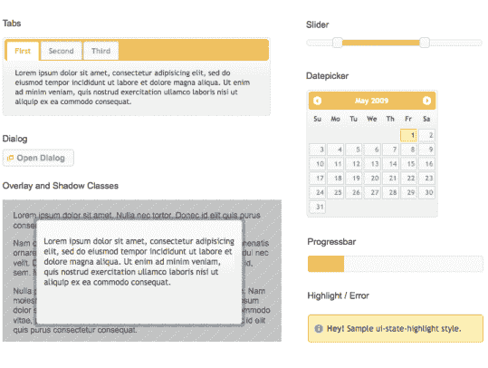

折叠面板、滑块、对话框、日期选择器等等——所有这些现在就可以使用！你可以花大量时间在 jQuery 中自己创建它们（就像这些已经做的那样），但 jQuery UI 控件是可配置且足够复杂的，你的时间最好花在其他地方：即实现你独特的项目需求，而不是确保你自定义的日期选择器在不同浏览器中正确显示！

在本书的后续部分，我们肯定会使用大量 jQuery UI 功能。我们甚至会整合一些可用的炫酷主题，并学习如何使用 jQuery UI ThemeRoller 工具创建我们自己的主题。

## 插件

jQuery 团队非常注重使 jQuery 库具有可扩展性。通过仅包含一组核心功能，同时提供扩展库的框架，使得创建插件变得容易，你可以在所有 jQuery 项目中重用这些插件，也可以与其他开发者共享。许多相当常见的功能已从 jQuery 核心库中省略，并归入插件领域。别担心，这是一个特性，而不是缺陷。任何额外需要的都可以按页面轻松包含，以使带宽和代码膨胀保持在最低限度。

值得庆幸的是，很多人利用了 jQuery 的可扩展性，因此已经有数百个优秀的可下载插件可供使用，来自 jQuery 插件仓库，并且一直有新增。其中一部分如图 1.2 所示。


每当你遇到一项任务或问题时，值得检查是否有插件可能满足你的需求。这是因为几乎任何你可能需要的功能很可能已经变成了一个插件，并可供你开始使用。即使结果是你需要自己做一些工作，插件仓库通常也是引导你走向正确方向的最佳地方。

> ### 我的插件在哪里？

在出版时，jQuery 插件²仓库正在开发中。该网站上的一个占位符警告说：“我们一直希望在插件站点提供更高质量、无垃圾信息的体验，而我们自身的一个重大错误迫使我们在新站点准备就绪之前关闭了当前站点。” 关于此次变更的完整背景故事，以及站点开发进度和在哪里可以找到各种插件的信息，请参见 jQuery 博客。³ 你可以在 GitHub 上关注插件站点开发的进度。⁴

### 保持标记语言的简洁

将脚本行为与页面呈现分离是 Web 开发中的最佳实践，尽管它确实带来了一些挑战。jQuery 使得完全摆脱内联脚本变得轻而易举，这得益于它能够轻松地以类似 CSS 的自然方式钩住页面元素并将代码附加到它们上。jQuery 缺少添加内联代码的机制，因此这种关注点分离带来了更精简、更干净、更易于维护的代码。结果就是，很容易把事情做对，而很难把事情做错！

jQuery 不仅仅局限于干预页面现有的 HTML；它还可以通过一系列便捷函数添加新的页面元素和文档片段。有函数可以在页面的任何位置插入、追加和前置新的 HTML 代码块。你甚至可以替换、移除或克隆现有元素：所有这些函数都有助于你逐步增强网站，从而为浏览器允的用户提供功能齐全的体验，为其他所有用户提供可接受的体验。

### 广泛采用

如果你在 Google Trends 上研究使用趋势，⁵ 你会见证 jQuery 如何呈指数级增长成为超级明星。如果你明智地对此保持谨慎，你总可以看看 BuiltWith 的图表。⁶ 在库的领域里，身处“潮流”之中是件好事，因为流行度意味着更活跃的代码开发和大量有趣的第三方工具包。

网络上的无数巨头纷纷加入 jQuery 的阵营：IBM、Netflix、诺基亚、维基百科，甚至 Google（既使用也托管 jQuery 库），以及微软，它现在将 jQuery 包含在其 MVC 框架甚至其集成开发环境（IDE）Visual Studio 中。有了如此众多大公司的支持，可以稳妥地预测 jQuery 将在未来一段时间内持续存在，因此你投入时间和精力学习它将是完全值得的。事实上，jQuery 出现在近 40% 使用 JavaScript 的网站上，因此精通 jQuery 技能真的可以为你打开一些大门。

jQuery 的普及也催生了一个庞大而慷慨的社区，令人惊讶的是它非常乐于助人。无论你的技能水平如何，你都会发现其他开发者有足够的耐心来帮助你解决任何问题。这种关爱和分享的精神也传播到了更广阔的互联网，发展成为高质量教程、博客文章和文档的百科全书。

## 有什么缺点吗？

几乎没有缺点！反对使用任何 JavaScript 库的主要论点一直是速度和大小：有人说使用库会给页面增加太多下载负担，而另一些人则声称库的性能不如精简的自定�代码。尽管这些论点值得考虑，但它们的相关性正在迅速消失。

首先，就大小而言，jQuery 是轻量级的。jQuery 核心库一直保持相当小的占用空间：基础部分约 19kB，比你常见的 JPG 图像还小。你的项目需要的任何额外功能（如插件或来自 jQuery UI 库的组件）都可以以模块化的方式添加，这样你就能轻松控制带宽消耗。

速度（如同大小）正变得越来越不那么令人担忧，因为计算机硬件规格在提升，浏览器的 JavaScript 引擎也运行得越来越快。当然，这绝不意味着 jQuery 是慢的；jQuery 团队似乎对速度着迷！每次新版本的发布都比上一次更快，因此你通过自己编写 JavaScript 可能获得的任何优势正在日益缩小。

至于竞争的 JavaScript 库（这样的库不在少数），jQuery 在其擅长的领域——操作 DOM、添加效果和发出 Ajax 请求——是最佳选择。不过，许多其他库质量也很高，看看替代方案总是值得的，但如果我们概述的理由对你有吸引力，jQuery 可能是你应该走的路。

说得够多了：是时候让 jQuery 言出必行，证明自己了！

## 下载并包含 jQuery

在你能爱上 jQuery（或者至少，自己判断它）之前，你需要获取最新版本的代码并将其添加到你的网页中。有几种方法可以做到这一点，每种方法又有几种选项可用。无论你选择哪种方式，你都需要在你的 HTML 页面中包含 jQuery，就像包含任何其他 JavaScript 源文件一样。

> ### 它只是 JavaScript

> 永远不要忘记，jQuery 只是 JavaScript！表面上看和操作上可能有所不同，但其底层是用 JavaScript 编写的，因此它无法做到任何原生 JavaScript 做不到的事情。这意味着我们将像包含任何其他 JavaScript 文件一样，在我们的页面中包含它。

### 下载 jQuery

这是获取 jQuery 库最常见的方法，最新版本总是可以从 jQuery 网站获取。⁷ 那个醒目的下载按钮将从 jQuery 自己的代码仓库加载最新代码，或者你可以访问下载页面，从 jQuery 的**内容分发网络（CDN）**、Google 的 CDN 甚至微软的 CDN 获取最新的“生产压缩版”。CDN 是一个专门设计用于快速、可扩展地向用户提供内容的计算机网络。这些服务器通常在地理上分布，每个请由网络中最近的服务器处理。

点击下载链接，将 JavaScript 文件保存到一个新的工作文件夹中，准备开始使用。你需要将其放在 HTML 文件能找到的位置：通常在网站文档根目录下的 **scripts** 或 **javascript** 目录中。为了以下示例简单起见，我们将库放在与 HTML 文件相同的目录中。

为了让一切正常工作，我们需要告诉我们的 HTML 文件包含 jQuery 库。这是通过在 HTML 文档中使用 `<script>` 元素来实现的。一个包含 jQuery 的非常基础的 HTML 文件的 `<head>` 元素看起来会像这样：

```html
<head>
    <title>Hello jQuery world!</title>
    <script type="text/javascript" src="jquery-1.7-min.js"></script>
    <script type="text/javascript" src="script.js"></script>
</head>
```

页面上的第一个 script 标签加载 jQuery 库，第二个 script 标签指向一个 **script.js** 文件，我们将在那里运行自己的 jQuery 代码。就是这样：你已准备好开始使用 jQuery 了。

但我们不要就此止步。当我们在 HTML 代码中包含 jQuery 库时，重要的是要记住，我们并不局限于只在文档的头部包含文件；事实上，当前的最佳实践甚至认为头部并不是包含文件的最佳位置。如果你喜欢尝试，可以在关闭 body 元素之前添加包含，像这样：

```html
</section>
<script type="text/javascript" src="jquery-1.7-min.js"></script>
<script type="text/javascript" src="script.js"></script>
</body>
</html>
```

页面上的第一个 script 标签加载 jQuery 库，第二个仍然指向我们的 **script.js** 文件，但现在我们的文件将在页面内容*之后*加载（稍后会详细说明）。

我们之前说过下载 jQuery 文件是最常见的方法，但还有其他几种选择可用，所以在继续之前让我们快速浏览一下。如果你只想开始试用 jQuery，可以安全地跳过本节的其余部分。

### Google 内容分发网络（CDN）

另一种值得考虑的包含 jQuery 库的方法是通过 Google CDN。

Google 在其 CDN 上托管了几个流行的开源库，包括 jQuery（以及我们稍后会介绍的 jQuery UI）。因此，你不必像上面那样在自己的网络服务器上托管 jQuery 文件，而是可以选择让 Google 承担部分带宽费用。你可以从 Google 庞大基础设施的速度和可靠性中受益，同时还附带一个好处：始终使用最新版本的 jQuery。

使用 Google CDN 的另一个好处是，许多用户在访问其他网站时可能已经从 Google 下载了 jQuery。因此，当他们访问你的网站时，它将从缓存中加载（因为 JavaScript 文件的 URL 相同），从而显著加快加载时间。你也可以通过同样的方法包含更庞大的 jQuery UI 库，这使得 Google CDN 非常值得你的项目考虑：它将为你节省资金，并在你最新的作品走红时提升性能！

有几种方法可以从 Google CDN 包含 jQuery。我们将使用更简单（尽管稍欠灵活）的基于路径的方法：

```html
<head>
    <title>Hello jQuery world!</title>
    <script type="text/javascript" src="http://ajax.googleapis.com/ajax/libs/jquery/1.7.0/jquery.min.js"></script>
    <script type="text/javascript" src="script.js"></script>
</head>
```

它看起来可能与我们最初的示例惊人地相似，但 script 标签不是指向本地 jQuery 副本，而是指向 Google 的服务器之一。

⁵ http://www.google.com/trends  

⁶ http://trends.builtwith.com/javascript/jquery  

⁷ jQuery 网站。

### 通过 Google CDN 获取最新版本

仔细查看指向 Google 服务器的 URL，你会发现 jQuery 的版本号是由路径中的某个部分指定的（如示例中的 1.7.0）。但如果你希望使用最新版本，可以从版本字符串的末尾移除数字（例如，使用 1.7），这样就能获取 1.7 系列的最新发布版（1.7.1、1.7.2 等）。你甚至可以只保留主版本号（1），这样即使 jQuery 1.8 及更高版本发布后，Google 也会为你提供最新的可用版本！

但请注意：字符串越短，缓存时间越短。如果你一直精简到单数字版本，那么在 jQuery 发布新版本时就无需更新 HTML 文件中的 CDN 链接，但需要留意可能影响现有功能的库变更。

如果你想了解稍复杂一些的“Google 加载器”方法来引入库，可以阅读 Google CDN 网站上的大量文档。⁸

### 其他 CDN 选择

不仅是 Google 希望帮助用户畅享网站。jQuery 官方也认识到了提供自身 CDN 选项的价值，⁹ 微软同样加入了这一行列。作为对开放网络的承诺，微软托管了一个可供你直接链接的版本；其网站上有详细说明。¹⁰

### 每夜构建版本与 Github

官方的 jQuery 下载文档页面¹¹ 还列出了更多获取 jQuery 的进阶选项。首先是每夜构建版本。**每夜构建版本**是 jQuery 库的自动化构建产物，包含当天新增或修改的所有代码。每晚都会发布最新的开发版本，其引入方式与常规稳定版库相同。

如果每晚更新的频率对你来说*仍然*不够，你可以使用 Github 仓库获取最新的源代码。**Github**¹² 是 jQuery 团队使用的分布式版本控制系统。每当有开发者提交代码变更，你都可以立即下载。

但请注意，每夜构建版本和 Github 上的 jQuery 库通常未经充分测试。它们可能（并且会）包含错误，且经常变动。除非你打算参与 jQuery 库本身的开发，否则最好跳过这些选项。

### 压缩版还是未压缩版？

如果你仔细观察 jQuery 主页上那个闪亮的大按钮，或者浏览 jQuery 下载页面，可能会发现几种下载格式选项：压缩版（也称为**精简版**）和未压缩版（也称为开发版）。

通常，你希望在生产环境中使用精简版，此时 jQuery 源代码已被压缩：空格和换行符被移除，变量名被缩短。最终得到的库功能完全相同，但 JavaScript 文件体积比原始版本小得多。这有助于减少带宽成本并加快终端用户的页面加载速度。

压缩文件的缺点在于可读性。如果你在文本编辑器中查看精简版的 jQuery 文件（快试试！¹³），会发现它几乎难以阅读：是一行看起来乱糟糟的 JavaScript。大多数情况下，库的可读性无关紧要，但如果你对 jQuery 的内部工作原理感兴趣，未压缩的开发版是一个带注释、可读性强且相当优美的 JavaScript 示例。

## jQuery 脚本剖析

既然我们已经将 jQuery 引入了网页，来看看这个小家伙能做什么吧。jQuery 的语法初次接触可能有点怪异，但它其实非常直接，而且最重要的是高度一致。编写几个命令后，其风格和语法就会深植脑海，让你想要尝试更多。

### jQuery 别名

在页面中引入 jQuery 后，你就能访问一个神奇的函数，它被（奇怪地）命名为 jQuery。仅仅一个函数？正是通过这一个函数，jQuery 暴露出了数百种强大的工具，为你的网页增添更多维度。

由于单个函数充当了整个 jQuery 库的入口，库函数名与其他库或你自己的 JavaScript 代码发生冲突的可能性很小。否则可能会出现这种情况：假设 jQuery 定义了一个名为 `hide` 的函数（它确实有），而你自己的代码中也有一个 `hide` 函数；那么其中一个函数将被覆盖，导致意外事件和错误。

我们说 jQuery 库被包含在 jQuery 的*命名空间*中。命名空间是确保与页面中其他代码良好协作的优秀方法，但如果我们打算大量使用 jQuery（确实如此），每次命令都要输入完整的 `jQuery` 函数名很快会变得烦人。为了解决这个问题，jQuery 提供了一个更短的别名来访问库。它就是 `$`。

美元符号 `$` 是一个简短、有效且外观酷炫的 JavaScript 变量名。这看起来可能有点偷懒（毕竟使用别名只节省了五次按键），但一整页的 jQuery 代码会包含数十次库调用，使用别名将使代码更易读和维护。

> **使用多个库**

> 你可能想使用完整的 `jQuery` 调用而不是别名的主要原因，是当页面上有多个 JavaScript 库，且它们都争夺对美元符号函数名的控制时。`$` 是多个库中常见的函数名，通常用于选择元素。如果你遇到多库冲突问题，请查看第 9 章的“避免冲突”部分。

### 分析 jQuery 语句

我们知道 jQuery 命令以调用 jQuery 函数或其别名开头。现在，让我们拿出“手术刀”，检查 jQuery 语句的其余组成部分。图 1.3 显示了同一 jQuery 语句的两种形式（使用完整函数名或 `$` 别名）。

```
选择器       操作        参数
jQuery('p')     .css         ('color', 'blue');
$('p')          .css         ('color', 'blue');
```

图 1.3. 一个典型的 jQuery 语句

每个命令由四部分组成：jQuery 函数（或其别名）、选择器、操作（或方法）以及参数。我们已经了解了 jQuery 函数，现在依次看看其他元素。首先，我们使用选择器来选择网页上的一个或多个元素。接下来，我们选择要应用于每个所选元素的操作。在本书实现各种效果的过程中，我们会遇到越来越多的操作。最后，我们指定一些参数来告诉 jQuery 具体如何应用所选的操作。每当你看到 jQuery 代码时，试着将其分解为这些组成部分。这在刚开始学习时会让理解变得容易得多。

在上面的例子中，我们让选择器选择了页面上所有的段落标签（HTML 的 `<p>` 标签）。接着，我们选择了 jQuery 的 `css` 操作，该操作用于修改最初选定的段落元素的 CSS 属性。最后，我们传入参数将 CSS 的 color 属性设置为 blue。最终结果？我们所有的段落现在都变成蓝色了！我们将在第 2 章深入探讨选择器和 `css` 操作。

我们的例子向 `css` 操作传递了两个参数（color 和 blue），但传递给操作的参数数量可以变化。有些操作不需要参数，有些接受多组参数（用于一次更改大量属性），还有些要求我们指定另一个 JavaScript 函数，以便在事件（如元素被点击）发生时执行代码。但所有命令都遵循这种基本结构。

这种结构还为我们提供了强大的链式操作机会，我们可以向选择器传递一系列操作，并让它们按顺序应用。这就是力量！

## HTML的组成部分，又称“DOM”

jQuery的设计目标是与HTML和CSS无缝集成。如果你精通CSS选择器，并且知道例如`div#heading`指的是一个id为heading的`<div>`元素，你可能想跳过这一节。否则，这里将提供一个关于CSS选择器和**文档对象模型（DOM）**的简短速成课程。

DOM并非jQuery特有；它是所有浏览器厂商都同意遵循的一种表示HTML中对象的标准方式。良好的DOM知识将确保你顺利过渡到jQuery高手境界。

当你在饮水机旁和酷孩子们聊天时，所谓DOM就是你所说的那些渲染后的HTML片段。它是对你的HTML标记的层次化表示，其中每个元素（如`<div>`或`<p>`）都有一个**父**元素（其“容器”），并且也可以有一个或多个嵌套的**子**元素。每个元素可以有一个id和/或一个或多个class属性，这些通常在你的HTML源文件中赋值。当浏览器读取HTML页面并构建DOM时，它将其显示为由对象组成的网页，这些对象可以只是静止地显示在那里（作为静态页面），或者更有趣的是，可以被我们的代码操作。

图1.4展示了一个DOM片段示例。如你所见，**body**有两个子元素：一个`<h1>`和一个`<p>`。这两个元素因为包含在同一个父元素中，被称为**兄弟**元素。

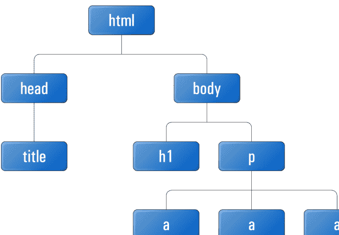

图1.4. DOM片段示例

元素的id在页面上唯一标识该元素：

```html
<div id="farewell">Come back and visit us soon!</div>
```

这个`<div>`被分配了一个id为farewell。它使用id是因为它是唯一的：页面上应该有一个，且只有一个。DOM还允许我们通过class属性为多个页面元素分配相同的名称。这通常用于具有共同特征的元素：

```html
<p class="warning">Sorry, this field must be filled in!</p>
<span class="warning">Please try again</span>
```

在这个例子中，同一页面上的多个元素被归类为warning。任何应用于warning类的CSS都会同时作用于这两个元素。同一元素上的多个class属性（当需要时）用空格分隔。

编写CSS时，你可以用井号符号（#）按id选择元素，或用句点（.）按class选择：

```css
#footer { border: 2px solid black }
.warning { color: red }
```

这些CSS规则会给id为`farewell`的元素添加黑色边框，并确保所有`class`为`warning`的元素都显示为红色文本。

当需要编写jQuery代码时，你会发现了解CSS选择器和DOM很重要：jQuery使用与CSS相同的语法来选择页面上要操作的元素。一旦掌握了选择操作，其余部分就很容易了，这要归功于jQuery！

## 如果你选择接受它……

jQuery是一个稳定且成熟的产品，可以用于任何规模的网站，这一点已被互联网上一些真正的巨头所采用。尽管如此，它仍然是一个活跃开发、不断改进的项目，每个新版本都会带来性能提升和巧妙的新功能。现在正是开始学习和使用jQuery的最佳时机！

在我们学习本书的过程中，你会发现jQuery的座右铭“写得更少，做得更多”非常有道理。这是一个简单有趣的库，学习曲线平缓，让你能用很少的代码实现很多很酷的功能。当你沿着成为jQuery高手的道路前进时，我们希望你也能对JavaScript本身获得一些尊重和理解。

在第二章中，我们将深入探讨jQuery，并开始用它来为客户的网站增添光彩。说到客户，是时候认识一下团队了……

# 第二章：选择、装饰与增强

“在第二阶段，我们希望能够利用社交功能，实现Web 2.0的基于社区的、众包的、Ajax，嗯，交互，”我们新客户团队的一位成员说。“但现在，我们只需要对网站进行一些基本的更改。”

客户正在推出一个名为StarTrackr!的初创公司。它使用GPS和RFID技术跟踪流行名人的确切物理位置，然后将信息出售给粉丝。他们通过朋友的本地商店运营得很好，但现在他们要将这项业务搬到网上。

“你们能做到吗？这是一份清单，需要在周五晚营业结束前上线。”

你查看清单。令人惊讶的是，你注意到所有请求都可以使用jQuery实现。你看了看日历。现在是周五早上。让我们开始吧！

清单上的第一项任务是在现有网站加载时添加一个简单的JavaScript警告框。这显然只是一个临时措施，旨在让访客知道StarTrackr!目前*并未*因侵犯隐私而被起诉（当地报纸最近暗示过此事）。

当然，我们可以使用普通的JavaScript来实现，但我们知道使用jQuery会让我们的工作轻松得多。此外，我们可以在实践中学到新技术。我们在第一章已经看到了jQuery语句的结构；现在让我们看看将jQuery付诸行动所需的步骤：我们等待页面准备就绪，选择目标，然后进行更改。

添加一个警告框可能看起来有点无聊，你可能怀疑jQuery能做的比这更复杂——确实如此……但只复杂一点点！即使是高级效果也会依赖于这个基本公式（尽管最后两个步骤可能需要多次迭代，并且可能需要一些JavaScript知识）。现在，让我们从简单开始。

### 确保页面准备就绪

在我们能够与页面上的HTML元素交互之前，这些元素必须已经加载：我们只能在它们已经存在之后才能更改它们。在JavaScript的旧时代，唯一可靠的方法是等待整个页面（包括图像）加载完成后再运行任何脚本。

幸运的是，jQuery有一个非常酷的内置事件，可以尽快执行我们的代码。因此，对于最终用户来说，我们的页面和应用程序似乎加载得更快：

```javascript
$(document).ready(function() {
    alert('Welcome to StarTrackr! Now no longer under police investigation!');
});
```

重要的部分是：“当我们的文档准备就绪时，运行我们的函数。”这是你可能最常看到的jQuery代码片段之一。通常，进行像这样的简单警告测试是个好主意，可以确保你已正确包含jQuery库，并且没有出现异常情况。

> **你经常会看到 $(document).ready()！**

> 几乎你在jQuery中所做的所有事情都需要*在*文档准备就绪*后*进行，因此我们将经常使用这个操作。从现在起，它将被称为document-ready事件。除非另有说明，本书后续的每个示例都需要从document-ready事件内部运行。不过，你应该只需要在每个页面中声明一次它。

document-ready惯用法实际上有点高级，但它非常常见，以至于jQuery包含了一个快捷方式版本，省略了“(document)”和“ready”：

```javascript
$(function() {
    alert('Ready to do your bidding!');
});
```

如果你想使用快捷方式方法，请继续。展开版本可以说是自文档化代码的更好示例；更容易看出到底发生了什么，特别是当它嵌入在另一个开发者的JavaScript代码中时！

乍一看，document-ready事件与我们在jQuery解剖课上遇到的结构相去甚远，但仔细观察我们可以看到所有必要的部分都已涵盖：选择器是document；动作是ready；参数是一个运行一些代码（我们的警告框）的函数。

### 选择：jQuery的核心

时间在流逝，截止日期不等人。客户团队指出，人们一直在网站上引用不正确的名人ID。这是因为名人的名字都排列在一个大表格中，用户很难将名人与正确的参考ID对应起来。一位客户团队成员告诉我们，他希望每隔一行显示浅灰色，这样用户就可以轻松找到他们喜欢的名人。

我们已经准备好让jQuery按照我们的意愿行事；它只需要我们为它选择一个目标。在页面上选择你想要修改的元素实际上是jQuery的艺术。新手和高手之间最大的区别之一就是你获取想要操作的元素所需的时间！

你可能还记得我们的jQuery解剖课，我们所有的选择器都包裹在jQuery函数中：

```javascript
jQuery(<selectors go here>)
```

或者别名：

$(<选择器放在这里>)$

在本书的剩余部分中，我们将使用这个快捷别名，因为它方便得多。我们之前提到过，没有真正理由使用完整的 jQuery 名称，除非你遇到与其他库的冲突问题（参见第9章“避免冲突”一节）。

## 简单选择

我们的任务是选择名人表格中交替的行。我们该怎么做？使用 jQuery 进行选择时，你的目标是尽可能具体：你想要找到能精确返回你想要更改内容的最简洁选择器。让我们先看看名人表格的标记，如图 2.1 所示。

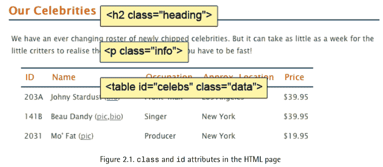

我们可以从选择整个页面上的每一个表格行元素开始。要按元素类型选择，你只需将元素的 HTML 名称作为字符串参数传递给 `$` 函数。要选择所有表格行元素（用 `<tr>` 标签标记），只需这样写：

```
$('tr')
```

> **什么都没发生！**

如果你运行这个命令，页面上什么也不会发生。这是预料之中的；毕竟，我们只是在选择元素。但不用担心；很快，我们就会以各种奇妙的方式修改我们的选择。

同样，如果我们想选择页面上的每个段落、`<div>` 元素、`<h1>` 标题或 `<input>` 框，我们可以相应地使用这些选择器：

```
$('p')
$('div')
$('h1')
$('input')
```

但我们不想更改名人页面上的*每一个*表格行，只想更改包含名人数据的表格行。我们需要更具体一些，首先选择包含名人列表的容器元素。如果你看看下面的 HTML 和图 2.1，你会看到包含我们名人数据的表格有一个 id 为 `celebs` 和一个 `class` 为 `data`。我们可以使用其中任何一个来选择表格。

```
chapter_02/02_selecting/index.html (excerpt)

<table class="data" id="celebs">
  <thead>
    <tr>
      <th>ID</th>
      <th>Name</th>
      <th>Occupation</th>
      <th>Approx. Location</th>
      <th>Price</th>
    </tr>
  </thead>
```

jQuery 借用了 CSS 中引用 `id` 和 `class` 名称的约定。要按 id 选择，请使用井号 (#) 后跟元素的 id，并将其作为字符串传递给 jQuery 函数：

```
$('#celebs')
```

24 jQuery: 从新手到忍者

你应该注意，我们传递给 jQuery 函数的字符串格式与 CSS id 选择器完全相同。因为 id 应该是唯一的，所以我们期望它只返回一个元素。jQuery 现在持有对该元素的引用。

同样，我们可以使用 CSS 类选择器按类选择。我们将一个由句点 (.) 后跟元素类名组成的字符串传递给 jQuery 函数：

```
$( '.data' )
```

这两个语句都会选择该表格，但正如我们之前在讨论 DOM 时提到的，一个类可以被多个元素共享，jQuery 会愉快地选择我们指向它的尽可能多的元素。如果有多个表格（或任何其他元素）也有 data 类，它们都会被选中。因此，对于这个情况，我们将坚持使用 id！

> **你能更具体吗？**

> 就像 CSS 一样，我们可以选择 `$( '.data' )` 或更具体的 `$( 'table.data' )`。通过在类之外指定元素类型，选择器将只返回具有 **data** 类的**table**元素，而不是*所有*具有 data 类的元素。此外，像 CSS 一样，你可以添加父容器选择器来进一步缩小选择范围。

## 缩小我们的选择范围

我们已经成功选择了表格，但表格本身对我们来说并不重要；我们想要它里面的*每隔一行*。我们已经选择了容器元素，并且从该容器元素中，我们想要挑选出所有是表格行的后代：也就是说，我们想要指定**table**容器*内部*的所有表格行。为此，我们在祖先和后代之间放一个空格：

```
$('#celebs tr')
```

你可以使用这种结构深入到你要找的元素，但为了清晰起见，尽量保持你的选择器简洁。

让我们把这个想法更进一步。假设我们想选择 `<p>` 元素内部的所有 `<span>` 元素，而这些 `<p>` 元素本身又在 `<div>` 元素内部，但仅当那些 `<div>` 恰好有一个 `fancy` 类时。我们将使用选择器：

```
$('div.fancy p span')
```

如果你能理解这个，你就可以准备好选择几乎任何东西了！

## 测试我们的选择

好的，回到我们手头的任务。感觉我们越来越接近了，但到目前为止，我们只是在盲目选择，无法知道我们是否真的选择了任何元素。如今我们手头有一些很棒的调试工具（我们很快就会看到），但现在，一个简单的技巧是检查选择的 `length` 属性。`length` 返回当前由选择器匹配的元素数量。我们可以将它与可靠的老朋友 `alert` 语句结合起来，确保我们的元素已被选中：

```
$(document).ready(function() {
    alert($('#celebs tr').length + ' elements!');
});
```

这将警告选择的长度——对于名人 `<table>` 来说是七个元素。这个结果可能与你预期的不同，因为表格中只有六位名人！如果你看看 HTML，你会发现问题所在：`<table>` 的标题也是一个 `<tr>`，所以总共有七行。一个快速的解决方法是将我们的选择器缩小，只找到位于 `<tbody>` 元素内的表格行：

```
$(document).ready(function() {
    alert($('#celebs tbody tr').length + ' elements!');
});
```

这将警告正确的长度，六个元素。jQuery 对象现在持有我们的六个名人表格行元素。

如果警告显示 0，你就知道你的选择器有错误。解决此类问题的一个好方法是将选择器缩减为尽可能小、最简单的形式。

在我们的例子中，我们可以简单地写 `$('#celebs')`，它只会选择 `table` 元素，并警告长度为 1。从这里，你可以让你的选择器更具体，并在操作过程中检查你是否选择了正确数量的元素。

## 过滤器

知道我们已经成功选择了所有表格行，将选择范围缩小到每隔一行就很简单了，因为 jQuery 有一个**过滤器**来完成这个任务。过滤器会移除某些项目，只保留我们想要的。随着我们通过更多示例的操作，你会对可以过滤的内容有所感觉；现在，我们将直接跳到我们需要的斑马条纹过滤器：

```
chapter_02/04_filters/script.js

$(document).ready(function() {
    alert($('#celebs tbody tr:even').length + ' elements!');
});
```

过滤器附加在你想要过滤的项目上（在本例中是表格行），并由冒号后跟过滤器名称来定义。这里使用的 `:even` 过滤器会保留选择中每个索引为偶数的元素，移除其余的，这正是我们想要的。现在当我们警告选择长度时，我们看到的是三个，正如预期的那样。我们所有的奇数行都已被过滤掉。我们有各种各样的 jQuery 选择器过滤器可用：`:odd`（如你所料）、`:first`、`:last`、`:eq()`（用于选择，例如第三个元素），等等。我们将在本书中根据需要更详细地研究每一个。

## 使用多个选择器

基本选择的最后一个技巧是能够在单个语句中执行多个查询。这非常有用，因为我们经常希望对页面不相关部分的多个元素应用相同的操作。用逗号分隔选择器字符串就可以做到这一点。例如，如果我们想选择页面上的每个段落*和*每个 `<div>` 元素，*以及*每个 `<h1>` 标题，*以及*每个 `<input>` 框，我们会使用这个选择器：

## 成为优秀的选择器

选择元素看似相当简单，在某种程度上确实如此。但到目前为止，我们所讲的只是选择器的皮毛。在大多数情况下，基础知识就足够了：如果你只是想定位一个元素或一组相关元素，那么使用元素名称、`id` 和 `class` 是最高效、最简单的方法。

当从某个元素开始在 DOM 中移动时，情况就变得有些棘手了。jQuery 提供了大量的选择器和操作来遍历 DOM。**遍历** 意味着沿着页面层级结构上下移动，穿越父元素和子元素。你可以一边移动一边添加和删除元素，在每一步应用不同的操作，从而在单个 jQuery 语句中执行一些极其复杂的操作。

如果你精通 CSS，你可能已经熟悉很多语句；它们大多直接借鉴自 CSS 规范。但可能也有一些你不熟悉的，尤其是如果你还没有花太多时间学习 CSS3 选择器。当然，我们会在示例和演示中实现这些高级选择技术时进行讲解和学习。因此，任何时候你想了解更多关于所有可用的 jQuery 选择器，你都可以直接访问在线文档进行浏览。<sup>1</sup>

<sup>1</sup> http://api.jquery.com/category/selectors/

## 装饰：用 jQuery 操作 CSS

在 jQuery 中选择元素是困难的部分。其他一切都既简单又有趣。选中目标元素后，我们就可以操作它们来构建效果或界面。在本节中，我们将介绍一系列与 CSS 相关的 jQuery 操作：添加和移除样式、类等。我们执行的操作将应用于每个选中的元素，让我们能够随心所欲地操控页面。

### 读取 CSS 属性

在尝试更改 CSS 属性之前，我们先来看看如何简单地访问它们。jQuery 让我们使用 css 函数来做到这一点。试试这个：

```
chapter_02/05_reading_css_properties/script.js

$(document).ready(function() {
    var fontSize = $('#celebs tbody tr:first').css('font-size');
    alert(fontSize);
});
```

这段代码会弹出警告框，显示选择器匹配的第一个元素的字体大小（正如你可能猜到的，`:first` 过滤器会返回选择器匹配的元素中的第一个）。

> **多个元素的 CSS 属性**

>

> 你*可以*在选择多个元素后请求一个 CSS 属性，但这几乎总是一个坏主意：一个函数只能返回一个结果，所以你仍然只会获得第一个匹配元素的属性。

使用这种方法检索 CSS 属性的巧妙之处在于，jQuery 返回的是元素的*计算后*样式：你将获得在用户浏览器中渲染的值，而不是在 CSS 定义中输入的值。因此，如果你在 CSS 文件中将一个 `<div>` 的高度设置为，比如，200 像素，但其内容将高度推高超过 200 像素，jQuery 将为你提供元素的实际高度，而不是你指定的 200 像素。

我们稍后在实现一些有趣的技巧时，就会明白为什么这非常重要。

### 设置 CSS 属性

到目前为止，我们还没看到 jQuery 实际*做*任何事情，是时候纠正这一点了。我们知道页面已经准备就绪（因为我们弹出了警告框），并且相当确信我们选中了感兴趣的元素。让我们验证一下：

```
chapter_02/06_zebra_striping/script.js

$(document).ready(function() {
    $("#celebs tbody tr:even").css("background-color","#dddddd");
});
```

你可能已经预料到了！这就是我们用来读取 CSS 属性的同一个 `css` 函数，但现在它被传入了一个额外的参数：我们希望为该属性设置的值。我们使用此操作将 `background-color` 设置为值 `#dddddd`（一种浅灰色）。在浏览器中打开代码存档中的文件，测试它是否正常工作。你可以在图 2.2 中看到结果。

| ID | 名称 | 职业 | 大致位置 | 价格 |

|---|---|---|---|---|

| 203A | Johny Stardust (简介) | 主唱 | 洛杉矶 | $39.95 |

| 141B | Beau Dandy (图片,简介) | 歌手 | 纽约 | $39.95 |

| 2031 | Mo' Fat (图片) | 制作人 | 纽约 | $19.95 |

| 007F | Kellie Kelly (简介,新闻) | 歌手 | 奥马哈 | $11.95 |

| 8A05 | Darth Fader (图片) | DJ | 伦敦 | $19.95 |

| 6636 | Glendatronix (简介,新闻) | 键盘手 | 伦敦 | $39.95 |


> **你准备好了吗？**

>

> 如前所述，此命令必须从我们的 `$(document).ready` 函数内部发出。如果在 DOM 准备就绪之前运行该命令，选择器将寻找 `#celebs` 元素，但找不到任何匹配项。此时它会放弃；它甚至不会寻找 `tr` 元素，更不用说更改背景样式了。

>

> 后续所有示例都是如此，所以请记住将你的代码包裹在 `$(document).ready` 函数中。

看起来不错！但也许我们应该给它加点料——毕竟，多多益善！如果再加一点稍浅的字体颜色来真正突出我们的条纹效果呢？有几种方法可以添加第二个 CSS 属性。最简单的方法是用新值重复整个 jQuery 语句：

# 30 jQuery：从新手到忍者

```
chapter_02/07_multiple_properties_1/script.js (节选)

$('#celebs tbody tr:even').css('background-color', '#dddddd');
$('#celebs tbody tr:even').css('color', '#666666');
```

这些行是一个接一个执行的。虽然最终结果是正确的，但如果我们需要更改大量属性，这会变得相当混乱和低效。幸运的是，jQuery 为我们提供了一种很好的方式来同时设置多个属性，使用**对象字面量**。对象字面量是一个超出本书范围的 JavaScript 概念，但就我们的目的而言，你只需要知道它们提供了一种简单的方法来将键/值对分组在一起。对于 CSS，对象字面量允许我们将 CSS 属性（键）与相应的 CSS 值（值）整齐地组合在一起：

```
chapter_02/08_multiple_properties_2/script.js (节选)

$('#celebs tbody tr:even').css(
    {'background-color': '#dddddd', 'color': '#666666'}
);
```

对象字面量用花括号括起来，每个键与其对应的值用冒号分隔，每个键/值对用逗号分隔。它作为单个参数传递给 `css` 函数。使用此方法，你可以根据需要指定任意数量的键/值对；只需用逗号分隔即可。以可读的方式布局你的键/值对是一个好主意，这样当你以后回到代码时，可以轻松地看到发生了什么。当你需要设置大量属性时，这尤其有用。举个例子：

```
chapter_02/09_multiple_properties_3/script.js (节选)

$('#celebs tbody tr:even').css({
    'background-color': '#dddddd',
    'color': '#666666',
    'font-size': '11pt',
    'line-height': '2.5em'
});
```

> **加引号还是不加引号**

>

> 通常，在处时 JavaScript 对象时，键不需要加引号。但是，为了使 jQuery 正常工作，任何包含连字符的键（如我们的 `background-color` 和 `font-size` 示例）都必须放在引号中，或者写成驼峰式（如 `backgroundColor`）。

>

> 此外，任何已经是 JavaScript 语言关键字的键（如 `float` 和 `class`）也必须写在引号中。

>

> 试图记住哪些键需要加引号，哪些不需要，可能会令人困惑，所以简单的解决方案就是始终将所有对象键都放在引号中。

## 类

太好了！我们已经从客户的任务清单上划掉了两项，并且有了一些酷炫的 jQuery 在运行。但如果你停下来看看我们最后的解决方案，你可能会注意到一些可疑的地方。如果你在开发工具（如 Firebug）中检查斑马条纹行，你会看到 CSS 属性是*内联*添加到表格行中的，如图 2.3 所示。

```
<table id="celebs" class="data">
  <tbody>
    <tr>
      <tr style="background-color: rgb(221, 221, 221);">
    <tr>
      <tr style="background-color: rgb(221, 221, 221);">
    <tr>
      <tr style="background-color: rgb(221, 221, 221);">
  </tbody>
</table>
```

图 2.3. 使用 Firebug 查看的内联样式

> **Firebug 等工具**

>

> Firebug（或等效工具，如 Google Chrome 的开发者工具）允许你在浏览器中检查 DOM，以及监控和编辑 CSS、HTML 和 JavaScript（包括 jQuery）。它就像拥有 Web 的瑞士军刀，通过帮助你准确了解浏览器认为正在发生的事情，可以为你节省数小时时间。Firebug 可作为 Mozilla Firefox 扩展使用，也可以作为独立...

一个独立的JavaScript文件⁴，你可以在项目中引入它，如果你使用其他浏览器进行开发的话。

在HTML/CSS的最佳实践中，内联样式是大忌，对吧？确实如此，这也适用于jQuery：为了保持代码清晰且易于维护，将所有样式信息统一放置在CSS文件中更为合理。那么（正如我们很快会看到的），你可以通过向HTML标签添加或移除类属性来轻松切换这些样式。

有时，以我们刚才看到的方式使用`css` jQuery方法*确实*是个好主意。最常见的应用场景是快速调试代码：如果你只是想给元素添加红色边框以确保你选择了正确的元素，切换到CSS文件添加新规则似乎是在浪费时间。

### 添加和移除类

如果我们需要从内联样式规则中移除CSS，应该把它放在哪里？当然是放在一个单独的样式表中！我们将样式放入一个CSS类中，并使用jQuery从HTML中的目标元素添加和移除该类。当然，jQuery提供了一些方便的方法来操作DOM元素的类属性。让我们使用其中最常用的`addClass`，将我们的斑马条纹样式移入它们本应所在的CSS文件。

`addClass`函数接受一个包含类名的字符串作为参数。你也可以通过用空格分隔类名来同时添加多个类，就像在编写HTML时一样：

```
$('div').addClass('class_name');
$('div').addClass('class_name1 class_name2 class_name3');
```

不过，我们只想添加一个类名，我们称之为zebra。首先，我们将在HTML中添加对CSS文件的链接：

```
chapter_02/10_adding_classes/index.html (excerpt)
<head>
  ...
  <title>StarTrackr!</title>
  <link rel="stylesheet" href="zebra.css" type="text/css" />
…
</head>
```

然后我们将新规则添加到一个新的CSS文件中：

```
.zebra {
    background-color: #dddddd;
    color: #666666;
}
```

接着，回到我们的JavaScript文件，我们将修改选择器，使用jQuery的`addClass`方法而不是`css`：

```
$('#celebs tbody tr:even').addClass('zebra');
```

结果完全相同，但现在当我们在Firebug中检查表格时，我们会看到内联样式消失了，取而代之的是我们新的类定义。这在图2.4中展示。

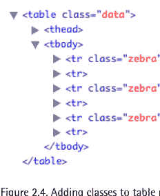

这样好多了。现在，如果我们将来想改变斑马条纹的外观，我们只需修改CSS文件；这将省去我们在jQuery代码中（可能分布在多个位置）搜寻并更改值的麻烦。

也会有我们需要从元素中移除类名的情况（我们很快会看到一个何时需要这样做的例子）。移除类的操作被方便地称为`removeClass`。这个函数的用法与`addClass`完全相同；我们只需将（不）想要的类名作为参数传递：

```
$('#celebs tr.zebra').removeClass('zebra');
```

添加和移除类是一个强大的能力，因为这些操作是许多视觉效果的基石。

## 进阶：使用jQuery添加效果

现在你已经到达了一个重要的里程碑。你已经学习了jQuery语句的组成部分：选择器、操作和参数。并且你已经学习了使用该语句的步骤：确保文档准备就绪，选择元素，然后更改它们。

在下一节中，我们将应用这些知识来实现一些酷炫且实用的效果，并且希望借此加深你对jQuery基础知识的理解。

### 隐藏和显示元素

客户团队不喜欢网站上的免责声明——他们觉得这给产品带来了不好的影响——但律师坚持认为这是必要的。因此，客户团队要求你添加一个按钮，以便用户阅读后可以移除文本：

```
<input type="button" id="hideButton" value="hide" />
```

我们在页面上添加了一个HTML按钮，其`id`为`hideButton`。当用户点击这个按钮时，我们希望具有`id`为`disclaimer`的免责声明元素被隐藏：

```
$('#hideButton').click(function() {
  $('#disclaimer').hide();
});
```

运行这段代码，并确保当你点击隐藏按钮时，免责声明元素消失了。

这个例子中使元素实际消失的部分是`hide`操作。那么，你可能会问，围绕这行代码的其他部分是什么？这被称为**事件处理程序**，理解它对于成为jQuery高手至关重要。我们可以使用许多事件处理程序（我们在这里使用了`click`事件处理程序），并且在后续内容中我们会用到很多。

### 事件处理程序

**事件处理程序**之所以得名，是因为它们处理事件。事件是在网页上发生的操作（由用户或浏览器本身执行）。当事件发生时，我们说它已*触发*。而当我们编写一些代码来处理该事件（这些代码将被包装在一个常规的JavaScript函数中）时，我们说我们*捕获*了该事件。

网页上随时都会触发成千上万个事件：当用户移动鼠标或点击按钮，或者当浏览器窗口大小被调整，或者滚动条被移动时。我们可以捕获并处理这些事件中的任何一个。

你在本书中了解到的第一个事件是文档就绪事件。是的，那是一个事件处理程序：当文档说“我准备好了”时，它触发了一个事件，而我们的jQuery语句捕获了它。

我们使用`click`事件处理程序来告诉jQuery在点击按钮时隐藏免责声明：

```
$('#hideButton').click(function() {
    $('#disclaimer').hide();
});
```

### this

当事件触发时，我们通常会希望引用触发它的元素。例如，我们可能想以某种方式修改用户刚刚点击过的按钮。这样的引用可以在我们的事件处理程序代码中通过JavaScript关键字`this`获得。为了将JavaScript对象转换为jQuery对象，我们将其包装在jQuery选择器中：

```
chapter_02/12_this/script.js (excerpt)

$('#hideButton').click(function() {
  $(this).hide(); // 一个好奇地消失的按钮。
});
```

`$(this)`提供了一种更好的方式来指代触发事件的元素，而无需重新选择它。

> **操作在哪里？**

当你刚开始时，这可能会有点令人困惑，因为jQuery语句的“操作”部分似乎有多种用途：我们见过它用于运行动画、检索值，而现在，用于处理事件！确实——它用途广泛！

通常，操作的名称会很好地提示其目的，但如果你迷失了，最好查阅索引。过一段时间后，你就能从动画和实用程序中区分出处理程序。

### 36 jQuery：从新手到忍者

## 显示隐藏的元素

继续我们的任务！客户团队还规定，用户需要能够恢复免责声明，以防他们误关闭它。所以让我们在HTML中添加另一个按钮，这次的id是showButton：

```
chapter_02/13_revealing/index.html (excerpt)

<input type="button" id="showButton" value="show" />
```

我们还将在脚本文件中添加另一个jQuery语句，以处理当点击**show**按钮时显示免责声明：

```
chapter_02/13_revealing/script.js (excerpt)

$('#showButton').click(function() {
  $('#disclaimer').show();
});
```

## 切换元素

为隐藏和显示免责声明设置单独的按钮似乎浪费了宝贵的屏幕空间。更好的方式是有一个按钮执行两项任务：当免责声明可见时隐藏它，当它隐藏时显示它。

一种方法是检查元素是否可见，然后相应地显示或隐藏。我们将移除旧按钮并添加这个漂亮的新按钮：

```
chapter_02/14_toggle_1/index.html (excerpt)

<input type="button" id="toggleButton" value="toggle" />
```

当它被点击时，我们检查是否应该显示或隐藏免责声明：

```
chapter_02/14_toggle_1/script.js (excerpt)

$('#toggleButton').click(function() {
    if ($('#disclaimer').is(':visible')) {
        $('#disclaimer').hide();
    } else {
        $('#disclaimer').show();
    }
});
```

这引入了`is`操作。`is`接受我们通常传递给jQuery函数的任何选择器，并检查它们是否与调用它的元素匹配。在本例中，我们检查选定的`#disclaimer`是否也被伪选择器`:visible`选中。它也可以用于检查其他属性；例如，一个选择是否是`form`或`div`，或者该选择是否被启用，等等。


### `if` 语句

如果你完全是个编程新手（也就是说，如果你只使用过HTML和CSS），那整块代码可能相当令人困惑。别担心，它其实很简单：

```
if (条件) {
    // 如果条件为真，则执行此部分
} else {
    // 如果条件为假，则执行此部分
}
```

条件可以是任何JavaScript会评估为`true`或`false`的东西。这种结构在任何类型的编程中都非常常见，我们将

### 使用 `is` 操作

在本书剩余部分，你将频繁使用它。如果你对它还不太熟悉，最好的学习方法就是动手尝试：尝试使用 jQuery 的 **is** 操作来编写不同的 **if/else** 代码块，就像我们上面写的那样。你很快就能掌握它！

`is` 将根据元素是否与选择器匹配返回 `true` 或 `false`。就我们的目的而言，如果元素是隐藏的，我们就显示它；如果它是可见的，我们就隐藏它。这种在两种状态之间切换的逻辑被称为 **切换**，是一个非常有用的构造。

在两种状态之间切换元素非常常见，因此许多 jQuery 函数都有允许切换的版本。show/hide 的切换版本就简单地称为 `toggle`，其工作方式如下：

```javascript
chapter_02/15_toggle_2/script.js (excerpt)

$('#toggleButton').click(function() {
  $('#disclaimer').toggle();
});
```

每次点击按钮，元素就会在可见和隐藏之间切换。

## 清理旧代码

我们现在刚刚向切换按钮添加了另一个事件处理器，因此你需要确保移除之前的事件处理器代码（包含 **if/else** 语句）；否则，两者都会运行！

然而，如果按钮上标记的是比“toggle”更有用的词就好了，这对用户来说可能会令人困惑。如果你还想切换按钮的文本呢？就像使用 jQuery 时经常遇到的情况一样，我们可以用几种方法来解决这个问题。这里有一种：

```javascript
chapter_02/16_toggle_text/script.js (excerpt)

$('#toggleButton').click(function() {
  $('#disclaimer').toggle();

  if ($('#disclaimer').is(':visible')) {
    $(this).val('Hide');
  } else {
    $(this).val('Show');
  }
});
```

这段代码中有很多对你来说是新的内容。我们会将大部分细节留到后面讲解，但先看看它，看你能否自己弄明白。（提示：记住选择器 `$(this)` 指的是触发事件的元素；在这个例子中，就是按钮。）

## 渐进增强

我们的免责声明功能运行完美，客户无疑会对此印象深刻。然而，我们的解决方案有一个微妙之处我们需要注意：如果用户使用不支持 JavaScript 的浏览器访问我们的网站，他们会在页面上看到一个按钮，点击后却什么也不做。这会让用户非常困惑，甚至可能放弃我们的网站。

> “不支持 JavaScript？”你可能会嗤之以鼻。“什么样的浏览器无法运行 JavaScript？！”

在没有 JavaScript 的情况下浏览网页的人可能比你想象的要多：在非常旧的计算机或有限设备（如某些手机）上的用户；在受限内网内浏览的人；以及那些担心 JavaScript 是不必要的安全风险而选择禁用它的人。

根据你网站的受众群体，可能有多达 3% 的用户在没有 JavaScript 功能的情况下浏览，⁵ 如果你有一百万客户，那就是三万被疏远的客户！解决方案是为这些用户提供可接受的体验，并为其他所有人加强它。这种做法被称为 **渐进增强**。

对于我们的免责声明功能，我们可能会采取这种折衷方案：我们希望所有用户都能看到免责声明，因此我们将其放在 HTML 中。然后，我们为拥有 JavaScript 的用户添加隐藏它的功能。话虽如此，我们更倾向于避免向无法使用它的用户显示显示/隐藏按钮。

> ⁵ http://developer.yahoo.com/blogs/ydn/posts/2010/10/how-many-users-have-javascript-disabled/

实现这一目标的一种方法可能是用 CSS 隐藏我们的按钮，只通过 jQuery css 语句显示它。另一种方法是通过 jQuery 将按钮添加到页面；这样，只有拥有 JavaScript 的用户才能看到该按钮。完美！

## 添加新元素

到目前为止，我们已经看到 jQuery 函数用于选择，但它还有另一个同等重要的功能：创建新元素。事实上，你放在 jQuery 函数内的任何有效 HTML 字符串都会被创建并准备好供你粘贴到页面上。以下是我们如何创建一个简单的段落元素：

```javascript
$('<p>A new paragraph!</p>')
```

当你编写此代码时，jQuery 会执行几个有用的操作：它将 HTML 解析为 DOM 片段并选择它，就像普通的 jQuery 选择器一样。这意味着它立即准备好进行进一步的 jQuery 处理。例如，要向我们新创建的元素添加一个类，我们可以简单地写：

```javascript
$('<p>A new paragraph!</p>').addClass('new');
```

新段落现在将被赋予类 `new`。使用此方法，你可以通过 jQuery 本身创建任何需要的新元素，而不是在 HTML 标记中定义它们。这样，我们就可以实现渐进增强页面的目标。

> **innerHTML**

在内部，HTML 字符串是通过创建一个简单元素（如 `<div>`）并将其 `innerHTML` 属性设置为你提供的标记来解析的。你传递的某些内容无法如此轻松地转换，因此最好尽可能保持 HTML 片段简单。

一旦我们创建了新元素，我们需要一种方法将它们插入到页面中我们想要的位置。有几个 jQuery 函数可用于此目的。我们将首先查看 `insertAfter` 函数。`insertAfter` 将获取我们当前的 jQuery 选择（在本例中，是我们新创建的元素），并将其插入到另一个选定元素之后，我们将该元素作为参数传递给该函数。

一个例子是展示这如何工作的最简单方式。以下是我们如何使用 jQuery 创建切换按钮：

```javascript
chapter_02/17_insert_after/script.js (excerpt)

$('<input type="button" value="toggle" id="toggleButton">')
    .insertAfter('#disclaimer');
$('#toggleButton').click(function() {
    $('#disclaimer').toggle();
});
```

如图 2.5 所示，按钮被插入到页面中免责声明之后，就像我们将其放在 HTML 文件中一样。

`insertAfter` 函数将新元素作为兄弟节点直接添加在免责声明元素之后。如果你想让按钮出现在免责声明元素之前，你可以针对免责声明之前的元素使用 `insertAfter`，或者更符合逻辑的是，使用 `insertBefore` 方法。`insertBefore` 也会将新元素作为现有元素的兄弟节点放置，但它会立即出现在它之前：

```javascript
chapter_02/18_insert_before/script.js (excerpt)

$('<input type="button" value="toggle" id="toggleButton">')
    .insertBefore('#disclaimer');
```

快速回顾一下：当我们谈论 DOM 时，兄弟节点指的是 DOM 层次结构中同一级别的元素。如果你有一个 `<div>`，其中包含两个 `<span>` 元素，那么这两个 `<span>` 元素就是兄弟节点。

如果你想将新元素添加为现有元素的子元素（也就是说，如果你想让新元素出现在现有元素内部），你可以使用 `prependTo` 或 `appendTo` 函数：

```javascript
chapter_02/19_prepend_append/script.js (excerpt)

$( '<strong>START!</strong>' ).prependTo( '#disclaimer' );
$( '<strong>END!</strong>' ).appendTo( '#disclaimer' );
```

正如你在图 2.6 中看到的，我们的新元素被添加到了实际的免责声明 `<p>` 的开头和结尾，而不是在其之前或之后。还有更多用于插入和删除元素的操作，但由于它们在这轮更改中不需要，我们将在后面讨论它们。

## 插入多个元素

新项目会*针对选择器匹配的每个元素插入一次*。例如，如果你的选择器匹配每个段落标签，那么 `insertAfter` 操作将在*每个*段落标签之后添加一个新元素。这使其成为一个相当强大的函数！

## 避免重复

如果你进展顺利，这里有一个关于创建元素的高级技巧。一旦你在这里和那里插入了一些 HTML 片段，你就会对创建元素、选择它们并为其添加事件处理器的重复过程感到恼火。解决这个问题的一种方法是在创建新元素时，使用高级创建语法直接向新元素添加信息：

```javascript
$('<div>', {
    id: 'specialButton',
    text: 'Click Me!',
    click: function(){
        alert("Advanced jQuery!")
    }
}).insertBefore('#disclaimer');
```

要使用高级语法，你像往常一样创建元素（在这个例子中，是一个简单的 `<div>`），但你将元素属性作为键/值对对象添加，就像我们做的那样

## 移除现有元素

我们告知客户团队，最多可能有3%的用户不具备JavaScript功能，因此无法使用我们正在构建的部分高级特性。客户团队成员询问我们是否可以添加一条消息，向此类用户说明推荐启用JavaScript。显然，这条消息应该对那些*确实*拥有JavaScript的用户隐藏。

正确的解决方案是将这条消息放在为此目的而提供的 `<noscript>` 标签内。另一方面，为了自学，我们并不介意打破规则，而这看起来正是学习如何使用jQuery从页面中移除HTML元素的绝佳机会。我们会将消息放入HTML，然后用jQuery移除它；这样，只有那些没有JavaScript的访客才会看到它。

现在，让我们将新的警告添加到我们的HTML页面中：

```html
<p id="no-script">
    We recommend that you have JavaScript enabled!
</p>
```

接下来我们需要运行代码来从页面中移除该元素。如果用户禁用了JavaScript，我们的jQuery语句将无法运行，消息将留在屏幕上。在jQuery中移除元素时，首先要（像往常一样）用选择器选中它们，然后调用remove方法：

```javascript
$('#no-script').remove();
```

`remove` 操作将从DOM中移除所有选中的元素，并且也会移除附加到这些元素上的所有事件处理程序或数据。`remove` 操作不需要任何参数，不过你也可以指定一个表达式来进一步精炼选择。试试这个例子：

```javascript
$('#celebs tr').remove(':contains("Singer")');
```

这段代码不会移除 #celebs <div> 中的所有 `tr`，而只会移除包含文本"Singer"的那些行。当我们下一章研究一些高级效果时，这会派上用场。

得益于这些更改，我们的页面将能很好地服务于可能占3%的无JavaScript用户，并且对于其余97%的用户体验更佳。这是一个非常简单的渐进增强示例，但它让你很好地理解了基本思想：不要将jQuery作为你UI的基础，而是用它来为一个已经可以正常工作的体验增添一些“调味料”。这样，你就知道没有人会掉队。

为了保持示例代码的小巧和专注，我们将跳过对该主题的深入探讨。但请自己去研究一下：这是一种能让你成为更好的Web开发者的最佳实践。

## 修改内容

现在我们可以对元素做几乎任何我们想做的事情：显示它们、隐藏它们、添加新元素、移除旧元素、随心所欲地设置样式……但如果我们想改变元素的实际内容呢？jQuery再次提供了专门为此目的的方法：`text` 和 `html`。

`text` 和 `html` 操作是相似的，因为它们都为我们选中的元素设置内容。我们只需向任一函数传递一个字符串：

```javascript
$('p').html('good bye, cruel paragraphs!');
$('h2').text('All your titles are belong to us');
```

在这两个示例中，匹配元素的内容都将变为我们提供的字符串：页面上的每个段落和 `<h2>` 标签都将被我们的新内容覆盖。`text` 和 `html` 之间的区别可以在我们尝试向内容字符串添加一些HTML时看到：

```javascript
$('p').html('<strong>Warning!</strong> Text has been replaced ... ');
$('h2').text('<strong>Warning!</strong> Title elements can be ...');
```

在这种情况下，我们的段落将包含一些粗体文本，但我们的 `<h2>` 标签将完全按照定义的字符串内容显示，包括 `<strong>` 标签。使用哪种操作来修改内容取决于你的要求：纯文本用 `text`，HTML内容用 `html`。

你可能会想，“这些新操作只能*设置*内容吗？”在这个阶段，我们应该不会惊讶于我们也可以使用相同的操作从jQuery选择中获取内容：

```javascript
alert($('h2:first').text());
```

我们使用不带参数的 `text` 操作，它返回页面上第一个 `<h2>` 标签的文本内容（"Welcome!"）。与其他获取值的操作一样，这对于条件语句特别有用，也可以为我们的用户交互添加重要信息。

## 基本动画：富有技巧地隐藏与显示

所有这些显示、隐藏和更改都很有用，但从视觉上看，它们有点不够震撼。是时候接触一些可以说更*动画化*的jQuery技术了。

核心jQuery库包含了一些基本效果，我们可以用它们来为页面增添色彩。一旦你厌倦了这些，可以去jQuery插件仓库看看，那里有数百种更疯狂的效果。

> **保持合理**

>

> 在处理Web上的效果和动画时，启用你的良好品味传感器是个明智的做法。记住，曾经 `<blink>` 标签被认为是完全可以接受的！

## 淡入与淡出

jQuery中最常见（也最经典）的效果之一是内置的淡入淡出效果。要以最简单的形式使用淡入淡出，只需将 `show` 替换为 `fadeIn`，将 `hide` 替换为 `fadeOut`：

```javascript
$('#hideButton').click(function() {
  $('#disclaimer').fadeOut();
});
```

我们还可以使用一些可选参数来修改效果，其中第一个参数用于控制淡入淡出完成所需的时间。许多jQuery效果和动画都接受时间参数，可以以字符串或整数的形式传递。

我们可以使用以下预定义词语之一来指定时间跨度（字符串形式）：`slow`、`fast` 或 `normal`。例如：`fadeIn('fast')`。如果你希望更精细地控制动画的持续时间，可以以毫秒为单位指定时间，例如：`fadeIn(1000)`。

## 切换效果与动画

jQuery还包含一个 `fadeToggle` 操作，它会淡入隐藏的元素，淡出显示的元素。此外，我们之前看到的 `toggle` 操作也比我们最初想象的有更多技巧。如果我们传递一个时间跨度参数，就会发现 `toggle` 具有动画能力：

```javascript
$('#toggleButton').click(function() {
  $('#disclaimer').toggle('slow');
});
```

你可以看到整个元素的宽度、高度和不透明度都在被动画处理。如果这对你来说有点过了，还有另一个核心jQuery动画效果也包含内置的切换操作：滑动。

滑动使元素平滑地移入和移出视野，就像从一个隐藏的隔间里滑出来一样。其实现方式与我们的淡入淡出相同，但使用了 `slideDown`、`slideUp` 和 `slideToggle` 操作。与淡入淡出效果一样，我们也可以指定时间跨度：

```javascript
$('#toggleButton').click(function() {
    $('#disclaimer').slideToggle('slow');
});
```

## 回调函数

许多效果（包括我们的滑动和淡入淡出效果）接受一个特殊参数，称为**回调**。回调指定了在效果完成其所需操作后需要运行的代码。在我们的例子中，当滑动完成后，它将运行我们的回调代码：

```javascript
$('#disclaimer').slideToggle('slow', function() {
    alert('The slide has finished sliding!');
});
```

回调只是作为第二个参数传递给效果操作，是一个匿名函数，这与我们将函数作为参数提供给事件处理程序的方式非常相似。

> **匿名函数**

>

> 在JavaScript中，内联定义的函数（如我们的回调和事件处理程序）称为**匿名函数**。它们被称为“匿名”仅仅是因为它们没有名字！当你只需要函数从一个特定位置运行时，可以使用匿名函数。

在任何使用匿名函数的情况下，也可以传递一个函数名而在其他地方定义该函数。当同一个函数需要在多个地方调用时，这样做最好。在像我们示例这样的简单情况下，它可能会让代码更难理解，所以我们暂时坚持使用匿名函数。

让我们将回调函数投入实际应用。如果我们想在免责声明滑出视野后隐藏按钮，可以这样做：

```javascript
chapter_02/29_callback_functions_2/script.js（节选）

$('#disclaimer').slideUp('slow', function() {
  $('#hideButton').fadeOut();
});
```

免责声明将会向上滑动，并且只有在该动画完成后，按钮才会淡出视野。

## 一些技巧

既然我们已经帮客户完成了待办事项上的一些高优先级请求，让我们来点更炫酷的，为网站增添一些额外的亮点。我们将基于目前所学的内容，添加一些效果和视觉高光。这里会引入一些新的构造和操作，如果这是你第一次涉足 jQuery 的世界，值得花时间了解一下。

## 悬停高亮

客户对斑马条纹的可用性问题非常关注。团队要求，在更改行颜色的同时，当用户将鼠标移到 `<table>` 上时，应该有一个额外的高亮效果。

我们可以通过给 `<table>` 添加事件处理程序来实现这个效果，该程序同时处理 `mouseover` 和 `mouseout` 事件。然后，我们可以添加或移除一个 CSS 类，该类包含一个特定于鼠标悬停元素的背景色。这与我们在纯 JavaScript 中的做法非常相似：

```javascript
chapter_02/30_hover_highlight/script.js（节选）

$('#celebs tbody tr').mouseover(function() {
  $(this).addClass('zebraHover');
});
$('#celebs tbody tr').mouseout(function() {
  $(this).removeClass('zebraHover');
});
```

记住，`$(this)` 指的是被选中的对象，因此当用户将鼠标悬停在每一行上时，我们正在为该行添加和移除 `zebraHover` 类。现在，我们只需在 CSS 文件中添加一条样式规则：

```css
chapter_02/30_hover_highlight/zebra.css（节选）

tr.zebraHover {
    background-color: #FFFACD;
}
```

在你的浏览器中试试这个，你会看到效果有多好。然而，事实证明有一个更简单的方法来达到同样的效果：jQuery 包含一个 hover 操作，它将 mouseover 和 mouseout 结合到一个处理程序中：

```javascript
chapter_02/31_hover_action/script.js（节选）

$('#celebs tbody tr').hover(function() {
    $(this).addClass('zebraHover');
}, function() {
    $(this).removeClass('zebraHover');
});
```

注意到 hover 事件处理程序有什么特别之处了吗？它需要两个函数作为参数，而不是一个：一个处理 mouseover 事件，另一个处理 mouseout 事件。

> **需要多少个回调？**

一些 jQuery 事件处理程序需要不同数量的函数。例如，toggle 事件处理程序可以接受任意数量的函数；它会在每次触发时依次调用每个回调。hover 操作可以接受一个或两个函数：如果你传入一个，它将在 mouseover 和 mouseout 事件中都被调用。阅读每个操作的文档将帮助你发现可能错过的任何很酷的功能。

我们越来越擅长添加和移除类属性了，所以现在可能是指出另一个有用的类相关操作的好时机：toggleClass。你能猜到它做什么。它的妙处在于，如果元素没有该类，它会添加；如果已经有，则会移除。

例如，假设我们希望用户能够从表格中选择多行。点击一次表格行应该高亮它，再次点击应该移除高亮。使用我们新的 jQuery 技能很容易实现这一点：

```javascript
chapter_02/32_toggle_class/script.js（节选）

$('#celebs tbody tr').click(function() {
    $(this).toggleClass('zebraHover');
});
```

试试点击表格行。很酷，对吧？`toggleClass` 操作也接受多个类名，如果你用空格分隔它们。所有类都会根据它们的当前状态被切换。

## 剧透揭秘器

StarTrackr! 网站的最新新闻版块提供了一系列流行名人的最新八卦。新闻是网站的一大吸引力：大多数用户每天都回来查看最新更新。客户希望利用它引发的热潮并增加兴奋度，因此团队向我们寻求帮助。我们建议了一个剧透揭秘器，用户可以在点击查找答案之前，先尝试猜测新闻是关于哪位名人的。

这种功能对于包含电影评论的网站来说将是一个很好的补充。你可以隐藏任何泄露电影故事细节的评论部分，但允许用户在他们已经看过电影后揭示它们。

为了设置我们的剧透揭秘器，我们需要向网站的新闻版块添加一个新元素。任何应默认隐藏的“秘密”都将被包裹在一个带有 `spoiler` 类的 span 元素中：

```html
chapter_02/33_spoiler_revealer/index.html（节选）

Who lost their recording contract today?
<span class='spoiler'>The Zaxntines!</span>
```

让我们分解一下我们的脚本需要做什么：首先，我们隐藏答案并添加一个新元素，如果用户希望，可以揭示答案。当该元素被点击时，我们披露答案。隐藏？添加？处理点击？我们知道如何做所有这些事情：

```javascript
chapter_02/33_spoiler_revealer/script.js（节选）

$('.spoiler').hide();
$('<input type="button" class="revealer" value="Tell Me!" />')
    .insertBefore('.spoiler');
$('.revealer').click(function(){
    $(this).hide();
    $(this).next().fadeIn();
});
```

这里有很多操作，其中一些是新的，但如果你逐行阅读，你会理解它。首先，我们立即隐藏所有剧透元素，并使用 insertBefore 操作在每个元素之前添加一个新按钮。此时，页面将显示新的 **告诉我！** 按钮，而原始的剧透 span 将被隐藏。

接下来，我们选择刚刚添加的新按钮，并为它们附加点击事件处理程序。当其中一个按钮被点击时，我们移除新的揭秘器元素（我们用 `$(this)` 找到它），并淡入它旁边的剧透元素。`next` 是我们尚未涵盖的一个操作。它用于遍历 DOM，并允许我们访问元素的下一个兄弟节点（即同一容器内的下一个元素）。

如果我们查看修改后的 DOM（如图 2.7 所示），我们可以看到剧透 span 是揭秘器按钮之后的下一个元素。`next` 操作只是将我们的选择移动到那个元素。jQuery 还为我们提供了 `prev` 操作，它将选择移动到当前选中元素*之前*的那个元素。

```html
▼ <p>
      Who lost their recording contract today?
      <input class="revealer" type="button" value="Tell Me!"/>
      <span class="spoiler" style="display: none;">The Zaxntines!</span>
  </p>
```

图 2.7. 修改后的 DOM

事实上，jQuery 有大约一打不同的操作，你可以用来在 DOM 中移动；`prev` 和 `next` 只是两个特别有用的操作。我们将在本书的学习过程中发现更多，或者你可以查阅 jQuery API 文档查看全部。<sup>6</sup>

<sup>6</sup> http://docs.jquery.com/Traversing

现在，隐藏的剧透元素在 jQuery 的控制之下，我们只需调用 `fadeIn` 就可以平滑地揭示剧透。

## 在我们继续之前

我们在最初的章节中已经涵盖了如此多的内容，你现在应该开始感受到 jQuery 的结构和力量了。运气好的话，你可能已经为在你的当前项目中使用它制定了计划。请这样做吧！无论你是用它来解决一个棘手的问题，还是仅仅在这里添加一个装饰，在那里添加一个功能，亲身实践是巩固你知识的最好方式。

提一个小警告——记住那句老话：“如果你唯一的工具是锤子，那么所有东西看起来都像钉子。” jQuery 是一个很棒的工具，但在某些情况下可能不合适。如果一个问题通过简单地修改你的 CSS 或 HTML 能更好地解决，那就应该那样做。当然，在学习阶段，你可以自由地用 jQuery 来做*所有事情*；只要记住，当需要将你的技能付诸实践时，你应该总是为工作选择最合适的工具。

在接下来的页面中，我们将使用这里学到的简单 jQuery 构建块，来构建一些非常酷的小部件、效果和用户交互，你可以立即开始使用它们。

# 第三章

## 动画、滚动与缩放

客户端团队对我们快速且富有创意的第一轮改动非常满意，并希望进一步推进。这家公司从事娱乐行业，他们认为网站应该反映出该行业固有的令人兴奋和充满活力的特质。团队还普遍认为，炫酷的动画将有助于提升销售额。

"我觉得它需要一些我听说过的那个 Web 2.0 风格，"其中一位自信地说道，"你能让它看起来更像 Web 2.0 一些吗？"

"呃，当然可以，"你向他保证道，同时他递给你一份充满令人兴奋的改动愿望清单——这份清单将使我们超越简单的隐藏与显示，更接近成为 jQuery 忍者的目标。

## 动画

jQuery 就是为动画而生。无论是登录失败后淡出警告消息，滑动展开菜单控件，还是驱动一个完整的横版卷轴射击游戏，借助一些强大的内置方法以及丰富的插件扩展，这些都能轻松实现。

### CSS 属性动画

到目前为止，我们已经掌握了一些有价值的动画示例——滑动、淡入淡出以及一些炫酷的隐藏和显示——但我们对动画具体发生什么以及如何发生并没有太多控制权。是时候介绍一个非常激动人心的 jQuery 函数了，它很有帮助地被命名为 `animate`，它允许你对一系列 CSS 属性进行动画处理，从而创造出你自己独特的炫酷效果。让我们来看一个 `animate` 实际运用的例子：

```javascript
chapter_03/01_animating_css/script.js (excerpt)

$('p').animate({
    padding: '20px',
    fontSize: '30px'
}, 2000);
```

这段代码将对页面上的所有段落进行动画处理，在2秒（2000毫秒）的时间内，将内边距从其初始状态变为20像素，并将字体大小增加到30像素。

要使用 `animate`，我们需要传递一个对象字面量，其中包含我们希望动画化的属性，指定为键/值对，这与使用 `css` 函数设置多个属性非常相似。不过有一个需要注意的警告：属性名称必须使用驼峰命名法才能被 `animate` 函数使用；也就是说，你需要写 `backgroundColor` 而不是 `background-color`，写 `marginLeft` 而不是 `margin-left`。当然，除非你选择使用引号包裹，如 "background-color" 和 "margin-left"。任何由多个单词组成的属性名称都需要用引号这样进行修饰。

时间帧参数的工作方式与我们在第二章中看到的简单动画完全相同：你可以传递毫秒数，或者 `slow`、`fast` 或 `normal` 这些字符串之一。CSS 属性的值可以用像素、em、百分比或点设置。例如，你可以写 `100px`、`10em`、`50%` 或 `16pt`。

更令人兴奋的是，你定义的值可以相对于元素的当前值：你只需在值前指定 `+=` 或 `-=`，该值就会被加到或从元素的当前属性中减去。让我们利用这个能力，使用 `hover` 函数让我们的导航菜单在鼠标悬停时摆动起来：

```javascript
chapter_03/02_relative_css_animation/script.js (excerpt)
$('#navigation li').hover(function() {
    $(this).animate({paddingLeft: '+=15px'}, 200);
}, function() {
    $(this).animate({paddingLeft: '-=15px'}, 200);
});
```

将鼠悬停在导航菜单上，你会看到链接漂亮地摇晃起来。

你也可以使用 `animate` 来实现对我们在第二章中看到的显示、隐藏和切换函数的精细控制。我们只需将属性的动画值指定为 `show`、`hide` 或 `toggle`，而不是一个数值：

```javascript
chapter_03/03_animate_show_hide/script.js (excerpt)
$('#disclaimer').animate({
    opacity: 'hide',
    height: 'hide'
}, 'slow');
```

看到元素动起来感觉非常棒。作为一个练习，尝试对你能想到的每一个元素属性进行动画处理，你会发现一些有趣的效果！`animate` 函数还有一些强大的高级选项，我们将在本章后续部分详细探讨。

> **CSS 动画**

> 除非你是在 2022 年阅读本章，否则 HTML5，也就是 CSS3，很可能仍是一个“活标准”。<sup>1</sup> 这是一种委婉的说法，表示仍有尚未最终确定的领域。甚至在我们阅读的同时，还有新的领域在添加中。真是令人兴奋的时代！

>

> 然而，显然，事情并非*全*是好的。我们习以为常的跨浏览器兼容性问题，对于使用了10年的 HTML 4 来说已经足够棘手，因此对于未来的技术，这些问题会有点令人头疼也就不足为奇了。好消息是，我们可以放心，jQuery 团队一有机会就会利用不断发展的标准来改进这个库。当然，也存在一些不太关心跨浏览器兼容性的库，但我们希望我们网站的所有访客都能获得出色的体验。稍后我们将看看如何稍微推动一下事情的发展，但在此之前，我们将关注 HTML5 和 CSS3 能提供什么，并利用我们强大的 jQuery 技术。

<sup>1</sup> http://wiki.whatwg.org/wiki/FAQ#What_does_.22Living_Standard.22_mean.3F

### 颜色动画

一旦你意识到 `animate` 函数有多酷，你可能就想要对元素的颜色进行动画处理。然而，颜色动画有点棘手，因为起始颜色和结束颜色“之间”的颜色值需要以一种特殊的方式计算。不像高度或宽度值那样从一个值以简单、线性的方式变化到另一个值，jQuery 需要进行一些额外的计算来确定，比如，浅蓝色和橙色之间四分之三位置的颜色是什么。

这种颜色计算功能在核心库中是省略的。想一想这是有道理的：大多数项目不需要此功能，因此 jQuery 可以将核心库的大小保持在最小。如果你想制作颜色动画，你需要下载 Color Animations 插件。<sup>2</sup>

### 使用插件

官方的 jQuery 插件仓库<sup>3</sup>曾经包含数量不断增长的插件，有些比其他更有用，你可以按名称、类别（如效果或实用工具）或 jQuery 社区给予的评分来搜索插件。

正如我们在第一章中提到的，插件仓库目前正在开发中，但该项目可以在 GitHub 上追踪，你始终可以在线搜索你正在寻找的特定插件。

下载并包含 Color Animations 插件后，你现在可以在 jQuery 动画代码中像处理其他 CSS 属性一样对颜色属性进行动画处理。让我们在页面加载时，用两秒钟的时间逐渐高亮我们的免责声明消息，以确保没有人错过它：

```javascript
chapter_03/04_color_animation/script.js (excerpt)

$('#disclaimer').animate({'backgroundColor':'#ff9f5f'}, 2000);
```

上面最后一个例子有没有让你感到“动”起来？记住，我们说过你可以使用驼峰命名法或引号？好吧，这里是另一种组合——带引号的驼峰命名法。

我们不是想故意迷惑你，我们只是想让你知道你有选择。在你的对象字面量中，键可以是不带引号的、单引号的或双引号的——随你选。唯一要记住的是，如果你使用的不仅仅是字母和数字，你必须使用引号包裹选项。所以任何不是有效变量名的东西都需要加引号。

### 缓动

**缓动**指的是动画过程中发生的加速和减速，使其感觉更自然。缓动应用数学算法来改变动画进行过程中的速度。幸运的是，我们使用的是 jQuery，所以你可以放心地将你高中数学技能锁好保管。

jQuery 中有两种可用的缓动类型：`linear` 和 `swing`。任何时候你在 jQuery 中使用动画函数，你都可以指定这两个参数之一来控制动画的缓动效果。它们之间的区别如图 3.1 所示，该图显示了根据选择的缓动选项，属性在动画周期内如何调整。

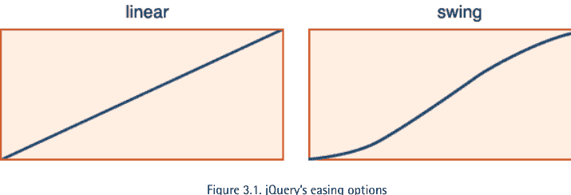

`swing` 缓动开始时缓慢，然后加速，接着在动画结束时再次平缓地减速。视觉上，`swing` 缓动看起来比 `linear` 缓动自然得多，如果未指定缓动参数，jQuery 默认使用它。

`linear` 缓动方法没有加速或减速：动画以恒定速度进行。在大多数情况下，它看起来相当无聊且有点死板，但值得尝试一下；它可能正适合你的目的。

### 高级缓动效果

如前所述，摇摆缓动提供了更赏心悦目的过渡效果，对于大多数任务可能已经足够。但摇摆和线性缓动只是冰山一角。除了 jQuery 核心库包含的这两种基本类型外，还有大量的缓动选项。其中大部分可以在缓动插件<sup>4</sup>中找到，该插件可从 jQuery 插件仓库获取。

缓动库也包含在 jQuery UI 库的效果部分中，我们很快会介绍它。如果你开始遭受插件疲劳，或许可以跳到名为“jQuery UI 库”的章节：该库包含了几个常用的插件，包括颜色动画、类转换和缓动。通过引入 jQuery UI 库，你就不需要在页面中单独引入每个插件了。

只需下载并在 HTML 页面的 jQuery 库之后的任意位置包含插件的 JavaScript 文件。缓动插件并非提供新函数，而是让你能够使用超过 30 种新的缓动选项。解释所有这些缓动函数的功能，即使对最具想象力的作者来说也是个挑战，所以我们直接引导你关注图 3.2，你可以通过图形看到其中一些算法的表现。

你会注意到，有些算法会超出图表区域；当动画元素达到过渡的这一部分时，它们会移动到目标点*之外*，然后折返并稳定下来。效果就像一个连接在弹性带上的元素，它会轻轻地将所有东西拉回原位。

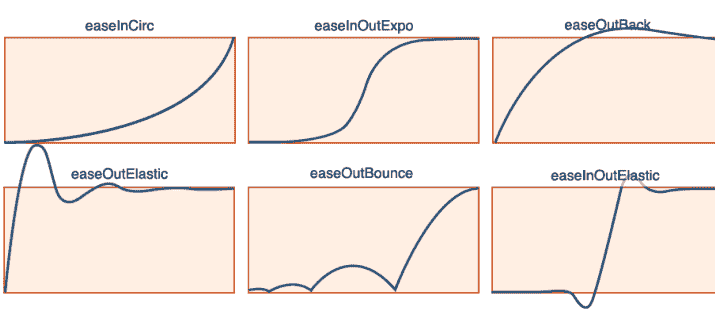

要使用新的算法之一，我们只需将其名称传递给 `animate` 函数。有很多选择，所以我们不妨直接尝试几个：

```javascript
chapter_03/06_other_easing_options/script.js (摘录)

$('p:first').animate({height: '+=300px'}, 2000, 'easeOutBounce');
$('p:first').animate({height: '-=300px'}, 2000, 'easeInOutExpo');
$('p:first').animate({height: 'hide'}, 2000, 'easeOutCirc');
$('p:first').animate({height: 'show'}, 2000, 'easeOutElastic');
```

看看那个段落的动态效果！你可能想知道这些缓动选项名称的来源，或者在哪里可以看到完整列表。这些算法源自 Robert Penner 的缓动方程，其在他的网站上有详经描述。⁵

查看所有可用方程的最佳方式是查看插件的源代码，或者查看 jQuery UI 的缓动演示。如果你热衷于使用文本编辑器，打开你下载的文件，里面会有一个你可以在 jQuery 动画中使用的函数列表。如果你希望在浏览器中看到效果，那么基于 jQuery UI 画布的解决方案适合你。⁶

> 休息一下，动手试试

休息一下，测试插件提供的所有缓动函数。你不太可能用到所有这些，但熟悉它们将让你能够选择正确的那个，为你的界面赋予你想要的精确感觉。此外，玩弄 `animate` 函数将巩固你对它的理解：这是 jQuery 忍者武器库的重要组成部分！

## 弹性内容面板

既然我们已经了解了一些 `animate` 函数的工作原理，让我们来看看客户最新的请求。今天的待办事项清单包括添加一个极其重要的页面组件：*StarTrackr!* 每日“当下谁最火？”榜单（简称 SDWHRNL）。该榜单包含最新走红或过气的名人，以及他们的照片和简短介绍。我们将运用刚学到的动画和缓动技术，将这个榜单实现为可以独立打开和关闭的面板。

该组件在页面中的外观如图 3.3 所示。

### 谁最火？

博·丹迪

强尼·斯塔达斯特

**强尼·斯塔达斯特**在以“有话要说的本地天气预报员”身份引发争议并迅速走红后，从成功走向成功。他目前作为超级乐队 *Pahoopt* 主唱的地位，使得他的确切行踪成为宝贵的信息。

格伦达特罗尼克斯

图 3.3. 人物简介面板

在我们的 HTML 中，我们将把这个部分实现为一个包含所有名人的 div 元素。每个名人的面板将标记为一个 h3，后跟另一个包含图片和简短段落的 div：

```html
chapter_03/07_bouncy_content_panes/index.html (摘录)
<section id="bio">
  <h2>谁最火？</h2>

  <h3>博·丹迪</h3>
  <div>
    
    <p>关于博·丹迪的内容</p>
  </div>

  <h3>强尼·斯塔达斯特</h3>
  <div>
    
    <p>关于强尼·斯塔达斯特的内容</p>
  </div>

  <h3>格伦达特罗尼克斯</h3>
  <div>
    
    <p>关于格伦达特罗尼克斯的内容</p>
  </div>
</section>
```

当用户点击其中一个标题时，我们希望关联的内容面板可以切换打开和关闭。你可以随心所欲的设置面板的样式，但为标题使用块级元素并设置不同颜色的背景是一种常见的技术：它能清晰地提示用户点击。

> “跳跃式”动画？

一个需要注意的怪癖是，直接在标题标签旁边制作动画的元素有时看起来会“跳跃”，尤其是在元素隐藏时。这是由于标题的边距（margin）在后续元素隐藏时会发生折叠。一个简单的变通方法（我们在这里使用了）是完全移除标题标签的边距。

我们希望在页面加载时不显示任何内容，因此我们的第一个任务是隐藏所有内容容器：

```javascript
chapter_03/07_bouncy_content_panes/script.js (摘录)
$('#bio > div').hide();
```

如果你希望默认打开一个面板，可以在这里指定。这有助于让用户更清楚地知道面板中“隐藏”了内容，他们需要点击标题来揭示它。在 jQuery 中实现这一点很简单：我们只需应用 `:first` 过滤器并调用 show 操作来仅显示第一个面板：

```javascript
$('#bio > div:first').show();
```

> 子选择器

这些示例中有一个我们尚未介绍的新选择器特性。它是**子**选择器，由大于号 (>) 表示。子选择器选择所有匹配选择器的直接子元素。如果我们省略了子选择器，我们的代码将选择 bio `div` 元素下的所有 `div` 元素，即使它们嵌套在其他元素中。有关此选择器的更多细节和代码示例，请查看 jQuery API 文档。⁷

⁵ http://www.robertpenner.com/easing/

⁶ http://jqueryui.com/demos/effect/#easing/

⁷ http://docs.jquery.com/Selectors/child

举个例子，我们将对第一个段落标签制作动画，使其在点击时放大和缩小；放大时我们使用线性缓动，缩小时使用摇摆缓动。差异相当微妙，但如果你重复几次动画，应该能区分它们；缩小动画感觉更自然：

```javascript
chapter_03/05_easing/script.js (摘录)

$('p:first').toggle(function() {
  $(this).animate({'height':'+=150px'}, 2000, 'linear');
}, function() {
  $(this).animate({'height':'-=150px'}, 2000, 'swing');
});
```

这个语句中包含了相当多的 jQuery，所以现在可能是暂停并确保你理解这里发生的一切的好时机：

-   1. 我们使用带选择器的过滤器只抓取第一个段落标签。一个 toggle 事件处理程序（在连续点击时依次执行每个传递的函数）被附加到该段落上。

-   2. 在处理程序内部，我们选择 `this`，它指的是触发事件的元素（在我们的例子中，就是段落本身）。第一个处理程序使用 += 格式，通过线性缓动函数将段落高度增加 150 像素。

-   3. 第二个处理程序使用 -= 格式，通过摇摆缓动函数将段落高度减少 150 像素。

如果你能够跟上并理解这些步骤中的每一个，给自己鼓鼓掌吧！你真的掌握了 jQuery 的精髓！

## 动画队列

我们接下来要探讨的动画话题，是`animate`函数的另一个高级用法。事实上，`animate`可以带有一组额外的选项参数来调用，就像这样：

```
animate(parameters, options);
```

`options`参数是一个包含多个选项的对象字面量，由键值对组成。我们已经熟悉了其中一些可用的选项：`duration`、`easing`和`complete`（回调方法）。然而，还有两个新的选项：`step`和`queue`。在我们解释它们之前，先来看一下使用`options`参数调用`animate`函数的语法：

```javascript
$('p:first').animate(
  {
    height: '+=100px',
    color: 'green'
  },
  {
    duration: 'slow',
    easing: 'swing',
    complete: function() {alert('done!');},
    queue: false
  }
);
```

请注意，使用我们之前见过的更简单格式，你几乎可以完成所有这些操作。只有在你需要指定额外设置（如`queue`参数）时，才需要使用这个高级版本。

`queue`是指在一个特定元素上等待执行的动画列表。每次我们请求jQuery对一个元素执行动画时，该动画就会被添加到队列中。元素会依次执行队列中的动画，直到全部完成。如果你在我们的演示中频繁点击，可能已经看到过这种现象。

然而，在很多情况下，这种行为是不理想的。有时你希望多个动画同时发生。如果你在指定动画时禁用了队列，后续动画就可以并行运行。

可以通过使用`queue`选项，以及jQuery的`stop`、`queue`和`dequeue`操作来控制动画队列。这种操作和选项的组合让我们能够极其精细地控制动画的执行方式。但在我们能够深入探讨这些强大的选项之前，是时候揭示最重要的jQuery技巧之一了。

## 链式操作

到目前为止，我们一直在逐条编写语句：要么是一个接一个，要么是嵌套在回调函数内部。我们不得不重写选择器，或者利用`this`关键字来重新定位目标元素。然而，有一种技术允许我们对同一个元素（或多个元素）连续执行多个jQuery命令。我们称之为链式操作。为了释放你内心的忍者，你最好好好注意这一点。

**链式操作**将两个或多个jQuery操作（或方法）连接成一个语句。要链接一个操作，你只需将其附加到前一个操作之后即可。例如，让我们将`hide`、`slideDown`和`fadeOut`操作链接在一起。我们的元素会快速隐藏，然后滑动进入视图，最后淡出：

```javascript
$('p:first').hide().slideDown('slow').fadeOut();
```

你可以链接任意多个操作。不过要小心：链式操作很容易让人上瘾。除了能够基于初始选择器链接操作之外，你还可以在DOM中移动，随时添加和删除元器，这可能导致一些相当复杂的语句。

通常，为了清晰起见，最好将你的操作放在单独的行上。虽然这会占用更多空间，但更容易阅读和维护。我们之前的例子可以重写为：

```javascript
$('p:first')
    .hide()
    .slideDown('slow')
    .fadeOut();
```

重要的是要认识到，jQuery选择器包含了每个操作执行后修改过的结果，然后才启动下一个操作。这意味着我们可以沿途添加和删除元素，只将操作应用于当前选择。

如果你回顾一些早期的例子，你可能会发现代码中隐藏的一些链式操作；例如，当我们写`$(this).next().animate()`时，`next`操作将我们的选择移动到下一个DOM元素，然后`animate`操作对其进行了动画处理，而没有影响原始元素。

从现在开始，你将有很多机会练习链式操作；本书的其余部分将充满它。这是jQuery最有趣的部分！

## 暂停链式操作

如果你想在jQuery链式操作中稍作停顿，可以使用`delay`操作。只需给它一个数字，它就会延迟队列该毫秒数，然后继续执行。所以，参考同一个例子，我们可以写：

```javascript
$('p:first')
    .hide()
    .slideDown('slow')
    .delay(2000)
    .fadeOut();
```

这段代码会滑动展开段落，然后等待两秒再将其淡出。这是一种更精确地控制动画的好方法。

## 动画导航

客户团队在这个问题上坚持己见：团队成员希望顶级导航是一个Flash控件，当用户与之交互时会摇晃和缩放。他们声称Flash看起来更好。你向他们保证你的Flash技能首屈一指，并会立即为他们制作一个概念验证。

好了。现在，趁客户团队不在房间，让我们运用新发现的jQuery力量来创建一个类似Flash的导航栏。它将包含一个背景“光斑”，当用户悬停在菜单选项上时，该光斑会摇晃以突出显示该选项。我们将使用免费的标准技术来完成这一切：HTML、CSS和JavaScript。Flash？我们不需要什么该死的Flash！

我们坚持使用基本动画，以便于理解步骤。首先，我们修改了与导航菜单相关的CSS，使其水平布局而非垂直布局。作为回顾，导航的HTML如下所示：

```html
<ul id="navigation">
  <li><a href="#">Home</a></li>
  <li><a href="#">About Us</a></li>
  <li><a href="#">Buy!</a></li>
  <li><a href="#">Gift Ideas</a></li>
</ul>
```

我们的背景色光斑将是一个空的div元素，定位在用户鼠标悬停的导航链接后面。因此，我们的第一个任务是创建该元器并将其附加到文档中：

```javascript
$('<div id="navigation_blob"></div>').css({
    width: 0,
    height: $('#navigation li:first a').height() + 10
}).appendTo('#navigation');
```

请注意，我们是在对象字面量*内部*选择导航链接来提供宽度和高度的值。如果你是编程新手，这看起来可能有点奇怪，但你不应该被它吓倒；总的来说，在任何可以使用静态值的地方，你都可以使用函数返回（或计算）的值。我们还将这些值增加了10像素，以便光斑比它将位于其后的锚标签稍大一些。

> **单位统一**

> 为了在你使用**css()**或**width()**时规范化尺寸，jQuery会将所有带单位（em、in、pt等）的属性转换为像素。这就是当你将宽度设置为，比如30em时，jQuery返回480并省略单位时发生的情况。

这无疑使得操作尺寸变得容易得多，这也是我们能够在代码中直接加10的原因。如果你自己省略了单位类型，jQuery会直接假设你指的是像素。

有了光斑，我们需要建立一个触发器来使其运动。这应该在用户将鼠标悬停在导航链接上时发生，所以我们将使用`hover`函数。请记住，`hover`接受两个参数：鼠标移动*到*元素上时运行的函数，以及鼠标从元素上移开时运行的函数。这是我们事件处理程序的大致结构：

```javascript
$('#navigation a').hover(function() {
  // 鼠标移入函数
  :
}, function() {
  // 鼠标移出函数
  :
});
```

现在来看一些有趣的部分。让我们看看第一个函数，它在鼠标移动到元素上时触发：

## 动画导航，第二部分

使用像 jQuery 这样的库的一个巨大好处是，你可以相当快速地尝试许多不同的方案，并选出你最喜欢的一个。

客户团队回来查看我们动画导航的进展之前，我们还有几个小时的时间。让我们尝试从不同的角度来处理同一个问题，看看我们能想出什么办法。

对于这个动画，我们的每个菜单项都将有一个隐藏的图标，当鼠标悬停在链接上时，该图标会弹跳进入视野（如图 3.4 所示）。

这个效果的设置非常简单。它是一个常规的无序列表，配置为水平菜单，但我们在通常可见的区域下方藏了一个秘密图标。这只涉及到设置列表项的高度，使得默认情况下只能看到链接文本，但当我们动态改变高度时，图标就会弹跳出来。

我们将从 CSS 开始：我们已将菜单定位为绝对定位于容器 div 的右上角，那里有空间让图标展开。我们为图标设置了一个背景色作为衬托，并运用了一个巧妙的技巧来隐藏背景图像；注意列表项的高度是 20 像素，但背景从顶部偏移了 30 像素。因此，在我们扩展列表项的高度之前，它们将是不可见的。

我们还将为每个链接的背景图像设置不同的图标：

```css
chapter_03/10_animated_navigation_2/navigation.css (excerpt)

#container {
    position: relative;
}

#navigation {
    position:absolute;
    width: inherit;
    top: 0;
    right: 0;
    margin: 0;
}

#navigation li {
    height:20px;
    float:left;
    list-style-type: none;
    width:70px;
    padding:3px;
    border-right:1px solid #3687AF;
    background-color: #015287;
    background-repeat: no-repeat;
    background-position: center 30px;
}

#navigation li a {
    color: #FFFFFF;
}

#navigation #home {
    background-image:url('home_icon.png');
}
```

这个效果代码中唯一的新方面是，我们对 `mouseover` 事件和 `mouseout` 事件都使用了 `stop` 动作来清除队列。然后我们只需动画化高度以显示隐藏的图标，并在悬停结束时将其缩回正常大小。一些精心选择的持续时间和缓动设置给了我们想要的酷炫弹跳效果。请务必尝试调整这些设置，以匹配你网站的风格：

```javascript
$('#navigation li').hover(function() {
        $(this)
            .stop(true)
            .animate(
                {height: '60px'},
                {duration: 500, easing: 'easeOutBounce'}
            )
        },
        function() {
            $(this)
                .stop(true)
                .animate(
                    {height:'20px'},
                    {duration: 500, easing: 'easeOutCirc'}
                )
        }
    );
```

现在，我们不是有一个，而是有两个有趣的动画导航示例可以展示给客户了。

## jQuery UI 库

正如第 1 章提到的，jQuery UI 库是一系列高级 jQuery 小部件、效果和交互（如日期选择器、手风琴和拖放功能）的集合，广泛应用于 Web 开发。但在我们开始这些有趣的内容之前，先来看看如何下载和包含 jQuery UI 库。这个过程比我们目前使用的核心库和插件的设置稍微复杂一点。这是因为完整的 jQuery UI 库（截至 1.8.17 版本）大小为 367kB（压缩后为 197kB）。这代码量真不少！幸运的是，任何给定的项目通常只需要 jQuery UI 中功能的一小部分，而 jQuery 网站为我们提供了一个便捷工具，可以创建只包含我们所需功能的自定义版本 jQuery UI。

当你第一次访问下载构建器页面时，选项可能看起来有点令人生畏，你可以通过点击 jQuery UI 主页上的 **自定义构建下载** 链接到达该页面。

下载构建器分为几个部分：核心、交互、小部件、效果和主题。核心是主要的 jQuery UI 库：小部件和交互组件都依赖于它。处理构建器的一个好方法是取消选择所有内容，然后只添加你需要的部分。如果一个组件依赖于另一个组件才能运行，它会被自动为你选中。

在开发阶段，获取完整的库是安全的。这样，如果需要，所有功能我们都可以使用。一旦你对网站的功能感到满意，你随时可以返回下载构建器，创建一个自定义库，省略任何未使用的部分。完整库和自定�版本之间的文件大小差异可能相当显著。

一个会极大影响小部件和交互视觉输出的选项是 *主题*。你可以从下拉框中选择多个主题。在第 9 章，我们将深入探讨主题，包括如何制作你自己的主题。但为了快速推进这个激动人心的内容，我们将使用默认主题，然后继续工作。

自定义下载的压缩包包含很多文件。在 **development-bundle** 目录中，有大量的演示和文档供你尝试和探索，但要使用 jQuery UI，你只需要 **jquery-ui-1.8.17.min.js** 文件（或者你阅读本书时的当前版本）以及包含你所选主题的目录。

你必须将主题目录放在你的 HTML 页面可以访问的位置。对于本书的示例，jQuery UI 被放置在 **lib** 目录（与 jQuery 本身并列），主题文件放在 **css** 目录。

jQuery UI 库包含一个效果包，使我们能够实现一些有趣的效果。它还包括用于进行高级动画的有用方法和功能。由于颜色动画插件和缓动插件，我们已经见过其中一些功能。这些插件都包含在效果包中，所以如果你打算使用 jQuery UI 效果库，就不再需要单独包含它们了。

在继续之前，让我们快速看一下一些可用的效果。我们将使用我们那个饱受诟病的第一段元素，让它摇一摇，用黄色高亮它，然后把它炸成碎片：

```javascript
$('p:first')
    .effect('shake', {times:3}, 300)
    .effect('highlight', {}, 3000)
    .hide('explode', {}, 1000);
```

看它动起来！当然，这只是可用效果的一个小样本。其中一些只能通过 **effect** 动作以这种方式使用，而另一些既可以这样用，也可以替代 **hide**、**show** 或 **toggle** 参数。后者的一些例子是 **blind**、**clip**、**puff**、**fold** 和 **slide**。

我们将避免在这里详细介绍所有效果；你最好花周日下午的时间去探索它们。并非所有效果都纯粹是炫技，但许多在常见的用户交互场景中很有用，例如 **highlight**，它是向用户指示新消息的标准方式。

逐一测试每个函数是个好主意，这样你就能在合适的时候记起它们。如果 jQuery UI 的效果库对你来说还不够，别担心：插件仓库里还有数百种效果可供选择！

## 动起来！

你现在已经理解了使用 jQuery 进行动画制作的所有基础：选择器、事件处理器、回调、链式操作，以及非常重要的 `animate` 函数。你也对广泛的 jQuery UI 库有了初步了解。然而，要真正掌握这些技能，最好的方法是实践。去动手为所有你能接触到的东西添加动画效果吧。尝试操控页面上每个元素的所有属性，直到你感觉能真正驾驭它们。

在我们从动画转向下一个你需要掌握的 jQuery 技能集之前，我们将把注意力转向滚动和调整大小：这些主题可能不如动画那么炫酷，但它们对许多用户界面组件至关重要。它们还将帮助你巩固对 jQuery 选择器、操作和链式调用的理解。那么，我们还等什么呢？

## 滚动

在某种程度上，滚动类似于动画，因为元素在页面上移动。然而不同的是，用户是控制者。尽管如此，仍有多种方法可以自定义这些交互。在本节中，我们将探讨在用户滚动时保持不动的菜单、自定义主题的滚动条，以及如何将我们刚学到的动画技术应用于文档滚动。

### scroll 事件

在我们能够改善用户的滚动体验之前，我们需要知道他们何时滚动以及滚动了什么。事实证明，有一个名为 `scroll` 的事件，当用户更新元素的滚动位置时触发，例如 `window` 或可滚动的 `div`。因此，每次用户与你网站上的滚动条交互时，都会触发一个你可以捕获并响应的事件。

要捕获 `scroll` 事件，我们将事件处理程序附加到具有滚动条的元素上，通常是 `window` 元素。`window` 本身是一个 JavaScript 对象，所以我们需要做的就是用我们的 jQuery 函数将其包裹起来以选择它。

当然，要看到滚动事件实际运行，我们必须设置一个带有滚动条的区域！我们有一些滚动效果的想法想向客户展示，但为了学习滚动事件的工作原理，让我们通过在页面的一个 div 上设置 `overflow: scroll;` 来模拟一个滚动环境：

```css
chapter_03/12_scroll_event/scroll.css (excerpt)

#news {
    height: 100px;
    width: 300px;
    overflow: scroll;
}
```

这将把我们的新闻部分变成页面内一个较小的滚动窗格。现在让我们捕获滚动事件，并在每次滚动事件触发时向页面添加一些任意文本：

```javascript
chapter_03/12_scroll_event/script.js (excerpt)

$('#news').scroll(function() {
    $('#header')
        .append('<span class="scrolled">You scrolled!</span>');
});
```

现在，每当你滚动新闻部分时，文本 “You Scrolled!” 就会出现在页面顶部。非常烦人，但你明白了。尝试用不同的方式滚动：拖动滚动条、使用鼠标滚轮、在可滚动区域内点击并使用方向键。在所有上述情况下，scroll 事件都会触发。

## 浮动导航

我们现在知道用户何时滚动，那么我们如何利用这些信息来改善我们的网站呢？嗯，一个相当常见的页面响应用户滚动的例子是浮动导航窗格。这是指主导航元素始终位于可见屏幕部分的顶部，无论滚动位置如何；就好像导航菜单会随着用户向下滚动页面而跟随。使用滚动 事件可以轻松实现这一点。

我们的第一个任务是设置 CSS，为动画导航做准备。为了本练习的目的，我们为内容应用了一个非常大的 height 属性，以强制其具有滚动条（当然，除非你有一个巨大的显示器）：

```css
chapter_03/13_floating_nav_1/scroll.css (excerpt)

#navigation {
  position: relative;
}

#content {
  height: 2000px;
}
```

现在我们可以尝试制作浮动窗格了。乍一看，似乎没什么比这更简单的了。我们只需通过更新导航块的 top 位置来响应主窗口的滚动事件，前提是如果该块通常会超出视口：

```javascript
chapter_03/13_floating_nav_1/script.js (excerpt)

$(window).scroll(function () {
  $('#navigation').css('top', $(document).scrollTop());
});
```

在你的浏览器中测试一下，你会发现我们已经达到了目标：当你向下滚动页面时，导航框会锁定在窗口顶部。它是如何知道何时到达顶部的？我们通过使用 `scrollTop` 操作来获取屏幕顶部。`scrollTop` 返回匹配元素的顶部偏移量；在我们的例子中，我们请求整个文档的顶部位置：`$(document).scrollTop()`。这将始终位于屏幕的最顶端。

它确实有效，但是，你可能会问，为什么呢？你之前在我们首次介绍 scroll 事件时注意到了吗？每次用户移动滚动条时，都会触发许多滚动事件。每个事件都会触发我们的代来更新导航位置，因此我们预期导航会抖动并跳跃。

它不抖动是因为我们拥抱了我们的忍者本性。忍者知道浏览器应该只做实现目标所需的最小工作量。当然，我们可以选择 `position: relative`，然后在每次滚动事件触发时设置元素的 top，但那样会抖动。我们的解决方案有效，出色地完成了手头的任务。尽管如此，我们何不用一些逻辑让它更智能呢？方法如下：

```javascript
chapter_03/14_floating_nav_2/script.js (excerpt)

var $window = $(window),
    $navigation = $("#navigation");

$window.scroll(function() {
    if (!$navigation.hasClass("fixed") && ($window.scrollTop() > $navigation.offset().top)) {
        $navigation.addClass("fixed").data("top", $navigation.offset().top);
    }
});
```

我们还添加了一个 `data` 方法来记录元素的初始 top 属性。我们向下滚动页面时实际上不需要这个，但当我们向上滚动时肯定需要。在我们的代码示例 **13_floating_nav_1/script.js** 中，当我们滚回页面顶部时，导航会继续超过其初始位置。我们现在要修复这个问题：

```javascript
chapter_03/14_floating_nav_2/script.js (excerpt)

$window.scroll(function() {
    if (!$navigation.hasClass("fixed") && ($window.scrollTop() > $navigation.offset().top)) {
        $navigation.addClass("fixed").data("top", $navigation.offset().top);
    }
    else if ($navigation.hasClass("fixed") && ($window.scrollTop() < $navigation.data("top"))) {
        $navigation.removeClass("fixed");
    }
});
```

现在我们检查是否设置了 **fixed** 类，以及窗口是否已向上滚动超过导航应停留的位置。我们通过引用我们设置的 **data** 属性来做到这一点。当满足此条件时，我们只需移除 **fixed** 类，元素就会回到文档流中。

## 滚动文档

当关于相关（但多样）主题的长信息列表需要显示在单个 HTML 页面上时，通常在页面顶部包含一个超链接的主题列表。

这些内部链接将立即跳转到你所选菜单项的正确位置。在内容之后，通常会有一个链接将你带回屏幕顶部，以便你可以选择另一个菜单项。让我们尝试将此功能添加到我们的页面。

第一个任务是在页面的页脚添加链接。要跳到页面顶部，我们将链接的 `href` 属性设置为 `#`。

如果我们仔细想想，我们想要做的就是动画化页面的滚动位置，在 jQuery 中这由 `scrollTop` 表示。我们还需要取消默认的链接操作，否则页面会在我们的动画完成之前就跳转。如果你是 JavaScript 新手，有一个简单的方法可以实现这一点：任何处理链接 `click` 事件的函数都会接收事件作为参数——我们称之为 `e`——然后我们使用事件对象的 `preventDefault` 方法：

```javascript
$('a[href=#]').click(function() {
    $('html').animate({scrollTop: 0}, 'slow');
    return false; // Return false to cancel the default link action
});
```

这段代码引入了一种新的选择器：**属性选择器**。通过将属性和我们要查找的值放在方括号（`[]`）中，我们可以将选择范围缩小到仅包含具有特定属性值的元素。在本例中，我们只查找 `href` 值为 `#` 的链接。

这段代码有效，当然也很清晰简单，但它确实遇到了一个小问题。如果用户的浏览器在怪异模式下运行，`$('html')` 选择器将失败。（不确定什么是怪异模式？请花时间阅读 SitePoint CSS 参考页面上的相关主题[^1]以获取详细解释。）虽然你*应该*以触发标标准模式的方式标记你的页面，但有时你会处理遗留代码，因此没有这个优势。要使上述代码在怪异模式下工作，你需要使用选择器 `$('body')`。我们也可以同时针对两者以确保：`$('html, body')`。这反过来又会导致某些版本的 Opera 浏览器出现问题，它（可能正确地）尝试同时滚动两个元素。

[^1]: http://reference.sitepoint.com/css/doctypesniffing

“但你说过jQuery能解决我们所有跨浏览器问题！”你可能会这样惊呼。公平地说，它解决了*大部分*跨浏览器问题。但这个问题稍微棘手一些，核心jQuery库并未解决。幸运的是，解决方法相当简单。更幸运的是，有人已将此解决方法（以及众多其他滚动功能）打包成一个名为ScrollTo的插件。

ScrollTo插件可从插件库获取，是一个用于滚动屏幕和溢出元素的稳定插件。它完全能够处理我们目前遇到的任何滚动任务。

下载并包含该插件后，你就可以重写顶部链接功能，完全不用担心那些晦涩的浏览器bug：

```
$('a[href=#]').click(function(e) {
    $.scrollTo(0,'slow');
    e.preventDefault();
});
```

这个语法对你来说可能有点陌生，因为我们在直接从jQuery别名调用scrollTo。这个插件很聪明，它知道如果我们以这种方式直接调用，我们希望滚动整个窗口。如果我们想滚动特定的溢出元素，我们会使用传统选择器语法；例如，`$('div#scrolly').scrollTo(0, 'slow')`。

ScrollTo插件功能丰富，不限于按整数值滚动。你可以传入相对值（如+=50px）、一个DOM元素（它将滚动页面以查找该元素）、一个选择器字符串、一个包含x和y坐标的哈希值，或关键字max（这将滚动到文档末尾）。你可以水平和垂直滚动，它还提供了一些用于微调目标位置的优秀选项。你可以在插件的主页上了解所有这些选项。

## 自定义滚动条

客户团队的一位成员皱着眉头走到你的桌前，手里拿着一份“最终确定”的签字设计稿。“现在，”她开口说，“这里的滚动条不会是这个样子吧？我是说，它们都是灰色的，而且非常显眼。”

通常，你只需要从事Web开发很短的时间，就会有客户要求你用自定义滚动条替换操作系统标准滚动条，尤其是对于像滚动div这样的内部元素。这似乎是一个合理的要求，但其中存在一些你应该意识到的可用性问题。

人们对操作系统核心界面组件的功能有特定的期望，自定义实现有时会与其替代的核心元素具有不同的功能。以这种方式打破用户的期望可能会极其令人沮丧，因此这类UI自定义应极其谨慎地进行。

话虽如此，有时一个恰到好处的自定义UI元素会对界面的整体感觉产生天壤之别。最终，你必须权衡对你目标受众的利弊。在我们这个案例中，客户是付费方，所以我们会做。

然而，没有必要尝试从头构建它：滚动条是一个复杂的用户界面元素，如果客户发现我们浪费了宝贵的开发时间自己构建它，她会很不高兴，尤其是当有一个完全合适的插件现成可用时：它叫做jScrollPane。

jScrollPane是一个jQuery插件，允许你在任何内容溢出的元素中，用自定义滚动条替换浏览器的默认垂直滚动条。你可以在官方仓库中找到该插件，但一个更新的版本可在Google Code上找到。¹²

需要包含两个文件：JavaScript代码文件`jquery.jscrollpane.min.js`和配套的CSS文件`jquery.jscrollpane.css`。CSS文件为滚动条设置了一些默认样式，并为你实现自己的自定�提供了一个起点。只需用你自己的颜色和图像扩展或覆盖此文件中包含的样式，即可创建自定义滚动条。在我们的示例中，我们将坚持使用默认样式：一条外观时尚的灰色条带，几乎适用于任何网站（如图3.5所示）。

## 细节之处

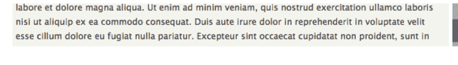

图3.5. 自定义滚动条

你可以通过简单地在任何元素上调用jScrollPane函数来为其激活自定义滚动条。虽然参数是可选的，但有十多个供你调整，例如显示滚动条箭头，或将滚动条移动到面板的左侧。你可以在插件的主页上看到完整列表。<sup>13</sup> 在我们的示例中，我们将在内容和滚动条之间设置边距，设置滚动条的宽度，并选择隐藏顶部和底部箭头：

```javascript
chapter_03/16_custom_scrollbar/script.js (excerpt)

$('#fine_print').jScrollPane({
    verticalGutter: 20
});
```

我们的新滚动条外观和功能都很棒，但你可能注意到，当你在元素上滚动鼠标滚轮时，它没有响应。jQuery核心库有意省略了鼠标滚轮功能，以保持库大小最小化，但有一个插件可以将其添加回来，<sup>14</sup> 而jScrollPane在编写时就考虑到了这个插件。因此，你只需在页面中包含鼠标滚轮插件（**jquery.mousewheel.js**），jScrollPane就会自动为所有滚动内容窗格添加鼠标滚轮事件处理，让你可以随心所欲地滚动它们！

## 调整大小

调整大小在用户界面中有几种不同的含义。首先想到的是调整浏览器窗口大小的能力（这经常让Web开发者头疼）。此外，调整应用程序内的窗口大小，以及调整图像或其他元素的大小也很常见。

jQuery包含一种收集用户发起的窗口调整大小信息的方法，也（通过jQuery UI）提供了一种让用户对页面上任何元素拥有最终调整大小能力的方法。让我们深入了解！

### resize 事件

resize事件是核心jQuery事件，在文档视图调整大小时触发。你可能想要响应这个事件的原因有很多，但在研究实际示例之前，让我们先确保理解事件是如何工作的：

```javascript
chapter_03/17_resize_event/script.js (excerpt)

$(window).resize(function() {
    alert("You resized the window!");
});
```

在浏览器中加载index.html页面并尝试调整窗口大小。每次调整时，都会弹出一个警告。每次用户更改浏览器窗口大小都打扰他们，可能会让我们无法赢得任何用户体验分，所以让我们将此事件用于更实际的例子。

### 布局切换器

如果你使用CSS有一段时间了，你就会知道有一个持续的争论，关于哪种布局最好：流式布局还是固定宽度布局。一方面，流式布局最大化利用用户的屏幕空间；另一方面，固定宽度布局允许你设计像素完美的布局，当用户在不同的视口大小中查看时不会破裂。

对于StarTrackr!，我们可以提供两全其美的方案：设计两个独立的固定宽度布局，并通过捕获resize事件在它们之间切换。

让我们开始吧。到目前为止，我们一直在处理的默认StarTrackr!网站宽度为650像素。我们的第一个任务是编写一些样式使其更宽。我们将为宽版本选择850像素：

```css
chapter_03/18_layout_switcher/wide.css

body #container {
    width: 850px;
}

body #container p {
    width: 650px;
}

body #header {
    background-image: url('../../css/images/header-corners-wide.png');
}

body #celebs table {
    width: 650px;
    margin-left: 5px;
}
```

注意，我们在每个规则的开头都添加了一个看似多余的`body`。这样它们就会优先于我们基础样式表中针对相同元素的任何规则，因为它们更具特异性，或者具有更高的**特异性**。

下一步是编写jQuery代码来添加或删除我们的新样式表。我们只需要测试`body`元素的宽度是否大于900像素，如果是，则将样式表附加到我们的`head`元素，如果不是，则将其移除：

```javascript
chapter_03/18_layout_switcher/script.js (excerpt)

if ($('body').width() > 900) {
    $('<link rel="stylesheet" href="wide.css" type="text/css" />')
        .appendTo('head');
} else {
    $('link[href=wide.css]').remove();
}
```

这使我们陷入了困境。我们需要在两种情况下运行此代码：第一次加载页面时，以及每次页面调整大小时。

## 84 jQuery：从新手到忍者

你可能很想直接复制粘贴那段代码，然后就完事了。请抵制住这种诱惑！在代码中重复自己几乎总是一个坏主意。想象一下，几个月后，你发现 900 像素的截断点不对。你现在认为应该在大约 1000 像素时才切换样式表。你去修改代码，更改数值，然后重新加载页面。但是它坏了，因为你忘了在另一个相同的代码块中更改相同的值。在任何类型的软件开发中，这种情况都太容易发生了，你的代码越复杂，它发生的可能性就越大，追踪起来也越困难。

幸运的是，几乎每种编程语言都有构造来帮助我们应对这类情况，JavaScript（以及 jQuery）也不例外。到目前为止，我们一直将匿名函数传递给所有事件处理程序，但现在是时候给我们的函数命名了：


`chapter_03/18_layout_switcher/script.js` (excerpt)

```
$(document).ready(function() {
    stylesheetToggle();
    $(window).resize(stylesheetToggle);
});

function stylesheetToggle() {
    if ($('body').width() > 900) {
        $('<link rel="stylesheet" href="wide.css" type="text/css" />')
            .appendTo('head');
    } else {
        $('link[href="wide.css"]').remove();
    }
}
```

我们将函数命名为 `stylesheetToggle` 并使用了两次：一次在文档首次加载时，另一次在每次调整窗口大小时。你会注意到我们只需要将函数*名称*传递给 resize 事件处理程序，我们会让事件调用该函数。当我们传递函数而不是声明函数时，我们不需要 `function` 关键字、任何括号或任何花括号。

一旦你掌握了这种“传递”与“调用”的区别，它就能在缩短 `setTimeout()` 代码编写方面真正派上用场，所以让我们再看看。当函数名在代码中使用并后跟括号时，我们就调用了该函数，它就会执行。当我们使用函数名时不带括号时，我们传递的是对函数的引用，需要另一段脚本来调用它。

## 可调整大小的元素

jQuery UI 库在其交互功能中包含了一个可调整大小插件。可调整大小插件使你选择的元素能够通过在元素的右下角添加一个小手柄来调整大小。可以用鼠标拖动这个手柄（就像你操作系统的窗口一样）。像所有 jQuery UI 组件一样，它高度可配置且易于使用。如果你之前下载了完整的 jQuery UI 库，那么该类已经准备就绪。否则，你需要返回下载构建器并包含可调整大小组件；这还将需要 UI Core 的 `core`、`widget` 和 `mouse` 依赖项以及一个主题。

以最基本的形式使用可调整大小组件非常简单。我们只需选择要修改的元素，然后调用 `resizable` 函数：

```
chapter_03/19_resizable_elements/script.js` (excerpt)

$('p').resizable();
```

如果我们将其运行在 StarTrackr! 网站上，会得到一些不寻常的结果：每个段落元素瞬间都变得可调整大小！

看到它的实际运行效果非常有趣；突然间，我们的整个网页都变得可以变形了。默认情况下，可调整大小交互会在元素的右下角添加小手柄。它们的样式定义在 jQuery UI 样式表中，所以如果你对改变它们的外观感兴趣，可以查看该样式表。默认手柄如图 3.6 所示。

### 图 3.6. 可调整大小的段落

### 欢迎！

Lorem ipsum dolor sit amet, consectetur adipisicing elit, sed do eiusmod tempor incididunt ut labore et dolore magna aliqua. Ut enim ad minim veniam, quis nostrud exercitation ullamco laboris nisi ut aliquip ex ea commodo consequat. Duis aute irure dolor in reprehenderit in voluptate velit esse cillum dolore eu fugiat nulla pariatur. Excepteur sint occaecat cupidatat non proident, sunt in

免责声明！非 ....

### 可调整大小的文本区域

有时，提供一个可用的界面可能与保持设计平衡和美观的愿望相冲突。不过，多亏了 jQuery，我们可以两者兼得，在棘手的客户演示中为自己辩护。

形式与功能经常发生冲突的一个领域是 HTML 表单设计。这部分是因为你网站的用户通常会有截然不同的需求。例如，如果你提供一个反馈区域，用户可能想写很少、一点或很多内容。为了取得平衡，你可以从一个小的 textarea 开始，但使其可调整大小。因此，有很多话要说的用户会觉得你是在让他们说出来。以下是我们如何使用 jQuery UI 的可调整大小功能来实现这一点：

```
chapter_03/20_resizable_textarea/script.js` (excerpt)

$('textarea').resizable({
  grid : [20, 20],
  minWidth : 153,
  minHeight : 30,
  maxHeight : 220,
  containment: 'parent'
});
```

这使得我们所有的 textarea 元素都变得可调整大小，就像我们对段落元素做的那样。效果如图 3.7 所示。然而，我们指定了一些新参数来改善体验，并展示可调整大小组件的灵活性。它有大量的配置选项，你可以在 jQuery UI 文档站点上更详细地探索。

## 发表评论

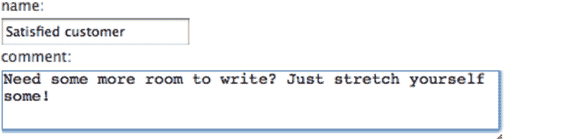

我们还通过指定 `minHeight`、`minWidth` 和 `maxHeight` 属性来限制元素可以被拉伸的程度。你会注意到我们省略了 `maxWidth` 属性，而使用了 `containment` 参数：这允许你指定一个容器来限制可调整大小的元素。你可以使用 jQuery 选择器作为参数，或者使用特殊关键字 `parent` 来引用可调整大小元素的父元素。

我们还使用了 `grid` 选项来将可调整大小的对象限制在特定大小的步长内。出于某种原因，这似乎为调整大小交互增添了一种良好的感觉。`grid` 被指定为一个包含两个元素的数组：水平网格大小和垂直网格大小。

另一个你想研究的参数是 `handles` 参数。这指定了手柄将附着在元素的哪些边上，因此也指定了元素可以被拉伸的方向。该参数接受以下选项：`n`、`e`、`s`、`w`、`ne`、`se`、`sw`、`nw` 和 `all`。你可以通过用逗号分隔来指定其中的任意数量。例如，`{ handles : 'n, se' }` 会在元素的顶部和右下角添加手柄。

在内容长度变化显著的输入页面中，通常可以看到这种功能。

> ¹⁵ http://jqueryui.com/demos/resizable/

## 窗格分割器

尽管我们提供了免责声明消息功能，但客户的法务团队仍然担心，如果未能正确概述公司的条款和条件，可能会产生潜在的后果。从设计和可用性的角度来看，问题在于有一页又一页的条款和条件被分为许多小节，但它们需要在主页上突出显示。也许一个分割器可以帮助我们。

**分割器** 是一种 UI 组件，它以允许用户调整元素大小的方式划分页面上的多个区域；这样，用户就能够决定为每个区域分配多少空间。分割器在桌面应用程序中很常见，随着富互联网应用程序的兴起，它们也正在走向 Web。我们可以利用可调整大小组件的经验来模拟一个简单的分割器，其中一个窗格包含“目录”，另一个窗格包含 StarTrackr! 的“条款和条件”内容。该小部件的外观如图 3.8 所示。

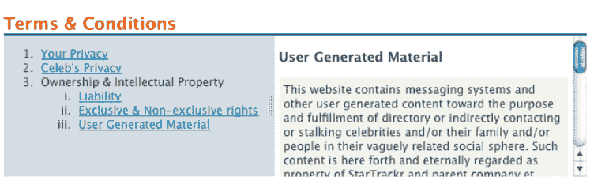

目前，我们将仅关注调整大小功能。动态加载每个部分的内容到窗格中将在第 5 章中详细讨论。

我们的分割器将由两个代表每个窗格的 `div` 元素组成，嵌套在一个具有固定尺寸的包含元素中。我们将把目录封装在一个块级元素中，这样当用户调整窗格大小时，文本就不会换行并弄乱我们的嵌套列表：

## 动画、滚动和调整大小

我们现在将在新的**splitter.css**样式表中添加一些简单的样式。你可以看到，我们固定了包含div的高度，并让子元素默认各占宽度的50%。如果需要从非50:50的分割开始，可以更改为指定不同的值。如果需要使用CSS边框，必须以像素为单位指定宽度，并确保它们相加的总和正确：

```css
#splitter {
  height: 150px;
  margin-top: 30px;
  margin-bottom: 50px;
}

#splitter .pane {
  width: 50%;
  height: 100%;
  float: left;
}

#splitter h2 {
  margin-bottom: 0;
  padding-bottom: 0;
}

#tocPane {
  overflow: hidden;
  background: #d6dde5 url(../images/handle.png) no-repeat right center;
}

#tocPane .inner {
  width: 300px;
}

#contentPane {
  overflow: auto;
}

#contentPane .inner {
  padding: 0 5px;
}
```

接下来是我们的jQuery代码。要创建一个水平分割器，我们将第一个元素设置为可调整大小，并指定一个朝东的拖拽手柄，这样就只有div的右边缘可以调整大小。

如果你只运行一个简单的可调整大小语句，你会注意到我们几乎成功了：两个元素的作用有点像分割窗格，只是当你拖动手柄时，右侧元素的宽度保持不变，而不是扩展以填充剩余空间。为了解决这个问题，我们需要在可调整大小部件的resize函数中进行一些计算。这是一个在组件调整大小时触发的事件处理程序：

```javascript
$('#splitter > div:first').resizable({
  handles: 'e',
  minWidth: '100',
  maxWidth: '400',
  resize: function() {
    var remainingSpace = $(this).parent().width() -
      $(this).outerWidth();
    var divTwo = $(this).next();
    var divTwoWidth = remainingSpace - (divTwo.outerWidth() -
      divTwo.width());
    divTwo.css('width', divTwoWidth + 'px');
  }
});
```

现在，每次调整大小也会触发第二个元素宽度的变化。一些基础数学帮助我们计算出应有的宽度。我们获取父容器的宽度（即总宽度），然后减去第一个div的outerWidth。outerWidth函数是获取元素总宽度（包括任何内边距和边框）的有用方法（此外，如果你传递可选参数true，它还可以包括外边距）。也许不足为奇，也有一个对应的outerHeight函数。

计算出剩余可用空间后，我们几乎可以设置第一个元素的宽度了。只剩下一个小问题：如果第二个div有边框或内边距，我们需要考虑这些因素。不幸的是，outerWidth函数是只读的，所以我们不能用它来设置总宽度。

要计算元素宽度中有多少是边框和内边距，我们需要用元素的outerWidth减去其width。用remainingSpace变量减去这个值，就得到了第二个div所需的精确像素宽度，我们就可以完成我们的水平分割器了。

### JavaScript 变量

`var remainingSpace = $(this).parent().width() - $(this).outerWidth();` 这一行将计算结果赋值给一个名为remainingSpace的变量。从现在起，我们只需要在代码中写remainingSpace就可以访问这个值。

下一行 `(var divTwo = $(this).next();)` 执行的功能非常相似，只是这次我们将一个jQuery选择赋值给了一个变量（divTwo）。这可以像任何其他jQuery选择一样使用。

像这样使用变量有助于提高代码的可读性，因为你可以让每一行都尽可能简洁。它也使你的代码更高效；对于JavaScript来说，从变量中检索值比第一次计算出这个值要快得多。

如果我们想尝试实现一个垂直分割器，只需很少的更改：我们的窗格元素垂直堆叠（而不是并排），而我们的resizable调用使用朝南的手柄代替朝东的。代码也几乎相同，只是现在我们关注的是元素的高度而不是宽度：

```javascript
$('#splitter > div:first').resizable({
  handles: 's',
  minHeight: '50',
  maxHeight: '200',
  resize: function() {
    var remainingSpace = $(this).parent().height() -
      $(this).outerHeight();
    var divTwo = $(this).next();
    var divTwoHeight = remainingSpace -
      (divTwo.outerHeight() - divTwo.height());
    divTwo.css('height', divTwoHeight + 'px');
  }
});
```

这些简单的分割器非常有用，需要很少的代码，并且适用于许多用途。但如果你需要复杂的分割器行为，比如多个分割窗格或嵌套窗格，请前往插件仓库查看jQuery Splitter插件。

## 这就是我们滚动和动画的方式

多么棒的一章！我们已经掌握了动画、滚动和调整大小，并看到链接如何帮助我们以可读和自然的方式轻松编写简洁而强大的功能。我们开始运用我们的jQuery知识来创造一些出色的效果。

然而，在你继续学习本书时，重要的不是效果本身，而是我们用来实现这些效果的基本概念。即使是最复杂的效果，往往也是由几个简单的操作巧妙地链接在一起产生的。你需要坐下来，想出一些点子，并尝试自己实现它们。

# 第四章：图片和幻灯片

现在不能再玩闹了。在扎实掌握基础知识后，我们已经有无限潜力创造世界级的效果。我们的客户欣喜若狂；我们将他的网站带入了现在，他那前途未卜的初创公司现在受到了几家大型社交网络的青睐。他要求我们加入一些“真正带劲的东西”：“图片库、幻灯片、淡入淡出效果——所有这些！” 为什么不呢？我们有工具，我们有才华！

如果没有图片，互联网将会相当无聊（至少在视觉上是这样）；我们在网络之旅中接收到的大部分内容都是图片和设计元素的形式，比如边框、图标和渐变，这些元素帮助我们定义与网页的交互。当我们将所有这些元素与大量的jQuery结合起来时，我们开始看到一些充满活力且令人惊叹的效果出现。除了我们已知和喜爱的标准组件外，jQuery还提供了一种实现一些不太常见、相对新颖的效果和功能的手段，而这些仅用JavaScript是很难实现的。

## 灯箱

我们的客户想要Web 2.0，所以让我们给他那个经典、至今仍然流行的Web 2.0效果：灯箱。**灯箱**——这个术语借用自摄影——用于在模态对话框中显示图像缩略图的全尺寸版本。通常，整个背景会变暗，以表示它已被禁用。用户必须与图像交互（例如，按关闭按钮）才能继续在页面上工作。

### 自定义灯箱

如今灯箱非常普遍，许多都具有一些非常复杂的功能：动画、过渡，以及显示视频或通过Ajax加载内容的能力。一如既往，有一些优秀的插件可以做到这一切，我们将在下一节介绍其中一个——但现在，我们将构建自己的灯箱。

为什么要构建自己的灯箱？一方面，我们最初只想要一个基础的图像查看器，不需要任何花哨的功能，以及花哨功能所带来的额外文件大小。我们也有机会深入了解并查看这种功能是如何实现的。

我们的灯箱将极其简单：任何类名为lightbox的HTML链接，在点击时都会弹出该链指向的图像文件。图片将居中显示在屏幕上，周围的区域将被禁用并变暗作为视觉提示。效果如图4.1所示。

让我们从HTML链接开始。它们只是指向图像文件的标签，带有一个lightbox类，这样我们就可以在jQuery中定位它们：

```html
<a href="../../images/johnny_400.jpg" class="lightbox">pic</a>
```

当图像显示时，我们希望整个屏幕变暗。我们该怎么做？最简单的方法是向页面添加一个与屏幕本身一样高和一样宽的大div。在这个div内部，我们将添加另一个div，用于加载图像。


### 图 4.1. 我们的灯箱效果

覆盖层的样式设置相当直接：高度和宽度均为100%，背景为黑色。稍后，我们将调整元素的透明度以实现阴影效果。div 元素被设置为 `fixed` 定位，这样即使用户调整窗口大小，它也能固定在屏幕上。另一个技巧是在该元素的中央添加一个旋转的加载器图片。当我们开始加载图片时，旋转器会作为背景的一部分显示出来。图片加载完成后它似乎会消失，但实际上只是被图片遮挡住了：

```
#overlay {
    position:fixed;
    top:0;
    left:0;
    height:100%;
    width:100%;
    background:black url(loader.gif) no-repeat scroll center center;
}
```

```
#lightbox {
    position:fixed;
}
```

接下来，我们为灯箱链接添加点击事件处理程序。当它们被点击时，我们将添加深色覆盖层元素、图片容器和图片本身。在我们这个最基础的示例中，容器并非严格必需，但当你想要扩展灯箱的功能（例如添加边框、描述或 **下一张** 和 **上一张** 按钮）时，它会很有帮助：

```
$('a.lightbox').click(function(e) {
    // 隐藏滚动条！
    $('body').css('overflow-y', 'hidden');

    $('<div id="overlay"></div>')
      .css('top', $(document).scrollTop())
      .css('opacity', '0')
      .animate({'opacity': '0.5'}, 'slow')
      .appendTo('body');

    $('<div id="lightbox"></div>')
      .hide()
      .appendTo('body');

    $('')
      .attr('src', $(this).attr('href'))
      .load(function() {
        positionLightboxImage();
      })
      .click(function() {
        removeLightbox();
      })
      .appendTo('#lightbox');

    return false;
});
```

覆盖层被定位在屏幕顶部，并快速从不可见淡入至50%的透明度，以提供背景效果。灯箱容器被添加到页面中并立即隐藏，等待图片加载。图片被添加到容器中，其 `src` 属性被设置为图片的位置（从链接的 `href` 中提取）。为此，我们使用了 jQuery 强大的 `attr` 方法，它可以用来检索或设置 DOM 元素的任何属性。当只调用一个参数时（例如 `$(this).attr('href')`），它返回该属性的值。当提供第二个参数时（例如，`$('').attr('src', '/images/rockstar.jpg')`），它将该属性设置为提供的值。

然后我们为图片附加了几个事件处理程序。其中一个事件对我们来说是新的：`load`。它是 `ready` 事件的近亲，但在元素（这里是我们的图片）100%加载完成时触发。

> **快速元素构建**

正如我们在第2章中简要提到的，我们需要经常创建新的DOM元素，有几种方法可以实现：像我们上面那样设置各个元素参数，或者使用快速元素构建——传递一个包含我们想要绑定到元素的所有参数的JavaScript对象。对于灯箱代码，我们可以这样指定：

```
$('', {
    src: $(this).attr('href'),
    load: function() {
        positionLightboxImage();
    },
    click: function() {
        removeLightbox();
    }
}).appendTo('#lightbox');
```

结果是一样的，但现在所有的属性和事件处理程序都被组合在一起了。jQuery 在处理你设置的属性方面有一定的智能。如果你给它一个事件，它会将提供的处理程序绑定到该事件上（就像我们对 `load` 和 `click` 所做的那样）。如果你使用像 `text`、`html` 或 `val` 这样的 jQuery 方法名，它会使用 jQuery 方法来设置属性。其他所有内容都将被视为属性，就像对 `src` 属性的处理一样。最终结果与我们之前构建的是相同的 jQuery 对象，但如果你熟悉 JavaScript 对象表示法，你可能更喜欢这种元素构建方法。

最后，我们添加了 `return false;` 以防止 HTML 链接的默认行为发生。否则，用户将离开我们的页面并导航到图片本身。

现在让我们来看看 `positionLightbox` 函数：

```
chapter_04/01_lightbox/script.js` (节选)

function positionLightboxImage() {
    var top = ($(window).height() - $('#lightbox').height()) / 2;
    var left = ($(window).width() - $('#lightbox').width()) / 2;
    $('#lightbox')
        .css({
            'top': top + $(document).scrollTop(),
            'left': left
        })
        .fadeIn();
}
```

当图片加载完成时，`positionLightboxImage` 函数被调用。它负责将图片显示在屏幕中央。它通过取窗口的高度或宽度减去图片的高度或宽度，然后将结果除以2来计算中心点。然后，它执行一个漂亮的淡入效果来显示图片。

剩下的最后一项任务是在用户点击图片时移除灯箱。我们只需淡出新元素并将其移除，这样灯箱就为下一张图片再次触发做好了准备：

```
chapter_04/01_lightbox/script.js` (节选)

function removeLightbox() {
    $('#overlay, #lightbox')
        .fadeOut('slow', function() {
            $(this).remove();
            $('body').css('overflow-y', 'auto'); // 显示滚动条！
        });
}
```

这可能是你能想象到的最基础的灯箱了，但看到它运行起来仍然令人满足。既然你了解了灯箱是如何构建的，你就可以想出改进和自定义的方法。即使插件可能很多，有时自己动手构建它们会更有成就感！

## 使用 console.log 进行故障排除

如果你尝试过扩展或自定义这个简单的灯箱（或者，实际上，我们目前看到的任何代码），你肯定遇到过代码未能按预期工作的情况。弄清楚代码在任何给定时刻到底发生了什么可能令人沮丧。有时你需要知道某个函数是否被调用，或者某个变量在特定时间点的值是多少。

传统上，这种调试通常通过使用可靠的老式 `alert` 方法来完成。例如，如果你需要知道代码中 `top` 变量存储了什么值，你就输入 `alert(top);`。但这会中断程序的流程——并迫使你在继续之前关闭警告框。如果你感兴趣的代码在循环中间，你可能最终不得不关闭大量的警告框。

谢天谢地，Web 开发工具在不断进步，如果你使用 Firefox 的优秀 Firebug 插件（在第2章介绍过）或浏览器的调试工具，你可以利用内置的调试选项。Firebug 最方便的调试功能之一是控制台，在那里，你不需要用 `alert` 来显示变量的值，而是可以使用 `console.log` 命令：

```
console.log(top,left);
```

只需打开 Firebug 的 **Console** 标签页（你可能需要先启用它），你就会看到显示的值。不再有烦人的警告窗口了！你可以在一条语句中指定任意数量的变量或表达式，用逗号分隔。不同类型的日志语句生成的输出如图 4.2 所示：两个简单的字符串输出、一个包含两个数字的多变量输出，以及一个 jQuery 选择。

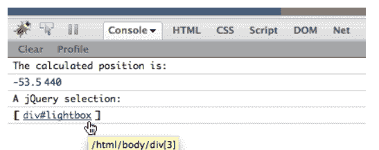

### 图 4.2. Firebug 控制台

如果变量是 JavaScript 对象，你甚至可以在控制台上点击它来检查其内容。如果它是 DOM 节点或 jQuery 对象，点击它会在页面上突出显示它，并在 Firebug DOM 树中跳转到它。这将在你被那些讨厌的 bug 卡住时拯救你的理智！只需记住在发布代码时移除任何 `console.log` 行。

> **自我控制**

> `console.log` 用于记录有趣的事件——但还有一些其他控制台方法可以更具体地处理问题。`console.warn` 显示一个小警告图标，而 `console.error` 会打印一条可怕的红色消息。这让你能快速看到何时真的出错了！

## ColorBox：一个灯箱插件

我们自定义的灯箱对于我们的适度需求来说是一个不错的解决方案，但你不得不承认，就功能而言它相当有限。有时你需要更多功能。jQuery 社区在这方面不会让你选择匮乏；事实上，当前可用的灯箱插件范围简直令人眼花缭乱。有些功能极其丰富，有些专注于小文件大小，有些专注于跨浏览器支持，有些专注于可扩展性，有些专注于特定的博客平台……为每个场合都准备了灯箱插件。

这里的“选择悖论”可能很棘手；虽然有那么多优秀的选�，但你只能通过一点试错才能找到适合你的那个。有些成熟的

## 使用 Jcrop 裁剪图片

其他选项包括 Shadowbox、¹ FancyBox、² 和 Lightbox2，³ 但还有更多可供你尝试的方案。

我们决定使用 ColorBox⁴——这是 Jack Moore 的心血结晶。它是一个成熟、稳定且经过充分测试的灯箱插件。它包含大量的公共方法和事件钩子——即使经验丰富的用户也可能无法用尽其所有功能。鉴于 ColorBox 专注于基于标准的 HTML、依赖 CSS 进行样式设置，并且广泛支持各种内容选项，很容易理解其网页上的“轻量级”标签仅仅是指其小巧的 10kB 体积——而非指其庞大的功能集！

从网站的下载区域获取 ColorBox 并查看其内容。其中有一个名为 ColorBox 的目录，包含插件代码的压缩版和未压缩版。通常，你应该使用压缩版，除非你热衷于了解 ColorBox 的内部工作原理（或者想在开发过程中保持理智！）。

下载包中还包含若干示例目录；这些示例都使用相同的标记和 JavaScript 代码，但展示了如何通过不同的样式让灯箱看起来完全不同。最好的入门方式是查看示例，并选择你最喜欢的 CSS 文件（以及相应的图片），然后在此基础上构建你的实现。

我们已从其中一个示例目录复制了 CSS 和图片文件，并将该 CSS 文件和压缩后的插件文件都包含在我们的 HTML 中：

```
chapter_04/02_colorbox_plugin/index.html` (excerpt)

<link rel="stylesheet" href="colorbox.css" type="text/css">
<script src="jquery.colorbox-min.js" type="text/javascript">
</script>
```

ColorBox 可以像我们在上一节中那样处理单张图片，但它尤其擅长显示幻灯片式的画廊——允许用户在图片间切换，如图 4.3 所示。要利用这一点，我们需要对要显示的图片进行分组。一种方法是给所有相关的图片相同的类名。另一种是使用链接的 `rel` 属性来定义它们之间的语义关系。

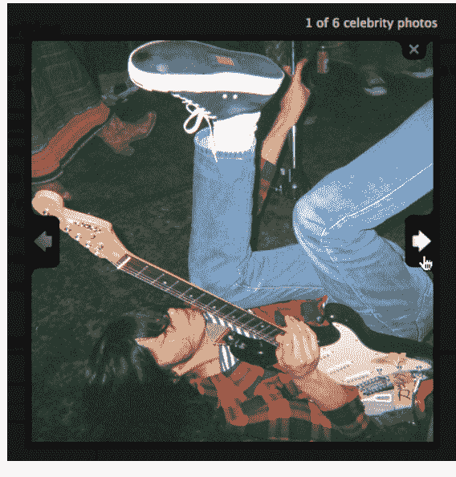

在标记中，我们在所有要分组的图片上都包含了 `rel="celeb"`。现在我们可以使用 jQuery 属性选择器来找到这些图片：`a[rel="celeb"]`。在选择集上调用 `colorbox` 方法，就能得到一个外观出色的灯箱：

```
chapter_04/02_colorbox_plugin/script.js` (excerpt)

$(document).ready(function() {
    $('a[rel="celeb"]').colorbox();
});
```

它在默认情况下外观和功能都很出色，但还有大量的选项可供调整。在下面的例子中，我们为其添加了淡入淡出的过渡效果，而不是默认的弹性缩放（你可能已经猜到，speed 选项指定了淡入淡出的持续时间）。为了匹配 StarTrackr! 的风格，我们还将自定义灯箱文本的措辞。但这只是冰山一角——请在 ColorBox 网站上探索所有其他可用于自定灯箱的选项和事件：

ColorBox 的出色之处在于它高度不显眼且高度可定制：你可以修改行为设置、添加回调，并使用事件钩子，而无需修改你的标记或插件的源文件。ColorBox 会预加载任何必需的图片——甚至可以开始预加载你的画廊图片——因此它在你的页面上总是显得很流畅。

最后，ColorBox 的代码在 GitHub 上维护，并且有一个强大的社区，如果你需要帮助可以寻求支持。ColorBox 在宽松的 MIT 许可证下发布，因此你可以根据自己的需要在商业项目中使用它。

## 使用 Jcrop 裁剪图片

在我们研究成熟优秀的插件和灯箱效果时，如果忽略了 Jcrop 这个用于定义图像区域的插件，那将是一种疏忽。⁷ 该插件在图像上添加了一个灯箱风格的覆盖层，允许用户拖动一个矩形来选择图像所需的区域。这种功能在许多大型网站上很常见，它允许用户裁剪上传的图片作为个人头像。

如果你对 Web 上的图像处理有所了解，你可能知道这类图像处理通常是在服务器端进行的。对吧？是的，没错——Jcrop 插件实际上并不裁剪图像，它提供了一个直观的界面来定义用户希望裁剪图像的边界。插件返回的结果可以随后传递给服务器以执行实际的图像处理。你可以在图 4.4 中看到使用 Jcrop 裁剪图像的情况。


图 4.4. Jcrop 插件运行中

⁷ http://deepliquid.com/content/Jcrop.html

使用 Jcrop 插件的典型工作流程是：显示一张需要用户裁剪的图片（可以是存储的图片或刚上传的图片），然后覆盖 Jcrop 界面。当用户完成选择后，坐标被发送到服务器，在那里生成并保存最终图像以供显示或下载。

要应用 Jcrop 交互，你首先需要下载并解压文件。下载包中包含 Jcrop JavaScript 文件、一个小的 CSS 文件、一个巧妙的动画 GIF（它负责你在选择区域时看到的“移动线条”效果）以及一些突出展示 Jcrop 所有功能的演示页面。

你需要包含 CSS 文件（放在页面顶部）和 JavaScript 文件（放在页面底部）。`Jcrop.gif` 图像应该与你的 CSS 文件位于同一目录中：

```
chapter_04/03_jcrop/index.html` (excerpt)

<link rel="stylesheet" href="css/jquery.Jcrop.css" type="text/css">
<script src="jquery.Jcrop.min.js" type="text/javascript"></script>
```

一旦一切准备就绪，你只需向页面添加一张你希望使其可选择的图片。我们给图片添加了一个 ID，以便使用 jQuery 轻松选择。如果你想让用户确认他们对选择满意，也可以添加一个可点击的按钮：

```
chapter_04/03_jcrop/index.html` (excerpt)

<div id="crop">
    
    <input type="button" value="crop"/>
</div>
```

在最简单的形式中，你只需将 jQuery 插件应用到图片上。当你重新加载页面时，图片将增强显示可拖动的控制柄和一个覆盖层：

```
$('#mofat').Jcrop();
```

该插件暴露了几个有用的事件，你可以用它们来监视用户正在选择的内容。它还提供了一些默认选项来自定义选择器的工作方式。你可以限制裁剪区域的纵横比、选择的最小和最大尺寸，以及背景覆盖层的颜色和不透明度：

```
var jcrop = $('#mofat').Jcrop({
  setSelect: [10,10,300,350],
  minSize:[50,50],
  onChange: function(coords) {
    // 使用坐标
  },
  onSelect: function(coords) {
    // 使用坐标
  }
});
```

这里我们包含了一些默认属性。**setSelect** 允许我们定义默认的裁剪区域；我们需要传递一个坐标数组，格式为 [x1, y1, x2, y2]。**minSize** 选项是一个包含选择区域最小宽度和高度的数组。我们还演示了如何捕获 **onChange** 和 **onSelect** 事件。当用户拖动控制柄或选择区域在图片上移动时，**onChange** 事件会触发多次。另一方面，**onSelect** 事件仅在定义了选择区域时触发；即当用户停止拖动时。

事件的处理程序接收一个坐标对象，该对象包含 x、y、x2、y2、w 和 h 属性。因此，在你的处理程序代码中，你可以编写 **coords.w** 来获取当前选择区域的宽度。

到目前为止，Jcrop 插件最常见的用途是在用户完成选择后定义要发送到服务器的点。对于此目的，插件触发的事件对我们没有用，因为我们无法知道用户是否*真的*完成了选择——这就是为什么我们添加了一个按钮！我们想知道用户点击按钮时选择区域的位置。

为了做到这一点，我们需要稍微修改一下我们的原始代码。当你像我们上面那样在 jQuery 对象上调用 **Jcrop** 时，jQuery 对象被返回，可以链式调用更多的 jQuery 方法。然而，这使我们无法访问选择坐标。为了获取这些坐标，我们需要以不同的方式调用 **Jcrop**，直接从 $ 调用。以这种方式调用时，它将返回一个特殊的 Jcrop 对象，该对象具有用于访问选择坐标（以及修改）的属性和方法

（通过编程方式选择）。我们需要传入要裁剪图像的选择器以及一组选项：

```
var jcrop = $.Jcrop('#mofat',{
    setSelect: [10,10,300,350],
    minSize:[50,50]
});

$('#crop :button').click(function() {
    var selection = jcrop.tellSelect();
    alert('selected size: ' + selection.w + 'x' + selection.h);
})
```

我们使用 `tellSelect` 方法来获取当前的选择区域；它的属性与事件坐标相同，因此我们可以将它们发送到服务器来切割图片！由于没有服务器，我们选择简单地弹出提示框来告诉你发生了什么。

Jcrop 拥有大量可用的选项和方法，因此强烈建议你查看插件下载中包含的演示，以了解可用的功能。

## 幻灯片

每晚，StarTrackr! 网站的用户都会使用他们购买的位置信息来追踪并拍摄世界上的社交精英。许多照片会被上传回网站，客户希望在首页上展示其中一些照片。我们越来越熟悉 jQuery，因此我们告诉客户，我们会为他设计几个不同的幻灯片方案。首先，我们将研究一些图像交叉淡入淡出的方法；也就是说，在一张图像淡出的同时另一张图像淡入。然后，我们将研究一些滚动画廊，最后是一个更复杂的翻页风格画廊。在这个过程中，我们将学习大量新的 jQuery 技巧！

### 交叉淡入淡出幻灯片

如果你在电视行业工作，你会知道，除非你是乔治·卢卡斯，否则他们让你使用的唯一过渡效果就是交叉淡入淡出（也称为溶解）。这样做的原因是，滑动、星爆和漩涡过渡几乎总是显得俗气。这也适用于电视领域之外；回想一下你上次看到的 PowerPoint 演示文稿。

在网页上进行图像交叉淡入淡出有不同的技术——各有优缺点，主要归结为简单性与功能性的权衡。我们将介绍一些用于交叉淡入淡出项目的主要方法，以便你在必要时有选择余地。

### 悬停淡入淡出效果

我们要看的第一个交叉淡入淡出效果是一个基本的悬停淡入淡出效果；它很像我们之前看过的悬停效果，只是这一次我们将在两种状态之间执行渐变淡入淡出。首先，我们需要解决在哪里以及如何存储悬停图像的问题。

这个解决方案通过将两张图像都放入一个 span（或任何你喜欢的容器）中来工作。悬停图像被定位在第一张图像之上，并在用户将鼠标悬停在其上之前隐藏；然后隐藏的图像淡入。首先，我们设置我们的悬停容器：

```
chapter_04/04_rollover_fade/index.html` (摘录)

<span id="fader">
  
  
</span>
```

为了隐藏悬停图像，我们使用通常的 position 和 display 属性：

```
chapter_04/04_rollover_fade/style.css` (摘录)

#fader {
  position: relative;
}

#fader .to {
  display: none;
  position: absolute;
  left: 0;
}
```

现在我们有了可以附加悬停事件处理程序的内容。

知道容器内有两张图像，我们可以使用 `:eq` 过滤器来访问它们——`eq` 是 "equals"（等于）的缩写，该过滤器从一组元素中选择索引等于我们传入数字的元素。图像 0 是我们的可见图像，图像 1 是我们的悬停图像。

这是我们用来执行悬停效果的代码：

```
chapter_04/04_rollover_fade/script.js` (摘录)

$('#fader').hover(function() {
    $(this).find('img:eq(1)').stop(true,true).fadeIn();
}, function() {
    $(this).find('img:eq(1)').fadeOut();
})
```

这里没有新东西——除了我们使用了 `stop` 命令。`stop` 的作用正如你所预期的——它停止动画！它接受两个可选参数：`clearQueue` 和 `gotoEnd`。我们将 `clearQueue` 参数设置为 `true`，这样任何排队的动画都会被清除。

`gotoEnd` 参数用于当你希望 jQuery 确定元素在当前动画队列结束时的状态，然后立即跳转到该状态。我们同样将 `gotoEnd` 指定为 `true`。因此，重申一下，我们的淡入淡出动画将立即停止任何其他排队的动画，并直接跳转到它原本要到达的状态（在这种情况下，它会直接跳转到完全淡出的状态，这样我们就可以让它淡入回来）。这可以防止在你快速将鼠标移入移出时动画堆积。

> **选择猫咪的方法不止一种**

我们主要使用这个方法来突出显示 `:eq` 选择器属性。还有其他几种方式可以访问容器内的两张图像：使用 `:first` 和 `:last` 过滤器，对应的 `.eq`、`.last` 或 `.first` 方法，子元素（`>`）选择器，或者简单地使用类名。使用 jQuery 通常有多种方法可以完成任务，选择通常取决于个人偏好。

你可能会考虑将此效果用于导航按钮——这是个好主意！不过，另一个考虑是，在 CSS 中也将悬停图像添加为链接的 `:hover` 状态背景图像。这样，对于没有 JavaScript 的用户，你的悬停效果仍然可以作为传统的悬停按钮工作。

### JavaScript 定时器

Web 是一个事件驱动的环境。元素大多只是耐心地坐在页面上，等待用户来点击或滚动、选择或提交。当用户这样做时，我们的代码就会活跃起来并执行我们的愿望。但有时我们想避免等待用户操作，并想以固定的频率执行任务。我们将要构建的下几个幻灯片就是这种情况：我们希望自动轮播一系列图像，每隔几秒钟显示一张新图像。

与库的许多其他领域不同，jQuery 不需要扩展 JavaScript 的定时器功能；基本的 JavaScript 方法简单、灵活，并且跨浏览器工作。有两种常见的定时器：`setTimeout` 和 `setInterval`。

> **新成员即将登场**

我们将使用的定时器按要求工作，但它们是为一个更简单、动画更少的时代创建的！有几个新的定时器规范即将出台，其中最有趣的 `requestAnimationFrame` 定时器，它只会在你的网页标签页获得焦点时才更新。它并非在所有地方都受支持，但已经有一些关于如何今天就开始使用它的好资料！⁸

这两个定时器函数的工作方式相同：它们等待一定的时间，然后执行我们给定的代码。调用它们的语法也大致相同：

```
setTimeout(<要运行的代码>, <等待的毫秒数>);
setInterval(<要运行的代码>, <等待的毫秒数>);
```

⁸ http://paulirish.com/2011/requestanimationframe-for-smart-animating/

关键的区别是，`setTimeout` 会等待指定的时间，运行我们给定的代码，然后停止。而 `setInterval` 则会等待，运行代码——然后再等待再运行代码——永远重复（或者直到我们告诉它停止）。如果我们传递给它的代码更新了元素的可见属性，并且我们分配的延迟相对较小，我们就可以实现动画的效果。事实上，在幕后，当我们使用 jQuery 的任何动画函数时，它就是这么做的！

正确使用定时器可能很棘手，这在很大程度上是因为它们会引起 *作用域* 问题，我们将在第 6 章的“作用域”部分详细讨论。然而，我们想要掌握它们，因为定时器是解放我们的页面免受用户发起事件“暴政”的关键！

### 设置定时器

这是一个展示定时器工作的小例子：我们将简单地将一个绿色方框平滑地移动到屏幕上。当然，我们可以依靠 jQuery 的 `animate` 方法来为我们做这件事，但我们想学习 JavaScript 中真正发生的事情。这将涉及定位一个正方形的 div 并持续更新其 `left` CSS 属性。让我们设置我们的方框：

```
chapter_04/05_timers/index.html` (摘录)
<div>
  <div id="green" class="box">Go!</div>
  <div id="red" class="box">Go!</div>
</div>
```

方框是静止的；要让它们动起来，我们需要一个定时器。我们将使用 `setInterval` 定时器，因为我们希望我们的代码被重复执行：

```
chapter_04/05_timers/script.js` (摘录)
var $green = $('#green');
greenLeft = $green.offset().left;
setInterval(function() {
  $green.css('left', ++greenLeft);
}, 200);
```

我们的 `div` 在屏幕上缓慢移动：每 200 毫秒，我们将它向右移动一个像素。改变延迟的大小会影响动画的速度。

不过，要小心：如果你将延迟设置得非常低（比如说，低于50毫秒），并且在每次循环中进行大量的DOM操作，普通用户的浏览器很快就会卡住。这是因为他们的计算机没有足够的时间在你再次要求之前完成你交代的所有事情。如果你认为你的代码可能有风险，最好在各种机器上测试一下，以确保性能可以接受。

我们也可以通过稍微不同的代码结构，使用 `setTimeout` 函数来模拟 `setInterval` 的功能：

```javascript
// chapter_04/05_timers/script.js` (节选)
var $red = $('#red'),
    redLeft = $('#red').offset().left;
function moveRed() {
    $red.css('left', ++redLeft);
    setTimeout(moveRed, 200);
}
moveRed();
```

这里我们有一个名为 `moveRed` 的函数，其内部有一个 `setTimeout` 定时器，它调用的是…… `moveRed`！由于 `setTimeout` 只运行一次，它只会调用 `moveRed` 一次。但是因为 `moveRed` *包含*了这个定时器调用，它将会一遍又一遍地调用自身——实现了与 `setInterval` 相同的效果。

## 停止定时器

通常情况下，让我们的定时器永远运行下去是不可取的（或不必要的）。幸运的是，你启动的定时器可以通过调用相应的JavaScript命令 `clearInterval` 或 `clearTimeout` 来强制停止：

```javascript
clearInterval(<timer id>);
clearTimeout(<timer id>);
```

要调用这些函数，你需要传入定时器的ID。我们如何知道ID是什么？ID是在你创建定时器时分配给它的整数。如果你知道将来可能需要停止某个定时器，你必须将这个数字存储在一个变量中：

```javascript
var animationTimer = setInterval(animate, 100);
```

现在，可以使用以下代码随时停止该定时器：

```javascript
clearInterval(animationTimer);
```

关于 `setTimeout` 和 `setInterval` 就是这些了！如果它们看起来还有点模糊，别担心：我们将在本书的后续内容中根据需要使用它们，在具体情境中看到它们将帮助你更加习惯它们。

## 淡入淡出幻灯片

在两张图片之间进行交叉淡入淡出相当简单：总是在一张图片淡出时让另一张图片淡入。如果我们把这个想法扩展到一大堆图片上，比如说，一个轮播图片库，任务就变得有点困难了。现在我们需要计算接下来该显示哪张图片，并确保在显示完最后一张图片后循环回到开头。

你将在jQuery图片库中看到的一个常见技巧是，通过隐藏除当前图片外的所有图片来模拟交叉淡入淡出。当需要切换时，你只需隐藏当前图片，并淡入下一张。因为图片之间没有真正的重叠，这其实并不算真正的交叉淡入淡出；然而，这是一个简单的解决方案，可能正是你需要的，所以我们将首先探讨它。我们将要探讨的下一个示例将是一个真正的交叉淡入淡出器。

我们的基本幻灯片将由一个包含许多图片的div组成。我们将通过为其中一张图片指定 `show` 类来将其标记为可见图片：

```html
<div id="photos">
    
    
    
    
    
</div>
```

我们将默认隐藏所有图片。对于这个幻灯片，`show` 类有两个目的：它使我们能在CSS中针对它进行显示，并且——同样重要的是——它为我们提供了指向当前图片的句柄。没有必要像 `var currentImage = 1` 那样跟�变量，因为 `class` 名本身就在充当那个变量。

现在我们需要启动一个JavaScript定时器，以便能够循环播放图片。我们将编写一个函数，每隔三秒调用一次自身：

```javascript
$(document).ready(function() {
  slideShow();
});

function slideShow() {
  var current = $('#photos .show');
  var next = current.next().length ? current.next() : current.siblings().first();
  
  current.hide().removeClass('show');
  next.fadeIn().addClass('show');
  
  setTimeout(slideShow, 3000);
}
```

我们知道当前图片具有 `class` `show`，所以我们用它来选择它。为了找到我们想要显示的下一张图片，我们使用了一点条件逻辑。如果下一个兄弟元素存在，我们就选择它。如果它不存在，我们就选择第一张图片，这样幻灯片就能循环播放。

> ### 三元运算符

>

> 你可能对我们用来为 `next` 变量赋值的语法有点困惑。在JavaScript（以及许多其他编程语言）中，这被称为 **三元运算符**。它是 *有条件地* 设置变量的一种快捷方式。

>

> 语法 `a ? b : c` 的意思是，如果 `a` 为 `true`，则返回 `b`；否则，返回 `c`。你可以像我们上面做的那样，在变量赋值中使用它，根据某个条件为同一个变量分配不同的值。当然，一个更长的 `if / else` 语句总是可以完成同样的工作，但三元运算符要简洁得多，所以非常值得学习。

因此，总的来看，这一行代码：

```javascript
var next = current.next().length ? current.next() :
    current.siblings().first();
```

可以翻译成如下英语：如果当前元素在同一容器中有下一个兄弟元素（如果 `next` 方法返回一个非空数组），我们就使用那个。另一方面，如果 `next` 返回一个空数组（所以 `length` 为0，在计算机术语中就是 `false`），我们就导航到当前元素的第一个兄弟元素（那将是幻灯片中的第一张照片）。

最后，我们隐藏当前图片并淡入下一张。我们还把 `show` `class` 从旧照片交换到新照片上，并设置一个超时，让 `slideShow` 方法在三秒后再次调用自身。

## 真正的交叉淡入淡出

我们最后的解决方案看起来不错——但它只是淡入淡出，而不是真正的交叉淡入淡出。我们希望能够真正地交叉淡入淡出：当当前图片淡出时，下一张图片淡入。实现jQuery效果的方法不止一种，我们将采取的实现方法如下：

1.  将图片堆叠在一起，这样 `z-index` 最高的图片将显示在最前面。

2.  淡出最上面的图片，使得下一张图片看起来像是淡入。

3.  一旦淡入淡出完成，重新排列图片的 `z-index`，使当前图片位于最上层。

4.  重复步骤2和3。

这种技术的一个缺点是，我们会将图片堆叠在一起，因此它们的大小必须完全相同。这通常是一个小问题，因为在网络上受限于特定区域是相当常见的。还应该注意的是，将图片替换为div，并在它们的位置上交叉淡入淡出任何HTML元素是非常容易的。

> **z-index**

>

> `z-index` 是一个CSS属性，用于指定元素的视觉堆叠顺序。`z-index` 值较高的元素将显示在值较低的元素前面。这可以与绝对定位或相对定位结合使用，将元素堆叠在一起。

回顾我们的大纲，你应该能够看出步骤1和2是简单的。让我们从堆叠图片开始：

```html
<!-- chapter_04/07_slideshow_cross_fade/index.html` (节选) -->
<div id="photos">
  
  
  
  
  
</div>
```

我们需要将图片绝对定位并将它们包含在一个边界框内：

```css
/* chapter_04/07_slideshow_cross_fade/style.css` (节选) */
#photos img {
  position: absolute;
}

#photos {
  width: 180px;
  height: 180px;
  overflow: hidden;
}
```

既然我们的图片已经堆叠好了，让我们退一步做些规划。为了能够执行步骤4（对下一张图片重复淡入淡出），我们需要将我们的淡入淡出代码放入某种循环中。由于循环需要跟踪当前照片，我们将把代码移到一个命名函数中，我们将在 `$(document).ready` 代码块中调用它：

```javascript
// chapter_04/07_slideshow_cross_fade/script.js` (节选)
$(document).ready(function() {
  rotatePics(1);
});
```

现在，我们将创建 `rotatePics` 函数，它将完成所有繁重的工作。该方法接受一个数字参数，它应该是当前照片的索引。我们稍后会看到其具体用法，但首先，我们将照片总数存储在一个变量中。这样做是因为我们将在代码中多次复用它——将它存储在变量中意味着 jQuery 可以避免浪费时间重复进行相同的计算：

```javascript
chapter_04/07_slideshow_cross_fade/script.js` (摘录)

function rotatePics(currentPhoto) {
    var numberOfPhotos = $('#photos img').length;
    currentPhoto = currentPhoto % numberOfPhotos;
    ...
}
```

代码第二行是一个常见的 JavaScript 技巧，用于确保值被限制在给范围内。我们绝不希望 `currentPhoto` 大于照片总数，因此我们执行一个计算来确保传入的照片索引有效——即通过对长度取**模**。模运算在 JavaScript 中由 `%` 符号表示，它只返回除法的*余数*。因此，如果我们总共有五张照片，而我们传入一个索引6，那么运算结果是 `6 % 5 = 1`。这个数字实际上会循环回到开头，这样我们就可以确保永远不会试图显示一张不存在的照片！

现在，我们终于可以开始进行实际的交叉淡变了。正如我们在大纲中描述的那样，该效果的工作原理是淡出当前图像。这将使下一幅图像看起来像是淡入的。

我们使用 jQuery 的 `eq` 遍历命令来获取当前照片。我们将 `currentPhoto` 变量传递给它以选择当前图像。选中图像后，我们只需将其淡出，并运行一个回调函数来处理下一次淡变的设置：

```javascript
chapter_04/07_slideshow_cross_fade/script.js` (摘录)

$('#photos img').eq(currentPhoto).fadeOut(function() {
    // 重新排序 z-index
    $('#photos img').each(function(i) {
        $(this).css(
            'zIndex', ((numberOfPhotos - i) + currentPhoto) %
            numberOfPhotos
        );
    });

    $(this).show();
    setTimeout(function() {rotatePics(++currentPhoto);}, 4000);
});
```

这里发生了一些事情。首先，我们做了一些数学运算来重新排列图像。我们将每张照片的索引偏移了当前显示照片的索引。然后我们的新取模技巧再次被使用，最终结果是每张图像的 `z-index` 值向后移动了1。要查看实际效果，打开 Firebug 并在效果运行时检查图像：你会看到每次显示新图像时，`z-index` 属性都会重新排列。

一旦我们完成了重新排序，我们刚刚淡出的图片将位于堆栈底部。这意味着可以安全地再次显示它，为下一次它升到顶部做好准备：简单的 `$(this).show()`。

然后是调用计时器函数 `setTimeout`，以设置一个函数在4000毫秒的延迟后再次运行。我们通过编写 `++currentPhoto` 来传递下一张照片的索引。如果这段代码对你来说有点难以理解，你可以通过将自增操作移到单独的行上来提高清晰度，像这样：

```javascript
function() {
    currentPhoto += 1;
    rotatePics(currentPhoto);
}
```

这两种版本是等价的，但第二种方式对其操作的描述更加明确。

### 递增和递减

在 JavaScript 中，如果在数字变量前面或后面跟着 `--` 或 `++`，变量将分别递减或递增1。这是对我们已经见过的 `- =` 和 `+=` 运算符的一个便捷快捷方式。

`++a` 和 `a++` 之间的区别很微妙，但很重要。如果在代码中使用它，第一种形式（`++` 或 `--` 在变量名前）会在返回变量值 *之前* 先递增该变量。第二种形式会先返回未修改的值，*然后* 再递增它。

在我们上面的代码中，我们想使用新的递增后的值来调用函数，所以我们使用 `++currentPhoto`。

欢迎尝试不同类型的效果；除了淡变，你还可以尝试使用 `slideUp` 效果，或者 jQuery UI 效果插件之一。

## 使用插件实现高级淡变

正如你所想象的，已经有无数的 jQuery 插件用于实现图像间的过渡。如果你有一些高级需求（有时你就是需要星形擦除效果），直接使用插件库可能是个好主意。

> **在使用插件之前**

>

> 你在网络上找到的许多 jQuery 插件都是在相当久以前开发的， seitdem或多或少被遗弃了。没有持续的开发和改进，它们通常会相对较慢且存在错误。尝试理解你添加到网站中的东西，而不是盲目地包含半打插件文件，这总是一个好主意。如果代码很重（就文件大小而言）并且包含很多你需求之外的大量功能，那么可能一个更轻量级、量身定制的解决方案更为合适。

>

> 话虽如此，许多插件提供了出色的、文档齐全的代码，可以为你节省大量的时间和精力。只要确保充分考虑你的选择！

现在，我们将看看两个可以用来实现幻灯片效果的插件；一个非常轻量，而另一个功能更丰富。

## 使用 InnerFade 创建新闻滚动条

InnerFade[^9] 是一个小型插件，允许你在一系列元素之间进行过渡，就像我们刚才构建的淡变图像库一样。它确实比我们的代码有一些好处，值得考虑。首先，它是一个插件——这意味着我们可以轻松将其放入任何需要的地方。当然，我们也可以轻松地将我们的代码转换成插件（只需跳转到第9章的“插件”部分，看看这有多容易）。它还有一些额外的选项，为我们提供了更多灵活性：能够随机显示项目，为活动元素分配一个 `class` 名称，以及选择不同的动画类型。

你可能在想，所有这些功能添加到我们的自定�代码中都相当容易——毕竟，我们正在成为 jQuery 忍者！如果你有冒险精神，可以打开 InnerFade 插件文件，看看这些功能是如何在其中实现的，这应该能让你对如何自己实现它们有所了解。

为了与我们的图像轮换区分开来，让我们看看如何轮换列表项来创建一个简单的新闻滚动条，其中一组文本链接将随机显示。首先，我们需要在页面中包含该插件。

要获取插件，你需要从 Git 仓库[^10]下载它（最简单的方法是导航到 `jquery.innerfade.min.js` 文件，然后点击“raw”链接以获取纯文本版本）。获得文件后，将其添加到你的项目中：

```html
chapter_04/08_innerfade/index.html` (摘录)

<script type="text/javascript" src="jquery.innerfade.js"></script>
```

接下来，我们将设置包含元素和我们想要滚动的项目。插件会将我们传递给它的容器的所有第一级子元素视为可供循环的对象。我们将使用无序列表作为容器，列表项作为元素：

```html
chapter_04/08_innerfade/index.html` (摘录)

<div id="news">
    <h2>新闻</h2>
    <ul>
        <li><a href="#">巴伦·冯·乔维被目击 ... </a></li>
        <li><a href="#">莫'肥特签约新晋说唱歌手 ... </a></li>
        <li><a href="#">格伦达特罗尼克斯据传是 ... </a></li>
        <li><a href="#">男子自称是达斯·费德之子 ... </a></li>
    </ul>
</div>
```

当文档准备好时，我们在列表上使用插件提供的 `innerfade` 方法。有许多可用的选项可以自定义此方法的工作方式；我们这里使用了几个，你应该查阅插件的文档以了解所有选项。为了完善我们的新闻滚动条风格，我们将指定滑动效果而不是淡变效果，并让元素随机轮换：

```javascript
chapter_04/08_innerfade/script.js` (摘录)

$('#news ul').innerfade({
    animationtype: 'slide',
    speed: 750,
    timeout: 3000,
    type: 'random'
});
```

就这样：一个简单而酷炫的效果用于显示新闻项目。Inner-Fade 插件也非常适合我们已经构建的图像库，但你应该意识到一个重要的区别。InnerFade 在其代码中处理所有的项目隐藏、显示和定位——因此没有 JavaScript 的话，*所有* 元素都会显示（而在我们的自定义代码中，我们在 CSS 中隐藏了除一个之外的所有元素）。你需要考虑到这一点，并决定你希望网站的基线体验是什么，以及你打算如何用 jQuery 来增强它。

## Cycle 插件

Cycle 插件[^11] 是一个非常成熟、功能齐全的插件，它——就像我们一直在做的所有淡变一样——使你能够在容器中的元素之间进行过渡。其完整性导致下载量相对较大（但完整未压缩版本仍然只有大约 50kB），但它提供了一些令人印象深刻的过渡效果，非常适合以更有趣的方式展示图像库。

设置现在应该对你非常熟悉了；下载插件并将 JavaScript 文件的链接包含在页面的 `<head>` 中。下载中实际上包含几个不同版本的插件：具有广泛可用转换效果的完整功能版本（**jquery.cycle.all.min.js**），以及只有最基本选项的精简版本（**jquery.cycle.lite.min.js**，7.5kB）。

[^9]: http://medienfreunde.com/lab/innerfade/

[^10]: [Git 仓库]

[^11]: http://malsup.com/jquery/cycle/

## 122 jQuery：从新手到忍者

（未压缩版本）。为了我们的示例，我们将使用完整版本，以便说明可用的选项。

我们将从与之前幻灯片完全相同的标记开始。你可以轻松地使用 Cycle 插件实现图像的交叉淡入淡出，但考虑到它提供了许多更花哨的选项，让我们尝试一个并“打乱”图像：

```javascript
// chapter_04/09_cycle_plugin/script.js`（摘录）
$('#photos').cycle({
    fx: 'shuffle'
});
```

此效果如图 4.5 所示。

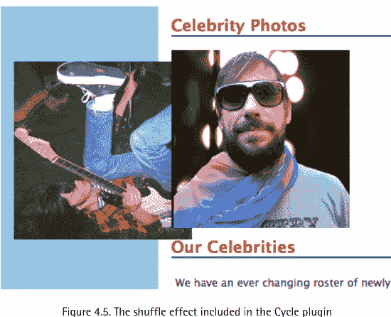

该插件为我们提供了超过 20 种移动画廊的方式：打乱、淡入淡出、缩放、擦除、抛出、幕帘 X、增长 Y……等等，这只是开始。此外，如果你找不到符合需求的效果，该插件还可以自定义以包含你自己的过渡效果。

Cycle 提供的选项数量相当惊人，可能远超你所需。让我们尝试一个更复杂的例子：

```javascript
// chapter_04/10_cycle_plugin_2/script.js`（摘录）
$('#photos').cycle({
  fx: 'scrollDown',
  speedIn: 2500,
  speedOut: 500,
  timeout: 0,
  next: '#photos'
});
```

timeout 设置控制过渡之间的时间——但值为 0 意味着什么？在这种情况下，它表示“不进行动画”。相反，我们使用 next 选项选择一个元素，当该元素被点击时，将前进到下一张幻灯片。该选择器就是幻灯片本身——因此要移动到下一张图片，你只需点击图片即可。

此外，我们使用了 speedIn 和 speedOut 选项来指定“进入”和“退出”动画的持续时间：我们选择将下一张图片*缓慢*地带入视野，同时快速地将上一张图片移出。最终效果就像是图片从打印机中掉落出来一样。这可能不是你真正想要用于创业公司网站的效果——但有如此多的选项可用，你需要认真尝试才能穷尽所有可用的效果可能性。

## 滚动幻灯片

正如我们在使用 Cycle 插件时所看到的，交叉淡入淡绝远非在一组图像之间过渡的唯一方式。在接下来的几个示例中，我们将探索创建交互式幻灯片的另一种技术。我们将把所有图像放入一个巨大的容器中，并使用一个包装元素来隐藏除一张或几张图像之外的所有图像。然后，当我们想要显示不同的图像时，我们只需将元素滚动到所需位置即可。

## 缩略图滚动器

我们第一次尝试滚动画廊将是一个缩略图的水平列表。如果你点击控件，列表会滚动以显示更多图像。

要构建此控件，我们需要两个嵌套元素。子元素将很大，并包含所有图像。父元素的大小仅与视图区域相同；即我们希望用户看到的区域。随着子元素的移动，用户会看到内容在滚动进来。以下是标记：

```html
<!-- chapter_04/11_thumbnail_scroller/index.html`（摘录） -->
<div id="photos">
  <div id="photos_inner">
    
    
    ...
    
  </div>
</div>
```

外部元素需要隐藏多余的内容，因此需要设置 `overflow: hidden`。对于我们的滚动器，我们将内部元素定义为宽度足够容纳 15 个缩略图：

```css
/* chapter_04/11_thumbnail_scroller/style.css`（摘录） */
#photos {
  overflow: hidden;
  width: 600px;
}

#photos_inner {
  height: 100px;
  width: 1500px;
  overflow: hidden;
  position: relative;
}

#photos_inner img {
  float: left;
  width: 100px;
  height: 100px;
}
```

容器设置完毕，并且有一堆图像需要展示，让我们先尝试滚动图像：

```javascript
// chapter_04/11_thumbnail_scroller/script.js`（摘录）
$('#photos_inner').toggle(function() {
  var scrollAmount = $(this).width() - $(this).parent().width();
  $(this).animate({'left':'-=' + scrollAmount}, 'slow');
}, function() {
    $(this).animate({'left':'0'}, 'slow');
});
```

首先我们需要计算滚动多少。我们取包含图像的溢出元素的宽度，减去父容器的宽度。父操作选择一个元素的直接父元素（参见第 1 章“HTML 的片段，即‘DOM’”一节）。我们用它来告诉我们需要滚动多远才能到达图像的最末端。当我们点击图像时，我们的滚动效果会在缩略图的起点和终点之间切换。

如果图像的宽度小于两个屏幕宽度，这非常好。但如果有更多，我们将无法看到两端六个图像之间的所有图像，因此我们需要不同的方法。一个更好的方法是，比如说，一次滚动半屏图像。当我们到达列表末尾时，我们将滚动回起点。让我们扩展我们的代码使其更健壮：

```javascript
// chapter_04/12_thumbnail_scroller_improved/script.js`（摘录）
$('#photos_inner').click(function() {
    var scrollAmount = $(this).width() - $(this).parent().width();
    var currentPos = Math.abs(parseInt($(this).css('left')));
    var remainingScroll = scrollAmount - currentPos;

    // 默认滚动半屏
    var nextScroll = Math.floor($(this).parent().width() / 2);

    // 如果剩余空间不足以完成完整滚动，
    // 则只滚动剩余量。
    if (remainingScroll < nextScroll) {
        nextScroll = remainingScroll;
    }

    if (currentPos < scrollAmount) {
        // 向左滚动
        $(this).animate({'left':'-=' + nextScroll}, 'slow');
    }
    else{
        // 向右滚动
        $(this).animate({'left':'0'}, 'fast');
    }
});
```

哇，这代码确实多了不少——但如果你逐行阅读，你会发现它都相当简单。我们使用了大量的变量，并且由于我们给它们起了清晰的名字，这有助于让代码更容易理解：

1.  与前面的示例一样，我们首先计算总共的滚动空间：我们的 `scrollAmount` 变量。

2.  因为我们的新滚动器需要能够处理超过两个屏幕宽度的图像，我们还需要弄清楚我们当前走到了多远。我们使用 JavaScript 函数 `Math.abs()` 将当前滚动位置转换为正数，因为向左滚动意味着我们将元素移动到负值区域。如果你的高中数学知识已经深埋记忆，这里有个复习：一个数字的绝对值总是它的正值，无论该数字本身是正还是负。所以 `Math.abs(3)` 是 3，`Math.abs(-3)` 也是 3。

3.  我们知道总共有多少空间，也知道我们走了多远——所以找出还剩多少距离就很简单了！只需用前者减去后者即可。

4.  现在是正事：我们需要计算滚动多远。默认情况下，这将是图像容器总宽度的一半。（`Math.floor()` 是将数字向下取整的一种方式，所以我们确保最终得到一个整数。）我们将想要滚动的距离存储在 `nextScroll` 变量中。

5.  如果剩余空间少于我们想要滚动的距离，我们将更改 `nextScroll` 变量，使其仅将我们带到图像的末端。

6.  最后，我们进行滚动。如果我们尚未到达图像的末端（如果当前位置小于总可滚动宽度），我们向左滚动计算出的距离。否则（如果我们已到达图像末端），我们一直滚动回起点。

如果你认为对于一个相当基础的效果来说这代码太多了，你是对的！要是有一种方法可以滚动内容而无需进行所有这些数学计算就好了……

## 使用 scrollTo 的滚动画廊

你可能还记得，当我们在第 3 章讨论滚动时，我们提到了一个特别有用的页面滚动插件：scrollTo。除了

滚动整个页面时，scrollTo 插件同样擅长处理溢出元素（比如画廊中的图片）的滚动！在我们最初尝试制作滚动缩略图画廊时，不得不进行大量自主计算来确定可滚动区域的大小，以及判断当前处于容器的起始还是结束位置。

scrollTo 插件能自动帮我们解决大部分这类问题，因此我们可以专注于添加更复杂的功能。在这个演示中，我们将移除缩略图列表，替换为更大的图片。这些大图将被包含在一个网格布局中——但每次只显示一张。当用户点击图片时，我们将滚动网格，并在一张新的随机图片上停止。

首先，我们需要一个图片列表。为简单起见，我们将其设置为一堆位于 div 容器内的 img 标签——该容器本身又被包含在另一个 div 中。你可能会为了语义更佳而选择将其设置为 div 内的无序图片列表，但最终我们需要的是一个与网格一样宽大的块级元素。这个元素需要放在一个设置了 overflow: hidden（或 auto）的元素内部。具体如下：

```
chapter_04/13_scrolling_gallery/index.html` (摘录)

<div id="pic_container">
    <div id="pic_scroller">
        
        
        ...
        
    </div>
</div>
```

我们将把 `pic_container` div 的宽度设为三张图片的宽度，高度设为四张图片的高度；因此，图片将被限制在一个 3x4 的网格中。在这个演示中，我们使用 200x200 像素的图片，所以容器需要宽 800 像素，高 600 像素。然后，我们将可见区域设为单张图片的大小，并隐藏其余部分：

```
chapter_04/13_scrolling_gallery/style.css` (摘录)

#pic_container {
    overflow: hidden;
    height: 200px;
    width: 200px;
}
```

现在网格已准备就绪，我们可以添加一些随机滚动的魔法了。我们首先获取所有图片，然后随机选择一张，并使用 scrollTo 滚动过去：

```
chapter_04/13_scrolling_gallery/script.js` (摘录)

$('#pic_container').click(function() {
  var numberOfPics = $(this).find('div > img').length;
  var next = Math.floor(Math.random() * numberOfPics);
  $(this)
    .scrollTo(
      '#pic_scroller>img:eq(' + next + ')',
      {duration: 1000}
    );
});
```

这肯定比上一个例子简单多了！插件处理了几乎所有复杂的部分。话虽如此，这里有两个新的 jQuery 方法：`find` 和 `:eq` 过滤器。`find` 的功能与主 jQuery `$` 选择器本身非常相似，只是它仅在当前选中的元素内搜索，而不是整个文档。

我们将一个介于 0 和图片总数之间的随机数传递给 `:eq` 过滤器，以选择一张随机图片。

> **随机数**

`Math.random` 会给你一个介于 0 和 1 之间的随机数。不过，你更常需要的是一个特定范围内的随机整数。实现这一点最简单的方法是使用 `Math.floor(Math.random() * maximum)`。

你将这个小数乘以你想要的最大值，然后将其向下取整为最接近的整数。

注意，请求 `scrollTo` 滚动到特定元素是多么容易：我们只需传递一个能匹配该元素的选择器！

## 使用 data 方法实现更智能的滚动

然而，我们构建的组件存在一个相当大的问题，尤其是当你只有少量图片时：下一个要显示的随机图片可能和我们当前正在查看的是同一张！这种情况下不会发生滚动，会让人感觉像是个 bug。为了解决这个问题，我们需要跟踪上一张图片是什么：

```
chapter_04/14_scrolling_gallery_improved/script.js` (摘录)

$('#pic_container').click(function() {
  var numberOfPics = $(this).find('div > img').length;
  var last = $(this).data('last');
  var next = Math.floor(Math.random() * numberOfPics);
  if (next == last) {
    next = (next + 1) % numberOfPics;
  }
  $(this)
    .data('last', next)
    .scrollTo(
      '#pic_scroller>img:eq(' + next + ')',
      {duration: 1000});
});
```

我们正在使用一个全新的、极其强大的 jQuery 方法：`data`。这个方法与我们之前见过的任何操作都不同，因为它允许我们在任何 jQuery 对象中存储信息。我们用两个参数调用它来存储数据。第一个参数成为数据项的名称，第二个是要存储的值。要检索数据，我们只传入一个参数：数据项的名称。


在我们改进的例子中，一旦找到要滚动到的图片，我们就用命令 `$(this).data('last', next)` 存储该数字元素。下一次点击滚动元素时，我们用命令 `$(this).data('last')` 读取它。如果我们新找到的元素与上一个相同，我们就简单地给它加1，以滚动到下一张图片。（我们再次使用模运算来确保我们保持在图片总数范围内）。

130 jQuery: 从新手到忍者

你应该仔细研究上面高亮显示的、我们在元素上检索和设置数据的两行代码。我们将在接下来的章节中大量使用这个惊人的 jQuery 特性，所以帮自己一个忙——把它记下来，并尽可能多地实践它！

## iPhoto 风格的幻灯片小组件

我们将通过构建一个类似 iPhoto 的小组件（iPhoto 是 Mac OS X 自带的图片画廊应用）来研究一个更高级的幻灯片。将鼠标悬停在当前图片的左侧或右侧将滚动到下一张或上一张图片，这样用户就可以随意浏览画廊。这是我们目前见过的最复杂的 jQuery 代码，你第一次可能很难完全理解。我们将在接下来的章节中详细探讨这里使用的许多概念，所以如果现在需要跳过这部分以后再回来，也不用担心。

让我们基于一个熟悉的图片列表来制作幻灯片。我们将列表包装在一个 div 中，这样我们就可以限制缩略图的范围，并添加一个作为触发器的锚点：

```
chapter_04/15_iphoto_style_slideshow/index.html (摘录)

<h2>昨晚在城里</h2>
<div id="photos">
  <a href="#" class="trigger">图片画廊</a>
  <ul id="photos_inner">
    <li>
      
    </li>
    <li>
      
    </li>
    :
  </ul>
</div>
```

如果用户在 CSS 和 JavaScript 都禁用的情况下查看我们的页面，他们将只看到一大堆图片。虽然这远非我们期望提供的良好体验，但我们已经让他们完全访问了我们的内容。如果只禁用了 JavaScript，除一张外的所有图片都将被隐藏——但我们会在这个画廊上方叠加一个指向完整画廊页面的链接，点击它将把用户带到传统的 HTML 画廊页面。让我们从 CSS 开始幻灯片增强：

```
chapter_04/15_iphoto_style_slideshow/style.css (摘录)

#photos {
    border: 1px solid #BEBEBE;
    height: 400px;
    overflow: hidden;
    position: relative;
    width: 400px;
}

#photos ul {
    left: 0;
    list-style-type: none;
    margin: 0;
    padding: 0;
    position: absolute;
    top: 0;
    width: 2400px;
}

#photos li {
    float: left;
}

#photos .trigger {
    left: 0;
    position: absolute;
    top: 0;
    z-index: 10;
    text-indent: -9999px;
    height: 400px;
    width: 400px;
    display: block;
}
```

从容器 div 开始，我们设置了显示限制。我们的图片是 400 像素见方的，所以这就是我们容器的尺寸。如果图片尺寸不一，你可以简单地将容器的比例设置为需要包含的最大图片的大小。`overflow: hidden` 意味着我们的缩略图不会意外地显示出来。对于图片的无序列表，我们在创建幻灯片之前控制定位，随着我们

已知我们将使用十张图片，我们将列表宽度设置为2400px。在动态Web应用程序中，这需要根据画廊中的图片数量在服务器端进行设置。

CSS的最后一步是将触发链接定位以完全覆盖画廊图片，并通过`text-indent: -9999px`隐藏其文本。这部分完成后，让我们深入了解jQuery！

### 创建一个小组件

小组件的定义多种多样，但在此我们将其定义为一个独立的功能模块，可以在未来的项目中重复使用。小组件的真正目的是将我们的代码封装成一个便捷的包。在本书中，我们将越来越多地这样做（在第6章的“为你的代码命名空间”部分会深入探讨），因此到本书结束时，这些结构和理念将变得非常熟悉！

我们小组件的基础是一个JavaScript对象字面量（与我们之前用来向jQuery操作传递多个选项集的那种相同），它定义了我们小组件的名称：`var gallery = {};`。正如我们目前所看到的，对象字面量用花括号（`{}`）括起来。对象最初是空的，但我们将很快填充它。将我们所有的代码放在这样一个对象中，将为我们的代码提供一个命名的边界，从而减少我们的脚本与页面中可能存在的其他脚本发生冲突的机会。建立一个空对象是我们开始实现大多数小组件的方式。

接下来，我们可以添加属性和方法来让我们的小组件实际执行功能。通过向我们的对象添加属性，我们消除了页面中任何变量可能被其他脚本覆盖的风险：

```
chapter_04/15_iphoto_style_slideshow/script.js (摘录)

gallery.trigger = $("#photos .trigger");
gallery.content = $("#photos_inner");
gallery.scroll = false;
gallery.width = 400;
gallery.innerWidth = gallery.content.width();
gallery.timer = false;
```

当我们写`gallery.timer = false`时，等同于我们写了：

```javascript
var gallery = {
    timer: false;
}
```

点（.）表示法是在对象声明外部读写对象属性的一种快捷方式。如果这有点不清楚，请放心，随着您在示例中看到它的使用，它会变得越来越有意义。

让我们看看我们为自己创建了什么：`gallery.trigger`是对我们的触发链接的jQuery选择的引用，`gallery.content`是我们的图片列表。我们现在可以使用这些更短的名称，这节省了我们每次使用它们时输入完整选择器字符串的时间。这也意味着我们可以通过简单地更改这些值，轻松地将脚本指向不同页面上的不同画廊。

接下来我们分配给`gallery`对象的属性是函数。我们有`gallery.offset`，它设置我们移动滑动列表的距离；`gallery.slide`，它移动列表并使其持续移动；名字巧妙的`gallery.direction`，用于设置幻灯片滚动的方向；以及一个可靠的初始化方法`gallery.init`。让我们依次看看每一个：

```
chapter_04/15_iphoto_style_slideshow/script.js (摘录)

gallery.offset = function() {
    var left = gallery.content.position().left;
    if (gallery.scroll == '>') {
        if (left < 0) {
            left += gallery.width;
        }
    } else {
        if (left <= 0 && left >= ((gallery.innerWidth * -1) + (gallery.width * 2))) {
            left -= gallery.width;
        }
    }
    return left + "px";
}
```

我们在`gallery.offset`中做的第一件事是设置一个变量，用于保存我们的列表相对于其容器div的`left`属性。通过使用`position`而不是`offset`，jQuery节省了我们计算画廊相对于视口位置的麻烦。

然后我们检查我们想要滚动缩略图的方向，以及是否还有滚动空间。如果一切顺利，我们生成`left`的新值（通过将我们的400px宽度属性加到当前的`left`值上）并返回它。注意，我们需要在返回值之前添加"px"，因为我们将把它用作CSS属性。

所以`gallery.offset`除了计算画廊滑动多远之外什么也没做。你可能在想，“为什么不直接在`gallery.slide`函数内部计算呢？”通过将此功能移到其自己的方法中，我们使其更具可用性，万一我们需要从滑动画廊之外的上下文访问它时。它还有助于我们避免代码嵌套太深，那样会使代码更难阅读。下面是这个函数：

```
chapter_04/15_iphoto_style_slideshow/script.js (摘录)

gallery.slide = function() {
    if (gallery.timer) {
        clearTimeout(gallery.timer);
    }
    if (gallery.scroll) {
        $(gallery.content)
            .stop(true,true)
            .animate({left: gallery.offset()}, 500);
        gallery.timer = setTimeout(gallery.slide, 1000);
    }
}
```

我们的`slide`方法的第一项工作是检查`gallery.timer`是否已设置。如果已设置，说明`setTimeout`已经被调用过，所以为了安全起见，我们调用`clearTimeout`。除非我们想要，否则我们不让滚动发生！然后我们检查`gallery.scroll`以查看滚动是否应该发生。如果用户在两次滚动之间将光标移出小组件，我们希望停止任何进一步的滚动。然而，如果他们仍然悬停在小组件上，我们就对`gallery.content`的`left`属性调用jQuery的`animate`方法。这将使我们的画廊平滑地滚动到一侧。我们再次利用`stop(true,true)`来防止动画在队列中堆积。

`animate`持续时间设置为500，所以它既快又流畅，并且在使用`setTimeout`计划下一次滚动之前有充足的时间完成。`setTimeout`被赋值给`gallery.timer`属性，这正是我们之前检查的，在动画完成后500毫秒发生下一次滚动尝试（因为我们设置的计时器是1000，比动画多500）。但我们向哪个方向滚动呢？`gallery.direction`为我们解决了这个问题，如下所示：

```
gallery.direction = function(e,which) {
  var x = e.pageX - which.offset().left;
  gallery.scroll = (x >= gallery.width / 2) ? ">" : "<";
}
```

当初始化方法调用`gallery.direction`时，它传入两个参数：`e`代表导致滚动的事件，`which`持有触发滚动的元素的引用。我们稍后将在“事件处理程序参数”部分深入探讨`e`参数，但现在您只需要知道，这个参数允许我们访问事件发生页面上的坐标。使用这个`e.pageX`，我们可以计算从触发链接左边缘到光标的距离。有了这个数字，我们使用三元运算符（参见“淡入淡出幻灯片”部分）为`gallery.scroll`赋值：如果光标在中心右侧则为`">"`，否则为`"<"`。

我们需要看的最后一个方法是小组件的初始化器`gallery.init`：

```
gallery.init = function() {
  $(gallery.trigger)
    .mouseout(function() {gallery.scroll = false;})
    .mousemove(function(e) {gallery.direction(e,gallery.trigger);})
    .mouseover(function(e) {
      gallery.direction(e,gallery.trigger);
      gallery.slide();
    });
}
```

到现在，您应该已经非常习惯我们正在做的一切了。`gallery.init`只是在由`gallery.trigger`选中的jQuery对象上链式调用jQuery方法。让我们稍微分解一下这个链。

`mouseout`将`gallery.scroll`设置为`false`。这是我们检查以确保用户想要继续滚动的属性。`mousemove`调用`gallery.direction`，而`gallery.direction`又如我们之前看到的设置`gallery.scroll`。最后，`mouseover`也调用`gallery.direction`，但还加入了`gallery.slide`。通过在初始的`mouseover`和任何后续的`mousemove`中调用`gallery.direction`，我们确保滚动方向始终被正确设置。

这就是我们的成果。添加一个`$(document).ready()`以延迟增强功能直到DOM可用，现在您只需要让网站访问者高兴地查看您的画廊提供了什么。

我们在构建此小组件时采用的许多技术对您来说可能是新的，因此您可能感到有点不知所措！在接下来的章节中，我们将在不同形式中重新审视它们，不知不觉中，它们将成为您的第二天性。在继续进行StarTrackr!的下一轮更改之前，让我们快速回顾一下我们如何在回调函数中访问`mouseover`事件在页面上的位置。

### 事件处理程序参数

我们已经看到足够多的事件处理程序回调函数了，但如果您仔细观察上面的`mouseover`处理程序，您可能会注意到一个“冒名顶替者”：`e`。这是我们给所有jQuery事件处理程序都可以接收的可选参数起的名字。我们之前没有看到它，是因为到目前为止我们实现的任何效果都不需要它。

当事件处理程序被调用时，jQuery传入一个事件对象，其中包含有关所发生事件的详细信息和数据。数据的类型取决于事件的种类：`keypress`事件将包含有关按下了哪个键的信息，`click`事件将包含单击的位置，依此类推。jQuery对事件进行了一些处理，因此无论用户使用哪个浏览器，相同的信息都是可用的。

> **为事件参数命名**

您当然不必将事件对象称为`e`——它只是一个参数名称，因此您可以随意称呼它。别名`e`或`evt`相当标准。人们通常避免使用`event`，因为Internet Explorer将`event`视为全局关键字（`window.event`）。

无论如何，回到代码！每当用户将鼠标移到导航项上时，`mouseover`事件就会触发。我们在事件处理程序中捕获了`e`参数...

并将其传递给 gallery.direction。如前所述，该对象包含事件的一些特定信息，例如事件发生的位置。我们利用这些信息来计算鼠标在 gallery 小部件上的水平位置：

```
var x = e.pageX - which.offset().left;
```

这样就得到了一个以像素为单位的数值。然后我们将这个值与 gallery 宽度的一半进行比较。如果这个数字较小，说明鼠标在左侧；否则就在右侧。这使我们能够确定滚动的方向：

```
gallery.scroll = (x >= gallery.width / 2) ? ">" : "<";
```

pageX 只是事件对象众多可用属性中的一个。我们将在下一章再介绍几个，完整的列表可以在附录 A 的“事件”部分找到。

## 图解想象！

里程碑时刻！我们创建的小部件对象，使用了命名变量和函数，是真正 jQuery 忍者的首选武器！它使你的代码可读、简洁，最重要的是可重用。你也掌握了定时器和事件对象，如果打个特别的比方，它们可以比作闪光弹和飞镖。很快你就将势不可挡。

StarTrackr! 网站现在肯定看起来更有活力了，因为我们添加了幻灯片、灯箱和一些优雅的交叉淡入淡出效果。我们的客户（和他的投资者）欣喜若狂，他还有另一系列希望尽快在网站上看到的更改。这对我们来说意味着更多的工作，也意味着更多 jQuery 的妙用即将登场！

# 第 5 章

# 菜单、标签页、工具提示和面板

jQuery 无疑是 DOM 的大师——它能轻松移动元素、为 CSS 属性添加动画、操作元素属性，帮助我们为静态内容增添色彩。但静态内容在 Web 中的比重正在萎缩；每一天，越来越多功能齐全、高度实用且外观惊艳的应用程序如雨后春笋般涌现。本章将带领我们从静态文档转向富互联网应用（RIA）的花哨世界。

客户团队一直在阅读商业杂志，并了解到了 RIA 这个术语，他们决心尽可能多地使用它。他们希望网站摆脱简单的宣传册样式，成为一个用户可以轻松寻找他们喜爱明星的在线应用程序。当然，这意味着我们可以着手处理一些真正有趣的内容。

本章的主题是用户界面：我们将探讨如何逻辑地组织内容，并通过下拉菜标签页界面、滑动面板、工具提示和手风琴控件为用户提供便捷访问。掌握了这些工具，你将能够将最复杂的界面组织成易于操作且有趣的离散模块！

### 菜单

我们已经尝试过一些菜单，但它们大多是简单的顶级导航窗格。在本节中，我们将研究如何将 jQuery 应用于更复杂的菜单式导航控件：可折叠菜单和下拉菜单。

随着 StarTrackr! 网站规模扩大（以及客户的要求变得更加精细），导航结构可能会变得难以管理，并可能让用户感到困惑。精心设计的菜单可以让我们对内容结构进行分类，同时最小化其占用的宝贵屏幕空间。当菜单滑开和闭合时，看起来也很酷。设置一个简单有效的可扩展菜单非常容易；事实上，我们在第 2 章就已经学习了制作菜单所需的大部分代码。我们将从创建一个简单的菜单开始，然后为其添加一些额外的功能。我们的初始菜单将如图 5.1 所示。

```
chapter_05/01_expandable_menus/index.html (excerpt)

<nav role="navigation">
  <ul id="menu">
    <li><a href="#">What's new?</a>
      <ul class="active">
        <li><a href="#">Weekly specials</a></li>
        <li><a href="#">Last night's pics!</a></li>
        <li><a href="#">Users' comments</a></li>
      </ul>
    </li>
    <li><a href="#">Member extras</a>
      <ul>
        <li><a href="#">Premium Celebrities</a></li>
        <li><a href="#">24-hour Surveillance</a></li>
        ...
```

现在让我们给它一些基本的样式，以便我们操作一个看起来更漂亮的菜单：

```
chapter_05/01_expandable_menus/menus.css (excerpt)

#menu, #menu ul {
  list-style-type: none;
  padding: 0;
  margin: 0;
}

#menu li {
  cursor: pointer;
  background: #94C5EB;
  border-bottom: 1px solid #444;
}

#menu li a { text-decoration: none; }

#menu > li > a {
  padding: 2px 10px;
  font-weight: bold;
}

#menu li li {
  cursor: auto;
  border: 0;
  padding: 0 14px;
  background-color: #fff;
}
```

我们使用 CSS 子选择器为顶级链接设置了与嵌套链接不同的样式。这在所有现代浏览器都受到支持，但如果你需要支持 Internet Explorer 6，只需在标记中添加一个类，并将样式基于该类即可。

由于我们将在顶级列表项（包括锚点未覆盖的区域）上的点击事件作出反应，所以我们为这些元素设置了指针光标，以便用户可以轻松识别它们是可点击的。

目前，我们拥有一个漂亮的多级菜单。所有项目都是可见的，这对没有 JavaScript 功能的浏览器来说是一个不错的行为。现在我们可以逐步增强这个行为。首先，我们隐藏所有类别的项目：

```
chapter_05/01_expandable_menus/script.js (excerpt)

$('#menu > li > ul')
    .hide()
    .click(function(event) {
        event.stopPropagation();
    });
```

我们使用子选择器来确保避免意外隐藏菜单结构中更深层嵌套的元素。这样，如果你决定将菜单嵌套超过一级，你的代码仍然能按预期工作。

你可能想知道代码中奇怪的 `event.stopPropagation()` 这一行。我们稍后会介绍，但首先让我们用一个 `toggle` 函数来完善效果，使菜单能够上下滑动：

```
chapter_05/01_expandable_menus/script.js (excerpt)

$('#menu > li').toggle(function() {
    $(this).find('ul').slideDown();
}, function() {
    $(this).find('ul').slideUp();
});
```

在浏览器中运行它，你将看到我们创建了一个功能完备的多级菜单。在继续用一些额外的特性增强它之前，让我们先看看 stopPropagation 方法的作用。

### 事件传播

事件传播描述了事件在 DOM 层次结构中的流动过程。当事件从一个元素触发时，该元素上的任何处理程序都有机会捕获该事件。在此处理完成后，事件会进一步沿 DOM 树向上传递，给父元素处理该事件的机会。这是合理的：当你点击段落内的链接时，你*也*点击了段落本身，因此两个元素上的事件处理程序都应该有机会作出反应。

理解事件传播最简单的方法是观察其实际运行。为了说明这个概念，我们将快速设置一个小实验。它将包含以下基本标记：两个 div，一个在另一个内部。外部和内部 div 的 id 分别为 outer 和 inner：

```
chapter_05/02_event_propagation/index.html (excerpt)

<div id="outer">
    Click Outer!
    <div id="inner">
        Click Inner!
    </div>
</div>
```

接下来，我们将为每个 div 元素添加一个点击处理程序，这样当我们点击一个元素时，会弹出一个警报，告诉我们该元素的名称：

```
chapter_05/02_event_propagation/script.js (excerpt)

$('div').click(function() {
    alert('Hello from ' + $(this).attr('id'));
});
```

首先，点击外部 div：毫不意外，你会看到一个提示“Hello from outer”的警报。现在，点击内部 div。你会看到预期的“Hello from inner”。但接着你也会看到“Hello from outer”……这是怎么回事？我们只点击了一次，为什么我们会看到两个点击事件？

## 144 jQuery: 从新手到忍者

正如你可能猜到的，这实际上并不是两个点击事件，而是在*两个不同位置*发生的*一个*点击事件。事件从内部 div 开始，检查是否有任何事件处理程序附加到它上面。然后它**冒泡**（或传播）到该 div 的父元素（在这个例子中是外部 div），并检查是否有任何事件处理程序附加到该元素。事件继续沿着 DOM 层次结构向上冒泡，直到没有更多可用的父元素。

在许多情况下，这种事件冒泡是可取的；我们通常希望在 DOM 的多个层级处理相同的事件。例如，如果我们想在任何子元素被点击时设置父节点的类，将事件处理程序添加到父节点本身会比为每个子元添加处理程序高效得多。你可能听说过这种方法叫做**事件委托**：一个事件处理程序被设置来捕获来自许多后代元素的事件。但我们仍然希望能够为任何子元素单独附加点击处理程序。

另一方面，事件冒泡有时也可能是不可取的。有时我们希望子节点阻止事件继续传播。举个例子，想象我们正在制作一个打鼹鼠类型的游戏。游戏由两部分组成：游戏板和一些鼹鼠。鼹鼠随机出现在屏幕上几秒钟然后消失。我们可能想为每个鼹鼠附加一个处理程序来检测直接命中，为游戏板附加另一个处理程序来检测未命中。使用事件传播，当事件冒泡到我们的游戏板时，我们最终会同时记录到命中和未命中。当然，我们可以检查事件的 target 属性来查看被击中的是什么，但让我们先专注于传播。

有几种技术可用于控制事件传播。一种常见的 JavaScript 技术是从事件处理程序中返回 `false`。这很有效，并且在所有主流浏览器都支持。然而，jQuery 的事件系统将所有事件标准化为 W3C 标准，这意味着你无需担心不同浏览器如何处理不同的边缘情况。

要使用 jQuery 停止事件传播，我们像之前已经做过的那样使用 `stopPropagation` 方法。我们的匿名回调函数被传递了一个我们将命名为 `event` 的参数。然后我们只需在该事件上调用 `stopPropagation`，它就会停止进一步沿 DOM 向上传播。

## 默认事件操作

现在可能是讨论另一种控制事件流的常用方法的好时机：`preventDefault`。`preventDefault` 方法会阻止浏览器执行事件通常会执行的默认操作。它最常见的用途是阻止链接在点击时加载其目标：

```javascript
$('a').click(function(event) {
    event.preventDefault();
});
```

这段代码有效地禁用了页面上的每一个链接。当然，想要对所有链接都这样做是非常不寻常的，但当我们实现渐进式增强时——比如我们在第 4 章看到的灯箱效果——以这种方式覆盖链接的操作是很常见的。如果某个特定用户无法使用 JavaScript，链接将正常工作。但如果 JavaScript 可用，正常的链接将被我们的 jQuery 功能所取代。

现在你可以控制了，可以阻止元素的默认响应，或者阻止事件传播。我们为什么要指出这一点？因为我们提到的从事件处理程序中简单返回 `false` 的技术，与同时调用 `preventDefault` 和 `stopPropagation` 具有相同的效果。也许这并不是你所期望的。

你还可以使用 `isDefaultPrevented` 和 `isPropagationStopped` 命令来测试事件的流是否已被修改。正如它们的名字所暗示的那样，如果默认操作被阻止或事件传播被停止，这些函数将分别返回 `true`，否则返回 `false`。

## 展开/折叠指示器

我们的菜单控制功能已按计划运行，因此是时候遵守那条不可避免的 jQuery 法则了：如果它没坏，就给它加点装饰吧！

我们要实施的第一个调整是在章节标题的右侧添加展开/折叠指示器，如图 5.2 所示。

## 146 jQuery: 从新手到忍者

你可能在网页上（或桌面应用程序中）见过这种指示器。它们通常采用小三角形的形式，其方向用于指示菜单是展开还是折叠。它们非常有帮助，因为它们为用户提供了提示，表明有隐藏信息需要揭示。

我们将使用 CSS 雪碧图为我们的菜菜单添加指示器；一张图片将包含我们菜单部分的折叠（向下箭头）和展开（向上箭头）状态。

默认情况下，所有部分都是折叠的，因此我们在 CSS 中显示折叠箭头状态。在我们的雪碧图中，折叠状态对齐到顶部，而展开状态在顶部下方 20 像素处。我们将此背景图像应用于菜单内的 li 元素，然后从更深嵌套的项目中移除它：

```css
chapter_05/03_open_closed_indicators/menus.css (excerpt)

#menu li {
  cursor: pointer;
  border-bottom: 1px solid #444;
  background: #94C5EB url(arrows.png) no-repeat right top;
}

#menu li li {
  cursor: auto;
  border: 0;
  padding: 0 14px;
  background-color:#fff;
  background-image: none;
}
```

背景图像就位后，我们现在需要在切换菜单项时调整 CSS 雪碧图的位置。当菜单项向下展开时，我们显示展开状态；当它向上折叠时，我们显示折叠状态。我们将巧妙地利用链式调用，在查找要显示或隐藏的 ul 之前应用 css 操作：

```javascript
chapter_05/03_open_closed_indicators/script.js (excerpt)

$('#menu > li').toggle(function() {
  $(this)
    .css('background-position', 'right -20px')
    .find('ul').slideDown();
}, function() {
  $(this)
    .css('background-position', 'right top')
    .find('ul').slideUp();
});
```

## 悬停展开菜单

为了实现下一个技巧，我们希望菜单不仅响应点击事件，也响应悬停事件。当用户将鼠标悬停在某个父菜单项上时，我们将短暂暂停，然后展开菜单。现在，你已经见过足够多的切换和悬停效果，可以受用终身了（别担心，还有更多效果要来！），所以我们将给这个效果来点变化。jQuery 的 hover 事件会在鼠标移过目标项目的瞬间触发。但为了这个效果，我们将延迟执行，使其只在用户悬停一小会儿后才触发。否则，这个控件实际上将无法使用，因为如果你只是不小心用鼠标碰到它，它就会猛地打开又关上。

这是一个微妙但重要的变化——如果你尝试有延迟和无延迟两种菜单效果，你会注意到控件的感觉发生了巨大的变化：

```javascript
chapter_05/04_menu_expand_on_hover/script.js (excerpt)

$('#menu > li').hover(function() {
  $(this).addClass('waiting');
  setTimeout(function() {
    $('#menu .waiting')
      .click()
      .removeClass('waiting');
  }, 600);
}, function() {
    $('#menu .waiting').removeClass('waiting');
});
```

当用户首次将鼠标移到菜单元素上时，我们向菜单项添加一个名为 `waiting` 的类，然后设置一个 600 毫秒的计时器。如果用户在延迟结束前将鼠户移开，我们就移除这个类。

一旦延迟到期，它会查找包含 `waiting` 类的菜单项（如果用户没有移动鼠标，这个类才会存在）。如果用户仍在等待，我们就会“点击”菜单项，触发效果。这是我们第一次看到以这种方式使用 `click` 操作；当不带参数调用时，它实际上会在目标元素上触发点击事件，而不是设置事件处理程序。最后，一旦我们触发效果，我们就移除该类——这样我们就回到了起点。我们还需要修改之前定义的点击操作。目前的情况是，如果用户将鼠标移到菜单上然后点击它，当计时器到期时，`waiting` 类会导致它关闭。我们只需向点击处理程序添加相同的 `removeClass` 调用即可。

我们正在做的——就像我们之前在其他效果中做过的那样——是使用类来提供状态管理。状态管理只是一个花哨的说法，意思是为我们提供一种方式让控件记住它所处的“状态”。我们想记住用户是否在延迟到期前移开了鼠标，所以我们适当地添加和移除 `waiting` 类。使用类名进行状态管理是一个巧妙的技巧——但它当然不是唯一（或最好）的方法。我们已经见过 jQuery 提供的 data 功能，这是存储简单状态信息的好方法。对于更大更复杂的控件，我们也可以将状态管理集成到控件的代码中——就像我们在第 4 章末尾看到的那样。一如既往，你使用的方法取决于具体情况，以及对你来说最简单的方法。

## 下拉菜单

如果你曾在网页的旧时代（使用当时被称为 DHTML 的技术）编写过下拉菜单代码，你就会知道那是一段多么令人痛苦的经历

确实如此。网络上至今仍流传着大量糟糕的脚本，但值得庆幸的是，CSS的出现已经将这些冗长的JavaScript意大利面条式代码扫进了历史的垃圾堆。尽管如此，仍有一些边缘情况能让我们看到jQuery如何帮助弥合这些缝隙。Suckerfish下拉菜单[^1]技术及其后续变体，为下拉菜单问题提供了一种优雅的解决方案。

Suckerfish下拉菜单的工作原理是：通过精心设置一系列嵌套列表的样式，将其塑造成下拉结构，然后隐藏子菜单项。样式表使用`:hover`伪类选择器来触发子菜单项的显示和隐藏。我们应始终追求在适用的情况下使用更简单的技术（如CSS）。话虽如此，使用纯CSS下拉菜单存在一些问题。非常古老的浏览器无法为非链接元素的`:hover`伪类设置样式，即使是那些支持的浏览器，显示/隐藏的效果也可能显得有些生硬。

Suckerfish下拉菜单为增强功能提供了一个绝佳的基础：它们提供了一个足够的解决方案，然后可以用jQuery进行改进和优化。在本例中，我们将调整Suckerfish技术，使其在对`:hover`支持不完整的浏览器中也能工作。我们还将通过一些jQuery动画让下拉效果更流畅；例如，当用户将鼠标移开时，延迟下拉菜隐藏。

## 跨浏览器菜单

首先，让我们设置一个简单的Suckerfish下拉菜单作为我们的基准。我们将使用与“可展开/可折叠菜单”一节中可展开导航相同的标记。

CSS直接采用了Suckerfish的标准做法，将无序列表塑造成一个简单的水平菜单。唯一需要注意的额外点是我们在`:hover` CSS声明上附加的额外`class`。我们需要这个类来在原本无法保持菜单下拉显示的情况下保持其可见：

```css
#container {
  position: relative;
}
```

[^1]: http://www.alistapart.com/articles/dropdowns

```css
#menu {
    position: absolute;
    top: 0;
    right: 0;
}

#menu, #menu ul {
    padding: 0;
    margin: 0;
    list-style: none;
}

#menu li {
    float: left;
    background: #FFF;
}

#menu a {
    display: block;
    padding: 4px;
    width: 10em;
}

#menu li ul {
    position: absolute;
    width: 10em;
    left: -999em;
}

#menu li:hover ul, #menu li ul:hover {
    left: auto;
}
```

如果你在大多数浏览器上试试这个，你会惊喜地发现：一个完全无需JavaScript就能工作的菜单系统！我们现在想做的是在这个效果之上叠加一些jQuery，使其在旧版浏览器中也能工作，并且动画更流畅一些。我们的目标功能如图5.3所示。

那么，我们如何用jQuery复制这个效果呢？你可能会说，“简单，只需添加一个带有滑动下降效果的悬停动作。” 你说得对：添加一个简单的悬停函数会给我们想要的行为，但这里有个问题。当我们同时在CSS和脚本中实现相同功能时会发生什么？在CSS的:hover和jQuery的:hover之间的冲突中谁会胜出？情况会很混乱——它们势均力敌！

一个显而易见的解决方法是在我们的悬停事件处理程序中覆盖CSS类。但这将会失败，因为目前你无法在jQuery中针对伪选择器来设置CSS属性：

```javascript
$('#nav li:hover ul').css('left', '-999em'); // 无效！
```

这让我们陷入了困境：如何既能保留Suckerfish CSS菜单的优点，又能应用我们的jQuery增强功能？一个解决方案是在悬停时仔细撤销CSS属性——但一个更简单的方法是，无论是否悬停，都接管子菜单项的CSS属性：

```javascript
// chapter_05/05_dropdown_menu/script.js (摘录)
$('#menu li ul').css({
  display: "none",
  left: "auto"
});

$('#menu li').hover(function() {
  $(this)
    .find('ul')
    .stop(true, true)
    .slideDown('fast');
}, function() {
  $(this)
    .find('ul')
    .stop(true, true)
    .fadeOut('fast');
});
```

此脚本的第一部分覆盖了我们之前设置的CSS，并使用`display: "none"`隐藏子菜单。当用户悬停在一个列表项上时，我们找到相关的子列表容器并显示它。这里我们使用了`slideDown`和`fadeOut`，但你也可以想出一些有趣的缓动选项和CSS背景精灵图来让它更活泼。正如我们在第3章“动画导航”一节中所看到的，`stop(true, true)`命令确保当我们快速移动鼠标时，菜单不会排队堆积动画。如果愿意，你甚至可以从同一章添加一个`delay`。

这个菜单控制的最佳之处在于，当用户禁用JavaScript访问该网站时，Suckerfish下拉菜单仍然可以正常工作，只是没有动画效果。

## 悬停意图

我们已经看到一些由`mouseover`事件触发的效果——你可能已经注意到它们有时会显得过于急切地激活。当你的鼠标刚刚掠过目标元素，效果就立刻被触发了，即使你只是路过。这对于制作流畅的动画效果非常棒，但有时我们想要不同的结果。对于我们的下拉菜单，这种过早的触发可能显得不必要且令人分心。我们需要一种方法，在确认用户确实想要激活目标元素之前延迟效果。

早些时候，我们看到了一种方法，通过在用户移到元素上时设置一个定时器来实现。但这有一些副作用。例如，如果你设置了一个很短的定时器和一个很大的目标区域，用户可能在定时器过期前还没能完全移过整个元素。

Brian Cherne为这个问题实现了一个很好的变通方法，即Hover Intent插件²。Hover Intent内置了一些智能算法，可以计算鼠标移过元素的速度。只有当鼠标减速到插件认为用户*打算*停在那里时，效果才会触发。

一旦包含了这个插件，你可以在任何通常使用`hover`动作的地方使用它。例如，如果我们想为上一节的下拉菜单添加一个延迟，只需将`hover`命令替换为`hoverIntent`命令：

² http://cherne.net/brian/resources/jquery.hoverIntent.html

```javascript
// chapter_05/06_dropdown_with_hover_intent/script.js (摘录)
$('#menu li').hoverIntent(function() {
    // ... 显示菜单 ...
}, function() {
    // ... 隐藏菜单 ...
});
```

菜单只有在它认为用户想看到它时才会显示。体验此插件功能的最佳方式是将此示例与前一个示例进行比较，水平拖动鼠标穿过菜单。在上一个示例中，当你移过菜时，菜单会像波浪一样依次滑开；而使用`hoverIntent`时，菜单只有在鼠标停顿后才会滑开。

与大多数插件一样，其文档概述了你可以指定的少数几个选项来微调效果，因此如果你计划使用此功能，请务必仔细阅读。

## 手风琴菜单

手风琴菜单得名于这种乐器，其特点是当一个区域展开时，另一个区域会收缩。通常，手风琴菜单是固定的，因此任何时候必须且只能有一个区域可见，不过有些手风琴菜单允许你折叠已经打开的区域，从而隐藏所有项目。

### 简单手风琴

创建手风琴可能比你预期的要棘手。我们早些时候看到，只需几行jQuery代码就能实现一个简单的展开和折叠菜单系统。因此，你可能会合理地假设，添加一个约束（任何时候只能有一个菜单元素处于打开状态）是直截了当的。尽管基本实现确实相当简单（毕竟这是jQuery！），但在实施更复杂的约束时，你应该注意一些注意事项。

在本例中，我们将构建一个简单的手风琴菜单，根据流行度对名人进行分组；这将使我们能够在StarTrackr!网站上节省相当多宝贵的屏幕空间。我们想要达到的效果如图5.4所示。

154     jQuery：从新手到忍者

你可以使用几乎任何 HTML 标记结构来设置手风琴；你真正需要的是一组清晰可识别的标题，每个标题都与一个内容块相关联。在这个例子中，我们将使用一组嵌套列表，如下所示：

```html
chapter_05/07_simple_accordion/index.html (excerpt)

<ul>
    <li class="active">
        "A" List Celebrities
        <ul>
            <li><a href="#">Computadors</a> &nbsp;New!</li>
            <li><a href="#">Johnny Stardust</a></li>
            <li><a href="#">Beau Dandy</a></li>
        </ul>
    </li>
    <li>
        "B" List Celebrities
        <ul>
            <li><a href="#">Sinusoidal Tendencies</a></li>
            <li><a href="#">Steve Extreme</a></li>
        </ul>
    </li>
</ul>
```

这种列表标记是菜单的理想 HTML 结构，但当然还有其他选择；你也可以同样轻松地使用一组嵌套的 div，并使用标题元素提供每个部分的标题。只要结构一致，并且允许你选择所有标题触发器和相关内容，几乎任何结构都是合适的。我们用一些 CSS 设置了列表的样式，你可以在示例代码归档中查阅。

当我们的页面加载时，所有内容区域都是可见的。现在你应该知道接下来要做什么：我们需要隐藏所有内容，只保留默认项：

```javascript
$('#celebs ul > li ul')
    .click(function(event) {
        event.stopPropagation();
    })
    .filter(':not(:first)')
    .hide();
```

我们在这里的处理方式与之前略有不同。在这种情况下，我们还预先解决了事件冒泡（在名为“事件传播”的部分中介绍）会带来的问题。这类语句真正展示了 jQuery 的强大之处：我们首先为每个内容区域附加一个事件监听器，然后过滤我们的选择以排除第一个区域，并隐藏所有剩余的内容。

`filter` 命令是缩小选择范围的非常方便的方法。任何不符合传递给它的条件的元素都会从选择中被丢弃，并且不再受后续 jQuery 命令的影响。你可以将条件指定为选择器或函数（参见下面的说明）。我们在前面的示例中使用了过滤选择器（`:not` 和 `:first`），但你可以使用任何 jQuery 选择器来帮助你找到所需的元素。

:not 是一个实用的选择器，因为它选择括号中内容的相反项。因此，$(':not(p)') 将选择除段落之外的所有元素，而 $('p:not(.active)') 将选择没有 active 类的段落。

虽然 filter 方法在从选择中移除元素方面做得非常出色，但我们可以通过 add 来反向操作，它将新元素附加到选择中。通过结合使用 filter 和 add，你可以在单个 jQuery 链中进行大量处理，并根据需要沿途添加和移除元素。

### filter 的高级用法

有时你需要执行涉及更复杂条件的过滤；在这些情况下，你可以使用自定函数来定义你的规则。该函数会针对 jQuery 选择中的每个元素进行处理。如果它返回 true，则该元素保留在选择中；否则，它将被丢弃。作为一个例子，让我们保留每个段落元素，它是选择中的第三个，或者具有 active 类：

```javascript
$('p').filter(function(index) {
    return index == 2 || $(this).hasClass('active');
});
```

注意，我们可以访问选择中每个元素的从零开始的索引，并且作用域是当前元素吗？这就是为什么我们可以用 $(this) 来引用它。你可以在你的条件函数中包含任意数量的处理——只需确保在希望保留该元素时返回 true。

手风琴效果的代码需要关闭任何已打开的项目（因为同一时间应该只打开一个），然后打开我们点击的项目。但这种逻辑有一个问题：如果我们点击一个已经打开的项目，它将不必要地向上和向下滑动。因此，我们首先需要检查我们点击的项目是否已经打开：

```javascript
// chapter_05/07_simple_accordion/script.js (excerpt)

$('#celebs ul > li').click(function() {
    var selfClick = $(this).find('ul:first').is(':visible');
    if (!selfClick) {
        $(this)
            .parent()
            .find('> li ul:visible')
            .slideToggle();
    }
    $(this)
        .find('ul:first')
        .slideToggle();
});
```

让我们分解这段代码：

❶ 我们使用 `.is('visible')` 结构检查嵌套的 ul 是否可见，并将结果存储在名为 `selfClick` 的变量中（如果用户点击了已经打开的部分，则该变量将为 true）。

❷ 我们在 `if` 语句中使用 JavaScript `!` 运算符，如果可见的部分不是被点击的那个，则将其隐藏。`!` 意味着“非”，因此只有当 `selfClick` 不为 true 时，才会运行嵌套的代码块。

❸ 最后，我们切换我们点击的项目的状态：如果它已打开，则向上滑动；如果已关闭，则向下滑动。

在我们编写的解决方案中，用户可以关闭手风琴的打开部分，从而完全折叠它。如果你宁愿强制执行一个项目必须始终可见的规则，你可以调整代码，使得点击已打开的项目没有任何效果。这可以通过一点基本的 JavaScript 很简单地完成；如果 `selfClick` 的值为 `true`，我们只需使用 JavaScript 的 `return` 关键字退出函数：

```javascript
$('#celebs ul > li').click(function() {
    var selfClick = $(this).find('ul:first').is(':visible');
    if (selfClick) {
        return;
    }
    $(this)
        .parent()
        .find('> li ul:visible')
        .slideToggle();
    $(this)
        .find('ul:first')
        .stop(true, true)
        .slideToggle();
});
```

## 多级手风琴

之前我们看到，你应该一致地设置你的手风琴 HTML 结构——原因就在这里！如果我们的 jQuery 选择器足够精确，那么为手风琴添加另一个级别就像在我们的事件处理程序中包含下一个级别一样简单。首先，我们添加第二级菜单项。我们使用与第一级完全相同的结构，但将其嵌套在第一级列表项内：

```html
chapter_05/09_multi_level_accordion/index.html (excerpt)

<ul>
  <li class="active">"A" List Celebrities
    <ul>
      <li><a href="#">Computadors</a> &nbsp;New!</li>
      <li>Rising Stars
        <ul>
          <li><a href="#">Johnny Stardust</a></li>
          <li><a href="#">Beau Dandy</a></li>
        </ul>
      </li>
      <li>Falling Stars
        <ul>
          <li><a href="#">Kellie Kelly</a></li>
          <li><a href="#">Darth Fader</a></li>
        </ul>
      </li>
    </ul>
  </li>
</ul>
```

对于我们的单级手风琴，我们通过使用以下代码将手风琴代码附加到根列表的所有第一级子项上：`$('#accordion > li').click(...)`。由于我们的嵌套列表的结构与之前完全相同，我们需要将相同的代码应用于嵌套元素，我们可以通过简单地将它们添加到选择器中来实现：

```javascript
// chapter_05/09_multi_level_accordion/script.js (excerpt)

$('#accordion > li, #accordion > li > ul > li').click(...);
```

如果你遵循该选择器链，你会看到我们将手风琴代码添加到了正确的列表项上。我们本可以将其添加到每个列表项，但这可能会导致嵌套内容出现奇怪的行为，具体取决于你的 HTML 结构。

另一个选项是选择 `#accordion` 的直接子元素 `li`；然后查找任何后代列表和项，并使用 `addSelf` 将那些第一个子级 `li` 重新引入：

```javascript
$('#accordion > li').find('> ul > li').addSelf().click(...);
```

不过，很容易漏掉 `find` 中开头的那个 `>`，所以看看你更喜欢哪种风格。无论哪种方式，生成的菜单如图 5.5 所示。

如果你想向手风琴添加更多级别，只需重复这个过程。如果长选择器变得难以控制，你可以为每个级别的根添加一个额外的类；任何

# jQuery UI 折叠面板

正如我们所见，使用 jQuery 从头开始创建一个功能相当完整的折叠面板控件是相当容易的。然而，jQuery UI 库也包含了一个折叠面板控件，它不仅具有始终如一的动画效果，还包含了一系列令人印象深刻的选项，并允许你的折叠面板在不同方向同步动画——这绝非易事。这些选项包括更改图标、在鼠标悬停时触发以及对折叠面板的包含元素做出特定响应（例如，你可以选择让内容区域具有固定高度或自动高度）。而且，仿佛这一切还不够，它还支持完整的主题化。

图 5.6 展示了一个使用 Sunny 主题的 jQuery UI 折叠面板示例。

与我们的自定义折叠面板类似，jQuery UI 折叠面板的标记也需要成对的标题和内容元素。默认情况下，它假设标题是链接标签，并且内容紧跟在它们之后；然而，如果内容包含链接，它可能会感到困惑，因此最好指定一个选择器来帮助它确定你内容中的哪一部分是标题：

```
chapter_05/10_jquery_ui_accordion/script.js (摘录)

$('#accordion').accordion({header: 'h3'});
```

只要 h3 的下一个同级元素就是你要隐藏或显示的内容窗格，这就是将你的内容转换为功能齐全的折叠面板所需的全部代码。

折叠面板还提供了通过程序与控件交互的功能。例如，你可以使用 `activate` 选项以及要打开的窗格索引来打开特定的内容窗格。要打开第三个窗格（记住，索引从零开始），你需要编写以下代码：

```
chapter_05/10_jquery_ui_accordion/script.js (摘录)

$("#accordion").accordion('activate', 2);
```

还有许多其他选项可用于配置和与折叠面板交互，这些在 jQuery UI 网站上有详细的文档。3

与我们的自定义控件相比，使用 jQuery UI 控件在文件大小和带宽使用方面会带来显著的成本，但如果你需要高级功能并且更愿意避免自己实现所需的时间，它可能是一个可行的选择。

# 选项卡

选项卡提供了一种对内容进行逻辑分组的方式，已经成为许多桌面应用程序界面的必备元素。在 Web 上也很常见，如果你将设计得*看起来*像选项卡的顶级导航元素计算在内的话。然而，在 JavaScript 的世界里，选项卡通常用于将内容分成多个部分，这些部分可以交换以节省空间。

## 基本选项卡

我们简单的选项卡预加载了页面的所有内容——我们需要做的就是根据需要隐藏和显示。如果你从头到尾一直在跟随本书学习，你可能可以很好地猜到如何处理这个问题。

3 http://jqueryui.com/demos/accordion/

我们将把选项卡控件分成两个组件：选项卡导航和内容区域。这让我们可以为不支持 JavaScript 的浏览器提供一个可接受的解决方案：一个指向页面元素的简单锚点链接列表。它看起来可能不如我们酷炫的选项卡那么花哨，但它功能完美，并且提供了对所有相同内容的访问。首先，我们将选项卡内容设置为一个简单的 div 元素集合：

```
chapter_05/11_simple_tabs/index.html (摘录)

<div id="info">
  <p id="intro">
    欢迎来到 <strong>StarTrackr!</strong> 本星球首屈一指的 ...
  </p>
  <p id="about">
    StarTrackr! 成立于 2009 年初，当时一位年轻的 ...
  </p>
  <p id="disclaimer">
    免责声明！本服务不适用于 ...
  </p>
</div>
```

接下来，我们需要创建我们的选项卡导航栏。与许多控件和效果一样，整体的视觉效果很重要。一个无序的链接列表就可以很好地完成，但我们会对其应用样式使其看起来像选项卡：

```
chapter_05/11_simple_tabs/index.html (摘录)

<ul id="info-nav">
  <li><a href="#intro">简介</a></li>
  <li><a href="#about">关于我们</a></li>
  <li><a href="#disclaimer">免责声明</a></li>
</ul>
```

我们已经用 CSS 为链接设置了类似选项卡的外观，但实现这一点的方法有几十种，所以使用你熟悉的或最合理的方法即可。我们选择了极其基础的样式，因为我们想要专注于功能本身。

我们要做的第一件事（在文档就绪后）是隐藏除第一个选项卡之外的所有选项卡——这将是我们默认的选项卡。我们可以通过隐藏所有窗格，然后显示第一个来实现，像这样：

```
$('#info p').hide().eq(0).show();
```

但这会让 jQuery 做更多不必要的工作；我们希望避免隐藏一个选项卡然后又立即显示它。相反，我们可以更具体地使用选择器；我们可以组合过滤器来选择除第一个元素之外的所有内容：

```
$('#info p:not(:first)').hide();
```

重要的是，一旦页面加载，只会向用户显示一个选项卡内容窗格。切换选项卡的代码很简单，与我们到目前为止构建的其他隐藏/显示控件非常相似：

```
$('#info-nav li').click(function(event) {
  event.preventDefault();
  $('#info p').hide();
  $('#info-nav .current').removeClass("current");
  $(this).addClass('current');

  var clicked = $(this).find('a:first').attr('href');
  $('#info ' + clicked).fadeIn('fast');
}).eq(0).addClass('current');
```

有两个特别之处值得指出。首先，要选择与被点击链接相对应的内容窗格，我们使用 JavaScript 的 + 运算符将链接的 href 属性直接连接到我们的选择器。这之所以有效，仅仅是因为锚点链接使用哈希符号（#）来标识它们的目标，而 jQuery 也使用哈希符号通过 id 选择元素。这纯属巧合，但对我们来说非常幸运，因为不需要解析文本或使用正则表达式来创建我们的选择器。其次，你会注意到我们尽可能早地在方法中调用了 preventDefault。在这里我们确保即使代码有问题，至少默认的链接行为会被阻止。小小的安慰，但也是安慰！

在我们附加了点击事件处理程序之后，我们使用 .eq 选择器过滤导航列表，只保留第一个元素，并为其添加 current 类。在我们的示例中，第一个选项卡是默认选项卡；如果你希望不同的选项卡作为第一个，你需要将 0（因为它是基于零的索引）更改为你想要的那个。

# jQuery UI 选项卡

虽然我们基本的选项卡解决方案为我们提供了一个很好的构建基础，但我们绝对不是第一批尝试使用 jQuery 构建选项卡内容窗格的人。已经有足够多的人要求使用选项卡界面，以至于 jQuery UI 库在其控件集合中包含了一个功能非常丰富的选项卡小部件。

在你为了花哨的 jQuery UI 选项卡而丢弃我们的基本选项卡之前，请考虑一下你希望你的选项卡做什么。凭借你目前掌握的 jQuery 知识，你应该能够自己实现许多功能，不会遇到问题：例如，将鼠标悬停时切换选项卡而不是点击时切换、通过程序更改选项卡，或者在选项卡本身上双击时折叠选项卡的内容。

有一个功能我们需要投入更多工作才能实现（至少目前如此），那就是通过 Ajax 加载内容的能力。我们将在第 6 章更详细地探讨 Ajax，但现在我们可以看看它最简单的用法：在不刷新页面的情况下从服务器加载内容到我们的页面中。

到现在为止，你可能已经习惯了包含 jQuery UI 功能。确保你构建一个包含 Tabs 组件的下载包；然后将 CSS和 JavaScript 文件包含到你的 HTML 中。你可以在图 5.7 中看到我们的 jQuery UI 选项卡是什么样子。

有了 UI 库和 CSS 样式，添加内容就变得容易了。通过 Ajax 加载的内容不需要预先设置容器；插件会自动生成所需的 DOM 元素：

## 选项卡选项

选项卡控件附带大量自定义选项，您可以在 jQuery UI 选项卡演示页面上找到这些选项。⁴ 现在我们将探讨其中一些很有趣的部分：

```
chapter_05/13_jquery_ui_tab_options/script.js (excerpt)

$('#info').tabs({
    event: 'mouseover',
    fx: {
        opacity: 'toggle',
        duration: 'fast'
    },
    spinner: 'Loading...',
    cache: true
});
```

作为控件初始化的一部分，我们传递了一个包含选项集合的 JavaScript 对象：`event`、`fx`、`spinner` 和 `cache`。`event` 选项允许您选择切换选项卡的事件；这里我们将默认的 `click` 替换为了 `mouseover`。现在，用户只需将鼠标悬停在所需的选项卡上即可切换。

接下来，我们添加了一些动画选项，以在切换选项卡时指定快速的淡入淡出过渡效果。`fx` 选项的工作方式与 `animate` 命令完全相同，允许您根据需要以任何方式调整过渡效果。

最后两个选项用于我们的 Ajax 选项卡。`spinner` 指定了在加载内容时显示的 HTML。由于您所有的页面都放在本地机器上，您可能永远看不到这段文本，但当您将页面放到真实的 Web 服务器上时，您肯定会注意到延迟（因此也会看到 `spinner` 文本）。它之所以被称为 `spinner`，是因为它通常用于显示一个旋转图标的动画 GIF 图像，该图标旨在表示加载，并且几乎总是被命名为 **spinner.gif**。

`cache` 选项指示浏览器在选项卡内容加载后保留一份副本。这样，如果用户频繁点击您的选项卡——反复来回切换——浏览器就不需要每次都下载一份新的数据副本。

## 选项卡控件方法

还有一系列用于通过编程方式与选项卡交互的方法。您可以添加、删除和重新加载选项卡，以及自动更改打开的选项卡。例如：

```
chapter_05/14_jquery_ui_tab_control/script.js (excerpt)

$('#info').tabs().tabs('rotate', 3500);
```

第一个 `tabs` 调用设置了我们的选项卡窗格，第二个调用指示 jQuery 每 3500 毫秒（或 3.5 秒）循环切换一次选项卡。您还可以用您的选项卡做很多事情，因此请查看文档以了解可能的操作。

我们将探讨的最后一个项目是通过编程方式选择选项卡。您可以使用 `selected` 选项找到当前选定的选项卡：

```
$('#tabs').tabs('option', 'selected');
```

当然，您也可以设置当前选项卡。如果您希望内容中的链接仅仅是更改打开的选项卡，而不是链接到新页面，这非常方便。对于这个示例，我们在第一个选项卡的内容中插入了一个指向“关于我们”页面的链接。我们可以劫持该链接，让它打开“关于我们”选项卡：

```
chapter_05/14_jquery_ui_tab_control/script.js (excerpt)

$("#info p a[href=about.html]").click(function(event) {
    $('#info').tabs('select', 1);
    event.preventDefault();
});
```

## 面板和窗格

面板和窗格不过是用来容纳其他控件的容器！正确使用它们有助于将页面组织成逻辑区域，从而最大限度地减少用户的复杂性。这使得经验丰富的用户可以利用您网站或应用程序的所有功能，而新手用户则不会淹没在按钮和小部件的海洋中。当面板提供与用户正在使用或聚焦的文档相关的工具和控件时，它们最为有效。

168 jQuery: Novice to Ninja

## 下拉式登录表单

一种越来越流行的减少视觉混乱的方法是使用隐藏菜单，该菜单位于屏幕的最顶部。一个小按钮或链接向用户表明有更多信息可用。单击该按钮会导致一个面板滑入视野，而移开面板则会使其滑回原位。

这无疑是一种方便实用的空间节省方法，而且大多数用户都知道这些功能通常显示在网站浏览器窗口的右上角，因此一个位置恰当的图标或链接会吸引那些想要登录的用户的注意。我们将创建的登录表单如图 5.8 所示。

这将很容易添加到我们的网站，因为我们已经知道涉及的大部分 jQuery 命令。我们将为该控件添加一些快速的 CSS 样式，但一如既往，您可以根据自己的偏好以与网站一致的方式对其进行样式设置。然后又是那句熟悉的重复：在页面加载时隐藏表单，然后捕获单击事件以切换其可见性：

```
chapter_05/15_login_panel/script.js (excerpt)

$('#login form').hide();
$('#login a').toggle(function() {
  $(this)
    .addClass('active')
    .next('form')
    .animate({'height':'show'}, {
      duration: 'slow',
      easing: 'easeOutBounce'
    });
}, function() {
  $(this)
    .removeClass('active')
    .next('form')
    .slideUp();
});
```

这段代码与本章开头的可展开菜单的唯一区别在于，这里我们使用 CSS 类来控制背景图像的位置，而不是 jQuery 的 css 操作。由于这些类仅在 JavaScript 可用时才真正使用（否则我们将显示一个始终打开的控件），因此两种解决方案都不一定更好，您选择哪一种更多地取决于您的偏好。

这有点太简单了，所以我们将稍微润色一下。如果我们的登录表单通过 Ajax 提交（而不触发页面刷新），我们希望在表单提交后面板消失。实际上，即使我们加载的是一个新页面，在点击后让菜单向上滑动也是一个不错的点缀：

```
chapter_05/15_login_panel/script.js (excerpt)

$('#login form :submit').click(function() {
  $(this)
    .parent()
    .prev('a')
    .click();
});
```

我们首先捕获表单提交按钮上的单击事件，然后沿 DOM 树向上查找包含元素。我们可以直接在这里执行隐藏操作，但鉴于我们已经在原始处理程序中编写了处理隐藏的代码，我们可以通过 `prev` 方法回溯 DOM，并点击我们的显示/隐藏链接。

## 滑动叠加层

半透明的滑动叠加层最近在各处涌现：从消息对话框、购物车摘要、导航控件等等。它们流行的原因很简单：它们看起来酷极了——就像动作电影电脑场景中那些高度可疑的界面——而且它们确实很有用！

170 jQuery：从新手到忍者

创建滑动覆盖层时，需要考虑的最重要因素是内容从何处滑入以及覆盖层如何被触发。这些选择会影响用户与控件的交互方式以及他们的预期行为。这种类型的控件在 Web 上相当新颖——因此没有必须遵循的惯例——但你可以参考桌面应用中的类似功能来思考它们应该如何表现。也许你会创造一个版本，为其设定一些规则！

例如，你可能希望包含一个内容面板，当用户将鼠标移动到页面边缘时滑出，例如许多操作系统中的自动隐藏任务栏或 Dock。或者，将鼠标移动到内容区域的底部边缘可能会导致一个**下一项/上一项**控件滑入视野。

我们的覆盖层将通过将鼠标悬停在购物车链接上来触发。鼠标悬停在链接上将导致一个菜单从标题下方滑下并覆盖页面，告知用户购物车中当前的物品数量，并提供结账或查看购物车的链接。如图 5.9 所示，作为触发器的购物车图标位于内容区域的右上角。

与往常一样，样式提供了我们效果的真正基础。它决定了我们的触发器将是什么样子，以及滑动从何处开始。我们的触发器将绝对定位在页面内容的右上角：

```
chapter_05/16_sliding_overlay/panel.css (excerpt)

.cart a {
    position: absolute;
    width: 32px;
    height: 32px;
    right: 15px;
    top: -10px;
    background: transparent url(shoppingcart.png) no-repeat 0 0;
    text-indent: -9999px;
}

.cart a:hover, .cart-hover {
    background-position: 0 -32px;
}

#overlay {
    position: absolute;
    width: 100%;
    height: 100px;
    top: 0;
    left: 0;
    color: #fff;
    background-color: #000;
    display: none;
    text-align: center;
}

#overlay a {
    font-size: 130%;
    font-weight: bold;
}
```

由于覆盖层将仅由 jQuery 触发，因此理所当然地，它也应该使用 jQuery 添加到页面标记中。覆盖层被设置为页面宽度的 100%，高度为 100 像素。我们希望覆盖层从顶部滑下，因此我们将顶部位置设置为 0。当然，我们还将其隐藏，使其在页面加载时不存在于页面中。

第一步是将覆盖层添加到标记中。我们将为它添加一个悬停处理程序，因为当它滑入页面时，我们希望只要用户将鼠标悬停在它上面，它就保持可见。只要它是打开的，我们就给它一个 `active` 类，并使用该类来确定何时需要关闭它。这是我们在第 4 章“使用 data 方法进行更智能滚动”一节中介绍的 `data` 的另一个很好的候选用途，尽管如果我们还使用该类来添加样式，这可能会改变。当用户将鼠标移开时，我们移除该类，并设置一个计时器，该计时器将查找没有 `active` 类的覆盖层，并在不到一秒后将其关闭。这样，如果用户在计时器运行时重新打开覆盖层，计时器方法将不会执行任何操作：

```
chapter_05/16_sliding_overlay/script.js (excerpt)

$('<div></div>')
  .attr('id', 'overlay')
  .css('opacity', 0.65)
  .hover(function() {
    $(this).addClass('active');
  }, function() {
    $(this).removeClass('active');
    setTimeout(function() {
      $('#overlay:not(.active)').slideUp(function() {
        $('a.cart-hover').removeClass('cart-hover');
      });
    }, 800);
  }).appendTo('body');
```

我们使用 `opacity` CSS 属性使我们的覆盖层半透明。`opacity` 的值范围从 0 到 1，其中 1 是完全不透明，0 是不可见。

> ### 可访问性

> 创建半透明控件时请小心，确保内容和背景之间有足够的颜色对比度。也许对你来说很容易阅读，但要始终考虑到，你的某些访问者可能视力不佳、显示器质量差，或者在光线不佳的条件下在移动设备屏幕上查看你的网站。如有疑问，请谨慎行事，使用比你认为必要的更高的对比度。

现在，让我们为触发链接添加事件监听器：

```
chapter_05/16_sliding_overlay/script.js (excerpt)

$('.cart a').mouseover(function() {
  $(this).addClass('cart-hover');
  $('#overlay:not(:animated)')
        .addClass('active')
        .html('<h1>You have 5 items in your cart.</h1>
        <a href="#">View Cart</a>&nbsp;<a href="#">Checkout</a>')
        .slideDown();
    });
```

这里的选择器中有一个新的过滤器：`:animated`，它允许我们选择当前正在被动画处理的元素（或者，像本例中这样，与 `:not` 过滤器结合使用来选择未处于动画中的元素）。我们为覆盖层添加一些静态标记，但在实际应用中，你需要获取购物车物品数量以在此处显示。

我们还为触发链接添加了一个类来设置样式，因为当覆盖层出现在它和光标之间时，它的悬停样式将会关闭。

当然，这只是此类功能的一个例子；很可能你能想到很多其他用途。在 jQuery 中，透明度非常容易操作，确实能让界面组件感觉更加流畅。

## 工具提示

**工具提示**是一种在用户将鼠标悬停在控件上时出现的界面组件。它们已经存在于大多数浏览器中；当你为链接提供 `title` 属性或为图像提供 `alt` 属性时，浏览器通常会在用户将鼠标悬停在该元素上时将其显示为工具提示。工具提示通常在用户将鼠标悬停在超链接上时出现，提供有关链接将引导他们去往何处的额外信息。

JavaScript 工具提示名声有点差。它们往往以令人讨厌的方式实现，更像是广告弹出窗口而不是有用的信息工具。然而，在某些情况下，工具提示可以为你的应用程序提供恰到好处的帮助，以一种上下文相关的方式告知用户，而不会使你的界面变得杂乱。

首先，我们将尝试用可以设置样式和动画的工具提示替换浏览器的默认工具提示。然后，我们将研究如何扩展此功能以创建功能更强大的工具提示，它可以包含 HTML 并附加到页面上的任何元素。

### 简单样式化工具提示

当然，你还有其他地方会想使用工具提示，但超链接是一个很好的起点。我们将研究用我们自己的自定义样式化、动画化的工具提示替换浏览器的默认工具提示，如图 5.10 所示。

对于我们的简单控件，我们将使用链接的 `title` 属性。这对于我们为没有 JavaScript 支持的用户保持可接受功能性的不懈努力来说非常棒；根据他们的浏览器，他们很可能会看到文本作为基本的浏览器工具提示：

```
chapter_05/17_simple_tooltips/index.html (excerpt)

<a href="#" class="location" title="Check out all the ... ">
    New York</a>
```

使用 `title` 属性可能有点局限：你无法（在技术上或可靠地）在工具提示中嵌套 HTML，并且你需要小心处理可能破坏标签的特殊字符。存储工具提示文本有几种替代技术。我们将在制作高级工具提示时再看另一种方法，但重要的是要注意，任何方法都有优点和缺点，因此你需要根据每个特定情况决定什么最合适。

能够设置工具提示的样式是首先实现自定义控件的主要原因——因此可以尽情使用你的样式！然而，对于我们的示例，我们将为工具提示定义一些非常基本的样式：

```
chapter_05/17_simple_tooltips/tooltips.css (excerpt)

.tooltip {
    display: none;
    position: absolute;
    border: 1px solid #333;
}
```

工具提示控件采用绝对定位，这使我们可以根据需要移动它。接下来，我们将为代码搭建一些框架，让你了解整体结构：一个简单的悬停函数，后接一个链式调用的鼠标移动函数。我们希望工具提示能随悬停事件开启和关闭，并在鼠标移动时更新位置：

```javascript
chapter_05/17_simple_tooltips/script.js (excerpt)

$('.location').hover(function(event) {
    // 悬停进入时的代码
}, function() {
    // 悬停离开时的代码
}).mousemove(function(event) {
    // 鼠标移动时的代码
});
```

从整体结构开始，然后逐步填充细节，是规划代码的一种极佳方式。它能确保你在深入编写前，对整体有清晰的认识。在编写代码时，始终了解当前片段在整个项目中的位置，会大有裨益。

现在，我们开始填充这些框架。悬停进入时的代码最有趣，所以我们从这里开始。请注意，我们再次将参数命名为 `event`。这很重要，因为我们需要获取事件的 X 和 Y 坐标来定位工具提示：

```javascript
chapter_05/17_simple_tooltips/script.js (excerpt)

// 悬停进入时的代码
var titleText = $(this).attr('title');
$(this)
    .data('tipText', titleText)
    .removeAttr('title');

$('<p class="tooltip"></p>')
    .text(titleText)
    .appendTo('body')
    .css('top', (event.pageY - 10) + 'px')
    .css('left', (event.pageX + 20) + 'px')
    .fadeIn('slow');
```

首先，我们需要从链接中获取 `title` 属性，它将是我们希望工具提示显示的文本。

代码的下一部分有点特别：它使用了我们在第 4 章“使用 data 方法实现更智能的滚动”一节中见过的 `data` 方法来保存工具提示文本。我们需要这样做，因为我们将从链接中移除 `title` 属性，以防止浏览器显示其默认的工具提示，这会与我们自定的工具提示冲突。通过 `data` 方法存储文本，我们可以在之后恢复和替换链接的 `title`。


现在，我们拥有了创建工具提示控件所需的一切。我们将创建一个带有 `tooltip` 类的新段落元素，以便应用我们之前创建的样式。然后使用 `text` 方法设置工具提示的内容。我们可以在这里使用 `html` 而不是 `text`，但根据 W3C 标准，`title` 属性不应包含 HTML。我们稍后将看到的高级工具提示将允许我们包含 HTML，但目前我们将坚持使用纯文本。

### 样式问题

我们正在设置一个 `tooltip` 类，但也可以像这样用 jQuery 轻松地指定段落的 `id`：`$( '<p></p>' ).attr( 'id', 'tooltip' )`。同样，我们也可以使用 JavaScript 字符串拼接来填充元素的内容：`$( '<p>' + titleText + '</p>' )`。这些方法产生的 DOM 对象相同，而且都相当清晰易读，所以取决于你的个人编码风格——你更喜欢用 jQuery 链式调用还是纯 JavaScript 来完成更多操作。

在将新节点添加到页面后（使用 `appendTo`），我们设置了一些内联样式，使用事件对象（`event`）来获取我们需要放置工具提示的位置。`pageX` 和 `pageY` 是事件对象的属性，允许你找出事件在页面上发生的位置。这在许多情况下非常有用；你经常会发现自己需要根据刚刚触发的事件来定位屏幕上的一个元素：

```javascript
chapter_05/17_simple_tooltips/script.js (excerpt)

// 悬停离开时的代码
$(this).attr('title', $(this).data('tipText'));
$('.tooltip').remove();
```

悬停离开时的代码再简单不过了：我们只需反转悬停进入时的操作，恢复 `title` 属性并移除工具提示：

```javascript
chapter_05/17_simple_tooltips/script.js (excerpt)

// 鼠标移动时的代码
$('.tooltip')
    .css('top', (event.pageY - 10) + 'px')
    .css('left', (event.pageX + 20) + 'px');
```

最后，我们需要通过更新工具提示的位置来响应鼠标移动。这样，工具提示就会像浏览器内置的工具提示一样跟随鼠标移动。瞧！我们已经用自己的工具提示替换了默认的工具提示，并且完全控制了它们的外观和动画效果。

# 高级工具提示和对话框

了解如何构建简单的工具提示很好，但我们也知道可以做得更好。对于更复杂的工具提示，它们需要在内容中包含其他标记（如图像或链接），我们需要将思路从工具提示转向对话框，并将提示从 `title` 属性移入我们的实际标记中。我们将用 CSS 隐藏它们，然后根据需要使用 jQuery 来显示和定位它们。最终效果如图 5.11 所示。

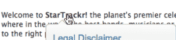

我们的对话框标记将由两个嵌套的 `span` 元素组成，它们将位于我们希望用来触发对话框的元素内部。这有时可能需要一些创造性的标记编写，但它有助于我们定位对话框，因为我们可以给它一个相对于父元素的绝对定位偏移量。它也有助于触发事件，因为如果用户将鼠标移到对话框上，它仍然在触发元素之上，因此不需要额外的悬停事件处理。

以下是对话框标记的一个示例：

```html
chapter_05/18_advanced_tooltips/index.html (excerpt)

<p>
  欢迎来到
  <strong>StarTrackr!
    <span class='dialog'>
      <span><a href='#'>法律免责声明</a></span>
    </span>
  </strong> 星球首屈一指的名人追踪 ...
</p>
```

完成后，对话框看起来会很棒，并包含一个指向免责声明页面的链接。但我们不耽误时间；我们已经考虑过一些对话框方法，所以直接深入吧。

正如我们在编写代码时将看到的，我们的对话框将相当智能，它会定位在目标元素有足够的空间显示的那一侧。为了在这个上下文中实现酷炫的文本气泡图形效果，我们需要四种不同的气泡：左上、右上、左下和右下。我们将为对话框的四种可能状态各使用一个精灵图，如图 5.12 所示。

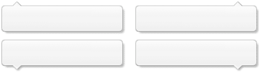

这些对话框需要一些相当复杂的 jQuery 代码。我们会逐段讲解，但现在如果无法完全理解也不用担心。从编写快速替换和突出显示页面内容的两三行脚本，到编写更复杂的 UI 小部件，需要一个飞跃。在第 6 章的“构建与最佳实践”一节中，我们将探讨一些方法，即使在代码变得更长、更复杂时，也能尽量减小复杂度并保持代码可读性。

目前，试着专注于在更大的上下文中看到你已经知道的 jQuery 片段；这将让你了解如何将小片段的逻辑组合成一个性能令人印象深刻的更大图形。

我们的首要任务是创建一个包含所有代码的 `DIALOG` 对象。我们在对象顶部设置一个 `delay` 属性（这将使修改小部件配置变得更容易，无需在代码中搜寻这个变量是在哪里设置的）：

```javascript
var DIALOG = {
    current: null,
    delay: 600,
    timer: null,
    setDialogs: function () {
        // 确定对话框位置
        :
    }
}
```

然后我们添加一个名为 `setDialogs` 的函数，我们将在页面加载或调整大小时运行它。这个函数将找到页面上所有的对话框，并通过查看它们的父元素来确定它们的位置。它还会在每个对话框上设置一个悬停事件，使其在鼠标悬停时显示。以下是悬停事件：

```javascript
$('.dialog').parent().hover(function() {
    // 存储当前悬停的对话框
    DIALOG.current = $(this);
    DIALOG.timer = setTimeout(function() {
        // 找到对话框并淡入显示
        $(this).find('.dialog').fadeIn('fast');
    }, DIALOG.delay);
}, function() {
    // 鼠标移出时，清除计时器并隐藏对话框
    clearTimeout(DIALOG.timer);
    $(this).find('.dialog').fadeOut('fast');
}).attr('title', ''); // 清除 title 属性以停止浏览器工具提示
```

这是一段相当密集的代码块，所以让我们看看能否理清其中发生了什么：

1.  我们使用了熟悉的 `setTimeout` 函数，只是这次我们将计时器保存到了一个变量中。这样，如果需要，我们就可以通过名称来关闭它。我们使用之前设置的 `delay` 属性作为 `setTimeout` 的第二个参数。正如我们所看到的，这是浏览器在显示对话框之前等待的时间。

2.  当用户的鼠标移开目标时，我们希望停止计时器，这样在延迟时间结束后，对话框就会保持隐藏状态。我们通过 JavaScript 的 `clearTimeout` 方法实现这一点，并传入我们计时器的引用。

### for 与 each 的比较

不过，在我们尝试这个函数之前，JavaScript 界有足够的噪音来快速看一下围绕我们 `each` 循环的一个持续争论：

```
chapter_05/18_advanced_tooltips/script.js (摘要)
$(".dialog").each(function(){// 获取包含元素
```

任何时候我们用 jQuery 方法替代纯 JavaScript 方法，都会带来一些开销。当我们使用 `each` 来替代 `for` 循环时，我们必须调用 jQuery，这需要时间。虽然只是毫秒级的微小部分，但仍然是时间。而且这些微小的部分会累积起来。

那么我们是否应该总是使用 `for` 循环呢？完全不是！如果你知道会有性能损耗，并且清楚这对你的代码会产生什么影响，那就大胆去做。更重要的是，如果你在循环内部存储一个值以供后续引用，`each` 循环可以免费提供这个功能，而 `for` 循环通常需要额外的工作。所以这并非一成不变，但正如本例中我们存储了一个值，我们将坚持使用 `each` 循环。

现在我们的悬停处理程序已经设置好了，我们需要确定每个对话框的位置。我们将使用 `each` 来遍历它们，但首先我们要获取屏幕的高度和宽度。如果我们把这部分代码放在循环*内部*，jQuery 将需要为每个对话框计算这些值一次，即使它们总是相同的。通过将值存储在循环外部，我们避免了这种浪费的计算，并提高了脚本的性能：

# 菜单、标签页、工具提示和面板

```
chapter_05/18_advanced_tooltips/script.js (摘要)

setDialogs: function () {
  var screenWidth = $(window).width(),
      screenBottom = $(window).scrollTop() + $(window).height();
;
$(".dialog").each(function(){// 获取包含元素
  var container = $(this).parent(),
      top = container.height(), // 默认位置
      totalHeight = top + $(this).outerHeight(),
      width = $(this).outerWidth(),
      offset = container.offset(),
      left = 0;

  // 如果需要，设置相对定位
  if (container.css('position') != 'absolute' &&
      container.css('position') != 'fixed') {
      container.css({position: 'relative'});
  }

  :
}
}
```

这部分代码应该更容易理解一些。我们遍历页面上的每个对话框，首先存储对包含元素的引用，只是为了避免反复编写 `$(this).parent()`。以下是循环内容的分解：

1.  默认情况下，我们将对话框的顶部位置设置为等于包含元素的高度。这意味着它将直接出现在包含元素*下方*（因为它从顶部偏移的距离正好等于包含元素的高度）。

2.  我们需要知道对话框和父元素的总高度，因此将该值存储在一个变量中以供后续使用。

3.  我们检查父元素是否具有 `position: absolute;` 或 `position: fixed;`。它必须是定位元素，因为我们将使用 `position: absolute;` 使其相对于父元素进行偏移。如果它已经是绝对定位或固定定位，我们就保持原样。如果不是，我们就给它设置 `position: relative;`。

### 182 jQuery：从新手到忍者

### 逻辑运算符

在 JavaScript 中，当你在 `if` 语句中测试值时，可以使用 `&&` 运算符表示*与*。所以在上面的例子中，只有当*两个*条件（位于 `&&` 两侧）都满足时，`if` 块中的内容才会执行。

你也可以写 `||`（两个管道符号）表示*或*。如果我们上面用 `||` 代替 `&&`，那么只要*任一*条件满足，`if` 块中的内容就会执行。

到目前为止做得很好！我们快完成了，但需要解决一个小问题：如果对话框的位置使其超出屏幕怎么办？如果目标元素恰好在屏幕底部，而我们希望对话框出现在其下方，那么对话框将不可见！

是时候进行一些碰撞检测了。我们需要找出对话框是否碰到了屏幕的底部或右边缘。让我们看看如何实现这一点：

```
chapter_05/18_advanced_tooltips/script.js (摘要)

// 如果超出屏幕右侧，则重新定位
if (offset.left + width > screenWidth) {
    left = 0 - width + 42;
    $(this).addClass('left');
} else {
    $(this).removeClass('left');
}

// 如果超出屏幕底部，则重新定位
if (offset.top + totalHeight > screenBottom) {
    top = 0 - $(this).outerHeight();
    $(this).addClass('above');
} else {
    $(this).removeClass('above');
}
```

我们检查对话框的水平或垂直偏移量加上其宽度或高度是否大于屏幕的宽度或高度（我们之前已计算过）。如果是，我们分别修改 `top` 或 `left` 属性，并分配一个类，我们将用它来显示背景图像精灵的相应部分。

最后（也是最简单的）一步是使用 css 操作将计算出的 top 和 left 属性分配给提示框：

```
chapter_05/18_advanced_tooltips/script.js (摘要)

$(this).css({
    "top": top,
    "left": left
});
```

我们将在文档就绪时调用 setDialogs 方法，并在窗口每次调整大小时也调用它，以确保我们的提示框始终放置得当：

```
chapter_05/18_advanced_tooltips/script.js (摘要)

$(document).ready(function() {
    DIALOG.setDialogs();
});

$(window).resize(function() {
    DIALOG.setDialogs();
});
```

代码就位后，我们只需要添加一些 CSS，根据我们分配的类来适当地定位背景精灵：

```
chapter_05/18_advanced_tooltips/dialog.css (摘要)

span.dialog.left {
    background-position: 100% 0;
}

span.dialog.left span {
    padding: 15px 0 0 17px;
}

span.dialog.above {
    background-position: 0 100%;
}

span.dialog.above span {
    padding: 13px 0 0 12px;
}
```

```
span.dialog.above.left {
  background-position: 100% 100%;
}

span.dialog.above.left span {
  padding: 13px 0 0 17px;
}
```

## IE6 支持

尽管 jQuery 在处理我们 JavaScript 代码中的跨浏览器问题方面做得非常出色，但对于我们的 CSS 来说就没那么好了。上述样式规则依赖于将多个 `class` 选择器链接在一起。这会让 Internet Explorer 6 困惑，它只会看到任何样式规则中的最后一个 `class`。此外，我们的 PNG 图像依赖于 alpha 通道透明度来实现对话框的投影，这也是 IE6 不支持的。

在过去的几年里，一些主要网站（包括 YouTube 和 Facebook）开始逐步放弃对 IE6 的支持。这并不意味着它们完全忽略这个浏览器；而是它们接受 IE6 用户将获得降级的体验（可能类似于没有 JavaScript 的访问者看到的效果）。

对于我们的对话框示例，我们可以使用条件注释来专门针对 IE6 设置一些样式，并为其提供相同的对话框功能——只是使用没有思考气泡样式或投影的平面背景图像。这样，背景位置就无关紧要了，PNG 问题也得以解决。

对于那些固执地坚持使用 IE6 的人，另一个选择是 Google 的 Chrome Frame。Chrome Frame 将 Chrome 的开放 Web 技术和 JavaScript 引擎带到了 IE 中。如果你的环境允许安装插件，并且你需要坚持使用 IE6，你可能需要了解一下 Chrome Frame。

就是这样了！最终的对话框不仅会等待查看你是否真的想让它显示，而且一旦显示，还会调整其位置以确保其完全可见！因为我们避免了将此代码与页面上的任何特定内容绑定，所以很容易在其他任何页面上重复使用这个脚本；你只需包含一些带有 `dialog` 类的 span，就可以开始了。这是一个重要的教训：你应该始终尝试以可以重用的方式构建代码

---

<sup>5 http://reference.sitepoint.com/css/conditionalcomments/

6 http://code.google.com/chrome/chromeframe/</sup>

## 按菜单点菜

呼！冲向终点的冲刺真不容易。在本章中，我们已经提升了 jQuery 技能，并用它超越了简单的显示与隐藏，进入了真正的 UI 高手领域。

你已经学会了如何通过将链接和小部件打包成折叠菜单、手风琴面板、工具提示框和对话框来简化屏幕上的复杂性。你还构建了一个能感知自身在视口位置的小部件，它会调整自身位置以确保始终在可见范围内。这个技巧不仅可以用于对话框，还能用于包含长文本的下拉菜单以及其他各种元素。

在下一章中，我们将探讨如何简化代码复杂度，然后攻克 jQuery 中表面上最重要的部分：Ajax！

# 第 6 章

## 构建、Ajax 与交互

在之前的章节中，我们用琳琅满目的视觉效果和光学魔术为客户团队带来了惊喜与震撼，让他们的网站拥有了栩栩如生的外观。可惜，他们越来越精明了：他们不仅希望页面*看起来*像 Web 2.0，还希望页面*运行起来*也像 Web 2.0。而让页面运行起来像 Web 2.0 意味着一件事：Ajax！

而且不是一点点——他们想要全套：内联文本编辑、Twitter 小部件、滚动图片画廊……他们希望 StarTrackr! 拥有比 Facebook、Twitter 和 Google+ 加起来还多的 Ajax 功能与花哨特效。

这对我们来说没问题。实现客户端 Ajax 功能很容易，尤其有 jQuery 作为框架。但这些炫酷新功能的代价是复杂度增加。一些简单任务（比如加载一段 HTML）不成问题，但当我们开始着手创建高级 Ajax 组件时，代码混乱、难以维护的风险就会增加。所以，在深入探讨之前，我们将回顾一些管理复杂度的方法，并编写出能令同行赞叹的规范代码。

### 构建与最佳实践

JavaScript 是一门美妙的语言。别让任何人说它不好。它历史上口碑不佳源于多年的误解和误用：大量内联脚本对封装和复用等优秀编码实践几乎不屑一顾。但过去几年为这 Web 世界的“草根”语言开启了新时代。开发者开始尊重（并掌握）这门语言，成果便是一些优秀的代码库——包括我们最爱的 jQuery。

jQuery 大大简化了处理 Ajax 和 DOM 的过程，但它并没有改变编写简洁优美 JavaScript 代码的价值。我们无需成为 JavaScript 大师，但应该采取一些措施来确保我们编写的代码能让未来的开发者和项目维护者愿意请我们喝一杯。

### 更简洁的 jQuery

我们在避免复杂 JavaScript 代码方面做得相当不错——这证明了 jQuery 在它擅长的领域表现卓越。但随着我们的 jQuery 组件和效果变得越来越复杂，我们需要开始思考如何最好地构建代码。我们再次应该记住，jQuery 的底层其实就是 JavaScript，所以借鉴一些 JavaScript 世界的最佳实践会让我们受益匪浅。我们在第 5 章末尾构建高级工具提示脚本时，已经看到了这类代码组织的一点雏形。现在，让我们来揭示编写更简洁 jQuery 代码的原因和方法。

### 代码注释

就像 HTML 和 CSS 一样，JavaScript 也提供了注释代码的方式。任何以两个斜杠（//）开头的行都会被浏览器忽略，因此你可以放心地包含解释代码功能的说明。例如，在以下代码片段中，第一行会被忽略，只有第二行会被当作代码处理：

```
// 将值 '3' 赋给变量 'count'：
var count = 3;
```

如果需要编写跨多行的注释，可以用 /* 开头，*/ 结尾。例如：

```
/* 一个
   多行
   注释的示例
*/
var count = 3;
```

注释对于提高代码的可重用性和可维护性大有裨益：当你在数月后重新查看自己写的代码时，它们能帮助你一目了然地理解每一行或每一部分的功能。

### 映射对象

我们从第 2 章开始就一直在处理键/值对对象。例如，我们使用它们向单个 jQuery 方法传递多个选项：

```
$('p').css({color:'green', padding:'3px'});
```

这些并非 jQuery 特有的结构——再次强调，它们只是普通的 JavaScript——但它们非常适合封装数据，以便在自己的函数和小部件之间传递。例如，如果你从某些表单字段中提取数据，可以将它们打包成键/值映射对，然后进行进一�处理：

```
var id = $('input#id').val();
var name = $('input#name').val();
var age = $('input#age').val();

var data = {
  type: 'person',
  id: id,
  name: name,
  age: age
}
```

数据全部封装后，我们就能轻松地在各处传递并按需使用。要访问对象的某个值，只需输入对象名，后跟一个点（.），再后跟与该值关联的键。例如，针对上面定义的 data 对象，如果你想检查 `type` 属性是否包含字符串 'person'，如果是则显示 name 属性，可以这样写：

```
if (data.type == 'person') {
    alert('Hello ' + data.name);
}
```

### 为代码命名空间

即使是最好的库也仍然可能让你写出混乱的意大利面式代码，jQuery 也不例外。在 20 页的 hover 和 toggle 命令中翻找最终会让你抓狂，所以为了保持理智，你会希望将逻辑相关的代码块分组。

我们在第 5 章的“高级工具提示与对话框”部分已经尝试过这样做，如果你回顾那个例子，会注意到几乎所有代码都封装在一个名为 TT 的对象中。这个对象与之前的数据对象（以及我们目前使用的所有对象字面量）非常相似，只是它还包含*函数*以及静态变量。

因此，当我们编写 `setTips: function() { ... }` 时，我们是将该函数赋值给 TT 对象的 `setTips` *属性*。完成后，我们可以通过 `TT.setTips()` 来执行该函数。现在，我们编写的每一个与工具提示相关的函数都可以包含在 TT 内。因为我们在全局作用域（稍后详细说明）中声明的唯一对象是 TT，所以我们尽可以放心，我们的函数或变量不会与页面上的其他 JavaScript 代码冲突。我们将这种技术称为**命名空间**，并将我们所有的 TT 变量和方法称为 TT **命名空间**的一部分。

我们的命名空间对象可以取任何有效的变量名。这意味着它可以以美元符号、下划线或任何字母字符（小写或大写）开头。此外，名称越独特、越有帮助，就越成功（嗯，jQuery ($) 和下划线 (_) 就是成功例子！）。我们的目标是避免函数名冲突。

对于 StarTrackr! 来说，TRKR 会是个不错的选择。它简短、有帮助（因为它暗示了网站名称），而且相当独特。

以下是我们想要避免的情况。假设你有一个名为 `exclaim` 的函数：

```
function exclaim () {
  alert("hooray");
}
exclaim();// hooray
```

就函数名而言，它不算特别有创意，但就这样了。问题是，你想放到网站中的某些第三方代码也有一个名为 exclaim 的函数：

```
function exclaim () {
  alert("booooo");
}
exclaim();// booooo
```

现在，当你期望 alert 显示 "hooray" 时，却看到了令人沮丧的 "booooo"。与其简单地另选一个函数名并冒着同样的风险，不如将我们的方法放入 TRKR 命名空间：

```
var TRKR = {};

TRKR.exclaim = function () {
  alert("hooray");
};
```

现在，我们可以用命名空间的方法和属性做任何事情，没有限制：

```
var TRKR = {};
TRKR.namespaces = "cool";
TRKR.boolean = true;
TRKR.pi = 3.14159;
TRKR.css = {
  "color": "#c0ffee",
  "top": 0
};
TRKR.exclaim = function () {
  alert("hooray");
};
```

现在我们仍然可以发出欢快的 "hooray"，但其他代码干扰我们的可能性大大降低了：

TRKR.exclaim(); // 万岁

TRKR.namespaces; // "酷"

exclaim(); // 噢不

以这种方式为代码创建命名空间也意味着它可以轻松地在其他页面上重用。我们只需将 TRKR 对象放在另一个页面中，就可以访问所有我们喜欢的函数了。这就是高质量的代码！

一旦设置了命名空间，你可以在声明对象后逐一添加属性（如我们之前所做的），或者像下面这样将它们全部包含在对象字面量中：

```javascript
var TRKR = {
    namespaces: "cool",
    boolean: true,
    pi: 3.14159,
    css: {
        "color": "#c0ffee",
        "top": 0
    },
    setup: function() {
        TRKR.one = 1;
        :
    },
    exclaim: function() {
        alert("hooray");
    }
};
```

这段代码生成的命名空间对象与我们之前看到的完全相同，选择哪种方式取决于你的喜好。在本书的剩余部分，你将遇到的大部分代码都会在适当的时候使用命名空间。

## 作用域

在编程中，**作用域**指的是定义的变量存在的代码区域。例如，你可以通过在任何函数或字面量之外声明变量来将其定义为全局变量。全局变量可以从代码中的任何地方访问。同样，在构造（如函数或对象）内部声令的变量被称为该构造的局部变量。

这似乎很简单，但当我们开始为 Ajax 请求定义回调方法时，它可能会变得混乱，因为回调通常会在与其定义不同的作用域中运行。因此，如果你试图在回调中引用 `this`，期望它指向你的小部件命名空间，你会感到不快的惊讶：它可能是全局的 DOM `window` 对象，或者它可能引用完全不同的东西。例如：

```javascript
var WIDGET = {};
WIDGET.delay = 1000;
WIDGET.run = function() {
  alert(this.delay); // 1000 ... 好！
  $(p).click(function() {
    alert(this.delay) // undefined! 糟糕！
  });
};
```

当点击 `p` 标签时，我们的事件处理程序运行在与小部件对象本身不同的上下文中。因此 `this.delay` 很可能不存在（即使存在，它也不是我们想要的那个变量！）。有几种方法可以解决这个问题，但为了不那么 JavaScript 化，最简单的方法是将小部件的作用域存储在一个变量中：

```javascript
var WIDGET = {};
WIDGET.delay = 1000;
WIDGET.run = function() {
  alert(this.delay); // 1000 ... 好！
  var _widget = this;
  $(p).click(function() {
    alert(_widget.delay) // 1000 ... 是的！
  });
};
```

通过将 `_widget` 设置为指向 *在小部件上下文中的* `this`，我们总能将其指回来，无论我们在代码的哪个位置。在 JavaScript 中，这被称为 **闭包**。通用的约定是将其命名为 `_this`（尽管有些人也使用 `that`）。如果它在命名空间对象中使用，最好用下划线（_）后跟小部件名称来命名。这有助于澄清我们正在操作的作用域。

我们将“我们正在操作的作用域”称为 **上下文**，并且有几种设置方法。一种是通过我们之前看到的闭包，但 jQuery 也提供了进一�的解决方案。

另一个通用的方法是代理方法。代理有点不寻常，因为你给它一个函数，它会返回一个给你。只有返回的函数将绑定到你指定的上下文，这意味着不需要额外的变量（如上面的 _widget），因为 `this` 将指向正确的作用域：

```javascript
var WIDGET = {
    delay: 1000,
    run: function() {
        alert(this.delay); // 1000 ... 好！
        $("p").click(
            $.proxy(function() {
                alert(this.delay); // 1000 ... 是的！
            }, this);
        );
    }
};
```

在这个例子中，我们将点击函数包装在一个代理调用中。第一个参数是我们希望在单击时运行的函数，第二个参数是上下文 **this**。

这一切可能看起来有点复杂，但在 JavaScript 中设置上下文可能很棘手。只需记住：如果你有一个回调函数似乎工作不正常，请调试 **this** 属性并确保你处于你认为的位置！保持正确的上下文在 Ajax 中变得尤为重要，幸运的是，jQuery 提供了更多方式来帮助我们，正如我们很快将看到的那样。

## 客户端模板化

到目前为止，我们看到的大多数菜单和效果都包含静态内容。当然，大多数菜单文本不太可能改变，但随着我们探索支持 Ajax 的小部件，动态注入和替换文本的需求变得越来越重要。这给我们带来了模板化的问题：你将把用于构建你插入页面的内容的标记放在哪里？

有多种方法可以处理这个问题。最简单的方法是每次显示窗格时都替换其全部内容——例如，通过 html 操作。

每当我们需要更新内容窗格时，我们都用新的标记替换其全部内容，如下所示：

```javascript
$('#overlay').html("<p>You have " + cart.items.length +
 items in your cart.</p>");
```

### 数据源

在我们对模板化的讨论中，我们将假设我们需要更新的内容来自某个虚构的 JavaScript 数据源（如上述例子中的 **cart.items**）。数据源的格式可能因项目而异：有些会通过 Ajax 拉取，有些通过服务器端语言直接注入，等等。显然，代码的这些部分需要根据你的需求进行调整。

如果只有少量基本标记，直接编写 HTML 内容是可以的，但对于更复杂的内容，它很快就会导致 JavaScript 或 jQuery 字符串操作混乱不堪，难以阅读和维护。如果你尝试通过字符串连接构建复杂的表格，你会遇到麻烦，你的 HTML 将与你的 jQuery 代码紧密交织在一起。

解决这个问题的一种方法是在你的 HTML 内容中提供钩子，这些钩子可以在需要时用数据填充：

```html
<div id='overlay'>
  <p>You have <span id='num-items'>0</span> items in your cart.</p>
  <p>Total cost is $<span id='total-cost'>0</span></p>
</div>
```

我们现在已经在 HTML 中添加了一些容器字段。当需要更新数据时，我们使用 jQuery 来更新容器的文本：

```javascript
$(this).find('#num-items').text(cart.items.length);
$(this).find('#total-cost').text(cart.getTotalCost());
```

这比我们的第一次尝试好得多：它将所有标记留在了 HTML 页面中，很容易就能看出代码在做什么。

还有一个（非常方便的）选项用于管理将被 jQuery 操作的标记。当你正在处理返回结果列表或网格的应用程序时——比如购物车的商品列表——你可以包含一个元素作为每个项目的模板，然后只需复制该元素并在需要添加新项目时编辑其内容。

让我们通过在 StarTrackr! 购物车上做一些工作来实践一下。我们希望能够使用 jQuery 添加和删除项目。项目位于一个 HTML 表格中，我们更愿意避免在 jQuery 代码中写出整个表格行。使用占位符也很困难，因为无法提前知道购物车中会有多少个项目。我们想做的是简单地准备空的表格行，等待 jQuery 用内容填充它们。

我们的第一个任务是创建一个带有 `display:none;` 的空行作为我们的模板：

```html
chapter_06/01_client_side_templating/index.html (摘录)

<table id="cart">
  <thead>
    <tr>
      <th>名称</th>
      <th>数量</th>
      <th>总价</th>
    </tr>
  </thead>
  <tr class="template" style="display:none;">
    <td><span class="item_name">名称</span></td>
    <td><span class="item_qty">数量</span></td>
    <td><span class="item_total">总价</span>.00</td>
  </tr>
</table>
```

接下来，我们将创建一个辅助函数来为我们进行模板化。这使代码集中化，在模板更改时易于维护。`template` 函数接受一个表格行的 jQuery 选择以及一个购物车项（一个包含商品名称、数量和总价的对象）。结果是一个填充好的模板，可以插入到我们的 HTML 文档中：

### 模板系统

尽管客户端模板的概念看似简单明了，但它很快就会变得异常复杂。特别是当有大量数据需要模板化，或者你需要将用户数据注入页面时，这可能会引入安全问题。

模板系统的选择多种多样，对于“最佳系统”肯定没有明确的赢家。有些人喜欢像Mustache模板¹那样跨平台、无逻辑风格的系统，而另一些人则更喜欢jQuery Templates²的灵活性。后者自推出以来一直相当流行，但正在被jsRender项目³所取代。到你阅读本文时，情况很可能再次发生变化，但有一点是肯定的：你需要考察所有选项，并确定哪个最适合你、你的团队和你的项目。

## 浏览器嗅探（……是坏习惯！）

浏览器嗅探正迅速成为过时技术，并可能导致被好友删除——或取关——或任何网络上的“死刑”等效惩罚。这对许多人来说难以置信或接受，因为我们使用浏览器嗅探已很长时间，而且它看起来比替代方案（我们稍后会探讨）容易得多。**浏览器嗅探**，如果你幸运地从未遇到过，是指使用JavaScript来识别用户正在使用哪个版本的哪个网络浏览器。其理念是，一旦你掌�了这些信息，你就可以绕过该浏览器中已知的所有错误，让你的页面为该用户正确渲染和运行。

但这种技术已经变得过于不可靠：旧浏览器会通过补丁更新，新版本会发布，新浏览器也会推出——几乎每天都在发生！这意味着你代码中的变通方法可能会（而且将会）失效或变得多余，而你将不得不成为一本活生生的浏览器错误百科全书。

话虽如此，jQuery中确实有一些函数可以辅助浏览器嗅探。这些函数现已弃用，并可能在未来版本中移至单独的插件。

`$.browser`有一些标志，用于判断当前用户的浏览器是否是Internet Explorer、WebKit、Opera或Mozilla。`$.browser.version`是另一个尽量不要使用的实用函数，它报告用户浏览器的当前版本。

结合这两个命令，你可以执行条件代码，如下所示：

```javascript
if ($.browser.mozilla && $.browser.version=="9.0") {
    // 仅在Firefox版本9中执行此代码
}
```

然而，依赖浏览器修订号和供应商名称，只会为未来的麻烦埋下伏笔。你肯定想避免修复旧代码，特别是当你本可以编写崭新代码的时候。所以，也许是时候谈谈浏览器嗅探的替代方案了……

## 特性检测

浏览器嗅探被摒弃的原因是它针对的是症状，而非问题的根源。例如，Internet Explorer 8及以下版本不直接支持`opacity` CSS属性（对于这些浏览器，opacity是通过专有的`filter`属性设置的）。在我们的代码中使用opacity之前，我们可以测试用户是否在使用Internet Explorer，然后采取相应措施。但问题并不真正是Internet Explorer；问题是`opacity`本身！

为了取代浏览器检测，jQuery引入了`$.support`方法来报告用户浏览器的能力。你现在应该问的不是“用户的浏览器是Internet Explorer吗？”，而是“用户的浏览器支持opacity样式吗？”，如下所示：

```javascript
if (!$.support.opacity) {
    // 不支持opacity：应用一个变通方法
}
```

这种方法的美妙之处在于，如果未来出现的新浏览器不支持`opacity`样式，或者如果Internet Explorer突然*开始*支持它，你旧的代码仍然能完美运行。

除了opacity，还有大约十几个属性可供测试。例如：`$.support.boxModel`在浏览器处于怪异模式（或不支持盒模型）时返回`false`；`$.support.leadingWhitespace`在浏览器通过innerHTML保留前导空白时返回`true`，以此类推。如果你的项目需要，请务必查阅文档中的完整列表。⁴

## Ajax速成课程

曾几何时，“Ajax”是*时下*热词，而如今它只是我们Web开发武器库中的又一个工具——一个我们用来提供无缝、自然页面交互的工具。Ajax的实现可能有点棘手……除却你使用jQuery！

### 什么是Ajax？

术语**Ajax**于2005年创造，是Asynchronous JavaScript and XML（异步JavaScript和XML）的首字母缩写。许多人认为这个术语有问题，因为他们已经在做类似Ajax的工作，但并不总是使用缩写中提到的技术。最终，这个术语稳定下来，简单地表示几乎任何能让用户浏览器与服务器交互而不干扰现有页面的技术或方法。

如今Ajax无处不在，很难记住替代方案是什么！非Ajax的与服务器交互的“回发”方法涉及用户点击链接或提交表单，这会向服务器发送一个请求。当前的浏览器页面被移除，服务器用一个新的HTML页面响应，该页面被加载并显示给用户。而在页面加载期间，用户被迫等待……无休止地等待。

Ajax允许我们从浏览器向服务器发送请请求而无需页面重载，因此我们可以在用户继续工作时更新页面的一部分。这帮助我们模拟桌面应用程序的感觉，并为用户提供更响应迅速、更自然的体验。

由于Ajax在浏览器端运行，我们需要一种方式与服务器动态交互。每个网络浏览器往往提供略有不同的实现方法。幸运的是，jQuery在这里为我们解决了这些差异。

我们已经看到了大量用于操作DOM的jQuery函数，因此你可能会担心需要吸收大量的文档才能编写出强大的Ajax功能。好消息是，jQuery中只有少数几个Ajax函数，而且其中大多数只是有用的包装函数来帮助我们。

### 加载远程HTML

我们最好开始写些代码了；StarTrackr!团队越来越暴躁了，因为我们很久没有给他们更新了，而且网站上还没有任何Ajax的影子。我们将使用最简单的jQuery Ajax函数`load`来快速增强一下。

`load`方法会神奇地从服务器获取一个HTML文件，并将其内容插入到当前网页中。你可以加载静态HTML文件，也可以加载生成HTML输出的动态页面。这是一个使用它的快速示例：

```javascript
$('div:first').load('test.html');
```

只需要这么少量的代码就能实现一些酷炫的Ajax功能！这会将**test.html**文件的全部内容（`<body>`标签内的所有内容）动态插入到页面上的第一个`div`中。你可以使用任何选择器来决定HTML应该放在哪里，甚至可以同时加载到多个位置。

> **是哪个`load`？**

> 小心——jQuery中的`load`关键字有几种不同的用法。一个是Ajax `load`方法，我们刚刚看到的；另一个是`load`事件，当对象（如window或image）加载完成时触发。

### 通过Hijax增强超链接

让我们把这个好东西用到StarTrackr!中！我们将通过设置一系列包含关键名人传记的页面来让客户惊叹。主页将包含一堆标准超链引导你到传记页面。然后，利用我们的新Ajax技能，我们将在用户点击链接时拦截它们，不发送用户到传记页面，而是将信息加载到链接下方。

---

`chapter_06/01_client_side_templating/script.js`（摘录）

```javascript
function template(row, cart) {
    row.find('.item_name').text(cart.name);
    row.find('.item_qty').text(cart.qty);
    row.find('.item_total').text(cart.total);
    return row;
}
```

因此，对于每一行新数据，我们需要复制模板，替换我们的值，并将其附加到表格末尾。复制所选元素的一种便捷方法是使用clone方法，它创建当前jQuery选择的副本。一旦克隆了一个元素，选择就会更改为新元素，允许你将其插入到DOM树中：

```javascript
var newRow = $('#cart .template').clone().removeClass('template');
var cartItem = {
    name: 'Glendatronix',
    qty: 1,
    total: 450
};
template(newRow, cartItem)
    .appendTo('#cart')
    .fadeIn();
```

模板类被移除——因为它不再是模板了！然后我们设置购物车项目（在真实示例中，这些数据当然会来自服务器），然后使用我们的template方法将数据替换到行中。替换完成后，我们将行添加到现有表格并使其淡入。我们的代码保持简单，所有标记都留在它应该在的HTML文件中。

还有其他模板技术吗？哦，有的，成百上千！上述方法很常见，很可能就是你需要的全部；但如果你发现自己一遍又一遍地重复模板代码，也许是时候考虑一个功能更全面的模板系统了。

## 202 jQuery：从新手到忍者

这是加载外部信息的绝佳技巧；不仅我们的首页能快速加载，任何在禁用 JavaScript 的情况下访问我们网站的用户，也仍然能像访问普通链接一样访问个人传记页面。这种渐进式增强超链接的方法有时被称为 **hijax**，这个术语由 Jeremy Keith 提出（你用 Ajax 劫持了超链接，明白了吧？）。

要在我们的网站上开始，我们需要一些 HTML 内容来加载。目前先保持简洁，我们将构建仅包含标题和描述的页面：

```
chapter_06/02_hijax_links/baronVonJovi.html (摘录)

<body>
    <h1>Baron von Jovi</h1>
    <p id="description">
        It's a little known fact that Baron von Jovi ...
    </p>
</body>
```

我们需要为每位名人准备一个 HTML 页面。如果你有数百万条目，你可能不想手动编码所有内容——但你可以从数据库加载它们，通过向服务器端脚本传递查询字符串来加载正确的页面。我们只有几位特邀名人，所以我们就用笨办法来做。

### load 函数的局限性

出于安全原因，你加载的内容必须存储在与运行脚本的网页相同的域中。Web 浏览器通常会阻止你向第三方服务器发出请求，以防止 **跨站脚本攻击**：恶意脚本被恶意注入页面。如果你需要访问托管在不同域上的内容，可能必须设置一个服务器端代理来为你调用其他服务器。或者，如果第三方服务器能提供 JSONP 数据，你可以看看 jQuery 的 `getJSON` 函数。我们稍后将重点介绍这个函数。

一旦我们有了目录，我们将在 StarTrackr! 页面中插入一个普通的链接列表。然后我们应该能够点击进入正确的传记页面：

```
chapter_06/02_hijax_links/index.html (摘录)

<ul id="biographies">
  <li><a href="baronVonJovi.html">Baron von Jovi</a></li>
  <li><a href="computadors.html">The Computadors</a></li>
  <li><a href="darthFader.html">Darth Fader</a></li>
  <li><a href="moFat.html">Mo' Fat</a></li>
</ul>
<div id="biography">
  Click on a celeb above to find out more!
</div>
```

我们在列表下方添加了一个额外的 div。这是我们将注入 Ajax 调用响应的地方。下一步是拦截链接并执行一些 Ajax 操作：

```
chapter_06/02_hijax_links/script.js (摘录)

$('#biographies a').click(function(e) {
  var url = $(this).attr('href');
  $('#biography').load(url);
  e.preventDefault();
});
```

首先，我们选择无序列表内的所有链接，并阻止默认事件发生（即跟随链接并加载目标页面）。我们获取链接的原始目标（通过检索我们点击的链接的 href 属性），并将其传递给 load 函数。

这段代码运行完美，但注入整个页面内容结果有点问题。我们的新内容包含 <h1> 标签，这本应是用来标记整个页面的标题，而不是一个小节。问题在于，我们不一定想通过 Ajax 加载整个页面，只加载我们感兴趣的部分。而 jQuery 再次为我们提供了解决方案...

## 构建、Ajax 与交互性 203

## 使用选择器选取 HTML

load 操作允许你将 jQuery 选择器作为 URL 字符串的一部分指定。只有匹配选择器的页面元素才会被返回。这极其强大，因为它让我们能为普通链接构建完整独立的网页，然后为 Ajax 链接提取片段。

使用选择器与 load 的格式非常简单：你只需在要加载的文件名后添加选择器字符串，用空格分隔：

```
$('#biography').load('computadors.html div:first');
```

你可以使用任意复杂的选择器，让你挑选出页面中最有趣的部分来加载。对于我们的 StarTrackr! 传记，我们希望显示 description 部分包含的信息。我们将修改代码如下：

```
chapter_06/03_load_with_selector/script.js (摘录)
var url = $(this).attr('href') + ' #description';
```

请务必在井号前包含一个空格以将其与文件名分隔。如果你运行这个版本，你会看到现在只加载了 description div。我们很快会详细讲解如何添加加载指示器，但在此之前，你可以编写一个快速而简单的解决方案：只需在调用 load 之前，将目标元素的文本替换为 "loading ..."。同样，由于你的文件位于本地机器上，你永远不会看到加载文本，但知道如何做总是好的：

```
chapter_06/03_load_with_selector/script.js (摘录)
$('#biography').html('loading...
').load(url);
```

搞定了！准备好向客户展示了。但既然我们只花了 15 分钟，也许我们应该深入研究一下 load 函数的细节，以便让它更加完善。

### 整个页面仍然被加载

你可能认为指定选择器可能是减少 Ajax 调用带宽的巧妙方法。不幸的是，情况并非如此。无论你是否添加选择器，整个页面都会被返回，然后针对该页面运行选择器！

### # 高级加载

如果你需要，可以对你的 load 调用进行一些额外的调整。一个常见的需求是指定一些传递给服务器的数据；例如，如果你有一个基于查询字符串返回信息的搜索功能，你可能会这样调用它：

```
$('div#results').load('search.php', 'q=jQuery&maxResults=10');
```

传递给 load 的第二个参数称为 data。如果你传递一个字符串（如上所示），jQuery 将执行 GET 请求。但是，如果你改为传递一个包含数据的对象，它将执行 POST 请求。

此外，我们可以通过提供回调函数在请求完成时执行处理。回调函数将接收三个参数：响应文本（实际数据）、包含响应状态的字符串（希望是成功——但这里你可以优雅地处理错误）以及完整的响应对象本身：

```
$('div#result').load('feed.php', function(data, status, response) {
    // 后处理时间！
});
```

data 参数以及 data 参数内的回调参数都是可选的。这允许你在调用 load 时使用简单或复杂的语法。

### # 为未来做准备：on 和 off

你已经运行了至关重要的 Ajax 组件，是时候向客户团队展示了，他们非常兴奋。“这东西太棒了！”他们惊呼道，但接着提出了一个请求：“哦，你能不能也做到，当你把鼠标移到传记上时，背景会高亮显示？”

“当然，”你说。“这只是两秒钟的工作……”然后你在 Ajax 代码下方草草写下一些简单的 jQuery：

```
$('p#description').mouseover(function() {
    $(this).css('background-color', 'yellow');
});
```

“好了，”你自信地说。但当你刷新页面时，你发现这段代码无法工作！为什么？仔细想想，这很合理：我们是在文档加载时将事件处理程序附加到 p#description 元素上，但当文档首次加载时，并不存在 p#description 元素！我们是在稍后通过 Ajax 动态添加它的。怎么办？

我们可以通过只在 Ajax 代码的回调函数中添加 mouseover 事件来绕过这个问题，但有一个更好的方法：on 方法。on 允许你以一种类似于我们迄今为止的方式绑定处理程序，不同之处在于它适用于所有当前和未来的匹配元素。它怎么可能做到这一点呢？嗯，诀窍是将处理程序添加到父元素上，但只为匹配的子元素触发。

为了修复我们上面的例子，我们将使用 on 方法重写 mouseover 事件，该方法需要附加到容器元素（在我们的例子中是 #biography），并在任何添加的段落标签上触发：

```
// chapter_06/04_live_event_handler/script.js (摘录)
$('#biography').on('mouseover', function() {
    $(this).css('background-color', 'yellow');
});
```

> **live 和 die 怎么了？**

> 从 jQuery 1.7 开始，live 和 die 方法已被弃用。它们本质上与 on 和 off 相同，但不是与容器关联，而是独立工作。例如，你可以为任何时候放置在任何地方的任何链接标签添加事件处理程序！不幸的是，这有一些性能副作用；你最终可能会为每次 Ajax 调用附加数百个监听器。现在我们被迫指定一个父容器，因此只添加一个监听器。

有了这段代码运行，事件处理程序就驻留在 #biography 元素上，并将回调应用于任何匹�� p 选择器的子元素。因此，在这种情况下，on 的完整形式是 $(container).on(event type, selector, callback)。如果你

想要阻止事件后续发生，你需要使用 **off** 方法解绑它：

```
$('#biography').off('mouseover', 'p');
```

鼠标悬停事件处理器将被移除，且不再附加到匹配选择器的新元素上。

> **命名函数**

如果你使用 **on** 附加了一个命名函数（而非匿名函数），可以通过将函数名作为 **off** 的第三个参数来移除该函数：`$('#el').off('click', myFunction);`。这样，你绑定到该元素的其他所有处理器仍将继续运行。此外，不指定选择器或函数将移除*所有*点击处理器，而不指定任何参数则会移除容器上的所有处理器。

## 使用 $.getJSON 获取数据

“既然你已经实现了所有这些 Ajax 功能，”客户团队的一位成员以一种令人惊讶的随意口吻说道，“你能在页面顶部添加一个关于名人的最新 Twitter 评论列表吗？我们的投资人今天下午要来参观，我答应他们我们会展示一些 Web 2.0 的混搭应用。这应该很简单，不是吗？我是说，你已经有了 Ajax 功能……谢谢。”

几年前，**混搭**（mashup）一词被创造出来，用于描述从多个第三方网站抓取数据并以新颖且（如果幸运的话）有趣的方式将其组合在一起的应用程序或网站。许多网站所有者认识到允许访问其数据的好处，并向程序员开放了 XML 源以供访问。这类开放数据源通常被称为 **API**（应用程序编程接口）；它是一种允许开发者以编程方式访问网站或应用程序数据的方式。然而，XML 格式臃肿，且在客户端难以处理。

最近，**JSON**（JavaScript 对象表示法，通常读作“Jason”）已成为 Ajax 应用中流行的数据交换格式。JSON 是 XML 的轻量级替代方案，其中数据以普通 JavaScript 对象的形式结构化。无需处理或解释——它可以在我们的脚本中直接使用！

jQuery 为我们提供了一个获取 JSON 数据的绝佳方法：`$.getJSON`。这个方法的基本版本接受一个 URL 和一个回调函数。该 URL 是一个以 JSON 格式返回数据的服务。如果源是 JSONP 格式，你就可以进行跨域请求。例如，让我们获取 Facebook⁵ 上最近提到“名人”的帖子列表：

```
chapter_06/05_getJSON/script.js (excerpt)

$.getJSON('http://graph.facebook.com/search?q=celebs',
    function(result) {
        alert('Fetched ' + result.data.length + ' items!');
    });
```

这个 URL 从哪里来的？我们是通过阅读其网站 API 帮助页面的文档找到的。⁶ 每个网站都会有不同的约定和数据格式，因此花些时间研究 API 文档非常重要！

> ### 小心那些真实的在线连接！

记住：我们现在是在互联网上，处理来自真实在线用者的真实数据，而他们的行为可能难以预测。虽然我们的测试看起来无伤大雅，但你可能会收到一些不恰当的内容。如果你担心这点，我们建议将“名人”搜索词更换为一个垃圾信息较少的词，比如“jQuery”！

## 一个客户端的 Twitter 搜索器

但我们为什么要在 Facebook 上浪费时间？我们有一个 Twitter 信息流需要整合，而且需要快速高效地完成。从 Twitter 主页⁷ 的 API 链接出发，将引导我们获取启动这个项目所需的信息。我们将使用搜索 URL 来返回关于名人的最近公共推文的 JSON 数据：

```
chapter_06/06_twitter_search/script.js (excerpt)

var searchTerm = "celebs";
var baseUrl = "http://search.twitter.com/search.json?q=";
$.getJSON(baseUrl + searchTerm + "&callback=?", function(data) {
    $.each(data.results, function() {
        $('<div></div>')
            .hide()
            .append('')
            .append('<span><a href="http://www.twitter.com/'
            + this.from_user + '">' + this.from_user
            + '</a>&nbsp;' + this.text + '</span>')
            .appendTo('#tweets')
            .fadeIn();
    });
});
```

搜索结果以包含 `results` 数组的对象形式返回。我们使用 jQuery 的 `$.each` 辅助方法遍历数组中的每一项。这个函数将对我们传递给它的函数执行一次，对应初始数组中的每个条目。对于每个条目，我们创建一个新的 `div`，其中包含用户的头像、指向其 Twitter 个人资料的链接，以及与名人相关的推文文本。结果：仅用几行代码就实现了一个酷炫的 Twitter 展示！

## 处理 JSON

如果你尝试了几次对远程服务器的 `getJSON` 调用，你可能已经注意到返回的数据需要稍加处理才能解读。你（大部分时候）需要自己弄清楚。不同的服务有质量参差不齐、清晰度各异的 API 文档。有时它会为你提供示例，但有时你只能靠自己。一种检查 API 数据结构的方法是直接在你的网络浏览器中输入 API URL，并直接查看生成的 JSON。

## jQuery Ajax 的主力

如果你特别有探索精神，并在 jQuery 核心库源代码中找到了 `load` 函数，你会发现在函数底部舒适地放置着一个对 `$.ajax` 方法的调用。事实上，如果你研究 jQuery 的任何一个 Ajax 函数，你会发现它们都是如此！

jQuery 的所有 Ajax 函数都只是对 `$.ajax` 方法的包装，每个都旨在为你提供针对特定类型任务的简单接口。通过提供这些辅助方法和额外功能，jQuery 为你提供了一把 Ajax 瑞士军刀，在强大功能和易用性之间取得了完美平衡。

`$.ajax` 方法是 jQuery Ajax 能力的核心，也是我们可用的最强大、最可定制的 Ajax 方法。作为 jQuery 武器库中最复杂的，它可能需要一些时间来掌握，但完全值得；这将是你花费大部分 Ajax 时间的对象。

> ### 使用源代码，卢克！

如果你已经完成了 jQuery 探索的这部分旅程，你应该足够大胆地去浏览构成你所选库的 JavaScript 代码。即使你难以理解所有正在发生的事情，大致了解底层代码的功能通常是有帮助的——有时这能帮助你发现仅阅读文档可能错过的功能。但请确保你查看的是未压缩版本，否则你看到的只会是乱码！

与 `$.ajax` 方法一起使用的语法比我们之前遇到的其他方法更复杂，因为你需要详细说明你希望它做的一切：它不会理所当然地做任何事。不过，它的使用仍然相当直接。这是一个简单的 GET 请求示例：

```
$.ajax({
    type: 'GET',
    url: 'getDetails.php',
    data: { id: 142 },
    success: function(data) {
        // 抓取到一些数据了！
    }
});
```

我们指定了请求类型、要访问的 URL，以及一个成功回调函数，在其中我们可以操作数据。很简单。复杂性源于你可以提供的众多选项。有超过 20 个可用选项，范围从错误回调、用于身份验证请求的用户名和密码，到用于预处理返回信息的数据过滤函数。大多数时候你只需要其中一些选项，因为大多数常见功能只使用少数几个。我们将在接下来的章节中好好利用其中很多选项，所以你会对它们变得熟悉。所有可用选项的完整参考可以在附录 A 中找到。

## 通用 Ajax 设置

通常，你会希望在同一脚本中的多个 Ajax 调用应用几个相同的设置。每次都将它们详细地打出来会变得很繁琐，因此 jQuery 允许你使用 `$.ajaxSetup` 操作来指全局设置：

```
$.ajaxSetup({
    type: 'POST',
    url: 'send.php',
    timeout: 3000
});
```

这为后续的 Ajax 调用设置了默认值，不过如果你需要，仍然可以覆盖它们。通过指定页面的通用默认值，我们可以大大简化实际发送请求所需的代码：

```
$.ajax({
    data: { id: 142 }
});
```

这个调用将向 **send.php** 发送一个 POST 请求，如果耗时超过 3000 毫秒，请求将超时。有些设置无法通过 `$.ajaxSetup` 方法设置；例如，`error`、`complete` 和 `success` 回调函数应该使用下一节中描述的全局 Ajax 事件来处理。

## 使用 $.getScript 加载外部脚本

将桌面风格的功能塞入我们的 web 应用程序固然很棒，但它有一个缺点：随着应用程序变大，下载时间会按比例增加。善变的公众有比干等我们的杰作揭晓更好的事情可做，他们会转向别处。我们需要我们的应用程序尽可能地快速响应。并且，毫不意外地，jQuery 在这里向我们伸出了援手。

`$.getScript` 函数将通过 Ajax 加载并执行一个 JavaScript 文件。这对我们有什么帮助呢？嗯，如果我们精心规划，可以在页面加载时加载最少的代码，然后在需要时再拉取更多文件。如果我们需要任何体积较大的插件，这尤其有用，但

无论文件大小，你都应该尽量将代码的加载延迟到绝对必要的时刻。

举个例子，让我们从jQuery插件仓库中加载我们在第3章“颜色动画”一节看到的Color插件：

```javascript
$.getScript('http://github.com/jquery/jquery-color', function() {
    $('body').animate({'background-color': '#fff'}, 'slow');
});
```

## GET 和 POST 请求

最后，jQuery内置了几个用于执行GET和POST请求的辅助函数。这些是围绕`$.ajax`方法的简单包装函数，使用起来更加方便；只需选择一个URL和任何你想要发送的数据——然后就可以开始了！

这两个调用几乎完全相同，唯一的区别是HTTP请请求类型：`$.get`执行GET请求，而`$.post`执行POST请求。两个请求都接受相同的参数，这些参数（除了URL）都是可选的：

```javascript
$.get(url, data, callback, dataType);
$.post(url, data, callback, dataType);
```

data参数应包含任何需要发送到服务器的数据。与`$.ajax`函数一样，回调函数仅在*成功*时触发，并将接收响应数据和状态。type参数允许你指定传递给回调函数的数据类型；可以是xml、html、script、json、jsonp或text，但你可能不太需要使用这个参数。以下是这些方法在实际使用中的样子：

```javascript
$.get("getInfo.php", function(data) {
    alert("got your data:" + data);
});

$.post("setInfo.php", {id: 2, name: "DJ Darth Fader"});
```

是的，它们非常简单方便，但要小心！`$.get`和`$.post`方法只会在一切顺利时给你数据——但互联网世界并非总是那么美好，请求丢失的情况时有发生。我们该如何应对这些情况呢？

## 使用Promise处理响应

在较早版本的jQuery中，`$.get`和`$.post`方法存在局限性，因为它们没有提供用于处理错误的明确回调函数；这使得它们在生产环境中不太实用。值得庆幸的是，这个问题在jQuery 1.5中通过引入`Deferred`对象得到了解决。`Deferred`是一个实现了“promise”的实用函数。Promise正如其名：它是对未来将要执行某事的保证。Promise在整合异步代码方面非常有用，可以避免陷入回调函数纠缠不清的混乱局面。jQuery的Ajax函数都使用`Deferred`对象来提供一些可链式调用的方法来处理Ajax事件。

我们可以使用的可链式调用方法有`done`、`fail`和`always`。这些方法都接受一个要执行的函数作为参数，并且可以根据需要链式调用（如果你想运行多个函数，甚至可以多次调用同一个方法）。以下是它们在实际使用中的示例：

```javascript
$.get("index.html")
    .done(function(data, status, xhr){
        // 成功时运行
    })
    .fail(function(data, status, xhr){
        // 失败时运行
    })
    .always(function(data, status, xhr){
        // 无论成功或失败都运行
    });
```

如果你以前使用过jQuery，这些方法可能看起来与`$.ajax`中的`success`、`failure`和`complete`回调函数非常相似。改变的原因是为了利用`Deferred`对象提供的一致性和灵活性。这些可链式的promise在普通的`$.ajax`函数上也可用（实际上，它们远不止适用于Ajax——但这将在后面讨论！）。

`done`方法在Ajax调用成功完成时运行；`fail`方法在出现错误时运行；`always`方法在其他方法触发后运行，让你有机会在两种情况下都优雅地进行清理。所有三种方法都返回服务器返回的数据、状态消息（例如，success、error或`timeout`）以及一个jQuery标准化的`XMLHttpRequest`对象。

### jQuery XMLHttpRequest 对象

微软早在“Ajax”这个术语出现之前，就通过Internet Explorer引入了`XMLHttpRequest`对象。它是进行客户端调用服务器的主要机制。jQuery使用自己的该对象的超集，以便在不同浏览器之间一致地工作，大多数Ajax回调函数也会包含这个对象；这对于在较低层面检查响应状态非常有用。不过，大多数时候，你会从其他参数中获得所需的一切信息。

## jQuery Ajax 事件

在使用jQuery发出Ajax请求时，会触发许多事件。我们可以在任何时候处理这些事件——例如在请求开始时添加“加载中”消息，在请求结束时移除它，或者处理可能发生的任何错误。

jQuery中有两种类型的Ajax事件：**局部**和**全局**。局部事件仅适用于单个Ajax请求。你像处理我们见过的任何其他事件一样，将局部事件作为回调函数来处理。全局事件会广播给任何正在监听的处理器，因此它们是实现适用于所有请求的功能的好方法。

例如，jQuery定义了一个`fail`局部事件和一个`ajaxError`全局事件。`fail`事件可以针对单个请求进行处理，而`ajaxError`可以处理任何请求中发生的错误。局部事件在`$.ajax`调用内部处理，如下所示：

```javascript
$.ajax({
  url: "test.html"
})
.fail(function() {
  alert('发生错误！');
});
```

另一方面，全局事件通常附加到你希望向用户显示响应的DOM节点上。例如，你可能有一个div元素用于显示Ajax错误消息：

```javascript
$("#msg").ajaxError(function(event, request, settings, ex) {
    $(this).html("请求页面 " + settings.url + " 时出错！");
});
```

每当页面中的任何Ajax调用触发错误时，都会调用此处理程序。不过，我们关注的不仅仅是错误：如果需要，我们还可以介入许多有趣的事件。它们的结构都与上述脚本类似，并且大多数都有对应的局部和全局版本，因此你可以选择以何种粒度来处理它们。

局部的done事件或全局的ajaxSuccess事件让我们知道一个事件何时成功完成。局部的always事件和全局的ajaxComplete事件告诉我们Ajax请求何时结束，无论其成功与否。每个请求你只会收到success或error事件之一——但总会收到complete或always事件。

beforeSend（局部）和ajaxSend（全局）事件让我们在Ajax请求发送到网络之前做出反应。最后，当Ajax请触发且没有其他请求正在运行时，以及当所有请求完成时，分别触发ajaxStart和ajaxStop全局事件。

我们将在接下来的Ajax交互示例中探讨这些事件的一些实际用途。

## 交互性：使用 Ajax

呼！在达到这一点之前有很多内容要介绍，但我们已经到了。我们知道了如何用JavaScript很好地构建我们的想法，并且准备好了使用我们闪亮的新Ajax工具。是时候查看客户的需求清单，测试我们的技能了！

客户团队现在全神贯注。他们确信StarTrackr!将成为世界上最大的照片分享网站之一。因此，员工对其竞争对手进行了一些业务分析，并确定大多数照片网站的最大问题是它们主要不关注名人。StarTrackr!在这里远远领先；事实上，它已经有成千上万张由全球用户上传的照片。为了利用公司的优势，客户希望让网站社区参与组织这些收藏。

## Ajax 图片库

将StarTrackr!推向照片分享领域的第一步是在主页上展示一些图片。我们的初始版本旨在作为一个概念验证，向客户团队展示图库可能的样子。它将通过Ajax获取随机图片并将其显示在一个容器中。每隔几秒钟，它就会去获取更多图片。

使用Ajax最棘手的部分是与后端开发人员讨论数据格式。你需要坐下来就发送和接收的数据应该是什么样子达成一致。服务器将发送XML、JSON还是某种自定义文本格式？你需要向服务器传递哪些字段来更新数据库？如何指定空字段？是否会返回任何成功或错误消息？

我们的服务每次调用时都会返回半打随机图像名称。我们有一个特别懒惰的开发人员，他坚持给我们一个简单的、用管道符分隔的图像名称字符串。一个示例响应可能如下所示：

```
computadors.jpg|night_out.jpg|mr_speaker.jpg|dj_snazzy_jeff.jpg
```

现在许多Web框架可以愉快地返回XML或JSON响应供你使用，但在使用手工编写的API时，收到纯文本分隔消息并不得不将其操作和转换为可用数据的情况并不少见。在本例中，我们将使用JavaScript在管道符处分割字符串：`data.split('|');`。这将为我们提供一个可供处理的图像名称数组。

我们的图库只是一个包含div元素内的一堆图像标签，因此样式由你决定。初始HTML非常简单：

```html
chapter_06/07_ajax_image_gallery/index.html (节选)

<div id="gallery"></div>
```

接下来，我们创建一个 GALLERY 对象字面量，它将作为我们的控件命名空间。我们需要定义几个常量：画廊的选择器、图像服务的 URL 以及轮换图像的延迟时间（以毫秒为单位）。我们还将预定义几个方法，它们将构成画廊的核心：

```
chapter_06/07_ajax_image_gallery/script.js (节选)

var GALLERY = {
  container: "#gallery",
  url: "getImages",
  delay: 5000,
  load: function() {
    // 加载我们的数据
  },
  display: function(image_url) {
    // 处理数据
  }
};
```

现在进入关键部分：填充 Ajax 加载器的核心逻辑。我们要处理的第一个任务是存储 GALLERY 对象本身的引用，因为当我们的 Ajax 回调方法运行时，作用域会发生变化，`this` 将不再指向 GALLERY。我们在“作用域”一节中看到过，这只需要将当前作用域存储在一个变量中，以便稍后检索：`var _gallery = this;`。

对于示例代码，我们使用一个名为 **getImages** 的简单文本来替代我们的服务器端功能；它包含了一个我们期望从服务器接收的响应示例。请注意，出于安全原因，Internet Explorer 会拒绝执行针对本地文件系统的 Ajax 请求。因此，出于测试目的，最好使用另一个浏览器。当然，如果你有服务器访问权限，应该使用服务器而不是本地文件！

我们可以使用 `$.get` 辅助方法来获取数据，但我们的画廊很快会变得更加复杂，因此我们需要 `$.ajax` 函数的高级功能。我们使用 `success` 选项来设置回调。回调会将数据拆分成一个数组，每个元素包含对图像的引用：

```
chapter_06/07_ajax_image_gallery/script.js (节选)

load: function() {
    var _gallery = this;

    $.ajax({
        type: "get",
        url: this.url,
        success: function(data) {
            var images = data.split('|');
            $.each(images, function() {
                _gallery.display(this);
            });
        }
    });
}
```

> **循环处理**

>

> `$.each` 工具函数是 jQuery 遍历 JavaScript 对象和数组元素的一种优雅方式：只需将数组和每个元素的回调函数传递给它。该回调函数还接受一个可选参数，该参数提供元素在原始数组中的索引（如果你需要的话）。

手里有了文件名集合，我们现在需要创建 `img` 标签并将它们附加到文档中。我们可以在 `load` 函数的 `success` 回调中完成此操作，但如果将所有功能都像这样扔进一个大杂烩中，很快就会变得混乱。更整洁的方法是将加载代码与显示代码分离。这就是为什么我们之前创建了 `display` 桩函数；它接受我们的图像 URL，并将新图像添加到画廊的容器元素中：

```
chapter_06/07_ajax_image_gallery/script.js (节选)

display: function(image_url) {
    $('</img>')
        .attr('src', '../../images/' + image_url)
        .hide()
        .load(function() {
            $(this).fadeIn();
        })
        .appendTo(this.container);
}
```

这里调用的 `load` 不是 `GALLERY.load`；它是常规的 jQuery `load` 事件。因此，当图像标签完成其源的加载后，我们执行 `fadeIn`。

我们已经设置了画廊控件，但还没有启动它。所有需要做的就是在文档就绪后调用 `GALLERY.load()`：

```
chapter_06/07_ajax_image_gallery/script.js (节选)

$(document).ready(function() {
    GALLERY.load();
});
```

> **我的图像在哪里？**

>

> 如果你在任何主流浏览器中测试此示例（Safari 除外）并使用最新版本的 jQuery（截至撰写本文时为 1.7.1），你可能会有点困惑，事情没有按计划进行——以至于你的图像画廊实际上无法加载！例如，出于安全原因，Google Chrome 不允访问这些本地文件；它们被视为来自不同域名，并且访问是跨站请求。解决此问题的最简单方法是使用 HTTP 服务器或在本地主机环境（如 Xampp）中运行的 Web 服务器来测试你的脚本。如果你有兴趣，还有其他涉及 Unix 命令行的解决方法。

### 随机化图像

在浏览器中启动它，你将看到你的新 Ajax 画廊正如火如荼地运行！嗯，算是吧……它实际上只是一组从主页面单独加载的静态图像。这并不十分 Ajax 化！理想情况下，我们希望定期向服务器发送请求以随机轮换图像。

> **并不那么随机**

>

> 因为我们用静态文本文件模拟服务器响应，所以图像不会是随机的：每次加载的都是相同的六张图像。如果你有一些服务器端知识，应该可以轻松编写一个快速脚本来提供随机图像。

我们当前的画廊还有另一个问题：如果你禁用 JavaScript 加载页面，你会看到一个没有图像的“图像画廊”部分。理想情况下，我们希望默认有一些静态图像在那里，然后在有 JavaScript 可用时用 Ajax 替换它们。

如果我们先解决定期替换图像的问题，我们也应该能够设置替换初始一批静态图像，所以让我们先看看这个。我们需要设置一个计时器，每隔几秒钟调用我们的加载函数。

计时器可以在几个不同的地方设置，每个地方的效果略有不同。我们希望设置它，使得请求在上一组完成加载后的特定时间后发生。如果我们设置请求之间的恒定延迟（例如，使用 `setInterval` 函数），缓慢的网络响应可能会导致一些图像在被下一组替换之前只显示很短的时间。

我们可以通过在处理完最后一组后启动计时器来避免这个问题。也许我们应该在 `success` 回调中启动计时器？考虑一下：如果请求不成功会发生什么？我们的 `success` 回调永远不会触发，所以我们永远无法设置计时器，也永远无法重新加载新图像。

解决方案是在 `$.ajax` 调用中处理 `complete` 事件。我们在“Ajax 速成课”一节中看到过，`complete` 在每次请求结束时被调用，无论成功与否。这似乎是我们设置计时器的完美位置：

```
chapter_06/08_ajax_image_gallery_improved/script.js (节选)

complete: function() {
    setTimeout(function() {
        _gallery.load();
    }, _gallery.delay);
}
```


`setTimeout` 函数等待延迟时间结束后再调用我们的 `GALLERY.load` 方法。但我们的 `display` 方法只是将图像附加到画廊的容器元素中，因此每次调用都会在页面上再添加一堆图像。这很快就会失控！显然，在添加新图像之前需要清除现有图像。同样，我们可以在几个地方完成此操作；`success` 方法的开始是一个不错的选择，但我们也可以尝试其他地方。

对于我们想要的效果，我们希望在请求下一组时立即淡出当前图像。这让我们能够很好地看到图像随时间淡入淡出的效果。本地的 `beforeSend` 事件在这里是我们的朋友。它给了我们一个在用户的请求发送到服务器之前做出反应的机会：

```
chapter_06/08_ajax_image_gallery_improved/script.js (节选)

beforeSend: function() {
  $(_gallery.container)
    .find('img')
    .fadeOut('slow', function() {
      $(this).remove();
    });
}
```

我们要做的就是获取当前的一组图像并缓慢地将它们淡出。当 `fadeOut` 函数的回调方法触发时（表示淡出完成），我们将从页面中移除这些图像。下一组图像现在可以愉快地取代它们的位置了。

这也解决了我们的渐进增强问题。现在我们的画廊控件在加载新图像之前会从页面中移除现有图像，我们可以安全地在 HTML 页面中为没有 JavaScript 的访客添加一组静态图像。

如果我们以当前状态向客户代表展示这个很酷的小工具，他们很难相信它真的在使用 Ajax，因为没有动画旋转的 GIF 图像！我们最好在他们到达之前添加一个……

### 添加加载指示器

加载指示器是一个动画图像，用于向用户表明页面上的工作正在进行中；它通常表示 Ajax 请求正在进行，我们正在等待服务器的响应。

由于加载指示器是一个依赖 JavaScript 的功能，它应该使用 JavaScript 添加到页面中。通常页面开始时会有一个或多个加载指示器在动画中，以向用户表明正在加载额外信息。当加载

# 222 jQuery：从新手到忍者

完成后，加载指示器就会移除。但某些网页开发者的一个常见做法是在 HTML 或 CSS 代码中直接包含图片。这会造成一个问题：如果用户禁用了 JavaScript，他们会看到一个满是旋转 GIF 图的页面，并疑惑到底发生了什么！规则应该始终是：如果你打算用 JavaScript 移除它，那么你就应该用 JavaScript 添加它。

创建加载指示器的方式可以相当灵活。我们会将其设置为一个块级元素的背景图片，但你同样可以将其作为 `img` 标签包含进来。以下是 CSS 代码：

```css
chapter_06/09_ajax_gallery_with_spinner/gallery.css (摘录)

.spinner {
    height: 100%;
    background: transparent url(../../css/images/spinner.gif)
    no-repeat center center;
}
```

我们的旧图片是在 Ajax 请求发送之前的 `beforeSend` 事件中被移除的。这听起来正是开始我们加载指示器的绝佳位置，这样用户就永远不会看到一个空白的页面。新元素会拉伸覆盖整个图库显示区域，我们的加载指示器则在其中水平和垂直居中：

```javascript
chapter_06/09_ajax_gallery_with_spinner/script.js (摘录)

$('<div></div>')
    .attr('class', 'spinner')
    .hide()
    .appendTo(_gallery.container)
    .fadeTo('slow', 0.6);
```

天下没有不散的宴席，所以在 Ajax 调用完成后，我们需要移除这个新元素。最佳位置是在 `complete` 处理函数中，以确保无论请求结果如何，我们都会移除加载指示器。在移除前添加一个缓慢的淡出效果似乎是个不错的点缀：

```javascript
chapter_06/09_ajax_gallery_with_spinner/script.js (摘录)

$('.spinner').fadeOut('slow', function() {
    $(this).remove();
});
```

### 模拟服务器延迟

如果你的代码运行在本地服务器上，你的请求通常会得到非常快的响应——远比你观察淡入淡出动画所需的时间要快。大多数服务器端语言都有一种在返回前“休眠”指定时间的方法。例如，在 PHP 中，你可以使用 `sleep(4);` 来等待四秒钟再继续。这可以帮助你的测试更接近真实情况。

## 全局进度指示器

我们可以为每个受 Ajax 请求影响的页面部分添加单独的加载指示器，但最终我们的页面会包含大量围绕同一个组件的 Ajax 交互。我们不如在组件顶部添加一个全局加载指示器，让它作为所有 Ajax 事件的指示器。每当任何 Ajax 请求开始时，加载指示器就会显示。当所有请请求完成时，它就停止。

让我们先为进度指示器找个位置。（虽然你可以像之前那样动态添加和移除它，但由于我们的全局元素会频繁使用，我们会将其保留在页面上。）我们还会添加一个类，在适当的时候为其附加或移除：

```css
chapter_06/10_global_event_handlers/gallery.css (摘录)

.progress {
  background: #fff url(progress.gif) no-repeat center right;
}
```

然后我们注册全局 Ajax 事件处理程序 `ajaxStart` 和 `ajaxStop`。记住，`ajaxStart` 方法在发生 Ajax 请求且当前没有其他请求运行时执行，而 `ajaxStop` 在所有请求完成后触发。

以下是我们的全局处理程序：

```javascript
chapter_06/10_global_event_handlers/script.js (摘录)

$('#ajaxInProgress')
  .ajaxStart(function() {
    $(this).addClass('progress');
  })
  .ajaxStop(function() {
    $(this).removeClass('progress');
});
```

> **💡 首先设置进度指示器**

>

> 当你在页面加载时通过 Ajax 加载内容，有一个需要注意的陷阱。你需要在执行初始请求*之前*定义全局处理程序，否则它们会错过触发的事件。

# 无尽滚动

Ajax 允许我们随时从服务器获取更多内容。在某个阶段，有人意识到这意味着分页数据不再绝对必要；我们不必滚动到页面底部并点击 **“下一个”** 链接，而是可以自动加载更多内容。

这种无尽滚动正成为一种展示大量数据（图片、评论、RSS 订阅源、电子邮件……）的流行技术，但它也有其反对者。

无尽滚动很容易被滥用；你需要评估你的需求并决定它是否合适。你必须确保这种交互对用户有意义，并且感觉自然。对于 StarTrackr!，无尽滚动是可行的，因为图片更像是一连串的随机流，用户并不关心数据的规模；例如，他们无需知道自己正在看 1037 张图片中的第 10 张。

在开始我们 Ajax 图库的第二阶段之前，我们需要从 `complete` 事件处理程序中移除 `setTimeout` 调用。我们现在希望由用户来控制，而不是计时器。

无尽滚动组件的第一个要求，不出所料，是一个滚动条。我们将通过在图库容器上设置 `overflow:auto` 并稍微减小其宽度来显示一个滚动条。

我们向 GALLERY 对象添加了几个新方法：一个用于执行必要设置代码的 `init()` 函数，以及一个在每次滚动事件触发时都会调用的 `checkScroll()` 方法：

# 构造、Ajax 与交互性

```javascript
chapter_06/11_endless_scrolling/script.js (摘录)

init: function() {
    var _gallery = this;
    $(this.container).scroll(function() {
        _gallery.checkScroll();
    });
    this.load();
},
```

我们再次保存对图库对象的本地引用，以便在事件处理程序内部使用。

正如你可能从第 3 章记得的，滚动条每次移动时都会通知我们：

```javascript
chapter_06/11_endless_scrolling/script.js (摘录)

checkScroll: function() {
    var gallery_div = $(this.container);
    if (gallery_div[0].scrollHeight - gallery_div.height() -
        gallery_div.scrollTop() <= 0) {
        this.load();
    }
}
```

我们的 `checkScroll` 函数乍看之下很复杂，但实际上很简单。在这个函数中，我们会频繁操作图库的容器对象，因此我们存储了它的一个引用以避免重复运行相同的选择器。（这将导致显著的性能下降——尤其是当用户滚动滚动条时，jQuery 会生成大量事件。）

接下来，我们进行一些数学计算来确定滚动条是否已经到达底部。为此，我们需要暂时脱离 jQuery，使用一些原生的 JavaScript。`scrollHeight` 属性是一个非标准的 JavaScript 属性，但所有主流浏览器都支持它。与只告诉我们元素在页面上占据多少垂直空间的 `height` 不同，`scrollHeight` 告诉我们一个元素的总可滚动高度。为了访问它，我们需要从 jQuery 对象中提取原始的 DOM 节点；简写方式是 `[0]`。

通过从这个 `scrollHeight` 属性中减去元素的高度和当前滚动位置，我们将确定用户离元素底部还有多远。如果这个值等于 0，说明滚动条已停在底部，我们就可以加载图片了。

但如果用户像疯了一样上下滚动怎么办？我们会开始随意发起请求吗？当然会！随着请求开始返回，我们的代码将开始添加图片——很多很多！这可能对我们的图库控件来说有点不合适，所以作为最后一步，让我们内置一个小小的保护措施。

我们将向 GALLERY 对象添加一个名为 `running` 的布尔属性。当我们准备加载一些数据时，我们会先检查 `running` 变量是否设置为 `true`。如果是，这意味着一个 Ajax 调用正在进行中，我们不会启动另一个：直接返回。如果是 `false`，我们将继续调用，但首先将其设置为 `true`。

最后，当请求完成（无论成功与否），我们将 `running` 变量重置为 `false`，准备重新开始：

```javascript
var GALLERY = {
  running: false,
  :
  load: function() {
    // 如果已经在运行，则不要调用！
    if (this.running) {
      return;
    }
    this.running = true;

    var _gallery = this;
    $.ajax({
      :
      complete: function() {
        _gallery.running = false;
      }
    });
  }
};
```

## 保持上下文

到目前为止，我们一直通过将画廊对象存储在变量中（`var _gallery = this;`）来确保能够访问它。但如果你能自行跟踪任何作用域的变化，有一种更好的方法：Ajax 操作有一个名为 `context` 的选项，允许你设置作用域，而无需保留局部引用：

```javascript
var GALLERY = {
  url: "getImages",
  load: function() {
    $.ajax({
      type:"get",
      url: this.url,
      context: this,
      success: function(data) {
        // "this" now refers to the GALLERY object!
        alert('loaded ' + this.url);
      }
    });
  }
};
```

这让你的代码更简洁、更短，但你必须意识到，作用域正被 jQuery 在函数回调中修改。其他代码（例如显示图像的 `$.each` 循环）仍将遵守常规的 JavaScript 作用域规则，因此对于那些情况，你将需要保留自己的引用。`context` 选项不一定必须是如前所述的自定对象；它也可以是 jQuery 或 DOM 对象：

```javascript
$("<div>").attr("id", "result").appendTo("body");
$.ajax({
  type: "get",
  url: "GetResults.html",
  context: $("#result"),
  success: function(data) {
    // "this" now refers to the #result element
    this.html(data);
  }
});
```

## 处理错误

Ajax 中的错误处理通常被归入“我们最后再做”的篮子里。但这个篮子很少被清空。原因有几个。一是正确的错误处理可能很难实现。二是错误似乎很少出现——尤其是当我们在本地网络上开发时。因此，有时会感觉花在开发错误处理上的时间被浪费了。

没有什么比这更离谱的了！错误时有发生。你知道这是真的，因为你已经在网站和桌面应用上见过成百上千次了。你的应用程序如何从问题中恢复，是用户对你网站总体印象的关键。

最终用户最常遇到的错误类型之一是 Ajax 交互开始……但从未结束。这通常表现为一个永远旋转的、动画的 GIF。这是一种折磨人的情况：页面还在工作吗？我应该再等一会儿吗？我的数据真的提交了吗？如果我刷新页面，会再次发送所有数据吗？有时这是由 JavaScript 错误引起的（通常是当返回意外数据时），但更多时候，是因为开发人员没有实现任何超时处理。

jQuery 包含一个处理超时的简单方法——所以没有借口跳过这一步。像许多 Ajax 选项一样，你可以指定局部和全局级别的设置，因此你可以根据应用程序定制错误处理。要为所有请求设置全局超时，请使用 `$.ajaxSetup` 方法并设置 `timeout` 属性。我们将超时时间设为 20 秒：

```javascript
$.ajaxSetup({
    timeout: 20000
});
```

如果你有一些请求期望（或需要）更快返回，你可以在请求本身中覆盖全局超时：

```javascript
$.ajax({
    timeout: 4000,
    ...
});
```

看到请求超时固然很好——但你应该为此做些什么呢？jQuery 会给我们一个相当好的提示，说明出了什么问题。每当出错时，`error` 事件就会触发——这包括你的超时延迟到期的情况。

我们为此事件指定的处理程序将接收 XMLHttpRequest 对象和一条状态消息，我们可以用它来确定错误的原因；你可能会看到 `timeout`、`error`（针对 HTTP 错误，比如大家最喜欢的 404）和 `parsererror`（表示格式不正确的 XML 或 JSON）这些值。

你可以选择对不同的错误做出不同的反应，但典型的做法是简单地重试请请求。我们将使用 `setTimeout` 函数等待一秒钟，然后再发送另一个请求（你可能需要添加一些代码让服务器在超时期间休眠，以使错误发生）：

```javascript
// chapter_06/12_ajax_error_handling/script.js (excerpt)
var GALLERY = {
    :
    delay: 1000,
    :
    load: function() {
        :
        var _gallery = this;
        $.ajax({
            type:"get",
            url: this.url,
            :
            error: function(xhr, status) {
                :
                setTimeout(function() {
                    _gallery.load();
                }, _gallery.delay);
            }
        }
    }
};
```

任何由加载操作引起的错误都会触发错误代码，这将再次调用 `load`……一次又一次，直到成功。这是个好主意吗？可能不是！如果它已经连续失败了十次，似乎不太可能在第十一次突然成功，所以最终我们必须摊手说，“到此为止吧！”

所以为了更巧妙地处理这个问题，我们将做几处修改：首先，我们将添加一个计数器变量，我们称之为 `attempts`。其次，我们将在每次请求时修改延迟时间（我们很快会看到原因），因此我们需要添加一个新方法来将所有内容重置为初始值：

```javascript
// chapter_06/12_ajax_error_handling/script.js (excerpt)
var GALLERY = {
    :
    delay: 1000,
    attempts: 3,
    :
    reset: function() {
        this.delay = 1000;
        this.attempts = 3;
    },
    :
};
```

`reset` 方法将在请求成功完成时调用，或者在我们因错误过多而完全放弃时调用。有了新的属性，我们可以更明智地进行重试：

```javascript
// chapter_06/12_ajax_error_handling/script.js (excerpt)
error: function(xhr, status) {
    if (_gallery.attempts-- == 0) {
        // Sorry. We give up.
        _gallery.reset();
        return;
    }
    setTimeout(function() {
        _gallery.load();
    }, _gallery.delay *= 2);
}
```

> **递增和递减**

>

> 在 JavaScript 中，如果你在数字变量后面加上 `--` 或 `++`，变量将分别减 1 或加 1。这是对已经见过的 `-=` 和 `+=` 运算符的便捷快捷方式。

每次出错时，我们就递减 `attempts` 变量。如果一直减到 0，我们就放弃重试。此外，我们对 `setTimeout` 函数中的延迟时间做了一个微妙的改变：我们在每次尝试调用 `load` 方法时将延迟时间加倍。因此，第一次错误我们等待一秒，第二次错误等待两秒，如果那次调用也失败了，我们就等待四秒。这被称为 **指数退避**，是在真正出现问题时减少请求频率的一种便捷方式；如果用户的互联网连接中断了，疯狂地尝试连接等待它恢复是没有意义的。

> **先为错误编码！**

>

> 错误处理可能看起来很麻烦，而且确实很有可能被跳过！让错误处理在你的下一个项目中获得成功机会的一个方法是首先为错误情况编码。这种方法的好处在于，如果你做得好，你更有可能捕捉到其他代码中不太明显的问题，因此从长远来看，你最终可以节省时间。

即使是这几个简单的步骤也能在大多数情况下挽救局面，但错误处理方面我们还有很多可以做的。例如，你可以利用全局 `ajaxError` 处理程序为你的页面实现一些通用处理程序，对不同类型的错误做出不同的响应，或者提供错误消息让你的用户知道出了问题。

## 图像标签

显示图像是一回事，但我们在将 StarTrackr! Ajax 化的主要目标是开始从社区收集数据。标签已被证明是建立与内容相关的元数据集合的好方法。它的运作方式是让用户添加他们认为描述他们所看项目的词汇。如果很多人使用相同的词汇，你可以相当确信两者之间存在关联。这反过来可以帮助其他用户浏览你的网站，找到与他们相关的内容。

## 使用 XML

你已经和你的开发人员谈过，告诉他你需要从数据服务返回一些额外的字段。他提出了一个解决方案，涉及用管道符分隔行、分号分隔字段、用花括号和波浪号包裹属性，以及……

幸运的是，你知道几个绝地武士的心灵技巧，你轻轻一挥手，就让他相信 XML 才是他正在寻找的格式。

虽然 JSON 是 Web 上数据交换格式中冉冉升起的新星，但你仍然会发现很多 Web 服务输出 XML。XML 是

比 JSON 更成熟，因此后端开发者有更多的库可供使用。虽然 JSON 使用起来要简单得多（因为它本质上就是一个现成的 JavaScript 对象），但 jQuery 使得操作 XML 数据变得轻而易举。我们被告知，我们将要接收的数据看起来像这样：

```xml
<?xml version="1.0" encoding="UTF-8"?>
<celebs>
    <celeb id="421">
        <name>Johnny Stardust</name>
        <image>johnny_200.jpg</image>
    </celeb>
    <celeb id="422">
        <name>Kellie Kelly</name>
        <image>kellie_200.jpg</image>
    </celeb>
</celebs>
```

既然我们有了数据，就需要更新我们最初的实现以利用它。在第一次实现中，我们只是拆分了文件名并使用 `$.each` 迭代每一个。但现在我们的要求稍微复杂了一些。我们接收的是 XML 节点，需要从中提取所需的信息。好消息是，jQuery 让我们处理 XML 文档的方式与处理 DOM 完全相同！

### 设置正确的数据类型

浏览器默认总是知道你在寻找什么。有时你可能认为你得到的是 XML，但实际上你只是在处理纯文本，而当返回的只是文本时尝试解析 XML 并不是什么有趣的事情。确保在你的 Ajax 请求中添加 `dataType: 'xml'`，或者指定正确的 `content-type` 头部。

这意味着我们可以使用所有已知的 jQuery 操作来遍历 DOM 并挑选出我们感兴趣的内容。例如，我们可以使用 `find()` 按名称搜索节点，使用 `next` 和 `prev` 遍历兄弟节点：

```javascript
chapter_06/13_consuming_xml/script.js (excerpt)

success: function(data) {
    $(data)
        .find('celebs')
        .children()
        .each(function() {
            var node = $(this);
            var id = node.attr('id');
            var name = node.find('name').text();
            var image = node.find('image').text();
            _gallery.display({'id': id, 'image': image, 'name': name});
        });
}
```

我们循环遍历每个 celeb 节点，并提取其 ID、名称和图像 URL，然后将它们组合成一个对象字面量并传递给我们的显示方法。（这就是 JSON 如此方便的原因：它已经打包成了一个 JavaScript 对象！）

接下来，我们必须修改显示函数本身，以接受我们的新数据对象而不是简单的文本字符串。我们的数据对象有一些附加信息，我们需要在加载标签时访问它们：具体来说是一个 ID，我们将把它传递给标签服务。我们将通过 jQuery 的 data 函数将该值存储在 img 标签本身。

现在我们可以访问数据中的名人姓名，我们还可以修复之前代码中的一个可访问性和标准符合性问题：我们可以为图像添加一个 alt 属性，其中包含名人的姓名：

```javascript
chapter_06/13_consuming_xml/script.js (excerpt)

display: function(dataItem) {
    $('')
        .attr({
            src: '../../images/' + dataItem.image,
            alt: dataItem.name
        })
        .hide()
        .data('id', dataItem.id)
        .load(function() {
            $(this).fadeIn();
        })
        .click(function() {
            CELEB.load($(this).data('id'));
        })
        .appendTo('#gallery');
}
```

能够用数据扩展 DOM 节点非常有用；我们现在可以很容易地知道在 click 处理器中需要为哪个 ID 加载标签数据。一旦我们有了 ID，我们就可以进入图像标记功能的下一阶段：获取并显示标签数据本身。

我们可以将这个逻辑合并到 GALLERY 小部件中，但现在我们正在处理一个全新的上下文。相反，我们将它分离到一个新的 CELEB 小部件中，以保持代码整洁易读：

```javascript
var CELEB = {
  url: 'celebs.json',

  load: function(image_id) {
    var _celeb = this;
    $('#details input').attr('disabled', 'disabled');
    $.getJSON(
      this.url,

      function(data) {
        $('#details input').removeAttr('disabled');
        _celeb.display(data);
      });
  },

  display: function(data) {
    $('#id').val(data.id);
    $('#name').val(data.name);
    $('#tags').val(data.tags.join(" "));
  }
}
```

值得庆幸的是，我们的开发者现在也接受了 JSON 的想法，并设置了一个 JSON 数据服务，允许我们获取标签信息。这包括一个 ID、一个名称和一个供我们显示的标签数组。

我们使用 `$.getJSON` 来获取数据——但这缺少一个 `beforeSend` 或 `complete` 事件处理程序，我们无法通过它给用户一些可见的反馈，表明请求正在进行中。我们将做的是在发送请求之前禁用表单字段，并在数据返回时重新启用它们，使用 `attr` 方法设置 `disabled` 属性。

一旦数据返回，我们将其传递给 `display` 函数并填充字段。又一个成功的 Ajax 实现！当然，使用我们模拟的 JSON 响应，无论你点击哪张图片，名人的姓名和标签都会相同。但你可以尝试更改 `celebs.json` 的内容以模拟不同的服务器响应。

## 发送表单数据

所有这些数据显示都很棒，但如果我们想利用用户生成内容的一些好处，并建立一个忠诚的名人迷社区，我们就必须开始向另一个方向移动一些数据！

自然，jQuery 可以帮助我们做到这一点；我们只需要将数据整理成可以发送的形式。我们可以读取所有字段值并将它们连接成一个字符串——这实际上会非常繁琐——或者创建一个包含表单中所有键/值对的对象。后者会稍微不那么痛苦，但 jQuery 的魔法 Ajax 袖子里还有一个巧妙的技巧：你可以使用 `serialize` 方法轻松地整理表单中的数据，准备发送。

`serialize` 方法会收集那些附加了 `name` 属性的输入字段。因此，如果你想利用这个功能，你需要确保你的字段是有名称的：

```html
<form>
    :
    <input type="text" name="name" />
    :
    <input type="text" name="tags" />
    :
    <input type="hidden" name="id" />
    :
    <input type="button" value="update" />
    :
</form>
```

有了我们适当设置的标记，我们只需要在表单本身的 jQuery 选择上调用 `serialize`：

```javascript
var form_data = $("form").serialize();
```

序列化数据会将其转换为典型的查询字符串格式，其中包含用 `&` 分隔的字段名称和值：

```
name=Kellie+Kelly&tags=b-grade+has-been+rich&id=8
```

如果你更喜欢以更组织化的格式获取数据，可以使用名为 `serializeArray` 的操作。它的名称很奇怪，因为它返回一个对象（不是数组），其中包含所有表单字段的键/值对。

让我们试一试：

```javascript
update: function() {
    var form_data = $('form').serialize();
    :
    $.post(this.set_url, form_data, function() {
        $('#status').text('Update successful!');
    });
}
```

`$.post` 方法当然很容易使用！但是，正如我们之前提到的，没有办法知道是否出了问题，所以我们无法告知用户。你最好将那个调用替换为我们的新朋友 `$.ajax`。这样，除了添加“更新成功！”消息外，我们还可以添加错误消息并为加载指示器附加一个 `class`：

```javascript
chapter_06/14_sending_form_data/script.js (excerpt)

$.ajax({
    type: "POST",
    url: this.url,
    data: form_data,
    error: function() {
        $('#status').text('Update failed. Try again.')
            .slideDown('slow');
    },
    success: function() {
        $('#status').text('Update successful!');
    },
    complete: function() {
        setTimeout(function() {
            $('#status').slideUp('slow');
        }, 3000);
    }
});
```

我们添加的最后一个有趣的小细节是 `setTimeout`，它在 complete 事件处理程序中运行，在几秒钟后将消息滑走。为了将这一切整合在一起，我们只需在单击“提交”按钮时调用此 update 方法：

```javascript
$('#update').click(function() {
    CELEB.update();
});
```

这运行得很好，看起来也很棒——干得漂亮。当然，与之前的示例一样，我们的模拟服务器无法响应发送的数据并更新数据库中的标签。如果你想验证发送的数据，可以打开 Firebug 中的 Console 选项卡（在第 4 章“使用 console.log 进行故障排除”一节中讨论）。你页面发起的每个 Ajax 请求都会显示在此显示中，你可以检查每个请请求的内容，如图 6.1 所示。

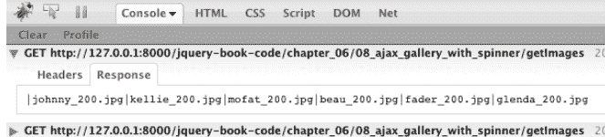

## Ajax 黑客？搞定！

我们的客户欣喜若狂——当然，这是好事。不过嘿，这确实是我们相当亮眼的一项成果：一个功能齐全、稳定可靠的动态图片库和图片标签系统，全程无需刷新一次页面。而且我们几乎毫不费力。但我们能做的还远不止于此！

Ajax（就我们所知）最初只是一个流行术语，很快就被过度炒作和误解。如今热潮退去，我们都能欣赏 Ajax 作为实用工具的真正价值。多亏了 jQuery，它成了一个极易上手、也极易让人上瘾的工具。随着越来越多酷炫的第三方 JSON API 和混搭工具的涌现，只要你肯花点心思，似乎没有什么是实现不了的！

# 第 7 章

## 表单、控件与对话框

万维网诞生之初，只是一个只读媒介。但早期的网页开发者想要更多；具体来说，他们不只想让人们*阅读*他们关于猫咪的网页——他们想让人们在留言簿上签名，告诉他们他们的猫咪有多棒。HTML 表单为我们提供了一种反馈机制，最终催生了我们今天所使用的复杂网络应用程序。

JavaScript 介入进来，帮助简单的 HTML 表单元素模拟了许多桌面应用程序中的交互式输入控件，但代码往往显得笨重。jQuery 让我们能够简化控件的创建，并专注于快速、优雅地将我们的想法转化为功能控件。

幸运的是，它足够快！我们的客户急于详细阐述我们已经构建的炫酷 Ajax 控件。既然我们的系统已经具备了符合流行术语的特性，客户团队承认，他们或许应该先修复网站上的一些表单，因为相比之下，这些表单现在看起来痛苦地停留在 1999 年。他们想要“一些行内编辑功能、漂亮的表单验证消息和酷炫的对话框。而且所有东西——*所有东西*——都应该支持拖放，就像一个来自未来的网站！”对我们来说幸运的是，jQuery 让我们能够构建来自未来的网站。

## 表单

HTML 表单有些年头了。而且有点笨拙。浏览器处理它们的方式也各不相同。然而，多亏了 JavaScript，这些表单已成为一些酷炫网络应用程序的基础。一如既往，如果 JavaScript 能做到，jQuery 就能让它变得有趣！

我们现在已经知道流程了：表单元素就是 DOM 元素，所以 jQuery 非常擅长操作它们。但表单元素并非典型的 DOM 元素，因此有一些特殊的 jQuery 技巧可以更具体地处理它们。到目前为止，我们在书中已经见过不少这样的技巧——但现在是时候更深入地关注它们了。

此外，正如我们在前面章节中看到的，jQuery 正在受益于 HTML5 的进步。后者正在介入浏览器中处理我们过去必须用库和 JavaScript 来完成的工作。在本章的后续内容中，我们将重点介绍 HTML5 提供的许多机会；但别担心，你精心编写的 jQuery 还会存在一段时间，因为浏览器对 HTML5 的支持仍然有些欠缺。而且由于它肯定还在草案阶段，它对表单的支持是许多浏览器支持不足的一个领域。

### 简单表单验证

表单验证至关重要，即使它常常显得乏味。设计精良且实现得当的表单可以成就或毁掉用户对你网站的印象。谁没有过因为一个特别令人沮丧的表单而放弃某个网站的经历？

> ### 服务端表单验证

使用 jQuery 进行客户端表单验证应*仅*用于协助用户填写表单，而*绝不*应依赖它来阻止某些类型的数据被发送到服务器。禁用了 JavaScript 的用户将不受你的 jQuery 验证的阻碍，因此他们可以提交任何他们想要的值。因此，如果用户向你的表单提交恶意数据存在任何安全风险，那么这些数据就需要在服务端进行彻底的验证。如果你需要一些关于保护应用程序安全的指导，开放网绚应用程序安全项目是一个很好的起点。¹

¹ http://owasp.org

尽管 jQuery 避免处理表单验证的细枝末节，但它确实提供了一些便捷的方法来访问和设置表单值——而这正是成功的一半！你可以像选择任何其他元素一样选择表单字段，而且 HTML 方面——实际上是 HTML5——有一些进步可以让从表单中选择元素变得更加高效。

jQuery 一直试图使选择元素尽可能高效，长期以来在支持该方法的浏览器中使用 `getElementsByClassName`。现在，它正大胆地在支持的浏览器上使用 `querySelectorAll`。这对我们意味着什么？`querySelectorAll` (qSA) 作为一种浏览器原生方法，在支持的浏览器中响应速度远超其他方法，而那些不支持 HTML5 的浏览器则继续使用它们当前采用的方法。qSA 最棒的地方在于，我们只需要向 jQuery 提供一个选择器来调用它：

```
$('input[type=text]').css('background-color', 'lemonchiffon')
```

jQuery 为我们提供了创建扩展和自定义 CSS 选择器的可能性，但这些总是比原生方法慢，原生方法的唯一代价是选择器稍长。与其在过滤器中使用 `:input` 或 `:text`，我们使用前面提到的选择器。过滤器仍有其用武之地，但考虑到如图 7.1 所示的选择速度下降，你确实应该审视一下为什么使用它们。


图 7.1. 兼容浏览器选择速度指标

例如，`:password` 过滤器方法从页面中所有输入元素中选择所有密码输入元素，速度还算不错，为每秒 13,589 次操作。但是，如果你更喜欢使用它而不是 `input[type='password']`，你就会损失近 13,000 次操作。你的页面上可能没有超过 26,000 个元素可供选择，但这仍然意味着选择操作会更快地遍历你的元素。

它同样适用于 `[type='radio']`、`[type='image']` 或 `[type='submit']`，而且正如你所看到的，添加前面的元素类型可以帮助浏览器更好地帮助你。

有传言说过滤器将被弃用，因此请谨慎使用。`:enabled` 和 `:disabled` 过滤器将根据元素的 `disabled` 属性获取元素，而 `:checked` 和 `:selected` 可以帮助你找到已选中或已选择的单选按钮、选择框项目和复选框。

> **条件逻辑中的 :checked 和 :selected**

当你需要根据复选框或单选按钮的选中或选中状态执行不同操作时，这些过滤器特别有用。例如，你可以使用 `if($(this).is(':checked'))`。

在选择好元素选择方法之后，接下来就是找到它们的值，以便你可以根据你的需求验证它们。我们已经多次使用过 `val` 函数，知道它的作用：返回表单字段的值。我们现在可以执行一些简单的验证；让我们测试一下表单中是否有任何文本框为空：

```
chapter_07/01_simple_validation/script.js (摘录)

$('#myform').bind('submit', function(event) {
  $('[type=text]').each(function() {
    if(!$(this).val().length) {
      event.preventDefault();
      $(this).css('border', '2px solid red');
    }
  });
});
```

填写一两个文本输入框，然后尝试提交表单；任何你留空的输入都会被红色高亮显示。

`val` 操作也适用于选择框和单选按钮。例如，当用户更改选择时，我们来提醒单选按钮的值：

```
chapter_07/02_radio_buttons/script.js (摘录)

$('[type=radio]').change(function(){
    alert($(this).val());
});

$('[name=sex]').bind('click', function(){
    alert($(this).val());
});
```

每当表单中的值发生变化时，都会触发此 `change` 事件。对于文本输入或文本区域，每当用户更改元素的值时都会触发，但只有在焦点移开元素时才会触发。这是实现一些简单行内验证的好方法。对于复选框、选择框和单选按钮，当值从当前值更改时，`change` 事件就会发生。在大多数情况下是这样。在某些浏览器中，单选按钮的 `change` 事件在点击时触发；在其他浏览器中，则在控件失去焦点时触发，就像输入框和文本区域一样。你可以使用 `change` 事件并祈求好运，或者你可以听取我们的建议，选择绑定到我们确信可以信任的 `click` 事件。

让我们重新审视我们的简单验证示例，但这次我们将在用户移动到下一个字段时测试空字段。为此，我们需要捕获 `blur` 事件，该事件在表单字段失去焦点时触发。这对于行内验证来说非常完美：

```
chapter_07/03_simple_inline_validation/script.js (摘录)

$(':input').blur(function() {
    if ($(this).val().length == 0) {
        $(this)
            .addClass('error')
            .after('<span class="error">此字段必须 ... </span>');
    }
});
$(':input').focus(function() {
    $(this)
        .removeClass('error')
});
```

### 避免过度验证！

设计表单验证时需要考虑一个重要原则：保持简单！你添加的规则越多，就越有可能遗漏某些边界情况，从而让部分用户感到困扰。应该提供提示、示例输入和引导，而不是用规则阻止用户提交表单——比如仅因邮政编码格式与预期不符就拒绝提交！

### 谈到过度验证……

验证表单是HTML5将从JavaScript中剥离出来、直接在浏览器中运行的功能之一。要在HTML5中启用简单验证，只需在兼容的浏览器中添加`required`属性：

```html
<input value="Jemima" placeholder="Best new talent" required>
```

现在需要两个简单的步骤：首先，等待所有浏览器支持此功能；其次，等待它们都实现自定义用户反馈界面的API。好吧，也许"简单"这个词并不贴切！

图7.2展示了当前浏览器验证的现状。五大主流浏览器中，有两个完全不支持该功能，而支持的浏览器也存在显著差异。除非其中某种UI选项与你的网站风格匹配，否则改变其外观的唯一方法就是关闭验证。

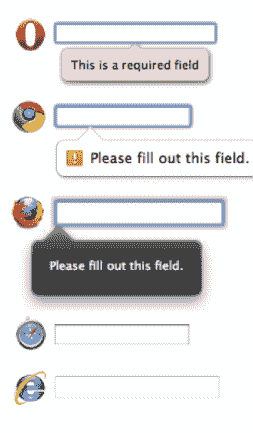

可以肯定地说，jQuery将在表单验证领域继续发挥作用很长时间，让我们回到它的使用上。

### submit事件

我们还可以利用`submit`事件，该事件在表单提交时触发。这是一种比监听提交按钮点击事件更好的技术，因为用户按**Enter**键提交表本时也会触发。我们再次依赖可靠的`event.preventDefault()`来确保表单仅在确认包含所有必要信息后才会提交。在下面的示例中，我们将检查表单中的所有文本框。如果有任何留空，将弹出提示信息并聚焦到问题元素：

```javascript
// chapter_07/04_submit_event/script.js (摘录)

$("form").submit(function(event){
    var error = false;
    $(this).find("[type=text]").each(function(){
        if (!$(this).val().length) {
            alert("Textboxes must have a value!");
            $(this).focus();
            error = true;
            return false; // 仅退出“each”循环
        }
    });
});
if (error) {
    event.preventDefault();
}
});
```

通过掌握这些基于表单的原始工具，你可以轻松地逐页为表单添加验证功能。如果精心规划表单设计并制定统一的命名规范，就可以使用jQuery通用化验证逻辑，使其适用于多个表单。

但正如我们已经看到的，设计表单验证时需要考虑大量边界情况。如果你需要真正万无一失的验证方案，并且更愿意将时间投入用户体验设计，或许可以考虑使用验证插件。

### 使用验证插件进行表单验证

构建自己的内联验证系统可能是一项艰巨的任务；例如，你需要了解正则表达式才能验证电子邮件地址或电话号码的有效性。验证插件在这里能提供帮助，它能让你以最小的工作量为大多数表单添加复杂且可定制的内联验证。

我们不会在此详细介绍该插件的所有可用选项（那足以写满一整章！），但我们将探讨最常用的功能。

让我们从表单开始。为了尽可能展示不同的验证选项，我们将使用一个包含密码和密码确认字段的注册表单：

```html
<div id="signup">
    <h2>Sign up</h2>
    <form action="">
        <div>
            <label for="name">Name:</label>
            <input name="name" id="name" type="text"/>
        </div>
        <div>
            <label for="email">Email:</label>
            <input name="email" id="email" type="text"/>
        </div>
        <div>
            <label for="website">Web site URL:</label>
            <input name="website" id="website" type="text" />
        </div>
        <div>
            <label for="password">Password:</label>
            <input name="password" id="password" type="password" />
        </div>
        <div>
            <label for="passconf">Confirm Password:</label>
            <input name="passconf" id="passconf" type="password" />
        </div>
        <input type="submit" value="Submit!" />
    </form>
</div>
```

要使用验证插件，只需在表单选择器上调用`validate`方法，并传入所需的选项。最重要的选项是`rules`，在这里需要定义用于验证用户输入的规则：

```javascript
// chapter_07/05_validation_plugin/script.js (摘录)

$('#signup form').validate({
    rules: {
        name: {
            required: true
        },
        email: {
            required: true,
            email: true
        },
        website: {
            url: true
        },
        password: {
            minlength: 6,
            required: true
        },
        passconf: {
            equalTo: "#password"
        }
    },
    success: function(label) {
        label.text('OK!').addClass('valid');
    }
});
```

该插件提供了大量预定义的验证规则，当然你也可以自定义规则。要了解所有规则，需要查阅文档。这里我们使用了`required`、`email`、`url`、`minlength`和`equalTo`。

`required`标记字段为必填项，若为空则会报错。`email`和`url`验证字段格式；电子邮件必须包含@符号，URL必须以http://开头等。在`rules`对象中，我们使用字段的`name`属性为每个表单字段定义验证对象。`minlength`顾名思义（相应地，也有`maxlength`属性）。最后，`equalTo`允许我们指定指向另一个表单字段的jQuery选择器，系统将检查当前字段内容是否与该字段相同。

验证插件会在每个表单字段后添加新的`label`元素用于显示错误信息；默认情况下，该元素具有`error`类，因此你可以自由设置其样式。

插件仅在字段值无效时显示消息。然而用户研究表明，如果同时提供*正确*输入的反馈，用户能更快更自信地完成表单。这就是为什么我们使用`success`回调设置消息`label`的内容，并为其添加带有绿色对勾样式的`class`。`success`回调接收消息元素本身，因此你可以按需操作。我们的示例表单填写效果如图7.3所示。

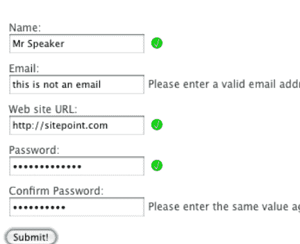

图7.3. 使用验证插件的内联验证效果

还可以自定义错误消息内容，值得注意的是，插件目录的**localization**文件夹中提供了多种本地化变体。

此示例仅展示了验证插件的部分功能。请务必查阅文档并查看插件demo文件夹中的示例，以探索所有可用特性。这是一个功能强大的插件，具备我们期待未来浏览器原生支持的特性。

## 最大长度指示器

我们的客户希望将反馈表单内容字段限制为140个字符。"像Twitter一样？"你问道，"为什么要这样限制？"团队成员开始滔滔不绝地解释关于精准反馈和注意力周期的理论……但我们知道他们只是想复制Twitter。"剩余字符"计数是另一个流行功能，尽管设置输入长度限制的想法与计算机本身一样历史悠久。

通过在表单字段旁显示剩余字符数，用户可以明确知道还能输入多少内容。

我们将在需要应用此效果的`textarea`上设置`maxlength`类。然后，在脚本中在其后添加`span`元素，并创建一种新的事件处理器：

## 250 jQuery：从新手到忍者

```javascript
// chapter_07/06_max_length_indicator/script.js（摘录）
$('.maxlength')
  .after("<span></span>")
  .next()
  .hide()
  .end()
  .keypress(function(event) {
    // 处理按键；
  });
```

在我们添加 span 之后，`textarea` 元素仍然是被选中的元素。我们需要修改新的 span，因此通过 `next` 操作移动到它。然后我们隐藏该 span，但现在需要回到表单元来添加事件处理器，所以我们使用 `end` 操作。`end` 操作会将 jQuery 选择移回上一次更改之前的位置。在我们的例子中，`hide` 没有改变选择，但 `next` 改变了。因此，当我们调用 `end` 时，选择会回到我们调用 `next` 之前的状态。

现在我们回到了表单元素，我们为其附加一个 `keypress` 事件处理器。正如您可能预期的那样，每当按下按键时就会触发此事件。这里我们可以检查是否还允许输入另一个字符，如果不允许，则阻止用户添加更多字符：

```javascript
// chapter_07/06_max_length_indicator/script.js（摘录）
var current = $(this).val().length;
if (current >= 130) {
  if (event.which != 0 && event.which !== 8) {
    event.preventDefault();
  }
}
```

现在来看这个效果的核心部分：我们获取元素的值，并使用 JavaScript 的 `length` 属性来获取其长度。如果当前字符数超过了最大长度，我们将通过使用事件的 `preventDefault` 操作来阻止按键被记录。

处理 `keypress` 事件时，事件有一个 `which` 属性，对应于所按键的 ASCII 码。请注意，我们允许**删除**（ASCII 码 0）和**退格**（ASCII 码 8）键无论输入字符数多少都能正常工作。如果不这样做，用户可能会粘贴一个超出限制的响应，却无法删除任何字符来使其符合限制：

```javascript
// chapter_07/06_max_length_indicator/script.js（摘录）
$(this).next().show().text(130 - current);
```

最后一个任务是在我们创建的 span 中显示剩余字符数。我们移动到下一个元素，确保其可见，并显示我们简单计算的结果，以指示还允许输入多少个字符。如果我们愿意，可以添加一个方法来更改 span 的样式，使达到 140 个字符上限时更容易被察觉。

诚然，我们的解决方案对于像普通推文这样随意的内容来说有点严格，但如果你想限制信用卡表单甚至软件许可证注册中的字符数量，它就很合适。

## 表单提示

一个减少表单在页面上占用空间的好技巧是将表单字段的标签移入*输入框内部*。当用户将焦点移到该字段时，标签会神奇地消失，允许他们开始输入。如果他们将字段留空并移开，原始的标签文本会重新出现。

这种技术只适用于简短且简单的表单。在较大的表单中，在没有可见标筓的情况下，用户很容易忘记每个特定字段的用途。如果他们需要重新访问或更改已经输入的值，这可能会成为一个问题。

也就是说，对于像登录或搜索表单这样的简单表单，大多数用户都非常清楚每个字段的用途，这可以是节省空间并简化界面的好方法。看看图 7.4，您大概可以自己想出如何实现这个效果。唯一棘手的部分是当用户未输入任何内容就离开时，如何将默认值恢复到输入框中。

## 252 jQuery：从新手到忍者

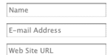

图 7.4。表单提示

如果您猜到我们会使用 data 操作来实现，那您猜对了。我们很想使用 HTML5 的 placeholder 属性，但我们在这里遇到了常见的支持问题：仍然有相当数量的浏览器不支持它，而那些支持的浏览器则需要带供应商前缀的 CSS 来设置其样式。因此，如果我们不能相信它在所有浏览器中都可用，您就能明白为什么我们坚持使用 data。我们将在每个可清除项的数据中存储默认值，如果用户离开时值仍为空，我们将从中恢复它：

```javascript
// chapter_07/07_form_hints/script.js（摘录）
$('input.clear').each(function() {
  $(this)
    .data('default', $(this).val())
    .addClass('inactive')
    .focus(function() {
      $(this).removeClass('inactive');
      if($(this).val() === $(this).data('default') ||
          $(this).val() === '') {
        $(this).val('');
      }
    })
    .blur(function() {
      if($(this).val() === '') {
        $(this).addClass('inactive').val($(this).data('default'));
      }
    });
});
```

我们需要在文档加载时遍历每个元素并保存默认值。然后我们跟踪焦点和失焦事件，每当用户进入或离开我们的输入框时就会触发。获得焦点时，我们检查文本框的值是否与我们的默认文本相同；如果是，我们清空该框以准备用户输入。在离开时，我们检查文本框是否为空，如果为空，我们将原始值放回。我们在过程中添加和删除一个类；这允许我们在表单字段显示提示时对其进行不同的样式设置。在我们的例子中，我们只是将文本颜色设置得稍微浅一些。

我们知道我们正在使用 jQuery 来承担一些 HTML5 承诺承担的工作，但目前的支持还不够。

## 全选复选框

既然文本输入已在我们掌控之中，是时候转向其他表单控件了。我们将从 StarTrackr 用户的一个烦恼开始：填写各种名人信息表单时需要勾选太多复选框。结果是数据失真、用户厌倦以及名人报告不准确。我们的客户团队要求每个统计类别都有一个**全选**框，以便用户可以一次切换所有复选框的开启或关闭状态。

了解 jQuery 表单过滤器会使这项任务变得轻而易举。我们只需选择同一组中的所有复选框，并选中或取消选中它们。在 HTML 表单中，我们通过给所有相关项相同的名称将复选框分组在一起：

```html
<div class="stats">
  <span class="title">成名原因</span>
  <input name="reason" type="checkbox" value="net" />在网上出名<br/>
  <input name="reason" type="checkbox" value="crim" />犯罪<br />
  <input name="reason" type="checkbox" value="model" />与超模约会<br />
  <input name="reason" type="checkbox" value="tv" />主持电视节目<br />
  <input name="reason" type="checkbox" value="japan" />在日本很红<br />
  <hr />
  <input class="check-all" name="reason" type="checkbox" /><span>全选</span>
</div>
```

我们给最后一个复选框赋予了特殊的类 check-all。这个框将充当我们的主复选框：当它被选中或取消选中时，我们的代码就会启动。首先，我们构造一个选择器字符串，用于选择所有与主复选框同名的复选框。这需要将几个字符串连接起来，最终创建一个类似于 `:checkbox[name=reason]` 的选择器。

然后我们将所有相关复选框的选中状态设置为与主复选框相同。因为我们的代码在用户更改值之后运行，所以 checked 属性将反映复选框的新状态，导致所有相关项相应地被选中或取消选中：

```javascript
// chapter_07/08_check_all/script.js（摘录）
$('.check-all:checkbox').change(function() {
  var group = ':checkbox[name=' + $(this).attr('name') + ']';
  $(group).attr('checked', $(this).attr('checked'));
});
```

> **性能问题**

> 如果您的页面很大，遍历每个 DOM 节点查找复选框可能会很慢。如果您注意到页面变得无响应，并且您已经研究过如何使选择器尽可能高效，您可能需要研究 jQuery 选择器的 context 参数，因为它限制了 jQuery 查找选择的范围。我们将在第 8 章介绍 context 参数。

## 行内编辑

行内编辑（又名就地编辑）是最早真正展示 Ajax 创建自然有用控件能力的效果之一。第一次使用行内编辑框时，你会感到惊讶；之后的每一次，它都变得不引人注目——它就像它应该工作的方式那样工作。

有多种方法可以重现这种效果。最简单的方法是将表单字段伪装成标签：移除边框，给它们与页面相同的背景色，然后在用户聚焦于字段时添加边框。这是一个很好的技巧，意味着您的表单就像普通表单一样（因为它就是）。然而，这可能难以实现，并且如果您想让页面的不同部分可编辑，则需要大量的额外标记和样式。

因此，更常见的做法是允许编辑非表单元素：例如 `p` 标签和 `title` 标签。当用户点击该标签时，其内容会被一个可交互的文本框或文本区域替换。任务完成后，原始标签将被新内容替换。

我们将使用类来标记内容为可编辑。对于简单的单行内容，我们将使用 `input` 元素（通过分配 `editable` 类），而对于较长的段落，我们将使用 `textareas`（赋予其类名 `editable-area`）。我们还会确保为每个元素分配一个唯一的 `id`。这样我们就能将数据发送到服务器进行数据库更新，并在下次页面加载时重新加载新数据：

```html
<h3 id="celeb-143-name" class="editable">Glendatronix</h3>
<p id="celeb-143-intro" class="editable-area">
    When Glendatronix floated onto the scene with her incredible
    debut ...
</p>
```

为了使其工作，我们需要捕获几个事件。首先是悬停事件，它会添加一种效果，让用户看到该元素是可编辑的（我们将采用经过验证的黄色背景颜色）。

我们还想捕获点击事件，当用户点击可编辑内容时触发；以及失焦事件，它表示编辑结束：

```javascript
$('.editable, .editable-area')
    .hover(function() {
        $(this).toggleClass('over-inline');
    })
    .click(function(event) {
        // 开始内联编辑
    }).blur(function(event) {
        // 结束内联编辑
    });
```

当用户点击可编辑区域时，我们的代码就会启动。首先，我们获取被点击元素的引用并将其存储在 `$editable` 变量中（以避免每次都重新选择它）。我们还会使用 `hasClass` 检查 `active-inline` 类。如果该元素已经有 `active-inline` 类，说明它已经是一个编辑框了。我们最好别用另一个编辑框来替换当前的编辑框：

```javascript
// 开始内联编辑
var $editable = $(this);
if ($editable.hasClass('active-inline')) {
  return;
}
```

接下来，我们要获取元素的内容然后将其移除。为了获取内容，我们只需将 `html` 数据保存到一个变量中，但我们也会使用 `$.trim` 方法来移除内容字符串开头和结尾的空白字符。这是必要的，因为根据你的 HTML 布局方式，字符串可能包含额外的回车和换行符，我们不想让它们出现在文本框中。而且，由于我们对可读性标记很讲究，我们通过 `replace` 方法将代码清理更进一步。我们的正则表达式查找闭合的 `</p>` 标签，并在它们后面添加两个换行符。当我们编辑 `input` 时不会找到任何内容，但当我们编辑 `textarea` 时，我们的换行符有助于漂亮地分隔代码，使一切更具可读性。而且我们知道，如果可读性更高，就更有可能被阅读！

然后我们添加 `active` 类，它具有双重目的：指示编辑正在进行，并为我们的样式提供一个钩子。最后，我们使用 `empty` 操作清空当前元素。这个命令类似于 `remove`，区别在于对元素调用 `empty` 会移除其所有子元素，而不是元素本身：

```javascript
var contents = $.trim($editable.html().replace(/<\/p>/g, "</p>\n\n"));
$editable
  .addClass('active-inline')
  .empty();
```

> **使用 `empty` 和 `remove` 进行链式调用**

> 重要的是要记住，在 `remove` 或 `empty` 命令之后链接的任何 jQuery 操作都将应用于被移除的选择集，而不是你在移除元素之前的选择集。其背后的理由是，如果你只是简单地丢弃这些元素，它们就永远丢失了。这样你就有了保留它们、处理它们或将它们存储以供将来使用的选项。

最后，是时候插入我们全新的文本框或文本区域了。我们将检查 `editable` 类以确定需要附加哪种表单元素（请记住我们用 `editable-area` 表示多行内容）。然后我们用刚移除的元素内容设置新元素的值，并将其附加到目标元素：

```javascript
// 确定我们需要哪种表单元素
var editElement = $editable.hasClass('editable') ?
'<input type="text" />' : '<textarea></textarea>';

// 用表单元素替换目标元素
$(editElement)
    .val(contents)
    .appendTo($editable)
    .focus()
    .blur(function(event) {
        $editable.trigger('blur');
    });
```

你可能对 `trigger` 函数的使用感到好奇。它只是触发事件的一种不同方式（所以，在这个例子中，我们也可以使用我们已经见过的 `$editable.blur()` 语法）。`trigger` 操作比其较短的对应方法更灵活，但目前我们只坚持基本用法。

在这个例子中使用 `trigger` 是为了清晰：向阅读代码的人表明我们想手动触发事件。在这种情况下，我们只是在传递事件；`input` 失焦了，所以我们告诉原始元素是时候完成编辑了。我们可以在 `input` 框的 blur 事件处理器中管理所有这些，但通过委托事件，我们避免了代码嵌套又深一层（这会使它更难阅读）。让原始元素处理自己的逻辑也更有意义。

`trigger` 的对应方法是 `bind`。`bind` 让我们为对象添加事件处理器。听起来很熟悉吗？到目前为止，我们一直通过使用简写便利方法（如 `click`、`hover`、`ready` 等）来绑定事件。但如果你深入研究，你会发现它们内部都依赖于 `bind`。

`bind` 操作接受一个包含要绑定的事件名称的字符串，以及一个要运行的回调函数。你还可以通过将多个事件包装在一个对象中，在单个调用中为一个项目绑定多个事件。例如，我们的代码为 `.editable` 和 `.editable-area` 元素附加了三个独立的事件：`click`、`hover` 和 `blur`。如果你愿意，你可以用 `bind` 语法重写它：

```javascript
$('.editable, .editable-area').bind({
    hover: function(e) {
        // 悬停事件处理器
    },
    click: function(e) {
        // 点击事件处理器
    },
    blur: function(e) {
        // 失焦事件处理器
    }
});
```

让我们回到我们的例子；编辑结束，我们可以回到默认状态。我们将从表单元素获取值，并使用 `$.post` 将其发送到服务器，同时显示“保存中...”的消息。当 POST 完成时，我们删除该消息并用更新后的值替换它。就像我们在前一章看到的 Ajax 功能一样，我们使用一个空的保存文件来模拟服务器端响应。在真实世界的应用程序中，你需要通过检查响应数据来确认更改是否实际保存到数据库：

```javascript
.blur(function(event) {
    // 结束内联编辑
    var $editable = $(this);

    var edited = $editable.find(':first-child').val();
    $editable
        .children()
        .replaceWith('<em class="ajax">Saving ... </em>');

    // 将新值及其 ID 发送到服务器
    $.post('save',
        {id: $editable.attr('id'), value: edited},
        function(data) {
          $editable
            .removeClass('active-inline')
            .children()
            .replaceWith(edited);
          if ($editable.hasClass('editable-area')) {
            rapture($editable);
          }
        }
    );
});
```

这段代码中只有一个新的 jQuery 函数，它相当不言自明。`replaceWith()` 用你传递给它的内容替换你选择的任何内容。使用时要小心；在我们的例子中，我们知道我们的选择器只会返回一个集合，但如果它返回多个集合，每个集合都会被相同的加载消息替换！

我们调用的最后一个方法是 `rapture`，我们传递给它我们一直在使用的 `$editable` 参数。我们将方法调用包装在一个 `if` 条件中，以确保我们只将其应用于对 `textarea` 内容的编辑。说到内容，这个最后一个方法向我们介绍了目前最后一个新的 jQuery 函数 `contents`：

```javascript
var rapture = function (which) {
  $(which).contents().filter(function() {
    return this.nodeType === 3;
  })
  .wrap('<p></p>')
  .end()
  .filter('br')
    .remove()
  .end()
  .end()
  .children().filter(function() {
    $(this).html($.trim($(this).html().replace(/(\t|\n)/g, "")));
    return !$(this).text().length
  }).remove();
}
```

## 260 jQuery：从新手到忍者

我们确信你现在已经查阅过 jQuery 文档，所以你大概会认出这里 `contents` 方法的用法。`contents` 与 `children` 类似，都是选择元素的后代节点。主要区别在于，`children` 方法只收集元素节点，而 `contents` 方法收集所有节点——包括文本节点和元素节点。这在我们的编辑器中很有用，因为我们不知道添加到 `textarea` 中的内容的格式。内容可能是直接输入的，也可能是复制粘贴的——我们并不确定。这该怎么办呢？

和文档中一样，我们将过滤 `contents` 集合中的每个成员。`nodeType` 为 3 表示节点是文本节点，因此我们将这些节点包裹在段落标签中，以便在需要时进行操作。现在让我们开始尝试一些有趣的 `end` 方法。我们的第一个 `end` 会返回到 `contents` 集合，我们现在 `filter` 并 `remove` 掉 `<br>` 元素。我们刚才谈到 `remove` 方法会保留已移除的 DOM 项目，所以我们现在需要调用 `end`，否则接下来的链式方法将作用于已移除的集合。既然我们想多玩玩 `end`，那就再调用一个，将链式调用的焦点直接带回最初的 `$(which)` 集合。

现在调用 `children` 意味着我们再次只拥有元素节点的集合，而不是来自 `$(which)` 的*所有*节点类型。这是一个重要的区别，需要留意。接下来，我们 `filter` 子元素，并使用过滤方法来清理粘贴的内容。对每个子元素执行 `trim`，并将所有制表符和换行符等特殊字符 `replace` 为空字符串。结果就是格式良好、干净的 HTML。当我们随后 `remove` 任何空的 `<p>` 元素时，我们的代码当然就适合保存了。

我们粘贴这段内容：

```
Lorem ipsum dolor sit amet, consectetur adipisicing elit, sed do eiusmod tempor incididunt ut labore et dolore magna aliqua.<br /><br />
Ut enim ad minim veniam, quis nostrud exercitation ullamco laboris nisi ut aliquip ex ea commodo consequat.
<br /> <br />
Duis aute irure dolor in reprehenderit in voluptate velit esse cillum dolore eu fugiat nulla pariatur.
```

它会被转换为：

```
<p>Lorem ipsum dolor sit amet, consectetur adipisicing elit, sed do eiusmod tempor incididunt ut labore et dolore magna aliqua.</p>

<p>Ut enim ad minim veniam, quis nostrud exercitation ullamco laboris nisi ut aliquip ex ea commodo consequat.</p>

<p>Duis aute irure dolor in reprehenderit in voluptate velit esse cillum dolore eu fugiat nulla pariatur.</p>
```

更好的是，通过清理并在使内容可编辑时添加空格，它就适合进行编辑了。好吧，对于我们的客户来说，通过其他渠道获取内容可能更容易些，但现在至少如果用户需要将内容剪切并粘贴到我们的可编辑区域时，他们会乐在其中！

## 自动完成

我们已经安抚了客户；团队成员正在角落里兴奋地摆弄着内联编辑字段。在我们等待下一个需求到来的几分钟里，为了真正给人留下深刻印象，让我们尝试让名人表单的**最后已知下落**字段通过主要城市列表实现自动完成功能。实现的效果如图 7.5 所示。

自 jQuery UI 1.8 起，我们有两个选择。我们可以使用 jQuery 插件仓库中的 Autocomplete 插件；它是一个功能齐全且稳定的插件，正好提供了我们需要的功能，而且非常轻量。或者，我们可以使用 jQuery 1.7 中的变体，它的选项比插件少得多，但仍然非常强大。让我们两个都试试，就因为我们能办到。

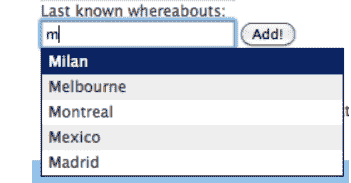

图 7.5. 自动完成 **最后已知下落** 字段

262 jQuery：从新手到忍者

首先，我们需要这个插件。前往插件仓库获取它，² 快速查看一下示例，然后将其包含在你的页面中。

我们还需要设置一些 CSS 样式。插件中包含一个示例 CSS 文件，因此你可以了解添加了哪些类。我们使用了其中几种样式来让我们的下拉建议列表具有标准外观。

Autocomplete 插件会附加到一个选择框上。我们将它应用到简单表单的 `location` 字段上：

```
chapter_07/10_autocomplete/index.html (excerpt)

<label for="location">Last known whereabouts:</label>
<input type="text" id="location"/>
```

现在让我们看看 Autocomplete 插件能为我们做什么。默认情况下，它需要一个存储在数组中的本地数据集合；这对我们来说很完美，因为我们要从页面上的 HTML 列表中获取数据：

```
chapter_07/10_autocomplete/script.js (excerpt)

var cities = ['Paris', 'New York', 'Milan', 'Stockholm' ... ];
$('#location').autocomplete(cities,{
    autoFill: true,
    selectFirst: true,
    width: '240px'
});
```

我们只是传入了一个 JavaScript 数组，但该插件也允许我们传入一个 URL，在这种情况下，它将通过 Ajax 检索潜在值的列表。Autocomplete 期望返回纯文本，每行一个值，这在和后端开发者简单沟通后应该很容易实现！

上面的代码足以让它运行起来，但我们还可以指定一堆选项。`autoFill` 提供了一个很好的输入提示效果（用当前建议的补全内容填充文本框），而 `matchContains` 会导致它匹配单词的子串，而不仅仅是首字母，等等。有很多可以微调的地方，因此值得快速研究一下选项列表。

> ² http://docs.jquery.com/Plugins/Autocomplete

当用户选择一个选项时，该插件还会触发 `result` 事件。它会将所选标签的名称作为第二个参数传递给我们的事件处理程序（在事件对象之后）。例如，下面的代码会在选择选项时弹出提示：

```
$('#location')
  .autocomplete(cities)
  .result(function(event, selection) {
    alert(selection);
  });
```

非常简单，但非常酷。客户团队还在玩我们为他们构建的上一个玩具！让我们利用这个时间，按我们之前说的，将代码换成 jQuery UI 版本，并力求达到图 7.6 的效果。

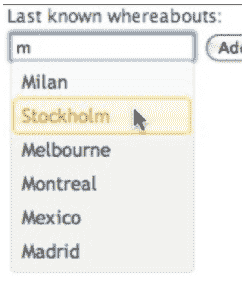

我们的首要任务是确保我们使用的 jQuery UI 版本包含 Autocomplete 功能。即 1.8 之后的任何版本，因此我们像往常一样将其包含在页面中。就这样！没有 HTML 改动，也没有 CSS 改动；我们只是使用了插件示例中的代码。我们的代码只有微小改动：


`chapter_07/10a_uiautocomplete/script.js` (excerpt)

```javascript
var cities = ['Paris', 'New York', 'Milan', 'Stockholm' ... ];
$('#location').autocomplete({
  source: cities
});
```

如果客户认为自动完成功能棒极了，还有更多选项可以尝试，你可以从 jQuery UI 网站上获取。该网站上还有一篇精彩的博客文章，描述了一些你一定会想了解的最强大功能。³

那么，在客户团队短暂分心的时候，我们已经测试了两个自动完成选项。也许我们太擅长摆弄表单元素了，最好还是回到待办事项列表上来吧。

## 星级评分控件

建立一个大型名人追踪社区是客户的主要目标。团队开始意识到，网站用户正在成为他们的产品，一个可以开始卖给广告商的产品。为了探索这种可能性，他们希望增加用户参与度，并帮助用户感觉自己的重要性。毕竟，照顾好你的产品很重要。我们考虑了一下，向他们提出了一个星级评分的想法；毕竟，人们最喜欢通过分配金星来表达自己的感受。我们的控件将如图 7.7 所示。


我们星级评分控件的基础是一组单选按钮。这很完美，因为浏览器会强制从组中单选一个。只需添加正确数量的按钮，就可以简单地设定用户可以选择的范围：

```html
chapter_07/11_star_ratings/index.html (excerpt)

<div class="stars">
    <label for="rating-1"><input id="rating-1" name="rating"
        type="radio" value="1"/>0.5 Stars</label>
    <label for="rating-2"><input id="rating-2" name="rating"
        type="radio" value="2"/>1 Star</label>
    <label for="rating-3"><input id="rating-3" name="rating"
        type="radio" value="3"/>1.5 Stars</label>
    <label for="rating-4"><input id="rating-4" name="rating"
        type="radio" value="4"/>2 Stars</label>
</div>
```

## 星级评分控制

当然，难处在于用我们的星级控件替换这些单选按钮。你可以尝试仅使用CSS来调整HTML控件的样式，但如果你将控件分为两部分：存储数据的底层模型和带有星星的闪亮视图，这会容易且灵活得多。在这个例子中，模型就是原始的HTML单选按钮组。我们的攻击计划是隐藏单选按钮，并显示一个我们通过jQuery添加的链接列表，将其样式化以看起来像星星。与这些链接的交互将切换所选的单选按钮。没有JavaScript的用户将直接看到单选按钮本身，这对我们来说没问题。

我们将再次调用雪碧图来帮助我们轻松地设置星星的样式。这样，我们的控件将只依赖于单个图像（如图7.8所示），这节省了HTTP请求，并使我们的图形设计师更容易编辑。


我们的CSS将把CSS雪碧图应用于我们创建的代表半颗星的链接。要在不同的图像状态之间切换，我们只需更新`background-position`属性：

```css
chapter_07/11_star_ratings/stars.css (excerpt)

.stars div a {
    background: transparent url(sprite_rate.png) 0 0 no-repeat;
    display: inline-block;
    height: 23px;
    width: 12px;
    text-indent: -999em;
    overflow: hidden;
}

.stars a.rating-right {
    background-position: 0 -23px;
    padding-right: 6px;
}

.stars a.rating-over {
    background-position: 0 -46px;
}

.stars a.rating-over.rating-right {
    background-position: 0 -69px;
}

.stars a.rating {
    background-position: 0 -92px;
}

.stars a.rating.rating-right {
    background-position: 0 -115px;
}
```

我们决定让用户从四颗星中选择一个评分，而不是通常的五颗星。为什么？用户心理学！给一个人一条中间道路，他们就会选择它；通过没有中间选项，我们让用户更深入地思考他们的选择。我们获得了更准确的结果，并且能够更好地向用户呈现最佳内容（由他们选择）。

但四是一个有限的量表；这就是为什么我们希望允许半星评分。这是通过视觉错觉实现的；你可能注意到我们的星星图像被切成了一半。我们的HTML将包含八个单选按钮，每个值为半颗星。将我们的八个单选按钮转换为四颗星的代码有两个部分。首先，`createStars`函数将接受一个包含单选按钮的容器，并用星星链接替换它。然后，每个星星将通过适当的事件处理程序（在`addHandlers`方法中）进行补充，以允许用户与控件交互。这是我们`starRating`对象的骨架：

```javascript
chapter_07/11_star_ratings/script.js (excerpt)

var starRating = {
  create: function(selector) {
    $(selector).each(function() {
      // 隐藏单选按钮并添加星星链接
    });
  },

  addHandlers: function(item) {
    $(item).click(function(e) {
      // 处理星星点击
    })
    .hover(function() {
      // 处理星星悬停
    },function() {
      // 处理星星离开悬停
    });
  }
}
```

`create`方法遍历每个与我们传入的选择器匹配的容器，并创建一个链接列表，作为单选按钮的代理。这些链接就是我们将要样式化成星星样子的东西。它还会隐藏原始的表单元素，这样用户只能看到我们可爱的星星：

```javascript
chapter_07/11_star_ratings/script.js (excerpt)

$(selector).each(function() {
  var $list = $('<div></div>');
  // 循环遍历每个容器中的每个单选按钮
  $(this)
    .find('input:radio')
    .each(function(i) {
      var rating = $(this).parent().text();
      var $item = $('<a href="#"></a>')
        .attr('title', rating)
        .addClass(i % 2 == 1 ? 'rating-right' : '')
        .text(rating);

      starRating.addHandlers($item);
      $list.append($item);

      if ($(this).is(':checked')) {
        $item.prevAll().andSelf().addClass('rating');
      }
    });
```

我们首先为新链接创建一个容器（一个div元素）；我们将为每个要替换的单选按钮创建一个新链接。使用`:radio`选择器过滤器选中所有单选按钮后，我们获取每个项目的评分，并使用它创建一个超链接元素。

> ### 条件赋值与模运算

对于`addClass`操作，我们根据一些数学运算，使用三元运算符（参见第4章中的“淡入淡出幻灯片”部分）来有条件地指定类名。正如我们在本书前面所做的一样，我们使用取模（%）运算符来确定索引是偶数还是奇数。如果索引是奇数，我们将添加`rating-right`类；这使链接看起来像星星的右侧。

一旦我们的链接准备就绪，我们就将其传递给`addHandlers`方法；这是我们附加其工作所需事件的地方。然后我们将其附加到列表容器中。一旦它进入容器，我们就检查当前的单选按钮是否被选中（我们使用`:checked`表单过滤器）。如果它被选中，我们希望为这个半颗星添加`rating`类，并为它之前的所有半颗星添加该类。任何附加了`rating`类的链接都将被分配金星图像，允许用户看到当前的评分。

为了选择所有需要变成金色的元素，我们将借助几个新的jQuery操作：`prevAll`和`andSelf`。`prevAll`操作选择当前选择之前的所有兄弟元素（与`prev`操作不同，后者只选择紧邻的前一个兄弟元素）。对于我们的例子，我们希望将类添加到前面的兄弟元素和当前选择。为此，我们应用`andSelf`操作，它简单地将原始选择包含在当前选择中。现在我们有了所有将要变成金色的链接，所以我们可以添加该类。

> ### 其他遍历方法

你可能已经猜到，除了`prevAll`，jQuery还为我们提供了`nextAll`方法，它获取同一容器中当前元素之后的所有兄弟元素。jQuery 1.4引入了两个新的配套方法：`prevUntil`和`nextUntil`。它们通过选择器调用，并将扫描元素的兄弟元素（向前或向后，取决于你使用哪个），直到遇到与选择器匹配的元素。

所以，例如，`$('h2:first').nextUntil('h2');`将给你页面上第一个h2和同一容器中后续h2之间的所有元素。

如果你向`prevUntil`或`nextUntil`传递第二个参数，它将被用作选择器来过滤返回的元素。所以，例如，如果我们写`nextUntil('h2', 'div')`，它将只返回当前选择和下一个h2之间的div元素。

在完成了所有这些艰苦的工作之后，我们现在可以将新的链接列表添加到控件中，并摆脱原始的按钮。现在用户将只与星星交互：

```javascript
chapter_07/11_star_ratings/script.js (excerpt)

// 隐藏原始单选按钮
$(this).append($list).find('label').hide();
```

控件现在看起来已经初具规模，但它还没有任何功能。我们需要附加事件处理程序并添加一些行为。我们对三个事件感兴趣。当用户将鼠标悬停在星星上时，我们希望更新CSS雪碧图以显示悬停状态；当他们移开时，我们希望将CSS雪碧图恢复到其原始状态；当他们单击时，我们希望将选择变成金色：

```javascript
chapter_07/11_star_ratings/script.js (excerpt)

$(item).click(function(e) {
    // 处理星星点击
})
.hover(function() {
    $(this).prevAll().andSelf().addClass('rating-over');
},function() {
    $(this).siblings().andSelf().removeClass('rating-over');
});
```

悬停函数是最简单的：当悬停时，我们使用`prevAll`和`andSelf`选择所有前面的半颗星——包括当前的半颗星——并给它们添加`rating-over`类，就像我们在设置中所做的那样。当悬停离开时，我们覆盖

我们的基础，并从所有链接中移除 `rating-over` 类。悬停状态就这样处理好了。

现在处理点击事件：

```javascript
chapter_07/11_star_ratings/script.js (excerpt)

// Handle Star click
var $star = $(this);
var $allLinks = $(this).parent();

// Set the radio button value
$allLinks
  .parent()
  .find('input:radio[value=' + $star.text() + ']')
  .attr('checked', true);

// Set the ratings
$allLinks.children().removeClass('rating');
$star.prevAll().andSelf().addClass('rating');

// prevent default link click
e.preventDefault();
```

处理点击事件的关键部分是更新底层的单选按钮模型。我们通过使用 `:radio` 过滤器和属性选择器来选中正确的单选按钮，从而实现这一点，该选择器会搜索其值与当前链接文本匹配的单选按钮。

模型更新后，我们就可以回来摆弄 CSS 雪碧图了。首先，我们从任何当前具有 `rating` 类的链接中清除该类，然后将其添加到用户选择的链接及其之前的所有链接上。最后一步是取消链接的默认操作，这样点击星星就不会导致页面跳转。

## 控件

这解决了我们客户的主要关切：表单的可用性。现在我们可以开始做一些真正有趣的事情了。jQuery 和 jQuery UI 是超越我们熟悉和接受的原始 HTML 表单控件的完美工具。一旦我们摆脱了 Web 古老历史的沉闷限制，我们就会发现，创造惊人新控件的能力仅受限于我们的想象力。毕竟，与网站互动的方式应该不止在框中输入文本！

### 按钮

我们的星级评分控件是一个很好的例子，它通过遮蔽语义化的 HTML 来增强用户体验，但我们不必总是这么花哨。通常，我们只是希望用户能够做出响应，而不必去琢磨我们可用的表单元素中小圆圈和方块的含义。jQuery UI 在这里也能帮上大忙。无论你是需要一整个工具栏的按钮、一组用于遮蔽单选按钮组的按钮，还是那些性感的分割按钮之一，jQuery UI 都让它变得极其简单。

“有多简单？”我们听到你问。几乎太简单了：只需将 jQuery UI 的 JavaScript 和 CSS 文件添加到你的页面，构建一些语义化的 HTML，添加一小段脚本调用，就完成了。但别光听我们说：

```html
chapter_07/12_buttons/index.html (excerpt)

<fieldset id="radio">
<input type="radio" id="radio1" name="radio" /><label for="radio1">Find a celebrity</label>
<input type="radio" id="radio2" name="radio" checked="checked" /><label for="radio2">Report a celebrity</label>
<input type="radio" id="radio3" name="radio" /><label for="radio3">Become a celebrity</label>
</fieldset>
```

这就是我们需要的所有代码，而且没有我们之前没用过的东西。以下是我们需要的所有脚本：

```javascript
chapter_07/12_buttons/script.js (excerpt)

$('#radio').buttonset();
```

那么效果有多好呢？图 7.9 中的第一个例子是我们的代码，第二个是我们增强后的解决方案。

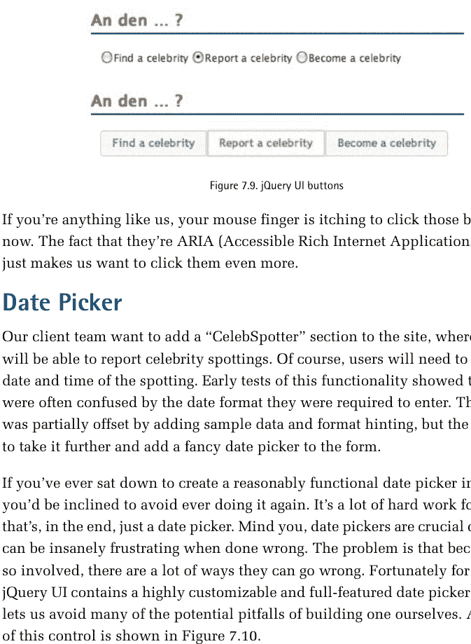

如果你和我们一样，你的鼠标手指现在一定痒痒的，想点击那些按钮。事实上，它们是 ARIA（无障碍富互联网应用）增强的，这只会让我们更想点击它们。

### 日期选择器

我们的客户团队希望在网站上添加一个“名人发现”板块，用户可以在那里报告他们发现名人的踪迹。当然，用户需要报告发现的日期和时间。该功能的早期测试显示，用户常常对他们需要输入的日期格式感到困惑。这个问题通过添加示例数据和格式提示得到了部分缓解，但团队希望更进一步，在表中添加一个花哨的日期选择器。

如果你曾经坐下来用 JavaScript 创建一个功能相当完善的日期选择器，你可能会倾向于永远不再做第二次。这是一个相当辛苦的工作，而最终得到的不过是一个日期选择器。请注意，日期选择器是至关重要的控件，如果做错了会令人极其沮丧。问题在于，由于它们涉及的细节太多，出错的方式也很多。幸运的是，为了我们的理智着想，jQuery UI 包含了一个高度可定制且功能齐全的日期选择器控件，让我们能够避免许多自行构建时可能遇到的潜在陷阱。图 7.10 展示了这个控件的一个示例。

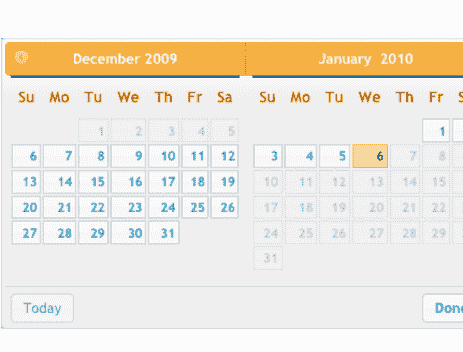

我们将从当前用于输入日期的输入框开始：

```html
chapter_07/13_date_picker/index.html (excerpt)
<input type="text" id="date" />
```

如果你只是想要基本的日期选择器，jQuery 代码可以简单到只有一行：

```javascript
$("#date").datepicker();
```

当输入框获得焦点时，日期选择器被触发，并滑动显示出来，当前月份和日期被选中。当文本框失去焦点，或者选择了日期后，它就会消失。当然，它看起来非常漂亮，并且与我们期望的 jQuery 流畅性完美配合——但与竞争对手的日期选择器相比，它提供了什么额外功能呢？（请记住，仅仅因为你使用了 jQuery，并不意味着你应该忽略其他合适的 JavaScript 组件，甚至是 HTML5。）

jQuery UI 中的日期选择器组件功能丰富。非常丰富！它完全可本地化，可以处理任何日期格式，允许同时显示多个月份，具有巧妙的日期范围机制，可配置按钮，支持键盘导航（你可以使用 **ctrl** + 方向键移动），等等。

总的来说，有超过 50 个选项和事件可供你调整——几乎涵盖了日期选择器的每一个细微方面！为了制作你在图 7.10 中看到的日历，我们只使用了其中几个：

```javascript
chapter_07/13_date_picker/script.js (excerpt)

$('#date').datepicker({
    showOn: 'both',
    buttonText: 'Choose a date',
    buttonImage: 'calendar.png',
    buttonImageOnly: true,
    numberOfMonths: 2,
    maxDate: '0d',
    minDate: '-1m',
    showButtonPanel: true
});
```

`showOn` 让我们选择何时弹出日历。可用选项有 'focus'（当文本框获得焦点时）、'button'（在文本框旁边添加一个按钮，用户可以点击它打开日历）或 'both'（允许两种方式）。为了使用图标作为按钮，我们指定了 `buttonImage`。我们还将 `buttonImageOnly` 设置为 true；这意味着只显示图像，而不是标准的表单按钮。

接下来，我们将 `numberOfMonths` 设置为 2；这意味着用户将同时看到两个月的日期。你甚至可以指定一个数组而不是一个整数；例如，[3, 3] 将显示一个 3x3 的月份网格！

`maxDate` 和 `minDate` 选项让你设置用户可以选择的日期范围。你可以指定一个 JavaScript 日期对象，或者你可以使用字符串来指定相对日期。后一种选择通常更容易，我们在这里就是这样做的。我们将 `maxDate` 设置为 0，代表今天的日期。我们将 `minDate` 设置为 -1m -1w；这意味着用户只能选择过去一个月零一周内的日期。你可以根据需要加上或减去任意时间量：y 代表年，m 代表月，w 代表周，d 代表日。

同样，我们日期选择器的许多选项有朝一日可能会被我们的浏览器和 HTML5 所支持，但我们还没有完全达到那个阶段。所以，再次强调，熟悉 HTML5 并研究一个填充方案（shim，实现兼容性变通方法的软件）以支持旧版浏览器，但请放心，你在这里学到的 jQuery 和 JavaScript 知识将在很长一段时间内对你有用。

#### 日期验证

你可能为日期选择器设置了最大日期，但用户仍然可以选择超出该范围的日期，并手动将其输入到文本框中。如果你必须确保日期在给定范围内，你需要在服务器端执行验证。你在日期选择器选项中指定的日期范围是为了帮助你的用户选择有效的选项；这样，他们就可以避免提交包含令人沮丧错误的表单。

#### 日期选择器实用工具

jQuery UI 库还提供了一些日期选择器实用工具，用于全局配置日期选择器，以及方便地处理日期。

`$.datepicker.setDefaults` 方法接受一个由日期选择器设置组成的对象。你指定的任何设置都将应用于页面上的所有日期选择器，除非你手动覆盖默认设置。例如，如果你想让每个日期选择器一次显示两个月：

```javascript
$.datepicker.setDefaults({
  numberOfMonths: 2
});
```

其余的实用函数用于操作或协助处理日期和日期格式。`$.datepicker.iso8601Week` 函数接受一个日期并返回该日期所在年份的周数（从 1 到 53）。`$.datepicker.parseDate` 函数从给定的字符串中提取日期；你需要传递给它一个字符串和一个日期格式（例如 "mm-dd-yy"），你将收到一个 JavaScript 日期对象。最后，`$.datepicker.formatDate` 执行相反的操作。它将根据你指定的格式格式化一个日期对象——非常适合在屏幕上显示日期。

### 滑块

我们的客户团队希望访客能够快速轻松地找到他们寻找的名人。团队还认识到，他们自己的许多客户将会寻找在特定价格区间内的名人，因此他们希望我们在网站上添加一个价格范围过滤器。这是一个引入另一个很棒的 jQuery UI 组件的绝佳机会：`slider`（滑块）！

## 276 jQuery：从新手到忍者

我们将从一个包含两个选择框的基本表单开始：一个用于设定最高价格，另一个用于设定最低价格。然后，我们将借助 jQuery UI 添加一个花哨的滑块来控制这些选择框的值。最终结果如图 7.11 所示。

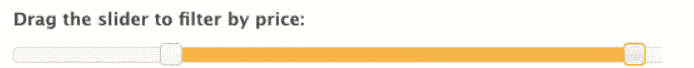

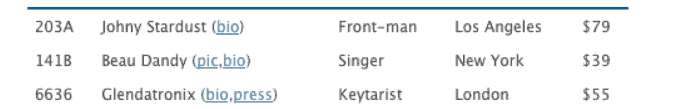

图 7.11. 一个 jQuery UI 滑块

让我们来看一下基本的标记代码：

```html
chapter_07/14_sliders/index.html (excerpt)

<div id="price-range">
  <form action="">
    <fieldset>
      <label for="min">Minimum Price:</label>
      <select id="min" name="min">
        <option value="0">0</option>
        <option value="10">10</option>
        <option value="20">20</option>
        :
        <option value="80">80</option>
        <option value="90">90</option>
      </select>
      <br/>
      <label for="max">Maximum Price:</label>
      <select id="max" name="max">
        <option value="10">10</option>
        <option value="20">20</option>
        <option value="30">30</option>
        :
        <option value="100">100</option>
      </select>
    </fieldset>
  </form>
</div>
```

现在来看代码。页面加载时，我们首先获取选择框中的当前最大值和最小值。然后，我们通过在一个新创建的空 div 上调用 `slider` 方法来初始化滑块：

```javascript
chapter_07/14_sliders/script.js (excerpt)

var max = $('#max').val();
var min = $('#min').val();

var rangeSlider = $('<div></div>')
  .slider({
    min: 0,
    max: 100,
    step: 10,
    values: [min, max],
    range: true,
    animate: true,
    slide: function(e, ui) {
      $(this)
        .parent()
        .find('#min')
        .val(ui.values[0]);
      $(this)
        .parent()
        .find('#max')
        .val(ui.values[1]);
      showCelebs();
    }
  })
  .before('<h3>Drag the slider to filter by price:</h3>');

$('#price-range').after(rangeSlider).hide();
```

哇！这里面有很多选项。让我们试着分解一下：`min` 和 `max` 分别是滑块的最小值和最大值。`step` 是滑块的增量步长。`values` 用于指定滑块的默认值。由于我们指定了一个包含两个值的数组，滑块条将有两个手柄，每个手柄有独立的值。这里我们使用的是之前从选择列表中获取的值，因此滑块将始终与这些选择框中的数据匹配。

在创建带有多个手柄的滑块时（正如我们这里所做），`range` 和 `animate` 是非常有用的选项：`range` 表示手柄之间的区域应使用不同的样式显示，通常是阴影或不同颜色。此选项也可以设置为 `min`（此时最小值和第一个手柄之间的区域将被着色）或 `max`（此时最后一个手柄和最大值之间的区域将被着色）。`animate` 则告诉 jQuery，当用户点击滑块条的其他位置时，手柄的位置应平滑移动，而不是直接跳过去。

最后，`slide` 允许你指定一个事件处理程序，该程序在用户移动滑块手柄时运行。事件处理程序可以接受一个可选的 `ui` 参数，通过它可以访问滑块的一些属性；这里我们使用了 `values` 属性来调整我们选择框的值。我们还调用了 `showCelebs`，这是一个自定�方法，用于根据名人的价格是否在选定范围内来显示或隐藏他们。

也可以捕获 `change` 事件，它与 `slide` 事件非常相似，区别在于当滑块的值通过编程方式修改时（`slide` 仅在用户直接与滑块交互时触发），`change` 事件也会触发。

默认情况下，jQuery UI 滑块组件会创建一个水平滑块——但如果你想创建垂直滑块，可以指定 `orientation: 'vertical'`。

我们使用了 `before` 和 `after` 为滑块添加了标题并将其固定到页面上，同时也隐藏了原始的 `select` 选择框。现在试试看，你将看到一个样式美观的滑块，可以随意操作，并且它会调整 `select` 选择框的值。

为了让它实现名人的筛选功能，我们只需实现 `showCelebs` 方法即可：

```javascript
chapter_07/14_sliders/script.js (excerpt)

function showCelebs() {
  min = $('#min').val();
  max = $('#max').val();
  $('.data tr').each(function() {
    var price = parseInt($(this).find('td:last').text().substring(1));
    if (price >= min && price <= max) {
      $(this).fadeIn();
    } else {
      $(this).fadeOut();
    }
});
}
```

我们提取选择框的值，然后遍历名人表格的每一行，根据价格是否在选定范围内来隐藏或显示该行。这里唯一棘手的部分是一些 JavaScript 字符串处理，用于从行文本中提取价格；我们使用 `substring(1)` 提取从第一个字符开始的所有内容（这将方便地去掉价格中的美元符号）。然后我们使用 `parseInt` 将字符串转换为数字。

我们还会在文档加载完成时调用 `showCelebs`，以便根据表单中的默认值预先筛选列表。

这可以按预期工作，允许用户根据期望的价格范围直观地筛选名人。滑块是一个很棒的 UI 组件，因为它们非常直观：用户无需被告知就知道如何使用。你可能还能想出其他一些可以从 *滑块化* 中受益的控件！

## 拖放功能

拖放技术正在走向成熟。它一直存在于后台，但与构成典型表单的普通文本框和单选按钮相比，总感觉格格不入（因此对良好的用户体验有害）。但那是过去，使用的是老式表单。如今，如果做得好，拖放可以以高度可用的方式增强表单，提供更自然的体验，从而提高生产率。它还增添了一丝酷感。

如果说有一项任务连初学者用户都知道如何做，那就是将项目拖到垃圾桶。这个比喻非常令人满意：如果你不想要它，就把它扔掉！另一方面，标准的网页方法——点击复选框然后按删除键——同样众所周知，但远没有那么令人满足。我们的客户更喜欢前一种方法，将东西拖到它的归宿，让它伴随着一缕青烟真正消失，以表明它已被彻底销毁。

图 7.12 显示了一个正在被销毁的图像缩略图。用户选择了一张照片，将其拖出网格并放入垃圾桶。照片网格不过是一组 `img` 标签。你可以选择任何类型的元素作为可拖动对象，只要它能让用户看起来美观且使用顺畅。一个不错的做法是为可拖动元素设置 `cursor: move`；这样，用户会看到“抓取手”图标，并知道可以拖动它。


图 7.12. 拖放并销毁

一如既往，我们从标记代码开始：

```html
chapter_07/15_drag_drop/index.html (excerpt)
<div class="trash">
  
  <span id="trash-title">Drag images here to delete</span>
</div>
<div id="photo-grid">
  
  
  
  
</div>
```

> **渐进增强**

为了说明方便，我们在此处的标记代码中包含了 `.trash` div。然而，这对禁用了 JavaScript 的用户来说是个问题；他们将看到一个垃圾桶区域，但无法对其进行任何操作！在实际应用中，你应该首先提供一个功能完整的、基于 HTML 表单的图片删除界面（或你打算使用拖放功能的任何对象）。然后，使用我们在本书中见过的所有方法将这些界面元素从页面中移除，并用上述拖放标记代码替换它们。

跨浏览器实现拖放功能可能非常麻烦。我们不会重新发明轮子，而是将依赖我们值得信赖的 jQuery 伙伴——jQuery UI。它提供了一些非常方便的交互助手——`draggable` 和 `droppable`——来处理流畅的跨浏览器拖放。

### 无需主题！

你需要像之前一样在页面中引入 jQuery UI 库，但这次不需要 CSS 主题文件：**draggable**（可拖动）和 **droppable**（可放置）是行为，无需预设样式。不过，它们确实会提供一些非常有用的 **class**（类名），供你应用自己的样式，我们稍后就会看到。

让我们先勾勒出交互代码的基本结构：

```javascript
chapter_07/15_drag_drop/script.js (摘要)

$(document).ready(function() {
  $('#photo-grid > img').draggable({
    revert: 'invalid'
  });
  $('.trash').droppable({
    activeClass: 'highlight',
    hoverClass: 'highlight-accept',
    drop: function(event, ui) {
      puffRemove($(ui.draggable));
    }
  });
});

function puffRemove(which) {
  // 实现“烟雾消散”效果
}
```

这是我们的交互骨架。要实现漂亮的“消散”动画，还有很多工作要做，但令人难以置信的是，这已经包含了拖放所需的一切！让我们仔细看看 jQuery UI 给我们提供了什么。

### draggable（可拖动）

draggable 交互辅助工具可以使你选择的任何元素变成可通过鼠标拖动的。试试这个：`$('p').draggable()`。它可以使页面上的每个 `<p>` 标签都变成可拖动的。测试一下——这非常有趣。当然，有大量的选项和事件可用于自定义行为。以下是一些比较有用的选项：

```javascript
$('p').draggable({axis: 'y', containment: 'parent'});
```

`axis` 选项将对象限制为只能沿 X 或 Y 轴拖动，而 `containment` 选项将对象限制在一个边界框内；可接受的值是 'parent'、'document' 和 'window'（分别限制在相应的 DOM 元素内），或者一个以 `[x1, y1, x2, y2]` 形式指定像素边界的值数组。你还可以使用 `grid` 选项将拖动限制在网格内，方法是指定一个包含两个元素的数组（例如 `grid:[20,20]`）。

让我们看另一个例子：

```javascript
$('#dragIt').draggable({ handle:
    'p:first', opacity: 0.5,
    helper: 'clone'
});
```

对于接下来的这组选项，我们操作一个名为 `dragIt` 的 div，它至少包含一个 `<p>` 标签。我们使用 `handle` 选项将第一个 p 元指定为用户可以用来拖动可拖动元素的“手柄”。我们还指定了 `helper` 选项，该选项允许你指定一个元素来代表正在被拖动的节点。在本例中，我们将此选项设置为 `clone`。这会导致该元素被复制，因此原始元素将保持原位，直到你完成拖动。`opacity` 应用于辅助元素。

另一个值得注意的选项是 `revert`。如果你将其设置为 `invalid`（就像我们在图片拖动示例中所做的那样），如果你在可放置目标区域之外释放拖动的元素，该元素会弹回到其原始位置。

还有三个事件你可以捕获——`start`、`stop` 和 `drag`——它们分别在你开始拖动、停止拖动和拖动过程中触发。在我们的例子中，我们只需要对 `drop` 做出反应，但你可以很容易地想到其他两个事件也能派上用场的场景。

### droppable（可放置）

draggable 的邦妮（Bonnie）是 droppable 行为（克莱德，Clyde）。可放置元素是可拖动项目的目标。可放置元素比可拖动元素的选项少得多；我们在前面的例子中使用了最重要的 `activeClass` 和 `hoverClass`。当拖动项目被拖动时，`activeClass` 会添加到可放置元素上。类似地，当拖动项目悬停在可放置元素上时，`hoverClass` 会被添加。

你还可以为 `accept` 选项指定一个选择器，该选择器限制了可以放置的拖动项目。这允许你拥有多个放置点，其中只有特定的拖动项目可以放置。这对于列表操作非常有用。

可放置元素的事件与可拖动元素的事件类似。代替 `start`、`stop` 和 `drag`，我们有 `over`、`out` 和 `drop`。在我们的图片网格示例中，我们使用了 `drop` 事件来知道何时销毁可拖动项目。

draggable 和 droppable 行为都是复杂的工具。一旦你克服了它们易于实现带来的兴奋感，你就应该进一步阅读文档中的高级选项。

实际上，有小道消息——不，不是那只蓝色的——透露，在 jQuery UI 2.0 中，我们可以期待拖放工作方式的一些变化。然而，API 应该会保持原样，选项只是会被调整，而后端代码将获得大部分的关注。你现有的代码应该会继续无故障地工作，但我们知道你会想回去添加一些新的选项！

## “消散”效果

拖放功能都已处理完毕，你可以放心地离开，知道你用几行代码就创建了一个强大而酷炫的控件。但利用我们使用现有拖放功能而非自己编写所节省的所有时间，我们不妨让这更令人印象深刻一些，并在图像被移除时添加“烟雾消散”效果。

我们将需要自己实现动画解决方案，而不是使用 jQuery 的 `animate` 函数。这是因为我们需要像制作动画片一样循环遍历图像帧。为此，我们将使用一个 PNG 图像，其中有五个相同大小的动画帧堆叠在一起，然后偏移图像以显示正确的帧。这意味着我们需要以离散的块来改变图像的位置。如果我们改用 `animate`，它会逐渐改变背景位置，导致在帧与帧之间出现图像被截断的情况：

```javascript
chapter_07/15_drag_drop/script.js (摘要)

// 实现“烟雾消散”效果
var $this = $(which),
    image_width = 128,
    scale_factor = $this.outerWidth() / image_width,
    frame_count = 5,
    $trash, $puff;
```

首先，我们将存储我们的选择并设置几个常量。`image_width` 是动画图像的宽度（以像素为单位）。`frame_count` 是动画中的总帧数（因此，图像的总高度应为 `image_width * frame_count`）。当然，在我们的示例中这些值总是相同的，但这样设置后，如果你想要使用不同的动画图像，你可以在脚本顶部找到需要更改的数字，而不是在整个脚本中多处寻找修改它们。

然后我们设置一个容器来容纳图像。该容器将与我们要删除的元素大小完全相同，位置也完全相同：

```javascript
chapter_07/15_drag_drop/script.js (摘要)

// 创建容器
$trash = $('<div class="puff"></div>')
    .css({
        height: $this.outerHeight(),
        left: $this.offset().left,
        top: $this.offset().top,
        width: $this.outerWidth(),
        position: 'absolute',
        overflow: 'hidden'
    })
    .appendTo('body');
```

容器就位后，我们现在可以将动画图像附加到其中。由于容器的 overflow 设置为 hidden，因此只会看到图像的单个帧：

```javascript
chapter_07/15_drag_drop/script.js (摘要)

$puff = $('')
    .css({
        width: image_width * scale_factor,
        height: (frame_count * image_width) * scale_factor
    })
    .data('count', frame_count)
    .appendTo($trash);
```

## 预加载图像

如果你的动画图像有很多帧，最终可能会是一个相当大的文件，加载需要一段时间。如果你的用户在图像加载完成之前就删除了元素，动画将无法显示。一个预加载图像的技巧是将其加载到文档就绪函数中的 jQuery 选择器中：`$( '' )`。这将加载图像而不显示它，因此它会为你的动画做好准备。

我们还通过 `data` 操作向图像添加了一个 `count` 属性。这包含了剩余要显示的总帧数。所有这些都就位后，我们就可以继续删除被放置的原始元素了：

```javascript
chapter_07/15_drag_drop/script.js (摘要)

// 移除原始元素
$this.animate({
    opacity: 0
}, 'fast').remove();
```

我们选择使用 `animate` 方法进行动画，而不是更简洁的 `fadeOut`，因为时序不同。我们在示例代码中保留了两种方法，其中一种被注释掉了。为什么不自己运行一些测试呢？从我们的角度来看，使用 `fadeOut` 的动画开始得较晚，而使用两个 `animate` 方法则使它们看起来更像是一个连贯的过程。现在让我们检查第二个 `animate`。

当放置的图像淡出时，我们希望启动动画。这将需要一点 JavaScript 技巧。我们将设置一个独立的、自执行的循环，播放一次动画：

```javascript
chapter_07/15_drag_drop/script.js (摘要)

// 动画烟雾效果
(function animate() { ①

    var count = $puff.data('count'); ②

    if (count) { ③
        var top = frame_count - count;
        var height = $puff.height() / frame_count;
        $puff.css({
```

## jQuery UI 可排序功能

jQuery UI 的另一个强大特性是可排序行为。当你将一个元素声明为可排序后，它会成为其子元素的可拖放目标，同时所有子元素都变为可拖动状态。这样你就可以根据需要重新排列子元素的顺序。虽然可排序功能让我们能够对容器内的项目进行排序，但它本身并不执行排序操作：排序由用户决定。

这使得它非常适合管理元素顺序的列表。无需使用那些通常出现在列表旁的繁琐的**上移列表**或**下移列表**按钮，我们可以为它们应用可排序行为，让用户以更直观的方式重新排列列表。

在 StarTrackr! 的首页上，有两个列表展示本周顶级名人的排名。一个是A级名人榜，另一个是B级名人榜。这是向客户展示一个炫酷技巧的绝佳机会：让列表可由用户重新排序。用户可以上下移动名人，甚至可以交换他们的A/B级地位。当他们对重新排序满意时，可以点击**接受**按钮，更改将提交到服务器。

列表是可排序行为的主要目标。稍加努力，一个 div 也可以胜任这项挑战。在本示例中，我们将使用以下标记：

```html
chapter_07/16_sortables/index.html (excerpt)

<ul id="a-list" class="connected">
    <li><a href="#">Glendatronix</a></li>
    <li><a href="#">Baron von Jovi</a></li>
    ...
</ul>

<ul id="b-list" class="connected">
    <li><a href="#">Mr Speaker</a></li>
    ...
</ul>
```

与可拖动和可拖放一样，使一个元素可排序非常直接：

```javascript
$("#a-list, #b-list").sortable();
```

当元素变为 `sortable` 时，有大量的方法、事件和选项可用，我们可以将它们组合起来控制排序过程中发生的有趣时刻：

```javascript
chapter_07/16_sortables/script.js (excerpt)

$("#a-list, #b-list").sortable({
    connectWith: '.connected',
    placeholder: 'ui-state-highlight',
    receive: function(event, ui) { adopt(this) },
    remove: function(event, ui) { orphan(this) }
}).disableSelection();
```

我们为可排序元素指定了两个选项和两个方法，并将基于这些方法使我们的操作更用户友好。一个我们可以利用的好方法是，在回调函数中访问 `this`（如上所示）可以让我们获得对 `sortable` 元素的引用。

> **disableSelection**

在我们的 `sortable` 实例化末尾链接了一个巧妙的操作：`disableSelection`。`disableSelection` 及其反向操作 `enableSelection` 是 jQuery UI 中两个非常强大的方法。调用 `disableSelection` 会使用户无法在目标元素内选择文本。它可以用于防止用户在拖动或排序元素时选中文本，并防止用户在只想拖动项目时意外高亮文本。

请关注这些方法：在 UI 2.0 中它们大有可为！

让我们看看分配为事件处理程序的两个方法：

```javascript
chapter_07/16_sortables/script.js (excerpt)

function adopt(which) {
    if ($(which).hasClass('empty')) {
        $(which).removeClass('empty').find('.empty').remove();
    }
}

function orphan(which) {
    if ($(which).children().length == 0) {
        $(which)
            .append($('<li class="empty">empty</li>'))
            .addClass('empty');
    }
}
```

这些方法允许我们在列表的最后一个项目被移除时添加文本 `empty`，并在新项目添加后立即移除该文本。当可排序列表从连接的列表接收到一个项目时，会触发 `receive` 事件。我们用它来调用自定义的 `adopt` 方法，如果发现 "empty" 文本，就在其中移除它。

从 `sortable` 中移除一个子元素会触发 `remove` 事件，我们用它来调用 `orphan` 函数。此方法检查父 `sortable` 是否没有子元素。如果它为空，我们就给它一个子 `<li>` 元素并为其分配 `empty` 类。

在函数内部，我们执行动画。以下是重点：

1.  我们将函数包装在 `(function myFunction(){})()` 结构中，这是一种创建和执行匿名函数的方式，但该函数仍然可以通过自己的名称引用自身。这是一个奇怪的 JavaScript 结构，你不必担心完全理解它；在这种情况下，它很方便，因为它允我们创建一个可以调用自身的自包含功能块（当我们使用 `setTimeout` 方法时这将很有用）。

2.  我们通过检查计数数据来得知当前是哪一帧。

3.  如果还有帧需要显示，我们计算图像的偏移量，并将正确的帧移入视野。（我们可以这样使用 `if (count)`，因为在 JavaScript 中，数字 0 等同于 `false`。）

4.  我们减少帧计数，这样下次循环运行时它将显示序列中的下一帧。

5.  最后，我们调用 `setTimeout`，指定我们的匿名函数作为回调。这样，75 毫秒后，整个过程将再次运行。

6.  当计数达到零并且动画结束时，我们将 puff 容器从 DOM 中移除。

试试看。将一个项目拖到垃圾桶，看着它在烟雾中消失！

## 进度条

在我们之前讨论了 Twitter 字符计数后，客户团队想要实现一个他们称之为 StarChirp 的新功能，该功能将允许用户通过短状态消息进行交流。我们完全不知道他们是怎么想出这个点子的，但我们很乐意尝试一下。他们指定希望通过以进度条的形式显示剩余字符数来将该产品与其他状态更新网站区分开来。这很有道理：它将显示还剩下多少输入空间的百分比，这样用户可以轻松地看到他们是否接近字数限制。

进度条是用户能看到的最易识别的消息之一。即使是外行也明白进度条是最终的技术计时器。它有效地显示了我们在一个长时间运行的流程或一组流程中完成了多少，更重要的是，还有多少路要走。

模拟进度条最简单的方法是在另一个块级元素内包含一个块级元素。外部元素的宽度设置为进度条的长度，内部元素的宽度设置为与外部元素相关的正确比例。给内部元素一点颜色，就这样了！

由于我们最近的任务一直在使用 jQuery UI 库，我们不妨全面探索一下，看看 jQuery UI 进度条小部件能提供什么。

我们编写了一个包含相关元素的小表单，但对于进度条，只需要一个空的 div：

```html
chapter_07/17_progress_bar/index.html (excerpt)

<form action="">
  <fieldset>
    <legend>StarChirp</legend>
    <textarea id="chirper" rows="10" cols="50"></textarea>
    <div id="console">
      <div id="bar"></div>
      <div id="count">0</div>
    </div>
    <button type="submit">Chirp!</button>
  </fieldset>
</form>
```

现在我们只需要告诉 jQuery UI 我们想要转换哪个元素：

```javascript
chapter_07/17_progress_bar/script.js (excerpt)

$('#bar').progressbar();
```

就这样。进度条准备好了！没有太多可以调整的地方。如果你想让进度条默认值不是 0%，你可以这样指定：`$('#bar').progressbar({value: 50});`。

对于我们的 StarChirp 框，我们将以与本章前面处理最大长度指示器类似的方式监控用户的按键。然而，这次我们需要在用户输入时更新进度条：

```javascript
chapter_07/16_progress_bar/script.js (excerpt)

$('#chirper')
  .val('')
  .keyup(function(e) {
    var characters = 140;
    var chirp = $('#chirper').val();
    var count = chirp.length;

    if (count <= characters) {
      $('#bar').progressbar('value', (count / characters) * 100);
      $('#count').text(count);
```

```javascript
    } else {
        $('#chirper').val(chirp.substring(0,characters));
    }
});
```

关于 jQuery UI 进度条，需要记住的重要一点是，其范围是从 0 到 100。它是一个百分比，因此你需要计算要传递进去的百分比。我们将用当前字符数除以允许的总字符数，然后将结果乘以 100。现在，我们有了一个有效的值，可以通过 `value` 选项传递给进度条。

如果文本框中的字符数已经超过允许的字数，我们将使用 JavaScript 的 `substring` 函数来截掉多余部分。

效果就是，我们每添加一个字符，进度条就会向右移动；每删除一个字符，进度条就会向左移动。

## 对话框和通知

在过去，宣传网站对用户消息的需求很少；可能只是“感谢提交表单”，或者是一个 JavaScript 弹出对话框，提示我们忘记填写电子邮件字段。

如今，随着我们基于 Ajax 的网络应用程序变得越来越复杂，需要传递的信息范围也在不断扩大：验证消息、状态更新、错误处理消息等等。以一种不会让用户感到不知所措或恼火的方式来处理这些信息，本身就是一种艺术形式。

### 简单模态对话框

模态对话框是直接弹出在用户面前的通知，如果用户想要继续操作，就必须对其作出响应。这非常具有侵入性；人们往往不喜欢弹出窗口，因此只有在交互至关重要时才应使用。我们的客户告知我们，用户必须同意最终用户许可协议（EULA）才能使用 StarTrackr! 应用程序，这一点至关重要。然而，并非所有的模态对话框都像我们的 StarTrackr! EULA 这样令人反感，因此它们是一种值得学习构建的有用控件。

模态对话框看起来非常像带有几个按钮的灯箱（lightbox）。为了提供对话框的内容，我们会将 HTML 嵌入到一个隐藏的 `div` 中。当我们想显示它时，我们会将内容复制到对话框结构中并使其淡入。这样我们就可以拥有多个使用相同灯箱元素的对话框：

```html
chapter_07/18_simple_modal_dialog/index.html (节选)

<!-- 对话框内容 -->
<div id="overlay">
  <div id="blanket"></div>
</div>
<div id="eula" class="dialog">
  <h4>最终用户许可协议</h4>
  :
  <div class="buttons">
    <a href="#" class="ok">同意</a>
    <a href="#" class="cancel">不同意</a>
  </div>
</div>
```

你会看到我们在对话框底部包含了一对按钮链接。这些地方就是我们可以挂接事件来处理用户交互的地方。这是一个相当简单的 HTML 基础结构，所以，正如你所想象的，CSS 在对话框的视觉效果方面扮演着重要角色。我们希望将结构和灯箱“覆盖层”扩展到整个屏幕。模态对话框将显示在它的上方：

```css
chapter_07/18_simple_modal_dialog/dialog.css

#overlay {
  bottom: 0;
  display:none;
  left: 0;
  margin-right: auto;
  margin-left: auto;
  position: fixed;
  right: 0;
  top: 0;
  width: 100%;
  z-index: 100;
}

#blanket {
  background-color: black;
  bottom: 0;
  display: block;
  opacity: 0.8;
  position: absolute;
  top: 0;
  width: 100%;
}

.dialog {
  background: white;
  border-radius: 10px;
  display: none;
  margin: 100px auto;
  position: relative;
  width: 500px;
  padding: 40px;
}
```

现在，将对话框显示在屏幕上。我们将创建一个 `openDialog` 函数，负责获取对话框的 HTML，将其“传送”到覆盖层结构中并显示出来。“传送”部分通过 `clone` 操作实现，它会创建当前 jQuery 选择的副本，并将原始元素保留在原处。当我们关闭对话框时，我们将移除内容，因此除非我们每次都克隆它，否则它只能打开一次：

```javascript
chapter_07/18_simple_modal_dialog/script.js (节选)

function openDialog(selector) {
  $(selector)
    .clone()
    .appendTo('#overlay')
    .show()
    .parent()
    .fadeIn('fast');
}
```

因为我们把行为添加到了一个函数中，所以可以在需要打开对话框时随时调用它，并将想要显示的元素的选择器传递给它：

```javascript
chapter_07/18_simple_modal_dialog/script.js (节选)

$("#eulaOpen").click(function() {
  openDialog("#eula");
});
```

第二部分是在关闭对话框时将所有内容恢复到初始状态。这通过找到覆盖层、将其淡出，然后移除克隆的对话框内容来实现：

```javascript
function closeDialog(selector) {
  $(selector)
    .parents('#overlay')
    .fadeOut('fast', function() {
      $(this)
        .find('.dialog')
        .remove();
    });
}
```

我们需要在当前对话框内部调用 `closeDialog` 函数。但是，除了关闭对话框，对话框中的按钮还应该具有其他效果。通过在对话框的 HTML 中添加额外的按钮，并在文档就绪部分的代码中挂接到它们，你可以运行任意数量的事件处理程序，并根据需要处理它们：

```javascript
$('#eula')
  .find('.ok, .cancel')
  .on('click', function() {
    closeDialog(this);
  })
  .end()
  .find('.ok')
  .on('click', function() {
    // 点击了同意！
  })
  .end()
  .find('.cancel')
  .on('click', function() {
    // 点击了不同意！
  });
```

这段代码的重要部分在于我们使用了 `on` 操作。当我们使用 `clone` 复制 DOM 节点时，其事件处理程序会在过程中丢失，但 `on` 无论我们克隆和删除节点多少次，都能保持一切就位！

这是一种简单但相当粗糙的方式来处理按钮事件。在第 9 章，我们将探讨如何建立一个自定义的事件处理系统。这里使用的方法的优点在于它极其轻量级，并且专门针对我们的特定需求。但是，如果你有许多复杂的对话框需要管理，手动创建按钮和处理相关事件很快就会变得乏味，因此你可能会对 jQuery UI Dialog 小部件感兴趣。

### jQuery UI Dialog

正如你现在所预料的，jQuery UI Dialog 组件是对话框功能齐全的完整版本。开箱即用，它支持拖拽和调整大小，可以是模态的也可以是非模态的，允许使用各种过渡效果，并且允许你以编程方式指定对话框按钮。图 7.13 展示了一个使用 UI lightness 主题样式的示例对话框。

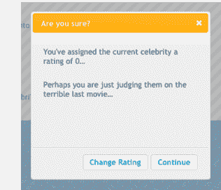

图 7.13. 一个 jQuery UI 对话框

就像我们自定义的对话框一样，主要内容在 HTML 本身中指定，然后根据需要由库隐藏和显示。这样你可以在对话框中放入任何你喜欢的内容，包括图像、链接或表单：

```html
chapter_07/19_jquery_ui_dialog/index.html (节选)
<div id="dialog" title="你确定吗？">
  <p>你给当前名人打了 0 分……</p>
  <p>也许你只是根据他/她上一部糟糕的电影来评判……</p>
</div>
```

我们使用 UI lightness 主题作为 CSS，因为它与 StarTrackr! 网站很契合，但这些对话框完全可以自定义皮肤，而且你总是可以使用 ThemeRoller 工具创建自定义主题（第 9 章“主题滚动”部分有更多介绍）。从 HTML 代码片段中可以看到，`title` 属性指定了要在对话框标题栏中显示的文本。除此之外，我们的 HTML 中几乎没有其他内容……那么这些按钮是从哪里来的呢？让我们看看脚本：

```javascript
chapter_07/19_jquery_ui_dialog/script.js (节选)

$('#dialog').dialog({
    autoOpen: false,
    height: 280,
    modal: true,
    resizable: false,
    buttons: {
        Continue: function() {
            $(this).dialog('close');
            // 提交评分
        },
        'Change Rating': function() {
            $(this).dialog('close');
            // 更新评分
        }
    }
});
```

啊哈，有意思！按钮，包括它们的文本，都是通过传递给 `dialog` 函数的选项指定的。

按钮被分组在一个对象中，并赋值给对话框的 `buttons` 属性。要定义一个按钮，你需要在 `buttons` 对象内部创建一个命名函数。每当用户点击按钮时，函数代码就会执行，而函数的名称就是显示在按钮上的文本。如果你想让按钮文本包含空格，你需要将函数名用引号括起来。按钮是从右到左添加到对话框中的，因此请确保按照你希望显示的顺序添加它们。这是一种将按钮功能与对话框打包在一起的非常简洁的方式，不同于我们自定义的对话框，其功能是独立于对话框代码指定的。

## 引号

在上面的例子中，第二个按钮的名称用了引号，而第一个没有。这仅仅是为了说明多单词按钮名称需要用引号括起来的必要性；在你的代码中，为了保持一致性和简洁性，最好给所有内容都加上引号。

默认情况下，对话框在定义时就会立即弹出。这使得根据需要创建小型简单对话框变得容易。然而，在我们的例子中，我们希望先设置好对话框，只在特定触发器（当用户给一个明星名人打零分时）时才让它弹出。为了防止对话框立即弹出，我们将 `autoOpen` 属性设置为 `false`。现在，当页面加载时，对话框会静待进一步的指令。

当用户点击 `rating-0` 链接时，我们通过将字符串 `'open'` 传递给 `dialog` 方法来让对话框显示自身。这是在初始化阶段之后与对话框通信的好方法：

```javascript
chapter_07/18_jquery_ui_dialog/script.js (excerpt)

$('#rating-0').click(function() {
    $('#dialog').dialog('open');
});
```

我们这个对话框看起来不错！现在我们可以在对话框按钮函数内执行任何需要的代码。作为代码的一部分，我们还需要告诉对话框何时关闭。如果你回顾一下上面的按钮定义，你会看到有 `$(this).dialog('close')` 这行代码。正如你可能猜到的，`close` 命令与 `open` 命令相反。你可以根据需要打开和关闭对话框任意多次。

这个插件还能做什么？嗯，我们指定了 `modal` 选项为 `true`，这就是为什么我们有漂亮的条纹背景；但默认情况下，`modal` 为 `false`，这允许用户在对话框打开时继续处理页面的其余部分。此外，我们将 `resizable` 设置为 `false`（并保持 `draggable` 选项的默认值 `true`）。这些选项利用了 jQuery UI 的 `resizable` 和 `draggable` 行为，为对话框增添了一些桌面风味。

我们在 HTML 中指定了对话框的标题文本，但你也可以通过 jQuery 的 `title` 属性来设置，就像你可以设置其宽度和高度一样。另一个不太明显但极其有用的替代选项是 `bgiframe`（背景 iframe）选项。如果将此选项设置为 `true`，bgiframe 插件将用于修复 Internet Explorer 6 中的一个问题，即 select 元素会显示在其他元素之上。

就事件而言，如果你需要处理与按钮无关的操作，可以利用对话框的 `open`、`close` 和 `focus` 事件。但还有一个极其有用的 `beforeClose` 事件，它在对话框被要求关闭时触发——在其实际关闭之前！这是处理任何无论点击哪个按钮都需要执行的过程的好地方。如果你需要阻止对话框关闭，除非满足特定条件，这也很有用。

至此，你开始领略 jQuery UI 库的深度了。所有控件都经过深思熟虑，功能丰富。一如既往，你需要权衡更轻量的自定�选项与更占带宽（但实现快速且功能更全）的 jQuery UI 替代方案。你选择哪一个应该取决于你的项目需求。

## 类似 Growl 风格的通知

我们的客户团队担心 StarTrackr! 在实时网络领域落后于竞争对手。他们希望能与用户沟通，并让他们了解最新信息：新的 Twitter 帖子、来自 RSS 订阅的新闻……任何能显示 StarTrackr! 生机勃勃的东西。

数据不是问题——后端团队可以处理……但我们如何以一种既酷又有帮助的方式通知用户呢？我们将再次从桌面应用中寻找灵感，并实现类似 Growl 风格的通知气泡（Growl 是 Mac OS X 桌面上流行的通知系统）。

当我们有消息要与用户分享时，我们会在页面上添加一个气泡。气泡将位于屏幕的右下角。如果我们有更多消息要分享，它们将出现在之前的气泡下方，形成一种倒置的堆叠效果。每个气泡都会有一个关闭按钮，使用户在阅读后可以关闭它们。整体效果如图 7.14 所示。

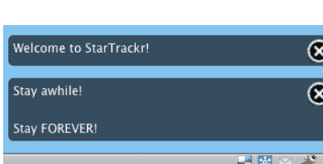

气泡效果的关键在于 CSS。它负责处理定位对话框并使其看起来非常酷的所有复杂工作。在 HTML 方面，我们只需要一个简单的容器：

```html
chapter_07/20_growl_style_notifications/index.html (excerpt)

<div id="growl"></div>
```

为了达到我们想要的效果，它需要能够定位在角落。将其放在页脚或页面主容器元素之外是常见的做法。让我们应用一些基本的 CSS 来处理定位：

```css
chapter_07/20_growl_style_notifications/style.css (excerpt)

#growl {
  position: absolute;
  bottom: 0;
  right: 5px;
  width: 320px;
  z-index: 10;
}
```

现在容器已经就位，我们可以开始向其中添加消息气泡了。我们将创建一个简单的函数，它接收一条消息，将其包装在一些结构中，并将其附加到我们已定位的气泡容器中：

```javascript
chapter_07/20_growl_style_notifications/script.js (excerpt)

function addNotice(notice) {
  $("<div class='notice'></div>")
    .append("<div class='skin'></div>")
    .append("<a href='#' class='close'>close</a>")
    .append($("<div class='content'></div>").html(notice))
    .hide()
    .appendTo('#growl')
    .fadeIn(1000);
}
```

我们添加的结构包含一个容器元素，其中有一个额外的 div 用于样式设计（我们用它将可见消息置于半透明背景之上），一个关闭按钮，以及一个用于消息内容的容器。

关于这个函数，另一个需要注意的地方是，任何我们传递给它的 HTML 都会被包裹在 jQuery 的美元选择器 `$()` 中。这意味着我们可以传入纯文本、HTML 或 jQuery 对象，它们都会显示在框中。你可以根据你的网站风格进行设计，但需要为气泡容器设置 `position: relative`：

```css
chapter_07/20_growl_style_notifications/style.css (excerpt)

.notice {
    position: relative;
    min-height: 30px;
}

.skin {
    position: absolute;
    background-color: #000000;
    bottom: 0;
    left: 0;
    opacity: 0.6;
    right: 0;
    top: 0;
    z-index: -1;
    -moz-border-radius: 5px; -webkit-border-radius: 5px;
}

.close {
    background: transparent url('button-close.png') 0 0 no-repeat;
    text-indent: -9999px;
    position: absolute;
    top: 2px;
    right: 2px;
    width: 26px;
    height: 26px;
}
```

这将正确定位我们的气泡并赋予其一些基本样式。在文档就绪函数中，只需用一条消息调用 addNotice 函数，它就会在屏幕底部淡入显示：

```javascript
addNotice("<p>Welcome to StarTrackr!</p>");
setTimeout(function() {
  addNotice('<p>Stay awhile!</p><p>Stay FOREVER!</p>');
}, 1000);
```

你也可以传入图片，或者任何你喜欢的 HTML。当然，大多数时候你会显示用户交互或 Ajax 调用的结果；你只需要在想向用户显示消息时调用 addNotice。唯一的问题是……一旦气泡出现，它们就无法被移除——它们只是不断堆叠！让我们来修复这个问题：

```javascript
$('#growl')
  .find('.close')
  .on('click', function() {
    // 移除气泡
  });
```

我们没有将点击处理程序直接添加到关闭按钮上，而是使用 `on` 函数来监视任何新增的 `.close` 元素。这有助于我们分离关闭代码，保持一切整洁可读。现在剩下的就是处理实际的移除操作：

```javascript
// 移除气泡
$(this)
  .closest('.notice')
  .animate({
    border: 'none',
    height: 0,
    marginBottom: 0,
    marginTop: '-6px',
    opacity: 0,
    paddingBottom: 0,
```

移除代码通过 **closest** 操作查找最近的父容器，并以一种吸引人的方式将其动画化为不可见状态。一旦不可见，该容器就不再需要，因此我们将其从DOM中移除。**closest** 方法是jQuery的另一个DOM遍历操作，它具有定位与你给定的选择器匹配的最近父元素（包括元素自身）的酷炫能力。

## 1-up通知

又是一个星期五的下午，老板不在办公室。本周的冲刺工作已经完成，距离下班喝酒还有一小时。这似乎是偷偷为网站添加一个酷炫小功能的绝佳时机。在整本书中，我们一直专注于让经过考验的控件焕发生机以及重现桌面效果，但jQuery最大的优势在于它能让你极其快速地尝试新效果。我们将拥抱这种创意精神，打造一个直接源自8位电子游戏历史的通知机制：1-up通知。

这个由网络开发者Jeremy Keith构思的创意，1-up通知提供了一种非模态的反馈机制，向用户表明某个操作已发生。一条小消息（通常是一个单词）会出现在操作发生的位置，然后向上淡出并迅速消失——就像经典平台视频游戏中得分通知的效果一样！也许你会认为这种效果只有新奇的价值，但事实证明，它是一种非常令人满意且出人意料的、向用户传递信息的巧妙方式。请在你最喜欢的浏览器中亲自体验一下。

既然是使用jQuery，实现方式有很多种。我们的方法是插入一个初始隐藏的新元素，将其定位在触发操作的元素的正上方居中位置。作为触发器，我们使用一些简单的锚点标签作为 **添加到愿望清单** 链点。当它们被点击时，一条显示“正在添加”的通知将出现在链接上方，并在向上移动的同时迅速淡出。动画完成后，按钮将变为 **已添加**，交互即告完成：

```html
chapter_07/21_1_up_notifications/index.html (excerpt)

<a class="wishlist" href="#">Add to wishlist</a>
```

我们将插入的消息元素会带有 `adding` 类，因此让我们确保在追加它们时，它们是不可见且定位正确的：

```css
chapter_07/21_1_up_notifications/style.css

.adding {
  position:relative;
  left:-35px;
  top:-4px;
  display:none;
}
```

文档就绪后，我们就可以找到所有目标并为每个目标添加新的消息元素。当一个目标（具有 `wishlist` 类的元素）被点击时，我们调用一个自定义函数来启动我们的通知。这个自定义函数接受当前对象的引用以及一个在交互完成时运行的回调函数。该函数会将选择移动到链接（通过 `prev` 操作）并将其文本设置为 **已添加**：

```javascript
chapter_07/21_1_up_notifications/script.js (excerpt)

$('<span>Adding</span>')
  .addClass('adding')
  .insertAfter('.wishlist');

$('.wishlist')
  .click(function(e) {
    doOneUp(this, function() {
      $(this).prev().text('Added');
    });
    e.preventDefault();
  })
```

我们的自定义函数到目前为止对我们来说没有什么新意：它只是移动到隐藏的 `span` 元素并显示它。现在消息对终端用户可见了。然后我们启动一个动画，调整 `span` 的 `top` 和 `opacity` 属性，使其同时向上移动并淡出：

```javascript
chapter_07/21_1_up_notifications/script.js (excerpt)

function doOneUp(which, callback) {
  $(which)
    .next()
    .show()
    .animate({
      top:"-=50px",
      opacity:"toggle"
    },
    1000,
    function() {
      $(this)
        .css({top: ""})
        .hide('slow', callback)
        .remove();
    });
}
```

## 传递回调

注意到例子中传递的 `callback` 变量了吗？我们提供了一个函数作为参数给我们的 `doOneUp` 代码，但我们自己并没有用它做任何事情；我们只是将其作为回调传递给jQuery的 `hide` 操作。当 `hide` 完成时，它会运行我们给它的任何代码。在这个例子中，这段代码用于将链接文本从 **添加到愿望清单** 改为 **已添加**。

## 我们做得不错

要构建可用、可访问且令人印象深刻的表单和界面控件，我们必须动用所有可用的工具：HTML、CSS、JavaScript和jQuery。作为开发者，我们需要清楚哪个工具适合这项工作。一旦我们弄清楚了这一点，那就放手去做吧。表单和控件是Web应用程序开发的核心，因此这是一个值得探索的激动人心的领域。

# 第8章

## 列表、树和表格

StarTrackr! 的人气刚刚飙升，此前它揭露了一个考虑不周的宣传噱头，一位名人伪造了自己的死亡，并试图通过Twitter泄露这一消息。幸运的是，这位名人恰好是StarTrackr! 上的“本周B级明星”，多位用户向媒体提示，他的追踪设备显示他实际上在一家当地的高端水疗中心。

涌入网站的庞大新用户群和感兴趣的老派媒体人士制造了数据浪潮，网站的管理部门正努力跟上。我们的客户担心，由于缺乏优质信息，更多的内容被导向了追求小报效应的事务，淹没在非结构化的列表和表格堆中。

网站的管理区域通常是最受忽视的部分；它对公众不可见，因此人们倾向于走捷径，在可用性和用户体验上投入更少的思考。渐进增强和可访问性等最佳实践可能会被抛诸脑后（请注意，这通常是由于极其紧迫的截止日期所致！）。

但富互联网应用（RIA）的兴起正在改变这种状况。客户期望我们基于网络的系统在可用性和设计上能与桌面应用程序相媲美。谢天谢地，有jQuery在我们身边，这不再是问题！

## 列表

列表是Web后表格布局时代真正的无名英雄。当设计师从专横的表格单元的束缚中解放出来后，他们开始寻找其他语义正确的方式来重建常见的用户界面元素，如菜单、导航面板、标签云等等。一次又一次，当冗余的布局杂乱从底层数据中剥离出来时，剩下的所有东西就是……一个列表！

StarTrackr! 网站已经拥有大量的列表：它们构成了我们的选项卡、手风琴菜单、菜单、图像库等的基础，但我们还可以做更多来增强和提升这个不起眼的列表。

### jQuery UI 可选择项

用户生成内容的汪洋大海正让我们的客户感到棘手。成千上万的标签正从网站用户那里涌入，但现在客户的法务部门表示，经理——碰巧也是我们客户团队的一员——必须手动批准每一个标签，以避免最近一次恶劣诉讼的重演。

由于网站采用了不受约束的标签系统，列表中存在大量重复标签。在当前系统下，这意味着大量的额外管理工作。客户真正想要的是一种可以轻松查看标签、选择它们（以及任何重复项），然后点击按钮批准或拒绝它们的方法。


我们的行动计划是在我们的列表上添加jQuery UI的 `selectable`（可选择）行为。使一个元素可选择赋予用户套选其任何子元素的能力：如果你点击一个元素，然后拖动到后续元素上，它们会*全部*高亮显示。然后你可以根据你的判断处理所选内容。这对于管理枯燥的列表来说非常完美！我们想要创建的行为如图8.1所示。

### 8.1 可选择列表项

除了套索选择外，可选择行为还允许你使用 **Ctrl** 键向列表中添加非连续项目（就像在大多数桌面应用程序中那样）。

> **让你的用户了解功能**

> 虽然能够通过点击和拖动来选择列表项目非常酷且有用，但这只有在你的用户知道它的情况下才有效。在网页上以这种方式进行选择是一种非标准的交互形式，因此你需要向用户提供关于如何使用新功能的说明。

让我们看看标记。服务器输出一长串标签，这是我们选择网格的良好基础。我们还将添加几个按钮，允许用户批准或拒绝其选择中的标签，以及一个重置选择的按钮：

```
chapter_08/01_jquery_ui_selectable/index.html (excerpt)

<ul id="tags">
    <li>bad singer</li>
    <li>old</li>
    <li>plastic surgery</li>
    <li>broke</li>
    ...
</ul>
<button id="approve">Approve</button>
<button id="reject">Reject</button>
<button id="clear">Clear</button>
```

一个又长又大的列表有点吓人，所以我们将使用一些基本的 CSS 将列表变成网格，并将每个标签转换为一个小方块：

```
#tags {
list-style-type: none;
margin: 0;
padding: 0;
}

#tags li {
border: 1px solid #ccc;
float: left;
width: 60px;
height: 60px;
font-size:1.1em;
margin:3px;
padding:0.4em;
text-align:center;
}
```

网格准备就绪后，我们必须将 jQuery UI 库添加到页面中。现在是时候让标签列表变得可选择了：

```
$( "#tags" ).selectable();
```

启动浏览器并查看。嗯……实际发生了什么吗？嗯，是的，它发生了，但它是不可见的。`selectable` 方法通过为选定项目添加 class 属性来工作，因此除非我们为这些类分配样式，否则我们将无法看到任何变化。如果你在选择时用 Firebug 检查列表项，你会看到变化正在发生。让我们尝试为选中的元素设置样式：

```
#tags .ui-selecting {
  background: #FEFF9F;
}

#tags .ui-selected {
    background-color:#eEeF8F;
}
```

`ui-selecting` 类在用户正在选择元素的过程中被应用，而 `ui-selected` 类则在用户停止选择时被添加。如果你现在尝试，你会看到你可以套索一些方块。这是一种非常自然的交互，这正是你页面组件所需要的。你还可以在按住 **Ctrl** 键的同时单击来选择单个项目。

我们的下一个任务是帮助处理重复标签。在标签系统中，每个术语的标签数量很重要；因此，我们不会直接删除重复项，而是编写一些代码来选择与用户选择匹配的任何标签。例如，如果用户点击“A-lister”，所有“A-lister”标签都将被高亮显示。

我们需要知道我们可以从 jQuery UI 组件中接入哪些事件。查阅文档¹，我们能够捕获 `start`、`stop`、`selecting`、`unselecting`、`selected` 和 `unselected` 事件。我们可以捕获 `selecting` 事件并在用户移动鼠标时删除重复项，但这可能会有点令人困惑。我们将坚持使用 `stop` 事件，该事件在用户完成选择后立即触发：

```
chapter_08/01_jquery_ui_selectable/script.js (excerpt)

$('#tags').selectable({
    stop: function() {
        // The user stopped selecting!
    }
});
```

现在我们可以开始寻找重复标签的任务了。我们的总体方法是列出用户选择的所有标签，然后在更大的标签列表中搜索这些标签的任何重复项。

¹ http://docs.jquery.com/UI/Selectable

```
chapter_08/01_jquery_ui_selectable/script.js (excerpt)

var names = $.map($('.ui-selected', this), function(element, i) {
    return $(element).text();
});

$('li', this)
    .filter(function() {
        return ($.inArray($(this).text(), names) != -1);  })
    .addClass('ui-selected');
```

为了找到重复项，我们使用了一系列新的 jQuery 功能，所以请做好准备！

其中第一个最奇特：`$('.ui-selected', this)`。这看起来像一个常规的 jQuery 选择器，但有第二个参数。事实证明，jQuery 选择器的完整定义实际上是 `$(expression, context)`；我们只是省略了第二个参数。`context` 定义了 jQuery 应该在哪里寻找你的选择器；默认情况下，它会在页面上的所有地方查找，但通过指定我们的无序列表作为上下文，表达式将被限制在列表内部的元素。

#### $.map 和 $.inArray

接下来，我们使用几个 jQuery 实用方法来处理列表项：`$.map` 和 `$.inArray`。jQuery 提供的实用方法主要用于处理 JavaScript 数组，而这正是我们这里要做的。首先，我们创建一个名为 `names` 的数组，我们使用 `$.map` 方法填充它。

`$.map` 方法允许你获取数组中的每个元素，以某种方式处理它，并将结果作为新数组返回。当你想以相同的方式转换每个元时，你可以使用它。我们想将 jQuery 选择转换为简单的标签文本列表，因此我们传入选择，并定义一个匿名函数来返回每个元素的文本。看：一个标签文本数组！

map 函数也可以直接在选择上使用，我们可以这样重写获取名称的代码：

```
var names = $('.ui-selected', this).map(function(i, element){
    return $(element).text();
});
```

#### map, filter 及其相关函数

`map` 和 `filter` 函数是高阶函数的例子；也就是说，它们是将函数作为参数来应用于我们列表的函数。为列表操作提供一个常规接口相当强大：它允许你以简单、可读的方式转换你的数据。事实上，`map` 和 `filter` 操作（以及一堆其他迭代方法）已被添加到最新版本的 JavaScript 中。²

接下来，我们像之前一样使用上下文技巧来检索所有列表项元素，并根据它们是否为重复项进行过滤。我们的 `filter` 函数使用了 `$.inArray` 实用方法，该方法在一个数组（但仅限于普通的 JavaScript 数组，而不是 jQuery 选择）中搜索指定的值。给定一个数组和一个搜索项，如 `$.inArray(value, array)`，它将返回该值在数组中的索引。有帮助的是，如果该值*未*在数组中找到，它将返回 `-1`。请记住，`filter` 期望我们返回 `true` 或 `false`——所以我们只需检查 `$.inArray` 是否返回 `-1`，并相应地返回 `true` 或 `false`。以这种方式使用 `filter` 允许我们在标签文本数组中搜索每个列表项的文本；如果它在那里，它就是一个重复项，因此我们将其返回给 `filter` 进行选择。

#### 访问数据

现在我们可以进行选择了，我们如何使用它们呢？jQuery UI Selectable 组件使用类名，所以我们也会这样做。要获取选定值的列表，我们只需搜索任何具有 `ui-selected` 类的项目：

```
chapter_08/01_jquery_ui_selectable/script.js (excerpt)

$('#approve').click(function() {
    $('#tags')
        .find('.ui-selected')
        .addClass('approve')
        .removeClass('ui-selected reject');
});

$('#reject').click(function() {
    $('#tags')
        .find('.ui-selected')
        .addClass('reject')
        .removeClass('ui-selected approve');
});

$('#clear').click(function() {
    $('#tags')
        .find('li')
        .removeClass('ui-selected approve reject');
    $('#approved').val('');
});
```

我们只是在用户点击我们的按钮时添加 approve 或 reject 类，同时确保移除 `ui-selected` 类，因为我们想要将批准的标签与选中的标签样式设置得不同。

但如果我们想，比如说，将此信息发送到服务器呢？也许将批准的标签列表存储在隐藏的表单字段中会很好，这样服务器就可以访问它进行处理。让我们更新 `#approve` 点击处理程序，以迭代已批准的项目，并将每个项目的索引以简单的管道分隔格式附加到隐藏字段中：

```
    chapter_08/01_jquery_ui_selectable/script.js (excerpt)

    $('#approve').click(function() {
      var approvedItems = "";
      $('#tags')
        .find('.ui-selected')
        .addClass('approve')
        .removeClass('ui-selected reject')
        .each(function() {
          approvedItems += $(this).index() + "|";
        });
      $('#approved').val(approvedItems);
    });
```

我们还将向 `#clear` 按钮点击处理程序添加一行代码来清除该输入的值：

```
    chapter_08/01_jquery_ui_selectable/script.js (excerpt)

    $('#approved').val('');
```

感谢 `index` 方法，我们现在知道列表中哪些项目已被批准。`index` 会告诉你一个项目在其父元素中的位置。我们的控件

其易于使用的特性令人印象深刻。jQuery UI Selectable 插件在幕后完成了大量工作以实现列表的选择功能，但最终呈现的是一个自然流畅的组件，这正是我们所期望的。

## 对列表排序

标签系统已掌握在手，现在该着手处理管理后台中散落的其他列表了。这些列表大多按照输入系统的顺序由服务器填充。这对于查看新内容很方便，但不利于查找特定项目。我们的客户要求我们在管理后台的所有列表中加入排序功能，以便通过点击按钮即可按字母升序或降序排列。

标记由简单的无序列表构成，每个列表包含一个链接：

```html
<ul class="sortable">
    <li><a href="#">Beau Dandy</a></li>
    <li><a href="#">Glendatronix</a></li>
    <li><a href="#">BMX Spandex Corporation</a></li>
    <li><a href="#">Maxwell Zilog</a></li>
    <li><a href="#">Computadors</a></li>
</ul>
```

jQuery 对象缺乏任何内置的排序功能。这很合理：一个选择集可能包含位于页面不同部分的各种元素，因此无法以一致的方式进行排序。因此，为了对我们的 jQuery 选择集进行排序，我们需要借助一些 JavaScript 数组方法。jQuery 选择集实际上不是数组，但它们“类似于数组”，并允许我们对其使用 JavaScript 的 sort 函数。

我们将尝试构建一个可复用的列表排序组件。我们将其命名为 `SORTER`，然后调用 `SORTER.sort(list)` 对列表进行升序排序，调用 `SORTER.sort(list, 'desc')` 进行降序排序。我们假设传入的选择器将匹配有序或无序列表，让我们看看能否实现这一点：

```javascript
// chapter_08/02_sorting_lists/script.js (节选)

var SORTER = {};
SORTER.sort = function(which, dir) {
  SORTER.dir = (dir == "desc") ? -1 : 1;
  $(which).each(function() {
    // 查找列表项并排序
    var sorted = $(this).find("> li").sort(function(a, b) {
      return $(a).text().toLowerCase() > $(b).text().toLowerCase() ?
        SORTER.dir : -SORTER.dir;
    });
    $(this).append(sorted);
  });
};
```

这段代码看起来简短得有些具有欺骗性，因为它实际上完成了大量工作。首先，我们检查 `desc` 是否作为 `dir` 参数传入，并相应设置 `SORTER.dir` 变量。我们需要做的就是抓取所有第一级子列列表元素并对它们进行排序。我们只需要第一级项目；如果抓取更深层级的项目，它们也会被排序并被拖拽到父级。因为调用 `sort` 会将我们的选择集转换回原始的 JavaScript 对象，我们需要用 `$()` 重新包装它们，以便能够调用 jQuery 的 `text` 方法并比较它们的值。我们还将值转换为小写，这使得排序不区分大小写。

### `sort` 函数

`sort` 函数是纯粹的 JavaScript。它根据默认规则对数组进行排序，例如对数字按数值排序，对字符串按字母顺序排序，或者根据你传递给它的函数的结果进行排序。`sort` 会遍历数组的内容，并将它们成对传递给你的函数。如果你的函数返回 `1`，`sort` 会交换这两个元素的位置，将第二个放在第一个之前。如果你的函数返回 `-1`，JavaScript 会将第一个元素放在前面。最后，如果你的函数返回 `0`，`sort` 会认为两个元素相等，不会进行排序。

我们使用了一点小技巧，以便用同一个函数实现升序和降序排序。我们根据方向将 `SORTER.dir` 变量设置为 `-1` 或 `1`。然后在 `sort` 的比较函数中，我们执行进一步的计算：如果 `a` 小于 `b`，我们返回 `-SORTER.dir`。如果方向是 `-1`，我们将其处理为 `-(-1)`，即 `1`；所以如果我们尝试降序排序，返回值就会被交换。

一旦我们对元素进行了排序，就可以按正确的顺序将它们重新插入列表。记住，append 函数会先移除元素，所以它会先移除项目，然后将其追加到正确的位置。

为了测试它，我们将在 HTML 中添加一些按钮，并在它们的点击事件处理程序中调用 `SORTER.sort`：

```javascript
// chapter_08/02_sorting_lists/script.js (节选)

$('#ascending').click(function() {
    SORTER.sort('.sortable');
});
$('#descending').click(function() {
    SORTER.sort('.sortable', 'desc');
});
```

## 操作选择框列表

尽管我们在上一章介绍了表单，但在列表的背景下研究某些表单元素绝对值得。在这里，我们将研究 `select` 元素，特别是那些带有 `multiple="multiple"` 的元素（即呈现为可选择项目列表的选择框）。

## 交换列表元素

StarTrackr! 客户要求我们改进管理后台中将名人分配到 A 级名单的功能。当前功能由两个 `select` 元素组成：一个包含 A 级名人，另一个包含系统中所有其他名人。然而，名气是极其善变的，今天的 A 级名人明天可能就是无名之辈，因此客户希望能够轻松地在列表之间交换名人。我们将在界面上添加一些控件来实现这一点，如图 8.2 所示。

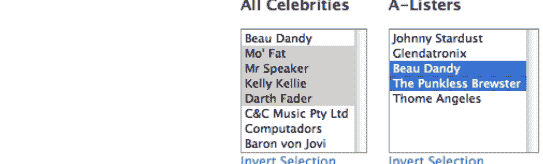

图 8.2. 带有控件的列表框

这是我们处理的 HTML，包含两个 select 元素和一些用于执行各种操作的按钮：

```html
<!-- chapter_08/03_select_lists/index.html (节选) -->

<select id="candidates" multiple="multiple" size="8">
    <option value="142">Beau Dandy</option>
    ...
</select>
<select id="a-listers" multiple="multiple" size="8">
    <option value="232">Johnny Stardust</option>
    ...
</select>
<div id="controls">
    <input type="button" id="swapLeft" value="&gt;" />
    <input type="button" id="swapRight" value="&lt;" />
    ...
</div>
```

如前所述，客户希望能够在列表之间交换选中的项目。我们将创建一个 `SWAPLIST` 对象，其中包含我们将要构建的所有功能。这可以在需要操作选择元素时随时重用：

```javascript
// chapter_08/03_select_lists/script.js (节选)

var SWAPLIST = {};
SWAPLIST.swap = function(from, to) {
    $(from)
        .find(':selected')
        .appendTo(to);
}
```

我们定义了一个 swap 函数，它接受指向两个列表的选择器字符串：一个源列表和一个目标列表。我们要做的第一件事是抓取当前选中的任何项目。我们可以使用带有 `:selected` 表单过滤器的 `find` 操作来完成此操作。此过滤器将返回任何设置了 `selected` 属性的表单元素。然后我们可以用 `appendTo` 将选择项移动到目标列表。简单！一旦我们定义了这个功能，就可以通过在适当的点击处理程序中调用我们的 `swap` 方法，将其应用于任何两个列表：

```javascript
// chapter_08/03_select_lists/script.js (节选)

$('#swapLeft').click(function() {
    SWAPLIST.swap('#candidates', '#a-listers');
});
$('#swapRight').click(function() {
    SWAPLIST.swap('#a-listers', '#candidates');
});
```

现在，选中的项目可以随意来回交换了！让我们为 `SWAPLIST` 对象添加更多功能。交换*所有*元素怎么样？那甚至更简单：

```javascript
// chapter_08/03_select_lists/script.js (节选)

SWAPLIST.swapAll = function(from, to) {
    $(from)
        .children()
        .appendTo(to);
}
```

我们只需获取所有子元素（而不仅仅是选中的元素）并将它们追加到目标列表的底部。整个列表会从源列表跳到目标列表。

## 反转选择

客户的下一个请求是添加一个按钮，用于反转当前选择，以便员工在处理大量选择时更容易操作。当点击此链接时，所有

目标列表中当前已选中的项目将被取消选中，反之亦然。让我们在 `SWAPLIST` 对象内部创建一个实现此功能的函数：

```
chapter_08/03_select_lists/script.js (节选)

SWAPLIST.invert = function(list) {
    $(list)
        .children()
        .prop('selected', function(i, selected) {
            return !selected;
        });
}
```

我们只需检索所有列表项，并使用 `prop` 操作来切换其 `selected` 属性。`prop` 与 `attr`（我们之前见过）非常相似，不同之处在于它用于设置*属性*，而非通常的 HTML 属性。一般来说，如果是布尔值（true/false），我们应该使用 `prop`。完整的属性列表以及两种方法的深入讨论可以在 jQuery 文档网站上找到。

我们使用 `prop` 函数将列表项设置为 `!$(this).prop('selected')`。JavaScript 的 NOT（`!`）运算符（即感叹号）会反转布尔值，因此如果值为 `true` 则变为 `false`，如果值为 `false` 则变为 `true`。

### 使用函数参数调用 prop

这是一个很棒的技巧：我们使用了 `prop` 操作并看到它类似于 `attr` 操作，但我们正在利用一些高级功能。之前，我们使用 `attr(key, value)` 操作将属性设置为静态值，但 `prop` 和 `attr` 也允许我们传入一个*函数*来确定要设置的值。该函数将接收两个参数：元素的索引及其当前值。函数的返回值将成为属性的新值。对于我们的 `invert` 方法，我们返回元素当前选中值的相反值——因此每个元素都会被切换。我们可以通过一系列命令进行这种动态处理：`text`、`html`、`val`、`addClass`、`wrap`... 等等！

## 列表搜索

在不得不听客户群一遍又一遍地抱怨要找到他们正在搜索的名人有多难之后，你决定提供一点小小的额外福利：一个快速搜索功能，让用户输入一些字符，然后自动选中任何匹配的元素：

```
SWAPLIST.search = function(list, search) {
  $(list)
    .children()
    .prop('selected', false)
    .filter(function() {
      if (!search) {
        return false;
      }
      return $(this)
        .text()
        .toLowerCase()
        .indexOf(search.toLowerCase()) > - 1
    })
    .prop('selected', true);
}
```

这里发生了什么？首先，我们获取所有列表项，然后清除任何先前的选择（通过将 `selected` 设置为 `false`）。接下来，我们使用 `filter` 操作来查找我们要搜索的任何元素。

`filter` 操作接受一个函数作为参数，并对选择中的每个 jQuery 对象运行该函数。如果函数返回 `true`，则该元素保留在选择中。但如果函数返回 `false`——它就消失了... 从选择中移除，并且不再受后续处理的影响。

要找到我们关心的元素，我们检查它们包含的文本是否包含我们正在寻找的文本。为此，我们使用返回字符串的 `text` 操作。我们将其转换为小写（以便搜索不区分大小写），并检查我们的源文本是否位于元素字符串中。JavaScript 的 `indexOf` 方法将查找一个字符串在另一个字符串中的位置；例如，`"hello".indexOf('ll')` 将返回 2（索引通常从 0 开始）。如果未找到子字符串，`indexOf` 将返回 -1，这正是我们在这里检查的内容。

320 jQuery: Novice to Ninja

在 filter 函数运行后，保留在 jQuery 选择中的任何元素都必须包含我们正在查找的关键词。我们再次使用 `prop` 方法来选中它们。

要使用我们创建的搜索方法，我们可以将其附加到点击处理程序上，这样用户输入一个词，然后点击搜索按钮。更好的是将其附加到输入框本身的 `keyup` 处理程序上，以便在你输入时进行选择：

```
// chapter_08/03_select_lists/script.js (节选)
$('#search').keyup(function() {
  SWAPLIST.search("#a-listers, #candidates", $(this).val());
});
```

## 树

“这又是一个烂摊子。我们有几个名人子类别——你知道，A 级名人是在乐队里，或者因为他们父母有钱而出名；B 级名人是在某个真人秀比赛中得了第二名，诸如此类。现在，他们都在一个大列表里。我需要看到这些类别是如何相互嵌套的！你能做点什么来帮我吗？”

客户团队的一位代表在谈论一个树。树在网页上很少见，原因有二：它们很难做好，而且很少有情况它们是有意义的。然而，嵌套的类别集是树结构的一个有效用例（更常见的一个用例是表示目录结构），所以让我们深入研究吧！

### 可展开的树

关于树的秘密：它们实际上只是嵌套列表。在 jQuery 中处理树的关键是确保你的 HTML 是一致的；这样我们就能弄清楚我们在哪里，并打开和关闭正确的分支。我们将构建的控件看起来将像图 8.3 中的那样。我们故意保持了样式简单，但和往常一样，改善外观的潜力只受你 CSS 技能的限制！

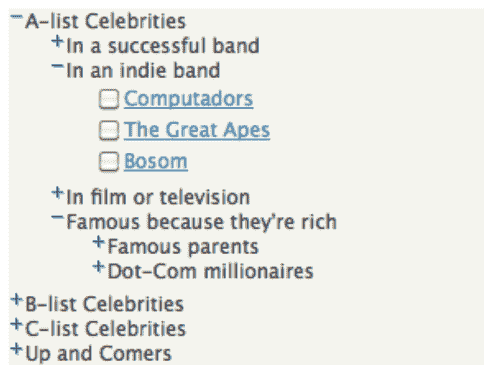

我们标记的重要部分是包含每个类别（或目录）名称的 span。我们将使用此 span 作为基础，插入一个小的加号/减号图形，该图形充当分支开关。这是我们即将处理的标记的一个子集：

```
chapter_08/04_expandable_tree/index.html (节选)
<ul id="celebTree">
  <li><span>A-list Celebrities</span>
    <ul>
      <li><span>In a successful band</span>
        <ul>
          <li>Johnny Stardust</li>
          <li>Glendatronix</li>
        </ul>
      </li>
      :
      <li><span>Famous because they're rich</span>
        <ul>
          <li><span>Dot-Com millionaires</span>
            <ul>
              <li>Joel Mynor</li>
              :
            </ul>
          </li>
```

树可以嵌套到所需的任何深度；只需在相应的子列表项内重复该结构。因为它非常一致，你可以轻松地在服务器端生成 HTML。

列表在页面上之后，下一步是用一些 CSS 美化它。这取决于你，但我们的代码将添加一些额外的类，你可以用来自自定义显示。`handle` 类将分配给我们将插入的作为切换手柄的元素。当树的分支打开时，它将获得 `opened` 类；否则，它将具有 `closed` 类。我们在下面使用这些类来添加一个 CSS 雪碧图，它将在加号和减号之间切换：

```
chapter_08/04_expandable_tree/style.css (节选)

.handle {
    background: transparent url(tree-handle.png) no-repeat left top;
    display: block;
    float: left;
    width: 10px;
    height: 10px;
    cursor: pointer;
}
.closed { background-position: left top; }
.opened { background-position: left -10px; }
```

树的代码非常简单，这要归功于树的递归性质：我们只需要编写一小段代码，并将其附加到每个子类别上。我们创建展开/折叠树效果的攻击计划是首先隐藏所有嵌套的 ul 类别。然后我们将在类别标题之前添加一个包含点击事件处理程序的新元素；这将打开和关闭其分支：

```
chapter_08/04_expandable_tree/script.js (节选)

$('#celebTree ul')
    .hide()
    .prev('span')
    .before('<span></span>')
    .prev()
    .addClass('handle closed')
    .click(function() {
        // 加号/减号手柄点击
    });
```

六个链式操作。打赌你现在正感受到一些 jQuery 的力量在你的血管中奔流！在这里我们看到一致的标记如何帮助我们。在每个子类别列表中，我们查找前一个 span 元素——那就是子类别标题。然后我们在标题正前方插入一个新的 span 元素。

由于我们的手柄（handle）是在标题之前添加的，因此需要使用 `prev` 操作回溯到它。我们为它添加 `handle` 和 `closed`（由于 `hide` 操作，它默认是关闭的）类，以及一个点击事件处理程序。

此时，树将完全折叠，我们全新的手柄已预先添加到标题之前。接下来要做的就是在点击手柄时切换分支：

```
chapter_08/04_expandable_tree/script.js (excerpt)

// plus/minus handle click
$(this)
    .toggleClass('closed opened')
    .nextAll('ul')
    .toggle();
```

当点击手柄时，我们使用 `toggleClass` 切换 `closed` 和 `opened` 类。如果你在 `toggleClass` 中指定多个类名，元素上任何已存在的指定类都会被移除，而任何不存在的类则会被添加。

> 高级 toggleClass

`toggleClass` 的另一个妙招是它接受第二个参数：一个布尔值，指定该类是应该被添加还是移除。这听起来可能有些奇怪，但它是一个不错的快捷方式。考虑以下代码：

if (x == 1) {

    $(this).addClass('opened');

} else {

    $(this).removeClass('opened');

}

使用 `toggleClass(class, switch)` 语法，我们可以用以下简洁的语法替换 `if` 语句：

$(this).toggleClass('opened', x == 1);

要找到我们需要打开和关闭的子类别很简单，这得益于 `nextAll` 操作。jQuery 会检查下一个兄弟元素，发现它是一个 `span` 元素（类别标题），根据我们的表式将其过滤掉，然后移动到下一个兄弟元素……那是一个 `ul` 项。找到了！我们只需切换这个，树就会摆开和闭合。

### 事件委托

**事件委托**是一个适用于 jQuery 的主题，但如果你在处理大型树结构时，它尤为重要。其理念是，你不必为树中的每个节点都单独应用事件处理程序，而是应用单个事件处理程序来拦截点击事件。然后，你确定点击的目标是谁，并执行相应的操作。

我们在第 6 章名为“为未来做准备：on 和 off”的小节中介绍了 `on` 方法。`on` 会为你处理事件委托——这正是实现这一功能的魔法所在。

为了更好地理解事件委托的工作原理及其重要性，让我们实际应用一下。我们将从以下 HTML 开始，它在一个分类列表中显示我们的产品：

```
chapter_08/05_event_delegation/index.html (excerpt)

<span><strong>Selection:</strong></span>
<span id="current">--Choose a celebrity--</span>
<ul id="picker">
    <li class="category">
        <span class="title">A-List</span>
        <ul>
            <li>Beau Dandy</li>
            <li>Glendatronix</li>
        </ul>
    </li>
    <li class="category">
        <span class="title">B-List</span>
        <ul>
            <li>Mo' Fat</li>
            <li>DJ Darth Fader</li>
        </ul>
    </li>
</ul>
```

当用户点击一个名人时，他们的选择应以“类别 > 名人”的格式显示在列表上方，如图 8.4 所示。那么，捕获此信息的最佳方式是什么？

## 列表、树和表格

如果我们为每个列表项都添加一个点击事件处理程序——`$('#picker li').click(...)` ——我们最终可能会有数百个处理程序。这会严重影响性能，因为浏览器需要跟踪所有这些处理程序，并在页面上发生点击时检查每一个。使用事件委托，我们将唯一的事件处理程序添加到列表的父元素上，然后访问事件的目标来确定实际被点击的元素。事件的 `target` 属性是实际的 DOM 元素，因此需要将其包装在 jQuery 选择器中以获取 jQuery 对象：

```
$('#picker').click(function(e) {
    $('#current').text($(e.target).text());
});
```

我们的列表表现得好像每个项目都有自己的处理程序！但有一个小陷阱需要注意：事件委托之所以有效，是因为事件冒泡（我们在第 5 章名为“事件传播”的小节中讨论过）。事件会向上冒泡，直到被我们的父处理程序捕获。问题在于，如果一个处理程序在父处理程序之前捕获了事件并阻止了事件传播（使用 `e.stopPropagation()` 或“`return false`”），事件委托就会失败。这就是为什么了解事件在底层如何处理非常重要；在处理其他令人费解的 bug 时，这将为你省去很多麻烦。

我们已经用单个处理程序处理了所有点击，但现在我们需要进一步了解元素的位置。具体来说，我们如何找出元素属于哪个类别？可以这样：

```
chapter_08/05_event_delegation/script.js (excerpt)

$('#picker').click(function(e) {
    $('.selected').removeClass('selected');
    $(e.target).addClass('selected');
    var celebrity = $(e.target).text();
    var category = $(e.target)
        .closest('.category')
        .find('.title')
        .text();
    $('#current').text(category + " > " + celebrity);
});
```

我们使用 `closest` 方法来查找最接近的具有 `category` 类的元素。如果元素本息没有该类，`closest` 会检查其父元素，依此类推，直到找到匹配的元素。这省去了我们编写冗长的 `parent().parent().parent()` 字符串的麻烦，也让我们在 HTML 结构设计上更加灵活。

## 表格

如果说 HTML 列表是 Web 新生代中默默无闻的英雄，那么表格就是那个最终变好的“坏孩子”。表格本身从未被怪罪；多年来，我们将其滥用和误用，作为以合理的跨浏览器方式布局网页设计的 hack。但那是 CSS 的职责，而不是那些可怜的老表格的。现在 CSS 已经成熟，我们终于可以回归到表格的原始用途：显示表格数据。

StarTrackr! 有大量数据需要展示。多到有些失控：表格变得过大且难以阅读，信息没有分页或排序机制，也无法轻松编辑信息。我们在第 2 章看到过为表格添加斑马条纹和行高亮是多么容易；这会给我们带来一些快速的改进，但要解决更严重的表格问题，我们将需要 jQuery 的一些额外帮助。

### 固定表格表头

表格的标题行至关重要：没有它，你将面对一堆毫无意义的数据行。但是，如果你处理的是大量行，你会发现随着标题滚动出视线，它们会变得越来越没用。数据分页通常可以解决这个问题，但如果你需要将所有数据同时放在一个页面上，你就必须考虑另一种选择。

将标题行固定在表格顶部是跟踪列内容的一种有效方式，而且看起来非常酷！当用户滚动表格以显示新数据时，标题会随之移动。你可以在图 8.5 中看到实际效果。

| Id | Name | Occupation | Approx. Location | Price |

|---|---|---|---|---|

| E051 | Mo Fat | Producer | New York | $13.95 |

| 007F | Kellie Kelly | Singer | Omaha | $11.95 |

| 8A05 | Darth Fader | DJ | London | $19.95 |

图 8.5. 固定表头行

如果你的表格是页面上唯一的元素，`position: fixed` 可用于将 `thead` 元素固定到位。然而，`position: fixed` 只能相对于视口定位元素，而不是其包含元素。这意味着对于包含在其他元素内的表格（这几乎总是如此），我们需要借助 jQuery。

让我们看看如何实现这个效果。我们的标记与第 2 章中添加斑马条纹的“名人”表格相同：

```
<table id="celebs">
    <thead>
        <tr>
            <th>Id</th>
            <th>Name</th>
            <th>Occupation</th>
            <th>Approx. Location</th>
            <th>Price</th>
        </tr>
    </thead>
    <tbody>
        :
    </tbody>
</table>
```

### 重复表头

解决表头行消失问题的另一种方法是简单地定期重复表头。这在打算打印数据时尤其方便；虽然我们的动画表头看起来很酷，但如果你需要在十几页打印的表格中进行排序，它就没什么帮助了！目标是将表格的第一行复制，例如每十行复制一次。

结果如图8.6所示。

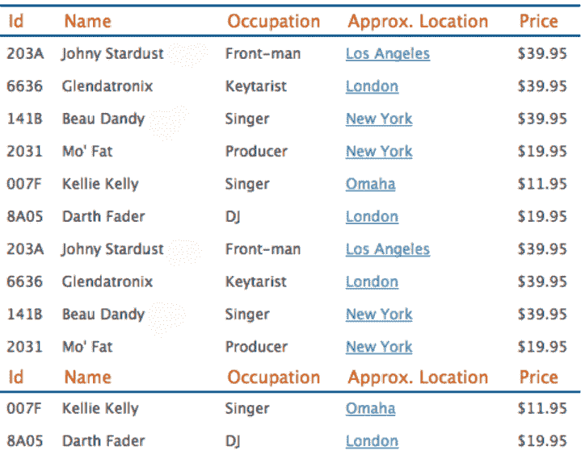

现在，复制表头行并将其放置在其他地方对你来说应该已经很熟悉了。但我们究竟如何每隔十行添加一次表头呢？我们是否遍历每一行并检查其索引？嗯，我们可以……但jQuery再次以其强大的内置过滤器拯救了我们：

```
$('#celebs')
    .find('tr:first')
    .clone()
    .insertAfter('#celebs tr:nth-child(10n)');
```

这个解决方案一开始很简单：使用`clone`方法抓取第一个表格行并克隆它。然后就是巧妙的部分：**nth-child**选择器非常适合在我们想要的位置添加行。不过，你可能对我们使用它的方式感到有点困惑，因为它的语法与其他过滤器略有不同。

在最基本的情况下，如果你给它一个简单的整数，它会选择该索引。例如，如果你选择`:nth-child(2)`，你将获得第三个子元素。

但是`:nth-child`选择器也接受其他值，这会导致它同时选择多行。如果你传入文本值`even`或`odd`，你将选择所有偶数或奇数的子元素。最酷的是，你可以给它一个等式来决定选择哪些子元素！

你可以使用字母“n”来表示重复；例如，`:nth-child(10n)`将选择每第十行。然后你可以用加号或减号来增加偏移量，以调整选择的行。例如，如果你想选择第三行，然后是之后的每第十行，你可以使用`:nth-child(10n+3)`。如果你喜欢反向思考，你可以用`:nth-child(10n-7)`来实现相同的结果。

这一切都正常，但有一个bug：如果表格的最后一行与我们的等式匹配，表头行将作为最后一行被重复，这看起来有点奇怪。此外，我们想将重复表头应用于几个表格，并避免复制粘贴代码。在下一章中，我们将研究如何通过插件使代码可重用，但目前我们会保持简单，并坚持使用一个可靠的widget对象：

```
chapter_08/07_repeating_table_header/script.js (excerpt)

var TABLE = {};

TABLE.repeatHeader = function(table, every) {
  $(table).each(function() {
    var $this = $(this);
    var rowsLen = $this.find('tr:not(:first)').length;

    $(this).find('tr:first')
      .clone()
      .insertAfter($this.find('tr:nth-child(' + every + 'n)'));

    if ((rowsLen) % every === 0) {
      $this.find('tr:last').remove();
    }
  });
}
```

### jQuery: 入门到精通（第328页）

移动`thead`比较棘手。一些浏览器允许你随意移动它，而在其他浏览器中，它对样式的调整令人惊讶地顽固。所以我们将采用一个技巧：我们将表头的内容复制为一个无序列表的形式，其样式与表头完全相同。然后我们将其设置为`position: absolute;`，并在用户滚动时移动它在屏幕上的位置。

我们首先创建一个`TABLE` widget来保存我们的代码，并为其`fixHeader`方法，该方法将用于实现固定表头效果。该方法预期接收一个指向页面上表格的选择器字符串。我们首先将一些选择存储到变量和数据中，以加速后续代码：

```
chapter_08/06_fixed_table_headers/script.js (excerpt)

var TABLE = {};

TABLE.fixHeader = function(table) {
  $(table).each(function() {
    var $table = $(this);
    var $thead = $table.find('thead');
    var $ths = $thead.find('th');
    $table.data('top', $thead.offset().top);
    $table.data('left', $thead.offset().left);
    $table.data('bottom', $table.data('top') + $table.height() - $thead.height());
  });
};
```

我们首先声明一个闭包来保存widget的上下文。然后我们选择任何与传入方法的选择器匹配的表格。我们用`each`循环遍历它们，并存储表格本身（`$table`）、表头（`$thead`）以及它包含的`th`元素集合（`$ths`）的引用。最后，我们存储`$thead`的左右偏移量，以及表格底部的位置（以避免表头移过底部！）。

> ### 在编写基于选择器的函数时使用`each`

在编写这种类型的实用函数时，你应始终考虑选择器返回多个元素的可能性。在我们的例子中，页面上只有一个表格，所以即使我们省略`each`循环，该方法也能正常工作。但为了将来准备并使代码可重用，我们还是包含了循环；即使表格选择器返回多个表格，我们的函数也能优雅地处理它们。

接下来，我们创建模拟表头——一个`ul`——并复制表格表头的内容：

```
var $list = $('<ul class="faux-head"></ul>');
$ths.each(function(i) {
  _th = $(this);
  $list.append($("<li></li>")
    .addClass(_th.attr("class"))
    .html(_th.html())
    .width(_th.width())
    .click(function() {
      _th.click()
    })
  ).hide().css({left: $table.data('left'),top: $table.data('top')});
});
$('body').append($list);
```

我们用`$ths`收集了真实的`th`元素，然后使用`each`操作来遍历每个元素并创建我们的模仿品。我们复制原始元素的类、HTML内容、宽度和点击事件处理程序。其中一些在我们的简单例子中是不必要的，但做好准备是好的！在列表完全填充后，我们将其隐藏并将其定位在真实表头的正上方，然后将其插入页面。

> ### 尽可能少地使用Append

你可能想知道为什么我们要等到列表完全构建好才将其追加到页面。虽然先将列表追加到页面然后逐个将项目追加到其中会达到同样的效果，但我们选择采用的方法在浏览器中执行得更快。

每次你将一个新元素插入DOM时，浏览器都需要重新计算页面上每个元素的位置。如果你这样做很多次（尤其是在循环中！），你的脚本可能会变得非常慢。我们上面使用的方法——将新元素存储在变量中，根据需要进行处理，然后一次性全部追加——确保了最佳性能。

现在我们的表头模仿品已就位，我们需要对滚动事件做出反应并适当地定位它：

```
chapter_08/06_fixed_table_headers/script.js (excerpt)

$(window).scroll(function() {
    clearTimeout(timer);
    timer = setTimeout(function() {
        if ($table.data('top') < $(document).scrollTop() &&
            $(document).scrollTop() < $table.data('bottom')) {
            $list
                .show()
                .stop()
                .animate({
                    top: $(document).scrollTop(),
                    opacity: 1
                });
        } else {
            $list.fadeOut(function() {
                $(this).css({top: $table.data('top')});
            });
        }
    }, 100);
});
```

我们在滚动事件触发后设置100毫秒的超时；这是一个很短的时间，但足以确保我们避免用户滚动时持续动画。我们检查表头是否已滚出视口，但尚未滚过表格底部；如果已滚出，我们就显示我们的模仿品并将其动画移动到正确的位置。如果我们已经向上滚动到足以让原始表头可见，或向下滚动到表格底部之后，我们会淡出冒名顶替的列表（并将其位置移回顶部，以便它重新出现时能从正确的位置开始动画）。

就这样！我们可以调用`TABLE.fixHeader("#celebs")`并滚动页面，新的“thead”会跟随移动，以使标识标签始终保持可见。

### jQuery: 入门到精通（第330页）

我们创建了一个函数，它接受表格的选择器字符串，以及一个数字，表示在表头每次重复之间需要间隔多少行。然后，我们循环遍历选择器找到的每个元素（这样我们的函数就可以应用于同一页面上的多个表格）。对于每个元素，我们设置一个指向 `$(this)` 元素的快捷方式，并获取表格中的行数。提前存储行数很重要，因为当我们重复表头时，行数会发生变化。

接下来是核心部分：我们复制第一行（就像之前做的那样），并将其插入到每隔“第 n”行的位置。这需要用查找操作稍微重写一下，以便它能应用于选择器匹配的多个表格中的任何一个；除此之外，它与我们最初的尝试完全一样。

代码的最后一部分进行了一些数学计算，以确定我们是否将表头作为表格的最后一行添加；如果总行数能被我们的重复数整除，我们就需要删除最后一行。

### 数据网格

“这些对管理部分的改动真是太棒了，”我们客户团队的一位成员用一种*大事不妙*的口吻说道，“但如果我们能替换掉营销经理使用的那个旧桌面应用程序就更好了。它连接的是同一个数据库，但可以让她排序和移动数据，还能编辑不同的单元格——全都在同一个页面上！不过我想那是不可能的，对吧？”

当然，我们知道他这是在使用老套的欲擒故纵策略，但每次都奏效。“当然有可能！”你大笑着，看着他正在演示的那个老旧的 Windows 应用程序。“事实上，我能做得更好——这只是需要……”

“太好了！”客户拍着你的背说，“等可以看了就告诉我。”说完他就走了——去参加另一个商务会议。回头看着那个应用程序，你意识到，是的，确实，你能做得更好。你需要做的是将那个简单的表格转换成一个数据网格。

关于数据网格的定义没有固定说法，但它的一些常见功能包括排序、过滤、搜索、分页、列宽调整和行编辑。让我们来尝试一些分页和行内编辑功能。

### 分页

在网站上遇到一个超长的表格可能会相当吓人，尤其是在屏幕空间如此宝贵的情况下。为表格添加分页功能可以让我们一次只显示一小部分数据，同时允许用户通过导航按钮轻松浏览。

分页通常由服务器处理。用户可以请求特定页面的数据，服务器会返回该数据。对于海量数据来说，这非常有意义：如果你将 10,000 行表格数据加载到浏览器中，它可能会变得有点卡顿。但对于较小的数据集，一次性将所有数据加载到页面上是有意义的；所有数据都存储在本地，用户每次浏览数据时都不需要刷新。我们的 jQuery 分页小部件如图 8.7 所示。

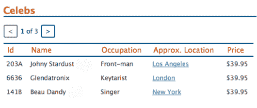

我们将要创建的表格分页小部件将包含可点击的**下一页**和**上一页**按钮，以及当前页码和总页数的显示。HTML 的结构非常重要，因为 jQuery 需要从分页表格遍历到导航项：

```html
chapter_08/08_pagination/index.html (excerpt)

<div class="table-wrapper">
  <div class="wrapper-paging">
    <ul>
      <li><a class="paging-back">&lt;</a></li>
      <li><a class="paging-this"><strong>0</strong> of <span>x
      </span></a></li>
      <li><a class="paging-next">&gt;</a></li>
    </ul>
  </div>
  <div class="wrapper-panel">
    <table id="celebs">
```

```html
...
</table>
</div>
</div>
```

### 动态添加控件

另一种选择是完全在 jQuery 中构建导航控件。这意味着你可以轻松地将其应用于任何表格，控件将自动添加。这种方法通常受到插件开发者的青睐。

你可以随意设置控件的样式，但最好在 CSS 中隐藏控件容器，然后在页面加载时用 jQuery 显示它。这样，任何禁用 JavaScript 的人都可以避免看到多余的控件。

我们的小部件骨架如下所示：

```javascript
chapter_08/08_pagination/script.js (excerpt)

var TABLE = {};
TABLE.paginate = function(table, pageLength) {
    // 1. 设置分页信息
    ...

    // 2. 设置导航控件
    ...

    // 3. 显示初始行
    ...

    pagination = function (direction) { // 4. 上一页和下一页
        var reveal = function (current) { // 5. 显示正确的行
            ...
        };
    }
};
```

看起来有很多内容要讲，但请放心，这些都是你已经知道的东西。首先，我们获取要分页的表格和行，并执行一些计算来确定将有多少页：

336 jQuery: Novice to Ninja

```javascript
chapter_08/08_pagination/script.js (excerpt)

// 1. 设置分页信息
var $table = $(table);
var $rows = $table.find('tbody > tr');
var numPages = Math.ceil($rows.length / pageLength) - 1;
var current = 0;
```

现在我们需要配置导航控件。这就是我们结构重要的地方，因为我们通过从表格选择器向上遍历 DOM 到包装器 div，然后再向下到导航部分来找到控件。这种方法允许你将相同的代码应用于任何结构正确的表格：

```javascript
chapter_08/08_pagination/script.js (excerpt)

// 2. 设置导航控件
var $nav = $table
    .parents('.table-wrapper')
    .find('.wrapper-paging ul');
var $back = $nav.find('li:first-child a');
var $next = $nav.find('li:last-child a');
```

然后我们设置显示框中的当前页码和总长度文本（加一，因为我们的计数器是从零开始的）。接下来，我们为**上一页/下一页**按钮附加事件处理程序。当这些按钮被点击时，我们以想要移动的方向调用分页函数：

```javascript
chapter_08/08_pagination/script.js (excerpt)

$nav.find('a.paging-this strong').text(current + 1);
$nav.find('a.paging-this span').text(numPages + 1);
$back
    .addClass('paging-disabled')
    .click(function() {
        pagination('<');
    });
$next.click(function() {
    pagination('>');
});
```

设置的最后一部分是限制用户最初看到的行数。最简单的方法是隐藏所有表格行，只显示我们感兴趣范围内的行。但我们如何用 jQuery 选择一个元素范围呢？我们可以使用 `:lt()` 和 `:gt()` 过滤器，但当需要显示，比如第 10 到 20 行时，选择器会变得有点混乱。幸运的是，我们有 `slice` 操作，它接受一个起始索引和一个结束索引作为参数，并只返回该范围内的对象：

```javascript
chapter_08/08_pagination/script.js (excerpt)

// 3. 显示初始行
$rows
  .hide()
  .slice(0, pageLength)
  .show();
```

现在一切看起来都井然有序了：我们的导航控件显示着正确的页码和总数，第一页的数据也正确显示了。但我们的分页按钮还没有功能。我们将添加一些逻辑来移动当前页码，并判断是否应该禁用任一按钮（如果我们处于表格的任一端）：

```javascript
chapter_08/08_pagination/script.js (excerpt)

// 4. 上一页和下一页
if (direction == "<") { // 上一页
  if (current > 1) {
    (current -= 1);
  }
  else if (current == 1) {
    (current -= 1);
    $back.addClass("paging-disabled");
  }
} else { // 下一页
  if (current < numPages - 1) {
    current += 1;
  }
  else if (current == numPages - 1) {
    current += 1;
    $next.addClass("paging-disabled");
  }
}

reveal(current);
```

我们更新了 `current` 变量，但表格本身没有更新。为此，我们创建了一个名为 `reveal` 的内部函数：

```javascript
// 5. 显示正确的行
var reveal = function (current) {
  $back.removeClass("paging-disabled");
  $next.removeClass("paging-disabled");

  $rows
    .hide()
    .slice(current * pageLength, current * pageLength + pageLength)
    .show();

  $nav.find("a.paging-this b").text(current + 1);
}
```

`reveal` 首先清除禁用类，这样我们的按钮就不会被卡在禁用状态。然后我们再次使用 `slice` 方法来选择要显示的正确行。

> **嵌套函数**

我们在这里使用的结构有点特别，但仔细想想，它其实很直观：我们嵌套了一个函数声明在另一个函数内部。这样做只是限制了函数的范围（参见第 6 章的“作用域”部分），因此它只能从其父函数内部被调用。为什么这是个好主意？在这种情况下，我们的函数在父函数之外没有用处，将其放在更广的作用域只会增加它与其他函数或变量名冲突的风险。

### 编辑行

我们已经处理了单个元素的行内编辑，但如果你想让整个表格可编辑呢？我们将在数据网格中添加编辑功能，在每行末尾插入一个**编辑**按钮，将整个单元行转换为输入元素，如图 8.8 所示。

## 列表、树形结构与表格

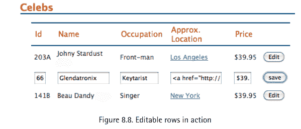

图 8.8. 可编辑行演示

包含表格数据的单元格为我们处理标记时存储信息提供了绝佳机会；这实际上是我们之前在表单控件中使用过的一个技巧。然而，我们尚未体验过的是用一个行元素来组织我们的工作区。让我们看看如何使用它：

```html
chapter_08/09_editable_table_cells/index.html (excerpt)
<form action="null" method="post">
  <table id="celebs">
    <thead>
      <tr>
        <th>ID</th>
        <th>Name</th>
        <th>Occupation</th>
        <th>Approx. Location</th>
        <th>Price</th>
      </tr>
    </thead>
    <tbody>
      <tr>
        <td>203A</td>
        <td>Johnny Stardust</td>
        <td>Front-man</td>
        <td>Los Angeles</td>
        <td>$39.95</td>
      </tr>
      <!-- ... -->
    </tbody>
  </table>
</form>
```

看起来很正常，对吧？它就应该这样，因为所有编辑功能都将逐步添加——这样能更好地让访问者满意并吸引他们再来！还有一个好处是：通过不在表格的 HTML 中包含任何编辑控件，我们可以轻松地向其中添加任意数量的行，并依赖 jQuery 来完成繁重的工作。

我们将从一个设置方法开始，用于初始化我们的表格并添加所需的按钮：

```javascript
chapter_08/09_editable_table_cells/script.js (excerpt)

TABLE.formwork = function(table) {
    var $tables = $(table);

    $tables.each(function () {
        var _table = $(this);
        _table
            .find('thead tr')
            .append($('<th class="edit">&nbsp;</th>'));
        _table
            .find('tbody tr')
            .append($('<td class="edit"><input type="button" value="Edit"/></td>'))
    });

    $tables.find('.edit :button').on('click', function(e) {
        TABLE.editable(this);
        e.preventDefault();
    });
}
```

我们的 `TABLE.formwork` 方法查找我们传入的选择器，然后是 `thead` 和 `tbody` 中的行，并在每个行中添加一个额外的编辑单元格。`thead` 中的单元格是空的，但它是为了保留表格的列结构，而 `tbody` 中添加的单元格则包含用于将行切换到编辑模式的按钮。

现在到了关键部分。我们希望按钮能在两种状态下工作：编辑模式和保存模式。我们还希望除包含按钒的单元格外，所有其他单元格都变得可编辑。我们将这样做：

```javascript
chapter_08/09_editable_table_cells/script.js (excerpt)

TABLE.editable = function(button) {
    var $button = $(button);
    var $row = $button.parents('tbody tr');
    var $cells = $row.children('td').not('.edit');
```

```javascript
if ($row.data('flag')) { // 在编辑模式下，返回表格模式
    // 单元格方法

    $row.data('flag', false);
    $button.text('Edit');
}
else { // 在表格模式下，切换到编辑模式
    // 单元格方法

    $row.data('flag', true);
    $button.text('Save');
}
};
```

来自 `TABLE.formwork` 的实时点击事件传递了我们想要编辑的行的按钮，因此我们将使用它来缓存对父行及其包含的其他单元格的引用。我们对 `$button` 对象使用 `parents` 来查找行，并对 `$row` 使用 `children`（通过 `not` 排除编辑单元格）来查找所有其他单元格。

在 `if` 语句中，我们设置一个数据标志来让我们知道该行处于编辑模式，并更改按钮文本以反映这一点。剩下的就是切换单元格内容了。

我们将逆序查看代码，以便先展示更简单的代码。我们需要做的最简单的部分是*退出*编辑模式：

```javascript
chapter_08/09_editable_table_cells/script.js (excerpt)

$cells.each(function () {
    var _cell = $(this);
    _cell.html(_cell.find('input').val());
});
```

要退出编辑模式，我们获取 `_cell` 中 `input` 的 `val`，并将其作为 `_cell` 的 `html` 添加。由于我们需要多次引用该单元格（即使只有两次！），我们先将其保存在变量中以提高性能。

现在来看切换*进入*编辑模式所需的代码：

```javascript
chapter_08/09_editable_table_cells/script.js (excerpt)

$cells.each(function () {
  var _cell = $(this);
  _cell.data('text', _cell.html())
    .html('');

  var $input = $('<input type="text" />')
    .val(_cell.data('text'))
    .width(_cell.width() - 16);

  _cell.append($input);
});
```

使单元格可编辑只是稍微复杂一点。在添加输入框之前，我们需要清空当前单元格内容，否则会破坏布局。然而，在清空每个单元格之前，我们将当前内容存储在 `data` 中，以便稍后使用。

我们将附加一个我们创建的输入框，正如我们所见，在将任何我们创建的元素添加到 DOM 之前对其进行操作非常重要。输入框的宽度设置得比单元格宽度小，以避免任何布局破坏，我们获取刚刚保存的数据作为输入元素的默认值。

试试看，你会对它运行的流畅程度印象深刻。你现在开始觉得自己像个忍者了吗？

### 数据网格插件

我们已经开始了创建可复用数据网格的道路。从这里开始有无限种方式：表格可以按列排序、可搜索、可调整大小——我们可以为它添加所有能想到的疯狂功能。但如果你时间紧迫，需要快速获得大量功能，你就会想要研究现有的插件选项，比如 DataTables 插件。⁴

DataTables 是一个真正令人印象深刻的插件，可以将你的 HTML 表格转变为功能齐全的数据网格，具备分页、列排序、搜索、ThemeRoller 支持、Ajax 加载等功能。

⁴ http://www.datatables.net/index

一如既往，是使用插件还是构建自定�功能取决于你有多少时间、你需要多少功能以及你愿意为你的访问者提供多大的文件。哦，还有你认为自己开发这个功能会有多有趣！

目前，我们已经能够独立地为我们客户基于表格的需求添加所有必需的功能，并在这个过程中学到了很多关于 jQuery 的知识。在我们进入下一章（也是最后一章）之前，让我们在表格的背景下重新审视我们的全选复选框。

### 用复选框选择行

公众越来越习惯的另一个功能是能够通过勾选与行关联的复选框来选择表格（或任何类型的列表）的行。除了可以单独进行选择外，通常还有用于全选、全不选或反转当前复选框选择的快捷方式。这些对我们来说都不新鲜：我们已经构建了全选复选框和选择反转按钮。

然而，一些用户并不满足于此，他们还希望能够像在桌面应用程序中一样，使用 **Shift** 键选择连续的行。

### 选择一列复选框

处理数据列比处理数据行要棘手得多。当它们在屏幕上一起显示时可能看起来紧密相连，但到了 DOM 中，它们只是远亲。没有方便的 `next` 或 `previous` 函数可以利用。

当然，jQuery 可以帮助我们。得益于其复杂的选择器引擎，我们可以做任何我们想做的事情；这可能只需要一点思考。首先，我们知道我们需要获取表格；在我们的情况下，就是老朋友 `#celebs`。从这里我们需要尝试找到每行第一列中的复选框。

接下来，我们应该检索表格行 `#celebs tr`，然后是每行的第一列 `#celebs tr td:nth-child(1)`。最后，我们确保只选择复选框：`#celebs tr td:nth-child(1) :checkbox`。这是一个相当复杂的选择器！比起我们简单的 `$('tr:odd')`，我们已经走了多远。

### Shift 键选择复选框

我们在表格的 `thead` 中放置另一个复选框（id 为 `checker`）。因为它在 `th` 中而不是 `td` 中，所以我们的选择器会忽略它。我们可以为这个复选框附加一个点击处理程序，通过设置所有复选框的 `checked` 属性与顶部复选框相同来开启/关闭所有复选框：

```javascript
chapter_08/10_select_column_checkboxes/script.js (excerpt)

var chkSelector = 'tr td:nth-child(1) :checkbox';

$('#checker').click(function() {
  $('#celebs ' + chkSelector)
    .prop('checked', $(this).prop('checked'));
});
```

选择器存储为字符串（`chkSelector`），因为我们想稍后重用它。

全选或全不选是一回事，但我们的客户现在对我们期望很高。团队要求他们能够 **Shift**+点击复选框，以便在行范围内一次选择多个。就像在网页邮件客户端中一样。

Shift 选择带来了一些有趣的问题。首先，我们怎么知道用户是否按下了 **Shift** 键？幸运的是，jQuery 事件告诉我们！我们可以通过检查 `click` 事件本身包含的布尔属性 `e.shiftKey` 来了解 **Shift** 键的状态；我们不需要捕获按键之类的！我们还可以以同样的方式检查 `ctrlKey`、`altKey` 和 `metaKey`。

那么如何找出点击了哪一行呢？为此，我们可以直接向上遍历 DOM，找到复选框的父行，然后使用 `index` 获取其索引。又一个简单的操作。

接下来，我们必须知道用户*最后*点击了哪里，这样我们才能有选择复选框的起点和终点。对我们来说最简单的方法是使用 `data` 方法将每次点击存储在表格中。信息量很大，所以让我们付诸实践：

chapter_08/10_select_column_checkboxes/script.js (摘录)

```javascript
$('#celebs ' + chkSelector).click(function(e) {
  var $table = $(this).parents('table');
  var lastRow = $table.data('lastRow');
  var thisRow = $(this).parents('tr').index();

  if (lastRow !== undefined && e.shiftKey) {
    var numChecked = 0;
    var start = lastRow < thisRow ? lastRow : thisRow;
    var end = lastRow > thisRow ? lastRow : thisRow;
    $table
      .find(chkSelector)
      .slice(start, end)
      .prop('checked', true);
  }
  $table.data('lastRow', thisRow);
});
```

我们只有在存在 `lastRow` 值时（在首次执行时，我们还没有在表格上存储点击值，所以它会是 `undefined`）并且用户同时按住了 Shift 键时，才会采取行动。

现在我们有了源行和目标行，我们需要弄清楚哪一行在表格中更靠下，这样我们才能确保起始点在结束点之前。然后我们使用 jQuery 的 `slice` 方法对复选框选择进行切片。有了我们新切片的 jQuery 选择，我们可以通过选中选择中所有剩余的复选框来完成操作。现在你可以以一种非常直观的方式轻松选择行范围了！

## 我们已跻身A级行列！

我们将 StarTrackr! 的管理部分从一个格式混乱的数据堆改造成了一个可用的桌面风格应用程序，并在此过程中将原始数据转化为有用的信息。jQuery 让我们能够轻松地将标准 HTML 元素塑造成强大的类应用程序控件，这意味着响应式、令人印象深刻且易于访问的富互联网应用的圣杯已触手可及。

现阶段真正值得注意的是，就核心 jQuery 库而言，我们发现自己使用的几乎所有功能在之前的某个阶段都已见过。

346 jQuery：从新手到忍者

这无疑意味着我们正在深入理解这个强大的工具吗？现在你只需要开始尝试自己的想法；自动依赖插件的时代应该早已过去。尝试自己快速实现一个概念验证，你会惊讶于达到预期结果是多么容易。不久之后，你将编写出其他人想在其项目中使用的代码。

这里有一个秘诀：分享你的代码正是忍者精神的体现！因此，在下一章中，你将学习如何将你正在构建的所有这些出色功能以插件的形式提供给全世界。我们还将涵盖一些其他高级主题，以完善你的 jQuery 忍者训练！

# 插件、主题和高级主题

jQuery，就像国际象棋或任何版本的俄罗斯方块一样，易于学习但难以精通。得益于它与文档对象模型的无缝集成，它使用起来自然又方便。但 jQuery 是一个低调的成功者：它不喜欢炫耀，但在其表皮之下隐藏着一个可扩展的架构、一个强大的事件处理系统和一个稳健的插件框架。

## 插件

> “嘿，既然一切都就位了，你能回去把第 3 阶段的那个菜单加到管理部分吗？还有，你能把你在上个阶段做的那些酷炫列表加到前端的列表上，并加上你做的滚动效果吗——你可以直接复制粘贴代码，对吧？”

啊，复制/粘贴——我们的好朋友和最坏的敌人。当然，它似乎是让一段功能快速运行起来的好方法，但我们都知道，这种代码复用很容易退化成我们最糟糕的 JavaScript 噩梦。我们不能让这种事情发生在我们美丽的 jQuery 创作上。

348 jQuery：从新手到忍者

你在整本书中都看到了 jQuery 插件架构是多么有用。我们使用了各种各样的第三方创作：从可定制样式的滚动条到图像画廊的洗牌和表单字段的自动补全。好消息是，将你的代码打包成插件以便在你的其他项目中重复使用极其容易——而且，如果你的代码确实很特别，还可以在其他开发者的项目中使用！

### 创建插件

在你的 jQuery 编写生涯中，过不了多久，你就会有将部分代码转换成插件的冲动。没有什么比看到自己的一小段代码被从 jQuery 链中调用更棒的了！最棒的是，将现有的 jQuery 代码转换成插件是一个非常简单的过程，而且你可以让它像你希望的那样可定制。

#### 准备工作

在我们开始之前，我们需要为我们的插件构思一个想法。不久前，客户团队中有人提到，他们想突出显示页面上的所有文本段落，这样当用户将鼠标悬停在段落上时，文本会取消高亮以表示已被阅读。虽然你也会同意这远非最佳的用户界面创意，但它足够简单，足以演示如何制作插件，而无需专注于效果本身的代码。

要使插件能像常规 jQuery 方法一样被调用，我们需要做的就是将一个函数附加到 jQuery 的 **prototype**（原型）上。在 JavaScript 中，任何对象或内置数据类型的 **prototype** 属性都可以用来通过新方法或属性扩展它。在本练习中，我们将使用核心 jQuery 对象本身的 **prototype** 属性来将我们的新方法添加到插件中。

最安全（读作：唯一！）的方法是为 jQuery 函数创建一个私有作用域。这个 JavaScript 技巧确保你的插件能正常工作，即使在有人将 `$` 函数用于非 jQuery 目的页面上：

```javascript
(function($) {
    // 你的插件代码作用域
})(jQuery);
```

这段代码可以放在脚本中的任何地方，但标准做法是将其放在一个名为 **jquery.pluginname.js** 的单独 JavaScript 文件中，并像包含任何插件一样包含它。现在你有了一个独立的文件，你可以轻松地在未来的项目中使用它，或与全世界分享！你可以放心，在这个保护壳内，你可以放心地使用 `$` 别名。

以上就是所有的准备工作，所以是时候开始编写我们的插件了。首先我们需要给它命名，比如 `HighlightOnce`，并将其附加到 jQuery 插件钩子 `$.fn` 上：

```javascript
chapter_09/01_plugins/jquery.highlightonce.js (摘录)

(function($) {
    // 你的插件代码外壳
    $.fn.highlightOnce = function() {
        // 插件代码
    }
})(jQuery);
```

内部，`$.fn` 是 `jQuery.prototype` JavaScript 属性的别名，它是放置我们插件的完美位置。这是 jQuery 放置其操作的地方，所以现在我们已经添加了自定义操作，我们可以像调用内置的 jQuery 方法一样调用它。

此时，我们的代码*看起来*像一个 jQuery 插件，但它不会表现得像一个；还有一项任务。如果我们现在在插件代码中执行一些操作，实际上我们是在*一次性操作整个选择*；例如，如果我们运行 `$('p').highlightOnce()`，我们将作为一个单一选择操作每个段落元素。我们需要做的是逐个处理每个元素，并返回该元素以便 jQuery 链可以继续。这是一个相当标准的插件结构：

```javascript
// 插件代码
return this.each(function() {
    // 对每个项执行某些操作
});
```

因此，你现在有了一个创建简单插件的良好框架。保存这个大纲，以便你可以随心所欲地快速创建新插件。


350 jQuery：从新手到忍者

#### 为插件添加功能

我们的 `HighlightOnce` 插件已经准备就绪，所以让我们给它安排点工作。我们到目前为止添加的所有结构都只是脚手架；现在是时候建造一座建筑了！我们可以在插件核心中运行的代码类型与我们习惯编写的代码完全相同；我们可以使用 `$(this)` 构造访问当前对象，并执行我们需要的任何 jQuery 或 JavaScript 代码。

我们的插件需要实现的第一个功能是高亮显示每个选定的元素，所以我们只需将背景设置为亮黄色。接下来，我们需要处理用户鼠标悬停在元素上时的情况，以便移除高亮。我们只希望这发生一次，就在元素恢复到原始颜色的那一刻（别忘了，我们需要 jQuery UI Effects 组件来做到这一点，或者至少是 jQuery color 插件）：

```javascript
// 对每个项执行某些操作
$(this)
    .data('original-color', $(this).css('background-color'))
    .css('background-color', '#fff47f')
    .one('mouseenter', function() {
        $(this).animate({
            'background-color': $(this).data('original-color')
        }, 'fast');
    });
```

恰好有一个 jQuery 操作完全符合我们的需求：`one` 操作。在功能上，`one` 操作与我们之前看到的 `bind` 操作相同，因为它允许我们将事件处理器附加到我们的元素上。`one` 的区别在于该事件只会运行一次，之后事件将自动解绑。不过，要小心不要混淆 `one` 和 `on`！

对于我们的代码，我们将当前背景颜色保存在元素的 `data` 存储中；然后将 `mouseover` 事件绑定到选定的 DOM 元素。当用户将鼠标悬停在元素上时，我们的代码运行，背景颜色会动画恢复到原始颜色。至此，我们的插件已准备就绪：

#### 添加选项

jQuery 插件是构建可复用代码的绝佳方式，但要真正做到实用，我们的插件需要能在创建时的特定上下文之外使用——即它们需要具备*可定制性*。我们可以为插件添加用户指定的选项，这些选项可在插件实际使用时修改其行为。

从插件用户的角度来看，我们已熟悉选项的工作方式，因为全书几乎用到的每个插件都传递了选项。选项让我们能以显而易见或更细微的方式修改插件功能，使其能在尽可能广泛的应用场景中使用。

插件选项有两种类型：简单值和对象字面量。我们从较简单的类型入手，看看其工作原理。对于我们的 HighlightOnce 插件，将颜色硬编码似乎过于受限。我们希望开发者能自由选择高亮元素的颜色。为此，我们将其设为选项：

```javascript
$.fn.highlightOnce = function(color) {
  :
  $(this).css('background-color', color || '#fff47f')
  :
};
```

插件可以带颜色参数调用，也可以无参调用（此时将使用默认值，这要归功于 JavaScript 的 `||` 运算符）。让我们用绿色高亮段落：

```javascript
$('p')
  .hide()
  .highlightOnce('green')
  .slideDown();
```

如果只有一两个始终必需的简单选项，这种方法尚可。但插件越复杂，设置项就越多，用户希望覆盖部分设置而保留其他默认值。这时我们就需要转向更复杂的对象字面量表示法。

这并不可怕；你已经知道如何定义这种设置对象。我们在 `animate`、`css` 和大多数 jQuery UI 组件中都使用过它们。键值对象只需一个参数即可定义多项设置。首先为每个选项设置默认值：

```javascript
$.fn.highlightOnce.defaults = {
    color : '#fff47f',
    duration : 'fast'
};
```

现在默认值已是对象形式，我们需要利用 jQuery 的 `$.extend` 函数。这个便捷函数有多种用途，但就我们而言，它将用于通过添加另一个对象的所有属性来扩展对象。这样，我们就能用默认设置扩展用户传入的选项——插件每个选项都已有值，若用户指定了某项，则覆盖默认值。完美！来看代码：

```javascript
$.fn.highlightOnce = function(options) {
    options = $.extend({}, $.fn.highlightOnce.defaults, options);

    return this.each( … );
};
```

无论选项是由用户定义还是由默认对象提供，`options` 变量都包含了正确的设置。现在我们可以在代码中使用这些设置：

```javascript
$(this)
  .data('original-color', $(this).css('background-color'))
  .css('background-color', options.color)
  .one('mouseenter', function() {
    $(this).animate({
      'background-color': $(this).data('original-color')
    }, options.duration);
  });
```

作为插件用户，我们可以指定高亮的颜色或持续时间，或接受默认值。在下面的例子中，我们将接受默认颜色，但将持续时间覆盖为 2000 毫秒而非 "fast"：

```javascript
$('p')
  .hide()
  .highlightOnce({duration: 2000})
  .slideDown();
```

#### 添加回调

你已经见识过回调函数和事件的作用。全书中的许多效果和控件都依赖它们，我们用过的许多插件也提供了回调来自定义功能。回调是一种机制，让插件用户可以在插件内部事件发生时运行自己的代码。通常，你会相当清楚想向用户暴露哪些事件。例如，对于我们的 HighlightOnce 插件，我们可能希望在效果设置完成时、效果结束时以及淡出开始时运行额外代码。

为了演示，让我们尝试暴露一个 setup 事件（在鼠标悬停处理程序附加后运行）和一个 complete 事件（在最终的 animate 方法结束后运行）：

```javascript
$.fn.highlightOnce.defaults = {
    color: '#fff47f',
    duration: 'fast',
    setup: null,
    complete: null
};
```

回调函数默认不应执行任何操作，因此我们将它们设为 null。当需要运行回调时，有几种可能的方式。如果我们的回调需要替代 jQuery 回调运行，我们可以简单地将用户传入的函数提供给 jQuery 操作。否则，我们需要在适当位置手动调用函数：

```javascript
$(this)
    .data('original-color', $(this).css('background-color'))
    .css('background-color', options.color)
    .one('mouseenter', function() {
        $(this).animate(
            {'background-color': $(this).data('original-color')},
            options.duration,
            options.complete
        );
    });

// 触发 setup 回调
if ($.isFunction(options.setup)) {
    options.setup.call(this);
}
```

上例展示了两种回调类型。`complete` 回调处理器很简单：animate 方法完成时效果结束，而 animate 操作本身就接受回调函数，所以我们只需传递函数即可。但 setup 处理器就没这么幸运了；我们必须自己触发它。我们借助 jQuery 和一些高级 JavaScript 来执行代码。首先，我们使用便捷的 `$.isFunction` jQuery 操作检查回调是否为函数（该操作返回布尔值：若回调是函数则为 `true`，否则为 `false`）。如果是后者（考虑到用户保留了默认设置，这种可能性很大，此时回调仍为 null），尝试执行它就毫无意义了！

> **更多实用函数**

> 除了 `$.isFunction`，jQuery 还提供以下函数：

> `$.isArray`（用于检测变量是否为数组）、`$.isPlainObject`（用于简单 JavaScript 对象）和 `$.isEmptyObject`（用于没有属性的对象）。

> 这些函数为你提供了多种方式来确定 JavaScript 结构体的性质和属性。

如果回调*已*被定义，我们就需要运行它。运行 JavaScript 函数有几种方式，最简单的就是直接调用：`options.setup()`。这运行得很好，但问题在于它是在 `default` 对象的作用域中被调用，而非我们习惯的目标事件元素的作用域。因此回调函数将无法确定它正在操作哪个 DOM 元素。为解决此问题，我们使用 JavaScript 的 `call` 方法。传递给 `call` 的第一个参数将覆盖被调用方法中的 `this`。在我们的例子中，我们传入 `this`，即我们想要的 DOM 元素。

修正作用域后，我们现在可以在 `complete` 事件处理器内使用 `$(this)`，以便在效果完成后收起元素：

```javascript
$('p')
  .hide()
  .highlightOnce({
    color: '#FFA86F',
    complete: function() {
      $(this).slideUp();
    }
  })
  .slideDown();
```

#### jQuery 风格的回调

你可能已经注意到，jQuery 回调似乎比我们插件的命名事件集成得更好。例如，在 `hide` 操作中，你可以将回调函数作为第一个（也是唯一的）参数指定，或者你可以包含 `speed` 参数，然后再指定回调函数。没有必要像我们上面那样包含键值对。秘诀是什么？结果发现这是一个 JavaScript 的小技巧

## 356 jQuery：从新手到忍者

技巧。如果你检测到第一个参数是函数而非对象，你可以假设只指定了一个回调，因此你会调整参数顺序。

以下是一个来自 jQuery 核心库的截断示例，是 Ajax 加载操作的一部分。`params` 参数是可选的，所以如果没有提供，第二个参数将被视为回调：

```javascript
load: function( url, params, callback ){
  // If the second parameter is a function
  if ( jQuery.isFunction( params )){
    // We assume that it's the callback
    callback = params;
    params = null;
  }
}
```

`params` 参数本应是一个填充了各种设置的对象。但如果我们检测到它实际上是一个函数，我们就将该函数赋值给 `callback` 变量，并清空 `params` 变量。这是一个很酷的技巧，也是让你的插件更符合 jQuery 风格的好方法。

让我们修改我们的 `HighlightOnce` 插件来使用这个回调检测技巧：

```javascript
chapter_09/05_jquery_style_callbacks/jquery.highlightonce.js (excerpt)

$.fn.highlightOnce = function(options, callback) {
  if ($.isFunction(options)) {
    callback = options;
    options = null;
  }
  options = $.extend($.fn.highlightonce.defaults, options);

  return this.each(function() {
    // Do something to each item
    $(this)
      .data('original-color', $(this).css('background-color'))
      .css('background-color', options.color)
      .one('mouseenter', function() {
        $(this).css('background-color', '');
        $.isFunction(callback) && callback();
      });
  });
};
```

## 高级主题

最终，创建插件的兴奋感会稍微减弱，你会开始思考 jQuery 内部是否还隐藏着其他瑰宝。你的思考是正确的。除了我们刚刚探索的出色插件架构之外，jQuery 还提供了一种扩展和覆盖其核心功能的机制，以及一个灵活的事件系统，用于定义和微调你的组件如何响应用户和其他组件。

### 扩展 jQuery

插件并非 jQuery 实现代码复用和可扩展性的唯一机制；你可以利用一个系统来添加类似插件的功能，以及动态地自定义和覆盖 jQuery 核心系统的元素。如果你有一段代码想要以原生 jQuery 风格执行，你可以在脚本内部直接扩展 jQuery 的新功能，而无需创建插件。这样你就可以微调你的代码以更贴近 jQuery 的感觉，并微调 jQuery 以适应你的具体需求。

### 向 jQuery 添加方法

有时你编写的代码部分是应用程序的关键部分，以至于你发现自己会反复使用它们。当这种情况发生时，你可能找到了一个扩展 jQuery 的候选对象。隐藏在 jQuery 核心库插件部分的 `extend` 方法通常是插件开发者的领域。但别让它阻止你！

`jQuery.fn.extend()` 或 `$.fn.extend()` 接受一个对象，该对象允许我们提供一组新的方法来扩展 jQuery——添加可以在 jQuery 选择集上执行的新操作。这与 `jQuery.extend()` 紧密相关，后者扩展的是 jQuery 对象本身。最终结果与我们之前编写的插件完全相同。通常，当你有一组相关的小方法想要添加，或者想要覆盖一些现有功能时，你会使用 `extend` 方法（我们稍后会看到）。

那么，让我们看看一些我们已经创建的代码，看看如何使用 `extend` 来演进它。回到第 8 章，我们研究了对列表排序：

```javascript
var SORTER = {};
SORTER.sort = function(which) {
  // Sort the selected list
}
```

不得不像这样调用我们的控件，缺少了那种 jQuery 的感觉。所以我们将使用 `extend` 将 `SORTER` 方法转换成更紧密地集成到 jQuery 中：

```javascript
chapter_09/06_extending_jquery/script.js (excerpt)

$.fn.extend({
  sorter: function() {
    return this.each(function() {
      var sorted = $(this).children('li').sort(function(a,b) {
        // Find the list items and sort them
        return $(a).text().toLowerCase() >
          $(b).text().toLowerCase() ? 1 : -1;
      });
      $(this).append(sorted);
    });
  }
});
```

在新的 `sorter` 方法内部，我们返回针对调用该操作的每个选择集成员运行我们原始示例中函数的结果。这种返回结构允许我们在链式调用中使用该操作：

```javascript
chapter_09/06_extending_jquery/script.js (excerpt)

$('#ascending').click(function() {
  $('ul.sortable')
    .hide()
    .sorter()
    .slideDown();
});
```

与我们原始的 `SORTER` 控件相比，最大的变化是，一旦 `extend` 就位，我们不再调用函数并传入参数；相反，我们将其视为一个普通的 jQuery 操作，就像我们将其打包成一个插件一样。当然，你可以使用相同的代码并将其制作成一个插件。像这样动态执行只是另一种可用的选项。

### $. 前缀函数

在本书的开头，我们赞扬 jQuery 是一个非常一致的库：每次调用它时，我们都有一个选择器、一个操作，也许还有一些参数。一旦你学会了这个基本模式，它基本上就是你需要记住的全部。然而，仅仅几段之后，我们就悄悄插入了一些根本不使用选择器的代码！随后，我们看到了几个这类操作：`$.ajax`、`$.map`、`$.slice`、`$.trim` 等等。

`$.` 前缀函数不作用于选择集；相反，它们是通用的实用程序命令，可以在 jQuery 命令链之外使用。例如，`$.map` 可以用来映射任何任意数组，但也可以用来修改 jQuery 选择集。

客户端团队喜欢我们在第 6 章开发的 Ajax Twitter 搜索组件，但希望推文显示的时间更易于人类阅读：例如，他们不希望显示“56 秒前”，而更愿意看到“大约一分钟前”。这听起来很适合作为添加到 jQuery 对象的候选功能，因为这是那种你会希望能在选择集之外使用的功能类型。每当我们需要一个友好显示的时间段时，我们都希望能够调用 `$.lapsed(time)` 并获得一个不错的字符串。

为了开始，我们将暂时忽略实际逻辑，先看看函数的结构。其结构看起来与我们创建的插件非常相似——将 jQuery 对象传递给包装函数——因此即使 `$` 别名被重新定义，我们的代码也能工作：

```javascript
chapter_09/07_$_prefixed_functions/script.js (excerpt)

(function($) {
  $.lapsed = function(time) {
    var then = new Date(Date.parse(time));
    now = new Date();
    minutes = Math.round((now-then) / 60000);
    lapsed, seconds;

    // Determine pretty time
    ...
  };
})(jQuery);
```

现在我们只需要将我们的函数附加到 jQuery 对象本身。因为我们正在扩展 jQuery，所以必须小心避免意外覆盖任何内置函数名称。我们将用来确定“漂亮”时间的代码不过是一系列 `if/else` 结构。为了使示例简单，我们的辅助函数只会处理到“超过一分钟前”——但你会希望扩展它以处理更大的时间跨度：

```javascript
chapter_09/07_$.prefixed_functions/script.js (excerpt)

// Determine pretty time
if (minutes === 0) {
  seconds = Math.round((now - then) / 1000);
  if (seconds < 10) {
    elapsed = "less than 10 seconds ago";
  }
  else if (seconds < 20) {
    elapsed = "less than 20 seconds ago";
  }
  else {
    elapsed = "half a minute ago";
  }
}
else if (minutes === 1) {
  seconds = Math.round((now - then) / 1000);
  if (seconds === 30) {
    elapsed = "half a minute ago";
  } else if (seconds < 60) {
    elapsed = "about a minute ago";
  } else {
    elapsed = "1 minute ago";
  }
} else {
  elapsed = "more than a minute ago";
}
return elapsed;
```

要在我们的 jQuery 代码中使用这个扩展，我们向新的 `lapsed` 函数传递一个时间戳，并将结果附加到需要它的任何地方。我们的功能被很好地封装起来，可以随时在任何未来的项目中使用：

# 覆盖现有功能

通过 `$.fn.myPlugin` 而非 `$.extend({ myPlugin : ... })` 添加插件的主要区别之一在于，extend 机制是*增强*你正在扩展的元素，而不是完全替换它。这正是使用额外功能扩展 jQuery 本身（或现有插件）成为可能的原因。除了像我们上面那样向 jQuery 添加新方法外，我们还可以扩展现有方法的功能！

举个简单的例子，我们将扩展 `$.trim` 方法的功能。`$.trim` 接受一个字符串并删除其开头和结尾的空格。我们将为该方法添加一个额外的参数，如果该参数设置为 `true`，则将删除给定字符串中的*所有*空格：

```javascript
// chapter_09/08_overwriting_existing_function/script.js (摘录)

(function($) {
    var _trim = $.trim;
    $.extend({
        trim:function(text, clear) {
            if (clear) {
                return text.replace(/\s+/g, '');
            }
            return _trim.call(this, text);
        }
    });
})(jQuery);
```

首先，和往常一样，我们为那些不想使用 `$` 作为 jQuery 别名的人考虑（参见“插件”一节）。接下来，我们将原始的 `trim` 函数存储在一个变量中，以便稍后访问它。最后，我们到达了重要的部分：扩展 `trim` 函数。我们版本的 `trim` 将接受一个额外的布尔参数。如果设置了该参数，我们运行自定义正则表达式以删除*所有*空白字符；如果未设置，则调用原始的 jQuery `trim` 函数。

在处理更复杂的对象时，以这种方式扩展代码特别有用；例如，如果你需要修改 `$.ajax` 方法以对每个请求进行一些额外处理。在这种情况下，你只希望修改你需要的代码特定部分，而让其他所有内容保持不变。通过存储原始函数并在必要时引用它，这变得轻而易举。

不相信有这么简单？让我们再试一次，这次用一个稍微复杂点的方法。

在整本书中，我们谈到当 HTML5 标准成为常态时，开发者的生活将会变得多么轻松。HTML5 最难的部分是等待。无尽的等待……所以让我们为 HTML5 挺身而出，在浏览器准备好时扩展 jQuery animate 方法以使用 CSS3 动画。如果我们发现用户还没准备好，我们将退回到使用当前的 animate 方法。

如果你在网上寻找过 jQuery CSS3 解决方案，你可能会认出我们将要创建的内容带有 Addy Osmani 的风格。¹ 请放心，我们已经询问过是否可以借鉴他的代码；我们对其进行了大量修改，以至于只剩下概念——甚至这个概念也经过了重新构思！所以让我们看看我们将要做的核心部分：

```javascript
// chapter_09/09_extending_jquery_animate/script.js (摘录)

$.fn.extend({
    defaultAnimate: $.fn.animate,
    animate: function(props, options) {
        // 检测支持

        if (jQuery.support.transitions) {
            // 使用 CSS3 动画
        }
        else {
            // 使用 jQuery 默认动画
        }
    }
});
```

> ¹ http://addyosmani.com/blog/css3transitions-jquery/

我们的第一个任务是将默认的 animate 方法存储为 `defaultAnimate`。当我们需要使用默认方法时，我们可以通过其新名称调用它，我们习惯的所有功能都将在那里可用。

接下来，我们着手在 `animate` 名称下实现新的 animate 方法。我们将执行一些初始功能检测，然后根据检测结果在 CSS3 动画和可靠的 jQuery 版本之间进行选择：

```javascript
// chapter_09/09_extending_jquery_animate/script.js (摘录)

animate: function(props, options) {
    var prefixes = ['Moz', 'Webkit', 'O'],// , 'Khtml', 'Ms'
        length = prefixes.length,
        effects = {
            duration: 2000,
            easing: "ease-in-out",
            complete: null
        },
        effect, i;
    jQuery.extend(effects, options);
    effect = ['all ', effects.duration / 1000, 's ',
        effects.easing].join("");

    if (!jQuery.support.transitions) {
        if (jQuery.support.transitions !== false) {
            jQuery.support.transitions = false;

            for (i = 0; i < length; i += 1) {
                if ((prefixes[i] + "Transition") in this[0]
                    .style) {
                    jQuery.support.transitions = ["-",
                        prefixes[i], "-transition"].join("");
                }
            }
        }
    }
    return $(this).each(function() {
        if (jQuery.support.transitions) {
            $(this).css(jQuery.support.transitions, effect)
                .css(props);

            if ($.isFunction(effects.complete)) {
                setTimeout(function() {
                    effects.complete();
                }, effects.duration);
            }
        }
        else {
            options.easing = "linear";
            $(this).defaultAnimate(props, options);
        }
    });
}
```

再次强调，如果你一直跟着学，这段代码中绝对没有新的 jQuery 知识；我们在到达这里的章节中已经涵盖了所有内容。但让我们快速回顾一下，以巩固理解。

传入 *props* 和 *options* 参数为我们带来了两个明显的好处：我们尽可能接近默认的 *animate* 方法，这有助于前向和后向兼容性，并且我们可以在需要时将所需参数传递给 *defaultAnimate*。我们无需记住太多就能完成很多工作。

我们的变量也很直观。`prefixes` 是我们将用于动画的专有扩展数组，`length` 是这些扩展的数量，`effects` 是我们将用于动画的默认效果。然后我们有一个未定义的 `effect`，它将是我们实际要进行动画的内容，还有一个 `i`，用于我们将使用的循环索引。而 `prefixes` 之后的注释包含了另外两个合法的专有扩展；当那些浏览器厂商支持 CSS3 动画时，我们可以将它们添加回我们的数组中。

接下来，正如我们在本章前面所看到的，我们使用 `defaults` 来扩展 `effects`；因此，我们为用户未提供的任何内容传递默认值，然后使用我们扩展后的 `effects` 中的值填充 `effect`：

```javascript
// chapter_09/09_extending_jquery_animate/script.js (摘录)

if (!jQuery.support.transitions) {
    for (i = 0; i < length; i += 1) {
        if ((prefixes[i] + "Transition") in this[0].style) {
            jQuery.support.transitions = ["-", prefixes[i],
                "-transition"].join("");
        }
    }
}
```

我们在该 `if` 块中检查的第一个条件在 `jQuery.support` 中并非原生属性，因此 JavaScript 将至少运行一次此条件内部的代码。它在我们代码中的真正作用是，停止我们调用 `animate` 方法的下一个元素需要检查是否支持 CSS3 过渡——如果我们已经运行过一次，我们就会知道结果！下一个 `if` 条件检查确保 `jQuery.support.transitions` 确实为 `false`，并且仅在它只是假值（falsy）时才继续。

### 什么是真值（Truthy）和假值（Falsy）？

这里快速说明一下：我们所说的“假值”（falsy）是什么意思？JavaScript 支持布尔数据类型；这些值可以设置为 `true` 或 `false`。此外，JavaScript 中的每个值都有一个内在的布尔值，通常称为真值（truthy）或假值（falsy）。假值包括 `0`、`""`（空字符串）、`null` 或 `undefined`。真值可以包括 `1`、`"0"` 或 `"false"`（后两者是非空字符串）。你可以直接跳到附录 B 以了解更多关于真值和假值的信息。

如果看起来这个检查执行的任务与之前的条件语句相同，那是因为它确实差不多。然而，区别在于，现在我们为不符合标准的浏览器也提供了“仅运行一次”的功能。

一旦进入两个条件块内部，我们首先将 `jQuery.support.transitions` 的值设置为 `false`，这是我们刚刚为那些旧版浏览器测试过的属性。设置好该值后，一个 `for` 循环将 `prefixes` 数组的成员附加到字符串 "Transition"，并将连接后的值与我们要动画的元素的 `style` 属性进行比较。符合标准的浏览器将对此检查报告 `true`，然后我们将使用我们的 CSS3 动画。所以 Chrome 会为 `WebKitTransition` 报告 `true`，然后我们就可以开始了。由于 Internet Explorer 尚不支持 CSS3 动画，我们从该数组中移除了 `Ms`——正如我们所说，没有必要检查我们知道不存在的支持。当 IE10 发布时，如果它符合标准，我们可以添加支持。

接下来，我们执行一个 `return`，以便我们可以保持链式调用，并在我们调用 `animate` 的选择集上运行一个 `each` 循环（看到了吧？你*确实*知道所有这些！）：

## 366 jQuery：从新手到忍者

```javascript
// chapter_09/09_extending_jquery_analyze/script.js (摘录)

if (jQuery.support.transitions) {
  $(this).css(jQuery.support.transitions, effect).css(props);

  if ($.isFunction(effects.complete)) {
    setTimeout(function() {
      effects.complete();
    }, effects.duration);
  }
}
```

现在，如果我们的浏览器符合 CSS3 规范，`jQuery.support.transitions` 的值将类似于：

```
“-WebKit-transition”
```

嗯，如果我们仍在使用 Chrome 浏览器，它会是这个值。它有两个特点：其一，它是一个真值（参见附录 B）；其二，它是一个有效的 CSS 私有扩展属性名。因此，我们的浏览器将使用 CSS3 进行动画！

为了执行动画，我们将 `jQuery.support.transitions` 与我们存储在 `effect` 中的值一起，传入一个普通的 `css` 方法调用中。使用默认值，它看起来会是这样：

```
“all 2s ease-in-out”
```

最后，如果我们处于符合标准的浏览器中，我们会检查是否传入了回调函数。如果有，我们会等到动画完成后调用该回调方法。结果就是超级流畅的动画，使用了浏览器支持的最佳动画解决方案。jQuery 的动画很不错，但 CSS3 动画将其提升到了一个新的水平。

但我们的代码还没有完全结束。如果 `jQuery.support.transitions` 仍然不是真值呢？这时我们就回归到 jQuery 最擅长的领域：应用其默认的动画方法，也就是我们存储为 `defaultAnimate` 的那个：

```javascript
// chapter_09/09_extending_jquery_analyze/script.js (摘录)

else {
    options.easing = "linear";
    $(this).defaultAnimate(props, options);
}
```

这很合理，但那个 `options.easing` 是干什么的？CSS3 在动画方面*非常*出色，但其动画样式范围不如 jQuery 全面；更麻烦的是，它在样式中使用连字符分隔的名称，而不是我们熟悉的驼峰命名法。为了尽可能减少与我们的缓动样式可能产生的冲突，我们将为所有不符合标准的访问者提供一种缓动方式：`linear`。他们可能无法体验符合标准浏览器的动画效果，但仍然能获得动画。记住渐进增强的原则吗？

那么效果如何呢？我们只需要调用它就能看到其全部风采：

```javascript
// chapter_09/09_extending_jquery_analyze/script.js (摘录)

$('#star_0 div').animate({ width: "580px" }, {
    complete: function () {
        $("#star_0").addClass("barred")
            .find("span").html("Made it");
    }
});

$('#star_1 div').animate({ width: "580px" }, {
    duration: 2000,
    easing: 'linear',
    complete: function () {
        $("#star_1").addClass("barred")
            .find("span").html("Arrived");
    }
});

$('#star_2 div').animate({ width: "580px" }, {
    duration: 7000,
    easing: 'ease-in-out',
    complete: function () {
        $("#star_2").addClass("barred")
            .find("span").html("Star status");
    }
});
```

我们的第一个选择只传递了回调函数，并依赖其他属性的默认值。第二个发送了所有选项，但其持续时间翻倍，因为它将默认值作为其值发送。最后一个需要一段时间，但以优雅的 `ease-in-out` 风格到达。

当动画开始时，第二个条如图 9.1 所示迅速弹出，但很快被第一个条超越，如图 9.2 所示。尽管它们的持续时间都是两秒，但缓动引起的差异是巨大的。它们最终在相同的时间点完成，如图 9.3 所示，但到达的过程看起来不同。

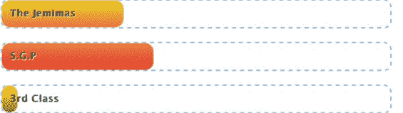

图 9.1. 动画开始

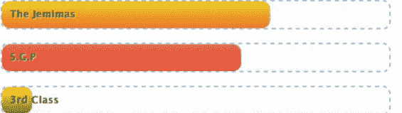

图 9.2. 动画进行中

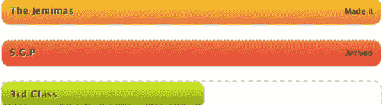

图 9.3. 接近完成

我们最终的脚本无法超越官方 jQuery 解决方案在跨浏览器支持利用 CSS3 提供的机会方面的能力，但它是朝着正确方向迈出的一步。谁知道呢，随着 StarTrackr! 的流行，也许 jQuery 核心团队会注意到并加快开发进度。我们只能希望！

## 创建你自己的选择器

十个基本过滤器，四个内容过滤器，两个可见性过滤器，大约六个属性过滤器，四个子元素过滤器，以及 14 个表单相关过滤器。这不仅仅是一首疯狂圣诞颂歌的素材：jQuery 的内置过滤器允许你轻松选择页面上的几乎所有内容。但当我们想要页面中的所有广告单元，或者所有被点击用于离开页面的链接，或者所有折叠区域下方的项目时，我们该怎么做？

> **折叠区域**

>

> 在网页设计术语中，“折叠区域上方”指的是页面加载时无需滚动即可看到的页面区域。因此，“折叠区域下方”指的是其下方无需滚动就不可见的区域。

诚然这些是奇怪的需求，但让我们借此机会详细研究自定义过滤器；此外，在某些情况下，它们肯定能为你所用。

与其查找折叠区域*下方*的元素，不如转向一个更有用的目的：检测元素在页面加载时是否可见，或位于*折叠区域上方*。如果元素在折叠区域上方，我们可以立即通过 Ajax 加载其内容。如果不是，我们可以延迟 Ajax 请求，从而节省带宽和页面加载时间：

```javascript
// chapter_09/10_custom_selectors/script.js (摘录)

$.extend($.expr[':'], {
    abovethefold: function(el) {
        return $(el).offset().top < $(window).scrollTop() +
               $(window).height();
    }
});
```

我们已经多次查看过 `$.extend`，所以访问选择器引擎应该相当熟悉。`$.expr[':']` 对象是我们需要扩展以添加自定过滤器的对象。我们传入一个键/值对，其中键是过滤器的名称，值是一个接受元素引用的函数。该函数应返回 `true` 或 `false`。如果返回 `true`，被测试的元素 (`el`) 将被添加到选择集中。否则，它将被过滤掉：

```javascript
// chapter_09/10_custom_selectors/script.js (摘录)

$('p:abovethefold').css('color', 'red');
```

如果我们在页面加载后测试我们新的 `:abovethefold` 过滤器，我们将看到只有无需滚动即可看到的段落会变成红色。

选择器引擎的可扩展性是 jQuery 一个鲜为人知的特性，也是区分新手与忍者的关键！

### 事件

jQuery 中的事件系统非常强大。其主要目的是将所有浏览器事件规范化以符合 W3C 标准，从而使我们能够相对轻松地进行跨浏览器事件处理——但这只是冰山一角。核心库中的内部事件系统经过了深思熟虑，并且该功能也向那些不满足于仅仅对简单事件做出反应的开发者开放了。

### 自定义事件

我们之前看到，`bind` 和 `trigger` 承担了我们触发事件的所有实际工作；它们是 `click`、`mouseover`、`toggle` 等所有事件的背后。简写操作使代码更短、更具可读性，而扩展的 `bind` 和 `trigger` 语法提供了完全相同的功能。那么为什么还要使用 `bind` 和 `trigger` 呢？事实证明，它们比我们目前所见的要灵活和强大得多。首先，我们可以脱离浏览器指定的事件，开始创建一些我们自己的事件！

创建你自己的事件有助于使你的代码更清晰；例如，一个埋在 `click` 处理程序中的函数需要被分析才能确定其目的，而一个具有特定名称的事件可能更容易一目了然地理解。让我们来看看创建一个自定义的 `do-toggle` 事件。为此，我们将回到我们在第 2 章看到的免责声明消息示例：

```html
<!-- chapter_09/11_custom_events/index.html (摘录) -->

<p id="disclaimer">
  免责声明！此服务并非旨在...
</p>
<input type="button" id="toggleButton" value="切换" />
```

这一次，不再是按�负责切换免责声明，而是免责声明负责切换自身：

```javascript
// chapter_09/11_custom_events/script.js (摘录)

$('#disclaimer').bind('do-toggle', function() {
  $(this).toggle('slow');
});
```

我们将自定义的 `do-toggle` 事件绑定到免责声明元素上。当 `do-toggle` 事件触发时，该函数将运行，免责声明将隐藏或显示自身。但我们如何触发 `do-toggle` 事件呢？通过使用 `trigger` 方法：

```javascript
// chapter_09/11_custom_events/script.js (摘录)

$('#toggleButton').click(function() {
  $('#disclaimer').trigger('do-toggle');
});
```

当按钮被点击时，免责声明被切换。与仅仅使用切换按钮进行隐藏和显示相比，这看起来像是绕了远路，但现在我们完成了两个非常重要的任务：我们将代码责任转移到了元素自身，并赋予了我们从任何其他位置触发事件的能力。无论我们是想通过切换按钮还是通过...

### 解绑与命名空间

jQuery 只需少量操作就能创造出令人惊叹的效果：我们的大多数控件使用的操作不超过几个，而且只需要很少的 JavaScript 代码。但当你扩展你的控件和效果——将它们转换为插件，并将多个控件组合以创建更大、更酷的控件时——你会发现你的事件开始变得有些难以控制。事件处理程序被附加后就再也不会移除，即使在你的效果完成之后也是如此，这可能会与你后来尝试添加的任何新行为产生冲突。我们并不总是能够依赖我们至今一直在使用的“设置后就不管”的方式。

jQuery 库为我们提供了两种解决这个问题的机制：事件解绑和事件命名空间。**事件解绑**允许我们从对象中移除事件处理程序，而**事件命名空间**提供了一种方法，让我们可以将事件处理程序分成逻辑组，这些组可以被解绑而不影响其他事件。这在我们开发插件时尤其有用。

事件解绑很简单：我们使用 `bind` 操作将事件添加到对象上，因此我们使用 `unbind` 操作来移除它们！我们可以通过三种方式使用 `unbind`：从选择集中的对象移除*所有*事件，移除选择集中*特定类型*的所有事件，或者移除*一个特定的*事件处理程序。以下是第一种形式：

```javascript
$('p').unbind();
```

这将移除与页面上所有段落关联的所有事件处理程序。这有点极端；更常见的是，我们只想移除特定类型的事件。例如，要移除所有 `mouseover` 事件，我们将事件类型传递给 `unbind` 操作：

```javascript
$('p').unbind('mouseover');
```

最后，要解绑单个事件处理程序，我们将函数传递给 `unbind`。这稍微复杂一些，因为我们需要在绑定时给函数命名。在我们的例子中，我们将两个函数 `bind` 到 `click` 事件上。然后我们解绑其中一个事件：

```javascript
// chapter_09/13_event_unbinding/script.js (摘录)

var doToggle = function() { $(this).toggle(); };
var doSlide = function() { $(this).slideToggle(); };

$('p')
    .click(doToggle)
    .click(doSlide);

$('p').unbind('click', doToggle);
```

由于我们的解绑调用，任何后续点击段落标签仍会触发 doSlide 方法，但不再触发 doToggle 方法。

> ### 简写解绑？

> 如果你也可以使用简写的 click 和 mouseover 方法来绑定事件，那么有没有 unclick 和 unmouseover 简写方法呢？没有。这些方法*曾经*存在于 jQuery 中，很久以前，但它们被移除了，因为它们使核心 API 变得更大，而且很少需要。

尽管所有这些解绑选项看起来功能广泛，但它们无法应对所有情况。当你进行大量绑定和解绑时，很容易失去对正在发生的事情的跟踪，因此 jQuery 提供了一种通过事件命名空间对相关事件进行分组的方式。命名空间事件可以独立于相同类型的其他事件触发，并且同一命名空间中的所有事件都可以用一条命令解绑。

要定义命名空间，你需要将一个句点（.）和你的命名空间名称附加到你想要附加处理程序的事件上。无需进一步操作，该事件的工作方式将与常规的非命名空间事件相同；但是，你现在有了一个句柄，可以更具体地指定触发哪些事件，而无需维护对每个事件函数的引用（就像我们上面所做的那样）：

```javascript
// chapter_09/14_event_namespacing/script.js (摘录)

$('p').bind('mouseover.colorize', function() {
    $(this).css('background-color', 'lemonchiffon')
})
.bind('mouseout.colorize', function() {
    $(this).css('background-color', '')
})
.click(function() {
    $(this)
        .trigger('mouseout.colorize')
        .unbind('.colorize');
});
```

在这个例子中，我们将常规的 mouseover 和 mouseout 事件处理程序绑定到页面上的每个段落。当用户将鼠标悬停在元素上时，这会产生一个简单而令人信服的高亮效果。但这个高亮还有一个额外技巧：当用户点击一个元素时，高亮将被移除。

当点击发生时，用户将悬停在该元素上；如果我们移除处理程序，mouseout 代码将永远不会运行，元素将保持高亮状态。为了对抗这一点，我们手动触发 mouseout。我们可以指定只运行与我们效果相关的 mouseout 代码，因为我们对事件进行了命名空间划分。任何其他 mouseout 处理程序将保持休眠状态。

当我们的元素不再高亮后，我们可以通过一条简单的 unbind 命令移除效果命名空中的所有事件处理程序。我们通过仅传递 '.colorize' 作为参数来定位命名空间。

在创建插件时，为事件设置命名空间特别有用。你现在有一种简便的方法来控制插件添加到 DOM 的所有事件，而无需担心用户（或其他插件）可能附加了什么。当需要拆除一切时，你可以用简单的 unbind 进行清理。

> **多个命名空间**

>

> 你并不局限于使用单个命名空间；如果你需要在一条语句中定位多个命名空间，只需用句点将它们连接起来即可。

### 绑定 iPhone：非标准事件

就好像 jQuery 事件系统已经证明了自己是个小赢家一样，它还有另一个绝招：它可以响应它本不该知道的事件！随着我们开始远离 PC 作为访问网络的主要工具，这种能力将变得越来越重要。未来人们观看你的页面的设备数量和类型将是

---

屏幕顶部的小图标，我们无需复制代码；只需在我们选择的任何地方触发 `do-toggle` 事件即可。

但等等，还有更多。`bind/trigger` 系统还允许你在触发事件时附加参数。每个触发元素可以传递不同的数据，因此事件处理程序可以自定义其响应。这使得自定义事件非常强大；你现在可以创建由页面上多个元素优雅控制的小部件，从而可以干净地分离和隔离页面行为，使你的代码更具可重用性。

举个例子，我们将为第 3 节“弹跳内容面板”中创建的动画内容面板在页面上添加一个备用触发机制。在这个例子中，我们制作了外观酷炫的内容面板，显示名人传记，当它们的标题被点击时会弹跳打开和关闭。为了清晰起见，我们在这里省略了弹跳效果，因此当用户点击传记标题时，面板会立即切换。

然而，在面板上方还会有一个 `select` 框。当从列表中选择一个名人时，传记将以相同的方式切换；相同的事件处理程序将被触发，只是这次我们将有一个漂亮的滑动效果。

我们的 `select` 框触发器包含用户可以查看的可用传记列表。稍后，我们将为它附加一个 change 事件处理程序来触发滑动效果：

```html
<!-- chapter_09/12_custom_events_with_params/index.html (摘录) -->

<select id="chooser">
    <option>Beau Dandy</option>
    <option>Johnny Stardust</option>
    <option>Glendatronix</option>
</select>
```

这是重要的部分。我们将自定义 `reveal` 事件绑定到所有传记标题上。代码将接受一个额外参数，我们可以用它来确定如何显示传记。如果 `effect` 参数设置为 `ease`，我们将使用 `slideToggle`；否则，用户将看到标准的非滑动切换：

```javascript
// chapter_09/12_custom_events_with_params/script.js (摘录)

$('#bio h3').bind('reveal', function(e, effect, duration) {
    if (effect == 'ease') {
        $(this).next().slideToggle(duration);
    } else {
        $(this).next().toggle();
    }
})
.click(function() {
    // 触发 1：普通切换
    $(this).trigger('reveal');
});
```

因为我们的第一个触发器不需要添加任何效果，所以我们不会在触发调用中添加任何参数。当绑定代码运行时，它找不到 effect 参数，因此执行常规切换：

```javascript
// chapter_09/12_custom_events_with_params/script.js (摘录)

$('#chooser')
    .change(function() {
        // 触发 2：滑动切换
        $('#bio h3:contains(' + $(this).val() + ')')
            .trigger('reveal', 'ease');
    });
```

当用户更改 select 列表中的当前选择时，我们找到正确的内容面板并再次触发 reveal 事件。但这次我们添加了 'ease' 参数，因此用户体验到的是花哨的滑动版本。

向自定义事件添加数据是封装小部件代码并暴露可供其他开发人员用来自定义功能的接口的绝佳方式。要将多个项目传递给 bind 函数，你需要将触发器的参数包装在一个数组中：

```javascript
// chapter_09/12_custom_events_with_params/script.js (摘录)

$('#bio h3:contains(' + $(this).val() + ')')
    .trigger('reveal', ['ease',2000]);
```

### 特殊事件

创建自己的自定义事件无疑是相当高级的操作，但jQuery的特殊事件构造则完全是忍者级别的。如果你觉得常规的DOM事件有些束缚，那这个功能就是为你准备的！使用`special`可以创建看似原生的自定义事件，或者覆盖和扩展现有的事件。你可以在每次事件处理程序绑定时，以及事件被移除时（这发生在`beforeUnload`阶段）执行一些自定义的代码处理。特殊事件是jQuery的一等公民。

当用户点击一个元素时，`click`事件会触发；当一个元素加载完成时，`load`事件会触发；现在，我们将创建一个在用户多次悬停于某个元素上时触发的事件。默认情况下，当一个元素接收到三次`mouseover`事件时，绑定的事件处理程序就会运行，但我们将看到如何按元素自定义这个行为。与常规事件一样，由你来指定在事件处理程序中执行的代码。

要创建一个特殊事件，你需要将一个JavaScript对象附加到`$.event.special`命名空间下。事件系统提供了四个钩子来让你定义事件如何工作：`setup`函数在事件首次绑时运行，`add`函数在*每次*绑定时运行，`remove`函数在解绑时运行，而`teardown`函数在*最后一个*事件被解绑时运行（即当没有更多此类型的事件绑定到处理程序时）。

让我们看看`multihover`事件的骨架：

```javascript
jQuery.event.special.multihover = {
  setup: function(data, namespaces) {
    // 当第一个事件绑定时执行
  },
  add: function(handler, data, namespaces) {
    // 每次绑定另一个事件时执行
  },
  remove: function(namespaces) {
    // 当一个事件被解绑时执行
  },
  teardown: function(namespaces) {
    // 当最后一个事件被解绑时执行
  },
  handler: function(event) {
    // 执行你的逻辑
  }
};
```

一旦你创建了事件，就可以像绑定任何其他事件一样绑定它。显然，没有快捷方法来绑自定义事件，所以你必须使用`bind`方法将其附加到页面元素上：

```javascript
$('p').bind('multihover', {times: 4}, function() {
    $(this).css('background-color', 'lemonchiffon');
});
```

我们将新的`multihover`事件绑定到页面上的所有段落，然后指定我们希望在事件触发前悬停多少次。我们在“自定义事件”一节中看到，你可以使用`trigger`方法向事件传递数据，但现在我们了解到，你也可以在绑定事件时指定要传递给事件的数据！

我们的`special`事件将不会使用`add`或`remove`钩子，因为我们只想允许每个元素附加一个`multihover`事件。在`setup`钩子中，我们将使用`data`操作将所需的悬停次数存储在元素本身上。如果没有用户指定的值，我们将默认为3。接下来，我们将自定义事件处理程序（我们称之为`jQuery.event.special.handler`）绑定到`mouseover`事件，因为我们需要在那里执行逻辑以确定第三次悬停何时发生：

```javascript
setup: function(data, namespaces) {
    $(this)
        .data('times', data && data.times || 3)
        .bind('mouseover', jQuery.event.special.multihover.handler);
},
teardown: function(namespaces) {
    $(this)
        .removeData('times')
        .unbind('mouseover', jQuery.event.special.multihover.handler);
}
```

> **data 参数**

> `bind`方法上的`data`参数并非`special`事件所特有。它在你自定义的任何事件上都会以完全相同的方式工作，所以请充分利用它！

我们也在相应的`teardown`处理程序中撤销所有这些设置。在这里，我们移除了添加的`data`项，并解绑了`mouseover`的绑定。这将一切整理得井井有条。现在我们有了一个新事件，每当发生`mouseover`事件时，它都会调用我们的自定义处理程序，所以让我们来实现`multihover`逻辑：

```javascript
handler: function(event) {
    // 执行你的逻辑
    var times = $(this).data('times') || 0;
    times--;
    $(this).data('times', times);

    if (times <= 0) {
        event.type = 'multihover';
        jQuery.event.handle.apply(this, arguments);

        $(this).unbind('multihover');
    }
}
```

这是功能的核心部分。我们将其分离到一个独立的函数中只是为了保持清晰；我们同样可以轻松地用一个匿名函数来处理它。

`multihover`逻辑首先从`times`数据项中减去1。当它达到0时（也就是说所有的悬停都已完成），我们修改事件属性`type`并将其设置为`multihover`，然后调用内部的`handle`函数。这将导致用户指定的任何绑定的回调函数被执行，就像一个原生事件一样。

`special`事件是一种在项目中封装可重用自定义事件的绝佳方式。除了创建新功能（如我们的`multihover`事件）之外，你还可以重新定义现有的事件；例如，你可以通过向`$.event.special.click`提供相应的钩子来覆盖内部的点击事件。创建**特殊**事件是相对罕见的需求，但当你确实需要时，你会发现它们是jQuery的杀手级高级特性。

## jQuery忍者的杂项

即使我们已经探索了jQuery提供的完整系统和框架，库中仍然遍布着无数供你利用的宝藏。其中一些是文档齐全的函数，尽管可能非常具体；另一些则是更为晦涩的高级主题。

### 避免冲突

如前所述，我们在编写代码时使用的`$`和`jQuery`对象及方法是命名空间，就像我们自己创建的命名空间一样。作为一个命名空间，jQuery是唯一的、清晰的，并且相当简短。

虽然美元符号在简洁性上得分很高，但它几乎并不独特。如果另一个开发者覆盖了我们假设为`$`的内容，这种独特性的缺失可能会引起担忧。例如，JavaScript框架Prototype.js使用`$()`作为JavaScript `getElementById`方法的简写，如果我们不注意，这种命名空间冲突可能是灾难性的。为了防范这种可能性，jQuery为我们提供了`noConflict`：

```javascript
jQuery.noConflict();
```

这基本上意味着jQuery将放弃对`$`命名空间的所有权利，但仍然会响应`jQuery`命名空间：

```javascript
jQuery.noConflict();
// 使用jQuery做一些事情
jQuery("div p").hide();
// 使用另一个库的$()做一些事情
$("content").style.display = 'none';
```

这意味着你必须移除代码中对`$`的任何引用，将它们替换为`jQuery`，坦率地说，这可能是不可行的。但有一种方法可以减轻这种工作量：

### jQuery：从新手到忍者

```javascript
jQuery.noConflict();
jQuery(function($) {
    $(function() {
        // 更多使用 $ 作为 jQuery 别名的代码
    });
});
// 其他使用 $ 作为另一个库别名的代码
```

通过将我们所有的 jQuery 命令包装在一个匿名函数中，并传入对 jQuery 和 $ 的引用，我们创建了一个保护壳，保护了内部的 jQuery 方法和属性。我们还有另一种可用选项：我们可以将 `noConflict` 的返回值赋给一个变量，并用它来代替 jQuery 或 $。在这个例子中，我们选择使用 `trkr` 作为 jQuery 的别名：

```javascript
var trkr = jQuery.noConflict();
// 使用 jQuery 做一些事情
trkr("div p").hide();
// 使用另一个库的 $() 做一些事情
$("content").style.display = 'none';
```

我们还可以进行进一步处理，即将 `noConflict` 赋给一个新的命名空间：

```javascript
var trkr = {};
trkr.$ = jQuery.noConflict(true);
```

在所有这些选项中，你肯定能找到一个适合你需求的解决方案！

### 动画队列与出队

尽管你手头有大量动画选项，但它们有时仍无法完全满足你的需求；你可能希望动画暂停，或者当动画达到某个特定点时，让其外部的某个元素做出反应。动画序列中有许多有趣的时刻，能够利用它们将非常有益。你可以通过队列来实现！

一般来说，我们在选择集上链接在一起的操作是异步的，它们或多或少是同时发生的：

```javascript
$('#button1').click(function() {
    $(this).animate({
        height: 200,
        width: 200
    }, 'slow').text("rollin'");
});
```

当你点击那个按钮时，它会缓慢地增长到 200x200 像素的大小，但文本几乎会立即更新。当我们使用 `animate` 动作时，它会向该元素添加一个 `fx` 栈（效果栈），我们添加的任何动画都会进入该栈。由于文本动作以动画为中心，它会忽略 `fx` 栈，而 `queue` 则会尊重该栈：

```javascript
$('#button2').click(function() {
    $(this).animate({
        height: 200,
        width: 200
    }, 'slow').queue(function() {
        $(this).text('rolled!');
    }).text("rollin'");
});
```

现在 `animate` 和 `text` 动作会同时发生，但 `queue` 也会在动画结束后更改文本。而且它不止于此……或者更准确地说，它到此为止了！如果我们向链中添加另一个 `animate` 动作，`queue` 将持有 `fx` 栈，并阻止链接的动作继续执行：

```javascript
$('#button3').click(function() {
    $(this).animate({
        height: 200,
        width: 200
    }, 'slow').queue(function() {
        $(this).text('rolled!');
    }).text("rollin'").animate({ // 这个 animate 不会触发
        height: 100,
        width: 100
    }, 'slow');
});
```

现在 `queue` 动作需要一些帮助来再次释放栈。就像 `on` 有 `off`，`animate` 有 `stop` 一样，`queue` 也有它的相反操作：`dequeue`（出队）。

`dequeue` 方法有点特别；它没有被链接到 jQuery 链中，而是从 `queue` 的回调函数内部调用：

```javascript
$('#button4').click(function() {
    $(this).animate({
        height: 200,
        width: 200
    }, 'slow').queue(function() {
        $(this).text('rolled!').dequeue();
    }).text("rollin'").animate({ // 这个 animate 会触发
        height: 100,
        width: 100
    }, 'slow');
});
```

现在我们点击按钮时，它的文本将变为 "rollin'，" 并且会增长到 200x200；然后它的文本将变为 "rolled"，并且会缩小到 100x100。这也许不是一个会改变你世界的动画，但 `queue` *确实* 很可能会改变你看待动画的方式。

### 将 JavaScript 对象视为 jQuery 对象

jQuery 通过选择 DOM 元素然后对它们进行操作来工作。但一个鲜为人知的秘密是，jQuery 可以作用于不仅仅 DOM；它也可以应用于普通的 JavaScript 对象。这与其说是一个刻意的功能，不如说是库内部设计的一个结果。尽管乍一看可能有点奇怪（你为什么要对一个 JavaScript 对象执行 `slideUp`？），但它确实有一些潜在的有趣影响。

对一个 JavaScript 对象执行 `slideUp` 是不可能的；毕竟，它缺少 `height` 属性，或者任何可见属性。但你仍然可以像选择 DOM 元素一样选择它：

```javascript
$(myobj);
```

有许多 jQuery 动作与视觉属性无关，但我们可以想象在通用对象上使用它们。非常有用的 `data` 动作可用于在选定的元素上存储任意数据。我们可以用它来为代码中的任何对象添加元数据。通过这种方式，我们可以建立两个 JavaScript 对象之间的双向链接。例如，我们想在地图上存储额外的信息。地图保存着定位器的信息，当点击图钉时可以检索到这些信息：

```javascript
// 我们地图图钉位置的元数据
var locationData = {
    name: "Bourgeois Burger Cafe",
    celebCount: 3,
    lat: latitude,
    lon: longitude,
};
// 从我们的地图服务获取一个图钉定位器
var locator = Map.getLocator(latitude, longitude);
```

我们有两个对象：第三方定位器图钉对象，以及包含与图钉相关数据的 `locationData` 对象。如果我们用 jQuery 选择 `locator`，我们可以应用 `data` 动作并附加 `locationData` 对象。在内部，jQuery 会将关系存储在数据存储中，因此实际上两个对象都不会被修改：

```javascript
// 将我们的数据对象附加到 JavaScript 图钉对象
$(locator).data('pin_data', locationData);
```

现在，在未来某个时刻，当用户点击地图并且定位器的点击处理程序触发时，我们将能够访问 `locationData` 对象：

```javascript
// 后来，当点击某个位置时...
var currentData = $(clickedLocation).data('pin_data');

// 我们可以检索存储在对象上的元数据！
alert("You selected the location: " + currentData.name);
```

尽管在许多情况下，我们可能希望将元素引用存储在对象本身中，但当对象来自第三方代码时，你必须非常小心地添加或删除属性。此外，由于第三方将来所做的任何更改都可能影响你的代码，最好还是稳妥起见。`data` 动作让我们可以在不更改对象的情况下增强它。

### 主题滚动器 (Theme Rolling)

在前面的页面中，我们已经遍历并征服了 jQuery UI API 的大部分功能。jQuery UI 最吸引人的特性之一是……它的吸引力！UI 组件开箱即用看起来很棒，而且（尽管我们可能不愿意承认）看起来很棒极其重要。有时它甚至比功能本身更重要！没有什么比向同事或老板展示你创建的控制的概念验证（技术上非常出色），却遭到关于其设计的批评更糟糕的了。更糟糕的是，有时你最初没有考虑皮肤和主题，导致产品本身就难以样式化。

对于 jQuery UI 组件来说，这不是问题；有一个主题库可供选择，感谢 ThemeRoller 网络应用程序，选择或定制一个新的时髦设计非常简单。ThemeRoller 让你调整、设计和下载 jQuery UI 主题。此外，如果你在创建自己的控件时遵循一些简单的约定，你可以轻松地利用现有的和定制的主题，确保你创建的一切看起来和它的功能一样出色。

### 使用主题库 (Gallery Themes)

在我们的 jQuery UI 探索中，我们已经多次提到过主题；这是我们下载库时必须指定的选项之一。默认情况下，你会收到 `ui lightness` 主题，但我们也使用了 `Sunny` 主题，也许你在学习过程中还看了几个其他主题。要查看你可以使用的默认主题，请前往 ThemeRoller 网站。

现在点击左侧边栏中的 **Gallery** 选项卡。在这里你可以查看各种预先设计的主题，并找到适合你需求的一个。如果你点击下载按钮，你将被带到熟悉的 jQuery UI 构建界面。如果你需要整个库，请自定你想要的组件。你选择的主题将预先在主题下拉框中选中。

> ² http://jqueryui.com/themeroller/

另一方面，如果你只需要主题，不必担心选择了哪些组件；只需下载整个库即可。打包的文件会包含你的主题，因此只需将`css`文件夹从下载中复制到你的项目中。然后在页面中的样式表`link`标签里更新主题名称，这样你的组件就会查找正确的CSS文件。就这么简单。

### 自定义主题

默认主题可能不适合你的网站。幸运的是，ThemeRoller工具让自定义可用主题变得轻而易举。当你在侧边栏中更新属性时，更改会立即在预览区域中体现，如图9.4所示。

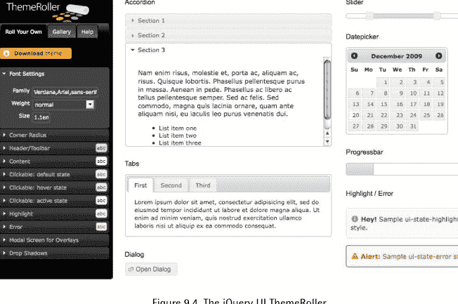

一旦你将主题调整到完美状态，可以通过点击**下载主题**按钮来下载它。更改会传递给jQuery UI下载构建器，就像普通的画廊主题一样，只不过主题下拉框现在会显示“自定义主题”。如果你现在下载这个包，你的主题将被命名为**custom-theme**（你的CSS文件将存储在**custom-theme**文件夹中）。如果你觉得你的创作需要一个更贴切的标题，请展开**高级主题设置**面板并更新**主题文件夹名称**输入框。

### 让你的组件支持主题化

ThemeRoller这个名字听起来可能很酷，你从中获得的结果也可能相当令人印象深刻，但它真正做的是生成一组CSS类，可用于为任何DOM元素集合设置样式。如果你以遵循jQuery UI的标记和命名约定的方式构建自己的自定义UI组件，它们也将可以被主题化。

在图9.5中，我们将相应的CSS类应用于第3章中的弹跳内容面板，因此现在我们有了一个非常类似jQuery UI的组件。默认主题（或我们自定义的ThemeRoller主题）可以包含在页面的顶部，我们的变色龙小部件将立即拥有新的外观和感觉（这里你可以看到UI lightness、Dot Luv和Eggplant预设主题的效果）。

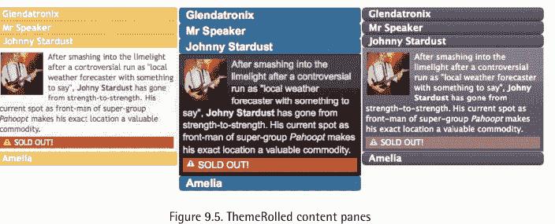

如果你习惯于构建语义正确的结构，你可能只需要在一些地方添加`class`就可以使用ThemeRoller的所有功能。主题假定你的小部件至少有一个包含元素，可以作为样式设置的基础。我们最初的个人资料面板的HTML如下所示：

```html
<div id="bio">
    <h3>Beau Dandy</h3>
    <div>
        
        <span>Glendatronix is the queen of ... </span>
    </div>
    <h3>Mr Speaker</h3>
    <div>
        
        <span>After smashing into the limelight ... </span>
    </div>
    :
</div>
```

首先，我们将通过应用ui-widget类将#bio div指定为容器。然后通过添加ui-helper-reset重置我们可能已经应用的任何可能干扰小部件样式的样式：

```html
chapter_09/17_themable_components/index.html (excerpt)

<div id="bio" class="ui-widget ui-helper-reset">
```

这已经为我们提供了当前主题的字体和颜色。接下来，我们可以开始在组件中添加其他类来设置标题和内容区域的样式：

```html
chapter_09/17_themable_components/index.html (excerpt)

<h3 class="ui-widget-header ui-corner-all">Johnny Stardust</h3>
<div class="ui-widget-content">
    
    <span>After smashing into the limelight ... </span>
</div>
```

ui-widget-header提供了闪亮的工具栏外观，ui-corner-all会使小部件变得漂亮而圆润（当然，在支持的情况下）。你可以指定ui-corner-all或更具体的类来设置单个边缘的样式，例如ui-corner-tl用于左上边缘或ui-corner-bottom用于两个底边，以便在大多数元素上实现圆角。

我们还使用一些显示为警告和图标的附加类，在面板中添加了戏剧性的“售罄！”消息：

```html
chapter_09/17_themable_components/index.html (excerpt)

<div class="ui-state-error">
    <span class="ui-icon ui-icon-alert"></span>SOLD OUT!
</div>
```

`ui-state-error`类提供了错误样式的消息，`ui-icon-alert`向span添加了一个小图标。

正如你从jQuery UI库的完整运行中所期望的那样，还有更多选项可用于控制ThemeRoller主题如何设置你的代码样式。有用于定义按钮交互状态、禁用表单元素和组件阴影的类。甚至还有一些很棒的辅助类用于修复z-index（针对Internet Explorer 6），以及用于无障碍访问的快捷链接。文档[^3]相当详细，将为你大多数小部件提供良好的基础。

要理解所有可用内容的最佳方法是阅读文档，查看ThemeRoller工具中影响了哪些元素，并检查jQuery UI库中应用于元素的类。请记住，当你制作具有强烈UI重点的插件时，你可以通过jQuery在插件代码中轻松添加ThemeRoller类；这将让你的用户几乎不费吹灰之力就能获得完全可主题化的组件！

### 同样重要的是

如果不提及最新的后起之秀jQuery Mobile[^4]，对高级jQuery和jQuery插件的探索就不完整。Mobile将jQuery从桌面移到了，“移动”设备上。更棒的是，它建立在核心和UI的经验教训之上，所以即使你对这些项目只有一知半解，你也准备好使用Mobile了。事实上，使用Mobile开发时最难适应的事情之一是，需要额外步骤才能在目标平台上查看你的作品。对于Mobile开发者来说，不再需要**ALT+TAB**和刷新了——现在只需要**CTRL+S**，拿起你的手机或平板电脑，然后点击重新加载。

[^3]: http://jqueryui.com/docs/Theming/API

[^4]: http://jquerymobile.com/

jQuery Mobile将我们熟悉和喜爱的jQuery的跨浏览器和跨平台支持，与我们转向UI寻求的强大功能、灵活性和设计结合在一起——它是一个插件，但它不仅扩展了jQuery，还扩展了你可以依赖jQuery的地方。你可以像使用其他插件一样进行选择、绑定、动画和链式操作，但你还可以点击和滑动，使用比以往更多的CSS3，最重要的是，利用你对jQuery的掌握来打造下一个必备应用。

你能够专注于应用程序的目标，让Mobile在不干扰的情况下帮助你——只需包含两个文件，就像jQuery UI一样，你就可以开始了！

```html
<link rel=stylesheet href="http://code.jquery.com/mobile/1.0/jquery.mobile-1.0.min.css">
...
<script src="http://code.jquery.com/mobile/1.0/jquery.mobile-1.0.min.js"></script>
```


看起来很熟悉！就像你习惯的那样，你可以使用jQuery自己的CDN来传递文件，就像我们这里所做的，或者你可以自己抓取文件并在本地包含它们。

使用jQuery的CDN，你的压缩和压缩包文件分别只有7kB和24kB——在移动网络上使用绰绰有余。而且你有多种平台选项来访问这些移动网络。正如jQuery Mobile网站所说，⁵ “Mobile广泛支持所有现代桌面、智能手机、平板电脑和电子阅读器平台中的绝大多数。”这不是一个小声明：jQuery Mobile的分级浏览器支持矩阵显示它支持多达24个目标平台。如果你考虑到一些竞争产品官方只支持一个平台，这已经很不错了。

#### 四个支持级别

平台太多，我们无法复制完整的分级支持矩阵列表，但你可以在jQuery Mobile网站上找到它们。⁶

相反，让我们看看每个级别可以预期的覆盖范围：

- A级：完整的增强体验，具有基于Ajax的动画页面过渡效果

## 插件、主题与高级主题 393

-   - B级：增强体验，但不具备Ajax导航功能

-   - C级：基础的、非增强的HTML体验，但功能正常

-   - 非官方支持：可能有效，但未经彻底测试或调试

Mobile的文档几乎与其支持功能一样全面。每个方法和属性都有涵盖，而且文档本身就是使用Mobile编写的——很聪明，对吧？可以说，文档在智能手机上的导航比在桌面端更为便捷！

就插件而言，jQuery Mobile甚至比jQuery UI更丰富——它内置了更多功能，只要将文件添加到你的应用程序中，许多功能就能立即生效。而且，由于Mobile基于推动桌面端开发的HTML5和CSS3，它甚至对非移动用例也颇具吸引力。其支持仍在不断增长，未来版本中可能会添加更多功能。虽然Mobile在jQuery Core或UI网站的导航中尚未被提及，但其众多功能使得构建应用程序的能力已超越了这个新库的表象。让我们来看一看其中的一些功能。

# 打出你的王牌

至此，我们对客户的了解已几乎和对jQuery及jQuery UI的了解一样深入。因此，可以稳妥地推测，一个具有社交属性的移动应用已在他们的计划之中。让我们加大力度，通过创建一个基于移动设备的卡牌游戏，来满足他们的下一个需求。

我们将通过制作 *Pop Trumps: The Jemimas* 来实现jQuery Mobile，这是世界上第一款将压制朋友的刺激感与最新摇滚明星的魅力（如图9.6、图9.7和图9.8所示）相结合的卡牌游戏。

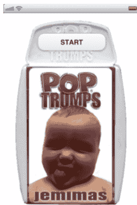

图9.6. *Pop Trumps* 的界面


图9.7. 我们的 *Pop Trumps* 首页

# 394 jQuery: 从新手到忍者

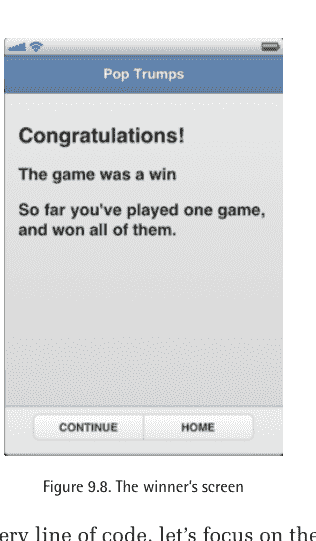

图9.8. 获胜者界面

与其逐行讲解代码，不如让我们专注于可以探讨的Mobile特定代码：

```
chapter_09/18_getting_mobile/index.html (excerpt)

<link rel=stylesheet href="http://code.jquery.com/mobile/1.0/jquery.mobile-1.0.min.css">
:
<script src="http://code.jquery.com/mobile/1.0/jquery.mobile-1.0.min.js"></script>
```

我们已经看过Mobile所需的引入文件，但值得再次提一下。与其他jQuery项目不同，为了实现广泛的平台支持，在`document.ready`事件触发之前需要进行大量处理。因此，我们需要在文档的`<head>`部分添加这些引入，以获得最佳的用户体验。

既然我们在文档头部，让我们看看那个新的`<meta>`元素：

```
chapter_09/18_getting_mobile/index.html (excerpt)

<meta name=viewport content="width=device-width, initial-scale=1, user-scalable=0">
```

jQuery Mobile大量依赖HTML5，这里我们有一个HTML5元素，它规范了应用程序的跨平台显示。它告诉浏览器，我们的内容应尽可能宽，并且应按1:1的比例显示。考虑到我们的应用程序可能遇到各种不同的分辨率，这一点非常重要。最后一个`content`值——`user-scalable=0`——告诉浏览器不要对我们内容进行缩放。如果你希望在应用中支持缩放，只需省略该值，采用浏览器的默认行为即可。

说到HTML5，现在让我们看看我们的文档结构。同样，如果你已经使用过HTML5，这里应该不会有太多惊喜——除了Mobile对该语言的高度契合：

```
chapter_09/18_getting_mobile/index.html (excerpt)

<section data-role="page" id="home">
  ...
</section>
<section data-role="page" id="albums">
  <header data-role="header">
    ...
  </header>
  <div data-role="content">
    ...
  </div>
  <footer data-role="footer">
    ...
  </footer>
</section>
<section data-role="page" id="album">
  ...
</section>
<section data-role="page" id="results">
  ...
</section>
```

本质上，我们的页面是一组带有`data-role`属性且值为`page`的`<section>`元素。你也可以使用`<div>`元素代替`<section>`——在这里，属性比元素本身更重要，因为`data-role`告诉Mobile这些部分将是应用程序中的页面。我们通过唯一的`id`属性进一步划分页面，这些属性用作导航的锚点目标。桌面端可能会使用`id`来跳转或滚动到内容，而Mobile则使用它们在页面视图之间进行过渡。

在第二个`<section>`内部，我们展示了基本的页面视图布局——一个页眉、一个`<div>`和一个页脚，它们同样都带有`data-role`属性，帮助Mobile应用其底层修改。在这些元素内部，我们只需添加所需的任何HTML，并在合适的地方应用`data-role`属性。让我们现在尝试一些：

```
chapter_09/18_getting_mobile/index.html (excerpt)

<a href="#albums" data-role="button">START</a>
```

我们第一个`id`为`home`的`<section>`中有一个锚点，我们告诉Mobile我们希望它在UI中显示为一个按钮——我们只需提供`data-role="button"`，Mobile就会为我们完成繁重的工作。使用锚点中的哈希引用，我们就足以将下一个`id`为`albums`的`<section>`加载到视图中。

在我们的`albums`部分，我们继续使用简单的HTML5数据属性驱动的方法。我们告诉页眉使用——你猜对了——`data-theme`来应用一个主题。我们对无序列表做同样的操作，同时告诉它是一个`data-listview`，列表中的锚点使用`data-transition="flip"`来控制页面如何“翻转”：

```
chapter_09/18_getting_mobile/index.html (excerpt)

<header data-role="header" data-theme="b">
    <h1>Pop Trumps</h1>
</header>

<div data-role="content">
    <p>Select an album by The Jemimas to play</p>

    <ul data-role="listview" data-inset="true" data-theme="b">
        <li><a href="#album" data-transition="flip">
            &#9658;The Jemimas: Debut</a></li>
        <li><a href="#album" data-transition="flip">
            &#9658;This is The Jemimas</a></li>
        <li><a href="#album" data-transition="flip">
            &#9658;Awkward Third</a></li>
        <li><a href="#album" data-transition="flip">
            &#9658;Best of The Jemimas</a></li>
    </ul>
</div>
```

点击我们样式美观的列表视图中的锚点，现在将导致指定的专辑页面“翻转”进入视图，这很好地增强了我们的卡牌效果。你也可以使用`slide`、`slideup`、`slidedown`、`pop`和`fade`；如果你是jQTouch的粉丝，<sup>7</sup>你可能会注意到这些过渡效果是从该库移植过来的，只有细微改动。翻转之后，我们将打出一张牌，玩家就可以开始认真地压制对手了。然而，对我们来说，真正的兴趣在于三个新的`data-role`和一个无缝的DOM操作：

```
chapter_09/18_getting_mobile/index.html (excerpt)

<div data-role="content">
    <div data-role="fieldcontain">
        <label for="flip-a" class="ui-hidden-accessible">
            Select slider:</label>
        <select name="slider" id="flip-a" data-role="slider"
            data-theme="c">
            <option value="no">&#9756; Number 1s</option>
            <option value="yes">6</option>
        </select>
        :
    </div>
</div>

<footer data-role="footer" data-theme="c">
    <div data-role="controlgroup" data-type="horizontal">
        :
    </div>
</footer>
```

第一个新的`data-role`是`fieldcontain`，它的作用如你所料：包含字段。如果你愿意，这个`data-role`可以应用于`<fieldset>`以获得一些额外的语义化优势。接下来是`fieldcontain`内部的`slider`角色，最后是`controlgroup`，其名称源自HTML5的`<hgroup>`，用于将按钮分组。

由`slider` `data-role`触发的DOM操作展示了Mobile根植于jQuery UI的特性——`<select>`元素及其关联的标签在界面中被隐藏，取而代之的是移动设备上流行的滑动切换开关，如图9.9所示。

> <sup>7</sup> http://www.jqtouch.com/

## 398 jQuery：从入门到精通

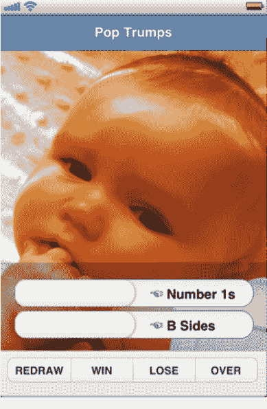

`controlgroup` 值在界面上产生了同样引人注目的效果，它仅通过 CSS 实现（无需操作 DOM）。`controlgroup` 值本身会将链接组合在一起，并为组中的第一个和最后一个元素应用圆角。如果你像我们在前面标记中所做的那样，也向包含 `controlgroup` 值的 div 添加了 `data-type="horizontal"`，那么分组按钮将按预期一行显示。

我们最后一个 `data` 属性是 `data-direction="reverse"`，它通过反转过渡效果来配合我们的过渡使用。例如，在默认行为中视图从屏幕右侧移入的情况下，我们的 `data-direction` 属性会使其向右移出。当被控制时，它为用户提供了在应用内强烈的空间移动感。它并非简单地沿着一系列看似无穷无尽的视图移动；相反，它就像翻阅书籍章节一样，在一系列页面间移动：

```
chapter_09/18_getting_mobile/index.html (excerpt)

<a href="#album" data-role="button" data-direction="reverse"
 id="continue">CONTINUE</a>
```

说到翻阅章节，我们已经到了可以开始讨论编写 jQuery Mobile 代码的时候了。嗯，差不多了。

在讨论我们将要编写的代码之前，我们需要再介绍一段无需我们做任何事情就能运行的代码：`mobileinit` 事件。jQuery Mobile 的默认转换和样式非常好，你几乎不需要进行任何更改，但在极少数需要更改的情况下，你可以利用 `mobileinit` 事件——它允许你在事件触发时立即扩展或配置选项。这意味着你无需克服默认设置——你可以在它们被应用之前更改设置，也无需等待 DOM 加载。因此，你不必等待 `$(document).ready()` 生效，也无需等待 `document.loaded`。

因此，建议你在引用 jQuery 库之后、引用 Mobile 之前，像这样引用你自己的本地脚本文件：

```
<script src="http://code.jquery.com/jquery-1.7.1.min.js"></script>
<script src="../path/to/your/scripts.js"></script>
<script src="http://code.jquery.com/mobile/1.0/jquery.mobile-1.0.min.js"></script>
```

现在我们已经整理好了语义 HTML，源文件也都就位，`mobileinit` 事件也已触发。让我们看看我们编写了哪些代码来让游戏运行起来。我们的第一个方法是对我们在第 7 章首次使用的一些代码的微小调整——我们的 1-up 提示器：

```
chapter_09/18_getting_mobile/scripts.js (excerpt)

function doOneUp(which, callback) {
    $(which).next().show().animate({
        top: "-=50px",
        opacity: "toggle"
    }, 1000,
    function() {
        $(this).css("top", "").hide("slow", callback);
    });
}
```

## 400 jQuery：从入门到精通

当然，我们可以将其作为插件添加，但对于我们的概念验证、最小可行产品游戏开发来说，这很完美。你可能已经发现，我们微小的调整是在回调之后省略了 `remove()`。这只意味着我们可以重复调用该方法，而不会从我们的代码中删除元素。

现在来创建我们 `Trumps` 方法的骨架：

```
chapter_09/18_getting_mobile/script.js (excerpt)

function Trumps () {
    :
    // code goes here
    :
    this.init = function () {
        // code goes here
    }
}

var TRUMPS = new Trumps();

$(document).ready(function (event) {
    TRUMPS.init();
});
```

在这里，我们定义了一个构造函数方法，通过声明一个新的 `Trumps()` 创建了它的一个实例，然后调用了该实例的 `init` 方法。我们本来可以在 `Trumps` 方法内部调用 `init`，但这样我们可以延迟执行，直到 DOM 准备就绪。尝试两种方式，看看哪种对你更有效！

`Trumps` 中的第一个属性是 `this.datastore`，我们将在这里保存用于向玩家提供反馈的游戏统计数据：

```
chapter_09/18_getting_mobile/script.js (excerpt)

this.datastore = {
    games: {
        win: 0,
        draw: 0,
        loss: 0,
        total: 0,
    },
    ...,
};
```

```
last: null,
},
tally: {
  wins: 0,
  losses: 0
}
};
```

虽然这个属性并非*严格意义上*的 Mobile 代码，但它是必须的，因为 Mobile 尚未提供一种将数据从一个视图传递到另一个视图的过程。如果我们确定所有平台都支持，我们本可以使用 HTML5 的 `localStorage()` API——但我们并不确定，所以我们不会使用。我们也可以使用 jQuery 的 `data()` 方法，这在跨平台方面会很好，但它无法提供像 datastore 这样的强大可视化。因此，让我们接受现状，看看我们的第一个方法：

```
this.gameover = function () {
    var wins = TRUMPS.datastore.tally.wins,
        losses = TRUMPS.datastore.tally.losses,
        result = (wins > losses) ? "win" : (wins === losses) ?
            "draw" : "loss";

    TRUMPS.datastore.games[result] += 1;
    TRUMPS.datastore.games["total"] += 1;
    TRUMPS.datastore.games["last"] = result;

    $.mobile.showPageLoadingMsg();

    setTimeout(function(){
        $.mobile.changePage("#results");
        TRUMPS.result();
    }, 999);
};
```

我们的第一个方法实际上是我们在游戏中要做的最后几件事之一，但 JavaScript 并不因此带有偏见，我们顽皮地将方法按字母顺序排列。它不会加快或减慢任何 JavaScript 引擎的运行，但它会让查看你代码的下一个开发者更容易理解。让下一个开发者更容易理解应该始终是一个优先事项——查看你代码的“下一个开发者”很可能就是你自己。

## 402 jQuery：从入门到精通

让我们快速回顾一下这个方法。首先，我们根据 `datastore` 对象设置一些变量。通过直接从对象中获取值，我们消除了在视图之间维护状态的需要。然后我们使用三元运算符设置一个 `result` 变量，告诉我们游戏是赢了、平局还是输了，并使用该变量将结果从我们在游戏中使用的 `tally` 移动到在游戏间存储数据的 `games`。

现在我们来到了我们的第一个 Mobile 方法，它应该很容易识别，因为它巧妙地从 `$.mobile` 调用：

```
chapter_09/18_getting_mobile/script.js (excerpt)

$.mobile.showPageLoadingMsg();
```

这个特定方法会使一个带有加载图形的对话框出现。通常在通过 Ajax 动态加载内容时非常有用，但在这里它很好地告知玩家游戏已结束，结果正在分析中。

此方法的最后一个任务是创建一个延迟，看起来就像有一支体育统计团队在整理结果——然后我们调用第二个 Mobile 方法，进入我们的 `Trumps` 方法：

```
chapter_09/18_getting_mobile/script.js (excerpt)

$.mobile.changePage("#results");
```

你应该开始意识到 Mobile 中的方法名易于阅读和预测。想要更改你的页面位置？调用 `changePage`。这个方法允许我们几乎像方法名的可预测性让我们能够轻松搜索 Mobile 文档一样轻松地在应用中移动。[^8]

我们的下一个方法简短而精炼，我们在登录页或主页完全让玩家感到困惑的情况下构建了它。如果你在登录页停留超过三秒钟而不采取任何操作，一个按钮会淡入以帮助你：

[^8]: http://jquerymobile.com/demos/

```
chapter_09/18_getting_mobile/scripts.js (excerpt)

this.prompt = function () {
    setTimeout(function() {
        $("#home").find("a").fadeIn("slow");
    }, 3000);
};
```

接下来是我们的 `this.reset` 方法：

```
chapter_09/18_getting_mobile/script.js (excerpt)

this.reset = function () {
    var switches = ["#flip-a", "#flip-b"],
        length = switches.length,
        current, i;

    for (i = 0; i < length; i += 1) {
        current = $(switches[i]);
        current[0].selectedIndex = 0;
        current.slider("refresh").next()
        →.find(".ui-slider-label-a").text(random());
    }

    function random () {
        return Math.floor(Math.random() * 11)
    }
};
```

这个方法将重置我们的翻转开关的位置，使它们关闭，并应用新的随机值。通过这个小技巧，我们的应用变得更加可玩。而且，同样，我们有一个方法只有一行代码在 Core 中找不到，但你会在 UI 中找到：

```
current.slider("refresh").next().find(".ui-slider-label-a").
→text(random());
```

其中的 Mobile 代码呢？没错：Mobile 没有重新发明轮子，而是利用了我们在第 7 章看到的 slider 方法，并将我们的切换开关基于一个二元滑块。为什么要修复没坏的东西？

在谈论没坏的东西时，让我们看看我们的下一个方法，`this.result`。这里只有一行特定于 Mobile 的代码，所以会很快。就像

游戏结束，我们再次使用无状态的数据存储对象，这次是为了构建结果页面的内容。当玩家在胜负中达到三局两胜时，该页面会显示。我们通过一系列条件判断来为玩家提供一些“模糊”的结果反馈；避免像“你在12场比赛中赢了8场”这样过于机械的表述。我们更倾向于类似“你打了12场比赛，赢下了大部分”这样的描述。这听起来不那么冰冷，尤其当你正处于连败低谷时——那滋味可不好受！

```javascript
this.result = function () {
    var result = TRUMPS.datastore.games.last,
        salutation = (result !== "loss") ? "Congratulations!" :
            "Sorry about that!",
        total = TRUMPS.datastore.games.total,
        wins = TRUMPS.datastore.games.win,
        draws = TRUMPS.datastore.games.draw,
        losses = TRUMPS.datastore.games.loss,
        played = (total === 1) ? "one game" : total + " games",
        record;

    if (wins === total) { record = "all"; }
    else if (losses === total) { record = "none"; }
    else if (wins > (draws + losses)) { record = "most"; }
    else if (losses > (draws + wins)) { record = "some"; }
    else { record = "a few"; }

    $("#results").find("h2").text(salutation);
    $("#results").find("h3").find("span").text(result);
    $("#results").find("p").find("b").text(played);
    $("#results").find("p").find("span").text(record);

    $.mobile.hidePageLoadingMsg();
};
```

无论如何，我们可不想连败。我们追求的是胜利，所以让我们看看来自result的移动端代码：

```javascript
$.mobile.hidePageLoadingMsg();
```

从名称你就能猜到，这是与弹窗创建脚本 `showPageLoadingMsg`（我们在 `gameover` 方法中调用过它）相反的操作。如果后者是在界面上渲染加载对话框，那么这个方法则是让用户知道我们已经计算好了他们的得分。`this.gameover` 和 `this.result` 共同协作，处理由我们下一个方法收集的数据，从而创建出我们的游戏流程：

```javascript
// chapter_09/18_getting_mobile/scripts.js (节选)
this.scored = function (which) {
    var result = $(which).find(".ui-btn-text").text() === "WIN")
    ? "wins" : "losses";

    this.datastore.tally[result] += 1;
    if (this.datastore.tally[result] > 2) {
        this.gameover();
    }
};
```

`this.scored` 接收到关于专辑视图页脚中哪个按钮被点击的信息，并使用该信息来填充我们数据存储对象的计数区域。这里并没有太多移动端特有的内容，所以让我们继续介绍倒数第二个方法 `this.set`。由于这是一个大块头，包含的新移动端代码几乎与之前所有内容加起来一样多，我们来分小块消化：

```javascript
// chapter_09/18_getting_mobile/script.js (节选)
this.set = function () {
    $(document).bind("mobileinit", function(){
        $.mobile.touchOverflowEnabled = true;
    });

    $("#home").bind("swipe", function(event){
        document.location = "#albums";
    });

    $("#albums").bind("vclick", function(event){
        $("#home").find(".ui-btn-text").text("NEW GAME");
    }).find("ul").find("a").each(function(i){
        var albums = [ "0_debut", "1_thisis", "2_awkward",
        "3_bestof"];

        $(this).bind("tap", function(event){
            $("#album").css("background-image",
                ["url(graphics/albums/", albums[i], ".png)"].join(""));
        });
    });
};
```

好吧，虽然一半代码算是一大口，但它其实很容易消化。归根结底，它还是同样的jQuery代码语法，正是这些让Mobile实现起来如此简单，只是偶尔加入了一些新事件作为点缀。正如我们对一个jQuery项目的期望，开发团队已经完成了艰苦的工作，而我们只需跳起胜利的舞蹈。但我们还不能在得分区停留太久，因为 `this.set` 方法的回顾还在前面。

`this.set` 的首要任务是将一个方法绑定到我们一直在讨论的 `mobileinit` 事件上。该方法会将属性 `$.mobile.touchOverflowEnabled` 设置为 true。在此状态下，该属性告诉Mobile在支持固定滚动条的平台上使用 `overflow: auto` CSS属性，使它们更加可靠。正是这种细节处理，让项目能够为未来跨平台的变化做好准备。

我们接下来的三块代码各自包含一个对移动端事件的绑定：

```javascript
$("#home").bind("swipe", function(event){ ...
$("#albums").bind("vclick", function(event){ ...
$(this).bind("tap", function(event){ ...
```

`tap` 和 `swipe` 应该不需要解释——但为了彻底起见，它们分别指有人点击屏幕和有人滑动屏幕。也许它们确实值得解释一下——因为jQuery团队多走了一步，不仅将这些事件映射到明显的移动端触摸事件，还将它们映射到桌面端的等效事件（如果你的操作系统支持的话）。用鼠标点击绑定了 `tap` 事件的元素，你应该会看到该方法被触发。感谢团队！

不过从我们的角度来看，滑动会更改文档位置，而点击会重置视图的背景图像。你可能不太确定的事件是 `vclick` 事件，但如果我们说“v”代表“虚拟”，你无疑就能理解它的用途了。Mobile提供了一系列虚拟事件映射器，它们规范化跨平台的鼠标交互，在每个选项中路由最快的事件，并计算你的 `vmouse` 与界面交互的虚拟坐标。除了 `vclick`，还支持 `vmouseover`、`vmousedown`、`vmousemove`、`vmouseup` 和 `vmousecancel`。在我们的案例中，`vclick` 被用来将着陆页上按钮的显示文本从 **START** 更改为 **NEW GAME**。正是像这样的小细节，将大大有助于让像 *Pop Trumps* 这样的测试应用提供出色的用户体验。

随着这些事件的解释，我们的应用程序代码也接近尾声。让我们来完成它：

```javascript
// chapter_09/18_getting_mobile/script.js (节选)
$("#album").bind("pagebeforehide", function(){
    TRUMPS.reset();
});

$(".score").click(function(event) {
    doOneUp(this);
    TRUMPS.scored(this);

    event.preventDefault();
}).after("<span class='oneup'>+1</span>");

$("#gameover").bind("tap", this.gameover);// 赋值，而非调用

$("#results").find("a").bind("tap", function(){
    // 重置数据存储
    TRUMPS.datastore.tally.wins = 0;
    TRUMPS.datastore.tally.losses = 0;
});
};
```

在解释了 `this.set` 方法的前半部分之后，这几乎是在复习了。反向来看，我们给结果页面上的锚点绑定了点击事件，并用它们来重置正在计数的 `this.datastore.tally`，同时给 **OVER** 按钮绑定了点击事件来调用 `this.gameover`。注意这里我们只是赋值，而非调用该方法吗？用户稍后的点击才会调用它。

我们倒数第二块代码块使用了Core中我们信赖的 `click` 快捷方式。这里我们调用 `doOneUp` 方法和 `this.scored` 方法，然后使用 `after` 来追加那些将容纳小浮动 +1 数字的 span 元素。而我们最后一个代码块包含了最后一个新的移动端事件：

```javascript
// chapter_09/18_getting_mobile/script.js (节选)
$("#album").bind("pagebeforehide", function() { ...
```

如果你不能推断出这个事件是在页面“隐藏”“之前”在“页面”上触发的，那你就不是你所认为的那个忍者了。它就像是我们页面视图的 `OnPageUnload`。在我们的应用程序中，这个事件被用来调用 `this.reset` 方法，我们知道它会重置我们的切换开关。

我们建立了一些简单的方法并在事件上调用它们。这种方法已成为一个基础，在这个基础上我们可以构建我们的Mobile创新，这样下次客户团队来电时，无论他们准备好多少流行词汇，你都能从容应对。实际上，说到我们的客户……

## StarTrackr!：终章

“我们今天站在这里，作为地球上最臭名昭著的名人追踪网站的创造者！”客户的经理对着一屋子的员工和股东大声宣布。项目的最后阶段上线了。自客户团队要求我们润色他们公司网站的免责声明消息以来，这确实是一段漫长的旅程——这段旅程带领我们经历了淡入淡出、滑动、缓动、滚动、增强和Ajax化。这是一段让我们从新手成长为忍者的旅程。

“但有一个人让这一切成为可能，”经理继续说道。“一个我们应将所有功劳归于的人……”他转身面向你，但你之前所站的位置已经空无一人。你执行了最后一个 `$("#ninja").hide()`，并神秘地消失得无影无踪。

你不需要客户和同事的赞美；你的回报是良好的Web开发实践被灌输到了又一个项目中。以及，你收到的丰厚报酬。两者兼而有之，说真的。

## 附录 A：参考资料

jQuery 的核心在于其灵活性和尽可能广泒的适用性。其核心库和插件架构都体现了这一理念。最常见的使用场景通常开箱即用，因此 jQuery 的灵活性体现在能够覆盖这些默认设置的能力上。这带来了大量的选项！不过，无需全部记住；只需手边备好一份良好的参考，并随时查阅 jQuery 的在线文档。也不要害怕深入 jQuery 或插件的源代码，去寻找文档中可能遗漏的任何信息。

### $.ajax 选项

jQuery 强大的 Ajax 功能数组由一个核心方法支撑：`$.ajax`。此方法接受海量选项，使其能在无数场景中灵活使用。我们在全书中探讨了其中一些选项，但正如 jQuery 的一贯风格，它还有更多！你应该仔细核对文档以查看更新，但如果你想在公交车上深入研究细节，以下是详细说明：

#### 标志

这些“可标志”的选项接受布尔值——`true` 或 `false`——以启用或禁用给定功能。大多数情况下，默认值是令人满意的，但很容易覆盖它们以定制你的请求。

- **async**：`async` 选项默认为 `true`，但如果你需要执行同步请求（你应该尽量避免，因为它会锁定浏览器），可以将其设置为 `false`。不过，这是一个非常糟糕的做法，该功能未来可能会被弃用。

- **cache**：在执行 Ajax 请请求时，缓存数据可能是个问题；如果用户的浏览器存储了旧请请求，它可能不会获取最新数据。要禁用缓存，你可以将 `cache` 选项设置为 `false`。脚本和 JSONP 请求默认是不缓存的。

- **crossDomain**：jQuery 会自动为同域请求将此标志设置为 `false`，为跨域请求设置为 `true`。但如果你需要强制开启，可以在此处设置。

- **global**：我们已经看到可以使用全局事件处理程序处理来自任何 Ajax 请求的事件。你也可以通过为 `global` 参数指定 `false` 来阻止全局事件处理程序处理特定事件。

- **ifModified**：通过设置 `ifModified` 标志，你可以强制请求仅在文档自上次请求后被修改时才“成功”（即触发 `success` 处理程序）。当你只想在有新数据显示时进行一些处理时，这非常有用。

- **isLocal**：用于强制将当前环境识别为“本地”，例如当你通过 `file:///` URL（而非通过服务器）浏览你的站点时。

- **processData**：当你有数据需要随请求一起发送时，jQuery 会处理它并将其转换为适当的查询字符串值。如果这不可取（例如，你需要传递一个 DOM 文档或其他类型的结构），你可以将 `processData` 标志设置为 `false`。

- **traditional**：此标志处理序列化嵌套数据；较新版本的 jQuery 会序列化对象和更复杂的结构。但一些服务端语言不支持这种格式。如果你需要使用旧的、扁平的序列化风格，请将此标志设置为 `true`。

#### 设置

许多 Ajax 选项允许你指定的不仅仅是简单的开/关值；它们通常接受字符串或对象来定制和定义你的 Ajax 请求。

- **accepts**：你可以通过向 `accepts` 设置传递一个映射来指定你将处理服务器的哪种响应；例如：`{ xml: 'application/xml', text: 'text/plain' }`。然而，如果需要修改此设置，建议只在全局 Ajax 设置中修改一次。

- **contents**：此设置允许你覆盖或指定 jQuery 将如何处理给定的内容类型，例如将类型映射到字符串或正则表达式。例如，默认情况下，类型 `xml` 与正则表达式 `/xml/` 匹配，`text` 与 `/text/` 匹配。

- **contentType**：`contentType` 设置允许你设置请求的内容类型。默认是 `application/x-www-form-urlencoded`，这在大多数情况下都适用。

- **context**：当 Ajax 回调执行时，其上下�是 `window` 对象，这并非特别有用。你设置 `context` 选项，以便回调中的 `this` 属性引用一个便捷的工具，比如自定义 JavaScript 对象或 jQuery 元素。

- **converters**：这是另一个高级设置，将 `dataType` 值映射到其他 `dataType` 值。

- **data**：要向服务器传递数据，你可以为 `data` 设置指定字符串、JavaScript 数组或对象。如果你传入数组或对象（并且没有禁用 `processData` 标志），数据将使用 `jQuery.params` 工具函数进行序列化。此函数接受输入并将其转换为查询字符串格式（非常方便）！如果是 GET 请求，该字符串将被附加到 URL。

- **dataType**：`contentType` 设置你发送到服务器的数据类型，而 `dataType` 参数则设置你期望从服务器接收的数据类型。默认类型是“所有类型”（*/*），但你可以指定 `xml`、`html`、`script`、`json` 或 `text`——在这种情况下，jQuery 将使用相应的内容类型字符串。

- **headers**：如果你需要为当前请求添加或修改请求头，可以在此处的映射中指定它们。

- **jsonp**：当你发起 JSONP 调用（允许跨域请求）时，预期回调函数名是 `callback`。如果你使用的服务需要不同的名称，你可以使用 `jsonp` 设置来定义它。

- **mimeType**：如果需要覆盖默认的 MIME 类型，请使用此设置。

- **password**：身份验证请求需要你的用户名和密码。你可以在 `password` 设置中指定后者。

- **scriptCharset**：`scriptCharset` 属性允许你指定由 script 或 jsonp Ajax 调用注入的 script 标签的字符集。

- **statusCode**：这是一个巧妙的“状态码到函数”映射，用于处理来自服务器的某些响应。如果状态码匹配（例如，404 未找到），则调用相关的 JavaScript 函数。

- **timeout**：`timeout` 参数是唯一接受数字的 ajax 设置，它的作用是定义在中止 Ajax 请求之前需要经过多少毫秒。

- **type**：Ajax 请求最重要的设置之一，`type` 属性定义了 HTTP 请求类型：`GET`、`POST`、`PUT` 或 `DELETE`。

- **url**：与 `type` 同样重要的另一个设置，`url` 字符串定义了你想要调用的位置的地址。

- **username**：作为 `password` 字段的配套，`username` 选项指定了随任何身份验证请求一起发送的用户名。

- **xhrFields**：这是一个最终的高级设置，用于将字段名称映射到要设置在底层 XHR 对象上的字段值。

#### 回调和函数

最后，你可以定义一堆回调和函数来调整你的请求并处理请求生命周期中发生的事件。

我们在第 6 章中介绍了事件处理程序。`complete` 处理程序在 `$.ajax` 调用完成时触发——无论成功与否——因此它是清理任何未尽事宜的好地方。`error` 处理程序在调用失败时被调用，而 `success` 处理程序在调用正确完成时触发。

除了事件回调，还有一系列作为钩子存在的函数；这些允许你逐个调用地修改请求的各个部分。`beforeSend` 函数在发送消息执行前触发，为你提供了一个修改请求的地方（如果需要）。你的处理程序会收到请求对象和当前的 jQuery 对象。这是在需要时修改请求头的常见位置。此外，这是你阻止任何事情发生的最后机会：如果你从此函数返回 `false`，请请求将被中止。

`jsonpCallback`（字符串名称或函数）可以在执行 JSONP 请求时替代 jQuery 默认提供的随机生成的名称。如果你希望对请求缓存方式有更大的控制权，可以这样做。

在最底层，Ajax 的魔力来自浏览器对 `XMLHttpRequest`（简称 XHR）对象的实现。这个对象让我们能够从客户端与服务器通信。默认情况下，jQuery 会查找适当的 XHR 对象并将其用于所有 Ajax 调用。如果你想增强或替换它，可以通过指定你自己的 `xhr` 函数来修改此行为。该函数需要返回应使用的对象。

最后一个可用的钩子是 `dataFilter` 函数。它在请求成功返回后调用，是你确保响应数据没问题的地方。

如果需要进行任何数据清洗，这正是该用`dataFilter`函数的地方。该函数会接收原始的响应数据和数据类型；在处理完毕后，你应当返回数据，以便请求周期可以继续。

### $.support 选项

在过去，我们常常通过浏览器嗅探来判断当前使用的是哪个版本的浏览器，并据此调整代码以规避已知的缺陷。那样的日子已经过去了：如今我们有了更可靠的替代方案；在可能的情况下，我们应该使用特性检测来检查浏览器是否支持特定的功能，并在需要时提供替代方案或降级方案。

如果你使用纯jQuery，大多数此类问题都会在内部得到处理。但如果你要深入使用一些原生的JavaScript，那么通过`support`对象提供了一个非常巧妙的特性检测机制。我们在第6章简要地介绍过这个机制，但并未详细讨论其丰富的选项。它们都返回一个`true`或`false`值来表明是否支持相应特性，这可以在`if/then/else`代码块中使用，以便为两种情况都提供支持。例如：

```javascript
var domObject = document.getElementById('content');
if ($.support.cssFloat) {
  domObject.style.cssFloat = "left";
} else {
  domObject.style.styleFloat = "left";
}
```

以下是可用的属性：

**ajax**

如果用户的浏览器能够创建XHR对象，此值将为`true`。

**boxModel**

`boxModel`属性（初始值为null，在文档加载完成后变为`true`或`false`）在浏览器按照W3C盒模型渲染时将为`true`。

**checkClone**

当克隆一个复选框或单选按钮时，如果选中属性的值没有被保持，`checkClone`的值将为false。

**checkOn**

如果复选框在未指定值时默认为“选中”状态，此值为true。

**cors**

如果用户的浏览器能够创建一个允许你设置`withCredentials`属性的XHR对象（这是使用跨源资源共享机制进行跨域调用所必需的），则此值为true。

**changeBubbles**

检测与事件相关的浏览器特性可能是一项棘手的任务——这曾是进行浏览器嗅探的常见原因。值得庆幸的是，一些聪明人解决了这个问题，所以现在如果你想知道是否可以（可靠地）响应change事件，可以检查`changeBubbles`属性。

**cssFloat**

我们在上面的例子中看到了`cssFloat`的应用。它检测浏览器在JavaScript中是否使用`cssFloat`标签来处理浮动样式。（直接使用`float`是不可能的，因为那是JavaScript中表示浮点数的关键字）。Internet Explorer使用`styleFloat`而不是`cssFloat`。

**hrefNormalized**

有些浏览器会修改它们认为构造不正确的链接——如果这是意外的，就会成为一个问题！如果浏览器修改了链接，`hrefNormalized`属性将返回true。

**htmlSerialize**

如果你需要确保在使用innerHTML时，链接元素（如`link`和`script`标签）被正确序列化，可以使用`htmlSerialize`属性。Internet Explorer在这方面有问题，如果你想让它正常工作，你需要将有问题的标签包裹在你自己的包装元素中。

**leadingWhitespace**

`leadingWhitespace`选项可以让你知道浏览器是否保留了DOM子节点中的第一个空白节点。当使用innerHTML时，Internet Explorer会删除作为第一个子节点的空白文本节点；如果你依赖于固定数量的子节点，这可能会打乱你的jQuery代码。

**noCloneEvent**

当你克隆一个DOM节点时，有些浏览器也会克隆附加在其上的事件处理器，而有些则不会。如果事件没有被克隆，`noCloneEvent`属性将为true。

**opacity**

我们都非常喜欢不透明度：它让网站看起来很酷。不幸的是，有些浏览器无法通过JavaScript操作不透明度（当然，如果你使用jQuery，你就不用担心了）。`opacity`属性用于测试渲染引擎是否理解不透明度；否则，你将需要使用浏览器的滤镜。

**optDisabled**

如果`select`元素内的`option`元素被自动禁用，此值为`true`。

**optSelected**

如果默认被选中的`option`元素正确报告其被选中状态，此值为`true`。

**scriptEval**

浏览器在执行通过注入的script标签的脚本时，行为也有所不同。`scriptEval`属性将让你知道通过`appendChild`注入是否安全，或者你应该使用`script.text`属性。

**style**

要查找当前应用于元素的样式，在某些浏览器中，可以使用`getAttribute`方法并请求`style`属性。要测试`getAttribute("style")`是否能在用户的浏览器上工作，请检查`style`属性。

**submitBubbles**

你可以检查的另一个事件是`submit`事件，通过`submitBubbles`属性。在内部，它使用了与`changeBubbles`相同的特性检测技巧。

**tbody**

最后，在某些浏览器中，一个空表格会自动插入一个tbody元素——这可能会打乱你的DOM操作。为了检查是否需要注意这一点，有tbody属性。这个属性会返回true（这可能会令人困惑）表示你可以有一个表格而不会自动插入tbody元素。

`support`对象最棒的一点是，它迫使你理解你正在规避哪些缺陷。通过浏览器嗅探，很容易变得自满，并开始在条件块中放入比实际需要更多的代码。通过使用`support`，你只针对特定的方面，确保你的用户无论厂商如何修改其浏览器代码，都能享受到一致的体验。

### 事件

我们花了大量时间研究事件，正如我们在前几章中提到的，jQuery通过将事件标准化以符合W3C标准，从而简化了跨浏览器的事件处理过程。一个标准化的事件对象拥有一系列有用的属性和方法。我们已经在本书中使用了其中一些，现在我们将探讨那些之前未涉及的部分！你可以在jQuery事件文档中找到完整的事件属性列表。²

#### 事件属性

我们在第9章简要地看到过：`type`属性将给你触发的事件名称（即使是自定义事件，如果你给它们命名了）。

当事件处理器被调用时，你可以通过`target`属性获取作为事件源的DOM元素。这个元素也可以被包装在jQuery选择器中，从而脱离DOM环境回到jQuery领域。此外，如果事件是鼠标移动，你可以通过`relatedTarget`属性找到之前作为目标的元素（鼠标之前所在的位置）。而如果事件在层级结构中向上移动——当你处理冒泡事件时——`currentTarget`会告诉你当前冒泡阶段的目标是什么。

`data`属性返回你在绑定事件时附加的任何数据，对于键盘事件，它会让你知道按下了哪个按钮或键。

最后一个非常有用的属性是事件的`timeStamp`。它给出了事件发生的确切时间，通常在实现基于时间的效果时使用。例如，如果你想在页面上创建一个特殊的三次点击事件，你可以查阅事件的时间戳，看是否在给定的时间段内发生了三次点击。

#### 事件方法

我们见过一些可以使用的事件方法，比如`preventDefault`和`stopPropagation`，它们让我们控制事件如何冒泡以及如何被浏览器处理。还有一个类似的方法是`stopImmediatePropagation`，它比`stopPropagation`更“强硬”一些。`stopPropagation`阻止父处理器运行，而`stopImmediatePropagation`则阻止任何进一步的事件处理器运行——甚至是在同一个元素上的处理器。

其余的方法只是报告是否调用了其他任何方法。`isDefaultPrevented`、`isPropagationStopped`和`isImmediatePropagationStopped`方法返回一个布尔值，除非已经发出了相应的命令，否则该值将为false。

#### 自制事件对象

在谈论事件时，有一个最终的方面你可能想了解：你可以创建自己的事件对象并直接将它们传递给处理器。看看这段代码：

```javascript
// 常规事件绑定
$('p').bind('click', function(e) {
  $(this).text(e.pageX);
});
// 自制事件对象！
var e = $.Event('click');
e.pageX = 100;
e.pageY = 100;
$('p').trigger(e);
```

我们创建了一个模拟的click事件，并手动设置了它的`pageX`和`pageY`属性。这让你对触发事件处理器的事件细节拥有最终的控制权。

---

² http://docs.jquery.com/Events/jQuery.Event

## 附录 B：JavaScript 杂记

我们再怎么强调都不为过：jQuery 本质上就是 JavaScript，因此提升 jQuery 技能的最佳途径就是巩固你的 JavaScript 知识！接下来我们将探讨本书中涉及的 JavaScript 的几个方面，这些内容可能正是你所好奇的。

> ### 进一步学习 JavaScript

> 如果你希望将 JavaScript 水平提升至更高层次，我们强烈推荐道格拉斯·克罗克福德的《**JavaScript 语言精粹**》（Sebastopol：O'Reilly，2008）。此书虽非轻松读物，但它以简洁务实的方式阐释了 JavaScript 为何以及如何如此出色！

### 类型强制转换

JavaScript 是一种所谓的弱类型语言。某些语言（如 Java）是强类型的：这意味着变量的类型必须在声明时设定。而 JavaScript 则允许变量被**强制转换**。也就是说，其类型可以根据我们的需求而变化：

```
var a = 2;
var b = "two";
var c = "2";
alert(typeof a);// 弹出 "number"
alert(typeof b);// 弹出 "string"
alert(typeof c);// 弹出 "string"
```

这里没有意外：变量的行为符合预期。然而，当我们要求 JavaScript 猜测我们*希望*变量是什么类型时，情况就有所不同了：

```
alert(a * a);// 弹出 4
alert(a + b);// 弹出 2two
alert(a * c);// 弹出 4
alert(typeof (a * a));// 弹出 "number"
alert(typeof (a + b));// 弹出 "string"
alert(typeof (a * c));// 弹出 "number"
```

当我们使用 + 运算符“相加”一个字符串和一个数字时，JavaScript 会假定我们想要连接这两个值，因此会创建一个新的字符串。这看起来像是将数字的变量类型改为了 `string`。但当我们使用乘法运算符（`*`）时，JavaScript 会假定我们希望将这两个变量视为数字。

变量本身在整个过程中保持不变，只是被区别对待。我们总是可以明确告知 JavaScript 我们打算如何处理一个变量，但如果我们不这样做，就需要理解 JavaScript 在背后做了什么。以下是另一个例子：

```
alert(a + c);// 弹出 22
alert(a + parseInt(c));// 弹出 4
```

jQuery 在此领域也能帮我们一点忙，它提供了 `$.type` 辅助函数。该函数接受一个变量或表达式并返回其类型。例如，输入 `$.type(5)` 将返回 "number"，而 `$.type([])` 将返回 "array"。

### 相等运算符

等号（=）及其相关运算符也可能给初学者带来陷阱。如果说它曾经只是有点奇怪，那么在 JavaScript 1.3 中，这种情况变得更加复杂了。第一个陷阱是，等号的含义与你在学校数学课上学到的不同：

```
var a = 2;
var b = "2";
```

单个等号是一个**赋值运算符**，用于为变量赋值。我们都知道它的作用，但现在我们知道它的名称了：

```
var c = (a == b);
```

两个等号 == 是**相等运算符**，用于建立一个布尔值。在我们的例子中，变量 c 的值将为 `true`，因为 JavaScript 比较相等运算符两侧的值，并认为它们相等。使用相等运算符时，JavaScript 不考虑变量的类型，并尝试强制转换值以进行评估。

将第一个等号换成感叹号，你就得到了一个**不等运算符**（`!=`）。如果变量相等，该运算符返回 `false`；如果不相等，则返回 `true`：

```
var d = (a != b);
```

变量 `d` 现在的值为 `false`，因为 `a` 和 `b` 是相等的。这可能有点复杂，但至少它是一致的。

在 JavaScript 1.3 中，情况变得不再那么简单，引入了另一个运算符：**严格相等运算符**，表示为 `===`。

```
var e = (a === b);
```

严格相等运算符与相等运算符的不同之处在于，它在赋值布尔值时会严格注意*类型*和值。在上面的例子中，`d` 被设置为 `false`：虽然 `a` 和 `b` 的值都是 `2`，但它们的类型不同。

正如你可能猜到的，既然不等运算符与相等运算符配对，那么严格相等运算符也有一个对应的**严格不等运算符**：

```
var f = (a !== b);
```

在这种情况下，变量 `f` 将返回 `true`，因为我们知道两个比较的变量虽然值相似，但类型不同。

可以说，有些等号比其他等号更“等”！

### 真值与假值

JavaScript 的布尔类型有两个可能的值：`true` 和 `false`：

```
var jQueryIsFun = true;
var javaScriptIsJava = false;
```

但我们知道 JavaScript 喜欢比这更复杂。实际上，变量可以以多种方式求值为 `true` 或 `false`。这些值被称为**真值**或**假值**。所以当我们写 `if(variable) { ... }` 时，variable 不必是布尔值：如果 variable 包含数字 5，或字符串 "Hello World!"，甚至是一个空数组，括号之间的代码就会运行。任何在此类上下文中表现得像布尔值 `true` 的值称为*真值*，任何表现得像 `false` 的值称为*假值*。

JavaScript 将所有这些值视为真值：

- `true`

- `1`（因为它是非零数字）

- `"0"`（因为它是非空字符串）

- `"false"`（因为它是非空字符串）

- `function() {}`（任何函数）

- `{}`（任何对象）

- `[]`（任何数组）

而这些值是假值：

- `false`

- `0`（数字零）

- `" "`（空字符串）

- `null`

- `undefined`

- `NaN`（一个表示“非数字”的特殊数字值）

这些值可以与逻辑非运算符结合使用，效果显著。使用单个感叹号：

```
var a = 0;
var b = 1;

if (!b) {
  // 执行一些操作
}
else if (!a) {
  // 执行其他操作
}
```

如果变量的值为 `false`，逻辑非运算符返回 `true`，反之，如果值为 `true`，则返回 `false`。在上面的例子中，b 是真值，所以 !b 返回 `false`，而 a 是假值，所以 !a 返回 `true` —— 因此 else if 块中的代码将执行。

重要的是要记住，虽然一个值可能等于 == true，但它可能只是真值，而非严格意义上的 true：

```
var a = true;
var b = 1;

alert(a == b);// 弹出 true
alert(a === b);// 弹出 false
alert(a != b); // 弹出 false
alert(a !== b); // 弹出 true
```

如果可以选择，始终使用布尔值 true 和 false。如果有一件事是毋庸置疑的，那就是追踪真值或假值的逻辑错误确实非常费力！

> **甚至没那么简单**

>

> 既然我们在附录中，这里值得一提的是 `x === null || x === undefined` 等同于 `x == null`。这是应该使用双等号的情况之一！

## 揭开 jQuery 的面纱

正如我们之前提到的，jQuery 并非魔法。它只是 JavaScript。随着 JavaScript 不断改进，许多 jQuery 填补的空缺正在被填补。

以下是一些 jQuery 与原生 JavaScript 的比较：

```
$("div"); // jQuery 中
document.querySelectorAll("div"); // JavaScript 中
```

```
$("<div/>"); // jQuery 中
document.createElement("div"); // JavaScript 中
```

```
myElement.addClass("classy"); // jQuery 中
newDiv.classList.add("classy"); // JavaScript 中
```

```
newDiv.toggleClass("classy"); // jQuery 中
newDiv.classList.toggle("classy"); // JavaScript 中
```

```
$("#myElement").next(); // jQuery 中
document.getElementById("myElement").nextSibling; // JavaScript 中
```

即使从这些简短的例子中，你也可以看到 jQuery 更简洁。此外，JavaScript 版本使用了在所有旧浏览器中不可用的新特性。重要的是要认识到，jQuery 是一个封装器，理解封装器下面的内容将使你在 JavaScript、jQuery 以及整个 Web 开发方面做得更好。

如果你只是编写一个小型的概念验证演示，你可能根本不需要引入 jQuery。

## 附录C：插件辅助方法

有一些 jQuery 属性和方法，虽然适用于任何 jQuery 选择集，但在插件开发中特别有用。它们之所以被放在这个附录里，是因为它们并不常用。尽管如此，它们功能强大，如果你打算花时间开发插件，就应该熟悉它们。

### 选择器和上下文

我们首先要了解的是 `selector` 和 `context` 属性。它们协同工作，向你展示 jQuery 当前正在操作的对象。这些基本上是内部方法，但根据你的插件功能，了解它们会很有帮助。

`selector` 属性返回一个字符串值，即当前的 jQuery 选择器字符串，因此命令 `$('p:first').selector` 会返回字符串 `"p:first"`。这在你的插件中很有用，如果你需要知道用户最初选择了什么。

你可能认为，jQuery 选择器可选的第二个参数（称为 `context`），就是 `context` 属性返回的内容——但实际情况要复杂一些。事实上，如果你以字符串形式提供 `context`，它会在内部被转换为常规的 jQuery 语句，这实际上会影响 `selector` 属性：

```javascript
var selector = $('p:first', '#content').selector
var context = $('p:first', '#content').context
```

在上面的例子中，选择器解析为 `"#content p:first"`，上下文解析为 Document（所有选择器的默认上下文）。只有当你提供一个实际的 DOM 节点作为 `context` 时，`context` 属性才会被修改：

```javascript
var domContext = $('#content')[0]; // 获取 DOM 元素
var selector = $('p:first', domContext).selector;
var context = $('p:first', domContext).context;
```

在这种情况下，选择器将报告为 `"p:first"`，而上下文将是 DOM 元素本身（在本例中，就是 `<div id="content">` 元素）。

指定 DOM 节点并不能保证你的查询运行得更快；在内部，jQuery 的选择器引擎无论如何都只会在你指定的上下文内进行搜索，即使 `context` 属性报告为 `Document`。

### jQuery 栈

为了让我们的插件与 jQuery 良好协作，我们了解到应该从代码中返回每个 jQuery 元素，以便命令可以在我们的插件之后继续链式调用。通常，我们在将元素传回之前修改选择集中的元素，但有时我们想修改返回的项目——可能是移除一些元素，或添加一些新元素。实现这一点的最佳方式是通过 `pushStack` 方法。这是一种将 jQuery 选择集包含在链中的便捷方式。

举个例子，我们将设置一个小插件，用于检索所选元素周围的元素。应用场景可能是高亮显示元素列表中的下一个和上一个项目。我们的插件在选中项是列表中的第一个或最后一个时也会循环：

```javascript
jQuery.fn.surrounds = function() {
    var prev = this.index() == 0 ?
        this.siblings(':last') :
        this.prev();
    var next = this.index() == this.siblings().length ?
        this.siblings(':first') :
        this.next();

    var newStack = prev.add(next);
    return this.pushStack(newStack, 'surrounds', '');
};
```

该插件检索前一个和下一个元素，并使用 `add` 方法将它们组合成一个选择集。这个新的集合通过 `pushStack` 返回，它接受该集合、一个名称和一个选择器字符串的名称。这两个名称参数将对我们上面查看的 `selector` 属性可读。要使用此插件，我们可能将其应用于一个名为 `categories` 的无序列表，如下所示：

```javascript
$('#categories li:first')
    .surrounds()
    .css('color', 'red')
    .end()
    .css('color', 'blue');
```

这将选择第一个列表项周围的两个元素，然后将它们染成红色。因为我们使用了 `pushStack`，jQuery 链得以保持完整；然后我们可以使用 `end` 命令返回到原始选择（第一个列表项），并将其染成蓝色。任何时候你想像这样操作链，都可以使用 `pushStack`。

关于 jQuery 内部链的最后一个技巧是能够访问链中的其他步骤。你可能记得，`end` 方法可以让你返回到上一个修改了 jQuery 选择集的命令。如果你研究 jQuery 核心，你会发现 `end` 是使用 `prevObject` 屏实现的。在你的插件内部，你可以通过 `this.prevObject` 访问上一个 jQuery 对象。如果上一个对象还有上一个对象，你也可以访问它！

### 压缩

你知道 jQuery、jQuery UI 和许多 jQuery 插件都有两个版本：未压缩版和压缩版。为什么会这样？

无论你选择哪一个，当你将它们添加到页面时，都可以访问 jQuery（或相关插件）的所有功能。当然，区别在于 ".min" 版本的文件大小显著减小。jQuery 大约 250kB，而压缩版小于 100kB，你在带宽上节省了超过一半的文件大小。如果你的服务器和用户浏览器支持发送 Gzip 压缩文件（现在大多数都支持），文件大小可以再次轻松减半。

而如果文件只有一半大小，它的传输速度就会快一倍。更快的下载意味着更快的页面加载，所以你可能想知道如何在你自己的脚本文件，以及——更重要的是——你的插件中享受压缩文件的好处。

有一些工具可以用来压缩你的文件，我们将介绍一些更常用的工具。

# 428 jQuery: 从新手到忍者

JavaScript 压缩工具的世界像潮汐一样起起落落，在过去五年里，有很多参与者来来去去。那些已经存在了一段时间的包括 Yahoo 的 YUI Compressor¹ 和 Google 的 Closure Compiler。² 另一个重要参与者是 UglifyJS，³ jQuery 团队自己使用它进行压缩。

两种解决方案都通过消除空格和缩短变量和函数名来工作。代码在人类标准下变得难以理解，但浏览器的 JavaScript 引擎在解释代码输出时没有问题。因此，例如，这段人类可读的代码：

```javascript
$growl.animate({
    border: "none",
    height: 0,
    marginBottom: 0,
    marginTop: "-6px",
    opacity : 0,
    paddingBottom: 0,
    paddingTop: 0,
    queue: false
});
```

... 会被缩短为这样：

```javascript
$growl.animate({border:"none",height:0,marginBottom:0,marginTop:
"-6px",opacity :0,paddingBottom:0,paddingTop:0,queue:false}
```

第二条语句移除了空格，你已经可以看到它占用的空间更少，却达到了同样的效果。你也可以看到它变得多么难以阅读。将这种效果乘以 jQuery 源代码中的 9000 多行，你可以想象要理解它会有多困难。而这还是在没有更改任何名称的情况下。

你选择的压缩工具主要取决于你的开发环境和工作流程。Closure Compiler 和 YUI Compressor 都是 Java 应用程序，可以从命令行调用。UglifyJS 是用 JavaScript 编写的，运行在 Node.JS 上。对于 Node，与 Java 虚拟机相比，每次运行的开销要低得多，如果你要压缩大量单个文件，这很重要。无论你选择哪个选项，压缩方法都是相似的。例如，要使用 Closure Compiler 压缩像 **hello.js** 这样的文件，你可以这样做：

```
java -jar compiler.jar --js hello.js --js_output_file
➡ hello-compiled.js
```

然后它可以集成到你的构建过程中，这样你将自动拥有最新代码的压缩版和未压缩版。

如果你只需要一次性最小化，或者对压缩工具的工作原理感兴趣，你也可以尝试 Closure Compiler⁴ 的在线版本，粘贴代码并点击“编译”。

最终，你对压缩工具的选择很大程度上取决于个人偏好（不过，既然这是我们的书，我们可以说我们喜欢 UglifyJS！）。有些压缩工具的输出稍小，而另一些编译速度更快；最终，它们都在不断改进自己的解决方案，并对行业和社区反馈做出响应。

⁴ http://closure-compiler.appspot.com/

# 索引

|| 运算符，182，351

## 符号

## A

! 运算符，157，318，422–423

!= 运算符，421

!== 运算符，421

" " (引号)，31，54，297

### (井号)，16，78，163

$() 别名

    避免冲突，348

    用于 getElementById()，381

    用于 jQuery，22

$. 前缀，13，359

% 运算符，117，268

&& 运算符，182

*/，189

+ 运算符，163

++ 运算符，118，230

++a 运算符，118

+= 运算符，54，118，230

. (点)，16，24，133，375

/*，189

// (双斜杠)，188

一次性通知

    对话框，302–304

    在移动端，399–400

: (冒号)，26

= 运算符，420

== 运算符，420

=== 运算符，421

> 选择器，62

? 运算符 (if)，114

[] (属性选择器)，78

_ (闭包前缀)，193

{} (对象字面量指示符)，30

a++ 运算符，118

首屏可见区域，369

绝对值，126

accept 选项，283

accepts 设置，411

无障碍性问题

    alt 属性，233

    颜色对比度，172

    透明度，172

手风琴菜单

    关于，153

    jQuery UI，160–161

    多级，158–160

    简单，153–158

动作

    关于，14

    链式调用，64–66

activeClass 选项，282

add() 方法

    jQuery，156，426

    特殊事件，378

addClass() 函数，32–33，268

addHandlers() 方法，266

Ajax

    关于，200–201

    自动完成数组，262

    缓存，409

    进行中的调用检查，226

    文档修改测试，410

    错误处理，227–231，412

    劫持链链接，201–203

    钩子，413–414

    加载页面内容，164–165

    加载脚本，211–212

    映射内容类型，411

    映射数据类型，411

    读取 JSON 数据，234–235

    读取 XML 数据，231–233

    发送表单数据，235–237

    序列化，410，411

    设置内容类型，411

    设置上下文，227，411

    设置数据类型，232，411

    设置本地环境，410

    设置 MIME 类型，412

    设置请求头，412

    设置作用域，227

    设置要调用的 URL，412

    设置，211

    指定字符集，412

    超时，228–231，412

    设置作用域，227

    旋转器，221–222

    旋转器，223–224

## Ajax 方法

    关于，209–210，409

    回调函数，413

    可链式的承诺，213

    标志，409–410

    钩子，413–414

    本地事件，214

    设置，410–413

ajax 属性，414

## Ajax 请求

    中止，412

    回调函数，193，413

    跨域，410

    延迟响应，213–214

    GET，212

    HTTP，412

    JSONP，412

    POST，212

    同步，409

    XMLHTTPRequest，214，229，413

## Ajax 事件

    错误事件，214–215

    本地事件 vs. 全局事件，214，224

    发送事件，215

## Ajax 函数

    getJSON()，208–209

    getScript()，211–212

    load() (参见 load() 方法)

    off()，207

    on()，206–207

Ajax 设置，211，410–413

ajaxComplete 事件，215

ajaxError 事件，214

ajaxError 处理器，231

ajaxSend 事件，215

ajaxSetup() 动作，211，228

ajaxStart 事件，215，223

ajaxStop 事件，215，223

ajaxSuccess 事件，215

## Ajax 画廊

    基础，216–219

    加载问题，219

    进度指示器，223–224

    随机化图像，219–221

    无尽滚动，224–226

    设置上下文，227

警告框，25，99

别名，jQuery，13

alt 属性，173，233

altKey 属性，344

always() 方法，213–214

祖先元素，查找，326

AND 运算符 (&&)，182

andSelf() 动作，268

animate 选项，277

animate() 方法

    颜色，56–57

    CSS3 支持，55–56，362–364

    缓动 (参见 easing)

    fx 选项 vs.，166

    选项，63–64

    属性，54–55

:animated 过滤器，173

动画

    CSS3，55–56，367

    标题标签与，62

    导航 (参见 navigation)

    性能问题，111

    预加载图像，285

    测试浏览器支持，365–366

    使用离散图像，283–286

动画队列

    关于，64

    清除，71，109

    控制，64

    延迟，65

    dequeue() 方法，384

    queue() 方法，382–384

动画

    (另见 hide; show)

    Cycle 插件，121–123

    缓动，57

    淡入淡出，45–46

    Internet Explorer 支持，365

    相对值，54

    滑动，46–47

    停止，109

    计时，54，65

匿名函数，47

API (应用程序编程接口)

    关于，207，209

    Facebook，208

    localStorage()，401

    特殊事件，378–381

    Twitter，208–209

append() 方法，329

appendChild() 方法，416

appendTo() 方法，41–42，176

数组

    自动完成数据，262

    从列表创建，310–311

    使用回调创建，217–218

    遍历，209

    搜索，311

    排索，314

    测试，355

ASCII 码，用于按键，250

赋值运算符 (=)，420

星号斜杠 (*/)，189

async 标志，409

异步事件，382–383

异步 JavaScript 和 XML (参见 Ajax)

attr() 方法，97，318

属性选择器 ([])，78

属性

    使用过滤器，270

    按属性分组，102–103

    检索，97，233，416

    设置，97，318

身份验证请求，412，413

Autocomplete 插件，261–263

自动完成，261–264

autoFill 选项，262

axis 选项，282

## B

## C

- 背景图像，70

- background-color 属性，29

- background-position 属性，265

- beforeClose 事件，298

- beforeSend 事件，215，222，413

- bgiframe 选项，298

- bind() 动作

    - 关于，257–258


- 创建自定义事件，370–372
- 自定义参数，372–373
- data 参数，380
- 非标准事件，376–378
- one() vs.，350
- 传递多个项目，373
- 解除绑定，374–375
- blur 事件，243
- 布尔数据类型，421–423
- 弹跳，60–63
- boxModel 属性，414
- 浏览器兼容性 (*参见 cross-browser compatibility*)
- browser 属性，198
- 浏览器嗅探，3，198–199，414
    - (*另见 feature detection*)
- 浏览器支持 (*参见 feature detection*)
- browser.version 属性，199
- 冒泡，消息，298–302
- 冒泡 (*参见 event propagation*)
- button data-role，396
- buttonImage 选项，274
- buttonImageOnly 选项，274
- 按钮，271–272，396，397，398
- buttons 属性，296
- cache 标志，409
- cache 选项，166
- 计算值，28，67
- 日历 (*参见 date picker*)
- call() 方法，355
- 回调函数
    - 关于，47–48，353
    - 添加到插件，353–355
    - Ajax，193，413
    - complete()，211，413
    - error()，211
    - 事件对象，136–137
    - 函数测试，354
    - GET 和 POST，212，213
    - jQuery 风格，355–356
    - JSONP，412
    - 多个，49
    - null 默认值，354
    - 传递，304
    - 作用域问题，193，355
    - 设置上下文，411
    - success()，211，413
    - 使用 load() 方法，205
- 驼峰命名法，31，54
- 大小写，转换，314
- CDN (内容分发网络)，8，10–11
- 链式调用
    - 关于，64–66
    - 异步性，382–383
    - empty()，256
    - 承诺，213
    - remove()，256
    - 选择器，184
    - 遍历，427
- change 事件，243，415
- changeBubbles 属性，415
- changePage() 方法，402
- 字符集，指定，412
- :checkbox 过滤器，254
- 复选框
    - change 事件，243
    - checkOn 属性，415
    - 检索已选中项，242
    - 全选，253–254
    - 使用复选框选择表格行，343–345
- checkClone 属性，415
- :checked 过滤器，242，268
- checked 属性，254
- checkOn 属性，415
- Cherne, Brian，152
- 子元素
    - 关于，15
    - 移除，256–257
    - 选择，62，142，260
- 子选择器 (>)，62，142
- children() 方法，260
- class 属性
    - 关于，15，22
    - 添加，32–33
    - 使用 class 属性控制图像位置，169
    - 使用 class 属性对元素分组，16–17
    - 移除，33–34
    - 通过 class 属性选择，16，24，184
    - 使用 class 属性管理状态，148，172
    - 切换，49–50
- class 选择器，16，24，184
- clearInterval() 方法，112–113
- clearQueue 参数，109
- clearTimeout() 方法，112–113，180
- click 事件
    - 通过代码触发，148
    - 处理，35，51
    - 识别按下的键，344
    - 位置，136
    - 传播，144
    - 虚拟，406
- clone() 方法，197
- 克隆，197，282，293，415，416
- close 命令，297
- close 事件，298
- closest() 动作，302，326
- 闭包，193
- Closure Compiler，428，429
- 编码实践
    - 关于，188
    - 注释，188–189
    - 内联脚本，6
    - 映射对象，189–190
    - 命名空间，190–192
    - 设置作用域，192–194
- 强制类型转换，类型，419–420
- 碰撞检测，182–183
- 冒号 (:)，26
- 颜色
    - 无障碍性问题，172
    - 动画化，56–57，212
- Color Animations 插件，56，212
- ColorBox 插件，100–103
- 注释，188–189
- complete 事件，220，222，353，354
- complete 处理器，413
- complete 选项，63
- complete() 函数，211
- 压缩，427–429
- 连接运算符 (+)，163
- 条件逻辑，242
- console.error，100
- console.log，99–100，237
- console.warn, 100
- 容器, 15
- containment option, 282
- containment parameter, 87
- :contains filter, 44
- 内容分发网络 (CDN), 8, 10–11
- 内容面板, 60–63, 388
- 内容类型
    - 映射, 411
    - 设置, 411
- contents setting, 411
- contents() method, 259–260
- contentType setting, 411
- 上下文
    - 关于, 194
    - 使用 context option 设置, 227, 411
    - 使用 proxy() 设置, 194
- context option, 227, 411
- context parameter, 254, 310, 425–426
- 对比的重要性, 172
- controlgroup data-role, 397, 398
- 控件
    - 关于, 270
    - 动态添加, 335
    - 按钮, 271–272
    - 日期选择器, 272–275
    - 拖放, 279–283
    - 编辑, 338–342
    - 分页, 334–338
    - 进度条, 289–291
    - puff effect, 283–286
    - 滑块, 275–279
    - 可排序, 287–289
    - 选项卡（参见 tab 控件）
- converters setting, 411
- cors property, 415
- count property, 285
- create() method, 267
- Crockford, Douglas, 419
- 裁剪, 104–107
- 跨浏览器兼容性, 2–3, 55–56, 78–79, 184
- crossDomain flag, 410
- 跨域请求, 202, 208, 219, 410, 415
- 交叉淡入淡出
    - 模拟, 113–115
    - 悬停, 108–110
    - 真实, 115–118
- 跨源资源共享, 415
- 跨站脚本攻击, 202
- css() action, 14, 28
- CSS3
    - 动画支持, 362, 367
    - 属性（参见 properties）
    - 选择器规范, 3
- cssFloat property, 415
- ctrlKey property, 344
- 花括号 ({}), 30
- currentTarget property, 417
- 光标样式, 280
- curtainX effect, 122
- Cycle 插件, 121–123
- 数据
    - 键/值对, 189
    - 在移动端传递, 401
    - 传递到服务器, 205, 411
    - 清理, 414
    - 序列化, 411
    - 存储在隐藏字段中, 312
    - 存储在循环中, 180
    - 存储在变量中, 117
- 数据转换, 279, 410
- 数据表格
    - 关于, 333
    - DataTables 插件, 342–343
    - 编辑行, 338–342
    - 分页, 334–338
- data parameter, 205, 212, 380
- data property, 417
- data setting, 411
- 数据类型
    - 映射, 411
    - 设置, 232, 411
- 数据类型化, 419–420
- data() method, 77, 129–130, 172, 176, 252, 385–386
- data-direction attribute, 398
- dataFilter() function, 413
- data-role attribute, 395–398
- DataTables 插件, 342–343
- data-theme attribute, 396
- data-transition attribute, 396–397, 398
- dataType setting, 411
- 日期选择器, 272–275
- 验证日期, 275
- 调试, 31, 99–100, 237
- 阻止默认操作, 78, 97, 145, 418
- 确定位置, 180–181
- die() method, 206
- 标准化尺寸, 67
- :disabled filter, 242
- disableSelection() action, 288
- display property, 108
- 文档就绪事件, 20–21, 29
- DOM (文档对象模型)
    - 关于, 15–17
    - 检查, 31
    - 遍历（参见遍历方法）
- done event, 215
- done() method, 213–214
- 点号 (.), 24, 133, 375
- 拖放, 279–283
- drag event, 282
- 可拖拽行为, 280–282, 283, 297
- drop event, 283
- 下拉菜单, 148–153
- 下拉列表, 298–302
- 缓动
    - 高级, 58–60
    - 弹性, 60–63
    - ease-in-out, 368
    - 线性, 57–58, 367–369
    - swing, 57–58
- easing option, 63
- 缓动插件, 58–60
- 效果包, 73–74
- 元素
    - 更改内容, 44–45
    - 创建, 40–42, 97
    - 使用高级语法创建, 42–43
    - 查找祖先, 326
    - 使用 rel 分组, 102–103
    - 隐藏, 34–35, 55
    - 移除, 43–44
    - 调整大小, 85–86
    - 获取内容, 45
    - 获取名称, 143
    - 获取位置, 312
    - 选择（*参见选择；选择器*）
    - 显示, 36, 55
    - 切换, 36–39, 55
- email rule, 248
- empty() action, 256–257
- :enabled filter, 242
- enableSelection() action, 288
- end() method, 250, 260, 427
- 无限滚动, 224–226
- :eq filter, 26, 109, 128
- .eq selector, 117, 163
- 相等运算符 (==), 420
- 相等运算符, 420–421
- equalTo rule, 248
- error event, 228–229
- 错误处理
    - 在 Ajax 中, 227–231
    - load() method, 229–230
    - 本地与全局, 214–215
    - 映射状态码, 412
- 错误信息, 100
- error() function, 211
- :even filter, 26
- 事件委托, 144, 324–326
- 事件处理程序
    - 关于, 35
    - 克隆与, 294
    - 函数要求, 49
    - 全局, 410
    - 本地与全局, 214–215, 224
- 事件监听器, 155, 206
- 事件对象, 136–137, 418
- event option, 166
- 事件传播, 143–144, 155, 325, 418
- 事件属性, 417–418
- 事件
    - 关于, 370, 417
    - 异步, 382–383
    - 绑定（*参见 bind() action*）
    - 点击（*参见 click event*）
    - 自定事件, 370–373, 418
    - 自定义参数, 372–373
    - 获取位置, 176
    - 获取源, 325, 417
    - 获取时间, 418
    - 悬停（*参见 hover event*）
    - keypress, 136, 250–251, 417
    - 本地与全局, 214
    - mouseout, 48–49
    - mouseover, 48–49, 152
    - 命名空间, 375–376
    - 非标准, 376–378
    - 传递多个项, 373
    - 特殊, 378–381
    - 触发（参见 trigger() function）
    - 解绑, 374–375
- 展开/折叠指示器, 145–147
- expr[:] object, 370
- extend() method, 357–358, 361
- Facebook API, 208
- 淡入淡出效果, 122
- fadeIn method, 46
- fadeOut method, 46
- fadeToggle() method, 46
- 淡入淡出
    - 基本, 46
    - 交叉（参见 cross-fading）
    - Cycle 插件, 121–123
    - InnerFade 插件, 119–121
- fail event, 214
- fail() method, 213–214
- falsy 值, 365, 422
- 特性检浫, 199–200, 414–417
- fieldcontain data-role, 397
- 字段
    - 清空, 312
    - 隐藏, 312
- filter() method, 155, 156, 311, 319
- 过滤器
    - 关于, 26
    - :animated, 173
    - 使用属性, 270
    - :checkbox, 254
    - :checked, 242, 268
    - :contains, 44
    - 自定义, 369–370
    - :disabled, 242
    - 缺点, 241–242
    - :enabled, 242
    - :eq, 26, 109, 128
    - :even, 26
    - :first, 26
    - 作为函数, 319
    - :gt, 337
    - :last, 26
    - :lt, 337
    - :not, 156, 173
    - :nth-child, 331–332
    - :odd, 26
    - :radio, 268, 270
    - :selected, 242, 317
- find() action, 128, 232, 317
- Firebug, 31, 99–100, 237
- Firebug 控制台, 237
- :first filter, 26
- 标志, Ajax, 409–410
- Flash, 模仿, 66
- 浮动样式, 415
- 浮动面板, 75–77
- fn hook, 349
- fn.extend() method, 357–358, 361
- 焦点
    - 失去, 243
    - 转移, 245
- focus event, 252, 298
- footer data-role, 397
- for 循环, 180
- formatDate() method, 275
- 表单
    - 关于, 239–240
    - 自动完成, 261–264
    - 检查字段长度, 248
    - 比较两个字段, 248
    - 显示字段长度, 249–251
    - 隐藏字段, 312
    - 提示, 251–253
    - 内联编辑, 254–261
    - 原生验证, 245
    - 过度验证, 244
    - required 属性, 244–245
    - 调整文本区域大小, 86–87
    - 获取值, 242–243
    - 选择所有复选框, 253–254
    - 选择元素, 241–242
    - 从表单发送数据, 235–237
    - 简单验证, 240, 243–244
    - 星级评分, 264–270
    - 提交, 245–246
    - 验证错误消息, 248–249
    - Validation 插件, 246–249
- fx option, 166
- GET 请求, 205, 212
- get() method, 212–214
- getAttribute() method, 416
- getElementById() method, 381
- getElementsByClassName() method, 241
- getJSON() method, 202, 208–209
- GitHub, 12, 103, 120
- 全局事件处理程序, 410
- global flag, 410
- Google CDN, 10–11
- Google 加载器, 11
- gotoEnd parameter, 109
- 大于号 (>), 62
- grid option, 87, 282
- 从列表创建网格, 308
- 分组
    - 复选桂, 253
    - 代码, 190
    - 元素, 102–103
- Growl 通知, 298–302
- growY effect, 122
- :gt filter, 337
- 函数
    - 匿名, 47
    - 赋值给属性, 190
    - 赋值给对象, 133
    - 回调（参见回调）
    - 作为过滤器, 319
    - 高阶, 311
    - 具名, 84, 207
    - 嵌套, 338
    - 传递与调用, 84
    - 前缀, 359–361
    - 运行, 355
    - 自执行, 286
- handle option, 282
- handles parameter, 87
- hasClass() method, 256
- 井号 (#), 16, 78, 163
- HTTP 头, 设置, 412
- 表头
    - 固定, 326–330
    - 重复, 330–333
- 标题标签, 62
- height property, 67
- helper option, 282
- hide() action, 34–35, 51, 250, 304
- hijax, 201–203
- 表单提示, 251–253
- 钩子
    - Ajax 请求, 413–414
    - fn, 349
    - 用于动态文本, 195
- hover event
    - 延迟, 147–148, 152–153
    - 高亮响应, 48–49
    - 菜单更改, 147–148
- Hover Intent 插件, 152–153
- :hover pseudo-selector, 149, 151
- hover() action, 54, 151, 152
- hoverClass option, 282
- hrefNormalized property, 415
- html() action, 44–45, 176, 194
- htmlSerialize property, 415
- HTTP 请请, 412
- 连字符 (-), 31, 54
- id 属性, 15, 16–17, 22, 23–24
- IE 浏览器（参见 Internet Explorer）
- if 运算符 (?), 114
- if 语句, 37–38, 182
- if/else 语句, 360
- ifModified flag, 410
- 图像库（参见 Ajax 图库；iPhoto 小部件；灯箱）
- 图像标记
    - 关于, 231
    - 显示标签数据, 234–235
    - 读取图像 XML, 231–233
    - 发送标签数据, 235–237
- 图像
    - alt 属性, 173, 233
    - 裁剪, 104–107
    - 当前选中, 107
    - 图库（参见 Ajax 图库；iPhoto 小部件；灯箱）
    - 预加载, 285
    - 洗牌, 122
    - 幻灯片放映（参见幻灯片放映）
    - 标记（参见图像标记）
    - 过渡（参见 cross-fading；淡入淡出）
- inArray() method, 311
- index() method, 312
- indexOf() method, 319
- 不等运算符 (!=), 421
- 内联编辑, 254–261
- 内联样式, 31–32
- InnerFade 插件, 119–121
- innerHTML property, 40, 415
- insertAfter() method, 40–41
- insertBefore() method, 41, 51
- Internet Explorer
    - 动画支持, 365
    - 链式选择器, 184
    - 序列化, 415
    - ThemeRoller 支持, 388
    - 空白子节点, 415
- iPhone, 377
- iPhoto 小部件
    - 关于, 130
    - 创建, 132–136
    - CSS 设置, 130–132
    - HTML 设置, 130
- is() action, 37–38
- isArray() method, 355
- isDefaultPrevented() method, 145, 418
- isEmptyObject() method, 355
- isFunction() action, 354
- isImmediatePropagationStopped() method, 418
- JavaScript
    - 注释，188–189
    - 相等运算符，420–421
    - 与 jQuery 对比，8, 423–424
    - 键/值对，189–190
    - 通过 Ajax 加载，211
    - 命名空间对象，190–192
    - 作用域，192–194
    - 模板，196–198
    - 类型强制转换，419–420
    - 不支持，39–40
    - 变量，91
- JavaScript 对象
    - 转换为 jQuery 对象，35
    - 对 JavaScript 对象使用 jQuery，384–386
- jcrop 对象，106
- jcrop 插件，104–107
- jQuery
    - 优势，2–7
    - 压缩版与未压缩版，12
    - 下载，8–10
    - 缺点，7–8
    - error 事件，228–229
    - 扩展（参见 jQuery 扩展）
    - 获取最新版本，11, 12
    - 托管在 Google CDN，10–11
    - 托管在 jQuery CDN，11
    - 内联脚本，6
    - 与 JavaScript 对象，35, 384–386
    - 与 JavaScript 对比，8, 423–424
- jQuery CDN，11
- jQuery 扩展
    - 添加方法，357–358
    - 创建选择器，369–370
    - 覆盖，361–369
    - 前缀函数，359–361
- jQuery 库（参见 jQuery UI 库；移动端）
- jQuery Mobile（参见移动端）
- jQuery Stack，426–427
- jQuery 语句，13–14
- jQuery Templates，198
- jQuery UI 库
    - 关于，4–5
    - 手风琴菜单，160–161
    - 自动完成，263
    - 按钮，271–272
    - 日期选择器，272–275
    - 对话框，295–298
    - 拖放，279–283
    - 效果，73–74
    - 托管在 Google CDN，10
    - 安装，72–73
    - 插件，59
    - 进度条，289–291
    - 放大效果，283–286
    - 可选择插件（参见可选列表）
    - 滑块，275–279
    - 可排序行为，287–289
    - 选项卡（参见选项卡控件）
    - 主题，281（参见主题）
- jQuery() 函数，13, 348
- jQuery.extend() 方法，357
- jQuery.fn.extend() 方法，357–358, 361
- jquery.pluginname.js，349
- jScrollPane 插件，80–81
- JSON，207–209, 234–235
- JSONP，202, 208, 412
- jsonp 设置，412
- jsonpCallback，413
- jsRender，198
- 键/值对
    - 在 animate() 中，54
    - 用于创建属性，42
    - 表单数据，236
    - 映射对象，189–190
    - 在对象字面量中，30–31
    - 与 expr[:] 一起，370
- Keith, Jeremy，302
- keypress 事件，136, 250–251, 417
- 按键识别，344
- 套索选择，306
- :last 过滤器，26
- leadingWhitespace 属性，415
- left 属性，68
- length 属性，25–26, 250
- 库（参见 jQuery UI 库；移动端）
    - 每夜构建版，11–12
    - 库中的伪选择器，151
    - 网站，8
- 灯箱效果
    - 关于，94
    - 基本效果，94–98
    - ColorBox 插件，100–103
- 线性缓动，57–58, 367–369
- 链接
    - 禁用，145
    - 劫持，201–203
- 列表
    - 关于，306
    - 从列表创建数组，310–311
    - 反转选择，317–318
    - 在移动端中，396
    - 非连续项，307
    - 检索选中项，311–313
    - 搜索，319–320
    - 可选择，306–309
    - 选择匹配项，309–310
    - 排序，313–315
    - 在列表间交换元素，315–317
- listview data-role，396
- live() 方法，206
- load 事件，97, 201
- 加载时间，减少，10
- load() 方法
    - 关于，201
    - 回调，205
    - 错误处理，229–230
    - 劫持链接，201–203
    - 局限性，202
    - 传递数据，205
    - 选择器，203–204
- 本地环境，设置，410
- localStorage() API，401
- 登录表单，168–169
- 循环
    - each()，180, 218
    - 自执行，285
- :lt 过滤器，337
- "加载中"图标，95, 166, 221–222, 402（另请参阅进度指示器）
- 映射对象（参见键/值对）
- map() 方法，310–311
- 混合应用，207
- matchContains 选项，262
- Math.abs() 函数，126
- Math.floor() 函数，126
- Math.random() 函数，128
- max 关键字，79
- max 选项，277
- maxDate 选项，274
- maxHeight 属性，87
- maxlength 规则，248
- maxWidth 属性，87
- 菜单
    - 手风琴（参见手风琴菜单）
    - 下拉，148–153
    - 可展开/可折叠，140–143
    - 悬停响应，147–148
    - 展开/折叠指示器，145–147
- meta 元素，394–395
- metaKey 属性，344
- 方法
    - 向 jQuery 添加，357–358
    - 链式调用，64–66
- mimeType 设置，412
- min 选项，277
- minDate 选项，274
- minHeight 属性，87
- 压缩，12, 427–429
- minlength 规则，248
- minSize 选项，106
- minWidth 属性，87
- 移动端
    - 单次通知，399–400
    - 关于，4, 390–391
    - 添加字段，397
    - 应用主题，396
    - 浏览器支持，391–392
    - 按钮，396, 397, 398
    - 更改页面，402
    - 初始化，399
    - 初始化事件，406
    - 列表，396
    - "加载中"图标，402
    - 页面结构，395–396
    - pagebeforehide 事件，408
    - 传递数据，401
    - 插件，392
    - 引用顺序，399
    - 滚动条中，406
    - 触摸事件，406–407
    - 过渡效果，396–397, 398
    - 视口 meta，394–395
- mobile() 函数
    - changePage()，402
    - showPageLoadingMsg()，402
    - touchOverflowEnabled 属性，406
- mobileinit 事件，399, 406
- 模态对话框，291–295
- modal 选项，297
- Modernizr，4
- 修改检测，410
- 取模（%），117, 268
- Moore, Jack，101
- 鼠标事件，移动端，406
- mousedown 事件，禁用，377
- mouseout 事件，48–49
- mouseover 事件，48–49, 152
- mouseup 事件，禁用，377
- Mousewheel 插件，81
- Mustache 模板，198
- MVC 框架，7
- name 属性，253
- 命名函数，207
- 命名空间对象，190–192, 193
- 命名空间
    - 关于，13
    - 冲突，381–382
    - 事件，375–376
    - 多个，376
    - 命名空间对象，190–192, 193
- 导航
    - 弹性，69–71
    - 仿 Flash，66–69
    - 浮动，75–77
    - 菜单（参见菜单）
- 嵌套（函数），338
- 新闻滚动条，119–121
- next() 方法，51, 115, 232, 250
- nextAll() 方法，268, 323
- nextUntil() 方法，269
- 每夜构建版，11–12
- noCloneEvent 属性，416
- noConflict() 方法，381–382
- nodeType 属性，260
- 非模态对话框，302–304, 399–400
- 规范化
    - 尺寸，67
    - 链接，415
- <noscript> 标签，43
- :not 过滤器，156, 173
- 非运算符，157, 318, 422–423
- :nth-child 过滤器，331–332
- null 值，423
- numberOfMonths 选项，274
- 对象字面量
    - 关于，30–31
    - 在插件中，352–353
    - 语法，54, 57
    - 在小部件中，132
- 对象类型工具，355
- :odd 过滤器，26
- off() 方法，207
- on() 方法，206–207, 294, 301, 324
- onChange 事件，106
- one() 动作，350
- onSelect 事件，106
- opacity 属性，95, 172, 199, 416
- open 命令，297
- open 事件，298
- 展开/折叠指示器，145–147
- optDisabled 属性，416
- option 元素，416
- 选项
    - 向插件添加，351–353
    - 对象字面量，352–353
    - 简单值，351–352
- optSelected 属性，416
- 或运算符（||），182
- orientation 选项，278
- originalEvent 属性，377
- Osmani, Addy，362
- out 事件，283
- outerHeight() 函数，91
- outerWidth() 函数，91
- over 事件，283
- overflow 属性，124, 284
- 覆盖层，169–173
- pagebeforehide 事件，408
- pageX 属性，176, 418
- pageY 属性，176, 418
- 分页，334–338
- 窗格分割器，88–92
- 面板
    - 关于，167
    - 下滑式，168–169
    - 滑动覆盖层，169–173
    - 分割，88–92
- 窗格，167
- 参数，14, 372–373
- 父元素，15
- parent 关键字，87
- 父选择器，125, 169
- parseDate() 方法，275
- parseInt() 方法，279
- parsererror 事件，229
- 密码
    - 过滤器，:password，241
    - 设置，412
- Penner, Robert，60
- 百分号（%），117, 268
- 性能问题
    - 与动画，111
    - 与追加操作，329
    - 与编辑操作，341
    - 与事件监听器，206
    - 与表单，254
    - 与列表，325
    - 与循环，180
    - 与滚动，225
- 句点（.），16
- placeholder 属性，252
- 插件
    - 关于，347–348
    - 添加
        - 回调，353–355
        - 功能，350–351
        - jQuery 风格的回调，355–356
        - 选项，351–353
    - 自动完成，261–263
    - 颜色动画，56, 212
    - ColorBox，101–103
    - Cycle，121–123
    - DataTables，342–343
    - 缓动，58–60
    - 评估，119
    - 文件名，349
    - 用于灯箱效果，100
    - Hover Intent，152–153
    - InnerFade，119–121
    - Jcrop，104–107
    - jScrollPane，80–81
    - 压缩，427–429
        - 用于移动端，392
    - Mousewheel，81
    - 仓库，5–6
    - Resizable，85–86
    - 检索
        - 上下文，425–426
        - 选择器，425–426
    - ScrollTo，79, 126–130
    - 可选择（参见可选列表）
    - 设置，348–349
    - 栈操作，426–427
    - 验证，246–249
    - 弹出窗口，291–295
    - position 属性，108, 180–181, 327
    - position() 方法，68
    - POST 请求，205, 211, 212
    - post() 方法，212–214, 236
    - postback, 200
    - 前缀函数, 359–361
    - prependTo() 方法, 41–42
    - prev() 操作, 51, 232, 303
    - prevAll() 操作, 268
    - preventDefault() 方法, 78, 145, 418
    - prevObject 属性, 427
    - prevUntil() 方法, 268–269
    - processData 标志, 410
    - 进度条, 289–291
    - 进度指示器, 223–224
    - 渐进增强
        - 关于, 39–40
        - 拖放, 280
        - 在幻灯片放映中, 130
    - 承诺, 213–214
    - prop() 操作, 318
    - 事件传播, 143–144, 155, 325, 418
    - 属性
        - 计算值, 28, 67
        - 作为函数, 190
        - 连字符形式, 54
        - 伪选择器与, 151
        - 读取, 28, 133
        - 相对值, 54
        - 设置, 14, 28–31, 97, 133, 318
        - 存储（参见状态管理）
    - prototype 属性, 348
    - proxy() 方法, 194
    - 伪选择器
        - hover, 149, 151
        - 使用伪选择器设置属性, 151
        - visible, 37
    - 膨胀效果, 283–286
    - pushStack() 操作, 426–427
- querySelectorAll() 方法 (qSA), 241
- 问号（三元运算符），114
- 队列选项, 63–64
- queue() 操作, 64, 382–384
- 怪异模式, 78
- 引号（" "），31, 54, 297
- 单选按钮, 242, 243, 264–270
- :radio 筛选器, 268, 270
- 生成随机数, 128
- 范围选项, 277
- rapture() 方法, 259
- 评级控件, 264–270
- ready 事件, 97
- receive 事件, 289
- rel 属性, 102–103
- relatedTarget 属性, 417
- 相对值, 54
- remove() 方法
    - jQuery, 43–44
    - 特殊事件, 378
- removeAttr() 方法, 175
- removeClass 函数, 33–34
- replace 方法, 256
- replaceWith() 函数, 259
- requestAnimationFrame 计时器, 110
- 请求
    - 认证, 412, 413
    - HTTP, 412
    - JSON, 207–209, 234–235
    - JSONP, 202, 208, 412
    - XMLHttpRequest, 214, 229, 413, 414, 415
- required 属性, 244
- required 规则, 248
- 可调整大小行为, 297
- Resizable 插件, 85–86
- resize 事件, 82, 90
- 调整大小
    - 元素, 85–86
    - 手柄, 87
    - 窗格, 88–92
    - 文本域, 86–87
    - 窗口, 82
- result 事件, 263
- revert 选项, 282
- 富互联网应用程序 (RIA), 306
- 四舍五入, 126
- rules 选项, 247
- 数据清理, 414
- "保存中 ..." 消息, 258
- 作用域
    - 关于, 192–194
    - 回调问题, 193, 355
    - 私有, 348
    - 设置, 227
    - 存储, 193, 217
    - 计时器问题, 111
- 检测屏幕边缘, 182–183
- 注入脚本标签, 416
- script.text 属性, 416
- scriptCharset 设置, 412
- scriptEval 属性, 416
- 脚本攻击, 202
- 内联脚本, 6
- scroll 事件, 74–75, 76, 225
- 滚动条
    - 自定义, 80–81
    - 显示, 224
    - 移动端, 406
- scrollHeight 属性, 225
- 滚动
    - 关于, 74
    - 无尽滚动, 224–226
    - 在浮动窗格中, 75–77
    - scroll 事件, 74–75, 76, 225
    - 幻灯片放映, 123–130
    - 滚动到顶部/底部, 77–79
- ScrollTo 插件, 79, 126–130
- scrollTop() 操作, 76
- 选择框列表
    - 关于, 315
    - 反转选择, 317–318
    - 交换元素, 315–317
- 选择框, 242, 243, 372
- 可选择列表
    - 关于, 306–309
    - 事件, 309
    - 检索选中项, 311–313
    - 选择匹配项, 309–310
- selected 事件, 309
- 筛选器，
    - :selected, 242, 317
- 选择
    - 关于, 21–22
    - 附加元素, 156
    - 按属性, 78
    - 子元素, 62
    - 按类, 24, 184, 241
    - 后代元素, 24–25
    - 按元素类型, 14, 22–23
    - 触发事件的元素, 35–36
    - 按筛选器和属性, 270
    - 按 id, 23–24
    - 按索引号, 109, 156
    - 多个元素, 26–27, 28
    - 按 name 属性, 254
    - 第 n 个元素, 331–332
    - 父元素, 87, 125
    - 使用筛选器（参见筛选器）
    - 方式, 109
- selecting 事件, 309
- selector 属性, 425–426
- 选择器
    - 关于, 14, 15–17
    - 属性选择器（[]）, 78
    - 子选择器（>）, 62
    - 类选择器, 24, 184
    - 上下文参数, 254, 310, 425–426
    - CSS3 规范, 3
    - 自定义, 369–370
    - 后代选择器（空格）, 24
    - .eq, 117, 163
    - id 选择器（#）, 163
    - is, 37–38
    - 在 load() 方法中, 203–204
    - 父选择器, 125, 169
    - 检索当前选择器, 425–426
    - $(this), 35–36
    - 遍历（参见遍历方法）
- 自执行函数, 286
- 自执行循环, 285
- send 事件, 215
- serialize() 方法, 235–236
- serializeArray() 操作, 236
- 序列化
    - 复杂结构, 410
    - 数据, 411
    - 表单字段, 235–236
    - 链接元素, 415
- 服务器延迟, 223
- setDefaults() 方法, 275
- setInterval() 计时器, 110–112
- setSelect 属性, 106
- setTimeout() 计时器, 110–111, 112, 118, 180, 220
- setup 事件, 353, 354
- setup() 方法, 378, 379
- shiftKey 属性, 344
- Shift 键选择, 344–345
- show() 操作, 36
- showOn 选项, 274
- showPageLoadingMsg() 方法, 402
- 洗牌效果, 122
- 兄弟元素, 15, 41, 232
- 斜杠星号（/*）, 189
- 斜杠（//）, 188
- slice() 操作, 337
- 问号（三元运算符），114
- 队列选项, 63–64
- queue() 操作, 64, 382–384
- 怪异模式, 78
- 引号（" "），31, 54, 297
- 单选按钮, 242, 243, 264–270
- :radio 筛选器, 268, 270
- 生成随机数, 128
- 范围选项, 277
- rapture() 方法, 259
- 评级控件, 264–270
- ready 事件, 97
- receive 事件, 289
- rel 属性, 102–103
- relatedTarget 属性, 417
- 相对值, 54
- remove() 方法
    - jQuery, 43–44
    - 特殊事件, 378
- removeAttr() 方法, 175
- removeClass 函数, 33–34
- replace 方法, 256
- replaceWith() 函数, 259
- requestAnimationFrame 计时器, 110
- 请求
    - 认证, 412, 413
    - HTTP, 412
    - JSON, 207–209, 234–235
    - JSONP, 202, 208, 412
    - XMLHttpRequest, 214, 229, 413, 414, 415
- required 属性, 244
- required 规则, 248
- 可调整大小行为, 297
- Resizable 插件, 85–86
- resize 事件, 82, 90
- 调整大小
    - 元素, 85–86
    - 手柄, 87
    - 窗格, 88–92
    - 文本域, 86–87
    - 窗口, 82
- result 事件, 263
- revert 选项, 282
- 富互联网应用程序 (RIA), 306
- 四舍五入, 126
- rules 选项, 247
- 数据清理, 414
- "保存中 ..." 消息, 258
- 作用域
    - 关于, 192–194
    - 回调问题, 193, 355
    - 私有, 348
    - 设置, 227
    - 存储, 193, 217
    - 计时器问题, 111
- 检测屏幕边缘, 182–183
- 注入脚本标筓, 416
- script.text 属性, 416
- scriptCharset 设置, 412
- scriptEval 属性, 416
- 脚本攻击, 202
- 内联脚本, 6
- scroll 事件, 74–75, 76, 225
- 滚动条
    - 自定义, 80–81
    - 显示, 224
    - 移动端, 406
- scrollHeight 属性, 225
- 滚动
    - 关于, 74
    - 无尽滚动, 224–226
    - 在浮动窗格中, 75–77
    - scroll 事件, 74–75, 76, 225
    - 幻灯片放映, 123–130
    - 滚动到顶部/底部, 77–79
- ScrollTo 插件, 79, 126–130
- scrollTop() 操作, 76
- 选择框列表
    - 关于, 315
    - 反转选择, 317–318
    - 交换元素, 315–317
- 选择框, 242, 243, 372
- 可选择列表
    - 关于, 306–309
    - 事件, 309
    - 检索选中项, 311–313
    - 选择匹配项, 309–310
- selected 事件, 309
- 筛选器，
    - :selected, 242, 317
- 选择
    - 关于, 21–22
    - 附加元素, 156
    - 按属性, 78
    - 子元素, 62
    - 按类, 24, 184, 241
    - 后代元素, 24–25
    - 按元素类型, 14, 22–23
    - 触发事件的元素, 35–36
    - 按筛选器和属性, 270
    - 按 id, 23–24
    - 按索引号, 109, 156
    - 多个元素, 26–27, 28
    - 按 name 属性, 254
    - 第 n 个元素, 331–332
    - 父元素, 87, 125
    - 使用筛选器（参见筛选器）
    - 方式, 109
- selecting 事件, 309
- selector 属性, 425–426
- 选择器
    - 关于, 14, 15–17
    - 属性选择器（[]）, 78
    - 子选择器（>）, 62
    - 类选择器, 24, 184
    - 上下文参数, 254, 310, 425–426
    - CSS3 规范, 3
    - 自定义, 369–370
    - 后代选择器（空格）, 24
    - .eq, 117, 163
    - id 选择器（#）, 163
    - is, 37–38
    - 在 load() 方法中, 203–204
    - 父选择器, 125, 169
    - 检索当前选择器, 425–426
    - $(this), 35–36
    - 遍历（参见遍历方法）
- 自执行函数, 286
- 自执行循环, 285
- send 事件, 215
- serialize() 方法, 235–236
- serializeArray() 操作, 236
- 序列化
    - 复杂结构, 410
    - 数据, 411
    - 表单字段, 235–236
    - 链接元素, 415
- 服务器延迟, 223
- setDefaults() 方法, 275
- setInterval() 计时器, 110–112
- setSelect 属性, 106
- setTimeout() 计时器, 110–111, 112, 118, 180, 220
- setup 事件, 353, 354
- setup() 方法, 378, 379
- shiftKey 属性, 344
- Shift 键选择, 344–345
- show() 操作, 36
- showOn 选项, 274
- showPageLoadingMsg() 方法, 402
- 洗牌效果, 122
- 兄弟元素, 15, 41, 232
- 斜杠星号（/*）, 189
- 斜杠（//）, 188
- slice() 操作, 337
- slide 事件, 278
- slideDown() 方法, 46
- 下滑, 168–169
- 滑块 data-role, 397
- 滑块, 275–279
- 幻灯片放映
    - （另请参阅 iPhoto 小部件）
    - 自动前进, 110–113
    - 基本淡入淡出, 113–115
    - 交叉淡入淡出, 115–118
    - Cycle 插件, 121–123
    - InnerFade 插件, 119–121
    - 悬停淡入淡出, 108–110
    - ScrollTo 插件, 126–130
    - 缩略图滚动, 123–126
- slideToggle() 方法, 47
- slideUp() 方法, 47
- 滑动叠加层, 169–173
- sort() 函数, 313–314
- 可排序行为, 287–289
- 排序, 287–289, 313–315
- 空格, 24
- 特殊事件, 378–381
- 特异性, 83
- spinner 选项, 166
- 微调器, 221–222
    - （另请参阅 “加载” 图标；进度指示器）
- 分隔条, 88–92
- 分割文本, 216
- 内容揭示器, 50–52
- 雪碧图, 146–147, 178, 183, 265–266, 269, 270
- 方括号（[]）, 78
- 星级评分控件, 264–270
- start 事件, 282, 309
- 状态管理
    - data() 方法, 77, 129–130, 172, 176
    - 使用类, 148, 172
    - statusCode 设置, 412
- step 选项, 63
- 停止命令, 109
- stop 事件, 282, 309
- stop() 操作, 64, 71
- stopImmediatePropagation() 方法, 418
- stopPropagation() 方法, 142, 144, 418
- 严格相等运算符（===）, 421
- 严格不等运算符（!==）, 421
- style 属性, 416
- styleFloat, 415
- 样式
    - 内联, 31–32
- success() 函数, 211
- Suckerfish 下拉菜单, 149–150, 152
- support 工具函数, 3, 199–200, 365–366, 414–417
- 摇动缓动, 57–58
- swipe 事件, 406
- 选项卡控件
    - 关于, 164–165
    - 方法, 167
    - 选项, 166
- 表格
    - 关于, 326
    - 用于行选择的复选框, 343–345
    - 数据网格, 333
    - DataTables 插件, 342–343
    - 编辑行, 338–342
    - 固定表头, 326–330
    - 重复表头, 330–333
- tbody 属性, 417
- 选项卡
    - 关于, 161
    - 基本, 161–163
    - 控件（参见选项卡控件）
    - 获取当前项, 167
    - jQuery UI（参见选项卡控件）
    - 设置当前项, 167
- tap 事件, 406
- target 属性, 325, 417
- 文本
    - 动态, 194–198
    - 就地编辑, 254–261
    - 高亮显示, 350
    - 匹配, 44, 319
    - 修改, 44–45
    - 替换, 256
    - 检索, 45
    - 分割, 216
    - 存储, 176
    - 子字符串, 279, 319
    - 切换, 38
- text() 方法, 44–45, 176, 319
- 文本域
    - change 事件, 243
    - 调整大小, 86–87
- that 变量, 193
- thead 元素, 328
- 主题库, 386–387
- ThemeRoller, 296, 387–390
- 主题
    - 关于, 72, 386
    - 在自定义组件上, 388–390
    - 自定义, 387–390
    - 库, 386–387
    - 在 Mobile 中, 396
- this 属性, 411
- this 选择器, 35–36
- _this 变量, 193
- 缩略图滚动, 123–126
- 时间框架参数, 54
- timeout 事件, 229
- timeout 设置, 412
- 超时, 228–231
- 计时器, 110–113, 179–180, 220–221
- timeStamp 属性, 418
- title 属性, 173–174, 176
- title 属性, 298
- toggle() 操作, 38–39
- toggleClass() 方法, 49–50, 323
- 切换
    - 类, 49–50
    - 内容窗格, 60–63
    - 自定义事件, 371–372
    - 效果, 46
    - 元素, 36–39, 55
    - 幻灯片, 47
    - 文本, 38
- 工具提示
    - 关于, 173
    - 基本, 174
    - 标记内容（参见对话框）
    - 纯文本, 174–177
- top 属性, 68
- 抛出效果, 122
- 触摸事件, 377, 406
- touchOverflowEnabled 属性, 406
- touchstart 事件, 377
- traditional 标志, 410
- 过渡
    - （另请参阅交叉淡入淡出；淡入淡出）
    - Cycle 插件, 121–123
    - 在 Mobile 中, 396–397, 398
    - 测试浏览器支持, 365–366
- 透明度, 172
- 遍历方法, 268–269
    - 关于, 27
    - children(), 260
    - closest(), 302, 326
    - contents(), 259–260
    - end(), 250, 260, 427
    - find(), 232
    - next(), 51, 115, 232, 250
    - nextAll(), 268, 323
    - nextUntil(), 269
    - parent(), 125
    - prev(), 51, 232, 303
    - prevUntil(), 268–269
- 树形结构
    - 关于, 320
    - 事件委托, 324–326
    - 可展开, 320–324
- trigger() 函数
    - 关于, 257
    - 数组在其中, 373
    - 自定义事件, 370
    - 自定义参数, 372–373
    - 语法, 371–372
- trim() 方法, 256, 361
- 故障排除, 31, 99–100, 237
- 真值, 365, 422
- Twitter API, 208–209
- 类型强制转换, 419–420
- type 参数, 212
- type 设置, 412
- type() 函数, 420
- UglifyJS, 428
- ui-selected 类, 309
- ui-selecting 类, 309
- unbind() 操作, 374–375
- unclick 事件, 375
- 未定义值, 423
- 下划线（_）, 193
- unmouseover 事件, 375
- unselected 事件, 309
- unselecting 事件, 309
- url 规则, 248
- url 设置, 412
- username 设置, 413
- val() 函数, 242–243
- validate() 方法, 247
- 验证
    - 关于, 240
    - 日期, 275
    - 电子邮件地址, 248
    - 空字段, 243–244
    - 错误消息, 248–249
    - 字段长度, 248
    - 内联, 243, 246, 249
    - 浏览器原生, 244–245
    - 过度, 244
    - 服务器端, 240
    - URL, 248
- Validation 插件, 246–249
- 值
    - 计算值, 28, 67
    - 变化, 243
    - 对象的, 189
    - 相对值, 54
    - 检索, 242–243
- values 选项, 277
- 变量
    - 条件赋值, 114–115
    - 递减, 118–119, 230
    - 递增, 118–119, 230
    - JavaScript, 91
    - 作用域, 192–194
    - 设置, 117
    - 类型强制转换, 419–420
    - 类型, 420
- vclick 事件, 406
- viewport 元标签, 394–395
- 检查可见性, 157
- :visible 伪选择器, 37
- Visual Studio, 7
- vmousecancel 事件, 407
- vmousedown 事件, 407
- vmousemove 事件, 407
- vmouseover 事件, 407
- vmouseup 事件, 407
- 警告信息, 100
- 空白字符
    - 前导, 415
    - 修剪, 256
- 小部件，创建, 132–136
- width 属性, 67
- 擦除效果, 122
- withCredentials 属性, 415
- Xampp, 219
- xhrFields 设置, 413
- XML
    - 读取, 231–233
    - 设置数据类型, 232
- XMLHttpRequest, 214, 229, 413, 414, 415
- YUI Compressor, 428
- 斑马条纹，表格中, 26
- z-index 属性, 115, 118
- 缩放效果, 122
- 恭喜完成本书
- 但你掌握 jQuery 的精髓了吗？
- 通过我们的在线测验来检验自己。测验问题基于本书内容，只有真正的 jQuery 忍者才能获得满分。
- 
- 
- 在此参加测验：
- http://www.sitepoint.com/quiz-jquery
- 全部源代码可供下载
- 运用 jQuery 的力量，将你的 JavaScript 忍者技能提升至新境界
- 《jQuery：从入门到精通》是你快速掌握 jQuery——这款所向披靡的 JavaScript 框架——的捷径。全球排名前 10,000 的网站中超过半数都在使用 jQuery，它是为你的网站添加强大功能的最快、最高效的方式。
- 在这本实用且有趣的第二版书中，你将学习 jQuery 的基础知识，为你的网站添加交互性和动画效果。然后，你将进阶到更复杂的技术，包括使用插件、UI 小部件以及全新的 jQuery Mobile 框架。
- 使用强大的 jQuery 选择器轻松控制任何页面元素
- 仅用几行代码就能构建令人印象深刻的动画
- 挖掘 jQuery UI 的力量来创建复杂的菜单、工具提示和面板
- 添加智能交互式表单和优雅的下拉菜单
- 在学习过程中构建一个完整的应用程序 StarTrackr!
- 新增！使用 jQuery Mobile 创建引人入胜的移动应用
- 以及更多内容...
- 作者
- mrspeaker.net
- ### EARLE CASTLEDINE
- Earle Castledine（又名 Mr Speaker）拥有信息技术硕士学位和在“硬碰硬”的 Web 领域积累的毕生经验，是 jQuery 框架领域享誉世界的专家。在不进行无数基于 Web 的实验之余，他还在全球各地分享他的专业知识。
- Craig 的 jQuery 之旅始于一名美术毕业生转型的程序员，曾与 Web 领域的一些大牌公司合作，包括 AOL、微软和雅虎。Craig 在 1995 年发现了 JavaScript，并在 Douglas Crockford 创造“好的部分”这个术语之前，就已成为该理念的倡导者。他现在将这一丰富经验带到了 jQuery 中。
- **machinetag.com**
- ### CRAIG SHARKIE
- 本书内容？
- **掌握 jQuery 之道**
- 以通常所需时间的一半，创建 Ajax 效果和动画。
- **是时候拥抱移动化！**
- 使用 jQuery Mobile 来面向众多移动设备。
- **达到忍者境界**
- 将你新获得的 jQuery 专业知识应用到现实世界中。
- SITEPOINT 图书
- ✔ 倡导**最佳实践**技术
- ✔ 通过**实际**示例引导你
- ✔ 为你的网站提供**可工作的代码**
- ✔ 使学习变得**轻松**且**有趣**
- 网页设计
- 印刷版 ISBN: 978-0-9871530-1-2
- 电子书 ISBN: 978-0-9871530-7-4
- 美国售价 39.95 美元
- 加拿大售价 39.95 加元
- 访问我们的网站 **sitepoint.com**，或发送销售及支持邮件至 **books@sitepoint.com**
