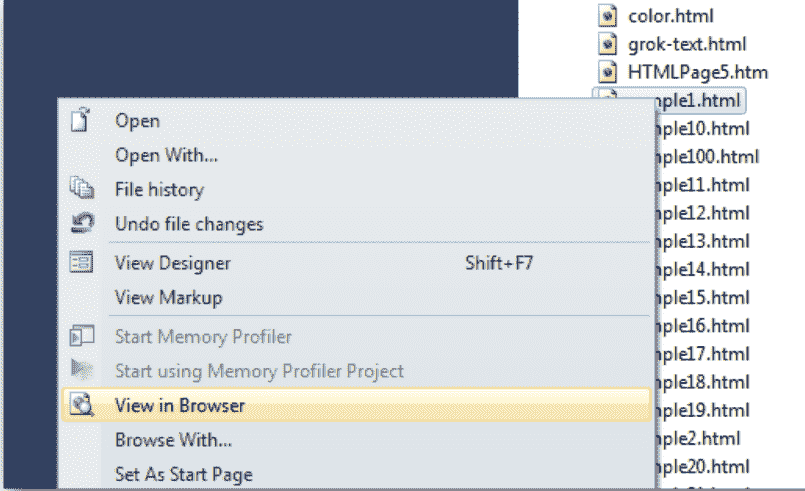

# jQuery 精要

序言：Daniel Jebaraj

## 第8章 插件

- 构建插件时使用 `$` 别名
- 新插件附加到 `jQuery.fn` 对象以成为 jQuery 方法
- 在插件内部，`this` 是对当前 jQuery 对象的引用
- 使用 `each()` 遍历 jQuery 对象，并使用 `this` 关键字提供对对象中每个元素的引用
- 插件返回 jQuery 对象，以便在使用插件后可以链式调用 jQuery 方法或其他插件
- 默认插件选项
- 自定义插件选项
- 在不修改原始插件代码的情况下覆盖默认选项
- 动态创建元素，以编程方式调用插件
- 提供回调函数并传递上下文

## 第9章 效果

- 禁用所有 jQuery 效果方法
- 深入理解 `stop()` 动画方法
- 使用 `:animated` 确定元素是否正在执行动画
- 使用 `show()`、`hide()` 和 `toggle()`，无动画效果
- 深入理解顺序和非顺序动画
- `Animate()` 是基础的、底层的抽象
- 深入理解 jQuery 淡入淡出方法

## 第10章 AJAX

- jQuery 的 `ajax()` 函数是底层抽象
- jQuery 支持跨域 JSONP
- 阻止浏览器缓存 XHR 请求

## *Succinctly* 系列书籍背后的故事

Daniel Jebaraj，副总裁

Syncfusion, Inc.

## 保持技术前沿

正如你们许多人可能知道的，Syncfusion 是微软平台软件组件的提供商。这使我们处于一个令人兴奋但又充满挑战的位置——始终处于技术前沿。

每当微软推出新的平台或工具时——如今这似乎每两周就有一次——我们都必须快速地自我学习。

## 信息丰富但更难消化

实际上，这意味着大量的图书订单、博客搜索和 Twitter 浏览。

虽然互联网上可用的信息越来越多，出版的书籍也越来越多，甚至包括一些相对较新的话题，但持续阻碍我们的一个方面是找不到简洁的技术概览书籍。

我们通常面临两种选择：阅读几本超过500页的书籍，或在网上搜寻相关的博客文章和其他文章。就像其他有工作要做、有客户要服务的人一样，我们发现这相当令人沮丧。

## *Succinctly* 系列

这种沮丧转化为一种强烈的愿望，即制作一系列简洁的技术书籍，面向在微软平台上工作的开发者。

我们坚信，考虑到这些开发者的背景知识，大多数主题都可以转化为50到100页之间的书籍。

这正是我们决心通过 *Succinctly* 系列实现的目标。一切美好的事物难道不都是源于改变现状的深切愿望吗？

## 最好的作者，最好的内容

每位作者都是从一群与我们有共同愿景的才华横溢的专家中精心挑选出来的。你手中现在拿着的这本书，以及本系列中的其他书籍，都是作者们不懈努力的结果。你会发现原创内容，保证在喝几杯咖啡的时间里就能让你上手并运行。

## 永久免费

Syncfusion 将致力于制作多个主题的书籍。这些书籍将始终免费。我们发布的任何更新也将是免费的。

## 免费？有什么陷阱吗？

这里没有陷阱。Syncfusion 在这项工作中有着既得利益。

作为组件供应商，我们独特的主张一直是，我们提供的框架比市场上任何其他供应商都更深入、更广泛。开发者教育极大地帮助我们进行市场营销和销售，与那些承诺“一键启用 AJAX 支持”或“把月亮变成奶酪！”的竞争供应商抗衡。

## 告诉我们你的想法

如果你有任何感兴趣的话题、想法或反馈，请随时通过 succinctly@syncfusion.com 发送给我们。

我们真诚地希望你喜欢这本书，并希望它能帮助你更好地理解学习主题。感谢你的阅读。

## 关于作者

科迪·林德利是一位基督徒、丈夫、儿子、父亲、兄弟、户外运动爱好者，也是一名[前端工程师](https://example.com/engineer)。自1997年以来，他一直对HTML、CSS、[JavaScript](https://example.com/javascript)、Flash、交互设计、界面设计和人机交互充满热情。他在jQuery社区最为人知的是创建了模态框/对话框解决方案[Thickbox](https://example.com/thickbox)。2008年，他正式加入jQuery团队，担任技术布道师。他目前专注于前端优化技术，并进行演讲和[撰写关于jQuery的文章](https://example.com/jquery)。他目前受雇于[TandemSeven](https://example.com/tandemseven)。

## 简介

*《jQuery精粹》*旨在快速阐述中级和高级jQuery开发所必需的核心概念。本书的目的是向读者灌输jQuery开发者视为常识的实践方法。每一章都包含了成为资深jQuery开发者所必需的核心概念。

本书面向三类读者。第一类是已经阅读过jQuery入门材料，并寻找下一步学习方向的读者。第二类是已经精通其他JavaScript库的开发者，现在希望快速学习jQuery。第三类读者是我自己，即本书的作者。我编写本书，将其作为我个人对jQuery概念的参考手册。这正是我希望每一本JavaScript库书籍都能提供的类型。

## 前言

在开始之前，了解本书所采用的各种风格细节非常重要。请不要跳过本节，因为它包含的信息将有助于你的阅读。

## jQuery语义

术语“jQuery函数”是指用于创建jQuery对象实例的jQuery构造函数（`jQuery()` 或别名 `$()`）。

术语“包装集”是指被jQuery方法包装的DOM元素。具体来说，该术语用于指代使用jQuery函数选中的元素。你可能听说过它被称为“jQuery集合”。在本书中，我将使用“包装集”而非“jQuery集合”。

## 本书结构

本书的章节组织大致基于[jQuery API文档](https://api.jquery.com/)的排列方式。每一章都包含与该章标题相关的、独立的jQuery概念。

## 代码为先，文字为辅

本书刻意编写，旨在让读者仔细研究代码示例。文字应被视为代码本身的辅助。在我看来，一个代码示例实际上价值千言万语。如果你最初觉得书中的解释令人困惑，请不要担心。仔细研究代码。动手尝试。重新阅读代码注释。重复这个过程，直到材料变得清晰。这正是我期望你达到的精通水平，即理解新的开发概念仅需阅读文档化的代码。

## 为什么我用了alert()作为代码示例？

相信我，我像你一样讨厌`alert()`方法。但无论喜欢与否，它在每个浏览器中都能可靠地工作。借用苏斯博士的一句话：它“在这里、那里和 everywhere”都能用！这未必是理想的选择，但我不希望`console`解决方案增加的复杂性影响代码的清晰度。我的目标是去除任何不直接支持所教概念的冗余代码。

## 颜色编码

代码将使用标准的JavaScript语法高亮进行着色（如Visual Studio中所示）。这将帮助你理解代码，但即使在像Kindle这样的单色电子书阅读器上阅读本书，你也会毫无问题。

示例：color.html

```
<!DOCTYPE html>
<html lang="en">

<body>
	<!-- HTML注释 -->
	<script src="http://ajax.googleapis.com/ajax/libs/jquery/1.7.2/jquery.min.js"></script>
	<script>
		// JavaScript注释
		var focusOnThisCode = true;
	</script>
</body>

</html>
```

## 在阅读本书前，请完全理解jQuery的text()方法

本书中的代码示例大量使用了jQuery的text()方法。你需要知道，当text()方法应用于包含多个元素的包装集时，它实际上会组合并返回包装集中所有元素包含的文本字符串。如果你原本期望它只返回包装集中第一个元素的文本，这可能会令人困惑。下面是text()方法如何连接包装集中元素内字符串的示例。

示例：grok-text.html

```
<!DOCTYPE html>
<html lang="en">

<body>
	<span>I</span>
	<span>love</span>
	<span>jQuery</span>
	<span>!</span>
	<script src="http://ajax.googleapis.com/ajax/libs/jquery/1.7.2/jquery.min.js"></script>
	<script>
alert(jQuery('span').text()); // 弹出 "I love jQuery!"
</script>
</body>
</html>
```

## 代码示例

本书主要依靠代码示例来表达jQuery概念。代码示例可在 [https://bitbucket.org/syncfusion/jquery-succinctly](https://bitbucket.org/syncfusion/jquery-succinctly) 获取。

代码示例以单个HTML文件的形式提供。还提供了一个Visual Studio 2010项目以便于浏览。你可以选择任何文件，右键单击，然后选择**在浏览器中查看**选项来测试代码。



示例文件的名称始终以其代码块上方 **Sample: $file-name.html** 的格式包含。

我鼓励你下载代码并跟随学习。我编写本书时，就预期到你将在阅读和学习过程中需要动手尝试代码。

## 第1章 核心jQuery

**jQuery背后的基本概念**

尽管jQuery API中存在一些概念上的变体（例如`$.ajax`等函数），但jQuery背后的核心概念是“找到某个东西，然后做一些事情”。更具体地说，是从HTML文档中选择DOM元素，然后使用jQuery方法对它们进行操作。这是宏观的概念。

为了深入理解这个概念，请思考下面的代码。

**示例：sample1.html**

```
<!DOCTYPE html>
<html lang="en">
<body>
    <!-- jQuery将修改此处 -->
    <a href=""></a>
    <!-- 改为 <a href="http://www.jquery.com">jQuery.</a> -->
    <script src="http://ajax.googleapis.com/ajax/libs/jquery/1.7.2/jquery.min.js"></script>
    <script>
        jQuery('a').text('jQuery').attr('href', 'http://www.jquery.com');
    </script>
</body>
</html>
```

注意，在这个HTML文档中，我们使用jQuery选择了一个DOM元素（`<a>`）。选中某个元素后，我们通过调用jQuery方法**text()**、**attr()**和**appendTo()**对选中的元素进行操作。

在包装好的`<a>`元素上调用的**text**方法将元素的显示文本设置为“jQuery”。**attr**调用将**href**属性设置为jQuery网站。

理解“找到某个东西，然后做一些事情”这一基础概念，对于jQuery开发者进阶至关重要。

### 概念背后的概念，jQuery背后的概念

虽然选择某个东西并做一些事情是jQuery背后的核心概念，但我想扩展这个概念，使其也包括“创建某个东西”。因此，jQuery背后的概念可以扩展为：首先创建新的东西，选择它，然后对它做一些事情。我们可以称之为“概念背后的概念，jQuery背后的概念”。

我试图说明的是，你不仅可以选择DOM中已经存在的东西。同样重要的是，要理解jQuery可以用来创建新的DOM元素，然后对这些元素进行操作。

在下面的代码示例中，我们创建了一个不在DOM中的新`<a>`元素。一旦创建，它被选中，然后被操作。

### 示例：sample2.html

```
<!DOCTYPE html>
<html lang="en">
    <body>
        <script src="http://ajax.googleapis.com/ajax/libs/jquery/1.7.2/jquery.min.js"></script>
        <script>
            jQuery('<a>jQuery</a>').attr('href', 'http://www.jquery.com').appendTo('body');
        </script>
    </body>
</html>
```

这里需要掌握的关键概念是，我们动态创建了`<a>`元素，然后像它已经在DOM中一样对其进行操作。

### jQuery要求HTML以标准模式或近乎标准模式运行

已知当浏览器以怪异模式渲染HTML页面时，jQuery方法可能无法正常工作。在使用jQuery时，请确保浏览器通过使用[有效的文档类型声明](http://example.com)以标准模式或近乎标准模式解释HTML。

为确保功能正常，本书中的代码示例使用HTML 5文档类型。

```
<!DOCTYPE html>
```

### 等待 DOM 就绪

当 DOM 加载完毕并可供操作时，jQuery 会触发一个名为 **ready** 的自定事件。操作 DOM 的代码可以放在该事件的处理程序中运行。这是 jQuery 使用中常见的模式。

以下示例展示了此自定义事件的三种使用方式。

### 示例：sample3.html

```
<!DOCTYPE html>
<html lang="en">
    <head>
        <script src="http://ajax.googleapis.com/ajax/libs/jquery/1.7.2/jquery.min.js"></script>
        <script>
            // 标准用法。
            jQuery(document).ready(function () { alert('DOM is ready!'); });

            // 快捷方式，与上面的写法效果相同。
            jQuery(function () { alert('No really, the DOM is ready!'); });

            // 带安全措施的快捷方式。请注意，
            // jQuery 函数的引用被传递给了匿名函数。
            jQuery(function ($) {
                    alert('Seriously its ready!');
                    // 可以放心使用 $()，不会有冲突。
            });
        </script>
    </head>
    <body></body>
</html>
```

请记住，你可以根据需要为文档附加任意多个 **ready()** 事件。并不限于一个。它们会按照添加的顺序依次执行。

### 当浏览器窗口完全加载后执行 jQuery 代码

通常，我们不希望等待 **window.onload** 事件。这正是使用 **ready()** 等自定义事件的意义所在——它在窗口加载前、但 DOM 已就绪可遍历和操作时执行代码。

然而，有时我们确实需要等待。虽然自定义的 **ready()** 事件在 DOM 可用时执行代码非常方便，但我们也希望使用 jQuery 在整个网页（包括所有资源）完全加载后再执行代码。

这可以通过为 **window** 对象附加 load 事件处理程序来实现。jQuery 提供了 **load()** 事件方法，可用于在窗口完全加载后调用一个函数。下面我提供一个使用 **load()** 事件方法的示例。

### 示例：sample4.html

```
<!DOCTYPE html>
<html lang="en">
    <head>
        <script src="http://ajax.googleapis.com/ajax/libs/jquery/1.7.2/jquery.min.js"></script>
        <script>
            // 将 window 传递给 jQuery 函数，并使用 load() 方法
            // 快捷方式附加事件处理程序。
            jQuery(window).load(function(){      alert('The page and all its assets are loaded!'); });
        </script>
    </head>

    <body></body>
</html>
```

### 在包含 jQuery 之前包含所有 CSS 文件

从 jQuery 1.3 开始，该库不再保证在触发自定义 **ready()** 事件之前加载所有 CSS 文件。由于 jQuery 1.3 的这一变更，你应该始终在包含任何 jQuery 代码之前包含所有 CSS 文件。这将确保浏览器在继续处理 HTML 文档中稍后包含的 JavaScript 之前，已经解析了 CSS。当然，通过 CSS 引用的图片是否在浏览器解析 JavaScript 时下载，则不确定。

### 使用托管版本的 jQuery

当将 jQuery 嵌入到网页中时，大多数人选择下载[源代码](https://docs.google.com/)并从个人域名/主机链接到它。然而，还有其他选择，即由他人代为托管 jQuery 代码。

Google 托管了多个版本的 jQuery 源代码，供任何人使用。这实际上非常方便。在下面的代码示例中，我使用一个 <script> 元素来包含由 Google 托管的 jQuery 压缩版本。

```
<script src="http://ajax.googleapis.com/ajax/libs/jquery/1.7.2/jquery.min.js"></script>
```

Google 还托管了 jQuery 源代码的多个以前的版本，并且为每个版本都提供了压缩版和非压缩版。我建议在开发期间使用非压缩版，因为处理非压缩代码时调试错误总是更容易。

使用 Google 托管版本的 jQuery 的好处在于它可靠、快速，并且可能被缓存。

### 不使用 ready() 在 DOM 解析后执行 jQuery 代码

自定义的 ready() 事件并非完全必需。如果你的 JavaScript 代码不影响 DOM，你可以将其放在 HTML 文档中的任何位置。这意味着，如果你的 JavaScript 代码不依赖于完整的 DOM，你可以完全避免使用 ready() 事件。

如今大多数 JavaScript，尤其是 jQuery 代码，都会涉及操作 DOM。这意味着 DOM 必须被浏览器完全解析后你才能对其进行操作。这一事实正是开发者多年来一直困扰于 window.onload 这个 "过山车" 的原因。

对于需要操作 DOM 的代码，要避免使用 ready() 事件，你只需将代码放在 HTML 文档中 `</body>` 元素之前即可。这样做确保了 DOM 已完全加载，因为浏览器会从上到下解析文档。如果你将 JavaScript 代码放在它所操作的 DOM 元素之后，则无需使用 ready() 事件。

在下面的示例中，我没有使用 ready()，而是简单地将我的脚本放在文档 body 关闭之前。这是我在本书以及我构建的大多数网站中使用的技术。

### 示例：sample5.html

```
<!DOCTYPE html>
<html lang="en">
<body>
    <p>
        Hi, I'm the DOM! Script away!</p>
    <script src="http://ajax.googleapis.com/ajax/libs/jquery/1.7.2/jquery.min.js"></script>
    <script>        alert(jQuery('p').text()); </script>
</body>
</html>
```

如果我将 `<script>` 放在 `<p>` 元素之前，它会在浏览器加载 `<p>` 元素之前执行。这将导致 jQuery 认为文档不包含任何 `<p>` 元素。然而，如果我使用 jQuery 自定义的 `ready()` 事件，那么 jQuery 将等到 DOM 就绪后才执行代码。但是，既然我们可以控制 `<script>` 元素在文档中的位置，为什么还要这样做呢？将 jQuery 代码放在页面底部可以避免使用 `ready()` 事件。事实上，将所有 JavaScript 代码放在页面底部是一个经过验证的[性能策略](http://)。

### 理解 jQuery 链式操作

一旦你使用 jQuery 函数选择了某些元素并创建了一个包装集，你实际上可以将 jQuery 方法链接到包装集内包含的 DOM 元素上。从概念上讲，jQuery 方法通过始终返回 jQuery 包装集来延续链，该包装集随后可以被链中的下一个 jQuery 方法使用。注意：大多数 jQuery 方法是可链接的，但并非全部。

你应该始终尝试通过利用链式操作来重用包装集。在下面的代码中，`text()`、`attr()` 和 `addClass()` 方法被链接在一起。

**示例：sample6.html**

```
<!DOCTYPE html>
<html lang="en">
<body>
    <a></a>
    <script src="http://ajax.googleapis.com/ajax/libs/jquery/1.7.2/jquery.min.js"></script>
    <script> (function ($) {
      $('a').text('jQuery') // 设置文本为 jQuery，然后返回 $('a')。
         .attr('href', 'http://www.jquery.com/') // 设置 href 属性，然后返回 $('a')。
         .addClass('jQuery'); // 设置 class，然后返回 $('a')。
    })(jQuery) </script>
</body>
</html>
```

### 使用破坏性方法中断链

如前所述，并非所有 jQuery 方法都保持链式操作。像 `text()` 这样的方法在用于设置元素的文本节点时可以链接。然而，`text()` 在用于获取元素内包含的文本节点时实际上会中断链。

在下面的示例中，`text()` 被用于设置然后获取 `<p>` 元素内包含的文本。

### 示例：sample7.html

```
<!DOCTYPE html>
<html lang="en">
<body>
    <p></p>
    <script
src="http://ajax.googleapis.com/ajax/libs/jquery/1.7.2/jquery.min.js"></script>
    <script> (function ($) {
        var theText = $('p').text('jQuery').text(); // 返回字符串 "jQuery"。
        alert(theText);
        // 无法在 text() 之后链接。链被中断了。
        // 返回的是一个字符串，而不是 jQuery 对象。
    })(jQuery) </script>
</body>
</html>
```

使用 `text()` 获取元素内包含的文本是链中断的一个典型例子，因为该方法将返回一个包含文本节点的字符串，而不是 jQuery 包装集。

如果一个 jQuery 方法不返回 jQuery 包装集，那么链就被中断了，这不足为奇。这种方法被认为是破坏性的。

### 使用破坏性 jQuery 方法并通过 end() 退出破坏

会改变所选原始 jQuery 包装集的 jQuery 方法被认为是破坏性的。原因在于它们没有保持包装集的原始状态。不用担心，并没有什么被真正破坏或移除。相反，之前的包装集被附加到了一个新的集合上。

然而，一旦原始包装集被改变，链式操作的乐趣并不一定要停止。使用 `end()` 方法，你可以退出对原始包装集所做的任何破坏性更改。查看以下示例中 `end()` 方法的用法，以了解如何在 DOM 元素中进退操作。

### 示例：sample8.html

```html
<!DOCTYPE html>
<html lang="en">
<body>
    <style>
        .last
        {
            background: #900;
        }
    </style>
    <ul id="list">
        <li></li>
        <li>
            <ul>
                <li></li>
                <li></li>
                <li></li>
            </ul>
        </li>
        <li></li>
        <li></li>
    </ul>
    <script src="http://ajax.googleapis.com/ajax/libs/jquery/1.7.2/jquery.min.js"></script>
    <script> (function ($) {
        $('#list') // 原始包装器集。
            .find('> li') // 破坏性方法。
                .filter(':last') // 破坏性方法。
                    .addClass('last')
                .end() // 结束 .filter(':last')。
            .find('ul') // 破坏性方法。
                .css('background', '#ccc')
                .find('li:last') // 破坏性方法。
                    .addClass('last')
                .end() // 结束 .find('li:last')
            .end() // 结束 .find('ul')
        .end() // 结束 .find('> li')
        .find('li') // 回到原始的 $('#list')
            .append('I am an &lt;li&gt;');
    })(jQuery); </script>
</body>
</html>
```

### jQuery 函数的各个方面

jQuery 函数具有多面性。我们可以向其传递不同的值和字符串格式，它就能利用这些执行独特的功能。以下是 jQuery 函数的几种用法：

- 使用 CSS 表达式和自定义 jQuery 表达式从 DOM 中选择元素，以及使用 DOM 引用选择元素：`jQuery('p > a')` 或 `jQuery(':first')` 和 `jQuery(document.body)`

- 通过传递 HTML 字符串结构或创建 DOM 元素的 DOM 方法来动态创建 HTML：`jQuery('<div id="nav"></div>')` 或 `jQuery(document.createElement('div'))`

- 通过向 jQuery 函数传递一个函数作为 `ready()` 事件的快捷方式：`jQuery(function($){ /* ready() 的快捷方式 */ })`

下面的代码示例详细说明了每种用法。

### 示例：sample9.html

```html
<!DOCTYPE html>
<html lang="en">
<body>
    <script src="http://ajax.googleapis.com/ajax/libs/jquery/1.7.2/jquery.min.js"></script>
    <script> jQuery(function($){ // 向 jQuery 传递一个函数。
        // 向 jQuery 传递一个 HTML 字符串。
        $('<p></p>').appendTo('body');
        // 向 jQuery 传递一个元素引用。
        $(document.createElement('a')).text('jQuery').appendTo('p');
        // 向 jQuery 传递一个 CSS 表达式。
        $('a:first').attr('href', 'http://www.jquery.com');
        // 向 jQuery 传递一个 DOM 引用。
        $(document.anchors[0]).attr('jQuery');
    }); </script>
</body>
</html>
```

### 理解关键字 this 何时引用 DOM 元素

当为包装器集中包含的 DOM 元素附加事件时，可以使用关键字 `this` 来引用触发事件的当前 DOM 元素。以下示例包含一段 jQuery 代码，它将为页面中的每个 `<a>` 元素附加一个自定义的 `mouseenter` 事件。原生 JavaScript 的 `mouseover` 事件在光标进入或离开子元素时都会触发，而 jQuery 的 `mouseenter` 则不会。

示例：sample10.html

```html
<!DOCTYPE html>
<html lang="en">
<body>
    <a id="link1">jQuery.com</a>
    <a id="link2">jQuery.com</a>
    <a id="link3">jQuery.com</a>
    <script src="http://ajax.googleapis.com/ajax/libs/jquery/1.7.2/jquery.min.js"></script>
    <script> (function ($)
    {
        $('a').mouseenter(
            function () { alert(this.id); });
    })(jQuery);
    </script>
</body>
</html>
```

在传递给 **mouseenter()** 方法的匿名函数内部，我们使用关键字 **this** 来引用当前的 `<a>` 元素。每当鼠标悬停在 "jQuery.com" 文本上时，浏览器将通过识别其 **id** 属性值来警告鼠悬停在哪个元素上。

在前面的示例中，也可以获取 **this** 引用并将其传递给 jQuery 函数，以便用 jQuery 功能包装该 DOM 元素。

因此，与其这样：

```javascript
// 访问 DOM 元素的 ID 属性。
alert(this.id);
```

我们可以这样做：

```javascript
// 用 jQuery 对象包装 DOM 元素，
// 然后使用 attr() 访问 ID 值。
alert($(this).attr('id'));
```

这是可行的，因为 jQuery 函数不仅接受选择器表达式，它也会接受对 DOM 元素的引用。在代码中，**this** 是对一个 DOM 元素的引用。

你可能想要用 jQuery 功能包装 DOM 元素的原因应该是显而易见的。这样做让你能够使用 jQuery 链式调用，以防你需要。

遍历 jQuery 包装器集中包含的元素集与我们刚刚讨论的概念有些相似。通过使用 jQuery 的 **each()** 方法，我们可以遍历包装器集中包含的每个 DOM 元素。这允许通过使用 **this** 关键字单独访问每个 DOM 元素。

在前一个示例的标记基础上，我们可以选择页面中的所有 `<a>` 元素，并使用 **each()** 方法遍历包装器集中的每个 `<a>` 元素，访问其 **id** 属性。下面是一个示例。

### 示例：sample11.html

```html
<!DOCTYPE html>
<html lang="en">
<body><a id="link1">jQuery.com</a> <a id="link2">jQuery.com</a> <a
id="link3">jQuery.com</a>
    <script
src="http://ajax.googleapis.com/ajax/libs/jquery/1.7.2/jquery.min.js"></script>
    <script>  (function ($) {
        $('a').each(function(){
            // 循环警告页面中每个 <a> 的 id 值。
            alert($(this).attr('id')); // "this" 指向循环中的当前元素。
        });
    })(jQuery); </script>
</body>
</html>
```

如果你在浏览器中加载 HTML，浏览器将警告页面中每个 `<a>` 元素的 id 值。由于页面中有三个 `<a>` 元素，你将通过 each() 方法获得三次迭代和三个警告窗口。

### 从包装器集中提取元素，直接使用它们而不经过 jQuery

仅仅因为你用 jQuery 功能包装了一个 HTML 元素，并不意味着你失去了对实际 DOM 元素本身的访问。你总是可以从包装器集中提取一个元素，并通过原生 JavaScript 操作该元素。例如，在下面的代码中，我通过操作 `<a>` DOM 元素的原生 title 属性来设置 HTML 页面中 `<a>` 元素的 title 属性。

### 示例：sample12.html

```html
<!DOCTYPE html>
<html lang="en">
<body>
    <a>jQuery.com</a>
    <script
src="http://ajax.googleapis.com/ajax/libs/jquery/1.7.2/jquery.min.js"></script>
    <script>  (function ($) {
        // 使用 DOM 节点属性设置 title 属性。
        $('a').get(0).title = 'jQuery.com';
        // 使用 jQuery 方法操作 DOM 元素。
        $('a').attr('href', 'http://www.jquery.com');
    })(jQuery);
    </script>
</body>
</html>
```

如所示，jQuery 提供了便捷的 **get()** 方法，用于访问包装器集中特定索引处的 DOM 元素。

但这里还有另一个选择。你可以通过直接在 jQuery 对象上使用方括号数组表示法来避免使用 **get()** 方法。在我们之前的代码示例上下文中：

这段代码：

```javascript
$('a').get(0).title = 'jQuery.com';
```

可以变成这样：

```javascript
$('a')[0].title = 'jQuery.com';
```

两者都允访问实际的 DOM 元素。就个人而言，我更喜欢方括号表示法。它更快，因为它使用原生 JavaScript 从数组中检索元素，而不是将其传递给方法。

然而，**get()** 方法提供了一个巧妙的解决方案，可以将所有 DOM 元素放入一个原生数组中。只需在不传递索引参数的情况下调用 **get()** 方法，该方法将在一个原生 JavaScript 数组中返回包装器集中的所有 DOM 元素。

为了演示，让我们试用一下 **get()**。在下面的代码中，我将所有 `<a>` 元素放入一个数组中。然后，我使用该数组访问页面上第三个 `<a>` DOM 对象的 title 属性。

### 示例：sample13.html

```html
<!DOCTYPE html>
<html lang="en">
<body>
    <a href="http://www.jquery.com" title="anchor1">jQuery.com</a>
    <a href="http://www.jquery.com" title="anchor2">jQuery.com</a>
    <a href="http://www.jquery.com" title="anchor3">jQuery.com</a>
    <script
src="http://ajax.googleapis.com/ajax/libs/jquery/1.7.2/jquery.min.js"></script>
    <script>  (function ($) {
        var arrayOfAnchors = $('a').get(); // 从包装器集创建原生数组。
        alert(arrayOfAnchors[2].title); // 警告第三个链接。
            })</script>
</body>
</html>
```

$(jQuery);

</script>

</body>

</html>

> **注意：**

使用`get()`会结束jQuery的链式调用。它会将包装集转换为一个简单的DOM元素数组，这些元素不再具有jQuery功能的包装。因此，在`.get()`之后使用`.end()`方法无法恢复链式调用。

### 检查包装集是否为空

在对包装集进行操作之前，检查是否确实选择了某些内容是合乎逻辑的。最简单的解决方案是使用`if`语句检查包装集是否包含任何DOM元素。

### 示例：sample14.html

```
<!DOCTYPE html>
<html lang="en">
<body>
    <a>jQuery</a>
    <script src="http://ajax.googleapis.com/ajax/libs/jquery/1.7.2/jquery.min.js"></script>
    <script>
        if (jQuery('a').get(0)) { // 集合中是否有元素？
            jQuery('a').attr('href', 'http://www.jquery.com');
        }
        if (jQuery('a').length) { // 检查集合的长度。也可以使用 .size()
            jQuery('a').attr('title', 'jQuery');
        }
    </script>
</body>
</html>
```

事实是，上面的`if`语句并非完全必要，因为如果找不到元素，jQuery会静默失败。但是，链接到任何空包装集的每个方法仍然会被调用。因此，虽然我们实际上可以不用`if`语句，但使用它们可能是一个好的经验法则。在空包装集上调用方法可能会导致不必要的处理，如果方法返回的值不是包装集，并且这些值被用于后续操作，则可能产生不理想的结果。

### 通过重命名jQuery对象本身来创建别名

jQuery提供了`noConflict()`方法，它有多种用途——即能够用另一个别名替换`$`。这在三个方面很有帮助：它可以将`$`符号的使用权让给另一个库，帮助避免潜在的冲突，并提供为jQuery对象自定义命名空间/别名的能力。

例如，假设你正在为XYZ公司构建一个Web应用程序。自定义jQuery可能会很不错，这样你就不必使用`jQuery('div').show()`或`$('div').show()`，而是可以使用`XYZ('div').show()`。

### 示例：sample15.html

```
<!DOCTYPE html>
<html lang="en">
<body>
    <div>Syncfusion., Inc.</div>
    <script src="http://ajax.googleapis.com/ajax/libs/jquery/1.7.2/jquery.min.js"></script>
    <script>
        var Syncfusion = jQuery.noConflict();
        // 使用jQuery方法做一些事情。
        alert(Syncfusion("div").text());
    </script>
</body>
</html>
```

> **注意：**

通过向`noConflict()`函数传递一个布尔值true，你可以完全撤销jQuery引入到网页中的内容。这应该只在极端情况下使用，因为它很可能导致jQuery插件出现问题。

### 当隐式迭代不够时使用.each()

希望很明显，如果你有一个HTML页面（如下例所示），其中包含三个空的`<div>`元素，下面的jQuery语句将选择页面上的所有三个元素，遍历这三个元素（隐式迭代），并在所有三个`<div>`元素中插入文本"I am a div"。

### 示例：sample16.html

```
<!DOCTYPE html>
<html lang="en">
<body>
    <div></div>
    <div></div>
    <div></div>
    <script src="http://ajax.googleapis.com/ajax/libs/jquery/1.7.2/jquery.min.js"></script>
    <script>  (function ($) {
    $('div').text('I am a div');
})(jQuery);
</script>
</body>
</html>
```

这被称为隐式迭代，因为jQuery代码假设你想操作所有三个元素，这需要遍历选定的元素，并用文本"I am a div"设置每个`<div>`的文本节点值。当默认完成此操作时，称为隐式迭代。

这非常方便。在大多数情况下，大多数jQuery方法会应用隐式迭代。然而，其他方法仅应用于包装集中的第一个元素。例如，当用于获取属值时，jQuery方法`attr()`仅访问包装集中的第一个元素。

> **注意：**

当使用`attr()`方法设置属性时，jQuery实际上会应用隐式迭代来将属性及其值设置给包装集中的所有元素。

在下面的代码中，包装集包含页面中所有的`<div>`元素，但`attr()`方法仅返回包装集中包含的第一个元素的`id`值。

### 示例：sample17.html

```
<!DOCTYPE html>
<html lang="en">
<body>
    <div id="div1">I am a div</div>
    <div id="div2">I am a div</div>
    <div id="div3">I am a div</div>
    <script src="http://ajax.googleapis.com/ajax/libs/jquery/1.7.2/jquery.min.js"></script>
    <script>  (function($){
        // 弹出包装集中第一个元素的属性值。
        alert($('div').attr('id')); // 弹出 "div1"。
    })(jQuery); </script>
</body>
</html>
```

为了演示，假设你的目标实际上是获取页面上每个元素的**id**属性值。你可以编写三个单独的jQuery语句来访问每个`<div>`元素的**id**属性值。如果我们这样做，它可能看起来像这样：

```
$('#div1').attr('id');
$('#div2').attr('id');
$('#div3').attr('id');
// 或者
var $divs = $('div'); // 缓存的查询。
$divs.eq(0).attr('id'); // 从0开始而不是1。
$divs.eq(1).attr('id');
$divs.eq(2).attr('id');
```

这看起来有点冗长，不是吗？如果我们能够循环遍历包装集，并简单地从每个`<div>`元素中提取**id**属性值，那不是很好吗？通过使用$().each()方法，当我们的包装集需要显式迭代来处理多个元素时，我们调用了另一轮迭代。

在下面的代码示例中，我使用$().each()方法循环遍历包装集，访问集合中的每个元素，然后提取其**id**属性值。

### 示例：sample18.html

```
<!DOCTYPE html>
<html lang="en">
<body>
    <div id="div1">div1</div>
    <div id="div2">div2</div>
    <div id="div3">div3</div>
    <script src="http://ajax.googleapis.com/ajax/libs/jquery/1.7.2/jquery.min.js"></script>
    <script> (function($){
        // 3次弹出，每个div一次。
        $('div').each(function(){
            // "this" 是包装集中的每个元素。
            alert($(this).attr('id'));
            // 也可以写成：alert(this.id);
        });
    })(jQuery);
    </script>
</body>
</html>
```

想象一下，能够随时强制进行迭代，这为你带来的可能性。

> **注意：**

jQuery还提供了一个$.each函数，不要与专门用于迭代jQuery包装集的$().each方法混淆。$.each方法实际上可以用于迭代任何旧的JavaScript数组或对象。它本质上是原生JavaScript循环的替代品。

### jQuery包装集中的元素按文档顺序返回

选择器引擎将按文档顺序返回结果，而不是选择器传入的顺序。包装集将根据每个元素在文档中从上到下出现的顺序填充选定的元素。

### 示例：sample19.html

```
<!DOCTYPE html>
<html lang="en">
<body>
    <h1>h1</h1>
    <h2>h2</h2>
    <h3>h3</h3>
    <script src="http://ajax.googleapis.com/ajax/libs/jquery/1.7.2/jquery.min.js"></script>
    <script> (function ($) {
        // 我们先传入h3，但h1在文档中出现得更早，
        // 所以它在包装集中是第一个。
        alert($('h3, h2, h1').get(0).nodeName);
        // 弹出 "H1"。
    })(jQuery);
    </script>
</body>
</html>
```

### 确定jQuery函数使用的上下文

jQuery函数在选择DOM元素时使用的默认上下文是文档元素（例如，`$('a', document)`）。这意味着如果你没有为jQuery函数（例如，`jQuery()`）提供第二个参数作为DOM查询的上下文，那么使用的默认上下文是文档元素，通常被称为`<body>`。

可以使用 **context** 属性来确定 jQuery 函数执行 DOM 查询时的上下文。以下我通过两个编码示例展示如何获取 context 属性的值。

**示例：sample20.html**

```
<!DOCTYPE html>
<html lang="en">
<body>
    <div>
        <div>
            <div id="context"><a href="#">jQuery</a></div>
        </div>
    </div>
    <script src="http://ajax.googleapis.com/ajax/libs/jquery/1.7.2/jquery.min.js"></script>
    <script> (function ($) {
        // 在 Firefox 中提示 "object HTMLDocument"。
        // 等同于 $('a', document).context;
        alert($('a').context);
        // 在 Firefox 中提示 "object HTMLDivElement"。
        alert($('a', $('#context')[0]).context);
    })(jQuery); </script>
</body>
</html>
```

### 通过单次链式调用创建整个 DOM 结构（包括 DOM 事件）

通过利用链式操作和 jQuery 方法，不仅可以创建单个 DOM 元素，还能创建完整的 DOM 结构。下面我创建一个包含 jQuery 链接的无序列表，并将其添加到 DOM 中。

**示例：sample21.html**

```
<!DOCTYPE html>
<html lang="en">
<body>
    <script src="http://ajax.googleapis.com/ajax/libs/jquery/1.7.2/jquery.min.js"></script>
    <script> (function ($) {
        jQuery('<ul></ul>')
            .append('<li><a>jQuery.com</a></li><li><a>jQuery Documentation</a></li>')
            .find('a:first')
            .attr('href', 'http://www.jquery.com')
            .end()
            .find('a:eq(1)')
            .attr('href', 'http://docs.jquery.com')
            .end()
            .appendTo('body');
    })(jQuery); </script>
</body>
</html>
```

```
.attr('href', 'http://docs.jquery.com')
.end()
.find('a')
.click(function () { return confirm('Leave this page?'); })
.end()
.appendTo('body');
})(jQuery); </script>
</body>
</html>
```

从前一个示例中你需要理解的关键点是，jQuery 可以用来构建和操作复杂的 DOM 结构。仅使用 jQuery 方法，你就能快速搭建出所需的任何 DOM 结构。

## 第 2 章 选择

### 自定义 jQuery 过滤器可以单独使用来选择元素

过滤器不一定非要与具体元素一起使用，例如 `$('div:hidden')`。在任何需要选择器表达式的地方，都可以直接传递过滤器。

一些例子：

```
// 选择所有隐藏的元素
$(':hidden');
// 选择所有 div 元素，然后仅选择偶数索引的元素
$('div').filter(':even');
```

### 理解 :hidden 和 :visible 过滤器

自定义的 jQuery 选择器过滤器 `:hidden` 和 `:visible` 并不像人们通常认为的那样考虑 CSS 的 `visibility` 属性。jQuery 判断元素是否隐藏或可见的方式是看该元素是否在文档中占据任何空间。确切地说，如果元素在浏览器报告的 `offsetWidth` 或 `offsetHeight` 大于 0，则该元素是可见的。这样，一个可能具有 `display:block` CSS 值但被包含在一个 `display:none` 的元素内的元素，会准确报告为不可见。

仔细检查代码，确保你理解为什么返回值是 `true`，即使被选中的 `<div>` 有内联样式 `display:block`。

**示例：sample22.html**

```
<!DOCTYPE html>
<html lang="en">
<body>
    <div id="parentDiv" style="display: none;">
        <div id="childDiv" style="display: block;"></div>
    </div>
    <script src="http://ajax.googleapis.com/ajax/libs/jquery/1.7.2/jquery.min.js"></script>
    <script> (function($){
        // 返回 true，因为父 div 是隐藏的，所以
        // 被包裹的 div 报告 offsetWidth 和 offsetHeight 为零。
        alert($('#childDiv').is(':hidden'));
    })(jQuery); </script>
</body>
</html>
```

### 使用 **is()** 方法返回布尔值

经常需要判断选中的元素集合是否确实包含特定元素。使用 **is()** 方法，我们可以将当前集合与一个表达式/过滤器进行检查。如果集合中至少有一个元素被给定的表达式/过滤器选中，则检查将返回 **true**。如果不包含该元素，则返回 **false** 值。检查以下代码：

**示例：sample23.html**

```
<!DOCTYPE html>
<html lang="en">
<body>
    <div id="i0">jQuery</div>
    <div id="i1">jQuery</div>
    <script src="http://ajax.googleapis.com/ajax/libs/jquery/1.7.2/jquery.min.js"></script>
    <script>  (function($){
        // 返回 true。
        alert($('div').is('#i1'));
        // 返回 false。包装器集合中不包含 id="i2" 的 <div>。
        alert($('div').is('#i2'));
        // 返回 false。包装器集合中不包含隐藏的 <div>
        alert($('div').is(':hidden'));
    })(jQuery);  </script>
</body>
</html>
```

很明显，第二个 **alert()** 将返回 false，因为我们的包装器集合中不包含 **id** 属性值为 **i2** 的 **<div>**。**is()** 方法对于判断包装器集合是否包含特定元素非常方便。

> **注意：**

> 从 jQuery 1.3 开始，**is()** 方法支持所有表达式。之前，包含层级选择器（如 +、~ 和 >）的复杂表达式总是返回 **true**。

> 过滤器被其他内部 jQuery 函数使用。因此，适用于那些函数的所有规则，也同样适用于此。

> 一些开发者使用 **is('.class')** 来判断元素是否有特定的类。不要忘记 jQuery 已经有一个执行此操作的方法，叫做 **hasClass('class')**，它可以用于包含多个类值的元素。但说实话，**hasClass()** 只是 **is()** 方法的一个便捷包装器。

### 你可以向 jQuery 传递多个选择器表达式

你可以向 jQuery 函数的第一个参数提供多个用逗号分隔的表达式：`$('expression, expression, expression')`。换句话说，你不仅限于使用单个表达式来选择元器。例如，在下面的例子中，我向 jQuery 函数传递了三个用逗号分隔的表达式。

**示例：sample24.html**

```
<!DOCTYPE html>
<html lang="en">
<body>
    <div>jQuery </div>
    <p>is the </p>
    <ul>
        <li>best!</li>
    </ul>
    <script src="http://ajax.googleapis.com/ajax/libs/jquery/1.7.2/jquery.min.js"></script>
    <script>  (function ($) {
        // 提示 jQuery is the best!
        alert($('div, p, ul li').text());
        // 低效的方式。提示 jQuery is the best!
        alert($('div').text() + $('p').text() + $('ul li').text());
    })(jQuery); </script>
</body>
</html>
```

这些表达式中的每一个都会选择 DOM 元素，这些元素都被添加到包装器集合中。然后我们可以使用 jQuery 方法来操作这些元素。请记住，所有选中的元素都将放在同一个包装器集合中。一个低效的方法是调用 jQuery 函数三次，每个表达式调用一次。

### 检查包装器集合的 .length 来确定选择结果

通过检查包装器集合是否具有 length 属性，可以判断你的表达式是否选中了任何内容。你可以使用数组属性 `length` 来做到这一点。如果 `length` 属性不返回 0，那么你就知道至少有一个元素与你传递给 jQuery 函数的表达式匹配。例如，在下面的代码中，我们检查页面中是否存在一个 `id` 为 "notHere" 的元素。猜猜怎么着？它不在那里！

**示例：sample25.html**

```
<!DOCTYPE html>
<html lang="en">
<body>
    <script src="http://ajax.googleapis.com/ajax/libs/jquery/1.7.2/jquery.min.js"></script>
    <script> (function($){
        // 提示 "0"。
        alert($('#notHere').length);
    })(jQuery); </script>
</body>
</html>
```

> **注意：**

> 如果不明显，length 属性也可以报告包装器集合中的元素数量——换句话说，就是有多少元素被传递给 jQuery 函数的表达式选中。

### 创建自定义过滤器来选择元素

通过创建自己的自定义过滤器，可以扩展 jQuery 选择器引擎的能力。理论上，你所做的只是在 jQuery 已有的自定义选择器基础上进行构建。例如，假设我们想要选择网页上所有绝对定位的元素。由于 jQuery 目前没有自定义的 :positionAbsolute 过滤器，我们可以自己创建一个。

**示例：sample26.html**

```
<!DOCTYPE html>
<html lang="en">
<body>
    <div style="position: absolute">absolute</div>
    <span style="position: absolute">absolute</span>
    <div>static</div>
    <div style="position: absolute">absolute</div>
    <div>static</div>
    <span style="position: absolute">absolute</span>
    <script src="http://ajax.googleapis.com/ajax/libs/jquery/1.7.2/jquery.min.js"></script>
    <script> function ($) {
        // 通过扩展 $.expr[':'] 来定义自定义过滤器
        $.expr[':'].positionAbsolute = function (element)
        { return $(element).css('position') === 'absolute'; };
        // 页面中有多少个元素是绝对定位的？
        alert($(':positionAbsolute').length); // 提示 "4"
        // 有多少个 div 元素是绝对定位的？
        alert($('div:positionAbsolute').length); // 提示 "2".
```

}

### 深入理解 :nth-child() 过滤器

:nth-child() 过滤器有许多用途。例如，假设你只想选择 `<ul>` 元素内每第三个 `<li>` 元素。使用 :nth-child() 过滤器可以实现。请研究以下代码，以更好地理解如何使用 :nth-child() 过滤器。

### 示例: sample32.html

```html
<!DOCTYPE html>
<html lang="en">
<body>
    <ul>
        <li>1</li>
        <li>2</li>
        <li>3</li
        <li>4</li>
        <li>5</li>
        <li>6</li>
        <li>7</li>
        <li>8</li>
        <li>9</li>
        <li>10</li>
    </ul>
    <script src="http://ajax.googleapis.com/ajax/libs/jquery/1.7.2/jquery.min.js"></script>
    <script> (function ($) {
        // Remember that text() combines the contents of all
        // elements in the wrapper set into a single string.
        // By index.
        alert($('li:nth-child(1)').text()); // Alerts "1".
        // By even.
        alert($('li:nth-child(even)').text()); // Alerts "246810".
        // By odd.
        alert($('li:nth-child(odd)').text()); // Alerts "13579".
        // By equation.
        alert($('li:nth-child(3n)').text()); // Alerts "369".
        // Remember this filter uses a 1 index.
        alert($('li:nth-child(0)').text()); // Alerts nothing. There is no 0 index.
    })(jQuery); </script>
</body>
</html>
```

### 使用正则表达式通过搜索属性值选择元素

当用于选择元素的 jQuery 属性过滤器不够强大时，可以尝试使用正则表达式。James Padolsey 编写了一个不错的过滤选择器扩展，允许我们创建自定义正则表达式进行过滤。我在这里提供了一个代码示例，但请务必查看 http://james.padolsey.com 上的文章以获取所有详细信息。

### 示例: sample33.html

```html
<!DOCTYPE html>
<html lang="en">
<body>
    <div id="123"></div>
    <div id="oneTwoThree"></div>
    <div id="0"></div>
    <div id="zero"><div>

<script src="http://ajax.googleapis.com/ajax/libs/jquery/1.7.2/jquery.min.js"></script>
<script>  (function ($) {
        //James Padolsey filter extension.
        jQuery.expr[':'].regex = function (elem, index, match) {
            var matchParams = match[3].split(','), validLabels = /^(data|css):/, attr = {
method: matchParams[0].match(validLabels) ? matchParams[0].split(':')[0] : 'attr',
property: matchParams.shift().replace(validLabels, '') }, regexFlags = 'ig', regex = new
RegExp(matchParams.join('').replace(/^\s+|\s+$/g, ''), regexFlags);
            return regex.test(jQuery(elem)[attr.method](attr.property));
        }
        // Select div's where the id attribute contains numbers.
        alert($('div:regex(id,[0-9])').length); // Alerts "2".
        // Select div's where the id attribute contains the string "Two".
        alert($('div:regex(id, Two)').length); // Alerts "1".
    })(jQuery); </script>
</body>
</html>
```

### 选择直接子元素与所有后代元素的区别

只能通过组合器 `>` 或 `children()` 遍历方法选择直接子元素。可以使用 `*` CSS 表达式选择所有后代元素。请确保你清楚理解两者之间的区别。以下示例演示了它们的不同。

### 示例: sample34.html

```html
<!DOCTYPE html>
<html lang="en">
<body>
    <div>
        <p><strong><span>text</span></strong></p>
        <p><strong><span>text</span></strong></p>
    </div>
    <script
src="http://ajax.googleapis.com/ajax/libs/jquery/1.7.2/jquery.min.js"></script>
    <script> (function ($) {
        // Each statement alerts "2" because there are
        // two direct child <p> elements inside of <div>.
        alert($('div').children().length);
        // or
        alert($('>*', 'div').length);
        alert($('div').find('>*').length);

        // Each statement alerts 6 because the <div> contains
        // 6 descendants, not including the text node.
        alert($('div').find('*').length);
        // or
        alert($('*', 'div').length);
    })(jQuery); </script>
</body>
</html>
```

### 当已设置上下文时选择直接子元素

当已提供上下文时，可以使用组合器 `>` 而无需上下文来选择直接子元素。请研究以下代码。

### 示例: sample35.html

```html
<!DOCTYPE html>
<html lang="en">
<body>
    <ul id="firstUL">
        <li>text</li>
        <li>
            <ul id="secondUL">
                <li>text</li>
                <li>text</li>
            </ul>
        </li>
        <li>text</li>
    </ul>
    <script
src="http://ajax.googleapis.com/ajax/libs/jquery/1.7.2/jquery.min.js"></script>
    <script> (function ($) {
        // Select only the direct <li> children. Alerts "3".
        alert($('#ul:first').find('> li').length); // or
        alert($("> li", 'ul:first').length);
    }
    )(jQuery); </script>
</body>
</html>
```

基本上，当上下文已确定时，`'> element'` 可以用作表达式。

## 第 3 章 遍历

### **find()** 和 **filter()** 方法的区别

**filter()** 方法用于过滤包装集内当前包含的元素集。其使用应留给那些需要过滤已选元素集的任务。例如，下面的代码将过滤包装集中的三个 `<p>` 元素。

### 示例: sample36.html

```html
<!DOCTYPE html>
<html lang="en">
<body>
    <p><strong>first</strong></p>
    <p>middle</p>
    <p><strong>last</strong></p>
    <script
src="http://ajax.googleapis.com/ajax/libs/jquery/1.7.2/jquery.min.js"></script>
    <script>  (function ($) {  // Alerts middle, by filtering out the first
      // and last <p> elements in the wrapper set.
      alert($('p').filter(':not(:first):not(:last)').text());
    })(jQuery); </script>
</body>
</html>
```

> **注意：**

> 使用 **filter()** 时，始终要问自己是否绝对必要。例如，`$('p').filter(':not(:first):not(:last)')` 可以在不使用 **filter()** 的情况下，通过将表达式作为自定义选择器传递给 jQuery 函数来编写：`$('p:not(:first):not(:last)')`。

另一方面，**find()** 方法可用于进一步查找当前选定元素的后代。可以将 **find()** 更多地视为用已经选定的元素内封装的新元素来更新或更改当前包装集。例如，下面的代码将通过使用 **find()** 将包装集从 `<p>` 元素更改为两个 `<strong>` 元素。

### 示例: sample37.html

```html
<!DOCTYPE html>
<html lang="en">
<body>
    <p><strong>first</strong></p>
    <p>middle</p>
    <p><strong>last</strong></p>
<script src="http://ajax.googleapis.com/ajax/libs/jquery/1.7.2/jquery.min.js"></script>
<script> (function ($) {
  // Alerts "strong".
  alert($('p').find('strong').get(0).nodeName);
})(jQuery); </script>
</body>
</html>
```

> **注意：**

> 实际上，你可以使用 `andSelf()` 将使用 `find()` 方法之前的包装集中的元素与当前元素组合起来——例如，`$('p').find('strong').andSelf()`。

需要记住的概念是，`filter()` 只会减少（或过滤）包装集中当前选定的元素，而 `find()` 实际上可以创建一个全新的包装元素集。

> **注意：**

> `find()` 和 `filter()` 都是破坏性方法，可以通过使用 `end()` 来撤销，这将把包装集恢复到使用 `find()` 或 `filter()` 之前的状态。

### 向 `filter()` 传递函数而非表达式

在匆忙创建用于选择元素的自定义过滤器之前，更合理的做法可能是简单地向遍历方法 `filter()` 传递一个函数，该函数允许你检查包装集中的每个元素是否满足特定情况。

例如，假设你想用一个 `<p>` 元素包装 HTML 页面中所有尚未被此元素包装的 `` 元素。

你可以创建一个自定义过滤器来完成此任务，或者你可以使用 `filter()` 方法，通过向其传递一个函数来确定元素的父级是否为 `<p>` 元素，如果不是，则在将剩余的 `` 元素用 `<p>` 元素包装之前，从集合中移除该元素。

在以下示例中，我选择 HTML 页面中的每个 `` 元素，然后向 `filter()` 方法传递一个函数，该函数用于迭代包装集中的每个元素（使用 `this`），检查 `` 元素的父元素是否为 `<p>` 元素。

### 示例：sample38.html

```
<!DOCTYPE html>
<html lang="en">
<body>
    
    
    <p>
        
    </p>
    
    <p>
        
    </p>
    <script src="http://ajax.googleapis.com/ajax/libs/jquery/1.7.2/jquery.min.js"></script>
    <script> (function ($) {
        $('img').attr('src',
    'http://static.jquery.com/files/rocker/images/logo_jquery_215x53.gif').filter(function ()
    { return !$(this).parent('p').length == 1 }).wrap('<p></p>');
    })(jQuery); </script>
</body>
</html>
```

请注意，我使用了 `!` 运算符将布尔值 true 变为 false。这是因为我想从集合中移除那些父元素是 `<p>` 元素的 `` 元素。传递给 `filter()` 方法的函数只有在返回 false 时才会从集合中移除元素。

关键点在于，如果你处理的是孤立的情况，为单一情况创建自定义过滤器——例如 `:findImgWithNoP`——可以通过简单地向 `filter` 方法传递一个能执行自定义过滤的函数来避免。这个概念非常强大。考虑一下，当我们把正则表达式测试与 `filter()` 方法结合使用时，可以实现什么。

### 示例：sample39.html

```
<!DOCTYPE html>
<html lang="en">
<body>
    <ul>
        <li>jQuery is great.</li>
        <li>It's lightweight.</li>
        <li>Its free!</li>
        <li>jQuery makes everything simple.</li>
    </ul>
    <script src="http://ajax.googleapis.com/ajax/libs/jquery/1.7.2/jquery.min.js"></script>
    <script> (function($){
        // 在包含模式 "jQuery" 的任何 <li> 内的文本周围
        // 包裹一个 <strong> 元素。
        var pattern = /jQuery/i;
        $('ul li').filter(function () { return pattern.test($(this).text());
}).wrap('<strong></strong>');
    })(jQuery); </script>
</body>
</html>
```

### 向上遍历 DOM


你可以使用 `parent()`、`parents()` 和 `closest()` 方法轻松地向上遍历 DOM 到祖先元素。理解这些方法之间的差异至关重要。请查看下面的代码，并确保你理解这些 jQuery 遍历方法之间的区别。

### 示例：sample40.html

```html
<!DOCTYPE html>
<html lang="en">
<body>
    <div id="parent2">
        <div id="parent1">
            <div id="parent0">
                <div id="start"></div>
            </div>
        </div>
    </div>

    <script src="http://ajax.googleapis.com/ajax/libs/jquery/1.7.2/jquery.min.js"></script>
    <script> (function ($) {
        // 提示 "parent0" 共4次
        alert($('#start').parent().attr('id'));
        alert($('#start').parents('#parent0').attr('id'));
        alert($('#start').parents()[0].id);
        // 获取实际的 DOM 元素
        alert($('#start').closest('#parent0').attr('id'));
        // 提示 "parent1" 共4次
        alert($('#start').parent().parent().attr('id'));
        alert($('#start').parents('#parent1').attr('id'));
        alert($('#start').parents()[1].id);
        // 获取实际的 DOM 元素。
        alert($('#start').closest('#parent1').attr('id'));
        // 提示 "parent2" 共4次
        alert($('#start').parent().parent().parent().attr('id'));
        alert($('#start').parents('#parent2').attr('id'));
        alert($('#start').parents()[2].id);
        // 获取实际的 DOM 元素。
        alert($('#start').closest('#parent2').attr('id'));
    })(jQuery); </script>
</body>
</html>
```

> 注意：

> `closest()` 和 `parents()` 可能看起来功能相同，但 `closest()` 实际上会在其过滤中包含当前选中的元素。`closest()` 一旦找到匹配项就停止遍历，而 `parents()` 会获取所有父元素，然后根据你可选的选择器进行过滤。因此，`closest()` 最多只能返回一个元素。

### 遍历方法接受 CSS 表达式作为可选参数

CSS 表达式不仅可以传递给 jQuery 函数以选择元素，还可以传递给几个遍历方法。这可能很容易忘记，因为许多遍历方法根本不需要使用任何表达式就能工作——例如 `next()`。对于以下遍历方法，表达式是可选的，但请记住，你有提供表达式进行过滤的选项。

- `children('expression')`
- `next('expression')`
- `nextAll('expression')`
- `parent('expression')`
- `parents('expression')`
- `prev('expression')`
- `prevAll('expression')`
- `siblings('expression')`
- `closest('expression')`

## 第4章 操作

### 动态创建、操作和添加 HTML

你可以通过向 jQuery 函数传递原始 HTML 字符串来动态创建 HTML 标记。

示例：sample41.html

```html
<!DOCTYPE html>
<html lang="en">
<body>
	<script src="http://ajax.googleapis.com/ajax/libs/jquery/1.7.2/jquery.min.js"></script>
	<script> (function($){
		alert($('<div><a></a></div>').get(0).nodeName); // 提示 "DIV"。
		alert($('<div><a></a></div>').length); // 提示 "1"，包装集里有一个 <div>。
		alert($('<div><a></a></div><div><a></a></div>').length); // 提示 "2"，包装集里有两个 <div>。
	})(jQuery); </script>
</body>
</html>
```

需要注意的是，当使用 jQuery 函数创建 DOM 结构时，只有结构中的根元素会被添加到包装集中。在前面的代码示例中，只有 `<div>` 元素会是包装集中的唯一元素。

一旦 HTML 结构创建完成，我们可以使用 `find()` 方法来操作其中的任何元素。

示例：sample42.html

```html
<!DOCTYPE html>
<html lang="en">
<body>
	<script src="http://ajax.googleapis.com/ajax/libs/jquery/1.7.2/jquery.min.js"></script>
	<script>
		(function ($) {
			($('<div><a></a></div>')
					.find('a')
					.text('jQuery')
					.attr('href', 'http://www.jquery.com');
		})(jQuery); </script>
</body>
</html>
```

在操作新创建的 HTML 后，也可以使用 jQuery 的操作方法之一将其添加到 DOM 中。下面我们使用 `appendTo()` 方法将标记添加到页面中。

### 示例：sample43.html

```html
<!DOCTYPE html>
<html lang="en">
<body>
    <script src="http://ajax.googleapis.com/ajax/libs/jquery/1.7.2/jquery.min.js"></script>
    <script> (function($){  $('<div><a></a></div>')
      .find('a')
      .text('jQuery')
      .attr('href', 'http://www.jquery.com')
      .end().appendTo('body'); // end() 用于退出 find() 方法
    })(jQuery); </script>
</body>
</html>
```

> **注意：**

> 不包含属性的简单元素——例如 `$('<div></div>')`——是通过 `document.createElement` DOM 方法创建的，而所有其他情况都依赖于 `innerHTML` 属性。实际上，你可以直接将 `document.createElement` 创建的元素传递给 jQuery 函数——例如 `$(document.createElement('div'))`。

> 传递给 jQuery 的 HTML 字符串不能包含在 `<div>` 元素内可能被视为无效的元素。

> 传递给 jQuery 函数的 HTML 字符串必须格式良好。

> 传递 jQuery HTML 时，你应该打开并关闭所有 HTML 元素。不这样做可能会导致错误，主要是在 Internet Explorer 中。为了安全起见，始终关闭 HTML 元素，避免编写简写 HTML——例如 `$(<div />)`。

### 深入理解 `index()` 方法

你可以通过将该元素传递给 `index()` 方法来确定它在包装集中的索引。例如，假设你有一个包含网页中所有 `<div>` 元素的包装集，你想知道最后一个 `<div>` 元素的索引。

### 示例：sample44.html

```html
<!DOCTYPE html>
<html lang="en">
<body>
    <div>0</div>
    <div>1</div>
    <div>2</div>
    <div>3</div>
    <script src="http://ajax.googleapis.com/ajax/libs/jquery/1.7.2/jquery.min.js"></script>
    <script>  (function ($) {
        // 提示 "3"
        alert($('div').index($('div:last')));
    })(jQuery); </script>
</body>
</html>
```

`index()` 的使用直到我们考虑如何将其与事件结合使用时，其真正价值才会显现。例如，通过单击下面代码中的 `<div>` 元素，我们可以将被点击的 `<div>` 元素（使用关键字 `this`）传递给 `index()` 方法，以确定被点击的 `<div>` 的索引。

### 示例：sample45.html

```html
<!DOCTYPE html>
<html lang="en">
<body>
    <div id="nav">
        <div>nav text</div>
        <div>nav text</div>
        <div>nav text</div>
        <div>nav text</div>
    </div>
    <script src="http://ajax.googleapis.com/ajax/libs/jquery/1.7.2/jquery.min.js"></script>
    <script>  (function ($) {
        // 提示被点击的 div 在包装集中所有 div 中的索引。
        $('#nav div').click(function () {
            alert($('#nav div').index(this));
            // 或者，一个巧妙的技巧...
            alert($(this).prevAll().length);
        });
    })(jQuery); </script>
</body>
</html>
```

### 深入理解 `text()` 方法

你可能会错误地假设 `text()` 方法只返回包装器集中第一个元素的文本节点。然而，它实际上会连接包装器集中所有元素的文本节点，然后将连接后的值作为单个字符串返回。请务必了解这一功能，否则可能会得到一些意外的结果。

### 示例：sample46.html

```html
<!DOCTYPE html>
<html lang="en">
<body>
    <div>1,</div>
    <div>2,</div>
    <div>3,</div>
    <div>4</div>
    <script src="http://ajax.googleapis.com/ajax/libs/jquery/1.7.2/jquery.min.js"></script>
    <script> (function ($) {
        alert($('div').text()); // Alerts "1,2,3,4"
    })(jQuery); </script>
</body>
</html>
```

### 使用正则表达式更新或移除字符

结合使用 JavaScript 的 `replace()` 方法和一些 jQuery 功能，我们可以非常轻松地更新或移除元素内文本中的任何字符模式。

### 示例：sample47.html

```html
<!DOCTYPE html>
<html lang="en">
<body>
    <p>
        I really hate using JavaScript.   I mean really hate it!    It is the best twister
            ever!
    </p>
    <script src="http://ajax.googleapis.com/ajax/libs/jquery/1.7.2/jquery.min.js"></script>
    <script>  (function ($) {
var $p = $('p');
    // Replace 'hate' with 'love'.
    $p.text($p.text().replace(/hate/ig, 'love'));
    // Remove 'twister' and replace it with nothing.
    $p.text($p.text().replace(/twister/ig, ''));   // Keep in mind that text() returns a string, not the jQuery object.
    // That is how the replace() string method is chained after using text()
})(jQuery); </script>
</body>
</html>
```

你也可以更新从 `html()` 返回的字符串中包含的任何字符。这意味着你不仅可以更新文本，还可以通过正则表达式更新和替换 DOM 元素。

### 深入理解 `.contents()` 方法

`.contents()` 方法可用于查找所有子元素节点，包括包含在元素内的文本节点。然而，这里有一个注意事项。如果检索到的内容只包含文本节点，那么选择将作为一个单独的文本节点放置在包装器集中。但是，如果你检索的内容在文本节点之间包含一个或多个元素节点，那么 `.contents()` 方法将包含文本节点和元素节点。请研究下面的代码以掌握此概念。

### 示例：sample48.html

```html
<!DOCTYPE html>
<html lang="en">
<body>
    <p>I love using jQuery!</p>
    <p>I love <strong>really</strong> using jQuery!</p>
    <script src="http://ajax.googleapis.com/ajax/libs/jquery/1.7.2/jquery.min.js"></script>
    <script> (function ($) {
        // Alerts "I love using jQuery!" because no HTML elements exist.
        alert($('p:first').contents().get(0).nodeValue);
        // Alerts "I love".
        alert($('p:last').contents().get(0).nodeValue);
        // Alerts "really" but is an HTML element, not a text node.
        alert($('p:last').contents().eq(1).text());
        // Alerts "using jQuery!"
        alert($('p:last').contents().get(2).nodeValue);
    })(jQuery); </script>
</body>
</html>
```

请注意，当包装器集中的项是文本节点时，我们必须使用 `.get(0).nodeValue` 来提取值。`contents()` 方法对于提取文本节点值非常方便。可以使用 `contents()` 从 DOM 结构中仅提取文本节点。

### 示例：sample49.html

```html
<!DOCTYPE html>
<html lang="en">
<body>
	<p>jQuery gives me <strong>more <span>power</span></strong> than any other web tool!
	</p>
	<script src="http://ajax.googleapis.com/ajax/libs/jquery/1.7.2/jquery.min.js"></script>
	<script> (function($){  $('p')      .find('*') // Select all nodes.
		.andSelf() // Include <p>.
		.contents() // Grab all child nodes, including text.
		.filter(function() {return this.nodeType == Node.TEXT_NODE;}) // Remove non-text nodes.
		.each(function (i, text) { alert(text.nodeValue) }); // Alert text contained in wrapper set.
	})(jQuery); </script>
</body>
</html>
```

### 使用 `remove()` 不会从包装器集中移除元素

当你使用 `remove()` 时，被移除的 DOM 结构中包含的元素仍然包含在包装器集中。你可以移除一个元素，对该元素进行操作，然后实际上将该元素放回 DOM 中，所有这些都在一个 jQuery 链中完成。

### 示例：sample50.html

```html
<!DOCTYPE html>
<html lang="en">
<body>
	<div>remove me</div>
	<script src="http://ajax.googleapis.com/ajax/libs/jquery/1.7.2/jquery.min.js"></script>
	<script> (function ($) {
		$('div')
			.remove().html('<a href="http://www.jQuery.com">jQuery</a>')
			.appendTo('body');
	})(jQuery); </script>
</body>
</html>
```

这里的重点是，仅仅因为你 `remove()` 了元素，并不意味着它们已从 jQuery 包装器集中移除。

## 第5章 HTML 表单

### 禁用/启用表单元素

使用 jQuery，你可以通过将表单元素的 `disabled` 属性值设置为 `disabled` 来轻松禁用表单元素。为此，我们只需选择一个 input，然后使用 `attr()` 方法，将 input 的 `disabled` 属性设置为值 `disabled`。

### 示例：sample51.html

```html
<!DOCTYPE html>
<html lang="en">
<body>
    <input name="button" type="button" id="button" value="Click me"/>
    <script src="http://ajax.googleapis.com/ajax/libs/jquery/1.7.2/jquery.min.js"></script>
    <script> (function ($) {
        $('#button')
            .attr('disabled', 'disabled');
    })(jQuery); </script>
</body>
</html>
```

要启用已禁用的表单元素，我们只需使用 `removeAttr()` 移除 `disabled` 属性，或使用 `attr()` 将 `disabled` 属性值设置为空。

### 示例：sample52.html

```html
<!DOCTYPE html>
<html lang="en">
<body>
    <input name="button" type="button" id="button" value='Click me' disabled="disabled" />
    <script src="http://ajax.googleapis.com/ajax/libs/jquery/1.7.2/jquery.min.js"></script>
    <script> (function($){ $('#button').removeAttr('disabled');
        // or
        // $('#button').attr('disabled', '');
    })(jQuery); </script>
</body>
</html>
```

### 如何确定表单元素是禁用还是启用

使用 jQuery 表单过滤器表达式 `:disabled` 或 `:enabled`，可以相当容易地选择并确定（布尔值）表单元素是禁用还是启用。请研究下面的代码以进行澄清。

### 示例：sample53.html

```html
<!DOCTYPE html>
<html lang="en">
<body>
    <input name="button" type="button" id="button1" />
    <input name="button" type="button" id="button2" disabled="disabled" />
    <script src="http://ajax.googleapis.com/ajax/libs/jquery/1.7.2/jquery.min.js"></script>
    <script> (function ($) {
      // Is it enabled?
      alert($('#button1').is(':enabled')); // Alerts true.
      // Or, using a filter.
      alert($('#button1:enabled').length); // Alerts "1".
      // Is it disabled?
      alert($('#button2').is(':disabled')); // Alerts "true".
      // Or, using a filter.
      alert($('#button2:disabled').length); // Alerts "1".
    })(jQuery); </script>
</body>
</html>
```

### 选择/清除单个复选框或单选按钮

你可以通过使用 `attr()` 将 `checked` 属性设置为 `true` 来选择单选按钮或复选框。

### 示例：sample54.html

```html
<!DOCTYPE html>
<html lang="en">
<body>
    <input name="" value="" type="checkbox" />
    <input name="" value="" type="radio" />
    <script src="http://ajax.googleapis.com/ajax/libs/jquery/1.7.2/jquery.min.js"></script>
    <script> (function($){
      // Set all check boxes or radio buttons to selected.
      $('input:checkbox,input:radio').attr('checked', 'checked');
    })(jQuery); </script>
</body>
</html>
```

要清除单选按钮或复选框，只需使用 `removeAttr()` 方法移除 `checked` 属性，或将 `checked` 属性值设置为空字符串。

### 示例：sample55.html

```html
<!DOCTYPE html>
<html lang="en">
<body>
    <input name="" type="checkbox" value="Test1" checked="checked">
    <input name="" type="radio" value="Test2" checked="checked">
    <script src="http://ajax.googleapis.com/ajax/libs/jquery/1.7.2/jquery.min.js"></script>
    <script> (function($){  $('input').removeAttr('checked');
})(jQuery); </script>
</body>
</html>
```

### 选择/清除多个复选框或单选按钮

你可以对多个复选框或单选按钮输入使用 jQuery 的 `val()` 来设置这些输入为选中状态。这可以通过向 `val()` 方法传递一个数组来实现，数组包含一个字符串，该字符串与复选框或单选按钮的 `value` 属性相对应。

### 示例：sample56.html

```html
<!DOCTYPE html>
<html lang="en">
<body>
    <input type="radio" value="radio1">
    <input type="radio" value="radio2">
    <input type="checkbox" value="checkbox1">
    <input type="checkbox" value="checkbox2">
    <script src="http://ajax.googleapis.com/ajax/libs/jquery/1.7.2/jquery.min.js"></script>
    <script> (function($){
      // Check all radio and check-box inputs on the page.
      $('input:radio,input:checkbox').val(['radio1', 'radio2', 'checkbox1', 'checkbox2']);
      // Use explicit iteration to clear.
      // $('input:radio,input:checkbox').removeAttr('checked');
      // or
      // $('input:radio,input:checkbox').attr('checked', '');
})(jQuery); </script>
</body>
</html>
```

### 判断复选框或单选按钮是否被选中或清除

我们可以通过使用 `:checked` 表单过滤器来确定复选框输入或单选按钮输入是否被选中或清除。请查看下面的代码，了解 `:checked` 过滤器的几种用法。

**注意：** 如果复选框或单选按钮已经被选中，使用 `val()` 不会清除该输入元素。

### 示例：sample57.html

```html
<!DOCTYPE html>
<html lang="en">
<body>
    <input checked="checked" type="checkbox" />
    <input checked="checked" type="radio" />
    <script src="http://ajax.googleapis.com/ajax/libs/jquery/1.7.2/jquery.min.js"></script>
    <script> (function($){
        // 弹出 "true"。
        alert($('input:checkbox').is(':checked'));
        // 或者，如果选中则添加到包装集。弹出 "1"。
        alert($('input:checkbox:checked').length);
        // 弹出 "true"。
        alert($('input:radio').is(':checked'));
        // 或者，如果选中则添加到包装集。弹出 "1"。
        alert($('input:radio:checked').length);
    })(jQuery); </script>
</body>
</html>
```

### 如何判断表单元素是否隐藏

你可以使用 `:hidden` 表单过滤器来判断表单元素是否隐藏。请查看下面的代码，了解 `:checked` 过滤器的几种用法。

### 示例：sample58.html

```html
<!DOCTYPE html>
<html lang="en">
<body>
    <input type="hidden" />
    <script src="http://ajax.googleapis.com/ajax/libs/jquery/1.7.2/jquery.min.js"></script>
    <script> (function ($) {
        // 弹出 "true"。
        alert($('input').is(':hidden'));
        // 或者，如果隐藏则添加到包装集。弹出 "1"。
        alert($('input:hidden').length);
    })(jQuery); </script>
</body>
</html>
```

### 设置/获取输入元素的值

`val()` 方法可用于设置和获取输入元素（button、checkbox、hidden、image、password、radio、reset、submit、text）的属性值。下面，我使用 `val()` 为每个输入元素设置值，然后使用 `val()` 方法弹出该值。

### 示例：sample59.html

```html
<!DOCTYPE html>
<html lang="en">
<body>
    <input type="button" />
    <input type="checkbox" />
    <input type="hidden" />
    <input type="image" />
    <input type="password" />
    <input type="radio" />
    <input type="reset" />
    <input type="submit" />
    <input type="text" />
    <script src="http://ajax.googleapis.com/ajax/libs/jquery/1.7.2/jquery.min.js"></script>
    <script> (function ($) {
        $('input:button').val('I am a button');
        $('input:checkbox').val('I am a check box');
        $('input:hidden').val('I am a hidden input');
        $('input:image').val('I am an image');
        $('input:password').val('I am a password');
        $('input:radio').val('I am a radio');
        $('input:reset').val('I am a reset');
        $('input:submit').val('I am a submit');
        $('input:text').val('I am a text');
        // 弹出输入的 value 属性。
        alert($('input:button').val());
        alert($('input:checkbox').val());
        alert($('input:hidden').val());
        alert($('input:image').val());
        alert($('input:password').val());
        alert($('input:radio').val());
        alert($('input:reset').val());
        alert($('input:submit').val());
        alert($('input:text').val());
    })(jQuery); </script>
</body>
</html>
```

### 设置/获取 select 元素的选定选项

使用 `val()` 方法，你可以通过向 `val()` 方法传递一个代表赋给 `<option>` 元素的值的字符串来设置 `<select>` 元素的选定值。

要获取 `<select>` 元素的值，再次使用 `val()` 方法来确定哪个选项被选中。在此场景中，`val()` 方法将返回所选选项的属性值。

### 示例：sample60.html

```html
<!DOCTYPE html>
<html lang="en">
<body>
    <select id="s" name="s">
        <option value="option1">option one</option>
        <option value="option2">option two</option>
    </select>
    <script src="http://ajax.googleapis.com/ajax/libs/jquery/1.7.2/jquery.min.js"></script>
    <script> (function ($) {
        // 将 select 元素中的选定选项设置为 "option two"。
        $('select').val('option2');
        // 弹出 "option2"。
        alert($('select').val());
    })(jQuery); </script>
</body>
</html>
```

### 设置/获取多选元素的选定选项

使用 `val()` 方法，你可以通过向 `val()` 方法传递一个包含相应值的数组来设置多选元素的选定值。

要获取多选元素中的选定选项，我们再次使用 `val()` 方法来检索已选定选项的数组。该数组将包含所选选项的 `value` 属性。

### 示例：sample61.html

```html
<!DOCTYPE html>
<html lang="en">
<body>
    <select size="4" multiple="multiple">
        <option value="option1">option one</option>
        <option value="option2">option two</option>
        <option value="option3">option three</option>
        <option value="option4">option four</option>
    </select>
    <script src="http://ajax.googleapis.com/ajax/libs/jquery/1.7.2/jquery.min.js"></script>
    <script> (function($){
        // 设置选定选项的值。
        $('select').val(['option2', 'option4']);
        // 获取选定值。
        alert($('select').val().join(', ')); // 弹出 "option2, option4"。
    })(jQuery); </script>
</body>
</html>
```

### 设置/获取 textarea 中包含的文本

你可以通过向 `val()` 方法传递一个文本字符串来设置 `<textarea>` 元素的文本节点内容。要获取 `<textarea>` 元素的值，我们再次使用 `val()` 方法来检索其中包含的文本。

### 示例：sample62.html

```html
<!DOCTYPE html>
<html lang="en">
<body>
    <textarea></textarea>
    <script src="http://ajax.googleapis.com/ajax/libs/jquery/1.7.2/jquery.min.js"></script>
    <script> (function ($) {
        // 设置包含的文本。
        $('textarea').val('I am a textarea');
        // 弹出 "I am a textarea"。
        alert($('textarea').val());
    })(jQuery); </script>
</body>
</html>
```

### 设置/获取按钮元素的 value 属性

你可以通过向 `val()` 方法传递一个文本来设置按钮元素的 value 属性。

要获取按钮元素的值，再次使用 `val()` 方法来检索文本。

### 示例：sample63.html

```html
<!DOCTYPE html>
<html lang="en">
<body>
    <button>Button</button>
    <script src="http://ajax.googleapis.com/ajax/libs/jquery/1.7.2/jquery.min.js"></script>
    <script> (function ($) {
        // 设置 value：<button value="I am a Button Element">。
        $('button').val('I am a Button Element')
        // 弹出 "I am a Button Element"。
        alert($('button').val());
    })(jQuery); </script>
</body>
</html>
```

### 编辑 select 元素

jQuery 使得与编辑 select 元素相关的某些常见任务变得简单。以下是一些带代码示例的任务。

```javascript
// 在 select 元素的末尾添加选项。
$('select').append('<option value="">option</option>');
// 在 select 元素的开头添加选项。
$('select').prepend('<option value="">option</option>');
// 用新选项替换所有选项。
$('select').html('<option value="">option</option><option value="">option</option>');
// 使用 :eq() 选择过滤器选择元素，
// 然后使用 .replaceWith() 方法替换特定索引处的项。
$('select option:eq(1)').replaceWith('<option value="">option</option>');
// 将 select 元素的选定选项设置为索引 2。
$('select option:eq(2)').attr('selected', 'selected');
// 从 select 元素中移除最后一个选项。
$('select option:last').remove();
// 通过自定义过滤器，根据元素在包装集中的顺序
// 从 select 元素中选择一个选项。
$('#select option:first');
```

### 按类型选择表单元素

可以通过元素类型选择表单元素，例如 `$('input:checkbox')`。jQuery 提供了以下用于按类型选择表单元素的表单类型过滤器。

- `:text`
- `:password`
- `:radio`
- `:checkbox`
- `:submit`
- `:image`
- `:reset`
- `:file`
- `:button`

### 选择所有表单元素

你可以使用 `:input` 表单过滤器选择所有表单元素。此过滤器不仅会选择 `input` 元素，还会选择任何 `<textarea>`、`<select>` 或 `<button>` 元素。在下面的代码示例中，请注意使用 `:input` 过滤器时包装集的长度。

**示例：sample64.html**

```html
<!DOCTYPE html>
<html lang="en">
<body>
    <input type="button" value="Input Button" />
    <input type="checkbox" />
    <input type="file" />
    <input type="hidden" />
    <input type="image" />
    <input type="password" />
    <input type="radio" />
    <input type="reset" />
    <input type="submit" />
    <input type="text" />
    <select>
        <option>Option</option>
    </select>
    <textarea></textarea>
    <button>Button</button>
    <script src="http://ajax.googleapis.com/ajax/libs/jquery/1.7.2/jquery.min.js"></script>
    <script> (function($){
        // Alerts "13" form elements
        alert($(':input').length);
    })(jQuery); </script>
</body>
</html>
```

## 第6章 事件

### 不限于单个 `ready()` 事件

请记住，你可以根据需要声明任意多个自定义的 `ready()` 事件。你并不限于在文档上附加单个 `.ready()` 事件。**ready()** 事件按照它们被包含的顺序执行。

> **注意：**

传递 jQuery 函数的函数——例如 `jQuery(function(){//code here})`——是 `jQuery(document).ready()` 的快捷方式。

### 使用 `bind()` 和 `unbind()` 附加/移除事件

使用 `bind()` 方法——例如 `jQuery('a').bind('click',function(){})`——你可以将以下任何标准处理程序添加到相应的 DOM 元素上。

- blur
- focus
- load
- resize
- scroll
- unload
- beforeunload
- click
- dblclick
- mousedown
- mouseup
- mousemove
- mouseover
- mouseout
- change
- select
- submit
- keydown
- keypress
- keyup
- error

显然，根据 DOM 标准，只有特定的处理程序与特定的元素对应。除了这个标准处理程序列表外，你还可以利用 `bind()` 附加 jQuery 自定义处理程序——例如 `mouseenter` 和 `mouseleave`——以及你可能创建的任何自定义处理程序。

要移除标准处理程序或自定义处理程序，我们只需将需要移除的处理程序名称或自定�处理程序名称传递给 `unbind()` 方法——例如 `jQuery('a').unbind('click')`。如果未向 `unbind()` 传递任何参数，它将移除附加到元素的所有处理程序。

下面的代码示例表达了刚刚讨论的这些概念。

### 示例：sample65.html

```html
<!DOCTYPE html>
<html lang="en">
<body>
    <input type="text" value="click me" />
    <br />
    <br />
    <button>remove events</button>
    <div id="log" name="log"></div>
    <script src="http://ajax.googleapis.com/ajax/libs/jquery/1.7.2/jquery.min.js"></script>
    <script> (function ($) {
      // Bind events
      $('input').bind('click', function () { alert('You clicked me!'); });
      $('input').bind('focus', function () {
          // alert and focus events are a recipe for an endless list of dialogs
          // we will log instead
          $('#log').html('You focused this input!');
      });
      // Unbind events
      $('button').click(function () {
          // Using shortcut binding via click()
          $('input').unbind('click');
          $('input').unbind('focus');
          // Or, unbind all events     // $('button').unbind();
      });
    })(jQuery); </script>
</body>
</html>
```

> **注意：**

jQuery 为 `bind()` 方法提供了多种快捷方式，用于处理所有标准 DOM 事件，这不包括像 `mouseenter` 和 `mouseleave` 这样的自定义 jQuery 事件。使用这些快捷方式只需将事件名称作为方法名称即可——例如 `.click()`、`.mouseout()`、`.focus()`。

你可以使用 jQuery 将无限数量的处理程序附加到单个 DOM 元素。jQuery 提供了 `one()` 事件处理方法，方便地将一个事件绑定到 DOM 元素，该事件将执行一次然后被移除。`one()` 方法只是 `bind()` 和 `unbind()` 的包装器。

### 通过短事件方法以编程方式调用特定处理程序

用于将事件处理程序绑定到 DOM 元素的快捷语法——例如 `.click()`、`.mouseout()` 和 `.focus()`——也可以用于以编程方式调用处理程序。为此，只需使用快捷事件方法而不向其传递函数。理论上，这意味着我们可以将一个处理程序绑定到 DOM 元素，然后立即调用该处理程序。下面，我通过 `click()` 事件来演示这一点。

### 示例：sample66.html

```html
<!DOCTYPE html>
<html lang="en">
<body>
    <a>Say Hi</a>
    <!--clicking this element will alert "hi" -->
    <a>Say Hi</a>
    <!--clicking this element will alert "hi" -->
    <script src="http://ajax.googleapis.com/ajax/libs/jquery/1.7.2/jquery.min.js"></script>
    <script>
        (function ($) {
            // Bind a click handler to all <a> and immediately invoke their handlers.
            $('a').click(function () { alert('hi') }).click();
            // Page will alert twice. On page load, a click
            // is triggered for each <a> in the wrapper set.
        })(jQuery);
    </script>
</body>
</html>
```

> **注意：**

也可以使用事件 `trigger()` 方法来调用特定的处理程序——例如 `jQuery('a').click(function(){ alert('hi') }).trigger('click')`。这同样适用于带命名空间和自定义的事件。

### jQuery 对事件对象进行标准化

jQuery 根据 W3C 标准对事件对象进行标准化。这意味着当事件对象被传递给函数处理程序时，你无需担心事件对象的特定浏览器实现（例如 Internet Explorer 的 `window.event`）。由于 jQuery 对事件对象进行了标准化，你可以放心地使用事件对象的以下属性和方法，而无需担心浏览器差异。

### 事件对象属性

- `event.type`
- `event.target`
- `event.data`
- `event.relatedTarget`
- `event.currentTarget`
- `event.pageX`
- `event.pageY`
- `event.result`
- `event.timeStamp`

### 事件对象方法

- `event.preventDefault()`
- `event.isDefaultPrevented()`
- `event.stopPropagation()`
- `event.isPropagationStopped()`
- `event.stopImmediatePropagation()`
- `event.isImmediatePropagationStopped()`

要访问标准化的 jQuery 事件对象，只需向传递给 jQuery 事件方法的匿名函数传递一个名为 `"event"`（或你想要的任何名称）的参数。然后，在匿名回调函数内部，使用该参数访问事件对象。下面是此概念的代码示例。

### 示例：sample67.html

```html
<!DOCTYPE html>
<html lang="en">
<body>
    <script src="http://ajax.googleapis.com/ajax/libs/jquery/1.7.2/jquery.min.js"></script>
    <script> (function ($) {
        $(window).load(function (event) { alert(event.type); }); // Alerts "load".
    })(jQuery); </script>
</body>
</html>
```

### 理解事件命名空间

通常，DOM 中会有一个对象需要将多个函数绑定到单个事件处理程序上。例如，让我们看看 `resize` 处理程序。使用 jQuery，我们可以根据需要向 `window.resize` 处理程序添加任意数量的函数。但当我们需要移除其中一个函数而不是所有函数时会发生什么？如果我们使用 `$(window).unbind('resize')`，所有附加到 `window.resize` 处理程序的函数都将被移除。通过对处理程序进行命名空间化（例如 `resize.unique`），我们可以为特定函数分配一个唯一的钩子以便移除。

```javascript
$('#select option:last');
$('#select option:eq(3)');
$('#select option:gt(5)');
$('#select option:lt(3)');
$('#select option:not(:selected)');
// Get the text of the selected option(s), this will return the text of
// all options that are selected when dealing with a multi-select element.
$('select option:selected').text();
// Get the value attribute value of an option in a select element.
$('select option:last').val(); // Getting the :last option element.
// Get the index (0 index) of the selected option.
// Note: Does not work with multi-select elements.
$('select option').index($('select option:selected'));
// Insert an option after a particular position.
$('select option:eq(1)').after('<option value="">option</option>');
// Insert an option before a particular position.
$('select option:eq(3)').before('<option value="">option</option>');
```

### 示例：sample68.html

```html
<!DOCTYPE html>
<html lang="en">
<body>
    <script src="http://ajax.googleapis.com/ajax/libs/jquery/1.7.2/jquery.min.js"></script>
    <script>  (function ($) {
      $(window).bind('resize', function ()
      { alert('I have no namespace'); });

      $(window).bind('resize.unique', function () { alert('I have a unique namespace');
});

        // 仅从事件处理程序中移除 resize.unique 函数
        $(window).unbind('resize.unique')
    })(jQuery); </script>
</body>
</html>
```

在上面的代码中，我们向 `resize` 处理程序添加了两个函数。第二个（按文档顺序）添加的 `resize` 事件使用了事件命名空间，然后立即使用 `unbind()` 移除该事件。我这样做是为了说明第一个附加的函数并未被移除。事件命名空间使我们能够标记和移除分配给单个 DOM 元素上同一处理程序的独特函数。

除了移除与单个 DOM 元素和处理程序关联的特定函数外，我们还可以使用事件命名空间来专门调用（使用 `trigger()`）附加到 DOM 元素的特定处理程序和函数。在下面的代码中，两个 `click` 事件被添加到 `<a>`，然后使用命名空间，只调用其中一个。

### 示例：sample69.html

```html
<!DOCTYPE html>
<html lang="en">
<body>
    <a>click</a>
    <script src="http://ajax.googleapis.com/ajax/libs/jquery/1.7.2/jquery.min.js"></script>
    <script>  (function ($) {
      $('a').bind('click',
        function () { alert('You clicked me') });
      $('a').bind('click.unique',
            function () { alert('You Trigger click.unique') });  // 调用传递给 click.unique 的函数
      $('a').trigger('click.unique');
    })(jQuery); </script>
</body>
</html>
```

> **注意：**

命名空间的深度或数量没有限制——例如 `resize.layout.headerFooterContent`。

命名空间是保护、调用、移除任何插件可能需要的专属处理程序的绝佳方式。

命名空间既适用于自定义事件，也适用于标准事件——例如 `click.unique` 或 `myclick.unique`。

### 理解事件委托

事件依赖于事件传播（也称为冒泡）。当你点击位于 `<ul>` 内的 `<li>` 中的 `<a>` 时，click 事件会从 `<a>` 冒泡到 `<li>` 再到 `<ul>`，以此类推，直到每个被分配了事件处理程序函数的祖先元素触发。

这意味着，如果我们为 `<ul>` 附加一个 click 事件，然后点击封装在 `<ul>` 内的 `<a>`，由于冒泡，最终附加到 `<ul>` 的 click 处理程序将被调用。当它被调用时，我们可以使用事件对象（`event.target`）来识别 DOM 中实际导致事件冒泡开始的元素。同样，这将为我们提供启动冒泡的元素的引用。

通过这样做，我们似乎可以仅使用单个事件处理程序/声明为大量 DOM 元素添加事件处理程序。这非常有用；例如，一个有 500 行且每行都需要 click 事件的表格可以利用事件委托。请查看下面的代码以进行澄清。

### 示例：sample70.html

```html
<!DOCTYPE html>
<html lang="en">
<body>
    <ul>
        <li><a href="#">remove</a></li>
        <li><a href="#">remove</a></li>
        <li><a href="#">remove</a></li>
        <li><a href="#">remove</a></li>
        <li><a href="#">remove</a></li>
        <li><a href="#">remove</a></li>
    </ul>
    <script src="http://ajax.googleapis.com/ajax/libs/jquery/1.7.2/jquery.min.js"></script>
    <script>  (function ($) {
$('ul').click(function (event) { // 将 click 处理程序附加到 <ul> 并传递事件对象。
    // event.target 是 <a>。
    $(event.target).parent().remove(); // 使用 parent() 移除 <li>
    return false; // 取消默认浏览器行为，停止传播。
});
})(jQuery); </script>
</body>
</html>
```

现在，如果你实际点击的是列表中的项目符号本身而不是链接，你猜会怎样？你最终会移除整个 `<ul>`。为什么？因为所有的点击都会冒泡。所以当你点击项目符号时，event.target 是 `<li>`，而不是 `<a>`。既然如此，parent() 方法会获取到 `<ul>` 并将其移除。我们可以通过向 parent() 方法传递一个元素表达式来更新代码，以便仅在从 `<a>` 点击时才移除 `<li>`。

```javascript
$(event.target).parent('li').remove();
```

这里的重点是，由于可点击区域包含多个封装的元素，你必须仔细管理被点击的内容，因为你永远无法确切知道用户可能点击哪里。因此，你必须检查以确保点击发生在你预期的元素上。

### 使用 `live()` 将事件处理程序应用于 DOM 元素（无论 DOM 是否更新）

使用便捷的 `live()` 事件方法，你可以将处理程序绑定到当前网页中的 DOM 元素以及尚未添加的元素。`live()` 方法使用事件委托，以确保新添加/创建的 DOM 元素始终响应事件处理程序，无论 DOM 操作或动态更改如何。使用 `live()` 本质上是手动设置事件委托的快捷方式。例如，使用 `live()` 我们可以创建一个按钮，该按钮可以无限地创建另一个按钮。

### 示例：sample71.html

```html
<!DOCTYPE html>
<html lang="en">
<body>
    <button>Add another button</button>
    <script src="http://ajax.googleapis.com/ajax/libs/jquery/1.7.2/jquery.min.js"></script>
    <script> (function ($) {
        $('button').live('click', function ()
{ $(this).after("<button>Add another button</button>"); }});
})(jQuery); </script>
</body>
</html>
```

检查代码后，很明显我们使用了 `live()` 来对父元素（代码示例中的 `<body>` 元素）应用事件委托，这样添加到 DOM 的任何按钮元素始终会响应 click 处理程序。

要移除 live 事件，我们只需使用 `die()` 方法——例如 `$('button').die()`。

要理解的概念是，`live()` 方法可用于将事件附加到使用 AJAX 移除和添加的 DOM 元素。这样，你就可以省去在初始页面加载后重新绑定事件到新引入 DOM 的元素的步骤。

> **注意：**

`live()` 支持以下处理程序：`click`、`dblclick`、`mousedown`、`mouseup`、`mousemove`、`mouseover`、`mouseout`、`keydown`、`keypress`、`keyup`。

`live()` 仅对选择器有效。

`live()` 默认会通过在发送给 `live()` 方法的函数中使用 `return false` 来停止传播。

### 将函数添加到多个事件处理程序

可以将事件 `bind()` 方法传递给多个事件处理程序。这使得将一个编写的相同函数附加到多个处理程序成为可能。在下面的代码示例中，我们附加了一个匿名回调函数到文档的 `click`、`keypress` 和 `resize` 事件处理程序上。

### 示例：sample72.html

```html
<!DOCTYPE html>
<html lang="en">
<body>
    <script src="http://ajax.googleapis.com/ajax/libs/jquery/1.7.2/jquery.min.js"></script>
    <script> (function ($) {
        // 响应多个事件。
        $(document).bind('click keypress resize', function (event) { alert('文档上发生了点击、按键或调整大小事件。'); });
    })(jQuery); </script>
</body>
</html>
```

### 使用 `preventDefault()` 取消默认浏览器行为

当点击链接或提交表文时，浏览器将调用与这些事件关联的默认功能。例如，点击 `<a>` 链接，Web 浏览器将尝试在当前浏览器窗口中加载 `<a>` href 属性的值。要阻止浏览器执行此类型的功能，你可以使用 jQuery 规范化事件对象的 `preventDefault()` 方法。

### 示例：sample73.html

```html
<!DOCTYPE html>
<html lang="en">
<body>
    <a href="http://www.jquery.com">jQuery</a>
    <script src="http://ajax.googleapis.com/ajax/libs/jquery/1.7.2/jquery.min.js"></script>
    <script> (function ($) {
        // 阻止浏览器导航。
        $('a').click(function (event) { event.preventDefault(); });
    })(jQuery); </script>
</body>
</html>
```

### 使用 `stopPropagation()` 取消事件传播

事件在 DOM 中传播（也称为冒泡）。当为任何给定元素触发事件处理程序时，所有祖先元素的事件处理程序也会被调用。这种默认行为有助于像事件委托这样的解决方案。要禁止这种默认的冒泡行为，你可以使用 jQuery 规范化的事件方法 `stopPropagation()`。

### 示例：sample74.html

```html
<!DOCTYPE html>
<html lang="en">
<body>
    <div><span>stop</span></div>
    <script src="http://ajax.googleapis.com/ajax/libs/jquery/1.7.2/jquery.min.js"></script>
    <script> (function ($) {
        $('div').click(function (event) {
            // 将 click 处理程序附加到 <div>。
            alert('You clicked the outer div');
        });

        $('span').click(function (event) {
            // 将 click 处理程序附加到 <span>。
            alert('You clicked a span inside of a div element');
        });
    })(jQuery); </script>
</body>
</html>
```

### 通过 `return false` 取消默认行为和事件传播

在上述代码示例中，附加到 `<div>` 元素的事件处理程序将不会被触发。

返回 `false`——例如 `return false`——等同于同时使用 `preventDefault()` 和 `stopPropagation()`。

### 示例：sample75.html

```html
<!DOCTYPE html>
<html lang="en">
<body><span><a href="javascript:alert('You clicked me!')" class="link">click me</a></span>
<script src="http://ajax.googleapis.com/ajax/libs/jquery/1.7.2/jquery.min.js"></script>
	<script> $(function($){    $('span').click(function(){
	// 为 <span> 添加点击事件。
	window.location='http://www.jquery.com';    });
	$('a').click(function(){
		// 忽略 <a> 上的点击。
		return false;
	});
})(jQuery); </script>
</body>
</html>
```

如果你注释掉上述代码中的 `return false` 语句，`alert()` 将会被调用，因为默认情况下浏览器会执行 `href` 的值。同时，由于事件冒泡，页面会跳转到 jQuery.com。

### 创建自定义事件并通过 `trigger()` 触发它们

使用 jQuery，你可以使用 `bind()` 方法来创建自定义事件。这可以通过为 `bind()` 方法提供一个唯一的自定义事件名称来实现。

现在，由于这些事件是自定义的，浏览器并不知晓，所以调用自定义事件的唯一方法是使用 jQuery 的 `trigger()` 方法以编程方式触发它们。请查看下面的代码示例，了解如何使用 `trigger()` 调用自定义事件。

### 示例：sample76.html

```html
<!DOCTYPE html>
<html lang="en">
<body>
    <div>jQuery</div>
    <script src="http://ajax.googleapis.com/ajax/libs/jquery/1.7.2/jquery.min.js"></script>
    <script> (function ($) {
    $('div').bind('myCustomEvent', function () {
        // 将自定义事件绑定到 <div>。
        window.location = 'http://www.jquery.com';
    });
        $('div').click(function () {
            // 点击 <div> 以调用自定义事件。
            $(this).trigger('myCustomEvent');
        })
    })(jQuery); </script>
</body>
</html>
```

### 克隆事件和 DOM 元素

默认情况下，使用 `clone()` 方法克隆 DOM 结构并不会额外克隆附加到被克隆 DOM 元素的事件。为了克隆元素及其附加的事件，你必须向 `clone()` 方法传递一个布尔值 `true`。

### 示例：sample77.html

```html
<!DOCTYPE html>
<html lang="en">
<body>
    <button>Add another button</button>
    <a href="#" class="clone">Add another link</a>
    <script src="http://ajax.googleapis.com/ajax/libs/jquery/1.7.2/jquery.min.js"></script>
    <script> (function ($) {
    $('button').click(function () {
        var $this = $(this);
        $this.clone(true).insertAfter(this);
        // 克隆元素及其事件。
        $this.text('button').unbind('click'); // 更改文本，移除事件。
    });
        $('.clone').click(function () {
            var $this = $(this);
            $this.clone().insertAfter(this); // 克隆元素，但不克隆其事件。
            $this.text('link').unbind('click'); // 更改文本，移除事件。
        });
    })(jQuery); </script>
</body>
</html>
```

### 获取鼠标在视口中的 X 和 Y 坐标

通过将 `mousemove` 事件附加到整个页面（document），你可以获取鼠标指针在画布上移动时的 X 和 Y 坐标。这是通过获取 jQuery 规范化事件对象的 `pageY` 和 `pageX` 属性来实现的。

### 示例：sample78.html

```html
<!DOCTYPE html>
<html lang="en">
<body>
    <script src="http://ajax.googleapis.com/ajax/libs/jquery/1.7.2/jquery.min.js"></script>
    <script> (function ($) {
$(document).mousemove(function (e) {
        // e.pageX - 给出 X 位置。
        // e.pageY - 给出 Y 位置。
        $('body').html('e.pageX = ' + e.pageX + ', e.pageY = ' + e.pageY);
    });
    })(jQuery); </script>
</body>
</html>
```

### 获取鼠标相对于另一个元素的 X 和 Y 坐标

通常需要获取鼠标指针相对于视口或整个文档之外的另一个元素的 X 和 Y 坐标。这通常用于工具提示（ToolTips），其中工具提示显示在鼠标悬停位置的相对位置。这可以通过从视口的 X 和 Y 鼠标坐标中减去相对元素的偏移量轻松实现。

### 示例：sample79.html

```html
<!DOCTYPE html>
<html lang="en">
<body>
    <!-- 将鼠标移过 div 以获取相对于该 div 的位置 -->
    <div style="margin: 200px; height: 100px; width: 100px; background: #ccc; padding: 20px"> relative to this </div>
    <script src="http://ajax.googleapis.com/ajax/libs/jquery/1.7.2/jquery.min.js"></script>
    <script>
        (function($) {
            $('div').mousemove(function(e) {
                // 相对于这个 div 元素而不是 document。
                var relativeX = e.pageX - this.offsetLeft;
                var relativeY = e.pageY - this.offsetTop;
                $(this).html('releativeX = ' + relativeX + ', releativeY = ' + relativeY);
            });
        })(jQuery);
    </script>
</body>
</html>
```

## 第7章 jQuery 与 Web 浏览器

### 禁用右键上下文菜单

使用 JavaScript，你可以禁用浏览器的原生右键上下文菜单。使用 jQuery 来实现这一点非常简单。我们只需取消 `contextmenu` 事件即可。

### 示例：sample80.html

```html
<!DOCTYPE html>
<html lang="en">
<body>
    <script src="http://ajax.googleapis.com/ajax/libs/jquery/1.7.2/jquery.min.js"></script>
    <script>  (function ($) { $(document).bind('contextmenu', function () { return false;
}); })(jQuery); </script>
</body>
</html>
```

### 滚动浏览器窗口

虽然有众多用于滚动浏览器窗口的插件，但当只需要简单滚动时，实现这一点可以轻而易举。通过设置 `<html>` 和 `<body>` 元素的 `scrollTop` CSS 属性，可以控制水平或垂直滚动的位置。在下面的代码中，我使用 `animate()` 方法将水平滚动动画化到页面中的特定元素。

### 示例：sample81.html

```html
<!DOCTYPE html>
<html lang="en">
<body>
    <script src="http://ajax.googleapis.com/ajax/libs/jquery/1.7.2/jquery.min.js"></script>
    <script> (function ($) {
        // 示例代码：使用 animate() 方法将水平滚动动画化到页面中的特定元素
        $('html, body').animate({
            scrollLeft: $('#targetElement').offset().left
        }, 1000);
    })(jQuery); </script>
</body>
</html>
```


```html
<!DOCTYPE html>
<html lang="en">
<body>
    <style>
        li
        {
            padding-bottom: 500px;
        }
    </style>
    <ul>
        <li><a href="#" class="next">Next</a></li>
        <li><a href="#" class="next">Next</a>/<a href="#" class="prev">Previous</a></li>
        <li><a href="#" class="next">Next</a>/<a href="#" class="prev">Previous</a></li>
        <li><a href="#" class="prev">Previous</a></li>
    </ul>
<script src="http://ajax.googleapis.com/ajax/libs/jquery/1.7.2/jquery.min.js"></script>
<script> (function ($) {
    $('.next')
        .click(function () { $('html, body').animate({ scrollTop:
$(this).parent().next().find('a').offset().top }, 1000); });
    $('.prev')
        .click(function () { $('html, body').animate({ scrollTop:
$(this).parent().prev().find('a').offset().top }, 1000); });
})(jQuery); </script>
</body>
</html>
```

## 第8章 插件

### 构造插件时使用 $ 别名

编写 jQuery 插件时，应采用与常规 jQuery 代码相同的防冲突例程。考虑到这一点，所有插件都应包含在一个私有作用域内，在那里可以使用 $ 别名而无需担心冲突或意外结果。

下面的代码结构应该看起来很熟悉，因为它几乎用于本书中的每个代码示例，并在第1章中有解释。

**示例：sample82.html**

```html
<!DOCTYPE html>
<html lang="en">
<body>
    <script src="http://ajax.googleapis.com/ajax/libs/jquery/1.7.2/jquery.min.js"></script>
    <script> alert(jQuery(document).jquery);
        // 不要在这里使用 $。它不可靠。
        (function ($) {
            // 可以使用 $ 而无需担心冲突。
            alert($(document).jquery);
        })(jQuery);  </script>
</body>
</html>
```

### 新插件附加到 jQuery.fn 对象成为 jQuery 方法

新插件附加到 **jQuery.fn** 对象上，因为这是 **jQuery.prototype** 的快捷方式或别名。在下面的编码示例中，我们正在将 count 插件添加到 **jQuery.fn** 对象。通过这样做，我们正在创建自己的自定义 jQuery 方法，该方法可用于包装好的 DOM 元素集合。

基本上，附加到 **jQuery.fn** 的插件允许我们创建自己的自定义方法，类似于 API 中的任何方法。这是因为当我们把插件函数附加到 **jQuery.fn** 时，我们的函数就被包含在原型链中——**$.fn.count = function(){}**——对于使用 jQuery 函数创建的 jQuery 对象。如果这让你感到困惑，只需记住，将函数添加到 **jQuery.fn** 意味着插件函数内部的 **this** 关键字将指向 jQuery 对象本身。

### 在插件内部，**this** 是对当前 jQuery 对象的引用

当你将一个插件附加到 **jQuery.fn** 对象时，在附加的插件函数内部使用的关键词 **this** 将引用当前的 jQuery 对象。

### 示例： sample83.html

```html
<!DOCTYPE html>
<html lang="en">
<body>
    <div id="counter1"></div>
    <script src="http://ajax.googleapis.com/ajax/libs/jquery/1.7.2/jquery.min.js"></script>
    <script>  (function ($) {
    $.fn.count = function () {
        var $this = $(this); // "this" 是 jQuery 对象。
        $this.text('0'); // 将计数器起始数字设置为零。
        var myInterval = window.setInterval(function () {
            // 计数间隔。
            var currentCount = parseFloat($this.text());
            var newCount = currentCount + 1;
            $this.text(newCount + '');
        }, 1000);
    };
    })(jQuery); jQuery('#counter1').count();
    </script>
</body>
</html>
```

> **注意：**

通过将插件添加到 **jQuery.fn** 对象，我们本质上是在说我们的插件希望使用 jQuery 函数来选择一个上下文（DOM 元素）。如果你的插件不需要特定的上下文（换句话说，一组需要在其上操作的 DOM 元素），你可能不需要将此插件附加到 `$.fn`。将其添加为 jQuery 命名空间中的实用函数可能更有意义。

### 示例： sample84.html

```html
<!DOCTYPE html>
<html lang="en">
<body>
    <div id="counter1"></div>
    <script src="http://ajax.googleapis.com/ajax/libs/jquery/1.7.2/jquery.min.js"></script>
    <script>  (function ($) {
    $.fn.count = function () {
        // "this" 等于 jQuery('#counter1')。
        alert(this); // 弹出 jQuery 对象。
        alert(this[0]); // 弹出 div 元素。
        alert(this[0].id); // 弹出 "counter1"。
    };
    })(jQuery); jQuery('#counter1').count();
    </script>
</body>
</html>
```

至关重要的是，你需要完全理解插件函数中关键词 **this** 所指代的内容。

### 使用 **each()** 遍历 jQuery 对象，并使用 **this** 关键词提供对象中每个元素的引用

使用 **each()**，我们可以为插件创建隐式迭代。这意味着如果包装集包含多个元素，我们的插件方法将应用于包装集中的每个元素。

为此，我们使用 jQuery 实用函数 **each()**，它是对象和数组的通用迭代器，基本上简化了循环。在下面的代码示例中，我们使用该函数来遍历 jQuery 对象本身。在传递给 **each()** 的函数内部，关键词 **this** 将引用 jQuery 包装集中的元素。

### 示例： sample85.html

```html
<!DOCTYPE html>
<html lang="en">
<body>
    <div id="counter1"></div>
    <div id="counter2"></div>
    <script src="http://ajax.googleapis.com/ajax/libs/jquery/1.7.2/jquery.min.js"></script>
    <script>    (function ($) {
        $.fn.count = function () {
            this.each(function () {
                // "this" 是当前的 jQuery 对象。
                var $this = $(this);
                $this.text('0'); // 设置计数器的起始数字。
                var myInterval = window.setInterval(function () {
                    // 计数间隔。
                    var currentCount = parseFloat($this.text());
                    var newCount = currentCount + 1;
                    $this.text(newCount + '');
                }, 1000);
            });
        };
    })(jQuery); jQuery('#counter1, #counter2').count();
    </script>
</body>
</html>
```

如果你想让插件采用隐式迭代，使用 `each()` 函数至关重要。

### 插件返回 jQuery 对象，以便 jQuery 方法或其他插件可以在使用插件后进行链式调用

通常，大多数插件返回 jQuery 对象本身，这样插件就不会破坏链式调用。换句话说，如果一个插件不需要特别返回一个值，它应该继续链式调用，以便将额外的方法应用于包装集。在下面的代码中，我们使用 `return this;` 语句返回 jQuery 对象，这样就不会中断链式调用。注意我在调用 `count()` 插件后，链式调用了 `parent()` 和 `append()` 方法。

### 示例： sample86.html

```html
<!DOCTYPE html>
<html lang="en">
<body>
    <div id="counter1"></div>
    <div id="counter2"></div>
    <script src="http://ajax.googleapis.com/ajax/libs/jquery/1.7.2/jquery.min.js"></script>
    <script>    (function ($) {
        $.fn.count = function () {
            return this.each(function () {
                // 返回 jQuery 对象，或者 each() 之后的 "this"
                var $this = $(this);
                $this.text('0');
                var myInterval = window.setInterval(function () {
                    var currentCount = parseFloat($this.text());
                    var newCount = currentCount + 1;
                    $this.text(newCount + '');
                }, 1000);
            });
        };
    })(jQuery); jQuery('#counter1, #counter2').count().parent() // 链式调用继续，因为 jQuery 对象被返回了。
        .append('<p>链式调用仍然有效！</p>');
    </script>
</body>
</html>
```

> **注意：**

可以通过简单地不返回 jQuery 对象来使插件成为一个破坏性方法。

### 默认插件选项

插件通常包含默认选项，这些选项将作为插件逻辑的基线默认配置。当插件被调用时使用这些选项。在下面的代码中，我创建了一个包含单个属性 (`startCount`) 和值 (`0`) 的 `defaultOptions` 对象。该对象存储在计数函数 `$.fn.count.defaultOptions` 上。我们这样做是为了使选项可以从插件外部进行配置。

### 示例： sample87.html

```html
<!DOCTYPE html>
<html lang="en">
<body>
    <div id="counter1"></div>
    <div id="counter2"></div>
    <script src="http://ajax.googleapis.com/ajax/libs/jquery/1.7.2/jquery.min.js"></script>
    <script>
        (function ($) {
            $.fn.count = function () {
                return this.each(function () {
                    var $this = $(this);
                    // 将计数器起始数字设置为零。
                    $this.text($.fn.count.defaultOptions.startCount + '');
                    var myInterval = window.setInterval(function () {
                        var currentCount = parseFloat($this.text());
                        var newCount = currentCount + 1;
                        $this.text(newCount + '');
                    }, 1000);
                });
            };
            $.fn.count.defaultOptions = { startCount: 100 };
        })(jQuery);
        jQuery('#counter1, #counter2').count();
    </script>
</body>
</html>
```

### 自定义插件选项

通常，默认插件选项可以用自定选项覆盖。在下面的代码中，我将一个 `customOptions` 对象作为参数传递给插件函数。此对象与 `defaultOptions` 对象组合以创建一个单一的 `options` 对象。我们使用 jQuery 实用方法 `extend()` 将多个对象组合成一个对象。`extend()` 方法提供了用新属性覆盖对象的完美工具。有了这段代码，插件现在可以在调用时进行自定义。在示例中，我们向 `count` 插件传递了一个自定义数字 (500)，用作计数的起始点。此自定义选项覆盖了默认选项 (0)。

### 示例： sample88.html

```html
<!DOCTYPE html>
<html lang="en">
<body>
    <div id="counter1"></div>
    <div id="counter2"></div>
    <script src="http://ajax.googleapis.com/ajax/libs/jquery/1.7.2/jquery.min.js"></script>
    <script>  (function ($) {
        $.fn.count = function (customOptions) {
            // 创建新选项，用 defaultOptions 和 customOptions 扩展对象。
            var options = $.extend({}, $.fn.count.defaultOptions, customOptions);
            return this.each(function () {
                var $this = $(this); // 将计数器起始数字设置为默认选项值
                                    // 或者，如果传递给插件，则设置为自定义选项值。
                $this.text(options.startCount + '');
                var myInterval = window.setInterval(function () {
                    var currentCount = parseFloat($this.text());
                    var newCount = currentCount + 1;
                    $this.text(newCount + '');
                }, 1000);
            });
        };
        $.fn.count.defaultOptions = { startCount: 100 };
    })(jQuery);  // 传递自定义选项会覆盖默认选项。
        jQuery('#counter1, #counter2').count({ startCount: 500 });
    </script>
</body>
</html>
```

### 在不修改原始插件代码的情况下覆盖默认选项

由于默认选项可以从插件外部访问，因此可以在调用插件之前重置默认选项。当你想定义自己的选项而不修改插件代码本身时，这会很方便。这样做可以简化插件调用，因为你可以从某种意义上说，全局设置插件以满足你的喜好，而无需派生原始插件代码本身。

### 示例： sample89.html

```html
<!DOCTYPE html>
<html lang="en">
<body>
    <div id="counter1"></div>
    <div id="counter2"></div>
    <script src="http://ajax.googleapis.com/ajax/libs/jquery/1.7.2/jquery.min.js"></script>
    <script>  (function ($) {
        $.fn.count = function (customOptions) {
```

```javascript
var options = $.extend({}, $.fn.count.defaultOptions, customOptions);
return this.each(function () {
    var $this = $(this); $this.text(options.startCount + '');
    var myInterval = window.setInterval(function () { var currentCount = parseFloat($this.text()); var newCount = currentCount + 1; $this.text(newCount + ''); }, 1000);
});
}; $.fn.count.defaultOptions = { startCount: 100 };
})(jQuery);  // 覆盖默认选项。
jQuery.fn.count.defaultOptions.startCount = 200; jQuery('#counter1').count(); // 将使用 startCount: 200，而非 startCount:0
jQuery('#counter2').count({ startCount: 500 }); // 将覆盖任何默认值。</script>
</body>
</html>
```

### 动态创建元素，以编程方式调用插件

根据插件的性质，插件能够被正常（通过 DOM 元素和事件）以及编程方式调用至关重要。考虑一个对话框插件。有时，模态框/对话框会根据用户事件打开。其他时候，对话框需要根据环境或系统事件打开。在这些情况下，你仍然可以通过动态创建元素来调用插件，即使 DOM 中没有任何元素。在下面的代码中，我在页面加载时通过首先创建一个元素来调用我的插件，从而调用了 `dialog()` 插件。

### 示例：sample90.html

```html
<!DOCTYPE html>
<html lang="en">
<body>
    <a href="#" title="Hi">dialog, say hi</a> <a href="#" title="Bye">dialog, say bye</a>
    <script src="http://ajax.googleapis.com/ajax/libs/jquery/1.7.2/jquery.min.js"></script>
    <script> (function ($) {
        $.fn.dialog = function (options) { var text = this.attr('title') || this.text(); alert(text); };
    })(jQuery);
        jQuery('a').click(function () { // 由用户事件调用
            $(this).dialog(); return false;
        });
        $(window).load(function () {     // 创建 DOM 元素以调用插件
            jQuery("<a></a>").attr('title', 'I say hi when invoked!').dialog(); // 立即运行。
        }); </script>
</body>
</html>
```

显然，根据插件的选项、复杂性和功能，这种模式可能存在很多变体。这里的重点是，插件可以通过现有的 DOM 元素调用，也可以通过动态创建的元素调用。

### 提供回调并传递上下文

在编写 jQuery 插件时，最好提供 [callback](http://) 函数作为选项，并在调用回调时将 `this` 的上下文传递给这些函数。这为包装集中的元素提供了额外处理的载体。在下面的代码中，我们向 `outAndInFade()` 插件方法传递了一个自定义选项，该选项是一个函数，并应在动画完成后调用。该回调函数在调用时被传递了 `this` 的值。这使我们能够在定义的函数内部使用 `this` 的值。当回调函数被调用时，关键字 `this` 将指向包装集中包含的某个 DOM 元素。

### 示例：sample91.html

```html
<!DOCTYPE html>
<html lang="en">
<body>
    <div>Out And In Fade</div>
    <div>Out And In Fade</div>
    <script
src="http://ajax.googleapis.com/ajax/libs/jquery/1.7.2/jquery.min.js"></script>
    <script> (function ($) {
    $.fn.outAndInFade = function (customOptions) {
        var options = $.extend({}, $.fn.outAndInFade.defaultOptions, customOptions || {});
        return this.each(function () {
            $(this).fadeOut().fadeIn('normal', function () { // fadeIn() 的回调函数
                // 调用 complete() 函数，并传递 "this"。
                if ($.isFunction(options.complete)) {
                    options.complete.apply(this);
                }
            });
        });
    };
    $.fn.outAndInFade.defaultOptions = {
        complete: null // 没有默认函数。
    };
})(jQuery); jQuery('div').outAndInFade({
    // 在动画完成时更改被动画元素的背景颜色。
    // 注意："this" 将指向包装集中的 DOM 元素。
    complete: function () { $(this).css('background', '#ff9'); }
});</script>
```

## 第 9 章 效果

### 禁用所有 jQuery 效果方法

只需将 **off** 属性的值设置为 **true**，就可以禁用 jQuery 提供的所有动画方法。

### 示例：sample92.html

```html
<!DOCTYPE html>
<html lang="en">
<body>
    <div style="height: 100px; width: 100px; background-color: red; position: absolute;
        left: 20px;">尝试为我添加动画效果！ </div>
    <script
src="http://ajax.googleapis.com/ajax/libs/jquery/1.7.2/jquery.min.js"></script>
    <script> (function($) {
        jQuery.fx.off = true;
        $('div').slideUp(); // 不产生动画，立即隐藏。
    })(jQuery); </script>
</body>
</html>
```

当 **off** 设置为 **true** 时，所有效果方法都不会产生动画，而是使用 CSS 规则 **display:none** 和 **display:block** 立即隐藏和显示。你可以通过将 **off** 属性设置为 **false** 来重新开启动画。

### 示例：sample93.html

```html
<!DOCTYPE html>
<html lang="en">
<body>
    <div style="height: 100px; width: 100px; background-color: red; position: absolute;
        left: 20px;">
        尝试为我添加动画效果！
    </div>
    <script
src="http://ajax.googleapis.com/ajax/libs/jquery/1.7.2/jquery.min.js"></script>
    <script> (function ($) {
        jQuery.fx.off = true;
        $('div').slideUp();
        jQuery.fx.off = false; // 重新开启动画。
        $('div').slideDown(); // 现在将产生动画效果。
    })(jQuery); </script>
</body>
</html>
```

### 理解 **stop()** 动画方法

通常需要在开始另一个动画之前停止当前正在进行的动画。例如，当使用自定义的 **mouseenter** 和 **mouseleave** 事件（或 **hover()** 方法）时，你可能会无意中触发一个由于先前的 **mouseenter** 或 **mouseleave** 事件而已经在动画的元素。这会导致排队动画的堆积，从而导致界面响应迟缓。为避免这种情况，只需在开始新动画之前使用 **stop()** 方法停止当前动画。

### 示例：sample94.html

```html
<!DOCTYPE html>
<html lang="en">
<body>
    <div style="height: 100px; width: 100px; background-color: red; position: absolute;
        left: 20px;"> 
        将鼠标悬停在我上面！ 
    </div>
    <script
src="http://ajax.googleapis.com/ajax/libs/jquery/1.7.2/jquery.min.js"></script>
    <script> (function ($) {
        $('div').hover(function () 
        { $(this).stop().animate({ left: 75 }, 'fast'); },
          function () { $(this).stop().animate({ left: 20 }, 'fast'); });
    })(jQuery); </script>
</body>
</html>
```

从代码中移除 **stop()** 方法，然后将鼠标在元素上多次悬停，以查看鬼影动画的发生。在页面中持续将鼠标悬停在元素上会导致动画堆积，这通常不是期望的结果。

**注意：**

此外，不仅可以通过向 **stop()** 方法传递参数 `true` 来停止选定元素队列中的当前动画，还可以停止整个队列。这将有效地停止所有排队的动画，无论是活动还是非活动的。

### 使用 :animated 判断元素是否正在动画

自定义 **:animated** 选择器过滤器可用于选择当前正在动画的元素。下面，我使用这个自定义选择器过滤器向一个正在动画的 <div> 元素添加文本。

### 示例：sample95.html

```html
<!DOCTYPE html>
<html lang="en">
<body>
	<div style="height: 100px; width: 100px; background-color: red; color: white"></div>
	<script src="http://ajax.googleapis.com/ajax/libs/jquery/1.7.2/jquery.min.js"></script>
	<script>  (function ($) {
		function recursiveAnimate()
		{ $('div').slideToggle('slow', recursiveAnimate); };
		recursiveAnimate(); $('div:animated').text('我正在动画中');
	})(jQuery); </script>
</body>
</html>
```

### 不使用动画效果使用 **show()**、**hide()** 和 **toggle()**

使用带参数的 **show()**、**hide()** 和 **toggle()** 方法会导致被显示或隐藏的元素通过改变 CSS 属性：高度、宽度、透明度、边距、内边距来产生动画。通过不传递任何参数，可以跳过隐藏和显示元素的动画效果。这改变了这些方法调整元素可见性的方式。受影响的元素将通过调整 CSS **display** 属性而不是产生任何动画来直接出现或消失。

### 示例：sample96.html

```html
<!DOCTYPE html>
<html lang="en">
<head>
	<style type="text/css">
		div
		{
			height: 100px;
			width: 100px;
			background-color: red;
			color: white;
			margin: 5px;
		}
	</style>
</head>
<body>
```

### 点我（隐藏动画）

<div>点我（隐藏动画）</div>

<div>点我（无动画隐藏）</div>

<script src="http://ajax.googleapis.com/ajax/libs/jquery/1.7.2/jquery.min.js"></script>

<script>

(function ($) {

    // 带动画隐藏。

    $('div:first').click(function () { $(this).hide(1000) });

    // 无动画隐藏。

    $('div:last').click(function () { $(this).hide() });

})(jQuery);

</script>

</body>

</html>

> **注意：**

> 当用于 CSS `display` 值为 `inline` 的元素时，jQuery 的 `hide()`、`show()`、`toggle()`、`slideUp()`、`slideDown()`、`slideToggle()` 方法在动画期间会将 `display` 改为 `block`。

### 理解顺序和非顺序动画

理解同时发生的动画与随时间顺序发生的动画之间的区别很重要。默认情况下，当效果方法链式调用时，它们会被添加到一个队列中，每个效果会依次发生。

**示例：sample97.html**

```html
<!DOCTYPE html>
<html lang="en">
<body>
    <div style="height: 100px; width: 100px; background-color: red; position: absolute;
        left: 20px; border: 1px solid #ff9933">
        动画化我！
    </div>
    <div style="height: 100px; width: 100px; background-color: red; position: absolute;
        left: 20px; top: 100px; border: 1px solid #ff9933">
        动画化我！
    </div>
    <script src="http://ajax.googleapis.com/ajax/libs/jquery/1.7.2/jquery.min.js"></script>
    <script>
    (function ($) {
        // 每个效果被添加到队列并顺序执行。
        $('div:first').slideUp('slow').slideDown('slow').hide('slow');
        // 每个方法被添加到队列并顺序执行。
        $('div:last').animate({ width: '200px' }, 1000).animate({ borderLeftWidth: '10px' }, 1000);
    })(jQuery);
    </script>
</body>
</html>
```

通过使用 **animate()** 方法，你可以通过将所有 CSS 属性更改传递给单个 `animate()` 方法调用，来设置动画非顺序发生或同时发生。在下面的代码中，`<div>` 将同时动画化其宽度和左边框宽度。

### 示例：sample98.html

```html
<!DOCTYPE html>
<html lang="en">
<body>
    <div style="height: 100px; width: 100px; background-color: red; position: absolute; left: 20px; border: 1px solid #ff9933">动画化我！</div>
    <script src="http://ajax.googleapis.com/ajax/libs/jquery/1.7.2/jquery.min.js"></script>
    <script>
    (function($){
        // width 和 borderLeftWidth 属性将同时动画化。
        $('div').animate({ width: '200px', borderLeftWidth: '10px' }, 1000);
    })(jQuery);
    </script>
</body>
</html>
```

### animate() 是基础，底层抽象

**animate()** 方法是用于构建所有预配置动画（例如 **hide()**、**slideDown()**）的基础方法。它提供了随时间改变样式属性值的能力。

使用此方法时，你需要了解以下内容。

-   只支持接受数值的属性。换句话说，你不能动画化例如 **backgroundColor** 属性的值（至少在不使用[插件](plugin)的情况下不能）。同样，接受多个值的属性（如 **backgroundPosition**）也不能被动画化。

-   你可以在适用的情况下使用 em 和 % 来动画化 CSS 属性。

-   可以使用属性值前的 "+=" 或 "-=" 来指定相对动画。例如，这将相对于其当前位置正向或负向移动一个元素。

-   如果你指定动画持续时间为 0，动画将立即将元素设置为其最终状态。

-   作为快捷方式，如果传递 **toggle** 值，动画将从其当前位置反转并动画化到该终点。

-   通过单个 **animate()** 方法设置的所有 CSS 属性将同时动画化。

### 理解 jQuery 淡入淡出方法

使用 fadeIn()、fadeOut() 和 fadeTo() 方法时，需要明确三个概念。

-   与其他效果方法不同，淡入淡出方法仅调整元素的透明度。使用这些效果方法时，假设被淡入淡出的任何元素已经具有高度和宽度。

-   淡入淡出动画将从元素的当前透明度开始淡入淡出。

-   使用 fadeOut() 方法将从元素的当前透明度开始淡出，一旦 100% 淡出，它会将元素的 CSS display 属性更改为 "none"。

下面的代码说明了上述每一点。

### 示例：sample99.html

```html
<!DOCTYPE html>
<html lang="en">
<body>
    <!-- 被淡入淡出的元素应有宽度和高度 -->
    <div style="height: 100px; width: 100px; background-color: red;"></div>
    <button>淡出剩余部分</button>
    <script src="http://ajax.googleapis.com/ajax/libs/jquery/1.7.2/jquery.min.js"></script>
    <script>
    (function ($) {
        $('div').fadeTo('slow', 0.50);
        $('button').click(function () {
            // 从当前透明度淡出到零，
            // 然后通过 display:none 隐藏元素。
            $('div').fadeOut('slow');
        });
    })(jQuery);
    </script>
</body>
</html>
```

## 第 10 章 AJAX

### jQuery ajax() 函数是最低级别的抽象

jQuery ajax() 函数是 XMLHttpRequests（又称 AJAX）可用的最低级别抽象。所有其他 jQuery AJAX 函数，如 load()，都利用了 ajax() 函数。使用 ajax() 函数提供了 XMLHttpRequests 的最大功能。jQuery 还提供其他更高级别的抽象来执行非常特定类型的 XMLHttpRequests。这些函数本质上是 ajax() 方法的快捷方式。

这些快捷方法是：

-   load()

-   get()

-   getJSON()

-   getScript()

-   post()

需要记住的要点是，虽然快捷方式有时很方便，但它们都在底层使用了 ajax()。并且，当你想要 jQuery 在 AJAX 方面提供的所有功能和自定义选项时，那么你应该直接使用 ajax() 方法。

> **注意：**

> 默认情况下，ajax() 和 load() AJAX 函数都使用 GET HTTP 协议。

### jQuery 支持跨域 JSONP

带填充的 JSON (JSONP) 是一种技术，它允许发送 HTTP 请求（返回 JSON）的调用者提供一个函数名，该函数以 JSON 对象作为参数被调用。此技术不使用 XHR。它使用 script 元素，因此可以从任何网站将数据拉入任何网站。目的是规避 XMLHttpRequest 的同源策略限制。

使用 jQuery 的 getJSON() 函数，你可以在 URL 中添加 JSONP 回调函数时，从另一个域加载 JSON 数据。例如，这是一个使用 Flickr API 的 URL 请求示例。

http://api.flickr.com/services/feeds/photos_public.gne?tags=resig&tagmode=all&format=json&jsoncallback=?

**?** 值用作快捷方式，告诉 jQuery 调用作为 **getJSON()** 函数参数传递的函数。如果你不想使用此快捷方式，可以用另一个函数的名称替换 **?**。

下面，我使用 Flickr JSONP API 将最近标记为 "resig" 的照片拉入网页。请注意，我使用了 **?** 快捷方式，这样 jQuery 将直接调用我提供给 **getJSON()** 函数的回调函数。传递给回调函数的参数是请求的 JSON 数据。

### 示例：sample100.html

```html
<!DOCTYPE html>
<html lang="en">
<body>
    <script src="http://ajax.googleapis.com/ajax/libs/jquery/1.7.2/jquery.min.js"></script>
    <script>
    (function($){
        $.getJSON("http://api.flickr.com/services/feeds/photos_public.gne?tags=resig&tagmode=all&format=json&jsoncallback=?",
        // 使用 ? 只意味着调用提供的回调函数。
        function (data) { // data 是来自 Flickr 的 JSON 对象。
            $.each(data.items, function (i, item) {
                $('').attr("src", item.media.m).appendTo('body');
                if (i == 30) return false;
            });
        });
    })(jQuery);
    </script>
</body>
</html>
```

> **注意：**

> 请务必检查你所使用的服务的 API，以获取回调的正确用法。例如，Flickr 使用名称 **jsoncallback=?**，而 Yahoo! 和 Digg 使用名称 **callback=?**。

### 阻止浏览器缓存 XHR 请求

进行 XHR 请请求时，Internet Explorer 会缓存响应。如果响应包含具有较长保质期的静态内容，缓存可能是件好事。然而，如果请求的内容是动态的，可能每秒都在变化，你将希望确保请求不被浏览器缓存。一个可能的解决方案是在 URL 末尾附加一个唯一的查询字符串值。这将确保对于每个请求，浏览器都请求一个唯一的 URL。

```javascript
// 在 URL 末尾添加唯一的查询字符串。
url:'some?nocache='+(new Date()).getTime()
```

另一种更全局性的解决方案是，默认设置所有AJAX请求都包含我们刚才讨论的无缓存逻辑。为此，可以使用 **ajaxSetup** 函数在全局范围内关闭缓存。

```javascript
$.ajaxSetup({
    cache: false // 默认为true。设置为false表示关闭缓存。
});
```

现在，为了用单独的XHR请求覆盖这个全局设置，你只需在使用 **ajax()** 函数时更改 `cache` 选项。下面是一个使用 **ajax()** 函数发起XHR请求的代码示例，该请求将覆盖全局设置并缓存请求。

```javascript
$.ajaxSetup({
    cache: false // 默认为true。设置为false表示关闭缓存。
});

jQuery.ajax({ cache: true, url: 'some', type: 'POST' });
```
