## jQuery：可视化快速启动指南，第一版


## 献词

当然，献给 Nancy！

## 致谢

您手中拿着的这本书是许多人工作的成果。我特别感谢 Wendy Sharp 和 Judy Ziajka 为使本书达到最佳状态所付出的不懈努力，以及 Ed Tittel 对整份手稿的仔细技术审查。

vii

*此页有意留白*

## 引言

欢迎使用 jQuery JavaScript 库。jQuery 是一个用于构建高度动态、跃然纸上的 Web 应用程序的开源 JavaScript 工具包。它内置了日历、选项卡文件夹等特殊控件，以及擦除、淡入等特殊效果，正日益普及。

或许最重要的是，jQuery 为 Ajax 应用程序提供了出色的支持。Ajax 允许你从浏览器访问 Web 服务器而无需刷新页面——也就是说，当使用 Ajax 在后台下载数据时，没有闪烁、没有抖动；你只需下载数据，然后就可以使用动态 HTML 技术将其显示在网页中。无需大费周章——最终结果是一个看起来更像桌面应用程序而非 Web 应用程序。

通过 Ajax，用户可以在浏览器页面中执行操作，操作结果会即时、立即地显示在浏览器窗口中，而不会影响窗口中的其他内容。

引言

### 本书内容

jQuery 是一个充满现成工具的 JavaScript 库——这意味着它是预先编写好的 JavaScript，可以直接用于你的网页。在本书中，我们将引导你了解 jQuery 如此受欢迎的原因。

jQuery 擅长在页面中选择元素，并且在这方面做得比任何其他 JavaScript 库都好。你将学习如何在 jQuery 中创建*包装集*，以便同时处理多个元素。你还将了解如何通过更改包装集的外观、样式、可见性、文本甚至其 HTML 来操作它们。

jQuery 还内置了超级强大的实用函数，例如让你确定用户使用的是哪种浏览器及其功能的函数。jQuery 提供了许多实用函数，本书将为你介绍其中最优秀的部分。

jQuery 以其视觉效果而闻名，其中包括看起来很酷的擦除效果（一张颜色层擦过元素）和淡出效果（元素及其背景逐渐消失）。在本书中，你将了解如何运用这类效果。

你还将了解 jQuery 小部件，这些是流行控件，可以用于你的网页：日历、折叠面板控件（允许展开其折页以查看更多内容页）、滑动条、选项卡等。jQuery 小部件具有精致、专业的外观，jQuery 为网页中几乎所有你能想到的用途都提供了相应的小部件。

最后，当然要提到 Ajax。本书包含两章关于 Ajax 的内容：一章展示如何使用基本技能，另一章深入探讨真正高级的领域。读完本书，你将成为使用 jQuery 进行 Ajax 开发的专家。

以上就是我们的计划：将 jQuery 投入实践，领略其最令人印象深刻的方面。

### 你需要准备什么

除了 HTML 知识、一些 JavaScript 知识和一个 Web 浏览器外，你不需要为本书准备太多东西。

本书中几乎所有示例都可以直接从你的硬盘运行，只需在浏览器中打开即可。不过，你应该相当熟悉基本的 JavaScript。如果不熟悉，建议在继续之前查看一个优秀的在线教程。

一些 Ajax 示例在服务器端使用了 PHP，这些示例需要放置在支持 PHP 在线脚本语言的 Web 服务器上。

不过，阅读本书不需要了解 PHP——提供这些示例只是为了验证你可以使用 Ajax 向 Web 服务器发送数据以及从中下载数据。如果你无法访问启用了 PHP 的 Web 服务器，可以直接阅读或跳过这些示例。

本书的代码可在 www.peacphit.com/jqueryvqs 下载为 Zip 文件。解压后，你会得到九个文件夹：每章一个。

✔ **提示**

-   ■ 最好直接运行代码文件，而不是从书中直接输入代码。有些代码行因书籍版面宽度限制而不得不换行书写，如果你输入这些行时没有将它们重新组合成一行，可能会导致某些浏览器混淆。

好了，我们准备开始了。让我们从第1章开始深入 jQuery 的世界。

*此页有意留白*

## jQuery 基础

你可能会争辩说，JavaScript 从来就不是为主流舞台准备的。当今对富互联网应用的强调已将 JavaScript 推到了前沿，因为越来越多的在线应用程序——从 Ajax 到 Zoho——都依赖你的浏览器来提供高价软件的所有功能。

JavaScript 实际上并未为 Web 2.0 革命做好准备。事实上，JavaScript 的支持因浏览器而异，差异巨大，使其成为一个难以使用的平台，结果催生了许多 JavaScript 库来铺平道路。

这就是 jQuery 的用武之地。它是最受欢迎的 JavaScript 库之一，理由充分，正如你将在本书中发现的那样。最初由 John Resig 在罗彻斯特理工学院就读期间创建，jQuery 自诞生以来发展迅速，本章首先将向你展示如何安装 jQuery 以及 jQuery 能做什么。

### 关于 jQuery

许多知名网站，如 BBC、Digg、Intel、MSNBC 和 Technorati，都使用了 jQuery。让我们通过了解 jQuery 的功能来探究其原因。

#### jQuery 是跨浏览器的

JavaScript 面临的一个巨大问题是，没有两个浏览器以相同的方式处理 JavaScript。在代码中定位页面元素以便操作的方式因浏览器而异，其复杂程度足以让程序员抓狂。jQuery 通过提供一组跨所有浏览器通用的函数终结了这种担忧。

#### jQuery 支持 Ajax

Ajax（或异步 JavaScript 和 XML）是最近将 JavaScript 推上聚光灯下的技术，也是 JavaScript 库如此受欢迎的原因。Ajax 允许你的浏览器在后台访问服务器，无需刷新页面，使互联网应用程序具有桌面应用程序的外观和感觉。jQuery 提供了最好的 Ajax 接口之一。

### jQuery 选择器

在 JavaScript 中访问 `<p>` 和 `<h1>` 等页面元素很困难，跨浏览器问题使其更加棘手。jQuery 让你能够使用一种急需的选择器语言（基于层叠样式表，即 CSS，选择器，因此易于学习）来寻址页面中的任何内容。


#### jQuery 处理页面加载

当你操作页面中的元素、应用交互式样式时，你希望能够尽快访问这些元素。但 JavaScript 通常放置在页面的 `<head>` 部分（这部分会先加载），而你访问的元素却位于 `<body>` 部分。虽然你可以依赖浏览器的 `onload` 事件（它会延迟你所做的任何操作，直到页面完全加载，包括所有图片），但 jQuery 让你无需等待所有图片加载即可访问页面元素。

#### jQuery 让你创建 HTML

与大多数优秀的 JavaScript 库一样，jQuery 让你通过随时创建和删除 HTML 元素来控制页面内容。

#### jQuery 支持动画和特效

jQuery 还拥有丰富的动画和视觉特效（例如淡出效果），你可以用诸如视觉擦除和溶解等效果给用户留下深刻印象。

jQuery 还支持在页面中轻松拖放元素。

## 第 1 章

## jQuery 入门

jQuery 是一个 JavaScript 库，以扩展名为 `.js` 的 JavaScript 文件形式提供。你可以从 jQuery 官方网站 www.jquery.com 获取 jQuery，如 **图 1.1** 所示。

jQuery 的入门非常简单，只需下载一个文件（即 jQuery 库），然后用一个 `<script>` 元素将其连接到你的网页即可。

事实上，甚至可以比这更简单——你甚至不需要下载 jQuery 就可以使用它。我们将在以标准方式下载 jQuery 之后，介绍其工作原理。

**获取并安装 jQuery：**

1.  将浏览器导航到 http://www.jquery.com。这将打开你在图 1.1 中看到的 jQuery 主页。
2.  单击 jQuery 页面右下角的 Download (jQuery) 链接，打开下载页面（**图 1.2**）。你会看到指向最新版本的压缩版 jQuery 库的链接，在图 1.2 中是 `jquery-1.3.2.min.js`。压缩版库是供浏览器读取的版本，而非供人阅读。它移除了换行符和其他内容，以使库尽可能小，便于在访问页面时快速下载。如果你想获取完整、可读的 jQuery 库版本，请单击图 1.2 中所示的 Downloads 选项卡。完整版库的名称相同，但名称中没有 ".min"——例如，`jquery-1.3.2.js`。完整版对你的浏览器来说与压缩版看起来完全一样。唯一的区别是完整版是人类可读的，带有良好的空格和换行缩进。

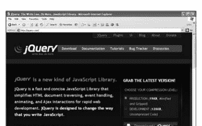

**图 1.1** 官方 jQuery 网站，http://www.jquery.com/。

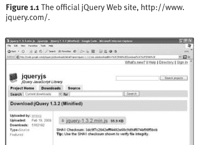

**图 1.2** jQuery 库下载页面。

3.  单击你要下载的文件名（压缩版或完整版）。你的浏览器将显示一个对话框，询问你是要保存还是打开文件。
4.  单击 Save 按钮，并导航到你希望在计算机上存储 jQuery 库的文件夹。
5.  单击 Save。
6.  下载完成后，单击 Close 按钮。
7.  将 jQuery 库的 `.js` 文件上传到托管你希望使用它的页面的 Web 服务器。你可以使用与上传网页相同的方法（通过 FTP 应用程序或浏览器）来上传 `.js` 文件。安装 jQuery 库的最简单方法是将其放在 Web 服务器上与将要使用它的网页相同的文件夹中。
8.  要让 HTML 页面中的 JavaScript 访问 jQuery 库，请在 `<head>` 部分中、任何其他你希望使用 jQuery 的 `<script>` 元素之前，将此 `<script>` 元素插入到 HTML 页面中（用当前版本的文件名替换你在此看到的名称）：

```html
<script type="text/javascript"
  src="jquery-1.3.2.js">
</script>
```

jQuery 还在线维护其库的一个版本，因此你无需下载它。你可以使用此 `<script>` 元素在任何网页中安装库：

```html
<script type="text/javascript"
  src="http://code.jquery.com/jquery-latest.js"></script>
```

## 第 1 章

#### 通过 ID 选择页面元素

jQuery 专长于让你挑选出页面元素以便处理。在这个例子中，我们将看到如何根据其 ID 属性值挑选出特定的 `<p>` 元素。

使用 jQuery 时，你通常使用名为 `jquery()` 的函数来访问 jQuery 库。实际上，有一个快捷方式：你也可以调用 `$()` 函数，我们将使用它。

要访问 ID 为 "id" 的元素，你可以调用 `$('#id')` 函数，该函数返回所有具有该 ID 的元素的集合。由于 ID 必须唯一，所以只有一个元素。为了验证我们选择了一个特定的 `<p>` 元素，我们将在用户单击按钮时使用 jQuery 的 `toggleClass()` 函数将其背景色改为青色。

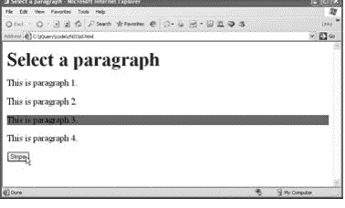

## 通过 ID 选择页面元素：

1.  使用文本编辑器（例如 Microsoft WordPad）创建你的网页。我们将使用本书代码中的示例 `id.html`。
2.  输入将 jQuery 库添加到页面并为页面中的第三个 `<p>` 元素分配 ID "third" 的代码（脚本 1.1）。

#### 脚本 1.1 为第三个 `<p>` 元素分配 ID。

```html
<html>
  <head>
    <title>Select a paragraph</title>
    <script type="text/javascript"
      src="http://code.jquery.com/jquery-latest.js">
    </script>
    <script type="text/javascript">
    </script>
  </head>
  <body>
    <h1>Select a paragraph</h1>
    <div>
      <p>This is paragraph 1.</p>
      <p>This is paragraph 2.</p>
      <p id="third">This is paragraph 3.</p>
      <p>This is paragraph 4.</p>
    </div>
    <form>
    </form>
  </body>
</html>
```

**脚本 1.2** 切换第三个 `<p>` 元素的样式。

```html
<html>
<head>
    <title>Select a paragraph</title>
    <script type="text/javascript"
        src="http://code.jquery.com/jquery-latest.js">
    </script>
    <script type="text/javascript">
        function stripe() {
            $('#third')
                .toggleClass('striped');
        }
    </script>
    <style>
        p.striped {
            background-color: cyan;
        }
    </style>
</head>

<body>
    <h1>Select a paragraph</h1>
    <div>
        <p>This is paragraph 1.</p>
        <p>This is paragraph 2.</p>
        <p id="third">This is paragraph 3.</p>
        <p>This is paragraph 4.</p>
    </div>
    <form>
        <input type = "button"
            value="Stripe"
            onclick="stripe()"
        </input>
    </form>
</body>
</html>
```

3.  添加选择第三个段落并切换其样式的代码，使其在单击按钮时具有青色背景（**脚本 1.2**）。
4.  保存文件。
5.  在浏览器中导航到该文件。
6.  单击按钮为第三个段落元素添加青色背景，如 **图 1.3** 所示（以精彩的黑白形式呈现）。

**✔ 提示**

-   如果你愿意，可以使用 `addClass()` 函数代替 `toggleClass()`。

## 第 1 章

#### 选择一组元素

当你向 `jquery()` 函数（或与其相同的 `$()` 函数）传递一个 *选择器* 时，你就选择了一组页面元素。

选择器是第 2 章的主题。它们让你指定要处理的页面元素。前面的任务让你使用选择器 `#third` 来选择 ID 为 "third" 的 `<p>` 元素。

在这个任务中，你将使用选择器 `"p"` 选择页面中的所有 `<p>` 元素，像这样：`$("p")`。此选择器返回所有 `<p>` 元素的集合。我们将使用 jQuery 的 `size()` 函数计算集合中 `<p>` 元素的数量，并在警告框中显示该数字。

**要选择一组页面元素：**

1.  使用文本编辑器（例如 Microsoft WordPad）创建你的网页。我们将使用本书代码中的示例 `count.html`。
2.  输入将 jQuery 库添加到页面并向页面添加四个 `<p>` 元素的代码（脚本 1.3）。

**脚本 1.3** 添加四个 `<p>` 元素。

```html
<html>
  <head>
    <title>Count paragraphs</title>
    <script type="text/javascript"
      src="http://code.jquery.com/jquery-latest.js"></script>
    <script type="text/javascript"></script>
  </head>
  <body>
    <h1>Count paragraphs</h1>
    <div>
      <p>This is paragraph 1.</p>
      <p>This is paragraph 2.</p>
      <p>This is paragraph 3.</p>
      <p>This is paragraph 4.</p>
    </div>
  </body>
</html>
```


## jQuery 基础

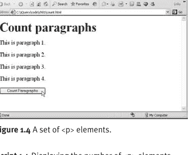

图 1.4 一组 `<p>` 元素。

脚本 1.4 显示 `<p>` 元素的数量。

```html
<html>
<head>
	<title>Count paragraphs</title>
	<script type="text/javascript"
	src="http://code.jquery.com/jquery-latest.js">
	</script>
	<script type="text/javascript">
		function count()
		{
			alert("There are " + $("p").size()
			+ " paragraphs.");
		}
	</script>
</head>
<body>
<h1>Count paragraphs</h1>
<div>
<p>This is paragraph 1.</p>
<p>This is paragraph 2.</p>
<p>This is paragraph 3.</p>
<p>This is paragraph 4.</p>
</div>
<form>
	<input type = "button" value="Count Paragraphs"
	onclick="count()"
	</input>
</form>
</body>
</html>
```

3.  添加代码，以便当用户点击按钮时，获取所有 `<p>` 元素的集合，并显示这些元素的数量（脚本 1.4）。
4.  保存文件。
5.  在浏览器中导航到该文件。你应该看到图 1.4 所示的页面。
6.  点击按钮，让 jQuery 创建页面中所有 `<p>` 元素的集合，并使用 `size()` 函数确定该集合的大小。你应该会看到一个警告对话框，其中包含消息 "There are 4 paragraphs."。
7.  点击确定关闭警告框。

## 提示

■ 此技术用于查找页面中的所有 `<p>` 元素。它们不必是相邻的，也不必是同一个 `<div>` 元素的子元素。

选择一组元素

## 第 1 章

#### 按样式选择元素

你也可以根据 CSS *样式*来选择页面元素。例如，如果你有多个段落，并且第二个段落被赋予了样式类 `second`，你可以像这样选择该段落：

```javascript
$('p.second')
```

如果段落元素包含在 `<div>` 元素内，你也可以（尽管这不是必需的）这样指定：

```javascript
$('div p.second')
```

也就是说，你可以创建选择器链，我们将在下一章中看到这一点。在这个例子中，我们将让用户通过点击按钮来切换页面中第二个段落的背景。

### 按样式选择元素：

1.  使用文本编辑器（如 Microsoft WordPad）创建你的网页。这里我们将使用书中代码的示例 `style.html`。
2.  输入添加 jQuery 库的代码，并向页面添加四个 `<p>` 元素，为第二个段落赋予样式 "second"（脚本 1.5）。

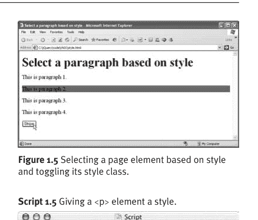

脚本 1.5 为 `<p>` 元素赋予样式。

```html
<html>
  <head>
    <title>Select a paragraph based on style</title>
    <script type="text/javascript"
      src="http://code.jquery.com/jquery-latest.js">
    </script>
    <style>
      p.second {
        font-weight: normal;
      }
    </style>
  </head>
  <body>
    <h1>Select a paragraph based on style</h1>
    <div>
      <p>This is paragraph 1.</p>
      <p class="second">This is paragraph 2.</p>
      <p>This is paragraph 3.</p>
      <p>This is paragraph 4.</p>
    </div>
  </body>
</html>
```

脚本 1.6 按样式选择元素。

```html
<html>
  <head>
    <title>Select a paragraph based on style</title>
    <script type="text/javascript"
      src="http://code.jquery.com/jquery-latest.js"></script>
    <script type="text/javascript">
      function stripe() {
        $('p.second')
          .toggleClass("striped");
      }
    </script>
    <style>
      p.second {
        font-weight: normal;
      }
      p.striped {
        background-color: cyan;
      }
    </style>
  </head>
  <body>
    <h1>Select a paragraph based on style</h1>
    <div>
      <p>This is paragraph 1.</p>
      <p class="second">This is paragraph 2.</p>
      <p>This is paragraph 3.</p>
      <p>This is paragraph 4.</p>
    </div>
    <form>
      <input type="button" value="Stripe"
        onclick="stripe()">
      </input>
    </form>
  </body>
</html>
```

3.  添加代码，以便当用户点击按钮时，选择第二个段落并切换其青色背景（脚本 1.6）。
4.  保存文件。
5.  在浏览器中导航到该文件并点击按钮。你会看到图 1.5 所示的结果。

#### 在页面就绪时运行代码

jQuery 允许你在要操作的页面元素加载完毕后运行代码（这比浏览器的 `onload` 函数更好，因为后者只在所有图片也加载完毕后才被调用）。要在页面就绪时运行代码，请使用此语法：

```javascript
$(document).ready(function() {
    ...
});
```

还有一个简写形式：

```javascript
$(function() {
    ...
});
```

在这个例子中，我们将在页面加载时为 `<p>` 元素添加一个样式类，将其背景色设为青色。请注意，除非你等待页面加载，否则此脚本将无法工作，因为 `<p>` 元素在此之前你的代码将无法使用（代码在 `<head>` 部分加载时运行，而不是在 `<body>` 部分）。

### 在页面就绪时运行代码：

1.  使用文本编辑器（如 Microsoft WordPad）创建你的网页。这里我们将使用书中代码的示例 `ready.html`。
2.  输入添加 jQuery 库的代码，并向页面添加四个 `<p>` 元素，为第二个段落赋予样式 "second"（脚本 1.7）。

脚本 1.7 设置 `<p>` 元素的样式。

```html
<html>
  <head>
    <title>Running code when a page is ready</title>
    <script type="text/javascript"
            src="http://code.jquery.com/jquery-latest.js">
    </script>
    <style>
      p.second {
        font-weight: normal;
      }
    </style>
  </head>
  <body>
    <h1>Running code when a page is ready</h1>
    <div>
      <p>This is paragraph 1.</p>
      <p class="second">This is paragraph 2.</p>
      <p>This is paragraph 3.</p>
      <p>This is paragraph 4.</p>
    </div>
  </body>
</html>
```

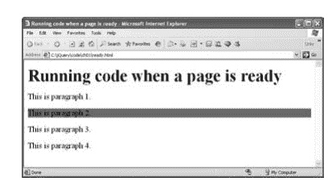

图 1.6 在页面就绪时运行代码。

3.  添加代码，以便当页面加载时，选择第二个段落并将其样式设置为 "second"（脚本 1.8）。
4.  保存文件。
5.  在浏览器中导航到该文件。你会看到图 1.6 所示的结果。

脚本 1.8 选择一个 `<p>` 元素。

```html
<html>
  <head>
    <title>Running code when a page is ready</title>
    <script type="text/javascript"
            src="http://code.jquery.com/jquery-latest.js">
    </script>
    <script type="text/javascript">
      $(function() {
        $("p.second")
          .addClass("striped");
      });
    </script>
    <style>
      p.second {
        font-weight: normal;
      }
      p.striped {
        background-color: cyan;
      }
    </style>
  </head>
  <body>
    <h1>Running code when a page is ready</h1>
    <div>
      <p>This is paragraph 1.</p>
      <p class="second">This is paragraph 2.</p>
      <p>This is paragraph 3.</p>
      <p>This is paragraph 4.</p>
    </div>
  </body>
</html>
```

#### 选择一组元素中的第一个

jQuery 允许你使用名为 `first` 的位置选择器来选择一组页面元素中的第一个。

正如你将在第 2 章中看到的，你将位置选择器用作其他选择器的修饰符，跟在冒号后面。例如，以下是选择页面中第一个 `<p>` 元素的方法：

```javascript
$('p:first')
```

你可以使用 `css()` 函数来更改选中 `<p>` 元素的样式，该函数接受一个 CSS 样式及其新设置，如下所示，我们将第一个段落设为斜体：

```javascript
$('p:first').css("font-style", "italic");
```

还有一个 `last` 选择器，用于选择一组页面元素中的最后一个：

```javascript
$('p:last').css("font-style", "italic");
```

### 选择一组元素中的第一个：

1.  使用文本编辑器（如 Microsoft WordPad）创建你的网页。这里我们将使用书中代码的示例 `first.html`。
2.  输入添加 jQuery 库的代码，并向页面添加四个 `<p>` 元素（脚本 1.9）。

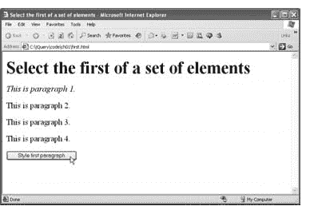

脚本 1.9 开始示例页面。

```html
<html>
  <head>
    <title>Select the first of a set of elements</title>
    <script type="text/javascript"
      src="http://code.jquery.com/jquery-latest.js">
    </script>
  </head>
  <body>
    <h1>Select the first of a set of elements</h1>
    <div>
      <p>This is paragraph 1.</p>
      <p>This is paragraph 2.</p>
      <p>This is paragraph 3.</p>
      <p>This is paragraph 4.</p>
    </div>
  </body>
</html>
```


#### 脚本 1.10 选择第一个段落。

```html
<html>
  <head>
    <title>选择一组元素中的第一个</title>
    <script type="text/javascript" src="http://code.jquery.com/jquery-latest.js"></script>
    <script type="text/javascript">
      function setStyle()
      {
        $('p:first').css("font-style", "italic");
      }
    </script>
  </head>
  <body>
    <h1>选择一组元素中的第一个</h1>
    <div>
      <p>这是段落 1。</p>
      <p>这是段落 2。</p>
      <p>这是段落 3。</p>
      <p>这是段落 4。</p>
    </div>
    <form>
      <input type="button" value="设置第一个段落的样式" onclick="setStyle()">
    </form>
  </body>
</html>
```

3.  添加代码，以便在用户点击按钮时选择第一个段落并将其样式设置为斜体（脚本 1.10）。

4.  保存文件。

5.  在浏览器中导航到该文件。

6.  点击按钮。你会看到如图 1.7 所示的结果，其中第一个段落已被选中并设置为斜体。

#### 显示和隐藏页面元素

jQuery 让你能轻松地显示和隐藏页面元素。

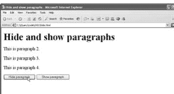

你可以使用 `hide()` 函数来隐藏页面元素，用法如下，需要配合选择器：

```javascript
$('p:first').hide();
```

你可以使用 `show()` 函数来显示已被隐藏的页面元素：

```javascript
$('p:first').show();
```

### 要显示或隐藏页面元素：

1.  使用文本编辑器（如 Microsoft WordPad）创建你的网页。这里我们将使用本书代码中的示例文件 hide.html。
2.  输入代码以添加 jQuery 库，并向页面添加四个 `<p>` 元素（脚本 1.11）。

```html
<html>
    <head>
        <title>隐藏和显示段落</title>
        <script type="text/javascript" src="http://code.jquery.com/jquery-latest.js">
        </script>
    </head>
    <body>
        <h1>隐藏和显示段落</h1>
        <div>
            <p>这是段落 1。</p>
            <p>这是段落 2。</p>
            <p>这是段落 3。</p>
            <p>这是段落 4。</p>
        </div>
    </body>
</html>
```

**脚本 1.12 隐藏或显示元素。**

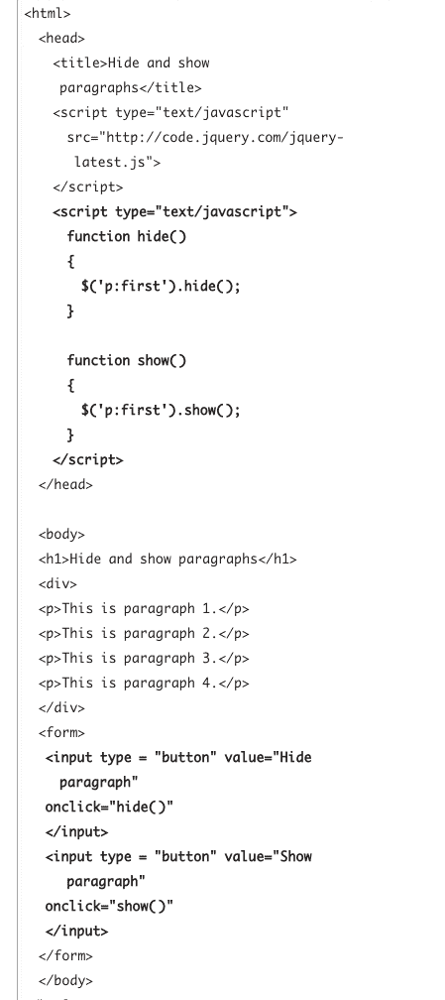

3.  添加代码，以便在用户点击按钮时选择第一个段落并隐藏或显示它（**脚本 1.12**）。
4.  保存文件。
5.  在浏览器中导航到该文件。
6.  点击“隐藏”按钮。你会看到如图 **1.8** 所示的结果，其中第一个段落已被隐藏。
7.  要再次显示段落，请点击“显示”按钮。

> ✓ 提示
> ■ `show()` 和 `hide()` 函数是 jQuery 提供的视觉效果的一部分，我们将在本书中更深入地探讨这些视觉效果。

**显示和隐藏页面元素**

17

第 1 章

#### 选择一组元素中的一个

像 `$('p')` 这样的 jQuery 表达式会返回页面中所有 `<p>` 元素的集合。

这个集合是如何工作的？实际上，你可以像处理带索引值的数组一样处理它。例如，要选择一组元素中的第一个，可以使用如下表达式：

```javascript
$('p')[0]
```

在这个例子中，我们将在用户点击按钮时，使用所选元素的 `innerHTML` 属性来重写 `<p>` 元素中的文本，如下所示：

```javascript
$('p')[0].innerHTML =
"<i>Hello there!</i>";
```

### 要选择一组页面元素中的一个：

1.  使用文本编辑器（如 Microsoft WordPad）创建你的网页。这里我们将使用本书代码中的示例文件 index.html。

2.  输入代码以添加 jQuery 库，并向页面添加四个 `<p>` 元素（脚本 1.13）。

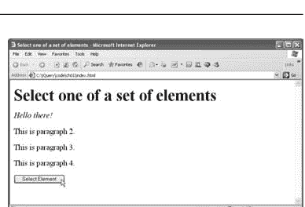

图 1.9 通过索引值选择段落。

**脚本 1.13 页面的开始部分。**

```html
<html>
  <head>
    <title>选择一组元素中的一个</title>
    <script type="text/javascript" src="http://code.jquery.com/jquery-latest.js"></script>
  </head>
  <body>
    <h1>选择一组元素中的一个</h1>
    <div>
      <p>这是段落 1。</p>
      <p>这是段落 2。</p>
      <p>这是段落 3。</p>
      <p>这是段落 4。</p>
    </div>
  </body>
</html>
```

18

**脚本 1.14** 重写元素的 HTML。

```html
<html>
<head>
<title>选择一组元素中的一个</title>
<script type="text/javascript" src="http://code.jquery.com/jquery-latest.js"></script>
<script type="text/javascript">
function selectElement() {
    $('p')[0].innerHTML = "<i>Hello there!</i>";
}
</script>
</head>
<body>
<h1>选择一组元素中的一个</h1>
<div>
<p>这是段落 1。</p>
<p>这是段落 2。</p>
<p>这是段落 3。</p>
<p>这是段落 4。</p>
</div>
<form>
<input type="button" value="选择元素" onclick="selectElement()"></input>
</form>
</body>
</html>
```

1.  添加代码以选择第一个段落并将其内部 HTML 重写为新文本（脚本 1.14）。
2.  保存文件。
3.  在浏览器中导航到该文件。
4.  点击“选择元素”按钮。你会看到如图 1.9 所示的结果，其中第一个段落已被重写。

第 1 章

#### 在层次结构中指定元素

jQuery 非常擅长让你选择一组元素。但如果你想在页面中选择一组元素，而不是另一组呢？假设你想选择一个 `<div>` 元素中的一些 `<p>` 元素，但不想选择 `<div>` 元素外的任何 `<p>` 元素。

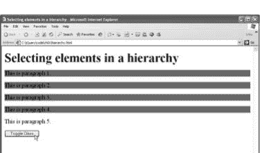

图 1.10 选择段落。

选择所需 `<p>` 元素的一种方法是通过指定选择器层次结构。例如，你可以要求 jQuery 仅选择那些出现在 `<div>` 元素内的 `<p>` 元素，而该 `<div>` 元素本身又出现在 `<body>` 元素内，如下所示：

```javascript
$('body div p')
```

**脚本 1.15 添加 `<p>` 元素。**

```html
<html>
    <head>
        <title>在层次结构中选择元素</title>
        <script type="text/javascript"
            src="http://code.jquery.com/jquery-latest.js">
        </script>
    </head>
    <body>
        <h1>在层次结构中选择元素</h1>
        <div>
            <p>这是段落 1。</p>
            <p>这是段落 2。</p>
            <p>这是段落 3。</p>
            <p>这是段落 4。</p>
        </div>
        <p>这是段落 5。</p>
    </body>
</html>
```

这个示例让你能够进行所需的筛选，并且还可以让你在用户点击按钮时更改所选元素的样式类，使用以下代码：

```javascript
$('body div p').toggleClass('striped');
```

### 要在层次结构中指定元素：

1.  使用文本编辑器（如 Microsoft WordPad）创建你的网页。这里我们将使用本书代码中的示例文件 hierarchy.html。
2.  输入代码以添加 jQuery 库，并添加四个位于 `<div>` 元素内的 `<p>` 元素和一个位于 `<div>` 元素外的 `<p>` 元素（脚本 1.15）。

20

**脚本 1.16 选择前四个段落。**

```html
<html>
    <head>
        <title>在层次结构中选择元素</title>
        <script type="text/javascript"
                src="http://code.jquery.com/jquery-latest.js">
        </script>
        <script type="text/javascript">
            function toggle()
            {
                $("body div p").toggleClass("striped");
            }
        </script>
        <style>
            p.striped {
                background-color: cyan;
            }
        </style>
    </head>
    <body>
        <h1>在层次结构中选择元素</h1>
        <div>
            <p>这是段落 1。</p>
            <p>这是段落 2。</p>
            <p>这是段落 3。</p>
            <p>这是段落 4。</p>
        </div>
        <p>这是段落 5。</p>
        <form>
            <input type="button"
                   value="切换类"
                   onclick="toggle()"
                   </input>
        </form>
    </body>
</html>
```

3.  添加代码以 *仅* 选择前四个段落并将其背景切换为青色（**脚本 1.16**）。

4.  保存文件。

5.  在浏览器中导航到该文件。

6.  点击“切换类”按钮。
你会看到如图 **1.10** 所示的结果，其中只有前四个段落被隐藏了。

在层次结构中指定元素


## 第1章

#### 创建视觉特效

jQuery 同样擅长视觉特效。

例如，要将一组 `<p>` 元素（ID为“first”）的第一个向上滑动，可以执行以下代码：

```
$('#first').slideUp("slow");
```

要使元素向下滑动显示，可以执行此代码：

```
function slidedown()
```

以下示例在点击按钮时同时实现这两种效果。

### 滑动页面元素：

- 1. 使用文本编辑器（如 Microsoft WordPad）创建您的网页。此处将使用本书代码中的示例 slide.html。
- 2. 输入代码以添加 jQuery 库，并向页面添加四个 `<p>` 元素，为第一个元素赋予 ID "first"（脚本 1.17）。

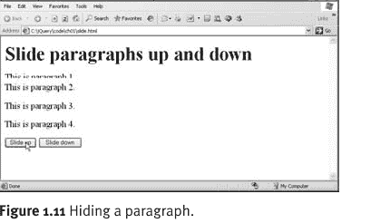

图 1.11 隐藏段落。

脚本 1.17 为 `<p>` 元素赋予 ID。

```
<html>
    <head>
        <title>上下滑动段落</title>
        <script type="text/javascript"
            src="http://code.jquery.com/jquery-latest.js">
        </script>
    </head>
    <body>
        <h1>上下滑动段落</h1>
        <div>
            <p id="first">这是第一段。</p>
            <p>这是第二段。</p>
            <p>这是第三段。</p>
            <p>这是第四段。</p>
        </div>
    </body>
</html>
```

脚本 1.18 上下滑动段落。

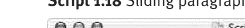

```
<html>
<head>
    <title>上下滑动段落</title>
    <script type="text/javascript"
        src="http://code.jquery.com/jquery-latest.js">
    </script>
    <script type="text/javascript">
        function slideup()
        {
            $('#first').slideUp("slow");
        }
        function slidedown()
        {
            $('#first').slideDown("slow");
        }
    </script>
</head>

<body>
    <h1>上下滑动段落</h1>
    <div>
        <p id="first">这是第一段。</p>
        <p>这是第二段。</p>
        <p>这是第三段。</p>
        <p>这是第四段。</p>
    </div>
    <form>
        <input type="button"
            value="向上滑动"
            onclick="slideup()"
        </input>

        <input type="button"
            value="向下滑动"
            onclick="slidedown()"
        </input>
    </form>

</body>
</html>
```

- 3. 添加代码，以便在点击按钮时使第一个段落向上或向下（隐藏或显示）滑动（**脚本 1.18**）。
- 4. 保存文件。
- 5. 在浏览器中导航至该文件。
- 6. 点击“向上滑动”按钮。您将看到如**图 1.11** 所示的结果，第一个段落正在被隐藏。
- 7. 要再次显示该段落，请点击“向下滑动”按钮。

#### 创建新的 HTML 元素

jQuery 允许您创建 HTML 元素并将其插入页面。

如果您向 `jquery()` 或 `$()` 函数（两者功能相同）传递一个描述新 HTML 元素的文本字符串，jQuery 将创建该新元素：

```
$("<p>I'm a new &lt;p&gt;\n      element!</p>")
```

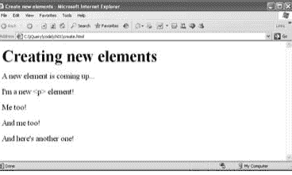

图 1.12 创建新的 HTML。

要将新元素实际放入页面，您需要使用像 `insertAfter()` 这样的函数，并传递一个选择器，该选择器指明您想要在其后插入新元素的元素。

此示例创建新的 `<p>` 元素，并将其插入页面中 ID 为 "first" 的 `<p>` 元素之后，如下所示：

脚本 1.19 添加一个 `<p>` 元素。

```
$("<p>I'm a new &lt;p&gt;\n      element!</p>")\n   .insertAfter("#first");
```

```
<html>\n  <head>\n    <title>创建新元素</title>\n    \n    <script type="text/javascript"\n      src="http://code.jquery.com/jquery-\n      latest.js">\n    </script>\n    \n  </head>\n  \n  <body>\n    <h1>创建新元素</h1>\n    \n    <p id="first">一个新元素即将到来\n    ...</p>\n    \n  </body>\n</html>
```

### 创建新元素：

- 1. 使用文本编辑器（如 Microsoft WordPad）创建您的网页。此处将使用本书代码中的示例 `create.html`。
- 2. 输入代码以添加 jQuery 库，并添加一个 ID 为 "first" 的 `<p>` 元素（脚本 1.19）。

脚本 1.20 创建新的段落。

```
<html>
  <head>
    <title>创建新元素</title>

    <script type="text/javascript"
      src="http://code.jquery.com/jquery-latest.js">
    </script>

    <script type="text/javascript">
      $(function()
      {
        $("<p>这里还有一个！</p>")
        .insertAfter("#first");

        $("<p>还有我！</p>")
        .insertAfter("#first");

        $("<p>我也是！</p>")
        .insertAfter("#first");

        $("<p>我是一个新的 &lt;p&gt; 元素！</p>")
        .insertAfter("#first");
      });
    </script>
  </head>

  <body>
    <h1>创建新元素</h1>

    <p id="first">一个新元素即将到来...</p>

  </body>
</html>
```

- 3. 添加代码以创建四个新的 `<p>` 元素并将其插入页面（**脚本 1.20**）。
- 4. 保存文件。
- 5. 在浏览器中导航至该文件。您将看到如**图 1.12** 所示的结果，新的 `<p>` 元素已被插入页面。

> **✓ 提示**

除了 `insertAfter()` 函数，还有一个 `insertBefore()` 函数，用于在另一个页面元素之前插入 HTML。

#### 通过查询方式选择元素

jQuery 的专长之一是允许您选择页面元素以便对其进行操作。
在在线工作中，您经常需要选择页面元素。浏览器的选择能力有限，并且主要涉及 JavaScript 的 `getElementByID` 函数，该函数要求您为任何想要选择的元素添加 ID 值（使得选择多个项目变得困难，或者至少很耗时）。
CSS 提供了一套更强大的工具来选择页面元素以设置样式，而 jQuery 采用了许多 CSS 选择器。使用 jQuery 选择器可以让您选择页面元素，以便在 JavaScript 中对其进行操作，而不仅仅是设置 CSS 样式。
您在上一章看到了一些基本的选择器，但 jQuery 有更多选择器。我们将在这里进行介绍。

## 第2章

## 选择器示例

以下是一些选择器能实现的功能示例。

在上一章中，您看到了选择器

`x`

选择所有类型为 x 的元素。选择器

`x y`

选择所有类型为 y 且具有类型为 x 的祖先元素的元素。

如果您想指定的不仅是祖先，而是直接父级——也就是说，您想匹配所有作为 x 元素的直接（第一代）后代的 y 元素？您可以像这样实现：

`x > y`

此代码匹配所有父元素为 x 元素的 y 元素。

那么如何找到页面中的第九个 `<p>` 元素呢？您可以使用 `eq` 选择器来实现：

`eq(n)`

或者假设您想匹配某个类型的所有偶数元素（就像您想要为表格的交替行设置条纹时那样）？这就是这个选择器的用途：

`even`

并且因为有用于偶数元素的选择器，所以也有用于奇数元素的选择器：

`odd`

您想要匹配具有属性的元素吗？以下是使用选择器匹配所有具有特定属性的元素的方法：

`[attribute]`

如果您只想匹配属性具有特定值的元素呢？该代码如下所示：

`[attribute=value]`

或者如果您想匹配元素的第一个子元素，该代码如下所示：

`first-child`

也有用于最后一个子元素的选择器：

`last-child`

那么中间子元素呢？您可以使用此代码：

`nth-child(index)`

您还可以根据表单元素的类型进行选择。例如，您可以使用

`radio`

来选择单选按钮。

这是一个非常强大的选择器：您可以使用此选择器根据 Web 页面中当前选中的控件（如单选按钮）进行选择：

`selected`

现在让我们开始探索这些以及更多选择器。


## 第二章

#### 认识选择器

表 2.1 列出了一些选择器。在创建自己的 jQuery 页面时，你可以根据需要参考此表。

##### 表 2.1：部分 jQuery 选择器

| 选择器 | 功能 |
| :--- | :--- |
| `#id` | 选择具有指定 ID 的单个元素。 |
| `element` | 选择所有具有指定标签名的元素。 |
| `.class` | 选择所有具有指定类名的元素。 |
| `*` | 选择所有元素。 |
| `selector1, selector2, selectorN` | 选择所有选择器组合结果的并集。 |
| `ancestor descendant` | 选择 *ancestor* 指定元素的所有后代中，由 *descendant* 指定的元素。 |
| `parent > child` | 选择 *parent* 指定元素的直接子元素中，由 *child* 指定的元素。 |
| `previous + next` | 选择紧邻 *previous* 指定元素之后，由 *next* 指定的所有元素。 |
| `previous ~ siblings` | 选择 *previous* 元素之后的所有兄弟元素中，匹配 *siblings* 选择器的元素。 |
| `:first` | 选择页面中第一个被选中的元素。 |
| `:last` | 选择页面中最后一个被选中的元素。 |
| `:not(selector)` | 移除所有匹配指定选择器的元素。 |
| `:even` | 选择偶数位置的元素。 |
| `:odd` | 选择奇数位置的元素。 |
| `:eq(index)` | 根据索引号选择单个元素。 |
| `:gt(index)` | 选择所有索引号大于指定值的元素。 |
| `:lt(index)` | 选择所有索引号小于指定值的元素。 |
| `:header` | 选择所有标题元素，例如 h1、h2 和 h3。 |
| `:animated` | 选择所有正在进行动画的元素。 |
| `:contains(text)` | 选择包含指定文本的元素。 |
| `:empty` | 选择所有没有子元素的元素。 |
| `:has(selector)` | 选择至少包含一个匹配指定选择器的元素的元素。 |
| `:parent` | 选择所有是父元素的元素（即包含子元素的元素）。 |
| `:hidden` | 选择所有被隐藏的元素。 |
| `:visible` | 选择所有可见的元素。 |
| `[attribute]` | 选择具有指定属性的元素。 |
| `[attribute=value]` | 选择具有指定属性且值为指定值的元素。 |
| `[attribute!=value]` | 选择具有指定属性但值不等于指定值的元素。 |
| `[attribute^=value]` | 选择具有指定属性且值以指定值开头的元素。 |
| `[attribute$=value]` | 选择具有指定属性且值以指定值结尾的元素。 |
| `[attribute*=value]` | 选择具有指定属性且值包含指定值的元素。 |
| `:nth-child(index/even/odd/equation)` | 选择是其父元素的第 n 个子元素，或是其父元素的偶数/奇数子元素的元素。 |
| `:first-child` | 选择所有是其父元素第一个子元素的元素。 |
| `:last-child` | 选择所有是其父元素最后一个子元素的元素。 |
| `:input` | 选择所有 input 元素。 |
| `:text` | 选择所有类型为 text 的 input 元素。 |
| `:radio` | 选择所有类型为 radio 的 input 元素。 |
| `:checkbox` | 选择所有类型为 checkbox 的 input 元素。 |
| `:enabled` | 选择所有启用的元素。 |
| `:disabled` | 选择所有禁用的元素。 |
| `:checked` | 选择所有被选中的元素。 |
| `:selected` | 选择所有被选中的选项元素（用于 select 元素）。 |

#### 选择直接后代

要选择页面中所有祖先元素为 `<div>` 的 `<p>` 元素，可以使用此选择器：

```
$('div p')
```

请注意，此代码选择的是所有从 `<div>` 元素派生（即作为其后代）的 `<p>` 元素。因此，此代码匹配如下情况：

```
<div>
  <p>这是第 1 段。</p>
</div>
```

同时也匹配如下情况：

```
<div>
  <span>
    <p>这是第 1 段。</p>
  </span>
</div>
```

如果你只想选择第一种类型的 `<p>` 元素——即直接父元素为 `<div>` 的元素——可以使用此选择器：

```
$('div > p')
```

这正是此示例所要演示的。

### 选择直接后代：

1. 使用文本编辑器（例如 Windows 记事本）创建你的网页。这里我们将使用本书代码中的示例文件 direct.html。
2. 在页面中输入代码，添加 jQuery 库以及一些包含在 `<div>` 元素中的 `<p>` 元素（第一个 `<div>` 元素也包含在一个 `<span>` 元素中），如脚本 2.1 所示。

脚本 2.1：添加 `<p>` 元素。

```
<html>
  <head>
    <title>选择直接后代</title>
    <script type="text/javascript" src="http://code.jquery.com/jquery-latest.js"></script>
  </head>
  <body>
    <h1>选择直接后代</h1>
    <div>
      <span>
        <p>这是第 1 段。</p>
      </span>
      <p>这是第 2 段。</p>
      <p>这是第 3 段。</p>
      <p>这是第 4 段。</p>
    </div>
    <p>这是第 5 段。</p>
  </body>
</html>
```

以 jQuery 方式选择元素

3. 添加代码，以在点击按钮时选择直接父元素为 `<div>` 的 `<p>` 元素，并将其样式设置为斜体（**脚本 2.2**）。
4. 保存文件。
5. 在浏览器中打开该文件。
6. 点击按钮，将匹配的 `<p>` 元素设置为斜体（**图 2.1**）。

**图 2.1** 将匹配的 `<p>` 元素设置为斜体。

**脚本 2.2** 仅选择直接后代。

```
<html>
  <head>
    <title>选择直接后代</title>
    <script type="text/javascript" src="http://code.jquery.com/jquery-latest.js"></script>
    <script type="text/javascript">
      function setStyle()
      {
        $('div > p').css("font-style", "italic");
      }
    </script>
  </head>
  <body>
    <h1>选择直接后代</h1>
    <div>
      <span>
        <p>这是第 1 段。</p>
      </span>
      <p>这是第 2 段。</p>
      <p>这是第 3 段。</p>
      <p>这是第 4 段。</p>
    </div>
    <p>这是第 5 段。</p>
    <form>
      <input type="button" value="选择" onclick="setStyle()" />
    </form>
  </body>
</html>
```

选择直接后代

#### 选择第一个和最后一个子元素

要选择页面中所有 `<p>` 元素，可以使用此选择器：

```
$('p')
```

要选择所有是其父元素第一个子元素的 `<p>` 元素，可以使用此选择器：

```
$('p:first')
```

要选择所有是其父元素最后一个子元素的 `<p>` 元素，可以使用此选择器：

```
$('p:last')
```

### 选择第一个和最后一个子元素：

1. 使用文本编辑器（例如 Windows 记事本）创建你的网页。这里我们将使用本书代码中的示例文件 firstlast.html。
2. 在页面中输入代码，添加 jQuery 库以及一些包含在 `<div>` 元素中的 `<p>` 元素（脚本 2.3）。

脚本 2.3：以包含 `<p>` 元素的页面开始。

```
<html>
  <head>
    <title>选择第一个和最后一个子元素</title>
    <script type="text/javascript" src="http://code.jquery.com/jquery-latest.js"></script>
  </head>
  <body>
    <h1>选择第一个和最后一个子元素</h1>
    <div>
      <p>这是第 1 段。</p>
      <p>这是第 2 段。</p>
      <p>这是第 3 段。</p>
      <p>这是第 4 段。</p>
    </div>
  </body>
</html>
```

以 jQuery 方式选择元素

**脚本 2.4** 选择第一个和最后一个子元素。

```
<html>
  <head>
    <title>选择第一个和最后一个子元素</title>
    <script type="text/javascript" src="http://code.jquery.com/jquery-latest.js"></script>
    <script type="text/javascript">
      function setStyle()
      {
        $('p:first-child').css("font-style", "italic");
        $('p:last-child').css("font-style", "italic");
      }
    </script>
  </head>
  <body>
    <h1>选择第一个和最后一个子元素</h1>
    <div>
      <p>这是第 1 段。</p>
      <p>这是第 2 段。</p>
      <p>这是第 3 段。</p>
      <p>这是第 4 段。</p>
    </div>
    <form>
      <input type="button" value="选择" onclick="setStyle()" />
    </form>
  </body>
</html>
```

3. 添加代码，以在点击按钮时仅选择第一个和最后一个 `<p>` 子元素，并将其设置为斜体（**脚本 2.4**）。
4. 保存文件。
5. 在浏览器中打开该文件。
6. 点击按钮，将 `<div>` 元素的第一个和最后一个子元素 `<p>` 设置为斜体（**图 2.2**）。


## 第2章

#### 选择 *第N个* 子元素

jQuery 不仅允许你选择第一个或最后一个子元素，还可以选择*第N个*子元素。

要选择*第N个*子元素，你需要使用 nth-child 选择器

`nth-child(n)`

其中 *n* 是子元素的索引号。

例如，要匹配第三个子元素，你可以使用以下语法：

`nth-child(3)`

要匹配第三个 `<p>` 子元素，你需要使用这个选择器：

`p:nth-child(3)`

下面这个例子将该选择器付诸实践。

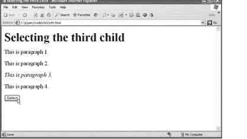

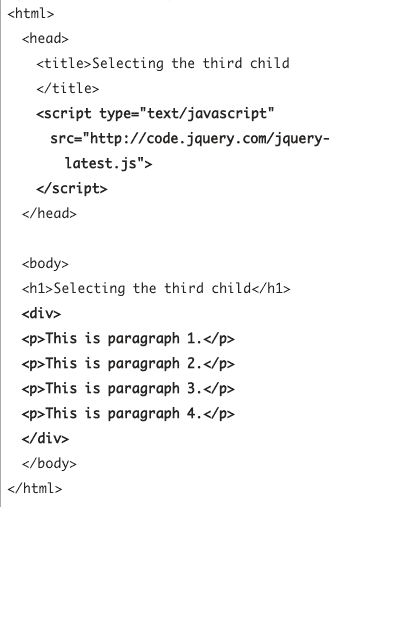

## 选择第三个子元素：

- 1. 使用文本编辑器（如 Microsoft WordPad）创建你的网页。我们将使用本书代码中的 nth.html 示例。
- 2. 输入代码，在页面的 `<div>` 元素中添加 jQuery 库和一些 `<p>` 元素（**代码清单 2.5**）。

#### 以 jQuery 方式选择元素

代码清单 2.6 仅选择第三个子元素。

```html
<html>
<head>
<title>Selecting the third child</title>
<script type="text/javascript"
  src="http://code.jquery.com/jquery-latest.js">
</script>
<script type="text/javascript">
function setStyle()
{
  $('p:nth-child(3)').css("font-style", "italic");
}
</script>
</head>
<body>
<h1>Selecting the third child</h1>
<div>
<p>This is paragraph 1.</p>
<p>This is paragraph 2.</p>
<p>This is paragraph 3.</p>
<p>This is paragraph 4.</p>
</div>
<form>
  <input type = "button"
    value="Select"
    onclick="setStyle()"
  </input>
</form>
</body>
</html>
```

- 3. 添加代码，以便在点击按钮时仅选择第三个 `<p>` 子元素并将其设为斜体（代码清单 2.6）。
- 4. 保存文件。
- 5. 在浏览器中打开该文件。
- 6. 点击按钮，将 `<div>` 元素的第三个 `<p>` 子元素设为斜体（图 2.3）。

> ✔ 提示
> ■ 你还可以通过向 nth-child() 传递 "even" 来选择所有偶数位置的子元素，或者传递 "odd" 来选择所有奇数位置的子元素。

选择第N个子元素

第2章

#### 按文本内容选择元素

jQuery 允许你通过请求包含特定文本的元素来进一步细化搜索。使用原生 JavaScript 在不同浏览器中轻松执行此任务并不容易，因此 jQuery 在这里为你节省了大量时间。

要选择包含特定文本的元素，请使用选择器

`contains(text)`

其中 `text` 是你要搜索的文本。

例如，要匹配包含文本 "3"（如 "This is paragraph 3"）的 `<p>` 元素，请使用以下选择器：

`p:contains("3")`

下面这个例子将该选择器付诸实践。

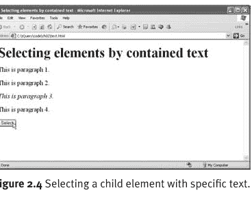

**按文本内容选择元素：**

- 1. 使用文本编辑器（如 Microsoft WordPad）创建你的网页。我们将使用本书代码中的 `text.html` 示例。
- 2. 输入代码，在页面的 `<div>` 元素中添加 jQuery 库和一些 `<p>` 元素（代码清单 2.7）。

代码清单 2.7 添加一些 `<p>` 元素。

```html
<html>
    <head>
        <title>Selecting elements by contained text</title>
        <script type="text/javascript" src="http://code.jquery.com/jquery-latest.js">
        </script>
    </head>

    <body>
        <h1>Selecting elements by contained text</h1>
        <div>
            <p>This is paragraph 1.</p>
            <p>This is paragraph 2.</p>
            <p>This is paragraph 3.</p>
            <p>This is paragraph 4.</p>
        </div>
    </body>
</html>
```

#### 以 jQuery 方式选择元素

**代码清单 2.8** 在元素中搜索文本。

```html
<html>
<head>
<title>Selecting elements by contained text</title>
<script type="text/javascript"
src="http://code.jquery.com/jquery-latest.js">
</script>
<script type="text/javascript">
function setStyle()
{
    $('p:contains("3")').css("font-style", "italic");
}
</script>
</head>
<body>
<h1>Selecting elements by contained text</h1>
<div>
<p>This is paragraph 1.</p>
<p>This is paragraph 2.</p>
<p>This is paragraph 3.</p>
<p>This is paragraph 4.</p>
</div>
<form>
<input type = "button"
value="Select"
onclick="setStyle()"
</input>
</form>
</body>
</html>
```

- 3. 添加代码，以便在点击按钮时通过搜索文本 "3" 来选择第三个 `<p>` 子元素并将其设为斜体（代码清单 2.8）。
- 4. 保存文件。
- 5. 在浏览器中打开该文件。
- 6. 点击按钮，将 `<div>` 元素的第三个 `<p>` 子元素设为斜体（图 2.4）。

第2章

#### 按属性选择元素

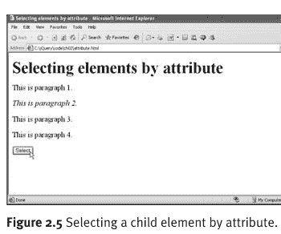

jQuery 允许你根据元素的属性来选择页面元素，这使你能够区分相同类型的元素。

要根据元素的属性来选择元素，请使用选择器 `[attribute]`，其中 `attribute` 是你要搜索的属性。

```javascript
$('p[language]')
```

下面这个例子将该选择器付诸实践。

## 按属性选择元素：

- 1. 使用文本编辑器（如 Microsoft WordPad）创建你的网页。我们将使用本书代码中的 attribute.html 示例。
- 2. 输入代码，在页面的 `<div>` 元素中添加 jQuery 库和一些 `<p>` 元素，其中一个带有 language 属性（代码清单 2.9）。

代码清单 2.9 为 `<p>` 元素添加 language 属性。

```html
<html>
    <head>
        <title>Selecting elements by attribute</title>
        <script type="text/javascript"
            src="http://code.jquery.com/jquery-latest.js"></script>
    </head>
    <body>
        <h1>Selecting elements by attribute</h1>
        <div>
            <p>This is paragraph 1.</p>
            <p language="English">This is paragraph 2.</p>
            <p>This is paragraph 3.</p>
            <p>This is paragraph 4.</p>
        </div>
    </body>
</html>
```

#### 以 jQuery 方式选择元素

代码清单 2.10 访问 language 属性。

```html
<html>
<head>
<title>Selecting elements by attribute</title>
<script type="text/javascript" src="http://code.jquery.com/jquery-latest.js"></script>
<script type="text/javascript">
function setStyle()
{
  $('p[language]').css("font-style", "italic");
}
</script>
</head>
<body>
<h1>Selecting elements by attribute</h1>
<div>
<p>This is paragraph 1.</p>
<p language="English">This is paragraph 2.</p>
<p>This is paragraph 3.</p>
<p>This is paragraph 4.</p>
</div>
<form>
<input type = "button" value="Select" onclick="setStyle()"/>
</form>
</body>
</html>
```

- 3. 添加代码，以便在点击按钮时选择带有 language 属性的 `<p>` 元素并将其设为斜体（代码清单 2.10）。
- 4. 保存文件。
- 5. 在浏览器中打开该文件。
- 6. 点击按钮，将带有 language 属性的 `<p>` 元素设为斜体（图 2.5）。

按属性选择元素

第2章

#### 按属性值选择元素

jQuery 不仅允许你根据元素是否具有某个属性来选择页面元素，还可以根据属性的值来选择。

要根据属性值来选择元素，请使用选择器

`[attribute='value']`

其中 attribute 是你要搜索的属性，value 是你希望属性持有的值。

例如，要匹配 language 属性设置为 'German' 的 `<p>` 元素，请使用以下选择器：

`$('p[language='German']')`

下面这个例子将该选择器付诸实践。

## 按属性值选择元素：

- 1. 使用文本编辑器（如 Microsoft WordPad）创建你的网页。我们将使用本书代码中的 attributevalue.html 示例。
- 2. 输入代码，在页面的 `<div>` 元素中添加 jQuery 库和一些 `<p>` 元素，其中一个带有 language 属性且值设置为 "German"（代码清单 2.11）。

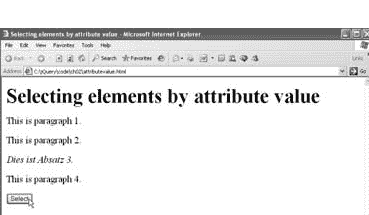

图 2.6 按属性值选择元素。

代码清单 2.11 设置 language 属性。

```html
<html>
  <head>
    <title>Selecting elements by attribute value</title>
    <script type="text/javascript" src="http://code.jquery.com/jquery-latest.js"></script>
  </head>
  <body>
    <h1>Selecting elements by attribute value</h1>
    <div>
      <p>This is paragraph 1.</p>
      <p language="English">This is paragraph 2.</p>
      <p language="German">Dies ist Absatz 3.</p>
      <p>This is paragraph 4.</p>
    </div>
  </body>
</html>
```

42


**使用 jQuery 选择元素**

脚本 2.12 检查属性值。

```html
<html>
<head>
<title>通过属性值选择元素 </title>
<script type="text/javascript" src="http://code.jquery.com/jquery-latest.js"></script>
<script type="text/javascript">
function setStyle()
{
$('p[language="German"]')
.css("font-style", "italic");
}
</script>
</head>
<body>
<h1>通过属性值选择元素</h1>
<div>
<p>这是段落 1。</p>
<p language="English">这是段落 2。</p>
<p language="German">Dies ist Absatz 3.</p>
<p>这是段落 4。</p>
</div>
<form>
<input type = "button"
value="选择"
onclick="setStyle()"
</input>
</form>
</body>
</html>
```

3.  添加代码，选择 `language` 属性设置为 "German" 的 `<p>` 元素，并在按钮点击时将其变为斜体（脚本 2.12）。

4.  保存文件。

5.  在浏览器中导航到该文件。

6.  点击按钮，将 `language` 属性设置为 "German" 的 `<p>` 元素变为斜体（图 2.6）。

**通过属性值选择元素**

43

## 第 2 章

##### 检查匹配元素的类型

jQuery 允许你使用 `is()` 函数检查匹配元素的类型。当你匹配了一整组元素，但只想处理其中一种特定类型的元素（例如 `<p>` 元素）时，此函数非常有用。

要使用 `is()` 函数，请输入如下代码：

```javascript
$('#p1').is('p')
```

如果 ID 为 `p1` 的元素是一个 `<p>` 元素，此选择器将返回 `true`。

本示例将应用此选择器。

**要确定匹配元素的类型：**

+   1.  使用文本编辑器（如 Microsoft WordPad）创建你的网页。此处我们将使用本书代码中的示例 `is.html`。
2.  输入代码，将 jQuery 库和一些具有不同 ID 值的 `<p>` 元素添加到页面中（脚本 2.13）。

脚本 2.13 添加 ID 值。

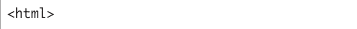

```html
<html>
  <head>
    <title>检查匹配类型</title>
    <script type="text/javascript"
      src="http://code.jquery.com/jquery-latest.js">
    </script>
  </head>
  <body>
    <h1>检查匹配类型</h1>
    <div>
      <p id="p1">这是段落 1。</p>
      <p id="p2">这是段落 2。</p>
      <p id="p3">这是段落 3。</p>
      <p id="p4">这是段落 4。</p>
    </div>
  </body>
</html>
```

**使用 jQuery 选择元素**

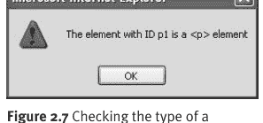

3.  添加代码，选择 ID 为 `p1` 的元素，如果它是 `<p>` 元素则显示一个警告框（脚本 2.14）。

图 2.7 检查特定元素的类型。

4.  保存文件。

5.  在浏览器中导航到该文件。

6.  点击按钮，确认 ID 为 `p1` 的元素是一个 `<p>` 元素（图 2.7）。

脚本 2.14 检查 `<p>` 元素。

```html
<html>
  <head>
    <title>检查匹配类型
    </title>
    <script type="text/javascript"
      src="http://code.jquery.com/jquery-latest.js">
    </script>
    <script type="text/javascript">
      function checkType()
      {
        if($('#p1').is('p')){
          alert("ID 为 p1 的元素
            是一个 <p> 元素");
        }
      }
    </script>
  </head>

  <body>
    <h1>检查匹配类型</h1>
    <div>
      <p id="p1">这是段落 1。</p>
      <p id="p2">这是段落 2。</p>
      <p id="p3">这是段落 3。</p>
      <p id="p4">这是段落 4。</p>
    </div>
    <form>
      <input type = "button"
        value="选择"
        onclick="checkType()"
      </input>
    </form>
  </body>
</html>
```

**检查匹配元素的类型**

##### 按位置选择元素

jQuery 允许你根据元素在页面中的位置来选择它们。

例如，你可以用以下选择器选择页面中所有的 `<p>` 元素：

```javascript
$("p")
```

但如果你只想选择第三个 `<p>` 元素，你可以这样选择：

```javascript
$("p:eq(2)")
```

请注意，页面索引号是从零开始的（即页面索引号从 0 开始），因此第三个 `<p>` 元素对应索引 2。

本示例将应用此选择器。

**要按位置选择元素：**

+   1.  使用文本编辑器（如 Microsoft WordPad）创建你的网页。此处我们将使用本书代码中的示例 `eq.html`。
2.  输入代码，将 jQuery 库和一些 `<p>` 元素添加到一个 `<div>` 元素中（脚本 2.15）。

脚本 2.15 添加多个 `<p>` 元素。

```html
<html>
<head>
<title>从集合中选择一个</title>
<script type="text/javascript"
src="http://code.jquery.com/jquery-latest.js">
</script>
</head>
<body>
<h1>从集合中选择一个</h1>
<div>
<p id="p1">这是段落 1。</p>
<p id="p2">这是段落 2。</p>
<p id="p3">这是段落 3。</p>
<p id="p4">这是段落 4。</p>
</div>
</body>
</html>
```

**使用 jQuery 选择元素**

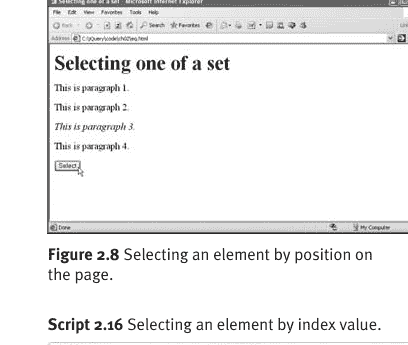

3.  添加代码，选择索引值为 2 的 `<p>` 元素，并在用户点击按钮时将其变为斜体（脚本 2.16）。

4.  保存文件。

5.  在浏览器中导航到该文件。

6.  点击按钮，将第三个 `<p>` 元素变为斜体（图 2.8）。

✔ 提示

■ 除了使用 `eq` 匹配特定页面位置外，你还可以使用 `gt` 匹配特定位置之后的所有元素，或使用 `lt` 匹配特定位置之前的所有元素。

图 2.8 按页面位置选择元素。

脚本 2.16 通过索引值选择元素。

```html
<html>
  <head>
    <title>从集合中选择一个
    </title>
    <script type="text/javascript"
      src="http://code.jquery.com/jquery-
      latest.js">
    </script>
    <script type="text/javascript">
      function setStyle()
      {
        $("p:eq(2)").css("font-style",
          "italic");
      }
    </script>
  </head>

  <body>
  <h1>从集合中选择一个</h1>
  <div>
  <p id="p1">这是段落 1。</p>
  <p id="p2">这是段落 2。</p>
  <p id="p3">这是段落 3。</p>
  <p id="p4">这是段落 4。</p>
  </div>
  <form>
    <input type = "button"
      value="选择"
      onclick="setStyle()"
      </input>
  </form>
  </body>
</html>
```

**按位置选择元素**

47

##### 检查复选框和单选按钮

最强大的选择器之一是 `checked`，它允许你选择已选中的复选框和单选按钮。

我们将通过计算用户选中的复选框数量来应用 `checked`。

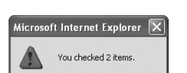

图 2.9 统计已选中的复选框。

**要检查复选框和单选按钮：**

脚本 2.17 添加一些复选框。

```html
<html>
  <head>
    <title>统计已选中的复选框</title>
    <script type="text/javascript"
            src="http://code.jquery.com/jquery-latest.js">
    </script>
  </head>
  <body>
    <h1>统计已选中的复选框</h1>
    <form>
      <input type = "checkbox">
      选项 1
      </input>
      <input type = "checkbox">
      选项 2
      </input>
      <input type = "checkbox">
      选项 3
      </input>
      <input type = "checkbox">
      选项 4
      </input>
    </form>
  </body>
</html>
```

+   1.  使用文本编辑器（如 Microsoft WordPad）创建你的网页。此处我们将使用本书代码中的示例 `checked.html`。
2.  输入代码，将 jQuery 库和一些复选框添加到页面中（脚本 2.17）。

48

脚本 2.18 统计已选中的复选框。

```html
<html>
  <head>
    <title>统计已选中的复选框
    </title>
    <script type="text/javascript"
    src="http://code.jquery.com/jquery-
    latest.js">
    </script>
    <script type="text/javascript">
      function count()
      {
        alert("你选择了 " +
        $("input:checked").length +
        " 个项目。");
      }
    </script>
  </head>

  <body>
  <h1>统计已选中的复选框</h1>
  <form>
  <input type = "checkbox">
  选项 1
  </input>
  <input type = "checkbox">
  选项 2
  </input>
  <input type = "checkbox">
  选项 3
  </input>
  <input type = "checkbox">
  选项 4
  </input>
  <br>
  <input type = "button"
    value="统计"
    onclick="count()"
  </input>
  </form>
  </body>
</html>
```

3.  添加代码，在用户点击按钮时统计已选中复选框的数量（**脚本 2.18**）。

4.  保存文件。

5.  在浏览器中导航到该文件。

6.  选中一些复选框，然后点击按钮统计选中的数量（**图 2.9**）。

49


## 第2章

#### 检查用户选择的元素

jQuery 允许你选择用户已选择的元素。例如，你可能有一个列表框（即 `<select>` 控件），其中用户选择了多个项目。你可以使用 `selected` 选择器来匹配这些选中的项目，如下所示：

```
$("select option:selected")
```

这个例子通过计算用户在列表框中选择的项目数量来应用此选择器。

**选择用户选择的元素：**

1.  使用文本编辑器（例如 Microsoft WordPad）创建你的网页。这里我们将使用书中代码里的 selected.html 示例。
2.  输入代码以将 jQuery 库和多选列表框添加到页面（**脚本 2.19**）。

**脚本 2.19** 添加多选列表框。

```
<html>
  <head>
    <title>Counting selected items</title>
    <script type="text/javascript"
      src="http://code.jquery.com/jquery-latest.js">
    </script>
  </head>
  <body>
    <h1>Counting selected items</h1>
    <form>
      <select size="4" multiple="true">
        <option>Item 1</option>
        <option>Item 2</option>
        <option>Item 3</option>
        <option>Item 4</option>
      </select>
    </form>
  </body>
</html>
```

3.  添加代码以计算列表框中用户选择的项目数量（脚本 2.20）。
4.  保存文件。
5.  在浏览器中导航到该文件。
6.  点击按钮以统计用户选择的项目数量（图 2.10）。

**图 2.10** 统计用户选择的项目数量。

**脚本 2.20** 计算列表框中选中的项目数量。

```
<html>
<head>
<title>Counting selected items
</title>
<script type="text/javascript"
  src="http://code.jquery.com/jquery-latest.js">
</script>
<script type="text/javascript">
  function count()
  {
    alert("You selected " +
      $("select option:selected").length
      + " items.");
  }
</script>
</head>

<body>
<h1>Counting selected items</h1>
<form>
  <select size="4" multiple="true">
    <option>Item 1</option>
    <option>Item 2</option>
    <option>Item 3</option>
    <option>Item 4</option>
  </select>
  <br>
  <input type = "button"
    value="Count"
    onclick="count()"
    </input>
</form>
</body>
</html>
```

*此页有意留白*

## 以 jQuery 方式处理元素

在本章中，我们将引导你了解 jQuery 用于处理页面中元素和属性的所有功能——所有这些都旨在让你轻松地访问和操作页面元素。

例如，jQuery 允许你访问元素以更改它们的 HTML 和文本、设置和读取元素属性，以及向页面添加新元素和删除其他元素。

所有这些操作都可以通过 jQuery 函数实现（它们实际上是 jQuery 方法，但函数和方法之间的区别在 jQuery 中有时很模糊，因此我们将它们称为函数）。

## 第3章

## 函数示例

本章探讨一系列 jQuery 函数，这些函数将帮助你处理元素。

例如，你可以使用 `each()` 函数将一个函数应用于一组元素中的每一个。虽然 jQuery 会自动将 `css()` 之类的函数应用于元素集的所有成员，但你可能想做的不仅仅是将现有的 jQuery 函数应用于元素集的所有成员：例如，你可能想为页面中的所有 `` 元素创建一个自定义的 `alt` 属性。为此，你可以创建自己的函数，然后在该函数内部使用 `each()` 函数来循环遍历集合中的所有成员。

jQuery 还允许你直接访问页面元素的 HTML 和文本，使用 `html()` 和 `text()` 函数。浏览器通常支持 `innerHTML()`、`outerHTML()`、`innerText()` 和 `outerText()` 等部分或全部函数，但支持情况因浏览器而异。通过使用 `html()` 和 `text()`，你将自动兼容所有浏览器。

你还将看到如何使用 `append()` 和 `insertAfter()` 等函数更改页面的结构。使用这些函数，你可以改变页面的结构，移动 HTML 元素，并在用户眼前添加其他元素。

我们还将在此处探讨其他 jQuery 函数，包括 `wrap()`，它允许你将元素包裹在另一个元素内部（例如将 `<p>` 元素包裹在 `<div>` 元素内）以及 `clone()`，它允许你克隆元素。

jQuery 为你提供了各种浏览器要么忽略、要么以不同方式支持的强大功能和便利性。例如，jQuery 的 `width()` 和 `height()` 函数返回页面元素的宽度和高度——你可能认为这很容易自己找到。但是，如果元素没有明确的宽度和高度属性，找到这些值就并非易事，你通常需要尝试读取这些元素的宽度和高度 CSS 样式属性。然而，元素只有在你先明确设置时才具有明确的宽度和高度属性。jQuery 的 `width()` 和 `height()` 函数没有这样的限制——无论你是否设置了元素的 CSS 宽度和高度样式属性，它们总是有效的。

jQuery 还有许多函数允许你处理表单元素，例如文本字段。例如，`val()` 函数返回表单元素的值。你还可以使用 jQuery 来设置表单元素的值。

我们还将在本章中探讨其他 jQuery 函数。

#### 在包装集中循环元素

当你使用 jQuery `$()` 函数创建一组元素，然后将 `css()` 之类的函数应用于该集合时，jQuery 会自动将 `css()` 函数应用于集合的所有成员。

但是，有时你可能希望将自定义函数（你自己编写的函数）应用于集合的成员。例如，你可能想为集合中的所有 `` 元素添加一个自定义的 `alt` 属性。

你可以从这段代码开始，它允许你循环遍历页面中的所有 `` 元素：

```
$("img").each(function(m){
...
});
```

在函数体中，你可以通过索引号引用每个 `` 元素，这里作为参数 `m` 传递给你。你可以使用 `this` 关键字在每次迭代中引用当前元素，因此要为每个 `` 元素添加 `alt` 属性 "Image 1"、"Image 2" 等，你可以使用这段代码：

```
$("img").each(function(m){
  this.alt="Image " + (m + 1);
});
```

我们将在一个示例中应用这段代码。

**循环遍历页面元素：**

1.  使用文本编辑器（例如 Microsoft WordPad）创建你的网页。这里我们将使用书中代码里的 each.html 示例。
2.  输入代码以将 jQuery 库和一些 `` 元素添加到页面（脚本 3.1）。

**图 3.1** 添加新的自定义 alt 属性。

**脚本 3.1** 添加 `` 元素。

```
<html>
  <head>
    <title>Adding an alt attribute
    </title>
    <script type="text/javascript"
      src="http://code.jquery.com/jquery-latest.js">
    </script>
  </head>
  <body>
    <h1>Adding an alt attribute</h1>
    </img>
    </img>
    </img>
    </img>
    <br>
  </body>
</html>
```

**脚本 3.2** 循环所有 `` 元素。

3.  添加代码以循环所有 `` 元素并为每个元素添加 `alt` 属性（脚本 3.2）。
4.  保存文件。
5.  在浏览器中导航到该文件。
6.  点击按钮以向每张图片添加 `alt` 属性，当你将鼠标悬停在每张图片上时可以看到（图 3.1）。

```
<html>
<head>
<title>Adding an alt attribute
</title>
<script type="text/javascript"
src="http://code.jquery.com/jquery-
latest.js"></script>
<script type="text/javascript">
function addAlt()
{
$("img").each(function(m){
this.alt="Image " + (m + 1);
});
}
</script>
</head>
<body>
<h1>Adding an alt attribute</h1>
</img>
</img>
</img>
</img>
<br>
<form>
<input type = "button"
value="Add alt attributes"
onclick="addAlt()"
</input>
</form>
</body>
</html>
```


## 第三章

#### 读取属性值

jQuery 让你能够使用 `attr()` 函数来检查属性的值。

例如，如果页面中有两个 `` 元素，并且你想读取第一个 `` 元素的 `alt` 属性，你可以将要读取的属性名传递给 jQuery 的 `attr()` 函数：

`$("img:first").attr("alt")`

此外，jQuery 提供了一种从 jQuery 包装集中获取元素的方法。你可能认为这样写就行：

`$("img")[0].attr("alt")`

然而，`[0]` 语法返回的是浏览器元素，而不是 jQuery 包装元素，因此 `attr()` 函数在这里不起作用。从包装集中获取元素的一个简单方法是使用 jQuery 的 `slice()` 函数；`slice(m, n)` 返回包装集中索引从 `m` 到 `n-1` 的元素，因此你可以这样获取包装集的第一个元素：

`$("img").slice(0, 1).attr("alt")`

我们将在这里使用 `slice()` 函数来看看它是如何工作的。

```
<html>
  <head>
    <title>Reading an alt attribute</title>
    <script type="text/javascript"
      src="http://code.jquery.com/jquery-latest.js">
    </script>
  </head>
  <body>
    <h1>Reading an alt attribute</h1>
    
    </img>
    
    </img>
    <br>
  </body>
</html>
```

脚本 3.3 向页面添加 `` 元素。

### 要读取一个属性：

1.  使用文本编辑器（例如 Microsoft WordPad）创建你的网页。这里我们将使用本书代码中的示例 `getattr.html`。
2.  输入代码以向页面添加 jQuery 库和一些 `` 元素（脚本 3.3）。
3.  添加代码以在点击按钮时读取第一张图片的 alt 属性（脚本 3.4）。
4.  保存文件。
5.  在浏览器中导航到该文件。
6.  点击按钮以显示第一张图片的 alt 属性值（图 3.2）。

**图 3.2** 显示一个属性值。

脚本 3.4 读取一个 alt 属性。

```
<html>
<head>
<title>Reading an alt attribute</title>
<script type="text/javascript"
src="http://code.jquery.com/jquery-latest.js"></script>
<script type="text/javascript">
function getAlt()
{
  alert($("img").slice(0, 1).attr("alt"));
}
</script>
</head>
<body>
<h1>Reading an alt attribute</h1>

</img>

</img>
<br>
<form>
<input type = "button"
value="Get alt attribute"
onclick="getAlt()"
</input>
</form>
</body>
</html>
```

#### 设置属性值

jQuery 让你不仅能读取属性值，还能使用 `attr()` 函数来设置它们。要设置属性值，你需要传递要添加的属性及其新值。

例如，要向页面中的第一个 `` 元素添加一个值为 "These are flowers." 的 alt 属性，你可以首先定位到第一个 `` 元素：

```
$("img:first")
```

然后你可以使用 `attr()` 函数来设置 alt 属性的值：

```
$("img:first").attr("alt", "These are flowers.");
```

下面是一个运用此功能的示例。

### 要设置一个属性：

1.  使用文本编辑器（例如 Microsoft WordPad）创建你的网页。这里我们将使用本书代码中的示例 `setattr.html`。
2.  输入代码以向页面添加 jQuery 库和一些 `` 元素（脚本 3.5）。

```
<html>
  <head>
    <title>Setting an alt attribute</title>
    <script type="text/javascript"
      src="http://code.jquery.com/jquery-latest.js">
    </script>
  </head>
  <body>
    <h1>Setting an alt attribute</h1>
    
    </img>
    
    </img>
    <br>
  </body>
</html>
```

#### 以 jQuery 方式操作元素

3.  添加代码以在点击按钮时设置第一张图片的 `alt` 属性（脚本 3.6）。
4.  保存文件。
5.  在浏览器中导航到该文件。
6.  点击按钮以向第一张图片添加一个 `alt` 属性（图 3.3）。

> ✔️ **提示**
> 你可以使用 `attr()` 函数向 HTML 元素添加非标准属性，但如果你这样做，你的页面将不再是有效的 HTML。

**图 3.3** 显示一个新的属性值。

脚本 3.6 设置一个 alt 属性。

```
<html>
  <head>
    <title>Setting an alt attribute</title>
    <script type="text/javascript"
      src="http://code.jquery.com/jquery-latest.js">
    </script>
    <script type="text/javascript">
      function setAlt()
      {
        $("img:first").attr("alt", "These are flowers.");
      }
    </script>
  </head>
  <body>
    <h1>Setting an alt attribute</h1>
    
    </img>
    
    </img>
    <br>
    <form>
      <input type = "button"
        value="Set alt attribute"
        onclick="setAlt()"
      </input>
    </form>
  </body>
</html>
```

#### 重写元素的 HTML

jQuery 让你能够使用 `html()` 函数来重写元素的 HTML。你只需要找到你想要重写的元素作为一个包装集，然后调用 `html()` 函数。你需要将希望用来替换当前元素 HTML 的新 HTML 文本传递给 `html()` 函数。

例如，你可以这样包装页面中的所有 `<div>` 元素：

`$("div")`

然后你可以这样将所有 `<div>` 元素替换为 `<span>` 元素：

`$("div").html("<span class='blue'>" + "Here is a new &lt;span&gt; " + "element.</span>");`

下面是一个运用此功能的示例。

### 要重写一个元素的 HTML：

1.  使用文本编辑器（例如 Microsoft WordPad）创建你的网页。这里我们将使用本书代码中的示例 `html.html`。
2.  输入代码以向页面添加 jQuery 库和三个 `<div>` 元素（脚本 3.7）。
3.  添加代码以在页面加载后立即重写 `<div>` 元素的 HTML，将其转换为 `<span>` 元素（**脚本 3.8**）。
4.  保存文件。
5.  在浏览器中导航到该文件。`<div>` 元素被转换为带有我们想要显示的文本的 `<span>` 元素（**图 3.4**）。

> **提示**
> `html()` 函数非常适合*批量*重写元素的 HTML，这不同于浏览器 JavaScript 中可用的标准动态 HTML 技术。

**图 3.4** 显示新的 `<span>` 元素。

脚本 3.8 重写 `<div>` 元素。

```
<html>
<head>
    <title>Rewriting three &lt;div&gt; elements</title>
    <script
        src="http://code.jquery.com/jquery-latest.js">
    </script>
    <script>
    $(document).ready(function(){
        $("div").html("<span class='blue'>" +
            "Here is a new &lt;span&gt; " +
            "element.</span>");
    });
    </script>
    <style>
    .blue { color:blue; }
    </style>
</head>
<body>
    <h1>Rewriting three &lt;div&gt; elements</h1>
    <div></div>
    <div></div>
    <div></div>
</body>
</html>
```

#### 重写元素的文本

除了重写元素的 HTML，你还可以使用 jQuery 来重写元素的文本，使用 `text()` 函数。`text()` 函数让你能够替换元素内的文本，而不是元素的 HTML。

例如，在元素

```
<h1>This is the text</h1>
```

中，文本是 This is the text。如果你使用 `html()` 函数，你将替换整个元素，包括 `<h1>` 标签，但如果你使用 `text()` 函数，只有包含的文本会被修改。

本示例传递的字符串与上一个任务中传递给 `html()` 函数的相同（即 "<span class='blue'>Here is a new &lt;span&gt;element.</span>"），但这次，该文本被解释为文本，而不是 HTML，并按字面意思显示在页面上（即，这次文本仅被视为文本，而不是 HTML）。

### 要重写一个元素的文本：

1.  使用文本编辑器（例如 Microsoft WordPad）创建你的网页。这里我们将使用本书代码中的示例 `text.html`。
2.  输入代码以向页面添加 jQuery 库和三个 `<div>` 元素（脚本 3.9）。

脚本 3.9 添加目标 `<div>` 元素。

```
<html>
<head>
    <title>Rewriting the text of three &lt;div&gt; elements</title>
    <script
    src="http://code.jquery.com/jquery-latest.js">
    </script>
</head>
<body>
    <h1>Rewriting the text of three &lt;div&gt; elements</h1>
    <div></div>
    <div></div>
    <div></div>
</body>
</html>
```


## 以 jQuery 方式处理元素

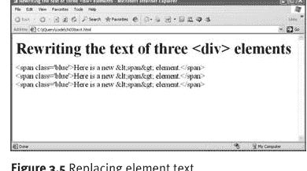

3.  添加代码以在页面加载时设置 `<div>` 元素的文本（脚本 3.10）。
4.  保存文件。
5.  在浏览器中打开该文件。

三个 `<div>` 元素中的文本被替换为传递给 `text()` 函数的文本，该文本中的 HTML 标记被视为纯文本，而不是 HTML（图 3.5）。

脚本 3.10 替换元素的文本。

```html
<html>
<head>
  <title>Rewriting the text of three
    &lt;div&gt; elements</title>
  <script
    src="http://code.jquery.com/jquery-
    latest.js">
  </script>

  <script>
  $(document).ready(function(){
    $("div").text("<span class='blue'>" +
    "Here is a new &lt;span&gt; " +
    "element.</span>");
  });
  </script>
  <style>
  .blue { color:blue; }
  </style>
</head>

<body>
  <h1>Rewriting the text of three
    &lt;div&gt;
    elements</h1>
  <div></div>
  <div></div>
  <div></div>
</body>
</html>
```

## 第 3 章

#### 向元素追加内容

jQuery 允许你使用 `append()` 函数向页面元素追加内容。

例如，假设你有一个包含以下文本的 `<p>` 元素：

```html
<p>You have won </p>
```

你可以这样定位该 `<p>` 元素（假设它是页面中唯一的 `<p>` 元素）：

```javascript
$("p")
```

然后你可以像这样向该 `<p>` 元素追加其他文本：

```javascript
$("p").append("<b>$1,000,000!</b>");
```

通过这种方式，你可以动态修改页面的 HTML。

**要向元素追加内容：**

- 1. 使用文本编辑器（如 Microsoft WordPad）创建你的网页。此处我们将使用本书代码中的示例 append.html。
- 2. 输入代码以向页面添加 jQuery 库和一个包含文本 "You have won " 的 `<p>` 元素（脚本 3.11）。

脚本 3.11 添加 `<p>` 元素。

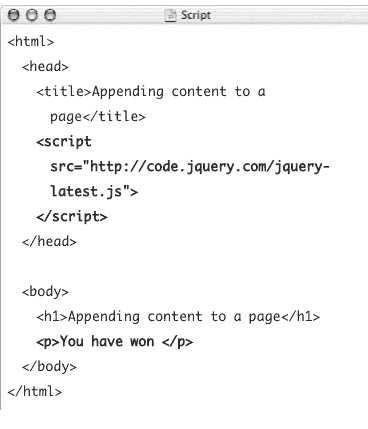

## 以 jQuery 方式处理元素

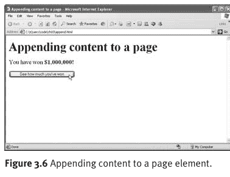

- 3. 添加代码以在点击按钮时追加用户赢得的金额（脚本 3.12）。
- 4. 保存文件。
- 5. 在浏览器中打开该文件。
- 6. 点击按钮以显示用户赢得的金额（图 3.6）。

图 3.6 向页面元素追加内容。

> 提示
你也可以使用 `append()` 函数来移动现有的页面元素——请参阅下一个主题。

#### 脚本 3.12 向元素追加文本。

```html
<html>
  <head>
    <title>Appending content to a page</title>
    <script src="http://code.jquery.com/jquery-latest.js"></script>
    <script>
      function addContent() {
        $("p").append("<b>$1,000,000!</b>");
      }
    </script>
  </head>
  <body>
    <h1>Appending content to a page</h1>
    <p>You have won </p>
    <form>
      <input type="button" value="See how much you've won" onclick="addContent()">
    </form>
  </body>
</html>
```

## 第 3 章

#### 移动页面元素

jQuery 的 `append()` 函数不仅适用于向页面元素追加新内容——你还可以使用 `append()` 函数在页面中移动元素。

例如，假设你有这两个 `<p>` 元素：

```html
<p>The first shall be last.</p>
<p>The last shall be first.</p>
```

你可以使用 `append()` 函数移动最后一个 `<p>` 元素，使其出现在第一个元素之前。首先，获取最后一个 `<p>` 元素：

```javascript
$("p:last")
```

然后将第一个 `<p>` 元素传递给 `append()` 函数：

```javascript
 $("p:last").append($("p:first"));
```

这就搞定了——jQuery 识别出你正在追加一个现有元素，因此它会在页面中将该元素移动到新位置。这反转了 `<p>` 元素的顺序：

```html
<p>The last shall be first.</p>
<p>The first shall be last.</p>
```

## 要移动页面元素：

- 1. 使用文本编辑器（如 Microsoft WordPad）创建你的网页。此处我们将使用本书代码中的示例 move.html。
- 2. 输入代码以添加 jQuery 库和两个 `<p>` 元素（脚本 3.13）。

脚本 3.13 添加带有文本的 `<p>` 元素。

```html
<html>
  <head>
    <title>Moving elements</title>
    <script
      src="http://code.jquery.com/jquery-latest.js">
    </script>
  </head>

  <body>
    <h1>Moving elements</h1>
    <p>The first shall be last.</p>
    <p>The last shall be first.</p>
  </body>
</html>
```

## 以 jQuery 方式处理元素

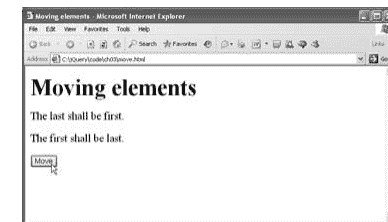

- 3. 添加代码以在点击按钮时反转两个 `<p>` 元素的位置（脚本 3.14）。
- 4. 保存文件。
- 5. 在浏览器中打开该文件。
- 6. 点击按钮以反转两个 `<p>` 元素的位置（图 3.7）。

图 3.7 移动页面元素。

脚本 3.14 反转 `<p>` 元素。

```html
<html>
  <head>
    <title>Moving elements</title>
    <script
      src="http://code.jquery.com/jquery-latest.js">
    </script>

    <script>
      function addContent()
      {
        $("p:last").append($("p:first"));
      }
    </script>
  </head>

  <body>
    <h1>Moving elements</h1>
    <p>The first shall be last.</p>
    <p>The last shall be first.</p>
    <form>
      <input type = "button"
        value="Switch first and last paragraphs"
        onclick="addContent()"
      </input>
    </form>
  </body>
</html>
```

## 第 3 章

#### 设置元素的宽度和高度

jQuery 允许你使用 `width()` 和 `height()` 函数来设置页面元素的宽度和高度。使用这些函数很简单——将它们应用于一个 jQuery 包装集，并以像素为单位传递新的宽度或高度。

要设置新的宽度，请使用 `width()`：

```javascript
width(newvalue)
```

要设置新的高度，请使用 `height()`：

```javascript
height(newvalue)
```

此示例使用 `width()` 和 `height()` 函数，在点击按钮时将两张图片的宽度和高度增加 50%。

## 要设置元素的宽度和高度：

- 1. 使用文本编辑器（如 Microsoft WordPad）创建你的网页。此处我们将使用本书代码中的示例 `width.html`。
- 2. 输入代码以添加 jQuery 库和两个 `` 元素（脚本 3.15）。

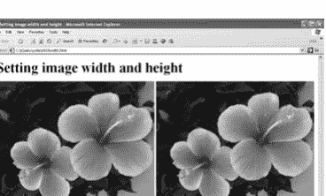

图 3.8 调整元素大小。

#### 脚本 3.15 添加带有文本的 `` 元素。

```html
<html>
    <head>
        <title>Setting image width and height</title>
        <script type="text/javascript" src="http://code.jquery.com/jquery-latest.js"></script>
    </head>
    <body>
        <h1>Setting image width and height</h1>
        </img>
        </img>
        <br>
    </body>
</html>
```

#### 脚本 3.16 增加图像宽度和高度。

```html
<html>
  <head>
    <title>Setting image width and height</title>
    <script type="text/javascript"
      src="http://code.jquery.com/jquery-latest.js">
    </script>
    <script type="text/javascript">
      function resize()
      {
        $("img").width(486);
        $("img").height(365);
      }
    </script>
  </head>
  <body>
    <h1>Setting image width and height</h1>
    
    </img>
    
    </img>
    <br>
    <form>
    <input type = "button"
      value="Resize"
      onclick="resize()"
    </input>
    </form>
  </body>
</html>
```

- 3. 添加代码以在点击按钮时增加两个 `` 元素的宽度和高度（**脚本 3.16**）。
- 4. 保存文件。
- 5. 在浏览器中打开该文件。
- 6. 点击按钮，同时观察两张图片的宽度和高度如何增加（**图 3.8**）。

## 第 3 章

#### 包裹元素

使用 jQuery 包装集你还能做其他事情：你可以使用 `wrap()` 函数将所有包含的元素包裹在其他元素内部。如果你想将一组元素放入，比如，一个 `<div>` 元素中以便于处理，这个函数会很有用。

例如，如果你有一些 `<p>` 元素，并想将它们包裹在一个 `<h1>` 标题元素中，你可以使用 `wrap()` 函数来完成：

```javascript
$("p").wrap("<h1></h1>");
```

此示例将展示该代码的应用。

## 要包裹元素：

- 1. 使用文本编辑器（如 Microsoft WordPad）创建你的网页。此处我们将使用本书代码中的示例 wrap.html。
- 2. 输入代码以添加 jQuery 库并添加四个 `<p>` 元素（脚本 3.17）。

脚本 3.17 向页面添加 `<p>` 元素。

```html
<html>
<head>
<title>Wrapping elements
</title>
<script type="text/javascript"
src="http://code.jquery.com/jquery-latest.js">
</script>
</head>
<body>
<h1>Wrapping elements</h1>
<p>This is paragraph 1.</p>
<p>This is paragraph 2.</p>
<p>This is paragraph 3.</p>
<p>This is paragraph 4.</p>
<br>
</body>
</html>
```


## 使用 jQuery 方式操作元素

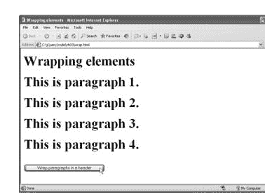

1.  使用文本编辑器（如 Microsoft WordPad）创建你的网页。这里我们将使用书中代码里的示例 `wrap.html`。
2.  输入代码以添加 jQuery 库和四个 `<p>` 元素（**脚本 3.17**）。
3.  添加代码，以便在点击按钮时将 `<p>` 元素包裹在一个 `<h1>` 元素中（脚本 3.18）。
4.  保存文件。
5.  在浏览器中导航到该文件。
6.  点击按钮，将 `<p>` 元素包裹在 `<h1>` 元素中，这使得 `<p>` 元素自身成为标题（图 3.9）。

图 3.9 包裹元素。

脚本 3.18 将元素包裹在标题中。

```
<html>
  <head>
    <title>Wrapping elements</title>
    <script type="text/javascript" src="http://code.jquery.com/jquery-latest.js"></script>
    <script type="text/javascript">
      function wrapper() {
        $("p").wrap("<h1></h1>");
      }
    </script>
  </head>
  <body>
    <h1>Wrapping elements</h1>
    <p>This is paragraph 1.</p>
    <p>This is paragraph 2.</p>
    <p>This is paragraph 3.</p>
    <p>This is paragraph 4.</p>
    <br>
    <form>
      <input type = "button" value="Wrap paragraphs in a header" onclick="wrapper()">
    </form>
  </body>
</html>
```

## 第 3 章

#### 插入元素

你可以使用 jQuery 的 `append()` 函数将元素附加到其他元素，甚至可以在页面中移动它们。你也可以使用 `before()` 和 `after()` 函数进行更精细的控制来插入元素。

例如，要在一个 ID 为 "target" 的元素*之前*添加一个新的 `<p>` 元素，你可以使用这段代码：

```
$("#target").before("<p>New Element></p>");
```

要在一个 ID 为 "target" 的元素*之后*插入一个新的 `<p>` 元素，你可以使用这段代码：

```
$("#target").after("<p>New element></p>");
```

此示例在四个 `<p>` 元素的集合中添加了两个新的 `<p>` 元素。

### 插入元素：

1.  使用文本编辑器（如 Microsoft WordPad）创建你的网页。这里我们将使用书中代码里的示例 `insert.html`。
2.  输入代码以添加 jQuery 库和四个 `<p>` 元素（**脚本 3.19**）。

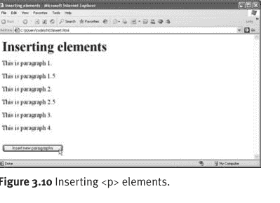

**图 3.10** 插入 `<p>` 元素。

**脚本 3.19** 向页面添加四个 `<p>` 元素。

```
<html>
<head>
  <title>Inserting elements</title>
  <script type="text/javascript"
          src="http://code.jquery.com/jquery-latest.js">
  </script>
</head>
<body>
  <h1>Inserting elements</h1>
  <p>This is paragraph 1.</p>
  <p id="target">This is paragraph 2.</p>
  <p id="source">This is paragraph 3.</p>
  <p>This is paragraph 4.</p>
  <br>
</body>
</html>
```

脚本 3.20 插入 `<p>` 元素。

```
<html>
  <head>
    <title>Inserting elements
    </title>
    <script type="text/javascript"
      src="http://code.jquery.com/jquery-latest.js">
    </script>
    <script type="text/javascript">
      function inserter()
      {
        $("#target").before("<p>This is paragraph 1.5</p>");
        $("#target").after("<p>This is paragraph 2.5</p>");
      }
    </script>
  </head>

  <body>
    <h1>Inserting elements</h1>
    <p>This is paragraph 1.</p>
    <p id="target">This is paragraph 2.</p>
    <p id="source">This is paragraph 3.</p>
    <p>This is paragraph 4.</p>
    <br>
    <form>
    <input type = "button"
      value="Insert new paragraphs"
      onclick="inserter()"
    </input>
    </form>
  </body>
</html>
```

3.  添加代码，以便在点击按钮时插入两个 `<p>` 元素（即段落 1.5 和 2.5）（脚本 3.20）。
4.  保存文件。
5.  在浏览器中导航到该文件。
6.  点击按钮以添加两个新的 `<p>` 元素（图 3.10）。

#### 编辑 value 属性

你可以使用 jQuery 的 `val()` 函数来处理表单元素（如按钮和文本字段）的 value 属性。value 属性保存与控件对应的数据：例如，文本字段中的文本，或按钮的标题。

当你不带任何参数调用 `val()` 时，它会返回相应元素 value 属性中的当前数据。

向 `val()` 函数传递数据会将相应元素的 value 属性设置为该数据。例如，要将一个 ID 为 "target" 的元素的 value 属性设置为 "Hello there."，你可以使用这段代码：

```
$("#target").val("Hello there.");
```

此示例在点击按钮时设置文本字段中的文本。

### 编辑 value 属性：

1.  使用文本编辑器（如 Microsoft WordPad）创建你的网页。这里我们将使用书中代码里的示例 `val.html`。
2.  输入代码以向页面添加 jQuery 库和一个文本字段（脚本 3.21）。

脚本 3.21 添加一个文本字段。

```
<html>
<head>
<title>Editing the value attribute</title>
<script type="text/javascript" src="http://code.jquery.com/jquery-latest.js"></script>
</head>
<body>
<h1>Editing the value attribute</h1>
<br>
<form>
<input type="text" id="target">
</input>
</form>
</body>
</html>
```

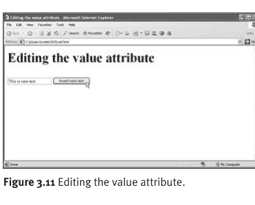

3.  添加代码，以便在点击按钮时将文本字段中的文本设置为（"This is new text."）（**脚本 3.22**）。
4.  保存文件。
5.  在浏览器中导航到该文件。
6.  点击按钮，在文本字段中显示新文本（**图 3.11**）。

脚本 3.22 向文本字段添加文本。

```
<html>
  <head>
    <title>Editing the value attribute
    </title>
    <script type="text/javascript"
            src="http://code.jquery.com/jquery-latest.js">
    </script>
    <script type="text/javascript">
        function inserter()
        {
            $("#target").val("This is new text.");
        }
    </script>
  </head>

  <body>
    <h1>Editing the value attribute</h1>
    <br>
    <form>
        <input type = "text" id="target">
        </input>
        <input type = "button"
               value="Insert new text"
               onclick="inserter()"
        </input>
    </form>
  </body>
</html>
```

## 第 4 章

# 处理事件

JavaScript 的核心在于让你的页面“活”起来——但没有事件，你将寸步难行。

事件让你能够响应用户的操作，如点击、双击、鼠标移动和按键。这正是 JavaScript 擅长的领域，也是 jQuery 的主要支柱之一。

为什么事件处理在 jQuery 中如此重要？jQuery 统一了多个浏览器中的事件处理方式，而使用原生 JavaScript 进行跨浏览器事件处理则是一场噩梦。

#### JavaScript 和 jQuery 中的事件处理

如果你曾经尝试过使用原生 JavaScript 以跨浏览器的方式支持，比如拖放操作，你就知道其中的困难了。Internet Explorer 和 Firefox 处理事件的方式从头到尾都大相径庭，你必须编写大量代码来抹平这些差异。

例如，当你移动鼠标时，两个浏览器都会创建一个事件对象，其中包含鼠标位置信息，如鼠标所在的 X 和 Y 坐标。但在两个浏览器中，你访问该事件对象的方式完全不同。

在这两种浏览器中，你都需要设置 JavaScript 函数，称为*事件处理程序*（也称为*监听器*），以便在相应事件发生时执行代码。但你将事件处理程序与事件连接起来的方式在两个浏览器中是不同的。而且你访问事件对象的方式也不同。在 Internet Explorer 中，事件对象是另一个浏览器对象的子对象，而在 Firefox 中，事件对象是传递给你的事件处理程序的。

噩梦才刚刚开始。你通过事件对象的*属性*来访问鼠标位置以及其他项目，例如鼠标所在的页面元素。这些属性具有不同的名称——有时含义也不同——这取决于你的代码运行的浏览器。

因此，除了编写代码之外，你还必须处理不同的属性。事实上，如果你试图在两种浏览器中使用原生 JavaScript 来支持拖放，你首先需要确定用户使用的是哪个浏览器，然后根据浏览器执行完全不同的代码。


## 处理事件

因此，你需要编写的代码是原来的两倍，需要进行的测试也是两倍。如果你编写的 JavaScript 超出了只是在屏幕上弹出警告框的最基本事件处理程序，你很快就会发现自己在做这种加倍的工作。

这就是 jQuery 的用武之地。jQuery 通过单一的方式（将事件处理程序附加到页面元素上）、单一类型的事件对象和单一的事件对象属性集，统一了事件处理。仅此一点就值得你使用它。

jQuery 还允许你为页面元素附加多个事件处理程序，并为事件使用标准名称（例如 `click`），使得处理这些事件更加容易。它还通过将事件对象简单地传递给事件处理程序，使其易于被事件处理程序访问。

这并不是说 jQuery 中的事件处理不够复杂。你也可以取消事件绑定，并创建只执行一次的事件处理程序。你甚至可以在每次事件发生时，交替调用不同的事件处理程序。

这一切都在 jQuery 中完成。现在，让我们开始深入研究事件处理。

#### JavaScript 和 jQuery 中的事件处理

## 第 4 章：将事件处理程序绑定到事件

jQuery 中的事件处理始于将一个事件（如鼠标点击）连接到一个事件处理程序。然后，当事件发生时，事件处理程序将被调用，事件处理程序中的代码将被执行。

你使用 `bind()` 函数将页面元素的事件绑定到事件处理程序。例如，如果一个页面包含一个图像，并且你想将该图像的一个事件绑定到一个事件处理程序，你可以执行如下代码：

```
$("img").bind(event, data, handler)
```

这里，`event` 是一个包含事件类型的字符串。可能的值有 `blur`、`focus`、`load`、`resize`、`scroll`、`unload`、`beforeunload`、`click`、`dblclick`、`mousedown`、`mouseup`、`mousemove`、`mouseover`、`mouseout`、`mouseenter`、`mouseleave`、`change`、`select`、`submit`、`keydown`、`keypress`、`keyup` 和 `error`。

`data` 参数包含你想作为事件对象的 `data` 属性传递给事件处理程序的可选数据（你可以省略此参数），而 `handler` 是事件处理程序函数。

在这里，我们将看到如何将图像的 `click` 事件绑定到一个显示警告框的事件处理程序。

### 绑定事件：

- 1. 使用文本编辑器（如 Microsoft WordPad）创建你的网页。这里我们将使用本书代码中的示例 `bind.html`。
- 2. 输入将 jQuery 库和 `` 元素添加到页面的代码（脚本 4.1）。

```
<html>
  <head>
    <title>将事件处理程序绑定到事件</title>
    <script src="http://code.jquery.com/jquery-latest.js">
    </script>
  </head>
  <body>
    <h1>将事件处理程序绑定到事件</h1>
    <h1>点击花朵...</h1>
    
  </body>
</html>
```

脚本 4.1 添加一个 `` 元素。

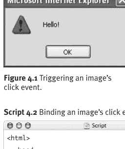

- 3. 添加将图像的 `click` 事件绑定到显示警告框的事件处理程序函数的代码（脚本 4.2）。
- 4. 保存文件。
- 5. 在浏览器中导航到该文件。
- 6. 点击图像以显示警告框（图 4.1）。

###### 脚本 4.2 绑定图像的 `click` 事件。

```
<html>
    <head>
        <title>将事件处理程序绑定到事件</title>
        <script src="http://code.jquery.com/jquery-latest.js"></script>
        <script>
            $(function(){
                $('#target')
                    .bind('click',function(event) {
                        alert('Hello!');
                    });
            });
        </script>
    </head>
    <body>
        <h1>将事件处理程序绑定到事件</h1>
        <h1>点击花朵...</h1>
        
    </body>
</html>
```

将事件处理程序绑定到事件

## 第 4 章：绑定多个事件处理程序

jQuery 还允许你将多个事件处理程序绑定到事件上。

例如，你可以像这样将三个不同的事件处理程序函数绑定到一个页面元素的 `click` 事件，你调用了三次 `bind()` 函数：

```
$('#target')
  .bind('click', function(event) {
    alert('Hello!');
  })
  .bind('click', function(event) {
    alert('Hello again!');
  })
  .bind('click', function(event) {
    alert('Hello yet again!');
  });
```

现在当 `click` 事件发生时，第一个事件处理程序将被调用，然后是第二个，接着是第三个。

我们将在一个示例中使用这段代码。

### 绑定多个事件处理程序：

- 1. 使用文本编辑器（如 Microsoft WordPad）创建你的网页。这里我们将使用本书代码中的示例 `multiple.html`。
- 2. 输入将 jQuery 库和 `` 元素添加到页面的代码（脚本 4.3）。

脚本 4.3 添加一个 `` 元素。

```
<html>
  <head>
    <title>将事件处理程序绑定到事件</title>
    <script src="http://code.jquery.com/jquery-latest.js"></script>
  </head>
  <body>
    <h1>将事件处理程序绑定到事件</h1>
    <h1>点击花朵…</h1>
    
  </body>
</html>
```

绑定多个事件处理程序

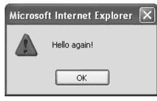

- 3. 添加将三个事件处理程序绑定到图像的 `click` 事件的代码（脚本 4.4）。
- 4. 保存文件。
- 5. 在浏览器中导航到该文件。
- 6. 点击图像，将显示一系列警告框，其中一个如图 4.2 所示。

###### 脚本 4.4 绑定三个事件处理程序。

```
<html>
  <head>
    <title>将事件处理程序绑定到
      事件</title>
    <script
      src="http://code.jquery.com/jquery-
      latest.js">
    </script>

    <script>
      $(function(){
        $('#target')
          .bind('click',function(event) {
            alert('Hello!');
          })
          .bind('click',function(event) {
            alert('Hello again!');
          })
          .bind('click',function(event) {
            alert('Hello yet again!');
          });
      });
    </script>
  </head>

  <body>
    <h1>将事件处理程序绑定到
      事件</h1>
    <h1>点击花朵...</h1>
    
  </body>
</html>
```

绑定多个事件处理程序

## 第 4 章：使用快捷方式绑定事件处理程序

你不需要像这样使用 `bind()` 函数将事件处理程序绑定到页面事件：

`.bind('click', function(event) { ...`

相反，你可以使用一个快捷方式：你可以将事件名称用作绑定函数本身。以下是绑定 `click` 事件的示例：

`.click(function(event) { ...`

注意区别；你在这里不传递要绑定的事件名称，只传递事件处理程序函数。

以下是可能的快捷函数：
`blur()`, `focus()`, `load()`, `resize()`,
`scroll()`, `unload()`, `beforeunload()`,
`click()`, `dblclick()`, `mousedown()`,
`mouseup()`, `mousemove()`, `mouseover()`,
`mouseout()`, `mouseenter()`, `mouseleave()`,
`change()`, `select()`, `submit()`, `keydown()`,
`keypress()`, `keyup()`, and `error()`.

我们将在一个示例中使用这段代码；我们将使用 `click()` 函数将图像的 `click` 事件绑定到处理程序函数。

### 使用快捷方式绑定事件：

- 1. 使用文本编辑器（如 Microsoft WordPad）创建你的网页。这里我们将使用本书代码中的示例 `click.html`。
- 2. 输入将 jQuery 库和一些 `` 元素添加到页面的代码（脚本 4.5）。

###### 脚本 4.5 添加一个 `` 元素作为事件源。

```
<html>
  <head>
    <title>使用快捷方式绑定事件处理程序</title>
    <script src="http://code.jquery.com/jquery-latest.js">
    </script>
  </head>
  <body>
    <h1>使用快捷方式绑定事件处理程序</h1>
    <h1>点击花朵...</h1>
    
  </body>
</html>
```

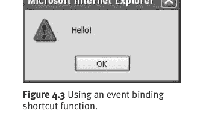

- 3. 添加使用 `click()` 快捷方式将图像的 `click` 事件连接到显示警告框的事件处理程序函数的代码（脚本 4.6）。
- 4. 保存文件。
- 5. 在浏览器中导航到该文件。
- 6. 点击图像，显示警告框（图 4.3）。

图 4.3 使用事件绑定快捷函数。

###### 脚本 4.6 使用 `click()` 快捷方式。

```
<html>
  <head>
    <title>使用快捷方式绑定事件处理程序</title>
    <script src="http://code.jquery.com/jquery-latest.js"></script>
    <script>
      $(function(){
        $('#target')
          .click(function(event) {
            alert('Hello!');
          });
      });
    </script>
  </head>
  <body>
    <h1>使用快捷方式绑定事件处理程序</h1>
    <h1>点击花朵...</h1>
    
  </body>
</html>
```

使用快捷方式绑定事件处理程序


## 第四章

##### 仅调用一次事件处理程序

你可以使用 jQuery 将事件绑定到你希望只运行一次的事件处理程序。如果你有一个需要只执行一次的初始化过程，这个功能会非常有用。例如，你可能想初始化一个在线数据库——这是一个只需要执行一次的过程。

要将事件绑定到事件处理程序，使其只运行一次，你需要使用 `one()` 函数：
`.one('click', function(event) {...`

让我们来实际应用这个函数。

### 仅调用一次事件处理程序：

1.  使用文本编辑器（例如 Microsoft WordPad）创建你的网页。这里我们将使用本书代码中的示例 `one.html`。
2.  输入代码，将 jQuery 库和一个 `` 元素添加到页面中（脚本 4.7）。

脚本 4.7 添加一个 `` 元素。

```html
<html>
    <head>
        <title>允许事件处理程序
            仅被调用一次</title>
        <script
            src="http://code.jquery.com/jquery-
            latest.js">
        </script>
    </head>
    <body>
        <h1>允许事件处理程序
            仅被调用一次</h1>
        <h1>点击花朵...</h1>
        
    </body>
</html>
```

## 处理事件

1.  添加代码，将图片的点击事件连接到一个只会执行一次的事件处理函数（脚本 4.8）。
2.  保存文件。
3.  在浏览器中导航到该文件（图 4.4）。
4.  点击图片，会显示一个警告框。
5.  再次点击图片；这次不再出现警告框。

### 图 4.4 仅使用一次事件绑定。

###### 脚本 4.8 仅执行一次事件处理程序。

```html
<html>
    <head>
        <title>允许事件处理程序
            仅被调用一次</title>
        <script
            src="http://code.jquery.com/jquery-
            latest.js">
        </script>

        <script>
            $(function(){
                $('#target')
                    .one('click',function(event) {
                        alert('Hello!');
                    });
            });
        </script>
    </head>

    <body>
        <h1>允许事件处理程序
            仅被调用一次</h1>
        <h1>点击花朵...</h1>
        
    </body>
</html>
```

##### 仅调用一次事件处理程序

## 第四章

##### 解绑事件处理程序

你也可以使用 jQuery 将事件从事件处理程序断开。例如，如果某个选项在你的应用程序中不再可用，你可能希望移除响应事件的点击事件处理程序。

你可以使用 `unbind()` 函数将事件从事件处理程序断开：

`.unbind('click',function(event) {...`

你只需要将 `unbind()` 函数传递要断开的事件名称以及该事件当前所绑定的事件处理程序名称。

让我们尝试一下这个函数，在点击图片时将其点击事件解绑。

### 解绑事件：

1.  使用文本编辑器（例如 Microsoft WordPad）创建你的网页。这里我们将使用本书代码中的示例 `unbind.html`。
2.  输入代码，将 jQuery 库和 `` 元素添加到页面中，并将点击事件连接到一个名为 `clicker()` 的函数（脚本 4.9）。

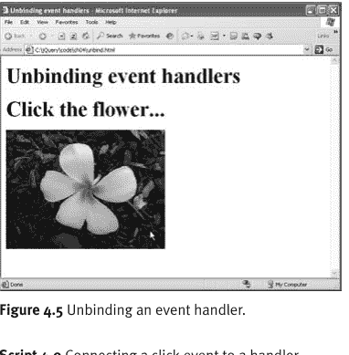

图 4.5 解绑事件处理程序。

###### 脚本 4.9 将点击事件连接到处理程序。

```html
<html>
    <head>
        <title>解绑事件处理程序</title>
        <script
            src="http://code.jquery.com/jquery-latest.js">
        </script>

        <script>
            $(function(){
                $('#target').bind('click',
                    clicker);
            });
        </script>
    </head>

    <body>
        <h1>解绑事件处理程序</h1>
        <h1>点击花朵...</h1>
        
    </body>
</html>
```

###### 脚本 4.10 解绑点击事件。

```html
<html>
<head>
<title>解绑事件处理程序</title>
<script
src="http://code.jquery.com/jquery-latest.js">
</script>

<script>
$(function(){
$('#target').bind('click',
clicker);
});

function clicker(event)
{
alert('Click event unbound');
$('#target').unbind('click', clicker);
}
</script>
</head>

<body>
<h1>解绑事件处理程序</h1>
<h1>点击花朵...</h1>

</body>
</html>
```

3.  添加代码，在 `clicker()` 函数中显示一个警告框，然后将点击事件从 `clicker()` 函数断开（脚本 4.10）。
4.  保存文件。
5.  在浏览器中导航到该文件（图 4.5）。
6.  点击图片，显示警告框并解绑点击事件。
7.  再次点击图片，确保没有响应。

## 第四章

#### 使用事件对象

jQuery 事件处理的强大功能远不止你目前看到的。例如，事件处理函数会接收一个事件对象，该对象具有你可以使用的属性和方法。

例如，如果你想知道页面元素被点击的位置，可以使用事件对象的 `pageX` 和 `pageY` 属性。如果你想知道事件的目标元素，可以使用事件对象的 `target` 属性。

我们将在本主题中探讨 jQuery 事件对象的属性和方法，并在后续主题中实际应用它们。

##### 事件对象属性

表 4.1 列出了 jQuery 事件对象的属性。

##### 事件对象方法

表 4.2 列出了事件对象的方法。

**表 4.1 事件对象属性**

| 属性 | 包含内容 |
| :--- | :--- |
| event.altKey | 如果按下了 Alt 键，则包含 true。 |
| event.ctrlKey | 如果按下了 Ctrl 键，则包含 true。 |
| event.data | 包含传递给 jQuery `bind()` 函数的数据。 |
| event.keyCode | 包含按下的键的键码。 |
| event.pageX | 包含相对于客户端区域的鼠标 X 坐标。 |
| event.pageY | 包含相对于客户端区域的鼠标 Y 坐标。 |
| event.relatedTarget | 包含鼠标之前所在的元素。 |
| event.result | 包含事件处理程序返回的最后一个值。 |
| event.screenX | 包含相对于屏幕的鼠标 X 坐标。 |
| event.screenY | 包含相对于屏幕的鼠标 Y 坐标。 |
| event.shiftKey | 如果按下了 Shift 键，则包含 true。 |
| event.target | 包含触发事件的元素。 |
| event.timeStamp | 包含表示事件发生时间的时间戳（以毫秒为单位）。 |
| event.type | 包含事件的名称。 |

**表 4.2 事件对象方法**

| 方法 | 功能 |
| :--- | :--- |
| event.isDefaultPrevented() | 如果曾在事件对象上调用过 `event.preventDefault()`，则返回 true。 |
| event.isImmediatePropagationStopped() | 如果曾在事件对象上调用过 `event.stopImmediatePropagation()`，则返回 true。 |
| event.isPropagationStopped() | 如果曾在事件对象上调用过 `event.stopPropagation()`，则返回 true。 |
| event.preventDefault() | 阻止浏览器执行此事件的默认操作。 |
| event.stopImmediatePropagation() | 阻止其余的处理程序被执行。 |

#### 使用事件对象

脚本 4.11 添加一个 `` 元素和两个 `<p>` 元素。

##### 获取鼠标坐标

鼠标事件对象具有内置属性，可让你精确确定事件发生的位置。

你可以使用 `pageX` 和 `pageY` 属性获取页面坐标——即鼠标事件相对于客户端区域（窗口中进行操作的区域，不包括工具栏、边框、状态栏等）左上角的坐标。这些属性是相对于客户端区域左上角（位置为 (0, 0)）的 X 和 Y 坐标。

你也可以使用 `screenX` 和 `screenY` 属性获取鼠标相对于屏幕左上角的位置。

所有坐标均以像素为单位。

要获取鼠标事件的坐标：

```html
<html>
    <head>
        <title>将事件处理程序绑定到事件</title>
        <script src="http://code.jquery.com/jquery-latest.js"></script>
        <script>
            $(function(){
                $('#target').bind('click', clicker);
            });
        </script>
    </head>
    <body>
        <h1>将事件处理程序绑定到事件</h1>
        <h1>点击花朵...</h1>
        
    </body>
</html>
```

1.  使用文本编辑器（例如 Microsoft WordPad）创建你的网页。这里我们将使用本书代码中的示例 `screenx.html`。
2.  输入代码，将 jQuery 库、一个 `` 元素和两个 `<p>` 元素添加到页面中（脚本 4.11）。

接下页


## 第4章

- 3. 添加代码，以便在鼠标点击时显示 `screenX` 和 `screenY` 以及 `pageX` 和 `pageY` 坐标（脚本 4.12）。
- 4. 保存文件。
- 5. 在浏览器中打开该文件。
- 6. 点击图片，显示点击事件的页面和屏幕坐标（图 4.6）。

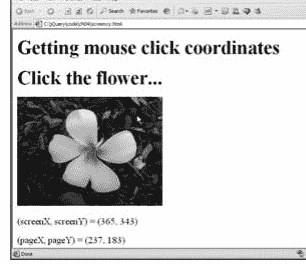

脚本 4.12 显示鼠标坐标。

```html
<html>
  <head>
    <title>获取鼠标点击坐标</title>
    <script src="http://code.jquery.com/jquery-latest.js"></script>
    <script>
      $(function(){
        $('#target').bind('click', clicker);
      });
      function clicker(event)
      {
        $('#p1').text('(screenX, screenY) = (' + event.screenX + ', ' + event.screenY + ')');
        $('#p2').text('(pageX, pageY) = (' + event.pageX + ', ' + event.pageY + ')');
      }
    </script>
  </head>
  <body>
    <h1>获取鼠标点击坐标</h1>
    <h1>点击花朵...</h1>
    
    <p id="p1"></p>
    <p id="p2"></p>
  </body>
</html>
```

##### 获取事件类型

你可以将单个事件处理函数连接到多种不同类型的事件。例如，你可能希望将点击和双击的事件处理集中到一个函数中。

那么，如何确定实际发生了哪种类型的事件：是单击还是双击呢？

你可以使用事件对象的 `type` 属性。该属性以人类语言存储事件的名称。可能的值包括 `blur`、`focus`、`load`、`resize`、`scroll`、`unload`、`beforeunload`、`click`、`dblclick`、`mousedown`、`mouseup`、`mousemove`、`mouseover`、`mouseout`、`mouseenter`、`mouseleave`、`change`、`select`、`submit`、`keydown`、`keypress`、`keyup` 和 `error`。

让我们看一个示例，来确定事件类型。

要获取事件的类型：

- 1. 使用文本编辑器（如 Microsoft WordPad）创建你的网页。此处我们将使用本书代码中的示例 `type.html`。
- 2. 输入代码，将 jQuery 库添加到页面，并将一个名为 `clicker()` 的函数连接到 `` 元素（脚本 4.13）。

脚本 4.13 添加 `` 元素并绑定其点击事件。

```html
<html>
    <head>
        <title>获取事件类型</title>
        <script
            src="http://code.jquery.com/jquery-latest.js">
        </script>

        <script>
            $(function(){
                $('#target').bind('click',
                    clicker);
            });
        </script>
    </head>

    <body>
        <h1>获取事件类型</h1>
        <h1>点击花朵...</h1>
        
    </body>
</html>
```

- 3. 添加代码，以便在图片被点击时，在 `<p>` 元素中显示事件类型（脚本 4.14）。
- 4. 保存文件。
- 5. 在浏览器中打开该文件。
- 6. 点击图片，使得 `<p>` 元素显示文本，表明发生了一个点击事件（图 4.7）。

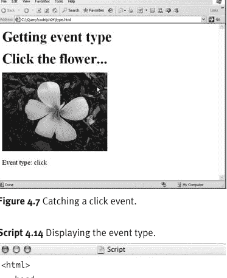

脚本 4.14 显示事件类型。

```html
<html>
  <head>
    <title>获取事件类型</title>
    <script
      src="http://code.jquery.com/jquery-latest.js">
    </script>

    <script>
      $(function(){
        $('#target').bind('click',
          clicker);
      });

      function clicker(event)
      {
        $('#p1').text('Event type: '
          + event.type);
      }
    </script>
  </head>

  <body>
    <h1>获取事件类型</h1>
    <h1>点击花朵...</h1>
    
    <p id="p1"></p>
  </body>
</html>
```

##### 捕获按键

你可以使用 jQuery 捕获按键，尽管需要费点功夫来确定按下了哪个键。

使用 `keyDown`、`keyPress` 和 `keyUp` 事件时，事件对象的 `keyCode` 属性保存了被按键的代码。请注意，按键代码只保存原始按键代码，不包含有关大小写的信息（你可以检查 `shiftKey` 属性来获取该信息）。

我们将看一个示例，以了解如何确定按键事件发生时按下了哪个键。为了将原始按键代码转换为按下的字符，我们将使用 JavaScript 方法 `String.fromCharCode()`（该方法返回大写字母）。

在此示例中，你可以按键，代码将在 `<p>` 元素中显示被按下的键。

要捕获按键：

- 1. 使用文本编辑器（如 Microsoft WordPad）创建你的网页。此处我们将使用本书代码中的示例 `keycode.html`。
- 2. 输入代码，将 jQuery 库添加到页面，并将 `<body>` 元素的 `keyUp` 事件绑定到一个 JavaScript 函数（脚本 4.15）。

脚本 4.15 绑定 `keyUp` 事件。

```html
<html>
  <head>
    <title>捕获按键事件</title>
    <script
      src="http://code.jquery.com/jquery-latest.js">
    </script>

    <script>
      $(function(){
        $('#target').bind('keyup', typer);
      });
    </script>
  </head>

  <body id="target">
    <h1>捕获按键事件</h1>
  </body>
</html>
```

- 3. 添加代码，在 `<p>` 元素中显示被按下的键（脚本 4.16）。
- 4. 保存文件。
- 5. 在浏览器中打开该文件。
- 6. 输入一个字符；你输入的字符会显示在页面上（图 4.8）。

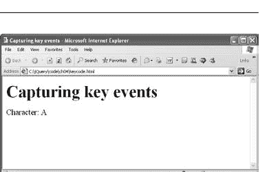

脚本 4.16 显示被按下的键。

```html
<html>
  <head>
    <title>捕获按键事件</title>
    <script
      src="http://code.jquery.com/jquery-latest.js">
    </script>

    <script>
      $(function(){
        $('#target').bind('keyup', typer);
      });

      function typer(event)
      {
        $('#p1').text('Character: '
          + String.fromCharCode(
            event.keyCode));
      }
    </script>
  </head>

  <body id="target">
    <h1>捕获按键事件</h1>
    <p id="p1"></p>
  </body>
</html>
```

##### 捕获悬停事件

jQuery 库有一个特殊函数用于处理鼠标悬停事件，即鼠标光标停留在页面元素上。该函数是 `hover()`：

```
hover(over, out)
```

你需要向 `hover()` 传递两个函数：`over()` 函数应在鼠标悬停在页面元素上时被调用，而 `out()` 函数应在鼠标离开页面元素时被调用。

在此示例中，当鼠标悬停在文本上时，我们将页面中的某些文本设置为斜体，并在鼠标离开时恢复正常。

要捕获悬停事件：

- 1. 使用文本编辑器（如 Microsoft WordPad）创建你的网页。此处我们将使用本书代码中的示例 `hover.html`。
- 2. 输入代码，将 jQuery 库添加到页面，并添加一个包含一些文本的 `<p>` 元素，将悬停事件绑定到两个 JavaScript 函数（脚本 4.17）。

脚本 4.17 绑定悬停事件。

```html
<html>
    <head>
        <title>捕获悬停事件</title>
        <script src="http://code.jquery.com/jquery-latest.js"></script>
        <script>
            $(function(){
                $('#target').hover(over, out);
            });
        </script>
    </head>
    <body>
        <h1>捕获悬停事件</h1>
        <p id="target">Here is the text!</p>
    </body>
</html>
```

- 3. 添加代码，以便在鼠标悬停在 `<p>` 元素上时将其文本设置为斜体，并在鼠标离开时恢复文本为正常（脚本 4.18）。
- 4. 保存文件。
- 5. 在浏览器中打开该文件。
- 6. 将鼠标移动到文本上，观察其变为斜体（图 4.9）。

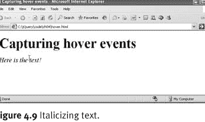

> ■ 当你想要更改 `<p>` 元素中文本的样式时，不必通过 `<p>` 元素的 ID 值 `$('#target')` 来访问它。你可以使用 `event.target` 来引用 `<p>` 元素，因为事件的 target 会通过事件对象传递给你；请看下一个主题。

脚本 4.18 捕获悬停事件。

```html
<html>
  <head>
    <title>捕获悬停事件</title>
    <script src="http://code.jquery.com/jquery-latest.js"></script>

    <script>
      $(function(){
        $('#target').hover(over, out);
      });

      function over(event)
      {
        $('#target').css("font-style", "italic");
      }

      function out(event)
      {
        $('#target').css("font-style", "normal");
      }
    </script>
  </head>

  <body>
    <h1>捕获悬停事件</h1>
    <p id="target">Here is the text!</p>
  </body>
</html>
```


## 脚本 4.19 绑定图片的点击事件。

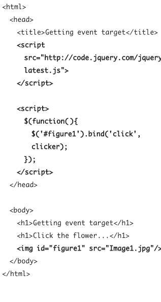

##### 获取事件目标

你可以只设置一个事件处理器来处理多个不同元素的同类型事件。例如，页面中可能有许多图片，你想为它们全部编写一个点击事件处理器，从而避免重复编写大量代码。

为此，你需要从事件对象中确定事件发生的页面元素，这可以通过事件对象的 `target` 属性来实现。

`target` 属性包含一个对象，该对象对应作为事件目标的页面元素。因此，例如，如果点击了一张图片，传递给其点击事件处理器的事件对象将包含一个对应于该图片的对象。

在本例中，我们将使用事件对象的 `target` 属性来获取并显示用户所点击图片的 ID 值。

## 要获取事件目标：

1.  使用文本编辑器（如 Microsoft WordPad）创建你的网页。此处我们将使用本书代码中的示例 `target.html`。
2.  输入代码以将 jQuery 库和一个 `` 元素添加到页面，并将图片的点击事件绑定到一个 JavaScript 函数（脚本 4.19）。
3.  添加代码以显示被点击图片的 ID 值（脚本 4.20）。
4.  保存文件。
5.  在浏览器中导航到该文件。
6.  点击图片，显示其 ID 值（图 4.10）。

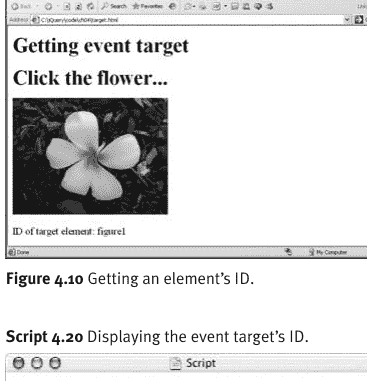

图 4.10 获取元素的 ID。

###### 脚本 4.20 显示事件目标的 ID。

```html
<html>
<head>
<title>Getting event target</title>
<script src="http://code.jquery.com/jquery-latest.js">
</script>

<script>
$(function(){
$('#figure1').bind('click', clicker);
});

function clicker(event) {
$('#p1').text(
"ID of target element: "
+ event.target.id);
}
</script>
</head>

<body>
<h1>Getting event target</h1>
<h1>Click the flower...</h1>

<p id="p1"></p>
</body>
</html>
```

## 视觉效果与动画

jQuery 支持全系列的视觉效果和动画。

这些效果可以让你的网页呈现出非常专业且动态的外观。本章将向你展示 jQuery 的强大功能。

#### jQuery 视觉效果概述

本章从基础知识开始，即 `show()` 和 `hide()` 函数，你用它们来显示和隐藏页面元素。显示和隐藏是网页中一种很酷的效果，因为网页空间总是很宝贵，这种效果可以帮助你仅在需要时显示项目。

你还可以使用 `show()` 和 `hide()` 函数来设置显示和隐藏过渡的持续时间（以毫秒为单位）。例如，你可以逐渐隐藏一个页面元素。你还可以指定一个回调函数，在显示或隐藏操作完成时调用。

一个便捷的 `toggle()` 函数可以让你在页面元素之间交替切换，先显示一个，然后显示另一个。与 `show()` 和 `hide()` 一样，你可以设置过渡的持续时间以实现一些非常酷的视觉效果。

你还可以执行淡入淡出效果，使页面元素淡入或淡出，从而在网页中创造出引人注目的视觉效果，因为它超越了普通的 HTML。

你可以使用 jQuery 来执行滑动效果，使页面元素看起来在页面中滑动，而其他页面元素则会相应地调整位置以匹配。使用 `slideToggle()` 函数，你可以在两个页面元素之间执行滑动切换。

此外，`animate()` 函数允许你执行自定义动画，移动页面元素、改变它们的外观等等。

现在让我们深入研究，将这些效果以及其他功能付诸实践。

#### 显示和隐藏页面元素

jQuery 中最基本的视觉效果包括按需显示和隐藏页面元素。

你用 `hide()` 函数隐藏页面元素，用 `show()` 函数显示它们。过程很简单。

你可以对整个包装集（wrapped set）同时执行 `show()` 和 `hide()` 函数，使该包装集中的所有元素在你的网页中消失或出现。

在这里，我们将看到如何通过点击按钮来显示和隐藏一张花朵图片。

### 要显示和隐藏页面元素：

1.  使用文本编辑器（如 Microsoft WordPad）创建你的网页。此处我们将使用本书代码中的示例 `showhide.html`。
2.  输入代码以将 jQuery 库和一个 `` 元素添加到页面（脚本 5.1）。

```html
<html>
  <head>
    <title>Showing and hiding images</title>
    <script src="http://code.jquery.com/jquery-latest.js"></script>
  </head>
  <body>
    <h1>Showing and hiding images</h1>
    
    <br>
  </body>
</html>
```

3.  添加代码以将两个按钮连接到两个函数，一个显示图片，另一个隐藏图片（脚本 5.2）。
4.  保存文件。
5.  在浏览器中导航到该文件（图 5.1）。
6.  点击两个按钮“显示”和“隐藏”，以交替显示和隐藏图片。

### 提示

更多关于 `show()` 和 `hide()` 的内容将在下一个主题中介绍。

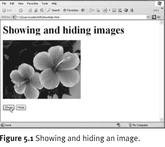

图 5.1 显示和隐藏图片。

##### 脚本 5.2 显示和隐藏图片。

```html
<script>
  function showImage()
  {
    $('#target').show();
  }
  function hideImage()
  {
    $('#target').hide();
  }
</script>
</head>
<body>
  <h1>Showing and hiding images</h1>
  
  <br>
  <form>
    <input type="button" value="Show" onclick="showImage()"/>
    <input type="button" value="Hide" onclick="hideImage()"/>
  </form>
</body>
</html>
```

##### 脚本 5.3 添加图片。

```html
<html>
  <head>
    <title>Showing and hiding images with duration</title>
    <script
      src="http://code.jquery.com/jquery-latest.js">
    </script>
  </head>
  <body>
    <h1>Showing and hiding images with duration</h1>
    
    <br>
  </body>
</html>
```

#### 设置持续时间显示和隐藏元素

jQuery 让你对显示和隐藏页面元素有更精细的控制：你可以设置页面元素出现或消失所需的时间，并在过渡完成时调用一个函数。

如果你想设置持续时间和回调函数（两者都是可选的），可以这样使用 `show()`：

```
show(duration, callback)
```

这里，*duration* 是显示图片所需的时间（以毫秒为单位），*callback* 是 jQuery 在过渡完成后调用的回调函数。

`hide()` 的对应版本如下所示：

```
hide(duration, callback)
```

在这里，我们将显示和隐藏一张图片，每次过渡耗时 2 秒，并让 jQuery 调用一个回调函数，在图片隐藏时显示文本“Hey, where did it go?”。

### 要设置持续时间显示和隐藏页面元素：

1.  使用文本编辑器（如 Microsoft WordPad）创建你的网页。此处我们将使用本书代码中的示例 `showhidespeed.html`。
2.  输入代码以将 jQuery 库和一个 `` 元素添加到页面（脚本 5.3）。
3.  添加代码以 2 秒的持续时间显示或隐藏图片，并调用一个回调函数，在图片隐藏时显示消息（**脚本 5.4**）。
4.  保存文件。
5.  导航到该文件并点击按钮以显示或隐藏图片（**图 5.2**）。

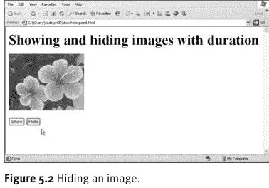

##### 脚本 5.4 设置持续时间显示或隐藏。

```html
<html>
    <head>
        <title>Showing and hiding images with duration</title>
        <script src="http://code.jquery.com/jquery-latest.js"></script>
        <script>
            function showImage()
            {
                $('#target').show(2000);
            }
            function hideImage()
            {
                $('#target').hide(2000, hey);
            }
            function hey()
            {
                $('#p1').text("Hey, where did it go?");
            }
        </script>
    </head>
    <body>
        <h1>Showing and hiding images with duration</h1>
        
        <br>
        <form>
            <input type="button" value="Show" onclick="showImage()"/>
            <input type="button" value="Hide" onclick="hideImage()"/>
        </form>
        <br>
        <p id="p1"></p>
    </body>
</html>
```


视觉效果与动画

代码清单 5.5 添加两个标题。

```html
<html>
  <head>
    <title>Toggling visibility</title>
    <script
      src="http://code.jquery.com/jquery-latest.js">
    </script>
  </head>
  <body>
    <h1>Toggling visibility</h1>
    <h2>Now you see me.</h2>
    <h2 style="display: none">Now you don't.</h2>
  </body>
</html>
```

#### 切换元素可见性

jQuery 提供了一个便捷的函数，可以在元素隐藏时显示它，或在元素可见时隐藏它：`toggle()` 函数。当你有一个双状态项目时，例如红或绿的停止与通行图标，此函数特别有用。

你经常在成对的页面元素上使用 `toggle()`，其中一个元素初始隐藏，另一个元素初始可见。然后，当你切换这组元素时，隐藏的元素会出现，而可见的元素会被隐藏。

这就是我们将在本示例中所做的，我们将切换两个 `<h2>` 标题的可见性。一个标题（最初可见的）写着“现在你看到我了。”另一个（最初隐藏的）标题写着“现在你看不见了。”通过点击一个按钮，你将能够在这两个标题之间交替显示。

### 要切换元素可见性：

1.  使用文本编辑器（如 Microsoft WordPad）创建你的网页。这里我们将使用本书代码中的示例 `toggle.html`。
2.  输入代码将 jQuery 库添加到页面中，然后添加两个 `<h2>` 标题，其中一个初始隐藏（**代码清单 5.5**）。
3.  添加代码，当用户点击按钮时，使用 `toggle()` 来交替两个标题的可见性（**代码清单 5.6**）。
4.  保存文件。
5.  在浏览器中导航到该文件。
6.  点击按钮，在“现在你看到我了。”标题和“现在你看不见了。”标题之间交替显示（**图 5.3**）。

图 5.3 切换标题的可见性。

代码清单 5.6 切换标题。

```html
<html>
<head>
<title>Toggling visibility</title>
<script src="http://code.jquery.com/jquery-latest.js"></script>
<script>
$(document).ready(function(){
  $("button").click(function(){
    $("h2").toggle();
  });
});
</script>
</head>
<body>
<h1>Toggling visibility</h1>
<h2>Now you see me.</h2>
<h2 style="display: none">Now you don't.</h2>
<button>Toggle the text</button>
</body>
</html>
```

#### 带持续时间的切换元素可见性

你也可以以指定的速度切换元素的可见性，并且可以在切换操作完成时让 jQuery 调用一个回调函数。

要使用特定速度和回调函数将元素从可见切换为不可见或反之，可使用 `toggle()` 的这种形式：

```
toggle(duration, callback)
```

这里，*duration* 是切换操作应花费的时间（以毫秒为单位），*callback* 是 jQuery 在操作完成时将调用的回调函数。

两个参数都是可选的。

我们将在前一个主题的 `toggle()` 示例的基础上添加一个持续时间，使从隐藏到可见或从可见到隐藏的过渡需要 2 秒。

### 要带持续时间地切换元素可见性：

1.  使用文本编辑器（如 Microsoft WordPad）创建你的网页。这里我们将使用本书代码中的示例 `togglespeed.html`。
2.  输入代码将 jQuery 库添加到页面中，然后添加两个 `<h2>` 标题，其中一个初始隐藏（**代码清单 5.7**）。

代码清单 5.7 向页面添加两个标题。

```html
<html>
  <head>
    <title>Toggling visibility with duration</title>
    <script
      src="http://code.jquery.com/jquery-latest.js">
    </script>
  </head>
  <body>
    <h1>Toggling visibility with duration</h1>
    <h2>Now you see me.</h2>
    <h2 style="display: none">Now you don't.</h2>
  </body>
</html>
```

3.  添加代码，当用户点击按钮时，使用 `toggle()` 来交替两个标题的可见性，并指定效果持续时间为 2 秒（**代码清单 5.8**）。
4.  保存文件。
5.  在浏览器中导航到该文件。
6.  点击按钮，在“现在你看到我了。”标题和“现在你看不见了。”标题之间交替显示（**图 5.4**）。过渡过程需要 2 秒。

图 5.4 带持续时间地切换标题的可见性。

代码清单 5.8 将标题从可见切换为不可见，再切换回来。

```html
<html>
  <head>
    <title>Toggling visibility with duration</title>
    <script
      src="http://code.jquery.com/jquery-latest.js">
    </script>
    <script>
      $(document).ready(function(){
        $("button").click(function()
        {
          $("h2").toggle(2000);
        });
      });
    </script>
  </head>
  <body>
    <h1>Toggling visibility with duration</h1>
    <h2>Now you see me.</h2>
    <h2 style="display: none">Now you don't.</h2>
    <button>Toggle the text</button>
  </body>
</html>
```

视觉效果与动画

代码清单 5.9 添加图片。

```html
<html>
  <head>
    <title>Fading an image out</title>
    <script
      src="http://code.jquery.com/jquery-latest.js">
    </script>
  </head>
  <body>
    <h1>Fading an image out</h1>
    
    <br>
  </body>
</html>
```

#### 淡出元素

这是另一个很酷的视觉效果：你可以让页面元素在用户观看时淡出。为此，你可以使用 `fadeOut()` 函数：

```
fadeOut(duration, callback)
```

这种情况下，*duration* 是淡出操作应花费的时间（以毫秒为单位），*callback* 是 jQuery 在操作完成时将调用的回调函数。

两个参数都是可选的。

在本例中，我们将在用户点击按钮时让一张图片淡出。

### 要淡出一个元素：

1.  使用文本编辑器（如 Microsoft WordPad）创建你的网页。这里我们将使用本书代码中的示例 `fadeout.html`。
2.  输入代码将 jQuery 库添加到页面中，并添加一个初始隐藏的 `` 元素（**代码清单 5.9**）。
3.  添加代码，使图片在用户点击按钮时淡出（**代码清单 5.10**）。
4.  保存文件。
5.  在浏览器中导航到该文件。
6.  点击按钮使图片淡出（**图 5.5**）。

图 5.5 淡出图片。

代码清单 5.10 淡出图片。

```html
<html>
  <head>
    <title>Fading an image out</title>
    <script
      src="http://code.jquery.com/jquery-latest.js">
    </script>
    <script>
      function fade()
      {
        $('#target').fadeOut(2000);
      }
    </script>
  </head>
  <body>
    <h1>Fading an image out</h1>
    
    <br>
    <form>
    <input type="button" value="Fade Out"
           onclick="fade()"></input>
    </form>
  </body>
</html>
```

视觉效果与动画

代码清单 5.11 添加隐藏的图片。

```html
<html>
  <head>
    <title>Fading an image in</title>
    <script
      src="http://code.jquery.com/jquery-latest.js">
    </script>
  </head>
  <body>
    <h1>Fading an image in</h1>
    
    <br/>
  </body>
</html>
```

#### 淡入元素

你也可以淡入元素：它们最初不可见，然后逐渐出现。要淡入元素，你可以使用 `fadeIn()` 函数：

```
fadeIn(duration, callback)
```

这种情况下，*duration* 是淡入操作应花费的时间（以毫秒为单位），*callback* 是 jQuery 在操作完成时将调用的回调函数。

两个参数都是可选的。

在本例中，我们将在用户点击按钮时，让一张最初隐藏的图片淡入显示。

### 要淡入一个元素：

1.  使用文本编辑器（如 Microsoft WordPad）创建你的网页。这里我们将使用本书代码中的示例 `fadein.html`。
2.  输入代码将 jQuery 库添加到页面中，然后添加一张最初隐藏的图片（**代码清单 5.11**）。


## 第 5 章

3.  添加代码以使隐藏的图像淡入显示（**脚本 5.12**）。
4.  保存文件。
5.  在浏览器中导航到该文件。
6.  点击按钮，观察图像淡入（**图 5.6**）。

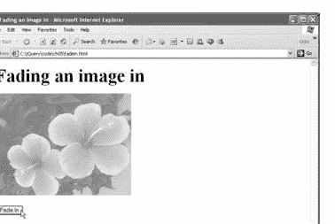

图 5.6 淡入图像。

脚本 5.12 淡入图像。

```html
<html>
  <head>
    <title>Fading an image in</title>
    <script src="http://code.jquery.com/jquery-latest.js"></script>
    <script>
      function fade()
      {
        $('#target').fadeIn(2000);
      }
    </script>
  </head>
  <body>
    <h1>Fading an image in</h1>
    
    <br>
    <form>
      <input type="button" value="Fade In" onclick="fade()"></input>
    </form>
  </body>
</html>
```

脚本 5.13 添加三个 `<p>` 元素。

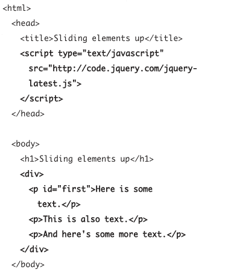

#### 滑动元素向上

你也可以让页面元素随意滑动。例如，`slideUp()` 函数可以让你将页面元素向上滑动，使其从可见变为不可见。
你可以这样使用 `slideUp()` 函数来创建此效果：

`slideUp(duration, callback)`

在这种情况下，*duration* 是滑动操作应持续的时间（以毫秒为单位），而 *callback* 是一个回调函数，jQuery 将在操作完成时调用它。
两个参数都是可选的。
在这个例子中，我们将在用户点击按钮时，将一段文本向上滑动。

### 向上滑动一个元素：

1.  使用文本编辑器（如 Microsoft WordPad）创建你的网页。这里我们将使用书本代码中的示例 slideup.html。
2.  输入代码将 jQuery 库添加到页面，然后添加三个 `<p>` 元素，并为第一个元素设置 ID "first"（脚本 5.13）。

3.  添加代码，使用户点击按钮时顶部的 `<p>` 元素向上滑动（脚本 5.14）。
4.  保存文件。
5.  在浏览器中导航到该文件。
6.  点击按钮使第一个 `<p>` 元素向上滑动并消失在视野中（图 5.7）。

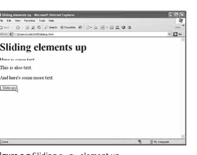

脚本 5.14 向上滑动一个 `<p>` 元素。

```html
<html>
<head>
  <title>Sliding elements up</title>
  <script type="text/javascript"
          src="http://code.jquery.com/jquery-latest.js">
  </script>
  <script type="text/javascript">
    function slideup()
    {
      $('#first').slideUp("slow");
    }
  </script>
</head>
<body>
  <h1>Sliding elements up</h1>
  <div>
    <p id="first">Here is some text.</p>
    <p>This is also text.</p>
    <p>And here's some more text.</p>
  </div>
  <form>
    <input type = "button"
           value="Slide up"
           onclick="slideup()"
    >
  </form>
</body>
</html>
```

## 视觉效果与动画

脚本 5.15 向页面添加 `<p>` 元素。

```html
<html>
	<head>
		<title>Sliding elements up and down</title>
		<script type="text/javascript" src="http://code.jquery.com/jquery-latest.js">
		</script>
	</head>
	<body>
		<h1>Sliding elements up and down</h1>
		<div>
			<p id="first">Here is some text.</p>
			<p>This is also text.</p>
			<p>And here's some more text.</p>
		</div>
	</body>
</html>
```

#### 滑动元素向下

除了使元素向上滑动，你还可以使元素向下滑动。你可以使用 `slideDown()` 函数创建此效果：
slideDown(duration, callback)
在这种情况下，duration 是滑动操作应持续的时间（以毫秒为单位），callback 是一个回调函数，jQuery 将在操作完成时调用它。

两个参数都是可选的。
在这个例子中，我们将在用户点击按钮时，将一段文本向上或向下滑动。

### 向下滑动一个元素：

1.  使用文本编辑器（如 Microsoft WordPad）创建你的网页。这里我们将使用书本代码中的示例 slidedown.html。
2.  输入代码将 jQuery 库添加到页面，然后添加三个 `<p>` 元素，并为第一个元素设置 ID "first"（脚本 5.15）。

3.  添加代码，使用户点击一个按钮时顶部的 `<p>` 元素向上滑动，点击另一个按钮时向下滑动（脚本 5.16）。
4.  保存文件。
5.  在浏览器中导航到该文件。
6.  点击第一个按钮使第一个 `<p>` 元素向上滑动，点击第二个按钮使该元素再次向下滑动（图 5.8）。

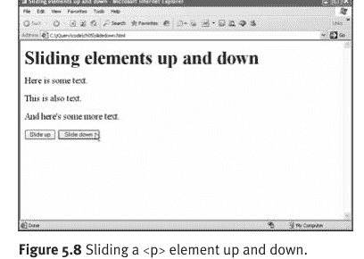

图 5.8 上下滑动一个 `<p>` 元素。

脚本 5.16 上下滑动元素。

```html
<html>
  <head>
    <title>Sliding elements up and down</title>
    <script type="text/javascript"
      src="http://code.jquery.com/jquery-latest.js">
    </script>
    <script type="text/javascript">
      function slideup()
      {
        $('#first').slideUp("slow");
      }
      function slidedown()
      {
        $('#first').slideDown("slow");
      }
    </script>
  </head>
  <body>
    <h1>Sliding elements up and down</h1>
    <div>
      <p id="first">Here is some text.</p>
      <p>This is also text.</p>
      <p>And here's some more text.</p>
    </div>
    <form>
      <input type = "button"
        value="Slide up"
        onclick="slideup()"
      </input>
      <input type = "button"
        value="Slide down"
        onclick="slidedown()"
      </input>
    </form>
  </body>
</html>
```

#### 切换滑动操作

除了像你在前两个主题中看到的那样使元素上下滑动，你还可以切换元素，使用 `slideToggle()` 函数使其上下滑动。此函数允许你在元素向下时使其向上滑动，在元素向上时使其向下滑动。

你可以这样使用 `slideToggle()` 函数来创建此效果：

`slideToggle(duration, callback)`

在这种情况下，*duration* 是滑动操作应持续的时间（以毫秒为单位），而 *callback* 是一个回调函数，jQuery 将在操作完成时调用它。

两个参数都是可选的。

在这个例子中，我们将在用户点击按钮时，使一段文本向上或向下滑动。

**切换滑动操作：**

1.  使用文本编辑器（如 Microsoft WordPad）创建你的网页。这里我们将使用书本代码中的示例 `slidetoggle.html`。
2.  输入代码将 jQuery 库添加到页面，然后添加三个 `<p>` 元素，并为第一个元素设置 ID "first"（脚本 5.17）。

```html
<html>
<head>
	<title>Toggling slide operations</title>
	<script src="http://code.jquery.com/jquery-latest.js">
	</script>
</head>
<body>
	<h1>Toggling slide operations</h1>
	<div>
		<p id="first">Here is some text.</p>
		<p>This is also text.</p>
		<p>And here's some more text.</p>
	</div>
</body>
</html>
```

**脚本 5.17** 添加新的 `<p>` 元素。

3.  添加代码，使用户点击按钮时，顶部的 `<p>` 元素如果当前向下则向上滑动，如果当前向上则向下滑动（**脚本 5.18**）。
4.  保存文件。
5.  在浏览器中导航到该文件。
6.  点击按钮使第一个 `<p>` 元素向上或向下滑动（**图 5.9**）。

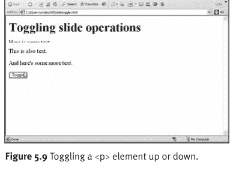

脚本 5.18 切换元素向上或向下。

```html
<html>
<head>
<title>Toggling slide operations</title>
<script src="http://code.jquery.com/jquery-latest.js"></script>
<script>
$(document).ready(function(){
  $("button").click(function () {
    $("#first").slideToggle("slow");
  });
});
</script>
</head>
<body>
<h1>Toggling slide operations</h1>
<div>
  <p id="first">Here is some text.</p>
  <p>This is also text.</p>
  <p>And here's some more text.</p>
</div>
<form>
  <button>Toggle</button>
</form>
</body>
</html>
```

## 视觉效果与动画

脚本 5.19 添加图像。

```html
<html>
  <head>
    <title>Partially fading an image</title>
    <script src="http://code.jquery.com/jquery-latest.js">
    </script>
  </head>
  <body>
    <h1>Partially fading an image</h1>
    
    <br>
  </body>
</html>
```

#### 部分淡出元素

你可以使用 `fadeOut()` 函数使元素淡出，使用 `fadeIn()` 函数使元素淡入视图。你也可以只使元素部分淡出，使其仍然部分可见，尽管已变暗。

你可以使用 `fadeTo()` 函数创建此效果：

`fadeTo(duration, opacity, callback)`

在这种情况下，*duration* 是滑动操作应持续的时间（以毫秒为单位），*opacity* 是元素的最终不透明度（0 到 1），而 *callback* 是一个回调函数，jQuery 将在操作完成时调用它。

所有参数都是可选的。

在这个例子中，我们将使一张图像淡出到 0.333 的不透明度，这样它大部分会消失，但仍然可见。

**部分淡出一个元素：**

1.  使用文本编辑器（如 Microsoft WordPad）创建你的网页。这里我们将使用书本代码中的示例 fadeto.html。
2.  输入代码将 jQuery 库添加到页面，然后添加一张图像（**脚本 5.19**）。


## 第5章

3.  添加代码，以便用户点击按钮时能部分淡出图像（**脚本5.20**）。
4.  保存文件。
5.  在浏览器中导航到该文件。
6.  点击按钮使图像部分淡出（**图5.10**）。

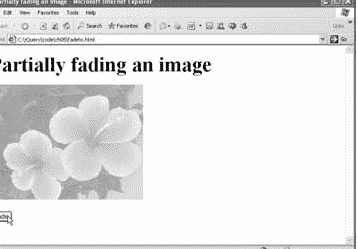

**图5.10** 部分淡出图像。

**脚本5.20** 部分淡出图像。

```
<html>
<head>
<title>Partially fading an image</title>
<script src="http://code.jquery.com/jquery-latest.js"></script>
<script>
function fade()
{
  $('#target').fadeTo(2000, 0.333);
}
</script>
</head>
<body>
<h1>Partially fading an image</h1>

<br>
<form>
<input type="button" value="Fade" onclick="fade()"></input>
</form>
</body>
</html>
```

## 视觉效果与动画

脚本5.21 添加一个 `<div>` 元素。

#### 创建自定义动画

```
<html>
<head>
<script
src="http://code.jquery.com/jquery-latest.js"></script>
<style>
div {
background-color:cyan;
width:100px;
border:1px solid blue;
}
</style>
</head>
<body>
<h1>Creating custom animation</h1>
<div id="target">Expand me</div>
<br>
</body>
</html>
```

你可以使用 `animate()` 函数在 jQuery 中创建自定义动画：

```
animate(params, duration, easing, callback)
```

其中，`params` 包含了你正在动画化的对象的最终属性，例如 CSS 属性；`duration` 是动画持续的可选时间（以毫秒为单位）；`easing` 是可选的缓动函数（可以决定动画的进行方式）；`callback` 是可选的回调函数。

在这个例子中，我们将为一个 `<div>` 元素添加动画效果，当用户点击按钮时，它会扩展。

## 创建自定义动画的步骤：

1.  使用文本编辑器（如 Microsoft WordPad）创建你的网页。我们将使用本书代码中的示例文件 `animate.html`。
2.  输入代码以将 jQuery 库添加到页面，然后添加一个包含文本 "Expand me" 的 `<div>` 元素（脚本5.21）。

3.  添加对 `animate()` 的调用，传入你希望 `<div>` 在用户点击按钮后动画结束时具有的最终 CSS 属性（**脚本5.22**）。
4.  保存文件。
5.  在浏览器中导航到该文件。
6.  点击按钮使 `<div>` 元素扩展（**图5.11**）。

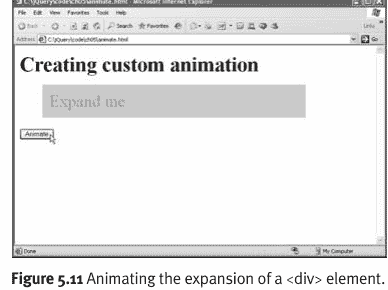

**图5.11** 动画化扩展 `<div>` 元素。

**脚本5.22** 创建自定义动画。

```
<html>
	<head>
		<script
			src="http://code.jquery.com/jquery-latest.js"></script>

		<script>
			function animator()
			{
				$("#target").animate({
					width: "80%",
					opacity: 0.333,
					fontSize: "26pt",
					marginLeft: "0.5in",
					borderWidth: "15px"
				}, 2000 );
			}
		</script>

		<style>
			div {
				background-color:cyan;
				width:100px;
				border:1px solid blue;
			}
		</style>
	</head>

	<body>
		<h1>Creating custom animation</h1>
		<div id="target">Expand me</div>
		<br>
		<form>
			<button
				onclick="animator()">Animate</button>
		</form>
	</body>
</html>
```

## jQuery 实用工具函数

jQuery 内置了许多实用工具函数，旨在使日常的 JavaScript 任务变得更简单。这些函数的命名格式为 `jquery.XXX()`，其中 `XXX()` 是函数名。你也可以将它们称为 `$.XXX()`。

例如，`$.trim()` 函数用于去除字符串两端的空格。

这些实用工具函数很难进行具体分类。它们只是 jQuery 提供的一组有用的函数，用于增强 JavaScript 功能——使 JavaScript 中的任务更容易完成。你当然可以在 JavaScript 中自己实现它们的功能，但使用实用工具函数要节省得多。

## 第6章

#### jQuery 实用工具函数示例

jQuery 提供了许多用于处理数组的实用工具函数，例如 `$.isArray()` 函数；你向此函数传递一个数组，如果传递的对象是数组，则返回 true。你可以使用 `$.makeArray()` 函数创建新数组，或者使用 `$.unique()` 函数获取数组中的唯一成员。

另一个实用工具函数 `$.each()` 模仿了其他编程语言（JavaScript 本身缺少）中流行的 `each` 循环。此函数允许你自动循环遍历对象（如数组）的所有成员——你无需自己设置循环索引。

实用工具函数还包括一些变量，例如 `$.browser`，它告诉你用户使用的是什么浏览器以及该浏览器的版本。通过确定用户的浏览器类型，你可以相应地调整你的 HTML。

最近，jQuery 添加了 `$.support()` 函数以增强浏览器支持。此函数让你可以检查用户使用的浏览器是否支持各种功能。这样，你就不必自己知道哪个浏览器支持哪个功能——你只需使用 `$.support()` 进行检查。

现在让我们看看 jQuery 的实用工具函数。

#### 使用 $.each() 循环遍历对象成员

jQuery 有一个便捷的实用工具函数，可以让你循环遍历 JavaScript 对象的成员。

`$.each()` 函数会自动为你循环遍历对象的所有成员。例如，在循环体中：

```
$.each(obj, function(i, val) {
}
```

你可以通过名称 `i` 引用当前对象成员，通过 `val` 引用其值。

使用 `$.each()` 可以免去你知道每个对象成员的名称才能访问它的麻烦；使用 `$.each()`，你可以自动循环遍历每个成员。

在这个例子中，我们将创建一个 JavaScript 对象，然后循环遍历其所有成员，显示这些成员及其值。

## 循环遍历对象成员的步骤：

1.  使用文本编辑器（如 Microsoft WordPad）创建你的网页。我们将使用本书代码中的示例文件 `each.html`。
2.  输入代码以将 jQuery 库添加到页面，并创建一个包含五个成员（第一个成员名为 `one`，值为 1，以此类推）的对象以及五个 `<div>` 元素（脚本6.1）。

**脚本6.1** 创建一个 JavaScript 对象。

```
<html>
  <head>
    <title>Looping over an object with
    $.each()</title>
    <script
      src="http://code.jquery.com/jquery-
      latest.js">
    </script>
    <script>
      $(document).ready(function()
      {
        var obj = { one:1, two:2,
          three:3, four:4, five:5 };
      });
    </script>
  </head>
  <body>
    <h1>Looping over an object with
    $.each()</h1>
    <div id="one"></div>
    <div id="two"></div>
    <div id="three"></div>
    <div id="four"></div>
    <div id="five"></div>
  </body>
</html>
```

3.  添加代码以循环遍历所有对象成员，并在 `<div>` 元素中显示它们的名称和值（脚本6.2）。
4.  保存文件。
5.  在浏览器中导航到该文件，其显示效果应如图6.1所示，所有对象成员及其值均已显示。


**图6.1** 循环遍历对象。

**脚本6.2** 循环遍历对象。

```
<html>
  <head>
    <title>Looping over an object with $.each()</title>
    <script src="http://code.jquery.com/jquery-latest.js"></script>
    <script>
      $(document).ready(function() {
        var obj = { one:1, two:2, three:3, four:4, five:5 };
        $.each(obj, function(i, val) {
          $("#" + i).append(
            document.createTextNode(
              "Property " + i + " contains " + val));
        });
      });
    </script>
  </head>
  <body>
    <h1>Looping over an object with $.each()</h1>
    <div id="one"></div>
    <div id="two"></div>
    <div id="three"></div>
    <div id="four"></div>
    <div id="five"></div>
  </body>
</html>
```

**脚本6.3** 添加 jQuery 库。

```
<script>
src="http://code.jquery.com/jquery-latest.js">
</script>
<html>
  <head>
    <title>Determining browser information</title>
    <script src="http://code.jquery.com/jquery-latest.js"></script>
  </head>
  <body>
    <h1>Determining browser information</h1>
  </body>
</html>
```

#### 使用 $.browser 确定浏览器类型

随实用工具函数附带的一个有用变量是 `$.browser`。该变量包含一个对象，具有以下属性：

- safari
- opera
- msie
- mozilla
- version

前四个属性在你的代码在相应浏览器中执行时为 `true`，否则为 `false`。`version` 属性以文本字符串形式存储浏览器的版本号。

此处的示例显示了代码正在运行的浏览器的名称和版本号。

## 确定浏览器类型和版本的步骤：

1.  使用文本编辑器（如 Microsoft WordPad）创建你的网页。我们将使用本书代码中的示例文件 `browser.html`。
2.  输入代码以将 jQuery 库添加到页面（脚本6.3）。


## 第6章

- 3. 添加循环遍历并显示 `$.browser` 属性的代码（脚本 6.4）。
- 4. 保存文件。
- 5. 在浏览器中打开该文件，你将看到浏览器信息（图 6.2）。


脚本 6.4 显示 `$.browser` 属性。

```html
<html>
<head>
<title>Determining browser information</title>
<script src="http://code.jquery.com/jquery-latest.js">
</script>
<script>
$(document).ready(function(){

$.each($.browser,
function(i, val) {
$("<div>" + i + " is " + val + "</div>")
.appendTo(document.body);
});
});
</script>
</head>
<body>
<h1>Determining browser information</h1>
</body>
</html>
```

#### jQuery 工具函数

脚本 6.5 添加一个 `<div>` 元素。

```html
<html>
  <head>
    <title>Writing HTML depending on browser</title>
    <script src="http://code.jquery.com/jquery-latest.js"></script>
  </head>
  <body>
    <h1>Writing HTML depending on browser</h1>
    <div id="target"></div>
  </body>
</html>
```

##### 按浏览器类型定制 HTML

浏览器支持的 HTML 因浏览器而异。要为特定浏览器编写适用的 HTML，你可以先检查浏览器类型。

例如，`<marquee>` 元素（用于在页面中显示滚动文字）仅在 Internet Explorer 中可用。本例将让你在为页面编写 `<marquee>` 元素之前，先检查用户是否使用的是 Internet Explorer。

按浏览器类型定制 HTML：

- 1. 使用文本编辑器（如 Microsoft WordPad）创建你的网页。这里我们将使用代码包中的示例 marquee.html。
- 2. 输入为页面添加 jQuery 库和 `<div>` 元素的代码（脚本 6.5）。
- 3. 添加代码以检查你的代码是否在 Internet Explorer 中运行，如果是，则编写一个 `<marquee>` 元素（脚本 6.6）。
- 4. 保存文件。
- 5. 在 Internet Explorer 中打开该文件，查看新的 `<marquee>` 元素（图 6.3）。图中的第二行文字正在屏幕上滚动，尽管你在图片中无法看到滚动效果。


脚本 6.6 编写一个 `<marquee>` 元素。

```html
<html>
    <head>
        <title>Writing HTML depending on browser</title>
        <script src="http://code.jquery.com/jquery-latest.js">
        </script>

        <script>
            $(document).ready(function()
            {
                if($.browser.msie) {
                    $("#target").html("<marquee><h1>"
                    + "A new marquee element!</h1></marquee>");
                }
            });
        </script>
    </head>

    <body>
        <h1>Writing HTML depending on browser</h1>
        <div id="target"></div>
    </body>
</html>
```

##### 检查浏览器对特定功能的支持

`$.support()` 工具函数返回关于用户浏览器所支持功能的信息。你可以这样使用它：`$.support.XXX`，其中 `XXX` 是一个标志，具有以下可能的值：

- 1. **boxModel:** 如果浏览器支持 W3C CSS 盒模型，则为 true。
- 2. **cssFloat:** 如果使用 `style.cssFloat` 来获取当前 CSS 浮动值，则为 true。
- 3. **hrefNormalized:** 如果浏览器不会更改 `getAttribute("href")` 的结果，则为 true。
- 4. **htmlSerialize:** 如果浏览器在使用 `innerHTML` 时能正确序列化链接，则为 true。
- 5. **leadingWhitespace:** 如果浏览器在使用 `innerHTML` 时保留前导空格，则为 true。
- 6. **noCloneEvent:** 如果克隆元素时不复制事件处理程序，则为 true。
- 7. **objectAll:** 如果在元素上运行 `getElementsByTagName()` 会返回所有后代元素，则为 true。
- 8. **opacity:** 如果浏览器能解释 opacity 样式属性，则为 true。
- 9. **scriptEval:** 如果 `appendChild`/`createTextNode` 能执行脚本，则为 true。
- 10. **style:** 如果 `getAttribute("style")` 返回正确的内联样式，则为 true。
- 11. **tbody:** 如果浏览器允许不带 `<tbody>` 元素的表格元素，则为 true。

检查浏览器支持：

脚本 6.7 添加一个新的 `<div>` 元素。

- 1. 使用文本编辑器（如 Microsoft WordPad）创建你的网页。这里我们将使用代码包中的示例 support.html。
- 2. 输入为页面添加 jQuery 库和 `<div>` 元素的代码（脚本 6.7）。

```html
<html>
    <head>
        <title>Checking browser support</title>
        <script
            src="http://code.jquery.com/jquery-latest.js">
        </script>
    </head>
    <body>
        <h1>Checking browser support</h1>
        <p>
        </p>
    </body>
</html>
```

- 3. 添加代码以检查对 W3C 盒模型的支持并显示结果（脚本 6.8）。
- 4. 保存文件。
- 5. 在 Firefox 中打开该文件，验证浏览器是否支持 W3C 盒模型（图 6.4）。


脚本 6.8 检查盒模型。

```html
<html>
  <head>
    <title>Checking browser
      support</title>
    <script
      src="http://code.jquery.com/jquery-latest.js">
    </script>
    <script>
      $(document).ready(function()
      {
        if($.support.boxModel){
          $("p").html("I support the W3C box model.");
        }
        else {
          $("p").html("I do not support the W3C box model.");
        }

      });
    </script>
  </head>
  <body>
    <h1>Checking browser support</h1>
    <p>
    </p>
  </body>
</html>
```

##### 创建数组

JavaScript 充满了各种各样的集合：列表、映射、命名节点映射等等。你可以使用方便的 `$.makeArray()` 函数将这些对象转换为标准的 JavaScript 数组。数组通常比集合更容易处理。

在这个例子中，我们将把 JavaScript 的 `getElementById()` 返回的元素列表转换为数组。然后，我们将反转数组并在页面上显示结果顺序的元素。

要创建一个数组：

- 1. 使用文本编辑器（如 Microsoft WordPad）创建你的网页。这里我们将使用代码包中的示例 makearray.html。
- 2. 输入为页面添加 jQuery 库和四个带文本的 `<p>` 元素的代码（脚本 6.9）。

脚本 6.9 添加四个 `<p>` 元素。

```html
<html>
  <head>
    <title>Creating an array</title>
    <script
      src="http://code.jquery.com/jquery-latest.js">
    </script>
  </head>
  <body>
    <h1>Creating an array</h1>
    <p>Now</p>
    <p>is</p>
    <p>the</p>
    <p>time</p>
  </body>
</html>
```

- 3. 添加代码以使用 `getElementById()` 获取 `<p>` 元素列表，将列表转换为数组，反转数组，并按结果顺序显示项目（**脚本 6.10**）。
- 4. 保存文件。
- 5. 打开该文件，它会创建一个新数组、将其反转并显示结果（**图 6.5**）。列表 “Now” “is” “the” “time” 反转为 “time” “the” “is” “Now”。

脚本 6.10 创建一个数组。

```html
<html>
	<head>
		<title>Creating an array</title>
		<script src="http://code.jquery.com/jquery-latest.js"></script>

		<script>
			$(document).ready(function()
			{

				var array =
					$.makeArray(document.getElementsByTagName("p"));
				array.reverse();
				$(array).appendTo(document.body);
			});
		</script>
	</head>

	<body>
		<h1>Creating an array</h1>
		<p>Now</p>
		<p>is</p>
		<p>the</p>
		<p>time</p>
	</body>
</html>
```


##### 搜索数组

jQuery 数组工具函数包括 `$.inArray()` 函数，它允许你在数组中搜索特定的元素。使用方法如下：

```
$.inArray(searchTerm, array)
```

其中 `searchTerm` 是你要搜索的项（例如，字符串或数字），`array` 是你要搜索的数组。此函数返回数组中第一个匹配项的从0开始的索引值，如果搜索项不在数组中，则返回 -1。

**要搜索一个数组：**

- 1. 使用文本编辑器（如 Microsoft WordPad）创建你的网页。这里我们将使用代码包中的示例 inarray.html。
- 2. 输入为页面添加 jQuery 库和用于报告搜索结果的 `<div>` 元素的代码（脚本 6.11）。


脚本 6.11 添加 `<div>` 元素。

```html
<html>
  <head>
    <title>Searching an array</title>
    <script src="http://code.jquery.com/jquery-latest.js"></script>
  </head>
  <body>
    <h1>Searching an array</h1>
    <div>"banana" is at index <span></span></div>
    <div>"strawberry" is at index <span></span></div>
    <div>"tangerine" is at index <span></span></div>
  </body>
</html>
```


## 第6章

##### 数组过滤

jQuery数组工具函数中最强大的功能之一是`$.grep()`，它允许你通过过滤现有数组来创建新数组。

以下是使用`$.grep()`的示例，例如，创建一个包含现有数组中索引大于4的所有元素的新数组：

```
array = $.grep(array, function(n, i)
{
    return (i > 4);
});
```

以下是过滤掉所有包含7的元素的方法：

```
array = $.grep(array, function (n)
{
    return n != 7;
});
```

### 过滤数组的步骤：

1.  使用文本编辑器（如Microsoft WordPad）创建你的网页。此处我们将使用本书代码中的示例grep.html。
2.  输入代码，将jQuery库添加到页面，并添加三个`<div>`元素来显示结果（**脚本 6.13**）。


**图 6.7** 过滤数组。

**脚本 6.13** 添加三个`<div>`元素。

```
<html>
<head>
    <title>Filtering arrays</title>
    <script
        src="http://code.jquery.com/jquery-latest.js">
    </script>
    <script>
        $(document).ready(function()
        {
            var array = [1, 2, 3, 4, 5, 6, 7, 8];
        });
    </script>
</head>
<body>
    <h1>Filtering arrays</h1>
    <div id="div1"></div>
    <div id="div2"></div>
    <div id="div3"></div>
</body>
</html>
```

**脚本 6.14** 过滤数组。

```
<html>
    <head>
        <title>Filtering arrays</title>
        <script src="http://code.jquery.com/jquery-latest.js">
        </script>
        <script>
            $(document).ready(function()
            {
                var array = [1, 2, 3, 4, 5, 6, 7, 8];
                $("#div1").text("Original array: " + array.join(", "));
                array = $.grep(array, function(n, i)
                {
                    return (i > 4);
                });
                $("#div2").text("Filtered i > 4: " + array.join(", "));
                array = $.grep(array, function(n)
                {
                    return n != 7;
                });
                $("#div3").text("Filtered n != 7: " + array.join(", "));
            });
        </script>
    </head>
    <body>
        <h1>Filtering arrays</h1>
        <div id="div1"></div>
        <div id="div2"></div>
        <div id="div3"></div>
    </body>
</html>
```

3.  添加代码来过滤数组，只保留索引大于4的元素，并过滤掉等于7的元素**（脚本 6.14）**。
4.  保存文件。
5.  浏览该文件，它会显示以各种方式过滤后的数组**（图 6.7）**。

##### 从数组中消除重复元素

jQuery函数`$.unique()`可以从数组中移除重复的元素。

但有个限制：`$.unique()`只能移除页面元素的重复项，而不是像字符串和数字这样的标准数组元素。这个限制的原因是，jQuery的主要任务是让你操作页面中的元素，而不是提供适用于通用数组的通用工具函数。

当你有一组页面元素，并希望在处理它们之前先去除重复项时，就可以使用`$.unique()`。

现在，我们将用一些`<p>`元素来演示`$.unique()`的功能，其中一些是重复的。

### 从数组中消除重复元素的步骤：

1.  使用文本编辑器（如Microsoft WordPad）创建你的网页。此处我们将使用本书代码中的示例unique.html。
2.  输入代码，将jQuery库添加到页面，并添加一些`<p>`元素，其中三个元素的类名为"duplicateMe"（脚本 6.15）。

脚本 6.15 添加新的`<p>`元素。

```
<html>
    <head>
        <title>Eliminating duplicate elements</title>
        <script src="http://code.jquery.com/jquery-latest.js"></script>
    </head>
    <body>
        <h1>Eliminating duplicate elements</h1>
        <p class="duplicateMe"></p>
        <p class="duplicateMe"></p>
        <p class="duplicateMe"></p>
        <p></p>
    </body>
</html>
```

jQuery工具函数


3.  添加代码，将`<p>`元素放入一个数组中，复制数组中所有类名为"duplicateMe"的三个`<p>`元素，然后显示元素总数以及唯一元素的数量（脚本 6.16）。
4.  保存文件。
5.  浏览该文件，它会显示数组中`<p>`元素的总数以及唯一`<p>`元素的数量（图 6.8）。

图 6.8 确定唯一元素的数量。

脚本 6.16 查找唯一的数组页面元素。

```
<html>
<script src="http://code.jquery.com/jquery-latest.js"></script>
<script>
$(document).ready(function(){

  var array = $("p").get();

  array = array.concat($(".duplicateMe").get());
  $("p:eq(1)").text("There are " + array.length + " elements.");

  array = jQuery.unique(array);
  $("p:eq(2)").text("There are " + array.length + " unique elements.");
});
</script>
<body>
<h1>Eliminating duplicate elements</h1>
<p class="duplicateMe"></p>
<p class="duplicateMe"></p>
<p class="duplicateMe"></p>
<p></p>
</body>
</html>
```

##### 检查数据是否为数组

jQuery还有一个工具函数，用于确定一个对象是否是真正的JavaScript数组。这个函数`$.isArray()`，如果传递给它的对象是数组，则返回true，否则返回false。

我们将在此示例中使用`$.isArray()`，创建一个数组，看看`$.isArray()`能否正确判断它确实是一个数组。

### 检查数据是否为数组的步骤：

1.  使用文本编辑器（如Microsoft WordPad）创建你的网页。此处我们将使用本书代码中的示例is_array.html。
2.  输入代码，将jQuery库添加到页面，并在代码中创建一个数组（脚本 6.17）。

脚本 6.17 创建一个数组。


图 6.9 检查是否为数组。

3.  添加代码，检查该数组是否确实是一个数组，然后报告测试结果**（脚本 6.18）**。
4.  保存文件。
5.  浏览该文件，它会显示一条消息，报告该数据确实是一个数组**（图 6.9）**。

> **提示**
> 你也可以使用jQuery工具函数`$.isFunction()`来检查一个对象是否是函数。

**脚本 6.18** 测试数组。

```
<html>
<head>
    <title>Testing for arrays</title>
    <script src="http://code.jquery.com/jquery-latest.js"></script>
    <script>
        $(document).ready(function(){
            var array = [1, 2, 3, 4, 5, 6, 7, 8];
            if($.isArray(array)){
                $("div").text("The data is an array");
            }
            else {
                $("div").text("The data is not an array");
            }
        });
    </script>
</head>
<body>
    <h1>Testing for arrays</h1>
    <div></div>
</body>
</html>
```


##### 映射数组

一个强大的数组实用函数是 `$.map()`，它能省去编写循环的步骤。这个函数让你能够操作数组中的各个元素，修改它们并返回新的数组。映射数组可以将每个数组元素转换为新的内容。

以下是如何使用 `$.map()` 来创建一个新数组的示例，其中新数组的所有元素都是原始数组对应元素值的两倍：

```
array = $.map(array, function(n, i) {
    return (i + i);
});
```

让我们实际应用这段代码。

### 映射数组的方法：

- 1. 使用文本编辑器（如 Microsoft WordPad）创建你的网页。这里我们将使用本书代码中的示例 `map.html`。
- 2. 输入代码以向页面添加 jQuery 库，添加两个 `<div>` 元素来显示结果，并创建数组（**脚本 6.19**）。

```
<html>
    <head>
        <script src="http://code.jquery.com/jquery-latest.js"></script>
        <script>
            $(document).ready(function(){
                var array = [1, 2, 3, 4, 5];
            });
        </script>
    </head>
    <body>
        <h1>映射数组</h1>
        <div id="div1"></div>
        <div id="div2"></div>
    </body>
</html>
```

- 3. 添加映射数组的代码，使每个元素翻倍（**脚本 6.20**）。
- 4. 保存文件。
- 5. 打开文件，页面将显示原始数组和翻倍后的数组（**图 6.10**）。

### 图 6.10 数组翻倍效果。

###### 脚本 6.20 数组元素翻倍代码。

```
<html>
  <head>
    <script
      src="http://code.jquery.com/jquery-latest.js">
    </script>

    <script>
      $(document).ready(function(){

        var array = [1, 2, 3, 4, 5];
        $("#div1").text("原始数组: " +
          array.join(", "));

        array = $.map(array, function (i)
        {
          return i + i;
        });

        $("#div2").text("翻倍数组: " +
          array.join(", "));
      });
    </script>
  </head>

  <body>
    <h1>映射数组</h1>
    <div id="div1"></div>
    <div id="div2"></div>
  </body>
</html>
```

##### 修剪文本

`$.trim()` 函数用于去除文本字符串前后多余的空格。当你从用户那里获取文本输入时，这个函数非常有用；你应该始终将读取到的用户输入文本传递给 `$.trim()` 以清理文本。

这里的示例展示了一个字符串，在传递给 `$.trim()` 前后分别显示其带有前后空格的样子。

### 修剪文本的方法：

- 1. 使用文本编辑器（如 Microsoft WordPad）创建你的网页。这里我们将使用本书代码中的示例 `trim.html`。
- 2. 输入代码以向页面添加 jQuery 库，在代码中创建一个带有额外空格的字符串，并添加两个 `<div>` 元素来显示结果（**脚本 6.21**）。

**脚本 6.21 创建一个带有额外空格的文本字符串。**

```
<html>
  <head>
    <title>修剪字符串</title>
    <script
      src="http://code.jquery.com/jquery-latest.js">
    </script>

    <script>
      $(document).ready(function(){
        var text =
          "  这是文本。    ";
        $("#target").text("原始内容: '" +
          text + "'");
      });
    </script>
  </head>

  <body>
    <h1>修剪字符串</h1>
    <div id="target"></div>
    <div id="target2"></div>
  </body>
</html>
```

**图 6.11 从文本中修剪空格。**

- 3. 添加修剪文本的代码（**脚本 6.22**）。

**脚本 6.22 修剪文本。**

```
<html>
<head>
  <title>修剪字符串</title>
  <script
    src="http://code.jquery.com/jquery-latest.js"></script>

  <script>
    $(document).ready(function(){
      var text = "   这是文本。    ";
      $("#target").text("原始内容: '" + text + "'");

      $("button").click(function ()
      {
        text = jQuery.trim(text);
        $("#target2").text("修剪后: '" + text + "'");
      });

    });
  </script>
</head>

<body>
  <h1>修剪字符串</h1>
  <div id="target"></div>
  <div id="target2"></div>
  <form>
    <button>修剪文本</button>
  </form>
</body>
</html>
```

- 4. 保存文件。
- 5. 打开文件，页面将分别显示带有和不带额外空格的文本（**图 6.11**）。

## 初识 Ajax

Ajax 是一种用于创建富交互式 Web 应用程序的工具——借助 jQuery，你可以轻松地在网页中实现它。

使用 Ajax，你可以在后台与服务器进行通信，无需页面刷新——这是一个很酷的功能，因为它使得基于 Web 的应用程序看起来就像桌面应用程序一样。也就是说，当浏览器需要从服务器获取新数据时，不再是页面在浏览器中闪烁刷新，而是浏览器静默地连接到服务器，下载所需数据而无需刷新页面。得益于动态 HTML，浏览器还能用新下载的数据更新页面元素，同样无需刷新页面。

#### 关于 Ajax

得益于 Ajax，浏览器中页面闪烁的情况在 Web 应用中正逐渐成为过去。现在，你可以在网页中进行选择，并在同一页面中看到结果，无需刷新页面，就像在桌面应用程序中一样。

例如，你可能见过那些在文本输入框下方开始输入搜索词时出现的下拉列表；服务器上的代码会尝试缩小你的搜索范围。使用 Ajax，浏览器中的 JavaScript 会在你输入时将部分搜索词发送到服务器代码，服务器会返回对你输入内容的猜测，然后 JavaScript 将其显示在一个可点击的列表框中。

所有这些都表明，JavaScript 对 Ajax 至关重要，因为你需要在浏览器中执行大量代码。这些代码必须读取用户意图，将数据发送到服务器，读取服务器的响应，并解释并显示数据。

事实上，JavaScript 是 Ajax 不可或缺的一部分，它甚至是“Ajax”这个缩写词的一部分，Ajax 代表“异步 JavaScript 和 XML”。

名称的其余部分呢？Ajax 是异步的，因为它发送数据到服务器时不会让你等待服务器的响应——它只是设置一个回调函数来接收服务器随时发回的任何内容。

至于 XML 部分，在 Ajax 最初开发时，服务器返回的数据通常是 XML 格式，这是 Web 上的数据通用语言。你可能会在 JavaScript 中从服务器获得一个 JavaScript XML 对象——但这样的对象可能很难处理。

尽管许多 Ajax 仍然使用 XML 格式与服务器之间发送和接收数据，但任何基于文本的格式都可以工作（它需要是基于文本的，因为浏览器与服务器通信使用的 HTTP 是基于文本的）。在本章中，我们将重点介绍如何从服务器读取纯文本数据，这通常比处理 XML 格式的数据更可取。

自己编写 Ajax 代码涉及大量 JavaScript。首先，你必须创建一个 `XMLHttpRequest` 对象，这是浏览器中 Ajax 工作的基础。然后，你必须配置该对象，设置要发送到服务器的任何数据，并设置并附加一个回调函数来读取服务器的响应。接下来，你必须使用对象的 `send()` 函数连接到服务器。然后，你必须解释响应以确保没有错误，并从 `XMLHttpRequest` 对象中提取发送到浏览器的数据。

使用 jQuery，所有这些都变得非常简单。你只需使用像 `load()` 这样的函数即可。仅此而已，你将看到。

> ✔ 提示
> 你需要将本章和下一章的示例放到 Web 服务器上才能运行。Ajax 的核心是浏览器使用 `XMLHttpRequest` 对象与服务器通信，因此你需要将这些示例放到 Web 服务器上，然后在浏览器中访问它们（你不能直接从磁盘打开这些示例）。


## 第7章：按标准方式使用Ajax

我们将从亲手实践Ajax开始，即不依赖jQuery，直接通过编程方式从服务器下载一条消息。这条消息存储在名为`message.txt`的文件中，内容为单词“Hello”。消息下载完成后将被显示出来。了解如何按标准方式使用Ajax后，本章剩余部分将介绍如何使用更简便的方式——通过jQuery来实现。

按标准方式使用Ajax的步骤如下：

1.  使用文本编辑器（如Microsoft WordPad）创建你的网页。这里我们将使用书中代码示例`ajax.html`。
2.  输入代码，创建一个`XMLHttpRequest`对象和一个用于显示下载消息的`<div>`元素（**脚本 7.1**）。

**脚本 7.1** 创建XMLHttpRequest对象。

```html
<html>
    <head>
        <title>An Ajax example</title>
        <script language="javascript">
            var XMLHttpRequestObject = false;
            if (window.XMLHttpRequest) {
                XMLHttpRequestObject = new XMLHttpRequest();
            } else if (window.ActiveXObject) {
                XMLHttpRequestObject = new ActiveXObject("Microsoft.XMLHTTP");
            }
        </script>
    </head>
    <body>
        <H1>An Ajax example</H1>
        <div id="targetDiv">
            <p>The fetched message will appear here.</p>
        </div>
    </body>
</html>
```


3.  添加代码，使`XMLHttpRequest`对象能够从服务器下载`message.txt`文件（**脚本 7.2**）。
4.  将`ajax.html`和`message.txt`保存在Web服务器的同一目录下。
5.  在浏览器中打开该文件并点击按钮，页面将下载`message.txt`并显示其内容（**图 7.1**）。

**图 7.1** 显示获取的消息。

**脚本 7.2** 连接服务器。

```html
<html>
  <head>
      <title>An Ajax example</title>
      <script language="javascript">
          var XMLHttpRequestObject = false;
          if (window.XMLHttpRequest) {
              XMLHttpRequestObject = new XMLHttpRequest();
          } else if (window.ActiveXObject) {
              XMLHttpRequestObject = new ActiveXObject("Microsoft.XMLHTTP");
          }
          function getData(dataSource, divID) {
              if (XMLHttpRequestObject) {
                  var obj = document.getElementById(divID);
                  XMLHttpRequestObject.open("GET", dataSource);
                  XMLHttpRequestObject.onreadystatechange = function() {
                      if (XMLHttpRequestObject.readyState == 4 &&
                          XMLHttpRequestObject.status == 200) {
                          obj.innerHTML = XMLHttpRequestObject.responseText;
                      }
                  }
                  XMLHttpRequestObject.send(null);
              }
          }
      </script>
  </head>
  <body>
      <H1>An Ajax example</H1>
      <form>
          <input type="button" value="Fetch the message"
                 onclick="getData('message.txt', 'targetDiv')">
      </form>
      <div id="targetDiv">
          <p>The fetched message will appear here.</p>
      </div>
  </body>
</html>
```

脚本 7.2 续

## 使用jQuery load()函数实现Ajax

**脚本 7.3** 创建一个`<div>`元素。

jQuery提供了多个用于执行Ajax操作的函数，其中最常用的是`load()`函数。

`load()`函数用于将下载的数据直接显示在一个包含元素的集合中（当然，这个集合可以仅包含一个元素，例如`<div>`元素）。

`load()`函数的使用格式如下：

```
load(url, parameters, callback)
```

其中，`url`是你在服务器上要获取资源的URL，`parameters`是一个JavaScript对象，其属性包含要发送到服务器的值，而`callback`是一个回调函数，jQuery会在Ajax操作完成后调用它。

在这个例子中，我们将使用`load()`函数在页面加载时从服务器后台下载`message.txt`文件，并将该文件的内容（“Hello”）显示在一个`<div>`元素中。

此处的URL将是`message.txt`，因此要使此示例正常工作，请将`message.txt`与示例文件`load1.html`放置在服务器的同一目录中。当然，URL也可以采用`http://www.domain/resource`这样的形式。

关于Ajax有一点需要了解：你访问的URL必须与页面本身处于同一域名下，否则浏览器会显示警告对话框。（要避免此警告，你可以使用与页面位于同一目录的在线代码来访问互联网上的其他资源。）

```html
<html>
  <head>
      <title>Using the jQuery load() function</title>
      <script src="http://code.jquery.com/jquery-latest.js"></script>
  </head>
  <body>
      <h1>Using the jQuery load() function</h1>
      <p>Got this from the server: <div></div></p>
  </body>
</html>
```

使用jQuery load()函数的步骤：


1.  使用文本编辑器（如Microsoft WordPad）创建你的网页。这里我们将使用书中代码示例`load1.html`。
2.  输入代码，在页面中引入jQuery库，并创建一个用于显示`message.txt`内容的`<div>`元素（**脚本 7.3**）。
3.  添加`load()`函数，并传入要访问的URL，即`message.txt`（**脚本 7.4**）。
4.  将`load.html`文件和`message.txt`保存在Web服务器的同一目录下。
5.  在浏览器中打开该文件，`load()`函数将下载`message.txt`中的文本（即“Hello”），并将该文本显示在页面的`<div>`元素中（**图 7.2**）。

```html
<html>
  <head>
      <title>Using the jQuery load() function</title>
      <script src="http://code.jquery.com/jquery-latest.js"></script>
      <script>
          $(document).ready(function() {
              $("div").load("message.txt");
          });
      </script>
  </head>
  <body>
      <h1>Using the jQuery load() function</h1>
      Got this from the server: <div></div>
  </body>
</html>
```

## 在load()函数中使用回调

jQuery的`load()`函数工作方式如下：

```
load(url, parameters, callback)
```

其中，`url`是你在服务器上要获取资源的URL，`parameters`是一个JavaScript对象，其属性包含要发送到服务器的值，而`callback`是一个回调函数，jQuery会在Ajax操作完成后调用它。

在接下来的例子中，你将看到如何使用回调函数。当Ajax操作完成后，如果你指定了回调函数，它将被调用。

在这个例子中，我们将像前两个例子一样下载`message.txt`，并在页面中显示一条消息，确认Ajax下载已完成。

在`load()`中使用回调的步骤：

1.  使用文本编辑器（如Microsoft WordPad）创建你的网页。这里我们将使用书中代码示例`load2.html`。
2.  输入代码，在页面中引入jQuery库，并创建一个用于显示`message.txt`内容的`<div>`元素，以及另一个用于显示来自回调函数、表明下载已完成的消息的`<div>`元素（**脚本 7.5**）。


## 深入Ajax


1.  添加`load()`函数，传入要访问的URL（即`message.txt`）以及回调函数的名称（**脚本 7.6**）。
2.  将`load.html`文件和`message.txt`保存在Web服务器的同一目录下。
3.  在浏览器中打开该文件，`load()`函数将下载`message.txt`中的文本（即“Hello”），并将该文本以及一条表明下载完成的消息同时显示在页面的`<div>`元素中（**图 7.3**）。

**图 7.3** 使用回调函数。

**脚本 7.6** 设置回调函数。

```html
<html>
	<head>
		<title>Using the load() function with callbacks</title>
		<script src="http://code.jquery.com/jquery-latest.js"></script>
		<script>
			$(document).ready(function() {
				$("div").load("message.txt", callback);
			});

			function callback() {
				$("#targetDiv").text("Got the data.");
			}
		</script>
	</head>
	<body>
		<h1>Using the load() function with callbacks</h1>
		Got this from the server: <div></div>
		<div id="targetDiv"></div>
	</body>
</html>
```


第 7 章

##### 向服务器传递数据

jQuery 的 `load()` 函数允许你向服务器传递数据。以下是 `load()` 函数的外观：

```
load(url, parameters, callback)
```

与之前一样，`url` 是你正在服务器上获取的资源的 URL，`parameters` 是一个 JavaScript 对象，其属性包含要发送到服务器的值，而 `callback` 是一个回调函数，jQuery 将在 Ajax 操作完成时调用它。

如果包含了 `parameters`（这是一个 JavaScript 对象，其属性和值对应于你想要发送到服务器代码的值），`load()` 会使用 POST 方法发送该数据。如果没有 `parameters` 对象，`load()` 则使用 GET 方法。

在这个示例中，我们将向服务器上的一个 PHP 脚本发送数据，并显示我们收到的消息（表明我们发送的是 1 还是 2）。

本示例需要一个支持 PHP 的服务器。

### 向服务器传递数据：

- 1. 创建 PHP 脚本 poster.php，该脚本读取一个名为 `data` 的参数，并发送一条消息，指示该数据是 1 还是 2（**脚本 7.7**）。
- 2. 在 load3.html 中，输入将 jQuery 库添加到页面并创建一个 `<div>` 元素以显示来自 poster.php 的消息的代码（**脚本 7.8**）。

**脚本 7.7** 一个 PHP 脚本示例。

```php
<?php
if ($_POST["data"] == "1") {
    echo 'You sent the server a value of 1';
}
if ($_POST["data"] == "2") {
    echo 'You sent the server a value of 2';
}
?>
```

**脚本 7.8** 添加一个 `<div>` 元素。

```html
<html>
    <head>
        <title>Using the jQuery load() function</title>
        <script src="http://code.jquery.com/jquery-latest.js"></script>
    </head>
    <body>
        <h1>Using the jQuery load() function</h1>
        Got this from the server: <div></div>
    </body>
</html>
```

- 3. 添加 `load()` 函数，传递要访问的 URL `poster.php`，并传递一个 `data` 属性设置为 1 的对象（脚本 7.9）。
- 4. 将两个文件保存在支持 PHP 的 Web 服务器上的同一目录中。
- 5. 在浏览器中导航到该文件，这将使 `load()` 函数将名为 `data`、值为 1 的参数发送到 `poster.php`，并将结果显示在页面中的 `<div>` 元素中（图 7.4）。

图 7.4 向服务器传递数据。

**脚本 7.9** 向服务器发送数据。

```html
<html>
    <head>
        <title>Using the jQuery load() function</title>
        <script src="http://code.jquery.com/jquery-latest.js"></script>
        <script>
            $(document).ready(function(){
                $("div").load("poster.php", {data: 1});
            });
        </script>
    </head>
    <body>
        <h1>Using the jQuery load() function</h1>
        Got this from the server: <div></div>
    </body>
</html>
```

##### 将表单数据传递到服务器

jQuery 有一个特殊函数，可以轻松地使用 `load()` 函数将表单数据传递到服务器：`serializeArray()` 函数。

这个函数不接受任何参数，它创建一个对象，其属性对应于表单中控件的名称，其属性值是当前表单控件中的值。`serializeArray()` 函数使得将整个表单的数据发送到服务器变得非常容易。

在这个示例中，我们将让用户在一个文本字段中输入 1 或 2，然后将该数据发送到服务器上的代码，该代码将返回一个匹配的消息。

### 将表单数据传递到服务器：

- 1. 创建 PHP 脚本 poster.php，读取名为 data 的参数并发送响应，指示其值是 1 还是 2（脚本 7.10）。
- 2. 在 load4.html 中，输入将 jQuery 库添加到页面并创建一个包含名为 data 的文本字段和一个按钮的 `<form>` 元素的代码（脚本 7.11）。

**脚本 7.10** 一个发送文本的 PHP 脚本。

```php
<?php
if ($_POST["data"] == "1") {
    echo 'You sent the server a value of 1';
}
if ($_POST["data"] == "2") {
    echo 'You sent the server a value of 2';
}
?>
```

**脚本 7.11** 创建一个 `<form>` 元素。

```html
<html>
<head>
    <title>Using the jQuery serializeArray() function</title>
    <script src="http://code.jquery.com/jquery-latest.js"></script>
</head>
<body>
    <h1>Using the jQuery serializeArray() function</h1>
    <form id="targetForm">
    Enter a 1 or 2:
    <input type="text" name="data" id="data"></input>
    <input type="button" value="Check data" onclick="checker()"></input>
    </form>
    <br>
    Got this from the server: <div></div>
</body>
</html>
```

- 3. 现在将按钮连接到一个 JavaScript 函数，该函数调用 `load()` 将文本字段中的数据发送到 poster.php，poster.php 将发回一条消息，显示在 `<div>` 元素中（脚本 7.12）。
- 4. 将两个文件保存在支持 PHP 的 Web 服务器上的同一目录中。
- 5. 在浏览器中导航到该文件，在文本字段中输入 1 或 2，然后单击按钮以查看来自 poster.php 的结果（图 7.5）。

图 7.5 传递表单数据。

**脚本 7.12** 将表单数据发送到服务器。

```html
<html>
  <head>
    <title>Using the jQuery serializeArray() function</title>
    <script src="http://code.jquery.com/jquery-latest.js"></script>
    <script>
    function checker()
    {
      $("div").load("poster.php",
      $("#targetForm").serializeArray());
    }
    </script>
  </head>
  <body>
    <h1>Using the jQuery serializeArray() function</h1>
    <form id="targetForm">
    Enter a 1 or 2:
    <input type="text" name="data" id="data"></input>
    <input type="button" value="Check data" onclick="checker()"></input>
    </form>
    <br>
    Got this from the server: <div></div>
  </body>
</html>
```

##### 使用 $.post() 向服务器发送数据

`load()` 函数便于将 Ajax 操作的数据加载到包装元素集中。它使用 GET 方法与服务器通信，除非你向服务器传递数据，在这种情况下它使用 POST。

你可能想要更多地控制何时使用 GET 或 POST 方法，并且你可能想要获取下载的数据，而不一定要将其自动加载到包装元素集中。为此，jQuery 提供了 `$.get()` 和 `$.post()` 函数。这些函数允许你使用 GET 和 POST 方法与服务器通信，并且允许你访问数据，而无需自动将其加载到包装元素集中。

这个示例展示了 `$.post()` 的实际应用，向服务器发送数据并显示结果。`$.post()` 的参数与 `load()` 相同。

### 使用 $.post()：

- 1. 创建 PHP 脚本 poster.php，读取名为 data 的参数并发送响应，指示其值是 1 还是 2（脚本 7.13）。
- 2. 在 poster.html 中，输入将 jQuery 库添加到页面并创建一个 `<div>` 元素以显示下载的数据的代码（脚本 7.14）。

**脚本 7.13** 一个发送文本的 PHP 脚本。

```php
<?php
if ($_POST["data"] == "1") {
    echo 'You sent the server a value of 1';
}
if ($_POST["data"] == "2") {
    echo 'You sent the server a value of 2';
}
?>
```

**脚本 7.14** 创建一个 `<div>` 显示元素。

```html
<html>
    <head>
        <title>Using the jQuery $.post() function</title>
        <script src="http://code.jquery.com/jquery-latest.js"></script>
    </head>
    <body>
        <h1>Using the jQuery $.post() function</h1>
        Got this from the server: <div></div>
    </body>
</html>
```

- 3. 添加代码，使页面在加载时连接到 poster.php 脚本，向其发送数据并将结果显示在 `<div>` 元素中（脚本 7.15）。
- 4. 将两个文件保存在支持 PHP 的 Web 服务器上的同一目录中。
- 5. 在浏览器中导航到该文件，这将向服务器发送一个值为 1 的数据并显示结果（图 7.6）。

**图 7.6** 使用 $.post() 传递数据。

**脚本 7.15** 使用 POST 向服务器发送数据。

```html
<html>
  <head>
    <title>Using the jQuery $.post() function</title>
    <script src="http://code.jquery.com/jquery-latest.js"></script>
    <script>
      $(document).ready(function(){
        $.post("poster.php", {data: 1},
        function(data){
          $("div").text(data);
        });
      });
    </script>
  </head>
  <body>
    <h1>Using the jQuery $.post() function</h1>
    Got this from the server: <div></div>
  </body>
</html>
```


# 第7章

##### 使用 jQuery $.get() 函数

你可以使用 $.get() 函数通过 GET 方法从服务器获取数据。$.get() 函数会使用 GET 方法下载你请求的服务器数据，并将其提供给回调函数使用。

$.get() 函数的参数与 `load()` 函数的参数相同。

本示例将使用 $.get() 函数下载服务器上文件 `message.txt` 中的文本并显示该文本。与本章之前一样，`message.txt` 文件包含文本 "Hello."。

### 使用 jQuery $.get() 函数的步骤：

- 1. 使用文本编辑器（如 Microsoft WordPad）创建你的网页。此处我们将使用本书代码中的示例 `getter.html`。
- 2. 输入代码以将 jQuery 库添加到页面，并创建一个 `<div>` 元素用于显示 `message.txt` 的内容（脚本 7.16）。

**脚本 7.16 创建 `<div>` 元素。**

```html
<html>
  <head>
    <title>Using the jQuery $.get()
      function</title>
    <script
      src="http://code.jquery.com/jquery-
      latest.js">
    </script>
  </head>
  <body>
    <h1>Using the jQuery $.get()
      function</h1>
    Got this from the server: <div></div>
  </body>
</html>
```

跃入 Ajax 的世界


- 3. 添加 $.get() 函数，并传入要访问的 URL：`message.txt`（脚本 7.17）。
- 4. 将文件保存在 Web 服务器上。
- 5. 在浏览器中导航到该文件，这将使 $.get() 函数下载 `message.txt` 中的文本（即 "Hello"），并将该文本显示在页面的 `<div>` 元素中（图 7.7）。

**脚本 7.17 使用 $.get() 访问服务器。**

```html
<html>
  <head>
    <title>Using the jQuery $.get() function</title>
    <script src="http://code.jquery.com/jquery-latest.js"></script>
    <script>
      $(document).ready(function(){
        $.get("message.txt", function(data){
          $("div").text(data);
        });
      });
    </script>
  </head>
  <body>
    <h1>Using the jQuery $.get() function</h1>
    Got this from the server: <div></div>
  </body>
</html>
```

使用 jQuery $.get() 函数

169

##### 使用 $.get() 向服务器发送数据

上一主题使用了 $.get() 函数通过 GET 方法从服务器上的静态文件下载数据。你也可以使用 $.get() 函数向服务器发送数据。

> ✔ 提示

■ 你使用 GET 方法发送给服务器的数据会附加到实际发送给服务器的 URL 中，类似这样：`http://www.server.com/pagename?data=1`。这意味着，与 POST 方法（通过 HTTP 头部传递数据）不同，你的数据将对其他人可见。为了更安全地向服务器发送数据，请改用 POST 方法。

```php
<?php
if ($_GET["data"] == "1") {
    echo 'You sent the server a value of 1';
}
if ($_GET["data"] == "2") {
    echo 'You sent the server a value of 2';
}
?>
```

$.get() 函数的参数与 `load()` 函数的参数相同。

本示例使用 $.get() 函数向服务器发送数据并获取响应，然后页面显示该响应。

```html
<html>
<head>
    <title>Using the jQuery $.get() function with data</title>
    <script src="http://code.jquery.com/jquery-latest.js">
    </script>
</head>
<body>
    <h1>Using the jQuery $.get() function with data</h1>
    Got this from the server: <div></div>
</body>
</html>
```

### 使用 $.get() 发送数据的步骤：

- 1. 创建 PHP 脚本 `getter.php`，用于读取名为 `data` 的参数，并发送响应表明其值是 1 还是 2（脚本 7.18）。
- 2. 在 `getter2.html` 中，输入代码以将 jQuery 库添加到页面，并创建一个 `<div>` 元素用于显示结果（脚本 7.19）。

跃入 Ajax 的世界


- 3. 添加代码以使用 $.get() 函数向服务器发送数据，然后显示从服务器获得的结果（脚本 7.20）。
- 4. 将两个文件保存在支持 PHP 的 Web 服务器上的同一目录中。
- 5. 在浏览器中导航到该文件，这将使页面向服务器上的 `getter.php` 发送数据，并显示从服务器获得的结果（图 7.8）。

图 7.8 使用 $.get() 传递数据。

**脚本 7.20 使用 $.get() 向服务器发送数据。**

```html
<html>
  <head>
    <title>Using the jQuery $.get()
      function with data</title>
    <script
      src="http://code.jquery.com/jquery-
      latest.js">
    </script>

    <script>
      $(document).ready(function(){
        $.get("getter.php", {data: 1},
          function(data){
            $("div").text(data);
          });
      });
    </script>
  </head>

  <body>
    <h1>Using the jQuery $.get() function
      with data</h1>
    Got this from the server: <div></div>
  </body>
</html>
```

使用 $.get() 向服务器发送数据

171

此页有意留白

#### 发挥 Ajax 的全部威力

在上一章中，你看到了 jQuery 中可用的一些 Ajax 函数：`load()`、`$.get()` 等。这些函数作为快速的 Ajax 解决方案很不错，但它们并非完整的解决方案。如果你想为 Ajax 请求设置超时时间怎么办？如果你想控制 `XMLHttpRequest` 对象的创建过程怎么办？如果你想处理操作返回的任何错误怎么办？

对于这些任务以及更多需求，jQuery 提供了功能齐全的 `$.ajax()` 函数。此函数让你在 jQuery 中就能访问 Ajax 的全部威力。本章将全部围绕 `$.ajax()` 展开。

第8章

##### 关于 $.ajax()

你通过成对的名称和值选项来调用 $.ajax()。jQuery 提供了 20 个这样的选项。例如，要设置请求类型——GET 或 POST——你使用 `type` 选项。要设置请求的 URL，你使用 `url` 选项。因此，要从服务器下载 `message.txt`，你可以使用类似这样的代码：

```javascript
<script>
    $(document).ready(function(){
        $.ajax({
            type: "GET",
            url: "message.txt"
        });
    });
</script>
```

你实际上如何检索从服务器返回的数据（这正是 Ajax 的核心目的）？你可以使用 `success` 选项，它允许你设置一个在 Ajax 操作成功时调用的回调函数。该回调函数会收到服务器的响应和状态码（此状态码由标准 HTTP 状态码组成：例如，200 表示操作成功）。

以下是如何显示使用 Ajax 下载的文本：

```javascript
<script>
    $(document).ready(function(){
        $.ajax({
            type: "GET",
            url: "message.txt",
            success: callback
        });
    });

    function callback(data, status)
    {
        $("div").text(data);
    }
</script>
```

174

发挥 Ajax 的全部威力

表 8.1 列出了 $.ajax() 函数的所有选项。

> **提示**
> * 你需要将本章中的示例放在 Web 服务器上，然后在浏览器中浏览它们（你不能直接从磁盘打开示例）。

表 8.1

###### $.ajax() 选项

| 选项 | 类型 | 功能描述 |
| :--- | :--- | :--- |
| async | 布尔值 | Ajax 请求通常是异步的。如果你需要同步请求，请将此选项设置为 false。 |
| beforeSend | 函数 | 这是一个回调函数，你可以在使用 XMLHttpRequest 对象之前修改它。 |
| cache | 布尔值 | 将此选项设置为 false 可强制浏览器不缓存你请求的页面。 |
| complete | 函数 | 当请求完成时（在 success 和 error 回调函数执行之后）调用此回调函数。该函数接收两个参数：XMLHttpRequest 对象和一个包含请求成功类型的字符串。 |
| contentType | 字符串 | 此选项设置请求内容的 MIME 类型。 |
| data | 对象，字符串 | 此选项包含要发送给服务器的数据。如果该选项作为对象发送，它包含与发送到服务器的数据及其对应数据值相对应的属性和值对。 |
| dataFilter | 函数 | 此函数处理 XMLHttpRequest 对象的原始响应数据。 |
| dataType | 字符串 | 此选项设置你期望从服务器返回的数据类型。如果未指定，jQuery 将向你的 success 回调函数传递 responseXML 或 responseText。可用的类型有 xml、html、script、json、jsonp 和 text。 |
| error | 函数 | 如果请求失败，则调用此函数。该函数接收三个参数：XMLHttpRequest 对象、描述错误类型的字符串和异常对象。 |
| global | 布尔值 | 将此选项设置为 true 以触发此请求的全局 Ajax 事件处理程序。 |
| ifModified | 布尔值 | 此选项允许仅当自上次请求以来响应已更改时请求才成功。 |
| jsonp | 字符串 | 此选项覆盖 jsonp 请求中的回调函数名称。 |
| password | 字符串 | 此选项设置用于响应 HTTP 访问认证请求的密码。 |
| processData | 布尔值 | 当你想发送对象或其他非处理数据时，将此选项设置为 false。 |
| scriptCharset | 字符串 | 此选项使请求使用特定字符集进行解释。它只能用于具有 jsonp 或 script 数据类型和 GET 类型的请求。 |
| success | 函数 | 如果请求成功，则调用此函数。该函数接收两个参数：从服务器返回的数据和描述状态的字符串。 |
| timeout | 数字 | 此选项为请求设置超时时间（以毫秒为单位）。 |
| type | 字符串 | 此选项设置要发出的请求类型（POST 或 GET）。默认为 GET。 |
| url | 字符串 | 此选项设置要请求的 URL。 |
| username | 字符串 | 此选项设置用于响应服务器 HTTP 访问认证请求的用户名。 |
| xhr | 函数 | 此回调函数创建一个 XMLHttpRequest 对象。重写此函数以创建你自己的 XMLHttpRequest 对象。 |

175


## 第8章

## 使用 $.ajax() 下载文本

本主题将引导我们开始使用 `$.ajax()` 函数。

在本例中，我们将下载并显示文件 `message.txt` 的内容。这里，`message.txt` 仅包含单词 "Hello,"，它将在 Ajax 操作完成后被显示——此时，我们将让 `$.ajax()` 调用一个回调函数，表明 Ajax 操作已成功完成。

✔ 提示

- 请务必将 `message.txt` 和 `ajax-success.html` 上传到服务器上的同一目录中。

要使用 jQuery 的 `$.ajax()` 函数：

1.  使用文本编辑器（如 Microsoft WordPad）创建你的网页。这里我们将使用书中代码示例的 `ajaxsuccess.html`。
2.  输入代码以将 jQuery 库添加到页面，并创建一个 `<div>` 元素，用于在其中显示 `message.txt` 的内容（脚本 8.1）。

脚本 8.1 创建 `<div>` 元素。


```html
<html>
  <head>
    <title>使用 jQuery $.ajax() 函数</title>
    <script
      src="http://code.jquery.com/jquery-latest.js">
    </script>
  </head>

  <body>
    <h1>使用 jQuery $.ajax() 函数</h1>
    从服务器获取的内容： <div></div>
  </body>
</html>
```

3.  添加 `$.ajax()` 函数，传递要访问的 URL（即 "message.txt"）、请求类型（GET），以及一个显示下载文本的回调函数（**脚本 8.2**）。
4.  将 `ajaxsuccess.html` 文件和 `message.txt` 保存在 Web 服务器上的同一目录中。
5.  在浏览器中导航到该文件，这将使 `$.ajax()` 函数下载 `message.txt` 中的文本（即 "Hello"）并将其显示在页面中的 `<div>` 元素中（**图 8.1**）。

**图 8.1** 显示下载的数据。

**脚本 8.2** 访问服务器上的数据。


```html
<html>
	<head>
		<title>使用 jQuery $.ajax() 函数</title>
		<script
			src="http://code.jquery.com/jquery-latest.js">
		</script>

		<script>
			$(document).ready(function(){
				$.ajax({
					type: "GET",
					url: "message.txt",
					success: callback
				});
			});

			function callback(data, status)
			{
				$("div").text(data);
			}
		</script>
	</head>

	<body>
		<h1>使用 jQuery $.ajax() 函数</h1>
		从服务器获取的内容： <div></div>
	</body>
</html>
```

#### 使用 $.ajax() 向服务器发送数据

jQuery 允许 `$.ajax()` 函数使用 GET 和 POST 方法与服务器通信，并且它允许你访问数据，而无需自动将其加载到包装的元素集中。

本例演示了如何让 `$.ajax()` 使用 POST 方法向服务器发送数据并显示结果。

### 使用 `$.ajax()` 发送数据：

1.  创建 PHP 脚本 `poster.php`，读取名为 "data" 的参数，并在该参数值为 1 或 2 时发送响应（脚本 8.3）。
2.  在 `ajaxpost.html` 中，输入代码以将 jQuery 库添加到页面，并创建一个 `<div>` 元素来显示下载的数据（脚本 8.4）。

脚本 8.3 发送文本的 PHP 脚本。

```php
<?php
if ($_POST["data"] == "1") {
    echo 'You sent the server a value of 1';
}
if ($_POST["data"] == "2") {
    echo 'You sent the server a value of 2';
}?>
```

脚本 8.4 创建 `<div>` 显示元素。

```html
<html>
    <head>
        <title>使用 $.ajax() 发送数据</title>
        <script src="http://code.jquery.com/jquery-latest.js"></script>
        <script>
        </script>
    </head>
    <body>
        <h1>使用 $.ajax() 发送数据</h1>
        从服务器获取的内容： <div></div>
    </body>
</html>
```

3.  添加代码，使页面在加载时连接到 `poster.php` 脚本，向其发送数据，并将结果显示在 `<div>` 元素中（脚本 8.5）。
4.  将两个文件都保存在支持 PHP 的 Web 服务器上的同一目录中。
5.  在浏览器中导航到该文件，它将向服务器发送值为 1 的数据并显示结果（图 8.2）。


脚本 8.5 使用 POST 向服务器发送数据。

```html
<html>
    <head>
        <title>使用 $.ajax() 发送数据</title>
        <script src="http://code.jquery.com/jquery-latest.js"></script>
        <script>
            $(document).ready(function(){
                $.ajax({
                    type: "POST",
                    url: "poster.php",
                    data: {data: 1},
                    success: callback
                });
            });
            function callback(data, status)
            {
                $("div").text(data);
            }
        </script>
    </head>
    <body>
        <h1>使用 $.ajax() 发送数据</h1>
        从服务器获取的内容： <div></div>
    </body>
</html>
```

#### 使用 $.ajax() 从服务器获取数据

jQuery 允许 `$.ajax()` 函数使用 GET 和 POST 方法与服务器通信，并且它允许你访问数据，而无需自动将其加载到包装的元素集中。

本例演示了如何让 `$.ajax()` 使用 GET 方法向服务器发送数据并显示结果。

### 使用 `$.ajax()` 获取数据：

1.  创建 PHP 脚本 `getter.php`，读取名为 "data" 的参数，并在该参数值为 1 或 2 时发送响应（脚本 8.6）。
2.  在 `poster.html` 中，输入代码以将 jQuery 库添加到页面，并创建一个 `<div>` 元素来显示下载的数据（脚本 8.7）。

脚本 8.6 获取文本的 PHP 脚本。

```php
<?php
if ($_GET["data"] == "1") {
    echo 'You sent the server a value of 1';
}
if ($_GET["data"] == "2") {
    echo 'You sent the server a value of 2';
}?>
```

脚本 8.7 创建 `<div>` 元素。

```html
<html>
  <head>
    <title>使用 $.ajax() 获取数据</title>
    <script
      src="http://code.jquery.com/jquery-latest.js">
    </script>
  </head>
  <body>
    <h1>使用 $.ajax() 获取数据</h1>
    从服务器获取的内容： <div></div>
  </body>
</html>
```

3.  添加代码，使页面在加载时连接到 `poster.php` 脚本，使用 GET 方法向其发送数据，并将结果显示在 `<div>` 元素中（脚本 8.8）。
4.  将两个文件都保存在支持 PHP 的 Web 服务器上的同一目录中。
5.  在浏览器中导航到该文件，它将向服务器发送值为 1 的数据并显示结果（图 8.3）。


图 8.3 使用 `$.ajax()` 获取数据。

脚本 8.8 使用 GET 向服务器发送数据。


```html
<html>
<head>
	<title>使用 $.ajax() 获取数据</title>
	<script src="http://code.jquery.com/jquery-latest.js"></script>
	<script>
		$(document).ready(function(){
			$.ajax({
				type: "GET",
				url: "getter.php",
				data: {data: 1},
				success: callback
			});
		});
		function callback(data, status)
		{
			$("div").text(data);
		}
	</script>
</head>
<body>
	<h1>使用 $.ajax() 获取数据</h1>
	从服务器获取的内容： <div></div>
</body>
</html>
```

#### 处理 Ajax 错误

有时，在使用 Ajax 时会出错。例如，你尝试从服务器下载的资源可能不存在，或者可能没有互联网连接。

`$.ajax()` 函数允许你使用一个回调函数来处理错误，该函数在发生错误时被调用。你通过 `error` 选项将错误回调函数连接到 `$.ajax()` 函数，并将错误处理代码放入该回调函数中。

错误回调函数会接收三个参数：XMLHttpRequest 对象、包含错误描述的字符串以及一个异常对象。

在本例中，我们将尝试访问一个实际上不存在的 Web 资源，并在错误处理程序中使用代码来处理错误。

### 处理 Ajax 错误：

1.  使用文本编辑器（如 Microsoft WordPad）创建你的网页。这里我们将使用书中代码示例的 `ajaxerror.html`。
2.  输入代码以将 jQuery 库添加到页面，并创建一个 `<div>` 元素来显示操作结果（脚本 8.9）。

脚本 8.9 创建用于报告的 `<div>` 元素。

```html
<html>
  <head>
    <title>处理 Ajax 错误</title>
    <script
      src="http://code.jquery.com/jquery-latest.js">
    </script>
  </head>

  <body>
    <h1>处理 Ajax 错误</h1>
    服务器返回的响应： <div></div>
  </body>
</html>
```


# 充分发挥 Ajax 的威力


+   3. 添加 `$.ajax()` 函数，向其传递一个不存在的 URL 来访问，即 "getterr.php"，请求类型为 GET，以及一个显示错误字符串的错误回调函数（脚本 8.10）。
+   4. 将 `ajaxerror.html` 文件保存在 Web 服务器上。
+   5. 在浏览器中导航到该文件，这将使 `$.ajax()` 函数尝试连接服务器上不存在的文件，返回错误消息 "error"（图 8.4）。

图 8.4 显示错误消息。

脚本 8.10 处理 Ajax 错误。


## 第 8 章

#### 处理 Ajax 超时

有时，如果 Ajax 操作耗时过长，你可能不想等待其完成：例如，你尝试访问的资源可能不可用。

你可以使用 `$.ajax()` 函数的 `timeout` 属性以毫秒为单位指定超时时间。这个例子正是这样做的，在 10 毫秒后超时。

### 处理 Ajax 超时：

+   1. 使用文本编辑器（如 Microsoft WordPad）创建你的网页。我们将在此使用书中的示例 `timeout.html`。
+   2. 输入代码，将 jQuery 库添加到页面，并创建一个 `<div>` 元素来显示 Ajax 操作的结果（脚本 8.11）。

```html
脚本 8.11 创建新的 <div> 元素。

<html>
    <head>
        <title>Handling Ajax timeouts</title>
        <script
            src="http://code.jquery.com/jquery-latest.js">
        </script>
    </head>

    <body>
        <h1>Handling Ajax timeouts</h1>
        Got this in response: <div></div>
    </body>
</html>
```


**图 8.5** 显示超时消息。

+   3. 添加 `$.ajax()` 函数，向其传递要访问的 URL "getter.php"，请求类型 GET，以及要传递的数据；然后将 `timeout` 属性设置为 10 毫秒，并设置显示错误字符串的错误回调函数（脚本 8.12）。
+   4. 将 `timeout.html` 和 `getter.php` 文件保存在同一目录下的支持 PHP 的 Web 服务器中。
+   5. 在浏览器中导航到 `timeout.html`，这将使 `$.ajax()` 函数连接服务器，但整个操作几乎立即超时，返回消息 "timeout"（图 8.5）。

**脚本 8.12** 处理 Ajax 超时。

```html
<html>
    <head>
        <title>Handling Ajax timeouts</title>
        <script
            src="http://code.jquery.com/jquery-latest.js">
        </script>

        <script>
            $(document).ready(function(){
                $.ajax({
                    type: "GET",
                    url: "getter.php",
                    data: {data: 1},
                    success: callback,
                    timeout: 10,
                    error: err
                });
            });
            function callback(data, status)
            {
                $("div").text(data);
            }
            function err(xhr, reason, ex)
            {
                $("div").text(reason);
            }
        </script>
    </head>

    <body>
        <h1>Handling Ajax timeouts</h1>
        Got this in response: <div></div>
    </body>
</html>
```

## 第 8 章

#### 处理 XML

Ajax 代表异步 JavaScript 和 XML，所以现在让我们看看如何处理 XML 文档 `sandwiches.xml`，其中列出了几种三明治类型：

```xml
<?xml version="1.0"?>
<sandwiches>
    <sandwich>ham</sandwich>
    <sandwich>turkey</sandwich>
    <sandwich>cheese</sandwich>
</sandwiches>
```

你可以在 `$.ajax()` 函数中指定数据类型 `xml`，以获取返回的 JavaScript XML 对象，然后必须通过调用各种函数来解析它。这个例子在一个 `<select>` 控件中显示三明治类型。

### 处理 XML：

+   1. 使用文本编辑器（如 Microsoft WordPad）创建你的网页。我们将在此使用书中的示例 `ajaxxml.html`。
+   2. 输入代码，将 jQuery 库添加到页面，并创建一个 `<select>` 控件来显示三明治（**脚本 8.13**）。


图 8.6 显示 XML 数据。

**脚本 8.13** 创建新的 `<select>` 元素。

```html
<html>
    <head>
        <title>Using $.ajax() to get XML</title>
        <script src="http://code.jquery.com/jquery-latest.js">
        </script>
    </head>
    <body>
        <h1>Using $.ajax() to get XML</h1>
        <form>
            <select size="1" id="sandwichList">
                <option>Select a sandwich</option>
            </select>
        </form>
    </body>
</html>
```

充分发挥 Ajax 的威力

##### 脚本 8.14 在 Ajax 中处理 XML。

```html
<html>
  <head>
    ...
  </script>
  <script>
    $(document).ready(function(){
      $.ajax({
        type: "GET",
        url: "sandwiches.xml",
        dataType: "xml",
        success: callback
      });
    });
    function callback(data, status)
    {
      var sandwiches =
        data.getElementsByTagName(
          "sandwich");
      listSandwiches(sandwiches);
    }
    function listSandwiches
      (sandwiches)
    {
      var loopIndex;
      var selectControl =
        document.getElementById(
        'sandwichList');
      for (loopIndex = 0; loopIndex <
        sandwiches.length; loopIndex++)
      {
        selectControl.options[
          loopIndex] = new
          Option(sandwiches[loopIndex]
          .firstChild.data);
      }
    }
  </script>
  </head>
  <body>
    <h1>Using $.ajax() to get XML</h1>
    ...
  </body>
</html>
```

+   3. 添加 `$.ajax()` 函数，将 `dataType` 设置为 "xml"，下载 `sandwiches.xml`，并从返回的 JavaScript XML 对象中恢复三明治类型（脚本 8.14）。
+   4. 将 `ajaxxml.html` 和 `sandwiches.xml` 文件保存在 Web 服务器的同一目录下。
+   5. 在浏览器中导航到 `ajaxxml.html`，这将使其下载三明治类型并在 `<select>` 控件中显示它们（图 8.6）。

处理 XML

## 第 8 章

#### 全局处理 Ajax 事件

你可以在 `$.ajax()` 函数中本地处理成功或错误等 Ajax 事件，但 jQuery 也提供了将回调函数全局连接到这些事件中任何一个的函数，以处理你所有的 Ajax 操作（免去了为每个操作设置本地事件处理程序的麻烦）。这些全局事件处理程序是 `ajaxStart()`、`ajaxSend()`、`ajaxSuccess()`、`ajaxError()`、`ajaxComplete()` 和 `ajaxStop()`。这个例子展示了全局 Ajax 事件处理程序的应用。

### 全局处理 Ajax 事件：

+   1. 使用文本编辑器创建你的网页。我们将在此使用书中的示例 `globals.html`。
+   2. 输入代码，将 jQuery 库添加到页面，并创建 `<div>` 元素来显示各种事件（脚本 8.15）。

脚本 8.15 创建新的 `<div>` 元素。

```html
<html>
  <head>
    <title>Handling Ajax events</title>
    <script
      src="http://code.jquery.com/jquery-latest.js">
    </script>
  </head>
  <body>
    <h1>Handling Ajax events</h1>
    <div id="starting">Starting...</div>
    <div id="sending">Sending...</div>
    <div id="success">Successful...</div>
    <div id="complete">Complete...</div>
    Got this in response: <div id="results"></div>
  </body>
</html>
```

充分发挥 Ajax 的威力


+   3. 添加 `$.ajax()` 函数，并将全局事件处理程序连接起来，以便在事件发生时显示文本（脚本 8.16）。
+   4. 将 `globals.html` 和 `getter.php` 保存在支持 PHP 的服务器的同一目录中。
+   5. 导航到 `globals.html`，以跟踪发生的 Ajax 事件（图 8.7）。

图 8.7 显示 Ajax 事件。

脚本 8.16 处理 Ajax 全局事件。

脚本 8.16 续

```html
<html>
  <head>
    <title>Handling Ajax events</title>
    <script
      src="http://code.jquery.com/jquery-latest.js">
    </script>
    <script>
      $(document).ready(function(){
        $("#starting").hide();
        $("#sending").hide();
        $("#success").hide();
        $("#complete").hide();
        $("#starting").bind("ajaxStart",
          function(){
            $(this).show();
          });
        $("#sending").bind("ajaxSend",
          function(){
            $(this).show();
          });
        $("#success").bind("ajaxSuccess",
          function(){
            $(this).show();
          });
        $("#complete").bind("ajaxComplete",
          function(){
            $(this).show();
          });
```

```javascript
$.ajax({
  type: "GET",
  url: "getter.php",
  data: {data: 1},
  success: callback
});
function callback(data, status)
{
  $("#results").text(data);
}
</script>
</head>
<body>
  <h1>Handling Ajax events</h1>
  <div id="starting">Starting...</div>
  <div id="sending">Sending...</div>
  <div id="success">Successful...</div>
  <div id="complete">Complete...</div>
  Got this in response: <div
    id="results"></div>
</body>
</html>
```

全局处理 Ajax 事件


## 使用 jQuery 小部件

这是一个有趣的章节。jQuery 附带了多个小部件，我们将在这里逐一介绍。

小部件是一种控件（控件是指网页中的文本框、列表框、按钮等），它在标准 HTML 功能的基础上进行了增强。

例如，一个流行的小部件是手风琴（accordion），它通过显示可点击的条栏来将大量文本压缩到少量空间中，点击条栏即可展开并显示更多文本。

以下是 jQuery 小部件：

-   手风琴（Accordion）
-   日期选择器（Datepicker）
-   对话框（Dialog）
-   进度条（Progressbar）
-   滑块（Slider）
-   选项卡（Tabs）

## 第 9 章 关于使用小部件

要使用这些小部件，我们需要引入比以前更多的预置 JavaScript 和样式表。特别是，我们通常需要包含 CSS 用户界面（UI）样式表，如下所示：

```
<link type="text/css" href="http://jqueryui.com/latest/themes/base/ui.all.css" rel="stylesheet" />
```

而且我们通常需要从 jqueryui.com 获取最新版本的 jQuery 库：

```
<script type="text/javascript" src="http://jqueryui.com/latest/jquery-1.3.2.js"></script>
```

我们还需要从 jqueryui.com 获取 ui.core.js 库：

```
<script type="text/javascript" src="http://jqueryui.com/latest/ui/ui.core.js"></script>
```

最后，我们需要各个小部件本身的 JavaScript 代码，例如日期选择器小部件的 ui.datepicker.js：

```
<script type="text/javascript" src="http://jqueryui.com/latest/ui/ui.datepicker.js"></script>
```

好了，让我们开始动手，创建一些小部件吧！

脚本 9.1 添加 jQuery 库。

##### 创建手风琴小部件


手风琴小部件允许您在手风琴的褶层中显示内容。当您点击一个褶层时，它会展开，显示其内容。这个小部件特别有用，因为屏幕空间总是宝贵的，而手风琴小部件可以帮助您充分利用它。

您将手风琴的内容组织成由 `<div>` 元素分隔的部分，jQuery 会处理其余的工作。

### 创建手风琴小部件的步骤：

1.  使用文本编辑器（如 Microsoft WordPad）创建您的网页。这里我们将使用本书代码中的示例 accordion.html。
2.  输入代码，将所需的 jQuery 库添加到页面，并创建一个 `<div>` 元素来显示手风琴小部件（脚本 9.1）。
3.  将手风琴小部件的文本格式化为 `<div>` 元素，并创建手风琴小部件（脚本 9.2）。

脚本 9.2 创建手风琴小部件。

```
<html>
  <head>
    <title>Using an accordion</title>
    ...
    <script type="text/javascript">
      $(document).ready(function(){
        $("#accordion").accordion();
      });
    </script>
  </head>
  <body style="font-size:65%;">
    <h1>Using an accordion</h1>
    <div id="accordion">
      <h3><a href="#">Section 1</a></h3>
      <div>
        <p>This is the first section.</p>
      </div>
      <h3><a href="#">Section 2</a></h3>
      <div>
        <p>This is the second section.</p>
      </div>
      <h3><a href="#">Section 3</a></h3>
      <div>
        <p>This is the third section.</p>
        <ul>
          <li>List item one</li>
          <li>List item two</li>
          <li>List item three</li>
        </ul>
      </div>
      <h3><a href="#">Section 4</a></h3>
      <div>
        <p>This is the fourth section.</p>
      </div>
    </div>
  </body>
</html>
```


4.  保存文件。
5.  在浏览器中打开该文件，手风琴小部件就会出现；点击一个部分褶层即可显示其内部内容（图 9.1）。

图 9.1 显示手风琴小部件。

##### 创建日期选择器小部件

日期选择器小部件显示一个可点击的日历控件，允许用户选择日期。

您可以使用 `datepicker()` 函数创建日期选择器小部件，并将其连接到您希望日期选择器小部件出现的 `<div>` 元素。

您可以通过为 `onSelect` 事件创建事件处理程序来读取用户选择的日期，该处理程序接收一个作为文本字符串的日期数据和一个与日期选择器小部件对应的对象：

```
$("#datepicker").datepicker({
  onSelect: function(dateText, inst) {
    $("#result").text("You selected " + dateText)} });
```

**创建日期选择器小部件的步骤：**

1.  使用文本编辑器（如 Microsoft WordPad）创建您的网页。这里我们将使用本书代码中的示例 datepicker.html。
2.  输入代码，添加所需的 jQuery 库，并创建一个 `<div>` 元素来显示日期选择器小部件（脚本 9.3）。

脚本 9.3 创建一个 `<div>` 元素。


脚本 9.4 创建日期选择器小部件。

3.  添加对 `datepicker()` 的调用，并将一个事件处理程序连接到 `onSelect` 事件以显示所选日期（脚本 9.4）。

```
<!DOCTYPE html>
<html>
<head>
  <title>Using a datepicker</title>
  <link type="text/css"
    href="http://jqueryui.com/latest/
    themes/base/ui.all.css"
    rel="stylesheet" />
  <script type="text/javascript"
    src="http://jqueryui.com/latest/
    jquery-1.3.2.js"></script>
  <script type="text/javascript"
    src="http://jqueryui.com/latest/
    ui/ui.core.js"></script>
  <script type="text/javascript"
    src="http://jqueryui.com/latest/ui/
    ui.accordion.js"></script>
  <script type="text/javascript">
    $(document).ready(function(){
      $("#accordion").datepicker();
    });
  </script>
  <script type="text/javascript">
    $(document).ready(function(){
      $("#datepicker").datepicker({
        onSelect: function(dateText, inst) {
          $("#result").text("You selected " +
            dateText)}
      });
    });
  </script>
</head>
<body style="font-size:65%;">
  <h1>Using a datepicker</h1>
  <div type="text" id="datepicker"></div>
  <div style="font-size:100%;"
    id="result"></div>
</body>
</html>
```

创建日期选择器小部件

197

4.  保存文件。
5.  在浏览器中打开该文件并点击一个日期，即可看到该日期显示出来；然后选择另一个日期，观察它出现在屏幕上（**图 9.2**）。


图 9.2 显示所选日期。

## 使用 jQuery 小部件

脚本 9.5 创建一个新的 `<div>` 元素。


##### 创建对话框小部件

对话框小部件正如您所料：就是对话框。使用 jQuery 对话框小部件，您可以轻松创建简单或复杂的对话框。

此示例展示了如何创建一个带有关闭按钮的对话框小部件。下一个示例展示了如何从对话框小部件中获取输入的数据。

```
<html>
<head>
<title>Using a dialog</title>
<link type="text/css"
href="http://jqueryui.com/
latest/themes/base/ui.all.css"
rel="stylesheet" />
<script type="text/javascript"
src="http://jqueryui.com/
latest/jquery-1.3.2.js"></script>
<script type="text/javascript"
src="http://jqueryui.com/
latest/ui/ui.core.js"></script>
<script type="text/javascript"
src="http://jqueryui.com/
latest/ui/ui.draggable.js"></script>
<script type="text/javascript"
src="http://jqueryui.com/
latest/ui/ui.resizable.js"></script>
<script type="text/javascript"
src="http://jqueryui.com/
latest/ui/ui.dialog.js"></script>
</head>
<body style="font-size:65%;">
<h1>Using a dialog</h1>
</body>
</html>
```

**创建对话框小部件的步骤：**

1.  使用文本编辑器（如 Microsoft WordPad）创建您的网页。这里我们将使用本书代码中的示例 dialog.html。
2.  输入代码，添加所需的 jQuery 库和一个 `<div>` 元素来创建对话框小部件（**脚本 9.5**）。

创建对话框小部件

199


## 第9章

3.  添加创建对话框小部件和关闭按钮的代码（脚本9.6）。

## 脚本9.6 创建对话框小部件。

```html
<html>
  <head>
    <title>Using a dialog</title>
    <link type="text/css"
      href="http://jqueryui.com/latest/themes/base/ui.all.css"
      rel="stylesheet" />
    <script type="text/javascript"
      src="http://jqueryui.com/latest/jquery-1.3.2.js"></script>
    <script type="text/javascript"
      src="http://jqueryui.com/latest/ui/ui.core.js"></script>
    <script type="text/javascript"
      src="http://jqueryui.com/latest/ui/ui.draggable.js"></script>
    <script type="text/javascript"
      src="http://jqueryui.com/latest/ui/ui.resizable.js"></script>
    <script type="text/javascript"
      src="http://jqueryui.com/latest/ui/ui.dialog.js"></script>
    <script type="text/javascript">
      $(document).ready(function(){
        $("#dialog").dialog({
          buttons: {"Ok": function() {
            $(this).dialog("close"); } }
        });
      });
    </script>
  </head>
  <body style="font-size:65%;">
    <h1>Using a dialog</h1>
    <div id="dialog" title="Dialog Title">This is a dialog.
    </div>
  </body>
</html>
```

## 使用jQuery小部件

4.  保存文件。
5.  在浏览器中导航到该文件，将显示对话框（**图9.3**）。点击确定按钮关闭对话框。


**图9.3** 显示对话框。

# 第9章

##### 从对话框小部件获取数据

你还可以向对话框小部件添加控件，并读取用户在其中输入的数据。本例在对话框小部件中显示一个文本字段，然后显示用户输入的任何文本。

要从对话框小部件获取数据：

1.  使用文本编辑器（如Microsoft WordPad）创建你的网页。这里我们将使用本书代码中的示例dialog2.html。
2.  输入添加所需jQuery库并创建用于显示对话框小部件的`<div>`的代码（脚本9.7）。

### 脚本9.7 创建 `<div>` 元素。

```html
<html>
  <head>
    <link type="text/css"
      href="http://jqueryui.com/latest/themes/base/ui.all.css"
      rel="stylesheet" />
    <script type="text/javascript"
      src="http://jqueryui.com/latest/jquery-1.3.2.js"></script>
    <script type="text/javascript"
      src="http://jqueryui.com/latest/ui/ui.core.js"></script>
    <script type="text/javascript"
      src="http://jqueryui.com/latest/ui/ui.draggable.js"></script>
    <script type="text/javascript"
      src="http://jqueryui.com/latest/ui/ui.resizable.js"></script>
    <script type="text/javascript"
      src="http://jqueryui.com/latest/ui/ui.dialog.js"></script>
  </head>
  <body style="font-size:65%;">
    <h1>Getting data from a dialog</h1>
    <div id="dialog" title="Dialog Title">Enter some text and close me.
      <input type="text" id="text"></input>
    </div>
  </body>
</html>
```

## 脚本9.8 从对话框小部件读取文本。

3.  添加显示文本字段并读取文本的代码（脚本9.8）。
4.  保存文件。

```html
<html>
<head>
<link type="text/css"
href="http://jqueryui.com/latest/themes/base/ui.all.css"
rel="stylesheet" />
<script type="text/javascript"
src="http://jqueryui.com/latest/jquery-1.3.2.js"></script>
<script type="text/javascript"
src="http://jqueryui.com/latest/ui/ui.core.js"></script>
<script type="text/javascript"
src="http://jqueryui.com/latest/ui/ui.draggable.js"></script>
<script type="text/javascript"
src="http://jqueryui.com/latest/ui/ui.resizable.js"></script>
<script type="text/javascript"
src="http://jqueryui.com/latest/ui/ui.dialog.js"></script>
<script type="text/javascript">
$(document).ready(function(){
$("#dialog").dialog({
buttons: {"Ok": function() {
$(this).dialog("close"); }},
beforeclose: function(event, ui) {
$("#results").text("You entered " +
$("#text").val())
}
});
});
</script>
</head>
<body style="font-size:65%;">
<h1>Getting data from a dialog</h1>
<div id="dialog" title="Dialog Title">Enter some text and close me.
<input type="text" id="text"></input>
</div>
<div id="results"></div>
</body>
</html>
```

# 第9章

5.  导航到该文件，并在文本字段中输入文本（**图9.4**）。
6.  点击确定按钮查看用户输入的文本（**图9.5**）。


**图9.4** 显示带文本输入的对话框。


**图9.5** 显示用户输入的文本。

### 脚本9.9 创建 <div> 元素。

```html
<html>
<head>
    <title>Using a progress bar</title>
    <link type="text/css"
        href="http://jqueryui.com/latest/themes/base/ui.all.css"
        rel="stylesheet" />
    <script type="text/javascript"
        src="http://jqueryui.com/latest/jquery-1.3.2.js"></script>
    <script type="text/javascript"
        src="http://jqueryui.com/latest/ui/ui.core.js"></script>
    <script type="text/javascript"
        src="http://jqueryui.com/latest/ui/ui.draggable.js"></script>
    <script type="text/javascript"
        src="http://jqueryui.com/latest/ui/ui.resizable.js"></script>
    <script type="text/javascript"
        src="http://jqueryui.com/latest/ui/ui.progressbar.js"></script>
    <script type="text/javascript">
        $(document).ready(function(){
            $("#progressbar").progressbar({
                value: 30 });
        });
    </script>
</head>
<body style="font-size:65%;">
    <h1>Using a progress bar</h1>
    <div id="progressbar"></div>
</body>
</html>
```

##### 创建进度条小部件

进度条是表示操作进度的水平条。这里我们将显示一个进度条小部件，当点击按钮时其长度会增加。

要创建进度条小部件：

1.  使用文本编辑器（如Microsoft WordPad）创建你的网页。这里我们将使用本书代码中的示例progressbar.html。
2.  输入添加所需jQuery库并创建用于显示进度条小部件的`<div>`元素的代码（脚本9.9）。

# 第9章

3.  添加调用以显示进度条小部件，并在点击按钮时增加条的长度（脚本9.10）。
4.  保存文件。

## 脚本9.10 创建进度条小部件。

```html
<html>
  <head>
    <title>Using a progress bar</title>
    <link type="text/css"
      href="http://jqueryui.com/latest/themes/base/ui.all.css"
      rel="stylesheet" />
    <script type="text/javascript"
      src="http://jqueryui.com/latest/jquery-1.3.2.js"></script>
    <script type="text/javascript"
      src="http://jqueryui.com/latest/ui/ui.core.js"></script>
    <script type="text/javascript"
      src="http://jqueryui.com/latest/ui/ui.draggable.js"></script>
    <script type="text/javascript"
      src="http://jqueryui.com/latest/ui/ui.resizable.js"></script>
    <script type="text/javascript"
      src="http://jqueryui.com/latest/ui/ui.progressbar.js"></script>
    <script type="text/javascript">
      $(document).ready(function(){
        $("#progressbar").progressbar({
          value: 30 });
      });
      function increase() {
        $("#progressbar")
          .progressbar('value', 80);
      }
    </script>
  </head>
  <body style="font-size:65%;">
    <h1>Using a progress bar</h1>
    <div id="progressbar"></div>
    <form>
      <input type="button" value="Increase"
        onclick="increase()"></input>
    </form>
  </body>
</html>
```

## 使用jQuery小部件


5.  导航到该文件查看进度条小部件（图9.6）。
6.  点击按钮以增加进度条的长度（图9.7）。

图9.6 显示进度条。


图9.7 增加进度条。


第 9 章

##### 创建滑块控件

滑块是那些水平滑动的控件，看起来像是来自音响设备；jQuery 同样支持它们。

**要创建一个滑块控件：**

- 1. 使用文本编辑器（例如 Microsoft WordPad）创建您的网页。这里我们将使用本书代码中的示例文件 slider.html。
- 2. 输入代码以添加所需的 jQuery 库，并创建一个 `<div>` 元素来显示滑块控件（代码清单 9.11）。

```html
<html>
  <head>
    <title>Using sliders</title>
    <link type="text/css"
      href="http://jqueryui.com/latest/themes/base/ui.all.css"
      rel="stylesheet" />
    <script type="text/javascript"
      src="http://jqueryui.com/latest/jquery-1.3.2.js"></script>
    <script type="text/javascript"
      src="http://jqueryui.com/latest/ui/ui.core.js"></script>
    <script type="text/javascript"
      src="http://jqueryui.com/latest/ui/ui.draggable.js"></script>
    <script type="text/javascript"
      src="http://jqueryui.com/latest/ui/ui.resizable.js"></script>
    <script type="text/javascript"
      src="http://jqueryui.com/latest/ui/ui.slider.js"></script>
    <style type="text/css">
      #slider { margin: 10px; }
    </style>
  </head>
  <body style="font-size:65%;">
    <h1>Using sliders</h1>
    <div id="slider"></div>
  </body>
</html>
```

## 使用 jQuery 控件

**代码清单 9.12** 创建一个滑块控件。

```html
<html>
  <head>
    <title>Using sliders</title>
    <link type="text/css"
      href="http://jqueryui.com/latest/themes/base/ui.all.css"
      rel="stylesheet" />
    <script type="text/javascript"
      src="http://jqueryui.com/latest/jquery-1.3.2.js"></script>
    <script type="text/javascript"
      src="http://jqueryui.com/latest/ui/ui.core.js"></script>
    <script type="text/javascript"
      src="http://jqueryui.com/latest/ui/ui.draggable.js"></script>
    <script type="text/javascript"
      src="http://jqueryui.com/latest/ui/ui.resizable.js"></script>
    <script type="text/javascript"
      src="http://jqueryui.com/latest/ui/ui.slider.js"></script>
    <style type="text/css">
      #slider { margin: 10px; }
    </style>
    <script type="text/javascript">
    $(document).ready(function(){
      $("#slider").slider({min: 0, max: 100,
        slide: function(event, ui) {
        $("#results").text("Slider is at "
        +$("#slider").slider('value'))}
      });
    });
    </script>
  </head>

  <body style="font-size:65%;">
    <h1>Using sliders</h1>
    <div id="slider"></div>
    <div id="results"></div>
  </body>
</html>
```

- 3. 添加调用以显示滑块控件，并在用户滑动控件时显示新的值（**代码清单 9.12**）。
- 4. 保存文件。
- 5. 导航到该文件以查看滑块（图 9.8）；滑动控件以查看显示的新值。


##### 创建选项卡控件

jQuery 还允许您将网页内容组织成选项卡，这个示例正是这样做的。

**要创建一个选项卡控件：**

- 1. 使用文本编辑器（例如 Microsoft WordPad）创建您的网页。这里我们将使用本书代码中的示例文件 tabs.html。
- 2. 输入代码以添加所需的 jQuery 库（代码清单 9.13）。

**代码清单 9.13** 添加 jQuery 库。

```html
<html>
<head>
<title>Using tabs</title>
<link type="text/css"
href="http://jqueryui.com/latest/themes/base/ui.all.css"
rel="stylesheet" />
<script type="text/javascript"
src="http://jqueryui.com/latest/jquery-1.3.2.js"></script>
<script type="text/javascript"
src="http://jqueryui.com/latest/ui/ui.core.js"></script>
<script type="text/javascript"
src="http://jqueryui.com/latest/ui/ui.draggable.js"></script>
<script type="text/javascript"
src="http://jqueryui.com/latest/ui/ui.resizable.js"></script>
<script type="text/javascript"
src="http://jqueryui.com/latest/ui/ui.tabs.js"></script>
</head>
<body style="font-size:65%;">
<h1>Using tabs</h1>
</body>
</html>
```

- 3. 添加代码以显示选项卡控件，并在选项卡上组织您的数据（代码清单 9.14）。

**代码清单 9.14** 创建一个选项卡控件。

```html
<html>
  <head>
    <title>Using tabs</title>
    <link type="text/css" href="http://jqueryui.com/latest/themes/base/ui.all.css" rel="stylesheet" />
    <script type="text/javascript" src="http://jqueryui.com/latest/jquery-1.3.2.js"></script>
    <script type="text/javascript" src="http://jqueryui.com/latest/ui/ui.core.js"></script>
    <script type="text/javascript" src="http://jqueryui.com/latest/ui/ui.draggable.js"></script>
    <script type="text/javascript" src="http://jqueryui.com/latest/ui/ui.resizable.js"></script>
    <script type="text/javascript" src="http://jqueryui.com/latest/ui/ui.tabs.js"></script>
    <script type="text/javascript">
    $(document).ready(function(){
        $("#tabs").tabs();
    });
    </script>
  </head>
  <body style="font-size:65%;">
    <h1>Using tabs</h1>
    <div id="tabs">
      <ul>
        <li><a href="#fragment-1"><span>Item one</span></a></li>
        <li><a href="#fragment-2"><span>Item two</span></a></li>
        <li><a href="#fragment-3"><span>Item three</span></a></li>
      </ul>
      <div id="fragment-1">
        <p>This is tab one.</p>
      </div>
      <div id="fragment-2">
        <p>This is tab two.</p>
      </div>
      <div id="fragment-3">
        <p>This is tab three.</p>
      </div>
    </div>
  </body>
</html>
```

- 4. 保存文件。
- 5. 导航到该文件以查看选项卡，并点击选项卡以查看页面内容（图 9.9）。


图 9.9 显示选项卡。

##### 向选项卡控件添加选项卡

您还可以向选项卡控件添加新的选项卡。当用户点击一个按钮时，这个示例正是这样做的。

**要向选项卡控件添加选项卡：**

- 1. 使用文本编辑器（例如 Microsoft WordPad）创建您的网页。这里我们将使用本书代码中的示例文件 tabs2.html。
- 2. 输入代码以添加所需的 jQuery 库（代码清单 9.15）。

**代码清单 9.15** 添加 jQuery 库。

```html
<html>
  <head>
    <title>Adding tabs</title>
    <link type="text/css" 
      href="http://jqueryui.com/latest/themes/base/ui.all.css" 
      rel="stylesheet" />
    <script type="text/javascript" 
      src="http://jqueryui.com/latest/jquery-1.3.2.js"></script>
    <script type="text/javascript" 
      src="http://jqueryui.com/latest/ui/ui.core.js"></script>
    <script type="text/javascript" 
      src="http://jqueryui.com/latest/ui/ui.draggable.js"></script>
    <script type="text/javascript" 
      src="http://jqueryui.com/latest/ui/ui.resizable.js"></script>
    <script type="text/javascript" 
      src="http://jqueryui.com/latest/ui/ui.tabs.js"></script>
  </head>
  <body style="font-size:65%;">
    <h1>Adding tabs</h1>
  </body>
</html>
```

- 3. 添加代码以显示选项卡控件，并在点击按钮时添加一个新选项卡（代码清单 9.16）。

**代码清单 9.16** 添加新选项卡。

```html
<html>
  <head>
    <title>Adding tabs</title>
    <link type="text/css" href="http://jqueryui.com/latest/themes/base/ui.all.css" rel="stylesheet" />
    <script type="text/javascript" src="http://jqueryui.com/latest/jquery-1.3.2.js"></script>
    <script type="text/javascript" src="http://jqueryui.com/latest/ui/ui.core.js"></script>
    <script type="text/javascript" src="http://jqueryui.com/latest/ui/ui.draggable.js"></script>
    <script type="text/javascript" src="http://jqueryui.com/latest/ui/ui.resizable.js"></script>
    <script type="text/javascript" src="http://jqueryui.com/latest/ui/ui.tabs.js"></script>
    <script type="text/javascript">
      $(document).ready(function(){
        $("#tabs").tabs();
      });
    </script>
  </head>
  <body style="font-size:65%;">
    <h1>Adding tabs</h1>
    <div id="tabs">
      <ul>
        <li><a href="#fragment-1"><span>Item one</span></a></li>
        <li><a href="#fragment-2"><span>Item two</span></a></li>
        <li><a href="#fragment-3"><span>Item three</span></a></li>
      </ul>
      <div id="fragment-1">
        <p>This is tab one.</p>
      </div>
      <div id="fragment-2">
        <p>This is tab two.</p>
      </div>
      <div id="fragment-3">
        <p>This is tab three.</p>
      </div>
    </div>
  </body>
</html>
```


## 第9章

4.  保存文件。
5.  导航到该文件；你会看到三个选项卡。点击按钮，可以看到添加了第四个选项卡（图9.10）。


图9.10 添加一个新选项卡。

## 索引

-   $() 函数, 6, 8, 12, 56
-   $.ajax() 函数, 173–189
    -   调用, 174
    -   用其下载文本, 176–177
    -   用其从服务器获取数据, 180–181
    -   用其处理错误, 182–183
    -   用其处理全局事件, 188–189
    -   用其处理超时, 184–185
    -   用其处理 XML, 186–187
    -   其选项, 175
    -   用其向服务器发送数据, 178–179
    -   其目的, 173, 174
-   $.browser 变量, 128, 131–132
-   $.each() 函数, 128, 129–130
-   $.get() 函数, 166, 168–169, 170
-   $.grep() 函数, 142
-   $.inArray() 函数, 140
-   $.isArray() 函数, 128, 146
-   $.isFunction() 函数, 147
-   $.makeArray() 函数, 128, 138–139
-   $.map() 函数, 148
-   $.post() 函数, 166
-   $.support() 函数, 128, 135–136
-   $.trim() 函数, 150–151
-   $.unique() 函数, 128, 144
-   $.XXX() 函数, 127

### A

-   手风琴组件, 191, 193–195
-   addClass() 函数, 7
-   after() 函数, 74
-   Ajax, 153–189
    -   全面运用, 173
    -   与回调函数, 160–161
    -   编码, 155
    -   名称的由来, 154
    -   从服务器获取数据, 168–169
    -   处理错误, 182–183
    -   处理全局事件, 188–189
    -   处理超时, 184–185
    -   处理 XML 文档, 186–187
    -   jQuery 对其的支持, ix, 2
    -   概述, 154–155
    -   向服务器传递数据, 162–167
    -   其目的, ix, 153
    -   JavaScript 在其中的角色, 154
    -   使用 jQuery load() 实现, 158–159
    -   使用标准方式, 156–157
    -   与 XML 格式, 154–155
-   AjaxComplete() 事件处理器, 188
-   AjaxError() 事件处理器, 188
-   AjaxSend() 事件处理器, 188
-   AjaxStart() 事件处理器, 188
-   AjaxStop() 事件处理器, 188
-   AjaxSuccess() 事件处理器, 188
-   animate() 函数, 104, 125–126
-   动画, 3, 103, 125–126
-   append() 函数, 54, 66–67, 68, 74
-   数组, 138–149
    -   创建, 128, 138–139
    -   复制, 149
    -   从数组中删除重复元素, 144–145
    -   过滤, 142–143
    -   用于处理数组的函数, 128
    -   获取数组中的唯一成员, 128, 144–145
    -   判断类型, 128, 146–147
    -   映射, 148–149
    -   搜索, 140–141
-   异步 JavaScript 和 XML, 2, 154, 186. *另请参阅* Ajax
-   attr() 函数, 58–59, 60–61
-   [attribute] 选择器, 28, 40–41
-   属性
    -   匹配具有特定属性的元素, 28–29
    -   读取, 58–59
    -   设置属性值, 60–61
    -   使用非标准属性, 61
-   [attribute=value] 选择器, 29, 42–43
-   浏览器
    -   检查可用功能, 128, 135–136
    -   为浏览器定制 HTML, 133–137
    -   判断类型/版本, 128, 131–132
    -   与拖放操作, 80
    -   与事件处理, 79
    -   页面闪烁问题, 154
    -   与 JavaScript, 1, 2
    -   与 jQuery, 2
    -   与 jQuery 函数, 54
    -   针对特定浏览器调整 HTML, 128
-   按钮, 29, 48–49, 191

### B

-   before() 函数, 74
-   beforeunload() 函数, 86
-   bind() 函数, 82, 84, 86
-   绑定
    -   点击事件, 101
    -   事件处理器, 82–83
    -   悬停事件, 99
    -   keyUp 事件, 97
    -   多个事件处理器, 84–85
    -   使用快捷方式, 86–87
-   blur() 函数, 86
-   W3C CSS 盒模型, 135, 137
-   boxModel 值, 135, 137

### C

-   日历控件, 196
-   回调函数
    -   与动画, 125
    -   与淡入淡出操作, 113, 115, 123
    -   设置, 161
    -   与显示/隐藏操作, 104, 107
    -   与滑动操作, 117, 119, 121
    -   与切换操作, 111
    -   与 load() 函数一同使用, 160–161
-   调用事件处理器, 88–89
-   大写字母, 97
-   捕获
    -   悬停事件, 99–100
    -   按键, 97–98
-   层叠样式表, 2. *另请参阅* CSS
-   change() 函数, 86
-   复选框, 48–49
-   checked 选择器, 48
-   子元素
    -   选择第一个/最后一个, 34–35
    -   选择第 n 个, 36–37
-   click() 函数, 86–87
-   点击事件
    -   绑定, 83, 86, 101
    -   连接到事件处理器, 90
    -   与双击事件对比, 95
    -   触发, 83
    -   解绑, 90–91
-   clicker() 函数, 91, 95
-   clone() 函数, 54
-   代码, 运行, 12–13
-   代码文件, xi
-   集合, 138
-   contains(text) 选择器, 38–39
-   控件, 191
-   坐标, 获取鼠标事件坐标, 93–94
-   CSS
    -   盒模型, 135, 137
    -   缩写词的含义, 2
    -   选择器, 27
    -   样式, 10
    -   用户界面 (UI) 样式表, 192
    -   宽度/高度属性, 55
-   css() 函数, 14, 54, 56
-   cssFloat 值, 135

### D

-   数据
    -   从对话框组件获取, 202–204
    -   发送到服务器
        -   使用 $.get() 函数, 170–171
        -   使用 load() 函数, 162–165
        -   使用 $.post() 函数, 166–167
        -   使用 POST, 166–167
-   数据库, 初始化, 88
-   datepicker() 函数, 196, 197
-   datepicker 组件, 191, 192, 196–198
-   dblclick() 函数, 86
-   后代, 选择直接后代, 32–33
-   对话框, 199
-   dialog 组件, 191, 199–204
-   直接后代, 选择, 32–33
-   <div> 元素
    -   动画展开, 126
    -   转换为 <span> 元素, 62–63
    -   将包裹集合放入其中, 72
    -   选择其下的 <p> 元素, 32
    -   将 <p> 元素包裹在其中, 54
-   下载文本, 176–177
-   拖放操作, 80
-   持续时间
    -   自定义动画的, 125
    -   元素淡入/淡出的, 113, 115
    -   部分淡入淡出元素的, 123
    -   显示/隐藏元素的, 107–108
    -   元素向上/向下滑动的, 117, 119
    -   切换元素可见性的, 111–112
    -   切换滑动操作的, 121
-   动态 HTML, 63, 153

### E

-   each() 函数, 54
-   each 循环, 128
-   缓动函数, 125
-   效果, 103–126
    -   动画元素, 125–126
    -   元素淡入/淡出, 113–116
    -   jQuery 对其的支持, 3, 103
    -   概述, 104
    -   部分淡入淡出元素, 123–124
    -   显示/隐藏元素, 17, 105–108
    -   元素向上/向下滑动, 22–23, 117–120
    -   切换元素可见性, 109–112
    -   切换滑动操作, 121–122
-   元素
    -   动画, 125–126
    -   向元素追加内容, 66–67
    -   向元素追加其他元素, 74
    -   检查匹配元素的类型, 44–45
    -   克隆, 54
    -   计算元素数量, 8, 9
    -   显示元素数量, 9
    -   淡入/淡出, 104, 113–116
    -   部分淡入淡出, 123–124
    -   逐渐隐藏, 104
    -   在层次结构中, 20–21
    -   插入, 74–75
    -   循环遍历, 56–57
    -   移动, 67, 68–69
    -   替换其中的文本, 64–65
    -   返回元素的宽度/高度, 55
    -   重写元素的 HTML, 62–63
    -   选择
        -   按属性, 40–41
        -   按属性值, 42–43
        -   按 ID, 6–7
        -   按位置, 46–47
        -   按样式, 10–11
        -   第一组元素, 14–15
        -   集合中的一个元素, 18–19
        -   一组元素, 8–9
        -   用户选择的元素, 50–51
    -   设置元素的宽度/高度, 70–71
    -   显示/隐藏, 16–17, 105–108
    -   向上/向下滑动, 22–23, 117–120
    -   切换元素的滑动操作, 121–122
    -   切换元素可见性, 109–112
    -   包裹元素, 54, 72–73
-   eq 选择器, 28, 46, 47
-   error() 函数, 86
-   错误处理, Ajax, 182–183, 188
-   even 选择器, 28, 37
-   事件处理器
    -   绑定多个, 84–85
    -   绑定到事件, 82–83
    -   调用, 88–89
    -   全局, 188–189
    -   目的, 80
    -   解绑, 90–91
-   事件处理, 79, 80–81
-   事件对象方法, 92
-   事件对象属性, 80, 92
-   事件目标, 101–102
-   事件类型, 95–96
-   事件, 79–102
    -   将事件处理器绑定到事件, 82–87
    -   捕获悬停事件, 99–100
    -   确定事件类型, 95–96
    -   目的, 79
    -   解绑事件, 90–91
    -   与 Web 浏览器, 79
-   检查
    -   复选框/单选按钮, 48–49
    -   用户选择的元素, 50–51

### F

-   fadeIn() 函数, 115–116, 123
-   fadeOut() 函数, 113–114, 123
-   淡入淡出, 104, 113–116, 123–124
-   fadeTo() 函数, 123
-   过滤数组, 142–143
-   Firefox, 80, 137. *另请参阅* Web 浏览器
-   first-child 选择器, 29, 34–35
-   first 选择器, 14–15
-   focus() 函数, 86
-   表单数据, 传递到服务器, 164–165
-   表单元素, 设置其值, 55, 76
-   函数, 53–77
    -   用于向元素追加内容, 66–67
    -   回调函数. *参见* 回调函数
    -   用于检查对象是否为函数, 147
    -   用于编辑 value 属性, 76–77
    -   示例, 54–55
    -   用于插入元素, 74–75
    -   用于循环遍历包裹集合中的元素, 56–57
    -   与方法对比, 53
    -   用于移动页面元素, 68–69
    -   按名称列出
        -   $(), 6, 8, 12, 56
        -   $.ajax(), 173–189
        -   $.each(), 128, 129–130
        -   $.get(), 166, 168–169, 170
        -   $.grep(), 142
        -   $.inArray(), 140
        -   $.isArray(), 128, 146
        -   $.isFunction(), 147
        -   $.makeArray(), 128, 138–139
        -   $.map(), 148
        -   $.post(), 166
        -   $.support(), 128, 135–136
        -   $.trim(), 150–151
        -   $.unique(), 128, 144
        -   $.XXX(), 127
        -   addClass(), 7
        -   after(), 74


## 索引

- animate()，104，125-126
- append()，54，66-67，68，74
- attr()，58-61
- before()，74
- beforeunload()，86
- bind()，82，84，86
- blur()，86
- change()，86
- click()，86-87
- clicker()，91，95
- clone()，54
- css()，14，54，56
- datepicker()，196，197
- dblclick()，86
- each()，54
- error()，86
- fadeIn()，115-116，123
- fadeOut()，113-114，123
- fadeTo()，123
- focus()，86
- getElementById()，27，138，139
- height()，55，70-71
- hide()，16-17，104，105-106
- hover()，99
- html()，54，62-63
- innerText()，54
- insertAfter()，24-25，54
- insertBefore()，25
- is()，44-45
- jquery()，6，8
- jquery.XXX()，127
- keydown()，86
- keypress()，86
- keyup()，86
- load()，86，158-161
- mousedown()，86
- mouseenter()，86
- mouseleave()，86
- mousemove()，86
- mouseout()，86
- mouseover()，86
- mouseup()，86
- one()，88
- out()，99
- outerHTML()，54
- over()，99
- resize()，86
- scroll()，86
- select()，86
- send()，155
- serializeArray()，164
- show()，16-17，104，105-106
- size()，9
- slice()，58
- slideDown()，22-23
- slideToggle()，104，121
- slideUp()，22-23，117-118
- submit()，86
- text()，54，64-65
- toggle()，104，109-112
- toggleClass()，7
- unbind()，90
- unload()，86
- val()，55，76
- width()，55，70-71
- wrap()，54，72-73
- 用途，53
- 用于读取属性值，58-59
- 用于重写元素的 HTML，62-63
- 用于重写元素的文本，64-65
- 用于设置属性值，60-61
- 用于设置元素宽度/高度，70-71
- 工具函数。参见工具函数
- 与 Web 浏览器，54
- 用于包装元素，72-73

### G

- GET 方法，162，166，170，180-181
- getElementById() 函数，27，138，139
- 全局事件处理程序，188-189
- gt 选择器，47

### H

- 标题，切换可见性，109–112
- height() 函数，55，70–71
- hide() 函数，16–17，104，105–106
- 层级结构，选择器，20–21
- hover() 函数，99
- 捕获悬停事件，99–100
- hrefNormalized 值，135

### HTML

- 创建，24–25
- 根据浏览器类型定制，133–137
- 直接访问，54
- 动态，63，153
- jQuery 如何处理，3
- 插入，24–25
- 重写元素的，62–63
- html() 函数，54，62–63
- htmlSerialize 值，135
- HTTP，155，170，174，175
- Internet Explorer，80，133。*另见* Web 浏览器
- is() 函数，44–45
- 斜体文本，33，34，99–100

### J

### JavaScript

- 与 Ajax，154
- 数组，138
- 跨浏览器问题，1，2
- 事件处理，79，80–81
- getElementById() 函数，27，138，139
- 与 jQuery 工具函数对比，127
- 学习使用，xi
- 库，ix，1
- 使用 JavaScript 让页面生动起来，79
- 与 Web 2.0，1
- 与小部件，192

### jQuery

- 与 Ajax，ix。*另见* Ajax
- 动画支持，3，103
- 代码文件，xi
- 创造者，1
- 跨浏览器支持，2
- 下载，4–5
- 事件处理，79，80–81。*另见* 事件
- 功能特性，2–3
- 函数，53–55。*另见* 函数
- 入门，4–5
- 如何处理页面加载，3
- 与 HTML，3
- 安装，4–5
- JavaScript 库。*参见* jQuery 库
- 方法，53
- 官方网站，4
- 流行度，ix，x
- 目的，ix，x，1
- 选择器语言，2
- 选择器，30–31。*另见* 选择器
- 工具函数。*参见* 工具函数

### I

### ID 值

- 恢复/显示，101–102
- 通过 ID 选择元素，6–7，27

### 图像元素。*参见* \ 元素

### \ 元素

- 为图像绑定点击事件，101
- 淡入/淡出，113–116
- 获取/显示 ID 值，101–102
- 循环处理，56–57
- 设置宽度/高度，70–71
- 显示/隐藏，105–108
- 触发点击事件，83

- 索引值，18–19，29，36
- 初始化过程，88
- innerHTML 函数，54
- innerHTML 属性，18–19
- innerText() 函数，54
- insertAfter() 函数，24–25，54
- insertBefore() 函数，25
- 交互式 Web 应用程序，153

- 视觉效果，x，3，103。*另见视觉效果*
- 小部件，x，191。*另见小部件*
- jquery() 函数，6，8

### jQuery 库

- 与 Ajax 小部件，192
- 文件扩展名，4
- 安装到任何网页，5
- 压缩版与完整版，4

- jquery.com，4
- jqueryui.com，192
- jquery.XXX() 函数，127
- .js 扩展名，4

### K

- keyCode 属性，97
- keydown() 函数，86
- keyDown 事件，97
- keypress() 函数，86
- keyPress 事件，97
- 捕获按键，97–98
- keyup() 函数，86
- keyUp 事件，97

### L

- language 属性，40–41
- last-child 选择器，29，34–35
- last 选择器，15
- leadingWhitespace 值，135
- 列表框，50，191
- 监听器，80。*另见事件处理程序*
- load() 函数
  - 与事件处理程序，86
  - 使用其实现 Ajax，158–159
  - 向服务器传递数据，162–163
  - 使用回调函数，160–161
- 循环
  - \ 元素，56–57
  - 遍历对象成员，128，129–130
- lt 选择器，47

### M

- \<marquee\> 元素，133–134
- 检查匹配元素的类型，44–45
- 方法，53，92
- Microsoft WordPad，6
- 获取鼠标事件的坐标，93–94
- 鼠标悬停事件，99–100
- mousedown() 函数，86
- mouseenter() 函数，86
- mouseleave() 函数，86
- mousemove() 函数，86
- mouseout() 函数，86
- mouseover() 函数，86
- mouseup() 函数，86
- 移动页面元素，67，68–69

### N

- noCloneEvent 值，135
- nth-child(n) 选择器，29，36–37

### O

- 对象成员
  - 显示，130
  - 遍历，128，129–130
- 对象属性，80
- objectAll 值，135
- 创建对象，129
- odd 选择器，28，37
- one() 函数，88
- 初始化在线数据库，88
- onload 事件，3，12
- opacity 值，135
- out() 函数，99
- outerHTML() 函数，54
- over() 函数，99

## 索引

### P

### \<p\> 元素

- 计数，8
- 创建，24–25
- 显示数量，9
- 插入，24–25，74–75
- 设置为斜体，33，34
- 选择
  - 通过 ID，6–7
  - 通过索引值，18–19
  - 通过样式，10–11
- 选择一组元素，8–9
- 显示/隐藏，16–17
- 滑动，22–23
- 向上/向下滑动，117–120
- 设置样式，10，12
- 包装在 \<div\> 元素内，54

### 页面元素

- 动画化，125–126
- 追加内容到，66–67
- 追加其他元素到，74
- 检查匹配元素的类型，44–45
- 克隆，54
- 计数，8，9
- 显示数量，9
- 淡入/淡出，104，113–116
- 部分淡入淡出，123–124
- 逐渐隐藏，104
- 在层级结构中，20–21
- 插入，74–75
- 循环处理，56–57
- 移动，67，68–69
- 替换其中的文本，64–65
- 返回宽度/高度，55
- 重写其 HTML，62–63
- 选择
  - 通过属性，40–41
  - 通过属性值，42–43
  - 通过 ID，6–7
  - 通过位置，46–47
  - 通过样式，10–11
  - 选择第一组元素，14–15
  - 从一组中选择一个，18–19
  - 选择一组元素，8–9
  - 选择用户选中的元素，50–51
  - 设置宽度/高度，70–71
  - 显示/隐藏，16–17，105–108
  - 向上/向下滑动，22–23，117–120
  - 切换滑动操作，121–122
  - 切换可见性，109–112
  - 包装，54，72–73
- 页面刷新，2，153，154
- pageX 属性，92，93–94
- pageY 属性，92，93–94

### 段落元素

- 计数，8
- 创建，24–25
- 显示数量，9
- 插入，24–25，74–75
- 设置为斜体，33，34
- 选择
  - 通过 ID，6–7
  - 通过索引值，18–19
  - 通过样式，10–11
- 选择一组元素，8–9
- 显示/隐藏，16–17
- 滑动，22–23
- 向上/向下滑动，117–120
- 设置样式，10，12
- 包装在 \<div\> 元素内，54

- PHP，Ajax 示例与，xi

### PHP 脚本

- 向其发送数据，162–163
- 用于读取数据，164，170，178，180
- 用于向服务器发送数据，166

- 位置选择器，14，46–47
- POST 方法，162，166，178
- 进度条，205
- progressbar 小部件，191，205–207
- 属性
  - 事件对象，80，92
  - 鼠标事件，93
  - 宽度/高度，55

### R

- 单选按钮，29，48–49
- radio 选择器，29
- Resig，John，1
- resize() 函数，86
- 罗彻斯特理工学院，1
- 运行代码，12–13

### S

- screenX 属性，93–94
- screenY 属性，93–94
- \<script\> 元素，5
- scriptEval 值，135
- scroll() 函数，86
- 搜索数组，140–141
- select() 函数，86
- \<select\> 控件，50，186
- selected 选择器，29，50

### 选择。*另见选择器*

- 选中的复选框，48–49
- 直接后代，32–33
- 元素
  - 通过属性，40–41
  - 通过属性值，42–43
  - 通过 ID，6–7
  - 通过位置，46–47
  - 包含特定文本，38–39
  - 通过样式，10–11
- 偶数/奇数元素，28，37
- 第一个子元素，29，34–35
- 第一组元素，14–15
- 最后一个子元素，29，34–35
- 最后一组元素，14
- 第 n 个子元素，29，36–37
- 从一组元素中选择一个，18–19
- 选中的单选按钮，29，48
- 一组页面元素，8–9
- 通过指定层级中的元素，20–21
- 用户选中的元素，50–51

- 选择器层级结构，20
- 选择器语言，jQuery，2

### 选择器。*另见选择*

- 创建链式调用，10
- 示例，28–29
- 传递给 jquery() 函数，8
- 位置选择器，14，46–47
- 用途，8，27
- 选择器表格，30–31

- send() 函数，155
- serializeArray() 函数，164

### 服务器

- 访问其上的数据，159，168–169
- 连接到，157
- 从其下载消息，156–157
- 从其获取数据，180–181
- 向其传递表单数据，164–165
- 向其发送数据
  - 使用 \$.get() 函数，170–171
  - 使用 load() 函数，162–163
  - 使用 \$.post() 函数，166–167
  - 使用 POST 方法，178–179

- shiftKey 属性，97
- 使用快捷键绑定事件处理程序，86–87
- show() 函数，16–17，104，105–106
- size() 函数，9
- slice() 函数，58
- slideDown() 函数，22–23
- slider 小部件，191，208–210
- 滑块，208
- slideToggle() 函数，104，121
- slideUp() 函数，22–23，117–118
- 滑动页面元素，22–23
- 修剪文本中的空格，150–151
- \<span\> 元素，62，63
- String.fromCharCode() 方法，97
- style 值，135
- 根据样式选择元素，10–11
- 样式表，192
- submit() 函数，86
- success 事件，188
- success 选项，174


## 索引

**T**

- 选项卡小部件，191，211–216
- 目标属性，92，100，101
- tbody值，135
- 文本
  - 下载，176–177
  - 添加斜体，33，34，99–100
  - 替换元素，64–65
  - 选择具有特定内容的元素，38–39
  - 修剪空格，150–151
- `text()`函数，54，64–65
- 文本框，191
- 文本编辑器，6
- 表单文本字段，76–77
- 超时属性，184–185
- `toggle()`函数，104，109–112
- `toggleClass()`函数，7
- 过渡效果，104，107
- 修剪文本，150–151
- 类型选项，174
- 类型属性，95

**U**

- UI样式表，CSS，192
- uicore.js库，192
- ui.datapicker.js，192
- `unbind()`函数，90
- `unload()`函数，86
- url选项，174
- 用户界面（UI）样式表，CSS，192
- 工具函数，127–151
  - 用于检查浏览器对特定功能的支持，135–136
  - 用于创建数组，138–139
  - 用于根据浏览器类型自定义HTML，133–137
  - 用于确定浏览器类型，131–132
  - 用于从数组中消除重复元素，144–145
  - 示例，128
  - 用于过滤数组，142–143
  - 用于识别数组，146–147
  - 与JavaScript的比较，127
  - 用于遍历对象成员，129–130
  - 用于映射数组，148–149
  - 目的，x，127。*另见* 函数
  - 用于搜索数组，140–141
  - 用于修剪文本，150–151

**V**

- `val()`函数，55，76
- value属性，76–77
- 值
  - 读取属性值，58–59
  - 设置属性值，60–61
- 可见性，切换元素可见性，109–110
- 视觉效果，103–126
  - 为元素添加动画，125–126
  - 淡入/淡出元素，113–116
  - jQuery对视觉效果的支持，3，103
  - 概述，104
  - 部分淡入/淡出元素，123–124
  - 显示/隐藏元素，17，105–108
  - 滑动元素（上/下），22–23，117–120
  - 切换元素可见性，109–112
  - 切换滑动操作，121–122

**W**

- W3C盒模型，135，137
- Web 2.0，1
- 基于Web的应用程序，153
- Web浏览器
  - 检查可用功能，128，135–136
  - 为其自定义HTML，133–137
  - 确定类型/版本，128，131–132
  - 与拖放操作，80
  - 与事件处理，79
  - 页面闪烁问题，154
  - 与JavaScript，1，2
  - 与jQuery，2
  - 与jQuery函数，54
  - 为特定浏览器定制HTML，128

**网页**
- 更改其结构，54
- 在其中插入元素，74–75
- 在其中插入HTML，24–25
- 在其中安装jQuery库，5
- 在其中移动元素，68–69，74–75
- 响应其上的用户操作，79。*另见* 事件
- 为其运行代码，12–13
- 设置其中元素的宽度/高度，70–71

- 滑块，208–210
- 选项卡，211–216
- 和CSS用户界面样式表，192
- 和JavaScript，192
- 和jQuery库，192
- 目的，*x*，191
- 使用，192

- `width()`函数，55，70–71
- 写字板，6
- `wrap()`函数，54，72–73
- 包装集
  - 从中获取元素，58
  - 遍历其中的元素，56–57
  - 目的，*x*
  - 放入`<div>`元素，72

- **小部件，191–216**
  - 创建特定小部件
    - 折叠面板，193–195
    - 日期选择器，196–198
    - 对话框，199–204
    - 进度条，205–207

**Web服务器**
- 访问其上的数据，159，168–169
- 连接到它，157
- 从中下载消息，156–157
- 从中获取数据，180–181
- 将表单数据传递给它，164–165
- 向其发送数据
  - 使用`$.get()`函数，170–171
  - 使用`load()`函数，162–163
  - 使用`$.post()`函数，166–167
  - 使用POST方法，178–179

### X

- `x > y`选择器，28
- `x`选择器，28
- X/Y坐标，93
- `x y`选择器，28
- XML格式，154–155，186–187
- `XMLHttpRequest`对象，155，156–157，182

### Z

- Zip文件，*xi*

## 快速上手！

超过15年来，Peachpit出版社畅销的Visual QuickStart Guide系列丛书以其实用的方法，帮助了数百万读者——从开发者到设计师，再到系统管理员等——快速掌握各种计算机程序。现在，部分书目采用全彩印刷，Visual QuickStart Guide丛书通过基于任务的指导、亲切易懂的文字和视觉化的讲解，为读者提供了一种更轻松、更愉快的方式来学习新技术。

**基于任务**
信息被分解成简洁的、一两页的任务，帮助你立即投入工作。

**视觉化**
数百张屏幕截图说明了步骤，并向你展示了完成任务的最佳方式。

**循序渐进**
编号的、易于遵循的说明指导你完成每个任务。

**提示**
全书包含许多实用提示。

www.peachpit.com
