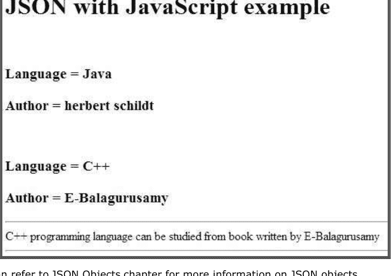
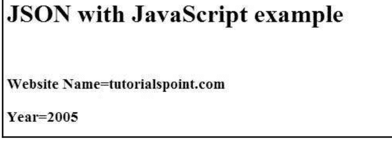

# JSON：Javascript 对象表示法

## 关于本教程

JSON 或 JavaScript 对象表示法（JavaScript Object Notation）是一种轻量级的、基于文本的开放标准，专为人类可读的数据交换而设计。JSON 格式最初由道格拉斯·克罗克福特（Douglas Crockford）制定，并在 RFC 4627 中进行了描述。JSON 的官方互联网媒体类型是 `application/json`。JSON 的文件名扩展名是 `.json`。

本教程将帮助您了解 JSON 及其在各种编程语言（如 PHP、PERL、Python、Ruby、Java 等）中的使用。

## 目标读者

本教程旨在帮助初学者理解 JavaScript 对象表示法（JSON）的基本功能，以开发数据交换格式。完成本教程后，您将对 JSON 及其与 JavaScript、Ajax、Perl 等的使用有良好的理解。

## 前提条件

在继续学习本教程之前，您应该对 Web 应用程序通过 HTTP 的工作方式有基本的了解，并且我们假设您具备基本的 JavaScript 知识。

## 1. JSON – 概述

JSON 或 JavaScript 对象表示法（JavaScript Object Notation）是一种轻量级的、基于文本的开放标准，专为人类可读的数据交换而设计。JSON 使用的约定为程序员所熟知，包括 C、C++、Java、Python、Perl 等。

-   JSON 代表 JavaScript 对象表示法。

-   该格式由道格拉斯·克罗克福特（Douglas Crockford）制定。

-   它是为人类可读的数据交换而设计的。

-   它是从 JavaScript 脚本语言扩展而来的。

-   文件名扩展名是 **.json**。

-   JSON 互联网媒体类型是 **application/json**。

-   统一类型标识符是 `public.json`。

## JSON 的用途

-   用于编写基于 JavaScript 的应用程序，包括浏览器扩展和网站。

-   JSON 格式用于通过网络连接序列化和传输结构化数据。

-   它主要用于在服务器和 Web 应用程序之间传输数据。

-   Web 服务和 API 使用 JSON 格式来提供公共数据。

-   它可以与现代编程语言一起使用。

## JSON 的特性

-   JSON 易于读写。

-   它是一种轻量级的基于文本的交换格式。

-   JSON 与语言无关。

## JSON 简单示例

以下示例展示了如何使用 JSON 存储与书籍主题和版本相关的信息。

```
{
    "book": [
    {
```

## JSON

```json
"id":"01",
"language": "Java",
"edition": "third",
"author": "Herbert Schildt"
},
{
    "id":"07",
    "language": "C++",
    "edition": "second",
    "author": "E.Balagurusamy"
}]
}
```

理解上述程序后，我们将尝试另一个示例。将下面的代码保存为 **json.htm**：

```html
<html>
<head>
<title>JSON example</title>
<script language="javascript" >

    var object1 = { "language" : "Java", "author"  : "herbert schildt" };
    document.write("<h1>JSON with JavaScript example</h1>");
    document.write("<br>");
    document.write("<h3>Language = " + object1.language+"</h3>");
    document.write("<h3>Author = " + object1.author+"</h3>");

    var object2 = { "language" : "C++", "author"  : "E-Balagurusamy" };
    document.write("<br>");
    document.write("<h3>Language = " + object2.language+"</h3>");
    document.write("<h3>Author = " + object2.author+"</h3>");

    document.write("<hr />");
    document.write(object2.language + " programming language can be studied " +
    "from book written by " + object2.author);
    document.write("<hr />");
</script>
</head>
<body>
</body>
</html>
```

现在，让我们尝试使用IE或任何其他支持JavaScript的浏览器打开json.htm，产生以下结果：



有关JSON对象的更多信息，你可以参考JSON对象章节。


## 2. JSON – 语法

让我们快速了解一下JSON的基本语法。JSON语法基本上被视为JavaScript语法的子集；它包括以下内容：

-   数据以名称/值对的形式表示。

-   花括号保存对象，每个名称后跟':'（冒号），名称/值对由','（逗号）分隔。

-   方括号保存数组，值由','（逗号）分隔。

下面是一个简单的例子：

```json
{
    "book": [
    {
        "id":"01",
        "language": "Java",
        "edition": "third",
        "author": "Herbert Schildt"
    },
    {
        "id":"07",
        "language": "C++",
        "edition": "second",
        "author": "E.Balagurusamy"
    }]
}
```

JSON支持以下两种数据结构：

-   **名称/值对的集合：** 这种数据结构得到不同编程语言的支持。

-   **值的有序列表：** 它包括数组、列表、向量或序列等。

## 3. JSON – 数据类型

JSON格式支持以下数据类型：

| 类型 | 描述 |

| :--- | :--- |

| Number | JavaScript中的双精度浮点数格式 |

| String | 带反斜杠转义的双引号Unicode |

| Boolean | true或false |

| Array | 值的有序序列 |

| Value | 可以是字符串、数字、true或false、null等 |

| Object | 键值对的无序集合 |

| Whitespace | 可以在任何一对标记之间使用 |

| null | 空值 |

### Number

-   它是JavaScript中的双精度浮点数格式，具体取决于实现。

-   不使用八进制和十六进格式。

-   数字中不使用NaN或Infinity。

下表显示了数字类型：

| 类型 | 描述 |

| :--- | :--- |

| Integer | 数字1-9，0，正数或负数 |

| Fraction | 小数，如.3, .9 |

| Exponent | 指数，如e, e+, e-, E, E+, E- |


### 语法

```javascript
var json-object-name = {"string" : number_value, ......}
```

### 示例

展示数字数据类型的示例，值不应该加引号：

```javascript
var obj = {"marks": 97}
```

### String

-   它是零个或多个带反斜杠转义的双引号Unicode字符的序列。

-   字符是单个字符字符串，即长度为1的字符串。

下表显示了可以在JSON文档字符串中使用的各种特殊字符：

| 类型 | 描述 |

| :--- | :--- |

| " | 双引号 |

| \ | 反斜杠 |

| / | 正斜杠 |

| b | 退格 |

| f | 换页 |

| n | 换行 |

| r | 回车 |

| t | 水平制表符 |

| u | 四个十六进制数字 |

### 语法

```javascript
var json-object-name = { string : "string value", ......}
```


### 示例

展示字符串数据类型的示例：

```javascript
var obj = {"name": "Amit"}
```

### Boolean

它包括true或false值。

### 语法

```javascript
var json-object-name = { string : true/false, .......}
```

### 示例

```javascript
var obj = {"name": "Amit", "marks": 97, "distinction": true}
```

### Array

-   它是值的有序集合。

-   它们被括在方括号中，这意味着数组以'['开始，以']'结束。

-   值由','（逗号）分隔。

-   数组索引可以从0或1开始。

-   当键名是连续的整数时，应该使用数组。

### 语法

```javascript
[ value, .......]
```

### 示例

展示包含多个对象的数组的示例：

```json
{
  "books": [
    { "language":"Java" , "edition":"second" },
    { "language":"C++" , "lastName":"fifth" },
    { "language":"C" , "lastName":"third" }
  ]
}
```


### Object

-   它是名称/值对的无序集合。

-   对象被括在花括号中，即它以'{'开始，以'}'结束。

-   每个名称后跟':'（冒号），键/值对由','（逗号）分隔。

-   键必须是字符串，并且应该彼此不同。

-   当键名是任意字符串时，应该使用对象。

### 语法

```javascript
{ string : value, ......}
```

### 示例

展示对象的示例：

```json
{
  "id": "011A",
  "language": "JAVA",
  "price": 500
}
```

### Whitespace

它可以在任何一对标记之间插入。添加它可以提高代码的可读性。示例展示了有和没有空白符的声明：

### 语法

```javascript
{string: "  ",....}
```

### 示例

```javascript
var obj1 = {"name": "Sachin Tendulkar"}
var obj2 = {"name": "SauravGanguly"}
```

### null

它意味着空类型。

### 语法

```javascript
null
```

### 示例

```javascript
var i = null;

if(i==1)
{
    document.write("<h1>value is 1</h1>");
}
else
{
    document.write("<h1>value is null</h1>");
}
```

### JSON 值

它包括：

-   数字（整数或浮点数）

-   字符串

-   布尔值

-   数组

-   对象

-   null

### 语法

```javascript
String | Number | Object | Array | TRUE | FALSE | NULL
```

### 示例

```javascript
var i = 1;
var j = "sachin";
var k = null;
```

## 4. JSON – 对象

### 创建简单对象

JSON对象可以使用JavaScript创建。让我们看看使用JavaScript创建JSON对象的各种方式：

-   创建空对象：

-   创建新对象：

-   创建一个具有字符串值的属性**bookname**和数值属性**price**的对象。使用'.'运算符访问属性：

```javascript
var JSONObject = {};
```

```javascript
var JSONObject = new Object();
```

```javascript
var JSONObject = { "bookname ":"VB BLACK BOOK", "price":500 };
```

这是一个展示在JavaScript中使用JSON创建对象的例子，将下面的代码保存为 **json_object.htm**：

```html
<html>
<head>
<title>Creating Object JSON with JavaScript</title>
<script language="javascript" >

var JSONObject = { "name" : "tutorialspoint.com", "year" : 2005 };
document.write("<h1>JSON with JavaScript example</h1>");
document.write("<br>");
document.write("<h3>Website Name="+JSONObject.name+"</h3>");
document.write("<h3>Year="+JSONObject.year+"</h3>");

</script>
</head>
<body>
</body>
</html>
```

现在，让我们尝试使用IE或任何其他支持JavaScript的浏览器打开json_object.htm。它产生以下结果：



### 创建数组对象

以下示例展示了在JavaScript中使用JSON创建数组对象，将下面的代码保存为 **json_array_object.htm**：

```html
<html>
<head>
<title>Creation of array object in javascript using JSON</title>
<script language="javascript" >

document.writeln("<h2>JSON array object</h2>");

var books = { "Pascal" : [
    { "Name"  : "Pascal Made Simple", "price" : 700 },
    { "Name"  : "Guide to Pascal", "price" : 400 }
    ],
    "Scala"  : [
    { "Name"  : "Scala for the Impatient", "price" : 1000 },
    { "Name"  : "Scala in Depth", "price" : 1300 }
    ]
}

var i = 0
document.writeln("<table border='2'><tr>");
for(i=0;i<books.Pascal.length;i++)
{
    document.writeln("<td>");
</script>
</head>
<body></body>
</html>
```

## JSON 数组对象

| 名称 | Pascal Made Simple | 名称 | Guide to Pascal | 名称 | Scala for the Impatient | 名称 | Scala in Depth |

| 价格 | 700 | 价格 | 400 | 价格 | 1000 | 价格 | 1300 |

## 5. JSON – Schema

JSON Schema 是一种基于 JSON 的格式规范，用于定义 JSON 数据的结构。它是在 IETF 草案下编写的，该草案已于 2011 年过期。JSON Schema:

-   描述你现有的数据格式。

-   清晰、人类和机器可读的文档。

-   完整的结构验证，适用于自动化测试。

-   完整的结构验证，用于验证客户端提交的数据。

### JSON Schema 验证库

目前有几种不同编程语言的验证器可用。目前可用的最完整且最合规的 JSON Schema 验证器是 JSV。

| 语言 | 库 |

| :--- | :--- |

| C | WJElement (LGPLv3) |

| Java | json-schema-validator (LGPLv3) |

| .NET | Json.NET (MIT) |

| ActionScript 3 | Frigga (MIT) |

| Haskell | aeson-schema (MIT) |

| Python | Jsonschema |

| Ruby | autoparse (ASL 2.0); ruby-jsonschema (MIT) |

| PHP | php-json-schema (MIT). json-schema (Berkeley) |

| JavaScript | Orderly (BSD); JSV; json-schema; Matic (MIT); Dojo; Persevere (修改版 BSD 或 AFL 2.0); schema.js. |

## JSON Schema 示例

下面是一个基本的 JSON schema，它涵盖了经典的产品目录描述：

```
{
    "$schema": "http://json-schema.org/draft-04/schema#",
    "title": "Product",
    "description": "A product from Acme's catalog",
    "type": "object",
    "properties": {
        "id": {
            "description": "The unique identifier for a product",
            "type": "integer"
        },
        "name": {
            "description": "Name of the product",
            "type": "string"
        },
        "price": {
            "type": "number",
            "minimum": 0,
            "exclusiveMinimum": true
        }
    },
    "required": ["id", "name", "price"]
}
```

让我们看看可以在此模式中使用的各种重要关键字：

| 关键字 | 描述 |

| :--- | :--- |

| $schema | `$schema` 关键字声明此模式是按照草案 v4 规范编写的。 |

| title | 你将使用此关键字为模式设置标题。 |

| description | 对模式的简要描述。 |

| type | `type` 关键字定义了对我们的 JSON 数据的第一个约束：它必须是一个 JSON 对象。 |

| properties | 定义在 JSON 文件中使用的各种键及其值类型、最小值和最大值。 |

| required | 保留必需属性的列表。 |

| minimum | 这是要施加在值上的约束，表示可接受的最小值。 |

| exclusiveMinimum | 如果存在 `exclusiveMinimum` 且布尔值为 true，则实例必须严格大于 `minimum` 的值才有效。 |

| maximum | 这是要施加在值上的约束，表示可接受的最大值。 |

| exclusiveMaximum | 如果存在 `exclusiveMaximum` 且布尔值为 true，则实例必须严格小于 `maximum` 的值才有效。 |

| multipleOf | 如果数字实例除以该关键字值的结果是整数，则该实例对 `multipleOf` 有效。 |

| maxLength | 字符串实例的长度定义为其字符的最大数量。 |

| minLength | 字符串实例的长度定义为其字符的最小数量。 |

| pattern | 如果正则表达式成功匹配实例，则认为字符串实例有效。 |

15


## JSON

你可以在 http://json-schema.org 查看可用用于定义 JSON 模式的完整关键字列表。上述模式可用于测试以下 JSON 代码的有效性：

```
[
  {
    "id": 2,
    "name": "An ice sculpture",
    "price": 12.50,
  },
  {
    "id": 3,
    "name": "A blue mouse",
    "price": 25.50,
  }
]
```

## 6. JSON – 与 XML 的比较

JSON 和 XML 都是人类可读的格式，并且与语言无关。它们都在现实世界中支持创建、读取和解码。我们可以基于以下因素将 JSON 与 XML 进行比较：

### 冗余性

XML 比 JSON 更冗长，因此对程序员来说，编写 JSON 更快。

### 数组用法

XML 用于描述结构化数据，但不包括数组，而 JSON 包括数组。

### 解析

JavaScript 的 *eval* 方法可以解析 JSON。当应用于 JSON 时，eval 返回描述的对象。

### 示例

XML 和 JSON 的独立示例：

### JSON

```
{
    "company": Volkswagen,
    "name": "Vento",
    "price": 800000
}
```

### XML

```
<car>
    <company>Volkswagen</company>
    <name>Vento</name>
    <price>800000</price>
</car>
```

## 7. JSON – PHP 中的 JSON

本章介绍如何使用 PHP 编程语言对 JSON 对象进行编码和解码。让我们从准备环境开始，以便使用 PHP 进行 JSON 编程。

### 环境

从 PHP 5.2.0 开始，JSON 扩展默认捆绑并编译到 PHP 中。

### JSON 函数

| 函数 | 描述 |

| --- | --- |

| json_encode | 返回值的 JSON 表示形式。 |

| json_decode | 解码 JSON 字符串。 |

| json_last_error | 返回发生的最后一个错误。 |

### 在 PHP 中编码 JSON (json_encode)

PHP `json_encode()` 函数用于在 PHP 中编码 JSON。此函数成功时返回值的 JSON 表示形式，失败时返回 FALSE。

#### 语法

```
string json_encode ( $value [, $options = 0 ] )
```

#### 参数

-   **value**：要编码的值。此函数仅适用于 UTF-8 编码的数据。

-   **options**：此可选值是一个位掩码，由 `JSON_HEX_QUOT`、`JSON_HEX_TAG`、`JSON_HEX_AMP`、`JSON_HEX_APOS`、`JSON_NUMERIC_CHECK`、`JSON_PRETTY_PRINT`、`JSON_UNESCAPED_SLASHES`、`JSON_FORCE_OBJECT` 组成。

### 示例

以下示例展示了如何使用 PHP 将数组转换为 JSON：

```
<?php
    $arr = array('a' => 1, 'b' => 2, 'c' => 3, 'd' => 4, 'e' => 5);
    echo json_encode($arr);
?>
```

执行时，将产生以下结果：

```
{"a":1,"b":2,"c":3,"d":4,"e":5}
```

以下示例展示了如何将 PHP 对象转换为 JSON：

```
<?php
    class Emp {
        public $name = "";
        public $hobbies  = "";
        public $birthdate = "";
    }
    $e = new Emp();
    $e->name = "sachin";
    $e->hobbies  = "sports";
    $e->birthdate = date('m/d/Y h:i:s a', "8/5/1974 12:20:03 p");
    $e->birthdate = date('m/d/Y h:i:s a', strtotime("8/5/1974 12:20:03"));

    echo json_encode($e);
?>
```

执行时，将产生以下结果：

```
{"name":"sachin","hobbies":"sports","birthdate":"08\/05\/1974 12:20:03 pm"}
```

### 在 PHP 中解码 JSON (json_decode)

PHP `json_decode()` 函数用于在 PHP 中解码 JSON。此函数将 json 解码的值返回为适当的 PHP 类型。

#### 语法

```
mixed json_decode ($json [,$assoc = false [, $depth = 512 [, $options = 0 ]]])
```

## JSON

## 参数

-   **json_string**：这是一个编码字符串，必须是 UTF-8 编码的数据。

-   **assoc**：这是一个布尔类型参数，当设置为 TRUE 时，返回的对象将被转换为关联数组。

-   **depth**：这是一个整数类型参数，用于指定递归深度。

-   **options**：这是一个整数类型的 JSON 解码位掩码，支持 JSON_BIGINT_AS_STRING。

### 示例

以下示例展示了如何使用 PHP 来解码 JSON 对象：

```
<?php
$json = '{"a":1,"b":2,"c":3,"d":4,"e":5}';

var_dump(json_decode($json));
var_dump(json_decode($json, true));
?>
```

执行时，将产生以下结果：

```
object(stdClass)#1 (5) {
  ["a"] => int(1)
  ["b"] => int(2)
  ["c"] => int(3)
  ["d"] => int(4)
  ["e"] => int(5)
}

array(5) {
  ["a"] => int(1)
  ["b"] => int(2)
  ["c"] => int(3)
  ["d"] => int(4)
  ["e"] => int(5)
}
```

## 8. JSON – JSON 与 Perl

本章介绍如何使用 Perl 编程语言来编码和解码 JSON 对象。让我们从准备环境开始，以便使用 Perl 进行 JSON 编程。

### 环境

在使用 Perl 编码和解码 JSON 之前，你需要安装 JSON 模块，可以从 CPAN 获取。下载 JSON-2.53.tar.gz 或任何其他最新版本后，请按照以下步骤操作：

```
$tar xvfz JSON-2.53.tar.gz
$cd JSON-2.53
$perl Makefile.PL
$make
$make install
```

### JSON 函数

| 函数 | 库 |

| :--- | :--- |

| encode_json | 将给定的 Perl 数据结构转换为 UTF-8 编码的二进制字符串。 |

| decode_json | 解码 JSON 字符串。 |

| to_json | 将给定的 Perl 数据结构转换为 JSON 字符串。 |

| from_json | 接收一个 JSON 字符串并尝试解析它，返回结果引用。 |

| convert_blessed | 使用此函数并设置为 true 值，以便 Perl 可以使用对象类上的 TO_JSON 方法将对象转换为 JSON。 |

### 在 Perl 中编码 JSON (encode_json)

Perl encode_json() 函数将给定的 Perl 数据结构转换为 UTF-8 编码的二进制字符串。

语法：

```
$json_text = encode_json ($perl_scalar );

或

$json_text = JSON->new->utf8->encode($perl_scalar);
```

示例

以下示例展示了 JSON 与 Perl 中的数组：

```
#!/usr/bin/perl
use JSON;

my %rec_hash = ('a' => 1, 'b' => 2, 'c' => 3, 'd' => 4, 'e' => 5);
my $json = encode_json \%rec_hash;
print "$json\n";
```

执行时，将产生以下结果：

```
{"e":5,"c":3,"a":1,"b":2,"d":4}
```

以下示例展示了如何将 Perl 对象转换为 JSON：

```
#!/usr/bin/perl

package Emp;
sub new
{
    my $class = shift;
    my $self = {
        name => shift,
        hobbies  => shift,
        birthdate  => shift,
    };
    bless $self, $class;
    return $self;
}
sub TO_JSON { return { %{ shift() } }; }

package main;
use JSON;

my $JSON  = JSON->new->utf8;
$JSON->convert_blessed(1);

$e = new Emp( "sachin", "sports", "8/5/1974 12:20:03 pm");
$json = $JSON->encode($e);
print "$json\n";
```

执行后，将产生以下结果：

```
{"birthdate":"8/5/1974 12:20:03 pm","name":"sachin","hobbies":"sports"}
```

### 在 Perl 中解码 JSON (decode_json)

Perl decode_json() 函数用于在 Perl 中解码 JSON。此函数将从 JSON 解码的值返回为适当的 Perl 类型。

语法：

```
$perl_scalar = decode_json $json_text

或

$perl_scalar = JSON->new->utf8->decode($json_text)
```

示例

以下示例展示了如何使用 Perl 来解码 JSON 对象。如果您的机器上尚未安装 Data::Dumper 模块，则需要在此处安装它。

```
#!/usr/bin/perl
use JSON;
use Data::Dumper;

$json = '{"a":1,"b":2,"c":3,"d":4,"e":5}';
$text = decode_json($json);
print Dumper($text);
```

执行后，将产生以下结果：

```
$VAR1 = {
    'e' => 5,
    'c' => 3,
    'a' => 1,
    'b' => 2,
    'd' => 4
};
```

## 9. JSON – JSON 与 Python

本章介绍如何使用 Python 编程语言来编码和解码 JSON 对象。让我们从准备环境开始，以便使用 Python 进行 JSON 编程。

### 环境

在使用 Python 编码和解码 JSON 之前，你需要安装任何可用的 JSON 模块。在本教程中，我们下载并安装了 Demjson (http://deron.meranda.us/python/demjson/)，步骤如下：

```
$tar xvfz demjson-1.6.tar.gz
$cd demjson-1.6
$python setup.py install
```

### JSON 函数

| 函数 | 库 |

| :--- | :--- |

| encode | 将 Python 对象编码为 JSON 字符串表示形式。 |

| decode | 将 JSON 编码的字符串解码为 Python 对象。 |

### 在 Python 中编码 JSON (encode)

Python encode() 函数将 Python 对象编码为 JSON 字符串表示形式。

语法

```
demjson.encode(self, obj, nest_level=0)
```

示例

以下示例展示了 JSON 与 Python 中的数组。

```
#!/usr/bin/python
import demjson

data = [ { 'a' : 1, 'b' : 2, 'c' : 3, 'd' : 4, 'e' : 5 } ]
json = demjson.encode(data)
print json
```

执行时，将产生以下结果：

```
[{"a":1,"b":2,"c":3,"d":4,"e":5}]
```

### 在 Python 中解码 JSON (decode)

Python 可以使用 demjson.decode() 函数来解码 JSON。此函数将从 JSON 解码的值返回为适当的 Python 类型。

语法

```
demjson.decode(self, txt)
```

示例

以下示例展示了如何使用 Python 来解码 JSON 对象。

```
#!/usr/bin/python
import demjson

json = '{"a":1,"b":2,"c":3,"d":4,"e":5}';

text = demjson.decode(json)
print text
```

执行后，将产生以下结果：

```
{u'a': 1, u'c': 3, u'b': 2, u'e': 5, u'd': 4}
```

## 10. JSON – JSON 与 Ruby

本章介绍如何使用 Ruby 编程语言来编码和解码 JSON 对象。让我们从准备环境开始，以便使用 Ruby 进行 JSON 编程。

### 环境

在使用 Ruby 编码和解码 JSON 之前，你需要为 Ruby 安装任何可用的 JSON 模块。你可能需要安装 Ruby gem，但如果你运行的是最新版本的 Ruby，那么你的机器上一定已经安装了 gem，否则请按照以下单步操作（假设你已安装 gem）：

```
$gem install json
```

### 使用 Ruby 解析 JSON

以下示例显示前 2 个键保存字符串值，后 3 个键保存字符串数组。让我们将以下内容保存在名为 **input.json** 的文件中。

```
{
    "President": "Alan Isaac",
    "CEO": "David Richardson",

    "India": [
        "Sachin Tendulkar",
        "Virender Sehwag",
        "Gautam Gambhir",
    ],

    "Srilanka": [
        "Lasith Malinga",
        "Angelo Mathews",
        "Kumar Sangakkara"
    ],

    "England": [
        "Alastair Cook",
        "Jonathan Trott",
        "Kevin Pietersen"
    ]
}
```

下面是一个 Ruby 程序，用于解析上述 JSON 文档：

```
#!/usr/bin/ruby
require 'rubygems'
require 'json'
require 'pp'

json = File.read('input.json')
obj = JSON.parse(json)

pp obj
```

执行后，将产生以下结果：

```
{"President"=>"Alan Isaac",
"CEO"=>"David Richardson",

"India"=>
 ["Sachin Tendulkar", "Virender Sehwag", "Gautam Gambhir"],

"Srilanka"=>
 ["Lasith Malinga ", "Angelo Mathews", "Kumar Sangakkara"],

"England"=>
 ["Alastair Cook", "Jonathan Trott", "Kevin Pietersen"]
}
```

## 11. JSON – JSON 与 Java

本章介绍如何使用 Java 编程语言来编码和解码 JSON 对象。让我们从准备环境开始，以便使用 Java 进行 JSON 编程。

### 环境

在使用 Java 编码和解码 JSON 之前，你需要安装任何可用的 JSON 模块。在本教程中，我们下载并安装了 JSON.simple (https://code.google.com/p/json-simple/)，并将 **json-simple-1.1.1.jar** 文件的位置添加到环境变量 CLASSPATH 中。

### JSON 与 Java 实体之间的映射

JSON.simple 在解码或解析时将实体从左侧映射到右侧，在编码时将实体从右侧映射到左侧。

| JSON | Java |

| --- | --- |

| 字符串 | java.lang.String |

| 数字 | java.lang.Number |

| true\|false | java.lang.Boolean |

| null | null |

| 数组 | java.util.List |

| 对象 | java.util.Map |

解码时，*java.util.List* 的默认具体类是 *org.json.simple.JSONArray*，*java.util.Map* 的默认具体类是 *org.json.simple.JSONObject*。

## 在Java中编码JSON

以下是一个简单的示例，展示了如何使用Java JSONObject（它是java.util.HashMap的子类）来编码一个JSON对象。此方法不保证元素的顺序。如果需要严格保证元素顺序，请使用`JSONValue.toJSONString(map)`方法，并配合有序映射实现，如`java.util.LinkedHashMap`。

```java
import org.json.simple.JSONObject;

class JsonEncodeDemo
{
    public static void main(String[] args)
    {
        JSONObject obj = new JSONObject();

        obj.put("name", "foo");
        obj.put("num", new Integer(100));
        obj.put("balance", new Double(1000.21));
        obj.put("is_vip", new Boolean(true));

        System.out.print(obj);
    }
}
```

编译并执行上述程序后，将产生以下结果：

```json
{"balance": 1000.21, "num":100, "is_vip":true, "name":"foo"}
```

以下是另一个示例，展示了如何使用Java JSONObject进行JSON对象流处理：

```java
import org.json.simple.JSONObject;

class JsonEncodeDemo
{
    public static void main(String[] args)
    {
        JSONObject obj = new JSONObject();

        obj.put("name","foo");
        obj.put("num",new Integer(100));
        obj.put("balance",new Double(1000.21));
        obj.put("is_vip",new Boolean(true));

        StringWriter out = new StringWriter();
        obj.writeJSONString(out);

        String jsonText = out.toString();
        System.out.print(jsonText);
    }
}
```

编译并执行上述程序后，将产生以下结果：

```json
{"balance": 1000.21, "num":100, "is_vip":true, "name":"foo"}
```

## 在Java中解码JSON

以下示例使用了**JSONObject**和**JSONArray**，其中JSONObject是一个java.util.Map，JSONArray是一个java.util.List，因此你可以使用Map或List的标准操作来访问它们。

```java
import org.json.simple.JSONObject;
import org.json.simple.JSONArray;
import org.json.simple.parser.ParseException;
import org.json.simple.parser.JSONParser;

class JsonDecodeDemo
{
    public static void main(String[] args)
    {
        JSONParser parser=new JSONParser();
        String s = "[0,{\"1\":{\"2\":{\"3\":{\"4\":[5,{\"6\":7}]}}}}]";
        try{
            Object obj = parser.parse(s);
            JSONArray array = (JSONArray)obj;
            System.out.println("数组的第二个元素");
            System.out.println(array.get(1));
            System.out.println();

            JSONObject obj2 = (JSONObject)array.get(1);
            System.out.println("字段 \"1\"");
            System.out.println(obj2.get("1"));

            s = "{}";
            obj = parser.parse(s);
            System.out.println(obj);

            s= "[5,]";
            obj = parser.parse(s);
            System.out.println(obj);

            s= "[5,,2]";
            obj = parser.parse(s);
            System.out.println(obj);
        }catch(ParseException pe){
            System.out.println("位置: " + pe.getPosition());
            System.out.println(pe);
        }
    }
}
```

编译并执行上述程序后，将产生以下结果：

```
数组的第二个元素
{"1":{"2":{"3":{"4":[5,{"6":7}]}}}}

字段 "1"
{"2":{"3":{"4":[5,{"6":7}]}}}
{}
[5]
[5,2]
```

## 12. JSON – 结合Ajax使用JSON

AJAX是Asynchronous JavaScript and XML（异步JavaScript和XML）的缩写，它在客户端作为一组相互关联的Web开发技术使用，以创建异步Web应用程序。根据AJAX模型，Web应用程序可以异步地从服务器发送和检索数据，而不会干扰现有页面的显示和行为。

许多开发者使用JSON在客户端和服务器之间传递AJAX更新数据。实时更新体育赛事比分的网站可以被视为AJAX的一个例子。如果这些比分必须在网站上更新，那么它们必须存储在服务器上，以便网页在需要时可以检索比分。这正是我们可以利用JSON格式化数据的地方。

任何使用AJAX更新的数据都可以使用JSON格式存储在Web服务器上。使用AJAX是为了让JavaScript能够在必要时检索这些JSON文件，解析它们，并执行以下操作之一：

- 在将解析后的值显示在网页上之前，将其存储在变量中以进行进一步处理。

- 它直接将数据分配给网页中的DOM元素，使它们显示在网站上。

**示例**

以下代码展示了如何结合使用JSON与AJAX。将其保存为**ajax.htm**文件。这里，加载函数`loadJSON()`被异步地用于上传JSON数据。

```html
<html>
<head>
<meta content="text/html; charset=ISO-8859-1" http-equiv="content-type">
<script type="application/javascript">
function loadJSON()
{
    var data_file = "http://www.tutorialspoint.com/json/data.json";
    var http_request = new XMLHttpRequest();
    try{
        // Opera 8.0+, Firefox, Chrome, Safari
        http_request = new XMLHttpRequest();
    }catch (e){
        // Internet Explorer Browsers
        try{
            http_request = new ActiveXObject("Msxml2.XMLHTTP");
        }catch (e) {
            try{
                http_request = new ActiveXObject("Microsoft.XMLHTTP");
            }catch (e) {
                window.alert("发生了一些错误....");
            }
        }
    }
}
</script>
<title>tutorialspoint.com JSON</title>
</head>
<body>
<h1>板球运动员详情</h1>
<table class="src">
<tr><th>姓名</th><th>国家</th></tr>
<tr><td><div id="Name">Sachin</div></td>
<td><div id="Country">India</div></td></tr>
</table>

<div class="central">
<button type="button" onclick="loadJSON()">更新详情</button>
</div>
</body>
</html>
```

以下是输入文件**data.json**，其中包含JSON格式的数据，当我们点击“**更新详情**”按钮时，它将被异步上传。此文件位于http://www.tutorialspoint.com/json/。

```json
{"name": "brett", "country": "Australia"}
```

上述HTML代码将生成以下屏幕，你可以在其中查看AJAX的实际运行效果：

### 板球运动员详情

| 姓名 | 国家 |

| --- | --- |

| Sachin | India |

# 更新详情：

当你点击“**更新详情**”按钮时，你应该会得到类似以下的结果。你可以自己尝试结合JSON使用AJAX，前提是你的浏览器支持JavaScript。

### 板球运动员详情

| 姓名 | 国家 |

| --- | --- |

| Brett | Australia |
