# JSP 入门指南

## 关于作者

**Gary Bollinger** 是 Artesia Technologies 的首席产品架构师兼联合创始人。他是多篇发表于 *JavaPro* 和 *JavaReport* 杂志文章的作者。他拥有文学、计算机科学、神学等多个本科和研究生学位，以及哲学博士学位。他还拥有 15 年编程 RPC、CORBA 和 J2EE 架构的专业经验。他爱他的狗。

**Bharathi Natarajan** 是 Artesia Technologies 的首席工程师，并与他人合著了发表于 *JavaPro* 和 *JavaReport* 杂志的文章。他拥有计算机科学的本科和研究生学位。他拥有 8 年使用 *C/C++*、分布式编程和 J2EE 架构编程的专业经验。他也爱他的狗。

> 献给我的父亲，Leonard Bollinger，我对他的敬仰远超我所表达的，并纪念我已故的岳母，Nancy Royston Jones Winters，她曾鼓励并爱护我。
> ---Gary Bollinger

> 献给我的父亲，Udayampalayam Subbian Natarajan，他从童年起就是我的灵感。我通往成功的道路始于他的指引和鼓励。
> ---Bharathi Natarajan


## 致谢

写作一本书，如果一开始就明白其中的挑战，或许永远都不会开始。没有什么比在“正职”工作十个小时（或更长时间）之后，再在晚饭后开始第二份工作（即这本书）更让人疲惫的了。尽管如此，这仍然是非常有回报的，部分归功于我们的家人、朋友和编辑们的努力。

我们的妻子，玛丽·博林格和桑德拉·纳塔拉詹，在过去的 10 个月里对我们因专注写作而产生的分心极其耐心。桑迪和玛丽鼓励我们，并在关键时刻帮助编辑和校对本书。她们的鼓励和帮助是无价的。没有她们的支持，我们无法完成这本书。我们知道，没有人会比她们俩更为我们取得的成就感到骄傲。

我们要特别感谢菲尔·奥西普，他是一位朋友和同事，为我们撰写了在模块 5 中讨论 `<jsp:plugin>` 标签时使用的小程序。我们还要感谢大卫·史密斯，另一位朋友和同事，他阅读并帮助编辑了模块 4 和模块 5。

我们的技术编辑菲尔·汉娜，在 Servlet 和 JSP 技术的细节方面提供了宝贵的技术批评。他非常了解这些内容，我们感激地接受了他的见解。当然，任何遗留的错误都是我们自己的！

Osborne 的编辑们——我们有好几位——总是非常专业，帮助我们克服挑战，按时交付本书。

最后，不要忘记我们的狗，卡拉梅尔、查丘、艾米丽和苏格拉底，它们一直陪伴着我们，在所有人都已熟睡的漫漫长夜里，提供了宝贵的陪伴。

## 引言

你是一名试图理解现代 Web 开发基础知识的学生吗？你是否想知道 JavaServer Pages (JSP) 如何与 HTML、Java servlets 和数据库协同工作来构建可扩展的 Web 架构？你是否一直在寻找一本清晰、结构化的 JavaServer Pages 入门指南？

你是否正在开发网站，并希望提高 CGI 脚本的性能？你是否曾想直接在网页中使用程序循环或变量？你是否厌倦了编写晦涩的 Perl 程序，而这些程序的大部分工作只是打印静态 HTML？

你是否开发 Java servlets 来生成网页？你是否渴望一种更自然的方式来编写动态页面？你是否寻求一种清晰的方法将编程语言结构与 HTML 元素分离？

你是否开发 Active Server Pages (ASP)，并希望在非 Microsoft 平台上创建网站？你是否认为你的技能在 UNIX 上有市场？

你是否对设计模式感兴趣，并想知道如何将其应用于 Web 架构？

如果你对以上任何一个问题的回答是肯定的，那么这本书就是为你准备的！JavaServer Pages 技术是由 Sun Microsystems, Inc. 开发的。最明显的是，该技术提供了一种更好的编写动态网页的方式。网页开发通常必须在其页面中包含静态 HTML 和动态内容。例如，假设你想针对访问页面的特定人员定制页面内容。页面的大部分为每个访问者提供相同的外观和感觉。但页面的某些部分从数据库中提取内容，这些内容根据用户人口统计数据或预先建立的登录信息进行定制。


## 前提条件

本书面向寻求清晰了解JSP基本概念和技术的学生以及Web和Java初学者开发者。尽管部分内容具有挑战性，但我们通过大量的示例、提示和解释，使本书对具有适度经验的Web开发者和程序员同样易于理解。我们在JSP应用架构的背景下介绍Java servlet编程，并总体上提供我们认为能有效使用JavaServer Pages所必需的背景信息。不过，我们假设并要求具备一定的编程语言（最好是Java）知识及经验。我们也假设读者对互联网有一定了解。

## 本书结构

我们将本书分为三部分：
第一部分为构建JavaServer Pages奠定技术基础，侧重于语法元素及其正确使用。我们将第一部分分为六个模块，涵盖互联网技术基础以及JavaServer Pages的各个具体元素。
第二部分介绍JSP实用开发的基础方面，侧重于构建“实际”JSP应用所必需的问题和技巧。我们将第二部分分为四个模块，涵盖Web架构中的常见软件模式、Web安全、应用工作流以及数据库集成。通过使用这些模式，Web开发者可以更快速、错误更少地创建Web应用。
第三部分包含四个附录，提供支持我们基础讨论的辅助信息。

## 第一部分——JSP基础

模块1介绍了更广泛的Web技术世界。它首先描述了Web应用开发的核心架构元素：超文本传输协议（HTTP）以及基本的客户端-服务器问题。然后概述了扩展Web浏览器和Web服务器功能以支持“实际”应用的客户端和服务器技术。在模块1结束时，你将了解Web技术的整体概况。

模块2将焦点缩小到两个JSP语法元素：注释和指令，以及它们在Web应用中的正确使用。模块2还描述了JSP页面的基础知识，并为良好的编程风格奠定基础。在模块2结束时，你将构建并显示你的第一个简单JSP页面。

模块3描述了JSP脚本元素。我们在这个引言中已经展示了一些例子。在模块3中，我们将详细描述脚本元素，并开始构建更复杂的JSP应用元素。在模块3结束时，你将能够构建完整的JSP应用，利用Java来编写动态内容脚本。

模块4描述了JavaServer Pages中的隐式对象。这些对象提供了一个框架，用于在JSP应用的各部分之间传递和使用信息。在模块4结束时，你将构建一个能交互式响应HTML表单的JSP页面。

模块5描述了标准JSP动作。JSP动作充当对Java功能的调用（外部引用）。除其他功能外，标准动作提供了一种简单的机制，用于将辅助JavaBeans纳入应用。在模块5结束时，你将能够将JavaBeans纳入你的JSP应用，从而提升其风格和专业性。

模块6介绍了自定义JSP动作。这类动作提供了JSP架构最强大的功能之一。编写自定义JSP动作实际上是在扩展JSP引擎本身。在模块6结束时，你将构建你的第一个此类JSP引擎扩展。

## 第二部分——构建实际应用

模块7开始了我们关于使用JavaServer Pages进行“实际”应用开发主要方面的讨论。它介绍了软件模式及其在JSP架构中的应用。我们特别关注以下模式：
- 模型-视图-控制器（MVC）
- 中介者
- 命令
- 策略
- 桥接

我们也提到了其他模式，但着墨较少，包括工厂、拦截器/过滤器和回调。

模块8讨论了安全问题。我们描述了Web架构中常用的一些安全技术，包括Servlet 2.2规范要求的技术。

模块9描述了围绕应用工作流的问题——JSP应用中从一个页面到另一个页面的控制和移动。

模块10讨论了数据库在JSP架构中的作用。我们描述了JDBC数据访问API。然后描述了将数据库集成到JSP应用中所需的各种技术。

## 第三部分——附录

附录提供了支持本书其余部分的辅助信息。附录A提供了每个模块末尾提出的特殊**掌握度检查**问题的答案。

附录B解释了如何创建和部署Web服务器及JSP环境。我们专注于Servlet和JSP容器的Tomcat实现以及Apache Web服务器。

附录C描述了如何设置和配置MySQL数据库。该数据库引擎是免费的，并为个人开发项目提供了优秀的平台。

最后，附录D描述了当前JSP规范（JSP 1.1）与拟议的JavaServer Pages 1.2规范最终草案之间发生的变化。

## 特色功能

每个模块都包含*提示*、*技巧*、*警告*和*注意*，以便在需要时提供额外的参考信息。详细的*代码清单*包含在灰框中，许多时候会突出显示特定的标签或功能并附有进一步解释。

大多数模块包含*专家问答*部分，以解决可能令人困惑的问题。每个模块都包含循序渐进的*项目*，让你有机会练习迄今为止所学的概念。你可以从Osborne的网站（`www.osborne.com`）下载项目内容。

所有模块末尾都包含掌握度检查，让你有机会回顾模块中所学的概念。掌握度检查的答案在附录A中。

## 符号约定

在几个地方，我们展示了源自正式规范的格式。当我们这样做时，我们使用以下约定：
- 我们用等宽字体显示所有字面量：`literal`。
- 当我们将元素的集合作为一个单元处理时，我们将它们显示在括号中：(element1 element2)。
- 我们使用星号表示一个元素的零个或多个实例：(element1 element2)*。
- 我们用方括号表示可选术语：[element]。
- 我们用连字符序列表示回车符后跟换行符：CR-LF。
- 我们用斜体表示符号元素，例如变量或占位符名称：*element*。
- 我们用大写字母并围绕变量使用'%'符号（Windows表示法）以等宽字体表示环境变量：`%TOMCAT_HOME%`。
- 我们用反斜杠字符作为文件分隔符（Windows语法）以等宽字体表示目录名、相对路径和文件名：`%TOMCAT_HOME%\webapps\Book`。
- 我们用斜体表示Java类名、接口名和方法名：*HelperBean.getProperty*。

在本书的整个编写过程中，我们的目标始终是为你提供一个连贯、易于理解的JavaServer Pages编码指南，帮助你快速上手。我们赞赏你学习JavaServer Pages的决定，并鼓励你在学习过程以及随后的Web应用开发中充分利用互联网的潜力。祝你学习愉快，好运！


## 其他阅读资料

1.  Alexander, C., S. Ishikawa, and M. Silverstein. 《建筑模式语言》。牛津大学出版社，1977年。
2.  Alexander, C. 《建筑的永恒之道》。牛津大学出版社，1979年。
3.  Alur, Deepak, John Crupi, and Dan Malks. 《Core J2EE 模式：最佳实践与设计策略》。Sun Microsystems Press, Prentice Hall, 2001年。
4.  Berners-Lee, Tim, with Mark Fischetti. 《编织万维网：万维网的发明者关于其原始设计与最终命运的叙述》。Harper San Francisco, 1999年。
5.  [DBTags] http://jakarta.apache.org/taglibs/doc/dbtags-doc/intro.html
6.  Gamma, Erich, Richard Helm, Ralph Johnson, and John Vlissides. 《设计模式：可复用面向对象软件的基础》。Addison-Wesley Publishing Company, 1995年。
7.  Geary, David. "JSP 模板"。《Java World》，2000年9月。 http://www.javaworld.com/javaworld/jw-09-2000/jw-0915-jspweb_p.html
8.  Lea, Doug. "Christopher Alexander：面向对象设计师导论"。SUNY Oswego/NY CASE Center, 1993年12月。 http://g.oswego.edu/dl/ca/ca/ca.html
9.  [MySQL] http://www.mysql.com
10. [Struts] http://jakarta.apache.org/struts/index.html
11. [Taglibs] http://jakarta.apache.org/taglibs/index.html
12. [Tomcat] http://jakarta.apache.org/tomcat/index.html

# 第一部分

## JSP 基础


# 模块 1

## 互联网技术导论

本模块目标

-  了解客户端-服务器架构和 HTTP 协议的特性
-  熟悉客户端互联网开发技术
-  理解基础的服务器端互联网开发技术

理解 JavaServer Pages (JSP) 始于理解超文本传输协议 (HTTP)。*协议*是一套在计算机网络上编码和传输数据请求的规则。你可以将协议视为计算机网络之间的语言。互联网以 HTTP 作为其母语。HTTP 允许一台计算机将文档传递给世界任何地方的另一台计算机。换句话说，HTTP 提供了 Web 客户端与 Web 服务器进行通信的线路。

当然，其他协议如文件传输协议 (FTP) 也能在网络上传送文档，但 HTTP 做得最好。HTTP 之所以优于其他协议，并非因为其速度更快或功能更强大，而是因为其简洁性。HTTP 在超文本标记语言 (HTML) 的帮助下，实现了一个概念：一个文档（*源*）中的词语或概念，可以直接指向另一个文档（*目的地*）中的词语或概念。HTTP 允许文档读者无需登录远程服务器或执行像 FTP 这样的协议所要求的其他繁琐网络握手过程，就能从源跟随“链接”跳转到目的地。超媒体链接的概念和一个简单的网络传输协议，为我们今天所知的万维网奠定了基础。

万维网联盟 (W3C) 最终将 HTTP 标准化为规范 HTTP/1.0。一个更新的规范 HTTP/1.1 相较于 HTTP/1.0 提供了多项优化和扩展优势，并将最终取代 HTTP/1.0。我们本模块的讨论基于 HTTP/1.1。

> 注意：Tim Berners-Lee 于 1990 年发明了 HTTP 和 HTML，并创立了 W3C，这是互联网协议领域最具影响力的规范组织。（参见 Tim Berners-Lee with Mark Fischetti, *Weaving the Web: The Original Design and Ultimate Destiny of the World Wide Web by Its Inventor* [San Francisco: HarperSanFrancisco, 1999], pp. 28–29.）

## 互联网作为客户端-服务器架构

基于 HTTP，互联网提供了世界上最伟大的客户端-服务器应用架构。客户端-服务器架构将计算服务组织成集中式进程，这些进程提供诸如存储空间、数据库管理和文件传输等资源。然后，客户端向这些集中式进程请求所需的资源。图 1-1 展示了客户端-服务器架构的示意图。

客户端-服务器架构旨在结合和协调资源以实现规模效益。通过集中化和共享资源，客户端-服务器架构可以以更低的成本向更多客户端提供更多的服务。与此同时，客户端-服务器架构试图对客户端隐藏网络的存在。当它们有效运作时，客户端似乎拥有它们所使用的服务器资源。这种网络透明性是一个令人钦佩的目标。然而实际上，网络服务器永远无法完全隐藏网络的存在。让我们来看看其中的一些原因。

> **提示**
> 网络打印机可能是最熟悉的客户端-服务器资源示例。想想打印机问题发生的频率，就能体会到实现网络透明性的难度。

## 网络透明性问题

所有网络的三个特性使得网络透明性成为一个难以实现的目标：

-   **延迟** 请求到达服务器并返回响应所需的时间
-   **可靠性** 客户端请求得到响应的可能性
-   **并发性** 服务器对客户端请求的执行顺序

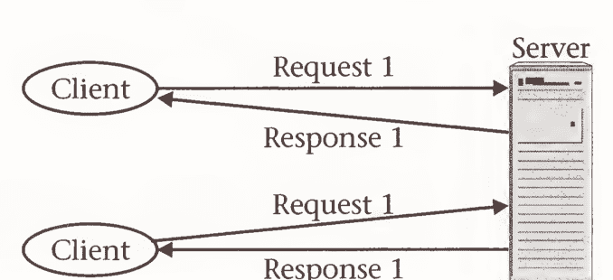

**图 1-1** 客户端向集中式服务器请求资源。

# 6 JSP：初学者指南

客户端无法预测这些网络特性的任何影响。如果一个服务器必须处理的请求量超出了其及时响应的能力，客户端将不得不等待或超时。如果通往服务器的网络路径崩溃了（可能是因为有人暂时将中间机器从网络中移除），客户端的请求将得不到响应。

> **提示**
> 要想象延迟和可靠性的影响，可以回想一下你访问过的那些没有响应的互联网站点的次数。

如果一个客户端同时向服务器发送多个请求，它绝不能对服务器响应这些请求的顺序做任何假设。如果客户端确实做了假设，这些假设可能会导致客户端与服务器之间的数据不一致。去掉网络层，所有这些因素都是可预测的；一旦加上网络层，这些因素就再次变得不可预测。图 1-2 展示了网络透明性面临的挑战。

虽然在客户端-服务器架构中无法忽略网络特性，但服务器的特性会放大网络问题的影响。服务器的*状态*对网络问题的影响最大。

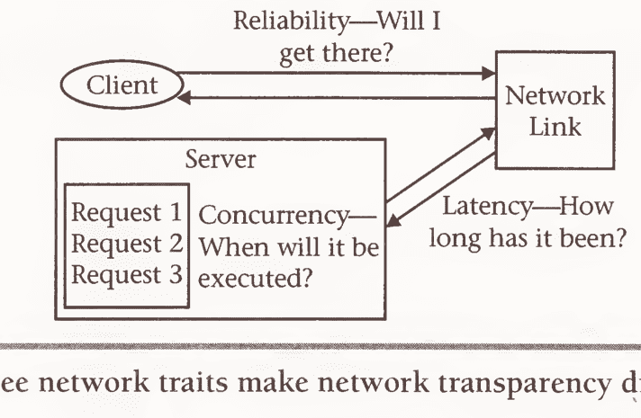

## 有状态服务器

在客户端-服务器架构中，服务器的*状态*是指它在客户端请求期间和请求之间管理的信息。所有服务器都必须管理一些状态才能完成其工作。例如，文件传输服务器会维护一个标记或书签，以指示客户端文件传输请求的状态。

然而，*有状态服务器*不仅仅是在客户端请求*期间*维护状态。它们还在客户端请求*之间*保存客户端信息。例如，一个有状态服务器可能会管理跨越多个客户端请求而持续存在的客户端*会话*信息。会话信息帮助服务器根据特定客户端的特征（如访问权限或偏好）来定制响应。

会话管理还帮助服务器引导客户端在工作流中经历特定的状态。例如，一个服务器可能会管理客户端通过在线目录购买的过程。

*事务*是服务器用来帮助客户端执行一系列相互依赖的请求的另一种状态类型。实际上，事务允许客户端将多个实际服务请求捆绑成一个单一的逻辑请求。数据库服务器最好地说明了事务的重要性。一个单一的用户活动，例如访问银行账户、取款并将更改反映到用户账户，必须*一次性*完成，否则就不执行。这意味着对数据库服务器的多个请求在服务器执行每个请求时必须维护临时状态。在所有请求完成后，服务器要么提交，要么丢弃整组请求的效果。

有状态服务器发现建立网络透明性更加困难，因为它们必须保持客户端和服务器信息*同步*。同步是指在服务器对客户端的认知与客户端的实际状态之间保持一致性的行为。这种一致性最明显的挑战发生在客户端在未通知服务器的情况下与服务器断开连接时。假设，例如，一个用户在与服务器会话的中途关闭了客户端机器。处理这种非常典型的情况会给有状态服务器带来极大的复杂性。服务器必须以某种方式确定客户端的真实状态（客户端已消失），并相应地修改其对客户端的认知（移除其客户端信息）。执行此类同步的逻辑和代码是复杂的。当前的 HTTP 服务器通过不管理客户端状态来保持简单。HTTP 服务器是无状态服务器。


## HTTP 服务器是无状态的

自1990年以来，HTTP服务器的既定目标一直是以尽可能快的速度向Web浏览器提供信息。在早期，这意味着提供HTML文档和图像。今天的Web服务器向浏览器传输视频、音频、动画图像以及许多其他丰富格式的内容。在整个演变过程中，HTTP服务器保持了轻量级和无状态性，反映了该协议基本的请求-响应范式。假设没有问题，从Web浏览器到Web服务器再返回的一个典型往返过程遵循以下步骤：

1.  浏览器与Web服务器建立连接。
2.  浏览器向Web服务器发送HTTP请求。
3.  Web服务器通过已建立的连接向浏览器发送HTTP响应。
4.  Web服务器关闭连接。无论原因如何，任何过早关闭连接的行为都会终止当前请求。

对于编写JavaServer Pages或Java servlets的开发者来说，理解HTTP协议的细节至关重要，因此让我们更仔细地看看HTTP消息格式。（本讨论源自HTTP/1.1协议规范。参见RFC 2616，网址为 http://www.ietf.org/rfc/rfc2616.txt。）


# 1分钟速查

-   什么是客户端-服务器架构？
-   什么是网络透明性？
-   什么是无状态服务器？

-   客户端-服务器架构将计算服务组织成集中式进程，提供存储空间、数据库管理和文件传输等资源。
-   当客户端-服务器架构对客户端隐藏网络的存在时，就发生了网络透明性。
-   无状态服务器是指在客户端请求之间不保留任何客户端状态信息的服务器。

## HTTP 请求

HTTP请求遵循以下通用格式的某种变体：

```
请求行
* (消息头 CR-LF)
CR-LF
[消息体]
```

例如，以下是Microsoft Internet Explorer 5.5发送的一个实际HTTP请求：

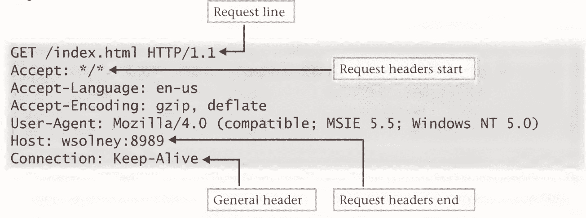

让我们通过将其分解为各个元素来更好地理解这个请求格式。

### 请求行

*请求行* 需要以下三个字段，彼此之间用空格字符分隔：

-   请求方法
-   请求URI
-   HTTP版本

请求行以CR-LF字符序列结束。

### 请求方法

方法字段决定了请求消息的基本变体。对于JSP开发，最重要的两种方法类型是 `GET` 和 `POST`。

**GET** `GET` 方法从远程服务器检索指定的Web资源。大多数HTTP请求使用 `GET` 方法。事实上，每次你访问一个特定的主页网站时，你都隐式地发出了一个 `GET` 请求。在这方面，`GET` 请求充当了Web的工作马。为了帮助限制浏览器网络请求的数量，`GET` 方法通常会缓存其检索到的信息，并在之后的一段时间内返回此缓存信息，而不是来自Web服务器的新响应。

> **提示** 当你在Internet Explorer中选择刷新命令（或在Netscape中选择重新加载）时，你强制浏览器访问Web服务器而不是其缓存来获取网站信息。

`GET` 方法也可以向Web服务器*发送*信息。为此，浏览器使用称为 `application/x-www-form-urlencoded` 的多用途互联网邮件扩展（MIME）标准对信息进行编码。它们使用问号（?）字符将编码的信息连接到请求URI（统一资源标识符）。该格式将数据编码为名称-值对。在每个名称-值对中，等号（=）字符将名称与值分开。与号（&）字符分隔不同的名称-值对。空格编码为加号（+）字符。该格式将非字母数字字符替换为 `%HH`，其中 `HH` 代表表示字符ASCII值的十六进制值。

`GET` 方法受到Web服务器接受的URI大小限制的实际约束。此外，Web服务器通常会记录请求，因此编码在URI中的敏感数据最终可能会出现在服务器日志中。以下是 `GET` 请求行的一个示例：

```
GET /cgi-bin/Scripts/foo.perl?
FormField1=value1&FormField2=value2 HTTP/1.1 CR-LF
```

**POST** `POST` 方法与 `GET` 方法类似，既可以检索Web服务器的信息，也可以向Web服务器发送数据。不过，与 `GET` 方法不同的是，`POST` 方法将其客户端数据作为特殊的内容消息附加在请求的末尾。此内容消息*可以*使用 `GET` 方法使用的 `application/x-www-form-urlencoded` MIME标准。与 `GET` 方法不同，它也可以使用称为 `multipart/form-data` 的不同编码标准。这种替代编码标准将客户端信息打包为一系列部分，其中每个部分可以具有不同的内容类型。

`POST` 方法可以比 `GET` 方法发送更多信息到Web服务器，因为它不依赖请求URI来打包数据。此外，敏感数据永远不会出现在服务器日志中。以下是 `POST` 请求的一个示例（省略了你通常会看到的多个头信息）：

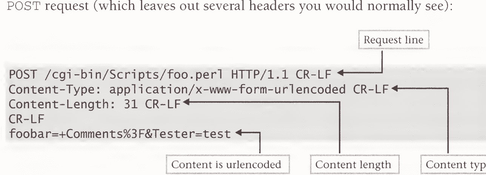

HTTP请求中的第二个字段是请求URI，它与你在网页中访问或在浏览器地址栏中输入的链接有关。让我们更仔细地看看URI。

### 请求URI

HTTP请求必须指定一个Web资源作为请求的对象。它们使用统一资源标识符（URI）来实现这一点。URI规范提供了一种唯一标识互联网资源的方法。（参见RFC 2396，网址为 `http://www.ietf.org/rfc/rfc2396.txt`。）URI具有三个定义特征：

-   **统一** URI支持多种资源类型，但遵循通用的语法形式。
-   **资源** URI标识的资源可以是文档、图像、资源集合，或者实际上是任何具有身份的实体。
-   **标识符** URI包含对资源的语法受限的引用。

为了阐明这些定义，请看表1-1，其中显示了一些常见类型互联网URI的示例：

如示例所示，URI遵循以下通用格式：

`scheme scheme-specific-notation`

方案部分标识了URI的正式规范或语法。每个这样的命名方案都需要特定于方案的语法或表示法。一些层次结构组织的URI共享更具体的四部分格式：

`scheme // authority [path [ ? query ] ]`

像FTP和HTTP这样的网络协议属于此类。此类URI要求你指定命名或目录权限，通常是网络主机上的服务器。一些协议，如HTTP和FTP，支持从权限根路径开始的资源路径。一些方案，如HTTP，还支持查询字符串，其功能是将运行时参数传递给路径字段中指定的对象。

HTTP/1.1规范为HTTP请求URI提供了另一个更熟悉的名称，称为统一资源定位符（URL）。HTTP URI（URL）的一般形式遵循以下格式：

`http: // origin-server [ :port ] [absolute_path [ ? query ] ]`

HTTP URI格式中的可选端口限定符指定HTTP权限服务的网络端口。当未指定此端口时，HTTP假设端口为80。

| URI | 定义 |
|---|---|
| http://www.w3c.org/ | HTTP消息 |
| ftp://ftp.NCSA.uiuc.edu/ | FTP消息 |
| telnet://grex.cyberspace.org/ | Telnet协议消息 |
| news:comp.lang.java | Usenet新闻组消息 |
| mailto:aboll@bell.net | 电子邮件消息 |

**表1-1** 常见的互联网URI

> **注意** 蒂姆·伯纳斯-李（万维网的发明者）在《编织万维网》（第62页）中描述了URI和URL命名背后的政治。尽管他主张用“Universal”（通用的）而不是“Uniform”（统一的），用“Identifier”（标识符）而不是“Locator”（定位符），但互联网工程任务组（IETF）URI工作组的大多数参与者主张用“Uniform”和“Locator”。最终，采用了“Uniform”，而“URI”也代表了URL以及更广泛的标识符类别。

HTTP/1.1规范还描述了与GET和POST方法相关的两种请求URI类型：

-   绝对URI
-   绝对路径

*绝对URI* 形式提供了如前所述的完整URI。这是一个指定完整URI的请求行示例：

```
GET http://www.w3c.org/index.html HTTP/1.1
```

HTTP/1.1规范建议未来的规范可能要求每个GET和POST请求都使用绝对URI。然而，今天，大多数HTTP请求发送的是*绝对路径*形式的请求URI。这种形式从请求URI中剥离了 `http://` 前缀和原始服务器，并使用 `Host:` 字段作为请求头的一部分传递原始服务器。例如，浏览器将此绝对URI请求行

```
GET http://www.w3c.org/index.html HTTP/1.1
```

渲染为

```
GET /index.html HTTP/1.1
```

并在请求行之后的请求头中添加行

```
Host: www.w3c.org
```

在从请求URI中剥离原始服务器后，浏览器使用它来建立连接。


### HTTP 协议版本

HTTP 协议版本是 HTTP 请求行的第三部分。目前，这通常具有值 `HTTP/1.1`，但也可能具有值 `HTTP/1.0`。

> **注意**
> 通过支持持久连接，HTTP/1.1 相比 HTTP/1.0 提供了显著的性能优势。Web 浏览器和服务器使用通用头中的 `Connection:` 字段来指定是否保持连接打开。例如，客户端发送以下头字符串以保持其连接活动：`Connection: Keep-Alive`。

### 消息头

HTTP 在请求消息中支持三种类型的消息头：

- **通用头** 提供有关消息的信息，包括日期等信息。例如，通用头将包含 `Connection:` 字段。
- **请求头** 提供有关请求和发出请求的客户端的信息。例如，请求头将包含 `Host:` 字段。
- **实体头** 提供有关通过 `POST` 方法发送到服务器的数据的信息。例如，实体头包含 `Content-Type:` 和 `Content-Length:` 字段。

每个消息头以 `CR-LF` 字符序列结束。在所有消息头的完整序列之后，还有另一个 `CR-LF`。

### 消息体

`POST` 方法使用其消息体向 Web 服务器发送数据。浏览器将此数据作为编码字节流（实体体）发送，然后服务器必须使用相应实体头中提供的信息进行解码。浏览器使用实体头中的 `Content-Length:` 字段指定实体体的结束。

## HTTP 响应

在接收并解释请求消息后，Web 服务器返回响应消息。HTTP 响应遵循以下通用格式的某种变体：

```
状态行
* (消息头 CR-LF)
CR-LF
[消息体]
```

例如，这是由 Apache 1.3 Web 服务器返回的实际 HTTP 响应：

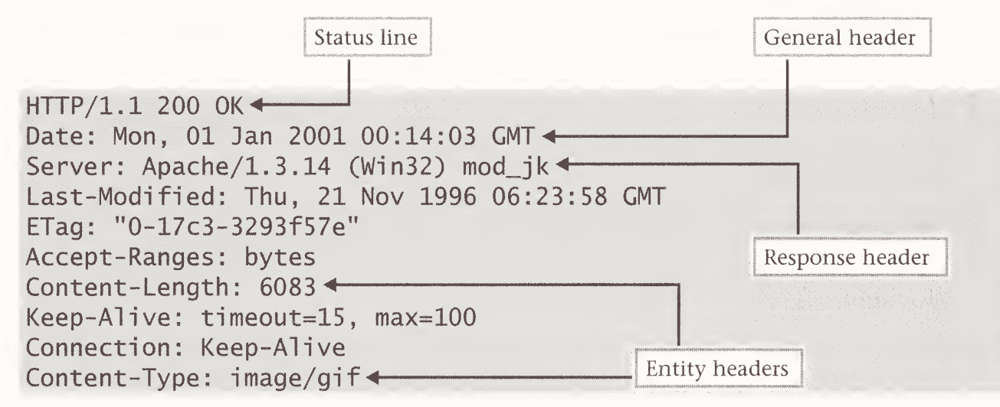

我们可以通过将其分解为独立的元素来更好地理解此响应格式。

### 状态行

状态行需要三个字段，彼此之间由 SPACE 字符分隔：

- HTTP 版本
- 状态码
- 原因短语

状态行以 CR-LF 字符字符串结束。

### HTTP 协议版本

HTTP 版本字段与讨论请求时相同。目前，请求和响应通常都发送 HTTP/1.1 或 HTTP/1.0 版本。

### 状态码和原因短语

状态码表示请求的完成状态，而原因短语给出代码的简短描述。表 1-2 列出了一些常见状态码、其相关原因短语以及代码的简短说明。

### 消息头

HTTP 在响应消息中支持三种类型的消息头：

- **通用头** 提供有关消息的信息，包括日期等信息。例如，通用头将包含 `Date:` 字段。
- **响应头** 提供有关响应和返回响应的服务器的信息。例如，响应头可以包含 `Server:` 字段。
- **实体头** 提供有关通过 POST 方法发送到服务器的数据的信息。例如，实体头包含 `Content-Type:` 和 `Content-Length:` 字段。

**表 1-2** 常见 HTTP 响应码和原因短语表

| 状态码 | 原因短语 | 说明 |
|---|---|---|
| 200 | OK | 请求成功。 |
| 301 | Moved Permanently | 请求的 Web 资源已永久移动到新 URL。 |
| 400 | Bad Request | 请求的语法格式不正确。 |
| 404 | Not Found | 服务器找不到请求的 URL。 |
| 503 | Service Unavailable | 服务器请求过多或出现其他临时问题，无法处理特定请求。 |

通用头和实体头在响应消息中的工作方式与在请求消息中相同。响应头在响应消息中取代请求头。每个单独的消息头以 `CR-LF` 字符序列结束。在所有消息头的完整序列之后，还有另一个 `CR-LF`。

### 消息体

消息体部分在响应中的工作方式与在请求中相同。消息体是可选的，因为并非所有响应都返回实体体。服务器根据状态码为 `GET` 和 `POST` 请求返回消息体。当响应返回实体体时，其长度可能为零（如果这对请求的资源有意义）。新页面、图像、视频或任何其他新内容来自返回实体头和实体体的 `GET` 和 `POST` 请求。


#### 1 分钟演练

- 什么是 URI？
- `GET` 和 `POST` HTTP 方法在将内容发送到 Web 服务器的方式上有何不同？

## 故事的其余部分

虽然 HTTP 协议和客户端-服务器范式提供了 Internet 传递请求和响应的线路，但 Web 浏览器和 Web 服务器提供了架构的其余部分。接下来我们讨论架构的这些部分，从浏览器开始。故事的一部分涉及浏览器和 Web 服务器为提供更丰富的网络架构而支持的技术。

- URI 是统一资源标识符，用于唯一标识网络资源。
- `GET` 方法使用 application/x-www-form-urlencoded 格式作为请求 URI 的一部分将内容发送到 Web 服务器。`POST` 方法使用以 application/x-www-form-urlencoded 格式或 multipart/form-data 格式编码的消息体将内容发送到 Web 服务器。

## 项目 1-1：回显 HTTP 协议

即使是经验丰富的程序员也可能对 HTTP 协议感到困惑。本着“一图胜千言”的精神，这里有一个简单的 Java 程序，让你可以看到协议从 Web 浏览器到 Web 服务器再返回过程中的部分内容。

### 逐步操作

1. 从 JavaSoft 网站 (`http://java.sun.com/j2se`) 下载并安装 Java 2 SDK 标准版 (J2SE)。
2. 创建一个指向 J2SE 安装目录的 `JAVA_HOME` 环境变量。配置您的 `PATH` 环境变量以包含 `%JAVA_HOME%\bin`。
3. 从 Osborne 网站 (www.osborne.com) 将 `HTTPEcho.java` 程序文件下载到桌面上的临时目录：


```java
import java.net.Socket;
import java.net.ServerSocket;
import java.io.IOException;
import java.io.InputStream;
import java.io.OutputStream;
import java.io.BufferedInputStream;

public class HTTPEcho {
    private static final int BUF_SIZE = 1024;
    private Socket browserSocket = null;
    private Socket webServerSocket = null;
    private ServerSocket browserListenerSocket = null;
    private OutputStream toWebServer = null;
    private BufferedInputStream fromWebServer = null;
    private OutputStream toBrowser = null;
    private BufferedInputStream fromBrowser = null;

    private ServerSocket createListenerSocket(int portNum) {
        ServerSocket socket = null;
        try {
            socket = new ServerSocket(portNum);
        }
        catch (IOException ioe) {
            System.out.println(ioe.getMessage());
            System.exit(-1);
        }
        return socket;
    }

    private Socket createClientSocket(String host, int portNum) {
        Socket socket = null;
        try {
            socket = new Socket(host, portNum);
            toWebServer = socket.getOutputStream();
            fromWebServer =
                new BufferedInputStream(socket.getInputStream());
        }
        catch (IOException ioe) {
            System.out.println(ioe.getMessage());
            System.exit(-1);
        }
        return socket;
    }

    private Socket accept() {
        Socket socket = null;
        try {
            socket = browserListenerSocket.accept();
            toBrowser = socket.getOutputStream();
            fromBrowser =
                new BufferedInputStream(socket.getInputStream());
        }
        catch (IOException e) {
            System.out.println("Accept failed: " + e.getMessage());
            System.exit(-1);
        }
        return socket;
    }

    private void setBrowserListenerSocket(ServerSocket socket) {
        browserListenerSocket = socket;
    }

    private void setWebServerSocket(Socket socket) {
        webServerSocket = socket;
    }

    private void setBrowserSocket(Socket socket) {
        browserSocket = socket;
    }

    private int readLine(InputStream in,
                        byte[] b,
                        int off, int len)
            throws IOException {
        if (len <= 0) {
            return 0;
```


```java
    }
    int count = 0, c;
    while ((c = in.read()) != -1 && count < len) {
        b[off++] = (byte)c;
        count++;
        if (c == '\n') {
            break;
        }
    }
    return count > 0 ? count : -1;
}

/*
    从输入套接字读取，
    回显到控制台，
    写入到输出套接字
*/
private void echoBuffer(BufferedInputStream in,
                       OutputStream out) {
    byte[] readBuf = new byte[BUF_SIZE];
    try {
        int rlen = -1;
        int bodyLen = 0;
        String line = null;

        do {
            line = null;
            rlen = readLine(in, readBuf, 0, BUF_SIZE);
            if (rlen > 0) {
                line = new String(readBuf, 0, rlen);
                System.out.print(line);
                if (line.startsWith("Content-Length: ")) {
                    String size =
                        line.substring("Content-Length: ".length(),
                                      line.length());
                    bodyLen = Integer.parseInt(size.trim());
                }
                out.write(readBuf, 0, rlen);
            }
        } while ((rlen > 0) && !(line.equals("\r\n")));

        if (bodyLen > 0) {
            System.out.println("<实体正文>");
            int count = 0;
            do {
                rlen = in.read(readBuf, 0, BUF_SIZE);
                if (rlen > 0) {
                    out.write(readBuf, 0, rlen);
                    count += rlen;
                } else break;
            } while (count < bodyLen);
        }
        out.flush();
    } catch (IOException ioe) {
        System.out.println(ioe.getMessage());
    } finally {
        readBuf = null;
    }
}

/*
    读取并回显请求，读取并回显响应
*/
private void echo() {
    System.out.println("\nHTTP 请求：");
    echoBuffer(fromBrowser, toWebServer);
    System.out.println("\nHTTP 响应：");
    echoBuffer(fromWebServer, toBrowser);
}

/*
    关闭所有客户端套接字和已打开的文件描述符
*/
private void closeClientDescriptors() {
    try {
        fromWebServer.close();
        toWebServer.close();
        webServerSocket.close();
        fromBrowser.close();
        toBrowser.close();
        browserSocket.close();
    } catch (IOException ioe) {
        System.out.println(ioe.getMessage());
    }
}

/*
    所有请求/响应对都是
    串行化的 - 因此不存在线程对
    实例变量的竞争。
*/
public static void main(String [] args) {
    HTTPEcho echo = new HTTPEcho();
    if (args.length > 1) {
        /* 回显命令行参数 */
        System.out.println("在端口上启动 HTTPEcho: " +
                           args[0] + "。");
        System.out.println("Web 服务器主机: " +
                           args[1] + "。");
        System.out.println("Web 服务器端口: " +
                           args[2] + "。");

        /* 解析命令行参数 */
        int interceptorPort = Integer.parseInt(args[0]);
        String webServerHost = args[1];
        int webServerPort = Integer.parseInt(args[2]);

        /*
            创建监听套接字并开始
            回显 Web 浏览器请求和
            Web 服务器响应
        */
        echo.setBrowserListenerSocket(
            echo.createListenerSocket(interceptorPort));
        while (true) {
            echo.setBrowserSocket(echo.accept());
            echo.setWebServerSocket(
                echo.createClientSocket(webServerHost,
                                        webServerPort));
            echo.echo();
            echo.closeClientDescriptors();
        }
    } else {
        System.out.println("用法: java HTTPEcho " +
                           "interceptorPort " +
                           "webServerHost webServerPort");
    }
}
```

4. 在临时目录中执行以下命令：

```
%>javac HTTPEcho.java
```

这将编译 Java 文件，并在同一临时目录中创建一个名为 *HTTPEcho.class* 的文件。

5. HTTPEcho 接受几个简单的命令行参数：

```
%>java HTTPEcho <interceptor-port> <web-server-host> <web-server-port>
```

像这样调用 HTTPEcho：

```
%> java HTTPEcho 8989 www.yahoo.com 80
```

6. 现在在你的桌面系统上打开一个 Web 浏览器，输入 URL http://localhost:8989 并按回车键。你应该会看到 HTTP 数据流滚动显示在你的控制台窗口中，同时你的浏览器会慢慢加载来自雅虎网站的信息。

*HTTPEcho* 程序并未提供对 HTTP 协议的完美回显。实体正文可能包含像图像这样的二进制信息，这些信息如果回显到控制台将是无意义的。此外，一些更复杂的请求和响应会使用同一个连接分部分发送其请求。*HTTPEcho* 无法处理这种复杂的协议用法。另一方面，*HTTPEcho* 可以帮助你更好地理解 HTTP 协议。

*HTTPEcho* 是如何工作的？它拦截你的浏览器的 HTTP 请求，并将它们转发到你启动 *HTTPEcho* 程序时在命令行指定的位置（Web 服务器主机和端口）。我们启动 *HTTPEcho* 时使用 www.yahoo.com 作为参数，因此 *HTTPEcho* 会拦截 HTTP 请求，将它们转储到控制台，然后将它们转发到雅虎的 Web 服务器。雅虎的 Web 服务器随后会响应 *HTTPEcho*，*HTTPEcho* 在将响应转发给你的 Web 浏览器之前，会先将其转储到控制台。

## 客户端 Web 编程

Web 浏览器已成为大多数应用程序首选的用户界面。这种从传统 GUI 应用程序的转变有些令人惊讶。传统的 GUI 应用程序在*异步*的活动线程中响应用户事件，如菜单选择或按钮点击。用户进行工作的窗口是异步的，这意味着一个窗口中的活动不会停止另一个窗口中的活动。因此，多个同时进行的活动可以在同一个应用程序中同时发生。

你无法将这种行为编程到典型的浏览器应用程序中。想象一下，在标准的 Windows 应用程序中点击一个按钮，整个窗口就被替换了。我们会在 Windows 应用程序中认为这种行为不可接受，但大体上，我们容忍了浏览器的这种行为。此外，浏览器只提供少数几种应用程序控件，用于获取用户输入或向用户提供信息。（例如，一个应用程序可能会显示一个用户提示，旁边有一个文本输入框。提示和文本输入框的这种组合就是一个文本框控件。）

HTML 4.0 规范列出了以下控件：

**按钮**
单选按钮
文本输入
对象

**复选框**
菜单
文件选择
隐藏字段

将此 HTML 列表与 Visual Basic “开箱即用”附带的控件列表进行比较：

**复选框**
数据
文件列表框
图像
列表框
选项按钮
文本框

**组合框**
目录列表框
框架
标签
菜单
图片框
垂直滚动条

**命令按钮**
驱动器列表框
水平滚动条
直线
OLE 容器
形状
计时器

除了这些基本控件外，第三方供应商还提供了数百种专为 Visual Basic 编写的额外控件。Visual Basic 提供了比 HTML 和浏览器丰富得多的工具包，用于构建复杂的用户界面。

鉴于 Web 浏览器作为应用程序用户界面的缺陷，它为什么如此受欢迎？我们认为，浏览器应用程序的流行主要源于它们提供单一、简单的方式来访问分布式资源，尤其是互联网资源的能力。为了以简单的方式获得这些资源，我们容忍了许多不足。

以下是浏览器应用程序的一些具体优势：

**简单访问服务器资源** 浏览器应用程序使实现客户端-服务器用户界面变得容易，同时提供了一个通用平台来实现它。在浏览器应用程序出现之前，客户端和服务器是*硬编码*相互关联的，各自使用一种私有语言（协议）。一些常见的应用程序是 Telnet、FTP、Gopher 和电子邮件。浏览器将这些独立的应用程序打包成一个只需点击几下鼠标即可启动的单一应用程序。


**通用平台** HTML 提供了一种在浏览器页面内编程应用的简便方法，从而将其从单一应用转变为应用平台。

**应用安装、部署与培训的便捷性**
Web 应用无需安装浏览器以外的任何软件。（如今，浏览器通常已与操作系统捆绑。）Web 浏览器的普及也达到了某种临界点——如此多的应用使用浏览器，以至于人们理解并乐于接受浏览器作为他们的平台。人们很少需要专门学习如何使用 Web 浏览器的操作方法。
浏览器应用的普及并不意味着用户完全满意其局限性。浏览器和 Web 服务器的最新发展旨在克服基本 Web 技术的限制。尽管本书描述的是服务器技术 JavaServer Pages，但让我们简要探讨一下浏览器技术。

### 扩展 Web 浏览器

近年来，各厂商投入巨大精力扩展浏览器作为应用接口的能力。这通常是在让浏览器页面“更具动态性”的旗帜下进行的。这些客户端扩展中最重要的包括：

- 辅助应用程序
- 浏览器插件
- JavaScript
- VBScript
- 动态 HTML
- Java 小程序

### 辅助应用程序

浏览器并不知道如何处理它们在 Web 上遇到的大多数格式类型。这部分是因为格式类型太多，也部分是因为新的格式类型不断出现。浏览器通过基于媒体格式启动其他应用程序来弥补不足。例如，浏览器可能无法处理 RealVideo 文件，但可以配置为启动 RealPlayer 应用程序来处理 RealVideo 下载。

> **提示**
>
> 为 HTTP 请求格式提供基本方案的 MIME 标准也为启动辅助应用程序提供了基础。其原理是浏览器将其无法处理的 MIME 格式类型传递给辅助应用程序。

最近，辅助应用程序功能已倾向于迁移到浏览器插件中。我们接下来讨论插件。

### 浏览器插件

浏览器插件无缝扩展浏览器功能，使其看起来像是浏览器本身的一部分。例如，Adobe 软件提供了一个用于查看 Adobe 便携式文档格式 (PDF) 的插件。其他插件支持音频和视频格式。例如，RealNetworks 有插件可以在浏览器中直接播放 RealAudio 和 RealVideo 文件。现在有数十种这样的插件程序适用于 Netscape 和 Internet Explorer。此类插件被加载到浏览器自身的地址空间中执行。厂商将插件作为共享库部署在浏览器中。

> **注意**
>
> *共享库* 是特殊打包的代码单元（通常用 C 或 C++ 编写），可以在运行时加载并在应用程序中执行。在 Microsoft Windows 平台上，共享库使用 Microsoft 的动态链接库 (DLL) 格式，文件扩展名为 .dll。在 UNIX 平台上，共享库使用动态共享对象 (DSO) 格式，文件扩展名为 .so。

辅助应用程序和插件都受限于它们不是通用编程语言这一事实。它们提供一种专有功能，且仅此一种。另一方面，JavaScript 为浏览器提供了一种真正灵活的编程语言。

### JavaScript

JavaScript 是第一个用于浏览器的通用、“动态”客户端脚本语言。Netscape 于 1995 年首次推出 JavaScript，但将其命名为 LiveScript。（参见 Steenson 的文章 "JavaScript: Past, Present, and Future"，网址为 `http://home.netscape.com/computing/webbuilding/studio/feature19981111-1.html`。）
Netscape 很快将 LiveScript 更名为 JavaScript，这使得许多刚刚开始了解 Java 的人感到困惑。同年，Java 的开发商 Sun 与 Netscape 发表联合新闻稿，这种混乱才有所减轻。新闻稿宣称 Java 和 JavaScript 是互补但非常不同的技术。（参见 `http://home.netscape.com/newsref/pr/newsrelease67.html`。）
JavaScript 提供了一种用于创建用户界面控件的脚本语言。实际上，JavaScript 将代码逻辑插入浏览器。它支持诸如用户输入验证和鼠标光标悬停在网页某处时图像交换等效果。
Microsoft 几乎立即编写了自己的 JavaScript 版本，并将其命名为 JScript。Microsoft 和 Netscape 都支持一种脚本语言标准，该标准涵盖了 JavaScript 和 JScript 的核心功能，并由欧洲计算机制造商协会 (ECMA) 标准组织控制。ECMA 将这种脚本语言命名为 ECMAScript。（参见 `http://www.ecma.ch/`。）尽管 Microsoft 和 Netscape 都承诺支持 ECMAScript 标准，但它们继续各自进行专有且不同的 JavaScript 增强。这意味着严重依赖 JavaScript 通常需要为不同的浏览器维护独立的代码库。

### VBScript

除了 JavaScript，Microsoft 还开发了 VBScript，作为其 Visual Basic 编程语言的解释型子集。Microsoft 开发 VBScript 专门用于在 Microsoft 的 Internet Explorer 中支持 ActiveX 控件。ActiveX 是一种专有的 Microsoft 面向对象软件组件模型。与 JavaScript 类似，VBScript 需要 Web 浏览器中的解释器支持。Microsoft 将 VBScript 定位为那些已经了解 Visual Basic 的程序员的 JavaScript 替代方案。只有 Microsoft 的浏览器 Internet Explorer 和 Microsoft 的 Web 服务器 Internet 信息服务 (IIS) 支持 VBScript。

### 动态 HTML

动态 HTML (DHTML) 支持多种技术，如 JavaScript 和 Java，但它与 *层叠样式表* (CSS) 这一 W3C 规范联系最为紧密。（参见 <http://www.w3.org/TR/REC-CSS1>。）层叠样式表帮助页面开发人员将表现元素与内容元素分离。例如，精确到像素的布局，类似于书籍或杂志的页面布局，需要层叠样式表。层叠样式表还支持诸如颜色、字体规范、显示层和页边距等页面元素特性。

动态 HTML 还提供了对浏览器页面文档对象模型 (DOM) 的访问。DOM 是页面元素及其属性的内部表示。动态 HTML 支持在运行时访问其中一些元素，并在某些情况下允许运行时修改。例如，假设我们有这个页面元素：

```
<h1 id=myPageElement>Dynamic HTML Features</h1>
```

JavaScript 和 VBScript 都可以动态设置此元素的颜色。以下是 JavaScript 示例：

```
<script language="JavaScript1.2">
    myPageElement.style.color="#FF012F"
</script>
```

DHTML 的标准化程度较低。Microsoft 添加了对其专有技术 ActiveX 和 VBScript 的支持，而 Netscape 不支持这些。Netscape 和 Internet Explorer 都支持 CSS，但对不同功能的支持程度不同。Internet Explorer 和 Netscape 的事件模型和 DOM 也不同，这使得 DHTML 的跨平台使用有些古怪。（参见 <http://www.dhtmlzone.com/>。）

### Java 小程序

Sun Microsystems 于 1995 年 2 月宣布了 Java，同年 Netscape 宣布了 JavaScript。（参见 Richard Morin 的文章 "Oak and WebRunner"，发表于 *Sun Expert Magazine*, 1995, Vol. 6, No. 2。另见 <http://java.sun.com/pr/1995/02/pr950201-01.html>。）

其最初名称为 Oak。Sun 将 Oak 描述为 C++ 的简化派生品，并描述其特性包括：

- 通过网络下载将程序功能动态链接到正在运行的应用程序
- 独立于任何 CPU 平台
- 保证免受病毒侵害

Oak 于 1995 年 4 月更名为 Java。（参见 Chris Rose 的文章 "It's the World Wide Web, But Not as We Know It"，发表于 PowerPC News: Apt Data News Ltd, 1995, Issue Number 534, UG534-17。另见 http://java.sun.com/pr/1995/04/pr950417-01.html。）

从 Oak 这样一个低调的起点开始，Java 在程序员中获得了前所未有的关注度。最初，这种流行集中在客户端，尤其是 Java 小程序。

小程序背后的理念是为浏览器应用提供全功能的编程能力，同时不牺牲安全性。Netscape 和 Microsoft 都授权使用 Java 并将其集成到各自的浏览器中。如今，Sun 为两个浏览器平台都提供了 Java 插件。特殊的 HTML 标签调用插件将小程序加载到 Java 虚拟机 (JVM) 中。此插件在浏览器和外部 JVM 之间架起桥梁。Sun Java 插件消除了开发者对浏览器厂商提供的“开箱即用”版本的 Java 虚拟机的依赖。这使开发者能够及时跟进 Java 的发布。例如，此时您必须使用 Sun 插件才能在浏览器中运行 Java 2 小程序。


### 1 分钟练习

- **浏览器插件和 JavaScript 有什么区别？**
  浏览器插件扩展浏览器功能，并在运行时加载到浏览器中。您将它们作为共享库部署。它们通常处理单一的专有媒体格式类型。另一方面，JavaScript 是一种由浏览器解释的通用编程语言。
- **什么是动态 HTML？**
  动态 HTML 指的是一组松散的浏览器增强技术集合，但它与一个称为层叠样式表 (CSS) 的 W3C 规范以及暴露文档对象模型 (DOM) 的技术联系最为紧密。


## 浏览器技术的角色与局限性

所有客户端技术都为Web浏览器增添了功能，帮助Web应用程序变得更直观、更易用、更有趣。然而，尽管价值显著，这些技术本身并不提供服务。它们的作用仅限于改善用户查看和请求这些服务的方式。

Java小程序可以说是客户端技术中最通用且最强大的。凭借复杂的缓存技术、流媒体技术或巧妙的编程，小程序几乎可以表现得像标准桌面应用程序。然而，缓慢的网络连接或中断的互联网服务会迅速打破这种幻觉。网络透明性是客户端-服务器应用从未能完全实现的目标。

客户端扩展赋予浏览器的能力甚至可能适得其反。近年来的趋势是将功能从客户端移至服务器端。人们将此描述为从*胖客户端*向*瘦客户端*的转变。瘦客户端将应用程序用户界面的呈现与呈现的控制逻辑分离。摆脱胖客户端带来了若干优势。我们列出其中一些最重要的：

- **集中式应用部署** 开发者可以将应用程序和应用程序升级部署到集中的应用服务器，而不是部署到访问这些应用程序的无数客户端机器上。
- **强制信息一致性** 每个用户共享信息的相同视图，而不是在他或她的客户端机器上部署的视图。
- **集中式安全管理** 管理员可以在服务器端而非每台客户端机器上控制对信息的访问。

我们大多数人都曾因某些网站耗时过长而抱怨，因为必须先安装应用程序插件或下载Java小程序。网站越依赖此类技术，Web客户端就变得越臃肿，互联网在分发这些臃肿客户端时就越堵塞。Java小程序已逐渐失去其作为首选开发策略的光环，主要原因是它们倾向于胖客户端模式。JavaScript之所以仍然拥有一批忠实用户，部分原因在于它所尝试的功能远少于典型的Java小程序。现代计算中的范式转变让客户端“减肥”，而让服务器“增肥”。

### 1分钟快速复习

- Web浏览器扩展在互联网技术中扮演什么角色？
- 此类浏览器扩展的主要局限性是什么？

## 服务器端Web编程

既然将应用功能移至服务器端有诸多优势，那么具体如何实现呢？最初，唯一的答案是使用通用网关接口（CGI）。

> **注意**
>
> 蒂姆·伯纳斯-李在早期向欧洲核子研究中心（CERN，位于瑞士日内瓦）提交的提案中，已经预见到Web服务器需要以HTML视图的形式呈现存储在数据库中的“遗留”信息。（参见蒂姆·伯纳斯-李的《信息管理：一个提案》，网址为 `http://www.w3.org/History/1989/proposal.html`。[1989年，第12页]。）
>
> 这一需求最终催生了CGI标准。

CGI标准规定了集成*外部网关程序*的公认机制——这些程序为非HTML信息源与Web服务器之间提供网关。图1-3展示了访问关系数据库的CGI架构。

Web服务器与CGI程序在操作系统进程级别进行通信。在操作系统中，进程是程序最基本的可执行单元。进程可以启动其他进程，并在此过程中传递信息。Web服务器启动一个CGI进程，因此可以传递请求信息。例如，Web服务器将GET请求中传递的数据打包为名为 `QUERY_STRING` 的环境变量。假设我们使用GET请求向Web服务器发送此URL：

```
http://myserver/cgi-bin/Scripts/foo.perl?name=emily
```

CGI程序可以访问其 `QUERY_STRING` 环境变量，以检索 `name` 的值为 `emily` 这一事实。
或者，如果我们使用 `POST` 请求发送URL，CGI可以从其标准输入文件描述符中读取 `name` 的值。`POST` 请求设置两个环境变量以支持检索此内容：`CONTENT_LENGTH` 和 `CONTENT_TYPE`。

CGI是一个强大的工具，确实“统治”着网络——但它的日子屈指可数。启动程序来处理客户端请求会浪费服务器资源（包括CPU），并使响应页面的生成变得复杂。在最坏的情况下，每个客户端请求可能都需要启动一个或多个额外的进程。当Perl或其他脚本语言实现CGI程序时（这是现代互联网上的典型情况），效率会变得更糟，因为脚本语言通常会启动额外的进程来处理操作系统查询。这种CGI进程的激增限制了Web应用程序的可扩展性。
此外，由于CGI程序在客户端请求之间不保持持久性，它们必须将与客户端相关的状态信息（例如，会话信息）存储在数据库或文件系统中。通常，我们希望服务器扩展与Web服务器之间有更紧密的耦合关系，以便我们可以改善响应时间和可扩展性，并支持高效的客户端状态管理。幸运的是，如今存在比CGI更好的技术。

# 专家问答

**问：** 我不明白。你说的服务器扩展与Web服务器之间紧密耦合的关系是什么意思？

**答：** 软件模块之间的耦合程度有松有紧。松耦合的软件模块对彼此做很少的假设，并以通用方式传递信息。例如，CGI脚本位于与Web服务器不同的地址空间中。它们不对Web服务器的功能做任何假设。它们使用标准操作系统功能（如环境变量和标准文件操作）与Web服务器交换信息。所有这些特征意味着CGI程序与Web服务器的耦合非常松散。另一方面，紧耦合的软件模块利用彼此的实现细节来优化协作。例如，它们通常共享相同的内存地址空间，来回传递特定的数据结构，并共享公共代码库的专有特性。

**问：** 在Web服务器和自定义扩展之间建立紧密耦合是否有风险？

**答：** 是的，有风险。通过在服务器扩展和Web服务器之间建立紧密耦合，你使得扩展代码有可能破坏Web服务器的稳定性甚至导致其崩溃。

**问：** 那么为什么你说紧密耦合是可取的？

**答：** 软件模块之间的松散耦合通常更好，因为它降低了软件复杂性并隔离了软件问题。但是，当性能和响应能力是要求时，紧耦合有时可以优化这些特性。在现代Web架构中，启动CGI程序造成的性能下降通常是无法接受的。紧密耦合的Web服务器扩展可以克服CGI脚本的这个性能问题。

**问：** 哪些技术有助于降低紧密耦合的服务器扩展带来的风险？

**答：** 你可以通过将服务器扩展限制在小型、离散的功能上来降低风险。添加到Web服务器的代码越少，其可靠性降低的风险就越小。一个有用的方法是在服务器中构建桥接代码，该代码与更松散耦合的软件进行握手，也许通过网络套接字。


### 扩展 Web 服务器

现代服务器端编程架构包含以下技术：

- **服务器端 JavaScript** 一套用于 Web 服务器的 JavaScript 程序员工具包。
- **服务器插件** 服务器在处理请求时调用的函数。
- **活动服务器页面 (ASP)** 微软公司专有的用于编写 Web 服务器扩展的脚本技术。
- **Servlet**  Sun Microsystems 公司使用 Java 处理客户端 HTTP 请求的技术。
- **JavaServer Pages (JSP)** Sun Microsystems 公司用于编写 Web 服务器扩展的 Java 技术。
- **Java 2 企业版 (J2EE) 应用服务器** 一种 Java 进程，除其他技术外，还支持 Web 服务器、servlet 和 JSP。

让我们逐一了解这些技术，以理解它们的基本特性。

#### 服务器端 JavaScript

服务器端 JavaScript 添加了访问数据库、文件系统和电子邮件的 API。服务器端 JavaScript 的主要问题是 IIS 支持 JScript，这是一种与 iPlanet 支持的 JavaScript 不同的实现。换句话说，当你使用服务器端 JavaScript 时，你必须选定一个特定的 Web 服务器。对于那些已经标准化使用特定技术供应商的公司来说，这是一个合理的要求，但对于必须尽可能多地满足各类客户需求的产品公司来说，这完全不合理。

> **注意**
> 现代互联网的一个有趣现象是专有技术与开放标准之间的持续紧张关系。HTML 可能是专有增强功能与创建开放标准的尝试之间斗争的最明显例子。JavaScript、DHTML、Java、浏览器插件架构——实际上，几乎每一种互联网技术——都有其自身的故事可讲。

#### 服务器插件

Web 服务器通过加载运行时库来添加插件功能。实现此功能的机制在微软的 IIS 和 Sun Microsystems 的 iPlanet 之间有所不同。前者使用 Internet 服务应用程序编程接口 (ISAPI)，后者使用 Netscape 应用程序编程接口 (NSAPI)。另一个流行的 Web 服务器 Apache 使用类似的架构。图 1-4 显示了插件架构。

**ISAPI** IIS 要求开发人员将 ISAPI 功能实现为 Windows DLL。当对此功能的请求到达服务器时，服务器将其加载到本地内存并执行。这意味着糟糕的编程可能会导致 IIS 崩溃。或者，你可以配置 ISAPI 函数在与 IIS 分开的地址空间（即单独的进程）中运行。最后，你可以配置 ISAPI 应用程序在每次请求时加载和卸载。当 ISAPI 功能在 IIS 的地址空间中运行时，其运行速度最快。当你在单独的进程中运行 ISAPI 应用程序或动态加载和卸载它时，会降低其性能。

**NSAPI** Sun 的 iPlanet 要求开发人员将 NSAPI 功能实现为 DSO（动态共享对象），并将其加载到自己的地址空间中。在那里，NSAPI 应用程序作为服务线程运行。

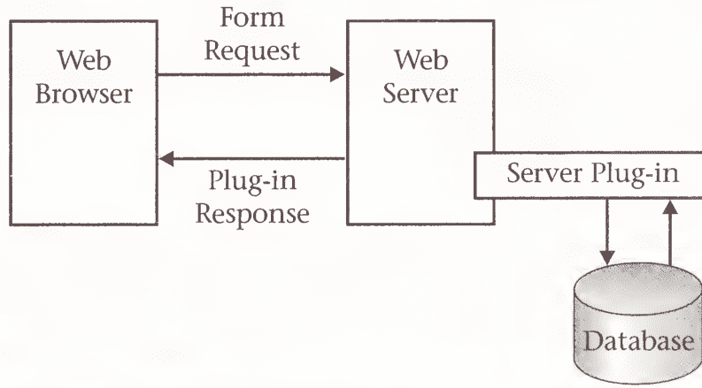

**图 1-4** Web 服务器插件架构

**Apache API** Apache 支持与请求格式类型相关的处理程序的概念。要扩展 Apache，你必须在源代码级别将处理程序编译到 Apache 中。Apache 源代码可从其网站免费下载。（参见 `http://httpd.apache.org/docs/install.html`。）

#### ASP

ASP 为将静态 HTML、可扩展标记语言 (XML)、类似 JavaScript 和 VBScript 的 Web 脚本以及微软的组件对象模型 (COM) 组件组合成单个 Web 页面提供了强大的基础。ASP 的语法与 JavaServer Pages 非常相似。它相对于 JavaServer Pages 的优势在于支持多种不同的脚本语言，以及可以嵌入到 ASP 中的大量微软 COM 组件目录。然而，ASP 有重大缺点，因为它们将开发人员限制在微软平台和一组固定的 ASP 标签中。（在模块 6 中，我们将描述如何扩展 JSP 标签。）

#### Java Servlet

Java servlet 技术提供了一种可扩展的、平台中立的 Web 服务器扩展方法。纯 Java Web 服务器或应用服务器可能会将 servlet 容器实现为主进程内的一个线程。更流行的 Web 服务器如 Apache、iPlanet 或微软的 IIS 需要基于其专有接口的不同架构。该架构包括一个指向 Web 服务器的插件，该插件将 servlet 请求重定向到实现 servlet 容器的单独 Java 进程。这种 Web 服务器插件的使用在紧耦合和松耦合之间提供了折中方案。Web 服务器插件提供了一个紧耦合的桥梁，用于在 Web 服务器和松耦合的 servlet 引擎之间传递信息。servlet 容器监听一个可配置的网络端口，该端口专用于此类重定向。图 1-5 显示了此架构。

#### JSP

JSP 通过提供一个 JSP 容器来补充 Java servlet 架构，该容器管理将 JavaServer Pages 解析和编译为 servlet 的过程。图 1-6 显示了通用的 JSP 架构。

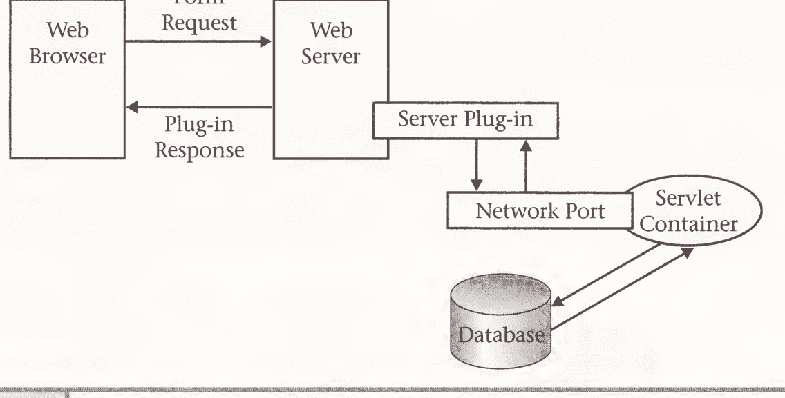

**图 1-5** IIS、iPlanet 和 Apache 的 Servlet 架构

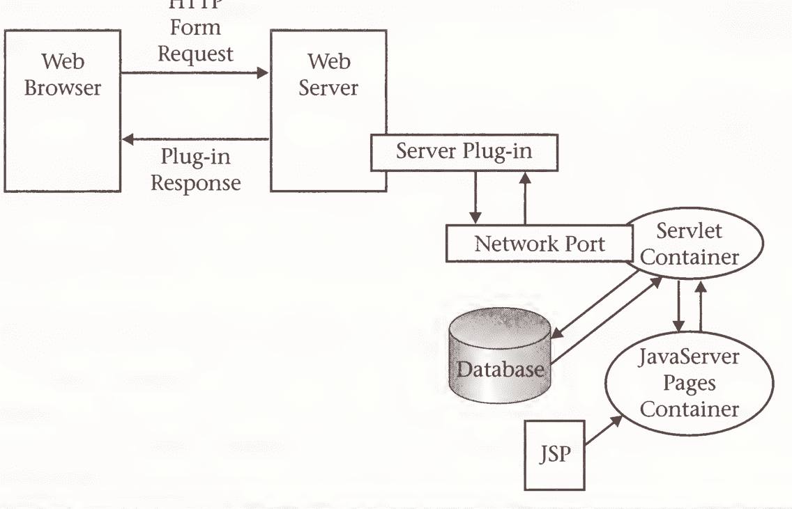

**图 1-6** JavaServer Page 架构

图 1-7 Java 2 企业版应用服务器架构

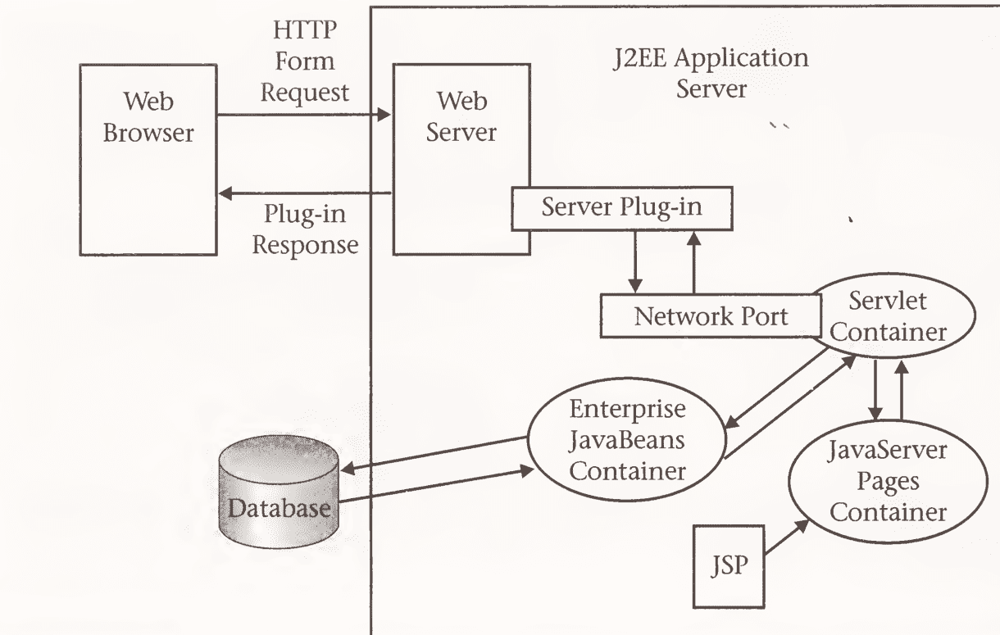

#### J2EE 应用服务器

J2EE 规范同时包含 Java servlet 和 JavaServer Pages。J2EE 应用服务器通常为 Web 服务以及其他服务（如我们在此不讨论的企业 JavaBeans 和 Java 消息服务）提供一个 Java 平台。我们在图 1-7 中展示了 J2EE 平台架构。

#### Java Servlet 和 JavaServer Pages 的作用

普通的 Web 服务器高效且有效地交付静态内容。然而，现代 Web 应用程序需要的不止是静态内容。浏览器的客户端扩展有助于满足这一需求，但并未真正解决客户端-服务器范式的特殊目的——提供远程服务。服务器端 JavaScript 很流行但属于专有技术。Web 服务器插件提供了有用但专有的扩展。此外，正如你将在本书第二部分看到的，企业应用程序需要服务器具备 Web 服务器所避免的所有功能。它们需要复杂的安全服务和会话管理。它们必须跟踪客户端状态。它们必须管理数据库访问，包括连接池。这份清单很长且无法回避。

想象一下使用 CGI 脚本或服务器插件来编程这些企业服务器功能。W3C 从未打算让 CGI 脚本提供通用服务器平台。他们的意图是为遗留数据提供网关。同样，服务器插件提供了通向外部应用程序的高效网关，但并未提供完整的服务器端开发平台。活动服务器页面 (ASP) 提供了服务器端 Web 应用程序开发的平台，但该平台仅适用于微软技术。另一方面，Servlet 和 JavaServer Pages 为非专有的、跨平台的、可扩展的和可伸缩的互联网应用程序提供了服务器端平台。

## 1 分钟速查

- 什么是服务器插件？
- 为什么 CGI 的主导地位时日无多？
- Java servlet 和 JavaServer Pages 的作用是什么？

### 项目 1-2：运行你的第一个 JSP 程序

本练习要求你在开发机器上设置一个可工作的 Web 服务器。附录 B 解释了 Apache 和 Tomcat 的安装和配置。如果你阅读并遵循了附录 B 中的说明，请跳至步骤 4。如果你尚未安装和配置 Apache 和 Tomcat，请先遵循步骤 1 至 3。

### 分步指南

**1.** 按照附录 B 中的说明安装 Tomcat servlet 容器。你也可以安装 Apache，但此项目只需要 Tomcat。

- 服务器插件使用专有的 Web 服务器编程接口扩展 Web 服务器。最常见的三种 API 是：
  - **ISAPI** 用于微软 IIS 的 API。
  - **NSAPI** 用于 iPlanet 的 API。
  - **Apache Web 服务器 API** 用于 Apache Web 服务器的 API。
- CGI 脚本浪费服务器资源并使响应页面的生成复杂化。最近的技术如活动服务器页面 (ASP)、Java servlet 和 JavaServer Pages 提供了更高效、更简单的方式来开发复杂的 Web 应用程序。
- 这些 Java 技术为服务器端 Web 应用程序开发提供了一个通用平台，该平台是非专有的、跨平台的、可扩展的和可伸缩的。


## 模块 2

### JSP 元素：注释和指令

## 本模块目标

-   理解 JavaServer Pages (JSP) 容器
-   了解如何在编写 JavaServer Pages 时使用注释
-   了解基本的 JSP 指令

JSP 页面看起来像是带有特殊语法元素的超文本传输协议 (HTML) 页面。这些元素有助于提供当今 Web 页面所需的动态行为。在本模块和接下来的四个模块中，我们将解释 JSP 元素。

JSP 的生命周期与静态 HTML 文档不同。在 Web 服务器与 Web 浏览器之间的简单交互中，Web 服务器获取 Web 浏览器请求的文件并将其流式传输回浏览器。然后浏览器在其视图面板中呈现此流。如果请求的文件恰好是静态 HTML，Web 服务器只需将文件内容流式传输给 Web 浏览器。然而，如果请求的文件是 JSP 页面，Web 服务器不能简单地流式传输其内容，因为 Web 浏览器无法呈现 JSP 语法元素。Web 服务器必须首先 *解释* JSP 页面以生成额外的动态 HTML 内容，然后将解释后的文档流式传输回浏览器。JSP 规范将管理 JavaServer Pages 流式传输的服务端 Web 过程称为 JSP *容器*。

## JSP 容器

Java 2 企业版 (J2EE) 定义了几种容器，包括 JSP 容器、Servlet 容器和企业 JavaBeans 容器。用面向对象的术语来说，容器是组织其他类或组件的类或组件。J2EE 规范超越了这种简单的含义。J2EE 容器提供企业组件生存和活动的完整运行时环境。它们管理组件的生命周期，并为组件提供各种服务。此外，它们协调组件与更大的运行时环境之间的交互。

除非开发人员编写符合容器规定的编程约定的软件组件，否则 J2EE 容器无法正常工作。开发人员必须实现这些约定，因为容器在组件生命周期的不同阶段会假定这些约定。规范通常将容器与应用程序软件之间的这种协议称为 *契约*，以强调其重要性。容器通过要求应用程序软件实现特定的 Java 接口来强制执行此类契约。

每个 J2EE 容器为其负责的组件提供服务。JSP 容器将 JavaServer Pages 转换为 Java servlet 代码，然后编译并将结果加载到 Servlet 容器中。它还协调 Servlet 容器与编译后的 JavaServer Pages 之间的关系。Servlet 容器为 Java servlet 提供运行时环境。

## JSP 阶段

当浏览器第一次请求 JSP 页面时，会发生以下情况：

1.  它解释 JSP 页面。
2.  它生成一个 Java servlet。
3.  它使用 JSP 容器打包的标准 Java 编译器将生成的 servlet 编译为 Java 字节码。
4.  它将 servlet 加载到 Servlet 容器的 Java 虚拟机 (JVM) 中。
5.  它调用生成的 servlet 的 service 方法。

图 2-1 展示了其工作原理。
如果浏览器应用程序随后请求相同的 JSP 页面，除非该 JSP 页面自上次调用以来发生了更改，否则 JSP 容器只需执行步骤 5。当 JSP 页面更改时，JSP 容器必须在流式传回响应之前重新执行所有五个步骤。步骤 1 到 4 解释了为什么 JavaServer Pages 在浏览器第一次请求时返回响应会稍慢一些。

> **提示**
> 你可以通过在部署前预编译应用程序 JavaServer Pages，或者使用 JSP 1.1 规范第 3.4 节中指定的预编译协议来克服这首次编译的成本。Apache 提供了 `jspc` 程序来预编译你的应用程序，Tomcat 支持预编译协议。你可以通过在 JSP 请求后附加 `?jsp_precompile=true` 来使用此协议，如下所示：
> `http://localhost:8080/Book/jsp/ScriptingElements.jsp?jsp_precompile=true`。这将导致 JSP 容器编译页面而不执行它。

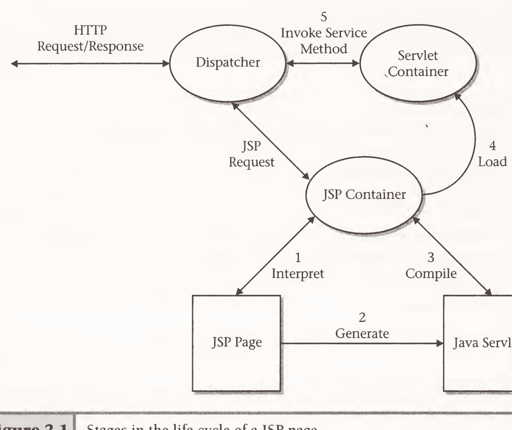

# 图 2-1 JSP 页面生命周期的各个阶段

## JSP 作用域

JSP 页面的诞生始于一个请求，但它所创建的一些 Java 对象的生命周期跨越多个请求。有时 JSP 容器会隐式创建这些对象（在模块 4 中描述）。你也可以使用 JSP 动作（在模块 5 和 6 中描述）创建 Java 对象。最后，你可以在 JSP 脚本中直接创建此类对象（在模块 3 中描述）。所有此类对象都有一个 *作用域* 属性，定义了对该对象的引用在 *哪里* 可用以及容器在 *何时* 移除该对象。

JSP 容器支持四种不同的作用域：

-   **page** 你只能在创建它们的 JSP 页面内引用具有 *页面* 作用域的对象。JSP 容器在 JSP 页面返回响应或将请求转发到另一个页面后会移除所有此类对象。
-   **request** 你可以从处理同一请求的任何页面访问具有 *请求* 作用域的对象。通常，一个页面可能会将请求转发到另一个页面，以便多个页面处理同一请求。所有这些页面都可以访问请求作用域中的对象。请求完成后，容器会移除此类对象。
-   **session** 你可以从与创建对象的页面共享会话的任何页面访问具有 *会话* 作用域的对象。当关联的会话结束时，容器会移除此类对象。
-   **application** 你可以在同一 Web 应用程序中的任何地方访问具有 *应用* 作用域的对象。当 JSP 容器重新加载 Servlet 上下文时（通常在服务器重启时），会移除具有应用作用域的对象。

> ### 注意
> Web 应用程序将 servlet、JavaServer Pages 和其他资源打包成一个包，你可以将其部署并在来自多个供应商的多个容器上运行。Web 应用程序直接映射到为应用程序提供隔离环境的 Servlet 上下文。Java 接口 *javax.servlet.ServletContext* 描述了此上下文中的服务。例如，你可能在 Web 服务器中将此 URL 根目录与应用程序上下文相关联：`http://localhost/Book`。Servlet 容器创建一个与此上下文关联的单一 *ServletContext* 对象。任何以 `"/Book"`（*上下文路径*）开头的 URL 引用的 JSP 页面都可以访问此 *ServletContext* 对象。


### 1 分钟练习

-   什么是 JSP 容器？
-   JSP 页面首次加载时的各个阶段是什么？
-   JSP 页面中对象的作用域有哪些？

-   JSP 容器是一个将 JavaServer Pages 转换为 Java servlet 代码，然后编译并将生成的 Java 字节码加载到 Servlet 容器中的进程。
-   各个阶段是：（1）解释 JSP 页面，（2）生成 servlet，（3）编译 servlet，（4）将 servlet 加载到 Servlet 容器中，以及（5）调用 servlet 的 *service* 方法。
-   作用域是页面、请求、会话和应用。

## 掌握检查

1.  HTTP 代表 _________________________________________________。
2.  列出三个使网络透明性难以实现的计算机网络特征。
    __________________________________________________________________
    __________________________________________________________________
3.  列出两种类型的 HTTP 请求。
    __________________________________________________________________
    __________________________________________________________________
4.  解释为什么标准的 Web 浏览器–Web 服务器架构无法为许多现代 Web 应用程序提供足够的基础。
    __________________________________________________________________
    __________________________________________________________________
5.  列出三种类型的 Web 浏览器扩展。
    __________________________________________________________________
    __________________________________________________________________
6.  列出三种类型的 Web 服务器扩展。
    __________________________________________________________________
    __________________________________________________________________

2.  转到 %TOMCAT\_HOME% 下的 bin 目录。（你已在步骤 1 中创建了此变量。）

3.  在命令提示符下，输入

    ```
    %> startup
    ```

    这将启动 Tomcat Servlet 容器。要关闭 Tomcat Servlet 容器，请输入

    ```
    %> shutdown
    ```

4.  启动一个浏览器（Internet Explorer 或 Netscape Navigator），因为 Tomcat 默认在端口 8080 上运行，请在浏览器窗口的相应字段中输入此 URL：

    ```
    http://localhost:8080
    ```

    你应该会看到 Tomcat 欢迎页面。

5.  找到标题为 *JSP Examples* 的超链接并点击它。这将带你到一个显示你可以执行的 JSP 示例列表的 Web 页面。

6.  选择任何示例的 *Execute* 超链接。JSP 示例应正确执行。例如，如果你选择运行 *Numberguess*，你应该会看到一个要求你输入 1 到 100 之间数字的页面。如果你看到这个页面，说明你已正确安装和配置了 Tomcat Servlet 容器。

7.  选择任何示例的 *Source* 超链接。你应该会看到用于创建 JSP 页面的实际代码。

8.  恭喜！你已经迈出了进入 JavaServer Pages 世界的重要第一步！你必须使 JSP 配置正常工作，以便能够构建和执行本书中描述的项目。通过练习示例 JavaServer Pages，你可以确保基本的 Tomcat 安装正常工作，并很好地了解 JSP 页面如何映射到 HTML 响应页面。


## JSP 构造

一张将所有 JSP 构造按类别组织的图表可以帮助您定位。图 2-2 展示了所有 JSP 构造的组织结构图。我们将在接下来的几个模块中解释这些构造。您可以使用此图表来跟踪您在各模块中的学习进度。

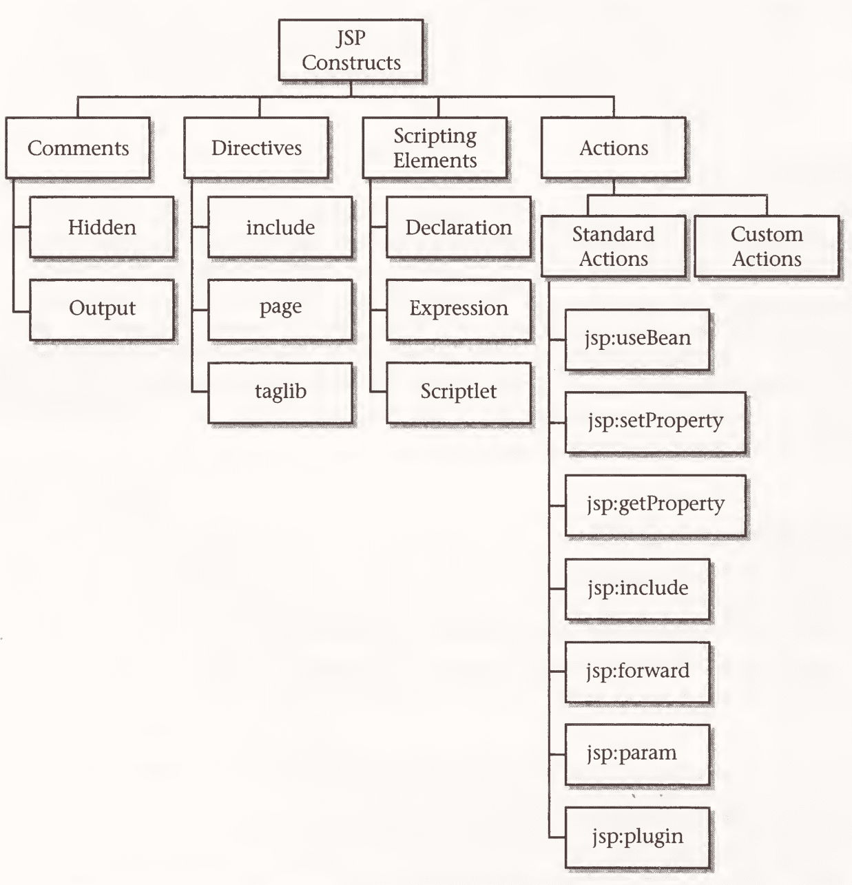

图 2-2 所有 JSP 构造的组织结构图

## 完整 JSP 页面的鸟瞰图

您听说过盲人摸象的故事吗？这个古老的印度寓言描述了六个盲人各自解读他们对大象的体验。一个人摸到尾巴，说大象是一根绳子。另一个人摸到象牙，说大象是一支长矛。第三个人摸到鼻子，说大象是一条蛇。其他三个人也做出了类似的错误解读。这个故事说明了有限的感知如何导致错误的理解。为了避免对 JavaServer Pages 的错误理解，我们提供了一个包含大多数元素的完整示例 JSP 页面的鸟瞰图。在我们逐步讲解不同模块的过程中，请参考此图：

```
<%@ page language="java" import="eCommerce.inventory.*" %>
<HTML>
<!--
包含所有 JSP 元素的示例 JSP 页面。
-->
<HEAD><TITLE>
JSP 分类法
</TITLE></HEAD>
<BODY>
<%@ taglib uri="http://i18n.taglib/i18n-taglib" prefix="i18n" %>
<%--
包含一个标准头部。
--%>
<%@ include file="header.html" %>
<jsp:useBean id="customer" class="eCommerce.inventory.Customer" scope="session" />
<jsp:setProperty name="customer" property="*" />

<i18n:string> 欢迎 </i18n:string>
<%= customer.getName() %>
<%!
private static final BASKET = "basket";
%>
<%--
检索产品目录和
当前客户的购物篮。
--%>
<%
request.setAttribute("Customer", customer);
String productLine = request.getParameter("Product Line");
Product[] catalogue = Inventory.getCatalogue(productLine);
Basket basket = (Basket)session.getAttribute(BASKET);
if(basket.full()) {
%>
<jsp:forward page="thank_you_for_shopping.jsp" />
<% } %>
<jsp:include page="footer.jsp" flush="true" />
</BODY>
</HTML>
```

## JSP 注释

每种编程语言，无论是 C/C++、Java、Visual Basic 还是 JavaServer Pages，都必须支持注释。文档或程序中的注释用于阐明该文档或程序的内容。注释不会给程序增加处理开销，因为编译器和解释器会忽略它们。

### 使用注释

虽然注释通常能阐明程序，但您应该谨慎使用。最有用的注释提供以下两方面的自然语言解释：

- 代码块的概要行为
- 代码块的目的和程序员的意图

注释应总结主要代码块的行为。通常，在 C++ 和 Java 等面向对象编程语言中，这意味着为每个类和每个方法提供文档块。这也意味着为方法内的主要代码块提供注释。同样的原则也适用于 HTML 和 JavaServer Pages 等脚本语言。为您 HTML 或 JSP 页面的主要部分添加注释，以解释这些代码块的行为。

您还应该注释代码的总体目的以及您作为程序员的意图。这类注释与描述代码行为的注释有微妙的不同。注释代码行为回答的是 *如何* 的问题。注释代码目的和程序员意图回答的是 *为何* 的问题。一个 *为何* 注释应该让其他程序员对代码中的内容及其相对重要性有所准备。例如，这是一个好的 *为何* 注释：

```
/* 创建一个包含所有用户的目录 */
```

这是一个不好的 *为何* 注释：

```
/* 遍历用户数组并将每个
   用户条目添加到查找表中
*/
```

第一个注释是 *好的*，因为它提供了代码存在的原因。第二个注释是 *坏的*，因为它陈述了代码如何工作——而这部分代码本身已经描述了。

有些程序员出于总结代码行为和程序员意图之外的目的使用注释。以下是其他常见注释用途的可疑列表：

- 程序员可能使用注释用代码本身以外的文字陈述代码的功能。
- 有时程序员使用注释来解释复杂或巧妙的代码。
- 偶尔，程序员会对单行代码进行注释，作为其算法的自然语言表达。

这种注释用法列表值得商榷。让我们逐一讨论此列表中的每个要点。

您绝不应在注释中重复代码所述的内容。如果这种注释看起来有用，那可能是代码本身缺乏清晰度（例如，变量命名不当、格式混乱或过度工程化的解决方案）。这种用法实际上可能会掩盖程序，并增加注释与代码不同步的风险。通常，程序员维护代码比维护注释更好。从某种意义上说，这就像用法语来注释英语文本。法语文本不太可能阐明英语文本，甚至可能使其模糊不清。

注释巧妙的代码稍微有些意义。当您必须使用巧妙的代码时，您应该注释其原因。例如，“现实世界”的优化有时需要利用您原本会避免的特性或技术。您应该注释这些优化，以免其他程序员可能无意中删除它们，或许是以 *优雅* 编程的名义。这样的注释确实有助于解释程序员的意图。然而，您应该意识到，好的巧妙代码理由很少见，甚至可能是危险的。臭名昭著的 Y2K 问题就是一个空间优化的例子，它解决了现有技术的临时限制，最终让计算机行业花费数十亿美元来修正。

您不应该通过对单行代码进行注释来记录您的算法。您应该将所有此类注释集中到整个代码块开头的摘要注释中。这些摘要注释应侧重于算法的原因，而不是代码中的实现。此类注释比分散在代码中的注释集合更清晰、更容易找到。另一方面，您应该注释数据声明，因为此类注释提供了有关数据在代码中作用的有用信息。

无论使用何种编程语言，以下是一些指定注释的常识性规则：

- 注释应侧重于意图和目的——*为何*，而非 *如何*。
- 注释应总结并介绍代码，而不是复述代码。
- 注释应阐明代码，而非与代码竞争。代码本身就是程序、脚本或 JSP 页面的最佳文档。
- 注释绝不应陈述显而易见的内容。
- 谨慎编写注释。不准确或误导性的注释从来无益。
- 注释时力求一致。保持注释的位置、格式和内容一致。

牢记这些经验法则，让我们看看如何在 JSP 页面中指定注释。

## JSP 注释类型

在讨论 JSP 生命周期时，您看到 JavaServer Pages 涉及两个文档：JSP 页面和它生成的 HTML。相应地，JSP 支持两种类型的注释：

- 用于记录源 JSP 页面的注释
- 预期输出到生成的 HTML 文档中的注释

### 记录源 JSP 页面的注释

有些注释用于记录源 JSP 页面。规范称这些注释为 *隐藏注释*，因为浏览器客户端无法在生成的文档中查看它们。JSP 容器在生成发送给浏览器的 HTML 时会剥离此类注释。隐藏注释具有以下形式：

```
<%-- 除了关闭标签 --%> ... <!--%>
```

也就是说，您可以在隐藏注释中放置任何内容，但不能放置隐藏注释的关闭标签。

隐藏注释通常应该解释 JSP 页面的行为，而不是生成的 HTML。以下是我们在鸟瞰图示例中的一个良好的隐藏注释示例：

```
<%--
    检索产品目录和
    当前客户的购物篮。
--%>
```

### 预期输出到生成文档中的注释

正如您应该注释 JavaServer Pages 一样，您也应该注释生成的 HTML。JSP 规范称那些旨在在生成的文档中显示的注释为 *输出注释*。输出注释具有以下形式：

```
<!-- 注释 -->
```

您可能注意到 JSP 输出注释与可扩展标记语言（XML）和 HTML 文档中的注释格式相同。与 JSP 容器会忽略的隐藏注释不同，JSP 容器将输出注释视为包含在生成文档中的静态文本。与 HTML 或 XML 注释不同，JSP 容器会解释输出注释中的 JSP 表达式（将在模块 3 中更详细地描述）。这意味着 JavaServer Pages 生成动态 Web 内容的能力甚至延伸到了输出注释的内容。例如，考虑这行注释：

```
<!-- 此页面创建于 <%= new java.util.Date() %> -->
```

此注释通过执行 <%= 标签和 %> 标签之间的 Java 代码生成以下 HTML 行：

```
<!-- 此页面创建于 Sat Dec 02 17:51:34 EST 2000 -->
```


注意
输出注释之所以存在，是因为浏览器允许你查看网页的源代码。这种代码共享很常见，但期望网页开发者为了这种共享而去注释生成的页面，似乎有些牵强。在决定使用多少输出注释时，你应遵循自己的直觉和利他主义倾向。

### 一分钟演练

- *why*（为什么）注释和 *how*（如何）注释有什么区别？你应该更常用哪种？
- JSP 注释有哪两种类型？你会在何时使用它们？

## JSP 指令

JSP 页面可以向其容器发送消息，指示容器代其执行操作。规范将此类消息称为 *指令*。JSP 1.1 指令使用以下通用格式：

```
<%@ directive { attr="value" }* %>
```

即，指令以 `<%@` 标签开始；指定一个指令名称；包含零个或多个属性，每个属性都以名称-值对的形式指定；并以 `%>` 标签结束。JSP 页面中的指令不会在生成的文档中产生任何输出。它们要求 JSP 容器为 JSP 页面执行某些服务。JSP 1.1 规范支持三种类型的指令：

- include
- page
- taglib

让我们逐一查看每种指令。

### include 指令

程序员将复杂问题分解成更小的部分，以简化必须解决的问题。软件应用程序是人们解决的最复杂的问题之一，因此所有现代软件技术，包括 JavaServer Pages，都支持将软件划分为更小的部分或模块。软件模块提供了几个优势：

- 解决更简单的问题有助于产生更清晰的解决方案。
- 你可以独立创建和测试每个模块。
- 由于大问题往往分解为类似的小问题，模块化提高了软件的重用性。

JSP 容器通过两种包含机制支持模块化开发：

- include 指令
- include 动作

我们在此解释 include 指令，并在模块 5 中讨论 include 动作。
include 指令指示 JSP 容器在指令出现的位置包含一个指定的资源。资源可以是任何静态页面或另一个 JSP 页面。如果你包含一个文件，通常是一个 HTML 或 JSP 页面片段，JSP 容器会用该文件的字节替换指令。你使用相对 URL 指定检索资源的位置（参见 RFC 2396，http://www.ietf.org/rfc/rfc2396.txt）。

#### 相对 URL

回顾模块 1，HTTP URL 的一般形式是：
`http://origin-server[:port]/[path[?query]]`

相对 URL 规范将其简化为以下形式之一：

- 网络路径 `//origin-server[:port]/[path[?query]]`
- 绝对路径 `/path[?query]]`
- 相对路径 `path[?query]]`

以下是一些示例：

- 网络路径 `//localhost:8080/examples/jsp/num/numguess.jsp`
- 绝对路径 `/examples/jsp/num/numguess.jsp`
- 相对路径 `examples/jsp/num/numguess.jsp`

尽管相对 URL 规范描述了这三种形式，但 JSP 规范仅支持后两种形式。JSP 规范将绝对路径形式的 URL（以斜杠 [/] 开头的形式）称为 *上下文相对路径*。它将相对路径形式（没有开头的 /）称为 *页面相对路径*。

JSP 容器通过将你提供的相对 URL 与 *ServletContext* 对象（由 Web 服务器提供给 servlet 容器）提供的基础 URL 拼接来解释 *上下文相对路径*：

*上下文 URL + 相对 URL*

JSP 容器通过将你提供的相对 URL 与由当前 JSP 页面的 URL 减去页面名称组成的基础 URL 拼接来解释页面相对路径：

*JSP 页面 URL - JSP 页面名称 + 相对 URL*

例如，我们可能像这样声明一个 Tomcat Web 服务器上下文：

```
<Context path="/examples"
    docBase="webapps/examples"
/></Context>
```

这些行声明 /examples 上下文的基础 URL 是以下内容：

```
%TOMCAT_HOME%/webapps/examples
```

然后 JSP 容器将这样的上下文相对路径：

```
/jsp/num/numguess.jsp
```

转换为：

```
%TOMCAT_HOME%/webapps/examples/jsp/num/numguess.jsp
```

或者，如果我们在 numguess.jsp 中包含这样的页面相对路径：

```
hello.html
```

JSP 容器会将该路径转换为：

```
%TOMCAT_HOME%/webapps/examples/jsp/num/hello.html
```

#### 使用 include 指令

include 指令采用以下通用形式：

```
<%@ include file="相对 URL" %>
```

例如，假设以下 include 指令出现在名为 Inventory.jsp 的 JSP 页面中：

```
<%@ include file="header.html" %>
```

在翻译时，当 JSP 容器第一次引用 Inventory.jsp 时，容器会用 header.html 的 HTML 内容替换 include 指令。在这方面，它的行为与 jsp:include 动作非常不同，后者在请求时包含页面。

被包含的资源可以是另一个 JSP 页面。在这种情况下，JSP 容器会在将组合的 JSP 页面翻译为单个 Java servlet 之前，将被包含的 JSP 页面插入到父 JSP 页面中。这是一个包含第二个 JSP 页面的 JSP 页面示例：

```
<html>
<head><title>Parent</title></head>
<body>
My favorite cousins are: <br>
<%@ include file="Children.jsp" %>
</body>
</html>
```

被包含的文件 `Children.jsp` 如下所示：

```
Sarah whose age as of <%= new java.util.Date() %> is 12. <br>
Jenny whose age as of <%= new java.util.Date() %> is 9. <br>
Sam whose age as of <%= new java.util.Date() %> is 5.
```

包含后和翻译前，新的 `Parent.jsp` 如下所示：

```
<html>
<head><title>Parent</title></head>
<body>
My favorite cousins are: <br>
Sarah whose age as of <%= new java.util.Date() %> is 12. <br>
Jenny whose age as of <%= new java.util.Date() %> is 9. <br>
Sam whose age as of <%= new java.util.Date() %> is 5.
</body>
</html>
```

组合后的 `Parent.jsp` 的输出将类似于：

```
My favorite cousins are:
Sarah whose age as of Sat Dec 02 19:18:53 EST 2000 is 12.
Jenny whose age as of Sat Dec 02 19:18:53 EST 2000 is 9.
Sam whose age as of Sat Dec 02 19:18:53 EST 2000 is 5.
```

#### include 指令的局限性

include 指令通过使你能够将 JSP 页面拆分为多个部分来帮助你开发模块化的 JavaServer Pages，每个部分都可能被另一个 JSP 页面重用。这种模块化可以支持页面元素（如页眉和页脚）的标准化。通过将页眉和页脚从主 JSP 页面中分离出来，多个 JavaServer Pages 可以包含它们，从而建立标准的外观和感觉，并减少每个单独页面的大小。然而，这种模块化是有限的。让我们看看 include 指令的一些局限性。

**容器不会重新加载被包含的页面。** JSP 开发者通常在开发最终 JSP 页面的过程中会经历多个版本。JSP 1.1 规范定义了一种机制，当你修改 JSP 容器已加载的 JSP 页面时，会通知容器。这使容器能够自动重新编译和重新加载修改后的页面。不幸的是，这种通知机制对被包含的文件不起作用。在我们之前的例子中，如果我们修改被包含的文件 `Children.jsp`，容器在我们重新启动 servlet 容器并删除生成的 servlet 之前，不会重新加载我们修改后的 JSP 页面。

**使用 include 指令只能加载静态文件。** 静态包含几乎算不上模块化，因为它们只显示了最低程度的 *内聚性*——即模块内容相互关联的程度。静态包含的内容只有在可以将其加载到多个 JSP 页面中时才具有内聚性。例如，一组页面的页眉或页脚包含了一系列本质上不相关的 HTML 行。它们的内聚性仅仅在于多个 HTML 页面共享这些相同的行。

**include 指令在翻译时将被包含的内容绑定到页面。** 通常，软件架构中的这种早期绑定限制了灵活性。在灵活性的一端，开发者在编写代码时可能会 *硬编码* 绑定为字面值，例如通过插入页面页眉和页脚的 HTML，而不是使用 include 指令。在光谱的另一端，开发者可能在运行时通过查询数据源将内容绑定到页面。静态包含介于这两者之间，但更接近硬编码的一端。JSP 容器通过允许你将翻译推迟到请求时来帮助克服这种不灵活性。这在第一次请求页面（在翻译之前）时会导致明显的性能停顿。

**include 指令可能导致难以理解的 JavaServer Pages。** 当你过度使用包含文件或包含文件包含 Java 或 JavaScript 代码时，JavaServer Pages 会变得混乱。如果你使用此类片段，必须小心保持这些代码片段尽可能自包含和内聚。你可能会错误地将任何页面的任何部分拆分为单独的、不相连的片段，当包含时，可以生成合法的 JSP 页面。你应该避免包含 Java 或 JavaScript 代码片段，因为你可以使用 JSP 动作或自定义标签库更好地包含代码。


# 一分钟速查

- 在一个相对 URL 中，*绝对路径* 和 *相对路径* 的语法是什么？
- 定义 *上下文相对* 路径和 *页面相对* 路径。
- 使用 include 指令存在哪些问题？

### 项目 2-1：include 指令测试

在 include 指令中使用相对 URL 通常很棘手。本项目演示了如何使用相对 URL 来标识一个 JSP 资源。

### 分步指南

1.  确保你已经按照附录 B 中的说明安装了 Tomcat。
2.  在你的 Tomcat 安装目录下创建一个新的上下文，命名为 **Book**。
3.  在 `%TOMCAT_HOME%/webapps` **下创建一个名为** **Book** 的子目录。
4.  编辑文件 `%TOMCATE_HOME%/conf/server.xml`，并找到由 `<ContextManager>` 和 `</ContextManager>` 标签标识的 `ContextManager` 元素。在这些标签之间**插入一个新的** `<Context>`**元素**。你的那行代码应如下所示：

```
<Context path="/Book"
         docBase="webapps/Book" >
</Context>
```

这一行代码声明了你的上下文拥有一个虚拟路径 `/Book`，它映射到真实路径 `%TOMCAT_HOME%/webapps/Book`。

> **注意**
> 对于部署在 `%TOMCAT_HOME%/webapps` **目录**中的应用，将上下文元素添加到 `server.xml` 是可选的，但这仍然是一个好习惯。

5.  启动（或重启）Tomcat servlet 容器。（Tomcat 需要此步骤来刷新其上下文。）
6.  在 `%TOMCAT_HOME%/webapps/Book` 下创建两个名为 `jsp` 和 `html` 的子目录。
7.  将以下文本复制到名为 `includeTest.jsp` 的文件中，该文件位于 `%TOMCAT_HOME%/webapps/Book/jsp` 下：

```
<HTML>
<HEAD><TITLE> Include Test </TITLE></HEAD>
<BODY>
I should see this <br>
<%@ include file="/html/insert.html" %>
<br><br>
If I don't, then the URL is not working...
</BODY>
</HTML>
```

8.  将以下文本复制到名为 `insert.html` 的文件中，并将其保存在 `%TOMCAT_HOME%/webapps/Book/html` 下：

```
right below the line that reads: "I should see this"
```

9.  启动 Web 浏览器并输入以下 URL：
    `http://localhost:8080/Book/jsp/includeTest.jsp`。
10. 你应该在浏览器中看到以下内容：

```
I should see this
right below the line that reads: "I should see this"

If I don't, then the URL is not working...
```

这里我们演示了什么？在父 JSP `includeTest.jsp` 中，我们指定了一个包含相对 URL `/html/insert.html` 的 include 指令。因为该 URL 以斜杠 (/) 字符开头，JSP 容器将其视为上下文相对路径。因为我们的上下文的文档根是 `%TOMCAT_HOME%/webapps/Book`，容器会在文档根的 `html` 子目录下查找 `insert.html`。

以下是为勤奋的读者准备的一些额外练习。

- **练习 1** 在不移动被包含文件 `insert.html` 的情况下，编辑 `includeTest.jsp`，并将 include 指令中的 URL 修改为页面相对路径（即，不以 / 字符开头）。你应该重新加载你的 JSP 页面，并且在定位被包含文件时不应有任何问题。
- **练习 2** 修改文件 `insert.html` 中的 "I should see this" 行，将其改为：

```
<H2> right below the line that reads: "I should see this" </H2>
```

即，使用 HTML 元素 H2 将其内容括起来。现在重新加载文件 `includeTest.jsp`。你可能期望看到被包含文件的内容以更大、加粗的字体显示，但你将不会看到。为什么你的更改没有生效？你如何才能让它生效？

### page 指令

正如你所料，page 指令为 JSP 页面提供属性。在 `page` 指令中定义的属性适用于该 JSP 页面及其所有包含的静态文件，无论这些文件是通过 include 指令还是 jsp:include 动作被包含的。JSP 规范将 JSP 页面源文件及其包含的文件称为一个 *翻译单元*。

Page 指令遵循以下通用格式：

```
<%@ page [ attribute="value" ]* %>
```

如语法所示，page 指令包含零个或多个属性-值对。规范中明确定义了属性名称及其各自的行为。以下是一个示例：

```
<%@ page import="java.util.*, com.myclasses.*", buffer="15kb" %>
```

这个 page 指令表明这个 JSP 页面文件从两个 Java 包 `java.util` 和 `com.myclasses` 导入类。它指示应使用 15KB 的缓冲区来处理此 JSP 页面文件的输出。

你可以在一个 JSP 翻译单元中插入任意数量的 page 指令，即使它只是一个 JSP 页面文件。这些指令可以出现在翻译单元中任何文件的任何位置。

> **提示**
> 一个好的编程惯例是在 JSP 页面文件的最开始指定一个 page 指令。这有助于阅读你代码的人找到适用于该页面的所有属性。

#### page 指令的属性

表 2-1 提供了你可以在 page 指令中配置的属性列表。我们将在接下来的几节中简要描述每个属性。

**language** language 属性指定页面使用的脚本语言。JSP 1.1 仅支持默认语言 Java，因此你无需指定此属性。然而，你应该指定它，因为你的 JSP 容器供应商可能支持其他语言（也许是 JavaScript）。规范暗示 JSP 将在后续版本中支持其他脚本语言。如果你设置 language 属性，请按如下方式设置：

```
<%@ page language="java" %>
```

**extends** extends 属性指定生成的 servlet 的父类。通常，JSP 容器从一个默认类扩展生成的 servlet。高级 JSP 开发人员可以使用此属性为其 JavaServer Pages 创建自定义父类。此类父类必须实现 Java 接口 *HttpJspPage*。这里有一个例子：

```
<%@ page extends="myPackage.ExampleHttpSuper" %>
```

| 属性 | 可能的值 |
| :--- | :--- |
| language | java |
| extends | 完全限定类名 |
| import | 导入列表 |
| session | true 或 false |
| buffer | none 或 sizekb |
| autoFlush | true 或 false |
| isThreadSafe | true 或 false |
| info | 信息文本 |
| errorPage | 错误页面的 URL |
| isErrorPage | true 或 false |
| contentType | 内容类型信息 |

表 2-1 page 指令属性

#### 问专家

**问题：** 何时需要为 JSP 页面创建自定义父类？

**回答：** 你的 Web 应用程序可能需要为一整组 JavaServer Pages 提供某些方法或变量。例如，你可能创建了一个 Web 应用程序，其中一组 JavaServer Pages 必须绘制相同的用户界面元素。你可以编写一个自定义 Java 类，提供一组实用函数，如 *drawTable*、*drawComboBox*、*drawMenu* 和 *drawButton*。然后，你可以使用 extends 属性从这个绘图类派生你的生成的 JavaServer Pages。通过从这个自定义 Java 类扩展你的 JavaServer Pages，你使得这些函数在 JavaServer Pages 中的任何 Java 代码都可用。

**问题：** 如何编写这样一个类，以便 servlet 容器和 JSP 容器可以使用它？

**回答：** 当我们解释 JSP 生命周期时，我们提到 JSP 页面在客户端第一次请求该 JSP 页面时由 JSP 容器转换为 servlet。JSP 规范将生成的类称为 *JSP 页面实现类*。规范定义了这个生成的类必须实现的两个 Java 接口或契约：*javax.servlet.Servlet* 和 *javax.servlet.jsp.HttpJspPage*。（更准确地说，生成的类只需要实现 *HttpJspPage* 接口，因为 *HttpJspPage* 扩展了 *JspPage* 接口，而 *JspPage* 接口又扩展了 *Servlet* 接口。）通常，容器提供商会提供一个满足此契约的父类，而页面实现类只需扩展它。你可以提供自己的父类，并使用 extends 属性来加载它，而不是容器提供商提供的父类。

**问题：** 为什么称这些接口为*契约*？

**回答：** JSP 容器和实现 JSP 页面的 Java 类必须使用某种方法调用协议进行通信。如果 Java 类未能实现这些方法，JSP 容器就无法调用它们，因此无法提供容器服务。Java 类通过实现以下接口来保证它支持该协议。


#### 接口中的方法。从这个意义上说，接口充当JSP容器和生成的servlet之间的契约。

**问：** 是否应该避免为你的JavaServer Pages提供此类自定义父类？

**答：** 有几个理由反对为你从JavaServer Pages生成的Java servlet编写自定义父类。首先，规范将责任放在了该自定义类的开发者身上，要求其符合契约。JSP容器无需检查其一致性。其次，JSP容器在从JSP页面生成servlet时，可以做出某些决定以提高性能。如果你强制它从你的自定义类继承，则限制了它做出此类决定的能力。第三，你可以使用自定义操作更轻松、更明确地创建自定义行为。（我们将在模块6中描述这一点。）

**import** import属性允许你指定一个Java导入声明——即一个逗号分隔的完全限定Java类型名或Java包名列表，后跟.*字符序列。如果你在JSP翻译单元中插入多个page指令，*import是你可以多次指定的唯一属性*。你必须指定任何你打算使用且不属于默认导入包集的Java类。默认导入的Java类集包括`java.lang.*`、`javax.servlet.*`、`javax.servlet.jsp.*`和`javax.servlet.http.*`。下面是一个示例：

```
<%@ page import="java.util.Date,
               java.text.SimpleDateFormat,
               com.myclasses.*" %>
```

**session** session属性提供了指定你的JSP页面是否参与HTTP会话的方法。如果你的JSP页面使用`HttpSession`对象，你应该将此属性设置为其默认值`true`，以便容器提供隐式变量`session`。否则，你应该将其设置为`false`。此示例说明了session属性的设置：

```
<%@ page session="false" %>
```

> **提示**
正如我们在模块1中所述，HTTP是无状态的。这意味着该协议在连续的客户端请求之间不携带任何客户端状态。尽管如此，servlet和JavaServer Pages提供了其他机制来在多个请求之间保存客户端的状态。我们称这种客户端状态的保存为*会话*。Java servlet提供一个*HttpSession*对象来存储和检索会话信息。如果你不在JSP页面中使用*HttpSession*对象，请将会话属性设置为`false`，因为会话对象很大，会消耗内存资源。

**buffer** buffer属性为由隐式JSP变量*out*引用的*JspWriter*对象设置缓冲模型和缓冲区大小。

> **注意**
正如我们在模块4中讨论的，JSP容器创建了几个隐式对象并提供给JSP开发者。*JspWriter*对象和*HttpSession*对象只是这些隐式对象中的两个。

当你将缓冲区值指定为`none`时，生成的servlet不进行任何缓冲，并将写入*out*变量的输出直接传递给*ServletResponse*对象提供的*PrintWriter*对象。当你设置缓冲区大小时，*JspWriter*提供字符缓冲，这可以提高性能。与*PrintWriter*对象不同，*JspWriter*会抛出*IOExceptions*。默认缓冲区大小为8KB。下面是一个示例：

```
<%@ page buffer="12kb" %>
```

**autoFlush** autoFlush属性决定了使用缓冲时*JspWriter*对象的行为。值为`true`会导致容器在缓冲区满时自动刷新它。值为`false`会导致抛出*IOException*。当你将buffer属性设置为`none`时，不能将值设置为`false`。通常，你在同一个page指令中设置buffer和autoFlush属性，如下所示：

```
<%@ page buffer="12kb" autoFlush="true" %>
```

**isThreadSafe** isThreadSafe属性指示JSP页面是否可重入。可重入代码必须保证同步所有共享数据。JSP容器根据此属性的值表现不同。如果你将属性的值设置为`true`，容器可能会将多个同时发生的请求分派给生成的servlet。如果你将属性的值设置为`false`，容器会一次分派一个请求。容器将默认值设置为`true`，因此你应该小心同步所有共享数据。下面是一个示例：

```
<%@ page isThreadSafe="false" %>
```

**info** info属性设置可以使用`Servlet.getServletInfo()`方法检索的信息。通常，此方法返回作者、版本和版权等信息。下面是一个示例：

```
<%@ page info="Author: Joe Blow; version:1.0" %>
```

**errorPage** JSP容器提供了一个简单的一站式、通用的错误处理机制。当你的JSP页面发生异常时，如果该JSP页面没有针对该异常的catch块，容器会自动将控制权转发到你使用errorPage属性指定的URL。此URL必须引用另一个JSP页面。此示例将错误页面设置为majorError.jsp：

```
<%@ page errorPage="/mywebsite/errors/majorError.jsp" %>
```

# 专家问答

**问：** 何时应该在page指令中将autoFlush属性设置为`false`？

**答：** autoFlush属性是给*JspWriter*对象的一个标志，告诉它要么在缓冲区满时自动刷新，要么抛出错误。访问你的JSP页面的Web客户端可能无法处理部分构建的数据流。你可以通过将autoFlush设置为`false`来确保向客户端发送正确且完整的数据流。将autoFlush设置为`false`后，如果在发送所有数据之前缓冲区满了，你会收到一个致命错误通知。

> **提示**
将isThreadSafe设置为`false`会导致容器向生成的servlet声明中添加*implements SingleThreadModel*。

**问：** 为什么不将isThreadSafe属性设置为`false`，从而不用担心同步任何共享数据？

**答：** 当今互联网技术面临的最大问题之一是提供*高可用性*。高可用性指的是你的网站响应客户端请求而不会中断的能力（即很少拒绝或饿死客户端请求）。你可能还记得上次因网络流量阻止你访问网站而感到沮丧的经历。当你将isThreadSafe设置为`false`时，你强制JSP容器串行分派请求到你的JSP页面，从而降低了网站的可用性。当你将isThreadSafe设置为`true`并同步对共享资源的访问时，你的JSP页面可以同时处理多个请求，从而提高了网站的可用性。

> **提示** 我们在这里简化了一点。Servlet 2.2规范允许容器为实现了*SingleThreadModel*的servlet（即当JSP页面将isThreadSafe设置为`false`时）实现servlet池。这有助于在使用单线程模型时保持服务可用性。

**问：** 如果我将isThreadSafe属性设置为`false`，是否仍然应该担心同步任何数据？

**答：** 是的，你应该。你应该同步每个不是特定请求所独有的可变资源。例如，你应该同步静态字段和任何具有会话或应用程序作用域的对象。

**isErrorPage** isErrorPage属性指示你是否打算让一个页面作为另一个页面异常的目标。如果你将值设置为`true`，则会设置*exception*隐式对象变量，容器会将其值设置为来自出错JSP页面的异常对象。如果值设置为`false`，JSP容器不会设置异常变量*exception*。默认值为`false`。你可以这样设置该属性：

```
<%@ page isErrorPage="true" %>
```

**contentType** contentType属性设置JSP页面响应的mime类型，以及可选的字符编码。默认类型是*text/html*。默认字符编码是*ISO-8859-1*。这些默认值适用于使用西欧字符集的标准HTML响应。下面是你设置此属性的方法：

```
<%@ page contentType="text/html; ISO-8859-1" %>
```

### 项目2-2：page指令测试

在这个项目中，我们演示一个用于JavaServer Pages的简单错误处理机制。

#### 分步操作

1. 确保你已正确安装Tomcat servlet容器并使其正在运行。
2. 将以下文本复制到文件名为`errorTesting.jsp`的文件中，放在你在项目2-1中定义的Book上下文中。

```
<%@ page errorPage="errPage.jsp" %>
<HTML>
```


### taglib 指令

正如您所见，JavaServer Pages 使用标签来指定页面元素。您可以通过使用*标签库*来扩展 JSP 容器能够解释的标签集合。从某种意义上说，标签库扩展了 JSP 语言本身，因为您将操作与扩展的标签集相关联。您可以将一整类 JSP 元素——JSP 操作——视为内置标签库。我们认为标签库和操作非常重要，因此专门用两个模块来讲解它们。在模块 5 中，我们介绍标准操作（内置标签库）。在模块 6 中，我们解释如何使用标签库定义自定义操作。

taglib 指令的一般格式如下所示：

```
<%@
taglib
uri="URI To Tag Library"
prefix="tag prefix"
%>
```

您使用统一资源标识符（URI）来标识标签库。此 URI 可以是绝对 URI 或相对 URI，就像我们之前描述的那样。URI 指定了标签库描述符（TLD）的位置，TLD 定义了该标签库支持的自定义标签。prefix 属性为这些自定义标签指定标签前缀。

#### 注意

JSP 规范还支持使用 web.xml 部署描述符（我们在附录 B 中描述）将指令的 URI 映射到实际的 URI 和位置。如果您在描述符中指定了相对 URI，则可以在部署描述符中使用 taglib 标签将此虚拟 URI 映射到部署的 Web 应用程序上下文中的实际位置。

让我们通过一个示例来演示 taglib 指令。假设您已为标签库定义了两个自定义标签：

- <simple>
- <complex>

那么一个可能的 taglib 指令可能如下所示：

```
<%@ taglib uri="http://www.mywebsite.com/SearchTags.tld" prefix="search" %>
```

在我们的示例中，该指令通知 JSP 容器：此 JSP 页面使用前缀 "search" 引用自定义标签，并且这些自定义标签定义在位于 `http://www.mywebsite.com/SearchTags.tld` 的 TLD 中。由于标签库支持简单和复杂两种标签，因此 JSP 页面可以这样使用这些标签：

```
<search:simple> .... </search:simple>
.....
<search:complex> .... </search:complex>
```

只要为每个标签库提供唯一的前缀，一个 JSP 页面就可以包含任意数量的 taglib 指令。正如您可能猜到的，前缀限定了标签库在页面内的作用域。您可以提供任何唯一的字符串作为前缀。虽然 taglib 指令可以出现在 JSP 页面文件中的任何位置，但所有需要该指令的自定义标签都必须跟在它后面。

### 一分钟练习

- 在 page 指令中，哪个*唯一属性*可以在 JSP 页面中重复使用？
- JSP 容器默认导入哪些*包*？
- 为什么要在 page 指令中使用 *session* 属性？
- taglib 指令的作用是什么？

- 只能重复 import 属性。
- 这些包是 `java.lang`、`javax.servlet`、`javax.servlet.jsp` 和 `javax.servlet.http`。
- 使用 session 属性是为了指明您的 JSP 页面是否参与 HTTP 会话。
- 它声明一个自定义操作库。

## 掌握度检查

1. 这个注释声明有什么问题？

```
<!-- This variable stores the JSP page context. --!>
```

2. 这个注释声明有什么问题？

```
<%-- This page was forwarded from <%= sourcePage %>. --%>
```

3. 您的网站管理员要求您在网站的每个 JSP 页面顶部显示一个标准 logo 和标准标题。您如何在不重复每个 JSP 页面中此信息的情况下实现这一点？

4. 这些 page 指令导入了哪些包？

```
<%@ page import="java.util.Vector" errorPage="/myError.jsp" %>
<%@ page import="com.mycorp.classes.*, java.util.*, java.text.*" %>
```

5. 这里显示的 JSP 页面声明是否有问题？

```
<%@ page import="java.util.Hashtable" "errorPage=/myError.jsp" %>
<%@ page errorPage="/myError.jsp" %>
```

6. 您可以在指定导入它的 page 指令之前，在 JSP 页面中使用 Java 类吗？

7. 这个 taglib 指令有效吗？

```
<%@ taglib uri="http://www.mywebsite.com/mytags" prefix="" %>
```

8. 是否必须在 JSP 页面中指定自定义标签之前，先为它们指定 taglib 指令？

## 模块 3

### JSP 元素：脚本元素

## 本模块目标

- 了解各种脚本元素
- 理解容器如何翻译脚本元素
- 了解脚本元素的限制

在模块 2 中，您看到了 JSP 注释如何帮助您在 JSP 页面中澄清意图，而 JSP 指令则帮助您配置 JSP 容器。现在，您将学习 JSP 脚本元素，它允许您将 Java 代码直接插入 JavaServer Pages 中。将 Java 代码插入 JSP 页面的能力是推动 JSP 编程普及的最重要因素。

## 三种脚本元素

JSP 1.1 规范描述了三种类型的脚本元素：

- 声明
- 表达式
- 脚本小程序

JSP 1.1 规范仅支持这些脚本元素的 Java 版本。在模块 2 中，您了解了带有 language 属性的 page 指令。该指令提供了最终支持其他语言的途径。

通常，您使用声明来定义变量，尽管也可以用它们来声明方法、内部类或任何在类级别有效的 Java 构造。您可以在 JSP 表达式中插入任何有效的 Java 表达式。JSP 脚本小程序将可执行的 Java 代码片段插入 JSP 页面；这些代码片段的作用域与 JSP 声明不同，并且与 JSP 表达式不同，它们不需要最终成为输出语句的参数。

所有脚本元素都以 `<%` 开头，以 `%>` 结尾。声明和表达式通过使用跟在初始 `<%` 后面的特殊字符来彼此区分以及与脚本小程序区分。声明使用感叹号字符（`!`），表达式使用等号字符（`=`），而脚本小程序不使用特殊字符。这三种元素的一般格式如下所示：

```
<%! declaration(s) %>
<%= expression %>
<% scriptlet %>
```

这三种格式指定了将 Java 代码插入生成的 servlet 的不同方式。看一个示例很有启发性，所以接下来我们就来看一个。

## 容器如何翻译 JSP 脚本元素

考虑这个包含所有三种脚本元素以及一些静态 HTML 的简单 JSP 页面：

```
<%-- Sample JSP that contains all JSP scripting elements. --%>
<%@ page language="java" %>
<%@ page buffer="8kb" %>
<%@ page isThreadSafe="false" %>
<%@ page import="ScriptingElements" %>
```

```
<HTML>
<HEAD><TITLE>
JSP Scripting Elements
</TITLE></HEAD>
<BODY>
```

```
<%-- declaration --%>
<%! public String date = null; %>
```

```
<%-- declaration (method) --%>
<%! public int factorial(int j) {
    if(j == 0)
        return 1;
    return j * factorial(j-1);
}
%>
```

```
<%-- scriptlet --%>
<% date = (new java.util.Date()).toString(); %>
```

```
<%-- expression --%>
The date today is: <%= date %>
```

```
</BODY>
</HTML>
```


Apache Tomcat 的 JSP 容器会将此 JSP 页面翻译成类似于以下内容的 Java 源文件：

```java
package jsp;
import javax.servlet.*;
import javax.servlet.http.*;
import javax.servlet.jsp.*;
import javax.servlet.jsp.tagext.*;
import java.io.PrintWriter;
import java.io.IOException;
import java.io.FileInputStream;
import java.io.ObjectInputStream;
import java.util.Vector;
import org.apache.jasper.runtime.*;
import java.beans.*;
import org.apache.jasper.JasperException;
import ScriptingElements;

public class jspse2_jsp_0 extends HttpJspBase
    implements SingleThreadModel {
    public String date = null;
    public int factorial(int j) {
        if(j == 0)
            return 1;
        return j * factorial(j-1);
    }

    static {
    }

    public jspse2_jsp_0( ) {
    }

    private static boolean _jspx_inited = false;
    public final void _jspx_init() throws JasperException {
    }

    public void _jspService(HttpServletRequest request,
                            HttpServletResponse response)
        throws IOException, ServletException {

        JspFactory _jspxFactory = null;
        PageContext pageContext = null;
        HttpSession session = null;
        ServletContext application = null;
        ServletConfig config = null;
        JspWriter out = null;
        Object page = this;
        String _value = null;
        try {
            if (_jspx_inited == false) {
                _jspx_init();
                _jspx_inited = true;
            }

            _jspxFactory = JspFactory.getDefaultFactory();
            response.setContentType("text/html;charset=8859_1");
            pageContext = _jspxFactory.getPageContext(this,
                                                request,
                                                response,
                                                "",
                                                true,
                                                8192,
                                                true);
            application = pageContext.getServletContext();
            config = pageContext.getServletConfig();
            session = pageContext.getSession();
            out = pageContext.getOut();

            out.write("\r\n");
            out.write("\r\n\r\n<HTML>\r\n<HEAD>");
            out.write("<TITLE>\r\n JSP 脚本元素\r\n");
            out.write("</TITLE></HEAD>\r\n<BODY>\r\n\r\n");
            out.write("\r\n");
            date = (new java.util.Date()).toString();
            out.write("\r\n\r\n");
            out.write("\r\nThe date today is: ");
            out.print( date );
            out.write("\r\n\r\n</BODY>\r\n</HTML>\r\n");
        } catch (Exception ex) {
            if (out.getBufferSize() != 0)
                out.clearBuffer();
            pageContext.handlePageException(ex);
        } finally {
            out.flush();
            _jspxFactory.releasePageContext(pageContext);
        }
    }
}
```

> 页面级指令

> JSP 声明（变量）

> JSP 声明（方法）

> _jspService 方法

如代码清单所示，Tomcat 几乎逐字地将 JSP 脚本元素翻译成等效的 Java 源文件。生成的 servlet 的实现细节（最明显的是特定的类名）是特定于供应商的。JSP 规范描述了生成的 servlet 类的结构，但指出翻译成这种结构不必“照字面执行”。然而，供应商的灵活性受到限制，因为他们必须实现规范要求的功能并遵循脚本语言（目前是 Java）的语法。例如，规范要求支持 `page` 指令中的 `import` 属性。在 Java 中，你必须使用 `import` 语句来实现这一点。`import` 语句必须位于类声明之前。

Tomcat 分四个部分生成 servlet：

- **页面级语法和配置元素** - JSP 指令
- **成员声明** - JSP 声明
- **隐式对象初始化** - JSP 容器对象
- **_jspService 的主体** - JSP 脚本小程序和表达式

容器将页面指令翻译成页面级语法和配置元素。例如，它将此指令

```jsp
<%@ page import="ScriptingElements" %>
```

翻译成此导入语句：

```java
import ScriptingElements;
```

类似地，此指令

```jsp
<%@ page isThreadSafe="false" %>
```

会向类声明添加此 implements 子句

```java
implements SingleThreadModel
```

容器将 JSP 声明翻译成成员变量和方法的 Java 声明。
JSP 容器生成初始化部分和主体部分作为 `_jspService` 方法的一部分。容器在 `_jspService` 方法的初始化部分初始化隐式对象。我们将在模块 4 中讨论隐式对象。

容器将静态 HTML（模板数据）和 JSP 表达式翻译成 `out.write` 或 `out.print` 语句，并将这些语句放在 `_jspService` 方法的主体部分。

最后，容器将 JSP 脚本小程序翻译成 Java 代码片段，并将其也放在主体部分中。

## 1 分钟小结

- JSP 1.1 规范中描述的三种脚本元素是什么？
- JSP 1.1 脚本元素支持哪些编程语言？
- 生成的 servlet 有哪四个部分？

## JSP 声明

声明显式定义了你在程序中使用的实体。JSP 规范和 Java 都要求声明变量以及方法和其他高级 Java 构造。以下是 JSP 声明的通用语法：

```jsp
<%! declaration(s) %>
```

你可以在 JSP 页面中插入任意数量的 JSP 声明。你也可以在单个 JSP 声明中插入任意数量的 Java 声明。这是一个 JSP 声明的示例：

```jsp
<%!
public String date = null;
public String name = "Shakespeare";
%>
```

正如你将看到的，JSP 声明的主要区别在于它们将 Java 代码插入到类级别，而不是在 `_jspService` 方法中。

- JSP 1.1 脚本元素包括声明、脚本小程序和表达式。
- 在 JSP 1.1 中，脚本元素仅支持 Java 编程语言。专有实现可能支持额外的脚本语言，如 JavaScript。
- 生成的 servlet 有四个部分：页面级语法和配置元素、成员声明、隐式对象初始化，以及静态 HTML 和脚本小程序翻译的主体区域。

### JSP 声明中的变量

当你在 Java 中声明变量时，你隐式地为其分配了一个作用域。例如，当你在代码块内（即在花括号之间）声明变量时，你隐式地赋予了它块作用域。具有块作用域的变量在代码块执行期间存在和消亡。同样，如果你在方法中声明变量，你隐式地赋予了它方法作用域。具有方法作用域的变量仅在方法调用的生命周期内存在。类似地，当你声明类的成员变量时，你隐式地赋予了它对象作用域。具有对象作用域的变量存在于声明它们的类实例或对象的生命周期内。如果你将变量声明为静态的（使用 `static` 关键字），你隐式地赋予了它类作用域。JVM 在第一次加载声明类时创建类变量，并且仅在类卸载时（通常在 JVM 关闭时）销毁它们。
以下代码说明了不同的 Java 作用域：

```java
public class ScopeExample {
    public static int classScope = 1;
    public int objectScope = 2;
    public void myMethod() {
        int methodScope = 3;
        if (objectScope != methodScope) {
            int blockScope = 4;
        }
    }
}
```

当你使用 JSP 声明声明变量时，根据你在声明中是否使用 `static` 关键字，它们在生成的 Java 类中具有对象作用域或类作用域。正如你在前面的示例中看到的，所有这些变量最终都位于生成的 servlet 的声明部分中。所有变量声明都应以分号（;）终止，就像任何 Java 声明一样。

### JSP 声明中的方法

所有 Java 方法都具有类作用域或对象作用域。这意味着你必须将它们声明为静态或非静态。你可以访问静态方法，即使


### 高级Java特性声明

你可以使用声明将高级Java特性插入到为JSP页面生成的servlet中。例如，下面的JSP声明为生成的servlet创建了一个内部Java类：

```
<%! class InnerClass {
        public String count(int a) {
            return("InnerClass(" + a + ")");
        }
    }
%>
```

你的JSP页面随后可以声明并使用这个内部类。以下是我们简单的内部类的一个使用示例：

```
<%-- 使用内部类的示例 --%>
<% int j;
    InnerClass innerClass = new InnerClass();
    for (j = 0; j < 5; j++) {
%>
    <%= innerClass.count(j) %><BR>
<%}%>
```

浏览器中的输出看起来像这样：

```
InnerClass(0)
InnerClass(1)
InnerClass(2)
InnerClass(3)
InnerClass(4)
```


### 一分钟练习

- Java变量可以具有哪四种作用域？
- 在JSP声明中声明的变量可以具有哪些作用域？
- 在JSP声明中声明的方法可以具有哪些作用域？
- JSP声明中的内部类具有什么作用域？

### 关于JSP声明的更多信息

使用JSP声明时，你应该特别注意几点。

JSP声明生成具有对象或类作用域的Java代码。
JSP声明只能访问对象或类作用域中的变量。它们不能引用像*JspWriter*对象这样的隐式对象，这些对象具有方法作用域，仅在*_jspService*方法中可用。因此，以下代码片段会导致编译错误：

```
<%! public void foo() {
    out.println("Trying to cheat!!");
%>
```

要修正这样的代码，你必须将其转换为脚本小程序而不是声明，像这样：

```
<% out.println("Trying to cheat!!");
%>
```

- Java变量可以具有四种作用域之一：块作用域、方法作用域、对象作用域和类作用域。
- JSP声明可以具有两种作用域之一：对象作用域和类作用域。
- JSP方法可以具有两种作用域之一：对象作用域和类作用域。
- 由JSP声明声明的内部类具有对象作用域。你不能将类声明为*static*，因此内部类不能具有类作用域。

# 专家问答

> **问题：** 考虑第2模块中描述的页面指令和extends属性。使用extends属性在自定义基类中声明方法与直接使用JSP声明在JSP页面中声明方法有什么区别？

**回答：** 当你为JavaServer Pages创建自定义基类时，任何JSP页面都可以通过使用页面指令的extends属性来扩展它并利用其中声明的方法。另一方面，通过定义自己的基类，你可以绕过供应商提供的内置基类。这有时可能有用，但通常这样做并不明智。供应商可以在其提供的基类中内置各种优化，如果你使用自己的基类，这些优化就会丧失。
如果你直接使用JSP声明在JSP页面中声明方法，只有该JSP页面可以使用这些方法。JSP声明可以为特定的JSP页面提供一种声明实用方法（和内部类）的便捷方式。
JSP动作和自定义标签库比使用自定义基类或JSP声明提供了更优雅的方法。我们在模块5和6中解释这些技术。

### **JSP声明必须在变量使用前声明。**

此代码会产生错误，因为它在定义*y*之前使用了*y*：

```
<%!
    int x = y + 1;
    int y = 0;
%>
```

正确的代码先声明*y*：

```
<%!
    int y = 0;
    int x = y + 1;
%>
```

### **你可以在JSP页面中声明变量之前使用它们。**

因为JSP声明具有类或对象作用域，而表达式和脚本小程序具有方法作用域，所以以下代码是合法的，即使它在JSP页面中声明*x*之前使用了*x*：

```
The value of x is <%= x %>
<%! int x = 5; %>
```

这是合法的代码，因为JSP容器将声明转换为生成的servlet的成员变量，但容器将脚本小程序和表达式转换为*_jspService*方法中的Java代码片段。

#### 注意

我们绝不推荐在JSP页面中声明变量之前使用变量。这会使读者困惑，而不会添加任何有用的优化。

### **同步在JSP声明中声明的变量，或使用页面指令将isThreadSafe属性设置为false。**

正如你所看到的，JSP声明中的变量具有对象或类作用域。JavaServer Pages作为servlet运行，servlet默认是多线程的。当你不将*isThreadSafe*属性设置为*false*时，多个客户端可能会共享同一个servlet实例并同时访问其成员变量。这些线程可能通过执行不同步的成员变量修改而互相踩踏。让我们看一个例子：

```
<%! Inventory inventory = new Inventory(); %>  ← JSP声明
<% if(inventory.isFull()) {
    inventory.removeExcess();   → JSP脚本小程序
  }
%>
```

在这个例子中，变量*inventory*具有对象作用域。脚本小程序检查库存的状态并在库存满时更新它。脚本小程序中的代码片段由多个线程执行，每个线程服务不同的用户。由于所有这些线程都访问同一个*inventory*变量，它们在尝试检查变量状态或更新时可能会互相踩踏。一个可能的解决方案是使用*synchronize*关键字来序列化对*inventory*的访问。具体做法如下：

```
<%! Inventory inventory = new Inventory(); %>
<% synchronized(this) {
    if(inventory.isFull()) {
        inventory.removeExcess();
    }
}
%>
```

### 一分钟练习

- 当JSP声明包含初始化器时，初始化器何时被调用，被调用多少次？
- 我可以在我的JSP页面中在声明JSP变量之前使用它们吗？为什么？

## JSP表达式

每种编程语言都支持表达式。以下是JSP表达式的通用语法：

```
<%= Java表达式 %>
```

最基本的JSP表达式是字面量或变量。例如，以下是一个有效的JSP表达式：

```
<%= 2 %>
```

你可以根据明确定义的语言规则，将操作数和运算符连接起来构建稍微复杂一些的JSP表达式。以下是一个JSP示例：

```
<%= 1 + 2 %>
```

- JSP容器仅在JSP页面首次加载时调用初始化器一次。
- 可以。JSP变量具有对象或类作用域，因此JSP容器在首次加载JSP页面时创建并初始化它们。因此，当容器在请求时调用_jspService方法时，它们已经可用。

在这个例子中，数字1和2充当加法（+）运算符的操作数。你通过连接更简单的表达式来构建复杂的表达式。例如，让我们将我们的第一个简单表达式乘以4：

```
<%= (1 + 2) * 4 %>
```

我们在这个更复杂的例子中使用了括号。在JSP表达式中，与在每种现代编程语言中一样，括号决定了求值顺序。在这种情况下，我们首先计算子表达式(1+2)。然后我们将结果乘以4。
编程语言还为运算符定义了求值顺序。彻底理解求值顺序有时可以让你省略括号。例如，以下代码片段求值结果为9：

```
<%= 1 + (2 * 4) %>
```

我们本可以在这里去掉括号，因为Java中乘法运算符（*）的优先级高于加法运算符（+）：

```
<%= 1 + 2 * 4 %>
```

然而，当括号让你的意图如此清晰时，何必费心省略它们呢？

> **提示**
你应该总是使用括号来显式地表示表达式的求值优先级。记住，代码是你的第一种文档形式。

表达式可以包含变量和方法调用。例如，此代码使用了前面描述的factorial方法，其求值结果为12：

```
<% int a = 4; %>
<%= (1 + factorial(2)) * a %>
```

然而，无论表达式多么复杂，都会求值为单个结果或值。JSP页面依赖JspWriter对象来输出JSP表达式。该对象接受任何Java表达式结果，将其强制转换为String类型，并打印到响应中。

响应缓冲区。关键在于，你可以将任何合法的Java表达式作为JSP表达式的参数。以下是一些JSP表达式的示例：

```
今日日期是: <%= new java.util.Date() %>
<TD> <%= product.getSKU() %> </TD>
<INPUT TYPE=hidden NAME=<%= "UPDATE" %>
       VALUE="/jsp/Inventory.jsp">
```

如示例所示，你可以在JSP页面中任何通常使用字符串的地方使用JSP表达式。在上面的第一行中，JSP表达式作为常规文本的延续出现。在第二行中，JSP表达式作为HTML表格单元格的内容出现。在第三行中，JSP表达式提供了HTML表单元素属性的值。JSP表达式遵循以下规则：

-   JSP表达式的内容必须是一个*完整的*Java表达式。
-   JSP表达式的内容必须是*单个*Java表达式。
-   你*不能*用分号结束Java表达式（与JSP声明不同）。

> **问题：** 可以在JSP表达式中出现的合法Java表达式有哪些例子？

**答案：** Java语言规范提到了几类表达式。最简单的Java表达式（规范称其为*基本表达式*）包括字面量值（例如 `1`、`3.0` 或 `true`）和带括号的表达式（例如 `(2 + 4)`）。更复杂的表达式包括诸如赋值（例如 `a = 4`）、类实例创建（例如 `new java.util.Date()`）、数组创建（例如 `new byte[10]`）和方法调用（例如 `someVar.doIt()`）等Java结构。

# 关于JSP表达式的更多信息

使用JSP表达式时，请记住几个重要的总结要点。

**JSP表达式生成具有方法作用域的Java代码。** JSP容器将JSP表达式转换为Java代码，并将其插入到生成的servlet的 `_jspService` 方法中。由于此代码出现在 `_jspService` 方法内部，因此它可以访问由具有对象或类作用域的JSP声明创建的任何代码。JSP表达式也可以访问容器变量，如 `out`（隐式的 `JspWriter` 对象），因为JSP容器在 `_jspService` 方法中声明并初始化这些隐式对象（即，JSP表达式和隐式对象共享相同的作用域）。

**JSP容器在请求时计算所有JSP表达式的内容。** *请求时* 指的是客户端访问给定JSP页面的每一次。你已经看到容器将JSP页面转换为包含 `_jspService` 方法的servlet。JSP容器在任何客户端访问该页面时调用此方法。`_jspService` 方法包含页面中每个JSP表达式的Java等效代码。例如，在JSP页面中如下所示的语句

```
The factorial of 5 is: <%= factorial(5) %>
```

可能被转换并插入到 `_jspService` 方法中，成为如下所示的Java表达式：

```
out.print("The factorial of 5 is: ");
out.print(factorial(5));
```


# 1分钟速查

-   你可以在JSP表达式中使用哪些类型的Java表达式？
-   JSP容器何时计算JSP表达式？

-   你可以在JSP表达式中使用任何合法的Java表达式。`JspWriter` 对象会将所有这些Java表达式强制转换为 `String` 并将结果打印到响应缓冲区。
-   容器在请求时计算JSP表达式。

# JSP脚本片段

JSP 1.1脚本片段支持大多数你可以在Java方法中合法表达的Java结构。JSP容器将JSP脚本片段转换为Java代码，并将其插入到生成的servlet的 `_jspService` 方法中。以下是JSP脚本片段的一般形式：

```
<% scriptlet %>
```

现在让我们看看JSP脚本片段如何表达一些主要类型的Java语句。

# 脚本片段中的变量

你可以在脚本片段中声明变量，就像在JSP声明中一样。然而，虽然JSP声明创建具有类或对象作用域的成员变量，但JSP脚本片段声明创建的是具有方法作用域或更小作用域的局部变量。考虑以下声明：

```
<%! int a = 0; %>
<% int b = 0; %>
```

第一个声明了一个成员变量，第二个在 `_jspService` 方法中声明了一个局部变量。

当你意识到servlet默认是多线程的时候，这种作用域的差异就变得更加重要了。如果你使用JSP声明声明成员变量，你可能应该使用 `isThreadSafe` 页面指令并将其设置为false，以确保一次只有一个HTTP请求访问你的转换后的JSP页面。或者，你可以同步对这些变量的访问。通常，你应该避免在JavaServer Pages中声明成员变量，因为保护对这些变量的访问通常不值得麻烦。局部变量天然是线程安全的，因为 `_jspService` 方法的每次调用都会获得这些变量的一个副本。

# 脚本片段中的表达式

你可以使用JSP脚本片段将Java表达式插入到转换后的servlet的 `_jspService` 方法中。JSP容器将这些表达式转换为它们的Java等效形式。这与JSP表达式有显著不同，因为容器将每个JSP表达式转换为由 `JspWriter` 调用的打印方法的参数。例如，容器将此JSP表达式

```
<%= 1 + 2 %>
```

转换为此打印调用

```
out.print(1 + 2);
```

但容器将此脚本片段

```
<% int anInt = 1 + 2; %>
```

转换为此代码片段：

```
int anInt = 1 + 2;
```

你也可以在JSP脚本片段中使用条件Java表达式。以下代码说明了它们的用法：

```
<% String name = "JSP: A Beginner's Guide"; %>
<% String myBook = (name != null) ? name : "Unknown"; %>
The book's name is: <%= myBook %>
```

如示例所示，当你在JSP脚本片段中使用表达式时，它必须是更大表达式的一部分，或者是一个有效的Java语句。你之前已经看到，JSP表达式则不然，它会成为打印方法调用的参数。

# 脚本片段中的条件语句

Java支持两种条件语句：if/else语句和switch语句。你可以使用JSP脚本片段声明两者。让我们看看一个在JSP片段中声明的if/else语句：

```
<%
    String greeting = "hello!";
    if (true) {
%>
    Say <%= greeting %>
<% } else %>
    Say no greeting!
```

注意，当你在条件语句中混合Java代码和静态HTML时，必须使用多个脚本片段，每个条件部分一个。还要注意，条件第一部分中的花括号是必需的，因为容器实际上从单个JSP行生成了多个Java语句：

```
Say <%= greeting %>
```

我们的Tomcat容器生成的三个语句如下所示：

```
out.write("\r\n\tSay: ");
out.print( greeting );
out.write("\r\n");
```

`else` 子句不需要花括号，因为JSP行

```
Say no greeting!
```

是静态文本（模板数据），容器为其生成单行Java代码：

```
out.write("\r\n\tSay no greeting!.\r\n");
```

Tomcat容器为静态文本和HTML生成 *write* 调用，为Java表达式生成 *print* 调用。

第二种Java条件类型是 `switch` 语句。与 `if/else` 语句相同的原理也适用于 `switch` 语句。也就是说，当 `switch` 语句将模板数据（静态文本或HTML）与Java代码混合时，需要多个JSP脚本片段来表达一个Java `switch` 语句。考虑这个JSP片段：

> **提示：** 即使块只包含单个语句，将所有条件块括在花括号内也是一个良好的编程实践。花括号清晰地标识了条件块，使代码更易于阅读且更不容易出错。

```
<% switch (1) {
  case 0: { %>
    The value is: 0!<BR>
<%    break;
  }
  case 1: { %>
    The value is 1!<BR>
<%    break;
  }
  default: { %>
    The value is undefined!
<%    break;
  }
} %>
```

这里同样，花括号是必要的，因为条件中的代码块同时包含静态文本和Java代码。

# 脚本片段中的迭代

JSP脚本片段也支持*迭代*，包括 `for` 循环、`while` 循环和 `do/while` 循环。考虑这个 `for` 循环：

```
<TABLE BORDER="2">
<% for (int i = 0; i < 7; i++) { %>
    <TR>
        <TD> Row <%= i %> </TD><BR>
    </TR>
<% } %>
</TABLE>
```

此代码创建了一个包含一列七行的HTML表格。每个单元格显示一个带有单元格行号的标签。它包含两个脚本片段：

```
<% for (int i =0; i < 7; i++) { %>
```

和

```
<% } %>
```


## 脚本中的高级 Java 特性

JSP 脚本可以声明高级的 Java 构造，如局部内部类和匿名内部类。内部类是作为其他类的成员、在语句块内部局部定义，或在表达式内部匿名定义的类。在 JSP 脚本中显式声明的内部类是局部内部类，因为它们出现在 `_jspService` 方法内部，因此对该方法是局部的。在 JSP 脚本内的实例创建表达式（new 表达式）中声明的内部类是匿名内部类（也称为匿名类）。有关内部类的更多信息，请参阅 http://java.sun.com/products/jdk/1.1/docs/guide/innerclasses/index.html。

第二个脚本只是右花括号字符（}）。以这种方式使用构造，可以轻松生成动态表格。
JSP 脚本也可以插入其他 Java 迭代构造，即 `while` 和 `do/while` 语句。例如，这是我们用 `while` 循环（而非 `for` 循环）编码的 JSP 片段：

```
<TABLE BORDER="2">
<% int i = 0;
    while (i < 7) { %>
        <TR>
            <TD> Row <%= i %> </TD><BR>
        </TR>
    <% i++;
    } %>
</TABLE>
```

最后，这是我们用 `do/while` 循环编码的 JSP 片段：

```
<TABLE BORDER="2">
<% int i = 0;
    do { %>
        <TR>
            <TD> Row <%= i %> </TD><BR>
        </TR>
    <% i++;
    } while (i < 7); %>
</TABLE>
```

### 脚本中的局部内部类

考虑以下 JSP 片段：

```
<B>The read/write files are:</B><BR>
<% class MyFileFilter implements FilenameFilter {
    public boolean accept(File dir, String name) {
        File file = new File(name);
        return (file.canRead() && file.canWrite());
    }
}

File file = new File(".");
String[] fileList = file.list(new MyFileFilter());
for (int i = 0; i < fileList.length; i++) {
%>
<%= fileList[i] %> <BR>
<% } %>
```

此片段在生成的 servlet 的 `_jspService` 方法中产生一个局部类声明。我们用它来显示 servlet 可以同时进行读写访问的所有文件。

当你使用 JSP 脚本声明内部类时，这些内部类遵循对方法内任何 Java 内部类施加的标准限制。例如，这些内部类只能访问你在 `_jspService` 方法中声明为 `final` 的局部变量。

### 脚本中的匿名类

JSP 脚本也可以声明匿名类。在 Java 中，匿名类提供了一种声明不可复用对象类型的简写方式。例如，考虑这个 JSP 片段：

```
<B>The read/write files are:</B><BR>
<% File anonFile = new File(".");
String[] anonFileList = anonFile.list(new java.io.FilenameFilter() {
    public boolean accept(File dir, String name) {
        File curFile = new File(name);
        return (curFile.canRead() && curFile.canWrite());
    }
});

for (int i = 0; i < anonFileList.length; i++) {
%>
    <%= anonFileList[i] %> <BR>
<% } %>
```

此片段声明了一个没有类名的类。相反，该片段使用其 Java 接口 `java.io.FilenameFilter` 来声明类。由于匿名类没有名称，你无法像复用其他内部类那样复用它们。

### 一分钟练习

- 你能将任何合法的 Java 代码片段插入 JSP 脚本中吗？
- 在 JSP 脚本中声明的变量的作用域是什么？
- JSP 脚本何时执行？

## 脚本中的异常

你可以抛出自定义异常，并将它们包含在 `try/catch` 脚本中。这样一个构造可能看起来像这样：

```
<% try { %>
    some code
    throw new CustomException("message");
<% }
    catch (CustomException ex) {
%>
    <%= ex.getLocalizedMessage() %>
<% } %>
```

你也可以抛出未捕获的异常。`_jspService` 方法将它从 JSP 脚本和 JSP 表达式中派生出的 Java 代码包含在一个 `try/catch` 块中。你可以抛出任何继承自 `java.lang.Throwable` 的异常子类。容器会捕获 `java.lang.Exception` 并将其传递给处理方法。这是 Tomcat 容器生成的 `catch` 块：

```
catch (Exception ex) {
    if (out.getBufferSize() != 0)
        out.clearBuffer();
    pageContext.handlePageException(ex);
}
```

默认情况下，Tomcat 使用的 `handlePageException` 方法会显示堆栈转储。在模块 2 中，你了解了一个页面指令属性，它允许你修改此默认行为。如果你设置了 `errorPage` 属性，`handlePageException` 方法会将控制权转发给你指定为该属性值的 HTML 或 JSP 页面。

- 不。JSP 脚本只能包含你可以合法地包含在方法中的 Java 代码。
- 在 JSP 脚本中声明的变量具有方法作用域或更小的作用域。
- JSP 容器在请求时执行 JSP 脚本。

## 关于 JSP 脚本的更多信息

使用 JSP 脚本时，你应该考虑几个要点。

**JSP 脚本生成具有方法作用域的 Java 代码。** JSP 脚本与 JSP 表达式一样，生成具有方法作用域的 Java 代码。这意味着它们可以访问 JSP 声明定义的任何变量或方法，以及容器对象，如隐式 JspWriter 对象。JSP 脚本的代码作用域决定了其中可以使用的有效 Java 语法。脚本最终出现在生成 servlet 的 `_jspService` 方法中，这一事实意味着你不能在 JSP 脚本中声明成员变量或成员方法。如果你认为需要这样的 Java 构造，必须在 JSP 声明中定义它们。

**你应该优先使用 JSP 脚本变量，而不是 JSP 声明。** 在 JSP 脚本中声明的变量对于 `_jspService` 方法是局部的，因此它们自然是线程安全的局部变量。只要可能，也许总是，你应该优先使用这样的局部变量，而不是 JSP 声明。这大大简化了确保 JavaServer Pages 线程安全性的过程。

# 专家问答

> **问：** 如果我应该优先使用 JSP 脚本变量而不是 JSP 声明，那我什么时候会使用 JSP 声明来声明变量呢？

**答：** 请记住，JSP 容器在请求时评估 JSP 脚本。这意味着每当客户端请求 JSP 页面时，容器都会创建并销毁在 JSP 脚本中定义的任何变量。有时你的 JSP 页面可能需要只读变量，这些变量初始化一次，之后不再更改。这些是使用 JSP 声明的良好候选，因为你不需要在每个请求中创建、初始化和销毁它们。你应该将所有此类变量声明为 `final`。

**JSP 脚本容易出错，并且可能使程序逻辑变得模糊。** 混合了 HTML 和静态文本的 Java 构造通常需要多个 JSP 脚本。这种静态 HTML 与用于条件、循环和其他程序构造的 Java 代码的混合是强大且有用的，但使用这种混合可能会变得混乱。例如，很容易遗漏花括号、终止 Java 语句的分号（`;`）字符、括号以及许多其他重要的 Java 语法元素。文本编辑器和集成开发环境（IDE）通常通过自动标记不匹配的括号或花括号，甚至建议语法元素来简化这些任务。如果你没有用于 JSP 页面开发的文本编辑器或 IDE，约定和一致性可以帮助简化你的负担。

当你混合 Java 和 HTML 时，你可能会模糊程序逻辑。JavaServer Pages 经常被提及的一个优点是，它们允许你将 HTML 从 servlet 代码中分离出来，从而减少由大量 print 语句引起的混淆。然而，向 JSP 页面添加过多的 Java 代码可能会造成同样多的混淆。大量使用 `if/else` 和 `switch` 语句等 Java 构造，即使是纯粹的 Java 程序也可能变得模糊不清。将 HTML 标签和静态文本穿插到这些构造中，情况可能会变得更糟。相反，你应该尝试将大部分 Java 代码从 JSP 页面中分离出来，并将其封装在辅助 JavaBeans 中。（我们在模块 5 和 6 中描述了这种封装技术。）


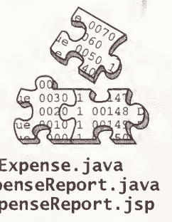

### 项目 3-1：脚本元素

本项目展示了在 JSP 页面中使用所有三种脚本元素。项目要求你展示一个家庭费用报告。JSP 页面动态显示一个家庭费用列表，每项费用包含以下信息：

- 日期
- 类别
- 描述
- 金额

你的目标是生成一个格式良好的 HTML 表格来呈现这些费用。

### 逐步操作

1. 从 http://www.osborne.com 下载本项目的 Java 文件。
2. 编译 Java 文件 Expense.java 和 ExpenseReport.java。请注意，这些 Java 文件属于一个名为 scripting 的包。
3. 在你的 Tomcat 安装目录的 Book 上下文下，创建目录层级结构 WEB-INF/classes/scripting。
4. 将步骤 2 中生成的类文件移动到 %TOMCAT_HOME%/webapps/Book/WEB-INF/classes/scripting 目录下。JSP 容器会自动加载给定应用上下文中位于 WEB-INF/classes 子目录下的所有类文件。由于你的所有 Java 文件都在 scripting 包中，请在 WEB-INF/classes 下创建 scripting 子目录，并将类文件放入此目录。
5. 快速查看这两个 Java 文件，以了解它们的用途。这些 Java 文件仅用于提供动态内容。Expense.java 中的 Expense 类是一个 JavaBean，包含单个家庭费用的所有信息。ExpenseReport.java 中的 ExpenseReport 类维护着一月份所有费用的静态列表。你在本项目中的目标是在 JSP 页面中展示此费用列表，形成你的报告。
6. 在 %TOMCAT_HOME%/webapps/Book/jsp 下创建一个名为 ExpenseReport.jsp 的空 JSP 页面文件。
7. 使用 page 指令导入你可能需要的类，开始编写 JSP 页面。首先，导入你刚刚构建的 Java 文件。此外，导入 JDK 的 java.util 包。按如下所示输入第一行：

```
<%@ page import="scripting.*, java.util.*" %>
```

8. 注意 `Expense.java` 中的费用金额是以 double 类型编码的。为了统一格式，将每个费用金额表示为一个带有两位小数并以零填充的 `String`。定义一个执行此转换的方法，并将其作为 JSP 声明包含进来，如下所示：

```
<%-- 声明实用方法和变量 --%>
<%!
    public String getStringifiedValue(double value) {
        String subval = "0.00";
        if (value > 0.0) {
            subval = Double.toString(value);
            int decimal_len = subval.length() -
                (subval.lastIndexOf('.') + 1);
            if(decimal_len > 1)
                subval = subval.substring(0,
                    subval.lastIndexOf('.') + 3);
            else
                subval += "0";
        }
        return subval;
    }
%>
```

9. 现在你准备好插入一些 HTML 了。输入每个 JSP 页面都应包含的基本 HTML 标签，如下所示：

```
<HTML>
<HEAD><TITLE> Scripting Elements Demo </TITLE></HEAD>
<BODY>
```

10. 获取费用报告，以便开始在 JSP 页面中布局它。使用以下脚本段：

```
<%
    ExpenseReport rpt = ExpenseReport.getReport();
%>
```

11. 为你的表格打印一个标题，并利用 JSP 表达式打印与此费用报告相关的月份，如下所示：

```
<H1> Expense Report for: <%= rpt.getMonth() %> </H1>
```

12. 创建一个 HTML 表格，第一行包含标题，命名每列表格中信息的类型。按如下方式输入表格：

```
<%-- 绘制所有费用的表格 --%>
<TABLE WIDTH=650 CELLSPACING="0" CELLPADDING="3" BORDER="1">
<%-- 绘制标题栏 --%>
<TR>
    <TD WIDTH=10% BGCOLOR="#ECA613"> <B>日期</B> </TD>
    <TD WIDTH=25% BGCOLOR="#ECA613"> <B>类别</B> </TD>
    <TD BGCOLOR="#ECA613"> <B>描述</B> </TD>
    <TD WIDTH=8% BGCOLOR="#ECA613"> <B>金额</B> </TD>
</TR>
```

13. 获取报告的费用列表（作为 *java.util.List* 维护）并遍历它，将每项费用插入到 HTML 表格中。每次迭代检索一个新的费用项。输入以下 JSP 脚本段：

```
<%-- 绘制数据 --%>
<%
    List expenses = rpt.getExpenses();
    for(int i=0; i<expenses.size(); i++) {
        Expense e = (Expense)expenses.get(i);
%>
```

14. 使用 JSP 表达式检索并打印每项费用的各个组成部分。使用前面在 JSP 声明中定义的实用方法 *getStringifiedValue*，以一致的格式打印费用金额。以下 JSP 代码片段执行这些步骤。将它们输入到你的 JSP 页面中：

```
<TR>
    <TD ALIGN=left> <%= e.getDate() %> </TD>
    <TD ALIGN=left> <%= e.getCategory() %> </TD>
    <TD ALIGN=left> <%= e.getDescription() %> </TD>
    <TD ALIGN=right> <%= getStringifiedValue(e.getAmount()) %> </TD>
</TR>
```

15. 要关闭循环，使用另一个 JSP 脚本段，如下所示：

```
<%
    }
%>
```

16. 关闭 HTML 表格，然后添加这些结束的 HTML 标签：

```
</TABLE>
</BODY>
</HTML>
```

17. 保存你的文件，并使用以下 URL 在 Web 浏览器中加载它：http://localhost:8080/Book/jsp/ExpenseReport.jsp。访问此 URL 时请确保 Tomcat 正在运行。你应该会看到一个类似于图 3-1 的页面。

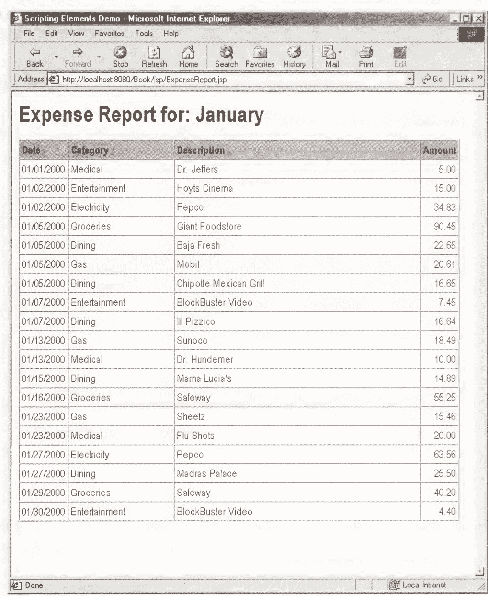

图 3-1 家庭费用报告

确保你仔细检查此项目生成的 JSP 页面。注意页面如何将静态 HTML 与 JSP 元素交错在一起。在 JSP 页面中使用过多的 JSP 元素会使页面难以阅读和维护。但本项目的目标仅仅是说明各种 JSP 脚本元素。

#### 精通检查

1. 你能发现以下 JSP 声明中的问题吗？

```
<%! public String foo() {
    String val = request.getParameter("MyVal");
    return val;
%>
```

2. 这个 JSP 声明说明了什么问题？

```
<%! String request = "my request"; %>
```

3. 以下 JSP 表达式有问题吗？

```
This page was accessed: <%= counter.getNumTimes(); %>.
```

4. 在以下 JSP 代码片段中，你看到了什么值得关注的问题？

```
<%! Basket basket; %>
<%
    basket = (Basket)session.getAttribute("BASKET");
    if(basket.full()) {
%>
```

5. 对于问题 4 中的情况，是否有更好的选择？

6. 以下脚本段有什么问题吗？

```
<%
    if(basket.isEmpty()) {
        return basket;
    }
%>
```

7. 考虑以下脚本段。你认为它声明方式有什么问题吗？

```
<%
    class LocalClass {
        public String getName() {
            return request.getParameter("Name");
        }
    }
%>
```

8. 以下脚本段会如你所愿地工作吗？

```
<% if(time.before9AM() && time.after6PM()) %>
    Sorry, our office hours are <%= officeHours %>
```

## 模块 4

### 隐式对象

## 本模块目标

- 熟悉各种隐式 JSP 对象
- 理解隐式对象所代表的 Java 类
- 理解如何在 JavaServer Pages 中使用隐式对象

在 Java servlet 和 JSP 容器上下文中编写 Web 应用程序的优势之一是，这些容器为应用程序提供服务。JavaServer Pages 通过隐式对象将这些服务暴露给 JSP 页面开发人员使用。

JSP 1.1 规范要求 JSP 脚本语言支持一组通用的 *隐式* 对象。这些对象是隐式的，意味着你在使用它们之前无需声明。我们在模块 2 和模块 3 中多次提到了隐式对象。例如，在模块 3 中，我们描述了 JSP 表达式和脚本段如何访问 *JspWriter* 对象 *out*。在本模块中，我们将提供每个隐式对象的详细列表，并描述每个对象的用途。

在 JSP 1.1 中，由于唯一的 JSP 脚本语言是 Java，每个隐式对象都映射到特定的 Java 类或接口。在我们的讨论中，我们或多或少会互换使用变量名和对象类型。表 4-1 列出了隐式对象及其 Java 类型。

| 变量名 | Java 类型 | 描述 | JSP 作用域 |
|---|---|---|---|
| *request* | *javax.servlet.ServletRequest* 的一个协议相关的子类型；对于 HTTP 协议，是 *javax.servlet.HttpServletRequest* | 提供预解析的 HTTP 请求 | request |
| *response* | *javax.servlet.ServletResponse* 的一个协议相关的子类型；对于 HTTP 协议，是 *javax.servlet.HttpServletResponse* | 封装 HTTP 响应 | page |
| *pageContext* | *javax.servlet.jsp.PageContext* | 封装供应商特定的功能；提供便捷方法来从多个作用域访问信息并检索其他隐式对象；提供 *forward*、*include* 和 *handlePageException* 方法 | page |

表 4-1 JavaServer Pages 中可用的隐式对象


## The request 变量

`request` 变量提供了对客户端请求中提供信息的访问。Java servlet 容器将此信息打包为一个对象，其协议相关的子类型是 *javax.servlet.ServletRequest*。就我们的目的而言，协议是 HTTP，因此默认对象的类型是 *javax.servlet.HttpServletRequest*。它具有请求作用域，这意味着 servlet 容器在请求时创建它，并在请求完成时销毁它。这也意味着同一个请求对象可供处理给定 HTTP 请求的所有 JavaServer Pages 使用。

*request* 隐式变量是生成 servlet 的 `_jspService` 方法的形式参数。以下代码片段摘自 Tomcat JSP 容器生成的 servlet，展示了该参数：

```
public void _jspService(HttpServletRequest request,
                         HttpServletResponse response)
                    throws IOException, ServletException
```

### request 服务

*request* 变量通过其引用的 *HttpServletRequest* 对象，向 JavaServer Pages 提供以下类型的服务：

- 访问请求参数
- 管理请求作用域中的属性
- 检索 Cookie
- 访问请求头
- 访问请求行元素
- 访问安全信息
- 访问国际化信息

### 访问请求参数

*HttpServletRequest* 对象包含从当前 JSP 页面的 URI 查询字符串和可能从 HTML 表单 POST 过来的 URL 编码数据中填充的信息。Servlet 容器将这些信息作为表示参数名称和值的 Java *String* 对象列表提供。*request* 对象中的便捷方法 *getParameter*、*getParameterNames* 和 *getParameterValues* 用于检索此信息。以下 JSP 脚本代码片段打印请求中的参数。

```
<H3>Parameters in this request:</H3>
<% java.util.Enumeration e =
       request.getParameterNames();
   while (e.hasMoreElements()) {
String paramName = (String)e.nextElement();
String[] paramValues =
    request.getParameterValues(paramName);
%>
<BR>Parameter: <%= paramName %>
Values:
<%
for (int i = 0; i < paramValues.length; i++) {
%>
    <%= paramValues[i] %>
<%
}
%>
<BR>
```

如果您使用 URI 查询字符串 x=5&y=joe&y=larry 访问包含上述片段的 JSP 页面，您的浏览器将显示以下结果：

**Parameters in this request:**
Parameter: x Values: 5
Parameter: y Values: joe larry

您使用参数在 Web 工作流中捕获和在页面间传递用户输入。通常，您从 HTML 表单中 POST 这些数据。考虑以下 HTML 片段：

```
<FORM METHOD="post" ACTION="paramRequest.jsp">
Please enter your name:
<INPUT TYPE=text SIZE=25 NAME="name"><BR>
Please enter your age:
<INPUT TYPE=text SIZE=3 NAME="age"><BR>
Please enter your Date of Birth (MM/DD/YYYY):
<INPUT TYPE=text SIZE=11 NAME="dob"><BR><BR>
<INPUT TYPE=submit VALUE="Go">
</FORM>
```

图 4-1 显示了用户输入示例数据后的表单。假设我们表单中的 `paramRequest.jsp`（ACTION）会打印参数名称和值（就像我们之前列出的代码）。当您提交表单时，JSP 容器会加载 `paramRequest.jsp`，然后打印三个参数“name”、“age”和“dob”，以及您在 INPUT 文本字段中输入的任何值。图 4-2 显示了示例输出。

### Figure 4-1 带有用户输入的基本 HTML 表单

#### 注意

Servlet 容器自动从查询字符串和表单数据中提取参数，并将它们存储在 *HttpServletRequest* 对象中。没有 JSP 开发者可以调用的方法来将参数作为信息存储在请求中。

### Figure 4-2 表单提交的输出

表 4-2 列出了 `request` 变量提供的用于访问参数和参数值的方法。

### 管理请求作用域中的属性

属性是您显式存储在 *HttpServletRequest* 对象中的对象。属性允许 JSP 开发者在 JSP 页面和 servlet 之间传递信息。与始终是 Java *String* 对象的参数不同，属性可以是任何 Java 类型。一个给定的属性名只能关联一个属性值。

考虑一个包含以下 JSP 片段的源 JSP 页面：

```
<% request.setAttribute("Current Date",
	new java.util.Date());
%>
<%@ include file="AttributeDestination.jsp" %>
```

在此片段中，我们存储了一个 *Date* 对象，名称为“Current Date”。然后，JSP 页面 *AttributeDestination.jsp* 可以像这样检索并打印该对象：

```
<% java.util.Date date = (java.util.Date)
	request.getAttribute("Current Date"); %>
Current Date is: <%= date %>
```

输出如下所示：

Current Date is: Sun Feb 11 21:12:13 EST 2001

| 方法签名 | 用途 |
| --- | --- |
| `String getParameter(String parameterName)` | 以 *String* 形式返回请求参数的值，如果参数不存在则返回 null |
| `java.util.Enumeration getParameterNames()` | 返回一个包含此请求中包含的参数名称的 *String* 对象枚举 |
| `String[] getParameterValues(String parameterName)` | 返回一个包含给定请求参数所有值的 *String* 对象数组，如果参数不存在则返回 null |

表 4-2 访问请求参数的方法

> Java Servlet 规范 2.2 建议使用 Java 编程语言规范中建议的包命名约定来命名属性。有关包命名约定的更多信息，请参阅位于 http://java.sun.com/docs/books/jls/first_edition/html/index.html 的 Java 语言规范第 6.8 节。该规范保留以 java. 和 javax.、sun. 和 com.sun. 为前缀的属性名称。

`request` 变量提供的属性管理方法如表 4-3 所示。

### 检索 Cookie

请求对象包含 `getCookies` 方法，用于获取请求中存在的 Cookie 数组。Cookie 是客户端在每次请求时自动从客户端发送到服务器的数据。Cookie 的一个常见用途是自动从客户端计算机发送登录或会话标识信息。`getCookies` 方法的签名是 `javax.servlet.http.Cookie[] getCookies()`，它返回所有 Cookie 名称和值的数组。

### 访问请求头

正如我们在模块 1 中描述的，HTTP 请求包含头。`HttpServletRequest` 对象提供了访问 HTTP 头中发送的信息的方法。

| 方法签名 | 用途 |
|---|---|
| `Object getAttribute (String name)` | 以对象形式返回命名属性的值，如果不存在给定名称的属性则返回 null |
| `java.util.Enumeration getAttributeNames()` | 返回一个包含此请求可用属性名称的枚举 |
| `void removeAttribute (String attributeName)` | 从此请求中移除一个属性 |
| `void setAttribute(String name, Object object)` | 在此请求中存储一个属性；servlet 容器在请求之间重置属性 |

表 4-3 管理请求属性的方法

---

| 变量名 | Java 类型 | 描述 | JSP 作用域 |
| :--- | :--- | :--- | :--- |
| session | javax.servlet.http.HttpSession | 提供跨多个服务请求跟踪客户端的机制 | session |
| application | javax.servlet.ServletContext | 提供一组方法来访问 Web 服务器信息并写入消息到 servlet 日志文件 | application |
| out | javax.servlet.jsp.JspWriter | 封装写入 HTTP 响应缓冲区的手段 | page |
| config | javax.servlet.ServletConfig | 为 JSP 页面提供初始化参数并访问 *ServletContext* | page |
| page | javax.servlet.jsp.HttpJspPage | 页面主体中“this”的同义词 | page |
| exception | java.lang.Throwable | 传递给错误页面的未捕获 *Throwable* | page |

表 4-1 JavaServer Pages 中可用的隐式对象（续）


### 访问请求行元素

*request* 变量提供了多种方法，可帮助你获取有关导致 JSP 页面的请求行的信息。请考虑以下名为 `requestPathRequest.jsp` 的 JSP 页面：

```
<B>Request Method:</B> <%= request.getMethod() %><BR>
<B>Request URI:</B> <%= request.getRequestURI() %><BR>
<B>Servlet Path:</B> <%= request.getServletPath() %><BR>
<B>Context Path:</B> <%= request.getContextPath() %><BR>
<B>Path Info:</B><%= request.getPathInfo() %><BR>
<B>Query String:</B><%= request.getQueryString() %>
```

| 方法签名 | 用途 |
| :--- | :--- |
| `String getMethod()` | 返回发起此请求的 HTTP 方法的名称；例如，`GET` 或 `POST` |
| `String getRequestURI()` | 返回 HTTP 请求第一行中，协议名称与查询字符串之间的请求 URI 部分 |
| `String getContextPath()` | 返回请求 URI 中指示请求的应用程序上下文的部分 |
| `String getServletPath()` | 返回请求 URI 中指定 servlet 或 JSP 页面的部分 |
| `String getPathInfo()` | 返回与 URL 相关的所有额外路径信息，这些信息位于 servlet 路径之后、查询字符串之前 |
| `String getQueryString()` | 返回 URI 中路径部分之后的查询字符串 |

**表 4-5** 请求行方法

当使用 URL `http://localhost:8080/Book/jsp/requestPathRequest.jsp?name=hello` 访问该 JSP 页面时，输出如下：

**Request Method:** GET
**Request URI:** `/Book/jsp/requestPathRequest.jsp`
**Servlet Path:** `/jsp/requestPathRequest.jsp`
**Context Path:** `/Book`
**Path Info:** null
**Query String:** name=hello

这对应于以下请求行：

```
GET /Book/jsp/requestPathRequest.jsp?name=hello
```

如输出所示，你可以使用以下等式来表达路径元素之间的关系：

*requestURI* = *contextPath* + *servletPath* + *pathInfo*

考虑以下检索标头名称并遍历它们、同时打印每个标头值的 JSP 页面片段：

```
<H3>Headers in this request:</H3>
<% int i = 1;
   java.util.Enumeration e = 
      request.getHeaderNames();
   while (e.hasMoreElements()) {
      String name = (String)e.nextElement();
      String value = request.getHeader(name);
%>
   <B>Header <%= i++ + ": </B>" + name %>
            <%= value %></B><BR>
<% } %>
```

包含此片段的 JSP 页面的示例运行产生以下输出：

**Headers in this request:**
**Header 1:** User-Agent Mozilla/4.0 (compatible; MSIE 5.5; Windows NT 5.0)
**Header 2:** Cookie JSESSIONID=xalkx8qnu1
**Header 3:** Accept */*
**Header 4:** Host wsolney.bellatlantic.net:8080
**Header 5:** Accept-Encoding gzip, deflate
**Header 6:** Accept-Language en-us
**Header 7:** Referer http://wsolney.bellatlantic.net:8080/Book/jsp
**Header 8:** Connection Keep-Alive

| 方法签名 | 用途 |
|---|---|
| `java.util.Enumeration getHeaderNames()` | 返回一个包含所有当前请求标头名称的 `String` 对象枚举 |
| `java.util.Enumeration getHeaders(String headerName)` | 返回一个包含指定名称标头所有值的 `String` 对象枚举 |
| `String getHeader(String headerName)` | 以 `String` 形式返回指定标头的值 |
| `int getIntHeader(String headerName)` | 以整数形式返回指定标头的值 |
| `long getDateHeader(String headerName)` | 以 `long` 形式返回指定标头的值，表示一个日期 |

**表 4-4** 访问请求标头的方法

### 访问安全信息

*request* 变量提供了对安全属性的访问。例如，以下这行使用 *request* 变量来确定当前请求是否使用了安全协议（如安全 HTTP (HTTPS)）：

```
Uses secure protocol? <%= request.isSecure() %>
```

> **注意**
> HTTPS 是一种支持浏览器和支持的 Web 服务器之间传输加密信息的通信协议。HTTPS 协议的基础是用于加密的安全套接字层 (SSL)。如果请求使用了 SSL 证书，servlet 容器必须以 *java.security.cert.X509Certificate* 对象数组的形式提供对此证书的访问。你通过一个名为 *javax.servlet.request.X509Certificate* 的特殊属性从请求中检索此数组。

| 方法签名 | 用途 |
|---|---|
| `boolean isSecure()` | 返回 `true` 或 `false`，指示此请求是否使用了安全协议（如 HTTPS） |
| `boolean isRequestedSessionIdFromCookie()` | 一个 `boolean` 值，指示会话是否使用 cookie 来管理会话 ID |
| `boolean isRequestedSessionIdFromURL()` | 一个 `boolean` 值，指示会话是否使用 URL 重写来管理会话 ID |
| `boolean isRequestedSessionIdValid()` | 检查请求的会话 ID 是否有效 |

**表 4-6** 访问安全信息的方法

### 访问国际化信息

浏览器可以通过一个名为 `Accept-Language` 的 HTTP 头向 Web 服务器指示其首选语言。request 对象中的 *getLocale* 和 *getLocales* 方法允许 JSP 开发人员检索此信息。这些调用返回的对象类型为 `java.util.Locale`。这些对象封装了国家/地区和语言。利用这些信息，JSP 开发人员可以提供特定区域设置的响应。以下是使用此标头的一个简单示例：

```
<%@ page import="java.util.Locale" %>
<H1>
<% Locale requestedLocale = request.getLocale();
   if(requestedLocale.equals(Locale.US)) {
%>
     Hello! How are you?
<%
   } else if(requestedLocale.equals(Locale.FRANCE)) {
%>
     Bonjour! (Comment) ça va?
<% } %>
</H1>
```

在我们的计算机上，客户端请求在 HTTP 头中发送 `en-us`（美国英语）作为区域设置，输出为
    Hello! How are you?

表 4-7 显示了从请求访问国际化信息的方法。

| 方法签名 | 用途 |
| :--- | :--- |
| `java.util.Locale getLocale()` | 根据 Accept-Language 头，返回客户端愿意接受内容的首选 Locale |
| `java.util.Enumeration getLocales()` | 返回一个 Locale 对象枚举，按首选项递减顺序（从首选区域设置开始）列出根据 Accept-Language 头客户端可接受的所有区域设置 |

**表 4-7** 国际化方法

# 1分钟速查

- *request* 隐式对象的来源是什么？
- 如何使用 *request* 变量检索请求参数？
- 如何在请求作用域中存储对象？
- 如何检索请求作用域中的属性？
- 如何判断你的应用程序是否正在使用安全协议？

## response 变量

*response* 变量封装了从 JSP 页面返回给客户端的所有信息。它指向一个隐式对象，该对象是 *javax.servlet.ServletResponse* 的协议相关子类型。在 HTTP 协议中，隐式对象的类型为 *javax.servlet.http.HttpServletResponse*。如模块 1 所述，HTTP 响应由消息头和可选的消息体组成。*HttpServletResponse* 对象提供了一个优雅的 Java 接口来设置 HTTP 响应的组件。

- *request* 对象是生成的 servlet 中 *\_jspService* 方法的参数。
- 你使用 request 变量首先检索参数名称，然后检索每个参数的值。
- 你使用 *request.setAttribute(String name, Object value)*。
- 你使用 *request.getAttribute(String name)*。
- 你调用 *request.isSecure()*。


*HttpServletResponse* 对象具有 *page* 作用域，这意味着它仅在 JSP 页面内有效。一旦 *_jspService* 方法返回，响应就会超出作用域。与 *request* 变量类似，*response* 变量是生成的 servlet 的 *_jspService* 方法的一个形式参数。以下代码片段取自 Tomcat 容器生成的 servlet，展示了这个参数。

```
public void _jspService(HttpServletRequest request,
                        HttpServletResponse response)
                    throws IOException, ServletException
```

### 响应服务

*response* 对象提供以下三种服务：

- 输出缓冲
- 设置响应头
- 重定向资源

让我们详细看看每一个。

### 输出缓冲

如模块 2 中所讨论，缓冲可以使服务器和客户端之间的内容传输更高效。*HttpServletResponse* 对象支持 *JspWriter* 对象的缓冲区配置。*getBufferSize* 方法返回当前 JSP 页面的缓冲区大小。*setBufferSize* 方法允许 JSP 页面为响应体设置首选的输出缓冲区大小。容器实际使用的缓冲区大小至少与请求的大小一样大。如果你设置了缓冲区大小，必须在向响应写入内容之前进行设置。否则，JSP 容器将抛出 *IllegalStateException*。例如，以下代码会导致异常：

```
<%  out.println("Before setBufferSize()<BR>");
    response.flushBuffer();
    response.setBufferSize(16384);
    out.println("After setBufferSize()<BR>");
%>
```

另一方面，以下代码通常不会导致异常：

```
<% out.println("Before setBufferSize()<BR>");
response.setBufferSize(16384);
out.println("After setBufferSize()<BR>");
%>
```

第二个代码片段在设置缓冲区大小之前没有刷新其缓冲区（即将输出发送给客户端）。如果我们先关闭缓冲区，如这里所示，第二个代码片段也会抛出异常：

```
<%@ page buffer="none" %>
<% out.println("Before setBufferSize()<BR>");
response.setBufferSize(16384);
out.println("After setBufferSize()<BR>");
%>
```

#### 提示

如果你修改了默认缓冲区大小（8K），你应该养成在写入任何输出（无论是静态 HTML 还是动态内容）之前设置缓冲区大小的习惯。

较大的缓冲区允许你在向客户端发送任何内容之前写入更多内容，从而减少网络写入次数。较小的缓冲区减少了服务器内存负载，并允许客户端更快地开始接收数据，但它增加了网络写入次数。
任何写入客户端的内容都称为 *已提交*。这可以通过 *isCommitted* 方法来确定，该方法返回 true 或 false。*flushBuffer* 方法立即刷新缓冲区中的当前内容并将其发送给客户端。*reset* 方法移除当前缓冲区内容。如果响应缓冲区已经提交，你不能调用此方法。以下示例 JSP 片段演示了缓冲：

```
The buffer size is: <%= response.getBufferSize() %> <BR>
Before flush... <BR>
Is the output committed? <%= response.isCommitted() %> <BR><BR>
<% response.flushBuffer(); %>
After flush... <BR>
Is the output committed? <%= response.isCommitted() %>
```

当你执行此 JSP 页面时，Tomcat 生成以下输出：

```
The buffer size is: 8192
Before flush...
Is the output committed? false

After flush...
Is the output committed? true
```

如你所见，默认的响应缓冲区大小是 8K。我们的 JSP 页面在刷新之前没有提交响应，因为输出缓冲区中尚未积累 8K 的数据。这意味着当我们第一次调用 isCommitted 方法时，即使我们已经写入了一些输出，也没有任何内容被提交。当我们显式刷新缓冲区时，我们将其内容发送给客户端（即使缓冲区未满）。这立即提交了响应缓冲区，正如我们接下来调用 isCommitted 方法时所看到的那样。
response 变量提供的缓冲区方法列在表 4-8 中。

| 方法签名 | 用途 |
| :--- | :--- |
| `int getBufferSize()` | 返回用于响应的实际缓冲区大小；如果未使用缓冲，此方法返回 0 |
| `void setBufferSize(int size)` | 设置响应体的首选缓冲区大小 |
| `boolean isCommitted()` | 返回一个布尔值，指示响应是否已提交；已提交的响应已写入其状态码和头 |
| `void reset()` | 清除缓冲区中存在的所有数据，并清除状态码和头 |
| `void flushBuffer()` | 强制将缓冲区中的任何内容写入客户端 |

**表 4-8** 管理响应缓冲区的方法

### 设置响应头

JSP 页面可以使用 response 隐式变量为 HTTP 响应设置头。例如，以下 JSP 页面片段将响应的内容类型设置为纯文本：

```
<% response.setHeader("Content-Type", "text/plain"); %>
```

> **提示**
你必须在向客户端发送任何内容之前设置头。容器会忽略在响应提交后设置的头。

与 servlet 相比，在 JavaServer Pages 中设置响应内容类型的能力有些受限，因为 JSP 容器会自动使用 pageContext.getOut 方法检索 JspWriter。JSP 规范要求 JSP 容器在生成的 servlet 中为 JSP 页面提供 JspWriter 类作为 out 变量。由于这个 JspWriter 是对从 response 检索到的 PrintWriter 的包装，JSP 容器会自动检索 PrintWriter。PrintWriter 对象只能打印字符编码的输出流，因此只有可以写为字符数据的内容类型才能在响应上设置。

> **专家问答**
>
> **问：** 自动检索 `JspWriter` 对象是否意味着你不能使用 JSP 页面来流式传输二进制数据？
>
> **答：** `HttpServletResponse` 对象提供了两种不同的机制来向客户端发送输出。`getWriter` 方法返回一个 `PrintWriter` 对象，可以将字符文本发送给客户端。`getOutputStream` 方法返回一个 `ServletOutputStream`，可以向客户端写入二进制数据。对于给定的响应，你只能使用一种机制。如果你尝试对同一响应使用两者，你将得到一个 `IllegalStateException`。为了流式传输二进制数据，你必须使用 `ServletOutputStream`。因为 JSP 容器在 `_jspService` 方法中自动检索 `PrintWriter`，如果你尝试在你的 JSP 页面中检索 `ServletOutputStream`，你将收到一个 `IllegalStateException`。结果是你不能从 JSP 页面流式传输二进制数据。

表 4-9 显示了头设置方法。

| 方法签名 | 用途 |
| :--- | :--- |
| `void addHeader(String name, String value)` | 添加一个具有给定名称和值的响应头。 |
| `void setHeader(String name, String value)` | 设置一个具有给定名称和值的响应头。如果该头已被设置，新值会覆盖之前的值。 |
| `void addDateHeader(String name, long date)` | 添加一个具有给定名称和日期值的响应头。日期以自 epoch 以来的毫秒数指定。 |
| `void setDateHeader(String name, long date)` | 设置一个具有给定名称和日期值的响应头。如果该头已被设置，新值会覆盖之前的值。 |
| `void addIntHeader(String name, int value)` | 添加一个具有给定名称和整数值的响应头。 |
| `void setIntHeader(String name, int value)` | 设置一个具有给定名称和整数值的响应头。如果该头已被设置，新值会覆盖之前的值。 |
| `boolean containsHeader(String name)` | 返回一个布尔值，指示命名的响应头是否已被设置。 |
| `void setContentType(String type)` | 用于设置响应的内容类型头。 |
| `void setContentLength(int length)` | 用于设置响应的内容长度头。 |
| `void setLocale(java.util.Locale locale)` | 用于设置响应的区域设置头。 |

**表 4-9** 设置响应头的方法

### 资源重定向

JSP 页面可以使用 `response` 隐式变量中可用的 `sendRedirect` 方法将客户端重定向到不同的 Web 资源（URL）。例如，检查以下 JSP 脚本：

```
<% response.sendRedirect("NewLocation.jsp"); %>
```

该脚本指出，任何到达此 JSP 页面的请求都应自动重定向到相对 URL：`NewLocation.jsp`。`sendRedirect` 方法设置

适当的头部和内容正文将客户端重定向到这个新 URL。JSP 容器将相对路径转换为完全限定的 URL。

> **提示**
> 此方法会导致第二次客户端请求，从而清除所有请求参数。这意味着重置向页面必须在 URL 中为新页面重新设置参数。

JSP 页面也可以使用 *response* 隐式变量的 *sendError* 方法来指示错误情况。此方法接受一个错误代码和一个可选的错误消息，这些内容会在内容正文中返回给客户端。例如，查看以下 JSP 脚本：

```
<%
    response.sendError(500,
        "Fatal internal error has occured. Please check back later!");
%>
```

该脚本将客户端重定向到错误页面，并在内容正文中包含可选的消息。

*sendRedirect* 和 *sendError* 方法都会终止当前的请求和响应。如果响应已经提交给客户端，则无法调用这些方法。应谨慎使用此类重定向，并且仅在异常（错误）情况下使用。

表 4-10 列出了资源重定向方法。

| 方法签名 | 用途 |
| :--- | :--- |
| void sendError(int sc, String msg) | 使用指定的状态码和描述性消息向客户端发送错误响应 |
| void sendError(int sc) | 使用指定的状态码向客户端发送错误响应 |
| void sendRedirect(String location) | 使用指定的重定向位置 URL 向客户端发送重定向响应。该 URL 可以是相对路径 |

表 4-10 用于重定向请求的方法

### 项目 4-1：流式传输文件内容

本项目演示如何使用 JSP 页面将服务器上的文件内容流式传输给客户端。项目从一个静态 HTML 页面开始，该页面包含一个表单，用于请求文件名和可选的 MIME 类型。本项目的目标是将指定文件的内容作为响应进行流式传输。

#### 逐步说明

1.  从 `http://www.osborne.com` 下载本项目的文件。
2.  将文件 `StreamRequest.html` 放置在 `%TOMCAT_HOME%/webapps/Book` 下。
3.  查看 `StreamRequest.html` 的内容。它包含一个基本的 HTML 表单，其中有两个输入文本元素，分别用于请求要流式传输的文件名和可选的 MIME 类型。仅当客户端浏览器需要特殊处理文件内容时，才需要 MIME 类型。表单末尾有两个标准的操作按钮，用于重置和提交表单。名为 `StreamResponse.jsp` 的 JSP 页面处理表单的提交。这是你应该编写的文件。
4.  启动 Tomcat JSP 容器。
5.  启动客户端浏览器并加载 HTML 文件 `StreamRequest.html`。为此输入 URL `http://localhost:8080/Book/StreamRequest.html`。你应该会看到如图 4-3 所示的页面。

- `response` 对象是生成的 servlet 的 `_jspService` 方法的一个参数。
- 不是，因为 JSP 容器会自动为 `out` 变量分配一个 `JspWriter`，它只能写入字符数据。
- 输出缓冲可以减少网络写入次数，从而提高整体性能。
- 你使用 `response.setBufferSize(int sizeInbytes)`。
- 你在异常情况下使用 `sendRedirect`；例如，当页面位置发生变化时。

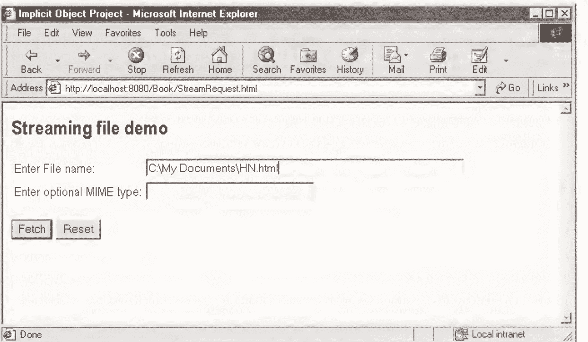

图 4-3 StreamRequest.html

6.  创建一个空文件 StreamResponse.jsp 并将其放置在 %TOMCAT_HOME%/webapps/Book 下。

7.  遵循我们良好的编程实践，在 JSP 页面开头使用页面指令，在你的 JSP 文件中输入以下行：

```
<%@ page import="java.io.*" errorPage="StreamError.jsp" %>
```

8.  由于我们打算打开文件并将其内容打印到响应流中，因此我们需要导入 java.io 包。一个方便的错误页面 StreamError.jsp（你接下来将编写它）应该统一处理此页面中发生的所有异常。

9.  使用 request 隐式对象获取提交表单的参数，如下所示的 JSP 脚本所示：

```
<%
    String filename = request.getParameter("File");
    String mime_type = request.getParameter("MIME type");
%>
```

10. 如果指定了 MIME 类型，我们应将其指定为响应头中的 'Content-Type'。你可以使用 response 隐式对象来完成此操作，如下所示的 JSP 脚本所示：

```
<%
    if((mime_type != null) && (mime_type.length() > 0)) {
        response.setHeader("Content-Type", mime_type);
    }
%>
```

11. 现在，可以打开文件，并使用 out 隐式对象将其中的每一行输出到响应流中。通过输入以下 JSP 脚本来完成此操作：

```
<%
    String line = null;
    BufferedReader iread = new BufferedReader(new
FileReader(filename));
    while((line = iread.readLine()) != null) {
        out.write(line);
    }
    iread.close();
%>
```

12. 既然我们已经完成了文件内容的流式传输，剩下的就是编写错误处理 JSP 文件 `StreamError.jsp`。如果我们的 JSP 页面中发生了任何异常，控制权将自动重定向到我们的错误文件 `StreamError.jsp`，正如开头的页面指令中所指定的那样。

13. 在 `%TOMCAT_HOME%/webapps/Book` 下创建一个空文件 `StreamError.jsp`。

14. 以页面指令开始，该指令表明这是一个错误 JSP 文件，使用了 `isErrorPage` 属性。

```
<%@ page isErrorPage="true" %>
```

15. 由于它被注册为错误页面，因此它可以自动访问隐式对象 exception，该对象保存了导致重定向到此错误页面的异常。因此，使用 exception 对象来打印异常的详细信息。示例如下：

```
<H3> Error occured: <%= exception.getMessage() %> </H3>
```

本项目展示了三个隐式对象——request、response 和 exception——的使用，用于流式传输文件内容。本项目中需要注意的一个重要点是，我们使用 java.io.FileReader 来读取文件的内容。它使用默认的字符编码来读取文件内容并将其转换为字符文本。

## pageContext 变量

pageContext 变量引用一个 javax.servlet.jsp.PageContext 对象，该对象提供对供应商特定功能、跨多个作用域（page、request、session 和 application）的操作以及一个与供应商无关的便捷方法接口的访问。PageContext 类是抽象的，因此 JSP 容器供应商必须扩展它。JSP 容器使用 PageContext 便捷方法来初始化其他隐式对象。其思想是，给定的供应商可以为该对象提供自定义实现，可能返回其他隐式对象的优化版本，并提供额外的供应商特定方法。PageContext 对象使用 javax.servlet.jsp.JspFactory 对象上的创建方法检索，该对象也是一个抽象类，由供应商提供自定义实现。

让我们回顾一下 Tomcat 为初始化生成的 servlet 所生成的代码。

```
jspxFactory = JspFactory.getDefaultFactory();
response.setContentType("text/html;charset=8859_1");
pageContext =
    _jspxFactory.getPageContext(this,
                               request,
                               response,
                               "errorPage.jsp",
                               true,
                               8192,
                               true);
application = pageContext.getServletContext();
config = pageContext.getServletConfig();
session = pageContext.getSession();
out = pageContext.getOut();
```

当 JSP 容器启动时，在初始化阶段，它通常会注册自己的 *JspFactory* 对象实现。在翻译阶段，JSP 容器遵循以下步骤：

-   在生成的 servlet 的 `_jspService` 方法开始处，使用静态方法 *JspFactory.getDefaultFactory* 检索 *JspFactory* 的供应商相关实现。
-   工厂对象的 *getPageContext* 方法初始化并返回一个供应商相关的 *PageContext* 对象。
-   servlet 使用该对象检索其他多个具有混合作用域的隐式对象，包括 *ServletContext* 对象、*ServletConfig* 对象、*HttpSession* 对象和 *JspWriter* 对象。
-   servlet 将这些对象中的每一个分配给一个局部变量，JSP 作者可以在表达式、脚本小程序和 JSP 动作中使用这些变量（我们将在模块 5 和 6 中描述动作）。

使用 *pageContext* 检索的大多数隐式对象都是自定义实现，提供供应商特定的优化或功能。JSP 1.1 规范特别提到了 *JspWriter* 对象 *out* 作为优化的候选对象。

### pageContext 服务

*PageContext* 对象提供四种服务：

-   访问多个作用域
-   访问隐式对象
-   管理嵌套作用域
-   转发和包含服务

### 访问多个作用域

*pageContext* 变量提供方法，以统一的方式访问不同的作用域。回顾模块 2，JSP 容器支持四种不同的作用域。*PageContext* 对象定义了四个表示这些作用域的常量：

### 访问多个作用域

你可以将这些常量传递给用于设置和获取不同作用域中属性的 PageContext 方法。例如，以下代码在会话作用域中设置了一个对象。

```java
CustomContext myContext = 
    new CustomContext("Penguin");
pageContext.setAttribute("Large Bird",
    myContext, PageContext.SESSION_SCOPE);
```

以下代码检索该对象：

```java
CustomContext myContext = (CustomContext)
    pageContext.getAttribute("Large Bird",
        PageContext.SESSION_SCOPE);
```

表 4-11 列出了用于访问不同作用域的各种 PageContext 方法。

| 方法签名 | 用途 |
|---|---|
| Object getAttribute(String name) | 从页面作用域返回指定名称的对象 |
| Object getAttribute(String name, int scope) | 从指定作用域返回指定名称的对象 |
| Object findAttribute(String name) | 返回指定名称的对象，按照以下顺序搜索不同作用域：页面、请求、会话和应用 |
| java.util.Enumeration getAttributeNamesInScope(int scope) | 返回给定作用域中所有命名对象 |
| int getAttributesScope(String name) | 返回表示指定名称对象作用域的常量 |
| void removeAttribute(String name) | 从页面作用域中移除指定名称的对象 |
| void removeAttribute(String name, int scope) | 从给定作用域中移除指定名称的对象 |
| void setAttribute(String name, Object object) | 在页面作用域中注册指定名称的对象 |
| void setAttribute(String name, Object object, int scope) | 在给定作用域中注册指定名称的对象 |

表 4-11 访问多个作用域

### 访问隐式对象

如前所述，*PageContext* 对象提供了对其他隐式对象的访问。表 4-12 列出了返回其他隐式对象的 *PageContext* 方法。

| 方法签名 | 用途 |
| :--- | :--- |
| javax.servlet.jsp.JspWriter getOut() | 返回 *out* 变量的当前值 |
| Exception getException() | 返回 *exception* 变量的当前值 |
| Object getPage() | 返回 *page* 变量（*this*）的当前值 |
| javax.servlet.ServletRequest getRequest() | 返回 *request* 变量的当前值 |
| javax.servlet.ServletResponse getResponse() | 返回 *response* 变量的当前值 |
| javax.servlet.http.HttpSession getSession() | 返回 *session* 变量的当前值 |
| javax.servlet.ServletConfig getServletConfig() | 返回当前的 *config* 变量 |
| javax.servlet.ServletContext getServletContext() | 返回当前的 *application* 变量 |

表 4-12 检索其他隐式对象的方法

### 嵌套作用域的管理

*PageContext* 对象还支持在标签库内管理嵌套输出流。其理念是在每个标签嵌套层级为处理*标签体*的标签库提供临时缓冲区。标签体是开标签和闭标签之间的页面片段。（如模块 6 所述，并非所有标签库都关心标签体。）Tomcat JSP 容器会生成代码，将当前的 *BodyContent* 对象（*JspWriter* 的子类）压入栈，并为新的标签体创建一个新的 *BodyContent* 对象。它将这个新的 *BodyContent* 对象分配给 *out* 变量。这样，你就可以安全地操作嵌套标签之间的内容。之后，当控制权离开嵌套层级时，Tomcat 会从栈中弹出临时的 *BodyContent*，并使用修改后的内容更新先前的 *BodyContent*（现在重新分配给 *out* 变量）。

由于 JSP 容器会生成处理不同作用域缓冲区的代码，因此作为 JSP 开发者，你通常不需要使用支持此功能的 *PageContext* 方法。表 4-13 列出了这些方法签名。

| 方法签名 | 用途 |
| :--- | :--- |
| javax.servlet.jsp.JspWriter popBody() | 返回由匹配的 *pushBody* 保存的先前 *JspWriter*，并更新页面作用域属性命名空间中 *out* 变量的值 |
| javax.servlet.jsp.tagext.BodyContent pushBody() | 返回一个新的 *BodyContent* 对象，保存当前的 *JspWriter*，并更新页面作用域属性命名空间中 *out* 变量的值 |

表 4-13 管理嵌套作用域的方法

### 转发和包含

你可以使用 *PageContext* 对象将控制权转发到另一个 JSP 页面。以下 JSP 片段测试一个变量的值以决定转发控制权的方向：

```jsp
<% if (nextPage.equals("Page1"))
    pageContext.forward("Page1.jsp");
  else
    pageContext.forward("Page2.jsp");
%>
```

*forward* 方法会用转发的页面替换当前页面。*PageContext* 对象还支持页面的包含。以下代码在当前页面中包含一个 JSP 片段：

```jsp
<% pageContext.include("PageFragment.jsp");
```

最后，*PageContext* 对象支持将异常重定向到错误页面。通常，JSP 容器会自动处理此操作，因为生成的 servlet 中的 `_jspService` 方法会捕获所有异常，并将异常处理重定向到 `pageContext.handlePageException`。表 4-14 列出了相关的方法签名。

| 方法签名 | 用途 |
| :--- | :--- |
| `void forward(String relativeUrlPath)` | 将控制权转发到另一个页面 |
| `void include(String relativeUrlPath)` | 在当前页面中包含另一个 JSP 页面 |
| `void handlePageException(java.lang.Exception e)` | 将异常定向到由页面指令的 errorPage 属性指定的错误页面 |

表 4-14 转发和包含方法

### 一分钟快速复习

- *pageContext* 隐式对象的来源是什么？
- *pageContext* 可以检索哪些隐式对象？
- *pageContext* 对象可以管理哪些属性作用域？
- *pageContext* 变量提供了哪些方法来将控制权传递给另一个 JSP 页面？

- *pageContext* 变量是通过在生成的 servlet 的 `_jspService` 方法中调用一个工厂方法设置的。
- *pageContext* 对象可以检索所有其他隐式对象，包括 *request*、*response*、*session*、*application*、*out*、*config*、*page* 和 *exception* 变量。
- *pageContext* 可以管理 *page*、*request*、*session* 和 *application* 作用域中的属性。
- *pageContext* 变量同时支持 *forward* 和 *include* 方法。

## *session* 变量

*session* 变量指的是 `javax.servlet.http.HttpSession` 对象，它封装了与客户端会话相关的所有信息。正如我们在模块 1 中解释的，HTTP 在设计上是无状态的。Servlet 和 JavaServer Pages 通过提供多种支持会话跟踪的机制来增强这种无状态架构。这些机制（在后续章节中简要解释）允许多个客户端请求共享相同的服务器状态信息。

### URL 重写

URL 重写会将会话数据添加到参与给定会话的每个请求的每个 URL 路径末尾。然后，Servlet 容器从 URL 中提取此会话数据，并将请求与正确的会话关联起来。

### 安装 Cookie

将 Cookie 作为持久性文件安装在客户端机器上，可能是跟踪客户端会话最流行的方法。Servlet 容器向客户端发送一个包含会话标识令牌的 Cookie，客户端在后续的每个请求中都会返回此 Cookie。服务器解释此 Cookie，并将请求与正确的会话关联起来。

### SSL 会话

安全套接字层技术（用于 HTTPS 协议）基于数字证书握手提供一次性的*主密钥*。Servlet 和 JavaServer Pages 使用此密钥来维护会话身份，并对消息进行加密和解密。

*注意*
我们将在模块 8 中介绍 JSP 安全编程。

### session 服务

当 JSP 页面参与会话时，*session* 变量提供了对 `javax.servlet.http.HttpSession` 对象的访问。客户端必须明确地*加入*会话才能参与会话跟踪。JSP 页面默认会这样做。然而，正如我们在模块 2 中提到的，你可以使用页面指令中的 session 属性来禁用对客户端会话的参与。如果你的 JSP 页面不需要会话信息，通常应该这样做。*session* 隐式变量具有会话作用域。这意味着参与同一会话的任何 JSP 页面都可以访问相同的 *session* 隐式变量。当 Servlet 容器终止客户端会话时，它将超出作用域。你应该同步对 *session* 对象的访问。

在多线程环境中，因为多个请求线程可能同时修改它。*HttpSession* 对象提供以下服务：

- 属性绑定
- 会话超时管理

### 属性绑定

JSP 页面可以将任何对象绑定为会话属性。*HttpSession* 对象使用你通过 *getAttribute* 和 *setAttribute* 方法提供的唯一名称来存储所有属性。以下是一个示例 JSP 片段，说明了它们的用法。

```
<% Date day = new Date();
   session.setAttribute("Today", day);
%>
<% Date today = (Date)session.getAttribute("Today");
%>
```

*removeAttribute* 方法将对象从会话中解绑。*getAttributeNames* 方法返回与此会话关联的所有属性名称。表 4-15 列出了管理会话范围内属性的相关方法。

### 会话超时管理

在 Servlet 和 JSP 架构中，确保客户端会话终止的唯一方法是使用超时。这是因为 Web 客户端在不活跃时不会明确通知服务器。为了清理存储在 *HttpSession* 对象中的客户端资源，Servlet 容器会设置一个超时窗口。当不活跃期超过该窗口时，容器会使 *HttpSession* 对象无效并解除其所有属性的绑定。

> **提示**
> 默认超时时间因供应商而异。Tomcat 的默认超时时间为 30 分钟。要确定 JSP 容器的默认超时时间，可以创建并加载一个包含以下表达式的 JSP 页面：`<%=session.getMaxInactiveInterval()%>`。

*getMaxInactiveInterval* 方法返回会话当前的不活跃间隔。你可以使用 *setMaxInactiveInterval* 方法修改当前的不活跃间隔。便捷方法 *getLastAccessedTime* 返回在当前请求之前会话最后一次被访问的时间。
表 4-16 列出了可通过 *session* 隐式变量调用的所有有用方法。

| 方法签名 | 用途 |
| :--- | :--- |
| Object getAttribute(String attributeName) | 返回在此会话中与指定名称绑定的对象，如果在该名称下没有绑定对象则返回 null |
| java.util.Enumeration getAttributeNames() | 返回一个包含所有与此会话绑定的对象名称的 *String* 对象枚举 |
| void setAttribute(String name, Object value) | 将对象绑定到此会话，使用指定的名称。如果同名对象已绑定到会话，则该对象将被替换 |
| void removeAttribute(String name) | 从此会话中移除与指定名称绑定的对象 |

*表 4-15 管理会话中的属性*

| 方法签名 | 用途 |
| :--- | :--- |
| `long getLastAccessedTime()` | 返回客户端最后一次发送与此会话相关的请求的时间，以自纪元（格林威治标准时间1970年1月1日午夜）以来的毫秒数表示 |
| `void setMaxInactiveInterval(int interval)` | 指定客户端请求之间的间隔时间（以秒为单位），超过此时间 Servlet 容器将使此会话无效 |
| `int getMaxInactiveInterval()` | 返回 Servlet 容器在客户端访问之间保持此会话打开的最大时间间隔（以秒为单位） |
| `void invalidate()` | 使此会话无效，并解除绑定到它的任何对象的绑定 |

**表 4-16 管理会话生命周期的方法**

# 一分钟速查

- 管理会话身份的三种不同方式是什么？
- 会话属性与请求属性有何不同？
- Servlet 容器如何移除会话对象？

- 会话跟踪的三种机制是 URL 重写、Cookie 和使用安全套接字的安全 HTTP。
- 会话属性在同一客户端的多个请求之间维护状态，而请求属性仅对特定请求可用。
- Servlet 容器设置一个超时时间。当时间到期时，它会使会话对象无效并解除 *session* 对象所有属性的绑定。

### 项目 4-2：URL 重定向和 URL 包含

此项目说明如何在 JSP 页面中使用隐式对象来重定向或包含 URL 指定的其他资源。与上一个项目类似，它从一个静态 HTML 页面开始，该页面包含一个请求用户输入的 HTML 表单。根据输入，不同的页面将包含在响应中。如果用户输入有错误，则控制将被重定向到两个不同错误页面之一。

### 分步指南

1.  从 `http://www.osborne.com` 下载此项目的文件。
2.  将文件 `startPage.html`、`HN.html`、`SP.html`、`PT.html`、`errorName.html` 和 `errorChoice.html` 放入目录 `%TOMCAT_HOME%/webapps/Book`。
3.  查看 `startPage.html`。该页面展示了一个新闻服务，其中包含一个有两个输入元素的 HTML 表单。第一个请求用户名。第二个是一个选择元素，请求新闻主题。`startPage.html` 中选择元素的每个选项都包含编码值 `HN`、`PT` 或 `SP` 之一，这些值指定要包含在响应中的 HTML 文件（`HN.html`、`PT.html` 或 `SP.html`）。在页面末尾，有两个操作按钮用于重置和提交表单。表单的提交由 JSP 页面 `redirect.jsp` 处理，这正是你将编写的页面。
4.  启动 Tomcat JSP 容器（如果尚未运行）。
5.  加载 URL：`http://localhost:8080/Book/startPage.html`。你应该会看到一个如图 4-4 所示的页面。

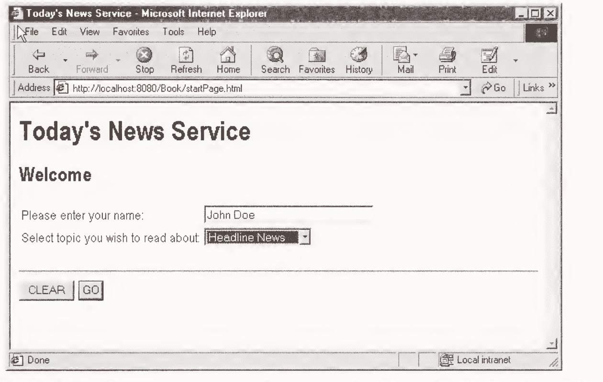

#### 图 4-4 startPage.html

6.  在 `%TOMCAT_HOME%/webapps/Book` 下创建一个空文件 `redirect.jsp`。

7.  首先要做的检索用户输入。输入以下使用 request 隐式对象检索提交表单参数（用户名和主题选择）的 JSP 脚本段。

```
<%
    String name = (String)request.getParameter("name");
    String choice = (String)request.getParameter("choice");
%>
```

8.  检查用户输入是否有错误。可能发生两种错误：用户未输入名称或用户未进行主题选择。如果发生第一种错误，将用户重定向到 `errorName.html`。如果发生第二种错误，将用户重定向到 `errorChoice.html`。以下 JSP 脚本段使用 *response* 隐式对象执行这些步骤。将它们输入到你的 JSP 文件中。

```
<%
if((name == null) || (name.length() == 0)) {
    response.sendRedirect("errorName.html");
}
else if(choice.equals("NONE")) {
    response.sendRedirect("errorChoice.html");
}
%>
```

9.  请记住，重定向调用中的 URL 是相对路径（它们不以 `/` 开头）。因此，HTML 文件 errorName.html 和 errorChoice.html 应与我们当前正在处理的 redirect.jsp 位于同一目录中。

10. 现在错误检查已经完成，为用户打印一个标准的欢迎页面。示例如下所示：

```
<h4> Hello <%= name %></h4>
Glad you could join us. Here's the news you requested.. <br>
<hr>
```

11. 使用 pageContext 隐式对象包含之前检索到的主题对应的适当 HTML 文件。以下 JSP 脚本段执行这些步骤。将其输入到你的 JSP 文件中。

```
<%
pageContext.include(choice + ".html");
%>
```

此项目说明了如何在 response 和 pageContext 隐式对象中使用方法，从 JSP 页面重定向或包含资源。正如我们将在下一个模块中看到的，有比在 JSP 页面中使用 Java 代码执行这些操作更好的方法。

## out 变量

JSP 页面中的所有数据都使用由隐式变量 out 引用的 javax.servlet.jsp.JspWriter 对象写入。JspWriter 模拟 java.io.PrintWriter 的行为，不同之处在于它在发生 I/O 错误时，其所有打印方法都会抛出 java.io.IOException。如果 JSP 页面是缓冲的（默认行为），JspWriter 对象还模拟 java.io.BufferedWriter。你可以启用或禁用


### 外部服务

*JspWriter* 对象提供的两个服务是

- 管理响应缓冲
- 写入内容

让我们详细看看每一项。

### 管理响应缓冲

JSP 页面作者可以调用 *clear* 方法来清除缓冲区的内容。这类似于将响应流重置为从头开始。如果响应已被提交，这会抛出一个 *IOException* 作为副作用。相比之下，另一个替代方法 *clearBuffer* 清除缓冲区的*当前*内容，即使内容已经提交给客户端，也可以调用。*out* 变量还提供了一个 *flush* 方法，用于将当前 *JspWriter* 缓冲区显式地写入客户端。你可以使用 *getRemaining* 方法来获取缓冲区的当前状态。此方法返回缓冲区中剩余的字节数。表 4-17 列出了 *out* 变量的缓冲方法。

### 写入内容

*JspWriter* 对象提供了多种方法将内容写入响应缓冲区。*JspWriter* 源自 *java.io.Writer*，后者提供了一系列写入方法。*JspWriter* 本身提供了一系列 *print* 方法。每个 *print* 方法都有一个等效的 *println* 方法，该方法在将请求的数据打印到响应流后，还会插入一个换行字符串。换行字符串的值来自系统属性 `line.separator`，并不总是单个换行符（`\n`）。一个有趣的打印方法通过调用 `String.valueOf(Object)` 方法获取 *Object* 的 *String* 表示，然后将其写入响应流，从而打印任何 *Object*。

#### 表 4-17 *out* 变量提供的缓冲方法

| 方法签名 | 用途 |
| :--- | :--- |
| void clear() | 清除缓冲区的内容 |
| void clearBuffer() | 清除缓冲区的当前内容 |
| void flush() | 刷新流，将输出发送到客户端 |
| void close() | 关闭流，首先刷新它 |
| int getBufferSize() | 返回缓冲区的大小（以字节为单位） |
| int getRemaining() | 返回缓冲区中未使用的字节数 |
| boolean isAutoFlush() | 返回一个布尔值，指示此 *JspWriter* 在缓冲区溢出时是自动刷新还是抛出 *IOException* |

### ? 向专家提问

**问：** 什么时候应该使用隐式变量 *out*？难道不能只用静态文本和 JSP 表达式吗？

**答：** 变量 *out* 可以方便地在 JSP 脚本中打印到响应流，而无需中断脚本。考虑以下 JSP 代码片段：

```
<% /* For each category of expenses... */
Iterator iter = splits.keySet().iterator();
while(iter.hasNext()) {
    String cat = (String)iter.next();
    Total t = (Total)splits.get(cat);
    int percent = (int)((t.value()/grand_total) * 100);
}%>
<TR>
<TD><%= cat %> (<%= percent %>%) </TD>
<TD>&nbsp;&nbsp;&nbsp;&nbsp;&nbsp;</TD>
<%-- Draw colored bar for this category. --%>
<%
    for (int i=0; i<100; i++) {
        if (i <= percent) {
%>
            <TD BGCOLOR="<%= colorForCategory(cat)
%>">&nbsp;</TD>
<%
        } else {
%>
<%-- Fill with white spaces afterward --%>
            <TD BGCOLOR="white">&nbsp;</TD>
<%
        }
    }
%>
</TR>
<%-- Draw space between category bars --%>
<TR><TD HEIGHT="5" colspan=101></TD></TR>
<%
    }
%>
```

这段代码片段在 HTML 表格中绘制表行和表格单元格，使用了动态数据。中间穿插了各种条件语句。这段代码非常难以阅读，因为 HTML 语句和 Java 代码交织在一起。每次需要引入 HTML 语句时，都必须关闭当前的 JSP 脚本块，并在 HTML 打印完成后重新开始。对于这种情况，最好使用 *out* 变量来打印 HTML。考虑同样的例子，但这次我们使用 *out* 变量来打印 HTML 语句。

```
<% /* For each category of expenses... */
    Iterator iter = splits.keySet().iterator();
    while(iter.hasNext()) {
        String cat = (String)iter.next();
        /* Grab the total-expense for this category. */
        Total t = (Total)splits.get(cat);
        /* Calculate percentage for this category
           to the grand-total. */
int percent = (int)((t.value()/grand_total) * 100);
out.println("<TR>");
out.println("<TD>" + cat + "(" + percent + ") </TD>");
out.println("<TD>&nbsp;&nbsp;&nbsp;&nbsp;&nbsp;</TD>");
/* Draw colored bar for this category. */
for (int i=0; i<100; i++) {
    if (i <= percent) {
        out.println("<TD BGCOLOR=" +
            colorForCategory(cat) + ">&nbsp;</TD>");
    } else {
        /* Fill with white spaces afterward */
        out.println("<TD BGCOLOR=white>&nbsp;</TD>");

    }
}
out.println("</TR>");
/* Draw space between category bars */
out.println("<TR><TD HEIGHT=5 colspan=101></TD></TR>");
}
%>
```

你可能会认为第二个版本本身也很难读，但它肯定比第一个版本更易读。第二个版本只有一个 JSP 脚本块，所有的 Java 代码都集中在一起，因此代码的可读性略有提高。

你也可以使用 *out* 变量进行调试。在普通的 Java 代码中，当你想打印异常堆栈跟踪时，只需在异常上调用 *printStackTrace* 方法。在 JSP 开发环境中，标准错误流会发送到 JSP 容器的控制台（如果存在）。它不会像你期望的那样显示在你的浏览器客户端上。如果你想让异常对浏览器客户端可见，必须传递一个 *java.io.PrintWriter* 参数调用 *printStackTrace*。你可以通过将 *JspWriter* 对象包装成 *PrintWriter* 来获得 *PrintWriter*，如以下代码片段所示：

```
The exception stack trace is: <BR>
<PRE><% exception.printStackTrace(
    new java.io.PrintWriter(out));
%></PRE>
```

表 4-18 列出了 out 隐式变量引用的 *JspWriter* 中一些有用的打印方法。

### 一分钟速记

- `out.clear` 和 `out.flush` 有什么区别？
- 什么时候应该使用 `out` 变量？

## *application* 变量

*application* 变量提供对 *javax.servlet.ServletContext* 对象的访问。我们在模块 2 中描述 JSP 作用域时提到了 *ServletContext*。我们描述了每个 Web 应用程序如何以 Web 服务器中的特定路径为根。在项目 2-1 中，你通过在 Tomcat 的 *server.xml* 文件中插入以下行，为 Tomcat Web 服务器定义了一个应用程序上下文：

```
<Context path="/Book"
          docBase="webapps/Book">
</Context>
```

这些行告诉 Tomcat 将所有以 /Book 开头的请求（*上下文路径*）映射到以 `http://<server-host>/webapps/Book` 开头的绝对路径。此外，Tomcat（以及所有其他 servlet 容器）会将映射到此路径的每个 servlet 请求路由到单个 *ServletContext* 实例。

> **注意**
> Servlet 规范 v.2.2 断言，在单个 Java 虚拟机（JVM）内，每个应用程序只能有一个 *ServletContext* 实例。Web 应用程序可以是可分布的（即，托管在多台物理机器、Web 服务器或 JVM 上），在这种情况下，将会有多个 *ServletContext* 来处理相同的应用程序上下文。

- *clear* 方法清除写入输出缓冲区的所有内容，而 *flush* 方法将其写入客户端。
- *out* 变量在脚本中很有用，也有助于调试。


### *out* 变量提供的打印方法

| 方法签名 | 用途 |
| :--- | :--- |
| `void print(boolean b)` | 将相关变量的值打印到输出流，并根据平台的默认字符编码将值转换为字节 |
| `void print(char c)` | 将相关变量的值打印到输出流，并根据平台的默认字符编码将值转换为字节 |
| `void print(int i)` | 将相关变量的值打印到输出流，并根据平台的默认字符编码将值转换为字节 |
| `void print(long l)` | 将相关变量的值打印到输出流，并根据平台的默认字符编码将值转换为字节 |
| `void print(float f)` | 将相关变量的值打印到输出流，并根据平台的默认字符编码将值转换为字节 |
| `void print(double d)` | 将相关变量的值打印到输出流，并根据平台的默认字符编码将值转换为字节 |
| `void print(char[] s)` | 将相关变量的值打印到输出流，并根据平台的默认字符编码将值转换为字节 |
| `void print(String s)` | 将相关变量的值打印到输出流，并根据平台的默认字符编码将值转换为字节 |
| `void print(Object obj)` | 打印一个对象。由 `String.valueOf(Object)` 方法产生的字符串根据平台的默认字符编码转换为字节 |
| `void println(boolean x)` | 将相关类型打印到输出流，然后插入一个行分隔符字符串。行分隔符字符串由系统属性 `line.separator` 定义，不一定是一个换行符 (`'\n'`) |
| `void println(char x)` | 将相关类型打印到输出流，然后插入一个行分隔符字符串。行分隔符字符串由系统属性 `line.separator` 定义，不一定是一个换行符 (`'\n'`) |
| `void println(int x)` | 将相关类型打印到输出流，然后插入一个行分隔符字符串。行分隔符字符串由系统属性 `line.separator` 定义，不一定是一个换行符 (`'\n'`) |
| `void println(long x)` | 将相关类型打印到输出流，然后插入一个行分隔符字符串。行分隔符字符串由系统属性 `line.separator` 定义，不一定是一个换行符 (`'\n'`) |
| `void println(float x)` | 将相关类型打印到输出流，然后插入一个行分隔符字符串。行分隔符字符串由系统属性 `line.separator` 定义，不一定是一个换行符 (`'\n'`) |
| `void println(double x)` | 将相关类型打印到输出流，然后插入一个行分隔符字符串。行分隔符字符串由系统属性 `line.separator` 定义，不一定是一个换行符 (`'\n'`) |
| `void println(char[] x)` | 将相关类型打印到输出流，然后插入一个行分隔符字符串。行分隔符字符串由系统属性 `line.separator` 定义，不一定是一个换行符 (`'\n'`) |
| `void println(String x)` | 将相关类型打印到输出流，然后插入一个行分隔符字符串。行分隔符字符串由系统属性 `line.separator` 定义，不一定是一个换行符 (`'\n'`) |
| `void println(Object x)` | 打印一个对象，然后插入一个新行 |

# 应用服务

`ServletContext` 对象提供五项服务：

- 访问应用程序初始化参数
- 管理应用程序上下文属性
- 支持资源抽象
- *RequestDispatcher* 方法
- 实用工具方法

# 访问初始化参数

*ServletContext* 对象（由 *application* 变量引用）提供对应用程序上下文属性的访问。这对于将设置信息与给定应用程序关联非常有用。例如，您可以使用初始化参数提供一个数据库主机名，每个 servlet 客户端和 JSP 页面都可以使用该主机名连接到数据库并检索应用程序数据。您可以在使用部署工具部署 servlet 时或将配置脚本分配给它们时分配这些参数。Tomcat 使用应用程序上下文目录下 `WEB-INF` 目录中的 `web.xml` 文件来实现此目的。例如，我们可以使用以下几行向我们的 `/Book` 应用程序上下文添加一个 `host` 初始化参数：

```
<web-app>
    <context-param>
        <param-name>host</param-name>
        <param-value>madeline</param-value>
    </context-param>
</web-app>
```

您可以在 JSP 页面中使用类似以下的代码访问这些初始化参数：

```
<%@ page import="java.util.Enumeration" %>
<% Enumeration enum =
    application.getInitParameterNames();
while (enum.hasMoreElements()) {
    String name = (String)enum.nextElement();
    String value = application.getInitParameter(name);
%>
    <%= name + ": " + value%><BR>
<% } %>
```

表 4-19 列出了访问应用程序上下文初始化参数的方法签名。

| 方法签名 | 用途 |
|---|---|
| String getInitParameter(String name) | 返回命名初始化参数的值 |
| java.util.Enumeration getInitParameterNames() | 返回所有已定义的应用程序初始化参数的枚举 |

# 表 4-19 应用程序上下文初始化参数

# 管理应用程序上下文属性

*ServletContext* 对象还帮助您缓存和管理具有应用程序范围的属性。例如，假设您构建了一个 *SecurityManager* 类来跟踪所有活动用户并缓存每个用户的安全属性。您应该在应用程序范围内缓存此对象，以确保一致性和通用可用性。您可以在 JSP 页面中这样操作：

```
<% synchronized(SecurityManager.class) {
    SecurityManager secMgr = new SecurityManager();
    application.setAttribute("SecurityManager", secMgr);
}%>
```

然后任何其他 JSP 页面都可以像这样检索 *SecurityManager* 对象：

```
<% synchronized(SecurityManager.class) {
    SecurityManager secMgr = (SecurityManager)
        application.getAttribute("SecurityManager");
}%>
```

ServletContext 对象还提供了删除属性和列出所有属性名称的方法。表 4-20 列出了管理应用程序属性的方法签名。

| 方法签名 | 用途 |
| --- | --- |
| Object getAttribute(String name) | 从 *ServletContext* 返回一个命名属性 |
| void setAttribute(String name, Object object) | 将一个命名属性设置到 *ServletContext* 中 |
| java.util.Enumeration getAttributeNames() | 返回存储在 *ServletContext* 中的所有属性的枚举 |
| void removeAttribute(String name) | 从 *ServletContext* 中移除一个命名属性 |

# 表 4-20 管理应用程序属性

# 支持资源抽象

*ServletContext* 对象支持基于相对 URL 直接访问静态文档层次结构中的 Web 资源。您可以通过使用 *getResource* 或 *getResourceAsStream* 方法来实现。当您想要读取一个资源并需要知道其完整路径时，这可能很有用。其思想似乎是为资源定义一个抽象接口。这允许 servlet 和 JSP 容器供应商实现类似于 Java 类加载器的高级搜索机制。根据他们的目标，servlet 和 JSP 容器供应商可以支持从 JAR 文件中读取 URL，或者他们可以将您提供的相对 URL 映射到另一个 Web 服务器、数据库服务器或 Enterprise JavaBeans 服务。然而，Tomcat 只是将相对路径附加到应用程序的上下文根，这与 *getRealPath* 方法类似。以下代码使用 *getResource* 和 *getRealPath* 打印相同的路径：

```
<% URL url =
    application.getResource("/");
%>
getResource(PATH): <%= url.getPath() %><BR>
getRealPath(PATH): <%= application.getRealPath("/") %>
```

*getResourceAsStream* 方法返回一个 *InputStream* 对象而不是 *URL* 对象，用于读取资源的内容：

```
InputStream in = application.getResourceAsStream("/");
```

它充当以下代码片段的便捷快捷方式：

```
<% URL url =  application.getResource("/");
   InputStream in = url.openStream();
%>
```

表 4-21 列出了管理资源的方法签名。


## 表 4-21 管理资源

| 方法签名 | 用途 |
| --- | --- |
| `java.net.URL getResource(String path)` | 为检索应用资源提供抽象层 |
| `java.io.InputStream getResourceAsStream(String path)` | 打开一个 `InputStream` 用于读取 Web 资源 |

## RequestDispatcher 方法

`RequestDispatcher` 方法为 Web 应用程序中的 servlet 之间的流程控制提供了支持。这对于任何基于 servlet 和 JavaServer Pages 技术的、重要的 Web 应用程序都是核心。任何给定的 servlet 都可以使用 `RequestDispatcher` 将控制重定向或转发到另一个 servlet、JSP 页面或 HTML 页面。

`ServletContext` 对象提供了两种获取 `RequestDispatcher` 的方式：`getNamedDispatcher` 和 `getRequestDispatcher` 方法。这两种方法都将 `RequestDispatcher` 对象包装在一个 Web 资源上，前者包装一个具名 servlet，后者包装一个相对 URL。

在部署 servlet 时，你需要为其命名。Tomcat 要求你在应用程序上下文的 `WEB-INF` 目录中的 `web.xml` 文件中进行此操作。我们将在附录 C 中详细讨论 `web.xml`。例如，以下几行代码为 *snooper* servlet 命名：

```xml
<servlet>
    <servlet-name>snooper</servlet-name>
    <servlet-class>SnoopServlet</servlet-class>
</servlet>
```

一旦你为 servlet 命名，JavaServer Pages 就可以创建一个 `RequestDispatcher`，将当前请求转发给命名的 servlet。以下 JSP 脚本片段将请求转发给 *snooper* servlet：

```jsp
<% out.clear();
RequestDispatcher rd = 
    application.getNamedDispatcher("snooper");
rd.forward(request, response);
%>
```

请注意，我们在将控制权转发给 snooper servlet 之前，清除了输出缓冲区的当前内容。应确保在调用 RequestDispatcher 的 forward 方法之前，响应尚未被提交且为空。在已提交的响应之后调用 forward 会导致 IllegalStateException。Servlet 规范 v2.2 指出，如果响应缓冲区中存在任何尚未提交的输出，则必须在调用目标 servlet 的 service 方法之前将其清除。

#### 注意

我们注意到 Tomcat（版本 3.2.1）在转发之前不会清除响应缓冲区的输出。实际上，它会堆叠响应，并在转发 servlet 的输出之后打印它。一个稳妥的做法是在调用 forward 方法之前显式清除输出缓冲区。

你可以使用 RequestDispatcher 来包含资源，而不是转发给它们。以下 JSP 脚本片段将 snooper servlet 的响应包含在当前 JSP 页面内。

```jsp
<%
  out.flush();
  RequestDispatcher rd =
      application.getNamedDispatcher("snooper");
  rd.include(request, response);
%>
```

请注意，我们在包含 snooper servlet 之前刷新了输出缓冲区的当前内容。刷新是必要的，以确保输出缓冲区的当前内容在 snooper servlet 的输出之前显示。相反，如果我们根本不希望当前内容出现在输出中，则应清除输出缓冲区的当前内容。

#### 注意

在 Tomcat（版本 3.2.1）中，如果我们没有包含刷新操作，其效果就像是为当前 JSP 页面和 snooper servlet 堆叠了响应缓冲区。也就是说，snooper servlet 的响应缓冲区将出现在浏览器输出中我们的 JSP 页面输出之前。Servlet 规范 v2.2 没有说明这种情况下的预期行为。因此，在调用 include 方法之前刷新或清除输出缓冲区是一个好的实践。

获取 *RequestDispatcher* 的第二种方式是使用 *getRequestDispatcher* 方法，它通过 URL 路径来标识 Web 资源。以下是第二种方法的代码：

```jsp
<% out.clear();
RequestDispatcher rd =
    application.getRequestDispatcher("/snooper");
rd.forward(request, response);
%>
```

请注意，我们使用路径而不是名称来调用 *snooper* servlet。在 Tomcat 中，当 servlet 部署时，该路径也可以在 *web.xml* 文件中指定为 servlet 映射元素。例如，以下几行代码为 snooper 注册了 URL 到 servlet 的映射。

```xml
<servlet-mapping>
    <servlet-name> snooper </servlet-name>
    <url-pattern> /snooper </url-pattern>
</servlet-mapping>
```

你可以使用 *getRequestDispatcher* 返回的 *RequestDispatcher* 将 Web 资源包含到你的 JSP 页面中。下面是一个例子：

```jsp
<% out.flush();
RequestDispatcher rd =
    application.getRequestDispatcher("/snooper");
rd.include(request, response);
%>
```

当你包含一个资源时，你可以在包含操作的前后都使用 *out* 变量。这意味着以下代码是合法的：

```html
<B>Hello!</B>
<% out.flush();
RequestDispatcher rd =
    application.getRequestDispatcher("/snooper");
rd.include(request, response);
%>
<B>Goodbye!</B>
```

根据你在调用 *include* 方法之前是刷新还是清除了缓冲区，响应缓冲区的工作方式会有所不同。如果你先刷新，JSP 容器会先写入现有输出，然后是包含的内容，接着是你在包含操作之后写入响应缓冲区的任何内容。如果你在执行包含之前清除了响应缓冲区，那么 JSP 容器会先写入包含的内容，然后是你在包含操作之后写入的任何内容。表 4-22 列出了方法签名。

## 实用工具方法

*ServletContext* 对象提供了各种实用工具方法。例如，它允许你将消息记录到 servlet 日志文件中。Tomcat 的 servlet 日志文件 `servlet.log` 位于 `%TOMCAT_HOME%/logs/`。以下是如何将消息记录到此文件的方法：

```jsp
<% application.log("test log message"); %>
```

此日志操作会产生如下日志消息：

```
2001-02-26 08:38:47 - path="/Book" :test log message
```

请注意，日志消息包括日期、应用程序上下文和消息本身。你可以选择性地将异常与消息一起记录。通过这样做，你会在日志消息之后记录一个堆栈跟踪。以下是如何将堆栈跟踪添加到日志消息的方法：

```jsp
<% application.log("test log message",
            new Exception("stack trace"));
%>
```

表 4-23 列出了你可能会用到的实用工具方法。

| 方法签名 | 用途 |
| :--- | :--- |
| `javax.servlet.RequestDispatcher`<br>`getNamedDispatcher(String name)` | 返回一个由给定名称标识的 *RequestDispatcher* |
| `javax.servlet.RequestDispatcher`<br>`getRequestDispatcher(String path)` | 返回一个由 *ServletContext* 范围内给定路径标识的 *RequestDispatcher* |
| `void log(String message)` | 将消息记录到 servlet 日志文件 |
| `void log(String message, Throwable throwable)` | 将消息和堆栈跟踪记录到 servlet 日志文件 |
| `String getMimeType(String file)` | 返回指定文件的 MIME 类型。例如，文本文件将返回 `text/plain`。MIME 类型由 servlet 容器的配置决定，并可能在 Web 应用程序部署描述符（`web.xml` 文件）中指定 |
| `String getRealPath(String virtualPath)` | 返回一个包含给定虚拟路径对应的真实文件系统路径的 `String` |
| `String getServerInfo()` | 返回一个包含 servlet 运行所在的 servlet 容器信息的字符串。这至少包括容器名称和版本号 |
| `int getMajorVersion()` | 返回 Java servlet 容器的主版本号。对于支持 2.2 版本的容器，此方法返回 2 |
| `int getMinorVersion()` | 返回 Java servlet 容器的次版本号。对于支持 2.2 版本的容器，此方法返回 2 |

**表 4-23** 实用工具方法

## 1 分钟速查

- JSP 页面如何检索应用程序初始化值？
- 如何在应用程序作用域中缓存对象？
- *application* 对象提供了哪些方法来获取调度器？
- 如何将消息记录到 servlet 日志文件？

- 首先，JSP 页面调用 `application.getInitParameterNames`。然后，为每个参数名称调用 `application.getInitParameter`。
- 通过调用 `application.setAttribute` 在应用程序作用域中缓存对象。
- application 隐式对象提供了 `getNamedDispatcher` 和 `getRequestDispatcher`。
- 通过调用 `application.log(String message)` 或 `application.log(String message, Throwable ex)` 将消息记录到 servlet 日志文件。


# *config* 变量

*config* 变量提供了对给定 servlet 或 JSP 页面的 `javax.servlet.ServletConfig` 对象的访问。该对象封装了初始化参数以及一些实用方法。其中最有趣的是初始化参数。你可以在应用程序的 `web.xml` 文件中为 servlet 和 JavaServer Pages 提供初始化参数。

假设你创建了一个名为 `config.jsp` 的 JSP 页面，其中包含以下代码片段：

```
<% java.util.Enumeration e =
    config.getInitParameterNames();
while (e.hasMoreElements()) {
    String paramName = (String)e.nextElement();
    String param =
        config.getInitParameter(paramName);
%>
    <BR>Parameter: <%= paramName %>
           Value: <%= param %>
<% } %><BR>
```

你可以在应用程序的 `web.xml` 文件中为此 JSP 页面分配一个逻辑名称。分配可能如下所示：

```
<servlet>
    <servlet-name>config</servlet-name>
    <jsp-file>/jsp/config.jsp</jsp-file>
    <init-param>
        <param-name>host</param-name>
        <param-value>madeline</param-value>
    </init-param>
</servlet>
```

这里，我们为 JSP 页面分配了逻辑名称 *config*，并指定了其相对 URL。然后我们开始定义参数名-值对。我们用一个 `<servlet-mapping>` 标签完成关联：

```
<servlet-mapping>
    <servlet-name>config</servlet-name>
    <url-pattern>/config</url-pattern>
</servlet-mapping>
```

在此 `web.xml` 片段中，我们指定将使用 URL `/config` 来访问 `config` JSP 页面。现在，当我们访问 JSP 页面时，得到以下结果：
Parameter: host Value: madeline
表 4-24 列出了 `ServletConfig` 对象的方法签名。

## 1 分钟速查

- `config` 变量的主要用途是什么？
- 如何命名 JSP 页面？

# `page` 变量

`page` 变量是一个隐式变量，可在 JSP 脚本片段和表达式中使用，它对应于处理当前请求的 JSP 页面实现类的实例。正如我们在模块 2 中看到的，JSP 页面实现类在 JSP 页面首次执行时会自动生成。当脚本语言为 Java 时，`page` 变量仅仅是 `this` 引用的同义词。

## page 服务

`page` 隐式变量提供两类服务：

- 契约服务
- 访问 servlet 信息

## 契约服务

正如我们在模块 2 中所解释的，页面实现类必须实现 `javax.servlet.jsp.HttpJspPage` 接口，以满足 JSP 容器和 JSP 页面作者之间的契约。该接口主要定义了 JSP 容器会调用的契约方法 `jspInit`、`_jspService` 和 `jspDestroy`。这些方法对 JSP 页面作者是不可用的。

`config` 变量的主要用途是检索命名的 JavaServer Pages 的初始化值。
你命名 JSP 页面的方式与命名 Servlet 相同。你在应用程序的 `web.xml` 文件中使用 `<servlet>` 元素来命名 JSP 页面。

## 表 4-24 config 变量提供的方法

| 方法签名 | 用途 |
| :--- | :--- |
| `String getInitParameter(String name)` | 检索命名的初始化参数 |
| `java.util.Enumeration getInitParameterNames()` | 检索所有初始化参数名称的枚举 |
| `String getServletName()` | 检索当前 servlet 或 JSP 页面的名称 |
| `ServletContext getServletContext()` | 检索当前 servlet 或 JSP 页面的 servlet 上下文 |

## 访问 Servlet 信息

`HttpJspPage` 接口扩展了 `JspPage`，而 `JspPage` 又扩展了 `javax.servlet.Servlet` 接口。这提供了一些有用的功能，如 `getServletConfig` 和 `getServletInfo`，JSP 页面作者可以通过 `page` 隐式变量调用这些方法。
表 4-25 显示了这些方法签名。
`page` 隐式变量通常不被 JSP 页面作者使用。

## 表 4-25 page 中的有用方法

| 方法签名 | 用途 |
| :--- | :--- |
| `javax.servlet.ServletConfig getServletConfig()` | 获取当前的 `config` 变量 |
| `String getServletInfo()` | 返回有关 servlet 的信息，如作者、版本和版权信息 |

# exception 变量

`exception` 变量提供了对在使用页面指令的 `errorPage` 属性声明的错误 JSP 页面内部异常的访问（正如我们在模块 2 中描述的）。`_jspService` 方法会捕获在 JSP 页面内部抛出的异常，然后将它们重定向到默认页面或已声明的错误 JSP 页面。该变量在任何未声明为错误页面的页面中都不可用。一个页面是使用页面指令的 `isErrorPage` 属性声明为错误页面的。

## exception 服务

表 4-26 列出了使用 *exception* 变量可用的方法。

| 方法签名 | 用途 |
| :--- | :--- |
| `java.lang.String getLocalizedMessage()` | 创建此 Throwable 的本地化描述 |
| `java.lang.String getMessage()` | 返回与此 Throwable 关联的错误消息 |
| `void printStackTrace()` | 将 Throwable 的回溯信息打印到标准错误流 |
| `void printStackTrace(java.io.PrintStream)` | 将回溯信息打印到指定的打印流 |
| `void printStackTrace(java.io.PrintWriter)` | 将回溯信息打印到指定的打印写入器 |

## 掌握检查

1. 列出隐式对象。

2. 隐式对象在什么意义上是隐式的？

3. 哪个隐式对象提供了对应用程序上下文的访问？哪个提供了对请求参数的访问？

4. 为什么 JSP 容器提供一个工厂方法来创建 *pageContext* 对象？

5. 为什么 JavaServer Pages 不能流式传输二进制内容？

6. JSP 页面开发者如何将信息从一个请求传递到另一个请求？

7. 将控制权从一个 JSP 页面传递给另一个 JSP 页面有哪些不同的方式？

8. 在 servlet 和 JavaServer Pages 中跟踪会话有哪些不同的方式？

9. 为什么你想在 JSP 应用程序中跟踪会话？

10. *exception* 隐式对象的目的是什么？

# 模块 5

## 标准动作

## 本模块目标

- 理解 JSP 动作
- 学习标准动作
- 有效使用标准动作

在模块 2 和 3 中，我们描述了如何使用 JSP 指令、声明、表达式和脚本片段在 JavaServer Pages 中嵌入 Java 代码。在模块 4 中，我们描述了隐式对象，它们使你能够直接访问 Java servlet 和 JSP 类，你可以在声明、表达式和脚本片段中使用它们。有人将这种在 JavaServer Pages 中嵌入 Java 代码的能力描绘为与纯 servlet 编程相比在生成动态网页方面的根本优势。然而，我们已经提出，将大量 Java 代码段嵌入 JavaServer Pages 的复杂应用程序所产生的代码，与打印大量静态 HTML 的 servlet 一样令人困惑。JSP 页面中静态 HTML 和 Java 的整体混合，并不比 servlet 中 Java 和 Java 打印语句的整体混合更好。需要将 Web 功能更清晰地封装在 Web 组件中。JSP 动作通过将静态 HTML 和 Java 代码移出 JSP 页面，并用声明性标签替换它们来鼓励这种封装。

## JSP 动作

JSP 动作将代码处理器与特殊的 JSP 标签关联起来。这些标签基于可扩展标记语言（XML）规范，有两种可能的格式：

```
<prefix: tagName [attr="value"]* > tagBody </prefix: tagName>
<prefix: tagName [attr="value"]* />
```

第一种格式包括开始标签、零个或多个标签属性、标签体和包含前缀和标签名的结束标签。第二种格式包括一个开始标签、零个或多个标签属性，以及一个仅为两个字符序列（/>）的结束标签。这第二种格式完全等同于第一种格式，只是标签体为空。当 JSP 容器在解释 JSP 页面时遇到这些特殊标签时，它会调用关联的处理器。

### 标准动作与自定义动作

JSP 规范要求所有符合规范的 JSP 容器支持一套标准的 JSP 动作，以及开发自定义动作（标签库）的机制。我们在本模块中描述标准动作，在模块 6 中描述自定义动作。所有标准动作都使用保留的前缀 "jsp."。表 5-1 列出了 JSP 1.1 规范要求的全套标准动作。

## 标准动作

| 标准动作 | 描述 |
| :--- | :--- |
| `<jsp:useBean>` | 查找或实例化具有指定名称和作用域的JavaBean |
| `<jsp:setProperty>` | 设置JavaBean中的一个或多个属性值 |
| `<jsp:getProperty>` | 获取JavaBean的属性值 |
| `<jsp:include>` | 包含静态文件或向动态文件发送请求 |
| `<jsp:forward>` | 将客户端请求转发到HTML文件、JSP文件或servlet进行处理 |
| `<jsp:param>` | 为其他JSP动作提供名称/值信息 |
| `<jsp:plugin>` | 向浏览器下载插件软件，并生成特定于浏览器的标签以执行applet或bean |
| `<jsp:params>` | 由`<jsp:plugin>`使用，用于封装一组`<jsp:param>`标签 |
| `<jsp:fallback>` | 由`<jsp:plugin>`使用，在插件加载失败时提供备用HTML响应 |

表5-1 JSP 1.1中的标准动作

### 标签属性

JSP容器使用*标签属性*来初始化动作。标签属性为标签处理程序提供命名的值作为参数。所有属性都以name-value对的形式指定，使用赋值字符(=)，并将值括在单引号(')或双引号(")中：

```
attribute-name="attribute-value"
```

或

```
attribute-name='attribute-value'
```

通常，您指定的值是某个字面值或基于动作类型（如实例化Java对象）的特定操作指示。例如，您可能会这样指定name属性：

```
name="myName"
```

在这种情况下，您使用未转换的*字符串*值"myName" *原样使用*。您可能会这样指定要实例化的Java类：

```
class="book.myBean"
```

在这种情况下，值"book.myBean"指定了要实例化的Java类。

您也可以为某些属性指定JSP表达式作为值。在模块6中，我们将描述如何为自定义动作启用和禁用此类属性。在这里，我们列出支持此类属性的标准动作。一般格式为：

```
attribute-name="<%= scriptlet-expr %>"
```

或

```
attribute-name='<%= scriptlet-expr %>'
```

此类属性的特征是能够计算其在请求时的值，而不是页面翻译时的值。

您只能将JSP表达式用于属性值，而不能用于属性名称。当JSP表达式是属性的值时，它必须出现在单引号或双引号中，并且引号和表达式之间不能有静态文本（包括空格）。例如，以下使用`<jsp:param>`动作会导致错误：

```
<jsp:param name="foo"
         value=" <%= request.getAttribute("bar") %> " />
```

错误的原因是引号和JSP表达式之间有一个多余的空格。最后，一个属性值在引号之间只能包含一个JSP表达式。

表5-2显示了支持将值指定为JSP表达式的标准动作。

### id属性

`id="name"`属性/值对对符合标准的JSP容器具有特殊含义。两个特征将其与其他属性区分开来：

| 动作类型 | 属性 |
|---|---|
| `<jsp:setProperty>` | value和beanName |
| `<jsp:include>` | page |
| `<jsp:forward>` | page |
| `<jsp:param>` | value |

表5-2 接受JSP表达式的标准动作的属性

- 在同一翻译单元（即JSP页面）中，您不能对两个不同的id使用相同的名称。
- 该名称通常用于存储一个Java对象，该对象可以通过`pageContext`变量使用该名称访问，并在声明作用域中暴露一个同名的变量。

例如，考虑`<jsp:useBean>`动作。一个典型的用法可能如下所示：

```
{
  <jsp:useBean id="shoppingCart" class="com.gb.shoppingCart" />
  <%= shoppingCart.getCustomerName() %>
}
```

该标签的处理程序将创建或查找由class属性标识类型的对象，并将其与Java变量`shoppingCart`关联。我们提到的第一个特征将使以下代码片段无效，因为它对两个不同的id使用了相同的名称：

```
{
  <jsp:useBean id="shoppingCart" class="com.gb.shoppingCart" />
  <%= shoppingCart.getCustomerName() %>
  <jsp:useBean id="shoppingCart" class="com.gb.avancedShoppingCart" />
}
```

第二个特征意味着，即使变量`shoppingCart`超出作用域（在右花括号之后），该对象仍然存在，并且可以使用`pageContext`变量进行检索。

### scope属性

`scope`属性对符合标准的JSP容器也具有特殊含义。回顾一下，JavaServer Pages可以参与四种不同的作用域和生命周期：

- **页面**：可从`PageContext`对象访问并共享其生命周期
- **请求**：可从`HttpServletRequest`对象访问并共享其生命周期
- **会话**：可从`HttpSession`对象访问并共享其生命周期
- **应用**：可从*ServletContext*对象访问并共享其生命周期

当您将`scope="page|request|session|application"`属性/值对与id属性结合使用时，您将一个命名空间和生命周期与具有指定id的对象关联起来。


### 一分钟练习

- 什么是JSP动作？
- JSP 1.1规范支持哪些类型的动作？
- 标签属性的目的是什么？
- 哪些标签属性对JSP容器具有特殊含义？

## `<jsp:useBean>`动作

将大多数Java处理移出JSP页面的一种方法是将其封装在JavaBean中。`<jsp:useBean>`动作在给定作用域中将JavaBean实例与一个id和一个共享相同id的脚本变量相关联。其基本操作是首先使用id和scope查找现有对象；如果无法在指定作用域中找到具有指定id的对象，则尝试使用其他属性创建新实例。

通过将Java处理移出JSP页面本身并放入JavaBean中，您还可以在其他JSP页面中重用此功能。您可以通过使用`<jsp:useBean>`动作为最初在其他地方定义的对象提供本地名称来实现这一点。

`<jsp:useBean>`动作有两种变体。如果`<jsp:useBean>`标签没有主体，其语法为：

```
<jsp:useBean id="name"
scope="page|request|session|application"
typeSpec />
```

typeSpec ::= class="className" |
class="className" type="typeName" |
beanName="beanName" type="typeName" |
type="typeName"

`<jsp:useBean>`动作也可以包含*标签主体*。例如，您可能希望插入`<jsp:setProperty>`动作来初始化JavaBean。如果标签有主体，其语法为：

```
<jsp:useBean id="name"
             scope="page|request|session|application"
             typeSpec>
    tagBody
</jsp:useBean>
```

- JSP动作将Java处理程序与XML标签关联。JSP容器在处理标签时调用该处理程序。
- JSP 1.1规范支持标准和自定义标签。标准标签都使用“jsp”前缀。
- 标签属性初始化并向标签处理程序提供参数。
- id和scope属性对JSP容器具有特殊含义。

### 属性和使用规则

表5-3列出了您可以提供给`<jsp:useBean>`标签的属性集。

### 处理步骤

`<jsp:useBean>`动作遵循以下步骤：

| 属性 | 使用规则 |
| :--- | :--- |
| id | 对象实例的名称和引用该对象的脚本（Java）变量的名称。名称区分大小写 |
| scope | 对象的作用域。默认是页面作用域 |
| class | 定义JavaBean实现的（Java）类的全限定名。如果未指定type属性，则必须指定class属性。如果指定了beanName属性，则不能指定class属性 |
| beanName | java.beans.Beans.instantiate()所需的JavaBean名称。也就是说，它必须是"a.b.c"形式或"a/b/c.ser."形式。如果指定了class属性，则不能指定beanName属性 |
| type | 脚本变量的类型。这可以与对象相同，是对象的超类，或对象实现的Java接口。如果未指定class属性，则必须指定type属性 |

表5-3 `<jsp:useBean>`动作的属性


### 使用 `<jsp:useBean>`

假设你定义了一个名为 "HelperBean" 的 JavaBean。以下是 *HelperBean* 类的代码：

```java
public class HelperBean {
    private int intProperty = -1;
    private String stringProperty = null;

    public HelperBean() {}

    public void setIntProperty(int value) {
        intProperty = value;
    }

    public int getIntProperty() {
        return intProperty;
    }

    public void setStringProperty(String value) {
        stringProperty = value;
    }

    public String getStringProperty() {
        return stringProperty;
    }
}
```

接下来，假设你想在 JSP 页面中使用这个类。以下是设置和获取 *HelperBean* 属性的示例代码：

```jsp
<%-- 导入 HelperBean 类 --%>
<%@ page import="HelperBean" %>

<%-- 声明 HelperBean --%>
<jsp:useBean id="myHelperBean"
             class="HelperBean" >
</jsp:useBean>

<%-- 在 JSP 脚本小程序中使用属性设置方法 --%>
<% myHelperBean.setIntProperty(25);
   myHelperBean.setStringProperty("Hello!");
%>

<%-- 在 JSP 表达式中使用属性获取方法 --%>
整型属性的值是：
<%= myHelperBean.getIntProperty() %><BR>
字符串属性的值是：
<%= myHelperBean.getStringProperty() %>
```

#### 提示

请注意，在 Tomcat 中，你必须先使用页面指令导入实现 *HelperBean* 的 Java 类。规范并不要求必须使用页面指令进行此导入，但 Tomcat 要求如此。

现在假设你想在另一个 JSP 页面或另一个客户端请求中使用此对象。你可以使用 `scope` 属性将此对象存储在会话（或请求、或应用程序）作用域中，如下所示：

```jsp
<%-- 声明 HelperBean --%>
<jsp:useBean id="myHelperBean"
             class="HelperBean"
             scope="session">
</jsp:useBean>
```

然后你可以从任何其他页面中检索该对象，并使用 `<jsp:useBean>` 操作将其分配给一个局部变量：

```jsp
<jsp:useBean id="myHelperBean"
             type="HelperBean"
             scope="session" >
</jsp:useBean>
```

然后你可以通过局部引用来调用对象的方法：

```jsp
<%-- 在 JSP 表达式中使用属性获取方法 --%>
整型属性的值是：
<%= myHelperBean.getIntProperty() %><BR>
字符串属性的值是：
<%= myHelperBean.getStringProperty() %>
```

请注意，使用原始 `<jsp:useBean>` 操作创建对象时所使用的属性名称，必须与第二个 `<jsp:useBean>` 标签中指定的 `id` 名称匹配。最后，假设 HelperBean 类实现了一个接口，例如 `StringProperty` 接口，该接口可能如下所示：

```java
public interface StringProperty {
    public String getStringProperty();
}
```

由于你可以将对象分配给它实现的任何接口声明，因此你可以这样检索存储的对象：

```jsp
<jsp:useBean id="myHelperBean"
             scope="session"
             type="StringProperty" >
</jsp:useBean>
```

但是，如果你这样做，你就只能使用 `getStringProperty` 方法，因为 `getIntProperty` 方法未在 `StringProperty` 接口中声明。

> **专家问答**
> **问：** 为什么你会想要为 `<jsp:useBean>` 声明一个与 JavaBean 不同类的 `type` 属性？
> **答：** 一个公认的良好软件设计原则是尽可能将实现细节保持为私有。这是所谓的 *信息隐藏* 的一个方面。当你为辅助 JavaBean 定义一个接口并要求 Bean 的客户端与该接口进行交互时，你就将客户端与接口的任何特定实现隔离开来——你隐藏了实现的细节。通过在接口定义中强制执行这样的软件契约，你的实现可以更改，或者你的 JSP 页面可以根据请求时的条件使用多个不同的实现，而无需更改 JSP 页面或进行自定义编码。

#### 1 分钟演练

- `<jsp:useBean>` 操作的目的是什么？
- `<jsp:useBean>` 标签的形式有哪些？
- `<jsp:useBean>` 操作是否总是创建所需 Bean 的实例？

## `<jsp:setProperty>` 操作

`<jsp:setProperty>` 操作用于设置 JavaBean 中的属性值。通常你使用 `<jsp:useBean>` 操作来定义这些 Bean。例如，你可以像上一节那样定义一个 `HelperBean` 实例：

```jsp
<%-- 导入 HelperBean 类 --%>
<%@ page import="HelperBean" %>

<%-- 声明 HelperBean --%>
<jsp:useBean id="myHelperBean"
             class="HelperBean" >
</jsp:useBean>
```

然后你可以这样设置该 `HelperBean` 实例的 `intProperty` 值：

```jsp
<%-- 在 JavaBean 上设置属性 --%>
<jsp:setProperty name="myHelperBean"
                  property="intProperty"
                  value="42"
/>
```

JSP 容器使用标准的 Java 内省机制来发现属性、属性名称、属性类型以及 getter 和 setter 方法。使用 Java 内省意味着命名约定至关重要。如果你将属性名称指定为 "intProperty"，那么 JavaBean 必须支持名为 "setIntProperty" 的属性设置方法。

- `<jsp:useBean>` 操作将 JavaBean 与脚本变量、一个 id 和一个 JSP 作用域关联起来。
- `<jsp:useBean>` 标签可以在有标签体或无标签体的情况下使用。
- 不。`<jsp:useBean>` 操作可用于为之前（可能在另一个 JSP 页面中）创建的 Bean 实例提供一个本地名称和脚本变量。

`<jsp:setProperty>` 标签的语法是：

```
<jsp:setProperty name="beanName" propExpr />

propExpr::= property="*"|
            property="propertyName"|
            property="propertyName"param="parameterName" |
            property="propertyName"value="propertyValue"|

propertyValue::= string|JSP expression
```

### 属性和使用规则

表 5-4 列出了你可以提供给 `<jsp:setProperty>` 标签的属性集。

> **问：** 是否必须使用 `<jsp:useBean>` 操作来定义 `<jsp:setProperty>` 标签所指的 JavaBean？
>
> **答：** JSP 1.1 规范建议这样做，但 Tomcat JSP 容器实现并未强制执行。Tomcat 仅要求命名的 Bean 实例作为 *PageContext* 对象的属性存在。换句话说，使用 Tomcat 时，你可以使用 `<jsp:setProperty>` 标签来设置存储在当前 *PageContext* 对象中的任何 JavaBean 的属性。例如，以下代码与使用 `<jsp:useBean>` 操作具有相同的效果：

```jsp
<%-- 导入 HelperBean 类 --%>
<%@ page import="HelperBean" %>

<%-- 创建 JavaBean 并存储在 PageContext 中 --%>
<% HelperBean myHelperBean = new HelperBean();
   pageContext.setAttribute("myHelperBean", myHelperBean);
%>

<%-- 在 JavaBean 上设置属性 --%>
<jsp:setProperty name="myHelperBean"
                 property="intProperty"
                 value="42"
/>
```


**属性**

**使用规则**

| 属性 | 使用规则 |
| :--- | :--- |
| name | 由 `<jsp:useBean>` 标签定义的 JavaBean 实例的名称。该 Bean 实例必须包含此属性，并且必须在设置任何属性之前使用 `<jsp:useBean>` 标签声明该 Bean。 |
| property | 你想要设置其值的 Bean 属性的名称。 |
| param | 你想要将其值分配给 Bean 属性的 HTTP 请求参数的名称。 |
| value | 要分配给指定属性的值。此值可以是字符串常量，也可以是请求时的 JSP 表达式。 |

表 5-4 `<jsp:setProperty>` 动作的属性

### `<jsp:setProperty>` 的两种变体

`<jsp:setProperty>` 动作有两种变体：第一种从 HTTP 请求参数赋值，第二种直接使用字符串常量或 JSP 表达式赋值。

### 使用 HTTP 请求参数分配属性值

通常，请求参数来自 Web 表单。考虑以下简单的 HTML 表单，它设置了两个名为 "intProperty" 和 "stringProperty" 的参数：

```
<FORM METHOD=GET ACTION="/Book/jsp/setProperty.jsp">
    Integer Property: <INPUT TYPE=TEXT NAME="intProperty"><BR>
    String Property: <INPUT TYPE=TEXT NAME="stringProperty"><BR><BR>
    <INPUT TYPE=SUBMIT>
</FORM>
```

图 5-2 展示了此表单在网页中的外观。

你可以通过一次使用 `<jsp:setProperty>` 标签，将这两个请求参数赋值给一个 JavaBean：

```
<jsp:setProperty name="myHelperBean"
                 property="*"
/>
```

当你将属性名设置为星号（`*`）时，该标签会遍历当前的 `HttpServletRequest` 参数，将参数名和值与属性 setter 方法名和值类型进行匹配。由于在这种情况下你没有指定参数名，标签会假定参数名与属性名匹配，并使用 Java 内省机制赋值。这意味着，如果参数名是 "intProperty"，则 JavaBean 必须有一个 `setIntProperty` 方法。

> **注意**

在 Tomcat 中，如果请求参数的值是空字符串（`""`），则不会调用属性 setter 方法。这会产生一个不良的副作用：当你使用 `<jsp:setProperty>` 时，如果属性名设置为星号（`*`），你就无法将 HTML 表单中的文本字段重置为空值。

你也可以单独设置属性值。以下几行代码设置了 `HelperBean` 实例中的每个属性：

```
<jsp:setProperty name="myHelperBean" property="intProperty" />
<jsp:setProperty name="myHelperBean" property="stringProperty" />
```

当你没有指定参数名时，标签会假定参数名与属性名相同。你也可以像这样指定参数名：

```
<jsp:setProperty name="myHelperBean"
                property="intProperty"
                param="intProperty"
/>
<jsp:setProperty name="myHelperBean"
                property="stringProperty"
                param="stringProperty"
/>
```

虽然这些行指定了相同的 `param` 和 `property` 名称，但当你指定参数名时，它可以与属性名不同。

从请求参数可以赋值的唯一类型是那些可以从 *String* 字面量转换的类型。表 5-5 显示了合法的赋值。

### 使用字符串常量和 JSP 表达式分配属性值

除了使用 HTTP 请求参数赋值外，你还可以使用 `<jsp:setProperty>` 动作将 *String* 常量或 JSP 表达式的结果分配给 JavaBean 属性。与请求参数一样，使用 *String* 常量进行的唯一合法赋值是表 5-5 中指定的那些。以下是一些使用 *String* 常量为 *HelperBean* 实例赋值的例子：

```
<%-- 分配整型属性 --%>
<jsp:setProperty name="myHelperBean"
                property="intProperty"
                value="22"
/>

<%-- 分配字符串属性 --%>
<jsp:setProperty name="myHelperBean"
                property="stringProperty"
                value="Hello"
/>
```

| 属性类型 | 从字符串值转换 |
| :--- | :--- |
| boolean 或 Boolean | `Boolean.valueOf(String)` |
| byte 或 Byte | `Byte.valueOf(String)` |
| char 或 Character | `Character.valueOf(String)` |
| double 或 Double | `Double.valueOf(String)` |
| int 或 Integer | `Integer.valueOf(String)` |
| float 或 Float | `Float.valueOf(String)` |
| long 或 Long | `Long.valueOf(String)` |
| String | `String` |

**表 5-5** 从 HTTP 请求参数进行的合法属性赋值

能够将 JSP 表达式的结果赋给属性，为 `<jsp:setProperty>` 动作增加了两个强大的功能：

- 在请求时计算值的能力。
- 将任何 Java 类型赋给属性的能力。

例如，假设我们想要将当前日期和时间赋给一个属性。如果你为 *HelperBean* 添加一个新的字符串属性，那么你可以像这样计算并将当前日期和时间存储为 *String*：

```
<jsp:setProperty name="myHelperBean"
    property="stringDate"
    value='<%= new Date().toString() %>'
/>
```

你也可以将当前日期和时间存储为 `java.util.Date` 对象。你只需在 *HelperBean* 实例中添加一个 *Date* 属性，然后像这样设置其值：

```
<jsp:setProperty name="myHelperBean"
    property="currentDate"
    value='<%= new Date() %>'
/>
```

## `<jsp:getProperty>` 动作

与设置 JavaBean 属性的 `<jsp:setProperty>` 动作相对应，`<jsp:getProperty>` 动作从 JavaBean 获取属性，将其转换为 *String*，并放入输出缓冲区。转换为 *String* 的方式与 JSP 表达式中的方式相同。这意味着该标签对对象类型调用 `toString` 方法，并直接转换基本类型。`<jsp:getProperty>` 动作的语法是：

```
<jsp:getProperty name="name"
    property="propertyName" />
```

### 属性和使用规则

表 5-6 列出了 `<jsp:getProperty>` 标签的属性。

模块 5：标准动作 179

| 属性 | 使用规则 |
| :--- | :--- |
| name | 由 `<jsp:useBean>` 标签定义的 JavaBean 实例的名称。该 Bean 实例必须包含此属性，并且必须在设置任何属性之前使用 `<jsp:useBean>` 标签声明该 Bean。 |
| property | 你想要打印其值的 Bean 属性的名称。 |

表 5-6 `<jsp:getProperty>` 动作的属性

### 使用 `<jsp:getProperty>`

`<jsp:getProperty>` 动作的功能等同于在 JSP 表达式中调用属性 getter 方法。例如，以下两个 JSP 片段的结果是等效的：

```
The value of intProperty is: <%= myHelperBean.getIntProperty() %><BR>
The value of stringProperty is: <%= myHelperBean.getStringProperty() %><BR>
```

和：

```
The value of intProperty is:
<jsp:getProperty name="myHelperBean" property="intProperty"/><BR>
The value of stringProperty is:
<jsp:getProperty name="myHelperBean" property="stringProperty"/><BR>
```

> **问题：** 使用 `<jsp:getProperty>` 和使用 JSP 表达式似乎没有太大区别。为什么我要使用 `<jsp:getProperty>`？

**回答：** 最简单的答案是 `<jsp:getProperty>` 不需要了解 Java。页面设计者可以使用像 `<jsp:useBean>`、`<jsp:setProperty>` 和 `<jsp:getProperty>` 这样的标准动作，而无需理解 Java 和 Java 属性。然而，这个答案有些牵强，因为 JSP/XML 语法可能像 Java 语法一样复杂。一个更好的、着眼于未来的理由是这些标签在理论上是语言无关的。JSP 规范预期会有除了 Java 之外的其他 JSP 脚本语言。

### 1 分钟练习

- `<jsp:setProperty>` 和 `<jsp:getProperty>` 动作扮演什么角色？
- 为什么你会使用 `<jsp:setProperty>` 和 `<jsp:getProperty>` 动作，而不是直接使用 JSP 脚本元素？

## `<jsp:include>` 动作

`<jsp:include>` 动作允许你将静态 HTML、servlet 的输出以及其他 JavaServer Pages 的输出包含到当前 JSP 页面中。你使用相对 URL 来指定这些资源，如我们在模块 2 中描述的那样。被包含的 JSP 页面可以写入 *JspWriter* 对象（*out*），但不能设置头信息或调用任何影响响应头的方法（与使用 *RequestDispatcher* 对象包含 servlet 时施加的约束相同）。例如，你不能调用 *setCookie* 等方法。

如果页面输出是缓冲的，那么在包含资源之前会刷新输出缓冲区。在处理完被包含的资源后，请求处理在调用的 JSP 页面中继续。

`<jsp:include>` 动作有两种形式。最简单的形式在包含之前不设置任何参数。其语法是：

```
<jsp:include page="relativeURL" flush="true" />
```

更复杂的形式支持使用 `<jsp:param>` 动作（我们将在本模块稍后描述）设置参数。其语法是：

```
<jsp:include page="relativeURL" flush="true" >
    [<jsp:param ... />]*
</jsp:include>
```

两种形式都需要使用 `flush` 属性，即使 JSP 1.1 规范仅支持将 `true` 作为此属性的值。

> **注意**

JSP 1.2 规范移除了此限制。

- `<jsp:setProperty>` 和 `<jsp:getProperty>` 动作用于管理使用 `<jsp:useBean>` 创建和声明的 JavaBean 实例的属性设置和获取。
- `<jsp:setProperty>` 和 `<jsp:getProperty>` 动作不需要了解 Java。


# 专家问答

**问：** `pageContext.include` 方法和 `<jsp:include>` 动作之间有什么联系吗？

**答：** 是的，它们具有相同的语义和约束条件。Tomcat JSP 容器通过生成对 `pageContext.include` 的调用来实现 `<jsp:include>` 动作。

### 属性和使用规则

表 5-7 列出了 `<jsp:include>` 标签的属性。

### 使用 `<jsp:include>`

`<jsp:include>` 动作提供了一种将大型 JavaServer Pages 分解为更小片段的简单方法。这种分解带来了几个好处，其中之一就是能够为网站创建布局模板。例如，你可以使用 HTML 表格定义一个页面模板，其中每个单元格的内容都由一个 `<jsp:include>` 动作提供。考虑这个简单的例子：

```
<TABLE BORDER="2">
    <TR><TD> <jsp:include page="Cell1.jsp" flush="true" />    </TD></TR>
    <TR><TD> <jsp:include page="Cell2.jsp" flush="true" />    </TD></TR>
</TABLE>
```

这种使用 `<jsp:include>` 动作的方式虽然可行，但与直接将 URL 嵌入表格定义中相比，优势并不明显。考虑一种替代的模板实现，它利用了 `<jsp:include>` 动作能够在请求时计算 page 属性值的能力：

```
<TABLE BORDER="2">
  <TR><TD>
  <jsp:include
         page="<%= request.getParameter("Cell1") %>"
         flush="true" />
  </TD></TR>
  <TR><TD>
  <jsp:include
         page="<%= request.getParameter("Cell2") %>"
         flush="true" />
  </TD></TR>
</TABLE>
```

通过这个新的表格模板实现，你可以创建一些页面，这些页面只需定义 *Cell1* 和 *Cell2* 的值，然后包含该模板。每个这样的页面都重用相同的模板代码。例如，你可以创建一个 JSP 页面，它完全实现了我们第一个示例的功能：

```
<jsp:include page="pageTemplate.jsp" flush="true" >
  <jsp:param name="Cell1" value="Cell1.jsp" />
  <jsp:param name="Cell2" value="Cell2.jsp" />
</jsp:include>
```

区别在于，在我们的第二个示例中，任何 JSP 页面都可以通过指定请求参数的值来重用该模板。

> 请注意，我们使用了 `<jsp:param>` 动作来定义 *Cell1* 和 *Cell2* 变量的值。此动作将这些参数添加到被包含 JSP 页面的请求参数中。这就是为什么我们可以使用 *request* 隐式对象来检索它们的值。

| 属性 | 使用规则 |
| :--- | :--- |
| page | 指定要包含资源的相对 URL。该 URL 可以是 JSP 表达式计算的结果。 |
| flush | 在 JSP 1.1 中，这是一个必须设置为 `true` 的强制属性。 |

**表 5-7** `<jsp:include>` 动作的属性

## `<jsp:forward>` 动作

`<jsp:forward>` 动作用于在运行时将当前请求分派给静态 HTML 页面、Servlet 或另一个 JSP 页面。与 `<jsp:include>` 动作不同，它会终止当前页面的执行。*request* 对象会根据 `<jsp:forward>` 动作中使用的 page 属性值进行调整。原始的请求参数会被传递给新的资源。你可以使用 `<jsp:param>` 动作添加额外的参数。此动作有两种形式。如果未使用 `<jsp:param>` 动作添加参数，语法如下：

```
<jsp:forward page="relativeURL" />
```

如果添加参数，语法如下：

```
<jsp:forward page="relativeURL">
    [<jsp:param ... />]*
</jsp:forward>
```

### 属性和使用规则

表 5-8 列出了 `<jsp:forward>` 标签的属性。

| 属性 | 使用规则 |
| :--- | :--- |
| page | 指定要转发到的资源的相对 URL。该 URL 可以是 JSP 表达式计算的结果。 |

**表 5-8** `<jsp:forward>` 动作的属性

### 使用 `<jsp:forward>`

为什么要使用这个动作？因为它似乎只是将你发送到另一个页面，而没有向输出缓冲区写入任何内容。事实上，如果你尝试写入任何内容，并且页面是未缓冲的，或者在执行 `<jsp:forward>` 动作之前缓冲区已被刷新，JSP 容器将抛出 `IllegalStateException`。

使用它的一个原因是将处理活动与显示活动分离。你可以在第一个 JSP 页面中计算参数值，然后转发到一个新页面，该页面基于这些计算出的参数显示内容。

### 1 分钟练习

- `<jsp:include>` 和 `<jsp:forward>` 在处理范围上有什么区别？
- 在使用 `<jsp:include>` 动作之前，你能写入内容吗？
- 在使用 `<jsp:forward>` 动作之前，你能写入内容吗？

- `<jsp:include>` 动作将处理权返回给调用 JSP 页面；`<jsp:forward>` 动作则不会。
- 是的。你可以在使用 `<jsp:include>` 动作之前和之后将输出刷新到响应缓冲区。
- 不可以。如果你在使用 `<jsp:forward>` 动作之前尝试向响应缓冲区写入内容，它将抛出 `IllegalStateException`。

## `<jsp:param>` 动作

`<jsp:param>` 动作提供名称/值信息。我们已经展示了它在 `<jsp:include>` 和 `<jsp:forward>` 动作中的用法。它也可以用在 `<jsp:plugin>` 动作中。当与 `<jsp:include>` 或 `<jsp:forward>` 一起使用时，被包含或转发的页面会看到经过新参数增强的原始请求对象。当 `<jsp:include>` 或 `<jsp:forward>` 动作独立使用时，`<jsp:param>` 动作没有效果。

如果你为已存在的参数名指定新的值，则新值具有优先权。使用 `<jsp:param>` 动作可以指定的值类型仅限于表 5-5 中列出的类型。你可以使用 JSP 表达式来计算这些值。

新参数的作用域是 `<jsp:include>` 或 `<jsp:forward>` 动作。换句话说，在 `<jsp:include>` 动作的情况下，当 include 返回后，这些新参数就不再适用了。

`<jsp:param>` 动作的语法如下：

```
<jsp:param name="name" value="value" />
```

### 属性和使用规则

表 5-9 列出了 `<jsp:param>` 标签的属性。

| 属性 | 使用规则 |
| :--- | :--- |
| name | 参数名称。 |
| value | 参数值。 |

**表 5-9** `<jsp:param>` 动作的属性

## 项目 5-1：一个简单的购物车

本项目向你展示如何使用我们描述的一些 JSP 动作来构建在线购物车的一些元素。这些页面显示一个杂货商品列表，并计算你所选商品的费用。

### 分步指南

1. 从 http://www.osborne.com 下载本项目的文件。

2. 编译文件 CartItem.java。

3. 将步骤 2 中创建的类文件移动到 %TOMCAT_HOME%/webapps/Book/WEB-INF/classes 目录。

4. 查看 CartItem.java。它的目的是存储商品名称、购买数量以及商品价格。

5. 将下载的 JSP 和 HTML 文件移动到 %TOMCAT_HOME%/webapps/Book/jsp 目录。

6. 查看 ShoppingCartTemplate.jsp。这个 JSP 页面为 ShoppingCart.jsp 和 ResultPage.jsp 提供了标准格式。该格式包括一个头部页面、一个购物车商品表格和一个标准页脚。

7. 它首先导入 Java 类 CartItem：

```
<%@ page import="CartItem" %>
```

8. 然后它使用 `<jsp:include>` 动作插入一个标准头部，header.html：

```
<!-- include header -->
<jsp:include page='<%= request.getParameter("header") %>'
    flush="true" />
```

9. 接下来，它插入一个购物车商品表格。它使用请求参数为表格标题和表单操作提供值。它从 *session* 变量 (HttpSession) 中检索购物车商品。

```
<!-- insert table caption -->
<CENTER><H2><%= request.getParameter("tableCaption") %></H2>

<!-- create an HTML form including a table of items -->
<FORM METHOD="post" ACTION='<%= request.getParameter("action") %>' >
<TABLE WIDTH=450 CELLSPACING="0" CELLPADDING="0" BORDER="1">
```

<!-- 第一行是表头 -->

```
<TR>
    <TD WIDTH=5% BGCOLOR="#ECA613"> <B>SKU#</B></TD>
    <TD BGCOLOR="#ECA613"> <B>Item Name</B></TD>
    <TD WIDTH=5% ALIGN=center BGCOLOR="#ECA613"> <B>Pounds</B></TD>
    <TD WIDTH=25% BGCOLOR="#ECA613"> <B>Price/Lb. (US $)</B> </TD>
</TR>
```

<!-- 循环遍历每个购物车商品，显示商品编号、商品名称、一个可编辑的数量字段和一个单价字段 -->

```
<% int count = 0;
   CartItem item = null;
   double total = 0.0;
   while ((item = (CartItem)
            session.getAttribute("item" + count)) != null)
   {
%>
<TR>
    <TD> <%= count %> </TD>
    <TD> <%= item.getItemName() %> </TD>
    <TD> <INPUT TYPE=text SIZE=6 MAXLENGTH=6
            NAME='<%= "item" + count %>'
            VALUE=<%= item.getNumItems() %>>
    </TD>
    <TD ALIGN=right> $<%= item.getPricePerItem() %> </TD>
</TR>
```

<!-- 计算累计总花费 -->

```
<%    total += (item.getNumItems() * item.getPricePerItem());
      count++;
   }
%>
```

<!-- 显示总计 -->

```
<TR>
    <TD COLSPAN=4 align=right BGCOLOR="#ECA613"><B>
        Total: $<%= total %> </B></TD>
</TR>
</TABLE>
```

<!-- 为操作按钮创建表格 -->

```
<TABLE WIDTH=450 CELLSPACING="0" CELLPADDING="0" BORDER="0">
<TR>
    <TD ALIGN=left><INPUT TYPE=submit NAME=Page VALUE=Update></TD>
    <TD ALIGN=right><INPUT TYPE=reset VALUE="Reset"></TD>
</TR>
</TABLE>
</FORM>
</CENTER>
```


10. 最后，ShoppingCartTemplate.jsp 使用 `<jsp:include>` 动作插入一个标准页脚：

```
<%-- include standard footer --%>
<jsp:include page='<%= request.getParameter("footer") %>'
             flush="true"
/>
```

11. 一旦你有了一个模板，其他 JavaServer Pages 就可以将其用作布局工具。让我们看看 ShoppingCart.jsp 是如何工作的。首先，它使用页面指令导入 CartItem 类。然后，它使用 `<jsp:useBean>` 动作声明两个购物车商品，并使用 `<jsp:setProperty>` 动作设置商品名称和单价值：

```
<%@ page import="CartItem" %>

<%-- declare two shopping cart items --%>
<jsp:useBean id="item0" class="CartItem" scope="session" >
    <jsp:setProperty name="item0"
                     property="itemName" value="Carrots" />
    <jsp:setProperty name="item0"
                     property="pricePerItem" value=".34" />
</jsp:useBean>

<jsp:useBean id="item1" class="CartItem" scope="session" >
    <jsp:setProperty name="item1"
                     property="itemName" value="Red Peppers" />
    <jsp:setProperty name="item1"
                     property="pricePerItem" value="2.49" />
</jsp:useBean>
```

12. 然后，ShoppingCart.jsp 将控制权转发给模板页面。请注意，它使用 `<jsp:param>` 动作添加 ShoppingCartTemplate.jsp 所需的请求参数。

```
<%-- forward control to the template page --%>
<jsp:forward page="ShoppingCartTemplate.jsp" >
    <jsp:param name="header" value="header.html" />
    <jsp:param name="tableCaption" value="Produce Purchases" />
    <jsp:param name="action" value="ResultPage.jsp" />
    <jsp:param name="footer" value="footer.html" />
</jsp:forward>
```

13. 现在使用此 URL 访问你的 JSP 页面：http://localhost:8080/Book/jsp/ShoppingCart.jsp。显示时的结果是一个类似于图 5-3 的页面。

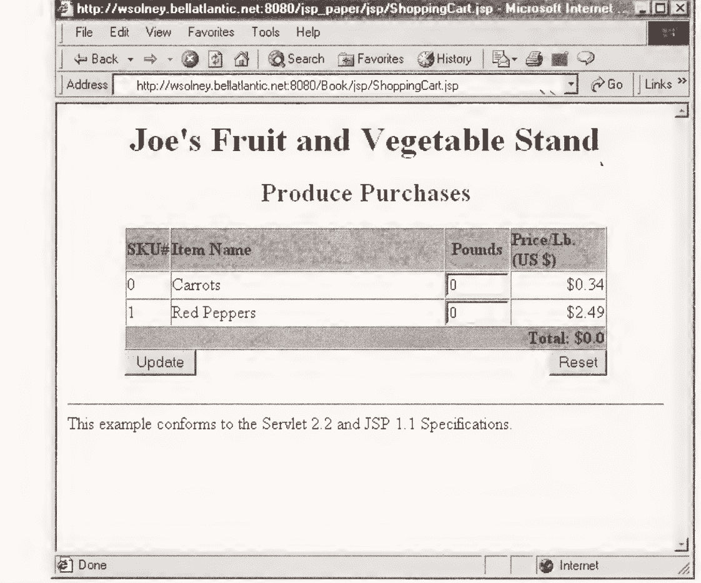

**图 5-3** ShoppingCart.jsp 显示效果

14. 现在让我们创建第二个也使用该模板页面的 JSP 页面。在 `ShoppingCart.jsp` 中，我们指定的动作是 `ResultPage.jsp`。让我们创建那个页面。

15. 在 `%TOMCAT_HOME%/webapps/Book/jsp` 中创建一个名为 `ResultPage.jsp` 的文件。然后添加一个页面指令来导入 `CartItem` 类：

```
<%@ page import="CartItem" %>
```

16. 接下来，使用 `<jsp:useBean>` 动作为我们在 `ShoppingCart.jsp` 中声明的 JavaBeans 创建脚本变量，并使用我们在 `ShoppingCartTemplate.jsp` 中创建的表单提供的请求参数在 bean 中设置值：

```
<%-- retrieve the two shopping cart JavaBeans --%>
<jsp:useBean id="item0" class="CartItem" scope="session" />
<% item0.setNumItems(Integer.parseInt(request.getParameter("item0"))); %>
<jsp:useBean id="item1" class="CartItem" scope="session" />
<% item1.setNumItems(Integer.parseInt(request.getParameter("item1"))); %>
```

17. 最后，在使用 `<jsp:param>` 动作提供请求参数的同时，将控制权转发给模板：

```
<%-- forward control to the template --%>
<jsp:forward page="ShoppingCartTemplate.jsp" >
    <jsp:param name="header" value="header.html" />
    <jsp:param name="tableCaption" value="Produce Purchases" />
    <jsp:param name="action" value="ResultPage.jsp" />
    <jsp:param name="footer" value="footer.html" />
</jsp:forward>
```

18. 请注意，在我们的示例中，我们将控制权从 ResultPage.jsp 转发回 ResultPage.jsp。这允许你修改你购买的每件商品的数量。你可以在模板中添加一个额外的按钮，将控制权转发到结账页面。这可能会使用以下几行修改 ShoppingCartTemplate.jsp：

```
<%-- create table for action buttons --%>
<TABLE WIDTH=450 CELLSPACING="0" CELLPADDING="0" BORDER="0">
<TR>
    <TD ALIGN=left><INPUT TYPE=submit NAME="Page" VALUE="Update"></TD>
    <TD ALIGN=left><INPUT TYPE=reset VALUE="Reset"></TD>
    <TD ALIGN=right><INPUT TYPE=submit NAME="Page" VALUE="Checkout"></TD>
</TR>
</TABLE>
```

19. 在步骤 18 中，我们添加了一个结账按钮。要使用此按钮的值，你必须在 ResultPage.jsp 中添加类似于这些的行。你应该在设置 JavaBean 属性之后、转发到 ShoppingCartTemplate.jsp 之前插入它们：

```
<%-- check for checkout --%>
<% String submit = request.getParameter("Page");
    if (submit.equals("Checkout")) {
%>
        <jsp:forward page="Checkout.jsp" />
<% } %>
```

20. 整个页面将如下所示：

```
<%@ page import="cart.CartItem" %>
<%-- retrieve the two shopping cart JavaBeans --%>
<jsp:useBean id="item0" class="CartItem" scope="session" />
<% item0.setNumItems(Integer.parseInt(request.getParameter("item0"))); %>

<jsp:useBean id="item1" class="CartItem" scope="session" />
<% item1.setNumItems(Integer.parseInt(request.getParameter("item1"))); %>

<%-- check for checkout --%>
<% String submit = request.getParameter("Page");
   if (submit.equals("Checkout")) {
      %>
      <jsp:forward page="Checkout.jsp" />
<% } %>

<%-- forward to template --%>
<jsp:forward page="ShoppingCartTemplate.jsp" >
    <jsp:param name="header" value="header.html" />
    <jsp:param name="tableCaption" value="Produce Purchases" />
    <jsp:param name="action" value="ResultPage.jsp" />
    <jsp:param name="footer" value="footer.html" />
</jsp:forward>
```

## `<jsp:plugin>` 动作

`<jsp:plugin>` 动作支持生成 HTML，以在 JSP 页面中包含 Java 小程序。它还会插入一个用于下载 JavaSoft Java 小程序插件软件的 URL（如果需要），该软件允许小程序在浏览器内运行。
`<jsp:plugin>` 标签会被替换为适当的 HTML `<object>` 或 HTML `<embed>` 标签，并写入响应输出流。
`<jsp:plugin>` 动作的语法如下：

```
<jsp:plugin
    type="bean|applet"
    code="classFile"
    codebase="objectCodeBase"
    [ align="alignment" ]
    [ archive="archiveList" ]
    [ height="height" ]
    [ hspace="hspace" ]
    [ jreversion="jreversion" ]
    [ name="componentName" ]
    [ vspace="vspace" ]
    [ width="width" ]
    [ nspluginurl="url" ]
    [ iepluginurl="url" ] >
    [ <jsp:params>
        [ <jsp:param name="paramName"
            value="paramValue" /> ]+
    </jsp:params> ]
    [ <jsp:fallback> anyArbitraryText </jsp:fallback> ]
</jsp:plugin>
```

### 属性和使用规则

表 5-10 列出了 `<jsp:plugin>` 标签的属性。

| 属性 | 使用规则 |
| :--- | :--- |
| type | 标识组件的类型——JavaBean 或小程序 |
| code | 与 HTML 4.0 规范中小程序的定义相同。对象类的*文件名*（不是 URL） |
| codebase | 与 HTML 4.0 规范中小程序的定义相同。用于指定存储小程序类的位置的 URL |
| align | 与 HTML 4.0 规范中小程序的定义相同。与 HTML `` 标签一样，你可以将对象相对于其周围文本进行定位 |
| archive | 与 HTML 4.0 规范中小程序的定义相同。一个标识包含对象 Java 类的 *.jar* 文件的 URL |
| height | 与 HTML 4.0 规范中小程序的定义相同。定义对象显示区域的高度 |
| hspace | 与 HTML 4.0 规范中小程序的定义相同。对象与周围文本之间的空白大小 |
| jreversion | 标识组件所需的 Java 运行时环境 (JRE) 的规范版本号。（默认值为 "1.1"） |
| name | 与 HTML 4.0 规范中小程序的定义相同。此 Java 对象实例的唯一名称。允许此对象与其他对象共享信息 |
| vspace | 与 HTML 4.0 规范中小程序的定义相同。对象与周围文本之间的垂直空白 |
| title | 与 HTML 4.0 规范中小程序的定义相同。IE（不是 Netscape）使用的对象标题 |
| width | 与 HTML 4.0 规范中小程序的定义相同。定义小程序显示区域的高度 |
| nspluginurl | 可以下载用于 Netscape Navigator 的 JRE 插件的 URL。默认 URL 取决于实现 |
| iepluginurl | 可以下载用于 Internet Explorer (IE) 的 JRE 插件的 URL。默认 URL 取决于实现 |


# 将小程序映射到 <jsp:plugin>

理解如何使用 <jsp:plugin> 动作的一种方法，是将一个现有的小程序转换为插件对象。下面是如何指定 JavaSoft 随 JDK 1.3 提供的一个非常简单的演示小程序（稍作修改）：

```
<applet code="Blink.class" width=300 height=100>
    <param name=lbl
        value="This is the next best thing to sliced bread!">
    <param name=speed value="4">
    alt="Your browser understands the &lt;APPLET&gt;
        tag but isn't running the applet, for some reason."
</applet>
```

这段小程序代码可以像这样映射到一个 <jsp:plugin> 动作：

```
<jsp:plugin type="applet" code="Blink.class" width=300 height=100>
    <jsp:params>
        <jsp:param name="lbl"
            value="This is the next best thing to sliced bread!" />
        <jsp:param name="speed" value="4" />
    </jsp:params>
    <jsp:fallback>Your browser isn't running the applet for some reason.
    </jsp:fallback>
</jsp:plugin>
```

# 1分钟快速练习

- <jsp:plugin> 动作的目的是什么？
- 如何为 <jsp:plugin> 动作插入的对象指定参数？

# 专家问答

> **问：** 既然 HTML <applet> 标签和 <jsp:plugin> 动作之间的映射如此接近，为什么我们更倾向于使用 JSP 标签？

**答：** 使用 <jsp:plugin> 动作的最佳理由是它能确保你的小程序使用正确版本的 Java 虚拟机 (JVM)。它还有助于保护你免受 HTML 规范变更的影响。

- <jsp:plugin> 动作会将一个 HTML <object> 或 <embed> 标签插入到响应流中。
- 你使用 <jsp:params> 和 <jsp:param> 动作为该对象指定参数。

# 项目 5-2：插入一个菜单小程序

本项目通过逐步说明如何将菜单插入到 JSP 页面中，来阐述 `<jsp:plugin>` 动作的使用。

### 逐步操作

1. 从 http://www.osborne.com 下载本项目的文件。
2. 编译文件 `SimpleMenuApplet.java`。
3. 将步骤 2 中编译好的类文件移动到 %TOMCAT_HOME%/webapps/Book/applets 目录下。
4. 将 `SimpleMenu.gif` 移动到 %TOMCAT_HOME%/webapps/Book/images 目录下。
5. 将 `SimpleMenuTarget.jsp` 移动到 %TOMCAT_HOME%/webapps/Book/jsp 目录下。
6. 在 %TOMCAT_HOME%/webapps/Book/jsp 目录中创建一个名为 `SimpleMenu.jsp` 的文件，并添加一个页面指令以导入 `SimpleMenuApplet` 类：

```
<%@ page import="SimpleMenuApplet" %>
```

7. 使用 JSP 脚本代码段创建菜单数据。注意，感叹号 (!) 字符用于分隔菜单标签和菜单操作，你使用 MAIN 关键字来指定一个新的浏览器页面。你使用花括号 ({}) 指定菜单嵌套。最后，连字符 (-) 字符指定一个分隔符。

```
<%-- 创建定义菜单项和URL的数据字符串 --%>
<% String menuData =
    "{Search {Search Page!SimpleMenu.jsp}}" +
    "{-}" +
    "{Advanced Search!SimpleMenuTarget.jsp}" +
    "{Simple Search!SimpleMenuTarget.jsp}}" +
    "{Logout!SimpleMenuTarget.jsp!MAIN}";
%>
```

8. 现在添加以下几行来插入菜单：

```
<%-- 创建 SimpleMenuApplet --%>
<jsp:plugin type="applet"
            code="SimpleMenuApplet"
            codebase="/Book/applets"
            width="250"
            height="50"
            jreversion="1.3"
>
<jsp:params>
    <jsp:param
        name="font"
        value="SansSerif"
    />
    <jsp:param
        name="fsize"
        value="12"
    />
    <jsp:param
        name="image"
        value="/Book/images/SimpleMenu.gif"
    />
    <jsp:param
        name="data"
        value='<%= menuData %>'
    />
</jsp:params>
<jsp:fallback>
    <B>无法启动插件！</B>
</jsp:fallback>
</jsp:plugin>
```

现在使用此 URL 访问菜单：http://localhost:8080/Book/jsp/SimpleMenu.jsp。请确保 Tomcat 已先启动。你应该会看到一个类似图 5-4 的页面。

模块 5：标准动作

195

图 5-4 SimpleMenuApplet

## 掌握度检查

1. 以下对 <jsp:useBean> 的使用有什么错误？

```
<jsp:useBean id="myHelperBean"
    scope="session"
    type="StringProperty" >
    <jsp:setProperty name="myHelperBean"
                     property="stringProperty"
                     value="The String Property" />    The String property value is:
    <jsp:getProperty name="myHelperBean"
                     property="stringProperty"/>
```

2. 如何使用请求参数在辅助 JavaBean 上设置一个 String 类型的登录名属性？
3. 使用 <jsp:useBean> 和 <jsp:setProperty> 动作可以初始化的 Java 属性类型有什么限制？
4. 标准动作的哪些属性可以接受 JSP 表达式作为其值？
5. 为什么你会使用 JSP 表达式来设置属性的值？
6. 如何使用 <jsp:include> 动作创建 JSP 页面模板？

## 掌握度检查

7. `<jsp:plugin>` 的哪些属性直接映射到 HTML 标签？
8. 哪些 JSP 标签可以限定 `<jsp:plugin>` 标签的行为？
9. 为什么在使用 `<jsp:forward>` 动作之前不能向 JSP 响应缓冲区打印输出？
10. `<jsp:param>` 动作的目的是什么？

# 模块 6：标签库

本模块目标

- 理解自定义标签的价值
- 了解自定义标签的工作原理
- 知道如何实现自定义标签
- 将一组自定义标签打包成一个标签库

在模块 5 中，我们描述了 JSP 规范定义的标准动作。本模块解释了如何编写自己的动作来增强标准动作，从而扩展 JSP 脚本语言。这种自定义标签增加了如此强大的功能和设计灵活性，以至于可以说它们是 JavaServer Pages 提供的最重要的特性。

# 为什么定义自定义标签？

自定义标签，也称为 *自定义动作*、*标签扩展* 或 *标签库*，为 JSP 页面作者提供了一种专门的子语言，用于向 JSP 页面中插入动态功能。这些库比其他 JSP 构造（如脚本代码段、表达式、声明和隐式对象）更清晰地将业务逻辑与表示细节分离。通过将一些定义良好的抽象功能封装到一个单一的库中，标签库提供了一个扩展、测试和修正业务逻辑的单一关注点。这种清晰的分离也使它们更易于维护。让我们通过一个例子来理解它们的价值。考虑以下静态 HTML 表单。它根据给定的本金金额、利率和年数，计算单利或复利以及累积余额：

```
<HTML>
<HEAD><TITLE>Accumulated Compound Interest Calculator </TITLE> </HEAD>
<BODY>
<H2> Interest Calculator </H2>
<FORM METHOD="POST" ACTION="jsp/InterestCalc.jsp">
<TABLE>
<TR>
    <TD> Please enter principal ($) </TD>
    <TD> <INPUT NAME="principal" TYPE=text SIZE=10>
</TR>
<TR>
    <TD> Please enter interest (%) </TD>
    <TD> <INPUT NAME="rate" TYPE=text SIZE=10>
</TR>
<TR>
    <TD> Please enter # years </TD>
    <TD> <INPUT NAME="years" TYPE=text SIZE=10>
</TR>
<TR>
  <TD> <input TYPE=radio name=itype VALUE=Simple> Simple </TD>
  <TD> <input TYPE=radio name=itype VALUE=Compound> Compound </TD>
</TR>
<TR>
  <TD><INPUT TYPE=submit VALUE="Submit"></TD>
  <TD><INPUT TYPE=reset  VALUE="Reset"></TD>
</TR>
</TABLE>
</FORM>
</BODY>
</HTML>
```

图 6-1 显示了该 HTML 页面。

图 6-1 利息计算器 HTML

如你所见，JSP 页面 `jsp/InterestCalc.jsp` 处理表单提交。以下是使用 JSP 脚本代码段和表达式实现的该 JSP 页面：

```
<HTML>
<HEAD><TITLE> Interest Results </TITLE></HEAD>
<BODY>
<%!
    public String getStringifiedValue(float value) {
        String subval = "0.00";
        if (value > 0.0) {
            subval = Float.toString(value);
            int decimalLen = subval.length() -
                             (subval.lastIndexOf('.') + 1);
            if(decimalLen > 1)
                subval = subval.substring(0,
                                         subval.lastIndexOf('.') + 3);
            else
                subval += "0";
        }
        return subval;
    }
%>
<%
    float principal =
        Float.parseFloat(request.getParameter("principal"));
    float rate =
        Float.parseFloat(request.getParameter("rate"));
    int years = Integer.parseInt(request.getParameter("years"));

    String itype = request.getParameter("itype");
%>
<H2> <%= itype %> Interest Results </H2>
<TABLE CELLSPACING="0" CELLPADDING="3" BORDER="1">
<TR>
    <TD> <B>Year</B> </TD>
    <TD> <B>Principal</B> </TD>
    <TD> <B>Interest</B> </TD>
    <TD> <B>Cumulative Balance</B> </TD>
</TR>
<%
```


```
float balance = principal;
float interest = 0;
for(int i=1; i<=years; i++) {
    interest = principal * (rate/100);
    balance += interest;
%>
<TR>
    <TD> <%= i %> </TD>
    <TD> <%= getStringifiedValue(principal) %> </TD>
    <TD> <%= getStringifiedValue(interest) %> </TD>
    <TD> <%= getStringifiedValue(balance) %> </TD>
</TR>
<%
    if(itype.equals("Compound")) {
        principal = balance;
    }
}
%>
</TABLE>
</BODY>
</HTML>

这个JSP页面做了四件事：

1.  它从请求对象中检索参数（本金、利率、年数和利息类型）。
2.  它遍历每一年。
3.  它计算每年的利息并累积余额。
4.  它将每年的本金、利息和累积余额以表格行的形式呈现出来。

你必须在所有四个步骤中插入Java代码。一个JSP声明还插入了一个方便的方法，用于格式化浮点值。如此多的Java代码的存在使得页面难以阅读。如果网页设计师必须进行一些涉及纯HTML的布局更改（例如更改列宽或添加徽标），那么该设计师将发现很难区分HTML代码和Java代码。

现在考虑一个由不同的JSP页面处理的相同问题，TaglibInterestCalc.jsp，它产生完全相同的结果：

```
<%@taglib uri="/interest-taglib" prefix="sample" %>
<HTML>
<HEAD><TITLE> Interest Results </TITLE> </HEAD>
<BODY>
<sample:readInterestType/>
<H2> <%= interestType %> Interest Results </H2>
<TABLE CELLSPACING="0" CELLPADDING="3" BORDER="1">
<TR>
    <TD> <B>Year</B> </TD>
    <TD> <B>Principal</B> </TD>
    <TD> <B>Interest</B> </TD>
    <TD> <B>Cumulative Balance</B> </TD>
</TR>
<sample:calcInterest yearName="numYear"
                    principalName="principal"
                    interestName="interest"
                    balanceName="balance" >
    <TR>
        <TD> <%= numYear %> </TD>
        <TD> <%= principal %> </TD>
        <TD> <%= interest %> </TD>
        <TD> <%= balance %> </TD>
    </TR>
</sample:calcInterest>
</BODY>
</HTML>
```

有几个地方使这个JSP页面与前一个不同。最明显的区别是，除了JSP表达式之外，这个JSP页面没有Java代码。因此，它也比前一个JSP页面小得多。

其次，这个JSP页面顶部有一个taglib指令。taglib指令标识JSP页面使用的标签库，并为每个库的标签关联一个命名空间前缀。（我们在模块2中描述了taglib指令）。interest-taglib支持两个自定义标签：<sample:readInterestType> 和 <sample:calcInterest>。

第一个标签体为空，第二个包含一个HTML表格行。我们的JSP页面Java代码很少，是因为我们将它隐藏在这两个操作的实现后面。

第三，Java代码的缺失简化了页面中HTML元素的阅读。网页设计师可以轻松地修改这个JSP页面中的HTML。更重要的是，不懂Java的人也可以编写这个JSP页面。

最后，通过将Java代码封装在标签库中，我们使得在不修改JSP页面本身的情况下增强、测试和更正这段代码成为可能。例如，如果我们想计算一种完全不同的利息类型，也许是应用可变利率，我们可以将其添加到标签库中，而不必动任何使用该库的JSP页面。

图6-2显示了这个JSP页面的输出。

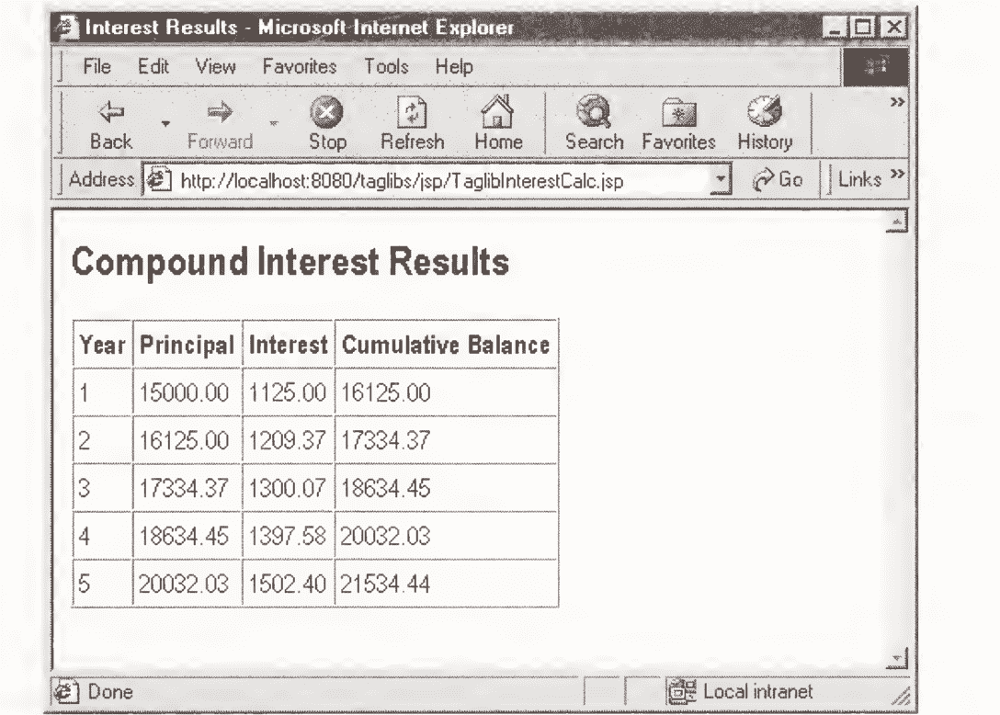

**图6-2** 利息计算的输出页面

## 1分钟速记

- 自定义标签还有哪些其他名称？
- 自定义标签如何使JSP页面更易于维护？

## 标签库的元素

标签库有四个元素：

- 自定义操作的定义（即标签）
- taglib指令
- 标签库描述符
- 标签处理器

### 标签库格式

自定义标签与我们在模块5中描述的标准操作具有相同的两种可能格式。格式如下：

```
<prefix:tagName [attr="value"]*> tagBody </prefix:tagName>

<prefix:tagName [attr="value"]* /> 或

<prefix:tagName [attr="value"]* ></prefix:tagName>
```

第一种格式是带有标签体的操作。标签体包括开始标签和结束标签之间的所有文本。第二种格式是不带标签体的操作。你可以通过使用后跟立即结束标签的开始标签，或使用以斜杠-闭角括号（/ >）字符序列结尾的单个标签来指定空标签体。

自定义标签可以出现在任何JSP页面中，JSP容器在请求时解释它们，就像解释标准操作一样。标签库是自定义标签的集合，这些标签封装了一些对JSP页面有用的、连贯的功能集。

- 自定义标签的其他名称是标签库、自定义操作和标签扩展。
- 自定义标签将Java代码从JSP页面中移除，从而使对动态功能的增强独立于JSP页面。

### taglib指令

JSP页面中的taglib指令告知JSP容器该JSP页面使用一个标签库，该库由URI唯一标识，并关联一个前缀来区分库中操作的使用。下面是taglib指令的语法，摘录自模块2：

```
<%@
    taglib
    uri="URI To Tag Library"
    prefix="tag prefix"
%>
```

URI指定了标签库描述符的位置，该描述符定义了标签库支持的自定义标签。prefix属性指定了这些自定义标签的标签前缀。

### 标签库描述符

标签库描述符（TLD）是一个描述标签库的可扩展标记语言（XML）文档。JSP容器使用taglib指令来标识TLD的位置。然后它解析描述符并获取该标签库中每个自定义操作的全面描述。你可以在 `http://java.sun.com/j2ee/dtds/web-jsptaglibrary_1_1.dtd` 找到TLD文件的官方文档类型定义（DTD）。

> **注意**
XML的细节和DTD的定义超出了本书的范围。你应该注意的基本点是，你使用XML定义JSP标签扩展的方式是由另一个文档，即标签库描述符的DTD所定义的。XML本身是一种标记语言，而DTD定义了给定XML用法的有效标签。完成本模块后，你应该能够在不深入理解XML或DTD文档的情况下定义TLD。

表6-1列出了TLD文档的各种元素及其正式语法。

| 元素 | 语法 | 是否必需元素？ | 描述 |
| :--- | :--- | :--- | :--- |
| taglib | `<!ELEMENT taglib (tlibversion, jspversion?, shortname, uri?, info?, tag+)>` | 必需 | 文档根 |
| tlibversion | `<!ELEMENT tlibversion (#PCDATA)>` | 必需 | 标签库实现的版本 |
| jspversion | `<!ELEMENT jspversion (#PCDATA)>` | 可选 | 此标签库所需的JSP规范版本。默认值为1.1 |
| shortname | `<!ELEMENT shortname (#PCDATA)>` | 必需 | 一个简单的默认短名称。JSP页面创作工具可能会使用它来创建具有助记价值的名称 |
| uri | `<!ELEMENT uri (#PCDATA)>` | 可选 | 唯一标识此版本标签库的公共URI |
| info | `<!ELEMENT info (#PCDATA)>` | 可选 | 此标签库的任意文本描述 |
| tag | `<!ELEMENT tag (name, tagclass, teiclass?, bodycontent?, info?, attribute*)>` | 必需 | 自定义操作的定义。TLD文件中可以有多个这样的定义 |
| name | `<!ELEMENT name (#PCDATA)>` | 必需 | 操作的唯一名称 |
| tagclass | `<!ELEMENT tagclass (#PCDATA)>` | 必需 | 实现 `javax.servlet.jsp.tagext.Tag` 接口的标签处理器类 |

表6-1 标签库描述符的元素

| 元素 | 语法 | 是否必需元素？ | 描述 |
| :--- | :--- | :--- | :--- |
| teiclass | `<!ELEMENT teiclass (#PCDATA)>` | 可选 | 为实现 `javax.servlet.jsp.tagext.TagExtraInfo` 接口的操作提供额外信息的Java类 |
| bodycontent | `<!ELEMENT bodycontent (#PCDATA)>` | 可选 | 向JSP容器提示如何解释此操作的标签体。可能的值有：tagdependent——标签处理器解释操作的标签体，因此容器不应解释；JSP——操作的标签体包含使用JSP语法的元素，容器应解释它；empty——标签体必须为空。默认值为JSP |
| info | `<!ELEMENT info (#PCDATA)>` | 可选 | 操作的可选描述 |
| attribute | `<!ELEMENT attribute (name, required?, rtexprvalue?)>` | 可选 | 操作属性的定义 |
| name | `<!ELEMENT name (#PCDATA)>` | 必需 | 属性的区分名称 |

表6-1 标签库描述符的元素（续）


### 表 6-1 标签库描述符的元素（续）

| 元素 | 语法 | 必需元素？ | 描述 |
|---|---|---|---|
| required | `<!ELEMENT required (#PCDATA)>` | 可选 | 定义属性是必需还是可选。可能的值有：`true`、`false`、`yes`、`no`。默认值为 `false`，表示属性是可选的。 |
| rtexprvalue | `<!ELEMENT rtexprvalue (#PCDATA)>` | 可选 | 定义属性是否可以接受 JSP 表达式作为其值。换言之，与在翻译时确定的静态值相反，JSP 容器可以在请求时计算属性的值。可能的值有：`true`、`false`、`yes`、`no`。默认值为 `false`，表示属性仅接受静态值。 |

下面是描述我们在计算器 JSP 中使用的 `interest-taglib` 的 TLD：

```xml
<?xml version="1.0" encoding="ISO-8859-1" ?>
<!DOCTYPE taglib PUBLIC
  "-//Sun Microsystems, Inc.//DTD JSP Tag Library 1.1//EN"
  "http://java.sun.com/j2ee/dtds/web-jsptaglibrary_1_1.dtd">
<taglib>
  <tlibversion>1.0</tlibversion>
  <jspversion>1.1</jspversion>
  <shortname></shortname>
  <tag>
    <name>readInterestType</name>
    <tagclass>sample.ReadRequestTag</tagclass>
    <teiclass>sample.ReadRequestTEI</teiclass>
    <bodycontent>empty</bodycontent>
    <info>Extracts request parameters</info>
  </tag>
  <tag>
    <name>calcInterest</name>
    <tagclass>sample.InterestCalcTag</tagclass>
    <teiclass>sample.InterestCalcTEI</teiclass>
    <bodycontent>JSP</bodycontent>
    <info>
        Iterative tag that calculates interest (compound or simple)
    </info>
    <attribute>
        <name>yearName</name>
        <required>true</required>
        <rtexprvalue>false</rtexprvalue>
    </attribute>
    <attribute>
        <name>principalName</name>
        <required>true</required>
        <rtexprvalue>false</rtexprvalue>
    </attribute>
    <attribute>
        <name>interestName</name>
        <required>true</required>
        <rtexprvalue>false</rtexprvalue>
    </attribute>
    <attribute>
        <name>balanceName</name>
        <required>true</required>
        <rtexprvalue>false</rtexprvalue>
    </attribute>
  </tag>
</taglib>
```

以下是关于此 TLD 您应该注意的要点：

- 1. TLD 定义了两个自定义标签：`readInterestType` 和 `calcInterest`。您在 `<tag>` 开始标签和 `</tag>` 结束标签之间声明一个自定义操作。
- 2. TLD 在 `<tagclass>` 开始标签和 `</tagclass>` 结束标签之间声明实现库功能的 Java 类。在本例中，`sample.ReadRequestTag` 实现了 `readInterestType` 操作的功能，而 `sample.InterestCalcTag` 实现了 `calcInterest` 操作的功能。
- 3. TLD 在 `<teiclass>` 开始标签和 `</teiclass>` 结束标签之间声明其他 Java 类。这些类是 `TagExtraInfo` 类，您使用它们为 JSP 页面定义额外的脚本变量。
- 4. TLD 为 `readInterestType` 操作声明了一个 `empty` 体。相比之下，它为 `calcInterest` 操作声明了一个体。您在 `<bodycontent>` 开始标签和 `</bodycontent>` 结束标签之间声明标签体的使用。
- 5. TLD 为 `calcInterest` 操作定义了四个属性：`yearName`、`principalName`、`interestName` 和 `balanceName`。TLD 声明了所有这些属性，并指明您不能以请求时 JSP 表达式的形式提供它们的值。您在 `<attribute>` 开始标签和 `</attribute>` 结束标签之间定义属性。
- 6. 标签属性定义需要一个由三个额外标签组成的标签体：`<name>`、`<required>` 和 `<rtexprvalue>`。它们分别指定了属性的名称、属性是必需还是可选，以及 JSP 页面是否可以以 JSP 表达式的形式提供属性值。


### 1 分钟练习

- 标签库中的四个要素是什么？
- 自定义操作的两种形式有什么区别？
- `taglib` 指令的目的是什么？
- 标签库描述符的目的是什么？

答案如下：

- 标签库的四个要素是标签、`taglib` 指令、标签库描述符和标签处理程序。
- 一种格式包含体，另一种不包含。
- `taglib` 指令告知 JSP 容器此 JSP 页面使用由 URI 标识的标签库。
- 标签库描述符描述了标签库中的自定义标签。

## 标签处理程序

标签处理程序实现了 JSP 操作的编程行为。您在标签库描述符中使用 `<tagclass>` 元素为自定义标签指定标签处理程序。当 JSP 脚本语言是 Java 时，标签处理程序是一个实现 Java 接口的 JavaBean 组件。Java 接口强制了 JSP 容器和处理程序之间的运行时协议。您可以使用以下两个 Java 接口之一来定义标签处理程序：

- `javax.servlet.jsp.tagext.Tag` 定义了不关心操作其体的简单标签处理程序的协议。
- `javax.servlet.jsp.tagext.BodyTag` 扩展了 `javax.servlet.jsp.tagext.Tag`，使标签处理程序可以访问标签体。

JSP 容器与标签处理程序之间的通信展示了一种回调模式。

> **注意**
> 回调模式要求事件和事件处理程序之间存在关联。当事件发生时，运行时执行引擎（在此例中是 JSP 容器）会调用事件处理程序，可能还会传递有关事件的附加信息。

当 JSP 容器遇到 JSP 页面中的各种标签时，它会调用标签接口定义的关联方法。图 6-3 说明了此协议。

### 默认标签处理程序属性

JSP 容器必须用某些属性初始化所有标签处理程序。容器使用 JavaBean 属性设置方法来设置这些属性。容器自动在标签处理程序上设置以下属性：

- 提供对供应商特定功能、跨多个范围操作以及对便捷方法的供应商无关接口的访问的 `PageContext` 对象，正如我们在模块 4 中解释的那样。
- 封装操作的父标签处理程序。
- 提供对已求值标签体访问的 `BodyContent` 对象。仅当 TLD 指明标签处理程序将操作标签体时，才会设置此属性。

### 标签属性

自定义操作的开始标签可以包含形式为 `attr="value"` 的属性赋值。属性通过在标签处理程序上初始化自定义属性来定制操作的行为。例如，在我们的 `<sample:calcInterest>` 操作中，我们公开了四个属性：`yearName`、`principalName`、`interestName` 和 `balanceName`。我们使用 `<attribute>` 元素在标签库描述符中指定了这些属性，如下所示。

```xml
<attribute>
    <name>yearName</name>
    <required>true</required>
    <rtexprvalue>false</rtexprvalue>
</attribute>
<attribute>
    <name>principalName</name>
    <required>true</required>
    <rtexprvalue>false</rtexprvalue>
</attribute>
<attribute>
    <name>interestName</name>
    <required>true</required>
    <rtexprvalue>false</rtexprvalue>
</attribute>
<attribute>
    <name>balanceName</name>
    <required>true</required>
    <rtexprvalue>false</rtexprvalue>
</attribute>
```

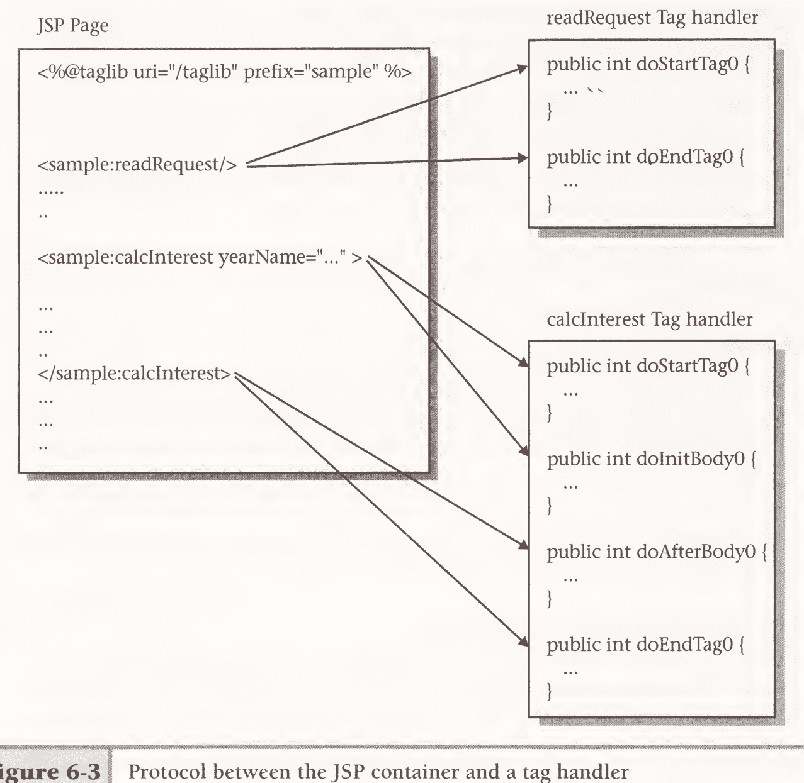

标签处理程序必须为 TLD 中定义的每个属性定义一个 JavaBean 属性。这意味着它们必须提供符合 JavaBean 命名要求的属性设置方法。例如，标签处理程序必须提供一个 `setBalanceName` 方法来匹配 TLD 属性 `balanceName`。当 JSP 容器在 JSP 页面中遇到开始标签时，会自动调用设置方法。以下代码片段显示了我们的标签处理程序中的这些设置方法：

```java
public void setPrincipalName(String principalName) {
    this.principalName = principalName;
}
public void setInterestName(String interestName) {
    this.interestName = interestName;
}
public void setYearName(String yearName) {
    this.yearName = yearName;
}
public void setBalanceName(String balanceName) {
    this.balanceName = balanceName;
}
```

标签处理程序属性可以是任何 Java 类型。如果您使用 `String`（`HttpServletRequest` 参数或 `String` 常量）提供属性的值，则该属性必须是表 6-2 中列出的类型之一。转换列说明了 JSP 容器如何将 `String` 值转换为适当的类型。


### 表 6-2 可通过字符串转换提供的标签属性类型

| 属性类型 | 字符串值的转换 |
|---|---|
| boolean 或 Boolean | *java.lang.Boolean.valueOf(String)* 的结果 |
| byte 或 Byte | *java.lang.Byte.valueOf(String)* 的结果 |
| char 或 Character | *java.lang.Character.valueOf(String)* 的结果 |
| double 或 Double | *java.lang.Double.valueOf(String)* 的结果 |
| int 或 Integer | *java.lang.Integer.valueOf(String)* 的结果 |
| float 或 Float | *java.lang.Float.valueOf(String)* 的结果 |
| long 或 Long | *java.lang.Long.valueOf(String)* 的结果 |
| String | 字符串 |

如果你使用 JSP 表达式提供属性值，JSP 容器会在请求时计算其类型，并且不会从 *String* 类型自动转换。JSP 表达式中返回值的类型应与标签处理器中属性的类型相匹配。例如，考虑以下操作：

```
<% java.util.Map items = Cart.getItems(); %>
<sample:purchase cart="<%= items %>" />
```

在此示例中，自定义操作有一个名为 *cart* 的属性，其值类型为 *java.util.Map*。这意味着该操作的标签处理器应具有如下所示的 setter 方法：

```
public void setCart(java.util.Map map) {
    this.map = map;
}
```

# 专家问答

**问：** 设置自定义操作的属性是否有特定的顺序？

**答：** 规范没有要求特定的顺序，但 Tomcat 会按照你在标签库描述符（TLD）中指定的顺序来计算属性，*而不是*你提供给自定义操作的顺序。如果你的标签依赖于属性顺序，你必须考虑这一点。例如，考虑这个指定简单迭代器标签的 TLD 片段：

```
<tag>
    <name>for</name>
    <tagclass>sample.ForTag</tagclass>
    <teiclass>sample.ForTagTEI</teiclass>
    <bodycontent>JSP</bodycontent>
    <info> A simple iteration tag </info>
    <attribute>
        <name>counter</name>
        <required>true</required>
        <rtexprvalue>false</rtexprvalue>
    </attribute>
    <attribute>
        <name>initial</name>
        <required>false</required>
        <rtexprvalue>false</rtexprvalue>
    </attribute>
    <attribute>
        <name>final</name>
        <required>false</required>
        <rtexprvalue>false</rtexprvalue>
    </attribute>
    <attribute>
        <name>increment</name>
        <required>false</required>
        <rtexprvalue>false</rtexprvalue>
    </attribute>
</tag>
```

TLD 指定了属性顺序为：`counter`、`initial`、`final` 和 `increment`。现在考虑我们标签处理器代码中可能的验证步骤：

```
public void setIncrement(int increment) throws JspTagException {
    if (((initialVal < finalVal) && (increment < 0)) ||
        ((initialVal > finalVal) && (increment > 0)))
        throw new JspTagException("Infinite Loop!");
    this.increment = increment;
}
```

这段验证代码检查是否存在无限循环。它期望 `initial` 和 `final` 属性在 `increment` 属性之前设置。如果我们没有在 TLD 中按正确的顺序指定它们，这个条件检查将产生无效的结果。实际上，你的标签应避免依赖于 JSP 容器的此类特性。当你引入它们时，你利用的是规范未强制要求的实现决策。这意味着你的代码本质上是不可移植的，即使在同一容器的不同版本之间也是如此。

### 一分钟练习

- 标签处理器有哪两种接口？
- 与标签处理器关联的默认属性是什么？
- 标签处理器应为标签库描述符中描述的每个属性定义什么？

- 标签处理器接口是 `javax.servlet.jsp.tagext.Tag` 和 `javax.servlet.jsp.tagext.BodyTag`。
- 标签处理器的默认属性是：`PageContext`、父标签，以及（如果标签处理器实现了 `BodyTag`）`BodyContent`。
- 标签处理器应为每个属性定义一个 JavaBean 属性。

## Tag 接口

`javax.servlet.jsp.tagext.Tag` 接口定义了所有标签处理器的基本协议。表 6-3 列出了 `Tag` 接口中的方法。

JSP 页面生成的 servlet 首先调用 `Tag` 接口的属性 setter 方法来初始化基本属性 `pageContext` 和 `parent`。然后 servlet 初始化 TLD 作为属性公开的任何其他属性。初始化所有属性后，生成的 servlet 调用主要操作方法。`Tag` 接口支持三个主要操作方法：`doStartTag`、`doEndTag` 和 `release`。

### doStartTag 方法

生成的 servlet 在初始化所有属性后调用 `doStartTag` 方法。此时，生成的 servlet 尚未处理标签体。

`doStartTag` 的返回值指示生成的 servlet 是否应处理标签体。三个可能的返回值是：

- `EVAL_BODY_INCLUDE` 处理标签体，但不允许标签处理器操作它。
- `EVAL_BODY_TAG` 处理标签体，并允许标签处理器通过新的 `BodyContent` 对象操作它。
- `SKIP_BODY` 不处理标签体。

| 方法签名 | 描述 |
| :--- | :--- |
| `int doStartTag()` | 处理开始标签 |
| `int doEndTag()` | 处理结束标签 |
| `void release()` | 释放标签处理器的当前实例 |
| `Tag getParent()` | 获取直接父标签（如果存在） |
| `void setPageContext(PageContext pc)` | 设置此 JSP 页面的当前页面上下文 |
| `void setParent(Tag t)` | 设置此 Tag 的当前嵌套标签 |

**表 6-3** `Tag` 接口中的方法

不计算其标签体（如果存在）的标签处理器从其 *doStartTag* 方法返回 SKIP_BODY。允许标签体但不操作它的标签处理器从其 *doStartTag* 方法返回 EVAL_BODY_INCLUDE。此类标签处理器必须实现 *Tag* 接口，不能实现 *BodyTag* 接口。如果标签处理器打算操作其标签体，则从其 *doStartTag* 方法返回 EVAL_BODY_TAG。此类标签处理器必须实现 *BodyTag* 接口。在此方法结束时，一些新的脚本变量可能对 JSP 页面可用，具体取决于可选的 *TagExtraInfo* 类的存在和行为。

*doStartTag* 方法可能抛出 *JspException* 以指示错误。

**doEndTag 方法** 生成的 servlet 在跳过或处理标签体后调用 *doEndTag* 方法。如果标签有体，并且标签的 *doStartTag* 方法返回 EVAL_BODY_TAG，此时生成的 servlet 将已处理标签体。此方法的返回值指示生成的 servlet 是否应评估 JSP 页面的其余部分。可能的值是：

- EVAL_PAGE 继续评估 JSP 页面的其余部分。
- SKIP_PAGE 跳过 JSP 页面的其余部分以完成请求。

在此方法结束时，一些新的脚本变量可能对 JSP 页面可用，具体取决于可选的 *TagExtraInfo* 类的存在和行为。

*doEndTag* 方法可能抛出 *JspException* 以指示错误。

**release 方法** 生成的 servlet 在所有标签处理器调用完成后调用 *release* 方法。标签处理器应使用此方法释放其可能持有的任何资源。例如，它应在此方法中释放任何数据库或套接字连接。

**TagSupport 基类** *javax.servlet.jsp.tagext.TagSupport* 是一个实用基类，它简化了新标签处理器的开发。它实现了 *Tag* 接口，并为基本属性提供了便捷的 getter 和 setter 方法。它将 *PageContext* 作为数据成员 *pageContext* 可用，并定义了具有空主体和默认返回值的 *doStartTag* 和 *doEndTag* 方法。*doStartTag* 方法返回 SKIP_BODY，*doEndTag* 返回 EVAL_PAGE。标签处理器子类可以用自己的行为覆盖这些方法。

表 6-4 列出了 *TagSupport* 基类提供的最有用的方法。


| 方法签名 | 用途 |
|---|---|
| `static Tag findAncestorWithTag(Tag, Class)` | 查找最接近给定实例的指定类实例。此方法使用 `Tag` 接口中的 `getParent` 方法。 |
| `public Tag getParent()` | 返回包含当前标签的 `Tag` 实例。 |
| `void setValue(String key, Object value)` | 为此标签处理器存储与键关联的值。 |
| `Object getValue(String key)` | 返回与键关联的值。 |
| `java.util.Enumeration getValues()` | 返回与此标签处理器关联的所有值的枚举。 |
| `void removeValue(String key)` | 移除与键关联的值。 |

**表 6-4** `TagSupport` 基类中的有用方法

## `BodyTag` 接口

`javax.servlet.jsp.tagext.BodyTag` 接口扩展了 `Tag`，提供了用于操作动作体的方法。这些方法作用于标签处理器的 `bodyContent` 属性。表 6-5 列出了 `BodyTag` 接口中的方法。

标签处理器完全控制其如何处理标签体。它可以将标签体作为 `String` 获取并进行处理，而无需将其发送到响应缓冲区。它可以将修改后的 `String` 发送到响应缓冲区。或者，它可以将标签体*原样*写入封装的 `JspWriter`。

JSP 容器对待实现 `BodyTag` 的标签处理器与实现 `Tag` 的标签处理器相同，但 `doStartTag` 方法必须返回 `SKIP_BODY` 或 `EVAL_BODY_TAG`。它不能返回 `EVAL_BODY_INCLUDE`。

当 `doStartTag` 返回 `EVAL_BODY_TAG` 时，生成的 servlet 通过调用 `PageContext` 对象的 `pushBody` 方法自动创建一个新的 `BodyContent` 对象（`JspWriter` 的子类）。此对象支持操作动作的标签体。然后，生成的 servlet 将 `BodyContent` 对象设置为标签处理器对象上的一个属性。

`BodyTag` 接口增加了一个额外的属性：`bodyContent`。

如果 `doStartTag` 方法返回 `EVAL_BODY_TAG`，生成的 servlet 会在 `doInitBody` 之前调用一次 `bodyContent` 属性的 setter 方法（`setBodyContent`）。如果 `doStartTag` 返回 `SKIP_BODY`，则不会调用此方法。

`BodyTag` 接口向 `Tag` 接口添加了两个主要方法：`doInitBody` 和 `doAfterBody`。

**doInitBody 方法**
`BodyTag` 接口向 `Tag` 接口添加了 `doInitBody` 方法。你使用此方法来初始化标签体处理，例如获取数据库或网络连接。如果 `doStartTag` 方法返回 `EVAL_BODY_TAG`，生成的 servlet 将在进入处理标签体的循环之前调用一次 `doInitBody`。如果 `doStartTag` 返回 `SKIP_BODY`，则不会调用此方法。

此方法可能会抛出 `JspException` 以指示错误。

**doAfterBody 方法**
`BodyTag` 接口还向 `Tag` 接口添加了 `doAfterBody` 方法。生成的 servlet 在每次处理标签体的循环之后调用 `doAfterBody`。如果自定义动作没有标签体，或者 `doStartTag` 返回 `SKIP_BODY`，则不会调用此方法。如果此方法返回 `EVAL_BODY_TAG`，servlet 将开始对标签体的新一轮求值，然后再次调用 `doAfterBody`。如果 `doAfterBody` 方法返回 `SKIP_BODY`，则标签体求值循环退出，生成的 servlet 调用 `doEndTag` 方法。

此方法可能会抛出 `JspException` 以指示错误。

**BodyContent 类**
`javax.servlet.jsp.tagext.BodyContent` 类是 `JspWriter` 的子类，用于在自定义动作中处理标签体。正如我们在模块 4 中解释的，`PageContext` 维护一个 `BodyContent` 对象栈，每个对象代表一个动作的标签体。当处理进入给定嵌套级别时，JSP 页面的生成 servlet 使用 `pushBody` 方法在栈上压入一个新的 `BodyContent` 对象。当处理离开给定嵌套级别时，它调用 `PageContext` 对象上的 `popBody` 方法以检索先前的 `BodyContent` 对象。最后，它调用 `popBody` 以检索原始的 `JspWriter` 对象。考虑以下嵌套标签的示例：

```
<sample:top>  <!-- top 的 BodyContent -->
    <sample:nested_level_1>  <!-- nested_level_1 的 BodyContent -->
        <sample:nested_level_2>  <!-- nested_level_2 的 BodyContent -->
            普通文本
        </sample:nested_level_2>
    </sample:nested_level_1>
</sample:top>
```

这种标签嵌套需要三个 `BodyContent` 对象，每个对象代表给定嵌套级别的标签体。

操作 `BodyContent` 对象类似于操作 `JspWriter`。主要区别在于，与 `JspWriter` 不同，`BodyContent` 对象没有一个可以刷新响应缓冲区的备用流（与客户端的连接）。其后果是：

-   `BodyContent` 对象有一个“无界”缓冲区。
-   你不能在自定义动作的标签体中指定 `<jsp:include>` 动作，因为此动作会自动刷新当前缓冲区。

在处理标签体的任何时候，`PageContext` 对象维护的栈中都可能存在多个 `BodyContent` 对象。每个 `BodyContent` 都维护对前一个或封装 `BodyContent` 的引用，并可以使用 `getEnclosingWriter` 方法检索它。顶层 `BodyContent` 返回对原始 `JspWriter`（由响应流支持）的引用。每个 `BodyContent` 可以使用表 6-6 所示的方法操作其自身的标签体。

**BodyTagSupport 基类**
`javax.servlet.jsp.tagext.BodyTagSupport` 实用工具类为操作其标签体的标签处理器提供了一个基类。它实现了 `BodyTag` 接口并提供了默认行为。其 `doStartTag` 方法的返回值为 `EVAL_BODY_TAG`。其 `doEndTag` 的返回值为 `EVAL_PAGE`。其 `doAfterBody` 的返回值为 `SKIP_BODY`。

`BodyTagSupport` 还提供了便捷方法来检索 `BodyContent` 对象和封装的 `JspWriter`。表 6-7 描述了这些方法。

| 方法签名 | 描述 |
| :--- | :--- |
| `void clearBody()` | 清除标签体。此操作不能抛出异常。 |
| `java.io.Reader getReader()` | 在 JSP 容器对其求值后，返回一个读取其内容的读取器。 |
| `String getString()` | 在 JSP 容器对其求值后，返回表示其内容的字符串。 |
| `void writeOut(java.io.Writer out)` | 将其所有内容写入提供的写入器。 |
| `JspWriter getEnclosingWriter()` | 返回封装的写入器。 |

**表 6-6** `BodyContent` 对象中的方法

| 方法签名 | 用途 |
| :--- | :--- |
| `BodyContent getBodyContent()` | 返回此标签的 `BodyContent` 对象。 |
| `JspWriter getPreviousOut()` | 返回此标签周围的 `JspWriter`。 |

**表 6-7** `BodyTagSupport` 中的有用方法

### 1 分钟练习

-   `Tag` 接口中的三个主要动作方法是什么？
-   `TagSupport` 类的目的是什么？
-   `BodyTag` 接口中操作标签体的主要方法是什么？
-   对于一个实现了 `BodyTag` 的标签处理器，生成的 servlet 调用 `doAfterBody` 方法多少次？
-   `BodyContent` 对象的缓冲区大小是多少？

-   动作方法是 `doStartTag`、`doEndTag` 和 `release`。
-   `TagSupport` 类是一个实用工具基类，为实现 `Tag` 接口的标签处理器提供默认行为。
-   主要方法是 `doInitBody` 和 `doAfterBody`。
-   生成的 servlet 在每次处理标签体后循环调用 `doAfterBody` 方法，直到它返回 `SKIP_BODY`。
-   `BodyContent` 对象具有一个“无界”缓冲区。


## 标签处理器的生命周期

在了解了两种标签处理器接口的细节之后，我们来探讨两种类型标签的生命周期。图6-4展示了一个简单*Tag*处理器（不处理其主体）和一个*BodyTag*处理器（操作其主体）的生成servlet调用序列。

以下是标签处理器生命周期中的处理步骤：

1.  如图6-4的第一部分所示，简单标签处理器和Body标签处理器都要经历创建和初始化步骤。首先，生成的servlet在标签处理器上设置基本属性，如*pageContext*、*parent*。如果处理器实现了*BodyTag*接口，servlet还会设置*bodyContent*属性。然后，servlet通过为每个属性调用JavaBean属性的setter方法来设置所有自定义属性值。
2.  如果处理器是简单的*Tag*处理器，生成的servlet调用*doStartTag*方法并评估其返回值。否则，它将跳转到步骤5。
3.  如果*doStartTag*的返回值是`EVAL_BODY_INCLUDE`，生成的servlet将处理标签体。
4.  生成的servlet跳转到步骤11。
5.  如果处理器是*BodyTag*处理器，生成的servlet调用*doStartTag*方法并评估其返回值。如果返回值是`SKIP_BODY`，它将跳转到步骤11。
6.  如果返回值是`EVAL_BODY_TAG`，生成的servlet将使用*pushBody*方法创建一个新的*BodyContent*对象，并使用*setBodyContent*方法将其设置在标签处理器上。
7.  接下来，servlet调用*doInitBody*方法。
8.  生成的servlet使用*BodyContent*对象处理标签体。处理完标签体后，它调用*doAfterBody*方法。
9.  如果*doAfterBody*方法返回`EVAL_BODY_TAG`，处理将返回步骤8。（这允许标签处理器重复修改标签体。）
10. 生成的servlet调用*popBody*方法。
11. 生成的servlet调用*doEndTag*方法。
12. 如果`doEndTag`返回`SKIP_PAGE`，生成的servlet将忽略当前JSP页面的其余部分（即，在调用当前标签处理器的`release`方法后，生成的servlet立即从其`_jspService`方法返回）。
13. 生成的servlet调用`release`方法。这允许标签处理器释放其可能已建立的任何资源。

**注意**
JSP 1.1规范指出，JSP页面可以为多次调用的自定义操作重用标签处理器。在重用实例时，容器可以智能地只初始化可能已更改的属性。Tomcat JSP容器（版本3.2.1）不会重用标签处理器，而是为每个自定义操作的发生创建一个新实例。

### 创建与初始化

```
Handler th = new Handler();

th.setPageContext(pageContext);
th.setParent(parent);

th.setAttribute1(value_1);
...
th.setAttributen(value_n);
```

### 简单标签处理器

```
try {
    int handleBody = th.doStartTag();
    if(handleBody== EVAL_BODY_INCLUDE) {
        /* 评估标签体 */
    }
    int handlePage = th.doEndTag();
    if(handlePage == SKIP_PAGE) {
        return;
    }

    ... /*可能重用 */
}
finally {
    th.release();
}
```

### Body标签处理器

```
try {
    int handleBody = th.doStartTag();
    if(handleBody== EVAL_BODY_TAG) {
        try {
            BodyContent bc = pageContent.pushBody();
            th.setBodyContent(bc);
            th.doInitBody();
            do{
                /* 评估标签体 */
                handleBody = th.doAfterBody();
            }
            while(handleBody== EVAL_BODY_TAG);
        }
        finally {
            pageContent.popBody();
        }
        int handlePage = th.doEndTag();
        if(handlePage == SKIP_PAGE) {
            return;
        }

        ... /*可能重用 */
    }
}
finally {
    th.release();
}
```

图6-4 Tag和BodyTag处理器的调用序列

### 一分钟速记

-   标签处理器生命周期的第一步是什么？
-   在`doStartTag`方法中返回`EVAL_BODY_INCLUDE`的标签处理器的意图是什么？
-   生成的servlet何时在标签处理器上调用`release`方法？

# 定义脚本变量

在模块4中，我们描述了JSP容器如何支持命名的隐式对象（脚本变量）供JSP脚本片段和表达式使用。在模块5中，我们看到`<jsp:useBean>`标准操作如何定义JavaBean并使其作为脚本变量可用。JSP 1.1规范还支持通过自定义标签库定义命名对象或脚本变量。

### TagExtraInfo类

自定义操作通过扩展`javax.servlet.jsp.tagext.TagExtraInfo`抽象类来告知JSP容器它将定义的脚本变量。

-   生成的servlet设置基本属性`pageContext`、`parent`和`BodyContent`（如果标签处理器实现了`BodyTag`）。
-   当标签处理器处理但不打算操作自定义操作的主体时，它返回此值。
-   在标签处理器的所有调用完成后，生成的servlet调用`release`方法。

您在TLD中使用`<teiclass>`元素指定这个扩展类。JSP容器在*翻译时*调用提供的`TagExtraInfo`类的`getVariableInfo`方法。此方法提供有关生成的servlet在*请求时*执行自定义操作时必须定义的每个变量的信息。

正如我们在模块5中通过`<jsp:useBean>`操作所看到的，脚本变量的名称通常使用JSP容器在翻译时处理的静态值来定义。当JSP容器在其`TagExtraInfo`类上调用`getVariableInfo`方法时，它会传递一个`javax.servlet.jsp.tagext.TagData`对象，该对象持有它在翻译时可以识别的[属性，值]对。在我们的示例中，我们的自定义操作指定了四个脚本变量，其名称作为属性提供给我们的操作，如下所示：

```
<sample:calcInterest yearName="numYear"
                   principalName="principal"
                   interestName="interest"
                   balanceName="balance" >
```

JSP容器使用`TagData`实例将这些属性及其值提供给我们的`TagExtraInfo`类。

`getVariableInfo`方法返回一个`javax.servlet.jsp.tagext.VariableInfo`对象数组。每个这样的对象通过提供其名称、类型、变量是否是新的以及其作用域来描述一个脚本变量。以下是我们自定义操作的`TagExtraInfo`类：

```
public class InterestCalcTEI extends TagExtraInfo {
    public VariableInfo[] getVariableInfo(TagData data) {
        VariableInfo info1 = new
            VariableInfo(
                data.getAttributeString("yearName"),
                "String",
                true,
                VariableInfo.NESTED);

        VariableInfo info2 = new
            VariableInfo(
                data.getAttributeString("principalName"),
                "String",
                true,
                VariableInfo.NESTED);

        VariableInfo info3 = new
            VariableInfo(
                data.getAttributeString("interestName"),
                "String",
                true,
                VariableInfo.NESTED);

        VariableInfo info4 = new
            VariableInfo(
                data.getAttributeString("balanceName"),
                "String",
                true,
                VariableInfo.NESTED);

        VariableInfo [] info = { info1, info2, info3, info4 };
        return info;
    }
}
```

我们的*InterestCalcTEI*类定义了四个脚本变量。*VariableInfo*构造函数的第一个参数提供属性名称。您使用传递到*getVariableInfo*方法的*TagData*对象检索命名属性的值。

第二个参数指定变量的类型（*String*），而第三个参数指定变量是否对当前JSP页面是新的（*true*）。

第四个参数定义变量的作用域。脚本变量有三个可能的作用域：

-   `VariableInfo.NESTED` 脚本变量在定义它的操作的开始标签和结束标签之间可用。
-   `VariableInfo.AT_BEGIN` 脚本变量从定义它的操作的开始标签开始直到页面结束都可用。
-   `VariableInfo.AT_END` 脚本变量在定义它的操作的结束标签之后直到页面结束都可用。

我们所有的变量都具有`VariableInfo.NESTED`作用域。图6-5说明了这三种作用域。


# **图 6-5** 脚本变量的作用域

`TagExtraInfo` 类也会验证自定义操作中指定的属性。JSP 容器在翻译时间调用 `isValid` 方法。如果 `isValid` 方法返回 `false`，则会导致翻译时间错误。与 `getVariableInfo` 方法类似，`isValid` 方法接收一个 `TagData` 实例，该实例包含所有翻译时间属性的值。这允许该方法验证这些值。表 6-8 展示了 JSP 容器在翻译时间调用的 `TagExtraInfo` 中的两个方法。

# 定义脚本变量

标签处理器通过使用 `setAttribute(name, value)` 或 `setAttribute(name, value, scope)` 方法将变量存储在 `pageContext` 中来定义脚本变量，所使用的名称必须与 *TagExtraInfo* 类中指定的名称完全一致。JSP 容器根据 *TagExtraInfo* 类提供的名称创建一个脚本变量，并将其赋值为存储在 *pageContext* 中相同名称下的对象。让我们看一个例子来说明这一点。

我们的自定义操作 `<sample:calcInterest>` 定义了四个脚本变量，名称分别为：*numYear*、*principal*、*interest* 和 *balance*。因此，我们的标签处理器必须创建这些变量并使用 *PageContext* 对象将它们存储起来。以下代码片段展示了如何存储它们：

```
pageContext.setAttribute("numYear", *value*);
pageContext.setAttribute("principal", *value*);
pageContext.setAttribute("interest", *value*);
pageContext.setAttribute("balance", *value*);
```

设置这些属性的代码位置取决于脚本变量的作用域。作用域指明哪些方法*可能*影响脚本变量的值，从而定义了标签处理器何时可以设置脚本变量的值。表 6-9 描述了设置这些属性的正确时机。

# 专家问答

**问题：** 如何使用 *TagExtraInfo* 类来验证自定义操作的属性？

**答案：** 你可以将自定义操作的属性值指定为静态字符串值或请求时 JSP 表达式。TLD 会指定一个操作是否可以接受请求时 JSP 表达式。如果属性只接受静态值，你应该在翻译时验证一次属性，而不是在每次请求时验证，因为这样更高效。你可以通过为自定义操作提供一个 *TagExtraInfo* 类并定义其上的 *isValid* 方法来实现翻译时验证。当 JSP 页面被 JSP 容器翻译以生成页面实现 servlet 时，会调用此方法。该方法可以访问一个 *TagData* 对象，该对象封装了所有翻译时的 [属性, 值] 对。例如，以下代码片段展示了一个自定义操作的 *TagExtraInfo* 类，该操作期望属性 "isRequired" 的值为两个值之一：`true` 或 `false`：

```java
public class MyActionTEI extends TagExtraInfo {
    public boolean isValid(TagData data) {
        String val = data.getAttributeString("isRequired");
        return val.equals("true") || val.equals("false");
    }
}
```

如果属性可以接受请求时 JSP 表达式作为值，那么你必须在每次请求时验证它。你可以通过在标签处理器中验证值并在出现验证错误时抛出 `javax.servlet.jsp.JspTagException` 来实现这一点。例如，以下代码片段展示了属性 name 的一个 setter 方法。此代码要求属性的值为 "cosmo" 或 "kramer" 之一：

```java
public void setName(String name) throws JspTagException {
    if(!name.equals("cosmo") && !name.equals("kramer"))
        throw new JspTagException("Name has to be cosmo or kramer!");
    this.name = name;
}
```

| 方法签名 | 描述 |
| --- | --- |
| `VariableInfo[]`<br>`getVariableInfo(TagData)` | 返回一个对象数组，每个对象描述自定义操作定义的一个脚本变量。抽象类返回 null |
| `boolean isValid(TagData)` | 验证翻译时间属性值。抽象类返回 true |

# **表 6-8** `TagExtraInfo` 提供的方法

# 1 分钟速成

- *TagExtraInfo* 类的目的是什么？
- 使用自定义操作声明的脚本变量可能有哪些作用域？
- Servlet 容器何时检查 *TagExtraInfo* 类？

- 自定义操作通过扩展 *TagExtraInfo* 类来通知 JSP 容器它将定义的脚本变量。
- 可能的作用域有：`VariableInfo.AT_BEGIN`、`VariableInfo.AT_END` 和 `VariableInfo.NESTED`。
- Servlet 容器在翻译时检查 *TagExtraInfo* 类。

| 作用域 | 设置值的时机 |
| :--- | :--- |
| NESTED | 对于实现了 `BodyTag` 的标签处理器，在 `doInitBody` 和 `doAfterBody` 之后；否则在 `doStartTag` 之后 |
| AT_BEGIN | 对于实现了 `BodyTag` 的标签处理器，在 `doInitBody`、`doAfterBody` 和 `doEndTag` 之后；否则在 `doStartTag` 和 `doEndTag` 之后 |
| AT_END | 在 `doEndTag` 之后 |

表 6-9 脚本变量的同步

# 定义隐式对象的推荐约定

JSP 规范提倡一种定义隐式对象的特定风格。它建议构建一个标签库，并添加一个名为 `<prefix:defineObjects />` 的操作来定义所需的隐式对象。如此设置的 JSP 页面可能如下所示：

```jsp
<%@ taglib prefix="mySetup" uri="*relativeURL*" %>
<mySetup:defineObjects />
... 开始使用定义的隐式对象 ...
```

规范进一步指出，此约定不需要新的机制，并且使对象对自定义操作的依赖性非常明确。

**问题：** 推荐的定义脚本变量的约定不会使其难以知道它定义了哪些脚本变量吗？

**答案：** 是的，确实如此，因为标签本身没有提供关于隐式对象的名称或类型的任何线索。我们更喜欢标准的 `<jsp:useBean>` 操作，它指定了一个 id 属性和一个 Java 类名或类型属性。`<jsp:useBean>` 操作明确声明了 JSP 页面可用的脚本变量和对象类型。

# 项目 6-1：定义隐式对象

本项目说明了如何构建一个自定义操作。我们的目标是创建一个类似于标准 `<jsp:useBean>` 操作但更简单的操作。我们使用自定义操作来定义几个我们明确命名和指定类型的脚本变量。

### 分步指南

1.  从 http://www.osborne.com 下载本项目的文件。
2.  将 JSP 文件 DefineVars.jsp 移动到 %TOMCAT_HOME%/webapps/Book/jsp 目录下。
3.  查看 DefineVars.jsp。我们在此复制它：

```jsp
<%@page import="java.util.*, define.*" %>
<%@taglib uri="/taglib" prefix="tls" %>

<tls:defineVariable name="leader" type="String" />
<tls:defineVariable name="independenceDate" type="Date" />
<tls:defineVariable name="PI" type="Double" />

<TABLE WIDTH=400 CELLSPACING="0" CELLPADDING="3" BORDER="1">
<TR>
  <TD WIDTH=40%> <B> Leader </B> </TD>
  <TD> <%= leader %> </TD>
</TR>
<TR>
  <TD WIDTH=40%> <B> Independence Date </B> </TD>
  <TD> <%= independenceDate %> </TD>
</TR>
<TR>
  <TD WIDTH=40%> <B> PI </B> </TD>
  <TD> <%= PI %> </TD>
</TR>
</TABLE>
```

该 JSP 页面使用页面指令导入相关的类。然后它使用 taglib 指令导入一个标签库，其位置就是 `/taglib`。字符串 "tls" 将作为该标签库中所有操作的前缀。接着是三次调用自定义操作 `defineVariable`。此标签有两个属性，即脚本变量的名称和类型。标签处理完毕后，JSP 页面可以访问三个隐式变量：一个名为 "leader" 的字符串、一个名为 "independenceDate" 的 Java 日期对象和一个名为 "PI" 的 Java Double 对象。我们使用 JSP 表达式在 HTML 表格中打印这些变量的值。我们在这个项目中的目标是编写标签处理器和其他相关实体，使这个 JSP 页面能够工作。


## 4. 创建名为 `defineVar.tld` 的文件，内容如下：

```xml
<?xml version="1.0" encoding="ISO-8859-1" ?>
<!DOCTYPE taglib PUBLIC
  "-//Sun Microsystems, Inc.//DTD JSP Tag Library 1.1//EN"
  "http://java.sun.com/j2ee/dtds/web-jsptaglibrary_1_1.dtd">
<taglib>
    <tlibversion>1.0</tlibversion>
    <jspversion>1.1</jspversion>
    <shortname></shortname>
    <tag>
        <name>defineVariable</name>
        <tagclass>define.DefineVarTag</tagclass>
        <teiclass>define.DefineVarTEI</teiclass>
        <bodycontent>empty</bodycontent>
        <info> 一个定义脚本变量的自定义标签 </info>
        <attribute>
            <name>name</name>
            <required>true</required>
            <rtexprvalue>false</rtexprvalue>
        </attribute>
        <attribute>
            <name>type</name>
            <required>true</required>
            <rtexprvalue>false</rtexprvalue>
        </attribute>
    </tag>
</taglib>
```

该 TLD 描述了名为 "defineVariable" 的自定义标签，其标签处理器为 Java 类 `define.DefineVarTag`，TagExtraInfo 类为 `define.DefineVarTEI`。该标签要求有一个空主体，并接受两个属性：`name` 和 `type`。这两个属性都是必需的。

## 5. 将文件 `defineVar.tld` 放置在 `%TOMCAT_HOME%/webapps/Book/WEB-INF` 目录下。

## 6. 在位于 `%TOMCAT_HOME%/webapps/Book/WEB-INF` 的 `web.xml` 文件中，添加以下 XML 片段：

```xml
<taglib>
    <taglib-uri>/taglib</taglib-uri>
    <taglib-location>/WEB-INF/define_var.tld</taglib-location>
</taglib>
```

此 XML 片段告知 JSP 容器，存在一个可以通过 URI "/taglib" 定位的标签库。该标签库的实际位置相对于当前应用程序上下文的根目录（%TOMCAT_HOME%/webapps/Book）。我们将在附录 C 中介绍 Web 应用程序的部署和打包。

## 7. 现在，我们需要编写 *TagExtraInfo* 类，以告知 JSP 容器我们的自定义动作创建的脚本变量。创建一个名为 `DefineVarTEI.java` 的文件。首先导入相关的类。

```java
package define;
import javax.servlet.jsp.tagext.*;
```

## 8. 按如下方式定义该类：

```java
public class DefineVarTEI extends TagExtraInfo {
    public VariableInfo[] getVariableInfo(TagData data) {
        VariableInfo info1
            = new VariableInfo(data.getAttributeString("name"),
                               data.getAttributeString("type"),
                               true,
                               VariableInfo.AT_END);
        VariableInfo [] info = { info1 };
        return info;
    }
}
```

我们的类继承自 *TagExtraInfo*，并定义了 *getVariableInfo* 方法，该方法描述了由此自定义动作创建的每个脚本变量。我们的自定义动作每次调用只定义一个脚本变量，尽管该变量在每次调用时具有不同的名称和类型。因此，*getVariableInfo* 方法只返回一个 *VariableInfo* 对象。你可以从 *TagData* 中检索 name 和 type 属性的值，*TagData* 封装了所有翻译时的属性值。我们指定的范围 *VariableInfo.AT_END* 表示 JSP 页面可以在处理完此自定义动作的结束标签后使用该变量。

## 9. 最后，我们需要编写标签处理器。创建一个名为 `DefineVarTag.java` 的 Java 文件。首先导入相关的类。

```java
package define;
import javax.servlet.jsp.*;
import javax.servlet.jsp.tagext.*;
import java.io.*;
import java.util.Calendar;
import java.util.Date;
```

## 10. 由于我们的自定义动作将有一个空主体，我们的标签处理器可以直接继承 *TagSupport*。因此，添加以下代码行：

```java
public class DefineVarTag extends TagSupport {
```

## 11. 为我们的自定义动作的每个属性定义成员变量，并按如下方式为它们定义 JavaBeans setter 方法：

```java
private String name = null;
private String type = null;

public void setName(String name) {
    this.name = name;
}
public void setType(String type) {
    this.type = type;
}
```

## 12. 由于我们将脚本变量定义为具有 *VariableInfo.AT_END* 的作用域，我们的脚本变量需要在标签处理器的 *doEndTag* 方法之后可用。因此，按如下方式定义 *doEndTag*：

```java
public int doEndTag() throws JspException {
    if(name.equals("leader"))
        pageContext.setAttribute(name, "Mahatma Gandhi");
    else if(name.equals("independenceDate"))
        pageContext.setAttribute(name, constructDate());
    else if(name.equals("PI"))
        pageContext.setAttribute(name, new Double(3.1415));
    return EVAL_PAGE;
}
private Date constructDate() {
    Calendar c = Calendar.getInstance();
    c.set(1947, 7, 15);
    return c.getTime();
}
```

由于我们在 JSP 页面中使用不同的名称三次调用了自定义动作，因此需要根据名称创建不同的脚本变量，并将其存储在 *PageContext* 对象中。这三个变量也具有不同的类型。我们可以对 type 属性进行额外的检查，以确保我们创建的变量具有正确的类型。

## 13. 编译 Java 文件，并将其移动到 %TOMCAT_HOME%/webapps/Book/WEB-INF/classes/define 目录下。

## 14. 启动 Tomcat JSP 容器。

## 15. 启动浏览器，使用以下 URL 访问 JSP 页面：
`http://localhost:8080/Book/jsp/DefineVars.jsp`。
你应该会看到如图 6-6 所示的页面。


图 6-6：使用标签库定义隐式对象

## 动作与标签库之间的数据交换

当你创建一组协作的动作或标签库时，你还必须定义它们如何共享数据。例如，一个动作可能搜索数据库并返回一个结果集，而另一个动作则遍历该结果集并将其布局到 HTML 表格中。JSP 规范推荐两种在标签库之间共享数据的机制：

-   存储在全局数据中的对象 ID
-   对象作用域

### ID 与 PageContext 对象

在动作之间交换数据最流行的机制是为数据对象分配一个名称。也就是说，一个动作创建、命名并存储对象在一个共享数据区域，而第二个动作使用名称来检索该对象。例如，在下面的 JSP 页面片段中，第一个动作 `<x:foo>` 创建一个对象并将其命名为 "myObject"。然后 `<x:bar>` 动作使用其名称访问同一个对象：

```xml
<x:foo id="myObject" />
<x:bar ref="myObject" />
```

通过显式地按名称标识对象，两个动作宣告了它们之间的协作。正如我们之前看到的，JSP 容器将名称与实际对象之间的映射维护为共享数据空间（通常是当前的 `PageContext` 对象）中的一个属性。`<x:foo>` 动作调用 `pageContext` 变量提供的 `setAttribute` 方法，将对象存储在名称 "myObject" 下。然后 `<x:bar>` 动作使用 `getAttribute` 方法检索该对象。

此方法在标签库之间也有效，其动作可以包含在同一个 JSP 页面中。此方法甚至可以跨 JSP 作用域工作，因为动作可以通过 PageContext 对象访问其他共享数据空间，如 HttpSession 对象。这意味着共享数据空间可以像 PageContext 对象一样轻松地是 HttpSession 对象。

### 运行时栈

第二种方法使用对象作用域来共享数据。例如，考虑以下代码片段：

```xml
<x:foo>
    <x:bar />
</x:foo>
```

在此片段中，`<x:bar />` 动作嵌套在 `<x:foo>` 动作内。请记住，所有标签处理器至少共享两个基本属性：当前的 `pageContext` 和父标签处理器。因此，`<x:foo>` 动作可以创建一个对象并提供访问方法。然后 `<x:bar />` 动作可以访问其父级并调用访问器方法来请求该对象。
让我们看一个具体的例子。考虑以下代码片段：

```xml
<sample:account number="34404">
    <sample:withdraw amount="500" />
</sample:account>
```

以下是 `<sample:account>` 动作的标签处理器：

```java
public class AccountTag extends BodyTagSupport {
    private int account = 0;
    public void setNumber(int number) {
        account = number;
    }
    public int getNumber() {
        return account;
    }
}
```


`<sample:account>`标签处理器会存储账户号码，并通过*getNumber*方法提供访问。`<sample:withdraw>`动作的标签处理器可以这样提取该账户号码：

```java
public class WithdrawTag extends TagSupport {
    private int amount = 0;
    public void setAmount(int amt) {
        amount = amt;
    }
    public int doStartTag() {
        AccountTag parent_tag = (AccountTag)getParent();
        int acctNumber = parent_tag.getNumber();
    }
}
```

*WithdrawTag*使用*Tag*接口中的*getParent*方法来获取外层的标签处理器，并直接从中请求账户号码。
工具类*TagSupport*提供了两个有用的设施，以支持动作之间的这种隐式通信：

- 它提供了一个静态方法*findAncestorWithClass*，该方法可以从给定的标签处理器实例开始，查找具有给定Java类的最近祖先。
- 它维护一个*Hashtable*，其中*String*键映射到*Object*值，并提供了*setValue*、*getValue*、*getValues*和*removeValue*方法来操作它。因此，扩展*TagSupport*对象的标签处理器可以存储和检索此*Hashtable*中的值。

**提示**
*getParent*方法只能检索直接父级。这意味着，如果用户无意中将最内层的标签包裹在另一个标签中，将会破坏最内层标签。最好使用*findAncestorWithClass*方法，因为无论嵌套级别如何，此方法都有效。

# 一分钟速查

- 自定义标签交换数据的两种方式是什么？
- *TagSupport*实用基类提供了哪些有用的方法来实现标签之间的通信？

两种方式是：
1. 通过`pageContext`访问的全局数据中存储的命名对象。
2. 基于作用域对象的运行时栈。
它提供了`findAncestorWithClass`方法来定位最近的祖先，并在`Hashtable`上提供了用于存储和检索值的实用方法。

# 项目 6-2：使用标签库的模板

在模块5中，我们使用`<jsp:include>`标准动作开发了一个简单的模板机制。在本项目中，我们扩展了这个概念，使用自定义标签为页面布局构建模板机制。模板机制将恒定的布局元素与随每个页面变化的元素分离开来。使用模板，Web设计师可以轻松地为所有页面提供一致的外观和感觉。
在这个项目中，我们还将看到动作使用*pageContext*和运行时栈进行相互通信。

### 分步指南

1. 从 http://www.osborne.com 下载本项目的文件。
2. 将所有HTML文件和JSP文件移动到 %TOMCAT_HOME%/webapps/Book/jsp 目录。
3. 将JPG文件 logo.jpg 移动到 %TOMCAT_HOME%/webapps/Book/images 目录。

查看文件 `template.jsp`。该文件内容如下：

```jsp
<%@ taglib uri="/template" prefix="template" %>
<HTML>
<HEAD><TITLE>
    <template:get name="title" default="Hello" direct="true" />
</TITLE></HEAD>
<BODY>
    <TABLE WIDTH=650 BORDER=0>
    <TR>
        <TD COLSPAN=2>
            <template:get name="header" default="header.html" />
        </TD>
    </TR>
    <TR>
        <TD>
            <TABLE WIDTH=650 BORDER=1>
            <TR>
                <TD WIDTH=15%>
                    <template:get name="sidebar" default="Sidebar.html" />
                </TD>
                <TD WIDTH=85%>
                    <template:get name="main" default="Main.html" />
                </TD>
            </TR>
            </TABLE>
        </TD>
    </TR>
    </TABLE>
</BODY>
</HTML>
```

该JSP页面生成了如图6-7所示的布局。页面上有四个动态元素，代表页面上的四个不同区域：标题、页头、侧边栏和主内容区。每个区域使用自定义动作`<template:get>`来包含一个Web资源。你使用属性`name`来标识包含的资源。你也可以使用属性`default`指定一个默认值。当值是一个`String`常量（例如，标题）时，你通过将属性`direct`设置为`true`来指示这一点。否则，该值指定一个文件（JSP页面或HTML页面）。

4. 查看文件 `instance1.jsp`。其内容如下：

```jsp
<%@ taglib uri="/template" prefix="template" %>
<template:insert name="template.jsp">
    <template:put name="title" value="Inventory" />
    <template:put name="main" value="Inventory.html" />
</template:insert>
```

此JSP页面使用 `template.jsp` 定义其布局。它使用了两个自定义标签，`<template:put>` 和 `<template:insert>`，前者嵌套在后者内部。它将字符串 "Inventory" 分配给标题，并将JSP文件 `Inventory.html` 插入到主内容区。其余元素插入默认值。

图6-7 模板布局

5. 现在查看文件 `instance2.jsp`。其内容如下：

```jsp
<%@ taglib uri="/template" prefix="template" %>
<template:insert name="template.jsp">
    <template:put name="title" value="Checkout" />
    <template:put name="main" value="Checkout.html" />
</template:insert>
```

此JSP页面也使用 `template.jsp` 定义其布局。这次，我们的JSP页面将字符串 "Checkout" 分配给标题，同时将HTML文件 `Checkout.html` 插入到主内容区。其余元素插入默认值。

6. 让我们定义并实现三个自定义标签 `<template:put>`、`<template:get>` 和 `<template:insert>`。将TLD文件 `template.tld` 移动到 %TOMCAT_HOME%/webapps/Book/WEB-INF 目录。查看 `template.tld`，确保你理解它。

7. 将文件 `web.xml` 移动到 %TOMCAT_HOME%/webapps/Book/WEB-INF 目录。查看该文件，了解我们如何将URI位置 `/template` 映射到TLD。我们在项目6-1中解释了如何操作。

按顺序查看标签处理器，首先从 `<template:get>` 动作的处理器开始。代码如下所示：

```java
package template;
import javax.servlet.*;
import javax.servlet.jsp.*;
import javax.servlet.jsp.tagext.*;
import java.io.*;
public class GetTag extends TagSupport {
    private String name = null;
    private String deflt = null;
    private boolean isDirect = false;
    public void setName(String name) {
        this.name = name;
    }
    public void setDefault(String deflt) {
        this.deflt = deflt;
    }
    public void setDirect(boolean isdirect) {
        this.isDirect = isdirect;
    }
    public int doEndTag() throws JspException {
        String value =
            (String)pageContext.getAttribute(name,
                                           PageContext.REQUEST_SCOPE);
        if(value == null) {
            value = deflt;
        }
        try {
            if (isDirect == true) {
                // 将值作为直接输出写入JspWriter
                pageContext.getOut().print(value);
            }
            else {
                // 将值视为需要包含的资源
                pageContext.include(value);
            }
        }
        catch(IOException ioe) {
            throw new JspTagException("Get Tag: " + ioe);
        }
        catch(ServletException se) {
            throw new JspTagException("Get Tag: " + se);
        }
        return EVAL_PAGE;
    }
}
```

`<template:get>` 动作不需要标签体，因此它继承了`TagSupport`工具类。它为属性定义了setter方法：`name`、`default`和`direct`。属性`name`表示模板中动态元素的名称。属性`default`表示其默认值。属性`direct`表示该元素是代表一个用于直接输出的`String`，还是一个需要被包含的资源。

该动作在标签协议中只定义了`doEndTag`方法。该方法从当前`HttpServletRequest`对象（使用`pageContext`变量）检索当前动态元素的值。如果动作在`HttpServletRequest`对象中未找到该值，它将使用属性的默认值。根据属性`direct`的布尔值，该动作要么将值作为直接字符串打印，要么使用`pageContext.include`方法（我们在模块4中解释过）将值作为资源包含。最后，它返回`EVAL_PAGE`，指示生成的servlet处理JSP页面的其余部分。

**8.** 现在，让我们查看 `<template:put>` 动作的标签处理器。代码如下：

```java
package template;
import javax.servlet.jsp.*;
import javax.servlet.jsp.tagext.*;
import java.io.*;
public class PutTag extends TagSupport {
    private String name = null;
    private String value = null;
    public void setName(String name) {
        this.name = name;
    }
    public void setValue(String value) {
        this.value = value;
    }
    public int doEndTag() throws JspException {
        InsertTag parent = (InsertTag)getParent();
        parent.setEntry(name, value);
        return EVAL_PAGE;
    }
}
```


此标签处理器同样扩展了 `TagSupport`，因为它不需要标签体。随后，它为两个属性 `name` 和 `value` 定义了 setter 方法。接着，它定义了 `doEndTag` 方法，在该方法中，它获取其父标签（恰好是 `InsertTag`），并通过 `setEntry` 方法将 `name` 和 `value` 的值发送给父标签。（这说明了基于隐式语法作用域的 action 之间的通信。）

9.  最后，这是 `<template:insert>` 的标签处理器：

```
package template;
import javax.servlet.*;
import javax.servlet.jsp.*;
import javax.servlet.jsp.tagext.*;
import java.io.*;
import java.util.*;
public class InsertTag extends BodyTagSupport {
    private String name = null;
    private Map entries = new HashMap();

    public void setName(String name) {
        this.name = name;
    }
    public int doAfterBody() throws JspException {
        Iterator iter = entries.keySet().iterator();

        // Set the template inputs as variables in pageContext
        while(iter.hasNext()) {
            String name = (String)iter.next();
            String value = (String)entries.get(name);
            pageContext.setAttribute(name, value, PageContext.REQUEST_SCOPE);
        }
        try {
            pageContext.forward(name);
        }
        catch(IOException ioe) {
            throw new JspTagException("Insert Tag: " + ioe);
        }
        catch(ServletException se) {
            throw new JspTagException("Insert Tag: " + se);
        }
        return SKIP_BODY;
    }
    public void setEntry(String name, String value) {
        entries.put(name, value);
    }
}
```

`<template:insert>` action 包含标签体并需要对其进行操作。因此，其标签处理器扩展了 `BodyTagSupport` 工具类。它使用 `setName` 方法存储模板文件名（设置为属性 `name` 的值）。它还为模板设置的每个动态属性维护一个包含 [name, value] 对的 `HashMap`。

该 action 只定义了 `doAfterBody`，生成的 servlet 在计算标签体后会调用此方法。由于标签体包含 `<template:put>` action，在调用 `doAfterBody` 方法之前，生成的 servlet 已经调用了这些 `<template:put>` action 的标签处理器。这些处理器通过其父引用调用 `setEntry` 方法，将 [name, value] 对存储在 `HashMap` 中。这意味着，当生成的 servlet 调用 `doAfterBody` 方法时，`HashMap` 已经包含了从 `<template:put>` action 派生出的 [name, value] 对。

`doAfterBody` 方法首先将每个 [name, value] 对设置为具有请求作用域的 `PageContext` 属性。请记住，这是 `<template:get>` action 稍后检索它所必需的。默认的页面作用域在这种情况下是不够的，因为这些属性的存储和检索发生在不同的页面中。因此，我们使用请求作用域。最后，`doAfterBody` 将控制权转发到由属性 "name" 的值指定的模板 JSP 页面。

10. 编译这三个 Java 文件：`InsertTag.java`、`PutTag.java` 和 `GetTag.java`。将类文件移动到 `%TOMCAT_HOME%/webapps/Book/WEB-INF/classes/template`。

11. 启动 Tomcat JSP 容器。

12. 启动 Web 浏览器并输入 URL：`http://localhost:8080/Book/jsp/instance1.jsp`。你应该会看到如图 6-8 所示的网页。

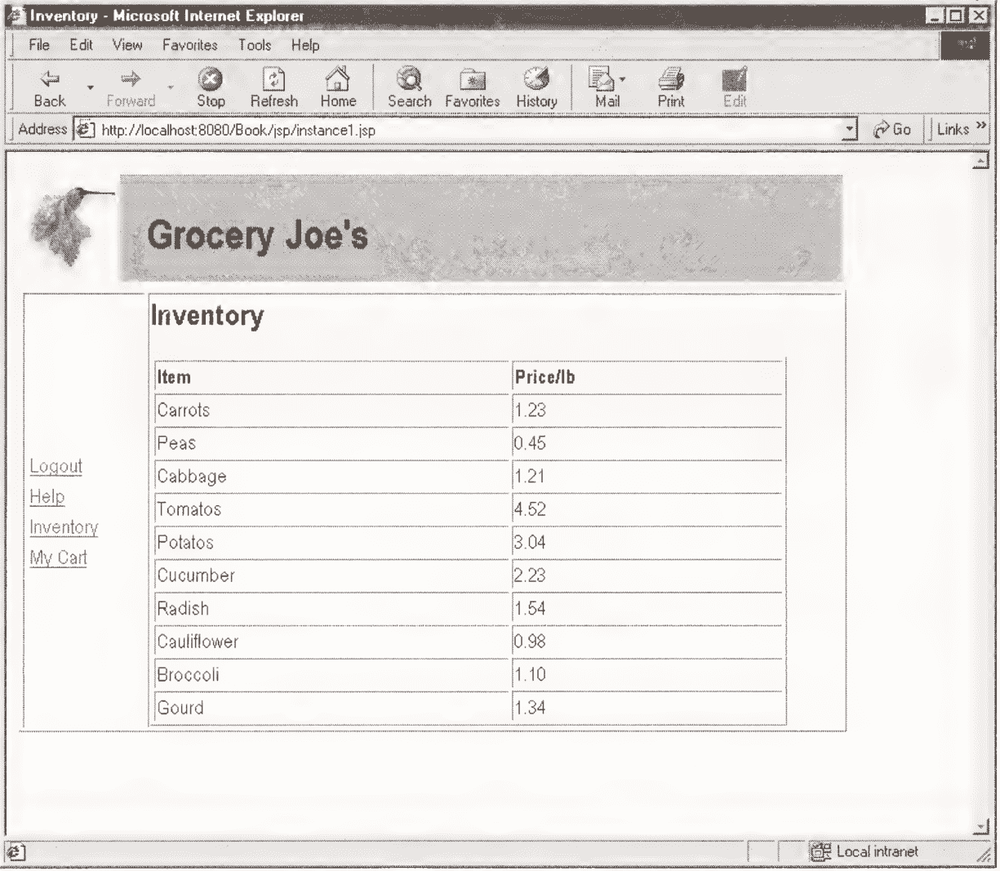

图 6-8 模板的首次使用

13. 现在输入 URL：`http://localhost:8080/Book/jsp/instance2.jsp`。你应该会看到如图 6-9 所示的网页。

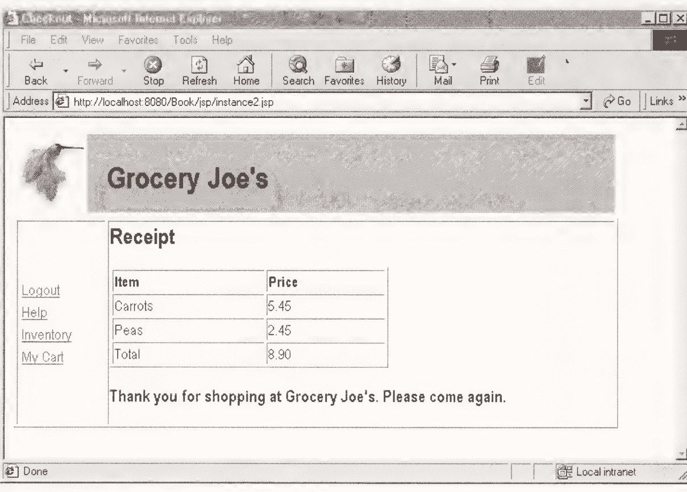

图 6-9 模板的第二次使用

## 掌握度检查

- 1. 自定义标签为 JSP 开发者提供了哪些优势？
- 2. 自定义 action 或标签库的主要元素是什么？
- 3. 标签开发者可以实现哪两种类型的标签接口？
- 4. 标签处理器能否在其 *doAfterBody* 方法中调用 *pageContext.include* 方法？
- 5. 标签库开发者如何指定可以使用 JSP 表达式提供标签属性的值？
- 6. *BodyContent* 对象的作用是什么？
- 7. *TagExtraInfo* 类的作用是什么？
- 8. 自定义 action 之间共享数据的两种推荐方式是什么？
- 9. 标签库描述符的作用是什么？
- 10. 如何为自定义 action 指定标签处理器类？
- 11. *Tag* 接口中 *release* 方法的作用是什么？
- 12. 生成的 servlet 何时以及调用 *doInitBody* 方法多少次？*doInitBody* 方法的目的是什么？
- 13. 自定义 action 开发者如何指定一个标签属性是可选的？

# 第二部分
构建现实世界的应用程序


# 模块 7

## JSP 架构

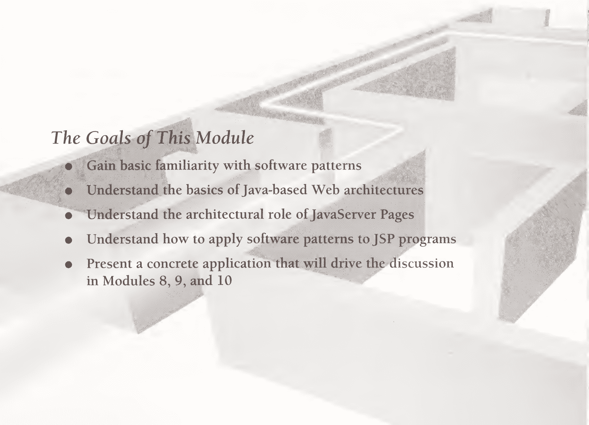

**本模块目标**

- 对软件模式有基本的了解
- 了解基于 Java 的 Web 架构的基础知识
- 了解 JavaServer Pages 的架构作用
- 了解如何将软件模式应用于 JSP 程序
- 介绍一个具体的应用程序，该应用将驱动模块 8、9 和 10 的讨论

在第一部分中，你学习了基本的 JSP 语法和技术。现在在第二部分中，你将学习如何在四个“现实世界”问题的背景下应用这些基础知识：

1.  设计 Web 应用程序架构
2.  在 JSP 应用程序中实现安全机制
3.  在基于 Java 的 Web 应用程序中协调控制流（*web-flow*）
4.  在 JSP 应用程序中管理数据

本模块讨论这些主题中的第一个：基于 JavaServer Pages 的 Web 应用程序架构。

我们首先对软件模式进行一般性讨论，这是对现代软件设计的一个相当深刻的贡献。然后，我们描述架构模式及其对 Web 应用程序的重要性。接下来，我们描述一些适用于 JSP 架构的更重要的软件模式。最后，我们将描述一个应用程序，该应用将指导我们在第二部分的讨论。

# 应用程序开发中的模式

分析模式是相对较新的应用程序开发工具。所谓的“四人帮”（GoF）著作——Gamma、Helm、Johnson 和 Vlissides 所著的《设计模式：可复用面向对象软件的基础》（Addison-Wesley 出版公司，1995 年）是基于模式开发的权威指南。其重要性在于它首次在一本书中命名、分类并解释了一系列基本的面向对象软件设计模式。然而，“模式”一词及其在软件中的应用早于“四人帮”著作，并且具有多样化的根源。早期的 Smalltalk 社区和建筑设计师克里斯托弗·亚历山大（Christopher Alexander）的思想（Alexander、Ishikawa、Silverstein、Jacobson、Fikadahl-King 和 Angel 所著的《模式语言》，牛津大学出版社，1977 年）尤为重要。这个概念自 1990 年代初以来在各种群体中得到了广泛传播。

# 模式的概念

模式社区提出了几种不同的模式定义。“四人帮”将模式定义为“在特定上下文中对问题的解决方案”（GoF，第 3 页）。为了本书的目的，“四人帮”随后将此定义限制为*通信的*软件对象和类。然而，你无需将模式的概念局限于软件对象和类。另一个定义将模式描述为“对重要设计问题的有效解决方案”（Mowbray 和 Malveau，《CORBA 设计模式》，John Wiley & Sons 公司，1997 年，第 6 页）。Martin Fowler 对模式的定义是：“模式是一个在某一实用上下文中曾经有用，并且可能在其他上下文中也会有用的思想”（Fowler，《分析模式》，Addison-Wesley，1997 年，第 xv 页）。

从所有关于软件模式的讨论中，出现了一些反复出现的主题。其中最重要的主题是模式命名并解释了对反复出现的实用问题的解决方案。它们是一种记法，记录了优秀的软件设计者发现的关于解决在各种软件上下文中出现的某类“现实世界”问题的最佳方法。关键在于模式为解决方案命名并解释了如何应用它。通过这种方式，它们既提供了词汇，也提供了课程。有时课程是熟悉的，名称只是帮助你谈论它。这可能是一种非常有效的交流思想的方式，否则可能需要绘图。其他时候，课程帮助你透过问题的干扰，识别其本质特征。一个好的模式应该扮演这两种角色，通常同时扮演。

第二个重要主题是模式不是学术发明。模式更像是民间传说，而不是数学证明。它们是从问题解决者社区中流传下来的一种智慧。它们在实际项目中的谱系很重要且独特。它们的重要性源于它们有效的事实——它们被证明是有用的。

第三个主题是，虽然模式出现在特定的问题领域中，但它们有时可以跨越多个问题领域。好的模式通常表达的是你可以应用到其他地方的东西。它们是思想的工厂。

### 1分钟练习

- 为什么“四人帮”著作在开发者中享有如此高的地位？
- 软件模式表达了关于软件设计的什么内容？
- 在什么意义上软件模式是“思想的工厂”？

- “四人帮”著作首次在一本书中命名、分类并解释了一系列基本的面向对象软件设计模式。
- 软件模式表达了解决在各种软件上下文中出现的某类现实世界问题的最佳方法。
- 软件模式之所以是“思想的工厂”，是因为它们通常可以应用于多个软件领域。


## 模式的效用

模式之所以有用，有几个原因。正如我们所说，模式为解决方案提供了名称，从而为描述开发项目提供了一套词汇。只要你的受众理解这套语言，你的沟通就能在更精确的同时也更简洁。

模式传授良好的软件设计实践。模式识别反复出现的设计问题，并为这些问题提供合适的解决方案。这意味着，透彻理解模式及其适用性，有助于开发者更好地理解良好的软件设计实践。一个好的软件设计更优雅、更适应变化，并且可重用。

模式促进了关于解决方案的讨论，因为模式暗示了问题情境。如果你将一个模式应用到你的问题上，你就有效地表达了你对该问题的分析。其他人可以就此分析与你辩论，而这场辩论可以进一步阐明问题。

通过有意识地使用模式（你可能是无意识地这样做，但这不那么有益），你可以丰富你可用的解决方案库。这可以加速你在未来项目中识别合适软件解决方案的能力。

模式将开发者社群的智慧规范化。当你恰当地应用模式时，你会有安全感，知道其他开发者会认同这个解决方案。这减少了采用不优雅、不灵活或不正确解决方案的可能性。


### 1分钟快速复习

- 软件模式如何促进关于软件设计的沟通？
- 软件模式如何帮助教育程序员？
- 为什么应用软件模式有助于验证一个提出的设计解决方案？

- 软件模式为软件问题的典型解决方案提供了一套词汇。
- 软件模式传授良好的编程实践，因为它们识别并命名了反复出现的设计问题以及这些问题的最佳解决方案。
- 软件模式将开发者社群的智慧规范化。当你应用一个模式时，你增加了其他开发者认同你解决方案的可能性。

## 架构模式

信息系统包含几种不同类型的架构。不幸的是，术语“架构”的使用并不总是一致。在不试图提供人们使用“架构”一词的所有方式详尽列表的情况下，我们可以识别出软件应用中四个可以有意义地描述为架构的不同方面：

- 物理架构
- 系统架构
- 数据库架构
- 应用软件架构

以下是这些不同术语的简要含义：

*物理架构*定义了应用程序运行的硬件和网络基础设施。每个软件应用都依赖于一个物理架构。例如，一个应用可能需要运行特定 Web 浏览器的客户端机器、一台 Web 服务器机器和一台数据库机器。此外，可能还有网络布线和硬盘要求。应用的硬件和网络需求规范以及这些硬件组件之间的具体交互，就是我们所说的物理架构。

*系统架构*定义了应用程序运行的软件基础设施。每个软件应用都预设了这样一个基础设施。例如，你通常必须考虑网络协议和操作系统才能部署应用。有时你必须将应用与其他应用集成。多个应用的集成也是系统架构的一部分。

*数据库架构*定义了应用的数据模型。为任何给定的应用数据建模有许多不同的方式，数据库供应商提供不同的功能来支持这些定义。你可以将数据库架构归入应用软件架构（我们的下一个主题），因为它们位于系统和物理架构之上，并且应用开发者通常定义它们。我们将它们分开，是因为应用数据和可能实现数据表示的基础数据模型之间存在逻辑上的区别。例如，如果你使用 XML 实现数据模型，你的模型将具有与使用关系数据库实现的模型截然不同的架构。同样，关系数据库的架构也将与对象数据库的架构显著不同。

*应用软件架构*定义了应用的软件元素以及它们之间的数据流。本模块重点讨论基于 JavaServer Pages 的应用软件架构。架构模式定义了应用程序的主要高层子系统以及它们之间相互关联的角色。

### 应用程序层次

架构模式根据它们定义的应用程序*层次*数量分为不同类型。术语“层次”指的是应用程序的不同部分：表示层、领域定义层和数据定义层。

*表示层*提供用户界面并控制应用程序的导航。诸如感知、响应时间和功能明显性等人为因素驱动着它的需求。

*领域层*对问题领域的语义进行建模。例如，一个银行应用程序可能有一个客户账户的内部表示。然后它通过提供存款和取款逻辑来建模与账户的交互。

*数据层*对信息存储的需求进行建模。应用程序必须根据底层数据存储机制的要求来定制这种逻辑。例如，如果存储机制是文件系统，数据层必须提供从文件系统存储和检索数据的方法。另一方面，如果存储机制是关系数据库，数据层必须提供从数据库存储和检索数据的逻辑。

基于这些层次，三种基本的应用程序类型是：

- **单层** 应用程序是单体的，不将表示层与领域定义层和数据定义层分离。
- **两层** 应用程序将表示层和领域定义层与数据定义层分离。
- **三层** 应用程序将表示层、领域定义层和数据定义层分离成独立的组件。

### 单层架构

*单层*应用程序不尝试将应用程序的不同逻辑部分彼此分离。现代软件开发将单层应用程序局限于小型的命令行实用程序和非交互式批处理过程。这在很大程度上是由于现代客户端-服务器系统（一种两层架构的形式）的出现。现代数据库系统尤其具有影响力，因为它们提供了应用程序之间简化的数据共享，并通过允许为数据库单独分配硬件资源来提高可扩展性。

### 两层架构

*两层*架构将表示层和领域逻辑与数据访问逻辑分离。数据库应用程序和简单的 Web 应用程序，就像所有客户端-服务器系统一样，都说明了两层架构。许多现代交互式应用程序都展示了两层架构，这主要是因为数据共享的重要性。图 7-1 复制了我们在模块 1 中用于描述客户端-服务器架构的图表。

当共享数据以及数据的集中控制和维护是重要需求时（对于大多数业务应用程序来说确实如此），两层架构优于单层架构。它们还有一个优势，即相对容易理解和实现。但两层应用程序也有其缺点。

两层架构利用了这样一个思想：应用程序应该在本地处理数据，但将其存储在共享的、集中式的服务器中。但这过于简单化了。例如，企业应用程序必须都以大致相同的方式处理共享数据存储。如果应用程序在本地处理所有数据，它们就必须各自重复这个共同的业务逻辑。为了规避这种重复，现代数据库支持使用存储过程在数据库中进行大量处理。这鼓励应用程序开发者将共同的业务逻辑移入数据库，而不是重复。

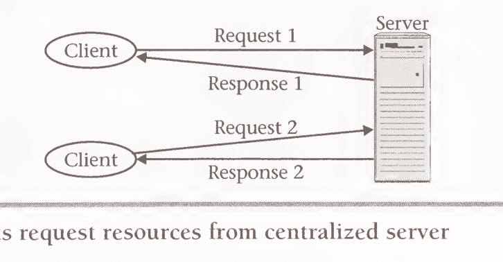


它在每个应用程序中。但这种解决方案也有问题，因为它破坏了应用程序逻辑和数据访问逻辑之间任何清晰的分离。此外，存储过程通常不提供像C++或Java等现代面向对象语言所提供的相同级别的封装和领域建模支持。一些数据库（如Oracle）提供了在数据库服务器内部调用Java代码的能力。但通常，你塞入数据库的业务逻辑越多，你的应用程序就越混乱，与其他应用程序的连接也越模糊。将业务逻辑塞入数据库还会将你绑定到特定的数据库供应商，因为数据库供应商之间对这些技术没有一致的支持或明确的标准化。

此外，现代应用程序有时必须访问多个数据库。两层应用程序必须在应用程序层中放置管理多个数据库的逻辑，从而将数据访问逻辑从数据库迁移到应用程序。应用程序开发人员必须深入了解哪些数据库包含哪些数据，以及每个数据库中的精确数据模型。很可能物理数据模型无法很好地映射到领域模型。这加剧了问题，因为应用程序必须提供映射逻辑。

## 三层架构

*三层*架构将表示逻辑、领域逻辑和数据访问逻辑分离到三个不同的组件中。图7-2说明了一个典型的三层架构。

三层架构的主要优点是它支持对应用程序功能进行更清晰的分离和封装。表示逻辑可以解决人机交互需求，而数据访问逻辑可以处理物理数据模型的结构和数据库引擎的能力。最重要的是，中间层，即领域层，可以解决和建模业务问题的语义。

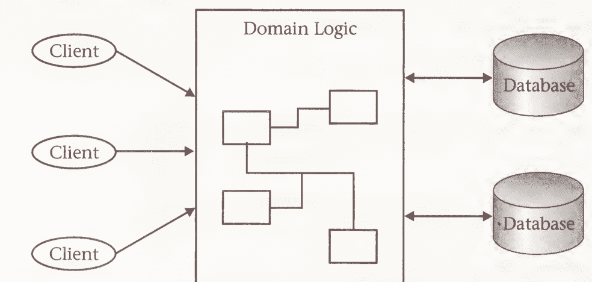

三层架构的另一个优点是你可以将领域层从客户端机器移动到一个或多个服务器机器上。两层架构使得将数据层从客户端移出成为可能；三层架构扩展了这种能力，可以为不同的应用程序功能分配独立的硬件。通常，为应用程序层分配一层硬件可以大大提高性能和可伸缩性。


### 问题：

三层架构不是比单层或两层架构更好吗？你会实现其他类型的架构吗？

### 回答：

简短的回答是不！在所有其他条件相同的情况下，三层架构比单层或两层架构具有更好的可伸缩性和灵活性。但存在许多权衡。三层架构需要额外的网络层，这会降低性能并使支持和故障排除更加复杂。实现三层架构需要更高的复杂性。正如我们在模块1中所描述的，网络从来不是完全透明的，因此在三层架构中，延迟和可靠性问题变得更加麻烦。
结果是，你最好将某些应用程序建模为单层或两层应用程序。例如，桌面实用程序从来不需要三层。当设计为两层应用程序而不是三层时，工作组应用程序通常响应更快、更直观。另一方面，互联网应用程序几乎总是采用三层而不是两层更好。互联网应用程序永远无法准确预测其潜在负载。在这种情况下，你最好谨慎行事，编程实现最大的可伸缩性和灵活性。

## 拆分表示层

对两层和三层架构的一种变体是将表示层拆分为两个部分：纯表示逻辑和应用逻辑。前者负责用户界面元素，如窗口、菜单、字体、颜色、屏幕定位和大小。后者对用户界面元素不承担任何责任，但调解表示元素与其他层之间的所有交互。特别是，它管理在三层架构中对领域层的所有访问，以及在两层架构中对数据层的所有访问。应用逻辑向表示逻辑隐藏其他层的复杂性，以表示层所需的确切形式向表示层呈现数据。图7-3展示了这种针对三层应用程序的变体。

### 一分钟速记

- 什么是应用程序软件架构？
- 应用程序有哪些不同的层？
- 两层架构的目标是什么？
- 三层架构相对于两层架构有哪些两个优点？
- 为什么有时要将表示层拆分为纯表示逻辑和应用逻辑？

## Web 应用程序架构

回顾模块1，基本的Web架构是两层。Web服务器作为数据层，提供HTML页面和图像等Web资源。Web浏览器作为表示层，渲染由数据本身定义的用户界面（使用HTML标签）。

Web浏览器的客户端扩展本身并不会改变Web应用程序的基本两层特性。例如，提供下拉菜单的JavaScript或Java小程序控件可以极大地改善用户体验

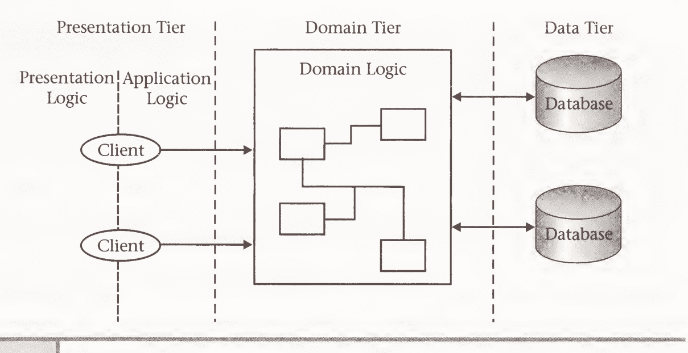


但并没有将领域模型与表示逻辑分离。这些客户端技术只是增加了表示层的复杂性。

同样，服务器端扩展本身也不会改变Web应用程序的两层特性。例如，CGI程序可以增加物理数据层的复杂性，将物理数据模型从简单的Web页面扩展到复杂的关系信息。但这并没有将领域模型与数据层分离。图7-4说明了这种两层Web架构，包括客户端和服务器扩展。

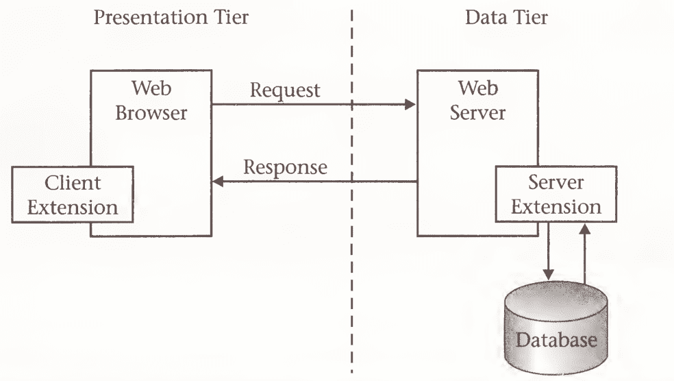


Web浏览器运行插件COM组件和Java小程序的能力意味着你*可以*在浏览器中添加应用层。例如，一个Java小程序可能实现一个功能齐全的窗口应用程序。然后将表示层拆分为表示逻辑层和应用逻辑层就有意义了。这种客户端解决方案的问题在于它们使客户端层变得臃肿，并且，就像操作系统一样，仅将浏览器用作应用程序宿主。微软的Active Desktop范式将这种架构推向了极端，有效地将浏览器转换为操作系统的扩展。

服务器扩展也可以为Web应用程序添加层，这也是我们在第二部分中采用的方法。这种方法相对于客户端方法的优势在于它充分利用了浏览器作为*瘦客户端*。与客户端方法一样，服务器端方法将表示层分为表示逻辑和应用逻辑。与客户端方法不同的是，它通过网络分布这两个层。浏览器处理表示逻辑，而Java servlet（或Active Server Page）处理应用逻辑。图7-5展示了这种服务器端架构。

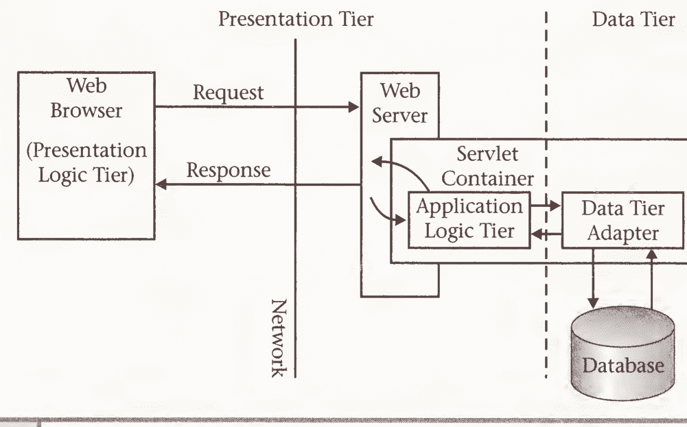

**图7-5** 表示层两部分的Web分布


# 1分钟快速练习

-   基础的Web架构中有多少个层次？
-   你能使用客户端技术来增加层次吗？
-   你能使用服务器端技术来增加层次吗？

# 面向对象的软件设计模式

应用程序不仅体现了不同的架构模式，还实现了不同的面向对象软件设计模式。架构模式与面向对象模式的区别在于视角不同。从宏观层面看，关注点在于应用程序的主要子系统，此时适用架构模式。当关注点在于软件类、对象及其交互时，则适用面向对象模式。

《设计模式》（GoF）仍然是面向对象软件设计模式的权威著作。它将面向对象设计模式分为三种基本类型：

-   **创建型模式** – 实例化过程的抽象
-   **结构型模式** – 对象组合方式的抽象
-   **行为型模式** – 对象间通信的抽象

这种分类很有用，因为它有助于理解一组对象在应用程序中所扮演的角色。

*创建型*模式适用于应用程序使用某些对象来创建其他对象的常见方式。*结构型*模式适用于应用程序从较小的对象或对象系统组合成较大的软件对象和对象系统的方式。*行为型*模式既适用于对象的组合，也适用于应用程序通信和协作的方式。在第二部分描述应用程序的布局时，我们将介绍相关的模式以及它们如何融入这个分类体系。

有几个模式与典型的Web应用架构特别相关：

-   模型-视图-控制器
-   中介者
-   命令
-   策略
-   桥接

基础的Web架构有两个层次：表现层和数据层。是的，Java小程序和COM控件都可以通过拆分表现层来增加层次。同样，使用Java Servlet技术或活动服务器页面（ASP），你可以轻松地在应用程序的服务器端增加层次。

# 模型-视图-控制器

图7-6展示了模型-视图-控制器（MVC）模式，它将应用程序划分为独立的数据管理（模型）、表现（视图）和控制组件。

MVC模式是大多数现代图形用户界面的基础。你也可以将MVC模式应用于Web应用程序。这种划分清晰地分离了控制逻辑、数据管理和表现。因此，它促进了各个组件的独立演进和重用。它还使得更好地利用中介者、命令、策略和桥接等其他模式成为可能。JavaServer Pages最适合实现Web应用程序的表现部分。JavaBeans封装了为网站提供内容的服务，并简化了架构组件之间的数据传递。Servlets最适合作为控制器和中介者，负责路由用户请求和应用程序消息、更新应用程序数据以及驱动应用程序工作流。

MVC模式自然地映射到多层架构模式。图7-7展示了双层架构通常如何将MVC模式的控制部分映射到表现领域。当Servlets实现控制逻辑时，这是一个自然的映射，因为Servlets通常位于表现层。然而，有时三层架构会将部分或全部控制逻辑映射到中间层或业务逻辑层。图7-8展示了这种映射。

将控制逻辑映射到业务逻辑层的一个优势是，系统通常将这一层托管在比表现层更好、更快的硬件平台上。第二个优势出现在控制逻辑需要跨越多个数据层时，可能是因为需要集成遗留应用程序。在这种情况下，控制逻辑的复杂性使得这种映射方式更具吸引力。

# 中介者

在JSP架构中，Servlet通常充当*中介者*，在业务逻辑和表现之间路由请求和响应。GoF将中介者归类为行为型模式。此模式通过将相关功能封装在一个管理器对象后面来控制软件子系统之间的交互，该管理器对象将纯粹内部相关的消息与必须传递给其他子系统的消息分离开来。

在最坏的情况下，假设所有组件之间都存在相互依赖关系，未中介的交互可能导致*n* \* (*n* - 1)条通信路径，其中*n*是组件的数量。当然，应用程序通常不会使用所有可能的通信路径，因此这种情况很少发生。然而，在实际应用程序中，组件间的依赖关系足够多，使得组件间的通信变得混乱且难以管理。图7-9展示了软件组件之间的任意交互如何使通信路径激增。

中介者模式极大地减少了组件间硬编码的通信路径，并将这些依赖转化为决策规则。图7-10展示了使用中介者如何简化软件组件间的通信路径。

**图7-9** 未中介的通信路径

中介者将最坏情况（所有组件间相互依赖）减少到2 \* (*n* – 1)条路径，其中*n*是组件的数量。对于50个组件，没有中介者的最坏情况需要2450条通信路径，而有中介者时，只需要98条。此外，中介者提供了一种“按需知晓”的架构，组件只需关心它发送的消息，而无需关心消息的目的地。

# 命令

*命令*模式将操作封装在一个对象中，以便你可以将其注册给另一个对象执行。GoF将其归类为行为型模式。命令模式将特定操作与执行该操作的对象分离。一个明显的例子是窗口菜单工具包。菜单项必须执行某些操作，但工具包无法将此操作构建到菜单项中，因为只有菜单的使用者才知道它必须执行什么操作。

要使用该工具包，你需要将操作封装在一个对象中，并将该对象注册到工具包。然后，当你选择菜单项时，工具包会在注册的对象上调用该操作。

> **提示**
> 你可能做过X Window编程或以其他方式使用过函数回调。函数回调是命令模式的过程式等价物。

你也可以将命令模式应用于Web应用程序和窗口菜单。菜单选择和Web应用程序请求之间存在类比。正如菜单选择可以启动窗口或重绘现有窗口一样，浏览器也使用HTTP请求来启动新窗口或显示新页面。在MVC架构中，Servlet通常充当Web页面之间这种移动的路由器。你可以编写自定义的Web应用程序，只需硬编码应用程序的页面流程。在这种情况下，你将决策逻辑嵌入到控制Servlet中。图7-11展示了一个基于MVC的Web架构，其中决策逻辑嵌入在控制Servlet中。

如果你永远不需要更改应用程序的控制逻辑或显示的页面，硬编码是可行的。但是，假设你必须更改控制逻辑或显示的JavaServer Pages，甚至更改JavaServer Pages的路径。在这种方法下，你必须重新编译和重新部署Servlet，因为它将所有这些元素都编译到Servlet中。命令模式帮助你将行为与控制逻辑分离。图7-12展示了如何做到这一点。

在图7-12中，命令模式将每个动作封装在自己的Java对象中。这有助于将控制逻辑与具体动作分离，即使控制逻辑仍然嵌入在Servlet中。这种分离允许你在不更改Servlet本身的情况下，更改JSP页面的路径或Servlet调用的特定JavaBean或JSP页面。当然，控制逻辑仍然过于受限，因为条件逻辑仍然在Servlet中。更好的方法是也将控制逻辑与Servlet主体分离。这就是策略模式的工作。

# 策略

策略模式定义了一系列算法，并将每个算法封装在一个对象中。GoF将策略模式归类为行为型模式。策略模式的目的是让算法的选择独立于使用它们的对象。

**图7-10** 中介者模式


### 桥接模式

*桥接*模式将抽象接口与其具体实现解耦。其优势之一在于，它能使客户端与任何平台特定或专有的方法签名相隔离。桥接定义的方法可能与其具体实现所定义的方法并不匹配。通常，桥接本身并不直接执行最基础的操作，从而提升了抽象层次。GoF（四人帮）将桥接模式归类为一种结构型模式。桥接模式有助于构建*可插拔*的架构——一种支持同一抽象功能多种实现的架构。它同时也支持抽象及其各自的实现进行独立扩展。

图7-14展示了桥接模式在JSP架构中一种可能的实现。请注意，桥接需要两个参与者：抽象对象和一个根级别的实现组件。在Java中，这个根级别的实现组件可能仅仅是一个Java接口，也可能是一个抽象类。桥接的这一部分的任务是为不同的实现定义接口。还需注意，抽象对象持有一个引用，该引用指向一个它委托操作的对象。这个引用的数据类型与根级别的实现组件相同。桥接模式也要求至少有一个具体的实现类。

桥接模式在JSP架构中可以扮演重要角色，它能帮助应用程序支持其模型的多种实现。为什么要这样做呢？有时你无法预见客户的具体需求，或者你无法指定某种特定技术。有时你想用新技术替换现有技术。有时你想进入一个新的市场领域，却发现该市场需要不同的实现。

JSP架构中的控制Servlet本质上是应用程序Web流程的一个路由器。一个用于JSP开发的工具包可以利用策略模式来灵活定义此类路由器的族。你可以将每个Web流程视为一种策略。每个Web应用程序都必须定义自己的策略。有了策略模式，你就可以在不修改使用它们的Servlet的情况下，定义新的Web流程并将其添加到该族中。图7-13展示了这种架构。

> **提示**
> 你可以创建一种足够通用的策略，以至于可能不需要采用可插拔的模型。例如，你可能通过一个命令令牌来驱动你的逻辑。然后你的策略可以使用基于令牌的查找来找到要执行的命令。这完全避免了使用条件逻辑。

## 图7-14 桥接模式

一个常见的原因是不同的客户需要不同的可扩展性级别。出版社的一个工作组可能满足于基于文件服务器的模型。而像通用汽车或索尼这样的公司级应用则会希望采用可扩展性更强的实现，可能是在企业JavaBean（EJB）实现背后通过JDBC访问数据库。

## 一分钟速练

- GoF（四人帮）识别出了哪三种类型的软件模式？
- 什么是MVC模式？
- 你能将MVC模式映射到多层架构模式上吗？
- 除了MVC，对于基于Java的Web架构，还有哪些重要的模式？

# 专家问答

> **问：** 看起来命令模式、策略模式和桥接模式都可以使用一个配置文件，将特定的类映射到应用程序的角色中。这样的配置文件对于每种模式可能起到什么作用？

**答：** 命令模式将一个Web URL封装为对应的操作令牌（条件）。配置文件可以提供URL列表及其关联的操作令牌。类似地，特定的策略模式可以在运行时根据配置文件的设置进行加载。最后，桥接模式依赖于加载具体的实现。你可以在配置文件中指定正确的实现类。

- GoF识别出创建型、结构型和行为型模式。
- MVC模式将软件对象划分为三种角色：控制器、视图和模型。控制器负责路由消息，视图负责管理呈现，模型负责管理应用程序状态。
- 是的，这很容易。例如，一个两层架构通常将控制器和视图映射到表示层，将模型映射到数据层。
- 其他重要的软件模式包括：中介者、命令、策略和桥接。

## 项目 7-1：图库浏览器

本项目演示了如何运用设计模式来开发一个简单的Web应用程序，包括Servlet和JavaServer Pages。该应用程序呈现一个图库视图，其中的图片是根据从目录中的选择来检索的。用户还可以修改图库的布局。

我们希望在本项目中演示的主要模式是MVC模式。你将看到作为控制器的Servlet、作为模型的Inventory类，以及作为视图的JSP页面之间清晰的分离。命令、中介者和策略设计模式也与本项目相关。

### 分步指南

1. 从 http://www.osborne.com 下载本项目的文件。
2. 在位于 `%TOMCAT_HOME%/conf` 的 `server.xml` 配置文件中插入以下行，在Tomcat中创建一个名为 "gallery" 的新应用程序上下文。
3. 在 `%TOMCAT_HOME%/webapps` 下创建一个 `gallery` 目录。
4. 在新创建的 `gallery` 目录下创建子目录 `html`、`jsp`、`images` 和 `WEB-INF`。
5. 在 `images` 子目录下创建子目录 `summer` 和 `spring`。
6. 将一些示例图片放入 `summer` 和 `spring` 子目录。为了模拟真实情况，我们建议你将一些展示夏季服装的图片放入 `summer` 子目录，将春季服装的图片放入 `spring` 子目录。这里的想法是根据用户选择来区分检索选择的图片。
7. 将JSP页面文件 `GalleryLayout.jsp` 移动到 `jsp` 子目录中。
8. 将HTML文件 `Enter.html` 移动到 `html` 子目录中。
9. 将 `web.xml` 文件移动到 `WEB-INF` 子目录中。

```xml
<Context path="/gallery"
    docBase="webapps/gallery"
    crossContext="true"
    debug="0"
    reloadable="true"
    trusted="false" >
</Context>
```

10. 在 `WEB-INF` 下创建子目录 `tlds` 和 `classes`。
11. 将标签库描述符文件 `galleryLayout-taglib.tld` 移动到 `WEB-INF/tlds`。
12. 如果你查看HTML文件 `Enter.html`，你会注意到它包含一个带有两个选择元素的简单表单，一个用于选择目录，另一个用于选择图库中每行显示的图片数量。
13. 请特别注意名为 "COMMAND" 且值为 "GET_IMAGES" 的隐藏输入元素：

```html
<INPUT TYPE=hidden NAME="COMMAND" VALUE="GET_IMAGES">
```

此元素确保当你提交此表单时，Servlet控制器将调用由标签 `GET_IMAGES` 标识的命令。
14. 表单的操作（action）命名为 `/gallery/Controller`，这实际上映射到Java Servlet类 `gallery.ControllerServlet`。我们在 `web.xml` 文件中使用 `<servlet>` 和 `<servlet-mapping>` 标签来建立此映射。首先我们使用 `<servlet>` 标签：

```xml
<servlet>
    <servlet-name>Controller</servlet-name>
    <servlet-class>gallery.ControllerServlet</servlet-class>
</servlet>
```

然后我们使用 `<servlet-mapping>` 标签：

```xml
<servlet-mapping>
    <servlet-name>Controller</servlet-name>
    <url-pattern>/Controller</url-pattern>
</servlet-mapping>
```

请注意，Web应用DTD要求所有 `<servlet>` 标签必须归组，所有 `<servlet-mapping>` 标签归组，所有 `<taglib>` 标签归组。这些标签在 `web.xml` 文件中还必须按此顺序出现：`<servlet>`、`<servlet-mapping>` 和 `<taglib>`。
15. 现在，让我们检查 `ControllerServlet`。顾名思义，这个Servlet在MVC模式中充当控制器。控制器负责路由用户请求并驱动应用程序工作流。以下是 `ControllerServlet` 类：

```java
public class ControllerServlet extends HttpServlet {
    private Map commands = new HashMap();
```


## 16. Servlet 维护一个 `java.util.HashMap`，用于将命令字符串与命令对象关联。它还持有一个指向 `Inventory` 类的引用，该类在 MVC 模式中充当模型。

## 17. `init` 方法执行三个关键操作：
-   它将库存根目录确定为相对于应用程序上下文的相对路径。通常，这不需要位于应用程序上下文下，而是可以通过 `web.xml` 中指定的应用程序上下文的初始参数获取。
-   它创建 `Inventory` 类，并使用库存根目录以及用于图像目录的 URL 根目录对其进行初始化。
-   它建立了命令对象 `GetImagesCommand`，该对象实现了 `Command` 接口，作为命令字符串 `"GET_IMAGES"` 的处理程序。对于命令字符串，可以有任意数量的此类命令处理程序。在“现实世界”的设置中，你可能会通过读取配置文件来建立这种映射，从而消除任何硬编码的依赖关系。

## 18. 当你提交 HTML 表单时，Servlet 容器会将控制权转移给 `ControllerServlet` 的 `doPost` 方法。`doPost` 方法从请求中检索命令字符串（如前所述，该命令字符串先前通过 HTML 文件中的隐藏 `INPUT` 元素建立）。然后，它使用命令字符串从其映射表中检索适当的命令对象，并调用命令对象上的处理程序方法。此设置同时演示了中介者模式和命令模式。控制器 Servlet 实现了中介者模式，在元素之间路由请求。源（HTML 文件）仅向中介者发送消息（命令字符串），而不必担心谁正在处理该消息。请注意，我们的路由算法非常通用，我们不需要替换它（使用策略模式）来适应新的应用程序。目标 `GetImagesCommand` 是命令模式的实现。

## 19. 我们将 `GetImagesCommand` 实现为内部类（因此它可以访问 `Inventory` 对象）。这完全可以是一个单独的类。`handle` 方法检索请求参数，并将选定的目录名称发送给模型（`Inventory`）以检索其图像。`Inventory` 对象返回一个指向图像列表的 `java.util.Iterator`。该迭代器存储在请求中，并发送到 URL `/galleryViewer`，该 URL 在 MVC 模式中充当视图。此 URL 映射到 JSP 页面文件 `GalleryLayout.jsp`。我们在 `web.xml` 文件中使用以下 XML 片段建立此映射以设置 Servlet 名称：

```xml
<servlet>
    <servlet-name>galleryViewer</servlet-name>
    <jsp-file>/jsp/GalleryLayout.jsp</jsp-file>
</servlet>
```

然后我们使用以下 XML 片段将名称映射到相对 URL：

```xml
<servlet-mapping>
    <servlet-name>galleryViewer</servlet-name>
    <url-pattern>/galleryViewer</url-pattern>
</servlet-mapping>
```

## 20. 让我们检查 `Inventory` 类：

```java
public class Inventory {
    private String inventoryDirRoot = null;
    private String inventoryURLRoot = null;

    public Inventory(String inventoryDirRoot,
                     String inventoryURLRoot) {
        this.inventoryDirRoot = inventoryDirRoot;
        this.inventoryURLRoot = inventoryURLRoot;
    }

    public Iterator getImagesFor(String catalog) {
        File dir = new File(inventoryDirRoot + "/" +
                           catalog);
        String[] fileList = dir.list(new ImageFilter());
        if((fileList != null) && (fileList.length > 0)) {
            List l = new ArrayList();
            for(int i=0; i<fileList.length; i++) {
                l.add(new ImageItem(inventoryURLRoot +
                        catalog + "/" +
                        fileList[i], fileList[i]));
            }
            return l.iterator();
        }
        return null;
    }

    class ImageFilter implements FilenameFilter {
        public boolean accept(File dir, String name) {
            return(((name.toLowerCase()).endsWith(".jpg")) ||
                   ((name.toLowerCase()).endsWith(".gif")));
        }
    }
}
```

## 21. `Inventory` 类在我们的 MVC 模式中充当模型。它将目录名称映射到其物理位置并从中检索图像。在我们的简单应用程序中，图像来自应用程序上下文中的一个命名目录。在现实世界的设置中，它们可以存储在数据库中，并由中间层应用程序服务器保护。

## 22. `getImagesFor` 方法检索某个目录的图像，将它们存储在 `java.util.ArrayList` 中，并返回一个指向它的迭代器。它检查库存根目录的内容，仅过滤扩展名为 `.gif` 和 `.jpg` 的文件。内部类 `ImageFilter` 执行过滤。仅当 `ImageFilter` 对某个文件返回 true 时，`getImagesFor` 方法才会返回该目录中的文件。`ImageFilter` 及其在目录列表中的应用是策略模式的一个示例。

## 23. 这是 JSP 页面文件 `GalleryLayout.jsp`，它在我们的 MVC 模式中充当视图：

```jsp
<%@ page import="gallery.GalleryLayout" %>
<%@ page import="java.util.Iterator" %>
<%@ taglib uri="galleryLayout-taglib" prefix="gallery" %>
<HTML>
<HEAD><TITLE>Image Reader and Layout Test</TITLE></HEAD>
<BODY bgcolor="white" >
<FONT color="black" >
<%-- Layout the images in a gallery view --%>
<%
String itemsPerRow =
    (String)request.getAttribute("ITEMS_PER_ROW");
Iterator iterator =
    (Iterator)request.getAttribute("IMAGES");
%>
<gallery:layout
    images='<%= iterator %>'
    itemsPerRow='<%= itemsPerRow %>'
    width="5"
    borderWidth="10"
    />
</BODY>
</HTML>
```

## 24. 如你所见，我们将图库视图实现为自定义标签 `<gallery:layout>`。我们传递表示目录图像列表的 `Iterator` 以及用户选择的每行项目数。（我们将此自定义标签的详细信息留作读者的练习。）

## 25. 编译所有 Java 源文件——`GalleryLayout.java`、`GalleryItem.java`、`ImageItem.java`、`ControllerServlet.java`、`Command.java` 和 `Inventory.java`——并将类文件放在 `%TOMCAT_HOME%/webapps/gallery/WEB-INF/classes` 目录下。

## 26. 重新启动 Tomcat 并使用 URL 加载 HTML 文件：`http://localhost:8080/gallery/html/Enter.html`。你应该会看到一个如图 7-15 所示的 HTML 页面。

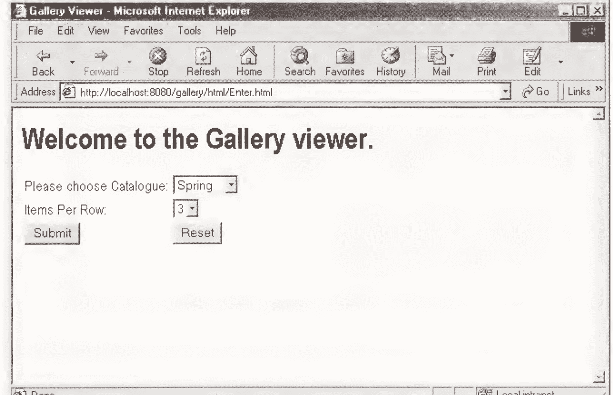


## 应用：家庭中心

第二部分的其余模块将展示我们设计模式在一个名为“家庭中心”的应用程序中的应用。家庭中心类似于一个基于Web的工作组环境，但它服务的是一个关系紧密的大家庭，而非企业。我们的意图是定义一个足够复杂的应用程序，以展示一些典型的“真实世界”企业特性。在深入探讨该应用程序的细节之前，最好先明确其需求。正如您可能了解的，这样的需求分析是软件开发不可或缺的一部分。它为应用程序必须实现的功能设定了广泛的要求。

需求分析的一个重要第一步是开发一套高层用例。以下是指导我们“家庭中心”开发的用例列表：

- 一位家庭成员希望联系另一位家庭成员。
- 一位家庭成员希望更新个人联系信息。
- 一位家庭成员希望查看家庭日历中的家庭活动。
- 一位家庭成员希望在日历中发布一项活动以邀请其他成员。
- 一位家庭成员希望查看家庭活动的照片。
- 一位家庭成员希望分享活动照片供他人查看。
- 一位家庭成员希望查看留言板上的消息。
- 一位家庭成员希望在留言板上发布消息。

人们可能会想到许多其他家庭中心可能满足的用例。然而，我们的应用程序将仅限于上述列出的用例。

敏锐的读者可能已经注意到这些用例中存在某种模式。每一对用例都暗示着一个共同的功能。例如，前两个用例涉及联系信息，我们将其实现为一个“地址簿”。接下来的两个用例涉及家庭活动的日期，我们将其实现为一个“家庭日历”。类似地，再接下来的两个用例涉及家庭照片，我们将其实现为一个“相册”。最后，最后两个用例涉及临时发布的家庭消息，我们将其实现为一个“留言板”。因此，我们的用例表明，“家庭中心”应用程序应包含以下四个功能模块：

1.  地址簿
2.  家庭日历
3.  相册
4.  留言板

### 安全性

我们的家庭中心在互联网上托管着仅家庭成员才能查看或修改的机密信息。这意味着我们必须实现一个安全模型来保护对“家庭中心”的访问。在第8模块中，我们将讨论如何设置简单的用户管理，以提供登录和注销服务，从而保护网站免受恶意访问。

### Web流程

一个设计良好的应用程序必须能够适应变化。很可能有一天我们希望在应用程序中增加更多服务，或者希望更改现有服务。僵化、不灵活的Web流程会使此类更改变得繁琐或不可能。在第9模块中，我们将讨论如何构建一个灵活的Web流程框架。

### 存储库

我们的应用程序需要一个存储库来存储信息。由于我们是从头开始设计应用程序，因此也必须定义信息的结构。信息的结构应基于我们应用程序的需求建模，而非我们所使用的存储技术的需求。我们应将信息模型与任何特定的存储实现解耦。这允许我们透明地更改实际的物理存储库，而不影响我们的应用程序。我们将在第10模块中描述这种设计。

> **注意**
> 您可以从Osborne网站下载完整的应用程序。

## 掌握情况检查

1.  列举软件模式帮助开发高质量应用程序的三种方式。
2.  软件模式成为软件开发环境的一部分有多久了？
3.  关于软件模式的普遍讨论中，出现了一些哪些重要主题？
4.  有哪些不同类型的信息系统架构？它们各自扮演什么角色？
5.  三层架构相比两层架构有哪些优势？在哪些情况下这些优势很重要？
6.  为什么Web应用程序架构师会选择MVC模式？
7.  中介者模式在软件架构中的目的是什么？
8.  为什么Web应用程序设计师会引入命令模式？
9.  桥接模式的目的是什么？为什么它可能对Web应用程序设计师很重要？
10. 在JSP架构中，策略模式如何与命令模式协同工作以管理Web流程？

# 第8模块

## JSP安全

### 本模块的目标

-   理解软件安全的基础知识
-   熟悉Web应用程序安全的不同方法
-   熟悉servlet和JSP安全机制
-   创建“家庭中心”的安全元素

在本模块中，我们将探讨JSP安全架构。该主题复杂多样，我们仅在此进行介绍。应用程序安全旨在保护信息免遭非法访问或修改。管理公司或个人信息的生产级JSP应用程序必须确保此类信息的安全。我们将概述安全基础知识，然后介绍JSP架构和基于Java的Web应用程序的具体安全程序。

## 基本应用程序安全

通常，在构建应用程序时，必须考虑七种安全服务：

-   **认证**：身份确认。
-   **完整性**：确认请求未被篡改。
-   **机密性**：信息保护。
-   **授权**：访问控制。
-   **不可否认性**：真实性保证。
-   **可用性**：确保对消息的响应能力。
-   **审计**：跟踪用户行为。

用户认证是这些安全服务中最基本的一种。让我们更仔细地看看每一种服务。

### 认证

认证是用户向应用程序证明其身份的过程。通常，应用程序通过要求用户登录来认证用户。当用户登录时，他们必须提供有效的用户名和用户密码。像Windows或UNIX这样的操作系统要求登录，然后会与用户关联一个安全记录来证明用户的身份。这样用户就无需登录操作系统支持的其他应用程序。然而，某些应用程序除了操作系统登录外，还要求额外的登录。例如，当应用程序跨越局域网（LAN）或广域网（WAN）时，通常就是这种情况。此时，用户的网络身份可能与用户向操作系统提供的身份凭证不同。当两者不同时，应用程序无法信任操作系统提供的安全记录，因此必须要求额外的登录。

应用程序也可能充当其他应用程序的用户。例如，在JSP架构中的模型（如第7模块所述）可能访问一个需要用户登录的数据库应用程序。在这种情况下，您的应用程序必须使用每个用户提供的登录凭证或使用自己的凭证进行登录。

### 安全域与“信任环”

您可以将安全视为组织成不同的*安全技术域*，每个域使用其自身的技术机制来实施安全。例如，Web服务器和操作系统通常使用不同的技术来实施安全。在此意义上，“安全技术域”一词指任何由共同安全技术（如登录）控制的功能或资源的分组。

您也可以将安全视为组织成不同的*安全策略域*或*领域*。安全策略域是任何由共同安全策略控制的功能或资源的分组。此类领域的边界通常难以辨别，因为它们可能重叠。根据所需的安全级别，您可以将域聚集成“信任环”。不同的“信任环”可以在同一技术域（即使用相同的技术机制）中进行管理。图8-1显示了应用程序通过这种聚类进入低、中、高安全领域的过程。

“信任环”模型背后的理念是，当用户从聚集在安全性较低环中的安全领域移动到聚集在安全性较高环中的安全领域时，他们*应该*满足额外的安全要求（通常包括额外的登录）。同一个环内的领域大致共享相同的安全要求。当用户使用仅对安全性较低环内领域有效的安全凭证，访问到需要更高安全性的环内领域时，就会发生安全*违规*。

例如，数据库访问通常是一个具有高安全要求的领域。相比之下，操作系统的目录和文件结构通常具有较低的安全要求。通常，应用程序会登录到数据库


### 图 8-1 “信任环”

使用应用范围的安全身份，包括应用用户名和密码。如果你将这个应用用户名和密码存储在文件系统中，那么你就使得有权访问文件系统的用户能够检索到数据库凭据。这样的用户因此可以使用仅适用于文件系统较低安全要求的安全凭据来访问数据库。

在实践中，你无法轻松地将信息技术功能分离成与常见安全要求精确对应的整齐环状结构。“信任环”模型更多地是一种分析范式，而非安全域的分类。这种范式指出，你应该确定信息技术功能相对的安全要求级别，然后在安全要求较低的功能和安全要求较高的功能之间创建安全网关或过滤器。

互联网的网络架构很好地阐释了这一范式。图 8-2 展示了这样一个网络架构。

在这个网络架构中，存在三个“信任环”：不可信的互联网，受信任程度稍高的 DMZ 网络，以及最受信任的企业内部网络。

#### 注意

术语 “DMZ” 代表 “非军事区”。在网络架构中，它指的是在受保护的网络（即受防火墙保护的网络）和外部网络（即互联网）之间添加的一个网络，以提供额外的安全层。它的另一个名称是*边界网络*。

在这个网络架构中，路由器将完全不可信的互联网与 DMZ 分隔开，而网络防火墙则将 DMZ 网络与企业内部网络分隔开。所有网络流量必须通过路由器才能到达 DMZ，并通过防火墙才能到达企业内部网络。

图 8-2 展示了一个很好地分隔了不同安全级别、并有效管理从较低安全环到较高安全环流动的网络。然而，假设图中描绘的公司决定使用网络文件系统（NFS）将一台企业内部机器上托管的硬盘挂载到 DMZ 中的一台机器上。那么，该公司要么必须创建一个完全绕过防火墙的新网络，要么必须允许 NFS 协议通过防火墙。无论哪种情况，NFS 都将设定整个区域的安全级别，从而绕过了防火墙。

### 图 8-2 互联网网络架构

### 一分钟演练

- 设计 Web 应用时，必须考虑哪些安全服务？
- 什么是*身份验证*？
- 什么是“安全技术域”？
- 什么是“安全策略域”？
- 何时会发生安全漏洞？

### 授权

*授权*是应用程序对已知用户实施与访问限制或权限相关的过程。通常，应用程序使用访问控制列表（ACL）来实现授权。在这种方案中，安全服务通过将客户端的已验证身份与授权客户端列表进行比较，来授予对请求资源的访问权限。如果客户端在 ACL 中拥有足够权限或特权的记录，服务器就授予客户端所请求的访问权限。

文件系统是使用 ACL 授权访问的服务中最明显的例子。在 Windows 2000 中，如果你右键单击任何文件，然后查看其安全属性，你将看到一个类似于图 8-3 的对话框。图 8-3 显示了文件的四种不同访问权限：`修改`、`读取和执行`、`读取`、`写入`。图 8-3 中的“所有人”这个名称表示所有用户都具有所选权限。身份和选定权限的组合就是一个 ACL。ACL 向一组用户和组授予对某个资源或一类资源的某种权限或一组权限。

### 图 8-3 访问控制列表在文件上的使用

### 完整性

消息完整性指的是应用程序确认从用户发送的消息在传输过程中未被修改的过程。如果你可以在传输过程中修改消息，那么你就可以欺骗收件人做出不恰当的安全决策。想象一下，你可以访问某人与其在线经纪商之间的互联网通信。通过拦截一条消息并修改回复，你可以诱骗一个人提供他的社会安全号码（SSN）或信用卡信息。图 8-4 说明了这个问题。它显示一个 Web 浏览器正在向一个欺骗站点请求一个网页。欺骗站点然后从真实站点请求该页面。真实站点返回所请求的页面。欺骗者重写该页面并将其返回给 Web 浏览器。在整个过程中，用户从未意识到欺骗者正在为了自己的目的而操纵信息。

保证消息完整性的最佳方法是在消息中存储加密的*消息摘要*。消息摘要使用哈希算法（即一种为每个二进制输入生成二进制签名的方法）。这样的哈希必须具有几个特征：

- 哈希的输入可以是任意长度。
- 输出必须具有固定长度。
- 从摘要猜测或推导出输入必须很困难。
- 找到任何两个哈希到相同摘要的消息在计算上必须是不切实际的。

安全哈希的优劣取决于绕过它的计算难度。一个良好的哈希函数应该使猜测或伪造输入实际上变得不可能。例如，考虑一台具有 petaflop（每秒千万亿次浮点运算）速度的计算机（比当今最快的计算机快得多）。假设有一个产生 128 位摘要的哈希，并且每次哈希需要 1000 次浮点运算，那么你需要超过 1000 万亿年（最坏情况）才能“发现”一个哈希到已知值的消息。另一方面，找到两个具有相同摘要的消息（最坏情况）则只需要稍微超过半年时间。

基于这些特征，发送方和接收方可以对消息的相同部分执行相同的哈希，如果哈希匹配，他们就可以确信在传输过程中没有人修改过消息。当然，此机制要求发送方将整个消息作为哈希的输入，然后加密生成的摘要。如果发送方只哈希消息的一部分，那么摘要只能验证该部分消息的真实性。如果发送方未能加密摘要，那么有人可能会修改摘要本身。

> 用于安全目的最常见的哈希是安全哈希算法（SHA）和 MD5。SHA 算法为其输入产生一个 160 位的“指纹”（http://www.itl.nist.gov/fipspubs/fip180-1.htm）。MD5 算法为其输入产生一个 128 位的“指纹”（http://www.cis.ohio-state.edu/cgi-bin/rfc/rfc1321.html）。

### 机密性

机密性确保在传输过程中没有人检查客户端消息。加密是机密性的唯一保证。如果消息的观察者无法解密它，他们就无法读取它。安全套接字（SSL）是互联网上提供机密性的主导加密技术。

### 可用性

可用性指的是服务在网络上的存在及其响应用户消息的能力。许多因素会影响可用性，包括网络

流量。网络流量是所谓的针对服务的“拒绝服务”攻击的基础。此类攻击背后的想法是发送大量请求，使服务不堪重负直至失败。应对此类攻击最常见的方法是使用路由器或防火墙过滤掉攻击消息的来源。通常，拒绝服务攻击中的攻击者数量非常少，尽管他们可能非常难以识别。

硬件或软件故障也会损害服务的可用性。解决技术故障有两种方法：硬件和软件的冗余，或修复的简便性和快速性。第一种方法在主系统故障时提供替代或备用响应。第二种方法使管理员能够在系统故障时快速定位并修复系统。

### 审计

审计跟踪记录应用程序中的用户活动。当发生安全违规时，审计跟踪通常是确定发生了什么的唯一途径。它也可能是识别攻击者身份的唯一线索。

### 一分钟练习

- 什么是授权？
- 什么是消息完整性？
- 什么是机密性？
- 什么是“拒绝服务攻击”？
- 为什么可能要审计用户活动？

- 术语“授权”指的是应用程序对功能或资源实施访问控制的过程。
- 术语“消息完整性”指的是应用程序对用户消息在从用户传输过程中未经任何修改的信心。
- 术语“机密性”指的是应用程序对在用户消息从用户传输到应用程序期间无人检查该消息的信心。
- 拒绝服务攻击试图用大量用户消息淹没应用程序，使其无法响应（即变得不可用）。
- 你可能在发生安全违规时审计用户活动，以确定其来源。

## Web 身份验证

Web 应用于身份验证的技术多种多样。我们描述三种：

- LDAP 身份验证
- 基于证书的身份验证
- 基于 Web 服务器的身份验证

LDAP 身份验证和基于证书的身份验证对许多现代应用程序具有普遍重要性。基于 Web 服务器的身份验证仅适用于 Web 应用程序。

### LDAP 身份验证

协作身份验证方案具有明显的实用性，因为它们允许应用程序共享安全信息。例如，*网络目录服务*提供了一个包含有效用户和所需身份验证信息的集中式数据库。这实际上意味着用户可以登录一次以访问多个应用程序。此类服务自局域网（LAN）出现以及需要建立网络身份（而不仅仅是单台计算机上的身份）以来就已可用。

LDAP 服务器实现了轻量级目录访问协议（LDAP）以提供通用目录服务。LDAP 服务器将信息存储为树结构中的条目。对象类定义每个条目的类型，包括必需和可选属性。一个*可分辨名称*（DN）唯一标识每个条目。DN 的格式由条目的标签加上到树根的路径组成。图 8-5 展示了一个 LDAP 目录。

图 8-5 显示了三个 LDAP 对象类：*国家*、*组织*和*个人*。*国家*条目位于 LDAP 层次结构的第一级。这些条目有一个必需的属性 `c`（国家）。*组织*条目位于层次结构的第二级。这些条目有一个必需的属性 `o`（组织）。*个人*条目位于层次结构的叶节点。这些条目有两个必需的属性：`cn`（通用名称）和 `sn`（姓氏）。它们还有一个可选属性 UID（用户 ID）。应用程序向 LDAP 服务器提供身份验证信息以检索像 UID 这样的应用属性。

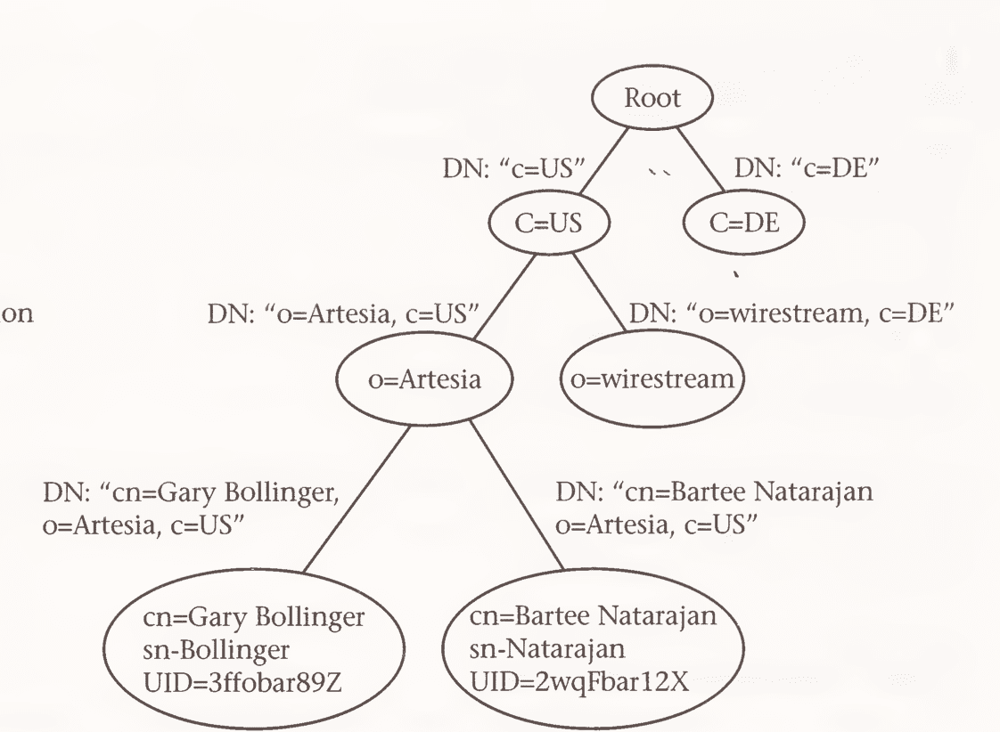

图 8-5 LDAP 目录结构

### 基于证书的身份验证

基于证书的身份验证依赖于 X.509 安全证书。与 LDAP 安全方案类似，基于证书的安全方案有助于集中安全信息。然而，它们的主要优势在于加密。此类证书使用公钥/私钥加密来建立身份。让我们更仔细地看看这是如何工作的。

传统消息加密依赖于消息发送者和接收者都知道的共同密钥。在这种方案（称为密钥或对称加密）中，发送者使用密钥加密消息并传输该消息。然后接收者使用相同的密钥解密消息。当发送者和接收者位于同一物理位置时，此方案效果很好，但在像万维网这样的广泛分布空间中效果不佳。问题在于共享相同的密钥同时又要保密。共享密钥的人越多，密钥就越不保密，保密就越困难。这种*密钥管理*问题催生了*公钥*方案。

公钥方案背后的思想是通过将加密分为两个密钥（一个私钥，另一个公钥）来简化保密过程。用户只发布其公钥，而将私钥保密。私钥和公钥是大型数字，成对工作以加密和解密数字签名。公钥/私钥加密背后的数学原理实际上保证了私钥无法从公钥“猜测”出来。用户使用其私钥加密消息，消息的接收者使用公钥解密它们。类似地，接收者使用公钥加密回复消息，用户使用私钥解密它们。

X.509 证书存储实体的身份并通过使用实体的私钥加密某些数据（即创建*摘要*）来“数字签名”。接收“签名”消息的人必须使用实体的公钥解密签名。这只有在签名有效时才能成功，也就是说，如果客户端使用匹配的私钥加密了签名。只有实体知道私钥，因此如果解密成功，则签名有效并且实体经过身份验证。图 8-6 显示了数字签名如何验证实体身份。

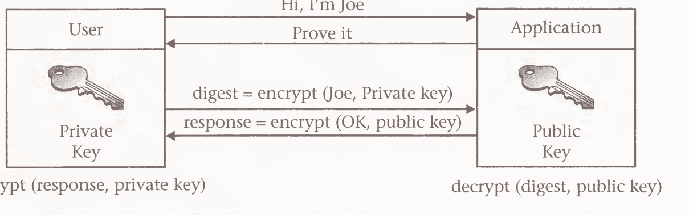

图 8-6 基于数字证书的身份验证

证书需要证书颁发机构（CA）来担保证书中存储的身份信息。其思想是，此类机构具有法律责任，使其关于证书的证词具有可信度。任何人都可以自立为证书颁发机构，因此整个方案取决于机构的声誉。这实际上意味着，公钥方案中的密钥管理问题已从密钥的管理转移到公钥的管理。

> **注意**
一些比较知名的证书颁发机构是 Verisign 和 Entrust。你可以使用 Java 2 附带的 **keytool** 实用程序为自己设置证书颁发机构以用于开发目的。

目前 Web 浏览器是安全证书最知名的使用者。它们使用这些证书来启用安全套接字层（SSL）协议。Web 站点也使用证书向浏览器用户标识自身。Java 程序员可以通过使用 java.security.cert 包并将此包中定义的抽象类的实现从供应商处购买，来将基于证书的身份验证嵌入应用程序中。

> ### 专家问答
**问题：** 我理解这些安全证书是如何工作的，但为什么名字这么奇怪？“X.509”是什么意思？
**答案：** “X.509”证书定义和建议是国际电信联盟和国际标准化组织（ITU/ISO）提供的一系列 X 建议的一部分。该系列还包括 X.500，这是一个类似于 LDAP 的目录服务的完整定义。（实际上，LDAP 与 X.500 目录服务相比是“轻量级”的。）X.509 证书建议提供了一种将安全签名附加到 X.500 目录服务消息上的方法。


### 1分钟练习

-   - 使用网络目录服务管理安全有什么优势？
-   - 使用安全证书管理安全的主要优势是什么？

# 基于Web服务器的认证

每个生产级Web服务器都提供某种机制来控制对其所管理资源的访问。我们的示例将使用Apache Web服务器（Apache）。HTTP/1.1规范定义了两种形式的认证：基本认证和摘要认证。Apache支持这两种形式。
与基于证书的认证类似，基本认证和摘要认证使用一种质询-响应协商形式。图8-7说明了这种机制。
在质询-响应协商中，客户端首先请求访问特定资源。如果该资源的访问受到控制，安全机制会拦截此请求并返回授权错误。例如，当使用基本认证时，服务器可能会返回类似于以下内容的HTTP响应头（模块1）：

```
HTTP/1.1 401 Unauthorized
WWW-Authenticate: Basic realm="wsolney"
```

此时，浏览器将显示一个对话框，用户必须在其中输入凭据信息。然后客户端可以在请求头中使用base64编码返回凭据来响应授权凭据。以下是一个示例：

```
Authorization: Basic base64-encoding-of(username:password)
```

如果客户端提供了足够的凭据，安全机制将允许该请求。如果没有，安全机制将返回另一个授权错误。如果认证成功，浏览器通常会缓存认证信息，这样客户端在会话期间就无需再次提供此认证信息。

-   - 像LDAP这样的网络目录服务提供了一个集中的有效用户数据库，使用户能够向多个应用程序提供相同的信息以进行登录。
-   - 安全证书的主要优势在于其加密身份信息的能力。

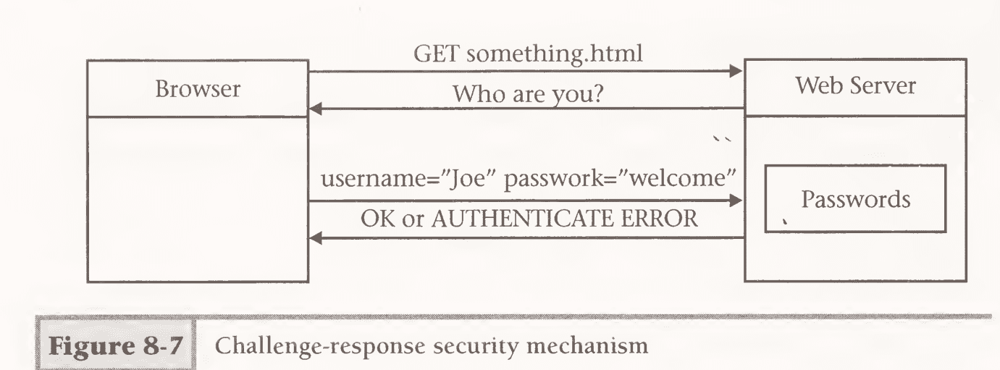

**图8-7** 质询-响应安全机制

# 专家问答

> **问：** 什么是base64编码？它是加密的一种形式吗？

**答：** Base64编码是一种多用途互联网邮件扩展（MIME）规范，用于将任何二进制数据编码为可打印字符形式（明文），这种形式人类不可读（即可以查看但无法理解其语言——http://www.ietf.org/rfc/rfc1341.txt）。其目的与其说是为了保护隐私，不如说是为了确保在不同的字符编码（如标准美国ASCII和IBM EBCDIC的多种变体）之间具有可移植性。它使用美国ASCII的一个65字符子集，使每个可打印字符能够表示六位二进制数据。

Base64编码是一种数据编组形式，*不是*加密形式。它实现了数据的可靠和可移植传输，但你可以像编码一样轻松地解码它。因此，定义基本和摘要认证的RFC 2617断言，基本认证“不是一种安全的用户认证方法”，除非辅以其他认证或加密方案（http://www.cis.ohio-state.edu/cgi-bin/rfc/rfc2617.html#sec-4）。

摘要认证通过对凭据进行单向哈希运算来生成消息摘要（即以不可读形式对用户名和密码进行不可逆编码）。这允许用户输入用户名和密码进行自我认证，而无需在网络上以明文形式发送这些凭据。相反，浏览器将凭据的摘要（哈希值）发送到服务器。然后，服务器根据有效的摘要数据库对摘要进行认证。

> ## 注意
> 不幸的是，一些当前的浏览器不支持摘要认证。Virata Corporation提供了一个用于测试浏览器对摘要认证支持的在线测试（http://digest-test.agranat.com/）。当我们测试两个浏览器——Internet Explorer 5.5（IE）和Netscape 4.7.7（Netscape）时，IE通过了测试，但Netscape没有。

摘要认证最严重的弱点在于它没有提供一种安全的方式来将摘要传递给服务器。因此，该方案容易受到身份“欺骗”——冒充他人身份。第二个问题是该方案没有提供任何方法来建立用户和服务器之间关于给定用户的正确摘要的初始安排。


### 1分钟练习

-   - HTTP/1.1规范规定了哪两种基于Web的认证形式？
-   - 什么是*消息摘要*？
-   - 什么是基本认证？

# 配置Apache认证

使用认证，Apache对Web资源提供用户级和组级的访问控制。要配置Apache以支持使用基本认证进行用户级和组级访问控制，您必须执行几个步骤。
以下是步骤：

1.  定义一个用户域。
2.  为该域定义一组用户组。
3.  为该域创建密码文件并向其中添加记录。
4.  创建一个组文件并将用户添加到组中。
5.  配置服务器以使用基本认证以及该域的密码和组文件。

Apache的*域*只是一组在共同访问控制下的命名Web资源。这些域符合我们对安全域的定义——由共同安全策略控制的任何功能或资源分组。Apache配置文档建议您*不要*将密码和组文件放在文档根目录（浏览网站的起始点）下。如果将它们放在文档根目录下，用户可以在他们的Web浏览器中查看它们，从而危及这些文件的安全性。

在Apache Server Version 1.3中，在Windows平台上，密码文件记录的格式是：

*username : password*

在Windows平台上，默认情况下，用户名和密码都必须是明文（未加密的）ASCII字符串。这是因为Apache将明文认证（mod_auth）静态编译到服务器中。您可以通过切换到Apache的bin目录并在控制台窗口中输入以下命令来确认此默认行为：

```
\>Apache.exe -l
```

执行此操作后，您应该会看到以下输出：

```
Compiled-in modules:
  http_core.c
  mod_so.c
  mod_mime.c
  mod_access.c
  mod_auth.c
  mod_negotiation.c
  mod_include.c
  mod_autoindex.c
  mod_dir.c
  mod_cgi.c
  mod_userdir.c
  mod_alias.c
  mod_env.c
  mod_log_config.c
  mod_asis.c
  mod_imap.c
  mod_actions.c
  mod_setenvif.c
  mod_isapi.c
```

如果您想使用密码加密，您必须通过配置httpd.conf来加载适当的模块以启用它。以下是相关片段的列表（格式已更改以适应页面）：

```
#LoadModule anon_auth_module modules/ApacheModuleAuthAnon.dll
#LoadModule dbm_auth_module modules/ApacheModuleAuthDBM.dll
#LoadModule digest_auth_module modules/ApacheModuleAuthDigest.dll
```

如您所见，Apache支持匿名用户认证（anon_auth_module），也支持使用DBM数据库文件格式（使用crypt加密）或Berkeley DB格式（dbm_auth_module）的密码文件进行认证。最后，它还支持摘要认证（digest_auth_module）。如果您使用任何这些替代形式的认证，您必须使用htpasswd工具并带有适当的选项来创建密码文件。此外，每个模块的Apache指令是不同的。我们将使用默认方式——明文密码认证——来描述Apache配置。
以下是Windows上Apache密码文件的一个示例：

```
Gary:welcome
Bartee:goodbye
```


## Servlet 容器认证

Servlet 容器认证仅与 Servlet 和 JSP 应用程序相关。Servlet 2.2 规范鼓励或要求四种认证方法：

-   必须支持基本认证。
-   鼓励摘要认证。
-   必须支持基于表单的认证。
-   必须支持 HTTPS 客户端认证。

让我们逐一了解这些方法。

### 基本认证

Servlet 容器的基本认证工作方式与 Apache 等 Web 服务器中的基本认证完全相同。Servlet 2.2 规范要求所有符合 Java 2 企业版（J2EE）标准的 Servlet 容器支持基本认证。这使得像 Tomcat 这样的 Servlet 容器能够以轻量级、独立模式运行，供网站开发者使用。

#### 为基本认证配置 Tomcat

Tomcat Servlet 容器中的基本认证需要三个步骤：

1.  在 `%TOMCAT_HOME%\conf` 目录下的 `tomcat-users.xml` 文件中的 `<tomcat-users>` 块内添加用户、密码和角色。
2.  通过将其添加到应用程序的 `web.xml` 文件中，在应用程序上下文中配置一个 `<security-constraint>` 块。
3.  通过将其添加到应用程序的 `web.xml` 文件中，在应用程序上下文中配置一个 `<login-config>` 块。

**配置用户、密码和角色** Tomcat 安装包提供了一些用户和角色来支持其示例。在默认的 `tomcat-users.xml` 文件中，你可以找到这个 `<tomcat-users>` 块（格式有所调整）：

```
<tomcat-users>
  <user name="tomcat" password="tomcat"
        roles="tomcat"
  />
  <user name="role1"
        password="tomcat" roles="role1"
  />
  <user name="both"  password="tomcat"
        roles="tomcat,role1"
  />
</tomcat-users>
```

这个 `<tomcat-users>` 块定义了三个用户：“tomcat”、“role1”和“both”。这三个用户共享相同的密码“tomcat”。第一个用户属于“tomcat”角色，第二个用户属于“role1”角色，第三个用户同时属于这两个角色。

**配置 `<security-constraint>` 块** 添加用户后，你必须在应用程序的 `web.xml` 文件中配置一个 `<security-constraint>` 块。Tomcat 提供了一个配置了安全性的示例应用程序。你可以在 `%TOMCAT_HOME%\webapps\examples` 中找到它。如果你查看该应用程序的 `web.xml` 文件（在其 `WEB-INF` 目录中），你会找到这个 `<security-constraint>` 块（格式有所调整）：

```
<security-constraint>
  <web-resource-collection> <!-- 指定要保护的资源 -->
    <web-resource-name>受保护区域
    </web-resource-name>
    <!-- 定义要保护的与上下文相关的 URL
    -->
    <url-pattern>/jsp/security/protected/*</url-pattern> <!-- 受保护的页面 -->
  </web-resource-collection>
  <!-- 如果你列出了 HTTP 方法，那么只有这些方法会受到保护
  -->
  <http-method>DELETE</http-method>
  <http-method>GET</http-method>
  <http-method>POST</http-method>
  <http-method>PUT</http-method>
</web-resource-collection>
<auth-constraint>
  <!-- 任何具有以下列出角色的用户都可以访问此区域
  -->
  <role-name>tomcat</role-name>
  <role-name>role1</role-name>
</auth-constraint>
</security-constraint>
```

这个 `<security-constraint>` 块使用两个子元素配置了示例应用程序上下文：`<web-resource-collection>` 和 `<auth-constraint>`。第一个子元素指定了受保护的资源；第二个子元素指定了可以访问受保护资源的用户角色。

`web.xml` 文件的 DTD 支持第三个子元素：`<user-data-constraint>`。`<user-data-constraint>` 子元素指定了客户端和服务器之间协议的安全约束。例如，考虑以下 XML 片段：

```
<user-data-constraint>
  <transport-guarantee>INTEGRAL</transport-guarantee>
</user-data-constraint>
```

此片段要求请求的传输协议必须保证其完整性。这意味着浏览器必须以无法在传输过程中被篡改的方式提交请求。其他值可以是 NONE 和 CONFIDENTIAL。NONE 值是默认值，不对请求传输施加任何约束。CONFIDENTIAL 值要求请求传输保证在传输过程中无法被读取。实际上，INTEGRAL 和 CONFIDENTIAL 值意味着使用 SSL 作为请求传输协议。

**配置 `<login-config>` 块** 最后，你必须为你的应用程序配置一个 `<login-config>` 块。再次查看 Tomcat 示例应用程序的 `web.xml` 文件。你可以找到一个类似这样的 `<login-config>` 块：

```
<login-config>
    <auth-method>BASIC</auth-method>
    <realm-name>示例基本认证区域
    </realm-name>
</login-config>
```

`<auth-method>` 标签指定了 Servlet 和 JavaServer Pages 的认证方式，其作用类似于 `AuthType` 指令对 Apache Web 服务器进行认证配置。Tomcat 支持此标签的四个有效值：

-   BASIC
-   DIGEST
-   CLIENT-CERT
-   FORM

`<realm-name>` 标签指定了 Servlet 和 JavaServer Pages 的安全域名称，其作用类似于 `AuthName` 指令对 Apache Web 服务器进行域配置。`<realm-name>` 标签可以接受任何字符串作为其值。

### 摘要认证

Servlet 容器的摘要认证工作方式类似于 Apache Web 服务器中的摘要认证。你配置 Tomcat 的摘要认证就像配置基本认证一样，只是你需要为 `<auth-method>` 标签提供一个不同的值。摘要认证的 `<login-config>` 块如下所示：

```
<login-config>
    <auth-method>Digest</auth-method>
    <realm-name>示例基本认证区域
    </realm-name>
</login-config>
```

Servlet 容器无需实现摘要认证即可符合 J2EE 标准，尽管规范推荐支持该认证方式。


## HTTPS 客户端认证

Servlet 规范要求所有符合规范的 J2EE Servlet 容器都必须支持 HTTPS 认证。HTTPS 提供了 Servlet 规范所要求的最强形式的认证。该规范指出，HTTPS 认证需要一个公共密钥证书（PKC），正如我们之前在本模块中描述的那样。

## 基于表单的认证

到目前为止，我们描述的认证方案都不允许你为登录页面创建自定义的“外观和感觉”。浏览器登录对话框在产品中显得不专业，甚至在个人网站中也不受欢迎。为登录页面提供自定义的“外观和感觉”可以提升你网站的用户体验。Servlet 2.2 规范通过要求符合 J2EE 规范的 Servlet 容器提供基于表单的认证来解决此问题。

基于表单的认证允许你向 Servlet 认证机制提供自定义的登录页面。如果我们回到 %TOMCAT_HOME%\webapps\examples 中的示例安全应用程序，我们可以在 web.xml 文件中看到以下 XML 片段（格式已更改）：

```
<login-config>
    <auth-method>FORM</auth-method>
    <realm-name>Example Form-Based Authentication Area</realm-name>
    <form-login-config>
        <form-login-page>/jsp/security/login/login.jsp</form-login-page>
        <form-error-page>/jsp/security/login/error.jsp</form-error-page>
    </form-login-config>
</login-config>
```

如片段所示，基于表单的认证在 `<login-config>` 块中增加了一个用于登录页面和错误页面的规范。

Servlet 规范为登录表单提供了具体说明。登录表单的 method 必须是 POST，其 action 必须是 `j_security_check`。该表单还必须包含一个名为 `j_username` 的用户名字段和一个名为 `j_password` 的密码字段。以下是 Tomcat 安全示例提供的页面（$TOMCAT_HOME/webapps/examples/jsp/security/login/login.jsp）：

```
<HTML>
<BODY>
<H>Login page for examples</H1>

<FORM METHOD="POST" ACTION="j_security_check" >
Username: <INPUT TYPE="text" NAME="j_username"><br>
Password: <INPUT TYPE="password" NAME="j_password"><br>
<br>
<INPUT TYPE="submit" VALUE="login" NAME="j_security_check">
</FORM>

</BODY>
</HTML>
```

当你访问此示例页面时，你会得到一个如图 8-9 所示的网页。

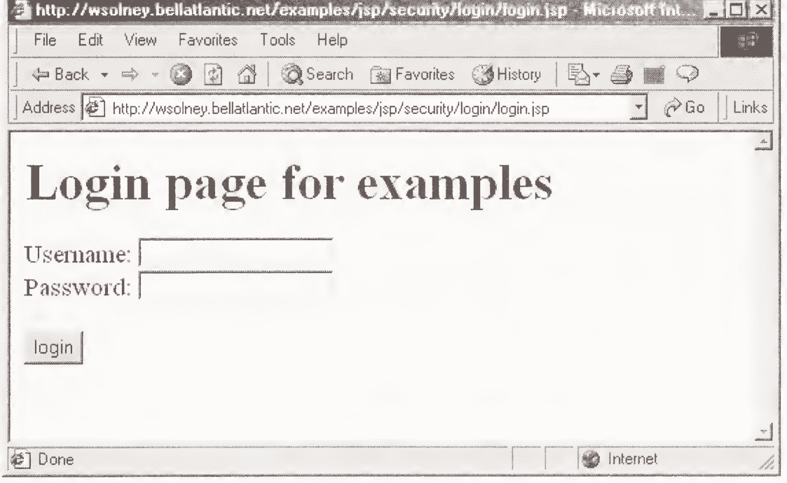

Servlet 规范还规定了使用基于表单的认证时必须发生的步骤。以下是当用户请求受保护的 Web 资源时发生的步骤：

1. 容器返回指定的登录表单并存储请求的 URL。
2. 客户端填写表单。
3. 客户端将表单发回给服务器。
4. 容器使用表单字段对用户进行认证。如果认证失败，容器将指定的错误页面返回给客户端。
5. 如果认证成功，容器将检查已认证的主体角色是否有权访问请求的 URL（Web 资源）。
6. 如果主体无法访问 Web 资源，Servlet 容器将返回指定的错误页面。
7. 如果客户端有权访问，容器将客户端重定向到其请求的 URL。

该规范建议错误页面提供有关客户端认证失败的信息。以下是 Tomcat 示例提供的错误页面：

```
<html>
<head>
<title>Login Error</title>
</head>
<body bgcolor=white>

Login error -- please try <a href="login.jsp">again</a>.

</body>
</html>
```

图 8-10 显示了此错误页面的外观。
基于表单的登录以明文（即未加密）方式传递用户名和密码，并且不提供防欺骗保护。因此，Servlet 规范建议采取额外的保护措施，例如 HTTPS（基于 SSL 的 HTTP）或网络层安全（例如 IPSEC）。

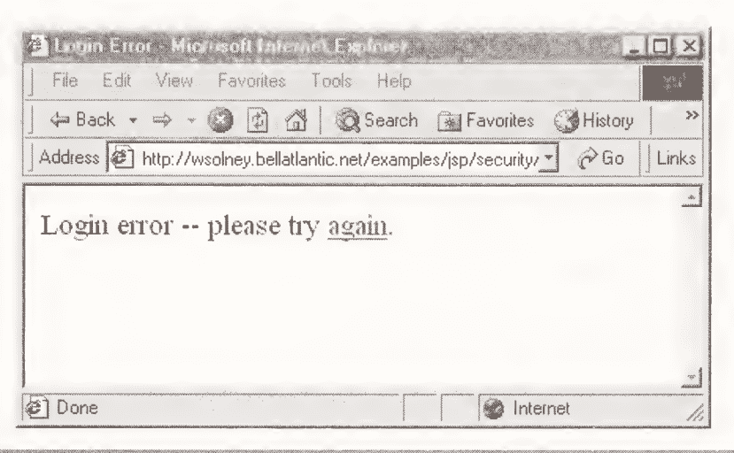

> **注意：** IPSEC 代表互联网协议安全套件标准。这些标准包括互联网协议（IP）层的认证和加密。

### 一分钟速记

-   Servlet 2.2 规范要求哪些类型的认证？
-   在基于表单的认证中，表单的 action 必须是什么？

## Tomcat 安全拦截器

Tomcat 提供了 Servlet 2.2 规范的实现，允许开发者用自定义的安全处理器替换默认的安全处理器。

> **注意：** Tomcat 拦截器不可移植到其他 Servlet 容器；本讨论假设使用 Tomcat 3.2.x。

-   Servlet 2.2 规范要求三种形式的认证：基本认证、基于表单的认证和 HTTPS。它还推荐第四种，即摘要认证。
-   在基于表单的认证中，表单的 action 必须是：`j_security_check`。还必须有分别名为 `j_username` 和 `j_password` 的用户名和密码字段。

Tomcat 中的安全处理器通过扩展 `org.apache.tomcat.core.BaseInterceptor` 类并至少覆盖五个方法，实现了 Java 接口 *org.apache.tomcat.core.RequestInterceptor*：

-   public void setContextManager( ContextManager cm )
-   public void contextInit( Context ctx)
-   public void contextShutdown(Context ctx)
-   public int authenticate( Request req, Response response )
-   public int authorize( Request req, Response response, String roles[] )

安全拦截器的作用是在将 HTTP 请求转发到所请求的资源之前对其进行认证（即它拦截该请求）。图 8-11 显示了此拦截器架构。

正如我们之前在本模块中描述的，Tomcat 的默认安全处理器使用 `%TOMCAT_HOME%\conf\tomcat-users` 文件来指定用户、密码和角色。在任何类型的生产环境中，不使用 Tomcat 提供的默认安全处理有几个原因。首先，它在文件系统上以明文形式存储密码。其次，当用户数量增长时，简单的文本文件难以管理。第三，默认处理器在内存中缓存认证数据库，不必要地消耗了宝贵的资源。为了加强 Tomcat 安全机制，你必须使用其他安全拦截器。

Tomcat 本身提供了一个替代安全拦截器：*org.apache.tomcat.request.JDBCRealm*。

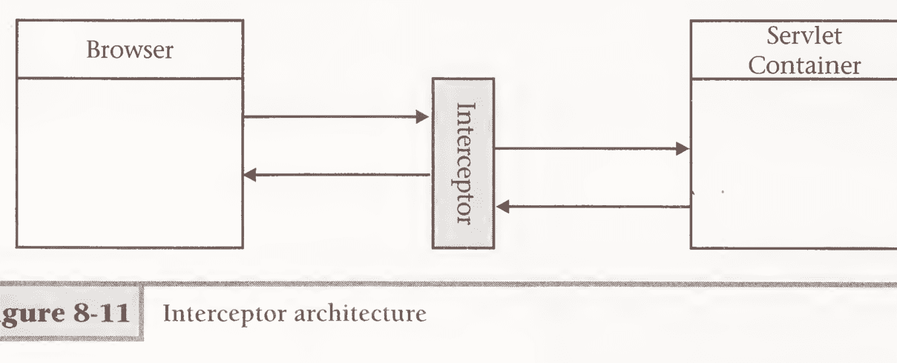

> **提示：** 你可以在 %TOMCAT_HOME%\doc\JDBCRealm.howto 中找到关于 JDBC realm 拦截器的“如何做”讨论。

这第二个拦截器允许你使用数据库而不是文本文件来认证和授权资源请求。在 Tomcat 的 `server.xml` 文件中，你必须注释掉默认的 realm 并添加配置 JDBC realm 的行。以下是指定默认拦截器的配置行：

```
<!-- Check permissions using the simple
    xml file. You can plug more advanced
    authentication modules.
-->
<RequestInterceptor
    className="org.apache.tomcat.request.SimpleRealm"
    debug="0" />
```

要使用适用于 MySQL 的 JDBC 拦截器，你应该注释掉这些行并添加以下行：

```
<RequestInterceptor
    className="org.apache.tomcat.request.JDBCRealm" <!-- 拦截器类名
    debug="99"
    driverName="org.gjt.mm.mysql.Driver" <!-- MySQL 驱动程序
    connectionURL="jdbc:mysql://localhost/authority"
    connectionName="tomcat" <!-- Tomcat MySQL 登录名
    connectionPassword="tomcat" <!-- Tomcat MySQL 密码
    userTable="users" <!--
    userNameCol="user_name"
    userCredCol="user_pass" <!-- MySQL 表和列名
    userRoleTable="user_roles"
    roleNameCol="role_name" /> <!--
```

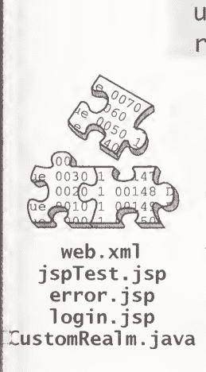

### 项目 8-1：自定义 Tomcat 安全拦截器

Tomcat 拦截器实现了网络编程中的一个常见模式——请求拦截器模式。拦截器背后的思想是，它们可以在运行时加载，以扩展或自定义功能，而无需修改或

重新编译现有代码。它们通常充当过滤器来限定请求，要么修改请求，要么出于安全原因拒绝请求。有时拦截器仅跟踪请求活动，但通常它们会强制执行某种策略选择。拦截器的工作方式类似于回调。你注册你的拦截器，然后在容器运行时操作的特定时刻，容器会调用拦截器的方法。

Tomcat安全拦截器对Web资源的请求进行身份验证和授权。在本项目中，我们将逐步开发一个自定义的安全拦截器。

### 分步指南

1.  从 http://www.osborne.com 下载包含本项目文件的**Web ARchive (WAR)** 文件 `interceptor.war`。
2.  将 `interceptor.war` 移动到 `%TOMCAT_HOME%\webapps`。
3.  使用 **jar.exe** 工具解压拦截器应用程序：
    ```
    \>jar.exe xvf interceptor.war
    ```
4.  你现在应该能看到 `%TOMCAT_HOME%\webapps\interceptor` 目录。切换到 `%TOMCAT_HOME%\webapps\interceptor\WEB-INF\src` 目录，并编译文件 `CustomRealm.java`。请确保将 `servlet.jar` 和 `webserver.jar` 包含在你的 CLASSPATH 中。
    ```
    \>set CLASSPATH=%CLASSPATH%;%TOMCAT_HOME%\lib\servlet.jar
    \>set CLASSPATH=%CLASSPATH%;%TOMCAT_HOME%\lib\webserver.jar
    \>javac.exe CustomRealm.java
    ```
5.  将生成的类文件 (`CustomRealm.class`) 移动到 `%TOMCAT_HOME%\classes`。(你可能需要创建这个目录。)
6.  编辑 `%TOMCAT_HOME%\conf\server.xml`。注释掉以下几行：
    ```
    <RequestInterceptor
       className="org.apache.tomcat.request.SimpleRealm"
       debug="0" />
    ```
7.  这些行现在应该看起来像这样：
    ```
    <!--
    <RequestInterceptor
       className="org.apache.tomcat.request.SimpleRealm"
       debug="0" />
    ```
8.  紧接着你注释掉的行，添加以下内容：
    ```
    <!-- 使用 CustomRealm 检查权限 -->
    <RequestInterceptor
        className="CustomRealm"
    />
    ```
9.  这些更改将 Tomcat 配置为使用 *CustomRealm* 进行身份验证和授权，而不是使用 *org.apache.tomcat.request.SimpleRealm*。
10. 现在你必须在 `web.xml` 文件中添加一些角色。切换目录到 `%TOMCAT_HOME%\webapps\interceptor\WEB-INF` 并编辑你找到的 `web.xml` 文件。
11. 在 `web.xml` 的 `<auth-constraint>` 块中，考虑以下几行：
    ```
    <role-name>administrator</role-name>
    <role-name>family</role-name>
    ```
12. 通过这些行，我们为所有匹配模式 "/jsp/app/*" 的请求添加了基于角色的访问控制。我们还定义了所需的角色为 "administrator" 和 "family"。
13. 启动 Tomcat 并输入 URL：
    `http://localhost:8080/interceptor/jsp/app/jsptest.jsp`。
14. 你现在应该能看到图 8-12 所示的网页。
15. 在 *Username* 字段中输入：**Gary Bollinger**
16. 在 *Password* 字段中输入：**user1**
17. 点击 *login* 按钮后，你应该会看到图 8-13 所示的网页。
18. 为什么需要你登录？当你请求 URL `http://localhost:8080/interceptor/jsp/app/jsptest.jsp` 时，*CustomRealm* 安全拦截器将你的请求重定向到登录页面。当你输入了有效的用户名和密码后，容器才最终交付了请求的页面。
19. 为什么容器要保护该页面？容器保护它是因为拦截器应用程序的 web.xml 文件指定了对其进行保护。以下是显示如何指定保护的 web.xml 片段：
    ```
    <web-resource-collection>
        <web-resource-name>Protected Area
        </web-resource-name>

        <!-- 定义受保护的 URL -->
        <url-pattern>/jsp/app/*</url-pattern>

        <!-- 定义受保护的 HTTP 方法 -->
        <http-method>DELETE</http-method>
        <http-method>GET</http-method>
        <http-method>POST</http-method>
        <http-method>PUT</http-method>
    </web-resource-collection>
    ```

项目 8-1 介绍了 Tomcat 安全拦截器的概念。此类拦截器提供了一种向应用程序提供基于 servlet 容器的自定义登录页面的方法。现在，在项目 8-2 中，我们将扩展这些技术。

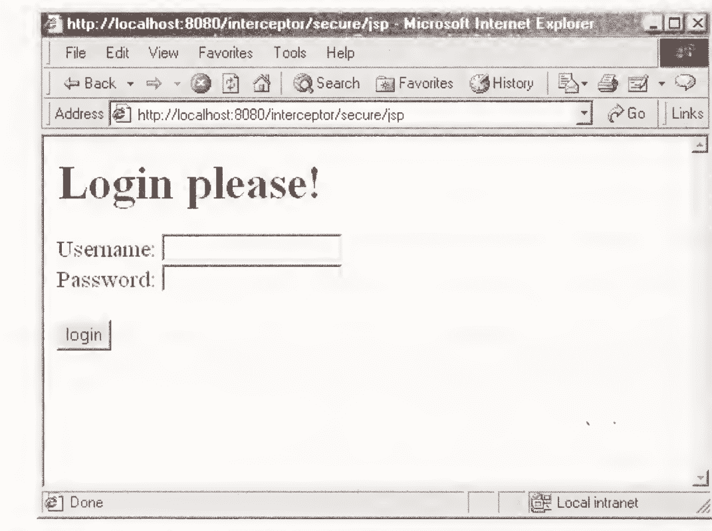

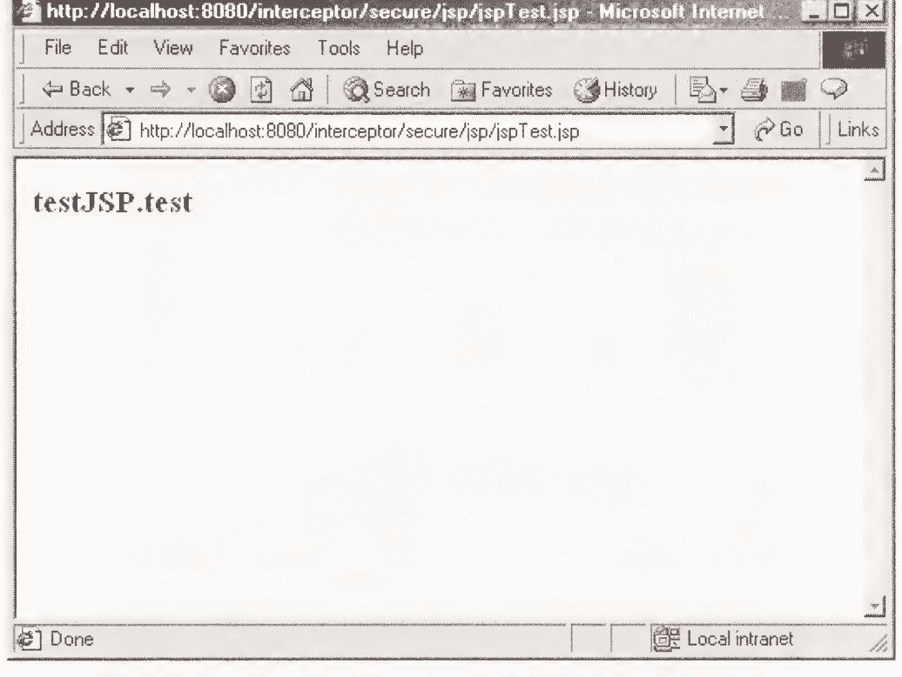

### 项目 8-2：增强我们的登录页面

我们希望我们的“家庭中心”能防止非家庭成员访问，同时又要提供一个吸引人的界面。为了构建它，我们将扩展你刚刚完成的项目（假设你确实完成了）。由于我们尚未开发“家庭中心”应用程序代码，我们将把这种增强的方法安装在“安全”应用程序上下文中。

### 分步指南

1.  从 `http://www.osborne.com` 下载包含本项目文件的 **Web ARchive (WAR)** 文件 `security.war`。
2.  将 `security.war` 移动到 `%TOMCAT_HOME%\webapps`。
3.  解压 WAR 文件：
    ```
    \>jar.exe xvf security.war
    ```
4.  你应该会看到 `security` 目录，其中包含安全应用程序的所有文件。
5.  重启 Tomcat。
6.  输入 URL：http://localhost:8080/security/jsp/app/jsptest.jsp。
7.  你现在会看到一个更复杂的登录页面。图 8-14 显示了新的登录页面。
8.  在 *Username* 字段中输入：**Gary Bollinger**
9.  在 *Password* 字段中输入：**user13**
10. 点击 *login* 按钮后，你应该会看到图 8-15 所示的网页，这意味着你的登录失败了。请改用 **user1** 以正确登录。

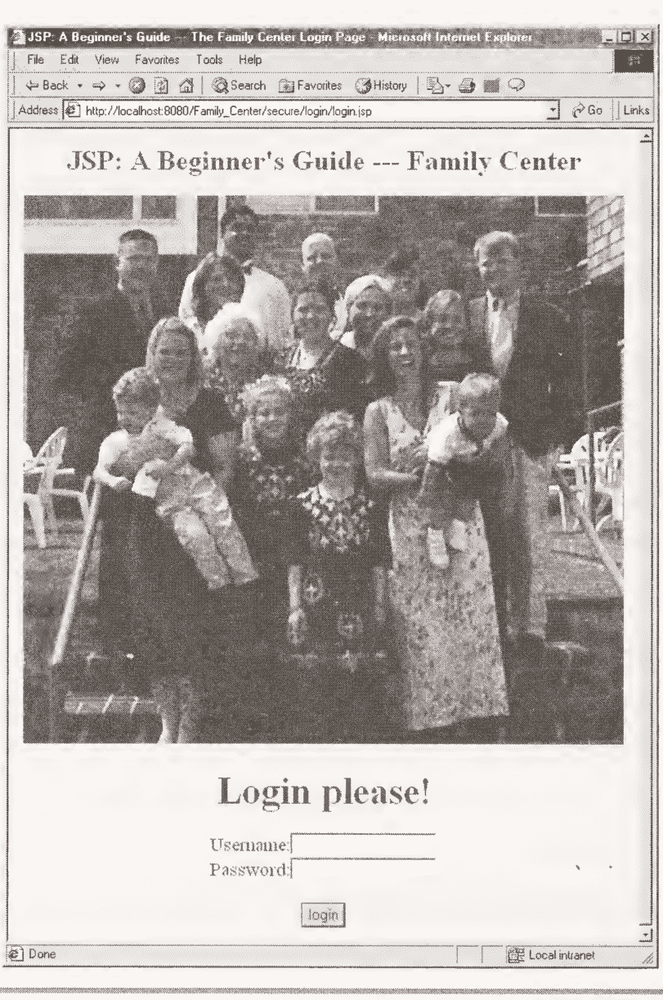

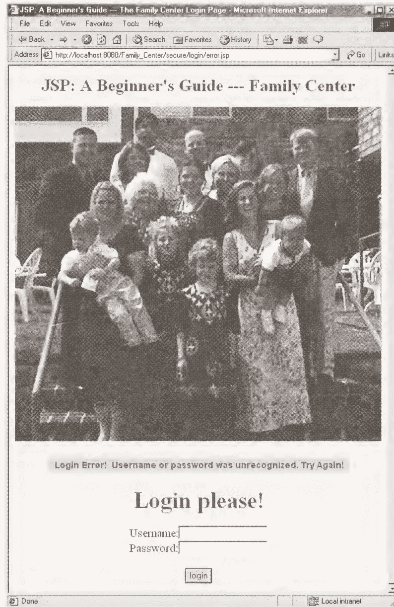

安全通常是开发应用程序时最后考虑的问题，部分原因是因为很难向客户或老板演示，部分原因是因为它似乎永无止境。作为第一步，你必须问自己：“多安全才算足够安全？”安全策略就是对这个并不简单的问题的回答。其核心在于，安全策略只是评估你愿意承担的风险程度，并分配负责确保你所选安全元素的技术或人员。

在本地网络上都不存在绝对的安全，更不用说互联网了。出于我们的目的，我们希望有足够的安全性，使没有人会因意外或错误的好奇心而访问我们的网站。这些目标决定了我们需要一个要求用户输入用户名和密码的登录页面。它不需要更复杂的技术，如数字证书和 SSL。如果尽管有登录页面，人们还是访问了我们的网站，那么我们将要么重新评估我们愿意承担的风险，要么接受这种非法访问。

### 我们安全方案的要素

让我们来检查一下我们迄今为止开发的安全页面的要素。

#### 登录和登录错误页面

我们的登录页面没有什么特别复杂的地方。我们展示了一张家庭照片和一个从 Tomcat 示例派生的登录表单。以下是代码：

```html
<HTML>
<BODY BACKGROUND="../../images/bluepaper.gif">
<TITLE>JSP: A Beginner's Guide ---
  The Family Center Login Page
</TITLE>
<CENTER>
<H2>JSP: A Beginner's Guide --- Family Center</H2>

<H1>Login please!</H1>
<FORM METHOD="POST" ACTION="j_security_check" >
  Username:<INPUT TYPE="text" NAME="j_username"><BR>
  Password:<INPUT TYPE="password"
           NAME="j_password"><BR><BR>
  <INPUT TYPE="submit" VALUE="login"
         NAME="j_security_check">
</FORM>
</CENTER>
</BODY>
</HTML>
```

我们的登录错误页面 (`error.jsp`) 只是在 `Family.jpg` 图片之后添加了一个错误图片。因此该 HTML 片段看起来像这样：

```html

<BR>

```

#### web.xml 文件

`web.xml` 文件指定了 `%TOMCAT_HOME\webapps\security\jsp` 下每个页面的访问控制。它还只指定了两个角色：`administrator` 和 `family`。(最终，我们希望 `family` 角色能授予所有家庭成员对该网站的 `read` 访问权限。管理员角色还应授予 `write` 访问权限。然而，我们必须将此编码到 `CustomRealm` 中，除了我们在 Osborne 网站上发布的最终版家庭中心外，我们不会这样做。) 这是 `web.xml` 文件。注意我们将我们的安全域命名为“家庭中心”：

```xml
<?xml version="1.0" encoding="ISO-8859-1"?>
<!DOCTYPE web-app
   PUBLIC "-//Sun Microsystems, Inc.//DTD
   Web Application 2.2//EN"
   "http://java.sun.com/j2ee/dtds/web-app_2_2.dtd">

<web-app>
    <security-constraint>
        <web-resource-collection>
            <web-resource-name>Protected Area
            </web-resource-name>
            <!-- 定义要保护的相对于上下文的 URL -->
            <url-pattern>/jsp/app/*</url-pattern>
            <!-- 如果你列出了 HTTP 方法，则只有这些方法受到保护 -->
            <http-method>DELETE</http-method>
            <http-method>GET</http-method>
            <http-method>POST</http-method>
            <http-method>PUT</http-method>
        </web-resource-collection>
        <auth-constraint>
```


#### CustomRealm 安全拦截器

我们的家庭中心安全拦截器（CustomRealm）继承了 `org.apache.tomcat.core.BaseInterceptor` 类，并重写了五个方法：`setContextManager`、`contextInit`、`contextShutdown`、`authenticate` 和 `authorize`。接下来，我们将逐一查看这些方法的工作原理。

#### setContextManager 方法

`setContextManager` 方法的目的是存储对 Tomcat 的 `org.apache.tomcat.core.ContextManager` 对象实例的本地引用。该对象是进入 Tomcat servlet 容器的主要入口点。它充当执行控制器和应用程序上下文以及已安装拦截器（包括安全拦截器）的管理器。它负责指导请求处理，包括请求解析、服务方法调用和日志记录。以下是我们的 `setContextManager` 代码：

```java
/**
 * Store a local reference to the ContextManager
 */
public void setContextManager(ContextManager contextManager)
{
    super.setContextManager(contextManager);
    this.contextManager = contextManager;
    System.out.println("CustomRealm.setContextManager()");
}
```

#### contextInit 方法

我们拦截器中的 `contextInit` 方法的目的是初始化认证和授权信息。我们将暂时“硬编码”一些信息（在第 10 模块中，我们将展示如何使用数据库来避免硬编码这些值）。以下是我们的代码，添加了两个家庭，每个家庭有两个成员：

```java
/**
 * Initialize authentication and authorization
 * information for CustomRealm.
 */
public void contextInit(Context ctx)
    throws TomcatException
{
    if (!inited)
    {
        inited = true; // do it only once
        /*
         * set up roles database
         */
        userRoles = new HashMap();
        userRoles.put(GARY_BOLLINGER,
                      ADMINISTATOR);
        userRoles.put(BHARATHI_NATARAJAN,
                      ADMINISTATOR);
        userRoles.put(MARY_BOLLINGER,
                      FAMILY);
        userRoles.put(SANDY_NATARAJAN,
                      FAMILY);
        /*
         * set up password database
         */
        userPasswords = new HashMap();
        userPasswords.put(GARY_BOLLINGER,
                         GARY_PASSWORD);
        userPasswords.put(BHARATHI_NATARAJAN,
                         BHARATHI_PASSWORD);
        userPasswords.put(MARY_BOLLINGER,
                         MARY_PASSWORD);
        userPasswords.put(SANDY_NATARAJAN,
                         SANDY_PASSWORD);
        System.out.println(
            "CustomRealm.contextInit()");
    }
}
```

#### contextShutdown 方法

`contextShutdown` 方法的目的是在 Tomcat 关闭之前释放我们拦截器使用的任何资源。我们的安全拦截器不需要释放任何资源。代码如下：

```java
/**
 * release any resources before Tomcat shuts down
 */
public void contextShutdown(Context ctx)
    throws org.apache.tomcat.core.TomcatException
{
    super.contextShutdown(ctx);
}
```

#### authenticate 方法

`authenticate` 方法的目的是根据用户身份批准或拒绝访问应用程序。这是执行应用程序最重要的安全功能——限制未授权用户访问的方法。让我们更仔细地研究这个方法。以下是带注释的代码：

```java
/**
 * Use CustomRealm to authenticate user.
 */
public int authenticate(Request req,
    Response response)
{
    int authValue = NOT_AUTHORIZED; //401 indicates error

    // extract login credentials from login.jsp
    HttpSession session = req.getSession(false);
    if (session == null)
        return authValue; // not OK since no session
    String username =
        (String)session.getAttribute("j_username");
    String password =
        (String)session.getAttribute("j_password");

    // authenticate the username and password
    if (username != null && password != null)
    {
        String userPwd =
            (String)userPasswords.get(username);
        if ((userPwd != null) &&
                (userPwd.equals(password)))
        {
            System.out.println(
                "CustomRealm.authenticate(" +
                username + ")");
            // set remote user name in request
            req.setRemoteUser(username);
            req.setUserPrincipal(
                new SimplePrincipal(username));
            authValue = OK; // 0 says authenticated
        }
    }
    return authValue;
}
```

#### authorize 方法

`authorize` 方法的目的是根据用户角色批准或拒绝访问应用程序资源。我们在这里硬编码了一些角色，但与用户名和密码的情况一样，我们将在第 10 模块中用数据库实现替换它。这里的算法是获取用户角色，然后将其与我们为当前资源（作为角色数组传入 `authorize`）定义的角色进行比较。如果匹配，用户就有访问权限。代码如下：

```java
/**
 * Use CustomRealm to authorize user.
 */
public int authorize(Request req,
                    Response response,
                    String roles[])
{
    int authValue = NOT_AUTHORIZED; // 401

    // we stored username in authenticate
    String username = req.getRemoteUser();
    if (username != null)
    {
        String role = (String)userRoles.get(username);
        if (role != null)
        {
            System.out.println(
                "CustomRealm.authorize(" +
                username + ", " + role + ")");

            for (int i = 0;
                 authValue != OK && i < roles.length; i++)
            {
                if (role.equals(roles[i]))
                {
                    authValue = OK; // 0 says authorized
                }
            }
        }
    }
    return authValue;
}
```

#### server.xml 配置文件

如果你没有执行项目 8-1，你将必须在 `%TOMCAT_HOME%\conf` 中配置 `server.xml` 文件以使用 CustomRealm 拦截器。在这种情况下，请查看项目说明。Servlet 容器一次只能支持一个安全拦截器，因此你必须确保注释掉 SimpleRealm 拦截器并添加 CustomRealm 拦截器。不要担心我们目前应用程序的简单性。我们将在第 9 和第 10 模块中开始为家庭中心添加功能。

## 掌握度检查

+ 1. 哪项安全服务解决了欺骗（spoofing）问题？什么是欺骗？
+ 2. 什么是安全拦截器？拦截器如何工作？
+ 3. 你在 Tomcat 的哪里配置安全域（security realm）？
+ 4. 你在 Apache Web 服务器的哪里配置安全域？
+ 5. 你认为哪项安全服务最基本？你的理由是什么？
+ 6. “信任环”（rings of trust）代表什么？
+ 7. 不使用 Tomcat 默认安全机制的一些原因是什么？
+ 8. LDAP 服务为其存储库提供了什么样的结构？
+ 9. 你在 Tomcat 的哪里定义角色的访问控制？
+ 10. 什么是证书颁发机构（certificate authority）？它们在安全架构中扮演什么角色？
+ 11. 基于证书的安全架构中的质询-响应机制如何工作？
+ 12. 什么是安全散列算法（Secure Hash Algorithm）？这种散列函数在 Web 架构中的一种用途是什么？

## 模块 9：Web 应用程序中的控制器和流程控制

### 本模块的目标

- 理解 MVC 架构中控制器的职责
- 理解 Web 应用程序中的流程控制
- 学习构建可配置流程控制架构的技术


JavaServer Pages 有助于简化动态 Web 应用程序的开发，但 Web 应用程序很快就会变得复杂。每当构建一个复杂的应用程序时，首先应使用经过验证的技术来建立强大的架构，以确保灵活性和可扩展性。强大的架构能使应用程序经受住时间的考验。

我们在模块 6 中看到了如何使用自定义标签库来简化 JSP 页面，这有助于消除与 HTML 混合的 Java 代码。标签库使 JavaServer Pages 更具可读性和适应性。我们在模块 7 中讨论了 Web 应用程序的各种设计模式，并确立了在 Web 架构中使用 Model-View-Controller（MVC）设计模式的必要性。使用自定义标签库来简化 JavaServer Pages（MVC 架构中的视图）虽然重要，但并非完整的 MVC 架构。

在本模块中，我们将重点介绍协调模型与视图之间通信的 MVC 控制器。

## 控制器

控制器对象封装了 Web 应用程序的控制逻辑。其职责包括：

-   接收用户请求和应用程序消息
-   创建和获取管理数据并对其调用服务的模型
-   驱动 Web 应用程序的工作流（web-flow）

由于控制器不负责任何表示，因此由开发人员而非页面设计人员编写。通常应将控制器编写为一个 Java servlet。图 9-1（转载自模块 7）展示了典型 Web 应用程序中的控制器组件。

让我们详细探讨控制器的这三项职责。

### 用户输入处理

如果您做过 Web 开发，那么您会注意到最常见的任务是从 HTML 表单中检索已发布的数据。Servlet 容器捕获所有这些数据，并将其优雅地呈现在 `javax.servlet.http.HttpServletRequest` 对象中提供给您的 servlet。您的控制器 servlet 可以直接将 `HttpServletRequest` 对象转发给模型，并让模型提取所需信息；但这个看似非常实用的解决方案存在一些缺点。

如果让模型从 `HttpServletRequest` 对象中提取信息，就会将其与视图不可避免地绑定在一起。因为模型随后必须理解视图中的每个命名 HTML 输入项，以便从 `HttpServletRequest` 对象中检索这些项的相关值。有人可能会说这没什么大不了的，因为模型的输入可能直接映射到视图中的输入元素。虽然在简单情况下可能是这样，但更多时候，模型的输入是视图输入的子集或派生。此外，使模型意识到视图元素显然违反了 MVC 架构所要求的模型与视图的分离。

模型提供业务逻辑服务，您可以在任何应用程序上下文中使用，而不仅仅是 Web 应用程序上下文。例如，在两层架构中，您的模型可以提供通过 JDBC 访问关系数据库的功能；在三层架构中，可以提供访问 EJB 应用程序服务器的功能。原生 Java 客户端应用程序可以像 Web 应用程序一样轻松地访问这些服务。然而，当模型必须理解 HTTP 元素时，模型就只能在 Web 上下文中工作。这也使得难以独立测试模型，因为您必须构建 HTTP 元素，而这在 servlet 环境之外很难做到。

此外，HTTP 请求对象通常包含比模型所需更多的信息。这些额外信息可能导致错误地建立不必要且隐蔽的依赖关系。这些依赖关系几乎总是表现为 bug。

为了避免这些缺点，我们在控制器和模型之间引入一个中介。这个中介从请求中捕获与模型相关的信息，并调用模型的服务。模型结果被封装为数据并注册到请求对象中，使其可供视图使用。您可以通过遵循模块 7 中讨论的命令模式，使用命令对象来实现这个中介。图 9-2 展示了这个中介的角色。

### 与模型的交互

您应该以能够将模型的不同实现无缝集成到 Web 应用程序中的方式来设计模型交互。您可以通过桥接设计模式来实现这一点。桥接模式在模型抽象与其实现之间引入了分离。这允许抽象和实现独立演化。抽象作为与客户端的契约，而实现作为与抽象的契约。命令对象是调用模型服务的客户端。这些命令对象与模型抽象交互，完全不知道其实现。图 9-3 说明了这种架构。我们将在模块 10 中更详细地介绍作为桥接的模型设计。

### Web 应用程序工作流和流程控制

Web 应用程序，与任何其他需要用户交互的应用程序一样，具有工作流。例如，在电子商务应用程序中，用户通常从登录页面登录应用程序。然后她浏览分类并分页呈现的产品库存。在浏览过程中，她选择商品并将其添加到购物车。当她准备好时，她可以转到结账页面，在该页面要求她输入信用卡信息进行结算，或者她可以取消订单并登出。如果信用卡被接受，交易就完成了。

# 专家问答

**问题：** 观察图 9-3，似乎模型抽象是多余的。为什么命令对象不能直接与模型实现交互，同时仍然支持与不同实现的无缝集成？

**答案：** 命令对象当然可以直接与实现进行通信。但这种设置有几个缺点。如果我们想扩展模型的服务，那么我们必须为模型的每个具体实现复制此扩展。此外，没有模型抽象会迫使所有客户端意识到细粒度的实现服务，而不是更高层次的抽象。

话虽如此，我们应该注意，在某些情况下模型抽象是多余的。假设抽象接口和实现接口本质上相同，并且很少需要扩展模型服务。相反，人们只希望提供模型的不同实现。在这种情况下，您可以消除模型抽象，将其与客户端合并。这是桥接模式最简单的形式。

**问题：** 如果您可以消除模型抽象，结果与策略模式有何不同？

**答案：** 策略模式为具有不同行为的一系列算法提供了一个公共外观。客户端根据对不同行为的隐式知识动态选择合适的算法。客户端可以在每次调用服务时互换选择算法。

另一方面，模型具有标准行为。存在此标准行为的不同实现，并且仅为特定客户端选择其中之一。框架通常在初始化阶段为客户端预注册选择。

在此架构中，控制器创建或获取模型的句柄，并将其传递给命令对象进行处理。控制器还从配置文件（如 web.xml）中读取和管理模型的连接参数。这允许动态配置。


模型服务。在简单应用中，单个Java对象即可完全封装模型的所有业务逻辑。但在企业级应用中，模型提供的服务可能拆分为多个组件，类似EJB解决方案的架构。这种情况下，命令对象可以指定所需的服务，控制器只需实例化提供这些服务的模型组件并交给命令对象。服务映射同样可通过配置文件进行声明。

流程完成后，系统会引导用户进入收据页面，供其打印交易凭证保存。这个简单的工作流如图9-4所示。

该工作流背后存在大量隐藏的交互逻辑。但从用户视角观察，她只是通过一系列可视化页面进行导航。

考虑*有限状态机*——这是计算机科学中用于建模有限静态集合状态转换的最常见工具。图9-5展示了典型的有限状态机状态图。

状态图中的圆圈称为*状态*（图中的字母标识），连接两个状态的线段称为*转换*（图中的数字标识）。有限状态机在特定时刻的条件被定义为状态，而输入与当前状态到下一状态的映射关系称为转换。在有限状态机中，输出结果与下一状态取决于输入信号与当前状态。

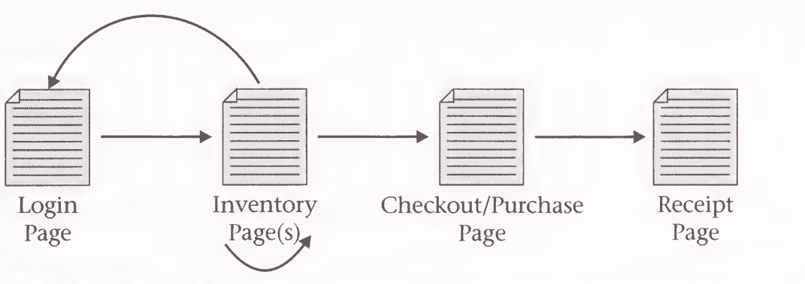

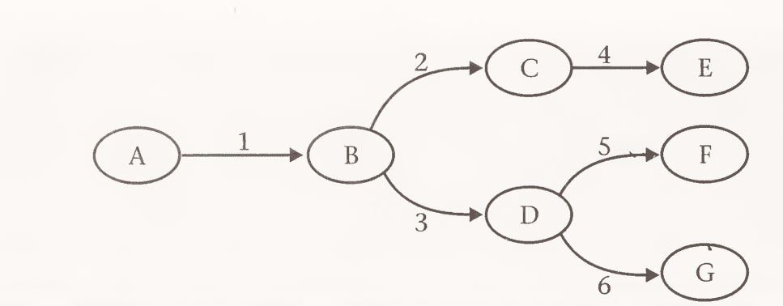

我们可以将用户在Web应用工作流（web-flow）中显示特定页面的行为建模为状态。然而，生成页面本身的请求和响应更准确地代表了状态间的转换，而非状态本身。基于这种区分认知，我们在状态图中用页面来标识状态，表示用户正在查看该页面的事实。

用户页面跳转遵循两个基本原则：

- 用户正在显示特定页面。
- 用户输入了某些内容（或执行了某种操作）。

这种跳转的决策机制可被建模为转换。在状态图中，我们可以用用户输入或操作来标注转换线，表明用户请求状态转换的意图。示例工作流的状态图如图9-6所示。

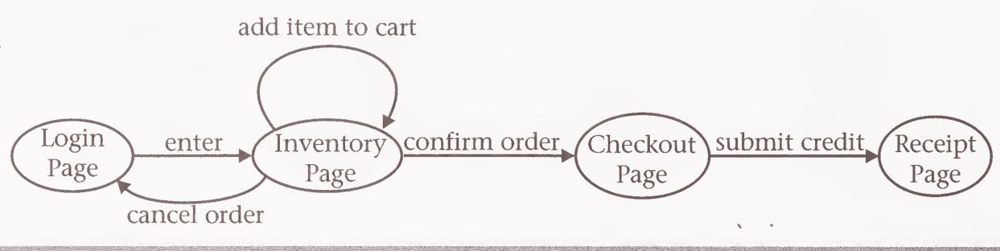

| 当前状态 | 操作 | 下一状态 |
| :--- | :--- | :--- |
| 登录页面 | 输入信息 | 库存页面 |
| 库存页面 | 添加商品至购物车 | 库存页面 |
| 库存页面 | 确认订单 | 结算页面 |
| 库存页面 | 取消订单 | 登录页面 |
| 结算页面 | 提交信用卡信息 | 收据页面 |

**表9-1** 电商工作流状态转换表

查看状态图的另一种方式是通过状态转换表，如表9-1所示。

虽然将状态限定为显示页面有助于我们从宏观层面理解web-flow，但当我们深入探究系统内部运作时，这种模型就显得不够充分。例如，当用户提交信用卡信息时，系统会执行三项操作：

- 用户请求信用验证，若授权通过则扣除相应信用额度。
- 系统更新库存以反映商品购买情况。
- 系统生成收据并将控制权移交至收据页面。

这三项操作中只有最后一项会显示页面，其余两项在后台执行。然而每项操作都会导致工作流产生内部状态转变。有人可能会质疑为何不将这三项操作合并为单一操作。实际上保持分离状态有助于在其他web-flow中实现复用。在MVC架构中，不产生可视页面的转换通常会在模型中创建新的状态。

现在让我们扩展工作流以包含这些内部状态。图9-7展示了从结算页面开始的细化状态图。


| 当前状态 | 操作 | 下一状态 |
|---|---|---|
| 结算页面 | 信用核查 | 信用已核查 |
| 信用已核查 | 更新库存 | 库存已更新 |
| 库存已更新 | 生成收据 | 收据页面 |

**表9-2** 包含附加状态的状态转换表

包含这些附加状态的状态转换表如表9-2所示。观察表9-2时，可能会发现一个特殊之处：表格将某些状态表现为显示实体（Web资源），如“结算页面”和“收据页面”，而其他状态则用描述性词语表示，如“信用已核查”和“库存已更新”。这表明状态无需是可显示的——某些状态代表模型变更而非页面。此时的状态图可能显得混乱，因为模型变更难以被可视化为状态。

另一种解决方案是引入“阶段”（也称为“目的地”）的概念，指代接收输入并可选地产生一个或多个输出的任何物理表现形式。此语境下的阶段代表数据流中的任何离散步骤。表9-3展示了此类数据流表（非状态转换表）。注意表头已改为“当前阶段”和“下一阶段”，而非“当前状态”和“下一状态”。阶段现在同时包含Web资源和Java命令对象。Web应用工作流由阶段和阶段转换构成，后者将当前阶段与操作映射到下一阶段。流程控制——Web开发社区中常用但定义松散的术语——即指在这种web-flow中从一个阶段移动到另一个阶段的机制。

| 当前阶段 | 操作 | 下一阶段 |
|---|---|---|
| 结算页面 | 信用核查 | *CreditCheckCommand* |
| *CreditCheckCommand* | 更新库存 | *InventoryUpdateCommand* |
| *InventoryUpdateCommand* | 生成收据 | 收据页面 |

**表9-3** 工作流表

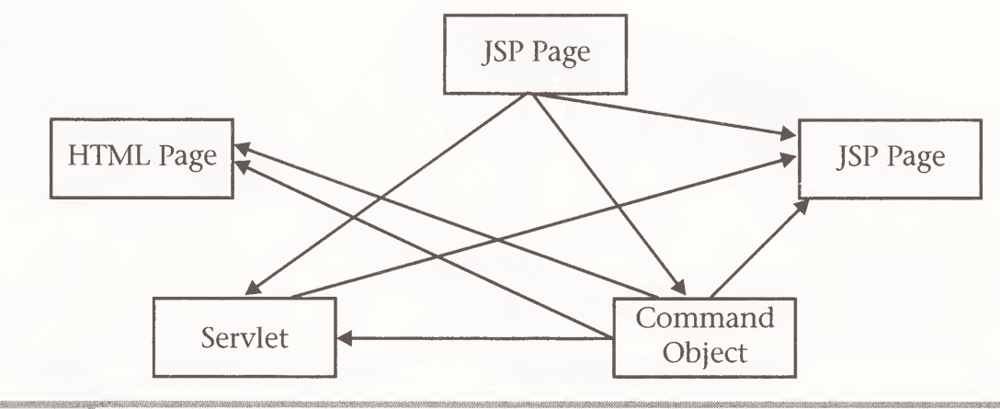

最简单的流程控制形式是将用户从给定阶段可能遍历的所有目的地硬编码。对于仅涉及少量JSP页面的相对静态的Web应用而言，这或许足够。但在复杂Web应用中，Web资源数量会急剧增长。如果随意地在JSP页面中编码转换逻辑，就会产生如图9-8所示的混乱场景。

这种场景难以修改，页面设计师必须在JSP和HTML页面中梳理不必要的页面流转逻辑。在模块7中，我们讨论了中介者模式及其如何在消除依赖、促进复用的同时显著减少通信路径。控制器servlet作为中介者，在Web工作流的各阶段间路由用户请求和应用消息。其架构如图9-9所示。

在这种配置下，只有控制器servlet理解Web工作流中的各个阶段，从而消除了阶段间的依赖关系。此外，可以在控制器servlet中的阶段转换处嵌入会话验证和数据验证逻辑。

控制器应能转发至由URL标识的可视目的地，以及命令对象等非可视目的地。同时，控制器应允许在不影响代码的情况下修改工作流（阶段转换）。

这通常通过将工作流表表示为可轻松修改的持久化结构化存储库来实现。控制器随后动态加载该存储库并利用其驱动web-flow。XML配置文件天然适合此功能。

### 图9-9 控制器作为中介者

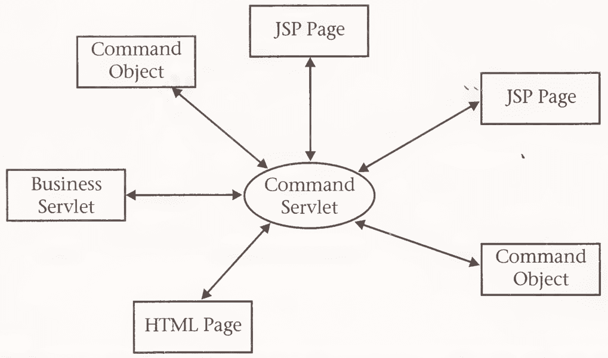

图9-10展示了控制器servlet迄今为止讨论的所有职责的可能流程图。

### 一分钟速记

- 控制器servlet的三大主要职责是什么？
- 控制器如何动态建立与模型的连接？
- 为何模型感知HTTP协议元素是不良设计？
- Web环境中的流程控制指什么？

下一节我们将介绍流程控制的三种不同实现。第一种实现涉及不使用框架的简单servlet。

- 控制器servlet负责用户输入处理、模型交互和流程控制。
- 控制器servlet从web.xml等配置文件中查找模型的连接参数并建立连接。
- 若模型感知HTTP协议元素，会将其与HTTP环境紧密绑定，导致无法在其他客户端环境中使用。
- 流程控制指管理Web工作流中从阶段到阶段移动的机制。


## 模块 9：Web 应用中的控制器与流程控制

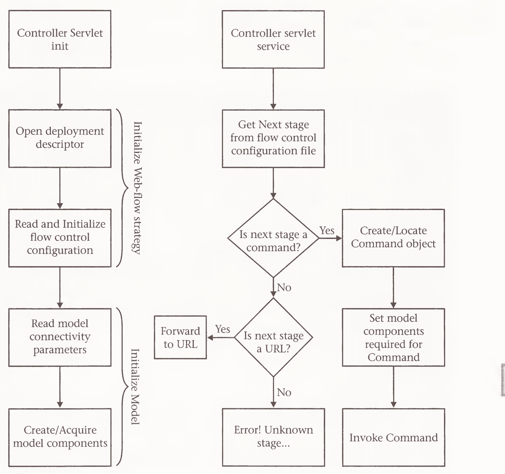

通过配置文件来定义流程控制。每个 HTML 页面和 JSP 页面决定了 Web 流程中的下一个阶段。我们展示了一系列的实现方案，逐步将 Web 工作流的知识从 HTML 和 JavaServer Pages 中迁移出来，放入一个配置文件中。

### 简单的流程控制

让我们考虑一个向用户展示股票交易页面的示例。以下是 HTML 页面：

```
<HTML>
<HEAD><TITLE>Stock Transaction</TITLE></HEAD>
<BODY>
<H1> Buy/Sell </H1>
<FORM METHOD=POST ACTION="/Book/Broker">
<TABLE>
    <TR>
        <TD> Enter ticker: </TD>
        <TD> <INPUT TYPE=text LENGTH=5 NAME="ticker"> </TD>
    </TR>
    <TR>
        <TD> Number of Shares: </TD>
        <TD> <INPUT TYPE=text LENGTH=3 NAME="numShares"> </TD>
    </TR>
    <TR>
        <TD> Share Price: </TD>
        <TD> <INPUT TYPE=text LENGTH=5 NAME="price"> </TD>
    </TR>
</TABLE>
<HR>
<TABLE BORDER=1>
<TR>
<TD> <INPUT TYPE=hidden NAME="Buy" VALUE="/jsp/Buy.jsp">
    <INPUT TYPE=submit NAME="action" VALUE="Buy"> </TD>
<TD> <INPUT TYPE=hidden NAME="Sell" VALUE="/jsp/Sell.jsp">
    <INPUT TYPE=submit NAME="action" VALUE="Sell"> </TD>
<TD> <INPUT TYPE=hidden NAME="Cancel" VALUE="/jsp/Cancel.jsp">
    <INPUT TYPE=submit NAME="action" VALUE="Cancel"> </TD>
<TD> <INPUT TYPE=reset VALUE="Reset"> </TD>
</TR>
</TABLE>
</FORM>
</BODY>
</HTML>
```

该页面呈现一个简单的表单，包含用于输入股票代码、股数和股价的元素。用户被要求输入这三个元素并做出提交选择。用户可以买入、卖出或取消交易。图 9-11 展示了该页面。

在此示例中，HTML 页面提交了三个名为 “Sell”、 “Buy” 和 “Cancel” 的数据元素。这三个数据元素代表此页面可能产生的三种操作。每个操作都关联到一个不同的目的地（或阶段）。目的地在附带的隐藏输入元素中指定。请注意，所有三个数据元素共享相同的名称：“action”。

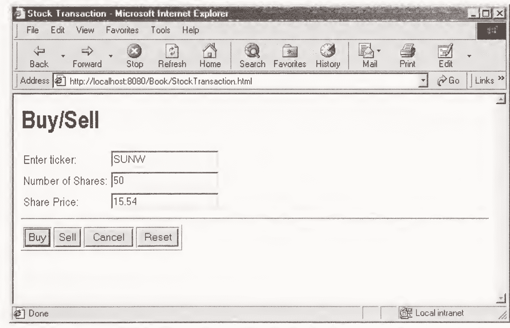

**图 9-11** 股票交易页面

该页面的所有提交都由我们通过 URL `/Book/Broker` 标识的控制器 servlet 处理。以下是我们控制器 servlet 的源代码：

```
package simple;

import javax.servlet.*;
import javax.servlet.http.*;
import java.io.IOException;

public class BrokerServlet extends HttpServlet {
    // Forward http get calls to http post handler.
    public void doGet(HttpServletRequest request,
                      HttpServletResponse response)
            throws ServletException, IOException {
        doPost(request, response);
    }
    // Handle requests.
    public void doPost(HttpServletRequest request,
                       HttpServletResponse response)
            throws ServletException, IOException {

        RequestDispatcher rd = null;
        // Get action requested from request.
        String action =
                request.getParameter("action");
        // Get next page associated with action also
        // from request.
        String JSP = request.getParameter(action);
        rd = request.getRequestDispatcher(JSP);

        // Route request to appropriate JSP page.
        if (rd != null) {
            rd.forward(request, response);
        }
    }
}
```

为了在 Web 工作流中定位下一个页面，servlet 检索 “action” 参数的值。这给了它隐藏输入元素的名称，该元素的值标识了 Web 流程中的下一个页面（或阶段）。

这种实现方式简单，并且提供了灵活性，可以在不更改 Java 代码的情况下更改目的地。但这个小小的益处也为应用程序引入了不必要的复杂性，因为随着页面转换数量的增加，每个 Web 资源都指定了所有可能的目的地路径，关于 Web 工作流的知识分散到了多个不同的 Web 资源中。当 Web 开发人员试图修改 Web 流程时，这会导致逆向工程的噩梦。在此设置中，控制器仅仅是在应该驱动工作流时，却仅仅起到了辅助作用。

我们可以从 HTML 页面中移除指定下一阶段的隐藏输入元素，并将此知识放入控制器 servlet 中，使用类似于以下片段的代码：

```
RequestDispatcher rd = null;
// Get action requested from request.
String action = request.getParameter("action");

if (action.equals("Buy")) {
    rd = request.getRequestDispatcher("/jsp/Buy.jsp");
}
else if (action.equals("Sell")) {
    rd = request.getRequestDispatcher("/jsp/Sell.jsp");
}
else if (action.equals("Cancel")) {
    rd = request.getRequestDispatcher("/jsp/Cancel.jsp");
}
```

虽然这样的代码将通信通道集中到了我们的控制器 servlet 中，但这显然不是一个好的解决方案。它将目的地硬编码到了我们的 servlet 中，并且对于 Web 工作流中的每个新阶段，都必须插入一个新的 `if-else` 代码块。

第三种实现方案从属性文件中读取操作和阶段（目的地）之间的映射关系。

```
package simple;
import javax.servlet.*;
import javax.servlet.http.*;
import java.io.IOException;
import java.util.Properties;

public class BrokerServlet extends HttpServlet {
    private static final String MAPPINGS_FILE = "/WEB-INF/config.properties";
    private Properties properties = new Properties();

    public void init(ServletConfig config)
                        throws ServletException {
        super.init(config);
        try {
            properties.load(
                config.getServletContext().getResourceAsStream(
                    MAPPINGS_FILE));
        }
        catch(IOException ioexp) {
            System.err.println(
                "Unable to load property file: " + ioexp);
            throw new ServletException(ioexp);
        }
    }

    // Forward http get calls to http post handler.
    public void doGet(HttpServletRequest request,
                       HttpServletResponse response)
        throws ServletException, IOException {
        doPost(request, response);
    }

    // Handle requests.
    public void doPost(HttpServletRequest request,
                        HttpServletResponse response)
        throws ServletException, IOException {

        RequestDispatcher rd = null;
        // Get action requested from request.
        String action = request.getParameter("action");
        // Get next URL for action from properties file
        String nextURL = properties.getProperty(action);
        // Route request to next destination in workflow.
        if(nextURL != null) {
            rd = request.getRequestDispatcher(nextURL);
            rd.forward(request, response);
        }
    }
}
```

我们的控制器 servlet 在其 *init* 方法中从属性文件加载属性。对于此示例，该属性文件应位于应用程序上下文的 `/WEB-INF/config.properties` 下。以下是该属性文件的内容：

```
# Mapping of actions to destinations
Buy=/jsp/Buy.jsp
Sell=/jsp/Sell.jsp
Cancel=/jsp/Cancel.jsp
```

我们 servlet 中的 *doPost* 方法检索参数 “action” 的值。然后，它在属性文件中查找该操作对应的目标 URL 并转发到该 URL。假设我们在 `/jsp` 子目录下放置一个名为 `Buy.jsp` 的文件，内容如下：

```
<HTML>
<BODY>
<%
    String ticker = request.getParameter("ticker");
    int numShares =
        Integer.parseInt(request.getParameter("numShares"));
    float price =
        Float.parseFloat(request.getParameter("price"));
%>
<H3> Bought <%= numShares %> shares of
     <%= ticker %> at $<%= price %> </H3>
</BODY>
</HTML>
```

当我们在 StockTransaction.html 页面上选择“Buy”按钮时，我们将得到如图 9-12 所示的页面。请注意图 9-12 浏览器中显示的 URL。该 URL 为 http://localhost:8080/Book/Broker。它并未显示最终目的地 `Buy.jsp`。这是因为，从浏览器的角度来看，当我们提交 HTML 表单时，目的地是 `/Book/Broker`，我们将其映射到了我们的控制器 servlet。我们隐藏了我们的 servlet 将控制权转发到 `/jsp/Buy.jsp` 的事实。通过向客户端隐藏实际的页面目的地，您可以帮助保护它们免受恶意或恶意访问。


**图 9-12** Buy.jsp

此实现是迄今为止最佳的方案，因为它将所有页面跳转集中在一个由我们的控制器 Servlet 管理的属性文件中。这也为我们提供了一种灵活的方式，无需修改 Java 代码即可更改页面跳转。

这里的意图仅是展示简单的页面跳转逻辑。在“真实世界”的设置中，我们的控制器 Servlet 还将处理用户输入和模型交互。以下项目展示了我们在家庭中心应用程序中实现的流程控制。

### 项目 9-1：通讯录搜索

正如我们在模块 7 中讨论的，我们家庭中心的其中一个功能是查找特定大家庭成员的联系信息。我们通过维护一个包含所有家庭住址的通讯录来实现这一点。我们使用 MySQL 数据库作为存储家庭住址和每个家庭中家庭成员信息的存储库。无需深入了解数据库模式的细节（我们在模块 10 中会详细描述），我们使用项目附带的预定义脚本构建了包含所有模式元素和示例数据的数据库。然后，我们构建了一个通讯录搜索页面，允许轻松查找成员的联系信息。我们提供了两种基本搜索机制：

-   按姓氏或名字进行文本搜索
-   基于名字首字母或姓氏首字母的字母索引搜索

我们将重点关注控制器 Servlet，因为它处理所有三项基本职责：用户输入处理、模型交互和网页流管理。

#### 逐步操作：数据库创建

1.  从网站 http://www.osborne.com 下载此项目的所有文件。
2.  按照附录 C 中的说明下载并安装 MySQL 数据库。
3.  按照附录 C 中的说明将 MySQL 服务器作为服务启动。
4.  按照附录 C 中的说明在 MySQL 中创建一个用户帐户。出于我们的目的，我们将假设用户名和密码为：bookUser 和 bookPasswd。
5.  使用 mysql 工具以 bookUser 身份登录 MySQL，命令语法如下：

```
%> mysql -u bookUser -p
```

系统将提示输入密码。输入密码即可登录。您应该会看到提示符变为 `mysql>`。

6.  运行脚本 schmFamily_Center.sql，语法如下：

```
mysql> source E:/family_center/sql/schmFamily_Center.sql
```

请务必将路径修改为存储此脚本的位置。此脚本创建一个名为 family_center 的数据库，并在其中创建模式。模式是一组表及其关系。模式的详细信息将在模块 10 中解释，对于本项目并不重要。

7.  接下来运行脚本 loadFamily_Center.sql，语法如下：

```
mysql> source E:/family_center/sql/loadFamily_Center.sql
```

请务必将路径修改为存储此脚本的位置。此脚本用示例数据（家庭成员及其地址）填充数据库。

8.  通过输入 **quit** 退出 mysql 工具，如下所示：

```
mysql> quit
Bye
%
```

9.  数据库创建完成！

10. 为了从 Java 访问此数据库，我们需要一个 MySQL JDBC 驱动程序。按照附录 C 中的说明下载 MySQL JDBC 驱动程序 JAR 文件。

现在，您已配置好数据库，让我们深入了解家庭中心项目。

#### 逐步操作：通讯录搜索

1.  在 `%TOMCAT_HOME%\webapps` 下创建一个名为 "Family_Center" 的目录。这将作为我们家庭中心应用程序的根上下文。

2.  从命令提示符进入此目录，如下所示：

```
%> cd %TOMCAT_HOME%\webapps\Family_Center
```

3.  从该目录解压为此项目下载的 WAR 文件 `Family_Center.war`。重要的是您必须在此目录内运行 JAR 命令。

```
%> jar xvf Family_Center.war *
```

4.  此命令将解包我们家庭中心应用程序的所有文件，创建 HTML 文件、JSP 文件、图像等的目录结构。

5.  在 `%TOMCAT_HOME%\bin\server.xml` 文件中为家庭中心应用程序创建一个 Servlet 上下文元素，如下所示：

```
<Context path="/Family_Center"
           docBase="webapps/Family_Center"
           crossContext="true"
           debug="0"
           reloadable="true"
           trusted="false" >
</Context>
```

此 Context 元素指定我们的家庭中心应用程序将位于 URL 根目录下：http://localhost:8080/Family_Center。检查位于我们最近解压的 Web 应用程序中 WEB-INF\src 目录下的源文件 com\jspbg\db\DB.java。此文件建立与 MySQL 数据库的程序化连接。内容如下：

```
package com.jspbg.db;

import java.sql.DriverManager;
import java.sql.SQLException;
import java.sql.Connection;

public class DB {
    public static void registerDriver() {
        try {
            Class.forName("org.gjt.mm.mysql.Driver").
                                  newInstance();
        }
        catch (Exception exp) {
            exp.printStackTrace();
        }
    }
    public static Connection getConnection() throws SQLException {
        Connection c = null;
        String url = "jdbc:mysql://localhost/Family_Center";
        String args = "?user=bookUser&password=bookPasswd";
        c = DriverManager.getConnection(url + args);
        return c;
    }

    public static void releaseConnection(Connection c) throws
SQLException {
        if(c != null)
            c.close();
    }
}
```

请注意，您必须在 JVM 中注册 JDBC 驱动程序，然后才能使用它进行任何操作。这是在 registerDriver 函数中完成的。getConnection 和 releaseConnection 方法获取和释放访问我们数据库的 JDBC 连接。请特别注意前面列表中以粗体显示的行。函数 *DriverManager.getConnection* 接受一个 URL 并返回与我们数据库的连接。请将 URL 字符串中的用户名和密码替换为您的数据库用户名和密码（例如，`bookUser` 和 `bookPasswd`）。重新编译此 Java 文件，确保将 JDBC 驱动程序放在您的 `%CLASSPATH%` 中，并如图所示创建 JAR 文件。

```
jar cvf DBAccess.jar com/jspbg/db/DB.class
```

**注意**

通常，数据库连接参数将从配置文件中读取，因此您无需每次需要更改某些内容时都重新编译 Java 文件。目前，我们将通过手动设置进行操作。

6.  将以下 JAR 文件复制到 `%TOMCAT_HOME%\lib`：

-   Family_Center.jar
-   DBAccess.jar
-   mm.mysql-bin.jar（您的 MySQL JDBC JAR 文件）

Tomcat 的启动脚本会自动将位于 `%TOMCAT_HOME%\lib` 下的所有 JAR 文件追加到 `%CLASSPATH%`。不幸的是，如果您的 Tomcat 安装位于包含空格的目录路径下，例如 `C:\Program Files\Tomcat`，则此方法将不起作用。在这种情况下，您需要通过更新位于 `%TOMCAT_HOME%\bin` 下的启动脚本 `tomcat.bat` 来手动添加这些 JAR 文件。

**注意**

通常，Web 应用程序的类文件可以位于 `WEB-INF\classes` 下，也可以打包为 JAR 文件，然后放置在应用程序上下文下的 `WEB-INF\lib` 子目录中。JSP 容器会自动从这两个位置加载类文件。但正如您将在模块 10 中看到的，我们正在实现一个位于 Web 应用程序之外的安全域（security realm），应单独且显式地向 Tomcat 提供。“真实世界”的部署会将与安全域相关的类文件隔离到一个单独的 JAR 中，并将其余类文件打包到存储在应用程序上下文下的 JAR 中。

**图 9-13** 家庭中心欢迎页面

7.  重启 Tomcat 并访问 URL：`http://localhost:8080/Family_Center`。您应该会看到如图 9-13 所示的页面。

8.  选择通讯录按钮，您应该会看到如图 9-14 所示的通讯录搜索页面。

9.  该页面允许我们按姓氏或名字搜索成员。它还允许我们根据姓氏或名字的首字母执行索引搜索。示例搜索的搜索结果页面如图 9-15 所示。

10. 如果没有匹配搜索结果的条目，您应该会看到如图 9-16 所示的页面。

11. 出于本项目的目的，我们将重点关注控制器 Servlet 中的代码。此项目，与股票交易示例一样，使用了一个


### 360 JSP：入门指南

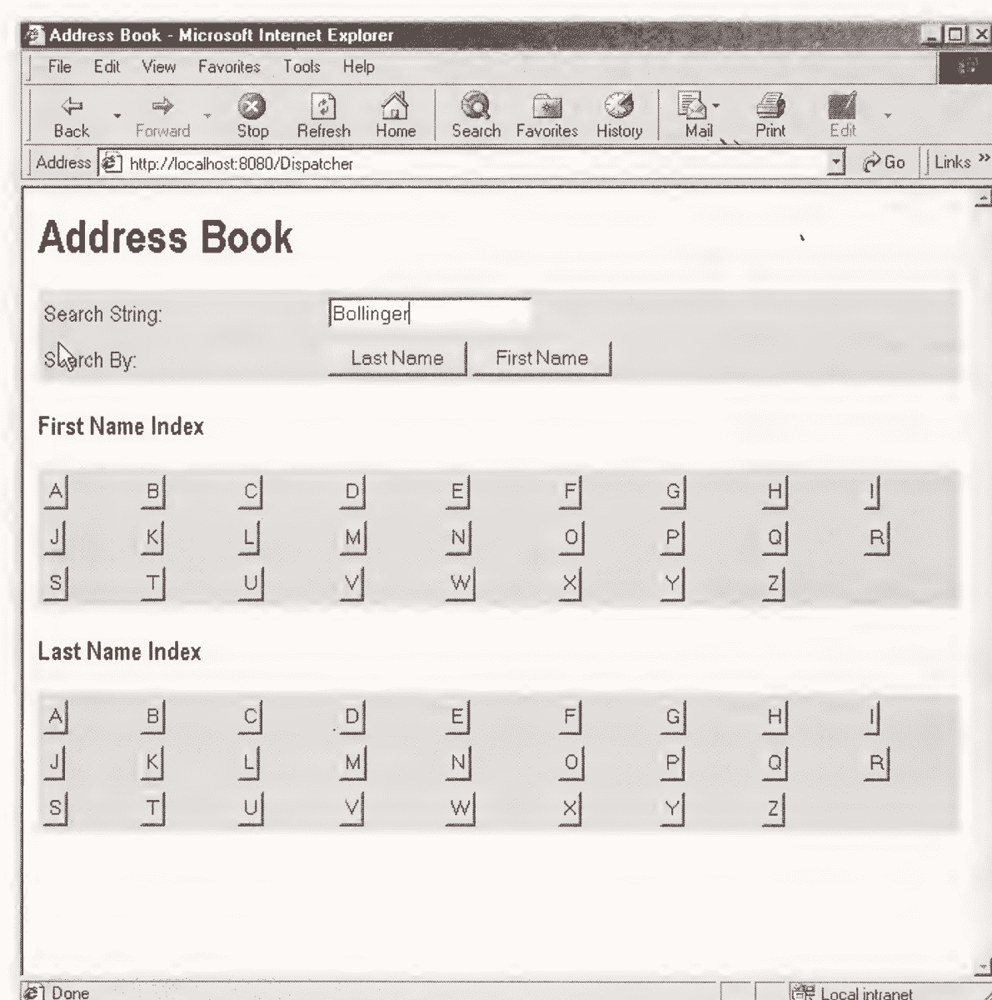

**图 9-14** 通讯录搜索页面

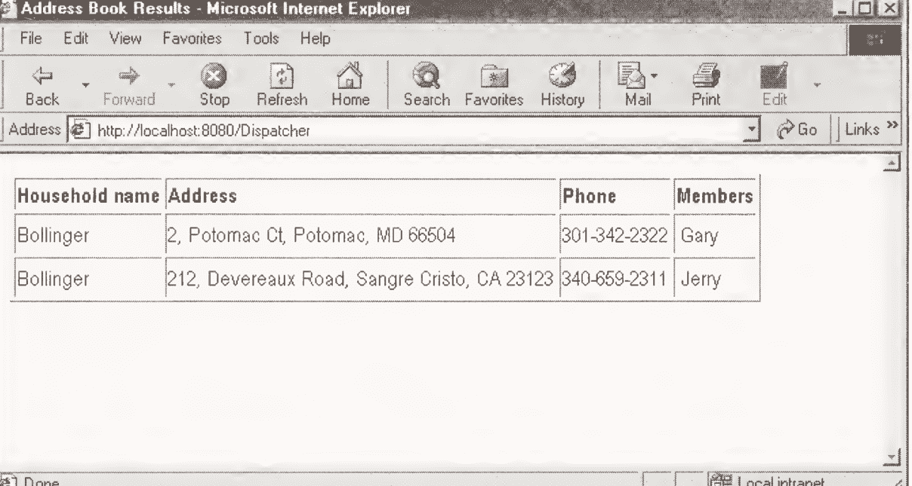

**图 9-15** 通讯录搜索结果

配置文件 `actions.xml` 用于建立操作（action）与阶段（stage）或目标（destination）之间的关系。然而，该文件是 XML 格式。我们来看看它的内容：

```xml
<?xml version="1.0" ?>
<!DOCTYPE actions [
<!ELEMENT actions (action*)>
<!ELEMENT action (command|url)>
<!ATTLIST action
    name CDATA #REQUIRED>
<!ELEMENT command (#PCDATA)>
<!ELEMENT url (#PCDATA)>
<!ATTLIST command
    model CDATA #REQUIRED>
]>
<actions>
    <action name="EAB">
        <url>/AddressBook</url>
    </action>
    <action name="SFN">
        <command model="AddressBookManager">
            com.jspbg.webflow.FirstNameSearchCommand
        </command>
    </action>
    <action name="SLN">
        <command model="AddressBookManager">
            com.jspbg.webflow.LastNameSearchCommand
        </command>
    </action>
    <action name="SFNI">
        <command model="AddressBookManager">
            com.jspbg.webflow.FirstNameIndexCommand
        </command>
    </action>
    <action name="SLNI">
        <command model="AddressBookManager">
            com.jspbg.webflow.LastNameIndexCommand
        </command>
    </action>
    <action name="SABR">
        <url>/AddressBookResults</url>
    </action>
    <action name="SZR">
        <url>/ZeroResults</url>
    </action>
    <action name="SERR">
        <url>/Error</url>
    </action>
</actions>
```

该文件在根 `actions` 元素内包含多个 `action` 元素。每个 `action` 元素代表 Web 工作流中的一个操作。操作由 `name` 属性标识。`action` 元素的内容包含该操作的下一个阶段。该阶段可以是一个 `url` 元素，表示一个 Web 资源；也可以是一个 `command` 元素，表示一个命令对象。每个 `command` 元素可以包含一个可选的 `model` 属性，用于标识命令打算使用的模型。控制器 Servlet 加载此文件中的数据，并用它来驱动工作流。例如，如果操作是 "EAB"（代表进入通讯录），则控制器 Servlet 查找名为 "EAB" 的 `action` 元素。目标是一个 URL，因此控制器直接将控制权转发到指定的相对 URL：`/AddressBook`。如果操作是 "SLN"（代表按姓氏搜索），则控制器查找名为 "SLN" 的 `action` 元素。目标是一个命令对象。控制器实例化命令对象 `com.jspbg.webflow.LastNameSearchCommand`，检索由名称 "AddressBookManager" 标识的模型，将其设置在命令对象上，并调用该命令。


**图 9-16** 无结果页面

12. 控制器 Servlet（名为 *com.jspbg.servlet.DispatcherServlet*）如下所示：

```java
public class DispatcherServlet extends HttpServlet {
    private static final String ACTIONS_XML = "ACTIONS_XML";

    // Static strings for model-names.
    private static final String ADDRESS_BOOK_MGR = "AddressBookManager";

    /* parser that interprets the actions
       XML that maps actions to commands or URLs.
     */
    private ActionParser actionParser = null;

    // A HashMap of all model components
    private ModelFactory modelFactory = null;

    public void init(ServletConfig config)
            throws ServletException {
        // init parent
        super.init(config);

        // register JDBC driver. Required only once.
        DB.registerDriver();

        // initialize action parser for web-flow logic
        initializeActionParser(config);

        // create model factory.
        initializeModelFactory(config);
    }

    private void initializeActionParser(ServletConfig config)
            throws ServletException {
        ServletContext ctxt = config.getServletContext();

        // Retrieve actions XML file
        String actionsXMLName =
            config.getInitParameter(ACTIONS_XML);
        String actionsXmlFile =
            ctxt.getRealPath(actionsXMLName);
        try {
            // Construct parser on XML file
            actionParser = new ActionParser(actionsXmlFile);
        }
        catch(ParseException pex) {
            throw new ServletException(pex.getMessage());
        }
    }

    public void initializeModelFactory(ServletConfig config)
        throws ServletException {
        Map models = new HashMap();
        models.put(ADDRESS_BOOK_MGR,
                   config.getInitParameter(ADDRESS_BOOK_MGR));
        modelFactory = new ModelFactory(models);
    }

    public void doGet(HttpServletRequest req,
                     HttpServletResponse res)
        throws ServletException, IOException {
        doPost(req, res);
    }

    public void doPost(HttpServletRequest req,
                     HttpServletResponse res)
        throws ServletException, IOException {
        String action = req.getParameter("action");
        try {
            String nextStage = null;
            // While next stage is a Command, retrieve the
            // model component for the command, and invoke
            // the command.
            while((nextStage =
                    actionParser.getCommand(action)) != null) {
                Model model = null;
                String modelName = actionParser.getModel(action);
                // create model if there is one associated
                // with current action
                if(modelName != null) {
                    model = modelFactory.makeModel(modelName);
                }

                // forward control to the command
                action = forwardToCommand(nextStage, model, req,
                                         res);
            }

            // If the next stage is a URL, forward control
            // to the URL
            nextStage = actionParser.getURL(action);
            if(nextStage != null) {
                forwardToURL(nextStage, req, res);
            }
            else {
                throw new ServletException(
                    "No known destination for action: " + action);
            }
        }
        catch(ParseException pex) {
            throw new ServletException(pex);
        }
        catch(ServiceException sex) {
            throw new ServletException(sex);
        }

    }

    private void forwardToURL(String url,
                              HttpServletRequest req,
                              HttpServletResponse res)
        throws ServletException, IOException {
        RequestDispatcher rd = req.getRequestDispatcher(url);
        rd.forward(req, res);
    }

    private String forwardToCommand(String command,
                                    Model model,
                                    HttpServletRequest req,
                                    HttpServletResponse res)
        throws ServletException {
        try {
            // instantiate command object
            Command c =
                (Command)Class.forName(command).newInstance();

            // set model component on command object
            c.setModel(model);
        }
```

我们的控制器 Servlet 使用一个名为 `com.jspbg.webflow.ActionParser` 的 Java 类来解析 `actions.xml` 文件。它还使用名为 `com.jspbg.model.ModelFactory` 的 Java 类来创建或定位模型元素。两者都在 Servlet 的 `init` 方法中初始化。`doGet` 方法只是委托给 `doPost` 方法。这确保了我们的 Servlet 将统一处理 GET 和 POST 请求。`doPost` 方法从请求中检索 "action" 参数。然后，它使用 `ActionParser` 查看映射到该操作的目标是否为 URL。如果是，Servlet 使用 `forwardToURL` 方法转发到指定的 URL。如果目标是一个命令对象，则检索其关联的模型名称。然后控制器使用 `ModelFactory` 创建模型。接着，控制权转移给 `forwardToCommand` 方法，在那里命令被实例化，模型被设置，然后命令被执行。

13. 每个命令对象都实现了此处所示的 `com.jspbg.webflow.Command` 接口：

```java
public interface Command {
    // action: search first name
    public static final String SFN = "SFN";
    // action: search last name
    public static final String SLN = "SLN";
    // action: search first name index
```


public static final String SFNI = "SFNI";
// 动作：搜索姓氏索引
public static final String SLNI = "SLNI";
// 动作：显示地址簿结果
public static final String SABR = "SABR";
// 动作：显示零结果
public static final String SZR = "SZR";
// 动作：显示错误
public static final String SERR = "SERR";

public String execute(HttpServletRequest req,
                      HttpServletResponse res)
            throws ServletException;

public void setModel(Model m);
}

该命令接口定义了两个方法。方法*execute*调用命令。方法*setModel*将请求的模型存储在命令中。Web应用中的每个动作在此接口中也被定义为一个静态最终*字符串*。

### 14. 让我们来研究姓氏搜索的命令对象。类*com.jspbg.webflow.LastNameSearchCommand*继承自*com.jspbg.webflow.SearchCommand*。所以我们先来研究它。

```
public abstract class SearchCommand implements Command {
    protected AddressBookManager addressBookManager = null;

    public void setModel(Model m) {
        addressBookManager = (AddressBookManager)m;
    }

    /**
     * Template execute method that is used by multiple
     * sub-classes of this abstract command object.
     */
    public String execute(HttpServletRequest req,
                          HttpServletResponse res)
            throws ServletException {
        String search_str = req.getParameter("SS");

        RequestDispatcher rd = null;
        try {
            // retrieve the households that match the search string.
            List households = getHouseholds(search_str);

            // if there are no entries that match, return
            // 'show zero results' action.
            if ((households == null) || (households.size() == 0)) {
                return Command.SZR;
            }

            // set the results on the request and return
            // the action 'show the address book results'
            request.setAttribute("Results", households);
            return Command.SABR;
        } catch (ServiceException sexp) {
            // set the service exception with the request
            // and return the action 'show error'
            req.setAttribute("Service Exception", sexp);
            return Command.SERR;
        }
    }

    // abstract method that sub-classes override
    public abstract List getHouseholds(String searchString)
                    throws ServiceException;
}
```

这个抽象类使用了模型*com.jspbg.model.AddressBookManager*。它使用其*setModel*方法存储模型，该方法由我们的控制器servlet调用。*execute*方法从请求中获取名为“SS”的搜索字符串。然后，它使用抽象方法*getHouseholds*执行查询以检索与搜索字符串匹配的住户。这是与模型交互的方法。如果有匹配的条目，结果会被存储在请求中，并且命令对象返回动作“SABR”（表示显示地址簿结果），指示控制器应将控制权发送到与此动作匹配的阶段。控制器（我们的分发器servlet）会确定“SABR”的目的地（如果你查看我们的*actions.xml*文件，它会是*/AddressBookResults*），并将结果转发给它进行布局处理。如果没有条目，命令对象返回动作“SZR”（表示显示零结果）。控制器接收到此动作后，确定其目的地是`/ZeroResults`并转发控制权。如果在执行模型服务时抛出`ServiceException`，它将在`catch`块中被捕获并与请求一起存储，并且命令对象返回动作“SERR”（表示显示错误）。控制器会正确查找此动作的目的地（`/Error`）并将控制权转发给它。这个`execute`方法是模板方法设计模式的一个示例。

### 15. `LastNameSearchCommand`类仅提供`getHouseholds`方法。它通过向`AddressBookManager`请求基于姓氏的所有住户来实现这一点。

```
public class LastNameSearchCommand
    extends SearchCommand {
    public List getHouseholds(String searchString)
            throws ServiceException {
        return addressBookManager.getHouseholdsByLastName
                (searchString);
    }
}
```

### 16. `com.jspbg.model.AddressBookManager`模型接口如下所示：

```
public interface AddressBookManager extends Model {
    public List getHouseholdsByLastName(String lastName)
            throws ServiceException;
    public List getHouseholdsByFirstName(String firstName)
            throws ServiceException;
    public List getHouseholdsByIndex(String indexAlphabet,
                                     boolean isFirstName)
            throws ServiceException;
}
```

正如你可能注意到的，我们的模型接口完全不知道任何HTTP元素。这使其可以在任何客户端环境中重用。

### 17. 我们Web应用程序的最后一个元素由实际的Web资源以及每个资源为参与此流程控制框架必须提交的内容组成。我们在这里展示一个`Entrance.html`文件片段作为示例：

```
<script language="javascript">
function submitEntranceForm(val)
{
    document.entrance.action.value = val;
    document.entrance.submit();
}
</script>

<FORM METHOD="POST" NAME="entrance"
      ACTION="/Family_Center/Dispatcher">
    <INPUT TYPE=hidden NAME="action">
    <TABLE CELLPADDING=2 CELLSPACING=5 BORDER=1>
        <TR>
            <TD> <B> Address Book </B> </TD>
            <TD>
                <INPUT TYPE=button VALUE="GO"
                       onMouseDown="submitEntranceForm('EAB');">
            </TD>
        </TR>
```

地址簿的按钮元素使用了一个JavaScript函数*submitEntranceForm*，并传递了一个动作字符串“EAB”。该函数只是将此值设置为名为“action”的隐藏表单输入元素的值，并提交表单。我们的分发器servlet处理表单提交。

从这个项目中，你应该注意到我们的控制器servlet执行了用户输入处理、模型交互和流程控制这三个主要职责。我们的控制器servlet引入了一个命令对象中介，它从请求中捕获相关信息并将其转发给模型，使模型对客户端环境保持不知情。我们的控制器servlet还使用模型工厂来实例化模型并将其设置在命令对象上以供使用。最后，我们的控制器servlet使用一个`actions.xml` XML配置文件来驱动灵活的工作流程。我们项目一部分的工作流程图如图9-17所示。

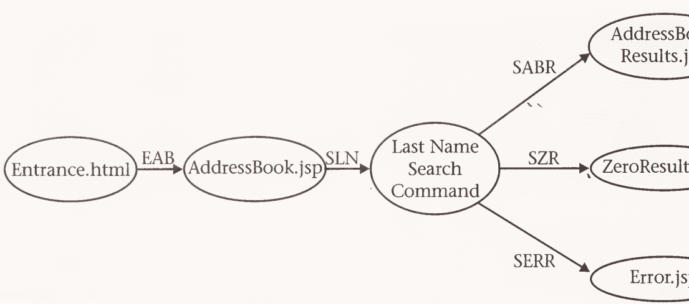

**图9-17** 项目的工作流程图

# 高级流程控制：Struts MVC 框架

2001年1月，Apache软件基金会下的Jakarta项目推出了名为Struts的MVC框架的1.0版本。Struts框架包含许多用于构建Web应用程序的模型、视图和控制器组件的工具。其中一些工具包括：

- 用于构建标准表单而无需直接使用HTML或标准JSP实用程序的自定义标签
- 用于JSP页面基本程序逻辑的自定义标签，消除了对Java的需要
- 内置国际化支持，用于加载和呈现Java资源束，这些资源束将消息令牌映射到特定*区域设置*的语言特定字符串
- 支持根据配置文件中指定的连接参数设置Java数据源
- 一种表单Bean机制，可自动实例化并填充用户提供的JavaBean，其值来自HTML表单中的输入元素，并可选择性地验证这些输入
- 一个控制器框架，支持在XML编写的配置文件中建立强大而灵活的流程控制

不多做详细介绍，让我们研究Struts中的一个示例流程控制元素，作为我们项目中解决方案的对比替代方案。

```
<action path="/editSubscription"
    type="org.apache.struts.webapp.example.EditSubscriptionAction"
    name="subscriptionForm"
    scope="request"
    validate="false">
    <forward name="failure" path="/mainMenu.jsp"/>
    <forward name="success" path="/subscription.jsp"/>
</action>
```

这个`action`元素将请求URI `/editSubscription`映射到动作对象`EditSubscriptionAction`。Struts中的动作对象类似于我们示例中的命令对象。当一个JSP页面指定此URI时，控制器servlet会实例化`EditSubscriptionAction`对象并调用其上的`perform`方法。

在调用`perform`方法之前，控制器servlet会尝试在请求作用域中查找名为“subscriptionForm”的表单JavaBean。如果找不到，它会实例化表单Bean。接下来显示的表单Bean元素（也在配置文件中指定）将名称映射到一个JavaBean。

```
<form-bean name="subscriptionForm"
    type="org.apache.struts.webapp.example.SubscriptionForm"
/>
```

然后，此表单Bean根据由JavaBean内省建立的属性方法签名，使用请求中的参数进行填充。然后表单Bean在`perform`方法中被发送给动作对象。这个预处理步骤使动作对象无需从请求中解析元素。

`action`元素内的两个`forward`元素表示命令对象可以根据“成功”或“失败”逻辑名称（动作）转发控制权的两个目的地。逻辑名称可以有任意多个。


所有这些元素都指定在一个特殊的 Struts 配置 XML 文件中，该文件作为名为 "config" 的初始化参数传递给控制器 servlet。

我们可以深入探讨 Struts 的更多细节，但在位于 http://jakarta.apache.org/struts 的 Struts 网站上有更完善的文档。您也可以从该网站免费下载此框架。这段简短描述的目的是激发兴趣，以便您了解更多。对于某些人来说，整个 Struts 框架可能显得过于庞大。它附带了许多精心设计的工具，并非所有工具都对每个人有用。即使您不打算在 Struts 中使用任何东西，学习 Struts 框架也有助于您获得关于 Web 应用程序设计的良好实践见解。

## 最终总结

从根本上说，所有流控机制都涉及在 Web 应用程序中的操作与阶段或目标之间建立映射。这些映射由一个 servlet 控制。目标可以有变体。我们在项目中看到了几个例子：一个 URL 和一个实现了我们的 `Command` 接口的命令对象。作为此映射的一部分，可以关联辅助信息，例如我们项目中的模型组件或 Struts 示例中的表单 bean。确定 Web 工作流下一阶段的方式也可以有变体。它可以纯粹基于当前阶段生成的操作，正如我们在本模块的示例中看到的那样。或者，在稍微更复杂的环境中，我们可以设想具有可重用阶段的工作流链。例如，参考图 9-18。

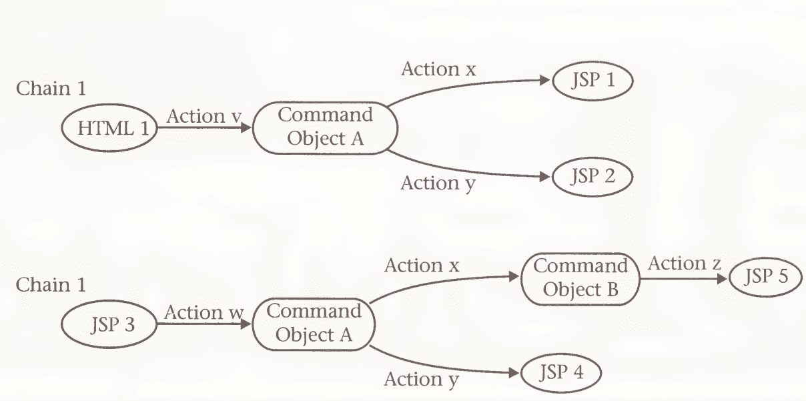

**图 9-18** 工作流链

图中显示了两个工作流链。命令对象 A 产生两个操作：x 和 y。根据链，我们的示例将这两个操作映射到不同的目标。在链 1 中，我们的示例将操作 x 和 y 分别映射到 JSP 1 和 JSP 2。在链 2 中，相同的操作 x 映射到另一个命令对象 B，操作 y 映射到 JSP 4。表 9-4 显示了说明这两个链所有映射的工作流表。

本质上，该图说明了一个控制器 servlet 如何通过感知工作流中的当前链，能够将同一操作的用户动态转发到不同的目标。这使得阶段可以在多个 Web 流程中重用。

| 链 | 当前阶段 | 操作 | 下一阶段 |
|---|---|---|---|
| 1 | HTML 1 | v | Command A |
| 1 | Command A | x | JSP 1 |
| 1 | Command A | y | JSP 2 |
| 2 | JSP 3 | w | Command A |
| 2 | Command A | x | Command B |
| 2 | Command A | y | JSP 4 |
| 2 | Command B | z | JSP 5 |

**表 9-4** 基于链的工作流表

## 1 分钟速查

- 如何在 Web 应用程序中动态建立流控？
- Struts 是什么？
- 所有流控机制有什么共同点？

- 通过从配置文件（如 Java 属性文件或特殊配置的 XML 文件）读取 Web 应用程序中的各个阶段，可以建立动态流控。
- Struts 是由 Apache 软件基金会下的 Jakarta 项目开发的模型-视图-控制器实现框架。它包括各种工具，可用于轻松构建 Web 应用程序中的模型、视图和控制器组件。
- 所有流控机制都涉及将 Web 应用程序中的操作映射到由 servlet 控制的阶段（或目标）。

## 掌握检查

1.  为什么您应该认为让每个 Web 资源都知晓工作流中的下一页或下一阶段是一个糟糕的设计？

2.  考虑以下模型接口并解释错误之处：

```
public boolean isCreditApproved(HttpServletRequest request);
public void debitCreditCard(HttpSession session);
```

3.  在 Web 应用程序中存储 Web 流信息的常见格式是什么，为什么？

4.  在设计灵活的 Web 工作流时，是否仅将所有阶段转换逻辑集中到一个控制器 servlet 中就足够了？

5.  基于链的 Web 流与常规 Web 流有何不同？

## 模块 10

### 集成数据库

*本模块的目标*

- 解释外部内容源在“真实世界”应用程序中的作用
- 理解数据库在 JSP 应用程序中的作用
- 介绍 JDBC 数据访问 API 的基础知识
- 说明如何将关系数据库集成到我们的家庭中心应用程序中

在模块 8 中，我们介绍了 Web 架构的不同安全元素。我们还描述了家庭中心应用程序的登录页面。在模块 9 中，我们讨论了 JSP 应用程序中的 Web 流和页面管理。我们还描述了家庭中心的控制器。现在，在最后一个模块中，我们将展示如何向 JSP 架构添加*外部内容源*（例如关系数据库），并描述家庭中心的安全和数据管理的 JDBC（数据库）实现。

为了讨论的目的，我们将外部内容源定义为任何*由应用程序未直接管理的、集中组织和可访问的数字内容集合*。此定义包括许多不同类型的内容源，包括但不限于标准的关系数据库。例如，它包括遗留信息源，如 SAP R/3 系统甚至 COBOL 财务程序。然而，关系数据库具有独特的重要的，因为它们是外部内容源中最通用的。

数据库和其他外部内容源是庞大的主题，我们在此仅浅尝辄止。其他数百本书籍提供了相关培训和专业知识。在本模块中，我们解决围绕在 Web 应用程序中使用和集成外部内容源的架构问题，重点是关系数据库。

## 外部内容源的作用

你可能会问的最基本问题是：“为什么要集成外部内容源？”正如我们在模块 7 中对模型-视图-控制器 (MVC) 模式的讨论所解释的，您可以以多种不同的方式对 Web 应用程序中的内容建模。例如，文件系统比数据库简单得多。大多数桌面应用程序，如文本或图形编辑器，都使用文件系统。这意味着大多数计算机用户非常熟悉分层目录和文件系统，包括目录搜索工具。

对于某些业务目的，文件系统是内容管理的最佳选择，因为它是本地的。许多其他内容源，如数据库，至少需要两个层次：客户端和服务器。这引发了许多我们在模块 1 中描述的关于网络透明性的问题。响应时间有多快？故障有多常见？其他用户是否会共享数据库服务，可能影响您自己的数据库请求的结果？当然，文件系统也有同样的问题，但程度大大降低。除了将所有内容放入计算机内存外，您无法在响应性上击败文件系统。例如，根据当前技术，在使用视频编辑工具进行会话时，您应该将高分辨率视频内容存储在本地文件系统中，而不是数据库中。但当您需要分布式访问内容时，文件系统并不是最佳解决方案。它在共享动态内容时保持数据完整性方面非常有限。它也只提供基本的安全性。关键在于，架构必须将业务需求与技术能力相匹配。

那么，您可能在何时以及为何集成外部内容源？您在以下情况下集成外部内容源：

- 为了可靠地组织和管理非常大量的内容
- 为了集中、保护和共享信息
- 为了向应用程序提供动态内容
- 为了访问遗留信息系统

### 管理大量内容

当需求不大时，文件系统的内容存储效果很好。然而，随着本地磁盘上内容量的增加，查找任何给定内容变得困难。为了组织这些内容，大多数计算机用户创建自定义目录方案。例如，许多计算机用户创建一个特殊的 "Pkgs" 目录，并将应用程序安装到其中。Windows 实际上默认创建此类目录，包括：`My Documents`、`My Download Files` 和 `Program Files`。

这种自定义方案在公司环境中很快就会失败。一方面，很难预测您可能希望如何访问您产生的内容。您存储在 `/Presentations` 目录还是 `/DesignMeetings` 目录中的那个 PowerPoint 演示文稿？您是否在每个目录中都有两个略有不同的副本？哪个版本是正确的版本？您给它起了什么文件名？

另一个问题是所需的存储量。有一句格言（也许是自然法则），无论您将磁盘做得多大，您都会填满它。查找内容和提供足够的磁盘空间是一对双胞胎


### 集中化、保护与共享内容

面对不断增长的内容，一个自然的反应是将其集中化，以便能够保护和共享它。这样，任何给定内容的永久副本只需存储一份。同时，你也可以更有效地利用保护该副本所需的相对昂贵的机制。

集中化文件存储对大多数人来说都很熟悉。几乎每个组织都提供一个由某种集中存储设备管理的共享文件系统。总体而言，这样的网络附加存储（NAS）比不断为每个用户升级磁盘，让他们将所有内容存储在自己的机器上，要经济得多。

然而，虽然集中化文件系统可以缓解磁盘空间的爆炸式需求，但它对增强大量内容的管理作用甚微。通常，这种存储之所以比个人磁盘组织得更好、保护得更完善，仅仅是因为有某个企业IT组在控制它。但这只是程度上的差异，而非本质的不同。你仍然会发现目录结构有着晦涩的名称，在企业的“大海捞针”中找到特定文件仍然困难重重。

管理“大海”的第一步是集中化关于内容的信息。我们提到的网络编目和索引有助于实现这一点。这类目录帮助你找到想要的内容，但其本身并不管理内容。

下一步是集中管理关于内容的信息（元数据）以及实际内容本身。

当“数字内容”仅意味着“结构化信息”（例如，包含姓名、出生日期和地址等信息的员工记录）时，集中化内容意味着创建一个中央关系数据库。这类内容仍然主导着大多数讨论，也是大多数组织中最广为人知的信息管理场景。这类信息的重要性如此之大，以至于大型公司（包括仅次于微软的第二大软件公司甲骨文）专门从事关系数据库技术。

然而，在过去几年里，“数字内容”一词已经包含了比结构化内容丰富得多的媒体。数字内容现在包括数字化文档、图像以及数字化音频和视频等对象。同时，也出现了能够管理此类内容的新型存储库。对象和对象关系数据库引擎使得在中央存储库中直接建模富媒体成为可能。现代*数字资产管理*（DAM）系统更进一步，提供了集成元数据、内容、索引和编目服务，甚至内容交付功能的中央内容存储库。所有这些新型存储库的目的都是集中化、保护并共享数字内容。

> **注意**
> 一个基于集中化、保护和共享内容的有趣但未经证实的商业模式，是将商业和消费者内容都托管在一个中央存储库中。然后，它提供管理工具，允许通过多种设备（包括网络，也包括手机和个人数字助理）访问这些内容（http://www.xdrive.com/）。

### 提供动态内容

关系数据库几乎是唯一适合向应用程序提供动态、基于查询的内容的工具。这类动态内容在各种应用程序中都很重要。例如，在线交易公司依赖它提供实时股票报价。自动取款机依赖它来允许或拒绝取款。我们的家庭中心依赖它来发布和检索消息，以及保持安全信息的时效性。因此，本模块演示了使用JDBC（Java数据库连接工具包）集成关系数据库MySQL。

动态内容的重要性源于信息的变化特性。银行余额会起伏（太多起伏，太少流动）。股市会下跌和上涨。人们会搬家，企业会倒闭。关系数据库最适合管理此类信息，而应用程序，包括许多Web应用程序，必须检索并显示它。

### 访问遗留信息系统

应用程序必须显示的大量内容存在于现有的内容存储库中。例如，大型公司通常将员工信息、产品信息和财务信息存储在数据库中。这几乎保证了重要的企业Web应用程序必须集成连接到这些遗留信息的关系数据库接口。JDBC数据访问API为大多数SQL数据库（包括MySQL）提供了跨DBMS的连接能力。我们将在下一节描述这个API。

最近，Sun Microsystems发布了JDBC 2.0标准扩展API。使用此扩展，你可以连接到任何表格数据源，就像连接SQL数据库一样。例如，你可以连接到电子表格或分隔符文件。

Sun Microsystems还在推广一个用于集成企业信息系统（EIS）的标准连接器架构。EIS的一些示例包括：

- PeopleSoft
- SAP R/3
- IBM CICS
- COBOL应用程序

所有这些系统都存储着可能需要集成到企业Web应用程序中的重要内容。图10-1展示了J2EE连接器架构。

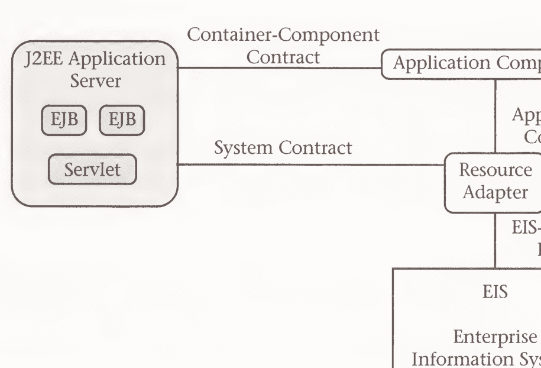

图10-1  J2EE连接器架构

连接器架构有三个主要组件：

- 应用服务器与资源适配器之间的系统契约
- 公共客户端接口（CCI）
- 标准的打包和部署机制

系统级契约定义了三个服务的API：

- 连接管理
- 事务管理
- 安全管理

连接管理服务的主要目标是提供连接池，并提供Java命名和目录服务（JNDI）接口。

事务管理支持跨多个操作的原子性（即，所有操作必须一起提交，要么全部提交，要么全部不提交）。

安全管理接口支持跨多个EIS的单点登录。它还支持身份验证和访问控制。

CCI定义了应用程序组件的客户端API，从而标准化了对多个不同EIS系统的访问。其意图更多是为工具供应商提供一个低级接口，而不是为典型的应用程序开发者提供完整的API。

其希望是独立供应商或遗留系统供应商能够为各种遗留信息源编写资源适配器。一个符合J2EE标准的应用服务器应该能够同时为每个遗留系统运行一个适配器提供运行时支持。这些适配器在应用服务器的内存空间中运行。

# 专家问答

**问题：** 你提到了Java命名和目录服务（JNDI）。它是什么？

**答案：** JNDI是一个Java API，它提供了一个通用的接口来访问许多不同的命名和目录服务（例如，LDAP、CORBA命名服务、DNS、NIS）。该API的目的是让你能够简单地“插入”你偏好的目录服务。

[内容]外部内容源可以通过启用用于标记、跟踪和组织内容的*索引和编目结构*来帮助缓解这些问题。“编目结构”一词起源于图书馆学。图书目录和内容目录之间的类比非常贴切。这两种目录都提供关于内容的信息——元数据。图书馆目录提供关于书籍和图书馆其他资产的信息，特别是包括位置信息。内容目录提供关于数字内容的信息，包括该内容的存储位置。

像Lycos这样的互联网搜索引擎和像Yahoo这样的网络目录提供了熟悉的内容目录示例。搜索引擎构建一个单词和短语的索引（一种动态目录），并将其映射到包含这些单词和短语的网页。网络目录创建一个术语或主题的层次结构，并将网站映射到其中。两者都提供了一种组织内容的方法，从而简化了查找内容的过程。


# 1分钟速查

- 将外部数据源集成到你的JSP应用程序中有哪四个不同的原因？
- 目录结构的作用是什么？
- 支持遗留内容集成的两个Java API是什么？
- 什么是EIS？

# JDBC数据访问API

最常见的遗留内容集成形式（也可以说是最重要的）是从关系型数据库集成结构化信息。关系型数据库提供了经过验证且通常是建模企业级应用所需大量信息最有效的方式。JDBC提供了一个供应商无关的Java API来访问关系数据库管理系统。

# JDBC架构

与J2EE连接器架构类似，JDBC架构也需要提供适配器——尽管仅限于结构化信息源。JDBC驱动程序通过使用专有协议和API实现标准Java接口，使应用程序能够适应供应商的数据库管理系统。图10-2描述了JDBC架构。

如图10-2所示，JDBC支持四种类型的驱动程序：

- **类型1** 访问ODBC驱动程序
- **类型2** 将JDBC调用映射到数据库供应商的本地客户端API
- **类型3** 将JDBC调用映射到中间件供应商的协议（然后由中间件服务器转换为DBMS协议）
- **类型4** 将JDBC调用直接映射到数据库协议

从开发者的角度来看，所有JDBC驱动程序"看起来都一样"，因为它们共享相同的接口，开发者只能访问这个接口。在本书中，我们使用的是MySQL的类型4 JDBC驱动程序。

**1分钟速查答案：**

- 集成外部数据源的四个原因是：组织和管理大量数据；集中、保护和共享信息；提供动态内容；以及提供对遗留内容源的访问。
- 目录结构标记、跟踪和组织内容。
- Java支持JDBC数据库API和J2EE连接器架构用于EIS集成。
- EIS是*企业信息系统*，例如SAP R/3和PeopleSoft。

# JDBC基础

JDBC API提供三个核心服务：

- 连接服务
- SQL服务
- 结果处理

# 连接服务

连接服务包括注册JDBC驱动程序、连接数据库和断开数据库连接。在使用JDBC驱动程序之前，必须先向JDBC运行时框架注册它。JDBC框架支持多种方式，但最简单的注册方式是使用Java方法`Class.forName`。例如，以下是如何注册MySQL驱动程序（注意MySQL驱动程序类是`org.gjt.mm.mysql.Driver`）：

```java
public static void registerDriver() {
    try {
        Class.forName(
            "org.gjt.mm.mysql.Driver"); // <-- MySQL JDBC驱动程序类
    }
    catch (Exception excp) {
        excp.printStackTrace();
    }
}
```

这段代码有效是因为JDBC规范要求JDBC驱动程序在静态初始化器中注册自身。虽然简单，但这种方法还有一个优点：你可以从属性文件中加载类名，这提供了一种简单的方式来切换数据库——只需更换JDBC驱动程序即可。

> **提示**
>
> 虽然*Class.forName*对MySQL有效，但它可能不适用于所有JDBC驱动程序（它们可能没有按照规范提供静态初始化器，而是在构造函数中注册）。这个驱动程序缺陷非常常见，以至于大多数讨论建议像这样显式创建驱动程序实例：
> `Class.forName(driver_name).newInstance()`.

当然，这个讨论被大大简化了。当你的应用程序操作或创建表时，它需要了解支持的DBMS数据类型及其名称。另外，如果你使用DBMS的专有或高级功能，你的代码将难以移植到不同的DBMS。

一旦驱动程序注册成功，你必须检索到数据源的连接。*DriverManager*充当*连接工厂*，返回它找到的第一个满足连接协议的已注册JDBC驱动程序的实例。如果找不到，它会抛出*SQLException*。JDBC框架提供了一些方法来建立连接，但最简单的方法只需要指定一个URL、一个用户名和一个密码。数据库URL的通用格式是：

```
jdbc:subprotocol:subname
```

JDBC驱动程序之间连接协议唯一不同的部分是连接URL的具体格式。对于MySQL，具体格式是：

```
jdbc:mysql://server-host/database-name
```

以下是我们为Family Center应用程序建立连接的代码：

```java
public static Connection getConnection() throws SQLException {
    String url = "jdbc:mysql://localhost/Family_Center";
    String username = "bookUser";
    String password = "bookPassword";
    Connection conn =
        DriverManager.getConnection(url,
                                    username,
                                    password);
    return conn;
}
```

一旦你使用完JDBC连接，必须关闭它。以下是执行这个简单操作的代码：

```java
public static void releaseConnection(Connection conn)
    throws SQLException {
    if (conn != null)
        conn.close();
}
```

# 专家问答

**问：** 什么是"连接工厂"？

**答：** 工厂是另一种常见的软件设计模式。工厂提供一种创建对象的方法（本例中是连接对象）。通常，在像JDBC这样的API框架中，你使用工厂是为了将创建*什么*对象的责任推迟给工厂，从而将此责任从框架中移除。工厂模式的一个变体使用*参数化*工厂方法。这仅仅意味着工厂的*create*方法接受一个参数，该参数指定要创建的对象类型。所有由工厂创建的对象共享一个公共接口，但在实现上有所不同。

JDBC使用参数化工厂方法，以便它可以同时支持不同的JDBC驱动程序，但向应用程序呈现相同的接口。JDBC工厂方法是：*DriverManager.getConnection*。你向此方法传入一个URL，该URL定义用于创建连接对象的驱动程序。每个JDBC连接对象都必须实现标准的JDBC *Connection*接口。

**问：** 是否有办法使用JDBC来确定给定数据库是否支持某个特定功能？

**答：** 是的，JDBC 2.0支持*DatabaseMetaData*接口，它提供关于两类数据库功能的信息：

- 关于数据库产品的信息
- 关于数据库功能的信息，以帮助程序员编写与DBMS无关的代码

以下是使用*DatabaseMetaData*提供的一些方法（还有许多其他方法）从MySQL数据库检索一些信息的示例代码：

```java
import java.sql.DriverManager;
import java.sql.Connection;
import java.sql.DatabaseMetaData;

public class DBMetaData {

    // 注册MySQL驱动程序
    static {
        try {
            Class.forName("org.gjt.mm.mysql.Driver").
                    newInstance();
        } catch(Exception exp) {
            System.out.println(exp.getMessage());
        }
    }

    public static void list() {
        Connection conn = null;
        try {
            conn = DriverManager.getConnection(
                    "jdbc:mysql://localhost/Family_Center",
                    "bookUser", "bookPasswd");
            DatabaseMetaData metaData = conn.getMetaData();

            // 数据库产品名称
            System.out.println("Product Name: " +
                metaData.getDatabaseProductName());

            // 数据库产品版本
            System.out.println("Product Version: " +
                metaData.getDatabaseProductVersion());

            // 是否支持批量更新？
            System.out.println(
                "Supports Batch Updates: " +
                metaData.supportsBatchUpdates());

            // 是否支持多个结果集？
            System.out.println(
                "Supports multiple result sets: " +
                metaData.supportsMultipleResultSets());
        }
        catch (Exception exp) {
            System.out.println(exp.getMessage());
        }
        finally {
            try {
                conn.close();
            }
            catch (Exception exp) {
                System.out.println(exp.getMessage());
            }
        }
    }

    public static void main(String[] args) {
        DBMetaData.list();
    }
}
```


## SQL 服务

JDBC 2.0 规范包含了 ANSI/ISO SQL 标准 SQL3（也称为 SQL99）最新草案版本的模型。JDBC 支持三种基本的数据库调用类型：

- **查询**：返回表格数据结果的调用（SELECT）
- **数据操作语言（DML）更新**：修改数据库表中数据的调用（INSERT、UPDATE、DELETE）
- **数据定义语言（DDL）更新**：操作数据库结构的调用（CREATE TABLE、ALTER TABLE、DELETE TABLE）

所有三种数据库调用都使用 `java.sql.Statement` 对象来指定数据库执行的 SQL。该对象充当 JDBC SQL 的容器或传输对象。`Statement` 对象支持四种执行方法：

- **executeQuery**：用于返回单个结果的查询
- **executeUpdate**：用于 DML 和 DDL 语句
- **execute**：用于可能返回多个结果的查询
- **executeBatch**：用于必须进行多次更新的数据库调用

对于大多数返回单个结果的数据库调用，您应该使用 `executeQuery`；对于大多数更改数据库、数据库表或表数据的调用，您应该使用 `executeUpdate`。当您预期或无法预知将返回多少个结果集时，应使用 `execute`。如果可用，应使用 `executeBatch` 来优化一组更新调用。（JDBC 驱动程序并不要求实现 `executeBatch`。）

> **注意**
我们使用的 JDBC 驱动程序 mm.MySQL 不支持 `executeBatch`。虽然它支持 `execute`，但不支持多个结果集——因此对于 MySQL，`execute` 和 `executeQuery` 是等效的。编译并执行我们在前一个“专家答疑”中提供的代码，您就会看到这一点。

以下代码示例展示了如何对数据库执行一个简单的查询：

```java
Statement stmt = conn.createStatement();
ResultSet rs = stmt.executeQuery("SELECT ID FROM MEMBER");
while (rs.next())
{
    System.out.println("ID: " + rs.getInt(1));
}
```

如代码示例所示，JDBC 的基本使用只需要几个非常简单的步骤：

- 创建一个 Statement
- 执行数据库调用
- 从 ResultSet 中检索值

通常，您希望能够参数化对数据库的调用，以便可以重用同一个 Statement。例如，您可能想要根据安全 ID 检索每个用户的有效角色。查询对每个用户都是相同的，除了每个用户唯一的 ID 值。您希望重用 Statement，但为每个用户替换相应的 ID 值。JDBC 通过 `java.sql.PreparedStatement`（派生自 `java.sql.Statement`）支持参数化查询。`PreparedStatement` 准备一个包含问号字符 (?) 的 SQL 字符串，以表示参数化值。以下是一些展示如何使用 `PreparedStatement` 的代码：

```java
String sql = "SELECT USERNAME FROM " +
               "MEMBER WHERE ID = ?";
PreparedStatement ps = conn.prepareStatement(sql);
for (int i = 1; i < 5; i++)
{
    ps.setInt(1, i);
    rs = ps.executeQuery();
    if (rs.first())
        System.out.println("Username: " +
            rs.getString(1));
}
```

使用 `PreparedStatement` 几乎与使用 `Statement` 一样简单。它只需要以下几个简单的步骤：

- 创建一个 PreparedStatement
- 设置参数化值
- 执行数据库调用
- 遍历 ResultSet

当您使用 `PreparedStatement` 而不是 `Statement` 时，您：

- 调用连接的 `prepareStatement` 方法而不是 `createStatement` 方法
- 调用 `PreparedStatement` 对象上的方法来设置参数化值
- 调用不带参数的执行方法（例如 `executeQuery()`）而不是 `executeQuery(String sql)`

> **注意**：当数据库支持时，`PreparedStatement` 还可以提供优化的查询。它可以通过使用数据库预处理语句来实现 JDBC `PreparedStatement` 来做到这一点。MySQL 不支持这种优化。

> **专家答疑**

问题：一些 JDBC 数据库实现如何优化 PreparedStatement 查询？

答案：当您将 SQL 发送到数据库时，数据库引擎必须在执行之前解析它。在解析查询时，数据库会制定一个查询计划——一种基于专有数据库结构和优化规则的执行策略。SQL 支持 `prepare` 语句，它可以预编译您的 SQL，这样数据库引擎就不必在每次执行查询时都创建新的查询计划。一些数据库（例如 Sybase）使用 SQL `prepare` 语句来实现 JDBC `PreparedStatement`。这意味着您可以使用 JDBC 来获得预编译查询的性能优势。您执行查询的次数越多，获得的好处就越大。

## 结果处理

JDBC 还支持使用 `java.sql.ResultSet` 对象进行结果处理。`ResultSet` 对象的基本功能是遍历查询结果。这包括向前和向后滚动结果行，以及检索并可能更新每行中列的值。

向前和向后滚动是 JDBC 2.0 的一项新功能。为了能够滚动，您必须在创建 `PreparedStatement` 时向驱动程序发送标志。以下是此类语句的示例：

```java
PreparedStatement ps =
    conn.prepareStatement(sql_query,
                          ResultSet.TYPE_SCROLL_INSENSITIVE,
                          ResultSet.CONCUR_READ_ONLY);
```

JDBC 2.0 还允许您使用 `ResultSet` 本身来更新数据源（例如数据库表）中的值。例如，如果 MySQL 支持此功能，以下代码将更新我们 Family_Center 数据库中 `MEMBER` 表的 `ResultSet` 查询第二行的 `FIRST_NAME` 字段：

```java
// 将游标移动到 rs 的第二行
rs.absolute(2);
// 更新第 2 行的 FIRST_NAME 列
rs.updateString("FIRST_NAME", "Ralph");
// 更新数据源中的行
updateRow();
```

> **注意**
MySQL 不支持 `ResultSet` 更新。JDBC 2.0 规范使可更新结果集成为可选功能。当您尝试创建可更新的 `ResultSet` 时，MySQL 返回的是一个受支持的 `ResultSet` 类型，而不是抛出异常。只有当您尝试使用可更新 `ResultSet` 的功能时，MySQL 才会抛出异常。

您可以将 `ResultSet` 视为查询返回数据的表格表示。因此，如果您的 SQL 请求了两个字段 `ID` 和 `USERNAME`，结果集将表示一个包含名为“ID”和“USERNAME”的两列以及与返回结果值数量相对应的零行或多行数据的表。`ResultSet` 维护一个游标（一个指示当前行的标记），指向其表中的行。您通过要求 `ResultSet` 对象移动其游标来遍历表。例如，您通过调用 `ResultSet` 对象上的 `next` 方法来检索下一个结果记录（下一行）。

类似地，您通过调用 `previous` 方法来请求前一个记录。您通过调用适当的数据检索方法并传递列索引或列名称作为参数，从 `ResultSet` 中检索列值。我们在前面的代码清单中已经看到了这一点。这是一个稍微复杂一些的例子：

```java
// 打印当前行的值。
rs = stmt.executeQuery("SELECT a, b, c FROM Table1");
while (rs.next()) {
    int aVal = rs.getInt("a");
    String bVal = rs.getString(2);
    float cVal = rs.getFloat("c");
    System.out.println("ROW = " + aVal + " " + bVal + " " + cVal);
}
```

表 10-1 显示了列值的检索方法如何映射到最常见的数据库类型。

| SQL 类型 | ResultSet 方法 |
|---|---|
| VARCHAR | getString() |
| LONGVARCHAR | getString() |
| CHAR | getString() |
| DECIMAL | getBigDecimal() |
| NUMERIC | getBigDecimal() |
| INTEGER | getInt() |
| BIGINT | getLong() |
| SMALLINT | getShort() |
| TINYINT | getByte() |
| REAL | getFloat() |
| FLOAT | getDouble() |
| DOUBLE | getDouble() |
| BIT | getBoolean() |

表 10-1 常见数据库类型与 ResultSet 方法之间的映射


### 表 10-1 常见数据库类型与 *ResultSet* 方法的映射（续）

| SQL 类型 | ResultSet 方法 |
| :--- | :--- |
| DATE | getDate() |
| TIME | getTime() |
| TIMESTAMP | getTimestamp() |
| VARBINARY | getBytes() |
| LONGVARBINARY | getBytes() |
| BINARY | getBytes() |
| BLOB | getBlob() |
| CLOB | getClob() |

虽然它不支持完整的 SQL99 草案标准，但 JDBC 2.0 支持的功能远超 JDBC 1.0。特别值得关注的是，它支持 JDBC 1.0 中没有的两种内置数据类型：

- 二进制大对象 - BLOB
- 字符大对象 - CLOB

JDBC 2.0 中其他重要功能包括：

- 可滚动的结果集
- 批量更新
- 连接池
- 能够使用 Java 命名和目录服务 (JNDI) 进行连接
- 支持分布式事务

还有许多其他功能我们在此未提及。我们建议您查阅优秀的 JDBC 参考资料以了解高级功能。

### 一分钟练习

- 什么是 4 类 JDBC 驱动程序？
- JDBC API 提供的三个核心服务是什么？
- 如何获取与 JDBC 驱动程序的连接？
- `java.sql.Statement` 支持哪四种执行方法？
- `java.sql.PreparedStatement` 的功能是什么？
- `java.sql.ResultSet` 对象代表什么？

## JavaServer Pages 与 JDBC API

您可以将 JDBC 调用直接嵌入 JavaServer Pages。例如，以下 JSP 代码片段访问我们的 Family_Center 数据库以显示所有有效用户：

```
<% Class.forName(
        "org.gjt.mm.mysql.Driver").newInstance();
    String url = 
        "jdbc:mysql://localhost/Family_Center";
    Connection conn = DriverManager.getConnection(url);
    String sql = "SELECT FIRST_NAME, LAST_NAME " +
                 "FROM MEMBER";
    Statement stmt = conn.createStatement();
    ResultSet rs = stmt.executeQuery(sql);
    while (rs.next())
    {
        out.println(rs.getString(1) + " " +
                    rs.getString(2));
    }
%>
<BR>
```

- 4 类 JDBC 驱动程序提供 100% 纯 Java 实现，将 JDBC 调用直接映射到目标数据库的协议。
- JDBC API 提供连接服务、SQL 服务和结果处理。
- 您首先注册驱动程序，然后调用 `DriverManager.getConnection`，传入指定驱动程序和数据库的 URL。
- `java.sql.Statement` 类支持：`executeQuery`、`executeUpdate`、`execute` 和 `executeBatch`。
- `java.sql.PreparedStatement` 类扩展了 `java.sql.Statement` 以支持参数化查询。
- `java.sql.ResultSet` 对象表示从 JDBC 查询返回的表格结果。

```
<%
}
stmt.close();
rs.close();
conn.close();
%>

<!-- 关闭连接 -->
```

在 JavaServer Pages 中嵌入 JDBC 代码可能不是一个好主意。一方面，JDBC 代码比大多数 Java 代码更难阅读和维护。另一方面，您可能希望使用诸如准备好的语句池之类的技术。如果您将 JDBC 代码嵌入 JavaServer Pages，这些技术将变得异常困难。如果您将数据库访问代码抽象到辅助 JavaBean 或自定义操作中，可以为您自己和其他可能重用您页面的 JSP 开发者简化许多工作。

## Jakarta 数据库访问标签库

软件开发中的一条常见格言是*永远不要开发你可以购买或借用的东西*。开源软件使借用代码变得特别容易，而 Apache 项目在开源软件项目中脱颖而出。其中一个项目是 Taglibs 项目，它包括 DBTags 标签库 (http://jakarta.apache.org/taglibs/doc/dbtags-doc/intro.html)。DBTags 标签库包括四种类型的标签：

* 连接标签
* 语句标签
* PreparedStatement 标签
* ResultSet 标签

这四种类型的标签对应于核心 JDBC 服务。以下是使用 DBTags 版本的我们之前的示例，列出家庭中心的有效用户：

```
<%@ taglib uri="dbtags-taglib" prefix="sql" %>
<sql:connection id="conn">
  <sql:url>jdbc:mysql://localhost/Family_Center</sql:url>
  <sql:driver>org.gjt.mm.mysql.Driver</sql:driver>
</sql:connection>

<!-- 注册驱动程序并建立连接 -->
```

```
<sql:statement id="stmt" conn="conn">
    <sql:query>
        SELECT FIRST_NAME, LAST_NAME from MEMBER
    </sql:query>
    <sql:resultSet id="rs">
        <sql:getColumn position="1"/>
        <sql:getColumn position="2"/><BR>
    </sql:resultSet>
</sql:statement>
<sql:closeConnection conn="conn"/>
```


### 何时避免使用数据库标签库

即使是快速比较嵌入数据库代码的 JSP 脚本和使用 DBTags 的 JSP 页面，也能有力地证明数据库标签库优于嵌入式 Java 数据库代码。Java 代码是混乱且面向过程的。标签库是干净且声明式的。Java 代码需要 Java 程序员；标签库则不需要。也就是说，在某些情况下，您仍不应将 Java 代码或数据库标签库嵌入您的 JavaServer Pages。

在 JavaServer Pages 中嵌入数据库标签库（或 Java 数据库代码）的最大缺点是它将您绑定到特定的架构。从 JSP 容器的角度来看，嵌入式数据库代码本质上是二层的（从浏览器的角度看是三层的）。您可能希望在某个时候迁移到额外的层。换句话说，可能有一天，您会希望将所有数据库访问的职责从 servlet/JSP 容器迁移到 Enterprise JavaBean (EJB) 容器。如果您在 JavaServer Pages 中塞满数据库代码，即使这些代码是标签库提供的漂亮、干净、声明式代码，您也会发现迁移到额外的层很困难。

与 JDBC 本身一样，DBTags 假定的是关系数据库的世界，而不是抽象的数据模型。它们在标签中显示关系数据库的语言，如果不扭曲它们，您无法轻松地将这些标签重新实现为 EJB 数据访问层。因此，我们的家庭中心将其模型建立为 JavaBean 接口，而不是标签库。


### 一分钟练习

- 您是否应该将 JDBC 代码嵌入 JavaServer Pages？
- DBTags 标签库的起源和目的是什么？
- 何时应避免使用像 DBTags 这样的数据库标签库？


## 项目 10-1：使用 Jakarta DBTags

在这个项目中，我们将逐步介绍 Apache Taglib 项目的下载过程。然后，我们将逐步安装 DBTags。最后，我们将使用这些标签开发一个 JSP 页面，以更新家庭中心的 MEMBER 和 ROLES 表。本项目要求您已按照项目 9-1 中的说明安装了我们的家庭中心 MySQL 数据库。如果您尚未完成，请确保在继续本项目之前遵循这些步骤。

### 逐步操作

1. 从 `http://www.osborne.com` 下载本项目的文件。
2. 在 `%TOMCAT_HOME%\webapps` 下创建一个名为 `database` 的目录。
3. 将 `database.war` 文件移动到 `%TOMCAT_HOME%\webapps`。
4. 进入 database 子目录，并使用 `jar.exe` 工具解压数据库应用程序，如下所示：

```
cd %TOMCAT_HOME%\webapps\database
jar.exe xvf ..\database.war
```

- 您应该避免在 JavaServer Pages 中嵌入 JDBC 代码。此类代码难以阅读，并且使得诸如语句池之类的事情变得异常困难。
- 位于 Apache.org 的 Jakarta 小组开发并维护 DBTags 标签库。DBTags 标签库的目的是提供一组标签，用于在 JSP 页面中嵌入数据库访问。
- 当您最终可能重构应用程序以添加数据库访问层（也许使用 EJB 组件）时，您应该避免使用像 DBTags 这样的数据库标签库。

5. 您应该看到一个 \jsp 目录（包含 DoMemberEdit.jsp）、一个 \html 目录（包含 MemberEditForm.html）和一个 \WEB-INF 目录（包含 web.xml 文件以及 \lib 和 \tlds 目录）。

6. 现在从 Apache 网站下载 Apache DBTags 二进制发行版：http://jakarta.apache.org/builds/jakarta-taglibs/nightly/projects/dbtags/。选择最新的 Windows 发行版（即，以 .zip 结尾的最高版本号）。

7. 使用您的 ZIP 工具将 DBTags 发行版解压到临时目录。

8. 更改目录到：<your-temporary-directory>\jakarta-taglibs\dbtags。

9. 将 DBTags.jar 移动到：%TOMCAT_HOME%\webapps\database\WEB-INF\lib：

```
temp>move dbtags.jar %TOMCAT_HOME%\webapps\database\WEB-INF\lib
```

10. 将 dbtags.tld 复制到：%TOMCAT_HOME%\webapps\database\WEB-INF\tlds：

```
temp>copy dbtags.tld %TOMCAT_HOME%\webapps\database\WEB-INF\tlds
```

11. 更改目录到：%TOMCAT_HOME%\webapps\database\WEB-INF。

12. 查看 web.xml 文件并考虑 <taglib> 块。此块定义了我们必须在 JSP 页面中嵌入的 URL，以使用 DBTags 标签库。我们希望为 Apache.org 的标签库署名；因此，我们将其包含在我们的 URI 中。

```
<taglib>
    <taglib-uri>jakarta.apache.org/taglibs/dbtags</taglib-uri>
    <taglib-location>/WEB-INF/tlds/dbtags.tld</taglib-location>
</taglib>
```

13. 更改目录到：%TOMCAT_HOME%\webapps\database\jsp。


14.  查看文件：DoMemberEdit.jsp。这是向Family_Center数据库的MEMBER表添加记录的完整代码清单。注意我们使用了一个`taglib`指令（模块2）来指定使用`DBTags`标签库：

```jsp
<%@ taglib
    uri="jakarta.apache.org/taglibs/dbtags"
    prefix="sql" %>
```

15.  该页面包含三个部分：建立连接、插入表行和关闭连接。每个部分使用其自己的`DBTags`标签集。你可以在DBTags发行版中找到其教程。该教程描述了每个受支持的标签及其用法。

16.  要访问DBTags文档，请切换到以下目录：<your-temporary-directory>\jakarta-taglibs\dbtags。将dbtags-doc.war复制到%TOMCAT_HOME%\webapps下。重启Tomcat并访问以下URL：http://localhost:8080/dbtags-doc。

17.  最后，切换到以下目录：%TOMCAT_HOME%\webapps\database\html。查看文件：EditMemberForm.html。该文件展示了我们用来编辑MEMBER表的表单。你应当注意表单字段名称与我们在DoMemberEdit.jsp中使用的请求参数之间的对应关系。同时注意，我们使用在项目9-1（模块9）中添加到数据库的bookUser用户和bookPasswd密码登录Family Center数据库。

18.  确保你已将MySQL JDBC驱动JAR文件（mm.mysql-bin.jar）添加到%TOMCAT_HOME%\webapps\database\WEB-INF\lib中。（Tomcat容器会自动将应用程序\WEB-INF\lib目录下找到的任何jar文件连接到该应用程序上下文的CLASSPATH中。）

19.  启动Tomcat并在浏览器中输入以下URL（你应该会看到一个类似图10-3的网页）：

```
http://localhost:8080/database/html/EditMemberForm.html.
```

20.  在表单中添加一些值，然后点击“添加记录”按钮。如果插入成功，你应该会看到一个类似图10-4的网页。


**图 10-3** 添加到MEMBER表的表单


**图 10-4** 成功页面

我们在本项目中的目标是让你熟悉Jakarta DBTags工作。有许多事情我们需要做来增强`DoMemberEdit.jsp`。一方面，我们应该进行一些错误检查。另一方面，我们应该改善用户反馈。我们鼓励你探索DBTags标签库，要么增强这个简单的示例，要么编写你自己的页面。

## Family Center数据模型

我们开发Family Center应用程序时采取的第一步之一就是对数据进行建模。数据建模是任何“现实世界”应用程序的关键部分，并且由专家来做可以带来回报。然而，对于像Family Center这样相对简单的应用程序，我们可以在没有专家帮助的情况下艰难地完成。

在高层级上，数据模型由三种类型的对象组成：

*   **实体类型** 被建模领域内任何感兴趣的物体类型
*   **属性** 描述一个实体实例的一条信息项
*   **关系** 实体实例之间的一种关联类型

### 实体类型

*实体类型* 对应用程序领域中的事物进行建模。棘手的工作是确定这个领域是什么——你正在构建什么类型的应用程序？用例是帮助你定义应用程序功能的技术之一。回想一下，在模块7中我们列出了Family Center的几个用例。然后我们提到这些用例的模式暗示了四个特性：

在模块8中我们增加了第五个特性：

1.  通讯录
2.  家庭日历
3.  相册
4.  公告板
5.  安全

这五个特性为我们对数据进行建模提供了基础，因为我们的数据必须支持它们的功能。

我们首先列出我们认为每个特性所需的数据元素。出于教学原因，我们特意保持了Family Center的简单性。为了支持通讯录，我们需要地址信息：

-   该地址的住户名称
-   该地址的家庭成员
-   住户街道、城市、州和国家
-   电话号码

同样，为了支持日历，我们需要关于事件的信息：

-   举办事件的家庭住户
-   事件日期
-   事件描述

为了支持相册，我们需要：

-   图像中的主体家庭住户
-   拍摄照片的事件
-   事件描述

为了支持公告板，我们需要：

-   消息发送给的家庭成员
-   消息日期
-   消息讨论的主题
-   消息内容本身

最后，为了支持安全，我们需要：

-   有效的家庭成员
-   用户登录名
-   用户密码
-   有效角色
-   角色描述

在列出预期的数据元素后，我们注意到一些模式。有三个实体多次出现：

-   住户
-   事件
-   成员

除了这三个重要实体外，还有两个实体似乎也是必要的，并且不能归入住户、事件或家庭成员之下：

-   消息
-   有效角色

我们选择这五种实体类型作为Family Center数据模型的基础。我们为这五种实体类型命名（它们将成为我们的表）：

-   住户
-   家庭成员
-   住户事件
-   成员消息（留言板）
-   成员角色

图10-5展示了定义实体类型后的数据模型。

### 属性

属性将抽象的实体类型转化为实际的实体*实例*。通过为属性赋值，你定义了一个实体的实例。例如，你通过为诸如住户名称、住户地址和住户电话号码等属性赋实际值来定义一个住户实例。你必须将属性分配给单一实体类型。如果多个实体类型似乎需要相同的属性（地址），那么这两个实体类型都与第三个实体类型存在逻辑关系，该属性正确地属于第三个实体类型（地址）。我们通过细化所列出的数据元素并将其分配给我们定义的实体类型来指定Family Center的属性。图10-6展示了分配属性后的数据模型。

### 关系

关系定义了两个实体实例之间的关联。例如，一个成员是某个住户的*成员*。这种关联并不意味着方向性，因为描述`member_of`关系的另一种方式是将其描述为`has_member`。这是描述同一关系的两种方式，我们可以互换使用它们。关系具有基数。基数指的是关系中可能存在的实体实例数量。例如，`has_member`关系可以将许多成员实体实例关联到一个住户实体实例。这意味着该关系具有一对多的基数。也存在一对一和多对多的基数。通常，图表使用“乌鸦脚”（三叉线）来表示关系的“多”端。

关系需要唯一的键来标识实体实例。为了方便和性能，你通常可能会像添加属性一样为实例添加唯一的数值键。键也可以是一个或多个共同唯一标识一个实体实例的属性。在Family Center数据模型中，我们为每个实体分配一个唯一的数字标识符，并使用该标识符来建立关系。图10-7展示了定义关系后的Family Center数据模型（为了清晰起见，我们显示了关系标签）。


**图 10-5** 定义实体类型后的Family Center数据模型


**图 10-7** 带有关系标签的完整Family Center数据模型

### 1分钟练习

-   高层数据模型中包含哪三种对象类型？
-   实体在数据模型中扮演什么角色？
-   属性在数据模型中扮演什么角色？
-   关系在数据模型中扮演什么角色？

-   高层数据模型包括：实体、属性和关系。
-   实体对应用程序领域中的事物进行建模。
-   属性将抽象的实体类型转化为具体的实例。它们提供定义实体类型实例的具体特征。
-   关系定义了两个实体类型实例之间的关联。


## 模块 10：集成数据库

## 项目 10-2：为家庭中心添加安全性

在项目 9-1（模块 9）中，我们为家庭中心构建了数据库和一个简单的地址簿搜索页面，该页面根据成员姓名搜索对应的地址簿条目。在此项目中，我们继续构建家庭中心，为其添加安全性。我们的安全实现增强了我们在模块 8 中描述的 Tomcat 请求拦截器机制。我们构建了一个新的自定义安全域，它根据家庭中心数据库中的信息对用户进行身份验证和授权。

此项目要求你已遵循项目 9-1 中的步骤，创建了包含示例数据的 MySQL 数据库，并为我们的家庭中心应用建立了应用上下文。如果你跳过了项目 9-1，我们强烈建议你在开始此项目之前完成它。

### 分步指南

1.  从 http://www.osborne.com 下载此项目的文件。
2.  将新的 `family_center.war` 文件放入 `%TOMCAT_HOME%/webapps/` 目录。该文件包含运行模块 9 中地址簿搜索所需的所有类文件，但修改了 `SQLConstants.class` 文件，添加了安全服务所需的两个额外的静态最终 `String` 变量。项目 9-1 中的所有其他类保持不变。我们还向这组核心家庭中心类中添加了安全相关的类。
3.  进入 `Family_Center` 子目录，并使用 **jar.exe** 工具解压缩修改后的 `Family_Center` 应用程序：

```
\> cd %TOMCAT_HOME%\webapps\Family_Center
\> jar xvf ..\family_center.war
```

4.  重启 Tomcat 并使用 URL http://localhost:8080/Family_Center 访问我们的家庭中心应用。
5.  家庭中心不会显示你在项目 9-1 中看到的 `Entrance.html`，而是自动将你重定向到 URL：http://localhost:8080/Family_Center/jsp/secure/login/login.jsp，如图 10-8 所示。
6.  输入一个示例用户名和密码。例如，输入：`jerry` 和 `jerry`。（你可以在家庭中心 MySQL 数据库的 `MEMBER` 表中找到示例用户名和密码。）这将为你登录，并将控制权转发到你应该在项目 9-1 中认识的 `Entrance.html` 页面。登录页面使用分配给家庭中心数据库中给定登录名的值进行身份验证、授权和角色检查。

**图 10-8** 家庭中心应用的登录页面

你已成功将安全性集成到我们的家庭中心应用中。接下来的部分将解释安全实现的设计和代码。你可以从以下地址下载家庭中心应用的最终版本：http://www.osborne.com。

> ## 专家问答
>
> **问：** 我遵循了项目 10-2 中的说明，但现在我无法启动 Tomcat 了。出了什么问题？
>
> **答：** 最可能的问题是 Tomcat 找不到 `com.jspbg.CustomRealm`。如果你在尝试运行 Tomcat 的控制台窗口中看到以下内容，那就是这个问题：
> `java.lang.ClassNotFoundException: com.jspbg.interceptor.CustomRealm.`
> 请确保已将此类安装到 `%TOMCAT_HOME%\classes` 中。
> 你也可能看到：`java.lang.ClassNotFoundException: org.gjt.mm.mysql.Driver`。如果是这样，请确保已将 `mm.mysql-bin.jar` 添加到 Tomcat CLASSPATH 中（将其添加到 `%TOMCAT_HOME%\bin\tomcat.bat` 中）。
> 你可能还在 `%TOMCAT_HOME%\conf\server.xml` 中引入了拼写错误。如果你看到类似的错误，你应该检查你对 `server.xml` 所做的更改：
> `org.xml.sax.SAXParseException: Attribute names must not start with "<" characters.`
> 类似这样的错误表明你的数据库未在运行：
> `CustomRealm.authenticate: Unable to retrieve ID.`
> `Reason: Cannot connect to MySQL server on localhost:3306.`

### 家庭中心数据访问方法

家庭中心数据访问方法的目标是创建一个封装层，以便我们可以轻松替换模型的任何给定实现。应该可以“插入”新的实现，而无需重新编码模型的任何部分。

### 桥接模式

回顾我们在模块 7 和 9 中关于桥接模式的讨论。正如我们所说，桥接模式将抽象接口与其解耦实现。除其他优点外，它还将客户端与任何特定平台或专有方法签名隔离开来。这种隔离正是我们家庭中心所需要的。让我们看看我们如何为安全性和地址簿实现它。

### 使用数据库实现我们的 CustomRealm

回顾模块 8 中我们为 Tomcat 硬编码实现的自定义安全域。我们希望修改实现，使其可以使用数据库。但我们将来可能希望集成一个 LDAP 目录来控制对家庭中心的访问。为了构建这种灵活性和可扩展性，我们必须使用桥接模式将安全接口与任何给定的实现解耦。我们首先定义接口。

我们的接口必须支持两个功能：

- 使用登录名和密码检索安全身份
- 检索分配给给定用户的所有角色

以下是此接口的 Java 定义：

```
package com.jspbg.model;
import java.util.List;
import com.jspbg.data.Member;

public interface SecurityRealm {
    public String getMemberID(String username, String password)
        throws ServiceException;
    public String[] getRoles(String id)
        throws ServiceException;
}
```

请注意，此定义没有暗示任何关于 JDBC 实现的内容。你可以使用任何支持方法签名的实现。

接下来，我们必须创建一个 JDBC 实现。我们首先在 `SQLConstants.java` 中将 SQL 字符串声明为静态最终变量：

```
public static final String ID_QUERY =
    new String("SELECT ID FROM MEMBER WHERE " +
        "USERNAME = ? " +
        "AND PASSWORD = ?");
public static final String ROLES_QUERY =
    new String("SELECT t2.NAME FROM MEMBER t1," +
        "MEMBER_ROLE t2 WHERE " +
        "t1.MEMBER_ROLE_ID = t2.ID AND " +
        "t1.ID = ?");
```

注意 "?" 字符，它表明我们将使用预处理语句。

我们将这些声明为静态最终变量，因为我们反复重用它们但从不更改它们。

以下是接口的实际 JDBC 实现：

```
package com.jspbg.model;

import java.sql.Connection;
import java.sql.PreparedStatement;
import java.sql.ResultSet;
import java.sql.SQLException;
import com.jspbg.data.Member;
import com.jspbg.db.DB;

public class SecurityRealmImpl
    implements SecurityRealm
{
    static
    {
        DB.registerDriver();
    }
    public String getMemberID(String username,
                              String password)
        throws ServiceException
    {
        String memberID = null;
        PreparedStatement ps = null;
        ResultSet rs = null;
        Connection conn = null;

        try
        {
            conn = DB.getConnection();
            ps = conn.prepareStatement(SQLConstants.ID_QUERY);
            ps.setString(1, username);
            ps.setString(2, password);

            rs = ps.executeQuery();
            if (rs.first())
            {
                memberID = Integer.toString(rs.getInt(1));
            }
        }
        catch(SQLException sexp)
        {
            throw new ServiceException(
                "Unable to retrieve ID. Reason: " +
                sexp.getMessage());
        }
        finally
        {
            try
            {
                if(ps != null) ps.close();
                if(rs != null) rs.close();
                DB.releaseConnection(conn);
            }
            catch (SQLException sexp) {}
        }
        return memberID;
    }

    public String[] getRoles(String id)
        throws ServiceException
    {
        String[] roles = null;
        PreparedStatement ps = null;
        ResultSet rs = null;
        Connection conn = null;

        try
        {
            conn = DB.getConnection();
            ps = conn.prepareStatement(
                SQLConstants.ROLES_QUERY,
                ResultSet.TYPE_SCROLL_INSENSITIVE,
                ResultSet.CONCUR_READ_ONLY);
            ps.setInt(1, Integer.valueOf(id).intValue());
            rs = ps.executeQuery();

            if (rs.last())
            {
                int count = rs.getRow();
                roles = new String[count];
                rs.first();
            }
```

// 注册 JDBC 驱动程序

// 创建 PreparedStatement

// 设置匹配的用户名和密码

// 执行查询并检索安全 ID

// 如果发生 SQLException 则重新抛出为 ServiceException

// 关闭所有资源

// 创建返回可滚动 ResultSet 的 PreparedStatement

// 设置匹配的 id 值

// 滚动到最后一行并获取计数


```java
for (int i = 0; i < count; i++)
{
    roles[i] = rs.getString(1);
    rs.next();
}
}
}
catch(SQLException sexp)
{
    throw new ServiceException(
        "无法检索角色。原因：" +
        sexp.getMessage());
}
finally
{
    try
    {
        if(ps != null) ps.close();
        if(rs != null) rs.close();
        DB.releaseConnection(conn);
    }
    catch (SQLException sexp) {}
}
return roles;
}
}
```

我们使用JDBC实现了SecurityRealm接口要求的两种方法，但同样可以轻松地使用文件系统或LDAP来实现。我们确保如果发生错误，会将异常映射到与实现无关的ServiceException类。

我们的下一步是使用我们的桥接器重新实现CustomRealm（来自模块8）。我们首先添加一个新属性`implementation`，代表安全实现类：

```
public void setImplementation(String implementation)
{
    this.implementation = implementation;
}
```

我们很快会解释这个属性是如何被设置的。

然后我们重新实现*ContextInit*方法：

```
public void contextInit(Context ctx)
    throws TomcatException
{
    if (!inited)
    {
        try
        {
            secMgr = (SecurityRealm)
                Class.forName(implementation).newInstance();
            inited = true; // 只执行一次
        }
        exception handling code
    }
}
```

在这个初始化方法中，我们使用添加的*implementation*属性来实例化安全实现。
接下来，我们必须重新实现*authenticate*和*authorize*。以下是新的*authenticate*方法：

```
public int authenticate(Request req,
                       Response response)
{
    int authValue = NOT_AUTHORIZED; //401

    // 提取登录凭证
    HttpSession session = req.getSession(false);
    if (session == null) return authValue;

    String username = (String)
        session.getAttribute("j_username");
    String password = (String)
        session.getAttribute("j_password");

    /*
     * 验证用户名和密码
     */
    if (username != null && password != null)
    {
        String id = null;
        try
        {
            id = secMgr.getMemberID(username, password);
            if (id != null)
            {
                req.setRemoteUser(id);
                req.setUserPrincipal(new SimplePrincipal(id));
                authValue = OK; // 0
            }
        }
        exception handling
    }
    return authValue;
}
```

在这个新的实现中，如果`getMemberID`返回了一个id，那么用户就被认证了。
以下是authorize的新实现：

```
public int authorize(Request req,
                     Response response,
                     String roles[])
{
    int authValue = NOT_AUTHORIZED;
    try
    {
        String id = req.getRemoteUser();
        if (id != null)
        {
            String[] allRoles = secMgr.getRoles(id);
            if (allRoles != null)
            {
                int ilen = allRoles.length;
                for (int i = 0; authValue != OK &&
                            i < ilen; i++)
                {
                    int jlen = roles.length;
                    for (int j = 0; authValue != OK &&
                                j < jlen; j++)
                    {
                        if (allRoles[i].equals(roles[j]))
                        {
                            authValue = OK;
                        }
                    }
                }
            }
        }
    }
    exception handling
    return authValue;
}
```

`authorize`方法调用我们安全实现中的`getRoles`方法来检索分配给给定用户的所有角色。然后，它将这些角色与当前资源授权的角色（传递给`authorize`方法）进行比较。如果存在匹配项，则允许用户访问该资源。

接下来，我们必须在`CustomRealm`中设置`implementation`属性。Tomcat使用Java反射来解析您在server.xml中为拦截器提供的任何属性，并调用相应的setter方法。这是我们修改后的用于`CustomRealm`的server.xml配置：

```
<RequestInterceptor
    className="com.jspbg.interceptor.CustomRealm"
    implementation="com.jspbg.model.SecurityRealmImpl"
    debug="2"
/>
```

请注意，我们提供了实现类的完整类名。我们只需指定一个不同的`SecurityRealm`接口实现，就可以简单地替换此安全处理程序。

最后，我们必须在我们的web.xml文件中添加必要的安全元素以进行基于表单的身份验证。`security-constraint`块如下所示：

```
<!-- Security entries -->
<security-constraint>
    <web-resource-collection>
        <web-resource-name>Protected Area</web-resource-name>
        <!-- 定义要保护的上下文相对URL -->
        <url-pattern>/html/*</url-pattern>
        <!-- 如果你列出了http方法，那么只有这些方法受到保护 -->
        <http-method>DELETE</http-method>
        <http-method>GET</http-method>
        <http-method>POST</http-method>
        <http-method>PUT</http-method>
    </web-resource-collection>

    <auth-constraint>
        <!-- 任何具有列出角色之一的用户都可以访问此区域 -->
        <role-name>administrator</role-name>
        <role-name>family</role-name>
        <role-name>guest</role-name>
    </auth-constraint>
</security-constraint>
```

受保护区域由URL模式"/html/*"标识，我们的欢迎页面`Entrance.html`就位于此处。`auth-constraint`块指定了访问此Web应用程序的用户的有效角色。此列表必须与我们在MySQL数据库的`MEMBER_ROLES`表中建立的角色名称匹配。

接下来的`login-config`块指定了当访问此Web应用程序中的受保护区域时应自动加载的登录表单页面。当登录身份验证或授权失败时，将加载错误页面。

```
<!-- 基于表单的登录 -->
<login-config>
    <auth-method>FORM</auth-method>
    <realm-name>
        Example Form-Based Authentication Area
    </realm-name>
    <form-login-config>
        <form-login-page>
            /jsp/secure/login/login.jsp
        </form-login-page>
        <form-error-page>
            /jsp/secure/login/loginError.jsp
        </form-error-page>
    </form-login-config>
</login-config>
```

### 通讯录模型

我们展示了家庭中心如何通过使用简化的桥接模式实现其安全模型来支持灵活性和可扩展性。现在让我们看看我们如何为家庭中心通讯录做类似的事情。

回想一下模块9中的控制器Servlet（`com.jspbg.servlet.DispatcherServlet`）。这个Servlet管理我们家庭中心的web流。它还初始化家庭中心的模型。它首先声明支持家庭中心功能的模型的逻辑名称：

```
// 模型名称的静态字符串。
private static final String ADDRESS_BOOK_MGR =
    "AddressBookManager";
```

在本次讨论中，我们重点关注ADDRESS_BOOK_MGR。用于事件处理和留言板的其他管理器工作方式类似。您可以从http://www.osborne.com网站下载最终版本。

接下来，在`DispatcherServlet`的`init`方法中，我们初始化控制器策略（动作解析器）和模型工厂：

```
public void init(ServletConfig config)
    throws ServletException {

    //初始化父类
    super.init(config);

    // 注册JDBC驱动程序。只需执行一次。
    DB.registerDriver();

    // 为控制器逻辑初始化动作解析器。
    initializeActionParser(config);

    // 创建模型工厂
    initializeModelFactory(config);
}
```

以下是模型工厂的初始化方法：

```
public void initializeModelFactory(ServletConfig config)
    throws ServletException {
    Map models = new HashMap();
    models.put(ADDRESS_BOOK_MGR,
        config.getInitParameter(ADDRESS_BOOK_MGR));
    modelFactory = new ModelFactory(models);
}
```

首先要注意的是，我们使用在应用程序上下文的web.xml中指定的初始化参数来配置模型（分配实现模型的具体Java类）。以下是执行此配置的web.xml片段：

```
<init-param>
    <param-name>AddressBookManager</param-name>
    <param-value>
        com.jspbg.model.AddressBookManagerImpl
    </param-value>
</init-param>
```


初始化模型之后，我们创建了一个 *ModelFactory*，并将初始化好的模型传入。以下是 *ModelFactory* 类的代码：

```
public class ModelFactory {
    private Map modelNamesToImplNames = null;
    private Map modelNamesToImplObjects = new HashMap();

    public ModelFactory(Map modelNamesToImplNames)
    {
        this.modelNamesToImplNames = modelNamesToImplNames;
    }

    public synchronized Model makeModel(String modelName)
        throws ServiceException
    {
        /*
            通过模型名称
            获取实现类对象
        */
        Model m = (Model)
            modelNamesToImplObjects.get(modelName);
        if(m == null) {
            /* 获取实现类名称 */
            String implName = (String)
                modelNamesToImplNames.get(modelName);
            if(implName != null) {
                try {
                    // 实例化实现类
                    m = (Model)Class.forName(implName).
                        newInstance();

                    // 将其插入列表以供将来使用。
                    modelNamesToImplObjects.put(modelName, m);
                }
                // 异常处理
            }
        }

        return m;
    }
}
```

*ModelFactory* 在首次请求时创建模型实例。以下是重现自模块9的调用该工厂的Servlet逻辑：

```
// 当下一阶段是命令时，获取该命令的
// 模型组件，并调用该命令。
while((nextStage = 
        actionParser.getCommand(state)) != null) {
    Model model = null;
    String modelName = actionParser.getModel(state);

    // 如果当前动作关联了模型，则创建模型
    if(modelName != null) {
        model = modelFactory.makeModel(modelName);
    }

    // 将控制权转发给命令
    state = forwardToCommand(nextStage, model, req, res);
}
```

如你所见，Servlet从 *ModelFactory* 请求一个模型，然后将其转发给命令对象。

关于这种模型管理架构，需要注意的一点是，模型是完全“可插拔”且可替换的。具体实现由给定应用程序上下文的web.xml文件决定。我们使用的具体实现是：*AddressBookManagerImpl*。我们使用Java接口 *AddressBookManager* 来定义此实现的接口。只要模型实现了 *AddressBookManager* 接口，不同的应用程序上下文就可以实现不同的模型，而无需对 *DispatcherServlet* 和MVC支持类进行任何重新编码。以下是 *AddressBookManager* 接口：

```
public interface AddressBookManager extends Model {
    public List getHouseholdsByLastName(String lastName)
            throws ServiceException;
    public List getHouseholdsByFirstName(String firstName)
            throws ServiceException;
    public List getHouseholdsByIndex(String indexAlphabet,
            boolean isFirstName)
            throws ServiceException;
}
```

另一点需要注意的是，我们的通讯录实现了一种比我们的安全拦截器更强的桥接模式变体。DispatcherServlet并不持有对AddressBookManager接口的直接引用。相反，它持有对Model接口的引用。以下是该接口：

```
public interface Model {
}
```

这个Model接口是完全空的，AddressBookManager接口仅仅是扩展了它，我们模型的其他接口（EventManager和MessageBoardManager）也是如此。这使得Servlet可以在家庭中心中使用各种不同的模型，而无需关心它具体使用的是哪个模型。然而，Model接口为我们的DispatcherServlet定义了要求。大门是敞开的，可以扩展Model接口，或者独立于特定的模型接口将其作为Java类来实现。如果我们这样做，AddressBookManager接口就无法再扩展Model接口了。相反，Model类可能持有对AddressBookManager的引用，并将某些调用委托给它。

## 掌握度检查

1.  什么是外部内容源？
2.  两种外部内容源是什么？
3.  一个JSP应用程序可能需要集成外部数据源的四个原因是什么？
4.  哪两种遗留信息源拥有Java API？
5.  描述四种类型的JDBC驱动程序。
6.  *java.sql.PreparedStatement* 类的目的是什么？
7.  JDBC提供的主要服务是什么？
8.  工厂模式的目的是什么？
9.  列出使用JDBC *PreparedStatement* 的步骤。
10. 支持外部内容源“可插拔”集成的关键模式是什么？
11. 数据模型中的高级对象是什么？

## 第三部分

## 附录


## 附录A

## 掌握度检查答案


### 模块1：互联网技术简介

1.  HTTP代表什么？
    HTTP代表超文本传输协议。

2.  列出三种使网络透明性难以实现的计算机网络特性。
    - **延迟** 请求传播到服务器以及响应传播到客户端所需的时间
    - **可靠性** 获得请求响应的可能性
    - **并发性** 服务器对客户端请求的执行顺序

3.  列出两种HTTP请求类型。
    最重要的两种HTTP请求类型是GET和POST。GET从远程服务器检索指定的Web资源。它在请求URI中发送信息。POST向远程服务器发送并接收数据。与GET不同，POST将数据作为特殊的内容消息附加在请求的末尾发送。

4.  解释为什么标准的Web浏览器/Web服务器架构无法为许多现代Web应用提供足够的基础。
    Web服务器本质上是无状态的；也就是说，它们不会在两次请求之间为客户端保留任何“状态”信息。Web浏览器/Web服务器架构不像正常的用户应用那样提供异步的活动线程。此外，浏览器通过HTML提供的应用控制与其他界面技术（如Visual Basic）提供的控制相比非常有限。

5.  列出三种Web浏览器扩展类型：
    浏览器插件、JavaScript和VBScript是三种Web浏览器扩展的例子，它们有助于扩展Web浏览器作为应用界面的能力。

6.  列出三种Web服务器扩展类型：
    服务器插件、活动服务器页面（Active Server Pages）和JavaServer页面是三种Web服务器扩展。

### 模块2：JSP元素：注释和指令

1.  这个注释声明有什么问题？
    ```
    <!-- This variable stores the JSP page context. --!>
    ```
    输出注释以 `<!--` 开头，以 `-->` 结尾（没有 `"!"`）。
    更正后的注释是：
    ```
    <!-- This variable stores the JSP page context. -->
    ```

2.  这个注释声明有什么问题？
    ```
    <%-- This page was forwarded from <%= sourcePage %>. --%>
    ```
    JSP容器不会将隐藏注释之间的任何内容发送给客户端的响应。JSP表达式 `<%= sourcePage %>` 不应该放在隐藏注释内，因为它永远不会被客户端看到。

3.  你的网站管理员要求你在网站每个JSP页面的顶部显示一个标准logo和标准标题。如何在不在每个JSP页面中重复这些信息的情况下实现这一点？
    你可以创建一个包含logo和标题的静态HTML文件，并在每个JSP页面的顶部使用include指令包含此HTML文件。

4.  这些页面指令导入了哪些包？
    ```
    <%@ page import="java.util.Vector" errorPage="/myError.jsp" %>
    <%@ page import="com.mycorp.classes.*, java.util.*, java.text.*" %>
    ```
    这些页面指令导入了以下包：
    - java.util
    - com.mycorp.classes
    - java.text

5.  此处显示的JSP页面声明是否有问题？
    ```
    <%@ page import="java.util.Hashtable" "errorPage=/myError.jsp" %>
    <%@ page errorPage="/myError.jsp" %>
    ```


在JSP页面中，`errorPage`属性在页面指令中只能指定一次。前面的示例在两个指令中都指定了该属性。

6.  你能否在指定导入它的页面指令之前，就在JSP页面中使用Java类？

    可以。JSP容器会将页面指令中`import`属性指定的所有包和/或类转换为翻译后servlet开头的Java `import`语句，无论它们在JSP页面中出现的位置如何。我们不建议这样做，因为这会让JSP页面的阅读者感到困惑。

7.  这个taglib指令有效吗？

    ```
    <%@ taglib uri="http://www.mywebsite.com/mytags" prefix="" %>
    ```

    该taglib指令无效，因为`prefix`是一个空字符串。在taglib指令中使用时，必须提供一个非空前缀字符串。你还必须确保该前缀字符串在该JSP页面内是唯一的。

8.  你是否必须在JSP页面中使用自定义标签之前，先指定其taglib指令？

    是的，你必须在由该指令声明的标签库中的任何自定义标签出现之前，指定taglib指令。

## 模块3：JSP元素：脚本元素

1.  你能发现以下JSP声明中的问题吗？

    ```
    <%!
        public String foo() {
            String val = request.getParameter("MyVal");
            return val;
        }
    %>
    ```

    JSP声明只能访问对象或类作用域中的变量。它们无法访问具有方法作用域的隐式对象，例如`HttpServletRequest`对象`request`。

2.  这个JSP声明说明了什么问题？

    ```
    <%! String request = "my request"; %>
    ```

    声明的变量*request*与JSP脚本片段和表达式中可用的隐式*HttpServletRequest*对象*request*同名。声明的变量具有对象作用域，而隐式变量具有方法作用域。在Java中，具有方法作用域的变量在方法中总是优先于同名的具有对象或类作用域的变量。因此，隐式变量*request*完全隐藏了声明的*String*变量*request*。这可能不是JSP页面开发者想要的效果。

3.  以下JSP表达式有问题吗？

    ```
    This page was accessed: <%= counter.getNumTimes(); %>.
    ```

    你不应该在JSP表达式内的Java表达式后面加分号。

4.  你在以下JSP片段中看到了什么令人担忧的问题？

    ```
    <%! Basket basket; %>
    <%
        basket = (Basket)session.getAttribute("BASKET");
        if(basket.full()) {
    %>
    ```

    JSP声明创建了变量*basket*，赋予其对象作用域。JSP脚本片段在请求时的*_jspService*方法中为这个变量赋值。除非你序列化对这个JSP页面的所有访问（使用页面指令中的*isThreadSafe*属性），否则多个线程可能同时修改*basket*，从而可能破坏变量的值。

5.  对于问题4中的情况，有更好的选择吗？

    有两种方法可以避免问题4中的情况。你可以通过将*basket*的声明包含在JSP脚本片段中来声明其为方法作用域，如下所示：

    ```
    <%
        Basket basket = (Basket)session.getAttribute("BASKET");
        if(basket.full()) {
    %>
    ```

    或者你可以同步*basket*，如下所示：

    ```
    <%! Basket basket; %>
    <%
        synchronized(this) {
            basket = (Basket)session.getAttribute("BASKET");
            if(basket.full()) {
    %>
    ....
    <% } %>
    ```

6.  以下脚本片段有问题吗？

    ```
    <%
        if(basket.isEmpty()) {
            return basket;
        }
    %>
    ```

    JSP脚本片段不能返回任何值，因为它会被翻译成翻译后servlet的`_jspService`方法内的代码片段。这个`_jspService`方法返回`void`。

7.  考虑以下脚本片段。你看到它的声明方式有什么问题吗？

    ```
    <%
        class LocalClass {
            public String getName() {
                return request.getParameter("Name");
            }
        }
    %>
    ```

    前面的类定义会被翻译成此JSP页面对应的翻译后servlet的`_jspService`方法中的一个局部内部类。Java方法中局部内部类的一个标准限制是，它们只能访问你声明为`final`的局部变量。我们内部类中的方法`getName`访问了隐式变量`request`。这个变量没有被声明为`final`，因此此脚本会抛出翻译时错误。

8.  以下脚本片段会按预期工作吗？

    ```
    <% if(time.before9AM() || time.after6PM()) %>
        Sorry, our office hours are <%= officeHours %>
    ```

    当你在条件语句中混合Java代码和HTML时，必须将条件块括在大括号内。这是因为我们条件块中看似单条语句的部分实际上在翻译后的servlet中会被翻译成多条语句。因此，正确的语法应该是：

    ```
    <% if(time.before9AM() || time.after6PM()) { %>
        Sorry, our office hours are <%= officeHours %>
    <% } %>
    ```

## 模块4：隐式对象

1.  **列出隐式对象。**

    隐式对象如下：

    | 变量名 | 描述 |
    | :--- | :--- |
    | *request* | 提供预解析的HTTP请求 |
    | *response* | 封装HTTP响应 |
    | *pageContext* | 封装特定于供应商的功能。提供便捷方法以从多个作用域访问信息并检索其他隐式对象。提供*forward*、*include*和*handlePageException*方法 |
    | *session* | 提供跨多个服务请求跟踪客户端的机制 |
    | *application* | 提供一组方法，用于访问Web服务器信息和向servlet日志文件写入消息 |
    | *out* | 封装写入HTTP响应缓冲区的方法 |
    | *config* | 提供初始化参数 |
    | *page* | 页面主体中“this”的同义词 |
    | *exception* | 传递给错误页面的未捕获*Throwable* |

2.  **在何种意义上这些隐式对象是隐式的？**

    这些对象是隐式的，意味着JSP页面开发者在使用它们之前无需声明。在JSP页面的JSP脚本片段和JSP表达式中，这些变量会自动对开发者可用。

3.  **哪个隐式对象提供对应用程序上下文的访问？哪个提供对请求参数的访问？**

    隐式对象*application*提供对应用程序上下文的访问。隐式对象*request*提供对请求参数的访问。

4.  **为什么JSP容器提供一个工厂方法来创建pageContext对象？**

    PageContext类是抽象的，因此JSP容器供应商必须扩展它。你使用PageContext子类提供的方法来检索其他隐式对象。其意图是让容器供应商提供PageContext对象的自定义实现，该实现返回其他隐式对象的优化版本。工厂方法（一种创建型设计模式）使容器供应商能够返回其自定义的PageContext类实现。

5.  **为什么JavaServer Pages无法流式传输二进制内容？**

    JSP容器自动将JspWriter（模拟java.io.PrintWriter，只能发送字符数据）分配给隐式对象out。这阻止了JSP页面向客户端流式传输二进制内容。

6.  **JSP页面开发者如何将信息从一个请求传递到另一个请求？**

    JSP页面开发者可以使用引用HttpSession对象的隐式对象session在请求之间传递信息。HttpSession对象通过其中一种机制在请求之间跟踪客户端信息，从而克服了HTTP的无状态行为。

7.  **将控制权从一个JSP页面传递到另一个JSP页面有哪些不同的方式？**

    你可以使用pageContext隐式对象将控制权从一个JSP页面转发、包含或重定向到另一个页面。转发会用目标页面替换当前页面。包含会将JSP片段包含在当前页面中。你可以在涉及异常的异常情况下使用重定向。

8.  **在servlet和JavaServer Pages中跟踪会话有哪些不同的方式？**

    你可以使用以下任何一种机制来跟踪会话：

    - **URL重写**：会话数据被添加到参与会话的每个请求的每个URL路径末尾。
    - **Cookies**：一个特殊的持久性文件作为cookie安装在客户端计算机上。
    - **SSL会话**：安全套接字层技术提供一次性主密钥，供Servlet和JavaServer Pages用于维护会话标识以及加密和解密消息。


9.  为什么你想在JSP应用中跟踪会话？
    如果你的JSP应用需要在来自客户端机器的连续请求之间保留客户端信息，那么它可能就需要跟踪会话。例如，如果你正在编写一个涉及购物车的电子商务应用，客户端在访问多个页面时向其中添加商品，那么你可能就需要在该客户端的会话中跟踪这个购物车。

10. *exception*隐式对象的用途是什么？
    *exception*隐式对象提供了对错误JSP页面内部异常的访问。这允许你的应用程序确定导致转移到给定错误页面的错误情况。

## 模块5：标准操作

1.  在这个`<jsp:useBean>`的用法中，错误是什么？
    ```
    <jsp:useBean id="myHelperBean"
                  scope="session"
                  type="StringProperty" >
    <jsp:setProperty name="myHelperBean"
                  property="stringProperty"
                  value="The String Property" />
    The String property value is:
        <jsp:getProperty name="myHelperBean"
                         property="stringProperty"/>
    ```
    `<jsp:useBean>`操作体要么需要为空，要么应该用结束标签`</jsp:useBean>`包裹其主体。在示例中，如果我们考虑`<jsp:setProperty>`标准操作位于`<jsp:useBean>`操作的主体内，那么正确的语法应该是：
    ```
    <jsp:useBean id="myHelperBean"
                  scope="session"
                  type="StringProperty" >
        <jsp:setProperty name="myHelperBean"
                      property="stringProperty"
                      value="The String Property" />
    </jsp:useBean>
    The String property value is:
        <jsp:getProperty name="myHelperBean"
                         property="stringProperty"/>
    ```
    （注意加粗的结束标签。）

2.  如何使用请求参数为助手JavaBean设置*String*类型的登录名属性？
    假设你将该属性命名为"stringProperty"，请求参数命名为"loginName"，你可以这样使用`<jsp:setProperty>`标准操作：
    ```
    <jsp:setProperty name="myHelperBean"
                      property="stringProperty"
                      param="loginName"
    />
    ```

3.  使用`<jsp:setProperty>`操作可以初始化的Java属性类型有什么限制？
    如果你从HTTP请求参数检索Java属性的值，那么该属性的类型必须是可以从*String*字面量转换而来的类型。如果你从JSP表达式检索值，那么JSP容器对属性类型没有限制。

4.  标准操作的哪些属性可以接受JSP表达式作为其值？
    下表显示了可以接受JSP表达式作为其值的属性：
    | 操作类型 | 属性 |
    | :--- | :--- |
    | `<jsp:setProperty>` | value 和 beanName |
    | `<jsp:include>` | page |
    | `<jsp:forward>` | page |
    | `<jsp:param>` | value |

5.  为什么你会使用JSP表达式来设置属性的值？
    JSP表达式提供了在请求时动态计算属性值的能力。

6.  如何使用`<jsp:include>`操作创建JSP页面模板？
    你可以从一个JSP页面（比如`pageTemplate.jsp`）构建页面布局模板，该模板使用`<jsp:include>`操作来处理模板的参数化部分。你从请求参数中检索这些`<jsp:include>`操作的页面。下面是一个示例：
    ```
    <TABLE BORDER="2">
      <TR><TD>
        <jsp:include page='<%= request.getParameter("Cell1") %>' flush="true" />
      </TD></TR>
      <TR><TD>
        <jsp:include page='<%= request.getParameter("Cell2") %>' flush="true" />
      </TD></TR>
    </TABLE>
    ```
    有两个参数化部分："Cell1"和"Cell2"。可以有许多此模板的实例化，其中Cell1和Cell2具有不同的值。下面是一个示例：
    ```
    <jsp:include page="pageTemplate.jsp" flush="true" >
      <jsp:param name="Cell1" value="Cell1.jsp" />
      <jsp:param name="Cell2" value="Cell2.jsp" />
    </jsp:include>
    ```

7.  `<jsp:plugin>`的哪些属性直接映射到HTML标签？
    `<jsp:plugin>`操作中的`code`、`codebase`、`align`、`archive`、`height`、`hspace`、`name`、`vspace`、`title`和`width`属性直接映射到HTML标签。

8.  哪些JSP标签可以限定`<jsp:plugin>`标签的行为？
    `<jsp:params>`和`<jsp:fallback>`标签可以限定`<jsp:plugin>`标签的行为。

9.  为什么在使用`<jsp:forward>`操作之前不能将输出打印到JSP响应缓冲区？
    `<jsp:forward>`提供了将当前请求在运行时分派到另一个Web资源的机制，并终止当前页面的执行。在分派发生之前，当前页面中写入的任何输出都会从输出缓冲区中清除。如果某些输出已经发送到客户端，那么转发就是非法的。因此，在`<jsp:forward>`之前向响应写入任何输出是无效的。

10. `<jsp:param>`操作的目的是什么？
    `<jsp:param>`操作提供名称/值信息。你通常将其与其他标准操作（如`<jsp:include>`、`<jsp:forward>`和`<jsp:plugin>`）结合使用，为这些操作提供辅助信息。单独使用时无效。

## 模块6：标签库

1.  自定义标签为JSP开发者提供了哪些优势？
    自定义标签为JSP开发者提供了一种专门的子语言，用于在他们的Web页面中插入动态功能。它们比JSP构造（如脚本小程序、表达式和声明）更清晰地将业务逻辑与表现细节分离。它们使JSP页面更易于维护，因为它们消除了JSP页面中的Java代码。它们使JSP页面更具可读性，因为它们的语法遵循类似于HTML的XML语法规则。将它们打包为标签库提供了一个用于扩展、测试和修正其提供的业务服务的单一入口点。

2.  自定义操作或标签库的主要元素是什么？
    标签库包含以下四个主要元素：
    -   自定义操作的定义（即标签）
    -   taglib指令
    -   标签库描述符
    -   标签处理器

3.  标签开发者可以实现哪两种类型的标签接口？
    标签开发者可以为标签处理器实现以下接口：
    -   `javax.servlet.jsp.tagext.Tag`接口，定义了不处理其主体的简单标签处理器的协议。
    -   `javax.servlet.jsp.tagext.BodyTag`接口，定义了打算访问其标签主体的标签处理器的协议。

4.  标签处理器能否在其`doAfterBody`方法中调用`pageContext.include`方法？
    `doAfterBody`方法在`BodyTag`处理器内的每次主体评估后被调用。每个带主体的自定义标签都与一个`BodyContent`对象关联。这个`BodyContent`对象是`JspWriter`的一个子类，是一个用于处理主体评估的“无界”缓冲区。`BodyContent`对象不能被刷新，因为没有后备流将其内容发送到客户端。JSP页面将每个嵌套自定义标签的`BodyContent`对象推送到由`pageContext`对象维护的堆栈中。连接到客户端的`JspWriter`是此堆栈底部的项。只有在所有嵌套标签主体被评估后才可见。`pageContext.include`会导致`JspWriter`自动刷新。但在`doAfterBody`方法内部，堆栈顶部的`JspWriter`是一个不能被刷新的`BodyContent`对象。因此，在`doAfterBody`方法内部调用`pageContext.include`方法是非法的。

5.  标签库开发者如何指定可以使用JSP表达式提供标签属性的值？
    标签库描述符中的`<attribute>`元素有一个可选的子元素`<rtexprvalue>`。此元素中的值为`true`表示该属性可以接受JSP表达式作为其值。示例如下：
    ```
    <attribute>
        <name>myAttribute</name>
        <required>true</required>
        <rtexprvalue>true</rtexprvalue>
    </attribute>
    ```

6.  `BodyContent`对象的作用是什么？
    `BodyContent`对象作为属性可用于`BodyTag`处理器。它用于在自定义操作中处理标签主体。

7.  `TagExtraInfo`类的作用是什么？
    自定义操作使用`TagExtraInfo`抽象类的子类来告知JSP容器其定义的脚本变量。该类还可以选择性地为自定义操作中指定的属性提供翻译时验证方法。

8.  在自定义操作之间共享数据的两种推荐方式是什么？
    JSP规范推荐两种在自定义操作之间共享数据的机制：
    -   存储在全局数据中的对象ID
    -   对象作用域

9.  标签库描述符的作用是什么？
    标签库描述符是一个描述标签库的XML文档。JSP容器解析描述符并获取该库中每个自定义操作的全面描述。


### 10. 如何为自定义操作指定标签处理类？

标签处理类由描述自定义操作的 `<tag>` 元素中的 `<tagclass>` 子元素指定。这里有一个示例：

```
<tag>
    <name>readInterestType</name>
    <tagclass>sample.ReadRequestTag</tagclass>
    <teiclass>sample.ReadRequestTEI</teiclass>
    <bodycontent>empty</bodycontent>
    <info> Extracts request parameters </info>
</tag>
```

### 11. *Tag* 接口中 *release* 方法的作用是什么？

标签处理器中的 *release* 方法用于释放标签处理器可能持有的任何资源。容器（通过生成的 servlet）在标签处理器的所有调用完成后调用它。

### 12. 生成的 servlet 何时调用 *doInitBody* 方法？调用多少次？*doInitBody* 方法的目的是什么？

对于 JSP 页面中每个具有主体的自定义操作，*doInitBody* 方法恰好被调用一次。它在主体*第一次*被求值之前调用。*BodyTag* 处理器可以使用此方法来初始化处理自定义操作主体时所需的资源。

### 13. 自定义操作开发者如何指定标签属性是可选的？

标签库描述符中的 `<attribute>` 元素有一个可选的子元素 `<required>`。该元素内的值为 `false` 则声明此属性是可选的。这里有一个示例：

```
<attribute>
    <name>myAttribute</name>
    <required>false</required>
    <rtexprvalue>true</rtexprvalue>
</attribute>
```

# 模块 7：JSP 架构

## 1. 列出软件模式帮助开发高质量应用程序的三种方式。

模式为描述开发项目提供了一种词汇，从而使开发人员之间能够进行更简洁的沟通。模式传授良好的软件设计实践，从而产生优雅、可适应和可重用的软件。模式促进了关于问题情境解决方案的辩论，从而有助于问题分析。

## 2. 软件模式成为软件开发环境的一部分有多久了？

模式应用于软件开发的普遍观点自 20 世纪 90 年代初以来就一直很流行。

## 3. 从关于软件模式的普遍讨论中，出现了一些重要的主题是什么？

模式命名并解释了反复出现的实际问题的解决方案。它们不是学术发明；相反，它们是问题解决者社区所公认的一种智慧。这使得它们明显有用。模式充当跨越多个问题域的“思想工厂”。

## 4. 信息系统架构有哪些不同类型？它们各自扮演什么角色？

信息系统的类型有：

-   **物理架构**：定义应用程序运行所基于的硬件和网络基础设施。
-   **系统架构**：定义应用程序运行所在的软件基础设施。
-   **数据库架构**：定义应用程序的数据模型。
-   **应用软件架构**：定义应用程序的软件元素以及它们之间的数据流。

## 5. 三层架构相比两层架构有哪些优势？在哪些情况下这些优势很重要？

三层架构比单层或两层架构具有更好的可扩展性和灵活性。但增加网络层会降低性能，并使支持和故障排除更加复杂。这种额外的复杂性对于简单的桌面和工作组应用程序可能有些过度。但互联网应用程序通常更适合使用三层而不是两层。

## 6. 为什么 Web 应用程序架构师会选择 MVC 模式？

MVC 模式将 Web 应用程序清晰地划分为独立的数据管理（模型）、表示（视图）和控制组件。因此，它鼓励独立组件的演进和重用。它还能更好地利用其他模式，如中介者、命令、策略和桥接模式。

## 7. 中介者模式在软件架构中的目的是什么？

中介者模式通过在管理器对象后面封装相关功能来控制软件子系统之间的交互，该管理器对象将纯粹内部相关的消息与必须传递给其他子系统的消息分开。这显著减少了组件之间硬编码的通信路径，并将这些依赖关系转换为决策规则。

## 8. 为什么 Web 应用程序设计者要引入命令模式？

*命令*模式将操作（行为）包装在一个对象中，这样你就可以将其注册由不同的对象执行。在 Web 应用程序中，命令模式帮助你将行为与控制逻辑分开，从而允许在不改变控制逻辑的情况下独立修改行为。通过对所执行的操作进行封装，它使操作易于互换。它还实现了模型与调用模型服务的应用程序环境之间的分离，从而使模型在其他应用程序环境中可重用。

## 9. 桥接模式的目的是什么？为什么它对 Web 应用程序设计者很重要？

*桥接*模式将抽象接口与其解耦。通过将客户端与实现细节隔离开来，它支持可插拔架构——即支持同一抽象功能不同实现的架构。在 Web 应用程序中，模型是遵循桥接模式的良好候选者，这样就可以拥有模型服务的多种可插拔实现。

## 10. 在 JSP 架构中，策略模式如何与命令模式协同工作来管理 web 流程？

*策略*模式定义了一个算法族，并将每个算法封装在一个对象中。Web 应用程序中的控制器 servlet 使用策略来驱动将应用程序消息映射到请求操作的 web 流程。你应该像命令模式那样，将这些请求封装为命令。

# 模块 8：JSP 安全

## 1. 哪种安全服务解决了欺骗问题？什么是欺骗？

*完整性*解决了欺骗问题。它指的是应用程序确认从用户发送的消息在传输过程中未被修改的过程。欺骗指的是在传输过程中修改消息的可能性，从而欺骗接收者提供机密信息。

## 2. 什么是安全拦截器？拦截器如何工作？

安全拦截器是一种安全处理程序，它拦截用户对 Web 资源的请求，并强制他们在转发到请求的资源之前进行身份验证。

安全拦截器在配置文件中注册到 JSP 容器。然后，Web 应用程序在其部署描述符中将受保护区域定义为 URL 模式的列表。每当用户尝试访问此受保护区域时，拦截器拦截该请求并重定向到登录页面（可以是自定义的或内置的），要求用户进行身份验证。

## 3. 在 Tomcat 中，你在哪里配置安全域？

你使用 `%TOMCAT_HOME%\conf\` 目录下 `server.xml` 文件中的 `<RequestInterceptor>` 元素来配置安全域。以下是 Tomcat 的默认域规范：

```
<RequestInterceptor
    className="org.apache.tomcat.request.SimpleRealm"
    debug="0" />
```

## 4. 在 Apache Web 服务器中，你在哪里配置安全域？

在 Apache 中，你使用 `httpd.conf` 文件中的 `<Directory>` 块指令来配置安全域。这里有一个示例：

```
<Directory "E:/Apache/htdocs/controlled/wsolney">
    AuthType Basic
    AuthName "wsolney"
    AuthGroupFile "E:/Apache/login/wsolney/groups"
    AuthUserFile "E:/Apache/login/wsolney/users"
    require valid-user
</Directory>
```


## 第9模块：Web应用中的控制器与流程控制

- 1. 为什么说让每个Web资源感知工作流中的下一个页面或阶段是一种糟糕的设计？

当页面数量增多时，将页面跳转直接编码到Web资源中会成为维护噩梦。这种场景难以修改，页面设计器必须在JSP和HTML页面中梳理不必要的页面流逻辑。

- 2. 考虑以下模型接口并解释问题所在：

```java
public boolean isCreditApproved(HttpServletRequest request);
public void debitCreditCard(HttpSession session);
```

这些模型方法感知`HttpServletRequest`和`HttpSession`对象。这将它们与HTTP环境不可分割地绑定在一起，使其无法在任何其他环境中使用。

- 3. 在Web应用工作流中，命令对象封装了什么？

命令对象封装了Web应用工作流中的一个独立操作。

- 4. 存储Web应用中web-flow信息的常见格式是什么？为什么？

XML格式的配置文件是存储web-flow信息的自然选择。这是因为它易于修改，可以轻松持久化为文件，并且具有结构化格式。

- 5. 设计灵活的Web工作流时，是否只需将所有阶段转换逻辑集中在控制器servlet中就足够了？

将所有阶段转换集中在控制器servlet中本身并不能提供灵活的Web工作流。应该使用可配置资源来指定工作流，并且该资源应由控制器servlet动态加载。

- 6. 基于链的web-flow与常规web-flow有何不同？

在常规web-flow中，控制器servlet感知请求的操作，并将此操作映射到web-flow中的一个阶段。在基于链的web-flow中，控制器servlet还感知当前的活动链，并利用此知识，能够将相同操作的控制转发到不同的目的地。这使得阶段可以在多个web-flow中重复使用。

## 第10模块：集成数据库

5. 你认为哪个安全服务是最基础的？你的理由是什么？

*身份验证*可以被认为是安全服务中最基础的。用户身份验证建立希望访问应用程序的用户身份。所有其他安全服务都预设有一个已识别的用户正在请求服务。

6. “信任环”代表什么？

信任环代表基于所需安全级别对各种安全策略域或领域的聚类。

7. 不使用Tomcat默认安全机制的一些原因是什么？

Tomcat中的默认安全机制在文件系统上以明文形式存储密码。存储用户和密码的简单文本文件在用户数量增长时难以管理。此外，默认安全处理程序在内存中缓存身份验证数据库，不必要地消耗了宝贵的资源。

8. LDAP服务为其存储库提供了什么样的结构？

LDAP服务将其信息作为条目存储在其存储库的树结构中。

9. 在Tomcat中，你在哪里定义角色的访问控制？

位于`%TOMCAT_HOME%\conf`下的文件`tomcat-users.xml`定义了用户和角色。你的Web应用程序在其部署描述符中，在标识受保护区域时，可以指定用户访问该区域时应属于的角色。这是通过使用`<auth-constraint>`元素完成的。这里显示了一个示例：

```xml
<security-constraint>
    <web-resource-collection>
        <web-resource-name>Protected Area
        </web-resource-name>
        <!-- Define the context-relative URL(s)
             to be protected
        -->
        <url-pattern>/jsp/security/protected/*</url-pattern>
        <!-- If you list http methods, only
             those methods are protected
        -->
        <http-method>DELETE</http-method>
        <http-method>GET</http-method>
        <http-method>POST</http-method>
        <http-method>PUT</http-method>
    </web-resource-collection>
    <auth-constraint>
        <!-- Anyone with one of the listed
             roles may access this area
        -->
        <role-name>tomcat</role-name>
        <role-name>role1</role-name>
    </auth-constraint>
</security-constraint>
```

10. 什么是*证书颁发机构*？它在安全架构中扮演什么角色？

当启用基于证书的身份验证时，证书使用公钥/私钥加密来建立身份。*证书颁发机构*是一个可以担保存储在安全证书中的身份信息真实性的公司。证书颁发机构对其颁发的证书承担法律责任，这使得他们的证明值得信赖。

11. 挑战-响应机制在安全架构中如何工作？

在挑战-响应协商中，客户端首先请求访问特定资源。如果该资源的访问受到控制，安全机制会拦截此请求并返回授权错误。然后客户端可以使用授权凭证进行响应。如果客户端提供了足够的凭证，安全机制允许请求。否则，安全机制返回另一个授权错误。

12. 什么是安全散列算法？这种散列函数在Web架构中有什么用途？

安全散列算法为二进制输入生成一个二进制签名。该算法确保从生成的签名中猜测或伪造输入实际上是不可能的。

在Web架构中，发送方使用安全散列算法生成加密的消息摘要，他将其存储在消息中。接收方使用她的输入生成相同的摘要。通过比较摘要，接收方可以判断消息未被篡改。此机制保证了消息的完整性。

1. 什么是外部内容源？

外部内容源是任何*不由应用程序直接管理的、集中组织和可访问的数字内容集合*。这包括标准关系数据库、SAP R/3系统，甚至COBOL金融程序。

2. 有哪两种外部内容源？

两种外部内容源是标准关系数据库和遗留信息系统（如SAP R/3）。

3. JSP应用程序可能需要集成外部数据源的四个原因是什么？

JSP应用程序可能集成外部数据源：
- 可靠地组织和管理海量内容
- 集中化、保护和共享信息
- 为应用程序提供动态内容
- 访问遗留信息系统

4. 哪两种遗留信息源有Java API？

Java API用于访问SQL数据库（例如ORACLE）和企业信息系统（例如PeopleSoft）。

5. 描述四种类型的JDBC驱动程序。

四种类型的JDBC驱动程序是：
- **类型1** 访问ODBC（开放数据库连接）驱动程序
- **类型2** 将JDBC调用映射到数据库供应商的本机客户端API
- **类型3** 将JDBC调用映射到中间件供应商的协议（然后由中间件服务器转换为DBMS协议）
- **类型4** 将JDBC调用直接映射到数据库协议

6. *java.sql.PreparedStatement*类的目的是什么？

*java.sql.PreparedStatement*（派生自*java.sql.Statement*）提供了调用参数化查询的能力。*PreparedStatement*准备一个包含问号字符（?）以表示可替换值的SQL字符串。这允许使用不同的参数值对同一查询进行多次重用。

7. JDBC提供的主要服务是什么？

JDBC提供的主要服务是：
- 连接服务
- SQL服务
- 结果处理

8. 工厂模式的目的是什么？

工厂提供了一种创建对象的方法。在API框架中，工厂用于延迟*创建什么*对象的责任，将此责任从框架中移除。这允许同时支持功能的多种实现。

9. 列出使用JDBC *PreparedStatement*的步骤。

使用*PreparedStatement*的步骤是：
- 创建一个*PreparedStatement*
- 设置参数化值
- 执行数据库调用
- 循环遍历*ResultSet*

10. 支持外部内容源“可插拔”集成的关键模式是什么？

桥接模式是支持外部内容源“可插拔”集成的关键模式。

11. 数据模型中的高级对象是什么？

数据模型中的高级对象是：
- **实体类型** 建模区域内的任何类型的对象
- **属性** 描述实体实例的信息项
- **关系** 实体实例之间的关联类型


## 附录 B

## 创建开发和部署环境

**本附录目标**

- 能够安装 Apache Web 服务器和 Tomcat servlet/JSP 容器
- 了解我们为何选择 Tomcat（以及可选的 Apache）作为本书的环境
- 构建 Web 应用程序目录结构，并生成用于在多个 Web 环境中部署的 WAR 文件
- 配置 Apache 和 Tomcat，以便在处理 servlet 和 JavaServer Pages 时相互通信

为了开发 JavaServer Pages，我们必须建立一个服务器端环境，用于解释、编译和执行我们编写的页面。本附录说明如何为 JavaServer Pages 安装和配置开发环境，以及如何将您的 JavaServer Pages 打包成部署包。

### Web 服务器和容器

JavaServer Pages 提供了一种服务器技术，用于生成动态 Web 页面。与 servlet 一样，它们扩展了 Web 服务器的功能。一些流行的 Web 服务器包括 Apache、Microsoft IIS 和 Sun Microsystems iPlanet。这些工业级服务器提供了支持高可扩展性和提升性能的功能。为了支持 servlet 和 JavaServer Pages，这类 Web 服务器依赖于称为 *servlet 和 JSP 容器* 的特殊应用程序。

容器是特殊的 Java 类，当请求的资源是 servlet 或 JSP 页面时，Web 服务器会将 HTTP 请求定向到这些类。此类容器管理一个或多个 Java 虚拟机（JVM）来执行 servlet 和 JavaServer Pages。一些容器（例如 Tomcat）支持独立和混合配置。支持独立配置意味着容器同时提供 Web 服务器以及 servlet 和 JSP 容器。我们本书的所有项目都假设使用这种独立配置下的 Tomcat。

Web 服务器最适合处理静态资源，而 servlet 和 JSP 容器最适合处理 servlet 和 JavaServer Pages。这意味着混合配置可以提高响应时间和可扩展性。在混合配置中，Web 服务器通过适配器将对 servlet 和 JavaServer Pages 的请求重定向到 servlet 容器。您无需设置此混合配置来完成本书的项目，但可以这样做。图 B-1 展示了混合配置。

JavaSoft 有一个当前可用 servlet 容器的表格，网址为：http://java.sun.com/products/servlet/industry.html。该表格还列出了这些容器支持的 servlet 和 JSP 规范版本。大多数当前容器支持 Servlet 2.2 规范和 JSP 1.1 规范。


**图 B-1** Web 服务器与容器的交互

### Apache 和 Tomcat

Apache 软件基金会（http://www.apache.org）是一个开源、非营利的组织，成员遍布全球。它资助、组织和维护着几个重要的软件项目。

Apache HTTP 服务器是最知名的 Apache 项目。Apache Web 服务器目前占据了超过一半的 Web 服务器市场份额（http://www.netcraft.com/survey）。它可以在大多数桌面和服务器操作系统上运行，包括主要的 UNIX 变体和 Microsoft Windows NT/2000。Apache 软件基金会还支持 Jakarta servlet 和 JavaServer Pages 项目，其使命是“提供基于 Java 平台的商用级服务器解决方案”。Jakarta 项目提供了 Tomcat servlet 和 JSP 容器。Tomcat 是 JavaSoft 官方认可的 Servlet 2.2 和 JSP 1.1 规范的参考实现。虽然您可以在许多不同的平台上运行 Apache Web 服务器和 Tomcat，但我们选择了 Windows NT/2000 作为本书的平台。JavaServer Pages 是一种需要 JVM 的 Java 技术。我们假设您已经安装了 Java 开发套件（JDK）1.3 版本。

### 安装 Tomcat

如果您尚未安装 JDK 1.3，请从 http://java.sun.com/j2se/1.3 下载。将 JDK 安装到您计算机上的一个目录中。

您可以下载 Tomcat 源代码和 Tomcat 二进制发行版。我们将安装二进制发行版。Tomcat 提供软件的里程碑版、每夜构建版和正式发布版。正式发布版是最稳定、兼容性最好的实现。从他们的网站下载最新的 Tomcat 正式发布版：http://jakarta.apache.org/site/binindex.html。下载文件是一个 WinZip 文件，文件名为 jakarta-tomcat-#.zip，其中 # 字符是版本号。您可以按照四个简单步骤安装 Tomcat：

1.  将下载的文件解压到 Tomcat 主目录下。该目录的内容应如下所示：

```
E:\Pkgs\tomcat\jakarta-tomcat-3.2.1>dir
 Volume in drive E is CHACHU
 Volume Serial Number is 1321-17F0
 Directory of E:\Pkgs\tomcat\jakarta-tomcat-3.2.1

12/16/2000  07:33p        <DIR>          .
12/16/2000  07:33p        <DIR>          ..
12/12/2000  01:36p                 2,811 LICENSE
12/12/2000  01:39p        <DIR>          webapps
12/12/2000  01:36p        <DIR>          conf
12/12/2000  01:36p    <DIR>          doc
12/12/2000  01:37p    <DIR>          lib
12/12/2000  01:36p    <DIR>          bin
12/12/2000  01:36p    <DIR>          src
12/12/2000  01:36p    <DIR>          logs
12/16/2000  07:45p    <DIR>          work
              1 File(s)      2,811 bytes
             10 Dir(s)  5,683,662,848 bytes free
```

以下是一些重要的子目录：

- **bin** 用于启动和关闭（`startup.bat`、`shutdown.bat`）servlet 容器的批处理脚本
- **logs** 容器的运行时日志
- **conf** 配置文件，包括主配置文件：`server.xml`
- **webapps** Web 应用程序部署目录
- **work** 中间文件（例如，从 JSP 页面编译的 servlet）
- **doc** 关于 Tomcat 的通用文档，例如用户指南

2.  创建一个名为 `TOMCAT_HOME` 的新环境变量，并将其指向 Tomcat 主目录（在本练习示例中为 `E:\pkgs\tomcat\jakarta-tomcat-3.2.1`）。

3.  将环境变量 `JAVA_HOME` 设置为指向 JDK 层次结构的根目录。

> **注意**
> Tomcat 和其他 Servlet 容器需要 JDK 通常包含的 Java 编译工具来编译从 JSP 生成的 servlet。

4.  将 `%PATH%` 环境变量设置为包含 Java 解释器（`java.exe`）。

### 启动和停止 Tomcat

您使用位于 `%TOMCAT_HOME%\bin` 中的 `startup.bat` 启动 Tomcat。因此，转到 `%TOMCAT_HOME%\bin` 并像这样调用批处理脚本：

```
E:\>cd pkgs\tomcat\jakarta-tomcat-3.2.1\bin
E:\pkgs\tomcat\jakarta-tomcat-3.2.1> startup
```

您应该会看到一个控制台窗口弹出，上面显示几条消息，如图 B-2 所示。

为确保 Tomcat 正常运行，请启动 Web 浏览器并输入 URL：http://localhost:8080。您应该会在浏览器中看到一个页面，如图 B-3 所示。

默认情况下，Tomcat 在网络端口 8080 上运行。Tomcat 的默认文档根目录是“ROOT”Web 应用程序的根目录，物理位置在 %TOMCAT_HOME%\webapps\ROOT。我们将在下一节解释 Web 应用程序。

要关闭 Tomcat，请使用位于 %TOMCAT_HOME%\bin 的脚本 shutdown.bat。这会关闭 Tomcat 并移除 Tomcat 控制台窗口。

### Web 应用程序和 WAR 格式

一个 Web 应用程序包含许多不同的组件：

- Servlets
- JavaServer Pages
- Java 实用工具类
- HTML 文件
- 图像和声音
- Applets


**图 B-2** Tomcat 启动窗口


**图 B-3** Tomcat 初始页面

从 Servlet 2.2 规范开始，JavaSoft 引入了一种组织所有这些 Web 应用程序组件的标准。如果您遵循该标准，将有助于确保您可以在任何符合规范的 servlet 容器（如 Tomcat、JRun 或 WebLogic）中部署您的 Web 应用程序。需要注意的是，该规范建议但不强制要求 servlet 容器支持此标准。可以安全地假设大多数容器将支持此标准，并且许多容器已经支持。

### WAR 目录结构

Web 应用程序（webapp）部署约定使用标准的目录结构，您可以从中创建 Web 应用程序归档（WAR）文件。您可以使用 Java 实用程序 `jar.exe` 将部署的目录结构 *打包成一个 jar 文件*。以下是此目录结构的特点：

1.  您将所有 Web 应用程序文件存储在根目录下。此根目录也用作该 webapp 的文档根目录。
2.  您将所有应用程序文件（例如，JavaServer Pages、HTML 页面和图像）直接存储在应用程序根目录下。通常，您会为每种资源类型创建子目录。
3.  根目录下必须有一个名为“WEB-INF”的特殊目录，其中包含用于将应用程序文件绑定在一起的信息。规范要求您不能将 `WEB-INF` 目录中的任何文件作为资源提供给客户端请求。表 B-1 显示了规范中列出的 `WEB-INF` 目录内容：

| WEB-INF 内容 | 描述 |
| --- | --- |
| /WEB-INF/web.xml | 应用程序的部署描述符 |
| /WEB-INF/classes/* | 用于 Java 实用工具类的目录。容器会自动加载这些类。它们无需位于容器的 `%CLASSPATH%` 中 |
| /WEB-INF/lib/*.jar | 用于包含 servlet、JavaBeans 和其他 Web 应用程序实用工具类的 Java 归档（JAR）文件的目录。容器会自动加载这些类。它们无需位于容器的 `%CLASSPATH%` 中 |


## 附录 B：创建开发与部署环境

4.  一个例子或许有助于说明目录结构。考虑一个根目录 %TOMCAT_HOME%\webapps\eCommerce。这个简单应用的目录结构如下所示：

- /welcome.html
- /jsp/Inventory.jsp
- /jsp/Receipt.jsp
- /images/logo.gif
- /WEB-INF/classes/CustomerServlet.class
- /WEB-INF/web.xml

### 创建 WAR 文件

你可以使用标准的 Java 归档工具，将一个 Web 应用程序目录结构的内容打包成 Web 归档格式（WAR）文件。以下是使用我们在上一节中展示的目录结构完成此操作的简单命令：

```
%> cd E:\pkgs\tomcat\jakarta-tomcat-3.2.1\webapps\eCommerce
%> jar cvf ../eCommerce.war *
```

### Web 应用程序部署描述符

在部署 Web 应用程序之前，必须将部署描述符（Web.xml）放置到该应用程序的 WEB-INF 目录中。此文件将 Web 应用程序的所有组件绑定在一起。Servlet 2.2 规范提供了创建部署描述符的详细信息。让我们看一个简单的例子：

```xml
<!DOCTYPE Web-app PUBLIC "-//Sun Microsystems, Inc.//DTD Web
Application 2.2//EN"
http://java.sun.com/j2ee/dtds/Web-app_2_2.dtd>
<web-app>
  <display-name>My E-Commerce Web site</display-name>
  <servlet>
    <servlet-name>Customer</servlet-name>
    <servlet-class>myClasses.CustomerServlet</servlet-class>
    <init-param>
        <param-name>catalog</param-name>
        <param-value>Spring</param-value>
    </init-param>
  </servlet>
  <servlet-mapping>
    <servlet-name>Customer</servlet-name>
    <url-pattern>/customer/*</url-pattern>
  </servlet-mapping>
  <session-config>
    <session-timeout>30</session-timeout>
  </session-config>
  <welcome-file-list>
    <welcome-file>welcome.html</welcome-file>
  </welcome-file-list>
  <error-page>
    <error-code>404</error-code>
    <location>/404.html</location>
  </error-page>
</web-app>
```

这个简单的部署描述符说明了以下要点：

1.  `<web-app>` 元素是部署描述符的根元素。
2.  `<display-name>` 元素指定了"My E-Commerce Web site"是此 Web 应用程序在 GUI 工具中的可显示名称。
3.  `<servlet>` 元素及其子元素为此 Web 应用程序使用的一个 Servlet 提供了名称。该名称是"Customer"。其完全限定类名是 *myClasses.CustomerServlet*，并且它获得了一个名为"catalog"、值为"Spring"的初始参数。你可以使用 *application* 隐式对象变量来检索此参数，我们将在模块 4 中进行描述。
4.  `<servlet-mapping>` 元素声明 URL 模式 /customer/* 映射到 Servlet *Customer*。
5.  `<session-config>` 元素声明此 Web 应用程序中创建的所有会话的默认超时间隔为 30 分钟。
6.  `<welcome-file-list>` 声明当首次访问我们的 Web 应用程序时，应自动加载 welcome.html。
7.  `<error-page>` 元素建立了一个规则，即每当遇到 HTTP 错误代码 404 时，应加载 URL `/404.html`。Java 异常类型也可以映射到错误位置。

这是一个非常简单的例子。你可以在部署描述符中指定一些额外的元素。你可以在 `%TOMCAT_HOME%\conf` 目录中找到此 XML 文件（`web.dtd`）的文档类型定义（DTD）。它为每个元素提供了有用的注释。你也可以在 Servlet 2.2 规范中找到相关信息。

### Tomcat 中的 Web 应用程序

Tomcat 将一个应用程序上下文（`ServletContext` 对象）与每个 Web 应用程序关联。应用程序上下文将一个相对 URL 映射到一个物理根目录。你可以在 Tomcat 中使用位于 `%TOMCAT_HOME%\conf` 的 `server.xml` 文件中的 `<Context>` 元素来定义应用程序上下文。例如，以下 `<Context>` 元素将相对 URL "/Book" 与物理位置 `%TOMCAT_HOME%\webapps\Book` 关联起来。

```xml
<Context path="/Book"
          docBase="webapps/Book">
</Context>
```

你应该在 `server.xml` 的 `<ContextManager>` 元素内声明此元素。你也可以为 `docBase` 属性指定绝对路径。这是一个例子：

```xml
<Context path="/somewhere"
         docBase="D:\somewhere" >
</Context>
```

### 安装 Apache

虽然我们本书中的项目都不需要除 Tomcat 之外的 Web 服务器，但你可能会发现尝试我们描述的混合配置很有用。Apache 为其 Web 服务器提供了适用于 Windows 平台的二进制发行版，因此安装起来很容易。你可以下载源代码并为 Windows 构建 Apache，但这超出了本书的范围。你可以在 http://www.apache.org/httpd 找到 Apache Web 服务器的最新信息。

你应该下载名为“apache_1_3_#-win32-no_src.msi”的 Apache Windows 二进制构建版本。其中的（#）字符代表 Apache 当前的点版本。因此，如果当前最新版本是“19”，你应该下载的文件就是 apache_1_3_19-win32-no_src.msi。在 Windows 2000 上，你可以直接执行“.msi”文件来启动安装过程。在 Windows NT 上，你必须首先从 Apache 下载站点指定的 Internet 链接下载 Microsoft Windows Installer 软件包。

执行“.msi”文件时，安装向导会提示输入相关信息，例如“服务器名称”、“域名”、“管理电子邮件帐户”和“根目录”。它将提供一个将服务器作为“服务”启动的选项。请确保选择此选项。这将在你的机器启动时自动启动 Apache Web 服务器。

完成后，安装程序将尝试启动 Apache Web 服务器。如果你没有遇到任何问题，安装程序将向你显示成功消息。要检查安装是否成功以及 Web 服务器是否已成功启动，请启动 Web 浏览器并输入 URL http://localhost。你应该会看到如图 B-4 所示的页面。

你可以在 URL：http://httpd.apache.org/docs 找到支持 Apache Web 服务器的通用文档。你可以在 http://httpd.apache.org/docs/windows.html 找到有关在 Microsoft Windows 上使用 Apache 的文档。

安装后，你的 Apache 根目录可能如下所示：

```
E:\Pkgs\apache>dir
Volume in drive E is CHACHU
Volume Serial Number is 1321-17F0
Directory of E:\Pkgs\apache

04/28/2001  03:20p       <DIR>          .
04/28/2001  03:20p       <DIR>          ..
04/28/2001  03:58p       <DIR>          cgi-bin
04/28/2001  03:58p       <DIR>          conf
04/28/2001  03:58p       <DIR>          bin
04/28/2001  03:58p       <DIR>          htdocs
04/28/2001  03:58p       <DIR>          icons
04/28/2001  03:58p       <DIR>          include
04/28/2001  03:58p       <DIR>          lib
04/28/2001  03:58p       <DIR>          libexec
04/28/2001  03:58p       <DIR>          logs
04/28/2001  03:58p       <DIR>          modules
04/28/2001  03:58p       <DIR>          proxy
02/28/2001  12:33p        20,480 Apache.exe
02/28/2001  12:33p       323,584 ApacheCore.dll
02/16/2001  10:11a        14,567 ABOUT_APACHE
02/26/2001  10:59a         5,651 Announcement
06/05/2000  01:28p        41,421 KEYS
01/15/2001  10:26a         2,885 LICENSE
12/15/2000  09:04a         4,202 README-WIN.TXT
11/06/2000  11:57a         1,342 WARNING-WIN.TXT
02/28/2001  12:32p        20,480 Win9xConHook.dll
02/28/2001  12:33p        40,960 xmlparse.dll
02/28/2001  12:33p        73,728 xmltok.dll
        12 File(s)     2,375,100 bytes
        13 Dir(s)  4,292,317,184 bytes free
```


Apache.exe 是可执行文件，ApacheCore.dll 是主要库。以下是一些重要的子目录：

- *conf* 配置文件
- *logs* 运行时日志
- *modules* Apache 插件模块
- *htdocs* 描述 Apache Web 服务器的文档

### 连接 Apache 和 Tomcat

一个企业网站可能应该使用 Tomcat 作为 Servlet/JSP 插件，来配合一个工业级的 Web 服务器（如 Apache）使用。这意味着 Web 服务器首先处理所有请求，然后将 Servlet 和 JSP 请求转发给 Tomcat。

我们已经看到 Servlet 和 JavaServer Pages 在 Servlet 容器中有一个关联的 Web 应用程序上下文。每个应用程序上下文由一个 *ServletContext* 对象表示，并且每个上下文都有一个相对于网站根 URL 的 URL 路径。因此，我们的配置应确保，每当我们通过其相对 URL 访问我们的 Web 应用程序时，Web 服务器都能识别出这是 Servlet 容器应该处理的内容，并将请求转发给 Servlet 容器。让我们看看如何配置 Apache 来进行这种映射。我们将使用我们之前描述的 Web 应用程序。我们的 Web 应用程序包含以下组件：

- `/welcome.html`
- `/jsp/Inventory.jsp`
- `/jsp/Receipt.jsp`
- `/images/logo.gif`
- `/WEB-INF/classes/CustomerServlet.class`
- `/WEB-INF/web.xml`

假设我们将 Web 应用程序托管在 URL：`http://www.myHost.com/eCommerce`。这意味着

当使用Web浏览器的客户访问此URL地址时，我们的Web应用程序应该展示其欢迎页面。
Apache-Tomcat连接器指南（`%TOMCAT_HOME%\doc\tomcat-apache-howto.html`）解答了三个重要问题：

+   1.  Apache如何知道哪些请求/哪种类型的请求应该被转发给Tomcat？
2.  Apache如何将这些请求转发给Tomcat？
3.  Tomcat如何接受并处理这些请求？

让我们按相反的顺序来解答这些问题。

### 配置Tomcat（问题3的解答）

为Apache配置Tomcat需要三个步骤：

-   为我们的应用程序定义一个上下文。
-   建立一个AJPv13协议（或AJPv12）连接处理器，用于在Apache和Tomcat之间通信。
-   定义将要执行servlet的Tomcat工作线程。

### 为我们的应用程序定义上下文

正如我们之前看到的，为了让Tomcat处理请求，我们需要为Web应用程序定义一个上下文。我们通过在文件 `%TOMCAT_HOME%\conf\server.xml` 中定义一个 `<Context>` 元素来实现这一点。具体操作如下：

```
<Context path="/eCommerce"
           docBase="webapps/eCommerce">
</Context>
```

此元素声明，所有以 `/eCommerce` 开头的资源都应映射到 `%TOMCAT_HOME%\webapps\eCommerce`。
我们可以通过启动Tomcat并访问URL `http://localhost:8080/eCommerce` 来验证此配置是否生效。如果我们的机器域名是 `www.myHost.com`，那么我们也可以从其他机器使用URL访问此Web应用程序：`http://www.myHost.com:8080/eCommerce`。

### 建立AJP连接器

`server.xml` 中的AJP连接器元素是Tomcat用于与Apache通信的机制。你必须将以下代码添加到 `%TOMCAT_HOME%\conf\server.xml` 中：

```
<Connector
    className="org.apache.tomcat.service.PoolTcpConnector">
    <Parameter name="handler"
        value="org.apache.tomcat.service.connector.Ajp13ConnectionHandler"
    />
    <Parameter name="port" value="8009" />
</Connector>
```

AJPv13是Tomcat支持的最新协议。Apache也支持一个名为 "AJPv12" 的旧协议，其处理器使用端口8007。Apache推荐使用AJPv13，因为它更快，并且支持安全HTTP（HTTPS）请求。

### 定义Tomcat工作线程

Tomcat工作线程是代表Web服务器执行servlet和JavaServer Pages的Tomcat实例。你可以为单个Web服务器定义多个工作线程。你在文件 `%TOMCAT_HOME%\conf\workers.properties` 中配置Tomcat工作线程。默认的 `workers.properties` 文件为大多数应用程序定义了正确的工作线程。但是，你必须定义三个重要的值：

-   `workers.tomcat_home` 应该指向 `TOMCAT_HOME` 目录。
-   `workers.java_home` 应该指向 `JAVA_HOME` 目录。
-   `ps` 应该定义文件系统分隔符。（Windows NT/2000 使用 `\`）

以下是 `workers.properties` 文件的一个示例片段：

```
workers.tomcat_home=e:\pkgs\tomcat\jakarta-tomcat-3.2.1
workers.java_home=e:\pkgs\jdk1.3
ps=\
worker.list=ajp12, ajp13
```

```
worker.ajp12.port=8007
worker.ajp12.host=localhost
worker.ajp12.type=ajp12

worker.ajp13.port=8009
worker.ajp13.host=localhost
worker.ajp13.type=ajp13
```

该片段定义了两个工作线程：ajp12和ajp13，以及各自的属性。这些属性指定了每个工作线程的主机、端口以及它们使用的Apache协议。ajp12工作线程使用AJPv12协议，ajp13工作线程使用AJPv13协议。

### 安装适配器（问题2的解答）

如图B-1所示，Web服务器必须使用适配器将servlet和JavaServer Pages的请求转发给Tomcat servlet容器。Apache目前提供两种适配器：

-   mod_jserv
-   mod_jk

mod_jk适配器更新，并且被Apache软件基金会推荐。此适配器有DLL形式的二进制文件（mod_jk.dll）可用。从此URL下载DLL：http://jakarta.apache.org/builds/jakarta-tomcat/release/v3.2.1/bin/win32/i386。

> **注意**
撰写本文时，Tomcat的版本是3.2.1。前面的路径假设使用的是该版本。对于最新版本的Tomcat，请相应调整路径。基本上，最好的方法是在你下载Tomcat的二进制文件位置下的 `win32/i386` 子目录中查找适配器。

将下载的文件复制到Apache主目录下的 `modules` 子目录中。

### 配置Apache（问题1的解答）

最后一步是告诉Apache如何加载和初始化适配器，以及哪些请求应该通过适配器转发给Tomcat。Tomcat已经为我们完成了大部分工作。
在 `%TOMCAT_HOME%\conf` 下有两个文件帮助我们配置Apache以使用Tomcat：

-   `tomcat.conf`
-   `mod_jk.conf-auto`

因为我们使用的是 `mod_jk` 适配器，我们关注第二个文件。此文件补充了Apache主配置文件（`httpd.conf`），包含了使Apache能够识别Tomcat的必要指令。为了将这些指令添加到Apache的配置中，我们必须编辑Apache主目录下的 `conf/httpd.conf` 文件。我们在文件末尾添加以下行：

```
include E:/pkgs/tomcat/jakarta-tomcat-3.2.1/conf/mod_jk.conf-auto
```

> **提示**
无论操作系统是什么，都使用正斜杠（/）。

接下来，我们必须停止Apache Web服务器（如果它正在运行），删除文件 `%TOMCAT_HOME%\conf\mod_jk.conf-auto`（如果存在），然后重启Tomcat。重启Tomcat会使用 `%TOMCAT_HOME%\conf\server.xml` 和 `workers.properties` 中正确配置的信息重新创建 `%TOMCAT_HOME%\conf\mod_jk.conf-auto`。

> **提示**
通常这就足够了。你通常不需要创建自定义的 `mod_jk.conf`。

最后，重启Apache以完成配置。现在，当你访问URL `http://localhost/eCommerce` 时，Apache Web服务器首先处理请求，然后将其转发给一个Tomcat工作线程。Tomcat实例随后通过执行我们的Web应用程序来处理该请求。如果我们的机器有一个对互联网可见的域名 `www.myHost.com`，那么我们就可以从互联网上的任何其他机器使用URL访问我们的Web应用程序：`http://www.myHost.com/eCommerce`。我们已经准备好开展业务了！

## 附录 C

## 创建MySQL数据库

### 本附录的目标

-   了解MySQL数据库引擎的实用性
-   学习如何从互联网下载MySQL
-   安装和配置一个简单的MySQL数据库
-   对MySQL安装执行简单的管理操作
-   在你的MySQL数据库中创建表

大多数优秀的开发者都在业余时间实践他们的技艺，在工作压力和管理者焦虑之外学习和尝试新技术。然而，数据库开发给这种实践带来了挑战，因为大多数关系数据库管理系统（RDBMS）要么昂贵，要么难以获得，或者两者兼而有之。例如，开发者可以在此地址免费下载Windows NT版的Oracle 8i：http://technet.oracle.com/software/products/oracle8i/software_index.htm。然而，除非开发者使用高带宽互联网连接，否则下载需要一整天。为了本书的目的，我们选择了一个更适中的数据库引擎——MySQL。

MySQL以及类似的数据库引擎MiniSQL (mSQL)属于中小型应用工具类别。像Oracle、Sybase或Informix这样的企业级数据库引擎旨在提供完整的SQL支持、专有的高级功能（例如数据库中的Java支持），以及扩展到存储TB级数据的巨大规模。这些工具很昂贵，并且需要高级培训来进行配置、调优和维护。另一方面，MySQL和MiniSQL则以基本功能、快速查询和低成本为目标。它们也更容易通过窄带互联网连接下载，因为Windows版本大约只有10MB，而Windows NT版的Oracle 8i则超过500MB。

我们选择在本书中使用MySQL而不是MiniSQL，因为虽然两者都便宜或免费，但MiniSQL仅以源代码形式发布，而MySQL也有二进制或预编译版本。我们在本书中的目的是让初学者JSP开发者能够快速上手并使用一个可用的数据库引擎。为此，Windows NT的预编译版本具有巨大优势。MySQL似乎也在中小型数据库类别中获得了更高的认知度，但这是一种更主观的判断。就我们的目的而言，我们更关心数据库引擎可用的JDBC驱动程序，而不是特定的功能或性能特征。你必须让一个数据库运行起来。你可以使用MySQL、MiniSQL、Oracle 8i，甚至Microsoft Access，本书中的示例都会有效，因为所有这些引擎都有JDBC 2.0驱动程序。（对于Microsoft Access，还有一个JDBC/ODBC桥接。）

## 下载MySQL

你应该下载的第一个软件是数据库引擎本身。在美国，你可以访问MySQL的主网站www.MySQL.com。


MySQL在世界各地也有许多镜像站点——即复制主站链接和页面的站点。点击*Downloads*链接后，您可以从主站访问这些镜像站点。在以下步骤中，我们将描述当前的下载链接序列。但请记住，随着网站管理员升级或重构网站，此类链接可能会发生变化。

1. 在MySQL主页上，点击*Downloads*链接。
2. 点击*MySQL*链接。这将带您到一个显示当前支持版本的页面。
3. 就本书而言，最高版本通常可用。本书是使用3.23版本编写的。请点击3.23或更高版本的版本链接。您将看到所选版本的特定平台发布页面。点击适用于您平台的数据库二进制版本（我们假设是Windows平台）。
4. Windows接下来会弹出一个浏览器对话框，提示您将文件保存到磁盘。按照提示将发布文件的压缩形式（Windows中为.zip文件）保存到硬盘上的临时位置。

## 下载MySQL的JDBC驱动程序

下载MySQL数据库引擎后，您应该下载一个JDBC驱动程序。JDBC驱动程序为数据库提供Java编程接口。您需要一个MySQL的JDBC驱动程序，因为您将用Java编写数据库访问例程。Sun Microsystems提供了一个帮助开发者找到适合其需求的JDBC驱动程序的网站：`http://industry.java.sun.com/products/jdbc/drivers`。

有几个JDBC驱动程序支持MySQL。我们将使用Mark Matthews编写的免费驱动程序：`mm.mysql.jdbc`。这是一个4类JDBC驱动程序。4类JDBC驱动程序提供100%纯Java编程接口，使用数据库的原生网络协议。MySQL驱动程序的版本同时支持JDBC 1.2和JDBC 2.0规范。我们感兴趣的是支持JDBC 2.0的版本。要下载JDBC驱动程序，请导航到互联网地址`http://www.worldserver.com/mm.mysql/`。在页面底部附近有一个链接部分，提供稳定的JDBC 2.0驱动程序版本。本书使用的版本是2.0.4（`mm.mysql-2.0.4-bin.jar`）。

1. 点击版本号最高的发布版本。浏览器对话框将提示您将文件保存到磁盘。
2. 按照提示将驱动程序保存到存储Java库的目录中。

## 安装MySQL

下载MySQL的二进制发行版后，必须将其解压到临时下载目录中。请遵循以下步骤。（这些步骤假设您将安装到c:\目录。）

1. 在Windows中，使用WinZip或PKZIP解压缩文件。
2. 解压发行版后，使用Windows资源管理器在安装目录中找到SETUP.EXE文件。双击它。
3. 按照安装程序的说明操作，但不要将部署目录从C:\mysql更改。
4. 运行安装程序后，打开命令提示符窗口。如果当前不在C:驱动器，请切换到C:驱动器：

```
E:\>C:
```

5. 切换到MySQL的bin目录：

```
C:\>cd mysql\bin
```

6. 在服务控制管理器中将守护进程程序安装为Windows服务：

```
C:\mysql\bin\>mysqld -install
```

7. 要完成MySQL数据库引擎的配置，请启动服务控制管理器。在Windows 2000中，选择“开始”菜单 | “设置” | “控制面板”。然后双击“管理工具”。
8. 接下来，双击“服务”。
9. 启动服务控制管理器后，选择MySql行。在Windows 2000中，选择“操作” | “属性”。
10. 当属性对话框出现时，将“启动类型”设置为“自动”。
11. 接下来，单击“启动”按钮。
12. 最后，单击“确定”关闭服务控制管理器对话框。

安装数据库引擎后，必须安装Java JDBC驱动程序。您可以通过将驱动程序的Java归档文件（mm.mysql-2.0.1-bin.jar）的路径添加到Java的%CLASSPATH%变量来完成此操作，具体步骤如下：

1. 在Windows 2000中，选择“开始”菜单 | “设置” | “控制面板”。然后双击“系统”。
2. 选择“系统”对话框的“高级”选项卡。
3. 单击“环境变量...”按钮。
4. 将mm.mysql-2.0.1-bin.jar的路径附加到%CLASSPATH%变量的值中。（如果该变量尚不存在，请创建它。）

## MySQL管理

数据库管理员必须：

-   确保数据库正在运行
-   创建和销毁数据库实例
-   创建用户
-   创建和删除表

第一个任务测试数据库以确保其可用。第二个任务创建和销毁数据库实例。每个数据库实例是一组存储数据的表。每个表是数据的集合。数据库管理员还必须添加用户身份和权限，以便人们可以使用数据库。最后，由于数据库实例由数据库表组成，管理员必须创建和删除（销毁）数据库表。以下是这些活动与MySQL相关的简要说明。

### mysqladmin工具

mysqladmin工具是MySQL的主要管理工具。除了许多其他功能外，它还可以测试引擎的运行状态以及创建和销毁数据库实例。

#### 测试MySQL引擎

MySQL应该正在运行，但在安装数据库引擎后测试其是否正常运行是个好主意。要测试MySQL，请在命令提示符窗口中运行以下命令：

```
C:\mysql\bin>mysqladmin ping
```

您应该看到类似这样的行：

```
mysqld is alive
```

如果服务未运行，您可能会看到类似这样的响应（以及其他一些消息）：

```
mysqladmin: connect to server at 'localhost' failed
error: 'Can't connect to MySQL server on 'localhost' (10061)'
Check that mysqld is running on localhost and that the port is 3306.
You can check this by doing 'telnet localhost 3306'
```

如果看到此信息，请返回服务控制管理器，打开MySql的属性对话框，然后单击“启动”按钮。

#### 创建和销毁数据库实例

MySQL数据库实例是表的集合。MySQL附带一个名为MySQL的默认数据库实例。要创建其他数据库实例，请运行mysqladmin工具：

```
C:\mysql\bin>mysqladmin create DATABASENAME
```

同样，要销毁数据库实例，请使用mysqladmin：

```
C:\mysql\bin>mysqladmin drop DATABASENAME
```

> **注意**
出于本书示例的目的，最好坚持使用默认数据库，因为我们的所有示例都将引用它。

#### mysqladmin帮助

要获取mysqladmin命令的帮助，请输入：

```
C:\mysql\bin>mysqladmin -?
```

## MySQL结构化查询语言

SQL定义了对表格数据的查询。下表是定义采购订单的此类表格数据示例：

| OWNERID | ITEMDESIRED |
| --- | --- |
| 1010 | 红色派克大衣 |
| 2020 | 蓝色靴子 |
| 3030 | 绿色裤子 |

这样的表有名称、一些列和包含每列数据的各种行。关系数据库以这种方式组织数据。我们称此类数据库为*关系型*，因为我们可以通过关系的数学运算来定义表上的操作，其中每个检索操作都从现有表生成新表。尽管基于数学，关系数据库引擎从不实现纯数学运算。这种“现实世界”的因素带来了对另一种规范的需求。

公认的标准机构定义了查询关系数据库的规则。美国国家标准协会（ANSI）和国际标准化组织（ISO）都帮助定义和支持SQL标准。像Oracle 8i这样的主要数据库引擎实现了ANSI SQL 92版本（ANSI X3.135-1992/ISO 9075-1992，简称SQL2）标准的某种超集。与Oracle等企业数据库引擎不同，MySQL实现了SQL2最常见功能的一个子集。它在功能上失去的东西，试图通过非常快和小巧来弥补。我们将在以下章节中描述其一些基本操作。请注意，SQL是一个复杂的主题，我们在这里只是浅尝辄止。在第10模块中，重点是在JSP应用程序中使用数据库，我们将提供您理解讨论和项目所需的SQL。

## 添加用户

安装并启动 MySQL 数据库后，您可以添加用户。请遵循以下步骤：

1.  以 root 用户身份登录数据库。在 Windows NT 和 Windows 2000 中，root 用户对所有数据库拥有完全权限。登录命令如下：

```
C:\mysql\bin>mysql -u root
```

2.  执行标准的 SQL2 insert 语句，向 mysql.user 表中添加一条记录（注意，不要像我们这里为了格式化显示那样将 SQL 命令拆分成多行）：

```
mysql>INSERT INTO mysql.user (Host, User, Select_priv, Insert_priv, Update_priv, Delete_priv, Create_priv, Drop_priv) VALUES ('localhost', 'SampleUser', 'Y', 'Y', 'Y', 'Y', 'Y', 'Y');
```

此 SQL 语句添加了一个新用户，登录名为 SampleUser，密码为空，并拥有执行 SQL 查询、插入、更新、删除以及创建和删除表的权限。

3.  最后，您可以为 SampleUser 添加密码，执行类似以下的 SQL：

```
mysql>update mysql.user set Password=PASSWORD('foo') where user='SampleUser';
```

4.  要使此密码更改生效，请输入：

```
mysql>flush privileges;
```

5.  要从控制台以新用户身份登录，请输入：

```
%>mysql -u NewUser -p
```

并在提示时输入密码。

> **提示：** 这里我们为 SampleUser 设置的密码是 "foo"。我们不得不使用内置的 Password 函数，因为 MySQL 期望密码以加密形式存储。另一方面，默认情况下，MySQL 不要求本地用户（即数据库所在机器上的用户）提供密码。

## 创建表和添加记录

MySQL 支持标准的 SQL2 建表语法。例如，以下命令创建了一个名为 MYSQL.ORDERS 的 MySQL 表，包含两个列——OWNERID 和 ITEMDESIRED：

```
mysql>CREATE TABLE MYSQL.ORDERS (OWNERID INTEGER NOT NULL, ITEMDESIRED CHAR(40) NOT NULL);
```

合法的 MySQL 列类型包括多种数值类型、日期和时间类型，以及众多字符串类型（包括二进制大对象（BLOB）数据）。MySQL 也支持标准的 SQL2 插入语句。例如，以下命令向 MYSQL.ORDERS 表中插入一条记录：

```
mysql>INSERT INTO MYSQL.ORDERS (OWNERID, ITEMDESIRED) VALUES (1010, 'Red Parka');
```

## MySQL 文档

我们在本附录中的意图是涵盖足以支持模块 10 需求的 MySQL 数据库管理知识，该模块中我们将使用数据库来实现示例应用程序的一部分。那些需要或希望更深入了解的读者，可以在 Yarger、Reese 和 King 所著的《MySQL & mSQL》（O'Reilly & Associates, Inc.: Sebastopol, CA. 1999）中找到相关内容。此外，MySQL 网站提供手册和其他文献，包括其他书籍的列表。最后，在您的安装目录中，可以在 file://c:/mysql/docs/manual_toc.html 找到文档。

## 附录 D

### JSP 1.2 中的新特性

在本附录中，我们将介绍和描述 JSP 1.1 和 JSP 1.2 之间预期的变化。Sun 已经发布了 JavaServer Pages 1.2 规范（JSP 1.2）的“提议最终草案”。（您可以在 http://jcp.org/aboutJava/communityprocess/first/jsr053/index.html 找到它。）这个提议最终草案最终将成为正式的最终发布版。Jakarta Tomcat 项目已经在其 4.0 beta 版本（http://jakarta.apache.org/builds/jakarta-tomcat-4.0/release）中开始实现它，以预期最终发布版的到来。

JSP 1.2 中指定的主要变化包括：

- 要求 Java 2 平台，版本 1.2 或更高
- 要求以 Servlet 2.3 规范为基础
- 完全定义 JavaServer Pages 的 XML 语法
- 支持 JavaServer Pages 的翻译时验证
- 改进对标记库的运行时支持
- 增强标记处理程序契约
- 为页面创作提供改进的支持
- 改善字符编码和本地化支持
- 修复臭名昭著的“包含前刷新”限制

### Java 2 平台

新规范要求 Java 2 标准版 1.2（J2SE 1.2）或更高版本。因此，您可以使用 Java 2 版本中的功能，并确信它们将在所有符合规范的 Servlet 和 JSP 容器中工作。

### Servlet 2.3 规范

JSP 页面编译成一个实现 `javax.servlet.Servlet` 接口的 Java 实现类。不足为奇，JSP 规范与特定的 Servlet 规范紧密相关。JSP 1.1 规范依赖于 Servlet 2.2 规范；现在 JSP 1.2 规范依赖于 Servlet 2.3 规范（与 JSP 1.2 一样，处于“提议最终草案”形式）。

Servlet 2.3 规范带来的最大变化是支持过滤器和生命周期事件（http://www.javaworld.com/javaworld/jw-01-2001/jw-0126-servletapi_p.html）。过滤器是“可插拔的”前置和后置处理器，它们在请求到达 Servlet 之前修改请求，或者在响应离开 Servlet 时修改响应。您可以使用过滤器执行身份验证（也许可以替换我们在模块 8 中介绍的 CustomRealm 拦截器）。您还可以执行自动日志记录、使用 XSL 将 XML 转换为 HTML、图像转换，以及许多其他在 Servlet 2.2 容器中不易完成的功能。

Servlet 2.3 规范还引入了生命周期事件。当 Servlet 容器初始化或销毁一个 ServletContext 对象，或者当您向 ServletContext 对象或 HttpSession 对象添加属性时，就会发生生命周期事件。Servlet 2.3 容器将支持为此类事件注册监听器。每当发生此类事件时，容器会通知注册的监听器，并根据监听器类型提供对 ServletContext 或 HttpSession 的访问。此类监听器提供了一种便捷的集中方式，用于执行诸如将上下文或会话信息与数据库或 EJB 服务同步之类的事情。

### XML 语法

JSP 1.2 规范完成了 JSP 1.1 规范开始的将 JavaServer Pages 映射到 XML 的工作。符合 JSP 1.2 的工具和容器必须同时支持文档的标准 JSP 视图及其等效的 XML 视图。规范提到了 JavaServer Pages 的 XML 视图提供的几个优势：

- 内容可以在 XML 编辑器中创作并直接传递给 JSP 容器
- JavaServer Pages 可以针对有效页面集的描述进行验证
- JavaServer Pages 可以由感知 XML 的工具进行操作
- JavaServer Pages 可以使用 XML 转换技术（如 XSLT）从文本表示生成
- JavaServer Pages 可以自动生成，也许是通过序列化 Java 对象

### JavaServer Pages 的验证

JSP 1.2 规范列出了验证 JSP 文档的三个原因，如表 D-1 所示。

| 原因 | 描述 |
| :--- | :--- |
| 请求时语义 | 一个子元素可能需要来自封闭标签的数据 |
| 支持创作工具 | 工具可能需要元素的排序 |
| 方法学约束 | 开发团队可能希望约束某些功能的使用 |

在 JSP 1.1 中，有两种机制支持 JavaServer Pages 的验证：

- 标记库描述符中提供的信息
- `TagExtraInfo` 类及其 `isValid` 方法（模块 6）

JSP 1.2 规范添加了一个 `TagLibraryValidator` 类，并建议 JSP 2.2 标记库开发者使用它而不是 `TagExtraInfo` 类。

JSP 容器允许 `TagLibraryValidator` 类访问 JSP 页面的 XML 视图（使用 `PageData` 类）。这允许标记开发者执行他们可能需要的任何页面验证。

### 增强的标记库支持

JSP 1.2 规范在标记库描述符的定义中添加了一些元素。`<taglib>` 元素现在包括表 D-2 所示的额外子元素。

**表 D-2：`<taglib>` 元素的子元素**

| 子元素 | 备注 |
|---|---|
| display-name | 可选，供工具使用 |
| small-icon | 可选，供工具使用 |
| large-icon | 可选，供工具使用 |
| description | 替换了 JSP 1.1 中的 `info` 字段 |
| validator | 可选的 `TagLibraryValidator` 信息规范 |
| listener | 可选的事件监听器规范 |

`<tag>` 元素也添加了几个子元素，如表 D-3 所示。回顾这些增强功能，可以看出标记库增强背后的一般主题是：

- 增加对创作工具的支持
- 改进 JavaServer Pages 的验证
- 暴露 Servlet 2.3 的特性

JSP 1.2 规范还在 `Tag` 和 `BodyTag` 接口旁边添加了 `IterationTag` 接口。在 JSP 1.1 容器中，任何想要迭代的标记库都必须实现 `BodyTag` 接口，即使它从不计算其主体。在 JSP 1.2 中，不检查或修改其标记主体的标记库可以创建实现 `IterationTag` 接口而不是 `BodyTag` 接口的迭代标记。这创建了更高效且更少混淆的代码。

**表 D-3：`<tag>` 元素的子元素**

| 子元素 | 备注 |
|---|---|
| display-name | 可选，供工具使用 |
| small-icon | 可选，供工具使用 |
| large-icon | 可选，供工具使用 |
| description | 替换了 JSP 1.1 中的 `info` 字段 |
| variable | 零个或多个隐式脚本变量的定义 |
| example | 可选的用法示例 |


## 对页面创作的改进支持

对页面创作的支持是新版 JSP 1.2 规范的一个重要主题。JSP 1.1 规范强调了"便于手工创作"对于 JavaServer Pages 初期采用的重要性。在保留原有标签的同时，JSP 1.2 规范更强调创作工具而非手工创作。对页面 XML 视图的日益重视反映了这一转变，支持工具显示的特殊标签以及对 JavaServer Pages 验证的更加强调也体现了这一点。

## 更好的本地化支持

与 JSP 1.1 规范不同，JSP 1.2 规范包含了一个关于本地化问题的章节。在该章节中，它提到了两种交付本地化页面的常见方法，但未对其中任何一种表示偏好：

- 检索本地化字符串的自定义标签
- 按区域设置使用的页面

它指出，标准标签库的 Java 规范请求（JSR-052）最终将解决本地化页面的交付问题（`http://jcp.org/jsr/detail/52.jsp`）。JSP 1.2 规范还在 JSP 1.1 的页面指令属性列表中增加了 `pageEncoding` 属性。这个新属性允许你为页面指定字符编码。默认字符编码是 ISO-8859-1（即 Latin-1）。你可以指定互联网号码分配机构（IANA: `http://www.iana.org/assignments/character-sets`）所描述的任何有效编码。

## 修正"包含前刷新"问题

在 JSP 1.1 中，`<jsp:include>` 标签的 `flush` 属性是必需的，并且必须设置为 `true`（模块 5）。JSP 1.2 使该属性变为可选，并支持 `false` 值。实际上，在 JSP 1.2 中，默认值是 `false`。`<jsp:include>` 标签的一个目标是为页面如何向客户端写入内容提供完全的自由。这在 JSP 1.1 中是不可能的。通过修正这一限制，JSP 2 提供了预期的自由。

## 向后兼容性

尽管有这些更改，JSP 开发者应该会发现过渡到新规范相对简单。JSP 1.2 容器被要求同时支持 JSP 1.1 标签库描述符格式和 JSP 1.2 格式。此外，大多数标准标签和标签属性保持不变，且具有相同的语义。

## 索引

### 符号
- !（感叹号），与声明一起使用，76
- "（双引号），与标签属性一起使用，163
- ""（空字符串），请求参数作为其值，176
- &（&符号），与 GET 方法一起使用，10
- '（单引号），与标签属性一起使用，163
- ()（括号），与表达式一起使用，88
- /（正斜杠），468
- />（斜杠-闭合尖括号），用于指定空主体，206
- :（冒号），与 Apache 组文件一起使用，308
- ;（分号），与变量声明一起使用，82
- %\> 指令后的标签，54
- %TOMCAT_HOME%/conf/tomcat-users 文件，318-319
- *（星号），将属性名设置为，175-176
- * 字符序列，与 import 页面指令属性一起使用，65
- +（加法）运算符，与表达式一起使用，87-88
- +（加号），与 GET 方法一起使用，10
- <%@ 指令前的标签，54
- =（赋值）字符，与标签属性一起使用，163
- =（等号）字符
    - 与表达式一起使用，76
    - 与 GET 方法一起使用，10
- ?（问号）
    - 与 GET 方法一起使用，10
    - 与声明为静态最终变量的 SQL 字符串一起使用，414-415
- HTTP 响应中的 200-503 状态码，16
- {}（花括号），与条件块一起使用，93-94

### A
- 绝对路径
    - 相对 URL 的绝对路径，55-56，60
    - URI 请求，13
- 抽象接口，与实现解耦，274-276
- Accept-Language HTTP 头，通过其访问国际化信息，117-119
- ACL（访问控制列表），用于实现授权，294
- 操作。参见 JSP 操作
- actions.xml 文件，411
- 适配器，为 Tomcat Servlet 容器安装，467
- 加法（+）运算符，与表达式一起使用，87-88
- Family Center 应用程序数据模型中的地址簿
    - 其实体类型，406
    - 模型，421-425
- 地址簿搜索项目，354-371
- AddressBookManager 接口，424-425
- AJP 连接器，为 Apache 和 Tomcat 连接建立，466
- Ajpv13 协议，466
- <jsp:plugin> 操作的 align 属性，191
- &（&符号），与 GET 方法一起使用，10
- 脚本段中的匿名内部类，96
- 匿名用户，使用 Apache 进行身份验证，307
- ANSI（美国国家标准协会），477
- Apache，36
    - 配置以与 Tomcat 一起使用，468-469
    - 配置 Tomcat 以与其一起使用，465
    - 连接 Tomcat 和 Apache，464-469
    - 安装，461-464
    - Apache 和 Tomcat，453-454
- Apache 1.3 Web 服务器，其返回的示例 HTTP 响应，15
- Apache 身份验证，配置，305-309
- Apache jspc 程序，使用其预编译 JSP，45
- Apache-Tomcat 连接器指南，465
- Apache Web 服务器 API，39，462
- 小程序，28-29，30
    - 使用标准操作执行，163
    - 映射到 <jsp:plugin> 操作，192
- 应用程序上下文属性，使用 ServletContext 对象管理，148-150
- 应用程序开发，其模式，256-258
- 应用程序范围
    - 对于 JSP 容器，47
    - 及其生命周期，166
- 应用程序软件架构，260
- 应用程序层级，256，260-263
- application 隐式变量，109，145-154
- application/x-www-form-urlencoded MIME 标准，10
- 架构模式，259-267
- <jsp:plugin> 操作的 archive 属性，191
- ASP（动态服务器页面），34，36
- 赋值（=）字符，与标签属性一起使用，163
- 星号（*），将属性名设置为，175-176
- 异步活动，23
- 脚本变量的 AT_BEGIN 和 AT_END 作用域，230，233
- 属性绑定与会话变量，136
- 属性 TLD，209
- 属性
    - 具有应用程序范围，缓存和管理，148
    - 在 Family Center 应用程序数据模型中，407-409
    - id 类型，164-165
    - 在请求范围中管理，113-114
    - 在请求范围中检索，119
    - scope 类型，165-166
    - 提供给 <jsp:useBean> 标签，167
    - tag 类型，163-164
    - 为扩展操作验证，231
- 审计，在网络安全中的作用，298
- Auth 指令，与 Apache 一起使用，308
- authenticate 方法
    - 使用 CustomRealm 安全拦截器重写，330-331
    - 为 CustomRealm 接口重新实现，418-419
- 身份验证，在网络安全中的作用，290-294
- 授权，在网络安全中的作用，294-295
- authorize 方法
    - 使用 CustomRealm 安全拦截器重写，331-332
    - 为 CustomRealm 接口重新实现，419-420
- autoFlush 页面指令属性，66-67
- 可用性，在网络安全中的作用，297-298

### B
- 基类，在其中声明方法，85
- Base64 编码，304
- 基本身份验证，303-304，310-313
- beanName 属性，与 <jsp:useBean> 操作一起使用，167
- 行为模式，268
- Berners-Lee，Tim，4，31
- BIGINT 数据库类型，其 ResultSet 方法，396
- Tomcat 中的 bin 子目录，455
- 二进制数据，关于它的建议，123
- BINARY 数据库类型，其 ResultSet 方法，397
- BIT 数据库类型，其 ResultSet 方法，396
- BLOB 数据库类型，其 ResultSet 方法，397
- 块指令，与 Apache 一起使用，308
- 块作用域，分配给变量，82
- bluepaper.gif 文件，323，411
- BodyTag 接口的 BodyContent 类，222-223，224
- BodyContent 默认标签处理器，213
- BodyTagSupport 基类的 BodyContent getBodyContent() 方法，224
- BodyContent 对象，在嵌套作用域中的作用，133
- bodycontent TLD，209
- BodyTag 处理器，其调用序列，226
- BodyTag 接口，221-224
- BodyTagSupport 基类，223-224
- boolean isAutoFlush() 方法，与 out 变量一起使用，142
- boolean isCommited() 方法，管理响应缓冲，123
- TagExtraInfo 类的 boolean isValid() 方法，230
- 布尔方法，通过其访问安全信息，118
- 布尔或 Boolean
    - 从 HTTP 请求参数分配属性，177
    - 字符串转换的标签属性属性，216
- 花括号（{}），与条件块一起使用，93-94
- 桥接模式
    - 在 Family Center 数据访问方法中，413-425
    - 在 Web 应用程序架构中，274-276，339
- 浏览器应用程序
    - 优势，24-25
    - 扩展，25-29
- 浏览器扩展，31


## 索引

浏览器插件，26，29

浏览器技术，作用与限制，30

*buffer* 页面指令属性，66

缓冲区大小默认值，121-122，126

响应服务缓冲，120-122

缓冲区，检索当前状态，141

内置标签库，70-72

家庭中心应用程序数据模型中的公告板，其实体类型，406

业务逻辑层，将控制逻辑映射到，269-270

Buy.jsp 文件，353-354

byte 或 Byte

从HTTP请求参数进行属性赋值，177

字符串转换的*tag*属性，216

## C

CA（证书颁发机构），302

家庭中心应用程序数据模型中的日历，其实体类型，406

家庭中心应用程序数据模型中关系的基数，409

*CartItem.java* 文件，185

目录结构，与外部内容源结合使用，380

J2EE连接器架构中的CCI（通用客户端接口），383-384

基于证书的认证，300-303

CGI（通用网关接口），31-32

基于链的工作流表，375

质询-响应安全机制，303-304

CHAR数据库类型，ResultSet对应方法，396

char 或 Character

从HTTP请求参数进行属性赋值，177

字符串转换的*tag*属性，216

电子商务工作流的结账页面状态转换，343-344

Checkout.html 文件，242-250

*Children.jsp* 文件，与include指令结合使用，58

*class* 属性，与 `<jsp:useBean>` 动作结合使用，167

*class* 作用域，赋值给变量，82，83

*Class.forName 方法*，用于注册JDBC驱动，387-388

*clear()* 方法，管理响应缓冲，141

*clearBuffer()* 方法，管理响应缓冲区，141

客户端-服务器架构，4-5，8

客户端Web编程，23-25，30

CLOB数据库类型，ResultSet对应方法，397

`<jsp:plugin>` 动作的 *code* 属性，191

代码块，结合注释使用，50-54

`<jsp:plugin>` 动作的 *codebase* 属性，191

静态包含的内聚性，59

冒号（:），与Apache组文件结合使用，308

COM（组件对象模型），36

*com\jspbg\db\DB.java* 源文件，357

*com.jspbg.model.AddressBookManager* 模型接口，370

*com.jspbg.servlet.DispatcherServlet* 控制器servlet，364-367

*com.jspbg.webflow.ActionParser* Java类，367

*com.jspbg.webflow.Command* 接口，367-368

命令对象

在控制器和模型之间进行协调，338

在模型交互中的作用，339-340

Web应用程序架构中的命令模式，271-273

*Command.java* 文件，277-284

注释，50-54

已提交内容与输出缓冲，121-122

LDAP中的 *Common name* (cn) 属性，299-300

*com.myclasses* 包与页面指令，62

声明中的编译错误纠正，84

并发性，对网络透明性的影响，5-6

脚本程序中的条件语句，92-94

Tomcat 中的 *conf* 子目录，455

机密性，在网络安全中的作用，297

*config* 隐式变量，109，145-146

*config.jsp* 示例页面，155-156

JDBC中的连接服务，387-389

J2EE的连接器架构，382-384

容器，44-49，47

与 *errorPage* 页面指令属性结合使用，67-68

以及Web服务器，452-453

容器与页面，使用include指令的限制，58-59

内容

通过外部内容源集中管理，380-381

通过外部内容源管理，379-380

通过外部内容源保障安全，380-381

通过外部内容源共享，380-381

使用输出服务编写，141-145

内容绑定，使用include指令时的限制，59

*contentType* 页面指令属性，69

上下文属性，通过ServletContext对象访问，147-148

上下文元素，添加到server.xml，60

相对URL的上下文相对路径，56-57，60

*contextInit* 方法

通过CustomRealm安全拦截器重写，329-330

为CustomRealm接口重新实现，418

*contextShutdown* 方法，通过CustomRealm安全拦截器重写，330

容器与应用程序之间的契约，44，64-65

契约式页面服务，156-157

控制器对象，职责，336

控制器servlet

在股票交易页面示例中的作用，350-351

用于家庭中心应用程序通讯录模型，421-422

控制器servlet，职责，346-347

控制器

作为流程控制中的中介，345-346

在流程控制中的作用，345

ControllerServlet.java 文件，277-284

Cookies

通过会话变量设置，134-135

通过请求隐式对象检索，114

LDAP中的Country (c) 对象类，299-300

耦合度，33

CR-LF字符序列

在消息头中，17

在HTTP消息头中，14

在HTTP请求行中，9

在HTTP响应状态行中，15-16

创建型模式，267

电子商务工作流的Credit Checked状态转换，344

CSS（层叠样式表），28

自定义基类，在其中声明方法，85

自定义JSP动作与标准动作对比，162-163

自定义标签。参见标签库

CustomRealm接口，实现，414-421

CustomRealm安全拦截器，328-332

CustomRealm.java 文件，319-325，411

## D

DAM（数字资产管理）系统，381

数据模型，对象类型，405

数据对象，为在动作之间交换数据而分配名称，239-240

数据层，260

数据库架构，259-260

数据库调用，JDBC支持，392

数据库特性，通过JDBC识别，390-391

数据库实例，在MySQL中创建和销毁，476

数据库查询示例，393

数据库类型，ResultSet方法映射，396

数据库URL，通用格式，388

DatabaseMetaData方法，390-391

DATE数据库类型，ResultSet对应方法，397

DBTags标签库，399-400

DDL（数据定义语言）更新，JDBC支持，392

DECIMAL数据库类型，ResultSet对应方法，396

声明，49，77，81-87

高级Java特性，83-84

特性，84-87

方法，82-83

目的，76

可用作用域，84

与脚本变量对比，98-99

与方法结合使用，85

DefineVar文件，234

拒绝服务，298

部署描述符，放置在WEB-INF目录中，459-461

目标文档，4

开发模式，256-258

DHTML（动态HTML），28，29

摘要认证，303-305，313

数字内容，381

指令，54-60

DispatcherServlet.java 文件，411

DLL（动态链接库），26

DML（数据操作语言）更新，JDBC支持，392

DMZ（非军事区），在网络架构中的作用，292-293

DN（可分辨名称），格式，299-300

do/while循环，在脚本程序中用于迭代，94-95

BodyTag接口的doAfterBody方法，222

Tomcat中的doc子目录，455

文档根目录，TLD，208

文档，结合注释使用，53-54

Tag接口的doEndTag方法，220

BodyTag接口的doInitBody方法，222

DOM（文档对象模型），28

领域层，260

Jakarta DBTags项目中的DoMemberEdit.jsp文件，403

doPost方法，与控制器servlet结合使用，353

Tag接口的doStartTag方法，219-220

DOUBLE数据库类型，ResultSet对应方法，396

double 或 Double

从HTTP请求参数进行属性赋值，177

字符串转换的tag属性，216

双引号（"），用于标签属性，163

JDBC架构中的驱动程序，386-387

DSO（动态共享对象）格式的共享库，26

TLD文件的DTD（文档类型定义），207

动态内容，通过外部内容源提供，381-382

## E

电子商务示例工作流，341-343

EAB（进入通讯录）动作，363，371

回显HTTP协议项目，18-23

ECMA（欧洲计算机制造商协会），27

EIS（企业信息系统），382

空字符串（" "），请求参数值为，176

*Enter.html* 文件，277

HTTP中的实体头，14

HTTP响应中的实体头，16

家庭中心应用程序数据模型中的实体类型，405-408

*Entrance.html* 文件，370

等号（=）字符

与表达式结合使用，76

与GET方法结合使用，10

*errorChoice.html* 文件，137-140

*error.jsp* 文件，319，325，327

*errorName.html* 文件，137

*errorPage* 页面指令属性，67-68

*errorTesting.jsp* 文件，69-70

*errPage.jsp* 文件，69-70

doStartTag方法的EVAL_BODY_INCLUDE返回值，219-220

doStartTag方法的EVAL_BODY_TAG返回值，219-220

doEndTag方法的EVAL_PAGE值，220

求值优先级，88

通讯录搜索项目中的*event.txt*文件，354-371

*exception* 隐式变量，109

*exception* 对象，与ServletRequest对象结合使用，69

*exception* 变量，157-160

脚本程序中的异常，97-98

感叹号（!），用于声明，76

*executeBatch* 方法，使用建议，392

JDBC中Statement对象的执行方法，392

*Expense.java* 文件，100-103

*ExpenseReport.java* 文件，100-103

*ExpenseReport.jsp* 文件，100-103

表达式，49，77，87-92

与 <jsp:getProperty> 动作对比，179

用于赋值属性值，177-178

目的，76

在脚本程序中，92

用于指定属性，164

*extends* 页面指令属性，63

外部内容源的作用，378-385

外部网关程序与CGI，31

*factorial()* 方法，与表达式结合使用，88

工厂，388-389

家庭中心应用程序，285-286

其通讯录搜索页面，360

其通讯录搜索结果，361

创建通讯录搜索页面，354-371

数据访问方式，413-425

其数据模型，405-410

建立连接，388-389

其无结果页面，363

其安全领域，327-328

其欢迎页面，359

通讯录搜索项目中的*Family_Center.jar*文件，354

*Family_Center.jarSecurityRealm.java*文件，411

通讯录搜索项目中的*Family_Center.war*文件，354-371

*Family.jpg*文件，411

胖客户端，30

*findAncestorWithClass* 静态方法，与TagSupport工具类结合使用，241

有限状态机，341

Mark Fischetti 谈论万维网，4

FLOAT数据库类型，ResultSet对应方法，396

float 或 Float

从HTTP请求参数进行属性赋值，177

字符串转换的tag属性，216

流程控制

缺失，345

管理Web应用程序，339-347

简单类型，348-354

与阶段转换对比，344

在Struts MVC框架中，373-374

类型，345

*flush* 属性，与 `<jsp:include>` 动作结合使用，180-181

*flush()* 方法

与out变量结合使用，141

与RequestDispatcher()方法结合使用，151

*flushBuffer* 方法，121

刷新输出缓冲区，151

*footer.html* 文件，185-190

for循环，在脚本程序中用于迭代，94-95

基于表单的认证，314-317

表单

使用参数和请求服务，111-112

使用请求参数，175-176

转发和包含方法，135


## JSP：初学者指南

正斜杠（/），在用于Tomcat的Apache配置中使用，468
使用PageContext对象进行转发控制，133
ftp://ftp.NCSA.uiuc.edu/ URI，12
FTP（文件传输协议），4

JSP源页面中的隐藏注释，52-53
高可用性，isThreadSafe页面指令属性对其的影响，68
HN.html文件，137-140
地址簿搜索项目中的household.txt文件，354
如何注释，50, 54
<jsp:plugin>动作的hspace属性，191
HTML 4.0控件，24
HTML表单利息计算器，200-201
HTML（超文本标记语言），4
与JSP对比，44

## G

画廊查看器项目，277-284
HTTP响应中的通用头，16
HTTP中的通用消息头，14
HTTP请求的GET方法，10, 17
get()方法，映射到SQL数据库类型，396-397
GET请求和CGI，31
getAttribute()方法，136
getCookies方法，与请求隐式对象一起使用，114
getLastAccessedTime()方法，与会话一起使用，137
getLocale()方法，访问国际化信息，117-119
getMaxInactiveInterval()方法，与会话一起使用，137
getNamedDispatcher()方法，150
getOutputStream方法，123
getParent方法和运行时堆栈，241
getRealPath()方法，打印路径，149
getRemaining()方法，检索缓冲区的当前状态，141
getRequestDispatcher()方法，150-152
getResource()方法
打印路径，149
与资源抽象，148-150
getResourceAsStream()方法和资源抽象，148-150
GetTag.java文件，242-250
getWriter方法，123
Struts MVC框架中的global-forwards元素，374
GoF（四人帮）设计模式书籍，256-257
杂货店乔的示例模板，249-250

使用out变量打印HTML语句，143-144
http://localhost:8989，1:23
http://www.w3c.org/ URI，12
HTTP/1.1规范，4, 14
HTTP（超文本传输协议），4
其中的消息体，14
其中的消息头，14
其中的请求方法，10-14
HTTP协议版本
在请求行中，14
在状态行中，16
HTTP请求参数，175-177
HTTP请求，9-14
HTTP响应，15-17
HTTP服务器的无状态性，8
为页面指定的HTTP会话，65
HTTPEcho.java程序，18
HTTPS客户端认证，314
HTTPS通信协议，117
HttpServletRequest对象，110, 120
HttpSession对象，66, 136

## H

Tomcat中的handlePageException方法，98
硬编码绑定和include指令，59
哈希算法，与消息摘要一起使用，296-297
header.html文件，57, 185-190, 242-250
<jsp:plugin>动作的height属性，191
浏览器的辅助应用程序，25-26
HelperBean示例
与<jsp:setProperty>动作一起使用，173-178
与<jsp:useBean>动作一起使用，170-172
隐藏注释，49

## I

id属性，164-165, 167
URI的标识符定义，11-13
IDE（集成开发环境），99
<jsp:plugin>动作的iepluginurl属性，191
IETF（互联网工程任务组），13
scriptlet中的if/else语句，92-94
IllegalStateException，123
与输出缓冲，120-121
使用RequestDispatcher()方法导致的结果，151
ImageItem.java文件，277-284
实现属性，添加到CustomRealm接口，417, 420
隐式对象定义项目，234-238
隐式对象
通过PageContext对象访问，132
定义约定，233-238
定义，108
检索，132
import页面指令属性，65, 72

## 索引

495

- *include*指令，49, 55-62
- *includeTest.jsp*文件，60-62
- 索引结构，与外部内容源一起使用，380
- LDAP中的单个条目，299-300
- *info*页面指令属性，67
- *info* TLD，208-209
- *init*方法
    - 在画廊查看器项目中的作用，280
    - 与控制器servlet一起使用，353
- 初始化参数，通过*ServletContext*对象访问，147-148
- 初始化器，在声明中的作用，87
- 内部类，创建和声明，83, 84, 95-97
- 插入语句，MySQL的支持，479
- *insert.html*文件，60-62
- *InsertTag.java*文件，242-250
- *instance.jsp*文件，242-250
- *BodyTag*接口的*int doAfterBody()*方法，221
- *Tag*接口的*int doEndTag()*和*int doStartTag()*方法，219
- *int getAttributesScope()*方法，访问多个作用域，131
- *int getBufferSize()*方法
    - 管理响应缓冲，123
    - 与out变量一起使用，142
- *int getIntHeader()*方法，用于访问请求头，116
- *int getMinerVersion()*实用方法，154
- *int getRemaining()*方法，与out变量一起使用，142
- *int*或*Integer*
    - 从HTTP请求参数进行属性赋值，177
    - 用于字符串转换的标签属性属性，216
- *INTEGER*数据库类型，*ResultSet*方法，396
- 完整性，在网络安全中的作用，295-297
- Tomcat的拦截器架构，318
- 利息计算输出页面，205
- *interest-taglib*，其TLD，210-212
- 内部状态，添加到状态图，343-344
- 国际化信息，通过请求隐式对象访问，117-119
- 互联网网络架构，293
- 互联网资源和URI规范，11
- 电子商务工作流中的库存页面状态转换，343
- 电子商务工作流中的库存更新状态转换，344
- *Inventory.html*文件，242-250
- *Inventory.java*文件，277-284
- *Inventory.jsp*文件，与include指令一起使用，57
- iPlanet，34-35
- IPSEC（互联网协议安全）标准，317
- ISAPI（互联网服务应用程序编程接口），35, 39

- *isCommitted*方法和输出缓冲，121-122
- *isErrorPage*页面指令属性，69
- ISO（国际标准化组织），477
- *isThreadSafe*属性，67-68
    - 和*ServletContext*，146
    - 与变量一起使用，86
- scriptlet中的迭代，94-95

## J

- J2EE连接器架构，382-384
- J2EE（Java 2企业版），34, 38, 44-49
- Jakarta数据库访问标签库，399-405
- JAR文件，为地址簿搜索页面创建，358
- Java Applets，28-29, 30
- Java类，为实例化命名，163
- Java代码，与静态HTML混合，93
- Java语言规范，URL，114
- Java方法。参见*方法*
- JavaBeans
    - 将请求参数分配给，175-176
    - 使用标准动作执行，163
    - 使用标准动作定位和实例化，163
    - 将Java处理移动到，166-173
    - 设置属性值和其中的值，163
    - 设置其中的属性值，173-178
- *java.io.InputStream getResourceAsStream()*方法，管理资源，150
- *BodyContent*对象的*java.io.Reader getReader()*方法，与*Tag*接口一起使用，224
- 异常变量的*java.lang.String getLocalizedMessage()*方法，158
- 异常变量的*java.lang.String getMessage()*方法，158
- *java.net.URL getResource()*方法，管理资源，150
- JavaScript语言
    - 与浏览器插件对比，29
    - 用于浏览器，27
- *java.security.cert*包，302
- *java.sql.ResultSet*对象，执行结果处理，395
- *java.util.Enumeration getAttributeNames()*方法，与应用属性一起使用，149
- *java.util*包和页面指令，62
- *java.util.Enumeration getAttributeNames()*方法，136
- *java.util.Enumeration getAttributeNamesInScope()*方法，访问多个作用域，131
- *config*变量的*java.util.Enumeration getInitParameterNames()*方法，157
- *Tag Support*基类的*java.util.Enumeration getValues()*方法，221
- *java.util.Enumeration getAttributeNames()*方法，管理请求属性，114

**496 | JSP：初学者指南**

*java.util.Enumeration getHeaderNames()*方法，用于访问请求头，116
*java.util.Enumeration getHeaders()*方法，用于访问请求头，116
*java.util.Enumeration getInitParameterNames()*方法，与应用上下文初始化参数一起使用，148
*java.util.Map*类型，与标签处理器一起使用，216-217
*javax.servlet.http.Cookie[] getCookies()* getCookies方法签名，114
*javax.servlet.http.HttpSession getSession()*方法，检索隐式对象，132
*javax.servlet.HttpServletRequest*对象，109
*javax.servlet.jsp.JspWriter getOut()*方法检索隐式对象，132
*javax.servlet.jsp.JspWriter popBody()*方法，管理嵌套作用域，133
*javax.servlet.jsp.PageContext*对象，129
*javax.servlet.jsp.tagext.BodyContent*类，222
*javax.servlet.jsp.tagext.BodyContent pushBody()*方法，管理嵌套作用域，133
*javax.servlet.jsp.tagext.BodyTag*接口，213, 221-224
*javax.servlet.jsp.tagext.Tag*接口
定义标签处理器，213
标签处理器类，208
*javax.servlet.jsp.tagext.Tag*接口，与标签处理器一起使用，219
*javax.servlet.jsp.tagext.TagExtraInfo*抽象类，227-230
*javax.servlet.jsp.tagext.TagSupport*实用基类，220-221
*javax.servlet.RequestDispatcher getNamedDispatcher()*方法，153
*javax.servlet.RequestDispatcher getRequestDispatcher()*方法，153
*javax.servlet.ServletConfig getServletConfig()*方法，132
*page*变量的*javax.servlet.ServletConfig getServletConfig()*方法，157
*javax.servlet.ServletConfig*对象，通过config变量访问，155-156
*javax.servlet.ServletContext getServletContext()*，132
*javax.servlet.ServletContext*接口，47
*javax.servlet.ServletContext*对象，通过application变量访问，145-154
*javax.servlet.ServletRequest getRequest()*方法，检索隐式对象，132
*javax.servlet.ServletResponse getResponse()*方法，检索隐式对象，132
JDBC 2.0标准扩展API，382
JDBC架构，385-387
JDBC数据访问API，385-401
JDBC驱动程序
为MySQL下载，473-474
为MySQL安装，475
URL，473
为CustomRealm接口创建JDBC实现，414-417
MySQL的JDBC拦截器，319
JDBC（Java数据库连接）
和JSP，398-400
滚动，395
更新数据源值，395
JDK 1.3，下载，454
JNDI（Java命名和目录服务），384
<jsp:plugin>动作的jrevision属性，191
JScript，27, 34
<jsp:>动作，163-164
JSP动作，49
内置标签库，72
自定义其行为，213-216
与标签库交换数据，239-242
实现其编程行为，212-217
TLD，208
类型，162-163
JSP架构，36-37
JSP注释，50-54
JSP构造，48
JSP容器，44-49, 47
与标签处理器的协议，213-214
使用errorPage页面指令属性，67-68
JSP声明。*参见声明*
JSP指令，54-60
JSP表达式。*参见表达式*
<jsp:include>动作与<jsp:forward>动作对比，182-183
<jsp:setProperty>动作，173-178
jsp/InterestCalc.jsp页面，202-203
JSP（JavaServer Pages），34
与HTML对比，44
和JDBC API，398-400
预编译，45
请求服务，110-119
和servlets，38-39
在其中指定页面指令，62
阶段，45-46
状态，47
JSP页面
使用<jsp:include>动作分解为更小的部分，181-182
确定其可重入性，67
其元素，49
jsp/InterestCalc.jsp，202-203
命名，156
在其他JSP页面内，57-58
TaglibInterestCalc.jsp，204-205
作为异常目标，69
标准动作的jsp前缀，162-163


## K

keytool 工具，302

## L

language 页面指令属性，63
Family Center 应用程序中姓氏搜索的命令对象，368-369
延迟，对网络透明性的影响，5-6
LDAP（轻量级目录访问协议）认证，299-300
遗留信息
- 通过外部内容源访问，382-384
- 以 HTML 视图形式呈现，31
line.separator 属性，与 out 变量配合使用，141-142
字面值，89
LiveScript，27
通讯录搜索项目中的 loadFamily_Center.sql 文件，354-371
脚本小程序中的局部内部类，96
脚本小程序声明中的局部变量，91
login-config 块，加载，421

## M

mailto:aboll@bell.net URI，12
Main.html 文件，242-250
majorError.jsp 文件，68
Web 应用程序架构中的中介者模式，270-271
通讯录搜索项目中的 member_role.txt 文件，354-371
Jakarta DBTags 项目中的 MemberEditForm.html 文件，402
通讯录搜索项目中的 Member.txt 文件，354-371
菜单小程序插入项目，193-195
HTTP 中的消息体，14, 17
消息摘要，加密，296
HTTP 中的消息头，14, 16-17
消息完整性，在网络安全中的作用，295-297
通讯录搜索项目中的 messageboard.txt 文件，354-371
消息，记录到 Servlet 日志文件，154
方法作用域
- 赋值给变量，82
- 生成 Java 代码，98
方法
- 在声明中，82-83
- 声明，85
- 可用的作用域，84
MIME（多用途互联网邮件扩展），10, 26
MiniSQL 与 MySQL，472
MySQL 的镜像站点，访问，472
mm.MySQL JDBC 驱动程序，392
mod 适配器，为 Tomcat Servlet 容器安装，467

Model 工厂，为 Family Center 应用程序通讯录初始化，422-424
模型，设计交互，339-340
模块和 include 指令，55
Richard Morin 谈 Java Applets，28
.msi 文件，为 Apache 执行，462
Multipart/form-data 编码标准和 POST 方法，11
MVC（模型-视图-控制器）模式在 Web 应用程序架构中，268-270, 337
MySQL
- 向 MySQL 添加记录，479
- 向 MySQL 添加用户，478
- MySQL 的管理，475-479
- 在 MySQL 中创建和销毁数据库实例，476
- 使用 MySQL 创建表，479
- 下载 MySQL，472-473
- 下载 MySQL 的 JDBC 驱动程序，473-474
- 错误消息，476
- 安装 MySQL，474-475
- 与 MiniSQL 相比，472
- 对 insert 语句的支持，479
- MySQL 的 URL，472
注册 MySQL 驱动程序，387-388
MySQL 引擎，ping 操作，476
MySQL，使用 JDBC 拦截器，319
mysqladmin 工具，476-477

## N

'\n'（换行符）字符，与 out 变量配合使用，141-142
名称和值信息，通过 <jsp:param> 动作提供，184
name 属性，163
- <jsp:getProperty> 动作的，179
- <jsp:param> 动作的，184
- <jsp:plugin> 动作的，191
- <jsp:setProperty> 动作的，175
name TLD，208-209, 212
NAS（网络附加存储），集中化，380
Natarajan_Family.jsp 文件，323-325
嵌套作用域，使用 PageContext 对象管理，132-133
脚本变量的嵌套作用域，230, 233
相对 URL 的网络路径，55-56
Internet 网络架构，293
网络目录服务，在协作认证中的作用，299
网络透明性，5-6, 8
换行符（'\n'）字符，与 out 变量配合使用，141-142
news:comp.lang.java URI，12
NFS（网络文件系统），在网络安全中的作用，293-294
NSAPI（Netscape 应用程序编程接口），35, 39
<jsp:plugin> 动作的 nspluginurl 属性，191
NUMERIC 数据库类型，对应的 ResultSet 方法，396

## O

Oak，29
Object findAttribute() 方法，通过多个作用域访问，131
Object getAttribute() 方法，136, 266
- 通过多个作用域访问，131
- 使用该方法管理请求属性，114
- 与应用程序属性配合使用，149
Object getPage() 方法，获取隐式对象，132
Tag Support 基类的 Object getValue() 方法，221
面向对象的软件设计模式，267-276
对象作用域，赋值给变量，82
对象作用域，使用对象作用域共享数据，240-241
对象
- 使用作用域访问，46-47
- 在应用程序作用域中缓存，154
- 存储在请求作用域中，119
运算符，定义求值顺序，88
LDAP 中的组织（o）对象类，299-300
org.apache.tomcat.request.JDBCRealm 安全拦截器，318
out 隐式变量，109, 140-145
out.clear() 方法与 out.flush() 方法，145
out.flush() 方法，与 RequestDispatcher() 方法配合使用，151
输出缓冲响应服务，120-122, 126
输出注释，49, 53-54

## P

page 属性
- <jsp:forward> 动作的，184
- <jsp:include> 动作的，181-182
page 指令，49, 62-63, 65-70
page 隐式变量，109
相对 URL 的页面相对路径，56-57, 60
page 作用域
- 对于 JSP 容器，46
- 和生命周期，165
page 变量，156-157
PageContext 默认标签处理器，213
pageContext 隐式变量，108, 129-134
pageContext.include 方法与 <jsp:include> 动作，181
页面
- 使用 <jsp:include> 动作分解成更小的部分，181-182
- 确定可重入性，67
- 页面的元素，49
- jsp/InterestCalc.jsp，202-203
- 命名，156
- 在其他 JSP 页面内，57-58
- 作为异常目标，69
<jsp:setProperty> 动作的 param 属性，175
参数化工厂，389
请求中的参数，打印和显示，110-112
指定 Servlet 的父类，63-65
父默认标签处理器，213
括号（()），与表达式配合使用，88
Parent.jsp 文件，与 include 指令配合使用，58
密码加密，与 Apache 配合使用，306-308
密码，为基本的 Tomcat 认证配置，311
路径，使用 getResource() 和 getRealPath() 方法打印，149
模式
- 在应用程序开发中，256-258
- 模式的实用性，258
Family Center 应用程序数据模型中的相册，实体类型，406
物理架构，259
可插拔架构和桥接模式，275
加号（+），与 GET 方法配合使用，10
URL 中的端口限定符，12
POST 方法，17
- 其中的消息体，14
- 与 HTTP 请求配合使用，10-13
POST 请求和 CGI，32
预编译协议，45
JDBC 中的 PreparedStatement 示例，393-394
表示层，260，分割，264-265
一元表达式，89
print() 方法，与 JspWriter 对象配合使用，141-142
out 变量的打印方法，146
printStackTrace() 方法与 out 变量，144
PrintWriter 方法，123
PrintWriter 对象
- 使用 buffer 页面指令属性，66
- 用于设置响应头，122
property 属性
- <jsp:getProperty> 动作的，179
- <jsp:setProperty> 动作的，175
属性值，在 JavaBeans 中设置，173-178
协议，4
ps 值，为 Tomcat 与 Apache 的连接定义，466
PT.html 文件，137
公钥方案，301
Tag Support 基类的 Public Tag getParent() 方法，221
PutTag.java 文件，242

## Q

查询，JDBC 对查询的支持，392
QUERY_STRING 变量和 CGI，31-32
问号（?）
- 与 GET 方法配合使用，10
- 与声明为静态 final 的 SQL 字符串配合使用，414-415

## R

REAL 数据库类型，对应的 ResultSet 方法，396
安全域，291-294, 306
HTTP 响应中的原因短语，16
记录，向 MySQL 添加，479
重定向请求，方法，125
redirect.jsp 文件，137-140
可重入代码，确定，67
Internet Explorer 中的刷新命令，10
关系数据库，解释，477
Family Center 应用程序数据模型中的关系，408-410
相对 URL 的相对路径，55-56, 60
相对 URL
- 使用相对 URL 标识 JSP 资源，60-62
- 和 include 指令，55
Tag 接口的 release 方法，220, 227
可靠性，对网络透明性的影响，5-6
removeAttribute() 方法，使用会话解绑，136
存储库，在 Family Center 应用程序中的作用，286
请求属性，相关方法，114
请求分发方法，153
请求头
- 使用请求隐式对象访问，114-115
- 相关方法，116, 124
HTTP 中的请求头，14
request 隐式对象，108, 109-119
HTTP 中的请求行，9-14, 115-117
request 对象，与 <jsp:include> 动作配合使用，183
请求参数，使用方法访问，113
request 作用域
- 对于 JSP 容器，47
- 和生命周期，165
- 在请求作用域中检索属性，119
- 在请求作用域中存储对象，119
页面的请求时间，发生时间，90
请求 URI，11-13
RequestDispatcher() 方法和 ServletContext 对象，150-154


## T

-   表格，使用MySQL创建，479
-   标签属性
    -   用于初始化动作，163-164，166
    -   与标签处理器，213-216
-   标签体
    -   在管理使用PageContext对象的*嵌套*作用域中的角色，132
    -   与<jsp:useBean>动作一起使用，167
-   标签扩展。*参见* 标签库
-   标签接口的 *Tag getParent()* 方法，219
-   标签处理器，212-217
    -   定义脚本变量，230-231
    -   生命周期，225-227
-   用于标签处理器的标签接口，219
-   标签库，49，200-206
    -   定义隐式对象，233-238
    -   缺点，400
    -   与JSP动作交换数据，239-242
    -   格式，206
    -   与模板一起使用，242-250
-   TLD中的 *tag*，208
-   TLD中的 *tagclass*，208
-   *TagExtraInfo* 类，用于定义脚本变量，227-231
-   *taglib* 指令，49，70-72，207-208
-   *TaglibInterestCalc.jsp* 页面，204-205
-   标签与<jsp:plugin>动作对比，192
-   *TagSupport* 是标签接口的基类，220-221，224
-   TLD中的 *teiclass*，209，212，228
-   URI telnet://grex.cyberspace.org/，12
-   模板与标签库项目，242-250
-   模板数据，49
-   *template.jsp* 文件，242-250
-   模板，与标签库一起使用，242-250
-   *template.tld* 文件，242-250
-   厚客户端，30
-   薄客户端，30，266
-   三层应用，260，262-263，269
-   数据库类型TIME，对应的ResultSet方法，397
-   数据库类型TIMESTAMP，对应的ResultSet方法，397
-   数据库类型TINYINT，对应的ResultSet方法，396
-   <jsp:plugin>动作的 *title* 属性，191
-   TLD（标签库描述符），71-72，207-212
-   TLD中的 *tlibversion*，208
-   Tomcat
    -   与Apache，453-454
    -   配置Apache以配合使用，468-469
    -   配置以进行基本认证，310-313
    -   配置以供Apache使用，465
    -   连接Apache与，464-469
    -   使用其实现HelperBean类，171
    -   安装，454-457
    -   属性评估顺序，217-218
    -   安全拦截器项目，319-323
    -   安全拦截器，317-319
    -   使用其翻译JSP脚本元素，78-80
    -   在为Family Center应用添加安全后进行故障排除，412-413
    -   配合使用<jsp:setProperty>动作，174
    -   配合JSP示例程序使用，39-40
    -   其中的Web应用，461
-   Tomcat工作者，定义以连接到Apache，466-467
-   作为服务器状态的事务，7
-   翻译单元，调用JSP页面源文件及包含的文件，62
-   try/catch小程序，用于处理异常，97-98
-   两层应用，260-262
-   JDBC架构中的类型1-4驱动程序，386-387
-   *type* 属性
    -   <jsp:plugin>动作的，191
    -   与<jsp:useBean>动作一起使用，167

## U

-   URI的统一定义，11-13
-   关系中的唯一键，409
-   URI规范，11
-   TLD中的 *uri*，208
-   URI（统一资源标识符），10，17
    -   格式，12
    -   用于GET和POST方法，13
    -   命名背后的政治，13
-   URL重定向与URL包含项目，137-140
-   URL重写与会话变量，134
-   URL（统一资源定位符），12
    -   Apache的，462
    -   Apache软件基金会的，453
    -   JDBC驱动程序的，473
    -   JDK 1.3的，454
    -   MySQL的，472
    -   命名背后的政治，13
    -   Servlet容器的，452
    -   用于共享内容的，381
    -   Struts MVC框架，374
-   Virata公司，304
-   Family Center应用的用例，285
-   LDAP中的 *用户ID (UID)* 属性，299-300
-   用户输入处理，控制器对象的角色，336-338
-   用户
    -   添加到MySQL，478
    -   为基本的Tomcat认证配置，311
-   ServletContext对象的实用方法，153-154


## V

+   value 属性
-   `<jsp:param>` 动作的，184
-   `<jsp:setProperty>` 动作的，175
VARBINARY 数据库类型，对应的 ResultSet 方法，397
VARCHAR SQL 数据库类型，对应的 ResultSet 方法，396
VariableInfo[ ] getVariableInfo() TagExtraInfo 类的方法，230
变量
-   相关建议，86
-   和声明，85
-   在声明中，82
-   在脚本小程序中声明，91
-   可用的作用域，84
-   使用先于声明，86
VBScript，27-28
Virata 公司，网址，304
Visual Basic 控件，24
void clearBody() BodyContent 对象的方法，与 Tag 接口配合使用，224
void doInitBody() BodyTag 接口的方法，221
void flushBuffer() 方法，用它管理响应缓冲，123
void forward() 方法，135
void handlePageException() 方法，135
void include() 方法，135
void log() 实用方法，154
void() 方法
-   用于重定向请求，125
-   用于请求头，124
-   与 out 变量配合使用，142
void print() out 变量的打印方法，146
void printStackTrace() exception 变量的方法，158
void release() Tag 接口的方法，219
void removeAttribute() 方法，136
-   用于访问多个作用域，131-132
-   用于管理请求属性，114
-   与 application 属性配合使用，149
void removeValue() TagSupport 基类的方法，221
void reset() 方法，用它管理响应缓冲，123
void setAttribute() 方法，136
-   用于访问多个作用域，132
-   用于管理请求属性，114
-   与 application 属性配合使用，149
void setBodyContent() BodyTag 接口的方法，221
void setBufferSize() 方法，用它管理响应缓冲，123
void setPageContext() Tag 接口的方法，219
void setParent() Tag 接口的方法，219
void setValue() TagSupport 基类的方法，221

## W

+   void writeOut() BodyContent 对象的方法，与 Tag 接口配合使用，224
vspace `<jsp:plugin>` 动作的属性，191
W3C（万维网联盟），4
WAR 目录结构，458-459
WAR 文件，创建，459
WAR 格式与 Web 应用，456-461
WAR（Web 归档）拦截器，下载，320
Web 应用部署描述符，459-461
Web 应用
-   架构，264-267
-   管理工作流和流程控制，339-347
-   在 Tomcat 中，461
-   与 WAR 格式，456-461
Web 认证，299-309
Web-flow，在 Family Center 应用中的作用，286
WEB-INF 目录，内容，458
基于 Web 服务器的认证，303-305
Web 服务器
-   和容器，452-453
-   扩展，34-38
-   从中检索 Web 资源，10
-   向其发送信息，10，11
-   有状态类型，7
Tomcat 中的 webapps 子目录，455
web.xml 部署描述符，71
web.xml 文件，233-238, 242-250
-   与自定义 Tomcat 安全拦截器项目，319-323
-   与 Gallery Viewer 项目，277-284
-   在 Jakarta DBTags 项目中，402
-   与 Tomcat 的登录页面项目，323-325
-   在 Tomcat 安全拦截器项目中的作用，327-328
-   在 Family Center 应用的 Security 项目中，411
while 循环，在脚本小程序中用于迭代，94-95
Why 注释，50，54
width `<jsp:plugin>` 动作的属性，191
Tomcat 中的 work 子目录，455
worker 值，为 Tomcat 与 Apache 的连接定义，466-467
工作流
-   链，375
-   Web 应用的管理，339-347
Address Book Search 项目的工作流图，372
工作流表示例，344

## X

+   X.509 安全证书，300-301

## 国际联系方式

澳大利亚
McGraw-Hill Book Company Australia Pty. Ltd.
电话 +61-2-9417-9899
传真 +61-2-9417-5687
http://www.mcgraw-hill.com.au
books-it_sydney@mcgraw-hill.com

新加坡（服务亚洲）
McGraw-Hill Book Company
电话 +65-863-1580
传真 +65-862-3354
http://www.mcgraw-hill.com.sg
mghasia@mcgraw-hill.com

加拿大
McGraw-Hill Ryerson Ltd.
电话 +905-430-5000
传真 +905-430-5020
http://www.mcgrawhill.ca

南非
McGraw-Hill South Africa
电话 +27-11-622-7512
传真 +27-11-622-9045
robyn_swanepoel@mcgraw-hill.com

希腊、中东、
北非
McGraw-Hill Hellas
电话 +30-1-656-0990-3-4
传真 +30-1-654-5525

英国和欧洲
（不包括南欧）
McGraw-Hill Education Europe
电话 +44-1-628-502500
传真 +44-1-628-770224
http://www.mcgraw-hill.co.uk
computing_neurope@mcgraw-hill.com

墨西哥（同时服务拉丁美洲）
McGraw-Hill Interamericana Editores S.A. de C.V.
电话 +525-117-1583
传真 +525-117-1589
http://www.mcgraw-hill.com.mx
fernando_castellanos@mcgraw-hill.com

所有其他咨询请联系：
Osborne/McGraw-Hill
电话 +1-510-549-6600
传真 +1-510-883-7600
http://www.osborne.com
omg_international@mcgraw-hill.com

## Apache 软件许可协议

Apache 软件许可协议，版本 1.1
版权所有 © 1999 Apache 软件基金会。保留所有权利。
在遵守以下条件的前提下，允许以源代码和二进制形式重新分发和使用，无论是否经过修改：

1. 源代码的重新分发必须保留上述版权声明、此条件列表以及以下免责声明。
2. 二进制形式的重新分发必须在分发提供的文档和/或其他材料中复制上述版权声明、此条件列表以及以下免责声明。
3. 随重新分发一起提供的最终用户文档（如有）必须包含以下致谢：

    > "本产品包含由 Apache 软件基金会 (http://www.apache.org/) 开发的软件。"

    或者，此致谢可以出现在软件本身中，如果并且无论何时此类第三方致谢通常出现。
4. 未经事先书面许可，不得使用 "The Jakarta Project"、"Tomcat" 和 "Apache Software Foundation" 的名称来认可或推广源自此软件的产品。如需书面许可，请联系 apache@apache.org。
5. 未经 Apache 软件基金会事先书面许可，不得将源自此软件的产品称为 "Apache"，也不得在其名称中出现 "Apache"。

> 本软件按 "原样" 提供，任何明示或暗示的保证，包括但不限于对适销性和特定目的适用性的暗示保证，均予以否认。在任何情况下，Apache 软件基金会或其贡献者均不对任何直接、间接、附带、特殊、惩戒性或后果性损害（包括但不限于替代商品或服务的采购；使用、数据或利润的损失；或业务中断）承担责任，无论此类损害是如何引起的，也无论基于任何责任理论，无论是合同、严格责任还是侵权（包括疏忽或其他），均因使用本软件而产生，即使已被告知发生此类损害的可能性。

=====================================
本软件由代表 Apache 软件基金会的许多个人自愿贡献而成。有关 Apache 软件基金会的更多信息，请访问 <http://www.apache.org/>。

现在你可以通过 Osborne 的入门指南学习所有主要的开发语言

## 突破语言障碍


SQL：入门指南
FORREST HOULLETTE, 博士
0-07-213096-2

JAVA 2：入门指南
HERB SCHILDT
0-07-212742-2

HTML：入门指南
WENDY WILLARD
0-07-213026-1


JAVASCRIPT：入门指南
JOHN POLLOCK
0-07-213140-3

PERL：入门指南
R. ALLEN WYKE &
DONALD B. THOMAS
0-07-212957-3

XML：入门指南
DAVE MERCER
0-07-212740-6

ASP 3.0：
入门指南
D. MERCER
0-07-212741-4

LINUX 编程：
入门指南
R. PETERSEN
0-07-212743-0

WEB 设计：
入门指南
W. WILLARD
0-07-213390-2

FRONTPAGE 2002：
入门指南
K. CHINNATHAMB
0-07-213491-7

JSP：
入门指南
G. BOLLINGER & B. NATARAJAN
0-07-213319-8

PHP4：
入门指南
W. MCCARTY
0-07-213371-6

您可以在各地的实体书店和在线零售商处购买 Osborne/McGraw-Hill 的书籍。


## 初级程序员必备技能

## JSP™ 初学者指南

学习使用 JavaServer Pages 为网页提供动态内容。这本理想的服务器端脚本语言入门书，**《JSP：初学者指南》** 首先涵盖了基础知识，如 JSP 语法、脚本元素、隐式对象和标签库。然后，你将学习如何构建稳健的 JSP 架构、创建实际的 Web 应用程序、实施应用程序安全措施，以及将数据库集成到你的 JSP 架构中。通过这本自定进度、循序渐进的学习解决方案，立即开始使用 JSP。

## 本初学者指南旨在实现轻松学习：

- **模块**——每个编程概念都分为逻辑模块（章节），非常适合个性化学习
- **目标**——每个模块开头都列出了你在模块结束时将掌握的具体编程技能
- **专家问答**——贯穿全书的问答部分包含了额外信息和有趣的评论
- **1分钟快速测验**——快速自我评估部分
- **带注释的语法**——示例代码带有注释，指向所说明的特定技术
- **项目**——每个模块都包含编码练习，应用你所学的内容
- **精通检查**——模块结束时的复习，使用简答题、选择题、填空题和编码问题

**关于作者：**
加里·博林格是 Artesia Technologies 的首席产品架构师兼联合创始人。他是多篇发表在《JavaPro》和《JavaReport》杂志上的文章的作者。
巴拉蒂·纳塔拉扬是 Artesia Technologies 的首席工程师，并合著了发表在《JavaPro》和《JavaReport》杂志上的文章。

BookTech
原价 29.99 现价 14.99

OSBORNE
信息时代必读书籍
McGraw-Hill Companies 旗下分部
美国售价 29.99 美元 www.osborne.com

编程/JSP
ISBN 0-07-213319-8
9780072133196
90000.
05/04/2017 16:34-2
22
