# JSP：JavaServer Pages 开发者指南


## JSP: JavaServer Pages™


### 关于作者

巴里·伯德博士获得罗格斯大学计算机科学硕士学位和伊利诺伊大学数学博士学位。在伊利诺伊州香槟-厄巴纳担任助教期间，他五次当选为全校范围内由学生评选的优秀教师名单成员。
自 1980 年起，伯德博士一直在新泽西州麦迪逊的德鲁大学数学与计算机科学系担任教授。当他在德鲁大学不授课时，他为商业和行业的专业程序员提供培训课程。他曾在欧洲、美国、欧洲、澳大利亚和亚洲的会议上发表演讲。他是多篇文章和书籍的作者，包括由 Hungry Minds, Inc. 出版的 *JBuilder For Dummies*。
伯德博士与妻子和两个孩子居住在新泽西州麦迪逊。在空闲时间，他喜欢做一个工作狂。

### 鸣谢

- **策划编辑**
  - 谢丽·晨星
  - 格蕾丝·比克林
- **项目编辑**
  - 马修·E·勒舍尔
- **技术编辑**
  - 阿尔·威廉姆斯
- **文字编辑**
  - 里奇·阿丁
- **项目协调员**
  - 玛丽迪·恩尼斯，戴尔·怀特
- **图形和制作专家**
  - 约翰·格里诺，凯利·哈迪斯蒂，斯蒂芬妮·琼佩尔，拉谢尔·史密斯，肯德拉·斯潘，劳里·史蒂文斯，罗纳德·特里，艾琳·泽尔特纳
- **质量控制技术员**
  - 查尔斯·斯宾塞
- **高级许可编辑**
  - 卡门·克里科里安
- **媒体开发经理**
  - 劳拉·卡彭特
- **媒体开发主管**
  - 里奇·格雷夫斯
- **媒体开发专员**
  - 格雷格·史蒂芬斯
- **媒体开发协调员**
  - 玛丽莎·皮尔曼
- **书籍设计师**
  - 吉姆·多诺霍
- **校对和索引**
  - 约克制作服务公司
- **封面图片**
  - © Noma/Images.com

献给
*本杰明和珍妮，艾布拉姆和凯蒂*
*萨姆和露丝*
*哈丽特，萨姆和珍妮*

### 前言

这是一本关于创建更好网页的书。那么，是什么让一个页面比另一个“更好”呢？两个词：有用性和交互性。或者，也许只是一个短语——有用的交互性。一个好的网站能给用户他或她需要的东西。有了一个好的网站，用户会再次回来。如果你在经营业务，你的网站应该提供量身定制的、最新的重要信息，以满足每个用户的需求。如果你在创建在线社区，你的网站应该允许每个用户拥有最佳的灵活性来添加和增强共同的用户环境。

如果你有兴趣为网站的访问者提供选择，请继续阅读。告别那些枯燥的、要么接受要么放弃的网页吧。欢迎来到 JavaServer Pages 的世界。

## JavaServer Pages：是什么？为什么？

访问一个典型的网站。它吸引你的注意力吗？它与你互动吗？它提供各种可能性吗？它根据你的需求变化吗？它从一次访问到下一次访问都能记住你是谁吗？它能深入一个充满信息的巨大数据库，并只呈现你需要的信息吗？

一个能做到所有这些事情的网站具有*动态内容*。有了动态内容，网页会根据访问者的资料动态变化。将其与一种称为静态内容的旧风格进行比较。*静态*内容从一次访问到下一次访问、从一个网站访问者到另一个访问者都保持不变。在静态内容下，网页唯一发生变化的时间是当网站管理员坐下来输入一些新内容时。

### 万维网

最好的想法是那些从简单开始、产生非凡影响，最终又显得简单的想法。万维网正是这样一个想法。万维网始于 20 世纪 90 年代初，源于几个看似无伤大雅的概念。你运行一个名为浏览器的程序。浏览器以格式优美的方式显示文档。文档包含链接，当你点击其中一个链接时，浏览器会请求第二个文档。这些概念并非石破天惊。即使在 20 世纪 90 年代初，这些概念也不是石破天惊。

那么，这有什么大不了的？是什么让万维网如此非凡？当你点击一个链接时，你的浏览器会无缝地从显示一个文档切换到显示第二个文档。第二个文档不一定来自托管第一个文档的计算机。事实上，两位作者（第一个文档的作者和第二个文档的作者）甚至不必彼此认识。他们不必讨论一个文档链接到另一个文档的事实。一套简单的标准使得一个文档可以轻松地链接到下一个。突然间，全世界的人们可以协作创建一个链接的文档网络，而无需停下来协调他们的创作活动。


在最初的形态中，万维网严格来说是一个静态环境。你能阅读一栏文本、查看一些图片，并点击一些链接来访问其他页面。这就是你能做的一切。随着网络从研究领域走向商业世界，人们渴望更加定制化的环境。

### 当今的网站

一位潜在客户访问网站购买一条裤子。该网站应包含若干动态元素。

- 当你从网站的一个页面转到另一个页面时，网站应该记住你是谁以及你迄今为止决定购买什么。
- 网站应该存储关于你兴趣的信息，并根据你的购买模式展示定制化的可能性。
- 网站应该执行记账任务——计算小计，根据你居住的地方决定是否添加销售税，或提供多种运输方式，每种方式都有其自己的定价选项。
- 网站应该允许你提交最终订单进行处理。

问题是，我们如何实现所有这些功能和灵活性？有两种可能性。

### 客户端与服务器端

在任何网络浏览会话中，都有两台计算机——一个*客户端*和一个*服务器*。浏览器程序（通常是 Microsoft Internet Explorer 或 Netscape Navigator）运行在*客户端*计算机上。*服务器*是存放文档的计算机。（文档可以是静态的，或者服务器可以动态创建文档。）在创建网页时，哪台计算机负责哪项任务？首先让我们问一下为什么这个问题很重要。

- **带宽**：即使在高速 DSL 线路上，请求从客户端发送到服务器也需要时间。而且，要利用服务器发回的响应，客户端浏览器必须刷新整个框架或窗口。因此，如果客户端可以在不向服务器发送请求的情况下自己完成某些事情，那么客户端就应该这样做。

例如，用户在一个标有“衬衫数量”的文本字段中输入数字 3，浏览器窗口显示价格“每件衬衫 $20.00”。将 3 乘以 20 并在浏览器窗口中显示 60 很容易。这并不意味着页面外观发生根本性改变。浏览器不应该发送请求到服务器，等待响应，然后重新绘制整个窗口。客户端浏览器应该完成所有工作。

- **协调**：你的网页有一个简单的访问计数器。客户端的浏览器访问你的页面，浏览器窗口显示“这是第 13829 位访客。” 访问者计数必须存放在你的服务器计算机上。客户端计算机无法确定有多少其他客户端访问过你的网站。

举个更复杂的例子，想象一个在线拍卖。一对客户端——卖家和买家——共享诸如商品名称、当前出价等信息。服务器应该是所有这些信息的中央存储库。

现在考虑另一种类型的问题。用户访问你的网站并完成注册表单。用户提供姓名、密码和一些人口统计信息（你承诺不与其他供应商共享）。你在服务器上保存人口统计信息，但在用户的计算机上放置了一部分责任。用户的计算机存储一个 cookie——一小段识别信息。当用户下次访问你的网站时，你的服务器使用 cookie 来检索用户的其余信息。在这个例子中，客户端和服务器计算机共同承担信息存储的责任。

- **安全性**：敏感信息不能存储在客户端计算机上，因为 Joe User 可能能够读取它甚至更改它。例如，公司的在线员工工资程序应该允许每位员工查看薪资和福利信息，但不应允许一位员工查看另一位员工的信息。所有信息必须安全地存储在服务器上。

- **需要知道原则**：某些类型的信息仅在客户端或仅在服务器上有用。例如，当客户下订单时，填写该订单的请求必须发送到服务器。仅客户端程序将毫无用处。

### 现有技术

JSP 是可用于创建动态网站的几种技术之一。为了便于比较，我在这里列出了一些更流行的技术。

### 公共网关接口

*公共网关接口*（CGI）是用于创建动态网页的最古老、最根深蒂固的技术。使用 CGI，服务器通过运行一个普通的计算机程序来响应用户的请求。CGI 程序通常用一种叫做 *Perl* 的语言编写，但也可以使用其他编程语言。无论如何，这种语言通常是一种*脚本语言*——一种程序永远不需要编译的语言。程序始终保持可编辑的文本格式。

对于每个用户请求，服务器会重新读取程序的文本，重新解释程序的指令，并执行这些指令中的每一条。这个过程相当耗时。当服务器负载变得沉重时，这一点就变得明显了。

### 活动服务器页面

一个普通的、旧式的、标准的网页包含普通文本和*超文本标记语言（HTML）*标签的混合。这些 HTML 标签描述静态内容。
使用微软的*活动服务器页面（ASP）*，Web 开发人员将 *VBScript（Visual Basic 脚本）* 混入普通 HTML 标签中。HTML 标签以通常的静态方式描述内容，而 VBScript 控制通过标签的执行流程。这种方法有几个问题：

- VBScript 主要用于网页，因此其覆盖范围和适用性有限。
- ASP 使用微软专有的 COM 对象技术。虽然已经进行了一些到其他平台的移植，但 ASP 主要设计在 Microsoft Windows 服务器上运行。
- 与其他脚本语言一样，使用 VBScript 创建的文档在使用之前一直保持文本格式。当用户请求 ASP 页面时，服务器会解释文本并遵循它在页面上发现的指令。这种对纯文本文档的即时解释可能是昂贵且耗时的，尤其是在高流量的 Web 服务器上。

### JAVASCRIPT

*JavaScript* 主要是一种客户端解决方案。（有一个版本的 JavaScript 可以在服务器上运行，但使用不多。）使用 JavaScript，Web 服务器只需将预先编写好的文档发送到用户的浏览器。然后，浏览器接管。如果文档包含 JavaScript 语句，浏览器会读取这些语句，解释这些语句，并根据 JavaScript 代码中表达的意愿在用户的窗口中渲染显示。
使用 JavaScript，创建动态内容的负担落在用户的 Web 浏览器上。这对于对页面进行快速、轻量级的更改是可以的，但要查询数据库甚至统计网站访问次数，你需要一些服务器端的参与。

> 它们有相似的名字，但不是相似的语言。JavaScript 和 Java 编程语言之间只有表面上的相似性。

### JAVASERVER PAGES

与其他技术一样，JavaServer Pages 将 HTML 标签与编程语言代码混合在一起。编程语言代码帮助计算机决定下一步做什么（例如，使用一个 HTML 标签，或另一个 HTML 标签）。JSP 是一种服务器端技术，因此 JSP 文档可以在用户之间共享数据、访问数据库以及执行所有其他需要服务器干预的操作。

与其他技术不同，JSP 充分利用了 Java 编程语言提供的杠杆作用。与 ASP 文档中使用的 VBScript 不同，Java 是一种功能强大的通用语言，拥有大量的*应用程序编程接口*（API）。各种 Java API 包可用于广泛的应用程序，包括数据库、电子商务、无障碍访问、安全性、图形、电子邮件、事务处理等等。

JSP 相比许多其他技术具有明显的优势。Java 不是一种脚本语言，因此 JSP 文档不会在每次用户访问时都被完全重新解释。在首次使用时，JSP 文档会被编译成 Java *字节码*——一种具有快速、高效运行时能力的二进制格式。

与 ASP 不同，JavaServer Pages 不依赖于 COM 对象。JSP 文档即使已编译为字节码，也很容易从一个平台移植到另一个平台。

### 按需阅读

据说，生活在 1632 年至 1677 年的巴鲁赫·德·斯宾诺莎是地球上最后一个知道当时所有人所知道的一切的人。到了十八世纪，一个人知道的东西太多了，无法全部掌握。

记住这一点，没有人是在真空中使用 JavaServer Pages 的。一个动态网站使用多种技术的混合，JSP 只是其中一种技术。首先，每当你创建一个 JavaServer 页面时，你会使用大量的 HTML 标签和许多 Java 语句。你还会混合其他 Web 开发技术。

在本书中，我不深入描述 HTML 或其他 Web 技术。所以，如果你不熟悉某个主题，你必须自己摸索。幸运的是，摸索既是实际的，也是值得尊敬的。最优秀的计算机专业人士一直都在这样做。

为了帮助你有风格地摸索，本书包含了几个 JSP 相关主题的即时材料。以下是描述其中一些主题的列表：

- **Java**：你将在每个 JSP 文档中使用 Java 代码片段。
- **XML**：从 JSP 1.1 版本开始，你可以使用*可扩展标记语言*（XML）来发明新的 JSP 命令。


### 前言

Java 数据库连接：定制 Web 内容的一个原因是让人们能够访问可能大量的信息。一个典型的在线商店会为其每个客户创建个性化的页面。商店会更新其不断变化的库存信息。在除最简单的电子商务环境之外的所有情况中，数据的体量和复杂性都足以证明使用复杂在线数据库的必要性。

如果您对某些 Web 技术的知识有些生疏，您可能需要参考其他书籍。这里有一份简要清单：

-   HTML：您将使用 JSP 逻辑来控制 HTML 文档的创建。要复习 HTML，请获取 Heather Williamson 所著的 *HTML Master Reference*。要从零开始学习 HTML，请阅读 Stephanie Cottrell Bryant 所著的 *Teach Yourself® HTML 4*。
-   JavaScript：使用 JSP，您的服务器可以动态创建内容，但用户的 Web 浏览器不会创建新内容。浏览器只是接受来自服务器的文本，并使用该文本在用户屏幕上绘制页面。

但是，正如我在上一节中提到的，在某些情况下，客户端计算机应该参与创建动态内容。当您需要客户端的一点帮助时，您可以在页面中添加一些 JavaScript 代码。您甚至可以让 JSP 标签编写部分 JavaScript 代码！

要复习 JavaScript，请参阅 Danny Goodman 所著的 *JavaScript™ Bible*。如果您从未编写过任何 JavaScript 代码，请获取 Emily A. Vander Veer 所著的 *JavaScript™ For Dummies*。

大多数 JSP 标签的形式借鉴自 Java 编程语言。对 Java 编程有少量了解会对您创建 JSP 文档大有帮助。

那么，如果您不是经验丰富的 Java 程序员呢？您还能创建 JSP 文档吗？答案是“能”。原因有很多：

-   您只需要理解 Java 编程语言的选定部分，就能完成 90% 的 JSP 编码工作。
-   JSP 具有支持插件模块化的机制。您通常可以围绕更复杂的、预封装的 Java 代码编写简单的 JSP 代码。而且您不必理解预封装 Java 代码的内部工作原理。事实上，良好的编码实践要求您仅在严格需要了解的基础上了解预封装代码的内部细节。
-   当您使用 JSP 时，可以边做边学 Java。

当您学习 JavaServer Pages 的材料时，可以进行一些拓展阅读。如果您不熟悉某种特定的 Web 技术，请花些时间做一些补充阅读和实验。

#### 语言的混合

JavaServer Pages 文档是至少两种不同语言编写的指令的混合体。夹在 `<%` 和 `%>` 符号之间的指令是用 Java 编程语言编写的。相比之下，任何包含在 `<` 和 `>` 符号（不含百分号）中的文本都是 HTML 标签的一部分。在 Sun Microsystems 的人们开发 JavaServer Pages 之前，有些人在用 Java 编写程序，而另一些人则在使用 HTML 创建网页。

此外，JSP 文档包含出现在您网页上的普通文本，这些文本没有夹在成对的括号状符号内。这些文本既不属于 Java 也不属于 HTML。JavaServer 页面还可以包含其他元素，例如 JavaScript、层叠样式表等等。

虽然 Java 是一种通用编程语言，但“JavaServer Pages”这个名称指的是使用部分 Java、部分 HTML 以及大量其他内容的技术。在本书中，单独使用的“Java”一词始终指代通用编程语言。有时，为了强调，我会使用完整的短语“Java 编程语言”。我总是通过其全名“JavaServer Pages”或缩写“JSP”来指代这项 Web 技术。

### 您已掌握的知识

这是适合您的书吗？为了帮助您决定，我将列出我对您（读者）的一些假设：

-   您拥有相当丰富的 Web 冲浪经验。您熟悉各种网站，包括搜索引擎、购物车、需要填写表单的网站以及各种电子商务网站。
-   您对操作系统的窗口环境感到自如。您知道如何编辑文档、启动程序运行、复制文件、查找文件夹或目录等等。
-   您可能有一些创建网页的经验。也许您使用像 Netscape Composer、Microsoft Front Page、Macromedia Dreamweaver 或 Microsoft Word 的“另存为网页”功能这样的页面组合工具。您也可能从头开始创建网页，使用文字处理器或文本编辑器编写自己的 HTML 代码。
-   您有使用各种浏览器（或至少愿意使用不止一个）的经验。您对浏览时发生的事情有一定了解。

您能够进行逻辑思考。也许您通过编写计算机程序已经证明了这一点。无论您使用的是 Visual Basic、C++、COBOL，甚至是 Java，您都知道如何将问题的解决方案制定成可靠、精确的步骤序列。

### 本书的组织结构

本书分为四个部分。每个部分包含一章或多章解释性材料，然后以一章完整的案例研究结束。根据您的需求，您可以选择阅读哪些部分。

### 第一部分：JSP 基础脚本

第一部分确立了创建 JavaServer 页面所需的基本事实。它涵盖了一个页面的元素，并提供了每个元素的使用示例。

### 第二部分：JavaBeans 及其应用

第二部分涵盖了一些更精细的 JSP 编程概念。理解这些工具将帮助您创建更好、更易于维护、更可重用的 JSP 代码。

### 第三部分：在 JavaServer Pages 中使用数据库

有时，有效使用网站意味着利用大量存储的数据。在第三部分中，您将使用 Java 代码来更新和查询数据库。您将 Java 代码与 JSP 标签结合起来，以获得完整的 Web 解决方案。

### 第四部分：高级主题

一旦您能够自如地编写自己的 JSP 文档，就可以在第四部分中处理一些更复杂的问题。本书的这一部分描述了完整 Web 应用程序的配置，以及创建您自己的自定义 JSP 标签。

### 本书使用的印刷体惯例

当您看到等宽字体中的内容时，它意指出现在您的计算机屏幕上，可能是因为您在键盘上输入了它。这里有一个示例：

“要访问 Hungry Minds 网站，请转到浏览器窗口顶部的地址栏（有时称为位置栏），输入 http://www.hungryminds.com，然后按回车键。”

大多数 JSP 术语区分大小写，因此如果书中告诉您输入像 getAttribute 这样的词，它不能是 GetAttribute，不能是 getattribute，不能是 Getattribute，当然也不能是 get attribute。另一方面，在某些情况下，您会被要求输入某些内容，可能不完全是我们书中显示的内容，但类似于书中显示的文本。此类文本以斜体显示。例如：

“要访问您的新网页，请转到地址栏，输入 http://www.your-domain-name.com，然后按回车键。”

在许多情况下，斜体词描述了您需要输入的内容类型。

有些术语您可以自己编造（变量名等）。对于这类术语，最重要的规则如下：

-   *保持一致。* 如果您在页面的某一部分将某个东西称为 `countOfItemsPurchased`，请在整个页面中使用相同的拼写和大小写。
-   *选择有意义的名称。* 如果您必须放下工作，两周后回来处理，像 `countOfItemsPurchased` 这样的名称将帮助您记住当时使用了哪些策略。一个简短、无信息的名称如 `cOIP` 对唤起您的记忆几乎没有任何帮助。

由于一致性如此重要，我将通过选择一个名称并从头到尾坚持使用它来处理特定示例中的此类情况。例如：

“选择一个特定网站的 URL，比如 http://www.hungryminds.com。要在网页中引用实际的 URL，请编写以下内容：

`<a href="http://www.hungryminds.com">http://www.hungryminds.com</a>`

为避免误导用户，请将相同的 URL http://www.hungryminds.com 同时复制到 `href` 标签内部和外部。”

即使名称 hungryminds.com 不是斜体，您也不必在自己的代码中使用这个特定名称。只需做出选择并坚持下去即可。

### 本书使用的图标

整本书中，我用图标突出显示重要思想。这些图标有助于引导您阅读各个主题。


“注意”图标描述了一个潜在的陷阱，一个您至少会犯一次的错误。我不能保证在阅读了图标下的文字后，您就不会犯这个错误。事实上，考虑到错误的必然性，我可以保证您即使读过图标文字，还是会犯这个错误。但是，当您犯错时，您可能会记得读过图标文字，因此您会很快识别出症状、原因及其补救措施。


注释（Note）是一种提醒。它强调了一个重要观点，否则这个观点可能容易被忽略。有时，注释会指出你在本书其他地方读到过但可能不一定记得的内容。

提示（Tip）图标指向一个有用的想法——它不是你绝对需要知道的东西，但能帮助你更快、更好地工作。

CD 图标指向本书 CD-ROM 上的相关材料。

### 开始吧

如果你迫不及待地想开始（谁不是这样呢？），你会发现第 1 章就有足够的内容让你忙起来。在那一章，我将介绍基础知识，并尽快让你编写并运行一个有用的 JSP 文档。所以，事不宜迟，继续往下读吧。

### 致谢

如果你想让家人抓狂，那就试着写一本书吧。当你花费数天、数周甚至数月在你的项目上工作时，你的配偶和孩子们只能自己照顾自己（有时甚至还要照顾你，因为你太忙了，无暇顾及自己的事情）。这就是为什么有耐心、有爱心的家人如此重要。在整个项目过程中，我的妻子和孩子们一直在默默承受——错过晚餐、熬夜到很晚、紧张的截止日期以及我的坏脾气。为此，以及更多的付出，我感谢他们。

说到耐心，一个好的项目编辑需要耐心，但编辑也需要严格。恰到好处的平衡对于培育一本新书至关重要。这就是为什么我一直很兴奋（是的，“兴奋”）能与马特·卢舍（Matt Lusher）一起合作这个项目。马特兼具推动、鼓励和良好判断力，与他合作绝对是一种享受。

当然，一本书的出版离不开许多人的辛勤工作。在此，我要感谢以下人员做出的特殊贡献：组稿编辑谢丽·晨星（Sherri Morningstar）和格蕾丝·布赫莱因（Grace Buechlein），技术编辑阿尔·威廉姆斯（Al Williams），文案编辑理查德·阿丁（Richard Adin），以及 Hungry Minds 出版社制作部的全体人员。我还要感谢 StudioB 的尼尔·萨尔金德（Neil Salkind）和理查德·博纳奇（Richard Bonacci）。理查德知道自己身在何处，但可能不知道为什么我要感谢他。

除了写书，我还有一份日常工作。良好的职业环境对写作的顺利进行大有裨益。为此，我感谢德鲁大学数学与计算机科学系的成员：艾伦（Alan）、琳达（Linda）、几位史蒂夫（Steves）、几位克里斯（Chris）、凯瑟琳（Kathleen）、莎拉（Sarah）和克雷格（Craig）。

总之，书写完了。我现在可以休息了。告诉孩子们，爸爸今晚终于可以按时回家了。


# 第一部分

# JSP 基础脚本

## 第 1 章
您的第一个 JavaServer Pages

## 第 2 章
使用 JSP 脚本元素

## 第 3 章
隐式对象

## 第 4 章
JSP 指令

## 第 5 章
通过研究 Servlets 可以学到什么

## 第 6 章
标准动作

## 第 7 章
案例研究：一个简单的 Web 门户

# 第 1 章

# 您的第一个 JavaServer Pages

本章内容

- 编写您的第一个 JavaServer 页面
- 测试页面
- 理解 JavaServer Pages 生命周期

本章将向您展示如何创建和测试一些简单的 JavaServer 页面 (JSP)。您将首先学习构成 JSP 文档的一些元素。您还会熟悉（或重新熟悉）Web 服务器如何处理 Web 浏览器的请求。
一个 JavaServer 页面由几种不同的元素组成。这些元素分为几个不同的类别。

- 脚本元素
- 指令
- 动作
- XML 标签

本章中的示例使用了第一类元素——脚本元素。仅使用脚本元素，您就能完成许多您想在服务器上做的有用事情。

### 关于 Web 您需要知道什么

图 1-1 展示了浏览 Web 时发生的情况。您坐在一台计算机前，这台计算机被称为*客户端计算机*。客户端计算机运行着一种称为*浏览器*的软件。（Internet Explorer 和 Netscape Navigator 是浏览器的例子。）因为您的浏览器运行在客户端计算机上，所以您的浏览器被称为*客户端程序*（或简称*客户端*）。

#### 第 1 部分：JSP 基础脚本

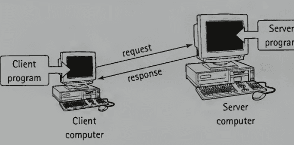

通过键盘和鼠标，您向浏览器发出命令。浏览器将每个命令转换成一个*请求*，并通过 Internet 将此请求发送到世界其他地方的另一台计算机。http://www.yahoo.com 上的计算机就是这样一个例子。接收请求的计算机被称为*服务器计算机*。服务器计算机已经运行了一个*服务器程序*（或简称*服务器*）。服务器程序分析请求并返回一个*响应*。此响应通常是一个称为 *Web 页面*的简短文档。

有时我将服务器的响应称为*响应文档*。实际上，它只是一个虚拟文档。这个“文档”不必存储在计算机硬盘的文件中，并且通常没有与响应文档关联的文件名。（浏览器可能会也可能不会选择将响应文档存储在其缓存文件中。无论如何，浏览器地址栏中的名称是请求的名称，而不是响应文档的名称。）

在这些段落中，我从*用户*的角度描述了该过程。我描述了用户*访问*一个网站。

#### Web 开发者的视角

让我们从 Web 开发者的角度来看同样的场景。开发者可能是个人或公司员工。在我描述开发者的工作时，我们将设想开发者是个人，但我所描述的一切都可以轻松地重新表述以适用于小型或大型公司的员工。

开发者在*本地计算机*上工作——也就是在他或她办公桌上的那台计算机。开发者在本地计算机上创建和测试 Web 页面。在此测试阶段，本地计算机同时运行客户端软件和服务器软件。数据流如图 1-2 所示。

与此同时，开发者已经与一家 *Web 托管*公司签订了合同。该托管公司有一台具有非常快速 Internet 连接的计算机。在 Web 页面经过彻底测试后，开发者将页面从他或她的本地计算机复制（即*上传*）到托管公司的*远程*计算机。然后，世界各地的用户可以通过向托管计算机发送请求来访问该 Web 页面。（用通俗的术语来说，该页面最终“在 Internet 上了”。）

我们一直称之为“Web 页面”的东西可能像清单 1-1 中的文本一样简单，也可能像一家全球性公司的整个网站一样复杂。

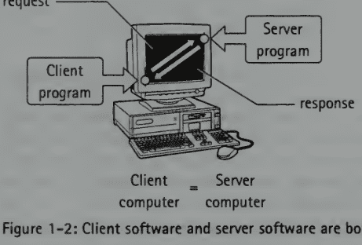

#### Web 页面

一个 Web 页面可以是一个包含普通文本的简单文档。您的浏览器接收此文本，对其进行解释，并在您的屏幕上显示排列整齐的文字和图像。清单 1-1 显示了其中一个普通文本文档的示例。其结果显示在图 1-3 中，它是由您的浏览器解释和呈现的。（要查看您自己的浏览器接收和解释的普通文本，请转到浏览器的菜单栏并选择查看 → 源文件。）


清单 1-1：一个简单 Web 页面中的 HTML 代码

```
<center>
<H1>Welcome to Burd Brain Consulting</H1>
<br><br>
"A Proud Family Tradition Since 1999"
</center>
```

重要的是要记住，HTML 响应文档不包含图形信息。该文档包含描述页面外观和内容的标签和文本。解释标签和文本、为页面制定布局以及在用户屏幕上显示格式化内容是浏览器的责任。浏览器中执行此操作的部分称为*布局引擎*。每个浏览器的布局引擎工作方式略有不同，不同浏览器之间的显示差异可能会困扰 Web 设计师。

图 1-4 说明了布局引擎在处理响应文档时的作用。为了强调响应文档和布局引擎显示之间的区别，我们说浏览器在用户的屏幕上创建了一个*显示*。

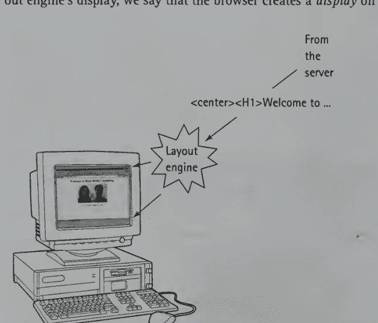

清单 1-1 的文本包括几个 HTML 标签。这些标签实际上不会出现在您的客户端计算机的屏幕上。相反，浏览器使用这些标签来布局和格式化其余文本。清单 1-1 有一对居中标签、一对标题标签、一个图像标签和两个换行标签。居中标签成对出现，有一个*起始标签* `<center>` 和它对应的*结束标签* `</center>`。还有一个标题起始标签和标题结束标签。图像标签和两个换行标签都不是成对的一部分，因此每个这样的标签都被称为*空标签*。

图像标签为我们的响应/请求场景增加了一个新的复杂性。浏览器从服务器获得一个响应文档。在解释文档并试图绘制页面时，浏览器会遇到一个图像标签。这告诉浏览器向服务器发送一个额外的请求，即请求图像标签中指定的 .gif 文件。在绘制 Web 页面时，一个请求可能引发另一个请求，而另一个又引发再一个，依此类推。

#### 继续前进

超文本标记语言 (HTML) 构成了万维网所有通信的基础。但 HTML 是有限的。使用 HTML，您可以创建*静态内容*；即，无论谁访问您的网站，内容看起来都一样的内容。为了增加趣味，您需要能够随每个访问者变化的内容，即在有人访问您的网站时即时创建的内容。这种内容称为*动态内容*。您可以使用 JavaServer Pages 技术创建动态内容。

#### JavaServer Pages 的工作原理

当用户请求一个 Web 页面时，用户的浏览器通常期望收到一个 HTML 文档——一个由 HTML 标签格式化的普通文本文档。HTML 文档构成了万维网的主食。但 HTML 语言虽然有用且通用，却非常有限。例如，HTML 没有控制流机制。在普通的 HTML 文档中，没有办法说“如果某个条件为真，使用一个标签；否则，使用另一个标签。”相比之下，Java 等通用编程语言有各种复杂的方式来控制流程。

最简单的 JSP 文档是 Java 语句和 HTML 标签的组合。在 JSP 文档中，您可以在 Java 语句中插入部分 HTML 标签，或者在标签中插入部分语句。清单 1-2 是一个适度的例子：

```
清单 1-2：一个简单的 JavaServer 页面

<% if (session.isNew()) %>
    Come on in!
<% else %>
    Welcome back!
```

我们不能使用普通的英语命令来创建 JSP 文档，但如果我们把清单 1-2 翻译成简单的英语，它将是：

```
In Java: "如果该用户以前没有访问过我们的网站，"
In HTML:     <b>Come on in!</b>
In Java: "否则，"
In HTML:     <b>Welcome back!</b>
```


在JSP文档中，你可以非常灵活地选择如何混合使用不同的语言。在前面的代码清单中，我们使用了Java和HTML的某种混合方式。我们本可以以许多不同的方式来分配这种混合。以下是其中一种方式。

在HTML中：<b>
在Java中："如果该用户以前没有访问过我们的网站，"
在HTML中：请进！
在Java中："否则，"
在HTML中：欢迎回来！
在HTML中：</b>

在这个第二个示例中，部分Java代码似乎位于一些HTML加粗标签内部。这没问题，因为Java代码本身不会出现在用户的浏览器窗口中。
无论如何，这种Java和HTML的混合需要被转换成一个普通的HTML文档，并发送到用户的Web浏览器。这是通过一个多步骤的过程来完成的。该过程如图1-5所示。

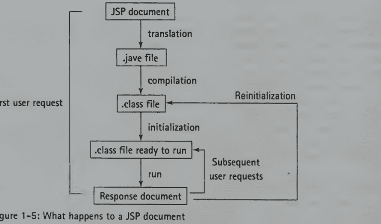

1.  你编写一个JSP文档，并将其命名为任意你想要的名称.jsp。
2.  你将该JSP文档放置在一台运行Web服务器软件的计算机上。该计算机还必须运行处理JavaServer Pages文档的软件。这个额外的软件称为*JSP容器*。一些供应商的Web服务器自带内置的JSP容器组件。
3.  万维网上的一个用户访问你的JSP文档。
4.  当用户首次请求你的页面时，JSP容器会翻译你的JSP文档，从该文档创建一个Java程序。作为JSP开发者，你永远不需要检查容器创建的Java程序。但是，了解这个Java程序在提供用户将看到的响应方面所扮演的角色会有所帮助。回想一下，在原始JSP文档中，你混合了HTML标签和Java语句。在生成的Java程序中，HTML标签和其他非Java文本被包含在Java语句中。本质上，这些Java语句告诉服务器将HTML标签的文本发送给用户的Web浏览器：

```
在Java中："如果该用户以前没有访问过我们的网站，"
在Java中："将'<b>请进！</b>'发送给用户。"
在Java中："否则，"
在Java中："将'<b>欢迎回来！</b>'发送给用户。"
```

这种运行在服务器上并响应用户传入请求的Java程序称为*servlet*。

> 如果你用Java编程，但还不了解servlet，不要让这个花哨的术语把你搞糊涂。servlet就是一个普通的Java程序。使其成为servlet的唯一因素是它使用了来自某些`javax.servlet`包的类。

这个Java程序是你自己也能编写的。就像你可能打开你最喜欢的编辑器并输入一些Visual Basic命令一样，这个新创建的Java程序是你自己也能输入的一组命令集合。这个Java程序是一个普通的Java源文件。文件的名称类似于*whatever-you-want-to-call-it_xjsp.java*。服务器将这个.java文件放入一个特殊的目录——一个专门为通过翻译JSP文档创建的所有.java文件保留的目录。（请参阅本章后面的“了解服务器的目录结构”。）

5.  我们仍在处理任何用户首次请求你的JSP页面时发生的事情。在任何Java程序能够执行之前，它必须首先被*编译*。从JSP开发者的角度来看，这个*编译*是又一个翻译步骤。Java*编译器*读取*whatever-you-want-to-call-it_xjsp.java*，并创建一个名为*whatever-you-want-to-call-it_xjsp.class*的新文件。服务器将这个.class文件放入一个特殊的目录——一个为通过翻译JSP文档创建的所有.class文件保留的目录。

这个.class文件不是文本文件；它是一个二进制文件。你不能用普通的编辑器来检查和编辑这个.class文件。但是当一个用户访问你的网站时（任何用户，而不仅仅是第一个用户），服务器可以执行`.class`文件中的命令。这些命令告诉服务器如何创建响应文档（可能是一个普通的HTML文档），并将该响应文档发送回用户的浏览器。

### 第1部分：基础JSP脚本

6.  JSP容器加载`.class`文件，并从Java类创建一个对象。除其他事项外，容器会初始化与新对象相关的任何变量。为简单起见，我们说JSP文档本身已经被*初始化*了。

> 如第2章所示，这个重要的初始化步骤不能与下一步混淆，即容器实际响应用户请求的步骤。为什么？因为，下一次用户发出请求时，容器不会重新初始化它在此步骤中初始化的变量。

7.  容器创建一个响应文档，该文档被发送回用户。

重要的是要记住，响应文档——用户Web浏览器收到的文档——没有任何JSP代码的残留。对于上面显示的代码清单，用户的浏览器会收到以下两个文档之一：

`<b>请进！</b>`

或

`<b>欢迎回来！</b>`

有时，在测试你的工作时，你会使用浏览器的“查看->源文件”功能来查看你的浏览器接收到的HTML代码。这很有用，因为它向你展示了你的JSP标签帮助生成的文档。但请记住，当你选择“查看->源文件”时，实际的JSP标签不会出现。

8.  稍后，同一用户或不同用户再次请求此JSP文档。这会使容器回到步骤7，在该步骤中它组合另一个响应文档。这可以反复发生，直到容器卸载`.class`文件为止。

9.  如果JSP容器需要释放一些内存，并且当前没有人在请求我们的JSP文档，那么容器可以卸载该文档的`.class`文件。这几乎可以在任何时候发生。无论如何，当系统管理员关闭JSP容器时，容器会卸载所有JSP类。我们说*JSP对象已被销毁*。为了帮助我们继续进入步骤10，让我们假设我们的JSP对象已被销毁。如果这是因为有人关闭了容器，那么我们假设容器已经重新启动。

10. 另一个用户访问你的JSP文档。容器回到步骤6。容器不会重新翻译或重新编译你的文档，但它会重新初始化它在步骤6中初始化的任何变量。容器创建一个响应文档，然后等待更多请求。


> 请记住，当用户请求JSP文档时，文档可能因为两个原因之一而被初始化：因为容器自上次请求后已被关闭并重新启动，或者因为容器自上次请求后为释放内存而销毁了JSP对象。

##### JavaServer Pages的基本构建块

一个JavaServer Pages文档包含两种标签：HTML标签和特殊的JSP标签。HTML标签被尖括号包围。

```
<b><i>网页浏览器将以粗体、
斜体字体显示此文本。</i></b>
```

相反，一个JavaServer Pages标签被尖括号和百分号包围。

```
<% if (numVisits > 0) %>
```

此标签包含Java if语句的一部分。包含Java代码的JSP标签称为脚本元素。JavaServer Pages有三种脚本元素：声明、表达式和脚本段。

### 声明

要创建一个JSP声明，你需要用Java编程语言编写一个或多个声明，并将Java代码用字符`<%!`和`%>`包围起来，如清单1-3所示。

**清单1-3：一个JSP声明**
`<%! int count=100; %>`

清单1-3包含一个JSP声明。这个声明宣告了一个名为`count`的变量的存在，并将该变量的初始值设置为100。

单词`int`是Java中的一个保留字。`int`告诉系统`count`将始终代表一个或另一个数字。实际上，`int`缩小了`count`可以包含的数字种类。`int`代表“整数”，一个没有小数部分的数字。`int`值的示例是100、0、2、3020和-78。数字3.14不是`int`值，因为3.14有小数部分。

在清单1-3中，`count`从值100开始。这并不意味着`count`将始终具有值100。像`count`这样的名称只有在JSP文档初始化时才会被声明并设置为0。

> 人们通常像初始化很少发生那样来指代文档的初始化。事实上，将初始化视为一次性发生是有帮助的。在典型的测试情况下，你可能会启动服务器，测试你的JSP文档几次，然后关闭一切。在这样简单的情景中，你永远不需要担心容器回收内存。

每个Java声明都以分号结束。一个JSP声明可以由多个Java编程语言声明组成，每个声明都以分号结束。这里有一个例子：

```
<%!
    int count=100;
    double salary=50000.00;
%>
```

> 脚本元素内的任何代码，因为它是Java编程语言的一部分，所以区分大小写。例如，如果你在第一行使用名称`count`，那么你必须在整个清单1-3中使用`count`（而不是`Count`或`COUNT`）。

##### 表达式

要创建一个JSP*表达式*，你需要编写一个Java编程语言表达式，并将该Java表达式用字符`<%= ... %>`包围起来。

```
<%= count+1 %>
```

当用户访问包含此表达式的页面时会发生什么？服务器会检查`count`在当时具有什么值。服务器将该值放入它正在创建的文档中，以便发送回用户。


##### Java 方法：声明与表达式

如果你是 Java 爱好者，你一定习惯于声明方法，即那些可以在需要时被调用的独立 Java 代码片段。（有其他编程语言经验的读者可以在心里将“*method*”一词替换为“子程序”、“子程序”、“过程”或“函数”等词。）你可以在 JSP 声明中声明一个方法，然后在 JSP 表达式中调用该方法。清单 1-7 展示了如何操作。

**清单 1-7**：调用 Java 方法

```
<%!
    int count=100;
    int plusOne(int n) {
        return n+1;
    }
%>

您正在查找的数字是 <%= plusOne(count) %>.<br>
这个数字仍然是 <b><%= plusOne(count) %></b>。
```

在清单 1-7 中，我们调用了 `plusOne` 两次，每次都将变量 `count` 传递给参数 `n`。`n` 的值变为 100，而调用 `plusOne` 返回数字 101。`count` 的值从未改变。

##### Scriptlets

Scriptlet 是夹在字符 `<%` 和 `%>` 之间的一段 Java 代码。声明以 `<%!` 开头，表达式以 `<%= ` 开头，而 scriptlet 仅以 `<%` 开头。

**清单 1-8**：JSP scriptlets

```
<%
for (int i=100; i>=0; i--)
{
%>
<%= i %> bottles of beer on the wall.<br>
<%
}
%>
```

清单 1-8 中的代码包含两个 scriptlets。第一个 scriptlet 包含了 `for (int i=100; i>=0; i--)` 和一个左花括号；第二个 scriptlet 只包含一个右花括号。清单 1-8 的部分输出如图 1-9 所示。

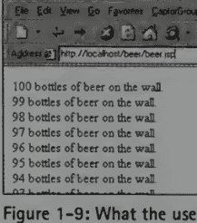

**图 1-9**：用户访问清单 1-8 中的页面时所看到的内容

要创建一个 JSP *scriptlet*，你需要用 Java 编程语言编写代码，并将 Java 代码包围在字符 `<%` 和 `%>` 中。单个 scriptlet 中的代码不需要是自包含的。例如，清单 1-8 中的每个 scriptlet 都包含一个代码片段。这两个 scriptlets 结合起来，共同构成了一个完整的 `for` 语句。

###### SCRIPTLETS 与声明

系统对待声明和 scriptlets 的方式不同。对于像清单 1-3 中那样的声明，系统仅在包含该清单的文档初始化时创建名称 `count` 并将其设置为 100。这种情况很少发生。对于一个繁忙的网站，一个页面在两次初始化之间可能会收到数百甚至数千次访问。

相反，每当有人访问你的页面时，系统都会运行每个 scriptlet。在清单 1-8 中，每次访问时，`i` 的值都会被设置为 100，然后递减到 0。


JSP 声明可以包含*多个* Java 声明，JSP 表达式*仅包含一个* Java 表达式，而 JSP scriptlet 可以包含 Java 代码的*片段*。

###### SCRIPTLETS 如何与页面上的其他元素混合

请注意 scriptlets 与页面上其他代码交互的特殊方式。清单 1-8 包含两个 scriptlets。第一个是 Java `for` 循环的开头。第二个包含关闭 Java `for` 循环的花括号。在这两个 scriptlets 之间是一个 JSP 表达式标签和一些普通的 HTML 文本。其效果是创建一个包含多份 HTML 文本副本的 Web 文档。发送到用户 Web 浏览器的文档片段如清单 1-9 所示。

**清单 1-9**：由清单 1-8 代码生成的响应文档的一部分

```
100 bottles of beer on the wall.<br>
99 bottles of beer on the wall.<br>
98 bottles of beer on the wall.<br>
97 bottles of beer on the wall.<br>
96 bottles of beer on the wall.<br>
```

Scriptlets 与其他代码的自由混合方式使得挑剔的 Web 开发人员的工作更具挑战性。良好的编码实践规定，代码行应根据元素的相互嵌套进行缩进。但是，当你将 scriptlets 与其他元素混合时，可能会失去清晰的嵌套层次结构。为了更好地理解这一点，请重新审视清单 1-8，并注意代码经过缩进以突出显示“bottles of beer”位于 Java `for` 循环内部这一事实。我们使用 Java 控制流来确定我们的缩进风格。或者，我们也可以观察到代码包含三个独立的（非嵌套的）JSP 标签，并相应地缩进代码（参见清单 1-10）。

**清单 1-10**：一个风格欠佳的 JSP 文档

```
<% for (int i=100; i>=0; i--) { %>
<%= i %> bottles of beer on the wall.<br>
<% } %>
```

Java 控制流逻辑可能相当复杂。因此，如果有选择的话，通常最好像我们在清单 1-8 中所做的那样，突出显示 Java 逻辑。

###### 充分利用 SCRIPTLETS

因为几乎任何 Java 代码片段都可以是 scriptlet 的一部分，所以 scriptlet 是所有 JSP 标签中功能最强大的。通过 JSP scriptlet，你可以做许多与使用表达式和声明可以做的事情。例如，如果你不喜欢清单 1-8 中 scriptlets 和其他代码的混合，那么你可以将整个内容转换为一个 scriptlet，如清单 1-11 所示。

**清单 1-11**：在 scriptlet 中完成所有工作

```
<%
for (int i=100; i>=0; i--)
{
    out.println(i);
    out.println(" bottles of beer on the wall.<br>");
}
%>
```

清单 1-11 的代码仅由一个整洁的 scriptlet 组成。在 scriptlet 内部，对 Java 方法 `out.println` 进行了两次调用。每次调用都向用户的 Web 浏览器发送一个字符串。第一次调用发送变量 `i` 当时具有的任何值。第二次调用将 Java 字符串 `" bottles of beer on the wall.<br>"` 发送到用户的浏览器。

清单 1-12 显示了由清单 1-11 中代码生成的响应文档的一部分。


##### 清单 1-12：由清单 1-11 中代码生成的部分响应文档

```
100
bottles of beer on the wall.<br>
99
bottles of beer on the wall.<br>
98
bottles of beer on the wall.<br>
97
bottles of beer on the wall.<br>
96
bottles of beer on the wall.<br>
95
bottles of beer on the wall.<br>
```

##### 那些恼人的换行符

注意在清单 1-12 中，每个数字是如何出现在自己的行上的。这并不影响用户浏览器显示文本的方式，因为 Web 浏览器会自动将换行符和其他空白字符替换为单个空格。用户会看到每个数字和“bottles...”消息都在同一行上，如图 1-9 所示。

清单 1-11 中的代码将每个数字放在单独一行的原因很简单。在清单 1-11 中，我们使用 `println` 方法显示 `i` 的值。该方法将字符发送到输出流，然后发送一个换行符。如果你不想发送换行符，请改用 `print` 方法。参见清单 1-13。

##### 清单 1-13：使用 `print` 代替 `println`

```
<%
for (int i=100; i>=0; i--)
{
    out.print(i);
    out.println(" bottles of beer on the wall.<br>");
}
%>
```

与之前的代码类似，清单 1-13 中的代码创建了图 1-9 所示的文档。每个数字及其“bottles...”消息出现在一行上的事实，并不影响用户看到的显示效果。即便如此，当你需要调试工作时，创建一个组织良好的 Web 文档会很有帮助。

##### 拼接 Java 字符串

让我们在脚本片段表达式主题上再做一个变化。清单 1-14 使用加号（+）——Java 的字符串拼接运算符，将两次 `println` 调用合并为一次。

##### 清单 1-14：使用 Java 的字符串拼接运算符

```
<%
for (int i=100; i>=0; i--)
{
    out.println(i + " bottles of beer on the wall.<br>");
}
%>
```

表 1-1 总结了关于 JSP 代码的一些要点。

##### 表 1-1 JSP 代码的三个重要元素

| | 声明 | 脚本片段 | 表达式 |
|---|---|---|---|
| 包含在 | <%! %> | <% %> | <%= %> |
| 包含内容 | 一个或多个 Java 声明 | Java 代码片段和/或完整语句 | 一个 Java 表达式 |
| 功能 | 创建一个名称；可能为该名称赋值 | 告诉系统执行某些操作 | 具有一个值 |
| JSP 容器运行时机 | 页面首次被访问或 JSP 容器重新初始化页面时 | 每当有人访问该页面时 | 每当有人访问该页面时 |

##### 如何测试 JSP 文档

在下一节中，我将给你一些测试 JSP 文档的通用规则。利用那一节的概念，你可以选择你最喜欢的服务器，并根据你自己的特殊需求定制测试。在此之前，你可以按照这个（不灵活的）分步程序来测试本章的文档：

为了展示如何实现 JavaServer Pages，Sun Microsystems 和 Apache Software Foundation 的人员创建了一个名为 *Tomcat* 的小型 JSP 容器。这个软件被称为 JSP *参考实现*，因为它作为任何其他号称是 JSP 容器的软件的基准。

Tomcat 不是一个工业级的 Web 服务器。它既不快也不高效，但它确实正确地实现了 JavaServer Pages 规范。

1.  将本书 CD-ROM 中的整个 `tomcat` 目录复制到你的硬盘驱动器上。

2.  将 CD-ROM 上 `\Listings\Chapter01` 目录中的 `Listing01-08.jsp` 复制到你硬盘上的 `tomcat\webapps\examples\jsp` 目录。文件 `Listing01-08.jsp` 包含清单 1-8 中所示的代码。如果你想尝试并修改 `Listing01-08.jsp` 中的代码（或者你想从头开始编写自己的 JSP 文档），请使用系统上任何纯文本编辑器。

    > 提示
    如果你使用 Windows 记事本，请用双引号将整个文件名括起来。如果你忘了使用双引号，Windows 可能会在文件名末尾错误地添加 `.txt` 扩展名。

    > 提示
    你可以使用文字处理器（例如 Microsoft Word）来创建 JSP 文档。如果这样做，请务必将文档保存为“文本”类型。但请记住，文件名的扩展名应为 `.jsp`，而不是 `.txt`。

3.  在你的系统上设置三个环境变量。
    - 将 `TOMCAT_HOME` 设置为指向你硬盘上的 `tomcat` 目录。
    - 你的 Java 目录有一个名为 `bin` 的子目录，`bin` 包含名为 `javac`、`java`、`javadoc` 等的可执行文件。确保 `bin` 目录在你的系统 `PATH` 中。
    - 将 `JAVA_HOME` 设置为指向你的 Java 目录（而不是 Java 目录的 `bin` 子目录）。

    > 注意
    在某些版本的 Tomcat 中存在一个错误，会阻止服务器正常工作。服务器不会自动设置为查看主 Java 目录的 `lib` 子目录中的 `tools.jar` 文件。请始终将此文件包含在系统的 `CLASSPATH` 中。

    > 注意
    最近的一个 Tomcat 版本根本无法与 Java Development Kit (JDK) 1.2 一起运行。如果你遇到问题，请从 http://www.javasoft.com 下载最新版本的 JDK。

4.  启动 Tomcat Web 服务器及其内置的 JSP 引擎。在 Windows 中，运行 `tomcat\bin\startup` 或 `tomcat\bin\startup.bat`。（在 UNIX 下，运行 `tomcat/bin/startup.sh`。）

5.  在 Tomcat 服务器运行时，打开一个 Web 浏览器。在 Web 浏览器的地址栏中，输入 `http://localhost:8080/examples/jsp/Listing01-08.jsp`。当你的硬盘停止响声时，你应该看到类似于图 1-9 所示的显示。

##### 关于测试 JSP 文档的更多信息

当你创建一个普通的 HTML 文档时，测试你的工作很容易。你可以在 Web 浏览器的地址栏中输入文档的文件名。（有些浏览器将此字段称为位置字段、链接字段、转到字段或 URL 字段。）例如，如果你的文件名为 `myFile.html`，并且该文件位于 `c:\mydocs` 目录中，那么在浏览器的地址栏中输入 `c:\mydocs\myFile.html`，即可在浏览器窗口中看到该页面的良好显示版本。当你这样做时，你是在让浏览器解释它在文档中找到的文本和 HTML 标签。

对于 JSP 文档，情况有点不同。JSP 是一种服务器端技术。客户端程序（如 Microsoft Internet Explorer）不解释 JSP 标签。服务器计算机必须解释你的文档中的 JSP 标签，并使用这些标签来组合另一个文档（一个只包含 HTML 标签和普通文本的文档）。在组合好响应文档后，服务器计算机将此文档发送到你的客户端计算机，你的浏览器在那里解释文档，包括 HTML 标签。如图 1-10 所示。

当你浏览 Web 时，服务器计算机解释来自你客户端计算机的信号。这之所以可能发生，是因为两台计算机都遵守某些称为*协议*的全球标准。一个非常大的协议集合，称为 *TCP/IP 协议族*，决定了通过互联网分发和路由信息。（许多不同的协议是 TCP/IP 协议族的一部分。该缩写来自协议族中两个协议的名称：*传输控制协议*和*网际协议*。）另一个协议，*超文本传输协议 (HTTP)*，管理 Web 页请求和响应的格式。这些协议分层协同工作。你的 Web 浏览器根据 HTTP 规定的规则组合一个请求。然后浏览器将此请求交给另一块软件，称为 *TCP/IP 协议栈*。TCP/IP 协议栈启动你请求的分发和路由。当请求最终到达一台服务器计算机时，该计算机自身的 TCP/IP 协议栈会将你请求的所有传入部分组合在一起，并将请求转发给我们一直在称的“服务器软件”。服务器软件根据 HTTP 的规则解释请求。

图 1-11 说明了这个过程。这张图做出了一个我们之前不需要做的区分。在图 1-11 中，一台服务器计算机运行的不仅仅是服务器软件。服务器计算机还运行一个 TCP/IP 协议栈，并且，我们很快会看到，服务器计算机还运行其他重要软件。

现在我们可以通过在图中添加另一层来完善图 1-11。通常被称为“服务器”的软件仅负责请求/响应周期中的 HTTP 部分。如果请求是针对 JavaServer 页面，那么服务器会将请求传递给另一块软件。这块软件，即 JSP 容器，解释 JSP 代码并组合一个文档发送回客户端的浏览器。

事实上，服务器有多种方式将请求传递给 JSP 容器。一种方式是通过久经考验的 TCP/IP 协议栈进行通信。Web 服务器软件和 JSP 容器软件驻留在同一台计算机上，并通过 TCP/IP 协议栈共享信息，这并不少见。由此产生的架构如图 1-12 所示。

出于测试目的，你可以在本地计算机上运行客户端 Web 浏览器、服务器和 JSP 容器。这种情况有点不自然（我确定你更愿意将你的文档放在公众可查看的 Web 服务器上），但这是测试新开发的 JSP 文档的良好开端。


##### 寻找远程服务器

有许多优秀且经济实惠的服务器程序和JSP容器可以在你的本地计算机上运行。本书的光盘中提供了两个JSP容器：Tomcat和ServletExec。我强烈建议你安装并尝试不止一种服务器，以及几种不同的JSP容器。使用不同软件获得的结果会略有不同，而你在观察这些差异时获得的经验将对未来的工作大有裨益。

为了获得更真实的体验，你可以尝试在远程计算机上测试你的JSP文档。这个远程计算机可能由一家网络托管公司运行，也可能由你工作单位的一个部门运行。无论哪种情况，你都需要确定一台远程计算机，并将你的JSP文档上传到上面。有些计算机运行服务器软件，但不运行JSP容器软件。如果你将JSP文档加载到没有运行JSP容器的服务器上，你将得不到任何结果。

如果你已经有权限访问远程服务器计算机，请查阅该计算机的文档以确认是否支持JSP。如果不支持，你可以通过访问以下任一网站来查找支持JSP的网络托管公司列表。

- Servlets.com: http://www.servlets.com/resources/urls/isps.html
- The Adrenaline Group: http://www.adrenalinegroup.com/jwsisp.html

##### 上传文件

一旦你拥有了网络托管账户，你可以在该公司的技术支持区域找到上传JSP文档的说明。该过程通常通过以下两种方式之一进行：

- 你使用一种称为文件传输协议（FTP）的标准方法来复制你的JSP文件。FTP既通用又可靠。此外，FTP具有多种不同的用户界面。有数十种适用于Windows、Macintosh、UNIX和Linux计算机的程序，可以引导你从头到尾完成FTP步骤。几乎所有工业级的网络托管公司都允许你使用FTP上传文件。
- 你使用特定于主机的Web界面来上传文件。通过典型的Web界面，你首先打开Web浏览器。你访问主机网站上的一个特殊页面。通过填写此页面上的空格，你发出一系列命令，将Web文档从你计算机的硬盘驱动器复制到主机计算机的硬盘驱动器。

如果你很节俭，一定要查看`http://www.mycgiserver.com`，它提供完全免费的JSP就绪型网络托管。免费网络托管的缺点是可靠性和支持。如果你不为网络托管付费，你就无权保证服务器在任何人想要访问你的网站时都可用。另一方面，像mycgiserver这样的社区导向服务代表了将网络保留在人民手中的良好草根努力。这些服务以及任何赞助这些服务的公司都值得你的支持。

##### 理解服务器的目录结构

假设你已经确定了服务器计算机，你需要知道在服务器计算机的目录结构中，将你试图测试的JSP文档放在哪里。同样，这种情况比在本地计算机上测试没有服务器的普通HTML文档要复杂。每个服务器程序都要求将各种类型的文档放在特定的目录中。文档所在的目录名称并不一定是你在访问文档时输入地址栏的名称。

服务器维护一个查找表，用于在服务器计算机上的目录名称与用户在浏览器地址栏输入URL时输入的名称之间进行转换。图1-13显示了一个Tomcat版本的示意图。例如，假设你将页面`myPage.jsp`放在名为`c:\tomcat\webapps\examples\jsp\`的目录中。要访问该页面，你需要在Web浏览器的地址栏中输入`http://localhost:8080/examples/jsp/myPage.jsp`。服务器将传入的请求映射到`c:\tomcat\webapps`目录，而你的请求进一步缩小到`examples\jsp`子目录。

当你发出请求时，你并不总是使用localhost:8080。localhost告诉浏览器将请求定向到本地计算机——即运行Web浏览器的同一台计算机。8080是Tomcat默认配置为监听请求的端口号。可以把8080想象成一个频道号，可用的频道范围是0到65535。如果你没有指定端口号，Web浏览器将使用端口80，这是HTTP协议的默认端口。Tomcat使用8080是为了避免干扰你常规的Web浏览活动。

在你的页面经过测试并复制到远程主机后，你将不再使用localhost:8080。取而代之的是实际的域名，例如www.mycgiserver.com。

在图1-13中，请注意名为work的目录。这是Tomcat放置所有JSP文档的翻译和编译版本的地方。

除了JSP文档，其他类型的文档属于服务器计算机上的不同目录，请求这些文档的URL可能与子目录名称大不相同。对于许多服务器，从目录到请求名称的映射是可配置的。无论如何，你需要决定将文件放在哪里，以及用户的浏览器将如何请求每个这些文件。目前，你只需要学习两件事：

- 你的JSP文档所属的服务器上的目录
- 服务器映射到JSP文档目录的路径

这里有一些示例，帮助你入门。（你可以混合并匹配在这些示例中学到的经验。）

##### 第一部分：基本JSP脚本

- 在本地计算机上运行Tomcat 3.1：将`Listing01-08.jsp`从光盘上的`Listings\Chapter01`目录复制到硬盘上的`tomcat\webapps\examples\jsp`目录。文件`Listing01-08.jsp`包含清单1-8所示的代码。启动Tomcat服务器运行，并在Web浏览器的地址栏中输入`http://localhost:8080/examples/jsp/Listing01-08.jsp`。
- 一种更有组织的方式，仍然在本地计算机上运行Tomcat 3.1：通过将`Listing01-08.jsp`复制到一个名为`tomcat\webapps\examples\myFirstJSPdoc`的新目录，使此项目与你所有其他JSP项目分开。启动Tomcat服务器运行，并在Web浏览器的地址栏中输入`http://localhost:8080/examples/jsp/myFirstJSPdoc/Listing01-08.jsp`。
- 在本地计算机上运行带有ServletExec JSP容器的Apache服务器：将`Listing01-08.jsp`放在你的`Apache Group\Apache\htdocs`目录中。启动Apache运行，然后启动ServletExec运行，最后在Web浏览器的地址栏中输入`http://localhost/Listing01-08.jsp`。

本书光盘中有一个永不过期的Unify eWave ServletExec评估版本。

请注意，除非你进行不同的配置，否则Apache对HTTP请求使用默认端口80。在后台，Apache服务器通过TCP/IP端口号8888将请求传递给ServletExec JSP容器。

- 在本地计算机上运行Allaire的JRun：将`Listing01-08.jsp`放在你安装JRun目录的`servers\default\default-app`子目录中。启动JRun默认服务器，然后在Web浏览器的地址栏中输入`http://localhost:8100/Listing01-08.jsp`。

要获取免费的、永不过期的JRun Server Developer Edition副本，请访问`http://www.allaire.com/`。

- 在mycgiserver.com上运行Resin JSP容器：将Listing01-08.jsp上传到你的根用户目录。（如果你启动FTP会话并使用你的mycgiserver用户名登录，会话将自动从你自己的根用户目录开始。）成功上传Listing01-08.jsp后，打开Web浏览器并在浏览器的地址栏中输入`http://www.mycgiserver.com/~your-user-name/Listing01-08.jsp`。

当你访问Listing01-08.jsp时，你应该看到类似于图1-9所示的显示。

> 你可能已经习惯了编辑文档、将其上传到远程服务器、进行微小更改，然后必须再次上传文档的繁琐过程。在光盘上查找一个名为Coffee Cup Direct FTP的程序。使用Direct FTP，你可以在文档仍在服务器上时进行编辑。你不必上传更正后的文档副本。

##### 示例：旋转横幅广告

当你访问一个网页时，你经常看到一个横幅广告。每次你访问该页面时，广告都会变化。在某些情况下，广告是根据你已知的兴趣量身定制的。在其他情况下，服务器只是循环播放大量广告。

让服务器循环播放一组广告有多难？使用JavaServer Pages，这一点也不难。JSP代码行如清单1-15所示。

```
Listing 1-15: Displaying a banner ad

<%! int count=100; %>

.gif">

<%
if (count<111)
    count++;
else
    count=100;
%>
```

计算机无法解释用简单英语编写的命令，但如果你将清单1-15翻译成简单英语，你会得到这样的结果：


##### 第1部分：基础 JSP 脚本

让计数器的初始值为 100。
显示存储在文件 adcount.gif（ad100.gif、ad101.gif 或其他任何名称）中的图像。
如果计数小于 111，则给计数加 1。否则，将计数重置回 100。

每个 JSP 文档都是普通 HTML 代码和特殊 JSP 代码的混合体。在清单 1-15 中，唯一的普通 HTML 代码是 ``。清单 1-15 的其余部分是 JavaServer Pages 特有的内容。
在声明 `<%! int count = 100; %>` 中，你声明了 `count` 是一个整数（一个整数），其初始值为 100。清单 1-15 的第二行将一个 HTML 图像标签与一个 JSP 表达式混合在一起。在页面上放置这段代码，你实际上是在说

```

```

例如，当 `count` 为 100 时，HTML 标签 `` 会被发送到用户的 Web 浏览器。当 `count` 为 105 时，HTML 标签 `` 会被发送到用户的 Web 浏览器。因此，根据 `count` 的当前值，用户的 Web 浏览器将显示来自某个 .gif 格式文件的图像。


为了帮助你测试清单 1-15 的代码，CD 包含了名为 ad100.gif 到 ad111.gif 的图像文件。

Java 编程语言提供了一种将变量值加 1 的简写方式。在代码 `count++;` 中，我们告诉系统：“将 `count` 的值加 1。”在其他编程语言中，我们会使用类似 `count=count+1;` 的方式来发出相同的指令。在 Java 中我们也可以这样做，但 `count++` 这种表示法更简洁一些。
第一次有人访问我们的 JSP 文档时，`count` 的值将是 100，但随后指令 `count++` 会将 `count` 的值更改为 101。下一次有人访问该文档时，`count` 的值将是 101，显示的广告将来自文件 ad101.gif。下一位用户访问时，`count` 的值将是 102，显示的广告将来自文件 ad102.gif。依此类推。

这个整个思路只有在我们的服务器上有名为 ad100.gif、ad101.gif 等的图像文件时才有效。因此，下一个问题是：“我们有多少个广告文件？”如果我们有名为 ad100.gif 到 ad239.gif 的广告文件，那么就没有名为 ad240.gif 的文件，因此当 `count` 的值达到 240 时我们会遇到麻烦。为了补救这一点，我们需要不时地将 `count` 的值重置回 100。幸运的是，Java 编程语言有一个 `if` 语句可以为我们解决这个问题。这个 `if` 语句完成了清单 1-15 的代码。

##### JSP 注释标签

注释是一段文本，它既不会被 JSP 容器翻译，也不会被 Web 浏览器解释。注释是给 Web 开发人员阅读的。注释有助于任何使用你的代码的人理解你试图做什么。如果你有一段时间没有查看你的代码，并且你的工作在你脑海中不那么清晰，你曾经写过的注释可以帮助你理解你在最初编写代码时的想法。

JSP 文档会经历翻译、编译，然后执行，因此文档可以包含不止一种注释。清单 1-16 显示了一个包含几种注释的示例。清单 1-17 显示了将发送给用户 Web 浏览器的代码示例。

**清单 1-16：一个包含几种注释的 JSP 文档**

```
<%!
    int count=100; //count will become part
                    // of the .gif file name
%>

<!-- Displays ad number <%=count%>. -->
.gif">

<%--
    Assuming that we have images
    numbered 100 to 111 inclusive.
--%>
<%
    if (count<111)
        count++;
    else
        count=100;
%>
```

**清单 1-17：由清单 1-16 的代码创建的众多可能的响应文档之一**

```
<!-- Displays ad number 100. -->

```

在清单 1-16 中，第一个注释 `//count will become ...` 是 Java 编程语言的一部分。你可以在脚本段、JSP 声明或 JSP 表达式中放置这种注释。这个注释将与所有其他翻译过的 Java 代码一起放置到翻译后的 .java 文件中。该注释不会出现在发送给用户 Web 浏览器的 HTML 文档中。

第二个注释 `<!--- Displays ...` 是一个 HTML 注释。这个注释将成为发送给用户 Web 浏览器的文本的一部分。Web 浏览器不会解释该文本，但该文本将可供任何希望调试 HTML 代码的人使用。请注意我们巧妙地将 JSP 表达式放在 HTML 注释中的方式。通过这个 JSP 表达式，发送给用户 Web 浏览器的注释将根据页面中包含的图像而变化。第一次有人访问这个页面时，HTML 源代码将包含注释 ``。下一次访问时，HTML 代码将包含注释 ``。依此类推。

清单 1-16 中的第三个注释 `<%-- Assuming that ...` 是一个 JavaServer Pages 注释。这个注释不会出现在 JSP 文档的任何翻译或编译版本中。该注释不会被发送到用户的 Web 浏览器。如果用户选择“查看”→“源文件”，该注释也不会出现。这种注释有助于 JSP 开发人员理解编写 JSP 文档时使用的策略。

### 总结

对于静态 HTML 文档，用户发出请求（访问一个网页），服务器返回一个预制的响应。在动态环境中，例如用于 JavaServer Pages 的环境，用户的请求会触发一个 Java 程序的运行。运行这个 Java 程序的软件称为 JSP 容器。

一个 JavaServer Pages 文档由几种元素组成。脚本元素包括声明、表达式和脚本段。这些脚本元素可以以几种不同的方式混合搭配。除了这三种脚本元素之外，你还可以使用 JSP 注释标签。注释标签有助于人们理解 Web 开发人员的策略。

要测试 JSP 文档，你必须在本地计算机上运行一个 JSP 容器，或者找到一个服务器支持 JSP 的虚拟主机公司。你必须将你的 JSP 文件放置在一个专门为 JSP 文件指定的目录中。

## 第2章

## 使用 JSP 脚本元素

本章内容

- 你可以在哪里声明变量和方法
- 为什么声明变量的位置会产生影响
- 在声明方法和变量时有哪些替代选择

当你在第1章中阅读关于 JavaServer Pages 中的脚本元素时，你可能已经注意到了一些重叠之处。所有三种元素——声明、表达式和脚本段——都包含 Java 代码，并且在某些情况下，这些代码是可以互换的。事实证明，选择在何处放置某些代码片段可能会对页面的行为方式产生影响。本章将对这一切进行梳理。

### 作用域和生命周期：概念

以下两个定义几乎在所有代码中都会用到，而不仅仅是在 JSP 或 Java 中：

- *名称* 是用来表示某个事物的词。名称的例子包括变量名、方法名、类名等。名称的另一个词是 *标识符*。
- 名称的 *作用域* 是指代码中可以使用该名称表示特定含义的区域。
- 名称的 *生命周期* 是指该名称的内存保持分配的运行时间间隔。

粗略地说，作用域是你可以在其中使用一个名称的空间大小；生命周期是该名称存在的时间长度。


许多作者使用 *作用域* 来指代我所说的 *作用域* 和 *生命周期* 这两个概念。

### 类范围名称和方法局部名称

Java 语言有两种不同类型的名称——类范围名称和方法局部名称。每种类型的名称都有特定的作用域和生命周期。

- 方法局部变量在 Java 方法内声明。该变量的作用域完全在该方法内部。该变量的生命周期持续一次方法调用。如果该方法被第二次调用，该变量会被重新创建并重新初始化。
- 类范围变量在 Java 方法外部声明。该变量的作用域可以包括多个方法。该变量的生命周期超过单次方法调用。如果该方法被第二次调用，该变量不会被重新创建也不会被重新初始化。

受够了这些技术定义了吗？清单 2-1 是一个例子：

**清单 2-1：Java 中的作用域和生命周期**

```
<%!
    int i=30;

    public void someMethod(JspWriter out) throws Exception {
        int j=10;
        out.print("Inside the method:");
        out.print(" i is " + i);
        out.println(", j is " + j);
        i++;
    }
%>

Outside the method:<br>
 i is <%= i %>.<br>
Adding 1 to i <% i++; %> makes i be <%= i %>.<p>

Calling someMethod:<br>
 <% someMethod(out); %><br>
 <% someMethod(out); %>
```

当我们运行清单 2-1 中的代码时，浏览器会创建如图 2-1 所示的显示。
关于清单 2-1 和图 2-1，有几点应该注意。

- 变量 `j` 在 `someMethod` 内部声明，使 `j` 成为一个方法局部名称。`j` 的作用域仅包括 `someMethod` 内部的代码。我们不能在 `someMethod` 外部使用变量名 `j`。例如，如果我们在清单 2-1 的末尾添加 `<%= j %>`，编译器将给我们一个“未定义变量”的错误消息。


-   变量 `i` 并未在某个方法内部声明。这个变量 `i` 是一个类范围的名称，因此你可以在页面的任何地方使用 `i`，无需将其使用限制在 `someMethod` 方法内部。
-   与任何类范围的名称一样，`i` 具有较长的生命周期。变量 `i` 会一直存在，直到该 JavaServer 页面被销毁。变量 `i` 只在 JSP 文档初始化时获得值 30。当 `i` 在页面上的表达式中第二次出现时，其值变为 31，而非 30。

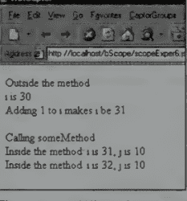

图 2-1：用户访问清单 2-1 中的页面时看到的内容。

图 2-2 展示了类范围变量与方法局部变量的使用。

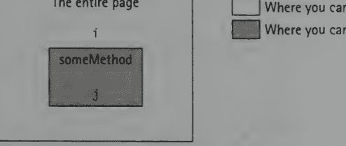

图 2-2：类范围变量 vs. 方法局部变量

### 方法局部名称可以隐藏类范围名称

在日常生活中，两个完全不同的事物可能拥有相同的名称。在互联网上快速搜索，可以找到四个名为 Barry Burd 的不同人物。（如果算上 Barry Byrds 和 Barry Birds，我们大约有 50 个同名者。）Java 中的情况也是如此。清单 2-2 说明了这一点。

清单 2-2：两个同名的变量

```
<%!
    int i=30; //外部 i

    public void someMethod(JspWriter out) throws Exception(
        int i=8, j=10; //内部 i 和内部 j
        out.print("Inside the method:");
        out.print(" i is " + i);
        out.println(", j is " + j);
        i++;
    }
%>

Outside the method:<br>
i is <%= i %>.<br>
Adding 1 to i <% i++; %> makes i be <%= i %>.<p>

Calling someMethod:<br>
<% someMethod(out); %><br>
<% someMethod(out); %>
```

当我们运行清单 2-2 中的代码时，浏览器会创建如图 2-3 所示的显示内容。

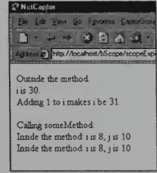

图 2-3：用户访问清单 2-2 中的页面时看到的内容。

关于此清单和图，我们还可以进行一些观察。

-   清单 2-2 中有两个名为 `i` 的不同变量，每个变量都有自己的作用域和生命周期。有一个外部 `i`，值为 30，它在 `someMethod` 之前声明。因为这个外部 `i` 并未在方法内部声明，所以它是一个类范围的名称。外部 `i` 的作用域包含整个文档。这就是为什么当我们访问页面时，会看到“Outside the method: i is 30”。
-   还有另一个名为 `i` 的变量（内部 `i`），它在 `someMethod` 内部声明。这个内部 `i` 是一个方法局部名称。这个内部 `i` 变量的作用域是 `someMethod` 内的所有代码。在 `someMethod` 外部，我们无法使用名称 `i` 来引用这个内部 `i`。
-   在 `someMethod` 内部，内部 `i` 隐藏了外部 `i`。因此，当我们调用 `someMethod` 时，显示的 `i` 值是 8，也就是这个内部 `i` 变量的值。

> 这个类比有助于一些人记住当遇到两个同名名称时会发生什么（一个是方法局部名称，另一个是类范围名称）。当我刚大学毕业时，我认识一个叫 James Madison 的朋友。在朋友间交谈时，James Madison 这个名字指的是这个年轻的朋友。但在陌生人中，James Madison 这个名字指的是前总统。这就是其工作方式。一个局部名称，在局部上下文中使用，会隐藏一个更广为人知的全局名称。一个在其声明的方法内部使用的方法局部名称，会隐藏其类范围的同名变量。

-   因为内部 `i` 是一个方法局部名称，其生命周期仅持续在一次对 `someMethod` 的调用期间。每次我们调用 `someMethod` 时，内部 `i` 变量都会被重新创建，内存会分配给这个内部 `i`，并且内部 `i` 的值被设置为 8。在从 `someMethod` 返回之前，我们对 `i` 加 1，但下次我们调用 `someMethod` 时，`i` 的值会被重置为 8。

图 2-4 阐释了方法局部名称可以隐藏类范围名称的概念。

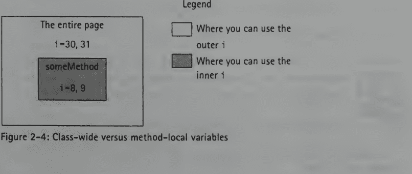

### 脚本片段 vs. 声明

回顾一下，脚本片段可以包含几乎任何 Java 代码。这包括（除其他外）Java 声明。比较以下两个 JSP 文档（清单 2-3 和 2-4）。

清单 2-3：变量 `count` 在 JSP 声明中定义

```
<%! int count=100; %>
<%= ++count %>
```

清单 2-4：变量 `count` 在 JSP 脚本片段中定义

```
<% int count=100; %>
<%= ++count %>
```

在清单 2-3 中，我们在 JSP 声明内部定义了 `count`。在清单 2-4 中，我们在脚本片段内部定义了 `count`。在两个清单中，第二行都是一个 JSP 表达式。该表达式包含一个 Java 语句，其中变量 `count` 被加 1，并且 `count` 新递增的值被发送到用户的 Web 浏览器。

> 与清单 1-5 中的表达式不同，清单 2-4 中的表达式 `++count` 确实改变了变量 `count` 的值。这是 Java 自增 (++) 运算符的一个特性。

所以，现在我们对“声明”这个词有两种用法。一种是 JSP 声明，例如

```
<%! int count=100; %>
```

另一种是放置在 JSP 脚本片段内部的 Java 声明，像这样：

```
<% int count=100; %>
```

> 当存在混淆风险时，我将使用短语“JSP 声明”或“Java 声明”（取决于上下文），以确保清晰。

JSP 声明和脚本片段之间的差异归结为作用域和生命周期的差异：

-   在 JSP 声明中创建的名称具有类范围的作用域和生命周期。
-   在 JSP 脚本片段中创建的名称具有方法局部的作用域和生命周期。

在清单 2-4 中，变量 `count` 并未显式地在方法内部定义。但是，当容器将文档翻译成 Java 程序时，容器会创建一个名为 `_jspService` 的大方法。任何像 `count` 这样的变量（在脚本片段中定义，但并非在它自己的方法内部）都会被定义在 `_jspService` 方法内部。容器在每次用户访问文档时调用 `_jspService` 方法。该方法接收用户的请求并组装一个响应。

在文档的脚本片段中创建的所有名称，其作用域和生命周期都局部于 `_jspService` 方法。每次用户访问文档时，每个这样的名称都会被重新创建和重新初始化。

### JavaServer 页面到 Servlet

为了阐述关于脚本片段和声明的这些要点，让我们快速查看一些 Java 程序的部分代码。清单 2-5 展示了当容器翻译清单 2-3 时得到的一个高度浓缩的版本。

清单 2-5：容器翻译清单 2-3

```
public final class _scopeExpermnt1_xjsp
{
    int count=100;

    public void _jspService
      (HttpServletRequest request,
       HttpServletResponse response)
      throws java.io.IOException
    {
        JspWriter out = pageContext.getOut();

        out.print( "\r\n" );
        out.print( String.valueOf( ++count ) );
        out.print( "\r\n" );
    }
}
```

在清单 2-3 中，变量 `count` 作为 JSP 声明的一部分被创建。在相应的 Java 代码中，`count` 在 `_jspService` 方法外部声明。将此与清单 2-6 进行比较。清单 2-6 中的 Java 代码是当容器翻译清单 2-4 时得到的结果。

清单 2-6：容器翻译清单 2-4

```
public final class _scopeExpermnt2_xjsp
{
  public void _jspService
    (HttpServletRequest request,
     HttpServletResponse response)
     throws java.io.IOException
  {
    JspWriter out = pageContext.getOut();

    int count=100;

    out.print( "\r\n" );
    out.print( String.valueOf(  ++count  ) );
    out.print( "\r\n" );

  }
}
```

在清单 2-4 中，变量 `count` 作为 JSP 脚本片段的一部分被创建。在相应的 Java 代码中，`count` 在 `_jspService` 方法内部声明。

到目前为止，我们收集了大量关于脚本片段和声明的规则。在编写 JavaServer 页面时，这有什么区别呢？在下一节中，我们将通过检查几个示例来回答这个问题。

### 声明和脚本片段中变量的作用域

在 JSP 声明中创建的变量，其行为类似于 Java 的类范围变量之一。相比之下，在 JSP 脚本片段中创建的变量，其行为类似于 Java 的方法局部变量。清单 2-7 阐明了这一点。

清单 2-7：在 JSP 声明和脚本片段中创建变量

```
<%
  String scriptletString = "from the scriptlet";
  String commonString="from the scriptlet";
%>

<%!
  String declString="from the JSP declaration";
  String commonString="from the JSP declaration";
%>
```


### 作用域、生命周期与方法调用

清单 2-8 是第 1 章清单 1-13 的副本。在清单 2-8 中，用户的网页浏览器正在演唱“墙上的啤酒瓶”之歌。

**清单 2-8：演唱“墙上的啤酒瓶”之歌**

```
<%
for (int i=100; i>=0; i--)
{
  out.print(i);
  out.println(" bottles of beer on the wall.<br>");
}
%>
```

在清单 2-8 中，我们对每个瓶子数量的处理方式完全相同。因此，清单 2-8 最终会显示以下语法错误的句子：

1 bottles of beer on the wall.

（...就好像在喝了 99 瓶啤酒之后，还会有人注意到糟糕的语法似的！）在清单 2-9 中，我们使用一个 Java if 语句解决了这个问题。为了保持代码整洁，我们将 if 语句放在了一个方法内部。

**清单 2-9：调用 Java 方法**

```
<%!
public String bottleWord(int i) {
  if (i == 1)
    return " bottle ";
  else
    return " bottles ";
}
%>
```

```
<%
for (int i=100; i>=0; i--) {
  out.print(i);
  out.print(bottleWord(i));
  out.println("of beer on the wall.<br>");
}
%>
```

在清单 2-9 中，我们在 JSP 声明内部定义了方法 `bottleWord`。方法的定义必须位于 JSP 声明内部。（在 Java 中，所有方法名都是类范围的名称。）

> 方法的定义不能放在脚本小段内部。

### 发生什么

在清单 2-9 中，声明在前，脚本小段在后。我们也可以把脚本小段放在前面，声明放在后面。编写这些内容的顺序并不重要。无论哪种顺序，JSP 容器都会在执行任何脚本小段之前初始化所有声明。因此，当容器遇到以下语句时

```
out.print(bottleWord(i));
```

容器已经看到了 JSP 声明并定义了 `bottleWord` 方法。

### 参数传递

在清单 2-9 中，我们在脚本小段内部创建了变量 `i`，然后将 `i` 的值传递给方法 `bottleWord`。方法 `bottleWord` 有自己的参数名 `i`。该方法使用参数 `i` 来决定返回哪个词，“bottle”还是“bottles”，给脚本小段。清单 2-9 中有两个名为 `i` 的变量，每个 `i` 代表计算机内存中不同的位置。即使我们像清单 2-10 那样，为脚本小段的变量和参数使用两个不同的名字，情况也不会改变。

**清单 2-10：更改方法参数列表中的名称**

```
<%!
public String bottleWord(int j) {
    if (j == 1)
        return " bottle ";
    else
        return " bottles ";
}
%>
```

```
<%
for (int i=100; i>=0; i--) {
    out.print(i);
    out.print(bottleWord(i));
    out.println("of beer on the wall.<br>");
}
%>
```

我们可能会尝试通过在 JSP 声明内部使用脚本小段的变量来避免所有参数传递，但由于 JSP 声明是在任何脚本小段执行之前翻译的，这种技巧根本行不通。（参见清单 2-11。）

**清单 2-11：此代码将无法工作**

```
<%
for (int i=100; i>=0; i--) {
  out.print(i);
  out.print(bottleWord());
  out.println("of beer on the wall.<br>");
}
%>
```

```
<%!
public String bottleWord() {
//代码将无法工作。变量 i 在此代码点不可用：
  if (i == 1)
    return " bottle ";
  else
    return " bottles ";
}
%>
```

### 方法如何打印部分响应

在清单 2-9 中，我们引用了某个称为 `out` 的东西。

```
out.println("of beer on the wall.<br>");
```

这个词 `out` 代表正在发送到用户网页浏览器的字符流。你不需要在你的 JSP 文档中定义 `out`。JSP 容器会自动为你定义 `out`。但是容器的转换器会将 `out` 的定义放在 `_jspService` 方法内部。（参见清单 2-5。）由于 `out` 这个名称对于 `_jspService` 方法是局部的，你不能在你的任何方法中引用 `out`。如果你尝试运行清单 2-12 的代码，容器会给你一条错误信息。

---

**scriptletString:** <%= scriptletString %>
**declString:** <%= declString %>
**commonString:** <%= commonString %>

清单 2-7 的显示结果如图 2-5 所示。

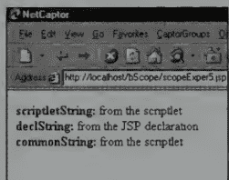

清单 2-7 有一个 `declString` 变量。由于 `declString` 是在 JSP 声明中创建的，`declString` 是一个类范围的名称。我们可以在页面的任何地方使用 `declString`。我们在图 2-5 中看到了文字 `declString: from the JSP declaration`。

清单 2-7 也有一个 `scriptletString` 变量。由于 `scriptletString` 是在脚本小段中创建的，它是一个方法局部名称。如果我们把以下行

```
<%! String declString = scriptletString; %>
```

放在清单 2-7 中，JSP 容器会给我们一条错误信息。`scriptletString` 的作用域不会延伸到文档的任何 JSP 声明中。

容器在文档初始化时处理 JSP 声明。相反，容器在每次用户访问文档时执行脚本小段。如果一个变量是在脚本小段内部创建的，那么该变量出现的时间太晚，无法在页面的任何 JSP 声明中使用。这意味着，如果你在脚本小段内创建一个新变量，如 `scriptletString`，你就不能在页面的任何 JSP 声明中使用该变量。

清单 2-7 有两个同名但不同的变量 `commonString`。一个 `commonString` 在 JSP 脚本小段中创建；另一个 `commonString` 在 JSP 声明中创建。脚本小段的 `commonString` 在页面文本中先出现。即便如此，容器在页面初始化时先创建 JSP 声明的 `commonString` 变量。

后来，当用户请求页面时，容器创建脚本小段的 `commonString`，并在请求期间使用该 `commonString`。在请求期间，我们遇到表达式 `<%= commonString %>`，并使用脚本小段的 `commonString` 变量。这就是为什么我们在图 2-5 中看到文字 `commonString: from the scriptlet`。

### 声明和脚本小段中变量的生命周期

JSP 声明仅在 JSP 文档初始化时执行。在声明内定义的变量的生命周期从一次用户访问延伸到下一次。如果该变量的值因一次访问而改变（例如，`count` 增加了 1），那么该变量在下一次用户访问文档时会以那个新值开始。所以，当用户第一次访问清单 2-3 所示的页面时，用户的浏览器显示数字 101。然后，当第二个用户访问同一页面时，该用户的浏览器显示数字 102。当第三个用户访问时，该用户的浏览器显示 103。如果第一个用户再次访问（在第二和第三个用户访问页面之后），那么第一个用户的浏览器显示 104。以此类推。


每次 JSP 容器重新初始化文档时，JSP 声明都会重新执行。你可以通过多次访问清单 2-3 所示的页面来进行实验。如果你停止容器然后重新启动它，`count` 的值会恢复到 100。

相比之下，每次用户访问文档时，JSP 脚本小段都会执行，即使该脚本小段包含 Java 声明。在脚本小段中声明的变量的生命周期仅为一次用户访问的持续时间。如果该变量的值因一次访问而改变（例如，`count` 增加了 1），那么下次用户访问文档时，该变量会被重新创建并初始化。因此，当用户第一次访问清单 2-4 所示的页面时，用户的浏览器显示数字 101。然后，当第二个用户访问同一页面时，该用户的浏览器显示数字 101。如果第一个用户再次访问（在第二个用户访问页面之后），那么第一个用户的浏览器显示 101。以此类推。

表 2-1 总结了脚本小段与声明之间的关系。

### 表 2-1：在脚本小段和声明中创建的名称

| | 作为 Java 名称 | 作用域 | 生命周期 |
|---|---|---|---|
| 在 JSP 声明中创建的名称 | 类范围 | 覆盖整个 JSP 文档 | 仅在文档重新初始化时重新创建变量 |
| 在 JSP 脚本小段中创建的名称 | 方法局部 | 限于一个方法 | 每次调用方法时重新创建变量 |


### 清单 2-12：此代码无法工作

```
<%!
public void bottleWord(int i) {
  //此代码无法工作。变量名 'out'
  //  在你的 bottleWord 方法中不可用。
  if (i == 1)
    out.print(" bottle ");
  else
    out.print(" bottles ");
}
%>
```

```
<%
for (int i=100; i>=0; i--) {
  out.print(i);
  bottleWord(i);
  out.println("of beer on the wall.<br>");
}
%>
```

那么，如果你想让一个方法向用户的浏览器发送字符，该怎么办呢？如果你熟悉 Java 的参数传递特性，你可以将 `out` 从脚本片段传递给一个方法。你必须记住一点：当翻译器创建 `out` 变量时，它也会创建处理 Java 输出流所需的所有异常处理代码。如果你将 `out` 传递给一个方法，你必须创建自己的异常处理代码。清单 2-13 展示了如何做到这一点。

### 清单 2-13：让方法写出部分响应

```
<%!
public void writeBottleWord(int i, JspWriter outParam)
  throws java.io.IOException
{
  if (i == 1)
    outParam.print(" bottle ");
  else
    outParam.print(" bottles ");
}
%>
```

```
<%
for (int i=100; i>=0; i--) {
  out.print(i);
  writeBottleWord(i,out);
  out.println("of beer on the wall.<br>");
}
%>
```

### 总结

Java 编程语言有两类名称——类范围名称和方法局部名称。方法局部名称只能在定义该名称的方法内部使用。方法局部名称的内存存在，其内存会在方法被调用时创建，在方法调用结束时销毁。如果该方法被第二次调用，该名称的内存会被重新创建。

当你创建一个 JSP 文档时，你在 JSP 声明中定义的名称是类范围名称。你可以在文档中的任何地方使用这些名称。每个这样的名称会一直存在，直到 JSP 容器重新初始化文档。

当容器翻译你的文档时，它会创建一个名为 `_jspService` 的特殊方法。每当用户访问你的文档时，这个方法都会被重新调用。在脚本片段中定义的任何变量都是 `_jspService` 方法的局部变量。每当用户访问你的文档时，这些变量都会被重新初始化。

由于作用域规则，你能做和不能做的事情包括：

- ◆ 如果一个变量在方法内声明，你不能在该方法外部使用该变量。
- ◆ 如果一个变量在脚本片段内声明，你不能在 JSP 声明中使用该变量。
- ◆ 你不能在脚本片段中定义方法。相反，请在 JSP 声明中定义你的方法。
- ◆ 除非你将 `out` 作为参数传递给方法，否则你不能在方法中使用 `out`。

## 第 3 章

## 隐式对象

### 本章内容

- 你可以在 JSP 文档中使用的一些内置名称
- 混合 JSP 标签和 Java 代码的更有趣的方式

为了使 JSP 成为一种有效的 Web 开发工具，它必须提供一种方式，让程序员能够与访问者的 Web 浏览器和服务器环境进行交互。以访问者发出的请求为例。该请求具有作为 Web 开发者的你感兴趣的特性。如果你能使用你的 JSP 代码来找出谁发起了该请求，那么你就可以定制你的响应，以更好地为访问者服务。为此，JSP 有一个代表访问者请求的 Java 对象。使用这个对象，你可以确定请求的特性。

在深入讨论隐式对象之前，你需要理解一些关于 Java 类和对象的知识。因此，下一节将描述 Java 编程语言的一些重要细节。

### Java 中的类、对象和方法

在 Java 编程语言中，关于一个实体的各种信息可以被收集到称为*对象*的东西中，并且可以使用一个变量名来引用该对象。用于创建新对象的蓝图称为*类*，类被收集到称为*包*的组中。考虑以下脚本片段：

```
<% java.util.Date now = new java.util.Date(); %>
```

Java 的预定义核心库包含一个名为 `java.util` 的包，而 `java.util` 包中包含一个名为 `Date` 的类。`Date` 类构成了创建对象的蓝图。当你写 `new java.util.Date()` 时，你创建了一个包含当前时间和日期信息（从计算机系统时钟获取）的对象。在这个脚本片段中，你创建了一个名为 `now` 的变量，并使 `now` 引用这个新对象。

如果你将你的 `now` 变量放在一个表达式中，你将看到当前的时间和日期。例如，JSP 代码

```
It is <%= now %>.
```

第一部分：基础 JSP 脚本

可能会向用户的 Web 浏览器发送以下文本：

```
It is Tue Aug 21 18:30:28 EDT 2001.
```

在 Java 中，每个对象都有几个与之关联的*方法*。例如，在 Java 库中，每个由 Date 类创建的对象都有一个名为 `getTime` 的方法与之关联。调用一个对象的 `getTime` 方法会给你自 1970 年新年夜以来的毫秒数。在 JSP 文档中放置以下行：

```
It has been <%= now.getTime() %> milliseconds
since midnight, January 1, 1970.
```

如果你访问此文档，你将看到类似的内容

```
It has been 998433028130 milliseconds since midnight,
January 1, 1970.
```

Java 的库包含一个名为 `java.lang` 的特殊包。当你引用 `java.lang` 中的类时，你不必写出完全限定的类名。你可以简单地写 `System` 来代替 `java.lang.System`。

`System` 类有一个名为 `getProperty` 的方法。你可以使用此方法获取有关运行服务器的计算机的详细信息。在 JSP 文档中放置以下行

```
<%= System.getProperty("os.name") %><br>
<%= System.getProperty("os.arch") %>
```

并使用你的 Web 浏览器访问该文档。如果你的服务器使用 Intel Pentium 处理器运行 Windows 98，你的浏览器将显示类似的内容

```
Windows 98
x86
```

Java 的核心库包含大量非常有用的类和方法。`java.util` 包包含一个名为 `Random` 的类，每个由此类创建的对象都有一个名为 `nextInt` 的方法。调用 `nextInt(6)` 会返回一个随机数——一个从 0 到 5 的整数。因此，明智地使用 `nextInt` 方法可以让你模拟掷两个骰子。（参见清单 3-1 和图 3-1。）

### 清单 3-1：一个掷骰子的 JavaServer 页面

```
<% java.util.Random randNumGenerator = new java.util.Random(); %>
.gif" >
&nbsp;&nbsp;&nbsp;&nbsp;&nbsp;&nbsp;&nbsp;&nbsp;&nbsp;&nbsp;&nbsp;&nbsp;&nbsp;&nbsp;
.gif" >
```


图 3-1：插入到 `` 标签中的 JSP 代码使浏览器能够显示与实际骰子投掷结果相匹配的骰子图像。

### 结合 JSP 标签、HTML 标签和 Java 语句

这是 Java 预定义 `Math` 类的一个更严肃的用法。清单 3-2 将 JSP 表达式标签与其他元素结合；即 HTML `<table>` 标签和 Java `for` 循环。

### 清单 3-2：平方根表

```
<h2>Table of Square Roots</h2>
<table border=2>
  <tr>
    <td><b>Number</b></td>
    <td><b>Square Root</b></td>
  </tr>
  <%
  for (int n=0; n<=100; n++)
  {
  %>
    <tr>
      <td><%=n%></td>
      <td><%=Math.sqrt(n)%></td>
    </tr>
  <%
  }
  %>
</table>
```

清单 3-2 的浏览器显示部分如图 3-2 所示。

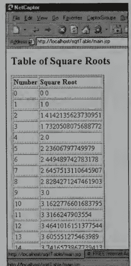

图 3-2：清单 3-2 中的代码创建了一个 HTML 表格来显示平方根。

`Math` 类包含一个名为 `sqrt` 的方法，该方法返回给定数字的平方根。例如，当一个名为 `n` 的变量值为 16 时，`Math.sqrt(n)` 的值为 4。清单 3-2 代码的大致轮廓是：

```
用于设置表格的 HTML 标签和文本
<%
for (int n=0; n<=100; n++)
{
%>
  用于表格行的 HTML 标签和文本
  用于 n 和 Math.sqrt(n) 的 JSP 表达式
<%
}
%>
用于结束表格的 HTML 标签和文本
```

这创建了一个 HTML 表格。如果我们仅使用 HTML 标签创建表格，我们将会有几行，每行都包含在 HTML `<tr>` 和 `</tr>` 标签中。然而，在这个 JSP 代码中，我们有一个 Java `for` 循环。每次循环，我们都会用一对新的 `<tr>` 和 `</tr>` 标签创建一个表格行。在每对标签内，我们有两个 JSP 表达式——一个用于 `n`；另一个用于 `Math.sqrt(n)`。


### JavaServer Pages 中的隐式对象

在 JavaServer 页面中，某些有用的对象、变量名和方法会作为翻译过程的一部分自动创建。这些*隐式对象*在任何 JSP 文档的表达式和脚本片段中均可用。

> 你不能在 JSP 声明中直接引用隐式对象。在翻译文档时，容器会在 `_jspService` 方法内部定义所有隐式对象，而在该方法内部定义的任何内容对该页面的任何 JSP 声明都不可用（参见第 2 章）。

如有必要，你可以将脚本片段中的方法调用获得的隐式对象，传递给 JSP 声明中定义的方法。

### request 对象

第 1 章描述了 HTTP 协议的两个方面：请求及其对应的响应。用户的 Web 浏览器发送请求；服务器发送响应。在 JSP 页面中，你可以使用两个隐式名称来引用这些东西：*request* 和 *response*。当你收到用户的请求时，可以通过调用与隐式 *request* 对象关联的方法来获取关于该请求的信息。然后，在你准备响应时，可以通过调用与隐式 *response* 对象关联的方法来设置响应的特性。

考虑清单 3-3 所示的 JSP 页面。

#### 清单 3-3：获取关于用户请求的信息

```jsp
<b>Browser:</b> <%= request.getHeader("User-Agent") %><br>
<b>Cookies:</b> <%= request.getHeader("Cookie") %><br>
<b>Accepted MIME types:</b> <%= request.getHeader("Accept") %>
```

清单 3-3 代码的典型响应如图 3-3 所示。

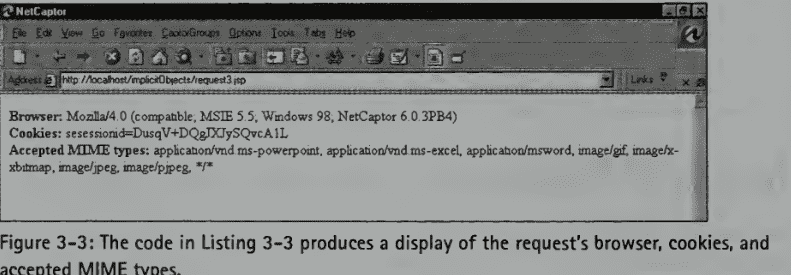

一个或多个头部可以伴随 HTTP 请求。每个头部都有一个名称和一个值。要找到某个值，你可以调用 request 对象的 getHeader 方法。在清单 3-3 中，我们获取了三个不同头部的值：名为 User-Agent、Cookie 和 Accept 的头部。

- User-Agent 头部包含描述用户 Web 浏览器的字符串。在清单 3-3 中，用户正在使用 NetCaptor（一个基于 Internet Explorer 的酷炫变体）进行浏览。如果用户使用的是 Opera 浏览器，图 3-3 中的第一行可能显示为

    `Browser: Mozilla/4.73 (Windows 98; U) Opera 4.02 [en]`
- Cookie 头部携带在之前访问此服务器时发送给用户的所有信息。在图 3-3 中，Cookie 头部的值包含一个标识号。（我们将很快看到服务器如何创建这些 ID 号。）
- Accept 头部包含用户的浏览器愿意接受该请求响应的文档类型（MIME 类型）列表。有关 MIME 类型的更多信息，请参见第 4 章。

要查看与请求关联的所有头部，请调用 request 的 getHeaderNames 方法：

```jsp
<%
  java.util.Enumeration headers = request.getHeaderNames();
  try {
    while(true) {
%>
      <%= request.getHeader((String)(headers.nextElement()))
          + "<br>" %>
<%
    }
  } catch (java.util.NoSuchElementException e) {}
%>
```

有关 HTTP 协议中头部的更多信息，请参见附录 B。

#### 方法、远程地址和远程主机

你可以通过调用与隐式 request 对象关联的方法来发现传入请求的其他特征。在清单 3-4 中，我们展示了其中三个特征的值。（浏览器的显示如图 3-4 所示。）

##### 清单 3-4：获取关于用户请求的信息

```jsp
<b>HTTP method:</b> <%= request.getMethod() %><br>
<b>IP Address:</b> <%= request.getRemoteAddr()%><br>
<b>DNS Name (or IP Address again):</b> <%= request.getRemoteHost()%>
```

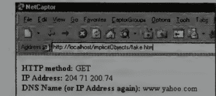

图 3-4：清单 3-4 中的代码生成的显示，展示了请求的 HTTP 方法、IP 地址和 DNS 名称。

清单 3-4 中使用的 HTTP 方法与 Java 方法几乎没有或完全没有关系。Java 方法是一个子程序。HTTP 方法是 HTTP 请求文本的几种格式之一。最常见的 HTTP 方法是 GET（用于从服务器获取页面）和 POST（用于向服务器发送数据和接收某种“我们已收到您的信息”的页面）。更多信息请参见附录 B。

在清单 3-4 中，我们调用了两个类似的方法：`getRemoteAddr` 和 `getRemoteHost`。调用 `getRemoteAddr` 返回发起请求的四部分 IP 地址。如果服务器可以确定该 IP 地址的 DNS 名称，那么在我们调用 `getRemoteHost` 方法时，服务器会返回这个 DNS 名称（例如 `www.BurdBrain.com`）。如果没有可用的 DNS 名称，服务器会再次返回 IP 地址。

#### 区域设置和语言

`request` 对象存储了许多有用的信息。例如，当你安装 Web 浏览器时，其设置会针对特定的语言和特定的国家/地区进行本地化。如果一位来自美国内布拉斯加州奥马哈市的用户访问你的网站，清单 3-5 中的代码将把词语

United States English

添加到发送回用户的页面中。

**清单 3-5：显示访问者的国家/地区和语言**

```jsp
<%= request.getLocale().getDisplayCountry() + " " + request.getLocale().getDisplayLanguage() %>
```

清单 3-5 阐明了几点。首先，我们可以通过链接返回对象的方法调用来在 Java 中创建有意义的表达式。唯一的要求是对象类型彼此兼容。在清单 3-5 中，我们的 `request` 是一个具有名为 `getLocale` 的方法的对象。但调用 `getLocale` 总是返回一个 `Locale` 类型的对象。任何 `Locale` 类型的对象都有名为 `getDisplayCountry` 和 `getDisplayLanguage` 的方法。这一切都很契合。

经验丰富的 Java 程序员习惯于使用更复杂的类名、变量名和方法调用链。事实上，没有真正的 Java 程序员会在没有随时查阅 API（应用程序编程接口）文档的情况下工作。

#### 为什么使用 Java 就像去异域新地方旅行

想象一下，你正临时从伦敦出差到费城。在品尝了几天当地美食（主要是费城奶酪牛排）后，你决定待在公寓里自己做点吃的。这意味着要插上你从伦敦带来的微波炉。

问题在于，你的微波炉需要 220 伏电压，而美国的插座只提供 110 伏。幸运的是，你带了一个小电源变压器。你把微波炉插在变压器上。

但你不能把变压器插进美国的插座。你英国制造的变压器有三个扁平插脚，而现代的美国插座有两个平行的扁平插脚和一个圆形的接地插脚。幸运的是，你在离开英国之前买了一个英式转美式的插座适配器。

还有一个问题。你住在南费城的一间旧公寓里，那里的插座没有圆形的接地插脚。你的英式转美式适配器遵循现代美国三孔标准。你去当地的五金店买了一个“cheater”，这是一种专门为在旧建筑中使用而制作的三孔转两孔适配器。最终，你可以使用你的微波炉并做一顿好饭了。（饭是从当地便利店买的冷冻预制奶酪牛排。）

大多数人在这个过程中途就放弃了，但通过编写 Java 代码，你已经获得了将长链适配器拼凑在一起的经验。例如，你想知道你网站的访客说什么语言。你必须从访客的请求开始，然后获取请求的区域设置，最后获取该区域设置的语言。

你可以在本书的 CD-ROM 上找到所有 JavaServer Pages API 文档。要查找文档，请从 CD-ROM 安装 ServletExec。ServletExec 安装后，请在 ServletExec 程序的 Documentation 目录中查找。

其次，如清单 3-5 所示，我们可以通过应用 Java 的任何内置运算符来形成表达式。例如，在 Java 中，加号可以将字符串拼接（连接）在一起。在这个例子中，我们通过连接 United States、一个空格，然后 English 这三个字符串，创建了一个表达式。

你可以使用关于 `request` 对象的信息来定制你的页面。例如，你可以使用清单 3-6 中的代码，用 Hello! 或 ¡Hola! 进行响应。


### 第1部分：基础JSP脚本

**代码清单3-6：以访客母语显示问候语**

```
<%
    String language = request.getLocale().getDisplayLanguage();
    if(language.equals("English"))
%>
    <h3>Hello!</h3>

<%
    if(language.equals("Spanish"))
%>
    <h3>&iexcl;Hola!</h3>
```

符号 `&iexcl;` 会在任何HTML文档中放置西班牙语的起始感叹号。


代码清单3-6使用了一个名为 `equals` 的方法。`equals` 方法是Java编程语言的一部分，用于比较两个字符串。使用Java内置的相等运算符 `==` 比较字符串很少奏效。该运算符仅在两个比较的字符串位于内存中的同一位置时才返回true。如果比较的字符串位于不同的内存位置，即使内存中包含完全相同的字符序列，相等运算符也会返回false。

### 表单和请求参数

在为单个用户定制网站之前，您需要一些关于用户的信息。获取用户信息的常用方法是让用户填写表单。使用HTML标签可以轻松创建外观精美的表单。但是，HTML标签没有提供处理表单中提交信息的方法。

本节介绍一个处理表单的示例。该表单要求用户输入密码。只有用户输入正确的密码才能查看下一页。此示例不涉及密码验证的细节。在此示例中，唯一正确的密码是 `swordfish`。

我们的示例涉及两个独立的文档。第一个文档，如代码清单3-7所示，是一个包含HTML表单的普通 `.html` 文件。

**代码清单3-7：服务器 `www.BurdBrain.com` 上的文件 `login.htm`**

```
<%- login.htm for www.BurdBrain.com --%>
<form action="authenticate.jsp">
    Username: <input type=text name=username><br>
    Password: <input type=password name=password><br>
    <input type=submit value=Submit>
</form>
```

浏览器对此HTML代码的显示如图3-5所示。显示包含三个表单元素：两个文本字段和一个按钮。每个元素对应一个HTML `<input>` 标签。

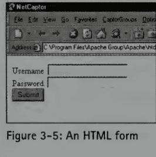

第一个元素是类型为 `text` 的标签。`text` 元素显示普通文本，用户可以输入此文本。
第二个元素是类型为 `password` 的标签。`password` 元素与普通文本字段非常相似。唯一的区别是，当用户在密码字段中输入字符时，这些字符在用户的屏幕上会显示为星号。
第三个元素是类型为 `Submit` 的标签。当用户单击 `Submit` 按钮时，浏览器会向 `form` 标签的 `action` 字段中指定的任何URL发送请求。在此示例中，浏览器向 `authenticate.jsp` 发送请求。
单击 `Submit` 按钮会使浏览器发送比平时更长的请求。该请求包含服务器计算机上文档的名称（在本例中为 `authenticate.jsp`）。请求还包括 `parameters`。实际上，在表单的HTML代码中，每个命名的输入标签都会向提交的请求附加一个参数。例如，假设用户为用户名输入了 `joe`，为密码输入了 `swordfish`。那么，对于代码清单3-7的提交按钮，单击该按钮将发送以下请求：

```
http://www.BurdBrain.com/authenticate.jsp?username=joe&password=swordfish
```

> 为了说明用户表单的使用，代码清单3-7中的表单以未保护的方式发送了密码。这是一个糟糕的做法。当用户的请求被满足时，用户（以及站在用户屏幕旁的任何人都将能够在浏览器的地址字段中看到完整的URL——包括密码。

作为部分修复，请在表单顶部的 `<form>` 标签中添加 `method=post` 字样。这并不能解决您所有的安全问题。（当密码通过互联网从一台计算机传输到另一台计算机时，密码仍然可能被恶意黑客拦截和读取。）但至少，使用 `method=post`，您就不必担心密码会显示在浏览器的地址字段中供所有人查看。

服务器如何处理此请求URL？首先，服务器找到页面 `authenticate.jsp`（代码清单3-8）。

**代码清单3-8：文件 `authenticate.jsp`**

```
<%
    if (request.getParameter("password").equals("swordfish")) {
%>
    <h2>Welcome, <%=request.getParameter("username")%>!</h2>
<%
    } else {
%>
    <% response.sendError(403); %>
<%
    }
%>
```

在 `authenticate.jsp` 中，一个Java `if` 语句比较两个字符串。被比较的字符串之一是 "swordfish" —— 我们正在寻找的密码。另一个字符串 `request.getParameter("password")` 是用户请求中 `&password=` 之后的任何内容（即用户在表单密码字段中输入的任何内容）。因此，这个 `if` 语句将用户输入的内容与正确的单词 `swordfish` 进行比较。
其次，如果密码正确，则代码清单3-8获取请求的用户名参数，并将其作为响应的一部分发送回去（见图3-6）。

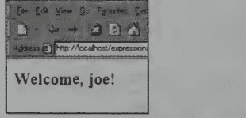

图3-6：用户Joe输入正确密码后看到的内容。

如果密码不正确，代码清单3-8会将错误编号403发送回用户的Web浏览器。作为HTTP协议的一部分，错误编号403表示此用户被禁止访问。Internet Explorer显示的页面如图3-7所示。

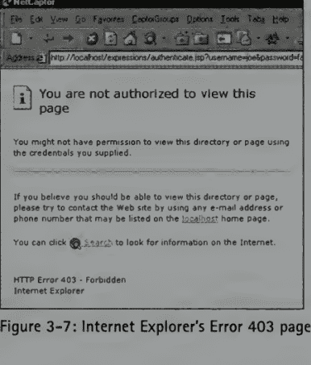

图3-7：Internet Explorer的403错误页面

代码清单3-8的最后一行引入了 `response` 对象。这个隐式对象将在下一小节中更详细地描述。

> > 再次，我们必须记得调用Java的 `equals` 方法来比较两个字符串。要找出字符串是否不相等，我们将Java的非运算符（感叹号）放在调用的左侧。

### response 对象

当服务器收到来自客户端的请求时，服务器通过返回响应来处理该请求。JSP将有关该响应的信息存储在一个隐式对象中。变量名 `response` 指向该对象。当您在JSP文档中准备响应时，可以通过调用与隐式 `response` 对象关联的方法来设置响应的特性。

与 `request` 对象不同，`response` 不是传递给服务器的东西。相反，制定响应是服务器的工作。因此，您通常不会编写JSP代码来从响应对象获取信息。相反，您编写代码来设置 `response` 对象的属性。就JSP标签而言，这意味着您通常发出一个关于 `response` 对象的命令（而您通常评估一个关于请求对象的表达式）。发出命令意味着编写一个脚本段。

第1部分：基础JSP脚本

#### 重定向用户

假设您将整个网站移到了新位置：www.BurdBrain.com。您在旧站点上放置了以下脚本段。

```
<% response.sendRedirect("http://www.BurdBrain.com/index.html"); %>
```

当用户访问包含此脚本段的页面时，用户的浏览器将被重定向到显示新BurdBrain.com网站的主页。

#### 页面未找到

您可以通过在JSP文档中放置以下脚本段，使浏览器显示令人畏惧的404页面未找到屏幕。

```
<% response.sendError(404); %>
```

### 隐式 out 对象

在代码清单2-1中，我们调用了 `out.println`。这之所以可行，是因为 `out` 是一个隐式对象的名称。名称 `out` 指向正在发送到用户Web浏览器的文本。

`out` 对象有两个重要方法：`print` 和 `println`。调用 `out.print` 会向Web文档添加文本。例如，代码清单3-6和3-9中的两段代码做的事情完全相同。

**代码清单3-9：以访客母语显示问候语**

```
<%
    String language = request.getLocale().getDisplayLanguage();

    if(language.equals("English"))
        out.print("<h3>Hello!</h3>");
    if(language.equals("Spanish"))
        out.print("<h3>&iexcl;Hola!</h3>");
%>
```

实际上，代码清单3-6和3-9之间的差异纯粹是表面上的。在代码清单3-6中，我们用一些普通的HTML代码中断了每个脚本段的流程。在代码清单3-9中，我们留在脚本段内，但调用 `out.print` 将HTML代码放入我们的Web文档中。避免打断脚本段通常是有帮助的。如代码清单3-6那样打断脚本段，可能会令人困惑且容易出错。

`out.println` 方法与 `out.print` 几乎做同样的事情。当您调用 `out.println` 时，您会向传出的Web文档添加字符，然后终止该行。例如，如果您访问一个包含以下简单脚本段的页面：


### HTTP 会话

请思考电话通话与电子邮件信息之间的区别。当你拨打电话时，你与另一方的电话建立了连接。通话可能持续任意分钟数。在对话过程中，你无需不断告知系统你拨打的是什么号码。系统会维持一条连接你的电话与对方电话的线路。

电子邮件信息则不同。当你留下留言时，你发送的是一段信息。你不会监听回复，而是继续处理其他事情。你与信息接收者之间没有维持任何线路。连接你们双方的唯一东西是你的回复地址——这是作为你电子邮件信息一部分发送的一小段信息。此回复地址会附加到你发送的任何信息上。该地址会一直等待在接收者的计算机上，直到准备回复你的原始信息为止。

HTTP 请求的工作方式类似于电子邮件信息，而非电话通话。用户向服务器发送请求，服务器随后向用户发送响应。事务就此结束。当用户再次发送请求时，即使仅隔几秒钟，HTTP 协议也会将其视为一个全新的请求。为了克服这种“虚拟遗忘症”，我们必须加强客户端与服务器之间交换的信息。有多种方法可以实现，但最常用的两种是使用 Cookie 和 URL 重写。

```jsp
<%
out.println("Barry");
out.print("Burd");
out.print("!");
%>
```

然后你的浏览器接收到代码：

```
Barry
Burd!
```

你的浏览器显示：

Barry Burd!

> 当浏览器收到换行符时，浏览器会通过显示一个空格来呈现此换行。

### COOKIES

如果你在本地计算机上运行服务器，可以设置一个开关让服务器发送 Cookie。然后，作为任何响应的一部分，服务器会请求用户的 Web 浏览器在用户的硬盘驱动器上写入一小段信息。如果浏览器的接受 Cookie 选项已开启，浏览器会写入此信息并将其与服务器名称关联起来。

在我安装了 Windows 98 的计算机上，我同时使用 Internet Explorer 和 Netscape Navigator。在我的 `c:\windows\cookies` 目录中，有一个名为 bburd@amazon[2].txt 的小文件。当我在 Windows 记事本中查看此文件时，其中的文本信息意义不大。在 Netscape 目录的一个子目录中，我有一个名为 cookies.txt 的大文件。在此文件中，有几行以 .amazon.com 开头。

当我使用 Internet Explorer (IE) 访问 Amazon 网站时，Internet Explorer 会发送文本 bburd@amazon[2].txt 的副本到 Amazon 服务器。此文本成为 IE 发送给服务器请求的一部分。服务器解读此文本并利用它来记住我是谁、我购买了什么等等。

这就是 Cookie 的工作原理。现在，既然 Cookie 已经获得了如此多的负面报道，我需要添加一些免责声明。

*   Cookie 不包含大量信息。大多数 Web 浏览器会限制其 Cookie 的大小，并限制与特定服务器关联的 Cookie 数量。许多网站将其关于用户的大部分信息存储在服务器计算机上。它们在 Cookie 中放置一小段识别信息，并使用该识别信息在服务器数据库中查找用户的其余数据。
*   我的 Web 浏览器可能不接受该 Cookie。用户可以指示 Web 浏览器拒绝 Cookie。或者，用户可以在 Cookie 文件创建后将其删除。
*   Cookie 不会发送给任何不是其来源的网站。在计算机安全方面，没有什么是不可能的。然而，在正常情况下，Web 浏览器不会将 Amazon.com 的 Cookie 发送给 Yahoo.com 的程序员。
*   Cookie 中存储的唯一信息是 Web 服务器放入其中的信息。想象一下，Altavista.com 将你最近的搜索字符串（仅此而已）放入你硬盘驱动器上的一个 Cookie 中。下次你访问 Altavista 网站时，Altavista.com 服务器会收到一个包含你最近搜索字符串的 Cookie。不会向该 Cookie 添加任何额外信息（例如你母亲的婚前姓氏或你的信用卡号）。
*   Cookie 会过期。大多数 Cookie 都有一个名为 expires 的值。expires 的值是一串代表标准互联网格林威治标准时间格式的时间和日期的字符。

当时钟到达 expires 时间时，用户的 Web 浏览器会删除该 Cookie。如果服务器未发送 expires 值，那么 Cookie 仅在用户保持其 Web 浏览器打开期间持续有效。

*   不同的 Web 浏览器不会共享 Cookie。正如我之前提到的，我使用两种不同的 Web 浏览器，这些浏览器将 Cookie 保存在我硬盘驱动器上的两个不同位置。曾经，我使用 Internet Explorer 访问 Excite 的网站。我填写了一些在线表单并注册为普通 Excite 用户。几个月后，我的生日到了。那天，我再次使用 Internet Explorer 访问 Excite，在启动页面上我看到了一条祝我生日快乐的大消息。（当我最初注册为 Excite 用户时，我填写了表单中的出生日期部分。）

几分钟后，我使用 Netscape Navigator 重新访问 Excite。启动页面显示类似“请登录，或单击此处注册为新用户”的信息。Web 浏览器就像小孩子。它们彼此之间不共享 Cookie。

*   除了服务器发送的那小段信息外，Cookie 对你的硬盘驱动器没有影响（既不读取也不写入）。再次强调，没有什么是不可能的。但是，除非程序员怀有恶意并具备超常的黑客技能，否则服务器不可能使用 Cookie 读取你硬盘驱动器上的私人信息。服务器也不可能（嗯，再次强调，非常不可能）使用 Cookie 将病毒写入你的硬盘驱动器。

### URL 重写

对于不支持使用 Cookie 的系统，还有另一种更原始的方法可以将请求追溯到特定用户。一个普通的网页可能包含如下类型的超链接：

```html
Go to the <a href="nextPage.html">next page</a>.
```

当用户单击该链接时，字符串 http://www.BurdBrain.com/nextPage.html 会发送到 BurdBrain.com 的服务器。作为响应，服务器返回文档 nextPage.html，该文档（为便于论证）包含以下链接：

```html
Go <a href="home.html">back.</a>.
```

使用 URL 重写，服务器会生成额外的 HTML 代码，并将此代码作为网页中链接的一部分发送。

```html
Go to the <a href="nextPage.html?sessionid=NIWAoAKy9Q6gt">next page</a>.
```

当用户单击此链接时，服务器接收到增强的请求 http://www.BurdBrain.com/nextPage.html?sessionid=NlWAoAKy9Q6gt。服务器分析此请求，并在组成其响应时，创建带有相同额外跟踪信息的新链接。

```html
Go <a href="home.html?sessionid=NlWAoAKy9Q6gt">back</a>.
```

事情进展顺利，直到用户从一个不生成额外 `sessionid` 信息的引荐页面重新访问该网站。此时 URL 重写停止工作。

URL 重写可以跟踪从你的网站页面之一链接到另一个页面的用户，即使该用户的 Web 浏览器已关闭 Cookie。（跟踪 Cookie 被禁用的用户不一定是一种邪恶或恶意的做法。用户可能不希望其硬盘驱动器上有 Cookie，但仍可能希望在访问你的网站五分钟期间保持一致的界面。）

URL 重写的使用因服务器而异，但通常，你需要做三件事：

-   配置你的服务器以进行 URL 重写。对于大多数服务器，这意味着编辑一个配置文本文件，或在配置页面上选中一个复选框。
-   编写你的文档，使链接不是硬编码的。在你的 HTML 锚点标签中，使用为你生成 URL 字符串的方法调用：
    `Go to the <a href=<%=response.encodeURL("nextPage.html")%>>next page</a>.`
    当 URL 重写打开时，响应对象的 encodeURL 方法会将 `home.html` 转换为类似 `home.html?sessionid=NlWAoAKy9Q6gt` 的形式。
-   考虑用户可能从你的一个页面访问另一个页面，或从非你网站的页面访问你的某个页面的所有可能场景。URL 重写仅在用户单击重写后的链接时有效，而你无法控制用户在你的页面之间导航的各种方式——无论是使用普通链接还是重写后的链接。

### session 对象

隐式的 `session` 对象为 JSP 程序员隐藏了创建 Cookie 或重写 URL 的一些底层细节。默认情况下，JSP 在新用户首次访问你的网站时创建一个会话。对于同一用户的后续访问，JSP 会检索有关用户会话的信息。（要了解如何覆盖默认设置，请参阅第 4 章。）此外，你可以将 `属性` 分配给会话。每个 `属性` 都有一个名称和一个值。在正常情况下，这些属性作为 Cookie 存储在用户的硬盘驱动器上，但作为 JSP 程序员，你不必

你无需担心属性的存储或实现细节。可以通过调用 `getAttribute` 方法来获取属性的值，也可以通过调用 `setAttribute` 方法来设置属性的值。

清单 3-10 中的代码告知用户其访问本网页的次数。我们通过四个步骤实现：

1.  调用 `getAttribute` 以获取 `numVisits` 属性的值。（假设用户之前访问过我们的网站，并且其会话中已存在 `numVisits` 属性。）
2.  调用我们自定义的 `increment` 方法，将该用户的访问次数加 1。
3.  调用 `out.print` 告知用户其访问次数。
4.  调用 `setAttribute` 以存储新的、已递增的 `numVisits` 属性值。

我们在一个独立的 JSP 声明中封装了递增访问次数的细节。这些细节（对 Java 程序员来说很直接）涉及从 `String` 到 `int` 再转换回 `String` 的过程。

**清单 3-10：一个几乎可行的访问计数器**

```
<%--
如果 numVisits 没有有效的整数值，此页面将无法工作。
--%>

<%
String count = (String)session.getAttribute("numVisits");
count = increment(count);
out.print("You have visited this page " + count + " times.");
session.setAttribute("numVisits", count);
%>

<%!
String increment(String count) {
return Integer.toString(Integer.parseInt(count)+1);
}
%>
```

清单 3-10 展示了常见的循环模式：获取属性；必要时修改属性值；设置属性的新值。但清单 3-10 存在一个先有鸡还是先有蛋的问题。当用户首次访问此网站时，容器将抛出一个 Java `NumberFormatException`。如果用户从未收到过此页面的响应，则尚未建立具有 `numVisits` 属性的会话。`getAttribute("numVisits")` 的调用将返回 Java 的 `null` 值。这个 `null` 会被传递给我们的 `increment` 方法，在该方法中，Java 的 `parseInt` 方法会尝试将 null 当作一个数字来解析。由于 null 无法被解释为数字，`parseInt` 会抛出一个异常。之后，事情就不会顺利进行了。最糟糕的是，会话的 `numVisits` 属性无法获得一个值，因此该用户的下一次访问也注定会失败。

> 属性的值可以是任何类型的对象。为了提供这种灵活性，会话的 `getAttribute` 方法返回一个 Java 类型为 `Object` 的值。当你调用 `getAttribute` 时，通常需要将方法的返回值强制转换为更易用的类型。在清单 3-10 中，我们将 `getAttribute` 返回的值强制转换为 Java `String`。

我们需要一个更好的 `increment` 方法版本。调用 `increment` 时，应首先检查以确保 `count` 具有有效的整数值。如果是，则将值加 1。如果不是，则将 `count` 初始化为零。代码如下：

```
<%!
  String increment(String count) {
    if (count != null)
      return Integer.toString(Integer.parseInt(count)+1);
    else
      return "1";
  }
%>
```

使用这个新版本的 `increment`，用户首次访问此页面时，其 `numVisits` 属性将被设置为 1。在下次访问时，`numVisits` 的值将变为 2。以此类推。

既然如此，我们应该为用户提供一种清除 `numVisits` 的方法。我们可以通过调用会话的 `removeAttribute` 方法来实现。

```
<% session.removeAttribute("numVisits"); %>
```

只需将此脚本片段放入一个独立的 JSP 文档中。提供一个链接，使用户能够访问包含此脚本片段的文档。然后，为该链接提供一个信息丰富的标签，例如：点击此处将您的访问次数重置为零。

### 显示会话的所有属性

隐式 session 对象有一个名为 `getAttributeNames` 的有用方法。你可以使用此方法检索所有会话属性及其值。代码见清单 3-11。

清单 3-11：显示会话的属性

```
<%
    java.util.Enumeration attributeNames =
        session.getAttributeNames();
    while (attributeNames.hasMoreElements()) {
        String name=(String)attributeNames.nextElement();
        out.println(name + " = " + session.getAttribute(name) + "<br>");
    }
%>
```

### 你可以用 session 对象做的其他事情

隐式 session 对象有许多有用的方法。清单 3-12 使用了其中几个。

清单 3-12：使用 session 对象的方法

```
<h3>This Session</h3>
<b>Creation time:</b>
    <%= new java.util.Date(session.getCreationTime()) %><br>
<b>Session id:</b>
    <%= session.getId() %><br>
<b>Time last accessed:</b>
    <%= session.getLastAccessedTime() %><br>
<b>Max allowable seconds of inactivity:</b>
    <%= session.getMaxInactiveInterval() %>
```

运行清单 3-12 中的代码将产生如图 3-8 所示的输出。

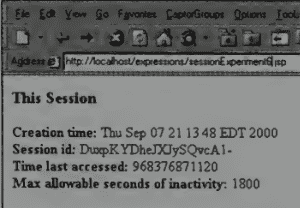

清单 3-12 中方法的作用如下：

-   ◆ `getCreationTime` 方法告诉你会话是何时创建的。在理想情况下，这是用户首次访问你的网站的日期和时间。
-   ◆ 当会话创建时，服务器会生成一个长且看似复杂的数字来标识该会话。调用 `getId` 会报告该 ID 号。
-   ◆ `getLastAccessedTime` 方法告诉你服务器最后一次从该会话接收到请求的时间。理想情况下，这是用户上次访问你的网站的时间。
-   ◆ 如果我时隔两年首次访问 BurdBrain.com 呢？我上次访问时收集的信息很可能已无用处。因此，在一段时间的闲置后使会话失效是一个好主意。`getMaxInactiveInterval` 方法报告会话在服务器决定忽略它之前可以保持空闲的秒数。你可以通过调用 `setMaxInactiveInterval` 来更改会话的超时值。

```
<% session.setMaxInactiveInterval(24*60*60); %>
```

### application 对象

JavaServer Pages *application*（应用程序）是一组相关的网页和资源的集合。当你开始一个新项目时，你可以将该项目中的所有文档组织到一个 JSP 应用程序中。应用程序通常在服务器上有自己的目录。你可以配置服务器，使其将这些目录视为属于单个 Web 应用程序。

当你只是临时组合几个页面，并将它们放入服务器的默认目录时，服务器会将这些页面视为都属于一个未命名的默认应用程序。

每个 JSP 文档都有一个隐式的 `application` 对象。此对象存储有关文档运行上下文的信息。例如，你可以通过调用 `application` 的 `getServerInfo` 方法来显示容器的名称。当我访问一个包含以下代码的页面时

```
<%= application.getServerInfo() %>
```

我可能会看到

```
Apache/1.3.12 (Win32) ServletExecAS/3.0
```

`Apache` 是我正在运行的 Web 服务器的名称，`ServletExecAS` 是 Servlet 引擎的名称。

### 获取目录名

回想第 2 章，URL 中使用的路径名几乎从不与服务器计算机硬盘驱动器上的子目录名相同。服务器被配置为将 URL 中的名称映射到服务器硬盘驱动器上的某些目录（可能具有不同的名称）。有时你需要以各种形式知道这些名称——它们在硬盘驱动器上的名称，以及它们被服务器映射后的名称。考虑清单 3-13 中的代码。

清单 3-13：查找路径名

```
<%= request.getServletPath() %><p>
<%= application.getRealPath(request.getServletPath()) %>
```

要测试此页面，我在浏览器的地址栏中输入以下 URL：

```
http://localhost/implicitObjects/application3.jsp
```

当我这样做时，`getServletPath` 的调用返回以下字符串：

```
/implicitObjects/application3.jsp
```

在我的服务器上，JSP 文档的默认目录是 `C:\Program Files\ Apache Group\Apache\htdocs\`，清单 3-13 中的代码位于该默认目录的 `implicitObjects` 子目录中。在清单 3-13 中，`getRealPath` 的调用将文档的虚拟路径转换为文档实际所在目录的名称。清单 3-13 中第二行的输出是

```
C:\Program Files\Apache Group\Apache\htdocs\implicitObjects\application3.jsp
```

### 使用应用程序的日志文件

一个应用程序会维护一个日志文件。该文件包含有关重要事件的信息，例如 Servlet 引擎的启动和关闭时间。你可以通过调用 `application` 对象的 `log` 方法向此日志文件添加你自己的信息。以下是清单 3-10 的一段代码片段，并添加了一行：

```
<%
    String count = (String)session.getAttribute("numVisits");
    count = increment(count);
    out.print("You have visited this page " + count + " times.");
    application.log(session.getId() +
        " has made visit number " + count + ".");
    session.setAttribute("numVisits", count);
%>
```

运行此代码会在应用程序的日志文件中添加如下一行：

```
[Wed Aug 23 20:39:52 EDT 2001] 16RxQvKvAL1o has made visit number 4.
```


> 应用程序的日志文件可能与报告翻译和编译错误的日志文件不是同一个。

> 某些 JSP 容器会锁定其日志文件直到关闭。当容器运行时，你可以通过容器的管理员工具界面查看最新的日志文件。然而，如果你尝试编辑实际存储日志记录的文本文件，你将只能看到服务器上次关闭之前的记录。

### 应用程序的属性

就像请求一样，一个应用程序可以拥有属性。应用程序的属性在属于该应用程序的所有页面之间共享。要进行实验，请执行以下操作：

1.  创建两个文档，第一个使用清单 3-14 所示的代码，第二个使用清单 3-15 所示的代码。
2.  用你的 Web 浏览器访问“设置属性”文档。
3.  用同一个 Web 浏览器访问“获取属性”文档。在响应中，注意 `appAttributeName` 的值是 `appAttributeValue`，而 `sessAttributeName` 的值是 `sessAttributeValue`。两个页面（设置属性和获取属性）都属于同一个应用程序，因此 `appAttributeName` 属性的值从一个页面到另一个页面得以保持。此外，由于你从同一个 Web 浏览器访问这两个页面，`sessAttributeName` 属性的值从一次访问到下一次访问也得以保持。
4.  从两台不同的计算机访问“获取属性”文档。如果你没有两台不同的计算机，可以在同一台计算机上使用两个不同的 Web 浏览器（例如 Netscape Navigator 和 Microsoft Internet Explorer）。在响应中，注意 `appAttributeName` 的值是 `appAttributeValue`，但 `sessAttributeName` 的值是 `null`。两个页面（设置属性和获取属性）都属于同一个应用程序，因此 `appAttributeName` 属性的值从一个页面到另一个页面得以保持。然而，`sessAttributeName` 属性在两个不同的 Web 浏览器之间并不共享。

清单 3-14：设置应用程序的属性

```
<%-- 设置属性 --%>
<% application.setAttribute
    ("appAttributeName", "appAttributeValue"); %>
<% session.setAttribute
    ("sessAttributeName", "sessAttributeValue"); %>
```

清单 3-15：获取应用程序的属性

```
<%-- 获取属性 --%>
<%= application.getAttribute("appAttributeName") %><p>
<%= session.getAttribute("sessAttributeName") %><p>
```

### config 对象

JSP 文档经过转换，随后被编译，成为一个 Java servlet。这个 servlet 是一个扩展名为 .class 的文件。每个 servlet 都有一个*配置*，关于此配置的信息可以从 JSP 的 `config` 对象中获取。你可以通过调用 `config` 对象的 `getServletName` 方法来获取 .class 文件的名称。

```
<%= config.getServletName() %>
```

当我访问包含此代码的页面时，我看到的内容类似于以下路径：

C:\Program Files\New Atlanta\ServletExec AS\se-acher\Servlets\pagecompile\_implicitObjects\_config_xjsp.class

### page 对象

在一个 JavaServer 页面中，隐式 `page` 对象指的是页面本身。为什么会想使用它呢？你可以使用它来帮助页面中的代码引用其自身的属性。第 4 章（清单 4-11）中有一个例子。

### pageContext 对象

*pageContext* 描述了 JSP 文档运行的整个环境，包括页面本身、应用程序以及介于两者之间的几乎所有内容。因此，`pageContext` 是所有 JSP 对象中功能最全面的。无论你能用其他隐式对象做什么，你都可以使用 `pageContext` 对象（语法更复杂）来完成。例如，调用 `pageContext.getSession()` 会返回隐式的 `session` 对象。

通过 `pageContext` 对象，你可以方便地获取和设置其他对象的属性。比如说，你首先运行清单 3-14 的代码。你可以通过调用 `findAttribute` 方法来检索清单 3-14 中设置的任一属性。

清单 3-16：使用 findAttribute 方法

```
<%= pageContext.findAttribute("appAttributeName") %>
<%= pageContext.findAttribute("sessAttributeName") %>
```

当你访问包含清单 3-16 代码的页面时，你将看到 `appAttributeValue sessAttributeValue`。

### JAVASERVER PAGES 中的作用域

在第 2 章中，我从一个特定的角度描述了 JavaServer Pages 的作用域规则。JSP 规范描述了作用域规则的第二个视角。这两个视角相互补充。

特别是，JSP 规范定义了四种不同的作用域：

-   具有 *page* 作用域的值可以在声明该值的 JSP 页面上使用。该名称的生命周期在访问该页面的一次会话期间持续。
-   具有 *request* 作用域的值可以在设置该值的 JSP 页面以及请求被转发到的任何页面上使用。有关转发的更多信息，请参阅清单 3-17。
-   具有 *session* 作用域的值的生命周期从一次访问持续到下一次访问，在特定用户会话的整个持续时间内有效。
-   具有 *application* 作用域的值可以被访问属于特定应用程序的任何页面的任何人访问。该值的生命周期从容器启动时开始，到容器关闭时结束。

> 一个请求可以同时具有参数和属性。请求的参数与请求的属性不同。

> 许多作者会说，我已经按照从小到大的顺序列出了四种作用域。第一个，page 作用域，持续一次用户对单个页面的访问。第四个，application 作用域，可以适用于许多用户长达数月。但请记住，会话信息通常存储在客户端计算机的 Cookie 中。应用程序信息则存储在服务器上。

假设你关闭了 JSP 容器。那么所有属性信息都将被重新初始化。但是，当用户下次访问你的网站时，该用户的任何 Cookie 信息都会随用户的请求一起发送给你。因此，一个 session 值可以比一个 application 值存活更久。

### 作用域和 PAGECONTEXT 对象

当我们创建一个新属性时，该属性具有这四种作用域之一。隐式的 `pageContext` 对象可以访问属于每种作用域的属性。要查看实际操作，请参阅清单 3-17。

清单 3-17：文件 scopeExper.jsp

正在设置的值……
```
<%
pageContext.setAttribute
    ("pageAttr", "pageValue" , PageContext.PAGE_SCOPE);
pageContext.setAttribute
    ("requestAttr", "requestValue", PageContext.REQUEST_SCOPE);
session.setAttribute
    ("sessionAttr", "sessionValue");
application.setAttribute
    ("appAttr", "appValue");
pageContext.forward ("scopeExper2.jsp");
%>
```

我们在清单 3-17 中创建了四个属性并设置了它们的值。每个属性都具有四种 JSP 作用域之一。要设置会话属性，我们调用 `session` 对象的 `setAttribute` 方法。设置应用程序属性时也采用同样的方式。`page` 和 `request` 对象自身都没有现成的 `setAttribute` 方法。因此，我们通过调用属于 `pageContext` 对象的方法来设置这些对象的属性。

清单 3-17 的最后一行展示了 `pageContext` 对象广泛的覆盖范围。我们调用该对象的 `forward` 方法将整个请求发送到另一个文档。当用户访问清单 3-17 的代码时，该代码会设置属性的值，然后开始运行 scopeExper2.jsp 中的代码。用户实际上永远看不到 "正在设置的值……" 这些文字。相反，用户看到的是由 scopeExper2.jsp 中的代码产生的任何响应。要查看我们打算放在 scopeExper2.jsp 中的代码，请参阅清单 3-18。

清单 3-18：显示在清单 3-17 中设置的属性的值

```
<%-- scopeExper2.jsp --%>

<%
java.util.Enumeration attribNames;

int scopes[] = {PageContext.PAGE_SCOPE,
                PageContext.REQUEST_SCOPE,
                PageContext.SESSION_SCOPE,
                PageContext.APPLICATION_SCOPE};
```


### 使用页面属性

在清单3-17和3-18之间，我们从未看到页面作用域属性在实际操作中的效果。因此，请尝试以下实验：

1. 将以下脚本片段添加到清单3-18中`scopeExper2.jsp`文件的开头：
2. 在您的Web浏览器的地址栏中输入`scopeExper2.jsp`的URL。

```jsp
<% pageContext.setAttribute
    ("pageAttr","pageValue", PageContext.PAGE_SCOPE); %>
```

图3-10向您展示了在浏览器窗口中可能看到的效果。

要获得如图3-10所示的结果，您不必先访问清单3-17的代码，因此您从未给请求添加任何属性。在图3-10中，`REQUEST:`下方的行是空的。另一方面，您*确实*访问了一个设置了`pageAttr`为`pageValue`的页面。就在这个页面中，您显示了所有已知的属性。因此，`pageAttr`及其`pageValue`出现在图3-10中。

### 确定属性的作用域

在清单3-14中，我们创建了两个属性。要确定这两个属性的作用域，请调用`pageContext`对象的`getAttributesScope`方法。

**清单3-19：确定属性的作用域**

```jsp
<%= pageContext.getAttributesScope("appAttributeName") %>
<%= pageContext.getAttributesScope("sessAttributeName") %>
```

清单3-19中代码的输出是4 3。（`PageContext.APPLICATION_SCOPE`的值为4；`PageContext.SESSION_SCOPE`的值为3。）

### exception对象

JavaServer Pages中还有一个隐式对象，但本章不对其进行讨论。它被称为exception对象。在JSP文档中，*exception*一词指的是您的程序运行过程中已抛出但尚未捕获的任何Java异常。要使用隐式异常对象，您需要一个JSP页面指令，但指令直到第4章才会讨论。所以，请继续阅读。

### 总结

隐式对象是由JSP容器自动提供给您的一个名称。您可以在脚本片段或表达式中使用隐式对象，但不能在声明中使用。每个对象都指代用户请求JavaServer页面期间感兴趣的内容。

为了在访问之间维护有关用户的信息，服务器会创建一个会话。会话信息可以放置在用户硬盘上的cookie中。您可以在一次访问期间设置会话的属性，然后在用户下次访问时获取这些属性的值。利用这些属性值，您可以定制输出以满足用户的个人需求。（一些现实世界的示例请参见第11章和第14章。）

除了设置会话的属性外，您还可以为页面、请求或应用程序设置属性。

# 第4章

# JSP指令

本章内容

- 定义指令
- include指令
- page指令
- taglib指令

在第1章中，我宣布了JavaServer Pages有四种不同类型的元素：

- 脚本元素
- 指令
- 动作
- XML标签

到目前为止，您只读到了关于脚本元素的内容。在本章中，您将开始使用一些JSP指令。

### 什么是指令？

第1章和第2章的脚本元素包含Java代码片段。当容器翻译您的JSP文档时，脚本元素中的代码会直接进入一个新的Java程序。每当用户访问您的页面时，容器会执行它放入此程序中的语句。

与脚本元素不同，*指令*不包含代码。相反，指令是一条指示，告诉容器如何组合一些代码，这些代码将进入新的Java程序。

JSP指令的格式如下：

```
<%@ directive-name attribute-name=attribute-value. . . %>
```

指令以字符`<%@`开始，以通常的`%>`结束。在`<%@`字符之后，您编写一个名称。此名称告诉容器要执行何种指令。JSP支持三种不同的指令名称：*include*、*page*和*taglib*。

在指令名称之后，您可以有一个或多个属性名/值对。每个指令名称支持特定的属性名称。每个属性名称都有一组合法的值。

### include指令

如果您是一位经验丰富的Web开发人员，您会熟悉以下问题。您有一段文本，可能是您网站每个页面上都应该显示的法律声明。您可以将文本从一个页面复制粘贴到另一个页面。然而，如果法律部门想要更改措辞，那么您就需要调整网站每个页面上的文本。即使您使用复制和粘贴，这种调整也可能是一件苦差事。此外，如果您不小心遗漏了一个页面，您的公司可能会被起诉。与其机械地粘贴文本，不如维护文本的单一副本，让该文本自动包含在每个Web页面中，然后在需要时更改该单一副本。不幸的是，普通的HTML没有提供将文件中的文本包含到文档中的标签。但是，通过使用JSP，您可以非常轻松地做到这一点。假设您有一个名为`copyrightNotice`的文件。

```
&copy; 2000 Burd Brain Consulting
```

在每个Web文档的末尾，添加以下JSP指令：

```jsp
<%@ include file="copyrightNotice" %>
```

`include`指令仅支持一个属性——`file`属性。无论指定哪个文件，其文本都会被粘贴到文档中，替换`include`指令本身。通过在您的几个Web页面中放置此`include`指令，来自`copyrightNotice`文件的文本将出现在您网站的各种页面中。

#### 嵌套include指令

JSP的`include`指令开启了各种可能性。例如，您可以有一个包含文件调用另一个包含文件。在清单4-1中，我们包含了一个名为`ourCopyrightNotice`的文件。

**清单4-1：包含版权声明**

```jsp
<%@ include file="ourCopyrightNotice" %>
```

然后，在清单4-2中，文件`ourCopyrightNotice`包含了另一个名为`getYear`的文件。


### 第4章：JSP指令

清单4-2：文件`ourCopyrightNotice`

```
<%-- ourCopyrightNotice --%>
```

```
<p>&copy; <%@include file="getFullYear"%> Burd Brain Consulting. Any
unauthorized use of these materials will be prosecuted to the
fullest extent of the law.</p>
```

在`getYear`（清单4-3）中，我们最终从服务器系统时钟获取当前年份。

清单4-3：文件`getYear`

```
<%-- getYear --%>
```

```
<%=java.util.Calendar.getInstance().get(java.util.Calendar.YEAR)%>
```

生成的版权通知如图4-1所示。

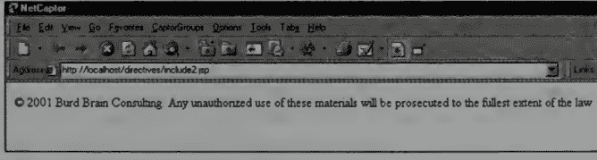

图4-1：使用嵌套的include指令显示当前年份

你肯定不希望图像的字节被粘贴到JSP文档的中间。如果这样做了，容器（以及用户的浏览器）会尝试将这些字节解释为某种文本。为了正确解释和显示图像中的字节，Web浏览器必须首先遇到HTML图像标签（如``），并根据该标签向Web服务器发送图像请求。

不要使用JSP的`include`指令来包含非文本文件，例如`.gif`图像。要将JSP的`include`指令与图像文件一起使用，请创建一个包含HTML图像标签的文件，然后使用JSP的`include`指令来包含该图像标签文件。

请注意最新示例运行中被包含文件的名称。请注意，虽然`copyrightNotice`和`getYear`都包含JSP标签，但文件名都没有`.jsp`扩展名。当翻译器处理`include`指令时，被包含的文本会被粘贴到JSP文档的中间。在此之前，翻译器不会尝试理解被包含的文本，因此翻译器不需要知道该文本是属于`.jsp`文档、`.html`文档还是其他东西。

#### 修改被包含的文件

使用`include`指令时，文本的收集和粘贴只会在容器将你的JSP文档翻译成Java程序时执行一次。如果你更改了被包含文件的内容，大多数容器不会重新翻译包含`include`指令的文档。因此，除非你做更多工作，否则用户不会看到更改。

要使内容重新同步，你必须强制容器重新翻译包含`include`指令的文档。你可以通过编辑文档，对文档进行任何更改（或不更改），然后保存文档来强制大多数JSP容器翻译文档。（如果你是UNIX用户，你可以通过调用`touch`命令来达到同样的效果。）下次用户访问此文档时，容器会检测到`.jsp`文件的日期比其翻译后的`.class`文件更新，因此容器会进行翻译以获取更新的`.java`文件，然后进行编译以获取更新的`.class`文件。

#### 一些其他陷阱

JSP翻译器会将来自被包含文件的任何文本粘贴到`include`指令的位置。被包含文件中的文本只是融入到周围的文本中。如果不小心，这可能会导致一些意想不到的结果。例如，在清单4-4中，一个名为`testScores.htm`的文件包含一个几乎完整的HTML表格。表格末尾缺少一个`</table>`标签，但Microsoft Internet Explorer会原谅这个遗漏。访问`testScores.htm`时看到的显示如图4-2所示。

清单4-4：文件`testScores.htm`

```
<!-- testScores.htm -->

<table border=1>
<tr><th></th><th>1</th><th>2</th></tr>
<tr><th>Fall</th><td>83.5</td><td>85.9</td></tr>
<tr><th>Spr.</th><td>86.1</td><td>88.7</td></tr>
</table>
```

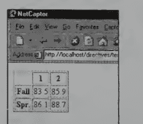

当你在JSP文档中包含`testScores.htm`时，缺失的HTML标签可能会让Web浏览器感到困惑。在清单4-5中，我们在被包含表格的前后放置了普通文本。

清单4-5：在JSP文档中包含`testScores.htm`

```
Average scores on the first and second tests:
<%@ include file="testScores.htm" %>
As you can see, scores improved in the spring semester.
```

包含之前的文本是正常的，但包含之后的文本被误认为是表格的一部分。清单4-6显示了Web浏览器接收到的HTML代码，图4-3显示了Microsoft Internet Explorer如何显示该页面。

清单4-6：清单4-5中的JSP代码创建的HTML代码

```
Average scores on the first and second tests:
<!-- testScores.htm -->

<table border=1>
<tr><th></th><th>1</th><th>2</th></tr>
<tr><th>Fall</th><td>83.5</td><td>85.9</td></tr>
<tr><th>Spr.</th><td>86.1</td><td>88.7</td></tr>
As you can see, scores improved in the spring semester.
```

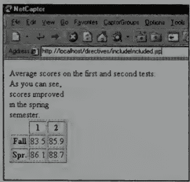

图4-3：从外部文件包含一个不完整的表格会将非预期的文本合并到表格主体中。

对于一个更微妙的例子，请考虑以下看似无害的代码：

```
<%@ include file="includedStuff" %>
<% String closing="Last Updated: February 2001"; %>
<%= closing %>
```

我们期望用户看到来自`includedStuff`的文本，然后是关于页面新鲜度日期的消息。但是，如果`includedStuff`包含一个已经声明了`closing`的脚本片段呢？

```
<% String closing="Goodbye"; %>
```

生成的JSP文档包含两个冲突的变量`closing`声明，因此容器将拒绝创建编译后的servlet。相反，你会看到一条错误消息。

```
Variable 'closing' is already defined in this method.
String closing="Last Updated: February 2001";
```

#### page指令

最通用的指令是page指令。page指令带有一长串属性：

- import
- errorPage和isErrorPage
- session
- info
- language
- contentType
- isThreadSafe
- buffer
- autoFlush
- extends

#### import属性

当你多次使用一个类名或对象名时，使用import功能是值得的。通过使用Java的import功能（具有适用于JavaServer Pages的略微修改的语法），你可以缩写类的名称。例如，在清单4-7中，我们可以使用带有import属性的page指令来缩写`java.util.Calendar`。

清单4-7：使用import属性

```
<%-- getYear --%>

<%@ page import="java.util.Calendar" %>

<%=Calendar.getInstance().get(Calendar.YEAR)%>
```

#### errorPage和isErrorPage属性

Java有一个处理意外（通常是不需要的）情况的好功能。它被称为*异常处理*。如果一段代码陷入麻烦，代码的执行可以被中止。为了避开可能的错误，你将潜在有问题的代码包裹在一个`try`块中。当出现问题时，系统会抛出一个异常（读作“创建一个异常对象”），由另一段代码处理。如果一切顺利，另一段代码会优雅地从意外情况中恢复，处理过程无需进一步中断。

你可以在JSP脚本片段中使用`try`块，但你也可以通过`errorPage`属性来防御崩溃。`errorPage`属性可以保护JSP文档中的所有代码免受任何类型的异常影响。

考虑清单4-8中的订单表。

清单4-8：一个订单表

```
<!-- orderForm.htm -->

<h1>Order Form</h1>

What would you like to purchase?<p>
<form name=orders action=processOrder.jsp>

<table border=0>
  <tr>
    <th>Item</th>
    <th>Quantity</th>
    <th>Unit Price</th>
  <tr>
  <tr>
    <td>T-Shirts</td>
    <td><input type=text name="t-shirts" value=0 size=3></td>
    <td>@ $15.00 ea.</td>
  </tr>
  <tr>
    <td>Hats</td>
    <td><input type=text name="hats" value=0 size=3></td>
    <td>@ $10.00 ea.</td>
  </tr>
</table>

<input type=submit value="Place order">
<input type=reset value="Clear all fields">

</form>
```

清单4-8中的代码创建的表单如图4-4所示。如果用户在数量字段中输入数字（或者即使保留零），那么点击“Place order”按钮会将用户带到`processOrder.jsp`（清单4-9）。

清单4-9：文件`processOrder.jsp`

```
<%-- processOrder.jsp --%>

<%@ page errorPage="orderError.jsp"
         import="java.text.NumberFormat" %>

<h3>Your order:</h3>

<%
   String numTees = request.getParameter("t-shirts");
   String numHats = request.getParameter("hats");
   NumberFormat currency = NumberFormat.getCurrencyInstance();
%>

Number of tees:
   <%= numTees %><br>
Your price:
   <%= currency.format(Integer.parseInt(numTees)*15.00) %><p>
Number of hats:
   <%= numHats %><br>
Your price:
   <%= currency.format(Integer.parseInt(numHats)*10.00) %><p>
```

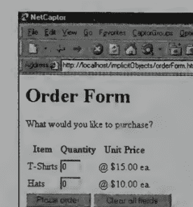

图4-4：清单4-8中的代码创建了一个订单表。


图 4-5 展示了 processOrder.jsp 的典型显示界面。

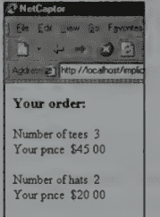

如果用户在任意一个数量字段中输入了非整数值（或让任一字段留空），那么点击“下订单”按钮仍然会向 processOrder.jsp 发送一个请求。然而，在这种情况下，processOrder.jsp 中对 `Integer.parseInt` 的调用会抛出一个 `NumberFormatException`。processOrder.jsp 中的 `errorPage` 属性会将控制权转移到 orderError.jsp 文件。（清单 4-10 展示了一个 orderError.jsp 文件。要查看用户看到的内容，请参见图 4-6。）

清单 4-10：文件 orderError.jsp

```
<%-- orderError.jsp --%>

<%@ page isErrorPage="true" %>

<%
  if (exception instanceof NumberFormatException)
%>
  Please enter a number in each quantity field.<br>

Return to the main <a href="orderForm.htm">order form</a>.
```

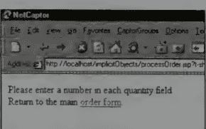

注意 `orderError.jsp` 中的页面指令及其 `isErrorPage` 属性。将 `isErrorPage` 设置为 `true` 会使得隐式的 `exception` 对象在此 JSP 文档中可用。如果你的页面没有 `isErrorPage` 属性，则该属性的值默认为 `false`，并且单词 `exception` 在 JSP 文档中没有预定义含义。在 `orderError.jsp` 中，我们测试隐式异常对象，以确保错误条件来自 `NumberFormatException` —— 即数量文本框中的数据有误。

> 在翻译你的页面时，容器会添加一些默认的异常处理代码。即使你没有提供 `errorPage` 属性，这也会发生。即便如此，最好始终使用 `errorPage` 属性并创建你自己的、明确的、有针对性的错误处理代码。

#### The session 属性

如果你不希望你的 JSP 文档参与会话，可以通过将页面指令的 `session` 属性设置为 `false` 来屏蔽所有跟踪。

```
<%@ page session="false" %>
```

在一个非常繁忙的网站上，关闭会话跟踪将使处理速度稍微加快。

如果在一个特定的 JSP 文档中，你使用了 `page` 指令并将 `session` 属性设置为 `false`，那么该文档中隐式的 `session` 对象将不可用。然后，如果你在未自行声明的情况下使用 `session` 变量，编译器将给出错误消息。

#### The info 属性

`info` 属性可以帮助你记录文档信息。首先，你将 `info` 属性的值设置为一个信息丰富的字符串。然后，通过调用页面对象的 `getServletInfo` 方法，你可以让这个信息字符串出现在翻译后页面的任何位置。

在清单 4-11 中，我们将 `info` 字符串两次发送到用户的 Web 浏览器。首先，`info` 字符串是 HTML 注释的一部分。然后，`info` 字符串出现在浏览器窗口本身中。该字符串在 HTML 注释中的使用可能更为常见。但请注意，当我们在浏览器窗口中显示该字符串时，字符串中的任何 HTML 格式化标签（例如 `<br>` 标签）都会发挥其通常的效果。

```
清单 4-11：使用 info 属性
<%@ page info=
   "Author: Barry Burd<br>Last Update: February 13, 2001"
%>
```

```
<!--
<%= ((HttpJspPage)page).getServletInfo() %>
-->
```

```
<%= ((HttpJspPage)page).getServletInfo() %>
```

当用户访问清单 4-11 中的代码时看到的内容如图 4-7 所示。然后，当用户点击查看源代码时，会看到清单 4-12 中的 HTML 代码。

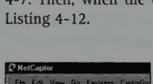

清单 4-12：由清单 4-11 中的 JSP 代码创建的 HTML 代码

```
<!--
Author: Barry Burd<br>Last Update: February 13, 2001
-->
```

```
Author: Barry Burd<br>Last Update: February 13, 2001
```

> 在记录代码时，你可能会倾向于编写一个很长的 info 字符串。但请记住，在 JSP 中（如同在 Java 中），一个字符串不能因行尾而中断。

#### The language 属性

在你的工作中，你可能会遇到一个包含如下行的 JSP 文档

```
<%@ page language="java" %>
```

这告诉 JSP 容器，所有声明、脚本和表达式标签中的代码都是用 Java 编写的。

-   如果你不提供 `language` 属性，默认值是 "java"。
-   所有供应商的容器都支持用 Java 编写的代码。
-   一些供应商的容器支持用其他语言编写的代码。例如，使用 Allaire 的 JRun，你可以使用 JavaScript 而不是 Java 来编写 JSP 文档中的代码逻辑。

> 像所有字符串一样，属性值 "java" 是区分大小写的。容器可能会拒绝 `language` 值为 "Java" 的页面指令。

#### The contentType 属性

通过使用 `contentType` 属性，你可以告诉用户的 Web 浏览器如何处理传入的文档以及如何解释文档中的字节。

浏览器根据文档的 MIME 类型对文档进行分类。（MIME 代表多用途互联网邮件扩展。）MIME 是一个两部分的分类系统，你指定文档的类型，然后指定文档的子类型。例如，你在浏览器窗口中看到的图像通常具有 MIME 类型 `image/gif`（类型为 image，子类型为 gif）。归根结底，浏览器从服务器接收到的只是比特。知道文件的 MIME 类型就能告诉浏览器 `1000001 1000010 1000011` 是代表 ABC 还是代表 65 单位的红色、66 单位的绿色和 67 单位的蓝色。（颜色通常以 0 到 255 的比例指定；0 为最少，255 为最多。）

如果你不创建 `contentType` 属性，容器会提供默认值："text/html; charset=ISO-8859-1"。类型 `text/html` 告诉用户的浏览器将其接收到的比特解释为字母字符，然后在文本中查找 HTML 标签。字符集 ISO-8859-1，也称为 ISO Latin 1，包含了英语中使用的字符。

你可以通过提供自己的值来覆盖这些默认值。例如，清单 4-13 中的文档会导致 Web 浏览器打开一个普通的文本编辑器或文字处理器。

清单 4-13：设置 contentType 属性

```
<%@ page contentType="text/plain" %>
<b>Hello. This is regular text.</b>
```

当文本编辑器打开时，它会将响应文档中的每个字符都视为数字、字母或标点符号。格式化标签，如 `<b>` 和 `</b>`，将像任何其他文本一样显示。以下代码展示了如何创建一个包含外语字符的页面。

```
<%@ page contentType="text/html; charset=windows-1251" %>
<h2>...</h2>
```

在此代码中，页面指令告诉浏览器期望 HTML 标签，但按 windows-1251 字符集显示每个字符。此字符集包含所有西里尔文（俄语）字符，因此用户会看到图 4-8 所示的显示。

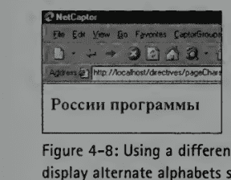

#### The isThreadSafe 属性

线程安全问题困扰着每一个涉及同时进行多个活动的计算机程序。例如，考虑一个分布式航空预订系统。两位旅行代理，Joan 和 John，从他们各自独立的隔间预订座位。Joan 查询数据库，发现 411 航班有一个空座位。她告诉她的客户该座位可用。在客户说“是”的几秒钟内，John 为他自己的客户预订了该座位。然后，当 Joan 试图预订该座位时，她得到了一个错误消息。从 Joan 的角度来看，出了问题。将页面指令的 `isThreadSafe` 属性设置为 `"false"` 会告诉系统在 Joan 的页面访问结束之前不要开始 John 的访问。该属性的默认值是 `"true"`。使用默认值 `"true"`，两个或更多的访问者可以同时使用和设置页面的值。

> 当我使用 `isThreadSafe` 属性时，我总是混淆“是”或“不是”安全是什么意思。`isThreadSafe` 属性的值 "true" 意味着同时运行此页面的多个副本是安全的。


### 第一部分：基础 JSP 脚本

要初始化你的实验性航空公司预订系统，请访问代码清单 4-14 所示的文档。

#### 代码清单 4-14：初始化预订系统

```
<% application.setAttribute("mostRecentlyBookedSeat", "0"); %>
mostRecentlyBookedSeat has been initialized to 0
```

接下来，访问代码清单 4-15 所示的页面。

#### 代码清单 4-15：预订页面

```
<%@ page isThreadSafe="true" %>
<%
  String mostRecentlyBookedSeat =
    (String)application.getAttribute("mostRecentlyBookedSeat");
  String newSeat = update(mostRecentlyBookedSeat);
  if (newSeat.equals(mostRecentlyBookedSeat))
    out.println("Sorry, the flight is already booked.");
  else {
    out.println("You are booked on seat " + newSeat);
    application.setAttribute("mostRecentlyBookedSeat", newSeat);
  }
%>

<%!
  String update(String mostRecentlyBookedSeat) {
    int mostRecent = Integer.parseInt(mostRecentlyBookedSeat);
    
    try {
      Thread.sleep(5000); //Simulating a processing delay
    } catch (InterruptedException e) {
      e.printStackTrace();
    }
    
    if (mostRecent < 100)
      return Integer.toString(mostRecent+1);
    else
      return Integer.toString(mostRecent);
  }
%>
```

代码清单 4-15 是一个特意设计的例子，目的是让 Joan 和 John 能够同时访问应用程序对象的属性。一个非特意设计的例子会复杂得多，关于线程安全性的要点可能会淹没在页面的复杂代码中。

在代码清单 4-15 的开头，我们通过将 `isThreadSafe` 默认值设为 "true" 来强调一个要点。然后我们获取 `mostRecentlyBookedSeat` 属性的值。我们尝试通过调用页面的 `update` 方法来获取下一个可用座位的编号。问题在于更新操作需要时间。为了模拟这种时间延迟，`update` 方法人为地调用了 `Thread` 类的 `sleep` 方法。这个调用使更新延迟了五秒钟——这正好足够让第二个用户开始访问同一个页面。

我先用 Internet Explorer 访问了代码清单 4-15 的页面，然后用 Netscape Navigator，接着又用 Internet Explorer。到了那时，页面显示我已被预订在 3 号座位。但随后我点击了 IE 的刷新按钮，并在五秒延迟期间切换到 Netscape Navigator 并点击了其重新加载按钮。五秒后，我假想的两个用户，Joan Explorer 和 John Navigator，都被预订在了 4 号座位。

#### buffer 属性

当容器构建响应文档时，它会将部分生成的文档存储在一个称为 `buffer`（缓冲区）的地方。如果你的 JSP 代码没有指定缓冲区的大小，容器会选择一个默认大小。（JSP 规范坚持这个默认缓冲区不得小于 8K。这相当于几页排版密集的响应内容。）你可以使用 `page` 指令的 `buffer` 属性来更改缓冲区的大小。

```
<%@ page buffer="32kb" %>
```

当缓冲区被填满时会发生什么？在正常情况下，容器会执行一次 `flush`（刷新）。当容器刷新缓冲区时，它会将缓冲区中已有的部分响应文档发送给请求的客户端计算机。任何尚未组装完成的响应部分将在下次刷新时发送。在整个响应组装完成后，容器会进行最后一次刷新。

为了理解这是如何工作的，我们将人为地生成一个非常大的响应文档。在组装响应时，容器可以修改其缓冲区中的任何内容。但是，在缓冲区被刷新后，其内容就发送给了请求的客户端，因此这些内容就被"铸刻"下来了。

例如，考虑一个 cookie。当你创建一个 cookie 时，它会作为响应头的一部分被发送。这个头部信息必须出现在用户浏览器窗口中实际显示的任何文本或标签之前。因此，当你第一次刷新响应的缓冲区时，容器会发送所有的响应头部信息以及任何已经组装好的显示内容。如果你第二次刷新同一个响应的缓冲区，你唯一能发送的就是显示内容。所有的头部信息，包括你创建的所有 cookie，都已经在第一次刷新时被提交了。图 4-9、4-10 和 4-11 阐述了这个概念。

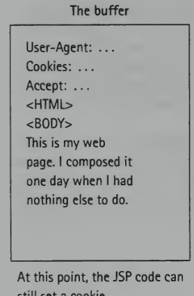

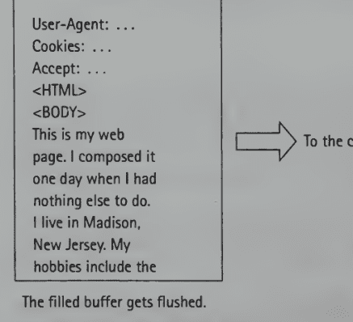

在代码清单 4-16 中，我们输出 1000 字节的数据，然后创建一个 cookie，再输出更多数据，再创建另一个 cookie，如此循环。*最终，缓冲区被填满，容器执行一次刷新。之后，容器开始重新填充缓冲区。代码清单 4-16 的输出如图 4-12 所示。

* 技术文献有时会模糊单个 cookie 和 cookie 集合之间的区别。在本节中，当我提到多个 cookie 时，我也可以将讨论重新表述为在单个 cookie 中的多个名称/值对。

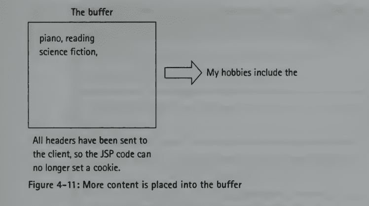

#### 代码清单 4-16：发送几千字节的内容和 14 个 cookie

```
<%!
    void printALot(JspWriter out) throws java.io.IOException {
        for (int i=0; i<1000; i++)
            out.print('x');
        out.println("<br>");
    }
%>

<%
    int count;
    String countStr;
    for (count=1; count<15; count++) {
        printALot(out);
        countStr = Integer.toString(count);
        response.addCookie (new Cookie(countStr,countStr));
%>
    Cookie <%=countStr%> has been set.<br>
<%
    }
%>
```

代码清单 4-16 使用了 `response` 对象的内置 `addCookie` 方法。这个方法会在客户端计算机上植入一个 cookie（假设客户端的浏览器已设置为接受 cookie）。`addCookie` 方法的两个参数分别是 cookie 的名称和 cookie 的值。（最简单的 cookie 不过就是这些——一个名称和一个值。）在代码清单 4-16 中，我们让第一个 cookie 的名称为 1，值也为 1。在更实际的场景中，你可能会创建一个名为 `customerInterest` 的 cookie，并将值设为 `music`。

### 第一部分：基础 JSP 脚本

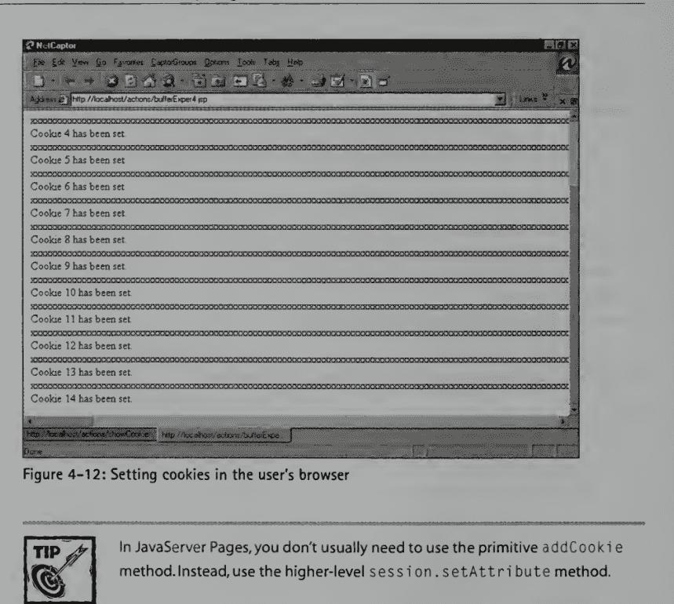

图 4-12：在用户浏览器中设置 cookie

> 提示：在 JavaServer Pages 中，你通常不需要使用底层的 addCookie 方法。相反，请使用更高级的 session.setAttribute 方法。

在图 4-12 中，请注意容器如何继续输出诸如 "Cookie 12 has been set" 这样的消息。这些消息具有误导性，因为在缓冲区被填满并刷新后，所有后续的设置 cookie 尝试当然会静默地失败。这一点的证据在代码清单 4-17 和图 4-13 中。

#### 代码清单 4-17：显示所有 cookie

```
<h3>Cookies:</h3>
<%
    Cookie cookies[] = request.getCookies();
    for (int i=0; i<cookies.length; i++) {
        out.print(cookies[i].getName());
        out.print("=");
        out.print(cookies[i].getValue());
        out.println("<br>");
    }
%>
```

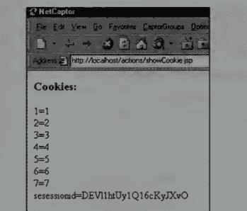

图 4-13：代码清单 4-16 的代码仅成功创建了七个 cookie。

代码清单 4-17 使用了 request 对象的内置 `getCookies` 方法。这个方法可以获取用户硬盘驱动器上与你的 Web 服务器关联的所有 cookie。图 4-13 显示，代码清单 4-16 的代码只在用户的硬盘驱动器上成功放置了七个 cookie。

#### 更改缓冲区大小

`page` 指令提供了一种增加缓冲区大小的方法。

```
<%@ page buffer="32kb" %>
```

将这一行添加到代码清单 4-16 的顶部。然后，在容器创建响应文档时，缓冲区永远不会被填满。容器在整个响应文档组装完成之前不会刷新。所有 14 个 cookie 都成功创建，如图 4-14 所示。

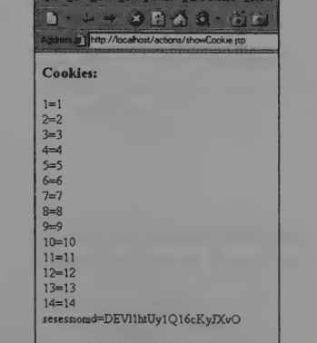

图 4-14：当代码清单 4-16 的缓冲区设置为 32kb 时，代码清单 4-17 的输出

> 大缓冲区会浪费服务器上的空间。如果多个同时生成大缓冲区的请求并发执行，这一点尤为明显。虽然能够传输大量内容并设置多个cookie是件好事，但在大多数情况下，默认的8KB缓冲区已绰绰有余。

#### 不使用缓冲区

页面指令的 `buffer` 属性有一个特殊的 "none" 值。将 `buffer` 设置为 "none" 会完全取消缓冲。为了演示这一点，我们在清单4-16的顶部添加了这一行：

`<%@ page buffer="none" %>`

清单4-16的输出看起来与之前相同，但它在浏览器窗口中的绘制速度慢得多。这种迟缓源于服务器暂停以单独发送响应的每个片段。在所有等待之后，我们重新访问清单4-17中的页面，发现清单4-16的修订代码根本无法设置任何cookie。（参见图4-15。）

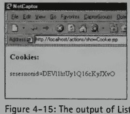

#### autoFlush 属性

页面指令还有一个影响缓冲的属性，那就是 `autoFlush` 属性。默认情况下，`autoFlush` 被设置为 "true"。当缓冲区已满时，容器会清空缓冲区并重新开始。然而，在清单4-16的代码中添加以下行：

`<%@ page autoFlush="false" %>`

然后，当缓冲区变满时，下一个输出字节将引发 IOException。如果我们运行清单4-16的代码并添加了这个新行，我们将看到图4-16所示的显示。

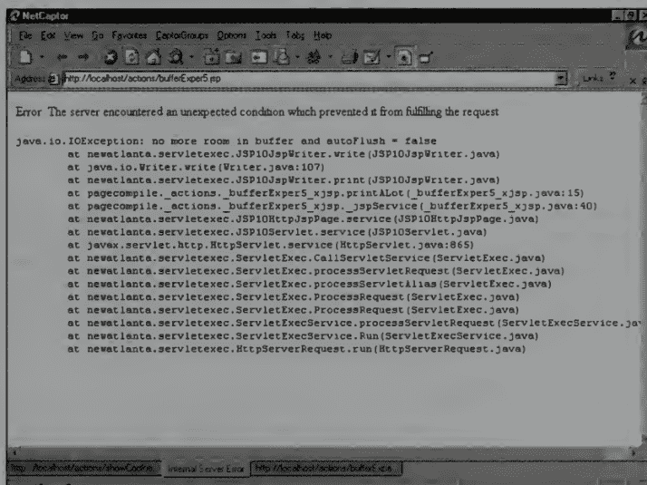

图4-16：尝试在将 autoFlush 设置为 "false" 时写入过多内容

将 autoFlush 设置为 "false" 很少有意义。即便如此，某些控制狂可以从他们能够完全掌控缓冲和刷新这一事实中获得安慰。你可以使用 out 对象的 flush 方法来亲力亲为，如清单4-18所示。

```
清单4-18：手动刷新

<%@ page autoFlush="false" %>

<%!
    void printALot(JspWriter out) throws java.io.IOException {
        for (int i=0; i<1000; i++)
            out.print('x');
        out.println("<br>");
        out.flush();
    }
%>

<%
    int count;
    String countStr;
    for (count=1; count<15; count++) {
        printALot(out);
        countStr = Integer.toString(count);
        response.addCookie(new Cookie(countStr, countStr));
%>
Cookie <%=countStr%> 已设置。<br>
<%
    }
%>
```

访问清单4-18的代码会产生如图4-12所示的显示，正如我们在清单4-16中看到的那样。所有的cookie都怎么了？在清单4-18中，容器有一个8KB的缓冲区，但在每次刷新前只使用了一小部分缓冲区。事实上，第一次刷新发生在第一次尝试设置cookie之前，因此实际上无法设置任何cookie。使用清单4-17的代码检查清单4-18的结果，会显示图4-15所示的界面。

#### extends 属性

当容器翻译JSP文档时，生成的Java代码总是扩展现有的Java类。例如，如果你访问Tomcat服务器上的一个页面，该页面的翻译包含如下一行代码：

```
public class _0002fjsp_0002factions_0002finc_0002ejspinc_jsp_0
    extends HttpJspBase {
```

不必在意这个冗长、丑陋的公共类名。重要的是新定义的类扩展了现有的 HttpJspBase 类。默认情况下，每个翻译后的页面都将扩展同一个基类。然而，在极端情况下，你可以选择覆盖默认设置。

清单4-19包含 MyCompanyPage 的定义——一个自制的Java类。因为我们计划让我们的JSP文档扩展这个新类，所以我们让新类扩展默认的基类 HttpJspBase。这样，任何扩展 MyCompanyPage 的文档都会继承任何普通JSP文档应有的功能。在 MyCompanyPage 类中，我们定义了一个额外的变量和几个额外的方法。任何页面扩展 MyCompanyPage 的人都可以立即使用这些新的定义。

清单4-19：JSP文档可以扩展的新类

```
import java.io.IOException;
import javax.servlet.jsp.JspWriter;
import org.apache.jasper.runtime.*;

public abstract class MyCompanyPage extends HttpJspBase
{

    protected String ourMotto =
        "\"If a single standard is good,<br>" +
        "a double standard is even better.\"";

    protected void displaySmallMotto (JspWriter out)
      throws IOException
      {
        out.print("<h6>" + ourMotto + "</h6>");
      }

    protected void displayLargeMotto (JspWriter out)
      throws IOException
      {
        out.print("<h1>" + ourMotto + "</h1>");
      }

    protected void displayAddress(JspWriter out)
      throws IOException
      {
        out.println("<address>");
        out.println("Burd s of a Feather<br>");
        out.println("P.O. Box 222<br>");
        out.println("West End, NJ");
        out.println("</address>");
      }
}
```

**HttpJspBase** 类恰好包含一个名为 **_jspService** 的抽象方法。因此，**MyCompanyPage** 必须实现 **_jspService** 或者被声明为抽象类。**HttpJspBase** 类是 **org.apache.jasper.runtime** 包的成员。（这个事实特定于Tomcat容器。如果你使用的是不同的容器，你可能需要导入不同的包，并扩展不同的基类。）

创建一个像 **MyCompanyPage** 这样的“方榫”时出现的一个主要问题是在服务器目录结构中找到一个“圆孔”来放置它。如果你将 **MyCompanyPage** 放入通常包含JSP文档的目录，容器将找不到 **MyCompanyPage**。相反，你需要编译 **MyCompanyPage.java**，并将生成的 **MyCompanyPage.class** 放在为Java **.class** 文件保留的目录中。（在Tomcat服务器上，我将 **MyCompanyPage.class** 放在目录 **tomcat\webapps\examples\WEB-INF\classes** 中。）完成此操作后，你就可以使用页面指令的 extends 属性了。清单4-20向你展示了如何操作。

#### 清单4-20：扩展 MyCompanyPage 类的页面

```
<%@ page extends="MyCompanyPage" %>

<center>
    <% displayLargeMotto(out); %>

    <h3>此页面正在建设中。</h3>

    <%= ourMotto %>
</center>

<% displayAddress(out); %>
```

当你访问清单4-20中的代码时，在浏览器窗口中看到的内容如图4-17所示。

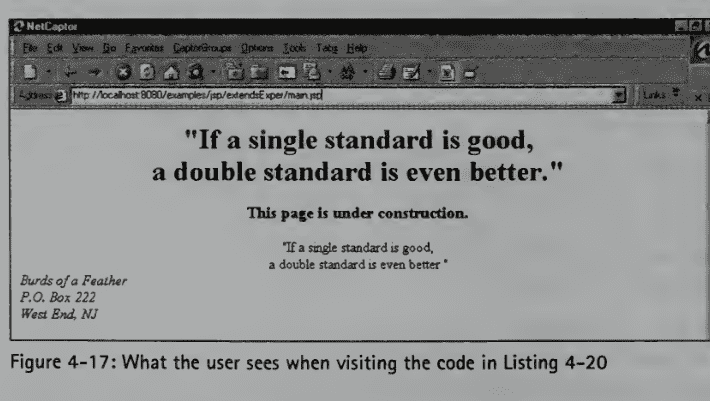

图4-17：用户访问清单4-20中代码时看到的内容

正如预期的那样，清单4-20以页面指令开始，并且该页面指令包含一个 extends 属性。extends 属性的值是被扩展的类的名称，而不是包含该类的文件的名称。（这就是为什么名称没有文件扩展名。）
通过创建一个新的基类，你实际上自定义了JavaServer Pages的工作方式。在清单4-20中，我们使用了 MyCompanyPage 类中定义的一些东西。想象一下，一家公司有许多标准化的项目，这些项目要在其多个网页中使用。创建一个新的基类使公司的每个人都能轻松地将这些标准化项目插入到他们的任何页面中。这使公司的网站具有统一、美观的外观。

> 在仔细考虑过所有更简单的替代方案之前，不要使用 extends 属性。扩展非默认基类的类可能很棘手。此外，当你扩展不同的类时，你冒着失去默认基类中定义的某些重要功能的风险。

### 使用页面指令的示例

JSP为你提供了多种方式来统计用户的访问次数。如果你将计数与会话关联，你就可以统计用户访问你站点的次数（参见清单3-10及其后的改进递增方法）。或者，你可以在JSP声明中创建一个计数器，或者将计数器与隐式的 application 对象关联（参见清单2-3）。无论哪种情况，你统计的都是所有用户的总访问次数。问题在于，只要你停止并重新启动服务器，计数器的生命周期就会结束。对于一个持续多年的计数器，你可以将总访问次数存储在服务器硬盘上的文件中。代码如清单4-21所示。

清单4-21：将访问次数存储在文件中

```
<%-- countRasputin.jsp --%>

<%@ page
    import="java.io.*"
    errorPage="counterError.jsp"
    isThreadSafe="false"
%>

<%!
    int count;
    RandomAccessFile randFile;

    public void jspInit() {
        try {
            randFile = new RandomAccessFile("rasputin","rw");
            count = randFile.readInt();
            randFile.seek(0L);
        } catch (IOException e) {
            e.printStackTrace();
            count=1;
        }
    }

    public void storeCount() {
        try {
            randFile.writeInt(count);
            randFile.seek(0L);
        } catch (IOException e) {
            e.printStackTrace();
        }
    }
%>
```


public void jspDestroy() {
    try {
        storeCount();
        randFile.close();
        randFile=null;
    } catch (IOException e) {
        e.printStackTrace();
    }
}

您是第<%= count++ %>位访问者。
<%
    if (count%10 == 0)
        storeCount();
%>

清单4-21中的页面指令包含三个属性。

- import属性使得代码更容易进行文件的读写操作。
- 一旦开始进行文件I/O操作，你就需要异常处理代码。因此，清单4-21中的页面指令包含了一个errorPage属性。
- 你的网站访问者可能会同时尝试更新rasputin文件，从而导致相互冲突。为了保持计数值的准确性，页面指令包含了一个isThreadSafe属性。

### jspInit和jspDestroy方法

当你的JSP文档首次被访问（或服务器重启）时，容器会运行一个名为jspInit的方法。你可以在页面的声明中定义jspInit。在清单4-21中，我们使用jspInit来获取页面被访问的次数。当文档初始化时，jspInit会打开存储访问次数的文件，并将次数读取到count变量中。

你需要保持文件打开，直到容器调用另一个名为jspDestroy的方法。当页面被卸载时，容器会调用jspDestroy。（参见第1章“JavaServer Pages如何工作”部分中的步骤9。）

清单4-21使用了一个额外的策略。你希望保持访问次数文件是最新的，但每次用户访问页面都写入文件并不实际。因此，在页面底部的小脚本段中，你使用了Java的取余运算符（%）。每当计数增加到能被十整除时，你就调用你自己的storeCount方法。storeCount方法会用最新的count值更新文件。

> 当你使用页面指令的`errorPage`属性时，翻译器只会为其`_jspService`方法创建异常处理代码。翻译器不会为你在页面上定义的任何其他方法创建异常处理代码。这就是为什么在清单4-21中，我们在`jspInit`、`storeCount`和`jspDestroy`方法中添加了`try...catch`语句。

### `taglib`指令

JSP还有一个额外的指令——`taglib`指令。在第13章和第14章中，在这个指令的帮助下，你将通过创建自己的自定义标签来扩展JSP的功能列表。这将为你的页面增添强大功能，但更重要的是，它将使你的页面更易于编写和维护。

在深入这些内容之前，你需要先学习接下来八章的主题。

### 总结

指令告诉容器组合某些语句，并将它们放置在你的JSP文档的翻译结果中。每个指令由一个指令名称后跟一个或多个属性名/值对组成。JSP支持三种不同的指令名称：`include`、`page`和`taglib`。

`include`指令使你能够将样板代码插入到一个或多个JSP文档中。

`page`指令使你能够描述文档的某些特性。例如，你可以将Java的import和异常处理功能应用到页面的脚本段中，指示页面不参与HTTP会话，或设置响应的MIME类型。

JSP有两个特殊的方法名：`jspInit`和`jspDestroy`。你可以在JSP文档中定义这些方法。容器在文档初始化时执行`jspInit`，在文档销毁时执行`jspDestroy`。

# 第5章
## 从Servlet中能学到什么

### 本章内容
- Java servlet简介
- JSP文档如何被翻译成servlet
- servlet能告诉你关于原始JSP文档的哪些信息

在JavaServer Pages出现之前，就已经有了Java servlet。本质上，JSP技术为你提供了一种简单、直观的方式来编写Java servlet。本章将检查当容器将你的JSP文档翻译成Java程序时生成的代码。这能让你更好地理解创建JavaServer Pages的一些规则。它也能帮助你调试来自容器的错误信息。

### Servlet

运行在Web服务器上，并使用库包`javax.servlet`和`javax.servlet.http`来响应用户请求的Java程序，被称为servlet。一个非常简单的servlet如清单5-1所示。

```java
import javax.servlet.*;
import javax.servlet.http.*;
import java.io.*;

public class Welcome extends HttpServlet {
    public void doGet(HttpServletRequest request,
                      HttpServletResponse response)
        throws IOException, ServletException {
        response.setContentType("text/html");
        PrintWriter out = response.getWriter();
        out.println("<h1>Welcome to BurdBrain.com!</h1>");
    }
}
```

**清单5-1：** 一个非常简单的servlet

清单5-1中的servlet名为Welcome。因为类是public的，所以代码必须存在于名为Welcome.java的文件中。当你编译Welcome.java时，你会得到一个名为Welcome.class的文件。如果用户访问http://www.SomeWebSiteOrOther.com/Welcome，用户的浏览器将收到以下单行文档：

<h1>Welcome to BurdBrain.com!</h1>

服务器运行清单5-1中的doGet方法以响应特定类型的HTTP请求。（要了解更多关于GET请求以及它与其他类型请求的区别，请参阅附录B。）doGet方法的参数是来自用户的传入请求和返回给用户的传出响应。与JSP文档不同，servlet没有隐式对象。你通过调用response参数的getWriter方法来打开一个通往用户浏览器的通道。通道创建后，你调用println方法将文本放入传出的响应流中。

### 一个更有趣的servlet

清单5-2展示了一个使用HTML表单的稍微复杂一点的servlet。

**清单5-2：** 带HTML表单的servlet

```java
import javax.servlet.*;
import javax.servlet.http.*;
import java.io.*;

public class SimpleForm extends HttpServlet {
  public void doGet(HttpServletRequest request,
                    HttpServletResponse response)
       throws IOException, ServletException
  {
    response.setContentType("text/html");
    PrintWriter out = response.getWriter();
    out.println("<body bgcolor=lightgrey>");
    String whateverValue = request.getParameter("whatever");
    if (whateverValue != null)
      out.println(whateverValue + "<p>");
    out.println("<form action=SimpleForm>");
    out.print ("  <input type=text size=15");
    out.println("     name=\"whatever\"><p>");
    out.println("  <input type=Submit value=Submit>");
    out.println("</form>");
  }
}
```

### 第5章：从Servlet中能学到什么

图5-1、5-2和5-3展示了用户访问此servlet时可能发生的情况。首先，在图5-1中，用户的浏览器显示一个文本字段和一个按钮。（浏览器收到的HTML代码如清单5-3所示。）

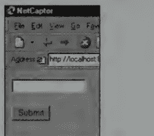

图5-1：用户首次访问SimpleForm servlet时所见

**清单5-3：** 浏览器首次访问SimpleForm servlet时收到的内容

```html
<body bgcolor=lightgrey>
<form action=SimpleForm>
  <input type=text size=15    name="whatever"><p>
  <input type=Submit value=Submit>
</form>
```

在图5-2中，用户在文本字段中输入了名字Barry。然后用户点击按钮。

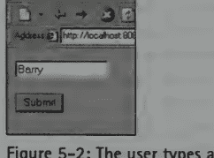

图5-2：用户在文本字段中输入一个名字。

表单的`action`字段指向servlet本身。用户点击提交按钮的结果是，服务器收到以下请求：

```
http://www.SomeWebSiteOrOther.com/SimpleForm?whatever=Barry
```

问号后的额外文本是由用户的Web浏览器附加到URL上的。之所以发生这种情况，是因为提交的表单包含一个名为`whatever`的文本字段。

当服务器收到此请求时，它会再次运行`SimpleForm`。在执行程序时，服务器调用请求的`getParameter`方法。对


### JavaServer 页面如何转化为 Servlet

在第一章中，我描述了 JSP 容器接收请求时所采取的步骤。如果该页面从未被请求过，容器会将该页面翻译成一个 Java 程序（一个扩展名为 .java 的源文件），然后编译该 Java 程序以获得一个 Java .class 文件。根据你如何使用术语，.java 文件或 .class 文件都可以被称为 servlet。.java 文件是 servlet 的人类可读形式，而 .class 文件是机器可执行版本。

清单 5-5 展示了一个简单的 JSP 文档。清单 5-6 展示了由 Sun 的参考实现服务器 Tomcat 翻译生成的 servlet。（为防止长行在不合适的位置自动换行，我对 Tomcat 生成的原始代码做了一点调整。）

清单 5-5：一个简单的 JSP 文档

```
<%-- Welcome.jsp --%>
<h1>Welcome to BurdBrain.com!</h1>
```

清单 5-6：清单 5-5 中的代码，翻译成的 servlet

```
package jsp.toServlet;

import javax.servlet.*;
import javax.servlet.http.*;
import javax.servlet.jsp.*;
import javax.servlet.jsp.tagext.*;
import java.io.PrintWriter;
import java.io.IOException;
import java.io.FileInputStream;
import java.io.ObjectInputStream;
import java.util.Vector;
import org.apache.jasper.runtime.*;
import java.beans.*;
import org.apache.jasper.JasperException;

public class
_0002fjsp_0002ftoServlet_0002fWelcome_0002ejspWelcome_jsp_0
extends HttpJspBase {

static {
}
public
_0002fjsp_0002ftoServlet_0002fWelcome_0002ejspWelcome_jsp_0()
{
}

private static boolean _jspx_inited = false;

public final void _jspx_init() throws JasperException {
}

public void _jspService
(HttpServletRequest request, HttpServletResponse response)
throws IOException, ServletException {

JspFactory _jspxFactory = null;
PageContext pageContext = null;
HttpSession session = null;
ServletContext application = null;
ServletConfig config = null;
JspWriter out = null;
Object page = this;
String _value = null;
try {
if (_jspx_inited == false) {
    _jspx_init();
    _jspx_inited = true;
}
_jspxFactory = JspFactory.getDefaultFactory();
response.setContentType("text/html;charset=8859_1");
pageContext =
    _jspxFactory.getPageContext(this, request, response,
        "", true, 8192, true);

application = pageContext.getServletContext();
config = pageContext.getServletConfig();
session = pageContext.getSession();
out = pageContext.getOut();

// HTML // begin [file=
//   "C:\\jsp\\toServlet\\Welcome.jsp";
//   from=(0,21);to=(1,34)]
    out.write("\r\n<h1>Welcome to BurdBrain.com!</h1>");
// end

} catch (Exception ex) {
    if (out.getBufferSize() != 0)
        out.clearBuffer();
    pageContext.handlePageException(ex);
} finally {
    out.flush();
    _jspxFactory.releasePageContext(pageContext);
}
}
```

在清单 5-6 中，你应该特别注意那些加粗的行。首先注意导入了多个包。名为 `org.apache.jasper.runtime` 的包包含将 JSP 文档翻译成 Java 程序所需的类。（Jasper 是 Tomcat 项目中 JSP 容器的原始名称。）清单 5-5 中的整个 JSP 文档被翻译成一个 Java 类。容器通过在 .jsp 文件名的基础上进行扩充，制造出一个很长的类名（在本例中是 `_0002fjsp_0002ftoServlet...`）。新创建的 Java 源文件的大部分空间被一个名为 `_jspService` 的方法占用。每当用户访问 JSP 文档时，容器就会调用此方法。该方法的参数是来自用户的传入请求和返回给用户的传出响应。在清单 5-6 中，`_jspService` 方法中的关键语句是：

```
out.write("\r\n<h1>Welcome to BurdBrain.com!</h1>");
```

这条语句才是真正将文本写入用户的 Web 浏览器的语句。如果你检查从 JSP 文档生成的 servlet，你会注意到字符 `\r\n` 出现得相当频繁。翻译器会自动将这些 Java 转义字符添加到发送给用户浏览器的文本中。`\r` 在响应文档中放置一个回车符；`\n` 在响应文档中开始新的一行文本。这些转义字符很少影响用户在 Web 浏览器窗口中实际看到的内容。翻译器创建指向原始 JSP 文档的注释。例如：

```
// HTML // begin [file=
// "C:\\jsp\\toServlet\\Welcome.jsp";
// from=(0,21);to=(1,34)]

// end
```

这样的注释表明，`begin` 和 `end` 之间的 Java 语句来自名为 `C:\jsp\toServlet\Welcome.jsp` 的文件。（别相信这个！翻译器对路径名做了些自由发挥。在我电脑上，该文件的真实路径是 `C:\tomcat\webapps\examples\jsp\toServlet\Welcome.jsp`。）翻译器从 0 开始为 JSP 文档中的行和列编号。因此，根据注释，JSP 文档中的相关文本从第 0 行第 21 列开始，到第 1 行第 34 列结束。如果你需要调试工作，这些信息会很有帮助。

注意清单 5-6 中隐式对象是在哪里创建的。它们都在 `_jspService` 方法内部声明。这意味着像 `application`、`session` 和 `out` 这样的变量具有有限的生命周期。每个变量都引用一个为每个用户请求新创建的对象。就作用域而言，`_jspService` 方法之外的任何代码都无法访问这些隐式对象。这一观察结果的含义将在下一节变得更加明显。

当 JSP 文档首次被访问时（无论是有史以来第一次，还是在容器停止并重新启动之后），容器会运行 `_jspx_init` 方法。顾名思义，此方法中的任何语句都用于初始化 JSP 文档的属性。在清单 5-6 中，`_jspx_init` 方法什么也没做。但对于某些 JSP 文档，某些容器会将大量代码放入 `_jspx_init` 方法中。

> 不要将此 `_jspx_init` 方法与第 4 章描述的 `jspInit` 方法混淆。容器创建自己的 `_jspx_init` 方法；然而，作为 JSP 程序员，你可以定义自己的 `jspInit` 方法。每当加载文档时，这两个方法都会执行。

### 声明

在第二章中，我指出了一些声明和脚本片段之间的区别。本节的示例向你展示其内部工作原理。如果你在使用 JSP 代码时需要解决关于声明和脚本片段的争论，你可以通过查阅翻译后的 Java 代码来解决它。

清单 5-7 包含一个带有两个 JSP 声明和一个脚本片段的 JavaServer 页面。

清单 5-7：包含 JSP 声明和脚本片段的 JavaServer 页面

```
<%! int tally=1; %>
<%
    int count=1;
    addFiveToTally();
    count=addFiveTo(count);
%>
The tally is <%= tally %>.<br>
The count is <%= count %>.

<%!
    public void addFiveToTally() {
        tally+=5;
    }

    public int addFiveTo(int count) {
        return count+5;
    }
%>
```

清单 5-7 有两个变量——`tally`，在 JSP 声明中创建；`count`，在 JSP 脚本片段中创建。该文档有两个 JSP 方法，都在 JSP 声明中声明。由于 `count` 变量是在脚本片段中声明的，因此该变量不能直接用于 `addFiveTo` 方法的代码。为了弥补这一点，我们将 `count` 作为参数传递给 `addFiveTo` 方法。翻译后的 Java 程序如清单 5-8 所示。（同样，你在清单 5-8 中看到的内容并非与 Tomcat 容器生成的代码逐字相同。在可能的情况下，我移动了一些东西以防止行在尴尬的位置换行。我还删除了一些 Java 注释。）

清单 5-8：清单 5-7 中的代码，翻译成的 servlet

```
package jsp.toServlet;

import javax.servlet.*;
import javax.servlet.http.*;
import javax.servlet.jsp.*;
import javax.servlet.jsp.tagext.*;
import java.io.PrintWriter;
import java.io.IOException;
import java.io.FileInputStream;
import java.io.ObjectInputStream;
import java.util.Vector;
import org.apache.jasper.runtime.*;
import java.beans.*;
import org.apache.jasper.JasperException;

public class _0002fjsp_0002ftoServlet_0002fscopeTest_0002ejspscopeTest_jsp_0
    extends HttpJspBase {
    int tally=1;

    public void addFiveToTally() {
```


### 第一部分：基础 JSP 脚本

```java
tally+=5;
}

public int addFiveTo(int count) {
    return count+5;
}

static {
}
public
_0002fjsp_0002ftoServlet_0002fscopeTest_0002ejspScopeTest_jsp_0
    () {}

private static boolean _jspx_inited = false;

public final void _jspInit() throws JasperException {
}

public void _jspService
    (HttpServletRequest request, HttpServletResponse response)
        throws IOException, ServletException {

    JspFactory _jspxFactory = null;
    PageContext pageContext = null;
    HttpSession session = null;
    ServletContext application = null;
    ServletConfig config = null;
    JspWriter out = null;
    Object page = this;
    String _value = null;
    try {

        if (_jspx_inited == false) {
            _jspInit();
            _jspx_inited = true;
        }
        _jspxFactory = JspFactory.getDefaultFactory();
        response.setContentType("text/html;charset=8859_1");
        pageContext =
            _jspxFactory.getPageContext(this, request, response,
                "", true, 8192, true);

        application = pageContext.getServletContext();
        config = pageContext.getServletConfig();
        session = pageContext.getSession();
        out = pageContext.getOut();

        out.write("\r\n");

        int count=1;
        addFiveToTally();
        count=addFiveTo(count);

        out.write("\r\nThe tally is ");
        out.print( tally );
        out.write(".<br>\r\nThe count is ");
        out.print( count );
        out.write(".\r\n\r\n");
        out.write("\r\n\r\n\r\n  ");

    } catch (Exception ex) {
        if (out.getBufferSize() != 0)
            out.clearBuffer();
        pageContext.handlePageException(ex);
    } finally {
        out.flush();
        _jspxFactory.releasePageContext(pageContext);
    }
}
```

清单 5-8 中的代码遵循了 Java 类的常规模式：

```java
class className {

    类范围变量的声明

    方法等的声明

    方法标题 {
        方法局部变量的声明
    }
}
```

请注意，在 JSP 声明中创建的变量 `tally`，在 Java 代码中是如何被声明为一个类范围变量的。这就是为什么变量名 `tally` 在方法 `addFiveToTally` 中可用。相比之下，变量 `count` 是在 JSP 小脚本中创建的。在 Java 代码中，`count` 是在方法 `_jspService` 内部声明的。因此，这个 `count` 变量的作用域不包括方法 `addFiveTo`。为了让程序正常工作，我们必须将 `count` 作为参数传递给方法 `addFiveTo`。

在第 3 章中，我强调过你不能在 JSP 声明中引用隐式对象。现在你明白为什么了。所有隐式对象都是 `_jspService` 方法的局部变量。但在 JSP 声明中创建的任何内容都会被声明为一个类范围的名称，位于 `_jspService` 方法之外。因此，JSP 声明中的代码无法访问任何隐式对象。

在第 2 章中，我提到过不能在 JSP 小脚本内定义方法。现在原因很清楚了。在小脚本中定义的任何内容都会被声明在 `_jspService` 方法内部。但是，在 Java 中，你不能在一个方法内部定义另一个方法。

### include 指令

在本节中，我们重新探讨 include 指令。一个包含 include 指令的页面如清单 5-9 所示。

```
清单 5-9：一个包含 include 指令的 JSP 文档
This page is under construction.<p>
<%@ include file="copyrightNotice" %>
```

被包含的文件 `copyrightNotice` 如清单 5-10 所示。

```
清单 5-10：copyrightNotice 文件
<%-- copyrightNotice --%>

<%! String companyName = "Burd Brain Consulting"; %>
<p>&copy; 2000 <%=companyName%>.
   Any unauthorized use of these materials will be prosecuted
   to the fullest extent of the law.<p>
```

转换后的 Java 程序（清单 5-11）与未使用 include 指令时生成的文件几乎没有区别。唯一的区别是，一些注释引用的是文件 `copyrightNotice`，而不是 `include.jsp`。

```java
清单 5-11：清单 5-9 中代码的转换结果
package jsp.toServlet;

import javax.servlet.*;
import javax.servlet.http.*;
import javax.servlet.jsp.*;
import javax.servlet.jsp.tagext.*;
import java.io.PrintWriter;
import java.io.IOException;
import java.io.FileInputStream;
import java.io.ObjectInputStream;
import java.util.Vector;
import org.apache.jasper.runtime.*;
import java.beans.*;
import org.apache.jasper.JasperException;

public class
  _0002fjsp_0002ftoServlet_0002finclude_0002ejspinclude_jsp_2
  extends HttpJspBase {

  // begin [file=
  //  "C:\\jsp\\toServlet\\copyrightNotice";
  //  from=(2,3);to=(2,50)]
      String companyName = "Burd Brain Consulting";
  // end

  static {
  }
  public
  _0002fjsp_0002ftoServlet_0002finclude_0002ejspinclude_jsp_2
    ( ) {}

  private static boolean _jspx_inited = false;

  public final void _jspx_init() throws JasperException {
  }

  public void _jspService
    (HttpServletRequest request, HttpServletResponse response)
      throws IOException, ServletException {

    JspFactory _jspxFactory = null;
    PageContext pageContext = null;
    HttpSession session = null;
    ServletContext application = null;
    ServletConfig config = null;
    JspWriter out = null;
    Object page = this;
    String _value = null;
    try {

      if (_jspx_inited == false) {
        _jspx_init();
        _jspx_inited = true;
      }
      _jspxFactory = JspFactory.getDefaultFactory();
      response.setContentType("text/html;charset=8859_1");
      pageContext =
          _jspxFactory.getPageContext(this, request, response,
              "", true, 8192, true);

      application = pageContext.getServletContext();
      config = pageContext.getServletConfig();
      session = pageContext.getSession();
      out = pageContext.getOut();

      // HTML // begin [file=
      // "C:\\jsp\\toServlet\\include.jsp";
      // from=(0,0);to=(1,0)]
      out.write
          ("This page is under construction.<p>\r\n");
      // end
      // HTML // begin [file=
      // "C:\\jsp\\toServlet\\copyrightNotice";
      // from=(0,25);to=(2,0)]
      out.write("\r\n\r\n");
      // end
      // HTML // begin [file=
      // "C:\\jsp\\toServlet\\copyrightNotice";
      // from=(2,52);to=(3,15)]
      out.write("\r\n<p>&copy; 2000 ");
      // end
      // begin [file=
      // "C:\\jsp\\toServlet\\copyrightNotice";
      // from=(3,18);to=(3,29)]
      out.print(companyName);
      // end
      // HTML // begin [file=
      // "C:\\jsp\\toServlet\\copyrightNotice";
      // from=(3,31);to=(5,38)]
      // 下一行被拆分以适应本书的页边距。
      //   在实践中，双引号字符串中的所有内容
      //   必须位于单行上。
      out.write(". \r\n Any unauthorized use of these materials will be prosecuted \r\n to the fullest extent of the law.<p>");
      // end

    } catch (Exception ex) {
        if (out.getBufferSize() != 0)
            out.clearBuffer();
        pageContext.handlePageException(ex);
    } finally {
        out.flush();
        _jspxFactory.releasePageContext(pageContext);
    }
  }
}
```

原始文件 `include.jsp` 并没有定义变量 `companyName`。相反，该变量是在 `copyrightNotice` 被粘贴到 `include.jsp` 中时定义的。因此，你可能预期转换后的 Java 文件会将 `companyName` 的声明放在代码的某个单独的角落，它可能对程序的其余部分可用，也可能不可用。但事实并非如此。在创建 servlet 之前，容器实际上会将 `copyrightNotice` 的文本粘贴到 include 指令所在的位置。当容器准备好创建 servlet 时，容器看到的内容如下所示。

```
This page is under construction.<p>
<%-- copyrightNotice --%>

<%! String companyName = "Burd Brain Consulting"; %>
<p>&copy; 2000 <%=companyName%>.
   Any unauthorized use of these materials will be prosecuted
   to the fullest extent of the law.<p>
```

与所有 JSP 声明一样，容器使用声明中的代码来创建类范围的名称。因此，在清单 5-11 中，`companyName` 是一个完全合格的类范围变量。就好像从未进行过包含操作一样，声明 `companyName` 的代码行出现在打印 `This page is under construction` 的代码行之前。（即使转换器首先遇到“正在建设中”的消息，然后才是 include 指令，这种情况也会发生。）

在第 6 章中，我将介绍另一种包含方式——include 动作。届时，转换后的 Java servlet 代码将让我们深入了解这两种包含方式之间的区别。

### 从 Servlet 获取调试帮助

清单 3-7 和 3-8 包含用于检查访客用户名和密码的代码。为方便起见，这些文档在此复制为清单 5-12 和 5-13。


### 5-12 清单：服务器 www.BurdBrain.com 上的文件 login.htm

```html
<!-- login.htm for www.BurdBrain.com -->
<form action="authenticate.jsp">
  Username: <input type=text name=username><br>
  Password: <input type=password name=password><br>
  <input type=submit value=Submit>
</form>
```

### 5-13 清单：文件 authenticate.jsp

```jsp
<%-- authenticate.jsp --%>
<%
  if (request.getParameter("password").equals("swordfish")) {
%>
  <h2>Welcome, <%=request.getParameter("username")%>!</h2>
<%
  } else {
%>
  <% response.sendError(403); %>
<%
  }
%>
```

测试你的页面会产生一个错误消息。消息的一部分如图5-4所示。
图5-4中的消息提到了一个空指针。但消息的一部分超出了屏幕的右侧。当你向右滚动时，你会看到以下线索：

```
jsp_0002ftoServlet_0002fauthenticate_0002ejspauthenticate_jsp_0.java :62)
```

该线索指向翻译后的.java文件的第62行。当你查看翻译后的servlet时，你会发现第62行有以下代码：

```
if (request.getParameter("password").equals("swordfish")) {
```

> 使用Tomcat容器时，所有翻译后的servlet都位于work目录的一个子目录中。

### 第5章：通过查看Servlet可以学到什么

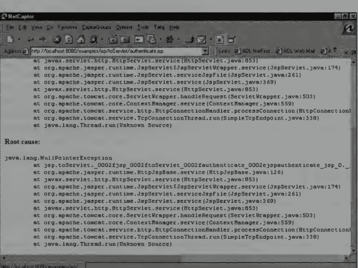

本书的CD-ROM包含一个名为TextPad的超级文本编辑器。除了对Java和JSP文档进行语法高亮显示外，TextPad还有一个有用的“查看行号”功能——你不必从顶部开始计数来找到第62行。

在第62行的某个地方，你抛出了一个 `NullPointerException`。要么是request变量指向了无处（不太可能），要么是 `request.getParameter("password")` 的求值结果为null。如果你再次查看浏览器地址栏中的URL（图5-4），你会看到以下内容：

```
http://localhost:8080/examples/jsp/toServlet/authenticate.jsp
```

所以，情况是这样的。在测试你的代码时，你访问了 `authenticate.jsp`，但没有首先访问 `login.htm`。你忘记了 `login.htm` 中的表单作为其请求的一部分发送参数信息。

```
http://localhost:8080/examples/jsp/toServlet/authenticate.jsp?username=joe&password=swordfish
```

（当然，请求中不应有换行符。我为了适应本书的页面宽度而换行了。）因为你的请求没有密码参数，表达式 `request.getParameter("password")` 的求值结果为null。然后，当你尝试对null应用equals方法时，就抛出了一个 `NullPointerException`。

你应该在 `authenticate.jsp` 代码中进行补偿，还是可以假设没有人会从 `login.htm` 以外的页面访问 `authenticate.jsp`？当然，你应该修改你的 `authenticate.jsp` 代码。你可能无法设想用户绕过 `login.htm` 的场景，但这并不意味着它永远不会发生。

### 总结

Java servlet是一个在服务器上响应请求的类。JSP容器将JavaServer页面转换为Java servlet。每个这样的servlet都包含一个 `_jspService` 方法，该方法在用户请求页面时被调用。

在JSP声明中声明的任何名称在生成的servlet中都成为类范围的名称。在JSP scriptlet中声明的任何变量都成为 `_jspService` 方法的方法局部变量。关于Java声明在JSP文档中放置位置的规则源于应用于翻译后servlet代码的Java作用域规则。

当你对JSP文档应该如何表现有疑问时，通常可以通过检查翻译后的servlet代码找到答案。当容器显示错误消息时，该消息有时会指向servlet代码中的一行。检查servlet代码可以帮助你找到错误的根源。

## 第6章

## 标准动作

在本章中

- 什么是JSP动作
- 如何使用JSP动作
- 动作名称及其属性是什么

在第1章中，我说明了JavaServer Pages有四种不同的元素：

- 脚本元素
- 指令
- 动作
- XML标签

本章涵盖列表中的第三项——动作。七个动作内置于JavaServer Pages中。这些被称为*标准动作*，因为它们在每个有效的JSP容器中工作方式相同。本章涵盖七个标准动作中的四个。其余三个动作与JavaBeans一起工作，在第8章中涵盖。

### 动作标签语法

所有JSP动作标签都基于*可扩展标记语言（XML）*语法构建。就像它们的HTML表亲一样，XML标签有三种形式：

- 一个*开始标签*开始一个元素。
- 一个*结束标签*标记一个元素的结束。在元素的开始标签和结束标签之间，放置元素的*内容*。
- 一个*空标签*标记一个完整的元素，从开始到结束，内部没有内容。

### 124 第1部分：基础JSP脚本

例如，在代码中

```jsp
<jsp:include page="writeItem.jsp" flush="true">
    <jsp:param name="item" value="t-shirts" />
    <jsp:param name="unitcost" value="15.00" />
    <jsp:param name="style" value="XLarge" />
</jsp:include>
```

标签 `<jsp:include ...>` 是一个开始标签，标签 `</jsp:include>` 是一个结束标签。代码有三个空的 `<jsp:param ...>` 标签。因为 jsp:param 标签夹在 jsp:include 开始和结束标签之间，所以我们说 jsp:param 标签构成了 jsp:include 元素的内容。

每个元素都有一个名称。大致来说，元素的名称描述了它是什么类型的元素。这反过来决定了标签在文档处理中将产生什么样的效果。JSP有七个内置动作元素名称：jsp:include、jsp:param、jsp:forward、jsp:plugin、jsp:useBean、jsp:setProperty 和 jsp:getProperty。每个内置动作名称都以 jsp: 开头。在XML世界中，前缀 jsp 被称为命名空间。所有JavaServer Pages动作都属于 jsp 命名空间。

每个标签都包含在一对尖括号——字符 < 和 > 中。在括号内，你使用以下规则：

- 开始标签以元素名称开头。
- 结束标签只包含一个正斜杠（/）后跟元素名称。
- 空标签以元素名称开头，以正斜杠（/）结束。

开始标签或空标签可以有一个或多个属性名/值对。每个内置动作名称支持某些属性名。每个属性名都有一组合法的值。例如，标签

```jsp
<jsp:include page="writeItem.jsp" flush="true">
```

有两个属性名/值对。第一对有名称 page 和值 "writeItem.jsp"。第二对有名称 flush 和值 "true"。


空标签不包含内容。结束标签没有属性。

> 在XML标签中，属性值必须用双引号括起来。
因此 flush="true" 形成一个合法的名/值对，而 flush=true 则不是。

### include动作

在第4章中，你了解了include指令。JSP容器用另一个文件的内容替换include指令。要复习，请参见清单6-1。

```
清单6-1：使用include指令
This page is under construction.<p>
<b><%@ include file="copyrightNotice.jsp" %></b><p>
<h6>Last updated: May 2001</h6>
```

像第4章的include指令一样，include动作标签被另一个文件的内容替换。清单6-2中的代码使用了一个include动作标签。

```
清单6-2：使用include动作
This page is under construction.<p>
<b><jsp:include page="copyrightNotice.jsp" flush="true" /></b><p>
<h6>Last updated: May 2001</h6>
```

清单6-1和6-2中的标签调用另一个名为copyrightNotice.jsp的文件。copyrightNotice.jsp的内容可能看起来像清单6-3中的代码。

```
清单6-3：文件 copyrightNotice.jsp
&copy;
<%=java.util.Calendar.getInstance().get(java.util.Calendar.YEAR)%>
Burd Brain Consulting.
```

图6-1显示了用户访问清单6-1或6-2中的页面时将看到的内容。

include动作有两个属性。page属性告诉容器要包含哪个文档。flush属性告诉容器将响应文档中已经组成的任何部分发送到客户端计算机，然后再处理包含的文档。（我在本章后面详细介绍了flush属性。）


### `include` 指令与 `include` 动作

你有两种方式将内容插入到 JSP 文档中。可以使用 `include` 指令或 `include` 动作。两者有什么区别？为什么选择其中一个而不是另一个？

表面上看，这两个 JSP 元素似乎完成完全相同的功能。但实际上，它们的工作方式略有不同。

-   使用指令时，所有包含都在翻译时完成。被包含的文档被融入包含文档的 Java 代码中。当用户发出请求时，容器仅运行来自一个 `.java` 文件的代码。参见图 6-2。

-   使用 `include` 动作时，容器会保持包含文档和被包含文档的分离。如果被包含文档本身是一个 `.jsp` 文件，那么你会得到两个 `.java` 源文件。一个是包含 `include` 动作的任何 `.jsp` 文档的源文件，另一个是被包含的 `.jsp` 文档的源文件。实际的包含是在请求时完成的。对于每个请求，容器运行包含文档的 `.java` 文件中的代码。反过来，包含文档的 `.java` 文件中的一条语句会调用被包含文档的 `.java` 文件中的代码。参见图 6-3。

### Servlet 代码

一个名为 ServletExec 的 JSP 容器，由 Unify 公司开发，创建了清单 6-4、6-5 和 6-6。就像电视上播放电影时所做的那样，我对代码进行了一些修改，使其更容易适应本书有限的页面宽度。

清单 6-4 是清单 6-1 中代码的翻译结果。请注意容器如何处理 `include` 指令。来自被包含的 `copyrightNotice.jsp` 文件的代码被插入到包含页面 Java 源文件的中间。（`copyrightNotice.jsp` 中的代码在清单 6-4 中以粗体显示。）

#### 清单 6-4：清单 6-1 中 `include` 指令的翻译结果

```java
package pagecompile._actions;

import javax.servlet.*;
import javax.servlet.jsp.*;
import javax.servlet.http.*;
import javax.servlet.jsp.tagext.*;
import newatlanta.servletexec.JSP10HttpJspPage;
import newatlanta.servletexec.JSP10Servlet;

public final class _includeCopyDirective_xjsp extends
    JSP10HttpJspPage
{
    public void _jspService
        ( HttpServletRequest request, HttpServletResponse response )
        throws ServletException, java.io.IOException
    {
        response.setContentType( "text/html; charset=iso-8859-1" );

        JspFactory na_jsp_factory  = JspFactory.getDefaultFactory();
        PageContext pageContext    = na_jsp_factory.getPageContext
            ( this, request, response, "null", true, 8, true );
        ServletConfig config       = pageContext.getServletConfig();
        ServletContext application = pageContext.getServletContext();
        Object page                = this;
        JspWriter out              = pageContext.getOut();
        HttpSession session        = pageContext.getSession();

        try {

            out.print( "This page is under construction.<p>\r\n<b>" );
            out.print( "&copy; \r\n" );
            out.print( String.valueOf(
                java.util.Calendar.getInstance().get(
                    java.util.Calendar.YEAR ) ) );
            out.print( " \r\nBurd Brain Consulting.\r\n" );
            out.print( "</b><p>\r\n<h6>Last updated: May 2001</h6>\r\n" );
        } catch ( Exception e ) {
            pageContext.handlePageException( e );
        } finally {
            out.flush();
            na_jsp_factory.releasePageContext( pageContext );
        }

    }
}
```

清单 6-5 和 6-6 展示了使用 `include` 动作时的结果。你得到的是两个 `.java` 文件，而不是一个。当用户访问你的页面时，容器会执行清单 6-5 中的代码。因此，容器执行粗体显示的行，在该行中控制权被切换到清单 6-6 的代码。

#### 清单 6-5：清单 6-2 中代码的翻译结果

```java
package pagecompile._actions;

import javax.servlet.*;
import javax.servlet.jsp.*;
import javax.servlet.http.*;
import javax.servlet.jsp.tagext.*;
import newatlanta.servletexec.JSP10HttpJspPage;
import newatlanta.servletexec.JSP10Servlet;

public final class _includeCopyAction_xjsp extends JSP10HttpJspPage
{
   public void _jspService
      ( HttpServletRequest request, HttpServletResponse response )
      throws ServletException, java.io.IOException
   {
      response.setContentType( "text/html; charset=iso-8859-1" );

      JspFactory na_jsp_factory  = JspFactory.getDefaultFactory();
      PageContext pageContext    = na_jsp_factory.getPageContext
         ( this, request, response, "null", true, 8, true );
      ServletConfig config      = pageContext.getServletConfig();
      ServletContext application = pageContext.getServletContext();
      Object page                = this;
      JspWriter out              = pageContext.getOut();
      HttpSession session        = pageContext.getSession();

      try {

         out.print( "This page is under construction.<p>\r\n<b>" );
         pageContext.include( "copyrightNotice.jsp" );
         out.print( "</b><p>\r\n<h6>Last updated: May 2001</h6>\r\n" );

      } catch ( Exception e ) {
         pageContext.handlePageException( e );
      } finally {
         out.flush();
         na_jsp_factory.releasePageContext( pageContext );
      }

   }
}
```

清单 6-6 包含清单 6-3 中代码的翻译结果。

#### 清单 6-6：`copyrightNotice.jsp` 的翻译结果

```java
package pagecompile._actions;

import javax.servlet.*;
import javax.servlet.jsp.*;
import javax.servlet.http.*;
import javax.servlet.jsp.tagext.*;
import newatlanta.servletexec.JSP10HttpJspPage;
import newatlanta.servletexec.JSP10Servlet;

public final class _copyrightNotice_xjsp extends JSP10HttpJspPage
{
    public void _jspService
        ( HttpServletRequest request, HttpServletResponse response )
        throws ServletException, java.io.IOException
    {
        response.setContentType( "text/html; charset=iso-8859-1" );

        JspFactory na_jsp_factory  = JspFactory.getDefaultFactory();
        PageContext pageContext    = na_jsp_factory.getPageContext
            ( this, request, response, "null", true, 8, true );
        ServletConfig config      = pageContext.getServletConfig();
        ServletContext application = pageContext.getServletContext();
        Object page               = this;
        JspWriter out             = pageContext.getOut();
        HttpSession session       = pageContext.getSession();

        try {

            out.print( "&copy; \r\n" );
            out.print( String.valueOf(
                java.util.Calendar.getInstance().get(
                java.util.Calendar.YEAR ) ) );
            out.print( " \r\nBurd Brain Consulting.\r\n" );

        } catch ( Exception e ) {
            pageContext.handlePageException( e );
        } finally {
            out.flush();
            na_jsp_factory.releasePageContext( pageContext );
        }

    }
}
```

### 更新被包含的页面

`include` 动作比 `include` 指令灵活得多。该动作唯一的缺点是性能问题。使用 `include` 动作时，容器的大部分工作是在请求时完成的，因此每个用户看到其请求的响应所需的时间更长。长多少？在负载较小的测试服务器上，你可能根本不会注意到差异。在繁忙的服务器上，同时有很多用户访问时，`include` 动作可能会产生明显的影响。

使用 `include` 动作时，最实用的收获是包含文件的自动更新。再次考虑清单 6-1、6-2 和 6-3 中的代码。执行以下实验。

1.  访问清单 6-1 中的页面——包含 `include` 指令的页面。
2.  对 `copyrightNotice.jsp`（清单 6-3）中的代码进行任何更改。（更改内容应是你在 Web 浏览器显示中能注意到的。）确保编辑器保存了更改。
3.  重新访问清单 6-1 中的页面；显示内容*没有*变化。清单 6-4 中的 Java 源代码没有引用原始的 `copyrightNotice.jsp` 文件。当用户访问时，容器没有理由检查 `copyrightNotice.jsp` 是否已更新。你对 `copyrightNotice.jsp` 文件所做的任何更改都不会产生可见的效果。
4.  对清单 6-1 中的代码进行任何更改。（更改内容不需要是你在 Web 浏览器显示中能注意到的。）确保编辑器保存了更改。
5.  重新访问清单 6-1 中的页面；显示内容*已经*变化。你看到的变化是你在步骤 2 中更改 `copyrightNotice.jsp` 文件内容时所做的更改。当用户访问时，容器注意到清单 6-1 中的代码已被修改。容器重新翻译清单 6-1 中的代码，并在此过程中包含了你更新版本的 `copyrightNotice.jsp` 中的代码。
6.  访问清单 6-2 中的页面——包含 `include` 动作的页面。
7.  重复步骤 2。
8.  重新访问清单 6-2 中的页面；显示内容*已经*变化。当用户访问时，容器会检查被包含的 `.jsp` 文件的翻译和编译是否是最新的。如果不是，容器会将这些文件更新到最新状态。更改会反映在用户看到的显示中。因此，你对一个文件所做的任何更改都会自动对引用该文件的所有包含 `include` 动作的文档可见。除了明显的便利性，这使得 `include` 动作比 `include` 指令更不容易出错。


### 保持变量名的唯一性

在第4章中，当一个JSP文档中有一个名为`closing`的变量，而被包含的文件也有一个同名的变量时，我们遇到了麻烦。（参见清单6-7和清单6-8。）

清单6-7：一个使用了包含指令的文件

```
<%@ include file="includedStuff" %>
<% String closing="Last Updated: February 2001"; %>
<%= closing %>
```

清单6-8：被清单6-7中的标签包含的文件

```
<% String closing="Goodbye"; %>
```

包含指令只是将代码混合到一个大的Java源文件中。因此，翻译后的Java源文件中会出现变量`closing`的定义冲突。结果是一个糟糕的错误信息。

而使用包含动作，这个问题永远不会发生。加州的一位程序员编写了清单6-8中的代码。纽约办公室的另一位程序员使用包含动作将清单6-8合并到他或她的页面中。由于存在两个独立的Java源文件，每个文件都有自己的局部`closing`变量，所以不会出问题。突然之间，不同团队的程序员不必开会来商定变量命名约定。包含动作会自动将所有内容分隔开。


我们无法使用包含动作来解决第4章中提出的所有问题。例如，在清单4-4和4-5中，我们通过包含一个缺少结束标签的HTML文件迷惑了Web浏览器。无论我们使用包含指令还是包含动作，都会发生同样的情况。

### Servlet和其他动态内容

使用包含指令时，你会从一个文件中抓取代码，并将其直接粘贴到翻译后的Java源文件中。这意味着被包含的文件必须包含在翻译后的Java源文件中有效的文本。这对于某些类型的文件——文本文件、HTML文件和JSP文档——来说是好事。但如果你想包含一个非JSP文件怎么办？如果有人给了你一个很好的CGI（通用网关接口）脚本，并且你想将其输出插入到你的页面中怎么办？通过使用包含动作，只要内容作为HTTP响应的一部分是有意义的，容器就可以插入任何类型的内容。

举个例子，让我们做一些使用包含指令无法做到的事情——将一个Java servlet的输出插入到我们的JSP响应中。在清单6-9中，包含动作指向一个servlet。

```
<center>
<h2>Welcome to Our Web Web Page</h2>
<jsp:include page="/servlet/NavigationServlet" flush="true" />
</center>
<hr>
<h6>Last update: June 2001</h6>
```

清单6-10包含了在清单6-9的动作标签中被包含的servlet。该servlet创建了一个简单的导航栏，你可能希望在几个页面上使用它。

```
import java.io.*;
import java.util.*;
import javax.servlet.*;
import javax.servlet.http.*;

public class NavigationServlet extends HttpServlet
{
    public void doGet(HttpServletRequest request,
                      HttpServletResponse response)
                      throws ServletException, IOException
    {
        response.setContentType("text/html");
        PrintWriter out = response.getWriter();
        out.println("<a href=\"index.html\">Home</a>");
        out.println("|");
        out.println("<a href=\"sales.html\">Sales</a>");
        out.println("|");
        out.println("<a href=\"contact.html\">Contact</a>");
        out.println("|");
        out.println("<a href=\"about.html\">About us</a>");
    }
}
```

最终的浏览器显示如图6-4所示。

### 第1部分：基础JSP脚本 134

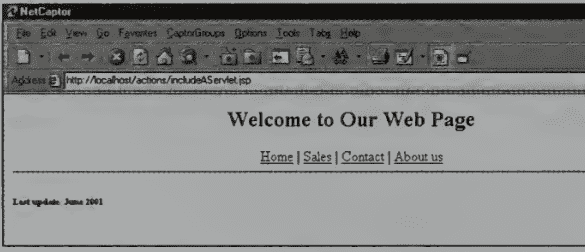

图6-4：清单6-9的代码在页面上显示一个简单的导航栏。

每个容器都有一个为servlet预留的目录。正如我们在第1章中观察到的，该目录有两个不同的名称——一个是服务器计算机硬盘驱动器上目录结构的一部分，另一个是用于通过URL访问servlet的名称。在清单6-9中，URL引用的是服务器上名为/servlet的目录。如果你使用Tomcat容器，对此/servlet目录的引用会直接指向你计算机硬盘驱动器上的\tomcat\webapps\examples\WEB-INF\classes。不同的容器使用不同的目录名。例如，使用Unify的ServletExec容器时，URL仍然引用/servlet目录，但对此目录的引用会指向计算机硬盘驱动器上名为Servlets的目录。这个Servlets目录是另一个目录的子目录，而这个父目录的名称因服务器计算机而异。（我的Windows 98计算机的网络标识名是acer，所以当我安装ServletExec时，它创建了一个名为se-acer的目录。）

servlet放在自己的目录中有充分的理由。与JSP文档一样，每个servlet都会经过一轮特殊的请求时处理。由于servlet、JavaServer页面、HTML文档和CGI脚本的处理方式都不同，因此每个都应位于服务器上的自己的目录中。

> 注意！
当容器翻译JSP文档时，它会自动编译生成的.java文件以获得.class文件。对于servlet则不同——容器不会为你编译.java文件。在编写完servlet的.java文件后，你必须显式地发出命令来编译代码并获得.class文件。

作为容器处理servlet特殊方式的一个标志，请注意在清单6-9中，我们引用servlet时没有使用文件扩展名。编写该servlet的人创建了一个名为NavigationServlet.java的文件。当servlet被编译时，你会得到NavigationServlet.class。在正常情况下，你通过引用servlet所在的目录并给出servlet的名称（不带.java或.class扩展名）来调用它。

如果你使用包含指令，并开始搞乱文件扩展名，不会有什么好事发生。例如，考虑我们的NavigationServlet。如果你包含NavigationServlet.java或NavigationServlet.class，容器会变得困惑。（使用NavigationServlet.class时，容器会将难以理解的字节插入到JSP文档的翻译中。）如果你包含省略了文件扩展名的NavigationServlet，容器会去寻找一个完全同名的文件，但找不到这样的文件。

### JSP作用域和包含动作

回顾第3章，JavaServer Pages有四种作用域——页面作用域、请求作用域、会话作用域和应用程序作用域。当你使用包含动作时，你会将用户的请求传递给被包含的文件。因此，任何具有请求作用域的值都可以在被包含文件的代码中使用。清单6-11和6-12，以及图6-5说明了这一点。

清单6-11：设置属性，然后包含另一个JSP文档

```
<%
    pageContext.setAttribute
        ("pageAttr","pageValue" , PageContext.PAGE_SCOPE);
    pageContext.setAttribute
        ("requestAttr","requestValue", PageContext.REQUEST_SCOPE);
    session.setAttribute
        ("sessionAttr", "sessionValue");
    application.setAttribute
        ("appAttr", "appValue");
%>

Attributes have been set...<p>
<jsp:include page="showAttributes.jsp" flush="true" />
```

清单6-12：文件showAttributes.jsp

```
<%
    java.util.Enumeration attribNames;

    int scopes[] = {PageContext.PAGE_SCOPE,
                     PageContext.REQUEST_SCOPE,
                     PageContext.SESSION_SCOPE,
                     PageContext.APPLICATION_SCOPE};
    String attribName;

    for (int i=0; i<4; i++) {
        switch(scopes[i]) {
            case PageContext.PAGE_SCOPE:
                out.println("<b>PAGE:</b><br>");
                break;
            case PageContext.REQUEST_SCOPE:
                out.println("<b>REQUEST:</b><br>");
                break;
            case PageContext.SESSION_SCOPE:
                out.println("<b>SESSION</b><br>");
                break;
            case PageContext.APPLICATION_SCOPE:
                out.println("<b>APPLICATION</b><br>");
                break;
        }
        attribNames = pageContext.getAttributeNamesInScope(scopes[i]);
        while (attribNames.hasMoreElements()) {
            out.print ("<b>" +
                (attribName=(String)attribNames.nextElement()) + ":</b> ");
            out.print (pageContext.getAttribute(attribName, scopes[i]));
            out.println("<br>");
        }
        out.println("<p>");
    }
%>
```

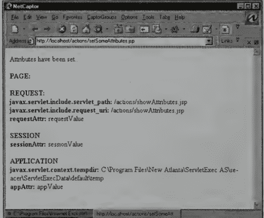

图6-5：用户在访问清单6-11的代码时可能看到的内容

你应该在图6-5中注意到几件事。虽然请求作用域的值在包含动作中得以保留，但页面作用域的值并未被保留。原因是...

一个被保留而另一个不被保留的原因在于，include动作会临时将控制权转移到另一个页面。这个新页面与包含include动作标签的文档并不共享相同的页面作用域。（在代码清单6-11中，控制权被转移到了一个JavaServer页面，但通常情况下，该页面可以是任何能生成响应文档部分内容的页面。）

当然，被包含的页面与包含include动作标签的页面属于同一会话和同一应用程序，因此会话范围或应用程序范围内的属性在两个文档中都可用。

> 与include动作不同，include指令会保留属于所有四个作用域的属性。

### 当执行刷新时会发生什么

在研究include动作时，我们一直在使用`flush`属性，但尚未详细说明。

回忆第4章讨论的缓冲区。容器将整个响应文档保存在缓冲区中，然后再向请求客户端发送任何内容，这种情况并不少见。但是，在include动作中，指定`flush="true"`会告诉容器在执行包含操作之前刷新缓冲区。这意味着在刷新之前存在于缓冲区中的任何内容，在控制权转移到被包含的页面后将无法再被修改。

在代码清单6-13和6-14中，我们对此理论进行了测试。我们创建一个cookie，然后通过包含第二个页面来刷新缓冲区。这第二个页面尝试创建另一个cookie。在返回包含操作后，原始文档尝试创建第三个cookie。图6-6显示了浏览器的显示结果。

在代码清单6-15中，我们显示了所有成功创建的cookie。图6-7显示了结果。第二个页面，由于是在刷新后被包含的，无法创建cookie并将其添加到传出的响应中。出于同样的原因，原始页面也无法创建另一个cookie。

代码清单6-13：创建一个cookie，包含另一个页面，然后创建另一个cookie

```
<%
String cookieName="name1";
String cookieValue="value1";
Cookie c = new Cookie(cookieName, cookieValue);
response.addCookie(c);
%>
Cookie <%=cookieName%>=<%=cookieValue%> has been set.<p>
```

```
<jsp:include page="setAnotherCookie.jsp" flush="true" /><p>
```

```
<%
    cookieName="name3";
    cookieValue="value3";
    c = new Cookie(cookieName, cookieValue);
    response.addCookie(c);
%>
Cookie <%=cookieName%>=<%=cookieValue%> has been set...<br>
&nbsp;&nbsp;&nbsp;&nbsp;&nbsp;&nbsp;&nbsp;...or has it?
```

代码清单6-14：被包含的页面

```
<%-- setAnotherCookie.jsp --%>

<%
    String cookieName="name2";
    String cookieValue="value2";
    Cookie c = new Cookie(cookieName, cookieValue);
    response.addCookie(c);
%>
Cookie <%=cookieName%>=<%=cookieValue%> has been set...<br>
&nbsp;&nbsp;&nbsp;&nbsp;&nbsp;&nbsp;&nbsp;...or has it?
```

代码清单6-15：显示cookie

```
<h3>Cookies:</h3>
<%
    Cookie cookies[] = request.getCookies();
    for (int i=0; i<cookies.length; i++) {
        out.print(cookies[i].getName());
        out.print("=");
        out.print(cookies[i].getValue());
        out.println("<br>");
    }
%>
```

图6-6：代码清单6-13似乎创建了三个cookie。

图6-7：第二个和第三个cookie无法被设置。

那么，现在你可能会问，为什么不将`flush`属性的值设置为"false"？因为JSP版本1.1不支持这样做。在JSP版本1.1中，每个`include`动作标签都有一个`flush`属性，并且`flush`属性的值必须是"true"。情况就是如此。

### param动作

回忆第3章的内容，请求可以包含参数。这些参数可以来自HTML表单中的字段，如代码清单3-7所示。如果表单使用HTTP GET方法，这些参数将成为发送到服务器的URL的一部分。例如，URL

```
http://www.BurdBrain.com/authenticate.jsp?username=joe&password=swordfish
```

代表一个包含两个参数的请求。第一个参数名为`username`，值为`joe`。第二个参数名为`password`，值为`swordfish`。

在本章前面，你已经了解了`include`动作与请求之间的关系。当你使用`include`动作时，你将用户的请求传递给了被包含的文件。在本节中，你将在此基础上进行扩展。首先，你使用一对标签（一个开始标签和一个结束标签）来表示`include`动作。然后，你在`include`动作的开始和结束标签之间放置一个或多个`param`动作标签。每个`param`标签都会向用户的请求添加一个额外的参数值。

代码清单6-16的代码创建了如图6-8所示的订单表单。

**代码清单6-16：一个订单表单**

```
<!-- orderForm.htm -->

<h1>Order Form</h1>

What would you like to purchase?<p>
<form name=orders action=processOrder.jsp>
<table border=0>
  <tr>
    <th>Item</th>
    <th>Quantity</th>
    <th>Unit Price</th>
  <tr>
  <tr>
    <td>T-Shirts</td>
    <td><input type=text name="t-shirts" value=0 size=3></td>
    <td>@ $15.00 ea.</td>
  </tr>
  <tr>
    <td>Hats</td>
    <td><input type=text name="hats" value=0 size=3></td>
    <td>@ $10.00 ea.</td>
  </tr>
</table>
<p>
What color do you prefer?
<input type=text name="style" value="gray" size=5><p>
Do you live in New Jersey?<br>
<input type=radio name="NJ" value="yes">Yes<br>
<input type=radio name="NJ" value="no">No<p>
<input type=submit value="Place order">
<input type=reset value="Clear all fields">
</form>
```

一位新泽西州的居民选择了三件T恤和两顶帽子。因此，发送回网站的URL包含四个参数：

http://www.BurdBrain.com/processOrder.jsp?t-shirts=3&hats=2& style=gray&NJ=yes

（当然，URL中没有换行。我为了适应本书的页面宽度而进行了换行。）processOrder.jsp文件（代码清单6-17）显示了部分参数信息，但将大部分工作传递给了另一个名为writeItem.jsp的页面。

图6-8：来自代码清单6-16的订单表单

代码清单6-17：文件processOrder.jsp

```
<%-- processOrder.jsp --%>

<b>You ordered <%= request.getParameter("t-shirts") %>
t-shirts and <%= request.getParameter("hats") %> hats.</b><p>

<jsp:include page="writeItem.jsp" flush="true">
  <jsp:param name="item" value="t-shirts" />
  <jsp:param name="unitcost" value="15.00" />
  <jsp:param name="style" value="XLarge" />
</jsp:include><p>

<jsp:include page="writeItem.jsp" flush="true">
  <jsp:param name="item" value="hats" />
  <jsp:param name="unitcost" value="10.00" />
  <jsp:param name="style" value="fitted" />
</jsp:include>
```

在代码清单6-17中，第一个include动作包含三个param标签。每个param标签都为访问者的请求添加了额外的参数信息。
第一个param标签扮演了一个特殊的角色。原始请求及其t-shirts和hats参数将被传递给writeItem.jsp文件。但是，你很快会看到，writeItem.jsp的调用旨在处理T恤或帽子，而不是两者。因此，第一个param标签单独挑出t-shirts或hats。当然，说标签“挑出”t-shirts是一回事，而让writeItem.jsp中的代码真正正确地使用这些参数信息则是另一回事。你很快就会看到这一切是如何运作的。

同时，第二个param标签，名称为unitcost，没有带来什么有趣的挑战。这个标签只是简单地向访问者的请求附加了一个额外的名称/值对。

第三个param标签的名称是style。这很有趣，因为请求中已经有一个名为style的参数。让我们继续假设原始的style参数值为gray。那么，当请求被发送到writeItem.jsp时，style参数有两个值——gray和XLarge。要了解writeItem.jsp如何处理所有这些信息，请参阅代码清单6-18。用户屏幕上的显示如图6-9所示。

### 代码清单6-18：文件writeItem.jsp

```
<%-- writeItem.jsp --%>

<%@ page import="java.text.NumberFormat" %>

<%
    NumberFormat currency = NumberFormat.getCurrencyInstance();
    String item = request.getParameter("item");
    int quantity = Integer.parseInt(request.getParameter(item));
    double unitcost = Double.parseDouble(request.getParameter("unitcost"));
    boolean NJresident = request.getParameter("NJ").equals("yes");
    double subtotal = quantity*unitcost;
    subtotal += NJresident?(0.06*subtotal):0.0;
%>

<b>Item:</b> <%= item %><br>
<b>Quantity:</b> <%= quantity %><br>
<b>Unit cost:</b> <%= currency.format(unitcost) %><br>
<b>Subtotal:</b> <%= currency.format(subtotal) %><br>
<b>Style:</b>
<%
    String values[] = request.getParameterValues("style");
    for (int i=0; i<values.length; i++) {
        out.print(values[i] + " ");
    }
%>
```


### 图6-9：包含writeItem.jsp两次的结果

在清单6-18中，`item`这个词身兼双职。它既是一个参数的名称，也是一个变量的名称。在清单6-18的早期部分，我们调用了`request.getParameter("item")`，并将此方法调用的结果存储在`item`变量中。第一次处理时，这个`item`变量获得了值`t-shirts`。一旦`item`变量有了这个值，调用`request.getParameter(item)`（不带引号）就等同于调用`request.getParameter("t-shirts")`。此调用会返回一个值，例如3——客户订购的T恤数量。

在清单6-18中，请注意我们如何处理`style`参数的多个值。我们调用了`request.getParameterValues("style")`，它返回一个值数组。查看图6-9，并注意我们使用`param`标签创建的值排在数组的前面。情况总是如此。最近分配的值会将其他值推到数组中较后的位置。

> 注意！
> 如果一个参数有多个值（如清单6-18中的`style`参数），不要试图通过将参数名代入`getParameter`方法来查找该参数的所有值。如果你这样做，你将只获得该参数的一个值，并且不会收到任何警告来表明该参数还有额外的值。

### forward动作

在清单3-17中，我们将一个请求从一页转发到另一页。

```jsp
pageContext.forward ("scopeExper2.jsp");
```

你可以使用JSP的`forward`动作做同样的事情。

```jsp
<jsp:forward page="scopeExper2.jsp" />
```

实际上，在转换你的页面时，容器会将你的`forward`动作转换为对`pageContext.forward`方法的调用。

再次考虑清单6-16中的订单表单。一种响应表单提交的方式是使用清单6-19中的代码。

#### 清单6-19：使用forward动作

```jsp
<%@ page import="java.text.NumberFormat" %>
```

```html
<h3>您的订单：</h3>
```

```jsp
<%
    String numTees = request.getParameter("t-shirts");
    String numHats = request.getParameter("hats");
    NumberFormat currency = NumberFormat.getCurrencyInstance();
    double total = 0.0;
%>
```

```jsp
<%
    try {
%>
    T恤数量：<%= numTees %><br>
    您的价格：<%= currency.format(total += Integer.parseInt(numTees)*15.00) %><p>
    帽子数量：<%= numHats %><br>
    您的价格：<%= currency.format(total += Integer.parseInt(numHats)*10.00) %><p>
<%
    } catch (NumberFormatException e) {
%>
    <jsp:forward page="orderError.jsp">
        <jsp:param name="errorType" value="badAmount" />
    </jsp:forward>
<%
    }
%>
```

```jsp
<%
    try {
        boolean NJresident = request.getParameter("NJ").equals("yes");
%>
        <b>总计：</b>
        <%= currency.format(total +
                (NJresident?(0.06*total):0.0))  %>
<%
    } catch (NullPointerException e) {
%>
        <jsp:forward page="orderError.jsp">
            <jsp:param name="errorType" value="badTax" />
        </jsp:forward>
<%
    }
%>
```

清单6-19尝试显示T恤的价格、帽子的价格以及包含销售税的总额。在此过程中，可能会出现一些问题。首先，用户可能没有输入有效的商品数量。如果发生这种情况，清单6-19中的代码会将用户的请求转发到`orderError.jsp`。为了告诉`orderError.jsp`发生了哪种错误，`forward`动作包含一个`param`标签。在`param`标签中，请求获得了一个名为`errorType`、值为`badAmount`的额外参数。`orderError.jsp`的代码如清单6-20所示。

#### 清单6-20：文件orderError.jsp

```jsp
<%-- orderError.jsp --%>

<%
    String errorType=request.getParameter("errorType");
    if (errorType.equals("badAmount")) {
%>
        衬衫数量：<%= request.getParameter("t-shirts") %><br>
        帽子数量：<%= request.getParameter("hats") %><br>
        请在每个数量字段中输入一个数字。
<%
    }
    else if (errorType.equals("badTax"))
        out.println("您住在新泽西州吗？");
    else
        out.println("您的输入无效。");
%>

<p>返回<a href="orderForm.htm">订单表单</a>主页面。
```

### 第1部分：基础JSP脚本

假设用户将T恤字段留空，并在帽子字段中输入了一个问号。`orderError.jsp`创建的显示如图6-10所示。

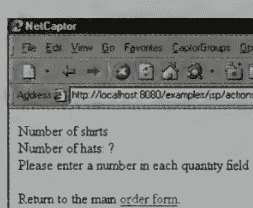

**图6-10：** 清单6-20显示了与错误类型相应的错误消息。

请注意`orderError.jsp`如何接收到订单表单创建的所有参数，加上在`param`标签中创建的`errorType`参数。

> 与`include`动作类似，`forward`动作可以向现有的参数名添加额外的值。要找到所有这些值，请调用请求的`getParameterValues`方法。

关于图6-10中的显示，还有一点需要注意。显示中没有任何文本是由清单6-19中的代码产生的。可以推测，在代码的`forward`动作执行之前，清单6-19会向响应文档发送类似"您的订单"和"衬衫数量"这样的文本。但是，当执行`forward`动作时，响应文档缓冲区中已经存在的任何内容都会被丢弃。因此，转发文档中的任何内容都不会出现在用户的浏览器窗口中。

> 一旦文档的缓冲区被刷新，该文档就无法再执行`forward`动作。

考虑一个具有默认8kb缓冲区的JSP文档。让该文档向响应文档写入9kb的文本。在所有这些写入之后，让文档中的一个`forward`动作执行。访问该文档将导致容器抛出一个`IllegalStateException`。

### plugin动作

你想在一个网页上放置一个Java小程序。通常，这没什么大不了的。你在HTML代码中添加一个`applet`标签。（见清单6-21。）

#### 清单6-21：一个applet标签

```html
<applet code=TextEdit width=300 height=200>
    <param name=initText value="Your comments go here.">
</applet>
```

`applet`标签导致Web浏览器的Java虚拟机加载一个特定的类并创建该类的一个实例。问题是每个浏览器的Java虚拟机工作方式略有不同。清单6-21引用了一个名为`TextEdit`的小程序。清单6-22显示了`TextEdit`小程序的Java代码，图6-11显示了清单6-21和6-22在两个最流行的Web浏览器中使用的显示。请注意两个浏览器窗口中的显示看起来有何不同。

#### 清单6-22：文件TextEdit.java

```java
import java.awt.*;
import java.awt.event.*;
import java.applet.Applet;

public class TextEdit extends Applet implements ActionListener {
    Button bCopy, bCut, bPaste, bHelp;
    TextArea t;
    String clipboard = "";

    public void init() {
        setLayout(new BorderLayout());

        Panel northPanel = new Panel();
        northPanel.setLayout(new BorderLayout());
        Panel centerPanel = new Panel();
        centerPanel.setLayout(new GridLayout(1,1));
        Panel eastNorthPanel = new Panel();
        Panel westNorthPanel = new Panel();

        bCopy = new Button("Copy");
        bCut = new Button("Cut");
        bPaste = new Button("Paste");
        bHelp = new Button("Help");

        westNorthPanel.add(bCopy);
        westNorthPanel.add(bPaste);
        westNorthPanel.add(bCut);
        eastNorthPanel.add(bHelp);

        t = new TextArea(getParameter("initText"));
        centerPanel.add(t);

        northPanel.add("West", westNorthPanel);
        northPanel.add("East", eastNorthPanel);

        add("North", northPanel);
        add("Center", centerPanel);

        bCopy.addActionListener(this);
        bCut.addActionListener(this);
        bPaste.addActionListener(this);
        bHelp.addActionListener(this);
    }

    public void actionPerformed (ActionEvent e) {
        Object theSource = e.getSource();
        if (theSource == bCopy)
            clipboard = t.getSelectedText();
        if (theSource == bCut) {
            clipboard = t.getSelectedText();
            t.replaceRange("", t.getSelectionStart(),
                           t.getSelectionEnd());
        }
        if (theSource == bPaste)
            t.replaceRange(clipboard, t.getSelectionStart(),
                           t.getSelectionEnd());
        if (theSource == bHelp) {
            new AboutFrame();
        }
    }
}

class AboutFrame extends Frame {
    AboutFrame() {
        setLayout (new FlowLayout());
        add (new Label("Created by Barry Burd"));
        addWindowListener (new MyAdapter(this));
        pack();
        show();
    }
}
```


class MyAdapter extends WindowAdapter {
  Frame f;

  MyAdapter (Frame f) {
    super();
    this.f = f;
  }

  public void windowClosing(WindowEvent e) {
    f.dispose();
  }
}


图6-11：清单6-21中的applet标签在两个不同浏览器窗口中的显示。

有时你可能想确切地知道你的applet看起来会是什么样子，无论它是由Netscape Navigator还是Internet Explorer渲染。为了实现这种一致性，你可以让每个浏览器都调用相同的Java虚拟机代码。你可以在HTML代码中插入标签，调用Sun Microsystems的某个插件。该插件绕过每个浏览器自己的Java虚拟机，转而调用Sun Microsystems的标准Java虚拟机。

这个策略有一个小小的困难。调用Java插件（或任何插件）的HTML代码很混乱。Internet Explorer使用HTML的`object`标签，而Netscape Navigator使用HTML的`embed`标签。为了兼容性，你需要在HTML文档中同时放入这两个标签。你可以使用Explorer自己的`comment`标签将`embed`标签隐藏起来，使其不被Internet Explorer看到。清单6-23向你展示了如何使用JavaServer Pages的`plugin`动作来创建所有这些代码。（清单6-24展示了清单6-23中`plugin`动作生成的所有混乱的HTML代码。）图6-12展示了在Netscape Navigator和Internet Explorer中执行此代码的结果。

清单6-23：用于调用清单6-22中applet的plugin动作

```
<%-- TextEdit.jsp --%>

<jsp:plugin type="applet" code="TextEdit"
    codebase="/examples/jsp/myEdit/classes"
    width="300" height="200">
    <jsp:params>
        <jsp:param name="initText" value="Your comments go here." />
    </jsp:params>
    <jsp:fallback>
        You should see an edit area here.
    </jsp:fallback>
</jsp:plugin>
```

清单6-24：由清单6-22的plugin动作发送到用户浏览器的代码

```
<OBJECT classid="clsid:8AD9C840-044E-11D1-B3E9-00805F499D93"
width="300" height="200"
codebase="http://java.sun.com/products/plugin/1.2.2/jinstall-1_2_2-win.cab#Version=1,2,2,0">
<PARAM name="java_code" value="TextEdit">
<PARAM name="java_codebase" value="/examples/jsp/myEdit/classes">
<PARAM name="type" value="application/x-java-applet;">
<PARAM name="initText" value="Your comments go here.">
<COMMENT>
<EMBED type="application/x-java-applet;" width="300" height="200"
pluginspage="http://java.sun.com/products/plugin/"
java_code="TextEdit" java_codebase="/examples/jsp/myEdit/classes"
initText=Your comments go here.
>
<NOEMBED>
</COMMENT>
You should see an edit area here.
</NOEMBED></EMBED>
</OBJECT>
```

JSP plugin动作代码（清单6-23）比清单6-24中的代码稍微短一些。更重要的是，plugin动作代码的结构更简单，使其更容易编写和维护。

你必须先安装Java插件，你的Web浏览器才能调用它。如果你安装了Java运行时环境，插件会自动安装。你可以通过访问 www.javasoft.com/products/plugin/index.html 来获取Java插件。


图6-12：清单6-23中的plugin动作在两个不同浏览器窗口中的显示。

### plugin动作的属性

plugin动作有许多属性。清单6-23使用了其中几个。

-   通过`type`属性，你可以将applet或bean放置到网页上。（有关JavaBeans的更多信息，请参见第7章。）
-   `code`属性给出了要运行的Java类的名称。
-   `width`和`height`属性定义了为在Web浏览器窗口中显示applet而预留的矩形大小，就像它们在HTML的applet标签中一样。

> 如果你省略`width`和`height`属性，浏览器会选择默认值。纯属巧合，这些默认值在你测试页面时可能效果很好。但默认值在其他人的浏览器上效果很好的概率几乎为零。不要省略plugin动作的`width`或`height`属性。

-   `codebase`属性告诉你在哪里查找Java .class文件。更具体地说，`code`和`codebase`属性的值会作为`object`和`embed`标签的一部分发送给Web浏览器。当Web浏览器遇到`object`或`embed`标签时，浏览器会向服务器发送一个后续请求，要求获取特定的Java类。这个类的名称由`code`属性指定，并且在服务器上位于`codebase`属性指向的目录中。

`codebase`属性中的目录名称可以采用两种形式之一。任何以斜杠开头的名称（如清单6-23所示）都是相对于JSP文档的应用程序根目录进行解释的。例如，我将清单6-23的代码放在名为`C:\tomcat\webapps\examples\jsp\myEdit`的目录中，并将applet（清单6-22中的`.class`文件）放在`C:\tomcat\webapps\examples\jsp\myEdit\classes`中。要访问JSP文档，我在浏览器的地址字段中输入了`http://localhost:8080/examples/jsp/myEdit/TextEdit.jsp`。文档应用程序的根目录是`C:\tomcat\webapps`。相对于此，文档本身位于`/examples/jsp/myEdit`目录中。相对于根目录，applet位于`/examples/jsp/myEdit/classes`目录中。清单6-23中的`codebase`属性指向的就是这个`/examples/jsp/myEdit/classes`目录。

任何不以斜杠开头的名称都是相对于JSP文档的位置进行解释的。在清单6-23中，我本可以将属性缩短为`codebase="classes"`。毕竟，文档位于`C:\tomcat\webapps\examples\jsp\myEdit`目录中，而applet位于文档下一级的`C:\tomcat\webapps\examples\jsp\myEdit\classes`目录中。

> 官方的JSP规范文档指出，每个`plugin`动作都需要`codebase`属性。即便如此，一些厂商的JSP容器也会处理没有`codebase`属性的`plugin`动作。

### 更多属性

我在清单6-23中没有使用几个`plugin`动作属性。其中一些属性来自熟悉的HTML标签。

-   `align`属性告诉浏览器如何在插件附近定位文本或其他元素。与HTML的`img`标签一样，`align`属性的值可以是`left`、`right`、`middle`、`absmiddle`等。
-   `hspace`和`vspace`属性的工作方式与它们在HTML `img`标签中的工作方式相同。`hspace`属性指定插件应该拥有的水平间距（以像素为单位）。`vspace`属性指定垂直间距（顶部和底部）。
-   `title`属性的工作方式与它在HTML `applet`标签中的工作方式相同。当用户将鼠标移到插件上时，`title`属性中指定的任何文本都会显示在一个小工具提示中。

如果插件`.class`文件位于Java归档文件（JAR）中，你可以使用`archive`属性来指示这一点。如果你能编译Java程序，你就可以创建JAR文件。`jar`程序随每个Java编译器实现一起提供。要创建一个包含特定目录中所有`.class`文件的JAR，请发出如下命令：

```
jar cvf TextEdit.jar *.class
```

在这个命令中，字母`c`表示“创建一个新的JAR文件”。字母`v`表示“显示详细的诊断输出”。字母`f`表示“这是我希望你创建的文件的名称”。这个命令创建了一个名为`TextEdit.jar`的文件。

-   bean或applet可能无法在每个版本的Java运行时环境（JRE）中工作。如果你只在某个特定版本的JRE中测试了你的applet，你可以使用`jreversion`属性通知用户的Web浏览器。默认值是`jreversion="1.1"`。
-   可选的`nspluginurl`属性告诉浏览器，如果Netscape Navigator的Java插件尚未安装在用户的计算机上，可以在Web上的何处找到它。可选的`iepluginurl`属性告诉浏览器在哪里可以找到Internet Explorer的Java插件。
-   通过`name`属性，你可以设置插件与JSP文档其余部分之间的通信。本章后面有一个例子。

### plugin动作的子标签

`plugin`动作使用三个子标签—— `jsp:params`、`jsp:param` 和 `jsp:fallback`。`param`标签向applet或bean发送额外的运行时信息。applet通过调用`getParameter`方法来检索此信息。（参见清单6-22。）当你在`plugin`动作中使用`param`标签时，你必须将所有`param`标签包裹在一对`params`标签中——开始`params`标签和结束`params`标签。可选的`fallback`标签告诉较旧的Web浏览器（无法解释`object`或`embed`标签的浏览器）该怎么做。要了解`fallback`如何工作，请查看清单6-24。想象一个非常古老的Web浏览器，它不理解`object`、`param`、`comment`或`embed`的含义。Web浏览器会忽略未知标签内的文本，而在清单6-24中，唯一不在未知标签内的文本是*You should see an edit area here.*。所以一个旧的Web浏览器会显示这个句子。

> **提示** `fallback`内容不必是纯文本。它可以包含HTML标签。只需确保你使用的任何标签都足够通用，可以被任何Web浏览器解释即可。


### 使用 name 属性

当你为一个插件赋予名称后，就可以在文档的其他部分引用该插件。清单6-25、6-26和6-27将向你展示具体做法。

清单6-25包含了 `producerApplet` 的代码。该代码多次引用了一个名为 `consumerApplet` 的组件。特别是，代码的 `init` 方法通过小程序上下文查找名为 `consumer` 的另一个小程序。要理解为何可能存在另一个名为 `consumer` 的小程序，请查看清单6-26中的JSP文档。

清单6-25：生产者小程序的代码

```java
import java.awt.*;
import java.awt.event.*;
import java.applet.*;

public class ProducerApplet extends Applet
    implements ActionListener {

    TextField t;
    ConsumerApplet consumerApplet;

    public void init() {
        add(t = new TextField(15));
        t.addActionListener(this);
        consumerApplet =
            (ConsumerApplet)getAppletContext().getApplet("consumer");
    }

    public void actionPerformed(ActionEvent e) {
        if (e.getSource() == t) {
            consumerApplet.t.setText(t.getText());
            t.setText("");
        }
    }

}
```

清单6-26：其中一个插件动作为其小程序指定了名称

```jsp
<jsp:plugin type="applet" code="ProducerApplet"
    codebase="classes"
    width="150" height="50">
</jsp:plugin>

<jsp:plugin type="applet" code="ConsumerApplet"
    name="consumer"
    codebase="classes"
    width="150" height="50">
</jsp:plugin>
```

在清单6-26中，第二个小程序被命名为 `consumer`。第二个小程序（消费者小程序）的代码如清单6-27所示。

### 清单6-27：消费者小程序

```java
import java.awt.*;
import java.applet.*;

public class ConsumerApplet extends Applet {

    TextField t;

    public void init() {
        add(t = new TextField(15));
    }
}
```

在清单6-25中，代码的 `init` 方法将对消费者小程序的引用放入名为 `consumerApplet` 的变量中。现在，要引用消费者小程序的 `t` 变量，我们写作 `consumerApplet.t`。实际上，清单6-25中的 `actionPerformed` 方法包含以下代码行：

```java
consumerApplet.t.setText(t.getText());
```

在这行代码中，第二个对 `t` 的引用前没有加上 `consumerApplet` 前缀。因此，这个对 `t` 的第二次引用指的是生产者小程序自身的 `t` 变量。这行代码获取生产者小程序文本框中的文本，并将该文本放入消费者小程序的文本框中。结果显示在图6-13和图6-14中。

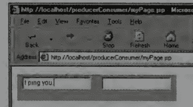

156 第一部分：基础JSP脚本

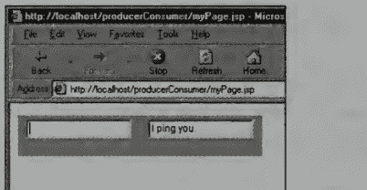

图6-14：文本被传输到消费者小程序的文本框。

在图6-13中，用户在生产者小程序的文本框中输入文本。输入后，用户应按回车键。按下回车键会触发生产者小程序的 `actionPerformed` 方法。`actionPerformed` 方法将文本复制到消费者小程序的文本框，并清空生产者小程序的文本框。结果如图6-14所示。

### 总结

JSP有七个标准动作。本章涵盖的四个是 `include`、`param`、`forward` 和 `plugin`。
`include` 动作的目的与 `include` 指令类似。
使用 `include` 指令的效果是将文本插入JSP文档中。当执行 `include` 指令时，被包含文件的类型（.htm、.jsp或其他）并不重要。被包含的文件不会自行转换，即使被包含的文件是一个JSP文档。使用 `include` 指令时，包含操作发生在转换时。如果被包含的文件在转换后被修改，容器不会自动将更改纳入包含 `include` 指令的文档中。
另一方面，使用 `include` 动作会将对 `pageContext.include` 方法的调用放入转换后的 .java 和 .class 文件中。如果被包含的文件是JSP文档，容器会将该文件转换为servlet。实际的包含操作发生在请求时。如果被包含的文件在请求之间被修改，容器会自动重新转换该文件。更新后的转换输出将作为对下一个请求的响应的一部分发送。
`forward` 动作获取当前请求并将其传递给另一个文档。转发文档的所有输出都会被删除。用户只能看到请求被转发到的文档的输出。
当你执行转发或包含（使用 `include` 动作，而非指令）时，可以向现有请求添加额外的参数。你可以通过JSP `param` 动作来实现。
`plugin` 动作将小程序或JavaBean插入你的JSP文档中。更准确地说，`plugin` 动作在发送给客户端的响应中插入 `object` 和 `embed` 标签。Internet Explorer可以解释 `object` 标签，而Netscape Navigator可以解释 embed 标签。通过这些标签，你可以调用Java插件，该插件实现了Sun Microsystems的标准Java虚拟机。

下一章将讨论剩余的三个JSP标准动作——即明确与JavaBeans配合使用的动作。

## 第7章

### 案例研究：一个简单的Web门户

本章内容

- 注册访客偏好
- 为每位访客自定义显示
- 创建和删除cookie

Web上有成百上千个这样的网站。它们被称为*门户*。它们提供新闻、天气、股票报价以及通用互联网搜索的起点。其基本理念是，在门户主页上打包足够的信息，使得访客愿意从该页面开始浏览。添加广告横幅使门户盈利。然后提供自定义功能。让每位访客都能过滤内容，只看到他们预先选择的类别的内容。

这对Web开发者来说听起来是一项庞大的任务，事实也确实如此。但基本思路相当简单。你通过让访客填写HTML表单来收集信息。你从表单中获取参数值，并将它们作为cookie存储在访客的硬盘上。然后，当访客下次访问你的网站时，你只显示访客cookie中指定的内容类型。

本章展示了一个简单Web门户的骨架代码。该门户没有花哨的设计，没有广告，只显示访客感兴趣的主题名称。尽管简单，但代码展示了如何收集和存储访客提供的信息，然后利用这些信息为访客自定义内容。

### 主页

你即将访问世界上最简单的Web门户。首次访客的主页如图7-1所示。页面有一个“欢迎”标题和进行自定义的邀请。此外，页面还显示了浏览器与该门户站点关联的所有cookie的名称和值。

160 第一部分：基础JSP脚本

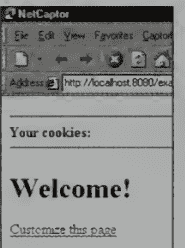

图7-1：首次访客的主页

现实世界的门户不会显示cookie。事实上，现实世界的门户会淡化它在访客硬盘上放置cookie这一事实。但当我编写这个门户代码时，我发现查看每个页面上的cookie报告很有帮助。这份报告作为开发者，帮助我理解我的代码在底层做了什么。此外，所有显示cookie的代码都位于一个方法中—— `showCookies`。谨慎的开发者会注释掉对 `showCookies` 的调用，但将其保留在JSP文档中，以防将来需要调试。更好的做法是，你可以将对 `showCookies` 的调用放在一个Java `if` 语句中。设置一个特殊的开发者专用页面来切换 `if` 语句的条件。

> 你可以检查用户的浏览器是否设置为接受cookie。在某个页面调用 `addCookie` 方法。然后，在后续页面中，检查调用 `request.getCookies` 返回的数组内容。

图7-1中的显示既具有误导性又具有信息性。它具有误导性，因为它给人一种这位访客没有cookie的印象。但请记住，HTTP交换涉及一个请求及其响应。当访客首次向网站发出请求时，访客的请求不包含cookie。图7-1的显示反映了这一事实。（这就是为什么图7-1如此具有信息性！）但是，当容器发回响应时，响应包含一个被放置在访客硬盘上的cookie。因此，当访客看到图7-1中的响应页面时，访客的硬盘已经包含了一个cookie。图7-2说明了这一事件序列。

> 在图7-1以及本章的类似图中，显示 **您的cookie** 的列表可能比访客硬盘上的真实状态滞后一步。


### 第7章：案例研究：一个简单的Web门户

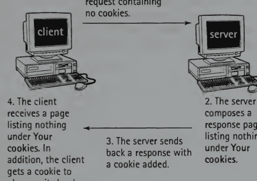

图 7-2：Cookie 的创建与传递

### 带有自定义功能的主页

图 7-1 中的显示内容即使对于最简单的门户来说也显得有些单薄。当访客自定义页面后，其外观可能如图 7-3 所示。该图展示了访客的姓名以及访客表示感兴趣的一些项目名称。由于访客选择了一些自定义选项，图 7-3 还显示了某些 Cookie 的名称和值。

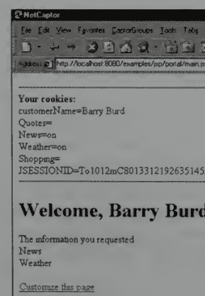

图 7-3：自定义后的主页

清单 7-1 展示了生成门户主页的 JSP 代码。代码检查 `customerName` 变量的值。如果 `customerName` 不为空，则显示该姓名。然后，清单 7-1 从名为 `interests` 的变量创建一个迭代器。代码逐一显示访客的兴趣。（真正的门户会用新闻和天气的摘要及链接代替单个词汇。）

```
清单 7-1：门户主页
<%-- main.jsp --%>

<%@ include file="portalHelper.jsp" %>

<%
    out.print("<h1>Welcome");
    if (!customerName.equals(""))
        out.print(", " + customerName);
    out.println("!</h1><p>");

    if (!interests.isEmpty())
    {
        out.println("The information you requested...<br>");
        iterator = interests.iterator();
        while (iterator.hasNext())
            out.println(iterator.next() + "<br>");
            //在真正的门户中，你会打印关于
            //  该兴趣的新闻源信息

    }
%>

<p><a href="customize.jsp">Customize this page</a>
```

### 辅助文件

主页（清单 7-1）使用了名为 `customerName` 和 `interests` 的变量。但这些变量并未在主页上声明，而是在 `portalHelper.jsp` 文件中声明。该文件在主页顶部被包含。`portalHelper.jsp` 文件声明了许多变量和方法——远比主页运行所需的要多。要查看 `portalHelper.jsp` 文件，请参见清单 7-2。

```
清单 7-2：文件 portalHelper.jsp
<%-- portalHelper.jsp --%>

<%@ page
    import="java.util.*,javax.servlet.*,javax.servlet.http.*" %>

<%@ include file="showCookies.jsp" %>

<%!
    String customerName;

    HashSet categories = new HashSet();
    String category;

    HashSet interests = new HashSet();
    Iterator iterator;

    Cookie[] cookies;
    Cookie cookie;
    String cookieName;

    final int ONE_YEAR=60*60*24*365;

    public void addOneYearCookie(HttpServletResponse response,
                                 String name, String value)
    {
        cookie = new Cookie(name, value);
        cookie.setMaxAge(ONE_YEAR);
        response.addCookie(cookie);
    }


    public void removeCookie(HttpServletResponse response,
                             Cookie cookie)
    {
        cookie = new Cookie (cookie.getName(), "");
        cookie.setMaxAge(-1);
        response.addCookie(cookie);
    }


    public void removeCookie(HttpServletResponse response,
                             String name)
    {
        cookie = new Cookie (name, "");
        cookie.setMaxAge(-1);
        response.addCookie(cookie);
    }

    public void removeAllCookies(HttpServletResponse response,
                           Cookie[] cookies)
    {
        if (cookies!=null)
            for (int i=0; i<cookies.length; i++)
                removeCookie(response, cookies[i]);
    }

    public void showCookies(HttpServletRequest request, JspWriter out)
        throws IOException
    {
        out.println("<hr><b>Your cookies:</b><br>");

        Cookie[] cookies = request.getCookies();
        if (cookies!=null)
            for (int i=0; i<cookies.length; i++)
            {
                out.print(cookies[i].getName()+"="+cookies[i].getValue());
                out.println("<br>");
            }

        out.println("<hr><p>");
    }
%>

<%
showCookies(request, out);

categories.add("News");
categories.add("Weather");
categories.add("Shopping");
categories.add("Quotes");

cookies = request.getCookies();
customerName="";
interests.clear();
if (cookies!=null)
    for (int i=0; i<cookies.length; i++)
    {
        cookie = cookies[i];
        cookieName=cookie.getName();
        if (cookieName.equals("customerName"))
            customerName=cookie.getValue();
        else if (categories.contains(cookieName))
            if (cookie.getValue().equals("on"))
                interests.add(cookieName);
    }
%>
```

查看清单 7-2 后，您将不会惊讶地发现，门户的大部分操作都发生在 `portalHelper.jsp` 中。该清单包含许多 Cookie 处理方法，并在底部有自己的 20 行脚本。变量 `cookieName` 和 `interests` 在清单顶部附近声明。

为了定义 `interests` 变量，我使用了 `java.util.HashSet` 类。哈希集合是一种值只能出现一次的对象。任何重复项都会被忽略。哈希集合的一些特性使其非常适合注册访客的兴趣。例如，如果我们从单个访客那里再次获得相同的 Cookie，并将 Cookie 描述的兴趣放入哈希集合中，那么集合中每个兴趣最多只会列出一次。此外，该集合还提供了一些有用的方法。

- 使用 `contains` 方法，我们可以轻松检查访客是否有某个特定兴趣（即某个值是否包含在 `interests` 集合中）。
- 使用 `clear` 方法，我们可以从集合中移除所有元素。我们可以忘记我们所知的访客兴趣，重新开始。
- 使用 `iterator` 方法，我们可以创建一个对象，逐一访问访客的兴趣。

清单 7-2 定义了两个独立的哈希集合。`interests` 集合存储特定访客选择的主题名称。`categories` 集合存储所有可供选择的主题名称。

清单 7-2 末尾的脚本执行门户每个页面的启动任务。首先调用 `showCookies`。接下来，主题名称被添加到 `categories` 集合中。（在这个门户网站上，访客可以选择查看新闻、天气、购物提示和股票行情。）清单 7-2 中的最后十几行处理访客的 Cookie。代码将 Cookie 信息存储在 `customerName` 变量和 `interests` 哈希集合中。整个脚本作为清单 7-1 中 `include` 指令的一部分执行。因此，当有人访问主页时，该页面会显示用户的 Cookie，并通过 `customerName` 和 `interests` 变量提供自定义内容。

### 自定义页面

图 7-1 和图 7-3 显示了主页上的“Customize this page”链接。当访客单击此链接时，容器会提供 `customize.jsp`。图 7-4 显示了 `customize.jsp` 的一个界面。

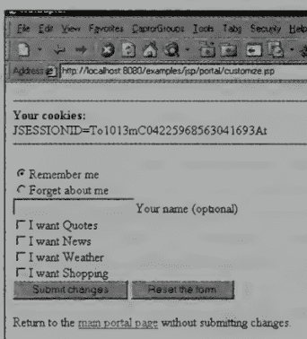

请注意图 7-4 中访客有一个 Cookie。当访客的浏览器接收到图 7-1 所示的页面时，该 Cookie 就被放置在访客的硬盘上。JSP 容器作为对访客首次请求的响应的一部分自动生成此 Cookie。通过此 Cookie，容器将访客的后续请求识别为同一会话的一部分。

图 7-4 的其余部分主要是一个访客偏好表单。通过单击“Remember me”，访客表示：“给我发送 Cookie。”通过单击“Forget about me”，访客表示：“忽略此表单中的其他框，并删除您已发送给我的任何 Cookie。”

> 移除 Cookie 不一定意味着立即从访客的硬盘中删除它们。在本章中，我们通过将 Cookie 的值设置为空字符串并标记该 Cookie，使其在访客关闭浏览器程序时完全删除，来“移除” Cookie。

`customize.jsp` 的代码如清单 7-3 所示。该代码由三部分组成：一个包含 `portalHelper.jsp` 的指令、一段 JavaScript 和一个 HTML 表单。


### 第7章：案例研究：一个简单的Web门户 167

清单7-3：文件customize.jsp

```jsp
<%-- customize.jsp --%>

<%@ include file="portalHelper.jsp" %>

<script language="JavaScript">
    function setDisabled (trueOrFalse) {
        with (document.changeForm)
        {
            customerName.disabled=trueOrFalse
            <%
            iterator = categories.iterator();
            while (iterator.hasNext()) {
                out.println(iterator.next() + ".disabled=trueOrFalse");
            }
            %>
            myReset.disabled=trueOrFalse
        }
    }
</script>
```

```jsp
<form name=changeForm action="submitChanges.jsp">

    <input type=radio name=wantCookies value="on"
        checked
        onclick="setDisabled(0)" >记住我<br>

    <input type=radio name=wantCookies value="off"
        onclick="setDisabled(1)" >忘记我<br>

    <input type=text name=customerName size=20
        value="<%=customerName%>">您的姓名（可选）<br>

    <%
    iterator = categories.iterator();
    while (iterator.hasNext())
    {
        category=(String)iterator.next();;
        out.print("<input type=checkbox name=" + category);
        if (interests.contains(category))
            out.print(" checked");
        out.print(">");
        out.println("我想要 " + category + "<br>");
    }
%>

<input type=submit value="提交更改">
<input type=reset value="重置表单" name=myReset><p>
</form>
```

返回<a href="main.jsp">主门户页面</a>，不提交更改。

### 包含辅助文件

通过包含portalHelper.jsp，自定义页面重复了主页完成的一些工作。特别是，自定义页面执行了清单7-2末尾的脚本片段。该脚本片段显示了一些cookie并重新填充了类别集合。然后，利用这些cookie，该脚本片段重新填充了customerName变量和interests集合。

只要访客的浏览器接受cookie，重复执行portalHelper.jsp脚本就提供了一种维护信息的稳健方式。想象一下，一位访客将自定义页面添加为书签。几天后，访客点击书签链接。然后访客通过主页链接之外的其他链接到达自定义页面。即便如此，容器仍然会获取访客的cookie，并相应地填充customerName变量和interests哈希集。

> 不要使用cookie来存储大量信息。大多数浏览器对每个cookie的字符数、网站可存储的cookie数量以及所有网站合并后的cookie总数都有限制。当您需要存储大量信息时，请将信息存储在数据库中。使用cookie存储指向数据库中信息的键。有关数据库的更多详细信息，请参见第10章。

### 客户端脚本

清单7-3的下一部分很有趣。这部分包含一些JavaScript代码，但这些JavaScript代码部分由容器执行JSP脚本片段生成。该脚本片段循环遍历categories集合中的值，为每个类别创建一行JavaScript代码。为了更好地理解正在发生的事情，请查看由JSP容器生成并发送给访客Web浏览器的代码。该代码（带有一些改进的缩进）如清单7-4所示。

清单7-4：发送给访客Web浏览器的脚本

```javascript
<script language="JavaScript">
    function setDisabled (trueOrFalse) {
        with (document.changeForm)
        {
            customerName.disabled=trueOrFalse
            Quotes.disabled=trueOrFalse
            News.disabled=trueOrFalse
            Weather.disabled=trueOrFalse
            Shopping.disabled=trueOrFalse

            myReset.disabled=trueOrFalse
        }
    }
</script>
```

分析清单7-4中的脚本超出了本书的范围。（一个不那么谦虚的作者会说JavaScript*低于*本书的讨论范围。）无论如何，清单7-4中的脚本完成了一些非常有用的事情——一些服务器端编程无法完成的事情。当浏览器显示自定义页面时，浏览器会监听访客对单选按钮的选择。（两个单选按钮“记住我”和“忘记我”如图7-4所示。）当访客选中一个单选按钮时，浏览器会调用JavaScript函数setDisabled。由于这个调用，表单的大多数输入字段会变为禁用或启用状态（取决于访客选中的单选按钮）。一个选中了“忘记我”按钮并且大多数表单输入字段被禁用的页面如图7-5所示。

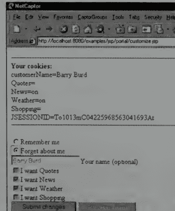

图7-5：访客希望被遗忘

JavaScript在不同厂商的Web浏览器上实现方式不同。清单7-4中的脚本在Microsoft Internet Explorer中有效。该脚本在Netscape Navigator中不起作用。

清单7-3中JavaScript的使用是客户端和服务器端编程的完美结合。JavaScript代码能够即时响应鼠标点击，不会向服务器发送任何信息。事实上，如果一个访客先选中“忘记我”，然后选中“记住我”，服务器将无从得知单选按钮曾被选中过。但是，在清单7-3中，服务器端的JSP脚本片段决定了哪些JavaScript代码被发送给访客的Web浏览器。如果某一天，网站管理员将“娱乐”添加到类别集合中，那么这个新主题将自动添加到JavaScript代码中。当访客选中“忘记我”时，新的“娱乐”复选框将被禁用。添加额外的JavaScript代码完全不需要网站开发者的任何操作。没有人需要记得去更新网页中的JavaScript代码。在Web编程的世界里，这是真正的进步。

### HTML表单

清单7-3中的表单在两个层次上使用了JSP标签。表单的customerName输入主要由普通的旧式HTML构建。但是，嵌入在这段HTML代码中的，是一个用于为输入标签提供值的小型JSP表达式。相比之下，表单的类别输入完全是在JSP脚本片段中组成的。如果不看清单7-3的外部，我们甚至无法知道表单有多少个类别输入。再次查看表单的customerName输入。注意这个JSP表达式周围的引号。有了引号，发送给访客Web浏览器的HTML标签看起来像这样：

```html
<input type=text name=customerName size=20
value="Barry Burd">您的姓名（可选）<br>
```

但如果没有引号，发送给访客Web浏览器的HTML标签看起来像这样：

```html
<input type=text name=customerName size=20
value=Barry Burd>您的姓名（可选）<br>
```

如果没有引号，访客的Web浏览器会将“Barry”放入customerName文本字段。浏览器会忽略“Burd”，因为“Burd”是输入标签中无法识别的字段。当访客点击“提交更改”按钮时，浏览器将参数customerName=Barry发回服务器，访客的姓氏就丢失了。

在清单7-3中，组成类别复选框的脚本片段很好地利用了Java的HashSet类。回想清单7-2，categories和interests变量都引用了HashSet对象。为了创建这些复选框，我们遍历categories。对于每个类别，我们检查该类别是否在访客的兴趣之中。Java的HashSet类提供了iterator和contains方法，因此我们使用categories对象的iterator方法，以及interests对象的contains方法。如果我们想反过来做（找出访客的兴趣中哪些属于我们的类别之一），我们可以轻松地完成。

### 提交更改

当访客点击图7-4中的“提交更改”按钮时，真正的工作开始了。控制权交给了一个名为submitChanges.jsp的文件。文件submitChanges.jsp使用自定义页面表单中的参数来创建cookie。容器将这些cookie发送回访客的Web浏览器。文件submitChanges.jsp如清单7-5所示，生成的浏览器显示如图7-6所示。

```jsp
<%-- submitChanges.jsp --%>

<%@ include file="portalHelper.jsp" %>

<%
  if (request.getParameter("wantCookies").equals("on"))
  {
    HashSet parameterNames = toHashSet(request.getParameterNames());

    if (parameterNames.contains("customerName"))
      addOneYearCookie(response, "customerName",
                      request.getParameter("customerName"));

    iterator = categories.iterator();
    while (iterator.hasNext())
    {
      category=(String)iterator.next();
      if (parameterNames.contains(category))
        addOneYearCookie(response, category, "on");
      else
        removeCookie(response, category);
    }
  }
  else
```


### 第7章：案例研究：一个简单的Web门户

portalHelper.jsp中的大多数方法调用都与Cookie进行某种操作。回顾代码清单7-2，你会发现这一批典型方法执行以下三个步骤：

*   创建`javax.servlet.http.Cookie`类的新实例。
*   调用新对象的`setMaxAge`方法。
*   调用`response`对象的`addCookie`方法，将新的Cookie发送到访问者的计算机上。

即使是代码清单7-2中的`removeCookie`方法也执行这些步骤。这是因为“删除”Cookie实际上意味着向访问者的Web浏览器发送一种特殊类型的Cookie。发送的Cookie类型取决于服务器。

*   对于某些厂商的服务器，发送一个最大年龄设置为0的Cookie就足够了。这会告诉Web浏览器立即删除该Cookie。
*   对于其他厂商的服务器，发送一个最大年龄设置为-1的Cookie则更为可靠。这会在访问者关闭其Web浏览器时删除Cookie。

在后一种情况下，Cookie不会被立即删除。这意味着，即使访问者勾选了“记住我”，在访问者关闭Web浏览器之前，Cookie可能仍然留在硬盘上，访问者继续浏览。我们需要对此采取措施。访问者已要求被遗忘，因此我们不能一直显示“欢迎，Barry！”，直到访问者关闭Web浏览器。

为了解决这种情况，我们将Cookie的值设置为表示数据缺失的某种信号。在代码清单7-2中，我们将Cookie的值设为空字符串。在代码的其他地方，我们在假设Cookie代表有效数据之前，会检查其值。例如，在代码清单7-1的顶部附近，我们会检查`customerName`是否为空字符串。并且，在代码清单7-2的底部，我们会检查每个分类Cookie，确保其值不为空。

> **提示**
在代码清单7-5中，调用`removeAllCookies`并不能阻止容器在访问者的硬盘上植入会话ID Cookie。这是因为会话ID Cookie的创建发生在调用`removeAllCookies`之后。

如果你使用Microsoft Internet Explorer，并且想重新开始测试门户代码，请转到你的`\Windows\Cookies`目录，并删除与你的服务器关联的`.txt`文件。如果找不到正确的文件，只需访问门户网站，然后关闭Internet Explorer，接着在`\Windows\Cookies`目录中搜索最新的`.txt`文件。

图7-6的显示确认了访问者请求的更改已生效。要看到这些更改的实际效果，访问者点击标记为“返回主门户页面”的链接。点击此链接后，访问者的浏览器会显示一个主页——一个类似于图7-1和图7-3所示的页面。从那里，访问者可以阅读新闻、天气和其他感兴趣的话题。访问者也可以点击链接进行进一步的定制。

### 总结

Web门户从表单中收集信息，并使用Cookie和其他技术存储这些信息。表单中表达的偏好用于定制显示给访问者的内容。对于许多门户，内容以离散的类别形式呈现，例如新闻、天气和股票报价。对于特定的访问者，每个类别的内容要么显示，要么省略。

门户的页面分为三类：显示内容的页面、收集偏好的页面以及存储偏好信息的页面。在本章的简单Web门户中，页面`main.jsp`显示内容，页面`customize.jsp`收集访问者偏好。页面`submitChanges.jsp`将偏好信息存储为Cookie。

Cookie的最大年龄值决定了Cookie何时过期。正的最大年龄值表示Cookie过期前的秒数。要删除Cookie，你需要添加一个具有相同名称且最大年龄值为零或负数的Cookie。某些服务器实现的零值会立即删除Cookie。某些服务器实现的负值会在访问者关闭其Web浏览器时删除Cookie。在删除Cookie时，始终最好给Cookie一个表示缺乏有效数据的值。

## 第二部分

### JavaBeans及其应用

# 第8章

### 使用JavaBeans

### 本章内容

*   JavaBeans基础
*   与Beans配合使用的操作标签
*   以JavaBeans的方式思考

JAVASERVER PAGES带有七个标准操作。在第6章中，我们讨论了其中的四个。前四个操作各自独立，作为一种单独的编程技术。另一方面，本章涵盖的三个操作构成了一个集成的整体。并且，综合来看，这些操作是更大图景的一部分。这个图景，即使用JavaBeans进行编程，反映了一种完整的编程哲学。

当你使用Beans编程时，你并没有获得任何特殊的新能力。在Web服务器上使用JSP需要做的任何事情，你都可以不使用JavaBeans来完成。那么，为什么要使用Beans呢？你使用Beans是因为以Beans的方式思考，可以使你的程序更具可读性、逻辑组织更合理、更容易测试、更容易调试、更容易维护、更容易修改，并且最终更具可重用性。此外，Bean是一个可以在可视化开发环境中拖放的组件。

在阅读本章时，不要问自己为什么可能不需要这里涵盖的技术。相反，问问自己如何将这些技术融入你思考解决编程问题的方式中。

### 什么是JavaBean？

首先是Java开发工具包（JDK）1.0.2。它是一件精美的作品——面向对象编程艺术的研究。但它有一个重大缺陷。这个早期的JDK没有提供创建软件组件的功能。那么，什么是软件组件？*软件组件*是一段可以无缝插入更大软件环境中的代码。

例如，想象一下你正在为用户开发一个要填写的表单。你使用的是一个相当复杂的程序，具有可视化的拖放环境。在这个环境中，你可以进入工具面板，拿起一个文本字段，然后将其拖放到你的新用户表单上。第三方软件开发人员可以创建他们自己的、充满有用工具的面板。通过一些常规工作，你可以将这些面板添加到开发环境中。然后，你可以将这些面板上的工具添加到你自己的用户表单中。例如，你首先将一个普通的文本字段拖放到你的表单上。用户需要在该文本字段中输入一个短语，如"Sunny side up"。除了这个字段，你还想要一个椭圆形的按钮（当然，这暗示着鸡蛋）。你用来创建表单的拖放程序本身没有椭圆形按钮，但网上有一家公司提供了你可以下载的软件。下载并安装了这个专门的软件后，你可以重新启动你的拖放环境。在增强的环境中，你发现了一个工具面板，上面有椭圆形按钮、星形按钮和许多其他新型按钮。你去到新的面板，将一个椭圆形按钮拖到你的表单上，其余的工作就自动完成了。

在底层，拖放环境必须分析新的椭圆形按钮的代码，并弄清楚如何将该按钮钩连到你正在创建的表单中。这就是软件组件的全部意义所在。软件组件是一段可以被其他代码自动分析的代码。为了实现这种神奇效果，组件必须使用严格的编程约定编写。拖放程序读取椭圆形按钮的代码，看到像`color`和`setColor`这样的名称，并自动将`setColor`视为更改`color`值的方法。编写椭圆形按钮程序的人遵循了这样的约定：某些类型的方法以单词`set`开头，后跟一个变量名。

那么，让我们回到Beans的历史。在20世纪90年代末，Sun Microsystems的Java团队的人员正看着街对面华盛顿州雷德蒙德的那些家伙。他们看到的是一个被称为COM的软件组件模型的成熟——微软的*组件对象模型*。COM对象正在被用于流行的编程环境中，例如Visual Basic，并开始以一种称为*ASP（动态服务器页面）*的形式用于网页。Sun的回应——作为JDK 1.1的一部分——就是JavaBeans规范。

实际上，Bean不过是一个Java类。使一个类成为Bean的是它以一种遵循Sun的JavaBeans规范文档中描述的部分或全部编程约定的方式编写。（参见*JavaBeans API规范*，www.javasoft.com/products/javabeans/docs/spec.html。）许多在旧的JDK 1.0.2时代编写的Java程序都具有我们现在与Beans相关联的特征，并且一个类不必遵循规范中的所有准则才能被视为类似Bean的。（半生不熟的Bean也是可以的。）最重要的是，Bean是一个其行为和特征可供其他Java代码使用的Java类。

> 如果你还不是使用JavaBeans编程的专家，通过阅读本章也不会成为专家。本章使用Bean规范的基本功能来说明在JavaServer页面中Bean的使用。要更彻底地了解JavaBeans，请选择一本专门针对该主题的书籍。


### Bean 属性

在第二章中，我们探讨了 Java 中的类级命名概念。在本章中，我们将以稍有不同的方式重新审视这一概念。

对于 Java Bean 而言，*属性* 是描述 Bean 状态某个方面的数据片段。在许多情况下，属性的值存储在一个变量中，该变量可被 Java 类外部的代码访问。所谓“访问”，是指用于管理该变量值的方法能被外部代码自动检测到。这种自动检测依赖于该变量及其方法遵循 Bean 规范的命名方式。

请看清单 8-1 中的 Java 程序。

#### 清单 8-1：一个包含四个属性的类

```java
import java.text.NumberFormat;

public class Account {
    private String name;
    private String ssn;
    private double balance;
    private boolean preferred;
    NumberFormat currency = NumberFormat.getCurrencyInstance();

    //Constructors

    public Account() {
        name = "dummy";
        ssn = "dummy";
        balance = 0.0;
        preferred = false;
    }

    public Account (String name,
                    String ssn) {
        this.name = name;
        this.ssn = ssn;
        balance = 0.0;
        preferred = false;
    }

    public Account (String name,
                    String ssn,
                    double balance,
                    boolean preferred) {
        this.name = name;
        this.ssn = ssn;
        this.balance = balance;
        this.preferred = preferred;
    }

    //Methods for name

    public void setName (String name) {
      this.name = name;
    }

    public void rename (String name) {
      setName(name);
    }

    public String getName() {
      return name;
    }

    //Accessor method for ssn

    public String getSsn () {
      return ssn;
    }

    //Accessor methods for balance

    public void setBalance (double b) {
      balance = b;
    }

    public double getBalance() {
      return balance;
    }

    //Accessor methods for preferred

    public void setPreferred (boolean preferred) {
      this.preferred = preferred;
    }

    public boolean isPreferred () {
      return preferred;
    }

    //Other methods

    public void setKeyValues (String name, String ssn) {
        this.name=name;
        this.ssn=ssn;
    }

    public void display() {
        System.out.print("Name:      ");
        System.out.println(name);
        System.out.print("SSN:       ");
        System.out.println(ssn);
        System.out.print("Balance:   ");
        System.out.println (currency.format(balance));
        System.out.print("Preferred? ");
        System.out.println(preferred);
    }
}
```

清单 8-1 中的类有四个属性——`name`、`address`、`ssn` 和 `balance`。每个属性都有一到两个访问方法。遵循 Sun Microsystems 制定的惯例：

-   每个属性都是一个以小写字母开头的变量名。
-   每个访问方法以单词 `set`、`get` 或 `is` 开头，后跟变量名，且变量名的首字母需大写。

更具体地说，每个访问方法要么是 setter，要么是 getter。setter 为属性赋值，getter 返回属性的值。setter 方法以单词 `set` 开头。getter 方法以单词 `get` 开头。或者，返回布尔值的 getter 方法可以以单词 `is` 开头。遵循这些惯例，一个旨在检测 Bean 属性的程序可能会检查 `Account` 类的一个实例，并显示一个属性表，如图 8-1 所示。

关于 Bean 的规则非常灵活。同时，这些规则又足够严格，能够强制执行良好编程风格的关键要素。要理解这一点，请看清单 8-1 代码的一些额外特性。

### 第二部分：JavaBeans 及其应用

-   访问方法是 public 的，但存储属性值的变量是 private 的。要更改账户的余额，使用该 Bean 的程序员必须编写如下语句

```java
a3.setBalance(a3.getBalance() + 25.89);
```

Bean 强制使用者以安全、可预测的方式查看和更改其属性值。

-   不是访问方法的方法仍然可以更改属性。属性 `name` 有自己的三个方法。额外的 `rename` 方法是作为增强代码可读性的可选方法包含的。（对方法或变量名的微妙选择可以将晦涩的代码变成自文档化的代码。）无论如何，在 `Account` 类中，`rename` 实际上是 `setName` 的同义词。

-   一个 Bean 可以有各种类型的方法，而不仅仅是访问方法。`Account` 类有方法 `setKeyValues`，其行为有点像 setter 方法，但没有对应的 `keyValues` 变量。该类还有一个 `display` 方法，它既不像访问方法，行为也不像访问方法。

-   并非所有属性都同时拥有 setter 和 getter 方法。从某种意义上说，属性 `ssn` 是只读的。一旦创建了账户，另一段代码设置或更改该账户 `ssn` 的唯一方法是调用 `setKeyValues` 方法。通过提供 `setKeyValues` 而不是 `setSsn`，Bean 程序员正在控制对 `Account` 类变量的访问，并为其他程序员创建一个安全的使用环境。

-   该类有三个构造函数，每个构造函数都有不同的参数集。不同的情况需要使用不同的构造函数。例如，使用第一个构造函数，你可以为未来的账户信息创建一个空的占位符。使用第二个构造函数，你可以用最少的信息创建一个有意义的账户。（许多新账户的初始余额为零。对于此类账户，使用第二个构造函数比冒险向要求更严格的第三个构造函数提供不正确的信息更安全。）

-   比较方法 `setPreferred` 和 `setBalance` 的参数列表。在 `setBalance` 中，参数名与属性名不同。在 `setPreferred` 中，属性名与参数名相同。这省去了程序员必须发明全新参数名的麻烦。这是某种程度上的标准做法。

在 `setPreferred` 方法内部，你需要一种方法来区分 `preferred` 这个词的两种用法。我们使用关键字 `this` 来实现。`this.preferred` 指的是类级属性，而单独的单词 `preferred` 指的是方法的参数。通过在一个赋值语句中组合这两种用法，我们设法将参数的值传递给属性。

### useBean 动作

第 5 章包含一些非常简单的 servlet。如果你看清单 5-8，你会注意到一件事：HTML 标签被埋没甚至模糊在 Java 代码中。Servlet 做了它们该做的事，但方式并不优雅。现在看看我们的一个 JSP 文档，比如清单 6-19。JSP 文档主要是一个 HTML 文档，其中添加了 Java 语句。但同样，HTML 和 Java 代码的混合很别扭。尖括号使你在 HTML 和 Java 之间来回切换，因此跟踪流程可能是一个挑战。理想情况是尽可能将 HTML 标签和 Java 代码分离。标签和代码清晰分离的文档更易于阅读和维护。将 Java 代码放在其应在的位置（在 .java 文件中），并在 JSP 文档中放置指向该 Java 文件的、不显眼的标记。这是 JSP 文档中使用 Bean 背后的理念。清单 8-2 展示了一个使用 JSP `useBean` 标签的文档。清单 8-3 展示了正在使用的 Bean。

#### 清单 8-2：一个包含 useBean 动作的页面

```jsp
<jsp:useBean id="hitcount"
      class="hitCount.HitCount"
      scope="application" />

<% hitcount.increment(); %>
You are visitor number <%= hitcount.getCount() %>.
```

#### 清单 8-3：清单 8-2 中使用的 Bean

```java
package hitCount;

public class HitCount implements java.io.Serializable {
  private int count=0;

  public void setCount(int count) {
    this.count=count;
  }

  public int getCount () {
    return count;
  }

  public void increment () {
    count++;
  }
}
```


图8-2展示了第一位访问者在查看清单8-2中的页面时所看到的内容。首先，useBean标签创建了HitCount类的一个实例。然后，JSP文档调用increment方法，将bean的count属性值加1。最后，文档调用bean的getter方法来显示count的新值。

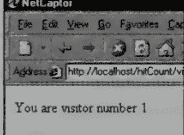

图8-2：访问者计数器，这次使用了JavaBeans

第二位访问者的情况略有不同。到那时，JSP容器已经创建了HitCount类的一个实例。它不会再创建额外的实例。相反，在执行useBean操作时，容器会找到HitCount类的现有实例，并将该实例提供给第二位访问者。第二位访问者调用increment方法，然后调用getCount方法，显示“您是第2位访问者”。


> 当您测试清单8-2中的代码时，请注意页面缓存问题。当您点击“刷新”或“重新加载”按钮时，浏览器可能会给您提供页面的缓存版本。您可能会多次看到“您是第1位访问者”，并疑惑为什么计数没有增加。要强制浏览器忽略缓存，可以在点击“刷新”或“重新加载”按钮时按住Shift键。在某些浏览器中，按住Ctrl键并点击“刷新”或“重新加载”按钮也能达到同样效果。

这个bean的有效性依赖于每次用户访问页面时容器都能找到现有实例。这之所以会发生，是因为该操作的scope属性值为`application`。第3章介绍了Web应用程序的概念。具有应用作用域的bean可供该应用程序内任何页面的访问者使用。这个bean会从一个访问到下一个访问、从一个访问者到下一个访问者一直存在，直到容器回收分配给该应用程序的空间。通常，这会在站点管理员关闭容器时发生。

回忆一下第1章的内容，如果一个对象没有被使用，容器可以回收该对象的空间（并销毁该对象）。如果一个对象相对于容器管理的其他对象使用率较低，这种情况就更有可能发生。

如果您重启服务器，然后访问清单8-2中的页面，容器会实例化一个全新的bean对象。您看到的消息将是“您是第1位访问者”。

您将在关于bean作用域的小节中阅读更多关于此（以及实现`Serializable`接口）的内容。

### class属性

`useBean`操作的`class`属性告诉容器在哪里查找与bean关联的`.class`文件。如果您有任何使用Java类的经验，您就会知道这有多么棘手。将`.class`文件放在错误的子目录中，或者使用错误的修饰符引用该类，`NoClassDefFoundError`异常就会立即困扰您。

尽管所有文档都这么说，但在尝试定位`.class`文件时，没有万无一失的方法来避免碰壁。对于JSP文档中的bean，我提供以下建议：

-   将您的bean放入一个包中。将`.class`文件放入一个与包名同名的子目录中。在`useBean`操作的`class`属性中，提供该类的完全限定名，以包名开头。例如，在清单8-2中，`HitCount`类位于名为`hitCount`的包中。文件`HitCount.class`应该放在名为`hitCount`的子目录中。在清单8-1中，`useBean`操作的`class`属性指定为`hitCount.HitCount`。

-   阅读容器的文档，以找到bean子目录应该存放的目录（或多个目录）。以下是一些示例：

    -   对于Tomcat，使用`WEB-INF`目录下的`classes`子目录。
    -   对于ServletExec，使用以您特定计算机命名的目录下的`classes`子目录。（我的Windows 98计算机的网络标识名是acer，因此，当我安装ServletExec时，它创建了一个名为se-acer的目录。）
    -   对于mycgiserver，使用您的主目录。使bean成为以您的主目录命名的包的一部分。例如，我的主目录名为bburd。在bburd目录中，我有一个名为MyPage.jsp的文件和一个名为pageInfo的子目录。在pageInfo中，有一个名为Counter.java的文件。Counter.java的第一行是`package bburd.pageInfo;`。而在MyPage.jsp中，有一个`class="bburd.pageInfo.Counter"`属性的useBean操作。

#### TIP

一个好的做法是给您的包一个多部分名称，以您的公司或组织的名称开头，然后逐步指向更具体的实体，例如包本身的用途。例如，在BurdBrain.com，日程安排办公室创建了两个包——一个处理日历，另一个处理日历事件。这些包的名称分别是`com.BurdBrain.scheduling.calendar`和`com.BurdBrain.scheduling.calendar.event`。当计算机的CLASSPATH中包含`c:\classes`时，第一个包的所有`.class`文件都位于目录`c:\classes\com\BurdBrain\scheduling\calendar`中。

### id属性

id属性给出了bean实例的名称，该名称在整个JSP文档中都可知。例如，清单8-2中的useBean操作有`id="hitcount"`。在清单8-2后面，我们通过调用`hitcount.getCount()`来调用bean的访问器方法。

使用不同的id值，您可以创建同一个bean类的多个实例。作为实验，我启动了本地的JSP容器，并三次访问了清单8-2中的页面。然后我访问了清单8-4中的页面。实验的结果如图8-3所示。

```
清单8-4：创建bean类的两个实例
<jsp:useBean id="hitcount"
    class="hitCount.HitCount"
    scope="application" />
<jsp:useBean id="hitcount2"
    class="hitCount.HitCount"
    scope="application" />

<% hitcount.increment(); %>
You are visitor number <%= hitcount.getCount() %>.
<% hitcount2.increment(); %>
You are visitor number <%= hitcount2.getCount() %>.
```

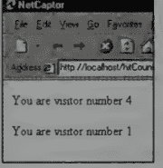

图8-3：HitCount类的不同实例具有不同的count值

### Bean作用域

第3章介绍了JavaServer Pages中的四种作用域。您可以在`useBean`标签中使用这四种作用域中的任何一种。`scope`属性的值通过回答以下三个问题来告诉容器：

-   在查找现有的bean实例时，该bean实例应该具有什么作用域？
-   在使用bean实例之后，该bean实例应该继续存在多久？
-   如果一个bean实例继续存在，其他哪些页面应该使用同一个bean实例？

考虑到第3章关于作用域讨论中概述的准则，这些问题的答案是可预测的。

-   属性`scope="application"`告诉容器查找同一应用程序中任何页面创建的任何实例。该实例会一直存在，直到容器回收它（通常在容器关闭时）。
-   属性`scope="session"`告诉容器查找同一用户在一次访问期间创建的任何实例。（当然，同一用户意味着在一段时间内，同一台计算机上的同一Web浏览器，这段时间由会话的最大不活动间隔值决定。）
-   属性`scope="request"`告诉容器查找作为同一请求一部分创建的任何实例。回忆第6章的内容，`include`操作可以运行一个新的JSP文档，并将当前请求传递给该新文档。包含文档创建的任何具有请求作用域的bean都可供被包含文档使用。当一个请求从一个文档传递到另一个文档时，对这两个文档的访问都是同一会话的一部分。因此，请求作用域小于（或至少不大于）会话作用域。
-   `scope`属性的默认值是`page`。属性`scope="page"`告诉容器不要查找现有实例，而是创建一个全新的实例。该实例仅在一个页面的生命周期内存在。


对本页面的访问。任何通过 `include` 指令插入的文本都视为在同一页上。任何通过 `include` 动作访问的页面都被视为在不同的页面上。（`include` 动作下的行为正是区分页面作用域与请求作用域的关键。）

具有会话作用域的 bean 会一直存活，直到容器回收它。这可能发生在会话用户未在最大不活动间隔内访问时。如果 bean 来自未实现 `java.io.Serializable` 的类，那么无论何时关闭容器，实例都会被回收（更准确地说是销毁）。

 对于未实现 `Serializable` 的 bean，会话作用域小于（或至少不大于）应用作用域。如果我一天内访问页面两次，并且两次访问之间容器关闭，那么在第二次访问开始时，bean 及其所有属性都会被重新创建和初始化。即使从 cookie 角度看，两次访问都属于同一个会话，这种情况也会发生。

清单 8-2 中的类实现了 `java.io.Serializable`。这使得容器能够将 bean 实例及其 `count` 属性的当前值写入磁盘上的二进制文件。一些供应商的容器会自动对所有会话作用域 bean 执行此操作。现在想象你正在使用这样一个容器。当容器重启，并且用户再次访问带有会话 bean 的页面时，容器会重新读取 bean 信息，恢复所有属性值，并从用户离开的地方继续。在这种情况下，会话中的所有信息都能在服务器关闭后继续存在。这正是应有的行为。对于长时间的会话（对用户而言，持续时间超过一次会话），用户不应受到服务器起伏的影响。

### 实验 bean 作用域

为了更深入地探讨页面作用域的一些微妙之处，我进行了清单 8-5 所示的实验。一次又一次的访问产生了图 8-4 所示的结果。每次我访问页面时，容器都会创建两个全新的 `HitCount` 类实例。在对 `hitcount2` 执行 `useBean` 动作时，容器没有使用现有的 `hitcount1` 实例。后来，如果我将第二个 `useBean` 标签改为 `id="hitcount1"`，容器会给我一条错误消息。一个页面不能有两个具有相同 id 值的 `useBean` 标签。

清单 8-5：创建两个具有页面作用域的实例

```
<jsp:useBean id="hitcount1"
            class="hitCount.HitCount"
            scope="page" />
```

```
<jsp:useBean id="hitcount2"
    class="hitCount.HitCount"
    scope="page" />

hitcount1:<br>
<% hitcount1.increment(); %>
You are visitor number <%= hitcount1.getCount() %>.<p>

hitcount2:<br>
<% hitcount2.increment(); %>
You are visitor number <%= hitcount2.getCount() %>.<p>
```

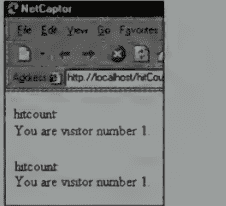

**图 8-4：对 hitcount 使用页面作用域的结果**

为了演示请求作用域，我访问了清单 8-6 所示的 visitMeA.jsp。反过来，visitMeA.jsp 的代码将我的请求传递给 visitMeB.jsp 和 visitMeC.jsp（清单 8-7 和 8-8）。请自己尝试测试一下。在查看图 8-5 所示的结果之前，写下你认为 Web 浏览器会显示什么。

**清单 8-6：涉及请求作用域的实验**

```
<%-- visitMeA.jsp --%>

<jsp:useBean id="hitcount1"
    class="hitCount.HitCount"
    scope="request" />
<jsp:useBean id="hitcount2"
    class="hitCount.HitCount"
    scope="request" />

<b>hitcount1:</b><br>
<% hitcount1.increment(); %>
You are visitor number <%= hitcount1.getCount() %>.<p>

<b>hitcount2:</b><br>
<% hitcount2.increment(); %>
You are visitor number <%= hitcount2.getCount() %>.<p>
```

### 第二部分：JavaBean 及其应用

<b>使用 include 指令：</b><br><%@ include file="visitMeB.jsp" %>

<b>使用 include 动作：</b><br><jsp:include page="visitMeB.jsp" flush="true"/><p>

<b>再次使用 include 动作：</b><br><jsp:include page="visitMeC.jsp" flush="true"/><p>

清单 8-7：清单 8-6 代码包含的页面

```
<%-- visitMeB.jsp --%>

<jsp:useBean id="hitcountB"
             class="hitCount.HitCount"
             scope="request" />

<% hitcountB.increment(); %>
You are visitor number <%= hitcountB.getCount() %>.<p>
```

清单 8-8：清单 8-6 代码包含的另一个页面

```
<%-- visitMeC.jsp --%>

<jsp:useBean id="hitcountC"
             class="hitCount.HitCount"
             scope="request" />

<% hitcountC.increment(); %>
You are visitor number <%= hitcountC.getCount() %>.<p>
```


### 第 8 章：使用 JavaBean

在 visitMeA.jsp 中，我在同一个请求作用域内创建了两个不同的 HitCount 类实例——hitcount1 和 hitcount2。然后，我使用 include 指令包含了 visitMeB.jsp。visitMeB.jsp 中的文本成为了原始 visitMeA 页面的一部分。因此，visitMeB.jsp 中的 useBean 标签必须具有其自己的唯一 id 值。这导致容器创建了第三个 HitCount 类实例。

接下来，我使用 include 动作再次访问 visitMeB.jsp 页面。这意味着容器遇到了两次相同的 useBean 标签，每次都带有相同的 id="hitcountB" 属性。这是可以的，因为 include 动作没有使 visitMeB.jsp 成为包含页面的一部分。但是，在第二次遇到 id 值 hitcountB 时，容器找到了现有的 hitcountB 实例，并将其值加 1。

最后，在清单 8-6 中，我使用 include 动作访问了 visitMeC.jsp。因为 visitMeC.jsp 使用了其自己的唯一 id 值（hitcountC），所以容器创建了一个全新的 HitCount 类实例。

作为最后一个实验，我尝试访问清单 8-9 中的代码，该代码又包含了清单 8-10 中的代码。一些结果如图 8-6 所示。

清单 8-9：一个具有请求作用域的 bean

```
<%-- visitMeX.jsp --%>

<jsp:useBean id="hitcount"
            class="hitCount.HitCount"
            scope="request" />

<b>Request scope:</b><br>
<% hitcount.increment(); %>
You are visitor number <%= hitcount.getCount() %>.</p>

<jsp:include page="visitMeY.jsp" flush="true"/>
```

清单 8-10：一个具有会话作用域的 bean

```
<%-- visitMeY.jsp --%>

<jsp:useBean id="hitcount"
            class="hitCount.HitCount"
            scope="session" />

<b>Session scope:</b><br>
<% hitcount.increment(); %>
You are visitor number <%= hitcount.getCount() %>.</p>
```

清单 8-9 和 8-10 中的 useBean 动作共享一个公共的 id 值。即便如此，容器会比较 scope 属性，并得出结论认为这两个动作并不指向同一个对象。当我访问该页面时，容器会创建一个新的请求作用域 bean，并重用现有的会话作用域 bean。


图 8-6：对清单 8-9 中页面的十二次访问显示了请求作用域和会话作用域之间的差异。

### 其他 useBean 属性

`useBean` 动作支持另外两个属性。一个叫做 `beanName`。`beanName` 属性的值是你会传递给 `instantiate` 方法（`java.beans.Beans` 类中的一个方法）的名称。`beanName` 属性除了其他用途外，还用于微调序列化 bean 的检索。

另一个属性叫做 `type`。使用 `type` 属性，你可以更改用于标识 bean 的变量的声明。为了对此进行实验，定义一个名为 `MyBean` 的类，并让 `MyBean` 实现 `Runnable` 接口。使用以下标签创建一个 `MyBean` 实例：

```
<jsp:useBean id="thisUser" class="users.ThisUser" scope="session">
Welcome, newcomer!
</jsp:useBean>
```

该标签指示容器查找 ThisUser 类的一个会话范围实例。如果不存在这样的实例，容器会创建一个全新的实例。
对于特定用户，当用户第一次访问此页面时，容器会为该用户创建一个会话，为该会话创建一个 bean 实例，并在用户的浏览器窗口中写入“Welcome, newcomer!”这几个词。此后，当同一用户访问该页面时，容器会识别出已经存在一个用于此用户会话的 bean 实例，将名称 thisUser 与该 bean 实例关联起来，并跳过欢迎消息的写入。

### 编译和重新编译 bean 类

对于大多数供应商的容器，bean 的处理方式与 .jsp 文档不同。编写 bean 类后，你必须编译 .java 文件。容器不会为你进行编译。有几种方法可以编译代码。

- 你可以使用你喜欢的 Java 集成开发环境。
- 你可以使用 Sun 的 JDK 中附带的基于文本的 javac 程序。
- 一些服务器提供 Java 编译设施。你可以将 .java 文件上传到远程服务器，并调用服务器的编译器。

有时你需要修改现有的 Java 代码。当然，你必须确保重新编译 .java 文件。但还有一个问题。每个 Java 虚拟机都使用一种称为类加载器的东西。部分出于安全原因，类加载器不能加载两个同名的类。一旦你的旧类被加载，任何修改过的 .class 文件都会被简单地忽略。一些供应商的容器有解决方法。但在许多服务器上，你必须关闭并重新启动 JSP 容器，容器才能使用你修改过的代码。

### setProperty 和 getProperty 动作

在清单 8-2 中，我们显示了 bean 的 count 属性的值。我们是通过调用该属性的 getter 方法来做到这一点的。

```
<%= hitcount.getCount() %>
```

使用 JSP 动作，还有另一种更灵活的方式来访问 bean 的属性。setProperty 动作将值分配给 bean 的部分或全部属性。


### 使用 HTML 表单中的值

让我们用另一个 Account bean 开始示例。在编写代码清单 8-11 时，我借鉴了代码清单 8-1 中的许多思路。（我做了一些修改，这将帮助我说明一些有趣的要点。）这个新的、精简版的 Account bean 比其前身拥有更少的方法。但新 bean 的 ssn 属性同时拥有 getter 和 setter 方法。

**代码清单 8-11：Account 类的精简版本**

```java
package account;

public class Account implements java.io.Serializable {
    private String name;
    private String ssn;
    private double balance;
    private boolean preferred;

    // Constructor

    public Account() {
        name = "";
        ssn = "";
        balance = 0.0;
        preferred = false;
    }

    // Methods for name

    public void setName(String name) {
        this.name = name;
    }

    public void rename(String name) {
        setName(name);
    }

    public String getName() {
        return name;
    }

    // Accessor methods for ssn

    public void setSsn(String ssn) {
        this.ssn = ssn;
    }

    public String getSsn() {
        return ssn;
    }

    // Accessor methods for balance

    public void setBalance(double balance) {
        this.balance = balance;
    }

    public double getBalance() {
        return balance;
    }

    // Accessor methods for preferred

    public void setPreferred(boolean preferred) {
        this.preferred = preferred;
    }

    public boolean isPreferred() {
        return preferred;
    }
}
```

我们的网站上有一个包含表单的普通 HTML 文档。该文档如代码清单 8-12 所示，生成的表单如图 8-7 所示。

#### 代码清单 8-12：一个 HTML 表单

```html
<!-- enterInfo.html -->

<form action=addInfo.jsp>
  <table>
    <tr>
      <td>Name:</td>
      <td><input type=text size=15 name="name"></td>
    </tr>
    <tr>
      <td>SSN:</td>
      <td><input type=text size=15 name="ssn"></td>
    </tr>
    <tr>
      <td>Balance:</td>
      <td><input type=text size=15 name="balance"></td>
    </tr>
    <tr>
      <td>Preferred?</td>
      <td><input type=radio name=preferred value=true>Yes<br>
          <input type=radio name=preferred value=false>No</td>
    </tr>
    <tr>
      <td><input type=submit value=Add></td>
    </tr>
  </table>
</form>
```


图 8-7：由代码清单 8-12 创建的表单

当用户点击按钮时，请求被发送到一个名为 **addInfo.jsp** 的页面。

```
http://www.BurdBrain.com/account/addInfo.jsp?
name=Barry+Burd&ssn=111-11-1111&balance=1294.98&preferred=true
```

> 当浏览器发送请求的参数值时，它会将空格转换为 %20 或加号（+）。其他非字母数字字符也以类似方式表示。例如，如果用户在文本字段中输入双引号、和号（&）和加号（+），这些字符将分别被转换为 %22、%26 和 %2B。这就是我们如何能够在请求的参数中传输任何字符。从普通字符到特殊请求字符的转换称为 URL 编码。（参见第 3 章中 response 对象的 encodeURL 方法。）

页面 addInfo.jsp 如代码清单 8-13 所示。

#### 代码清单 8-13：处理在 enterInfo.html 中提交的信息

```jsp
<%-- addInfo.jsp --%>

<jsp:useBean id="account" class="account.Account" scope="session"/>
<jsp:setProperty name="account" property="*"/>
```

账户信息已被添加。

在用户的浏览器窗口中，来自 addInfo.jsp 的显示非常简洁。（参见图 8-8。）但页面的 setProperty 动作会获取请求中所有名称与 bean 中属性同名的参数。对于每个这样的参数，容器会调用该属性的 setter 方法，将属性的值设置为参数的值。（再次查看代码清单 8-12，并注意我巧妙地命名了表单的输入标签。每个标签都以 Account bean 中的一个属性命名。）在 setProperty 动作中，我们通过编写 property="*" 来获得“查找所有匹配参数”的效果。


图 8-8：来自代码清单 8-13 代码的用户浏览器中的显示

**198** &nbsp;&nbsp;&nbsp;&nbsp; **第二部分：JavaBeans 及其应用**

> 当使用 `property="*"` 时，任何名称与请求参数匹配的 bean 属性都必须有一个 setter 方法。如果你有一个只有 getter 方法的 bean 属性，并且该 bean 属性与某个请求参数同名，使用 `property="*"` 将会抛出一个 `NullPointerException`。为避免抛出异常，请为相应的请求参数指定一个不同的名称。使用 `property="*"` 时，名称不匹配任何请求参数名称的 bean 属性将被忽略。

在底层，将参数值分配给属性值比看起来要复杂一些。参数总是一个字符串，但属性的类型可能是 `double`、`boolean` 或其他任何类型。容器使用 `valueOf` 方法将 `String` 转换为适当的属性类型。这就是为什么在代码清单 8-12 中，我为单选按钮设置了值 `true` 和 `false`。

要查看设置 bean 属性的结果，请查看代码清单 8-14 和图 8-9。访问 `addInfo.jsp` 后，同一用户访问 `showInfo.jsp`。在 `showInfo.jsp` 中，我们使用了四次 `getProperty` 动作——每个 bean 属性一次。每个 `getProperty` 动作检索一个属性的值，并将该值放入响应流中。在图 8-9 中，每个属性的值都在用户的浏览器窗口中显示出来。

注意其中的差异。在代码清单 8-13 中，我们可以用一个 `setProperty` 动作同时设置所有四个属性。但在代码清单 8-14 中，我们需要四个 `getProperty` 动作来检索存储在 bean 中的值。事情就是这样。

#### 代码清单 8-14：使用 getProperty 动作

```jsp
<%-- showInfo.jsp --%>

<jsp:useBean id="account" class="account.Account" scope="session" />

<b>Name:</b>
<jsp:getProperty name="account" property="name"/><br>
<b>SSN:</b>
<jsp:getProperty name="account" property="ssn"/><br>
<b>Balance:</b>
<jsp:getProperty name="account" property="balance"/><br>
<b>Preferred?</b>
<jsp:getProperty name="account" property="preferred"/>
```


图 8-9：访问代码清单 8-14 中代码的结果

> 提示：在 useBean 动作中，bean 的名称是 id 属性的值。在 setProperty 或 getProperty 动作中，bean 的名称是 name 属性的值。这可能会令人困惑。基本原则是，在单个页面内，第一次引用某个实体时赋予其 id。任何后续引用都指向该实体的现有名称。

> 注意：请确保在使用 scope 属性时保持一致。无论何时省略 scope 属性，它都默认为 page。在代码清单 8-13 中，useBean 动作的 scope 属性值为 session。如果你在代码清单 8-14 中忘记了 scope 属性，那么容器将寻找一个具有 page 作用域的 bean，而不是 session 作用域。因此，容器永远找不到它在用户访问代码清单 8-13 时创建的 bean。

### setProperty 和 getProperty 动作的属性

代码清单 8-13 中的星号使得 setProperty 捕获所有名称与 bean 属性名称匹配的参数值。有时，你希望对 bean 属性值的设置更加有限。为此，请将星号更改为某个属性的名称。

要了解这是如何工作的，请回到图 8-7 中的表单。输入姓名 Barry Burd，以及任何你想要的社会安全号码、余额和首选客户状态的值。点击添加按钮时，让代码请求如代码清单 8-15 所示的修改后的页面。生成的浏览器显示如图 8-10 所示。

#### 代码清单 8-15：设置特定属性的值

```jsp
<jsp:useBean id="account" class="account.Account" scope="page"/>
<jsp:setProperty name="account" property="name"/>
```


<b>姓名：</b>
<jsp:getProperty name="account" property="name"/><br>
<b>社会安全号码：</b>
<jsp:getProperty name="account" property="ssn"/><br>
<b>余额：</b>
<jsp:getProperty name="account" property="balance"/><br>
<b>是否为优选客户？</b>
<jsp:getProperty name="account" property="preferred"/>

`setProperty` 动作有两个额外的属性：`param` 和 `value`。如果在动作的 `property` 属性的值中使用属性名（而非星号），则可以选择添加 `param` 属性或 `value` 属性。

当表单参数的名称与相应的 bean 属性名称不同时，请使用 `param` 属性。例如，假设您公司有人坚持要修改清单 8-12 中的文本字段，如下所示：

```
<td>Name:</td>
<td><input type=text size=15 name="fullname"></td>
```

您无需更改变量名。只需使用以下 `setProperty` 动作：

```
<jsp:setProperty name="account" property="name" param="fullname"/>
```

当没有请求参数的值与您要分配给 bean 属性的值完全相同时，请使用 `value` 属性。例如，假设您部门的某位糊涂虫修改了清单 8-12 中的表单，如下所示：

```
<tr>
  <td>First name:</td>
  <td><input type=text size=15 name="firstname"></td>
</tr>
<tr>
  <td>Last name:</td>
  <td><input type=text size=15 name="lastname"></td>
</tr>
```

作为补偿，请按如下方式更改您的表单处理代码：

```
<jsp:useBean id="account" class="account.Account" scope="page"/>
<% String fullname = request.getParameter("firstname") + " " +
                   request.getParameter("lastname");
%>

<jsp:setProperty name="account"
                 property="name"
                 value="<%=fullname%>"/>
```

与 `setProperty` 动作相比，`getProperty` 动作则简单得令人愉悦。`getProperty` 动作只有两个属性——`name` 属性和 `property` 属性。使用 `getProperty` 动作时，这两个属性都是必需的。

### 索引属性

Sun 的 JavaBeans 规范描述了数十种 bean 特性。其中许多特性在某些特定类型的问题或专门环境中非常有用。
**索引属性**是一种带有 setter 方法、getter 方法或两者兼有的数组。访问器方法可以引用数组的单个元素或整个数组。在清单 8-16 中，setter 方法为数组填充值。在同一个清单中，getter 方法返回单个元素的值。

**清单 8-16：一个带有索引属性的 bean 类**

```
package indexed;
import java.util.StringTokenizer;

public class Board {

  private String[][] board = new String[4][4];
  //可用的棋盘行编号为 1 到 3，列
  //  编号为 1 到 3。第 0 行和第 0 列未被使用。
  //  使用第 0 行或第 0 列会让人非常困惑。

  //构造函数

  public Board () {
    for (int row=1; row<=3; row++)
      for (int col=1; col<=3; col++)
        board[row][col]="";
  }

  //棋盘访问器方法

  public void setBoard(String marks) {
      StringTokenizer tokenizer = new StringTokenizer(marks, ",");
      System.out.println(marks);
      for (int row=1; row<=3; row++)
          for (int col=1; col<=3; col++) {
              board[row][col] = tokenizer.nextToken();
              System.out.println(board[row][col]);
          }
  }

  public String getBoard(int row, int col) {
      return board[row][col];
  }
}
```

请特别注意清单 8-16 中的 setter 方法。该方法的参数类型是 `String`。该方法将字符串分割为词元，并将每个词元分配给棋盘数组的可用元素。
一旦您有了一个带有索引属性的 bean，就可以使用 JSP 动作来访问该属性。清单 8-17 展示了两个这样的动作。在一个动作中，我们将一个 `String` 变量的值传递给 bean 的 setter 方法。在另一个动作中，我们传递一个 `String` 字面量给 setter 方法。无论哪种情况，bean 的 setter 方法都会对字符串进行词元化，并用 X 和 0 标记填充棋盘数组。清单 8-17 的显示结果如图 8-11 所示。

**清单 8-17：使用 JSP 动作引用索引属性**

```
<%@ page import="indexed.Board" %>
<jsp:useBean id="boardbean" class="indexed.Board" />

<% String marks = "X,X,0,X,0,0,0,0,0"; %>
<jsp:setProperty name="boardbean"
                 property="board"
                 value="<%=marks%>" />
<% showBoard(boardbean, out); %>

<jsp:setProperty name="boardbean"
                 property="board"
                 value="0,0,0,X,0,X,0,X,0" />
<%
    showBoard(boardbean, out);
%>
<%!
    public void showBoard(Board boardbean, JspWriter out)
        throws java.io.IOException {
        for (int row=1; row<=3; row++) {
            for (int col=1; col<=3; col++)
                out.println(boardbean.getBoard(row, col));
            out.println("<br>");
        }
        out.println("<br>");
    }
%>
```

图 8-11：清单 8-17 代码的显示结果

清单 8-17 说明了一个重要观点。`useBean` 动作在请求时执行。在转换后的 servlet 代码中，bean 的 `id` 是一个方法局部变量。（该变量是 servlet 的 `_jspService` 方法的局部变量。）因此，在 JSP 文档中，bean 的 `id` 对任何 JSP 声明都是不可用的。

在清单 8-17 的后半部分，我们声明了方法 `showBoard`。前面的 `useBean` 动作并未使名称 `boardbean` 在 JSP 声明中可用。要在方法 `showBoard` 的代码中引用该 bean，我们必须将 `boardbean` 作为参数传递给 `showBoard` 方法。

### 示例：使用 bean 中的值填充表单

到目前为止，我们的 `setProperty` 示例只是以简单的文本格式列出了 bean 的值。然而，在实际应用中，bean 数据用于执行一些有趣的任务。在清单 8-18 中，我们从一个 Account bean（清单 8-11）获取用户的会话数据。我们使用这些数据来填充一个在线表单。当用户访问此页面时，表单中的值反映了用户的最新状态。（参见图 8-12。）用户可以更改表单中的数据，也可以保持数据值不变。

**清单 8-18：使用 bean 数据为表单设置默认值**

```
<%@ page import="java.text.DecimalFormat" %>

<jsp:useBean id="account" class="account.Account" scope="session" />

<%
    DecimalFormat currency = new DecimalFormat("####0.00");
    String balance = currency.format(account.getBalance());
    String checkYes = "";
    String checkNo  = "";
    if (account.isPreferred())
        checkYes = "checked";
    else
        checkNo = "checked";
%>

<h3>请更正任何无效数据：</h3>

<form action=addInfo6.jsp>
    <table>
        <tr>
            <td>姓名：</td>
            <td><input type=text size=15 name="name" value=
                "<jsp:getProperty name="account" property="name"/>"></td>
        </tr>
        <tr>
            <td>社会安全号码：</td>
            <td><input type=text size=15 name="ssn" value=
                <jsp:getProperty name="account" property="ssn"/>></td>
        </tr>
        <tr>
            <td>余额：</td>
            <td><input type=text size=15 name="balance"
                value=<%=balance%>
            ></td>
        </tr>
        <tr>
            <td>是否为优选客户？</td>
            <td><input type=radio name=preferred value=true
                <%= checkYes %>
            >是<br>
                <input type=radio name=preferred value=false
                <%= checkNo %>
            >否</td>
        </tr>
        <tr>
            <td><input type=submit value=提交>
                <input type=reset value=清除></td>
        </tr>
    </table>
</form>
```

图 8-12：使用 bean 数据填充的表单

返回清单 8-11，查看类构造函数中使用的默认值。当没有先前会话数据的用户访问清单 8-18 中的表单时，容器会创建一个新的 account bean 并使用这些默认值填充表单。在编写 Account.java 时，我特别注意选择了默认值，以便在新用户的表单中看起来合适。

注意清单 8-18 中第一个 `getProperty` 动作周围的双引号。如果省略这些引号会发生什么？如果 account bean 的 `name` 属性值为 Barry Burd，那么发送到用户 Web 浏览器的 HTML 代码是
`<td><input type=text size=15 name="name" value= Barry Burd></td>`
Web 浏览器看到的是 `value=Barry`。浏览器将 `Burd` 视为输入标签中的未知单词而忽略它。因此，文本框中只显示了名字 Barry。

当您记得使用双引号时，发送到用户 Web 浏览器的代码是
`<td><input type=text size=15 name="name" value="Barry Burd"></td>`
Web 浏览器看到的是 `value="Barry Burd"`，因此整个名字都显示在文本框中。


### 为什么要使用 setProperty 和 getProperty？

在代码清单 8-2 中，我调用了一个 bean 的 getter 方法来显示属性的值。

```
<%= hitcount.getCount() %>
```

这与 getProperty 动作的效果完全相同。

```
<jsp:getProperty name="hitcount" property="count"/>
```

getProperty 标签更长，在一个大型、复杂的 JSP 文档中，getProperty 动作更难阅读。
甚至存在一些场景，在这些场景中，getter 方法调用有效，但 getProperty 动作并不合适。例如，在代码清单 8-18 中，调用 `account.isPreferred()` 确定了 bean 的 `preferred` 属性的值，而没有在用户的浏览器窗口中显示该值。（这是好事。在代码的那个部分，我们不希望显示该值。）
那么，为什么要费心使用 getProperty 动作呢？答案是，getProperty 动作专门针对 bean 属性。使用 `java.beans` 包中的类，你可以更改属性的 setter 或 getter 方法的名称。如果你这样做了，getProperty 动作会自动找到新的访问器方法。你不必在 JSP 代码中更改任何内容。
考虑代码清单 8-19 中描述的 `HitCount` bean。这个 bean 的 `count` 属性有一个标准的 `setCount` 方法，但获取 count 的方法不叫 `getCount`。另一个检查 `HitCount` 类的程序可能不会自动在代码中找到 getter 方法。为了将 `incrementAndGetCount` 变成 getter 方法，我们创建了一个额外的类。这个额外的类，如代码清单 8-20 所示，提供了关于 `HitCount` 类的信息。

### 代码清单 8-19：一个具有非标准 getter 方法的类

```
package hitCount6;
import java.io.Serializable;

public class HitCount implements Serializable {
    private int count=0;

    public void setCount(int count) {
        this.count=count;
    }

    public int incrementAndGetCount () {
        return ++count;
    }
}
```

### 代码清单 8-20：伴随 HitCount 类的 bean 信息类

```
package hitCount6;

import java.beans.*;

public class HitCountBeanInfo extends SimpleBeanInfo {

    public PropertyDescriptor[] getPropertyDescriptors() {
        PropertyDescriptor pd[] = new PropertyDescriptor[1];
        try {
            pd[0] = new PropertyDescriptor("count",
                                        (new HitCount()).getClass(),
                                        "incrementAndGetCount", "setCount");
        } catch (IntrospectionException e) {}
        return pd;
    }
}
```

让我们检查代码清单 8-20 中的代码。鉴于我们试图完成的任务，代码清单 8-20 中的大部分代码（包括代码中使用的名称）都是固定不变的。我们从一个名为 `HitCount` 的类开始，因此代码清单 8-20 中的类必须命名为 `HitCountBeanInfo`。（如果我们从一个名为 `Whatever` 的类开始，它的支持类的名称必须是 `WhateverBeanInfo`。）`HitCountBeanInfo` 类扩展了一个名为 `SimpleBeanInfo` 的类，该类在 `java.beans` 包内定义。代码清单 8-20 中的其他名称，如 `PropertyDescriptor` 和 `IntrospectionException`，也在 `java.beans` 包中定义。（我们不必扩展 `SimpleBeanInfo`。还有其他选择。但扩展 `SimpleBeanInfo` 是最简单的方法。）为了将 `incrementAndGetCount` 确立为 getter 方法，我们创建了一个名为 `getPropertyDescriptors` 的方法，并经历了这个方法内部的其余繁琐步骤。

我们编译 `HitCountBeanInfo.java`，并将 `HitCountBeanInfo.class` 与 `HitCount.java` 放在同一目录中。然后，我们访问代码清单 8-21 中所示的 JSP 文档。通过 JavaBeans 的魔力，代码清单 8-21 中的 `getProperty` 动作调用了 `incrementAndGetCount`。一举两得，`count` 的值既被递增又被显示出来。

### 代码清单 8-21：使用 HitCount 和 HitCountBeanInfo 的文档

```
<jsp:useBean id="hitcount"
             class="hitCount6.HitCount"
             scope="application" />

You are visitor number <jsp:getProperty
                             name="hitcount"
                             property="count"/>.
```

### 总结

JavaBean 是一个组件，其代码遵循某些准则。这些准则在 Sun Microsystems 的 JavaBeans 规范文档中有描述。当我们遵循这些准则时，我们定义了一个类，其对象可以被其他代码段检查和使用。
属性是一个变量，具有 setter 方法、getter 方法，或者同时具有 setter 和 getter 方法。通常，这些方法的名称遵循 JavaBeans 准则。setter 方法的名称以 `set` 开头。getter 方法的名称以 `get` 或 `is` 开头。方法名称的其余部分与属性的名称相同。唯一的区别是大小写。
使用 `useBean` 动作，JSP 文档要么找到现有的 bean 实例，要么创建一个新的 bean 实例。`useBean` 动作有一个 `scope` 属性。`scope` 属性的值决定了 bean 的生命周期。
一旦创建了 bean 实例，你就可以在 JSP 脚本段中调用 bean 的方法。或者，你可以使用 `setProperty` 和 `getProperty` 动作来调用 bean 的 setter 和 getter 方法。

## 第 9 章

## 案例研究：井字棋

### 本章内容

- 使用 JSP 创建多页面网站
- 编程在线游戏
- 协调多个用户会话
- 充分利用 JavaBeans

到目前为止，本书的许多示例都是简单的、以功能为中心的实验。现在是时候进行一个复杂的、真实的示例了。通过本章的网页，两个或更多坐在不同远程计算机上的用户可以玩交互式井字棋游戏。（在世界的一些地方，这个游戏被称为 "圈叉游戏"。）JSP 代码负责匹配玩家、协调玩家的走步并跟踪每个游戏的状态。有两件事使这个游戏成为一个棘手的编程问题。

- 多个用户同时游戏时，一个用户的操作可能恰好及时到达，使另一个用户的观察失效。例如，当一个玩家在棋盘上放置标记时，另一个玩家可能正过早地退出游戏。某一刻，用户正在与真实的对手对战。然后，在下一刻，用户正在拼命地与不存在的人对战。
- 在像井字棋这样简单的游戏中，开始、进行、获胜、平局和结束的逻辑仍然可能有些复杂。当你专注于协调两个或更多用户时，你可能会忘记关于游戏及其棋盘的重要细节。

为了解决这两个问题中的第一个，我们明智地使用了页面指令的 `isThreadSafe` 属性。为了攻克第二个问题，我们使用 JavaBeans 进行编程。beans 的价值在于它们帮助你将逻辑与表示分离。当你用 beans 编码时，你将逻辑移出 JSP 文档。你主要使用 JSP 文档来显示 HTML 标签。除非你处理一个大型且可能令人生畏的示例，否则很难理解这种分离的好处。因此，在本章中，我们研究的正是这样一个例子。

### 井字棋网站

考虑这样一种情况：多个玩家访问同一个网站。该网站运行着一系列页面，访客在其中相互进行井字棋对战。每个访客都从 `login.htm` 页面开始。当第一个访客登录时，该访客等待第二个访客登录。当第二个访客登录时，游戏开始。第三个访客等待第四个访客登录，依此类推。

一个名为 `Match` 的类按登录顺序将访客配对。在配对访客时，`Match` 类为每对中的每个成员分配一个标记（X 或 0）。每对访客中第一个登录的获得 X，第二个登录的获得 0。此外，对于每对访客，`Match` 类创建一个新的 `Game` 类实例。每个 `Game` 实例创建一个 `Board` 类实例，因此游戏中的两个玩家将他们的标记放在一个特定的棋盘上。图 9-1 说明了所有这些结构。


当游戏开始时，玩家 X 会看到一个满是按钮的棋盘。点击一个按钮会在棋盘上放置一个 X。玩家 X 的初始棋盘如图 9-2 所示，点击第一个按钮后的棋盘如图 9-3 所示。


在做出第一步后，玩家 X 会在棋盘上看到新的标记，但不会看到布满按钮的棋盘。在玩家 O 做出下一步之前，玩家 X 会看到一个“请稍候...”的棋盘。回合的设定使用了每个 `Player` 对象的 `myTurn` 属性。在玩家 X 等待时，其屏幕每十秒会自动刷新一次。这种自动刷新（通过 HTML META 标签实现）能让玩家随时了解玩家 O 的任何动作。

> 某些不寻常的 Web 浏览器（不支持称为客户端拉取功能的浏览器）将无法识别清单 9-9 中的 HTML META 标签。Microsoft Internet Explorer、Netscape Navigator 和 Opera 的较新版本都支持客户端拉取。使用不支持客户端拉取的浏览器的用户可以通过手动点击浏览器的“刷新”按钮达到同样的效果。

当棋盘被填满或某位玩家获胜时，两位玩家都会看到关于结果的消息以及没有按钮的棋盘。（参见图 9-4。）每位玩家点击一个注销链接，然后就可以自由地重新登录。

### 代码各部分概述

代码包含 Web 页面和 Java 程序文件。共有四个 Web 页面。

-   `login.htm` – 在此页面上，用户输入名字或昵称。
-   `login.jsp` – 此页面响应用户的登录请求。该页面创建一个新的 `Player` 对象，并将该 `Player` 对象与一个 `Game` 对象关联起来。
-   `tictactoe.jsp` – 此页面显示游戏棋盘并让玩家进行下一步。
-   `error.jsp` – 如果出现任何错误，控制权将转移到此页面。

有六个 Java 程序文件。

-   `Board.java` – 井字棋棋盘
-   `Player.java` – 单个玩家
-   `Pair.java` – 互相博弈的一对玩家
-   `Game.java` – 单场游戏的逻辑，包括轮流进行、谁与谁对战，以及以胜利或平局结束游戏
-   `Match.java` – 为接下来登录的两位用户创建一场游戏
-   `TTTWork.java` – `tictactoe.jsp` 页面背后的逻辑

### 你可以来玩

理解游戏如何运作的最佳方式是玩上几次。（试试看，很有趣！）

本书的 CD-ROM 中包含了所有井字游戏文件的副本。只需按照附录 A 中的说明，将清单文件从 CD-ROM 复制到您的硬盘驱动器。请记住，您必须编译复制的任何 Java 源文件。此外，来自名为 `bb.ttt` 包的 Java .class 文件必须位于名为 `bb` 目录的 `ttt` 子目录中。

复制游戏文件后，您可以在单台计算机上玩，也可以让多台计算机上的用户互相玩。启动您的 JSP 容器。要在本地服务器计算机上让两位玩家（两个客户端）同时玩，请同时运行两个不同的 Web 浏览器。（一位玩家运行 Internet Explorer；另一位玩家运行 Netscape Navigator。）每个浏览器保存自己的 cookie，因此每个浏览器都有自己的会话。这就是游戏区分不同玩家的方式。

> **提示**
>
> 使用某些版本的 Internet Explorer 时，每当页面刷新，浏览器都会将自己置于前台，遮挡任何其他窗口。如果两位玩家使用同一台计算机，当 Navigator 玩家在决定下一步时，Explorer 页面会不断跳到最前面。为防止此情况发生，请务必在切换到 Navigator 窗口之前最小化 Explorer 窗口。
>
> 您也可以调整每次刷新之间的秒数。在 `tictactoe.jsp` 页面上，将 `CONTENT="10"` 中的 `10` 更改为您认为最佳的秒数即可。

只要其他计算机能够通过 TCP/IP 访问服务器，您就可以在非服务器的计算机上玩。在服务器计算机上，运行命令 `winipcfg`（用于 Windows）、`ifconfig`（用于 UNIX 或 Linux）或 `ipconfig`（用于纯 MS-DOS）。查找服务器计算机网卡的四部分 IP 地址。然后，在任何非服务器计算机上，使用该 IP 地址代替域名（或代替 `localhost` 一词）。

例如，在我的计算机上，网卡的 IP 地址是 192.168.0.2。要从我网络上的任何计算机玩井字棋，玩家只需在 Web 浏览器的地址栏中输入

```
http://192.168.0.2/bb/ttt/login.htm
```

（对于 Tomcat 容器，请使用 192.168.0.2:8080。）

> **注意**
>
> 计算机本身并没有 IP 地址。相反，计算机上的每个网络设备都有自己的 IP 地址。也许您的计算机有一个网卡和一个调制解调器。调制解调器背后的软件称为*拨号适配器*。那么拨号适配器有一个 IP 地址，而网卡有另一个不同的 IP 地址。
>
> 当您运行 `winipcfg`、`ifconfig` 或 `ipconfig` 时，您会看到几个 IP 地址，包括拨号适配器的地址和网卡的地址。请确保选择用于与其他计算机通信的那个 IP 地址。在其他计算机的 Web 浏览器的地址栏中使用该 IP 地址。

### 开始游戏

要玩井字棋，用户首先访问登录页面。`login.htm` 的代码如清单 9-1 所示，最终的浏览器显示如图 9-5 所示。

**清单 9-1：登录屏幕的 HTML 代码**

```html
<!-- login.htm -->
<html>
    <head>
        <title>Tic-Tac-Toe: Login</title>
    </head>
    <body>
        <h1>Tic-Tac-Toe</h1>
        <form action="login.jsp">
            Your name: <input type=text size=15 name=nickname><br>
            <input type=Submit value=Play>
        </form>
    </body>
</html>
```

图 9-5：登录屏幕

当用户点击“Play”时，表单将请求发送到 `login.jsp`。`login.jsp` 的代码如清单 9-2 所示。

**清单 9-2：login.jsp 文件**

```jsp
<%-- login.jsp --%>
<%@ page isThreadSafe="false" import="bb.ttt.*" %>

<jsp:useBean id="player" class="Player" scope="session" />
<jsp:setProperty name="player" property="nickname" />

<jsp:useBean id="match" class="Match" scope="application" />
<jsp:useBean id="tttwork" class="TTTWork" scope="session" />

<%
    session.setMaxInactiveInterval(3*60);
    match.addPlayer(player);
    tttwork.setPlayer(player);
%>

<jsp:forward page="tictactoe.jsp" />
```

文件 `login.htm` 向用户呈现一个表单，但页面 `login.jsp` 执行实际的登录工作。为此，`login.jsp` 大量使用了 bean。该页面使用了三个 bean——一个来自名为 `Player` 的类，另一个来自 `Match` 类，第三个来自名为 `TTTWork` 的类。

#### 成为玩家意味着什么

`player` bean 具有会话作用域，因此访问 `login.jsp` 会创建一个新的 `Player` 类实例。然后，当遇到 `setProperty` 动作时，容器会根据 `login.htm` 中提供的信息设置玩家的 `nickname` 属性的值。玩家 bean 的所有其他属性在代码的后面设置。`Player` 类的源文件如清单 9-3 所示。

**清单 9-3：Player 类**

```java
package bb.ttt;

public class Player {

    public static String NONAME = "Somebody";
    public static int NEITHER=0;
    public static int WIN=1;
    public static int LOSE=2;

    private String nickname = NONAME;
    private Game game = null;
    private String mark = Board.BLANK;
    private boolean myTurn = false;
    private int outcome = NEITHER;

    public void setNickname (String nickname) {
        this.nickname=nickname;
    }

    public String getNickname () {
        return nickname;
    }

    public void setGame (Game game) {
        this.game=game;
    }

    public Game getGame () {
        return game;
    }

    public void setMark (String mark) {
        this.mark=mark;
    }

    public String getMark () {
        return mark;
    }

    public void setMyTurn (boolean b) {
        myTurn=b;
    }

    public boolean isMyTurn () {
        return myTurn;
    }

    public void setOutcome (int outcome) {
        this.outcome=outcome;
    }

    public int getOutcome () {
        return outcome;
    }

    public void updateOutcome () {
        Player otherPlayer=game.getOtherPlayer(this);
        Board board=game.getBoard();
```


如果 (board.isWinner(mark))
    outcome=WIN;
else if (otherPlayer!=null && board.isWinner(otherPlayer))
    outcome=LOSE;
else
    outcome=NEITHER;
}

### 构建匹配

继续我们对 login.jsp 的分析，该 JSP 文档找到了 Match bean 的应用级实例，并调用该 bean 的 addPlayer 方法。Listing 9-4 显示了 Match 的代码。addPlayer 方法通过将玩家相互配对来创建游戏。对于每个传入的玩家，该方法会为其分配一个标记（第一个加入游戏的玩家为 X，第二个玩家为 O）。

```
Listing 9-4: The Match class
package bb.ttt;

public class Match {
    private Game game = new Game();
    private String mark = Board.X;

    public void addPlayer(Player player) {
        player.setMark(mark);
        mark=Board.getOppositeMark(mark);
        if (game.getGameState()!=Game.FORMING)
            game = new Game();
        game.addPlayer(player);
    }
}
```

addPlayer 方法还将玩家添加到 Game 类的一个实例中。Match bean 的 game 变量一次只跟踪一个 Game 实例。一旦两名玩家加入游戏，游戏就不再处于 FORMING 状态，因此 Match bean 会为下一对玩家创建一个全新的 Game 实例。

### 一对玩家

Match 类的 setPlayer 方法可以创建一个 Game 类的新实例。每个 Game 实例都有两个 Player 实例。

```
private Pair players = new Pair();
```

“一对两个东西”的概念并非井字棋游戏独有，因此我将 Pair 类定义为一个独立包的一部分。每个 Pair 包含两个对象，顺序不限。Listing 9-5 显示了 Pair 类的代码。

#### Listing 9-5: The Pair class

```
package bb.util;

public class Pair extends java.util.Vector {

    public Pair() {
        super(2);
    }

    public boolean isFull() {
        return (size() == 2);
    }

    public Object getOneElement() {
        if (!isEmpty())
            return elementAt(0);
        else
            return null;
    }

    public Object getOtherElement(Object object) {
        if (isFull())
            if (elementAt(0) == object)
                return elementAt(1);
            else
                return elementAt(0);
        else
            return null;
    }
}
```

请注意我们是如何将网站的所有部分组合在一起的。匹配玩家的逻辑被巧妙地隐藏在一些 Java 源代码中。我们本可以不这样做，而是将匹配逻辑作为 `login.jsp` 脚本的一部分暴露在外，但那样的话，你读 `login.jsp` 代码会更困难。`login.jsp` 中的流程将无法一目了然。

### 核心工具

再次回到我们对 `login.jsp` 的研究，该页面创建了 `TTTWork` 类的一个实例，并调用该实例的 `setPlayer` 方法。可以将 `TTTWork` 类视为一个多面手的帮手。`TTTWork` 中的每个方法都实现了一段我们可能会倾向于作为 JSP 脚本实现的逻辑。同样，我们保持 JSP 代码整洁，并将逻辑移动到它所属的 Java 源文件中。

`TTTWork` 类有多个方法，但 Listing 9-6 只展示了其中的一个。本质上，这个 `setPlayer` 方法将特定玩家与会话的 `tttwork` 辅助 bean 关联起来。

#### Listing 9-6: The setPlayer method in the TTTWork class

```
public void setPlayer (Player player) {
    this.player = player;
    game = player.getGame();
    board = game.getBoard();
    nickname = player.getNickname();
    mark = player.getMark();
}
```

### login.jsp 的其他元素

一个 `page` 指令确立了 `login.jsp` 的执行不是线程安全的。每次访问 `login.jsp` 时，都会创建一个玩家对象；设置玩家的标记，并将玩家与特定游戏关联。如果 `login.jsp` 同时响应两个访客的请求，那么为一个玩家所做的更改可能会干扰为另一个玩家所做的更改。例如，在同时两次调用 `Match` 类的 `addPlayer` 方法时，我们可能将 X 分配给一个玩家，然后，在获取相反标记之前，又将 X 分配给第二个玩家。`page` 指令可以防止这种灾难。将 `isThreadSafe` 设置为 `false` 可确保一个访客的请求从头到尾处理完毕后，才开始处理下一个访客的请求。

`login.jsp` 中的一个脚本将此访客的最大非活动间隔设置为三分钟。如果用户在游戏中途离开，我们假设用户不再感兴趣。如果我们不做这个假设，用户第二天登录时可能会发现昨天的游戏一直处于暂停状态。非活动间隔的选择取决于页面的性质。对于国际象棋游戏，非常长的非活动间隔当然是合适的。

工作完成后，login.jsp 将请求转发给真正的工作主力 tictactoe.jsp。因此，用户看不到直接由 login.jsp 页面产生的任何内容。

### The Board

在继续研究主页面 tictactoe.jsp 之前，让我们先看一下板（board）的定义。代码如 Listing 9-7 所示。

#### Listing 9-7: The board bean class

```
package bb.ttt;
import java.beans.*;
public class Board {

    public static final String X = "X";
    public static final String O = "O";
    public static final String BLANK = "&nbsp;&nbsp;&nbsp;&nbsp;";

    private String[][] board = new String[4][4];
    //Usable board rows are numbered 1 to 3, and columns
    //    are numbered 1 to 3. Row 0 and column 0 go unused.
    //    Using row 0 or column 0 would be too confusing.
    PropertyChangeSupport boardChange;


    //Constructor

    public Board (PropertyChangeListener game) {
        boardChange = new PropertyChangeSupport(this);
        boardChange.addPropertyChangeListener(game);
        for (int row=1; row<=3; row++)
            for (int col=1; col<=3; col++)
                board[row][col]=BLANK;
    }

    //board accessor methods

public void setBoard(int row, int col, String mark)
{
  String oldMark = new String(board[row][col]);
  board[row][col] = mark;
  boardChange.firePropertyChange("board", oldMark, mark);
}

public void setBoard(String row, String col, Player player) {
  if (row!=null && col!=null)
    setBoard(Integer.parseInt(row),
             Integer.parseInt(col),
             player.getMark());
}

public String getBoard(int row, int col) {
  return board[row][col];
}

//Worker methods

public boolean isFull () {
  boolean isfull=true;
  for (int row=1; row<=3; row++)
    for (int col=1; col<=3; col++)
      isfull &= board[row][col]!=BLANK;
  return isfull;
}

public static String getOppositeMark(String mark) {
  if (mark.equals(X))
    return O;
  else if (mark.equals(O))
    return X;
  else
    return BLANK;
}

// The tests for a win:

public boolean isWinner (Player player) {
  return isWinner(player.getMark());
}

public boolean isWinner(String mark)
{
    return winRow(1, mark) ||
           winRow(2, mark) ||
           winRow(3, mark) ||
           winCol(1, mark) ||
           winCol(2, mark) ||
           winCol(3, mark) ||
           winDiagonal(1, mark) ||
           winDiagonal(2, mark);
}

boolean winRow(int row, String mark)
{
    return board[row][1].equals(mark) &&
           board[row][2].equals(mark) &&
           board[row][3].equals(mark);
}

boolean winCol(int col, String mark)
{
    return board[1][col].equals(mark) &&
           board[2][col].equals(mark) &&
           board[3][col].equals(mark);
}

boolean winDiagonal(int diagonal, String mark)
{
    if (diagonal == 1)
        return board[1][1].equals(mark) &&
               board[2][2].equals(mark) &&
               board[3][3].equals(mark);
    else
        return board[1][3].equals(mark) &&
               board[2][2].equals(mark) &&
               board[3][1].equals(mark);
}
```

Board 类的代码服务于三个目的：

- 它定义了我们期望在棋盘上看到的三种标记。在整个代码中使用常量（如 Board.X）可以避免我们输入错误。

偶尔出现的小写x，或是使用数字0代替字母O。

◆ 它将棋盘维护为一个由标记组成的二维数组。棋盘附带设置器和获取器方法。每个此类方法都有两个整型参数，用于指定数组中的特定元素。

◆ 它通过检测是否存在一行、一列或一条对角线上连续的相同标记来判断是否获胜。

棋盘属性的设置器方法值得特别注意。为了方便，提供了一个名为`setBoard`的方法，它接收两个字符串和一个`Player`对象。此方法从其参数中筛选出可用信息，并将信息传递给另一个`setBoard`方法。这个其他的`setBoard`方法（即"真正的"设置器方法）会更改棋盘上的一个标记。此外，该方法还会触发一个属性变更事件。

`java.beans`包定义了诸如`firePropertyChange`和`PropertyChangeEvent`之类的类和方法。其思想如下：当一个bean属性的值发生变化时，所有相关的代码片段都应被自动通知。在井字棋中，`Game`和`Player` bean的某些属性与我们对棋盘所做的任何操作都密切相关。这些属性包括玩家的`myTurn`和`outcome`属性，以及游戏的`gameState`属性。如果没有bean事件，每当程序员调用`setBoard`方法时，都必须记住要更新`myTurn`、`outcome`和`gameState`。这并不安全。一个调用了`setBoard`但忘记更新`myTurn`的程序员，会使游戏处于不一致的状态。然而，通过触发bean事件，我们保证任何监听器的`propertyChange`方法都会被调用。

清单9-8展示了`Game.java`中的一段代码。在这段代码中，`Game`类的`propertyChange`方法检查以确保棋盘上的某个标记确实发生了变化。如果是，该方法会更改两个玩家的`myTurn`值。无论是否改变，该方法都会调用`updateAll`。对`updateAll`的调用会刷新每个玩家的`outcome`属性以及游戏的`gameState`属性。

### 清单9-8：propertyChange方法

```java
public void propertyChange(PropertyChangeEvent e) {
  if (!e.getOldValue().equals(e.getNewValue()))
    toggleMyTurn();
  updateAll();
}
```

我们可以在不使用bean事件的情况下达到相同的效果，但代码就不会那么清晰了。在棋盘的设置器方法中，我们可以显式调用游戏的`toggleMyTurn`和`updateAll`方法。但这样一来，`Board.java`的程序员就必须了解`Game.java`程序员的一些内部逻辑。相反，使用bean事件，`Board.java`的程序员发出一个信号，宣布棋盘上的一个标记已更改。然后，在`propertyChange`方法中，`Game.java`的程序员以符合游戏代码逻辑的方式来处理这个变化。

### 玩游戏

用户大部分时间都在反复访问`tictactoe.jsp`。其代码如清单9-9所示。

### 清单9-9：井字棋游戏的主JSP文档

```jsp
<%-- tictactoe.jsp --%>

<%@ page isThreadSafe="false"
         import="bb.ttt.*"
         errorPage="error.jsp" %>

<%
  String logout = request.getParameter("logout");
  boolean loggingOut = logout!=null && logout.equals("true");
  if (!loggingOut)
  {
%>
    <META HTTP-EQUIV="Refresh" CONTENT="10">
<%
  }
%>

<title>
  井字棋
</title>

<jsp:useBean id="match" class="Match" scope="application" />
<jsp:useBean id="player" class="Player" scope="session" />
<jsp:useBean id="tttwork" class="TTTWork" scope="session" />

<h1>井字棋</h1>

<%
  if (!loggingOut) {
    Game game = player.getGame();
    if (game.getGameState() != Game.FORMING)
    {

      Board board = game.getBoard();
%>

String square=null;

board.setBoard (request.getParameter("row"),
               request.getParameter("col"),
               player);
%>

<%= tttwork.getPlayersHeading()  %>
<%= tttwork.getOutcomesHeading() %>

<table border=1>
  <%
  for (int row=1; row<=3; row++)
  {
  %>
    <tr valign=center align=center>
    <%
      for (int col=1; col<=3; col++)
      {
      %>
        <td width=75 height=75>
        <%
          square = board.getBoard(row,col);
          if (square.equals(Board.BLANK))
            if (player.isMyTurn() &&
                  game.getGameState()==Game.GOING)
            {
            %>
              <form action="tictactoe.jsp">
              <input type=hidden name=row value=<%=row%>>
              <input type=hidden name=col value=<%=col%>>
              <input type=submit value=<%=Board.BLANK%>>
              </form>
            <%
            }
          else
            out.print(Board.BLANK);
          else
            out.print(square);
        %>
</td>
<%
}
%>
</tr>
<%
}
%>
</table>

<%
}
%>

<%=tttwork.getStatusMessage()%>

<p><a href="tictactoe.jsp?logout=true">登出</a>

<%
}
else {
tttwork.logout();
session.removeAttribute("player");
session.removeAttribute("tttwork");
%>
您已登出。<p>
<a href="login.htm">再次登录</a>
<%
}
%>
```

### 线程安全

页面`tictactoe.jsp`执行两个独立的任务。该页面接收用户的按钮点击并显示更新后的游戏棋盘。然而，在用户请求时，该页面会调用一些登出方法并显示“您已登出”。我本可以创建两个独立的JSP文档——一个用于显示棋盘，另一个用于登出——但那样的话，可能一个玩家正在登出，而另一个玩家同时在更新棋盘。要了解为什么这会是个问题，请看清单9-10。

### 清单9-10：Game类中的一个方法

```java
public void toggleMyTurn() {
    Player p;
    if (players.isFull()) {
        p=getOnePlayer();
        p.setMyTurn(!p.isMyTurn());
        p=getOtherPlayer(p);
        p.setMyTurn(!p.isMyTurn());
    }
}
```

一个玩家走了一步棋。这会促使容器执行`toggleMyTurn`方法。在`toggleMyTurn`方法中，系统调用`isFull`以确保仍然有两位玩家。当`isFull`返回`true`时，系统继续获取一个玩家并调用该玩家的`setMyTurn`方法。与此同时，在另一个独立的执行线程中，另一个玩家登出了。回到`toggleMyTurn`，系统调用`getOtherPlayer`，但现在没有另一个玩家可以获取了。对`getOtherPlayer`的调用返回null，因此调用`p.setMyTurn`会抛出一个可怕的`NullPointerException`。

为了防止这种情况（以及其他糟糕的事情）发生，我将走棋的代码和登出的代码全部合并到了`tictactoe.jsp`页面上。然后，在页面指令中，我将`isThreadSafe`设置为false。将`isThreadSafe`设置为false可确保容器在开始处理对同一页面`tictactoe.jsp`的另一个请求之前，完全处理完当前的一个请求。因此，前一段描述的场景——一个玩家登出而另一个玩家走棋——就不可能发生了。

### 走一步棋

页面`tictactoe.jsp`使用三个`useBean`操作与现有的`Match`、`Player`和`TTTWork` bean连接起来。然后页面进入其主要的脚本程序段。页面检查以确保玩家不是在尝试登出，并且游戏尚未处于形成阶段。如果我们通过了这两个障碍，我们就继续调用`setBoard`。

对`setBoard`的调用传递了三个参数。前两个是请求参数，代表井字棋棋盘上的行号和列号。这些参数以多种格式之一出现，稍后在`tictactoe.jsp`中组合而成。（如果没别的，JavaServer Pages使得组合九个表单变得容易。你无需复制粘贴大量HTML标签，只需将一个表单的标签放在一个Java for循环中即可。）第三个参数是我们之前通过`useBean`操作找到的bean。

调用`setBoard`开始了一个连锁反应，从一个bean方法传播到另一个bean方法。图9-6展示了哪些方法调用哪些其他方法的图表。

图9-6中的许多方法在`Game.java`中定义。`game` bean封装了关于玩家配对的信息，包括轮流顺序、谁与谁对战，以及游戏以胜利或平局结束。`Game.java`中的代码如清单9-11所示。

### 清单9-11：Game类

```java
package bb.ttt;

import bb.util.Pair;
import java.beans.*;

public class Game implements PropertyChangeListener {

    public static int FORMING=0;
    public static int GOING=1;
    public static int ENDED=2;

    private Pair players = new Pair();
    private Board board = new Board(this);
```


private int gameState = FORMING;

// 关于玩家

```java
public void addPlayer(Player player) {
    players.add(player);
    player.setGame(this);
    if (player.getMark().equals(Board.X))
        player.setMyTurn(true);
    else
        player.setMyTurn(false);
    if (players.isFull())
        gameState = GOING;
}
```

```java
public Player getOnePlayer() {
    return (Player)players.getOneElement();
}
```

```java
public Player getOtherPlayer(Player player) {
    return (Player)players.getOtherElement(player);
}
```

```java
public void removePlayer(Player player) {
    players.removeElement(player);
    updateState();
}
```

```java
public void toggleMyTurn() {
    Player p;
    if (players.isFull()) {
        p=getOnePlayer();
        p.setMyTurn(!p.isMyTurn());
        p=getOtherPlayer(p);
        p.setMyTurn(!p.isMyTurn());
    }
}
```

```java
public void updatePlayerOutcomes() {
    Player player=getOnePlayer();
    if (player!=null)
        player.updateOutcome();
    player=getOtherPlayer(player);
    if (player!=null)
        player.updateOutcome();
}
```

```java
public boolean isTie() {
    return board.isFull() && !isAWinner();
}
```

```java
public boolean isAWinner() {
    Player player;
    boolean isawinner=false;
    if (!players.isEmpty()) {
        player=getOnePlayer();
        isawinner=player.getOutcome()==Player.WIN;
        if (players.isFull())
            isawinner |=
                getOtherPlayer(player).getOutcome()==Player.WIN;
    }
    return isawinner;
}
```

// 关于棋盘

```java
public Board getBoard () {
    return board;
}
```

// 更新属性

```java
public void propertyChange(PropertyChangeEvent e) {
    if (!e.getOldValue().equals(e.getNewValue()))
        toggleMyTurn();
    updateAll();
}
```

```java
public void updateAll () {
    updatePlayerOutcomes();
    updateState();
}
```

```java
public void updateState() {
    // 游戏已经开始，因此此方法
    //  用于检测游戏是否已结束。
    if (!players.isFull() || isTie() || isAWinner())
        gameState=ENDED;
}
```

```java
public int getGameState () {
    return gameState;
}
}
```

### The Working 类

仔细查看清单 9-9，我们会发现对 `tttwork` bean 中方法的调用。像 `getSuchAndSuchAHeading`、`getStatusMessage` 和 `logout` 这样的方法名称，指向了这个 bean 在向用户呈现界面方面的作用。用 JavaBeans 的术语来说，这个 bean 被称为 *工作 bean*。工作 bean 不存储状态信息，也没有自己的属性。相反，工作 bean 拥有帮助确定其他 bean 属性值的方法。在我们的井字棋游戏中，我们将大部分表示逻辑从 `tictactoe.jsp` 卸载到了 `tttwork` bean 上。这使得 `tictactoe.jsp` 在一定程度上摆脱了不必要的杂乱。`TTTWork.java` 的代码如清单 9-12 所示。

清单 9-12: TTTWork 类

```java
package bb.ttt;

public class TTTWork {

    private Player player;
    private Game game;
    private Board board;
    private String nickname;
    private String mark;

    public void setPlayer (Player player) {
        this.player = player;
        game = player.getGame();
        board = game.getBoard();
        nickname = player.getNickname();
        mark = player.getMark();
    }

    public String getPlayersHeading () {
        Player otherPlayer=game.getOtherPlayer(player);
        String otherName;
        String playersHeading="";
        if (otherPlayer!=null) {
            otherName=game.getOtherPlayer(player).getNickname();
            playersHeading=
                "<h3>" + nickname + " vs. " + otherName + "</h3>";
        }
        playersHeading += "<h4>You are player " + mark + "</h4>";
        return playersHeading;
    }
```

```java
public String getOutcomesHeading () {
    if (player.getOutcome()==Player.WIN)
        return "<font color=blue><h3>You win!</h3></font>";
    else if (player.getOutcome()==Player.LOSE)
        return "<font color=red><h3>You lose!</h3></font>";
    else if (game.isTie())
        return "<font color=green><h3>It's a tie!</h3></font>";
    else
        return "";
}
```

```java
public String getStatusMessage () {
    int gameState = game.getGameState();
    String message="";
    if (gameState==Game.FORMING)
        message = "The game has not yet started.";
    else if (gameState==Game.GOING) {
        message = "The game is in progress.";
        if (player.isMyTurn())
            message += "<br>It's your turn.";
        else
            message += "<br>Please wait...";
    }
    else if (gameState==Game.ENDED)
        message = "The game has ended.";
    if (gameState==Game.FORMING)
        message += "<br>Please wait...";
    return message;
}
```

```java
public void logout() {
    game.removePlayer(player);
}
}
```

### 登出

每次常规访问 `tictactoe.jsp` 时，我们都会向用户提供登出选项。（参见图 9-2、9-3 和清单 9-9。）如果用户点击“登出”链接，生成的请求会将用户送回 `tictactoe.jsp`，但带有特殊参数信息 — `?logout=true`。然后，当再次访问 `tictactoe.jsp` 时，执行流程会迅速移动到页面底部的 `else` 代码块。（参见图 9-7。）在 `tttwork` bean 中，`logout` 方法会将此玩家从游戏中移除。（这反过来又会调用游戏 bean 的 `updateState` 方法。在代码中的任何时刻，游戏的状态都不应处于悬而未决的状态。）

回到 `tictactoe.jsp`，我们从用户的会话中移除两个属性 — `player` 和 `tttwork`。这两个 bean，`player` 和 `tttwork`，被销毁了。创建这两个对象的 `useBean` 操作现在已被撤销。如果此用户再次登录并重新访问 `login.jsp`，这两个会话作用域的 `useBean` 操作将创建 `Player` 和 `TTTWork` 类的全新实例。

### 总结

当您创建多页网站时，必须处理访客之间的交互，以及网站页面之间的交互。如果同时访问导致问题，可以使用页面指令的 `isThreadSafe` 属性将访客放入队列。

为了使网站的逻辑尽可能清晰，请将逻辑从 JSP 文档移动到 JavaBeans 中。当 bean 属性的值发生变化时，确保其他 bean 属性的值也得到相应的更新。要协调不同 bean 中属性的值，请使用 `PropertyChangeListener` 和 `PropertyChangeEvent`。

# 第三部分

## 在 JavaServer Pages 中使用数据库

第 10 章
与数据库交互

第 11 章
案例研究：在线留言板

# 内购系统

内购系统为小米开发者提供了安全、快捷的虚拟商品销售解决方案。

| 计费点 | 类型 | 描述 |
| :--- | :--- | :--- |
| 月卡 | 会员 | 30天有效期 |
| 季卡 | 会员 | 90天有效期 |
| 年卡 | 会员 | 365天有效期 |

开发者需要在后台配置计费点，设置相应的参数。

# 第 10 章

## 与数据库交互

本章内容

- Java 数据库连接基础
- 将数据库与 JavaServer Pages 集成
- 为数据库操作创建在线表单

许多现实应用都涉及大量数据。一个典型的电子商务网站维护着关于其访客、客户、产品、供应商、合作伙伴网站以及业务工作的许多其他方面的数据。为了管理所有这些信息，公司依赖于经过时间考验的、成熟的数据库处理技术。

数据库连接和 Java Server Pages 实际上是两个独立的主题。你可以用普通的 Java 程序、其他语言的程序，或应用程序级别的工具（如 Microsoft Access）来处理数据库。但数据库连接与 JSP 的结合是非常自然的。网页提供了一个非常方便的界面，用户可以通过它来查询和更新数据库信息。此外，大多数在线数据库操作都需要与服务器软件进行交互。支持 Java 的服务器可以利用 Sun Microsystems 程序库中提供的设施。特别是，一个名为 `java.sql` 的包提供了对最受欢迎的供应商数据库的便捷访问。`java.sql` 中的类统称为 Java 数据库连接 (JDBC)。

使用本章描述的工具，你的页面可以处理公司数据库中的大量信息。使用这些技术，你可以创建功能强大、多用途的交互式网站。

### 数据库与服务器

图 10-1 展示了一个典型在线数据库的配置。客户端（你网站的访客）点击一个链接或按钮。这个操作创建一个 HTTP 请求并发送到服务器计算机。服务器开始以常规方式处理请求，也许是运行一个从 JSP 文档翻译过来的 Java `.class` 文件。


### 创建连接

访问数据库涉及三个步骤。

-   配置后端数据库服务器。
-   编写Java语句，使Web服务器向后端服务器上的数据库发送请求。
-   更新或查询数据库。

在上一节中，我描述了配置后端服务器时可能面临的一些障碍。为了使Web服务器向后端服务器发送请求，你需要两条Java语句。

```
Class.forName("name-of-the-database-driver");
Connection connection = DriverManager.getConnection
    ("protocols:data-source-name", "username", "password");
```

第一条语句指定了一个*数据库驱动程序*。驱动程序是一段实际执行数据库操作的软件。在你的代码中，通过指定一个Java类名来引用这个驱动程序。调用`Class.forName`会在系统上查找该驱动程序，并加载一个驱动程序类的实例。出于测试目的，使用`sun.jdbc.odbc.JdbcOdbcDriver`类通常很方便，它也被称为*JDBC-ODBC桥*。该桥随JDK（1.1及以上版本）一起提供。JDBC-ODBC桥将Java数据库请求转换为标准的ODBC（开放数据库连接）请求。由于ODBC驱动程序广泛可用，你可以使用JDBC-ODBC桥在几乎任何系统上测试你的代码。

这两条语句中的第二条通过数据库驱动程序打开到数据库的连接。`getConnection`方法的参数包括你在配置后端服务器时输入的信息。特别是，第一个参数描述了与驱动程序通信所用的协议，以及数据库在服务器上的配置名称。（如果你使用附录C中概述的步骤，你可以从ODBC Microsoft Access设置窗口的“数据源名称”字段中提取第一个参数的一部分。）第二和第三个参数包含一个有效的用户名/密码对。（根据附录C，使用你在“设置高级选项”窗口中输入的值。）当然，在真实的JSP文档中，你不会使用带引号的字符串作为用户名和密码。相反，你可能会从文档的文本字段中获取这些字符串。

### 数据库标准

什么是数据库？如果你过于仔细地审视，会得到错误的答案。就像计算机上的任何其他东西一样，数据库只是一堆比特位。每个数据库供应商对这些比特位的编码方式都不同。当它们出现在数据库中时，一个特定的比特序列几乎可以表示任何含义。这完全取决于包含这些比特的是哪个供应商的数据库。

想想一个访问数据库的程序。程序包含方法调用，用于在比特位中筛选并提取所需的数据。但程序使用哪个供应商的比特位编码呢？如果你编写了一个特定于某个供应商数据库的程序，而你的公司更换了供应商，那么你的程序就会变得毫无用处。使用一组可以适用于任何供应商数据库的方法调用要好得多。这就是数据库标准登场的地方。

*开放数据库连接（ODBC）*是一个独立于供应商的、基于调用级别的接口标准。ODBC由SQL访问组于1992年创建。ODBC基于一个四层模型。这些层分别是：

-   应用程序（发出方法调用的程序）
-   驱动程序管理器
-   一组驱动程序（每个数据库一个）
-   数据库本身。

JDBC是ODBC的一种替代方案。与ODBC一样，JDBC标准在方法调用级别提供了独立于供应商的通信。与ODBC一样，JDBC标准也使用四层模型。使用JDBC，你可以发布SQL命令，并使用你的SQL指令集提供的任何功能。JDBC调用与你其余的Java代码无缝集成。你甚至可以使用JDBC-ODBC桥将JDBC调用转换为ODDBC调用。

### 一个简单的数据库页面

清单10-1演示了一个简单但完整的数据库会话。这个JSP文档做了四件事：

-   它创建了到数据库的连接。
-   它创建了一个数据库表。
-   它向数据库插入数据。
-   它从数据库中检索数据。

当你访问清单10-1所示的页面时，你会得到如图10-2所示的结果。

清单10-1：使用JDBC

```
<%@ page import="java.sql.*,java.text.NumberFormat"
         errorPage="catchErrors.jsp"
%>

<%
    Class.forName("sun.jdbc.odbc.JdbcOdbcDriver");
    Connection connection = DriverManager.getConnection
        ("jdbc:odbc:MyEmployees","myUsername", "myPassword");
    Statement statement = connection.createStatement();
    ResultSet resultset;
    NumberFormat currency = NumberFormat.getCurrencyInstance();

    statement.executeUpdate
        ("CREATE TABLE EMPLOYEES " +
            "(NAME VARCHAR(32)," +
            "ID VARCHAR(5) NOT NULL PRIMARY KEY," +
            "RANK INTEGER," +
            "SALARY FLOAT)"
        );

    statement.executeUpdate
        ("INSERT INTO EMPLOYEES VALUES " +
            "('Barry', '12345', 1, 25000.00)"
        );
    statement.executeUpdate
        ("INSERT INTO EMPLOYEES VALUES " +
            "('Harriet', '54321', 2, 23000.00)"
        );

    resultset = statement.executeQuery
        ("SELECT NAME, SALARY FROM EMPLOYEES " +
            "WHERE SALARY > 20000.00"
        );

    while (resultset.next())
    {
        out.print(resultset.getString("NAME"));
        out.print(" ");
        out.print(currency.format(resultset.getFloat("SALARY")));
        out.println("<br>");
    }
%>
```

```
resultset.close();
statement.close();
connection.close();
%>
```

图10-2：清单10-1创建了一个简单的数据库会话，产生了这个显示结果。

清单10-1使用了`java.sql`中定义的三个接口——`Connection`、`Statement`和`ResultSet`。通过`Statement`对象，你可以执行SQL命令。因为`Statement`是一个接口（不是类），你不能使用Java的`new`关键字来创建一个`Statement`对象。相反，你需要通过调用连接的`getStatement`方法从现有的连接中获取一个`Statement`。
创建`Statement`对象后，你可以调用该对象的`executeUpdate`和`executeQuery`方法。

-   调用`executeUpdate`对数据库进行任何更改。
-   调用`executeQuery`从数据库获取信息。

### 更新数据库

在清单10-1中，有三次对`executeUpdate`的调用。每次调用都接收一个包含SQL命令的字符串作为其参数。（要了解如何编写SQL命令，请参阅Allen G. Taylor所著的《SQL For Dummies》。）第一次调用创建了一个名为`EMPLOYEES`的表；第二次和第三次调用向`EMPLOYEES`表中插入行。当然，在一个真实的数据库处理页面上，对`executeUpdate`的调用会嵌入到更有趣的程序逻辑中，并且实际数据（如'Barry'、'12345'和25000.00等项）来自文本字段和其他输入源。（要查看一些实际代码，请参阅第11章。）
在调用`executeUpdate`时，字符串的使用值得注意。一个Java字符串不能跨越行边界。因此，以下代码会导致编译时错误：

```
//THIS CODE IS NO GOOD:
statement.executeUpdate
("INSERT INTO EMPLOYEES VALUES
   ('Barry', '12345', 1, 25000.00)"
```


);

另一方面，没有换行的冗长SQL语句难以阅读。

为了取得平衡，你可以将SQL命令拆分为多个字符串，然后使用Java的字符串连接（+）运算符将它们拼接回来。这样得到的方法调用易于阅读，但组合起来有些技巧。

> **提示**
> 如果你在编写JDBC代码方面经验不足，可能无法同时专注于SQL命令和Java字符串连接。尝试这样做不可避免地会导致错误。请像单独编写SQL命令一样组合你的SQL命令。然后，在编写完整命令后，再添加加号和引号。
> 在许多程序中，你会看到SQL命令被存储为一个Java字符串变量。这对调试非常方便。要执行命令，将变量放入对`executeUpdate`的调用中。要查看实际执行的内容，将变量放入对`System.out.println`的调用中。

### 查询数据库

每个`Statement`对象都有一个`executeQuery`方法。在代码清单10-1中，对`executeQuery`的调用说明了关于SQL命令和Java字符串的另一个要点。注意第一个字符串末尾的额外空格。许多JDBC新手都忘记添加这个空格。例如，考虑以下代码（省略了空格）：

```
//此代码无法工作：
resultset = statement.executeQuery
("SELECT NAME, SALARY FROM EMPLOYEES" +
"WHERE SALARY > 20000.00"
);
```

没有空格，SQL解析器接收到的将是以下不正确的命令：

```
SELECT NAME, SALARY FROM EMPLOYEESWHERE SALARY > 20000.00
```

`EMPLOYEESWHERE`这个词在此SQL命令中毫无意义。尽管你的眼睛看到了两个字符串之间的分隔，但当Java连接它们时，并没有分隔，这两个词合并成了一个。

对`executeQuery`的调用返回一个`ResultSet`类型的对象。`ResultSet`对象包含查询中检索到的数据。结果集是一个迷你表格——由数据库中一个或多个表形成的若干行和列。伴随结果集而来的是一个游标——一个指向结果集中某一行的指针。

在代码清单10-1中，对`executeQuery`的调用包含一个简单的SELECT命令。在调用`executeQuery`之后，游标指向结果集顶部数据行的上方（图10-3）。第一次调用`next`方法时，游标移动到结果集中的第一行数据（图10-4）。此后每次调用`next`，游标向下移动一行。


图10-3：调用`executeQuery`方法后立即的结果集及其游标


图10-4：第一次调用`next`方法后立即的结果集及其游标

一旦游标指向某一行，你就可以通过调用`getString`、`getFloat`和其他`getType`方法来显示该行的值。在代码清单10-1中，我调用`getString`获取员工姓名，调用`getFloat`获取员工薪水。我使用`getString`是因为表中`NAME`列的值类型为`VARCHAR(32)`。在Java语句中，当你引用数据库的`VARCHAR`值时，你将其引用为Java的`String`。在代码清单10-1中，我将`getFloat`放在对`currency.format`的调用中。这使得每个人的薪水看起来都像美元金额。

从表面上看，代码清单10-1中的循环似乎会永远运行下去。事实并非如此。每次调用`next`都会返回`true`或`false`。如果当前行下方还有一行，则返回`true`；否则返回`false`。因此，一旦游标到达结果集的最后一行，再次调用`next`就会使代码跳出循环。

### 页面首次加载时连接

代码清单10-1中的代码适用于流量较小的网站。每当用户访问该页面时，一个脚本都会打开一个全新的到MyEmployees数据库的连接。然而，频繁的连接和重新连接可能会使流量大的网站不堪重负。对于活跃度高的页面，保持访问间的连接开放是值得的。为此，可以在一个`jspInit`方法中建立与数据库的连接。代码如代码清单10-2所示。

代码清单10-2：在文档加载时打开连接

```
<%@ page import="java.sql.*,java.text.NumberFormat"
       errorPage="catchErrors.jsp"
%>

<%!
   Connection connection;
   Statement statement;
   ResultSet resultset;
   NumberFormat currency;

   public void jspInit()
   {
      try {
         Class.forName("sun.jdbc.odbc.JdbcOdbcDriver");
      }
      catch (ClassNotFoundException e) {
         e.printStackTrace();
      }

      try {
         connection = DriverManager.getConnection
            ("jdbc:odbc:MyEmployees","myUsername", "myPassword");
         statement = connection.createStatement();
      }
      catch (SQLException e) {
         e.printStackTrace();
      }

      currency = NumberFormat.getCurrencyInstance();
   }

   public void jspDestroy()
   {
      try {
         resultset.close();
         statement.close();
         connection.close();
      }
      catch (SQLException e) {
         e.printStackTrace();
      }
   }
%>
```

```
<%
    resultset = statement.executeQuery
        ("SELECT NAME, SALARY FROM EMPLOYEES " +
            "WHERE SALARY > 20000.00"
        );

    while (resultset.next())
    {
        out.print(resultset.getString("NAME"));
        out.print(" ");
        out.print(currency.format(resultset.getFloat("SALARY")));
        out.println("<br>");
    }
%>
```

代码清单10-2使用了不常见的`jspInit`和`jspDestroy`方法。如果我们不喜欢创建`jspInit`和`jspDestroy`方法，可以尝试在连接变量的声明中调用`DriverManager.getConnection`。当然，在调用`getConnection`之前必须先调用`Class.forName`。不幸的是，这些方法都行不通。对`getConnection`的调用必须由`SQLException`处理。但JSP声明中的变量声明都没有被异常处理。（在代码清单10-2中，页面指令的`errorPage`属性仅在请求时适用。）此外，对`Class.forName`的调用不是Java声明的一部分，因此该调用不能独立存在于JSP声明中。

> **提示：** 你可以通过设置一个名为`jdbc.drivers`的系统级环境变量来省略对`Class.forName`的调用。设置环境变量的方式取决于你所使用的平台。

除了代码清单10-2所示的方法外，还有一个值得考虑的替代方案。1999年9月发布的JDBC（2.0版）包含了支持*池化连接*的类。在一个繁忙的网站中，*池管理器*会打开多个连接，并将其分配给需要连接的页面。当一个页面需要连接时，它会向池管理器请求一个连接。此请求返回现有的多个连接之一。稍后，当页面使用完连接后，会将连接返回给池中。该连接随后可被另一个页面或同一页面的其他副本使用。

这种连接资源问题的理想解决方案有一个致命缺陷：许多JDBC驱动程序未实现JDBC 2.0中的功能。（例如，JDBC-ODBC桥接器未实现2.0版的类。）许多较新的驱动程序实现了部分2.0版功能，但未实现连接池。在其他部分赶上JDBC 2.0之前，你必须自己设法实现某种连接池。

### 使用JavaBeans

上一节向你展示了如何将单个数据库连接与JSP文档的整个生命周期关联起来。为了实现更广泛的覆盖，你可以为应用程序中的所有页面创建一个连接。第8章描述了JavaBeans的四种作用域。当一个bean具有应用作用域时，该bean的一个副本可以由多个不同的页面和多个不同的访问者共享。因此，如果一个具有应用范围的bean持有一个数据库连接，那么该连接可以在各个代码片段之间共享。

代码清单10-3就定义了这样一个bean。

代码清单10-3：一个数据库bean

```
package db;

import java.sql.*;
import java.text.NumberFormat;

public class DbAccess implements java.io.Serializable {

    Connection connection;
    public Statement statement;
    public ResultSet resultset;
    public NumberFormat currency;

    public DbAccess ()
        throws ClassNotFoundException, SQLException
    {

        Class.forName("sun.jdbc.odbc.JdbcOdbcDriver");
        connection = DriverManager.getConnection
            ("jdbc:odbc:MyEmployees", "myUsername", "myPassword");
        statement = connection.createStatement();

        currency = NumberFormat.getCurrencyInstance();
    }

    protected void finalize() throws SQLException
    {
        resultset.close();
        statement.close();
        connection.close();
    }
}
```


### 使用可滚动结果集

在 JDBC 版本 1 中，我们通过向 `executeUpdate` 方法传递字符串来更新数据库。该字符串可以包含复杂的 SQL 命令，但该命令在运行时才会被解析。由于命令存储在字符串中，出错的余地很大。

相比之下，JDBC 2.0 提供了一种清晰的数据库更新方式。它提供了用于修改行中值和修改整个行的单独方法调用。利用这些方法，你可以将数据库逻辑直接嵌入 Java 代码中。你需要的只是支持 JDBC 2.0 API（应用程序编程接口）的驱动程序。


光盘中包含 JDataConnect 的试用版。使用 JDataConnect，你可以运行并扩展本节中的 JDBC 2.0 代码。

清单 10-5 展示了一些在 JDBC 2.0 中可用的方法调用。

清单 10-5：使用 JDBC 2.0

```
<%@ page import="java.sql.*,java.text.NumberFormat"
    errorPage="catchErrors.jsp"
%>

<%
    Class.forName("JData1_2.sql.$Driver").newInstance();
    Connection connection = DriverManager.getConnection
        ("jdbc:JDataConnect://127.0.0.1/MyEmployees",
         "myUsername", "myPassword");
    Statement statement = connection.createStatement
            (ResultSet.TYPE_SCROLL_INSENSITIVE,
             ResultSet.CONCUR_UPDATABLE);
    ResultSet resultset;
    NumberFormat currency = NumberFormat.getCurrencyInstance();

    resultset = 
        statement.executeQuery("SELECT * FROM EMPLOYEES");

    resultset.moveToInsertRow();
    resultset.updateString("NAME", "Sam");
    resultset.updateString("ID","50987");
    resultset.updateInt("RANK", 1);
    resultset.insertRow();
    resultset.beforeFirst();

while (resultset.next())
{
    out.print(resultset.getString("NAME"));
    out.print(" ");
    out.print(currency.format(resultset.getFloat("SALARY")));
    out.println("<br>");
}

resultset.close();
statement.close();
connection.close();
%>
```

将清单 10-5 中的 `forName` 和 `getConnection` 调用与前面的清单进行比较。连接的创建取决于所使用的驱动程序。要使用 JDataConnect 驱动程序，你需要提供合适的类名 (`JData1_2.sql.$Driver`) 以及可用的协议名称。在字符串 `jdbc:JDataConnect://127.0.0.1/` 中，子字符串 `jdbc` 告诉系统将使用 Java 数据库连接 API 发出命令。（这应该不足为奇。）协议字符串的第二部分将 JDataConnect 驱动程序指定为命令传输的中介。IP 地址 `127.0.0.1` 代表本地计算机。（当我测试代码时，浏览器、Web 服务器和后端数据库服务器都在同一台机器上。）

接下来看清单 10-5，注意调用 `createStatement` 方法时的参数。使用值 `ResultSet.TYPE_SCROLL_INSENSITIVE` 是表明从此语句获得的任何结果集都将是可滚动的一种方式。使用可滚动结果集时，游标可以向任一方向移动（在行间向上或向下），或者可以从结果集中的其他位置跳转到特定行。我们在调用 `resultset.moveToInsertRow` 和 `resultset.beforeFirst` 等方法时利用了可滚动性。

参数 `ResultSet.CONCUR_UPDATABLE` 表明结果集中的值可以被更新。我们在调用 `resultset.insertRow` 等方法时利用了可更新性。

每个可更新的结果集都有一个特殊的行，称为*插入行*。插入行是一个缓冲区，用于存放将进入数据库表中全新行的值。要向表中添加一行，你首先将游标移动到结果集的插入行。然后调用任何将值放入结果集的方法。方法的名称（`updateInt`、`updateString`、`updateFloat` 等）取决于存储在表特定列中的值的类型。最后，要将新行存入数据库，你需要调用结果集的 `insertRow` 方法。

在暂时将游标移动到特殊的插入行后，我们现在准备将其移回。问题是，“‘回’到哪里？” 调用 `moveToInsertRow` 会保留一个指针，指向移动前游标所在的位置。我们可以通过调用 `moveToCurrentRow` 返回到该位置。不过，在清单 10-5 中，我们调用了 `beforeFirst`。调用 `beforeFirst` 会将游标置于结果集顶部数据行之上，如图 10-3 所示。这种放置方式为我们首次调用 `resultset.next` 做好了准备。

清单 10-5 中的其余代码（从调用 `resultset.next` 开始）是 JDBC 版本 1 和 2 的一部分。如果你对这段代码的任何方面不确定，请参阅清单 10-1 附带的讨论。

### 与在线数据库交互

在清单 10-1 到 10-5 中，数据库查询中使用的值是在 JSP 小脚本中硬编码的。这为 Java 数据库处理提供了一个良好的入门介绍，但它并未反映网页设计真实世界中的情况。通常，网站访问者在文本字段或其他输入框中提供数据库值。单击链接或按钮会触发数据库命令的执行。清单 10-6 说明了这个场景，图 10-5 和 10-6 展示了该概念的实际运作。

清单 10-6：一个在线数据库查询表单

```
<%-- dbform.jsp --%>

<%@ page import="java.sql.*,java.text.NumberFormat"
           errorPage="catchErrors.jsp"
%>

<%!
    Connection connection;
    PreparedStatement preparedStatement;
    ResultSet resultset;
    NumberFormat currency;

    final String emptyString="";
    String idValue=emptyString;
    String salaryValue=emptyString;

    public void jspInit()
    {
       try {
         Class.forName("sun.jdbc.odbc.JdbcOdbcDriver");
       }
       catch (ClassNotFoundException e) {
         e.printStackTrace();
       }

       try {
         connection = DriverManager.getConnection
           ("jdbc:odbc:MyEmployees","myUsername", "myPassword");
         preparedStatement = connection.prepareStatement
           ("SELECT SALARY FROM EMPLOYEES WHERE ID = ?");
    }
    catch (SQLException e) {
        e.printStackTrace();
    }

    currency = NumberFormat.getCurrencyInstance();
}

public void jspDestroy()
{
    try {
        resultset.close();
        preparedStatement.close();
        connection.close();
    }
    catch (SQLException e) {
        e.printStackTrace();
    }
}
%>

<%
    idValue = request.getParameter("idField");
    if (idValue == null)
        idValue=emptyString;
%>

<form action="dbform.jsp">
Id: <input type=text size=5 name=idField value=<%=idValue%>><br>
<input type=submit>
</form>

<%
    try
    {
        if (!idValue.equals(emptyString))
        {
            preparedStatement.setString(1,idValue);
            resultset = preparedStatement.executeQuery();
            if (resultset.next())
                out.print("Salary: " +
                    currency.format(resultset.getFloat("SALARY")));
            else
                out.print("No records found");
        }
```

清单 10-3 中的类有两个方法：一个构造函数和一个终结器。构造函数捕获一个连接，而终结器释放该连接。这个类本身可以创建任何作用域的 Bean。

> Java 对象的终结器只有在垃圾回收器准备回收该对象的存储空间时才会执行。因此，终结器可能在代码停止使用该对象一段时间后才执行。在清单 10-3 的代码中，结果集、语句和连接保持打开的时间可能比你预期的要长。

要创建一个应用程序范围的连接，我们编写清单 10-4 中的 `useBean` 操作。

清单 10-4：一个使用清单 10-3 中 Bean 的 JSP 文档

```
<%@ page import="java.sql.*" %>

<jsp:useBean id="dbaccess" class="db.DbAccess" scope="application"/>

<%
    dbaccess.resultset = dbaccess.statement.executeQuery
        ("SELECT NAME, SALARY FROM EMPLOYEES " +
            "WHERE SALARY > 20000.00"
        );

    while (dbaccess.resultset.next())
    {
        out.print(dbaccess.resultset.getString("NAME"));
        out.print(" ");
        out.print(dbaccess.currency.format
                    (dbaccess.resultset.getFloat("SALARY")));
        out.println("<br>");
    }
%>
```

清单 10-4 中代码的简洁性令人瞩目。所有的数据库设置，包括连接和语句的创建，都由 `useBean` 操作一次性完成。将数据库代码放入 Bean 中永远不会出错，即使 Bean 具有页面、请求或会话作用域。


### 第10章：与数据库交互

```
    }
    catch (SQLException s)
    {
        s.printStackTrace();
    }
%>
```


图10-5：用户首次访问清单10-6所示的页面


图10-6：同一用户第二次访问清单10-6所示的页面

清单10-6中的代码有两个用途。首先，它呈现一个空白表单供用户输入数据。然后，一旦用户输入数据并点击按钮，相同的代码会重新显示访问者的数据以及数据库查询的结果。请注意表单标签的action字段如何直接指向清单10-6（文件dbform.jsp）中的代码。此外，表单文本字段中的值来自请求参数，而请求参数又来自用户先前在文本字段中输入的值。

要执行查询，清单10-6使用了一个*预处理语句*——一个几乎完整的、填空式的数据库命令蓝图。使用预处理语句，数据库驱动程序可以完成执行命令所需的大部分准备工作。一旦空格被填入，驱动程序就能快速高效地组合出一个完整的命令。如果我们重复使用该预处理语句（通过第二次填入空格），驱动程序在设置命令时所做的初始工作将得到更充分的利用。

填空（在调用connection.prepareStatement方法中的问号）非常容易。在清单10-6中，我们使用参数1和idValue调用setString方法。数字1表示我们为预处理语句的第一个（也是唯一的）问号提供一个值。我们提供的值来自变量idValue，而该变量又来自用户的请求。

方法`setString`是众多可用的`setType`方法之一。我们使用`setString`，因为预处理语句中的空格旨在保存一个ID值。在清单10-1中，我们创建EMPLOYEES表时，将ID声明为VARCHAR(5)类型。在Java语句中，VARCHAR值被视为Java字符串。

### 使用数据库事务

当您通过互联网连接工作时，事情很容易出错。您可能会断开连接。由于连接缓慢，您可能会超时。服务器可能会宕机。您可能会收到令人头疼的404错误消息。

完全有可能在出错的那一刻，您手头有三个任务正在进行中。也许您正在更新员工的薪水。在您给一半员工加薪后，连接断开了。然后一半的员工获得了加薪，而其他人没有。您可以重新加载原始的薪水数据，但从备份恢复确实很麻烦。您可以手动检查谁获得了加薪，谁没有。但任何手动程序都容易出错。也许，当您更新薪水时，您保存了一个指示薪水已更改的标志。也许您没有保存。

对于这些以及其他不幸的情况，您希望有一种方法可以在不完整的操作中途反悔。这就是数据库事务概念派上用场的时候。事务是一个全有或全无的原子操作。它是一个序列，其中所有步骤要么全部完成，要么全部不完成。如果序列中途出错，直到问题发生点为止的整个步骤序列将被撤销。这种步骤的“撤销”称为回滚。另一方面，如果整个步骤序列顺利完成，系统应该将所有步骤永久生效。这种“永久生效”称为提交。

清单10-7说明了这一点。

#### 清单10-7：事务处理

```
<%@ page import="java.sql.*"
       errorPage="catchErrors.jsp"
%>

<%!
  Connection connection;
  PreparedStatement preparedStatement;

  public void jspInit()
  {
    try {
        Class.forName("sun.jdbc.odbc.JdbcOdbcDriver");
    }
    catch (ClassNotFoundException e) {
        e.printStackTrace();
    }

    try {
        connection = DriverManager.getConnection
            ("jdbc:odbc:MyEmployees","myUsername", "myPassword");
        preparedStatement = connection.prepareStatement
            ("update EMPLOYEES set SALARY = SALARY + ? " +
             "where ID = ?");
    }
    catch (SQLException e) {
        e.printStackTrace();
    }

  }

  public void jspDestroy()
  {
      try {
          preparedStatement.close();
          connection.close();
      }
      catch (SQLException e) {
          e.printStackTrace();
      }
  }
%>

<%
connection.setAutoCommit(false);

try {
    preparedStatement.setDouble(1, 5000.00);
    preparedStatement.setString(2, "12345");
    preparedStatement.executeUpdate();

    preparedStatement.setDouble(1, 2000.00);
    preparedStatement.setString(2, "54321");
    preparedStatement.executeUpdate();

    connection.commit();
    out.print("更新成功");
} catch (Exception e) {
    connection.rollback();
    out.print("更新出错");
}

%>
```

JDBC连接有名为`rollback`和`commit`的方法。在这两次调用之间执行的代码都属于单个事务的一部分。例如，如果系统调用`commit`，然后执行一些更新，接着调用`rollback`，那么`commit`和`rollback`之间的所有更新都将被撤销。也许在进行更多更新后，系统再次调用`commit`。那么`rollback`和后续`commit`之间的所有更新将永久完成。

在清单10-7中，`commit`和`rollback`的调用在不同的块中。在`try`块中，我们尝试更新两名员工的薪水。这是一个全有或全无的情况。如果一切顺利，控制流到达`commit`。另一方面，在任一更新尝试期间引发的异常将控制跳转到`catch`块，系统在该块中执行完整的`rollback`。在这种情况下，两个薪水都不会更新。

再次查看清单10-7之前的清单。注意这些清单中都没有显式调用`commit`。这是因为所有数据库连接的默认行为是在每次调用`update`方法后自动提交。在清单10-7中，我们通过调用`connection.setAutoCommit(false)`关闭了此自动提交功能。

### 总结

Java数据库连接（JDBC）API是一组设计用于与数据库驱动程序通信的类集合。使用JDBC，您可以向各种供应商的数据库发出SQL命令。

要连接数据库，请调用`Class.forName`和`DriverManager.getConnection`。一旦完成此操作，您可以使用连接对象的方法创建语句或预处理语句。对于预处理语句，下一步是通过调用`setString`、`setDouble`和其他`setType`方法来填空。对于语句或预处理语句，您都可以使用`executeUpdate`和`executeQuery`方法。调用`executeUpdate`会更改数据库中存储的值。调用`executeQuery`返回结果集。

结果集是一个表——数据库中一个或多个表的精简版本。要从结果集中获取值，您需要将结果集的光标从一行移动到下一行。当光标指向一行数据时，您使用`getString`、`getFloat`和其他`getType`方法从该行提取值。

JDBC 2.0支持可滚动结果集。使用可滚动结果集，您可以自由地在行之间移动（而不仅仅是向下移动到下一行）。您还可以调用`updateString`（通常是`updateType`）和`insertRow`等方法来更改底层数据库中的值。

### 第11章：案例研究：在线留言板

### 本章内容

- 为在线留言板编程
- 管理用户登录
- 在在线数据库中创建和查询值

理论是一回事；实践是另一回事。在本章中，我们进行实践。我们使用JavaServer Pages创建一个在线留言板。该留言板设计得简单而多功能。用户可以查看消息、留言、删除消息以及在分层对话中回复消息。

这类网站需要大量数据——关于用户的数据和关于消息的数据。数据的最佳存储位置是数据库，这应该不足为奇。为了管理数据库，我们使用Java数据库连接。

### 留言板网站

图11-1展示了留言板系统的概览。所有用户都从同一个主页开始。根据此主页上提供的选项，用户决定下一步做什么。选项菜单取决于用户是否已登录系统。未登录的用户可以登录、创建新账户或查看其他用户的消息（见图11-2）。用户登录后，拥有更广泛的选项菜单，包括发布新消息或删除现有消息的能力（见图11-3）。


### 第三部分：在JavaServer Pages中使用数据库

图11-1：留言板网站

图11-2：未登录系统的用户主屏幕

图11-3：已登录系统的用户主屏幕

### 第11章：案例研究：一个在线留言板

这一系列选项表明了图11-1中主页面下的六个子系统。其中三个子系统（创建用户、登录和登出）主要与用户相关。另外三个子系统（发布消息、搜索消息和删除消息）则处理消息。

在幕后，我所说的“子系统”可以是一个单独的页面，也可以是一对页面。例如，登出是一个单页面（logout.jsp），它从用户会话中移除一个属性。相比之下，登录是由一对名为loginForm.jsp和loginAction.jsp的页面组成的。loginForm.jsp页面显示一个包含两个文本字段和一个提交按钮的表单。当用户点击提交时，用户的浏览器会访问loginAction.jsp。loginAction.jsp页面执行访问数据库和为用户会话分配属性的实际工作。（通过检查此属性，留言板系统中的每个页面都可以判断用户是否已登录。）用户永远不会看到loginAction.jsp显示在他的屏幕上。在访问数据库并设置会话属性后，loginAction.jsp执行jsp:forward将用户的请求发回主页面。因此，从用户的角度来看，控制权从main.jsp流向loginForm.jsp，然后再回到main.jsp。

三个用户处理子系统彼此独立，但处理消息的子系统都是相互关联的。例如，查看消息的子系统与删除现有消息的子系统使用相同的“查看消息摘要”代码。实际上，各种消息处理子系统共享多段消息查看代码。

查看单个消息有两种方式。消息可以显示为单行摘要或完整消息。单行摘要显示消息的作者、主题和创建日期，以及指向消息完整视图的超链接。图11-4显示了单行消息视图。完整消息视图显示摘要中的所有信息，并包括消息正文。图11-5显示了完整消息视图。

系统有两种不同的发布消息方式。从主页面开始的用户可以发布一条全新的消息，与之前发布的所有消息无关。然而，在搜索消息后，用户可以回复之前发布的消息。

回复可以一个接一个地堆叠，形成精心塑造的消息树。这样的树被称为*线程*。每个线程都始于用户发布一条不是对早期消息的回复的消息。这条新的非回复消息被称为线程的*根*。当用户从主页面进入发布消息子系统时，新消息就创建了。

> 请记住，即使是一条没有回复的消息，也是线程的一部分。一个只有根没有分支的树，仍然被视为一棵树。

> 在本章中，*线程*一词有两个完全不同的含义。消息线程是一个帖子和相关的回复树。JSP容器中的线程是一个代表用户执行的JSP文档（其他用户可能同时在不同线程中访问同一文档）。有关JSP容器线程的更多详细信息，请参见第4章中页面指令的`isThreadSafe`属性。

当用户创建根消息后，其他用户可以通过发布回复来跟进。回复之后可以有进一步的回复，形成对原始根消息的响应链。或者，用户可以回复链中较早出现的消息。这就是消息和回复的线程呈现树形结构的方式。

> 当程序员思考树形结构时，他们想象的是从根部*向下*生长的东西。尽管这看起来很奇怪，但它常常派上用场。想象一下，将三条消息——一个根和两个回复——放入数据库表的行中。由于根消息是最早发布的，它出现在表格的第一行。两个回复出现在根消息行下方的行中。这符合向下生长的树，其中根消息在顶部，回复分支在根消息下方。

最终，你如何可视化你的树形结构并不重要。新消息在物理上并不是添加在任何其他消息的上方或下方。唯一重要的问题是，程序员以微妙和不那么微妙的方式使用的语言依赖于这种向下生长的树模型。

用户可以回复自己的帖子，但这很少发生。如果发生这种情况，用户可能是在添加新信息或纠正早期消息中的错误信息。相比之下，用户经常会回复他人对其消息的回复。例如，用户Burd发布“我不喜欢今天的电视情景喜剧。”另一位用户回复“今天的电视情景喜剧很棒。”Burd回复该回复说：“你说得对，但我仍然不喜欢今天的电视情景喜剧。”

无论如何，系统需要提供查看消息集合的替代方案。在图11-1中，这些替代方案属于连接到“查看消息摘要”的三个子系统。搜索消息和删除消息子系统都以普通的直线列表形式显示消息。例如，按用户名搜索的结果如图11-6所示。

相比之下，查看线程子系统使用缩进来显示消息。缩进表示线程中消息的树形结构。查看线程子系统从根开始向下显示整个线程。图11-7显示了一个示例。

在这个留言板系统（与大多数此类系统一样）中，用户不能在消息发布后编辑消息。对于包含重大错误或已过时的消息，用户可以进入删除消息子系统。用户可以删除自己的消息，但不能删除其他用户的消息。

本书的CD-ROM包含留言板系统的所有代码。只需将代码复制到你支持JSP的服务器上。弄清楚如何连接到服务器上的数据库，并在代码的Class.forName和getConnection方法调用中使用适当的名称。完成此操作后，用户就可以在你的网站上发布和查看消息了。

### 辅助代码

留言板套件中的几乎每个文档都与用户和消息数据库进行交互。此外，留言板的JSP文档共享许多Java代码片段。这些代码片段包括Java标准API中的类，以及专为留言板应用程序定义的方法。

我将大部分共享的辅助代码放入两个Java bean中。所有数据库访问都通过一个bean——一个名为DbAccess的类的实例完成。另一个bean，一个名为Worker的类的实例，执行留言板系统多个部分所需的逻辑。为了使事情更加整洁，我创建了一个单独的文档thingsToUseAndImport.jsp，它引入了所有辅助代码。文件thingsToUseAndImport.jsp如清单11-1所示。

**清单11-1：大多数留言板文档使用的元素**

```
<%-- thingsToUseAndImport.jsp --%>

<jsp:useBean id="db"
            class="bb.messageBoard.DbAccess"
            scope="application"/>
<jsp:useBean id="work"
            class="bb.messageBoard.Worker"
            scope="application"/>
<%@ page import="java.sql.*,
                   java.text.DateFormat,
                   java.util.Vector,
                   java.io.*" %>
```

文件thingsToUseAndImport.jsp就位后，很容易将所有辅助工具引入到留言板JSP文档中。只需添加以下行


### 留言板的数据库

数据库处理代码的主要部分位于两个Java程序文件中——CreateMessageBoardTables.java和DbAccess.java。在留言板上线之前，系统管理员需要运行CreateMessageBoardTables.java。该文件中的代码会生成一个DbAccess.java中定义的类的实例。这个实例会创建与数据库的连接，并作为执行SQL命令的中间桥梁。

数据库表创建完成后，留言板系统在服务器上可用，此时文件`thingsToUseAndImport.jsp`中的代码会创建另一个DbAccess类的实例。这个实例被命名为`db`（参见代码清单11-1）。`db`对象处理所有请求时的SQL命令。

### 数据库访问

正如我们刚刚提到的，DbAccess.java中的代码创建并管理与数据库的连接。DbAccess类的代码如代码清单11-2所示。

代码清单11-2：DbAccess类

```java
package bb.messageBoard;

import java.sql.*;

public class DbAccess implements java.io.Serializable {

    private Connection connection;
    private Statement statement;

    public DbAccess ()
        throws ClassNotFoundException, SQLException
    {

        Class.forName("sun.jdbc.odbc.JdbcOdbcDriver");
        connection = DriverManager.getConnection
            ("jdbc:odbc:messageBoardDB","myUsername", "myPassword");
        connection.setAutoCommit(false);

        statement = connection.createStatement();
    }

    public void executeUpdate(String sqlCommand)
        throws SQLException
    {
        statement.executeUpdate(sqlCommand);
    }

    public ResultSet executeQuery(String sqlCommand)
        throws SQLException
    {
        return statement.executeQuery(sqlCommand);
    }

    public void commit() throws SQLException
    {
        connection.commit();
    }

    public void rollback() throws SQLException
    {
        connection.rollback();
    }

    protected void finalize() throws SQLException
    {
        statement.close();
        connection.close();
    }
}
```

DbAccess类定义了一个连接对象和一个语句对象。连接及其语句都被声明为私有。因此，要对任一对象执行操作，任何其他Java程序或JSP文档都需要调用DbAccess类中定义的方法。

这些DbAccess方法的名称看起来应该很熟悉。像`executeUpdate`和`commit`这样的名称与标准JDBC方法的名称完全相同。事实上，当你调用DbAccess.java中定义的`executeUpdate`或`commit`方法时，代码会将该调用转换为一个普通的JDBC调用。新形成的JDBC调用会使用适当的语句对象或连接对象。

### 创建数据库表

在留言板数据库中创建表的代码如代码清单11-3所示。数据库包含一个存储用户信息的表和两个用于处理消息的表。一个名为`MESSAGES`的表存储对用户可见的信息，包括每条消息的主题、创建日期和正文。另一个单独的表`MESSAGETREE`则以树状线程结构跟踪消息之间的关系。

代码清单11-3：创建数据库表的代码

```java
package bb.messageBoard;
import java.sql.*;

public class CreateMessageBoardTables {

    public static void main(String args[])
        throws SQLException, ClassNotFoundException {

        DbAccess db = new DbAccess();

        db.executeUpdate("CREATE TABLE USERS (" +
            "USERNAME VARCHAR(32) NOT NULL, " +
            "PASSWORD VARCHAR(32), " +
            "PRIMARY KEY(USERNAME))");

        db.executeUpdate("CREATE TABLE MESSAGES (" +
            "WHENMADE VARCHAR(36) NOT NULL, " +
            "USERNAME VARCHAR(32) NOT NULL, " +
            "SUBJECT VARCHAR(100), " +
            "BODY MEMO, " +
            "PRIMARY KEY(WHENMADE))");

        db.executeUpdate("CREATE TABLE MESSAGETREE (" +
            "WHENMADE VARCHAR(36) NOT NULL, " +
            "THREADROOT VARCHAR(36) NOT NULL, " +
            "FIRSTBORN VARCHAR(36), " +
            "NEXTSIB VARCHAR(36), " +
            "PRIMARY KEY(WHENMADE))");

        db.commit();
    }
}
```

> **关于安全的说明**
> 此代码使用了一种非常简单的方案来存储用户名和密码。为了简单起见，我们牺牲了安全性。至少，一个安全的系统应该对其密码进行加密。为了更严格的安全性，系统应该使用更高级的工具，如Java认证和授权服务（JAAS）、Java命名和目录接口（JNDI）以及安全套接层（SSL）。

为这种宽松的安全策略辩护，我提醒您，许多网站对保密性要求不高。一个提供个性化电视节目列表（非常机密的信息）的网站索要我的密码只是为了让我感觉重要。当我忘记密码时，我只需提出一个简单的请求，密码就会直接发送到我的电子邮箱。有些网站会问我母亲的娘家姓。然而，成百上千的供应商在其数据库中存储着我母亲的娘家姓。任何想知道这个名字的人都可以获得它。

在代码清单11-3创建的表中，名为`USERS`的表是最直接的。`USERS`表中的一行存储一个用户名和一个密码。

`MESSAGES`表中的两列值得特别提及。`WHENMADE`列将包含以下形式的值。

November 8, 2001 7:17:07 PM EST

这种值用于标识数据库中的唯一消息。（这是一个低流量数据库，所以两条消息不可能在同一个百分之一秒内到达。）创建此值的代码来自Java的Date和DateFormat类。

```java
DateFormat.getDateTimeInstance
(DateFormat.LONG, DateFormat.LONG).format((new java.util.Date()));
```

`MESSAGES`表中的另一列——`BODY`列——包含`MEMO`类型的值。`MEMO`类型是Microsoft Access数据库特有的。其他供应商的数据库使用`TEXT`和`LONGVARCHAR`等类型来存储可能很长的字符串。要找到适合您数据库的类型，请查阅供应商的文档。

### MESSAGETREE表

`MESSAGETREE`表用于跟踪线程。表中的每一行代表一条消息。表中的每个值都是一个日期和时间字符串，就像`MESSAGES`表中`WHENMADE`列的字符串一样。事实上，`MESSAGETREE`表中的值直接来源于`MESSAGES`表的`WHENMADE`列。

`MESSAGETREE`表的一行有四个值。

-   对于特定消息，`MESSAGETREE`表中的第一个值与`MESSAGE`表中的第一个值相同。事实上，两个表的第一列都命名为`WHENMADE`。
-   每条消息都是一个线程的一部分，每个线程都有一个根。`MESSAGETREE`表中的第二个值，即`THREADROOT`列的值，包含该消息所在线程的根消息的日期和时间。例如，想象一条“我不同意”的消息，它是对一条消息的回复的回复的回复的回复。该根消息的`WHENMADE`值为：
    November 2, 2001 6:27:12 AM EST
    那么，在`MESSAGETREE`表中，这条“我不同意”消息所在的行，`THREADROOT`列的值就是November 2, 2001 6:27:12 AM EST。
-   对于新创建的消息，`FIRSTBORN`列的值为NULL。当一条消息收到第一个回复时，该回复的`WHENMADE`值会被复制到该消息的`FIRSTBORN`列。例如，假设有人发布了一条全新的“帮我解决这个JSP问题”的消息。最初，该消息的`FIRSTBORN`列为NULL。在2001年11月9日下午3:14:01整，一位友善的用户发布了第一个有用的回复。该回复的主题是“这就是你解决问题的方法”。那么，在`MESSAGETREE`表中，这条“帮我解决这个JSP问题”消息所在的行，`FIRSTBORN`列的值就是November 9, 2001 3:14:01 PM EST。
-   对于新创建的消息，`NEXTSIB`列的值为NULL。如果该消息不是一个回复，其`NEXTSIB`列将保持NULL。但是，如果该消息是一个回复呢？那么，当有人发布另一个回复时，该新回复的`WHENMADE`值将被复制到此消息的`NEXTSIB`列。

考虑上一个要点中描述的情景。在2001年11月9日下午5:15:08整（大约在用户发布第一个有用回复两小时后），另一个用户发布了第二个回复。那么，在`MESSAGETREE`表中，这条“这就是你解决问题的方法”消息所在的行，`NEXTSIB`列的值就是November 9, 2001 5:15:08 PM EST。

图11-8、图11-9和图11-10说明了这个问题。图11-8显示了一个包含五条消息的小型线程。在此图中，每个箭头代表回复关系。


### 与数据库的连接

清单 11-2 中的构造函数创建了一个连接对象。该构造函数被多次调用——首先在清单 11-3 中将表放入数据库，然后在清单 11-1 中处理用户请求。

在清单 11-1 中，`useBean` 动作创建了一个具有应用作用域的 DbAccess bean。在正常情况下，对于 JSP 容器的每次运行，DbAccess 构造函数仅被调用一次，并且连接被重新打开一次。（有时容器会调用 `finalize` 来回收 bean 的空间，并在再次需要该 bean 时调用构造函数。）

创建连接后，清单 11-2 中的构造函数调用了 `setAutoCommit(false)`。这样做的原因涉及到留言板数据库的结构。当用户发布消息时，系统必须同时更新 `MESSAGES` 和 `MESSAGETREE` 表。这涉及两次或多次调用 `executeUpdate`。（更新 `MESSAGES` 需要一次方法调用，而更新 `MESSAGETREE` 可能涉及不止一次调用。）如果一次调用成功，但下一次调用失败，表会突然存储不一致的数据。为了防止这种情况发生，我们将一次消息发布的所有调用都封装在一个单独的数据库事务中。

### 创建和维护用户信息

图 11-2 和图 11-3 中显示的两个屏幕由同一个 JSP 文档生成。该文档在清单 11-4 中展示。

**清单 11-4：主页**
`<%-- main.jsp --%>`
`<%@ include file="thingsToUseAndImport.jsp" %>`
`<%`
String username = (String)session.getAttribute("username");
session.setMaxInactiveInterval(5*60);
boolean isLoggedIn=work.isUsable(username)?true:false;
%>

<h2>欢迎来到我们的留言板</h2>
<% if (isLoggedIn)
    out.println("<b>用户：</b> " + username + "<p>");
%>

<b>您可以执行的操作：</b>
<ul>
<% if (!isLoggedIn) { %>
    <li><a href="loginForm.jsp">登录（已有账户的用户）</a>
    <li><a href="createUserForm.jsp">创建新账户（新用户）</a>
<% } %>
<li><a href="searchForm.jsp">搜索消息</a>
<% if (isLoggedIn) { %>
    <li><a href="postForm.jsp">发布新消息</a>
    <li><a href="removeForm.jsp">删除消息</a>
    <li><a href="logout.jsp">登出</a>
<% } %>
</ul>

在清单 11-4 中，大部分代码用于向用户显示操作选项。这些选项分为三类——适用于尚未登录用户的选项、适用于已登录用户的选项，以及一个对所有用户都可用的选项（搜索消息）。每个选项都引导用户进入一个专门的 JSP 文档。

### work bean

在清单 11-4 的顶部，我们通过检查会话的 `username` 属性值来确定用户是否已登录。（如果 `username` 有值，那么该值是在最近一次访问 `loginAction.jsp` 时被赋值的。）检查 `username` 属性字符串是否 `isUsable` 来自一个名为 `work` 的 bean。这个 `work` 对象恰好定义在 `thingsToUseAndImport.jsp` 中，该文件被包含在 `main.jsp` 的最顶部。

因为 `work` bean 具有应用作用域，所以在留言板应用程序中，所有 JSP 文档共享一个 `work` 对象。这个 `work` 对象，是 `Worker` 类的一个实例，包含了各种 Java 逻辑代码，否则这些代码会使我们的 JSP 文档变得混乱。`Worker` 类的代码如清单 11-5 所示。留言板应用程序中几乎每个 JSP 文档都会调用清单 11-5 中的方法。在本章的剩余部分，你将多次参考清单 11-5。

### 第11章：案例研究：一个在线留言板 271

清单 11-5：work bean 的代码

```java
package bb.messageBoard;
import java.sql.*;
import java.io.*;
import java.util.Vector;
import javax.servlet.jsp.JspWriter;

public class Worker {

	public static final String REMOVED="(removed)";

	//String handling methods

	public boolean isUsable(String s)
	{
		return s!=null && !s.equals("");
	}

	public String getSingleQuoted(String s)
	{
		return "'" + s + "'";
	}

	public String getWithoutQuoteMarks(String s)
	{
		int index;
		while ((index=s.indexOf('"')) != -1)
			s=(new StringBuffer(s)).
				replace(index,index+1,"&quot;").toString();
		while ((index=s.indexOf('\'')) != -1)
			s=(new StringBuffer(s)).
				replace(index,index+1,"&#039;").toString();
		return s;
	}

	//Methods to compose name/value pairs

	public String makeUrlParameter(String name,
									String value)
	{
		if (isUsable(value))
		  return "?" + name + "=" + value;
		else
		  return "";
	}

	public String makeUrlParameters(Vector pairs)
	{
	  String startChar="?";
	  String params="";

	  for (int i=0; i<pairs.size(); i+=2)
	    if (isUsable((String)pairs.elementAt(i)))
	    {
	      params += startChar + 
	                pairs.elementAt(i) +"="+ pairs.elementAt(i+1);
	      startChar="&";
	    }
	  return params;
	}

	public String getValueAttribute(String s)
	{
	  return isUsable(s)?("value="+s):"";
	}

	//Methods to display options

	public String returnToMain()
	{
	  return "返回<a href=main.jsp>主页</a>。<br>";
	}

	public String tryAgain(String warning, String url)
	{
	  return "<font color=red>" + warning + "</font><br>" + 
	         "请<a href=\"" + url + "\">重试</a>。";
	}

	public String notLoggedIn()
	{
		return "<font color=red>您尚未登录。</font><br>" +
		    "(您的会话可能已超时。)<br>" +
		    returnToMain();
	}

	//A method to get messages

	public ResultSet getMessages (DbAccess db,
	                             String table,
	                             String whenmade)
	    throws SQLException
	{
	    return db.executeQuery
	       ("SELECT * FROM "+table+" WHERE WHENMADE ="+
	           getSingleQuoted(whenmade));
	}

	//Methods to display messages

	public String getFullMessage(String whenmade,
	                             String username,
	                             String subject,
	                             String body)
	{
	    String fullMessage="";
	    fullMessage += "<b>来自：</b> " + username + "<br>";
	    fullMessage += "<b>主题：</b> " + subject + "<br>";
	    fullMessage += "<b>发布于：</b> "+ whenmade + "<br>";
	    fullMessage += body + "<p>";
	    return fullMessage;
	}

	public String getFullMessage(DbAccess db, String whenmade)
	    throws SQLException
	{
	    ResultSet resultset;
	    String fullMessage="";
	    if (isUsable(whenmade)) {
	        resultset=db.executeQuery
	            ("SELECT * FROM MESSAGES WHERE WHENMADE =" +
	                getSingleQuoted(whenmade));
	        if (resultset.next())
	        {
```

图 11–9：图 11–8 中线程的 FIRSTBORN 和 NEXTSIB 关系

图 11–10：图 11–8 中线程的 THREADROOT 关系

图 11–9 从不同的视角展示了同一线程。图 11–9 有两种箭头——FIRSTBORN 箭头和 NEXTSIB 箭头。在 `MESSAGETREE` 表中，消息 A 的记录具有非空的 `FIRSTBORN` 值和空的 `NEXTSIB` 值。这是因为

- 消息 A 有子节点（回复）。
- 消息 A 没有兄弟节点。如果消息 A 和某个姐妹消息都是对同一父消息的回复，那么消息 A 和该姐妹消息将是兄弟节点。但是，消息 A 不是对任何其他消息的回复。

在 `MESSAGETREE` 表中，消息 A 的记录中，`FIRSTBORN` 的值指向对 A 消息的第 1 条回复。更准确地说，`FIRSTBORN` 的值是从 `MESSAGES` 表中对 A 的第 1 条回复记录的 `WHENMADE` 值复制而来。

图 11-10 显示了每条消息的 `THREADROOT` 值。这并不太复杂。除了第一条消息外，每条消息都是对消息 A 的直接或间接回复，因此所有 `THREADROOT` 值都指回消息 A。即使是消息 A 的 `THREADROOT` 值也指回它自己——消息 A。准确地说，对于 `MESSAGETREE` 表中的每条记录，`THREADROOT` 的值是从 `MESSAGES` 表中消息 A 的记录的 `WHENMADE` 值复制而来。


### 第三部分：在JavaServer Pages中使用数据库

```java
String username = resultset.getString("USERNAME");
String subject = resultset.getString("SUBJECT");
String body = resultset.getString("BODY");
fullMessage =
    getFullMessage(whenmade,username,subject,body);
}
return fullMessage;
}
```

```java
public String getMessageSynopsis(ResultSet resultset)
throws SQLException
{
    String whenmade=resultset.getString("WHENMADE");
    return getMessageSynopsis(resultset, whenmade);
}
```

```java
public String getMessageSynopsis(ResultSet resultset,
    String whenmade)
throws SQLException
{
    String subject=resultset.getString("SUBJECT");
    String synopsis="";

    synopsis += resultset.getString("USERNAME") + " ";

    if (!subject.equals(REMOVED))
    {
        synopsis += "<a href=\"viewMessage.jsp?whenmade=";
        synopsis += whenmade + "\">";
        synopsis += subject;
        synopsis += "</a> ";
    }
    else
        synopsis += subject + " ";

    synopsis += whenmade;
    synopsis += "<br>";

    return synopsis;
}
```

### 第11章：案例研究：在线留言板

```java
public void displayTreeStartingFrom (DbAccess db,
                                        String whenmade,
                                        int level,
                                        JspWriter out)
    throws IOException, SQLException
    {
    ResultSet resultset;

    resultset=getMessages(db, "MESSAGES", whenmade);
    resultset.next();

    for (int i=0; i<level; i++)
        out.print("&nbsp;&nbsp;&nbsp;&nbsp;&nbsp;&nbsp;");

    out.print(getMessageSynopsis(resultset));

    resultset=getMessages(db, "MESSAGETREE", whenmade);
    resultset.next();

    String firstBorn = resultset.getString("FIRSTBORN");
    String nextSib = resultset.getString("NEXTSIB");
    if (firstBorn != null)
        displayTreeStartingFrom(db, firstBorn, level+1, out);
    if (nextSib != null)
        displayTreeStartingFrom(db, nextSib, level, out);
    }
```

// 处理树（线程）的方法

```java
public void addChild (DbAccess db,
                        String beingRepliedTo,
                        String whenmade)
    throws SQLException
    {
    String whenmadeQuoted=getSingleQuoted(whenmade);
    String beingRepliedToQuoted=getSingleQuoted(beingRepliedTo);

    ResultSet resultset=
        getMessages(db,"MESSAGETREE",beingRepliedTo);
    resultset.next();
    String firstBorn = resultset.getString("FIRSTBORN");

    if (firstBorn==null)
        db.executeUpdate ("UPDATE MESSAGETREE " +
            "SET FIRSTBORN=" + whenmadeQuoted + " " +
            "WHERE WHENMADE=" + beingRepliedToQuoted);
    else
    {
        resultset=getMessages(db,"MESSAGETREE",firstBorn);
        resultset.next();

        String nextSib = resultset.getString("NEXTSIB");

        while (nextSib != null)
        {
            resultset=getMessages(db,"MESSAGETREE",nextSib);
            resultset.next();
            nextSib = resultset.getString("NEXTSIB");
        }

        String youngestSib = resultset.getString("WHENMADE");
        String youngestSibQuoted = getSingleQuoted(youngestSib);

        db.executeUpdate("UPDATE MESSAGETREE " +
            "SET NEXTSIB=" + whenmadeQuoted + " " +
            "WHERE WHENMADE=" + youngestSibQuoted);
    }
}
```

### 创建新用户

从未登录过的访客可以查看系统中已发布的任何消息。但是，要开始发布消息，访客必须创建一个用户帐户。为了创建帐户，访客需要在一个简单的表单中填写信息。该表单如图11-11所示，其JSP代码如代码清单11-6所示。


**代码清单11-6：创建新用户的表单**

```jsp
<%-- createUserForm.jsp --%>

<%@ include file="thingsToUseAndImport.jsp" %>

<%
    String username=request.getParameter("username");
%>

<form action=createUserAction.jsp method=POST>
    <b>选择新用户名：</b>
        <input type=text name=username
            <%= work.getValueAttribute(username) %>
        ><br>
    <b>选择新密码：</b>
        <input type=password name=password1><br>
    <b>验证密码：</b>
        <input type=password name=password2><p>
    <input type=submit value=提交>
    <input type=reset value=重置>
</form>
```

在大多数情况下，`createUserForm.jsp`（代码清单11-6）中的代码是一个普通的HTML表单。唯一的JSP技巧在于用户名的使用。如果对`createUserForm.jsp`的请求包含一个用户名参数，一个JSP标签会获取该参数的值，并用它来填充用户名文本字段。（`getValueAttribute`方法将`bburd`转换为`value=bburd`，这成为输入文本标签的一部分。）

填充文本字段的原因是为了让新访客感到愉快。让我们思考一下访问`createUserForm.jsp`页面的某个人。访客选择了一个有效的用户名，但没有正确填写密码字段。当这个访客点击提交时，`createUserAction.jsp`页面将接管。`createUserAction.jsp`中的代码检测到密码选择不当或不完整。然后，`createUserAction.jsp`回调`createUserForm.jsp`，并将所需的用户名作为参数传回。回到`createUserForm.jsp`，当访客再次尝试时，访客不需要重新输入所需的用户名。

总而言之，`createUserForm.jsp`和`createUserAction.jsp`页面共同构成了留言板的创建用户子系统。`createUserAction.jsp`的代码如代码清单11-7所示。访问`createUserAction.jsp`的可能结果如图11-12至图11-15所示。

**代码清单11-7：创建新用户**

```jsp
<%-- createUserAction.jsp --%>

<%@ page isThreadSafe="false" %>
<%@ include file="thingsToUseAndImport.jsp" %>

<%
String username = request.getParameter("username");
String usernameQuoted = work.getSingleQuoted(username);
String usernameParam=work.makeUrlParameter("username",username);

String password1=request.getParameter("password1");
String password2=request.getParameter("password2");
String password1Quoted=work.getSingleQuoted(password1);

ResultSet resultset;

if (!work.isUsable(username)  ||
    !work.isUsable(password1) ||
    !work.isUsable(password2))
{
    //此测试并非万无一失
    out.println(work.tryAgain(
        "缺少数据。",
        "createUserForm.jsp"+usernameParam));
}
else
{
    resultset=db.executeQuery
        ("SELECT * FROM USERS WHERE USERNAME = " +
        usernameQuoted);

    if (resultset.next()) {
        out.println(work.tryAgain(
            "抱歉，用户名 " + username + " 已被占用。",
            "createUserForm.jsp"));
    }
    else if (!password1.equals(password2))
    {
        out.println(work.tryAgain(
            "您输入的两次密码不一致。",
            "createUserForm.jsp"+usernameParam));
    }
    else
    {
        db.executeUpdate
            ("INSERT INTO USERS VALUES (" +
                usernameQuoted + ", " + password1Quoted + ")");
        db.commit();
        session.setAttribute("username", username);
        %>
        <font color=green>
            用户名 <b><%=username%></b> 已创建。
        </font><p>
        <%
    }
}
%>

<p><%=work.returnToMain()%>
```


借助`work`和`db` bean，`createUserAction.jsp`页面（代码清单11-7）对其请求参数进行了多项测试。如果由于某种原因参数不适当，`createUserAction.jsp`会显示一个警告和一个链接，以便用户可以重试。另一方面，如果参数通过了所有测试，那么`createUserAction.jsp`将执行两项操作来注册这个新用户。首先，该页面调用`db` bean的`executeUpdate`方法。此调用在留言板数据库的USERS表中创建一条新记录。其次，该页面调用会话的`setAttribute`方法。此调用将允许其他留言板页面识别该用户。（在代码清单11-4中，我们将会话的最大不活动间隔设置为）

> **处理并发用户**
>
> 像`createUserAction.jsp`这样查询数据库然后根据结果进行更新的页面，其页面指令的`isThreadSafe`属性必须设置为`false`。
>
> 有一天，一位名叫John Bigstar的名人在多条新闻中占据显要位置。第二天，几位访客尝试使用John的名字创建帐户。其中两位访客在同一时刻请求`createUserAction.jsp`。第一位访客的请求查询数据库，发现用户名`johnbigstar`尚未被占用。在JSP容器为第一位访客创建`johnbigstar`记录之前，第二位访客的请求查询数据库，仍然发现... *续*


### 处理并发用户（续）

用户名 `johnbigstar` 尚未被占用。接着，两位用户的访问尝试都在 USERS 数据库中创建 `johnbigstar` 记录。第一位访客的尝试成功了，但第二位访客的尝试因一条晦涩的错误信息而失败。由于 USERNAME 是 USERS 表中的键，数据库拒绝创建两条具有重复 USERNAME 值的记录。

为了避免这种糟糕的情况，你可以将 `isThreadSafe` 设置为 false。当 `isThreadSafe` 为 false 时，容器会完整处理完第一位访客的请求后，才开始处理第二位访客的请求。当第二位访客查询数据库时，容器会正确报告用户名 `johnbigstar` 已被占用。

五分钟。因此，该用户下次访问留言板时，将需要重新登录。）

页面 `createUserAction.jsp` 中的代码大量使用了 `work` bean 的 `getSingleQuoted` 方法。这是因为 SQL 命令

```sql
INSERT INTO USERS VALUES ('janeuser', 'bologna')
```

是有效的，但类似的没有引号的命令则无效。

```sql
BAD CODE:
INSERT INTO USERS VALUES (joeuser, eggroll)
```

### 登录

页面 `loginForm.jsp` 和 `loginAction.jsp` 共同构成了留言板的登录子系统。登录界面如图 11-16 所示，`loginForm.jsp` 如代码清单 11-8 所示。


#### 代码清单 11-8：用于登录留言板系统的表单

```jsp
<%-- loginForm.jsp --%>
<%@ include file="thingsToUseAndImport.jsp" %>
<%
    String username=request.getParameter("username");
%>

<form action=loginAction.jsp method=POST>
    <b>Username:</b>
        <input type=text name=username
               <%= work.getValueAttribute(username) %>
        ><br>
    <b>Password:</b>
        <input type=password name=password><p>
    <input type=submit value=Submit>
    <input type=reset value=Reset>
</form>
```

页面 loginForm.jsp（代码清单 11-8）几乎是 createUserForm.jsp（代码清单 11-6）的复制品。唯一的结构区别是 createUserForm.jsp 有两个用于密码的文本字段，而 loginForm.jsp 只有一个。像 createUserForm.jsp 一样，页面 loginForm.jsp 将访客引导到相应的 Action 页面。并且，和 createUserForm.jsp 一样，页面 loginForm.jsp 会检查是否有从其 Action 页面失败运行中返回的用户名参数。请注意，loginForm.jsp 并不检查从 Action 页面返回的密码（正确或错误）。通常，对并非绝对必要的密码信息执行任何操作都不是个好主意。

页面 loginAction.jsp 如代码清单 11-9 所示。两次不成功的 loginAction.jsp 访问结果分别如图 11-17 和 11-18 所示。

#### 代码清单 11-9：将用户登录到留言板系统

```jsp
<%-- loginAction.jsp --%>
<%@ include file="thingsToUseAndImport.jsp" %>
<%
    String username = request.getParameter("username");
    String password=request.getParameter("password");

    boolean isUsername=work.isUsable(username);
    boolean isPassword=work.isUsable(password);

    String usernameQuoted=work.getSingleQuoted(username);
    String usernameParam = work.makeUrlParameter("username",username);

ResultSet resultset;

if(isUsername && isPassword) {

    resultset=db.executeQuery
        ("SELECT * FROM USERS WHERE USERNAME = " + usernameQuoted);

    if (resultset.next() &&
        resultset.getString("password").equals(password))
    {
        out.println("<font color=green>You are logged on.</font>");
        session.setAttribute("username", username);
        %>
            <jsp:forward page="main.jsp"/>
        <%
    } else {
        out.print(work.tryAgain(
            "Your username and/or password are incorrect.",
            "loginForm.jsp"+usernameParam));
    }

} else {
    out.print(work.tryAgain(
        "Your login information is incomplete.",
        "loginForm.jsp"+usernameParam));

}
%>
```


图 11-17：访客留空了用户名或密码字段。


图 11-18：访客的用户名或密码不正确。

如果登录成功，`loginAction.jsp` 将调用会话的 `setAttribute` 方法。与 `createUserAction.jsp`（代码清单 11-7）类似，该属性允许其他留言板页面识别用户。设置属性后，`loginAction.jsp` 调用 `jsp:forward`，将会话跳转回 `main.jsp`。用户将看到一个与图 11-3 所示类似的屏幕。

### 登出

登出页面是所有留言板页面中最简单的。当用户登出时，只会发生两件事。首先，登出页面移除会话的 `username` 属性。其次，登出页面将请求转发到 `main.jsp`。结果显示如图 11-2 所示。登出页面如代码清单 11-10 所示。

#### 代码清单 11-10：登出页面

```jsp
<%-- logout.jsp --%>

<% session.removeAttribute("username"); %>

<jsp:forward page="main.jsp"/>
```

### 创建和维护消息信息

正如我在本章前面提到的，留言板系统处理两种实体：用户和消息。前一节描述了维护用户信息的代码。本节将描述维护消息信息的代码。

### 查看单个消息

用户（无论是否登录）可能希望查看已发布在留言板上的消息。系统提供了两种查看单个消息的方式——摘要视图（图 11-4）和完整视图（图 11-5）。创建这些视图的代码位于 `Worker` 类中，如代码清单 11-5 所示。该类有两个 `getMessageSynopsis` 方法和两个 `getFullMessage` 方法。事实证明，`getMessageSynopsis` 最方便的参数集对于 `getFullMessage` 并不太适用，因此这四个方法有四个相当不同的参数列表。本质上，`getMessageSynopsis` 方法接受 `resultset` 参数。从传入的 `resultset` 中，每个 `getMessageSynopsis` 都会筛选出它需要的信息。相比之下，`getFullMessage` 方法接受一个完整的 `DbAccess` bean，或者只接受它需要的值（用户名、主题等）来组合显示一条消息。在 `DbAccess` 的情况下，`getFullMessage` 方法有自己的 `resultset`，它使用这个 `resultset` 来查询 bean 并获取所需信息。

回顾图 11-4 中的摘要。一个典型的摘要包含一个指向消息完整视图的链接。这个链接在 `Worker` 类的第二个 `getMessageSynopsis` 方法（代码清单 11-5）中组合。唯一的例外是主题已被删除的消息。被删除的消息没有完整视图。（正如你将在后面看到的，消息永远不会从数据库中完全删除。相反，系统会在不受欢迎的消息的用户名、主题和正文中植入 `<removed>`。）`getMessageSynopsis` 创建的链接指向 `viewMessage.jsp`——一个主要调用 `getFullMessage` 方法的页面。`viewMessage.jsp` 的代码如代码清单 11-11 所示，结果如图 11-19 所示。

#### 代码清单 11-11：显示完整消息视图的页面

```jsp
<%-- viewMessage.jsp --%>

<%@ include file="thingsToUseAndImport.jsp" %>

<%
String whenmade=request.getParameter("whenmade");
%>

<%= work.getFullMessage(db, whenmade) %>

<p>
View <a href="showThread.jsp?whenmade=<%=whenmade%>"
>message thread</a>.<br>

<%
String username=(String)session.getAttribute("username");
if (work.isUsable(username))
{%>
Post a <a href="postForm.jsp?beingRepliedTo=<%=whenmade%>"
>reply</a>.<br>
<%
}
%>
<a href="searchForm.jsp">Search</a> for messages.<br>
<%=work.returnToMain()%>
```


图 11-19：访问 viewMessage.jsp 的结果

除了调用 getFullMessage，页面 viewMessage.jsp 还为用户提供了一些选项。查看帖子、发布回复以及搜索其他消息的选项将在后续章节中描述。

### 查看消息集合（搜索结果）

系统提供了两种查看消息集合的方式。在这两种视图中，用户都只能看到消息的一行摘要。（要查看单个消息的完整视图，用户需要点击消息摘要中的链接。）两种视图中较简单的一种是“搜索消息”和“删除消息”子系统的一部分。在这种视图中，消息的一行摘要在页面上垂直排列，如图 11-6 和 11-24 所示。搜索表单的代码如代码清单 11-12 所示，表单本身如图 11-20 所示。

#### 代码清单 11-12：创建搜索表单的代码

```jsp
<%-- searchForm.jsp --%>

<%@ include file="thingsToUseAndImport.jsp" %>

<%
    String subject=request.getParameter("subject");
    String author=request.getParameter("author");
%>

<form action=searchAction.jsp method=GET>
    Subject to search for:
        <input type=text name=subject
               <%=work.getValueAttribute(subject)%>
        ><br>
    Author to search for:
        <input type=text name=author
```


### 查看消息集合（消息线程）

图 11-19 展示了查看整个消息线程的选项。清单 11-11 包含了当用户选择此线程选项时激活的链接。

```
<a href="showThread.jsp?whenmade=<%=whenmade%>">
```

用户的浏览器会请求 showThread.jsp，并将一个消息引用作为参数发送。（回想一下清单 11-3，WHENMADE 是 MESSAGES 和 MESSAGETREE 两个表的键，因为 WHENMADE 值唯一标识一条特定消息。）

当 showThread.jsp 启动时，页面拥有一个 WHENMADE 值来帮助其开始查找线程。页面 showThread.jsp 必须从这个 WHENMADE 值开始，找到包含该 WHENMADE 消息的线程根节点，然后沿着线程的树结构向下，以显示线程中的所有消息。这是一个相当复杂的步骤序列。这就是为什么令人惊讶的是，showThread.jsp 的代码行数不到 20 行。页面 showThread.jsp 如清单 11-14 所示，线程的最终显示效果如图 11-7 所示。

#### 清单 11-14：页面 showThread.jsp

```
<%-- showThread.jsp --%>

<%@ include file="thingsToUseAndImport.jsp" %>

<%
  ResultSet resultset;
  String whenmade = request.getParameter("whenmade");
  if (work.isUsable(whenmade))
  {
    resultset=work.getMessages(db,"MESSAGETREE",whenmade);
    resultset.next();
    whenmade = resultset.getString("THREADROOT");
    work.displayTreeStartingFrom(db, whenmade, 0, out);
  }
%>

<p><%=work.returnToMain()%>
```

为什么这段代码如此紧凑？嗯，首先，所有有趣的操作都发生在一次对 `displayTreeStartingFrom` 方法的调用中。但即使是 `displayTreeStartingFrom` 方法（在清单 11-5 中）也仅有 25 行代码。奥妙何在？

嗯，所有的奥妙都通过“镜子”完成。方法 `displayTreeStartingFrom` 包含一个名为递归的小“镜子”，其中一个 `displayTreeStartingFrom` 的副本调用了另一个 `displayTreeStartingFrom` 的副本。`displayTreeStartingFrom` 方法的核心本质如清单 11-15 所示。

#### 清单 11-15：displayTreeStartingFrom 方法的框架概要

```
public void displayTreeStartingFrom (
    String whenmade,
) {
    resultset=getMessages(whenmade);
    out.print(getMessageSynopsis(resultset));
    displayTreeStartingFrom(firstborn);
    displayTreeStartingFrom(nextSib);
}
```

那么，`displayTreeStartingFrom` 的工作原理如下：

1.  显示 whenmade 消息的摘要。
2.  从第一条子消息开始，重新开始 `displayTreeStartingFrom`。
3.  从下一条兄弟消息开始，重新开始 `displayTreeStartingFrom`。

当然，“重新开始”会带来一些后果，因此我们可以将上述步骤扩展如下：

1.  显示 whenmade 消息的摘要。
2.  通过以下方式重新开始 `displayTreeStartingFrom`：
    a. 显示 whenmade 的第一条子消息的摘要。
    b. 从第一条子消息的第一条子消息开始，重新开始 `displayTreeStartingFrom`。
    c. 从第一条子消息的下一条兄弟消息开始，重新开始 `displayTreeStartingFrom`。
3.  通过以下方式重新开始 `displayTreeStartingFrom`：
    a. 显示 whenmade 的下一条兄弟消息的摘要。
    b. 从下一条兄弟消息的第一条子消息开始，重新开始 `displayTreeStartingFrom`。
    c. 从下一条兄弟消息的下一条兄弟消息开始，重新开始 `displayTreeStartingFrom`。

如此循环往复。

无论通过何种方式，线程中的每条消息都会显示其摘要。而当所有这些“重新开始”的过程进行时，`displayTreeStartingFrom` 内部有一个小循环，用于将每个摘要缩进恰当的量。

```
for (int i=0; i<level; i++)
    out.print("&nbsp;&nbsp;&nbsp;&nbsp;&nbsp;&nbsp;");
```

### 发布消息

有两种方式可以进入消息发布子系统。用户可以点击图 11-3 所示页面上的“发布”链接。或者，用户也可以在显示完整消息的页面（图 11-19）上点击“回复”链接。无论哪种情况，用户都会被带到 postForm.jsp，该页面如清单 11-16 所示。

#### 清单 11-16：用于发布消息的表单

```
<%-- postForm.jsp --%>

<%@ include file="thingsToUseAndImport.jsp" %>

<%
    String username = (String)session.getAttribute("username");

    if (work.isUsable(username))
    {
%>

    <form action=postAction.jsp method=POST>
        <input type=hidden name=username value=<%=username%> >

        <%
        String beingRepliedTo =
                request.getParameter("beingRepliedTo");
        if (work.isUsable(beingRepliedTo))
        {
            ResultSet resultset;
            resultset=work.getMessages(db,"MESSAGES",beingRepliedTo);
            resultset.next();
%>
<b>回复消息...</b><br><%=work.getFullMessage(db, resultset.getString("WHENMADE"))%>
<input type=hidden name=beingRepliedTo value="<%=beingRepliedTo%>">
<%
}
%>

<b>发件人：</b> <%= username %><br>
<b>主题：</b> <input type=text name=subject size=50><br>
<textarea name=body rows=10 cols=50></textarea><br>
<input type=submit value=提交>
<input type=reset value=重置>
</form>

<%=work.returnToMain()%>

<%
}
else
{
    out.println(work.notLoggedIn());
}
%>
```

访问 postForm.jsp（清单 11-16）的情况分别如图 11-21 和图 11-22 所示。两张图的差异源于代码中间的 `if` 语句。`if` 语句的条件检查 `beingRepliedTo` 参数。如果用户从 main.jsp（清单 11-4）的链接进入 postForm.jsp，则没有 `beingRepliedTo` 参数。然而，如果用户从 viewMessage.jsp（清单 11-11）进入 postForm.jsp，则会有一个 `beingRepliedTo` 参数。


### 第11章：案例研究：在线留言板


#### 图11-21：发布消息


#### 图11-22：发布回复

清单11-16中的表单包含两个隐藏字段：一个用于用户名（即消息作者的名字），另一个用于存储`beingRepliedTo`的值。通过这些隐藏字段，我们悄悄地将信息从一个JSP文档传递到另一个。例如，用户从清单11-11（图11-19）所示的页面开始。从那里，这行代码

```
<a href="postForm.jsp?beingRepliedTo=<%=whenmade%>">
```

将用户引导至`postForm.jsp`，并附带一个可用的`beingRepliedTo`值。`postForm.jsp`页面会在数据库中查找`beingRepliedTo`消息，并完整显示该消息。然后，在一个隐藏的表单字段中，`beingRepliedTo`的值被设置为链中下一个页面（即`postAction.jsp`）的参数。

保留一个隐藏的用户名字段会产生一个有趣的结果。清单11-4中的主页面将会话的最大不活动间隔设置为五分钟。在大多数页面上，如果用户停留超过五分钟，用户的登录信息就会过期。然而，在清单11-16中，当用户访问`postForm.jsp`时，隐藏的用户名字段会成为HTML源代码的一部分。如果用户盯着发布表单看了六个小时，然后点击表单的提交按钮，隐藏的用户名字段仍然会作为请求中的参数发送到`postAction.jsp`。

`postAction.jsp`的代码如清单11-17所示，其显示效果如图11-23所示。

#### 清单11-17：页面 postAction.jsp

```
<%-- postAction.jsp --%>

<%@ page isThreadSafe="false" %>
<%@ include file="thingsToUseAndImport.jsp" %>

<%
  String whenmade = DateFormat.getDateTimeInstance
    (DateFormat.LONG, DateFormat.LONG).format
                      ((new java.util.Date()));
  String username = request.getParameter("username");
  String subject =
    work.getWithoutQuoteMarks(request.getParameter("subject"));
  String body =
    work.getWithoutQuoteMarks(request.getParameter("body"));
  String beingRepliedTo=request.getParameter("beingRepliedTo");

  String whenmadeQuoted = work.getSingleQuoted(whenmade);
  String usernameQuoted = work.getSingleQuoted(username);
  String subjectQuoted =  work.getSingleQuoted(subject);
  String bodyQuoted =  work.getSingleQuoted(body);
```

```
ResultSet resultset;

try
{
    db.executeUpdate
        ("INSERT INTO MESSAGES VALUES" +
        "(" +
                whenmadeQuoted + "," + usernameQuoted + "," +
                subjectQuoted + "," + bodyQuoted +
        ")"
        );

    if (work.isUsable(beingRepliedTo))
    {
        resultset=work.getMessages(db,"MESSAGETREE",beingRepliedTo);
        resultset.next();
        String threadroot=resultset.getString("THREADROOT");
        String threadrootQuoted = work.getSingleQuoted(threadroot);

        db.executeUpdate
            ("INSERT INTO MESSAGETREE VALUES" +
            "(" + whenmadeQuoted + "," +
                    threadrootQuoted + ",NULL,NULL)"
            );
        work.addChild (db,beingRepliedTo,whenmade);
    }
    else
    {
        db.executeUpdate
            ("INSERT INTO MESSAGETREE VALUES" +
            "(" + whenmadeQuoted + "," + whenmadeQuoted + ",NULL,NULL)"
            );
    }

    db.commit();

%>

<%=work.getFullMessage(whenmade,username,subject,body)%>

您的消息已发布。<p>

<%
}
catch (Exception e)
```

```
{
    db.rollback();
    out.println("发生错误：消息未能发布。");
}

%>

<%=work.returnToMain()%>
```


#### 图11-23：系统确认消息发布。

在`postAction.jsp`（清单11-17）的代码中出现了一些有趣的问题。Java的`getDateTimeInstance`方法从服务器系统时钟检索当前日期和时间。使用`DateFormat.LONG`会在日期字符串中包含秒数。我们这里确实是在取巧，因为在非常繁忙的网站上，两位访客可能在同一秒内发布消息。这样做会导致一个严重的错误，因为两个独立创建消息记录的操作中，键`WHENMADE`的值会相同。

为了确保每条记录都有唯一的键，请查阅数据库软件文档中关于自动编号功能的说明。如果不存在这样的功能，请编写Java代码，每当用户发布新消息时递增一个序列号。只需记住`isThreadSafe`必须设置为`false`。如果不是，那么两条或多条消息可能会获得相同的序列号。

请注意`postAction.jsp`中使用了`work` bean的`getWithoutQuoteMarks`方法。假设用户发布了一条主题为`在Ellen's Diner用餐`的消息，或者正文为`你不应该叫我“白痴”`的消息。那么，在我们的JSP脚本中，用户输入的引号可能与分隔Java字符串或SQL值的引号冲突。为防止这种情况发生，我们通过`getWithoutQuoteMarks`方法处理主题和正文。该方法是清单11-5的一部分。

`getWithoutQuoteMarks`方法将每个双引号转换为`&quot;`，将每个单引号转换为`&#039;`。这些特殊符号是HTML标准的一部分。主题`在Ellen&#039;s Diner用餐`会被存储在MESSAGES数据库中。相同的主题（连字符、井号等所有字符）会作为消息摘要或完整消息的一部分发送给用户的Web浏览器。一切都能正常运行，因为当Web浏览器在源文档中接收到`&#039;`时，它会在用户屏幕上显示一个单引号。

`postAction.jsp`的大部分内容在一个大的Java `try`块中。这个`try`块，连同页面顶部将`isThreadSafe`设置为`false`，形成了一个“请勿打扰”的标志，保护留言板数据库的精细更新。记住，要发布消息，系统必须将记录放入两个数据库表中。（参见清单11-3及周围的讨论。）MESSAGES表包含作者、主题和正文信息。MESSAGETREE表包含“线程面包屑”，以便系统可以回溯查看哪些消息是对其他消息的回复。如果系统更新了MESSAGES表，但在尝试更新MESSAGETREE表时遇到异常，数据库可能会处于不一致状态。同样，如果两个用户同时尝试回复同一条消息，两条回复都可能意外地被注册为FIRSTBORN消息。为防止这种灾难，我们将`isThreadSafe`设置为`false`，并将两个表的更新放在单个数据库事务中。

如果用户回复了较早的消息，那么`postAction.jsp`页面会调用work bean的`addChild`方法（参见清单11-5）。在`addChild`代码中，较早消息记录的键存储在名为`beingRepliedTo`的变量中。`addChild`方法必须更新`beingRepliedTo`消息或对`beingRepliedTo`消息的先前回复中的FIRSTBORN或NEXTSIB值。（要确认这一点，请再次查看图11-8和图11-9。）令人惊讶的是，大部分`addChild`操作发生在较早消息的记录中，而不是当前正在发布的回复消息中。

`addChild`方法根据`beingRepliedTo`消息是否已有FIRSTBORN来执行两种操作之一。如果`beingRepliedTo`消息没有FIRSTBORN，那么当前正在发布的回复将成为`beingRepliedTo`消息的FIRSTBORN。当前回复消息的WHENMADE值被放入`beingRepliedTo`消息的FIRSTBORN字段中。

如果`beingRepliedTo`消息已经有FIRSTBORN，那么（你猜对了）事情会变得稍微复杂一些。在这种情况下，`addChild`方法会沿着回复链追踪，从`beingRepliedTo`消息的FIRSTBORN开始，到其NEXTSIB，再到NEXTSIB的NEXTSIB，以此类推。当我们最终到达NEXTSIB列为NULL的消息时，当前正在发布的回复就成为该消息的NEXTSIB。当前回复消息的WHENMADE值被放入该消息的NEXTSIB字段中。


### 删除消息

已登录的用户可以删除自己的消息。删除消息的表单如清单 11-18 和图 11-24 所示。

清单 11-18：删除消息的表单

```
<%-- removeForm.jsp --%>

<%@ include file="thingsToUseAndImport.jsp" %>

<%

    String username=(String)session.getAttribute("username");
    String usernameQuoted=work.getSingleQuoted(username);

    if (!work.isUsable(username))
    {
        out.println(work.notLoggedIn());
    }
    else
    {
        ResultSet resultset;
        resultset=db.executeQuery
            ("SELECT * FROM MESSAGES WHERE USERNAME=" + usernameQuoted);

        %>
        <form action=removeAction.jsp>
        <%
            while(resultset.next()) {
                String whenmade=resultset.getString("WHENMADE");
                %>
                <input type=checkbox name="<%=whenmade%>">
                <%=work.getMessageSynopsis(resultset, whenmade)%>
                <%
            }
            %>
            <p>
            <input type=submit value="Remove all checked messages">
            <input type=reset value="Clear all checkmarks">
        </form>
        <%=work.returnToMain()%>
    <%
    }
%>
```

图 11-24：用于删除消息的表单

清单 11-18 中 `removeForm.jsp` 的代码执行了数据库查询。该查询寻找当前用户发布的所有消息。当查询结果可用时，代码会逐行遍历（即从一条消息到另一条），为每一行显示一个复选框和摘要。每个复选框以其对应消息的 `WHENMADE` 值命名。当用户点击表单的提交按钮时，页面 `removeAction.jsp` 会收到一个包含一个或多个参数的请求。每个参数看起来像这样：

```
?November+14%2C+2000+3%3A49%3A11+PM+EST=on
```

上图所示的参数表明，当用户点击提交按钮时，名为 `November 14, 2000 3:49:11 PM EST` 的框被选中。页面 `removeAction.jsp` 通过移除相应的消息来响应。`removeAction.jsp` 的代码如清单 11-19 所示，其显示内容如图 11-25 所示。

### 清单 11-19：页面 removeAction.jsp

```
<%-- removeAction.jsp --%>

<%@ include file="thingsToUseAndImport.jsp" %>

<%
    String whenmade;
    java.util.Enumeration params=request.getParameterNames();
    while(params.hasMoreElements()) {
        whenmade=(String)params.nextElement();

        db.executeUpdate("UPDATE MESSAGES SET " +
                        "USERNAME='" + work.REMOVED + "', " +
                        "SUBJECT='" + work.REMOVED + "', " +
                        "BODY='" + work.REMOVED + "' " +
                        "WHERE WHENMADE='" + whenmade + "'");
        db.commit();

        out.println(whenmade + " removed<br>");
    }
%>

<%=work.returnToMain()%>
```

图 11-25：清单 11-19 中代码的显示结果

`removeAction.jsp` 中的代码通过调用 `getParameterNames` 获取一个 Java `Enumeration` 对象。在这个 `Enumeration` 对象中，每个元素包含特定消息的 `WHENMADE` 值。代码遍历所有这些 `WHENMADE` 值，将每条消息的 `USERNAME`、`SUBJECT` 和 `BODY` 字段更改为 `work.REMOVED`。

请注意，`removeAction.jsp` 实际上并没有删除 `MESSAGES` 表或 `MESSAGETREE` 表中的任何行。删除一行可能意味着破坏 `MESSAGETREE` 表中的 `FIRSTBORN` 和 `NEXTSIB` 结构。此外，假设一条消息被删除了，但对该消息的回复并未被删除。那么，在查看一个主题时（清单 11-14），用户需要一种方式来表明这些回复曾属于一条现已失效的消息。图 11-26 显示了 `showThread.jsp` 的一个显示，其中一条消息已被删除。

图 11-26：一个包含已删除消息的主题

### 总结

一个留言板系统由几个子系统组成。一些子系统帮助维护用户信息，而其他子系统帮助维护消息信息。用户数据和消息数据都存储在数据库中。
在许多情况下，一个子系统由两部分组成——表单部分和操作部分。表单部分向用户呈现选择，操作部分执行用户的选择。有时，操作页面会在用户的 Web 浏览器窗口中显示确认或警告消息。其他时候，操作页面没有自己的显示。相反，操作页面将用户的请求转发给留言板页面序列中的下一个页面。
维护留言板意味着跟踪消息主题。一个消息主题包括一条根消息和任何对根消息的回复（直接或间接）。主题以树状结构存储。遍历树结构的主要技术是递归。
必须妥善处理多种情况，才能保持数据库处于一致状态。如果一条消息的信息存储在多个表中，或者对数据的更改需要先查询后更新，那么相关操作必须是数据库事务的一部分。为了防止同时更新的用户互相干扰，应将页面指令的 `isThreadSafe` 属性设置为 `false`。

# 第四部分

## 高级主题

### 第 12 章
部署 Web 应用程序

### 第 13 章
创建自定义标签

### 第 14 章
案例研究：Web 购物车

# 第 12 章

## 部署 Web 应用程序

### 本章内容

-   配置 Web 应用程序
-   创建 Web 应用程序存档文件

在过去一年里，你访问过多少单页网站？如果你和大多数人一样，你访问过的非常少。大多数网站都有几十、几百甚至几千个页面。

想象一个开发者只使用 HTML 这样简单技术的网站。对于这类网站，每个页面扮演的角色或多或少相同。但是，对于一个使用 JavaServer Pages 或类似技术的网站呢？那个网站的文件属于不同的类别。一些是数据库文件，其他是 HTML 或 JSP 文档，还有一些是 Java `.class` 文件。这些文件也可以根据组织的需求进行分类。例如，一些 JSP 和数据库文件可能属于在线购物车。其他 JSP 和 HTML 文件可能是一个在线帮助系统的组成部分。Web 开发人员如何才能成功地处理所有这些文件呢？

嗯，如果你能将文件收集成可识别的组，管理文件就会更容易。在 JSP 技术中，一组共同参与解决一个问题的文件被称为一个*应用程序*。从开发者的角度来看，一个 JavaServer Pages 应用程序是一组相关的网页和资源。从 JSP 容器的角度来看，一个应用程序是一个自包含的页面和其他定义的集合。这些页面和定义存放在一个对访问者可访问的目录的子目录中。

本章讨论了创建 Web 应用程序的一些基本技术。本章中的示例适用于称为 Tomcat 的参考实现容器。每个供应商的容器都有自己配置 Web 应用程序的特殊方法，因此不可能找到一个放之四海而皆准的公式。无论如何，接下来几页描述的理念应该能帮助你理解支撑 Web 应用程序的思想，并让你开始解读系统软件附带的文档。

### 一个简单的 Web 应用程序

第 8 章有一个很好的访问计数器，它使用了一个 JSP 文档和一个 JavaBean。我们在清单 12-1 和 12-2 中复现了那段代码（进行了一些无害的修改）。

清单 12-1：显示访问计数器的页面

```
<%-- hitCount.jsp --%>

<jsp:useBean id="hitcount"
             class="HitCount"
             scope="application" />

<% hitcount.increment(); %>
You are visitor number <%= hitcount.getCount() %>.
```

清单 12-2：HitCount bean

```
public class HitCount implements java.io.Serializable {
    private int count=0;

    public void setCount(int count) {
        this.count=count;
    }

    public int getCount () {
        return count;
    }

    public void increment () {
        count++;
    }
}
```

信不信由你，像这样简单的一对代码体现了创建 Web 应用程序所涉及的核心问题。要创建这样的应用程序，我们必须做两件事：

-   为应用程序中的 JSP 文档和其他文件创建目录。
-   配置 JSP 容器，以便在适当的时候使用新目录。


### 创建目录

属于一个Web应用程序的文件通常位于服务器硬盘上的各自目录中。在Tomcat中，你需要创建`tomcat\webapps`目录的一个子目录。（当然，UNIX开发者会使用正斜杠代替反斜杠。）

假设你为访问计数器文件创建了一个名为`tomcat\webapps\yourFirstApp`的新目录。如果你将`hitCount.jsp`放在`yourFirstApp`目录中，那么访问者可以通过URL `http://yourCoolSite.com/yourFirstApp/hitCount.jsp`请求此页面。

你的下一个任务是遵循容器的命名约定来组织一系列子目录。Tomcat容器以及许多供应商的JSP容器的情况如图12-1所示。


根据Sun Microsystems的规定，访问者不能直接访问`WEB-INF`目录中的文件，或`WEB-INF`目录的任何子目录中的文件。换句话说，访问者不会从以`http://yourCoolSite.com/yourFirstApp/WEB-INF/`开头的URL得到响应。相反，`WEB-INF`目录中的文件为帮助容器满足请求提供支持。这些请求必须是针对不在`WEB-INF`目录中的文档。例如，页面`hitCount.jsp`使用了`HitCount.class` bean。当用户请求`hitCount.jsp`时，容器会在`WEB-INF`目录的`classes`子目录中查找`HitCount.class`。

在第13章中，你将看到其他一些存在于`WEB-INF`目录中的资源。

### 配置JSP容器

下一步是告诉容器在哪里查找针对`http://yourCoolSite.com/yourFirstApp/`的请求。许多供应商的容器都有Web界面来处理此类管理任务。对于Tomcat，你只需编辑一个名为`server.xml`的文件。你在你最喜欢的文本编辑器中打开该文件，并添加如下内容的行。

```xml
<Context path="/yourFirstApp" docBase="webapps/yourFirstApp"
           debug="0" reloadable="true" >
</Context>
```

这些行共同构成一个XML元素（参见第6章）。该元素由两个标签组成——一个开始标签和一个结束标签。开始标签传达了几条信息。

- `path`属性告诉容器在访问者的URL中查找什么。
- `docBase`属性告诉容器文件在服务器硬盘上的实际位置。名称`webapps/yourFirstApp`是相对于容器的主`tomcat`目录的。

> 即使在Windows中，你也必须在Context标签的`path`和`docBase`属性中使用正斜杠。

- `debug`属性告诉容器提供多少调试信息。你设置的数字越高，获得的信息就越多。
- `reloadable`属性告诉容器当开发人员更改servlet时该做什么。将`reloadable`设置为`true`时，容器会立即重新加载新的类。将`reloadable`设置为`false`时，容器必须停止并重新启动才能重新加载该类。

> 如果你在`server.xml`文件中添加Context标签或修改现有标签，你必须停止并重新启动Tomcat容器。如果不这样做，`server.xml`文件中的更改将不会生效。

在你添加了正确的Context标签并启动Tomcat容器后，你的新Web应用程序就可以接收访问者了。

### 一个更真实的Web应用程序

上一节的Web应用程序使用了最简化的目录结构。实际上，将JSP文档放在Web应用程序目录的根目录下并不常见。创建一个不在命名包中的bean也是不好的做法。本节修正了这些不足。新文件如清单12-3和12-4所示。

**清单12-3：清单12-1中代码的改进版本**

```jsp
<%-- hitCount.jsp --%>

<jsp:useBean id="hitcount"
             class="bb.hitCount.HitCount"
             scope="application" />

<% hitcount.increment(); %>
你是第 <%= hitcount.getCount() %> 位访客。
```

**清单12-4：清单12-2中代码的改进版本**

```java
package bb.hitCount;

public class HitCount implements java.io.Serializable {
    private int count=0;

    public void setCount(int count) {
        this.count=count;
    }

    public int getCount () {
        return count;
    }

    public void increment () {
        count++;
    }
}
```

清单12-3和12-4与它们之前的对应版本非常相似。唯一的区别是HitCount类现在位于一个命名的Java包中。为了配合这个命名包，本节使用了一个更复杂的目录结构。该结构如图12-2所示。

### 第四部分：高级主题


**图12-2：一个更复杂的Tomcat Web应用程序的目录结构**

对于Tomcat容器，Java类路径的根目录是Web应用程序的`WEB-INF\classes`目录。因为HitCount类是`bb.hitCount`包的一部分，所以`HitCount.class`文件必须位于`WEB-INF\classes`目录下名为`bb\hitCount`的子目录中。

在图12-2中，`hitCount.jsp`文件位于为访问计数相关页面保留的目录中。这个`hitCountStuff`目录是`jsp`目录的子目录，用于将这些页面与纯servlet、CGI脚本或（天哪！）Active Server Pages区分开来。

要访问`hitCount.jsp`，用户需要发送一个形如`http://yourCoolSite.com/yourFirstApp/jsp/hitCountStuff/hitCount.jsp`的URL。URL中的子路径反映了服务器硬盘上的目录结构，从`webapps`目录开始向下延伸。

### 创建Web归档文件

首先是ZIP文件。当你将一组文件压缩成ZIP文件时，你做了两件事：

- 你将几个文件合并成一个组合文件。这个组合文件具有`.zip`扩展名。从`.zip`文件中，你可以恢复关于原始文件的几乎所有必要信息。这包括原始文件的内容和包含原始文件的目录的名称。
- 你还可以选择压缩原始文件中的数据。创建`.zip`文件后，整个文件会比其各部分的总和更小。

当压缩首次被使用时，其主要目的是压缩数据。出于我们的目的，这个原因并不重要。

### Java归档文件

接下来是JAR文件（即Java归档文件）。JAR文件是一个ZIP文件，但添加了一些额外的信息。如果你查看JAR文件内部，这些额外信息看起来就像附加的文件。（所以，如果你将五个文件合并到一个JAR中，你可能会得到一个包含六个或七个文件的JAR。）JAR文件的名称以`.jar`扩展名结尾。

> 如果你有处理ZIP文件的软件，你也可以用它来处理JAR文件。较新的ZIP软件程序可以像读取ZIP文件一样轻松地读取JAR文件。对于较旧的ZIP程序，只需将`someFile.jar`的名称更改为`someFile.zip`。你的旧程序解释`someFile.zip`的内容不会有任何问题。（当然，这个建议适用于较旧的ZIP程序，而不是古老的ZIP程序。）

JAR文件格式旨在捆绑与Java项目相关的资源。例如，如果一个小程序使用了几个`.class`文件，你可以将这些`.class`文件合并到一个`.jar`文件中。当访问者请求包含该小程序的网页时，你的网站无需发送多个`.class`文件。相反，你的网站发送一个`.jar`文件。

JAR文件的另一个用途是存储那块额外的信息。例如，你可以将几个文件合并到一个`.jar`文件中，然后运行一个名为`jarsigner`的程序，将你的数字签名添加到JAR中。完成此操作后，原始文件就被认证为来自你。

创建JAR文件很容易。只需按照第6章中的说明操作即可。

### Web归档文件

最新的演进步骤是Web归档（WAR）文件。Web归档是一个JAR，它结合了来自如图12-2所示目录结构的文件。WAR文件的名称以`.war`扩展名结尾。你可以使用创建JAR文件的同一个程序来创建WAR文件（参见第6章）。

清单12-5显示了一个开发者创建WAR文件的过程。


### 清单 12-5：开发者创建 WAR 文件

```
C:\yourFirstApp>jar cvf yourFirstWAR.war *
added manifest
adding: jsp/(in = 0) (out= 0)(stored 0%)
adding: jsp/hitCountStuff/(in = 0) (out= 0)(stored 0%)
adding: jsp/hitCountStuff/hitCount.jsp(in = 219) (out= 146)(deflated 33%)
adding: WEB-INF/(in = 0) (out= 0)(stored 0%)
adding: WEB-INF/classes/(in = 0) (out= 0)(stored 0%)
adding: WEB-INF/classes/bb/(in = 0) (out= 0)(stored 0%)
adding: WEB-INF/classes/bb/hitCount/(in = 0) (out= 0)(stored 0%)
adding: WEB-INF/classes/bb/hitCount/HitCount.java(in = 280) (out= 156)(deflated 44%)
adding: WEB-INF/classes/bb/hitCount/HitCount.class(in = 464) (out= 306)(deflated 34%)

C:\yourFirstApp>move yourFirstWAR.war \tomcat\webapps
C:\YOURFI~1\yourFirstWAR.war => C:\TOMCAT\webapps\yourFirstWAR.war
[ok]

C:\yourFirstApp>
```

在清单 12-5 中，第一条命令指示 jar 程序将当前目录（即 `C:\yourFirstApp` 目录）中的所有文件复制到一个名为 `yourFirstWAR.war` 的新文件中。该程序通过添加一个清单文件（这是每个 JAR 文件中存储的额外信息的一部分）进行响应，然后添加当前目录及其子目录中的九个文件。jar 程序会保留原始的目录结构，以便在 WAR 文件被展开时可以恢复该结构。

创建 WAR 文件后，Tomcat 容器会让事情变得非常简单。只需将 WAR 文件放入 `tomcat\webapps` 目录并重启容器即可。你甚至无需编辑 `server.xml`。Tomcat 启动时，会显示一条类似以下的消息：

```
Context log: path="/yourFirstWAR" Automatic context load
docBase="C:\tomcat\webapps\yourFirstWAR"
```

此消息报告 Tomcat 已解压 Web 归档文件，重新创建了所有原始文件及其目录。事实上，如果你查看服务器的硬盘驱动器，会发现 `webapps` 目录下多了一个新的子目录。在本节的示例中，这个新子目录名为 `yourFirstWAR`。

在解压 Web 归档文件时，Tomcat 会进行配置，使 `http://yourCoolSite.com/yourFirstWAR/` 指向新的 `webapps\yourFirstWAR` 目录。你不会在 `server.xml` 文件中看到额外的 Context 标签，但访问者现在可以访问新解压的 Web 应用程序中的文档了。

### 总结

Web 应用程序是相关网页和资源的集合。Web 应用程序帮助开发者将文件组织成逻辑上相关的组。JSP 容器通过将 URL 中的名称映射到服务器硬盘上的目录来支持 Web 应用程序的概念。

在 Tomcat 下，每个 Web 应用程序都基于其自己的目录——即 `webapps` 目录的子目录。每个应用程序的目录都包含一个 `WEB-INF` 目录。访问者无法直接请求 `WEB-INF` 目录中的文件。相反，容器使用 `WEB-INF` 目录中的文件来帮助满足对其他文件（访问者可以访问的文件）的请求。

你可以将属于一个 Web 应用程序的所有文件捆绑到一个 WAR 文件中。WAR 文件中的文件保留其原始目录结构，因此可以展开该文件以重新创建整个 Web 应用程序。如果你将 WAR 文件放入 Tomcat 的 `webapps` 目录，Tomcat 将在容器启动时自动展开该文件。Tomcat 使你 Web 应用程序中的 JSP 文档可供访问者浏览。

## 第 13 章

## 创建自定义标签

本章内容

- 定义一个新的 JavaServer Pages 标签
- 配置 JSP 容器以识别你的标签
- 编写代码来控制你的标签的行为

在第 1 章中，我宣布 JavaServer Pages 有四种不同类型的元素：

- 脚本元素
- 指令
- 操作
- XML 标签

本章通过讨论第四种元素——自定义 XML 标签——来完成这一循环。
其最简单的形式是，一个 Web 文档包含文本和标签。文本显示在用户的浏览器窗口中，而标签描述文本的布局和格式。当然，这种“最简单的形式”更多是一种理想，而非现实。许多文档包含了对文本加标签公式的精心变化。特别是，JSP 文档中的标签将布局与逻辑混合在一起。有时，这种混合很优雅；有时，则显得笨拙。当它显得笨拙时，这种混合会使 JSP 文档难以阅读和维护。
为了帮助分离逻辑和内容，一些 JSP 开发者大量使用 JavaBeans；而其他开发者则定制 JSP 工作环境本身。毕竟，像 `jsp:include` 和 `jsp:useBean` 这样的标签为现有的 HTML 标签集增加了功能。那么，还可以创建哪些其他标签？你能让你创建的这些标签做什么呢？
在本章中，你将学习定义自己的全新标签。这些标签将为你的 JSP 开发工具集增添优雅和多功能性。此外，你可以将这些标签添加到其他开发者的工具集中——那些可能不具备编写这些标签所需知识的开发者。

第 IV 部分：高级主题 316

自定义标签可能相当复杂，因此本章是一个教程，而不是参考手册。我从最简单的例子开始，并在每一节中添加新的功能。我将技术细节与应用程序分开，因此本章的许多例子都以最纯粹的形式展示了这些特性。如果你渴望了解自定义标签的实际应用，你可能需要向前跳转并预览第 14 章。

### 什么是标签？

第 6 章开头对 XML 标签进行了总体描述。本节总结了该描述并增加了一些新的要点。

首先，每个标签都有一个*名称*。HTML 标签

```
<input type="text" size="20">
```

的名称是 `input`，这使其成为输入标签的一个例子。（为了强调，我有时会加上尖括号，称之为 `<input>` 标签。）

在许多情况下，标签的名称以*前缀*开头。例如，标签

```
<jsp:useBean id="match" class="Match" scope="application" />
```

的前缀是 `jsp`。有时我们将前缀视为名称的一部分；有时则不是。例如，前一个标签的名称可以是 `jsp:useBean`，也可以简单地是 `useBean`，这取决于强调点。

在标签名称之后，有一个或多个*属性*。每个属性由一个*属性名*组成，后跟该*属性的值*。例如，标签

```
<jsp:forward page="scopeExper2.jsp" />
```

有一个属性，其名称为 `page`，值为 `scopeExper2.jsp`。

> 在 JavaServer Pages 中，所有标准操作，如 `jsp:forward` 和 `jsp:useBean`，都是 XML 标签。此外，所有自定义 JSP 标签也都是 XML 标签。

> XML 标签遵循非常严格的语法规则。XML 标签中使用的标识符区分大小写，因此像 `jsp` 和 `JSP` 这样的前缀不能互换使用。此外，每个属性的值必须用双引号括起来。不正确的 `page=scopeExper2.jsp`（没有引号）会产生错误消息。这与 HTML 形成鲜明对比，在 HTML 中，标签不区分大小写，并且引号通常是可选的。

*空元素标签*（也称为*空标签*）没有主体。这是一个空元素标签的例子：

```
<jsp:include page="copyrightNotice.jsp" flush="true" />
```

在 XML 中，每个空元素标签都以斜杠结尾。
相比之下，*非空元素*有一个主体。一个非空元素实际上是一对标签——一个*开始标签*和一个*结束标签*。开始标签位于主体之前，结束标签位于主体之后。

```
<jsp:include page="writeItem.jsp" flush="true">
参数构成此标签的主体
</jsp:include>
```

开始标签没有斜杠，而结束标签以斜杠开头。

> 我们经常将一个完整的非空元素，连同其开始标签、主体和结束标签，称为一个单独的“标签”。

### 配置你的自定义标签

在本章中，你将创建自己的自定义标签，并将你的标签放入 JSP 文档中。例如，假设你创建了一个名为 `noFrills` 的标签。

```
<i><mytests:noFrills/></i>
```

那么，接下来会发生什么？当 JSP 容器遇到这个标签时，它会做什么？
答案是：每个自定义标签都与它自己的 Java 类相关联。这个类被称为该标签的*处理程序*。我们说这个类*处理*或*代表*该标签。当容器遇到一个标签时，容器通过执行属于该标签处理程序类的某些方法来响应。为此，容器必须首先找到该类。图 13-1 展示了容器在查找该类时所遵循的步骤。


#### 图 13-1：容器如何将标签连接到其 Java 类

1.  容器在 JSP 文档中找到一个自定义标签。该文档包含一个 `taglib` 指令，其 `prefix` 属性与该标签的前缀相匹配。在图 13-1 中，自定义标签的前缀是 `mytests`。`taglib` 指令包含一个 `prefix="mytests"` 属性。

2.  `taglib` 指令有一个 `uri` 属性。`uri` 属性指向一个名为 `web.xml` 的文件中的 `taglib-uri` 元素。每个 Web 应用程序都有自己的 `web.xml` 文件。该文件位于应用程序的 `WEB-INF` 目录中。在图 13-1 中，`taglib` 指令的 `uri` 属性指向应用程序 `web.xml` 文件中的 `<taglib-uri>tests</taglib-uri>`。缩写 `uri` 代表 *通用资源标识符*，它是通用资源定位符的通用版本。有关更多信息，请访问 www.w3.org/Addressing/。

3.  `taglib-uri` 元素附带其自己的 `taglib-location` 元素。`taglib-location` 元素指向一个文件，按照惯例，该文件的名称以 `.tld` 结尾。字母 `tld` 代表 *标签库描述符*。在图 13-1 中，`taglib-location` 元素指向一个名为 `tests.tld` 的文件。

4.  `.tld` 文件包含将标签名称与标签处理程序类名称相关联的元素。在图 13-1 中，`tests.tld` 文件将名称 `noFrills` 与完全限定的 Java 类名 `bb.tagTests.NoFrills` 相关联。

`taglib` 指令中 `uri` 属性的值可能会产生误导。例如，Tomcat 容器附带的示例文档中，`uri` 属性指向 `http://java.apache.org/tomcat/examples-taglib`。这会让你认为容器需要连接到一个网站。但是，如果你查看 `webapps\examples\WEB-INF\web.xml` 文件，你会看到以下代码：

```
<taglib>
    <taglib-uri>
        http://java.apache.org/tomcat/examples-taglib
    </taglib-uri>
    <taglib-location>
        /WEB-INF/jsp/example-taglib.tld
    </taglib-location>
</taglib>
```

实际上，这个 `uri` 指向的是本地文件 `webapps\examples\WEB-INF\jsp\example-taglib.tld`。

当容器遇到自定义标签时，它通过执行上述步骤来找到处理程序类。然后，容器在处理程序类中查找具有特定名称（`doStartTag`、`doInitBody` 等）的方法。本质上，在 JSP 文档中包含一个标签就意味着执行在该标签的处理程序类中找到的方法。

### 创建一个简单的自定义标签

我们的第一个示例尽可能简单。该标签没有属性，没有主体，并且使用自定义标签的所有默认配置为 JSP 容器进行配置。此外，这个标签完成的工作很少。它在用户的浏览器窗口中显示 "Hello world!"。即便如此，我们仍需组装图 13-1 所示的所有部分。

### 定义标签

让我们首先将新标签放入一个 JSP 文档中。该文档如清单 13-1 所示。

清单 13-1：一个简单的自定义标签

```
<%@ taglib uri="tests" prefix="mytests" %>
```

标签来了：

<i><mytests:noFrills/></i>

标签走了。

清单 13-1 中有一个空的自定义标签，被一些 HTML 格式化标签包围。还有一个 JSP `taglib` 指令，其 `prefix` 属性与自定义标签的前缀相匹配。在没有看到更多代码的情况下，你无法描述当用户访问 JSP 文档时自定义标签会产生什么效果。因此，下一步是检查 `web.xml` 文件。

Tomcat 容器附带了多个示例 `web.xml` 文件——每个 Tomcat 示例 Web 应用程序一个。清单 13-2 中的大部分代码直接复制自 Tomcat 的 `web.xml` 文件。

#### 清单 13-2：一个 web.xml 文件

```
<?xml version="1.0" encoding="ISO-8859-1"?>

<!DOCTYPE web-app
    PUBLIC "-//Sun Microsystems, Inc.//DTD Web Application 2.2//EN"
    "http://java.sun.com/j2ee/dtds/web-app_2.2.dtd">

<web-app>

    <taglib>
        <taglib-uri>
            tests
        </taglib-uri>
        <taglib-location>
            /WEB-INF/jsp/tests.tld
        </taglib-location>
    </taglib>

    <taglib>
        <taglib-uri>
            http://java.apache.org/tomcat/examples-taglib
        </taglib-uri>
        <taglib-location>
            /WEB-INF/jsp/example-taglib.tld
        </taglib-location>
    </taglib>

    <security-constraint>
        <web-resource-collection>
            <web-resource-name>Protected Area</web-resource-name>
            <!-- Define the context-relative URL(s) to be protected -->
            <url-pattern>/jsp/security/protected/*</url-pattern>
            <!-- If you list http methods,
                 only those methods are protected -->
            <http-method>DELETE</http-method>
            <http-method>GET</http-method>
            <http-method>POST</http-method>
            <http-method>PUT</http-method>
        </web-resource-collection>
        <auth-constraint>
            <!-- Anyone with one of the
                 listed roles may access this area -->
            <role-name>tomcat</role-name>
            <role-name>role1</role-name>
        </auth-constraint>
    </security-constraint>

    <!-- Default login configuration uses BASIC authentication -->
    <login-config>
        <auth-method>BASIC</auth-method>
        <realm-name>Example Basic Authentication Area</realm-name>
    </login-config>

</web-app>
```

清单 13-2 强有力地展示了 XML 的多功能性。此清单中的代码使用 XML 标签来描述 JSP 容器的配置。这很有趣，因为该配置包含了告诉容器如何处理自定义 JSP 标签的信息。而自定义 JSP 标签本身也是 XML 标签。清单 13-2 以必需的 `?xml` 和 `!DOCTYPE` 标签开始。

-   `?xml` 标签更正式的名称是 *XML 声明*。该声明告知处理器，本文档是一个 XML 文档。（仅将文件命名为 *whatever.xml* 是不够的。）

-   `!DOCTYPE` 标签更常被称为 *文档类型声明*。该声明告诉处理器在哪里可以找到管理创建此文档的语法规则。

每个 XML 文档都以 `?xml` 和 `!DOCTYPE` 标签开始。清单 13-2 中的代码描述了一个单独的 Web 应用程序。该清单主要由一个大的 `<web-app>` 元素组成，这个 `<web-app>` 元素包含几个 `<taglib>` 元素。每个 `<taglib>` 元素都有自己的 `<taglib-uri>` 和 `<taglib-location>` 元素。第一个 `<taglib>` 元素将 `uri` `tests` 与文件 `tests.tld` 相关联。

根据 `taglib-location` 元素，文件 `tests.tld` 位于应用程序的 `/WEB-INF/jsp` 目录中。与 `WEB-INF` 目录中的所有其他内容一样，该 `jsp` 子目录中的任何文件都不能被网站的访问者直接访问。此 `jsp` 目录用于存放支持对可访问 JSP 文档请求的文件。

文件 `tests.tld` 如清单 13-3 所示。

#### 清单 13-3：文件 tests.tld

```
<?xml version="1.0" encoding="ISO-8859-1" ?>
<!DOCTYPE taglib
    PUBLIC "-//Sun Microsystems, Inc.//DTD JSP Tag Library 1.1//EN"
    "http://java.sun.com/j2ee/dtds/web-jsptaglibrary_1_1.dtd">

<taglib>

    <tlibversion>1.0</tlibversion>
    <jspversion>1.1</jspversion>
    <shortname>tests</shortname>
    <uri></uri>

    <tag>
        <name>noFrills</name>
        <tagclass>bb.tagTests.NoFrills</tagclass>
        <bodycontent>empty</bodycontent>
    </tag>

    <tag>
        <name>firstBodyTag</name>
        <tagclass>bb.tagTests.FirstBodyTag</tagclass>
        <bodycontent>tagdependent</bodycontent>
    </tag>

</taglib>
```

与其他 XML 文档一样，文件 `tests.tld` 以 `?xml` 和 `!DOCTYPE` 标签开始。接下来，在 `<taglib>` 元素内，我们有一些初步元素（`<tlibversion>`、`<jspversion>` 等），它们为 `tests` 集合赋予属性。最后，我们找到一个 `<tag>` 元素，它将 `noFrills` 标签名称与 `bb.tagTests.NoFrills` 类相关联。这个 `<tag>` 元素被称为该标签的 *描述符*。


`.tld` 文件中的 `<taglib>` 元素可以包含许多这样的 `<tag>` 元素。例如，代码清单 13-3 包含第二个 `<tag>` 元素。第二个 `<tag>` 元素将 `firstBodyTag` 与 `bb.tagTests.FirstBodyTag` 连接起来。`firstBodyTag` 这个标签在代码清单 13-1 的代码中并未使用。这没关系。也许 `firstBodyTag` 被用在了引用此 `tests` 标签库的其他 JSP 文档中。

> 当你创建图 13-1 所示的链时，你会创造几个新名称。你会为标签、前缀、`.tld` 文件、Java 类等命名。为了保持简单，我尽量让链中的所有名称彼此相似。我在从链中的一个名称到下一个名称时遵循一个规律的模式。

例如，我以小写字母开始一个标签名。我通常给标签处理类相同的名称，但以大写字母开始类的名称。请记住，这种相似性并非强制性的。我可以创建一个名为 `noFrills` 的标签，并将该标签连接到一个名为 `MySimpleTag` 的类。这种连接是在 `.tld` 文件中建立的，而不是通过任何内置的命名约定。


### 标签处理类

现在来看 `bb.tagTests.NoFrills` 这个类。其代码如代码清单 13-4 所示。

```
代码清单 13-4：NoFrills 类
package bb.tagTests;

import javax.servlet.jsp.tagext.TagSupport;
import java.io.*;

public class NoFrills extends TagSupport
{
  public int doStartTag()
  {
    try {
      pageContext.getOut().print("<b>Hello world!</b>");
    } catch (IOException e) {
      e.printStackTrace();
    }
    return SKIP_BODY;
  }
}
```

为了提供自定义标签所需的方法，Java 类必须实现 `javax.servlet.jsp.tagext` 包中的两个接口之一。这两个接口分别名为 `Tag` 和 `BodyTag`。问题在于，当你直接实现一个接口时，你必须定义该接口中命名的所有方法。为了让你从这些工作中解脱出来，`javax.servlet.jsp.tagext` 包提供了两个便捷类，分别名为 `TagSupport` 和 `BodyTagSupport`。`TagSupport` 类通过为接口中命名的所有方法提供默认实现来实现 `Tag` 接口。类似地，`BodyTagSupport` 类为 `BodyTag` 接口提供了默认实现。因此，底线是当你创建一个标签处理类时，你通常会扩展 `TagSupport` 或 `BodyTagSupport`，这两个类都在 `javax.servlet.jsp.tagext` 包中。

代码清单 13-4 中的类扩展了更简单的 `TagSupport` 类。`TagSupport` 和 `BodyTagSupport` 之间的区别，以及为何选择其中一个而不是另一个，将在后续讨论代码清单 13-23 和 13-26 时进行介绍。

`NoFrills` 类重写了一个来自其父类的方法——即 `doStartTag` 方法。每个标签至少有两个机会帮助组合发送给访问者浏览器的响应。第一个机会是当容器执行 `doStartTag` 时；第二个机会是当容器执行 `doEndTag` 时。为了更清楚地看到这一点，请花点时间看图 13-2 和 13-3。


图 13-2：容器处理非空标签


图 13-3：容器处理空标签

图 13-2 展示了一个简单非空标签的处理过程。一个非空标签由两部分组成，称为开始标签和结束标签。当容器遇到开始标签时，容器执行该标签的 `doStartTag` 方法。之后，当容器遇到结束标签时，容器执行该标签的 `doEndTag` 方法。

即使是空标签，例如代码清单 13-1 中的 `noFrills` 标签，也有 `doStartTag` 和 `doEndTag` 方法。图 13-3 展示了容器在处理单个空标签时，先执行 `doStartTag`，然后执行 `doEndTag`。在代码清单 13-4 中，不可见的 `doEndTag` 方法是从 `TagSupport` 父类继承的“几乎什么都不做”的默认方法。

让我们看看代码清单 13-4 中 `doStartTag` 方法内部的代码。我们想在访问者的浏览器窗口中显示“Hello world!”。为此，我们必须首先访问任何面向访问者浏览器的输出流。这就是为什么我们调用 `pageContext.getOut`。对 `getOut` 的调用返回适当的输出写入器，而该输出写入器有自己的便捷 `print` 方法。（像大多数其他输入/例程一样，对 `getOut` 和 `print` 的调用必须由捕获 `IOException` 的代码处理。）在用户 Web 浏览器中显示的结果如图 13-4 所示。


图 13-4：使用代码清单 13-4 中的类访问代码清单 13-1 中的页面的结果


有些标签方法无法通过调用 `pageContext.getOut()` 来访问访问者的浏览器窗口。具体来说，请参阅 `doInitBody` 和 `doAfterBody` 方法，这些方法将在本章后面描述。这些方法在流有效之前和之后执行。

在代码清单 13-4 中，方法 `doStartTag` 返回 `SKIP_BODY`，该常量定义在 `javax.servlet.jsp.tagext.Tag` 中。这有点奇怪，因为空标签没有可以跳过或不跳过的主体。即便如此，`doStartTag` 方法必须返回一个值。`SKIP_BODY` 是空标签唯一合适的返回值。（在本章后面，我将探讨用于非空标签的其他返回值。）

### doStartTag 和 doEndTag 方法

再次看图 13-3 和 13-4。你提供 `doStartTag` 或 `doEndTag` 方法（或本章后面描述的其他方法）来执行标签的动作。

对于没有主体的标签，选择重写 `doStartTag` 还是 `doEndTag` 方法很少有影响。在代码清单 13-4 中，我们重写了 `doStartTag`；代码清单 13-5 通过重写 `doEndTag` 方法达到了相同的效果。

代码清单 13-5：代码清单 13-4 中标签处理程序的替代方案

```
package bb.tagTests;

import javax.servlet.jsp.tagext.TagSupport;
import java.io.*;

public class NoFrills extends TagSupport
{
    
    public int doEndTag()
    {
        try {
            pageContext.getOut().print("<b>Hello world!</b>");
        } catch (IOException e) {
            e.printStackTrace();
        }
        return EVAL_PAGE;
    }
    
}
```

`doEndTag` 方法可以返回 `EVAL_PAGE` 或 `SKIP_PAGE`。（常量 `EVAL_PAGE` 和 `SKIP_PAGE` 定义在 `javax.servlet.jsp.tagext.Tag` 中。）在代码清单 13-5 中，`EVAL_PAGE` 常量告诉容器继续处理代码清单 13-1 中 `NoFrills` 标签之后的所有文本和标签。这就是为什么在图 13-4 中，你会看到“ There went the tag.”这几个词。

如果你用其替代值 `SKIP_PAGE` 替换 `EVAL_PAGE`，用户将看到图 13-5 所示的输出。


在代码清单 13-4 中，我们没有费心去重写 `doEndTag` 方法。继承的方法返回 `EVAL_PAGE`，正如你在图 13-4 中看到的。

### 带有属性的标签

下一个示例是一个带有两个属性的简单自定义标签。这些属性用于将动态信息发送到标签的 Java 类。在处理类中，属性采用只写 bean 属性的形式。容器根据标签属性的值自动为属性赋值。代码清单 13-6 显示了一个包含三个标签的 JSP 文档。

```
代码清单 13-6：带属性和不带属性的标签
<%@ taglib uri="tests" prefix="tests" %>

<tests:tryFonts face1="Courier New" face2="Symbol"/><br>
<tests:tryFonts face2="Wingdings"/><br>
<tests:tryFonts/>
```

代码清单 13-6 中的所有标签都具有相同的名称。第一个标签使用两个属性。第二个标签只使用一个属性，让另一个属性采用其默认值。第三个标签让两个属性都采用其默认值。为此，你必须告知容器 `tryFonts` 标签有两个属性。你在标签的描述符中执行此操作。代码（将插入到 `.tld` 文件中）如代码清单 13-7 所示。


### 必需属性

代码清单 13-9：创建必需属性

```
<tag>
    <name>tryFontsAgain</name>
    <tagclass>bb.tagTests.TryFonts</tagclass>
    <bodycontent>empty</bodycontent>
    <attribute>
        <name>face1</name>
        <required>true</required>
    </attribute>
    <attribute>
        <name>face2</name>
    </attribute>
</tag>
```

代码清单 13-9 中的代码描述了一个名为 `tryFontsAgain` 的标签。`tryFontsAgain` 标签与 `tryFonts` 标签具有相同的处理器。（处理器如代码清单 13-8 所示。）实际上，`tryFonts` 和 `tryFontsAgain` 标签几乎完全相同。唯一的区别在于，当您在 JSP 文档中使用 `tryFontsAgain` 标签时，必须为该标签指定一个 `face1` 属性。如果您省略了 `face1` 属性，容器会给出一个糟糕的错误消息。代码清单 13-10 阐明了这一点。

代码清单 13-10：使用带有必需属性的标签

```
<%@ taglib uri="tests" prefix="tests" %>

<i><tests:tryFontsAgain face1="Courier New"
                        face2="Symbol"/></i><br>
<i><tests:tryFontsAgain face1="Wingdings"/></i><br>

<%-- You can't do this:
<tests:tryFontsAgain face2="Wingdings"/>
--%>
```

代码清单 13-10 中有两个未注释的 `tryFontsAgain` 标签出现。第二个出现没有 `face2` 属性。这没问题，因为根据代码清单 13-9 中的标签描述符，`face2` 属性不是必需的。

在代码清单 13-10 中，第三个出现的 `tryFontsAgain` 标签必须被注释掉。这第三个出现没有 `face1` 属性，而 `face1` 属性是必需的。如果您不注释掉这第三个标签，您会收到如下错误消息：

> 根据 TLD，属性 face1 对于标签 tryFontsAgain 是必需的。

访问代码清单 13-10 中页面的输出如图 13-7 所示。


> 如果一个属性没有 `<required>` 元素，容器会假设该属性可以省略。为了强调（或者如果您真的很执着），可以通过在标签描述符中添加 `<required>false</required>` 来达到相同的效果。

### 属性值与运行时表达式

能否使用 JSP 表达式来设置标签属性的值？答案是肯定的，但前提是您必须在标签的描述符中放置一个 `<rtexprvalue>` 元素。代码清单 13-11 和 13-12 说明了这一点。

代码清单 13-11：包含一个 `<rtexprvalue>` 元素的描述符

```
<tag>
    <name>tryMoreFonts</name>
    <tagclass>bb.tagTests.TryFonts</tagclass>
    <bodycontent>empty</bodycontent>
    <attribute>
        <name>face1</name>
        <rtexprvalue>true</rtexprvalue>
    </attribute>
    <attribute>
        <name>face2</name>
    </attribute>
</tag>
```

代码清单 13-12：使用 `tryMoreFonts` 标签的页面

```
<%@ taglib uri="tests" prefix="tests" %>

<% String faceString = "Symbol"; %>
<i><tests:tryMoreFonts face1="<%=faceString%>"
face2="Courier New"/></i><br>
<i><tests:tryMoreFonts face1="Symbol"
face2="<%=faceString%>"/></i><br>
```

在代码清单 13-11 中，`face1` 标签的 `rtexprvalue` 为 `true`。`face2` 标签的 `rtexprvalue` 默认为 `false`。

然后，在代码清单 13-12 中，有两个 `tryMoreFonts` 标签。第一个标签正确地只对 `face1` 属性提供了 JSP 表达式。第二个标签为 `face1` 的值提供了一个普通字符串。（这没问题。您不需要在为 `face1` 赋值时使用 JSP 表达式。）但是第二个标签的 `face2` 值可能会引起一些疑问。第二个标签对 `face2` 使用了 JSP 表达式，尽管 `face2` 属性的 `rtexprvalue` 值为 `false`。结果如图 13-8 所示。


图 13-8：来自代码清单 13-11 和 13-12 的结果

乍一看，图 13-8 中的显示没有意义。然后，当您查看发送到浏览器的源代码时，想法开始清晰起来。此源代码如代码清单 13-13 所示。

代码清单 13-13：创建图 13-8 显示效果的源代码

```
<i><b><font face=Symbol>Hello</font> <font face=Courier
New>world!</font></b></i><br>
<i><b><font face=Symbol>Hello</font> <font
face=<%=faceString%>>world!</font></b></i><br>
```

因为 `face2` 属性的 `rtexprvalue` 是 `false`，所以容器会原样获取双引号之间的内容，并将其发送到 `TryFonts` 类的 `setFace2` 方法。`setFace2` 方法将 `<%=faceString%>` 字符串放入类的 `face2` 变量中。稍后，当执行 `doStartTag` 时，`<%=faceString%>` 字符串被直接发送到访问者的浏览器。浏览器将其作为难以理解的 HTML 标签的一部分而忽略，并显示剩余的 ">world!"。

### 包含（或不包含）标签的主体

到目前为止，本章中的每个示例都使用了一个空的自定义标签。是时候为我们的示例中的标签添加主体了。当您给一个标签一个主体时，您就开启了多种可能性。以下是一个此类可能性的简要列表：

*   忽略主体。
*   将主体直接发送到访问者的 Web 浏览器。
*   将主体发送到您的标签处理器类，让标签处理器类修改或转换文本，然后将结果发送到访问者的 Web 浏览器。

本节主要讨论前两种可能性。

回顾本章前面的内容，许多标签处理器都扩展了 `TagSupport` 类或 `BodyTagSupport` 类。这些支持类的命名有点误导性。该命名暗示任何带有主体的标签都有一个扩展 `BodyTagSupport` 类的处理器。事实并非如此。如果一个标签将其主体直接发送到访问者的 Web 浏览器，那么该标签的处理器类可以扩展更简单的 `TagSupport` 类。忽略其主体的标签也可以扩展 `TagSupport` 类。这很好，因为 `BodyTagSupport` 类比 `TagSupport` 类更复杂。作为开发者，如果您选择扩展 `BodyTagSupport` 类，那么您将有更多工作要做。

处理器应该扩展 `BodyTagSupport` 的唯一情况是，当处理器需要使用处理器方法中的 Java 语句来处理主体时。（这是上面列出的三种可能性中的第三种。）

只要有可能，就扩展 `TagSupport` 而不是 `BodyTagSupport`。


---

### 第四部分：高级主题

代码清单 13-7：通知容器一个标签具有属性

```
<tag>
    <name>tryFonts</name>
    <tagclass>bb.tagTests.TryFonts</tagclass>
    <bodycontent>empty</bodycontent>
    <attribute>
        <name>face1</name>
    </attribute>
    <attribute>
        <name>face2</name>
    </attribute>
</tag>
```

在代码清单 13-7 中，标签的描述符包含两个 `<attribute>` 元素。每个 `<attribute>` 元素都可以包含一个或多个它自己的元素。在代码清单 13-7 中，每个 `<attribute>` 元素都有一个 `<name>` 元素。（您可以放在 `<attribute>` 元素内的其他元素将在本章后面描述。）

`tryFonts` 标签的标签处理器类如代码清单 13-8 所示。

代码清单 13-8：TryFonts 类

```
package bb.tagTests;

import javax.servlet.jsp.tagext.TagSupport;
import java.io.*;

public class TryFonts extends TagSupport
{
    private String face1="Times New Roman", face2="Times New Roman";

    public void setFace1(String face1)
    {
        this.face1=face1;
    }

    public void setFace2(String face2)
    {
        this.face2=face2;
    }

    public int doStartTag()
    {
        try {
            pageContext.getOut().print("<b><font face=" + face1 +
                ">Hello</font> <font face=" + face2 + ">world!</font></b>");
        } catch (IOException e) {
            e.printStackTrace();
        }
        return SKIP_BODY;
    }
}
```

使用代码清单 13-8 中的 `TryFonts` 类访问代码清单 13-6 中文档的结果如图 13-6 所示。


图 13-6：访问代码清单 13-6 中的 JSP 文档

在代码清单 13-8 中，`doStartTag` 方法使用两种不同的字体显示单词 "Hello world!"。字体是根据类的 `face1` 和 `face2` 属性的值动态设置的。类的属性名称与标签的属性名称相同并非偶然。当容器在 JSP 文档中遇到一个标签时，容器会自动调用相应类的 setter 方法。

更准确地说，对于标签中明确出现的每个属性，容器会为名称相同的属性调用 setter 方法。对于代码清单 13-6 中的第一个标签，容器调用 `setFace1` 和 `setFace2` 方法。这就是为什么在图 13-6 的第一行，单词 "Hello world!" 是使用 Courier New 和 Symbol 字体显示的。

对于标签中省略的任何属性，同名的属性将被设置为其默认值。因此，对于代码清单 13-6 中的第二个标签，属性 `face1` 获得其默认的 Times New Roman 值。对于代码清单 13-6 中的第三个标签，`face1` 和 `face2` 都获得其默认值。

如果标签处理器类有一个没有同名属性的属性，则该属性的 setter 方法不会被自动调用。该属性被设置为其默认值。

属性的默认值是该属性变量声明中的初始化值。


### 带有主体的标签

清单 13-14 中的文档有一个带主体的自定义标签。清单 13-15 展示了与清单 13-14 中标签配套的描述符。

```
清单 13-14：一个带主体的标签
<%@ taglib uri="tests" prefix="tests" %>

标签来了：<p>

<tests:noFrills2>
    这是一个主体。<br>
</tests:noFrills2>

<p>标签过去了。
```

```
清单 13-15：清单 13-14 中标签的描述符
<tag>
    <name>noFrills2</name>
    <tagclass>bb.tagTests.NoFrills2</tagclass>
    <bodycontent>tagdependent</bodycontent>
</tag>
```

根据描述符，该自定义标签的主体内容是 `tagdependent`。这个词告诉容器存在一个主体，但该主体中不包含 JSP 标签。主体只包含某种文本，应原样发送到访客的 Web 浏览器，不进行解释。（与稍后关于清单 13-19 的讨论进行比较。）

清单 13-16 展示了与清单 13-14 中标签配套的处理器。首先注意，该处理器扩展的是 `TagSupport`，而不是 `BodyTagSupport`。处理器的 `doStartTag` 方法向访客的浏览器发送 `<b>Hello world!</b> <i>`。然后 `doStartTag` 返回值 `EVAL_BODY_INCLUDE`。（值 `EVAL_BODY_INCLUDE` 定义在 `javax.servlet.jsp.tagext.Tag` 中。）通过返回 `EVAL_BODY_INCLUDE`，`doStartTag` 方法告诉容器选择本节开头列出的三个选项中的第二个。也就是说，容器将主体直接发送到访客的 Web 浏览器。主体发送完毕后，`doEndTag` 方法通过发送 `</i>` 到访客的浏览器来关闭斜体格式化。结果如图 13-9 所示。

```
清单 13-16：清单 13-14 中标签的处理器
package bb.tagTests;

import javax.servlet.jsp.tagext.TagSupport;
import java.io.*;

public class NoFrills2 extends TagSupport
{

    public int doStartTag()
    {
        try {
            pageContext.getOut().print("<b>Hello world!</b> <i>");
        } catch (IOException e) {
            e.printStackTrace();
        }
        return EVAL_BODY_INCLUDE;
    }

    public int doEndTag()
    {
        try {
            pageContext.getOut().print("</i>");
        } catch (IOException e) {
            e.printStackTrace();
        }
        return EVAL_PAGE;
    }

}
```


图 13-9：访问清单 13-14 中页面的结果

### 跳过主体

标签处理器不必将标签的主体发送到访客的 Web 浏览器。在清单 13-17 中，`doStartTag` 方法返回 `SKIP_BODY` 而不是 `EVAL_BODY_INCLUDE`。将其与清单 13-14 中的文档结合，你将得到图 13-10 所示的输出。

```
清单 13-17：doStartTag 方法返回 SKIP_BODY
public int doStartTag()
{
  try {
    pageContext.getOut().print("<b>Hello world!</b> <i>");
  } catch (IOException e) {
    e.printStackTrace();
  }
  return SKIP_BODY;
}
```


### 其他主体内容选项

创建标签描述符时，并不要求你提供 `<bodycontent>` 元素。但是，如果你确实提供了 `<bodycontent>` 元素，那么该元素必须包含以下三个词之一：`empty`、`tagdependent` 或 `JSP`。

-   `empty` 告诉容器该标签没有主体。
-   `tagdependent` 通常意味着主体不包含 JSP 标签。如果主体包含 JSP 标签，容器不会解释这些标签，而是直接将它们发送到浏览器。不过，浏览器很可能会忽略这些标签，并且不显示任何内容。
-   `JSP` 通常意味着主体包含 JSP 标签。容器会解释在主体中找到的任何标签，并将解释后的文本发送到访客的浏览器。

清单 13-18 和 13-19 说明了 `tagdependent` 和 `JSP` 之间的区别。

```
清单 13-18：主体中包含 JSP 标签的自定义标签
<%@ taglib uri="tests" prefix="tests" %>
<% String moreText="这是一个 JSP 表达式。"; %>

noFrills2 标签：<p>

<tests:noFrills2>
    这是一个主体。 <%=moreText%><br>
</tests:noFrills2>

<p>noFrills2J 标签：<p>

<tests:noFrills2J>
    这是一个主体。 <%=moreText%><br>
</tests:noFrills2J>
```

```
清单 13-19：清单 13-18 中标签的描述符
<tag>
    <name>noFrills2</name>
    <tagclass>bb.tagTests.NoFrills2</tagclass>
    <bodycontent>tagdependent</bodycontent>
</tag>

<tag>
    <name>noFrills2J</name>
    <tagclass>bb.tagTests.NoFrills2</tagclass>
    <bodycontent>JSP</bodycontent>
</tag>
```

清单 13-19 中的描述符告诉我们，`noFrills2` 和 `noFrills2J` 标签都使用相同的标签处理类。实际上，这两个标签之间唯一的区别是 `noFrills2` 的主体被解释为普通文本，而 `noFrills2J` 的主体被解释为包含 JSP 标签的文本。这种区别在访客浏览器窗口中的体现如图 13-11 所示。


图 13-11：访问清单 13-18 中页面的结果

要理解你在图 13-11 中看到的内容，查看访客浏览器接收的源代码会很有帮助。该源代码如清单 13-20 所示。

```
清单 13-20：访问清单 13-18 中页面时发送到浏览器的代码
noFrills2 标签：<p>

<b>Hello world!</b> <i>
   这是一个主体。 <%=moreText%><br>
</i>

<p>noFrills2J 标签：<p>

<b>Hello world!</b> <i>
   这是一个主体。 这是一个 JSP 表达式。<br>
</i>
```

`noFrills2` 标签具有 `tagdependent` 主体内容。因此，当它处理 `noFrills2` 标签时，容器将字符串 `<%=moreText%>` 直接发送到访客的浏览器。因为浏览器看到一个它无法解释的标签，所以忽略了它。
相比之下，`noFrills2J` 标签具有 `JSP` 主体内容。当它处理 `noFrills2J` 标签时，容器会计算 `moreText` 变量，并将值 `这是一个 JSP 表达式。` 发送到访客的浏览器。因为值 `这是一个 JSP 表达式。` 没有用尖括号括起来，所以浏览器将其显示为普通文本。

### 处理标签的主体

正如我在本章前面指出的，许多标签处理器扩展 `TagSupport` 类或 `BodyTagSupport` 类。尽管 `BodyTagSupport` 类更复杂，但它确实为 JSP 开发人员提供了更大的灵活性。特别是，扩展 `BodyTagSupport` 的处理器可以在将主体发送到访客的 Web 浏览器之前对其进行处理。清单 13-21、13-22 和 13-23 说明了这一点。

```
清单 13-21：一个带主体的标签
<%@ taglib uri="tests" prefix="tests" %>

<tests:processBody>
   star pots , stop part
</tests:processBody>
```

```
清单 13-22：清单 13-21 中标签的描述符
<tag>
   <name>processBody</name>
   <tagclass>bb.tagTests.ProcessBody</tagclass>
   <bodycontent>tagdependent</bodycontent>
</tag>
```

```
清单 13-23：清单 13-21 中标签的处理器
package bb.tagTests;

import javax.servlet.jsp.JspWriter;
import javax.servlet.jsp.tagext.BodyTagSupport;
import javax.servlet.jsp.tagext.BodyContent;
import java.io.*;

public class ProcessBody extends BodyTagSupport
{

    JspWriter previousOut;
    BodyContent bodyContent;
    String bodyString;

    public int doAfterBody()
    {

        previousOut = getPreviousOut();
        bodyContent = getBodyContent();
        bodyString = bodyContent.getString();

        try {
            previousOut.print
                ((new StringBuffer(bodyString)).reverse().toString());
        } catch (IOException e) {
            e.printStackTrace();
        }

        return SKIP_BODY;
    }

}
```

清单 13-23 中的标签处理器有几个在扩展更简单的 `TagSupport` 类时不会出现的特性。最明显的区别是该处理器重写了 `doAfterBody` 方法。`doAfterBody` 方法在容器扫描自定义标签的主体后立即执行。
当容器扫描标签的主体时，它不会直接将该主体发送到访客的 Web 浏览器。（这就是 `BodyTagSupport` 与 `TagSupport` 的不同之处。）相反，容器会保留该主体，准备将其传递

交由处理程序代码进行处理。容器在处理程序调用`getBodyContent`和`getString`时提供主体内容。

处理程序接收主体文本后，可以像处理任何Java字符串一样进行操作。在清单13-23中，处理程序将字符串中的字符反转。结果显示在图13-12中。


**图13-12：** 访问清单13-21中页面的结果

注意`doAfterBody`方法为了将字符发送到访问者的Web浏览器必须执行的操作。当容器开始处理主体时，会改变其写入器的配置方式。在`doStartTag`和`doEndTag`方法（清单13-4、13-16等）中，是通过调用`pageContext.getOut`获取写入器对象。然而，在`doAfterBody`中，`pageContext.getOut`方法不再能有效获取浏览器写入器。到执行`doAfterBody`时，容器已将浏览器写入器置于次要位置。要获取这个浏览器写入器，`doAfterBody`方法必须请求在压栈操作之前处于活动状态的写入器。这就是为什么在清单13-23中调用了`getPreviousOut`。

> 在`doAfterBody`方法中，调用`pageContext.getOut`将无法获取向访问者Web浏览器发送字符的写入器。实际上，如果你调用`pageContext.getOut`然后向生成的写入器发送字符，你将不会向访问者的浏览器发送任何内容。这是不幸的，因为缺乏可见输出使得错误难以诊断。

> 在清单13-23中，我选择不覆盖`doStartTag`和`doEndTag`方法。因此，这些方法的默认版本是从`BodyTagSupport`类继承的。

清单13-23中的最后一条语句特别有趣。回顾本章前面的内容，`doStartTag`方法可以返回`SKIP_BODY`值。当它这样做时，标签的主体将被忽略。在清单13-23中，我们看到`doAfterBody`方法也可以返回`SKIP_BODY`。当这种情况发生时，容器不会返回去重复处理主体。相反，容器继续前进，执行`doEndTag`，并且（只要`doEndTag`返回`EVAL_PAGE`）继续解释JSP文档的其余部分。这一讨论引出了一个奇特的概念；即处理程序可以多次处理标签的主体。要看到这个概念的实际应用，请阅读下一节。

### 多次处理主体

标签的主体可以构成循环迭代的基础。在清单13-24中，标签有一个非常简单的主体，但标签的属性被用作循环计数器。这个计数过程多次处理标签的主体。

```
清单13-24：带有属性和主体的标签
<%@ taglib uri="tests" prefix="tests" %>

<tests:repeatBody times="3">
  bottle(s) of beer on the wall... <br>
</tests:repeatBody>
```

```
清单13-25：清单13-24中标签的描述符
<tag>
  <name>repeatBody</name>
  <tagclass>bb.tagTests.RepeatBody</tagclass>
  <bodycontent>tagdependent</bodycontent>
  <attribute>
    <name>times</name>
  </attribute>
</tag>
```

```
清单13-26：清单13-24中标签的处理程序
package bb.tagTests;

import javax.servlet.jsp.JspWriter;
import javax.servlet.jsp.tagext.BodyTagSupport;
import javax.servlet.jsp.tagext.BodyContent;
import java.io.*;

public class RepeatBody extends BodyTagSupport
{

  private int times;
  JspWriter previousOut;
  BodyContent bodyContent;
  String bodyString;

  public void setTimes(int times)
  {
      this.times=times;
  }

  public int doAfterBody()
  {
      previousOut = getPreviousOut();
      bodyContent = getBodyContent();
      bodyString = bodyContent.getString();

      try {
          previousOut.print(times + bodyString);
          previousOut.print("--------------------<br>");
          bodyContent.clear();
      } catch (IOException e) {
          e.printStackTrace();
      }

      times--;
      if (times > 0) {
          return EVAL_BODY_TAG;
      }
      else
          return SKIP_BODY;
  }

}
```

当容器遇到该标签时，容器会调用清单13-26中`times`属性的setter方法。注意程序员如何忽略将属性值转换为`int`类型的需求。属性字符串到相应Java类型的转换是自动发生的。当容器调用`doAfterBody`时，`times`的值已设置为3。然后`doAfterBody`方法执行其典型的处理。然而，我在之前的`doAfterBody`示例基础上添加了一些语句。在清单13-26中，处理程序递减`times`变量。然后，根据`times`的新值，处理程序要么返回进行另一轮主体处理，要么继续前进以完成标签的处理。结果显示在图13-13中。


**图13-13：** 访问清单13-24中页面的结果

注意清单13-26中对主体内容`clear`方法的调用。主体内容是一个功能齐全的输入/输出写入器对象。这意味着对`getBodyContent`的调用是累积的。如果你在不清除内容缓冲区的情况下两次调用`getBodyContent`，那么主体内容将包含两次调用的组合文本。为了证明这一点，想象一下在清单13-26的代码中移除对`bodyContent.clear`的调用。然后，当你访问该页面时，你会得到图13-14所示的结果。


**图13-14：** 移除对bodyContent.clear的调用

### 主体标签的生命周期

当容器执行标签处理程序时，容器会调用处理程序的`doStartTag`和`doEndTag`方法。如果处理程序扩展了`BodyTagSupport`，并且`doStartTag`返回`EVAL_BODY_TAG`，容器还会调用`doInitBody`和`doAfterBody`方法。`doInitBody`方法在容器开始处理标签主体时执行一次。

> 即使`doAfterBody`返回`EVAL_BODY_TAG`，`doInitBody`方法也只执行一次。

本节的示例（清单13-27、13-28和13-29）展示了完整的周期。

**清单13-27：带有主体的标签**

```
<%@ taglib uri="tests" prefix="tests" %>

Here comes the tag:<p>

<tests:cycle>
    I am a body.
</tests:cycle>

There went the tag.
```

**清单13-28：清单13-27中标签的描述符**

```
<tag>
    <name>cycle</name>
    <tagclass>bb.tagTests.Cycle</tagclass>
    <bodycontent>tagdependent</bodycontent>
</tag>
```

**清单13-29：覆盖四个方法的处理程序**

```
package bb.tagTests;

import javax.servlet.jsp.JspWriter;
import javax.servlet.jsp.tagext.BodyTagSupport;
import javax.servlet.jsp.tagext.BodyContent;
import java.io.*;

public class Cycle extends BodyTagSupport
{
    JspWriter out, previousOut;
    BodyContent bodyContent;
    String bodyString;
    boolean firstTime=true;

    public int doStartTag()
    {
        out = pageContext.getOut();
        try {
            out.print("Starting the tag.<p>");
        } catch (IOException e) {
            e.printStackTrace();
        }
        return EVAL_BODY_TAG;
    }

    public void doInitBody()
    {
        bodyContent = getBodyContent();
        bodyString = bodyContent.getString();
        previousOut = getPreviousOut();

        try {
            previousOut.print("Doing init body.<br>");
            previousOut.print(bodyString + "<p>");
            bodyContent.clear();
        } catch (IOException e) {
            e.printStackTrace();
        }
    }

    public int doAfterBody()
    {
        bodyContent = getBodyContent();
        bodyString = bodyContent.getString();
        previousOut = getPreviousOut();

        try {
            previousOut.print("Doing after body.<br>");
            previousOut.print(bodyString + "<p>");
            bodyContent.clear();
        } catch (IOException e) {
            e.printStackTrace();
        }

        if (firstTime) {
            firstTime=false;
            return EVAL_BODY_TAG;
        }
        else
            return SKIP_BODY;
    }

    public int doEndTag()
    {
        out = pageContext.getOut();
        try {
            out.print("Ending the tag.<p>");
```


```java
} catch (IOException e) {
    e.printStackTrace();
}
return EVAL_PAGE;
}
}
```

在清单13-29中，每个方法都通过向访问者的Web浏览器发送内容来宣布其运行。唯一的意外是`doInitBody`方法的输出。该方法调用了`bodyContent.getString`，但从调用中一无所获。在处理的这个阶段，标签的主体尚未被扫描。结果显示在图13-15中。


图13-15：访问清单13-27中的页面

### 为页面变量设置值

有时你希望标签能留下一份遗产。这份遗产以JSP文档中变量的形式存在。容器运行标签的处理程序，该处理程序设置一个变量的值。然后，该变量出现在JSP文档剩余部分的脚本片段或表达式中。在本节中，你将学习如何将标签处理程序类中的值与JSP文档中的变量连接起来。
我们将JSP文档中的变量称为*脚本变量*，以区别于标签处理程序类中的变量。为了使处理程序能够设置脚本变量的值，你需要做三件事。

-   创建一个类来描述其值将被标签处理程序设置的脚本变量。这个新类通常被称为*额外信息*类。
-   在.tld文件中获取标签描述符，使其指向额外信息类。
-   通过在标签处理程序中调用`pageContext.setAttribute`为脚本变量赋予一个值。

这三个步骤中的第一步在清单13-30中说明。

#### 清单13-30：一个额外信息类

```java
package bb.tagTests;

import javax.servlet.jsp.tagext.*;

public class SetProfitExtraInfo extends TagExtraInfo
{
    public VariableInfo[] getVariableInfo(TagData data)
    {
        return new VariableInfo[]
        {
            new VariableInfo("ourProfit",
                             "String",
                             true,
                             VariableInfo.AT_BEGIN)
        };
    }
}
```

清单13-30中的类扩展了`TagExtraInfo`，它提供了描述脚本变量特征所需的工具。该类定义覆盖了一个名为`getVariableInfo`的方法。容器将在处理标签期间调用此方法。该方法返回一个`VariableInfo`对象数组。每个`VariableInfo`对象描述一个在JSP文档中可用的脚本变量。

在清单13-30中，方法`getVariableInfo`返回的数组只包含一个对象。该对象描述了一个名为`ourProfit`的变量。根据新的`VariableInfo`对象，`ourProfit`变量的类型是`String`。接下来在构造函数的参数列表中，值`true`告诉容器在JSP文档的翻译版本中为变量`ourProfit`编写一个声明。（值`false`将表示JSP文档中已经显式声明了一个名为`ourProfit`的变量。）最后，值`VariableInfo.AT_BEGIN`告诉容器使`ourProfit`从自定义标签的开始到JSP文档的结束都可用。（有关`VariableInfo`构造函数最后两个参数的更多详细信息，请参见下一节。）

仅仅编写和编译`SetProfitExtraInfo`类是不够的。你还需要将`SetProfitExtraInfo`类与一个标签链接起来。你可以在标签描述符中完成此操作。清单13-31正是这样一个描述符。

#### 清单13-31：带有teiclass元素的标签描述符

```xml
<tag>
    <name>setProfit</name>
    <tagclass>bb.tagTests.SetProfit</tagclass>
    <teiclass>bb.tagTests.SetProfitExtraInfo</teiclass>
    <bodycontent>JSP</bodycontent>
</tag>
```

在清单13-31中，`teiclass`元素指向清单13-30中的类。为了使代码具有自文档性，一个好习惯是给额外信息类命名为`WhateverExtraInfo`，但严格来说，这并非必须。通过`teiclass`元素，你可以提供容器类路径中任何可用类的名称。无论你命名哪个类，容器都会找到该类并调用该类的`getVariableInfo`方法。
下一步是让标签处理程序为`ourProfit`变量赋值。要了解如何执行此操作，请参见清单13-32。

#### 清单13-32：为脚本变量赋值

```java
package bb.tagTests;

import javax.servlet.jsp.JspWriter;
import javax.servlet.jsp.tagext.TagSupport;
import java.io.*;

public class SetProfit extends TagSupport
{

    public FileInputStream fileIn;
    public BufferedReader dataIn;
    private String profit;

    public int doStartTag()
    {
        try {
            fileIn = new FileInputStream("profit.txt");
            dataIn =
                new BufferedReader(new InputStreamReader(fileIn));
            profit=dataIn.readLine();
        } catch (IOException e) {
            e.printStackTrace();
        }

        pageContext.setAttribute("ourProfit", profit);
        return EVAL_BODY_INCLUDE;
    }
}
```

在清单13-32中，方法`doStartTag`从名为`profit.txt`的文件中读取一个字符串。该方法从文件中读取这一事实并不特别。特别之处在于对`pageContext.setAttribute`的调用。此调用为名为`ourProfit`的某物赋值，这（并非巧合）正是清单13-30中描述的脚本变量的名称。当容器处理标签时，此`setAttribute`调用为变量`ourProfit`赋值。从那时起，你可以在JSP文档中使用该变量。

> **提示**：如果你使用的是Tomcat，文件`profit.txt`应位于`tomcat\bin`目录中。

`setAttribute`调用如何为页面的脚本变量赋值？请记住，容器将JSP页面翻译成一个Java servlet类。在幕后，这个翻译版本具有如下语句：

```java
String ourProfit = null;
ourProfit = (String) pageContext.getAttribute("ourProfit");
```

这段代码从页面属性创建了一个脚本变量。很聪明吧？
要了解如何在JSP文档中使用`ourProfit`，请参见清单13-33。

#### 清单13-33：使用ourProfit变量的JSP文档

```jsp
<%@ taglib uri="tests" prefix="tests" %>
<tests:setProfit>
    Our profit for this quarter is <%= ourProfit %>.
</tests:setProfit>
<hr>
We are proud of this quarter's profit: <%= ourProfit %>.
```

由于清单13-30中的`true`参数，你不需要在JSP声明或脚本片段中声明`ourProfit`。事实上，如果你尝试在清单13-23中添加`ourProfit`声明，容器会报错，告诉你`ourProfit`不能被声明两次。

由于清单13-30中的`VariableInfo.AT_BEGIN`参数，你可以在`setProfit`标签内部和之后使用`ourProfit`。如果你尝试在`setProfit`标签之前使用`ourProfit`，容器会告诉你（在代码的这个位置）该变量未声明。

运行清单13-33中代码的结果如图13-16所示。


图13-16：访问清单13-33中的页面

### 定义VariableInfo对象的替代方法

在清单13-30中，值`true`告诉容器为名为`ourProfit`的变量编写一个声明。如果页面已经有一个`ourProfit`变量，创建这个额外的声明将使容器输出一条错误消息。为了避免收到此消息，你可以将清单13-30中的值更改为`false`。值`false`告诉容器不要创建新变量，而是使用JSP文档中已经声明的变量。清单13-34说明了这一点。

#### 清单13-34：声明一个值在标签内设置的变量

```jsp
<%@ taglib uri="tests" prefix="tests" %>

<% String ourProfit="Our quarterly profits are up."; %>
<%= ourProfit %>

<hr>

<tests:setProfit>
    Our profit for this quarter is <%= ourProfit %>.
</tests:setProfit>

<hr>

We are proud of this quarter's profit: <%= ourProfit %>.
```


为了配合清单 13-34，我们可以使用清单 13-30、13-31 和 13-32 中的代码。我们需要做的唯一更改是在清单 13-30 中将 `true` 替换为 `false`。得到的输出如图 13-17 所示。


**图 13-17：访问清单 13-34 中的页面**

在图 13-17 中，`ourProfit` 变量的首次出现使用了在 JSP 文档中设置的值。然后，当容器执行到 `setProfit` 标签时，`ourProfit` 的值更改为 $1,000,000,000.02。

既然我们正在尝试 `VariableInfo` 构造函数，那么让我们尝试更改清单 13-30 中四个参数的最后一个。使用构造函数

```
new VariableInfo("ourProfit", "String", true, VariableInfo.NESTED)
```

清单 13-33 中 `ourProfit` 的第二次使用就变得不合法。这是因为，使用 `VariableInfo.NESTED` 时，容器声明 `ourProfit` 仅在 `setProfit` 的开始和结束标签之间可用。

要查看相反的行为，我们使用值 `VariableInfo.AT_END`。具体来说，构造函数

```
new VariableInfo("ourProfit", "String", true, VariableInfo.AT_END)
```

使得清单 13-33 中 `ourProfit` 的首次使用变得不合法。使用 `VariableInfo.AT_END` 时，容器声明 `ourProfit` 仅在 `setProfit` 标签的末尾可用。

### 嵌套标签

你最喜欢的标记语言中的许多标签都是以标签内套标签的形式出现的。以流行的 HTML 列表标签为例，要创建一个带项目符号的列表，你需要在 `<UL>` 标签内放置 `<LI>` 标签。`<UL>` 标签决定整体格式方案，而每个 `<LI>` 标签标记一个格式化段落的开始。在标签内套标签的另一种用法中，HTML 的 `<FORM>` 标签定义了一个可以发生操作的区域。在表单的开始和结束标签之间，一个或多个 `<INPUT>` 标签标记了用户可以提供信息的位置。一种特定类型的 `<INPUT>` 标签，即 SUBMIT 输入，用作表单操作的触发器。

当一个标签位于另一个标签内部时，这对标签被称为*嵌套标签*。而且，正如我确信你已经猜到的，自定义 JSP 标签也可以嵌套。奇妙的是，凭借 Java 编程语言的所有强大功能和多功能性，你的嵌套标签可以创建出非常精细的效果。

本节的示例定义了一个自定义列表——一个任何字符字符串都可以用作项目符号的列表。让我们从 JSP 文档及其在浏览器中的显示效果开始探索。文档如清单 13-35 所示，显示效果如图 13-18 所示。

#### 清单 13-35：定义列表的文档

```
<%@ taglib uri="tests" prefix="tests" %>

<tests:myList heading="Why we expect to do well in the coming year:"
              bullet="<b>$</b> ">
    <tests:myItem>Profits are up.</tests:myItem>
    <tests:myItem>Costs are down.</tests:myItem>
    <tests:myItem>The economy is healthy.</tests:myItem>
</tests:myItem>
</tests:myList>
```


`myList` 标签有两个属性——一个定义列表的标题；另一个定义列表每个项目开头使用的项目符号。在 `myList` 的开始和结束标签之间，有一个或多个 `myItem` 标签。每个 `myItem` 标签都有一个主体，定义了项目符号之后的文本。

清单 13-36 中是 `myList` 和 `myItem` 标签的描述符。注意 `myList` 标签的主体内容类型是 JSP。这允许容器将 `myItem` 元素视为标签，从而为每个 `myItem` 标签运行处理程序。

#### 清单 13-36：清单 13-35 中标签的描述符

```xml
<tag>
    <name>myList</name>
    <tagclass>bb.tagTests.MyList</tagclass>
    <bodycontent>JSP</bodycontent>
    <attribute>
        <name>heading</name>
    </attribute>
    <attribute>
        <name>bullet</name>
    </attribute>
</tag>

<tag>
    <name>myItem</name>
    <tagclass>bb.tagTests.MyItem</tagclass>
    <bodycontent>tagdependent</bodycontent>
</tag>
```

这些描述符指向名为 `MyList` 和 `MyItem` 的类，因此下一个任务是查看 `MyList.java` 和 `MyItem.java` 文件。这些文件如清单 13-37 和 13-38 所示。

#### 清单 13-37：文件 MyList.java

```java
package bb.tagTests;

import javax.servlet.jsp.tagext.TagSupport;
import javax.servlet.jsp.JspWriter;
import java.io.*;

public class MyList extends TagSupport
{
    private String heading = "";
    private String bullet="<b>*</b> ";

    public void setHeading(String heading)
    {
        this.heading=heading;
    }

    public String getBullet()
    {
        return bullet;
    }

    public void setBullet(String bullet)
    {
        this.bullet=bullet;
    }

    public int doStartTag()
    {
        JspWriter out = pageContext.getOut();
        try {
            out.print("<font size=+1><b>");
            out.print(heading);
            out.print("</b></font><p>");
        } catch (IOException e) {
            e.printStackTrace();
        }
        return EVAL_BODY_INCLUDE;
    }
}
```

#### 清单 13-38：文件 MyItem.java

```java
package bb.tagTests;

import javax.servlet.jsp.tagext.TagSupport;
import javax.servlet.jsp.JspWriter;
import java.io.*;

public class MyItem extends TagSupport
{
    JspWriter out;

    public int doStartTag()
    {
        MyList parent = (MyList)getParent();
        out = pageContext.getOut();
        try {
            out.print("&nbsp;&nbsp;&nbsp;&nbsp;");
            out.print(parent.getBullet() + "<i>");
        } catch (IOException e) {
            e.printStackTrace();
        }
        return EVAL_BODY_INCLUDE;
    }

    public int doEndTag()
    {
        try {
            out.print("</i><br>");
        } catch (IOException e) {
            e.printStackTrace();
        }
        return EVAL_PAGE;
    }
}
```

在 `MyList.java`（清单 13-37）中，两个 setter 方法与 `myList` 标签的两个属性相对应。`doStartTag` 方法显示标题，然后返回 `EVAL_BODY_INCLUDE`。这个返回值告诉容器评估 `myItem` 标签。

对于每个 `myItem` 标签，容器运行清单 13-38 中的代码。在这个清单中，`doStartTag` 方法调用 `getParent`。`getParent` 方法（在 `TagSupport` 中声明）查找包含 `myItem` 标签的任何标签的处理程序。在这个示例中，包含 `myItem` 的标签是 `myList` 标签，因此 `getParent` 方法返回一个 `MyList` 类的实例。当然，`getParent` 方法的源代码中没有提到 `MyList` 类。相反，调用 `getParent` 会返回任何实现了 `Tag` 类型的对象。为了强制 Java 认识到 `getParent` 返回的对象在此情况下是 `MyItem` 的实例，我们必须将调用 `getParent` 返回的值强制转换。我们通过将返回值赋给方法的 `parent` 变量来完成此操作。

一旦 `parent` 变量指向一个 `MyList` 对象，清单 13-38 中的代码就可以调用该对象的 `getBullet` 方法。因此，`doStartTag` 方法调用 `getBullet` 并将项目符号发送到访问者的浏览器。之后，该方法返回 `EVAL_BODY_INCLUDE`，将文本（例如 “Profits are up”）发送到访问者的浏览器。最后，在项目的主体文本发送完毕后，`doEndTag` 方法可以关闭项目的斜体格式。

### 更深层的嵌套

在上一节中，标签处理程序仔细且可预测地定位了其父标签。清单 13-38 中的一条语句调用了 `getParent`，随后的代码假定该父标签具有 `getBullet` 方法。不幸的是，事情并不总是那么简单。开发者很容易在一个标签与其曾经的父标签之间插入额外的元素。

比较清单 13-35 和 13-39 中的代码。在清单 13-39 中，`myItem` 的父标签是 `myFormat`，而不是 `myList`。要获取每行开头的项目符号，`myItem` 需要绕过其父标签，从其 `myList` 祖父标签获取值。然而，这是有问题的，因为 `myFormat` 可能并不总是出现在 `myList` 和 `myItem` 之间。例如，假设你让其他 JSP 开发者可以使用 `myList`、`myFormat` 和 `myItem` 标签。一些开发者会使用 `myFormat`，而另一些会省略 `myFormat`。还有一些会在 `myList` 和 `myItem` 之间插入未知的标签。在 `myItem` 的处理程序中，我们需要能够找到 `MyList` 祖先的代码，无论该祖先在家族树中的哪个位置。

#### 清单 13-39：myItem 的父标签是 myFormat

```
<%@ taglib uri="tests" prefix="tests" %>

<tests:myList heading="Why we expect to do well in the coming year:"
              bullet="<b>$</b> ">
    <tests:myFormat>
        <tests:myItem>Profits are up.</tests:myItem>
        <tests:myItem>Costs are down.</tests:myItem>
        <tests:myItem>The economy is healthy.</tests:myItem>
    </tests:myFormat>
</tests:myList>
```

解决方案是调用一个名为 `findAncestorWithClass` 的方法。只需将清单 13-38 中调用 `getParent` 的行替换为

```
MyList parent = (MyList)findAncestorWithClass(this,MyList.class);
```

`findAncestorWithClass` 方法在家族树中向上查找，从作为方法第一个参数命名的任何处理程序对象开始（这告诉容器从调用 `findAncestorWithClass` 的处理程序开始搜索）。

`findAncestorWithClass` 方法的第二个参数是其对象作为搜索目标的类的名称。因此，如果你在清单 13-38 中用调用 `findAncestorWithClass` 替换 `getParent`，容器会找到一个 `MyList` 对象。在搜索 `MyList` 对象时，无论 `myFormat` 标签是否出现在 `myItem` 和 `myList` 标签之间都无关紧要。

> **注意**
> 如果一个处理程序有多个属于同一类的祖先，那么调用 `findAncestorWithClass` 总是会找到属于该类的最近的祖先。换句话说，如果你的祖父和曾祖父都是 `MyList` 对象，调用 `findAncestorWithClass` 会返回你的祖父，而不是你的曾祖父。


### 总结

JSP 开发者可以定义一个新标签。该新标签遵循 XML 语法规则，包括开始标签、结束标签和空标签。新标签也可以具有属性。一个称为标签处理器的 Java 类定义了标签的动作。为了将标签与其处理器链接起来，开发者需要创建一个标签描述符。

标签处理器有两种类型。一种实现了 `Tag` 接口；另一种实现了 `BodyTag` 接口。带有主体的标签不一定需要实现更复杂的 `BodyTag` 接口。唯一应该实现 `BodyTag` 接口的标签是那些在将处理后的文本发送到访问者的 Web 浏览器之前，需要用 Java 代码处理其主体的标签。

许多处理器并不直接实现 `Tag` 或 `BodyTag` 接口。相反，处理器会继承 `TagSupport` 类（该类实现了 `Tag`），或者继承 `BodyTagSupport` 类（该类实现了 `BodyTag`）。

在处理器中，标签的属性被视为 bean 属性。当容器在 JSP 文档中找到一个标签时，容器会调用该标签每个属性的 setter 方法。然后，容器调用处理器的 `doStartTag` 和 `doEndTag` 方法。这两个方法中的每一个都可以向访问者的 Web 浏览器发送文本。

如果标签有主体，容器使用 `doStartTag` 方法的返回值来决定是否应该对主体进行求值。对于实现了 `BodyTagSupport` 类的处理器，对主体求值意味着调用 `doInitBody` 和 `doAfterBody` 方法。容器只调用一次 `doInitBody`。相比之下，根据每次连续调用返回的值，容器可能会多次调用 `doAfterBody`。

标签可以通过为 `pageContext` 设置属性来更改脚本变量的值。为了使这正常工作，你必须定义一个额外的 info 类。这个额外的 info 类描述了脚本变量的特征。标签描述符中的一个元素将标签与其额外的 info 类链接起来。

JSP 自定义标签可以嵌套。当标签嵌套时，内部标签可以调用属于外部标签的方法。内部标签可以通过调用 `getParent` 方法来获取外部标签的处理器对象。如果外部标签不是内部标签的直接父级，那么内部标签可以通过调用 `findAncestorWithClass` 方法来定位特定的祖先。

正如我在本章开头所承诺的，本章充满了小型技术示例。这些示例说明了 JSP 自定义标签的工作原理，但它们并未完成太多有用的、实际的工作。下一章将通过使用 JSP 自定义标签来解决一个现实世界的问题来扭转这一局面——即创建在线购物车的问题。

## 第14章

## 案例研究：一个网络购物车

本章内容

-   创建在线订单表单
-   将订单信息存储在数据库中
-   使用自定义 JSP 标签编写实际应用

如果你曾经在网上购买过东西，你就知道这个流程。你访问描述外观吸引人的待售商品的页面。当你决定了要买什么，你会访问一个带有订单表单的页面。你填写几个字段，然后点击结账按钮。结账页面会显示你订购的商品列表以及总计金额。你填写你的地址、账单信息、母亲婚前姓氏和血型等字段。然后你点击“下订单”按钮，软件就会将你的订单输入数据库。

本章向你展示了一个简单的购物车网站的 JSP 代码。如果你正在创建自己的电子商务网站，你可以使用本章中的代码作为开发的起点。

这些代码强调了使用 JSP 自定义标签。虽然这些标签简化了每个 JSP 文档的外观，但它们也为 Web 编程任务增加了一层复杂性。无论是否使用自定义标签，基本原则都是相同的。首先，你展示表单供用户提交。然后，你以各种方式捕获表单信息——作为请求参数、会话属性，最终作为存储在数据库中的信息。

### 从用户角度看购物车

让我们从购物车网站的视觉导览开始。该网站的起点是一个订单表单，其中列出了商品及其价格。该表单如图 14-1 所示。该表单列出了待售商品，每个商品都有一个数量字段。每个商品的名称实际上是一个链接。该链接指向一个更详细地描述该商品的页面。


图 14-1：订单表单

每个详情页面描述了特定商品的特点，并包含一个用于该页面所描述商品的单行订单表单。这个单行表单给用户提供了另一个表达购买该商品兴趣的机会。图 14-2 显示了黑色帽子的详情页面。由于本书是关于 JavaServer Pages 的，而不是关于市场营销的，因此该页面尽可能地简洁。


图 14-2：黑色帽子的详情页面

每个详情页面都有一个返回网站主订单表单的链接。一旦用户对主订单表单中的条目感到满意，用户就会点击“Go to check-out”按钮。这将用户带到图 14-3 所示的页面。结账页面包含用户订购商品的回顾，以及价格和总计金额。作为最后的购买激励，用户可以点击“Do more shopping”以返回主订单表单。


图 14-3：结账页面

如果用户完成了商品选择，下一步就是完成结账页面下半部分的账单信息部分。然后，点击“Place the order”按钮就最终完成了交易。该序列中的下一页会将用户的订单添加到数据库中。由于大部分工作发生在后台，实际上没有太多需要显示的内容。我们的购物车代码生成的简单回复如图 14-4 所示。


图 14-4：订单已下

为了履行订单，你的公司在数据库上运行非 Web 软件。该软件为用户的信用卡计费，并打印采购订单供你处理。

### 购物车数据库

购物车的数据库包含两个表——一个待售商品表和一个订单表。创建这些表的代码如清单 14-1 所示。

清单 14-1：创建购物车数据库

```java
package bb.shoppingCart;

import java.sql.*;

public class CreateDatabaseTables
{
  public static void main(String args[])
  {
    DbAccess db = new DbAccess();

    db.executeUpdate
      ("CREATE TABLE ITEMS_FOR_SALE " +
       "(ITEM VARCHAR(32) NOT NULL PRIMARY KEY," +
       "UNITCOST FLOAT)");

    db.executeUpdate
      ("CREATE TABLE ORDERS " +
       "(CUSTOMERNAME VARCHAR(32)," +
       "CARDTYPE VARCHAR(20)," +
       "CARDNUMBER VARCHAR(20)," +
       "EXPIREMONTH VARCHAR(3)," +
       "EXPIREYEAR INTEGER," +
       "ORDER VARCHAR(100))");
  }
}
```

管理员只需运行一次 CreateDatabaseTables。当表已创建且商品已添加到 ITEMS_FOR_SALE 表中后，用户就可以访问该网站并下订单。每个订单在数据库的 ORDERS 表中占据一行。

为了保持整洁，我将请求时的数据库处理例程放入一个 Java bean 中。该 bean 如清单 14-2 所示。

清单 14-2：数据库 bean

```java
package bb.shoppingCart;

import java.sql.*;

public class DbAccess {

    private Connection connection;
    private Statement statement;

    public DbAccess ()
    {
        try {
            Class.forName("sun.jdbc.odbc.JdbcOdbcDriver");
        } catch (ClassNotFoundException e) {
            e.printStackTrace();
        }
        try {
            connection = DriverManager.getConnection
                ("jdbc:odbc:ShoppingCart", "myUsername", "myPassword");
            statement = connection.createStatement();
        } catch (SQLException e) {
            e.printStackTrace();
        }
    }

    public void executeUpdate(String sqlCommand)
    {
        try {
            statement.executeUpdate(sqlCommand);
        } catch (SQLException e) {
            e.printStackTrace();
        }
    }

    public ResultSet executeQuery(String sqlCommand)
    {
        ResultSet resultset=null;
        try {
            resultset = statement.executeQuery(sqlCommand);
        } catch (SQLException e) {
            e.printStackTrace();
        }
        return resultset;
    }

    protected void finalize()
    {
        try {
            statement.close();
```


connection.close();
} catch (SQLException e) {
    e.printStackTrace();
}
}
}

所有对购物车数据库的访问都通过清单14-2中的bean进行。对于客户端代码（网站的JSP文档和标签处理器），该bean隐藏了连接、创建语句以及关闭数据库连接等细节。凭借其内置的异常处理，该bean使得客户端代码能够轻松地执行SQL命令。

### 订单表单

图14-1所示的表单可能源自一个复杂的JSP文档。首先，你不太可能将商品信息直接硬编码到文档中。今天你在销售帽子和T恤；明天你可能销售手表和六种不同颜色的衬衫。此外，单价可能会频繁变动。如果你将数据直接硬编码到JSP文档中，你可能会面临两个非常棘手的问题。

-   在更新销售商品信息时，你可能会无意中在JSP代码中引入错误。当维护库存信息的人员对JSP代码知之甚少或完全不了解时，这种可能性会更大。想象一下告诉库存专家“在JSP文档中更改商品名称和价格，但不要碰任何你认为不理解的代码。”或者，你可以找一位经验丰富的JSP开发者在每次需要更改时修改数据。那么你就依赖于商品信息从库存专家到JSP开发者的正确传递。
-   在更新订单表单文档中的信息后，你仍然必须更新任何其他涉及销售商品的文档中的信息。一顶帽子的价格（或者你确实在销售帽子这一事实）会出现在你网站的多个页面上。如果你更改了其中一些页面，却忘记了更改所有页面，你的客户会变得非常困惑。更糟糕的是，你的订单信息数据库会变得不一致。毫无疑问，将销售商品的信息保存在单个位置，并让每个涉及销售商品的页面从同一位置获取信息，这样要好得多。

在设置订单表单页面时，另一个复杂因素是跟踪用户已决定购买的商品。一个典型的用户会在最终确定订单之前在页面间浏览。如果用户在“帽子-蓝色”数量字段中输入2，然后查找更多关于衬衫的信息，接着访问另一个网站，然后返回你的订单表单，你希望你的表单能尽力记住用户曾考虑购买两顶帽子。你可以通过使用几种不同的技术来实现这一点，其中最重要的是设置会话属性。

在描述了所有使订单表单如此复杂的事项之后，让我们看看实际的JSP文档可以有多简单。该文档如清单14-3所示。好消息是，该文档只是一组嵌套标签的集合。在其向用户Web浏览器呈现内容的方式上，该文档本质上是一个HTML表格。

#### 清单14-3：文件orderForm.jsp

```
<%-- orderForm.jsp --%>
<%@ page errorPage="error.jsp" %>
<%@ taglib uri="cart" prefix="cart" %>
<form action=checkout.jsp>
    <table>
        <tr>
            <td>
            </td>
            <td>
                <b>数量</b>
            </td>
        </tr>
        <cart:forEachItemForSale>
            <tr>
                <td>
                    <cart:printItem showLink="true"/>
                </td>
                <td>
                    <cart:printQuantityField/>
                </td>
                <td>
                    <cart:printUnitCost/>
                </td>
            </tr>
        </cart:forEachItemForSale>
    </table>
    <input type=Submit value="前往结账">
    <input type=Reset>
</form>
```

为了完成其工作，订单表单使用了四个自定义JSP标签。父标签`forEachItemForSale`遍历数据库的行，而子标签`printItem`、`printQuantityField`和`printUnitCost`则处理每个单独的商品。出于布局的目的，父标签包裹一个表格行，每个子标签将内容填充到表格单元格中。

第一步，容器必须将文档中的每个标签与一个描述符和一个处理器相关联。容器会在`web.xml`文件中查找包含标签描述符的文件名称。清单14-4显示了一个适用于`web.xml`文件的`taglib`元素。

#### 清单14-4：web.xml文件中的taglib元素

```
<taglib>
    <taglib-uri>
        cart
    </taglib-uri>
    <taglib-location>
        /WEB-INF/jsp/cart.tld
    </taglib-location>
</taglib>
```

我们的`cart.tld`文件包含清单14-3中使用的标签的描述符，以及购物车应用程序中使用的其他标签的描述符。完整的`cart.tld`文件如清单14-5所示。

#### 清单14-5：用于购物车网站的.tld文件

```
<?xml version="1.0" encoding="ISO-8859-1" ?>
<!DOCTYPE taglib
    PUBLIC "-//Sun Microsystems,Inc.//DTD JSP Tag Library 1.1//EN"
    "http://java.sun.com/j2ee/dtds/web-jsptaglibrary_1_1.dtd">

<taglib>
    <tlibversion>1.0</tlibversion>
    <jspversion>1.1</jspversion>
    <shortname>cart</shortname>
    <uri></uri>

    <tag>
        <name>forEachItemForSale</name>
        <tagclass>bb.shoppingCart.ForEachItemForSale</tagclass>
        <bodycontent>JSP</bodycontent>
        <attribute>
            <name>whichItem</name>
            <rtexprvalue>true</rtexprvalue>
        </attribute>
    </tag>

    <tag>
        <name>forEachItemOrdered</name>
        <tagclass>bb.shoppingCart.ForEachItemOrdered</tagclass>
        <teiclass>bb.shoppingCart.ForEachItemOrderedExtraInfo</teiclass>
        <bodycontent>JSP</bodycontent>
    </tag>

    <tag>
        <name>printItem</name>
        <tagclass>bb.shoppingCart.PrintItem</tagclass>
        <bodycontent>empty</bodycontent>
        <attribute>
            <name>showLink</name>
        </attribute>
    </tag>

    <tag>
        <name>printQuantityField</name>
        <tagclass>bb.shoppingCart.PrintQuantityField</tagclass>
        <bodycontent>empty</bodycontent>
    </tag>

    <tag>
        <name>printQuantity</name>
        <tagclass>bb.shoppingCart.PrintQuantity</tagclass>
        <bodycontent>empty</bodycontent>
    </tag>

    <tag>
        <name>printUnitCost</name>
        <tagclass>bb.shoppingCart.PrintUnitCost</tagclass>
        <bodycontent>empty</bodycontent>
    </tag>

    <tag>
        <name>printItemQtyCost</name>
        <tagclass>bb.shoppingCart.PrintItemQtyCost</tagclass>
        <bodycontent>empty</bodycontent>
    </tag>

    <tag>
        <name>easySelect</name>
        <tagclass>bb.shoppingCart.EasySelect</tagclass>
        <bodycontent>empty</bodycontent>
        <attribute>
            <name>selectTagName</name>
            <required>true</required>
        </attribute>
        <attribute>
            <name>options</name>
            <required>true</required>
            <rtexprvalue>true</rtexprvalue>
        </attribute>
    </tag>
</taglib>
```

### 迭代的标签处理器

主订单表单为公司销售的每个商品都有一行。为了创建这组行，清单14-3使用了`forEachItemForSale`标签。该标签多次处理其主体（每次对应`ITEMS_FOR_SALE`数据库的一行）。在后面的代码中，我会有另一个“每个商品一次”的标签。（当用户最终结账时，代码将为用户订购的每种商品创建一行输出。）

因为这两个“每个商品”标签具有相似的处理需求，我将两个处理器共用的一些定义分组到一个`ForEachItem`超类中。`forEachItemForSale`标签的处理器扩展了更通用的`ForEachItem`超类。`ForEachItem`超类的代码如清单14-6所示。

#### 清单14-6：用于两个标签处理器类的超类

```
package bb.shoppingCart;

import javax.servlet.jsp.tagext.BodyTagSupport;
import javax.servlet.http.HttpSession;
import javax.servlet.*;
import java.sql.*;
import java.util.Enumeration;

public class ForEachItem extends BodyTagSupport
{
    String item;
    double unitCost;
    String quantity;

    ServletRequest request;
    HttpSession session;
```


第14章：案例研究：网络购物车 369

```java
Enumeration paramNames, attributeNames;

DbAccess db;
ResultSet resultset;

public ForEachItem()
{
  db = new DbAccess();
}

public String getItem()
{
  return item;
}

public double getUnitCost()
{
  return unitCost;
}

public String getQuantity()
{
  return quantity;
}

public void setAttributesFromParameters()
{
  String item, quantity;
  request = pageContext.getRequest();
  session = pageContext.getSession();
  paramNames = request.getParameterNames();
  while (paramNames.hasMoreElements())
  {
    item = (String)paramNames.nextElement();
    quantity = request.getParameter(item);
    session.setAttribute(item, quantity);
  }
}

public void fetchItemData()
{
  try {
    item = resultset.getString("ITEM");
    unitCost = resultset.getFloat("UNITCOST");
  } catch (SQLException e) {
    e.printStackTrace();
  }
}
}
```

在`ForEachItem`类（代码清单14-6）中定义的功能，对于任何需要逐个处理商品的子类都非常方便。变量`item`、`unitCost`和`quantity`用于跟踪商品本身。方法`setAttributesFromParameters`和`fetchItemData`在不同形式的临时和永久存储之间移动商品信息。

`setAttributesFromParameters`方法以一种相当优雅的方式解决了一个反复出现的问题。正如我之前提到的，用户在最终确定购买之前，很可能会在不同页面之间来回浏览。在这些浏览过程中，用户可能会填写一些数量字段，然后转到另一个页面，查看已购商品列表，再浏览到详情页面，填写另一个数量字段，如此往复。当用户填写一个数量字段并点击提交按钮时，该数量字段的值就成为HTTP请求中的一个参数。`setAttributesFromParameters`方法将该参数转换为会话属性。接下来，一个页面会检查所有会话属性。到那时，会话的属性包括用户最近以及较早之前输入数量字段中的数值。

请注意，`ForEachItem`处理程序扩展的是`BodyTagSupport`类，而不是更简单的`TagSupport`类。如果你再次查看代码清单14-3，你就会明白为什么这是必要的。首先，记住因为`ForEachItem`扩展了`BodyTagSupport`，所以它的子类`ForEachItemForSale`也扩展了`BodyTagSupport`。而任何扩展`BodyTagSupport`的类都能够重复处理标签体。

在代码清单14-3中，`forEachItemForSale`的开始和结束标签包围了一对`<tr></tr>`标签。这个HTML行代表一件待售商品。因此，从代码形式来看，你可能认为页面只显示一件待售商品。但再看一下图14-1。该代码可以列出多件商品——每行一件。为了列出多件商品，`forEachItemForSale`标签处理程序必须多次处理其标签体，每次处理`ITEMS_FOR_SALE`数据库中的一件商品。这就是为什么我们让`forEachItemForSale`扩展`BodyTagSupport`类。

审视完`ForEachItem`类后，我们现在可以转向它的子类——`forEachItemForSale`标签的处理程序。如代码清单14-7所示，这个处理程序比它的父类`ForEachItem`更为具体。顾名思义，`ForEachItemForSale`处理程序处理的是图14-1所示的列表——即正在销售的商品列表。

### 代码清单14-7：forEachItemForSale标签处理程序

```java
package bb.shoppingCart;

import javax.servlet.jsp.tagext.BodyContent;
import javax.servlet.jsp.JspWriter;
import java.sql.SQLException;
import java.io.IOException;

public class ForEachItemForSale extends ForEachItem
{
    private String whichItem="";

    public void setWhichItem(String whichItem)
    {
        this.whichItem="WHERE ITEM='" + whichItem + "'";
    }

    public int doStartTag()
    {
        setAttributesFromParameters();
        resultset=
            db.executeQuery("SELECT * FROM ITEMS_FOR_SALE " + whichItem);
        return processNextResultSetRow();
    }

    public int processNextResultSetRow()
    {
        try {
            if (resultset.next())
            {
                fetchItemData();
                return EVAL_BODY_TAG;
            }
        } catch (SQLException e) {
            e.printStackTrace();
        }

        return SKIP_BODY;
    }

    public int doAfterBody()
    {
        BodyContent bodyContent = getBodyContent();
        String bodyString = bodyContent.getString();

        JspWriter out = getPreviousOut();
        try {
            out.print(bodyString);
            bodyContent.clear();
        } catch (IOException e) {
            e.printStackTrace();
        }
        return processNextResultSetRow();
    }
}
```

正如我之前承诺的，`ForEachItemForSale`标签从购物车数据库中获取数据。这省去了你每次库存变化都必须修改`orderForm.jsp`网页的麻烦。所有关于待售商品的信息都保存在购物车数据库中。数据库的任何更改都会立即影响网站的页面。

`ForEachItemForSale`类（代码清单14-7）本质上是一个大的循环。与许多逐条处理记录的循环一样，这个循环有两个阶段——启动阶段和重复阶段。在启动阶段，我们尝试获取第一条记录。如果成功获取到记录，我们就进入重复阶段。在重复阶段，我们处理刚刚获取的记录，然后尝试获取另一条记录。该策略大致如下：

```
用待售商品行填充结果集。
从结果集中获取一行。                    //启动
循环：
    在用户的Web浏览器中显示该行商品的详细信息  //
                                            //重复
    从结果集中获取另一行。              //
```

在代码清单14-7中，整个`doStartTag`方法都致力于循环的启动阶段。如果`doStartTag`成功从数据库获取到一件商品，那么`doStartTag`就返回`EVAL_BODY_TAG`。这个返回值会触发对标签体的重复处理。

这时，`ForEachItemForSale`标签体内的代码接管控制。我们稍后会检查那段标签体代码。同时，让我们先忽略代码细节，承认该标签体代码生成了一行关于待售商品的显示信息。

当我们到达代码清单14-7中的`doAfterBody`方法时，关于该商品的显示行已经生成。`doAfterBody`方法充当该显示行的通道。该方法通过调用`getBodyContent`和`getString`来获取这行内容。然后，该方法调用`getPreviousOut`和`out.print`将这行内容发送到用户的Web浏览器。

我在上一段描述的是循环重复部分的第一个动作。第二个动作（从结果集中获取另一行）由`doAfterBody`方法中的最后一条语句完成。`processNextResultSetRow`方法在数据库结果集中寻找另一行。如果还有另一行，该方法返回`EVAL_BODY_TAG`。这个返回值会触发对`forEachItemForSale`标签体内代码和`doAfterBody`方法的又一次处理。当数据库结果集耗尽所有行后，`doAfterBody`方法返回`SKIP_BODY`。这个返回值使我们跳出循环。

### 逐商品操作的标签处理程序

在代码清单14-3中，`forEachItemForSale`标签的体内包含三个其他的自定义JSP标签。每个标签显示关于单件待售商品的一条信息。这三个标签有足够的共同点，值得一起考察它们的处理程序。这些处理程序如代码清单14-8、14-9和14-10所示。

#### 代码清单14-8：printItem标签的处理程序

```java
package bb.shoppingCart;

import javax.servlet.jsp.tagext.TagSupport;
import javax.servlet.jsp.tagext.Tag;
import javax.servlet.jsp.JspWriter;
import java.io.IOException;

public class PrintItem extends TagSupport
{
    private boolean showLink=false;

    public void setShowLink(boolean showLink)
    {
        this.showLink=showLink;
    }

    public int doStartTag()
    {
        String item="";
        item = ((ForEachItem)getParent()).getItem();
        try {
            JspWriter out = pageContext.getOut();
            if (showLink)
                out.print("<a href=" + item + ".jsp>");
            out.print(item);
            if (showLink)
                out.print("</a>");
        } catch (IOException e) {
            e.printStackTrace();
        }
    }
```

### 清单 14-9：printQuantityField 标签的处理器

```java
package bb.shoppingCart;

import javax.servlet.jsp.tagext.TagSupport;
import javax.servlet.jsp.JspWriter;
import javax.servlet.http.HttpSession;
import java.io.IOException;

public class PrintQuantityField extends TagSupport
{
    private HttpSession session;
    private String item;
    private String quantity;
    private String valueField;

    public int doStartTag()
    {
        item = ((ForEachItem)getParent()).getItem();
        session = pageContext.getSession();
        quantity = (String)session.getAttribute(item);
        valueField="value=" +
            ((quantity!=null&&!quantity.equals(""))?quantity:"0");

        try {
            JspWriter out = pageContext.getOut();
            out.print("<input type=text size=4 " + valueField +
                      " name=" + item + ">");
        } catch (IOException e) {
            e.printStackTrace();
        }
        return SKIP_BODY;
    }
}
```

### 清单 14-10：printUnitCost 标签的处理器

```java
package bb.shoppingCart;

import javax.servlet.jsp.tagext.TagSupport;
import javax.servlet.jsp.JspWriter;
import java.io.IOException;
import java.text.NumberFormat;

public class PrintUnitCost extends TagSupport
{
    NumberFormat currency = NumberFormat.getCurrencyInstance();

    public int doStartTag()
    {
        try {
            JspWriter out = pageContext.getOut();
            out.print(" at ");
            out.print
                (currency.format(((ForEachItem)getParent()).getUnitCost()));
            out.print(" each");
        } catch (IOException e) {
            e.printStackTrace();
        }
        return SKIP_BODY;
    }
}
```

每个处理器做两件事：

- 它从父标签处理器获取信息。
- 它以某种有用的格式化方式显示信息。

在每个处理器中，存储父对象的变量是 `ForEachItem` 类型，而不是 `forEachItemForSale` 类型。这给了我们灵活性，使得我们可以将 `printItem`、`printQuantityField` 和 `printUnitCost` 标签嵌入到任何处理器继承自 `ForEachItem` 的标签中。实际上，稍后在清单 14-13 中，我将其中的两个标签嵌入到了一个 `forEachItemForSale` 之外的标签中。

`printItem` 标签的处理器（清单 14-8）有一个 `showLink` 属性。在订单表单（清单 14-3）中，我将该标签的 `showLink` 属性设置为 `true`。由于这一切，订单表单中的每个商品都包含一个指向该商品详情页面的链接。当然，拥有一个 `showLink` 属性是为了应对需要显示带链接和不带链接的商品的需求。不带链接的商品将在清单 14-12 和 14-13 中稍后展示。

### 一个详情页面

当用户想要获取更多关于一件待售商品的信息时，用户会点击订单表单页面上的一个链接（图 14-1）。该链接的 `href` 标签在清单 14-8 中构造。这个 `href` 标签指向一个与待售商品同名的页面。因此，如果我销售一个名为 `Hats-Black` 的商品，我需要一个名为 `Hats-Black.jsp` 的网页。这类页面在清单 14-11 中展示。

### 清单 14-11：一个详情页面

```jsp
<%-- Hats-Black.jsp --%>
<%@ page errorPage="error.jsp" %>

<h1>Buy our black hats.</h1>

<% String whichItem = "Hats-Black"; %>
<%@ include file="addToCartForm.txt" %>

Go back to the <a href="javascript:history.back()">order form</a>.
```

乍一看，黑帽子的详情页面似乎并不令人印象深刻。只有一些 HTML 和一些 JSP 代码。但其中一个 JSP 标签是一个 `include` 指令。在查看包含的文件之前，我们对这个详情页面了解不多。同样的，其思想是将不同人应该编辑的代码分离出来。开发页面营销内容的人不一定是编辑订单表单标签的人。因此，为了保持条理清晰，我把订单表单标签放在它们自己的文件中。订单表单代码和详情页面其余部分之间唯一的逻辑连接是通过一个名为 `whichItem` 的脚本变量实现的。

### 来自客户端脚本的一点帮助

在继续查看包含的文件之前，让我们暂停一下，观察清单 14-11 末尾的链接。想象一个用户从图 14-1 的订单表单开始。用户在 `Shirts-Gray` 字段中输入 3，然后点击 `Hats-Black` 链接。此时，几乎没有任何记录表明用户打算购买灰色衬衫。`Hats-Black` 链接不包含任何参数信息，而且用户也还没有点击图 14-1 中的“前往结账”按钮。事实上，此时服务器无从知道用户在 `Shirts-Gray` 字段中输入了 3。

如果黑帽子详情页面有一个直接指向 `orderForm.jsp` 的链接，那么订单表单页面的代码将会搜索会话的属性，并相应地填入数量字段。用户购买三件衬衫的意向将会丢失。为了解决这个问题，我使用了一个客户端的技巧。用户的 Web 浏览器会保存访问过的页面历史以及每个表单输入字段中的值。如果在访问黑帽子详情页面时，用户点击浏览器的“后退”按钮，这个操作将使 `orderForm.jsp` 页面恢复，且 `Shirts-Gray` 字段的值为 3。

因此，我们有一个选择。我们可以添加文本说“请点击浏览器的后退按钮返回订单表单。”由于这种选择不可靠，我们可以将点击后退按钮的操作构建到黑帽子详情页面的一个链接中。清单 14-11 最后一行的 JavaScript 模拟了点击浏览器“后退”按钮的操作。

### 详情页面上的包含文件

我们对黑帽子详情页面的探索以查看 `addToCartForm.txt` 文件作为结束。该文件在清单 14-12 中展示。

### 清单 14-12：在每个详情页面上包含的文件

```jsp
<%-- addToCartForm.txt --%>

<%@ taglib uri="cart" prefix="cart" %>

<form action=orderForm.jsp>
    <table>
        <tr>
            <td>
            </td>
            <td>
                <b>Quantity</b>
            </td>
        </tr>
        <cart:forEachItemForSale whichItem="<%=whichItem%>">
            <tr>
                <td>
                    <cart:printItem/>
                </td>
                <td>
                    <cart:printQuantityField/>
                </td>
                <td>
                    <cart:printUnitCost/>
                </td>
                <td>
                    <input type=Submit value="Add to shopping cart">
                </td>
            </tr>
        </cart:forEachItemForSale>
    </table>
</form>
```

比较清单 14-3 和 14-12 中的代码很有用。两个清单都使用了 `forEachItemForSale` 标签。在清单 14-12 中，`forEachItemForSale` 标签使用了 `whichItem` 属性。该属性为查找商品的数据库查询（清单 14-7）添加了一个 `WHERE` 子句。有了这个 `WHERE` 子句，查询只返回一行——即详情页面中所展示商品的那一行。

在清单 14-12 的后面，`printItem` 标签没有 `showLink` 属性。处理器的 `showLink` 属性默认值为 `false`（清单 14-8）。这是有道理的，因为如果有链接，它会指向自身。

### 结账页面

一旦用户对订单感到满意，下一步就会进入结账页面。该页面在图 14-3 中展示，生成该页面的代码在清单 14-13 中展示。

### 清单 14-13：结账页面

```jsp
<%-- checkout.jsp --%>

<%@ taglib uri="cart" prefix="cart" %>

<%@ page import="java.text.NumberFormat,java.util.Calendar" %>

<table>
    <cart:forEachItemOrdered>
        <tr>
            <td>
                <cart:printQuantity/>
            </td>
            <td>
                <cart:printItem/>
            </td>
            <td>
                <cart:printUnitCost/>
            </td>
            <td align=right>
                <cart:printItemQtyCost/>
            </td>
        </tr>
    </cart:forEachItemOrdered>
    <tr>
        <td>
        </td>
        <td>
            Total:
        </td>
        <td>
        </td>
        <td align=right>
            <%=NumberFormat.getCurrencyInstance().
```


### 迭代的标签处理器

**forEachItemOrdered** 标签处理器处理了一些在之前的 **forEachItemForSale** 标签中不相关的问题。**forEachItemOrdered** 标签处理器如代码清单 14-14 所示。

**代码清单 14-14：forEachItemOrdered 标签的处理器**

```java
package bb.shoppingCart;

import javax.servlet.jsp.tagext.BodyContent;
import javax.servlet.jsp.JspWriter;
import java.sql.SQLException;
import java.io.*;

public class ForEachItemOrdered extends ForEachItem
{
    private double total=0.00;

    public int doStartTag()
    {
        setAttributesFromParameters();
        attributeNames=session.getAttributeNames();
        return processNextAttribute();
    }

    public int doAfterBody()
    {
        JspWriter out = getPreviousOut();
        BodyContent bodyContent = getBodyContent();
        String bodyString = bodyContent.getString();
        try {
            out.print(bodyString);
            bodyContent.clear();
        } catch (IOException e) {
            e.printStackTrace((PrintWriter)(Writer)out);
        }

        return processNextAttribute();
    }

    public int doEndTag()
    {
        pageContext.setAttribute("total", new Double(total));
        return EVAL_PAGE;
    }

    public void addToTotal(double itemQtyCost)
    {
        total += itemQtyCost;
    }

    public int processNextAttribute()
    {
        if (attributeNames.hasMoreElements())
        {
            item = (String)attributeNames.nextElement();
            quantity = (String)session.getAttribute(item);

            resultset = db.executeQuery
                ("SELECT * FROM ITEMS_FOR_SALE WHERE ITEM='" + item + "'");
            try {
                if (resultset.next())
                {
                    fetchItemData();
                    return EVAL_BODY_TAG;
                }
            } catch (SQLException e) {
                e.printStackTrace();
            }
        }
        return SKIP_BODY;
    }
}
```

与代码清单 14-7 中的代码类似，ForEachItemOrdered 标签处理器（代码清单 14-14）是一个大循环。这个循环遍历用户会话的所有属性。（换句话说，循环遍历用户想要购买的所有商品。）

```
获取会话属性的名称。
获取一个属性。                                    //初始化
循环：
    显示名称与该属性名称相同的商品信息。             //重复
    获取另一个属性。                               //
```

同样，`doStartTag` 方法处理循环的初始化部分，而 `doAfterBody` 方法处理重复部分。

> 当我首次测试代码清单 14-14 中的代码时，`doAfterBody` 方法神秘地崩溃了。异常处理程序调用 `printStackTrace` 的输出直接发送到控制台。每次发生这种情况，堆栈跟踪的顶部都会快速滚过屏幕顶部。如果我运行的是 Windows NT，我可以更改命令提示符窗口的属性并增加可见行数。使用 Windows 98 时，我无法这样做。因此，我将跟踪信息发送到我的 Web 浏览器：

`e.printStackTrace((PrintWriter)(Writer)out);`

这段代码使用了两级类型转换。转换为 `Writer` 沿着层次结构树向上移动。然后，转换为 `PrintWriter` 沿着另一个分支向下移动。生成的输出不是为 Web 浏览器格式化的，但至少我可以阅读前几行。为了获得稍好的格式，我本可以用 HTML `<pre>` 标签包裹跟踪信息。

### 逐项操作的标签处理器

在代码清单 14-13 中，`forEachItemOrdered` 标签的主体包含两个本章首次出现的标签——`printQuantity` 和 `printItemQtyCost` 标签。这些标签的处理器如代码清单 14-15 和 14-16 所示。

**代码清单 14-15：printQuantity 标签的处理器**

```java
package bb.shoppingCart;

import javax.servlet.jsp.tagext.TagSupport;
import javax.servlet.jsp.JspWriter;
import java.io.IOException;

public class PrintQuantity extends TagSupport
{
    public int doStartTag()
    {
        String quantity =
                ((ForEachItem)getParent()).getQuantity();

        try {
            JspWriter out = pageContext.getOut();
            out.print(quantity);
        } catch (IOException e) {
            e.printStackTrace();
        }
        return SKIP_BODY;
    }
}
```

**代码清单 14-16：printItemQtyCost 标签的处理器**

```java
package bb.shoppingCart;

import javax.servlet.jsp.tagext.TagSupport;
import javax.servlet.jsp.JspWriter;
import java.io.IOException;
import java.text.NumberFormat;

public class PrintItemQtyCost extends TagSupport
{
    public int doStartTag()
    {
        ForEachItemOrdered parent = (ForEachItemOrdered)getParent();
        double unitCost = parent.getUnitCost();
        String quantity = parent.getQuantity();
        double quantityDouble = Double.parseDouble(quantity);
        double itemQtyCost = unitCost * quantityDouble;
        NumberFormat currency = NumberFormat.getCurrencyInstance();

        parent.addToTotal(itemQtyCost);
        try {
            JspWriter out = pageContext.getOut();
            out.print(currency.format(itemQtyCost));
        } catch (IOException e) {
            e.printStackTrace();
        }
        return SKIP_BODY;
    }
}
```

`printQuantity` 标签的处理器（代码清单 14-15）与代码清单 14-8 至 14-10 中的前身非常相似。但 `printItemQtyCost` 的处理器有些不同。该处理器与其父标签的耦合更为紧密。它不仅仅是显示一个值，而是计算一个累计总计。因为总计只有在处理用户已订购的项目时才相关，所以实际的总计变量定义在 `ForEachItemOrdered` 中，而不是在其父类 `ForEachItem` 中。因此，当 printItemQtyCost 类调用 getParent 时，该类将返回值转换为 ForEachItemOrdered 类型。这阻止了我们在除 forEachItemOrdered 之外的任何标签主体中使用 printItemQtyCost 标签。我们可以合理化这种缺乏灵活性的情况——它赋予了代码更强的概念完整性。

在代码清单 14-14 中，对 addToTotal 方法的调用保持 total 变量的更新。一旦 forEachItemOrdered 标签的工作完成，forEachItemOrdered 处理器的 doEndTag 方法将 total 作为一个脚本变量提供出来。该变量在代码清单 14-13 的表格末尾被使用。为了实现这一点，forEachItemOrdered 标签需要一个额外的 info 类。该类的代码如代码清单 14-17 所示。

**代码清单 14-17：forEachItemOrdered 标签的额外 info 类**

```java
package bb.shoppingCart;

import javax.servlet.jsp.tagext.*;

public class ForEachItemOrderedExtraInfo extends TagExtraInfo
{
   public VariableInfo[] getVariableInfo(TagData data)
   {
      return new VariableInfo[]
      {
         new VariableInfo("total",
                          "Double",
                          true,
                          VariableInfo.AT_END)
      };
   }
}
```

### 用户提供账单信息

代码清单 14-13 的后半部分从用户那里收集账单信息。这可以是一个普通的 HTML 表单。但为了节省一些输入，我创建了一个 easySelect 标签。该标签接受一个选项数组并将其转换为一组 HTML `<option>` 子标签。当我为信用卡的有效期年份生成 `<select>` 标签时，这尤其方便。我使用脚本代码从系统时钟获取当前年份。然后我创建一个从当前年份数字开始的数字数组。在结账网页上，有效期年份的 `<select>` 框会保持最新，无需人工干预。

easySelect 标签的处理器如代码清单 14-18 所示。该处理器获取作为属性传递的值，并使用它们来构建一个 HTML `<select>` 标签。


### 代码清单 14-18：easySelect 标签的处理器

```java
package bb.shoppingCart;

import javax.servlet.jsp.tagext.TagSupport;
import javax.servlet.jsp.JspWriter;
import java.io.IOException;

public class EasySelect extends TagSupport
{
    private String selectTagName;
    private String[] options;

    public void setSelectTagName(String selectTagName)
    {
        this.selectTagName = selectTagName;
    }

    public void setOptions(String[] options)
    {
        this.options = options;
    }

    public int doStartTag()
    {
        try {
            JspWriter out = pageContext.getOut();
            out.println("<select name=" + selectTagName + ">");
            for (int i=0; i<options.length; i++)
            {
                out.print("<option value=");
                out.print(options[i]);
                out.println(">" + options[i]);
            }
            out.println("</select>");
        } catch (IOException e) {
            e.printStackTrace();
        }
        return SKIP_BODY;
    }
}
```

从某种意义上说，`easySelect` 标签所做的与许多自定义标签相反。当自定义标签在其主体中包含子标签时，该标签可以将其子标签转换为可显示的文本。相比之下，`easySelect` 标签没有主体，它将其属性转换为 HTML `<select>` 标签的主体元素。

### 提交订单

购物车套件的最后一步是将用户的订单存入数据库。这发生在图 14-3 中用户点击“提交订单”按钮时。浏览器会根据账单信息表单中的参数生成一个 URL。该 URL 请求 `placeOrder.jsp` 页面，其代码如代码清单 14-19 所示。

#### 代码清单 14-19：提交订单

```jsp
<%-- placeOrder.jsp --%>

<%@ page import="bb.shoppingCart.DbAccess, java.util.Enumeration" %>

<%
String customerName = 
    "'"+request.getParameter("customerName")+"',";
String cardType = "'"+request.getParameter("cardType")+"',";
String cardNumber = "'"+request.getParameter("cardNumber")+"',";
String expireMonth = "'"+request.getParameter("expireMonth")+"',";
String expireYear = request.getParameter("expireYear") + ",";

String order = "";
String attributeName;
Enumeration attributeNames = session.getAttributeNames();
while (attributeNames.hasMoreElements())
{
    attributeName = (String)attributeNames.nextElement();
    order += attributeName + "," + 
             session.getAttribute(attributeName) + ";";
}
order = "'" + order + "'";

DbAccess db = new DbAccess();
db.executeUpdate("INSERT INTO ORDERS VALUES("+ customerName +
    cardType + cardNumber + expireMonth + expireYear + order + ")");

attributeNames = session.getAttributeNames();
while(attributeNames.hasMoreElements())
    session.removeAttribute((String)attributeNames.nextElement());
%>

您的订单已提交。<p>
<a href=orderForm.jsp>继续购物。</a>
```

代码清单 14-19 的主要业务是组合一个 SQL 命令字符串。该字符串将用户的订单和账单信息存入购物车数据库。账单信息来自请求参数，而订单本身来自会话属性。为了记录订单，我们将会话的所有属性压缩成一个分号分隔的字符串。稍后，其他非基于 Web 的软件会解析该字符串并处理订单。

> **提示**
> 为了增强安全性，请避免在数据库中以明文形式存储信用卡号。相反，应以加密形式存储信用卡号。这样，即使您的网站被入侵，客户的信用卡号码仍然安全。

更新数据库后，代码清单 14-19 中的代码会从用户的会话中移除所有属性。这是必要的，因为如果用户点击“继续购物”，生成的订单表单页面应该再次变为空白。如果我们未能移除会话属性，订单表单的数量字段就会获取已在 ORDERS 数据库表中记录的信息。

### 总结

一个在线购物车由订单表单、描述单个商品的详细页面和一个或多个结账页面组成。网站的设计目标包括：

-   为用户提供多次表示购买兴趣的机会
-   追踪用户已输入的商品数量

从开发者的角度来看，一个重要的技术目标是将 JSP 文档与数据分离。这可以防止两个潜在的问题：

-   编辑数据的人意外损坏 JSP 代码
-   当数据的副本在 JSP 文档中更新时，失去一致性

使用自定义标签有助于将页面布局问题与购物车逻辑分离。作为此逻辑的一部分，页面必须处理请求参数和会话属性。处理的顺序很重要。首先，页面使用其请求参数更新会话的属性。接下来，页面遍历更新后的属性以创建内容行。为了处理多个属性，可以让标签处理器重复处理其主体。

## 附录 A

## 随书光盘包含什么

本书附带的光盘包含大量软件，可帮助您快速上手编写 JavaServer Pages。光盘上的内容分为两类：书中示例的源代码，以及帮助您编写和测试代码的工具。

### 从本书复制和粘贴示例

本书中的每个带编号的代码清单都包含在随书光盘中。您可以将文件复制到硬盘驱动器，测试它们，修改它们，并从中学习。文件存储在光盘的 Listings 目录的子目录中。以下是一个操作示例。

### 复制 JSP 文档

在阅读了代码清单 3-3 中的代码后，您决定要在自己的计算机上运行它。前往光盘上的 Listings 目录。从那里，进入名为 Chapter03 的子目录。在 Chapter03 子目录中，您会找到一个名为 Listing03-03.jsp 的文件。将 Listing03-03.jsp 文件复制到硬盘上 JSP 容器期望查找 .jsp 文件的位置。

> 如果您运行的是 Tomcat 容器，最简单的方法是创建 tomcat/webapps/examples/jsp 目录的一个子目录。将 Listing03-03.jsp 复制到该子目录，然后启动 Tomcat 容器，并在 Web 浏览器的地址字段中输入 http://localhost:8080/examples/jsp/subdirectoryName/Listing03-03.jsp。

为了保持整洁，请为每组逻辑上独立的代码清单创建一个新的子目录。

在本附录的大部分内容中，我使用正斜杠来分隔目录名和文件名的组件。如果您是 Windows 用户，请将目录名和文件名中的正斜杠更改为反斜杠。不要更改 URL 中的斜杠，例如 http://localhost:8080/examples/jsp/....

为了正常工作，一些代码清单文件需要重命名。例如，查看代码清单 4-8、4-9 和 4-10 中的代码。第一个清单包含以下代码行：
`<form name=orders action=processOrder.jsp>`
processOrder.jsp 指的是代码清单 4-9 中的代码。因此，在将 Listing04-09.jsp 复制到硬盘后，您应将文件名更改为 processOrder.jsp。类似地，代码清单 4-9 包含以下页面指令：
`<%@ page errorPage="orderError.jsp" import="java.text.NumberFormat" %>`
orderError.jsp 指的是代码清单 4-10 中的代码。因此，您应将文件名 Listing04-10.jsp 更改为 orderError.jsp。

### 复制 Java 源代码

如果您想玩井字棋怎么办？要玩得有模有样，您需要运行第 9 章中的代码。除此之外，您还需要获取代码清单 9-3 中的 Java 程序。在光盘上，前往 Listings/Chapter09 目录，找到名为 Listing09-03.java 的文件。然后将该文件复制到硬盘上的“合适位置”。那么，什么是合适的位置？
每个容器都有一个存放 Java .class 文件的地方。因此，暂时假设您的容器希望 .class 文件存放在名为 WEB-INF/classes 的目录的子目录中。再看一下代码清单 9-3；该清单以以下代码行开始：
`package bb.ttt;`
当 Java 类属于命名包时，相应的 .class 文件应属于以该包命名的子目录。因此，创建名为 WEB-INF/classes/bb/ttt 的子目录，然后将 Listing09-03.java 复制到新的 ttt 子目录中。


### 编译Java源代码

如果你正在使用Tomcat容器，并且已经将.jsp文件放置在`tomcat/webapps/examples/jsp`目录的一个子目录中，那么请将`Listing09-03.java`复制到`tomcat/webapps/examples/WEB-INF/classes/bb/ttt`目录中。

更准确地说，并不是.java文件必须放在某个特定的目录中。事实上，.java文件可以放在任何地方。你将`Listing09-03.java`放入`bb/ttt`目录，是为了在编译.java文件时，其生成的.class文件能自然地落在`bb/ttt`目录中。.class文件的位置至关重要。

你已经将`Listing09-03.java`从光盘复制到了硬盘上。但是，等等！你还没有完成。文件名`Listing09-03.java`有助于你在光盘上找到文件，但这个名字对于编译清单中的Java代码并不适用。请再次查看清单9-3，注意清单的第二行代码。

```
public class Player
```

一个名为`Player`的公共类需要在一个名为`Player.java`的文件中声明。因此，将硬盘上的文件从`Listing09-03.java`重命名为`Player.java`。

文件名是区分大小写的，即使你在Windows上运行，而Windows文件名中的字母大小写通常无关紧要。如果你不小心将这个文件命名为`player.java`，使用小写字母`p`，你在编译文件时就会遇到麻烦。

在将文件复制到适当的目录并根据Java命名约定更改文件名后，你就可以继续编译.java文件了。如果你是从命令行编译，请确保使用正确的类路径。要构建一个完整的类路径，请务必包含以下目录：

*   容器开始查找.class文件的目录。
*   包含Java Servlet API类的目录。
*   Java源代码所需的任何其他目录。

例如，当我在Windows计算机上使用Tomcat容器，并编译上述描述的`Player.java`文件时，我首先会进入`tomcat\webapps\examples\WEB-INF\classes`目录。然后，我发出以下命令来设置类路径：

```
set CLASSPATH=%CLASSPATH%;.;\tomcat\lib\servlet.jar
```

`%CLASSPATH%`代表在我发出此命令之前已经作为类路径一部分的任何目录。两个分号之间的点代表当前工作目录，即`tomcat\webapps\examples\WEB-INF\classes`。最后，文件`\tomcat\lib\servlet.jar`包含属于Java Servlet API的类。

我几乎准备好编译`Player.java`了，但在编译之前，我会仔细、认真地检查代码。`Player`类是`bb.ttt`包的一部分，而该包包含了第9章其他清单的代码。我将那些清单从光盘复制到我的硬盘上。然后，为了使依赖链更长，我注意到清单9-11中的代码从`bb.util`包导入了一个类。我创建了一个`bb\util`目录，并将清单9-5复制到那个新目录。

我终于准备好编译`Player.java`了。因为我的工作目录包含`bb`子目录，我可以通过发出以下命令来编译`Player.java`：

```
javac bb\ttt\Player.java
```

当你访问一个`.jsp`文件时，容器会自动为你翻译和编译该文件。但容器不会自动编译`.java`文件。所以不要忘记编译你的`.java`文件。如果你忘记了，那么当你访问引用了该文件中声明的Java类的页面时，容器会发送给你一条错误消息，告诉你Java类不可用。

当一个`.java`文件成功编译后，你就可以访问引用该文件的JSP文档了。确保你已经将JSP文档从光盘复制到硬盘上的正确位置。然后启动你的容器，打开你的浏览器，并访问该JSP文档。

本书中有少数Java源文件是独立执行的，不被JSP文档中的代码调用。例如，考虑清单11-3中用于创建数据库表的代码。这段代码不代表一个JavaBean。该代码包含一个带有自己的main方法的普通Java程序。你需要在你的网站公开发布之前运行这段代码。要运行该代码，请使用命令行，或者使用你喜欢的Java集成开发环境。

### 复制其他文件

`Listings`目录包含额外的文件。这些文件中的每一个都有其在计算机硬盘上的归属位置。例如，清单1-15中的代码引用了名为`ad100.gif`到`ad111.gif`的图像文件。因此，光盘的`Listings/Chapter01`目录包含12个.gif文件。你可以使用这些文件来测试清单1-15中的代码。只需将这些.gif文件从光盘复制到与你复制`Listing01-15.jsp`相同的目录即可。

在本书后面的部分，第13章和第14章包含带有.xml和.tld文件的清单。第13章提供了一些提示来帮助你决定将这些文件放在硬盘上的哪个位置，但最佳信息来源是你的JSP容器软件附带的文档。

本书中的几个示例声明了自己的文件流并从文本文件中读取数据。例如，清单13-32中的代码从名为`profit.txt`的文件中读取一个数字。清单4-21中的代码从名为`rasputin`的文件中读取（并写入）数据。这些文件非常小。通常，使用文本编辑器创建这些数据文件比从光盘复制它们更容易。

无论如何，这些文件在硬盘上的放置位置取决于你选择的JSP容器。对于Tomcat容器，这些文件属于`tomcat/bin`目录。对于其他供应商的容器，请阅读容器软件附带的文档。

如果一个JavaServer Page需要从文件中读取数据，而你的容器文档没有告诉你文件应该放在哪里，你可能会花费数小时进行不正确的猜测。在多次遇到“File not found”错误后，你可能会忍不住将文件复制到硬盘上的每个目录。

有一个更好的方法来解决这个问题。更改JSP代码，使其将数据写入一个文件。然后，运行容器并访问JSP文档。因为该文件尚不存在，系统会为你创建一个新文件。文件创建后，运行一个文件查找实用程序，查看系统将新文件放置在硬盘上的哪个位置。

### 光盘上的软件工具

光盘包含许多有用的软件工具。有些是免费软件；有些是共享软件或演示版。每个工具都在光盘上的一个单独目录中。要安装工具，请在光盘上该工具的目录中查找。将相应的文件（.zip文件、.exe文件或其他任何文件）复制到计算机硬盘上的临时位置。然后按照你通常为那种文件类型执行的步骤操作。例如，如果你使用Windows，并且该工具有一个`setup.exe`文件，只需运行`setup.exe`文件。如果该工具以.zip文件形式提供，请使用你喜欢的解压程序解压.zip文件的内容。内容解压后，查找一个`readme`文件或.exe文件。

如果你没有方便的解压程序，但你拥有Sun的Java开发工具包（JDK），请尝试使用JDK附带的`jar`程序。`jar`程序作为zip或unzip程序运行良好。只需转到命令提示符，然后键入类似以下的命令行：
`jar xvf WhateverFile.zip`

以下是光盘上的工具列表，并附有每个工具的简要描述。如果你喜欢摆弄新软件，你将从这些程序中获得很多乐趣。

#### Acrobat Reader

Acrobat Reader是精确、准确显示在线文档的黄金标准。使用Acrobat Reader查看时，文档看起来与其纸质对应物完全一样，但文档可以包含书签、缩略图和超文本链接。
许多组织将文档存储为Acrobat .pdf（便携式文档格式）文件。例如，Sun Microsystems官方的JavaServer Pages和Servlet规范文档就是以PDF格式分发的。

#### Apache Web Server

当你访问一个网站时，你收到的页面是由一个称为Web服务器的程序发送的。Apache服务器被世界各地的大大小小组织广泛使用。
要测试本书中的代码，你需要运行一个Web服务器。你运行的服务器可以非常小——比Apache还小。但Apache服务器提供了工业级的功能，可以处理各种与Web相关的需求——而不仅仅是JavaServer Pages的测试。


当你运行服务器来测试本书中的代码时，无需互联网连接。你可以在自己的计算机上本地运行服务器，并在同一台本地计算机上使用浏览器访问你的JavaServer页面。

#### Apache工具包

作为JSP开发者，你将日常使用Web服务器。全球的开发者都使用Apache服务器，它已包含在这张CD-ROM中。Apache附带的默认界面并未针对频繁、重复使用进行优化。为此，我使用Innerdive Solutions公司的Apache工具包。该工具包为我提供了Apache服务器启动和配置功能的便捷图形界面。

#### Direct FTP

在某个时候，你将把你的JavaServer Pages放到互联网上供全世界浏览。为此，你可能会使用FTP——文件传输协议。过去，要使用FTP，你必须在计算机的命令行中一个接一个地输入指令。后来出现了可视化工具——具有图形用户界面的FTP客户端程序。但这些较新的工具仍然笨拙且使用繁琐。使用Direct FTP，你将使用一个直观的、类似资源管理器的界面。你会更多地思考文件，而不是拖动对象和点击按钮的机制。

#### FileQuest

Windows 95发布数代之后，Windows资源管理器界面依然如故。同时处理多个文件夹仍然很繁琐。有数十种Windows资源管理器的共享软件替代品，但大多数都有其独特的用户界面怪癖，而且其中许多程序有缺陷。在尝试了一堆之后，我认为FileQuest是最佳选择。它稳定、可靠且直观。它提供了许多在Windows资源管理器中找不到的功能。它采用多窗格界面，使文件在文件夹之间移动变得容易。

#### HTMLib

当你处理JavaServer Pages时，你会混合使用Java源代码和HTML标签。为此，你需要一些完整、可靠的参考资料。HTML参考库（又称HTMLib）包含了你需要了解的关于超文本标记语言的所有内容。其点击式导航工具使你能够快速轻松地找到所需信息。

#### Internet Explorer

无论你对90年代末的浏览器大战有何感受，除非你用两个或更多的客户端程序测试过你的代码，否则你就不是一个真正的Web开发者。如今，Internet Explorer是世界上最流行的Web浏览器。一个网页只有在使用Internet Explorer查看并能正常工作时，才算经过了彻底测试。

#### JDataConnect

在本书付印时，世界上正在使用Sun的Java数据库连接API的三个不同版本。有较旧的版本1，它仍然是许多数据库软件供应商唯一实现的版本。有较新的版本2，它支持可滚动结果集和其他优点。还有版本3，它在2001年从草案成为现实。

要运行版本1，你可以使用Sun的Java开发套件附带的JDBC-ODBC桥。但是，JDBC-ODBC桥已跟不上时代。如果你想运行JDBC版本2，你必须寻找实现该标准的软件。这时JDataConnect就登场了。使用JDataConnect，你可以使用旧版本1的功能，也可以使用仅在较新的JDBC版本2中实现的功能。

#### MasterSplitter

如今，有许多快速、简便的方法可以在计算机之间传输文件。但是，偶尔你仍然需要使用旧的软盘来传输文件。如果文件大于1.4兆，你就必须将文件分割成若干部分。你已经心情不佳，因为你不喜欢退回到使用软盘传输的方法。所以你想要一个让事情变得简单的文件分割程序。这时你就想使用MasterSplitter。

#### MetaPad文本编辑器

即使只是快速记下一两句话，Windows记事本也显得太原始了。该程序没有替换功能，没有最近文档列表，也无法更改打印机。不便之处不胜枚举。

相比之下，MetaPad是真正的多面手。MetaPad支持你希望记事本支持的所有功能，甚至更多。除了所有这些，MetaPad还很轻量级。它不会占用你硬盘上的兆字节空间，也不需要几十秒才能打开。当我有文本需要编辑，并且想要简单快速地工作时，我就使用MetaPad。

#### NetCaptor网页浏览器

真是酷软件！当我使用别人的计算机，而不得不在没有NetCaptor的情况下上网时，我感到极其不便。NetCaptor使用标签页来管理多个打开的网页。这些标签页取代了打开多个浏览器窗口的需要。所以，当我访问搜索引擎时，我会在查看某些页面条目的同时保持结果页面打开。当我进行JSP开发时，我会在访问一个或多个自己的文档的同时保持API文档打开。没有NetCaptor，我可以打开多个浏览器窗口，但界面不会如此无缝，并且对计算机内存和CPU的压力会更大。

还有一件事：如果你是一个担心浏览器兼容性的开发者，那么使用NetCaptor你无需担心。NetCaptor程序实际上是一个包装器，包裹着Microsoft Internet Explorer的核心。当你运行NetCaptor时，你运行的是一个增强的、针对标准Internet Explorer程序的界面。

#### Netscape Communicator

如我之前所述，没有一个真正的Web开发者会只在一个平台上、或只在一个屏幕分辨率下、或只使用一个Web浏览器来测试他的页面。（唯一的例外是内网管理员，其公司规定所有员工使用标准配置。）所以，当你测试你的页面时，你必须至少问自己两个问题：使用Internet Explorer查看时它能正常工作吗？使用Netscape Navigator查看时它能正常工作吗？为了帮助你回答第二个问题，我们已将Netscape Communicator放入本书的CD-ROM中。

#### PasteLister

在找到这个宝贝之前，我到处搜寻一个好的剪贴板替代品。对于复制和粘贴代码片段来说，标准的操作系统剪贴板限制太大了。共享软件网站上有几十种剪贴板替代程序，但其中大多数都使用过于复杂，以至于我还不如手动重新输入文本。使用PasteLister，我获得了管理多个类别剪贴的灵活性，以及使复制和粘贴变得有价值的易用性。

#### Resin

在第1章中，我推荐了一个名为mycgiserver的免费、支持JSP的网络主机。mycgiserver用于处理JSP请求的软件是一个名为Resin的产品。Resin是一个功能齐全的服务器，支持XSL样式表。通过负载平衡和其他性能增强，Resin是交付servlet和JavaServer Pages最快的服务器之一。Resin也易于安装和使用。如果你为mycgiserver或任何其他使用Resin的网络主机开发页面，你应该在本地系统上使用Resin来测试页面。

#### ServletExec, Servlet Engine, and JSP Container

如果你认真开发JavaServer Pages，你需要不止一个JSP容器来测试你的工作。我对ServletExec情有独钟，原因有三。首先，有些情况下Tomcat会给我非常晦涩的错误信息。发生这种情况时，我在ServletExec下运行同一个网页。我得到了不同的错误信息，并且更能把握问题的解决方案。其次，某些JavaServer Pages功能由不同供应商的容器以不同方式实现。如果我在不知道服务器将运行什么软件的情况下创建页面，我需要使用各种服务器配置来测试这些页面。我确保至少使用两个不同的容器进行测试，其中之一就是ServletExec。最后，在我尝试过的容器中，ServletExec相当易于使用。我将其与Apache Web服务器结合使用。我用Acrobat Reader打开ServletExec文档，按照设置说明操作，很快就可以测试我的JSP代码了。

#### TextPad文本编辑器

作为JSP开发者，你需要进行大量的文本编辑。忘掉那些让文档看起来漂亮的文字处理器吧。你需要一个可靠的编辑器，让你能够快速轻松地处理纯文本。对于编写程序和处理相当大的编程项目，我最喜欢的编辑器是TextPad。它做到了我想要编辑器做的所有事情。我最喜欢的功能之一是能够为任何编程语言添加语法高亮。（要为JavaServer Pages添加语法高亮，只需访问www.textpad.com/add-ons/并下载该网站上众多.syn文件中的一个即可。）其他有用的功能包括文档选择器、定义工作区的能力、查看行号的选项以及自动循环搜索整个文档的功能。

#### TCP Viewer

当你想到一个HTTP请求时，你是否想象一个大黑盒子？Web通信的内部对你来说仍然是个谜吗？想要获得令人耳目一新的体验，请尝试TCP Viewer。这款软件让你能够监听客户端和服务器之间所有的通信。只需设置TCP Viewer来监听发送到特定主机的请求。然后发起一个请求并观察发生的情况。你会看到在客户端和服务器之间传递的所有文本。你可以使用TCP Viewer来了解更多关于特定Web协议的信息，或者你可以使用该软件来帮助回答关于特定协议工作方式的问题。

#### Tomcat（JSP参考实现）

由Sun Microsystems认可的Tomcat容器，是其他容器与之比较的基准。你可以将Tomcat作为一个小型的独立服务器运行。或者，你可以将Tomcat与Apache服务器套件的其他部分集成。使用Tomcat，你可以测试servlet、JavaServer Pages和其他类型的Web文档。


#### WebSphere

为了编写这本书，我采用了亲力亲为、手动操作的编程方式。我使用纯文本编辑器编辑代码，然后通过命令提示符来移动和复制文件。我想我对身为一个"技术人员"感到自豪。对于那些不那么固执的人来说，有些优秀的开发环境提供了面向JavaServer Pages工具的点击式访问方式。WebSphere就是这样一个环境。通过WebSphere，你可以开发bean、数据库代码、servlet以及JSP文档。你可以便捷地使用向导、编辑器和Web发布工具。你可以将文件组织成项目，并在自动生成的流程图中查看文件之间的关系。如果你喜欢使用流畅的开发工具，不妨试试WebSphere。

# 附录 B
## 超文本传输协议（HTTP）

当你点击一个链接时会发生什么？这就是本附录要回答的问题。

当你点击一个链接时，你的*客户端*计算机上的网络浏览器会通过互联网发送一个*请求*。这个请求会到达其目的地——*服务器*计算机。服务器解释你的请求并生成一个*响应*。服务器将响应通过互联网发回。经过短暂的延迟，响应最终到达你的计算机（客户端），你的网络浏览器会显示一个页面。整个交换过程——一个请求后跟一个响应——被称为一个*事务*。

整个过程依赖于一件重要的事情；即，客户端和服务器计算机共享一种共同的语言（也就是说，一种共同的*协议*）。客户端需要编写一个能被服务器理解的请求，而服务器必须编写一个能被客户端理解的响应。这种共享的语言被称为*HTTP*——*超文本传输协议*。本质上，HTTP是一组管理请求及其响应的语法和含义的规则。

为了帮助揭开整个过程的神秘面纱，想象一个没有电脑的房间。房间里有两块白板，每块板前站着一个人。房间左边的人在她的白板上写下以下文本：

```
GET /examples/jsp/hello/hello.htm
```

房间另一边的人阅读这段文字，思考片刻，然后在她的白板上写下以下文本：

```
HTTP/1.0 200 OK
Last-Modified: Mon, 18 Dec 2000 14:35:52 GMT
Content-Type: text/html
Content-Length: 14

<h1>Hello</h1>
```

这些人正在使用超文本传输协议进行交流。这个故事的关键在于HTTP是一种语言。像许多其他语言一样，用于通信的媒介并非一成不变。很难想象HTTP能用于网络上计算机通信以外的任何事情，但其他场景当然是可能的。

本附录非正式地描述了一些支撑HTTP的底层规则。

### 请求

在HTTP中，一个完整的对话由一个请求后跟一个响应组成。请求可以是两种形式之一：简单请求或完整请求。

#### 简单请求

简单请求包含单词GET后跟一个统一资源标识符。例如，这一行

```
GET /examples/jsp/hello/hello.htm
```

就是一个完整的简单HTTP请求示例。单词GET是HTTP方法之一。在HTTP支持的大约十几种方法中，在简单请求中你唯一可以命名的方法是GET。（你可以在下一节中阅读更多关于方法的内容。）

术语统一资源标识符（URI）指的是比熟悉的URL更通用的一类名称。例如，在上面显示的请求中，URI `/examples/jsp/hello/hello.htm` 是更大的URL `http://yourCoolSite.com/examples/jsp/hello/hello.htm` 的一部分。关于URI构成的更多细节，请访问 `http://www.w3.org/Addressing/`。

> 提示
你可以查看实际操作中的请求及其响应。运行任何Telnet程序，并将程序设置为使用端口80连接到你最喜欢的网站。连接后，输入 `GET index.html` 并按回车键。一些网站会向你敞开心扉，在你的Telnet程序屏幕上显示响应的完整文本。

> 本书附赠光盘
本书的光盘上有一个名为TCP Viewer的程序。通过TCP Viewer，你可以监听客户端和任何服务器之间的请求/响应对话。

#### 完整请求

清单B-1展示了一个完整HTTP请求的示例。

清单B-1：一个完整的HTTP请求

```
GET /examples/jsp/hello/hello.htm HTTP/1.1
Accept: application/vnd.ms-powerpoint, application/vnd.ms-excel,
    application/msword, image/gif, image/x-xbitmap, image/jpeg,
    image/pjpeg, */*
Accept-Language: en-us,es;q=0.7,he;q=0.3
Accept-Encoding: gzip, deflate
User-Agent: Mozilla/4.0 (compatible; MSIE 5.5; Windows 98;
    NetCaptor 6.2.0PB1)
Host: localhost:1107
Connection: Keep-Alive
```

与简单请求一样，完整请求也以方法名称开头。最常用的方法是GET和POST。通常，你使用GET从网站检索页面或其他资源，使用POST向网站发送数据。例如，假设你在一个标有“请用25个或更少的字告诉我们……”的文本框中输入了评论。你很可能正在使用POST方法将这些评论发送到接收网站的数据库。清单B-2展示了一个使用POST方法的请求。

清单B-2：使用POST方法的完整HTTP请求

```
POST /examples/jsp/hello/hello.htm HTTP/1.1
Accept: application/vnd.ms-powerpoint, application/vnd.ms-excel,
    application/msword, image/gif, image/x-xbitmap, image/jpeg,
    image/pjpeg, */*
Referer: http://localhost:1107/examples/jsp/hello/form.htm
Accept-Language: en-us,es;q=0.7,he;q=0.3
Content-Type: application/x-www-form-urlencoded
Accept-Encoding: gzip, deflate
User-Agent: Mozilla/4.0 (compatible; MSIE 5.5; Windows 98;
    NetCaptor 6.2.0PB1)
Host: localhost:1107
Content-Length: 15
Connection: Keep-Alive
```

firstName=Barry

在很大程度上，本章清单中的文本都是从TCP Viewer程序的运行结果中复制和粘贴过来的。（为了使清单更具可读性，我在间距和格式上做了一些调整。）你也可以这样做！本书的光盘上有一份TCP Viewer的副本。

### 附录

其他一些HTTP方法是 `PUT`、`DELETE`、`CHECKOUT` 和 `CHECKIN`。

-   `PUT` 将新信息放入服务器上的某个位置。
-   `DELETE` 从服务器上删除现有资源。
-   `CHECKOUT` 类似于 `GET`，不同之处在于使用 `CHECKOUT` 获取的资源将不再对其他任何用户可用。
-   `CHECKIN` 释放用户对之前检出资源的占用。

与在简单请求中一样，完整请求中的方法名称后跟一个URI。URI之后是请求中使用的HTTP版本。清单B-1和B-2中使用的版本是 `HTTP/1.1`。

> 许多服务器支持此处列出的部分但不是全部的HTTP方法。

在完整请求中，HTTP版本号后面跟着两个非打印字符——回车符和换行符。在任何HTTP事务中，还有其他本附录未提及的地方需要回车符和换行符。在大多数情况下，回车符和换行符对字符终止了我们通常认为的一个信息“段落”。

在完整请求的第一行之后，可以有任意数量的*头部*。头部是关于请求的补充信息。每个头部的形式是一个*字段名*，后跟一个冒号，以及一个*值*。例如，在清单B-2的末尾附近，一个头部的字段名是 `Content-Length`，头部的值是15。（这类似于HTML或XML标签中的属性，有名称、等号和值。）以下是HTTP请求头部一些允许使用（但并非总是必要的）的字段名列表：

-   `From:` 发送请求者的电子邮件地址。理论上，在 `From` 头部中出现地址的人对发起该请求负有法律责任。
-   `Accept:` 客户端软件愿意接受的文件类型（实际上是MIME类型）列表。在清单B-1和B-2中，星号表示“哦，天哪！把你有的东西都发给我吧。”
-   `Accept-Charset:` 如果客户端软件能够使用作为响应一部分发送的字符集，则此字段列出这些字符集。


### 附录 B：超文本传输协议 (HTTP) 405

- **Accept-Encoding:** 客户端能够解释的编码方案列表，如果用于编码响应的话。编码方案是将消息中的字符表示为比特的方式。编码背后的目的是使消息紧凑、易于创建、易于传输且易于阅读。例如，服务器可以为能够解压缩的浏览器压缩页面（参见 http://siams.com:3128/ww.pl）。

> 注意：编码与加密几乎没有关系，加密是出于安全目的而使用的。

- **Authorization:** 安全信息，例如用户名和密码。此头的目的是证明发送者确实是其声称的身份。此头可以使用一些非常可靠的授权和加密方案，例如 PGP 和 Kerberos。加密方案使文本要么难以创建，要么难以解释。

- **Accept-Language:** 客户端软件能够处理的语言列表，如果作为响应的一部分发送。在清单 B-1 和 B-2 中，可接受的语言是美国英语、传统西班牙语和希伯来语。q 值帮助服务器从这些备选项中进行选择。较低的 q 值（0 到 1 之间）表示如果使用此语言，消息可能会遭受更多退化。

- **User-Agent:** 客户端计算机使用的 Web 浏览器的名称和类型。在 User-Agent 头中看到 Mozilla 这个名字并不少见。那是因为许多 Web 浏览器，包括 Internet Explorer，都是 Mosaic 的衍生产品，Mosaic 是伊利诺伊大学厄巴纳-香槟分校最初的浏览器之一。

- **Referer:** 包含生成此请求的链接的文档。当我访问页面 form.htm 时，我看到一个按钮，于是我点击它。该按钮是表单的一部分，其 action 字段指向 hello.htm。点击该按钮会生成清单 B-2 中所示的对 hello.htm 的请求。这就是为什么清单 B-2 中的请求有一个 Referer 头，其值为 .../form.htm。网站管理员有许多用途可以利用 Referer 值。通过 Referer 值，你可以向链接到你的网站的页面致谢。或者，你可以找到一个 Referer，其链接指向你已从网站中移除的页面。你可以向推荐网站的网站管理员发送一条通知，告知该链接已过时。然而，并非所有浏览器在所有情况下都提供此字段。

- **Charge-To:** 会计信息，根据统一标准指定。

### 附录

- **If-Modified-Since:** 给服务器的指令，告诉服务器如果请求的自某个日期以来没有更改，就不用费心去完成请求了。大概客户端浏览器的缓存中有该文档的带日期版本。如果缓存版本是最新的，那就不要占用带宽第二次发送该文档。
- **Pragma:** 给服务器的具体实现指令。所讨论的服务器可以是请求的目标，或者是请求在到达目标服务器途中经过的任何服务器。*代理服务器*是网络通信中的中介计算机。*Pragma* 指令的一个例子是 `no-cache` 指令。代理服务器将文档存储在自己的缓存中。`no-cache` 指令告诉代理服务器跳过其缓存，通过从真正的源服务器获取文档来满足此请求。
- **Host:** 对接收请求的服务器的引用。在清单 B-1 和 B-2 中，服务器名称是 `localhost`。我通过向本地计算机上的服务器软件发送请求生成了这些清单。`localhost` 一词后面是 `:1107`。当我发送这些请求时，我使用了端口号 1107。（HTTP 请求及其响应的默认端口号是 80。）
- **Connection:** 客户端和服务器之间连接的首选选项列表。在清单 B-1 和 B-2 中，`Keep-Alive` 选项告诉服务器在此请求完成后保持连接（几秒钟）。通过保持活动连接，来自同一客户端的后续请求可以非常快速地得到满足。
- **Content-Length:** 随此请求一起发送的数据字节数。再次查看清单 B-2。一个页面有一个只有一个输入的表单——一个名为 `firstName` 的文本字段。用户在文本字段中输入 `Barry` 并点击提交。`Content-Length` 的值是 15，因为 `firstName` 有九个字符，一个等号是一个字符，而 `Barry` 还有五个字符。

空行标记头的结束。在空行之后，你会找到内容（例如，来自表单字段的数据）。在清单 B-2 中，内容是 `firstName=Barry`。触发此请求的表单有一个名为 `firstName` 的文本字段。在点击提交按钮之前，用户在此文本字段中输入了 `Barry`。在 JSP 文档中，你可以使用请求的 `getParameter`、`getParameterNames` 和 `getParameterValues` 方法来捕获此类内容。

### 响应

服务器接收请求并使用该请求来组成响应。与请求一样，响应的组成遵循一套严格的规则。清单 B-1 的请求的响应如清单 B-3 所示。

**清单 B-3：对清单 B-1 中请求的响应**

```
HTTP/1.0 200 OK
Date: Mon, 18 Dec 2000 20:03:56 GMT
Status: 200
Servlet-Engine: Tomcat Web Server/3.1 (JSP 1.1; Servlet 2.2;
  Java 1.3.0; Windows 98 4.10 x86;
  java.vendor=Sun Microsystems Inc.)
Content-Type: text/html
Last-Modified: Mon, 18 Dec 2000 14:35:52 GMT
Content-Length: 14
Content-Language: en

<h1>Hello</h1>
```

响应的第一行以 HTTP 版本开始。同一行的后面是状态码，以及描述状态的一个或两个单词。清单 B-3 中的响应状态码为 200，表示一切正常。清单 B-4 显示了当您请求一个不存在的页面时得到的响应。

**清单 B-4：具有 404 状态码的响应**

```
HTTP/1.0 404 Not Found
Date: Tue, 19 Dec 2000 00:20:41 GMT
Status: 404
Servlet-Engine: Tomcat Web Server/3.1 (JSP 1.1; Servlet 2.2;
  Java 1.3.0; Windows 98 4.10 x86;
  java.vendor=Sun Microsystems Inc.)
Content-Type: text/html
Content-Language: en

<h1>Error: 404</h1>
<h2>Location: /examples/jsp/hello/foam.htm</h2>
File Not Found<br>/examples/jsp/hello/foam.htm
```

响应的第一行之后是任意数量的头。其中一些头与请求中的头具有相同的字段名。其他头具有仅在响应中才有意义的含义。以下是一些允许的 HTTP 响应头的列表。

- **Date:** 响应文档创建的日期。
- **Last-Modified:** 响应文档最后更新的日期。
- **Expires:** 响应变得无效的日期。如果用户请求的文档在浏览器缓存中，但缓存中副本的 Expires 日期已过期，那么浏览器会通过 Web 获取更新的副本。代理服务器的缓存也是如此。
- **Retry-After:** 预计此资源再次可用的时间。Retry-After 头与 503 服务不可用状态一起使用。Retry-After 的值可以是日期和时间，或者秒数。在几乎所有情况下，Retry-After 的值都是一个估计值。
- **Status:** 重复响应第一行中的信息。
- **Warning:** 补充状态信息。
- **Cost:** 检索此文档应收取的费用。

响应头之后是响应的正文（也称为响应的内容）。与请求一样，内容位于将其与头分隔开的空行之后。在清单 B-3 中，正文是 `<h1>Hello</h1>`。通常，HTML 文档中的任何标签和文本都成为响应的正文。如果用户请求的资源是 JSP 文档，那么对 out.print 的调用中的任何字符串都成为响应正文的一部分。

如果用户请求的资源不是任何类型的文本，那么响应正文中的比特不会被解释为普通字符。清单 B-5 显示了用户请求一个非常小的 .gif 图像文件时的响应。请注意响应正文中描述的图像如何用乱码表示。有一些随机的可识别字符，但每个点都代表一个没有可打印对应物的比特模式。

```
清单 B-5：带有非常小的 .gif 图像文件的响应
HTTP/1.0 200 OK
Date: Tue, 19 Dec 2000 02:24:25 GMT
Status: 200
Servlet-Engine: Tomcat Web Server/3.1 (JSP 1.1; Servlet 2.2;
```

### 总结

本附录非正式地描述了HTTP的一些基本规则。要获得该协议更精确的描述，请访问官方网站 www.w3.org/Protocols/rfc2616/rfc2616.html。您也可以在 http://www.faqs.org/ 上阅读RFC 2616。

## 附录C

## 在Windows中配置Access数据库

本附录将指导您在后端数据库服务器上创建和配置数据库。本附录中的步骤针对Microsoft Windows和Microsoft Access。如果您使用的是其他操作系统，或者无法运行Microsoft Access，请查阅软件供应商提供的文档。
要配置数据库，请遵循以下步骤：

- 1. 在Windows控制面板中，双击ODBC数据源。（如果您使用的是Windows 2000，可以在控制面板的“管理工具”下找到ODBC数据源。）
- 2. 在ODBC数据源管理器（图C-1）中，选择“用户DSN”选项卡。


图C-1：ODBC数据源管理器

- 3. 在ODBC数据源管理器中，单击“添加”按钮。
- 4. 在“创建新数据源”窗口中，选择Microsoft Access Driver (*.mdb)。然后单击“完成”。（参见图C-2。）


图C-2：“创建新数据源”窗口

- 5. 系统将打开“ODBC Microsoft Access安装”窗口（图C-3）。
在“数据源名”字段中，输入您的数据库在JSP文档中将被引用的名称。请仔细记下您在此字段中输入的内容，因为在编写JavaServer Pages脚本时，您将使用相同的名称。


图C-3：ODBC Microsoft Access安装窗口

- 6. 在“说明”字段中，添加一个友好且信息丰富的描述，说明您的数据库将包含的数据类型。无论您在此字段中输入什么，都无需记住它。

- 7. 到目前为止，您已经告知了系统关于数据库的信息。您还创建了一个系统可用于引用数据库的名称。缺少的是数据库本身。要开始创建数据库，请单击“ODBC Microsoft Access安装”窗口中的“创建”按钮。

- 8. 系统将打开“新数据库”窗口（图C-4）。导航到数据库（.mdb）文件应存放的目录。然后在“数据库名”字段中输入文件名。（编写JSP文档时，您不需要知道此信息。）完成后，单击“确定”。


- 9. 返回“ODBC Microsoft Access安装”窗口，单击“高级”按钮。系统将打开“设置高级选项”窗口（图C-5）。


- 10. 输入用户名和密码。记下这些名称，因为在编写JSP代码时会用到它们。

- 11. 在“设置高级选项”窗口中，单击“确定”。然后，在“ODBC Microsoft Access安装”窗口中，再次单击“确定”。最后，在“ODBC数据源管理器”中，第三次单击“确定”。

完成这些步骤后，您就可以编写和测试一些JDBC代码了。在图C-3和图C-5中，我们将数据源命名为MyEmployees，并选择用户名为myUsername。有了这些名称，您的Java代码将包含类似于这样的语句：

```
Class.forName("sun.jdbc.odbc.JdbcOdbcDriver");
Connection connection = DriverManager.getConnection
("jdbc:odbc:MyEmployees", "myUsername", "myPassword");
```

有关这些语句的详细信息，请参阅第10章。

# 索引

## 符号与数字

- !DOCTYPE 标签, 321
- *（双引号）
- getProperty 动作, 205
- XML 标签, 125
- ¡（西班牙语起始感叹号）, 56
- +（连接运算符）, 18-19
- ;（分号），Java声明, 12
- ?xml 标签, 321
- <pre> 标签, 111
- \n（转义字符）, 111
- \r（转义字符）, 111
- required（标签）, 330-331
- 作用域（scope），设置, 73-74
- 作用域（scope），类型, 72-73
- scope="application," 187
- scope="page," 187
- scope="request," 187
- scope="session," 187
- session（会话）, 86
- 标准动作（standard actions）, 124
- 标签（tags）, 316, 327-329
- title（标题）, 152
- type（类型）, 151, 192
- uri, 319
- using（使用）, 75-76
- authentication（认证），密码, 58-59
- autoFlush 属性（页面指令）, 97-99

## A

- Accept 头, 53
- Access（数据库），配置, 411-414
- accessor 方法（访问器方法）, 181-182
- Account 类属性, 179-181
- Acrobat Reader（在光盘上）, 394
- 动作（actions）。参见标准动作（standard actions）
- addCookie 方法, 94
- addPlayer 方法, 218
- 地址（addresses）
    - IP地址，查找, 214
    - IP地址，获取, 53-54
    - 映射请求, 24-27
- addToCartForm.txt, 377
- Adrenaline Group（网站）, 23
- Allaire 网站, 26
- Apache 服务器，映射请求地址, 26
- Apache Web Server（在光盘上）, 394
- 小程序（applets）
    - 浏览器，在浏览器上显示一致, 149-151
    - 运行, 147-149
- application 对象
    - 属性（attributes）, 70-71
    - 目录名称，获取, 69
    - 日志文件, 69-70
- 应用程序（applications），访问计数器, 306, 309-310
- archive 属性（plugin 动作）, 153
- 属性值（attribute values），标签, 331-333
- 属性（attributes）, 66
    - application 对象属性, 70-71
    - archive, 153
    - autoFlush, 96-97
    - beanName, 192
    - buffer, 91-95
    - class, 185-186
    - code, 151
    - codebase, 151-152
    - contentType, 88-89
    - errorPage, 83-86
    - extends, 98-100
    - flush, 137-139
    - hspace, 152
    - id, 186-187
    - import, 82-83
    - include 动作, 125
    - info, 86-87
    - isErrorPage, 83-86
    - isThreadSafe, 89-91
    - jreversion, 153
    - language, 87-88
    - name, 153-156
    - nspluginurl, 153

## B

- 后端数据库服务器, 238
- beanName 属性（useBean 动作）, 192
- Bean（JavaBean）
    - 优点, 177
    - Board 类（井字棋游戏）, 221-224
    - 编译类, 193
    - 数据库连接, 247-248
    - 表单，用默认数据填充, 203-206
    - Game 类（井字棋游戏）, 229-232
    - getProperty 动作, 193-201
    - getter 方法, 198
    - 辅助文件（留言板）, 262
    - 访问计数器应用, 306
    - 索引属性, 201-203
    - Match 类（井字棋游戏）, 216-218
    - 名称，注意事项, 199
    - Pair 类（井字棋游戏）, 219-220
    - Player 类（井字棋游戏）, 216-218
    - 属性（properties）, 179-183
    - 属性，获取, 193-199
    - 属性，设置, 193-199
    - request 作用域, 191
    - 作用域（scope）, 187-192
    - 作用域，注意事项, 199
    - session 作用域, 191
    - setProperty 动作, 193-201
    - setter 方法, 198
    - TTTWork 类（井字棋游戏）, 220, 232-233
    - work（留言板网站）, 270-276
- Board 类（井字棋游戏）, 221-224
- bodycontent 元素（标签）, 336
- 样板文本（boilerplate text），在多个网页上包含, 78
- 浏览器（browsers）, 3
    - 客户端拉取, 212
    - 显示差异, 6
    - 图像，处理, 7
    - 布局引擎, 6
    - HTML代码中的换行符，显示, 111
    - 源代码，显示, 5
    - 文本，写入, 111
    - 井字棋游戏，故障排除, 214
    - 网页，显示, 5
- 浏览（browsing）
    - 开发者的视角, 4-5
    - 用户的视角, 3-4
- buffer 属性（页面指令）, 91-95
- 缓冲区（buffer），更改大小, 95-96
- 缓冲区（buffer），消除, 96

## C

- 缓存（cache），忽略, 184
- 光盘（CD）
    - Acrobat Reader, 394
    - Apache Web Server, 394
    - Coffee Cup Direct FTP, 27
    - 编译源代码, 391–393
    - 复制文件, 393
    - 复制源代码, 390–391
    - Direct FTP, 395
    - HTMLlib, 395
    - 图像文件（横幅广告示例）, 28
    - Internet Explorer, 395
    - JDataConnect, 395–396
    - JSP API 文档, 55
    - 留言板代码, 262
    - MetaPad 文本编辑器, 396
    - NetCaptor 网页浏览器, 396
    - Netscape Communicator, 396
    - PasteLister, 396–397
    - ServletExec, 397
    - TCP Viewer, 397
    - TextPad, 397
    - Tomcat, 398
    - Tomcat，测试JSP文档, 20–21
- CGI（通用网关接口），include 动作和, 132
- 结账页面, 378
- checkout.jsp, 378–379
- class 属性（useBean 动作）, 185–186
- 类文件, 9–10
- 类范围名称（class-wide names）, 32–35
- 类（classes）, 47
    - Account，访问属性, 194–199
    - Account，属性, 179–181
    - Bean, 178
    - 编译 Bean, 193
    - 属性名称的约定, 181
    - Date, 47
    - DbAccess, 263–264
    - 扩展, 98–100
    - hitcount（Bean）, 183
    - Math, 49–51
    - 方法, 48
    - 名称，缩写, 82
    - 元素的顺序, 115
    - Random, 48–49
    - System, 48
    - 标签处理器, 323–324
    - 转换为 Servlet, 106–111
- clear 方法, 165
- 客户端计算机, 3
    - 关于客户端的信息，获取, 52–53
- 客户端程序, 3
- 客户端拉取（client pull），交互式网页（井字棋游戏）, 212
- 客户端脚本（client-side scripts），门户网站, 168–170
- code 属性（plugin 动作）, 151
- codebase 属性（plugin 动作）, 151–152
- Coffee Cup Direct FTP（在光盘上）, 27
- COM（组件对象模型）, 178
- 注释, 29–30
    - Servlet, 111–112
- 提交事务（数据库）, 254–256
- 通用网关接口。参见 CGI
- 编译, 9
    - Bean 类, 193
    - 从 Servlet 生成 java 文件, 134
- 组件对象模型。参见 COM
- 连接（concatenation）, 18–19
- config 对象, 71
- 配置（configuration）
    - Access（数据库）, 411–414
    - 数据库，概述, 237–239
    - JSP 容器, 308
    - Servlet, 71
    - URL 重写, 62–64
- connection 对象, 269
- contains 方法, 165
- contentType 属性（页面指令）, 88–89
- 约定（conventions）
    - 包名, 186
    - 属性, 181
    - 标签名, 323
- Cookie 头, 52
- Cookie, 62–63
    - addCookie 方法, 93
    - 浏览器，检查接受情况, 160
    - 创建, 137–138
    - 自定义网页, 172–173
    - 显示, 94–95
    - 限制, 168
    - 内存缓冲区, 91–95
    - 门户网站, 160
    - 移除, 166
    - 会话ID, 173
    - setAttribute 方法, 94
- 计数器（counters）
    - 访问计数示例, 101–102
    - 访问次数, 64–65
- createUserAction.jsp, 277–280
- createUserForm.jsp, 277

## D

- 数据库驱动程序, 239
- 数据库（databases）
    - Access，配置, 411–414
    - 连接, 263–264
    - connection 对象, 269
    - 连接，创建, 239–242
    - 连接，长期占用, 244–246
    - JDBC, 241–242
    - 留言板网站, 263–269
    - 概述, 237–239
    - 连接池管理器, 246
    - 协议, 238
    - 查询, 243–245
    - 在线查询, 251–254
    - 记录，唯一键, 296
    - 结果集（resultsets），可滚动, 249–251
    - 购物车网站, 362–364
    - 同时更新，防止, 280–281
    - 标准, 240
    - 表，创建, 264–266
    - 事务, 254–256
    - 更新, 242–243
- Date 类, 47
- DbAccess 类, 263–264
- 调试（debugging）。另请参见错误消息
    - Servlet, 119–122
    - TextPad（在光盘上）, 121
- 声明（declarations）, 11–12
    - 类范围名称, 32–35
    - 与脚本小程序（scriptlets）的比较, 16, 36–38
    - 文档类型, 321
    - 执行, 40
    - 后跟表达式, 13


### 隐式对象, 51, 116

-   方法局部名称, 32-35
-   方法, 14-15
-   方法, 定义, 41
-   在其中创建的名称, 特性, 40
-   出现顺序, 42
-   参数, 传递, 43
-   servlet 与隐式对象, 112-116
-   概述, 19
-   变量, 生命周期, 40
-   变量, 作用域, 38-39
-   XML 标签, 321

掷骰子 (JavaServer 页面), 48-49

直接 FTP (在 CD 上), 395

指令

-   include, 78-82, 116-119
-   page, 82-103
-   taglib, 103

目录

-   创建, 307
-   JSP 文档文件, 9
-   JSP 文档, 正确放置, 24-27
-   名称, 获取, 69
-   servlet, 134

displayTreeStartingFrom 方法, 290-291

DNS 名称, 获取, 53-54

文档类型声明, 321

doEndTag 方法, 326-327

doGet 方法, 106

双引号 (") 

-   getProperty 动作, 205
-   XML 标签, 125

拖放式编程环境, 178

驱动程序, 数据库, 239

动态网页内容, 7

## E

编辑器

-   创建 JSP 文档, 20
-   TextPad (在 CD 上), 121

空标签, 6, 317

-   XML, 123-124

结束标签, 6, 317

-   XML, 123-124

equals 方法, 56

错误消息。另请参阅调试; 异常处理

-   include 指令, 81-82
-   页面未找到, 60
-   servlet 调试, 119-122
-   未定义的变量, 32

errorPage 属性 (page 指令), 83-86

转义字符, 111

异常处理。另请参阅错误消息

-   默认, 86
-   表单, 145-146
-   out (方法), 44
-   page 指令, 82-86

exception 对象, 76

executeQuery 方法, 243-245

executeUpdate 方法, 242-243

表达式, 12

-   声明, 紧随其后, 13
-   JSP 标签括号, 14
-   概述, 19
-   变量, 求值, 13

extends 属性 (page 指令), 98-100

可扩展标记语言。参见 XML

## F

备用标签 (plugin 动作), 153

字段名, HTTP 头, 404-406

文件。另请参阅类文件

-   JSP 文档目录, 9
-   tests.tld, 322
-   更新包含的文件, 80
-   通过 include 动作更新包含的文件, 131
-   web.xml, 320-321

终结器, 248

流程控制, 7

flush 属性 (include 动作), 125, 137-139

flush 方法, 97-98

刷新内存, 91

forward 动作, 146

for 循环

-   创建 HTML 表格, 49-50

for 语句, 15

使用外语字符创建网页, 89

表单

-   异常处理, 83-86, 145-146
-   用默认数据填充 (beans), 203-206
-   HTML, 创建, 56-57
-   使用 forward 动作响应, 144-146
-   用户账户 (留言板网站), 276-280

forward 动作, 143-146

-   文档, 刷新, 146
-   重复的参数名, 查找值, 146

## G

Game 类 (井字棋), 229-232

游戏文件 (在 CD 上), 213

游戏, 编程挑战, 209

getAttribute 方法, 65-66

getAttributeNames 方法, 66-67

getAttributesScope 方法, 76

getConnection 方法, 239

getDateTimeInstance 方法, 296

getHeader 方法, 52

getHeaderNames 方法, 53

getLocale 方法, 54-56

getProperty 动作, 193-201

-   属性, 199-201
-   双引号 ("), 205

getRemoteAddr 方法, 53-54

getRemoteHost 方法, 53-54

getter 方法, 198

## H

哈希集, 165

Hats-Black.jsp, 376

头部 (HTTP)

-   字段名, 404-406
-   request 对象, 52

辅助文件 (门户)

-   创建, 162-165
-   访客偏好页面, 168

访问计数器应用程序, 306, 309-310

hitcount 类 (beans), 183

托管, 4

-   公司, 定位, 23

hspace 属性 (plugin 动作), 152

## HTML (超文本标记语言)

-   与 JSP 标签和 Java 语句结合, 49-51
-   在浏览器中显示, 5-6
-   流程控制, 7
-   表单, 170-171
-   表单, 创建, 56-57
-   JSP 文档, 概述, 7-11
-   局限性, 7
-   代码中的换行符, 111
-   表格, 创建, 49-51
-   标签, 6-7
-   网页, 简单代码, 6

HTMLlib (在 CD 上), 395

## HTTP (超文本传输协议)

-   cookies, 62-63
-   概述, 61
-   请求, 402-406
-   响应, 407-409

HTTP 方法, 53-54

超文本标记语言。参见 HTML

超文本传输协议。参见 HTTP

## I

id 属性 (useBean 动作), 186-187

if 语句, 41

图像

-   横幅广告示例, 28
-   浏览器, 处理方式, 7
-   include 指令, 79

隐式对象

-   声明与隐式对象, 116
-   概述, 51
-   servlet, 106

import 属性 (page 指令), 82-83

include 动作, 125

-   动态内容, 132-135
-   效率考量, 131
-   flush 属性, 137-139
-   作用域, 135-137
-   servlet, 127-131
-   更新包含的文件, 131
-   变量与 include 动作, 132

include 指令, 116-119

-   与 include 动作比较, 126-127
-   错误消息, 82
-   图像, 79
-   嵌套, 78-80
-   概述, 78
-   存在的问题, 80-82
-   servlet, 127-131
-   更新包含的文件, 80

increment 方法, 66

索引属性, 201-203

查看单个消息 (留言板网页), 284-286

info 属性 (page 指令), 87

初始化, 10

-   频率, 12

插入行 (可滚动结果集), 250

int (保留字), 12

接口, 242

Internet Explorer (在 CD 上), 395

IP 地址

-   查找, 214
-   获取, 53-54

isErrorPage 属性 (page 指令), 83-86

isThreadSafe 属性 (page 指令), 89-91

it (井字棋), 220, 227-228

iterator 方法, 165

## J

Java

-   小程序, 运行, 147-149
-   小程序, 统一外观, 149-151
-   java.util 包, 47-49
-   名称, 32-35
-   servlet, 9
-   网站, 178
-   在 HTML 代码中, 8

Java 开发者工具包。参见 JDK

java.lang 包, 48

java.util 包, 47-49

JavaBeans。参见 beans

The JavaBeans API 规范, 178

JavaScript

-   浏览器, 局限性, 170
-   JRun, 编码, 88
-   门户, 客户端脚本, 168-170

JavaServer 页面。参见 JSP

JDataConnect (在 CD 上), 249, 395-396

JDBC, 240, 241-242

JDBC 2.0, 更新数据库, 249-251

JDBC-ODBC 桥, 239

JDK (Java 开发者工具包), 软件组件, 177-178

jreversion 属性 (plugin 动作), 153

JRun

-   JavaScript 编码, 88
-   映射请求地址, 26

JSP (JavaServer Pages)

-   文档, 转换为 servlet, 106-111
-   文档, 上传, 24
-   元素, 3
-   文件名, 8
-   JSP 容器软件, 8, 23
-   概述, 7-11
-   简单页面代码, 7
-   使用远程服务器测试, 23-24
-   使用 Tomcat 测试, 19-21
-   测试, 概述, 21-22

JSP 参考实现, 19

jspDestroy 方法, 102-103

jspInit 方法, 102-103

## L

language 属性 (page 指令), 87-88

布局引擎, 6

生命周期, 31-32

-   变量, 40

换行符 (HTML 代码), 111

本地计算机, 4

日志文件, 69-70

登出 (留言板网页), 284

登录页面

-   创建 (井字棋), 215-216
-   留言板网站, 281-284

login.jsp, 214-221

loginAction.jsp, 282-283

loginForm.jsp, 281-282

logout.jsp, 284

查找表, 24

循环

-   创建 HTML 表格, 49-50
-   标签体, 处理, 341-343

## M

主页 (数据库), 269-270

主页 (门户), 创建, 161-162

main.jsp, 269-270

Match 类 (井字棋), 216-218

内存

-   缓冲区, 更改大小, 96-98
-   缓冲区, 消除, 96
-   刷新, 91
-   刷新, autoFlush 属性, 96-98
-   为缓冲区预留, 91-95

留言板网页

-   查看单个消息, 284-286
-   删除消息, 298-300
-   发布消息, 291-297
-   记录, 唯一键, 296
-   搜索, 286-288
-   查看主题 (消息), 289-291

留言板网站

-   代码 (在 CD 上), 262
-   数据库, 263-269
-   辅助代码, 262
-   登录, 281-284
-   概述, 257-262
-   发布消息, 260
-   防止同时更新, 280-281
-   主题, 260
-   创建用户账户, 276-280
-   工作 bean, 270-276

查看消息, 261

MESSAGETREE 表, 主题 (消息), 266-269

MetaPad 文本编辑器 (在 CD 上), 396

方法

-   getRemoteAddr, 53-54
-   getRemoteHost, 53-54

方法局部名称, 32-35

方法, 14, 224

-   访问器, 181-182
-   addCookie, 93
-   beans, 182
-   调用, 15
-   类, 48
-   clear, 165
-   拼接, 18-19
-   contains, 165
-   定义, 41
-   在脚本小程序中定义, 116
-   displayTreeStartingFrom, 290-291
-   doEndTag, 326-327
-   doStartTag, 326-327
-   equals, 56
-   executeQuery, 243-245
-   executeUpdate, 242-243
-   getAttributeNames, 66-67
-   getAttributesScope, 76
-   getConnection, 239
-   getDateTimeInstance, 296
-   getHeader, 52
-   getHeaderNames, 53
-   getLocale, 54-56
-   getPlayer, 218
-   HTTP 方法, 53-54
-   if 语句, 41
-   传递隐式对象, 51
-   increment, 66
-   iterator, 165
-   jspDestroy, 102-103
-   jspInit, 102-103
-   jspService, 37
-   print, 18, 60-61
-   println, 17, 60-61
-   propertyChange, 224
-   向浏览器发送字符, 43
-   获取服务器信息, 48
-   session 对象, 67-68
-   setPlayer, 219
-   标签, 局限性, 326
-   在 servlet 中可用的变量, 112-116

Microsoft Word, 创建 JSP 文档, 20

MIME 类型, 53

-   contentType 属性, 88-89

多用途互联网邮件扩展。参见 MIME 类型

mycgiserver 网站, 24

## N

\n (转义字符), 111

name 属性 (plugin 动作), 153, 154-156

名称, 31

-   beans, 注意事项, 199
-   类范围, 32-35
-   类, 缩写, 82
-   类属性的命名约定, 181
-   声明, 特性, 40
-   目录, 获取, 69
-   servlet 的目录, 134
-   DNS, 获取, 53-54
-   JSP 文档, 8
-   方法局部, 32-35
-   包, 186
-   脚本小程序, 特性, 40
-   标准动作元素, 124
-   标签, 323
-   变量, 33-36
-   XML 标签, 316

命名空间, 124

创建导航栏, 133

嵌套

-   创建 HTML 表格, 51
-   include 指令, 78-80
-   脚本小程序, 17
-   标签, 351-356

NetCaptor 浏览器 (在 CD 上), 52

NetCaptor 网页浏览器 (在 CD 上), 396

Netscape Communicator (在 CD 上), 396

处理非空标签, 325

nspluginurl 属性 (plugin 动作), 153

## O

对象, 47

-   application, 68-71
-   config, 71
-   connection, 269
-   销毁, 10
-   exception, 76
-   终结器, 248
-   隐式对象, 概述, 51
-   page, 71
-   pageContext, 71-76
-   request, 51-59
-   session, 64-68
-   VariableInfo, 定义, 350-351


### 420 索引

**P**
包, 47
java.lang, 48
命名, 186

页面属性 (include 动作), 125

page 指令
autoFlush 属性, 96–97
buffer 指令, 91–95
contentType 属性, 88–89
errorPage 属性, 83–86
extends 属性, 98–100
import 属性, 82–83
info 属性, 86–87
isErrorPage 属性, 83–86
isThreadSafe 属性, 89–91
language 属性, 87–88
session 属性, 86

“Page Not Found” 错误消息, 60
page 对象, 71
页面变量, 设置值, 346–350

pageContext 对象
概述, 71–72
作用域 (JSP 规范), 72
作用域, 类型, 72–73

Pair 类 (井字棋), 219–220

param 动作, 139–143
重复的参数名, 142–143
重复的参数名, 查找值, 142–143
用户请求, 收集信息, 139–143

param 标签 (plugin 动作), 153

参数
赋值给属性值, 197–198
out (方法), 44
在 scriptlet 中传递, 42–43

params 标签 (plugin 动作), 153

密码
身份验证, 58–59
HTML 表单, 56–57

PasteLister (在 CD 上), 396–397
placeOrder.jsp, 386

Player 类 (井字棋), 216–218

plugin 动作, 147–151
属性, 151–153
name 属性, 154–156
子标签, 153

加号 (连接运算符), 18–19
池管理器, 246

门户网站
Cookies, 160
自定义, 提交更改, 172–173
哈希集, 165
辅助文件, 162–165
HTML 表单, 170–171
主页, 创建, 161–162
概述, 159
访客偏好页面, 166–174

postAction.jsp, 294–296
postForm.jsp, 291
发布 (留言板网页), 291–297

前缀, XML 标签, 316

print 方法, 18, 60–61
打印, out (方法), 42–43
println 方法, 17, 60–61

属性
赋值参数值, 197–198
beans, 179–183
beans, 访问, 193–201
约定, 181
索引 (beans), 201–203

propertyChange 方法, 224

协议
数据库, 238
请求/响应周期, 21–22

**Q**
查询
数据库, 在线, 251–254
SQL 命令, 243–244

**R**
\r (转义字符), 111

Random 类, 48–49
重定向用户, 60
刷新, 忽略缓存页面, 184

removeAction.jsp, 299–300
removeForm.jsp, 298

request 对象
属性, 72
头部, 52
概述, 51–52
参数, 72

请求, 4
基于请求自定义页面, 54–56
数据库, 237–238
从一个页面转发到另一个页面, 143–146
获取关于请求的信息, 53–54
映射地址, 24–27
参数, 139–143
URL 编码, 197

保留字, int, 12

Resin
映射请求地址, 27

响应文档, 4
基于请求自定义, 54–56
JSP 源代码和, 10
使用 out 打印, 42–43

response 对象
Cookies, 62–63
重定向用户, 60
会话创建时间, 显示, 67–68
URL 重写, 63–64

响应, 4

结果集, 可滚动, 249–251

回滚 (数据库), 254–256

运行时表达式, 标签, 331–333

**S**
作用域, 31–32
beans, 187–192
beans, 注意事项, 199
include 动作, 135–137
JSP 规范, 72
类型, 72
变量, 38–39

脚本
区分大小写, 12
声明, 11–12
表达式, 12–14
生命周期, 31–32
方法, 14–15
名称, 31
门户网站, 客户端脚本, 168–170
作用域, 31–32
文本, 写入浏览器, 111

scriptlet
与声明的比较, 16, 36–38
创建, 16
执行, 40
辅助文件 (门户网站), 165
方法, 定义, 42, 116
其中创建的名称, 特性, 40
嵌套, 17
出现顺序, 42
概述, 15, 16–17
参数, 传递, 42–43
摘要, 19
变量, 生命周期, 40
变量, 作用域, 38–39

可滚动结果集, 249–251

searchAction.jsp, 287–288
searchForm.jsp, 286–287
搜索 (留言板网页), 286–288

安全性
Cookies, 62–63
数据库表, 265

分号 (;), Java 声明, 12

服务器计算机, 4
目录, 正确放置文档, 24–27
信息, 使用方法获取, 48

服务器程序, 4

ServletExec (在 CD 上), 397
JSP API 文档, 安装, 55
映射请求地址, 26

servlets, 9
注释, 111–112
配置, 71
声明和, 112–116
目录, 134
隐式对象, 106
include 动作和, 132–135
include 指令, 127–131
按名称调用, 134
java 文件, 编译, 134
JSP 文档, 转换为, 106–111
概述, 105–108
变量, 可用性, 112–116
变量, 定义, 119

Servlets.com 网站, 23

session 属性 (page 指令), 86
会话 ID Cookies, 173

session 对象, 64–68
方法, 67–68
返回所有属性, 66–67

setPlayer 方法, 218

setProperty 动作, 193–201
属性, 199–201
其有用性, 206–207

setter 方法, 198

购物车网站
结账页面, 378–386
客户端脚本, 376
数据库, 362–364
详情页面, 375–378
订单表单, 364–368
下订单页面, 386–387
概述, 359–361

showThread.jsp, 289

同时访问者, 允许设置值, 89–91

软件
JSP 容器, 8, 23
Tomcat, 19–21

软件组件, 177–178

源代码, 显示, 5

西班牙语初始感叹号, 56

SQL 命令, 243–244
SQL For Dummies, 242

平方根, 计算, 49–51

标准动作
属性, 124
元素名称, 124
标签语法, 123–125
XML 标签, 316

标准, 数据库, 240

开始标签, 6, 317
XML, 123–124

语句
与 HTML 和 JSP 标签结合, 49–51
for, 15
if, 4
文本, 写入浏览器, 111

静态网页内容, 7

字符串
比较, 56
info 属性, 86–87
长度限制, 87

System 类, 48

## T

表格
数据库, 创建, 264–266
HTML, 创建, 49–50
include 指令, 问题, 80–82

标签处理类, 323–324

taglib 指令, 104

标签, 6–7
<pre>, 111
属性值, 331–333
属性, 316, 327–329
bodycontent 元素, 336
区分大小写, 316
将 HTML 和 JSP 与 Java 语句结合, 49–51
注释, 29–30
配置, 317–319
创建, 319–323
自定义, 104
指令, 77
持续时间, 343–346
表达式, 求值, 14
处理器, 逐项处理, 373–375
处理器, 迭代, 368–373
HTML, 11
JSP, 11
方法, 限制, 326
名称, 316
命名约定, 323
嵌套, 351–356
非空, 处理, 325
概述, 316–317
页面变量, 设置值, 346–350
前缀, 316
必需属性, 330–331
运行时表达式, 331–333
标准动作, 123–125
XML, 123–125

TCP Viewer (在 CD 上), 397

测试
文档初始化和, 12
HTML 文档, 21
忽略缓存页面, 184
概述, 21–22
servlets, 119–122
使用远程服务器, 23–24
使用 Tomcat, 19–21

tests.tld, 322

TextEdit 小程序, 147–151

TextPad (在 CD 上), 121, 397

线程 (消息), 260
MESSAGETREE 表, 266–269
查看, 289–291

井字棋
Board 类, 创建, 221–224
代码组件, 213
Game 类, 229–232
游戏文件 (在 CD 上), 213
游戏页面代码, 225–227
游戏玩法, 228–232
isThreadSafe 属性, 227–228
isThreadSafe 属性 (page 指令), 220
登录, 214
登出, 234
登录页面, 210
登录页面, 创建, 215–216
Match 类, 创建, 216–218
概述, 209–212
Pair 类, 创建, 219–220
TTTWork 类, 创建, 220
tictactoe.jsp, 221–234

title 属性 (plugin 动作), 152

Tomcat (在 CD 上), 19, 398
映射请求地址, 24–27
故障排除, 20

事务, 数据库, 254–256

树形结构, 260–261

故障排除
include 指令, 81–82
井字棋, 浏览器, 214
Tomcat, 20

TTTWork 类 (井字棋), 220, 232–233

type 属性 (plugin 动作), 151

type 属性 (useBean 动作), 192

## U

“Undefined variable” 错误消息, 32

UNIX, 更新包含的文件, 80

更新
数据库, 242–243
数据库, JDBC 2.0, 249–251
插入行, 250

上传 JSP 文档, 24

uri 属性, 319

URL 编码, 197

URL 重写, 63–64

useBean 动作
beanName 属性, 192
class 属性, 185–186
数据库连接, 248
重复的 id 值, 188–190
id 属性, 186–187
非空标签, 192–193
概述, 183–185
type 属性, 192

## V

VariableInfo 对象, 定义, 350–351

变量
在 servlets 中的可用性, 112–116
类范围, 32–36
声明, 36
在 servlets 中定义, 119
表达式和, 13
include 动作和, 132
初始化, 10
方法局部, 32–36
名称, 33–36
作用域, 38–39

viewMessage.jsp, 285

访问计数器, 64–65

访客偏好页面 (门户网站), 166–174
辅助文件, 168

## W

Web 归档文件, 310–313

Web 浏览器。参见 浏览器

Web 浏览。参见 浏览

Web 托管。参见 托管

网页。另请参见 JSP
样板文本, 在多个页面上包含, 78
创建, 4–5
显示差异, 6
显示 (浏览器), 5
外语字符, 使用创建, 89
忽略缓存, 184
简单的 HTML 代码, 6
同时访问者, 允许, 89–91
源代码, 显示, 5
静态与动态内容比较, 7

网站
Adrenaline Group, The, 23
Allaire, 26
Java, 178
mycgiiserver 网站, 24
Servlets.com, 23

web.xml 文件, 320–321

Windows 记事本, 创建 JSP 文档, 20

work bean (留言板网站), 270–276

## X

XML (可扩展标记语言)
属性 (必需), 标签, 330–331
属性, 标签, 327–329
正文, 处理标签, 338–343
配置标签, 317–319
声明, 321
标签, 123–125
标签, 创建, 319–323
标签, 概述, 316–317

User-Agent 头, 52

用户
跟踪, Cookies, 62–63
跟踪, session 对象, 64–68
跟踪, URL 重写, 63–64


# Hungry Minds, Inc. 最终用户许可协议

请阅读本协议。在打开随本书（"本书"）附带的软件包之前，您应仔细阅读以下条款和条件。这是您与 Hungry Minds, Inc.（"HMI"）之间订立的许可协议（"协议"）。通过打开随附的软件包，即表示您确认已阅读并接受以下条款和条件。如果您不同意这些条款和条件且不愿受其约束，请立即将本书和未开封的软件包退还至获取处，以获得全额退款。

1.  **许可授予**。HMI授予您（个人或实体）一项非独占许可，允许您在单台计算机（无论是标准计算机还是多用户网络的工作站组件）上，仅为个人或业务目的使用一份附带的软件程序（统称为"该软件"）副本。当该软件被加载到临时内存（RAM）或安装到永久内存（硬盘、CD-ROM 或其他存储设备）时，即视为已在计算机上使用。HMI保留所有未在此明确授予的权利。

2.  **所有权**。HMI是记录在磁盘或 CD-ROM（"软件介质"）上的软件编译版本的所有权利、所有权和权益（包括版权）的所有者。记录在软件介质上的各个程序的版权归每个程序的作者或其他授权版权所有者所有。该软件的所有权及相关所有专有权利归HMI及其许可方所有。

3.  **使用和转让限制**。
    (a) 您仅可以 (i) 为备份或存档目的制作一份该软件副本，或 (ii) 将该软件转移到单个硬盘，但必须保留原始副本以作备份或存档之用。您不得 (i) 出租或租赁该软件，(ii) 通过局域网或其他网络系统或任何计算机订阅系统或公告板系统复制或复制该软件，或 (iii) 修改、改编或创建基于该软件的衍生作品。
    (b) 您不得对软件进行反向工程、反编译或反汇编。您可以永久性地转让该软件和用户文档，但受让方必须同意接受本协议的条款和条件，且您不得保留任何副本。如果该软件是更新版本或已经更新，则任何转让必须包括最新的更新以及所有先前的版本。

4.  **各个程序的使用限制**。您必须遵循本书附录A中为每个单独程序详细说明的单独要求和限制。这些限制也包含在记录在软件介质上的各个许可协议中。这些限制可能包括要求用户在使用程序一段指定时间后必须支付注册费或停止使用。打开软件包即表示您同意遵守附录A和软件介质上详细说明的这些单独程序的许可和限制。软件介质上的任何材料或本书中列出的任何材料均不得以原始或修改形式重新分发用于商业目的。

5.  **有限保证**。
    (a) HMI保证，自购买本书之日起六十 (60) 天内，在正常使用的条件下，该软件和软件介质不存在材料和工艺缺陷。如果HMI在保证期内收到有关材料或工艺缺陷的通知，HMI将更换有缺陷的软件介质。
    (b) 对于该软件、程序、其中包含的源代码和/或本书中描述的技术，HMI和本书作者不承担任何其他明示或暗示的保证，包括但不限于对适销性和特定用途适用性的暗示保证。HMI不保证该软件中包含的功能将满足您的要求，也不保证该软件的运行将毫无错误。
    (c) 本有限保证赋予您特定的法律权利，您可能还拥有因司法管辖区而异的其他权利。

6.  **补救措施**。
    (a) HMI的全部责任和您针对材料和工艺缺陷的唯一补救措施应限于更换软件介质，可将该介质连同您的收据副本寄至以下地址：Software Media Fulfillment Department, Attn.: JSP: JavaServer Pages™, Hungry Minds, Inc., 10475 Crosspoint Blvd., Indianapolis, IN 46256，或致电 1-800-762-2974。请允许四到六周的交付时间。如果软件介质的损坏是由于事故、滥用或误用造成的，则本有限保证无效。任何更换的软件介质将在原始保证期的剩余时间或三十 (30) 天内（以较长者为准）得到保证。
    (b) 在任何情况下，HMI或作者均不对因使用或无法使用本书或该软件而产生的任何损害（包括但不限于业务利润损失、业务中断、业务信息损失或任何其他经济损失）承担责任，即使HMI已被告知发生此类损害的可能性。
    (c) 由于某些司法管辖区不允许排除或限制对后果性或附带损害的责任，因此上述限制或排除可能不适用于您。

7.  **美国政府限制性权利**。出于或代表美利坚合众国、其机构和/或工具机构（"美国政府"）使用、复制或披露该软件，须遵守 DFARS 252.227-7013 中《技术数据和计算机软件权利》条款的 (c)(1)(ii) 段，或 FAR 52.227-19 中《商用计算机软件 - 限制性权利》条款的 (c)(1) 和 (2) 小节，以及 NASA FAR 补充条款中类似条款的规定（如适用）。

8.  **总则**。本协议构成双方之间的全部理解，并撤销和取代双方之间所有先前的口头或书面协议，除经双方签署并特别提及本协议的书面文件外，不得修改或增补。本协议应优先于任何可能与之冲突的其他文件。如果本协议中的任何一项或多项条款被任何法院或法庭认定为无效、非法或不可执行，则所有其他条款应保持完全有效。

# Professional Mindware™


# 通过 M&T Books™ 掌握当今尖端技术


作为IT专业人士，您知道可以信赖M&T Books，获取当今热门主题的权威内容。从ASP+到XML，只需查阅M&T Books，即可找到您需要的答案。

M&T Books由顶尖IT专业人士撰写，无论您是程序员、Web开发人员还是网络管理员，都能提供完成工作所需的工具。


| 书名 | 页数 | ISBN | 美国售价 | 加拿大售价 |
| :--- | :--- | :--- | :--- | :--- |
| Open Source: The Unauthorized White Papers | 408 pp | 0-7645-4660-0 | $19.99 U.S. | $29.99 Can. |
| XHTML™: Moving Toward XML | 456 pp | 0-7645-4709-7 | $29.99 U.S. | $44.99 Can. |
| Cisco® IP Routing Handbook | 552 pp | 0-7645-4695-3 | $29.99 U.S. | $44.99 Can. |
| Cross-Platform Perl, 2nd Edition | 648 pp | 0-7645-4729-1 | $39.99 U.S. | $59.99 Can. |
| Linux® Rapid Application Development | 648 pp | 0-7645-4740-2 | $39.99 U.S. | $59.99 Can. |
| XHTML In Plain English | 750 pp | 0-7645-4743-7 | $19.99 U.S. | $29.99 Can. |
| XML In Plain English, 2nd Edition | 750 pp | 0-7645-4744-5 | $19.99 U.S. | $29.99 Can. |
| The SuSE™ Linux® Server | 600 pp | 0-7645-4765-8 | $39.99 U.S. | $59.99 Can. |
| Red Hat® Linux® Server, 2nd Edition | 816 pp | 0-7645-4786-0 | $39.99 U.S. | $59.99 Can. |
| Java™ In Plain English, 3rd Edition | 750 pp | 0-7645-3539-0 | $19.99 U.S. | $29.99 Can. |
| The Samba Book (Available Spring '01) | 550 pp | 0-7645-4773-9 | $39.99 U.S. | $59.99 Can. |
| Managing Linux® Clusters (Available Spring '01) | xx pp | 0-7645-4763-1 | $24.99 U.S. | $37.99 Can. |
| MySQL™/PHP Database Applications (Available Spring '01) | 504 pp | 0-7645-3537-4 | $39.99 U.S. | $59.99 Can. |

凡出售最优质技术书籍的地方均有售。
欲了解更多信息，请访问我们的网站 www.mandtbooks.com

©2001 Hungry Minds, Inc. 保留所有权利。M&T Books、M&T Books 标志和 Professional Mindware 是 Hungry Minds 的商标。所有其他商标均为其各自所有者的财产。


## CD-ROM 安装说明

JSP：JavaServer Pages™ 附带一张包含许多实用应用程序和资源的 CD-ROM，例如：

- Tomcat JSP 参考容器
- IBM Websphere 试用版
- Microsoft Internet Explorer 5.5
- Netscape Navigator 4.7
- Apache Web Server 1.3.12
- 一系列额外工具和实用程序
- 书中完整的代码清单

有关 CD-ROM 内容的完整信息，请参见附录 A。

此 CD-ROM 中包含的每个应用程序都有自己的安装程序。要安装，请双击可执行文件（通常是自解压的 Zip 文件或 Setup.exe），然后按照屏幕上的说明操作。对于某些应用程序，您可能需要查阅“自述”文件以获取完整的安装说明。

注意：当从 CD-ROM 复制代码清单时，请注意，当文件被复制到您的硬盘驱动器时，它们会被标记为只读，无法修改。要在 Windows 中解锁此功能，请右键单击文件并选择“属性”；然后取消选中“只读”复选框并单击“确定”。

通过拆开此光盘包装的封条，即表示您接受本书中包含的 Hungry Minds 许可协议条款。“使用 IBM® WebSphere™ Studio Entry Edition, V3.5, for Windows® 环境即表示您接受 CD-ROM 中包含的许可条款。”许可材料 - IBM® WebSphere™ Studio Entry Edition, V 3.5, for Windows® 95, Windows® 98, Windows® 2000 和 Windows NT® V 7.1。试用副本© Copyright IBM Corp. 1992, 2000. All Rights Reserved. IBM 和 WebSphere 是 IBM Corporation 在美国、其他国家或地区的商标。Windows 和 Windows NT 是 Microsoft Corp 在美国、其他国家或地区的商标。

Barry Burd

此随附 CD-ROM 包含：
- 技术更新/勘误表
- 补充章节
- 示例代码
- IBM WebSphere Studio Entry Edition v3.5（14 天试用副本）
- Microsoft Internet Explorer 5.5
- Macromedia Shockwave
- 以及更多...

## JSP：JavaServer Pages

Barry Burd 是德鲁大学数学与计算机科学系的教授。自 1988 年以来，他一直致力于互联网相关工作，并在美国、欧洲、亚洲和澳大利亚的会议上发表过关于 Java 的论文。

《JSP 动态 Web 内容完全指南》

在这本权威指南中，Barry Burd 教授将逐步向您展示如何利用 JavaServer Pages（Sun Microsystems 用于交互式网页的解决方案）。写作时考虑到现实世界的挑战，他解释了编写 JSP 文档的步骤——然后通过几个案例研究引导您。本书附带可立即运行的网页和 CD-ROM 上的程序，为您提供使用 JavaServer Pages 创建最先进网站所需的一切。

**CD-ROM 包含**

- 书中可立即运行的示例代码
- Apache Web Server
- ServeletExec 评估版
- JDataConnect 标准版试用版
- 一整套 Web 开发工具
- Tomcat JSP 实现服务器
- IBM® WebSphere™ Studio Entry Edition, V3.5 for Windows® 试用副本

**获取构建 JSP 驱动站点所需的知识**

- 了解 JSP 技术的方方面面
- 在 Windows、Unix/Linux 和其他平台上开发 JSP
- 将 JSP 文档与后端数据库集成
- 高效地编码、测试和修订 JSP 文档
- 将 JSP 文档与站点上的现有页面集成
- 维护和更新 JSP 文档
- 创建在线购物车
- 构建 Web 门户和在线游戏
- 构建留言板网站

系统要求

一台运行 Windows、Unix 或 Linux 的计算机，至少具有 32MB 物理内存

如果您想将 JSP 添加到您的 Web 构建工具库中，这本书将有所帮助。... Web Techniques 杂志，以及...

价格与读者信息

| 类别 | 详情 |
| :--- | :--- |
| 价格 | 29.99 美元（美国），44.99 加元（加拿大），24.99 英镑（英国，含增值税） |
| 读者级别 | 中级到高级 |
| 上架类别 | Web 开发 |
