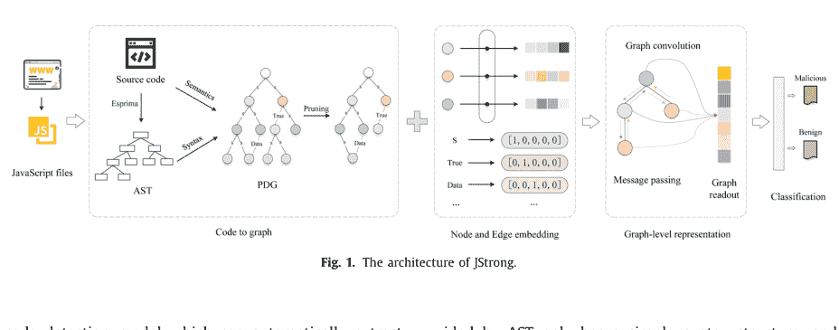
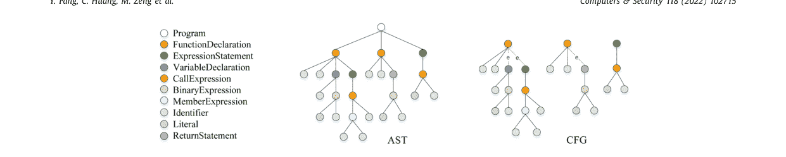
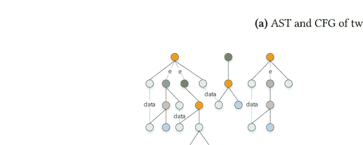
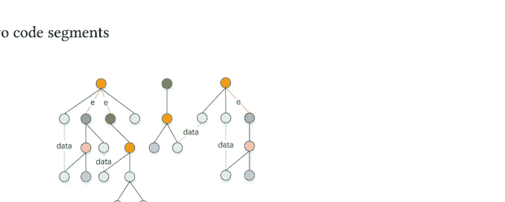
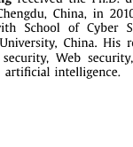

# JStrong：基于代码语义表示与图神经网络的恶意JavaScript检测


## 摘要

Web开发技术取得了显著进步。JavaScript的出现极大地丰富了客户端的交互能力。然而，攻击者利用JavaScript语言的动态特性，将恶意代码嵌入网页中，以达到偷渡、重定向等目的。因此，基于静态特征检测的传统方法难以检测混淆后的恶意代码，而基于动态分析的方法效率低下。为应对这些挑战，本文提出了一种基于图神经网络的静态检测模型JStrong。该模型首先从JavaScript源代码生成抽象语法树，然后将数据流和控制流信息添加到程序依赖图中。此外，我们将图中的节点和边嵌入到特征向量中，并通过图神经网络充分学习整个图的特征。我们利用从顶级网站和GitHub收集的真实世界数据集来评估JStrong，并将其与最先进的方法进行比较。实验结果表明，JStrong实现了近乎完美的分类性能，并且优于最先进的方法。


## 1. 引言

随着网络技术的改进和丰富，越来越多的网站开始以Web应用程序的形式提供服务，这导致了基于Web的应用程序的成倍增长（Eshkevari *et al.*, 2017）。JavaScript作为一种功能完整的语言，被广泛应用于Web应用程序的前端开发（Song *et al.*, 2018）。JavaScript语言是跨平台的，可以远程嵌入，并且可以动态执行（Zhou and Evans, 2015）。虽然它给用户带来了许多便利和精彩的交互体验，但也给Web用户终端带来了许多威胁和风险（Brown *et al.*, 2017; Hedin and Sabelfeld, 2015）。因此，JavaScript恶意代码已成为网络攻击的主要方式。攻击者可以通过向网页注入恶意JavaScript代码来实施恶意行为，例如传播木马病毒、获取用户敏感信息和数据挖掘。

JavaScript恶意代码的检测通常通过对Web应用程序中的JavaScript脚本进行检测来实现。为避免检测和防御，JavaScript恶意代码中出现了越来越多的混淆形式，这使得代码更加隐蔽，更难检测。同时，现有的检测方法主要依赖于特征匹配或代码文本词嵌入。基于特征匹配的分析方法只能检测已知的恶意样本。尽管这种方法的检测速度很快，但仍存在误报。基于代码文本词嵌入的特征学习无法表示代码的实际上下文信息。如果只提取代码的语法单元信息，会丢失语义代码信息，这意味着代码中的全面性和模糊性问题尚未解决，因此检测效果不佳。迄今为止，很少有研究探讨恶意JavaScript检测与代码语义之间的关联。2019年，Fass *et al.* (2019) 提出了一种针对JavaScript的抽象代码表示方法，通过利用数据流和控制流信息扩展现有的基于AST的代码表示能力。他们从代码表示中提取N-Gram特征和节点值特征，并使用随机森林模型进行训练。该方法有效地增强了代码的综合表示，但它只训练从图数据中提取的文本特征，无法从图结构中学习完整信息。现有研究（Zhou *et al.*, 2020, 2019）表明，图神经网络在图数据和抽象代码表示方面具有良好的学习效果。Catal *et al.* (2021) 提出了一种基于图注意力网络（GAN）的框架来检测针对ITS的恶意软件攻击，结果表明图神经网络在恶意软件检测领域非常强大。


针对现有方法因无法充分捕获代码信息而导致检测效果差的问题，我们提出了一种基于图神经网络的恶意JavaScript代码检测模型JStrong，以全面学习代码的语法和语义特征，提高检测精度。本文的主要贡献如下：

-   我们提出了一种新的恶意JavaScript检测方法，该方法将代码的语法和语义特征信息嵌入到一个综合的代码表示图中，然后通过改进的图神经网络学习整个图的特征，以实现分类的目的。为了能够移除JavaScript代码中的冗余内容，我们提出了一种新的图剪枝算法，以提取和保留包括程序数据流和控制流在内的复杂高级语义特征。
-   我们研究了各种代码图表示方法在JavaScript中的性能以及这些表示方法对图神经网络分类器的影响。然后我们全面讨论了这些情况的原因。
-   我们提出了一个名为JStrong的新模型来检测恶意JavaScript实例。评估结果表明，JStrong在检测JS恶意软件方面优于最先进的方法。在广泛的对比实验中，JStrong实现了99.95%准确率的更好预测。JStrong还在几个知名度不低的真实网站中检测到了恶意JavaScript代码。

## 2. 相关工作

近年来，关于恶意JavaScript代码的研究有很多。本文将其分为两类：基于代码语句和结构的静态分析；基于程序执行过程的动态分析。

### 2.1. 静态分析

传统的静态分析方法是提取恶意代码的特征以生成特征库，然后提取待检测代码的特征，看是否与特征库匹配。逐渐地，深度学习的成功开始启发研究人员将其应用于静态代码分析的自动化实现。该方法通常是提取源代码中的语义或语法结构，将其转换为向量，然后使用机器学习构建检测模型。

Curtsinger等人（2011）提出了一种低开销、快速可部署的方法，主要利用JavaScript抽象语法树的层次结构特征来识别对恶意软件具有高度预测性的语法元素。仅基于抽象语法树来表示代码并不全面，因此Andreasen和Møller（2014）实现了一种针对JavaScript的静态数据流分析方法，它能够动态推断和利用确定性信息。Seshagiri等人（2016）提出了一个静态分析框架——AMITA恶意软件分析器，它可以通过对网页进行静态代码分析来检测恶意代码的存在，并且能够对抗混淆的恶意JavaScript代码。通过比较九个不同分类器在正确分类混淆和非混淆脚本方面的性能，Tellenbach等人（2016）发现提升决策树分类器效果最好。Ndichu等人（2018）采用Doc2Vec，一种从JavaScript代码中提取特征的机器学习方法，这是一种可以学习文本上下文信息的神经网络模型。Fass等人（2018）提出了一种名为JAST的低开销方法，该方法结合从抽象语法树中提取特征和随机森林分类器来检测恶意JavaScript代码。

他们还实现了一个模块化的静态JavaScript检测系统（Fass et al., 2019），利用控制和数据流信息来扩展检测能力。Fang等人（2020）提出了一种基于语义分析的静态检测模型，该模型利用FastText算法从JavaScript源代码中训练词向量。然后将词向量输入带有注意力机制的Bi-LSTM网络。Huang等人（2021）通过动态词嵌入获得了代码的真实上下文表示。然后他们使用TextCNN提取关键特征进行分类。尽管先前关于C/C++和PHP的工作提出了基于图查询的方法来有效检测漏洞，但由于JavaScript语言广泛使用动态特性，这些方法不能直接适用于JavaScript。Li等人（2022）提出了一种结合流和上下文敏感、混合分支敏感性和指向信息的静态分析，生成了一种称为对象依赖图（ODG）的新颖图结构。他们实现了一个开源原型系统，用于为Node.js程序生成ODG并检测漏洞。

### 2.2. 动态分析

动态分析方法通常在代码执行过程中提取行为特征。主要使用的方法相当于在蜜罐和沙箱等测试环境中执行JavaScript文件，然后获取并分析代码运行时生成的特征，以进行进一步的分析和分类。

Kim等人（2012）提出了一个名为JsSandbox的框架，该框架利用内部函数钩子（IFH）来跟踪和分析恶意JavaScript代码的行为。Kapravelos等人（2013）提出了一种名为Revolver的方法，该方法通过识别程序之间的相似性来检测恶意JavaScript脚本，并通过解释它们之间的差异来检测规避行为。Gorji和Abadi（2014）尝试在真实浏览器中加载恶意网页，并收集一系列预测函数调用。相似的序列随后被分组到同一个簇中，并为每个簇生成行为特征。通过匹配这些特征，可以检测恶意网页。Wang等人（2015）提出了一种用于JavaScript恶意软件检测和分类的混合方法，该方法使用文本信息、程序结构和危险函数调用的预测特征来检测恶意JavaScript，并根据攻击特征向量或动态执行轨迹对其进行分类。Kim等人（2017）提出J-force，一个非崩溃强制JavaScript引擎，系统地探索可能的执行路径，并揭示基于伪装和混淆技术的恶意软件行为。

综上所述，上述静态检测方法都是通过语法单元或代码嵌入的工作来实现的，它们无法全面捕获代码中每个层次的语法和语义信息。同时，动态分析方法的实现已经过于复杂，计算开销也相对较大。鉴于现有检测方法的不足，本文提出了JStrong，一种专注于使用图形结构表示代码的静态检测方法。JStrong能够在很大程度上保留程序的语法、语义和逻辑结构信息，从而更准确地检测恶意代码。

## 3. 方法论

基于代码属性图的表示被证明是检测代码漏洞最有效的方法之一（Yamaguchi et al., 2014）。与此同时，图神经网络在处理基于图的数据问题方面取得了显著成功。受此启发，我们设计了JStrong，一个恶意

Y. 方，C. 黄，M. 曾 等人。

《计算机与安全》118 (2022) 102715



JavaScript代码检测模型，能够自动提取代码属性图，并利用图神经网络进行特征学习和分类。JStrong架构如图1所示，包含四个组成部分：1）*代码到图*，生成具有全面程序语义的程序依赖图，并通过图剪枝获得简化的代码片段图；2）*图嵌入*，从代码属性图中提取节点和边信息，并将其映射到向量空间以生成独立特征。3）*图级表示*是利用图卷积在图上传递信息并更新特征，然后利用图读出操作来聚合和总结整个图尽可能丰富的信息。4）*分类*，接收上一阶段的图表示，并根据不同的任务对其进行分类。

### 3.1. 基于复合代码语义的图生成

静态检测技术的优势在于能够快速、全面地分析程序代码。在程序分析过程中，有多种方式表示文本代码，例如抽象语法树、控制流图、程序依赖图等。我们可以利用这些抽象表示来捕获源代码不同标签之间的语法和语义关系，从而识别具有相似或重复结构的恶意代码。纯粹的词法分析只能逐词处理文本代码，而抽象语法树会考虑代码之间的语法关系；此外，控制流图（CFG）会在抽象语法树（AST）的基础上，针对特定路径添加一些控制信息，从而考虑不同条件下的代码逻辑；最后，程序依赖图（PDG）会在控制流图（CFG）的基础上添加数据流信息和语句执行顺序信息，这是一种更全面的抽象代码表示。在下一部分，我们将简要介绍每种类型的代码表示和图生成。

#### 3.1.1. 抽象语法树 (AST)

抽象语法树是源代码有序语法结构的树形表示。它以树的形式表示编程语言的语法结构，树中的每个节点代表源代码中的一个结构。它同样是语义分析的关键部分，其他代码表示都基于AST。在本文中，我们使用Esprima生成JavaScript代码的抽象语法树。Esprima是一个高效、快速的JavaScript解析器，可以直接为JavaScript源代码生成相应的语法树（Hidayat, 2021）。其中，语法树中有多达69种节点类型，包括表达式语句和变量声明等内部节点，以及标识符和字面量等叶节点。

AST提供的信息仅包含简单的语法结构，不能展示代码的语义关联。

#### 3.1.2. 控制流图 (CFG)

与AST不同，CFG可以推断和遍历程序执行过程中可能的路径。每个基本块包含一系列程序指令，并有一个入口点（执行的第一条指令）和一个出口点（执行的最后一条指令）。具体来说，CFG会选择和显示条件语句后的不同路径，并通过生成具有控制含义的有向边来表示各种控制流依赖关系。我们对AST进行深度优先遍历，标记*SwitchCase*和*ConditionalExpression*这两个条件语句，并连接与这些语句相关的节点。然后参考Fass等人的实践（2019），我们用布尔标签标记从谓词语句生成的边，用'e'标签标记从非谓词语句生成的边。这样，我们可以在条件语句为真或假时表示不同的路径，从而关联代码的语义信息。

#### 3.1.3. 程序依赖图 (PDG)

由于CFG仅表示控制流依赖关系，我们实现了PDG（Ferrante et al., 1987），通过有向边来表示代码的数据流依赖关系。当一个变量、函数或对象在源节点被定义或修改，并在目标节点被使用或修改时，我们使用数据依赖边连接这两个语句节点。在这个过程中，我们还需要考虑源节点的到达定义。如图2b所示，蓝色虚线箭头表示数据流依赖关系，主要显示变量的数据访问或修改。因为它是在CFG的基础上修改的，所以PDG包含两种依赖关系：数据流和控制流。即使调整源代码中无关语句的顺序，生成的图也不会受到不利影响。

为了探究PDG在JavaScript恶意代码检测中是否具有优势，我们分析了从30,000个样本数据生成的PDG。在提取所有样本的节点（语法单元）信息后，我们统计了良性样本和恶意样本中每种节点类型的频率。如表1所示，我们列出了频率最高的10种节点类型。可以看出，良性样本和恶意样本中每种节点类型的频率差异很大。字面量（Literal）在恶意样本中排名第一，但在良性样本中排名第二，这是因为恶意样本中存在大量重复表达式，包含各种类型的字面量。然而，由于良性样本和恶意样本都包含混淆代码，它们之间的差异并不大。此外，因为良性代码相对标准，对象类型在编码过程中被典型使用，所以属性节点在对象表达式中的出现频率在良性样本中较高，而在恶意样本中则很少出现。这些节点类型的频率差异对于检测JavaScript恶意代码非常重要。

与AST相比，PDG在结合语法和语义信息方面具有更大的优势。如果我们仅依赖AST进行语法分析来检测恶意代码，攻击者可以通过插入恶意代码同时保持语法结构不变来绕过这种检测。如清单1和清单2所示，尽管这两段代码非常相似，但由于函数调用的不同，其中一段具有恶意行为。如果此时仅分析语法结构信息，如图2a所示，两段代码简化的AST是相同的，这很容易被攻击者利用。然而，如果结合语法和语义信息，如图2b和图2c所示，两段代码的PDG显然不同，函数调用和数据流清晰地揭示了良性样本和恶意样本之间的差异。







图2. 两个样本代码仅在第8行不同。它们的AST相同，如图(a)所示。PDG如图(b)和图(c)所示。

表1
出现频率最高的10种节点类型。

**恶意样本**

| 排名 | 1 | 2 | 3 | 4 | 5 | 6 | 7 | 8 | 9 | 10 |
|---|---|---|---|---|---|---|---|---|---|---|
| 名称 | Literal | Identifier | MemExpr | ExprStat | AssiExpr | CallExpr | BinExpr | VarDecl(tor) | VarDecl(tion) | other |
| 频率 | 25.64% | 24.71% | 9.06% | 8.02% | 6.33% | 4.95% | 4.47% | 3.13% | 2.93% | 10.76% |

**良性样本**

| 排名 | 1 | 2 | 3 | 4 | 5 | 6 | 7 | 8 | 9 | 10 |
|---|---|---|---|---|---|---|---|---|---|---|
| 名称 | Identifier | Literal | MemExpr | CallExpr | Property | ExprStat | Blockstat | BinExpr | AssiExpr | other |
| 频率 | 35.89% | 13.03% | 11.87% | 6.81% | 3.99% | 3.48% | 2.96% | 2.95% | 2.72% | 16.3% |

**清单1. 恶意代码。**

```javascript
function func1(p) {
    var content = "Malicious " + p;
    document.write(content);
}
function func2(p) {
    return "Benign " + p;
}
func1("code");
```

**清单2. 良性代码。**

```javascript
function func1(p) {
    var content = "Malicious " + p;
    document.write(content);
}
function func2(p) {
    return "Benign " + p;
}
func2("code");
```

#### 3.1.4. 图剪枝

近年来关于程序代码静态分析的研究（Cheng et al., 2021; Li et al., 2021; Wang et al., 2020）表明，基于重要内容对程序进行切片和简化有助于进一步分析，并提高漏洞识别的准确性。与这些研究不同，我们的目的是检测恶意代码而非识别漏洞，因此我们不需要精确地切片程序。因此，我们提出了一种图剪枝算法，如算法1所示，该算法能够

#### 算法 1：程序依赖图的剪枝。

**输入**：程序依赖图 G = (V, E)，其中 V 是节点集，E 是边集
**输出**：G'，剪枝后的 PDG

```
@lru_cache(maxsize=None)
1 初始化；当 G 中存在没有数据流和控制流边的叶节点时执行
    对每个叶节点 V_i ∈ V 执行
        Count_v = 0；
        对 V_i 的每条边 e_ij 执行
            如果 e_ij 不是控制流或数据流边则
                Count_v + 1；
            结束
        结束
        如果 Count_v 等于 V_i 的边数则
            G' ← 从 G 中删除 V_i 及其相关边；
        结束
    结束
    返回 G'；
```

#### 表 2
剪枝前后图数据集大小的比较。

| 剪枝 | 良性(Kb) | 恶意(Kb) | 平均(Kb) |
| :--- | :--- | :--- | :--- |
| 剪枝前 | 737,480 | 880,360 | 53.93/图 |
| 剪枝后 | 535,784 | 604,464 | 38.01/图 |

在整个数据集上使用剪枝算法前后的结果显示在表 2 中。平均而言，每个图减少了 29.52% 的冗余信息。

### 3.2. 模型架构

对于每个单独的 JavaScript 代码，我们使用上述方法生成一个代码图来表示其组合语义，并构建一个自动图处理模型用于特征学习和分类。模型的具体结构将在下文介绍。

#### 3.2.1. 节点和边嵌入。

得到 PDG 后，我们将每个图表示为 G = (V, E)，其中 V 是节点集，E 是边集。现在我们需要将图中节点和边的信息嵌入到低维空间中，以便将其转换为模型可以处理的特征向量。如图 2b 所示，代码图中的节点只有语法单元类型，因此我们使用预训练的 word2vec 模型对其进行编码。Word2vec 是训练词向量的工具之一 (Mikolov et al., 2013)。它将文本内容处理转换为 k 维向量空间中的向量，并使用向量空间中的相似性来表示文本的语义相似性。由于 JavaScript 的相似语法单元具有相似的前缀或后缀，例如，声明类语法单元的所有后缀都是 “Declaration” 或 “statement”，因此可以使用 word2vec 来很好地嵌入图节点。我们用 word2vec 生成的特征向量初始化节点的嵌入，表示为 h，其中 D 是嵌入维度。与节点语法单元类型的多样性不同，图中只有五种边类型：“s”、“e”、“data”、“false” 和 “true”，因此我们只对它们进行简单编码。得到整个图中所有节点和边的特征信息后，就可以使用图神经网络来实现图中的消息传递和特征更新。

#### 3.2.2. 图学习层

图神经网络的核心思想是利用神经网络迭代地聚合来自局部图邻域的特征信息。近年来，根据不同的聚合技术，有图卷积网络 (Kipf and Welling, 2017)、GraphSAGE (Hamilton et al., 2017a)、图注意力网络 (Velickovic et al., 2018)、门控图神经网络 (Li et al., 2016) 等方法。在比较这些方法并考虑本文数据特性之后，我们设计了一个改进的图特征学习模型，结合了门控图神经网络和图注意力网络，如图 4 所示。

基于 GCN，GGNN 添加了 GRU（门控循环单元）(Cho et al., 2014)，它将邻居节点的信息视为输入，节点状态视为隐藏状态。GRU 的加入不仅意味着有选择地记忆邻居节点的隐藏信息，还意味着有选择地记忆节点迭代过程中的隐藏信息。同时，它还为不同类型的边引入了一个可学习参数 W，使我们能够处理具有不同节点或边类型的图，这恰好与我们生成的兼具语义和图结构的代码图一致 (Hamilton et al., 2017b)。给定一个图 G，我们使用门控图神经网络来更新和传输节点和边的嵌入信息。单个节点可以通过边获取相邻节点的信息，并将其与自身节点的信息合并然后更新。除了处理与相邻节点交互后的信息外，图中的所有节点还应利用前一时间序列的结果，以实现时间 t 的高阶特征交互。具体公式如下：

a<sup>t</sup> = A h<sup>t-1</sup> W<sub>a</sub> + b  (1)

z<sup>t</sup> = σ (W<sub>z</sub>a<sup>t</sup> + U<sub>z</sub>h<sup>t-1</sup>)  (2)

r<sup>t</sup> = σ (W<sub>r</sub>a<sup>t</sup> + U<sub>r</sub>h<sup>t-1</sup>)  (3)

h̃<sup>t</sup> = tanh (W<sub>h</sub>a<sup>t</sup> + U<sub>h</sub>(r<sup>t</sup> ⊙ h<sup>t-1</sup>))  (4)

h<sup>t</sup> = h̃<sup>t</sup> ⊙ z<sup>t</sup> + h<sup>t-1</sup> ⊙ (1 − z<sup>t</sup>)  (5)

其中 h ∈ ℝ<sup>|v|×d</sup> 是节点嵌入的初始化特征值，d 是嵌入维度，A ∈ ℝ<sup>|v|×|v|</sup> 是邻接矩阵，σ 是 sigmoid 函数，所有 W、U 和 b 都是可学习的权重和偏置。z 和 r 分别是更新门和重置门，更新门用于控制当前状态需要从历史状态接收多少新信息，重置门用于控制遗忘过去多少信息以用于候选隐状态。

在真实的恶意 JavaScript 脚本代码样本中，实际上包含许多良性代码片段，具有恶意意图的代码可能只占很小一部分。我们认为，在判断一个样本是否为恶意时，代码不同部分对整个样本的贡献是不同的，因此我们引入了图注意力网络。同时，由于这些恶意代码生成的语法节点可能相距较远，需要捕获其语法序列的长期依赖关系并平衡局部和全局信息。因此，我们提出了一种改进的 GNN 方法。通过锚定到一个原则性能量函数，我们可以包含任意数量的传播层来捕获非局部依赖并降低过平滑的风险。

给定一个图 G = {V, E}，我们定义能量函数

ℓ<sub>Y</sub>(Y) ≜ λtr[Y<sup>T</sup>LY] + ‖Y − f(X; W)‖<sub>F</sub><sup>2</sup>  (6)

其中 λ 是权衡参数，Y ∈ ℝ<sup>|v|×d</sup> 表示跨 n 个节点的 d 维特征的候选嵌入。类似地，f(X; W) 表示一个函数（由 W 参数化），其输入是初始的 d₀ 维节点特征 X ∈ ℝ<sup>|v|×d₀</sup>。最后，L ∈ ℝ<sup>|v|×|v|</sup> 是 G 的拉普拉斯矩阵，意味着 L = D − A = B<sup>T</sup>B，其中 D 和 A 分别是度矩阵和邻接矩阵，而 B ∈ ℝ<sup>|v|×|e|</sup> 是关联矩阵。不难得出结论

Y*(W) ≜ argmin<sub>Y</sub> ℓ<sub>Y</sub>(Y) = (I + λL)<sup>−1</sup>f(X; W)  (7)

其中显然最优的 Y* 将是 W 的函数。该解代表了对 f(X; W) 的一种松散近似，通过 (6) 中的迹项在图结构上进行了平滑，平衡了局部和全局信息。

然后我们应用图注意力网络，在传播过程中引入自注意力机制，并通过关注邻居来计算每个节点的隐藏状态。其本质是，GAT 只是一个对邻居特征进行注意力计算的聚合函数，而不是简单的均值聚合。W 是应用于每个节点的线性变换权重矩阵。应用 LeakyReLU 激活函数并由 softmax 归一化以最终获得注意力权重。节点的特征输出基于注意力对所有相邻节点的特征进行加权求和。

#### 3.2.3. 读出和分类

为了完成每个图的预测，图中的所有节点需要在充分的消息传递和特征更新后，聚合和总结单个图上尽可能多的信息。这种类型的操作称为“读出”。常见的聚合方法包括：对节点或边的所有特征求和、取平均值、按元素查找最大值或最小值。在均值聚合方法中，对每个图的所有节点特征的平均值进行聚合读出的公式如下：

h<sub>G</sub> = (1/|V|) Σ<sub>v∈V</sub> h<sub>v</sub>  (8)

其中，h<sub>G</sub> 是图 G 的表示，V 是图 G 中的节点集，h<sub>v</sub> 是节点 v 的特征。最后，将图级别的表示向量输入 softmax 层以预测结果。我们使用交叉熵函数来最小化损失：

ŷ<sub>G</sub> = softmax(Wh<sub>G</sub> + b)  (9)

L = −Σ<sub>i</sub> y<sub>G<sub>i</sub></sub> log(ŷ<sub>a<sub>i</sub></sub>)  (10)

其中 W 和 b 是权重和偏置，y<sub>G<sub>i</sub></sub> 是 one-hot 标签的第 i 个元素。不同聚合方法的影响将在参数敏感性部分进行讨论。

## 4. 评估

### 4.1. 实验设计

在本节中，我们旨在测试和评估 JStrong 的整体性能。在实验测试中，我们主要关注两个问题：(i) 所使用的方法是否能


#### 4.1. 数据准备

本文使用的所有数据均通过手动爬取和收集获得。其中，良性样本来源于Tranco排名前4000的网站（Le Pochat等人，2019年），我们请求访问这些网站的首页。页面加载后，我们收集并爬取了其中嵌入的JavaScript代码，经过清理和处理后，获得了15,000个独立的JavaScript文件。考虑到这些网站的流行度和权威性，我们假设其首页使用的JavaScript是良性的。恶意样本来自Petrak（2021年）、GeeksOnSecurity（2021年）和VirusTotal（2021年）发布的数据。Fass等人（2019年）、Huang等人（2021年）等已在他们的研究中验证了这些数据的有效性和真实性，因此我们清理并选择了15,000个文件作为恶意数据集。此外，对于原始代码数据集，我们还为每个文件生成了相应的程序依赖图，每个图的平均节点数为815个，这是模型的最终输入。关于数据集的详细信息如表3所示，我们将整个数据集分为三部分：70%的数据用作模型的训练集，10%作为验证集，20%作为测试集。

表3：数据集的统计数据。

| 数据类型 | 图数量 | 节点数 | 边数 |
| :--- | :--- | :--- | :--- |
| 良性 | 15,000 | 13,415,893 | 28,125,910 |
| 恶意 | 15,000 | 11,034,580 | 23,580,162 |

#### 4.2. 参数配置

在嵌入层，我们训练一个Word2Vec模型通过语法单元生成节点特征向量。Word2Vec模型参数包括：size=100，window=5，min count=1。在图学习层，我们使用DGL（Wang等人，2019年）来处理图并构建分类模型。第一层使用门控图卷积层来学习节点和边的特征。然后添加两层图注意力层来学习邻居节点的特征。门控图卷积层中的循环步数（n_steps）和图注意力层中的多头数（num_heads）将在参数敏感性小节中进行讨论。根据经验，我们使用Adam优化器，学习率为0.001，批大小为64，并使用L2正则化以避免过拟合。我们随机打乱每个数据集，并划分70%用于训练，10%用于验证。我们在NVIDIA RTX 2080TI上训练模型，并采用200个epoch的耐心进行早停。

#### 4.3. 对比实验

为探究本文所用方法是否为最优，我们进行了相关的对比实验。

首先，使用抽象语法树（AST）、控制流图（CFG）、对象依赖图（ODG）以及原始程序依赖图（PDG）与我们提出的PDG剪枝方法进行比较。ODG将JavaScript对象表示为节点，将它们与抽象语法树（AST）的关系表示为边。需要注意的是，ODG用于检测JavaScript漏洞而非恶意代码。我们从其开源原型系统中提取了图生成方法并进行了复现。

此外，对于模型中使用的方法比较，我们构建了基础模型的三个变体，即JStrong-C、JStrong-G和JStrong-A。这些变体的主要区别在于图卷积模块在分类过程中的方法不同。在JStrong-C的图分类层实现函数中，主要使用的是图卷积网络，它可以有效地提取图中节点的特征并进行学习；而JStrong-G在图分类层使用了门控图神经网络，它可以处理具有不同类型节点或边的图；JStrong-A则使用图注意力网络，该方法通过分配注意力分数来识别邻居节点的重要性。

最后，我们还将本文方法的分类性能与现有可用方法（Fass等人，2019年，2018年）以及一些安全厂商的防病毒引擎进行了比较。其中，JaSt主要使用抽象语法树特征提取与随机森林分类器相结合的方法来检测恶意JavaScript代码，而JStap则通过使用控制流和数据流信息来扩展检测能力。由于这两篇论文公开了他们的工作，我们能够完全复现它们。此外，我们还使用了VirusTotal上集成的多个安全检测引擎进行了实验，并选择了前三名（瑞星、赛门铁克和FireEye）与我们的工作进行比较。

#### 4.4. 性能评估

我们主要使用的评估指标是准确率、精确率、召回率和F1分数，其定义如下：

$$ ACC = \frac{TP + TN}{TP + TN + FP + FN} $$ (11)

$$ \mathbf{P} = \frac{TP}{TP + FP} $$ (12)

$$ \mathbf{R} = \frac{TP}{TP + FN} $$ (13)

$$ \mathbf{F1} = \frac{2 \times P \times R}{P + R} $$ (14)

其中，真阳性（TP）是正确识别的恶意样本数，真阴性（TN）是正确识别的良性样本数，假阴性（FN）是错误分类为良性样本的恶意样本数，假阳性（FP）是错误分类为恶意样本的良性样本数。表4总结了所有实验结果。

首先，我们分析了模型中所有图表示方法的性能。如表5所示，AST仅包含程序代码的语法信息，因此其对代码的综合表示和学习效果不如CFG和PDG。与CFG相比，PDG拥有额外的数据流信息，在程序的语义表示上更完整，检测效果也更好。Li等人提出的ODG在数据流和控制流的基础上增加了JavaScript对象节点，丰富了图中的调用关系，其检测效果优于PDG。令人惊讶的是，使用剪枝算法处理PDG后，检测效果也得到了显著提升，略优于ODG，这可能是由于移除了图中更多的冗余信息。

当然，对于恶意代码检测，速度和效率尤为重要。表5显示了不同图表示方法中节点/边的提取时间和整个图的生成时间。可以看出，ODG在两个处理步骤上的时间成本远高于PDG和其他基础图表示方法，因为ODG额外提取和构建了JavaScript代码中对象的关系。同时，为了查询漏洞，ODG在提取节点和边时使用了分离的处理方法，这些都增加了时间成本。同时我们可以看到，剪枝后的PDG不仅具有最佳的检测效果，而且时间成本更低，这可能是由于更小的图处理速度更快。

接下来，我们分析了JStrong模型变体的性能。从表4可以看出，与JStrong-C、JStrong-G和JStrong-A相比，JStrong在所有评估指标上都取得了最佳性能，这意味着与使用单一图卷积方法相比，JStrong能够充分挖掘JavaScript代码图数据中的特征，从而获得更好的结果。同时，在三个变体中，JStrong-A表现最好，JStrong-G次之，JStrong-C最差，这表明通过注意力机制发现图数据中节点的重要性至关重要，同时充分利用图数据中的边特征也很重要。

然后，我们将所提模型与另外两项类似工作进行了性能比较。对于JaSt和JStap，JStrong在所有指标上都表现最佳并有显著提升。这表明，与JaSt仅使用抽象语法树特征以及JStap仅使用控制流和数据流特征相比，JStrong通过提取和利用更全面的语法与语义特征的方法更好，同时也意味着使用图神经网络进行特征学习和分类是非常有效的。与JaSt相比，JStap扩展了特征内容以提高检测能力，因此其性能优于JaSt。值得一提的是，JStrong的三个变体模型的性能基本上都优于JaSt和JStap，这表明本文提出的方法非常有效。

最后，我们比较了JStrong模型与成熟安全厂商的防病毒引擎之间的性能。由于防病毒引擎主要使用代码特征库来检测恶意代码，从表4可以看出，这些引擎的误报率大多为0，但准确率、精确率和F1分数的性能不如JStrong。本文提出的模型使用图神经网络来学习代码的语义特征，其中可能存在少数情况下正常代码的特征向量与恶意代码相似，因此我们出现误报是正常的。

表4：各种模型和防病毒引擎的测试结果。

| 模型或引擎 | TN | FN | TP | FP | 准确率 (%) | 精确率 (%) | 召回率 (%) | F1 (%) |
| :--- | :--- | :--- | :--- | :--- | :--- | :--- | :--- | :--- |
| JStrong | 2983 | 1 | 3014 | 2 | **99.95** | **99.93** | 99.96 | 99.95 |
| JStrong-C | 2873 | 10 | 3041 | 76 | 98.56 | 97.56 | 99.67 | 98.60 |
| JStrong-G | 2999 | 13 | 2944 | 44 | 99.05 | 98.53 | 99.56 | 99.04 |
| JStrong-A | 2937 | 8 | 3019 | 36 | 99.27 | 98.82 | 99.73 | 99.28 |
| JaSt | 2988 | 131 | 2869 | 12 | 97.62 | 99.58 | 95.63 | 97.57 |
| JStap | 1986 | 112 | 2787 | 5 | 97.60 | 99.82 | 96.14 | 97.94 |
| 瑞星 | 2467 | 0 | 3000 | 533 | 91.12 | 84.91 | 100.00 | 91.84 |
| 赛门铁克 | 2471 | 0 | 3000 | 529 | 91.18 | 85.01 | 100.00 | 91.90 |
| FireEye | 2474 | 0 | 3000 | 526 | **91.23** | **85.08** | 100.00 | **91.94** |

表5：各种图表示方法的性能。

| 方法 | 准确率 (%) | F1 (%) | 提取速度 | 生成速度 |
| :--- | :--- | :--- | :--- | :--- |
| AST | 98.32 | 98.31 | 2.1 项/秒 | 47.7 图/秒 |
| CFG | 99.16 | 99.15 | 1.6 项/秒 | 51.3 图/秒 |
| PDG | 99.50 | 99.50 | 1.2 项/秒 | 45.3 图/秒 |
| ODG<sup>a</sup> | 99.65 | 99.64 | 0.3 项/秒 | 2.1 图/秒 |
| PDG<sub>p</sub><sup>b</sup> | **99.85** | **99.85** | - | 58.5 图/秒 |

<sup>a</sup> 图生成方法提取自《通过对象依赖图和查询挖掘node js漏洞》（2022年）。
<sup>b</sup> 剪枝后的PDG。

#### 4.5. 参数敏感性

为评估一些可变参数对JStrong准确率的敏感性，我们配置了这些参数并进行了实验。对于门控图卷积层中的循环步数，我们以1为步长从1配置到6。结果如图5(a)所示，表明随着步数的增加，一个节点可以接收更多的高阶信息，从而更准确地学习其表示。然而，随着步数持续增加，这种情况发生了逆转，在步数为4时达到最佳效果，之后开始平缓下降。图5(b)展示了图注意力层中注意力头数对JStrong准确率的影响。可以看出，当头数配置为4和6时准确率最高，但当头数为6时精确率略高于4。关于图读出方法，我们目前对四种常见方法进行了实验，结果如图6所示。显然，JStrong在均值聚合方法下能够利用图中更多的信息，从而达到最佳效果。

#### 4.6. 案例研究

为验证JStrong的实际效果，我们将其部署在真实网站上。我们相信，网站排名越低，


#### 4.5. 局限性

JStrong 存在一些潜在问题，可能限制其实际应用。首先，JStrong 将真实网站上的 JS 代码作为良性样本，但恶意样本仍来自之前的数据集。尽管这些恶意代码被研究者广泛使用，但随着网络技术的飞速发展，一些旧的恶意代码可能失去作为训练数据的意义。其次，我们未对恶意 JavaScript 代码进行多标签分类，因此在检测过程中无法确定这些恶意代码的具体类型。最后，在测试真实网站的过程中，仍存在许多误报。

## 5. 结论

本文提出了一种新颖的恶意 JavaScript 检测模型 JStrong，该模型能够在语法和语义层面将源代码抽象为代码图。该图能够充分表示整个原始代码的信息，然后通过图神经网络学习整个图的节点和边特征，最终通过图读出实现代码的图级表示以进行分类。本研究为恶意 JavaScript 代码的检测提供了新的思路，并在广泛的对比实验中达到了 99.95% 的准确率，优于当前最先进的方法。同时，我们也在真实世界中进行了实验，发现了几个包含恶意 JavaScript 代码的网站，这些网站的流行度并不低。我们提出的模型在实际应用中仍存在误报等不足。未来的研究方向将是针对野外大规模 JavaScript 代码的恶意行为检测与分析。

## 利益竞争声明

作者声明，他们没有已知的可能影响本文所报告工作的竞争性财务利益或个人关系。

## CRediT 作者贡献声明

**方勇**: 概念化，方法论，软件。 **黄超毅**: 数据管理，撰写 - 初稿，软件。 **曾敏川**: 形式化分析，撰写 - 审阅与编辑。 **赵志颖**: 资源，调查，验证。 **黄成**: 项目管理，监督。

## 致谢

本研究由**国家自然科学基金 (U20B2045, 61902265)**、**国家重点研发计划 (No. 2021YFB3100500)** 资助。

## 参考文献

Andreasen, E., Moller, A., 2014. jQuery 静态分析中的确定性。载于：2014 ACM 面向对象编程系统语言与应用国际会议论文集，第 17–31 页。

Brown, F., Narayanan, S., Wahby, R.S., Engler, D., Jhala, R., Stefan, D., 2017. 发现和预防 JavaScript 绑定中的缺陷。载于：2017 IEEE 安全与隐私研讨会 (SP)。IEEE，第 559–578 页。

Catal, C., Gunduz, H., Ozcan, A., 2021. 基于图注意力网络的智能交通系统恶意软件检测。Electronics (Basel) 10 (20), 2534。

Cheng, X., Wang, H., Hua, J., Xu, G., Sui, Y., 2021. Deepwukong：使用深度图神经网络静态检测软件漏洞。ACM 软件工程与方法学汇刊 (TOSEM) 30 (3), 1–33。

Cho, K., Van Merriënboer, B., Gulcehre, C., Bahdanau, D., Bougares, F., Schwenk, H., Bengio, Y., 2014. 使用 RNN 编码器-解码器学习用于统计机器翻译的短语表示。arXiv preprint arXiv:1406.1078。

Curtisinger, C., Livshits, B., Zorn, B., Seifert, C., 2011. Zozzle：快速而精确的浏览器内 JavaScript 恶意软件检测。载于：USENIX 安全研讨会。旧金山，第 33–48 页。

Eskhvari, L., Mazinanian, D., Rostami, S., Tsantalis, N., 2017. Jsdeodorant：JavaScript 程序的类感知。载于：2017 IEEE/ACM 第 39 届国际软件工程会议附录 (ICS-C)。IEEE，第 71–74 页。

Fang, Y., Huang, C., Su, Y., Qiu, Y., 2020. 基于语义分析的恶意 JavaScript 代码检测。Computers & Security 93, 101764。

Fass, A., Backes, M., Stock, B., 2019. Jstap：用于恶意 JavaScript 检测的静态预过滤器。载于：第 35 届年度计算机安全应用会议论文集，第 257–269 页。

Fass, A., Krawczyk, R.P., Backes, M., Stock, B., 2018. Jast：恶意（混淆）JavaScript 的完全语法检测。载于：入侵、恶意软件和漏洞评估检测国际会议。Springer，第 303–325 页。

Ferrante, J., Ottenstein, K.J., Warren, J.D., 1987. 程序依赖图及其在优化中的应用。ACM 编程语言与系统汇刊 (TOPLAS) 9 (3), 319–349。

GeeksOnSecurity, 2021. 恶意 JavaScript 数据集。https://github.com/geeksonsecurity/js-malicious-dataset。

Gorji, A., Abadi, M., 2014. 使用内部函数调用序列检测混淆的 JavaScript 恶意软件。载于：2014 ACM 东南地区会议论文集，第 1–6 页。

Hamilton, W.L., Ying, R., Leskovec, J., 2017. 大型图上的归纳表示学习。载于：第 31 届神经信息处理系统国际会议论文集，第 1025–1035 页。

Hamilton, W.L., Ying, R., Leskovec, J., 2017. 图上的表示学习：方法与应用。CoRR abs/1709.05584。http://arxiv.org/abs/1709.05584。

Hedin, D., Sabelfeld, A., 2015. 使用 jsflow 保障 Web 应用程序安全。载于：2015 第 17 届科学计算符号与数值算法国际研讨会 (SYNASC)。IEEE，第 16–19 页。

Hidayat, A., 2021. Esprima 主文档。http://esprima.org/doc/index.html。

Huang, Y., Li, T., Zhang, L., Li, B., Liu, X., 2021. Jscontana：使用可适应上下文分析和关键特征提取的恶意 JavaScript 检测。Computers & Security 104, 102188。

Kaprelos, A., Shoshitaishvili, Y., Cova, M., Kruegel, C., Vigna, G., 2013. Revolver：一种自动检测规避性基于 Web 的恶意软件的方法。载于：第 22 届 {USENIX} 安全研讨会 ({USENIX} Security 13)，第 637–652 页。

Kim, H.-C., Choi, Y.-H., Lee, D.-H., 2012. Jssandbox：一个使用内部函数钩子分析恶意 JavaScript 代码行为的框架。KSII 互联网与信息系统汇刊 (TIIS) 6 (2), 766–783。

Kim, K., Kim, I.L., Kim, C.H., Kwon, Y., Zheng, Y., Zhang, X., Xu, D., 2017. J-force：JavaScript 强制执行。载于：第 26 届万维网国际会议论文集，第 897–906 页。

Kipf, T.N., Welling, M., 2017. 使用图卷积网络进行半监督分类。载于：第五届学习表征国际会议，ICLR 2017，法国土伦，2017 年 4 月 24–26 日，会议论文集。OpenReview.net。https://openreview.net/forum?id=SJU4ayYFl。

Le Pochat, V., Van Goethem, T., Tajalizadehkhoob, S., Korczyński, M., Joosen, W., 2019. Tranco：一个面向研究的、针对操纵加固的顶级网站排名。载于：第 26 届年度网络与分布式系统安全研讨会论文集。Internet Society，第 1–15 页。

Li, Y., Tarlow, D., Brockschmidt, M., Zemel, R.S., 2016. 门控图序列神经网络。载于：Bengio, Y., LeCun, Y. (编)，第四届学习表征国际会议，ICLR 2016，波多黎各圣胡安，2016 年 5 月 2–4 日，会议论文集。http://arxiv.org/abs/1511.05493。

Li, Z., Zou, D., Xu, S., Jin, H., Zhu, Y., Chen, Z., 2021. Sysevr：一个使用深度学习检测软件漏洞的框架。IEEE 可靠与安全计算汇刊。

Mikolov, T., Sutskever, I., Chen, K., Corrado, G., Dean, J., 2013. 词和短语的分布式表示及其组合性。载于：第 26 届神经信息处理系统国际会议论文集-第 2 卷，第 3111–3119 页。

Mining node.js vulnerabilities via object dependence graph and query. 2022. 载于：第 31 届 USENIX 安全研讨会 (USENIX Security 22)。USENIX Association，波士顿，马萨诸塞州。https://www.usenix.org/conference/usenixsecurity22/presentation/li-song。

Nidichu, S., Ozawa, S., Misu, T., Okada, K., 2018. 一种使用固定长度向量表示的机器学习方法检测恶意 JavaScript。载于：2018 国际神经网络联合会议 (IJCNN)。IEEE，第 1–8 页。

Petrak, H., 2021. JavaScript 恶意软件集合。https://github.com/HynekPetrak/javascript-malware-collection。

Sesagiri, P., Vazhayil, A., Sriram, P., 2016. Ama：用于检测恶意脚本的网页静态代码分析。Procedia Comput Sci 93, 768–773。

Song, W., Huang, Q., Huang, J., 2018. 理解大型真实 Android 应用中的 JavaScript 漏洞。IEEE 可靠与安全计算汇刊 17 (5), 1063–1078。

Tellenbach, B., Paganoni, S., Rennhard, M., 2016. 使用机器学习从已知和未知混淆器中检测混淆的 JavaScript。国际安全进展杂志 9 (3/4), 196–206。

urlscan.io, 2021. urlscan.io - 用于可疑和恶意 URL 的网站扫描器。https://urlscan.io/。

Velickovic, P., Cucurull, G., Casanova, A., Romero, A., Liò, P., Bengio, Y., 2018. 图注意力网络。载于：第六届学习表征国际会议，ICLR 2018，加拿大不列颠哥伦比亚省温哥华，2018 年 4 月 30 日 – 5 月 3 日，会议论文集。OpenReview.net。https://openreview.net/forum?id=rjXMpikCZ。

VirusTotal, 2021. Virustotal - 分析可疑文件和 URL 以检测恶意软件类型，自动与安全社区共享。https://www.virustotal.com。

Wang, H., Ye, G., Tang, Z., Tan, S.H., Huang, S., Fang, D., Feng, Y., Bian, L., Wang, Z., 2020. 结合基于图的学习与自动化数据收集用于代码漏洞检测。IEEE 信息取证与安全汇刊 16, 1943–1958。

Wang, J., Xue, Y., Liu, Y., Tan, T.H., 2015. Jscd：一种用于 JavaScript 恶意软件检测与分类的混合方法。载于：第 10 届 ACM 信息、计算机与通信安全研讨会论文集，第 109–120 页。

Wang, M., Zheng, D., Ye, Z., Gan, Q., Li, M., Song, X., Zhou, J., Ma, C., Yu, L., Gai, Y., Xiao, T., He, T., Karypis, G., Li, J., Zhang, Z., 2019. 深度图库：一个面向图的高性能图神经网络包。arXiv preprint arXiv:1909.01315。

Yamaguchi, F., Golde, N., Arp, D., Rieck, K., 2014. 使用代码属性图建模和发现漏洞。载于：2014 IEEE 安全与隐私研讨会。IEEE，第 590–604 页。

Zhou, J., Cui, G., Hu, S., Zhang, Z., Yang, C., Liu, Z., Wang, L., Li, C., Sun, M., 2020. 图神经网络：方法与应用综述。AI Open 1, 57–81。

Zhou, Y., Evans, D., 2015. 理解和监控嵌入式 Web 脚本。载于：2015 IEEE 安全与隐私研讨会。IEEE，第 850–865 页。

Zhou, Y., Liu, S., Siow, J.K., Du, X., Liu, Y., 2019. Devign：通过图神经网络学习全面程序语义以实现有效的漏洞识别。NeurIPS。

方勇于2010年获得中国成都四川大学博士学位。他目前是中国四川大学网络空间安全学院教授。他的研究兴趣包括网络安全、Web安全、物联网、大数据和人工智能。



黄超毅于2020年获得中国成都四川大学信息安全工学学士学位，目前在该校网络空间安全学院攻读硕士学位。他的研究兴趣包括Web安全和人工智能。


**曾敏川**于2020年获得中国成都四川大学信息安全工学学士学位，目前在该校网络空间安全学院攻读硕士学位。他的研究方向包括Web安全与人工智能。

**赵芷颖**于2020年获得中国成都四川大学信息安全工学学士学位，目前在该校网络空间安全学院攻读硕士学位。她的研究方向包括Web安全与异常检测。

**黄程**于2017年获得中国成都四川大学博士学位。2014年至2015年，他担任美国加利福尼亚州加州大学计算机学院访问学生。他现任中国成都四川大学网络空间安全学院副教授。他的研究方向包括Web安全、攻击检测与人工智能。
