# Foundation 快速启动指南


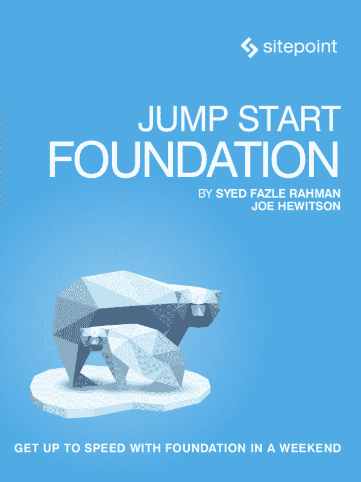


产品经理：Simon Mackie
技术审核员：Ryan Reese
英语编辑：Kelly Steele
封面设计：Alex Walker


***

## 关于 Syed Fazle Rahman

Syed Fazle Rahman 是一位来自印度的热情 Web 开发者和技术作家。他是 `devmag.io` 的联合创始人，这是一个软件开发者聚会和讨论编程的社区。Syed 还是 SitePoint 出版的书籍 [快速上手 Bootstrap](http://www.sitepoint.com/store/jump-start-bootstrap/) 的作者。在不编程时，你可以发现他在看书或玩游戏。

## 关于 Joe Hewitson

Joe 从小就热爱编码，乐于留存在软件开发的前沿，尤其是 Web 技术。这使他在专业领域取得了成功，从创建基于 Web 的医疗应用程序到动态 CMS 框架。他花费大量的空闲时间探索新的 Web 技术，并将所学知识分享给那些愿意倾听的人。

## 关于 SitePoint

SitePoint 专门为 Web 专业人士出版幽有趣、实用且易于理解的内容。访问 [`www.sitepoint.com/`](http://www.sitepoint.com/) 获取我们的博客、书籍、通讯、文章和社区论坛。你可以在这里找到关于 JavaScript、PHP、Ruby、移动开发、设计等大量信息。

***

送给我亲爱的父母、麻烦的哥哥、可爱的妹妹，以及我最好的朋友 Sandeep。

—Syed

送给所有对知识充满渴望的人，愿这本书能进一步增加你们的胃口。

—Joe

# 序言

从零开始构建现代、专业的网站需要花费大量精力和。今天的网站需要是响应式的、移动优先的、设计精美的且快速的。这正是 Zurb Foundation 框架可以帮助你的地方。它提供了大量的 HTML 组件和一个网格系统，让创建专业的响应式模板变得轻而易举，显著缩短了开发时间。

Foundation 这样的框架对所有人都有用，但对于初学者来说是一个福音。创建复杂 Web 组件所需的复杂 CSS 和 JavaScript 都已经编写完成。只需要一些 HTML 标记即可使其运行。经验丰富的开发者可以使用 Sass 对框架进行定制。

在整本书中，我们的目标是提供 Foundation 框架的完整指南。我们将介绍如何在不需要掌握高级 Web 开发技术的情况下构建精美的响应式网站。我们还将讨论 Foundation 提供的各种有用组件，并探索定制 Foundation 外观和体验的方法以生成完全独特的设计。

## 谁应该读这本书

本书适合初级到中级的 Web 设计师和开发者。假设读者具有 HTML 和 CSS 经验，具备一些 JavaScript 知识会有帮助。

## 使用规范

你会发现我们在整本书中使用了特定的排版和布局样式来表示不同类型的信息。请关注以下内容。

### 代码示例

书中的代码将使用等宽字体显示，如下：

```
<h1>A Perfect Summer's Day</h1>
<p>It was a lovely day for a walk in the park. The birds 
were singing and the kids were all back at school.</p>
```

如果代码位于代码存档中，文件名将出现在程序列表顶部：

`example.css`

```
.footer {
  background-color: #CCC;
  border-top: 1px solid #333;
}
```

如果只显示文件的部分内容，用单词 `excerpt`（节选）表示：

`example.css` (excerpt)

```css
border-top: 1px solid #333;
```

↵ 表示为了格式需要而存在的换行，应该忽略：

```javascript
function animate() {
  return new_variable;
}
```

### 提示、注意和警告

### 提示：嘿，你过来！

提示将给你提供有用的小建议。

### 注意：啊，打扰一下

注意是与当前主题相关但并非关重要的补充说明。将它们视为额外的信息碎片。

### 重要：务必始终

关注这些重要要点。

### 警告：小心！

警告将突出你在过程中可能会遇到的任何坑（陷阱）。

## 补充材料

- [`www.sitepoint.com/store/jump-start-foundation/`](http://www.sitepoint.com/store/jump-start-foundation/)：书籍的网站，包含链接、更新、资源等。
- [`github.com/spbooks/jsfoundation1`](https://github.com/spbooks/jsfoundation1)：本书的可下载代码存档。
- [`community.sitepoint.com/c/html-css`](http://community.sitepoint.com/c/html-css)：SitePoint 论坛，用于解决任何棘手的 Web 问题。
- `books@sitepoint.com`：我们的邮箱地址，如果您需要寻求支持、报告问题或出于其他原因联系我们可以使用。

## 想进一步学习吗？

感谢你购买 SitePoint 的书籍。你想继续学习吗？现在你可以在 [SitePoint Premium](https://www.sitepoint.com/premium/home) 无限制访问所有的 SitePoint 书和课程，以及来自我们精选合作伙伴的高质量书籍。现在注册，从今天开始学习！

# 第 1 章

基础


准备好用 Zurb Foundation 提供的所有功能大显身手了吗？这种热情绝对值得称赞，如果你和我一样对 CSS 框架感到兴奋，那么直接投入其中可能就是你来到此此。在我们深入学习之前，让我们花一点时间了解情况，确保我们对背后的思想和概念有良好的掌握。

通过阅读本章的章节，你将对什么是 框架以及它如何对你的项目有所益获得良好的理解。你将在三个章节中找到这些有用信息。第一部分将从总体上涵盖 CSS 框架：它们是什么、为什么有用以及一些重要概念。在第二部分，你将找到编写本书的 CSS 框架高级概述。在这里你将发现 Foundation 区别于同类产品的特性。最后，第三部分将让你卷起袖子，通过设置基础项目开始你的 `Foundation 之旅`。

准备好投入了吗？让我们开始吧！
[/content]

[content]
## CSS 框架简介

如果你从未用过软件`框架`，那么从建筑的角度来考虑它可能会有用。在建造房屋时，实际施工的第一步之一就是搭建框架。由许多基础元素组成的框架，作为一个统一的结构支撑着房子的其他部分。如果没有它，你将无处可以固定门框或放置墙壁。同样，一个 CSS 框架提供了一个样式结构，你可以从中更轻松地构建你的 Web 项目。

我知道这些听起来对总承包来说很好，但它如何帮助你构建更好的 Web 项目呢？CSS 框架赋予了你使用预开发的 CSS 组件快速开发 Web 项目的能力。每当你开始一个新项目时不需要重新发明轮子。要使用这些大多数组件，你只需要编写所需的 HTML 标记即可。它让创建基础的 Web 用户界面变得更容易，而无需编写许多 CSS 或 JavaScript 代码。

我将给你一个关于 CSS 框架在实践中如何运作的快速示例。在没有 CSS 框架帮助的情况下创建一个新的 Web 项目时，在创建样式表来定义最简单的元素之前，你的页面看起来只会比用打字机创建的好一点点。当到了开始设置样式的时候时，页面结构的每个方面都必须经过考虑并进行适当设置——从最基础的段落到完全自定义的 div 容器。不仅这些基础样式需要从零开始，像图像库或 JavaScript 功能等更高级的组件也必须手动开发或集成到项目中。

你可以想象（如果你曾花过相当的时间从零开始开发 Web 项目的话）这个过程如何迅速变得耗费时间。但有了 CSS 框架，通过使用许多内置的 CSS 和 JavaScript 组件，这个过程变得极其简单了。

与其乏味地定义新 Web 项目的每个基础元素，你只需要担心你想要进一步自定义的样式。这可以从 Web 开发方程式中去掉大量的手动样式，让你更多地专注于精炼项目的外观，而不是定义它外观的每一个部分。

此外，它减少了为了添加花哨效果而费时调试复杂的 JavaScript 的小时。例如，在没有使用预构建库的情况下，为你的项目添加一个简单的缩略图功能可能需要几十行代码。嘿，即使使用 jQuery，你也需要包含所需的脚本，设置一个带有操作的锚点，最后对缩略图本身进行样式。

使用像 Foundation 这样的 CSS 框架，只需如下：

```html
<a class="th" href="../img/image.png">
    
</a
```

只需指定缩略图类（在 Foundation 中为 `th`），图像就会自动设置样式并应用所需的 JavaScript 来创建一个精美的缩略图图像。再次，这只是 CSS 框架如何让你这个 Web 开发者的生活更简单的例子之一。我们将学习更多关于 Foundation 组件以及如何在我们的网站中轻松地使用它们，从第 4 章开始；然而，


- 切换响应式组件
- 工具类
- JavaScript 工具类
- 从右向左语言（RTL）支持

### 导航
有助于提供有效导航的组件：
- 离线画布 (off-canvas)
- 顶部栏 (top bar)
- 图标栏
- 侧边导航
- Magellan 吸粘导航
- 子导航
- 面包屑导航
- 分页器

### 媒体
用于存放图像和视频的组件：
- 轨道滑块器 (Orbit slider)
- 缩略图
- 清除灯箱 (clearing lightbox)
- 弹性布局视频

### 表单
Foundation 提供了许多预定义的表单元素，有助于增强我们网页表单的用户体验：
- 表单样式
- 开关 (switches)
- 范围滑块
-  验证 (Abide validation)

### 按钮
设计精美的操作元素（链接和按钮）：
- 按钮
- 按钮组
- 拆分按钮
- 下拉按钮

### 字体
有助于增强我们网页中某些文本元素（如重要通知、列表项等）外观的组件：
- 字体类型
- 内联列表
- 标签
- 击键组合

### 提示与引导
有助于吸引用户注意力以传达重要信息的组件：
- 展开模态框 (reveal modal)
- 警报 (alerts)
- 面板
- 提示框 (tooltips)
- 引导之旅 (Joyride)

### 内容
网页上常见的实用组件：
- 下拉菜单
- 价格表格
- 进度条
- 表格
- 折叠面板 (accordion)
- 选项卡 (tabs)
- 均衡均衡器

如你所见，Foundation 开箱即提供了许多实用的组件！我们将在后面的章节中详细介绍其中许多组件，了解它们是如何制作的，以及在网页上创建它们需要哪些 HTML 标记。

这些组件是预构建并配置好的，可以无缝地插入到启用了 Foundation 的 Web 项目中。除了包含这些组件所需的几行代码外，你只需要根据自己的喜好对它们进行自定义。这引出了我关于 Foundation 的下一点：Foundation 框架内的几乎所有内容都是完全自定义的，从全局样式到组件行为的细节。你可以更改它的一切以满足你自己的需求。

拥有这些令人印象深刻的功能，Foundation 框架如何会有竞争力呢？嗯，我很高兴你提问。今天，有很多开源前端框架供我们使用。其中最流行的有：

- [Bootstrap](http://getbootstrap.com)
- [Yahoo Pure](http://purecss.io/)
- [Google Web Starter Kit](https://developers.google.com/web/starter-kit/)
- [UIkit](http://getuikit.com/)
- [Semantic UI](http://semantic-ui.com/)
- [Ink](http://ink.sapo.pt/)
- [Concise](http://concisecss.com/)

可以浏览上述每个框架，发现它们提供了哪些预开发的组件。

让我们把 Foundation 与其可以说是是最大的竞争对手 Bootstrap 进行比较。就像精美的苏格兰威士忌一样，哪个框架占据主导地位的问题在很大程度上取决于个人偏好。一旦你了解了一个框架，与其他框架的区别并不大。这些框架中使用的许多类名都是直观的；你只需要识别它们的命名方案即可。

以下是这两个流行的 CSS 框架主要属性的简要介绍：

| | Foundation | Bootstrap |
| --- | --- | --- |
| **基础结构** | 网格 | 网格 |
| **尺寸单位** | rem | 像素 (pixel) |
| **许可证** | 开源 (MIT) | 开源 (MIT) |
| **CSS 预处理器** | Sass | LESS/Sass |
| **网格列数** | 12 | 12 |
| **组件数量** | 很多 | 很多 |


针对我们的需求，我们将坚持第一种方案并下载“Complete”（完整）包。点击下载链接后，你将得到一个包含整个 Foundation 框架的 ZIP 文件。要安装该框架，只需将压缩包解压到你 Web 项目根目录下。解压后，你会发现 `css`、`img` 和 `js` 文件夹以及包括至关重要的 `index.html` 在内的几个文件，如图 1.3 所示。在编写本书时，Foundation 5.5.2 版本是最新发布版本，书中也一直使用了该版本。

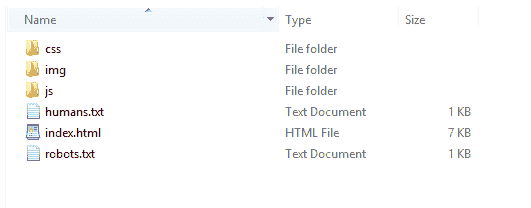

图 1.2. 解压后的 Foundation 包

默认 Foundation 包中包含的文件夹非常是不言自喻的。`css` 文件夹包含了预定义的 Foundation 样式以及你决定添加的任何自定义样式表；`js` 文件夹同样包含了所有 Foundation 组件所需的脚本；最后，`img` 文件夹将包含你将引入 Web 项目的图像。当这些文件就绪后，你就可以开始了。是的，真的就这么简单！如果你不信，尽管将 Web 浏览器指向你刚刚解压 Foundation 包的目录。如果运气好的，它看起来应该像图 1.3 所示。

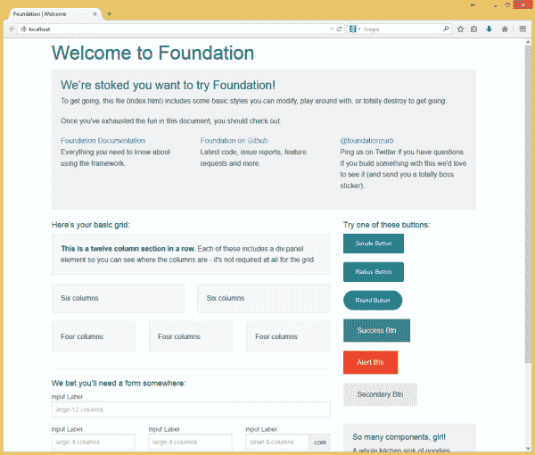

图 1.3. Foundation 的默认索引页

## 总结

至此，你已经完全准备好应对本书的其余内容了。我们相信你不会被刚刚接收到的丰富信息所压倒，但牢牢掌握什么是 CSS 框架以及它们为什么对 Web 开发者很有用是有用的。

在本章中，我们涵盖了 Foundation 框架的基础知识，包括一个展示了如何快速使用 Foundation 搭建原型网站的示例。我们还学习了什么是 Zurb Foundation。随后，你看到了了 Foundation 与 CSS 框架领域另一大巨头 Bootstrap 的快速对比。最后，我们通过概述使用 Foundation 框架建立第一个项目的步骤来结束了本章。说实话，步骤并不多，但这是一件好事！你现在准备好大显身手，开始利用 Foundation 框架构建一个基础网站了。还在等什么？快进入第 2 章吧！

# 第 2 章：网格系统的入门

谁不希望自己的网站在移动设备上看起来美观且结构良好呢？考虑到竞争用户关注的众多网站，我们的网站应该准备好针对任何显示设备进行自动调整。但这种网站设计具有挑战性，需要许多小时的 HTML 和 CSS 代码编写。相反，Foundation 框架赋予了你随时创建此类响应式网站的能力。你不需要编写单行 CSS 代码即可创建一个响应式网站。

在本章中，我们将探索 Foundation 的核心概念之一：网格系统——一种可以缩放到任何尺寸的 12 列灵活网格。我们将看到如何实现它，并让我们的网站对移动友好且结构良好。

## 奠定基础

正如你在第 1 章中学到的，Foundation 的主要目标是为你提供一个可以在其基础上构建的框架。Foundation 实现这一目标的方法是使用网格布局。在继续之前之前，让我们后退一步，看看 Web 设计是如何结构的。

在很久以前的一个遥远的银河系，当 Web 开发还处于婴儿时期时，设计通常由自由流动的段落元素组成。结果看起来更像凌乱的报纸页面，而不是我们今天看到的复杂的、多媒体丰富的的设计。

为了给混乱带来秩序，HTML 表格被使用了。虽然它们确实有助于清理混乱，但它们的僵硬给早期 Web 的面貌增添了明显的冷酷感。以下是 HTML 表格不适用于布局的几个原因：

*   像这样使用表格描述的是呈现而非内容，因此使用表格布局的网站在语义上是不正确的。
*   屏幕阅读器用户很难理解使用表格进行布局的网站。
*   使用表格布局重新设计网站是非常困难的。
*   表格可能会破坏文本复制，这对于某些用户来说非常困扰。

抱歉讲了一堂关于 Web 设计的历史课，但它很好地说明了为什么 Foundation（以及其他流行的 CSS 框架）选择网格布局作为其最基本的构建模块。你会发现，通常情况下，Web 是一个用于消费内容的巨大仓库。作为人类，我们习惯以有序的方式消费内容。网格布局以一种非常灵活的方式赋予了这种能力。

在表格的僵硬与自定义 CSS 的自由之间取得了极佳的，网格代表了 Foundation 框架的基石。图 2.1 展示了网格布局在实践中样子的快速示例：

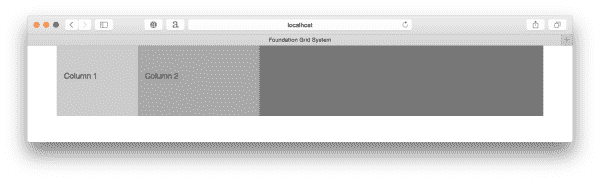

图 2.1. Foundation 网格系统的基本示例

你可以看到有一单行，包含三个不同颜色和宽度的列。这是 Foundation 网格系统最基本的用法。让我们添加一个新行并在其中插入两个不同宽度的列，如图 2.2 所示。

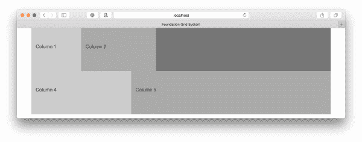

图 2.2. 为示例添加两行

这里需要注意的是，我们的网站是在桌面尺寸浏览器上显示的。如果我们缩小浏览器窗口（例如在移动设备上），会发生什么？图 2.3 中的截图显示了我们在较小窗口中的网站。

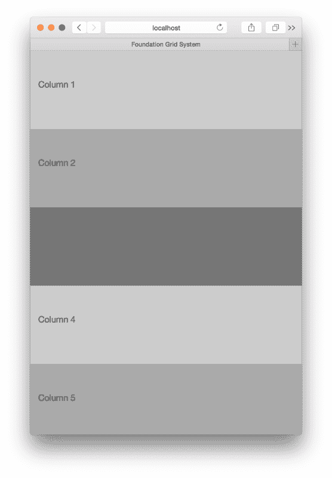

图 2.3. 在较窄窗口下的简单示例

噢。这出乎意料。这两个包含多个列的两个行是如何堆叠在一起的？让我们通过查看后续章节的代码来尝试理解。

## 设置 Foundation 项目

在开始编码之前，我们将使用 Foundation 框架设置我们的项目。在第 1 章中，我们看到根据需要决定哪个版本的 Foundation。为了方便在书中理解 Foundation，我们将使用静态的[Complete Foundation 5 版本]，它包含了所有静态编译后的 CSS 文件。让我们在系统中创建一个名为 Foundation Grid System Lessons 的新文件夹。将下载的 Foundation 项目中的所有文件复制到文件夹中，然后使用你喜欢的代码编辑器打开 `index.html`。我最喜欢的是 GitHub 的 [Atom 编辑器](https://atom.io)，但你可以使用任何你喜欢的。

index.html 看起来应该是这样的：

```
index.html (excerpt)
```


```
<!doctype html>
<!--[if IE 9]><html class="lt-ie10" lang="en" > <![endif]-->
<html class="no-js" lang="en">
    <head>
        <meta charset="utf-8" />
        <meta name="viewport" content="width=device-width, initial-scale=1.0" />

        <title>Foundation Grid System</title>
        <link rel="stylesheet" href="css/foundation.css" />

        <script src="js/vendor/modernizr.js"></script>
    </head>
    <body>

        <!-- Your code goes here -->

        <script src="js/vendor/jquery.js"></script>
        <script src="js/foundation.min.js"></script>

        <script>
        $(document).foundation();
        </script>
    </body>
</html>
```

这是用于 Foundation 的推荐标记结构。每当你开始一个新项目时，都应该按照这种方式设置你的 `index.html` 文件，以确保它具有正确的结构。

这段代码中第一个需要注意的项是开头的注释标记 `<html>` 标签。这是检测旧版 Internet Explorer 浏览器的方法，因为 Foundation 不兼容 IE9 以下的浏览器。该标签为 `<html>` 标签添加了类 `lt-ie10`，因此如果你想为旧版本的 IE 添加自定义 CSS 样式，可以将它们附加到这个 CSS 类上。

接下来，我们有两个 meta 标签，告诉浏览器如何解释和表示特定的网站。第一个 meta 标签告诉浏览器该网站使用的文本字符集。在这种情况下，我们使用的是字符集 [UTF-8](http://en.wikipedia.org/wiki/UTF-8)。

第二个 meta 标签是 `viewport` 标签，它告诉浏览器如何渲染特定的网站。在我们的案例中，我们指示浏览器使用所有可用的浏览器空间并使我们的网站宽度等于浏览器宽度。这非常重要，因为某些移动浏览器在渲染响应式网站时存在问题；即会根据浏览器的大小修改其布局的网站。

然后，我们通过指定 `<link>` 标签的路径，引入了 Foundation 的默认 CSS 文件。我们还添加了一个名为 `modernizr.js` 的第三方 JavaScript 库。由于 Foundation 框架使用了许多新的 HTML5 标签和 CSS3 特性，该库有助于检测浏览器是否支持这些特性，然后向网站添加条件代码。你可以在它的[官方网站](http://modernizr.com)上阅读更多关于 Modernizr 的信息。

在 `<body>` 部分，我们包含了两个 JavaScript 文件：`jquery.js` 和 `foundation.min.js`。由于 Foundation 依赖于 jQuery，你必须始终在包含 Foundation 的 JavaScript 文件之前包含 jQuery。最后，我们通过调用 `foundation()` 方法初始化了 Foundation 脚本。此函数会初始化 Foundation 中所有预定义的 JavaScript 组件，我们将在后续章节中介绍这些内容。

## 练上手网格系统

在创建任何列（columns）之前，我们首先需要承载它们的行（rows）。让我们先创建一个行：

```
<div class="row">
</div>
```

就这么简单。你只需要向 `<div>` 元素添加类 `row` 来创建一个行。

Foundation 网格系统默认将屏幕划分为 12 个等宽的列。这些被称为**虚拟列**（virtual columns），它们的宽度会根据设备的宽度而变化。真实的列是通过指定你的列想要跨越 12 个 Foundation 虚拟列中的多少个来创建的。假设我们只需要一个列。那么我们将跨越所有 12 个可用的 Foundation 虚拟列。为此，我们将使用类 `large-12`。（你可以暂时忽略类名中的 `large` 一词；我们稍后会讨论）。

创建一个跨越所有 12 个 Foundation 虚拟列的单列的代码如下：

```
<div class="row">
    <div class="column large-12">
</div>
</div>
```

在 Foundation 中，必须为每个列元素附加额外的类 `column`，因为这有助于 Foundation 轻松识别列。你也可以使用类 `columns` 代替 `column`，Foundation 会为你创建相同的列。`columns` 和 `column` 之间没有区别。

让我们继续创建一个双列布局。如果我们要有两个等宽的列，那么每列将将占据六个 Foundation 虚拟列：

*index.html (节选)*

```
<div class="row">
    <div class="large-6 column" style="background: #aaaaaa; height: 100px;">
        Column 1
    </div>
    <div class="large-6 column" style="background: #cccccc; height: 100px;">
        Column 2
    </div>
</div>
```

我为每一列添加了背景颜色和高度，以便我们清楚地区分它们。让我们看看它在浏览器中的外观，参见图 2.4。

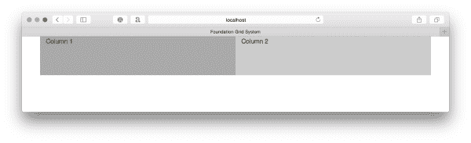

图 2.4. 基础双列布局

足够简单吧？让我们再添加另一行，这次在其中创建三个不同宽度的列。你可以在图 2.5 中看到结果：

*index.html (节选)*

```
<div class="row">
    <div class="large-2 column" style="background: #bbbbbb;height: 100px;">
        Column 3
    </div>
    <div class="large-7 column" style="background: #dddddd;height: 100px;">
        Column 4
    </div>
    <div class="large-3 column" style="background: #aaaaaa;height: 100px;">
        Column 5
    </div>
</div>
```

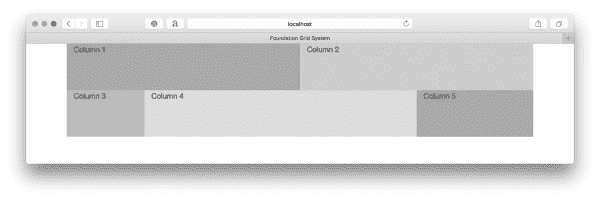

图 2.5. 两行：其一行有两个等宽的列，另一行有三个不同宽度的列

### 注意：每行仅 12 个虚拟列

每行中分配给每个列的虚拟列数量总和应始终等于 12。如果总和超过 12，Foundation 会自动创建一个新行并将多出的列移动到这个新行。你可以尝试一下，为上一个示例中的最后一列分配更大数量的虚拟列。

Foundation 还允许你嵌套这些列；换句话说，在列内部插入一个新行。你所做的是在任何 `column` 元素内部创建一个新的 `row`，然后开始向其中插入列。这里的唯一区别是，行的宽度将取决于父列的宽度。让我们编写一个嵌套列：

*index.html (节选)*

```
<div class="row">
    <div class="large-6 column" style="background: #aaaaaa;height: 100px;">
        Column 1

        <!-- Nested Columns -->
        <div class="row">
            <div class="large-8 column" style="background: #888;height: 60px;">
                Nested Column 1
            </div>
            <div class="large-4 column" style="background: #999;height: 60px;">
                Nested Column 2
            </div>
        </div>

    </div>
    <div class="large-6 column" style="background: #cccccc;height: 100px;">
        Column 2
    </div>
</div>
```

这段代码看起来将如图 2.6 所示。

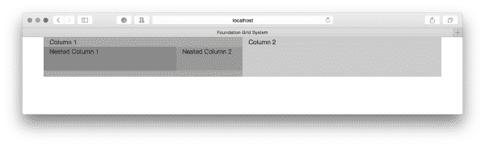

图 2.6. 嵌套列

### 偏移 (Offsets)

关于 Foundation 网格最后一个要讨论的话题是使用**偏移**（offsets）。Foundation 允许将任何列向右移动最多 11 个虚拟列。现在让我们想象一种新情况：我们想要创建一个跨越六个 Foundation 虚拟列的单列，并且它相对于浏览器窗口居中对齐。因此，为了让一个占据六个虚拟列的列居中，我们需要将其向右移动三个虚拟列。这是通过向列元素添加诸如 `.large-offset-*` 的类来实现的，其中 `*` 代表你想要偏移的 Foundation 虚拟列数量。以下是居中跨越六个 Foundation 虚拟列的单列的代码：

*index.html (节选)*


```
<div class="row">
    <div class="large-6 large-offset-3 column" style="background: 
#ddd;height: 200px; margin-top: 50px;">
        Hello World.
    </div>
</div>
```

这将创建一个居中的列，如图 2.7 所示。

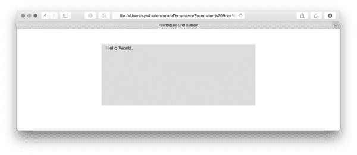

图 2.7. 使用偏移量居中的列

## Foundation 的响应式特性

如今的网页设计世界与五年前已完全不同。有几个因素在推动我们所看到的设计格局的剧变中发挥了重要作用，但最引而注目的是技术的自然演进。网络技术不断完善，带宽不断增加，而我们用于消费网页内容的设备变得越来越强大。最近，这种变化带来了一个独特的挑战。长期以来，我们查看网页内容的界面（或屏幕）尺寸稳步增长，而现代移动设备的普及导致了人们在小得多的屏幕上浏览的频率增加。

现代开发者不再仅仅关注少数流行的大型桌面屏幕尺寸，还必须为小屏幕制作同样出色的设计。将富媒体的大屏体验转化到小得多的移动屏幕的困难导致了`响应式网页设计`（RWD）的发展。简而言之，以响应式方式设计的网页内容会对不同的屏幕尺寸产生智能且动态的反应。页面会动态重构自身，根据用户的屏幕尺寸以最有意义的方式呈现内容。

使用 Foundation 框架，你设计的每个页面在网格布局中构建时将天生具有响应性。为了证明我不是在开你玩笑，让我们看看在上一节中创建的两个行网格布局示例。你可能记得，我们在两个网格示例中都没有显式地定义任何响应式样式或行为；我们只是添加了行和列。让我们来看图 2.8，看看当我们缩小屏幕尺寸时会发生什么。

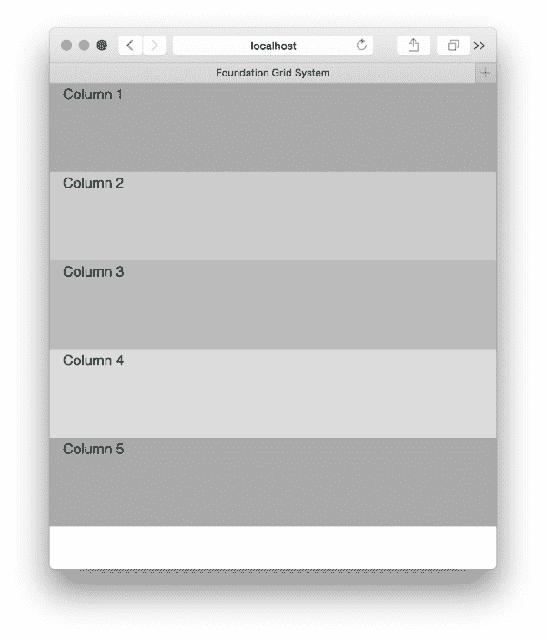

图 2.8. 较小屏幕上的双行布局

在不添加任何自定义样式的情况下，我们简单的网格布局自动响应了屏幕尺寸的变化，行和列堆叠了一起。这再次说明了使用 Foundation 等框架的力量。网页开发过程中耗时的方面已变得自动化。然而，它们不仅是自动的，而且是健的，为定制和扩展留下了大量空间。

尽管 Foundation 默认能够处理移动兼容性，但那种设计可能不是我们想要的。我们可能希望列根据网站显示在手机、平板电脑还是桌面显示器上有不同的适应。针对这种情况，Foundation 定义了一组用于手机和平板电脑的类。让我们仔细检查它们。

对于宽度小于 640px 的设备，Foundation 有一组以 `small-#` 开头的类。对于宽度大于 640px 且小于 1024px 的设备，它有 `medium-#` 类。我们在上一节中使用的 `large-#` 类适用于宽度大于 1024px 的设备。这意味着没有必要修改上一节中编写的代码来分别适应平板电脑和智能手机。我们只需要添加更多尺寸类来让列以不同的方式显示。

让我们如下修改第一行的代码：

*index.html (节选)*

```
<div class="row">
    <div class="large-6 medium-4 small-12 column" style="background:
#aaaaaa; height: 100px;">
        Column 1
    </div>
    <div class="large-6 medium-8 small-12 column" style="background:
#cccccc; height: 100px;">
        Column 2
    </div>
</div>
```

这里是三种浏览器宽度下的截图。

图 2.9 显示，在桌面屏幕上，它看起来和之前一样。

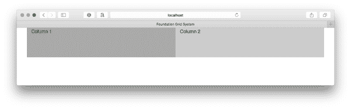

图 2.9. 较大屏幕上的修改后示例

在图 2.10 中，我们可以看到它在平板电脑尺寸浏览器上的样子。第一列比第二列略小。

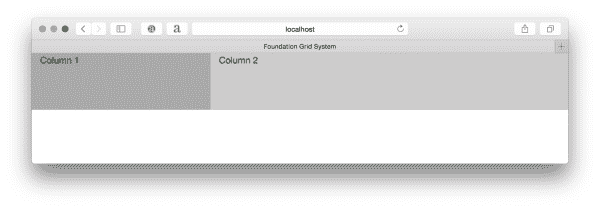

图 2.10. 平板尺寸屏幕上的修改后示例

在手机尺寸浏览器上，它看起来像图 2.11。两个列都占据了行的所有部分，因此它们堆叠在起。

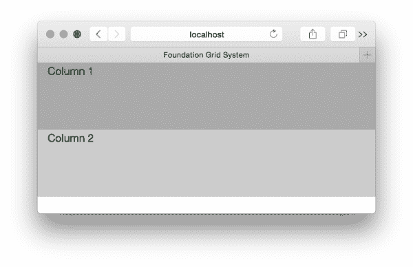

图 2.11. 智能手机尺寸屏幕上的示例

Foundation 还有偏移量类，你可以使用它们来在小型和中型屏幕上定义特定的偏移量：`small-offset-*` 和 `medium-offset-*`。

## 总结

尽管 Foundation 默认能够处理移动兼容性，但那种设计可能不是我们想要的。我们可能希望列根据网站显示在手机、平板电脑还是桌面显示器上有不同的适应。针对这种情况，Foundation 定义了一组用于手机和平板电脑的类。让我们仔细检查它们。

对于宽度小于 640px 的设备，Foundation 有一组以 `small-#` 开头的类。对于宽度大于 640px 且小于 1024px 的设备，它有 `medium-#` 类。我们在上一节中使用的 `large-#` 类适用于宽度大于 1024px 的设备。这意味着没有必要修改上一节中编写的代码来分别适应平板电脑和智能手机。我们只需要添加更多尺寸类来让列以不同的方式显示。

让我们如下修改第一行的代码：

*index.html (节选)*

```
<div class="row">
    <div class="large-6 medium-4 small-12 column" style="background:
#aaaaaa; height: 100px;">
        Column 1
    </div>
    <div class="large-6 medium-8 small-12 column" style="background:
#cccccc; height: 100px;">
        Column 2
    </div>
</div>
```

这里是三种浏览器宽度下的截图。

图 2.9 显示，在桌面屏幕上，它看起来和之前一样。


图 2.9. 较大屏幕上的修改后示例

在图 2.10 中，我们可以看到它在平板电脑尺寸浏览器上的样子。第一列比第二列略小。


图 2.10. 平板尺寸屏幕上的修改后示例

在手机尺寸浏览器上，它看起来像图 2.11。两个列都占据了行的所有部分，因此它们堆叠在起。


图 2.11. 智能手机尺寸屏幕上的示例

Foundation 还有偏移量类，你可以使用它们来在小型和中型屏幕上定义特定的偏移量：`small-offset-*` 和 `medium-offset-*`。

[/content]

[content]

```
<div class="row">
    <div class="large-6 large-offset-3 column" style="background: 
#ddd;height: 200px; margin-top: 50px;">
        Hello World.
    </div>
</div>
```

这将创建一个居中的列，如图 2.7 所示。


图 2.7. 使用偏移量居中的列

## Foundation 的响应式特性

如今的网页设计世界与五年前已完全不同。有几个因素在推动我们所看到的设计格局的剧变中发挥了重要作用，但最引而注目的是技术的自然演进。网络技术不断完善，带宽不断增加，而我们用于消费网页内容的设备变得越来越强大。最近，这种变化带来了一个独特的挑战。长期以来，我们查看网页内容的界面（或屏幕）尺寸稳步增长，而现代移动设备的普及导致了人们在小得多的屏幕上浏览的频率增加。

现代开发者不再仅仅关注少数流行的大型桌面屏幕尺寸，还必须为小屏幕制作同样出色的设计。将富媒体的大屏体验转化到小得多的移动屏幕的困难导致了`响应式网页设计`（RWD）的发展。简而言之，以响应式方式设计的网页内容会对不同的屏幕尺寸产生智能且动态的反应。页面会动态重构自身，根据用户的屏幕尺寸以最有意义的方式呈现内容。

使用 Foundation 框架，你设计的每个页面在网格布局中构建时将天生具有响应性。为了证明我不是在开你玩笑，让我们看看在上一节中创建的两个行网格布局示例。你可能记得，我们在两个网格示例中都没有显式地定义任何响应式样式或行为；我们只是添加了行和列。让我们来看图 2.8，看看当我们缩小屏幕尺寸时会发生什么。


图 2.8. 较小屏幕上的双行布局

在不添加任何自定义样式的情况下，我们简单的网格布局自动响应了屏幕尺寸的变化，行和列堆叠了一起。这再次说明了使用 Foundation 等框架的力量。网页开发过程中耗时的方面已变得自动化。然而，它们不仅是自动的，而且是健的，为定制和扩展留下了大量空间。

尽管 Foundation 默认能够处理移动兼容性，但那种设计可能不是我们想要的。我们可能希望列根据网站显示在手机、平板电脑还是桌面显示器上有不同的适应。针对这种情况，Foundation 定义了一组用于手机和平板电脑的类。让我们仔细检查它们。

对于宽度小于 640px 的设备，Foundation 有一组以 `small-#` 开头的类。对于宽度大于 640px 且小于 1024px 的设备，它有 `medium-#` 类。我们在上一节中使用的 `large-#` 类适用于宽度大于 1024px 的设备。这意味着没有必要修改上一节中编写的代码来分别适应平板电脑和智能手机。我们只需要添加更多尺寸类来让列以不同的方式显示。

让我们如下修改第一行的代码：

*index.html (节选)*

```
<div class="row">
    <div class="large-6 medium-4 small-12 column" style="background:
#aaaaaa; height: 100px;">
        Column 1
    </div>
    <div class="large-6 medium-8 small-12 column" style="background:
#cccccc; height: 100px;">
        Column 2
    </div>
</div>
```

这里是三种浏览器宽度下的截图。

图 2.9 显示，在桌面屏幕上，它看起来和之前一样。


图 2.9. 较大屏幕上的修改后示例

在图 2.10 中，我们可以看到它在平板电脑尺寸浏览器上的样子。第一列比第二列略小。


图 2.10. 平板尺寸屏幕上的修改后示例

在手机尺寸浏览器上，它看起来像图 2.11。两个列都占据了行的所有部分，因此它们堆叠在起。


图 2.11. 智能手机尺寸屏幕上的示例

Foundation 还有偏移量类，你可以使用它们来在小型和中型屏幕上定义特定的偏移量：`small-offset-*` 和 `medium-offset-*`。

## 总结

尽管 Foundation 默认能够处理移动兼容性，但那种设计可能不是我们想要的。我们可能希望列根据网站显示在手机、平板电脑还是桌面显示器上有不同的适应。针对这种情况，Foundation 定义了一组用于手机和平板电脑的类。让我们仔细检查它们。

对于宽度小于 640px 的设备，Foundation 有一组以 `small-#` 开头的类。对于宽度大于 640px 且小于 1024px 的设备，它有 `medium-#` 类。我们在上一节中使用的 `large-#` 类适用于宽度大于 1024px 的设备。这意味着没有必要修改上一节中编写的代码来分别适应平板电脑和智能手机。我们只需要添加更多尺寸类来让列以不同的方式显示。

让我们如下修改第一行的代码：

*index.html (节选)*

```
<div class="row">
    <div class="large-6 medium-4 small-12 column" style="background:
#aaaaaa; height: 100px;">
        Column 1
    </div>
    <div class="large-6 medium-8 small-12 column" style="background:
#cccccc; height: 100px;">
        Column 2
    </div>
</div>
```

这里是三种浏览器宽度下的截图。

图 2.9 显示，在桌面屏幕上，它看起来和之前一样。


图 2.9. 较大屏幕上的修改后示例

在图 2.10 中，我们可以看到它在平板电脑尺寸浏览器上的样子。第一列比第二列略小。


图 2.10. 平板尺寸屏幕上的修改后示例

在手机尺寸浏览器上，它看起来像图 2.11。两个列都占据了行的所有部分，因此它们堆叠在起。


图 2.11. 智能手机尺寸屏幕上的示例

Foundation 还有偏移量类，你可以使用它们来在小型和中型屏幕上定义特定的偏移量：`small-offset-*` 和 `medium-offset-*`。


正如第 2 章 所示，我们将使用基础 Foundation 标记来启动此项目：

```
<!doctype html>
<html class="no-js" lang="en">
    <head>
        <meta charset="utf-8" />
        <meta name="viewport" content="width=device-width,
↵ initial-scale=1.0" />
        <title>Foundation | Welcome</title>
        <link rel="stylesheet" href="css/foundation.css" />
        <script src="js/vendor/modernizr.js"></script>
    </head>
    <body>

        <script src="js/vendor/jquery.js"></script>
        <script src="js/foundation.min.js"></script>
        <script>
            $(document).foundation();
        </script>
    </body>
</</html>
```

让我们通过调整 `<head>` 元素中原型的标题来开始使用该框架。我们将它命名为“Photo Journal”（照片日志），以更好地反映我们项目的目的。

此时在浏览器中加载我们的项目将得到一个相当空的页面，标签页上仅有一个简单的标题，所以让我们修复它。我们将从处理原型的第一部分开始：一个带有叠加文本的引人全屏图像。我们应该确保图像的高度和宽度填充整个屏幕，因为我们希望用户在首次进入网站时能体验到翻页效果。无论他们的屏幕大小如何，当用户向下滚动时，他们应该立即看到此部分下方揭露的内容。如果这听起来不太通顺，当我们编辑控制它的 CSS 时，你很快就会明白意思了。

正如前面提到的，使用 Foundation 构建 Web 项目只需要添加行（rows）、列（columns）和内容（content）。如此简单。所以让我们在一个类名为 `header` 的 `div` 中添加我们的第一行。这是在 Foundation 中创建行的基础代码：

```
<div class="header">
    <div class="row">
    </div>
</div>
```

事实上，这个页面在浏览器中看起来与我们添加行之前并无异，这就是为什么我们现在要添加列和内容。正如我们所知，行的默认宽度是十二个虚拟列。你可以根据需要使用任意数量或少量的列。

记住，我们页头的目标是创建一个带有叠加文本的全屏图像。我们将通过在 CSS 中指定背景来实现全屏图像，但为了适应叠加文本，我们需要利用 Foundation 带有偏移（offset）的列，将其推到图像的右侧。我们将使用的代码如下：

```
<div class="medium-4 medium-offset-8 columns">
    <h4>Photo Journey</h4>
    <p>Picturing the world one photo at a time.</p>
</div>
```

正如图 3.1 所示，我们创建了一个类为 `medium-4` 的四虚拟列宽的元素，并使用偏移 `medium-offset-8` 告诉 Foundation 将这个四列宽的元素向右移动八列。这本质上创建了一个宽度为页面三分之一且向右对齐的元素。

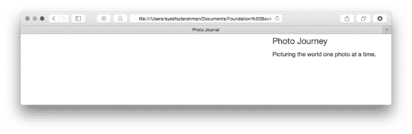

图 3.1. 已就位的头部叠加层

现在叠加文本已经就位，让我们在它下方添加全屏图像。为了实现这一点，我们将运用一些 CSS 魔法，确保图像始终填充页面的宽度高度，无论屏幕的实际大小如何。我还将借此机会介绍编辑 Foundation 项目 CSS 的最佳实践。

如果你查看解压 Foundation 程序包的根目录，你会注意到一个命名恰当的 `css` 文件夹，其中包含了 Foundation 框架的预定义样式。虽然在理论上，你可以直接编辑这些较大的样式表来添加你自己的自定义样式，但向此文件夹添加一个名为 `app.css` 的新样式表要简单且明智得多。正如 Zurb 团队建议的那样，你应该在该文件中添加所有自定义样式。将自定义 CSS 样式分离还能让 Foundation 框架的升级变得简单且无忧。

我们现在就开始这样做。打开创建的 `app.css` 文件并添加以下内容：

```
.header {
    height: 100%;
    background: url("http://placehold.it/1920x1080") center
↵ no-repeat;
}

.header .row {
    padding-top: 30%;
    color: #ffffff;
}
```

这段代码中的第一个 CSS 规则为我们的 `header` `div` 创建了一个新背景。它将高度设置为填充整个页面，并配有一个背景图像。在这里我们使用了 [placehold.it](http://placehold.it/) 工具，它可以返回指定尺寸的图像。你可以将其替换为你选择的图像。

第二个 CSS 规则修改了我们在 `header` `div` 中创建的行。在这种情况下，它是叠加文本。我们在顶部留了一些空间，并将文本颜色改为白色，以便它在背景图像上突出显示。在将其加载到浏览器之前，这是我们的代码：

*index.html（节选）*

```
<!doctype html>
<html class="no-js" lang="en">
    <head>
        <meta charset="utf-8" />
        <meta name="viewport" content="width=device-width,
↵ initial-scale=1.0" />
        <title>Photo Journal</title>
        <link rel="stylesheet" href="css/foundation.css" />
        <link rel="stylesheet" href="css/app.css" />
        <script src="js/vendor/modernizr.js"></script>
    </head>
    <body>
        <div class="header">
            <div class="row">
                <div class="medium-4 medium-offset-8">
                    <h4>Photo Journey</h4>
                    <p>Picturing the world one photo at a time.</p>
                </div>
            </div>
        </div>

        <script src="js/vendor/jquery.js"></script>
        <script src="js/foundation.min.js"></script>
        <script>
            $(document).foundation();
        </script>
    </body>
</html>
```

如果你在浏览器中查看我们的原型，你应该能看到类似于图 3.2 的效果。

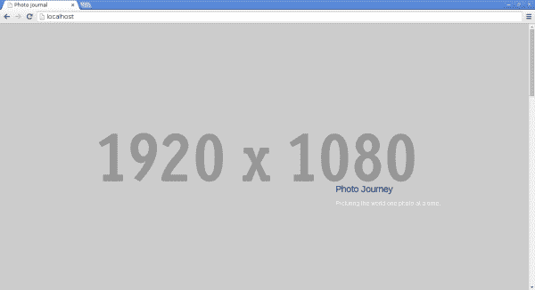

图 3.2. 显示背景图像的叠加层

注意，当你调整浏览器窗口时，背景图像会有响应，叠加层整齐地浮动在屏幕右侧。

我们目前进展顺利，让我们继续处理原型中包含大部分内容的区域。我们将通过添加两个类为 `section` 的新 `div` 元素来开始。这些元素将容载页面的实际内容，我们将在 `app.css` 中利用这些元素进行相应的自定义。

请在 `index.html` 中 `header` `div` 下方添加这两个 `div`：

```
<div class="section">
</div>

<div class="section">
</div>
```

图 3.3 显示了我们将如何布局第一部分的线图。

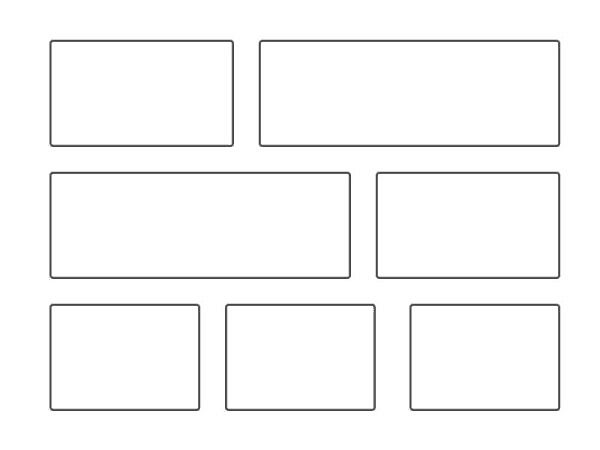

图 3.3. 第一部分内容的框图

正如图 3.3 所示，对于我们的第一个 `section` 元素，我们将添加三行，每行包含一组不同的内容。与之前一样，在网格中添加新行只需如下：

```
<div class="row">
</div>
```

在第一行内部，让我们创建一个新的五列宽元素，以及一个七列宽的元素以填满行的宽度：

```
<div class="medium-5 columns">
</div>
<div class="medium-7 columns">
</div>
```


本节的第一部分将作为一种照片日志的形式，在五列宽的元素中包含图像，并在七列宽的元素中配有日志条目。我们只需要在这些 `div` 之间添加所需的内容即可。让我们在下方再添加几行来填满页面。对于第二行，我们将采取与第一行相反的操作。简单地将该行分为七列，然后是分为五列：

```
<div class="medium-7 columns">
</div>
<div class="medium-5 columns">
</div>
```

这种垂直元素的排列将有助于打破我们的网格，并创造出更有趣的内容流。现在，让我们来编辑本节的最后一行，并使用整个网格宽度的全部十二列：

```
<div class="large-12 columns">
</div>
```

对于这一行，我们将使用 Foundation 块级网格元素在行内均匀地分布水平内容。为了做到这一点，我们创建一个无序列表，并为行中的每个元素创建一个列表项。当我们创建列表时，我们指定类名为 `"small-block-grid-1 medium-block-grid-3"`，这告诉框架在中等和大型屏幕尺寸上将行分为三列，在小屏幕上分为一列。以下是生成的代码：

```
<ul class="small-block-grid-1 medium-block-grid-3">
    <li></li>
    <li></li>
    <li></li>
</ul>
```

到此，我们就完成了第一个内容区块！最终代码应该是这样的（元素中已添加了填充内容）：

`index.html`（节选）

```
<div class="section">
    <div class="row">
        <div class="medium-5 columns">
            
        </div>
        <div class="medium-7 columns">
            <h5>On this day...</h5>
            <p>Lorem ipsum dolor sit amet, cu case duis pri, vide 
melius an per. Ad sed ignota nominavi reprimique. ...</p>
        </div>
    </div>
    <div class="row">
        <div class="medium-7 columns">
            <h5>One year ago...</h5>
            <p>Lorem ipsum dolor sit amet, cu case duis pri, vide
melius an per. Ad sed ignota nominavi reprimique. ...</p>
        </div>
        <div class="medium-5 columns">
            
        </div>
    </div>
    <div class="row">
        <div class="large-12 columns">
            <ul class="small-block-grid-1 medium-block-grid-3">
                <li><h5>Day One</h5></li>
                <li><h5>Day Two</h5></li>
                <li><h5>Day Three</h5></li>
            </ul>
        </div>
    </div>
</div>
```

为了确保我们区块内的行有足够的呼吸空间，让我们在 `app.css` 中添加一些 `margin-top` 空间：

`css/app.css`（节选）

```css
.section .row {
    margin-top: 50px;
}
```

渲染后的 `index.html` 现在应该给你提供与图 3.4 类似的视图。

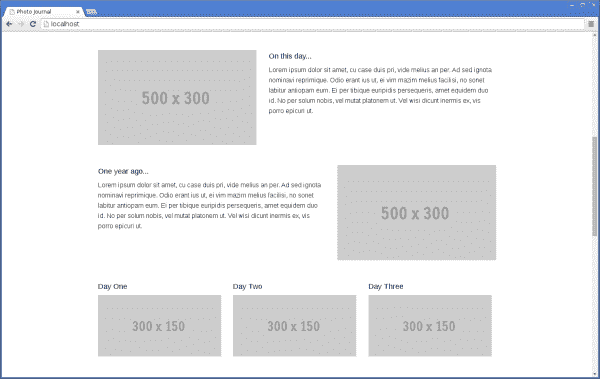

图 3.4 我们的第一个内容区块

保持节奏，让我们现在继续添加第二个区块。对于这一部分，我们将看到创建响应式媒体元素多么简单；在这种情况下，是一个视频区块。我们将利用 Foundation 的 flex-video 组件，它让框架处理诸如随屏幕尺寸变化的宽高比例和视频缩放等任务（我们将在第 5 章）中详细查看 flex video）。我们可以通过向第二个 `section` `div` 添加新行来开始：

```
<div class="section">
    <div class="row">
    </div>
</div>
```

设置好空区块和行后，让我们添加一个带有新 flex-video 组件的完整 12 列宽元素：

```html
<div class="large-12 columns">
    <div class="flex-video widescreen vimeo">
        <iframe src="http://player.vimeo.com/video/23205323" 
width="400" height="225" frameborder="0" webkitAllowFullScreen 
mozallowfullscreen allowFullScreen></iframe>
    </div>
</div>
```

如果你现在怀疑这是否就是为你的 Foundation 项目添加响应式视频所需的全部代码，请宽宽心。确实如此！我们所做的只是创建一个带有类的新 `div` 元素。我们所做的只是创建一个类为 `flex-video` 的新 `div` 元素。生成的 `index.html` 现在应该给你提供与图 3.5 类似的视图。

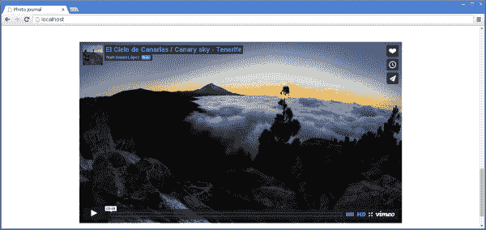

图 3.5 我们的内容区块

我们已经建立了两个区块，但我们仍然需要为页面添加一个分隔符元素。为了做到这一点，我们将创建一个类为 `separator` 的 `div`，并向其添加一些文本。你会注意到我们没有指定固定的宽度和高度，而是使用百分比。这是为了保持网站的响应性。

`index.html`（节选）

```html
<div class="separator">
    <div class="row">
        <div class="large-12 columns">
            <h3>Pictures in motion</h3>
            <p>Lorem ipsum dolor sit amet, cu case duis pri, vide 
melius an per. Ad sed ignota nominavi reprimique. ...</p>
        </div>
    </div>
</div>
```

让我们在 `app.css` 中为分隔符添加一些样式。我们将为分隔符行添加一些呼吸空间，并调整字体颜色。我们将设置分隔符容器的 `max-width` 和 `min-height`，并设置背景颜色以区分区块。

`css/app.css`（节选）

```css
.separator .row {
    margin-top: 50px;
    padding-top: 50px;
    color: #ffffff;
}

.separator {
    max-width: 100%;
    min-height: 50%;
    background-color: #cccccc;
}
```

在浏览器中打开新的 `index.html` 应该产生与之前相同的两个区块；然而，它们现在被一个带有描述后续区块的新元素隔开了，如图 3.6 所示。记住，我们构建的只是一个原型，所以生产内容是我们最后考虑的事情。简单的填充图像和文本就能让我们对页面外观有一个良好的了解。

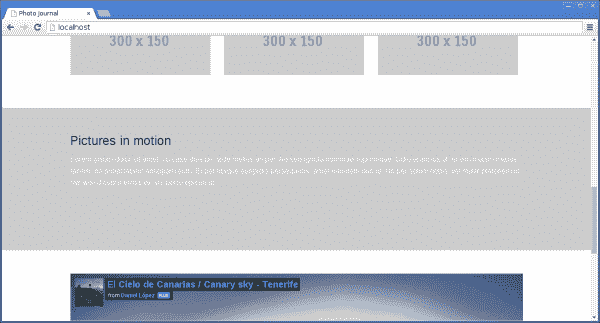

图 3.6 我们的分隔符元素

到此，我们已经完成了原型的头部和主要内容区块。剩下的就是在页面底部添加一个页脚元素了。对于页脚，我们将利用 Foundation 的图标栏组件在页面底部放置一个带，使用通用图标引导用户进行网站的沟通形式。图标栏的优势在于它能够以图像而不是文本呈现导航。不仅如此，它的设置也非常简单。我们只需要创建一个新的图标栏 `div`，并带上属性告诉 Foundation 显示多少元素：

```html
<div class="icon-bar five-up">
</div>
```

在我们案例中我们将使用五个图标，因此我们添加了 `five-up` 属性将空间分为五个等份。为了向图标栏添加图标，我们在这个 `div` 内部创建一个带有类的列表项：


```html
<a class="item">
    <i class="fi-mail"></i>
</a>
<a class="item">
    <i class="fi-bookmark"></i>
</a>
<a class="item">
    <i class="fi-social-tumblr"></i>
</a>
<a class="item">
    <i class="fi-social-twitter"></i>
</a>
<a class="item">
    <i class="fi-like"></i>
</a>
```

图 3.7 显示了渲染后的结果。

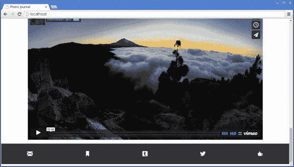

图 3.7. 我们原型中的页脚

在这些每一个 `item` 锚点中，我们都添加了项目本身，它们仅仅是空白元素，其类名与我们想要使用的 Foundation 图标对应。这些图标是 Zurb 免费提供的字体图标。使用字体图标的优势是它们在任何显示分辨率下看起来都非常清晰。这些图标可以在 [Foundation 网站，](http://zurb.com/playground/foundation-icon-fonts-3) 找到，只需要下载并将它们存储在根目录的 `img` 文件夹中。通过向锚点标签添加 `href=""` 属性，我们可以将这些图标引导到我们想要的任何地方。就这样，我们的页脚就拥有了一个漂亮的图标栏，带有优雅（更不用说可扩展）的图标引导用户访问各种联系链接。


图 4.3 显示了它在浏览器中的外观。

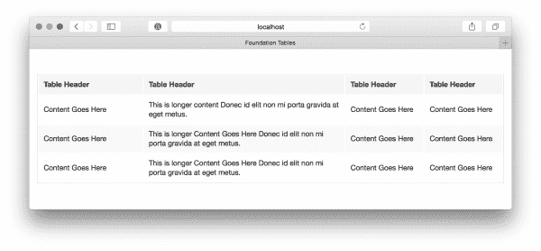

图 4.3. 默认 Foundation 表格

你可以看到 Foundation 为表头和交替行（斑马纹样式）应用了浅灰色。它还默认为表格添加了边框。

与许多其他 CSS 框架不同，Foundation 不提供各种类型的预样式表格；相反，你可以自定义默认表格。

## 响应式 Foundation 表格

这种默认 Foundation 表格的主要问题之一是无法通过响应式测试。当表格中的列较多时，它在较小的屏幕上可能会显示异常。默认 Foundation 框架也不支持响应式表格；但是，Foundation 作为 [Foundation Playground](http://zurb.com/playground)网站（该网站分享技术实验）的一部分发布了一个独立的响应式表格包。该包可以从 [`zurb.com/playground/responsive-tables`](http://zurb.com/playground/responsive-tables) 下载。从该包中将 `responsive-tables.css` 和 `responsive-tables.js` 文件复制到你的项目目录，然后如下所示将 CSS 文件链接到 HTML 文件的 `<head>` 部分：

```
<link type="text/css" media="screen" rel="stylesheet" 
href="css/responsive-tables.css" />
```

现在按照如下所示将 JavaScript 文件插入 HTML 文件中：

```
<script type="text/javascript" src="js/responsive-tables.js">
</script>
```

确保你将 JavaScript 添加在 jQuery 文件之后，否则它将无法工作。

链接这两个文件后，为 `<table>` 元素添加一个名为 `responsive` 的类。表格将神奇地变成响应式的！

现在继续为最近创建的表格添加 `responsive` 类吧。尝试调整浏览器窗口大小到较小尺寸，或使用 Chrome 的移动仿真模式在较小设备上检查表格。你可以看到表格被添加了水平滚动条，让你能够查看其全部内容。之前损坏的表格现在看起来好多了，并且完全可访问。

## 警框 (Alerts)

顾如名，`Alert` 组件用于在 Web 应用中显示提示消息。它们通常用于传递成功、失败或警告消息。首先，让我们创建一个基础警框框：

```
<div data-alert class="alert-box">
  这里是警框内容。
  <a href="#" class="close">&times;</a>
</div>
```

图 4.4 显示了此警框在浏览器中的外观。

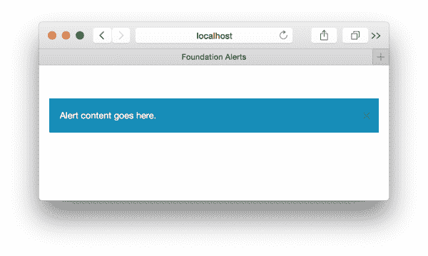

图 4.4. 基础警框

在这里，自定义数据属性 `data-alert` 将警框 div 与 Foundation 的 JavaScript 绑定。你还需要添加一个名为 `alert-box` 的类来应用适当的 CSS 样式。此警框组件可以包含任意数量的内容；但是，你需要在结尾添加一个带有 `close` 类的锚点标签。该标签包含用于显示 `x` 符号的 HTML 代码 `&times;`，用于关闭警框组件。你也可以将其替换为你选择的任何字体图标。

警框可以用于传递成功、失败或警告消息，以及显示任何通用消息。因此，Foundation 提供了类来根据警框类型更改警框框的颜色。

你可以配合默认类 `alert-box` 添加各种类来对警框进行样式设置。类及其颜色如下：

* `success`: 绿色
* `warning`: 橙色
* `alert`: 红色
* `info`: 浅蓝色
* `secondary`: 灰色

这是一个带有颜色类的警框示例：

```
<div data-alert class="alert-box success">
  支付成功！
  <a href="#" class="close">&times;</a>
</div>
```

你可以通过更改角落的圆角半径进一步增强警框框的外观。Foundation 提供了两个与警框框工作的边界类：`radius` 和 `round`。

正如我们在面板部分看到的，`radius` 类添加了 `3px` 的圆角半径，而 `round` 类为警框框添加了 `1000px` 的圆角半径。图 4.5 显示了它们的样子：

*alerts.html (节选)*

```
<div data-alert class="alert-box success radius">
  带有 .radius 类的警框。
  <a href="#" class="close">&times;</a>
</div>

<div data-alert class="alert-box warning round">
  带有 .round 类的警框。
  <a href="#" class="close">&times;</a>
</div>
```

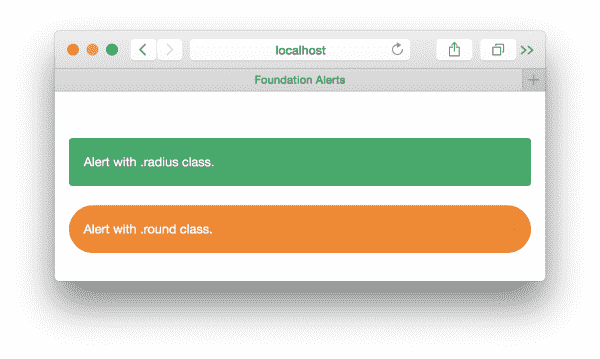

图 4.5. 使用 `round` 和 `radius` 辅助类的警框框

正如提到的，你始终可以在 `app.css` 文件中覆盖 `round` 类的 `1000px` 圆角值。

Foundation 还提供了一个自定义事件 `close.fndtn.alert`，它在警框关闭时触发。该事件可以用于在警框关闭后执行 Ajax 调用或客户端端操作。其用法如下：

```
$(document).on('close.fndtn.alert', function(event) {
  console.log('警框已关闭！');
});
```

## 组织内容

良好的内容组织至关重要。你需要易于使用的导航，以便用户浏览你的内容。在本节中，我们将学习如何使用 Foundation 创建标签 (Tabs)、下拉列表和导航栏。

### 标签 (Tabs)

`Tabs` 是 Foundation 的 JavaScript 组件之一。它允许你在单个容器中组织多个项目，并让你轻松在它们之间切换。就像任何其他组件一样，创建标签组件只需要添加 HTML 标记。

创建标签组件需要两个 HTML 元素：**标签部分**和**标签内容**。

标签部分使用带有 `tabs` 类的无列表 `<ul>` 元素创建，并带有 `data-tab` 的自定义属性。该自定义属性将 HTML 标记与 Foundation 的 JavaScript 绑定：

```
<ul class="tabs" data-tab>
    <li></li>
</ul>
```

无列表中的每个子 `<li>` 元素代表界面中的标签。这些 `<li>` 元素应该包含一个链接到特定内容标签。为每个 `<li>` 元素添加 `tab-title` 类以继承 Foundation 的 CSS 样式。标签部分的标记应该如下所示：

*tabs.html (节选)*

```
<ul class="tabs" data-tab>
    <li class="tab-title active"><a href="#panel1">标签 1</a></li>
    <li class="tab-title"><a href="#panel2">标签 2</a></li>
    <li class="tab-title"><a href="#panel3">标签 3</a></li>
    <li class="tab-title"><a href="#panel4">标签 4</a></li>
</ul>
```

你应该为其中一个 `<li>` 元素放置一个额外的 `active` 类；这将是页面在浏览器加载时被选中的标签。此外，锚点标签的 `href` 属性应设置为它们相应的标签内容 div 的 ID，我们接下来将创建它们。

创建标签内容需要创建一个带有 `tabs-content` 类的简单 `<div>` 元素。该元素作为所有子内容区域的父容器。每个子 `<div>` 元素都应该具有 `content` 类和一个唯一的 ID，与标签部分的链接相对应。


```html
<div class="tabs-content">
    <div class="content active" id="panel1">
        <p>Lorem ipsum dolor sit amet, consectetur adipiscing elit.
Duis vel aliquet augue.</p>
    </div
    <div class="content" id="panel2">
        <p>Mauris ornare quam a lorem interdum, condimentum porta
eros bibendum.</p>
    </div
    <div class="content" id="panel3">
        <p>Cras bibendum vehicula turpis a mollis. Pellentesque
tincid semper nunc, non porta massa volutpat quis.</p>
    </div
    <div class="content" id="panel4">
        <p>Pellentesque accumsan tortor ut tincidunt sollicitudin.
</p>
    </</div>
</div>
```

很直观，不是吗？你必须确保 `content` 元素中的一个具有 `active` 类，以帮助 Foundation 识别要显示的初始内容。

### 注意：不要忘记 `active` 类

如果你忘记在 `tabs` 和 `tabs-content` 元素的子元素之一中添加 `active` 类，那么所有标签卡将不会显示。你必须在 `tabs` 和 `tabs-content` 元素中相同位置的子元素上添加 `active` 类。

这个标签卡组件看起来就像图 4.6。

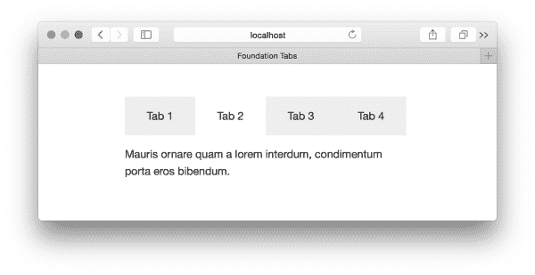

图 4.6. 一个标签卡组件

Foundation 还允许你创建另一种类型的标签卡组件，其中标签卡位于左侧，内容位于右侧。这被称为**垂直标签卡**。只需插入一个额外的 `vertical` 类，Foundation 就会神奇地将基础标签卡组件转换为垂直标签卡组件，如图图 4.7 所示：

```html
<ul class="tabs vertical" data-tab>
    …
</ul>
<div class="tabs-content">
    …
</</div>
```

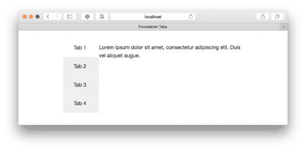

图 4.7. 一个垂直标签卡组件

**深度链接**是 Foundation Tabs 的一个功能，它为每个标签卡提供一个唯一的 URL。例如，如果你的网站 URL 是 `www.mysite.com`，那么“标签 2”的 URL 可能可能是 `www.mysite.com/#panel2`。这里的 `#panel2` 是 `tabs-content` 元素中子 `content` 元素的 ID。当用户导航到此 URL 时，“标签 2”将被默认选中。

要启用深度链接，请通过标签卡组件的 `data-option` 属性向 Foundation 的 JavaScript 传递特定参数。方法如下：

```html
<ul class="tabs" data-tab data-options="deep_linking: true">
 …
</ul
```

这里传递的值是 `deep_linking: true`。你会发现许多 Foundation 组件带有多个 `data-options` 参数，通过这些参数你可以自定义默认行为；请在[Foundation 文档](http://foundation.zurb.com/docs/)中查看这些内容。随着本书的进行，我们将学习更多内容。

### 顶部栏 (Top Bar)

**顶部栏**主要用于导航和其他网站链接。Foundation 的顶部栏组件默认在所有设备尺寸上（小、中、大屏幕）运行良好。

要创建一个顶部栏，我们需要一个带有 `top-bar` 类的 HTML `<nav>` 元素。它应该还有一个名为 `data-topbar` 的自定义数据属性，将其 HTML 绑定到 Foundation 的 JavaScript 中：

```html
<nav class="top-bar" data-topbar>
</nav
```

这个顶部栏将有两个部分——**品牌标识 (branding)** 和**内容 (content)**。品牌标识是放置网站标题或 Logo 的地方。内容包含你在导航栏中所需的所有链接和下拉菜单。让我们如何创建它们。

品牌标识部分使用带有 `title-area` 类的无序列表 `<ul>` 创建。它包含一个带有 `name` 类的 `<li>` 元素，其中包含网站标题：

```html
<nav class="top-bar" data-topbar>
    <ul class="title-area">
        <li class="name">
            <h1><a href="#">My Site</a></h1>
        </li>
    </ul
</nav>
```

导航栏看起来应该像图 4.8。

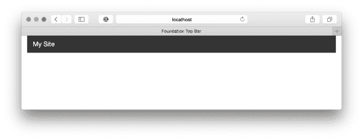

图 4.8. 我们顶部栏上的品牌标识部分

让我们添加一个汉堡图标，它仅在浏览器宽度窄到无法显示完整导航栏时可见。该图标位于 `title-area` 元素内部：

*top-bar.html (节选)*

```html
<nav class="top-bar" data-topbar>
    <ul class="title-area">
        <li class="name">
            <h1><a href="#">My Site</a></h1>
        </li>
        <!-- 汉堡图标 -->
        <li class="toggle-menu"><a href="#" data-toggle="menu">Menu</a></li>
    </ul>

    <ul class="menu">
        <li><a href="#">Home</a></li>
        <li><a href="#">Products</a></li>
        <li><a href="#">Services</a></li>
        <li><a href="#">Consulting</a></li>
    </ul>
</nav>
```


## 图 4.12. 下拉菜单

该菜单是响应式的。当在较小的屏幕上折叠时，它侧侧显示并带有箭头图标指示，如图 4.13 所示。

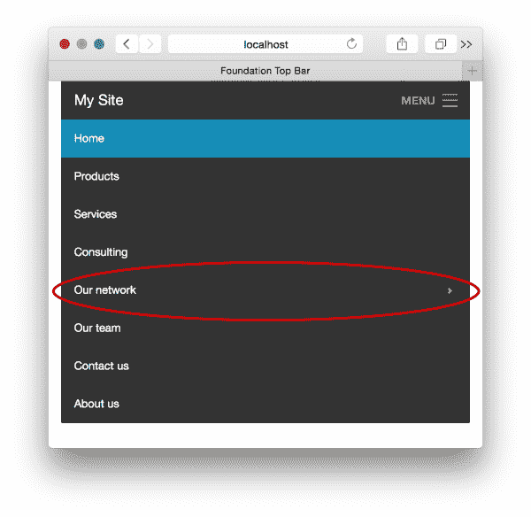

图 4.13. 较小屏幕上的下拉菜单

你可以对顶栏组件进行一些额外有用且有趣的操作：

- **固定顶栏 (Fixed top bar)**：若要让顶栏在滚动时保持固定，请将整个`<nav>` 元素封装在类为 `fixed` 的 `<div>` 元素中。顶栏将占据浏览器窗口的宽度，并固定在窗口顶部。
- **对齐网格 (Contain to grid)**：默认情况下，顶栏占据浏览器宽度。如果你想让导航栏设置为你的网格宽度，请将其封装在类为 `contain-to-grid` 的 `<div>` 元素中。
- **粘性顶栏 (Sticky top bar)**：假设你在页面中间有一个导航栏，并希望它在触碰浏览器顶部时悬浮并固定在顶部。这可以通过将导航栏封装在类为 `sticky` 的 `<div>` 元素中实现。
- **响应点击 (Respond to click)**：默认情况下，顶栏组件中的下拉菜单对鼠标悬停有响应。你可以覆盖此功能，通过向 `data-option` 属性传递参数 `is_hover: false` 来让它对鼠标点击做出响应。

  例如：

```
<nav class="top-bar" data-topbar data-options="is_hover: false">
  …
</nav>
```

## 总结

在本章中，我们学习了如何创建和组织网站的内容。首先，我们看到了如何创建 Foundation 面板、警报和表格。我们更进了一步，通过向项目添加额外的样式表来使表格具有响应式。接着，我们创建了直观的标签页（tabs），并看到如何通过添加单个类名将其变为垂直排列。最后，我们学习了如何创建精妙的顶栏（导航栏）并向其添加下拉菜单。

在下一章中，我们将查看如何通过创建轮播和缩略图来管理和组织图片视频。

# 第 5 章：处理媒体

在本章中，我们将学习如何使用 Foundation 为我们的网站添加酷炫的视频和图像，然后添加一些样式。我们将发现一些增加用户体验的实用组件，例如图片幻灯片和灯箱（lightboxes）。那么，让我们来看看吧。

## 将视频集成到你的页面

当你需要在网页中集成 YouTube 视频时该怎么办？你从 YouTube 获取 HTML 嵌入代码并将其粘贴到你的 HTML 文件中，对吧？然而，这些嵌入代码通常带有预定义的高度和宽度，因此让此类视频具有响应式可能会困难。

幸运的是，Foundation 为我们提供了名为 `flex-video` 的组件，它可以封装任何视频源的嵌入代码并使其变为响应式。创建一个 flex 视频非常简单。你只需要为 `<div>` 元素添加类 `flex-video` 即可。这是一个包含 YouTube 嵌入代码的 flex 视频示例：

```
<div class="flex-video">
      <iframe width="420" height="315" src="//www.youtube.com/
embed/k85mRPqvMbE" frameborder="0" allowfullscreen></iframe>
</div>
```

注意，此 YouTube 嵌入代码带有来自 YouTube 硬编码的高度和宽度属性。然而，Foundation 的 flex video 组件将忽略这些属性，并让视频适应父网格容器。

使用 Foundation，让我们创建一个网格系统，其中有一个居中的中央列，在大屏幕上为 6 个虚拟列宽，在小屏幕上为 8 个虚拟列宽。然后我们在其中插入一个 flex 视频组件：

*flex-video.html (片段)*

```
<div class="large-6 large-offset-3 small-8 small-offset-2 columns">
    <div class="flex-video">
        <iframe width="420" height="315" src="//www.youtube.com/
embed/k85mRPqvMbE" frameborder="0" allowfullscreen></iframe>
    </div>
</div>
```

你应该在浏览器中看到类似于图 5.1 的画面。

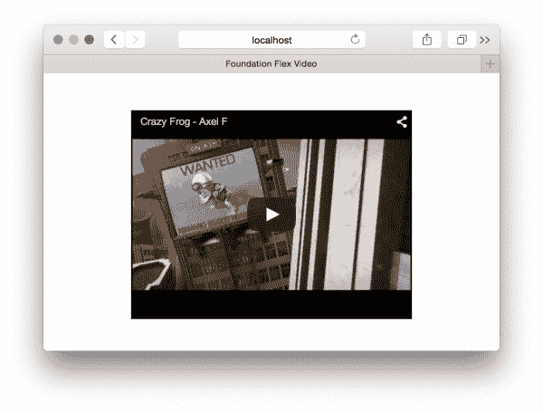

图 5.1. flex 视频组件

现在如果你尝试调整浏览器宽度，你会发现视频宽度也随之变化。它占据了居中网格列的全宽。

Foundation 提供了两个额外的 CSS 类来样式化 flex ：`widescreen` 和 `vimeo`。通常，嵌入视频是正方形的。如果你想让它看起来更宽或呈矩形，请为 `flex-video` 元素添加类 `widescreen`。这将为 flex 视频添加 `56.34%` 的 `padding-bottom`。当嵌入 Vimeo 视频时，也可以为 flex 视频添加类 `vimeo`。这会移除嵌入 Vimeo 视频的额外内边距。

## 创建响应式图片幻灯片

我还记得为了创建我的第一个图片幻灯片而编写了大量的 CSS 和 JavaScript 代码。现在，得益于 Foundation 名为 Orbit 的图片幻灯片组件，事情变得简单多了。

基础的 Orbit 组件是使用单个无序列表 `<ul>` 标签并带有 `data-orbit` 属性创建的：

```
<ul data-orbit>
```

列表中的每个 `<li>` 标签代表幻灯片中的幻灯片，每个 `<li>` 包含一个 `` 标签；例如：

```
<ul data-orbit>
    <li>
        
    </li>
    <li>
        
    </li>
</ul>
```

如果你尝试一下，你将在浏览器中看到一个完整的图片幻灯片，如图 5.2 所示。

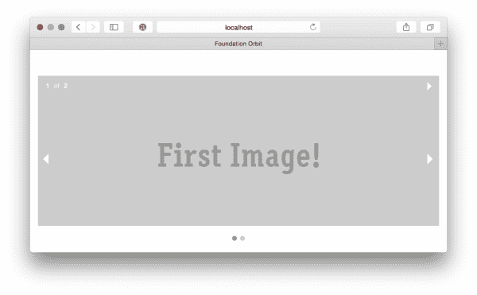

图 5.2. Orbit 幻灯器示例

Foundation Orbit 组件默认是响应式的，而且对移动设备手势有响应。如果你在移动设备上向左或向右滑动，幻灯片就会随之切换。

### 注意：Orbit 已标记为废弃

看起来看起来很棒，不是吗？让我们为这个幻灯器添加一些功能。

对于字幕，在每个 `<li>` 元素中添加类为 `orbit-caption` 的 `<div>` 元素：

*orbit.html (片段)*

```
<ul data-orbit>
    <li>
        
        <div class="orbit-caption">
            First slide caption. Lorem ipsum dolor amet,
            consectetur adipiscing elit.
        </div>
    </li>
    <li>
        
        <div class="orbit-caption">
            Second slide caption. Lorem ipsum dolor amet,
            consectetur adipiscing elit.
        </div>
    </li>
</ul>
```

如果你刷新浏览器，你会在图片下方看到文字，如图 5.3 所示。

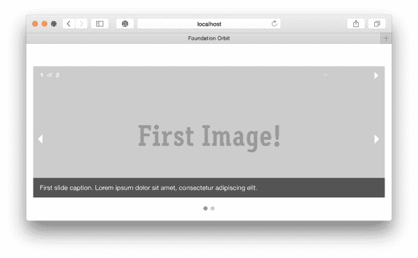

图 5.3. 为我们的幻灯片添加了字幕

虽然使用 Orbit 创建幻灯片很容易，但它可能不适用于某些图片幻灯片。Orbit 的主要问题之一是无法处理高度异的图片。

### 注意：Orbit 已标记为废弃

Foundation 的 Orbit 组件已被标记为废弃。虽然它仍然包含在 Foundation 软件包中，但它可能会在未来被移除。我们在这里包含它是因为它仍然是为页面轻松添加幻灯片的有效方法，而且它是 Foundation 软件包默认包含的。替代第三方幻灯片组件，例如 [Slick Carousel](http://kenwheeler.github.io/slick/)，也可以用于为你的页面添加图片幻灯片。在下一节中，我们将讨论 Clearing 组件，它提供了一种展示图片的替代方式，包含在默认 Foundation 软件包中。

## 使用 Clearing 组件创建图片灯箱

虽然使用 Orbit 创建幻灯片很容易，但它可能不适用于创建某些图片幻灯片。Orbit 的主要问题之一是无法处理高度异的图片。


通过 `Clearing` 组件，可以创建一个以全屏模式显示图片的幻灯片，并妥善处理高度可变的图片。它的外观类似于 Google+ 的照片灯箱，显示一组较小的图片缩略图，点击后即可全屏显示该图片。让我们来看看如何创建一个 `Clearing` 组件：

*clearing.html (节选)*

```html
<ul class="clearing-thumbs" data-clearing>
  <li><a href="path/to/your/img"></a
↵</li>
  <li><a href="path/to/your/img"></a
↵</li>
  <li><a href="path/to/your/img"></a
↵</li>
</ul
```

如你所见，你需要设置一个带有 `.clearing-thumbs` 的无序列表并添加 `data-clearing` 属性。列表中的每个 `<li>` 元素代表一个缩略图图像，其中包含一个包裹着图像标签的锚点标签。锚点标签链接到原始图片，而图像标签则包含图片缩略图的路径。

与 `Orbit` 组件相比，选择 `Clearing` 组件的唯一缺点是你必须为所包含的每张图片创建两个不同尺寸——缩略图和全尺寸图片。

我们创建的 `Clearing` 组件看起来像图 5.4。

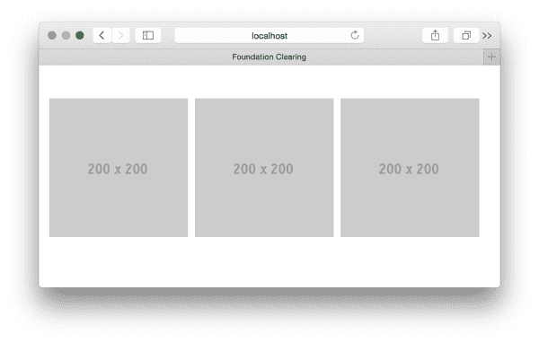

图 5.4. Clearing 组件的示例

当你点击这些缩略图中的任何一个时，全尺寸将在灯箱中显示，所示图 5.5。

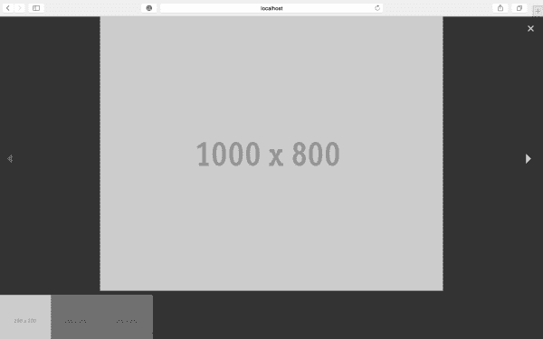

图 5.5. 点击缩略图后，显示全尺寸图片。

如果你想对缩略图进行样式处理，请为列表中的每个 `<li>` 元素添加 `th` 类：

*clearing.html (节选)*

```html
<ul class="clearing-thumbs" data-clearing>
  <li class="th"><a href="path/to/your/img"></a></li>
 …
</ul
```

现在，每张缩略图都有了带有内边距的边框，使它们看起来更像缩略图。

对于图片说明，在图像标签上添加 `data-caption` 属性，并将你的说明文本作为值：

*clearing.html (节选)*

```html
<ul class="clearing-thumbs" data-clearing>
  <li class="th"><a href="path/to/your/img"></a></li>
 …
</ul
```

## 总结

在本章中，我们使用 Foundation 中的各种组件处理了两种重要的媒体类型——视频和图像。首先，我们看到了如何使用 flex 视频创建响应式图像。然后，我们看到了如何使用 `Orbit` 组件创建一个精美的图像幻灯片。最后，我们学习了 `Clearing` 组件，这是在任何网站中显示图片的最佳方法之一。

在下一章中，我们将学习在 Foundation 中创建和样式化表单是多么简单。我们还将看到如何创建直观的切换按钮和范围滑块，并通过 Abide 验证库讨论 Foundation 中的客户端侧表单验证。

# 第 6 章：处理表单

表单是任何网站至关重要的组件。登录页面、注册页面、评论框、反馈部分和问卷都是 HTML 表单。虽然使用基础 HTML 标记创建表单很容易，但为每个表单元素设置样式可能是一个无聊的任务。

在本章中，我们将学习如何使用 Foundation 框架创建美观、响应式的表单。我们将探索 Foundation 的表单验证类，以及如何使用 `Abide` 验证表单。最后，我们将发现如何使用 Foundation 的切换开关（例如 iOS 设备中的开启/关闭按钮）。最后，我们将探索 Foundation 的表单验证类。。让我们开始吧。

## 构建基础表单

与许多其他前端框架（如 Bootstrap）不同，Foundation 没有为 HTML 表单提供特定的 CSS 类。Foundation 的主 CSS 文件包含了每个基础 HTML 元素的默认样式。一如既往，如果你想覆盖某种样式或使用新样式，可以在你的 `app.css` 文件中自由进行。

Foundation 网格系统在表单中用于控制表单输入元素的宽度，并将表单元素放置在正确的位置。让我们检查如何在 Foundation 中将两个不同的 HTML 输入元素并排放置：

```html
<form>
    <div class="row">
        <div class="small-6 columns">
            <input type="text" placeholder="First Name" />
        </div>
        <div class="small-6 columns">
            <input type="text" placeholder="Last Name"/>
        </div>
    </div>
</form>
```

在这里我们有两个使用 `small-6` 和 `columns` 类的不同列。每个列中都放置了一个输入元素，占据 `columns` 的宽度。这种表单所示图 6.1。

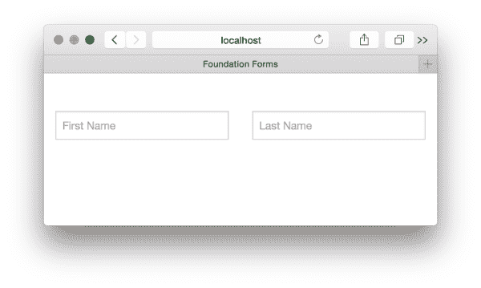

图 6.1. 基础布局

要为输入标签添加标签，如所示用 `<label>` 标签包裹它：

```html
<label>First Name
    <input type="text" placeholder="First Name" />
</label>
```

将 `<label>` 包裹在输入元素周围将其关联。如果用 `<label>` 标签包裹表单不符合你的需求，可以使用 `<label>` 标签上的 `for` 属性。表单所示图 6.2。

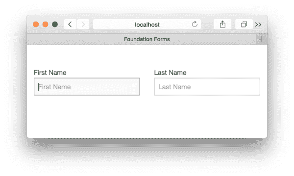

图 6.2. 带有标签的表单

你还可以为 `<select>` 和 `<textarea>` 元素添加标签。让我们为现有表单添加 `<select>` 和 `<textarea>` 元素：

*index.html (节选)*

```html
<form>
    <div class="row">
        <div class="small-6 columns">
            <input type="text" placeholder="First Name" />
        </div>
        <div class="small-6 columns">
            <input type="text" placeholder="Last Name"/>
        </div>
    </div>
    <div class="row">
        <div class="large-12 columns">
            <label>Select Place
                <select>
                    <option value="husker">Alabama</option>
                    <option value="starbuck">Alaska</option>
                    <option value="hotdog">Arizona</option>
                    <option value="apollo">California</option>
                </select>
            </label>
        </div>
    </div
    <div class="row">
        <div class="large-12 columns">
            <label>Add comment
                <textarea placeholder="Write something"></textarea>
            </label>
        </div>
    </div>
</form>
```

表单现在图 6.3 所示。

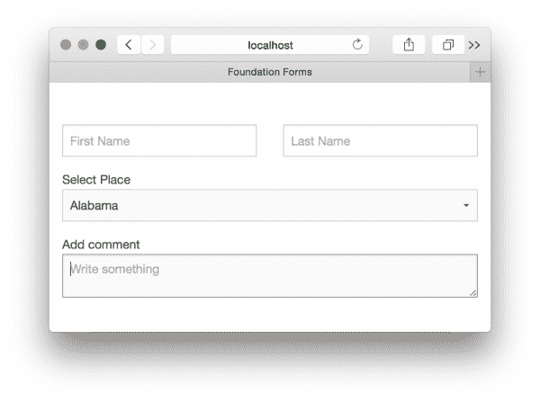

图 6.3. 带有 select 和 textarea 元素的表单。

现在为我们的示例表单添加一些单选按钮和复选框：

*index.html (节选)*

```html
<div class="row">
    <div class="large-6 columns">
        <label>Select Gender</label>
        <input type="radio" name="gender" value="male" id="
↵maleRadio"><label for="maleRadio">Male</label>
        <input type="radio" name="gender" value="female" id="
↵femaleRadio"><label for="femaleRadio">Female</label>
    </div

    <div class="large-6 columns">
        <label>Preferred Color</label>
        <input id="blueCheckbox" type="checkbox"><label for="
↵blueCheckbox">Blue</label>
        <input id="redCheckbox" type="checkbox"><label for="
↵redCheckbox">Red</label>
    </div
</div>
```

结果应该类似于图 6.4。


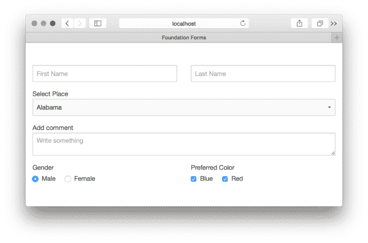

图 6.4。我们的示例表单增加了单选按钮和复选框进行演变。

### 前缀和后缀输入字段

Foundation 有两种类型的输入字段：前缀（可以添加如 `$` 和 `€` 等符号）和后缀（可以添加如 `.com` 的文本）。可以在 图 6.5）中看到这一点。

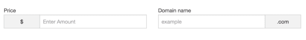

图 6.5. 前缀和后缀输入字段。

要创建一个前缀或后缀输入字段，首先使用 Foundation 网格系统构建一个双列布局。然后生成一个具有 `row` 和 `collapse` 类的 `<div>` 元素。在这里，`collapse` 将有助于移除列与列之间的默认内边距和外边距：

```
<div class="row collapse">
</div>
```

接下来，我们在这个 `row` 元素内部添加列。要创建一个前缀输入框，先构建一个窄列，一个宽列。让我们为窄列选择 `small-3`，为宽列选择 `small-9`：

```
<div class="row collapse">
  <div class="small-3 columns">
  </div>
  <div class="small-9 columns">
  </div>
</div>
```

记得在添加列宽的同时添加 `columns` 或 `column` 类。在窄列内部，使用 `<span>` 标签添加你所需的的前缀文本（例如 `$`）。它应该具有 `prefix` 类以应用 CSS 样式：

```
<div class="small-3 columns">
    <span class="prefix">$</span>
</div>
```

现在在宽列内部添加输入字段：

```
<div class="small-9 columns">
    <input type="text" placeholder="Enter Amount"/>
</div>
```

尝试在浏览器中检查此代码的运行。你应该会看到一个带有前缀的输入框，提示你应该输入美元金额。

对于后缀输入框，只需交换窄列和宽列的位置即可。然后对 `<span>` 标签使用 `postfix` 类而不是 `prefix`。以下是后缀输入框的代码：

```
<div class="row collapse">
    <div class="small-9 columns">
        <input type="text" placeholder="example" />
    </div>
    <div class="small-3 columns">
        <span class="postfix">.com</span>
    </div>
</div>
```

### 内联标签和输入字段

有时你可能需要将标签放置在输入字段的左侧，而不是上方。你可以借助网格系统和一些额外的 CSS 类来实现。

我们必须创建两列，一窄一宽。我们将使用 `small-3` 类作为窄列，使用 `small-9` 类作为宽列：

```
<div class="row collapse">
    <div class="small-3 columns">
    </div>
    <div class="small-9 columns">
    </div>
</div>
```

如下所示在窄列中添加 `<label>` 标签：

```
<div class="small-3 columns">
    <label for="nameField">Enter Name</label>
</div>
```

现在在宽列中放置输入字段：

```html
<div class="small-9 columns">
    <input type="text" id="nameField" placeholder="John Doe" />
</div>
```

让我们在浏览器中查看。它看起来会像 图 6.6。

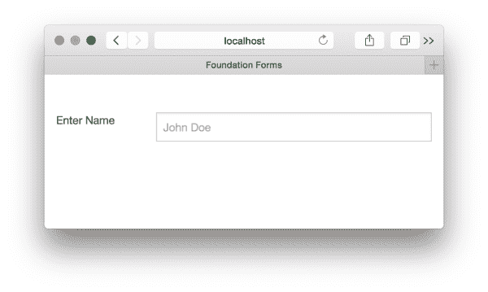

图 6.6. 内联标签

但是，这里有一个小问题。标签相对于输入框在垂直方向上没有对齐。我们需要添加一些 CSS 类来让它看起来很完美。在标签文本上添加 `right` 类将使其向右浮动。这会让它更靠近输入字段。添加另一个 CSS 类 `inline` 会为它添加一些内边距和外边距。

```
<div class="small-3 columns">
    <label for="nameField" class="right inline">Enter Name</label>
</div>
```

如果你重新加载浏览器页面，你应该能看到如 图 6.7 所示的完美对齐的标签文本。

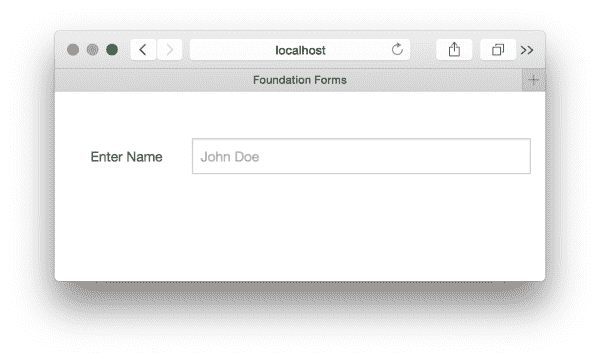

图 6.7. 我们调整后的内联标签

### 错误状态

在 Foundation 中，指示输入字段是否有无效条目非常简单。只需在标签文本上添加 `error` 类即可变为红色。你还可以在输入字段下方放置额外的文本作为错误消息。此文本使用带有 `error` 类的 `<small>` 标签添加。以下是一个带有错误状态的输入字段示例：

*index.html (节录)*

```
<div class="small-12 columns">
    <label class="error">Name
        <input type="text" placeholder="Name" />
    </label>
    <small class="error">Invalid entry</small>
</div>
```

这看起来会像 图 6.8。

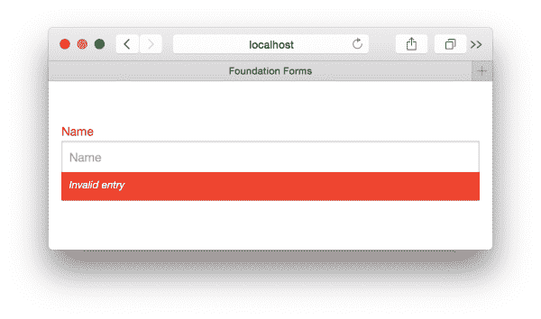

图 6.8. 带有错误状态的输入字段

这在 Foundation 中指示一个输入字段是否有无效条目是极其直接的。只需在标签文本上添加 `error` 类即可使其变为红色。你还可以在输入字段下方放置额外的文本作为错误消息。此文本使用带有 `error` 类的 `<small>` 标签添加。以下是一个带有错误状态的输入字段示例：

### 使用 Abide 验证表单

Abide 是一个提供客户端验证支持的库。在上一节中，我们看到了如何 *指示* 错误状态，但我们尚未学习如何 *调用* 那些错误状态。现在我们将使用 Abide 来验证表单。这是一个使用 Abide 的示例表单：

```
<form>
  <div class="name-field">
    <label>Your name
      <input type="text"/>
    </label>
    <small class="error">Name is required and must be a string.</small>
  </div>
  <div class="email-field">
    <label>Email
      <input type="email"/>
    </label>
    <small class="error">An email address is required.</small>
  </div>
  <button type="submit">Submit</button>
</form>
```

这个基础表单看起来会像 图 6.9。

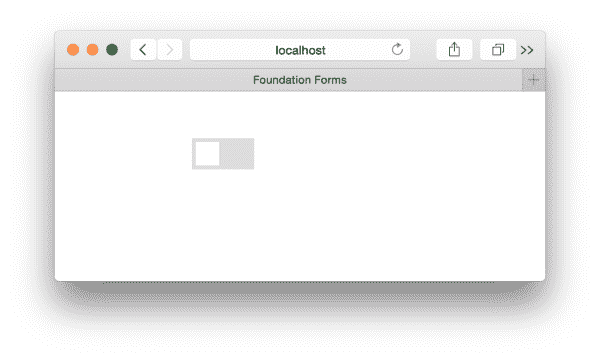

图 6.9. 没有验证的表单

如果你提交此表单，你会发现验证不起作用。这是因为我们还没有告诉 Abide 库要验证哪些字段。最基本的验证要求是表单字段不能为空。我们将使用 HTML5 的 `required` 属性为表单输入字段添加必要的验证。为了做到这一点，我们在 `index.html` 文件中包含一个额外的 JavaScript 文件。该文件名为 `foundation.abide.js`，位于 `js/foundation/` 文件夹中。位于 Foundation 文件的下方：

接下来，我们通过在 `<form>` 标签上添加 `data-abide` 属性来在表单上初始化 Abide 库：

```
<form data-abide>
...
</form>
```

现在，当你刷新页面后，错误状态应该是隐藏的，如 图 6.10 所示。

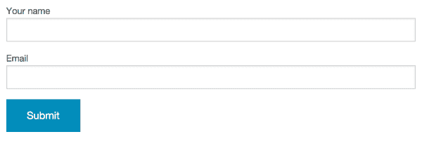

图 6.10. 隐藏错误状态的表单

现在如果你尝试提交此表单——当然是在刷新页面之后——你将看到验证正在工作，且空字段是不接受的，如 图 6.11 所示。

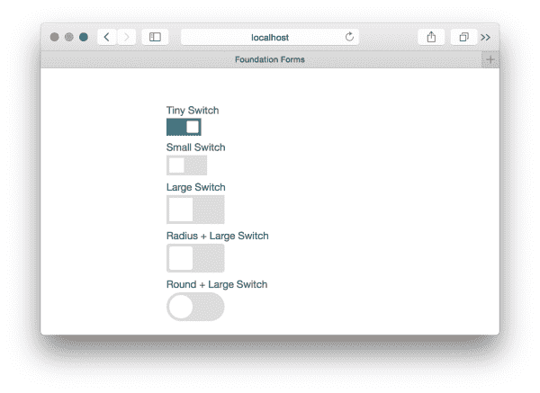

图 6.11. 表单现在拒绝空字段。


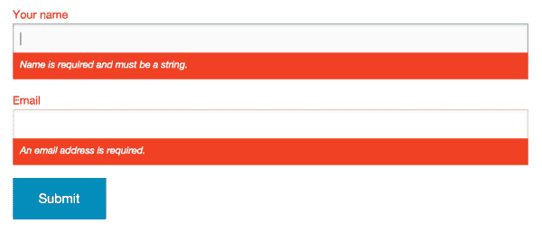
图 6.11. 表单现在拒绝空字段

我们将通过添加更多细节来完善我们的表单验证。Abide 验证允许你为每个输入字段添加模式，以便它只接受特定的值。例如，如果你想让名称字段只接受字符而排除数字，那么有一个你必须向 Abide 库提供的特定模式。这些模式也也被称为 `regular expressions`（正则表达式）或 `RegEx`。你可以在 [MDN 开发者网络上阅读更多关于 RegEx 的知识](https://developer.mozilla.org/en/docs/Web/JavaScript/Guide/Regular_Expressions)。另一个可以让你轻松获取模式的酷炫在线工具是 [HTML5Pattern.](https://html5pattern.com) 你也可以参考 Foundation 的文档获取一些 [预定义模式。](http://foundation.zurb.com/docs/components/abide.html#predefined-patterns)

让我们在名称字段中添加模式 `[a-zA-Z]+`。这将强制只提交字母字符：

```
<input type="text" required pattern="[a-zA-Z]+"/>
```

如果你现在尝试使用无效输入（如数字）提交表单，你将在名称字段中收到错误。

### 警告：单向错误检查

Abide 验证库仅提供客户端验证。它使用 `JavaScript` 在浏览器中检查错误，因此如果用户的浏览器上禁用了 JavaScript，它将无法工作。我们建议你始终在服务器端也对表单进行验证，使用 `PHP` 或 `Ruby` 等编程语言。

## 开关 (Switches)

开关是一种切换元素，点击或触摸时可以在开启和关闭状态之间切换，如图图 6.12 所示。

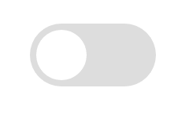
图 6.12. 开关

Foundation 框架中开关最好的地方在于它们是使用普通的复选框和单选按钮 HTML 元素生成的。因此，你可以使用传统的 JavaScript 方法检测这些元素的状态。

要创建一个开关，设置一个具有类 `switch` 的 `<div>` 元素。然后在它内部插入一个带有标签标记的 HTML 复选框：

```
<div class="switch">
  <input id="exampleCheckboxSwitch" type="checkbox">
  <label for="exampleCheckboxSwitch"></label>
</div>
```

你需要确保标签元素的 `for` 属性包含输入复选框元素的 ID 值。

图 6.13 显示了它看起来应该是什么样。


图 6.13. 基础切换开关

你也可以使用相同的标记创建一组单选按钮开关。请确保你为所有开关都设置了相同的 `name` 属性，如代码所示。通过单选按钮驱动的开关，你可以确保一次只有一个开关被选中：

```
<div class="switch">
  <input id="exampleRadioSwitch1" type="radio" checked name="testGroup">
  <label for="exampleRadioSwitch1"></label>
</div>

<div class="switch">
  <input id="exampleRadioSwitch2" type="radio" name="testGroup">
  <label for="exampleRadioSwitch2"></label>
</div>

<div class="switch">
  <input id="exampleRadioSwitch3" type="radio" name="testGroup">
  <label for="exampleRadioSwitch3"></label>
</div>
```

结果将看起来像图 6.14 所示。

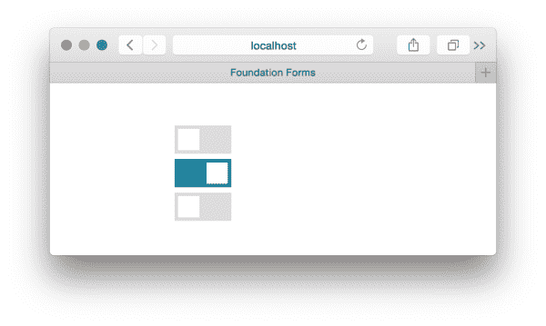
图 6.14. 单选按钮驱动的开关

### 开关尺寸

你还可以使用几个 CSS 类来控制开关的形状和大小：

* `large`: 用于较大的开关
* `small`: 用于较小的开关
* `tiny`: 用于极小的开关

你还可以添加以下类来更改你开关的形状：

* `radius`: 添加 `4px` 的边圆角
* `round`: 添加 `2rem` 的边圆角

以下是这些类的用法示例：

```
<div class="switch large radius">
  <input id="exampleRadioSwitch4" type="radio" name="testGroup">
  <label for="exampleRadioSwitch4"></label>
</div>
```

这将创建一个具有 `4px` 边圆角的大开关。

图 6.15 显示了开关的所有形状和尺寸。


图 6.15. 各种尺寸和样式的开关

### 禁用开关

在某些情况下，你可能想要禁用开关使其无法被选中。最简单的方法是使用 HTML5 默认的 `disabled` 属性。它可以添加到任何 HTML 标签中，以便该标签上的点击事件将失效。默认情况下，Foundation 不为禁用状态提供样式。

但是，如果你在开关上添加 `disabled` 属性，我们需要通过编写自定义 CSS 来解决这个问题：

```css
switch.disabled {
  opacity: 0.25;
  pointer-events: none; // 阻止点击事件
}
```

然后为 `<input>` 元素添加 `disabled` 类，例如：

```
<div class="switch large radius">
  <input id="exampleSwitch" type="radio" name="testGroup" disabled>
  <label for="exampleSwitch"></label>
</div>
```

你应该能看到像图 6.16 所示的效果。

## 总结

我希望你学习 Foundation 中的表单觉得很有趣。在本章中，我们学习了通过掌握网格系统和添加 CSS 类来创建漂亮的表单。我们还探索了如何创建前缀和后缀输入字段，如何将标签与输入字段内联，以及如何指示错误。最后，我们看到了直观的开关元素。

在下一章中，我们将发现如何使用 Sass 预处理器来自定义 Foundation 的默认样式。所以请休息一下，然后准备好进入这本书精彩的最后一章。


编译这段 Sass 代码将生成以下输出：

```
.button{
  background: #00f;
  color: #fff;
}
```

你还可以在 Sass 中创建函数，帮助你分离可重复的 CSS 属性。嵌套规则的能力是使用 Sass 的另一个优势。随着本章的进行，我们将介绍其中的一些功能。如果你想学习更多关于 Sass 的知识，请访问[官方网站](http://sass-lang.com/)。使用 Sass 自定义 Foundation 非常简单，因为 Foundation 允许你访问生成默认 CSS 文件时使用的 Sass 变量和函数。为了这一点，我们将下载 Sass 版本的 Foundation，它包含了生成 CSS 文件所需的所有 Sass 文件，以及我们很快就会介绍的一些其他文件。

创建 Sass 版本的 Foundation 项目的最佳方法是使用 Foundation 的命令行界面，简称为 `CLI`。它让你能够通过编写单条命令行语句来创建新的 Foundation 项目。如果你计划使用 Foundation 并使用 Sass 对其进行自定义，我们建议你下载 Foundation `CLI`，我们稍后会介绍。

### 提示：如果你更倾向于原生（Vanilla）

在本章中，我们将使用许多不同的工具并使用命令行。尽管我们会提供逐步的说明，但如果你发现它太复杂，你也可以坚持使用原生 Foundation，并使用你的 `app.css` 来自定义框架。

### 安装 Foundation CLI

在安装 Foundation CLI 之前，我们需要在机器上安装一些工具：

* `Git`
* `Node.js`
* `Ruby 1.9+`

如果需要，这里可以提供一些帮助。

### 安装 Git

安装 Git 最简单的方法是[下载安装程序。](http://git-scm.com/download) 点击相应的操作系统，下载完成后，双击它并按照说明操作。

要检查是否已成功安装 Git，请打开终端（OS X 中使用 Terminal，Windows 中使用命令提示符）并输入 `git --version`。它应该显示已安装的 Git 版本。

### 安装 Node.js

要安装 Node.js，请从[nodejs.org](https://nodejs.org) 下载其包，然后双击该包并按照说明操作。

你可以在系统终端中输入 `node -v` 来检查 Node.js 是否安装成功。它应该显示当前安装的 Node.js 版本。

### 安装 Ruby

如果你使用的是 Macintosh 电脑，可能已经预装了 Ruby。进入终端运行命令 `ruby -v`。它应该显示当前安装版本的版本号。

对于不同的操作系统，可以在 [`www.ruby-lang.org/en/documentation/installation/#installers`](https://www.ruby-lang.org/en/documentation/installation/#installers) 找到相应的 Ruby 安装程序。

### 安装 Foundation CLI

为了管理自身的更新——以及第三方库的更新——Foundation 使用 [Bower。](http://bower.io/) 如果你不熟悉 Bower，它是一个客户端包管理器，用于跟踪开发者使用的包。在这种情况下，我们需要的包是 Foundation 框架。我们还需要 `grunt-cli`，这是一个为 Foundation CLI 运行各种预定义任务的 JavaScript 程序。可以在 [`gruntjs.com`](http://gruntjs.com) 了解更多关于 Grunt 的信息。

打开终端并输入以下命令：

```
npm install -g bower grunt-cli
```

现在让我们使用以下命令安装 Foundation CLI：

```
gem install foundation
```

### 注意：权限错误

如果你在运行这两个命令时遇到任何权限错误，请在它们前面添加 `sudo` 单词，并在提示时输入你的系统密码。这应该解决你的问题。如果你遇到其他问题，我们建议你前往 [SitePoint 论坛。](http://community.sitepoint.com/)

执行完命令后，输入以下内容以检查 Foundation 是否安装正确：

```
foundation version
```

它应该返回一个版本号。在我的情况下，它返回了 `v1.0.4`，这意味着我的系统中安装了 Foundation CLI v1.0.4。

现在我们完成了 Foundation CLI 的安装。在下一节，我们将安装一个 Sass 编译器，每当我们修改 Foundation 的默认 Sass 文件时，它就会重新编译 Sass 文件。

## 安装 Compass 并创建 Sass Foundation 项目

Compass 是一个开源 CSS 编写框架，使用 Sass 样式表语言。它将 Sass 编译为静态 CSS 样式表。

安装 Compass 非常简单。你只需要输入以下命令：

```
gem install compass
```

安装完成后，使用终端导航到通常存放所有项目的文件夹；例如，`cd Documents`。接下来，输入以下命令生成你的第一个兼容 Sass 的 Foundation 项目：

```
foundation new First_project
```

这将创建一个名为 `First_project` 的新项目。将在接下来的章节中介绍该项目中的每个文件夹和文件。

在创建新的 Foundation 项目后还有一步要执行：运行 `bundle` 命令。该命令确保我们在使用根目录下的 `Gemfile` 文件中提到的正确库。如果你打开此文件，你会发现它包含了 `sass` 和 `compass` 的版本。当你更改项目环境（例如切换到新系统）时，`bundle` 命令非常有用。

### 注意：什么是 Gemfile？

Gemfile 保留了你的 Rails 程序的 gem 依赖项列表。通过运行 `bundle` 来满足这些依赖项。

你必须为新项目运行一次 `bundle` 命令。使用此命令安装 Bundler：

```
gem install bundler
```

你可以在[官方网站](http://bundler.io/)阅读更多关于 bundler 的信息。

安装 bundler 后，进入新创建的文件夹 `First_project` 并运行 `bundle` 命令：

```
cd First_project
bundle
```

在 bundle 安装所有内容后，运行以下命令让 Compass 监听对 Sass 文件的更改并进行编译：

```
bundle exec compass watch
```

让我们检查 Compass 是否真的在工作。为了测试，打开 `scss/app.scss` 文件并在底部定义一个新的 Sass 变量：

```
$mycolor: #FFF;
```

一旦保存文件，你应该会在终端中看到 Compass 执行了某些命令：

```
modified scss/app.scss
write stylesheets/app.css
```

确保删除之前定义的 `$mycolor` 变量并再次保存。

## 理解 Foundation 项目结构

`First_project` 文件夹的内容应该类似于图 7.1。

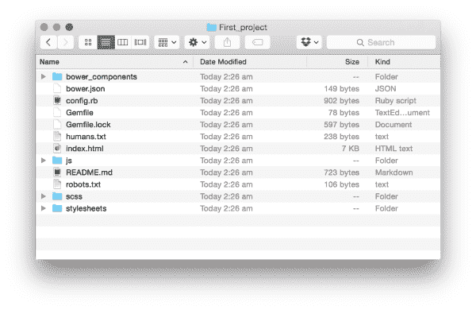

图 7.1. Sass 结构

现在是理解该项目内部的一些重要文件和文件夹了。第一个是 `bower_components` 文件夹，由 Bower 管理其内容。它包含了各种第三方库，如 `fastclick.js`、`jquery`、`Modernizr` 等。建议不要更改文件夹中的任何内容，因为可能会导致冲突。

`bower.json` 是一个清单文件，用于 Bower 跟踪特定项目使用的各种第三方库。如果你打开此文件，它看起来像这样：

`bower.json`

```json
{
  "name": "foundation-compass-app",
  "version": "0.0.1",
  "private": "true",
  "dependencies": {
    "foundation": "zurb/bower-foundation"
  }
}
```

假设你想在这个项目中安装 AngularJS。你可以使用类似的 Bower 命令下载它：

```
bower install angular --save
```

Bower 会在 `bower_components/angular` 文件夹中下载 AngularJS 包，并在 `bower.json` 文件中创建一个新条目。


```
{
  "name": "foundation-compass-app",
  "version": "0.0.1",
  "private": "true",
  "dependencies": {
    "foundation": "zurb/bower-foundation",
    "angular": "~1.4.1"
  }
}
```

Bower 的方便之处在于，在共享项目时，你可以简单地忽略 `bower_components` 文件夹。无论你与谁分享项目，他们只需运行以下命令即可快速安装依赖项：

```
bower install
```

这将为他们创建一个 `bower_components` 文件夹，其中包含所有所需的依赖项。

`config.rb` 是一个 Compass ，用于指示 Compass 在项目的何处查找适当的文件。例如，它告诉 Compass 在何处定位 Sass 文件，以及在编译后将静态 CSS 文件存储在哪里。如果你打开这个文件，它的内容应该如下：

```
add_import_path "bower_components/foundation/scss"
http_path = "/"
css_dir = "stylesheets"
sass_dir = "scss"
images_dir = "images"
javascripts_dir = "js"
```

`scss` 文件夹包含了用于 Foundation 自定义的文件。它包含两个主要文件，即 `_settings.scss` 和 `app.scss`。我们将在下一节介绍这些文件的细节。

`stylesheet` 文件夹包含了所有的静态和编译后的 CSS 文件。默认情况下，它有一个名为 `app.css` 的文件，该文件必须包含在我们 Web 应用的每个 HTML 文件中。如果你使用 Sass 进行自定义，建议不要对 `app.css` 文件进行任何更改，因为当 Compass 重新编译 Sass 文件时，更改会被覆盖。

好了，现在我们安装了所需的所有内容并查看了目录结构，让我们进入有趣的部分：查看一些 Foundation 的 Sass 自定义。

## 使用 Sass 自定义 Foundation

在本节中，我们将学习一些 Sass 知识以及如何使用它来自定义 Foundation 的默认样式。我们将涵盖 Sass 的基础知识，如创建变量、CSS 嵌套和函数。然而，涵盖 Sass 本身的完整细节超出了本书的范围，但你始终可以[官方文档](http://sass-lang.com/documentation/file.SASS_REFERENCE.html) 来深入研究 Sass。你也可以参考 SitePoint 的教程[“Sass 入门”](http://www.sitepoint.com/getting-started-sass-bourbon/) 和文章[“Rails 中的 Sass 简介”](http://www.sitepoint.com/an-introduction-to-sass-in-rails/) 获取更多关于 Sass 的见解。

对 Foundation 的所有 Sass 自定义都是通过 `scss` 文件夹内的两个文件完成的：`_settings.scss` 和 `app.scss`。让我们来看看每个文件的作用。

### 使用 _settings.scss

第一个文件 `_settings.scss` 包含了 Foundation 中每个预定义 CSS 和 JavaScript 组件的注释变量。要自定义一个组件，你只需要使用 `Ctrl + F` 或 `Cmd + F` 找到特定的变量，取消它的注释，然后更改文件中的值即可。

一旦你保存了文件，Compass 将重新编译 Sass 并生成一个新的 `app.css` 文件，该文件将位于 `stylesheet` 文件夹中。

让我们尝试一些 Sass 自定义。导航到 `First_project` 并在浏览器中加载 `index.html` 文件。你可以看到文件中显示了许多默认的 Foundation 组件，如图 7.2 所示。

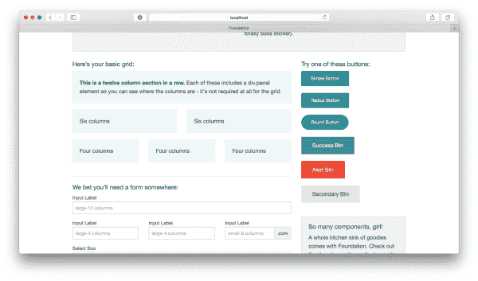

图 7.2. Example index.html

让我们对默认按钮样式进行一些修改。打开 `_settings.scss` 并在文件中搜索 `Buttons`。你会遇到一组用于按钮样式的注释变量，如图 7.3 所示。

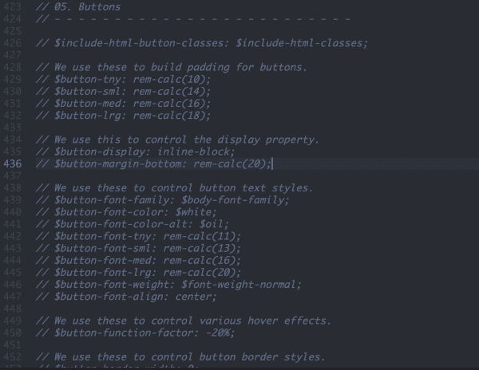

图 7.3. Commented variables for styling buttons

现在取消以下行的注释：

```
// $button-font-align: center;
```

将其更改为：

```scss
$button-font-align: left;
```

Compass 将覆盖 `app.css` 中 `button` 类的默认 `text-align` 属性：

```css
.button{
    …
    text-align: left; //从 center 改为 left
    …
}
```

接下来，取消此行的注释：

```
// $button-margin-bottom: rem-calc(20);
```

将其更改为：

```css
$button-margin-bottom: rem-calc(40);
```

Compass 将覆盖 `app.css` 中 `button` 类的默认 `margin` 属性：

```css
.button{
    …
    margin: 0 0 2.5rem; //原本是 0 0 1.5rem
    …
}
```

### 注意：引入 rem

`Rem-calc` 是一个 Foundation Sass 函数，它将像素测量转换为 rem，这样你仍然可以以像素为单位思考，并获得可缩放的 em。如果你不熟悉这个新的 rem CSS 单位，请参考 CSS-Tricks 的文章[“对 REM 和 EM 感到惑？”](https://css-tricks.com/confused-rem-em/)。

我们已经看到了如何在 Sass 中定义变量。你可以使用此类变量为你的网站定义颜色方案。让我们创建一个新文件，为我们的网站存储一些可用的颜色。

在 `sass` 文件夹内创建一个新文件 `_colors.scss`，并在其中添加三个新变量：

`_colors.scss`

```
$theme-primary-color: #009688;
$theme-secondary-color: #4DB6AC;
$theme-text-color: #212121;
```

现在，编辑 `sass` 文件夹内的 `app.scss` 文件。我们将此文件的顶部添加以下代码以包含我们新创建的 `colors.scss` 文件：

```scss
@import "colors";
```

### 注意：文件名开头的下划线是什么？

以下划线开头的 Sass 文件称为**部分文件 (partials)**。这表示它们是不完整的 Sass 文件，因为它们依赖其他 Sass 文件中的变量和函数。如果你从文件名中删除下划线，Compass 将生成一个同名的新静态 CSS 文件。

现在我们已经定义了主题颜色，让我们创建一个新类，当它附加到任何段落元素时，将使该元素从其他元素中脱颖而出。我们将在类定义中使用我们的主题颜色。编辑 `_settings.scss` 文件，并在文件底部添加以下 Sass 代码：

```scss
.standout-paragraph{
    color: $theme-text-color;
    padding: 20px;
    background-color: $theme-secondary-color;
}
```

编译后，上述代码将具有如下值：

```css
.standout-paragraph{
    color: #212121;
    padding: 20px;
    background-color: #4DB6AC;
}
```

**嵌套**是组织和维护 CSS 样式的一种极方法。让我们通过修改 `.standout-paragraph` 的 Sass 代码来查看 Sass 中的嵌套：

```css
.standout-paragraph{
    color: $theme-text-color;
    padding: 20px;
    background-color: $theme-secondary-color;
    //嵌套类型 1
    a{
        color: #FFFFFF;
        text-decoration: none;
    }
    //嵌套类型 2
    &.white-text{
        color: #FFFFFF;
    }
}
```

在这段代码中嵌套了两个新定义：针对 `<a>` 元素和 `white-text` 类。让我们查看生成的输出：

```css
.standout-paragraph{
    color: #212121;
    padding: 20px;
    background-color: #4DB6AC;
}

//嵌套类型 1 的结果为
.standout-paragraph a{
    color: #FFFFFF;
}

//嵌套类型 2 的结果为
.standout-paragraph.white-text{
    color: #FFFFFF;
}
```

如 CSS 代码所示，嵌套类型 1 产生的 CSS 层级结构为 `.standout-paragraph a`。然而，嵌套类型 2 是通过 `&` 符号引用父选择器的一种方法。

希望这让你对 Sass 中的嵌套有了基本的了解。如需进一步阅读，请参考 Sass 文档的[嵌套章节。](http://sass-lang.com/documentation/file.SASS_REFERENCE.html#nested_rules)

### 理解 app.scss

我们将移动到 `scss` 文件夹中的下一个重要文件，`app.scss`。它是项目的父 Sass 文件，通过该文件创建主 `app.`css 文件，它也是引入所有部分文件（partials）的地方。如上面提到的，部分文件是无法独立编译的 Sass 文件。


如果你打开 `app.scss` 文件，它的顶部应该有三个 `import` 语句：

```
@import "colors";
@import "settings";
@import "foundation";
```

前两个文件存在 `scss` 文件夹中；然而，最后一个文件 `foundation.scss` 是从 `/bower_components/foundation/scss/foundation.scss` 导入的。

你会在这个 `app.scss` 文件中发现许多被注释的 `import` 语句，例如：

```
// @import
//   "foundation/components/accordion",
//   "foundation/components/alert-boxes",
//   "foundation/components/block-grid",
```

提供这些语句主要是为了让你能够选择仅包含应用程序所需的组件。你可以通过注释掉 `@import "foundation";` 这一行，并取消从第五行开始的各个组件的注释来实现。

例如，如果你选择跳过 `accordion`、`flex-video` 和 `joyride` 组件，你可以取消其余组件的注释，并保持这些组件处于注释状态。为此，你需要注释掉这一行：

```
// @import "foundation";
```

并按照如下方式取消这些行的注释：

```
@import
  "foundation/components/accordion",
  "foundation/components/flex-video",
  "foundation/components/joyride";
```

`app.scss` 文件也是为你的项目引入新样式的地方。在上一节中，我们在 `settings.scss` 文件中内部创建了 `standout-paragraph` 及其子元素的定义。由于 `settings.scss` 文件在 `app.scss` 文件的顶部导入，它可能会被下方的其他 `import` 覆盖。因此，强烈建议你在 `app.scss` 文件的末尾编写新的 Sass 代码。

## 总结

在本章中，我们学习了如何通过 Foundation CLI 设置 Sass 版本的 Foundation。我们涵盖了如何安装和设置 Bower 以及 Compass。一旦 Sass 设置完成，你可以做的远不止于简单的自定义。你可以创建新的 Sass 局部文件并将其导入 `app.scss` 中，还可以通过新的 Sass 文件为你的项目添加新的类和样式。

到此，我们探索 Foundation 框架的旅程就结束了，但我更倾向于认为这是为未来的旅行奠定基础。我相信在这次介绍之后，你和我一样，对 Foundation 框架的潜力感到兴奋。如果你仍然热于探索更多，也可以参考 [SitePoint 上的 Foundation 相关文章](http://www.sitepoint.com/?s=foundation) 来了解更多关于使用 Foundation 框架可以做。这里是其他实用的链接：

* [使用 Foundation 5 和 Sass 进行语义化标记](http://www.sitepoint.com/semantic-markup-foundation-5-sass/)
* [Foundation 5 文档](http://foundation.zurb.com/docs/)
* [使用 Foundation 构建的示例网站](http://foundation.zurb.com/learn/website-examples.html)
* [免费的 Foundation 模板](http://foundation.zurb.com/templates.html)
* [Foundation 字体图标](http://zurb.com/playground/foundation-icon-fonts-3)

我希望你喜欢这本书并尝试 Foundation。祝你未来的 Web 项目以及 Foundation 之之旅好运！
