# HTML5 快速上手：在周末内精通 HTML5


# 

作者： Tiffany B. Brown, Kerry Butters 和 Sandeep Panda


产品经理：Simon Mackie
技术编辑：Craig Buckler
英文编辑：Paul Fitzpatrick
封面设计：Alex Walker


***

## 关于 Tiffany B. Brown

Tiffany B. Brown 是一位位于洛杉矶的自由职业 Web 开发人员和技术作家。她在多家媒体公司和代理机构从事了十多年的 Web 工作。在创立自己的咨询公司 Webinista, Inc. 之前，她曾是 Opera Software 开发者关系与工具团队的成员。现在她为机构和小设计团队提供 Web 开发和咨询服务。

## 关于 Kerry Butters

[Kerry Butters](https://plus.google.com/u/0/+KerryButters?rel=author) 是一位来自英国的技术作家。凭借技术和出版背景，Kerry 编写涵盖 Web 设计和企业技术在内的多种技术主题。Kerry 还是 [markitwrite 数字机构](http://markitwrite.com) 的负责人，喜欢尝试任何与技术相关的东西，是一个全能 Geek。

## 关于 Sandeep Panda

Sandeep Panda 是一位 Web 开发人员和作家，对 `JavaScript` 和 `HTML5` 充满热情。他拥有超过四年的 Web 编程经验。喜欢在新技术出现时进行实验，是一个持续的学习者。不编程时，可以发现他在玩游戏和听音乐。

## 关于 SitePoint

SitePoint 专门为 Web 专业人士出版有趣、实用且易于理解的内容。访问 [`www.sitepoint.com/`](http://www.sitepoint.com/) 访问我们的博客、书籍、时通讯、文章和社区论坛。你可以在这里找到大量关于 `JavaScript`、`PHP`、`Ruby`、移动开发、设计等的信息。

## 关于 Jump Start

Jump Start 系列书籍为你提供对 Web 开发语言和技术的快速实用的介绍。这些书籍通常长度约为 150 页，可以在周末内读完，让你对该主题有坚实的基础，并有独立实验的信心。

***

# 序言

`HTML`（超文本标记语言）是网页主要的语言。当你在浏览器中阅读或与页面交互时，它很是一个 HTML 文档。HTML 最初开发作为描述和共享科学论文的方法，现在用于标记各种文档并为基于浏览器的软件创建视觉界面。

然而，通过 HTML5，HTML 已经成为开发基于浏览器软件的 `API`（应用程序接口）。在书中，我们将讨论 HTML 和 HTML5 的历史，并探索它的一些新功能。

HTML5 还改进了现有元素。通过新的输入类型，我们不需要 JavaScript 库就可以创建丰富的表单控件。例如，如果你想要滑动输入控件，可以使用 `<input type=range>`。`email` 和 `url` 等输入类型增加了客户端验证功能。新的 `audio` 和 `video` 元素允许我们直接在文档中嵌入音频和视频媒体。这两个元素都具有脚本接口，我们可以用它们创建自定义媒体播放器或巧妙的视觉效果。而且在支持的浏览器中，这不需要插件。

通过添加 `canvas` 元素和对内联扩展矢量图形（或 SVG）的支持，我们可以在 HTML5 中绘图。`canvas` 元素是一个强大的位图绘制 API，允许我们创建 2D 或 3D 图像、图表和游戏。另一方面，SVG 使用矢量图形创建可重用、可扩展、可脚本的图像，这些图像可以在设备和屏幕上工作。

也许 HTML5 最大的变化是这个：属于 HTML 文档对象模型的一部分但没有对应标记元素的 API。它们是纯粹的 DOM API，我们可以使用 `JavaScript` 使用它们共享和消费数据，或创建位置感知应用程序。Web Workers 模拟了多线程 `JavaScript` 和后台任务。地理定位 API 让我们的应用程序能够感知位置。通过跨文档消息，我们可以在文档之间（甚至跨域）发送数据，而不暴露任何方的完整 DOM。最后，服务器发送事件和 WebSocket 实现了客户端与服务器之间的近实时通信。

读完本书后，你将了解上述所有内容的基础，并为开发出 HTML5 网站和应用程序铺平道路。

## 谁应该读这本书

虽然这本书是为 HTML5 初学者设计的，但它并不是完全全面的。因此，我们假设读者已经有一些 HTML 知识。如果你是 Web 开发的完全新手，SitePoint 的 [**Build Your Own Website using HTML and CSS**](http://www.sitepoint.com/store/build-your-own-website-the-right-way-using-html-css-3rd-edition/) 可能更适合你。


随着本书的进展，我们将处理一些更高级的主题，例如 API 和离线应用程序。为了学习这些章节，你应该熟悉 HTML 以及 JavaScript 基础和文档对象模型（`DOM`）。你不需要对 JavaScript 有深入了解。尽管如此，你应该理解事件处理、JavaScript 数据类型以及如 `while` 循环和 `if-else` 条件语句等控制结构。不过，我们将保持脚本示例的简单，并逐行对其进行解释。如果你对 JavaScript 不熟悉，可能喜欢阅读 Kevin Yank 编写的 SitePoint 的 *[Simply JavaScript](http://www.sitepoint.com/store/simply-javascript/)* 作为入门。[Mozilla 开发者网络](https://developer.mozilla.org/en-US/) 也为 JavaScript 和 `DOM` 提供了极的学习资源和文档。

## 使用的规范

你会注意到，我们在整本书中使用了一些特定的排版和布局样式来表示不同类型的信息。请关注以下内容。

### 代码示例

书中的代码将使用等宽字体显示，如下：

```
<h1>A Perfect Summer's Day</h1>
<p>It was a lovely day for a walk in the park. The birds 
were singing and the kids were all back at school.</p>
```

如果代码出现在书籍的代码存档中，文件名将出现在程序列表顶部，如下：

`example.css`

```
.footer {
  background-color: #CCC;
  border-top: 1px solid #333;
}
```

如果只显示了文件的部分内容，将用 *excerpt*（节选）一词表示：

`example.css (excerpt)`

```
 border-top: 1px solid #333;
```

如果要在现有示例中插入额外的代码，新代码将以粗体显示：

```
function animate() {
  new_variable = "Hello";
}
```

此外，当为了上下文而需要现有代码而不是重复所有代码时，将显示一个 …：

```
function animate() {
  …
  return new_variable;
}
```

某些代码行 intended 在一行内输入，但由于页面限制，我们对其进行了换行。↵ 表示仅出于格式目的而存在的换行，应该被忽略。

```
URL.open("http://www.sitepoint.com/responsive-web-design-real-user-
↵testing/?responsive1");
```

### 提示、注意和警告

### 提示：嘿，你！

提示（Tips）将为你提供有用的小技巧。

### 注意：咳，打扰一下……

注意（Notes）是与主题相关但并非至关重要的补充。将它们看作额外的信息碎片。

### 重要：确保你始终……

… 注意这些重要的要点。

### 警告：小心！

警告（Warnings）将突出任何可能在过程中让你出错的陷阱。

## 补充材料

[`www.sitepoint.com/store/jump-start-html5/`](http://www.sitepoint.com/store/jump-start-html5/)

书籍官方网站，包含链接、更新、资源等。

[`github.com/spbooks/jshtml`](https://github.com/spbooks/jshtml)

本书的可下载代码存档。

[`www.sitepoint.com/forums/`](http://www.sitepoint.com/forums/)

SitePoint 论坛，用于在遇到任何棘手的 Web 问题寻求帮助。

`books@sitepoint.com`

我们的电子邮件地址，如果你需要联系我们寻求支持、报告问题或出于任何其他原因。

## 你需要的工具

开发 HTML5 文档你只需要一个用于编写的文本编辑器和一个用于查看工作的浏览器。不要使用文字处理软件。那些程序是为编写文档设计的，而不是为了编程。相反，你需要一个可以读写纯文本的软件。

如果你是 Windows 用户，可以尝试 [Notepad++](http://notepad-plus-plus.org/)，这是一个免费开源的文本编辑器。Mac OS X 用户可能想尝试 Bare Bones 软件的 [TextWrangler](http://www.barebones.com/products/textwrangler/)。它是免费的，但不是开源的。[Brackets](http://brackets.io/) 是 Windows 和 Mac 用户的另一个选择。Linux 用户可以使用 Ubuntu Linux 自带的 gEdit，或者尝试免费开源的 [Bluefish](http://bluefish.openoffice.nl/)。也有付费软件选项，它们有时比免费开源选项更精细。

你还需要至少一个支持 HTML5 的浏览器，以便使用书中的示例。请确保你正在适用于你操作系统的最新版本的 Google Chrome、Microsoft Internet Explorer、Apple Safari、Opera 或 Mozilla Firefox。Internet Explorer 和 Safari 分别内置在 Microsoft Windows 和 Mac OS X 中。其他浏览器可以从它们公司的网站下载。

对于书中的后几个章节，你还需要 Web 服务器软件。[Apache HTTP Server](http://httpd.apache.org/), [Nginx](http://wiki.nginx.org/Main) 或 [Lighttpd](http://www.lighttpd.net/) 都是适用于 Windows、Mac OS X 和 Linux 的开源服务器包。Mac OS X 用户还可以尝试 [MAMP](http://www.mamp.info/en/index.html)，它将 MySQL、Apache 和 PHP 封装成一个易于使用的程序包。Windows 用户可以尝试 [WAMP](http://www.wampserver.com/en/) 或 [XAMPP](http://www.apachefriends.org/index.html)，这些是该操作系统的类似包。你的操作系统可能也默认安装了 Web 服务器。如果不确定，请检查其文档。

## 你想继续学习吗？

现在你可以以低廉的价格在 [Learnable](https://learnable.com/) 上无限访问课程和所有 SitePoint 书籍。立即报名并从今天开始学习！加入 Learnable，你将处于最新技术趋势的前：[`www.learnable.com`](http://www.learnable.com)。

# 第 1 章

## 基础：什么是 HTML5？

简单的答案是它是 HTML 的最新版本。但这并没有告诉我们太多信息。具体来说，HTML5：

*   定义了一种解析算法，用于生成一致的 `DOM`（文档对象模型）树，即使对于模糊或低质量的标记也是如此
*   添加了新元素支持多媒体和 Web 应用程序
*   重新定义了现有 HTML 元素的规则和语义

通过 HTML5，我们现在可以在 HTML 文档中原生嵌入音频和视频。可以使用内联 `SVG`（可缩矢量图形）标记。我们可以构建更健壮的表单体验，带有原生错误检查。我们可以使用 `canvas` 元素创建游戏、图表和动画。文档可以使用跨文档消息进行通信。换句话说，HTML5 更多是一个应用程序平台，而不仅仅是一种标记语言。

### HTML5 简史

关于 HTML5 如何以及为何产生的历史太长了，在书中无法充分涵盖。尽管如此，一点历史背景可能帮助你理解 HTML5 的产生过程。

HTML 起根于*标准通用标记语言*，或 SGML。将 SGML 想象为一组定义和创建标记语言的规则。

HTML，或 `HyperText Markup Language`（超文本标记语言），最初是 SGML 的应用。HTML 创建于 20 世纪 90 年代初，是描述超文本文档结构的标准方法。“超文本”简单意味着文本“包含指向其他文本的链接”且[不受线性的限制](http://www.w3.org/WhatIs.html)。

通过描述文档的结构，我们将其与外观或其呈现给终端用户的方式解耦。这使得共享和分发变得更容易。相关的超文本传输协议（HTTP）使得在互联网上共享文档变得简单。

### HTML：早期阶段

“HTML 1”定义了一种简单的、基于标签的语法来解释文档结构——非常基础的文档结构。段落（p`）和列表项（li`）元素不需要结束标签。[最早版本](http://info.cern.ch/hypertext/WWW/MarkUp/MarkUp.html) 甚至不包含 `img` 或 `table` 元素。图像支持是在规范的 [1.2 版本](http://www.w3.org/MarkUp/draft-ietf-iiir-html-01.txt) 中添加的。


HTML 语法在 [版本 2.0](http://www.w3.org/MarkUp/html-spec/) 中仅发生了细微变化。现在我们可以为 `p` 和 `li` 等元素使用结束标签，但这些结束标签是可选的。然而，从 HTML 2.0 到 HTML 3.2 的过渡标志着一次巨大的飞跃。

通过 HTML 3.2，我们可以使用 `font` 元素更改字体渲染。我们可以通过 Java applets 和 `applet` 元素添加强大的交互性。我们可以通过 `table`、`tr` 和 `td` 元素添加表格数据。但也许 HTML 3.2 引入的最显著的特征是样式表。

然而，大多数网页最终都停在了 HTML 4 上。随着 HTML 4 的出现，我们可以通过选择文档类型（doctype）来告诉浏览器如何解析我们的文档。HTML 4 提供了三种选项：

* Transitional（过渡型）：允许废弃的 HTML 3.2 元素与 HTML 4 混合使用
* Strict（严格型）：仅允许 HTML 4 元素
* Frameset（框架集）：允许使用 `frame` 元素将多个文档嵌入一个文档中

然而，HTML 1 到 4 版本并没有提供关于如何解析 HTML 的清晰规则。

W3C 在 1998 年停止了对 HTML 4 的工作，而是选择将精力放在一个替代品上：XHTML。

### 穿越 XHTML 世界的小路

[XHTML 1.0](http://www.w3.org/TR/xhtml1/) 的创建是为了“将 HTML 4 作为 XML 1.0 应用进行重构”。`XML`（可扩展标记语言）是 SGML 的 Web 友好修订版，为编写和解析标记提供了更严格的规则。

例如，XHTML 要求标签使用小写，而 HTML 允许大写、小写或两者的混合。XHTML 要求所有如 `p` 和 `li` 等非空元素必须有结束标签。像 `br` 和 `img` 等空元素必须用 `/>` 关闭。你必须为所有属性加上引号，并转义 `&` 符号。所有页面必须以 `application/xml+xhtml` MIME 类型提供。

XHTML 教会我们如何编写更高质量的标记。但最终由于缺乏良好的浏览器支持而遭受了痛苦。

[XForms](http://www.w3.org/TR/2007/REC-xforms-20071029/)另一方面旨在取代 HTML 表单。XForms 引入了 `upload` 和 `range` 元素，提供了与丰富的与网站的方式。

然而，XForms 并没有获得太大关注。毕竟，为什么要为网页引入特定的表单标记语言呢？为什么不增强 HTML 呢？

### 统治世界之战

1996 年，Netscape 发布了 Netscape Navigator 2.0，支持两个独立但相关的技术：JavaScript 和文档对象模型（DOM）。我们通常谈论它们时就像它们是同一件事，但 DOM 是用于与 HTML 文档交互的 API。JavaScript 是与该 API 交互的主要语言。

Netscape Navigator 的 DOM 接口将 HTML 页面的每个元素转换为一个对象，可以使用脚本语言进行创建、移动、修改或删除。现在我们可以为网页页添加动画或交互性，即使我们必须在超级缓慢的 14.4Kbps 调制解调器上等待很久下载它们。

DOM 是 Web 如此出色的补充，其他浏览器很快跟进。但并非每个浏览器实现 DOM 的方式完全相同。例如，Netscape Navigator 使用 `document.layers` 对象来引用整个 HTML 节点集合。微软 Internet Explorer 使用的是 `document.all`。各地的 Web 开发者花费了多年努力调和两者。至于 Opera 和 WebKit，它们遵循了 Internet Explorer 的做法。这两个浏览器都采用了 `document.all`。

最终，“DOM0”从一种基于实现的标准转变为基于规范的标准，参考了 [文档对象模型 (DOM) 1 级规范](http://www.w3.org/TR/REC-DOM-Level-1/)。我们可以使用 `document.getElementById` 和 `document.getElementsByTagName` 来代替 `document.layers` 和 `document.all`。今天，所有浏览器都支持 DOM。

### Applets 和插件

在这一切之中——HTML 的增长、DOM 的兴起以及向 XHTML 的转变——applets 和浏览器插件加入了这场狂欢。值得的是，applets 和插件添加了 HTML 缺失的功能。例如，RealPlayer 和苹果的 QuickTime 为 Web 带来了音频和视频。通过 Java applets，你可以在浏览器中运行电子表格程序。Macromedia（现为 Adobe）的 Flash 和 Shockwave 让我们能够添加以上所有内容以及动画。

然而，applets 和插件面临着三个主要问题：

1. 没有插件（或 applet 环境）的用户无法看到内容。
2. Applets 和插件扩大了基于互联网的安全漏洞面。
3. 它们是商业产品，需要开发者支付许可费。

此外，插件和 applet 有时会导致宿主环境——浏览器变慢或崩溃。

因此，我们在 Web 上面临这样一个场景：

* 浏览器没有按照相同的规则解析 HTML。
* 新的标记语言相比 HTML 并没有多少明显的优势，但增加了实现的开销。
* 插件和 applet 提供了额外功能，但为浏览器带来了安全和稳定性问题，为开发者带来了许可成本。

这些正是 HTML5 解决的问题：

* 它整合了 XHTML 和 XForms 引入的功能和语法。
* 它几乎消除了对插件的需求以及它们可能带来的稳定性和安全性问题。

## HTML5 不是什么

我承认我在本书书中采取了某种纯主义的方法。HTML5 已经变成了一个术语化的缩写，指代“我们以前无法在浏览器中做的一切酷炫的事情”。然而，在本书书中，我们指的是 HTML 元素及其文档对象模型（DOM）API。

在这些页面中，我们不会过多讨论 `CSS`（级联样式表）Level 3 引入的功能。我们将讨论通常被称为“JavaScript”的内容，但更准确地说，它是 DOM HTML API。我们还会谈论可缩矢量矢量，即 SVG——但仅限于讨论在同一文档中混合使用 SVG 和 HTML 的。

本书旨在作为 HTML5 的简短介绍。由于此原因，我们不会深入涵盖高级功能。然而，本书将向你介绍 HTML5 与之前版本相比的新之处和不同之处。

## 关于 HTML5 规范的说明

Web 超文本应用技术工作小组 (`WHATWG`) 和万维网联盟 (`W3C`) 都发布了 HTML5 规范。这两个小组合作了多年，创建了一个由单一编辑器管理的规范。然而在 2011 年，他们分歧了。现在有两个竞争但相似的规范版本。每个版本都有自己的编辑器。

[WHATWG 版本](http://www.whatwg.org/specs/web-apps/current-work/multipage/) 规范是一个“活文档”。在社区内部讨论后，新功能会被添加、调整，偶尔会被移除。这个版本灵活得多，并且不断变化。

然而，W3C 有不同的流程。规范编辑器仍然咨询社区，但每个文档都经历从“工作草稿”到“候选建议”再到“W3C 建议”的阶段。因此，W3C 规范是有版本的。2011 年联合 HTML5 规范成为了 W3C 的 [HTML5 规范](http://www.w3.org/TR/html5/)。随后的修订包含在 [HTML 5.1 规范](http://www.w3.org/html/wg/drafts/html/master/Overview.html) 中。

# 第 2 章

## 基础：HTML5 的解剖

每个 HTML 文档由元素组成，而元素由标签表示。标签是字符序列，用于标记元素的不同部分的开始和/或结束。


所有标签都以左向角括号（`<`）开头，并右向角括号（`>`）结束。每个元素都有一个`start tag`（或`opening tag`），它以`<`开头，后面跟着元素名称（或其缩写）。元素名称后面可以跟着一个`attribute`（或一系列属性），用于描述该元素实例的预期行为。你可以使用 `=` 号为属性设置一个显式值。然而，某些属性是空的。如果存在空属性，则该属性值为 `true`。让我们来看一个使用 `input` 元素的示例。

```
<input type="text" name="first_name" disabled>
```

在这里，`type`、`name` 和 `disabled` 都是属性。前两个有显式值，但 `disabled` 是空的。某些元素允许空属性，这些通常是那些原本可能接受真/假值的元素。棘手的地方在于：空属性的值是 `true` 还是 `false` 取决于属性是否存在，而无论其设置的值如何。换句话说，`disabled="true"` 和 `disabled="false"` 都会禁用输入控件。

大多数元素还有一个闭合标签。闭合标签也以`<` 开头，但后面紧跟的不是元素名称，而是一个正斜杠（`/`）。然后是元素名称和右角括号或`>`。然而，某些元素被称为 `void elements`（空元素）。这些元素不能包含内容，因此没有闭合标签。上面显示的 `input` 元素就是一个空元素示例。

现在我们已经涵盖了标签的基础知识，让我们仔细观察一个 HTML5 文档。

## 你的第一个 HTML5 文档

打开你最喜欢的文本编辑器并输入以下内容。将其保存为 `hi.html`。

```
<!DOCTYPE html>
<html>
  <head>
    <title>Hi</title>
  </head>
  <body>
    <p>Hi</p>
  </body>
</html>
```

恭喜你——你写了你的第一个 HTML5 文档！它可能并不复杂，但它确实说明了 HTML5 的基础。

我们的第一行 `<!DOCTYPE html>` 是必须的。这是浏览器知道我们正在发送 HTML5 的方式。如果没有它，存在浏览器错误解析文档的风险。为什么呢？因为 `DOCTYPE switching`（DOCTYPE 切换）。

DOCTYPE 切换意味着，如果通过带有 `Content-type:text/html` 响应头提供，浏览器将根据 `<!DOCTYPE` 声明的值不同的解析和渲染文档。大多数浏览器实现了某些版本的 DOCTYPE 切换，以便正确渲染依赖非标准浏览器行为或过时规范的文档。

例如，HTML 4.01 和 XHTML 1.0 有多种模式——严格（strict）、过渡（transitional）和帧（frameset），这些模式可以通过 DOCTYPE 声明触发，而 HTML 4.01 使用以下 DOCTYPE 作为其 `strict mode`。

```
<!DOCTYPE HTML PUBLIC "-//W3C//DTD HTML 4.01//EN"
    "http://www.w3.org/TR/html4/strict.dtd">
```

过渡型或宽松的 DOCTYPE 声明会触发 `quirks mode`（怪异模式）。在怪异模式下，每个浏览器都会根据自身的 bug 和对 Web 标准的偏差略有不同地解析文档。

严格 DOCTYPE 声明会触发 `standards mode`（标准模式）或 `almost standards mode`（准标准模式）。每个浏览器将根据 HTML 和 CSS 规范中约定的规则解析文档。

然而，`missing` DOCTYPE 也会触发怪异模式。因此，HTML5 定义了尽可能短的 DOCTYPE。HTML5 规范解释道：

> “由于历史原因，DOCTYPE 是必须的。如果省略，浏览器倾向于使用与某些规范不兼容的默认渲染模式。在文档中包含 DOCTYPE 可以确保浏览器尽力遵循相关规范。”

因此，使用 HTML5 的 DOCTYPE (`<!DOCTYPE html>`) 会触发标准模式，即使对于缺乏 HTML5 解析器的旧版浏览器也是如此。

## HTML5 语法的两种模式

HTML5 有两种 `parsing modes`（解析模式）或语法：HTML 和 XML。区别取决于文档是带有带有 `Content-type: text/html` 头部还是带有 `Content-type: application/xml+xhtml` 头部提供的。

如果是作为 `text/html` 提供的，则适用以下规则：

*   每个元素并不需要起始标签。
*   每个元素并不需要结束标签。
*   只有 `void elements`（如 `br`、`img` 和 `link`）可以使用 `/>` 进行为“自闭合”。
*   标签和属性不区分大小写。
*   属性不需要加引号。
*   某些属性可以是空的（如 `checked` 和 `disabled`）。
*   特殊字符或实体不需要转义。
*   文档必须包含 HTML5 DOCTYPE。

### HTML 语法

让我们再来看另一个 HTML5 文档。

```
<!DOCTYPE html>
<html>
  <head>
    <meta charset=utf-8>
    <title>Hi</title>
    <!-- 
    这是一个注释的示例。
    下面的行显示了如何包含 CSS 
    -->
    <link rel=stylesheet href=style.css type=text/css>
    <style>
      body{
        background: aliceblue;
        }
    </style>
  </head>
  <body>
   <p>
      
      这不是一朵漂亮的花吗？

    <p>
      是的，那是一朵漂亮的花。它是什么？

    <script src=foo.js></script>
  </body>
</html>
```

再次，我们的第一行是 DOCTYPE 声明。与所有的 HTML5 标签一样，它不区分大小写。如果你不想按 `Shift` 键，你可以输入 `<!doctype html>`。如果你非常喜欢使用 `Caps Lock`，你也可以输入 `<!DOCTYPE HTML>`。

接下来是 `head` 元素。`head` 元素通常包含有关文档的信息，例如标题或字符集。在这个示例中，我们的 `head` 元素包含一个定义此文档字符集的 `meta` 元素。包含字符集是可选的，但你应该始终设置一个，并且建议你使用 [UTF-8](http://www.w3.org/International/questions/qa-choosing-encodings)。

### 注意：确保你正在使用 UTF-8

理想情况下，验证你的文本编辑器以“无 BOM”的 UTF-8 编码保存文档，并使用 Unix/Linux 行结束。

我们的 `head` 元素还包含了文档标题（`<title>Hi</title>`）。在大多数浏览器中，`title` 标签之间的文本显示在浏览器窗口或标签的顶部。

HTML 中的 `Comments`（注释）是在浏览器中不渲染的文本。它们只能在源代码中查看，通常用于给自己或同事留下关于文档的注释。某些生成 HTML 代码的程序也可能包含注释。注释可能出现在 HTML 文档的任何地方。每个注释都必须以 `<!--` 开头并以 `-->` 结束。

文档头部（head）还可以包含指向外部资源的 `link` 元素，所示。资源可能包括样式表、favicon 图像或 RSS 馈。我们使用 `rel` 属性来描述文档与我们链接的文档之间的关系。在这种情况下，我们链接到级联样式表，即 CSS 文件。CSS 是我们用来描述文档外观而非结构的样式表语言。

我们还可以使用 `style` 元素（在这里由 `<style>` 和 `</style>` 界定）在我们的文件中包含 CSS。然而，使用 `link` 元素可以在多个页面之间共享同一个样式表文件。

顺便说一下，`meta` 和 `link` 都是空 HTML 元素的示例；我们也可以 `/>` 使它们自闭合。例如，`<meta charset=utf-8>` 将变为 `<meta charset=utf-8 />`，但并不是必要的。

### 加引号还是不加引号：HTML5 中的属性

在示例中，我们的属性值是不加引号的。在我们的 `hi.html` 示例中，我们使用了引号。这在 HTML5 中都是有效的，并且你可以使用双引号（")或单引号（'）。


请注意未加引号的属性值。对于单个单词的数值，不加引号是可以的。然而，由空格分隔的值列表必须包含在引号内。否则，解析器将把第一个值解释为属性的值，而将后续值视为空属性。请考虑以下代码段：

```
<code class=php highlightsyntax><?php echo 'Hello!'; ?></code>
```

由于 `class` 属性的两个值都没有加引号，浏览器的解释方式如下：

```
<code class="php" highlightsyntax><?php echo 'Hello!'; ?></code>
```

只有 `php` 被识别为类名，而我们无意中为元素添加了一个空的 `highlightsyntax` 属性。将 `class=php highlightsyntax` 改为 `class="php highlightsyntax"`（或单引号的 `class='php highlightsyntax'`）可以确保两个类属性值都被视为类值。

### 简化的 HTML5 文档

根据 HTML 的规则——对于 HTML 4 也是如此——某些元素不需要开始标签或结束标签。这些元素是隐式的。即使你在标记语言中省略了它们，浏览器的行为也像它们被包含在内一样。`body` 元素就是其中一个元素。理论上，我们可以重写 `hi.html` 示例使其像这样：

```
<!DOCTYPE html>
<head>
  <meta charset=utf-8>
  <title>Hi</title>
  <p>Hi
```

当浏览器创建文档节点树时，它会为我们添加一个 `body` 元素。

仅仅因为你*可以*跳过结束标签并不意味着你*应该*这样做。无论哪种，浏览器都需要生成 DOM。关闭元素可以减少浏览器错误解析你预期的 DOM 的概率。平衡开始和结束标签使得错误更容易发现和修复，特别是当你使用带有语法高亮的文本编辑器时。如果你在大团队中或在 `CMS`（内容管理系统）中工作，使用开始和结束标签还可以增加你的 HTML 代码段与同事代码兼容的概率。在本书的剩余部分，即使在可选的情况下，我们也会使用开始和结束标签。

### 注意：开始和结束标签

要了解哪些元素需要开始和结束标签，请参阅世界维网联盟（W3C）的指南 [HTML：标记语言（HTML 语言参考）](http://www.w3.org/TR/html-markup/)。W3C 还管理包含这些信息的 [Web Platform Docs](http://docs.webplatform.org/wiki/Main_Page)。

### "XHTML5": HTML5 的 XML 语法

HTML5 也可以使用更严格的类 XML 语法来编写。你可能在第 1 章 中记得过，XHTML 1.0 是“将 HTML 4 重新制定为 XML 1.0 应用”。对于所谓的“XHTML5”，这并不完全。XHTML5 最好理解为使用 XML 的语法规则编写和解析，并使用 `Content-type: application/xml+xhtml` 响应头进行服务的 HTML5。

以下规则适用于 "XHTML5"：

* 所有元素必须有开始标签。
* 带有开始标签的非空元素必须有结束标签（例如 `p` 和 `li`）。
* 任何元素都可以使用 `/>` 进行“自闭合”。
* 标签和属性区分大小写，通常使用小写。
* 属性值*必须*包含在引号内。
* 禁止使用空属性（`checked` 必须是 `checked="checked"` 或 `checked="true"`）。
* 特殊字符必须使用字符实体进行转义。

我们的 `html` 开始标签还需要一个 `xmlns`（XML 命名空间）属性。如果我们重写上面的文档以使用 XML 语法，它看起来像下面的示例所示：

```
<!DOCTYPE html>
  <html xmlns="http://www.w3.org/1999/xhtml">
    <head>
      <meta charset="utf-8" />
      <title>Hi</title>
    </head>
    <body>
      <p>
        
        这不是一朵非常漂亮的花吗？
      </p>
      <script src="foo.js" />
    </body>
</</html>
```

在这里，我们通过 `xmlns` 属性添加了 XML 命名空间，以让浏览器知道我们正在使用更严格的语法。我们还对空或空元素 `meta` 和 `img` 的标签进行了自闭合。根据 XML 和 XHTML 的规则，所有元素必须通过结束标签或通过空格、斜杠和右尖角（`/>`）自闭合来关闭。

在这个示例中，我们也自闭合了 `script` 标签。我们也可以像处理其他元素一样使用普通的 `</script>` 标签。`script` 元素有点特殊。你可以通过将脚本放在 `script` 开始和结束标签之间来在文档中嵌入脚本。当你这样做时，你*必须*包含一个结束标签。

然而，你也可以使用 `script` 标签和 `src` 属性链接到外部脚本文件。如果你这样做，并将页面作为 `text/html` 发送，你*必须*使用闭合 `</script>` 标签。如果你将页面作为 `application/xml+xhtml` 发送，你也可以使用自闭合语法。

不要忘记：为了让浏览器按照 XML/XHTML 规则解析此文档，我们必须从服务器发送带有 `Content-type: application/xml+xhtml` 响应头的文档。事实上，包含此响应头部即使缺少 DOCTYPE，也会触发符合标准的浏览器中的 XHTML5 解析。

### 注意：配置你的服务器

为了让你的 Web 服务器或应用程序发送 `Content-type: application/xml+xhtml` 响应头，它必须配置为如此操作。如果你使用 Web 托管，很有可能你的 Web 托管已经为 .xhtml 扩展的文件此类设置。在这里，你只需要将 `hi.html` 重命名为 `hi.xhtml`。如果不起，请查阅你的 Web 服务器文档。

你可能已经意识到，XML 解析规则更加挑剔。使用 `text/html` MIME 类型及其宽松的 HTML 语法要简单得多。

# 第 3 章

## 基础：文档结构

HTML5 增加了几个元素，提供了将单个文档拆分为多个内容块的方法——内容可以是相关的，也可以是独立的。这些元素为我们的标记增加了语义丰富性，并使跨媒体和设备重用文档变得更容易。

我们将通过一个虚构的新闻网站查看这些元素以及它们的相互作用：*HTML5 新闻*，如图[ch03.html_newsparticle "图 3.1. HTML5 新闻"]所示。

图 3.1. HTML5 新闻

我们的新闻页面从页眉和主导航栏开始。在之前的 HTML 版本中，我们可能会这样标记：

```
<div id="header">
  <h1>HTML5 <i>News-Press</i></h1>
  <h2>所有适合链接的新</h2>
  <ul id="nav">
    <li><a href="#">国际</a></li>
    <li><a href="#">国内</a></li>
    <li><a href="#">大区</a></li>
    <li><a href="#">体育</a></li>
    <li><a href="#">艺术&amp; 娱乐</a> <!-- 这里的 &amp; 代表 & -->
  </ul>
</div>
```

我们的页面以页脚元素结束。再次使用 HTML 4，我们的标记可能如下：

```
<div id="footer">
  <ul>
    <li><a href="#">联系我们</a></li>
    <li><a href="#">使用条款</a></li>
    <li><a href="#">隐私政策</a></li>
  </ul>
  <p>&copy; 2013 &copy; HTML5 新闻. 版权所有。</p>
</div>
```

然而，HTML5 专门为此种目的增加了元素：`header`、`nav` 和 `footer`。

`header` 元素作为文档段内容的页眉。`footer` 元素作为文档段的页脚。注意，我说的是*段*而不是*文档*或*页面*。某些元素被视为分节元素。它们将文档分为若干部分或块。这些元素之一当然是新的 `section` 元素。其他分节元素包括 `body`、`article`、`aside`，以及 `nav`。


```html
<header>
  <h1>HTML5 News-Press</h1>
  <h2>所有值得链接的新闻</h2>
  <nav>
    <ul>
      <li><a href="#">国际</a></li>
      <li><a href="#">国内</a></li>
      <li><a href="#">大都市</a></li>
      <li><a href="#">体育</a></li>
      <li><a href="#">艺术&amp;娱乐</a></li>
    </ul>
  </nav>
</header>
```

在这里，我们将页眉和导航栏封装在 `header` 标签中。我们还将将 `id="nav"` 属性及其值替换为 `nav` 元素。让我们使用 HTML5 的 `footer` 元素来重写我们的页脚。

```html
<footer>
  <ul>
    <li><a href="#">联系我们</a></li>
    <li><a href="#">使用条款</a></li>
    <li><a href="#">隐私政策</a></li>
  </ul>
  <p>2013 HTML5 News-Press 版权所有，所有。</p>
</footer>
```

在这里，我们简单地将 `<div id="footer">` 替换为 `<footer>`。文档的骨架已经就绪。让我们来添加一些血肉。

## `article` 元素

根据 HTML5 规范定义，`article` 元素：

> “[表]表示文档、页面、应用程序或网站中完整或自包含的内容，在原则上，该内容是可以独立分发或重用的，例如在分发中中使用。”

杂志文章和博客帖子是使用 `article` 元素在语义上恰当的例子。但你也可以将其用于博客评论。该元素适用于任何几乎可以重用的内容条目。

我们可以将 `<div id="article">` 的起始和结束标签替换为 `article` 标签。

```html
<article>
  <h1>年轻鸡类领袖称天将降临</h1>

  <p class="byline">
    <b class="reporter">Foxy Loxy</b>
    <i class="employment-status">全职记者</i>
  </p>

  <div class="aside">
    <h2>关于 Henny Penny</h2>

    <dl>
      <dt>年龄</dt>
      <dd>32</dd>

      <dt>职业</dt>
      <dd>国家鸡类组织主席</dd>

      <dt>教育</dt>
      <dd>文学士学位，鸡类研究，农场大学</dd>
      <dd>法学博士，克克兰大学</dd>
    </dl>

    <p>
      Penny 在 Farmlandia 参议院度过短暂但有效的职业生涯后，于 2002 年作为全职游说加入了国家鸡类组织。Penny 在组织内部晋升，曾担任秘书，然后是副主席，最后在 2011 年被团体成员选为主席。
    </p>

    <p>
      国家鸡类组织是一个关注鸡类环境正义的倡导团体。
    </p>
  </div>

  <p>
    伦敦 -- 国家鸡类组织的年轻领袖 Henny Penny 宣布，天空将在下周内崩塌。反对者批评了 Penny，认为橡果更可能是威胁。
  </p>

  <p>
    Phasellus viverra faucibus arcu ullamcorper sodales. Curabitur tincidunt est in imperdiet ultrices. Sed dignissim felis a nec dignissim, nec cursus sapien egestas.
  </p>

  <div id="article-meta">
    <p class="reporter-contact">您可以通过电子邮件 foxy.loxy@html5newspress.com 联系记者 Foxy Loxy</p>
    <p class="contributor">全职记者 Turkey Lurkey 对此报告做出了贡献。</p>
    <p class="pubdate">发布日期：<time>2013-07-11T09:00:00-07:00</time>.</p>
  </div>
</article>
```

`article` 元素是分节内容的示例，这意味着它可能包含页眉和页脚。如果我们仔细考虑，我们的 `<div id="article-meta">` 可以被视为 `article` 元素的页脚。我们把把 `div` 元素标签交换为 `footer` 标签怎么样？

```html
<footer id="article-meta">
  <p class="reporter-contact">您可以通过电子邮件 foxy.loxy@html5newspress.com 联系记者 Foxy Loxy</p>
  <p class="contributor">全职记者 Turkey Lurkey 对此报告做出了贡献。</p>
  <p class="pubdate">发布日期：<time>2013-07-11T09:00:00-07:00</time>.</p>
</footer>
```

然而，我们保留了 `id` 属性。这使得它更容易与页面上的其他 `footer` 元素区分开来。


这些新元素的目的是提供一种标准化的方式来描述文档结构。HTML 的本质是一种用于交换和重用文档的语言。使用这些结构化元素意味着同一个文档可以发布为网页，同时为电子书阅读器分发，而无需在混乱的任意 `div` 元素和 `id` 属性中筛选。

## `section` 元素

HTML5 还引入了 `section` 元素，用于定义文档中既不是页眉、页脚、导航、文章或侧边栏的片段。它比我们的老朋友 `div` 元素更具体，但比 `article` 更通用。

让我们使用 `section` 元素来标记 *HTML5 News-Press* 首页，如图图 3.2 所示。

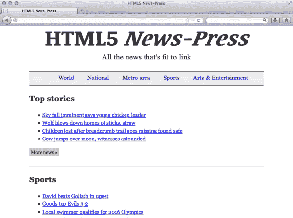

图 3.2. HTML5 News-Press 首页

这里有三个新闻故事章节：“头条新闻”、“体育”和“商业”。在 HTML 4 中，`div` 元素是定义这些章节的明确选择，因为它是唯一的选择。但在 HTML5 中，我们有了更具描述性的 `section` 元素。

```
<section id="topstories">
  <h1>Top stories</h1>

  <ul>
    <li><a href="#">小鸡领说：天空即将坠落 
    ↵领袖</a></li>
    <li><a href="#">大狼吹倒了树枝和草搭的房子</a></li>
    <li><a href="#">面包屑路径失踪后，孩子们失踪 
    ↵后被发现安全无事</a></li>
    <li><a href="#">牛跳过月亮，目击者们 
    ↵震惊不已</a></li>
  </ul>

  <footer>
    <p><a href="#" class="mlink">更多新闻</a></p>
  </footer>
</section>

<section id="sports">
  <h1>Sports</h1>

  <ul>
    <li><a href="#">大卫在冷门中击败了歌利亚</a></li>
    <li><a href="#">好队以 3-2 战胜恶势力</a></li>
    <li><a href="#">当地游泳选手入围 2016 
    ↵奥运会</a></li>
    <li><a href="#">Woonsocket 小联盟队晋级 
    ↵半决赛</a></li>
  </ul>

  <footer>
    <p><a href="#" class="mlink">更多体育</a></p>
  </footer>
</section>

<section id="business">
  <h1>Business</h1>
  <ul>
    <li><a href="#">BigWidgets, Ltd. 扩张业务将创造 3,000 个 
    ↵工作岗位</a></li>
    <li><a href="#">美元、欧元实现平价</a></li>
    <li><a href="#">GiantAirline 和 Air Humongous 将合并</a></li>
    <li><a href="#">WorldDomination 银行被认为“大到不能 
    ↵倒”</a></li>
  </ul>

  <footer>
    <p><a href="#" class="mlink">更多商业</a></p>
  </footer>
</section>
```

### `div` 与 `section`

虽然这些新的分节元素为我们提供了更好的语义化，但它们也带来了一丝困惑。你可能会问的问题是：“继续使用 `div` 元素还可以吗？”

简短的回答是“可以”。毕竟，`div` 仍然是一个有效的 HTML5 元素。但 `div` 几乎没有语义价值。它没有告诉我们任何关于其包含内容的信息，因此只有在极少数没有其他语义相关标签存在的情况下，才考虑使用它。例如，你可能会发现自己需要添加一个额外的元素作为“包装器”（wrapper）以方便样式设置。或者，你可能想在一个英语文档中将几个法语元素分组。在这种情况下，使用 `<div lang="fr">` 和 `</div>` 封起来这些元素无疑是恰当的。在大多数其他情况下，最好使用 `section`、`header`、`nav`、`footer`、`article` 或 `aside`。

## 其他文档元素

新的分节元素并不是 HTML5 中引入的唯一相关文档元素。在本章，我们将查看以下元素：

*   `figure` 和 `figcaption` 用于定义插图、图表和图解
*   `main` 用于显式定义文档内容的主要部分

### `figure` 和 `figcaption`

如果文档配有一个图表或图解，在 HTML 4 中，我们可能使用 `div` 和 `p` 元素的组合对其进行标记，如下所示。

```
<div class="graph" id="figure1">
  
  <p class="caption">图 1：巧克力价格自 2008 年以来 
  ↵上涨了 200%。</p>
</div>
```

这是一种可以的方法。但当我们想在那些使用书本布局显示 HTML 文档的高级电子阅读器上阅读它时，会发生什么？使用 `<div class="chart">` 并告诉我们这块信息是什么以及它应该如何显示。

在这种情况下，我们应该使用 `figure` 元素。它为我们提供了一种标记图表和标题的方法，并使其独立于文档流。我们稍微修改一下标记如何？

```
<figure class="graph" id="figure1">
  
  <p class="caption">图 1：巧克力价格自 2008 年以来 
  ↵上涨了 200%。</p>
</figure>
```

现在我们的电子阅读器知道这是一个图表，并可以以合适的方式显示。我们保留了 `class` 和 `id` 属性。前者对于 CSS 样式很有用——也许我们希望以不同于图解的方式显示图形。后者便于我们链接到图片。

不过我们仍然在使用 `<p class="caption">`，不是吗？我们改用 `figcaption` 元素怎么样？`figcaption` 作为其兄弟内容的标题或图例。它不是强制要求的，但如果包含，`figcaption` 必须是 `figure` 元素的第一个元素或最后一个元素。让我们再次修改我们的标记：

```
<figure class="graph" id="figure1">
  
  <figcaption>图 1：巧克力价格自 2008 年以来 
  ↵上涨了 200%。</figcaption>
</figure>
```

### `main` 元素

`main` 元素是 HTML5 中最新的元素之一。它实际上并没有出现在世界维网联盟（W3C）发布的 2011 版本规范中，但它是 HTML 5.1 规范的一部分。

意乎情情，`main` 应该用于明确文档或应用程序的主要部分。通过文档的“主要部分”，我们指的是以下内容：

*   文档或应用程序特有的
*   不包含跨站点共享的元素，例如全局页眉或页脚

截至为止，只有 Chrome 26+、Firefox 21+ 和 Opera 15+ 支持 `main` 元素。Internet Explorer 和 Safari 应该在未来的发布中获得支持。

`main` 的用例是什么？某些浏览器（如 Safari 和 Android 版 Firefox）提供了“阅读模式”，可以剥离页眉、页脚和广告。这些浏览器目前使用启发式算法（一种有理依据的推断）来确定文档的主要内容。使用 `main` 可以让浏览器明确它应该关注页面的哪部分。浏览器还可以将 `main` 元素作为无障碍功能的钩子，例如跳过导航的功能。

让我们最后看一眼我们的新闻文章标记，这次包含了 `main` 元素。


```html
<!DOCTYPE html>
<html lang="en-us">
<head>
  <meta charset="UTF-8">
  <title>HTML5 新闻报</title>
  <link rel="stylesheet" href="s.css" media="screen">
</head>
<body>
<div id="wrapper">
  <header>
    <h1>HTML5 <i>新闻报</i></h1>
    <h2>所有适合被链接的新闻</h2>
    <nav>
      <ul>
        <li><a href="#">国际</a></li>
        <li><a href="#">国内</a></li>
        <li><a href="#">大都市</a></li>
        <li><a href="#">体育</a></li>
        <li><a href="#">艺术与娱乐</a></li>
      </ul>
    </nav>
  </header>

  <main>
    <article>
      <header>
        <h1>年轻的小鸡领袖称天崩将临临</h1>
        <p class="byline">
          <b class="reporter">Foxy Loxy</b>
          <i class="employment-status">专职记者</i>
        </p>
      </header>

      <aside>
        <h2>关于 Henny Penny</h2>
        <dl>
          <dt>年龄</dt>
          <dd>32</dd>

          <dt>职业</dt>
          <dd>国家鸡类组织主席</dd>

          <dt>教育背景</dt>
          <dd>文学士，鸡类研究，农民大学</dd>
          <dd>法博士，克克兰大学</dd>
        </dl>
        <p>
          Penny 在远农场共和国参议院度过短暂但有效的职业生涯后，
          于 2002 年加入国家鸡类组织担任专职游说。Penny 在
          组织内部不断晋升，曾担任秘书，随后担任副主席，
          并在 2011 年被组织成员选为主席。
        </p>

        <p>
          国家鸡类组织是一个关注鸡类环境正义的倡议团体。
        </p>
      </aside>

      <p>
        伦敦 —— 国家鸡类组织的年轻领袖 Henny Penny 宣布，天空将在下周内崩塌。
        反对者批评了 Penny，认为橡果才是更有可能的威胁。
      </p>

      <p>
        Phasellus viverra faucibus arcu ullamcorper sodales. 
        Curabitur tincidunt est in imperdiet ultrices. Sed 
        dignisim felis a neque dignissim, nec cursus sapien 
        egestas.
      </p>

    </article>
  </main>

  <footer>
    <ul>
      <li><a href="#">联系我们</a></li>
      <li><a href="#">使用条款</a></li>
      <li><a href="#">隐私政策</a></li>
    </ul>
    <p>2013 HTML5 新闻报 版权所有。</p>
  </footer>

</div>
</body>
</html>
```

（注：HTML 代码中的文本内容已翻译）

现在我们有了一份更具访问性、更易于各种浏览器读取和展示的文档。

# 第 4 章

## 基础：HTML5 表单

HTML5 表单相比之前的 HTML 版本有了质的飞跃。我们现在拥有了六种新的输入状态或类型，例如 `range` 和 `url`；我们有了新的属性可以让我们要求某些字段必填，或指定特定的格式；我们有了一个 API 可以让我们约束并验证输入；最后，我们有了新的表单元素，如 `datalist`，它让我们能够在无需重量型 JavaScript 库或插件的情况下创建吸引人的用户界面。

遗憾的是，并不是所有浏览器都支持所有这些功能。目前，我们仍然需要使用 JavaScript 库和 [polyfills](http://remysharp.com/2010/10/08/what-is-a-polyfill/)（可下载的代码，提供了 Web 浏览器未内置的功能）作为回退策略。

理解 HTML5 表单最好的方法是动手构建一个。让我们尝试构建一个表单，为上一章节的 HTML5 新闻报网站收集故事稿建议。我们需要通过表单收集以下信息：

*   姓名
*   居住城市
*   电子邮件地址
*   电话号码
*   可以进一步了解更多信息的 URL（如果有的话）
*   具体的故事想法

至少，我们希望要求用户提供名字、电子邮件地址和他们的故事想法。

### 开始编写 HTML5 表单

要构建我们的 HTML 表单，我们需要从一个起始 `form` 元素标签开始。因为我们需要将此表单提交给服务器端的处理脚本，所以我们需要包含两个属性。

*   `action`:脚本的 URL
*   `method`:要使用的 HTTP 请求方法，有时是 `GET`，但通常是 `POST`

由于信息可能很长，我们将使用 `POST` 而不是 `GET`。`GET` 更适合短短的键值对，例如搜索框。其他 HTTP 方法，如 `PUT`、`HEAD` 或 `DELETE` 同样适用。

注意的是，`application/x-www-form-urlencoded` 是默认值。然而如果我们想上传文件，就需要 `multipart/form-data`。

```
<form action="/script" method="post">
```

### `input` 元素

`input` 元素是最常用于创建控件的。input 标签通常包含以下属性：

*   `name`:字段的名称
*   `type`:输入的类型
*   `id`:字段的唯一标识符
*   `value`:设置默认值

在这些属性中，只有 `name` 是表单发送数据所必需的。`type` 属性大约有十几种可能的值，我们将在本章涵盖其中大部分。默认值是 `text`。

### 收集姓名

人名地名通常是字母和数字的混合。因此，我们将使用 `text` 输入状态。让我们为作者姓名和居住城市添加表单字段。因为我们要求提供姓名，所以还会添加 `required` 属性。

```
<p>
  <label for="your_name">您的姓名：</label>
  <input type="text" name="your_name" id="your_name" required>
</p>

<p>
  <label for="city">居住城市：</label>
  <input type="text" name="city" id="city">
</p>
```

### 注意：id 和 name 属性

`id` 属性可以但不必与 `name` 属性相同。

### 使用表单标签 (Labels)

我们在这里添加了一个不熟悉的元素：`label`。HTML 表单中的 `label` 元素的工作方式就像纸质表格上的标签一样。它告诉用户在字段中输入什么。为了将标签与表单控件关联，`label` 必须有一个 `for` 属性，且其值必须与其表单字段的 `id` 属性匹配。或者你也可以将表单控件放在 `label` 元素内部。

```
<label>您的姓名：
  <input type="text" name="your_name" id="your_name" required>
</label>
```

然而，使用 `for` 和 `id` 属性为页面布局提供了更多些灵活性。为什么不直接使用文本而不将其封装在 `label` 元素中呢？使用 `label` 增加了那些身体或认知障碍人士访问网页的易用性。例如，屏幕阅读软件利用标签来帮助视力障碍的用户填写表单。

## 表单字段

HTML5 相比之前的版本的一个巨大改进是原生的表单验证。通过添加 `required` 属性，我们是在要求浏览器在提交表单之前确保该字段已填写。

### 注意：空属性

`required` 属性是空属性的一个示例。它的存在与否决定该值是否被设置。


当用户提交表单时，如果 `your_name` 字段为空，Chrome、Opera 和 Internet Explorer 10+ 将阻止提交并提醒用户，如图图 4.1 所示。不需要 DOM 脚本。

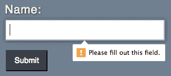

图 4.1. Chrome 中的表单提交错误消息

注意，我没有提到 Safari。无论好坏，Safari 6.0.5 及更早版本不提供原生的用户界面反馈。它确实支持 HTML5 验证，但我们仍然需要使用 DOM 脚本和 CSS 来提醒用户表单提交情况。我们将在 Validation API 部分讨论实现此点的方法。

### 设置必填表单样式

你可能想使用 CSS 在视觉上指示哪些字段是必填的，哪些不是。我们可以使用两个 CSS 选择器来定位必填字段。

1. 使用属性选择器 `[required]`。
2. 使用 `:required` 伪类。

`:required` 伪类是一个 [CSS 选择器，级别 4](http://www.w3.org/TR/selectors4/) 选择器，但主流浏览器的最新版本都支持它。CSS 4 选择器还增加了 `:optional` 伪类，我们可以用它来定位非必填的输入字段。

针对不支持 CSS4 选择器的旧浏览器，请使用属性选择器。例如，如果我们想为必填字段添加 1 像素的红色边框，可以在 CSS 中添加以下内容。

```css
input[required], input:required
{
  border: 1px solid #c00;
}
```

### 收集电子邮件地址、电话号码和 URL

我们希望让线人知道我们已经收到了他们的输入。这意味着我们的表单需要电子邮件地址和电话号码字段。我们还想收集可以获取更多关于该线索信息的 URL，因此我们的表单还需要一个 URL 字段。

在之前的 HTML 版本中，我们会使用文本字段处理所有这些内容并用 JavaScript 验证数据。然而，HTML5 为此定义了三个新的输入类型：`email`、`tel` 和 `url`。

让我们为表单添加一个电子邮件字段。我们还将其设置为必填。

```html
<p>
  <label for="email">E-mail address</label>
  <input type="email" name="email" id="email" required>
</p>
```

使用 `email` 类型会让浏览器检查该字段是否为有效的电子邮件地址。当然，它无法判断该地址是否可以接收邮件。但它会检查该字段的输入在语法上是否有效。如果用户输入了无效地址，大多数浏览器会在用户提交表单时提醒用户。

你可能还想让用户提供多个电子邮件地址。在这种情况下，请使用 `multiple` 属性。用户随后可以输入一个或多个电子邮件地址，每个地址之间用逗号分隔。

每当你允许一个输入字段有多个值时，通过标签或说明性文本指示这是允许的是一个好主意。

### 注意：关于验证

尽管原生数据验证是 HTML5 的一部分，你仍然应该使用服务器端验证，并对任何源自用户的输出进行转义。并不是所有浏览器都支持 HTML5，并不是所有发送到脚本的输入都来自你的表单。

电话号码则是另一。电子邮件地址遵循标准格式，但电话号码并非如此。在英国，电话号码可能长达 11 位。在美国，它们不超过 10 位。有些国家的电话号码包含 13 位。电话号码的格式也随国家而异。不一致的长度和格式使得原生电话号码验证变得困难。因此，规范没有定义执行此操作的算法。

让我们为表单添加一个电话字段。为了实现这一点，我们需要添加一个输入字段并将其 `type` 属性的值设置为 `tel`。我们不会将其设置为必填。

```html
<p>
  <label for="telephone">Telephone number:</label>
  <input type="tel" name="telephone" id="telephone">
</p>
```

使用 `tel` 代替 `text` 的巨大优势是在支持支持的浏览器中触发电话输入界面。

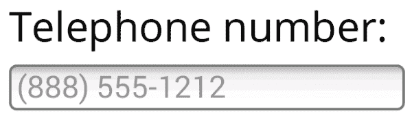

图 4.2. Firefox Mobile 中的 tel 输入类型

虽然 `tel` 没有为我们提供自动验证，但我们可以使用两个属性来规范用户输入：

- `placeholder`，为用户提供关于该字段期望格式的“提示”。
- `pattern`，设置一个正则表达式模式，浏览器可以使用该模式来验证输入。

我们想象的报社总部在美国，并拥有美国的受众。我们将在属性值中反映这一点。

```html
<p>
  <label for="telephone">Telephone number:</label>
  <input type="tel" name="telephone" id="telephone"
  placeholder="(000) 000-0000"
  pattern="\([2-9][0-9]{2}\) [0-9]{3}-[0-9]{4}">
</p>
```

对于 `placeholder` 属性，我们刚刚添加了反映该电话号码期望格式的文本。

### 注意：占位符文本

占位符文本（Placeholder text）并不是 `label` 元素的替代品。即使使用了 `placeholder` 属性，也要为每个输入字段提供一个标签。

对于 `pattern`，我们使用了正则表达式。该属性提供了输入在提交表单之前匹配的格式或模式。几乎任何有效的 JavaScript 正则表达式都可以用于 `pattern` 属性。与 JavaScript 不同，你无法设置全局或忽略大小写的标志。要允许同时大写和小写字母，你的模式必须使用 `[a-zA-Z]`。`pattern` 属性本身可以用于 `text`、`search`、`email`、`url` 和 `telephone` 输入类型。

### 注意：正则表达式

正则表达式是一个大且复杂的话题，因此超出了本书的范围。更完整的参考，请参阅 [WebPlatform.org 的文档](http://docs.webplatform.org/wiki/concepts/programming/javascript/regex)。

`url` 输入类型的工作方式与 `email` 基本相同。它根据接受 URL 模式对用户输入进行验证。允许协议前缀如 `ftp://` 和 `gopher://`。在这种情况下，我们希望限制用户输入为使用 `http://` 和 `https://` 协议的。因此我们在这里也添加一个 `pattern` 属性。

```html
<p>
  <label for="url">
    请提供我们可以了解更多信息的网站（如果
  适用）：
  </label>
  <input type="url" name="current_site" id="current_site"
  placeholder="http://www.example.com/"
  pattern="http(|s)://[-0-9a-z]{1,253}\.[.a-z]{2,7}">
</p>
```

我们还添加了占位符文本，作为对用户的提示，说明我们希望他们告诉什么。总之，你的表单应该如下所示：


```
<form action="./script" method="POST">
  <p>
    <label for="your_name">您的姓名:</label>
    <input type="text" name="your_name" id="your_name">
  </p>

  <p>
    <label for="city">居住城市:</label>
    <input type="text" name="city" id="city">
  </p>

  <p>
    <label for="email">
      电子邮箱地址 
      (用逗号分隔多个电子邮箱地址):
    </label>
    <input type="email" name="email" id="email"
    placeholder="jane.doe@example.com" multiple >
  </p>

  <p>
    <label for="tel">电话号码:</label>
    <input type="tel" name="phone_number" if="phone_number"
    placeholder="(000) 000-0000"
    pattern="\([2-9][0-9]{2}\) [0-9]{3}-[0-9]{4}">
  </p>

  <p>
    <label for="url">
      请提供一个我们可以了解更多信息的网站（如果
    适用）：
    </label>
    <input type="url" name="current_site" id="current_site"
    placeholder="http://www.example.com/"
    pattern="http(|s)://[-0-9a-z]{1,253}\.[.a-z]{2,7}">
  </p>

  <p>
    <label for="project">告诉我们您的故事创意:</label>
    <textarea name="story_idea" id="story_idea"
    placeholder="简要告诉我们我们应该写什么以及为什么。"
    maxlength="2000"></textarea>
  </p>

  <p>
    <button type="submit">提交！</button>
  </p>
</form>
```

## 上传文件

`file` 输入类型对于 HTML 来说并不新鲜。自从 HTML 3.2 以来，我们就能上传文件了。然而，新颖的是 `multiple` 属性，它允许我们使用单个表单字段上传多个文件。在本节中，我们将构建允许用户上传音频文件的表单。

首先，我们需要为 `form` 元素创建一个起始标签。

```
<form action="/script" method="post" enctype="multipart/form-data">
```

与我们之前的表单一样，我们的起始标签具有 `action` 和 `method` 属性。但请注意其 `enctype` 属性的值为 `multipart/form-data`。再次，在上传二进制数据时，我们必须使用 `multipart/form-data` 编码类型。

接下来，我们需要添加一个 `input` 标签，并将 `type` 属性的值设置为 `file`。我们将其命名为 `upload`，但你可以选择任何喜欢的名称。为了允许上传多个文件，我们需要添加 `multiple` 属性。

```
<input type="file" name="upload" id="upload" multiple>
```

### 注意：PHP 表单键名

PHP 要求具有多个值的表单键使用方括号数组语法。如果你正在使用 PHP 处理表单，请在名称后添加方括号（例如：`name="upload"` 将变为 `name="upload[]"`）。

我们还可以使用 `accept` 属性在浏览器中限制可以上传的文件。`accept` 的值可以是以下任意一个：

* `audio/*`, `video/*`, `image/*`
* 有效的 MIME 类型，如 `image/png` 或 `text/plain`
* 以 `.` 开头的文件扩展

你可以包含多个 `accept` 值；用逗号分隔它们。让我们更新表单字段以仅接受 MP3 和 Ogg Vorbis 文件。

```
<input type="file" multiple name="upload" id="upload"
accept=".mp3,.ogv">
```

我们将用提交按钮和表单结束标签完成表单的构建：

```
<form action="/script" method="post" enctype="multipart/form-data">
  <p>
    <label for="upload">您的文件(们):</label>
    <input type="file" multiple name="upload" id="upload"
    accept=".mp3,.ogv">
  </p>
  <p>
    <button type="submit">上传！</button>
  </p>
</form>
```

提交时，我们的服务器端脚本将保存这些文件，并返回一条“感谢”消息。

### 警告：采取适当措施

你不能依赖基于浏览器的验证或限制。请采取适当措施，并确保你的上传文件放置在非 Web 可访问的目录。

# `datalist` 元素

通过 `datalist` 元素，我们可以为任何表单输入控件添加一组预定义的选项。让我们来看看如何实现。首先，我们将为一家虚拟航空公司创建一个包含目的地选项的 `datalist`：

```
<datalist id="where_we_fly">
  <option>加纳，加纳</option>
  <option>巴黎，法国</option>
  <option>墨尔本，澳大利亚</option>
  <option>利马，秘鲁</option>
  <option>洛杉矶，美国</option>
  <option>吉隆坡，马来西亚</option>
</datalist>
```

现在我们可以使用 `list` 属性将其与 `input` 字段关联。

```
<p>
  <label for="destination">你想去哪里？</label>
  <input type="text" name="destination" id="destination" value=""
  list="where_we_fly">
</p>
```

在支持 `datalist` 元素的浏览器中，上述代码会将预定义的选项列表与 `input` 元素关联。当用户输入文本时，匹配的项目将显示在字段下方的列表中，如图 4.3](#ch04.html_datalist "Figure 4.3. datalist in IE")所示。


图 4.3. IE 中的 datalist

在不支持 `datalist` 的浏览器中，文本输入字段将正常工作。尽管理论上数据列表可以与其他输入类型关联，但并非所有浏览器都支持此功能。

## 其他输入类型

在本章中我们已经讨论了几种类型，在本节中我们还将介绍另外几种。

* `search`
* `range`
* `number`
* `color`
* `datetime`
* `datetime-local`
* `date`
* `month`
* `week`
* `time`

除了 `range` 之外，可以通过测试 `type` 属性来确定浏览器是否支持某种类型。如果浏览器不支持 `range`，则 `type` 属性将默认为 `text`。例如，考虑以下范围输入：

```
<input type="range" value="" id="slider">
```

我们可以使用以下 JavaScript 代码测试浏览器支持情况：

```javascript
var hasRange = function( elID ){
  return document.getElementById( el ID ).type == 'range';
}
```

在不支持 `range` 的浏览器中，上述函数将返回 `false`。否则，它将返回 `true`。像 [Modernizr](http://modernizr.com/) 这样的库会让检查变得更容易。

### input="search"

在大多数情况下，`search` 的工作方式类似于 `text` 输入类型。它仅仅提供了一种在视觉上与 `text` 框有所不同的类型。例如，在 Safari、Chrome 和 Mac 上的 Opera 15 中，搜索字段具有圆角。


图 4.4. Safari 中的搜索输入类型

### input="range"

`range` 输入类型为用户提供了一个滑块控件，适用于上下边界之间的近似值输入。默认情况下，它是水平控件，如图 4.5](#ch04.html_range "Figure 4.5. The range input type")所示。然而，通过一些 CSS (`transform: rotate(-90deg)`)，你也可以垂直显示范围输入。

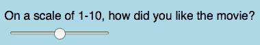

图 4.5. 范围输入类型

默认情况下，范围类型的上下边界是 0 和 100。通过设置 `min` 和 `max` 属性可以更改此。你还可以像下面这样使用 `step` 属性来控制滑块位置的平滑度和精度：

```
<input type="range" value="" min="0" max="100" step="10">
```

每当用户移动此范围输入控件上的滑块时，范围将在 0 到 100 之间增加或减少 10。你还可以通过将 `datalist` 元素与 `range` 输入关联来控制精度。在支持的浏览器中，每个选项将沿范围宽度渲染为一个“缺口”——到目前为止，Chrome 和 Opera 15 支持此功能。

遗憾的是，Internet Explorer 9 及旧版本、以及 Firefox 22 及旧版本不支持 range。在这些浏览器中，表单控件将是文本框而不是范围元素。


# `input type="number"`

`number` 类型是另一种用于数值输入值的表单控件类型。根据规范，任何浮点数都是有效值。但在实践中，情况要稍微复杂一些。

默认情况下，`number` 输入类型只接受整数。例如，输入 `4.2776` 将导致符合标准的浏览器产生验证错误，如图 4.6 所示。


图 4.6. 输入浮点数时的错误

为了接受浮点数，我们需要设置 `step` 属性。在带有增量控制控件的浏览器中，如图 4.7 所示，`step` 控制了每次点击箭头时数字增加或减少的幅度。

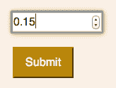

图 4.7. 带有步长的小数值

例如，当 `step="0.5"` 时，`1.5` 和 `9` 都是有效值，但 `8.1` 不是。然而，当 `step=".01"` 时，`8.1`、`1.5` 和 `9` 都是有效值，`3.14` 也是如此。某种程度上，你可以使用 `step` 属性来控制数字的浮点精度。

```
<!-- 数字增加 0.5 -->
<input type="number" name="num" value="" step=".5">

<!-- 数字增加 .01；精度精确到小数点后两位 -->
<input type="number" name="num" value="" step=".01">

<!-- 数字增加 .001；精度精确到千分位 -->
<input type="number" name="num" value="" step=".001">
```

为了让我们的 `4.2776` 值成为一个被接受的值，我们需要将 `step` 属性设置为 `.001`。遗憾的是，这种变通方法在 Opera 12 及更早版本中不起。

## 日期和时间输入

最后，让我们来看日期和时间输入类型。共有六种，列举如下：

- `datetime`: 选择全局 UTC 字符串的日期和时间
- `datetime-local`: 在用户的时区内选择日期和时间
- `date`: 选择带有午夜时间组件的单一日期
- `month`: 选择月份和年份
- `week`: 选择周
- `time`: 选择小时和分钟格式的时间

支持这些类型的浏览器将显示时间选择器小部件（针对 `time`）、日期选择器（针对 `date`、`month`、`week`）或两者兼备（`datetime` 和 `datetime-local`），如图 4.8 所示。


图 4.8. Opera 中的时间选择器

`datetime` 和 `datetime-local` 输入类型有细微的区别。前者将所有输入视为 UTC（协调世界时）日期和时间。浏览器可能会向用户指示这是 UTC 输入——如 Opera 12 版本那样——或者它可能会显示本地化界面，并在后台转换时间。

Chrome 和 Opera 15 支持除 `datetime` 以外的所有类型。Safari 6.0 版本、Firefox 25 版本和 Internet Explorer 10 版本不支持这些类型中的任何一种。

## `input type="color"`

通过 `color` 输入类型，我们可以为应用程序添加原生的颜色选择器。颜色选择器的外观取决于浏览器和操作系统。但在所有情况下，只有六位十六进制颜色值是有效的。这意味着你不能像在 CSS 中那样指定带透明度的颜色。`color` 类型的默认值为 `#000000`。

遗憾的是，`color` 输入类型仅受 Chrome 和 Opera 11 和 12 支持（但不支持 15.0 版本）。它还没有完全成熟，但为了完整性起见在此提及。

# 第 5 章 基础：多媒体、音频和视频

HTML5 最大的变化可能是它的多媒体能力。HTML5 带来了原生的音频和视频，并几乎取代了旧 Web 的插件。我之所以说“几乎”，是因为浏览器厂商尚未对网络音频和视频的默认格式达成一致。

我们将在本章稍后部分讨论跨浏览器支持。首先，让我们看看在网页上添加视频所需的最少条件：一个 `video` 标签和一个 `src` 属性。

```
<video src="path_to/file.video"></video>
```

在 HTML5 中，该闭合标签是必须。如果你使用的是 XHTML 语法，可以将其自闭合，例如 `<video src="path_to/file.video" />`。`audio` 元素几乎相同。只需要开启的 `audio` 标签、一个 `src` 属性和一个闭合的 `</audio>` 标签。

```
<audio src="path_to/file.audio"></audio>
```

再次，如果我们使用 XHTML 语法，可以自闭合标签：`<audio src="path_to/file.audio" />`。

## 添加控件

遗憾的是，如图 5.1”所示，我们上面的代码片段除了添加媒体文件外，什么也没做。我们无法播放视频，因为它会停留在第一帧。我们甚至不知道页面上有音频。


图 5.1. 没有控制控件的 Firefox 视频示例

我们需要一些控件：也许是播放按钮和一个可拖动的进度条。我们可能还需要一个显示已播放内容的计时器以及音量控制。幸运的是，浏览器内置了这些功能。我们可以通过添加 `controls` 属性来激活它们。

```
<video src="path_to/file.video" controls>
```

`controls` 属性告诉浏览器我们希望该媒体提供播放控件。在大多数浏览器中，这意味着用户将看到播放/暂停按钮、时间指示和音量控制，如图 5.2 所示。播放器可能还会包含允许用户在全屏和原始尺寸之间切换的按钮。这些默认控件的外观取决于浏览器。


图 5.2. 带有控制控件的 Firefox 视频示例，来自 Blender Foundation 的图片

`controls` 是另一个空属性的示例。如果我们使用 XML 语法，也可以使用 `controls="true"` 或 `controls="controls"`。添加 `controls` 属性无论其值为何，都会让控件可见。使用 `controls=false` 则不会隐藏它们。

## 自动播放和循环媒体

也许我们想使用一段短视频作为背景元素。我们可能想创建一个“艺术装置”体验，让视频自动播放并循环。这不是问题。我们可以通过在视频或音频标签上添加 `autoplay` 和 `loop` 属性来实现。

```
<video src="path_to/file.video" autoplay loop></video>

<audio src="path_to/file.audio" autoplay loop></audio>
```

使用 `autoplay`，媒体将在浏览器接收到足够数据后开始播放。当音频或视频结束时，`loop` 告诉浏览器从头重新媒体文件。

### 注意：谨慎使用自动播放

某些音频和视频听起来可能非常糟糕，或者只是令人尴尬。帮你的观众忙：使用 `muted` 属性静音自动播放的媒体。

```
<video src="annoying.video" autoplay loop muted></video>
```


## 仅视频属性

虽然大多数适用于 `video` 标签的属性也适用于 `audio`，但有少数（与视觉显示相关的）属性并不适用：

- `height`: 设置视频播放器的高度。
- `width`: 设置视频播放器的宽度。
- `poster`: 指定在视频播放前显示的图像。

### 使用 `poster` 进行占位

海报图（poster image）可以充当视频的占位符。它通常是视频中的某帧静态图像，也可以是公司标志、标题界面、图标或其他图像。页面加载后，访问者将看到海报图，直到视频开始播放。

要添加海报图，请添加 `poster` 属性。将其其值设置为图像的路径。大多数图像格式都可以用于海报图，尽管 Internet Explorer 有时处理 SVG 文件时会遇到困难。

```
<video src="path_to_file.video" poster="path_to_poster_image.jpg">
</video>
```

请注意海报图的大小。理想情况下，它的尺寸应该与视频相同。初始，视频播放器的尺寸将与海报图的尺寸一致。一旦浏览器确定了视频的固有高度和宽度，就会调整播放器的大小。为视频播放器设置明确的高度和宽度可以防止这种尺寸调整。

### 控制视频尺寸

无论你是否使用海报图，显式设置播放器的高度和宽度都可以防止浏览器在视频加载后重绘页面。当然，一种方法是在 `video` 标签中包含 `height` 和 `width` 属性。这两个属性都接受百分比，这在构建响应式或流式布局时非常有用。

```html
<video src="path_to_file.video" poster="path_to_poster_image.jpg" 
width="100%" height="100%"></video>
```

你也可以使用 CSS 设置视频播放器的高度宽。

```css
video {
  width: 960px;
  height: 540px;
}
```

在这个示例中，我们使用了像素。对于响应式布局，你可能倾向于使用视口百分比单位：`vh` 和 `vw`。[CSS Values and Units Module Level 3](http://www.w3.org/TR/css3-values/) 中列出的任何有效 CSS 长度单位都是接受的。使用 CSS 设置视频播放器的尺寸将覆盖应用于元素本身的任何 `width` 和 `height` 属性。

## 带宽使用与播放响应性

大多数浏览器在页面加载时，会下载音频或视频文件的一部分。通常，这段媒体片段包含文件的元数据（如持续时间和尺寸）以及几秒钟的可播放数据。当用户启动播放时，浏览器会对文件的剩余部分发起第二次请求。

无论你的访问者是否与媒体文件交互，这些请求每一个都会对服务器产生额外需求。你可以通过 `preload` 属性更改此行为。将其设置为三个可能的值之一：

- `metadata` 告诉浏览器下载文件的一部分是可以接受的。
- `auto` 告诉浏览器下载它想要下载的视频视频。
- `none` 告诉浏览器在用户请求之前不要下载任何内容。

使用 `preload="auto"` 可以为用户提供最快的播放体验。浏览器将下载其提供流畅播放所需的尽可能资源。对于短剪片，这可能是整个文件。

使用 `preload="none"`，用户可能会在点击播放控制和媒体播放之间体验到明显的延迟。然而，此选项将导致大多数浏览器下载最少的数据。

### 注意：在使用 `preload="none"` 时设置明确的视频高宽

在使用 `preload="none"` 时，你可能希望在视频元素本身或使用 CSS 设置明确的宽高。否则，当视频加载并开始播放时，你可能会触发页面重流（reflow）。

使用 `preload="metadata"` 是 `auto` 和 `none` 之间的一种折中方案。在大多数浏览器中，用户请求播放与操作之间不会出现像使用 `preload="none"` 时经常常见的延迟。但由于浏览器预加载了较小部分的媒体文件，播放可能不如 `preload="auto"` 那样瞬间完成。

## 跨浏览器音频和视频

这听起来好得有些不可相信，不是吗？不需要插件的原生音频和视频！别急。有一件事阻碍着我们：文件格式支持。浏览器厂商对于是否应该有一个默认的多媒体解码器，以及如果有，应该是哪一个存在存在意见。

苹果和微软已决定在他们的浏览器（分别是 Safari 和 Internet Explorer）中支持 H.264/MPEG-4 视频和 MPEG-3 音频。H.264 是一种用于显示视频的高清专用格式，通常封装在 MPEG-4 容器中。MPEG-3 是一种音频压缩格式。因为这些格式是专用的，如果浏览器开发者想在他们的软件中添加对这些格式的支持，必须支付许可。

Mozilla 和 Opera 反对 H.264 和 MPEG-3 主要是因为那些版税。相反，它们的浏览器（Firefox 和 Opera）支持开源解码器，如 Ogg Theora 和 WebM。Firefox 确实支持移动设备的 H.264 和 MPEG-3，但不支持桌面电脑和笔记本电脑。Internet Explorer 在用户安装了其他解码器的情况下也支持它们。值得的是，Google Chrome 支持上述所有。

“编码大分歧”意味着跨浏览器视频需要两种方法之一：

1. 仅编码 H.264 版本的视频，并使用 Flash 视频容器作为回退，为不支持原生 H.264 的浏览器提供视频。
2. 将视频编码为多种格式，让浏览器选择播放哪一个。

如果你需要支持旧浏览器，第一种方案最好。例如，Internet Explorer 8 缺乏对音频和视频的支持。如 [Video.js](http://www.videojs.com/) 和 [audio.js](http://kolber.github.io/audiojs/) 等 JavaScript 库使用了这种策略。

如果你不需要支持旧浏览器，第二种方案更好。它适用于桌面和移动设备浏览器。我们在这里使用这种方法。

### 注意：转码软件

要将视频从一种格式转码为另一种格式，请尝试 [FFMpeg](http://www.ffmpeg.org/)（命令行工具）或 [Miro Video Converter](http://www.mirovideoconverter.com/)。两者都是免费开源的，提供 Mac OS X、Windows 和 Linux 版本。

### 使用多个视频或音频文件

为了提供多种文件格式，我们需要使用 `source` 元素：每个文件格式一个 `<source>` 标签。`autoplay`、`loop` 和 `controls` 等属性仍然应该是 `<video>` 或 `<audio>` 标签的一部分。但我们的 `src` 属性必须移动到 `<source>` 标签中。

```html
<audio controls>
  <source src="path_to_mpeg3_file.mp3">
  <source src="path_to_ogg_file.ogg">
</audio>
```

我们可以为为每个 source 标签添加 `type` 属性。至少，`type` 应该包含一个有效的 MIME 类型。但它也可以像下面所示包含解码器。

```html
<audio controls>
  <source src="mpeg3_file.mp3" type="audio/mpeg"> 
  <source src="ogg_vorbis_file.ogg" type="audio/ogg; codecs=vorbis">
  <source src="ogg_flac_file.oga" type="audio/ogg; codecs=flac">
</audio> 
```

### 警告：Safari 上的 `preload=none`

在多个源上使用 `preload=none` 可能会防止 Safari 下载正确的文件。Safari 6.0.5 在 `preload=none` 时将忽略第一个以外的任何文件。即使用户点击播放，Safari 也不会加载另一个视频源。通过列出 Safari 兼容的源来避免这种情况。否则，将 `preload` 的值设置为 `metadata` 或 `auto`。

每个浏览器将下载它能够播放的第一个可用文件。


在我们开始讨论 HTML5 的多媒体元素之前，让我们先聊聊准备媒体文件。虽然我们现在可以在大多数浏览器中使用原生的 HTML5 元素，但我们（尚）无法在每个浏览器中使用相同的文件。我们在介绍中提到过这一点，但进行更详细的解释是必要的。我已经尽力公正地描述了这一点。

那么，为什么我们不能在每个浏览器中使用相同的文件呢？简短回答是：文件格式。

## 编解码器对决

详细的回答是：浏览器厂商尚未对网络音频和视频达成统一的格式。

当多媒体首次添加到 HTML5 规范时，音频的 `Ogg—Vorbis` 和视频的 `Theora` 被提为标准的默认格式。`Ogg` 规范被认为是公有领域。它的大多数工具都有开源许可。它被认为是没有专利的，且不侵犯其他专利。出于这些原因，它似乎是默认解码器的一个相当不错的选择。

一些浏览器厂商（主要是苹果和诺基亚）不同意选择 `Ogg`，并断然不支持它。他们担心的问题之一是不确定的专利格局。毕竟，仅仅因为 `Ogg` **被认为**不侵权，并不意味着它真的不侵权。此外，`Ogg` 缺乏如 `H.264` 视频格式强大的硬件支持。

提到 `H.264` 视频，苹果和诺基亚将其作为首选视频格式。`H.264` 受到硬件软件的广泛支持，特别是在移动端。事实上，今天网络上大部分视频都依赖它。然而，`H.264` 是所谓的“受限”格式：它是一种专利格式。在你的软件中添加 `H.264` 支持需要支付高昂的版税费用。Opera 和 Mozilla（`Firefox` 的开发者）对此望而却步。两者都拒绝在自己的浏览器中添加 `H.264` 支持。

值得的是，Google 在其 `Chrome` 浏览器中支持 `H.264` 和 `Ogg`。但作为 `Chrome` 底层的开源代码库 `Chromium` 缺乏 `H.264` 支持。微软在很大程度上避开了争端，但随后也选择了 `H.264`。

我应该在这里提到，`H.264` 是一种视频编解码器，这很大程度上就是争议所在。音频格式的争议较少，部分原因是因为可选的实在太多了。

话虽如此：在 2009 年，规范作者删除了编解码器要求。浏览器厂商实现了他们想要的编解码器。结果是我们必须以多种格式编码我们的音频和视频。至于所有那些糟糕的细节和愤怒的帖子，可以翻阅大约 2009 年中左右的 [WHATWG 邮件列表存档](http://lists.w3.org/Archives/Public/public-whatwg-archive/)。

## 现状

自从从 HTML5 中删除了编解码器要求以来，浏览器领域发生了一些细微变化。`Mozilla` 和 `Opera` 现在支持 `H.264`，但**仅当**硬件或第三方软件提供访问权限时支持——例如在 Android 设备上。

一种新格式——`WebM` 也加入了这一战。`WebM` 由 Google 赞助，是 `VP8` 和 `VP9` 视频编解码器的容器格式。不出所料，Google 的 `Chrome` 原生支持 `WebM`。`Opera` 从版本 `10.60` 开始也支持，`Firefox` 从版本 `4.0` 开始也支持（尽管此时仅支持 `VP8` 编解码器）。`Internet Explorer` 不原生支持 `WebM`，但如果安装了第三方软件就可以支持。苹果的 `Safari` 仍然支持 `H.264`。

至少，我们需要将视频文件编码为两种格式：`H.264` 和 `WebM`。对于音频文件，使用 `MP3` 和 `WebM`。这些格式在目前使用的浏览器中支持最广泛。为了支持 `Firefox 3` 或 `Opera 10.50` 用户，使用 `Ogg — Theora`（视频）和 `Ogg Vorbis`（音频）编码你的文件。

幸运的是我们，基础的媒体转码很容易，而且有免费的开源工具可以完成工作。在本章中，我们将讨论其中两个：命令行工具 [FFmpeg](http://ffmpeg.org/) 和图形用户界面 [Miro Video Converter](http://www.mirovideoconverter.com/)。

### 注意：警惕托管成本

以多种格式存储多个文件可能会影响你的托管成本，特别是随着存储视频数量的增加。请检查你的网络托管和存储计划的详情。

## 使用 Miro Video Converter 转换文件

Miro Video Converter 为 `FFmpeg`（开源、命令行媒体转换工具）提供了一个图形用户界面。它没有 `FFmpeg` 灵活。但如果命令行让你感到不适，它也更容易使用。

要使用 `Miro` 转换文件，请将其添加到队列。你可以通过将文件拖入应用程序中来实现。或者点击“Choose File”（选择文件）并导航到它。你可以向队列中添加多个文件。`Miro` 将按顺序处理它们。一旦文件排好队，我们就可以选择导出格式。

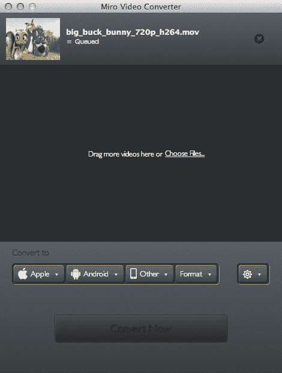

图 6.1. OS X 版 Miro Video Converter 的转换队列

Miro 提供了许多针对特定设备的系列预设。使用 `Apple > Apple Universal` 预设是支持 `H.264` 浏览器的良好选择。对于 `WebM` 和 `Ogg`，请查看 `Format` 菜单。

在设置菜单（右侧的齿轮图标）下，你还会看到创建缩略图、调整视频大小或调整宽高比的选项。再次点击齿轮图标返回主界面。

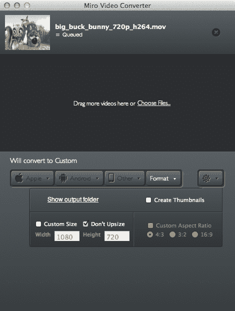

图 6.2. Miro Video Converter 中的设置面板

一旦你选择了格式并（可选地）调整了设置，点击屏幕底部的绿色按钮开始转码。

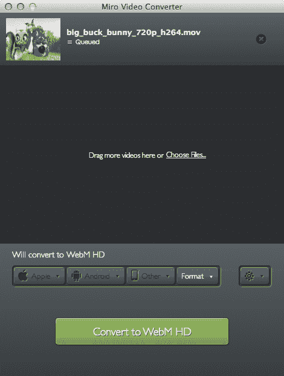

图 6.3. 我们可以转换！当我们选定输出格式后 Miro 的样子

Miro Video Converter 将你转换后的文件输出到输出文件夹。它的位置随操作系统而异，但你可以在设置菜单中找到链接。

## 使用 FFmpeg 转换媒体

如果你想要更多的灵活性，请尝试使用 `FFmpeg`。它是开源的，主要用于 Linux 系统。但通过 `FFmpeg` 网站提供 Mac OS X 和 Windows 的二进制文件。如果你正在使用 Mac，还可以使用 Homebrew 或 Macports 安装 `FFmpeg`。

`FFmpeg` 支持几十种格式，包括我们网络所需的：`Ogg Vorbis` 和 `Theora`、`MPEG-3`、`MPEG-4/H.264` 以及 `WebM`。你也可以用它来导出静态帧，这对于生成海报图像很有帮助。

让我们看看使用 `FFmpeg` 将视频从 QuickTime (.mov) 转换为 `WebM` 需要什么。导航到存放要转换文件的目录。然后打开终端窗口。

`FFmpeg` 转换非常直接。一个简单的版本如下。

```bash
ffmpeg -i /path/to/input.file /path/to/output.file 
```

`FFmpeg` 将根据输出文件的扩展名确定使用哪种编解码器。

在这种情况下，我们的文件名为 `tracy-sings.mov`。要将其转换为 `WebM`，我们将输入：

```bash
ffmpeg -i tracy-sings.mov tracy-sings.webm
```

就是这样。你的终端窗口将充满有关输入输出文件的各种细节。

### 注意：使用 FFmpeg 二进制文件

如果你使用的是 `FFmpeg` 二进制文件，可能还需要包含 `FFmpeg` 的路径（例如：`/usr/local/ffmpeg`）。

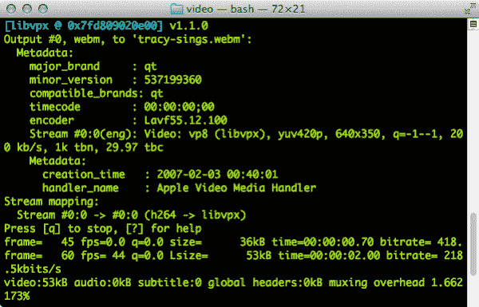

图 6.4. FFmpeg 转换过程演示

几刻之后，你将获得请求输出格式的转码文件。

### 调整视频大小

提供 1080p（通常为 1920 像素 x 1080 像素）视频的文件可能比你在网上需要的大。`FFmpeg` 也包含了缩放或调整视频大小的工具。实现此目的的方法之一是使用 `FFmpeg` 的缩放过滤器。

让我们尝试将电影缩放到较小的 720p（1280 像素 x 720 像素）分辨率。我们还将将其转码为 `WebM`。

```bash
ffmpeg -i tracy-sings.mov -vf scale=-1:720 tracy-sings-720p.webm
```


这里的新之处是使用了 `-vf` 标志，它是一个表示我们想要使用过滤器的标志。后面紧跟着我们的过滤器名称（`scale`）以及我们期望的比例（宽:高）。虽然我们可以指定两个维度，但在这里我们使用了 `-1` 代替。这告诉 `FFmpeg` 我们希望在缩放时保持纵横比。与我们之前的示例一样，命令的最后部分是输出文件名和扩展名。

### 使用 FFmpeg 生成海报图片

FFmpeg 不限于媒体转换。我们还可以用它来从视频文件中提取帧。当我们讨论如何为视频添加封面图时，这会非常有用。基本命令遵循以下模式：

```
ffmpeg -ss 30 -t 2 -i /path/to/input.file -r 1 
/path/to/output-%02d.jpg
```

这个示例涉及比之前示例更多的命令行标志。让我们过一遍。

`-ss` 标志指示 `FFmpeg` 跳转到指定的位置，以秒为单位。在这种情况下，我们将从视频的 30 秒处开始导出帧。

接下来是 `-t` 标志，代表持续时间，即我们想要提取多少秒的视频图像。在这种情况下，我们将捕捉两秒的帧。正如你现在可能猜到的，`-i` 标志代表“input”（输入），我们用它指定源文件。

`-r` 标志设置帧率，即视频导出时每秒的帧数。在这种情况下，它是每秒 1 帧。这意味着我们将从该视频中得到两张静态图，每个由 `-t` 标志指定的秒数对应一张。如果我们使用更高的帧率，例如每秒 24 帧，我们就会提取出 24 张图像。

最后最后，我们需要告诉 `FFmpeg` 将文件放在哪里。`%02d` 是一个占位符或某种类型的通配符。它告诉 `FFmpeg` 按顺序为我们的图像命名，并在必要时填充到 2 位数字。在这种情况下，我们的图像将被命名为 `output-01.jpg`、`output-02.jpg` 等。如果我们使用 `%03d`，我们的文件将会被命名为 `output-001.jpg`、`output-002.jpg`。

### 使用托管服务

Miro Video Converter 和 `FFmpeg` 非常适合你想要自己托管的音频和视频。但也有一些服务提供托管和转码服务。[Archive.org](http://archive.org/details/movies) 为在知识共享（Creative Commons）许可下或公共领域发布的音频和视频作品提供免费的托管和转码。[Vid.ly](http://m.vid.ly/)、[Viddler](https://www.viddler.com/) 和 [Zencoder](http://zencoder.com/en/) 是三个付费选项，同时也提供可配置的播放器。详情价格各异。

### 质量与文件大小

本章并不是全面介绍 Miro Video Converter、`FFmpeg` 或针对网络优化媒体。但它能帮助你入门。

然而，你应该为你的音频和视频文件考虑比特率和每秒帧数（FPS）。这里没有硬性的准则。你选择什么值取决于你以及以及观众——对质量与文件大小、带宽消耗和下载时间的容忍度。

热门视频网站如 [YouTube](https://support.google.com/youtube/answer/1722171)、[Vimeo](http://vimeo.com/help/compression) 和 [Dailymotion](http://www.dailymotion.com/upload/faq) 为压缩媒体提供了一些指导。使用 `FFmpeg` 进行这些调整。最好的办法是从这些指南开始，并尝试不同的比特率，直到找到合适的平衡点。

现在你已经有了一些转换媒体的工具，让我们来谈谈如何将其添加到你的页面中。

# 第 7 章

## 多媒体：使用原生 HTML5 音频

在本章中，我们将介绍 `audio` 元素及其属性。虽然我们关注的是 `audio` 元素，但请记住，这些属性大部分也适用于 `video`。事实上，可以使用 `audio` 元素播放视频文件，并使用 `video` 元素播放音频文件。主要的区别在于，如果可用，`video` 元素将显示图像轨道；而 `audio` 则永远不会。

## `audio` 元素

在网页上添加音频非常简单。使用 `<audio>` 标签即可。它至少需要一个 `src` 属性，即媒体文件的路径和名称。音频元素还需要一个结束标签 `</audio>`。使用你的文本编辑器创建一个新的 HTML 文件，并添加下面的代码段，更改 `src` 的值指向你的媒体文件。将其保存为 audio.html，然后在浏览器中打开。

```
<audio src="/path/to/media.file"></audio>
```

你应该什么也看不也听不到。默认情况下，`audio` 和 `video` 元素缺少控件并且处于空闲状态加载。

为了向用户展示播放器界面，我们需要添加 `controls` 属性。

```
<audio src="/path/to/media.file" controls></audio>
```

`controls` 属性是一个空属性的示例。对于空属性，它的存在与否决定了属性值是真还是假。它实际上等同于输入 `controls=""` 并用空字符串作为值。

添加 `controls` 属性将为我们提供可见的播放/暂停、音量等控件。外观取决于浏览器。

### 注意：JavaScript 已禁用

当用户禁用了 JavaScript 时，无论 `controls` 属性值如何，浏览器都会显示媒体界面。

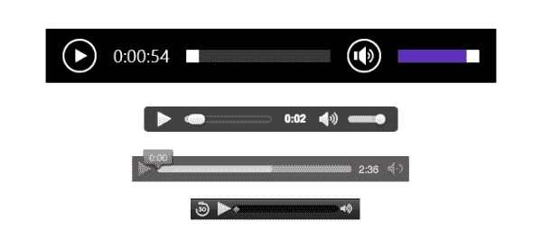

图 7.1 默认播放器从上到下 Internet Explorer 11, Chrome 30, Firefox 27, Safari 6.0.5

某些浏览器暴露所谓的“Shadow DOM”，即使用 CSS 目标组件的方法。Shadow DOM 的支持因浏览器而异，因此你需要咨询浏览器的文档。

更灵活的方法构建自己的播放器。正如我们在书中后面看到的，我们还可以使用媒体 API、CSS 和 JavaScript 控制外观。

## `autoplay` 属性

我们可以通过添加 `autoplay` 属性在媒体加载时立即播放。与 `controls` 一样，`autoplay` 是一个空属性。

```
<audio src="/path/to/media.file" autoplay></audio>
```

在你的 audio.html 文件中将 `controls` 替换为 `autoplay` 并刷新页面。注意我们的音频立即播放，但也注意到没有停止播放的方法。如果我们想让用户控制此媒体，我们需要包含两者，如下：

```
<audio src="/path/to/media.file" autoplay controls></audio>
```

在使用 `autoplay` 属性之前，请体谅你的用户。自动播放的媒体会消耗你和用户的带宽。对于带宽有限的用户来说，媒体文件会“阻塞管道”。对于按流量计费的用户，自动播放媒体意味着意味着费用。而且许多用户单纯觉得这很烦。在大多数情况下，用户发起的媒体是更好的选择。

### 循环媒体

也许你想使用一些环境音频为你的网站营造氛围。在这种情况下，你可能希望媒体自动重复，无需用户干预。这就是 `loop` 属性派上用场的地方。存在时，媒体将在结束时“回溯”并从头开始。

```
<audio src="/path/to/media.file" autoplay controls loop></audio>
```

### 静音媒体

HTML5 提供了通过 `muted` 属性静音媒体文件输出的能力。媒体文件仍会被下载。进度条和时间将继续更新。但浏览器不会输出任何声音。

```
<audio src="/path/to/media.file" controls muted></audio>
```


虽然对于音频文件来说这可能毫无意义，但对于视频来说就更有意义了。例如，视频广告仍然可以在视觉上吸引用户的注意力，而不会产生声音的额外干扰。再次注意，`muted` 是空属性。对于 XHTML 语法，你需要使用 `muted=""` 或 `muted="muted"` 来代之。

我们还可以通过脚本和 `volume` 属性来控制音频输出。

## 使用 `preload` 属性进行缓冲提示

多媒体消耗大量的带宽——无论对你的服务器还是你的用户。音频和视频数据占用大量字节。当文档加载时，浏览器会请求并下载媒体文件的片段。通常，这个片段仅足够确定文件的时长或尺寸。对于视频，它还可能下载一或两帧。当播放开始时，浏览器将就会发出另一个请求（有时是多次请求）来获取剩余的媒体文件。

这些每一个请求都会对服务器产生额外需求。无论用户是否听音频或观看视频文件，部分请求都会发生。好消息是，我们可以如如下所示通过 `preload` 属性来引导这种行为。

```
<audio src="/path/to/media.file" controls muted preload="auto">
</audio>
```

`preload` 属性接受三个可能的值。

- `none` 告诉浏览器在用户请求之前不要下载任何内容，但在播放时它可能会下载整个视频。
- `metadata` 提示浏览器可以下载部分媒体文件，并在播放期间限制下载速度。
- `auto` 告诉浏览器可以随其意下载尽可能多的视频内容。

### `preload="auto"`

使用 `auto` 是这些值中要求最高的。`auto` 值告诉浏览器可以下载它想要的尽可能多的文件，直到整个资源。播放通常更加稳定，因为更多的视频内容已经在浏览器的缓冲区中了。这对用户来说很棒，但对你的带宽使用可能没那么好。正如图 7.2 所示，Firefox 为我们的媒体文件 Pontification.ogg 发起了三次请求。

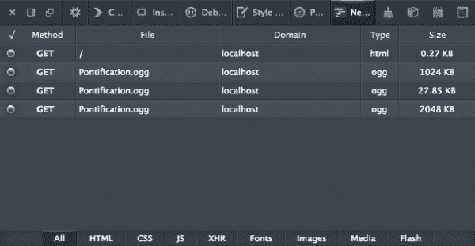

图 7.2. Firefox 开发者工具中显示 `preload="auto"` 时对 Pontification.ogg 的请求

### `preload="none"`

`preload` 值为 `none` 告诉浏览器：“在用户尝试播放此文件之前，你都不敢下载哪怕一个字节！” 优点是，`preload="none"` 会减少请求次数，从而减少带宽消耗。在下方的图 7.3，我们可以看到浏览器对我们的 HTML 文档发起了请求，但没有请求我们的媒体文件。

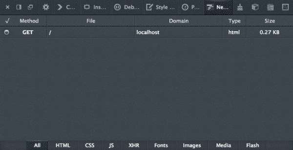

图 7.3. Firefox 开发者工具中显示 `preload="none"` 时对 Pontification.ogg 的请求

缺点是，`preload="none"` 意味着响应速度会较低。用户在点击“播放”到媒体实际开始播放之间可能会经历几秒的延迟。然而，一旦开始播放，浏览器可能会激进地下载文件。

### `preload="metadata"`

将 `metadata` 视为两者之间的一种很好的折中方案。当 `preload` 属性设置为 `metadata` 时，浏览器将发送一个请求，并只下载部分文件。

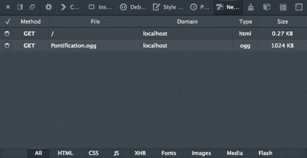

图 7.4. Firefox 开发者工具中显示 `preload="metadata"` 时对 Pontification.ogg 的请求

使用 `metadata` 值还提示浏览器在播放开始后应该限制下载。`preload="none"` 或 `preload="auto"` 都不能阻止浏览器下载整个资源。然而，`preload="metadata"` 提示浏览器应该在允许流畅播放的最慢速率下下载文件。

有趣的地方在这里：我们可以使用 JavaScript 在播放开始后更改 `preload` 的值。例如，我们可能想从 `preload="none"` 开始，这样就不会下载额外数据。一旦用户开始播放，我们就可以切换到 `preload="metadata"` 并享受下载限制的好处。在第 6 章 中有一个如何操作的示例。

## 回退内容

注意这里我们为 `audio` 元素同时使用了开始和结束标签，但中间没有任何内容。如果用户使用不支持音频的浏览器访问我们的页面，他们将看不到任何关于播放器缺失的指示（除非页面上的其他内容告诉了他们）。

我们可以通过在 `<audio>` 和 `</audio>` 标签之间添加回退内容来解决这个问题，如下所示。

```
 <audio src="/path/to/media.file" controls>
   哦不！您的浏览器不支持 HTML5 音频。
   如果可以，请升级您的浏览器。
 </audio>
```

你也可以使用图像作为替代内容，或者在标签之间嵌入基于 Flash 的播放器。正如我们在第 8 章和第 9 章所示，我们的 `<source>` 和 `<track>` 标签也位于我们的开始和结束标签之间。

记住：我们目前讨论的所有内容也适用于 `video` 元素。但 `video` 元素还有几个更符合视觉媒体的属性。我们将在下一章中讨论它们。

# 第 8 章

## 多媒体：使用原生 HTML5 视频

在 HTML 文档中添加视频与添加音频一样简单：使用 `<video>` 标签。与 `audio` 一样，`video` 元素需要一个结束标签（</video>`）和一个 `src` 属性。

创建一个新的 HTML 文档并添加下面的代码，将 `src` 的值指向你选择的媒体文件。将其保存为 video.html，并在浏览器中打开该文件。

```
<video src="/path/to/media.file"></video>
```

你应该能看到视频的第一帧，仅此而已，如图 8.1 所示。与 `audio` 一样，`video` 元素默认缺少控制（除非禁用了 JavaScript）。

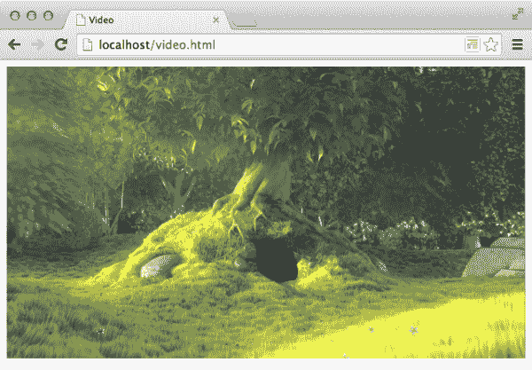

图 8.1. Chrome Canary 中未设置 `controls` 属性时的视频播放器。图片来自 Blender Foundation 的 "Big Buck Bunny"，bigbuckbunny.org

为了启用控制，我们需要添加一个 `controls` 属性，如下所示。

```
 <video src="/path/to/media.file" controls></video>
```

与 `audio` 元素一样，这将为视频添加一个播放器用户界面，使用户可以播放、暂停、进度和调整音量。视频控制看起来与其音频控制大致相同。它们通常有一个用于进入和退出全屏播放的额外控制，在大多数浏览器中，一个控制开关可以切换字幕和说明。播放器的外观取决于浏览器，并不是每个浏览器都能轻松地重样式这些控件。

## 设置视频尺寸


所有的视频文件都具有 `intrinsic`（固有）的宽度和高度。固有尺寸是文件的“自然”或默认高度和宽度。例如，一个视频文件的宽度为 640 像素，高度为 480 像素。然而，我们可以使用 `width` 和 `height` 属性告诉浏览器在我们的文档布局中限制视频播放器的大小。例如所示。

```html
<video src="/path/to/media.file" controls width="427" height="240">
</video>
```

这将我们的视频限制在一个 427 像素宽、 240 像素高的框内。 视频文件本身将保留其尺寸。但它将在我们定义的空间内显示，如图 8.2 所示。

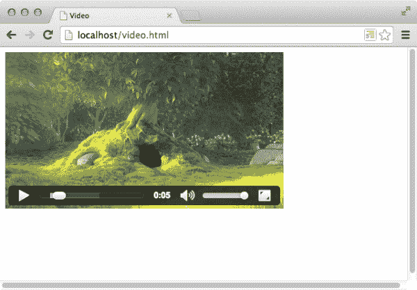

图 8.2. 我们将视频设置为宽 427 像素、高 240 像素。Google Chrome 窗口宽度为 640 像素。图像来自 Blender Foundation 提供的“Big Buck Bunny”，bigbuckbunny.org

在没有宽度或高度的情况下，HTML5 视频播放器的默认大小为 300 像素宽、 150 像素高。一旦浏览器能够确定视频的固有尺寸，它就会调整元素的大小。如果你使用的 `preload` 值为 `auto` 或 `metadata`，这将在视频加载时发生。如果你使用的 `preload` 值为 `none`，它将在用户开始播放时发生。

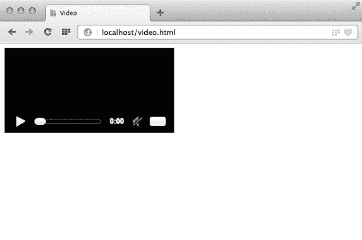

图 8.3. 当 `preload` 属性设置为 `none` 时，Opera 16 中的默认视频播放器

这与 `img` 元素的工作方式类似。当我们不指定元素框的大小时，框将扩展以适应内容。设置高度和宽度可以防止这种情况的发生。

在上面的示例中，我们指定了像素值，但也可以使用百分比值。让我们将上面示例中的值改为百分比。

```html
<video src="/path/to/media.file" controls 
width="100%" height="100%">
</video>
```

现在，我们的视频元素尺寸将相对于其容器元素的高度和/或宽度进行伸或缩小。

设置 `width` 和 `height` 属性并不是控制 `video` 元素大小唯一方法。我们可以使用 CSS，如下所示。

```css
video {
    width: 427px;
    height: 240px;
}
```

在这里我们使用了 `video` 元素选择器，这意味着这些样式将应用于我们文档和网站上的每个视频。在大括号之间，我们添加了 `width` 属性以及值为 `427px`（或 427 像素）的值以及值为 `240px` 的 `height` 属性。与 HTML 属性一样，我们不受限于像素值。我们也可以使用百分比或 CSS 允许的任何其他长度值。

如果你使用 CSS，请记住这些值将优先于 HTML 中的任何 `width` 和 `height` 属性。如果你不熟悉 CSS，Louis Lazaris 写的 SitePoint 书籍 [Jump Start CSS](http://www.sitepoint.com/store/jump-start-css/) 将帮助你快速上手。

### 百比高度

使用百分比值 `height` 是复杂的。它只在父元素的高度也被显式设置时才有效。例如，如果视频的父元素是 `body` 元素，你需要使用 CSS 来指定它的高度，如下所示。

```css
body {
    height: 100%;
}
```

现在，你的 `video` 元素将随着 `body` 元素一起扩展高度。然而，这里有一个注意事项。虽然你的*视频元素*的宽高比例会改变，但视频本身的宽高比例不会改变。当 `video` 元素的宽高比例与视频本身不同时，你会在视频图像周围留出额外的空间，如图 8.4 所示。

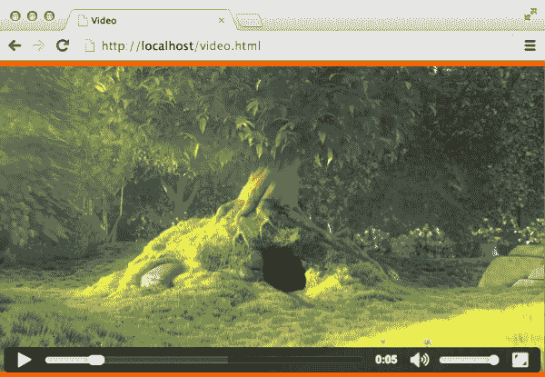

图 8.4. 视频顶部和底部的橙色条是视频元素宽高比例与视频文件宽高比例之间的差异

由于这个原因，通常使用百分比值宽度并让浏览器自动调整高度会更省心。

```css
video {
    width: 800px;
    height: auto;
}
```

### 设置封面（Poster Image）

如果你对 `preload` 使用 `auto` 或 `metadata`，你的视频将加载第一帧。但如果你使用了 `none`，访问只会看到占位符。我们可以做得更好。让我们使用 `poster` 属性指定图像。

```html
<video src="/path/to/media.file" controls width="427" height="240" poster="/path/to/poster.image">
</video>
```

`poster` 属性的值必须是图像文件的 URL。它将在没有视频数据可用时显示。它旨在代表视频，但也可以很容易是公司 Logo 或简单的标题。在第 6 章 中，我们提到如何使用 FFmpeg 从视频中提取图像，你可以将其用于封面帧。但你也可以拍摄普通的截图并使用图像编辑器对其进行编辑。

### 封面尺寸与 `video` 元素尺寸

封面图像具有固有尺寸，就像视频文件一样。最初，`video` 元素的尺寸将匹配封面图像的宽高。一旦浏览器知道了视频的尺寸，它就会调整元素的大小以匹配。为了防止这种情况，请：

1. 确保你的封面图像与视频具有相同的宽高；或

2. 使用属性或 CSS 为 `video` 元素指定高度和宽度。

几乎任何图像格式都适用于封面，包括 SVG。大多数浏览器会将图像限制在视频元素的尺寸内（如果已设置），如果没有设置，则会扩展到 SVG 文件的大小。

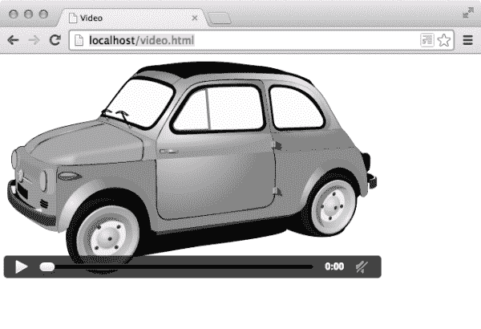

图 8.5. 大多数浏览器会将 SVG 封面的尺寸限制在视频元素内。图像来自 Openclipart 的 Michele Brami

Internet Explorer 则恰恰相反。当视频元素缺少高度和宽度时，它会将封面限制在默认的 300x150 尺寸。如果设置了*尺寸，SVG 图像将扩展到其完整的固有尺寸。

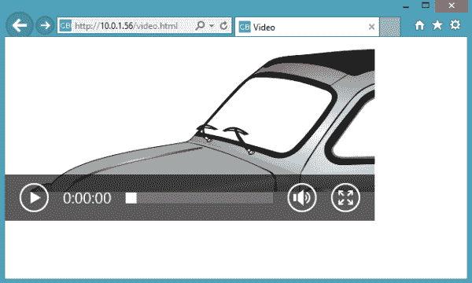

图 8.6. 当视频元素设置了高宽时，Internet Explorer 不限制 SVG 封面。图像来自 Openclipart 的 Michele Brami

为了解决这个问题，请使 SVG 文件的固有尺寸比 `video` 元素的高度和宽度小。

### 到目前为止我们学到的内容


到本书为止，我们已经介绍了 `audio` 和 `video` 元素，以及它们的大部分重要属性。但你可能注意到，你的 `audio` 和 `video` 示例并不是在所有浏览器中都能工作。例如，如果你使用了 `MP3` 和 `M4V` 文件，你的示例在 Opera 16 中就无法运行。

正如我们在第 6 章 中讨论过的样，浏览器厂商尚未同意支持一种标准的文件格式。这意味着我们需要提供多种格式的媒体文件。但当 `video` 和 `audio` 元素只支持单个 `src` 属性时，我们如何做到呢？

答案是，我们无法完全做到。但我们可以使用多个 `source` 元素来提供多个源文件。每个浏览器都会下载它最可能播放的文件格式。我们将在下一章中讨论跨浏览器视频问题。

# 第 9 章：多媒体：`source` 元素

在本章之前，我们讨论了使用带有单个 `src` 属性的 `audio` 和 `video` 元素。你可能注意到，这在某些浏览器中只有部分有效，取决于你的文件格式。对于在不同浏览器中运行的真正跨浏览器多媒体，你需要使用多个 `source` 元素和多个源文件。

我们将在本章示例中使用 `video` 元素，但我们讨论的大部分内容也适用于 `audio` 元素。为了提供多个源，你需要让你的媒体以多种格式可用。请参考第 6 章了解实现此操作的方法。

## `source` 元素

`source` 元素允许我们为多媒体元素指定多个备用媒体文件。它不是一个独立的元素；必须作为 `audio` 或 `video` 元素的子使用。将你的 `source` 标签放置在 `audio` 或 `video` 元素的开始和结束标签之间。

```
<video controls>
  <source src="/path/to/video.h264.m4v">
  <source src="/path/to/video.webm">
</video>
```

`source` 标签需要一个 `src` 属性，其值为多媒体文件的路径和名称。理想情况下，当你指定多个源时，浏览器应该检测并选择它能够播放的文件。目前的状况要稍微复杂一些。

在 Chrome、Firefox 和 Internet Explorer 中，浏览器将尝试下载指定的第一个源文件。如果它无法播放该格式，它将尝试下一个指定的文件，依此类推，直到找到一个它能够播放的格式的文件。

Safari 6（及更早版本）和 Opera 15 也执行相同的操作，但当 `preload` 的值为 `none` 时除外。当 `preload="none"` 时，这些浏览器将尝试下载第一个文件，如果证明是不兼容的则失败。为了防止这种情况，可以：

1. 将 `preload` 属性设置为 `metadata` 或 `auto`；或者
2. 使用 `type` 属性指定 MIME 类型。

Safari 7 不再受此 bug 的困扰。

## 使用 `type` 属性进行格式提示

使用 `type` 属性指定 MIME 类型将防止浏览器对每个 `source` 元素运行格式兼容性检查。这对于该过程失效的浏览器来说尤为重要。浏览器将不再执行“下载-检查-重复”的序列，而是使用 `type` 属性来选择它能够播放的文件。让我们为上面的 `<source>` 元素添加 `type` 属性。

```
<video controls>
  <source src="/path/to/video.h264.m4v" type="video/mp4">
  <source src="/path/to/video.webm" type="video/webm">
</video>
```

`type` 属性的值必须是与相关格式匹配的有效 MIME 类型。对于 MPEG4/H.264 文件，为 `video/mp4`。对于音频 MPEG-4 文件，使用 `audio/mp4`。MP3 文件的 MIME 类型应为 `audio/mpeg`。对于 Ogg 文件，使用 `video/ogg` 或 `audio/ogg`。对于 WebM，首选 MIME 类型是 `video/webm`。

你可能还想指定用于编码媒体文件的编码器。大多数文件格式实际上只是各种编码格式的容器。例如，一个 Ogg 音频文件实际上可能是使用 Vorbis、FLAC 或 Speex 编码器编码的。包含编码器是可选的，它可以为浏览器提供更具体的信息。要包含编码器，请在 `type` 属性的值中添加 `codec` 参数。

```
<source src="/path/to/video.ogv" 
type="video/ogg; codecs='theora, vorbis'">
```

注意，我们的 `codecs` 参数值被包含在单引号中。这是因为它是封装在双引号中的值的一部分。我们也可以反转引号；即用单引号包含 `type` 的整个值，而对 `codecs` 参数的值使用双引号。

使用 `codec` 并不是严格必要的。省略它也一样，特别是当你不确定文件使用的是哪种编码器时。

### 媒体问题排除

现在你可能已经做了这一切——路径正确，文件格式正确——但你的视频或音频仍然无法工作。可能存在几个问题。

检查你的服务器是否为文件类型发送了正确的 `Content-type` 响应头。许多服务器会带有 `Content-type: text/html` 或 `Content-type: application/octet-stream` 头部发送未知文件类型。你需要为你的服务器或目录配置文件为每种文件格式添加正确的头部支持。这些头部值应与我们上面讨论的 MIME 类型相同。请查阅你的服务器文档或联系你的网络托管支持团队以获取更多信息。

如果不起作用，你可能需要重新编码你的文件。在这样做时，请确保你使用的是目标浏览器支持的编码器。（查阅浏览器文档。）

## 使用 `media` 属性实现响应式视频

`source` 元素可以用于提供不同格式的文件。但它也可以根据屏幕或设备特性提供不同的视频。你可以通过 `media` 属性来实现。

`media` 属性接受媒体查询作为值。媒体查询由一个 CSS 媒体类型（如 print、TV 或 screen）和一个用于测试的媒体特性组成。关于媒体查询及其工作原理的完整解释，请参考万维网联盟的 [Media Queries](http://www.w3.org/TR/css3-mediaqueries/)规范。在这里，我们只来看一个使用宽高比的示例。

### 提供不同宽高比的视频

我们可以测试的媒体或设备特性之一是宽高比。媒体查询允许我们测试 `aspect-ratio` 和 `device-aspect-ratio`。前者测试文档内容（通常是文档窗口）的宽高比。后者测试设备屏幕的宽高比。有时它们是相同的，但通常不同。无论哪种，我们都可以测试条件并根据结果提供不同的视频。

在这里，我们使用两个不同的文件提供相同的视频内容：为能够纳该分辨率的屏幕提供 1080p 视频，为容纳较低分辨率的屏幕提供 720p 视频。

```
<video controls>
  <source src="/path/to/video.1080p.m4v" type="video/mp4" 
  media="screen and (device-aspect-ratio: 1920/1080)">
  <source src="/path/to/video.720p.m4v" type="video/mp4" 
  media="screen and (device-aspect-ratio: 1280/720)">
  <source src="/path/to/video.1080p.webm" type="video/webm" 
  media="screen and (device-aspect-ratio: 1920/1080)">
  <source src="/path/to/video.720p.webm" type="video/webm" 
  media="screen and (device-aspect-ratio: 1280/720)">
</video>
```


在这种情况下，只有当用户拥有兼容 HD 的设备时，浏览器才会下载支持的视频文件。值得注意的是，`media` 属性仅适用于 `source` 元素。将其添加到 `video` 或 `audio` 标签中将不起作用。

当然，响应式 Web 设计和媒体查询还有许多相关内容。可以查看 SitePoint 的 [*Jump Start Responsive Web Design*](http://www.sitepoint.com/store/jump-start-responsive-web-design/) 了解介绍。

## 到目前我们学了

到为止，我们已经涵盖了 HTML5 音频和视频元素及其属性。我们还讨论了如何提供跨浏览器视频以及如何进行故障排除。下一页，我们将查看使用 `track` 元素为网络视频添加字幕。

# 第 10 章：多媒体：`track` 元素

在上章节中，我们讨论了如何通过跨浏览器技术让媒体对更多用户可用。在本章中，我们将查看如何通过 `track` 元素和 WebVTT 让媒体也变得可访问且“可索引”。

HTML5 多媒体面临三个挑战：

1. 缺乏可访问性。
2. 缺乏“可索引性”。
3. 媒体与观众或听者之间的语言障碍。

可访问性简单意味着尽可能地支持有障碍或残疾的用户。听觉媒体对于听障用户来说是不可用的。视障用户无法像视力正常的人那样看到视觉媒体。HTML5 音频视频为这些用户带来了明显的挑战。

此外，搜索引擎软件难以正确索引二进制数据（如音频、视频和图像）。即使是 Google 图像搜索也依赖文件名、`alt` 属性和周围文本，而不是实际的文件索引。音频和视频文件本身像是一个信息黑洞。数据进去了，但往往难以提取和使用。

语言障碍是 HTML5 多媒体的另一个挑战。观众或听者可能无法理解，更不用流练使用播放媒体的语言了。视频*内部*的字幕可以帮助。然而，它们在编辑、查看或收听媒体时无法方便地切换。它们也受到索引问题的影响。

HTML5 将 `track` 元素定义为解决这些问题的方法。通过它，我们可以为媒体文件添加基于时间的基于文本的替代方案——如字幕、说明和元数据。在本章中，我们将查看该元素以及一种名为 WebVTT 的说明和字幕语法。

## `track` 的支持现状

在开始之前，让我们来讨论浏览器支持。`<track>` 元素至少被 Internet Explorer 10+、Chrome 16+、Safari 6+ 和 Opera 16+ 支持。然而，它在某些浏览器中的实用性是有限的。

OS X 版 Safari 6.0.5 并没有为用户提供说明或字幕，尽管脚本界面是部分可用的。然而，Safari 7 中是可以说明的。（在 iOS 7 中，只有当视频处于全屏模式时可用。）

桌面版 Opera 16+ 支持 `track`，但 Android 版 Opera 不支持。在 Android 上，Opera 将视频处理交给操作系统的软件。它不是在浏览器中播放视频，而是启动外部应用程序，使得字幕变得无关。Opera 为 iOS 开发的新浏览器 Coast 行为也类似，使用该平台内置的视频处理。

Firefox 对 `track` 的支持仍在进行中。尚未完全支持。但是，在[最新预览版](http://nightly.mozilla.org/)（Firefox 27.0a1 及更高版本）可以使用部分支持。在地址栏中输入 `about:config`并将 `media.webvtt.enabled` 设置更改为 `true` 来启用它。

要在不支持的浏览器中提供字幕，请查看 [Captionator.js](http://captionatorjs.com/) 和 [MediaElementJS](http://mediaelementjs.com/)。

### 说明、字幕与 `audio`

大多数浏览器不支持与 `audio` 元素配合使用时的 `track` 元素。没有字幕，没有说明，也没有菜单。对于 `audio` 文件，你目前有两种选择：

1. 在 HTML 文 文中包含文本转录。
2. 使用 `video` 元素代替 `audio` 元素。

由于音频文件缺乏内在尺寸，`video` 元素将以其默认的 300x150 像素渲染。

## 添加 `track` 元素

要使用 `track` 元素，将其放在起始 `<video>` 标签和结束 `</video>` 标签之间，如下所示。

```
<video src="/path/to/media.file" controls>
  <track src="/path/to/tracktext.vtt" srclang="en">
</video>
```

如果你使用的是 `source` 元素，请将你的 `track` 标签或标签放在 `source` 标签之后。

```
<video src="/path/to/media.file" controls>
  <source src="/path/to/media.m4v" kind="video/mp4">
  <source src="/path/to/media.webm" kind="video/webm">
  <track src="/path/to/tracktext.vtt" srclang="en">
</video>
```

你可能注意到我们的 `track` 标签包含一个 `src` 属性。`src` 的值必须包含替代版本的文本文件的 URL。理论上，这可以是浏览器支持的任何字幕文件格式。在实践中，它应该是 [WebVTT](http://dev.w3.org/html5/webvtt/) 文件。WebVTT 在所有支持 `track` 元素的浏览器中都受到支持。[TTML](http://www.w3.org/TR/ttaf1-dfxp/) 是另一种字幕语法，但到目前，只有 Internet Explorer 支持它。

在本章稍后部分，我们将讨论 WebVTT 的字幕语法以及如何使用它。

## 指定字幕、说明和元数据

在上面的示例中，我们省略了 `kind` 属性。它是可选的，但建议带上。`kind` 属性告诉我们的浏览器每个文本轨道的功能，并引导其显示方式。

`kind` 的值可以是以下值之一：

*   `subtitles`：用于提供对话的转录或翻译
*   `captions`：用于转录和翻译，但专门为听障用户提供描述
*   `descriptions`：用于在视频组件不可用或用户视障时描述视频组件；合成为音频
*   `chapters`：用于导航资源，类似于你在 DVD 菜单中可能会找到的内容
*   `metadata`：关于视频的数据，旨在供脚本或机器读取

在这五种类型中，除了 `metadata` 之外，所有的都对用户可见。`descriptions` 类型的轨道会被合成成音频，用户将听到而不是看到。字幕和说明都覆盖在视频文件上。对于说明，用户界面可能包含一个闭路字幕按钮，允许用户开启或关闭字幕（图 10.1"）。


图 10.1. Chrome 32 中启用字幕的视频示例。取自 Nina Paley 的 "Sita Sings the Blues" 视频截图，(sitasingtheblues.com)

章节（Chapters）旨在作为用户界面中的交互式列表显示。然而到为止，没有主流浏览器完全支持此功能。元数据轨道提供有关媒体文件或时间范围的信息，完全不显示给用户。

如果你不设置 `kind` 属性，你的轨道将被视为 `subtitles` 轨道。这是元素的默认状态。当类型为 `subtitles` 时——无论是显式的还是隐式的——你*必须*包含一个 `srclang` 属性。没有 `srclang` 属性，字幕将无法工作。

### 使用多个 `track` 元素


虽然使用多个 `track` 元素是完全有效的，但并非所有浏览器都完美支持这种做法。目前为止，Internet Explorer 10+ 和 Safari 7 是唯一支持多个 `track` 元素的浏览器。这两个浏览器都为用户提供了一个菜单，允许其选择想要使用的文本轨道。

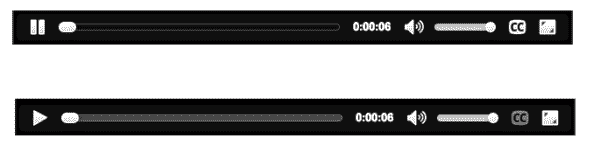

图 10.2. Chrome 中的字幕按钮，当字幕开启时（顶部）和关闭时

当存在多个 `track` 元素时，Chrome 和 Opera 将使用列出的第一个轨道元素。Chrome 和 Opera 并没有提供轨道元素菜单，而是包含一个 CC 按钮（代表“封闭字幕”），用于切换当前字幕或说明字幕的开启或关闭（图 10.2）。

## 指定你文本轨道的语言

你可能还需要为 `<track>` 标签包含一个 `srclang` 属性。该属性的值必须是有效的 BCP 47 语言代码。通常这些代码是两个字母，例如代表英语的 `en` 或代表德语的 `de`。但也可以包含国家或地区代码，例如代表加拿大法语的 `fr-CA` 或代表英国英语的 `en-GB`。

语言和国家或地区代码非常多——在这里无法列全。请记住你最常用的代码。如果你需要其他语言和地区代码，最好的查找地点是 Richard Ishida 的[语言标签查找工具](http://people.w3.org/rishida/utils/subtags/)。

如果没有 `srclang` 属性，字幕将无法工作（说明和描述应该可以工作）。当该属性存在时，某些用户代理允许用户在不同轨道之间进行选择。

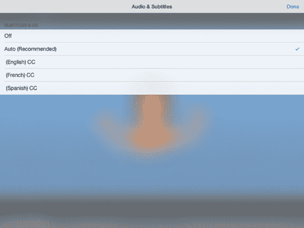

图 10.3. 在 iOS 7 的 Safari 中为字幕或说明选择语言。来自 Nina Paley 的《Sita Sings the Blues》视频截图 (sitasingstheblues.com)

例如，Safari for iOS 7 在全屏模式下查看视频时会为用户提供一个字幕菜单（图 10.3")，上方）。它使用 `srclang` 的值来设置菜单中的语言选项。

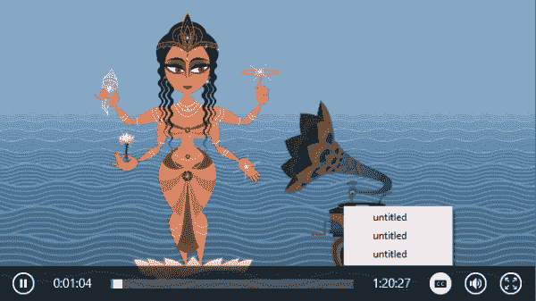

图 10.4. 默认情况下，Internet Explorer 中的轨道没有标题。来自 Nina Paley 的《Sita Sings the Blues》视频截图 (sitasingstheblues.com)

然而，Internet Explorer 并非如此。在 Internet Explorer 10+ 中（图 10.4")，上方），封闭字幕菜单中列出的轨道默认是没有标题的。为了修复这个问题，我们需要为每个轨道添加 `label` 属性。截至出版时，其他浏览器尚不支持多个 `track` 元素。

## 为你的轨道标记

`label` 属性是不是不言自喻的。它定义了浏览器在向用户展示轨道时可以使用的名称或标题。

```
<video src="/path/to/media.file" controls>
	<track src="/path/to/en-us.vtt" srclang="en-US" 
	label="English - USA">
	<track src="/path/to/fr.vtt" srclang="fr" 
	label="Français">
	<track src="/path/to/es-MX.vtt" srclang="es-mx" 
	label="Español - México">
</video>
```

如果没有 `label` 属性，Internet Explorer 会为轨道元素提供没有帮助的默认标题，正如我们在图 3 中看到的。。如果包含了该属性，Internet Explorer 将在字幕选择菜单中使用 `label` 属性的值（图 10.5")）。


图 10.5. 当轨道具有 `label` 属性时，标签值成为字幕选项的名称。来自 Nina Paley 的《Sita Sings the Blues》视频截图 (sitasingstheblues.com)

Safari 处理标签的方式略有不同。Safari 的字幕和说明菜单中的每个标签都包含了标签和语言。到为止，Firefox、Chrome 和 Opera 都没有为用户提供多个轨道。


图 10.6. Safari 同时包含了标签和语言。

在为你的轨道选择标签时，请记住以下几点：

*   避免重复标签。这会让用户感到困惑。
*   标签应该描述轨道的内容和/或 目的（例如：“English - Fully captioned”）。
*   标签不是 `srclang` 属性的替代品。

## 使用 WebVTT 创建文本轨道

WebVTT 是 HTML5 字幕支持最广泛的文本格式。Chrome 和 Internet Explorer 都支持它，万网联盟成员正努力为所有浏览器标准化语法。我们在这里展示几个示例。如需关于 WebVTT 的更深入的讨论，请参阅 [WebVTT 草案规范](http://dev.w3.org/html5/webvtt)。

### 什么是 WebVTT？

WebVTT 是一种简单的结构化文本格式，用于为网络音频视频提供元数据、字幕和说明。尽管技术上是纯文本，但 WebVTT 文件必须带有 `Content-type: text/vtt` 响应头进行传输。发送响应头确实需要调整服务器配置。请咨询您的服务器文档或您的 Web 托管支持团队以了解如何操作。

WebVTT 文件还必须使用 UTF-8 编码。检查您的文本编辑器设置或偏好。它应该使用 UTF-8 字符编码和 Unix/Linux 行结束符。（这实际上应该是您的默认设置，因为 HTML5 也要求。）您可能还希望调整服务器配置，在 `Content-type` 头中包含 `charset` 参数。这将使得完整的响应头变为 `Content-type: text/vtt; charset=UTF-8`。再次咨询您的服务器文档或 Web 托管支持团队。

### 创建简单的 WebVTT 文件

WebVTT 文件的文件的行必须以字符串 `WEBVTT` 开头。您可能会在网上看到以 `WEBVTT FILE` 开头的示例。这里的重点是 `WEBVTT` 部分。空行将此字符串与文件的其余部分分开。

WebVTT 文件由一系列提示组成。每个提示由时间范围和一个字幕或说明组成。时间应使用 *hh:mm:ss.mls* 格式，其中 *hh* 是小时数，*mm* 是分钟，*ss* 是秒，*mls* 是毫秒数。对于一个在 1 小时 33 分 58.3 秒在屏幕上显示的提示，您使用 `01:33:58.300`。

您可以省略小时前的导零，但仅限小时。这意味着我们之前的提示也可以写成 `1:33:58.300`。然而，分钟和秒必须使用两个数字表示。毫秒必须使用三位数字，必要时补零。

每个提示的开始和结束时间必须由 `-->` 分隔。例如，如果您的提示应该在媒体文件 30 秒处开始，并在 45.4 秒处结束，您可以这样记录：

```
00:00:30.000 --> 00:00:45.400
```


每个时间范围后面都跟着组成提示（cue）的文本。最简单的提示是纯文本，且提示可以跨多行，如下所示（对话源自电影《Sita Sings the Blues》，sitasingstheblues.com）。

```
WEBVTT

0:06:57.200 --> 0:07:01.000 
[Music]

0:07:02.500 --> 0:07:08.000 
When? I don't remember what year. There's no year. 
How do you know there's a year for that?

0:07:08.500 --> 0:07:10.000 
I think they say the 14th century.

0:07:11.500 --> 0:07:13.000 
The 14th century was recently. 
I know but ... 

0:07:13.500 --> 0:07:16.500 
That's when the Moguls were ruling in India
The 11th then

0:07:17.500 --> 0:07:22.000 
It's definitely B.C. It's B.C. for sure.
And I think it's Ayodhya.
```

注意每个提示之间的空行？它们是必须的。浏览器以此来判断一个提示结束和另一个提示开始的位置。

### WebVTT 提示跨度标签

WebVTT 支持一组类似于 HTML5 的标签，称为 `cue spans`（提示跨度），它们为字幕和说明提供了简单的格式设置。

* `c` 或提示类跨度 (cue class span)
* `i` 或斜体跨度 (italics span)
* `b` 或粗体跨度 (bold span)
* `u` 或下划线跨度 (underline span)
* `ruby` 和 `rt` 或注音跨度 (ruby and ruby text spans)
* `v` 或语音提示跨度 (voice cue span)
* `lang` 或语言提示标签 (language cue tag)

就像 HTML 标签一样，每个提示跨度的起始标签以 `<` 开头并以 `>` 结尾。结束标签以 `</` 开头并以 `>` 结尾。让我们取上面的对话添加一些语音提示跨度标签。

```
WEBVTT

0:06:57.200 --> 0:07:01.000 
<i.music>[Music]</i>

0:07:02.500 --> 0:07:08.000 
<v Man1>When? I don't remember what year. There's no year. 
How do you know there's a year for that?</v>

0:07:08.500 --> 0:07:10.000 
<v Woman>I think they say the 14th century.</v>

0:07:11.500 --> 0:07:13.000 
<v Man1>The 14th century was recently</v>
<v Woman>I know but ...</v>

0:07:13.500 --> 0:07:16.500 
<v Man1>-That's when the Moguls were ruling in India</v>
<v Woman>- The 11th then</v>

0:07:17.500 --> 0:07:22.000 
<v Man2>It's definitely B.C. It's B.C. for sure.    
And I think it's Ayodhya.</v>
```

在这里，每个角色都由 `<v>` 标签表示。每个角色的名字（这里是 Man1、Woman 和 Man2）也是标签的一部分。这是某种属性。我们还为第一个提示中添加了斜体提示跨度。

### 提示：验证你的 WebVTT

编写不当的 WebVTT 会导致字幕无法工作。请使用 Anne Van Kesteren 的 [Live WebVTT Validator](http://quuz.org/webvtt/) 验证你的 WebVTT 语法。

语音提示跨度标签本身不会改变每个字幕的外观。但它们确实添加了语义数据，并成为 CSS 的钩子，我们将在下一节中看到。

### 使用 `::cue` 伪元素为字幕和说明设置样式


图 10.7. Internet Explorer 11 中未样化的字幕。来自 Nina Paley 的电影《Sita Sings the Blues》截图 (sitasingstheblues.com)

字幕和说明在大多数浏览器中以白色无衬线字体文本显示。Internet Explorer ([图 10.7"))）了文本阴影以提高可读性。Chrome、Safari 和 Opera 使用黑色背景。它们始终位于视频底部，并在屏幕上居中。

尽管 WebVTT 提供了字幕对齐和放置的语法，但浏览器厂商尚未实现它。目前，我们对原生字幕的外观及其在屏幕上的放置位置控制有限。

然而，我们可以使用 CSS 和 `::cue` 伪元素来调整字幕和说明的外观（目前仅在 Chrome、Safari 7 和 Opera 16+ 中支持）。

并不是所有的 CSS 属性都能用于 WebVTT 字幕和说明。只支持部分属性，主要与文本和颜色相关。

* `color`
* `opacity`
* `visibility`
* `text-decoration`
* `text-outline`
* `text-shadow`
* `background` 属性（如 `background-color`）
* `outline` 属性（如 `outline-color`）
* `font` 属性（如 `font-family`），但还有 `line-height` 和 `white-space`

### 重要：谨慎更改字幕颜色！

请使用 [对比度比例计算器](http://leaverou.github.io/contrast-ratio/) 确保你的颜色选择具有足够的对比度。

让我们来看一个设置 `::cue` 伪元素的示例。在这里 `::cue` 是我们的选择器，我们正在使用 `font` 简写属性使我们的字幕文本加粗。

```
::cue {
    font: bold 18px / 1.5 sans-serif;
}
```

你可以在 图 10.8 中看到效果。


图 10.8. 为字幕文本应用加粗字体样式。图片来自《Sita Sings the Blues》sitasingstheblues.com

然而，这并不是我们能做的全部。`::cue` 伪元素也像函数一样，接受单个参数。此参数必须是一个或多个 CSS 选择器，例如类名或元素。回想我们在上面对话片段中使用的标记。

```
WEBVTT

0:07:11.500 --> 0:07:13.000 
<v Man1>The 14th century was recently</v>
<v Woman>I know but ...</v>
```


每个 HTML 元素都有一个 DOM 脚本接口。接口是脚本语言可用的属性、常量、事件和方法的组。某些元素（如 `p`）具有简单的接口，没有多少属性适用于 `p` 元素。而其他元素如 `audio` 和 `video` 元素则拥有强大的接口，允许我们与元素的每个状态进行交互并控制。

正如我们在前面的章节中看到的，`audio` 和 `video` 许多许多共同属性。它们的脚本接口也是如此。在本章中，我们将重点创建一个视频播放器。然而，我们所讨论的大部分内容也适用于音频。我们会对差异和异常进行说明。

## 事件驱动的 DOM 脚本：引言

为了创建我们的播放器，将需要使用一种名为*事件驱动编程*的技术。`audio` 和 `video` 元素在媒体加载和播放期间会触发事件。我们可以使用 DOM 脚本来*监听*这些事件，并在事件发生时采取行动。这有点像演员在台下倾听上场的信号，只不过是以代码的形式呈现的。

这两个元素都会为各种事情触发事件。但对于这个播放器，我们只讨论其中三种：

*   `durationchange`：当浏览器下载了足够的文件以确定我们媒体文件的时长时触发。
*   `timeupdate`：每当媒体位置更新时触发。
*   `volumechange`：每当音量变化时触发。

我们有两种方式可以监听事件：我们可以使用元素的事件处理器属性，或者使用 `addEventListener()` DOM 方法。事件处理器属性基本上基本上是带有 `on` 前缀的事件名称——例如 `ondurationchange`、`ontimeupdate` 和 `onclick`。大多数 HTML5 事件都有这些属性，并且使用它们是完全可以接受的，例如：

```
object.onclick = function_to_invoke;
```

然而，在本章中我们将使用 `addEventListener()`。使用 `addEventListener()` 赋予了我们更大的灵活性。使用事件处理器属性时，每个事件只能调用一个函数。而使用 `addEventListener()`，我们可以同时调用多个函数。基本语法如下：

```
object.addEventListener('event_name', function_to_invoke);
```

当事件触发时，一个*事件对象*将作为参数传递给监听器或*回调函数*。事件对象是用于传递数据的容器。如果我们想在回调函数中使用这些数据，我们需要确保回调函数定义了参数。为了基于上面的通用示例，我们的 `function_to_invoke` 将类似于下面的示例。

```
function function_to_invoke(event){
    // 对我们的事件执行操作的函数体
}
```

每个事件对象包含多个属性，我们可以使用点语法获取每个属性。基本形式是 `eventobject.property`，其中 `eventobject` 是我们的函数参数名。在本章中，我们最关注的是事件对象的 `target`，因此在几乎所有的函数中都会使用 `event.target`。`target` 属性是对触发事件的对象的引用。

`target` 本身也是一个对象。它包含了所有 HTML 元素共有的属性，如 `id`。但它也包含了特定于对象类型的属性：用于视频对象的 `duration`，用于表单控件的 `value`。这个概念起初*确实*很难理解，所以你可能需要读几遍才能完全掌握。

## 1 步：创建我们的标记

使用 DOM 脚本创建媒体播放器有两种方法：完全使用 JavaScript（以及 `document.createElement()` 方法）或通过编写标记。我们将选择后者。让我们来构建标记：

```html
<!DOCTYPE html>
<<html>
  <head>
    <meta charset="utf-8">
    <title>
    编写音频和视频播放器
    </title>            
    <link rel="stylesheet" type="text/css" href="video.css">
  </head>
  <body        
    <div id="video_wrapper">
      <video preload="metadata">
         <source src="./video_file.mp4" type="video/mp4">
         <source src="./video_file.webm" type="video/webm">
      </video>
      <div id="video_time">
        <progress value="0" id="playback"></progress>
        <span id="elapsed"></</span> <span id="duration"></</span>
      </</div>
      <div id="video_seek"> 
        <label for="seek">Seek</label>
    <input type="range" id="seek" title="seek" 
    min="0" value="0" max="0">
      </div>
      <div id="video_controls">
        <button type="button" id="play">Play</button>
        <button type="button" id="pause" class="hidden">
          Pause
        </button>
        <label for="volume">Volume</label>
        <input type="range" id="volume" title="volume" 
    min="0" max="1" step="0.1" value="1">                
      </div>
    </div>
    <script type="text/javascript" src="video.js"></script> 
  </body>
</html>
```

在这里，我们为音量和进度条控制使用了 `range` 输入类型。

## 2 步：获取我们的视频对象

在进行更多操作之前，我们需要为脚本创建一个可以操作的视频对象。我们将使用标记中的 `video` 元素，并使用 `document.querySelector()` 方法获取它。该方法是 `Selectors API` 的一部分，将返回文档中匹配选择器的第一个对象——在本例中是 `video` 元素选择器。

```javascript
var video = document.querySelector('video');
```

如果你的 `video` 元素有一个 `id` 属性，你也可以像下面所示使用 `document.getElementById()` 方法。

```javascript
var video = document.getElementById('my_video');
```

这两种方法任都会返回一个 `HTMLVideoElement` 类型的对象。如果这是一个 `audio` 元素，我们的对象将是一个 `HTMLAudioElement` 对象。`HTMLVideoElement` 和 `HTMLAudioElement` 接口都定义了可以通过 DOM 脚本进行读写的属性。某些属性（如 `controls`）有相应的 HTML 属性。其他属性（如 `volume`）只能通过脚本接口可用。

## 3 步：播放和暂停视频

你对播放器想要做的绝大多数操作就是，*播放*视频文件。你可能还想暂停它来接电话，或者在老板面前隐藏你的偷懒。`HTMLVideoElement` 对象有两个自言易懂的方法来完成这些任务：`play()` 和 `pause()`。每当调用 `play()` 方法时，播放将开始或恢复。当调用 `pause()` 方法时，播放将暂停。


我们将确保这些方法在用户请求时被调用。播放和暂停按钮已经是我们标记的一部分了，所以现在我们只需要为每个按钮添加一个事件监听器。首先，让我们将按钮引用为变量：

```
var play  = document.getElementById('play');
var pause = document.getElementById('pause');
```

由于这些是按钮，它们通常会被点击。因此，让我们为它们都添加 `click` 事件监听器。

```
play.addEventListener('click', clickhandler);
pause.addEventListener('click', clickhandler);
```

接下来，我们需要定义 `clickhandler` 函数。因为这些按钮将执行相似的操作，我们可以对它们使用同一个函数。我们将根据 `event.target.id` 属性的值来调用其中一个函数或另一个函数。

```javascript
function clickhandler(event){
    var id = event.target.id;

    if( id == 'play' ){
        video.play();
    }
    if( id == 'pause' ){
        video.pause();
    }  
}
```

## 第 3 步：确定文件的时长

媒体对象有一个 `duration` 属性，该属性只能通过脚本接口访问。一旦浏览器下载了文件的元数据，该属性就会被定义。

当浏览器能够确定媒体文件的运行时间时，它会在音频或视频对象上触发 `durationchange` 事件。我们可以监听这个事件并使用它来更新我们的时长显示。我们的标记中还包含一个进度条和一个用于跳转的范围控制控件。为了让这些控件正常工作，我们需要将这些控件的 `max` 属性设置为我们 `duration` 属性的值。

首先来看我们的 `updateduration` 函数：

```javascript
function updateduration(event){
    var durationdisplay = document.getElementById('duration'),
        elapseddisplay  = document.getElementById('elapsed');

    durationdisplay.innerHTML = event.target.duration;
    elapseddisplay.innerHTML  = event.target.currentTime;
}
```

在这个函数中，我们获取了 `span#duration` 和 `span#elapsed` 元素。然后，我们使用视频对象的 `duration` 和 `currentTime` 的值来更新 `<span>` 标签之间的文本。

我们还会定义另外两个函数，一个用于更新进度条的 `max` 属性值，另一个用于更新跳转控制的 `max` 值。如果我们没有设置 `max` 值，我们的进度条将无法准确指示视频已经过了多少时间，范围控制控件也不会允许我们向前或后滑动。

```javascript
var seek = document.getElementById('seek'),
    playback = document.getElementById('playback');

function updateseekmax(event){
    if( event.target.duration ){
        seek.max = event.target.duration;
    }
}

function updateplaybackmax(event){
    if( event.target.duration ){
        playback.max = event.target.duration;
    }
}
```

现在，将这些函数作为 `durationchange` 事件监听器添加到视频对象中。

```javascript
video.addEventListener('durationchange', updateduration);
video.addEventListener('durationchange', updateseekmax);
video.addEventListener('durationchange', updateplaybackmax);
```

当我们的文档加载并触发 `durationchage` 事件时，这三个函数将被调用。

## 第 4 步：指示已过时间

一旦我们的媒体文件开始播放，我们就希望指示已经过去了多少时间。为了做到，我们需要监听 `timechange` 事件，并在我们的回调函数中读取视频对象的 `currentTime` 属性。

`timechange` 是在媒体播放期间定期触发的事件——每 15 到 250 毫秒触发一次。触发时，我们将检查 `currentTime` 属性的值并更新我们已过显示中的文本。此 `currentTime` 属性返回媒体文件当前的播放位置（以秒为单位）。让我们设置回调函数。

```javascript
function timeupdatehandler(event){
    var elapsed = document.getElementById('elapsed');
    elapsed.innerHTML = event.target.currentTime;
}
```

然后，我们可以为视频对象添加一个事件监听器。

```javascript
video.addEventListener('timechange', timeupdatehandler);
```

`currentTime` 是所谓的访问器属性（getter/setter property）。我们可以使用它来获取媒体时间轴上的当前点。但我们也可以用它在媒体时间轴的不同点之间移动。例如，使用 `video.currentTime = 0` 将当前播放点重置为开头。这是创建自定义跳转条的秘密。

## 第 5 步：使用 `range` 输入类型进行跳转

Range 输入类型的工作原理是具有最小值和最大值（通过 `min` 和 `max` 属性设置）。控件上的位置对应于最小值和最大值之间的值——在本例中，是 `0` 和媒体文件的总时长（秒）。

所有输入元素（包括 range）在用户更改控件的值时都会触发 `change` 事件。当事件对象被传递给我们的处理器时，我们可以读取范围控制控件的当前 `value` 属性，并更新 `video.currentTime` 的值。为了保持我们的进度条同步，我们也会更新它的值。

让我们来看看回调函数和事件监听器：

```javascript
function seekhandler(event){
    video.currentTime = event.target.value; 
    playback.value = event.target.value
}

seek.addEventListener('change',  seekhandler);
```

当用户调整跳转控制控件时，我们的视频将相应地推进或后退。

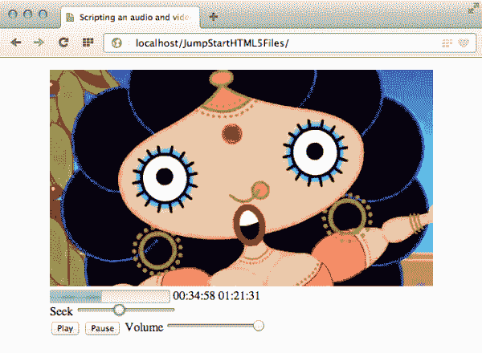

图 11.2. 使用我们的跳转控制控件推进视频。视频图像来自 Nina Paley 的 "Sita Sings the Blues"(sitasingstheblues.com)

## 第 6 步：调整音量

我们的音量控制原理与跳转控件类似。

HTML 媒体对象有一个 `volume` 属性，可以通过脚本接口访问。它的下限是 0.0，上限是 1.0。可接受的值落在两者之间。所有值都相对于该媒体文件的固有音量。

我们的音量范围控件具有 0 的 `min` 值和 1 的 `max` 值，对应于 `volume` 属性的上下限。由于这些值小于或等于一，我们需要在标签中添加 `step="0.1"`。

与跳转控制控件一样，当用户更改音量时，浏览器会触发 `change` 事件。然后我们可以读取其 `event.target.value` 属性并用该值更新视频对象的 `volume` 属性。在下面的代码中，我们定义了回调函数，并为音量控制添加了事件监听器。

```javascript
var volume = document.getElementById('volume');

function volumehandler(event){
    video.volume = event.target.value;
}

volume.addEventListener('change',  volumehandler);
```

## 通过更改 `preload` 值提示带宽消耗

在 第 7 章 中，我们提到 `preload` 属性为浏览器提供了关于一次应下载多少媒体的提示。使用 `preload="none"` 防止浏览器下载文件的任何部分，但一旦用户启动播放，浏览器可能会激进地下载媒体。使用 `preload="metadata"` 是提示浏览器它应该像带宽非常昂贵一样表现。

如果节省带宽是你的目标，那么 `preload="none"` 和 `preload="metadata"` 的组合是最佳选择。然而，我们需要使用脚本在用户启动播放后更改该值。让我们更新上面的 `clickhandler` 函数。

```javascript
function clickhandler(event){
    var id = event.target.id;

    if( id === 'play' ){
        video.play();
        video.preload = 'metadata';
    }
    if( id === 'pause' ){
        video.pause();
    }  
}
```


当用户点击播放时，此函数还将更改 `preload` 的值，提醒浏览器它应该限制下载速度。然而，请记住，这些只是提示；浏览器的行为是不保证的。

## 结语

在本书中我们涵盖了媒体编码和 HTML5 标记。我们学习了如何让我们的媒体具有可访问性。并学习了使用多媒体脚本 API 构建播放器的基础知识。然而，内容远不止我们所涵盖的。

尽管内容密集，我建议你阅读来自 `HTML: The Living Standard` 的关于[视频元素](http://developers.whatwg.org/the-video-element.html#the-video-element) 的文档。它由 WHATWG 维护，面向 Web 开发者而非浏览器供应商。

广告公司 LongTail 维护着 [HTML5 视频状态](http://www.longtailvideo.com/html5/)页面，用于跟踪浏览器对特定多媒体功能的支持情况。

Mozilla.org 还提供了一份[HTML5 音频和视频指南](https://developer.mozilla.org/en-US/docs/Web/Guide/HTML/Using_HTML5_audio_and_video)，其中更多地介绍了我们尚未涵盖的内容，例如错误处理和指定播放范围。另请参考 Dev.Opera 的[HTML5 视频介绍](http://dev.opera.com/articles/view/introduction-html5-video/)，获取有关编写视频播放器的更多技巧和窍门。

你现在掌握了关于 HTML5 音频和视频所需的全部知识。祝编码愉快！

# 第 12 章：Canvas & SVG：Canvas 简介

随着 Web 的演进和成熟，用于有效显示网页的语言也随之发展。之前的 HTML 版本 v4.01 具有许多现在已经过时的元素。

现代互联网用户是精明且有要求的，这意味着他们期望网页以某种方式显示并快速加载。HTML5 试图解决早期 HTML 版本中欠缺的问题，以更好地处理图形并满足这些预期。

## Canvas 可以用来什么？

Canvas 可用于绘制形状（如矩形、正方形和圆形），或者在 HTML5 文档中嵌入图像或视频。你可以根据需要在一个文档中使用多个 Canvas 实例，或者只使用一个。

基础的 `canvas` 元素看起来如下：

```
<canvas id="myCanvas" width="300" height="150"></canvas>
```

此时，值得注意的是，HTML5 `canvas` 元素是嵌入页面中的 `DOM`（文档对象模型）节点。随后会创建上下文（context），这是一个你用于在容器内渲染图形的对象。如果你创建了多个画布，你需要为每个上下文创建 `canvas` 元素，并对它们进行适当命名，以便浏览器理解你指的是哪个对象。

`canvas` 元素在表面上与 `img` 元素相似。它们都有高度和宽度，并在页面上以矩形块的形式显示。然而，`img` 通常加载预先准备好的图形（例如照片）。`canvas` 是一个可编程的图像；你使用 JavaScript 绘图方法直接操作像素。这项技术非常快，并允许你创建复杂的动画和游戏。总来说，canvas 经常与 Flash 和 Silverlight 等技术相比较。

查看这个[动画图形](http://raksy.dyndns.org/torus.html)，它是使用 canvas 可以做事情的一个良好示例。你还应该查看 [Canvas 演示](http://www.canvasdemos.com/) 以获取一些棒的运行示例，包括使用 `canvas` 创建的游戏和应用程序。

## 在开始之前

在我们开始玩转 canvas 之前，需要考虑的几点：

*   最好为每个 canvas 分配一个唯一的 `id` 属性，这样你的脚本就可以直接引用它。该页面上的其他元素不应使用相同的 ID。

*   当未应用样式时，容器或 canvas 元素将是透明的，没有边框，因此它看起来像一个透明的矩形框。默认宽度为 300 像素，默认高度为 150 像素。

*   在理想的世界里，每个人都会使用最新的浏览器。但事实并非如此，他们并没有这样做。这意味着通常需要告诉浏览器在不支持 `canvas` 时应该如何表现。

*   如果你习惯于使用 `img` 元素，你会知道它不需要闭合标签 `</img>`。相反，`canvas` 需要闭合，所以你应该始终在容器代码的结尾包含 `</canvas>`。

此时还值得提到，canvas 使用坐标、路径和渐变。这些内容在你第一次遇到它们时可能有些令人生畏，往往会让准开发者大叫着“数学！”四而逃命。但没必要担心——你很快就会掌握的。

## Canvas 看起来很复杂，为什么不使用 Flash？

我在各种论坛上遇到过很多问题，它们的内容大同小：“Canvas 对于创建动画来说看起来太复杂了——为什么我不直接坚持使用 Flash 呢，因为我已经会它了？”

嗯，Flash 的确允许你使用专业工具创建动画，这些工具并不一定需要编码技能。然而，canvas 在其他方面优于 Flash，包括：

*   在桌面和移动设备上具有良好的兼容性
*   它不需要浏览器之外的插件或依赖项
*   它是免费的
*   一旦你学会了使用，canvas 用极少的代码就能创建令人深刻的动画

## WebGL 如何？

WebGL 允许在浏览器窗口内渲染 3D 图形，并可以使用 JavaScript 对这些图形进行操作。如果你对使用 `canvas` 感兴趣，那么你可能也会对研究 WebGL 感兴趣；不需要插件就能创建 3D 图形非常有吸引。它已经被大多数浏览器[支持](http://caniuse.com/webgl)。尽管如此，我们不会在书中涵盖 WebGL。

# 第 13 章：Canvas & SVG：Canvas 基础

首先，让我们看看如何创建一个 canvas 文档。正如本书前面提到的，`canvas` 元素本身如下：

```
<canvas id="MyCanvas" width="300" height="150"></canvas
```

## HTML5 Canvas 模板

让我们从一个可以开始工作的基础模板开始。我们将 `canvas` 元素添加到页面中，以及一个获取上下文的小型自执行脚本：

```
<html>
  <head>
  <title>开始学习 Canvas</title>
  <style type="text/css">
    canvas { border: 1px solid black; }
  </style>
  </head>
  <body>
    <canvas id="MyCanvas" width="300" height="150"></canvas>
    <script>
      (function() {
        var canvas = document.getElementById('MyCanvas');
        if (canvas.getContext){
          var ctx = canvas.getContext('2d');
        }
      })
    </script>
  </body>
</html>
```

`canvas` 有两个基本属性：`width` 和 `height`。如果没有指定这些属性，将使用 300px 宽由 150px 高的默认值。

`getElementById` 函数简单地根据我们分配给 canvas 的 ID 在 DOM 中查找 `canvas` 元素，在这种情况下，是 `MyCanvas`。`var ctx = canvas.getContext('2d');` 这一行是 2D 上文方法，它返回一个暴露了我们将使用的绘图方法 API 的对象。

### 提示：Canvas 元素样式

你可以像处理任何其他图像一样设置 `canvas` 元素，使用边框、颜色、背景等。然而，样式不会影响 canvas 上的实际绘制。没有任何样式的 canvas 将显示为透明区域。

## 在 Canvas 上绘制简单形状

让我们来看看如何绘制一些简单的形状。所有的绘制必须在我们的 JavaScript 函数中完成，在 `var ctx = canvas.getContext('2d');` 这一行之后。让我们画一个矩形：

```
ctx.fillStyle="#0000FF";
ctx.fillRect(0,0,300,150);
```


这绘制了一个填充整个画布区域的蓝色矩形。`fillRect` 方法需要绘制矩形的左上角 x 和 y 坐标，然后是它的宽度和高度。上面的代码创建了一个 300x150px 的矩形，其左上角位于坐标 0,0，并用当前的 `fillStyle` 填充，在此例中，它是实蓝色（`#0000FF`）——参见图 13.1。`fillStyle` 可以是颜色、渐变或图案。

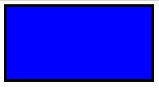

图 13.1. 我们的蓝色矩形

Canvas 2D API 提供了绘制几种基本形状的方法，包括：

*   矩形
*   弧
*   路径
*   文本
*   图像

W 指定画布尺寸为 300x150px。如果我们减小矩形的大小，你将看到画布内有一个矩形。例如，如果我们如下所示修改代码：

```
ctx.fillStyle="#0000FF";
ctx.fillRect(0,0,150,75);
```

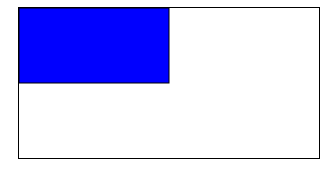

图 13.2. 调整大小后的矩形

画布本身保持为一个透明框，如你所见。由于我们在画布周围添加了黑色边框，你可以看到它的区域。如果没有边框，你将只能看到蓝色框，但画布仍然在那里。

记住，画布的 `width` 和 `height` 属性决定了像素坐标系的维度。如果你使用 CSS 指定不同的宽度或高度，画布图像将相应地压缩或拉伸。例如，如果我们在 CSS 中对画布应用 600px 的宽度和 300px 的高度，每个画布“像素”将是普通像素的两倍。

## 画布坐标与路径

Canvas 使用二维坐标网格。画布的左上角坐标为 (0,0)。右下角根据元素的大小具有正 x 和 y 坐标。在上面的示例中，我们使用了 300x150px 的画布尺寸，所以右下角的像素位于 (299,149)，因为坐标是从 0 开始的。

使用 `paths` 在画布上绘制线条。你通过使用 `moveTo()` 和 `lineTo()` 方法，结合 `ink` 方法之一（`stroke()` 或 `fill()`）来创建路径。`moveTo()` 和 `lineTo()` 定义了要绘制线条的起点和终点。`stroke()` 通过“描边”其轮廓来绘制形状，而 `fill()` 通过填充路径的内容区域来绘制实心形状。

所以，为了在我们创建的矩形上画一条简单的白色直线线：

```
ctx.strokeStyle = "#FFFFFF";
ctx.beginPath();
ctx.moveTo(0,0);
ctx.lineTo(300,150);
ctx.stroke();
```

`beginPath` 方法会擦除任何现有的路径绘制操作，为新路径做准备。`stroke()` 方法会物理上绘制你定义的路径。在这种情况下，它是一单条线。

### 绘制圆

现在让我们看看如何画圆。最简单的方法是使用 `arc` 来有效创建一个圆形路径，然后可以使用描摹方法（如 `stroke()` 或 `fill()`），如下所示：

```
ctx.beginPath();
ctx.arc(95,50,40,0,2*Math.PI);
ctx.stroke();
```

这里我们使用了 `arc` 方法（它仍然可以是路径的一部分）。参数指定了弧圆心的 x 和 y 坐标、弧的半径、起始角度和结束角度（以[弧度](http://en.wikipedia.org/wiki/Radian)为单位）。因此，我们创建了一个以坐标 95,50 为中心、半径为 40 像素、起始角度为 0、结束角度为 2*PI（或 360 度）。我们使用了 `stroke()` 方法绘制路径，我们得到了一个圆，如图 13.3 所示：

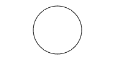

图 13.3. 绘制圆

如果你添加了 `fill()` 方法，你将得到一个用指定颜色填充的圆（默认为黑色），如图 13.4 所示：


图 13.4. 填充的圆

### 绘制文本

你可以使用这些方法在画布上绘制文本：

*   `font`——定义字体属性
*   `fillText(text,x,y)`——在画布上绘制文本
*   `strokeText(text,x,y)`——在画布上绘制文本的轮廓

这是一个示例：

```
ctx.font = "25px Arial";
ctx.fillText("HTML5 Canvas Rocks!",10,50);
```

这将使用 25 像素大小的 Arial 字体在坐标 (10,50) 处使用块文本绘制“HTML5 Canvas Rocks!”，如图 13.5 所示：


图 13.5. 在画布上写字

如果你现在将 `fillText()` 替换为 `strokeText()`，你将得到轮廓文本，如图 13.6 所示：

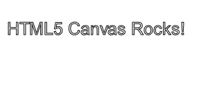

图 13.6. 描边文本

你还可以添加文本效果和颜色：

```
ctx.fillStyle= '#0000FF';
ctx.font="Italic 25px Arial";
ctx.fillText("HTML5 Canvas Rocks!",10,50);
```

这将使文本变为斜体并呈现蓝色，如图 13.7 所示：


图 13.7. 蓝色斜体文本

### 绘制三角形

让我们看看如何画一个三角形。由于没有内置的三角形形状绘制方法，我们需要使用路径来构造它。为了创建一个填充三角形，我们可以使用以下代码：

```
ctx.beginPath();
ctx.moveTo(25,25);
ctx.lineTo(105,25);
ctx.lineTo(25,105);
ctx.fill();
```

这应该创建一个填充的三角形，如图 13.8 所示：


图 13.8. 填充的三角形

创建一个描边的三角形：

```
ctx.beginPath();
ctx.moveTo(25,25);
ctx.lineTo(105,25);
ctx.lineTo(25,105);
ctx.closePath();
ctx.stroke();
```

注意 `closePath()` 方法；它通过绘制从当前点到初始点的直线来关闭路径。这将如图 13.9 所示：


图 13.9. 描边的三角形

这就是使用 HTML5 的 `canvas` 元素和 JavaScript 绘制形状的方法。现在你已经学习了基础知识，请练习不同的样式、字体和形状，以进一步习惯 JavaScript 代码。

### 画布尺寸

根据你使用 canvas 开发的内容，你可以调整尺寸以适应所使用的设备——例如，如果你需要填充屏幕的游戏。可以通过多种方式实现：

*   在 JavaScript 中编码
*   使用 CSS
*   使用 JavaScript 变换

### JavaScript 缩放

```
var canvas = document.getElementById('canvas');
canvas.width = window.innerWidth;
canvas.height = window.innerHeight;
```

这将创建一个扩展到当前视口大小的画布，但你需要确保元素没有边距或不受页面其他项目的影响。此外，更改浏览器窗口大小不会修改画布维度。

### CSS 缩放

```css
#canvas {
  position: relative;
  left: 0;
  right: 0;
  top: 0;
  bottom: 0;
  margin: auto;
  width: 100%;
  height: 100%;
}
```

这改变了画布框的大小，而不是像素维度；坐标系保持不变。


在本短章节中，我们将学习如何编写代码，告诉浏览器在不支持 `canvas` 渲染时应该如何处理。

## 创建替代内容

处理用户浏览器可能不支持 `canvas` 这种情况的最佳方法是在 `<canvas>` 标签内放置替代内容。这样可以避免用户在无法看到本应显示的内容时产生困惑。

你可以使用 `img` 标签、解释性文本或任何你认为对该替代内容必要的 HTML 标签。例如：

```html
<canvas id="MyCanvas" width="150" height="300">
  
</canvas>
```

如果浏览器支持 `canvas`，则 `img` 标签以及 `<canvas>` 和 `</canvas>` 标签之间的任何内容都将被忽略，且不会显示在文档中。

你希望回退内容有多用用取决于你的决定；你可以提供指向用户最新版本浏览器的链接，或者添加一个框架，允许你使用不同的技术（如 `SVG` 或 `Flash`）显示内容。

你也可以在 JavaScript 中使用 `getContext` 方法来检查对 `canvas` 的支持，例如：

```javascript
function supports_canvas() {
  return !!document.createElement('canvas').getContext;
}
```

或者，你可以在现有元素上使用 `getContext` 方法：

```javascript
var canvas = document.createElement("MyCanvas");
if (!canvas.getContext || !canvas.getContext("2d")) {
    alert("抱歉 - 不支持 canvas.");
}
else {
    // 开始绘制
    var ctx = canvas.getContext('2d');
}
```

# 第 15 章

### Canvas & SVG: Canvas 渐变

使用 HTML5 `canvas`，你不再局限于纯色，而是可以使用渐变来填充矩形和圆形等形状。你可以使用两种类型的渐变：

```javascript
// 创建线性渐变
createLinearGradient(x,y,x1,y1)
```


图 15.1. 线性渐变示例

```javascript
// 创建径向渐变
createRadialGradient(x,y,r,x1,y1,r1)
```


图 15.2. 径向渐变示例

让我们从创建一个线性渐变开始（画布上下文 `ctx` 已定义定义）：

```javascript
// 创建线性渐变
var grd = ctx.createLinearGradient(0,0,400,0);
grd.addColorStop(0,"blue");
grd.addColorStop(1,"yellow");

// 使用渐变填充
ctx.fillStyle = grd;
ctx.fillRect(40,20,300,160);
```

结果所示图 15.3。


图 15.3. 我们的蓝黄色线性渐变

第一行 `var grd = ctx.createLinearGradient(0,0,400,0);` 创建了一个 `CanvasGradient` 对象，它定义了两个组坐标 (x1,y1,x2,y2) 之间的渐变。这些坐标决定了渐变的大小和方向。在示例中，我们使用从 (0,0) 到 (400,0)，产生了一个宽度为 400 像素的水平渐变。如果我们的框更宽，最后一种颜色将相应延伸。

如果我们需要一个 300px 的垂直渐变，可以使用：

```javascript
var grd = ctx.createLinearGradient(0,0,0,300);
```

在 100x100px 空间内的 45 度对角渐变定义为：

```javascript
var grd = ctx.createLinearGradient(0,0,100,100);
```

我们现在可以使用 `addColorStop` 方法设置该渐变中某些**颜色停止点**（color stop）的颜色值。该方法接收两个值：

*   介于 `0`（线性渐变最左端）和 `1`（渐变最右端）之间的停止值
*   一种颜色

我们在停止值为 0（或坐标 (0,0)）处使用了 `"blue"`，在停止值为 1（或坐标 (400,0)）处使用了 `"yellow"`。浏览器使用这些值定义从蓝色到黄色的平滑颜色渐变。

你可以添加任意数量的渐变停止点。例如，在停止值为 0.5 处添加 `"red"` 颜色停止点将创建一个从蓝色到中间（200px）红色再到黄色黄色平滑渐变。

### 径向渐变

现在让我们来看径向渐变：

```javascript
// 创建径向渐变
var grd = ctx.createRadialGradient(150,100,10,180,120,200);
grd.addColorStop(0,"blue");
grd.addColorStop(1,"yellow");

// 使用渐变填充
ctx.fillStyle = grd;
ctx.fillRect(0,0,300,150);
```

`createRadialGradient` 的参数是：

*   起始圆的 x 和 y 坐标
*   起始圆的半径
*   结束圆的 x 和 y 坐标
*   结束圆的半径

结果所示图 15.3。


为了将视频绘制到 `canvas` 上，你需要为视频的 `onplay` 事件添加一个处理程序，该程序会复制当前的视频帧。

```
var canvas = document.getElementById('MyCanvas')
var ctx = canvas.getContext('2d');

// 设置画布尺寸与视频相同
video.onplay = function() {
    canvas.width = video.videoWidth;
    canvas.height = video.videoHeight;
    draw();
};

// 将帧复制到画布上
function draw() {
    if(video.paused || video.ended) return false;
    ctx.drawImage(video, 0, 0);
    setTimeout(draw, 20)
}

// 开始视频播放
video.play();
```

# 第 17 章

## Canvas & SVG：SVG 简介

SVG 代表 `Scalable Vector Graphics`（可缩矢量图形）。它允许你使用 XML 标记语言创建图形。SVG 已经存在很段时间，并且被大多数浏览器支持。与 Canvas 不同，它并不是为了像素操作设计的。它允许你创建可缩放的图形，并且由于它是`分辨率无关`的，因此非常适合可能在各种屏幕分辨率和尺寸上使用的项目。例如，SVG 是使用响应式网页设计（RWD）网站的理想选择。

事实上，SVG 在 RWD 中的应用是显而易见的，你甚至会疑惑为什么有些网站仍使用传统图像重新设计。SVG 在视网膜和其他高分辨率屏幕上也能完美显示。随着分辨率的提高，它们可能会被更广泛地使用。

SVG 使用易于访问的基于 DOM 节点的 API，非常适合那些熟悉 HTML、CSS 和一些 JavaScript 的人员。你可以使用 CSS 对其进行样式化，并使用 JavaScript 使其具有交互性；对于那些不是非常熟悉 JavaScript 的人，有很多库可以提供帮助。

与任何 Web 技术一样，SVG 一直不断变化，但它的许多功能可用于动画、变换、渐变、滤镜效果等。它在所有现代浏览器中都能工作——你可以在 [caniuse.com](http://caniuse.com/svg) 检查兼容性。

## 为什么使用 SVG 而不是 JPEG、PNG 或 GIF？

计算可以使用可以使用类型的图形：`位图`（bitmap）和`矢量`（vector）。位图（如 JPEG、PNG 和 GIF）也被称为`光栅图形`（raster graphics），由不同颜色的单个像素组成。相比之下，SVG 等矢量图形定义了路径和点；它们可以缩放大小并保持质量。这使得它们非常适合网络用途，例如：

* logo 标志
* 横幅
* 标牌
* 插画
* 线条画

SVG 图像相比位图图像具有几个固有优势：

* 由于 SVG 图像由文本组成，它们通常比位图图像更具可访问性且对搜索引擎友好。
* 矢量图还可以放在其他对象上方并设置为半透明，这样下方的对象仍然可见。
* 使用 SVG 创建的图形可以相对容易地编辑，并且可以结合 CSS 对输出进行样式化。这是目前传统位图图像无法实现的。
* SVG 图像的文件大小通常比位图图像小。

然而，尽管它们有很多优势，但就像生活中的许多事物一样，矢量图像并不是所有应用的完美解决方案。例如，你不太可能通过矢量图形产生看起来真实的照片。

你可以将 SVG 嵌入标准的 HTML 文档中，并可以使用任何文本编辑器创建 SVG 图像。不过，你可能更倾向于使用 Adobe Illustrator 或 [InkScape](http://inkscape.org/download/?lang=en)（开源矢量图形编辑器）来创建你的 SVG 图像。

现在你已经了解 SVG 是什么，让我们进入正题：学习如何使用它。

## 入门

要开始入门，你只需要使用一个基础的 HTML5 页面并将内联 SVG 代码直接放入其中即可。让我们从一个红圆圈的 SVG 图像开始：

```html
<!DOCTYPE HTML>
<html>
<body>
  <h1>A red circle:</h1>

  <!-- 内联 SVG -->
  <svg width="200" height="200" xmlns="http://www.w3.org/2000/svg">
    <circle id="redcircle" cx="100" cy="100" r="100" fill="red" />
  </svg>

</body>
</html>
```

保存该文件并在浏览器中打开它，你应该能看到一个标题为“A red circle:”且带有红色圆圈的页面。

SVG 部分由 `svg` 标签限定，该标签定义了页面上图像的为 200x200px。

尝试自己修改一些代码。`circle`元素通过各种属性指定了我们想要绘制的形状。`cx` 和 `cy` 属性定义了圆相对于绘制区域的中心；`r` 属性给出圆的半径。这意味着圆的直径（宽度）将显示为你设置的半径值的两倍。

你还可以给圆周围添加边框：

```html
<circle id="redcircle" cx="100" cy="100" r="100" 
stroke="black" stroke-width="1" fill="red"/>
```

### 其他形状

除了圆，通过在 `svg` 块内添加适当的标签创建其他形状也是简单的事情：

* **line**（直线）——创建一个简单的直线
    ```html
    <line x1="25" y1="150" x2="300" y2="150" 
    stroke="#F00" stroke-width="5" />
    ```
    
    图 17.1. 直线

* **polyline**（折线）——定义由多个线条定义构建的形状
    ```html
    <polyline points="0,40 40,40 40,80 80,80 80,120 120,120 120,160"
    stroke="#F00" stroke-width="5" fill="#FFF" />
    ```
    
    图 17.2. 折线

* **rect**（矩形）——创建一个矩形
    ```html
    <rect width="300" height="100" fill="#F00" />
    ```
    
    图 17.3. 矩形

* **ellipse**（椭圆）——创建一个椭圆
    ```html
    <ellipse cx="300" cy="80" rx="100" ry="50" fill="#F00"/>
    ```
    
    图 17.4. 圆

* **polygon**（多边形）——创建一个多边形
    ```html
    <polygon points="200,10 250,190 160,210"
    stroke="#000" stroke-width="1" fill="#F00" />
    ```
    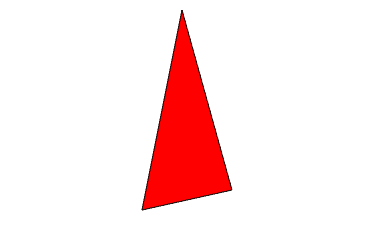
    图 17.5. （多边形）三角形

多边形在 `points` 属性中定义了一系列 x 和 y 坐标。这允许你创建具有任意边数的复杂形状。

```html
<polygon points="100,10 40,180 190,60 10,60 160,10" 
stroke="#000" stroke-width="1" fill="pink" />
```

图 17.6. 星形

* **path**（路径）——允许定义任意路径
`path`元素允许你使用特殊命令创建绘制。这些可以是大写或小写，适用于绝对和相对定位。它看起来很复杂，有很多选项，请参考[此 SitePoint 教程](http://www.sitepoint.com/svg-path/) 获取更多信息。

所有上面的形状都可以使用 `path` 创建。下面的代码使用 `path` 创建了一个分段圆，正如你在图 17.7 中所示，这对于创建饼图和类似的图形是完美的。

```html
<path d="M300,200 h-150 a150,150 0 1,0 150,-150 z"
fill="pink" stroke="red" stroke-width="3"/>
<path d="M275,175 v-150 a150,150 0 0,0 -150,150 z"
fill="purple" stroke="red" stroke-width="3"/>
```
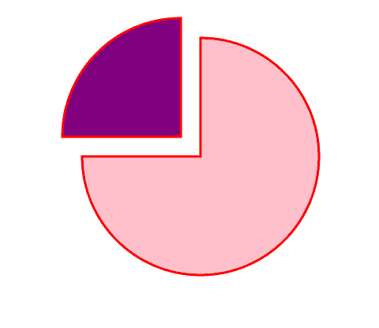
图 17.7. 路径

## 渐变与模式

与画布一样，SVG 允许你使用渐变和模式填充或描边形状。这是通过在 SVG 的 `defs` 部分创建诸如 `linearGradient` 和 `radialGradient` 等特殊的渐变标签来实现的。其他元素可以通过名称引用这些渐变并复用到任何形状上。

在 `svg` 中为圆添加线性渐变：

```html
<!-- 定义渐变 -->
<defs>
  <linearGradient id="MyGradient">
    <stop offset="10%" stop-color="yellow" />
    <stop offset="90%" stop-color="blue" />
  </linearGradient>
</defs>

<!-- 在圆中使用渐变 -->
<circle cx="100" cy="100" r="100" fill="url(#MyGradient)" />
```


现在在浏览器中打开它，你会发现现在有了一个蓝黄相间的圆圈。要将其变为径向渐变，只需使用 `radialGradient` 标签即可：

```xml
<!-- 定义渐变 -->
<defs>
  <radialGradient id="MyGradient">
    <stop offset="10%" stop-color="yellow" />
    <stop offset="90%" stop-color="blue" />
  </radialGradient>
</defs>

<!-- 在圆形中使用渐变 -->
<circle cx="100" cy="100" r="100" fill="url(#MyGradient)" />
```

### 模式

你还可以在 `pattern` 标签内创建重复设计。这定义了一系列 SVG 元素，可以用于填充区域：

```svg
<svg>
<defs>
<pattern id="mypattern" x="0" y="0" width="150" height="100" 
patternUnits="userSpaceOnUse">
  <circle cx="50" cy="50" r="10" fill="red" stroke="black"
/>
  <rect x="100" y="0" width="50" height="50" fill="cyan"   
stroke="red" />
</pattern>
</defs>
  <ellipse fill="url(#mypattern)" stroke="black"
stroke-width="1" cx="200" cy="200" rx="200" ry="200" />
</svg>

<!-- 定义模式 -->
<defs>
  <pattern id="mypattern" patternUnits="userSpaceOnUse" 
x="0" y="0" width="50" height="50">
    <circle cx="25" cy="25" r="25" fill="red" stroke="black" />
    <rect x="25" y="25" width="25" height="25" 
fill="cyan" stroke="red" />
  </pattern>
</defs>

<!-- 在圆形中使用模式 -->
<circle cx="100" cy="100" r="100" fill="url(#MyPattern)" 
stroke-width="1" stroke="black" />
```

保存上述代码并在浏览器中打开以查看结果，结果如图图 17.8 所示。现在你可以尝试使用各种形状和颜色渐变看看还能制作哪些其他模式。

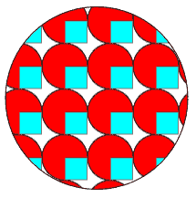

图 17.8. 模式填充

# 第 18 章：Canvas & SVG：使用 SVG

在现代浏览器中，SVG 可以用于任何通常使用 JPG、GIF 或 PNG 的地方。此外，它还具有添加颜色和渐变的能力，并且在缩放时不会损失质量，对于大多数设计师来说是一件令人兴奋的事情。

## 在页面上插入 SVG 图像

有几种方法可以向页面添加 SVG：

* 使用 `object` 标签
* 使用 `embed` 标签
* 在 `iFrame` 中使用
* 使用 CSS 背景
* 嵌入到 HTML5 页面中的内联 SVG
* 使用 `img` 标签

### 重要提示：使用 CSS 处理重复背景

只有 CSS 可以用于重复背景。其他方法将只显示单张图像。

### 你应该使用哪种方法？

这取决于具体的项目，但通常如果你打算使用 DOM 脚本在 JavaScript 中操作图像，则应该使用 `object` 或 `embed`。`iframe` 也可以用于相同目的，尽管代码会变得稍微繁琐。或者，如果你需要脚本但图像仅用于网站上的单个页面，那么内联 SVG 可能是合适的。

如果你只需要静态的 SVG，请使用 `img` 标签或 CSS 背景。这些方法不允许在客户端修改 SVG。

### 重要提示：SVG MIME 类型

你的 Web 服务器应该返回 MIME 类型为 `image/svg+xml` 的 SVG 图像。大多数服务器会自动处理这一点，但如果图像显示不正确，请双重检查。

让我们看看如何使用 `object` 方法，使用一个我们使用 Illustrator 或 Inkscape 等应用程序创建的 SVG 文件：

```xml
<object type="image/svg+xml" 
width="400" height="400" data="image.svg">
</object>
```

`embed` 标签与之类似，但 `embed` 直到 HTML5 才成为标准。某些旧版浏览器可能会忽略它，但大多数浏览器都实现了该标签：

```xml
<embed type="image/svg+xml" 
width="400" height="400" src="image.svg">
</embed>
```

`iframe` 像加载任何其他网页一样加载 SVG：

```xml
<iframe src="image.svg">
</iframe>
```

我们已经使用过直接添加到 HTML 页面中的内联 SVG 图像。这不会产生额外的 HTTP 请求，但仅对于非常小的图像或你不打算在其他地方使用的图像是实用的：

```xml
<svg width="200" height="200" xmlns="http://www.w3.org/2000/svg">
  <circle id="redcircle" cx="100" cy="100" r="100" fill="red" />
</svg>
```

`img` 标签与之前使用的任何标签相同：

```xml

```

最后，CSS 的 `background-image` 属性可以引用 SVG：

```css
#myelement {
  background-image: url(image.svg);
}
```

### SVG 工具和库

有很多用于创建和操作 SVG 图像的库、片段和实用工具。

Adobe 的 [Snap SVG](http://snapsvg.io/) 是一个生成交互式 SVG 的免费开源工具。

另一个很好的资源 [Bonsai](http://bonsaijs.org/) 提供了一个 JavaScript 库，带有片段和演示，帮助使用客户端代码修改 SVG 图像。

# 第 19 章：Canvas & SVG：SVG 曲线

贝塞尔曲线在图形软件中广泛广泛，有时被描述为[多项式](http://en.wikipedia.org/wiki/Polynomial)表达式，基本上用于描述曲线。有时，贝塞尔曲线被简单称为曲线，如果你不熟悉设计中所有常见（或不常见）的术语，这可能会稍微引起困惑。

贝塞尔曲线由控制点构建，如图图 19.1 所示。二次贝塞尔曲线有一个控制点，而三次贝塞尔曲线有两个。

## 二次贝塞尔曲线

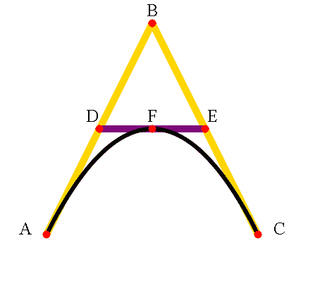

图 19.1. 二次贝塞尔曲线

现在让我们看看如何在 SVG 中创建整幅图像。使用你的文本编辑器保存以下代码，然后在浏览器中打开它，你应该看到一个 **A** 形状，带有一条弯线延伸到交叉形状的线条：

```html
<!DOCTYPE html>
<html>
<body>
<svg width="500" height="500"
xmlns="http://www.w3.org/2000/svg" version="1.1">

  <!-- 线条 -->
  <path id="lineAB" d="M 100 350 l 150 -30" stroke="gold" stroke-width="10"/>
  <path id="lineBC" d="M 250 50 l 150 300" stroke="gold" stroke-width="10"/>
  <path id="lineDE" d="M 175 200 l 150 0" stroke="purple" stroke-width="10"/>

  <!-- 二次曲线 -->
  <path d="M 100 350 q 150 -300 300 0" stroke="black"
stroke-width="6" fill="none" />

  <!-- 用红点标记点 -->
  <g stroke="red" stroke-width="5" fill="red">
    <circle id="pointA" cx="100" cy="350" r="3" />
    <circle id="pointB" cx="250" cy="50" r="3" />
    <circle id="pointC" cx="400" cy="350" r="3" />
  </g>

  <!-- 为每个点添加标签 -->
  <g font-size="25" font-family="sans-serif" fill="black" stroke="none"
text-anchor="middle">
    <text x="100" y="350" dx="-30">A</text>
    <text x="250" y="50" dy="-10">B</text>
    <text x="400" y="350" dx="30">C</text>
  </g>

</svg>
</body>
</html>
```

二次贝塞尔曲线由 `path` 标签定义：

```xml
<path d="M 100 350 q 150 -300 300 0" stroke="black"
stroke-width="6" fill="none" />
```

`d` 属性指示解析器移动到坐标 (100,350)。`q` 定义了两个相对于 (100,350) 的坐标。第一个是控制点 (150,-300)——等同于绝对位置 (450,50)。第二个是曲线的终点 (300,0)——等同于绝对位置 (400,350)。

或者，我们可以使用大写的 `Q` 来使用绝对而非相对坐标引用。

## 三次贝塞尔曲线

虽然二次贝塞尔曲线有一个控制点，但三次贝塞尔曲线有两个控制点。这允许创建更复杂的形状，这些形状可以改变方向或折叠自身。

以下代码提供了三个三次贝塞尔曲线示例：


```html
<!DOCTYPE html>
<html>
<body>
  <svg width="1200" height="500"
  xmlns="http://www.w3.org/2000/svg" version="1.1">

  <!--三次贝塞尔曲线 -->
    <path id="cubic1" d="M 100 350 c 150 -300 150 -300 300 0"
	stroke="red" stroke-width="5" fill="none"/>
    <path id="cubic2" d="M 450 350 c 200 -300 100 -300 300 0"
	stroke="red" stroke-width="5" fill="none"/>
    <path id="cubic3" d="M 800 350 c 100 -300 200 -300 300 0"
	stroke="red" stroke-width="5" fill="none"/>

  <!-- 显示控制点 -->
    <g stroke="blue" stroke-width="3" fill="blue">

      <!-- 左侧曲线 -->
      <circle cx="250" cy="50" r="3"/>

      <!-- 中间曲线控制点 -->
      <circle cx="650" cy="50" r="3"/>
      <circle cx="550" cy="50" r="3"/>

      <!-- 右侧曲线控制点 -->
      <circle cx="900" cy="50" r="3"/>
      <circle cx="1000" cy="50" r="3"/>

    </g>

  <!-- 文本 -->
    <g font-size="30" font="sans-serif" 
	fill="red" stroke="none" text-anchor="middle">

    <text x="250" y="50" dy="-10">
    两个控制点
    </text>

    <text x="650" y="50" dy="-10">
    CP1
    </text>
    <text x="550" y="50" dy="-10">
    CP2
    </text>

    <text x="900" y="50" dy="-10">
    CP2
    </text>
    <text x="1000" y="50" dy="-10">
    CP1
    </text>

    </g>

  </svg>
</body>
</html>
```

这将产生如图 19.2 所示的输出。

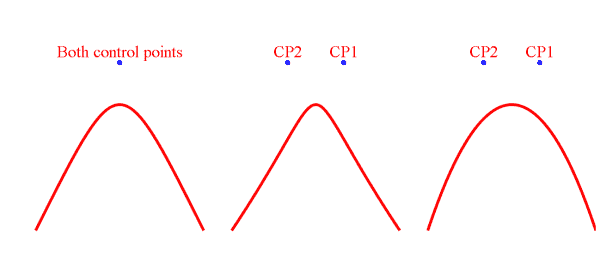

图 19.2. 三次贝塞尔曲线

让我们检查一下第三条曲线：

```html
<path id="cubic3" d="M 800 350 c 100 -300 200 -300 300 0"
stroke="red" stroke-width="5" fill="none"/>
```

`d` 属性指示解析器移动到坐标 (800,350)。'c' 定义了三个相对于 (800,350) 的后续坐标。第一个是起始控制点 (100,-300)——等于绝对位置 (900,50)。第二个是结束控制点 (200,-300)——等于绝对位置 (1000,50)。第三个是曲线在 (300,0) 处的终点——等于绝对位置 (1100,350)。

或者，我们可以使用大写的 'C' 指令来使用绝对坐标引用而不是相对坐标引用。

还有简写形式 'S'（绝对）和 's'（相对）指令。它们接受两个坐标：结束控制点和终点本身。起始控制点被认为与结束控制点相同。

这些命令可以根据控制点的位置来改变三次贝塞尔曲线的形状。可以试着玩一下，不要只在同一个浏览器窗口中查看结果，尝试调整它们的大小，在你的平板电脑或智能手机上查看它们，并惊讶于 SVG 如何完美地处理缩放。

幸运的是，有工具可以帮助你定义曲线指令。SitePoint 的 Craig Buckler 创建了[二次贝塞尔曲线工具](http://blogs.sitepointstatic.com/examples/tech/svg-curves/quadratic-curve.html)和[三次贝塞尔曲线工具](http://blogs.sitepointstatic.com/examples/tech/svg-curves/cubic-curve.html)，它们允许你移动控制点并复制/粘贴生成的 SVG 代码。

在下一章 中，我们将查看过滤器。

# 第 20 章

Canvas & SVG: SVG 过滤器效果

你可以在 SVG 中使用**过滤器效果**。如果你使用任何图形设计或照片处理包，那么你几乎肯定以前遇到过过滤器。SVG 中的过滤器包括：

* `feBlend`
* `feColorMatrix`
* `feComponentTransfer`
* `feComposite`
* `feConvolveMatrix`
* `feDiffuseLighting`
* `feDisplacementMap`
* `feFlood`
* `feGaussianBlur`
* `feImage`
* `feMerge`
* `feMorphology`
* `feOffset`
* `feSpecularLighting`
* `feTile`
* `feTurbulence`
* `feDistantLight`
* `fePointLight`
* `feSpotLight`

如果你用过图像编辑软件，你可能很熟悉过滤器的作用。本质上，它们对图像应用各种效果，如边框、模糊、软焦等。从本质上，将过滤器元素视为 Web 图像处理的一种形式。过滤器元素可以在大多数现代浏览器中使用，但 Blackberry 浏览器除外。关于过滤器可以做什么的示例，请查看微软的上手教程：[SVG 过滤器效果](http://ie.microsoft.com/testdrive/graphics/hands-on-css3/hands-on_svg-filter-effects.htm)。

## 使用过滤器效果

特别是如果你是过滤器的新手，最好一次测试一个过滤器，否则你可能会得到看起来非常奇怪的图像。要要全面了解过滤器，请查看 [SVG 过滤器](http://example.com/SVG/Filters) 页面。

以下是 `feGaussianBlur` 过滤器的示例，如图 20.1 所示。

```html
<!DOCTYPE html>
<html>
<body>
  <svg xmlns="http://www.w3.org/2000/svg" version="1.1">
    <defs>
      <filter id="f1">
        <feGaussianBlur stdDeviation="14"/>
      </filter>
    </defs>

    <circle cx="200" cy="200" r="200" stroke="red" stroke-width="5" fill="gold" filter="url(#f1)" />
  </svg>
</body>
</html>
```

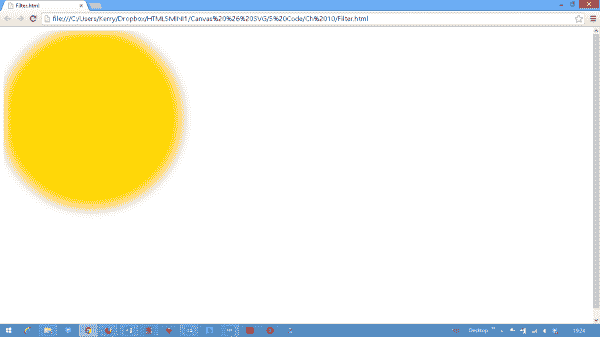

图 20.1. 带圆

### 玩转过滤器

正如你所见，你必须给过滤器一个 ID，以便稍在圆中指定：`filter="url(#f1)"`。与此过滤器相关的参数是 `stdDeviation`；它控制模糊程度。例如，如果你将 `stdDeviation` 设置为 `1`，你将得到极少的模糊。然而，如果你将其设置为（例如）200，那么它就会创建一个几乎透明的模糊效果。

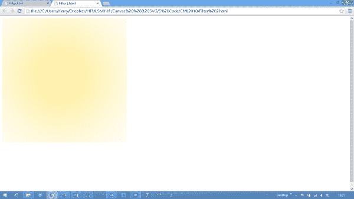

图 20.2. 一个非常模糊的圆

如果你应用较低的值，那么模糊效果就不会那么明显，并且允许描边看起来是橙色的，如图 20.3 所示。

让我们尝试组合过滤器效果。我们将使用 `feOffset` 过滤器创建一个投影阴影；这是通过获取相关图像或元素并在 x-y 平面上移动它来实现。我们将使用 `feBlend` 和 `feOffset` 元素，它们将创建一个与原始图像偏移的重复图像，从而产生一个图像位于另一个图像后面的效果，如图 20.4 所示。

```html
<!DOCTYPE html>
<html>
<body>
  <svg xmlns="http://www.w3.org/2000/svg" version="1.1">
    <defs>
      <filter id="f1" x="0" y="0" width="200%" height="200%">
        <feOffset result="offOut" dx="25" dy="20" />
        <feBlend in="SourceGraphic" in2="offOut" mode="normal" />
      </filter>
    </defs>

    <polygon points="220,10 300,210 170,250 123,234" fill="blue"
     stroke="purple" stroke-width="3" filter="url(#f1)" />

  </svg>
</body>
</html>
```

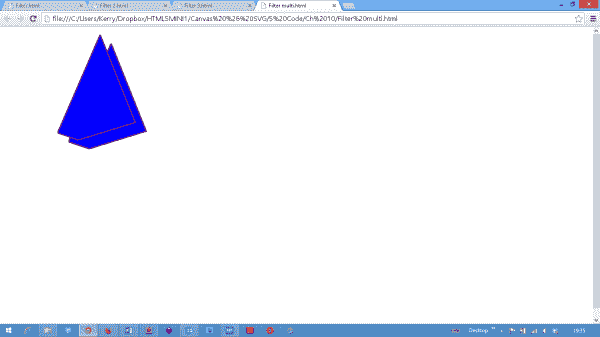

图 20.4. 使用多个过滤器

过滤器可以帮助创建出的效果。例如，如果我们对上面应用 `feGaussianBlur`，你就可以模糊背景图像以创建某种 3D 的效果。


### 注意：展望未来

SVG 过滤器技术将引入 CSS3，因此你将能够对任何 HTML 元素应用效果。

# 第 21 章

## Canvas & SVG：使用 Canvas 还是 SVG？

正如我们所看到的，`canvas` 和 `SVG` 都能实现类似的功能。那么你如何决定使用哪一个呢？

首先，让我们看看它们的定义：

* `SVG` 是 `Scalable Vector Graphics`（可缩矢量图形）的缩写，是一种在 `XML` 中描述图形的语言。
* 另一方面，`Canvas` 使用 `JavaScript` 动态绘制图形。

这并没有告诉我们它们之间的区别以及如何使用，所以让我们深入探讨。在 `SVG` 中，绘制的形状作为 `objects` 被记录，因此，如果该对象的属性发生变化，浏览器可以自动重新渲染形状。然而，由于 `canvas` 元素是逐像素绘制的，因此任何任何更改都需要重新绘制整个场景。

`SVG` 的所有元素在 `DOM` 中都是可用的，因此你可以轻松地为它们绑定 `JavaScript` 事件处理器。在大多数情况下，项目将决定你使用哪种元素，因此在规划阶段对此进行思考是值得的。

记住，`SVG` 是完全可扩展的，与 `canvas` 不同，因此如果你正在设计一个需要缩放图形的响应式网站，`SVG` 可能是一个更好的选择。

## 创建语言

要在 `canvas` 元素上创建图像，你只有一个选择：`JavaScript`。熟悉这种语言的人将占优势，但仍然需要学习绘制 API。然而，动画 `canvas` 图像的速度极快；你每秒可以绘制并动画数百个项目，因为该元素不受显示项目数量限制。这使其成为动作游戏的理想选择。

`SVG` 文件是 `XML`——这仅仅是结构化文本。它们可以在 `Illustrator` 或 `Inkscape` 等矢量图形软件包中预先准备，或者你可以使用任何语言在服务器上动态创建它们：`Node.js`、`PHP`、`Ruby`、`Python`、`C#`、`Java`、`BASIC`、`Cobol` 等。

你也可以使用熟悉的 `DOM` 和事件处理 API 在客户端并创建并操作 `SVG`。通常不需要重新绘制整个图像，因为对象是可访问的。遗憾的是，这比在 `canvas` 上移动位图要慢得多。`SVG`可能是动画条形图的理想选择，但不一定适用于快速移动的动作游戏。

## 典型用途

通常，`SVG` 适用于：

* 静态图像，特别是在响应式和流式布局中
* 可以缩放到任何尺寸且不损失的图像
* 受益于使用 `DOM` 方法附加事件和操作对象的项目
* 在服务器端创建图像的项目
* 对可访问性和 SEO 关重要的项目

`Canvas` 适用于：

* 位图图像、照片编辑或任何需要像素级操作的操作
* 必须动态创建并带有动画效果的图像
* 图形密集型应用程序，例如游戏

有时，并没有明显的最佳解决方案，两种技术都可以可以使用。记住，它们并不是互斥的；你可以在同一个页面上同时使用 `canvas` 和 `SVG`，例如在静态的 `SVG` 背景上覆盖多个动画化的 `canvas` 元素。唯一的限制是你的想象力。

希望你喜欢这本书，并准备好开始编写你自己的精彩示例。

感谢阅读，祝在使用 `canvas` 和 `SVG` 时玩得愉快！

# 第 22 章

## 离线应用：检测用户何时连接

构建可以在离线运行的应用，最困难的部分实际上是确定用户何时离线。

在本章中，我们将涵盖 `window` 对象的 `ononline` 和 `onoffline` 事件以及 `window.navigator.onLine` 属性。我们还将讨论它们的局限性以及一种测试连接性的替代方法。

## 判断用户是否在线

`window.navigator.onLine` 属性告诉我们用户是否连接到了网络。它返回一个布尔值 `true` 或 `false`：

```
if(navigator.onLine){
    console.log('We are connected!');
} else {
    console.log('We don't have connectivity.');
}
```

我们可以将此属性与其他离线 API 一起使用，以确定何时以及何时本地存储数据。一旦再次获得连接，我们将其同步到服务器。

每当 `navigator.onLine` 的值变化时，它会触发两个事件之一：

* `offline`：当 `navigator.onLine` 的值为 `false` 时
* `online`：当 `navigator.onLine` 的值为 `true` 时

我们当然可以监听这些事件，并在触发时采取行动。

## 监听连接状态的变化

在 Firefox、Internet Explorer 9+ 和 Safari 中，`online` 和 `offline` 事件在 `document.body` 对象上触发。然而，在 Chrome 和 Opera 15+ 中，它们是在 `window` 对象上触发的。

好消息是，即使在 `document.body` 上触发，这些 `online` 和 `offline` 事件也会“冒泡”到 `window` 对象。这意味着我们可以监听那里触发的事件，而不是为两者都设置事件监听器或处理器。

监听我们的 `online` 和 `offline` 事件有两种选项。我们可以使用事件属性 `onoffline` 和 `ononline`，如下：

```
 window.ononline = function(){
    // 通知用户连接已恢复。
    // 或者将本地数据与服务器数据同步。
 }

 window.onoffline = function(){
    // 通知用户连接已丢失。
    // 或者仅将数据保存到本地。
 }
```

或者我们可以使用 `addEventListener` 方法并监听 `online` 或 `offline` 事件：

```
window.addEventListener('offline', offlineHandler);
window.addEventListener('online', onlineHandler);
```

`addEventListener` 方法需要两个参数：我们想要监听的事件，以及事件发生时要调用的函数——称为回调函数。

为了兼容某些旧版本的 Firefox (<6.0) 和 Opera (<11.6)，你需要添加第三个参数。该参数告诉浏览器使用事件捕获（capture）还是冒泡（bubbling）。值 `true` 表示事件应该被捕获。值 `false` 表示事件应该冒泡。通常情况下，你应该将其设置为 `false`。

现代浏览器默认使用事件冒泡，使得这些参数在这些浏览器中是可选的。如果你想了解更多关于冒泡与捕获的区别，请阅读 Peter-Paul Koch 2006 年的文章《事件顺序》。

### Internet Explorer 8 中的在线和离线事件

此规则的例外是 Internet Explorer 8。IE8 在 `document.body` 对象上触发 `online` 和 `offline` 事件，但它们不会冒泡。此外，Internet Explorer 不支持 `addEventListener()`。你需要使用 `attachEvent()` 方法，或者使用一个平滑差异的 polyfill。

尽管如此，Internet Explorer 8 支持的离线应用唯一组件是 Web Storage（我们将在第 24 章介绍）。Internet Explorer 8 确实有一些特定厂商的存储功能，但为了推广 Web 标准并缩短本书的长度和复杂度，我们在这里不会介绍它们。

## `navigator.onLine` 的局限性

`navigator.onLine` 的缺点是：它是不可靠的。此外，它的工作方式取决于浏览器和操作系统系统。

Chrome、Safari、Opera 15+ 和 Internet Explorer 9+ 可以检测用户何时丢失网络连接。丢失或关闭 Wi-Fi 连接将会在这些浏览器中触发 `offline` 事件。重新连接将触发 `online` 事件。如果连接到互联网，`navigator.onLine` 的值为 `true`，否则为 `false`。


Opera 12（及旧版本）完全不会触发 `online` 或 `offline` 事件。然而，当用户断开网络时，它会向 `navigator.onLine` 返回 `false`，在连接时返回 `true`。

桌面版和笔记本电脑版的 Firefox 是一个特殊情况。它触发 `offline` 或 `online` 事件取决于用户的活动。当用户选择“离线工作”菜单选项时，Firefox 会触发 `offline` 事件；当用户取消时，会触发 `online` 事件。这与是否存在功能性的互联网连接完全无关。即使用户已经断开网络，只要用户没有选择离线工作，`navigator.onLine` 的值也将是 `true`。

然而，Android 版 Firefox 和 Firefox OS 的工作方式不同。这些版本的浏览器在连接性丢失或关闭（例如开启飞行模式）时会触发 `online` 和 `offline` 事件。

然而，所有浏览器都困难的地方在于存在*网络*连接但没有互联网连接的情况。如果浏览器可以连接到局域网，即使从局域网到更广泛的互联网的连接中断，`navigator.onLine` 的值也将是 `true`。

换句话之，`navigator.onLine` 属性可能无法告诉你你想知道的信息。因此，我们需要使用替代方案。

## 使用 `XMLHttpRequest` 检查连接性

确定连接性的更好方法是在网络请求时进行。我们可以使用 `XMLHttpRequest` 及其 `error` 和 `timeout` 事件来实现这一点。

在这个示例中，我们将尝试将表单的内容发送到服务器。如果没有连接，或者连接完成所需时间过长，我们将数据保存到 `localStorage` 中并通知用户。

首先，让我们定义 `error` 和 `timeout` 事件处理器：

```
var form = document.querySelector('form');
var xhrerrorhandler = function(errorEvent){
    var i = 0;
    // 如果有值，则保存它
    while(i < form.length){
        if(form[i].value != ''){
            localStorage.setItem(form[i].name, form[i].value);
        }   
        i++;
    }   
}
```

我们将为这两个事件使用同一个函数，因为我们想在两种情况下都执行相同的任务。该函数将每个表单字段名称保存为 `localStorage` 的键（key），并将每个字段对应的值保存为 `localStorage` 的值（value）。

接下来，让我们定义提交事件处理器。此函数将创建 XHR 请求，监控其是否失败，并添加我们的错误处理器：

```
submithandler = function(submitEvent){
    var fd, ls, i=0, key;

    // 阻止表单提交
    submitEvent.preventDefault();

    // 如果有 localStorage 数据，则根据它构建一个 FormData 对象
    // 否则，直接使用表单
    if( localStorage.length > 0){
        fd = new FormData();
        ls = localStorage.length;
        while(i < ls){
            key = localStorage.key(0);
            fd.append(key, localStorage.getItem(key));
            i++;
        }
    } else {
        fd = new FormData(form);
    }

    // 为慢连接设置超时
    xhr.timeout = 3000;
    xhr.open('POST','return.php');
    xhr.send(fd);

    // 设置我们的错误处理器。
    xhr.addEventListener('timeout', xhrerrorhandler);
    xhr.addEventListener('error', xhrerrorhandler);
}
form.addEventListener('submit', submithandler);
```

在此函数中，如果存在 `localStorage` 数据，我们将将其添加到 `FormData` 对象中。然后，我们将 `FormData` 对象作为请求的负载发送。

`FormData` 是 [XMLHttpRequest, Level 2 规范。](http://www.w3.org/TR/XMLHttpRequest/) 的一部分。它使用 `append()` 方法（`append(key,value)`）接受一系列键值对。或者，你也可以将表单对象作为参数传递给构造函数。在这里，我们根据是否向 `localStorage` 保存了任何内容做了这两种尝试。此演示更健壮的版本可以使用独立的功能来处理：一个用于发送表单数据，另一个用于与服务器同步。

如果服务器响应包含 HTTP 错误代码，这种方法将不起。你可以通过检查 XHR 响应中 `status` 属性的值来绕过这个问题，如下：

```
var xhronloadhandler = function(loadEvent){
    if( loadEvent.target.status >= 400){
        xhrerrorhandler();
    } else {
        // 解析响应。
    }
}
```

如果是 400 或更大——HTTP 错误代码从 400 开始——我们将数据保存数据。否则，解析响应。

## 你学到了什么

在本章中，我们讨论了 `navigator.onLine` 属性的优势和局限性，这是测试连接性的另一种方法。现在让我们讨论允许创建离线 Web 应用程序的浏览器功能和 API。在下一章中，我们将查看应用程序缓存。

# 第 23 章：离线应用：应用程序缓存

应用程序缓存（简称 AppCache）提供了一种本地保存应用程序资源的方法，以便在没有互联网连接的情况下使用它们。它特别适用于由 JavaScript 驱动并使用 `localStorage` 和 `IndexedDB` 等本地数据存储的“单页”应用程序。

AppCache 由两部分组成：称为 *manifest*（清单）的文本文件，以及用于脚本和帮助管理更新的 DOM 接口。在本章结束时，你将了解如何编写缓存清单文件、如何管理更新，以及使用此 API 时需要注意的一些方面。

### 注意：IE 中的 AppCache

Internet Explorer 9 或更低版本不支持应用程序缓存。你需要使用版本 10 或更高版本。有关支持 AppCache 的浏览器完整列表，请尝试 [CanIUse.com.](http://caniuse.com/#search=appcache)

## 缓存清单语法

缓存清单文件是文本文件，但它们必须遵守清单语法。让我们来看一个示例：

```
CACHE MANIFEST

# 这些文件将被保存到本地。这是一行注释。
CACHE:
js/todolist.js
css/style.css
```

每个缓存清单都必须以 `CACHE MANIFEST` 行开头。注释必须以 `#` 开头。注意每个文件也单独列出。

`CACHE:` 行是一个节头部。总共有四个定义的节头部：

*   `CACHE:` 明确哪些文件应该存储在本地
*   `NETWORK:` 明确说明哪些 URL 应该始终检索
*   `FALLBACK:` 指定当 URL 不可用时应该显示哪个本地可用文件
*   `SETTINGS:` 定义缓存设置

### 使用 `CACHE:` 节头部将文件保存到本地

`CACHE:` 是唯一的，因为它是一个可选的节头部——而且它是唯一的一个。我们的缓存清单示例也可以不带它来编写：

```
CACHE MANIFEST

# 这些文件将被保存到本地。这是一行注释。
js/todolist.js
css/style.css
```

在这种情况下，`js/todolist.js` 和 `css/style.css` 将被本地缓存，因为它们遵循了我们的 `CACHE:` 节头部。链接到我们清单的页面也会被缓存，尽管我们没有明确说明它应该被保存。


在这些示例中，我们使用的是相对 URL。我们也可以跨源缓存资源，但细节会稍微复杂一些。在最近版本的 Firefox 中，当它们共享相同的方案或协议（`HTTP` 或 `HTTPS`）时，你可以跨源缓存资源。例如，你可以将 `http://sitepoint.com` 的资源缓存到 `http://example.com` 上。你也可以将 `https://secure.ourcontentdeliverynetwork.com` 的资源缓存到 `https://thisisasecureurl.com` 上。在这些情况下，协议是相同的。你不能做的是通过 HTTP 缓存 HTTPS URL，反之亦然。当前版本的 IE、Safari、Chrome 和 Opera 允许无论方案如何进行跨源缓存。将 `http://sitepoint.com` 的资源缓存到 `https://thisisasecureurl.com` 是可以运行的。然而，这种行为可能会改变，因为它不符合规范。不要依赖它。尽管如此在写本文时，Chrome Canary ― 版本 33 ― 不允许从 HTTP 到 HTTPS 的跨源请求，反之亦然。

### 使用 `NETWORK:` 强制网络检索

`NETWORK:` 允许我们明确告诉浏览器它应该始终从服务器检索特定的 URL。例如，你可能希望一个同步数据的 URL 成为一个 `NETWORK` 资源。让我们更新之前的 manifest 文件以包含一个 `NETWORK` 节：

```
CACHE MANIFEST

# 这些文件将被保存到本地。这一行是注释。
js/todolist.js
css/style.css

NETWORK:
sync.cgi
```

任何对 `sync.cgi` 的请求将通过网络发出。如果用户离线，该请求将失败。

你还可以在网络部分使用通配符——或 `*` 字符。这告诉浏览器使用网络来获取任何在 `CACHE:` 部分中未显式列出的资源。部分路径配合通配符同样有效。

### 为不可用的 URL 指定替代内容

使用 `FALLBACK:` 节头部可以让你指定当 URL 因为连接问题而不可用时应该显示什么内容。让我们更新 manifest 以包含一个回退（fallback）节：

```
CACHE MANIFEST

# 这些文件将被保存到本地。这一行是注释。
CACHE:
js/todolist.js
css/style.css

FALLBACK:
status.html offline.html
```

回退部分的每一行都必须遵循 `<requested file name> <alternate file name>` 模式。在这里，如果用户在离线时请求 `status.html` 页面，他们将看到 `offline.html` 中的内容。

### 指定设置

到目前为止，只有一个设置是可以使用 `SETTINGS:` 节头部设置的，那就是缓存模式标记。缓存模式有两个选项：`fast` 和 `prefer-online`。`fast` 设置*始终*使用本地副本，而 `prefer-online` 则在网络可用时使用网络获取资源。

`fast` 模式是默认设置。你实际上不需要在 manifest 中设置它。这样做不会导致任何解析错误，但没有理由要添加它。

要覆盖此种行为，你*必须*使用 `prefer-online`，并将此添加到你的 manifest 文件的末尾：

```
SETTINGS:
prefer-online

NETWORK:
*
```

然而，这里有一个注意事项。主文件——即*拥有* manifest 的文件——仍然将从本地存储中检索。其他资源将从网络获取。

### 将 Cache Manifest 添加到你的 HTML 中

现在是 AppCache 最简单的部分：将其添加到你的 HTML 文档中。这需要在你的 `<html>` 标签中添加一个 `manifest` 属性：

```
<html manifest="todolist.appcache">
```

当页面加载时，浏览器将下载并解析此 manifest。如果 manifest 是有效的，浏览器还将下载你的资源。

你需要将 manifest 添加到每一个希望离线可用的 HTML 页面。将其添加到 `http://example.com/index.html` 不会让 `http://example.com/article.html` 可离线。

### 注意：验证你的 Manifest 语法

为了避免 manifest 文件出现问题，请使用验证器验证其语法是否正确，例如 [Cache Manifest Validator](http://manifest-validator.com/)。如果你熟悉 Python 和命令行，可以尝试 [Caveman.](https://pypi.python.org/pypi/caveman)。

### 托管 Cache Manifest

为了让浏览器识别并将你的 cache manifest 视为 manifest，它必须带有 `Content-type: text/cache-manifest` 标头提供服务。最佳实践是使用 `.appcache` 扩展（例如 manifest.appcache 或 offline.appcache），尽管这并非严格必要。没有这个标头，大多数浏览器将忽略该 manifest。请查阅你的服务器文档（或咨询你的网络托管支持团队）来了解如何设置它。

### 避免应用程序缓存的“陷阱”

如所述，AppCache 默认使用本地文件副本。这产生了更快速响应的用户界面，但也产生了两个初看之下*非常*令人困惑的问题：

*   未缓存的资源在缓存页面上不会加载，即使在在线状态下也是
*   更新资源不会更新缓存

没错：无论是否有新文件版本，即使使用户连接到网络，浏览器都会使用本地存储的文件。

### 解决陷阱 #1：从缓存文档中加载未缓存的资源

Application Cache 设计用于将 Web 应用程序变成自包含的实体。因此，它不智能地假设除非我们在 cache manifest 中另有说明，否则所有引用的资源都已缓存。浏览器将首先查找缓存，如果它们无法找到引用的资源，这些引用就会失效。

为了解决这个问题，请在你的 manifest 文件中包含 `NETWORK:` 节头部，并使用通配符（`*`）。通配符告诉浏览器，如果可用，则从网络下载任何相关的未缓存文件。

### 解决陷阱 #2：更新缓存

遺憾的是，如果你需要向用户推送更新，你不能简单地覆盖服务器上的现有文件。记住，AppCache 总是优先考虑本地副本。

为了刷新缓存中的文件，你需要更新 cache manifest 文件。当文档加载时，浏览器会检查 manifest 是否已更新。如果已更新，浏览器将重新下载 manifest 中列出的所有资源。

更新 manifest 的最好方法是设置并使用版本号。更改资源名称或添加注释也有效。当浏览器遇到修改后的 manifest 时，它将下载指定的资源。

尽管缓存会更新，但新文件只有在应用程序重新加载时才会被使用。你可以通过在 `updateready` 事件处理程序内部使用 `location.reload()` 来强制应用程序刷新。

### 缓存陷阱 #3：坏一处，坏全盘

使用 AppCache 时需要注意的另一点：任何资源失败都会导致整个缓存过程失败。“404 Not Found”、“403 Forbidden”和“500 Internal Server Error”响应都会导致资源失败，还可能导致缓存过程中服务器连接被中断。

当浏览器遇到这些错误中的任何一个时，`applicationCache` 对象将触发 `error` 事件并停止下载所有内容。我们当然可以监听此事件；但到目前为止，没有浏览器在错误消息中包含受影响的 URL。我们能做的最好就是提示用户发生了错误。

Safari、Opera 和 Chrome *确实*会在开发者控制台中报告失败的 URL。

### 测试对 Application Cache 支持

要测试支持情况，请使用以下代码：

```
var hasAppCache = window.applicationCache === undefined;
```

如果你打算使用多个 HTML5 特性，可能也想尝试 [Modernizr](http://modernizr.com/) 来检查所有特性。

除非你的应用程序通过编程与缓存交互，否则没有必要使用 JavaScript 测试 AppCache 支持。在不支持 Application Cache 的浏览器中，manifest 属性将被忽略。


既然我们已经讨论了 Application Cache 的语法以及它的一些特性，现在让我们聊聊它的 JavaScript API。虽然 AppCache 在没有 API 的情况下运行得很好，但你可以使用此 API 为应用程序的加载过程创建自定义的用户界面。创建这样的用户界面需要理解事件序列，并掌握一些 JavaScript。

### AppCache 事件序列

当浏览器加载并解析缓存清单（manifest）时，它会在 `applicationCache` 对象上触发一系列 DOM 事件。由于它们是 DOM 事件，我们将使用 `addEventListener` 方法来监听并处理它们。

当浏览器首次遇到 `manifest` 属性时，会触发一个 `checking` 事件。“Checking”意味着浏览器正在确定清单是否发生了变化，这表明应用程序正在更新。我们可以使用此事件向用户发送消息，告知我们的应用程序正在更新：

```javascript
var checkinghandler = function(){
    updatemessage('Checking for an update');
}
applicationCache.addEventListener('checking',checkinghandler);
```

如果之前没有下载过缓存，或者清单发生了变化（触发新下载），浏览器会触发 `downloading` 事件。同样，我们可以使用此事件向用户更新我们的进度：

```javascript
var downloadinghandler = function(){
   updatemessage('Downloading files');
}
applicationCache.addEventListener('downloading',downloadinghandler);
```

如果缓存清单文件自上次检查以来没有变化，浏览器将触发 `noupdate` 事件。如果有更新，浏览器将触发一系列 `progress` 事件。

每个事件都是一个对象。我们可以将此对象看作一个包含触发它的操作信息的容器。在 `progress` 事件中，有两个属性需要注意：`loaded` 和 `total`。`loaded` 属性告诉我们浏览器在下载队列中的位置，而 `total` 告诉我们需要下载的文件数：

```javascript
var downloadinghandler = function(event){
   var progress   = document.querySelector('progress');
   progress.max   = event.total;
   progress.value = event.loaded;
}
applicationCache.addEventListener('downloading',downloadinghandler);
```

第一次下载缓存时，如果一切顺利，浏览器会触发 `cached` 事件。缓存的更新将以 `updateready` 事件结束。

如果出现问题，浏览器将触发 `error` 事件。通常这发生在清单中列出的文件返回错误信息时。但如果清单找不到或无法访问、返回错误（例如“403 Forbidden”）或在更新期间发生变化，也会发生这种情况。

让我们来看一个使用简单待办列表的示例。

### 设置我们的缓存清单

首先，让我们定义清单文件：`todolist.appcache`。该文件告诉浏览器哪些文件需要缓存缓存：

```
CACHE MANIFEST
# revision 1

CACHE:
js/todolist.js
js/appcache.js
css/style.css
imgs/checkOk.svg
```

一旦浏览器遇到 `manifest` 属性，它将开始下载列出的文件以及主 HTML 页面。

## 设置我们的 HTML

为了设置应用程序，我们首先需要创建一个 HTML 文档。这是一个没有太多功能的单页应用，因此我们的标记将是极的：

```html
<!DOCTYPE html>
<html lang="en-us" manifest="todolist.appcache">
<head>
  <meta charset="utf-8">
  <title>To do list</title>
  <link rel="stylesheet" type="text/css" href="css/style.css">
</head>
<body>
  <section id="applicationstatus"></section>

  <section id="application" class="hidden">
    <form id="addnew">
      <p>
        <label for="newitem">
           你今天需要做什么？
        </label>
        <input type="text" id="newitem" required autofocus>
        <button type="submit" id="saveitem">Add</button>
      </p>
      <p>
       <button type="button" id="delete">Delete completed</button>
     </p>
    </form>
    <ul id="list"></ul>
  </section>

  <script src="js/appcache.js"></script>
</body>
</html>
```

### 设置我们的 CSS

为了设置应用程序，我们首先需要创建一个 HTML 文档。这是一个没有太多功能的单页应用，因此我们的标记将是极的：

```css
.hidden {
  display: none;
}
```

### 设置我们的 JavaScript

为了设置应用程序，我们首先需要创建一个 HTML 文档。这是一个没有太多功能的单页应用，因此我们的标记将是极的：

```javascript
var appstatus, app, progress;

appstatus = document.getElementById('applicationstatus');
app = document.getElementById('application');
progress = document.createElement('progress');

function updatemessage(string){
    appstatus.innerHTML = string;
}

var checkinghandler = function(){
    updatemessage('Checking for an update');
}
applicationCache.addEventListener('checking',checkinghandler);

var downloadinghandler = function(){
   updatemessage('Downloading files');
}
applicationCache.addEventListener('downloading',downloadinghandler);

function progresshandler(event){
   var progress = document.querySelector('progress');
   progress.max   = event.total;
   progress.value = event.loaded;
}
applicationCache.addEventListener('downloading',progresshandler);

function whendonehandler(event){
    appstatus.classList.add('hidden');
    app.classList.remove('hidden');
}
applicationCache.addEventListener('cached',whendonehandler);

var updatereadyhandler = function(){
    location.reload();
}
applicationCache.addEventListener('updateready',updatereadyhandler);
```


另一方面，使用 `sessionStorage` 存储的数据仅在浏览上下文有效时才存在。通常这意味着一旦用户关闭浏览器窗口或标签页，我们就会丢失 `sessionStorage` 数据。然而，在允许用户保存浏览会话的浏览器中，它可能会持续存在。

在本章中，我们将讨论 Web 相比于 Cookie 的的一些优势。然后我们将讨论如何使用 Web Storage API 并查看其的一些局限性。

## 为什么使用 Web Storage 而不是 Cookies？

使用 `localStorage` 或 `sessionStorage` 代替 Cookie 主要有三个原因：

* HTTP 请求性能
* 数据存储容量
* 针对跨站脚本攻击提供更好的保护

Cookie 会包含在每个指向服务器的请求中，这增加了每个请求的大小和持续时间。使用较小的 Cookie 有帮助，但使用 `localStorage` 和 `sessionStorage` 帮助最大。数据存储在本地，并仅在请求时发送。

使用 Web 存储的另一个优势是你可以存储更多数据。现代浏览器对每个域限制存储 50 个 Cookie。按照每个 Cookie 4 字节计算，在某些浏览器开始删除 Cookie 之前，我们可以安全地存储约 200KB 的数据。不，我们无法控制哪些数据被删除。另一方面，Web 存储的限制从 Safari 和 Android 的约 2.5MB 到大多数其他浏览器的约 5MB 不等。我们可以通过键删除数据。

最后，Web 存储比 Cookie 更不容易受到跨站脚本攻击的影响。Cookie 遵循同源策略。为 `.example.com` 设置的 Cookie 可以被 example.com 的任何子域名读取或覆盖，包括 `hackedsubdomain.example.com`。如果 `sensitivata.example.com` 也使用 `.example.com` Cookie，那么 `hackedsubdomain.example.com` 上的脚本就可以拦截该数据。

同源限制意味着只有创建数据的源才能访问该数据。由 `http://api.example.com` 写入 `localStorage` 的数据将对 `http://example.com`、`http://store.example.com`、`https://example.com` 甚至 `http://api.example.com:80` 不可用。

## 浏览器支持

在本书讨论的所有 API 中，Web Storage 在主流浏览器中的支持得最广泛。它适用于 Internet Explorer 8+、Firefox 3.5+、Safari 4+、Opera 10.5+ 以及 Android WebKit。有几个 polyfill 脚本可以在缺乏 Web Storage 的浏览器中模拟 Web Storage API。其中一个脚本是 [Remy Sharp 提供的 Storage polyfill。](https://gist.github.com/remy/350433)。它使用 Cookie 和 `window.name` 分别模拟 `localStorage` 和 `sessionStorage`。

### 检查 Web Storage

本章请使用 Chrome、Safari 或 Opera。这些浏览器的开发者工具允许你检查和管理 Web 存储值。在 Chrome（见图 24.1](#ch24.html_localstorage-inspector "Figure 24.1. Google Chrome 中的 Local Storage 检查器.")）、Safari 和 Opera 15+ 中，你可以在开发者工具的资源（Resources）面板下找到 Web 存储。在 Opera 12（Linux 用户可用的 Opera 版本）中，你可以在 Dragonfly 的存储（Storage）面板下找到它。

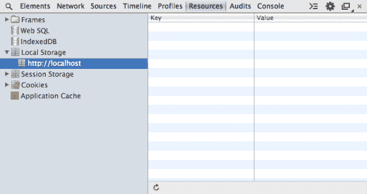

图 24.1. Google Chrome 中的 Local Storage 检查器。

## 测试 Web Storage 支持情况

`localStorage` 和 `sessionStorage` 都是 `window` 对象的属性。我们可以通过测试这些属性是否为 `undefined` 来测试浏览器支持情况：

```
if( typeof window.localStorage == 'undefined' ){
    // 使用 localStorage 以外的方法。
} else {
    // 保存键值对。   
}
```

测试 `sessionStorage` 的方式类似；改为使用 `typeof window.sessionStorage == 'undefined'`。但通常情况下，如果浏览器支持 `localStorage`，它也支持 `sessionStorage`，反之亦然。

让我们通过构建一个简单的待事项列表来学习 Storage API。我们将使用 `localStorage` 来保存待办事项及其状态。虽然我们在本章中关注 `localStorage`，但请记住这同样适用于 `sessionStorage`。只需交换属性名称即可。

## 设置我们的 HTML

基础的 HTML 轮纲非常简单。我们将设置一个包含输入字段和添加新项目按钮的表单。我们还会添加删除项目的按钮。并添加一个空列表。当然，我们还会添加指向 CSS 和 JavaScript 文件的链接。你的 HTML 看起来应该是这样：

```html
<!DOCTYPE html>
<html lang="en-us">
<head>
  <meta charset="utf-8">
  <title>localStorage 事项列表</title>
  <link rel="stylesheet" href="css/style.css">  
</head>
<body>
  <form>
    <p>
      <label for="newitem">你今天要做什么？</label>
      <input type="text" id="newitem" required>
      <button type="submit" id="saveitem">添加</button>
    </p>
    <p>
      <button type="button" id="deletedone">删除已完成</button>
      <button type="button" id="deleteall">重置列表</button>
    </p>
  </form>
  <ul id="list"></ul>
  <script src="js/todolist.js"></script>
</body>
</html>
```


如果键已经存在，使用 `setItem` 将覆盖旧值而不是创建新记录。对于我们的待办事项列表来说，这正是我们需要的。为了防止您的键值被覆盖，请在保存项目之前检查该键是否存在。

正如我们在下一节将看到的，我们还将使用 `setItem` 在任务被点击时更新其状态。

## 使用 `localStorage.getItem()` 获取值

要检索键的值，我们使用 `localStorage.getItem()`。该方法接受一个参数，即我们想要检索的值的键名，该键必须是一个字符串。

如果该键存在，`getItem` 将返回该键的值。否则，它将返回 `null`。这使得它在调用 `setItem` 之前确定键是否存在非常有用。例如，如果我们想测试 `lunch` 键是否存在，我们可以执行以下操作：

```
if( localStorage.getItem('lunch') ){
    // do something.
}
```

在我们的案例中，我们将使用 `getItem` 来获取任务的状态。根据 `getItem` 返回的值，我们将使用 `setItem` 更新键的值。

在下面的代码中，我们为无序列表添加了事件监听器，而不是为每个列表项添加。我们正在使用一种被称为**事件委托**的技术。当事件在元素上触发时，它会“冒泡”到它的祖元素。这意味着可以在父元素上设置监听器，并使用事件对象的 `target` 属性来确定哪个元素触发了事件。由于我们只想在点击的元素是列表项时执行操作，我们需要检查 `target` 对象的 `nodeName` 属性：

```
function toggleStatus(event){ 
    var status; 
    if(event.target.nodeName == 'LI'){
        /* 
        使用 + 是将数字字符串转换为数字的技巧。
        */
        status = +localStorage.getItem(event.target.textContent);
        if(status){ 
            localStorage.setItem(event.target.textContent,0);                     
        } else {            
            localStorage.setItem(event.target.textContent,1);
        }
	    /* 切换 'done' 类 */
        event.target.classList.toggle('done');
    }
}

var list = document.getElementById('list');   
list.addEventListener('click',toggleStatus);
```

`event.target` 属性是指向被点击元素的指针。每个元素对象都有一个 `textContent` 属性，如果适用，它是它的子文本。每个列表项的 `textContent` 与一个 `localStorage` 键匹配，因此我们可以使用它来检索我们想要的值。这就是我们通过 `status = localStorage.getItem(event.target.textContent)` 所完成的。

### 注意：`localStorage` 的键和值都是字符串

记住，所有 `localStorage` 的键和值都是字符串。看起来像数字的实际上是*数字字符串*。为了与数字或布尔值进行比较，你需要转换变量类型。在这里，我们使用 `+` 号将每个键的值转换为数字。0 是一个**假值**（falsy），等于但不等于布尔 `false`；1 是一个**真值**（truthy）。

### 设置和获取项目的替代语法

使用 `setItem` 和 `getItem` 不是设置或检索 `localStorage` 值的唯一方法。你也可以使用方括号语法或点语法来添加和删除它们：

```
localStorage['foo'] = 'bar'; 

console.log(localStorage.foo) // 在控制台打印 'bar'
```

这等同于使用 `localStorage.setItem('foo','bar')` 和 `localStorage.getItem('foo')`。但是，如果你的键可能包含空格，请坚持使用方括号语法或使用 `setItem()`/`getItem()`。

## 遍历存储项目

在页面重新加载时，我们的待办事项列表将是空的。它们仍然存在于 `localStorage` 中，但不是 DOM 树的一部分。为了解决这个问题，我们必须通过遍历我们的 `localStorage` 项目集合来重建待办事项列表，最好在页面加载时进行。这就是 `localStorage.key()` 和 `localStorage.length` 派上用场的地方。

`localStorage.length` 告诉我们存储区域中有多少项目。`key()` 方法检索指定索引处项目的键名。它接受一个参数：一个大于等于 0 且小于 `length` 值的整数值。如果参数小于 0 或大于等于 `length`，`localStorage.key()` 将返回 `null`。

索引和键之间的关系非常松散。每个浏览器对键的排序方式不同。此外，给定索引处的键和值会随着项目的添加或删除而改变。要检索一个*特定的*值，`key()` 是一个糟糕的选择。但对于遍历条目，它是完美的。示例如下：

```
var i = localStorage.length;
while( i-- ){ /* 只要 i 不是 0，该条件为真 */
    console.log( localStorage.key(i) );
}
```

这将存储区域中的每个键都打印到控制台。如果我们想打印值，可以使用 `key()` 获取键名，然后将其传递给 `getItem()` 来获取对应的值：

```
var i = localStorage.length, key;
while( i-- ){ 
    key = localStorage.key(i);
    console.log( localStorage.getItem(key) );
}
```

回到我们的待办事项列表。我们有一个添加新项目并标记其完成的机制。但如果刷新页面，什么都不会发生。我们的数据在存储区域中，但不在页面上。

我们可以通过为 `window` 对象的 `load` 事件添加监听器来修复此。在事件处理器内部，我们将使用 `localStorage.length` 和 `localStorage.key()` 结合 `localStorage.getItem(key)` 来重建待办事项列表：

```
function loadList(){
    var len = localStorage.length;
    while( len-- ){
        var key = localStorage.key(len);    
        addItemToList(key, localStorage.getItem(key));
    }
}
window.addEventListener('load', loadList);
```

由于我们在这个循环中处理的是现有项目，我们想要保留这些值。让我们稍微调整一下 `addItemToList` 函数来完成这一点：

```
function addItemToList(itemtxt, status){
    var li = document.createElement('li');

    if(status === undefined){
        status = 0;
        localStorage.setItem(itemtxt, status);
    }

    if(status == true){ li.classList.add('done'); }

    li.textContent = itemtxt;
    list.appendChild(li);
}
```

我们添加了一个 `status` 参数，这为我们提供了指定任务是否完成的方法。当我们添加任务并调用此项时，我们将省略 `status` 参数；但当我们像这里这样从存储加载项目时，我们会包含它。

`if(status == true){ li.classList.add('done'); }` 这一行会在我们的任务状态为 `1` 时为列表项添加一个 `done` 类。

## 使用 `localStorage.clear()` 清除存储区域

要完全清除存储区域，请使用 `localStorage.clear()` 方法。它不接受任何参数：

```
function clearAll() {
  list.innerHTML = '';
  localStorage.clear();
}
```

一旦调用，它将从存储区域移除*所有*键及其值。一旦移除，这些值将不再供应用程序使用。**谨慎使用**。

## 存储事件

当存储区域发生变化时，window` 对象上会触发存储事件。当 `removeItem()` 或 `clear()` 删除一个或多个项目时就会发生这种情况。当 `setItem()` 设置新值或更改现有值时也会发生。

### 监听存储事件

要监听 `storage` 事件，请为 `window` 对象添加事件监听器：

```
window.addEventListener('storage', storagehandler); 
```

我们的 `storagehandler` 函数将在存储事件触发时被调用。我们还没有定义该函数——稍后我们会处理。首先，让我们来看 `StorageEvent` 对象。

### `StorageEvent` 对象

我们的回调函数将接收一个 `StorageEvent` 对象作为参数。`StorageEvent` 对象包含了所有对象通用的属性，以及五个特定于其类型的属性：


- `key`:包含保存到存储区域的键名
- `oldValue`:包含该键的旧值，如果是第一次设置具有该键的项，则为 `null`
- `newValue`:包含操作期间添加的新值
- `url`:包含引发此项更改的页面 URL
- `storageArea`:指示受更新影响的存储对象―`localStorage` 或 `sessionsStorage`

通过这些属性，你可以更新界面或向用户通报操作状态。在这种情况下，我们将使用 `location.reload()` 静默地刷新其他标签页/窗口中的页面。

```
function storagehandler(event){
    location.reload();
}
```

现在，我们的列表在所有标签页中都是更新过的。

### 跨浏览器的存储事件

存储事件有点复杂，且在大多数浏览器中的工作方式可能与你预期的不同。`storage` 事件并不是在*当前*窗口或标签页中触发，而应该是在共享相同存储区域的*其他窗口和标签页*中触发。假设用户在两个标签页中打开了 `http://ourexamplesite.com/buy-a-ticket`。如果他们在第一个标签页中采取了更新存储区域的操作，那么 `storage` 事件将应该在第二个标签页中触发。

Chrome、Firefox、Opera 和 Safari 符合 Web 存储规范，而 Internet Explorer 则不。相反，Internet Explorer 会在每次更改（包括当前窗口）时在每个窗口中触发 `storage` 事件。

目前没有一种良好且无需黑科技（hack-free）的方法来解决这个问题。目前，重新加载应用程序―如我们上面所做的―是跨浏览器的最佳选择。

### 注意：IE 的非标准 `remainingSpace` 

Internet Explorer 在其 `localStorage` 对象上包含一个非标准的 `remainingSpace` 属性。我们可以根据 `localStorage.remainingSpace` 是否为 `undefined` 来区别地处理存储事件。不过，这种方法存在风险；微软可能会在不修复存储事件 Bug 的情况下移除 `remainingSpace` 属性。

### 确定哪个方法触发了存储事件

没有简单的方法可以确定是 `setItem()`、`removeItem()` 还是 `clear()` 中的哪一个触发了存储事件。但有一种方法：检查事件属性。

如果 `storage` 事件是由调用 `localStorage.clear()` 引起的，那么该对象的 `key`、`oldValue` 和 `newValue` 属性都为 `null`。如果是 `removeItem()` 触发的，`oldValue` 将匹配被删除的值，且 `newValue` 属性将为 `null`。如果 `newValue` 不是 `null`，那么可以确定 `setItem()` 是被调的方法。

## 存储数组和对象

正如本章前面提到的，Web 存储键和数组必须是字符串。如果你尝试保存对象或数组，浏览器会将它们转换为字符串。这可能会导致意想不到的结果。首先，让我们来看保存数组：

```
var arrayOfAnimals = ['cat','dog','hamster','mouse','frog','rabbit'];

localStorage.setItem('animals', arrayOfAnimals);

console.log(localStorage.animals[0])
```

如果我们查看 Web 存储检查器，可以看到我们的动物列表已保存到 `localStorage` 中，如图 24.3 所示。

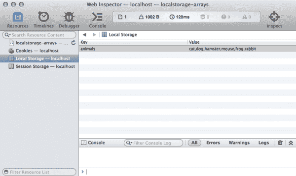

图 24.3. 在 Safari 开发者工具中以字符串保存到 Web 存储的数组

但如果你尝试读取该数组的第一个项，你会发现第一个项是字母 `C`，而不是我们数组中的 `cat`。相反，它被转换为了逗号分隔的字符串。

同样，当对象被转换为字符串时，它会变成 `[object Object]`。你丢失了所有的属性和值，如图 24.4 所示。

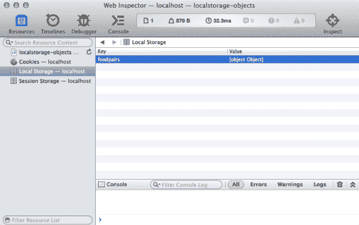

图 24.4. 在 Safari 开发者工具中将对象保存到 Web 存储的结果

为了防止这种情况发生，请使用原生 `JSON.stringify()` 方法在保存之前将你的对象和数组转换为字符串：

```
var foodcouples = {
  'ham':'cheese',
  'peanut_butter':'jelly',
  'eggs':'toast'
}

localStorage.setItem(
  'foodpairs_string',
  JSON.stringify(foodcouples)
);
```

使用 `JSON.stringify()` 将*序列化*数组和对象。它们会被转换为特殊格式的字符串，其中包含索引或属性及其值，如图 24.5 将对象保存到 Web 存储")所示。

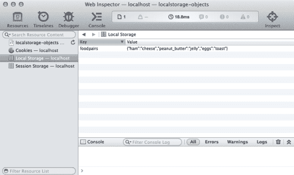

图 24.5. 在 Safari 开发者工具中使用 `JSON.stringify()` 将对象保存到 Web 存储

要检索这些值，请使用 `JSON.parse()` 将其转换回 JavaScript 对象或数组。提醒一下：`JSON.parse()` 和 `JSON.stringify()` 可能会影响应用程序的性能。请谨慎使用，特别是在获取和设置项时。

```
 try {
    localStorage.setItem('keyname',value);
    return true;
} catch (error) {
    // 也可以更新 UI。
    console.log(error.message); 
}
```

## Web 存储的局限性

Web 存储有两个局限性：性能和容量。

Web 存储是*同步的*。读取和写入会立即添加到 JavaScript 处理队列中。在引擎完成对存储区域的写入或读取之前，队列中的其他任务不会完成。对于小数据，这通常不是问题。但对于大数据或大量的写入操作，就会有问题。

Web 存储还有大小限制。如果你的应用程序达到了该限制，浏览器将抛出 `DOMException` 错误。使用 `try-catch` 语句来捕获并处理此错误。在支持的浏览器中，你还可以使用 `window.onerror`（或使用 `addEventListener` 和 `error` 事件）：

限制取决于浏览器和版本。Web 存储规范建议每个源初始大小为 5MB。然而，Safari 目前允许每个源存储 2.5MB 数据。Chrome、Internet Explorer 和 Opera 15+ 目前存储 5MB 数据。Firefox 默认存储 5MB，但用户可以在 `about:config` 菜单中调整此限制。旧版本的 Opera（12 及以下）会提示用户提高存储限制。

好消息是，这些值可能会增加。坏消息是，大多数浏览器未能向应用程序暴露可用的存储空间量。

现在我们已经涵盖了 Web 存储的细节，让我们来看 Web 数据库：IndexedDB。

# 第 25 章：离线应用：使用客户端数据库存储数据

Web 存储（`localStorage` 和 `sessionStorage`）对于像待办事项这样的小量数据很好，但它是非结构化数据存储。你可以存储键和值，但无法轻松搜索值。数据没有按照特定方式组织或排序，此外，5MB 的存储限制对于某些应用程序来说太小了。

对于大量的结构化搜索数据，我们需要另一个选项：Web 数据库。Web SQL 和 IndexedDB 等 Web 数据库提供了 Web 存储限制的替代，让我们能够创建真正的离线应用。

## 客户端数据库现状

遗憾的是，这听起来并不简单。浏览器在支持客户端数据库方面分为三个阵营：

- 同时支持 IndexedDB 和 Web SQL (Chrome, Opera 15+)
- 仅支持 IndexedDB (Firefox, Internet Explorer 10+)
- 仅支持 Web SQL (Safari)


如果你计划支持移动浏览器，那么 IndexedDB 可能并不是一个可行的选择。iOS 上的 Safari 和 Opera Mobile 11-12 仅支持 Web SQL；旧版本的 Android 和 Blackberry 浏览器也是如此。

如果你想让你的应用程序能够在桌面浏览器上运行，那么使用 Web SQL 已经完成了一大半的工作。它在 Safari、Chrome 和 Opera 15+ 中可用，但 Firefox 和 Internet Explorer 10+ 没有添加支持的计划。

问题在于：万维网联盟（W3C）已经停止了 Web SQL 规范的工作。因此，存在浏览器放弃 Web SQL 支持的风险，或者进一步的发展将以非标准的方式进行。依赖它是有风险的，因此在本章中，我们将重点关注 IndexedDB，并使用 polyfill（填充方案）来支持 Safari 和旧版本的 Opera。

好的一面是，有一些 JavaScript polyfill 程序和库可以弥补 Web SQL 和 IndexedDB 之间的差异。[Lawnchair](http://brian.io/lawnchair/) 同时支持两者，如果你愿意，它也可以使用 `localStorage`。还有 [PouchDB,](http://pouchdb.com/)，它使用自己的 API 来平滑 Web SQL 和 IndexedDB 之间的差异。PouchDB 还支持与 CouchDB 服务器同步，尽管在使用 PouchDB 构建应用时并不需要 CouchDB。

在本章中，我们将专注于 IndexedDB，并使用 [IndexedDBShim](http://nparashuram.com/IndexedDBShim/) 来处理其他浏览器。

## 关于 IndexedDB

IndexedDB 是一个无模式、事务型的键值对存储数据库。IndexedDB 数据库中的数据缺乏你在 MySQL 或 PostgresSQL 中常见的那种严格、规范化的表结构。相反，每条记录都有一个键，每个值都是一个对象。它是一个客户端“NoSQL”数据库，更类似于 CouchDB 或 MongoDB。对象可以具有任意数量的属性。例如，在一个待事项应用程序中，某些对象可能有 `tags` 属性，而某些则可能没有，如图 25.1 所示。

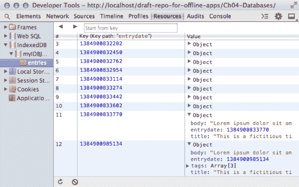

图 25.1 带有和不带 `tags` 属性的对象

同一数据库中的两个对象甚至可以完全不同的属性。通常，我们希望为对象的属性名称使用命名规范。

IndexedDB 还是**事务型的**。如果读或写操作的任何部分失败，数据库将回滚到之前的状态。这些操作被称为**事务**，并且必须在回调函数内部执行。这有助于确保数据完整性。

IndexedDB 有两个 API：同步和异步。在同步 API 中，方法会在操作完成后返回结果。该 API 只能在 [Web Workers](http://en.wikipedia.org/wiki/Web_worker) 中使用，在这些地方同步操作不会阻塞应用程序的其他部分。在编写本文时，浏览器尚尚不支持同步 API。

在本章中，我们将涵盖异步 API。在这种模式下，操作会立即返回结果，而不会阻塞调用线程。每个支持 IndexedDB 的浏览器都提供了异步 API 支持。

书中的示例使用了最新版本的 [IndexedDB](http://www.w3.org/TR/IndexedDB/) 规范。Chrome（23 及更早版本）和 Firefox（16 及更早版本）中的旧版本 IndexedDB 需要厂商前（vendor prefix）。这些实验性版本之间存在许多不一致之处，这些通过规范过程得到了很好的解决。由于标准化 API 在 Firefox 和 Chrome 中已发布多个版本，并且在 Internet Explorer 10+ 中可用，我们不再去理会旧版本。

### 注意：检查 IndexedDB 记录

如果你想检查你的 IndexedDB 记录，请使用 Chrome 或 Opera 15+。这些浏览器目前拥有检查 IndexedDB 对象存储的最佳工具。通过 IndexedDBShim，你可以使用 Safari 的检查器查看 Web SQL 中的这些数据，但其结构可能不完全相同。Internet Explorer 提供了一个 [IDBExplorer 包](http://ie.microsoft.com/testdrive/HTML5/newyearslist/IDBExplorer.zip) 来调试 IndexedDB，但它的开发者工具中缺乏原生支持。Firefox 开发者工具尚未支持数据库检查。

现在，让我们通过创建一个日志应用程序来记录日记条目，来看 IndexedDB 的概念。

## 设置我们的 HTML

在深入研究 IndexedDB 之前，让我们为我们的日志应用构建一个非常简单的界面：

```
<!DOCTYPE html>
<html lang="en-us">
<head>
  <meta charset="utf-8">
  <title>IndexedDB Journal</title>
  <link rel="stylesheet" type="text/css" href="css/style.css">
</head>
<body>
<form>
  <p>
    <label for="tags">你想如何给这条条目打标签？</label>
    <input type="text" name="tags" id="tags" value="" required>
    <span class="note">(可选。用逗号分隔标签。)</span>
  </p>
  <p>
    <label for="entry">今天发生了什么？</label>
    <textarea id="entry" name="entry" cols="30" rows="12" required>
    </textarea>
    <button type="submit" id="submit">保存条目</button>
  </p>
</form>

 <section id="allentries" class="hidden">
  <h1>查看所有条目</h1>
 </section>

<script src="js/IndexedDBShim.min.js"></script>
<script src="js/journal.js"></script>
</body>
</html>
```

这为我们提供了一个非常简单的界面，由两个表单字段和一个“保存条目”的按钮组成，如图 25.2 所示。我们还添加了一个视图，在我们保存完最新的条目后显示所有条目。该应用程序的生产级版本可能会有更多屏幕，但对于这个演示来说足够了。

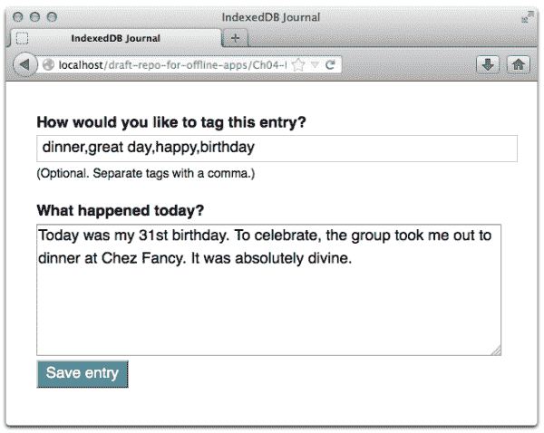

图 25.2 在 Firefox 中所示的简单日志界面。

## 创建数据库

要创建数据库，请使用 `open()` 方法。它接受两个参数：数据库名称以及一个可选的整数值，用于设置数据库的版本号：

```
var idb = indexedDB.open('myIDBJournal',1);
```

你的数据库名称可以是任何字符串值，包括空字符串（''`）。名称只是将数据库绑定到源。与 `localStorage` 一样，IndexedDB 数据库只能由共享相同源的脚本读取或写入。记住，一个源由方案（例如 `http://` 或 `https://`）、主机名和端口号组成。这些必须完全匹配，这意味着在 `http://example.com` 创建的数据库无法被 `http://api.example.com` 的脚本访问，反之亦然。

版本号可以是从 1 到 2⁵³ 之间的任何整数（即 9,007,199,254,740,991）。浮点数或小数不起作用。浮点数将被转换为整数。例如，2.2 变成 2，0.8 变成 0（并抛出 `TypeError`）。如果你不包含版本号，浏览器将使用 1。

如果 `open` 操作成功，浏览器将触发 `success` 事件。我们可以使用 `onsuccess` 回调来执行事务，或者像我们在这里所做的，用它将数据库对象赋值给全局变量：

```
// 初始化变量。
var databaseObj;
idb.onsuccess = function(successEvent){
    // 设置它的值。
    databaseObj = successEvent.target.result;
}
```

与所有的 DOM 事件一样，我们的 `successEvent` 对象包含一个 `target` 属性。在这种情况下，目标是我们的 `open` 请求事务。`target` 属性也是一个对象，包含一个 `result` 属性，它是我们事务的结果。在这种情况下，`result` 的值就是我们的数据库。

这是一个非常重要的理解要点。*每个事务都需要一个 `onsuccess` 处理器*。该事务的结果始终是目标对象的子属性，而它是事件对象的属性（`event.target.result`）。


现在我们已经将全局变量 `databaseObj` 设置为我们的数据库对象，就可以使用 `databaseObj` 来执行事务了。

## 添加对象存储

创建数据库不会让它自动执行任何操作。要开始存储数据，你必须至少创建一个 `object store`（对象存储）。如果你熟悉 SQL 数据库，对象存储类似于 SQL 表。对象存储是我们存储 `records`（记录）或条目的的地方。IndexedDB 数据库可以包含多个对象存储。

要添加对象存储，我们首先需要触发 `version change`（版本更改）。要触发版本更改，版本参数（第二个参数）需要大于数据库当前的版本值。对于应用程序的首次发布，此值可以设为 `1`。

当数据库版本号增加（或首次设置）时，浏览器将触发 `upgradeneeded` 事件。任何结构性更改——添加对象存储、向对象存储添加索引——都必须在 `onupgradeneeded` 事件处理方法中进行：

```
idb.onupgradeneeded = function(event){
    // Change the database.
}
```

让我们创建一个名为 `entries` 的对象存储。为了做到这一点，我们需要使用数据库对象的 `createObjectStore` 方法：

```
idb.onupgradeneeded = function(event){
  try {
    event.target.result.createObjectStore(
      ['entries'],
      { keyPath: 'entrydate' }
    );
  } catch(error) {}
}
```

如果对象存储不存在，它将被创建。如果它已存在，浏览器将触发一个约束错误（constraint error）。我们将其封装在 `try`-`catch` 块中，以便在发生错误时静默处理。但我们也可以使用 `onerror` 事件属性设置事件处理器：

```
idb.onerror = function(event){
    // Log the error to the console, or alert the user
}
```

至少，`createObjectStore` 需要一个名称参数。它必须是一个字符串，但该字符串不能包含任何空格。第二个参数是可选的，但它必须是一个 `dictionary`（字典）。字典是具有定义属性和值的对象。对于 `createObjectStore`，这些属性和值如下：

*   `autoIncrement`: 必须为 `true` 或 `false`；为存储中的每条记录自动生成键和索引。默认值为 `false`。
*   `keyPath`: 指定使用哪个对象的属性作为存储中每条记录的索引。默认值为 `null`。使命名的字段成为必填字段。

在这里，我们选择设置 `keyPath`。这意味着我们添加到数据库的每个对象都需要包含一个 `entrydate` 属性，且 `entrydate` 属性的值将成为我们的键。

你不必设置 `autoIncrement` 或 `keyPath`。可以在不设置它们的情况下添加我们的对象存储。如果你选择不设置其中任何，则*必须*为存储的每条记录设置一个键。我们将在下一节讨论这一点。

注意，我们没有在 `onupgradeneeded` 回调中使用我们的 `databaseObj` 变量？这是因为 `onupgradeneeded` 回调是在版本更改时触发的。


与任何事务一样，第一步是创建一个事务对象。接下来，选择商店。最后，使用 `openCursor` 方法打开一个 `cursor`（游标）。游标是由范围记录组成的对象。它是一种允许我们遍历记录集合的特殊机制：

```javascript
function showAllEntries(){
  var transaction, objectstore, cursor;

  transaction = databaseObj.transaction(['entries'],'readonly');
  objectstore = transaction.objectStore('entries');
  cursor      = objectstore.openCursor();
};
```

由于我们希望在事务完成后显示条目，让我们为我们的游标操作添加一个 `onsuccess` 处理器：

```javascript
function showAllEntries(){
  var transaction, objectstore, cursor;

  transaction = databaseObj.transaction(['entries'],'readonly');
  objectstore = transaction.objectStore('entries');
  cursor      = objectstore.openCursor();

  cursor.onsuccess = function(successEvent) {
    var resultset = successEvent.target.result;
    if( resultset ){
      buildList( resultset.value );
    }
    resultset.continue();
  };
};
```

在此处理器函数内部，我们把搜索的每个结果传递给 `buildList` 函数。我们在这里不会讨论该函数，但它包含在本章的代码示例中。

最后一行——`resultset.continue()`——就是我们遍历结果集的方法。`onsuccess` 处理器会在整个事务期间调用一次，但此事务可能会返回多个结果。`continue` 方法会推进游标，直到我们完成对每条记录的遍历。

### 获取记录子集

在 IndexedDB 中，我们还可以通过向 `openCursor()` 方法传递一个键范围（key range）来选择记录的子集或 `range`。

键范围是通过 `IDBKeyRange` 对象创建的。`IDBKeyRange` 是所谓的 `static` 对象，它的工作方式与 `Math()` 对象类似。正如同你会直接输入 `Math.round()` 而不是 `var m = new Math()` 一样，对于 `IDBKeyRange`，你必须始终使用 `IDBKeyRange.methodName()`。

在这个示例中，我们仅使用 `lowerBound` 方法设置了一个下边界。它的值应该是我们想要检索的最低键值。在这种情况下，我们将使用 `0`，因为我们想要检索对象存储中的所有记录，从第一条开始：

```javascript
objectstore.openCursor(IDBKeyRange.lowerBound(0));
```

如果我们想设置一个上限，则可以使用 `upperBound` 方法。它也接受一个参数，该参数必须是我们想要在该范围内检索的最高键值：

```javascript
objectstore.openCursor(IDBKeyRange.upperBound(1385265768757));
```

默认情况下，`openCursor` 按键的升序排序记录。然而，我们可以通过添加第二个参数来更改游标的方向及其排序方向。这第二个参数可以是四个值之一：

*   `next`：将游标置于源的开头，使键按升序排序

*   `prev`：“previous”的缩写，将游标置于源的末尾，使键按降序排序

*   `nextunique`：按键升序返回唯一值

*   `prevunique`：按键降序返回唯一值

要按降序显示这些条目（最新条目优先），请将 `objectstore.openCursor(IDBKeyRange.lowerBound(0))` 改为 `objectstore.openCursor(IDBKeyRange.lowerBound(0), 'prev')`。

### 获取或删除单个条目

但如果我们只想获取单个条目而不是整个商店呢？对于此，我们可以使用 `get` 方法：

```javascript
var transaction, objectstore, request;

transaction    = databaseObj.transaction(['entries'],'readonly');
objectstore = transaction.objectStore('entries');
request = request.get(1);

request.onsuccess = function(event) {
  var result = event.target.result;
  console.log(result);
};
```

当我们要删除一个条目时，使用 `delete` 方法：

```javascript
var transaction, objectstore, request;

transaction    = databaseObj.transaction(['entries'],'readwrite');
objectstore = transaction.objectStore('entries');
request = objectstore.delete(1);

request.onsuccess = function(event) {
  console.log("Entry deleted");
};
```

### 更新记录

当我们要更新条目时，我们使用 `put` 方法。这将用新对象替换整个对象。

```javascript
var transaction, objectstore, request;

transaction    = databaseObj.transaction(['entries'],'readwrite');
objectstore = transaction.objectStore('entries');
request = objectstore.put({id: 1, name: 'New Name'});

request.onsuccess = function(event) {
  console.log("Entry updated");
};
```

### 删除数据库

删除数据库与打开数据库一样简单。它不需要使用回调。只需调用 IndexedDB 对象的 `deleteDatabase` 方法即可：

```javascript
indexedDB.deleteDatabase('myIDB');
```

它接受一个参数：你想删除的数据库名称。请谨慎使用。

## 总结与进阶

通过离线技术，你可以开发无需互联网连接即可运行的应用程序。我们在书中介绍了离线应用程序的基础知识。如果你想更多地了解这些主题，一个很好的起点是 [WebPlatform.org](http://webplatform.org/)。它提供了关于 HTML5、CSS、JavaScript 和 Web API 的教程和文档。

特定厂商网站也有丰富的信息，特别是在记录浏览器特定的特殊性方面。然而，Google 的 [HTML5Rocks.com](http://html5rocks.com/) 和上述的 Mozilla 开发者网络（Mozilla Developer Network）在记录其浏览器中的新技术方面表现出色，同时也处理了其他厂商的实现。[Microsoft Developer Network](http://msdn.microsoft.com/) 包含了大量关于网络技术的文档，特别是 Edge 中支持的部分。

要跟踪规范，请关注 [万维网联盟 (W3C)](http://w3.org/) 和 [Web 超文本应用技术工作组 (WHATWG)](http://whatwg.org/)。这些机构为当前和未来的 API 开发规范和文档。

当然，你也可以访问 [Learnable.com](https://learnable.com/) 或 [SitePoint.com](http://www.sitepoint.com/) 来获取 Web 技术的最新动态。


在本章中，我们将快速游览 HTML5 API 的世界。我将概述书中将讨论的 API，以及你读完本书后将学到的内容。本章将不会涉及任何代码实现，而是会为每个 API 提供一个快速概览，以便你对将要学习的内容有一个清晰的认识。

某些 HTML5 API 仍然非常新，并不是每个浏览器的每个版本都支持它们，在创建 HTML5 应用时你需要记住这一点。每当你准备使用任何 HTML5 API 时，检查浏览器对该 API 的支持情况总是个好主意。我们将在本章的最后一节查看如何操作。

## 涵盖的 HTML5 API 快速概览

由于这是一本短书，无法涵盖每一个 API。某些 API 已经在 SitePoint 的 Jump Start HTML5 系列的其他书中涵盖了。在本书中，我们将重点介绍五个重要的 JavaScript API，你可以使用它们来创建非常酷的 Web 应用。（是的，使用原生的 HTML5 和 JavaScript 构建的 Web 应用！这有多酷吗？）所以，让我们来看看我们要讨论的内容：

*   **Web Workers API**：想过为 Web 引入多线程吗？你是否想过在不影响主 JavaScript 线程的情况下在后台执行某些持续任务？如果是这样，可能是时候让你熟悉 Web Workers API 了，因为它专为此目的而设计。
    *   **正式定义：** `Workers API` 用于在后台线程中运行脚本，该线程与主线程并行运行。换句话说，你可以在后台执行计算密集型任务或实现长轮询，而你的主 UI 线程将不受影响。
*   **Geolocation API**：这个新 API 仅让你知道用户在哪里。它让你能够找到用户的位置——即使他们在移动中也是如此。此外，你可以根据他们的位置为他们提供定制化的选择（也许是附近的不错咖啡馆或剧院），或者在地图上标记他们的位置。
    *   **正式定义：** `Geolocation API` 让你的应用程序通过简单的 JavaScript 接收用户的当前地理位置。
*   **Server-sent Events API**：Facebook 向你的动态墙推送新更新的方式非常棒，不是吗？在引入服务器发送事件（Sent Events，简称 SSE）之前，这种功能是使用长轮询实现的。但有了全新的 SSE，服务器可以在新更新可用时自动将更新推送到网页上。你可以在脚本中访问这些更新并通知你的用户。
    *   **正式定义：** `Server-sent Events API` 让你的客户端在不需要长轮询的情况下接收服务器的推送通知。
*   **WebSocket API**：这个 API 帮助你构建允许客户端和服务器之间双向通信的应用。`WebSocket API` 的经典用例是聊天应用程序，客户端向服务器发送消息，服务器进行处理并回复！
    *   **正式定义：** 该 API 实现了客户端与服务器之间低延迟、全双工的单字连接。
*   **Cross-document Messaging API**：由于可怕的 CSRF 攻击，来自不同域的文档通常不允许相互通信。但有了这个新的跨文档消息 API，来自不同源的文档可以相互通信，同时仍然能够防止 CSRF 攻击。
    *   **正式定义：** 该 API 引入了一种消息系统，允许文档之间进行通信——无论源域如何——且不会产生 CSRF 问题。

### 注意事项：跨站请求伪造 (CSRF)

CSRF 是一种攻击类型，它欺骗终端用户在不知情的情况下在 Web 应用程序上执行敏感操作。通常，网站只验证请求是否来自已验证身份用户的浏览器，但并不验证已验证的用户本人是否在发送请求。这就是 CSRF 攻击的常见原因。

要了解更多关于 CSRF 攻击的信息，请访问 [Open Web Application Security Project](https://www.owasp.org/index.php/Cross-Site_Request_Forgery_(CSRF))。

## 你将学什么

本书将对上述 API 提供清晰、简洁的解释。你将学习每个 API 的用途以及如何使用它们。到书结束时，你将能够使用一些惊人的 HTML5 特性创建酷且令人兴奋的应用。

在解释 API 时，我将提供一些代码片段来描述它们的通用工作原理。由于这是一本短书，无法详尽地涵盖所有内容，但我将尝试在每章中尽可能涵盖。我还会为每个 API 提供指导并分享示例用例。

## 入门

在深入 HTML5 世界之前，有一点警告需要注意。正如前面提到的，某些 HTML5 API 是非常新的，因此你应该始终确保特定功能在浏览器中支持。如果没有支持（或支持有限），你应该通过回退到其他技术来优雅地处理。这被称为 `优雅降级` (graceful degradation)；换句话说，你的应用程序是为现代浏览器设计的，但在旧浏览器中仍然可以运行。另一方面，你也可以选择 `渐进式增强技术` (progressive enhancement techniques)，即你创建一个功能有限的应用，并在浏览器支持时添加新功能。关于此点的更多信息，请查看 [Craig Buckler 在 sitepoint.com 文章](http://www.sitepoint.com/progressive-enhancement-graceful-degradation-choice)。

在本节中，我们将讨论处理浏览器兼容性问题以及搭建开发环境。

### 检查浏览器兼容性

获取浏览器支持的 HTML5 功能列表总是好的。在使用任何 API 之前，请参考显示哪些浏览器支持该 API 的兼容性表。我个人更喜欢 [caniuse.com](http://caniuse.com)，你只需开始输入 API 的名称，它就会显示支持它的浏览器版本；然而，尽管兼容性表提供了概述，你仍然应该在 JavaScript 代码中检查 API 特性的浏览器兼容性。

每个 HTML 元素都由 DOM 中的一个对象表示，每个对象都有多个属性。因此，在支持 HTML5 API 的浏览器中，某些对象将有一组独特的属性。这是确定浏览器对各种 HTML5 特性支持情况的关键。

通过检查 `window` 或 `navigator` 对象上某些属性的存在，就可以检测对某些 HTML5 特性的支持。例如，你可以编写以下代码来检查对 Web Workers 的支持：

```
if(!!window.Worker){
    //继续执行
}
else{
    // 执行其他操作
}
```

你可以看到，在启用了 Web Worker 的浏览器中，`window` 对象中有一个名为 `Worker` 的属性。

类似的技术也可以用于检测对其他特性的支持。我们在检查每个 API 的细节时将查看如何检测每个特性。

### Modernizr

如果有一个统一的接口来检查对每个 API 的支持，那不是很好吗？正好有一个开源 JavaScript 库可以帮助检测 HTML5 特性：[Modernizr.](http://modernizr.com/)

使用 Modernizr 只需下载并将并将代码添加到 `<head>` 元素中：

```
<script type="text/javascript" src="modernizr.min.js">
```

### 注意事项：始终将 Modernizr 放在你的 `<head>` 中


只需确保将 Modernizr 脚本加载到 `<head>` 区域即可。这是因为 `HTML5 Shiv`（用于在 IE9 之前的浏览器中启用 HTML5 元素的样式设置）必须在 body 加载之前执行。此外，如果你使用了 Modernizr 特定的 CSS 类，如果脚本没有加载在 `<head>` 中，可能会遇到 [FOUC（无样式内容闪烁)](http://en.wikipedia.org/wiki/Flash_of_unstyled_content)。

现在，假设你想检测浏览器对 Web Workers 的支持。以下代码片段可以完成此操作：

```
if(Modernizr.webworkers){
    //继续后续操作
}
else{
    //不支持 web workers
}
```

所以，如果浏览器支持 `webworkers`，`Modernizr.webworkers` 属性将为 `true`。对于所有其他功能都有类似的测试。我们将在本书中使用 Modernizr 来检查浏览器的兼容性。

## 环境搭建

要创建 HTML5 应用，你实际上只需要你喜欢的文本编辑器和浏览器。但为了使用某些 API，如服务器发送事件（Server-sent Events）和 WebSocket，你需要一个服务器。因此，我要求你在机器上安装 [WAMP](http://www.wampserver.com/en/) 或 [XAMPP](http://www.apachefriends.org/en/xampp.html)，以便我们能够轻松创建一个本地服务器来尝试各种功能。如果你已经搭建好了服务器，就可以开始了。

在本章中，我们讨论了书中涵盖的 API 列表，并学习了如何检测浏览器对每个 HTML5 特的支持。我们还简要讨论了每个 API 的用途，并最后搭建了开发环境。

我知道你已经等不及要大干一场了。既然你已经了解了所有基础知识，让我们开始 HTML5 API 世界之旅，Web Workers 是第一个访问的地方。

# 第 27 章：API：Web Workers

每个 HTML5 应用都是用 JavaScript 编写的，但 HTML5 应用唯一且最主要的限制是浏览器的 JavaScript 运行时本质上是单线程的。你们可能有人会说，过去曾使用 `setTimeout`、`setInterval` 以及我们最喜欢的 `XMLHttpRequest` 等函数运行过异步任务。但实际上，这些函数只是异步的，而不是并发的。事实上，所有的 JavaScript 任务都是顺序执行并相应队列的。Web Workers 为我们提供了一个多线程环境，多个线程可以并行执行，从而提供真正的并发。

在本章中，我们将首先讨论 Web Workers 的用途和使用方法，然后查看其一些限制性和安全考虑因素。

## 简介与用法

Web Worker API 允许我们编写应用程序，其中计算密集型脚本可以在后台运行，而不阻塞主 UI 线程。结果，由于主线程阻塞导致的无响应脚本对话框——如图 27.1 所示——可以成为过去。

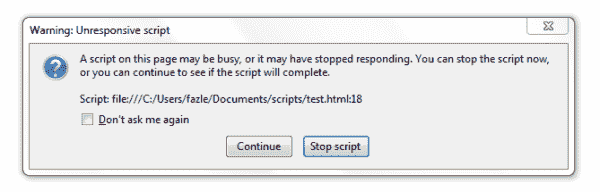

图 27.1. 无响应的脚本消息

Web Workers 有两种：专用线程（dedicated workers）和共享线程（shared workers）。主要的区别在于可见性。专用线程可以从创建它的父脚本访问，但共享线程可以从相同源的任何脚本访问。共享线程对浏览器的支持有限：Chrome 4.0+、Safari 5.0+ 和 Opera 10.6+。Firefox 和 IE 都不支持共享线程。

我们将在书中讨论专用线程，因为那可能是你最可能用到的。

### 注意：检测支持

在继续之前，我只想确保你已经检测了浏览器对 Web Workers 的支持。在上一章中，我展示了一个使用原生 JavaScript 和 Modernizr 检测 Web Workers 支持的示例，所以我们在这里跳过重复部分。

要使用 Web Workers，你只需要调用 `Worker` 构造函数并传递 Worker 脚本的 URI 即可

```
var worker=new Worker('myworker.js');
```

### 注意：Worker 脚本路径

请注意，Worker 脚本路径必须与父脚本具有相同源，并且相对于父脚本的位置。

这里，`myworker.js` 是需要在后台执行的 Worker 脚本。要与 Worker 通信，你只需要在 `worker` 对象上调用 `postMessage` 并传递消息（如果有）：

```
// 在不带任何消息的情况下启动 worker
worker.postMessage();

// 传递消息并启动 worker
worker.postMessage('嘿，你准备好开始工作了吗？');
```

但通信不必是单向的。我们的 Worker 也可以回复！为了接收从 Worker 发送的消息，我们在 `worker` 对象上附加一个事件监听器，如下：

```
// 注册回调函数
worker.addEventListener('message',function(e){
  alert('收到来自 worker 的消息，'+e.data);
},false);
```

处理函数还会接收一个 `message` 事件对象。该对象有一个名为 `data` 的属性，包含了发送的实际消息。因此在上面的代码中，我们访问了 `e.data` 属性来检索由 Worker 发送的数据。

那么在主脚本中作为参数传递给 `postMessage()` 的消息会发生什么呢？嗯，它会被传递到 Worker 脚本，在 Worker 端可以通过注册相同的事件监听器来获取。以下代码片段显示了如何操作：

*myworker.js*

```
// 从 worker 发送
self.addEventListener('message',function(e){
  postMessage('我按照你说的做了！');
},false);
```

### 警告：Workers 是沙箱化的

Workers 运行在沙箱环境中。这意味着它们无法访问普通脚本可以访问的所有内容。例如，在之前的代码中如果你使用 `window` 而不是 `self` 就会出问题。Workers 也无法访问 DOM。原因稍后。

发生错误时，`onerror` 回调会被调用。以下回调应在父脚本中注册：

```
// 注册 error 回调
worker.addEventListener('error',function(e) {
  console.log(
    '错误发生在 '+e.filename+' 行 '+e.lineno
  );
},false);
```

### 传递 JSON 数据

Web Workers 只能传递一个参数；但是，该参数可以是包含多个项目的复杂对象。让我们修改代码来传递 JSON 数据：

*parentScript.js*

```javascript
var worker=new Worker('myworker.js');

worker.addEventListener('message',function(e){
  alert('收到来自 '+e.data.answerer+' 的回答：'+e.data.answer);
},false);

worker.postMessage({'question':'你好吗？','askedBy':'父脚本'});
```

*myworker.js*

```javascript
self.addEventListener('message', function(e) {

  console.log(
    '问题：' + e.data.question + 
    '问者：'+e.data.askedBy
   );

  self.postMessage(
    {
      'answer': '挺不错的！',
      'answerer':'Worker'
    }
  );

},false);
```

### 注意：Worker 数据是复制的

传递给 Worker 的数据是复制的，而不是共享的。接收方始终接收发送数据的副本。这意味着在发送之前，数据会被序列化，并在接收端被反序列化。你可能奇怪为什么这样实现。简单！为了避免线程问题。

### Web Worker 特性

如之前提到的，Workers 运行在沙箱环境中。它们的特性包括：

*   对 `navigator` 和 `location` 对象的只读访问

*   `setTimeout`/setInterval` 函数以及 `XMLHttpRequest` 对象，与主线程一样

*   创建和启动子 Worker

*   通过 `importScripts()` 函数导入其他脚本

*   利用 AppCache 的能力


### 注意：为什么 Workers 无法访问 DOM

浏览器（以及 `DOM`）在单线程上运行。这是因为你的代码可能会阻止其他操作，例如点击链接。多线程可能会破坏这种机制。此外，`DOM` 不是线程安全的。由于这些原因，`Worker` 线程无法访问 `DOM`——但这并不会阻止你的 Workers 修改主页面内容。你可以始终将结果传回给父脚本，并让 UI 线程更新 `DOM` 内容。我将在本章最后向你演示如何操作。

在进入更高级的功能之前，只有一个最后一个问题：如何关闭线程。要终止线程，只需在主脚本中调用 `worker.terminate()`，或在 worker 内部调用 `self.close()`。

## 更高级的 Workers

### 内联 Workers (Inline Workers)

每个人都喜欢随手处理事情。由于 Web Workers 运行在独立的上下文中，`Worker` 构造函数期望一个指定运行外部脚本文件的 URI。但如果你想做得非常快，可以通过 `blobs` 动态创建内联 Workers。看下面的代码：

```
var blob = new Blob(["onmessage = function(e) {
self.postMessage(e.data); });

var worker = new Worker(window.URL.createObjectURL(blob));

worker.addEventListener('message', function(e){
  alert('Got same Message: '+e.data+' from worker');
},false);

worker.postMessage('Good Morning Worker!!');
```

在此段代码中，我们在 `Blob` 中编写了 Worker 的内容。`window.URL.createObjectURL` 本质上创建了一个 URI（例如，`blob:null/027b645d-be05-4f14-8866-e52604777608`），引用了 Worker 的内容，该 URI 被传递给 `Worker` 构造函数。然后我们像照常一样进行。

由于将所有 Worker 内容放入 `Blob` 构造函数中不方便，我们也可以选择将所有 Worker 代码放在父 HTML 内部的一个单独 `script` 标签中。那么在运行时，我们将该内容传递给 `Blob` 构造函数。

在下面的示例中，我们在父 HTML 页面本身中编写 Worker。一旦 Worker 启动，它将每秒执行一次函数并将当前时间返回给主线程。主线程随后将用时间更新 `div`（记得我们讨论过更新 DOM 吗？）：

`parentPage.html`

```
<!DOCTYPE html>
<html
<head>
<!-- 
  以下脚本不会被 JavaScript 引擎解析，
  因为它的 type 属性
-->
<script type="text/javascript-worker" id="jsworker">

  setInterval(function(){
    postMessage(getTime());
  }, 1000);

  function getTime(){
    var d = new Date();
    return d.getHours()+":"+d.getMinutes()+":"+d.getSeconds();
  }

</script>

<script>
  var blobURI = new Blob(
    [document.querySelector("#jsworker").textContent]
  );

  var worker=new Worker(window.URL.createObjectURL(blobURI));

  worker.addEventListener('message',function(e){
    document.getElementById('currTime').textContent=e.data;
  },false);

  worker.postMessage();
</script>
</head>
<body>
<div id="currTime"></</div>
</body>
</html>
```

这段代码非常浅显易懂。一旦 Worker 启动，我们会注册一个每秒执行一次并返回当前时间的函数。主线程会获取相同的数据并更新 `DOM`。此外，`#currTime` 可以被缓存以提高性能。

如果你正在创建许多 blob URL，在完成后释放它们是一个良好的习惯（我建议避免创建过多的 blob URL）：

```
window.URL.revokeObjectURL(blobURI); // 释放资源
```

### 在 Worker 内部创建子 Worker (Subworkers)

在你的 Worker 文件中，你可以进一步创建并使用子 worker。过程是相同的。主要的优势是你可以将任务分配在许多线程之间。子 worker 的 URI 是相对于其父脚本的位置解析的，而不是主 HTML 文档。这样做是为了让每个 Worker 都能清晰地管理其依赖项。

### 在 Workers 中使用外部脚本

你的 Workers 可以访问 `importScripts()` 函数，让它们能够轻松导入外部脚本。下面的代码显示了如何这样做：

```
// 导入单个脚本
importScripts('external.js');

// 导入 2 个脚本文件
importScripts('external1.js','external2.js');
```

### 注意：URI 相对于 Worker

当你从 Worker 导入外部脚本时，脚本的 URI 是相对于 Worker 文件位置解析的，而不是主 HTML 文档。

## 安全性考虑

Web Worker API 遵循同源策略（same-origin principle）。这意味着 `Worker()` 的参数必须与调用页面的源相同。

例如，如果我的调用页面位于 `http://xyz.com/callingPage.html`，那么 Worker 不能位于 `http://somethingelse.com/worker.js`。只要 Worker 的位置以 `http://xyz.com` 开头，就是允许的。同样，`http` 页面不能产生位置以 `https://` 开头的 Worker。

图 27.2 显示了 Chrome 在尝试跨越源限制时抛出的错误：

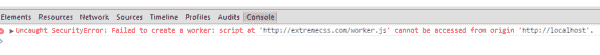

图 27.2. Chrome 中的跨源错误

如果你尝试在本地访问文件（通过 `file://` 协议），某些浏览器可能会抛出安全异常。如果你收到了任何此类异常，只需将文件放在本地服务器中并使用以下地址访问：`http://localhost/project/somepage.html`。

## 旧版浏览器的 Polyfill (填充)

如果浏览器不支持 Web Workers API 怎么办？有多种 polyfill 可以模拟 Web Workers 的行为来支持旧浏览器。[Github 上的 Modernizr 页面](https://github.com/Modernizr/Modernizr/wiki/HTML5-Cross-browser-Polyfills#web-workers) 列出了此类 polyfill 的列表，但长时间运行在这些实现中可能会失败。在这种情况下，可能通过 Ajax 将某些处理交给服务器。

## 结论

Web Workers 因其多线程特性为你提供了巨大的性能提升。所有现代浏览器（包括 IE10 及以上版本）都支持 Web Workers。

以下是一些你可以尝试实现的用例：

- 在后台进行[轮轮](http://techoctave.com/c7/posts/60-simple-long-polling-example-with-javascript-and-jquery) 并通知用户有新更新
- 预取并缓存内容
- 在后台执行计算密集型任务和长时间循环
- 一个在后台持续运行的拼写检查器

# 第 28 章

Geolocation API 提供了一种获取用户精确位置的简单方法。例如，你可以创建一个根据用户的当前位置为其提供个性化建议的应用程序。你还可以在地图上绘制他们的位置以显示导航详情。

在本章中，我将为你概述 Geolocation API，并展示如何使用它来创建神奇的基于位置的 HTML5 应用。

## 接触表面 (Hitting the Surface)

在使用该 API 之前，让我们先确保浏览器支持它：

```
if (navigator.geolocation) {
  // 执行一些很棒的事情
}
else {
  // 提供备用内容
}
```

可以通过 `Modernizr` 实现相同的检查：

```
if (Modernizr.geolocation) {
  // 执行一些很棒的事情
}
else {
  // 提供备用内容
}
```

使用以下代码获取用户的实际位置：


```
navigator.geolocation.getCurrentPosition
(success_callback,error_callback);

 function success_callback(position) {
      console.log("Hey, there you are at Longitude:"
      +position.coords.longitude+"and latitude:"
      +position.coords.latitude);
 }

 function error_callback(error) {
    var msg="";
     switch(error.code){
        case 1:
            msg="Permission denied by user"; 
            break;
        case 2:
            msg="Position unavailable";
            break;
        case 3:
            msg="Request Timed out";
            break;
    }
    console.log("Oh snap!! Error logged: "+msg);
 } 
```

`getCurrentPosition()` 函数在本质上是异步的。这意味着该函数会立即返回，并尝试异步获取用户的位置。一旦检索到位置信息，就会执行成功回调函数。一个 `position` 对象也会传递给回调函数。与用户当前位置相关的所有数据都封装在该对象中。

在 `position` 对象内部可以使用以下属性：

* `coords.latitude`: 位置的纬度
* `coords.longitude`: 位置的经度
* `coords.accuracy`: 开发者位置信息的准确程度（该结果单位为米）
* `coords.altitude`: 当前海拔（单位为米）
* `coords.altitudeAccuracy`: 用于建立所给高度（前述一点）的准确性
* `coords.heading`: 用户移动的方向
* `coords.speed`: 终端用户（设备）的速度（单位为米/秒）
* `timestamp`: 指示记录位置的时间戳

你可能不需要 `position` 对象中包含的所有信息。在大多数情况下，你需要的只是前三个属性，因为这些属性足够在地图上绘制用户的位置了。

下一个需要注意的点是，你应该优雅地处理任何错误。当你的应用尝试检索位置时，浏览器会询问用户是否允许请求页面访问用户的位置。如果用户拒绝权限，就会调用错误回调函数（参见上文代码）并传递一个 `error` 对象。`code` 属性指示发生的错误类型。也可能因为请求超时导致错误。

现在让我们看看还可以用 `getCurrentPosition()` 做些什么。该函数接受一个可选的第三参数 `PositionOptions`，这是一个代表额外选项的 JavaScript 对象。可用属性如下：

1. `enableHighAccuracy`: 如果将其设置为 `true`，它将指示托管设备提供尽可能的位置细节。如果设备是智能手机，它可能会使用 GPS 提供高精度的信息。
2. `timeout`: 这本质上表示你想要等待多少毫秒来获取位置。例如，如果你将值设置为 5,000 毫秒，而应用在该间隔内无法检测到用户的当前位置，它将报错并失败。
3. `maximumAge`: 此属性指示你是否希望设备缓存最后已知的位置。假设设备在下午 5:00 检测到用户的当前位置。一分钟后（下午 5:01），你的应用再次调用 `getCurrentPosition()` 并并将 `maximumAge` 设置为 100,000（意味着 100 秒）。由于设备知道用户 60 秒前在哪里，而这小于 `maximumAge` 属性的值，它将返回那个最后已知的位置。如果你对之前已知的位置满意，而不是为当前位置发送新请求，那么这很有用（在很多情况下可以节省电量）。这就像是在说：“嘿设备，给我你的当前位置，我不介意这个位置是 x 毫秒之前的。”注意，值为 `0` 表示不进行缓存。

以下代码段演示了如何使用 `PositionOptions`：

```
navigator.geolocation.getCurrentPosition(
  success_callback, 
  error_callback, 
  {enableHighAccuracy: true, timeout: 35000, maximumAge: 60000}
);
```

## 持续监控位置

如果你想持续监控用户的位置，`getCurrentPosition()` 将无法满足需求；相反，你应该使用 `watchPosition()`。这两个函数具有相同的签名，但工作方式有所不同。

对于 `watchPosition()`，每当用户的位置发生时，就会调用成功回调函数。是的，就是这么棒！如果你的应用需要在用户移动时在地图上绘制其位置，这是实现的最佳方法。你甚至不需要担心位置何时变化。API 会为你处理这些，并在适当的时间执行你的回调。

以下代码演示了 `watchPosition()` 的用法：

```
var watchId;
function startWatchingPosition() {
  watchId=navigator.geolocation.watchPosition(plotPosition);
}

function plotPosition(position){
  console.log(
    'got position: Latitude='+
    position.coords.latitude+
    ', longitude='+
    position.coords.longitude
  );

  // 你在地图上更新位置的代码
}

function stopWatchingPosition(){
  navigator.geolocation.clearPosition(watchId);
}
```

在这里，回调函数 `plotPosition()` 每每次获取到新位置时被调用。注意 `watchPosition()` 函数返回一个数字，你可以将其存储并在稍后使用 `clearPosition()` 停止监控；它的工作方式非常类似于 `setInterval()` 和 `clearInterval()`。

### 提示：快速移动的用户

如果用户移动非常快，回调可能会频繁执行并减慢系统。可能需要进行某些“事件节流（event throttling）”以减少回调运行的次数。有一个由 Jonatan Heyman 设计的[小型 JavaScript 库](https://github.com/heyman/geolocation-throttle)，它可以减少我们从 `watchPosition()` 接收到的回调次数。

## 地位的准确性

地理位的准确性可能对你的应用很重要。正如所讨论的，你始终可以通过 `PositionOptions.enableHighAccuracy` 来启用高位置准确度。但这只是提示设备多消耗一点功率以返回更准确的位置。设备可能会默默忽略它。在许多情况下，检索到的位置可能不够准确，甚至可能是错误的。有时用户可能对检索到的位置并不感兴趣。在这些情况下，你可能希望允许用户覆盖位置。

## 结论

Geolocation API 是对于想要构建能够向用户提供实时反馈的酷炫位置应用的开发者来说一个非常棒的工具；然而，你应该记住用户始终拥有选择权。正如提到的，用户必须明确授予你的应用权限，你才能访问位置。在这些情况下，你应该准备好备选方案。

这里是一些你可以尝试自己实现的小项目：

* 检测你的位置并绘制在 Google 地图上。
* 持续监控你自己的位置并将其绘制在地图上。
* 检测用户的位置并显示附近的剧院。
* 让你的用户在不同地点打卡并将这些地点绘制在地图上，稍后向他们展示当天去过的地方。


在进一步移动之前，理解此 API 的需求非常重要。为了解释这一点，让我先问你一个问题：你会如何设计一个在有新数据时持续更新浏览器的应用程序？嗯，你总是可以通过 `setInterval()`/`setTimeout()` 使用传统的轮询方法。在这种情况下，回调会在指定的时间间隔后执行，轮服务器是否有可用数据。如果数据可用，页面将异步更新新内容。

这种方法的主要问题在于产生 HTTP 请求的开销。通过 SSE，服务器可以通过单向连接向浏览器推送更新。而且即使连接断开，客户端也可以自动与服务器重新连接并继续更新。

请记住，SSE 适用于需要单向连接的应用。例如，服务器可以定期获取最新报价发送到浏览器，但浏览器不会向服务器通信，只需消费发送的数据。如果你需要双向连接，将需要使用 WebSocket，这将在下一节介绍。

好了，说了这么多。让我们看代码！

## API

这里是使用 SSE 的示例代码：

```
if (!!window.EventSource) {
  var eventsource=new EventSource('source.php');
  eventsource.addEventListener('message',function(event) {
    document.getElementById("container").innerHTML = event.data;
  }, false);
}
else{
    // 回退到轮询
}
```

### 注意：使用 Modernizr

注意我们在检查浏览器对 SSE 的支持。可以使用 Modernizr 实现：

```
if (Modernizr.eventsource) {
  // 继续
}
else{
  // 回退到轮询
}
```

要使用 SSE，只需调用 `EventSource` 构造函数并传递源 URL。源可以是任何实时产生新数据的后端脚本（`source.php`）。

然后你可以为 `eventsource` 对象附加事件监听器。当服务器向浏览器推送数据时，会触发 `message` 事件。回调接收 `event` 对象，其 `data` 属性包含了来自服务器的数据。一旦获取了数据，你就可以执行诸如实时更新页面部分等任务。

你可以如下感知感知连接打开和错误发生的情况：

```
eventsource.addEventListener('open', function(event) {
  // 源已打开
},false);

eventsource.addEventListener('error', function(event) {
  // 糟糕！！发生了错误
},false);
```

## `EventStream` 格式

服务器的响应中需要某些内容来帮助浏览器将响应识别为服务器发送事件。当服务器向客户端发送数据时，`Content-Type` 响应头必须设置为 `text/event-stream`。服务器的响应内容应该如下格式：

```
data: 服务器发送的数据 \n\n
```

`data:` 数据的开始。`\n\n` 表示流的结束。

### 注意：`\n` 是换行符

你应该注意，上面使用的 `\n` 是换行符，而不是简单的反斜杠和 n。

虽然这对于单行更新有效，但在大多数情况下，我们希望响应是多行的。在这种情况下，数据的格式如下：

```
data: 这是第一行 \n
data: 现在第二行 \n\n
```

接收此流后，客户端的 `event.data` 将包含由 `\n` 分隔的所有行。你可以如下所示从流中移除这些换行符：

```
console.log(e.data.split('\n').join(' '));
```

## JSON 又怎么样？

在大多数真实世界的应用中，发送 JSON 响应非常方便。你可以这样发送响应：

```
data: {"generator": "server", "message": "测试消息"}\n\n
```

现在在你的 JavaScript 中，可以简单地在 `onmessage` 回调中访问数据：

```javascript
var parsedData = JSON.parse(event.data);
console.log(
  "来自 " + parsedData.generator +
  " 的消息是：" + parsedData.message
);
```

## 关联事件 ID

你可以如下所示将事件 `id` 与你发送的数据关联：

```
id: 100\n
data: 嘿，你最近怎么样？\n\n
```

事件 `id` 是有益的，因为浏览器会跟踪最后一个触发的事件。这个 `id` 成为事件的唯一标识符。在任何连接断开的情况下，当浏览器重新连接到服务器时，它会在请求中包含 HTTP 头 `Last-Event-Id`。在服务器端，你可以检查 `Last-Event-Id` 头是否存在。如果存在，你可以尝试只向浏览器发送 `event id` 大于 `Last-Event-Id` 头值值的事件。通过这种方式，浏览器可以消费错过的事件。

## 创建你自己的事件

SSE 最关键的方面之一是能够命名你的事件。在某些应用中，你可以使用特定的事件名称发送更新。为了这样做，你需要在客户端为每个事件注册回调。如下：

服务器响应：

```
event: score \n
data: 某些分数 \n\n
event: other \n
data: 某些其他 \n\n
```

客户端 JavaScript：

```javascript
var eventsource=new EventSource('source.php');

// 自定义事件
eventsource.addEventListener('score',function(e) {
  // 你的逻辑
  console.log(e.data);
}, false);

// 另一个自定义事件
eventsource.addEventListener('other',function(e) {
  // 另一种方式
  console.log(e.data);
}, false);
```

不同的事件名称允许你的 JavaScript 代码以不同的方式处理每个事件，并保持代码的整洁和可维护性。

## 处理重连超时

浏览器默认会在约五秒后自动尝试重新连接服务器；然而，你可以控制这个超时时间。以下服务器响应指定了在断开连接的情况下等待多少毫秒再尝试重连：

```
retry: 15000 \n
data: 常用的数据 \n\n
```

`retry` 值是毫秒，并应在第一个事件触发时指定。如果你的应用没有快速产生新内容，且浏览器在较长间隔后重连是可以的，你可以将其增大。这样做的好处是减少不必要的 HTTP 请求开销。

## 关闭连接

我们几乎总是会到达这一部分；当资源不再需要时，释放它们更好。那么，如何关闭事件流呢？编写以下代码你将不再从源接收更新：

```javascript
eventsource.close(); //关闭事件流
```

## 示例事件源

最后，怎么样？创建一个简单的 `EventSource`，它会随机获取一个笑话并推送到我们的 HTML 页面。这是一个用于推送新数据的简单 PHP 脚本：

*source.php*

```php
<?php
header('Content-Type: text/event-stream');
header('Cache-Control: no-cache'); 
ob_implicit_flush(true);
ob_end_flush();
while (true) {
  sleep(2);
  $curl=curl_init('http://api.icndb.com/jokes/random');
  curl_setopt($curl, CURLOPT_RETURNTRANSFER, true);
  $result=curl_exec($curl);
  echo "data:$result\n\n";
}
?>
```

### 注意：关于 PHP 脚本的一些说明


来自 API 的数据是 JSON 格式的。SSE 要求你在数据前面加上 `data:`，并用 `\n\n` 标记结束。如果你漏掉了这些点，`EventSource` 将无法正常工作，并且请记住也要注意请求头（headers）。循环的原因是为了保持连接开启。如果没有循环，浏览器将在五秒左右尝试打开一个新连接。

由于我们在 PHP 脚本中持续循环，脚本的执行时间可能会超过 PHP 的 `max_execution_time`。你还可能因为 Apache 用户连接限制而遇到问题。对于这类实时应用，`Node.js` 等技术可能是是更好的选择。

这里是显示数据的 HTML 页面：

`jokes.html`

```
<!DOCTYPE html>
<html>
<head>
<title>一个随机笑话网站</title>
<script>
if(typeof(EventSource)!=="undefined"){
  var eventsource=new EventSource('source.php');
  eventsource.addEventListener('message', function(event) {
    document.getElementById("container").innerHTML = 
    JSON.parse(event.data).value.joke + '<br/>' +
    document.getElementById("container").innerHTML;
  },false);
}
else console.log("No EventSource");
</script>
</head>
<body>

  <div id="container"></div>

</body>
</html>
```

## 调试

如果你遇到问题，可以使用浏览器的 JavaScript 控制台来调试你的应用程序。在 Chrome 中，可以通过“菜单 > 工具 > JavaScript 控制台”打开控制台。在 Firefox 中，可以通过“菜单 > 网页开发者工具 > Web 控制台”访问相同的内容。如果事件流没有按预期工作，控制台可能会报告错误（如果有任何的话）。

你需要特别注意以下几点：

- 从服务器发送头部 `Content-Type: text/event-stream` 的头部
- 分别用 `data:` 和 `\n\n` 标记内容的开始和结束
- 注意同源策略（same-origin policies）

## 结论

服务器发送事件（SSE）解决了我们之前为了实现实时更新功能而使用的长轮询黑科技。以下是你可能想要实现的几个简单项目：

- 创建一个从服务器端更新的时钟页面。
- 借助 Twitter API 读取并显示最新的推文。
- 使用 Flickr API 获取随机照片并更新页面。

Mozilla 开发者网络提供了一个[学习更多 SSE 的良好资源。](https://developer.mozilla.org/en-US/docs/Server-sent_events)在这里，你还可以找到一些演示应用以及针对旧浏览器的补丁程序（polyfills）。

# 第 30 章

## APIs：WebSocket API

我认为 WebSockets 是 HTML5 中提供的最酷的 API 之一。当你希望客户端通过持久连接与服务器通信时，WebSocket API 的真实优势就会显现出来。这意味着一旦连接建立，服务器和客户端就可以随时互相发送消息。客户端以前向服务器发送消息并等待服务器响应的日子已经过去了。显然，WebSocket 消除了对长轮询的需求！如果你想创建一个客户端和服务器持续通信的实时应用，这个 API 非常有用。例如，你可以使用 WebSocket 构建聊天系统、多玩家 HTML5 游戏以及类似的应用。

### 注意：WebSocket 与服务器发送事件 (SSEs)

WebSockets 和 SSE 可以实现类似的任务，但它们是不同的。在 SSE 的情况下，服务器仅在有新更新时才向客户端推送数据。在 WebSocket 的情况下，客户端和服务器都会互相发送数据；准确地说，通信是双向的（如果你喜欢更技术性的术语，那就是全双工）。

要使用 WebSocket，你需要一个支持 WebSocket 的服务器。嗯，那是棘手的部分。别担心！有针对不同语言的 WebSocket 实现。我很快就会介绍这些内容。

此外，你应该始终记住，WebSockets 允许跨源通信。因此，你应该只连接到你信任的客户端和服务器。

## JavaScript API

让我们快速尝试一下。[WebSocket.org](http://www.websocket.org/) 的开发者在 `ws://echo.websocket.org` 创建了一个演示专用的 WebSocket 服务器。我们可以迅速连接到它并开始与它交换消息。

### 注意：`ws://` 协议

`ws://` 是一种类似于 `http://` 的协议，不同之处在于它用于指定 WebSocket 服务器的 URL。

首先，让我们看看如何使用 JavaScript API 连接到简单的 WebSocket 服务器。之后，我将向你展示如何创建自己的 WebSocket 服务器并让其他人与你连接。

```
// 测试浏览器是否支持该 API
if('WebSocket' in window) {

  var socket = new WebSocket('ws://echo.websocket.org');

  if (socket.readyState == 0) console.log('Connecting...');

  // 只要连接建立，立即向服务器发送消息
  socket.onopen = function () {
    if (socket.readyState == 1) {
      console.log('Connection Opened');
      socket.send('Hey, send back whatever I throw at you!'); 
    }     
  };

  // 接收来自服务器的消息
  socket.onmessage = function(e) {
    console.log('Socket server said: ' + e.data);
  };

  socket.onclose = function() {
    if (socket.readyState == 2) console.log('Connection Closed');
  };

  // 记录错误
  socket.onerror = function(err) {
    console.log('An Error Occurred ' + err);
  };

}
else {
  // 没有 WebSocket
```

### 注意：使用 Modernizr

使用 Modernizr，我们可以这样检查对 WebSocket 的支持：

```
if (Modernizr.websockets) {
  // 继续
}
else{
  // 没有 WebSocket
}
```

所以我们通过将 socket URL 传递给 `WebSocket` 构造函数来开始。该构造函数还接受一个可选的第二个参数，即子协议。此参数默认为空字符串。

接下来，我们为不同的事件附加回调。一旦连接打开，`onopen` 事件就会触发并执行我们的回调。你可以通过调用 `socket.send()` 向服务器发送简单的消息。我们在下一节中将看到发送二进制数据。

同样，服务器也可以向我们发送消息。在这种情况下，服务器会返回我们发送给它的内容，我们只需记录消息。但你总是可以捕捉消息并动态更新页面。

只需将代码粘贴到 HTML 文件并运行——你会看到服务器响应的！

### 注意：`readyState` 属性

上述代码中的 `socket` 变量有一个名为 `readyState` 的属性，指示连接的状态：

- 0 = 正在连接
- 1 = 已开启
- 2 = 已关闭

## 发送二进制数据

你也可以向服务器发送二进制数据。以下程序将 `canvas` 画的图像发送到示例 WebSocket：

```
// 你需要创建这个 socket
var connection=new WebSocket('ws://localhost:8080');

connection.onopen = function() {

  // 从 canvas 获取图像
  var image = canvas2DContext.getImageData(0, 0, 440, 300);
  var binary_data = new Uint8Array(image.data.length);
  for (var i = 0; i < image.data.length; i++) {
    binary_data[i] = image.data[i];
  }
  connection.send(binary_data.buffer); // 发送数据

}
```

在代码中，我们从 HTML 页面读取图像并创建一个 `ArrayBuffer` 来包含二进制数据。最后，`connection.send()` 实际上发送了数据。

服务器也可以发送二进制数据，我们在下一节看到。

### 注意：使用 Blob

我们也可以以 blob 的形式发送二进制数据。例如，你可以创建一个文件上传器并通过 `querySelector()` 读取文件。然后你可以借助 `connection.send()` 帮助发送这些文件。HTML5Rocks 有一个关于 WebSocket 的[优秀教程](http://www.html5rocks.com/en/tutorials/websockets/basics/)，也涵盖了如何通过 blob 向服务器发送二进制数据。

## 示例服务器实现


这里是适用于不同服务器端语言的几种 WebSocket 实现。你可以根据你喜欢的语言选择相应的库：

* PHP: [Ratchet](http://socketo.me/)
* Node.js: [Socket.IO](https://github.com/learnboost/socket.io)
* Java: [jWebSocket](http://jwebsocket.org/)

关于服务器端库的完整概述，[Andrea Faulds 维护了一份详细列表。](http://ajf.me/websocket/#libs)

在本短书中，详细讨论这些库中的每一个都是超出范围范围的。但无论采用哪种实现方式，它们都提供了一个简单的 API，你可以通过它与客户端进行交互。例如，它们都提供了一个处理函数来接收来自浏览器的消息，你也可以与客户端进行回传。我鼓励你为你喜爱的语言找一个库并尝试运行一下。

我在 SitePoint.com 上写了一篇[关于 WebSockets 的详细教程](http://www.sitepoint.com/introduction-to-the-html5-websockets-api/)。在那个教程中，我展示了如何使用 `jWebSocket` 实现一个启用 WebSockets 的服务器，并让其他人连接它。

## 结论

如果你想学习更多关于 WebSocket API，以下资源值得查看：

* [WebSocket API](http://dev.w3.org/html5/websockets/)
* [Mozilla Developer Network 上的 WebSocket 教程](https://developer.mozilla.org/en-US/docs/WebSockets)
* [WebSocket 演示应用](http://www.websocket.org/demos.html)

这里是该 API 的一些用例：

* 创建简单的在线聊天应用程序
* 当服务器上有新更新时更新页面并进行回传
* 创建一个具有多个用户的 HTML5 游戏。

# 第 31 章：API：跨文档消息传递 API (Cross-document Messaging API)

HTML5 中的 `Cross-document Messaging API` 使两个文档能够相互交互，而无需直接暴露 DOM。想象一下以下场景：你的网页中有一个由不同网站托管的 iframe。如果你尝试从该 iframe 中读取某些数据，浏览器会非常不悦并可能抛出安全异常。它防止 DOM 被第三方文档操作，从而阻止了潜在的攻击，如 [CSRF](http://en.wikipedia.org/wiki/Cross-site_request_for_gery) 或 [跨站脚本 (XSS)。](http://en.wikipedia.org/wiki/Cross-site_scripting) 但 `Cross-document Messaging API` 从不直接暴露 DOM。相反，它允许 HTML 页面通过 `message` 事件向其他文档发送消息。

`Cross-document Messaging API` 对于创建组件并允许它们与第三方网站通信非常有用。例如，假设你有一个提供广告的页面，并且允许用户将此页面嵌入他们的网站中。在这种情况下，你可以通过 `Cross-document Messaging API` 让用户个性化广告或修改广告类型。客户端可以向你的页面发送消息，你也可以接收这些消息。

## JavaScript API

`Cross-document Messaging API` 围绕一个单一方法：`window.postMessage()`。正如其名，该方法允许你向不同的页面发送消息。当该方法被调用时，接收端文档侧会触发一个 `message` 事件。在继续之前，理解 `message` 事件的属性至关重要。我们感兴趣的有三个属性：

1. `data`: 它持有了正在发送的消息。你已经在之前的章节中玩过它了（记得在 SSE 中调用 `event.data` 吗？）。
2. `origin`: 该属性指示发送者文档的源；即协议（方案）以及域名和端口，类似于 `http://example.com:80`。每当你收到消息时，你应该**始终、始终**检查该消息是否来自受信任的源。我将在下一节中解释如何这样做。
3. `source`: 这是对发送者窗口的引用。在接收跨文档消息后，如果你想向发送者发送某些内容，将使用这个属性。

## 基本用法

你通过调用 `window.postMessage()` 向另一个文档发送消息。此函数接受两个参数：

* `message`: 你想要发送的实际消息
* `targetOrigin`: 一个指示目标源的简单字符串——一个额外的安全特性（我将在下一节解释它有什么用）

代码看起来如下：

```
targetWindow.postMessage(message, targetOrigin);
```

你应该注意，`targetWindow` 指向你想要发送消息的 `window`。它可能是你刚刚通过调用 `window.open()` 打开的句，，也可以是某些 iframe 的 `contentWindow` 属性。

### 注意：对已打开窗口的引用

`window.open('a URL')` 返回一个已打开窗口的引用。你可以随时在上面调用 `postMessage()`。

让我们构建一个非常简单的示例。假设我们有一个父页面，里面有一个 iframe。该 iframe 的 `src` 指向一个第三方网站，该网站为我们提供一张随机图片。

这是父页面中 iframe 引用的页面：

*child.html*

```html
<!DOCTYPE html>
<html>
<head>
<title>提供随机图片的页面</title>
</head>
<body>
  <div id="container">
    
  </div>
</body>
</html>
```

到目前为止一切顺利！现在让我们看看我们的父页面：

*parent.html*

```html
<!DOCTYPE html>
<html>
<head>
<title>父文档</title>
</head>
<body>
    <iframe
      src="child.html"
      height="500" width="500">
    </iframe>
</body>
</html>
```

当你打开父页面时，你可以看到来自 `child.html` 的图片。目前，`parent.html` 和 `child.html` 都在同一个服务器（`localhost`）上。但理想情况下它们应该在不同的服务器上。

但我们不想一直给用户显示静态图片，而是刷新 iframe。如果我们通过点击父页面上的按钮让 `child.html` 刷新图片就好了。

让我们从向父页面添加一个按钮开始。我们编写一个响应点击事件并向 `child.html` 发送消息的函数。

*parent.html*

```html
<!DOCTYPE html>
<html>
<head>
<title>父文档</title>
</head>
<body>
    <iframe
      src="child.html"
      height="500" width="500">
    </iframe>
    <br/>
    <button id="reloadbtn">刷新</button>

    <script>
      document.getElementById("reloadbtn").
      addEventListener("click", reload, false);

      // 刷新处理器
      function reload(e) {
        // 支持跨文档消息吗？
        if (window.postMessage) {
            document.getElementById('iframe').
            contentWindow.postMessage(
              Math.random()*1000, 'http://localhost'
            );
        }
        else {
            console.log('不支持 postMessage()');
        }
      }
    </script>

  </body>
</html>
```

### 注意：使用 Modernizr

如果你使用 `Modernizr` 来检查浏览器兼容性，请检查 `Modernizr.postmessage` 属性。


### 提示：targetOrigin

将 `targetOrigin` 视为告诉浏览器消息可以发送到哪个源的方式。你也可以将 `"*"` 作为 `targetOrigin`。正如你可能猜到的，`*` 是一个通配符，表示消息可以发送到任何源的文档。但使用通配符意味着通过允许消息发送到任何源来削弱你的安全系统。我建议将精确的源作为第二个参数传递给 `postMessage()`，而不是使用通配符。

现在我们需要在 `child.html` 中接收消息并采取适当的操作。以下是修改后的 `child.html`：

`child.html`

```html
<!DOCTYPE html>
<html>
<head>
<title>一个提供随机图片的页面</title>
</head>
<body>

  <div id="container">
    
  </div>

  <script>
    window.addEventListener('message', messageReceiver, false);

    function messageReceiver(event) {

      // 源是否可以信任？
      if (event.origin != 'http://localhost') return;

      document.getElementById('image').src =
      "http://randomimage.setgetgo.com/get.php?key=" + event.data;

      console.log(
        'source=' + event.source +
        ', data=' + event.data +
        ', origin=' + event.origin
      );

    }
  </script>

</body>
</html>
```

首先，我们为 `message` 事件绑定了一个回调函数。每当 `parent.html` 向 `child.html` 发送消息时，该回调函数就会执行。第一步也是重要的一步是检查你收到的消息是否来自预期的源。在为 `message` 事件添加事件监听器后，你可以接收来自任何源的文档的消息。因此，建议始终在回调函数中放置一个检查，以确保消息来自受信任的源。

接下来，我们从 `event.data` 中获取消息。我们用于随机图片的这个特定 API 每次都需要一个不同的随机数，这样生成的图片才是唯一的。这就是为什么我们在点击按钮时（在 `parent.html` 中）生成一个随机数，并将其作为消息传递给 `child.html`。在 `child.html` 中，我们仅需借助随机数构建一个新的图片 URL 并更新图片的 `src`。结果是，我们每次从主页面点击刷新按钮时，都能看到一张新图片。

### 注意：发送回执消息

如果你想向 `parent.html` 发回消息，你可以在 `child.html` 的事件监听器中随时使用 `event.source.postMessage()`。因此，你还需要在父页面准备一个事件处理器。

## 检测文档的就绪状态

大多数情况下，你会向嵌入在页面中的 iframe 发送消息。但很多时候，你可能还需要从页面打开一个新窗口并向其发送消息。在这种情况下，请确保打开的窗口已完全加载。在打开的窗口内部，为 `DOMContentLoaded` 事件绑定一个回调函数，并在该函数向父窗口发送消息，指示当前窗口已完全加载。

### 提示：获取引用

在 `DOMContentLoaded` 事件监听器中（打开的窗口内），你可以通过访问 `event.currentTarget.opener` 获取窗口的引用，并像往常一样对其调用 `postMessage()`。Tiffany Brown 在[一篇优秀的教程中](http://dev.opera.com/articles/view/window-postmessage-messagechannel/#whenisdocready)解释了如何实现这一点。

## 结论

这是跨文档消息 API（Cross-document Messaging API）的概述。通过使用此 API，两个跨源文档可以安全地交换数据。由于 DOM 没有直接暴露，现在页面已经可以直接操作第三方文档了。

跨文档消息 API 确实赋予了你更多力量。但正如你所知，能力越大，责任越大！如果你未能正确使用此 API，可能会导致你的网站暴露在各种安全风险之中。因此，正如本章所讨论的，在接收跨文档消息时你应该非常非常小心，以避免安全风险。同样，在使用 `window.postMessage()` 发送消息时，不要使用 `*` 作为 `targetOrigin`。相反，请提供一个有效的源名称。

虽然无法详细涵盖该 API 的每一个细节，但本章为你提供了一个基础。你现在应该能够自己进行各种实验了。为了进一步阅读，我强烈推荐以下资源：

* [Mozilla 开发者网络 (MDN)](https://developer.mozilla.org/en-US/docs/Web/API/Window.postMessage)
* [W3C 规范。](http://www.w3.org/TR/webmessaging/)

到此，我们对五个最重要且实用的 HTML5 API 的之旅结束了。希望你发现这本书是对这些强大技术的实用介绍。请去查看我在每一章末尾分享的示例项目想法；我也鼓励你发挥创意，思考一些其他良好的用例。

祝编码愉快！

