# JavaScript 快速入门指南


| 产品经理：Simon Mackie | 英文编辑：Kelly Steele |
| 技术编辑：Colin J. Ihrig | 封面设计师：Alex Walker |


## 关于 Ara Pehlivanian

Ara Pehlivanian 自 1997 年起从事 Web 开发工作。最近，他在 Nurun 担任 Web 开发人员和实践负责人，参与了高端、高知名度的项目，并在 Yahoo! Mail 担任前端工程师，目前是 HP 云服务团队的 JavaScript 开发人员。

## 关于 Don Nguyen

和许多程序员一样，Don 多年来一直将 JavaScript 作为第二语言进行尝试。直到他开始使用 Node.js 实现服务器端项目，JavaScript 才开始成为他工作的核心。由于深度参与了多个从后端到前端的 Web 项目，他现在能够同样熟练地在客户端和服务器端使用 JavaScript。他目前在澳大利亚悉尼的家中，致力于初创公司的建设。

## 关于 SitePoint

SitePoint 专注于为 Web 专业人士出版有趣、实用且易于理解的内容。访问 http://www.sitepoint.com/ 可访问我们的博客、书籍、时事通讯、文章和社区论坛。您将找到大量关于 JavaScript、PHP、Ruby、移动开发、设计等方面的信息。

## 关于《快速上手》系列

《快速上手》系列丛书为您提供了 Web 开发语言和技术的快速实用入门指南。这些书通常约 150 页，您可以在一个周末内读完，让您对主题有扎实的基础，并有信心自行尝试。

> *献给我亲爱的妻子 Krista，没有她的优雅、耐心和支持，我无法完成这本书；也献给我们两个才华横溢的女儿。*

——Ara

> *献给 Lorraine，感谢您用热腾腾的饭菜、温暖的心和灿烂的笑容让我保持精力充沛。*

——Don


# 第6章 文档对象模型

## 什么是DOM？

- 向后兼容性的需求
  - 文档对象
  - DOM Level 0 或传统DOM

### DOM Level 1

- 创建DOM元素和属性
- insertBefore
- getElementsByTagName

### DOM Level 2

- getElementById
- hasAttributes
- hasAttribute

### DOM Level 3

### DOM Level 4

- getElementsByClassName
- 数据属性
- style属性
- 项目
- 总结

# 第7章 事件

### DOM事件

- 事件传播
- 事件处理程序
  - HTML属性
  - addEventListener
  - DOM元素属性
  - 更多示例
- 事件上下文
- 自定义事件
  - 项目
  - 添加任务
  - 排序
  - 任务修改
- 总结

# 第8章 Canvas

## 什么是Canvas？

- 准备数据
- 设置Canvas
  - 最基本的绘制
  - 文本和坐标系
  - 进一步的旋转示例
  - Y轴编号
  - "Hello World" Canvas风格
  - 网格线
  - 矩形
  - 圆弧
  - 条形图标签
  - 阴影
  - 制作图像
  - 总结

# 附录A 常见事件

# 前言

JavaScript是一种非常强大、用途广泛且无处不在的编程语言。从90年代中期作为网景公司对抗微软Visual Basic的配角起步，它已经发展成为世界上最受欢迎的编程语言之一。

JavaScript在编程语言中独具特色，因为它是唯一一种部署在全世界几乎所有个人电脑上的语言。所有现代网页浏览器都实现了JavaScript。它是事实上的Web脚本语言。虽然它最初只是一种用于验证表单和对页面内容进行最小化操作的简单语言，但它已经发展到可以让你构建丰富的客户端应用程序。此外，多年来，JavaScript甚至在一定程度上开始取代Flash。随着Web的持续增长和发展，对JavaScript开发者的需求也在增加。无论你是希望快速上手JavaScript的资深程序员，还是希望填补部分需求的初学者，本书都将对你有所帮助。阅读本书后，你应该能够编写自己的JavaScript应用程序，并对该语言有足够的理解，以开启你成为专业JavaScript开发者的道路。

# 谁应该阅读本书

希望快速掌握JavaScript的网页设计师和开发者。假定读者已具备HTML和CSS的知识。

# 使用惯例

你会注意到我们在这本书中使用了特定的排版和布局风格来表示不同类型的信息。请注意以下项目。

## 代码示例

本书中的代码将使用固定宽度字体显示，如下所示：

如果代码可以在本书的代码档案中找到，文件名将出现在程序清单的顶部，如下所示：

```
.footer {
    background-color: #CCC;
    border-top: 1px solid #333;
}
```

如果只显示了文件的一部分，将通过*节选*一词表示：

```
border-top: 1px solid #333;
```

如果要向现有示例中插入额外的代码，新代码将以粗体显示：

```
function animate() {
    **new_variable = "Hello";**
}
```

另外，当需要现有代码作为上下文时，为避免重复所有代码，将显示一个冒号：

```
function animate() {
    :
    return **new_variable**;
}
```

某些代码行本意是写在一行上的，但由于页面限制，我们不得不将它们换行显示。↩表示仅为格式目的而存在的换行符，应予以忽略。

```
URL.open("http://www.sitepoint.com/responsive-web-design-real-user-testing/?responsive1");
```

# 提示、说明和警告

**嘿，你！**
提示将为你提供有用的简短指引。

**嗯，打扰一下...**
说明是与主题相关但非关键的有用旁注。将它们视为额外的信息小贴士。

**务必注意...**
...关注这些重要的要点。

**小心！**
警告将突出显示沿途可能绊倒你的任何陷阱。

# 补充材料

- **http://www.sitepoint.com/books/jsjavascript1/**
  本书的网站，包含链接、更新、资源等。

- **http://www.sitepoint.com/books/jsjavascript1/code.php**
  本书的可下载代码档案。

- **http://www.sitepoint.com/forums/forumdisplay.php?15-JavaScript-amp-jQuery**
  SitePoint的论坛，用于解决任何棘手的Web问题。

- **books@sitepoint.com**
  我们的电子邮件地址，如果你需要联系我们寻求支持、报告问题或出于任何其他原因。

# 想要继续学习吗？

感谢购买本书。我们感谢你的支持。想要继续学习吗？你现在可以以低价在Learnable上无限访问课程和所有SitePoint书籍。立即注册，开始今天的学习！加入Learnable，你将始终领先于最新的技术趋势：http://www.learnable.com。

一旦你掌握了JavaScript的原理，可以通过我们的在线测验挑战自己。你能获得满分吗？请前往 http://quizpoint.com/#categories/JAVASCRIPT。

# 第1章 环境搭建

作为一名JavaScript开发者，你将编写在浏览器中运行的代码。随着本书的学习，你会想尝试示例。你*可以*创建一个HTML文档并在其中添加JavaScript代码，但距离我们处理完整项目还有一段时间，而在此期间你可能想测试一下。最好的方法是直接打开浏览器的控制台，在其中输入示例代码。所有主流浏览器厂商都提供了控制台，下面有关于如何在每个浏览器中激活它的说明。一旦你打开控制台，你会发现一个提示符，点击后就可以开始输入。在大多数控制台中，它看起来像一个尖括号：>。在Internet Explorer中，提示符是两个尖括号：>>。

> **换行技巧**

当你在控制台中需要新行时，不要按**Enter**（这将执行代码），而是按**Shift Enter**来换行。

# 2 快速上手JavaScript

## 控制台

本节描述如何在当今几款最流行的浏览器中打开开发者控制台。如果你选择的浏览器不在这里，快速的谷歌搜索肯定会找到结果。

### Chrome

要在Windows和Linux上激活Chrome的开发者工具，按**Control Shift J**。在Mac上，按**⌥⌘J (option command J)**。这将打开开发者工具面板中的控制台标签页，这正是我们需要的地方，如图1.1所示。


图1.1. Chrome中的控制台

### Firefox

要在Windows和Linux上激活Firefox的Web控制台，按**Control Shift K**。在Mac上，按**⌥⌘K (option command K)**。结果如图1.2所示。

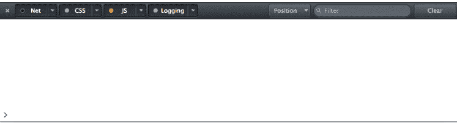

图1.2. Firefox中的Web控制台

### Internet Explorer

要激活Internet Explorer的开发者工具面板（如图1.3所示），按**F12**。


# Safari

在Safari中启用控制台比在其他浏览器中稍显复杂。首先，你需要在菜单栏中启用**开发**菜单。为此，请按下 ⌘, (**command comma**) 进入Safari设置，切换到**高级**选项卡，并勾选**在菜单栏中显示开发菜单**复选框，如图1.4所示。

完成上述操作后，关闭选项窗口，然后按下 ⌥⌘C (**option command C**) 即可调出控制台，如图1.5所示。

图1.5. Safari中的控制台

## 快速入门 JavaScript

## 在HTML文件中使用JavaScript

如果你希望跳过控制台，直接在HTML文档中工作，有两种方式：你可以直接在HTML文档中编写代码，或者将其写在单独的JavaScript文件中，然后从HTML文件加载它。

### 在HTML文件中

HTML提供了`<script>`标签，你可以在其中编写可执行的JavaScript代码。下面是一个非常简单的HTML文档示例，其中包含一行JavaScript代码，它会弹出一个显示“Hello, world!”消息的警告对话框：

```
js-in-html.html

<!doctype html>
<html>
  <head>
    <title>Code inside an HTML document</title>
    <script>
      alert("Hello, world!");
    </script>
  </head>
  <body>
  </body>
</html>
```

### 在单独的文件中

你也可以将代码放在单独的文件中并链接到它。例如，我们可以将alert语句放入一个名为hello.js的文件（.js文件扩展名表示这是一个JavaScript源文件），然后使用`<script>`标签的src属性将其链接到HTML中，如下所示：

```
external-js.html

<!doctype html>
<html>
  <head>
    <title>Code inside an HTML document</title>
    <script src="hello.js"></script>
  </head>
  <body>
  </body>
</html>
```

请注意，你不能使用自闭合的`<script>`标签。换句话说，以下代码将无法正常工作：

```
<!-- This won't work -->
<script src="hello.js" />
```

你必须同时包含开始和结束标签，即使它们之间没有任何内容，如下所示：

```
<script src="hello.js"></script>
```

### `<script>` 标签的位置

我们将在后面详细介绍DOM，但现在需要了解的是，当浏览器读取HTML文档时，它会将遇到的标签转换为一种称为文档对象模型（DOM）的内部表示。然后，你可以编写通过操作DOM与HTML交互的JavaScript代码。请注意，如果浏览器尚未完成DOM构建就尝试访问它，将会收到错误信息。

当你在文档的`<head>`中包含`<script>`标签时，其中的代码会立即执行，即使DOM尚未构建完成。因此，对DOM元素的任何引用都将导致错误，因为`<body>`中的HTML内容还不存在。有两种解决方法：你可以将代码包装在文档的`onload`函数中，浏览器会在构建完DOM后执行该函数；或者，你可以将脚本标签放在文档`<body>`的末尾，紧接在结束的`</body>`标签之前。

后一种方法是首选，因为当浏览器构建DOM时，它会为遇到的每个``标签向服务器发送请求。在所有图片加载完成之前，它不会调用`onload`。这意味着你想在页面上运行的任何JavaScript都必须等到页面所有图片和其他资源加载完毕。在只有少量文本和一两张图片的页面上，这可能无关紧要。但在包含大量图片的页面上，脚本执行前会有明显的延迟。因此，最好将脚本放在文档`<body>`的末尾。

下面是一个包含内嵌JavaScript以及外部JavaScript文件引用的HTML文档。尽管文档`<head>`中的代码没有引用DOM中的任何元素（它只是一个简单的alert语句），但它只会在文档末尾的脚本加载完成后执行：

```
<!doctype html>
<html>
  <head>
    <title>Code inside an HTML document</title>
    <script>
      window.onload = function () {
        alert("Hello, world!");
      };
    </script>
  </head>
  <body>
    <h1>An example</h1>
    <p>Here's an example document with loads of images.</p>
    <ul>
      <li></li>
      <li></li>
      <li></li>
      <!-- lots more -->
    </ul>
    <script src="hello.js"></script>
    <script src="another.js"></script>
    <script src="and-another.js"></script>
  </body>
</html>
```

## 小结

阅读完本章后，你应该已经准备好投身JavaScript开发的世界了。本章向你展示了如何在你选择的浏览器中使用JavaScript。你还了解了将JavaScript整合到网页中的各种方法。既然环境已经搭建好，本书的其余部分将专注于JavaScript语言的基础知识。

### 第2章

## 变量

编程本质上是数据的操纵。然而，为了操纵数据，我们首先需要将其存储在某处。在JavaScript中，变量是最基本的数据存储形式。就像代数一样，变量是我们想要处理的信息的代表。不过，与代数不同的是，没有限制只能使用字母。我们可以使用完整的单词来更准确地描述我们正在处理的内容，比如`name`、`tax`、`length`或`width`。我们也可以使用多个单词组合，如`firstName`、`taskList`或`timeToLive`。请注意，每个多词变量名的第一个单词全部小写，而后续单词的首字母大写。这被称为**驼峰命名法**，是JavaScript社区使用的命名约定。

### 首先，简要说一下注释

在本书的代码示例中，你会看到大量的注释，所以最好在这里解释一下它们是什么。**注释**是插入到代码中用于描述代码功能的非执行文本。在JavaScript中，注释有两种形式：单行注释和多行注释。单行注释由两个斜杠（`//`）表示。在单行注释的双斜杠之后的所有内容都被视为非执行文本，但仅限于该行结束之前。另一方面，多行（或块）注释可以跨越多行。多行注释以斜杠星号组合（/*）开始，直到遇到星号斜杠（*/）组合结束。

以下是一些单行注释的示例：

```
// I'm about to declare a variable and give it a value
var myVariable = "Hello, world."; // Just did it!
```

这是一个多行注释：

```
/* I just declared a variable named myVariable and assigned
   the value "Hello, world." to it. I preceded it with a
   comment stating that I was about to do just that, and then
   followed it with another comment on the same line stating
   that I just did it. I'm now writing a really long comment
   that needs more than one line, so I've made this one a
   multiline comment.
*/
```

### 声明

声明一个变量非常简单：

```
var task = "Write the first chapter.";
```

在这里，我们使用变量声明语句声明了一个名为`task`的变量。使用`var`关键字，你可以声明一个或多个变量，并可选择用值初始化它们。例如：

```
var task = "Write the first chapter.",
    complete = true;
```

我们声明了两个变量（用逗号分隔），并将一个字符串赋值给第一个变量，将一个布尔值赋值给第二个变量（关于变量类型，如字符串和布尔值，稍后会详细介绍）。注意我们如何只用一个声明语句来声明和初始化两个变量。你也可以使用多个声明语句——每个变量声明一个。


### 大小写敏感问题

JavaScript 是一种区分大小写的语言，因此 `task` 和 `Task` 会被视为完全不同的变量。同样，当我们稍后讨论函数命名时，大小写敏感性也很重要。只需记住，引用变量时始终使用相同的大小写。

**结束每一行**

行末的分号告诉 JavaScript 该行代码已结束。如果省略分号，JavaScript 在读取代码时会尝试自动插入一个分号。这被称为**自动分号插入**。作为一般原则，你不应该让程序的功能依赖于猜测。最好在每一行末尾都加上分号以确保明确性。

关于变量声明和初始化，还有一点：最好将两者分开。我过去在使用调试器单步调试代码时遇到过问题。如果变量在同一语句中声明并初始化，调试器会一步跳过整个行。如果初始化有任何问题，你将无法单独检查每个赋值。因此，最好将所有变量一起声明，然后分别初始化，如下所示：

```javascript
// 声明
var task, complete;

// 初始化
task = "Write the first chapter.";
complete = true;
```

稍后，我们将看到如何在赋值时执行计算和操作。我们还将了解这样做如何使调试变得更加困难。

**节省空间**

本书中的一些示例可能会违反此规则，在单个语句中声明和初始化变量。这样做通常是为了节省页面空间。

## 类型

如果你曾接触过像 C 或 Java 这样的编程语言，你可能注意到我们没有指定 `task` 要保存一个字符串（而不是布尔值或数值）。这是因为 JavaScript 是一种**动态类型语言**，不像 C 或 Java 那样是强类型语言。这意味着，尽管 JavaScript 在内部确实识别类型，但你不需要显式声明变量为特定类型。你还可以随时改变变量的类型。JavaScript 会尝试推断你想要对变量做什么，而不是依赖你明确地说明。事实上，除了向变量赋值特定类型的值之外，没有其他方法可以告诉 JavaScript 你希望变量具有特定类型。

你可以使用六种数据类型：数字、字符串、布尔值、null、undefined 和对象。

### 数字

与其他语言不同，JavaScript 唯一的数值类型是 `Number`。根据 ECMAScript 标准<sup>1</sup>，`Number` 保存一个“双精度 64 位二进制格式 IEEE 754 值”。根据该标准，`Number` 可以保存“所有可能数值的集合，包括特殊的非数字（NaN）值、正无穷大和负无穷大。”

> ### 什么时候数字不是数字？

**非数字**（`NaN`）是一个特殊值，当数学函数失败（`Math.abs("foo")`）或试图解析数字的函数失败（`Number("foo")`）时由 JavaScript 返回。`NaN` 很特殊，因为它是 JavaScript 中唯一不等于自身的值。换句话说，在逻辑上你期望 `NaN == NaN` 和 `NaN === NaN` 返回 `true`（因为 `NaN` 就是 `NaN`），但它们实际上都返回 `false`。然而，`NaN` 本身的含义就是“非数字”，因此它不等于自身。

有一个 `isNaN` 函数可以用来验证返回的值是否确实是 `NaN`，但要小心，因为结果可能会令人困惑。原因是 `isNaN` 首先尝试将传入的值通过称为**类型转换**（我们稍后会介绍）的过程转换为数字，结果是一些值可以转换为数字，而另一些则不能。例如，对于 `isNaN(NaN)`、`undefined` 和对象字面量（{}），它会返回 **true**——它们都不是数字。但是，对于 `true` 和 `null`（它们也不是数字），它不会返回 **true**。

在处理字符串时，情况会变得更加棘手。对于字符串中的数字，如 `isNaN("42")`，它会返回 **false**，因为 "42" 被转换为 42，这是一个数字。对于空字符串（""）和仅由空格组成的字符串（" "），它也会返回 **false**，因为它们将被转换为 0，这也是一个数字。但是，包含文本的字符串（如 `isNaN("foo")`）在解析为数字时失败，将返回 `NaN`。因此，即使 "foo" 明显不等于 `NaN`，当你将其传入 `isNaN` 时，它会返回 **true**。

唯一真正可靠的方法来测试一个值是否确实是 `NaN`，是将其与自身进行比较。由于 `NaN` 是唯一不等于自身的值，它会返回 **false**，你就可以知道你处理的实际上是 `NaN`。

<sup>1</sup> http://www.ecma-international.org/publications/standards/Ecma-262.htm

### 字符串

字符串保存所有可能的字符串值。一些示例包括：

```javascript
"Hello, world!"
"1, 2, 3, 4, 5"
"!@#$%^&*()_+"
```

### 布尔值

布尔变量只能保存 `true` 或 `false` 值。

### Undefined

Undefined 是一种奇怪的数据类型，它表示一个已声明但未赋值的变量的状态。然而，根据定义，变量存在就意味着它是已定义的，这使得这种数据类型很不寻常。

### Null

当你想要声明一个变量并有意表示值的缺失（不同于 `undefined` 那种值 simply absent 的情况）时，使用 Null。

### 对象

对象是属性的集合。属性可以是前面提到的任何类型，也可以是其他对象和函数（我们稍后会介绍）。

## 操作

拥有数据很好，但能对数据做点什么更好。你可能有几个字符串想要连接，或者几个数字想要进行一些数学运算。使用 JavaScript 执行这些任务相当简单。连接字符串就像使用 + 号一样简单：

```javascript
var fname, lname, fullName;

fname = "John";
lname = "Doe";
fullName = fname + " " + lname; // fullName 是 "John Doe"
```

数学运算正如你所期望的那样进行，使用加法（+）、减法（-）、乘法（*）、除法（/）和取模（%）运算符：

```javascript
var widgets, gizmos, inventory;

widgets = 1043;
gizmos = 2279;
inventory = widgets + gizmos; // inventory 是 3322
```

类似地：

```javascript
var provincial, federal, subtotal, total;

provincial = 0.095;
federal = 0.05;
subtotal = 10;
total = subtotal + (subtotal * provincial)
+ (subtotal * federal); // total 是 11.45
```

最后，你可以使用取模（%）运算符来只获取除法的余数。因此，例如，10 % 3 将返回 1。

### 动态类型的危险

尽管 JavaScript 会尽力推断你对变量的操作，并且不需要强类型，但考虑变量将保存的数据类型仍然很重要；否则，你可能会遇到一些问题。

例如，考虑：

```javascript
var johnTaskCount = 11,
    janeTaskCount = "42",
    totalTaskCount = johnTaskCount + janeTaskCount;
```

乍一看，John 有 11 个任务，Jane 有 42 个，总共应该是 53 个任务。然而，由于 `janeTaskCount` 的值是一个字符串，JavaScript 将第三行中的加号视为尝试连接，而不是加法。结果是 "1142"，而不是预期的数字 53。

为了得到正确的结果，我们必须确保两个变量都保存实际的数字，而不是字符串，像这样：

```javascript
var johnTaskCount = 11,
    janeTaskCount = 42,
    totalTaskCount = johnTaskCount + janeTaskCount;
```

### 类型转换（又称类型强制转换）

当 JavaScript 遇到涉及冲突变量类型的操作时，它会尝试先将它们规范化，然后再执行操作。这适用于算术或字符串操作（如示例所示）或比较（我们稍后会介绍）。因为不能将单词与数字相加，它会先将数字转换为字符串，然后将两者连接起来（正如我们刚才看到的）。同样，如果你尝试将数字与布尔值（`true` 或 `false`）相加，它会先将布尔值转换为其数字表示——`true` 为 1，`false` 为 0——然后将其与数字相加。这是理解该语言的一个非常重要的方面，不了解这一点可能会导致你的程序中出现无意的错误。


### 比较运算符

比较运算符用于比较两个值，并根据比较结果返回 `true` 或 `false`。因此，如果我们想知道10是否大于5，可以写成 `10 > 5`，这个比较会返回 `true`。然而，`10 > 11` 则会返回 `false`。

### 相等（==）

如果两个值相等，则返回 `true`。如果被比较的值类型不同，JavaScript 会先进行类型转换，然后进行严格比较。所以，如果值是一个数字和一个布尔值，它们会在比较前转换为数字。如果涉及字符串，则两个值都会在比较前转换为字符串。如果它们是对象，当两个值指向内存中的同一位置时，它们被认为是相等的：

```
1 == 1      // 返回 true
"1" == 1    // 返回 true（"1" 转换为 1）
1 == true   // 返回 true
0 == false  // 返回 true
"" == 0     // 返回 true（"" 转换为 0）
" " == 0    // 返回 true（" " 转换为 0）

0 == 1      // 返回 false
1 == false  // 返回 false
0 == true   // 返回 false

var x, y;   // 声明 x 和 y
x = {};     // 创建一个对象并赋值给 x
y = x;      // 将 y 指向 x
x == y;     // 返回 true（指向内存中的同一对象）
x == {};    // 返回 false（不是同一个对象）
```

### 不相等（!=）

与相等相反，当值不相等时返回 `true`。上述的类型转换规则同样适用：

```
1 != 1      // 返回 false
"1" != 1    // 返回 false（"1" 转换为 1）
1 != true   // 返回 false
0 != false  // 返回 false
"" != 0     // 返回 false（"" 转换为 0）
" " != 0    // 返回 false（" " 转换为 0）

0 != 1      // 返回 true
1 != false  // 返回 true
0 != true   // 返回 true

var x, y;   // 声明 x 和 y
x = {};     // 创建一个对象并赋值给 x
y = x;      // 将 y 指向 x
x != y;     // 返回 false（指向内存中的同一对象）
x != {};    // 返回 true（不是同一个对象）
```

### 严格相等（===）

严格相等比较不进行类型转换。对于常规相等比较 `"" == 0` 会返回 true，但 `"" === 0` 则不会，因为空字符串不等于零：

```
1 === 1     // 返回 true

"1" === 1   // 返回 false（"1" 未被转换）
1 === true  // 返回 false
0 === false // 返回 false
"" === 0    // 返回 false（"" 未被转换）
" " === 0   // 返回 false（" " 未被转换）
0 === 1     // 返回 false
1 === false // 返回 false
0 === true  // 返回 false

var x, y;   // 声明 x 和 y
x = {};     // 创建一个对象并赋值给 x
y = x;      // 将 y 指向 x
x === y;    // 返回 true（指向内存中的同一对象）
x === {};   // 返回 false（不是同一个对象）
```

### 严格不相等（!==）

与严格相等相反，当值不相等时返回 true。同样，比较前不进行任何类型转换：

```
1 !== 1     // 返回 false

"1" !== 1   // 返回 true（"1" 未被转换）
1 !== true  // 返回 true
0 !== false // 返回 true
"" !== 0    // 返回 true（"" 未被转换）
" " !== 0   // 返回 true（" " 未被转换）
0 !== 1     // 返回 true
1 !== false // 返回 true
0 !== true  // 返回 true

var x, y;   // 声明 x 和 y
x = {};     // 创建一个对象并赋值给 x
y = x;      // 将 y 指向 x
x !== y;    // 返回 false（指向内存中的同一对象）
x !== {};   // 返回 true（不是同一个对象）
```

### 大于（>）

如果运算符左侧的值大于右侧的值，则返回 true。请注意，比较前会发生隐式类型转换：

```
0 > 1  // 返回 false
1 > 1  // 返回 false
2 > 1  // 返回 true
2 > "" // 返回 true（"" 转换为 0）
```

### 大于或等于（>=）

如果左侧的值大于或等于右侧的值，则返回 true。请注意，比较前会发生隐式类型转换：

```
0 >= 1   // 返回 false
1 >= 1   // 返回 true
"1" >= 1 // 返回 true（"1" 转换为 1）
```

### 小于（<）

如果运算符左侧的值小于右侧的值，则返回 true。请注意，比较前会发生隐式类型转换：

```
0 < 1   // 返回 true
1 < 1   // 返回 false
2 < 1   // 返回 false
2 < ""  // 返回 false（"" 转换为 0）
```

### 小于或等于（<=）

如果运算符左侧的值小于或等于右侧的值，则返回 true。请注意，比较前会发生隐式类型转换：

```
0 <= 1   // 返回 true
1 <= 1   // 返回 true
"1" <= 1 // 返回 true（"1" 转换为 1）
2 <= 1   // 返回 false
"2" <= 1 // 返回 false（"2" 转换为 2）
```

## 逻辑流程

现在我们已经介绍了比较运算符，就可以用它们来控制程序的逻辑流程。有时你的程序需要在不同的条件下执行不同的代码。例如，如果时间在中午之前，我们应该显示“早上好！”的消息；但如果是在一天中的晚些时候，“下午好！”甚至“晚上好！”会更合适。实现这一目标的方法是使用 `if..else` 语句来评估条件并分叉代码执行。

图 2.1 展示了如何通过比较语句来控制逻辑流程。如果满足某个条件，代码会向特定方向分支。如果不满足，则进入下一个条件判断。在我们的流程图中，我们假设时间是19:00或晚上7点。然后我们将其与不同的时间范围进行检查，看它落在哪个区间。因此，如果时间值大于或等于00:00（午夜）且小于12:00（中午），我们将消息设置为“早上好！”；如果它大于或等于12:00且小于17:00（下午5点），我们将消息设置为“下午好！”；我们继续这种模式，直到检查完通往午夜的每个时间范围。

## 快速入门 JavaScript

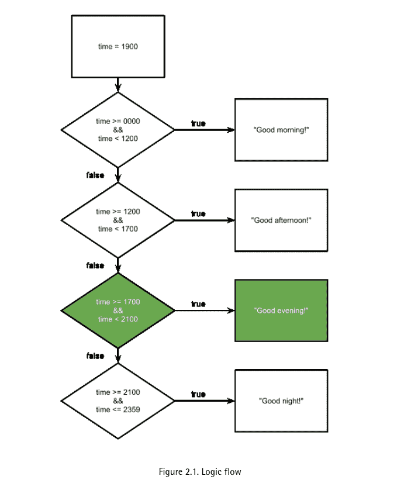

图 2.1. 逻辑流程

### && 符号

你会注意到图 2.1 中使用了 && 符号。这是一个逻辑与（AND）运算符。此外，还有逻辑或（||）以及逻辑非（!）。与和或运算符将值转换为布尔值，然后返回其中一个值。非运算符反转操作数的布尔值。以下是逻辑与运算符的一些示例。请注意，如果两个值中的第一个计算结果为 false，则返回该值；否则返回第二个值：

```
true && true;  // 返回 true
true && false; // 返回 false
false && true; // 返回 false
0 && 1;        // 返回 0
0 && 2;        // 返回 0
1 && 0;        // 返回 0
2 && 0;        // 返回 0
"foo" && "bar" // 返回 "bar"
```

以下是逻辑或运算符的一些示例。请注意，如果两个值中的第一个计算结果为 **true**，则返回该值；否则返回第二个值：

```
true || true;  // 返回 true
true || false; // 返回 true
false || true; // 返回 true
0 || 1;        // 返回 1
0 || 2;        // 返回 2
1 || 0;        // 返回 1
2 || 0;        // 返回 2
"foo" || "bar"; // 返回 foo
```

以下是逻辑非运算符的一些示例。请注意它如何反转操作数的布尔值：

```
!true;  // 返回 false
!false; // 返回 true
!0;     // 返回 true
!1;     // 返回 false
!"foo"; // 返回 false
```

让我们编写一些代码来实现图 2.1 所表示的功能：

```
**time-of-day.html（摘录）**

var d, hours, minutes, time, message;

// 获取当前时间的小时和分钟组成部分
d = new Date();
hours = d.getHours();
minutes = d.getMinutes();

// 确保小时是双位数字符串
if (hours < 10) {
  hours = "0" + hours; // 将小时转换为字符串
} else {
  hours = hours.toString();
}

// 确保分钟是双位数字符串
if (minutes < 10) {
  minutes = "0" + minutes; // 将分钟转换为字符串
} else {
  minutes = minutes.toString();
}

// 将小时和分钟连接成一个四位数
// 表示 24 小时制的时间
time = Number(hours + minutes);

if (time >= 0000 && time < 1200) {
  message = "早上好！";
} else if (time >= 1200 && time < 1700) {
  message = "下午好！";
} else if (time >= 1700 && time < 2100) {
  message = "晚上好！";
} else if (time >= 2100 && time <= 2359) {
  message = "晚安！";
}

alert(message);
```

在这个例子中，我们通过实例化一个新的 Date 对象并从中读取小时和分钟值来确定当前时间。Date 对象被设置为其实例化时的日期和时间。现在，由于我们需要一个四位数来表示一天中的时间，并且小时和分钟可能是一位数（如果是两点过两分，分钟数是2，而不是02），我们需要填充这些值。我们检查给定的值是否小于10。如果是，我们用零来填充。通过这样做，我们实际上同时完成了两项任务。通过将字符串 "0" 添加到我们的数字而不是数字 0（这没有任何作用），我们触发了类型强制转换，将我们的数字变成了字符串。然而，如果我们的小时或分钟值已经是两位数，我们只通过调用 toString 方法将其转换为字符串。一旦我们有了小时和分钟的值，我们将它们连接起来得到一个漂亮的四位数表示，然后再将其转换回数字。


### 第2章

从字符串中提取数字。这样一来，作为数字，我们就能使用比较运算符来检查当前时间是否在我们的范围内。注意我们是如何使用`if...else`语法来准备`hours`和`minutes`值的？我们再次使用它来将我们的时间值与设定的值进行比较，以确定早晨、下午、晚上和夜晚的时间。当满足其中一个条件时（在我们的示例中，当1900介于1700和2100之间时），我们将`message`的值设置为"Good evening!"，然后向用户发出警报，如图2.2所示。

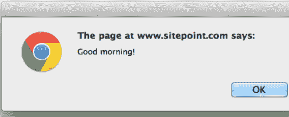

### 使用三元运算符简化代码

有时，如果你想避免在代码中使用冗长的`if...else`语句，可以通过使用三元运算符来简化它。其结构如下：`条件 ? 表达式1 : 表达式2`。因此，我们可以这样重写前面示例中的第一个`if...else`：

`hours = (hours < 10) ? "0" + hours : hours.toString();`

有时，这种语法使代码更易于阅读和整洁。有时则不然。请根据你的判断选择最容易理解的一种。

## 项目

为了将我们所学的内容整合起来，我将引导大家完成一个我们在本书中将逐步构建的项目：一个任务管理器。目前，让我们用一些任务来填充变量：

```
var task1, task2, task3;

task1 = "Pay phone bill";
task2 = "Write best-selling novel";
task3 = "Walk the dog";
```

## 总结

在本章中，我们涵盖了变量、数据类型、运算符和基本控制流。这些是所有JavaScript程序的构建块。如果这些内容中仍有不清楚的地方，请返回本章重新阅读。在进入更复杂的主题之前，理解这些基础知识的工作原理至关重要。

## 第3章

## 数组

我们在第2章中看到了变量如何存储不同类型的数据。但在处理像待办事项列表这样需要处理多个项目的情况时，你需要一种存储数据集合的方法。这就是数组的用武之地。

### 创建数组

你可以通过几种方式创建数组：

```
var myArray = new Array();
```

或者：

```
var myArray = [];
```

`[]`符号称为**数组字面量**，它表示一个空数组。与`new Array()`语法相比，它更简洁且更安全，因为`Array`构造函数可能被覆盖并被恶意代码替换；例如，一个伪装成数组的函数，但会将你放入其中的任何数据发送到互联网上的第三方服务器。使用数组字面量，你可以轻松创建一个包含以下值的新数组：

```
var myArray = [4, 8, 15, 16, 23, 42];
```

然而，数组不限于数字。你也可以创建包含字符串的数组：

```
var fruit = ["apple", "orange", "pear", "grapes"];
```

此外，你还可以混合存储在数组中的数据类型：

```
var stuff = [1, "apple", undefined, 42, "tanks", null, []];
```

### 向数组添加数据

不过，没有必要预先填充数组数据。你可以创建一个空数组，然后通过几种方式稍后添加数据。一种是通过索引：

```
var myArray = [];

myArray[0] = "Hello";
myArray[1] = "World";
```

现在这个数组的内容是：[ "Hello", "World" ]。通过在方括号中指定0，我们告诉JavaScript我们想要存储在索引0处的值。在这个示例中，字符串"Hello"被赋值给第零个位置。类似地，字符串"World"存储在索引1处。图3.1展示了这一点。

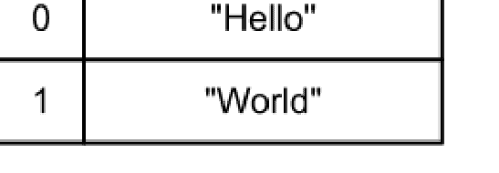

说到索引，重要的是要记住数组索引是从零开始的。这意味着第一个项目存储在位置0，第二个在位置1，第三个在位置2，依此类推。然而，这可能会引起混淆并导致差一错误。例如，你可能请求索引为1的项目并期望是第一个数组元素，但实际上，你访问的是第二个元素。

也可以使用命名索引：

```
var myArray = [];

myArray["fruit"] = "apple";
myArray["vehicle"] = "tank";
```

这创建了一个**关联数组**，其中项目通过命名索引而非数字索引存储。然而，我们不鼓励使用关联数组。使用命名索引存储数据的首选方式是使用对象，我们将在下一章讨论。

如前所述，有几种方法可以向数组添加数据。第二种方法是使用push方法。当你想向数组末尾添加项目，但又想避免计算访问最终位置所需的索引时，这很有用。你可以这样做：

```
myArray.push("hello");
```

通过使用**push**，你可以简单地向现有数组添加一个新项目。如果它是一个空数组，数据将写入位置0。如果数组中有十个项目，数据将写入位置10（记住，索引是从零开始的）。

### 从数组读取数据

从数组读取数据非常简单。你需要做的就是通过索引号指向你想要的项目，数组就会将其返回给你，如下所示：

```
var myValue,
    myArray = ["Hello", "World", "I", "am", "an", "array"];

myValue = myArray[4]; // 返回 "an"
```

这里我们有一个包含六个项目的数组。由于数组是从零索引的，单词"Hello"位于位置0，"World"在位置1，"I"在位置2，依此类推。通过将索引4传递给myArray，我们请求数组中的第五个项目，即单词"an"。

### 嵌套数组

有时，你需要在一个数组内存储一个数组。有时，你需要更多层嵌套。快速提醒：虽然可以嵌套多个数组，但我们建议不要这样做，因为处理许多数组索引可能会很混乱。

让我们从两个简单的数组开始，我们称它们为yusuf和dreamers。我们将用一些值填充dreamers：

```
var yusuf, dreamers;

yusuf = [];
dreamers = ["cobb", "arthur", "ariadne", "saito", "fischer"];
```

现在，从dreamers数组读取任何值就像传递一个索引一样简单，这意味着将索引值放在数组名称旁边的一对方括号中。因此，如果我想要"cobb"，我会传递索引0：

```
var dreamer = dreamers[0]; // 返回 "cobb"
```

但如果dreamers不是一个命名数组，而只是内联定义的呢：

```
var yusuf;

yusuf = [["cobb", "arthur", "ariadne", "saito", "fischer"]];
```

我们现在如何获取"cobb"？通过使用：yusuf[0][0]。在第一个方括号中，你定义要从中读取的第一个数组的索引；在第二个方括号中，你定义第二个索引。因此，读取"arthur"将是yusuf[0][1]，"ariadne"将是yusuf[0][2]，依此类推。

让我们再进一步：

```
var reality = ["yusuf", ["arthur", ["eames", ["cobb", "ariadne", "saito", "fischer"]]]];
```

这里，我们有一个名为`reality`的外部数组。它包含字符串"yusuf"和一个嵌套数组。嵌套数组包含字符串"arthur"和另一个嵌套数组，依此类推。从这个嵌套结构中读取值将如下所示：

```
reality[0];              // 返回 "yusuf"
reality[1][0];            // 返回 "arthur"
reality[1][1][0];         // 返回 "eames"
reality[1][1][1][0];      // 返回 "cobb"
reality[1][1][1][1];      // 返回 "ariadne"
reality[1][1][1][2];      // 返回 "saito"
reality[1][1][1][3];      // 返回 "fischer"
```

正如你所看到的，跟踪情况可能会变得复杂，特别是当每个数组包含多个项目时，其中一些本身也是数组。

### 你能用数组做什么？

现在我们已经介绍了数组的基础知识以及数据如何存储在其中，让我们看看你能对它们做些什么。有七个修改方法可以让你修改数组的内容：`pop`、`push`、`reverse`、`shift`、`sort`、`splice`和`unshift`。还有四个广泛支持的访问器方法，它们不修改数组，但允许你以不同方式访问其内容：`concat`、`join`、`slice`和`toString`。

由于JavaScript支持因浏览器而异，因浏览器版本而异，因此存在不同程度的支持需要应对。例如，实现JavaScript 1.6及更高版本的浏览器还支持`indexOf`和`lastIndexOf`访问器方法。它们还支持以下迭代方法：`forEach`、`every`、`some`、`filter`和`map`。最后，支持JavaScript 1.8或更高版本的浏览器还将支持`reduce`和`reduceRight`迭代方法。

过去，浏览器制造商每几个月甚至几年才发布一次新版本的产品。但现在，他们的发布速度快多了——至少Google和Mozilla在Chrome和Firefox方面如此。为了给你一个


例如，截至本文撰写时，Internet Explorer 的版本是 10，Safari 是 6，而 Firefox 和 Chrome 则分别达到了 21 和 28。由于新版本发布如此迅速（并且浏览器会在你每次重启时透明地进行更新），要确切掌握哪个版本支持哪些功能，尤其是在打印方面，变得非常困难。如果你需要了解某个特定浏览器的哪个版本支持你想使用的某个特性，可以利用像 http://caniuse.com/ 这样的工具。输入一个方法名，你就能看到一张表格，列出所有支持的浏览器、它们的版本，以及该特性的实现程度。

## 变更方法

### pop

`pop` 会移除数组的最后一个元素并将其返回给你：

```
var tasks = [
    "Pay phone bill",
    "Write best-selling novel",
    "Walk the dog"
];

tasks.pop(); // 返回 "Walk the dog"
```

### push

`push` 会将一个项添加到数组的末尾，并返回数组的新长度：

```
var tasks = [
    "Pay phone bill",
    "Write best-selling novel",
    "Walk the dog"
];

tasks.push("Feed the cat"); // 返回 4
// tasks 现在是:
// ["Pay phone bill",
//  "Write best-selling novel",
//  "Walk the dog",
//  "Feed the cat"]
```

### reverse

`reverse` 会反转数组中项的顺序：

```
var tasks = [
  "Pay phone bill",
  "Write best-selling novel",
  "Walk the dog"
];

tasks.reverse();
// tasks 现在是:
// ["Walk the dog",
//  "Write best-selling novel",
//  "Pay phone bill"]
```

### shift

`shift` 移除数组的第一个项并将其返回：

```
var tasks = [
  "Pay phone bill",
  "Write best-selling novel",
  "Walk the dog"
];

tasks.shift(); // 返回 "Pay phone bill"
// tasks 现在是:
// ["Write best-selling novel",
//  "Walk the dog"]
```

### sort

顾名思义，`sort` 将数组的项按升序排序。其排序算法非常基础。例如，无论你是在对字符串还是数字进行排序，所有内容都会被转换为字符串然后进行比较。因此，如果你排序 `[3, 10, 1, 2]`，结果会是 `[1, 10, 2, 3]`，而不是 `[1, 2, 3, 10]`。这是因为在词法（或字母顺序）上，10 排在 2 前面，因为它以 1 开头。

幸运的是，`sort` 允许你传入一个自定义的比较函数：

```
array.sort([compare]);
```

这允许你使用自己的标准来比较正在排序的项，而无需转换为字符串。你可以编写一个比较函数来简单地反转排序顺序，或者根据高度自定义的标准集进行排序；例如，按照数组中每个项的倒数第二个单词的倒数第二个字母进行排序，只要你愿意。

我们将在本书后面介绍函数时，更深入地探讨比较函数。现在，先看看一个简单的排序是如何工作的：

```
var tasks = [
    "Pay phone bill",
    "Write best-selling novel",
    "Walk the dog"
];

tasks.sort(); // 按升序对数组排序
// tasks 现在是:
// ["Pay phone bill",
//    "Walk the dog",
//    "Write best-selling novel"]
```

### splice

```
array.splice(index, howMany[, element1, ...[, elementN]);
```

`splice` 让你对数组执行选择性“手术”，只需一条命令即可同时添加和移除数组中的项：

```
var tasks = [
    "Pay phone bill",
    "Write best-selling novel",
    "Walk the dog"
];

tasks.splice(1, 1, "World domination");
// tasks 现在是:
// ["Pay phone bill",
//    "World domination",
//    "Walk the dog"]
```

我们刚刚告诉 `splice` 从索引 1 开始，也就是 "Write best-selling novel" 的位置，移除一个项（移除了 "Write best-selling novel"），然后在该位置插入项 "World domination"。我们也可以对多个项做同样的操作：

```
var tasks = [
  "Pay phone bill",
  "Write best-selling novel",
  "Walk the dog"
];

tasks.splice(1, 1, "World domination", "Rotate tires",
  "Hire hit squad");
// tasks 现在是:
// ["Pay phone bill",
// "World domination",
// "Rotate tires",
// "Hire hit squad",
// "Walk the dog"]
```

这里有两点需要注意。我们现在在 "Write best-selling novel" 原来的位置有了三个项，插入的项将 "Walk the dog" 向后推移而没有覆盖它。

当然，执行拼接时并不一定需要添加任何项。我们也可以只移除项（并让它们被返回给我们）：

```
var tasks, task;

tasks = [
  "Pay phone bill",
  "Write best-selling novel",
  "Walk the dog"
];
task = tasks.splice(1, 1);
// 返回 "Write best-selling novel"
alert("REMINDER! Don't forget to: " + task);
```

这里，我们所做的一切就是切出 `Write best-selling novel` 并将其存储在名为 `task` 的变量中。然后我们触发一个警报，消息为："REMINDER! Don't forget to: Write best-selling novel"。这可以在图 3.2 中看到。

34 Jump Start JavaScript

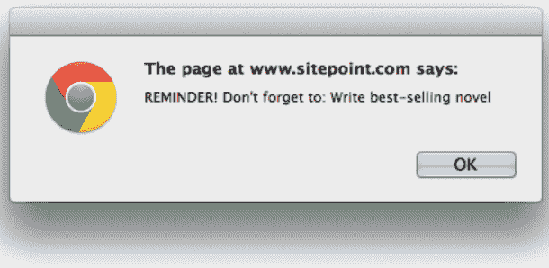

> ### 吸引用户注意
>
> **警报** 是吸引用户注意的一种基本方式。它几乎算不上是优雅或符合设计友好的做法，但它简单直接，并能完成所需的任务——尤其是对于本书的目的而言！
>
> 不幸的是，当 **警报** 消息处于活动状态时，用户无法与页面交互。他们需要先点击“确定”按钮才能关闭该消息。

### unshift

`unshift` 将一个或多个项添加到数组的开头，并返回数组的新长度：

```
var tasks, len;

tasks = [
    "Pay phone bill",
    "Write best-selling novel",
    "Walk the dog"
];
len = tasks.unshift("Defeat nemesis", "Pick up dry cleaning");
alert("You now have " + len + " tasks to complete: "
    + tasks.join(", "));
```

在这里，我们只是使用 `unshift` 向列表开头添加了两个新任务，然后获取数组的新长度并为用户构建了一条消息。结果显示在图 3.3 中。

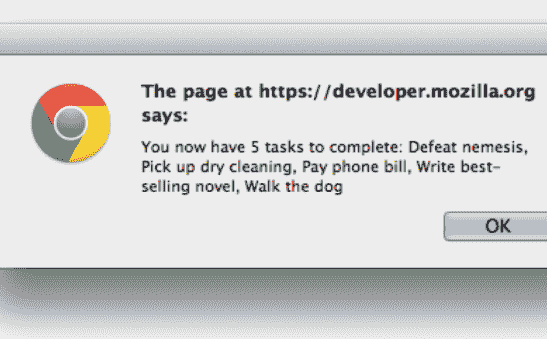

你可能已经注意到了我使用 `join` 方法。我们稍后会看看 `join`。

## 访问方法

### concat

使用 `concat`，你可以将两个或多个数组合并为一个。被连接的原始数组保持不变。操作返回一个新形成的数组，其中包含连接后的值：

```
var arr1, arr2, arr3, arr4;

arr1 = ["Pay phone bill"];
arr2 = ["Write best-selling novel"];
arr3 = ["Walk the dog"];
arr4 = arr1.concat(arr2, arr3);
// arr4 包含:
// ["Pay phone bill",
//   "Write best-selling novel",
//   "Walk the dog"]
```

36 Jump Start JavaScript

这里，`concat` 方法已经用前三个数组的内容填充了 `arr4`。其他三个数组保持不变，仍然各包含一个项。

### join

我们已经在 `unshift` 的示例中看到了 `join` 的实际应用。`join` 获取数组中的值并将它们连接成一个字符串。你可以传递一个参数来指定在连接操作中每个项之间放置的字符。如果没有传递，它将输出一个逗号分隔的项列表。请注意，无论数组项是什么类型，`join` 都会对每个项执行 `toString` 转换并使用结果（我们稍后会看看 `toString`），如图 3.4 所示：

```
// join.html
var nums;

nums = [4, 8, 15, 16, 23, 42];
alert("The winning lottery numbers are: "
    + nums.join(", "));
```

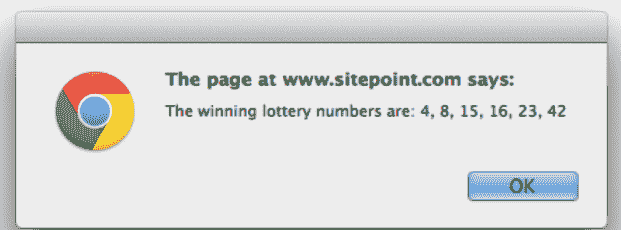

你可能会问，为什么在示例中调用 `join` 时传入了一个逗号，因为单独调用 `join` 会自动插入逗号。请注意我是如何在逗号后面加了一个空格的？否则，我们最终会得到 "The winning lottery numbers are: 4,8,15,16,23,42"，如图 3.5 所示。

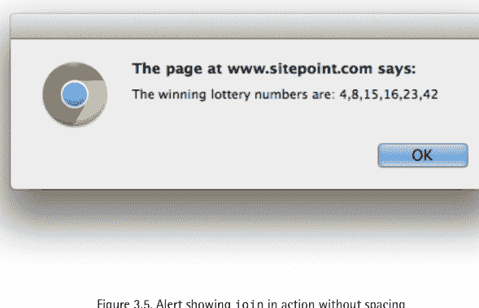

### slice

`slice` 会复制数组的一部分并将其返回。它不是修改原始数组，而是制作一个浅拷贝。你告诉它从哪里开始复制，以及（可选）在哪里结束复制。因此，`arr.slice(2)` 将返回从索引 2 开始直到数组末尾的 `arr` 的副本。相反，`arr.slice(-2)` 将从末尾开始，给你最后两个项。`arr.slice(2, 4)` 将从索引 2 到索引 4 复制 `arr`。

> 你是否注意到我们说 **slice** 制作的是一个 *浅* 拷贝。例如，如果你的数组包含一个数组作为其项之一，它将通过引用被复制。换句话说，如果原始数组发生变化，副本也会随之变化。

让我们创建一个包含清洁相关项子列表的任务列表，然后将其复制并切分成更小的列表：


var tasks, todo, cleanup, noCleaning;

tasks = [
    "放风筝",
    "拯救世界",
    [
        "清洁浴室",
        "打扫车库",
        "改过自新"
    ]
];

todo = tasks.slice(0); // 复制 tasks
cleanup = tasks.slice(-1); // 只复制嵌套数组
noCleaning = tasks.slice(0, 2); // 只复制前两项

首先需要注意的是，`tasks` 列表中的第三项是一个数组。我们已经提到过，`slice` 会进行数组的浅拷贝。这是一个需要小心切片拷贝的例子，因为子数组只会通过引用被复制。换句话说，子数组的副本将指向原始数组，因此如果原始数组发生改变，副本也会随之改变。

### toString

toString 返回一个表示该数组及其元素的字符串：

```
var arr = ["These", "words", "are", "separated", "by", "commas"];

arr.toString(); // 返回 "These,words,are,separated,by,commas"
```

当数组项全部是字符串时，如上例所示，它们只是简单地用逗号连接成一个列表并返回。数字在连接前会先转换成字符串：

```
var arr = ["These", 8, "words", "and", "numbers", "are", "separated", "by", "commas"];

arr.toString(); // 返回 "These,8,words,and,numbers,are,separated,by,commas"
```

对于数组和对象（我们将在后面介绍），我们会看到不同的行为：

```
var arr = ["a", "b", "c", 100, 200, 300, [1,2,3], {"foo": "bar"}];
arr.toString(); // 返回 "a,b,c,100,200,300,1,2,3,[object Object]"
```

注意 toString 函数如何展平了包含值 1,2,3 的嵌套数组，但对对象字面量只输出了 [object Object]。

### indexOf

indexOf 会在数组中找到某个项的第一个实例并返回其索引。它使用严格相等（就像你使用 `===` 而不是 `==` 一样）来进行查找。以下是示例：

```
array.indexOf(searchElement, [fromIndex]);
```

`searchElement` 的值就是你要查找的内容。如果你知道该值出现在某个点之后，可以选择传递一个索引作为开始搜索的位置，这样你就可以避免遍历整个数组，如图 3.6 所示：

```
var alphabet;
alphabet = ["a", "b", "c", "d", "e", "f", "g", "h", "i",
"j", "k", "l", "m", "n", "o", "p", "q", "r", "s", "t", "u", "v",
"w", "x", "y", "z"];
alert("字母 'm' 的索引是: " +
alphabet.indexOf("m"));
```

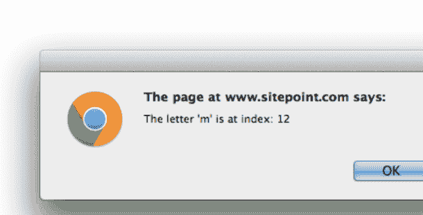

图 3.6. 显示 indexOf 搜索结果的提示框

你可能传入一个索引来开始搜索，比如 `alphabet.indexOf("m", 10)`。在这个例子中，差异很小，因为数组中的项数很少。但在非常大的数组中，它可能会影响性能，因为你要搜索的项会少得多。

### lastIndexOf

`lastIndexOf` 的工作方式与 `indexOf` 完全相同，但它从数组的末尾开始搜索，而不是从开头。因此，它将找到 `searchElement` 的最后一次出现：

```
array.lastIndexOf(searchElement, [fromIndex]);
```

## 迭代方法

### forEach (JavaScript 1.6)

传统上，当你想要处理数组中的所有项目时，你会循环遍历它。虽然我们稍后会介绍循环，但展示过去是如何完成的很重要，这样你才能理解为什么 `forEach` 方法很方便。

下面是一个使用传统方法循环遍历数组的程序。该数组包含一组数字，在每次循环中，循环中的指令将当前数字加到总数上。程序以一个提示结束，显示总数为 108：

```
var arr, i, num, total;

arr = [4, 8, 15, 16, 23, 42];
total = 0;

for (i = 0; i < arr.length; i = i + 1) {
  num = arr[i];
  total = total + num;
}

alert("总数是: " + total);
```

图 3.7 显示了其样子。

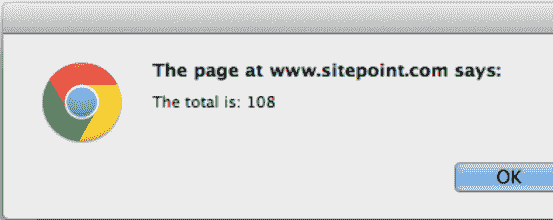

图 3.7. 显示数组中数字总和的提示框

尽管创建循环有几种方法，但此示例中使用的 for 循环是最常见的。它由三部分组成：初始化（`i = 0`）、条件（`i < arr.length`）和最终表达式（`i = i + 1`）。循环开始时，变量 `i` 设置为零。如果 `i` 的值小于数组的长度（它确实小于），则执行一次循环体。执行完循环体后，`i` 递增一。此过程持续进行，直到 `i` 不再小于 `arr.length`。现在你已经对 for 循环有了基本的了解，来看看 `forEach` 如何简化相同的程序：

```
var arr, total;

arr = [4, 8, 15, 16, 23, 42];
total = 0;

arr.forEach(function(num) {
  total = total + num;
});

alert("总数是: " + total);
```

注意循环本身现在变成了对数组的 `forEach` 方法的调用。我们传入一个匿名函数（我们将在后面详细介绍），它接收一个值作为参数，并将其放入变量 `num` 中。换句话说，每次 `forEach` 遍历到一个数字时，它都会将其作为 `num` 传递给这个函数。剩下的就是数学计算了，最终在提示框中显示的总数与之前示例中的相同。

### map (JavaScript 1.6)

`map` 方法与 `forEach` 几乎相同。唯一的区别是 `map` 返回一个包含回调函数返回值的新数组。以下示例使用 `map` 计算 `arr` 中每个项的平方。然后返回结果并存储在 `squared` 中：

```
var arr = [1, 2, 3, 4, 5];
var squared;

squared = arr.map(function(num) {
  return (num * num);
}); // squared 为 [1, 4, 9, 16, 25]
```

### every (JavaScript 1.6)

有时，你需要验证数组中的数据是否符合一组标准。你可以像之前的示例一样，使用传统的 for 循环或 `forEach` 方法手动运行测试。或者你可以直接使用 `every` 方法，该方法对数组中的每个项运行一个回调函数。如果它们都符合，则返回 `true`；如果有一个或多个不符合，则返回 `false`：

```
var arr, isValid;

arr = [1, 2, 3, 4, 5];
isValid = arr.every(function(num) {
    return (num < 10);
}); // isValid 为 true
```

在这个例子中，我们使用 `every` 方法检查数组中的每个项是否都小于 10。`every` 方法遍历数组，对于每个项，它运行我们包含在其括号中的函数。当前数组项作为 `num` 传入，我们的表达式（`return (num < 10)`）检查该数字是否小于十，并返回 `true` 或 `false`。`every` 监视我们代码的响应，如果我们返回 `false`，它就会退出循环并返回 `false`。我们将其响应捕获在变量 `isValid` 中。在上述情况下，`every` 方法将返回 `true`。如果我们更改表达式以检查数字是否大于 3，那么 `isValid` 将为 `false`：

```
var arr, isValid;

arr = [1, 2, 3, 4, 5];
isValid = arr.every(function(num) {
    return (num < 3);
}); // isValid 为 false
```

### some (JavaScript 1.6)

你可以使用 `some` 来检查数组中的一个或多个项是否符合测试。`some` 的工作方式与 `every` 相同，但只要有一个数组项返回 `true`，它就会返回 `true`：

```
var arr, isValid;

arr = [1, 2, 3, 4, 5];
isValid = arr.some(function(num) {
  return (num < 2);
}); // isValid 为 true
```

在这个例子中，尽管数组中只有一个数字小于二，但 `isValid` 仍然为真。

### filter (JavaScript 1.6)

测试数组是件好事，但如果你想创建一个包含符合你标准的项的新数组呢？`filter` 正是为此而生。它的工作方式类似于 `every` 和 `some`，只是任何通过你标准的项都会被复制到一个新数组中：

```
var arr, filtered;

arr = [1, 2, 3, 4, 5, 6, 7, 8, 9];
filtered = arr.filter(function(num) {
  return (num < 5);
});
// filtered 现在包含 [1, 2, 3, 4]
```

### reduce 和 reduceRight (JavaScript 1.8)

有时需要对数组执行数学运算，并将其缩减为单个值；例如，如果你想要数组中值的总和。这就是 `reduce`（和 `reduceRight`）发挥作用的地方。`reduce` 遍历数组，并传入一个前一个值和一个当前值。它还传入当前索引和对数组本身的引用，以防你在计算中需要它们。然而，在这个例子中，我们将只使用 `previous` 和 `current` 参数：

```
var arr, total;

arr = [1, 2, 3, 4, 5];
total = arr.reduce(function(previous, current) {
  return previous + current;
}); // total 为 15
```


在这里，`reduce` 像前面的方法一样遍历数组，但有几个主要区别。首先，在第一次遍历时，由于没有 `previous` 值传入，数组的第一项和第二项会被传入（本例中是值 1 和 2）。在后续遍历中，`previous` 值是你的代码返回的结果，而当前值则是数组中的下一项。我们这里做的事情是，将数组中的当前项与之前的值——即运行总和——相加。最终结果是将数组所有值相加得到总和 15。

`reduceRight` 执行与 `reduce` 相同的功能，但顺序相反。换句话说，它从数组的末尾开始，向开头移动。

## 项目

我们的目标是构建一个功能完善的任务管理器（或者如果你愿意，也可以叫待办事项应用），但到目前为止我们只涵盖了变量和数组，所以还没能编写太多代码。在上一章中，我们创建了三个独立的变量来保存三个不同的任务。现在让我们将这三个任务放入一个名为 `tasks` 的数组中：

```
var tasks;

tasks = [
    "Pay phone bill",
    "Write best-selling novel",
    "Walk the dog"
];
```

## 总结

本章介绍了数组，以及许多用于处理数组的方法。然而，在 JavaScript 中，数组实际上是对象，所以要真正理解数组，你也需要理解对象。不过别担心；下一章会详细介绍对象。

# 第 4 章

## 对象与函数

在上一章中，我们看了数组。现在我们将研究对象，它们与数组相似，都是数据的容器。虽然存在相似之处——数组实际上是一种对象——但也有一些显著的区别。

### 对象

### 创建对象

与数组一样，创建对象有几种方式，而且就像数组一样，其中一种方式比另一种更受推荐。因此，尽管你可以这样做：

```
var myObject = new Object();
```

但更好的做法是：

```
var myObject = {};
```

后者更简单、更安全，因此是首选。如果你还记得第 3 章的内容，`Array()` 可能被恶意重写。`Object()` 同样存在这种风险，这就是为什么使用对象字面量符号 `{}` 更安全，因为它无法被重写。对象字面量表示一个新的空对象。

在数组中，值只是通过索引添加和访问，而对象则使用键/值对系统。这两种不同的值存储方式使得在选择数据存储和检索需求时，数组还是对象变得相当简单。例如：

```
var lotteryNumbers, profile;

lotteryNumbers = [4, 8, 15, 16, 23, 42];
profile = {
    firstName: "Hugo",
    lastName: "Reyes",
    flight: "Oceanic 815",
    car: "Camaro"
};
```

请注意 `lotteryNumbers` 数组如何很好地适合存储彩票号码序列，而 `profile` 对象则非常适合存储一个人（雨果）的个人资料的键/值对。

### 向对象添加内容

你可能在上一节中已经注意到，你可以声明一个空对象 `{}`，或者一个带有值的对象（雨果的个人资料）。然而，在声明对象之后，你仍然可以通过几种方式向其添加键/值对。在查看数组章节时，我们提到了命名索引，它可以用来创建关联数组，尽管对象更适合这项任务。这是一个例子：

```
var obj = {};

obj["firstName"] = "Hugo";
obj["lastName"] = "Reyes";
```

这被称为括号表示法。另一种更常见的语法是点表示法。这是一个例子：

```
var obj = {};

obj.firstName = "Hugo";
obj.lastName = "Reyes";
```

点表示法比括号表示法更简单；然而，某些任务只能通过括号表示法来完成。例如，你可以在括号内使用变量，这在点表示法中是做不到的。括号表示法还支持包含空格和其他在点表示法中无效字符的字符串。

### 从对象读取

从对象读取值也可以使用括号或点表示法来完成：

```
var obj = {};

obj.firstName = "Hugo";
obj.lastName = "Reyes";
alert("Hello, my name is " + obj.firstName + " "
+ obj.lastName + ".");
```

运行此代码的结果如图 4.1 所示。

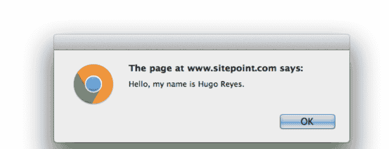

与数组不同，不可能使用数字索引来读取对象的内容。唯一可以使用的索引类型是命名索引：

```
var obj = {};

obj.firstName = "Hugo";

obj[0];           // 返回 undefined
obj["firstName"]; // 返回 "Hugo"
obj.firstName;    // 返回 "Hugo"
```

### 嵌套对象

嵌套对象对于组织你的数据非常有帮助：

```
var person;

person = {
  name: {
    first: "Hugo",
    last: "Reyes"
  }
};
person.name.first; // 返回 "Hugo"
person.name.last;  // 返回 "Reyes"
```

也可以这样赋值对象：

```
var person;

person = {};
person.name = {};
person.name.first = "Hugo";
person.name.last = "Reyes";
```

但是请注意，以下做法将无法工作：

```
var person;

person = {};
person.name.first = "Hugo";
```

这将抛出错误 `TypeError: Cannot set property 'first' of undefined`，这意味着它试图在未定义的 `name` 上创建 `first`。在前面的例子中，我们为 `person.name` 赋值了一个对象，但这里没有。

### 通过嵌套对象实现命名空间

如果你对现代编程语言有所了解，你一定听说过命名空间。本质上，它是一种通过将代码放入嵌套的桶或命名空间来组织代码的更好方式：

```
Project.Strings.Warnings.sessionExpired =
    "Your session has expired."
```

当然，为了使此命名空间存在，我们必须首先嵌套相应的对象：

```
var Project = {
    Strings: {
        Warnings: {}
    }
};
```

尽管此代码设置了所需的命名空间，但如果一个或所有相关对象已经存在怎么办？如果它们已经包含数据怎么办？

例如，假设我们有以下内容：

```
var Project = {
    Strings: {
        Warnings: {
            overQuota: "You've exceeded your quota!",
            outOfStock: "We're out of stock!"
        }
    }
};
```

现在假设在我们程序的其他地方（在不同的 JavaScript 文件中），我们想向 `Project` 命名空间添加 `Widgets`，但不确定它是否已经定义：

```
var Project = {
    Widgets: {}
};
```

通过我们刚才的操作，我们破坏了现有的 `Strings` 对象，因为我们用一个新的对象覆盖了整个 `Project` 对象。我们应改为检查 `Project` 对象是否已存在。如果存在，我们就向其添加；否则，我们创建它，然后再添加：

```
var Project = Project || {};

Project.Widgets = {};
```

这里我们使用 OR 运算符（`||`）来测试 `Project` 是否已定义。如果 `Project` 已定义，它会将其值赋给 `Project`，不进行任何更改。如果未定义，JavaScript 会将 `||` 右侧的值赋给 `Project` 变量，如图 4.2 所示。

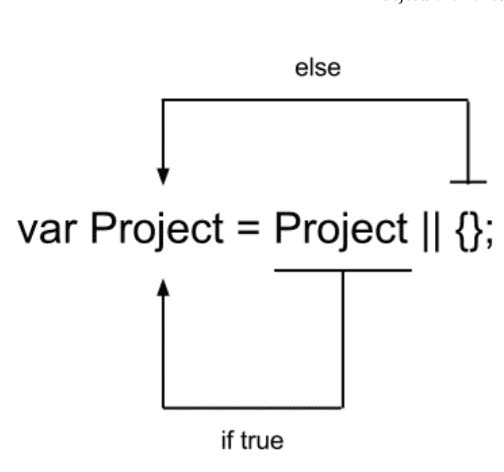

图 4.2. `||` 运算符演示

### 原型链

我们很快将讨论如何遍历对象，但为此，我需要先介绍 JavaScript 的原型链。你马上就会明白为什么。目前，我们将快速了解一下原型，因为稍后在函数部分我们会更详细地介绍它们。现在，了解一点关于它们的知识以及它们如何影响遍历对象中的键/值很重要。

所有对象都有一个原型。那么，什么是 **原型**？它是一个其他对象从中继承属性的对象。图 4.3 展示了一个说明原型继承概念的图表。


### 遍历对象

遍历对象不像遍历数组那样简单。遍历数组时，你只需递增一个索引值，然后用它来逐个访问数组元素。而对象没有索引值。对象是键/值对的集合，因此你需要采用不同的方式来遍历它们：

```javascript
var data, key;

data = {
    firstName: "James",
    lastName: "Kirk",
    occupation: "Captain"
};

for (key in data) {
  alert(key + " is " + data[key]);
}
```

在这个例子中，我们使用了 `for ... in` 循环。我们给它一个变量（本例中是 `key`），这个变量将在遍历对象时用于保存键，以及一个要遍历的对象（本例中是 `data`）。对于 `data` 内部的每个键/值对，循环会将键赋值给名为 `key` 的变量。在循环体内，我们可以使用这个键来访问对象中对应的值：`data[key]`。这相当于依次编写 `data["firstName"]`，然后是 `data["lastName"]`，依此类推。

不过，这里有一个需要注意的地方。由于对象是从其他对象继承而来的，循环可能会开始返回原型链上更高级别的键/值对。为了防止这种情况，我们需要在循环中添加一些内容：

```javascript
var data, key;

data = {
  firstName: "James",
  lastName: "Kirk",
  occupation: "Captain"
};

for (key in data) {
  if (data.hasOwnProperty(key)) {
    alert(key + " is " + data[key]);
  }
}
```

`hasOwnProperty` 方法确保我们使用的键属于当前对象本身，而不是来自原型链的更高级别。如果它返回 `true`，我们就可以继续执行操作。否则，我们就忽略它。

### 函数

随着你编写更复杂的程序，你会发现需要实现一些 JavaScript 本身不直接支持的操作。你可以用几行代码完成这个任务，但很可能你需要多次执行该任务。这就是函数的用武之地。**函数** 是一种将一组操作打包起来、给它命名，然后你可以按需多次调用它的方式。下面是一个简单的函数：

```javascript
function sayHello() {
  alert("Hello, world!");
}
```

调用这个简单的函数，你就能让一个显示“Hello, world!”的提示框弹出。一旦我们定义了 **sayHello**（如上所示），运行（或执行、调用）它非常简单；你只需写下它的名称，后面跟上一对圆括号：

```javascript
sayHello();
```

圆括号的作用是让你能够将值作为参数传递给函数。例如，与其让我们的函数说“Hello, world!”，我们可以说点别的：

```javascript
function sayHello(msg) {
  alert(msg);
}
```

现在当我们调用 **sayHello** 时，我们可以传入我们自己的消息：

```javascript
sayHello("Howdy, y'all!");
```

这样做会调用 **sayHello** 函数，并将“Howdy, y'all!”作为第一个参数传入。如果你查看我们的 **sayHello** 函数，我们指定了一个名为 **msg** 的变量作为第一个参数，因此在 **sayHello** 内部，**msg** 将包含传入函数的值；本例中就是“Howdy, y'all!”。然后我们将这个变量交给 **alert**，大功告成！

在我们继续深入讨论函数之前，我需要介绍两个重要的概念：作用域和提升。它们可能是使用函数产生的结果，如果你不了解它们，可能会遇到一些麻烦——比如代码行为异常。

### 作用域

函数不仅是操作组的容器，它们还会为变量创建所谓的 **作用域**。变量要么存在于 **全局作用域**（在函数内部未声明，任何地方都可以访问），要么存在于 **局部作用域**（在函数内部声明，仅在该函数内可访问）。函数外部的代码无法访问在其内部声明的变量。只有函数内部的代码可以访问它。在变量声明的同级或更低级别声明的嵌套函数也可以访问它。例如：

```javascript
function hi() {
    var hello = "hello";
}

hi();
alert(hello);
```

在这个例子中，名为 `hello` 的变量的作用域限定在 `hi` 函数内。这意味着，从 `hi` 函数外部尝试访问 `hello` 变量的 `alert` 将无法成功。相反，它会收到一个 `ReferenceError: hello is not defined` 错误。原因在于变量 `hello` 是在 `hi` 内部声明的，因此它的作用域是 `hi`。在 `hi` 函数外部，它是不可用的。

话虽如此，在另一个函数内部声明的任何函数，都可以自动访问其父函数中声明的变量：

```javascript
function fullName() {
    var firstName = "Hugo";

    function alertFullName() {
        var lastName = "Reyes";

        alert("Full name: " + firstName + " " + lastName);
    }

    alertFullName();
}

fullName();
```

外部函数 `fullName` 创建了一个作用域，变量 `firstName` 和函数 `alertFullName` 都在此作用域内声明。由于它们都在 `fullName` 的作用域内声明，因此 `alertFullName` 可以访问 `firstName`。所以当 `fullName` 被执行，并且它转而执行 `alertFullName` 时，`alertFullName` 既能访问它自己的 `lastName` 变量，也能访问其父函数的 `firstName`，从而拼接出它的提示文本。

实际上，一个函数可以访问在其上方声明的所有变量，无论其嵌套有多深。让我们用一个例子来说明。在这个例子中，我们将使用控制台的 `log` 函数将值直接输出到浏览器的控制台。如果你还没有使用过控制台，请先回到第一章，快速查看如何启用浏览器的控制台，以便进行接下来的示例：

```javascript
// scope-2.html (excerpt)

// Declaring a global variable and giving it the value "a"
var a = "a";

function levelb() {
  // Declaring a variable that levelb and children can see
  var b = "b";

  function levelc() {
    // Declaring a variable only levelc and leveld can see
    var c = "c";

    function leveld() {
      // Declaring a variable only leveld can see
      var d = "d";

      console.log("leveld", a, b, c, d);
    }

    // Running leveld() will output a, b, c and d
    leveld();

    console.log("levelc", a, b, c);
  }

  // Running levelc() will output a, b, and c
  levelc();

  console.log("levelb", a, b);
}

// Running levelb() will output a and b
levelb();

// Only the variable named "a" is available globally
console.log("global", a);
```

如果你运行这个例子，你将在浏览器的控制台中看到以下输出：

```
leveld a b c d
levelc a b c
levelb a b
global a
```

如你所见，嵌套的函数声明可以访问在其上方声明的变量。

### 提升

既然我们已经介绍了函数如何创建变量作用域，接下来我们将讨论一种称为 **提升** 的现象。由于 JavaScript 是一种非常宽容的语言，它需要在底层做大量工作。我们已经通过类型强制转换见识过这一点，当时 JavaScript 尝试转换变量类型以使类型冲突的操作能够进行。**提升** 是 JavaScript 的另一个“底层”操作，它将所有变量声明移动到函数的顶部。这意味着这样的代码：

这等同于：

```javascript
var name = "Emma";

function nameHer() {
  console.log(name); // outputs undefined
  name = "Audrey";
  var name;
}
```

也等同于：

```javascript
var name = "Emma";

function nameHer() {
  console.log(name); // outputs undefined
  var name = "Audrey";
}
```

这三个示例是相同的，因为JavaScript在读取这些函数体时，会将所有变量声明提升到函数顶部。请注意，它只移动声明，而非赋值。在底层，所有这三个函数最终都看起来和第一个一样。这就是为什么第二个和第三个示例输出的是undefined，而不是你预期的"Emma"。尽管看起来我们是在将"Audrey"赋值给包含"Emma"的name变量之前使用了该变量，但实际上我们是在每个函数顶部声明了一个新的、未定义的name变量。

### 声明

到目前为止，我们已经看到了三种创建函数可能方式中的一种。我们不仅可以使用`function`语句（或声明），还可以使用`function`操作符（或表达式）和`Function`构造函数。第一种是命名函数声明，第二种是函数表达式，第三种是构造函数，就像`Array()`和`Object()`一样。与`Array()`和`Object()`一样，`Function()`构造函数返回一个新的函数对象：

```javascript
// declaration
function sayHello1() {
    alert("Hello");
}

// expression
var sayHello2 = function() {
    alert("Hello");
};

// constructor (not recommended)
var sayHello3 = new Function("alert('Hello')");
```

让我们先看看前两种，因为它们是最常见的。它们之间有几个不同之处，首先是函数声明需要有一个名称（在这个例子中是sayHello1）。如果函数声明没有名称，它就被视为函数表达式，并且因为它是无名的，所以是一个匿名函数。为什么这很重要？嗯，函数声明和表达式之间的第二个区别是JavaScript引擎解析它们的方式。函数声明就像变量一样被提升，而函数表达式只有其变量声明部分会被提升。例如，使用函数声明时，这样做是可能的：

```javascript
alert(hi());

function hi() {
    return "Hi!";
}
```

这是可能的，因为整个hi函数都被提升到了alert之上，因此在alert使用它时它是可用的。现在让我们看一个使用函数表达式的类似例子，这会抛出一个TypeError: undefined is not a function错误：

```javascript
alert(hey());

var hey = function () {
    return "Hey!";
};
```

### 快速入门JavaScript

错误信息说"undefined is not a function"的原因是，在运行时，hey变量声明被提升到了alert之上，但函数的赋值仍然留在下面。

编写函数的第三种方式是Function构造函数。在这三种方式中，我最不推荐这种方式，因为它要求你的代码作为字符串传递，这难以编写且容易出错。

如果你打算使用函数声明，请始终在代码作用域（无论是全局还是局部作用域）的顶部声明它们，以避免提升，并让读者清楚函数实际何时可用。如果你打算使用函数表达式，出于同样的原因，请将你将要赋给函数的变量在局部作用域的顶部声明。无论如何，避免编写有条件地声明函数的代码，因为你会遇到跨浏览器的行为不一致，更不用说这是不良实践了。

在撰写本文时，当运行以下代码时，Google Chrome会alert"Hello!"，而Mozilla Firefox会alert"Hi!"：

```javascript
if (true) {
  function hello() {
    alert("Hi!");
  }
} else {
  function hello() {
    alert("Hello!");
  }
}
```

然而，当写成函数表达式时，两个浏览器都会返回"Hi!"，因为if语句只有true分支会被执行和解析：

```javascript
var hello;

if (true) {
  hello = function() {
    alert("Hi!");
  }
} else {
  hello = function() {
    alert("Hello!");
  }
}
```

### 参数

当你定义一个函数时，你可以定义它将接收的参数列表。这样做时，你就在该函数的作用域内声明了变量。换句话说，这些变量只能在该函数内部使用。例如：

```javascript
function person(firstName, lastName, age) {
  alert(firstName);
  alert(lastName);
  alert(age);
}

person("John", "Doe", 44);
```

我们的函数名为person，接收三个参数：firstName、lastName和age。当在示例最后一行调用该函数时，有三个值通过其括号传递："John"、"Doe"和44。在函数内部，我们获取这三个值并依次alert它们。

然而，有时预先定义参数是不可能的或不理想的。如果我们想创建一个函数，连接任意数量的值并返回结果，我们该如何定义参数列表？嗯，JavaScript函数有一个特殊的类数组对象叫做`arguments`，我们可以在函数内部访问它，以确切地查看传入了什么：

```javascript
function concatenate() {
  var i, str;

  str = "";
  for (i = 0; i < arguments.length; i += 1) {
    str += arguments[i];
  }
  return str;
}

concatenate("Super", "cali", "fragilistic", "expiali",
          "docious");
// returns Supercalifragilisticexpialidocious
```

我们无法知道会有多少字符串传入我们的`concatenate`函数，因此无法预先定义参数列表。相反，我们遍历特殊的`arguments`数组，并从那里连接值。

当然，这是一个函数运行的简单示例，而且没什么用，因为我们可以直接调用`alert`，而不需要将其包装在函数中。但假设我们想将一个字符串翻译成猪拉丁文（Pig Latin）？我们可以编写一个接收一个值然后返回另一个值的函数。为了获得返回值，我们需要使用`return`语句：

```javascript
function pigLatin(phrase) {
    var words, pigged;

    // Create an array with the words of the phrase
    //   we're given by splitting the phrase on the
    //   spaces between the words.
    words = phrase.split(" ");

    // Loop over the words array and translate each word to
    //   Pig Latin. Return the translated word so that it
    //   gets placed in a new array called "pigged."
    pigged = words.map(function (word) {
        var first, rest;

        // Grab the first letter of the word
        first = word.substring(0, 1);

        // Grab the rest of the word
        rest = word.substring(1);

        // Start the new word with the ending of the old word,
        //   and add the first letter of the old word as well as
        //   "ay" to the end of it. Return the result of the
        //   concatenation so that the map function can add it
        //   to the "pigged" array.
        return rest + first + "ay";
    });

    // Rebuild the new Pig Latin phrase by rejoining the newly
    //   "pigged" words with spaces in between. Return the
    //   result so that anyone calling our pigLatin function
    //   can actually get the new Pig Latin version of their
    //   phrase.
    return pigged.join(" ");
}
```

然后，我们可以给它传递一个简单的短语，并获得返回的猪拉丁文版本：

```javascript
var pl = pigLatin("tonight you belong to me");

// returns "onighttay ouyay elongbay otay emay" into pl
```

现在，无论何时我们想翻译一个短语，我们只需将其传入我们的pigLatin函数，就能得到翻译结果。很简单！

### 使用函数进行面向对象编程

不幸的是，对**面向对象编程（OOP）**是什么进行全面深入的解释超出了这本简短书籍的范围。但其基本要点是，OOP是一种编程风格，允许你在代码中将现实世界的物品表示为对象。一个对象可以表示一个物理元素，如人或水果，或者更抽象的东西，如银行账户或网络连接。对象存储数据（称为属性）和函数（称为方法），后者对数据进行操作。因此，一个表示银行账户的对象可能具有账户号码、余额和透支限额等属性，以及存款和取款等方法。

对于任何熟悉传统基于类的OOP的人来说，JavaScript是一种无类的原型式编程语言，其中对象继承自其他对象而不是类。JavaScript使用函数作为类，但没有类语句。相反，任何函数都可以充当类，并且可以使用`new`关键字创建该类的新实例。


bank-accounts.html（节选）

```javascript
var checking, savings;

// 这是 Account 类的定义
function Account(accountNumber) {
  // 这是我们将要存储
  //   账户号码的属性。
  this.accountNumber = accountNumber;

  // 这是我们将要追踪
  //   账户资金的属性。
  this.funds = 0;

  // 这是我们将要用来向账户
  //   添加资金的设置方法。
  this.deposit = function(amount) {
    if (amount === Number(amount)) {
      this.funds += amount;
    }
  };

  // 这是返回账户
  //   余额的获取方法。
  this.balance = function() {
    return this.funds;
  };
}

// "new Account()" 构造函数返回一个完整包含
//   deposit 和 balance 方法的新账户对象。我们将
//   账户对象存储在一个名为 checking 的变量中。
checking = new Account("87654321");

// 使用 deposit 方法允许我们向账户
//   对象传递值。
checking.deposit(12.35);
checking.deposit(2.76);
checking.deposit(74.01);

// 我们现在创建一个新的账户对象，并将其存储在
//   一个名为 savings 的变量中。它也具有 deposit 和
//   balance 方法，并且与 "checking"
//   账户对象是不同的。
savings = new Account("12345678");
savings.deposit(225.57);

// 使用对象的 balance 方法，我们可以要求每个
//     对象报告它们的余额。
checking.balance(); // 返回 89.12
savings.balance(); // 返回 225.57
```

在这里，我们有一个名为 Account 的函数，从中创建了两个实例：checking 和 savings。通过在函数内部使用 `this` 关键字并将变量和函数挂载其上，我们实际上创建了一个用于实例化的类函数。现在我们可以使用 `new` 关键字创建该函数的实例，我们在示例中正是这样创建 checking 和 savings 对象的。在这种情况下，`this` 关键字指的是被实例化的账户对象，因此 deposit 和 balance 方法——以及 funds 属性——完全属于该对象实例。通过这种方式，我们可以为每个对象创建多个共存的实例，每个实例都有自己的属性和方法。

请注意，虽然可以直接通过输入 `checking.funds = 100` 或 `alert(checking.funds)` 来读取和写入 funds 属性，但有时通过 getter 和 setter 方法来操作会更好。在这个例子中，我们有一个 deposit 方法是为了确保传入的值确实是一个数字。我们有一个 balance 方法只是为了演示 getter 是如何工作的。你也可以直接访问 `checking.accountNumber` 属性。

因为 JavaScript 允许你将常规函数用作类，所以开发者们采用了一种命名约定，使得那些旨在用作类的函数更容易被识别。旨在用作类的函数首字母大写，而常规函数的首字母小写：

```javascript
// 这个旨在用作类
function Account() {
}

// 这个不是
function jump() {
}
```

### this

`this` 关键字可能比较棘手，因为它所指的内容完全取决于它的使用方式。我们在前面的 Account 对象示例中看到了一个使用示例。在那个例子中，`this` 指的是我们实例化的对象。然而，根据上下文的不同，`this` 指向不同的事物，因此了解它指的是什么很重要。

例如，在图 4.7 中，当它在常规函数中使用时，它指的是全局的 window 对象，而在构造函数中，它指的是函数本身。在对象字面量内的常规函数中，`this` 关键字指的是直接父对象，而在事件处理程序中，它指的是调用处理程序的 DOM 元素。当然，当使用 `call` 或 `apply` 方法执行函数时，我们可以为 `this` 关键字传入一个对象来引用。所以，如果你还在跟着我，让我们逐一回顾这些情况。

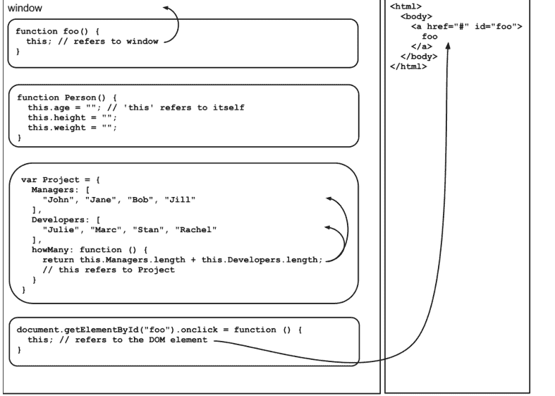

### 简单函数

当 `this` 关键字在简单函数内部使用时，它指的是全局变量作用域，即 `window` 对象。在这种上下文中，实际上不需要使用 `this` 关键字，因为全局作用域中的任何变量都可以直接通过其名称访问。换句话说，如果你全局声明了一个名为 `foo` 的变量，你只需引用 `foo`；不需要使用 `this.foo`。JavaScript 在这种实例中只是将你引向全局作用域，因为没有其他东西可以用来指向 `this` 关键字。但是，如果你在严格模式下运行，它将返回 undefined。这是为了防止在此上下文中必然发生的无意错误。

> ### 严格模式

**严格模式**是 JavaScript 的一个新增内容。通过在函数顶部添加 `"use strict";` 来选择使用严格模式，你可以强制 JavaScript 引擎改变其行为，并从根本上修复一些处理代码时可能容易出错的方式。在这种情况下，它决定了在简单函数中 `this` 指的是什么。

### 在构造函数中

当在构造函数或旨在通过 `new` 关键字实例化的函数中使用时，`this` 指的是要创建的对象。因此，如果你的构造函数是一个银行账户：

```javascript
var Account, savings;

Account = function(num) {
  this.accountNumber = num;
};

savings = new Account(12345678);
savings.accountNumber; // 返回 12345678
```

在这个例子中，`this` 关键字允许你将 `accountNumber` 属性附加到要实例化的对象上。因此，可以通过引用 `savings.accountNumber` 来获取该值。

### 在对象字面量内部

如果你的函数恰好在对象字面量内部，并且是一个如我们第一个示例中的简单函数调用，那么 `this` 现在指的是包围你函数的直接父对象。例如，我们图表中的代码在 `Project` 对象内有两个名为 `Managers` 和 `Developers` 的数组。`howMany` 函数通过分别引用 `this.Managers` 和 `this.Developers` 来添加它们的长度。这意味着对 `this` 关键字的调用将我们引向 `Project` 对象，从中我们可以访问到 `Managers` 和 `Developers`。

### 在事件处理程序内部

我们还没有介绍事件处理程序，所以请稍安勿躁。基本上，**事件处理程序**是一个在事件触发时被调用的函数，例如，当链接被点击时的 "click" 事件。在事件处理程序中，`this` 关键字指的是触发该事件的元素，在这种情况下，就是页面上的锚点。

### call 和 apply

可以使用提供的 `call` 和 `apply` 方法来调用函数。我们很快将更详细地介绍这些方法，但在两种情况下，这些方法的第一个参数都是你可以传入供 `this` 关键字引用的对象。

### bind

最后，ECMAScript 5 引入了一个名为 `bind` 的方法，它创建一个新函数并将其永久绑定到你传入的对象。当调用 `this` 时，该对象将被引用。我们也将很快更详细地介绍这一点。

### 属性

### constructor

如果你拿到一个作为函数实例的对象，你可能想知道那个原始函数是什么。更重要的是，你可能希望基于那个原始函数实例化另一个对象。使用 `constructor` 属性，你可以做到这一点。它返回对所讨论的原始函数的引用，这允许你使用原始数据创建新实例：

```javascript
var foo, bar, baz;

function Foo() {
    this.ident = "foo";
}

foo = new Foo();
foo.ident; // 返回 "foo"

bar = new Foo();
bar.ident; // 返回 "foo"
bar.ident = "bar";
bar.ident; // 现在返回 "bar"

baz = new bar.constructor();
baz.ident; // 返回 "foo"
```

首先，我们实例化 foo，它的 ident 属性值为 "foo"。接下来，我们实例化 bar，它的 ident 也是 "foo"，因为它来自 Foo 类。然而，我们将其 ident 值更改为 "bar"。然后我们使用 bar 的 constructor 属性来实例化 baz。该属性将我们引向原始的 Foo 函数，它为我们的 baz 实例提供了相同的原始 ident 值 "foo"。

### length

如果你需要知道一个函数期望多少个参数，你可以使用 length 属性来检查：

```javascript
function foo(bar, baz) {
}

foo.length; // 返回 2
```

在检查 foo 的长度时，我们得到返回值 2，因为它期望 bar 和 baz 作为参数。


### 方法

### apply

有时，你需要改变一个函数的 `this` 关键字所指向的对象。`apply` 方法使得这项操作变得简单，因为它允许你传递一个对象作为第一个参数，`this` 关键字将指向这个对象：

```
var person, lastName;

lastName = "Reyes";
person = function() {
  return this.lastName;
};

person(); // returns "Reyes"

person.apply({lastName: "Cooper"}); // returns "Cooper"
```

在这个例子中，我们的函数最初引用的是全局声明的 `lastName`，因为在这种情况下，`this` 指向 `window` 对象。但是当我们使用 `apply` 时，我们传入了一个对象作为 `this` 关键字的新指向，这个对象上挂载了一个新的 `lastName` 值。因此，当我们使用 `apply` 时，返回值不再是 "Reyes" 而是 "Cooper"。

调用 `apply` 时，你还可以传递一个参数数组给函数：

```
var tax;

tax = function(price, provincial, federal) {
  return price * provincial * federal;
};

tax.apply(null, [100, 1.05, 1.095]); // returns 114.975
```

这里，我们有一个 `tax` 函数，它接收一个价格，乘以省税和联邦税，然后返回结果。由于我们不想改变 `this` 关键字的指向，我们不需要为第一个参数传值，而是通过传入 `null` 来跳过它。然后我们传入一个包含价格、省税和联邦税值的数组。

### call 方法

`call` 方法与 `apply` 几乎完全相同，区别在于它不是传递一个参数数组，而是像调用函数本身一样传递参数（从第二个参数开始）：

```
var tax;

tax = function(price, provincial, federal) {
  return price * provincial * federal;
};

tax.call(null, 100, 1.05, 1.095); // returns 114.975
```

注意这个实现与 `apply` 版本的唯一区别在于我们传递价格、省税和联邦税值的方式。使用 `apply` 时，它们在一个数组中传递；而在这里，它们作为单独的参数传递。

### bind 方法

从 ECMAScript 5 开始，可以在函数上调用 `bind` 方法，并传入一个将被引用为 `this` 的对象。`bind` 方法创建一个新函数，该函数绑定了指定的对象：

```
var hugo, person, names;

person = function () {
  return this.lastName;
};

hugo = person.bind({lastName: "Reyes"});
hugo(); // returns "Reyes"

names = {
  lastName: "Cooper",
  hugo: hugo,
  person: person
};
names.hugo(); // returns "Reyes"
names.person(); // returns "Cooper"
```

你会注意到 `person` 函数指向 `this.lastName`，而在我们绑定它之前，`lastName` 引用的是全局 `window` 空间中的一个变量（该变量是 `undefined`）。因此，我们将其绑定到一个包含 `lastName` 属性（值为 "Reyes"）的对象上。现在，当我们调用新创建的 `hugo` 函数时，从绑定给它的对象上返回了 "Reyes"。

假设我们将原始的 `person` 函数以及新创建的 `hugo` 函数放在一个包含 `lastName` 属性的对象中。我们会看到 `person` 函数内部的 `this` 动态地指向了外层对象，因此 `this.lastName` 现在返回 "Cooper"，而永久绑定的 `hugo` 函数继续返回 "Reyes"。

### toString 方法

`toString` 方法返回一个表示函数代码的字符串。例如，如果我们写了一个简单的函数：

```
function foo() {
  return "foo";
}
```

然后调用它的 `toString` 方法：

```
foo.toString();
```

我们会得到类似这样的响应：

```
"function foo() {
  return "foo";
}"
```

然而，如果我们对一个 JavaScript 语言内置函数调用 `toString`：

```
document.getElementById.toString()
```

我们会收到如下响应：

```
"function getElementById() { [native code] }"
```

这是因为负责 `getElementById` 的代码是编译过的，无法像 JavaScript 代码那样以人类可读的形式输出。

## 项目实践

既然我们已经理解了函数和对象，就可以开始在我们的任务管理器项目中做一些更高级的操作了。我们可以用对象数组而不是简单的任务数组来存储更丰富的信息。我们也可以编写一些函数来为我们执行操作。让我们首先将每个任务包装在一个对象中：

```
var tasks;

tasks = [
  {
    text: "Pay phone bill",
    complete: false,
    priority: 1
  },
  {
    text: "Write best-selling novel",
    complete: false,
    priority: 3
  },
  {
    text: "Walk the dog",
    complete: false,
    priority: 2
  }
];
```

现在我们有了一组更丰富的数据；每个任务都有一个 `complete` 标志和一个优先级。让我们写一个函数来向数组中添加任务：

```
var tasks, addTask;

tasks = [];

addTask = function(task) {
  tasks.push({
    text: task,
    complete: false,
    priority: 1
  });
};
```

现在我们可以调用 `addTask`，传入一些文本来存储它，并在 `tasks` 数组中设置一个 `complete` 标志为 `false`。

### 本章小结

在本章中，我们介绍了对象，包括如何读写对象，以及如何嵌套对象来为变量创建命名空间。我们还研究了如何循环遍历对象来读取数据，以及在遍历对象属性时如何过滤掉原型链。接着我们探讨了函数，探索了创建函数的不同方式，以及如何使用函数来编写面向对象的代码。我们检查了函数的各种属性和方法，并通过将我们的知识应用到正在构建的任务管理器项目中作为结尾。

在下一章中，我们将看看循环和跳转。

# 第五章

## 循环与跳转

本章介绍循环和跳转语句。**循环语句**用于我们需要重复执行一些编程语句，直到满足特定条件为止。一个典型的例子是遍历一个列表并对列表中的每个成员执行操作。**跳转语句**允许代码退出循环。一个例子是遍历我们的待办事项列表，然后在遇到第一个未完成的项目时跳出循环。跳转语句有多种类型，我们将在讲解过程中逐一解释。

循环通常与一种称为**命令式编程**的特定编程风格相关联。在这里，程序员逐步指定程序应如何完成特定任务。另一种方法是**函数式编程**，它声明程序应该做什么，而不具体指定程序应如何做。JavaScript 支持多种范式，包括命令式和函数式风格。本章后半部分我们将探讨使用循环的函数式替代方法。函数式编程可以为某些类型的问题提供更优雅的解决方案，它可以使你的代码库更小、更易于理解、也更易于维护。

### 循环

作为引入，我们应当注意，与 `if` 语句一样，当只涉及单个语句时，所有循环结构都可以不写花括号。但为了清晰起见，我们建议你即使对于单个语句也始终包含花括号。这是 id Software 团队在开发《毁灭战士3》时所遵循的标准。¹ 我们半开玩笑地说，如果这对传奇的约翰·卡马克及其团队来说都足够好，那么对我们来说当然也足够好！

### while 循环

`while` 循环采用以下形式：

```
while (condition) {
    statement
}
```

条件可以是任何计算结果为 `true` 或 `false` 的表达式。语句由当条件计算结果为 `true` 时执行的代码组成。回想一下，在 JavaScript 中，任何值都可以转换为布尔值。对于需要复习 JavaScript 中特定值如何转换为布尔值的读者，我们推荐阅读我们的技术编辑 Colin Ihrig 撰写的这篇优秀文章。²

`while` 循环可以用这个简单的例子来说明：

```
var tasksToDo = 3;

while (tasksToDo > 0) {
    console.log('There are ' + tasksToDo + ' tasks to do');
    tasksToDo--;
}
```

这将在控制台打印以下内容：

共有 3 项任务待完成
共有 2 项任务待完成
共有 1 项任务待完成

在使用 `while` 循环时，确保条件最终会变为 false 是至关重要的。在每次循环迭代中，某个变量应发生变化，最终导致条件为 false，从而终止循环。否则，你的程序就会陷入可怕的死循环。以下是一个导致死循环的微妙错误示例：

```
function getNext(num) {
    return num++;
}

var i = 0;

while (i < 3) {
    i = getNext(i);
}
```

一开始可能很难发现这个 bug。注意 `num++` 会返回 `num` 的当前值，然后再递增其值。因此，在 `while` 循环中，`i` 的值将始终为零！在编写 `while` 循环时，务必反复检查循环是否能正常退出。通过耐心和练习，这很快就会成为你的第二天性。

### do ... while 循环

`do ... while` 循环是 `while` 循环的一个变体，形式如下：

```
do {
    statement
} while(expression);
```

两者的主要区别在于，`do ... while` 循环保证至少执行一次循环体。以下示例说明了这一点：

```
do {
  console.log('This will print at least once');
}
while (false);
```

我们使用 `while (false)` 来强调 while 检查会终止循环。尽管如此，控制台仍将输出一次。稍作修改，我们的 `while` 示例就可以改写成等效的 `do ... while` 形式：

```
var tasksToDo = 3;

do {
  console.log('There are ' + tasksToDo + ' tasks to do');
  tasksToDo--;
}
while (tasksToDo > 0);
```

这段代码将产生完全相同的控制台输出。对于许多问题，可以使用 `while` 或 `do ... while`，因此问题就变成了选择哪个。我们建议默认使用 `while`，只在那些语句必须至少执行一次的场合使用 `do ... while`。

### for 循环

`for` 循环用于多次运行一个代码块，常被称为计数循环。其通用形式如下：

```
for (initialization; condition; end-expression ) {
  statement
}
```

一个简单的例子如下：

```
for (var i = 0; i < 3; i++) {
  console.log(i);
}
```

上述循环将声明变量 `i` 并赋予其初始值 0。每次迭代时，`i` 的值将被输出到屏幕，然后递增 1。需要注意的是，该变量既是声明的也是初始化的。省略声明在语法上是有效的：

```
for (i = 0; i < 3; i++) {
    console.log(i);
}
```

然而，这将创建一个全局变量 `i`，这是不可取的。它可能与其他同名变量冲突，并可能导致内存泄漏以及一系列其他不愉快的问题。如果在 `for` 循环开头创建一个新变量，请务必记得使用 `var`！`for` 循环也可以有多个测试条件：

```
for (var i = 0; i < 10 && i % 2 === 0; i+=4) {
    console.log(i);
}
```

这里我们测试 `i` 是否小于 10 且能被 2 整除，输出结果为：

```
0
4
8
```

也可以有多个初始化语句和结束表达式：

```
for (var i = 0, j = 0; i < 3; i++, j+=2) {
    console.log(i, j);
}
```

在运行代码之前，试着推算出它将输出什么。你猜对下面的结果了吗？

```
0 0
1 2
2 4
```

该循环运行两个结束表达式，因此在每次迭代中，`i` 递增 1，`j` 递增 2。还需注意，虽然结束表达式通常用于递增计数器，但它可以采取任何形式。例如，我们可以使用内置的 `Math.random()` 函数为 `i` 赋一个随机数：

```
for (var i = 0; i < 0.9; i = Math.random()) {
    console.log(i);
}
```

此处的循环将持续迭代，直到随机数生成器产生一个大于或等于 0.9 的值。如你所见，`for` 循环是一种强大且灵活的结构，很可能成为你使用最多的循环。

### for ... in 循环

`for ... in` 循环已在上一章介绍过。回顾一下，该语句用于遍历对象的属性；例如：

```
var agents = {
    '005': "Michael Harp",
    '006': "John Smith",
    '007': "James Bond"
};

for (key in agents) {
    if ('007' === key) {
        console.log('Bond, ' + agents[key] + ' has been found!');
    } else {
        console.log('Standard spy, ' + agents[key] + ' has been found');
    }
}
```

有几点值得记住。首先，避免将此循环用于数组；应改用标准的 `for` 循环。其次，不要依赖循环以与定义顺序相同的顺序返回对象。尽管大多数实现确实如此，但这实际上并不是规范的一部分，因此遵循标准的实现者可能会决定采用不同的顺序。

### 跳转

广义上讲，跳转语句用于转到脚本的另一部分。JavaScript 中的跳转语句有 `break`、`continue`、标签语句和 `return`。`return` 用于退出函数，而其余用于循环。让我们详细分解一下。

### break

`break` 语句用于退出循环。假设我们希望遍历任务列表，并在遇到第一个已完成的任务时停止。这可以使用 `break` 语句实现：

```
break.html (摘录)

var tasks = [
  {name: 'Buy milk', complete: false},
  {name: 'Trash', complete: false},
  {name: 'Pay bills', complete: true},
  {name: 'Repairs', complete: false},
  {name: 'Plumber', complete: true}
];
var firstComplete;

for (var i = 0; i < tasks.length; i++) {
  if (tasks[i].complete) {
    firstComplete = tasks[i];
    break;
  }
}

console.log(firstComplete);
```

注意，`break` 仅用于退出循环。不要用它来尝试退出 `if` 等条件语句。上面的例子可以重构为不使用 `break` 的形式：

```
for (var i = 0; i < tasks.length && firstComplete === undefined; i++) {
    if (tasks[i].complete) {
        firstComplete = tasks[i];
    }
}
```

读者从一开始就能看出，循环意在 `firstComplete` 被赋值后退出。使用 `break` 时，几乎总能用条件语句替代它，因此在编写代码之前，值得考虑哪种方式更简洁明了。作为一个实用指南，如果你的 `break` 语句将深埋在循环中间，请考虑将其移到顶部或完全重构以避免使用它。

### continue

`continue` 语句也用于循环；但它不是中断循环，而是跳到下一次迭代。在 `while` 循环中，这意味着将再次测试条件。在 `for` 循环中，结束表达式将运行，然后循环继续。一个示例可以阐明。假设使用与前面示例相同的 `tasks` 变量，看看以下代码：

```
for (var i = 0; i < tasks.length; i++) {
  if (!tasks[i].complete) {
    continue;
  }

  console.log(i, tasks[i].name);
}
```

这段代码打印已完成的任务，输出如下：

```
2 'Pay bills'
4 'Plumber'
```

我们选择打印计数器 `i` 的值，以演示使用 `continue` 对计数器递增的影响。注意它如何导致循环继续，以及运行结束条件以递增计数器。让我们重新审视简单的 `while` 示例。假设我们希望在 `tasksToDo` 等于 2 时跳过。不输入代码，考虑一下这个解决方案是否有效：

```
var tasksToDo = 3;

while (tasksToDo > 0) {
    if (tasksToDo == 2) {
        continue;
    }

    console.log('There are ' + tasksToDo + ' tasks to do');
    tasksToDo--;
}
```

你发现错误了吗？通过 `continue`，我们绕过了 `tasksToDo` 的递减——并陷入了无限循环。我们将把它作为练习留给你，使用条件语句修复这个示例，然后比较这两段代码的清晰度。我们的大脑更容易以线性方式处理信息。处理跳转语句需要更多的认知开销，这使得错误更容易潜入我们的代码。程序员需要决定特定方法是否最大化了清晰度和可读性，在这个意义上，编程既是一门科学，也是一门艺术。

### 标签语句

标签语句与 `break` 和 `continue` 结合使用。可以通过在语句前加上标识符来给语句添加标签：

```
identifier: statement
```

让我们看一个来自 Mozilla 开发者网络³ 的示例，它实际上附带了一个警告：“尽可能避免使用标签，并根据情况优先调用函数或抛出错误。”当代码带有警告时，请注意！他们的示例如下：

```
var i, j;

loop1:
for (i = 0; i < 3; i++) {
    //第一个 for 语句被标记为 "loop1"
    loop2:
    for (j = 0; j < 3; j++) {
        //第二个 for 语句被标记为 "loop2"
        if (i == 1 && j == 1) {
            continue loop1;
        }
        console.log('i = ' + i + ', j = ' + j);
    }
}
```


### return

`return` 是最常用的跳转语句。它采用以下通用形式：

```
return expression;
```

或者不那么常见的形式：

```
return;
```

它只能在函数内部使用，用于定义函数的返回值。如果省略了表达式，则返回值为 `undefined`。一个简单的例子：

```
function divideBy(numerator, denominator) {
    return numerator / denominator;
}
```

更细心的人会注意到，根据这个函数的使用方式，我们存在潜在的“除以零”问题。从语法上讲，一个给定的函数中可以包含任意数量的 `return` 语句。作为最佳实践，我们建议倾向于每个函数只使用一个 `return` 语句。这种所谓的单点出口使代码更易于理解，也更容易调试。在调试器中，只需要监视一条语句而不是两条或更多条。

> 关于除以零
JavaScript 在编程语言中很不寻常，因为除以零在语言层面并不会自然地抛出异常。正数除以零得到无穷大。负数除以零得到负无穷大。零除以零得到 NaN。在所有情况下，程序的正常执行都可以继续。然而，我们仍然需要处理“除以零”的问题。

例如，假设你希望计算用户的体重指数（BMI）。其公式为：体重 /（身高 × 身高）。如果身高参数传入函数的值为零，那么有充分的理由抛出一个异常。

如果你告诉用户他们的 BMI 是无穷大，他们可能不会乐意！这样的数字也可能对下游应用程序（如图表）造成问题。

在某些情况下，多个 `return` 语句会使代码更易于阅读。假设我们希望合并两个任务列表。使用单个退出点，我们可以这样编写代码：

```
function mergeTasks(taskList1, taskList2) {
  var merged;

  if (taskList1 === undefined)
    merged = taskList2;
  else if (taskList2 === undefined)
    merged = taskList1;
  else {
    // 合并代码
    merged = ...;
  }

  return merged;
}
```

使用多个退出点，代码可以写得稍微更清晰一些：

```
function mergeTasks(taskList1, taskList2) {
  if (taskList1 === undefined) {
    return taskList2;
  } else if (taskList2 === undefined) {
    return taskList1;
  }

  // 合并代码
  var merged = ...;
  return merged
}
```

注意在第二个例子中，我们使用了“守护”语句来检查异常条件，然后在最后单点退出。作为一个实用的指导原则，遵循这种在顶部使用守护语句然后单点退出的模式是可以的。但当 `return` 语句出现在长函数的中间时，代码就可能变得更难理解和维护。

### 异常处理

JavaScript 提供了一种机制来处理异常情况，即将控制权转移到代码中的特殊错误处理部分。为了捕获异常，我们必须将可能出错的代码放在一个 `try` 块中。当发生错误时，会抛出一个异常，并将控制权转移到 `catch` 块中的代码。如果没有抛出异常，则异常处理程序将被忽略，代码将按正常方式继续执行。这将在稍后详细解释。

### throw

关键字 `throw` 用于发出错误信号。它采用以下形式：

```
throw expression;
```

虽然从语法上讲可以这样抛出异常：

```
throw "This is an error in the form of a string";
```

但首选格式是显式使用 `Error` 对象。继续上一节的例子：

```
function divideBy(numerator, denominator) {
    if (denominator === 0) {
        throw new Error('Denominator must be non zero');
    }

    return numerator / denominator;
}
```

`Error` 对象提供的信息比字符串更多。上游函数可以使用 `instanceof Error` 来具体测试一个对象是否是错误。至于抛出错误后我们该做什么，我们将在下一节中探讨。

### try

前面提到的 `try` 语句采用以下形式：

```
try {
  // 可能抛出错误的代码
} catch (identifier) {
  // 错误处理
} finally {
  // 清理代码
}
```

`try` 子句包含一个可能发生异常的代码块，而 `catch` 子句提供异常处理。`finally` 子句是可选的；如果存在，它总会执行，通常用于执行清理操作。确保使用上一节中的 `divideBy` 函数，这里是一个没有产生错误条件的例子：

```
try {
  var result = divideBy(7, 2);

  console.log(result);
} catch (e) {
  console.log(e.message);
} finally {
  console.log('This will always execute');
}
```

注意，即使没有错误，`finally` 子句内的代码也会执行。现在来看一个会抛出错误的例子：

```
try {
  divideBy(7, 0);
  console.log(result);
} catch (e) {
  console.log(e.message);
} finally {
  console.log('This will always execute');
}
```

注意 `console.log(result);` 不再被执行；代码直接跳转到 `catch` 子句。此时，它打印错误消息，然后像之前一样转到 `finally` 子句。

### 实证研究

编程界对于某些跳转语句是否构成不良实践存在激烈争论。例如，《*JavaScript: The Good Parts*》的作者道格拉斯·克罗克福德建议“避免使用 `continue` 语句。它往往会模糊函数的控制流。”

与其卷入争论，我们不妨借用 jQuery（最著名和最受欢迎的 JavaScript 库之一）进行一项实证研究。如果你的操作系统支持 `wget`、`grep` 和 `wc`，你可以自己尝试；否则，请跟随文本。首先，下载未压缩版本的代码：

```
wget http://code.jquery.com/jquery-1.9.1.js
```

使用 `grep` 和单词计数的组合来查看 `break` 被使用的次数：

```
> grep 'break;' jquery-1.9.1.js | wc -l
> 16
```

类似地，我们检查 `continue`：

```
> grep 'continue;' jquery-1.9.1.js | wc -l
> 7
```

函数：

```
> grep 'function' jquery-1.9.1.js | wc -l
> 624
```

以及 `return`：

```
> grep 'return' jquery-1.9.1.js | wc -l
> 646
```

所以，总结一下，在一个近1万行、包含约600个函数和大量 `return` 语句的代码库中，`break` 被使用了16次，`continue` 被使用了7次。我将让你自己从这些数据中得出结论。

### 循环的替代方案

### 关于风格

从语法上讲，JavaScript 继承自 Java 的语法，而 Java 又继承自 C 的语法。在这两种语言中，`for` 和 `while` 循环都扮演着重要角色。然而，官方规范讨论了 JavaScript 在编程哲学上实际上是如何主要从 Self 和 Scheme 中汲取主要思想的。

Scheme 是一种函数式编程语言，如果我们查看一些关于其语法的文档，我们观察到：“Scheme 在一点上非常奇特，它没有在通用层面设计用于循环、重复或以其他方式多次执行某事的表达式。” JavaScript 的主要思想竟然是来自一种没有循环表达式的语言！这怎么可能？现在让我们来看看循环的一些替代方案。

### 高阶函数

在本文前面，我们简要介绍了较新的内置数组迭代函数：`forEach`、`every`、`some`、`filter`、`map`、`reduce` 和 `reduceRight`。这些是高阶函数，因为它们接受函数作为参数。它们可以用来替代循环，以便以更函数式的风格进行编程。例如，假设我们有一个数组，我们希望将偶数相加：

```
var myNums = [3, 5, 10, 4, 2, 1, 16, 7];
```

使用基于循环的方法会产生与此类似的结果：

```
var sum = 0;

for (var i = 0; i < myNums.length; i++) {
    if (myNums[i] % 2 === 0) {
```


```
sum += myNums[i];
}
}

console.log(sum);
```

这没什么复杂的；我们使用的都是贯穿本章讲解的普通循环。如果采用函数式方法，代码会变成这样：

```
var sum = myNums.filter(function(x) {
  return x % 2 === 0
}).reduce(function(num1, num2) {
  return num1 + num2;
})

console.log(sum);
```

这里我们用 `filter` 提取出所有偶数值，再用 `reduce` 将它们相加。结果相同，却完全看不到循环的踪影。让我们来看一个待办事项列表的例子，假设我们有一堆任务和对应的负责人；我们想把 Paul 和 James 的任务转移给可怜的 David：

```
var tasks = [
  {name: 'Buy milk', owner: 'James'},
  {name: 'Trash', owner: 'Jill'},
  {name: 'Bills', owner: 'Paul'},
  {name: 'Repairs', owner: 'Jill'},
  {name: 'Plumber', owner: 'James'}
];
```

一种实现方式如下：

```
var numTasks = 0;
var newTasks = [];

for (var i = 0; i < tasks.length; i++) {
  var task = tasks[i];

  if (task.owner === 'Paul' || task.owner === 'James') {
    var newTask = {name: task.name, owner: 'David'};
    newTasks.push(newTask);
  }
}

console.log(newTasks);
```

这里我们检查指定的名字，创建新任务，然后将其推入新数组。更函数式的写法是：

```
var newTasks = tasks.filter(function(task) {
  return task.owner === 'Paul' || task.owner === 'James'
}).map(function(t) {
  t.owner = 'David';

  return t;
});

console.log(newTasks);
```

这里我们使用 `filter` 创建一个只包含指定负责人的数组；然后用 `map` 将任务重新分配给新负责人。在下一个例子中，我们想统计分配给特定人员的任务数量。这正是函数式编程优雅之处得以展现的地方。命令式的方法是遍历每个任务并递增计数器，如下所示：

```
var tasks = [
  {name: 'Buy milk', owner: 'James'},
  {name: 'Trash', owner: 'Jill'},
  {name: 'Bills', owner: 'Paul'},
  {name: 'Repairs', owner: 'Jill'},
  {name: 'Plumber', owner: 'James'}
];

function countByOwner(tasks, name) {
  var count = 0;

  for (var i = 0; i < tasks.length; i++) {
    if (tasks[i].owner === name) {
      count++;
    }
  }

  return count;
}

console.log(countByOwner(tasks, 'James'));
```

函数式的方法是先按负责人过滤，然后检查数组的长度：

```
function countByOwner(tasks, name) {
  return tasks.filter(function(task) {
    return task.owner === name;
  }).length;
}
```

从某种角度看，函数式思维不如命令式直观；然而，正如所展示的，它可以用来清晰、优雅地表达一个解决方案，而这个解决方案若用命令式程序则需要更多行代码才能完成。

### 递归

我们简要触及一下递归的概念。许多函数式方法避免使用循环，转而采用递归。下面的例子将加以说明。还记得高中时计算一个数的阶乘吗？我们暂不讨论正式定义，直接使用这个简单的例子：5的阶乘是 5 x 4 x 3 x 2 x 1，结果是 120。这是用循环实现的阶乘函数：

```
function factorial(num) {
  var result = 1;

  for (var i = num; i > 0; i--) {
    result *= i;
  }

  return result;
}
```

或者，我们可以实现一个调用自身的递归函数：

```
function factorial(num) {
  if (1 === num) {
    return num;
  } else {
    return num * factorial(num - 1);
  }
}
```

许多问题非常适合用优雅的递归解决方案来处理。递归是一个相当复杂的计算机科学主题，但如果你开始留意那些可以将循环重构为递归的实例，你可能会惊讶于它们自然出现的频率。

对于希望更深入探索递归的读者，Kirit Sælensminde 的文章《递归的对与错》将很有用。<sup>8</sup> 它涉及一些重要的主题，如性能考量，而这些并未在本节涵盖。

## 项目

### 统计任务

假设我们想统计已完成任务的数量。稍后在提供图表功能时会需要这个功能。使用循环，完成此任务的一种方式如下：

```
function countComplete(tasks) {
  var numCompleted = 0;

  for (var i = 0; i < tasks.length; i++) {
    if (tasks[i].complete) {
      numCompleted++;
    }
  }

  return numCompleted;
}
```

总的来说，这是一个合理的方案。逻辑足够简单，我们用一个计数器来跟踪已完成任务的数量。然后我们遍历任务列表，每看到一个完成的项目，就递增计数器。有更好的解决方案吗？有。函数式编程来拯救！将此代码放入名为 **todo.js** 的文件中：

```
function countComplete(tasks) {
    return tasks.filter(function(task) {
        return task.complete;
    }).length;
}
```

现在我们要做的就是根据任务是否完成来过滤整个列表，然后返回该列表的长度。

### 排序

我们希望为用户提供按三种条件排序的能力：从低到高、从高到低、按名称排序。得益于内置的 `sort` 函数，我们只需提供一个函数来根据指定条件对任务进行排序：

```
var sortByLowHigh = function(tasks) {
    return tasks.sort(function(task1, task2) {
        return task2.priority - task1.priority;
    });
};

var sortByHighLow = function(tasks) {
    return tasks.sort(function(task1, task2) {
        return task1.priority - task2.priority;
    });
};

var sortByName = function(tasks) {
    return tasks.sort(function(task1, task2) {
        return task1.text > task2.text;
    });
};
```

对于优先级排序，我们进行数值比较。对于名称排序，我们进行字典序比较。好奇的读者可以知道，内置的数组排序函数内部使用的算法被称为快速排序。<sup>9</sup>

<sup>9</sup> http://www.nczonline.net/blog/2012/11/27/computer-science-in-javascript-quicksort/

## 总结

本章涵盖了大量内容。我们首先探讨了循环，包括 `while`、`do ... while`、`for` 和 `for ... in`。然后我们转向了跳转语句，包括带标签的语句、`break`、`continue` 和 `return`。在讨论高阶函数以及它们如何用于实现函数式编程解决方案之前，我们还讨论了异常处理，使用了 `throw` 和 `try ... catch ... finally`。最后，我们简要地看了一下递归，以及它如何在特定解决方案中优雅地替代循环。

至此，希望你已经牢固掌握了循环和跳转语句，并开始理解函数式解决方案如何能简洁地替代命令式对应方案。

# 第 6 章

## 文档对象模型

### 什么是 DOM？

文档对象模型（DOM）是一个用于操作 HTML 和 XML 文档的 API。它是一个表示文档的对象树状层次结构，并通过暴露方法和属性来便于脚本编写。尽管如今 DOM 功能非常强大，其规范的大部分内容在所有主流浏览器中都得到了良好支持，但情况并非一直如此。

最初几乎没有什么一致性，更不用说规范了。在浏览器大战¹ 的那个糟糕年代，Netscape 和 Microsoft 为争夺网络主导权而激烈竞争，相互攀比成了游戏规则。这导致了相互冲突的实现，每个厂商都在自己的产品中引入非标准特性。随着开发者开始使用这些特性，竞争对手被迫模仿其行为，以使网页不会在自己的浏览器中崩溃。特性仅仅因为谁在浏览器市场占有重要份额而被迫存在。可以想象，对于试图让代码在当时主流浏览器中运行的开发者来说，这充其量是一个令人头疼的问题。

¹ http://en.wikipedia.org/wiki/Browser_wars


### 向后兼容的必要性

互联网是个奇特的生物，与任何其他软件都不同。尽管浏览器在不断进化，但它们解析的页面可能追溯到 1991 年。这意味着对现有浏览器技术的任何创新或迭代都必须继续与旧的网页兼容。正是由于这个现象，我们今天所知的 DOM 包含着来自“糟糕旧时代”的遗留物。

### document 对象

document 对象是一个顶层对象，它包含（并作为进入）你的文档的入口点。所有你需要用于处理文档的对象、方法和属性都挂载在 document 对象上。例如，当今最常用的方法之一是 `getElementById`，它通过元素的 `id` 属性返回 DOM 中的一个元素：

```html
getElementById.html (excerpt)
<!doctype html>
<html>
<head>
</head>
<body>
    <div id="foo">Foo, baby. Foo!</div>
    <div id="bar">Meh.</div>
    <script>
        // returns a reference to the first div
        var el = document.getElementById("foo");
    </script>
</body>
</html>
```

你也可以简单地使用 `document.title` 来检索其他信息，例如文档的标题。

### DOM Level 0 或 旧版 DOM

旧版 DOM 时代的一些遗留物包括 document 的 forms、links 和 images 集合。在 DOM Level 1 中，这种为特定元素类型提供命名访问器的做法被终止了。然而，在 DOM0 中，这就是你访问 `<form>`、`<image>` 和 `<anchor>` 元素的方式。你可以通过使用元素的名称，或者通过 document 对象将其索引传递给相应的访问器来实现。让我们以下面的文档为例：

```html
<html>
<head>
</head>
<body>
  
  
  <form name="contact">
    <a href="http://www.sitepoint.com" name="sitepoint">
      SitePoint </a>
  </form>
  <a href="http://www.w3.org" name="w3">W3C</a>
  <script>
    var mom, dad, sitepoint, contact;

    mom = document.images.mother; dad = document.images[1];
    sitepoint = document.links.sitepoint;
    contact = document.contact;
  </script>
</body>
</html>
```

得到的 DOM 层次结构如图 6.1 所示。

你可以通过使用 `document.contact` 来访问名为 `contact` 的表单。你也可以通过使用 `document.forms[0]` 来访问它，假设你想要的表单是页面层次结构中的第一个（在这种情况下，它确实是）。如果是两个表单中的第二个，你会使用 `document.forms[1]`，以此类推。在我们的示例中，我们通过引用 `document.images[1]` 来访问第二张图片。这种语法可以用于所有三个访问器。与任何数组一样，你可以遍历返回的结果：

```javascript
var imgs, img, i;

imgs = document.images;

for (i = 0; i < imgs.length; i += 1) {
  img = imgs[i]; // get reference to image element
  console.log(img);
}
```

### DOM Level 1

1998 年，W3C 发布了 DOM Level 1 规范。<sup>4</sup> 该规范接管了现有的 DOM 层次结构，并通过引入 `Node` 对象来规范化其内容，大多数对象都由此派生。在规范引入的少数几种对象类型中，最常见的是 `Document`、`Element`、`Attr` 和 `Text`，它们构成了 HTML 文档的大部分内容。

在以下 HTML 中，`<div>` 将成为一个 `Element` 节点，其 `id` 属性将成为一个 `Attr` 节点，而 "Hello!" 将成为一个 `Text` 节点：

```html
<html>
    <head>
    </head>
    <body>
        <div id="welcome">Hello!</div>
    </body>
</html>
```

前面提到的 `Document` 节点实际上是一个抽象节点，它包裹了所有内容，并不直接表示 HTML 中的任何标签。`<html>` 标签是一个特殊的 `Element` 节点，称为文档元素，可以通过 `document.documentElement` 访问。

还有一些不太常见的节点类型，如 `ProcessingInstruction` 和 `EntityReference`，但为了我们的目的，我们将只关注最常见的类型。各种节点类型的列表如图 6.2 所示。

### 创建 DOM 元素和属性

我们 DOM 树的根是文档元素，每个文档只能有一个。由于它包含了文档的其余节点，因此它提供了一组方法，允许你创建它可以包含的所有子节点。所以，如果你想创建一个 `<div>` 元素，你可以像这样使用 document 对象的 `createElement` 方法：

```javascript
var myDiv = document.createElement("div");
```

这将返回一个空的 `<div>` 元素。需要注意的是，我们刚刚创建的元素目前只存在于内存中，并不是文档的一部分。为了将我们的 `<div>` 添加到文档中，我们需要使用 `appendChild` 方法将其附加到 DOM 中的某个节点上。

还记得我说过所有对象都派生自 `Node` 吗？由于 `Node` 公开了 `appendChild` 方法，我们可以使用该方法将我们新创建的 `<div>` 作为子节点附加到 DOM 中的任何给定对象上。让我们将我们的 `<div>` 添加到前面 DOM0 示例中的 `contact` 表单中。我们仍然可以通过其 name 属性访问我们的 `contact` 表单，所以让我们直接在它上面调用 `appendChild` 来将我们的 `<div>` 添加到表单中：

```javascript
var myDiv = document.createElement("div");

document.contact.appendChild(myDiv);
```

我们的表单现在看起来像这样：

```html
<form name="contact">
  <a href="http://www.sitepoint.com" name="sitepoint">
  SitePoint </a>
  <div></div>
</form>
```

一旦我们添加了我们的 `<div>`，我们就可以使用 `setAttribute` 方法添加属性。所以，例如，我们可以给我们的 `<div>` 一个 `name` 属性：

```javascript
var myDiv = document.createElement("div");

myDiv.setAttribute("name", "foo");
document.contact.appendChild(myDiv);
```

这将给我们一个 `<div>`：

```html
<div name="foo"></div>
```

需要注意的是，所有 DOM 对象引用都是实时的。即使我们将 `<div>` 添加到 DOM 后，我们仍然可以继续使用它。换句话说，它产生相同的结果：

```javascript
var myDiv = document.createElement("div");

document.contact.appendChild(myDiv);
myDiv.setAttribute("name", "foo");
```

此外，如果其他代码修改了我们的 `<div>`，我们在 `myDiv` 中持有的引用仍然会是最新的。更重要的是，我们可以立即通过其名称 `foo` 引用我们新的 `<div>`。

虽然我们可以使用 `setAttribute` 在元素上设置属性，但也可以使用 `createAttribute` 创建属性节点。属性也派生自 `Node` 对象，从 DOM1 规范开始：

```javascript
var myLink, href;

myLink = document.createElement("a");
href = document.createAttribute("href");
href.nodeValue = "http://www.sitepoint.com/";
myLink.setAttributeNode(href);
```

我们创建了一个锚点和一个 `href` 属性，并通过其 `nodeValue` 属性向其添加了一个 URL。请记住，即使 `href` 属性对象派生自 `Node`，你也不能向其附加对象。尝试这样做将导致 `HierarchyRequestError: DOM Exception 3` 错误。

既然我们已经创建了一个带有 `href` 属性的锚点，我们可以添加一些文本使其可点击。为此，我们使用 `createTextNode` 向链接添加文本节点：

```javascript
var myLink, href, linkText;

myLink = document.createElement("a");
href = document.createAttribute("href");
href.nodeValue = "http://www.sitepoint.com/";
myLink.setAttributeNode(href);
linkText = document.createTextNode("SitePoint");
myLink.appendChild(linkText);
```

同样，文本节点类似于属性节点，它们不能有子节点。

> **关于节点的说明**
> 虽然所有对象都派生自 `Node`，但有些是叶节点，有些不是。文本节点是叶节点，因此不能有子节点。因此，诸如 `childNodes` 之类的方法不适用，无法使用。

### insertBefore

我们刚刚看到了 `appendChild` 的作用，但有时我们想更具体地指定插入元素的位置，而不仅仅是将其附加到末尾。那就是

这正是`insertBefore`的用武之地。顾名思义，它告诉DOM你希望在一个指定节点之前插入一个元素：

```html
<script>
var list, item1, item2, item3;

list = document.createElement("ul");
item1 = document.createElement("li");
item1.appendChild(document.createTextNode("1"));
item2 = document.createElement("li");
item2.appendChild(document.createTextNode("2"));
item3 = document.createElement("li");
item3.appendChild(document.createTextNode("3"));
list.appendChild(item1);
list.appendChild(item3);
list.insertBefore(item2, item3);
</script>
```

这里我们创建了一个`<ul>`和三个`<li>`元素。我们还为每个`<li>`添加了数字。然后我们将第一个和第三个项目添加到列表中。最后，我们使用`insertBefore`将`item2`插入到`item1`和`item3`之间。最终生成的DOM树结构是：

```html
<ul>
    <li>1</li>
    <li>2</li>
    <li>3</li>
</ul>
```

### getElementsByTagName

在传统DOM中，你可以通过元素的`name`属性值直接访问元素，或者通过如`document.forms`和`document.images`这样的专用集合来访问。随后，DOM1引入了更通用的`getElementsByTagName`方法。这是一个你可以从`document`或任何`Element`类型对象上调用的方法。例如，如果你想要页面中所有的锚点，你可以编写`document.getElementsByTagName("a")`，它将返回文档中所有锚点的集合，无论它们在DOM层次结构中的哪个位置。你还可以通过从给定元素调用`getElementsByTagName`来缩小搜索范围。因此，如果你有一个表单，想要访问它的按钮，你可以编写`myForm.getElementsByTagName("button")`。

我应该指出，`getElementsByTagName`返回的实际上是一个`NodeList`。就其目的和功能而言，`NodeList`的行为非常像数组，因为它是一个节点的有序集合。然而，相似之处仅限于此，因为`NodeList`没有数组的任何方法。换句话说，你不能像处理数组内容那样对`NodeList`的内容进行排序、合并或反转。更重要的是，`NodeList`是实时的。

如之前关于`Node`所述，`NodeList`的内容始终反映底层DOM的当前状态。如果一个`Node`被删除，`NodeList`会立即反映这一变化，而无需你重新获取列表。元素节点（构成DOM节点的大部分）还有其他一些可以使用的方法。

### getAttribute

使用`getAttribute`，你可以读取属性的值。给定`<div name="foo"></div>`，`myDiv.getAttribute("name")`将返回`"foo"`。

### removeAttribute

你可以使用`removeAttribute`从元素中完全移除一个属性。这通过传入你想要移除的属性名来完成。因此，给定`<div name="foo"></div>`，`myDiv.removeAttribute("name")`将使`<div>`变为`<div></div>`。请注意，`removeAttribute`不返回任何值。

### setAttributeNode

我们之前已经看到过它的实际应用。在使用`createAttribute`创建一个新的属性节点后，我们可以使用`setAttributeNode`将其添加到一个元素上：

```html
<script>
var el, attr;

el = document.createElement("div");
attr = document.createAttribute("name");
attr.nodeValue = "foo";
el.setAttributeNode(attr);
</script>
```

记住使用`nodeValue`属性为属性赋值这一步非常重要。否则，你将得到一个`<div name></div>`，而不是看起来像`<div name="foo"></div>`的`<div>`。

### removeAttributeNode

就像`removeAttribute`一样，`removeAttributeNode`可用于从元素中移除属性。不同之处在于，你需要传入要移除的属性节点的引用。在我们最近的例子中，操作如下：

```html
<script>
var el, attr;

el = document.createElement("div");
attr = document.createAttribute("name");
attr.nodeValue = "foo";
el.setAttributeNode(attr);
el.removeAttributeNode(attr);
</script>
```

### DOM Level 2

W3C的DOM5规范的第二次迭代引入了许多对现有DOM方法更友好的命名空间版本。这是为了适应XML文档中的命名空间。如本章开头所述，DOM旨在同时处理HTML和XML，由于W3C将XML视为HTML演进的下一个逻辑步骤，它开始为DOM添加对XML友好的功能。

由于本书只关注HTML DOM，我们可以忽略这些。因此，DOM2中唯一值得注意的DOM新功能是`getElementById`、`hasAttributes`和`hasAttribute`。

### getElementById

DOM的这一新增功能相当重要，因为它允许通过唯一的`id`值来定位文档中的元素。如果没有匹配的id，则返回`null`。否则，返回具有匹配`id`值的元素的引用。

> **关于唯一性**

关于`id`必须唯一的这点很重要。如果你的文档包含多个具有相同标识符的元素，`getElementById`很可能会返回它遇到的第一个匹配元素。

### hasAttributes

如果你需要知道某个给定元素是否附加了任何属性，可以使用`hasAttributes`。该方法返回一个布尔值，`true`表示存在属性，`false`则表示不存在。

### hasAttribute

如果你想检查是否存在特定属性，请使用`hasAttribute`。它也返回一个布尔值。如果你要查找的属性存在，则返回`true`；`false`表示不存在。因此，给定`<div id="foo"></div>`，`myDiv.hasAttribute("id")`将返回`true`，而`myDiv.hasAttribute("name")`将返回`false`。

### DOM Level 3

DOM Level 3规范规定了许多新属性和方法，但它们对于日常的Web开发都不是特别有用，也没有得到广泛实现。此外，其中大部分是关于XML DOM的。

有几个你可能会觉得有趣：`textContent`属性和`isEqualNode`方法。

给定HTML `<p id="greeting"></p>`，其文本内容可以设置为字符串"Good morning!"：

```html
<script>
var el = document.getElementById("greeting");

el.textContent = "Good morning!";
</script>
```

不过你必须小心，因为它会覆盖目标元素的所有内容，包括任何子元素。

使用`isEqualNode`，你可以比较两个节点是否完全相同。因此，比较两个空的`<div>`元素将返回true；然而，如果其中一个`<div>`有一个类名，它将返回false：

```html
<script>
var div1, div2, div3;

div1 = document.createElement("div");
div2 = document.createElement("div");
div3 = document.createElement("div");
div3.className = "chocolate";
div1.isEqualNode(div2); // returns true
div1.isEqualNode(div3); // returns false
</script>
```

### DOM Level 4

2004年，Web超文本应用技术工作组（WHATWG）成立，以应对W3C决定放弃HTML转而采用基于XML的技术，以及其对Web标准发展的缓慢步伐。在Apple、Mozilla和Opera的参与下，WHATWG推出了HTML5——这是一系列广泛的技术集合，其中更新后的DOM是其组成部分。2007年，W3C加入了这项工作，分叉了一份规范副本，并在其网站上以版权形式发布。

WHATWG与W3C的合作于2011年结束，因为后者希望发布该规范的完成版本（包含已知问题），而WHATWG则希望将其作为一个“活的标准”来维护和持续更新。DOM4中最值得注意的新增功能是`getElementsByClassName`、`prepend`、`append`、`before`、`after`、`replace`和`remove`。在撰写本文时，除`getElementsByClassName`外，其他功能尚未在主流浏览器中实现。

### getElementsByClassName

原生支持`getElementsByClassName`是期待已久的事情。多年来，JavaScript库通过提供对此缺失功能的非原生支持来填补了空白。然而现在，你可以通过


114 快速入门 JavaScript

DOM的API。顾名思义，你现在可以根据元素的`class`值来查询DOM中的元素。你可以直接从`document`对象调用，例如`document.getElementsByClassName("report")`，它将返回文档中所有类名为`report`的元素。或者，你可以使用某个元素上的该方法来缩小搜索范围：`document.getElementById("financials").getElementsByClassName("report")`。

### 数据属性

尽管始终可以为DOM元素分配自定义属性，但HTML5通过引入`data-*`属性将这种做法规范化了。如果你的应用程序需要存储与特定元素相关的数据，可以使用`data-*`属性来实现，这样数据就直接存储在元素上。相比于将数据存储在数组/对象中，这种方式更有优势，因为你无需为了获取数据而同步DOM元素与数组/对象。相反，你只需从DOM中获取元素，并直接读取其`data-*`属性的值即可。

一个简单且有用的场景是显示日期：

```
<span data-iso="1976-05-17T17:11:22">
出生日期：1976年5月17日，下午5:11</span>
```

采用这样的安排，你可以轻松地从DOM中读取给定日期/时间的ISO格式，而无需在数组中查找或进行人类可读格式的转换。大多数现代浏览器都支持`dataset`访问器，它允许你设置和获取`data-*`属性的值。例如，以下是我们如何设置和读取`<span>`值的代码：

```
var el = document.createElement("span");

el.appendChild(document.createTextNode
("DOB: May 17, 1976, 5:11 PM"));
// 设置值
el.dataset.iso = "1976-05-17T17:11:22";
// 读取值
el.dataset.iso; // 返回 "1976-05-17T17:11:22"
```

在这个例子中，我们创建了一个元素并为其分配了一个`data-iso`属性。我们还添加了其文本内容，显示为给定日期的人类可读格式。当然，这同样可以由后端来渲染。无论哪种情况，读取data-iso属性就像检查.dataset.iso一样简单。

### style 属性

在DOM2时代，W3C引入了重要且强大的style属性（尽管其规划在DOM1工作期间就已开始）。style属性允许以编程方式操作元素样式。如果你了解CSS，使用它就很简单。其格式就是`element.style.property = value`，其中`property`是驼峰式的CSS属性名，`value`是你在普通样式表中会赋给该属性的CSS值。

例如，给定HTML `<div id="hey">Hello, world!</div>`，可以使用以下JavaScript来操作`<div>`的样式：

```
var myDiv = document.getElementById("hey");

myDiv.style.backgroundColor = "blue";
myDiv.style.border = "solid 5px #000";
myDiv.style.color = "#ffffff";
myDiv.style.padding = "20px 10px";
myDiv.style.margin = "2em";
myDiv.style.width = "200px";
```

这段代码将产生如图6.3所示的样式。

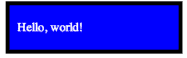

## 项目

在前面的章节中，我们了解了如何创建任务对象并将它们存储在数组中等等，但那都是非常抽象的。为了让用户能够看到他们的待办事项列表，我们需要将数组的内容渲染到屏幕上。我们刚刚学习了如何创建DOM元素并将其添加到文档中，那么我们现在就来编写一些代码来实现这一点：

```
var taskListForm, taskListEl;

taskListForm = document.getElementById("tasks");
taskListEl = taskListForm.getElementsByTagName("ul")[0];
```

首先，我们获取对`<form>`元素和`<ul>`元素的引用，后者将包含我们的任务列表。现在，让我们编写一个函数，在尝试添加任何内容之前，先清空任务列表。这样，我们始终有一个干净的工作起点：

```
function clearList() {
    while (taskListEl.hasChildNodes()) {
        taskListEl.removeChild(taskListEl.lastChild);
    }
}
```

我们使用一个while循环，持续从taskListEl中移除子节点，直到它为空（并且hasChildNodes返回false）。现在我们需要一种方法来生成我们的任务元素。其HTML结构如下：

```
<li class="template-item">
    <input type="checkbox" >
    <span class="task-text label"></span>
    <input type="button" class="btn btn-mini delete-task"
    value="Delete" >
    <div class="btn-group">
        <button class="btn btn-mini dropdown-toggle"
        data-toggle="dropdown">
            Priority <span class="caret"></span>
        </button>
        <ul class="dropdown-menu">
            <li>
                <a href="#" class="highpriority" value="1">High</a>
            </li>
            <li>
                <a href="#" class="normalpriority" value="2"
                >Normal</a>
            </li>
            <li>
                <a href="#" class="lowpriority" value="3">Low</a>
            </li>
        </ul>
    </div>
</li>
```

如你所见，这不仅仅是创建一个简单的`<li>`元素。与其手动创建一个任务项所需的所有元素、属性和文本节点，何不利用DOM的优势，只需在需要时克隆一个节点呢？

你会注意到我已经为`<li>`指定了一个类名"template-item"。我将使用它来获取该元素，然后使用DOM的cloneNode方法克隆它。接着，我会填入任务特有的值，并让函数返回完整的任务元素集合，以便将其插入DOM：

```
function newRow(index, task) {
    var template, newRow, textEl;

    template = document.getElementsByClassName
    ("template-item")[0];
    newRow = template.cloneNode(true);
    newRow.setAttribute("data-idx", index.toString());

    // 获取任务文本元素
    textEl = newRow.getElementsByClassName("task-text")[0];

    // 设置任务优先级
    if (task.priority == HIGHPRIORITY) {
        textEl.className += " label-important";
    } else if (task.priority == LOWPRIORITY) {
        textEl.className += " label-success";
    }

    // 设置任务文本
    textEl.appendChild(document.createTextNode(task.text));

    // 标记完成状态
    if (task.complete) {
        newRow.getElementsByTagName("input")[0].setAttribute
    ("checked", "checked");
        newRow.getElementsByTagName("span")[0].className
        += "complete";
    }

    newRow.className = "task";

    return newRow;
}
```

一旦我们有了模板，第一步就是用`cloneNode`克隆它。注意我向`cloneNode`传递了一个`true`值。这告诉它我想要一个深克隆，而不是浅克隆。换句话说，我希望它同时复制所有子节点。还要注意，克隆的节点仅存在于内存中，并非DOM的一部分。一旦我们处理完毕，就需要将其插入DOM。

接下来的任务是添加一个`data-*`属性，以便将DOM中的任务与我们数组中的任务匹配起来。我通过分配一个`data-idx`属性并将其值设为任务在数组中的索引来实现这一点。然后，我获取包含任务文本的元素，并根据任务的优先级为其分配一个类名，同时创建并附加一个包含任务实际文本（例如“遛狗”）的文本节点。

最后，如果任务已完成，我会选中复选框并添加一个"complete"类名。我用"task"类名覆盖了"template-item"类名，然后将DOM元素（及其子元素）返回给调用我们函数的代码。现在，我们只需调用`clearList`和`newRow`即可：

```
var renderTaskList = function () {
    var i, task, taskEl;

    clearList();

    for (i = 0; i < tasks.length; i += 1) {
        task = tasks[i];
        taskEl = newRow(i, task);
        taskListEl.appendChild(taskEl);
    }
};
```

这里，我们创建了一个`renderTaskList`函数，它依次执行以下操作：通过调用`clearList`从DOM中清除旧列表，遍历我们的`tasks`数组，调用`newRow`，获取其返回值，并将其附加到DOM中。


## 总结

在本章中，我们了解了DOM——即加载到浏览器中的HTML文档的层级表示。我们学习了如何访问其内容，以及如何创建新内容并插入其中。我们还了解了如何操作DOM现有内容和样式。DOM的API功能强大且用途广泛，掌握它将使任何程序员都能构建出色的客户端应用程序。

# 第7章

## 事件

本章是关于JavaScript事件的。为了提供交互性，你的应用程序必须能够处理来自用户的输入。由于技术的不断演进，构成事件的定义始终处于变化之中。JavaScript诞生于1995年。在那个年代，人们几乎完全通过键盘和鼠标与网页进行交互。JavaScript事件主要包括传统的人机交互，例如：按键、鼠标按下、鼠标释放、点击、滚动和加载。

随着智能手机、平板电脑及类似设备的普及，事件的数量急剧增加。如今，除了基本的键盘和鼠标事件外，还有API可用于检测方向、缩放，甚至湿度！这些都是几年前还不存在的功能。

与其试图用宽泛的笔触覆盖整个API，不如从一个特定的用例入手来阐述一些通用的理念和概念，这样更具指导意义。假设你想在用户点击页面上的按钮时显示一个警报。要处理这个事件，需要回答一系列问题：

- **动作是什么？** 在本例中，是一个鼠标点击。
- **页面的哪一部分接收了动作？** 在本例中，是一个按钮。
- **我们希望如何处理该动作？** 这里我们显示一个警报。
- **我们如何指定一个函数来处理该动作？** 为了回答这个问题，我们需要一种方法来同时回答前面所有的问题。

虽然上述问题有些简化，但它们在很大程度上解释了JavaScript的事件模型。每个步骤都有其正式的描述和定义。现在让我们详细看一下这个过程的每个步骤。

### DOM事件

为了回答“动作是什么？”这个问题，我们转向DOM事件。目前没有一个中央权威规范来确切定义什么构成事件以及什么不构成事件。然而，Mozilla开发者网络提供了一个事件列表[^1]。

这实际上并非一个规范。它更像是一些不同规范的汇编，提供了一个事件列表，并附有事件所源自的实际规范的参考。你会看到大多数事件来自DOM Level 3或HTML5。这些API涵盖了一些更常见的跨平台交互，如键盘敲击、鼠标点击、拖拽、媒体和离线行为。但也有一些更冷门的事件，例如来自电池状态API的`chargingchange`。

并非所有事件在所有设备和浏览器上都普遍支持。例如，电池状态API在旧版本的Internet Explorer中不受支持。此外，即使它存在于桌面浏览器中，它实际上只与移动设备（如笔记本电脑、平板电脑和智能手机）相关。在本章中，我们将涵盖事件的主要概念和常见用例。一旦你掌握了基础，你应该能够使用上述参考来实现一些更专业的功能（如果这是你的应用程序所需的）。

[^1]: https://developer.mozilla.org/en-US/docs/DOM/Mozilla_event_reference

我们在附录A中列出了一些常见事件。浏览列表时，你会注意到`click`事件是DOM Level 3的一部分，其描述相当明确：“在元素上按下并释放了定点设备按钮。”你还会注意到大多数其他常见事件也属于DOM Level 3。这些事件包括`dblclick`、`mousedown`、`mouseup`、`keydown`、`keyup`和`keypress`。

### 事件传播

在转向“页面的哪一部分接收了动作？”这个问题之前，有必要简要概述一下事件如何在页面中传播。假设你有一个表格，表格中有一个锚点标签。表格和锚点标签都有处理鼠标点击的代码。当用户点击锚点标签时，应该由哪个HTML元素首先处理事件？是应该先表格后锚点标签，还是相反？要回答这个问题，我们必须简要探讨事件传播的机制。

早期，不同的浏览器有不同的事件处理顺序。有些会先在父元素上触发事件，然后才是子元素，而另一些则相反。近年来，W3C在其DOM Level 3文档中开始标准化事件传播。事件在文档中的传播路径以图示方式记录在DOM Level 3事件规范中的图7.1中。

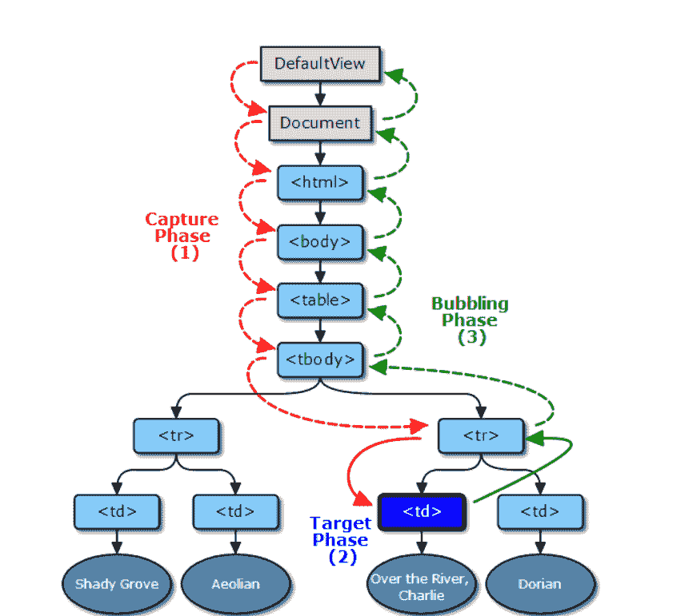

正式来说，事件路径分为三个阶段。在捕获阶段，事件从DOM树的顶部开始，传播到目标的父级。在目标阶段，事件对象到达其目标。这通常是你编写事件处理代码的地方。在冒泡阶段，事件将沿树向上移动，直到到达顶部。冒泡阶段的传播顺序与捕获阶段相反，事件从目标的父级开始，最终回到DOM树的顶部。如今，可以选择在捕获阶段或冒泡阶段注册事件。如果你在捕获阶段注册事件，那么父元素会在子元素之前处理事件。在上面的例子中，表格会在锚点之前处理事件。如果指定了冒泡，顺序则相反，子元素会在父元素之前处理事件。在我们的例子中，锚点会先于表格接收到事件。

请注意，指定冒泡或捕获是可选的，通常甚至不需要考虑。常规的设计是每个用户操作只由一个元素处理。只有在特殊情况下，一个操作才需要由多个元素同时处理。我们在此简要讨论是因为许多事件API都引用了捕获和冒泡，理解这些术语的含义会很方便。在了解了一些正式定义之后，我们现在可以开始让我们的页面实际响应事件了！

### 事件处理器

通常，你希望页面上的特定元素处理特定事件。要指示页面上的特定元素处理特定事件，你需要在该元素上注册一个事件处理器。有三种注册事件处理器的方法。为了准备接下来的章节，请创建一个名为`events.html`的新文件，包含以下HTML：

```html
<!doctype html>
<html>
<head>
    <title>Events</title>
</head>
<body>
    <button>Click Me!</button>
</body>
</html>
```

这是一个只有单个按钮的简单页面，我们将用它来处理事件。

### HTML属性

可以在HTML中内联放置JavaScript。在JavaScript的早期，这是处理事件的标准方式。例如，将你的`<button>`标签修改如下：

```html
<button onclick="alert('Old style event handling')">
    Click Me!</button>
```

现在当你点击按钮时，你应该会看到一个类似图7.2的警报。

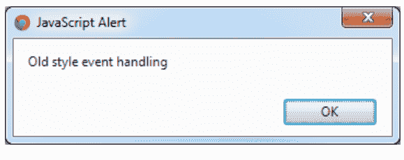

不推荐使用此方法。HTML应主要用作表现层。JavaScript事件是构成行为层的业务逻辑部分。JavaScript代码不应与表现层混合在一起。将代码的这两个领域分开将提高可维护性。如果JavaScript程序员正在更新代码，他或她不应该有机会意外地在表现层引入错误。同样，如果界面设计师正在更新页面，他或她也不应该有机会意外地修改行为层。通过将JavaScript与HTML完全分开，意味着你应用程序的这两个部分可以独立开发。

### addEventListener

处理事件的首选方法是通过函数`addEventListener`注册处理器。处理器可以看作是处理特定事件的函数。`addEventListener`将在目标上注册单个事件处理器。可以通过多次调用此函数来添加多个事件处理器。此函数接受三个参数：

**type** 我们正在监听的事件类型。在鼠标点击的情况下，它是`click`。

**listener** 监听器或处理器，是处理事件的函数。在本例中，它将是显示警报的自定义函数。


**useCapture** 如果设为 *true*，则事件处理函数注册在捕获阶段；如果设为 *false*，则注册在冒泡阶段。默认值为 *false*。

修改 HTML 代码以移除内联 JavaScript。将 `<button>` 标签改为：

```html
<button id="btnClickMe">Click Me!</button>
```

然后在 `</body>` 标签前添加一个 `<script>` 标签：

```html
<script src="events.js"></script>
```

我们移除了内联 JavaScript 并添加了一个标识符，以便 JavaScript 代码可以定位该按钮。接下来，创建一个名为 **events.js** 的新文件，包含以下代码：

```javascript
var myButton = document.getElementById("btnClickMe");

function handleClick() {
    alert("addEventListener clicked!");
}

myButton.addEventListener("click", handleClick, false);
```

刷新页面，然后点击按钮。此时你应该会在图 7.3 中看到提示框。

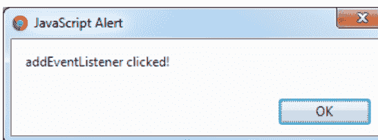

尽管这似乎增加了额外的工作，但对于任何非平凡的项目，将表现层与业务逻辑分离将带来回报。在这种架构下，你的设计师可以专注于视觉方面，而你的 JavaScript 开发者可以专注于应用程序逻辑，而不会相互干扰。

> **Internet Explorer**

在版本 9 之前，Internet Explorer 不支持 `addEventListener`。它使用自己的专有机制。我们将不介绍旧版 Internet Explorer 方法的具体细节，因为这不是利用我们时间的最有效方式。如果你的应用程序需要支持此浏览器的旧版本，我们建议使用跨浏览器库，例如 jQuery。

### DOM 元素属性

另一种注册处理函数的方法是直接在目标元素上设置属性。约定是使用 `on` 后跟事件名称，在我们的例子中是 `onclick`。要设置 `onclick`，请用以下代码替换 `events.js` 中的所有代码：

```javascript
var myButton = document.getElementById("btnClickMe");

myButton.onclick = function(e) {
  alert("onclick click!");
};
```

刷新页面并点击按钮后，你应该会在图 7.4 中看到提示框。

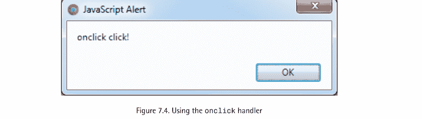

尽管直接在元素上设置属性比 `addEventListener` 更简单，但这以牺牲灵活性为代价。使用 `on` 语法只能为一个元素添加一个处理函数。假设你希望编写代码与他人的代码交互，并且你们都希望处理同一个元素上的鼠标点击。直接设置 DOM 元素属性会导致冲突，最终只有一个处理函数对用户可用。另一个处理函数将被覆盖。相比之下，使用 `addEventListener`，你可以修改我们的示例如下：

```javascript
var myButton = document.getElementById("btnClickMe");

function handleClick() {
  alert("addEventListener clicked!");
}

function handleClick2() {
  alert("addEventListener2 clicked!");
}

myButton.addEventListener("click", handleClick, false);
myButton.addEventListener("click", handleClick2, false);
```

这将为单个事件添加多个处理函数。如果你好奇，可以运行上面的代码，你会看到两个处理函数都会触发，两个提示框都会显示。

> **无障碍访问**

有一句常见的说法：自动扶梯永远不会真正坏掉，因为它总是可以作为一组楼梯来使用。如果你的用户的浏览器不支持 JavaScript 或某些特定的 JavaScript 函数，在可能的情况下，设计应该使用户仍然可以使用那组比喻中的楼梯。作为一个通用规则，这意味着事件应该只添加到已经具有该特定事件内置行为的 HTML 元素上。例如，点击事件应应用于诸如 `<a>` 和 `<button>` 之类的元素。你将处理的大多数 JavaScript 事件都有一个 HTML 等价物，在设计页面时，你应该牢记可访问性。

### 更多示例

现在你了解了事件处理程序的基础知识，让我们再看几个例子来说明其他事件。你将开始注意到一个模式，这个模式几乎可以应用于任何 JavaScript 事件，无论我们是否在本章中专门介绍过。假设我们希望确定页面何时加载。查看附录 A，我们看到有一个 `load` 事件定义为“一个资源及其依赖的资源已完成加载。”我们可以这样检测页面何时加载：

```javascript
window.onload = function(e) {
    alert("Page loaded");
};
```

刷新页面后，你应该会看到类似于图 7.5 的内容。

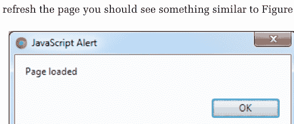

在 JavaScript 中，只在页面加载完成后运行代码是非常常见的。通常代码会修改特定的 DOM 元素。因此，有必要在尝试访问这些元素之前，确保它们已完全加载。你可以通过在 `load` 事件中编写所有代码来确保这一点。回想一下，在 JavaScript 中，在函数内部定义函数是完全合法的。因此，在 `load` 事件内定义你的应用程序是完全有效的。

假设现在我们希望检测窗口调整大小。到目前为止，你应该已经足够熟悉事件，能够自己查找函数的名称和描述。检测调整大小的代码如下所示：

```javascript
window.onresize = function(e) {
    alert("Page resized");
};
```

当你调整窗口大小时，你会注意到提示框会触发：

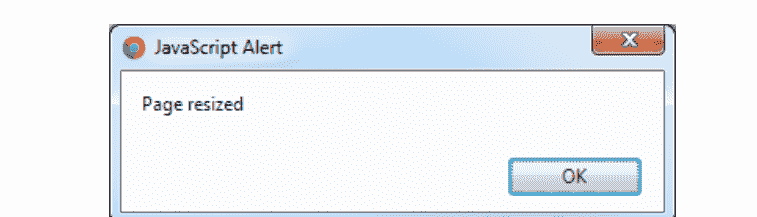

图 7.6. 当窗口调整大小时显示一个提示框。

根据你的浏览器，此事件可能会触发两次！如果我们不简要提及一些客户端 JavaScript 的危险和陷阱，那将是我们的疏忽，你可能刚刚就看到了其中一个。作为客户端 JavaScript 程序员，现实是你会处理多个版本的 JavaScript。即使在相同版本的 JavaScript 中，不同的浏览器也可能对特定功能有略微不同的实现。虽然最常见函数应该以统一的方式工作，但偶尔你会遇到诸如上述之类的特性差异。通常，像 jQuery 这样的库将有助于缓解跨浏览器问题，但我们仍然强烈建议你熟悉本章中的材料，这样即使你最终使用跨浏览器库，你仍然会理解底层发生的事情。

> 为什么会有这么多怪癖？
JavaScript 作为编程语言的发展走了一条相当独特的道路。在像 C 或 Java 这样的语言中，会非常小心地确保程序在不同环境中尽可能可预测地运行。相比之下，JavaScript 的大部分开发发生在所谓的浏览器战争<sup>2</sup>时期。在此期间，供应商并不特别关心与竞争产品的互操作性。遗留下来的是一个相当碎片化的客户端 JavaScript 环境。所有这些的实际含义是，当你编写客户端应用程序时，你需要有意识地决定你计划支持哪些浏览器。根据最佳实践，你应该尝试尽可能一致地支持尽可能多的浏览器。你需要使用每一个浏览器来测试你的应用程序，以确保你的程序按预期工作。如上所述，像 jQuery 这样的库可能会使这个问题更容易处理。

<sup>2</sup> http://en.wikipedia.org/wiki/Browser_wars

### 事件上下文

让我们回到我们最初的点击示例：

```javascript
var myButton = document.getElementById("btnClickMe");

myButton.onclick = function(e) {
    alert("onclick click!");
};
```

假设在我们的事件处理函数内部，我们希望了解有关生成事件的 HTML 元素的一些信息。这可以通过访问 `this` 来完成。修改函数如下：

```javascript
myButton.onclick = function(e) {
    console.log(this);
};
```

当你刷新页面并点击按钮时，控制台中应显示以下内容：

```html
<button id="btnClickMe">Click Me!</button>
```

假设我们需要关于实际鼠标点击的信息。在上面的代码中，将日志语句替换为以下内容：

```javascript
console.log(e);
```

这里，`e` 代表事件对象。当你现在点击按钮时，你应该会看到类似以下内容打印到控制台：

```javascript
MouseEvent {dataTransfer: null, toElement: button#btnClickMe,
 fromElement: null, y: 41, x: 32...}
```

事件对象包含鼠标点击的所有属性。例如，假设我们正在构建一个 JavaScript 视频游戏并希望跟踪鼠标移动。可以通过将以下代码添加到 **events.js** 中来创建一个简单的日志记录器：

window.onmousemove = function(e) {
    console.log(e.x + ", " + e.y);
};

如果你刷新页面并在屏幕上移动鼠标，你应该会看到类似图 7.7 所示的内容。

继续沿用电子游戏的比喻，假设我们希望记录用户的按键。首先，在 HTML 页面中添加一个文本区域，如下所示：

```
<textarea id="myTextArea"></textarea>
```

然后，为避免控制台信息混杂，移除鼠标日志记录代码，并替换为以下内容：

```
var txtArea = document.getElementById("myTextArea");

txtArea.onkeypress = function(e) {
    console.log(String.fromCharCode(e.keyCode));
};
```

`keyCode` 是按键的数值表示。我们使用内置的 `fromCharCode` 函数将其转换为实际按下的键。当你开始在文本区域中输入时，你应该会看到类似图 7.8 所示的内容。

图 7.8. 记录按键

现在，你对 JavaScript 事件已有足够的了解，可以在自己的应用中处理各种情况。然而，假设我们希望事件能与其他代码互操作。JavaScript 是否提供了促进这一点的机制？答案是肯定的，我们将在下一节中讨论。

### 自定义事件

JavaScript 提供了创建自定义事件的简单机制。在描述实现细节之前，有必要先过一个用例示例，因为自定义事件的使用对 JavaScript 新手来说并不总是显而易见的。假设我们的待办事项应用已经完成，而其他人希望编写一个插件，每当用户向列表中添加新项目时，就向用户显示一个炫酷的通知。

他们应该如何着手实现？一个可能的选项是让其他程序员修改我们的脚本，并将他们的通知代码放入我们的代码中。这在多个方面都存在问题。首先，他们可能无法访问我们的源代码。虽然 JavaScript 始终可以作为纯文本查看，但在发布之前，我们可能会选择压缩代码以提高加载速度。这将使我们的源代码非常难以直接操作。

但即使假设我们授予了对原始源代码的访问权限，直接修改待办事项列表的代码库仍然是一个糟糕的想法，原因有很多。首先，如果我们决定更新待办事项列表代码，可能会破坏其他程序员的修改。其次，如果多位程序员都希望创建自己的插件，原始代码库将很快变得臃肿且难以管理。

上述解决方案的问题在于，它涉及修改我们的待办事项列表代码以加入其本身无需知晓的功能。虽然插件代码需要了解待办事项列表，但反过来则不然。待办事项列表应用无需了解任何插件。理论上，应该可以在编写成千上万个插件的同时，让我们的原始程序在其无知的幸福中愉快地运行。这种架构的技术术语是松耦合。现在，让我们通过一个使用自定义事件的实际实现，让这个概念更具体一些。

可以使用以下通用构造来创建自定义事件：

```
var event = new CustomEvent(type, eventInitDict);
```

这里，`type` 是自定义事件的名称，是我们定义的。`eventInitDict` 提供初始化参数。

`eventInitDict` 本身是一个 JavaScript 对象，接受以下三个参数：

- **bubbles**：一个布尔值，指示事件是否通过 DOM 向上冒泡。冒泡阶段和捕获阶段已在本章前面介绍过。

- **cancelable**：一个布尔值，指示事件是否可取消。如果事件可取消，意味着它可以阻止其默认动作。

- **detail**：初始化事件时传递的数据。我们将根据希望随自定义事件传输的数据来填充此对象。

让我们用一个例子来说明上述内容。创建一个名为 **customevent.html** 的新文件，包含以下 HTML：

```
<!doctype html>
<html>
<head>
    <title>Events</title>
</head>
<body>
    <button id="btnAdd">Add Task</button>
    <script src="customevent.js"></script>
</body>
</html>
```

这代表了我们的虚拟待办事项列表应用。接下来，创建一个名为 **customevent.js** 的文件，包含以下 JavaScript 代码：

```
var taskEvent = new CustomEvent("TaskAdded", {
    detail: {
        message: "A task has been added",
    },
    bubbles: true,
    cancelable: true
});
var btnAdd = document.getElementById("btnAdd");

btnAdd.onclick = function(e) {
    document.dispatchEvent(taskEvent);
};
```

上述代码创建了一个自定义事件。我们将名称定义为 "TaskAdded"，然后为事件提供初始化参数。每次点击按钮时，我们使用 **dispatchEvent** 来触发事件。我们的事件现在可以以与按键和鼠标点击等原生事件完全相同的方式被处理。我们做一个简化的假设：每次点击按钮都会添加一个任务。在真实应用中，你很可能只在所有错误检查通过后才触发事件。因此，现在我们有了一个非常简单的应用原型。它所做的就是在按钮被点击时触发一个自定义事件。假设现在有人希望编写一个插件。将以下代码添加到一个名为 **customeventplugin.js** 的新文件中：

```
function handleTaskAdded(e) {
    alert(e.detail.message);
}

document.addEventListener("TaskAdded", handleTaskAdded, false);
```

在 **customevent.html** 中添加以下行：

```
<script src="customeventplugin.js"></script>
```

当你刷新页面并点击按钮时，现在应该会看到类似图 7.9 所示的景象。

使用自定义事件具有一些强大的意义。如果我们有一个设计良好的事件 API，这意味着其他库和代码库现在可以通过纯粹地响应事件来与我们的代码互操作。这些其他代码库永远不需要直接访问我们的源代码。自定义事件可以在任何情况下触发，它不一定非得是用户生成的事件。这种机制为通过松耦合组件的交互创建丰富的 JavaScript 生态系统开辟了可能性。现在让我们转向如何在项目中使用事件。

## 项目

### 添加任务

我们的待办事项列表应用需要处理和响应多个用户事件。用户通过提交表单来添加任务。这在 JavaScript 中处理如下：

```
addForm.onsubmit = function(e) {
  var val;

  preventDefault(e);
  val = newTaskField.value;

  if (val === "") {
    warn("Please enter a task");
  } else {
    newTaskField.value = "";
    clearWarning();
    addTask(val);
  }
};
```

首先，我们添加 `onsubmit` 处理程序来检测用户何时提交了表单。我们使用 `preventDefault` 来阻止默认动作，因为我们不希望表单实际提交到服务器！

> 阻止默认动作
>
> 一些 HTML 元素具有默认动作。例如，表单会被提交，锚点会跟随超链接，复选框会被切换。默认情况下，JavaScript 不会抑制这些默认动作。换句话说，如果你在用户点击锚点时触发事件，你的事件处理程序会被调用，但浏览器也会继续执行标准动作，即跟随超链接。如果根据你的应用需求这是不希望的行为，那么可以使用事件的 `preventDefault` 方法来告诉浏览器停止执行默认动作。

在我们的示例中，我们检查任务是否为空，此时会显示警告。如果任务有效，我们会清除所有先前的警告，然后将任务添加到列表中。

### 排序

当我们的用户希望排序项目时，他们会点击“名称”、“优先级从低到高”或“优先级从高到低”中的一个，如图 7.10 所示。

在 HTML 中，这些文本值已定义为锚点标签。我们已经使用以下代码获取了这些标签：

```
sortByLowHighAnchor = document.getElementById("sortByLowHigh");
sortByHighLowAnchor = document.getElementById("sortByHighLow");
sortByNameAnchor = document.getElementById("sortByName");
```

在第 4 章中，我们编写了实际的排序代码。现在，我们可以用事件处理程序将这些部分粘合在一起，如下所示：

```
sortByLowHighAnchor.onclick = function(e) {
    preventDefault(e);
    tasks = sortByLowHigh(tasks);
    renderTaskList();
};

sortByHighLowAnchor.onclick = function(e) {
    preventDefault(e);
    tasks = sortByHighLow(tasks);
    renderTaskList();
};

// 按名称排序任务
sortByNameAnchor.onclick = function(e) {
    preventDefault(e);
    tasks = sortByName(tasks);
    renderTaskList();
};
```

与之前一样，我们阻止默认操作，因为我们不希望浏览器跳转到实际链接。然后我们调用排序函数。最后我们用新顺序重新渲染列表。

### 任务修改

接下来我们处理单个任务的处理逻辑。这个函数稍微复杂一些，因为我们需要跟踪正在操作的是哪个任务，以及正在执行什么操作。将以下代码添加到 **todo.js** 中：

```javascript
taskListForm.onclick = function(e) {
    var target, idx, targetClass;

    preventDefault(e);
    target = getTarget(e);
    idx = getIndex(target);

    if (idx) {
        idx = Number(idx);
        targetClass = target.getAttribute('class');

        if (targetClass === 'highpriority' || targetClass ===
            'lowpriority' || targetClass === 'normalpriority') {
            setPriority(idx, target.getAttribute("value"));
        } else if (target.className.match("delete-task")) {
            removeTask(idx);
        } else if (target.type === "checkbox") {
            toggleComplete(idx);
        }
    }
};
```

首先，我们获取该项的索引并将其存储在变量 `idx` 中。如果这是一个有效值，我们获取 HTML 元素的类并将其存储在变量 **targetClass** 中。然后我们测试三种不同的情况。在第一种情况下，**targetClass** 表明用户点击了优先级排序。在这种情况下，我们检索 HTML 元件的值，并使用此数字来设置任务的优先级。在第二种情况下，**targetClass** 表明用户点击了删除。在这种情况下我们可以直接移除该项。在第三种也是最后一种情况下，用户点击了复选框，此时我们知道需要切换任务是否已完成的状态。这完成了我们对事件处理的探索。

## 总结

我们在本章中涵盖了 JavaScript 事件处理的主要方面。我们首先描述了 DOM 事件，具体包括什么是事件以及在哪里可以找到事件列表。然后我们进行了一次技术性的插叙，介绍了事件传播——事件从用户到达应用程序的路径。接下来我们探讨了分配处理程序。这是 HTML 元素注册事件以及定义函数处理给定事件的方式。在事件处理程序内部，我们学习了如何获取 HTML 元素信息以及事件对象信息。我们还讨论了自定义事件，即如何让应用程序触发其自身定义的内部事件。

# 第8章
## Canvas

本章介绍 `<canvas>` 元素，它是 HTML5 规范的一部分。我们将使用 `<canvas>` 为我们的示例应用实现一个生产力图表。该图表将在每次数据更改时更新。它将向用户显示已完成的任务数量和尚未完成的任务数量。我们还将添加一些阴影和渐变效果，使图表看起来更精致。

### 什么是 Canvas？

官方规范¹指出：“canvas 元素为脚本提供了一个分辨率相关的位图画布，可用于实时渲染图表、游戏图形、艺术作品或其他视觉图像。”虽然规范并未强制规定具体的脚本语言，但 JavaScript 通常是通用的脚本语言。

¹ http://www.whatwg.org/specs/web-apps/current-work/multipage/the-canvas-element.html#the-canvas-element

### Canvas 与 SVG

本章的材料也可以使用**可缩放矢量图形（SVG）**来编写。SVG 是一种用于在 XML 中描述二维图形的语言。Canvas 和 SVG 都得到了广泛采用；各有其优缺点²。最终，我们选择 Canvas 是出于一个实际原因：它基于 JavaScript。对于那些有兴趣探索 SVG 的人，Mozilla 开发者网络提供了文档和示例。³

我们可以为用户提供一个基本的 canvas：

```html
<div align="center">
    <br /><br />
    <h2>Productivity Chart</h2>
    <canvas id="canvas" height="300" width="400">
    </canvas>
</div>
```

将此代码放在 `index.html` 中的 `<ul class="template">` 标签之前。使用 `<canvas>` 标签可以提供一个基本的 canvas。我们还为 canvas 指定了一个 id、一个高度和一个宽度。如果未提供值，或者提供的值无法正确解析，则使用默认值：宽度 300，高度 150。一个页面可以拥有多个 `<canvas>` 元素，但对于此项目，我们只使用一个。我们的代码将提供，恕我直言，一块空白的画布，没有任何内容。

我们的首要任务是照顾那些不支持 `<canvas>` 元素的浏览器。截至撰写本文时，canvas 元素已在 85% 的浏览器中得到支持⁴。所有现代主要浏览器，包括移动设备上的浏览器，都支持 `<canvas>` 元素。虽然被列为不支持，但 IE8 实际上可以支持 `<canvas>` 功能，只要开发者愿意添加一个额外的 `<script>` 标签来使用第三方库。⁵

² http://dev.opera.com/articles/view/svg-or-canvas-choosing-between-the-two/
³ https://developer.mozilla.org/en-US/docs/SVG
⁴ http://caniuse.com/#feat=canvas
⁵ https://code.google.com/p/explorercanvas/

如果包括 IE8，浏览器支持率将跃升至非常健康的 95%。对于那些不支持 `<canvas>` 的浏览器，提供后备内容很容易。我们可以在 `<canvas>` 和 `</canvas>` 标签之间放置后备内容，如下所示：

```html
<canvas id="canvas" height="300" width="400">
  To Do:<div id="numToDo"></div>
  Done:<div id="numDone"></div>
</canvas>
```

目前，我们提供一些空白占位符。当我们渲染图表时，我们将更新后备内容以显示实际完成的任务数量以及待办任务数量。

### 准备数据

让我们对已完成的任务数量和剩余的任务数量进行一些基本计算。将以下函数添加到 **todo.js** 中：

```javascript
function renderChart(tasks) {
  var done = countComplete(tasks);
  var todo = tasks.length - done;

  document.getElementById("numToDo").innerHTML = todo;
  document.getElementById("numDone").innerHTML = done;

  var dataValue = [todo, done];
  var maxVal = todo > done ? todo : done;
}
```

首先，我们使用之前编写的 `countComplete` 函数确定已完成的任务数量。由此推断，我们可以通过任务总数减去已完成的任务数量来计算待办任务数量。然后我们用这些值更新不支持 `<canvas>` 的浏览器的后备内容。接着，我们将这些值放入一个数组中，这将使我们更容易使用图形。最后，我们计算最大值，这将确定 y 轴的最大数值。这是通过取已完成的任务数量和待办任务数量中的较大者来计算的。

### 设置 Canvas

计算完成后，我们需要几行代码来准备 canvas 进行绘制。接下来，我们添加以下代码：

```javascript
var topMargin = 25;
var bottomMargin = 1;
var canvas = document.getElementById("canvas");

canvas.width = canvas.width;
```

我们以像素为单位指定图表距离 canvas 顶部和底部的边距。此边距与任何内置变量无关。这是我们声明的一个变量，我们将在稍后使用它进行一些计算和 canvas 缩放。然后，我们使用 `document.getElementById` 获取实际的 `<canvas>` 元素。以下这行代码最初可能令人费解：

```javascript
canvas.width = canvas.width;
```

为了理解它，我们参考规范，⁶ 其中指出：“当 canvas 元素被创建时，以及随后每当 width 和 height 属性被设置时（无论是新值还是之前的值），位图和任何关联的上下文必须被清除回初始状态，并使用新指定的坐标空间维度重新初始化。”

换句话说，每当高度或宽度发生更改时，canvas 就会被重置。我们利用这种惯用的行为，在绘制任何内容之前重置 canvas，以确保任何旧数据都被擦除。

> ### 官方规范

敏锐的读者可能注意到，到目前为止我们引用了两个不同的*官方*规范。历史上，网页超文本应用技术工作组（WHATWG）在万维网联盟（W3C）专注于 XHTML 的同时，开始致力于新的 HTML 规范。最终，XHTML 被放弃，两个小组现在正共同致力于 HTML5。这给我们留下了两个不同但基本兼容的规范。从我们的角度来看，


> 作为应用程序开发者，两者都可被视为权威来源。只有在想要编写HTML5解析器或类似任务时，微小的差异才会显现出来。

### 最基本的绘图

在进行任何绘图之前，我们需要检查浏览器是否支持canvas对象。延续之前的示例：

```javascript
if (canvas && canvas.getContext) {
}
```

这里有一个值得探讨的微妙之处。注意我们使用`canvas.getContext`而非`canvas.getContext()`。区别可以通过以下示例说明：

```javascript
function testFunction() {
    return 0
}

if (testFunction()) {
    console.log('with parentheses');
}

if (testFunction) {
    console.log('no parentheses');
}
```

只有 'no parentheses' 会被打印出来。第一个if语句会调用函数并评估其返回值，但这并非我们的目标。第二个if语句仅测试函数是否存在；这正是我们想要做的。我们想确保canvas对象拥有getContext函数；我们要避免调用该函数并评估其输出！

让我们从建立上下文开始。将以下代码放入if语句中：

```javascript
var context = canvas.getContext("2d");
```

既然我们已经检查了`getContext`函数是否存在，我们现在可以实际调用它了。该函数接受一个参数，即上下文类型。目前，可用的canvas上下文有"2d"和"webgl"。2d上下文定义为[^7]："2D上下文代表一个平坦的笛卡尔平面，其原点(0,0)位于左上角，坐标空间中的x值向右递增，y值向下递增。"

基本上，这是一个可用于绘图的平坦表面。需要注意的是原点在左上角，且y值向下递增。这与更熟悉的笛卡尔平面不同，后者的y值向上递增。因为我们的图形采用更传统的y值向上递增方式，所以我们需要在后续应用一些变换。

另外请注意，由于默认坐标系的定义方式，负坐标不会被使用。它们不会导致错误，但不会显示在屏幕上。另一种类型的上下文WebGL[^8]，目前被认为比2d上下文更具实验性，主要用于渲染3D图形而无需第三方插件。我们将在本书中探讨WebGL。你会注意到，默认情况下canvas以浅灰色填充显示。让我们将其替换为白色背景，以演示一些简单的概念：

```javascript
context.fillStyle = '#FFFFFF';
context.fillRect(0, 0, canvas.width, canvas.height);
```

我们指定`fillStyle`为#FFFFFF，即白色。`fillStyle`属性表示形状内部使用的颜色或样式。这里我们用它来指定颜色；稍后我们将指定渐变。

然后我们调用`fillRect`函数，用指定的颜色填充指定坐标周围的矩形。`fillRect`接受四个参数：左上角的x坐标、左上角的y坐标、矩形的像素宽度和矩形的像素高度。如果你刷新页面，你会注意到canvas现在完全变白了。让我们用黑色边框勾勒出canvas：

```javascript
context.strokeStyle = '#000000';
context.strokeRect(0, 0, canvas.width, canvas.height);
```

`strokeStyle`属性表示形状周围线条使用的颜色或样式。这里，我们将`strokeStyle`设置为#000000（黑色），然后围绕指定坐标绘制线条。`strokeStyle`接受与`fillRect`相同的参数。主要区别在于它只会绘制指定的矩形，而不会用选定的颜色实际填充它。你现在应该有一个白色canvas，周围环绕着黑色边框。

[^7]: http://www.w3.org/html/wg/drafts/2dcontext/html5_canvas/
[^8]: http://en.wikipedia.org/wiki/WebGL

### 文本与坐标系

现在让我们绘制y轴的文本。这将帮助我们巩固对canvas坐标系的理解。将以下内容添加到`todo.js`中：

```javascript
var textX = 10;
var textY = 190;

context.fillStyle = '#000000';
context.save();
context.translate(textX, textY);
context.rotate(Math.PI * -90 / 180);
context.fillText('Tasks Complete', 0, 0);
context.restore();
```

我们再次设置`fillStyle`——这次设为黑色以确定文本颜色。让我们看看`save`和`restore`。我们计划在canvas上绘制一些垂直文本，沿着y轴，就像在传统图表中看到的那样。默认情况下，文本是水平渲染的。为了使文本垂直，我们需要变换坐标系。这就是`save`和`restore`的用武之地。`save`会保存上下文的当前状态。在我们进行变换并垂直绘制文本之后，我们可以通过调用`restore`来恢复状态，这样默认情况下文本将继续如预期那样水平渲染，如图8.1所示。

> ### 保存和恢复数据栈

对于那些更熟悉数据结构的人来说，值得注意的是`save`和`restore`是使用栈实现的。因此，可以保存多个状态。调用`save`实际上是将canvas状态压入栈顶，而调用`restore`会将最近压入的状态从栈顶"弹出"。

对于不熟悉数据结构的人来说，使用日常世界的例子可能更有帮助：煎饼栈。**save**类似于将另一个煎饼放在栈顶；**restore**类似于从栈顶移除一个煎饼。就像煎饼栈一样，在计算机科学的栈中，单个操作只会影响栈顶的项目。从中间插入和移除是可能的，但需要多个步骤。

回想一下，默认情况下坐标系的原点是(0,0)。我们最好避免在(0, 0)绘制文本，因为这会将文本放在canvas的角落。这就是为什么我们使用`translate(x, y)`，它将(x, y)设为新的原点。我们将(10, 190)设为绘制文本的起点。因为我们希望文本是垂直的，所以我们调用`rotate`函数。该函数接受一个参数，表示坐标系顺时针旋转的弧度数。你可能还记得高中时pi弧度等于180度。这里我们将canvas逆时针旋转90度，这样我们的文本就能正确地从底部向顶部运行。

最后，我们可以通过调用`fillText`来渲染实际的文本。该函数接受三个参数。第一个参数是要绘制的文本，后面是文本的x、y坐标，我们将其设置为(0,0)。

你可能想知道，如果我们只使用`context.fillText('Tasks Complete', textX, textY)`是否可以节省一些工作。如果我们移除`translate`并将`fillText`修改为：

```javascript
context.fillText('Tasks Complete', -190, 10);
```

我们可以达到相同的效果。

然而，我们这个稍长的示例有助于避免负坐标，并且更直观。注意在修改后的示例中，(-190)的y坐标实际上位于传统上x坐标的位置，而x坐标则相反。这是因为我们正在处理旋转后的canvas，所以位置需要互换。有点令人困惑，不是吗？这额外的代码行值得换取更高的清晰度。

### 生产力图表

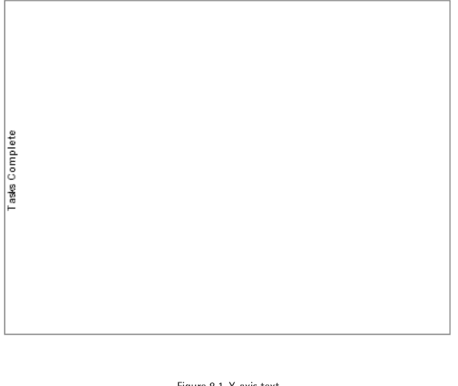

### 进一步的旋转示例

让我们从主项目中短暂休息一下，看一个涉及形状的侧面示例。这是一个有用的练习，因为形状旋转在视觉上比文本旋转更具指导性和直观性。创建一个名为**canvas.html**的新文件：

```html
<!doctype html>
<html>
<head>
    <title>Todo</title>
</head>
<body>
    <canvas id="canvas" height="300" width="400">
    </canvas>
```


```
<script src="canvas.js"></script>
</body>
</html>
```

接下来，创建 **canvas.js**：

```
var canvas = document.getElementById("canvas");
var context = canvas.getContext("2d");

context.strokeStyle = '#000000';
context.strokeRect(0, 0, canvas.width, canvas.height);
context.fillRect(100, 100, 200, 100);
```

你应该能在屏幕上看到一条围绕画布的黑色细线，以及一个纯黑色的矩形，如图 8.2 所示。


现在，在 `getContext` 之后立即添加以下代码：

```
context.rotate(10 * Math.PI / 180);
```

注意整个画布是如何顺时针旋转了 10 度的。将 `10` 改为 `-10` 并观察发生了什么。现在将 `-10` 调整为 `45`。然后，将 `45` 改为 `90`，并观察它如何将画布完全旋转出屏幕，只留下一条细边框。作为最后的实验，将 `context.rotate(90 * Math.PI / 180);` 移动到最后一行。请注意，`rotate` 对已经渲染到屏幕上的形状和线条没有影响。当然，后续的绘制会按预期进行旋转。

### Y 轴编号

让我们通过向 y 轴添加一些数字来回到主项目。在进入本节之前，请确保你的列表中有一些项目，以便可以在图表上显示一些合理的数字。在 `context.restore()` 之后，将以下代码添加到 **todo.js** 中：

```
var yScaleFactor = (canvas.height - topMargin) / (maxVal);
var count = 0;

for (var yAxisValue = maxVal; yAxisValue >= 0; yAxisValue -= 1) {
    var yCoord = topMargin - bottomMargin + (yScaleFactor * count);

    context.fillText(yAxisValue, 40, yCoord);
    count++;
}
```

第一个任务是计算 y 轴缩放因子。这个变量代表我们 y 轴上两个数字之间的距离。我们通过获取画布高度，减去上边距，然后除以 y 轴的最大值来计算它。结果将给出每个数字之间适当的间距。

现在我们需要在轴上绘制数字。你会注意到 for 循环从最大值开始，然后倒序计数。回想一下，在默认坐标系中，左上角是 (0, 0)，Y 轴随着 y 的增加而向下延伸。因此，我们 Y 轴上的最小数字 0 将对应于最大的 y 坐标。类似地，Y 轴上最大的数字将对应于最小的 y 坐标。如果这很难理解，我建议粘贴代码，并结合图表作为视觉辅助工具重新阅读解释，这样应该会更清楚。图 8.3 说明了这一点。

### 生产力图表

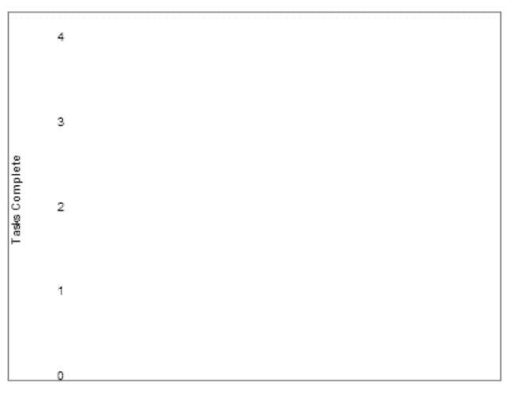

图 8.3. 带编号的轴

我们通过从顶部边距减去底部边距，然后在 for 循环的每次迭代中增加 `yScaleFactor` 来计算 y 坐标。然后我们像以前一样调用 `fillText` 在指定的 y 坐标处绘制文本，距离 x 轴 40 像素。我们的图表开始成形了！

### "Hello World" 画布风格

由于文本元素仅仅是图表上的装饰，让我们看另一个侧面示例，以更好地理解一些画布文本 API 特性。用以下代码替换我们之前示例中的 **canvas.js**：

```
var canvas = document.getElementById("canvas");
var context = canvas.getContext("2d");
var message = "Hello world";
var xCoord = canvas.width / 2;
var yCoord = canvas.height / 2;

context.font = "italic 30pt Times New Roman";
context.fillStyle = "blue";
context.textAlign = "center";
context.textBaseline = "middle";
context.fillText(message, xCoord, yCoord);
```

`context.font` 可用于设置字体属性。这里我们指定了样式、大小和字体。将 `fillText` 更改为 `strokeText` 并观察发生了什么。填充和描边在文本上的表现与在形状上类似。还有一个可用的函数 `measureText`，用于测量渲染文本的长度。添加以下代码然后刷新你的页面：

```
var metrics = context.measureText(message);
var width = metrics.width;

context.fillText( width + 'pixels', xCoord, yCoord + 70);
```

`measureText` 根据提供的文本和当前字体返回文本的宽度。没有函数可以返回文本的高度；文本的高度（以像素为单位）与字体的大小（以点为单位）相同。在这种情况下，字体高度是 30 像素。

### 网格线

回到主项目，让我们绘制一些水平网格线，以便更容易看清条形图上的数值。在我们的 for 循环中添加以下两行代码：

```
count++;

context.moveTo(0, yCoord);
context.lineTo(canvas.width, yCoord);
```

`moveTo` 函数将光标移动到指定的坐标，而 `lineTo` 函数创建一条到指定坐标的线。此时，实际上还没有渲染任何内容到屏幕。为此，请在 for 循环之后添加以下两行：

```
for (var yAxisValue = maxVal; scale >= 0; yAxisValue -= 1) {
    ...
}

context.lineWidth = 0.1;
context.stroke();
```

`lineWidth` 指定了线条的宽度（以像素为单位）。为了使线条可见，我们调用 `stroke` 函数，该函数最终将路径渲染到屏幕。图 8.4

### 生产力图表

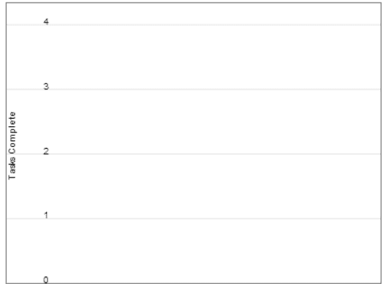

图 8.4. 网格线

### 矩形

我们将使用矩形来表示我们的柱状图，矩形是唯一原生支持的形状。虽然可以绘制任意复杂的形状，但只有矩形有专门的函数。在绘制矩形之前，我们需要执行一些画布操作。接着 `context.stroke()`，插入：

```
var xScaleFactor = canvas.width / (dataValue.length + 1);

context.translate(0, canvas.height);
context.scale(xScaleFactor, -1 * yScaleFactor);
drawRect(context);
```

首先，我们创建 `xScaleFactor`。类似于 `yScaleFactor` 变量，这允许我们计算柱子之间的间距。回想一下，`translate` 会改变坐标系的原点。在这里，我们将原点从左上角更改为左下角，这将有助于绘制柱子。

`scale` 是一个内置函数，接受两个参数 x 和 y。在此函数调用之后绘制的任何内容，都会在水平方向放大 x 倍，在垂直方向放大 y 倍。例如，如果 y 是 3，所有绘制的内容都会变成三倍高。在这种情况下，通过应用一个负数，我们确保我们的矩形从图表底部开始并向上绘制。没有这个，矩形将按默认方向向下绘制。

我们可以提供一个函数来绘制矩形：

```
if (canvas && canvas.getContext) {
    ...
}

function drawRect(context) {
    for (i = 0; i < dataValue.length; i++) {
        var startX = i+1;
        var startY = bottomMargin / xScaleFactor;
        var endX = 1;
        var endY = dataValue[i];
        var width = 0.5;
        var gradient = context.createLinearGradient(startX, startY, endX, endY);

        gradient.addColorStop(0.0, "#8ED6FF");
        gradient.addColorStop(1.0, "#004CB3");
        context.fillStyle = gradient;
        context.fillRect(startX, startY, width, endY);
    }
}
```

为了绘制矩形，我们首先循环遍历数据集中的每个值。在这种情况下，只有两个值：要完成的项目数量和已完成的项目数量。然后我们使用内置的 `createLinearGradient` 函数，它接受四个参数。前两个参数代表渐变起点的 x 和 y 坐标，后两个代表渐变的终点。我们使用这个函数为柱状图提供一些纹理，而不是纯色的柱子。

`addColorStop` 函数有助于定义渐变的颜色和位置。第一个参数是一个介于 0.0 和 1.0 之间的浮点数，代表渐变的起点和终点。可以添加任意数量的颜色停止点。我们只添加了两个停止点，一个在开始，一个在结束。第二个参数代表颜色。这里我们从浅蓝色过渡到深蓝色。还记得我们之前如何使用 `fillStyle` 定义颜色吗？这里我们用它来定义渐变。最后，我们像以前一样调用 `fillRect`，如图 8.5 所示。

### 生产力图表

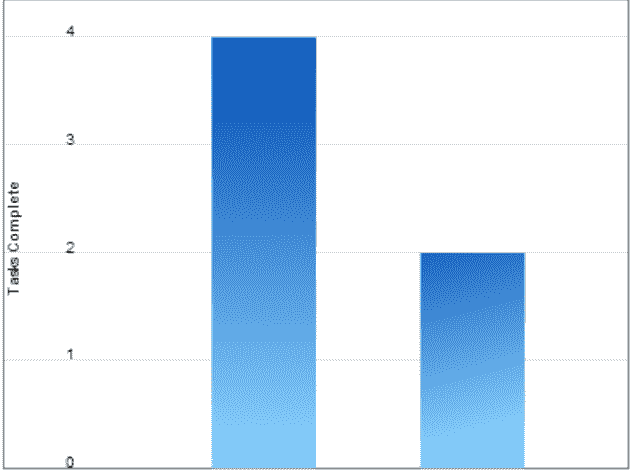

图 8.5. 我们绘制了矩形的图表


### 圆弧

我们已经提到过，矩形是唯一原生支持的形状，但这并不意味着圆形等形状不可用。它只是意味着没有`fillCircle`或类似的功能。让我们探索如何绘制一些非矩形形状。将`canvas.js`的所有内容替换为以下内容：

```javascript
var canvas = document.getElementById("canvas");
var context = canvas.getContext("2d");

context.beginPath();
context.arc(50, 50, 50, 0, Math.PI, true);
context.stroke();
```

上述代码中唯一不熟悉的方面是arc函数。它接受五个参数，其中前两个参数代表圆心的x和y坐标。第三个参数是圆的半径，而第四和第五个参数分别代表圆弧的起始和结束角度（以弧度为单位）。在本例中，我们从0开始，这与x轴相同。选择`Math.PI`作为结束角度，我们绘制的是一个半圆（π弧度等于180度）。最后一个任务是确定圆是顺时针还是逆时针绘制。这由最后一个参数指定，我们将其设置为`true`，表示逆时针。

你从绘制矩形中学到的许多概念也可以应用于圆弧。例如，你可以将`stroke`替换为`fill`。到目前为止，我们处理的都是一些简单的示例；你应该去看看一些canvas实际应用中令人惊叹的示例⁹。

### 柱状图标签

我们的图表需要一些标签来指示哪些柱子代表已完成的任务，哪些代表待办任务。在定义`xScaleFactor`之后、`translate`之前，插入以下内容：

```javascript
var dataName = ["To Do", "Done"];

context.textBaseline = "bottom";
```

160 Jump Start JavaScript

```javascript
for (i = 0; i < dataValue.length; i++) {
    var yCoord = canvas.height - dataValue[i] * yScaleFactor;

    context.fillText(dataName[i], xScaleFactor * (i + 1), yCoord);
}
```

我们指定textBaseline来定位文本的垂直对齐方式。如果你向下滚动到http://www.html5tutorial.info/html5-canvas-text.php 10页面底部，你会看到不同类型对齐方式的可视化表示。

然后我们计算x和y坐标，以便文本将位于柱子的顶部。接着我们像之前一样使用fillText来渲染文本。

### 阴影

为了给我们的图表添加一个漂亮的收尾效果，我们将为柱子添加一些阴影。在`drawRect(context)`之前添加以下代码：

```javascript
context.shadowOffsetX = 2;
context.shadowOffsetY = 2;
context.shadowBlur = 2;
context.shadowColor = "rgba(0, 0, 0, 0.5)";
```

shadowOffsetX和shadowOffsetY分别指定阴影的水平和垂直偏移量（以像素为单位）。shadowBlur是一个使用方程来确定阴影模糊程度的参数。shadowColor用于指定颜色。阴影可以应用于文本、形状和图像。如图8.6所示，我们图表的绘制完成了！

### 效率图表

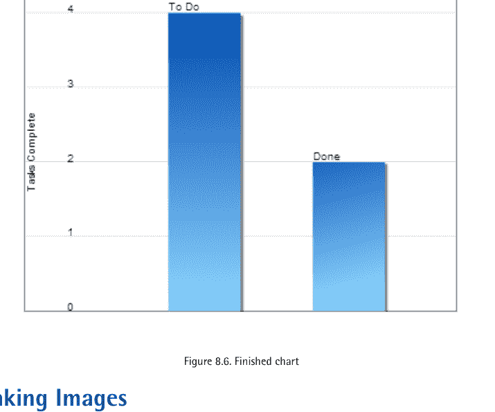

图8.6. 完成的图表

### 生成图片

让我们以一点乐趣来结束本章，并赋予用户将图表转换为图像的能力。或许他们会将其用作激励性的壁纸来完成任务！在**index.html**中`</canvas>`标签下方添加以下内容：

```html
<div class='row'>
    <a id='printChart' href='' class='btn'>Print Chart</a>
</div>
```

现在我们只需在renderChart函数底部添加一行代码：

```javascript
document.getElementById('printChart').href = canvas.toDataURL();
```

toDataURL是一个内置函数，它返回一个包含图像表示的URL。它接受一个可选参数来指定图像类型，默认是PNG。如果你希望指定`image/jpeg`，该函数还接受第二个参数（范围在0.0到1.0之间）来表示图像质量。当你刷新页面并点击按钮时，你将看到一个可以保存的图像。

## 总结

恭喜，你在本章中取得了相当大的成就。本章首先介绍了`<canvas>`元素。接下来，你学习了如何使用canvas API绘制文本、矩形和线段。在此基础上，我们转向了更高级的主题，如canvas的旋转与缩放、渐变效果和阴影效果。最后，你学习了如何将canvas保存为图像文件。当然，在整个章节中，你同时也学习了如何创建基于canvas的图表，以配合本书的示例项目。

既然你已经通读了本书，你应该对JavaScript编程语言有了相当好的掌握。虽然本书的范围和篇幅不允许我们像其他专门书籍那样深入探讨这门语言，但你仍然应该打下了良好的基础。无论你最终编写的是简单还是极其复杂的JavaScript程序，你都一定会用到本书涵盖的基础知识。记住，本书是以相当快的节奏带你学习JavaScript的。你无疑会遇到想要更深入探讨本书所涵盖的一些内容，或者我们没有涉及的其他更高级主题的时刻。保持好奇心，提问并钻研。以网络发展的速度，你能构建的东西几乎是无限的。

## 附录 A：常用事件

以下是一些最常用的JavaScript事件。

164 Jump Start JavaScript

| 事件名称 | 事件类型 | 规范 | 触发时机... |
| --- | --- | --- | --- |
| abort | UIEvent | DOM L3 | 资源的加载被中止。 |
| blur | FocusEvent | DOM L3 | 元素失去焦点（不冒泡）。 |
| click | MouseEvent | DOM L3 | 在元素上按下并释放了定点设备按钮。 |
| contextmenu | MouseEvent | DOM L3 | 鼠标右键被点击（在上下文菜单显示之前）。 |
| dblclick | MouseEvent | DOM L3 | 在元素上双击定点设备按钮。 |
| drag | DragEvent | HTML5 | 元素或文本选择正在被拖动（每350毫秒触发一次）。 |
| dragend | DragEvent | HTML5 | 拖动操作结束（通过释放鼠标按钮或按下退出键）。 |
| dragenter | DragEvent | HTML5 | 被拖动的元素或文本选择进入有效的放置目标。 |
| dragleave | DragEvent | HTML5 | 被拖动的元素或文本选择离开有效的放置目标。 |
| dragover | DragEvent | HTML5 | 元素或文本选择正在被拖动经过有效的放置目标（每350毫秒触发一次）。 |
| dragstart | DragEvent | HTML5 | 用户开始拖动元素或文本选择。 |
| drop | DragEvent | HTML5 | 元素被放置在有效的放置目标上。 |
| error | UIEvent | DOM L3 | 资源加载失败。 |
| focus | FocusEvent | DOM L3 | 元素获得焦点（不冒泡）。 |
| hashchange | HashChangeEvent | HTML5 | URL的片段标识符发生变化（URL中#之后的部分）。 |
| input | Event | HTML5 | 元素的值发生变化，或者具有`contenteditable`属性的元素的内容被修改。 |
| invalid | Event | HTML5 | 可提交元素被检查后不满足其约束条件。 |
| keydown | KeyboardEvent | DOM L3 | 一个键被按下。 |
| keypress | KeyboardEvent | DOM L3 | 一个通常会产生字符值的键被按下。 |
| keyup | KeyboardEvent | DOM L3 | 一个键被释放。 |
| load | UIEvent | DOM L3 | 资源及其依赖资源已完成加载。 |
| mousedown | MouseEvent | DOM L3 | 定点设备按钮（通常是鼠标）在元素上被按下。 |
| mouseenter | MouseEvent | DOM L3 | 定点设备被移入附有事件监听器的元素。 |
| mouseleave | MouseEvent | DOM L3 | 定点设备被移出附有事件监听器的元素。 |

165 Jump Start JavaScript


# 附录 A：常见事件

| 事件名称 | 事件类型 | 规范 | 触发时机 |
| --- | --- | --- | --- |
| mousemove | MouseEvent | DOM L3 | 指向设备在元素上方移动。 |
| mouseout | MouseEvent | DOM L3 | 指向设备移出监听器所附加的元素或其子元素。 |
| mouseover | MouseEvent | DOM L3 | 指向设备移入监听器所附加的元素或其子元素。 |
| mouseup | MouseEvent | DOM L3 | 指向设备按钮在元素上方被释放。 |
| offline | Event | HTML5 offline | 浏览器失去网络连接。 |
| online | Event | HTML5 offline | 浏览器重新获得网络连接（但某些网站可能仍不可达）。 |
| pagehide | PageTransitionEvent | HTML5 | 正在离开某个会话历史记录条目。 |
| pageshow | PageTransitionEvent | HTML5 | 正在进入某个会话历史记录条目。 |
| popstate | PopStateEvent | HTML5 | 正在导航到某个会话历史记录条目（在某些情况下）。 |
| reset | HTMLEvents (DOM L2) 或 Event (HTML5) | DOM L2, HTML5 | 表单被重置。 |
| resize | UIEvent | DOM L3 | 文档视口被调整大小。 |
| scroll | UIEvent | DOM L3 | 文档视口或元素被滚动。 |
| select | UIEvent | DOM L3 | 正在选择一些文本。 |
| show | MouseEvent | HTML5 | 在拥有 `contextmenu` 属性的元素上触发了 `contextmenu` 事件或该事件冒泡至此。 |
| submit | HTMLEvents (DOM L2) 或 Event (HTML5) | DOM L2, HTML5 | 表单被提交。 |
| unload | UIEvent | DOM L3 | 文档或一个依赖资源正在被卸载。 |
