# Node.js 快速入门指南：一个周末掌握 Node.js

**产品经理：** Simon Mackie

**技术编辑：** Diana MacDonald

**专家评审：** Giovanni Ferron

**索引员：** Fred Brown

**编辑：** Kelly Steele

**封面设计：** Alex Walker


## 关于作者

Don 以强类型、面向对象的语言（如 `Java` 和 `C++`）开始他的编程生涯。他利用自己的工程培训构建了旨在具有可扩展性和容错性的实时交易系统。

虽然他第一次接触函数式编程对系统来说有些冲击，但像 `Python` 和 `Ruby` 这样的弱类型动态语言的优雅和美感脱颖而出。Don 曾在多种 Web 环境中编程，包括 `ASP`、`PHP` 和 `Python`，但他觉得 `Node.js` 在处理实时 Web 的现代需求方面是首要的。

## 关于专家评审

Giovanni Ferron 是一位现居澳大利亚墨尔本的 Web 开发者。他曾为 MTV 和 DMG Radio Australia 等大型媒体公司工作，并与他人共同创立了 Stereomood.com 网站。¹ 几年前，他爱上了 `Node.js`，从此每晚都在 `JavaScript` 中编程。

## 关于 SitePoint

SitePoint 专注于为 Web 专业人士发布有趣、实用且易于理解的内容。访问 http://www.sitepoint.com/ 以访问我们的博客、书籍、通讯、文章和社区论坛。

*本书献给我的爸爸妈妈。*

*给我的爸爸，感谢他无尽的耐心开车送我去划船、武术和网球训练，以及他永不停歇的支持。*

*给我的妈妈，感谢她一只手做晚饭，另一只手勾勒出面向对象编程和数据库规范化的基本原理。*

# 前言

我尝试学习 `Node.js` 时遇到的困难之一是不知从何入手。我找到的参考资料要么涉及诸如数据报和事件发射器之类的准学术主题，要么狭隘地专注于某个主题而忽视大局。本书将带你完成在 `Node.js` 中构建应用程序的全过程。它从经典的“Hello World”示例开始，进而构建一个能够向数千个连接的客户端发送交易信息的实时 Web 应用程序。

是什么让 `Node.js` 与众不同？首先，它在后端和前端之间提供了统一的语言。这意味着你所有的思考都可以用一种语言进行，在从后端切换到前端时没有认知负担。此外，它还允许共享代码库和模板。这开辟了许多有趣的可能性，其表面才刚刚开始被充分探索。

其次，它很快。像 `PHP`、`Python` 和 `Ruby` 这样的解释型语言的一个常见抱怨是速度。Joyent 的首席技术官 Jason Hoffman 讨论了 `Node.js` 如何达到其性能可以压垮操作系统的程度。一个核心、不到 1GB 内存就能处理 10GB 的流量和一百万个连接端点。将 24 个这样的核心组合到一台机器中，产生的整体吞吐量超过了操作系统和 TCP/IP 协议栈的能力。换句话说，对于一个设计良好的应用程序来说，瓶颈不是 `Node.js`——而是你的操作系统。

第三，它的非阻塞架构专为实时 Web 而生。选择 `JavaScript` 作为语言是因为它基于非阻塞回调，并且具有非常小的核心 API。这意味着可以围绕非阻塞包构建整个 `Node.js` 生态系统，目前其数量已超过一万。最终结果是一个平台和生态系统，在架构上完美契合现代实时 Web 的需求。

我相信到现在为止，你已经对 `Node.js` 能为你的实时应用程序带来的可能性感到兴奋。在本书结束时，我确信你将具备开始剖析和解决除最深奥问题之外所有问题的技能。在软件领域，没有比解决一个复杂的任务并在结束时想到“这就是我需要做的一切！”更大的乐趣了。这是我多次经历过的。

我有多次使用 `Node.js` 的经验，希望你在阅读本书以及使用 `Node.js` 解决实际问题时，也能获得同样的满足感。

## 谁应该阅读本书

本书面向两类目标读者。你可能是一位对服务端开发感兴趣的前端工程师。即使你不熟悉某些服务端工程技术，已有的 `JavaScript` 知识也会大有裨益。请放心，到本书结束时，相关主题会被详细涵盖，足以让你知道如何将前端技能应用于后端问题。

第二类潜在读者是使用 `PHP`、`Python`、`Ruby`、`Java` 或 `.NET` 等其他语言的服务端工程师。你将获得的主要好处是，看到你已有的架构、设计和模式知识如何应用于 `Node.js` 的世界。你可能对 `JavaScript` 知之甚少甚至一无所知，但这不应构成大障碍。就设计而言，它是一门易于学习的语言，我们将在本书结束前涵盖许多关于其语法和独特特性的示例。

## 本书内容

本书包含以下七章。

-   第 1 章：*走近你的服务器*

    介绍 `Node.js`，并解释其特性和优势。然后，我们构建一个简单的应用程序来引入 `Node.js`。该应用程序将表单数据发送到 `MongoDB`（一种 NoSQL 数据库）。

-   第 2 章：*函数式编程*

    本章介绍如何使用 `Node.js` 进行函数式风格的编程。我们将构建一个股票交易引擎，它能够接受订单并匹配交易。

-   第 3 章：*持久化是值得的*

    在这里，我们将探索 `MongoDB`。我会解释 `MongoDB` 的用例以及它与传统 SQL 数据库的比较。然后，我们将研究 `MongoDB` 查询语言，并展示如何将其集成到你的 `Node.js` 项目中。

-   第 4 章：*用 Bootstrap 美化*

    `Bootstrap` 是 Twitter 的一个前端框架，可以轻松构建具有专业外观的网站。我们将查看一些最常用的控件，并用它们构建一个登录界面和股票投资组合跟踪器。

-   第 5 章：*实时网络*

    在本章中，我们将研究 `Socket.IO`。我们将看到，学习一个简单的 API 如何能够在各种项目中实现实时通信，而无需担心浏览器版本或通信协议。

-   第 6 章：*Backbone*

    在本章中，我们将讨论框架在管理客户端 `JavaScript` 方面的作用。然后，我们将展示如何通过在浏览器中实时更新交易，将 `Backbone.js` 整合到你的项目中。

-   第 7 章：*生产环境*

    在最后一章，我们将审视开发环境和生产环境之间的主要区别。在部署应用程序并使其上线运行之前，我们将介绍各种部署选项。

## 在哪里获取帮助

`Node.js` 代表了 Web 开发的一次范式转变，它提供了一种从前端到后端统一的语言。它在 GitHub 上的人气激增，因此很有可能在你阅读本书时，`Node.js` 平台的某些小细节已经与本书中的描述有所不同。值得庆幸的是，SitePoint 拥有一个活跃的 `JavaScript` 开发者社区，如果你遇到困难，他们随时准备提供帮助，我们还为本书维护了一份已知勘误列表，你可以查阅以获取最新更新。

### SitePoint 论坛

SitePoint 论坛¹ 是一个讨论论坛，你可以在这里提出任何与 Web 开发相关的问题。当然，你也可以回答问题。这就是讨论论坛网站的运作方式——有些人提问，有些人回答，而大多数人两者兼顾。分享你的知识既有益于他人，也能加强社区联系。那里聚集了许多有趣且经验丰富的网页设计师和开发者。这是学习新知识、快速获得问题解答以及享受乐趣的好方法。

`JavaScript & jQuery` 论坛² 可能是提出任何问题的最佳去处。

### 本书网站

本书的配套网站位于 http://www.sitepoint.com/books/nodejs1/，你将可以访问以下资源：

### 代码存档

在你学习本书的过程中，你会注意到多处提及代码存档。这是一个可下载的 ZIP 压缩包，包含了本书印刷的每一行示例源代码。如果你想“作弊”（或者为了预防腕管综合征），那就尽管下载存档吧。³

### 更新与勘误

没有一本书是完美的，我们期望细心的读者在本书结束前能发现至少一两个错误。本书网站上的勘误页面将始终提供有关已知印刷和代码错误的最新信息。

### SitePoint 新闻简报

除了像本书这样的书籍，SitePoint 还发布免费的电子邮件新闻简报，如 *SitePoint*、*JSPro*、*PHPMaster*、*CloudSpring*、*RubySource*、*Design-Festival* 和 *BuildMobile*。在这些简报中，你将阅读到有关 Web 开发各个方面的最新新闻、产品发布、趋势、技巧和技术。请在 http://www.sitepoint.com/newsletter/ 注册一份或多份简报。

### 你的反馈

如果你无法通过论坛找到答案，或者出于任何其他原因希望联系 SitePoint，最好的方式是写信至 books@sitepoint.com。我们拥有一套人员配备完善的电子邮件支持系统，用于跟踪你的咨询。如果我们的支持团队成员无法回答你的问题，他们会直接将问题转给我们。我们特别欢迎你提出改进建议，以及通知我们可能发现的任何错误。

### SitePoint 之友

感谢你购买本书。我们真心感谢你的支持！我们现在将你视为“SitePoint 之友”，因此想邀请你访问我们专属的“SitePoint 之友”页面。⁴ 在这里，你只需使用密码：**friends**，即可在一系列超酷的 SitePoint 产品上享受最高 43% 的优惠。

### 在线测验

一旦你掌握了 `Node.js`，可以用我们的在线测验来测试自己。测验基于本书内容，只有真正的 `Node.js` 忍者才能获得满分。请前往 http://quizpoint.com/#categories/NODE.JS。

## 致谢

我要感谢 SitePoint 的优秀团队，他们在我出版第一本书的过程中给予了我指导：感谢 Simon Mackie 耐心回答我所有的问题并让一切保持正轨；感谢 Giovanni Ferron 审阅我的代码并指出错误；感谢 Diana MacDonald 确保我的代码清晰明了；感谢 Kelly Steele 保持我的英语在风格和语法上正确；感谢 Alex Walker 设计了精彩的封面艺术。

感谢我的老朋友 Jarrod Mirabito 和 Andrew Prolov：感谢你们在我最初的草稿还远非成书提案时就帮忙审阅。感谢我的室友 Angelo Aspris：感谢你耐心接受“忙于写作”作为长时间缺席的借口。感谢 Andy Walker：感谢你让创业的火焰持续熊熊燃烧。感谢我一生的朋友 Chuong Mai-Viet：感谢你在阳光明媚的日子里把我从书桌前拉走，以保持我的高尔夫让分值并补充维生素 D。

## 本书中使用的约定

你会注意到我们在本书中使用了某些排版和布局风格来表示不同类型的信息。请注意以下项目。

### 代码示例

本书中的代码将使用等宽字体显示，如下所示：

```html
<h1>A Perfect Summer's Day</h1>
<p>It was a lovely day for a walk in the park. The birds
were singing and the kids were all back at school.</p>
```

如果代码可以在本书的代码存档中找到，文件名将出现在程序列表的顶部，如下所示：

```css
example.css

.footer {
  background-color: #CCC;
  border-top: 1px solid #333;
}
```

如果只显示了文件的一部分，将用 *excerpt* 一词标出：

```css
example.css (excerpt)

border-top: 1px solid #333;
```

如果需要在现有示例中插入额外的代码，新代码将以粗体显示：

```javascript
function animate() {
  **new_variable = "Hello";**
}
```

---

¹ http://www.sitepoint.com/forums/

² http://www.sitepoint.com/forums/forumdisplay.php?15-JavaScript-amp-jQuery

³ http://www.sitepoint.com/books/nodejs1/code.php

⁴ http://sitepoint.com/friends

另外，当需要引用已有代码作为上下文时，不会重复全部代码，而是会显示一个冒号：

```javascript
function animate() {
    ...
    return new_variable;
}
```

有些代码行本应写在一行，但由于页面限制不得不换行显示。符号 `➡` 表示此处换行仅为排版需要，应忽略不计。

```javascript
URL.open("http://jspro.com/raw-javascript/how-to-create-custom-events-in-javascript/");
```

## 提示、说明与警告

- **嘿，你！**

    提示会提供一些实用的小技巧。

- **咳咳，打扰一下……**

    说明是与当前主题相关但非关键的有用旁注。可以将它们视为额外的信息片段。

- **务必注意……**

    ……这些重要要点需要你时刻关注。

- **当心！**

    警告会突出显示那些可能在过程中让你绊倒的陷阱。

# 第 1 章

# 来到你身边的服务器

> “你看见事物并说：‘为什么？’但我梦见从未有过的事物，并说：‘为什么不？’”

> ——萧伯纳

## 为什么选择 Node.js？

如果说一幅图胜过千言万语，那么要表达千幅图需要什么？或者，更进一步，要表达无限多幅图呢？我第一次接触 `Node.js` 是通过 WordSquared¹（见图 1.1）。这是一款在线、实时、无限版的拼字游戏，使用了我们将在本书中讨论的相同技术构建。第一眼看到这个游戏，我就不得不深入了解其背后的技术，希望你也有同样的感受。

这款游戏令人难以置信之处在于，它是作为 `Node.js Knockout`² 的一部分在仅仅 48 小时内完成原型开发的。Joyent（`Node.js` 的制造商）的工程副总裁 Bryan Cantrill 曾说过，用 `Node.js` 做事时，你有时会感觉“就这样？肯定应该更复杂些吧。”这种感受

¹ http://wordsquared.com/

² http://nodeknockout.com/

我感同身受。`Node.js` 用起来很愉快，我打算通过我们在本书中编写的代码，与你分享这份喜悦。


`Node.js` 是一个服务端 `JavaScript` 平台，由一个刻意设计的核心库和一个丰富的生态系统组成。它运行在 `V8 JavaScript` 引擎之上，得益于 Google 才华横溢的工程师，因此速度非常快。`JavaScript` 在客户端很受欢迎，但选择它作为目标语言主要是出于工程方面的考虑，具体细节将在本章展开时讨论。

`Node.js` 官网如此描述它：

> “`Node.js` 是一个基于 Chrome 的 `JavaScript` 运行时构建的平台，用于轻松构建快速、可扩展的网络应用程序。`Node.js` 使用事件驱动、非阻塞 I/O 模型，使其轻量高效，非常适合在分布式设备上运行的数据密集型实时应用程序。”

> ——http://nodejs.org/

这对新手来说可能显得有些晦涩，但它简洁地总结了 `Node.js` 的一些关键优势，值得进一步探讨。当人们听说 `JavaScript` 是目标编程语言时，常常会感到惊讶。这是因为编程界存在一种观念，认为 `JavaScript` 不是像 `C`、`C++` 或 `Java` 那样的“真正”的语言。然而，`JavaScript` 最初确实是作为浏览器的解释型语言诞生的；其名称中的 “Java” 部分实际上是为了借当时 `Java` 编程语言的名气。

自起步以来，`JavaScript` 已经广泛普及，现在所有主要的网络浏览器（包括移动设备上的浏览器）都支持它。它不仅是一种流行的语言，而且当前可用的工具和框架使其有资格成为强大的工程工具。`JavaScript` 作为服务端平台，支持持续集成、持续部署、关系数据库连接、面向服务的架构，以及几乎所有其他更成熟的同类语言所拥有的技术。

结合 Google 的 `V8 JavaScript` 引擎，它现在速度极快；事实上，它比其他脚本语言如 `Ruby` 和 `Python` 快数倍。与 `Python3` 相比，`JavaScript V8` 引擎的中位基准测试速度快 13 倍，且代码量大致相似。³ 与 `Ruby 1.9` 相比，中位基准测试速度快 8 倍。⁴ 对于动态语言来说，这是令人难以置信的基准性能，这在很大程度上归功于 `V8` 的优化，例如执行前编译成机器码。

> **关于基准测试**
>
> 基准测试是一个复杂的话题，⁵ 上述数字应持保留态度。每当讨论基准测试时，通常都会加上“视情况而定”的限定。讨论基准测试的主要目的是消除任何关于 `JavaScript` 本质上缓慢的误解。

官方描述提到了事件驱动、非阻塞 I/O 模型。传统上，编程是以同步方式进行的：执行一行代码，系统等待结果，处理结果，然后恢复执行。有时等待结果可能需要很长时间；例如，从数据库读取或写入网络。

在像 `Java` 和 `C#` 这样的语言中，一种解决方案是生成一个新的**线程**。线程可以看作是执行任务的轻量级进程。线程编程可能很困难，因为多个线程可能试图同时访问同一资源。如果不深入探讨多线程编程的复杂性，你可以想象，如果一个线程在递增计数器的同时，另一个线程在递减计数器，那将是灾难性的。

³ http://shootout.alioth.debian.org/u32/benchmark.php?test=all&lang=v8&lang2=python3

⁴ http://shootout.alioth.debian.org/u32/benchmark.php?test=all&lang=v8&lang2=yarv

⁵ http://shootout.alioth.debian.org/dont-jump-to-conclusions.php

`JavaScript` 以不同的方式处理这个问题。它始终只有一个线程。当执行诸如读取数据库之类的慢 I/O 操作时，程序不会等待。相反，它会立即继续执行下一行代码。当 I/O 操作返回时，会触发一个回调函数，然后可以处理结果。如果这个机制看起来有点违反直觉，请放心，到本书结束时它会成为你的第二天性，因为我们将一遍又一遍地看到这种模式。`Node.js` 提供了一个简单、快速、事件驱动的编程模型，非常适合现代 Web 应用程序的异步特性。

## 优势与劣势

`Node.js` 并非万能药。在某些特定类型的问题中，它的优势才能凸显出来。计算机程序通常可以根据它们是 CPU 密集型还是 I/O 密集型进行分类。**CPU 密集型**问题受益于可用于计算的时钟周期数的增加。质数计算就是一个很好的例子。然而，`Node.js` 并非设计用来处理这些 CPU 密集型问题。即使在 `Node.js` 正式存在之前，Ryan Dahl 就提出了以下要求：⁶

> “严格要求任何请求最多计算，比如说，5 毫秒，然后返回事件循环。如果你突破了 5 毫秒的限制，那么你的请求处理程序将永远不会再次运行（我想请求处理程序将绑定到特定的路径/方法）。如果你上传的服务器端 `JavaScript` 很愚蠢并且是阻塞式的（……它计算前 10,000 个质数），那么它将在完成前被终止。
>
> ……
>
> Web 开发人员需要这样一种环境，使他们无法做愚蠢的事情。`Ruby`、`Python`、`C++`、[和] `PHP` 对于 Web 开发来说都是糟糕的语言，因为它们允许太多自由。”

> ——Ryan Dahl

**I/O 密集型**问题可以通过增加磁盘、内存和网络带宽等 I/O 吞吐量以及改进数据缓存来缓解。许多问题是 I/O 密集型的，而 `Node.js` 真正擅长的领域就在于此。以

### C10K问题<sup>7</sup>

C10K问题<sup>7</sup>提出了一个困境：如何为一个 Web 服务器处理一万个或更多的并发连接。一些技术平台在管理这种容量方面力不从心，需要各种补丁和变通方法。`Node.js` 在处理这项任务上表现出色，因为它基于非阻塞、异步架构，专为并发设计。

我希望我已经激发了你的兴趣；现在是时候开始了。

### 速度

本书的核心项目是构建一个实时股票市场交易引擎，该引擎将实时价格流式传输到 Web 浏览器。更好奇的读者可能会问：“股票市场交易引擎难道不应该使用 `C` 语言等语言来构建，以获得快得惊人、令人惊叹的速度吗？”如果我们构建的是用于实际交易的股票市场引擎，我的回答是“是的”。

本书的主要目标是传授技能组合，而不是将实际项目移植到现实世界。存在一个狭窄的“硬”实时应用领域，例如股票交易所，因为微秒计时至关重要，所以需要专门的软件和硬件。然而，存在数量多得多的“软”实时应用，例如 `Facebook`、`Twitter` 和 `eBay`，在这些应用中微秒的影响很小。这是 `Node.js` 的专长，到本书结束时，你将理解如何构建这类应用。

## 万事开头难

让我们快速浏览一下如何安装 `Node.js`、设置一个 Web 框架、构建一个基本表单页面以及连接到一个数据库。

## 安装

可以从原始源代码安装 `Node.js`，但使用包管理器安装要简单得多。

访问 https://github.com/joyent/node/wiki/Installing-Node.js-via-package-manager 并按照你特定发行版的说明进行操作。目前提供了 `Gentoo`、`Debian`、`Ubuntu`、`openSUSE` 和 `SLE`（SUSE Linux Enterprises）、`Fedora` 以及 `RHEL/CentOS` 的说明，以及其他几个 Linux 发行版。`Windows` 和 `Mac OS X` 的说明也可用。

安装后，在命令行中键入 `node` 以启动读取-求值-打印循环（`REPL`）。你可以通过键入以下命令来测试你的安装：

```javascript
console.log('Hello world')
```

你应该收到：

```
Hello world
undefined
```

如果你收到了，恭喜你！你刚刚写出了你的第一个 `Node.js` 程序。控制台总是打印出返回类型。这就是为什么 `Hello world` 后面跟着 `undefined`。既然你已经编写了经典的 Hello world 程序，我很高兴地通知你，它将是本书中你看到的第一个也是最后一个无聊程序。为了证明我的观点，我们现在将直接开始，构建一个使用基于云的 NoSQL 技术来验证用户名和密码的身份验证模块。（如果你挠着头想这意味着什么，别担心——一切很快就会揭晓！）

那么什么是**基于云的 NoSQL**技术，你为什么要关心它？围绕基于云的技术已经有很多炒作。就我们的目的而言，云技术之所以有用，是因为它允许我们的应用程序扩展：只需点击几下鼠标，就可以启动额外的虚拟服务器。

NoSQL 运动相对较新，因此很难得出一个关于该技术包含什么的全面定义。广义上，它可以被视为一族为处理大量非结构化和半结构化数据而构建的数据库技术。`Google`、`Amazon` 和 `Facebook` 等公司广泛使用 NoSQL 技术来存储其用户产生的海量数据。

对于本书，我们将使用 `MongoDB` 作为我们的 NoSQL 数据库，原因将在第 3 章中详细阐述。`MongoDB` 是一个成熟且可扩展的面向文档的数据库，已在企业环境中成功部署，例如 `foursquare` 和 `craigslist`。<sup>8</sup> **面向文档的数据库**是一种将传统数据库行替换为不太结构化的文档（如 `XML` 或 `JSON`）的数据库。`MongoDB` 允许临时查询，因此保留了 `SQL` 提供的大部分灵活性。我选择 `MongoLab`⁹ 作为我们股票监控应用的云提供商，因为它提供了一个慷慨的免费托管计划。

## 组装零件

第一步是访问 `MongoLab`（如图 1.2 所示）并注册一个账户。然后单击数据库旁边的 **Create New**。将云提供商保留为 `Amazon EC2`，并选择免费定价计划。选择一个数据库名称、用户名和密码。

现在我们将设置 Web 框架。`Node.js` 提供了一个内置的、基础的 HTTP 服务器。在此之上是 `Connect`，一个中间件框架，它提供了对 cookie、会话、日志记录和压缩等支持。<sup>10</sup> 在 `Connect` 之上是 `Express`，它支持路由、模板（使用 `Jade` 模板引擎）和视图渲染。<sup>11</sup> 在整本书中，我们将主要使用 `Express`。

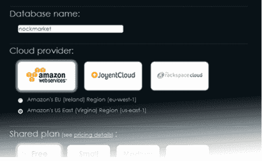

可以使用以下命令安装 `Express`：

```bash
sudo npm install -g express@2.5.8
```

我们使用 `-g` 开关来表示该包应全局安装，`@2.5.8` 来表示我们将在本书中使用的版本。

### 全局与本地

在 `Node.js` 官方博客上，建议谨慎使用全局安装。指导原则是：如果该包需要在命令行中访问，则使用全局安装；如果需要在程序中访问，则使用本地安装。在某些情况下——例如 `Express`，两者都需要——同时做两者是可以的。

可以使用此命令创建具有基本默认选项的应用程序：

```bash
express authentication
```

你应该看到类似于以下的输出：

```
create : authentication
create : authentication/package.json
...
dont forget to install dependencies:
$ cd authentication && npm install
```

要解释最后一行（`$ cd authentication && npm install`），`npm install` 将根据 **package.json** 中指定的依赖项安装包。这是一个纯文本文件，以 `JavaScript` 对象表示法指定包依赖项。对于这个项目，修改 **package.json** 以包含以下文本：

```json
chapter01/authentication/package.json (excerpt)

{
    "name": "authentication"
  , "version": "0.0.1"
  , "private": true
  , "dependencies": {
      "express": "2.5.8"
    , "jade": "0.26.1"
    , "mongoose": "2.6.5"
    }
}
```

## 避免依赖地狱

代替特定的版本号，可以指定“*”，这将从仓库检索最新版本。虽然总是使用最新版本可能很诱人，但你的应用程序与一个版本兼容，并不能保证它与下一个版本也兼容。我建议至少总是声明版本号。即使这样也不能保证正确性。如果你使用采用“*”语法的包，你会遇到类似的问题。为了一个更健壮的解决方案，我建议你研究 `Shrinkwrap`。[^13]

然后可以通过切换到 **authentication** 目录（`cd authentication`）并键入 `npm install` 来安装这些依赖项。然后键入 `node app`，在浏览器中导航到 http://localhost:3000 后，你应该会看到消息“Welcome to Express”。很简单，不是吗？

## 基本表单

下一步是创建一个基本表单，将数据发布到服务器。对于像 `Apache` 这样的 Web 服务器，你通常会将文件放入一个目录中，以提供给用户。`Node.js` 故意设计得非常极简，自动完成的操作很少。如果你想从磁盘读取文件，你需要明确编程。终止你的应用程序，并在 **app.js** 的顶部添加 **fs** 依赖项以允许从文件系统读取。然后添加 **/form** 路由：

```javascript
chapter01/authentication/app.js (excerpt)

var express = require('express')
  , routes = require('./routes')
  , fs = require('fs');
:
// Routes
app.get('/', routes.index);

app.get('/form', function(req, res) { ①
    fs.readFile('./form.html', function(error, content) { ②
        if (error) {
            res.writeHead(500);
            res.end();
        }
        else {
            res.writeHead(200, { 'Content-Type': 'text/html' });
            res.end(content, 'utf-8');
        }
    });
});
```

以上代码清单有几个重要特点。

- ① 这一行处理所有到 **/form** 的路由。每当有人向 http://localhost:3000/form 发起请求时，`Express` 会捕获该请求并由其内部代码处理。

- ② 这一行尝试从文件系统中读取 **form.html** 文件并提供 HTML 文件服务。如果发生错误，会向浏览器返回一个 500 响应。

### 回调函数

这是我们第一次接触回调函数，对于那些从其他语言转过来的人来说，这可能有点棘手。例如，将以下内容输入到一个名为 **cb.js** 的文件中：

```javascript
setTimeout(function() {console.log('first or second');}
, 500);
console.log('we will see');
```

运行 `node cb` 并注意文本的顺序。第一行设置了一个超时，让一个函数在 500 毫秒后执行。程序会立即继续执行，这就是为什么 `we will see` 会在 `first or second` 之前打印出来。

在 `Node.js` 中，一切都是异步设计的，因此只有你自己的代码才会阻塞进程。此代码示例中的第一行可以是任何 I/O 操作，包括从数据库和网络进行读写。在任何情况下，I/O 相关操作都不会阻塞，你程序的其余部分将立即执行。这种范式起初可能会让人困惑，但一旦你开始熟悉它，你会发现它是一个非常优雅的解决方案。

我们可以创建一个非常简单的 **form.html**，如下所示：

```html
chapter01/authentication/form.html

<form action="/signup" method="post">
  <div>
    <label>Username:</label>
    <input type="text" name="username"/><br/>
  </div>
  <div>
    <label>Password:</label>
    <input type="password" name="password"/>
  </div>
  <div><input type="submit" value="Sign Up"/></div>
</form>
```

当你访问 http://localhost:3000/form 时，你应该会看到你的表单在页面中渲染出来，如图 1.3 所示。


和你想象中的 Web 2.0 样子不太一样？别担心，我们将在后面的章节中介绍如何美化你的页面。目前需要消化的内容已经够多了，暂时不必关心如何让你的页面元素闪闪发光。

当用户点击 **Sign Up** 按钮时，表单数据将被发送到 `/signup`。我们现在将在 `Express` 中设置一个处理器来处理这些表单数据。将以下代码复制到 **app.js** 文件中你上次离开的地方：

```javascript
chapter01/authentication/app.js (excerpt)

app.post('/signup', function(req, res) {
  var username = req.body.username;
  var password = req.body.password;
  User.addUser(username, password, function(err, user) {
    if (err) throw err;
    res.redirect('/form');
  });
});
```

这段代码的第一行与我们之前见过的类似，只是 `app.get` 被替换成了 `app.post`。接下来的两行从请求对象中提取用户名和密码。下一行 `User.addUser(username, password, function(err, user)` 看起来有点神秘。`User` 从哪里来？它来自我们即将创建的 users 模块。`Node.js` 附带了一个优秀的模块系统，允许程序员封装函数。关注点分离是管理复杂性的核心编程原则，而 `Node.js` 使得编写执行特定、定义明确任务的模块变得非常容易。添加用户后，我们重定向回表单页面。


### 真实世界开发

在现实世界中，`Express` 提供了许多有用的抽象。这意味着在未来，我们不需要以目前这种方式从磁盘读取文件。还要注意，默认情况下，`Node.js` 不支持代码的 "热交换"，这意味着只有在你重新启动 `Node.js` 时，更改才会生效。这过一会儿会变得很乏味，所以我建议你在某个时候安装 `node-supervisor`，以便在文件更改时自动重启系统。¹⁴

## 数据库

为了创建用户模块，我们需要编写一个数据库模块。将以下代码放入一个名为 **lib** 的目录中一个名为 **db.js** 的文件中：

```javascript
// chapter01/authentication/lib/db.js
var mongoose = require('mongoose');
var Schema = mongoose.Schema;

module.exports.mongoose = mongoose;
module.exports.Schema = Schema;

// Connect to cloud database
var username = "user"
var password = "password";
var address = ' @dbh42.mongolab.com:27427/nockmarket';
connect();

// Connect to mongo
function connect() {
  var url = 'mongodb://' + username + ':' + password + address;
  mongoose.connect(url);
}
function disconnect() {mongoose.disconnect()}}
```

连接到基于云的 NoSQL 提供商出乎意料地简单。你需要用你自己的个人信息替换 `username`、`password` 和 `address`。例如，`var username = "user"` 可能会变成 `var username = "bob927"`。`MongoLab` 提供了一个用户选项卡用于添加新用户，如图 1.4 所示。

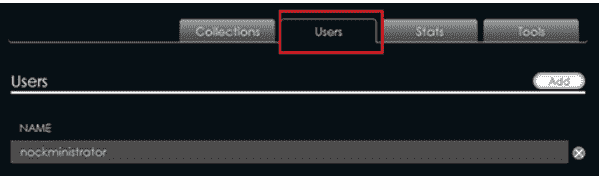

图 1.5 显示了可以获取数据库地址的位置。

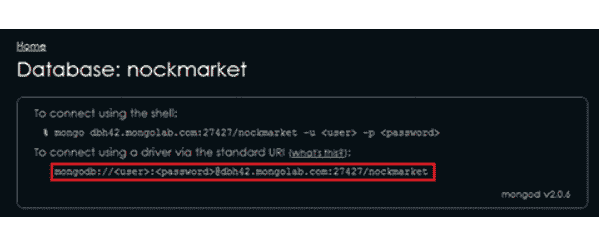

我们将使用 `Mongoose` 包，它允许从 `Node.js` 连接到 `MongoDB`。`module.exports` 是 `Node.js` 用于向其他模块暴露函数和变量的语法。我们将暴露 `Mongoose` 驱动程序以及 `Mongoose Schema` 对象。**Schema** 只是定义集合结构的一种方式。在这种情况下，我们的模式由一个用户名字符串和一个密码字符串组成。除此之外，我们定义了连接和断开数据库的函数。

下一步是定义用户模块。将此代码放入一个名为 **models** 的目录中一个名为 **User.js** 的文件中：

```javascript
chapter01/authentication/models/User.js (excerpt)

var db = require('../lib/db');

var UserSchema = new db.Schema({
    username : {type: String, unique: true}
    , password : String
})

var MyUser = db.mongoose.model('User', UserSchema);

// Exports
module.exports.addUser = addUser;

// Add user to database
function addUser(username, password, callback) {
    var instance = new MyUser();
    instance.username = username;
    instance.password = password;
    instance.save(function (err) {
        if (err) {
            callback(err);
        }
        else {
            callback(null, instance);
        }
    });
}
```

我们首先导入之前定义的数据库模块并定义一个简单的模式。然后我们可以实例化一个新用户，设置用户名和密码，并使用 **save** 函数保存到数据库。如果有错误，我们将其发送到回调函数。否则，我们返回实际的用户对象。

### 密码安全

在这个例子中，我们以明文形式将密码存储在数据库中，这存在安全风险。通常，密码会被加密。还有其他基于对加密密码进行加盐以使其更能抵抗字典攻击的安全技术。

我们现在准备好将我们的用户模块与 `Express` 集成。这涉及向 **app.js** 文件添加一行额外的导入代码：

```javascript
var express = require('express')
, routes = require('./routes')
, fs = require('fs')
, User = require('./models/User.js');
```

现在，如果你重启你的应用程序并提交你的表单，你应该会看到数据出现在 `MongoLab` 中，如图 1.6 所示。

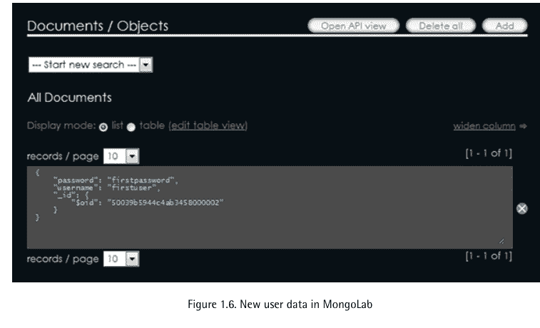

请注意，"users" 集合（可以粗略地理解为一张表）是自动创建的。构建你第一个支持云的 NoSQL 解决方案就是这么简单。如果你的下一个项目开始获得像 `Facebook` 或 `Twitter` 那样的流行度，你的基础设施将准备好进行扩展！

¹⁴ [https://github.com/isaacs/node-supervisor](https://github.com/isaacs/node-supervisor)

## 目录结构

将单个文件存储在单独的目录中可能看起来有点复杂，但随着代码库的扩大，有必要以合乎逻辑的方式将文件分组，以提高可理解性和可维护性。按照惯例，我将数据库模型放入 **models** 目录，将业务逻辑和支持函数放入 **lib** 目录。

## 总结

在本章中，我们涵盖了以下内容：

-   `Node.js` 背后的理念及其与其他编程环境的区别

-   安装 `Node.js`

-   使用读取-求值-打印循环从控制台执行程序

-   构建一个基本的 `Express` 应用程序

-   基本的包管理

-   模块化代码和导出函数

-   向表单提交数据

-   使用 `MongoLab` 的云平台将数据存储在 `MongoDB` 中

# 第 2 章

## 让我们变得函数化

> “我一直希望我的电脑能像我的电话一样容易使用；我的愿望实现了，因为我再也搞不懂如何使用我的电话了。”

—`C++` 的创造者 Bjarne Stroustrup

## 引言

`JavaScript` 有时被贬低为那些在网上搜索、抓取随机脚本并制作网页以执行特定任务的开发人员使用的语言。在本章中，我们将一劳永逸地消除这个误解。我们将通过构建一个股票交易引擎来实现这一点，该引擎完全有能力接受订单并以类似于纳斯达克或纽约证券交易所的方式执行交易。我们将我们虚构的交易所称为 nockmarket，这是 `Node.js` 股票市场的简称。在你抗议你的金融或 IT 知识不足以吸收如此复杂任务的精髓之前，请放心，一旦你将问题分解为相关组件，它就很简单了。

让我们从一个基本场景开始，一个空的股票交易所。假设你想以 40 美元的价格购买一些 `Facebook` 股票。你向交易所提交订单，购买 100 股股票。由于此时没有卖家，你的订单就在账簿中等待匹配的报价，如图 2.1 所示。


假设第二个人来了，希望以 41 美元的价格卖出 200 股。这与你要的价格不符，现在两个订单都在账簿中，如图 2.2 所示。


终于，第三个人来了，希望以 40 美元的价格卖出 75 股。价格合适：将以 40 美元的价格交易 75 股。图 2.3 显示了此交易完成后订单簿的样子：你剩余的 25 股买单价格为 40 美元，以及第二个人未交易的 200 股，价格为 41 美元。

**交易，75 股 @ $40**


我相信这个例子很容易理解。它包含了理解我们的示例应用程序所需的所有金融知识。

## 总是测试

下一个难题是将上述场景转化为代码。我们将通过**测试驱动开发**来完成。这意味着我们首先编写单元测试，所有测试都会失败。然后我们编写实现，直到所有单元测试都正确运行。

让我们从最简单的场景开始，以构建一个股票交易 API。首先，我们希望购买一些股票，这暗示了购买函数的存在。就其参数而言，价格和数量是显而易见的组成部分。

因此，如果我们以 40 美元的价格购买 100 股，我们的第一版 API 可能如下所示：

```
exchange.buy(40, 100)
```

虽然这行代码看起来很简单，但它实际上非常接近最终产品。缺少的是**状态**的概念。换句话说，当处理订单时，我们如何知道之前的所有订单？主要有两种思路。在**面向对象编程**中，状态通常存储在 `exchange` 对象内部。由于状态改变，订单后的 `exchange` 对象与订单前的 `exchange` 对象不同。

在**函数式编程**中，函数通常没有副作用。这意味着我们通常以**不可变**的方式发送输入和接收输出。输入保持不变，`exchange` 对象在订单前后完全相同。这两种编程风格都是优秀的范式，`JavaScript` 都支持。在本书中，我选择用函数式风格编写代码，尽管面向对象也是一个不错的选择。

以函数式风格编程要求我们添加第三个参数，将订单簿的状态传递给我们的函数。这意味着我们修改上述示例如下：

```
exchange.buy(40, 100, exchangeData)
```

`exchangeData` 是一个对象，包含订单簿的完整状态。我们的函数将处理订单，并返回一个代表订单簿新状态的新对象。

是时候将其转化为代码了。在整本书中，我们将使用一个名为 `Mocha` 的测试框架。`Mocha` 使得执行异步单元测试变得容易，并特别支持我们讨论过的测试驱动范式。它可以以多种格式输出结果，使其易于与其他测试工具集成。

创建一个新文件夹来存放本章的项目，并在其中创建一个名为 **test** 的子目录。在 **test** 中，创建一个名为 **exchange.test.js** 的文件，并输入以下内容：

```javascript
chapter02/test/exchange.test.js (节选)

test('buy should add a BUY nockmarket order', function(done) {
});
```

任何测试的第一部分都是用通俗易懂的英语描述测试的功能。因此，即使完全不熟悉编程的人也应该能理解测试试图完成什么。这样，当单元测试失败时，无需在脑海中处理大段代码就能轻松理解失败的原因。

现在我们可以编写实际的测试用例：

```javascript
chapter02/test/exchange.test.js (节选)

test('buy should add a BUY nockmarket order', function(done) {
  exchangeData = exchange.buy(40, 100, exchangeData);  1
  exchangeData.buys.volumes[40].should.eql(100);  2
  done();  3
});
```

1. 首先，我们使用购买函数向交易所提交订单。

2. 然后我们检查在买方一侧，价格为 40 美元的股票是否恰好有 100 股可用。

`should.eql(100)` 可能看起来易于理解，但仍然神秘。易于理解在于它正在检查什么很明显，但神秘在于它来自哪里并不立即明显。在这里，我们使用了 `should.js` 断言库，你可以在其主页上找到更详细的描述。我将挑选几个例子并放在这里，以便你能理解语法及其使用方法：

```javascript
[].should.be.empty
[1,2,3].should.eql([1,2,3])
user.age.should.be.within(5, 50)
'test'.should.be.a('string')
user.age.should.not.be.above(100)
```

最后，`done` 是一个回调函数，表示 `Mocha` 我们已经准备好进行下一个测试。`Mocha` **串行** 运行，这意味着每个单元测试在进入下一个测试之前都已完全完成。这是处理 `JavaScript` 异步特性的优雅方式。到目前为止，我们还没有担心实现细节；我们只是编写了测试。测试驱动设计的好处之一是，它迫使你更像软件架构师那样思考。当你编写测试时，你会想象客户可能需要使用的 API，然后相应地进行规划。

卖出情况与买入情况类似：

```javascript
chapter02/test/exchange.test.js (节选)

test('sell should add a SELL nockmarket order', function(done) {
    exchangeData = exchange.sell(41, 200, exchangeData);
    exchangeData.sells.volumes['41'].should.eql(200);
    done();
});
```

首先，我们使用 **sell** 函数提交以 41 美元的价格卖出 200 股的订单。

然后我们检查在卖方一侧，是否有 200 股可售，价格为 41 美元。

交易确实涉及一些额外的细节：

```javascript
chapter02/test/exchange.test.js (节选)

test('sell should produce trades', function(done) {
    exchangeData = exchange.sell(40, 75, exchangeData);
    exchangeData.trades[0].price.should.eql(40);
    exchangeData.trades[0].volume.should.eql(75);
    exchangeData.buys.volumes[40].should.eql(25); // 4
    exchangeData.sells.volumes[41].should.eql(200); // 5
    done();
});
```

1. 首先，与之前的示例类似，我们提交一个以 40 美元卖出 75 单位的卖单。

2. 这导致以 40 美元的价格成交 75 单位，如图 2.3 所示。我们将交易存储在一个数组中；因此，第一笔交易应该以 40 美元的价格发生 ...

3. ... 交易量为 75。现在我们已经测试了交易，还需要检查订单簿的新状态。

4. 在买单侧交易后，我们应该在 40 美元的价格上剩下 25 个单位。

5. 在卖单侧，我们应该在 41 美元的价格上有 200 个单位。

以下代码设置了一些空的交易所数据并导入了测试所需的模块：

```javascript
// chapter02/test/exchange.test.js （摘录）

'use strict';

var assert = require('assert')
  , should = require('should');

var exchangeData = {};

suite('exchange', function() {
  ... // 将现有测试用例放在此处
});
```

如果我们将测试用例包装在此代码中，它们就可以运行了。

> **严格模式**
>
> `JavaScript` 作为一种语言，其宽容度极高。有些人可能会认为它过于宽容，因为它允许使用许多不符合最佳实践的编程技巧。`use strict` 是一项特性，当使用一些次优的编程技巧时，它会生成错误。此类技巧的一个例子是试图在未定义变量的地方为其赋值。`jQuery` 的创建者 John Resig 写了一篇很好的总结。³ 我建议在自己的代码中始终使用严格模式。

根目录下的 **package.json** 应包含以下内容：

```json
// chapter02/package.json （摘录）

{
    "name": "nockmarket",
    "version": "0.0.1",
    "private": true,
    "dependencies": {
        "jquery": "1.7.3",
        "mocha": "1.3.0",
        "should": "1.0.0"
    }
}
```

`Mocha` 使用 `make` 来运行测试工具。如果你不熟悉 `make`，细节并不重要。你需要做的就是创建一个名为 **Makefile**（没有文件扩展名）的文件，内容如下：

```makefile
### chapter02/Makefile

test:
	@./node_modules/.bin/mocha -u tdd
.PHONY: test
```

第二行必须以制表符作为第一个字符，使用空格将不起作用。这将运行 `mocha` 可执行文件。`tdd` 表示测试驱动设计。

从这里开始，运行 `npm install`，然后运行 `make test`。（注意，`Mac OS X` 需要安装 `Xcode` 命令行工具才能使用 `make` 命令。`Windows` 用户需要安装 `Cygwin` 或等效工具。）你的输出开头应类似于以下内容：

```
3 of 3 tests failed:

 1) exchange buy should add a BUY nockmarket order:
    ReferenceError: exchange is not defined
```

一旦你让所有测试都失败——恭喜！你已经准备好进入下一步了。

为测试失败而感到祝贺，这感觉奇怪吗？在还没有实际编写一行业务逻辑的情况下就做了所有这些工作，这是否更奇怪？无数研究表明，在开发生命周期后期发现的错误，其修复成本和难度呈指数级增长。尽早进行测试所带来的小小不便，将为你省去日后在成千上万行代码中挖掘一个晦涩错误的更大麻烦——这个错误本可能在编写第一行应用程序代码之前就被检测出来。记住：尽早测试，频繁测试！

## 构建交易所

现在我们已经准备好了单元测试，这让我们对实现所需的内容有了相当深入的了解。让我们从交易所数据开始。这应该如何构建？直观地说，订单簿分为“买单”和“卖单”，所以这似乎是一个合乎逻辑的起点。买单和卖单两侧都有订单，每个订单都有价格和数量，因此这是另一个合理的划分。在 `JSON` 中，这类似于以下结构：

```json
exchangeData: {
  buys: {prices: ..., volumes: ...},
  sells: {prices: ..., volumes: ...}
}
```

> **JavaScript 对象表示法**
>
> 由 Douglas Crockford 创建，**JSON** 代表 `JavaScript` 对象表示法。⁴ 虽然源自 `JavaScript` 语法，但它被广泛用作通用数据交换格式。它正迅速成为 Web 上数据交换的 *通用语言*⁵，并被 `Facebook` 和 `Twitter` 等行业巨头采用。
>
> ⁴ https://developer.mozilla.org/en-US/docs/JSON
>
> ⁵ https://dev.twitter.com/docs/twitter-ids-json-and-snowflake

现在我们对数据应该是什么样子有了概念，接下来需要为实现选择数据结构。为了存储数量（volumes），我们将使用一个简单的 `JSON` 对象。这个数据结构类似于其他编程语言中的哈希表，将允许近乎恒定的查找时间。换句话说，随着数据结构规模的增长，检索元素所需的时间大致保持不变。为了存储价格（prices），我改编了 Marijn Haverbeke 的二叉堆（binary heap）。我不需要深入探讨实现二叉堆的技术细节，因为 Marijn 在他的在线书中已经做了很好的阐述。⁶

### 对象作为哈希表

Guillermo Rauch 写了一篇关于将对象用作哈希表的一些陷阱的文章。⁷ 主要危险在于，当允许用户提供任意输入时，可能发生潜在的冲突。这不适用于我们的情况，因为输入到对象的数据严格受我们控制。

我们将进行两项小的修改。首先，我们允许用户传递一个标志，指示堆是最大堆还是最小堆（即，它是从最大值还是最小值开始）。这是通过修改原始代码来完成的：

```javascript
this.content.push(element);
```

... 变成如下形式：

```javascript
if (this.options.max) {
    this.content.push(-element);
}
else
    this.content.push(element);
```

如果用户希望是最大堆，他们只需要反转数字的符号。在内部，该数据结构仍然查找最小的数字。然而，在检查负值时，最小的负数在考虑其绝对值时最终会成为最大的数。

举例说明，假设我们有 1、4 和 10。未修改的实现默认返回最小数字，即 1。但是，如果我们在内部存储的数字是 −1、−4 和 −10，那么最小的数字现在变成了 −10。

我们需要做的就是在返回结果之前记住将符号翻转回正数：

```javascript
if (this.options.max)
  return -result;
else
  return result;
```

我们需要最大堆和最小堆，因为交易发生在最高买价和最低卖价上。我们的第二个修改是添加一个 `peek` 函数，它的工作方式类似于 `pop`，但不进行移除操作：

```javascript
peek: function() {
  if (this.options.max)
    return -this.content[0];
  else
    return this.content[0];
}
```

`peek` 函数很简单。在内部，该数据结构是一个数组，所以我们需要做的就是返回数组的第一个元素。如果我们处理的是最大堆，我们会翻转符号。

我将在此仅指出，随着这个数据结构的添加，`JavaScript` 开始更接近地模仿你可能在算法入门课上学过的其他一些语言。也许你可以开始看到，它不仅仅是一种用于浏览器操作的有趣小语言。

下载完整的代码（可在 https://gist.github.com/3949948 获取）并将其复制到 **chapter02/lib/BinaryHeap.js**。

## 引擎的核心

`JavaScript` 是一种通常从上到下阅读的语言。我们也将以同样的方式分析我们交易引擎的代码，从第一行开始。除非另有说明，你可以简单地按照文本中出现的完全相同的顺序输入以下代码。交易所引擎的第一部分，将包含在 **lib/exchange.js** 中，如下所示：

```javascript
// chapter02/lib/exchange.js （摘录）

'use strict';

var $ = require('jquery')
    , BinaryHeap = require('./BinaryHeap');

var BUY = "buys", SELL = "sells";

function createBinaryHeap(orderType) {
    return new BinaryHeap(function (x) {
        return x;
    }, orderType);
}
```

1. 首先，我们导入 `jQuery` 库。虽然 `jQuery` 主要是一个客户端库，但这里我们使用它的 `clone` 函数，稍后将更详细地讨论。`$` 是引用 `jQuery` 库的习惯用法，我们将遵循这个惯例。

2. 接下来我们导入二叉堆 ...

3. ... 并定义一些常量。

4. 最后，我们有一个用于创建新二叉堆的小辅助函数。

### 服务器上的 jQuery

`Node.js` 的吸引力之一是“一门语言统御一切”的理念。在理想的世界里，我们将实现客户端和服务器端代码的无缝集成。目前，最佳实践仍在发展中，在将客户端代码引入服务器或将服务器代码引入客户端时，有时仍会存在摩擦。

将 `jQuery` 引入服务器并非标准技术；有些人甚至可能认为这有点不合常规。我在这里使用它是为了提供一个可能性示例。你应该尝试各种组合，以找出最适合你特定项目的方法。

接下来，有一个函数接受现有的交易所数据并克隆它：

```javascript
chapter02/lib/exchange.js (摘录)

function createExchange(exchangeData) {
  var cloned = $.extend(true, {}, exchangeData);
  cloned.trades = [];
  init(cloned, BUY);
  init(cloned, SELL);
  return cloned;

  function init(exchange, orderType) {
    if (!exchange[orderType]) {
      exchange[orderType] = {};
      exchange[orderType].volumes = {};
      var options = {};
      if (BUY == orderType) options.max = true;
      exchange[orderType].prices = createBinaryHeap(options);
    }
  }
}
```

这需要进一步解释。为什么要大费周章地克隆数据？为什么不直接操作它，就像在面向对象编程中那样？在纯函数式编程中，函数没有副作用。这意味着，如果你向函数传递一个参数，你期望它原封不动地从函数中返回。

这很有道理。想象一下，你正在使用一个公共 API，你向它发送了一些数据，然后在响应中这些数据变得面目全非。这片数据实际上变得无法使用，因为不了解 API 的内部工作原理，很难弄清楚哪里发生了变化。

这就是为什么我们要克隆传入的交易所数据。如果有人希望随后在不同上下文中使用它，他们可以放心地这样做，知道他们的数据在传递过程中未被触动。虽然以下内容不适用于单线程的 `JavaScript`，但不可变数据也使得编写多线程应用程序更容易，因为数据可以被多个线程安全地使用，知道其值永远不会改变。

## 变异的风险

`Node.js` 的原生 `MongoDB` 驱动程序（将在第 3 章讨论）会通过添加一个 `_id` 字段来修改插入的对象。大多数情况下这没问题；然而，在一些边缘情况下可能会出现问题。例如，如果你尝试两次插入同一个对象，你会收到一个错误。第一次插入会成功，但第二次会抱怨 ID 重复。

如果你不了解驱动程序的内部工作原理，这可能会造成困惑。在纯函数式语言如 `Haskell` 中，这不是问题，因为你保证值永远不会改变。虽然有时以纯函数式风格编程不切实际，但我肯定鼓励尽可能地采用其原则。

`createExchange` 函数代码的第二个有趣特点是它包含另一个名为 `init` 的函数。`JavaScript` 允许在函数内部声明函数。在 `init` 内部，我们执行一些基本的初始化：如果我们收到空的交易所数据，我们设置一个空对象来表示交易量，以及一个新的二叉堆来表示价格。如前所述，对于买单，我们使用最大二叉堆，因为交易发生在最高买入价。

## 问题的核心

现在我们将构建交易所的核心。首先，我们将设置一些辅助函数：

```javascript
chapter02/lib/exchange.js (摘录)

        exchange[orderType].prices = createBinaryHeap(options);
    }
}
module.exports = {
    BUY: BUY,
    SELL: SELL,
    buy:function (price, volume, exchangeData) {
        return order(BUY, price, volume, exchangeData);
    },
    sell:function (price, volume, exchangeData) {
        return order(SELL, price, volume, exchangeData);
    },
    order: order
}
```

`module.exports` 是 `Node.js` 中用于向其他模块暴露函数的语法。`BUY` 和 `SELL` 是字符串常量，而 `buy` 和 `sell` 是 `order` 函数的轻量级包装器。

> **保持 DRY（不要重复自己）**
>
> 一个简单的实现是编写一个 `buy` 函数，然后将其复制粘贴到 `sell` 函数并更改必要的部分。你永远不应该这样做，因为它违反了**不要重复自己（DRY）**的原则。DRY 是一种编程哲学，它指出任何知识点都应该只有一个单一的表示。简单地说，如果你发现自己从其他地方复制代码，你很可能违反了 DRY 原则。

注意 `module.exports` 只是一段 `JSON`。虽然 `JSON` 通常用于传输数据，在这个例子中，我们可以看到它也用于存储函数定义。这说明了函数式编程的另一个重要原则：函数是一等公民。任何你可以使用变量的地方，你都可以使用函数。如果你通过输入 `node` 来启动你的 `REPL`，你会发现这是完全合法的：

```javascript
var sayHello = function() {console.log('Hi');};
sayHello();
```

## 逻辑核心

现在我们来处理最复杂的部分：订单处理。让我们在 `exchange.js` 文件中添加以下内容：

```javascript
chapter02/lib/exchange.js (摘录)

function order(orderType, price, volume, exchangeData) {
  // 初始化
  var cloned = createExchange(exchangeData); // 1
  var orderBook = cloned[orderType]; // 2
  var oldVolume = orderBook.volumes[price]; // 3
```

1. 我们以一些初始化开始函数。首先，如“引擎的核心”一节所述，我们克隆了数据。

2. 然后根据 `orderType` 获取买单或卖单的订单簿。

3. 最后，我们检索指定价格下的所有交易量。`price` 会被自动转换为字符串。

因为 `orderBook` 是一个 `JSON` 对象，它可以执行近似常数时间的查找，速度会非常快。我们用 `oldVolume` 来存储处理订单前指定价格下可用的交易量。

接下来，我们确定是否发生了交易：

```javascript
chapter02/lib/exchange.js (摘录)

function getOpposite() {
  return (BUY == orderType) ? SELL : BUY;
}
function isTrade() {
  var opp = cloned[getOpposite()].prices.peek();
  return (BUY == orderType) ? price >= opp : price <= opp;
}
var trade = isTrade();
```

首先，我们设置一个小的辅助函数 `getOpposite`。如果是买单，我们返回 `SELL`，反之亦然。

> **闭包**
>
> 注意 `getOpposite` 如何“知道” `orderType`，即使 `orderType` 是在这个函数外部定义的？这就是一种称为闭包的编程技术的例子。即使函数式编程不支持对象的概念，闭包允许我们表示状态。在我们的例子中，函数可以使用订单类型，即使它没有作为参数显式传入。

随后，`isTrade` 的逻辑很简单。首先，我们获取最高/最低价格。对于买单的情况，当价格大于或等于最小的卖单时，交易发生。例如，如果有一个新的买单价格为 40 美元，如果存在任何 40 美元或更低的卖单，交易就会发生。对于卖单，当价格小于或等于最大的买单时，交易发生。例如，如果有一个新的卖单价格为 40 美元，如果存在任何 40 美元或更高的买单，交易就会发生。我们使用添加的 `peek` 函数来根据我们处理的是买单还是卖单来确定最高或最低价格。

现在我们处理发生交易的情况：

```javascript
chapter02/lib/exchange.js (摘录)

var remainingVolume = volume;
var storePrice = true;

if (trade) {
  var oppBook = cloned[BUY]

  if (orderType == BUY)
    oppBook = cloned[SELL]
}
```

`remainingVolume` 存储交易后剩余的交易量。如果交易移除了订单簿的整个价位层级，就需要存储一个新的价格，这就是我们有 `storePrice` 的原因。

我们的第一步是在 `oppBook` 中存储与当前订单相反一侧的订单簿。这是因为买单与订单簿的卖方交互，反之亦然。然后我们有一个 `while` 循环：

```javascript
chapter02/lib/exchange.js (摘录)

while (remainingVolume > 0
  && Object.keys(oppBook.volumes).length > 0) {
    var bestOppPrice = oppBook.prices.peek();
    var bestOppVol = oppBook.volumes[bestOppPrice];
}
```

`while` 循环检查是否仍有剩余交易量，以及订单簿另一侧是否仍有订单。我们使用 `Object.keys` 来返回对象中所有可枚举的属性名。<sup>8</sup> 这让我们确定是否还有剩余订单。如果有，我们获取可用的最佳价格和交易量。

现在交易有两种可能的情况。我们将参考最初的例子来说明，其中订单簿中有一个 40 美元 100 单位的买单。第一种情况是太小以至于无法移除订单簿的任何层级。在我们的例子中，这意味着任何 99 单位或更少的卖单，因为它仍然会留下至少一个单位在 40 美元：

<sup>8</sup> https://developer.mozilla.org/en-US/docs/JavaScript/Reference/Global_Objects/Object/keys

```javascript
chapter02/lib/exchange.js（摘录）

if (bestOppVol > remainingVolume) {
  cloned.trades.push({price:bestOppPrice
    , volume:remainingVolume}); ❶
  oppBook.volumes[bestOppPrice] =
    oppBook.volumes[bestOppPrice] - remainingVolume; ❷
  remainingVolume = 0; ❸
  storePrice = false; ❹
}
```

在这种情况下，会发生几件事：

- ❶ 交易以当前基准价格进行，因此我们创建一个 `JSON` 格式的交易对象并将其添加到 `trades` 数组中。

- ❷ 从现有成交量中减去订单成交量。

- ❸ 提交的订单完全成交，因此成交量被设回零。

- ❹ 最后，该订单规模足够小，以至于没有价格影响。因此，我们设置一个布尔值，以便我们知道后续无需更改任何价格。

在第二种情况下，订单规模足够大，足以移除对手方至少一个价位。在我们的示例中，这意味着任何 100 单位或以上的卖单，它将完全消耗 100 单位在 40 美元的买单，剩余 0 单位：

```javascript
else {
  if (bestOppVol == remainingVolume) ❶
    storePrice = false; ❷
  cloned.trades.push(
    {price:bestOppPrice
    , volume:oppBook.volumes[bestOppPrice]}); ❸
  remainingVolume =
    remainingVolume - oppBook.volumes[bestOppPrice]; ❹
  // Pop the best price from the heap
  oppBook.prices.pop(); ❺
  delete oppBook.volumes[bestOppPrice]; ❻
}
```

- 1. 首先，我们需要测试订单量与现有订单量完全匹配的边缘情况。

- 2. 在这种情况下，两个订单将相互抵消，因此无需存储新价格。

- 3. 然后，我们生成交易并将其推入 **trades** 数组。

- 4. 我们通过减去对手方的全部成交量来调整成交量。例如，如果我们有 100 单位在 40 美元，而来了一笔 40 美元的 130 单位卖单，我们将剩余 30 单位（130 - 100）。

- 5. 然后，我们从对手方“弹出”该价格，因为它已被传入订单移除。

- 6. 同样，我们从对手方删除成交量信息。

大部分艰苦工作已经完成。现在我们只需要清理并返回数据：

```javascript
if (!oldVolume && storePrice)
    cloned[orderType].prices.push(price);

var newVolume = remainingVolume;

// Add to existing volume
if (oldVolume) newVolume += oldVolume;
if (newVolume > 0)
    orderBook.volumes[price] = newVolume;
return cloned;
```

逐步分解，如果我们需要存储新价格，我们就这样做：

```javascript
if (!oldVolume && storePrice)
    cloned[orderType].prices.push(price);
```

如果我们需要存储新成交量，我们执行以下操作：

```javascript
var newVolume = remainingVolume;

// Add to existing volume
if (oldVolume) newVolume += oldVolume;
if (newVolume > 0)
    orderBook.volumes[price] = newVolume;
```

最后，我们将所有数据从函数返回：

```javascript
return cloned;
```

## 来点实际行动

现在我们完成了。开玩笑的。如果没有任何交易，建立股票交易所有什么乐趣呢？在未来的章节中，我们将构建一个漂亮的前端界面，将价格实时流式传输到浏览器。不过现在，我们将通过控制台以纯 ASCII 文本形式呈现数据。第一个任务是添加一个相当平凡的函数，将订单簿转换为文本。

将以下函数放入你的代码中，放在 `order: order,`（带逗号）之后：

```javascript
chapter02/lib/exchange.js（摘录）

order: order,

getDisplay: function(exchangeData) {
  var options = {max: true};
  var buyPrices = createBinaryHeap(options);
  var sellPrices = createBinaryHeap(options);
  var buys = exchangeData.buys;
  var sells = exchangeData.sells;

  if (sells) {
    for (var price in sells.volumes) {
      sellPrices.push(price);
    }
  }
  if (buys) {
    for (var price in buys.volumes) {
      buyPrices.push(price);
    }

    var padding = "        | ";
    var stringBook = "\n";

    while (sellPrices.size() > 0) {
      var sellPrice = sellPrices.pop()
      stringBook +=
        padding + sellPrice + ", " + sells.volumes[sellPrice] + "\n";
    }
    while (buyPrices.size() > 0) {
      var buyPrice = buyPrices.pop();
      stringBook += buyPrice + ", " + buys.volumes[buyPrice] + "\n";
    }
    stringBook += "\n\n";
    for (var i=0; exchangeData.trades
      && i < exchangeData.trades.length; i++) {
        var trade = exchangeData.trades[i];
        stringBook +=
          "TRADE " + trade.volume + " @ " + trade.price + "\n";
    }
    return stringBook;
}
```

这主要是一个在屏幕上操作文本的练习，没有有趣的方面值得评论。现在在 **lib** 目录中，创建 **nocklib.js**：

```javascript
chapter02/lib/nocklib.js（摘录）

'use strict';

var exchange = require('./exchange')
  , priceFloor = 35
  , priceRange = 10
  , volFloor = 80
  , volRange = 40;

module.exports = {
  generateRandomOrder: function(exchangeData) {
    var order = {};
    if (Math.random() > 0.5) order.type = exchange.BUY
    else order.type = exchange.SELL

    var buyExists = exchangeData.buys
    && exchangeData.buys.prices.peek();
var sellExists = exchangeData.sells
                && exchangeData.sells.prices.peek();
var ran = Math.random();

if (!buyExists && !sellExists)
    order.price = Math.floor(ran * priceRange) + priceFloor;
else if (buyExists && sellExists) {
    if (Math.random() > 0.5)
        order.price = exchangeData.buys.prices.peek();
    else
        order.price = exchangeData.sells.prices.peek();
} else if (buyExists) {
    order.price = exchangeData.buys.prices.peek();
} else {
    order.price = exchangeData.sells.prices.peek();
}

var shift = Math.floor(Math.random() * priceRange / 2);

if (Math.random() > 0.5) order.price += shift;
else order.price -= shift;
order.volume = Math.floor(Math.random() * volRange) + volFloor;
return order;
}
}
```

这里我们正在创建一个库文件，目前只包含一个生成随机订单的函数。逻辑相当简单。首先，我们随机选择买入或卖出。如果没有数据存在，我们根据预设的范围生成价格和成交量。否则，我们从最佳买入或卖出价格开始，并在预设范围内随机移动价格，然后设置成交量。

最后，我们可以开始向交易所发送订单了。在根目录中，将以下代码放入 **nockmarket.js**：


# chapter02/nockmarket.js（摘录）

```javascript
'use strict';

var exchangeData = {}
  , exch = require('./lib/exchange')
  , nocklib = require('./lib/nocklib')
  , timeFloor = 500
  , timeRange = 1000;

function submitRandomOrder() {
  // order
  var ord = nocklib.generateRandomOrder(exchangeData);
  console.log('order', ord);
  if (ord.type == exch.BUY)
    exchangeData = exch.buy(ord.price, ord.volume, exchangeData);
  else
    exchangeData = exch.sell(ord.price, ord.volume, exchangeData);

  var pause = Math.floor(Math.random() * timeRange) + timeFloor;
  setTimeout(submitRandomOrder, pause);
  console.log(exch.getDisplay(exchangeData));
}

submitRandomOrder();
```

首先，我们生成一个随机订单并提交给交易所。

> **关于异步编程的更多信息**
>
> 这里使用的 `setTimeout` 是异步编程模型的一个稍微复杂的例子。它所做的是暂停指定的时间，然后调用指定的函数。在这个例子中，我们只是再次调用 `submitRandomOrder`，从而创建一个无尽的订单循环。

如果你现在运行 `node nockmarket`，你应该会看到订单簿的更新 ASCII 表示以及任何交易的打印输出。一旦你着迷地凝视它，我们就可以继续前进了。

哦，那么我们在开头写的那些测试呢？回到 `exchange.test.js`，在你的测试用例中添加一行：

```javascript
chapter02/test/exchange.test.js（摘录）
, should = require('should')
, exchange = require('../lib/exchange');
```

这将导入我们刚刚编写的库。重新运行 `make test`，你应该会看到绿色的类似以下的内容：

# 那么真实情况如何呢？

我相信你们中有些人现在正在思考真实的股票市场价格。股票市场数据是世界上最有趣的数据之一；不幸的是，数据越有趣，获取它的成本就越高。

我们将要使用的免费数据，从金融和技术的角度来看都相当普通。这是延迟数据，只包含交易价格，没有交易量，也没有订单信息。本章中我们一直在构建的示例，虽然经过简化，但仍然试图捕捉真实世界市场的一些丰富性。正如我们将在后续章节中看到的，这带来了更有趣的学习机会。

为了证明这有多容易，我们将编写一个小模块来获取真实的股票市场价格，以结束本章。整个模块可以用 20 行代码编写，足够简单，可以一次性分析。在根目录中，将以下内容放入 `priceFeed.js`：

```javascript
chapter02/priceFeed.js
var http = require('http');
var options = {
    host: 'download.finance.yahoo.com',
    port: 80,
    path: '/d/quotes.csv?s=AAPL,FB,GOOG,MSFT&f=sl1c1d1&e=.csv'
};
http.get(options, function(res) {
    var data = '';
    res.on('data', function(chunk) {
        data += chunk.toString();
    })
    .on('error', function(err) {
        console.err('Error retrieving Yahoo stock prices');
        throw err;
    })
    .on('end', function() {
        console.log(data);
    });
});
```

首先，我们使用内置的 `http` 模块。`options` 是一个 JSON 对象，我们用它来指定主机、端口和路径。当我们接收到数据事件时，我们按如下方式从原始字节转换为字符串：

```javascript
res.on('data', function(chunk) {
  data += chunk.toString();
})
```

如果出现错误，我们打印消息然后抛出错误。最后，`'end'` 表示所有数据都已接收，此时我们打印价格。运行代码（`node priceFeed.js`）后，你应该会收到类似以下内容的股票价格行：

```
"AAPL",582.10,+4.43,"6/22/2012"
```

我们将在后续章节中更多地使用这些数据，但目前就到这里。

## 总结

在本章中，你学到了以下内容：

- 测试驱动开发介绍和基本 `should.js` 用法
- 如何在服务器端使用流行的客户端 `jQuery` 库
- 如何使用 `module.exports` 和 `require` 来模块化你的代码
- 以 `setTimeout` 为例的异步编程
- 一等函数、函数内函数和闭包
- 服务器端 JavaScript 如何与经典的计算机科学数据结构和算法结合使用以构建强大的程序
- 用 JavaScript 实现业务逻辑——例如股票交易规则
- 如何使用原生 `http` 模块从 Yahoo 获取真实的股票价格

# 第3章

## 坚持有回报

> “警惕上面代码中的错误；我只证明了它是正确的，但还没试过。”
>
> —高德纳

### 为什么选择 MongoDB？

在本章中，我们将学习使用 MongoDB。MongoDB 是一种特定类型的 NoSQL 数据库；具体来说，它是一个面向文档的数据库系统。Node.js 生态系统对许多流行的关系型数据库系统（如 PostgreSQL 和 MySQL）有出色的支持。关系数据库稳健且久经考验，足以满足许多现代 Web 应用程序的需求。那么我们为什么使用 MongoDB 呢？现在让我们概述一些 MongoDB 的主要特性来回答这个问题。

MongoDB 最显著的特征之一是它是面向文档且无模式的。**面向文档**中提到的文档是 BSON 文档。这代表二进制 JSON¹，在概念上类似于 JavaScript 中的 JSON 对象。**无模式**意味着没有预定义的结构。理解 MongoDB 的一个简单方法是把它看作一个巨大的 JSON 对象数组，具有快速而强大的插入和搜索能力。

对于关系数据库纯粹主义者来说，无模式数据库的概念可能很陌生。然而，在某些用例中，MongoDB 比其关系对应产品具有优势。

首先，它非常适合迭代开发。想象我们有一个 `Person` 表，并希望添加一个喜欢的电影列表。在关系数据库世界中，这需要一个额外的 `Movie` 表，以及一个存储关系的连接表。在 MongoDB 中，根据需求，这可以通过简单地向 `Person` 表添加一个电影数组来完成。对于需求快速变化且工程团队满负荷工作的初创公司来说，MongoDB 的敏捷性起着重要作用。

MongoDB 也适用于非结构化数据。在金融世界中，衍生品是一种复杂的工具；有数千种类型（例如期货、期权和掉期），每种都有独特的属性。在关系数据库中捕获这一点会带来许多挑战，但使用 MongoDB 则像用 JSON 表示衍生品并将其插入数据库一样简单。衍生品可以是任意复杂的，并排存在于 MongoDB 集合中。

此外，MongoDB 从一开始就为大数据设计，这通过一种称为**分片**的机制来支持。传统的黄页²书籍形式是一个简单的例子，它通常被分为两个分片，A-K 和 L-Z。搜索更快，因为你只需选择适当的分片——一个更小的数据量。在概念上，这就是分片在数据库中的工作方式，尽管实现更为复杂。

MongoDB 的其他用例在官方网站上有详细讨论。³ 此外，MongoDB 正迅速成为 Node.js 的事实标准数据库。Joyent 创始人 Jason Hoffman 曾做过一个关于 Node.js 和 MongoDB 作为实时网络的现代技术栈的演讲⁴，取代了传统的 LAMP（Linux，Apache，MySQL，PHP）技术栈。一旦你开始构建现实世界项目，不可避免地会遇到 MongoDB 并使用从本书中获得的技能。

¹ http://bsonspec.org/
² http://www.yellowpages.com/
³ http://www.mongodb.org/display/DOCS/Use+Cases
⁴ http://www.10gen.com/presentations/mongosf-2012/n2m-nodejs-and-mongodb-as-the-modern-stack-for-the-real-time-web

## 安装

我们将从托管的 MongoDB 切换到本地安装版本。安装很简单，你可以从以下地址获取最新版本：http://www.mongodb.org/downloads。获取适合你特定平台的链接后，下载并解压缩存档。

以下说明适用于 Debian 和 Ubuntu 系统。对于其他平台，你可以参考官方文档⁵。你的命令应该类似于以下内容：

```bash
wget http://fastdl.mongodb.org/linux/mongodb-linux-x86_64-2.0.6.tgz
tar -xzvf mongodb-linux-x86_64-2.0.6.tgz
```

你需要做的唯一配置是按如下方式创建 `/data/db`：

```bash
sudo mkdir /data
sudo mkdir /data/db
```

最后一步是运行 MongoDB 守护进程：

```bash
sudo mongodb-linux-x86_64-2.0.6/bin/mongod
```

如果一切成功，你应该在控制台中看到以下（或类似）内容：

```
[initandlisten] waiting for connections on port 27017
[websvr] admin web console waiting for connections on port 28017
```

⁵ http://www.mongodb.org/display/DOCS/Quickstart/

### 选择驱动程序

Node.js 有许多可用的 MongoDB 模块。两个最受欢迎的解决方案是 Mongoose 和原生驱动程序。

Mongoose 是一个对象-文档映射器，在第 1 章中简要介绍过。它提供了一种在 Node.js 中指定模式的方式，然后将这些模式转换为 MongoDB BSON 文档，并抽象了一些底层实现细节。其优势在于抽象允许快速应用开发。代价是在某些情况下由于幕后发生的所有魔法而导致性能下降。

另一个选择是原生驱动程序，这是 MongoDB 背后的公司 10gen 官方支持的驱动程序。原生驱动程序迫使你处理底层操作，例如打开异步数据库连接。你还需要确定如何在应用程序层面处理模式。

MongoDB 操作和原生驱动程序操作之间存在密切对应关系，减轻了开发者学习太多独特特性的负担。此外，如前所述，它提供了最佳性能。两个驱动程序都是优秀的选择，但本书剩余部分我们将使用原生驱动程序。一旦你理解了原生驱动程序的基础知识，如果 Mongoose 更适合你的业务需求，切换到 Mongoose 相对简单。

## 快速测试

本章的第一个目标是编写一个模块，能够：

- 连接到 MongoDB
- 插入一笔业务交易
- 检索一笔交易

让我们从一些单元测试开始本章，并扩展我们在前一章构建的内容。所有以下指令都应该在你迄今为止使用的同一目录中执行。将以下代码放入 `test/db.test.js`：

```javascript
chapter03/test/db.test.js (摘录)

'use strict';

var assert = require('assert')
  , db = require('../lib/db')
  , nocklib = require('../lib/nocklib')
  , should = require('should');

var exchangeData = {};

suite('database', function() {
  var insertedOrder;

  test('open should open database connection', function(done) {
    db.open(done);
  });
  test('insertOne should insert a transaction', function(done) {
    var ord = nocklib.generateRandomOrder(exchangeData);
    db.insertOne('transactions', ord, function(err, order) {
      should.not.exist(err);
      should.exist(order._id);
      insertedOrder = order;
      done();
    });
  });
  test('findOne should find a single transaction', function(done) {
    var id = insertedOrder._id;
    db.findOne('transactions', id, function(err, order) {
      should.not.exist(err);
      should.exist(order._id);
      order.price.should.eql(insertedOrder.price);
      order.volume.should.eql(insertedOrder.volume);
      done();
    });
  });
});
```

让我们来看看这段代码的主要功能。在第一个测试中，我们打开到 MongoDB 的连接。如果这个阶段失败，所有后续的测试都会失败，这样我们就知道一个成功的连接尚未建立。

要插入一个订单，我们首先使用 `generateRandomOrder`（来自第 2 章）生成一个随机订单。然后将其插入数据库。我们的主要测试是检查 `_id` 字段是否存在：

```javascript
should.exist(order._id);
```

### Object IDs

Object ID 是 MongoDB 为集合中的每个文档内部生成的一个字段。它即使在多台机器之间也是唯一的。一个便利的特性是该字段包含一个嵌入的日期，因此如果您想知道创建日期，则不需要一个单独的字段。

为了测试我们的 find 函数，我们将随机生成的订单与刚刚插入数据库的订单进行比较。如果随机生成的订单中的价格和数量与新插入订单中的相同，我们就找到了一个成功的匹配：

```javascript
order.price.should.eql(insertedOrder.price);
order.volume.should.eql(insertedOrder.volume);
```

## 命名您的字段

我鼓励使用富有表现力的变量名。然而，MongoDB 的一个特殊怪癖是字段名称在每个文档中都是未压缩地重复的。这意味着，如果您有一百万条客户记录，其中包含一个名为 `isCustomerEligibleForDiscount` 的字段，那么该字段名称就会重复一百万次。由于没有名称压缩，因此对于包含大量文档的集合，使用较短的字段名称被认为是最佳实践。一些公司仅在集合中使用一到两个字符的字段名称。

### 创建包装器

在应用程序中直接使用原生驱动程序可能过于冗长。这就是为什么我们将在原生驱动程序周围创建一个薄包装器，以抽象掉一些底层细节。首先，我们将导入一些模块并运行一些设置代码。将以下内容放入 **lib/db.js**：

```javascript
var Db = require('mongodb').Db
  , Connection = require('mongodb').Connection
  , Server = require('mongodb').Server;

var envHost = process.env['MONGO_NODE_DRIVER_HOST']
  , envPort = process.env['MONGO_NODE_DRIVER_PORT']
  , host = envHost != null ? envHost : 'localhost'
  , port = envPort != null ? envPort : Connection.DEFAULT_PORT;

var db = new Db('nockmarket'
    , new Server(host, port, {})
    , { native_parser: false });
```

大部分设置代码是标准的导入和初始化。这里的新东西是 **process** 对象，它是与原生环境交互的一种方式。它可以执行诸如更改目录、检查内存使用情况以及确定运行时间等操作。

我们在这里用它来检查环境变量，特别是主机名和端口。通常，将配置详细信息（如主机名、端口号、用户名和密码）存储在源代码之外是一种良好的实践。

想象一下，您有一个生产系统，您希望更改数据库端口。如果这是存储在源代码中，您将需要更改源代码并重新部署系统。与此同时，一位开发人员可悲地未能遵循测试驱动设计，并在系统中引入了一个错误。仅仅因为我们想更改端口，这个错误就会被部署到生产环境中。

存储配置详细信息的一些选项包括：

- 纯文本配置文件
- 数据库存储
- 环境变量

在所有这些情况下，都可以在不修改源代码的情况下更改配置。对于本例，我们将忽略环境变量，因此主机将默认为 localhost，端口将默认为默认端口。

## 查找数据

接下来，我们将创建一些用于搜索集合的函数，并将其添加到我们的代码中：

```javascript
chapter03/lib/db.js (节选)

module.exports = {
    find: function(name, query, limit, callback) {
        db.collection(name).find(query)
            .sort({ _id: -1 })
            .limit(limit)
            .toArray(callback);
    },
    findOne: function(name, query, callback) {
        db.collection(name).findOne(query, callback);
    },
```

这里我们实现了两个 find 函数。第一个查找与特定查询匹配的所有文档。`db.collection(name)` 选择相关的集合。集合在关系数据库术语中类似于表。`find` 是一个执行指定查询的函数。我们将进一步深入查询语言的具体细节，但您可能会高兴地听到，从语法上讲，它基于 JavaScript，这在通往精通的道路上又少了一个障碍。

执行查询后，我们按 `_id` 反向排序：

```javascript
.sort({ _id: -1 })
```

这首先检索最新的条目。然后我们应用指定的限制以避免返回整个数据库：

```javascript
.limit(limit)
```

最后，我们将结果转换为数组并执行回调函数：

```javascript
.toArray(callback);
```

注意 `limit` 如何紧跟在 `sort` 之后，而 `sort` 又紧跟在 `find` 之后。这种技术称为**链式调用**，它提供了一种很好的方式来任意组合不同的操作。

`findOne` 与 `find` 非常相似，只是它只返回单个结果；但是，它更简单，因为不需要排序、限制或转换为数组。通常，它用于按 `_id` 搜索，这保证了永远只会有单个匹配。如果在其他字段上执行搜索并出现多个匹配，将只返回第一个匹配。

### 插入数据

现在我们将转到插入函数：

```javascript
chapter03/lib/db.js (节选)

insert: function(name, items, callback) {
    db.collection(name).insert(items, callback);
},
insertOne: function(name, item, callback) {
    module.exports.insert(name, item, function(err, items) {
        callback(err, items[0]);
    });
},
```

`insert` 函数接受一个项目数组并将其插入数据库。该数组由 JSON 对象组成，这些对象可以是任意形式的，并且与前面或后面的对象没有关联。这很好地说明了无模式数据库的性质。如果您希望插入一个金融交易，然后是一个员工记录，然后是一个鸡汤食谱，这是可能的（至少在技术上）。使用 MongoDB，阻止这种类型设计的业务规则从数据库系统转移到了应用程序。

`insertOne` 是围绕 `insert` 的一个薄包装器，它调用相同的函数并返回第一个项目。它是一种**语法糖**，这个术语描述的是功能上与另一段代码完全相同但以更简洁和优雅的方式编写的代码。

理论上，`insertOne` 是不必要的，并且可以通过将所有内容视为大小为一的数组来始终插入和检索单个项目。这意味着我们将使用 `result[0]` 之类的语法来访问插入的结果。既然我们知道将只有一个项目，直接使用结果会更好。这似乎是一个小问题，但就整个代码库而言，明智地使用语法糖可以提高代码的可读性和可维护性。最后，我们添加一个小函数来打开到数据库的连接：

```javascript
chapter03/lib/db.js (节选)

open: function(callback) {
    db.open(callback);
  }
}
```

我们的单元测试现在已准备就绪。将以下依赖项添加到 **package.json** 中：

```json
chapter03/package.json (节选)

{
  "dependencies": {
    "ejs" : "0.7.1",
    "express": "2.5.8",
    "mongodb": "1.0.2"
  }
}
```

在 MongoDB 守护进程运行的情况下，执行常规的 `npm install` 后，现在运行 `make test`，所有数据库单元测试都应通过。

## 存储数据

既然我们已经搭建了一些基础框架，我们可以修改 **nockmarket.js**，使其将订单存储到数据库中，而不仅仅是打印到控制台。第一个修改是打开数据库连接。在导入列表中添加 `db = require('./lib/db')`。将现有的 `submitRandomOrder` 函数调用替换为以下内容：

```javascript
chapter03/nockmarket.js (节选)

db.open(function() {
    submitRandomOrder();
});
```

这段代码需要注意的主要方面是其异步风格。我们必须确保数据库已打开，然后才能开始下订单。

### 持久化的价值

## 同步代码

使用相同的代码片段，同步风格的代码将类似于以下形式：

```javascript
db.open();
submitRandomOrder();
```

在大多数语言中，这是处理相互关联函数的标准方式；然而，在 JavaScript 中，这将导致在打开数据库连接之前就提交了你的订单，因为 `open` 是非阻塞的。

接下来，我们按照如下方式修改提交函数：

```javascript
chapter03/nockmarket.js (节选)

function submitRandomOrder() {
  // 订单
  var ord = nocklib.generateRandomOrder(exchangeData);
  console.log('order', ord);
  if (ord.type == exch.BUY)
    exchangeData = exch.buy(ord.price, ord.volume, exchangeData);
  else
    exchangeData = exch.sell(ord.price, ord.volume, exchangeData);
  db.insertOne('transactions', ord, function(err, order) {
    if (exchangeData.trades && exchangeData.trades.length > 0) {
      var trades = exchangeData.trades.map(function(trade) {
        trade.init = (ord.type == exch.BUY) ? 'b' : 's';
        return trade;
      });
      db.insert('transactions', trades, function(err, trades) {
        pauseThenTrade();
      });
    }
    else pauseThenTrade();
  });

  function pauseThenTrade() {
    var pause = Math.floor(Math.random() * timeRange) + timeFloor;
    setTimeout(submitRandomOrder, pause);
    console.log(exch.getDisplay(exchangeData));
  }
}
```

第一段新代码 `db.insertOne` 将我们的订单插入数据库。一旦订单被插入并返回，我们检查是否发生了任何交易：

```javascript
if (exchangeData.trades && exchangeData.trades.length > 0) {
```

如果是，我们使用内置的 `map` 函数添加一个标志，表明该交易是由买方还是卖方发起的：

```javascript
var trades = exchangeData.trades.map(function(trade) {
    trade.init = (ord.type == exch.BUY) ? 'b' : 's';
    return trade;
```

我们引入这一点有两个原因。首先，我们想展示 MongoDB 处理异构文档是多么容易。在关系型数据库模型中，引入额外的字段会增加复杂性。我们必须将数据拆分到多个表中，或者将数据保存在单个表中，并在数据集中散布空字段和冗余数据。这两种方式都不理想。MongoDB 不需要任何变通方法，可以自然地在同一集合中存储不同类型的文档。

引入此业务规则的第二个原因是它允许我们演示 `map` 的用法。`map` 的概念是获取一个集合，并以某种方式对其进行转换。在这种情况下，我们使用内置的 JavaScript `map` 方法，并为其提供一个转换函数，该函数告诉它如何转换集合中的单个项目。

> **MapReduce**
>
> `Map` 是一种非常强大的编程范式（称为 MapReduce）的一部分。可以说它在许多方面构成了 Google 基础设施的核心，这并不夸张。官方博客描述了 Google 如何使用 MapReduce 对 1 PB 数据进行排序。⁷
>
> 根据你特定的编程背景，`map` 的概念可能不会立即直观。这里有一个基本示例来帮助解释这个概念。通过输入 `node` 启动你的读取-求值-打印循环（REPL），然后输入以下代码行：
>
> ```javascript
> [1, 2, 3].map(function(x) { return x * 2; });
> ```
>
> 你应该会得到：
>
> ```javascript
> [ 2, 4, 6 ]
> ```
>
> 它的作用是获取输入数组，并应用一个函数来将数组的每个成员加倍。为了了解 `map` 有多么有用，我建议尝试在不使用 `map` 的情况下编写功能等效的代码。你会体会到它如何为转换问题提供优雅的解决方案。

### 在 Express 之前

虽然我们将主要使用 Express.js 来构建我们的应用程序，但简单地讨论一下原生 http 模块也是有益的。作为一个简短的小项目，我们将构建一个远程认证模块。实际的函数将物理上位于远程服务器上，但可以像调用本地函数一样被调用。这之所以可能，是因为一个名为 `dnode` 的包，由 James Halliday 创建。

首先，将以下依赖项添加到 **package.json**：`"dnode" : "1.0.0"`。

现在运行 `npm install`，然后创建一个名为 **dnode** 的目录。在新创建的 **dnode** 目录中，创建 **auth.js**：

```javascript
var dnode = require('dnode');

dnode(function(remote, conn) {
  this.auth = function(user, pass, cb) {
    var users = {
      foo: 'bar'
    };
    var p = users[user];
    if (p === pass) cb(null, 'AUTHORIZED!');
    else cb('REMOTE ACCESS DENIED');
  };
}).listen(process.argv[2]);
```

这定义了一个简单的认证函数，它对用户 JSON 对象进行查找（生产环境会在实际数据库中查找认证详情）。认证函数被包装在 `dnode` 函数中，以使其可远程访问。

现在我们将在同一文件夹中定义 Web 服务器，文件为 **web.js**：

```javascript
var dnode = require('dnode')
  , http = require('http')
  , qs = require('querystring');

var d = dnode.connect('localhost', 8090);

d.on('remote', function (remote) {
  http.createServer(function(req, res) {
    if (req.url.match(/^\/login/)) {
      var param = qs.parse(req.url.split('?')[1]);
      remote.auth(param.user
        , param.pass, function (err, result) {
          res.end(err ? err : result);
      });
    }
  }).listen(process.argv[2]);
});
```

同样，所有内容都包装在一个 `dnode` 函数中以提供远程连接。实际的 Web 服务器使用 `http.createServer` 创建。我们手动将 URL 与正则表达式进行匹配，以确定用户是否正在尝试登录：

```javascript
if (req.url.match(/^\/login/)) {
```

如果是，我们使用 `querystring` 内置包来解析用户名和密码：

```javascript
var param = qs.parse(req.url.split('?')[1]);
```

然后我们调用远程认证函数并渲染结果：

```javascript
remote.auth(param.user
  , param.pass, function (err, result) {
    res.end(err ? err : result);
});
```

在 **dnode** 文件夹中使用 `node auth 8090` 运行认证服务器，这将启动服务器并使其监听 8090 端口。然后使用 `node web 3000` 启动 Web 服务器，并在浏览器中访问 `http://localhost:3000/login?user=foo&pass=bar`。你应该会看到图 3.1 所示的屏幕。

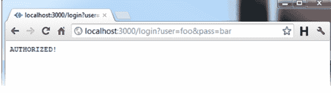

如果你尝试在地址栏中更改用户名或密码，你应该会看到图 3.2 中描绘的内容。

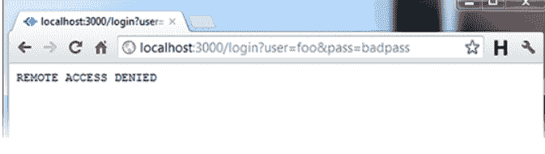

在这种情况下，我们恰好在同一个机器上运行了认证服务器和 Web 服务器；但是，相同的代码也可以用于在本地运行一个 Web 服务器，而认证服务器在世界的另一端。唯一的改变是指定远程服务器的 IP 地址，而不是使用 localhost。既然我们已经使用原生 http 模块构建了一个基本的 Web 服务器，现在是时候使用 Express.js 构建应用程序的其余部分了。

## 构建 API

数据库中有了一些交易记录后，我们将构建一个小的 API 来检索数据。更具体地说，我们将构建一个 **REST API**。REST 代表表述性状态转移（REpresentational State Transfer），它是 Web 背后的架构。与其讨论技术细节，不如解释数据如何从数据库移动到浏览器更能说明问题。

首先，用户向我们的 Express 服务器发送请求。在 Express.js 内部，我们使用 MongoDB 原生驱动程序对数据库进行异步调用。一旦数据返回，我们就可以根据需要进行操作，将原始形式的数据转换为可供我们 API 客户端使用的形式。最后，我们以 JSON 格式将数据发送回浏览器。当数据返回到浏览器后，有许多应用程序和框架可以以一种适合用户查看的方式呈现数据。我们将在本章后面探讨一种实现方式。

第一步是构建 Express 应用程序。在第一章中，我们使用命令行完成了这项工作。这添加了几行代码，但并非所有代码都得到了解释或使用。在本章中，我们将逐行构建应用程序，以便让您更深入地了解我们正在做什么以及为什么这样做。首先，在 **nockmarket.js** 中，按如下方式导入 express 模块：

```javascript
chapter03/nockmarket.js (excerpt)
, express = require('express')
```

然后在 `db.open` 之前添加以下代码：

```javascript
chapter03/nockmarket.js (excerpt)
var app = express.createServer();
app.get('/', function(req, res) {
  res.send('Hello world');
});
```

这里我们创建了一个应用程序，每当用户尝试访问根 URL 时，就会发送经典的 "Hello world"。

之后，修改 `db.open` 函数如下：

```javascript
chapter03/nockmarket.js (excerpt)
db.open(function() {
  submitRandomOrder(); ❶
  app.listen(3000); ❷
});
```

我们只在确保数据库打开后才开始监听请求。现在，当您在 MongoDB 守护进程运行的情况下执行 `node nockmarket` 时，应该会发生两件事：

1. 与第二章一样，程序应该会生成并打印随机订单及其结果。这一次，订单也会存储在数据库中。
2. 应该会启动一个 Web 服务器，监听 3000 端口。当您在浏览器中打开 http://localhost:3000 时，您应该会收到 "Hello world" 的问候语。

第二点本身趣味有限；然而，我们即将通过添加一个新路由 `/api/trades` 来使其更有趣，该路由将从数据库中检索最近的交易记录。将此代码输入到 `nockmarket.js` 中，就在 `db.open` 之前：

```javascript
app.get('/api/trades', function(req, res) {
  db.find('transactions'
    , { init: { $exists: true } }
    , 100, function(err, trades) {
    if (err) {
      console.error(err);
      return;
    }
    var json = [];
    var lastTime = 0;
    // Highstock 期望一个数组的数组。每个
    // 子数组的形式为 [time, price]
    trades.reverse().forEach(function(trade) {
      var date = new Date(parseInt(trade._id
        .toString()
        .substring(0, 8), 16) * 1000);
      var dataPoint = [date.getTime(), trade.price];
      if (date - lastTime > 1000)
        json.push(dataPoint);
      lastTime = date;
    });
    res.json(json);
  });
});
```

我们来逐步分析它。第一行定义了路由：

```javascript
app.get('/api/trades', function(req, res) {
```

下一行定义了我们对数据库执行的查询：

```javascript
db.find('transactions'
      , { init: { $exists: true } }
      , 100, function(err, trades) {
```

方便的是，MongoDB 查询采用 JSON 格式，因此无需学习新的语法。需要学习的主要概念是 MongoDB 操作。在这里，我们搜索存在 `init` 字段的文档。您会回想起只有交易记录才具有 `init` 字段。我们将结果数量限制为 100 条。对于熟悉 SQL 的人，有一个 SQL 到 MongoDB 的映射图表可供参考。

# 索引

我们上面展示的查询由于数据集规模较小，运行速度看起来会非常快。在生产系统中，对某些字段建立索引以优化搜索效率是至关重要的。

一个日常的索引例子是电话簿（黄页）。如果您查找一个特定的名字，字母顺序索引可以实现相当高效的搜索，以找到所需的条目，而不是从第一页到最后一页顺序扫描。

您只需要创建一次索引，这可以在 MongoDB shell 中完成，完全独立于任何 Node.js 环境。索引是一个详细的主题，因此要获取更多信息，一个好的资源是官方文档。

数据库提取现在完成了。函数的其余部分操作返回的数组，以便为我们即将介绍的图表应用程序以所需的格式呈现它。首先，我们使用 `trades.reverse()` 反转数组，使时间戳按时间顺序排列。

我们使用 `forEach` 来遍历数组的每个元素。我们将使用的图形包期望数据格式为 `[time, price]`。我们必须首先提取时间，时间方便地嵌入在 `_id` 中。（每个 MongoDB `_id` 都带有一个内置的时间戳。）我们组合使用 `.substring` 和 `parseInt` 来生成一个 JavaScript Date 对象。


### 嵌入式时间戳

Object ID 规范规定 Object ID 的前四个字节包含时间戳。¹⁰ 要分解这是如何工作的，请在控制台中输入 `node`，然后输入以下内容：

```javascript
var idString = '5015bd4d9d14890200000007';
```

这将以字符串格式存储一个 ID。您可以逐字复制上面的内容，也可以直接使用自己数据库中的 ID。然后我们提取前四个字节：

```javascript
var timestamp = idString.substring(0, 8);
```

最后，我们解析整数：

```javascript
new Date(parseInt(timestamp, 16) * 1000);
```

16 表示我们正在从十六进制转换，并且我们乘以 1000 来进行毫秒转换。您的控制台应显示类似以下内容：

```
Mon Jul 30 2012 08:46:37 GMT+1000 (EST)
```

我们检查以确保交易不会同时发生。在现实世界中，多个交易可以在完全相同的时刻以多个价格水平发生。在实践中，这会导致图表渲染问题。为简单起见，我们将确保每个时间戳只有一个交易。


### 注意间隔

同时交易的检查纯粹是我们在最后一步执行的客户端检查。它不会影响底层数据，因此任何投资组合计算都将基于正确的数据。我们使用这个小技巧是因为图表软件默认情况下无法很好地渲染同时发生的交易。您可以随意调整设置，看看是否能找到更好的解决方案。

最后，我们调用 `res.json` 将数据流式传输到客户端。如果您现在访问 http://localhost:3000/api/trades，您应该会看到类似以下内容的输出：

```
[[1341838075000, 58], [1341838078000, 58], [1341838080000, 57],
...[1341838240000, 57], [1341838243000, 59]]
```

恭喜！您现在已经学会了如何将任意文档插入 MongoDB、使用简单查询提取它们，以及创建一个基本的 REST API 来转换数据并以 JSON 格式将其呈现回去——Facebook 和 Twitter 就使用 JSON 来呈现数据。要查看示例，请访问 https://graph.facebook.com/19292868552 ，您应该会看到图 3.3 中的内容。

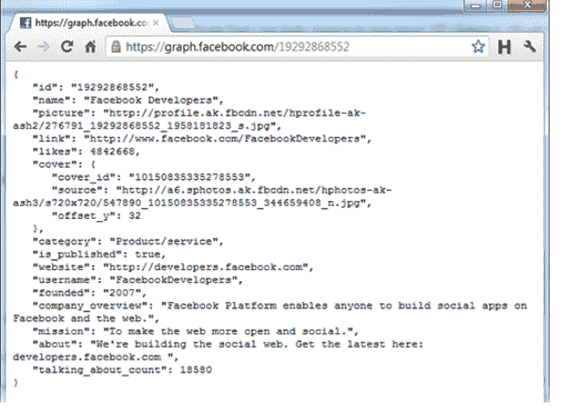

如果您的应用程序变得非常受欢迎，您需要为其他客户端提供 API 来访问您的数据，那么您现在就理解了基础知识。

## 图表展示结果

我们现在已经完成了对 MongoDB 的学习，但只看到原始 JSON 格式的数据是令人不满意的。展示 JSON 结果有很多种方式，这里我们将探讨 Highstock，一个构建在 jQuery 上并可在 Highcharts 上获取的库。¹¹ 将以下代码放在 `app` 定义下方。需要覆盖之前的 "Hello world" 代码以应用于 `/` 路由。

```javascript
chapter03/nockmarket.js (excerpt)
var app = express.createServer();
app.configure(function () {
  app.set('views', __dirname + '/views');
  app.set('view engine', 'ejs');
  app.use(express.static(__dirname + '/public'));
});
app.set('view options', {
  layout: false
});
app.get('/', function(req, res) {
  res.render('chart');
});
```

在 `configure` 函数中，我们首先定义模板目录，然后将 EJS（嵌入式 JavaScript）指定为模板引擎。通过指定 `layout: false`，我们表示不使用默认布局作为模板。`express.static` 用于指示我们将存储静态文件（如样式表和图像）的目录。最后，我们修改 `/` 路由以显示我们的图表模板。

将 https://gist.github.com/3949958 中的代码粘贴到 `/views/chart.ejs`。

几乎所有的代码都专门与 Highstock 包相关，因此我将跳过讨论它。它主要是 Highstock 特定的配置。

当您访问 http://localhost:3000 时，最终结果应如图 3.4 所示。

¹⁰ http://www.mongodb.org/display/DOCS/Object+IDs
¹¹ http://www.highcharts.com/products/highstock/


恭喜，你现在已经掌握了使用 MongoDB 和 Node.js 的基础知识。你已经知道如何从 MongoDB 中插入和提取任意 JSON 数据。你可以构建一个可以被内部和外部客户端使用的 REST API。最后，你探索了一种向最终用户展示这些数据的方式。

## 总结

在本章中，我们涵盖了以下内容：

- MongoDB 简介及其与传统关系数据库技术的区别
- MongoDB 安装以及两个主要驱动程序的概述
- 基本的插入、查找和排序
- 使用原生 `process` 对象和 `http` 模块
- 使用 `map` 转换集合
- 构建 REST API
- 向用户展示 JSON 数据

# 第 4 章

## 使用 Bootstrap 美化

> “当你是一名木匠制作一个漂亮的抽屉柜时，你不会在背面使用一块胶合板，即使它面对着墙壁，没有人会看到它。你知道它在那里，所以你会在背面使用一块漂亮的木头。为了让你晚上睡个好觉，美学，品质，必须贯穿始终。”
>
> —史蒂夫·乔布斯

## 介绍

作为一名新兴的后端工程师，你的主要工作是让你的应用程序快速、可用和可扩展。让它变得漂亮通常不在你的工作描述之内。尽管如此，现在有框架和工具包可以使你的网页非常美观，即使它们缺少专业设计师提供的最后润色。在本章中，我们将介绍这样一个框架——Bootstrap，¹ 这是由 Twitter 发布的一个开源项目。

¹ http://twitter.github.com/bootstrap/

到本章结束时，你将构建一个功能完备的身份验证系统，它将取代我们在前面章节中构建的玩具系统。在构建了允许用户注册和登录的模块之后，我们将创建一个允许用户将股票添加到其投资组合中的模块。作为锦上添花，我们将通过修改第 2 章中编写的一些代码来获取实时股票价格。除了学习 Bootstrap 之外，我们还将基于第 3 章中获得的一些基本 MongoDB 技能进行构建和扩展。

### 注册，登录

我们的第一个任务是重新审视身份验证模块。由于你现在了解了 MongoDB 的基础知识，我们将能够构建一个真实的模块，而不是一个模拟模块。使用 Bootstrap，构建一个基本设计良好的网页很容易。再一次，我们将基于前一章的工作进行构建。修改 **nockmarket.js** 以替换 / 路由，如下所示：

```javascript
chapter04/nockmarket.js (节选)
app.get('/', nockroutes.getIndex);
```

这看起来比我们之前的路由代码简单多了，这正是目的所在。目前，我们的 **nockmarket.js** 做的事情有点太多了：从设置 Express.js 服务器到提交订单再到执行一些业务逻辑。在单个文件中处理多种角色对于简单的应用程序是可行的，但随着复杂性的增加，它很快就会变得难以管理。模块化是管理复杂性的关键之一，在这里我们将把路由分离到另一个模块中。

是时候引入拥有独立、专用路由文件的概念了。创建 **routes/nockroutes.js**，如下所示：

```javascript
chapter04/routes/nockroutes.js
module.exports = {
  getIndex: function(req, res) {
    res.render('index');
  }
}
```

这里我们使用熟悉的 `module.exports` 来暴露一个渲染索引模板的函数。要访问路由文件，我们需要在 nockmarket.js 中添加一个额外的导入：

```javascript
chapter04/nockmarket.js (节选)
, nocklib = require('./lib/nocklib')
, nockroutes = require('./routes/nockroutes.js')
, timeFloor = 500
```

我们可以通过将以下代码放入 views 目录中的 index.ejs 来创建登陆页面：

```html
chapter04/views/index.ejs (节选)
<!DOCTYPE html>
<html lang="en">
<head>
  <meta charset="utf-8">
  <title>Nockmarket</title>
  <meta name="viewport"
    content="width=device-width, initial-scale=1.0">
  <link href="http://twitter.github.com/bootstrap/assets/css/
    bootstrap.css" rel="stylesheet">
  <link href="http://spbooks.github.com/nodejs1/docs.css"
    rel="stylesheet">
  <script src="http://twitter.github.com/bootstrap/assets/js/
    google-code-prettify/prettify.js"></script>
</head>
<body>
  <div class="container">
    <div class="marketing"><h1>Nockmarket</h1>
      <p class="marketing-byline">欢迎来到 Node.js
        股票市场</p>
      <div class="row offset2">
        <div class="span4">
          <h2>实时价格</h2>
          <p>在这里，你将能够注册一个账户，并使用实时价格创建股票投资组合。这将结合 Bootstrap 的美观性和 Node.js 的高性能，打造一个设计精良、速度极快的股票跟踪工具。
</p>
</div>
<div class="span4">
    <h2>实时数据</h2>
    <p>我们还将构建一个模拟投资组合，向你展示如何将实时数据直接流式传输到你的浏览器中。一旦你掌握了基础知识，你将能够流式传输任何类型的数据，从推文、聊天到拍卖数据。
    </p>
</div>
</div>
</div>
<header class="jumbotron masthead">
  <div class="inner">
    <p class="download-info">
      <a data-toggle="modal" href="#" class="btn btn-large">登录</a>
      <a data-toggle="modal" href="#"
        class="btn btn-primary btn-large">注册</a>
    </p>
  </div>
</header>
</div>
</body>
</html>
```

这段代码没有什么特别之处；它只是普通的 HTML。我们稍后会讨论一些 Bootstrap 功能。现在当你运行 `node nockmarket` 并访问 http://localhost:3000 时，你应该会看到图 4.1 中漂亮渲染的页面。

它比我们在第一章构建的普通表单好看多了！你看到的效果是 Twitter 的才华横溢的设计师遵循优美设计原则努力工作的结果。Bootstrap 是一系列精心设计的部件集合，加上一些支持性 JavaScript 以增添色彩。在本章的剩余部分，我们将看到如何将这个库与 Node.js 结合起来，构建兼具功能和形式的软件。

## Nockmarket

欢迎来到 Node.js 股票市场

### 实时价格

在这里，你将能够注册一个账户，并使用实时价格创建股票投资组合。这将结合 Bootstrap 的美观性和 Node.js 的高性能，打造一个设计精良、速度极快的股票跟踪工具。

### 实时数据

我们还将构建一个模拟投资组合，向你展示如何将实时数据直接流式传输到你的浏览器中。一旦你掌握了基础知识，你将能够流式传输任何类型的数据，从推文、聊天到拍卖数据。

登录

注册

图 4.1. 我们漂亮渲染的登陆页面

下一步是修改代码以包含一些**模态窗口**。模态是允许用户输入其用户名和密码的部件。Bootstrap 提供了模态的实现，包括前端设计和相关的 JavaScript。我们需要将 Bootstrap JavaScript 代码和 jQuery 添加到 **index.ejs**：

```html
chapter04/views/index.ejs (节选)
<script src="http://twitter.github.com/bootstrap/assets/js/google-code-prettify/prettify.js"></script>
<script type="text/javascript" src="http://spbooks.github.com/nodejs1/jquery.js"></script>
<script type="text/javascript" src="http://spbooks.github.com/nodejs1/bootstrap-button.js"></script>
<script type="text/javascript" src="http://spbooks.github.com/nodejs1/bootstrap-modal.js"></script>
<script type="text/javascript" src="http://spbooks.github.com/nodejs1/bootstrap-transition.js"></script>
</head>
```

请注意，为了获得更好的性能，你可以合并和压缩你的 Bootstrap 文件或使用内容分发网络。² 接下来，我们为模态添加一些 HTML 代码，可以在 https://gist.github.com/3968474 找到：³

² http://www.bootstrapcdn.com/
³ 有关模态的更多详细信息，Bootstrap 网站是一个极好的参考 [http://twitter.github.com/bootstrap/javascript.html#modals]

```javascript
chapter04/views/index.ejs（节选）
<body>
<!-- 将代码粘贴在此处 -->
<div class="container">
```

最后，我们为**注册**按钮的 `href` 做一点小修改：

```html
chapter04/views/index.ejs（节选）
<a data-toggle="modal" href="#myModal"
    class="btn btn-primary btn-large">注册</a>
```

刷新页面并点击**注册**按钮后，你应该会看到类似图 4.2 的界面。

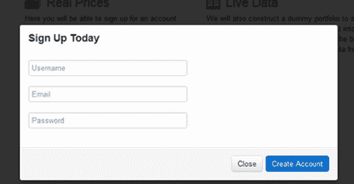

图 4.2. **注册**模态框

至此，我们对 Bootstrap 的快速介绍就结束了。希望深入了解的朋友，可以参考 w3resource 上对所有常用部件的深入讲解。⁴ 我希望你现在能体会到构建一个外观精美的页面是多么简单。在构建用户股票投资组合部分时，我们将更详细地阐述一些关键的 Bootstrap 特性。现在，是时候实现一些后端功能了。

⁴ http://www.w3resource.com/twitter-bootstrap/tutorial.php

## 新用户

我们的第一个任务是向 **nockmarket.js** 添加一行配置，以便 Express 能够解析表单提交：

```javascript
app.configure(function () {
  app.use(express.bodyParser());
  app.set('views', __dirname + '/views');
  :
});
```

现在，让我们修改 **nocklib.js**，添加一些函数来帮助我们创建新用户。首先，我们需要导入一些新的模块，以便能够加密密码并访问我们的数据库库：

```javascript
var crypto = require('crypto')
  , db = require('./db')
  , exchange = require('./exchange')
```

接下来，我们来编写一个函数，用于加密明文密码。将以下代码放在 `module.exports = { ... }` 代码块之后。没有必要将此函数暴露给其他库，因为它们不需要访问我们的加密算法：

```javascript
function encryptPassword(plainText) {
  return crypto.createHash('md5').update(plainText).digest('hex');
}
```

这里，我们使用了内置的 **crypto** 库。如果有些函数看起来有点晦涩，请不必过于担心。理解 **createHash** 和 **digest** 在幕后具体做什么并不重要。对于永远充满好奇的朋友，可以在其官方网站上找到 crypto 库的详细文档。⁵

> **健壮的密码安全性**
>
> MD5 在生产环境中通常被认为是一种用于存储密码的弱机制。bcrypt 是一种更安全的替代方案，因为通过暴力破解需要花费更长的时间。⁶ 如你所料，有一个现成的包可以处理 bcrypt 加密。⁷ 因为密码功能被封装在一个函数中，所以如果你想尝试不同的哈希算法，这将变得很容易。

现在，让我们编写一个函数来访问用户数据并将其导入数据库：

```javascript
chapter04/lib/nocklib.js（节选）
module.exports = {
  createUser: function(username, email, password, callback) {
    var user = { username: username, email: email
      , password: encryptPassword(password) };
    db.insertOne('users', user, callback);
  },
  generateRandomOrder: function(exchangeData) {
```

在这里，我们获取原始的表单输入并构造一个 JSON 对象来表示用户。我们从不存储明文密码；它在插入数据库时是经过加密的：

```javascript
password: encryptPassword(password)
```

最后，我们使用 `insertOne` 函数插入一个新用户。这与我们插入新交易的方式几乎完全相同。唯一的变化是使用了不同的集合名称：`users` 而不是 `transactions`。现在我们需要在 **nockmarket.js** 中添加一个路由，以便接收来自浏览器的表单提交：

```javascript
chapter04/nockmarket.js（节选）
app.get('/', nockroutes.getIndex);
app.post('/signup', nockroutes.signup);
```

我们在这里所做的只是定义路由。其余的路由代码放在 **nockroutes.js** 中：

```javascript
chapter04/routes/nockroutes.js（节选）
var nocklib = require('../lib/nocklib');
module.exports = {
  getIndex: function(req, res) {
    res.render('index');
  },
  signup: function(req, res) {
    nocklib.createUser(req.body.username
      , req.body.email
      , req.body.password, function(err, user) {
        console.log(user);
        res.redirect('/portfolio');
    });
  }
}
```

请记住第一行导入了 nocklib，以及 getIndex 后面的逗号！还有一项任务是移除 ASCII 日志记录，因为这将不再需要。在 **nockmarket.js** 中，使用 `//` 注释掉 `console.log(exch.getDisplay(exchangeData));` 和 `console.log('order', ord);`。这两行都可以在 submitRandomOrder 函数中找到。很快我们将探讨更友好的数据呈现方式。

因为我们之前添加了 body 解析器（使用 `app.use(express.bodyParser())`），所以我们可以使用 `req.body.username`、`req.body.email` 和 `req.body.password` 来获取表单参数。然后我们将这些参数发送给我们的 createUser 函数。我添加了一些日志记录，以便在创建新用户时你能获得一些反馈。最后一步是重定向到 **/portfolio**。

如果你现在重启应用程序并创建一个新用户，你应该会在控制台中看到以下或类似的内容：

```json
{ username: 'nockuser',
  email: 'user@nockmarket.org',
  password: 'ebb080afaac3a990ad3f1d0f21742fac',
  _id: 501a16f5046680f873000003 }
```

我们知道用户已成功创建，因为 `_id` 存在。它一定是数据库创建的，因为我们无法自己生成它。

请注意密码已被加密。你应该会被重定向到 /portfolio，并显示消息：

```
Cannot GET /portfolio
```

我们将在本章后面实现这个功能。

### 唯一性

用户现在可以在我们的网站上注册，但还有一个小问题。允许重复注册，这意味着两个不同的用户最终可能拥有相同的用户名。我们现在将加入一个 Ajax 检查，以告知用户他们选择的用户名是否已被占用。

> ### 为什么使用 Ajax？
>
> Ajax 代表异步 JavaScript 和 XML。Ajax 通过 XMLHttpRequest 对象，允许在浏览器和 Web 服务器之间来回传输少量信息。在此之前，即使是页面的微小变更也需要完全重新加载，导致用户体验迟缓。Ajax 能够提供更快速、响应更灵敏和更具交互性的体验，如下例所示。

首先，让我们编写一个按用户名搜索的小库函数。这可以通过一行业务逻辑完成。将以下内容添加到 **nocklib.js**：

```javascript
chapter04/lib/nocklib.js（节选）
},
getUser: function(username, callback) {
    db.findOne('users', { username: username }, callback);
}
}
```

搜索匹配用户名的查询很简单：

```javascript
{ username: username }
```

此查询采用标准 JSON 语法，这意味着左边的 `username` 指字段名，右边的 `username` 指变量。一旦涉及实际数据，查询可能类似于：`{ username: 'johnsmith' }`。然后我们添加关联的路由。将此路由附加到 **nockmarket.js**：

```javascript
chapter04/nockmarket.js（节选）
app.get('/', nockroutes.getIndex);
app.get('/api/user/:username', nockroutes.getUser);
```

注意路由中使用的正则表达式：

```
/api/user/:username
```

`:username` 部分意味着我们将 `/api/user/` 之后的任何内容存储在一个名为 `username` 的变量中。例如，如果有人尝试访问 `/api/user/james`，值 'james' 将被存储在 `req.params.username` 中。

要完成路由，请将以下内容添加到 **nockroutes.js**：

```javascript
chapter04/routes/nockroutes.js（节选）
},
getUser: function(req, res) {
  nocklib.getUser(req.params.username, function(err, user) {
    if (user)
      res.send('1');
    else
      res.send('0');
  });
},
signup: function(req, res) {
```

一旦我们使用此信息结合我们的库来搜索用户，逻辑就很简单。如果用户存在，我们返回 '1' 以告知客户端找到了该用户。否则，我们返回 '0'。

这就是我们需要的全部后端功能。我们的最后一步是通过 jQuery 将其连接到前端。通过编辑 **index.ejs** 导入一个新的 JavaScript 源代码文件：

⁶ http://codahale.com/how-to-safely-store-a-password/
⁷ https://github.com/ncb000gt/node.bcrypt.js

```html
chapter04/views/index.ejs (摘录)
<script type="text/javascript" src="http://spbooks.github.com/nodejs1/bootstrap-transition.js"></script>
<script type="text/javascript" src="/js/nockclient.js"></script>
</head>
```

在 `/public/js/` 目录下创建一个名为 **nockclient.js** 的新文件，内容如下：

```javascript
chapter04/public/js/nockclient.js (摘录)
$(document).ready(function() {
    $('.uname').blur(function(e) {
        $.ajax({
            type: 'GET'
            , url: '/api/user/' + $('.uname').val()
        }).done(function(found) {
            if (found == '1') {
                $('#imagePlaceHolder').html('  Username already taken');
                $('.create-button').addClass('disabled')
                    .attr('disabled', true);
            }
            else {
                $('#imagePlaceHolder').html('');
                $('.create-button').removeClass('disabled')
                    .attr('disabled', false);
            }
        });
    });
});
```

❶ 当 uname 字段失去焦点时，会触发 `blur` 调用。

❷ 此时，我们使用 jQuery 的 `ajax` 函数向我们的 Node.js 服务器发送一个 GET 请求。

❸ 如果找到了用户名，我们会显示一个叉号来表示该用户名不可用。

4. 我们还会禁用 **Create Account** 按钮，这样用户就无法使用无效的用户名提交表单。

5. 如果用户名可用，我们会如图 4.4 所示显示一个勾号。

6. 然后我们启用 **Create Account** 按钮。

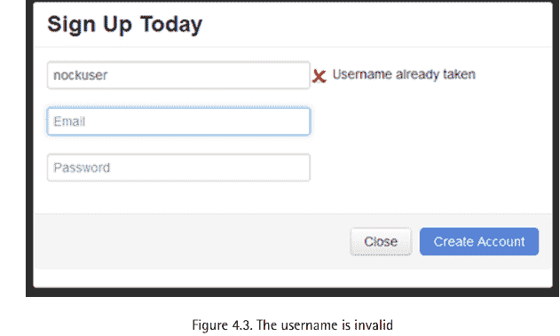
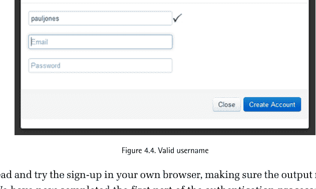

请在你自己的浏览器中尝试注册流程，确保输出结果与此类似。我们现在已经完成了认证流程的第一部分，即注册新用户。接下来，是时候允许他们登录了。

## 认证

让我们首先修改前端以添加一个登录模态框。我们通过在 `index.ejs` 中包含 https://gist.github.com/3968470 的代码来构建这个模态框：

```html
chapter04/views/index.ejs (摘录)
</div>
<!-- 在这里粘贴代码 -->
<div class="container">
```

现在，我们将修改登录按钮的 `href` 值以触发模态框：

```html
chapter04/views/index.ejs (摘录)
<div class="inner">
  <p class="download-info">
    <a data-toggle="modal" href="#loginModal"
       class="btn btn-large">Log In</a>
  </p>
</div>
```

作为快速检查，请刷新页面并点击 **Log In**。现在，我们可以编写一个库函数来对用户进行身份验证。将以下内容添加到 `nocklib.js` 中：

```javascript
chapter04/lib/nocklib.js (摘录)
module.exports = {
  authenticate: function(username, password, callback) {
    db.findOne('users', { username: username }, function(err, user) {
      if (user && (user.password === encryptPassword(password)))
        callback(err, user._id);
      else
        callback(err, null);
    });
  },
  ...
```

1. 这里我们从数据库中检索用户。首先检查用户是否存在，然后验证给定的密码是否与数据库中加密后的密码匹配。
2. 如果匹配，我们返回用户 ID。
3. 否则，我们返回 `null`。

我们返回 ID 而不是简单的 `true` 的原因是，用户 ID 是一个我们后续会反复使用的便捷字段。通过在身份验证函数中返回它，我们可以省去后续代码中额外的一次数据库调用。

最后一步是在 **nockmarket.js** 中将我们的库函数连接到一个路由：

```javascript
app.get('/api/user/:username', nockroutes.getUser);
app.post('/login', nockroutes.login);
```

我们在 **nockroutes.js** 中填充路由的主体：

```javascript
chapter04/routes/nockroutes.js (摘录)
},
login: function(req, res) {
  nocklib.authenticate(req.body.username,
    req.body.password, function(err, id) {
      if (id) {
        res.redirect('/portfolio');
      }
      else
        res.redirect('/');
  });
},
signup: function(req, res) {
```

如果用户通过身份验证，我们将重定向到 **/portfolio** 页面。如果用户不存在或密码不匹配，我们将重定向到主页。至于在身份验证失败时重定向到一个友好的错误消息，我将把它留给你来实现。此时，你应该已经具备了用几行代码完成此功能的所有工具。

还有一项任务需要完成。一旦用户登录，我们如何在将来跟踪该用户？一种方法是使用 **sessions**，这是一种在服务器上存储用户信息的方式。这与 cookie 不同，cookie 用于在客户端设备上存储用户信息。请注意，session 可能仍会使用 HTTP cookie 来存储会话令牌。因此，即使其他信息在服务器端处理，存储会话令牌仍需要 cookie。我们可以如下配置支持 session 的 Express.js：

```javascript
chapter04/nockmarket.js (摘录)
app.use(express.bodyParser());
app.use(express.cookieParser());
app.use(express.session({ secret: 'secretpasswordforsessions' }));
```

这段代码将添加对 sessions 和 cookies 的支持。然后当用户登录时，我们可以将用户 ID 存储在 session 变量中。如下修改 **nockroutes.js**：

```javascript
chapter04/routes/nockroutes.js (摘录)
if (id) {
    req.session._id = id;
    res.redirect('/portfolio');
}
```

一旦用户 ID 被存储，将来就可以使用 `req.session._id` 来访问它。这将在我们稍后使用它来保护我们的投资组合页面时派上用场。现在，是时候让用户将股票添加到他们的投资组合中了。

## 基础投资组合

我们现在将允许用户构建一个基础的投资组合。让我们从添加一个允许用户获取单个股票价格的库函数开始。在 **nocklib.js** 内部，导入 `http` 模块：

```javascript
chapter04/lib/nocklib.js (摘录)
, exchange = require('./exchange')
, http = require('http')
, priceFloor = 35
```

然后我们对在第 2 章编写的函数进行小幅修改：

```javascript
chapter04/lib/nocklib.js (摘录)
},
getStockPrices: function(stocks, callback) {
    var stockList = '';
    stocks.forEach(function(stock) {
        stockList += stock + ',';
    });
    var options = {
        host: 'download.finance.yahoo.com',
        port: 80,
        path: '/d/quotes.csv?s=' + stockList + '&f=sl1c1d1&e=.csv'
    };
    http.get(options, function(res) {
        var data = '';
        res.on('data', function(chunk) {
            data += chunk.toString();
        })
        .on('error', function(err) {
            console.err('Error retrieving Yahoo stock prices');
            throw err;
        })
        .on('end', function() {
            var tokens = data.split('\r\n');
            var prices = [];
            tokens.forEach(function(line) {
                var price = line.split(',')[1];
                if (price)
                    prices.push(price);
            });
            callback(null, prices);
        });
    });
getUser: function(username, callback)
```


## Jump Start Node.js

```javascript
stocks.forEach(function(stock) {
    stockList += stock + ',';
});
```

然后我们将这个列表发送到雅虎 API，类似于我们之前所做的。收到结果后，我们解析数据并返回一个数组：

```javascript
var tokens = data.split('\r\n');
var prices = [];
tokens.forEach(function(line) {
    var price = line.split(",")[1];
    if (price)
        prices.push(price);
});
callback(null, prices);
```

股票数组中的元素与价格数组中的元素之间存在一一对应的关系。现在，我们将编写一个函数，允许用户将一只股票添加到投资组合中。首先，我们将通过编辑 `lib/db.js` 来修改我们的数据库封装器：

### chapter04/lib/db.js (摘录)

```javascript
{
  push: function(name, id, updateQuery, callback) {
    db.collection(name).update({_id: id}
      , {$push: updateQuery}, {safe:true}, callback);
  }
}
```

我们将投资组合表示为用户对象中的一个字符串数组。这里我们创建了一个通用函数，允许应用程序将数据推送到一个数组中。MongoDB 的 `update` 函数与 `$push` 修改器结合使用，^8 我们使用 `{safe:true}` 来确保回调仅在数据项插入数据库后才触发。如果没有这个设置，回调函数会立即触发。^9

> **修改器**
>
> MongoDB 有许多修改器操作，它们本身并不增加任何新功能。例如，`$push` 可以通过检索对象、手动将项目推入数组、然后保存整个对象来复制。修改器的便利之处在于它们可以直接在服务器上执行，省去了将对象从数据库发送到应用程序再返回的开销。

^8 http://www.mongodb.org/display/DOCS/Updating/#Updating-%24push
^9 http://mongodb.github.com/node-mongodb-native/markdown-docs/insert.html

许多 I/O 操作处理相互依赖的事件。一个典型的例子是：先根据 ID 从数据库中检索用户，然后查询该用户股票投资组合中的股票价格。在这些场景中，Node.js 处理此类任务的惯用技术是**嵌套回调**，你已经见过许多这样的例子。嵌套回调的形式如下：

```javascript
getUser(id, function(err, user) {
  getPrices(user.stocks, function(err, prices) {
    // handle prices
  });
});
```

在这段代码中，`getPrices` 总是在 `getUser` 之后运行。这是设计使然，并且合情合理，因为在 `user` 对象从数据库返回之前，我们无法知道应该检索哪些价格。

然而，假设你处理的事件是独立的，比如将股票添加到投资组合和从雅虎获取股票价格。当用户将股票添加到投资组合时，会发生两个独立的操作：我们使用 MongoDB 将股票添加到投资组合，并从雅虎获取股票价格。由于事件是独立的，没有必要串行执行它们。我们希望并行运行这些事件。因此，我们不想使用嵌套回调。

假设将股票添加到投资组合需要一秒钟，获取价格也需要一秒钟。使用嵌套回调，整个操作需要两秒钟，因为第二个操作需要等待第一个操作完成才能开始。但如果我们并行运行它们，整个活动只需一秒钟即可完成。

问题在于，我们不知道哪个事件会先完成；那么，我们应该在何处执行回调呢？有许多库可以抽象掉这种复杂性；然而，在这个例子中，我们将避免使用第三方库，以便你能理解背后发生的原理。让我们在 `nocklib.js` 中定义一个新函数：

```javascript
// chapter04/lib/nocklib.js (excerpt)
module.exports = {
  addStock: function(uid, stock, callback) {
    var price;
    module.exports.getStockPrices([stock]
      , function(err, retrieved) {
        price = retrieved[0];
        doCallback();
    });
    db.push('users', new ObjectID(uid), {portfolio: stock}
      , doCallback);
  },
  authenticate: function(username, password, callback) {
```

这里我们定义了一个新函数 `addStock`，它将向用户的投资组合中添加指定的股票。

这里调用了两个额外的函数：`push` 会将股票添加到数据库中的用户，而 `getStockPrices` 会使用我们刚刚编写的函数来获取股票价格。这个函数被设计用来处理多只股票，因此通过发送一个大小为 1 的数组，然后从输出中检索第一个元素，就可以轻松地用它来获取单只股票的价格。

我们有效地同时进行了这两个调用，但不知道哪个会先返回。这个难题可以通过让两个事件都调用 `doCallback` 函数来解决，我们在这里定义这个函数：

```javascript
// chapter04/lib/nocklib.js (excerpt)
addStock: function(uid, stock, callback) {
  function doCallback() {
    counter++;
    if (counter == 2) {
      callback(null, price);
    }
  }
  var counter = 0;
```

我们使用变量 `counter` 来跟踪回调函数被调用的次数。这样，哪个函数先返回就无关紧要了。我们总是忽略第一次调用，而在第二次调用时返回价格。有一些库可以优雅地抽象掉这些细节；一个很好的选择是 `async` 库。<sup>10</sup>

<sup>10</sup> https://github.com/caolan/async/

注意在 `addStock` 函数中使用了 `ObjectID`。它需要额外的导入：

```javascript
// chapter04/lib/nocklib.js (excerpt)
, http = require('http')
, ObjectID = require('mongodb').ObjectID
```

要使用 MongoDB 对象 ID，必须提供一个实际的 `ObjectID` 对象。避免发送不同格式（如 `String`）的错误，因为这会导致失败。最后一步是向 **nockmarket.js** 添加一些路由：

```javascript
// chapter04/nockmarket.js (excerpt)
app.get('/api/user/:username', nockroutes.getUser);
app.post('/add-stock', nockroutes.addStock);
```

... 以及 **nockroutes.js**：

### 快速入门 Node.js

```javascript
// chapter04/routes/nockroutes.js (excerpt)
module.exports = {
  addStock: function(req, res) {
    if (req.xhr) { ❶
      nocklib.addStock(req.session._id, req.body.stock
        , function(err, price) { ❷
          res.send(price); ❸
      });
    }
  },
  getIndex: function(req, res) {
```

1. 首先，我们检查用户是否发起了 Ajax 请求。
2. 如果是，我们使用 `req.session._id` 从会话中检索 ID，并使用 `req.body.stock` 从 HTTP POST 请求中获取股票代码。然后我们使用 `addStock` 函数将股票添加到投资组合并获取价格。
3. 最后，我们将价格发送回浏览器。

后端现已完成，因此下一项任务是将其连接到前端。

## Bootstrap 小部件

Bootstrap 附带了多种小部件，所有这些都经过精心制作。遗憾的是，本书没有时间涵盖所有不同的组合；然而，一旦你有了一个如何将 Bootstrap 小部件与 Node.js 集成的示例，就很容易将这些原则应用到任何小部件上。在这个特定的例子中，我们将使用标签页界面。首先，让我们在 **views/portfolio.ejs** 中设置 head 和 body：

```html
<!-- chapter04/views/portfolio.ejs (excerpt) -->
<!DOCTYPE html>
<html lang="en">
<head>
    <meta charset="utf-8">
    <title>Nockmarket</title>
    <meta name="viewport"
          content="width=device-width, initial-scale=1.0">
    <link href="http://twitter.github.com/bootstrap/assets/css/bootstrap.css" rel="stylesheet">
    <link href="http://spbooks.github.com/nodejs1/docs.css" rel="stylesheet">
    <script src="http://twitter.github.com/bootstrap/assets/js/google-code-prettify/prettify.js"></script>
    <script type="text/javascript" src="http://spbooks.github.com/nodejs1/jquery.js"></script>
    <script type="text/javascript" src="http://spbooks.github.com/nodejs1/bootstrap-button.js"></script>
    <script type="text/javascript" src="http://spbooks.github.com/nodejs1/bootstrap-modal.js"></script>
    <script type="text/javascript" src="http://spbooks.github.com/nodejs1/bootstrap-transition.js"></script>
    <script type="text/javascript" src="http://twitter.github.com/bootstrap/assets/js/bootstrap-tab.js"></script>
</head>
<body>
</body>
</html>
```

这段代码可能与你过去设置的任何网页非常相似。在 header 中，我们加载 CSS 和 JavaScript。然后我们有一个空的 body，我们开始按照如下方式填充：

```html
<!-- chapter04/views/portfolio.ejs (excerpt) -->
<body>
  <div class="container">
    <div class="row">
    </div>
  </div>
</body>
```

从设计角度来看，你可以认为 Bootstrap 网页是由一系列行组成的。每行由若干列组成；Bootstrap 默认使用 12 列。这些可以如下构建：

```html
<!-- chapter04/views/portfolio.ejs (excerpt) -->
<div class="row">
  <div class="offset2 span8">
  </div>
</div>
```

这里 `offset2` 指定两个空白列。`span8` 指定我们的实际内容占据八列。现在我们总共指定了 10 列的内容；最后两列是空的。通过在内容前后放置相同数量的空白列，我们确保内容居中。下一步是从 https://gist.github.com/3968465 添加实际内容：

```html
<!-- chapter04/views/portfolio.ejs (excerpt) -->
<div class="offset2 span8">
  <!-- paste code here -->
</div>
```

这一步很简单，只需从网站获取示例并相应地修改内容即可。然后我们在 **nockmarket.js** 中定义一些简单的路由：

```javascript
// chapter04/nockmarket.js (excerpt)
app.get('/api/user/:username', nockroutes.getUser);
app.get('/portfolio', nockroutes.portfolio);
```

以及 **nockroutes.js**：

### 快速入门 Node.js

```javascript
// chapter04/routes/nockroutes.js (excerpt)
},
portfolio: function(req, res) {
  res.render('portfolio');
},
login: function(req, res) {
```

现在，当你登录时，应该能看到类似图 4.5 所示的画面。

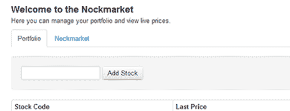

图 4.5. 是时候让你的投资组合多样化了

这些标签页是功能性的，你可以在它们之间点击切换，即使当前内容可能有点单薄。既然我们已经有了模板，最后一步就是编写前端代码来显示添加的股票及其价格。让我们从向 **portfolio.ejs** 添加客户端 JavaScript 开始：

```html
<!-- chapter04/views/portfolio.ejs (excerpt) -->
<script type="text/javascript" src="http://twitter.github.com/bootstrap/assets/js/bootstrap-tab.js"></script>
<script type="text/javascript" src="/js/portfolio.js"></script>
</head>
```

现在，按如下方式创建 `/public/js/portfolio.js`：

```javascript
// chapter04/public/js/portfolio.js
$(document).ready(function() {
  $('#add-stock').click(function(e) {
    $.ajax({
      type: 'POST',
      url: '/add-stock/',
      data: {stock: $('#stock').val()}
    }).done(function(price) {
      $('.stock-list').append('<tr><td>' + $('#stock').val()
          + '</td><td>' + price + '</td></tr>');
    });
  });
});
```

这里我们使用 jQuery 的 `ajax` 函数向我们的 Node.js 服务器提交一个 POST 请求。服务器会返回股票价格，此时我们手动将数据追加到表格中：

```javascript
$('.stock-list').append('<tr><td>' + $('#stock').val()
    + '</td><td>' + price + '</td></tr>');
```

这段代码只是将原始 HTML 与数据拼接起来。虽然这对简单问题来说没问题，但更复杂的问题最好通过框架来管理，我们将在第 6 章探索其中一个框架。现在，当你开始向投资组合添加股票时，你应该会看到一个类似于图 4.6 的视图。

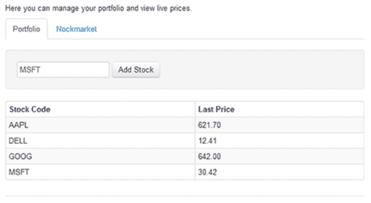

图 4.6. 你添加了新股票的投资组合

最后一个任务是让投资组合在页面初始加载时就显示出来。目前，如果你刷新页面，股票将不再显示。首先，我们在 Node.js 中加载数据。在 `nockroutes.js` 中进行以下修改：

### 88 快速入门 Node.js

```javascript
// chapter04/routes/nockroutes.js (excerpt)
portfolio: function(req, res) {
  nocklib.getUserById(req.session._id, function(err, user) {
    var portfolio = [];
    if (user && user.portfolio)
      portfolio = user.portfolio;
    nocklib.getStockPrices(portfolio, function(err, prices) {
      res.render('portfolio', {portfolio:portfolio, prices:prices});
    });
  });
},
```

这里我们先检索用户，然后获取用户投资组合的股票价格。我们将这些数据通过两个变量 `portfolio` 和 `prices` 传入模板。这需要我们在 `nocklib.js` 中添加 `getUserById` 函数：

```javascript
// chapter04/lib/nocklib.js (excerpt)
getUserById: function(id, callback) {
  db.findOne('users', {_id: new ObjectID(id)}, callback);
},
getUser: function(username, callback) {
```

`getUserById` 函数与 `getUser` 类似，不同之处在于我们是通过 `_id` 而非用户名来搜索。然后我们在模板中显示数据。对 **portfolio.ejs** 进行如下修改：

```html
<!-- chapter04/views/portfolio.ejs (excerpt) -->
<tbody class="stock-list">
  <% for (var i=0; i<portfolio.length; i++) { %>
    <tr><td><%=portfolio[i]%></td><td><%=prices[i]%></td></tr>
  <% } %>
</tbody>
```

我们使用一个简单的循环来显示数组中的数据，功能现在完整了。最后，还有一点需要整理。

## 密码保护

目前，`/portfolio` 路由任何人都可以访问。Express.js 提供了中间件功能，使我们能够轻松地为其扩展访问检查机制。在 `nocklib.js` 中定义以下函数：

```javascript
// chapter04/lib/nocklib.js (excerpt)
},
ensureAuthenticated: function (req, res, next) {
  if (req.session._id) {
    return next();
  }
  res.redirect('/');
},
generateRandomOrder: function(exchangeData) {
```

当用户首次登录时，我们将 ID 存储在会话中，这意味着我们检查 `_id` 变量是否存在。如果存在，我们就知道有一个已登录的用户，`next` 函数会告诉 Express.js 继续正常执行。如果 `_id` 不存在，我们有一个访客用户，我们将他重定向回主页。

在这个函数中，我们可以执行任意复杂性的检查。例如，我们不仅检查 `_id` 的存在，还可以检索整个用户配置文件，并确保在授予管理员页面访问权限之前存在管理员权限。

保护页面现在变得极其简单：

```javascript
// chapter04/nockmarket.js (excerpt)
app.get('/portfolio', nocklib.ensureAuthenticated,
  nockroutes.portfolio);
```

注意 `nocklib.ensureAuthenticated` 是如何被插入到 `get` 方法中间的。Express.js 的这个特性使其具有可扩展性和灵活性。现在，如果你尝试在未登录的情况下访问 `/portfolio`，你将被重定向到主页。

## 总结

在本章中，我们介绍了以下内容：

- Bootstrap 小部件的基本介绍
- 实现一个生产级的认证系统，并将其与 Bootstrap 的登录和注册模态框集成
- 通过 Ajax 提供更快、更具交互性的体验
- 通过会话存储用户数据
- 使用 Bootstrap 的标签页界面表示股票投资组合
- 动态添加和显示投资组合中的股票及其实时价格
- 使用 Express.js 中间件进行访问控制

## 第 5 章

## 实时网络

> “如果一切尽在掌控之中，说明你速度还不够快。” ——马里奥·安德雷蒂

欢迎来到本书中可以说最重要的章节。在这里，我们将学习构建一个实时聊天网站的基础知识。这得益于一个名为 `Socket.IO`¹ 的包变得很简单，或者，如果你愿意，可以称之为“套接字领域的 jQuery”。这意味着你只需要学习 `Socket.IO` 的 API。在底层，该 API 可能使用 WebSockets、Flash、Comet，以及在未来尚未存在的技术！`Socket.IO` 会根据用户的浏览器能力无缝切换协议，而你无需编写任何额外的代码。

到本章结束时，你将编写出一个实时聊天应用程序，它能够检测用户连接和断开。你还将把 `Socket.IO` 连接到我们在第 2 章构建的股票市场模拟器，将实时交易数据流式传输到浏览器。最后，你将看到 `Socket.IO` 如何被用作 Ajax 和传统表单的替代品。

¹ http://socket.io/

### 快速入门 Node.js

## 开始聊天吧

WebSocket 登场了。² 用作者的话说，“其目标是……为需要与服务器进行双向通信的基于浏览器的应用程序提供一种机制，而无需依赖打开多个 HTTP 连接（例如，使用 `<iframe>` 或 `XMLHttpRequest` 以及长轮询）。”

WebSocket 是一种现代的双向协议，支持浏览器和服务器之间的交互式通信会话。其主要缺点是目前实现通常仅限于最新的浏览器。但是，通过使用 `Socket.IO`，这些底层细节被抽象化，作为程序员的你就不需要编写特定于浏览器的代码了。现在让我们看看如何将这项技术整合到我们的应用程序中。

我们将从构建典型的聊天应用开始。也许我们的用户希望互相讨论在投资组合中加入更多苹果股票的优点，或者最近一次美联储会议的影响。几乎每个人都是通过一个基本的聊天应用接触到 `Socket.IO` 的。尽管有无数的例子展示了如何用极少的代码行数构建这样一个应用，但它们大多数是简化的，因为它们要求用户输入一个显示名称。这消除了将 `Socket.IO` 连接到授权系统的复杂性，而这正是我们即将学习的内容。

`Socket.IO` 是平台无关的，且没有对 Express.js 的内置支持。要让 `Socket.IO` 访问我们在第 4 章存储的用户 ID 会话变量，需要进行一些工作。然而，这一步对于在真实环境中使用 `Socket.IO` 至关重要。

让我们从一个更简单的问题开始：使用我们新学的 Bootstrap 技能构建前端界面。首先，让我们修改 **portfolio.ejs** 添加一个新的 **聊天** 标签页：

```html
<!-- chapter05/views/portfolio.ejs (excerpt) -->
<li><a href="#tab2" data-toggle="tab">Nockmarket</a></li>
<li><a href="#tab3" data-toggle="tab" id="chat-tab">聊天</a></li>
```

² http://tools.ietf.org/html/rfc6455

我们可以用一个基本的 `textarea` 来显示对话，一个 `input` 输入框来输入文本，以及一个按钮来提交聊天消息，从而充实内容：

```html
<!-- chapter05/views/portfolio.ejs (excerpt) -->
<div class="tab-pane" id="tab2">
  <p>你好，我在第 2 部分。</p>
</div>
<div class="tab-pane" id="tab3">
  <p><textarea class="input-xlarge span8 chat-widget" id="textarea" rows="20"></textarea></p>
  <p><input type="text" class="input-xlarge span8 chat-widget" id="input01" placeholder="请输入您的消息"></p>
  <p><button type="submit" class="btn btn-primary chat-widget" id="send-chat">发送</button></p>
</div>
```

结果如图 5.1 所示。

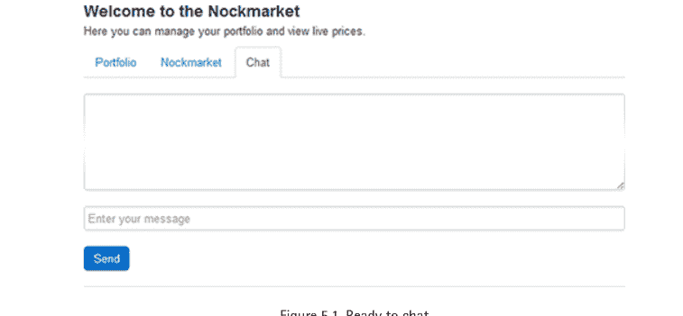

## 聊天选项卡：连接 Express 与 Socket.IO

到目前为止，我们一直在使用 `req.session._id` 来访问会话变量。`req` 代表 HTTP 请求对象。虽然 Node.js 使用此对象与浏览器进行原生通信，但 `Socket.IO` 通过在客户端和服务器之间发送和接收自定义消息来工作。例如，浏览器可能会向服务器发送一条“设置昵称”的消息，其处理方式如下：

```javascript
socket.on('set nickname', function (name) {
  :
});
```

注意这段代码中没有直接访问 HTTP 请求对象。因此，我们需要某种机制来存储会话变量。访问会话变量通常是读密集型操作，因为每个 HTTP 请求都必须解码会话密钥。为了获得最佳速度，最佳实践是采用纯内存解决方案，因为从 RAM 读写比从磁盘读写要快得多。

一个健壮的生产环境配置会涉及像 Redis [http://redis.io/] 这样的数据库。Redis 是一个可扩展的内存数据库系统，非常适合这类任务。对于一本入门书籍来说，要求你安装和配置两个数据库系统会显得过分。因此，我们将使用内置的 `MemoryStore` 来存储会话信息。在 `nocklib.js` 中创建如下函数：

```javascript
// chapter05/lib/nocklib.js (excerpt)
getSessionStore: function() {
  return sessionStore;
},
getStockPrices: function(stocks, callback) {
```

因为我们已将会话功能抽象到单个函数中，如果你希望进一步探索，切换到更健壮的会话存储机制将非常容易。只需更改这一个函数即可；其余代码可以保持不变。要获得一个良好的起点，请查看 Connect Redis [https://github.com/visionmedia/connect-redis]。要使用 `MemoryStore`，我们需在 `nocklib.js` 中引入一些额外的依赖：

```javascript
// chapter05/lib/nocklib.js (excerpt)
, db = require('./db')
, exchange = require('./exchange')
, express = require('express')
, http = require('http')
, MemoryStore = express.session.MemoryStore
, ObjectID = require('mongodb').ObjectID
```

定义导入后，可以如下创建一个会话存储对象：

```javascript
// chapter05/lib/nocklib.js (excerpt)
, volRange = 40;
var sessionStore = new MemoryStore();
```

我们将使用 `sessionStore` 对象作为中介，在 Express.js 和 `Socket.IO` 之间来回传递数据。最后一步是修改 `nockmarket.js` 以配置 Express 使用会话存储：

```javascript
// chapter05/nockmarket.js (excerpt)
app.use(express.session({secret: 'secretpasswordforsessions', store: nocklib.getSessionStore()}));
```

> **关于使用 MemoryStore 进行会话存储**
> `MemoryStore` 更适合用于原型设计，而非生产环境。因为内存存储将用户信息绑定到特定机器，当应用程序规模扩大到需要部署到多台机器时，其灵活性会受到限制。生产环境配置应使用更健壮的机制，例如前述的 Redis。

现在我们已经有了会话存储机制，可以将其与 `Socket.IO` 连接起来。首先，我们在 **package.json** 中添加依赖：

```json
// chapter05/package.json (excerpt)
, "should": "1.0.0"
, "socket.io": "0.9.10"
```

你需要运行常规的 `npm install`。现在，让我们在 **nocklib.js** 中添加一个函数来创建和配置一个 socket：

```javascript
// chapter05/lib/nocklib.js (excerpt)
},
createSocket: function(app) {
  io = require('socket.io').listen(app);
  io.configure(function (){
    io.set('authorization', function (handshakeData, callback) {
```

```javascript
});
};
},
createUser: function(username, email, password, callback) {
```

我们的函数接收 Express app 作为参数，然后将其传递给 `Socket.IO` 的 `listen` 函数。

在 `nocklib.js` 顶部将 `io` 声明为变量，如下所示：

```javascript
var sessionStore = new MemoryStore();
var io;
```

调用 `configure` 函数，并从指定授权流程开始：

```javascript
io.set('authorization', function (handshakeData, callback) {
  if (handshakeData.headers.cookie) {
    handshakeData.cookie = cookie
      .parse(decodeURIComponent(handshakeData.headers.cookie));
    handshakeData.sessionID = handshakeData.cookie['connect.sid'];
    sessionStore.get(handshakeData.sessionID
      , function (err, session) {
        if (err || !session) {
          return callback(null, false);
        } else {
          handshakeData.session = session;
          console.log('session data', session);
          return callback(null, true);
        }
      });
  }
  else {
    return callback(null, false);
  }
}
```

`Socket.IO` 的授权机制包含握手数据，而握手数据又包含头部数据。³ 头部数据将包含嵌入的 cookie 信息，我们正是在这里找到加密的会话 ID。这一行将产生类似如下的原始数据：

```
connect.sid=CGHs801f32T7Vc4VqSKszgjH.TryCeIqQjAGH6DvvjX6PweNK ...
```

我们提取会话 ID，然后从我们的会话存储中检索与该指定 ID 对应的实际会话。

如果我们找到会话，就返回它——表示授权成功。

如果没有找到，我们返回 `false`。

最后，我们处理未找到 cookie 的情况。

此配置函数将需要额外的导入、依赖和 `npm install`。以下是导入：

```javascript
// chapter05/lib/nocklib.js (excerpt)
var cookie = require('cookie')
  , crypto = require('crypto')
```

... 以及依赖：

```json
// chapter05/package.json (excerpt)
, "cookie": "0.0.4"
, "dnode" : "1.0.0"
```

在后端授权完成之前，还需要对 `nockmarket.js` 进行最后一次调整：

```javascript
// chapter05/nockmarket.js (excerpt)
db.open(function() {
    nocklib.createSocket(app);
    submitRandomOrder();
});
```

## 客户端聊天代码

现在我们需要对客户端进行一些修改，以使授权生效。将以下导入添加到 **portfolio.ejs**：

```html
<script src="/socket.io/socket.io.js"></script>
<script src="/js/chat.js"></script>
</head>
```

第一个包含的脚本是 `Socket.IO` 客户端库。第二个脚本是我们自定义的聊天库，我们现在将对其进行定义。按如下方式创建 **/public/js/chat.js**：

```javascript
// chapter05/public/js/chat.js
var socket = io.connect('http://localhost');
```

目前，我们只需要这一行代码。如果你重启应用并登录，你应该能在控制台看到类似这样的信息：

```
session data { lastAccess: 1345420544817,
  cookie:
    { originalMaxAge: 14400000,
      expires: '2012-08-20T03:55:44.821Z',
      httpOnly: true,
      path: '/' },
  _id: '501ef76dfbd51a082d000001' }
```

在我们的代码中，我们打印出所有会话信息。这包含了诸如 cookie 过期时间、路径，以及至关重要的 **_id** 字段等数据，该字段使我们能够可靠地将每个请求与数据库中的特定用户进行匹配。

现在，我们将继续利用这个字段做一些有趣的事情：让用户能够实时聊天。

## 谁加入了？

让我们从最简单的组件开始：当用户加入时显示一条通知消息。由于用户名非常有用，我们将修改 **routes/nockroutes.js**，以便在用户登录时直接将用户名存储到会话中：

```javascript
req.session._id = id;
req.session.username = req.body.username;
```

现在请按以下方式修改 **nocklib.js**：

```javascript
// chapter05/lib/nocklib.js (excerpt)
io.set('authorization', function (handshakeData, callback) {
  :
});

io.sockets.on('connection', function (socket) {
  socket.on('joined', function (data) {
    var message = '管理员: ' + socket.handshake.session.username
      + ' 已加入\n';
    socket.emit('chat', { message: message});
    socket.broadcast.emit('chat', { message: message});
  });
});
```

首先，我们监听客户端发出的 'joined' 消息。构造消息后，我们先将其发送给发起 'joined' 消息的用户，然后再向所有其他用户发送该消息。

服务器端的工作就完成了。在客户端，我们需要一个按钮让用户点击以加入聊天室。请按以下方式修改 **portfolio.ejs**：

```html
<!-- chapter05/views/portfolio.ejs (excerpt) -->
<div class="tab-pane" id="tab3">
  <p><button class="btn btn-info btn-large btn-primary"
    type="button" id="join-chat">加入聊天</button></p>
```

在初始隐藏所有聊天组件后，当用户点击 **加入聊天** 按钮时，我们可以显示这些组件，同时向服务器发出 'joined' 消息。请按以下方式修改 **chat.js**：

```javascript
// chapter05/public/js/chat.js (excerpt)
var socket = io.connect('http://localhost');
$(document).ready(function() {
    $('.chat-widget').hide();
    $('#join-chat').click(function() {
        $('#join-chat').hide();
        $('.chat-widget').show();
        socket.emit('joined', {});
    });
});
```

`socket.emit('joined', {});` 向服务器发送一个没有数据的 'joined' 消息，如 `{}` 所示。我们刚刚完成了服务器代码的编写，服务器将通过发出 'chat' 消息作为回应来处理此消息。'chat' 消息随后按如下方式处理：

```javascript
// chapter05/public/js/chat.js (excerpt)
$('#join-chat').click(function() {
    ...
});

socket.on('chat', function (data) {
    $('#textarea').prepend(data.message);
});
```

我们只需将消息添加到现有的文本区域中。现在请确保数据库中至少有两个用户。要模拟多用户，可以从不同的浏览器分别登录每个用户。例如，一个用户可以使用 Chrome 登录，而另一个用户使用 Firefox 登录。当第二个用户登录时，你应该会在第一个浏览器中看到类似图 5.2 的景象，前提是你已经点击了“加入聊天”。

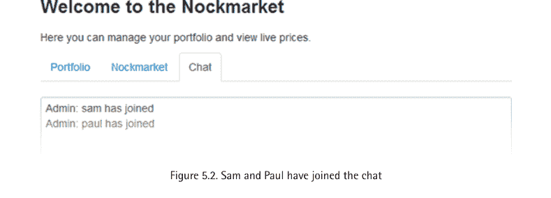

## 让他们交流

到这里，添加聊天功能就相当简单了。在后端，我们只需在 **nocklib.js** 中添加几行代码：

```javascript
// chapter05/lib/nocklib.js (excerpt)
io.sockets.on('connection', function (socket) {
    socket.on('clientchat', function (data) {
      var message = socket.handshake.session.username + ': ' + data.message + '\n';
      socket.emit('chat', { message: message});
      socket.broadcast.emit('chat', { message: message});
    });
});
```

这与用户加入聊天会话的代码类似。主要区别在于我们将实际的用户聊天数据附加到消息中。聊天数据通过客户端传输的 `data.message` 访问。客户端也很简单。请按以下方式修改 **chat.js**：

```javascript
// chapter05/public/js/chat.js (excerpt)
    socket.emit('joined', {});

});

$('#send-chat').click(function() {
    socket.emit('clientchat', {message: $('#input01').val()});
});
```

当用户点击 **发送** 按钮时，我们从输入字段中获取文本并发送一个 'clientchat' 消息给服务器。就是这么简单！

现在当你开始输入消息并点击 **发送** 时，聊天消息应该会同时出现在两个窗口中，如图 5.3 所示。

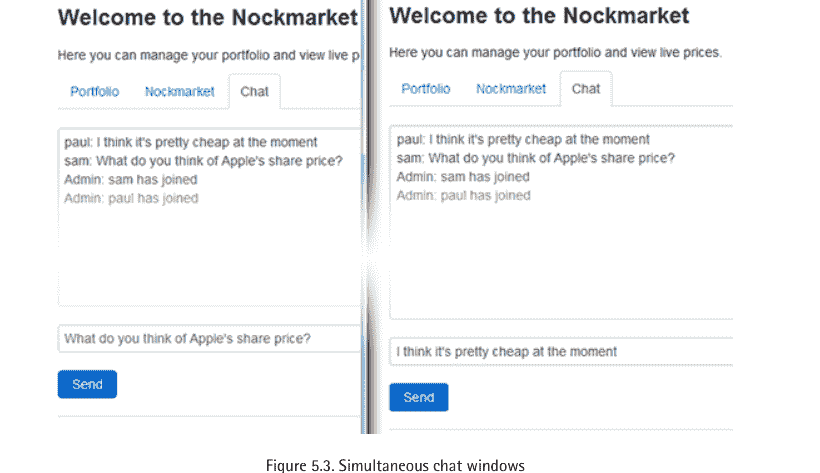

图 5.3. 同时聊天的窗口

## 谁在线？

现在让我们使用 `Socket.IO` 来检测在线用户。我们将实现一个功能，显示当前连接的用户数量及其实际用户名。在 **nocklib.js** 中，声明一个数组来存储在线用户：

```javascript
var io;
var online = [];
```

然后我们添加一些功能来存储用户并广播给连接的客户端：

```javascript
// chapter05/lib/nocklib.js (excerpt)
socket.on('joined', function (data) {
  online.push(socket.handshake.session.username);
  var message = socket.handshake.session.username + ': '
    + data.message + '\n';
  socket.emit('chat', { message: message
    , users: online});
  socket.broadcast.emit('chat', { message: message
    , username: socket.handshake.session.username});
});
```

如果有新用户连接，我们将用户名添加到 `online` 数组中。然后我们使用 `emit` 将整个用户列表发送给刚刚连接的用户。对于其他所有人，我们广播单个用户——最近加入的那一个。

然后在客户端，按以下方式修改 **chat.js**：

```javascript
// chapter05/public/js/chat.js (excerpt)
socket.on('chat', function (data) {
  $('#textarea').append(data.message);
  if (data.username) {
    $('#users').append('<span class="label label-success">'
      + data.username + '</span>');
  }
  if (data.users) {
    var userHtml = '';
    for (var i=0; i < data.users.length; i++) {
      userHtml += '<span class="label label-success">'
        + data.users[i] + '</span>';
    }
    $('#users').html(userHtml);
  }
});
```

这里我们应用了非常简单的逻辑。如果服务器发送单个值，我们将该用户附加到现有列表的末尾。如果它发送用户数组，我们则从头开始构建用户列表。

最后一步是修改 **portfolio.ejs**，添加一个占位符来显示我们的用户：

```html
<!-- chapter05/views/portfolio.ejs (excerpt) -->
<p><button type="submit" class="btn btn-primary chat-widget"
  id="send-chat">发送</button></p>
<p><span class="label label-inverse chat-widget"
  id="online">在线:</span><div id="users"></div></p>
```

现在，如果你用一个浏览器登录，然后在另一个浏览器中以另一个名字再次登录，第一个浏览器应该会实时更新；也就是说，显示两个用户都在线，如图 5.4 所示。

## 104 快速入门 Node.js

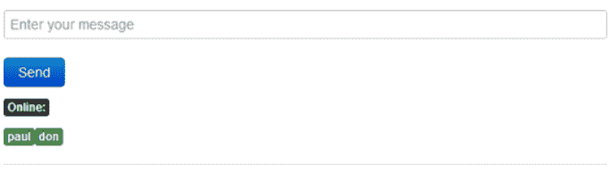

最后一项任务是适当处理用户断开连接的情况。`Socket.IO` 有一个内置的断开连接机制来处理这个问题。在 **nocklib.js** 中添加以下内容：

```javascript
// chapter05/lib/nocklib.js (excerpt)
socket.on('clientchat', function (data) {
  :
});

socket.on('disconnect', function (data) {
  var username = socket.handshake.session.username;
  var index = online.indexOf(username);
  online.splice(index, 1); // 1
  socket.broadcast.emit('disconnect', { username: username}); // 2
});
```

当用户断开连接时，我们做两件事。

1. 首先，我们更新包含所有用户的数组，移除已断开连接的用户。我们通过找到用户的索引，然后使用 JavaScript 内置的 `splice` 函数来实现。
2. 其次，我们向所有客户端广播 'disconnect' 消息，以便它们可以相应地更新用户界面。

现在我们将对 **chat.js** 做一些小修改：

```javascript
// chapter05/public/js/chat.js (excerpt)
if (data.username) {
  $('#users')
    .append('<span class="label label-success'
      + '" id="username-' + data.username + '"'
      + '>' + data.username + '</span>');
}
```

```javascript
// chapter05/public/js/chat.js (excerpt)
if (data.users) {
  var userHtml = '';
  for (var i=0; i<data.users.length; i++) {
    userHtml += '<span class="label label-success'
      + '" id="username-' + data.users[i] + '"'
      + '>' + data.users[i] + '</span>';
  }
  :
}
```

对于第一个任务，我们给标签添加了一些 id，以便它们可以被识别和移除。实际的移除代码非常简单：

```javascript
// chapter05/public/js/chat.js (excerpt)
$('#users').html(userHtml);
  }
});

socket.on('disconnect', function (data) {
  $('#username-' + data.username).remove();
});
```

收到 'disconnect' 消息后，我们搜索相应的标签并执行 jQuery 的 `remove` 操作。现在，当用户断开连接时，所有客户端都应实时更新其界面。要试用此功能，请在不同的浏览器中分别登录两个不同的用户。现在关闭其中一个浏览器。剩余的浏览器应显示更新后的用户列表，其中已断开连接的用户被移除。

恭喜，你刚刚构建了一个实时的多用户聊天室！你的用户现在可以利用它来讨论美联储的最新会议纪要或他们最喜爱股票的收益公告。现在是时候使用 `Socket.IO` 发送一种非常不同的数据了：实时交易。

## 实时交易

我们现在将在第 2 章创建的交易所基础上继续构建。我们的最终目标是从服务器向浏览器发送实时金融数据。首先，让我们在交易所中添加更多股票。目前，它只交易一只假设的股票。让我们用一个字符串数组来表示我们的股票。请按以下方式修改 **nockmarket.js**：

### 106 快速入门 Node.js

```javascript
// chapter05/nockmarket.js（摘录）
var timeRange = 1000;
var stocks = ['NOCK1', 'NOCK2', 'NOCK3', 'NOCK4', 'NOCK5'];
var allData = [];
stocks.forEach(function(stock) {allData.push({});});
```

这里我们将股票表示为一个包含字符串的数组。我们声明并初始化一个相应的数组，用于保存每只股票的金融数据。然后我们对 `submitRandomOrder` 函数做了一些调整，使其能够处理多只股票：

```javascript
// chapter05/nockmarket.js（摘录）
function submitRandomOrder(index) {
  var exchangeData = allData[index];
  var ord = nocklib.generateRandomOrder(exchangeData);
  ord.stock = stocks[index];
  if (ord.type == exch.BUY)
    allData[index] = exch.buy(ord.price, ord.volume, exchangeData);
  else
    allData[index] = exch.sell(ord.price, ord.volume, exchangeData);
}
```

首先，我们给函数添加了一个参数 `index`，用于表示我们正在交易的是哪只股票。然后，我们不再使用一个单一的全局 `exchangeData`，而是为每只股票使用独立的 `exchangeData`。我们现在修改订单，添加一个 `stock` 字段来指明我们正在交易的是哪只股票：

```javascript
// chapter05/nockmarket.js（摘录）
var ord = nocklib.generateRandomOrder(exchangeData);
ord.stock = stocks[index];
```

这就像看起来一样简单。我们只是修改了 JSON 对象；其他什么也不需要改变。MongoDB 会无缝地添加这个新字段，而我们无需编写任何额外的与数据库相关的代码。交易的处理也类似：

```javascript
// chapter05/nockmarket.js（摘录）
trade.init = (ord.type == exch.BUY) ? 'b' : 's';
trade.stock = stocks[index];
```

我们还将按如下方式修改我们的 `pauseThenTrade` 函数：

```javascript
// chapter05/nockmarket.js（摘录）
function pauseThenTrade() {
    var pause = Math.floor(Math.random() * timeRange) + timeFloor;
    setTimeout(submitRandomOrder.bind(this, index), pause);
}
```

我们现在使用 JavaScript 的 `bind` 机制，向 `submitRandomOrder` 传递一个参数，以指明我们正在交易的是哪只股票。发送交易数据可能是我们在整本书中编写的最简单的代码！现在，在你的 `getUser` 函数下方的 **nocklib.js** 中添加以下函数：

```javascript
// chapter05/lib/nocklib.js（摘录）
},
sendTrades: function(trades) {
    io.sockets.emit('trade', JSON.stringify(trades));
}
}
```

这个函数接收一个交易数组，并向所有已连接的客户端发送一个 'trade' 消息。`JSON.stringify` 纯粹是为了文本格式化，使数据稍微容易阅读一些。这只是一个临时措施；在第 6 章中，我们将使数据看起来比控制台中的文本更令人兴奋。

有必要在 **nockmarket.js** 中添加最后一行代码来发送交易：

```javascript
// chapter05/nockmarket.js（摘录）
db.insertOne('transactions', ord, function(err, order) {
    if (exchangeData.trades && exchangeData.trades.length > 0) {
        nocklib.sendTrades(exchangeData.trades);
    }
```

我们还需要为每只股票调用一次 `submitRandomOrder`：

### 108 快速入门 Node.js

```javascript
// chapter05/nockmarket.js（摘录）
nocklib.createSocket(app);
app.listen(3000);
for (var i = 0; i < stocks.length; i++) {
    submitRandomOrder(i);
}
```

请注意，现有的 `submitRandomOrder()` 应该被删除。服务端代码现在已经完成。

## 客户端的交易

目前，我们在客户端需要做的只是将交易记录到控制台，以确认它们被成功接收。将以下内容添加到 `portfolio.ejs`：

```html
<!-- chapter05/views/portfolio.ejs（摘录） -->
<script src="/js/trades.js"></script>
</head>
```

然后创建 `/public/js/trades.js`：

```javascript
// chapter05/public/js/trades.js
socket.on('trade', function (data) {
    console.log(data);
});
```

就是这样！你需要能够查看浏览器的控制台。查看控制台的方法因浏览器而异。在 Chrome 中，你可以按 **Ctrl-Shift-I**（在 Mac 上是 **Cmd-Option-I**）。你可能需要点击 **Console** 标签页。一旦你登录并打开控制台，你应该会看到类似图 5.5 所示的视图。

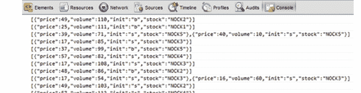

图 5.5. Chrome 控制台打印股票价格

干得好！你现在已经用 Node.js 构建了一个实时交易交易所，数据会实时流式传输到多个已连接的客户端。对于那些无法访问控制台的读者，别担心；你不会错过任何东西。这只是一个中间步骤，用来提供一些证据，表明数据正在进入浏览器。在第 6 章中，我们将直接从控制台转向页面，在那里你会看到大量证据表明用户正在接收数据。

## 告别表单

迄今为止，我们一直通过表单或更高级的 Ajax 来处理用户输入。`Socket.IO` 引入了一些有趣的可能性。你可能会问，为什么我们要为一项现有技术已经满足的用途而使用 `Socket.IO`？原因有几个。

首先，它使我们能够简化路由。迄今为止，我们一直使用路由作为粘合剂，将前端视图与后端业务逻辑绑定在一起。随着应用程序变得更大，路由文件不可避免地会变得杂乱，无论其结构组织得有多好。`Socket.IO` 使我们能够完全绕过路由表，本质上允许前端视图直接与业务逻辑通信。

其次，`Socket.IO` 使用了一种更优越的传输协议。如果可用，它会使用 WebSocket，这比 `XMLHttpRequest` 开销更少，并且具有支持双向通信的额外优势。

第三，你的应用程序具有前瞻性。它从不直接处理特定的协议，如 WebSocket；相反，它只使用 `Socket.IO` API。这意味着，无论何时出现最新、最伟大的技术，你的应用程序都能通过简单地升级 `Socket.IO` 库来加以利用。相比之下，Ajax 与特定的实现（即 `XMLHttpRequest`）绑定在一起。要将其切换到另一个协议，将涉及非同小可的代码重写。

> **Socket.IO API 变更**
>
> 虽然我们声明你只需要升级 `Socket.IO` 库即可跟上最新技术，但这仅在 `Socket.IO` 保持其现有底层 API 或架构的前提下才成立。在 Node.js 社区中，惯例规定低于 1.0 的版本号被视为测试版，这意味着最终用户应准备好应对版本之间的 API 变更。1.0 之后，产品通常会更加稳定，未来的发布版本也倾向于保持向后兼容。
>
> 在撰写本文时，`Socket.IO` 目前处于 v0.9.x 版本。v1.0 的发布将意味着，作为最终用户，与 Node.js 生态系统中目前使用的一些不太成熟的包相比，你将大大减少对向后兼容性的担忧。

我们现在将实现一个简单的表单，允许用户更新他们的电子邮件地址。首先，让我们修改 **portfolio.ejs** 模板，添加一个包含账户详细信息的额外标签页：

```html
<!-- chapter05/views/portfolio.ejs（摘录） -->
<script src="/js/trades.js"></script>
<script src="/js/account.js"></script>
:
<li><a href="#tab3" data-toggle="tab" id="chat-tab">Chat</a></li>
<li><a href="#tab4" data-toggle="tab">My Account</a></li>
:
<p><span class="label label-inverse chat-widget" id="online">Online:</span><div id="users"></div></p>
</div>
<div class="tab-pane" id="tab4">
<p><input type="text" class="input-xlarge span8" id="email"></p>
<p><button type="submit" class="btn btn-primary" id="update-account">Update</button></p>
</div>
```

这里没有什么新东西需要学习；它与我们之前编写的代码非常相似。在后端，我们需要做一些添加。首先，我们修改 **db.js**，添加一个允许我们修改用户数据的函数：

```javascript
// chapter05/lib/db.js（摘录）
push: function(name, id, updateQuery, callback) {
    :
},
updateById: function(name, id, updateQuery, callback) {
    db.collection(name).update({_id: id}, {$set: updateQuery}
        , {safe:true}, callback);
}
```

这与我们的 `push` 函数非常相似，不同之处在于我们使用了 `$set` 操作符而不是 `$push` 操作符，来更新数据库中的指定字段。要使用此函数，我们按如下方式将其链接到 **nocklib.js** 中的一个函数：

```javascript
// chapter05/lib/nocklib.js（摘录）
sendTrades: function(trades) {
    :
},
updateEmail: function(id, email, callback) {
    db.updateById('users', new ObjectID(id)
        , {email: email}, callback);
}
```

我们通过调用通用的更新函数，并指定集合为 `users`，查询条件为 `{email: email}`，来更新用户电子邮件。最后，我们修改 `createSocket` 以处理来自客户端的消息：

```javascript
// chapter05/lib/nocklib.js（摘录）
socket.on('joined', function (data) {
    :
});

socket.on('updateAccount', function (data) {
    module.exports.updateEmail(socket.handshake.session._id,
        data.email, function(err, numUpdates) {
            // 在此向客户端发送响应
    });
});
```

### 112 快速入门 Node.js

```javascript
// chapter05/public/js/account.js (excerpt)
$(document).ready(function() {
    $('#update-account').click(function() {
        socket.emit('updateAccount', {email: $('#email').val()});
    });
});
```

为了验证我们确实在存储电子邮件地址，我们可以修改 **nockroutes.js** 中的 portfolio 函数，将电子邮件地址传递给模板：

```javascript
// chapter05/routes/nockroutes.js (excerpt)
res.render('portfolio', {portfolio: portfolio, prices: prices
, email: user.email});
```

然后我们可以稍加修饰 **portfolio.ejs** 来显示用户的电子邮件地址：

```html
<!-- chapter05/views/portfolio.ejs (excerpt) -->
<input type="text" class="input-xlarge span8" id="email" value="<%=email%>"></p>
```

现在，如果你更新电子邮件地址并刷新页面，文本框将正确显示新的电子邮件地址。让我们以一点华丽的收尾来结束本章。我们将显示一条确认消息，让用户知道他们的电子邮件地址已正确更新。在服务器端，我们只需在 **nocklib.js** 中添加一行代码，向客户端表明操作成功：

```javascript
// chapter05/lib/nocklib.js (excerpt)
module.exports.updateEmail(socket.handshake.session._id, data.email
, function(err, numUpdates) {
    socket.emit('updateSuccess', {});
});
```

在 `/public/js/account.js` 中，我们可以通过添加以下内容来显示警告框：

```javascript
// chapter05/public/js/account.js (excerpt)
socket.on('updateSuccess', function (data) {
  var html = "<div class='alert alert-success'>"
    "<i class='icon-ok'></i> Email updated!</div>";
  $(html).hide()
    .appendTo('h3').fadeIn("fast").delay("2000").fadeOut("fast");
});
```

这里我们使用 Bootstrap 的警告框来处理消息，让它淡入，然后淡出。
现在当你更新电子邮件地址时，你应该会看到图 5.6 所示的内容。

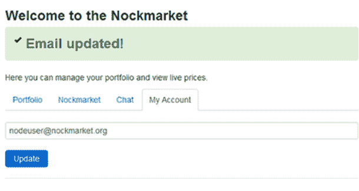

图 5.6. 你的电子邮件地址现在已更新！

消息应在几秒钟后淡出。是时候拍拍自己的肩膀了，因为你在本章中已经取得了相当多的成就。使用 `Socket.IO`，你构建了一个实时聊天系统，向浏览器传输了实时交易数据，并构建了一个比传统 Ajax/表单方案更快的替代方案。

## 总结

在本章中，我们学习了以下内容：

- 使用 `Socket.IO` 进行身份验证
- 如何创建一个基本的实时聊天应用
- 检测和显示连接与断开连接的用户
- 更新我们的模拟股票市场以包含任意数量的股票
- 通过 `Socket.IO` 发送实时交易数据
- 使用 `Socket.IO` 替代表单和 AJAX

# 第 6 章

## Backbone

> “混沌是自然的法则；秩序是人类的梦想。”
> ——亨利·B·亚当斯

软件工程关乎管理复杂性；这是我们不断重申的主题，但怎么强调都不为过。到目前为止，我们已经探讨了在服务器端管理复杂性的多种方法；然而，我们还没有讨论客户端的复杂性管理。迄今为止，我们一直通过注释 HTML 标签，然后通过 jQuery 操作它们来管理客户端代码。虽然这对较小的项目有效，但随着代码库规模的增长，管理复杂性的能力会迅速失效。

为了管理这类问题，已经构建了许多客户端框架。在本章中，我们将了解其中一个更流行的框架：`Backbone.js`。¹ `Backbone` 大致遵循 **MVC** 模型，其中应用程序被划分为模型、视图和控制器。我们将探讨 `Backbone` 如何与 Node.js 结合，为终端用户呈现一个实时的图形用户界面，展示订单和交易。虽然最初的学习曲线有点陡峭，但最终结果是一个优雅的客户端代码管理方案，可以根据需要扩展到更大的代码库。

¹ http://backbonejs.org/

### 模型、视图、控制器和 Backbone.js

全面探讨 MVC 和 Backbone 本身就可以成为一本书。对于初学者来说，无需担心；本章专为那些初次接触 MVC 和 Backbone 的人设计。然而，对于那些希望进一步深入探索的人，这里列出了一些推荐资源：

**http://net.tutsplus.com/tutorials/other/mvc-for-noobs/**
一篇关于 MVC 的简要介绍，以 PHP 为目标语言编写。这样做的好处是，读者可以纯粹专注于架构方面，而不会陷入语言细节的泥沼。

**http://backbonejs.org/#FAQ-mvc**
这段来自 Backbone 官方文档的片段解释了传统的 MVC 如何与 Backbone 的方法契合。

**https://github.com/addyosmani/backbone-fundamentals**
一本开源的书籍，致力于相当详细地解释 Backbone。

**https://github.com/documentcloud/backbone/wiki/Tutorials%2C-blog-posts-and-example-sites**
一个全面的 Backbone 示例和教程库。

## 提前预览

在我们获得最终收益之前，还有相当多的概念需要涵盖。让我们快速构建一个最终产品的模型，因为它将提供一个方便的路线图来指导我们。我们将从一个简单的 Bootstrap 模型开始。

代码是纯 HTML，可以在 https://gist.github.com/3949965 获取。复制代码并将其粘贴到 **portfolio.ejs** 中，如下所示：

```html
<!-- chapter06/views/portfolio.ejs (excerpt) -->
<div class="tab-pane" id="tab2">
  <!-- 将代码粘贴到这里 -->
</div>
```

你的 **Nockmarket** 选项卡现在应该类似于图 6.1。

## 欢迎来到 Nockmarket

在这里，你可以管理你的投资组合并查看实时价格。

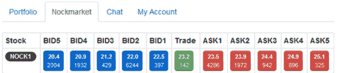

图 6.1. 显示价格的 **Nockmarket** 选项卡

### 客户端过滤

我们将实现一个过滤器，允许用户根据特定股票的代码过滤其投资组合。有几种方法可以实现这一点，效率最低的是传统的表单提交。这涉及到整个页面的刷新，包括我们知道将保持不变的页面部分。

一个更好的方法是使用 Ajax，因为它只会更改涉及新数据的页面部分。这将比完整的页面刷新更快，但仍然需要调用服务器，这可能会根据用户与你网站之间的连接情况导致体验迟缓。

通过将 jQuery 与 HTML 标签注释相结合，可以构建一种临时解决方案来处理客户端问题。`Backbone` 是一个轻量级的框架，它将强制采用始终如一的方法。使用这样的框架是首选，因为它将提高代码的可读性和可维护性。

我们的第一个任务是改变初始股票投资组合从服务器传输到客户端的方式。目前，用户发出请求，数据在服务器上组装，然后被输入模板并呈现给用户。

`Backbone` 的方法如下。与之前一样，用户发出请求。然后 `Backbone` 向服务器端 API 发出请求。数据被放置在客户端的模型中。随后的更改在模型上进行，绑定指定这些更改应如何反映在用户界面中。让我们继续一个具体的例子来帮助说明这个概念。修改 **portfolio.ejs** 如下：

### 118 快速入门 Node.js

```html
<!-- chapter06/views/portfolio.ejs (excerpt) -->
<script type="text/javascript" src="http://twitter.github.com/bootstrap/assets/js/bootstrap-tab.js"></script>
<script src="http://documentcloud.github.com/underscore/underscore-min.js"></script>
<script src="http://backbonejs.org/backbone-min.js"></script>
```

`Backbone` 依赖于另一个名为 `Underscore` 的小型库。² 两者都应放置在我们开始自己的 JavaScript 代码之前。现在修改 **public/js/portfolio.js** 如下：

```javascript
// chapter06/public/js/portfolio.js (excerpt)
        $('.stock-list').append('<tr><td>' + $('#stock').val()
            + '</td><td>' + price + '</td></tr>');
        });
    });

    var PortfolioView = Backbone.View.extend({
        initialize: function() {
            this.render();
        },
        render: function() {
            $('.stock-list').html('<tr><td>1</td><td>2</td></tr>');
        }
    });

    new PortfolioView();
});
```

这是最简单的 `Backbone` 应用之一。有一个函数 **initialize**，它在开始时被调用。然后它调用 render 函数，该函数设置我们表格的内容。如果你现在转到 **Portfolio** 选项卡，你会看到我们的数据已被一些虚拟数据取代。

现在让我们修改这个示例以返回真实数据。大部分后端工作已经完成。我们只需对 **nockroutes.js** 做一个小小的调整：

```javascript
// chapter06/routes/nockroutes.js (excerpt)
portfolio: function(req, res) {
  if (req.xhr) {
    nocklib.getUserById(req.session._id, function(err, user) {
      var portfolio = [];
      if (user && user.portfolio)
        portfolio = user.portfolio;
      nocklib.getStockPrices(portfolio, function(err, prices) {
        var data = [];
        for (var i=0; i<portfolio.length; i++) {
          data.push({stock: portfolio[i], price: prices[i]});
        }
        res.json(data);
      });
    });
  } else {
    res.render('portfolio');
  }
},
```

我们使用 `req.xhr` 来检测 Ajax 请求。在发生 Ajax 请求时，我们构造一个包含股票名称和价格的数据数组。我们发送原始 JSON 而不是 HTML，如 `res.json` 调用所示。请注意，我们仍然需要使用 Ajax 进行初始数据加载。信息仍然必须从服务器传递到客户端！`Backbone.js` 的优势在于，只要不需要新信息，后续的更改就可以完全在客户端执行。

## Backbone 模型

让我们看看 `Backbone` 如何处理模型。首先，我们可以在 `public/js/portfolio.js` 中定义一个基本模型和集合：

```javascript
// chapter06/public/js/portfolio.js (excerpt)
});

var PortfolioModel = Backbone.Model.extend({

});

var PortfolioCollection = Backbone.Collection.extend({
    model: PortfolioModel,
    url: '/portfolio'
});

var PortfolioView = Backbone.View.extend({
```

这里我们通过扩展股票 `Backbone` 模型来定义一个基本模型。然后我们通过指定我们的模型和一个 URL 来定义一个集合。`url` 定义了我们 JSON API 的路径。然后我们可以通过修改 `initialize` 函数来使用我们新定义的组件：

```javascript
// chapter06/public/js/portfolio.js (excerpt)
initialize: function() {
    window.portfolioCollection = new PortfolioCollection();
    window.portfolioCollection.fetch({
        success: function() {
            console.log(window.portfolioCollection.toJSON());
        },
        error: function() {
            console.log('Error fetching data for portfolio');
        }
    });
},
render: function() {
```

这里我们初始化集合并使用内置的 `fetch` 从 API 检索数据。如果出错，我们会打印错误信息。成功时，我们现在先记录 JSON 数据。第五章还有一些控制台输出，所以在 **public/js/trades.js** 中注释掉日志记录，如下所示：

```javascript
// chapter06/public/js/trades.js (excerpt)
socket.on('trade', function (data) {
    //console.log(data);
});
```

现在当你重启应用程序时，你应该会在控制台看到类似于图 6.2 的输出：

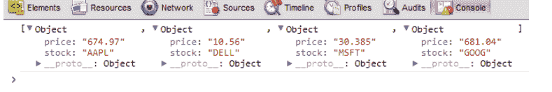

### 没有控制台，没有问题

如果你无法访问浏览器的控制台，不用担心。这只是一个中间步骤；很快，我们就会将所有数据取回到浏览器中。

## 从模型到视图

模型中的数据如何渲染成视图？我们现在来看一下。首先，让我们移除打印股票列表的模板代码。这是“旧的”渲染方式，我们将用 `Backbone` 的方法来替换它。修改 **portfolio.ejs** 如下：

```html
<!-- chapter06/views/portfolio.ejs (excerpt) -->
<tbody class="stock-list">
    <!-- 删除这里的所有内容 -->
</tbody>
```

现在让我们修改 **portfolio.js** 中的成功函数，使其调用 `render`，而不是向控制台打印消息：

```javascript
// chapter06/public/js/portfolio.js (excerpt)
var self = this;
window.portfolioCollection.fetch({
    success: function() {
        self.render();
    },
```

对于 JavaScript 经验有限的人来说，`self = this` 可能看起来很令人困惑。我们这样做是因为在 JavaScript 中，`this` 关键字是上下文相关的。³ 但可以这么说，我们将 `PortfolioView` 实例的值存储在一个名为 `self` 的变量中，这样无论在哪里使用，我们都能确保它的值。然后我们按如下方式修改 `render`：

³ http://www.quirksmode.org/js/this.html

```javascript
// chapter06/public/js/portfolio.js (excerpt)
render: function() {
    for (var i=0; i<window.portfolioCollection.models.length; i++) {
        var data = window.portfolioCollection.models[i];
        var rowView = new RowView({model: data});
        $('.stock-list').append(rowView.render().el);
    }
}
```


# 第6章

## 实时交易

这里我们首先遍历所有模型。然后我们将每个模型输入到一个 `RowView` 中，我们即将定义这个视图。我们想要为单个表格行设置一个单独的视图，因为这允许我们在控制展示时具有最大的粒度。然后我们如下定义 `RowView`：

```javascript
// chapter06/public/js/portfolio.js (摘录)

});

var RowView = Backbone.View.extend({

    tagName: 'tr',

    render: function() {

        var template =

            _.template("<td><%=stock%></td><td><%=price%></td>");

        $(this.el).html(template(this.model.toJSON()));

        return this;

    }

});

new PortfolioView();
```

`el` 和 `tagName` 变量起初可能有点令人困惑。官方文档对此的描述如下：

> “所有视图都有一个 DOM 元素（`el` 属性），无论它们是否已插入页面。这样，视图可以随时渲染，并一次性插入 DOM，以获得高性能的 UI 渲染，同时尽可能减少回流和重绘。`this.el` 是从视图的 `tagName`、`className`、`id` 和 `attributes` 属性创建的（如果指定了的话）。如果没有，则 `el` 是一个空的 `div`。
>
> —Backbone.js

在这个特定情况下，`el` 是 `tr` 标签。当我们调用 `render` 时，实际的 HTML 内容出现在 `<tr></tr>` 标签之间。我们使用 Backbone 的姊妹库 Underscore 来构建模板：

```javascript
var template = _.template(...);
```

然后我们将模型转换为 JSON：

```javascript
this.model.toJSON()
```

... 并将其输入模板，模板将返回纯 HTML。一旦我们有了 HTML，我们就可以将每一行追加到表格主体中。现在如果你刷新页面，原始的股票和价格列表应该再次出现在屏幕上。这么多的工作只是为了回到我们之前的状态。然而，我们现在将添加客户端过滤，Backbone 的好处将变得更加明显。

### 客户端过滤器

首先，让我们修改 `portfolio.ejs` 并添加一个 Bootstrap 小部件：

```html
// chapter06/views/portfolio.ejs (摘录)

<button id="add-stock" class="btn">Add Stock</button><hr />

<input id="filter" type="text" class="input-medium search-query" name="filter">

<button class="add-filter btn">Filter</button>
```

现在你应该在 **Add Stock** 按钮下方有一个 **Filter** 按钮。首先，我们将模型修改如下：

```javascript
// chapter06/public/js/portfolio.js (摘录)

var PortfolioModel = Backbone.Model.extend({

    defaults: {

        visible: true

    },

    setVisible: function(visible) {

        this.set({visible: visible});

    }

});
```

除了股票代码和价格，我们还向模型添加了一个可见性属性，该属性将用于控制数据在屏幕上是否可见。然后我们按如下方式修改 `PortfolioView`：

```javascript
// chapter06/public/js/portfolio.js (摘录)

var PortfolioView = Backbone.View.extend({

  el: 'body',

  events: {

    'click .add-filter': 'filter'

  },

  filter: function() {

    var filterString = $('#filter').val();

    var data = window.portfolioCollection.models;

    for (var i=0; i<data.length; i++) {

      if (data[i].toJSON().stock.toLowerCase()

        .indexOf(filterString.toLowerCase()) == -1) {

          data[i].setVisible(false);

      }

      else data[i].setVisible(true);

    }

  },

  initialize: function() {

```

我们将 `el` 设置为 `body` 标签，然后添加一个事件：

```javascript
'click .add-filter': 'filter'
```

这意味着当有人点击带有 `add-filter` 类的元素时，我们的 `filter` 函数将被触发。在我们的 `filter` 函数中，我们检索搜索词，并通过将其转换为小写并使用 JavaScript 内置的 `indexOf` 函数，将其与每个股票代码进行比较。关键的是，我们此时所做的只是使用 `setVisible` 修改模型的可见性属性。实际上没有指定任何与视图相关的代码。视图代码由 `RowView` 按如下方式处理：

```javascript
// chapter06/public/js/portfolio.js (摘录)

var RowView = Backbone.View.extend({

    tagName: 'tr',

    initialize: function() {

        _.bindAll(this, 'setVisibility');

        this.model.bind('change', this.setVisibility);

    },

    setVisibility: function() {

        if (!this.model.toJSON().visible) $(this.el).hide();

        else $(this.el).show();

    },

    render: function() {

```

这是 Backbone 解决方案的关键所在。在 `initialize` 函数中，我们将模型的变更绑定到 `setVisibility` 函数。在 `setVisibility` 中，我们可以查询属性并相应地设置视图。这里我们查询 `visible` 属性，并使用 jQuery 的 `show` 和 `hide` 来执行相关操作。现在，当你输入过滤术语时，股票列表应该会相应更新。运行你的应用，并注意业务逻辑、模型和视图之间的清晰分离。这种分离将使你的代码库保持可读性和可维护性。

## 实时交易

现在是时候收获我们迄今为止所有努力的成果了。在本节结束时，你将在浏览器中看到实时交易。

我们将把它分解为两个部分。在第一部分中，我们将在客户端连接时初始化模型并加载初始数据集。这里的许多概念将与我们刚刚实现的客户端过滤器类似。在第二部分中，我们将使用我们的模型和集合来实时更新数据。

我们首先在 `nocklib.js` 中声明一个变量来存储最新的交易所数据：

```javascript
// chapter06/lib/nocklib.js (摘录)

var online = [];

var lastExchangeData = {};
```

现在，让我们添加一个函数，在每次交易所数据变化时存储它：

```javascript
// chapter06/lib/nocklib.js (摘录)

},

sendExchangeData: function(stock, exchangeData) {

  lastExchangeData[stock] = exchangeData;

  var current = transformStockData(stock, exchangeData);

  io.sockets.emit('exchangeData', current);

},

sendTrades: function(trades) {

```

第一个任务是存储数据。然后我们转换它并将其发送给客户端。按照以下方式，将转换函数添加到 `nocklib.js` 的底部：

```javascript
// chapter06/lib/nocklib.js (摘录)

function transformStockData(stock, existingData) {

  var newData = {};

  newData.st = stock;

  if (existingData && existingData.trades

    && existingData.trades.length > 0) {

      newData.tp = existingData.trades[0].price;

      newData.tv = existingData.trades[0].volume;

  }

}
```

我们转换数据，因为通过网络传输整个交易所数据块效率低下。加载时间是宝贵的资源，我们传输的数据越少，用户体验就越好。在前面的代码中，我们查找交易记录，如果存在，我们就将其截取为 `tp`（交易价格）和 `tv`（交易量）。遵循类似的逻辑，我们按如下方式转换买盘和卖盘：

```javascript
// chapter06/lib/nocklib.js (摘录)

if (existingData && existingData.trades

  && existingData.trades.length > 0) {

    :

}

var buyPrices = {};

var askPrices = {};

if (existingData && existingData.buys) {

  buyPrices = Object.keys(existingData.buys.volumes);

```

```javascript
for (var i=buyPrices.length - 5; i<buyPrices.length; i++) {

    var index = buyPrices.length - i;

    newData['b' + index + 'p'] = buyPrices[i];

    newData['b' + index + 'v'] = existingData.buys.volumes[buyPrices[i]];

}

}

if (existingData && existingData.sells) {

    askPrices = Object.keys(existingData.sells.volumes);

    for (var i=0; i<5; i++) {

        var index = i + 1;

        newData['a' + index + 'p'] = askPrices[i];

        newData['a' + index + 'v'] = existingData.sells.volumes[askPrices[i]];

    }

}

return newData;

}
```

我们不是将整个订单簿传输给客户端，而是简单地获取深度为五档的订单，因为这是将在客户端显示的内容。然后我们分配代码，例如 `b1p` 表示第一个买盘价，`b1v` 表示第一个买盘量，依此类推。最后，我们为不存在的值添加一些填充：

```javascript
// chapter06/lib/nocklib.js (摘录)

}

for (var i = 1; i <= 5; i++) {

    if (!newData['b' + i + 'p']) {

        newData['b' + i + 'p'] = 0;

        newData['b' + i + 'v'] = 0;

    }

    if (!newData['a' + i + 'p']) {

        newData['a' + i + 'p'] = 0;

        newData['a' + i + 'v'] = 0;

    }

    if (!newData['tv']) {

        newData['tv'] = 0;

    }

    if (!newData['tp']) {

        newData['tp'] = 0;

    }

}

return newData;

}
```

> **效率**
> 上述数据模式可以进一步改进。例如，我们可以只将数据数组发送到客户端，并在客户端处理更多的业务和解析逻辑。我倾向于让业务逻辑由服务器控制。我倾向于让客户端“简单”，只打印服务器提供的信息，但你可以根据项目的具体业务需求自由地权衡这种平衡。

现在，当客户端发出初始请求时，我们可以用这种更紧凑的格式传输交易所数据：

```javascript
// chapter06/lib/nocklib.js (摘录)

});

socket.on('requestData', function (data) {

  socket.emit('initExchangeData'

    , {exchangeData: transformExchangeData(lastExchangeData)});

});

socket.on('updateAccount', function (data) {

```

`'requestData'` 是客户端传输的一条消息，我们将在本章后面实现它。我们需要一个辅助函数来遍历交易所中的每只股票，并在发送给客户端之前截取数据：

```javascript
// chapter06/lib/nocklib.js (摘录)

function transformExchangeData(data) {

  var transformed = [];

  for (var stock in data) {

    var existingData = data[stock];

    var newData = transformStockData(stock, existingData);

    transformed.push(newData);

  }

  return transformed;

}

function transformStockData(stock, existingData) {

```

最后，让我们修改 **nockmarket.js**，以便它发送所有的交易所数据：

```javascript
// chapter06/nockmarket.js (摘录)

});

nocklib.sendExchangeData(stocks[index], exchangeData);

db.insert('transactions', trades, function(err, trades) {

```

我们之前为了简化使用了交易记录。在控制台打印所有内容会太混乱。现在我们可以图形化地呈现它，这不再是个问题。现在是在客户端构建模型和集合的时候了。

### 加载交易数据

尽管业务问题不同，但构建客户端过滤器时学到的许多概念也适用于实时交易问题。不过，仍有一些差异需要解决。首先，模板更复杂，因此简单地将其存储在字符串中会很别扭。创建一个名为 **public/templates** 的新文件夹，然后通过粘贴 https://gist.github.com/3949967 中的代码生成 **trade-table.ejs**。

> **替代的客户端模板**
> 另一种嵌入客户端模板的常见方法是将模板放在主 HTML 页面内的 `<script type = "text/template"></script>` 标签中。在这种情况下，我们遇到了一个特殊的情况，因为我们在服务器和客户端上使用了相同的模板语法。这带来了一个有趣的挑战，因为服务器在尝试解释客户端标签时会抛出错误。你可以使用各种解决方法，例如更改模板设置以使用替代语法。我将此留给好奇的读者作为练习来探索。

这是一段稍微有点笨拙的代码块，如果我们将其嵌入 JavaScript 文件中，会产生维护问题。专用的模板允许将表示层与业务逻辑分离。如果代码的大小看起来令人生畏，分解后它只是一系列 HTML `td` 标签，并带有一些 id。它比我们在“预览”部分编写的模型更精细一些。要完成 HTML 部分，请在 **portfolio.ejs** 中添加一个小注释，如下所示：

```html
// chapter06/views/portfolio.ejs (摘录)

</thead>
<tbody class="stock-data">
</tbody>
</table>
</div>
<div class="tab-pane" id="tab3">
```

现在让我们让客户端显示数据。**trades.js** 中的内容非常少，所以我们从头开始，并按如下方式获取模板：

```javascript
// chapter06/public/js/trades.js (摘录)

$(document).ready(function() {
  $.get('/templates/trade-table.ejs', function(storedTemplate) {
  });
});
```

我们使用 jQuery 的 `get` 函数来获取模板。和之前一样，我们为模型和集合设置一些基本的存根，并向服务器发送初始的 `'requestData'` 消息，以便可以发送初始数据：

```javascript
// chapter06/public/js/trades.js (摘录)

$.get('/templates/trade-table.ejs', function(storedTemplate) {
  socket.emit('requestData', {});
  var StockModel = Backbone.Model.extend({
  });
  var StockCollection = Backbone.Collection.extend({
    model: StockModel
  });
});
```

现在我们处理来自服务器的初始数据传输：

```javascript
// chapter06/public/js/trades.js (摘录)

var StockCollection = Backbone.Collection.extend({
  model: StockModel
});
socket.on('initExchangeData', function (data) {
  window.stockCollection = new StockCollection();
  for (var stock in data.exchangeData) {
    var stockModel = new StockModel(data.exchangeData[stock]);
    stockModel.set({id: data.exchangeData[stock].st});
    window.stockCollection.push(stockModel);
  }
  new StockView();
});
```

这与加载用户投资组合类似。主要区别在于我们将 `id` 字段设置为股票代码，以便于后续引用：

```javascript
stockModel.set({id: data.exchangeData[stock].st});
```

然后我们定义整体视图：

```javascript
var StockCollection = Backbone.Collection.extend({
    model: StockModel
});
var StockView = Backbone.View.extend({
    initialize: function() {
        var self = this;
        self.render();
    },
    render: function() {
        for (var i=0; i<window.stockCollection.models.length; i++) {
            var data = window.stockCollection.models[i];
            var rowView = new StockRowView({model: data});
            $('.stock-data').append(rowView.render().el);
        }
    }
});
```

像之前一样，我们使用 `initialize` 来调用 `render` 函数。在 `render` 内部，我们遍历所有模型，然后使用单独的视图渲染每一行。单行视图定义如下：

```javascript
var StockRowView = Backbone.View.extend({
    tagName: 'tr',
    render: function() {
      var template = _.template(storedTemplate);
      var htmlString = template(this.model.toJSON());
      $(this.el).html(htmlString);
      return this;
    }
});
```

我们不是使用字符串作为模板，而是使用通过 jQuery 的 `get` 函数检索到的已存储模板。然后我们渲染模板并返回它。现在，当你运行应用程序并稍等片刻发生一些交易后，你应该会看到一些类似于图6.3的静态数据。

## 欢迎来到 Nockmarket

在这里你可以管理你的投资组合并查看实时价格。

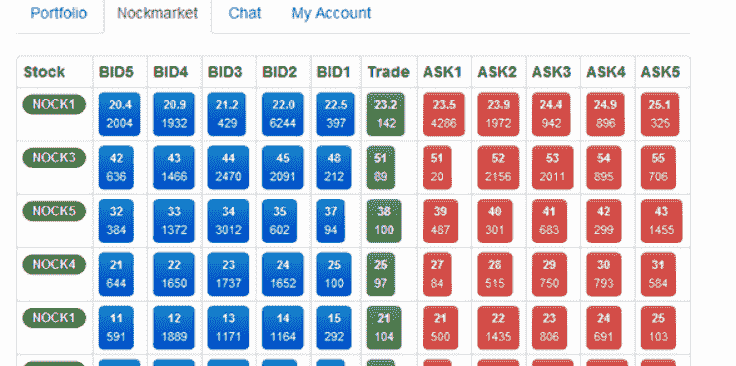

图6.3. 一个静态市场

所以现在它开始像一个真实的股票交易板了。目前，数据完全是静态的，但现在是时候实现最大的回报了：实时交易。

### Backbone 模式

即使到目前为止只有两个例子，你也可以看到模式开始浮现。虽然看起来我们写了很多样板代码，但我的意图是带你从第一性原理出发理解一切，以便你理解幕后发生的事情。

node-toolbox<sup>5</sup> 有许多与 Backbone.js 相关的软件包。其中一些可以接收 mongodb 更新，并自动将变更一路处理到前端的 Backbone.js 模型。请随意在空闲时探索这些软件包，并且可以放心，你拥有从头开始复制相同功能的能力，只要你选择这样做。

## 你自己的市场

还有几个步骤要完成。首先，我们只想在数据初始加载完成后处理更新。在 `trades.js` 中添加一个变量来跟踪此状态，如下所示：

```javascript
var loaded = false;
socket.emit('requestData', {});
```

一旦我们处理完初始数据，就将此变量设置为 `true`：

```javascript
loaded = true;
new StockView();
```

当数据更新时，我们需要做的就是检索模型，然后调用更新函数：

```javascript
socket.on('exchangeData', function (deltas) {
  if (loaded) {
    var model = window.stockCollection.get(deltas.st);
    model.updatePrices(deltas);
  }
});
socket.on('initExchangeData', function (data) {
```

之前，我们将 `id` 设置为股票代码，所以现在我们可以使用内置的 `get` 函数从集合中检索模型。然后我们调用我们自己的 `updatePrices` 函数，可以如下定义：

```javascript
var StockModel = Backbone.Model.extend({
  updatePrices: function(deltas) {
    this.set({deltas: deltas});
  }
});
```

在 `updatePrices` 中，我们只需调用 `set` 函数。然后在行视图中，我们将数据变更绑定到一个可以更新视图的函数：

```javascript
tagName: 'tr',
initialize: function() {
  _.bindAll(this, 'setPrices');
  this.model.bind('change', this.setPrices);
},
```

链条中的最后一环是 `setPrices` 函数。正是在这里操作用户界面。对于 `setPrices`，我们现在要做的就是遍历价格，如果我们有一个大于零的价格，就设置 HTML：

```javascript
render: function() {
  var template = _.template(storedTemplate);
  var htmlString = template(this.model.toJSON());
  $(this.el).html(htmlString);
  return this;
},
setPrices: function() {
  var color = "#82FA58";
  var prices = this.model.toJSON().deltas;
  for (var attr in prices) {
    var value = prices[attr];
    if (value > 0) {
      if (attr == 'tp') {
        $('#' + prices.st + 'trade-cell')
          .css("backgroundColor", color);
        $('#' + prices.st + 'trade-cell')
          .animate({backgroundColor: "white"}, 1000);
      }
      $('#' + prices.st + attr).html(value);
    }
  }
}
```

现在你应该有实时交易数据流入你的浏览器了。现在来整理一下。首先，我们的模拟数据行还在那里，所以在 **views/portfolio.ejs** 中删除它：

```html
// chapter06/views/portfolio.ejs (摘录)

<tr>
  <!-- 在这里删除所有内容 -->
</tr>
</thead>
<tbody class="stock-data">
</tbody>
</table>
```

最后，界面有点“跳跃”，因为数字更新时方框大小不断变化。我们可以通过让方框固定宽度来解决这个问题。创建 **public/stylesheets/nockmarket.css** 如下：

```css
// chapter06/public/stylesheets/nockmarket.css

.trade-button {
  width: 24px;
}
```

然后将其添加到 **portfolio.ejs** 中，如下所示：

```html
// chapter06/views/portfolio.ejs (摘录)
<link href="/stylesheets/nockmarket.css" rel="stylesheet">
<script src="http://twitter.github.com/bootstrap/assets/js/google-code-prettify/prettify.js"></script>
```

现在所有方框都应该是固定宽度，使界面更加流畅。恭喜，你现在应该在浏览器中有了实时更新的交易数据！这是一项大量的工作，但最终都得到了回报。还有一些润色工作可以使界面更好，但我们把这些留到下一章。

## 总结

在本章中，我们学习了：

- 使用 Backbone 在客户端分离功能
- Backbone 中模型、集合和视图的基础知识
- 从服务器端 JSON API 检索数据并将其插入 Backbone 模型
- 实现纯客户端过滤
- 将实时交易数据流式传输到浏览器

# 第7章

## 生产环境

> “艺术从未完成，只有被放弃。”
>
> ——列奥纳多·达·芬奇

本章完全关于生产环境。一旦你构建了闪亮的新应用程序，你需要知道如何将其从本地机器转移到向世界展示。幸运的是，有大量的托管选项可供选择，其中许多是免费的。在本章中，我们将介绍使用特定提供商 Heroku 进行部署。

我们将介绍生产部署与本地开发环境之间的一些差异。无论你最终选择哪种环境，许多这些生产技术都适用。因此，如果你决定使用 Heroku 以外的提供商，本章获得的知识将适用于你的最终选择。在本书结束时，你将拥有一个实时部署。

## 开发与生产

Express.js 支持开发和生产设置。两者之间的区别之一在于错误处理方式。在开发中，方便的是当发生错误时，浏览器中会显示完整的堆栈跟踪。在生产环境中，你几乎永远不想显示详细的错误信息。例如，出于安全原因，你可能希望隐藏系统的运行方式。

将以下内容添加到 **nockmarket.js** 中：

```javascript
// chapter07/nockmarket.js (节选)

app.configure('development', function () {
  app.use(express.errorHandler(
    {dumpExceptions:true, showStack:true }));
});
app.configure('production', function () {
  app.use(express.errorHandler());
});
app.set('view options', {
```

我们已经配置了开发环境和生产环境的设置。开发环境设置会显示详细的错误信息。为了测试这一点，请修改 **nockroutes.js** 以抛出一个错误：

```javascript
// chapter07/routes/nockroutes.js (节选)

getIndex: function(req, res) {
  throw new Error('dummy error');
  res.render('index');
},
```

如果你访问 http://localhost:3000，你应该会收到类似这样的错误消息：

```
Error: dummy error
    at module.exports.getIndex (...)
    :
    at Object.oncomplete (fs.js:297:15)
```

现在让我们尝试以生产模式启动，看看会发生什么。有几种方法可以做到这一点。对于一次性运行，你可以执行以下命令：

```bash
NODE_ENV=production node nockmarket.js
```

虽然这会在生产模式下运行应用程序，但后续运行将恢复到正常的开发模式。为了获得更永久的选项，我们可以如下设置 `NODE_ENV` 环境变量：

```bash
export NODE_ENV=production
```

这将确保应用程序以生产模式运行，无论重启多少次。环境变量将在你的 shell 会话期间保持有效。如果你希望设置在重启后仍然生效，可以参考许多资料来帮助你进行正确的配置。¹

现在你已经在生产模式下运行，当你访问主页时，你应该会收到更加晦涩的……

```
Internal Server Error
```

其他可能需要不同开发和生产设置的任务包括日志记录、电子邮件和电子商务。具体的开发和生产设置将取决于具体业务场景；但是，你现在理解了控制环境背后的基本机制。记得删除那个模拟错误。

“development”和“production”本身并没有什么神奇之处。它们只是任意的字符串；你也可以使用其他的，比如“staging”和“test”。事实上，你可以为多个环境使用单个配置，如下所示：

```javascript
app.configure('production', 'test', function(){ ... });
```

## 404 未找到

另一个需要我们关注的问题是令人畏惧的 HTTP 404 Not Found 错误消息。如果你访问一个不存在的页面，比如 http://localhost:3000/blah，你会收到以下消息：

```
Cannot GET /blah
```

为了向用户提供更友好的消息，请将以下内容添加到 **nockmarket.js** 的底部：

¹ http://www.cyberciti.biz/faq/set-environment-variable-linux/

```javascript
// chapter07/nockmarket.js (节选)
app.use(function(req, res){
  res.render('404');
});
```

本质上，这是一个兜底处理程序，用于处理所有未被先前路由处理的请求。现在，创建 **views/404.ejs**，内容如下：

```html
// chapter07/views/404.ejs (节选)
<!DOCTYPE html>
<html lang="en">
<head>
  <meta charset="utf-8">
  <title>404</title>
  <meta name="viewport"
    content="width=device-width, initial-scale=1.0">
  <link href="http://twitter.github.com/bootstrap/assets/css/bootstrap.css" rel="stylesheet">
  <link href="http://spbooks.github.com/nodejs1/docs.css"
    rel="stylesheet">
</head>
<body>
<div class="container">
  <div class="marketing"><h1>哎呀</h1>
    <p class="marketing-byline">
      你访问的页面未找到 :(</p>
  </div>
</div>
</body>
</html>
```

现在，当用户访问一个不存在的页面时，他们会收到一个自定义的错误消息，其布局和内容可以随意修改。

### 托管选项

当谈到托管你的应用程序时，有几种可用的选择——每种都有其优点和缺点。提供最大控制权的选项是专用服务器。另一个可能性是基础设施即服务（IaaS），最受欢迎的选择是亚马逊的 EC2。与专用服务器相比，此选项提供了许多便利。我们将使用的选项是平台即服务（PaaS）。这种方法提供了最高级别的抽象。平台提供商将处理你的 Node.js 安装，以及维护和升级，这使你能够全身心投入到编写软件这一核心能力上。

尽管像 EC2 这样的 IaaS 平台允许系统管理员轻松地启动新机器，但这些机器的实际设置和部署可能需要大量的脚本编写。使用像 Heroku 这样的平台提供商，扩展有时就像更改一个配置设置一样简单，无需重新安装 Node.js 或你的 Web 应用程序。

所有这些便利的代价是失去控制。通常，你将没有管理访问权限，并且抽象级别如此之高，以至于你甚至不需要直接与服务器打交道。相反，你通过一套定制的工具与平台交互。你的应用程序必须遵守提供商的规则，有时这可能会很不方便。例如，Heroku 有一个临时文件系统，这意味着在重启后，任何写入的文件都会被丢弃。² 根据需要进行的更改，特定于提供商的代码也可能降低你应用程序的可移植性。

## 永久运行

对于那些选择在专用服务器或 EC2 上部署的人来说，值得简要了解一下一个比简单的 `node nockmarket` 更健壮的选项。也许到目前为止你已经意识到，运行 Node.js 的标准方式有点不稳定。一个异常就有可能导致整个应用程序崩溃。在《实战开发》中，我推荐使用 node-supervisor 作为在文件更改时自动重启的机制。这还有一个额外的附带好处，即在任何崩溃时自动重启你的应用程序。不幸的是，这不适合生产环境，因为在后台，有一些相当密集的文件监控操作，可能会导致不必要的开销。

相反，我推荐一个名为“forever”的包，安装方式如下：

² https://devcenter.heroku.com/articles/dynos#ephemeral-filesystem

```bash
sudo npm install -g forever
```

现在启动你的应用程序就像这样简单：

```bash
forever start nockmarket.js
```

除了 `start`，其他常用选项包括 `stop` 和 `restart`（你可以在提示符下输入 `forever` 查看完整列表）。现在，以相当小的开销，你就有了一个功能，可以在任何退出时持续重启你的应用程序。

让我们继续了解部署背后的一些基础知识。

### 版本控制

版本控制是控制软件变更的一种机制。使用版本控制系统是良好的实践，如果使用 Heroku，则绝对必要。存在许多流行的版本控制系统，其中 Node.js 社区与 Git 紧密相连。几乎每个软件包都托管在 GitHub 上，这是一个在线的 Git 托管服务提供商。


### Git 简介

Git 是一个分布式版本控制系统，由 Linux 的原始开发者 Linus Torvalds 编写。“分布式”是指你可以克隆整个仓库，并在同步到主服务器之前进行完全本地的更改。每个用户都拥有完整源代码的完整备份。Git 还支持分支的概念，允许开发者创建分支进行实验和开发新功能。其他功能在官方网站上有文档记载。³

我们将介绍 Ubuntu。虽然开发可以在 Mac OS X、Windows 或 Linux 上进行，但生产部署总是在某种 Linux 发行版上完成，而 Ubuntu 是比较流行的部署选项之一。其他平台的安装说明可从官方网站获取。⁴

在命令提示符下输入以下内容：

```bash
sudo apt-get install git-core
```

³ http://git-scm.com/about

⁴ http://git-scm.com/

这就是 Git 安装所需的全部内容。在对我们的软件进行版本控制之前，请在顶层创建 `.gitignore` 文件，以便指定要忽略哪些文件和目录。目前，它应包含一行：`node_modules`。

将模块目录纳入版本控制没有意义。Heroku 会在每次签入新代码时自动从官方仓库拉取模块。接下来，我们按如下方式创建 Git 仓库：

```bash
git init
```

然后我们添加文件和目录：

```bash
git add .
```

这将添加所有文件、目录和子目录，但忽略文件中指定的那些除外。现在我们可以将文件提交到本地仓库，并附上用于记录的初始提交信息：

```bash
git commit -m "Initial check in"
```

上述过程创建了一个本地仓库。每次签入都与一个唯一标识符相关联。这使我们能够回退到任意修订版本。从概念上讲，我们需要将这个本地仓库推送到 Heroku。这个过程，以及 Heroku 的简要概述，将在下一节中提供。

### Heroku

Heroku 是一个支持多语言的平台即服务（PaaS）提供商。**多语言**意味着它支持多种语言。最初被构想为一个 Ruby 托管平台，现在它支持 Java、Node.js、Scala 和 Clojure。平台即服务是一种模型，Heroku 提供网络、服务器以及 Node.js 相关的基础设施。Heroku 方便地提供了一个免费选项，让我们能够在决定是否将其作为最终生产主机之前，全面试用该服务。

由于 Heroku 的起源，在安装 Heroku 之前需要先安装 Ruby 及其包管理器 RubyGems。如果您的操作系统尚未安装它们，可以使用以下命令安装这两个软件包：

```bash
sudo apt-get install ruby-full rubygems
```

### Nodejitsu

Node.js 生态系统在不断发展和改进，其中一个较新的托管服务来自 Nodejitsu 团队。本书没有提供相关教程，因为该产品目前仍处于 Beta 测试阶段。因此，它不像 Heroku 那样经过实战检验，可能会出现错误和变更，给您带来不便。

然而，随着该产品的成熟，值得关注。因为该服务是 Node.js 专用的，它需要对代码库和环境进行更少的调整和定制。例如，Nodejitsu 完全支持 Web-Sockets，并且可以通过 Node 包管理器（npm）安装其工具。

首先，访问 http://heroku.com 并注册一个账户。然后从您的命令行执行以下命令：

```bash
wget -qO- https://toolbelt.heroku.com/install-ubuntu.sh | sh
```

这将安装 Heroku 工具包。其他操作系统的安装说明可在官方网站上找到。<sup>5</sup>

工具包通过命令行控制。您可以使用以下命令登录 Heroku：

```bash
heroku login
```

## 配置调整

如果您收到“命令未找到”的错误信息，您可能需要按照 https://devcenter.heroku.com/articles/cli-command-not-found 上的说明设置您的路径。

如果您发现 Heroku 未安装在指定的 `EXECUTABLE_DIRECTORY` 中，可以通过 gem 安装它，如下所示：

```bash
sudo gem install heroku
```

输入您的电子邮件和密码；如果系统提示您生成公钥，请选择“Y”。

### 公钥

Heroku 要求使用公钥加密。检查您是否拥有公钥，以及如果没有则生成一个，这很容易。说明可在 https://help.github.com/articles/generating-ssh-keys 获取。

如果您需要手动生成公钥，将其添加到 Heroku：

```bash
heroku keys:add ~/.ssh/id_rsa.pub
```

现在我们必须在顶层创建一个名为 **Procfile** 的文件，其中包含以下内容：

`web: node nockmarket.js`。

`web` 表示我们正在运行一个 Web 应用程序，它直接与用户交互。Heroku 也支持旨在后台执行的 worker 进程。此时，值得仔细检查您的 **package.json** 文件。它应类似于以下内容：

```json
{
  "name": "nockmarket",
  "version": "0.0.1",
  "private": true,
  "engines": {
    "node": "0.8.8",
    "npm": "1.1.49"
  },
  "dependencies": {
    "cookie": "0.0.4",
    "dnode": "1.0.0",
    "ejs": "0.8.3",
    "express": "2.5.9",
    "jquery": "1.7.2",
    "mocha": "1.0.1",
    "mongodb": "1.1.7",
    "should": "0.6.1",
    "socket.io": "0.9.10",
    "underscore": "1.3.3"
  }
}
```

注意我们同时指定了 Node.js 版本<sup>6</sup> 和 npm 版本。<sup>7</sup> 由于 Heroku 提供平台，这些版本被限制为其官方支持的版本。

使用工具包，我们可以创建应用程序：

```bash
heroku create
```

它应该会给出一个类似 http://mysterious-brook-2122.herokuapp.com 的地址。

到目前为止一切顺利，但现在我们有一个问题。数据库怎么办？虽然 Heroku 提供了 Node.js 托管，但它不支持 MongoDB。<sup>8</sup> 还记得我们在第一章创建的 MongoLab 账户吗？现在是时候回到原点了。虽然了解如何从头开始安装 MongoDB 是您 Node.js 学习历程的关键部分，但为了与 Heroku 兼容，我们现在将重新审视一个托管部署解决方案。到目前为止，我们一直在本地连接数据库，无需凭证。我们必须修改数据库代码以处理身份验证。按如下方式修改 **db.js**：

```javascript
// chapter07/lib/db.js (摘录)

open: function(callback) {
  db.open(function(err, data) {
    if (process.env.MONGO_NODE_DRIVER_USER) {
      data.authenticate(process.env.MONGO_NODE_DRIVER_USER
      , process.env.MONGO_NODE_DRIVER_PASS
      , function(err2, authData) {
        if(authData) { callback(); }
        else {
          console.log(err2);
          return;
        }
      });
    }
    else { callback(); }
  });
},
```

> <sup>6</sup> http://heroku-buildpack-nodejs.s3.amazonaws.com/manifest.nodejs
>
> <sup>7</sup> http://heroku-buildpack-nodejs.s3.amazonaws.com/manifest.npm
>
> <sup>8</sup> 有一个可用的附加组件，但这需要使用信用卡注册。

Heroku 支持使用环境变量，这里我们在这些变量中查找用户名和密码。根据您使用的 Heroku 版本，可能还需要指定应用程序名称。如果您在控制台输入以下参数时收到错误信息，请尝试包含应用程序名称（方括号中的部分）。将*强调*部分替换为特定于您数据库的参数：

```bash
heroku config:add MONGO_NODE_DRIVER_HOST=XYZ.mongolab.com [--app mysterious-brook-2122]
heroku config:add MONGO_NODE_DRIVER_PORT=12345 [--app mysterious-brook-2122]
heroku config:add MONGO_NODE_DRIVER_USER=YOURUSER [--app mysterious-brook-2122]
heroku config:add MONGO_NODE_DRIVER_PASS=YOURPASS [--app mysterious-brook-2122]
```

参数可以从您的 MongoLab 账户页面查看和配置。

## 本地使用远程数据库

有了修改后的数据库代码，如果您不想运行本地 MongoDB 副本，可以远程运行数据库。您所要做的就是设置相关的环境变量。在 Ubuntu 中，命令如下：

```bash
export MONGO_NODE_DRIVER_HOST=...
export MONGO_NODE_DRIVER_PORT=...
export MONGO_NODE_DRIVER_USER=...
export MONGO_NODE_DRIVER_PASS=...
```

添加每一行后，您应该会在控制台上看到类似以下的消息：

```
Adding config vars and restarting app... done, v5
```

我们还在 **nockmarket.js** 中使用环境变量来指定端口，如下所示：

```javascript
// chapter07/nockmarket.js (摘录)

db.open(function() {
    nocklib.createSocket(app);
    var port = process.env.PORT || 3000;
    app.listen(port);
    for (var i = 0; i < stocks.length; i++) {
        submitRandomOrder(i);
    }
});
```

这是必要的，因为 Heroku 禁止应用程序在任意端口上运行。相反，每次启动应用程序时都使用临时端口。`process.env.PORT` 实际上是由 Heroku 设置的，而不是我们自己的应用程序。这对最终用户是完全透明的，他们连接到我们应用程序的方式与连接到任何其他网站相同。

另一个小的更改是在 `db.js` 中将端口解析为数字：

```javascript
// chapter07/lib/db.js (摘录)

, host = envHost != null ? envHost: 'localhost'
, port = envPort != null
    ? parseInt(envPort, 10) : Connection.DEFAULT_PORT;
```

如果没有这个修改，环境变量将被解释为字符串。

> **数据库名称**
>
> 在 MongoLab 上，创建数据库时您可以选择指定一个名称。在代码中，假定数据库名称是 `nockmarket`，所以我建议您拥有或创建一个具有此名称的数据库。否则，需要更新 `db.js`，在以下行中将 `nockmarket` 替换为您实际的数据库名称：
>
> ```javascript
> // chapter07/lib/db.js (摘录)
> var db = new Db('nockmarket'
> ```

既然我们正在部署到 Web 服务器，我们必须修改 Socket.IO 客户端代码以连接到实际的 Web 服务器。修改 `public/js/chat.js`：

```javascript
// chapter07/public/js/chat.js (摘录)
var socket = io.connect(window.location.hostname);
```

最后，Heroku 目前不支持 WebSocket 协议。正如前面所讨论的，使用 PaaS 的一个缺点是需要遵守其制定的规则和条例。请修改 **nocklib.js** 以指定传输机制：

```javascript
// chapter07/lib/nocklib.js (摘录)
io.configure(function (){
    io.set("transports", ["xhr-polling"]);
    io.set("polling duration", 10);
    io.set('authorization', function (handshakeData, callback) {
```

然后我们将以下内容部署到 Heroku：

```bash
git add .
git commit -a -m "Ready for production"
git push heroku master
```

`push` 是一个 git 命令，它将你的本地仓库传输到远程位置。在这个例子中，我们正在将本地仓库推送到 Heroku，届时它将自动部署。事实上，Heroku 是开源的，因此你可以自由地研究其源代码，了解它的部署脚本是如何运行的。⁹

## 空闲时间

Heroku 在底层运行在 EC2 基础设施上。这不是一个廉价的选项，因此免费账户在一段时间不活跃后会被"休眠"。在空闲期过后，第一个连接的用户可能需要等待稍长时间，让你的应用程序重新启动。实际上，这是一个小问题，因为免费账户更适用于原型和测试，而不是完整的生产系统。付费账户不受此限制。

如果你收到如下错误消息：

```
'heroku' does not appear to be a git repository
```

... 你可以使用以下命令添加远程仓库：

```bash
git remote add heroku git@heroku.com:mysterious-brook-2122.git
```

请将 `mysterious-brook-2122` 替换为 Heroku 分配给你的应用程序名称。

现在你应该已经有一个部署在互联网上的实时系统了！在我们落下最后的帷幕之前，让我们添加一点个性化。目前，这个地址不太友好。拥有一个个性化的地址非常简单：

```bash
heroku rename YOURNAME
```

你的网站新地址应会显示在控制台中。给你的朋友和家人发邮件，让他们看看你构建的这个精彩软件。也许他们会受到启发，去实现他们一直梦想的那个创业想法！

## 总结

恭喜，你终于完成了！在本章中，我们学习了以下内容：

- 托管的不同选项及其各自的优缺点
- 使用环境变量来控制生产设置
- 如何处理 404 错误
- 使用 Node.js 原生 MongoDB 驱动进行远程数据库访问
- 部署到 Heroku 以及生产环境所需的更改

## 扩展资源

渴望了解更多关于 Node.js 的知识？这里列出了一些优秀的资源：

- Node.js API 文档：http://nodejs.org/api/
- MongoDB 文档：http://www.mongodb.org/display/DOCS/Home
- Backbone 参考资料：https://github.com/documentcloud/backbone/wiki/Tutorials%2C-blog-posts-and-example-sites
- Socket.IO wiki：https://github.com/learnboost/socket.io/wiki
- DailyJS：一个 JavaScript 博客：http://dailyjs.com/
- Scoop.it! Node.js 资源：http://www.scoop.it/t/nodejs-code

# 索引

## 符号

- 404 Not Found 错误, 139

## A

- 关于, 1–5
- Ajax（异步 JavaScript 和 XML）, 72
- API
    - MongoDB, 55–60
    - Socket.IO, 110
- 异步编程, 38
- 身份验证, Bootstrap, 64–68, 76–78

## B

- Backbone, 115–136
    - 客户端过滤, 117–125
        - Backbone 模型, 119
        - 视图, 121
    - MVC 模型, 116
    - 实时交易, 125–133
- bcrypt, 70
- 基准测试, 3
- Bootstrap, 63–90
    - 身份验证, 64–68, 76–78
    - 构建基本投资组合, 78–88
    - 重复项, 72
    - 解析表单提交, 69
    - 密码保护, 89
- BSON 文档, 41

## C

- C10K 问题, 5
- 回调函数, 10
- 链式调用, 48
- 结果图表绘制, MongoDB, 61
- 聊天, 92–105
    - 添加聊天功能, 101
    - 客户端聊天代码, 98
    - 检测在线用户, 102
    - 通知消息, 98
    - Socket.IO, 93–97
- 客户端聊天代码, 98
- 客户端过滤, 117–125
    - Backbone 模型, 119
    - 视图, 121
- 客户端模板, 129
- 闭包, 31
- 基于云的 NoSQL 技术, 6
- 集合, 定义, 48
- 配置
    - Heroku, 144
    - Node.js, 7
- Connect, 7
- CPU 密集型问题, 4
- crypto 库, 69

## D

- 数据
    - 使用 MongoDB 查找, 47
    - 加载, 129
    - Node.js 功能, 24–29
- 数据库
    - 关于, 12–16
    - 面向文档的数据库, 7
    - 命名, 148
    - NoSQL, 6
    - 无模式数据库, 41
- 在本地使用远程数据库, 147
- 依赖项, 9
- 部署（*参见* 生产）
- 开发与生产, 137
- 目录结构, 16
- dnode, 53
- 面向文档的数据库, 7
- DOM 元素, 122
- 驱动程序, MongoDB, 43
- DRY（不要重复自己）编程哲学, 30
- 重复项, Bootstrap, 72

## E

- 效率（*参见* 性能）
- 嵌入式时间戳, 59
- 加密密码, 69
- 环境设置, 139
- Express, 12

## F

- 入门, 5–16
    - 配置, 7
    - 数据库, 12–16
    - 表单, 9
    - Node.js 安装, 5
- Git, 142
- 全局与本地, 8
- 过滤（*参见* 客户端过滤）
- find 函数, 48
- forever, 141
- 表单
    - 关于, 9
    - 在 Bootstrap 中解析提交, 69
    - Socket.IO, 109–113
- 功能, 17–40
    - 关于, 17
    - 聊天, 101
    - 数据, 24–29
    - 订单处理, 29–40
    - 测试, 18–24
- 函数
    - 回调函数, 10

## G

- 哈希表, 对象作为, 25
- 堆, 25
- "Hello world" 示例, 6
- Heroku, 141, 143
- Highstock, 61
- 托管选项, 140
- http 模块
    - MongoDB, 53
    - 使用, 78

## H

- I/O 密集型问题, 4
- IaaS（基础设施即服务）, 140
- 空闲时间, 149
- 不可变, 19
- 索引, 58
- insert 函数, 49
- 插入数据, MongoDB, 49
- 安装
    - dnode, 53
    - MongoDB, 43
    - Node.js, 5

## I

- JavaScript
    - 关于, 2
    - 宽容性, 22
- jQuery, 27
- JSON（JavaScript 对象表示法）, 24

## J

- 加载数据, 129
- 本地与全局, 8

## L

- MapReduce, 52
- MD5, 70
- MemoryStore, 94
- 模态窗口, 67
- 修改操作, 80
- MongoDB, 41–62
    - API, 55–60
    - 结果图表绘制, 61
    - 驱动程序, 43
    - 查找数据, 47
    - http 模块, 53
    - 插入数据, 49
    - 安装, 43
    - 变异, 29
    - NoSQL, 6
    - 存储数据, 50
    - 测试, 44
    - 包装器, 46
- MongoLab, 13
- Mongoose, 13, 43
- 变异, 29
- MVC 模型, Backbone, 116

## M

- 命名
    - 数据库, 148
    - 字段, 46
- 嵌套回调, 81
- Nodejitsu, 144
- NoSQL 技术, 6
- 通知消息, 98

## N

- Object ID
    - 关于, 46
    - MongoDB, 83
- 面向对象编程, 状态, 19
- 对象作为哈希表, 25
- 订单处理, 29–40

## O

- PaaS（平台即服务）, 141
- 解析表单提交, Bootstrap, 69
- 密码
    - Bootstrap, 89
    - 加密, 69
    - 安全性, 15
- peek 函数, 26
- 性能
    - 业务逻辑, 128
    - "软"实时应用的目标, 5
    - Heroku, 149
    - JavaScript 引擎, 3
- 平台即服务（PaaS）, 141
- 提交, 在 Bootstrap 中解析表单提交, 69
- process 对象, 47
- 生产, 137–150
    - 404 Not Found 错误, 139
    - 开发与生产, 137
    - forever, 141
    - Heroku, 143
    - 托管选项, 140
    - 版本控制, 142
    - 公钥, 145

## P

- 实时交易, 125–133
- 实时 Web, 91–113
    - 聊天, 92–105
        - 添加聊天功能, 101
        - 客户端聊天代码, 98
        - 检测在线用户, 102
        - 通知消息, 98
        - Socket.IO, 93–97
    - 表单与 Socket.IO, 109–113
    - 实时交易, 105–109
- Redis, 94
- 远程数据库, 在本地使用, 147
- REST, 55
- 结果, 使用 MongoDB 进行图表绘制, 61

## R

- 模式, 14
- 无模式数据库, 41
- 安全性, 密码, 15, 70
- 服务端
    - JavaScript, 3
    - jQuery, 27
- 会话
    - 存储, 95
    - 使用, 77
- 分片, 42
- Socket.IO
    - 关于, 92
    - 聊天, 93–97
    - 速度（*参见* 性能）
    - 状态, 19
    - 存储数据, MongoDB, 50
    - 优缺点, 4
    - 严格模式, 22
    - 同步代码, 51

## S

- 测试
    - 关于, 18–24
    - MongoDB, 44
- 线程, 3
- 时间戳, 嵌入式, 59
- 交易, 实时, 125–133

## T

- 版本控制, 142
- 视图, Backbone 中的客户端过滤, 121

## V

- WebSocket, 92
- 小部件, Bootstrap, 84–88
- WordSquared, 1
- 包装器, MongoDB, 46

## 致谢

感谢您购买本书，我们衷心感谢您的支持！


我们愿意认为您现在是“SitePoint 之友”，因此诚邀您访问我们特别的“SitePoint 之友”页面。

在这里，您可以节省高达 43% 的费用，购买一系列超酷的 SitePoint 产品。

通过此链接节省超过 40%：

| 链接 | sitepoint.com/friends |
| :--- | :--- |
| 密码 | friends |

## 恭喜完成本书学习

### 觉得自己对 Node 有点天赋？


是时候通过我们的在线测验来测试自己了。测验基于本书内容，只有真正的 Node 高手才能获得满分。

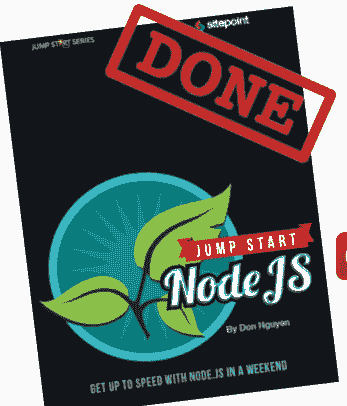

在此处参加测验：

http://quizpoint.com/#categories/NODE.JS.

## 立即为 Node.js 奠定基础

Node.js 正在改变 Web 应用程序的构建方式。Node.js 应用程序使用 JavaScript 编写，因此您可以运用您精湛的前端技能，开发速度惊人、可扩展的实时 Web 应用程序。

仅仅一个周末，您就能学会如何：

- 🔥 **从头到尾开发一个动态、可运行的 Node.js 应用程序**
- 🔥 **将您的新应用程序部署到生产服务器**
- 🔥 **快速且低成本地扩展您的项目**

此外，您还将发现如何使用 Twitter Bootstrap、MongoDB 和 Backbone.js 来动态创建、扩展和更新现代 Web 应用程序。

[sitepoint.com/jumpstart-nodejs](sitepoint.com/jumpstart-nodejs)

### Don Nguyen


Don 最初使用强类型面向对象语言（如 Java 和 C++）进行编程。他运用工程训练，构建了设计为可扩展和容错的实时交易系统。

Don 曾在多种 Web 环境中编程，包括 ASP、PHP 和 Python，但他认为 Node.js 在处理现代实时 Web 需求方面最为出色。

| WEB DEVELOPMENT | |
| :--- | :--- |
| 印刷版： | 978-0-9873321-0-3 |
| 电子书： | 978-0-9873321-1-0 |
|  | |
| USD $24.95 &nbsp;&nbsp;&nbsp;&nbsp;&nbsp;&nbsp; CAD $24.95 | |
