# 快速启动响应式网页设计：现代响应式解决方案


# 前言

像素完美的网页时代已经逝去。那种将元素定位在网页上并期望它们始终如我们所愿般显示的日子已成为遥远的记忆；如今我们必须应对设计需要看起来绝佳的、层出不穷的各类新设备。

本书旨在帮助你开始理解并使用一套用于应对这个新设备世界的 CSS 和 HTML 工具。它将介绍帮助你的页面适应不同设备的基本构件，通过网格更进一步，向你展示如何让文本和图像在所有设备上都清晰可读，并在最后一章介绍如何利用更专业的设备能力。

让我们开始吧。

# 谁应该阅读本书

本书面向网页设计师和前端开发者。你需要熟悉 HTML 和 CSS，但不需要有响应式网页设计方面的经验。了解一些 JavaScript 对于本书的后半部分会很有用。

# 使用的约定

你会注意到我们在整本书中使用了特定的排版和布局样式来表示不同类型的信息。请注意以下各项。

# 代码示例

本书中的代码使用等宽字体显示，如下所示：

```
<h1>A Perfect Summer's Day</h1>
<p>It was a lovely day for a walk in the park. The
birds were singing and the kids were all back at
school.</p>
```

如果代码可以在本书的代码存档中找到，文件名将出现在程序清单的顶部，如下所示：

```
0-1. example.css

.footer {
    background-color: #CCC;
    border-top: 1px solid #333;
}
```

如果只显示了文件的一部分，则用 *摘录* 一词标明：

```
0-2. example.css (excerpt)

.footer {
    background-color: #CCC;
    border-top: 1px solid #333;
}
```

如果需要向现有示例中插入额外代码，新代码将以粗体显示：

```
function animate() {
    new_variable = "Hello";
}
```

当需要现有代码作为上下文时，为避免重复，将显示 `...`：

```
function animate() {
    ...
    new_variable = "Hello";
}
```

某些代码行本应在一行内输入，但由于页面限制我们不得不进行换行。符号 ⏎ 表示仅为格式目的而存在的换行符，应忽略：

```
URL.open("http://www.sitepoint.com/responsive-web-design-real ⏎ -user-testing/?responsive1");
```

# 提示、注意和警告

**嘿，你！**

提示提供有用的小贴士。

**咳，打扰一下...**

注意是与当前主题相关——但非关键——的有用旁白。把它们当作额外的小信息点。

**确保你总是...**

...留意这些重要要点。

**当心！**

警告突出显示可能在过程中让你绊倒的任何陷阱。

# 补充材料

- 本书的代码存档包含可下载的代码和伴随示例的示例视频。
- https://www.sitepoint.com/community/ 是 SitePoint 的论坛，可用于解决任何棘手的网页问题。
- **books@sitepoint.com** 是我们的电子邮件地址，如果你需要联系我们报告问题或出于任何其他原因。

# 第 1 章

## 响应式网页设计的含义与目的

过去事情很简单：你为 15 英寸显示器设计一个网站或应用程序，然后——除了浏览器之间的不兼容性——就完成了。

然后带有网页浏览器的手机出现了，打破了我们轻松的生活。最糟糕的是，人们喜欢在手机上浏览网页！

> **移动设备的崛起**
>
> 2016 年，在移动设备上浏览网页[首次超越了桌面浏览](https://example.com)。

正当开发者和设计师习惯于为手机构建网站时，平板电脑、手表、电视、汽车、眼镜、更大的桌面屏幕、高分辨率屏幕，甚至内置于墙壁的网页浏览器又出现了。（好吧，最后一个是我编的。）支持这看似无穷无尽的新设备流正变得越来越具有挑战性。

那么我们如何支持这日益增多的设备阵列呢？答案是 *响应式网页设计*，它利用使网站能够适应各种屏幕尺寸的技术。

许多较旧的网站，或由时间不多的人维护的项目，都是非响应式的。例如，Vassal 游戏引擎的网站：

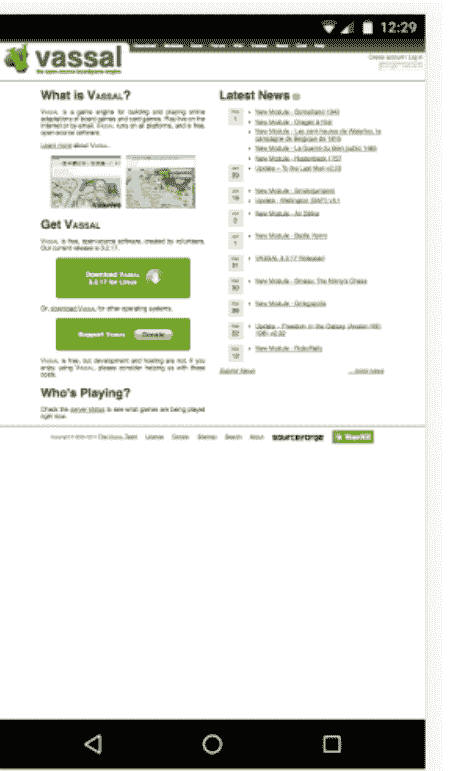

许多其他网站，如 SitePoint.com，则是完全响应式的：

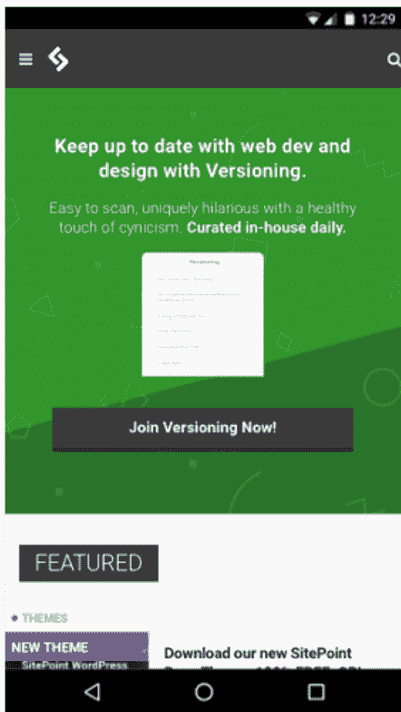

**响应式网页设计** (RWD) 遵循流行的开发准则“不要重复自己”（通常缩写为“DRY”）。RWD 旨在使用单一代码库来适应每种设备，而不是为每个你希望支持的设备维护多个代码库。使用 RWD 技术，你编写一套 HTML、CSS 和 JavaScript，并为每个平台适当地显示元素。许多样式和元素甚至可以重用或基于此构建，以实现最大的代码效率。

听起来不错？让我们先回到几年前。

## 历史

“响应式”设计不一定是新事物，这个术语对不同的人可能意味着不同的东西，这使得其确切的历史难以追溯。

理论上，自从存在不止一种浏览器以来，开发者就一直在创建响应式设计。浏览器之间一直存在微妙（以及不那么微妙）的渲染差异，开发者们几十年来一直在学习如何处理这些怪癖。如果你是网页开发的新手（或较新手），请庆幸早期版本的 Internet Explorer 的主导地位已基本结束。处理它们怪癖的日子是黑暗的。

自 2004 年以来，响应式设计采用了更具体的含义，即调整你的设计以适应用户选择的设备——通常基于屏幕尺寸，但也包括其他能力。响应式设计的概念在 2008 年得到巩固，但该术语也被称为“弹性”、“流动”、“流体”和“可伸缩”设计。

正是 CSS3 规范中包含的媒体查询，充分赋予了响应式设计所需的潜力，使其成为一个真正更实用的概念。我们将在 [第 2 章](#chapter-2) 详细讨论媒体查询，但简而言之，它们允许你根据预定义的屏幕尺寸或类型更改网页中的显示内容。Ethan Marcotte 于 2010 年在 [A List Apart](#a-list-apart) 的一篇文章中正式提出了“响应式网页设计”这个术语。

这导致了媒体查询之外的其他技术和技巧的增长与巩固，例如弹性图像和网格，我们将在本书中涵盖所有这些内容。

对我来说，“响应式设计”是所有这些想法和原则的某种结合。它不仅仅是使设计适应屏幕尺寸，还包括适应其他因素，如颜色深度、媒体类型（例如，笔记本电脑屏幕或电子阅读器）或位置。

### 响应式设计中的思想流派

关于如何使用响应式设计的思想流派与对其的解释一样多。有些已经出现又消失，有些则保留了下来。本书不会明确详细地介绍任何一种，但我们会触及它们的实际应用。现在让我们快速介绍其中几种。

#### 渐进增强

当遵循更传统的 **渐进增强** 原则时，你的主要焦点是使网站内容对所有用户都可用，无论他们的设备多么简单或连接多么慢。然后为能够利用它们的设备添加额外功能——例如更复杂的设计和功能。

#### 优雅降级

移动浏览的普及颠倒了更传统的设计路径。过去，你从你工作的平台（通常是计算机）开始设计，然后剥离样式和功能以支持屏幕更小或对某些功能支持较少的设备。

虽然 **优雅降级** 通常应用于浏览器对特定功能缺乏支持的情况，但你也可以更广泛地理解它。其原则是你从一个功能齐全的网站版本开始，在你理想的设备和浏览器上运行，同时确保基本功能在任何（受支持的设备）上对任何用户都有效，即使他们失去了那些锦上添花的功能。

### 移动优先

**移动优先** 类似于渐进增强，但更具体地针对响应式设计。它提出你从最小或功能最少的支持设备（通常在该原则创建时是手机）开始，然后随着设备规模的增加添加功能和样式。


### 快速入门响应式网页设计

> **移动设备优先**

“移动设备优先”这个术语可能会让人困惑，特别是对于非设计师或开发者群体，它可能会给人们留下移动设备将在项目中被优先对待的错误印象。

从理论上讲，这种做法确保了较小的设备最终不会得到次等的对待——所有设备都应被赋予同等的重要性。

#### 你需要支持哪些设备？

在开始或增强任何基于网络的项目之前，了解其是否值得进行，并评估你所有辛勤工作所面向的（潜在）用户群，这一点很重要。

如果你已有一个网站，或许值得分析网站流量，看看访问者使用什么类型的设备访问你的网站。如果90%的访问者一直使用台式机访问，这表明你的移动体验可能很差，或者你的访问者并非移动端重度用户。你可以进行广泛的研究以找出确切答案，或者干脆使用响应式设计技术来构建一个可能吸引新访客的移动友好型网站。

如果你正在进行一个新项目，分析潜在用户的需求同样重要。这可以通过使用传统的市场调研技术、创建简单的测试网站，或者研究竞争对手来实现，从而构建出关于你目标客户是谁的清晰画面。

##### 电脑

尽管销量在缓慢下降，但市场上仍然有大量台式机和笔记本电脑，以及在它们之上运行的大量网页浏览器。这些电脑包括从低质量（低分辨率）的11英寸上网本，到配备了各种宽高比和方向的28英寸高分辨率显示器的强大台式机，所有这些都极大地影响了你可用的屏幕区域。

##### 移动电话

在手机上浏览网页的用户比例目前已与桌面浏览持平，因此，为移动浏览器用户提供同等（并且可能不断增长）的重视至关重要。

> ### 移动浏览统计数据

关于移动网络浏览的兴起，我建议阅读Smart Insights关于[移动营销统计](https://www.smartinsights.com/mobile-marketing/mobile-marketing-analytics/mobile-marketing-statistics/)的报告，以及[Statcounter的桌面与移动使用率对比](https://gs.statcounter.com/platform-market-share-mobile-desktop/worldwide)以了解更多详情。

在iOS上，这通常只通过一个浏览器实现，且设备尺寸更加一致。

Android则拥有种类繁多的浏览器和屏幕尺寸。越来越多运行移动操作系统的设备也配备了各种高密度屏幕。

你还需要考虑到，用户主要使用触摸而非鼠标点击设备进行浏览，这对行为有很大影响。

##### 平板电脑

平板电脑的销量可能正在萎缩，但在可预见的未来仍将有相当大的用户群，你不应将平板电脑视为大号手机或小号电脑。此外，用户可能使用触摸屏或鼠标与你的网站交互。

##### 混合设备

如果处理电脑和平板电脑还不够，现在还有像微软Surface Pro这样的混合设备，它们可以在电脑和平板模式之间切换。虽然每种模式都可以独立处理，但值得注意的是，用户在使用你的网站时可能会切换上下文。

##### 可穿戴设备

大多数可穿戴设备尚未配备网页浏览器，但这可能会发生。与此同时，仍然可以重新利用你的部分内容在可穿戴设备上展示，这些内容需要以简短、易于跟进操作的形式呈现。

##### 电视

智能电视和Apple TV等相关设备都配备了简化版的网页浏览器，用户通常使用它们浏览特定网站，但它们可能会越来越普及。电视屏幕通常很大，但分辨率较低，因此在其上查看的网站需要足够清晰以便近距离观看，同时也要便于远距离使用。

##### 汽车

真的吗？是的，真的。这是一个新领域，但现在越来越多的汽车仪表盘可以通过某种形式访问互联网。目前，在汽车仪表盘上渲染的网站需要在小屏幕上清晰地呈现信息，并且设计上不能分散或压倒司机的注意力，以免引发事故。然而，许多汽车现在为乘客配备了屏幕，乘客可以更完整地访问网络和内容。

##### 游戏机

大多数现代游戏机在某些时间是连接到互联网的，其中一些时间会使用网页浏览器。这通常用于媒体消费和社交网络。这些设备上的浏览器功能可能有限，且可能没有实体键盘。对于家用游戏机，电视的设计原则将适用；对于掌机，则适用有限的移动体验。

总而言之，你无法预测任何人将如何以及在哪里查看你的网站，因此要构建一个适应性强、灵活且具有响应性的网站。

##### 打印

打印？这不是一本关于网页设计的书吗？是的，但你的网页的打印版本仍会被频繁访问，无论是实际打印，还是像在Instapaper或Pocket这样的离线阅读器上呈现内容。对于某些内容，“打印”仍然具有相关性。

> ### 书籍亦然
> 你正在阅读的页面也是用HTML和CSS渲染的。是的，即使是纸质版。

### 示例应用

根据我的经验，通过示例学习始终是最佳的学习方式，因此在本书中，我们将创建一个演示网站，并针对其可能被访问的多种设备进行优化。在每一章中，我们将基于同一个网站进行构建，以阐述讨论的主题。

#### 介绍 RWDFlix

RWDFlix 是一个虚构的视频流媒体服务，提供地方、国家和全球电视节目供人们在线观看。用户可以观看哪些节目取决于他们的地理位置和一天中的时间。

#### 电脑版

台式电脑版的网站布局将显示图像缩略图、视频播放器、节目标题、视频长度和节目描述。虽然台式机用户的网络速度差异较小，但此版本将在允许用户播放视频前检查带宽是否充足。

#### 平板电脑版

平板电脑版的布局将专注于让用户轻松找到节目，并在允许的网络条件下观看。它将显示大尺寸缩略图、节目标题、节目时长、预估文件大小和节目描述。如果用户有数据连接，它将提供播放视频的选项；如果没有连接，则会将视频添加到观看列表中。

#### 移动版

移动版将专注于让用户轻松找到节目，并在允许的网络条件下观看。它将显示较小的缩略图、节目标题、节目时长和预估文件大小。与平板电脑版一样，如果存在数据连接，它将提供播放视频的选项；如果没有，则会将其添加到观看列表中。

#### 电视版

电视版的布局将显示大尺寸缩略图、视频播放器、节目标题、视频长度和节目描述。为了便于远距离观看和操作，界面将设计得大而醒目。虽然超出本书范围，但界面也可能通过实体遥控器或遥控应用进行控制和导航。

### 使用 HTML5 构建页面结构

在我们开始创建响应式设计并使用CSS实现它们之前，理解你将要操作的基础HTML结构非常重要。HTML的最新发展对概念和页面结构进行了更新，因此回顾现代网页设计师现在可用的工具和选项很有帮助。

在HTML5之前，HTML页面的逻辑部分是使用像`div`和`span`这样的通用元素来构建和组织的。这些元素多年来运作良好，但过于宽泛，无法帮助设计师或网页浏览器理解日益复杂的页面结构。

[除了其他方面](https://example.com)，HTML5引入了新的、更具语义的元素，它们比简单的`div`更能完整地描述其用途。这些新元素旨在帮助改善无障碍访问和内容多用途化等问题，但它们也有助于响应式网页设计。它们包括诸如页面的页眉、导航或主内容区域的定义，以及用于视频和音频的特定元素。响应式网页设计从根本上是关于操纵页面布局以适应不同的用例，而更好的页面组织和结构有助于你用CSS和媒体查询（在[第2章](https://example.com)中涵盖）定位所需的元素。


## 14 响应式网页设计快速入门

让我们看看桌面网站的一个简化版本。这是一个精简的副本，我们将在下一章开始使用它进行操作：

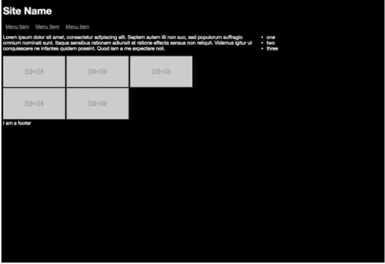

1-9. 网站的当前桌面版本

以及其代码：

```html
<body>
<header><h1>Site Name</h1></header>

<nav>...</nav>

<main>
    <section>...</section>
    <aside>...</aside>
</main>

<footer>...</footer>

</body>
</html>
```

以下是HTML元素在页面上的位置：

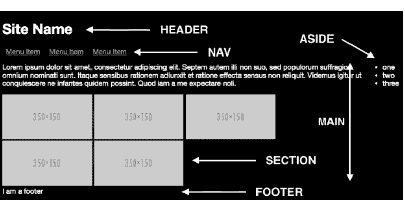

它们的功能如下：

- `header` 元素用于放置网站名称、标志等。页面的其他部分也可以有自己的 `header` 元素。
- `nav` 元素用于导航链接，例如顶部、侧边或页脚菜单。

## 16 响应式网页设计快速入门

- `section` 元素用于包含一篇文章的主要内容或页面的一个重要区域。
- `aside` 元素定义了一个与主要部分相关的小型子区域。
- `main` 元素包裹了页面独有的其他元素。在我们的示例中，这些是 `section` 和 `aside` 元素。其他元素将在其他页面中重复出现。
- `footer` 元素用于放置网站的法定名称、日期等。页面的其他部分也可以有自己的 `footer` 元素。

HTML5规范列出了其他具有特定功能的语义元素，我们将在本书中介绍其中的许多。一个结构良好的页面对于响应式设计非常重要，同时也有助于提升可访问性和SEO。

以下是更多以语义方式组织的页面内容：

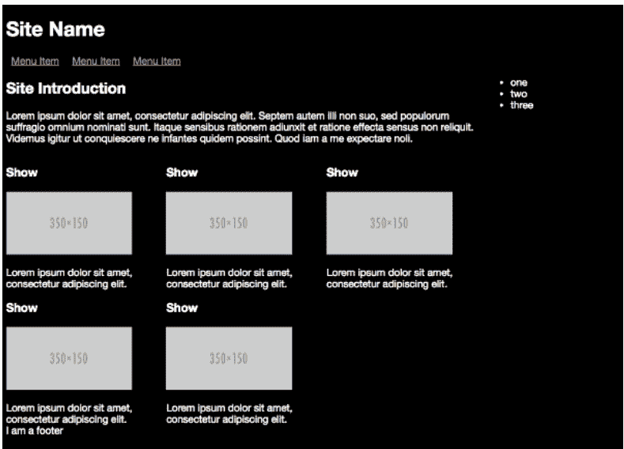

1-12. 电视剧页面

首先，我为页面添加了一个标题，这是一个h2，因为它是页面上的第二级标题，仅次于作为h1的主站点标题。

每个单独的电视剧都有自己的部分，在另一个标题下（但这次是h3，因为它比h2低一级），并附有一张图片和简短描述。

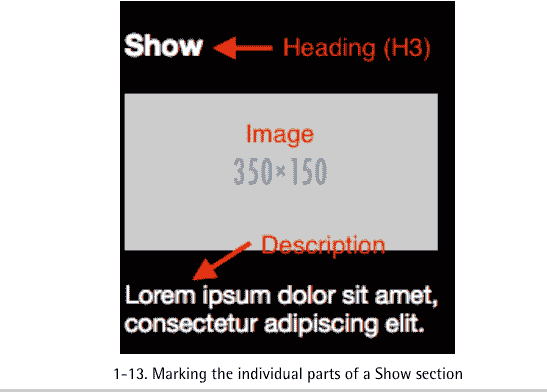

```html
1-14. Base/index.html
<section class="left">
    <h3>Show</h3>
    
    <p>Lorem ipsum dolor sit amet, consectetur
       adipiscing elit.</p>
</section>
```

一个典型的现代应用程序由后端（存储数据）和一个或多个显示或使用该数据的应用程序组成。它们包括响应式网页、原生移动应用程序和其他后端系统。正如你将在本书中看到的，并非所有场景都会使用或显示所有可用数据，而是只显示与其使用场景最相关的数据。例如，一个电视剧剧集可能在后端存储以下值：

- 剧集名称
- 剧集系列
- 时长
- 年龄分级

## 18 响应式网页设计快速入门

- 文件大小
- 剧名
- 年份
- 产出国
- 描述
- 标签
- 分类

但移动版本的网站只会显示对移动设备用户最相关的值，忽略其他仅在不同场景下相关的值：

## 19 响应式网页设计的含义与目的

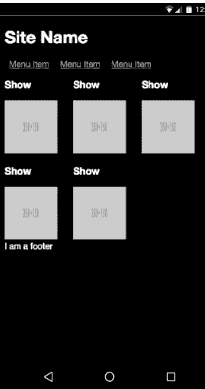

1-15. 网站的移动版本

```html
<section class="left">
    <h3>Show</h3>
    
</section>
```

**aside** 用于补充信息，例如联系支持和账户信息。网站的移动版本针对浏览和观看视频进行了优化，因此不显示 **aside**。当然，这种布局并非唯一的选择。例如，你可以选择将 *aside* 显示在屏幕底部（我们将在讨论网格系统时介绍这一点）。

随着屏幕尺寸减小，电视剧描述会被越来越精简，以便将更多注意力集中在缩略图上，这些缩略图会为移动设备进行适当的大小调整。

如果你有兴趣了解更多关于HTML5和页面结构的知识，我建议你阅读SitePoint的 *《HTML5 快速入门》* 。

### 准备好响应了吗？

在本章中，我探讨了响应式设计的必要性和历史。我介绍了你的网站现在需要支持的各种设备类型，并引入了我将在本书其余部分用于演示响应式设计原则的演示站点。我们还简要了解了如何使用HTML5构建页面结构。现在，我们准备好深入探讨响应式设计的构建模块，这是下一章的重点。

# 第 2 章

## 响应式设计的构建模块

响应式网页设计的核心有两个主要的构建模块：媒体查询和视口。

**媒体查询** 代表了将许多其他响应式概念和工具粘合在一起的粘合剂。它们是一个简单但强大的概念，允许你检测设备属性、定义规则，并基于这些属性加载不同的CSS属性。例如，你可以为不同的设备优化导航菜单，将桌面浏览器上的完整水平菜单转换为移动设备上常见的“汉堡”菜单。

**视口** 没那么复杂，它允许你适当地定义网页的大小和缩放比例，无论用于查看页面的设备大小如何。没有它们，媒体查询将只能部分发挥作用。

本章将首先介绍媒体查询，然后展示如何通过定义视口使其更好地为你服务。

### 媒体类型

你可以通过几种方式调用依赖于媒体查询的样式，最常见的是使用HTML `link` 元素链接到一个或多个CSS文件，或者直接在CSS文件中使用 `@import`。

在HTML中，如果查询为真（在所有设备类型上都为真），此示例将加载 `style.css` 文件：

```html
<link rel="stylesheet" media="all" href="/style.css">
```

在下面的示例中，`@import` 执行相同的操作，但从CSS文件内部进行：

```css
@import url("/style.css") all;
```

在下面的示例中，`@media` CSS规则包含一组特定的选择器，如果查询为真，这些选择器将被加载：

```css
@media all {
    ...
}
```

这些查询中的 `all` 是 **媒体类型**。在撰写本文时，有四种可用的媒体类型：

- `print`：用于页面的打印版本
- `screen`：用于计算机、平板电脑和手机屏幕
- `speech`：用于向用户朗读页面的屏幕阅读器
- `all`：用于以上所有类型

添加媒体类型允许你指定查询适用于哪些类型的设备。这些是广泛的，不允许太多控制。为了更具体地定位设备，你需要在这些媒体类型中添加表达式。

### 创建查询

让我们尝试一些更有用的东西。RWDflix 中主要内容旁边的侧边栏旨在显示公告和新闻。移动和平板电脑访问者可能希望专注于观看节目，不希望被其他内容干扰，因此让我们为小屏幕设备的用户隐藏这个元素。

> ### 本书中使用的方法

在本章的剩余部分，我将使用上面所示的 `@media` 方法进行媒体查询。这是个人偏好，作为实验，你可能想尝试使用其他方法重写示例。

移除当前的 aside CSS类，并将其替换为以下媒体查询：

```css
@media screen and (min-width: 680px) {
    aside {
        width: 33%;
    }
}

@media screen and (max-width: 680px) {
    aside {
        display: none;
    }
}
```

这对媒体查询设置 aside 元素在屏幕宽度大于680px时（通过使用 `min-width` 询问屏幕是否 *至少* 680px宽）宽度为33%，并在屏幕宽度小于680px时（通过使用 `max-width` 询问屏幕是否 *至多* 680px宽）将其隐藏。

## 24 响应式网页设计快速入门

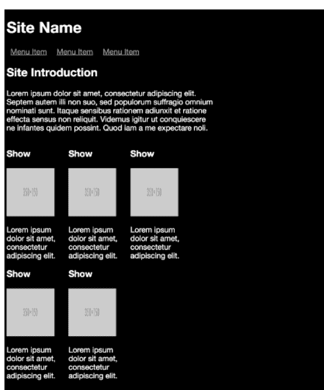

2-1. 在较小屏幕上隐藏的 `aside` 元素

接下来，当 aside 未显示时，让电视剧列表填满屏幕宽度：

```css
section.showslisting {
    margin-bottom: 25px;
}

@media screen and (min-width: 680px) {
    section.showslisting {
        width: 66%;
    }
}
```


## 2-2. 现在主要内容设置为全宽

如果你在桌面浏览器中调整页面大小，你会看到随着浏览器窗口变宽和变窄，侧边栏会相应地出现和消失，主要内容也会随之调整。

你可以在媒体查询中使用基本逻辑。这允许你组合多个条件。例如，你可以使用逻辑与：

```
@media only screen and (min-width: 640px) and (max-width: 1136px) {
  ...
}
```

上面的代码将在设备屏幕宽度在 640px *和* 1136px 之间时调用查询内的 CSS 样式。`min-width` 属性是屏幕的最小宽度，`max-width` 是最大宽度。

要使此媒体查询匹配，两个条件都需要为真。也可以在仅一个条件为真时使用逻辑或匹配查询，这（令人困惑地）用逗号表示。下面的查询将应用于屏幕或打印设备：

```
@media only screen, print {
  ...
}
```

你还可以将逻辑与和逻辑或组合起来，以创建更复杂的查询。这是当前页面在较大尺寸手机上以横屏模式渲染的效果：

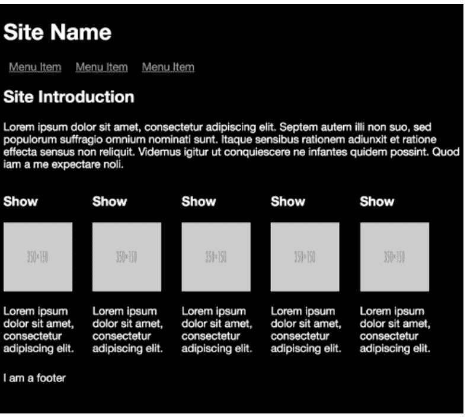

## 2-3. 当前手机在横屏模式下的布局

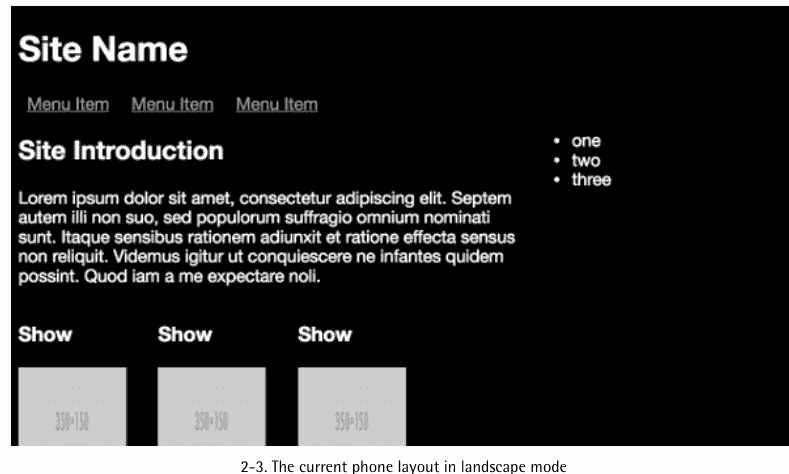

在上面的截图中，屏幕宽度为 732px，高于上面设置的 640px。不过，侧边栏仍然无法完全容纳在窗口中，因此如果屏幕尺寸低于 640px 或设备处于横屏模式，让我们将其隐藏：

```
@media screen and (max-width: 680px), screen and
(orientation: landscape) and (max-width: 750px) {
    aside {
        display: none;
    }
}
```

以及针对节目列表部分的相应媒体查询：

```
@media screen and (max-width: 680px), screen and
(orientation: landscape) and (max-width: 750px) {
    section.showslisting {
        width: 100%;
    }
}
```

你会看到我添加了一个 `max-width` 检查，以便在平板电脑横屏模式下显示 `aside`，同时也展示了如何将逻辑检查组合在一起。

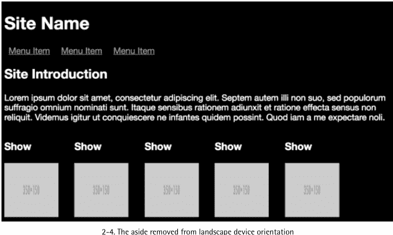

## 使用 Only 和 Not 的逻辑查询

你还可以使用 `only` 和 `not` 进行精确的媒体查询。例如，此媒体查询将匹配宽度至少为 640px 的设备，并*排除*打印媒体类型：

```
@media not print and (min-width: 640px) {
    ...
}
```

相比之下，此查询将*仅*适用于宽度至少为 640px 的屏幕设备：

```
@media only screen and (min-width: 640px) {
    ...
}
```

## 查询特性

到目前为止我们已经看过的宽度和高度查询是一些最广泛使用的查询，但还有其他一些**媒体特性**也用于检查设备特性。这些包括颜色能力、宽高比、方向、分辨率以及 Mozilla 和 WebKit 浏览器的特定供应商特性。这些大多接受 min- 和 max- 前缀，其工作方式类似于上面的尺寸查询。

### aspect-ratio

aspect-ratio 特性允许你检查水平像素与垂直像素的比率，用斜杠分隔。例如：

```
@media screen and (min-aspect-ratio: 1/1) {
    ...
}
```

上面的规则将匹配屏幕宽高比为 1:1 或更高的设备，即正方形或横向屏幕。

一个常见的用途是检测更宽的屏幕，这在显示视频时很有用：

```
@media screen and (min-aspect-ratio: 16/9) {
    ...
}
```

### orientation

如前所述，此特性检查设备是否处于横屏或竖屏模式。例如：

```
@media all and (orientation: landscape) {
    ...
}
```

以及：

```
@media all and (orientation: portrait) {
    ...
}
```

### color

此特性检查设备是否支持特定比特级别的颜色。例如，以下是如何检查设备是否至少支持 8 位颜色（即 256 种颜色）：

```
@media all and (min-color: 8) {
    ...
}
```

### color-index

color-index 的作用类似于 color，但允许你检查颜色数量而不是比特级别：

```
@media all and (min-color-index: 256) {
    ...
}
```

### monochrome

同样类似于 color，monochrome 允许你检查设备的灰度级别：

```
@media all and (min-monochrome: 8) {
    ...
}
```

### resolution

此特性针对具有高分辨率屏幕的设备：

```
@media all and (min-resolution: 120dpi) {
    ...
}
```

### scan

scan 媒体特性允许你检查电视的扫描过程，选项为隔行扫描或逐行扫描：

```
@media all and (scan: progressive) {
    ...
}
```

### grid

grid 用于检查设备是否为终端类设备。这也包括旧式手机（即非智能手机）、无障碍手机（供视力不佳者使用）和盲文设备。如果为真，它返回一个布尔值：

```
@media grid {
    ...
}
```

如你所见，通过组合基于尺寸和基于特性的查询，你可以构建复杂的样式表，以针对多种设备有效地应用最高效工作的样式。这就是媒体查询的主要意义：它们允许你为特定设备配置选择性地加载 CSS 样式。

### 精简示例应用

现在你有了基本的理解，让我们继续在之前添加的媒体查询基础上进行构建，使示例网站更加整洁。

首先，你可以合并已经编写好的查询，将类移动到两组媒体查询中：

```
/* 媒体查询 */
/* 例如，桌面设备 */
@media screen and (min-width: 680px) {
    aside {
        width: 33%;
    }

    section.showslisting {
        width: 66%;
    }
}

/* 例如，中等宽度屏幕或横屏模式下的较小屏幕 */
@media screen and (max-width: 680px), screen and (orientation: landscape) and (max-width: 750px) {
    aside {
        display: none;
    }

    section.showslisting {
        width: 100%;
    }
}
```

整洁多了！你可以继续将每个查询的新样式添加到这些部分中。

让我们回顾一下[第 1 章]中概述的演示网站规范，看看每个屏幕尺寸还需要优化什么。下一步是在小屏幕上隐藏电视节目描述，并在中等屏幕上缩短它。

如果描述文本有一个类，这将会容易得多，因此为每个包含节目描述的 p 标签实例添加一个类：

```
<section class="tvshow">
    <h3>Show</h3>
    
    <p class="showdescription">Lorem ipsum dolor sit amet,
    consectetur adipiscing elit.</p>
</section>
```

让我们添加新的媒体查询以适应我们旨在支持的各种尺寸，并在此过程中整理现有的查询。

我们希望设计重新流式的特定宽度被称为**断点**。我们将添加的断点并非详尽无遗：设备尺寸范围巨大，并且不断有新设备出现，因此尝试为每种设备使用单独的查询是徒劳的。更好的方法是评估你的设计需要重新流式的点，然后为这些断点创建媒体查询。这就是响应式 Web 设计的美妙之处：你可以确保每种设备都能获得适当的布局，而无需为每种设备单独设计。

添加以下断点，并将我们现有的样式重构到其中：

## 2-5. 第2章/demo_create/layout.css（摘录）

```
/* 媒体查询 */

/* 例如，旧式手机 */
@media only screen and (min-width: 320px) {
    aside {
        display: none;
    }

    section.showslisting {
        width: 100%;
    }

    .showdescription {
        display: none;
    }
}

/* 例如，新型手机 */
@media only screen and (min-width: 480px) {
}

/* 例如，小型电脑屏幕和较大的平板电脑 */
@media only screen and (min-width: 768px) {
    .showdescription {
        text-overflow: ellipsis;
        display: block;
        white-space: nowrap;
        width: 100px;
        overflow: hidden;
    }
}

/* 例如，典型的桌面显示器或较大的平板设备 */
@media only screen and (min-width: 992px) {
    aside {
        width: 33%;
        display: block;
    }
}
```


### 移动优先

在第一章中，我介绍了“移动优先”的概念。目前，该页面能在不同设备尺寸上正常显示，但并非移动优先，因为其“默认”样式——即那些未包含在媒体查询中的样式——实际上是为更大屏幕设备设计的。因此，让我们进行一些重构和调整，使其符合移动优先的设计理念。这不会涉及太多工作量。

请对媒体查询之外的类进行如下更改：

```css
aside {
    display: none;
}

section.showslisting {
    margin-bottom: 25px;
    width: 100%;
}

.showdescription {
    display: none;
}
```

现在，你可以从 `@media only screen and (min-width: 320px)` 媒体查询内部移除对应的类了。

就是如此！本质上，“移动优先”意味着让默认样式适用于移动设备以及不支持媒体查询的老旧浏览器，然后在此基础上通过媒体查询添加更具体的样式。

移动优先方法还有另一个更隐蔽的优势。虽然现在所有现代浏览器都支持媒体查询，但一些较旧的版本（例如 Internet Explorer 8）并不支持，在这种情况下，默认的 CSS 样式仍然会被加载。

### 视口元元素

在上一节中，我介绍了如何使用媒体查询使演示页面实现移动优先。如果你在桌面浏览器中尝试该示例并调整窗口大小，一切看起来都如预期所示。但如果你在移动浏览器中，或使用模拟的移动浏览器来尝试，你可能会看到如下截图所示的效果，并感到失望。媒体查询不是应该让页面在移动浏览器中表现更好吗？

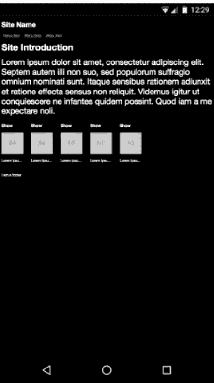

40 快速上手响应式网页设计

媒体查询允许我们为不同的屏幕尺寸设置不同的样式。因此，如果你的桌面浏览器视口宽度是 1200px，任何针对该屏幕宽度的媒体查询样式都会生效。如果你在视口宽度为 320px 的移动设备上，你会期望任何针对 320px 宽视口的样式都会生效。但这里有一个很大的陷阱。默认情况下，许多设备，如手机和平板电脑，会表现得好像它们拥有比实际更宽的屏幕。

为了解释这里发生的情况，让我们看看这种行为的起源地——iPhone。第一代 iPhone 的屏幕/视口宽度是 320px。然而，大多数为桌面设计的网站宽度远大于此。为了不让用户在加载时只能看到这些网站的左上角，苹果公司开发了“虚拟视口”或“布局视口”的概念。网站被加载到一个更宽的视口中，然后缩小以适应屏幕。因此，大多数网站在 iPhone 上渲染时文字非常小，需要缩放才能阅读。

苹果的虚拟视口设置为 980px，所以只要网站宽度不超过 980px，整个布局就会出现在屏幕上。任何宽于 980px 的布局仍会部分隐藏在右侧，需要横向滚动。这种情况至今依然如此。虚拟视口的概念也被其他设备制造商采纳，尽管默认宽度各不相同。

在设计响应式网站时，我们真的不希望移动设备上出现这种默认行为。我们希望知道我们工作的画布是每个设备的实际屏幕区域。幸运的是，有一个简单的方法可以告诉这些设备不要按默认方式工作。我们只需要在每个页面的 `<head>` 中添加一个特殊的元元素。这里有一个典型的例子：

```html
<meta name="viewport" content="width=device-width, initial-scale=1">
```

一般来说，上面这一行代码就是确保你的媒体查询在移动设备上按预期工作的全部所需。`name` 属性指定我们针对的是虚拟视口，`content` 属性指定我们希望设备如何工作。在上面的例子中，我们指定虚拟视口应与屏幕的实际宽度匹配，并且内容不应被缩放。

有了视口声明，你可以确信针对 320px 宽设备的媒体查询将被该设备正确识别。

让我们修改我们的演示站点以添加视口声明。在你当前的 `<head>` 元素内添加以下 `<meta>` 标签：

```html
<head>
    <meta charset="UTF-8">
    <title>App Name</title>
    <link rel="stylesheet" type="text/css" media="all"
          href="layout.css">
    <meta name="viewport" content="width=device-width,
          initial-scale=1.0">
</head>
```

刷新页面：

42 快速上手响应式网页设计

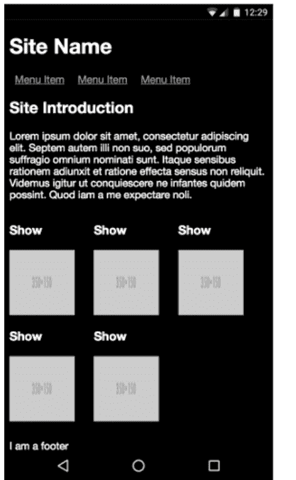

2-11. 带视口的演示页面

效果好多了！

### 视口

**视口** 是计算机图形学中的一个旧术语，用于定义（通常是矩形的）屏幕区域，该区域用于渲染用户在浏览器中看到的元素。当网页浏览仅限于桌面浏览器时，视口仍然存在，但设计师很少改变它。随着浏览器尺寸的日益多样化，HTML5 在 `meta` 元素中引入了一个 `viewport` 属性，允许设计师设置和操作这个区域。

视口元元素最初由苹果提出，用于将页面的初始状态设置为正确的尺寸，后来作为 HTML5 标准的一部分被引入。

通常，你将视口设置为当前设备的宽度（使用 `width=device-width`），并保持内容不缩放（使用 `initial-scale=1.0`）。

`width` 属性是一个像素值，`device-width` 常量检测当前设备宽度，这意味着你不需要处理可能出现的无数种尺寸；元元素会为你处理好。对于不同的屏幕方向也是如此：横屏和竖屏之间的切换也会为你处理好。要使设计完全实现响应式，仍然需要做很多工作，但媒体查询加上这个视口设置为你提供了一个极好的开端。

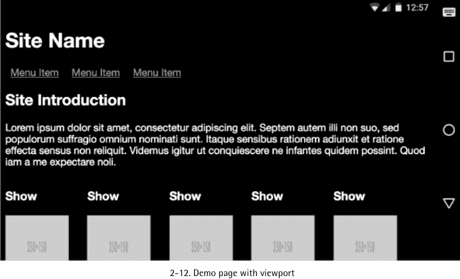

44 快速上手响应式网页设计

标签的 `content` 属性也接受用于设置宽度的标准方法。例如：

```html
<head>
    ...
    <meta name="viewport" content="width=500,
    initial-scale=1.0">
    ...
</head>
```

这将导致：

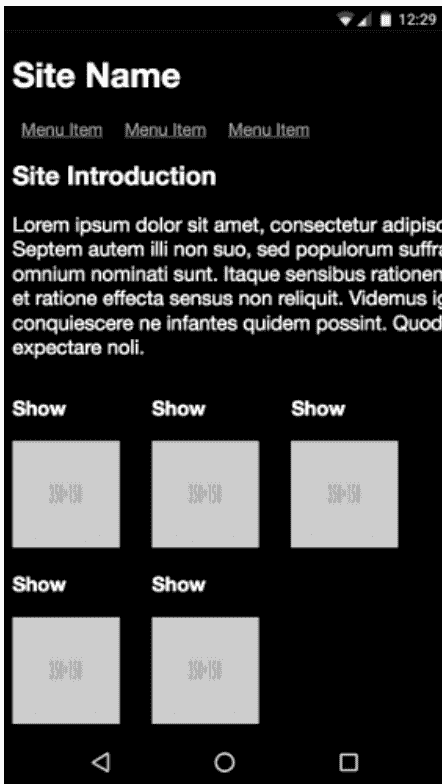

这仍然是一个比没有视口的页面更好的结果，但如你所见，如果页面内容宽度超过你定义的宽度，它仍会继续扩展。设置手动宽度的一个用例是，当你确定屏幕尺寸，并且确定页面内容会完美适配时——例如，如果你只针对一种设备，如电子阅读器或信息亭应用程序。

视口元元素还有其他不常用的属性，其用途有限，但当你需要对页面布局进行更精细的控制时可能需要用到：


# 任何问题？

-   `minimum-scale`：最小缩放级别，或用户可以缩小的程度。
-   `maximum-scale`：最大缩放级别，或用户可以放大的程度。
-   `user-scalable=no`：禁用缩放。虽然这仅适用于有限的用例，但它会显著降低你页面的可访问性。

媒体查询的这种选择性特质使其成为你响应式工具箱中必不可少的工具，在本章中，我们已经学习了如何创建和使用它们。

现在，所有现代浏览器都支持媒体查询，它们为你针对需要设计的任何特定环境提供了可能性。

在接下来的章节中，我们将利用媒体查询和视口提供的响应式基础，为我们的响应式设计增添光彩和亮点。

# 第3章

## 使用网格系统实现更好的响应式结构

到目前为止，我们已经探讨了响应式设计的基本原理以及利用媒体查询构建针对不同设备优化的页面结构的强大功能。在本章中，我们将看到网格系统如何补充甚至替代我们目前涵盖的一些技术，为页面在不同设备上的显示方式提供更大的灵活性。

虽然设计的灵活性在理论上是无限的，但印刷和数字设计中的一个常见设计伦理是使用松散的水平和垂直网格来布局元素。它们有助于将页面的部分区域分割成更易于管理的逻辑区域，而且我们的大脑喜欢看到构图中的项目排列在可预测的线条上。艺术作品和照片中的构图是一个长期研究的领域，其许多理论一直延续到网页设计中。

## 48 快速入门响应式网页设计

如果你在桌面上查看当前的演示页面，它实际上是一个由四行两列组成的网格：

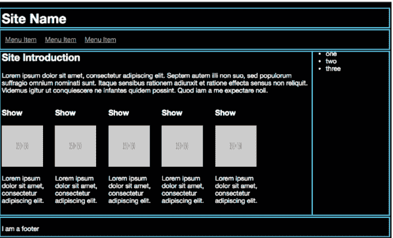

3-1. 初始页面网格

当你调整页面大小时，上一章添加的媒体查询会负责相应地更改行和列布局。

这是因为当前布局是一个所谓的**流式网格**的简单示例。页面的主要部分的宽度是视口宽度的百分比，因此会相应地调整大小。

在桌面上，电视剧的主要列表占据网页的 66%（或三分之二），菜单占据 33%（或三分之一）。

## 使用网格系统实现更好的响应式结构 49

```
@media only screen and (min-width: 992px) {
    aside {
        width: 33%;
        display: block;
    }

    section.showslisting {
        width: 66%;
    }

    .showdescription {
        white-space: normal;
        width: 125px;
    }
}
```

设计的流动性可以更进一步。页面区域内的布局也可以占据可用空间的百分比。例如，你可以将各个电视剧列表设置为具有灵活的宽度：

```
section.tvshow {
    width: 20%;
    height: 150px;
    display: inline-block;
}
```

这意味着每个子部分将占据主要区域 20% 的宽度，无论屏幕尺寸如何。这可能开始变得繁琐，但这更多是一个示例，表明基于百分比的大小可以应用于任何地方——包括文本甚至媒体元素（我们将在后面的章节中介绍这两者）。

虽然当前页面布局是一个网格，但它可以改进，使用更有意义的类名和更好的结构。

创建一个新的 `div` 元素，类名为 `container`，它包裹 `body` 元素内的所有当前内容：

50 快速入门响应式网页设计

```
3-3. Chapter3/vanilla_final/index.html (excerpt)

<body>
<div class="container">
...
</div>
</body>
```

为这个 `div` 添加以下样式到你的样式表：

```
3-4. Chapter3/vanilla_final/layout.css (excerpt)

.container {
    width: 95%;
    margin-left: auto;
    margin-right: auto;
    max-width: 1180px;
}
```

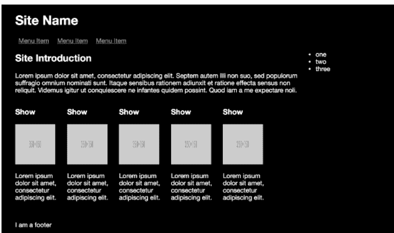

3-5. 带有额外容器的布局

这是为页面内容设置包含元素的常用方法。它将最大宽度设置为 1180px，宽度为浏览器窗口的 95%，并使用方便的左右自动边距将容器在窗口中居中。

> ## 为什么是 1180px？

为什么将最大宽度设置为 1180px？这是一个任意的值，基于当前桌面屏幕尺寸的趋势；添加它是为了确保页面在巨大屏幕上不会变得*太*宽。很长一段时间以来，它是 960px，这反映了当时大多数屏幕宽度最多为 1024px。随着屏幕尺寸和分辨率的增长，这个最大宽度变得更大，但仍然存在不同的意见。（第二章介绍的）媒体查询使这个最大宽度不如以前那么重要。目前，请坚持使用这个 **1180px** 值。

接下来，为 `header`、`navigation`、`listings` 和 `footer` 元素添加一个 `row` 类。你现在也可以从这些元素中移除 `left` 类，因为你将合并它的 CSS 属性：

```
<header class="row">
    ...
</header>

<nav class="row">
    ...
</nav>

<main class="row">
    ...
</main>

<footer class="row">
    ...
</footer>
```

并定义 `row` CSS 类：

52 快速入门响应式网页设计

```
.row {
    clear: both;
    float: left;
}
```

这个行会填满容器的宽度并浮动到左侧，这意味着随着浏览器窗口大小的调整，它会随之流动，固定在左侧。由于你还没有在行中定义列，在较大的屏幕尺寸上，侧边菜单被推到了底部。

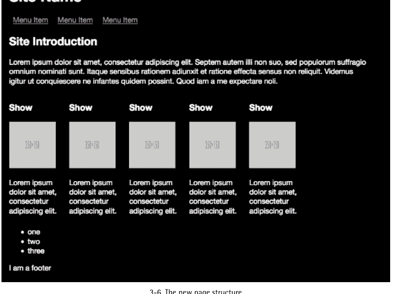

3-6. 新的页面结构

现在页面上所有水平元素都在四个行中，是时候在行内定义列了。有些行是单个全宽列，而其他行则被细分。

为了重新开始，移除之前设置的简单的百分比宽度（从所有媒体查询中），这样你就有了以下内容：

```
@media only screen and (min-width: 320px) {
    aside {
        display: none;
    }

    section.showsliding {
    }

    .showdescription {
        display: none;
    }
}

...

@media only screen and (min-width: 992px) {
    aside {
        display: block;
    }

    section.showsliding {
    }

    .showdescription {
        white-space: normal;
        width: 125px;
    }
}
```

页面在大屏幕尺寸下不再流动得那么好了，但你很快就会修复它。

## 什么是网格？

在你将页面重构为流式网格之前，让我们先简要讨论一下什么是网格。

**网格**是一系列列和行。但你的网站需要多少行和列呢？行数更清晰：你需要多少行来容纳你的页眉、导航、内容、页脚等。那么列数呢？嗯，就像本书（以及通常技术）中的其他主题一样，对此有不同的看法。它通常是偶数，因为这样更容易划分页面。能被 3 整除的数字最常用。（如果你有兴趣了解原因，[关于黄金比例的维基百科文章](https://en.wikipedia.org/wiki/Golden_ratio) 提供了一个很好的解释）。流行的列数值是 12、16 和 24，但我将在这里专注于 12 列网格系统。12 很流行，因为它可以被分割成多种常用的大小，例如一半、三分之一和四分之一。

## 创建你自己的网格

你可能想知道 12 列布局如何帮助你创建像我们示例页面那样的 3 列布局——是的，一开始确实令人困惑。

这些列更多地用作结构基础，通过 CSS，你可以定义你的元素希望跨越多少列。为了更清楚，这里是一个 12 列 1180px 网格的示例：

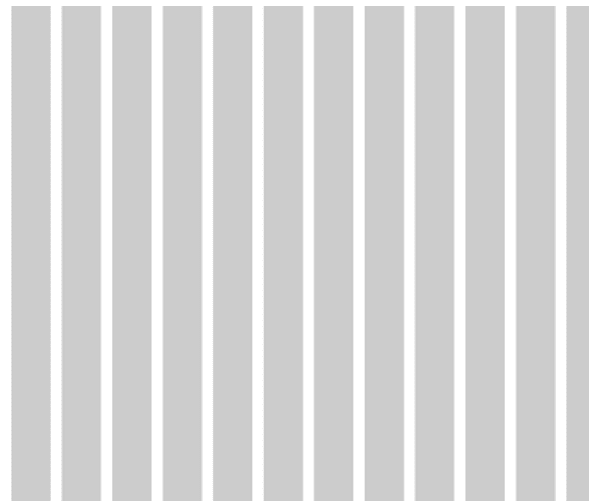

3-7. 一个 12 列、1180px 的网格

以下是如何用网格表示此页面（是的，网格内的网格，即“嵌套网格”，是允许的）：

56 快速入门响应式网页设计

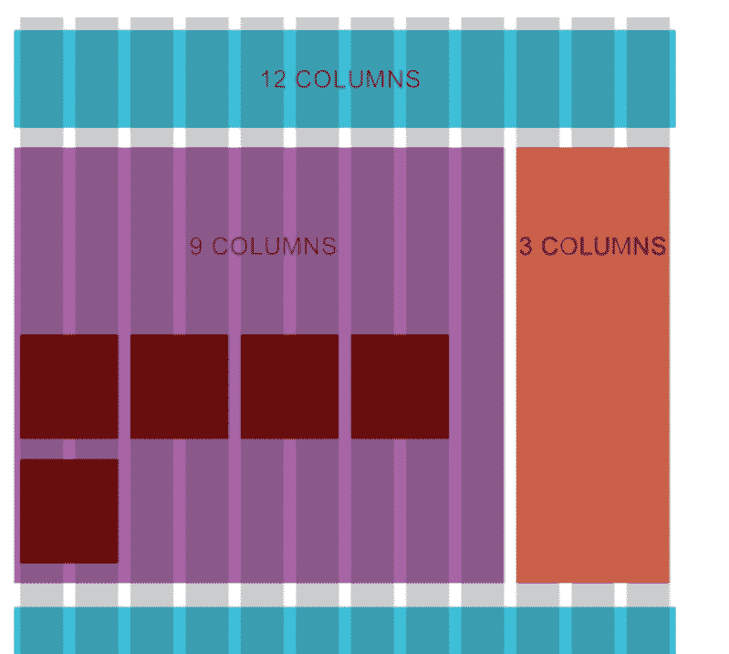

3–8. 作为网格的页面

你可以为每个项目手动设置所有这些列和网格，但更好的方法是创建更可用和可重用的东西。我们现在将创建很多新的样式以及对 HTML 和 CSS 文件的更改。然后我会展示实现相同结果的更简单的方法。有时候，在知道如何使其变得更容易之前，先学习困难的方法是个好主意。

为列和行设置基础样式，并替换任何现有的匹配类：


### 3-9. 第3章/vanilla_final/layout.css (摘录)

```css
.row,
.column {
    box-sizing: border-box;
}

.row:before,
.row:after {
    content: " ";
    display: table;
}

.row:after {
    clear: both;
}

.column {
    position: relative;
    float: left;
}

.column + .column {
    margin-left: 1.6%;
}
```

**使用相邻兄弟选择器**

上面使用的相邻兄弟选择器（`+`）是一个有用的 CSS 技巧，它只为紧随另一个匹配元素之后的匹配元素添加边距。在我们的例子中，这意味着第一列不会有左边距。

第一步是定义单列的宽度，别忘了列与列之间的边距。

单列宽度等于100（因为我们使用的是百分比）减去边距值，乘以列数减1（因为第一列不需要左边距），再除以列数。

如果你更喜欢看公式：

```
SingleColumnWidth = (100 - (MarginValue * (NumberOfColumns - 1))) / NumberOfColumns
```

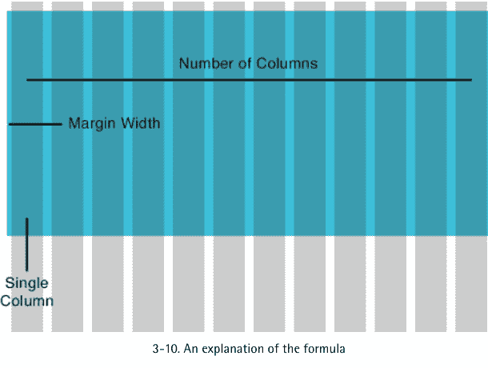

这会得到一个漂亮但不太好记的结果：6.866666666667%……不过别担心：这样的数字是预料之中的，在初始设置之后，你不需要记住这些值。

接下来，将这个数字应用到一个新的公式中，计算每一列的宽度。你需要知道列*跨度*的宽度值——也就是说，如何让内容跨越多列。

一列的宽度等于 `SingleColumnWidth` 的值乘以当前列数，再加上边距值乘以列数减1。

或者用公式表示：

```
ColumnWidth = (SingleColumnWidth * CurrentColumn) +
	 (MarginValue * (CurrentColumn - 1))
```

举个例子，下面是计算跨越两列所需值的过程：

```
(SingleColumnWidth * CurrentColumn)
6.86666666667 * 2 = 13.733333333

(CurrentColumn - 1)
2 - 1 = 1

(MarginValue * (CurrentColumn - 1))
1.6 * 1 = 1.6

(SingleColumnWidth * CurrentColumn) + (MarginValue *
	 (CurrentColumn - 1))
13.733333333 + 1.6 = 15.333333333
```

这将生成以下列样式，其中 `column-n` 类表示你想要跨越的列数。将这些添加到 layout.css 中：

60 快速上手响应式网页设计

### 3-11. 第3章/vanilla_final/layout.css (摘录)

```css
.column-1 {
    width: 6.866666666667%;
}

.column-2 {
    width: 15.3333333333%;
}

.column-3 {
    width: 23.8%;
}

.column-4 {
    width: 32.26666666667%;
}

.column-5 {
    width: 40.7333333333%;
}

.column-6 {
    width: 49.2%;
}

.column-7 {
    width: 57.66666666667%;
}

.column-8 {
    width: 66.1333333333%;
}

.column-9 {
    width: 74.6%;
}

.column-10 {
    width: 83.06666666667%;
}

.column-11 {
    width: 91.5333333333%;
}

.column-12 {
    width: 100%;
}
```

同样，别担心记住这些值。一旦定义好了，你需要做的就是使用 CSS 类。

> **节省一些功夫**
>
> 你也可以使用 CSS 预处理器——如 Sass 或 Less——它们提供了额外的框架来帮助你生成重复且复杂的 CSS。除其他功能外，这包括为你执行上述计算。

现在你希望页头和导航栏始终占据12列，以便更好地适应网格模型，因此让我们将页头和导航元素重新排列成行，并添加适当的列类。这些是基础列类和一个填充12列的 `column-12` 类：

```html
<header class="row">
    <h1 class="column column-12">站点名称</h1>
</header>
<nav class="row">
    <ul class="column column-12">
        <li><a href="#">菜单项</a></li>
        <li><a href="#">菜单项</a></li>
        <li><a href="#">菜单项</a></li>
    </ul>
</nav>
```

左侧内容区域需要9列宽，侧边栏需要3列宽，所以添加这些类：

62 快速上手响应式网页设计

```html
<section class="showslisting column column-9">
    ...
</section>

<aside class="column column-3">
    ...
</aside>
```

现在为内容区域*内部*的电视节目添加列类：

```html
<section class="tvshow column column-2">
    ...
</section>
```

在 `tvshow` 类中，你现在可以移除宽度和显示属性，并将高度更改为 `auto` 以实现更多响应式效果：

```css
section.tvshow {
    height: auto;
}
```

页面布局看起来与之前没有太大不同，但这些关键的变化带来了更大的灵活性。想让电视节目列表更紧凑吗？那么将类改为 `column-3`。

想要更宽的侧边栏菜单？将其类更改为 `column-4`，并将列表宽度类更改为 `column-8`：

### 3-12. 更宽侧边栏的页面

随着浏览器窗口大小的变化，你会看到页面元素平滑地收缩和扩展，非常适合响应式网页设计。但注意当屏幕尺寸变小时会发生什么：

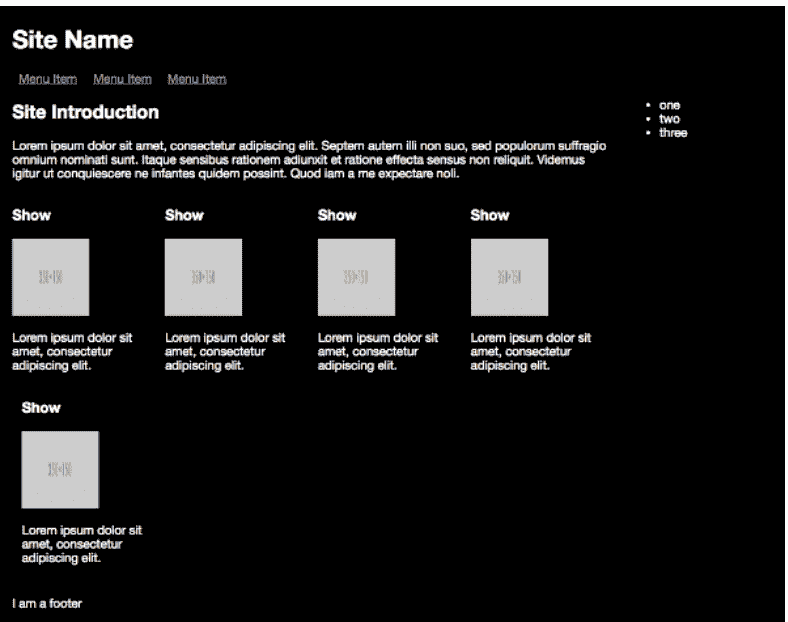

### 3-13. 屏幕尺寸较小时的情况

64 快速上手响应式网页设计

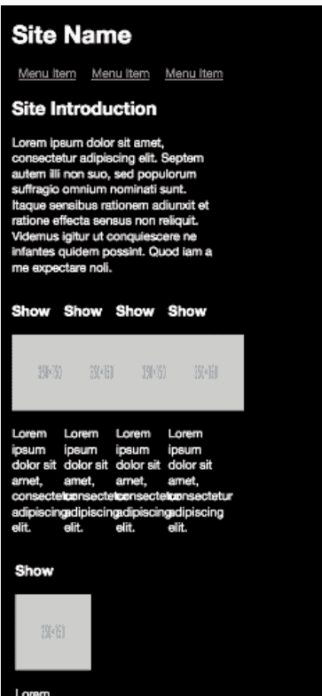

效果不佳：电视节目元素被挤压了。部分原因是图片尺寸还没有相应缩小——我们将在第5章进一步讨论这个话题。这也是流式网格的一个问题。理论上，在较小屏幕尺寸下应该发生的是，主内容列应改为填充屏幕宽度的100%，或者将类更改为 `column-12` 以填充屏幕的全宽。

一个解决方案是在相关的断点处覆盖 `column-8` 类的百分比宽度。例如：

```css
section.showlisting.column-8 {
    width: 100%;
}
...
@media only screen and (min-width: 992px) {
    ...
    section.showlisting.column-8 {
        width: 66%;
    }
    ...
}
```

但这是一个糟糕的解决方案，你很快就会记不清哪个类对应哪个尺寸。

你可以用 JavaScript 更改 div 应用的类，过去，这是解决问题的一种方法。但是，我将向你展示一些更现代（也更好）的选项，使网格原理对响应式设计更有用。

## Flexbox（弹性盒子布局）

虽然上面的“列方法”并不难理解和实现，但随着布局变得越来越复杂，你可能会引入大量的嵌套 div 和 CSS 样式来支持它们。上面的例子使用 `float` 来将页面元素定位到所需位置。由于例子很简单，实现这一点并不太难，但随着网格变得更加复杂，特别是嵌套网格，`float` 很快就会变得混乱，而应对这种情况的解决方案并不理想。

CSS 弹性盒子（“flexbox”）布局模块是 CSS 规范的最新部分，并且已经获得了良好的浏览器支持。它旨在为此类布局提供更好、更现代的解决方案，为你提供完成任务的特定功能。

在初步的页面重构和学习新概念之后，你会发现使用 flexbox 来管理页面组件将极大地简化你的 HTML 结构和 CSS 类。

66 快速上手响应式网页设计

你希望 flexbox 管理的所有内容都包含在一个“弹性容器”中。与前面的例子类似，从本章开始的代码开始，并继续使用一个包含 `div`：

```html
<div class="container">
    ...
</div>
```

以及这个容器的 CSS：

```css
.container {
    display: flex;
    flex-flow: row wrap;
}
```

`display` 属性设置为 `flex` 以启用弹性盒子布局。`flex-flow` 属性是另外两个属性的简写。

其中第一个属性是 `flex-direction`，它定义了弹性容器内的各个项目将如何放置。两个最常见的值是 `row` 和 `column`。使用 `row` 会将项目水平放置（从左到右或从右到左，取决于你的偏好）。而 `column` 的工作方式类似，但改为从上到下放置元素。你可以通过附加 `-reverse` 来反转方向。

`flex` 显示模式是一维的（水平或垂直运行），并会尝试将所有项目保持在一行上。`flex-wrap` 属性决定了当容器无法将所有项目放在一行上时会发生什么。项目可以设置为 `wrap` 到下一行，或者用 `nowrap` 强制在一行内。

接下来，让我们处理 `header`、`nav` 和 `footer` 页面元素，它们填满了页面容器的整个宽度。将任何现有样式替换为以下内容：


`flex` 是三个组合属性的简写，顺序如下：

- **flex-grow** 决定一个项目在容器中可以占用多少空间，且大小是相对的。如果容器中的每个项目`flex-grow`值都为1，那么每个项目将均匀分配空间。如果有一个项目的值为2，它将占据其他项目两倍的空间。
- **flex-shrink`** 决定一个项目是否可以缩小到小于其`flex-grow`值，以及如果可以，缩小到多少。默认值为1，因此如果你想保持比例不变，请将值留空。
- **flex-basis** 允许你在分配空间之前设置默认的项目大小，可以使用任何典型的CSS尺寸单位。

转到主要内容区域，再次替换任何现有的样式，你也可以从媒体查询中移除任何之前用于调整元素大小的方法：

```
main {
    flex-grow: 2;
    flex-basis: 66%;
}

aside {
    flex-grow: 1;
    flex-basis: 33%;
}
...
@media only screen and (min-width: 320px) {
    aside {
        display: none;
    }

    section.showslisting {
    }

    .showdescription {
        display: none;
    }
}
...
@media only screen and (min-width: 992px) {
    aside {
        display: block;
    }

    section.showslisting {
    }

    .showdescription {
        white-space: normal;
        width: 125px;
    }
}
```

调整页面大小。注意，你现在拥有了与第一个流式网格示例相同的效果，但从媒体查询中移除了大量CSS。通过一组flex属性，页面元素的尺寸就为我们处理好了。所有这些都不需要任何JavaScript！

如果你要重构页面，你可以移除`flex-basis`属性，但嵌套具有不同行/列方向的flex容器将涉及更多的div元素，因此你需要权衡HTML复杂性与CSS复杂性。

接下来，是电视节目列表的样式：

```
section.showlisting {
    display: flex;
    flex-wrap: wrap;
    flex-direction: row;
    margin-bottom: 25px;
}

section.tvshow {
    width: 125px;
    height: auto;
}
```

这将`showlistings`部分设置为另一个flex容器，它会换行任何不适合一行的项目——因为默认情况下，flex会尝试将所有项目放在一行。

此时，你也可以从HTML和CSS中删除`left`类，因为它不再需要。

### 3-18. 最终的flexbox布局

另一个很酷的flexbox技巧是使用order属性设置元素的顺序，以及一个定义其位置的数字。例如，你可以使用以下代码在移动设备上重新排列页面元素：

```
nav { order: 1;}
header { order: 2;}
main { order: 3;}
footer { order: 4;}
```

但如果你想移除页面元素，你仍然需要使用媒体查询。

这是一个关于如何使用flexbox的简要示例，但正如你所看到的，一旦你重构了页面，flexbox就会为你处理大量手动页面重排工作。

## CSS Grid布局

与flexbox相辅相成的是CSS Grid布局模块，它帮助你定义和布局页面的区域。过去，Web开发者对于灵活（我在此宽泛地使用这个词）页面布局的主要选择是使用HTML表格来定义具有行和列的页面区域，但这些对可访问性非常糟糕。Grid布局在某种程度上是该概念的现代重新诠释。

> **浏览器对Grid布局的支持**
>
> Grid于2017年初在所有主要浏览器的最新版本中发布，因此如果你的布局需要支持旧版浏览器，则需要一个回退策略。
> 你可以[在线查看](https://example.com)哪些浏览器版本支持或不支持Grid的详细信息。

让我们尝试将Grid布局应用于演示站点，从[本章开头的代码](https://example.com)开始。

同样，在body内创建一个容器div来包含布局：

```
...
<div class="container">
...
</div>
...
```

将aside从main内部移到外部。这让你可以将其视为一个独立的列：

```
...
</main>
<aside class="left">
    <ul>
    <li>one</li>
    <li>two</li>
    <li>three</li>
    </ul>
</aside>
```

在CSS中，将`display`类型更改为`grid`：

```
.container {
    display: grid;
}
```

现在grid显示变得非常酷。添加以下内容：

```
.container {
    display: grid;
    grid-template-columns: 66% 33%;
}
```

> **移除尺寸覆盖**
>
> 与flexbox布局一样，你也可以借此机会移除媒体查询中所有其他的尺寸覆盖。

在一个简单的CSS属性中，你已经移除了迄今为止使用的两个CSS类的需求。`grid-template-columns`属性为你提供了更多的可能性。例如：

- 你可以使用任何标准的尺寸单位来定义列，包括`auto`来填充剩余空间。
- 你可以使用`fr`（“fractional units”，分数单位）让网格按比例填充空间。所以你可以将此网格重写为`grid-template-columns: 2fr 1fr;`，这意味着第一列将占据三分之二的空间，第二列占据三分之一。

很好，但如果你现在查看演示站点，你会注意到设计中没有66/33分割的行看起来不对。这是因为你还需要使用类似的语法定义行：

```
.container {
    display: grid;
    grid-template-columns: 66% 33%;
    grid-template-rows: 80px 80px auto 20px;
}
```

> **需要多少行？**
>
> 这是我们第一个需要显式定义行的例子，有几种方法可以做到。我建议有四行：标题、顶部菜单、介绍文本和电视节目，以及页脚。如果你想更改这些划分（例如，将描述和电视节目分开），请随意操作。

此语法为三个元素指定了固定高度，然后让剩余的电视节目元素填充剩余的空白空间。

但同样，如果你在浏览器中加载页面，变化不大。事实上，`footer`现在已经跳到了页面的上方。这是因为还需要一个步骤——将子元素添加到网格中：

### 使用Grid系统构建更好的响应式结构

Grid显示布局有两个有趣的方法来定义你可以放置项目的位置。

1. 第一种类似于flexbox，允许你指定一个顺序编号。
2. 第二种允许你将项目放置在命名的位置。要使用此方法，你需要定义所谓的**线名称**。

下面的代码将`display`样式设置为`grid`，然后定义你需要的列和行。对于列，这是一个名为`left`的列，占页面宽度的66%，和一个名为`right`的列，填充33%。对于行，这定义了三个固定高度的行（header, main-nav和footer），而`shows`将自动填充任何剩余空间。

```
.container {
    display: grid;
    grid-template-columns: [left] 66% [right] 33%;
    grid-template-rows: [header] 80px [main-nav] 40px [shows]
    auto [footer] 20px;
}
```

此时，既然你已经理解了发生了什么，是时候让它移动优先了。将当前的`container`类更改为以下内容：

```
.container {
    display: grid;
    grid-template-columns: [left] 100%;
    grid-template-rows: [header] 80px [main-nav] 40px [shows]
    auto [footer] 20px;
}
```

对于更大的屏幕尺寸：

```
@media only screen and (min-width: 992px) {
    .container {
    grid-template-columns: [left] 66% [right] 33%;
    }
    ...
}
```

如果你曾经在桌面出版应用程序中创建过表格（或者记得在网页设计的黑暗时代使用表格进行布局），你会知道你需要定义一个项目如何“跨越”多个单元格或行。Grid显示的技术是相同的。以`header`为例：

```
header {
    grid-column-start: left;
    grid-column-end: right;
    grid-row-start: header;
    grid-row-end: header;
```


这个声明块规定了列应从左侧开始并延伸至右侧，同时从该行的顶部延伸到底部。

其他页面元素遵循类似的模式：

```
nav {
    grid-column-start: left;
    grid-column-end: right;
    grid-row-start: main-nav;
    grid-row-end: main-nav;
}
main {
    grid-column-start: left;
    grid-column-end: right;
    grid-row-start: shows;
    grid-row-end: shows;
}
footer {
    grid-column-start: left;
    grid-column-end: right;
    grid-row-start: footer;
    grid-row-end: footer;
}
@media only screen and (min-width: 992px) {
    aside {
        display: block;
        grid-column-start: right;
        grid-column-end: right;
        grid-row-start: header;
        grid-row-end: header;
    }
}
```

现在，你就定义好了一个网格。起初，这种语法看起来有些冗长，但它更具可读性。

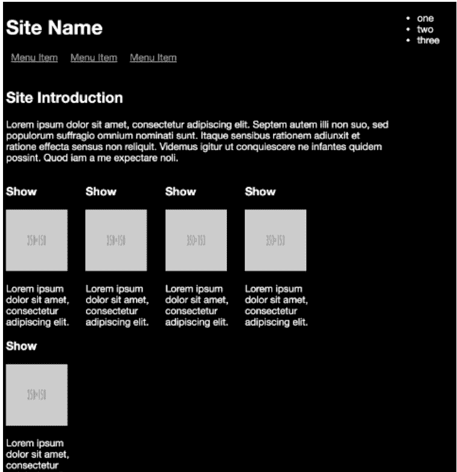

网格布局还有许多其他功能，包括重复布局、嵌套网格、内容对齐以及在网格中定义边距和间距的能力。网格显示的另一个最终优势是，它还使得浮动和清除变得不再必要，因此可以从HTML中移除 `left` 类以及任何已使用的清除样式。

### 使用框架让网格更简单

在许多情况下，按照本章描述的方式创建网格工作量并不算太大，但开发者和设计师总是希望尽可能减少重复性任务。一个简单的解决方案是创建自己的、适合你的网格系统，并在项目中重用它。当然，其他开发者和设计师也曾有过同样的想法，并在网络上提供了他们的网格系统（或框架）。我将介绍其中两个流行的框架，但这是一个众说纷纭且变化迅速的话题。我的目标是向你展示框架*可能*如何帮助你在重复性任务上节省时间，而不是详细讨论哪一个“更好”（这个决定需要你自己来做）。许多这些框架提供的不仅仅是响应式网格，还包括其他响应式元素，如字体、图标和可重用组件。你可能更喜欢某个框架而不是另一个，因为它能为你的网页其他方面提供更好的选择。

#### Bootstrap

虽然不是第一个响应式设计框架，但Bootstrap是使用最广泛的。你可能在不知不觉中见过它的应用。它于2011年由Twitter发布，使用12列网格，提供弹性盒布局，并且在GitHub上曾一度是最受欢迎的仓库之一。

流行是Bootstrap最大的优势，也是其劣势。它易于使用，鼓励良好的布局和CSS实践，拥有丰富的文档和社区支持。但你的网站很容易变得与其他所有使用Bootstrap的网站看起来非常相似。

##### 安装Bootstrap

Bootstrap的默认下载可能会为你的页面增加不少负担，因此我建议你仔细阅读说明，确保获得针对你的使用场景优化得最好的版本。对于这个示例，我将使用CDN选项，因为它最简单。如果你想跟着做，请添加Bootstrap页面上提供的行，并移除当前CSS文件的链接。

你可以在此处找到简化的（无媒体查询）重构后的index.html页面[here](#)作为示例。你失去了自定义字体和背景颜色（这些很容易重新添加），但你无需太多努力就获得了一个响应式网格（Bootstrap也使用12列网格），并且它的工作方式与我们自定义的网格类似。Bootstrap还有许多其他样式可用于处理图像、确定在不同网格尺寸下显示哪些网格元素等等。

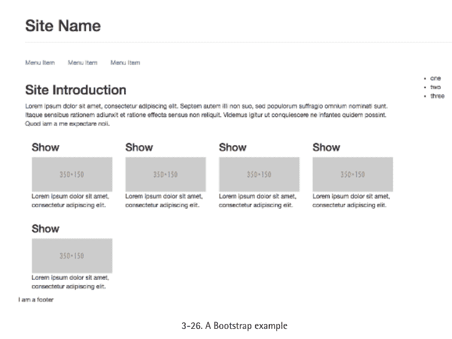

如果你有兴趣了解更多关于Bootstrap的知识，我推荐SitePoint的[Jump Start Bootstrap](#)。

#### Foundation

[Foundation](#) 于2011年由Zurb（一家互动设计机构）创建。它也提供了许多功能（包括可选的弹性盒），有定期的发布和良好的社区，但使用范围不如前者广泛。它提供了更多的布局灵活性（基于12列网格），但通常需要更多的类和布局元素来实现这一点。

##### 安装Foundation

与Bootstrap一样，Foundation可能会增加页面的负担，因此请确保你[下载了适合你的最佳配置](http://example.com)。

移除当前样式表，并添加新样式表的链接：

```
<link rel="stylesheet" href="foundation/css/foundation.css">
<link rel="stylesheet" href="foundation/css/app.css">
```

你可以在此处找到Foundation简化的（无媒体查询）重构后的index.html文件[here](http://example.com)作为示例。同样，你失去了可以替换的自定义颜色，但你应该能够看到需要添加的额外元素和类。

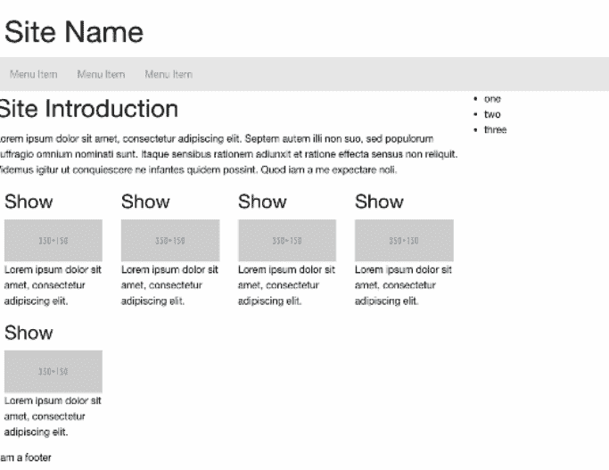

如果你有兴趣了解更多关于Foundation的知识，那么我推荐SitePoint的 *Jump Start Foundation*。

### 演示应用程序怎么办？

到目前为止，我一直在本章的示例中使用了演示应用程序的部分内容，但本书的其余部分将不使用任何网格系统。这是为了清晰起见，以便你可以更轻松地看到涵盖其他主题的示例，而不受网格的干扰，同时也为了减少与某些浏览器的兼容性问题。

作为练习，尝试从本章中选择你最喜欢的网格系统，并使用它重写未来的示例。

## 总结

现在你知道了如何制作一个可以响应任何浏览器尺寸并始终保持比例的页面布局。在下一章中，我们将探讨如何使布局内的内容响应式——因为，如果没有在所有设备上可读且可展示的内容，你的工作就尚未完成。

# 第4章：响应式文本

如果网页要真正实现响应式，那么页面的内容也应该根据用户查看它的设备尺寸而流动和变化。虽然网页正变得越来越以图像和媒体为主，但文本仍然是一个关键组成部分，并且有许多技术可以帮助使其尽可能易于阅读，无论当前设备是什么。

为了更好地理解在网页上呈现文本的方式，最好回顾一下文本的悠久历史。

### 文本的历史

**排版**（文本的排列和样式设计）的原则自人们将文字印刷在页面上以来就一直在发展。诸如行距（文本行之间的间距）、字距（字母之间的间距）和字间距（单词之间的间距）等度量标准已沿用到桌面出版领域，任何使用过QuarkXpress、InDesign或其前身的人都会知道它们如何影响文本。

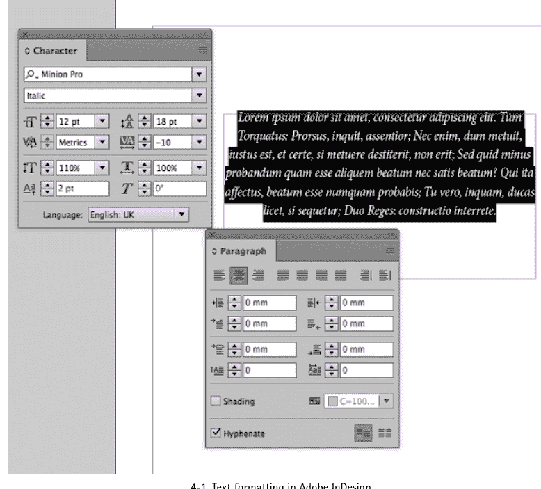

手工排版是一个艰苦的过程，因为它需要调整每一行文本的行距、字距和字间距。桌面出版，以及最近使用CSS设置排版，使得尝试这些属性以获得“完美”文本变得容易得多。

CSS排版与印刷排版共享许多相同的属性，但有些名称不同。事实上，它比旧的印刷版本的名称更具描述性。在Web早期，排版控制水平有限，但CSS3极大地帮助了我们，提供了更多工具来实现我们的设计。

### CSS中的响应式排版属性

你可以用CSS设置许多与文本相关的属性。以下是我认为对响应式设计最有用的一些：

- **font-size**：字体的大小。
- **line-height**：指定块元素内行的最小高度以及内联元素的实际行高。
- **font-weight**：字体的“粗细”，即它的粗体和强度。
- **text-decoration**：用于设置下划线或删除线。
- **text-align**：用于设置左对齐、右对齐、居中或两端对齐（与左右边距均等对齐）。
- **text-transform**：用于使文本显示为大写、小写或首字母大写。
- **letter-spacing**：指定字母之间的间距，类似于行距。
- **word-spacing**：指定单词之间的间距，类似于字间距。

通常使用像素值来设置其中部分或全部属性。例如，你可以将以下内容添加到当前演示站点的body选择器中：

```
body {
    font-size: 18px;
    line-height: 22px;
    letter-spacing: 4px;
}
```

这将产生如下所示的文本：


你在设计中可能发现有用的其他属性包括：

- **font-style**：将文本设置为斜体或倾斜。斜体文本在小屏幕上的可读性可能不如大屏幕。
- **text-indent**：设置文本块中文本首行的（主要是）缩进。在较小设备空间有限的情况下，缩进段落可能比设置段间距更好。
- **text-align-last**：设置文本块最后一行的对齐方式。同样，在不同设备尺寸下，你可能需要进行不同的处理。
- **white-space**：定义文本块中的空白处理和换行。
- **word-wrap**：指定是否允许单词在行间断开。这对于根据显示大小优化文本很有用。

你可能会好奇，设置固定尺寸的文本如何能实现响应式。无论是渲染在台式电脑还是移动屏幕上，18px 就是 18px。你可以使用媒体查询在不同屏幕尺寸下设置不同的字体大小，但这会变得繁琐，并且可能有一个更好的方法。

CSS 允许你使用不同的单位来设置元素大小，特别是文本。它们分为两大类：固定尺寸和相对尺寸。

#### 固定尺寸

固定尺寸意味着大小始终相同。你可以使用七种可能的单位，但我将重点关注最常用的两种：`px` 和 `pt` 值。

##### 像素

像素是构成所有设备屏幕的那些小色点。当你需要在 HTML 中设置元素大小时，一个 CSS 像素等于一个设备像素，对吧？其实并非如此……

**设备像素**（也称为**屏幕像素**）是构成你屏幕的实际像素，传统上这是指用户屏幕的宽度乘以高度的像素数。这可能与他们浏览器窗口的大小不同，因为桌面用户经常调整窗口大小，并且浏览器通常不以全屏模式运行。

4-3. 屏幕尺寸 vs 浏览器尺寸

较新的高分辨率屏幕——例如苹果的“视网膜”显示屏——使问题复杂化，因为它们在相同的屏幕区域使用了更多的像素。通常，这是通过将垂直和水平方向的像素数量加倍来实现的——尽管越来越多的屏幕在每个方向上的像素数量增加了四倍。

更复杂的是，用户为了无障碍访问或其他原因，会缩放或放大其浏览器窗口。例如，下面的截图是当前演示站点放大到 125%，此时一个 *CSS 像素* 现在覆盖 1.25 个 *设备像素*。

## 快速上手响应式网页设计

因此，最好忽略实际的设备像素，专注于 **CSS 像素**——即在你的 CSS 文件中设置的像素值。CSS 像素值是一个更准确的数字，它考虑了上述因素。浏览器还会为你处理很多缩放问题。

**像素**（px）大小单位理论上代表屏幕一个像素的大小。对于文本，这意味着当文本设置为 16px 时，文本中最低点（例如小写 'g' 的底部）到最高点（例如小写 'h' 的顶部）的长度为 16px。

4-5. 文本高度包括升部和降部

对于其他属性，例如 letter-spacing，这字面上意味着字符在最宽点之间的像素数。

### 磅值

正如你在之前 InDesign 的截图中看到的，**磅**（pt）大小单位源于印刷文本，理解起来更令人困惑。它表示的大小与像素示例相似，但由于不同的操作系统和屏幕以不同的方式表示像素与磅的关系，因此最好将其保留用于打印样式。

### 相对尺寸

相对尺寸更适合网页和响应式设计，因为大小会相对于一个基础大小进行更改。但了解固定尺寸（至少是像素）对于理解这些尺寸方法的工作原理很有用。用于相对字体大小的最常用单位是 %、em 和 rem 值。

使用相对尺寸时，第一个重要的事实是这些尺寸相对于什么。在所有浏览器中，默认情况下是 16px，但如果用户更改了此默认值——例如为了补偿低视力——那么相对尺寸仍将按比例放大和缩小。

#### 百分比

为字体大小设置百分比值意味着使其成为默认字体大小的百分比，因此如果用户将其浏览器的字体大小设置为 16px，那么 `font-size: 100%;` 仍将等于 16px，而 `font-size: 50%` 将等于 8px。

例如，让我们尝试将百分比尺寸应用于演示站点，再次采用移动优先方法，为使用较小屏幕设备的用户设置基础字体大小。

> ### 我们假设基础字体大小为 16px
> 对于这些示例，我将假设基础字体大小是默认的 **16px**。如果它在你的浏览器中不同，那么所述的大小也会不同。

向 `body` 元素添加一个基础字体大小，将默认字体大小设置为 16px 的 75%，即 12px：

```
body {
    font-size: 75%;
}
```

然后，在平板电脑和桌面媒体查询中，为较大的屏幕尺寸添加字体大小：

```
...
@media only screen and (min-width: 768px) {
    body {
        font-size: 100%;
    }
}

@media only screen and (min-width: 992px) {
    body {
        font-size: 125%;
    }
}
```

这导致在较大的屏幕上比中等尺寸的屏幕上字体渲染效果稍微更像素化一些。

#### Em

尽管 em 单位在网页设计师中最近越来越受欢迎，但它是一个古老的印刷单位，以字母“M”命名。一个 em 单位的基础值等于当前字体的磅值大小。例如，16 磅字体中的 1 em 等于 16 磅。

在实践中，它的工作方式与百分比尺寸类似，但单位更小。因此，例如，假设默认字体大小为 16px，`font-size: 1em` 仍将等于 16px，`font-size: 0.5em` 将等于 8px。

em 单位的值更小，但样式很容易意外导致字体尺寸过大。例如，考虑 `font-size: 4em;` 虽然数字看起来不大，但它实际上等于 64px。当然，你可以将默认字体大小设置得更小一些，然后增加 em 值就不会导致如此大的变化。

例如，让我们尝试将 em 尺寸应用于演示站点，再次采用移动优先方法。

向 body 元素添加一个基础字体大小，将默认字体大小设置为 16px 的 0.75em，即 12px：

```
body {
    font-size: 0.75em;
}
```

然后，在平板电脑和桌面媒体查询中，为较大的屏幕尺寸添加字体大小：

```
@media only screen and (min-width: 768px) {
    body {
        font-size: 1em;
    }
}

@media only screen and (min-width: 992px) {
    body {
        font-size: 1.25em;
    }
}
```

我不会添加截图，因为结果应该与百分比示例看起来完全相同。

使用 em 的一个巧妙技巧是相对尺寸会沿嵌套元素级联。例如，修改页面的 aside 元素，使其包含一些嵌套的列表项：

```
<aside class="left">
    <ul>
    <li>one
        <ul>
        <li>sub item</li>
        <li>sub item</li>
        </ul>
    </li>
    <li>two
        <ul>
            <li>sub item</li>
            <li>sub item</li>
        </ul>
    </li>
    <li>three
        <ul>
            <li>sub item</li>
            <li>sub item</li>
        </ul>
    </li>
    </ul>
</aside>
```

然后添加以下样式：

```
aside ul {
    font-size: 0.75em;
}
```

4-7. Em 级联示例

你会看到外部 ul 的字体大小是当前默认大小（在截图中为 20px）的 0.75em（15px），而内部 ul 是该大小的 0.75em（11.25px）。虽然这种技术提供了一种绝妙的简写方式来创建可以沿页面结构级联的响应式文本大小，但它需要仔细规划，因为一个位于多个层级深度的元素最终可能会比你预期的更小或更大。

#### Rem

`rem` 单位代表“根 em”，单位的尺寸表示方式相同。但“根”意味着相对尺寸是从一个基础元素计算的——即 `html` 元素——而不是直接的包含元素。这为你提供了一个比 em 更可预测的选择，因为它更容易判断大小是相对于什么的。

例如，让我们尝试将 `rem` 尺寸应用于演示站点。

向 `html` 添加一个 12px 的基础字体大小（假设默认为 16px）：

```
html {
    font-size: 75%;
}
```

然后在平板电脑和桌面媒体查询内部，为较大的屏幕尺寸添加字体大小：

```
@media only screen and (min-width: 768px) {
    html {
        font-size: 1rem;
    }
}

@media only screen and (min-width: 992px) {
    html {
        font-size: 1.25rem;
    }
}
```

当应用到演示站点时，变化不大，因为尺寸实际上相同。现在为上面的嵌套列表示例添加以下样式：

```
aside ul {
    font-size: 0.75rem;
}
```

现在尺寸是当前基础字体大小的3/4。

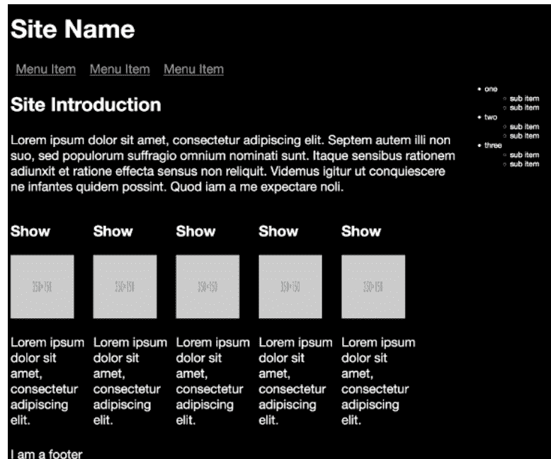

4–8. Rem级联示例

### 其他相对尺寸

基于百分比、ems和rems的尺寸并不是你唯一的选择。实际上总共有九种。有些相当晦涩，或者并非真正必要，但另一些在经过初步学习曲线后会更有用。例如，vw和vh单位，它们分别代表视口宽度和高度的百分比。

还有vmin（基于视口高度和宽度中较小的一个）和vmax（基于视口高度和宽度中较大的一个）。这些单位非常灵活，因为尺寸会自动响应视口的大小，但你可能会弄不清楚字体实际有多大。

假设一个宽度为1000px、高度为800px的视口：

- 1vw是总宽度的1%，即10px
- 100vw是宽度的100%，即1000px
- 50vw是宽度的50%，即500px
- 1vh是高度的1%，即8px
- 1vmin是两个尺寸中较小的一个的1%，即800px的1%，为8px
- 1vmax是两个尺寸中较大的一个的1%，即1000px的1%，为10px

尝试向body元素添加以下内容：

```
body {
    font-size: 1.5vw;
}
```

现在你的基础字体大小将是body宽度的1.5%，这取决于你浏览器窗口的宽度。

起初，视口尺寸看起来是响应式设计的完美解决方案，但你会注意到，当你缩小浏览器窗口时，字体大小会变得难以阅读，因为小视口宽度的1.5%是一个非常小的字体尺寸。

当然，你可以用断点来解决这个问题，但那样就违背了使用这个尺寸单元的初衷。这里有一个巧妙的变通方法，感谢[Zell Liew](https://zellwk.com/)和[Mike Riethmuller](https://www.cruip.com/)：

```
body {
    font-size: calc(16px + 0.25vw);
}

/* 上面的代码在Safari中无效，但下面的可以 */
body {
    font-size: calc(100% + 0.25vw)
}
```

这个方法通过使用CSS3的`calc`函数来计算基础字体大小（16px或100%），然后加上视口宽度的0.25%，从而减少尺寸在视口尺寸变化时的差异。你可以根据需要自由修改计算中的值。

> ### 浏览器支持

一些视口尺寸单位和`calc`函数并非在所有浏览器中都得到完全支持，即使是较新版本的Internet Explorer和Edge也不支持[`vmax`属性](https://caniuse.com/#feat=viewport-units)，而旧版本的Android浏览器则不支持`calc`中的所有计算类型。

在本章的剩余部分，我将使用`em`单位，但在重构演示站点文本之前，让我们回到排版及其为网络优化的话题。

### 创建可读的文本

你可以将本章前面概述的所有排版属性与同样讨论过的尺寸单位结合使用，从而对文本进行细粒度的调整，使其在任何设备上都具有最佳的可读性。

当然，关于“好的文本”是什么样子，有许多不同的观点，这取决于你的页面显示多少文本以及这些文本对页面的重要性。本书中的示例站点文本量较少，因此使其可读相对容易。像博客这样文本密集的站点则需要更多的思考和考量。

你应该考虑哪些字体、样式、大小和布局适合各种屏幕尺寸和分辨率，并将其与项目可能拥有的任何样式指南进行平衡。

让我们通过调整基础文本属性来开始改进演示站点的文本：

```
body {
    font-size: 1em;
}
```

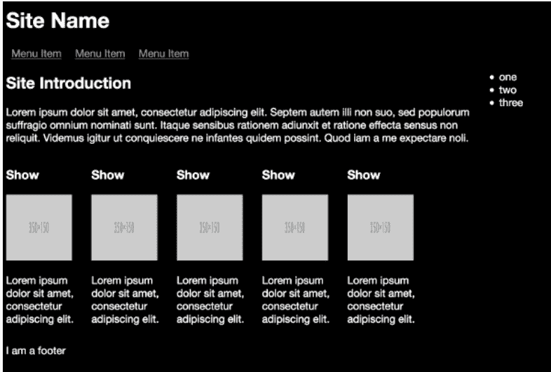

这将默认字体大小设置为浏览器默认值，如前所述，很可能是16px。

对于页面的小屏幕版本（即默认样式），节目描述文本实际上是隐藏的，所以我们不必担心它的格式。然而，当屏幕空间有限时，主要的站点描述占据了太多空间，因此使用`:not`伪类来减小默认字体大小并排除节目描述：

```
section.showslisting p:not(.showdescription) {
    font-size: 0.8em;
}
```

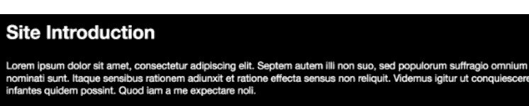

4-10. 站点介绍文本已调整大小

随着屏幕尺寸增大，除了观看视频外，节目描述可能是人们最想访问的内容，因此让我们让文本稍微大一些以更加突出。在这个中等屏幕尺寸下，仍然只显示文本摘要，所以这足以使其更具可读性：

```
@media only screen and (min-width: 768px) {
    .showdescription {
        font-size: 1.2em;
    }
}
```

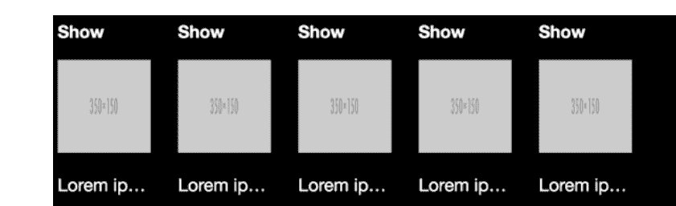

4-11. 节目描述现在更大了

随着屏幕变得更大，让我们增大文本大小并收紧行距，特别是因为人们现在可能会从房间另一头阅读这些描述，准备享受一晚的娱乐。

```
/* 中等设备和桌面设备 */
@media only screen and (min-width: 992px) {
    .showdescription {
        font-size: 1.3em;
        line-height: 1.1em;
    }
}
```

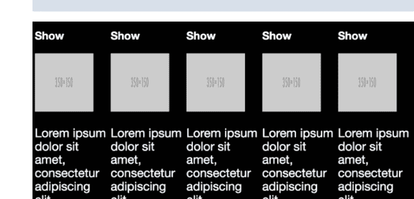

4-12. 完整的描述文本

### 继续阅读

在本章中，我介绍了与响应式设计相关的排版概念，并展示了它们如何在CSS中表示。我还涵盖了可用于设置这些属性的不同尺寸单位，以及如何使页面上的重要文本可读。在下一章中，我将探讨如何对页面的其他内容（如图像和视频）进行同样的处理。

# 第五章
## 响应式图像与视频

基于文本内容的交换催生了网络，但图像和其他富媒体使其不断进化，成为我们所知/喜爱/不喜的事物。

近年来，使图像响应式的方法发展迅速，能够加载完美适配用户设备的图像。而新增的HTML元素，如`video`，为响应式设计开辟了新的可能性。这是一个全新的领域，但充满了陷阱、妥协和需要学习的新技术。那么，让我们开始吧！

### 图像

图像是强大的沟通工具，传达信息、意图、解释，并为你的网页带来生机。

多年来，图像也一直是设计师（网络和印刷）持续头疼的问题。虽然HTML5带来了许多改进，但为你的网页添加响应式图像仍然需要规划和准备。

在本章中，我将网站上至今使用的占位符图形替换为来自免版税网站的图像，以代表一个拥有真实电视节目的网站可能的样子。

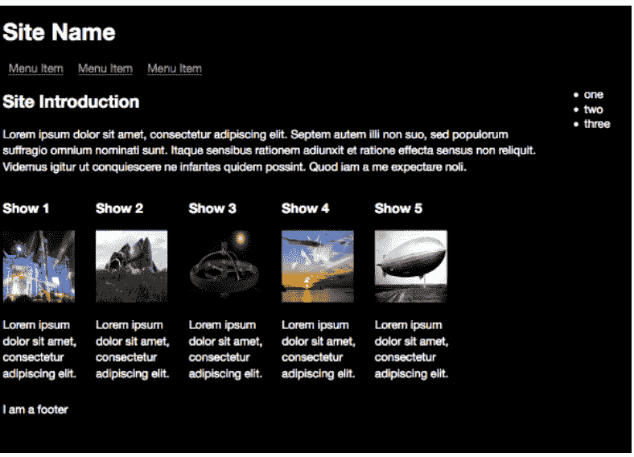

5-1. 添加节目图像

现在我们添加了真实图像，页面出现了一些问题。最明显的是，虽然布局仍然没问题，但所有图像都被强制适应相同的尺寸，这意味着它们没有利用可用的屏幕空间。示例站点用于浏览和观看视频，因此使视觉内容尽可能突出和易于查看是有意义的。

为了展示如何使用响应式图像，我们将修改演示站点，使其在[第3章](#)定义的断点处，为每个用例提供不同的图像尺寸和布局。

首先，更改CSS和HTML以更好地容纳我们将要添加的图像。让我们给主内容区域更多空间，并减小侧边菜单的大小：

```
@media only screen and (min-width: 992px) {
    aside {
        width: 15%;
        display: block;
    }

    section.showslisting {
        width: 75%;
    }
}
```

为包含节目详细信息的div添加移动优先的样式。这设置了最大宽度为480px，居中，理想宽度为*大部分*屏幕宽度：

```
section.tvshow {
    width: 90%;
    max-width: 480px;
    margin: 0 auto;
    display: block;
}
```

接下来，为相同div在较大屏幕上显示时添加媒体查询——仍然居中并占据屏幕的大部分：


### 108 快速启动响应式网页设计

当我们切换到更大的屏幕时，让我们开始在一排中显示多个缩略图。这实际上意味着图片将会变小，并且每个 `div` 的 `max-width` 应该是该媒体查询下最大屏幕尺寸的一半：

```
@media only screen and (min-width: 480px) {
    section.tvshow {
        max-width: 768px;
    }
}

@media only screen and (min-width: 768px) {
    section.tvshow {
        width: 46%;
        margin-right: 15px;
        display: inline-block;
        max-width: 496px; /* The next break point divided by 2*/
    }
}

@media only screen and (min-width: 992px) {
    section.tvshow {
        width: 22%;
        margin-right: 15px;
        display: inline-block;
    }
}
```

接下来是用于更大屏幕的媒体查询，我们现在每行显示四个项目，并相应地调整 `div` 和图片的大小。最后，更改适用于电视和更大屏幕的媒体查询：

```
5-2. Chapter5/image_width/layout.css (摘录)

/* 大型设备、宽屏、电视 */
@media only screen and (min-width: 1800px) {
    section.tvshow {
        width: 46%;
        margin-right: 15px;
        display: inline-block;
        max-width: 900px;  /* The next break point divided by 2 */
    }
}
```

好了，现在图片的容器已经设置好了，我们可以专注于图片本身。

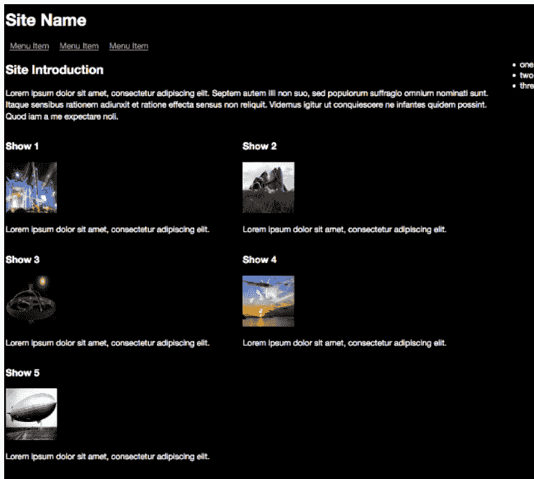

5-3. 在中等屏幕尺寸下重构的页面

### 响应式尺寸

将图片尺寸设置更改为以下内容：

```
.thumbnail {
    width: 100%;
    height: auto;
}
```

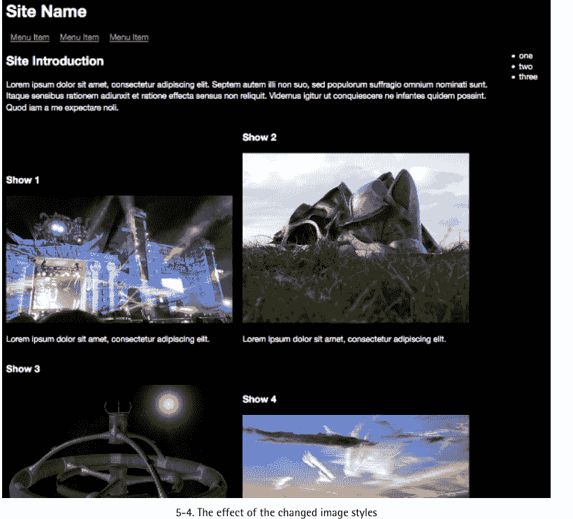

这会将图片宽度设置为其容器宽度的 100%，并将图片的高度设置为 `auto`，允许图片占据必要的垂直空间以保持其自然比例。你会注意到，这意味着目前所有图片的高度并不相同，这会影响布局。你可以交换这些值，改为填充高度的 100% 并自动填充宽度。试图让图片总是适应精确的尺寸可能是一个需要妥协的挑战，这在很大程度上取决于图片的来源。如果可能的话，最好先编辑它们，使它们都具有相同的尺寸。

```
使用 `width: 100%` 可能意味着图片会按比例放大超过其原始尺寸并导致像素化。为防止此情况，请尝试在与每个断点相关的缩略图样式上使用 `max-width` 或 `max-height`。
```

所以，就这样，你完成了，对吧？遗憾的是，并非如此。在你的网页检查器中查看其中一张图片，你会注意到我们所做的一切只是调整一个非常大图片的大小。即使它看起来很小，实际文件仍然很大，增加了大量的页面重量。看看网络请求：这五张图片总共接近 **4MB**，对于移动用户来说加载的数据量非常大。要使你的图片完全响应式，你需要确保为正确的设备提供正确的文件。

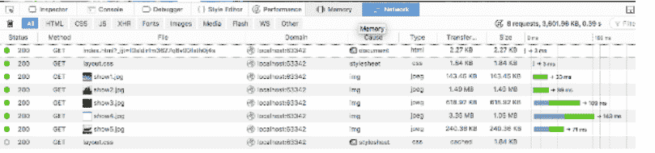

*5-5. 图片尺寸*

### 为正确的设备提供正确的图片

有两种处理响应式图片的方法。一种是 `srcset`，这是你已经熟悉的 `img` 标签的一个属性；另一种是新的 HTML5 `picture` 元素。两种方法都使用类似媒体查询的语法来选择最适合设备能力的图片，但 `srcset` 允许浏览器最终决定渲染哪张图片，而 `picture` 则明确告诉浏览器渲染哪张图片。对于大多数用例，`srcset` 将是您所需要的全部，但对于那些希望更多地控制浏览器如何渲染图片（例如，裁剪图片而不是调整其大小）的设计密集型网站，使用 `picture` 标签会更适合你。

就像你的媒体查询加载的 CSS 规则一样，使用和支持哪些图片尺寸取决于你和你的用例。示例项目做了适度的优化，但可以更好。例如，我们可以减小在较小屏幕上加载图片的最大尺寸。查询可以采用第 2 章中概述的相同格式。

我手动创建了设计所需的每张图片，赋予它们一个大致与图片将要显示的最大宽度相匹配的宽度：

- **小图片**：320px 宽。
- **中等图片**：480px 宽。
- **大图片**：768px 宽。

手动创建不同版本的图片很繁琐，但它让你能够控制每种图片尺寸中显示的内容。如果你想自动生成这些图片，有几种选择，例如：

- 在 [Photoshop](https://www.adobe.com/products/photoshop.html) 或 [XnView](https://www.xnview.com/)（Windows）等图像编辑器中进行批处理。
- 使用 [Gulp](https://gulpjs.com/) 等构建工具进行批处理。
- 使用你的 CMS 或静态站点生成器的插件，这很可能是对流行的 [imagemagick](https://imagemagick.org/) 或 [OptiPNG](http://optipng.sourceforge.net/) 库的封装。

#### srcset

将现有的图片元素替换为以下内容：

```
5-6. Chapter5/srcset/index.html (摘录)
<section class="tvshow">
    <h3>Show 1</h3>
    
    <p class="showdescription">Lorem ipsum dolor sit amet,
        consectetur adipiscing elit.</p>
</section>
```

> 
**一些作业**
此示例替换了其中一张图片，为了减少重复，我没有包含替换其他四张图片的代码。如果你想尝试替换其他图片，可以在[代码档案](https://code.jquery.com/)中找到剩余图片的代码。保持媒体查询相同，并将图片替换为相应的文件。

这需要分解，我们使用的布局也增加了复杂性。

该元素的第一部分是正常的，最后的 `class` 属性也是，第二和第三行是新的语法。`srcset` 旨在让你根据提供的信息，让浏览器做出关于显示哪张图片的最佳决策。第二行中的每对定义了可用的图片并告诉浏览器其宽度，以 `w` 结尾。第三行定义了你希望加载特定图片的视口大小，以及要加载哪张图片。

上面的示例声明：

- 最高视口宽度为 768px 时，加载宽度为 480px 的图片。
- 视口宽度在 768px 到 1800px 之间时，加载宽度为 320px 的图片。
- 如果没有其他规则适用，则加载宽度为 768px 的图片。

你可以让这些声明更精细，例如：

```

```

这改为声明在不同的视口尺寸下，选择最适合某个视口宽度（vw）大小的图片。对于这个设计，它们本质上是相同的，但它让你了解到你可以让浏览器变得多么智能。值得注意的是，这种智能在测试时实际上可能会引起混淆；我经常发现自己想知道为什么标签没有按预期工作，结果才意识到是因为浏览器保留了图片的缓存版本，或者为 Retina 屏幕进行了优化，并再次缓存了这些图片。为了在调试 `srcset` 时了解正在发生的情况，我建议使用隐身/无痕窗口，仔细检查你的屏幕分辨率，并保持开发者工具打开，以查看浏览器实际加载了哪些文件。

如果这种智能对你来说太不可预测，你发现自己需要更多控制，那么 `picture` 标签就是为你准备的。


114 快速入门响应式网页设计

#### `picture` 元素

尝试用以下代码替换 img 标签：

```html
5-7. Chapter5/picture_tag/index.html (excerpt)

<picture>
    <source srcset="../images/show1-small.jpg"
    media="(max-width: 320px)" class="thumbnail">
    <source srcset="../images/show1-medium.jpg"
    media="((min-width: 320px) and (max-width: 480px))"
    class="thumbnail">
    <source srcset="../images/show1-large.jpg"
    media="(min-width: 480px)"
    class="thumbnail">
    
</picture>
```

### 更多练习

与上一节一样，这个示例替换了其中一张图片。为了减少重复，我没有包含替换其他四张图片的代码。如果你想尝试替换其他图片，可以在这里找到相关代码[here](here)。请保持媒体查询不变，并用适当的文件替换图片。

我们已经用 HTML5 的 picture 元素替换了默认的 img。这个元素目前仍被认为是实验性的（尤其是在 Microsoft 和较旧的 Android 浏览器中），但预计很快就会被广泛使用。有益的是，picture 内部的 img 作为不支持 picture 元素的浏览器的后备图像，这意味着如果浏览器不支持这个新元素，它会加载一个默认图像。

我选择了中等大小的图像，因为它不太大也不太小，可以在不支持的浏览器上实现合理的响应性。

> ## 支持较旧的浏览器

如果你想为较旧的浏览器提供更好的支持，可以使用 "polyfill"（一个用于填补缺失功能的库的术语）。具体到这个例子，指的是 Scott Jehl 的 [picturefill](https://scottjehl.github.io/picturefill/)。

picture 元素的另一个有用应用是，通过其内部的 source 元素，可以加载不同的图像格式，例如可缩放矢量图像 (SVG)：

```html
<picture>
    <source srcset="logo.svg" type="image/svg+xml">
    
</picture>
```

如果浏览器不支持 SVG 图像，它将加载 PNG 格式。

另一个选择是为高分辨率屏幕加载更高分辨率的图像：

```html
<picture>
    <source srcset="../images/show1-2x.jpg"
    media="(min-resolution: 120dpi)" class="thumbnail">
    
</picture>
```

### 响应式视频

延续 HTML5 语义元素的主题，视频和音频对应的元素分别是 video 和 audio。由于我们在本书中构建的是视频网站，我不会过多关注 audio 元素，但我相信在使用了 picture 和 video 元素之后，你会理解如何使用它。

#### video 元素

多年前，我制作了一个音乐视频网站。那是在宽带普及之前，我花了大量时间尽可能优化视频，使其在慢速连接上也能观看。我还必须决定使用哪种视频插件来播放视频。是用 Quicktime 最好？RealPlayer？还是现在人人讨厌（但在当时很流行）的 Flash？

那些视频格式大战现在基本上已经结束，被一系列标准格式和 HTML5 元素所取代，这大大简化了设计师的工作，也减少了那个破坏用户体验的不得不下载插件才能观看视频的过程。video 元素比 picture 元素的支持范围更广，只有 IE8 和早期的 Android 版本可能会给你带来麻烦。

然而，video 元素支持的文件格式仍然存在问题，这主要是由于供应商对 DRM 的态度不同，以及对哪种格式是“最佳”使用格式（每个供应商都偏好自己支持或参与开发的格式）的看法不一。所有支持 video 元素的浏览器都支持 MPEG-4/H.264，这是一种压缩格式。但它也是专有的，这意味着浏览器制造商必须支付许可费才能使用它。对 WebM 和 Ogg/Theora 格式（开放格式）的支持较少，实际上只有 Chrome、Firefox 和 Opera 支持它们。

以下是 video 元素使用示例：

```html
<video width="320" height="240" autoplay>
  <source src="file.mp4" type="video/mp4">
  <source src="file.ogg" type="video/ogg">
  Your browser does not support the video tag.
</video>
```

这比以前存在的选项要简单和整合得多。它会加载用户浏览器支持的视频格式，或者如果 video 元素或其包含的文件格式不被支持，则显示一段默认文本。source 元素按呈现的顺序处理。因此，在上面的示例中，如果浏览器支持两种格式，它将加载看到的第一个。大概就是这样；video 元素本身并没有太多特别的响应式特性，除了它会加载合适的视频文件并带有控制条。

你可以尝试一些技巧使视频更具响应性，但让我们先从简单开始：使视频播放器控件可见，添加海报图像（视频播放前显示的缩略图），并移除手动尺寸设置。

```html
<video controls poster="../images/show1-medium.jpg">
    <source src="../videos/show1.ogv" type="video/ogg">
    <source src="../videos/show1.mp4" type="video/mp4">
    Your browser does not support the video tag.
</video>
```

video 元素的早期提案包括拥有自己的媒体查询（就像我们上面看到的 picture 元素那样）。但这个想法被放弃了，这意味着不能为不同的设备更换不同的视频文件。因此，唯一真正能让视频在任何方面具有响应性的方法是使用百分比宽度，例如：

```css
video {
    width: 100%;
    height: auto;
}
```

这将使视频缩放以适应其包含元素，你可以使用 `max-width` 属性来限制其可能增长到的尺寸，或者使用更小的值，例如 50%。然而，在较大的屏幕尺寸下，它不会阻止视频的放大，这意味着如果尺寸过大，视频可能会看起来有像素感。

除非你特别指定，否则视频将在页面加载后立即开始下载到你的浏览器中（以便用户选择观看时已准备好）。注意视频可能带来的潜在网络开销，这对移动用户来说不太好：

118 快速入门响应式网页设计

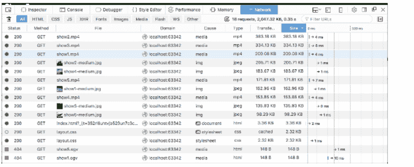

5-8. Web 检查器中显示的视频文件大小

这个问题有一个部分解决方案：在 video 标签中添加 preload="none"：

```html
<video controls poster="../images/show1-medium.jpg" preload="none">
    ...
</video>
```

现在视频只会在用户点击播放按钮时加载，允许用户选择何时/是否加载。

在我们的代码文件中，请注释掉 picture 元素（暂时），并用上面所示的 video 元素替换它。

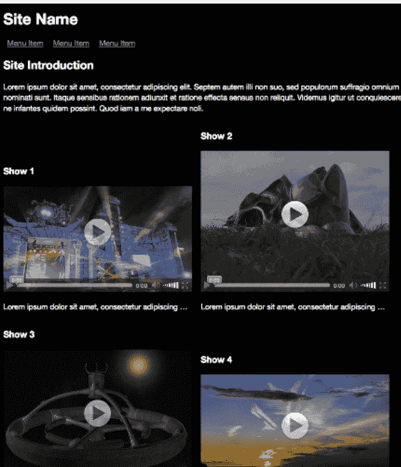

如果你使用更大的视频，那么视频在较大尺寸时缩放效果相当好。但你会注意到，在较大的播放器尺寸（平板和电视断点）下，海报图像会有像素感。

这个问题没有理想的解决方案，希望随着元素的演进会出现更好的解决方案。（我希望能看到的一个可能的解决方案是，可以沿着视频标签内的 source 子元素一起设置海报图像，理想情况下支持断点和媒体格式选择性加载。）

快速入门响应式网页设计

#### 使用更大的图像作为海报

将海报图像替换为大尺寸变体将意味着海报图像在所有文件尺寸下都能缩放，但这确实意味着我们在某些断点下加载了一个不必要的大文件。

如果你想进一步设置海报元素的样式（更改尺寸或添加内边距），可以直接使用以下选择器定位它：

```css
video[poster] {
    ...
}
```

### 背景图像

一种创建视频响应式图像表示的方法是移除海报图像，然后为视频设置背景图像，允许你使用媒体查询加载合适的图像。

你需要在 `video` 标签内内联设置背景图像，或者为每个视频创建一个 CSS 样式来设置图像，因为*每个*视频都需要设置不同的背景图像。

使用内联样式：

```html
<video controls preload="none"
    style="background: transparent
    url('../images/show1-large.jpg')
    0 0 / cover no-repeat;">
    ...
</video>
```

使用 CSS 类：


### 基于时间

一些电视节目包含比其他节目更多的成人内容，如果当前时间是用户所在地晚上7点之前，我们应该在列表中突出显示它们，以表示它们不应被较年轻的家庭成员观看。

> 修改HTML

我给几个**tvshow**部分添加了**evening**类。请在添加下面的JavaScript之前，将该类添加到多个**section**元素中。

在index.js中，添加以下代码以获取本地时间，然后提取小时：

```
var localNow = new Date();
var localTime = localNow.getHours();
```

现在，构建一个包含所有具有**tvshow**类元素的数组：

```
tvShows = document.getElementsByClassName('tvshow');
```

遍历电视节目数组，如果时间早于晚上7点且该节目具有**evening**类，则向其添加**highlight**类：
```


### 电池电量

HTML5 电池状态 API 允许你检查设备的当前电池电量并做出相应响应。

> **安全问题**
> 近期电池状态 API 存在一些安全担忧，因此请阅读 W3C 规范以了解其未来进展。

移动设备（和笔记本电脑）往往在您最需要时耗尽电量，因此在这个（主要是说明性的）示例中，我们将通过监测用户电池电量是否偏低并降低页面功耗来帮助用户。

较深的颜色*可以*帮助减少某些设备屏幕（尤其是 AMOLED 屏幕）的电池消耗，因此本页面的颜色已经设置得相当省电。不过，让我们看看如何根据电池电量做出响应。

有一个 JavaScript 方法可以获取设备电池的各种信息。

在 `index.js` 文件中添加以下代码，以检查浏览器是否支持该功能。如果支持，则获取电池电量值（介于 0（空）到 1（满）之间）：

```javascript
navigator.getBattery().then(function (battery) {
    var level = battery.level;
    console.log(level);
});
```

如果电量低于 20%（0.2），则添加一个降低颜色亮度的 CSS 类，并从 DOM 中移除图片（因为加载和显示图片会影响电池寿命，节省每一点电量都有帮助）：

```javascript
if (level < 0.2) {
    body = document.getElementsByName('body');
    body.classList.add('battery-save');
    images = document.getElementsByName('img');
    var i;
    for (i = 0; i < images.length; i++) {
        images[i].remove();
    }
}
```

在 CSS 中添加新的 `battery-save` 样式，降低页面文本的亮度：

```css
.battery-save {
    color: gray;
}
```

虽然配色方案是否真的能节省电池寿命是一个有争议的话题，很大程度上取决于设备屏幕，但或许值得尝试。其他更明确的、帮助用户节省电池的方法包括：

- 减少网络请求和流量
- 减少动画和效果
- 通过移除不太必要的 JavaScript 来减少客户端处理量。

尽管我们使用了 JavaScript 从 DOM 中移除图片，但它们在隐藏前仍然会被加载。这与减少网络请求的原则相矛盾。由于 JavaScript 只能修改已存在的页面结构，你需要从一开始就改变交付到浏览器的内容。要实现这一点，你需要重新思考页面结构，使其更移动友好。

在当前的 HTML 中添加类以标识每部电视剧：

```html
<section class="show1">
    ...
</section>
<section class="show2">
    ...
</section>
```

现在从每个 `tvshow` 部分移除所有的 `picture` 和 `video` 标签，从而大幅缩减 HTML 文件。回到 `index.js`，用以下代码替换现有内容，该代码整合了我们之前章节（点击图片播放视频）已经使用过的概念：

#### 6-2. 第6章/battery_mobile_first/index.js

```javascript
window.addEventListener("load",function(event) {
    navigator.getBattery().then(function (battery) {
        // 获取电池电量，如果电量足够则加载图片
        var level = battery.level;
        if (level > 0.2) {
            // 查找所有 'tvshow' div 并遍历它们
            tvShows = document.getElementsByClassName('tvshow');
            var i;
            for (i = 0; i < tvShows.length; i++) {
                tvShow = tvShows[i];
                // 获取剧名
                showName = tvShow.classList[1];
                // 创建一个 picture 元素
                var newPictureNode = document.createElement("picture");
                // 设置图片的源和类，代码与前面示例相同，
                // 但剧名被传递以生成每部剧的内容
                var pictureInnerHTML = '<source srcset="../images/' + showName + '-small.jpg" media="(max-width: 320px)" class="thumbnail"><source srcset="../images/' + showName + '-medium.jpg" media="((min-width: 320px) and (max-width: 480px))" class="thumbnail"><source srcset="../images/' + showName + '-large.jpg" media="(min-width: 480px)" class="thumbnail">';
                newPictureNode.innerHTML = pictureInnerHTML;
                // 为图片添加事件监听器
                newPictureNode.addEventListener('click',
                    toggle_visibility, false);

                // 同样以相同方式生成视频 HTML
                var newVideoNode = document.createElement("video");
                var videoInnerHTML = '<source src="../videos/' + showName
                    + '.mp4" type="video/mp4"><source src="../videos/'
                    + showName + '.ogv" type="video/ogg">Your browser doesn\'t support HTML5 video tag.';
                newVideoNode.setAttribute("controls", "controls");
                newVideoNode.setAttribute("poster", '../images/' +
                    showName + '-medium.jpg');
                newVideoNode.setAttribute("preload", "none");
                newVideoNode.innerHTML = videoInnerHTML;

                // 将新的图片和视频插入到正确的位置
                var nextNode =
                    tvShow.getElementsByClassName('showdescription');
                tvShow.insertBefore(newVideoNode, nextNode[0]);
                tvShow.insertBefore(newPictureNode, newVideoNode);
            }
        }
    });
},false);

function toggle_visibility(id) {
    var e = this;
    var v = e.nextSibling;
    v.style.display = 'block';
    v.play();
    e.style.display = 'none';
}
```

页面加载时，它会检查电池电量是否高于 20%。如果是，则将图片和视频**节点**（DOM 中的元素）添加到每个 tvshow 类内部，使用电视剧的类名确保加载正确的媒体文件。如果电量低于 20%，则只显示文本。理想情况下，你应该将此功能添加到偏好设置中，以免用户感到意外。

这需要一些重构，但现在的页面以更移动友好的状态启动，仅在设备状态良好时才加载最耗费资源的页面元素。对于本章剩余的示例，我们将使用这个概念来展示如何添加不同的检测能力。实际上，在继续之前，尝试重构时间示例以使用上述框架。

### 地理定位

[HTML5 地理定位 API](https://www.w3.org/TR/geolocation-api/) 允许你检测用户当前位置的粗略纬度和经度。

除了提供精彩的视频内容，RWDFlix 还喜欢推荐可能让用户感兴趣的节目。本示例将使用用户的当前位置来高亮显示包含该地点相关内容的节目。

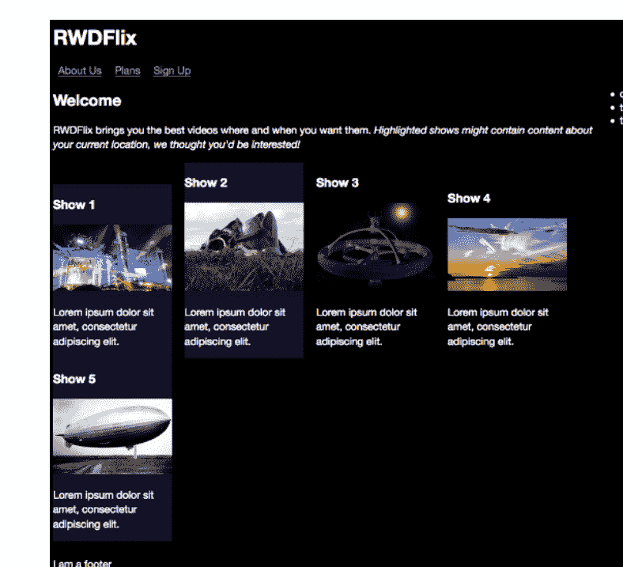

6-3. 根据用户位置高亮显示的节目

在 `index.js` 中，用以下代码替换文件现有内容，该代码检查浏览器是否支持地理定位，如果不支持则通知用户：

```javascript
window.addEventListener("load", function(event) {
    if ("geolocation" in navigator) {

    } else {
        alert("RWDFlix 使用地理位置信息来推荐可能与您相关的节目。")
    }
}, false);
```

如果浏览器支持地理位置信息，获取用户的当前位置，并将这些值传递给一个新函数：

```javascript
if ("geolocation" in navigator) {
    navigator.geolocation.getCurrentPosition(getPosition);
} else {
    alert("RWDFlix 使用地理位置信息来推荐可能与您相关的节目。")
}
```

该 API 方法返回当前的纬度和经度，这对我们来说用处不大，因为我们真正想知道的是用户的当前国家。使用 [Google Maps API](http://googleapis.com/) 将其转换为更有用的国家代码：

```javascript
function getPosition(position) {
    // 使用当前经纬度定义 URL
    var url =
    "http://maps.googleapis.com/maps/api/geocode/json?latlng=" +
    position.coords.latitude + "," + position.coords.longitude +
    "&sensor=false";
    // 创建请求并发送 URL
    var xmlhttp = new XMLHttpRequest();
    xmlhttp.open("GET", url, true);
    xmlhttp.send();
    // 当请求返回时，处理响应
    xmlhttp.addEventListener("readystatechange", processRequest,
    false);
}
```

现在我们从 Google Maps 获得了结果，可以处理这些结果了。我们需要找到包含国家值的数组，然后以类似于时间示例的方式高亮显示与该国家匹配的电视节目：

```javascript
function processRequest() {
    // 响应状态是否正常？
    if (this.readyState == 4 && this.status == 200) {
        // 解析 JSON 响应
        var myArr = JSON.parse(this.responseText);
        var i;
        for (i = 0; i < myArr.results.length; i++) {
            // 遍历结果数组，找到我们想要的元素，找到后继续执行
            if (myArr.results[i].types[0] == "country") {
                country = myArr.results[i].formatted_address;
                tvShows = document.getElementsByClassName('tvshow');
                var j;
                // 遍历电视节目，高亮显示与此值匹配的节目
                for (j = 0; j < tvShows.length; j++) {
                    tvShow = tvShows[j];
                    if (tvShow.classList[1] == country ||
                        tvShow.classList[2] == country) {
                        tvShows[j].classList.add('highlight')
                    }
                }
            }
        }
    }
}
```

### 修改 HTML

我在 `tvshow` 部分添加了国家类别。在运行此示例之前，请自行添加一些。它们需要以大写字母开头。

### 基于网络

该示例网站是一个视频网站，虽然我们目前有可点击的图片，允许观众仅在需要时加载视频文件，但我们可以根据设备的网络连接使其更加灵活。或者更好的是，我们可以创建一个用户偏好的设置项，如果用户想要此功能的话。

网络信息 API（Network Information API）目前支持有限（目前仅限于 Android 上的 Chrome），但浏览器厂商发展迅速，因此在您决定实现它时，它可能会得到更好的支持。

首先，最简单（也是支持最广泛）的检查是查看用户是否在线：

```javascript
if (navigator.onLine) {
    // 执行某些操作
}
```

当然，这在示例中的用处有限，除非您想在尝试播放视频之前检查用户是否已断开连接。尽管如此，考虑到所有情况仍然是个好主意。

虽然网络信息 API 让您可以检查各种各样的值，但它目前用处不大。有第三方（付费）服务可以检查网速，但目前，“最佳”解决方案是使用复杂的代码来检查加载一张图片需要多长时间，并据此计算速度。我不会在这里复制代码，但如果您感兴趣，Stack Overflow 上有一些有用的信息。

#### 浏览器支持
虽然网络信息 API 仍处于草案状态，但它是一个活跃的提案，因此在您阅读时，它可能已获得更好的支持。您可以在该 API 的社区小组网站上查看其当前状态。

### 用户偏好

您很可能在日常的网页浏览中体验过 **Cookies**。Cookies 通常用于保留状态，例如偏好设置。它们可以由客户端或服务器设置或读取，并在每个 HTTP 请求中传输。此示例将读取用户偏好设置并相应地显示页面元素。

通常，当用户提交表单或执行某些其他操作时，浏览器会写入一个 Cookie。在此示例中，我们将手动编写一个设置：

```javascript
window.addEventListener("load",function(event) {
    document.cookie = "mature=no";
    ...
},false);
```

这决定了用户是否想观看被认为是“成人”内容的视频。使用这个值，我们可以使用相同的技术来选择性地渲染电视节目。

要进行测试，请在几个 `tvshow` 部分的类列表末尾添加 `mature` 类，并在所有其他部分的末尾添加 `all-ages`。在渲染电视节目的 `index.js` 循环中，读取 Cookie 值并隐藏/显示相应的节目：

```javascript
for (i = 0; i < tvShows.length; i++) {
    tvShow = tvShows[i];
    var mature = getCookie('mature');
    if (mature == 'no' && tvShow.classList[2] !=
        'mature') {
        ...
    }
}
```

由于所有 Cookie 都存储在同一个属性中，您可以使用正则表达式来查找和读取您想要的特定 Cookie：

```javascript
function getCookie(name) {
    var regexp = new RegExp("(?:^" + name + "|;\s*" + name + ")=(.*?)(?:;|$)", "g");
    var result = regexp.exec(document.cookie);
    return (result === null) ? null : result[1];
}
```

### 环境光

将 [环境光传感器 API](https://www.w3.org/TR/ambient-light/) 与时间检测结合起来，可以根据一天中的时间和观众可用的光线来调整页面或视频亮度，这是一个很好的方法。在许多移动设备上，这现在由操作系统处理，但您可以为其提供增强，或为计算机用户添加类似功能。

> 安全问题

最近，环境光传感器 API 出现了一些安全问题。我建议您阅读 [W3C 规范](https://www.w3.org/TR/ambient-light/) 以检查其未来。

让我们来创建一个示例，根据当前环境光亮度（或周围区域的亮度）改变页面的颜色。

将当前 `index.js` 文件的内容替换为以下内容，它根据环境光级别（即 `luminosity` 值）向页面主体添加一个类：

```javascript
window.addEventListener("devicelight", function (event) {
    var luminosity = event.value;

    if (luminosity <= 5) {
        document.body.className = "darkness";
    } else if (luminosity <= 50) {
        document.body.className = "dim";
    } else if (luminosity <= 1000) {
        document.body.className = "bright";
    }
});
```

将以下样式添加到您的 CSS 文件中，用于光线最亮的情况：

```css
.bright {
    background-color: #fff;
    color: #000;
}
```

这是应用此样式后的页面外观：

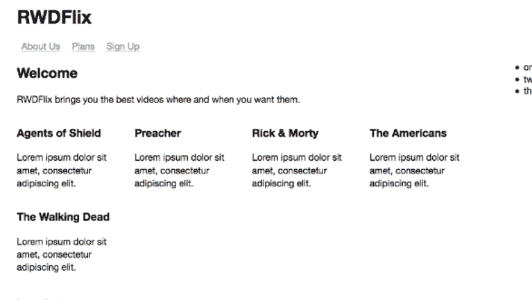

这种样式将当前的配色方案反转为白底黑字，使其在明亮的阳光下具有更高的对比度和可读性。如果您使用现代设备，您可能已经注意到屏幕发生了类似的事情。

接下来，为最暗的光级别添加样式：

```css
.dim {
    background-color: #6600b4;
    color: #b5aaff;
}
```

这是页面的效果：

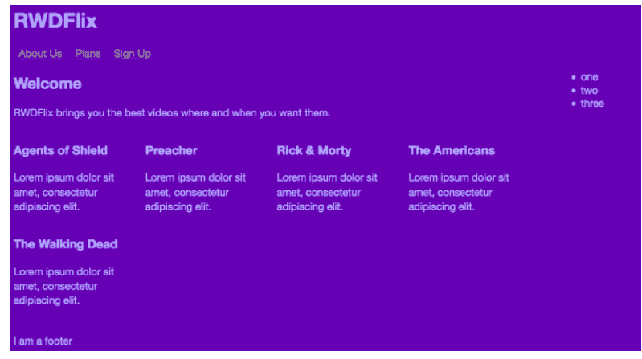

这使得在弱光情况下背景和文本更容易阅读。

接下来，在非常暗的环境下，添加一个类，使文本和背景之间的对比度更低：

```css
.darkness {
    background-color: #2d004f;
    color: #b5aaff;
}
```


6-6. 为深色模式设置低对比度

色彩方案之间的快速切换会让用户感到不适，因此为了使过渡更加平滑，请将以下 CSS 添加到 body 元素中，以缓和颜色之间的过渡：

```css
body {
    -webkit-transition: all 0.5s ease-in-out;
    -moz-transition: all 0.5s ease-in-out;
    -o-transition: all 0.5s ease-in-out;
    transition: all 0.5s ease-in-out;
}
```

### 振动

W3C 的另一项创新是 [Vibration API](https://www.w3.org/TR/vibration/)，它提供了对移动设备振动机制的访问，以提供触觉反馈。我们可以利用这一点，通过在音轨中添加振动，为视频播放带来更具沉浸感的体验，但这需要大量工作。此 API 还有其他便捷用途，特别是在无障碍访问方面。例如，当点击按钮时设备轻微振动，让用户知道操作已被识别，这会很有用。

### 设备方向

我们已经了解了如何通过媒体查询检测和响应设备方向，但我们也可以动态地响应设备方向。例如，我们可以根据横屏或竖屏视频，切换视频文件到更适合的格式。

如果你想进行更实验性的尝试，为何不根据设备方向来控制视频播放？例如，当用户将手机向某个方向倾斜时，我们可以暂停视频，反之亦然。

在这个示例中，我们将创建一个新的、简化的页面版本，专门用于播放一个视频。

以下是 HTML 代码：

6-7. Chapter6/orcintation/index.html（节选）

```html
<!DOCTYPE html>
<html lang="en">
<head>
    <meta charset="UTF-8">
    <meta name="viewport" content="width=device-width,
    initial-scale=1.0, user-scalable=no">
    <title>RWDFlix</title>
    <link rel="stylesheet" type="text/css" media="all"
    href="layout.css">
</head>
<body>
    <header><h1>RWDFlix</h1></header>
    <main>
    <section class="showslisting">

        <section class="tvshow">
        <h3>Show 1</h3>
        <video controls poster="../images/show1-medium.jpg"
        preload="none" id="show1">
            <source src="../videos/show1.mp4" type="video/mp4">
            <source src="../videos/show1.ogv" type="video/ogg">
            Your browser doesn't support HTML5 video tag.
        </video>
        <p class="showdescription">Lorem ipsum dolor sit amet,
        consectetur adipiscing elit.</p>
        </section>

    </section>

    </main>
    <footer>
    I am a footer
    </footer>
</body>
</html>
```

CSS 同样进行了简化：

6-8. Chapter6/orientation/layout.css（节选）

```css
body {
    background: black;
    color: white;
    font-family: 'Helvetica Neue', Helvetica, Arial, sans-serif;
    font-size: 1em;
}

section.showslisting {
    width: 100%;
    margin-bottom: 25px;
}

section.showslisting p {
    line-height: 1.2em;
    word-spacing: 0.2em;
}

section.tvshow {
    width: 100%;
    margin: 0 auto;
    display: block;
}

video {
    width: 100%;
    height: auto;
}

.thumbnail {
    width: 100%;
    height: auto;
}

footer {
    clear: both;
}

/* Media Queries */

/* Extra Small Devices and Phones */
@media only screen and (min-width: 480px) {
    section.tvshow {
        margin: 0 auto;
        display: block;
    }
}

/* Small Devices and Tablets */
@media only screen and (min-width: 768px) {
    section.tvshow {
        margin-right: 15px;
        display: inline-block;
    }
    section.showslisting p {
        line-height: 1.4em;
        word-spacing: 0em;
    }
}

/* Medium Devices and Desktops */
@media only screen and (min-width: 992px) {
    section.tvshow {
        margin-right: 15px;
        display: inline-block;
    }
    .showdescription {
        white-space: normal;
    }
}

/* Large Devices, Wide Screens, TVs */
@media only screen and (min-width: 1800px) {
    section.showslisting {
        width: 100%;
    }
}
```

### 快速入门响应式网页设计

```css
margin-bottom: 25px;
}

section.tvshow {
    margin-right: 15px;
    display: inline-block;
}
}
```

这将为单个视频产生如下的布局：

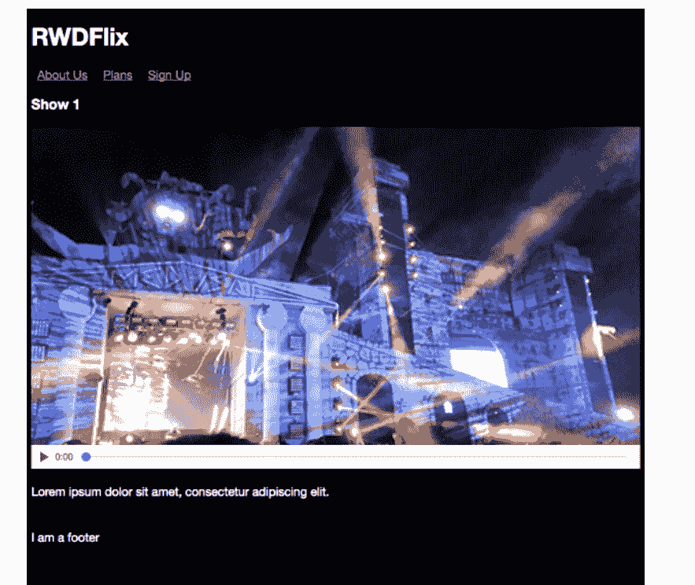

6-9. 视频播放布局

现在在页面页脚下方添加一个 script 元素，包含以下代码。此脚本在页面加载时启动，访问视频元素，并监听其播放状态：

```html
<script>
(function () {
    var video = document.getElementById("show1");
    video.addEventListener("play", control_video, false);

})();
</script>
```

添加 control_video 函数，并将点击的视频赋值给一个变量：

```javascript
function control_video(e) {
    var v = e.target;
}
```

检查设备是否支持方向 API，如果支持，则监听方向变化。如果不支持，则警告用户：

```javascript
if (window.DeviceOrientationEvent) {
    window.addEventListener("deviceorientation", function (e) {

    }, false);
} else {
    alert("Sorry, your browser doesn't support Device Orientation");
}
```

最后，对方向变化做出反应，当用户将手机向右旋转时暂停视频，向左旋转时再次播放：

```javascript
if ((e.gamma < -45) && (e.gamma > -90)) {
    v.play();
}

if ((e.gamma > 45) && (e.gamma < 90)) {
    v.pause();
}
```

> **熟悉方向**
>
> 如果你有兴趣了解更多关于方向 API 中存在的三轴旋转，请阅读“在 HTML5 中使用设备方向”。

### 响应一切

在本章中，我们看到了一些假设性的示例，展示了如何改变页面内容以响应现代设备中发现的各种传感器。这些功能不断发展，我鼓励你保持对可在设计中利用的新 API 的了解，以便为用户提供量身定制的体验。

这标志着我们与本书之旅的结束。响应式设计的核心在于精心打造任何人都可使用的页面，无论其设备或情况如何。无论是屏幕尺寸、性能还是其他因素，确保用户体验尽可能好是我们的责任。

你正在一个好时机开始你的响应式探索。HTML 和 CSS 规范中从未有过比现在更好的功能，而且即将推出——这些功能专为打造适应现代网页设计不断变化的格局的体验而设计。其中一些功能仍在变动中，其最终形式尚未确定，但这同时也意味着你有机会测试和塑造它们的未来。参与进来，帮助创建你希望看到的 Web。
