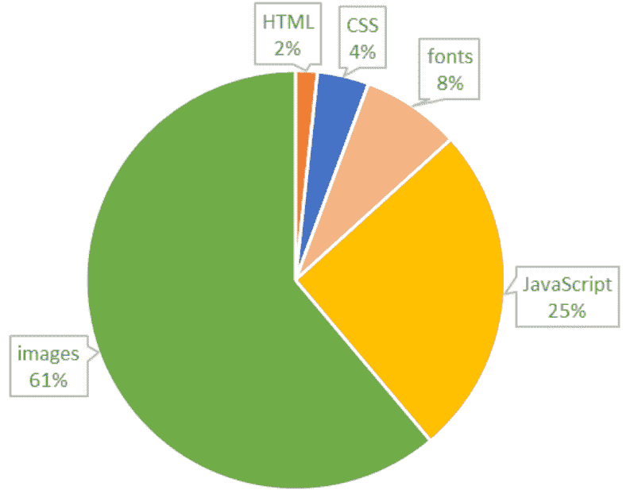
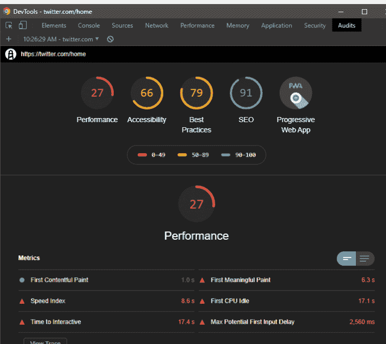
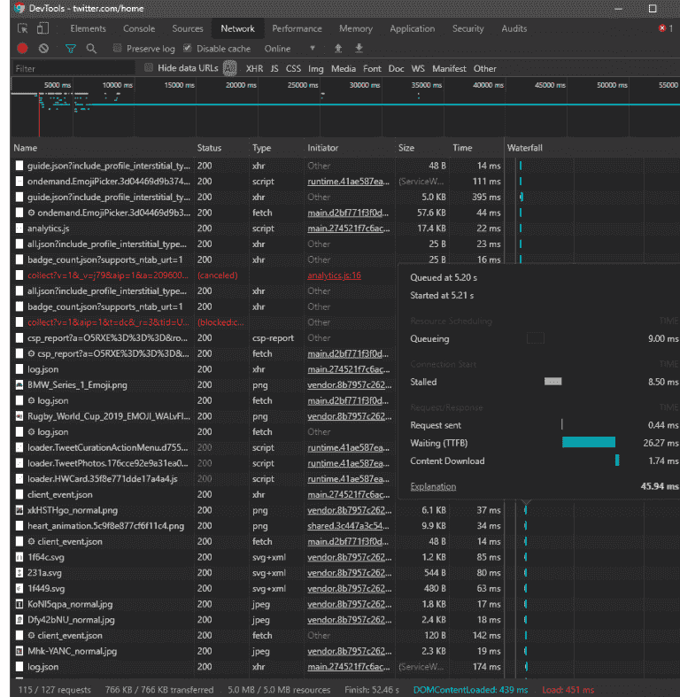
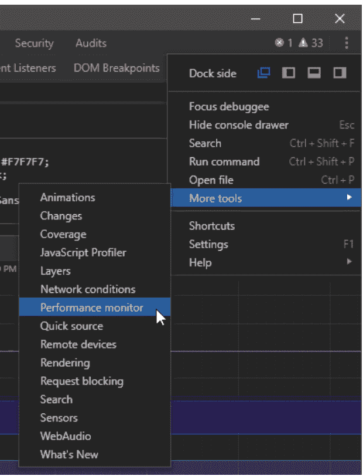
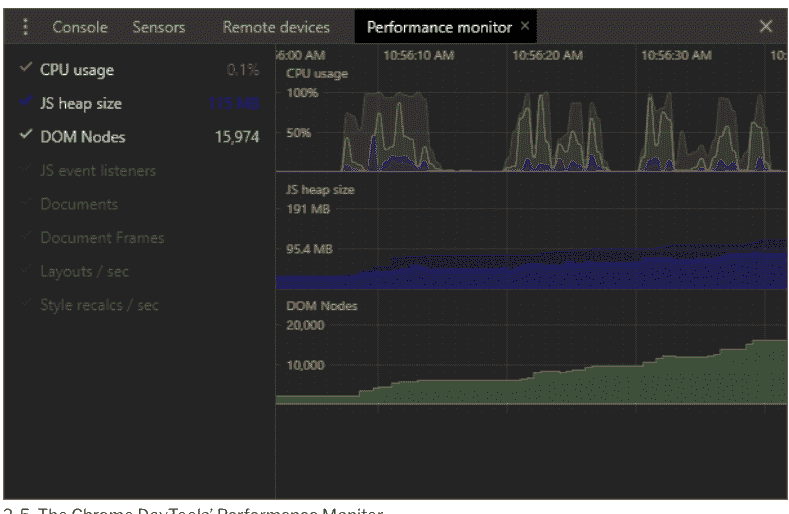
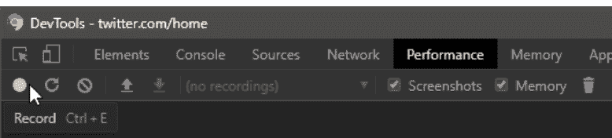
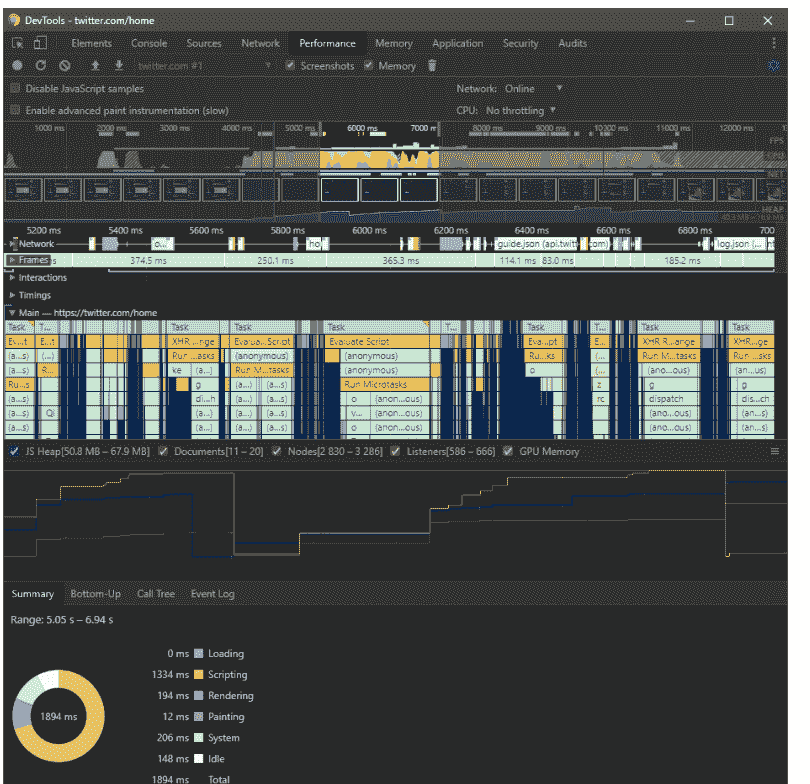
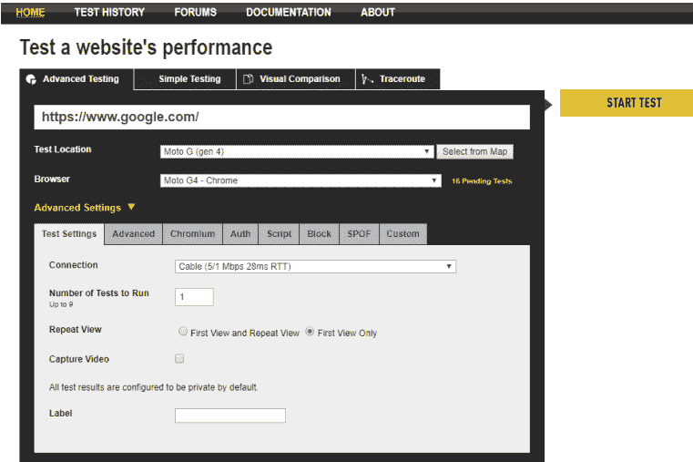
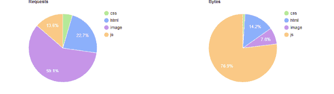
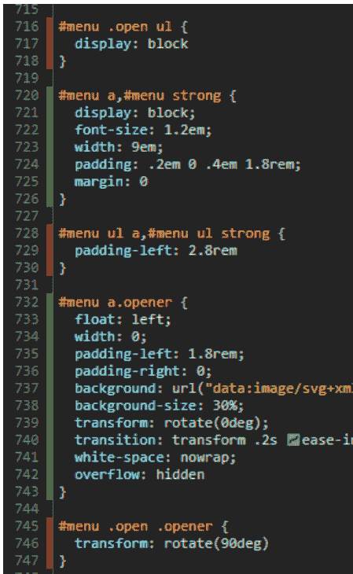

# Web 性能快速启动指南

-   产品经理：Simon Mackie

-   技术编辑：James Hibbard

-   英语编辑：Ralph Mason

-   封面设计：Alex Walker


## 关于 Craig Buckler

[Craig](https://www.sitepoint.com/) 是一名自由开发者、作家和演讲者，对网络技术有着永不枯竭的热情。

他于 20 世纪 80 年代开始编程，当时应用程序必须挤进几 KB 的内存中。20 世纪 90 年代中期，随着 28K 调制解调器成为典型配置，100KB 的页面被视为奢侈，他对网络的热情被点燃。

在过去的十年里，随着网络标准的演进，Craig 为 SitePoint 撰写了 1,200 篇教程。尽管生活在一个技术上令人惊叹的未来，他从未忘记用有限资源可以实现什么。

## 关于 SitePoint

SitePoint 专注于为网络专业人士发布有趣、实用且易于理解的内容。访问 [https://www.sitepoint.com/](https://www.sitepoint.com/) 即可访问我们的博客、书籍、时事通讯、文章和社区论坛。您将在这里找到大量关于 JavaScript、PHP、Ruby、移动开发、设计等方面的信息。

## 前言

尽管每天都在和网络打交道，但很少有开发者对自己创造的这个“怪物”有好评。充斥着网页空间的，是令人痛苦地缓慢的网站、烦人的叠加层、Cookie协议、即时通知和侵入式广告。

虽然对于复杂的网络应用可能情有可原，但对于迟缓的内容型和电商网站则几乎没有理由。人们众所周知地缺乏耐心，一个响应缓慢的网站会损失访问量和转化率。

本书为提升网站性能提供建议、技巧和最佳实践。

## 谁应该阅读本书？

后续章节描述的性能优化选项，范围从快速的五分钟配置更改，到重大的网站改造。我们主要关注前端活动和服务器配置，以优化交付给浏览器的代码。

我们也提供了一些后端技巧，但这通常与你的应用、框架、数据库和使用模式相关。服务器端的性能通常可以通过增加或升级计算资源来提升。

理想情况下，项目中的每个人都应从一开始就考虑性能问题。某种程度上可以理解，这很少发生，因为在网站或应用创建之前，没人能真正体会其速度。因此，许多技巧可以在项目交付之后应用。

## 本书约定

你会注意到我们在全书中使用了特定的排版和布局风格，以表示不同类型的信息。请注意以下项目。

## 代码示例

本书中的代码使用固定宽度字体显示，如下所示：

```html
<h1>A Perfect Summer's Day</h1>
<p>It was a lovely day for a walk in the park.
The birds were singing and the kids were all back at school.</p>
```

当需要现有代码作为上下文时，不会重复全部代码，而是会显示`:`：

```javascript
function animate() {
    :
    new_variable = "Hello";
}
```

某些代码行应写在一行，但由于页面限制，我们不得不换行显示。`↵`符号表示仅为格式目的而存在的换行，应忽略：

```javascript
URL.open("https://www.sitepoint.com/responsive-web-↵design-real-user-testing/?responsive1");

## 提示、说明和警告

> **嘿，看这里！**

提示提供有用的小贴士。

> **嗯，打扰一下……**

说明是与当前主题相关但并非关键的有用旁注。可以将它们视为额外的信息点。

> **务必确保你……**

……关注这些重要的点。

> **当心！**

警告强调了可能在过程中让你绊倒的任何陷阱。

## 补充材料

-   [https://www.sitepoint.com/community/](https://www.sitepoint.com/community/) 是 SitePoint 的论坛，用于解决任何棘手的问题。

-   **books@sitepoint.com** 是我们的电子邮件地址，如果你需要联系我们报告问题，或出于任何其他原因。

# 第 1 章：Web 性能的重要性

## 性能低下的代价

网络臃肿、下载缓慢和性能低下影响着每一个人——网站用户、在线企业主，甚至那些从未访问过网络的人。

### 用户代价

在2020年初，一个典型的网页包含：

-   27KB 的 HTML 内容

-   64KB 的 CSS，分布在七个样式表中

-   四种字体，总计 122KB

-   410KB 的 JavaScript，分布在 20 个源文件中

-   31 张图片，需要 980KB 的带宽（*其中三分之一在屏幕外，可能永远不会被查看！*）

### 2020 年平均页面大小：1,940KB



总计：1,940KB 的数据通过 74 个 HTTP 请求传输，在全球普通用户的桌面上完全显示需要七秒。在移动设备上，这个时间会增加到令人沮丧的20秒。（来源：[HTTP Archive](https://httparchive.org/)，该网站分析了五百万个热门内容网站。）

在美国，使用典型手机下载这个网页需要花费 0.20 美元。在瓦努阿图、毛里塔尼亚和马达加斯加浏览的用户，为了查看单个页面需要支付超过其日收入 1% 的费用——尽管该页面仅包含 27KB 潜在可读的内容。（来源：[whatdoesmysitecost.com](https://whatdoesmysitecost.com/)。）

### 商业代价

缓慢、臃肿的页面对业务不利：

1.  页面下载量越大，用户体验越差，用户考虑购买或回访的可能性就越低。

2.  55% 的访问者使用移动设备。这些设备功能更有限，并且可能连接到更慢的网络，这加剧了问题。（来源：statcounter.com。）

3.  谷歌的页面速度算法会降低慢速网站的排名，这损害了搜索引擎优化工作。

4.  更多的数据会导致更高的托管、存储和带宽成本。

5.  你的代码库越大，更新和维护所需的时间就越长。

### 环境代价

互联网消耗 420 太瓦时（TWh）——或*高达10%*——的全球电力消耗。这占全球温室气体排放量的 4%，与航空业相当。考虑到网络基础设施和流量，一次页面加载估计会排放 1.3 克二氧化碳。（来源：websitecarbon.com。）

虽然网络通过提供旅行和邮递的虚拟替代方案减少了能源使用，但那些 1MB 的主图仍然对环境有影响。

## 糟糕网络状况的原因

当性能差的网站运行成本更高、访问者更少、转化率更低时，它们为何还能如此普遍？

主要原因是：*与其他功能相比，性能优先级较低*。

添加更多东西很容易。优化或移除不必要的垃圾则更困难。我们害怕破坏网站或访客使用模式，因此更容易为不解决性能问题找借口。

### 借口 #1：“我们没有性能问题！”

你使用的是最新的电脑或智能手机，并且连接在快速的网络上吗？试试中端、两年前的设备。试试将带宽限制到你所在国家的平均速度。试试在VPN或酒店Wi-Fi上使用你的网站。

### 借口 #2：“我们的用户从不抱怨？”

可能是因为他们放弃了你的网站并且再也没回来。当竞争内容和服务只需点击几下即可获得时，很少有人会费心投诉。

### 借口 #3：“我们的用户拥有高端设备”

当网站只能在拥有最新设备和快速连接的人群中查看时，这种假设就变成了一个自我实现的预言。

如果更多的人能够访问你的服务，你的收入会增加吗？你是否考虑了亚洲、非洲和南美等市场的网络爆炸式增长，那里的智能手机和网络容量可能更有限？

### 借口 #4：“我们的用户使用现代浏览器”

一个常见的误解是，1%的用户会禁用JavaScript或阻止其他浏览器功能，如图片或CSS——例如，那些使用屏幕阅读器的用户。这可能是一个相当大的数量，但这却被用作借口，以歧视某些群体为代价来简化开发，并避免在能力较弱的设备上解决性能问题。

实际上，阻止资源的不是1%的*用户*，而是1%的*访问量*。每个用户最终都会遇到某些东西损坏的情况，例如当：

-   一个或多个文件下载失败

-   防火墙或互联网服务提供商阻止某些资源

-   使用屏幕阅读器或较旧的设备时

浏览器不支持特定功能

-   浏览器扩展程序会阻止、破坏或修改代码

-   浏览器在慢速连接时会禁用 JavaScript

构建能够应对这些情况的健壮、高性能应用程序是完全可能的。你的应用做到了吗？

### 借口 #5：“我们稍后再处理性能问题”

> 过早优化是万恶之源。

这句话被认为出自唐纳德·克努特，来自他的论文《使用 `go to` 语句的结构化编程》。它指的是程序员在非紧急问题上浪费时间进行优化——例如，一家初创公司试图确保其应用程序能够扩展到数百万用户。

在完整语境下的引述是：

> 我们应该忘掉小的效率提升，大约97%的时间都应如此：过早优化是万恶之源。然而，我们不应放弃那关键的3%的机会。

在你拥有数百万用户之前，你需要确保最初几十个人愿意使用你的产品。在早期阶段，后端服务器或数据库的低效不太可能成为主要问题。

然而，前端性能可以成就或毁掉一个应用。它可能是你“关键的3%”的一部分，并且从一开始就着手优化会更容易。

## Web 性能至关重要

### 借口 #6：“某些系统需要更多带宽和处理能力”

像 Gmail、地图、社交网络、游戏和图片库这样的复杂 Web 应用，将比内容网站需要更多的带宽和处理能力。性能仍然是一个关键问题，但可以预期更高的页面体积和更慢的加载时间。

然而，[HTTP Archive](http://httparchive.org) 爬取的是文章和在线商店。它并不查看 Web 应用程序。平均 2MB 的网站页面体积相当于莎士比亚所有戏剧的一半，或者 [DOOM](http://doom.com) 在 1993 年的磁盘发行版——*而单个页面通常只包含几段内容*。因此，没有理由不去关注性能。

### 借口 #7：“页面体积膨胀是进步的代价”

对于某些边缘情况，这可能是真的。然而，在 1990 年代末的拨号上网时代，开发者们努力将页面大小保持在 100KB 以下。自那时起，Web 内容的质量或速度提高了 20 倍吗？

### 借口 #8：“精简页面意味着降低功能，减少特性和效果”

性能通常可以通过最小的努力来提升，而不会损失功能。

随着 Web 浏览器的进化，你可以用更少的资源做更多事。考虑一下 CSS3 的 `border-radius` 属性：添加圆角现在只需要几字节的代码，而十年前则需要多种图片技巧。

### 借口 #9：“提高性能会增加复杂性和维护工作”

移除未使用或不必要的图片、视频、字体、CSS 和 JavaScript 将会简化你的网站。这应该会减少复杂性和维护工作。

### 借口 #10：“我们的客户很满意！”

客户聘请你是出于你的专业能力，将优化作为一个卖点将使你的业务从其他竞争对手中脱颖而出。

Web 性能是 Web 开发者工作的重要组成部分。一点努力就能为每个人带来相当大的回报：

-   需要的代码更少

-   用户获得更流畅的体验

-   搜索引擎排名得到提升

-   转化率提高

-   托管成本降低

> *没有人会批评你构建了一个超快、响应迅速的网站！*

## 我该从哪里开始？

下一章将介绍帮助你识别问题的工具。紧接着是几章以美食为灵感的章节：

**第 3 章：快速零食** 一系列简单、实用、高性价比的性能解决方案，可以在几分钟内应用于任何网站。

**第 4 章：简单食谱** 一些更复杂的开发选项，可能需要几小时或几天来实施，但可能产生更大的积极影响。

**第 5 章：改变生活的饮食** 更激进的开发考虑因素和技术，最好从项目一开始就采用。

页面体积缩减和优化技巧通常被归类为相似的概念，其中最容易或最有益的会先被介绍。

那些试图改进现有网站的人应该按顺序阅读每一章。那些开始新项目的人可能会从逆序阅读章节中受益，因为更激进的方法在那时会变得可行。

# 测试工具

## 第 2 章

承认你的网站存在性能问题是迈向康复的第一步！本章提供了一份测试工具列表，帮助你利用真实数据理解问题，展示如何：

1.  发现最大的资源

2.  识别最慢的网络响应

3.  诊断浏览器性能不佳的原因

可能需要运行几次测试以建立可测量的性能基线。然后可以重新运行相同的测试来评估代码更新后的性能提升——或恶化。

## 创建测试计划

你应该测试你的网站和应用程序的缺陷、易用性、可访问性、质量保证和其他因素。评估性能也无不同，最好遵循一个计划，明确：

1.  谁负责运行测试

2.  每个测试将使用哪些工具和设置

3.  如何记录结果并将其反馈到开发流程中

首先手动使用性能分析工具，以理解报告并确定优化优先级。

随着流程的发展，*可能*可以实现这些测试的自动化，以便开发者收到潜在问题的警告，甚至可能阻止提交优化不佳的代码。[第 5 章](Chapter 5) 描述了使用构建流程和性能预算来改进工作流程的几种选择。

### 自动化测试与手动测试

自动化测试永远无法替代手动用户测试！测试擅长重复操作以报告故障，但不太可能发现你意想不到的问题。

有可能构建一个完全[无法使用但能通过所有自动化测试的网站](http://example.com)。例如，一个按钮可能触发页面的快速变化，显示骨架内容，而真正的结果需要一个小时才能出现！

## 识别性能瓶颈

知道存在性能问题是一回事。找到并修复原因则是另一回事。

第一步是识别故障发生在服务器端还是客户端。缓慢的网络响应，无论是在初始页面加载期间还是在 Ajax 请求期间，通常表明是服务器问题。数据库查询往往是罪魁祸首，但你需要证明这一点！现有的工具和日志可以提供帮助，但可能需要将诊断信息输出到文件中，类似于其他调试活动。

客户端问题可以使用浏览开发者工具进行诊断，如下所述。当浏览器需要执行大量工作时，性能会受到影响——例如，一个长时间运行的 JavaScript 函数、一个导致页面重新布局的 DOM 更新，或影响许多元素的 CSS 变更。第 3、4、5 章的提示为典型问题提供了解决方案。

## 性能工具概念

本章中描述的大多数工具都是在 Web 浏览器的上下文中诊断网站中的特定“页面”。它们主要分析前端性能，尽管后端服务器或数据库可能是大型或缓慢响应的罪魁祸首。（[第 4 章](http://example.com) 提供了有关潜在后端问题和数据库工具的更多信息。）

### 浏览器渲染过程

当用户首次访问一个网站或应用时，会发生以下步骤：

1.  浏览器向特定 URL 发出 HTTP 请务。在底层，多个网络进程正在进行，将域名解析为 IP 地址并将请求路由到服务器。

2.  服务器接收并解析请求。它会引用一个特定的 URL，并且可能在查询字符串、HTTP 头或消息体中附加了数据。它返回一个响应，在这种情况下，我们假设是 HTML 内容。

3.  浏览器开始接收 HTML 数据并进行解析。文档可能引用更多资源，如图片、字体、样式表和 JavaScript，这会触发对同一服务器或另一台服务器的额外 HTTP 请求。

4.  最终，浏览器有足够的信息开始渲染过程。在幕后，它已经开始构建 HTML DOM（文档对象模型），该模型以分层树结构定义页面。样式计算还确定哪些 CSS 规则适用于每个 DOM 节点，并为 JavaScript 交互创建了 CSSOM（CSS 对象模型）。

5.  浏览器启动**布局**（或**回流**）阶段。这计算每个元素的尺寸以及它如何影响周围元素的大小或位置。

6.  布局之后是**绘制**阶段。这将每个元素的视觉部分绘制到单独的图层上——即文本、颜色、图片、边框、阴影等。

7.  最后，**合成**阶段按正确的顺序将每个图层绘制到屏幕上。

页面现在处于初始可查看状态。在渲染期间或之后，JavaScript 可以运行以发出进一步的 HTTP 请求（Ajax 或 WebSocket 调用）、执行计算、更新 DOM 或应用 CSS 规则。这可能会触发进一布局、绘制和/或合成阶段。

大多数工具会引用这些阶段，同时引入自己的指标，这些指标通常结合了两个或更多阶段。本质上，所需的步骤越少，性能就越好。采取措施最小化 HTTP 请求并减少浏览器处理，将带来更流畅的用户体验。

## Google Lighthouse / Chrome 审计

[Lighthouse](https://developer.chrome.com/docs/lighthouse/overview) 是一个开源工具，有助于评估你的网页或应用的性能和质量。你可以通过以下方式访问它：

1.  在 Chrome 的开发者工具中

2.  通过在线工具 [web.dev](https://web.dev/) 或 [PageSpeed Insights](https://developers.google.com/speed/pagespeed/insights/)

3.  作为 [Node.js 模块](https://www.npmjs.com/package/lighthouse)，通过它可以执行命令行和自动化测试

从 Chrome 的开发者工具开始是最简单的。在 Chrome 中导航到任意页面，按 `Ctrl|Cmd + Shift + I` 或 `F12` 打开开发者工具面板，然后点击 **Audits** 标签页：

24 快速启动 Web 性能


2-1. Lighthouse Audits 标签页

选择设备、审计类型、网络速度，并勾选 **Clear storage** 以确保不受浏览器缓存的影响。点击 **Run audits** 后，结果屏幕很快就会出现：



2-2. Lighthouse 审计结果

> **浏览器扩展**

浏览器扩展会影响结果，但 Chrome 会警告你潜在的问题。可能需要在无痕窗口中运行测试，因为它默认禁用扩展。

性能、可访问性、最佳实践和 SEO 分数提供了快速查看的百分比结果，可以点击以获取更多信息。

性能信息包括：

| 性能指标 | 描述 |

| --- | --- |

| 首次内容绘制 | 第一个文本或图像被绘制的时间 |

| 首次有意义绘制 | 主要内容可见时 |

| 速度指数 | 页面内容可见填充的速度 |

| 首次 CPU 空闲 | 主线程能够处理输入的时间 |

| 可交互时间 | 页面变得完全可交互所需的时间 |

| 最大潜在首次输入延迟 | 浏览器能够响应交互的时间 |

数字越低，页面性能越好。接下来是 **Opportunity** 部分，它建议了潜在的改进和估计的节省。

### 渐进式 Web 应用

[第 4 章] 中的 PWA 部分描述了渐进式 Web 应用技术的好处，这些技术允许 Web 应用被安装和缓存，并可以离线工作。

## 开发者工具的 Network 面板

大多数浏览器中的开发者工具提供了一个 **Network** 面板，它显示了页面加载期间以及后续任何文件、Ajax 或 WebSocket 数据流期间的所有网络活动日志。

# 测试工具 27



2-3. 开发者工具的 Network 面板

底部的状态栏总结了请求数量、总数据传输量（可能已压缩）、所有未压缩资源的总大小、总下载时间以及文档 DOMContentLoaded 和 window load 事件触发的时间。

顶部提供了进一步的选项：

-   **Preserve log**：不在页面加载之间清除日志

-   **Disable cache**：从网绚加载所有文件，以便更好地评估首次页面访问

-   **Throttle network speed**：选择或定义下载速度配置文件

可以通过点击表格标题来显示、隐藏或重新排序资源。按大小或下载时间排序将有助于找到最大或最昂贵的资源。

**Filter** 框允许你搜索特定的资源或输入标准，例如：

-   `is:running` ：显示任何未完成或无响应的请请

-   `larger-than:s` ：限制为大于 *s* 的文件，可以用字节（ *10000* ）、千字节（ *1000k* ）或兆字节（ *1M* ）表示

-   `-larger-than:s` ：限制为小于 *s* 的文件

-   `-domain:*.yourdomain.com` ：显示非来自你的主域名的第三方请求

> ### 🟢 来自其他域的资源

> 大多数网站从其他域请求资源，例如 CDN（内容分发网络）、字体仓库、分析跟踪器、广告网络、社交媒体分享按钮等。虽然有用，但这些资源可能会对性能、隐私和安全产生负面影响。更多信息请参考[第 4 章](https://example.com)。

## Chrome 的 Performance Monitor

Chrome 新的 **Performance Monitor** 可以从开发者工具的 **More tools** 子菜单中访问（尽管这可能因 Chrome 版本而异）。



2-4. 启动 Performance Monitor

它出现在底部的控制台抽屉面板中，并在你使用页面时实时更新图表。



2-5. Chrome 开发者工具的 Performance Monitor

可以通过点击左侧的标题来显示和隐藏监视器：

| 性能监视器 | 描述 |

| :--- | :--- |

| CPU 使用率 | 处理器利用率从 0% 到 100% |

| JS 堆大小 | JavaScript 对象所需的内存 |

| DOM 节点数 | HTML 文档中的元素数量 |

| JS 事件监听器 | 已注册的 JavaScript 事件监听器数量 |

| 文档数 | 包括页面、CSS、JS 等的文档资源数量 |

| 文档帧数 | 框架、内联框架和工作线程脚本的数量 |

| 布局次数 / 秒 | 浏览器必须重新布局 DOM 的速率 |

| 样式重算次数 / 秒 | 浏览器必须重新计算样式的速率 |

Performance Monitor 可用于发现活动中的异常峰值——例如，当页面添加元素时内存使用或布局重计算增加。然后可以在 **Performance Panel** 中进行进一步调查。

## 开发者工具的 Performance 面板

Chrome、Firefox、Safari 和 Edge 中提供的开发者工具提供了一个 **Performance** 标签页，允许你在执行特定操作时录制浏览器活动的快照。与 Performance Monitor 不同，你必须先录制配置文件才能对其进行分析。

要使用 Chrome 版本，打开开发者工具并导航到 **Performance** 窗格。**Settings** 齿轮允许你选择网络和 CPU 节流选项，然后点击 **Record** 图标。



根据需要加载或使用你的网站，然后点击 **Stop** 以生成性能报告。



2-7. 开发者工具的性能报告

报告可能看起来很复杂，但可以保存并在以后重新加载以进行进一步分析。

顶部的时间线图表显示了每秒帧数、CPU 使用率、网络使用率、屏幕截图和堆内存大小。可以选择一个区域以专注于特定点。

结果窗格可以展开和折叠。Chrome 的版本不同，但窗格可能包括：

-   **Network**：单个文件的加载时间

-   **Frames**：时间线上各点的屏幕截图

-   **Interactions**：输入和动画计时

-   **Timings**：例如 DOMContentLoaded 和首次有意义绘制等事件

-   **Main**：线程活动，例如函数调用和事件处理程序

紧随其后的是显示 JavaScript 内存堆、文档数量、节点数量、事件监听器和 GPU 内存使用情况的图表。

最后的 **Summary** 面板会随着你在上方窗格中点击项目而变化。细分可能包括函数调用和事件详细信息，以及适当的计时：

-   **Loading**：从网络加载资源的时间

-   **Scripting**：导致视觉变化的 JavaScript 执行（这也可以包括 CSS 动画和过渡）

-   **Rendering**：浏览器计算哪些 CSS 规则适用以及布局如何受影响的过程

-   **Painting**：浏览器按正确顺序填充像素和绘制图层的过程

-   **System**：其他浏览器活动

-   **Idle**：无活动

该面板通常可用于发现低效的活动，包括：

-   昂贵的事件处理程序，例如附加到滚动或鼠标悬停操作的处理程序

-   运行时间长的 JavaScript 函数

-   缓慢或严重节流的网络请请

-   持续上升的 JavaScript 堆，这可能是内存泄漏或垃圾收集不佳导致的

-   影响许多 DOM 元素的样式更改

-   导致频繁布局更改的动画

第四章和第五章针对这些问题提供了常见解决方案。

## 开发者工具的控制台日志

性能监控有助于发现网站或应用执行特定操作时出现的问题。然而，当事件发生时，可能需要通过向控制台输出日志消息来分析JavaScript执行情况。现代浏览器支持多种[性能计时API](https://developer.mozilla.org/en-US/docs/Web/API/Performance_Timing_API)，这些API可以帮助分析代码。

## performance.now()

`performance.now()`返回自页面加载以来经过的毫秒数。与`Date.now()`不同，它返回一个浮点数，表示毫秒的小数部分：

```
let t0 = performance.now();
doSomething();
let t1 = performance.now();
console.log(`doSomething() executed in ${ t1 - t0 }ms`);
```

## Performance Marks and Measures（性能标记与测量）

随着应用程序的增长，`performance.now()`的管理可能变得繁琐。该API还允许你在事件发生时**标记**（mark），并**测量**（measure）两个标记之间经过的时间。通过向`performance.mark()`传递一个名称字符串来定义标记：

```
performance.mark('script:start');

performance.mark('doSomething1:start');
doSomething1();
performance.mark('doSomething1:end');

performance.mark('doSomething2:start');
doSomething2();
performance.mark('doSomething2:end');
performance.mark('script:end');
```

每次调用`mark()`都会向一个数组添加一个`PerformanceMark`对象，该对象定义了`name`（名称）和`startTime`（开始时间）。

> 导航和资源条目

该数组可能包含其他自动生成的用于`navigation`（导航）和`resource`（资源）计时的浏览器条目。

可以使用`performance.clearMarks(markName)`清除标记。如果不传递名称，则清除所有标记。

两个标记之间经过的时间可以通过创建`performance.measure()`来计算，该方法需要传递度量名称、起始标记和结束标记：

```
performance.measure('doSomething1', 'doSomething1:start', 'doSomething1:end');
performance.measure('script', 'script:start', 'doSomething1:end');
```

省略起始标记则从页面加载的时刻开始测量。省略结束标记则测量到当前时间。每次调用`measure()`都会向同一个数组添加一个`PerformanceEntry`对象，该对象定义了`name`、`startTime`和`duration`（持续时间）。

可以使用`performance.clearMeasures(measureName)`清除度量。如果不传递名称，则清除所有度量。

可以通过以下方式访问标记和度量：

- `performance.getEntriesByType(type)`，其中`type`可以是`"mark"`或`"measure"`

- `performance.getEntriesByName(name)`，其中`name`是一个标记或度量的名称

- `performance.getEntries()`，用于访问数组中的所有项目。

因此可以输出每个度量的名称和持续时间：

```
performance.getEntriesByType('measure')
    .forEach(m => console.log(`${m.name}: ${m.duration}ms`));
```

## WebPageTest.org

尽管外观复古，WebPageTest.org使用具有各种设置的模拟设备从全球位置报告性能信息。



2-8. WebPageTest.org

类开发工具的报告需要几分钟生成。

### 按MIME类型划分的内容细分（首次查看）



| MIME类型 | 请求数 |

|---|---|

| image | 13 |

| html | 5 |

| js | 3 |

| css | 1 |

| flash | 0 |

| font | 0 |

| other | 0 |

| video | 0 |

| MIME类型 | 字节数 | 未压缩大小 |

|---|---|---|

| js | 226,883 | 719,829 |

| html | 41,939 | 136,727 |

| image | 23,150 | 24,992 |

| css | 2,986 | 15,482 |

| flash | 0 | 0 |

| font | 0 | 0 |

| other | 0 | 0 |

| video | 0 | 0 |

2-9. WebPageTest.org报告

顶部显示从A（好）到F（差）的评级报告：

- **首字节时间**：接收第一个字节所花费的时间

- **启用Keep-alive**：是否使用了持久HTTP连接？

- **压缩传输**：资源是否经过gzip压缩？

- **压缩图像**：图像是否可以进一步压缩？

- **缓存静态内容**：该站点是否利用了浏览器缓存？

- **有效使用CDN**：是否使用了内容分发网络？

> **内容分发网络**

使用CDN的好处在[第三章]中有描述。

**Summary（摘要）**和**Details（详情）**面板提供了一个表格和瀑布图，显示网络指标，其中较低的数字表示更好的性能：

| 性能指标 | 描述 |

| :--- | :--- |

| Load Time（加载时间） | 从初始请求到浏览器加载事件所花费的时间 |

| First Byte（首字节） | 接收第一个字节所花费的时间 |

| Start Render（开始渲染） | 浏览器开始在页面上渲染内容所花费的时间 |

| Speed Index（速度指数） | 页面可见部分显示的平均时间（[更多信息](https://www.webpagetest.org/help/glossary#SpeedIndex)） |

| DOM Elements（DOM元素） | DOM元素的数量 |

| Document Complete（文档完成） | 与[DOMContentLoaded](https://developer.mozilla.org/en-US/docs/Web/Events/DOMContentLoaded)事件相关的一组指标，此时HTML已完全加载，但其他资产（如图像和字体）可能仍在加载中 |

| Fully Loaded（完全加载） | 与窗口[load](https://developer.mozilla.org/en-US/docs/Web/Events/load)事件相关的一组指标，此时所有页面资产已下载并渲染完成 |

**Performance Review（性能评估）**面板显示关于文件压缩、浏览器缓存和CDN使用效率的信息。

**Content Breakdown（内容细分）**面板按类型（HTML、CSS、JavaScript、图像等）提供了资产列表，包括请求数、大小、网络响应时间和渲染事件。

**Domains（域名）**面板显示了对页面和第三方域名（如CDN、字体库、分析工具、广告商、社交媒体小部件等）发出的请求数量和大小。

**Processing Breakdown（处理细分）**面板显示浏览器进程所花费的时间，包括加载、脚本执行、布局和绘制。

**Screenshot（截图）**面板在特定时间点（如首个内容出现的时间、主图像显示的时间以及完全加载视图）显示帧和/或视频。

其他面板提供指向额外服务的链接，如图像优化器和域名请求地图。

更多信息，请参考：

- [WebPageTest文档](WebPageTest documentation)

- [精益网站，第三章](Lean Websites, Chapter 3)

## WebPageTest API

WebPageTest提供了一个[REST API](REST API)，以便在构建过程中以编程方式自动执行测试或获取结果。

测试限制为每天200次页面加载。用于评估缓存加载因素的重复视图也计为一次页面加载。开发者必须[申请API密钥](apply for an API key)才能开始使用。

通过请求一个URL来发起测试。在此示例中，对`mysite.com`进行了两次测试：

```
http://www.webpagetest.org/runtest.php?k=my-api-key&url=mysite.com&runs=2&f=json
```

成功的请求会返回一个JSON响应，包含测试ID和一组结果URL：

```
{
  "data": {
    "testId": "1234567890",
    "ownerKey": "ceb6128dbf05e09a1969ad",
    "jsonUrl": "https://www.webpagetest.org/jsonResult.php?test=1234567890",
    "xmlUrl": "https://www.webpagetest.org/xmlResult/1234567890/",
    "userUrl": "https://www.webpagetest.org/result/1234567890/",
    "summaryCSV": "https://www.webpagetest.org/result/1234567890/page_data.csv",
    "detailCSV": "https://www.webpagetest.org/result/1234567890/requests.csv"
  }
}
```

可以通过将`testId`传递给`testStatus.php` URL来检查测试状态。当结果URL准备就绪时，返回HTTP 200：

```
http://www.webpagetest.org/testStatus.php?k=my-api-key&f=json&test=1234567890
```

完成的结果会存储最多30天，可以从初始`runtest.php`请求中显示的URL访问。

一个Node.js [webpagetest模块](https://www.webpagetest.org/)可用于辅助API处理。

## 更多性能评估工具

还有各种其他免费工具、浏览器扩展和商业服务（通常提供免费套餐或试用期）可用，它们可以提供性能监控、使用跟踪和改进建议：

- sitespeed.io

- webhint

- Pingdom Website Speed Test

- GMetrix

- Uptrends

- Sentry.io

最后，别忘了使用一系列真实的设备、操作系统、输入类型和浏览器，在不同网络速度下测试你的系统。查阅你的分析报告，以帮助确定你的访问者通常使用哪些系统和连接。

## 第3章 快速优化技巧

42 秒启动网站性能

本章列举了一系列实用、高效且经济的性能优化方案，这些方案可在几分钟内应用于任何网站。建议按顺序阅读以下章节，因为内容将从简单的主机和服务器配置开始，逐步深入到图像、CSS和JavaScript的快速优化。

## 考虑您的主机方案

主机服务将直接影响网站或应用程序的性能。选择范围和价格可能令人眼花缭乱，但主机服务主要分为四种类型。

### 共享主机

您的网站与数百甚至数千个其他网站共享同一台物理服务器。每个用户共享资源，因此磁盘空间、内存、CPU时间及其他设施可能受限，以确保服务器保持响应。

优点：

-   价格低廉，服务费用每月仅需数美元起。

-   提供完全托管的备份、安全维护和升级服务。

-   可能提供简单的、一键式安装的CMS、论坛、Wiki及其他应用程序。

-   有时提供专业技术支持，例如WordPress管理。

-   技术支持通常包含在费用中。

缺点：

-   服务器可能存在超售情况，这会导致性能和页面加载时间下降。

-   其他网站的问题可能影响您的站点——例如流量过高、拒绝服务攻击等。

-   硬件故障可能导致您的网站长时间离线。

-   除了磁盘空间或带宽外，其他资源很难扩展。

-   不同主机商的技术支持水平和响应时间各不相同。

### 独立服务器托管

您的网站托管在您自己拥有的物理服务器（或多台服务器）上。硬件由您独占使用，因此可以完全根据您的需求进行配置。

优点：

-   性能卓越，其他网站几乎不会影响您的速度。

-   可进一步扩展资源，如内存、磁盘、CPU，并可添加其他服务器。

缺点：

-   除非服务器完全托管，否则需要熟练的技术人员来维护服务器更新、备份、安全等。

-   硬件故障仍可能发生。

-   价格昂贵——通常每月数百美元。

### 虚拟专用服务器托管

虚拟专用服务器是您专属的远程虚拟机。它*感觉上*像独立服务器，但实际上是在一个或多个真实服务器上运行的软件模拟环境。

优点：

-   虚括专用服务器比独立服务器设置更快，且更经济实惠。

-   速度快、灵活性高，且更容易扩展。

-   更具弹性：您的服务器只是数据，可以迁移到其他硬件或从其他硬件运行。

缺点：

-   资源仍然是共享的，主机的网络可能会被淹没。

-   虚括专用服务器仍需要熟练的技术人员来维护服务器更新、备份、安全等（除非您额外付费购买“托管型”虚括专用服务器）。

### 云托管

云托管形式多样，但它通常将硬件基础设施抽象为一组可按需访问的服务。例如，您的Web应用程序可能需要服务器端处理、数据库和文件存储服务，这些服务是分开配置的。您可以选择使用无服务器功能，将应用程序实现为一系列小型微服务，而非单一的单体程序。

优点：

-   稳健可靠。

-   提供可扩展性和灵活性，当需求增加时，资源可以即时扩展。

-   成本效益高，因为您只需为实际使用的资源付费。

缺点：

-   云托管的学习曲线陡峭，每个主机商提供的服务、概念和术语都不同。

-   成本前期很难准确预估。

-   存在供应商锁定，因为更难摆脱定制服务。

-   技术支持可能是一项昂贵的额外服务。

### 切换到更合适的主机选项

随着网站知名度的提高，性能会受到影响。共享主机计划尤其容易受到需求激增的影响，例如来自Reddit、Hacker News等网站的链接流量。一旦达到处理、存储或带宽阈值，您的网站可能会被阻止。

首先联系您的主机商，他们可能会建议将您的网站切换到其他服务或平台。例如，[SiteGround](https://www.siteground.com)提供标准的网络托管账户，您可以手动安装WordPress CMS。但是，他们还在美国、英国、欧洲和澳大利亚提供完全托管的WordPress托管服务。您的网站可以免费迁移，以利用针对特定应用程序的性能优化，如缓存、压缩、代码精简、图像优化和延迟加载。

但是，请注意，您的性能始终受限于主机的基础设施和位置。例如，如果一家欧洲公司的主要客户位于北美，则应考虑使用美国主机。

> **CDN来救场**

> 下一节将介绍内容分发网络，它可以抵消物理服务器位置带来的影响。

### 扩展资源

大多数主机服务提供扩展选项，以增加处理器、内存、磁盘空间或带宽容量。这通常在云托管和虚括专用服务器托管中更容易实现，因为它们对物理硬件的依赖较少。甚至可以将资源迁移到其他地理位置。

通常需要支付额外的月费用于额外资源，尽管独立服务器提供商可能会收取一次性费用。一些云服务根据需求进行扩展和计费，但通常也有固定费用的组成部分，如磁盘空间。

### 切换主机商

如果新主机拥有更快的基础设施，并且地理位置更靠近用户，那么切换主机商可以对性能产生积极影响。改进主机不太可能解决您所有的性能问题，但它是解决后端速度问题的一种经济高效的方案。

### 选择新主机时应关注什么

以下是在选择新主机时应关注的一些性能相关特性：

-   全球基础设施，或地理位置靠近主要用户的数据中心

-   对您使用的应用程序（如WordPress）提供专业技术支持

-   支持HTTP/2和简单的SSL证书安装

-   域名服务器和DNS配置

-   启用gzip和Brotli压缩

-   提供自动代码精简、缓存和图像优化的选项

-   攻击检测和防御

-   使用情况和速度报告

-   自动化问题警报

-   良好的、独立的评价

-   知识丰富且快速响应的技术支持服务

不要被无价值的99.9%正常运行时间承诺所左右。信誉良好的主机商是可靠的，而那些不可靠的主机商既不会提供证据，也不会提供保证。此外，99.9%的正常运行时间仍相当于每年九个小时的停机时间，这不可避免地会与您的产品发布撞期！

## 使用内容分发网络

内容分发网络可以通过分发负载并从地理位置更靠近用户的地点提供资源，为任何网站提供性能提升。例如，如果您的网站托管在加利福尼亚的服务器上，并且没有使用CDN，那么所有用户都必须直接连接到加利福尼亚的服务器：


3-1. 无CDN

使用CDN服务允许来自澳大利亚的用户从托管在墨尔本的更近服务器访问资源：


3-2. 启用CDN

响应更快，用户更满意，您的托管需求也可能因此减少。

您可能已经在使用CDN来分发CSS或JavaScript框架等静态资源。例如，可以在`<script>`标签中引用`https://code.jquery.com/jquery-3.4.1.slim.min.js`。这类CDN有几个好处：

-   文件在全球各地的快速服务器上可用。

-   文件托管在不同于您网站的域名上，这增加了浏览器可以同时下载的资源数量。

-   文件可能已经缓存在用户的浏览器中，因为许多站点可能引用该URL。

不幸的是，简单的静态文件CDN可能难以管理，并且第三方脚本存在性能、隐私和安全风险（请参阅**第4章**）。

最近，出现了自动代理您网站请请的CDN服务。这通常需要您的域名指向CDN的名称服务器或设置特定的DNS记录。这样做的好处包括：

-   更快、高容量的基础设施，可从全球多个地点提供更高效的传输

-   高可用性：即使主机服务器发生故障，CDN仍能继续提供缓存文件

-   改进的SEO：Google奖励响应时间更快的网站

-   更低的成本：采用CDN可能比扩展服务器资源更便宜

CDN可以提供额外的服务，无论您的主机服务器设施和限制如何，例如：

-   用于HTTPS加密的SSL证书

-   负载均衡、数据压缩和HTTP/2协议，以实现更快的传输

-   自动文件精简、图像优化、视频转码和电子邮件

### 使用图片和视频CDN

除了标准CDN外，还可以使用专门的图片和视频CDN，或用其完全替代标准CDN。常见的选项包括：

- Cloudimage

- Cloudinary

- ImageEngine

- imgix

- piio

- imagekit.io

- pixboost

- Uploadcare

主要优势将在后续章节中描述。

## 资源管理

图片CDN允许您上传原始图片——可能直接来自用户——然后通过用户界面或API对其进行存储、优化和管理。

### 最佳格式与压缩

无论上传何种媒体，图片CDN都能以最优格式提供文件。例如，您可以上传JPG图片，但让它以更高效的WebP格式提供给Chrome和Firefox用户。不支持WebP的浏览器则会收到次优但依然合适的图片格式。

视频也可以使用多种替代编解码器进行转码，以确保支持所有主流浏览器。

### 艺术指导、尺寸调整与效果

部分图片CDN提供API，允许您裁剪、调整大小、转换或应用滤镜，而无需影响原始图片。例如，[Cloudinary基于URL的API](https://cloudinary.com/documentation/api_overview)可以将一张人物图片裁剪为以检测到的任意人脸为中心的400px区域，调整为200px，并以最合适的格式提供：

https://res.cloudinary.com/demo/image/upload/w_400,h_400,g_face,r_max/w_200/f_auto/portrait

## 启用服务器压缩

资源可以在传输前在Web服务器上进行压缩，然后在浏览器端解压。对于HTML、SVG、CSS和JavaScript等基于文本的文件，这通常能减少60%甚至更多的带宽。根据[W3Techs 2019年的报告](https://w3techs.com/technologies/details/ce-gzipcompression)，五分之一的网站未启用压缩。

> ### 压缩无法修复臃肿的代码

> 压缩减少了网络传输时间，但文件到达浏览器后仍需解压和解析。臃肿的代码可能更快到达，但它不会奇迹般地变得更高效！

大多数优质的网络主机默认启用压缩，或为您处理好这项工作。Gzip压缩可在所有流行的Web服务器上激活，包括[Apache](https://httpd.apache.org/docs/2.4/mod/mod_deflate.html)、[NGINX](https://nginx.org/en/docs/http/ngx_http_gzip_module.html)、[IIS](https://docs.microsoft.com/en-us/iis/configuration/system.webserver/httpcompression/)以及[Express.js压缩中间件](https://www.npmjs.com/package/compression)。

[Brotli](https://en.wikipedia.org/wiki/Brotli)是一种更现代的压缩算法，能进一步缩小文件大小。它可以在所有流行的Web服务器上与gzip同时启用，而gzip是必须为[IE和不支持更新标准的旧版浏览器](https://caniuse.com/brotli)提供的。

> ### CDN与资源压缩

> 即使在您的主服务器上未启用压缩，CDN也可以实现资源压缩。

## 启用HTTP/2

[HTTP/2](https://en.wikipedia.org/wiki/HTTP/2)对蒂姆·伯纳斯-李爵士在1989年发明万维网时最初设计的HTTP传输协议进行了改进。HTTP/2通过以下方式减少延迟：

- 以二进制格式而非文本格式发送数据

- 压缩HTTP头

- 在同一TCP连接上发送多个文件

- 实现服务器推送，可在请求发送前就主动推送文件

所有主流服务器和CDN都支持HTTP/2，但[会为旧版浏览器降级到HTTP/1.1](https://caniuse.com/http2)。最近，[HTTP/3](https://en.wikipedia.org/wiki/HTTP/3)已经发布，它将进一步优化性能。在未来几年内，浏览器和服务器的支持度将会增加。

## 利用浏览器缓存

当浏览器从URL下载资源时，它会将文件存储在本地，以便后续引用和再次使用。因此，图像、CSS和JavaScript等不经常更改的文件只需下载一次，就能在整个网站的多个页面上使用。如果没有缓存，网络会慢得多，也更不可靠。

服务器应在HTTP头中设置适当的[Expires头、Last-Modified](https://developer.mozilla.org/en-US/docs/Web/HTTP/Headers/Expires)日期，并/或采用[ETag哈希](https://developer.mozilla.org/en-US/docs/Web/HTTP/Headers/ETag)。大多数服务器应有合理的默认设置，但您也可以自定选项。例如，在Apache的`.htaccess`文件中，您可以这样做：

```apache
<IfModule mod_expires.c>

ExpiresActive On

# Expire images after one year
<FilesMatch "\.(jpg|jpeg|png|gif|svg|ico)$">
ExpiresDefault "access plus 1 year"
</FilesMatch>

# Expire CSS and JavaScript after one month
ExpiresByType text/css "access plus 1 month"
ExpiresByType text/javascript "access plus 1 month"

# default expiry to one week
ExpiresDefault "access plus 1 week"
</IfModule>
```

## 启用CMS页面缓存

默认情况下，WordPress等内容管理系统会在每次用户访问时构建并返回页面：

1.  检查URL。

2.  从数据库中提取相应内容。

3.  将内容插入模板代码并返回给用户。

这个过程每次都会重复——即使所有网站访问者看到的都是相同的页面内容。

幸运的是，有缓存插件可用。它们会在首次访问后存储生成的HTML，这样所有后续访问者请求都会收到相同的页面。缓存的页面会在内容更改或经过特定时间后失效。CMS缓存对性能和网站可靠性可能产生显著影响。

流行的[WordPress缓存插件](https://wordpress.org/plugins/)包括：

- LiteSpeed Cache

- W3 Total Cache

- WP Fastest Cache

- WP-Optimize

- WP Super Cache

> ### CDN与插件缓存

> CDN也可以缓存HTML页面，但大多数CMS插件会执行其他优化，如清理数据库、压缩代码、添加HTTP过期头等。

## 视频是否必要？

视频可以提供引人入胜的体验。很少有网站使用视频，但其带宽和性能成本高于任何其他网络资产。以下是一些建议：

1.  您真的需要向每位访问者展示那冗长的CEO演示文稿吗？尽可能移除所有媒体资源。

2.  确保视频尽可能短，在可能的情况下删除场景。

3.  使用最小尺寸和最佳压缩将视频转码为多种格式。许多视频CDN和服务会为您处理此事。

4.  仅在需要时播放视频——而非在用户访问页面时自动播放（参见第4章）。

## 检查您的主要图片

虽然图片不像HTML、CSS和JavaScript那样有处理和渲染开销，但它们通常在页面权重和感知性能中占很大比例。

检查您经常使用的图片，例如出现在页眉、页脚、主页首屏区块中的图片。以下提示可以显著减小文件大小，尽管使用图片CDN可以为您完成部分繁重工作。

### 调整大位图尺寸

入门级智能手机或数码相机拍摄的是数百万像素的图片，这些...

在最大的屏幕上也无法完整显示。很少有网站需要宽度或高度超过 1,600 像素的图像。

调整图像尺寸会产生显著影响，因为尺寸减半会使文件大小减少 75%。你还可以裁剪那些通常不显示的区域或包含大块纯色的区域。

### 选择合适的图像格式

选择正确的格式可以大幅减小图像文件大小。一般来说：

1. JPG/JPEG 格式最适合具有复细节的照片。

2. PNG 格式最适合具有纯色块的标志、图表和图形。如果你不需要 24 位真彩色或 Alpha 透明度，8 位 256 色格式通常会生成更小的文件。

你还应考虑：

1.  **SVG：** 可缩放矢量图形在 XML 中定义线条、路径和形状，而非单个像素。它们最适合标志和图表，因为可以缩放到任何尺寸而不会损失质量。

2.  **GIF：** 这些可以是动画的，有时比类似的 8 位 PNG 文件更小。

3.  **WebP：** 此格式可以压缩任何类型的图像，但 <u>目前在 IE、Safari 和较旧的浏览器中不受支持</u>。

新的图像格式如 HEIC 和 AVIF 可能在未来变得可行。

### 避免使用 Base64 编码

图像可以编码为 Base64 字符串，存储在 HTML `` 标签或 CSS `background` 属性中定义的 data URI 中：

```css
.myimg {
    background-image: url('data:image/png;base64,ABCDEF+etc+etc+etc');
}
```

这减少了 HTTP 请求数量，但很少能提升性能：

1.  Base64 编码通常比二进制等效格式大 30%。

2.  浏览器必须解析字符串，然后才能使用图像。

3.  更改图像会使整个（已缓存的）HTML 或 CSS 文件失效。

仅在以下情况下考虑使用 Base64 编码：

-   对于你的应用程序来说这是一个实用的选项——例如，当图像是动态生成的

-   编码的字符串非常小——可能只比一个 URL 长一点点

对于定义为 CSS `background-image` 属性的可重用 SVG 图标，可能也存在类似情况。例如：

```css
.mysvgbackground {
    background-image: url('data:image/svg+xml;utf8,<svg xmlns="http://www.w3.org/2000/svg" viewBox="0 0 800 600"><circle cx="400" cy="300" r="50" stroke-width="5" stroke="#f00" fill="#ff0" /></svg>');
}
```

### 有效压缩图像

图像工具可以通过剥离元数据、简化细节和提高压缩因子来减小文件大小。理想情况下，图像压缩应在构建过程中自动处理，例如使用 `imagemin` 和 `svgo` 等选项（参见第 5 章），但也有多种在线工具可用于一次性任务：

-   [Compressor.io](http://Compressor.io)：在线，支持所有图像类型

-   [jpeg.io](http://jpeg.io)：在线，任何格式转为 JPG

-   [RIOT](http://RIOT)：Windows 应用程序，位图

-   [ShrinkMe](https://shrinkme.io)：在线，支持所有格式

-   [Squoosh](https://squoosh.app)：在线，支持所有格式

-   [SVGOMG](https://jakearchibald.github.io/svgomg/)：在线，SVG

-   [TinyPNG / TinyJPG](https://tinypng.com)：在线，位图

## 合并与压缩 CSS

多个样式表可以通过 HTML `<link>` 元素和 CSS `@import` 规则加载。

加载单独的文件通常是低效的，因为每个 `@import` 都会阻塞浏览器的渲染过程；被导入的文件可能包含更多嵌套的 `@import` 规则。因此，可以通过以下方式提高性能：

1.  **合并：** 所有部分文件按必要的源顺序合并为一个大文件。

2.  **压缩：** 移除不必要的注释、空白和字符，以最小化文件大小。

构建过程（参见 [第 5 章](https://example.com)）或预处理器可以自动完成 CSS 的合并和压缩，但也有在线工具可用：

-   [CSS Minifier](https://cssminifier.com)

-   [minifier.org](https://minifier.org)

-   [CSS Compressor](https://csscompressor.com)

-   [CSS Minify](https://cssminify.com)

-   [Online Compressor](https://www.toptal.com/developers/cssminifier)

> **HTTP/2 与多个文件**

>

> HTTP/2 减少了文件合并的必要性，因为它降低了传输多个文件的开销：

> -   管道化允服务器以任何顺序发送响应

> -   多路复用允许在同一个 TCP 连接上同时发送任意数量的请求和响应消息

> -   服务器可以使用服务器推送，在请求发生之前发送资源

>

> 理论上，对于大型、定期更新的应用程序，单独的文件可能是一个优势，因为只需发送修改过的资源。但是，建议进行测试。合并和压缩不太可能带来许多缺点。

## 合并与压缩 JavaScript

应用程序代码通常被分割成多个文件，包含相关或独立的功能。这使得开发更实际：文件更容易理解，每个文件都可以单独测试，在其他项目中重用也更容易。但是，必须以某种方式声明依赖关系，以确保脚本 A 在脚本 B 中被引用之前已被加载。

可以使用以下方式在单个网页中加载多个 JavaScript 文件：

1.  按依赖顺序定义的多个 HTML `<script>` 元素

2.  [ES6 模块](https://developer.mozilla.org/en-US/docs/Web/JavaScript/Guide/Modules)，在脚本内需要时 `import` 依赖项

3.  较旧的运行时模块加载器，如 [RequireJS](https://requirejs.org/)，它在 ES5 及以下版本中提供依赖管理

与 CSS 类似，JavaScript 从合并和压缩中受益：依赖关系可以在构建时确定，只需要一个 HTTP 请求，下载的文件也更小。一些压缩工具还可以优化代码以提高性能。

使用 [Babel](https://babeljs.io/)、[rollup.js](https://rollupjs.org/) 或 [preprocess](https://www.npmjs.com/package/preprocess) 等模块的构建过程可以管理依赖关系，并创建一个使用 [terser](https://terser.org/) 压缩的 JavaScript 文件（参见 [第 5 章](#chapter5)）。或者，该过程可以手动处理以提高现有网站的性能：

-   [JSCompress](https://jscompress.com/)

-   [minifier.org](https://www.minifier.org/)

-   [Minify your JavaScript](https://javascript-minifier.com/)

-   [Online Compressor](https://www.toptal.com/developers/javascript-minifier)

-   [Packer](https://dean.edwards.name/packer/)

> ### 预压缩的第三方代码

>

> 第三方 JavaScript 框架和库通常提供预压缩版本的源代码。请查阅文档或查找文件名中包含 `min` 的文件，例如 `jquery-3.4.1.min.js`。

## 压缩 HTML

HTML 也可以被压缩，以移除注释、空白，甚至属性周围不必要的引号。HTML 代码通常比 CSS 和 JavaScript 更小，因此性能提升不太明显，但使用 CMS 插件、框架模块或构建系统（参见 [第 5 章](#chapter5)）可以轻松完成压缩。

## 在页面末尾加载 JavaScript

当浏览器在 HTML 中遇到 `<script>` 标签时，它会在下载和解析代码时暂停所有其他操作。这被称为 **渲染阻塞** 过程。

通常，将 `<script>` 标签放在页面底部，关闭 `</body>` 标签之前更有效。这可以提高页面性能，因为在尝试处理 JavaScript 之前，内容就已经可以查看了。

可以向 `<script>` 标签添加两个属性，以确保 JavaScript 在后台加载而不阻塞渲染过程：

1.  `defer`：脚本在 DOM 准备就绪后、**DOMContentLoaded 事件** 发生前不久执行。所有延迟脚本都按它们在页面上被引用的顺序执行。

2.  `async`：脚本在下载完成后立即执行。这可能在页面加载期间或之后的任何时间点发生，因此它不能有其他脚本依赖项。

这两个属性在现代浏览器中都得到良好支持，但它们并不适用于所有脚本。例如，延迟脚本在 DOM 准备就绪时运行，但这可能在 CSS 对象模型被解析之前发生。因此，分析已应用 CSS 颜色的脚本可能会随机失败。放在页面底部的脚本永远不会受到此问题的影响，预加载可能有所帮助（接下来讨论）。

> **加载 CSS**

>

> CSS 也是渲染阻塞的。然而，如果它在页面末尾加载，浏览器在页面加载时会显示未设置样式的 HTML，然后在 CSS 解析后重新布局内容。这看起来有些难看，并且对性能有负面影响。一个替代选项是“关键 CSS”，如 [第 4 章](#) 中所述。

## 预加载资源

HTML `<link>` 标签具有 **preload 属性**。这指定了页面所需的资源，以便可以立即开始下载，而不是等待其在 HTML 中被引用。

例如，一个在关闭 `</body>` 标签之前带有 `<script>` 标签的页面，可以在 HTML `<head>` 中进行预加载：

## 移除未使用的资源

随着网站或应用的发展，功能会不断添加或移除。不幸的是，代码库中很容易遗留未使用的零散资源，这会负面影响性能。以下是一些较易移除的资源：

-   CMS 插件。禁用或删除不再使用的 CMS（如 WordPress）插件。

-   未使用的字体、字重和样式。尝试移除可疑字体并重新测试网站。这可能会减少数百KB的页面体积，并且关键字体通常会回退到合理的备选字体。

-   未使用的 CSS 和 JavaScript。确保任何已移除的 HTML 组件的相关样式和功能也已删除。

-   重复的依赖项。确保没有多次包含类似的资源。在 CMS 中这可能是个问题，因为不同的插件可能使用了略有不同的 Bootstrap 或 jQuery 版本。

## 为特定页面优化代码

考虑从不使用特定功能的页面中移除相关代码。例如，如果一个页面不需要轮播图，那么它的样式和功能就可以省略。

当合并后的 CSS 和 JavaScript 文件已被下载并缓存在浏览器中时，这种方法的好处就较小了。这些文件会包含该页面不需要的代码，但提供一个更小的替代文件又需要额外的下载。分析你的代码以确定什么能提供最佳性能：

1.  一个合并的、可被缓存的单一文件，服务于所有页面。

2.  通过 HTTP/2 提供的多个源文件。

3.  折衷方案，例如在每个页面加载核心样式，然后加上新闻页面使用的文章样式、搜索结果页面使用的分页样式等等。

## 评估分析工具的性能

网站所有者应有一种简便的方法来衡量页面浏览量、用户旅程流和功能使用情况。虽然可以通过服务器访问日志进行跟踪，但使用客户端系统（如 Google Analytics）通常能提供更丰富的统计数据。这些系统可能免费使用，但可能会对页面性能产生负面影响。尝试临时从网站中移除所有分析代码，以评估速度提升情况。

幸运的是，可以同时保留统计数据并提升性能：

1.  使用单一的分析提供商。使用多个会负面影响速度并导致报告不一致。流量分析基于一系列假设；比较结果通常是不可能的。

2.  测试分析系统，以确定在提供所需信息的情况下，哪个性能最佳。Google 的替代品包括 **Matomo**、**Clicky**、**Heap**、**FoxMetrics** 和 **Woopra**。其中一些可以本地托管以进一步提升性能。

3.  考虑替代代码。例如，**minimalanalytics.com** 移除了较少使用的功能，提供了一个 1.5KB、与 Analytics 兼容的脚本，而 Google 的原版脚本为 73KB（尽管后者可能更稳定）。

4.  在所有其他 JavaScript 功能完成后加载分析脚本。与其将代码放在 `<head>` 中，分析脚本可以放在页面末尾，或在超时后加载：

```javascript
// load Google analytics after one second
setTimeout(() => {
  let
    uaId = 'UA-12345678-9', // Analytics ID
    script = document.createElement('script');

  script.src = 'https://www.googletagmanager.com/gtag/js?id=' + uaId;
  script.async = 1;
  script.onload = function() {
    // initialize Analytics
    dataLayer = window.dataLayer || [];
    window.gtag = function() { dataLayer.push(arguments); }
    gtag('js', new Date());
    gtag('config', uaId);
  };

  document.head.appendChild(script);
}, 1000);
```

## 想来点更实在的？

美味的小零食或许能暂时缓解饥饿，但很快你又会饥肠辘辘！下一章将提供更实在、更能提升性能的优化方案。

# 简易优化方案

## 第 4 章

本章提供的技巧需要付出更多努力，但对新旧网站产生的性能提升可能更为显著。在深入探讨图像、媒体、字体、CSS 动画以及一些有争议的话题之前，我们首先解决一些最简单但最有效的数据库优化问题。

## 优化你的数据库

数据库访问通常是服务器上最大的处理瓶颈。如果你的数据库难以应对用户需求，那么优化前端性能可能是徒劳的。

数据库类型多种多样，但常见的性能解决方案将在以下部分描述。

### 使用查询分析器

大多数数据库提供工具来描述查询是如何被处理的。这些工具可以识别缺失的索引或其他性能问题。许多 SQL 和 NoSQL 数据库提供了 `EXPLAIN` 子句或选项：

- MySQL EXPLAIN

- PostgreSQL EXPLAIN

- SQLite EXPLAIN

- SQL Server EXPLAIN

- Oracle EXPLAIN PLAN

- MongoDB .explain()

- Couchbase EXPLAIN

输出结果可能很复杂、冗长，并且超出了本书的范围。请查阅相关文档，并寻找能帮助理解问题的工具。

通常可以调整数据库日志以记录长时间运行的查询，你可能会发现一些开源或商业产品来帮助优化数据。

### 创建索引

许多数据库性能问题可以通过索引来解决。**索引**的工作原理与书中的索引相同：它允许数据库根据按特定顺序定义的条目列表，快速跳转到一条记录。

考虑一个 `user` 表，包含 ID（数字）、姓名、电子邮件和哈希后的密码。ID 可能是主键，表按该值排序。查询特定 ID 很快，因为数据库可以使用高效的搜索算法。例如，它可以从中间的记录开始，如果其 ID 较高，则知道该记录必然在表的前半部分。

然而，一个要求输入用户电子邮件和密码的登录表单必须通过电子邮件进行查询。这些电子邮件在 `user` 表中是随机排序的，因此数据库必须检查每条记录，直到找到匹配项。表越大，查询就越慢。索引可以定义一个按字母顺序（或任何实用的顺序）排列的电子邮件列表。然后搜索算法可以使用该索引，通过电子邮件定位记录，其速度与通过 ID 搜索一样快。

因此，应考虑在搜索查询中常用的任何字段（通常是 SQL `SELECT` 语句中的 `WHERE` 或 `JOIN` 子句）上创建索引。为每个字段添加索引很诱人，但创建的越多，所需空间越大，写入操作也越慢，因为所有索引都必须更新。

### 简化查询

数据库需要做的工作越少，返回结果就越快。检查你的代码库中复杂的或多个依赖的查询，特别是那些自动生成或包含子查询的查询。通常可以提高搜索效率。

例如，考虑一个检索最畅销的五本书的查询。在兼容 MySQL 的 SQL 中：

```sql
SELECT title, author_id FROM book ORDER BY sales DESC LIMIT 5;
```

结果中包含一个 `author_id` 引用，因此需要进行五次额外查询来获取作者姓名。例如：

```
SELECT firstname, lastname FROM author WHERE author_id = 14;
SELECT firstname, lastname FROM author WHERE author_id = 52;
SELECT firstname, lastname FROM author WHERE author_id = 50;
SELECT firstname, lastname FROM author WHERE author_id = 22;
SELECT firstname, lastname FROM author WHERE author_id = 20;
```

这就是所谓的 **N+1 问题**：必须为父记录和每条结果执行大量查询。

一个更高效的选项是通过单次查询获取所有作者：

```
SELECT firstname, lastname FROM author WHERE author_id IN (14,52,50,22,20);
```

通过使用单次查询并利用数据库优化，性能可以进一步提升：

```
SELECT book.title, author.firstname, author.lastname
FROM book
LEFT JOIN author ON book.author_id = author.id
ORDER BY sales DESC LIMIT 5;
```

### 创建额外的数据库连接

许多 Web 应用程序会创建一个单一的数据库连接对象，用于所有查询和更新。不幸的是，某些数据库会将来自单一连接的所有请求排队，并按顺序处理它们。如果一个用户执行一个需要 20 秒才能完成的复杂操作，那么其他所有用户将不得不至少等待 20 秒才能处理他们的操作。

连接排队问题在像 Node.js 这样持续运行的应用程序上会更加明显。PHP 应用程序通常由 Web 服务器提供服务，该服务器在每次请求时会创建带有新连接对象的独立线程，尽管可能已经部署了连接池解决方案。

### 快速启动 Web 性能

为防止数据库请求排队问题，请考虑以下选项：

-   为可能耗时的查询创建单次使用的连接对象

-   为特定用途或可按请求顺序使用的场景创建多个连接对象

但是，请注意不要创建过多的内存连连接对象，这可能导致稳定性问题。

## 考虑服务器或内存升级

当数据库拥有充足的 RAM 时，其工作效率更高。RAM 允许系统优化常用查询，并将结果缓存在内存中以实现快速访问。

或者，您可以考虑使用以下方案之一：

-   一个独立的数据库服务器

-   多台服务器，共享处理或数据分片到较小的独立单元

-   第三方数据库服务商，为您处理繁重的工作

## 缓存结果

可能没有必要在每次用户请求资源时都执行查询。考虑一个展示各种图表的统计仪表板，其创建在计算上开销很大。数据可以从数据库中一次性获取，缓存在内存或文件中，然后在后续每次请求时返回。图表可以在以下情况下更新：

-   数据已更改

-   经过了特定时间（例如十分钟）

-   满足组合因素（例如，当数据已更改且距离上次计算至少五分钟）

像 [Redis](https://redis.io/) 和 [memcached](https://memcached.org/) 这样的解决方案通常用于缓存目的。

## 使用后台处理

考虑一个用户可以上传多张图片的 Web 应用程序。这些图片在存储到各种表中之前，需要提取元数据、调整大小并应用滤镜。

与其在请求到达时在 Web 应用程序中完成所有这些工作，服务器可以立即返回一个结果，并将处理任务卸载到一个或多个后台任务。即使最终结果可能需要短暂的时间才能出现，应用程序的响应速度也会感觉更快。

## 使用替代数据系统

研究替代系统，例如 [Elasticsearch](https://www.elastic.co/)，它比标准的全文数据库查询提供更快、更丰富、更合适的搜索结果。后台进程可以填充 Elasticsearch 索引，然后用于搜索查询。虽然现在这意味着您有两个数据库系统需要管理和优化，但它可以减少瓶颈并改善功能。

## 移除或优化社交媒体按钮

社交媒体分享按钮经常被添加到网站上，以提高参与度并在其他平台上宣传内容：


那些看似无害的按钮成本高昂：*Facebook 的分享按钮下载 786KB 的代码（压缩后 216KB）*。Twitter 额外增加 151KB（52KB），LinkedIn 增加 182KB（55KB）。添加几个按钮会显著增加页面体积，而处理一两兆字节的 JavaScript 会对性能产生不利影响——尤其是在移动设备上。这可能是您问题的开始，原因如下所列。

-   代码并非空闲。无论是否有人点击按钮，您的访问者都在您的网站和其他网站上被监控。

-   您可能因个人数据的使用或滥用而承担责任。欧洲法院在 2019 年裁定，自愿与社交网络共享访问者信息的网站被视为联合数据控制者。

-   第三方 JavaScript 存在安全风险（参见下一节）。

-   支持每个社交媒体平台是不可能的。您很可能会遗漏选项，而且某些服务不提供分享功能。

-   如果您的访问者被诱惑停留在社交网络上，网站参与度可能会降低。

考虑到只有 0.2% 的访问者使用这些按钮，风险很高。（来源：[GOV.UK](http://GOV.UK) 和 [Moovweb](http://Moovweb)。）

如果您的网站所有者理解这些风险但仍然想保留这些按钮，有几种选项可以在不影响性能、隐私和安全性的情况下保留分享功能。

### 使用基于 URL 的分享链接

任何页面都可以通过像这样的链接在 Facebook 上分享：

```
https://www.facebook.com/sharer/sharer.php?u=${url}
```

Twitter 同理：

```
https://twitter.com/intent/tweet?url=${url}&text=${title}
```

LinkedIn：

```
https://www.linkedin.com/shareArticle?mini=true&url=${url}&title=${title}
```

在这些示例中，`${url}` 是页面 URL，`${title}` 是标题（可能是页面 `<title>` 标签中包含的文本）。

大多数社交网�提供类似的基于 URL 的 API。它们是轻量级的，仅在用户选择与平台互动时才会激活。您可以在标准的 `<a>` 标签中实现这些功能，并在必要时使用 JavaScript 拦截点击事件，在新窗口中打开链接。

### 使用 Web Share API

访问者可以使用其浏览器的 **分享** 功能，将 URL 发布到社交媒体应用程序以及电子邮件、消息、Pocket、WhatsApp 等。


4-2. 浏览器分享选项

此选项通常在移动浏览器上提供，但用户可能不会明显感知到。渐进式 Web 应用（参见 [第 5 章](chapter5_url)）也可以隐藏浏览器界面。

幸运的是，[Web Share API](https://developer.mozilla.org/en-US/docs/Web/API/Web_Share_API) 已在 [Android 上的 Chrome 76、iOS 上的 Safari 12.3 和 macOS 上的 Safari 12.1](https://caniuse.com/#feat=web-share) 中引入。该 API 将信息交给主机操作系统，操作系统知道哪些应用程序支持分享。

分享 UI 可以在用户点击时显示。以下 JavaScript 检查是否支持 Web Share API，然后添加一个按钮点击处理程序，将 `ShareData` 对象传递给 `navigator.share()`：

```
// 是否支持 Web Share API？
if ( navigator.share ) {

  // 分享按钮点击处理程序
  document.getElementById('share').addEventListener('click', () => {

    // 分享页面信息
    navigator.share({
      url: 'https://example.com/',
      title: 'My example page',
      text: 'An example page implementing the Web Share API.'
    });

  });

}
```

`ShareData` 对象包含：

-   `url`：正在分享的 URL（空字符串表示当前页面）

-   `title`：文档标题（可能是页面的 HTML `<title>` 字符串）

-   `text`：任意正文文本（可能是页面的 `description` 元标签）

与分享按钮不同，可以分享页面的 `#target`（例如特定部分或评论）而不是主 URL。

`navigator.share()` 返回一个 Promise，因此如果需要执行其他操作或对失败做出反应，可以使用 `.then()` 和 `.catch()` 块。

## 警惕第三方脚本

分析系统、广告平台、社交媒体按钮以及自定义小部件通常需要你添加来自另一个域名的第三方`<script>`。这些脚本可能体积庞大，或在你未察觉的情况下不断增长。


第三方脚本也与你自己的代码一样，拥有相同的网站权限和许可。它们不仅会阻碍性能，还可能跟踪用户、将数据上传到其他地方、修改你的内容、重定向到其他页面、触发电子商务交易、自动点击广告或执行任何其他恶意操作。

你的性能、隐私和安全仅取决于最薄弱的提供者。请确保第三方脚本：

- 通过 HTTPS 传输，以消除中间人攻击

- 使用 `<script crossorigin="anonymous">` 以确保不会通过 cookies 或其他技术交换用户凭证

- 设置带有文件哈希的 `<script>` `integrity` 属性，以拒绝任何被提供者修改过的脚本（参考 MDN 上的子资源完整性）

理想情况下，将脚本移至你自己的域名或完全移除。

### 用于针对网站的第三方脚本

2018年，英国航空公司因50万名客户的姓名、电子邮件地址和完整的信用卡信息在网站交易过程中被盗而被罚款2.32亿美元。这次攻击源于一个被修改以针对 BA 的第三方脚本，其供应商可能并不知情或未同意。

## 使用响应式图片

`` 标签提供了可选的 `srcset` 和 `sizes` 属性，这些属性在大多数浏览器（IE 除外）中得到了很好的支持。它们允许根据元素大小和像素密度来请求特定的图片。

### CSS 分辨率

现代智能手机提供了具有极高原生分辨率的屏幕，称为 HiDPI 或 Retina 显示屏。每个像素肉眼几乎看不见，因此浏览器会实现一个 **CSS 分辨率**，例如 360x760px，而原生分辨率可能是 1440x3040px。**显示密度**因此是 4 倍，一个 CSS 像素将使用 4x4（16）个物理像素。

假设一个 100x100px 的空间，通常加载 100x100px 的图片是最优的。然而，在 4 倍显示密度下，图片质量可能看起来相对较差，因此 400x400px 的图片可能更合适。`srcset` 属性可以在标准的 `` 标签中定义合适的图片：

```html

```

浏览器将为显示密度选择并下载最合适的图片。这确保了最佳的图片质量，而最终用户无需在所有设备上下载不必要的大图片。

当浏览器不支持 `srcset` 时，将使用 `src` 属性引用的图片。

### image-set() 和媒体查询

`CSS image-set() 函数` 为背景图片提供了类似的选项，但目前支持有限。

在大多数浏览器中可用的替代方案是 `CSS 分辨率媒体查询`，尽管代码更冗长。

或者，你可以根据 `` 元素的渲染宽度来定位图片：

```html

```

`w` 单位定义图片文件的实际**宽度**（以像素为单位）。不要像通常预期的那样使用 `px`。

当视口宽度低于 400px 时，使用 `small.jpg`，但在 CSS 或物理像素超过 400px 的屏幕上，则使用 `large.jpg`。

此示例仅在图片宽度为视口全宽时实用。`sizes` 属性定义了图片相对于视口的大小，以便计算宽度：

```html

```

图片宽度为 `50vw` —— 视口的一半。当图片宽度为 `200px` 或更小（因此视口宽度小于 `400px`）时，使用 `small.jpg`，但当图片宽度更大时，则使用 `large.jpg`。

`sizes` 属性可以包含复杂的媒体查询和最终的回退大小，以确定在多个视口尺寸下的图片宽度。例如：

```html

```

### 大尺寸图片的带宽成本

一张 400x400px 的图片的文件大小可能是其 100x100px 等效图片的 16 倍。它需要相当多的带宽，这可能导致移动网络上的体验不佳。

假设较小的图片为 20KB，较大的版本为 200KB。每个页面包含五张图片，每天有 1000 次页面浏览。通过使用较小的图片，每天可节省的带宽为 900MB —— 或 *每年 330GB*。

折中方案 —— 也许是 200x200px —— 看起来可能合理，而不会对性能产生不利影响。

### 定义响应式图片宽高比

自响应式网页设计出现以来，开发者一直被建议不要在 `` 标签上设置 `width` 和 `height` 属性。然后 CSS 设置 `width: 100%` 或 `max-width: 100%`，以确保图片根据其容器的宽度或图片的最大尺寸进行调整。

该技术有一个不幸的副作用：*当图片开始加载时，页面必须重新排列以分配空间*。你经常会在移动设备上遇到这种情况，你正在阅读的文本突然移出屏幕，因为页面上方突然出现了一张图片。

宽高比定义了高度和宽度之间的关系，因此当只有一个维度已知时，就可以计算大小。从 Firefox 71 和 Chrome 79 开始，浏览器会解析 `` 的 `width` 和 `height` 属性以计算宽高比。然后可以预留适当的空间，从而无需重新排列：

```html
<!-- 图片的宽高比为 4:3 -->

```

#### 选择高度和宽度

任何合适的宽度或高度都可以用来设置宽高比，因为它将使用 CSS 进行调整大小。例如，`width="4" height="3"`。也就是说，最好设置一个合理的大小，以确保图片在非常旧的浏览器中可见，或者在 CSS 无法加载或被禁用时也能显示。

以下 CSS 确保图片使用其容器的全部宽度，并根据宽高比设置高度：

```css
img {
  width: 100%;
  height: auto; /* 这是必需的 */
}
```

浏览器将在页面上预留适当的空间，因此不需要重新排列。不计算宽高比的浏览器不会预留任何空间，但没有任何缺点。图片将保持响应式。

#### 定义宽高比的 HTML 和 CSS 提案

还有一些提案建议使用 HTML `intrinsicssize="400x300"` 属性或 CSS `aspect-ratio: 4/3` 属性来定义宽高比。这些将为避免重排提供替代选项，因此请关注新的浏览器版本！

### 实现艺术指导

HTML `<picture>` 元素类似于 `<audio>` 和 `<video>`，它将根据浏览器支持和条件请求其子元素之一。例如，它可以用于加载较小的 WebP 图片或回退到标准 JPG：

```html
<picture>
  <source type="image/webp" srcset="image.webp" />
  
</picture>
```

#### CDN 和服务器端解决方案

一些图片 CDN 和服务器端解决方案可以根据 HTTP 请传递最优的图片，因此只需要一个 `` 标签。

`<picture>` 元素也可用于艺术指导。根据设备的尺寸和方向请求不同的图片。考虑以下主图：


这张风景图在典型的桌面显示器上看起来合理，但在以纵向握持的较小设备上会丢失细节。在较小的空间上也很难叠加文字。

## 快速提升 Web 性能

4-4. 智能手机横屏图片

通过运用艺术设计方向，我们可以提供更合适的图片，在显示主要主题的同时减少背景细节：

4-5. 竖屏图片

这张图片在竖屏持握的智能手机上看起来更好，而且在这种情况下，文件大小减少了 65%（59KB 对比 168KB）：

4-6. 智能手机竖屏图片

`<picture>` 元素中的 `<source>` 项可以设置媒体查询，以确定请求哪张图片。例如，当视口宽度大于高度时使用 `landscape.jpg`，否则回退到 `portrait.jpg`：

```html
<picture>
  <source srcset="landscape.jpg"
          media="(min-aspect-ratio:1/1)" />
  
</picture>
```

可以定义任意数量的带有不同媒体查询的 `<source>` 图片。每个 `<source>` 按指定的顺序处理，直到找到匹配项。当没有匹配项可用，或者对于不支持 `<picture>` 的旧版浏览器，应始终设置一个默认的 `` 作为后备方案。

### 延迟加载图片和 Iframe

平均每个网页请求近 1MB 的图片。其中一半的网站加载的图片量远超于此！这些图片（以及嵌入的 `<iframe>` 元素）无论是否被查看都会下载。即使用户点击页面顶部的链接并且从不向下滚动，一张大的屏幕外图片也需要消耗带宽和处理资源。

通过延迟加载图片和 iframe，可以在它们滚动进入视口时减少加载时间、带宽和设备要求。Chrome 76 及更高版本通过新的 `loading` 属性支持原生延迟加载：

```html

<iframe src="https://site.com/" loading="lazy"></iframe>
```

可以设置以下值：

-   `auto`：浏览器的默认行为（与不使用该属性相同）

-   `lazy`：延迟加载，直到资源距离视口一定距离

-   `eager`：立即加载资源

*距离视口的距离*可能因资源类型、网络连接以及是否启用了精简模式/节省数据功能而异。（精简模式/节省数据功能将在本章后面介绍。）

原生延迟加载是一项新功能，因此非 Chrome 浏览器和旧版浏览器需要基于 JavaScript 的解决方案，例如 [progressive-image.js](https://progressive-image.js/)。这些解决方案分析滚动和调整大小事件，或使用 [Intersection Observer API](https://developer.mozilla.org/en-US/docs/Web/API/Intersection_Observer_API) 来确定元素何时进入视图。除了支持更多浏览器外，它们还可以实现吸引人的加载效果。

4-7. 浏览器中加载的初始低分辨率图片

4-8. 进入视图的完整图片

### 按需播放音频和视频

自动播放媒体会消耗带宽，降低性能，而且用户不太可能喜欢。现代浏览器默认也会阻止或静音自动播放。

在大多数情况下，最好显示一个缩略图——可能带有叠加的*播放*图标——用户可以点击它来开始播放媒体。`<video>` 和 `<audio>` 元素都支持此功能，并具有以下属性：

-   `autoplay="false"` 以停止自动播播放

-   `preload="none"` 以防止媒体预加载，或 `preload="metadata"` 以获取元数据，如视频持续时间

-   `poster="image.jpg"` 以显示缩略图

-   `controls="true"` 以启用原生播放控件

以下是一个示例：

```html
<video controls="true"
       autoplay="false"
       preload="metadata"
       poster="videothumb.jpg">
  <source src="video.mp4" type="video/mp4">
  <source src="video.webm" type="video/webm">
</video>
```

或者，可以实现一个 JavaScript 解决方案，在点击时将一个（延迟加载的）`` 替换为适当的`<video>` 或 `<audio>` 元素。该解决方案也适用于第三方视频提供商，如 YouTube 和 Vimeo，它们提供自定义视频播放器。

### 用 CSS3 效果替代图片

在图形软件包中切割拼凑图片以创建自定义字体、圆角、阴影、线性渐变和透明效果的时代早已过去。CSS3 选项，如网络字体、边框半径、文本阴影、框阴影、不透明度和渐变，已被大多数浏览器支持了一段时间。

阴影、颜色渐变和不透明度的实现速度更快，更改更容易，并且比图片所需字节数少得多。

可以使用 CSS3 效果来操纵一个元素、图片或背景图片，而无需创建多个变体。例如：

-   `clip-path` 和 `mask` 属性可以部分或完全隐藏图片或元素的部分，以创建非矩形形状。

-   `shape-outside`、`shape-margin` 和 `shape-image-threshold` 属性可用于定义围绕或位于元素内部的非矩形文本流。

-   `transform` 属性可以旋转、缩放和倾斜元素。

-   `filter` 属性提供了多种可能性，如模糊、亮度、对比度、色相旋转、反转、饱和度、灰度、深褐色调、不透明度和阴影。

-   `background-blend-mode` 和 `mix-blend-mode` 都控制背景和图片如何相互混合，其方式类似于 Photoshop 图层。选项包括正常、正片叠底、滤色、叠加、变暗、变亮、颜色减淡、颜色加深、强光、柔光、差值、排除、色相、饱和度、颜色和明度。

> **CSS3 效果可能代价高昂**

>

> CSS 阴影、渐变和滤镜在浏览器重绘期间可能代价高昂。谨慎使用这些效果，并测试它们对滚动和动画性能的影响。

### 有效使用 SVG

**可缩放矢量图形**在 XML 中将点、线和形状定义为矢量。与位图不同，SVG 图片可以缩放到任意尺寸而不会增加文件大小或损失质量。这使得它们非常适合用于徽标、图表和图形。

可以手动创建和操作 SVG，在服务器端操作，或在客户端 JavaScript 中操作。但是，更复杂的图片将需要图形软件包，如 Adobe Illustrator、Affinity Designer、Inkscape 或 SVG Edit，然后在 [svgo](https://github.com/svg/svgo) 或 [SVGOMG](https://jakearchibald.github.io/svgomg/) 中进行优化清理。

将 SVG 添加到网页有三种主要方式。为每个使用的图形选择最合适的选项。

#### 1. 使用 `` 标签添加 SVG

SVG 的行为类似于任何普通图片：它可以被缓存并在其他页面上重用。

出于安全原因，浏览器会禁用嵌入的脚本、链接和其他类型的交互性。一些浏览器不会应用在单独 CSS 文件中定义的样式表规则。

较少使用的 `<object>`、`<embed>` 和 `<iframe>` 元素可以规避这些限制，但浏览器将图片视为另一个文档，因此性能可能会受到影响。

#### 2. 将 SVG 添加为 CSS 背景图片

SVG 可以在背景图片中作为 URL 引用：

```css
.mysvgbackground {
    background-image: url('image.svg');
}
```

它也可以内联嵌入：

```css
.mysvgbackground {
    background-image: url('data:image/svg+xml;utf8,<svg xmlns="http://www.w3.org/2000/svg" viewBox="0 0 800 600"><circle cx="400" cy="300" r="50" stroke-width="5" stroke="#f00" fill="#ff0" /></svg>');
}
```

与 `` 类似，浏览器会阻止嵌入的脚本、链接和其他 SVG 交互，但对于经常使用的图标，背景图片会很有用。

> 较大图片的内联数据

>

> 对于较大的图片，应避免使用内联数据，尤其是当经常性的更改会使浏览器中缓存的整个样式表失效时。

#### 3. 将 SVG 嵌入页面

SVG 可以直接嵌入 HTML：

```html
<body>
  <svg class="mysvg" xmlns="http://www.w3.org/2000/svg" viewBox="0 0 800 600">
    <circle cx="400" cy="300" r="50" />
  </svg>
</body>
```

SVG 节点成为 DOM 的一部分，可以直接使用 CSS 设置样式或动画：

```css
circle {
  stroke-width: 1em;
}

.mysvg {
  stroke-width: 5px;
  stroke: #f00;
  fill: #ff0;
}
```

这通过重用 CSS 样式减少了 SVG 代码的体积，并提供了额外的灵活性，例如替代颜色、悬停效果、特定元素的动画等。

不幸的是，SVG 必须嵌入到需要它的每个页面中。这将增加 HTML 的体积，因此嵌入通常最好用于小型或不经常使用的 SVG。

### 考虑使用图像精灵

常用图像可以打包成单个**精灵**文件，以便在 CSS 中访问各个图像。这是一种较早的优化技术，但仍具有以下优势：

1.  许多图像只需一个 HTTP 请求（尽管在 HTTP/2 下此优势有所减弱）。

2.  单个图像的总文件大小通常小于所有单独图像大小之和。

3.  精灵加载后，所有引用的图像会立即显示。

下图定义了五个 64x64 像素的图标，包含在一个 320x64 像素、24 位的 PNG 图像中：


然后在 CSS 中定义背景位置偏移量：

```
.sprite {
  width: 64px;
  padding: 64px 0 10px 0;
  text-align: center;
  background: url("browser-sprite.png") 0 0 no-repeat;
}

.sprite.edge { background-position: -64px 0; }
.sprite.firefox { background-position: -128px 0; }
.sprite.opera { background-position: -192px 0; }
.sprite.safari { background-position: -256px 0; }
```

随后在 HTML 中可以使用类名引用各个图像：

```
<div class="sprite chrome">Chrome</div>
<div class="sprite edge">Edge</div>
<div class="sprite firefox">Firefox</div>
<div class="sprite opera">Opera</div>
<div class="sprite safari">Safari</div>
```

结果：


4-10. 渲染后的精灵图标

图像精灵可以通过图形软件包生成，使用诸如 [SpriteCow](https://www.spritecow.com/) 或 [Instant Sprite](http://instantsprite.com/) 等工具，也可以在构建过程中生成。

### 考虑使用系统字体

可以为页面添加数十种字体……但这并不意味着你应该这么做！

1.  设计师建议[谨慎使用字体](using fonts sparingly)，每个文档使用一到两种字体。

2.  自定义字体通常需要几百千字节的数据。添加的字体越多，页面大小越大，性能越差。

3.  每个网站都使用标准系统字体的时代已经过去了。也许 Helvetica、Times New Roman 或 Comic Sans 在你的网站上看起来会不错？！

使用系统字体可以显著提升性能；没有下载延迟，也不会出现无样式或不可见文本的闪烁。

每个平台都提供不同的默认字体，但可以指定后备字体以及通用字体族名称，如 serif、sans-serif、monospace、cursive、fantasy 和 system-ui。例如：

```
body {
  font-family: Arial, Helvetica, sans-serif;
}
```

如果 Web 应用使用标ARD系统字体，可能会感觉更原生。以下在 GitHub.com 上实现的字体堆栈针对所有流行平台上可用的系统字体：

```
body {
  font-family: -apple-system, BlinkMacSystemFont, "Segoe UI", Roboto, Helvetica,
  Arial, sans-serif, "Apple Color Emoji", "Segoe UI Emoji", "Segoe UI Symbol";
}
```

Medium.com 和 WordPress 管理面板使用了类似的变体：

```
body {
    font-family: -apple-system, BlinkMacSystemFont, "Segoe UI", Roboto, Oxygen-Sans, Ubuntu, Cantarell, "Helvetica Neue", sans-serif;
}
```

或者，可以使用 CSS `@font-face` 的 `local()` 函数首先在用户系统中查找字体，如果找不到，则从 URL 加载：

```
@font-face {
    font-family: MyHelvetica;
    src: local("Helvetica Neue"),
         local("HelveticaNeue"),
         url("/fonts/Helvetica-webfont.woff2") format("woff2"),
         url("/fonts/Helvetica-webfont.woff") format("woff");
}
```

如果系统字体与品牌要求紧密匹配，应将其作为首选。

### 通过 <link> 嵌入网络字体

许多设计师对使用系统字体的建议会感到震惊，因此网络字体的使用不可避免。最流行的选项是使用从 CDN 提供字体的仓库。热门选项包括：

-   Google Fonts: [fonts.google.com](https://fonts.google.com)

-   Font Library: [fontlibrary.org](https://fontlibrary.org)

-   Adobe Edge: [edgewebfonts.adobe.com](https://edgewebfonts.adobe.com)

如果可能，请在 HTML `<head>` 中使用 `<link>` 加载字体。例如：

```
<link href="https://fonts.googleapis.com/css?family=Open+Sans" rel="stylesheet">
```

这将与其他字体和样式表并行下载字体。

仓库可能提供 CSS `@import` 方法，但这会阻塞样式表的处理，直到字体下载和解析完成。

### 限制字体样式和文本

只请求你需要的字体、字重和样式——并务必移除*任何你未使用的字体！*

以下是两个 Google Font URL 的示例：

-   https://fonts.googleapis.com/css?family=Inconsolata:500,700

-   https://fonts.googleapis.com/css?family=Roboto:bolditalic

两个字体可以包含在单个 URL 中：

-   https://fonts.googleapis.com/css?family=Inconsolata:500,700|Roboto:bolditalic

在某些情况下，你可能只需要特定字符——也许是为了常用标题或徽标。文本“Hello”只需要特定字体中的四个字符：

-   https://fonts.googleapis.com/css?family=Inconsolata&text=Helo

最后，你可以从本地托管字体或[使用更流行的字体](https://fonts.google.com/)中受益，这些字体在用户浏览器中被预缓存的机会更高。

### 使用良好的字体加载策略

网络字体可能需要几秒钟下载。浏览器将选择以下两种选项之一：

1.  显示**无样式文本闪烁**（FOUT）。立即使用第一个可用的后备字体。一旦网络字体加载完成，它将被替换。此过程用于 IE、Edge 18 及以下版本，以及旧版 Firefox 和 Opera。

2.  显示**不可见文本闪烁**（FOIT）。在加载网络字体之前不显示任何文本。此过程用于所有现代浏览器，通常在恢复到后备字体之前等待三秒钟。

### 启动 Web 性能

无论哪种选项都可能令人不适，并影响感知性能。

CSS 的 `font-display` 属性允许你定义字体处理过程。选项包括：

-   **auto**：浏览器的默认行为（通常是 FOIT）。

-   **block**：实际上是 FOIT。文本可能不可见长达三秒。没有字体替换，但文本无法立即阅读。

-   **swap**：实际上是 FOUT。使用第一个后备字体，直到网绞字体可用。文本可以立即阅读，但如果不有效管理，字体替换效果可能会令人不适。

-   **fallback**：FOIT 和 FOUT 之间的折衷。文本在短时间内（通常 100ms）不可见，然后使用第一个后备字体，直到网络字体可用。页面加载时文本可读，但字体替换仍可能有问题。

-   **optional**：与 fallback 相同，但不会发生字体替换。仅当网络字体在初始时间段内可用时才会使用。首次页面访问可能显示后备字体，而网络字体正在下载和缓存。后续页面访问将使用网络字体。

> **类似的网络和系统字体**

>

> 如果网络和系统后备字体相似，`optional` 可能是一个合理的选择，但如果是这种情况，始终使用系统字体将提供更好的性能！

示例 CSS：

```
@font-face {
  font-family: 'mytypeface';
  src: url('mytypeface-webfont.woff2') format('woff2'),
       url('mytypeface-webfont.woff') format('woff');
  font-weight: 500;
  font-style: normal;
  font-display: swap;
}
```

Google Fonts 也提供 `display` URL 查询字符串参数。例如：

https://fonts.googleapis.com/css?family=Inconsolata:500,700&display=swap

> 💡 **针对特定文本类型的设置**

>

> 不同的文本块可以使用不同的 `font-display` 设置。例如，正文文本可以使用 `swap`（FOUT），以便立即阅读，而菜单和标题文本可以使用 `block`（FOIT）。

可以考虑一个务实的折衷方案，即使用与网络字体具有相似字重、行高和间距的后备字体。然后可以使用 `font-display: swap`（FOUT），但替换效果会不太明显。

可以使用诸如 [Font Style Matcher](https://meowni.ca/font-style-matcher/) 之类的工具来查找合适的后备参数。

### 4-11. 字体样式匹配器

### 考虑可变字体

OpenType 1.8 引入了**可变字体**，并且它们[得到了大多数浏览器的支持](https://example.com)（IE 除外）。它不是为同一字体的每个变体创建多个文件，而是通过一个轴上的最小和最大向量限制来定义字体。


两个极端之间的任何字重都可以通过插值生成。因此，可以使用单个可变字体来替代多个变体，从而减小页面体积并提高性能。

开源和商业可变字体可在以下网站找到：

- [Variable Fonts](https://v-fonts.com)

- [Axis Praxis](https://axis-praxis.org)

- [Font Playground](https://play.typedetail.com)

- [Recursive](https://www.recursive.design/)—一款包含等宽和休闲设置的革命性字体

然后可以使用 `@font-face` 配合 `woff2-variations` 格式和允许的范围来加载这些字体。例如：

```
@font-face {
  font-family: 'VariableFont';
  src: 'variablefont.woff2' format('woff2-variations');
  font-weight: 200 800;
}
font-stretch: 75% 125%;
font-style: oblique 0deg 20deg;
}
```

浏览器对可变字体的支持可以使用 `@supports` 和 `font-variation-settings` 来测试：

```
body {
  font-family: sans-serif;
}

@supports (font-variation-settings: 'wght' 500) {
  body {
    font-family: 'VariableFont';
  }
}
```

然后可以在 CSS 中调整字体的各个方面，包括字重（通常为 0 到 1000）：

```
font-weight: 500;
/* 或 */
font-variation-settings: 'wght' 500;
```

也可以调整宽度或*伸展*以产生紧凑和扩展的变体（100% 通常是默认值，较低的值创建较窄的字体，较高的值创建较宽的字体）：

```
font-stretch: 80%;
/* 或 */
font-variation-settings: 'wdth' 80;
```

也可以设置是否需要斜体（开或关，因为斜体通常被定义为不同的字符集）：

```
font-style: italic;
/* 或 */
font-variation-settings: 'ital' 1;
```

还可以调整倾斜度或*倾斜*，它与斜体以不同的方式修改轴（通常在 0 到 20 度之间）：

```
font-style: oblique 10deg;
/* 或 */
font-variation-settings: 'slnt' 10;
```

简写的 `font-variation-settings` 属性允许多个字体方面同时被设置：

```
font-variation-settings: 'wght' 300, 'wdth' 100, 'slnt' 0;
```

> ### 操作系统字体作为可变字体后备方案

> 可以下载单个可变字体，但为旧浏览器保留多个字体。遗憾的是，现代浏览器会下载指定的所有字体，这抵消了任何性能优势。因此，使用操作系统字体作为后备方案更为可取。

## 使用现代 CSS3 布局

多年来，一直需要使用 CSS `floats` 来布局页面。这种技术始终是一种变通方法，需要大量的代码，以及无休止的边距/内边距调整才能使布局生效。即便如此，在较小的屏幕上布局仍会崩溃，除非使用媒体查询。

不再需要使用浮动：

- **Flexbox** 应用于一维布局，它可以根据每个块的宽度换行到下一行。它非常适合菜单、图片库、卡片等。[Flexbox 得到大多数浏览器的支持](https://caniuse.com/flexbox)，包括 IE10+。

- **Grid** 用于具有明确行和列的二维布局。它非常适合页面布局。**Grid 得到大多数浏览器的支持**，尽管 IE10/11 使用的是标准的旧版本。

这两种选项都更易于开发，使用更少的代码，可以适应任何屏幕大小，可以消除对媒体查询的需求，并且比浮动渲染更快，因为浏览器可以原生地确定最佳布局。

> ## 旧浏览器的后备方案

> 可以为旧浏览器使用基于浮动的后备方案。然而，通常使用更简单的单列布局比尝试模仿使用 Flexbox 或 Grid 实现的效果更好。像素级的完美是徒劳的！

### 移除未使用的 CSS

样式表越小，下载越快，解析越早，页面加载就越快。

我们一开始都是好意，但随着功能的增加，CSS 随着时间的推移可能会膨胀。保留旧的、不必要的代码比删除它们并冒着破坏某些东西的风险更容易。使用 Bootstrap 等 CSS 框架的用户可能会发现他们只使用了其中一小部分功能。

CSS 移除建议：

1. 将 CSS 组织成具有明确职责的较小文件（部分），这些文件可以在构建时合并成单个文件。如果 CSS 清晰地定义在 `widgets/_carousel.css` 中，就更容易移除轮播部件。

2. 考虑使用 **BEM** 等命名方法来帮助开发离散组件。

3. 避免深层嵌套的 Sass/预处理器声明。展开后的代码可能会变得异常庞大。

4. 避免使用 `!important` 来覆盖层叠。

5. 避免在 HTML 中使用内联样式。

Chrome 的 **Coverage** 面板有助于定位未使用的 CSS 和 JavaScript 代码。从 DevTools 的 **More tools** 子菜单中选择 **Coverage**，然后点击录制按钮并浏览你的应用程序。点击任何文件以打开其源代码。未使用的代码在行号边缘以红色高亮显示。



4-13. Chrome 代码覆盖率

当你导航到新页面时，Chrome 不会记住已使用/未使用的代码！Coverage 面板仅对单页应用程序实用。

以下工具提供了在构建时或通过爬取 URL 来分析 HTML和CSS使用情况的选项，以便可以识别冗余代码。请注意，需要一些配置来确保由 JavaScript 和用户交互触发的样式被加入白名单。

- PurifyCSS（也有在线版本）

- PurgeCSS

- UnCSS

- UnusedCSS

或者，可以使用像 Percy 这样的视觉回归系统来比较新旧截图。

那些偏好手动——且*相当硬核*——流程的人可以为可疑选择器添加一个不可见的背景图像。例如：

```
/* 检查使用情况 */
.amiused1 {
    color: #abc;
    background-image: url(/used.png?.amiused1/);
}

#another .suspect {
    color: #123;
    background-image: url(/used.png?#another-.suspect/);
}
```

如果在合理的使用期内，服务器日志中没有出现对其背景图像的引用，则可以移除这些选择器。

### 当心昂贵的 CSS 属性

并非所有 CSS 属性生而平等。那些比其他属性绘制时间更长的包括：

- border-radius

- box-shadow

- opacity

- transform

- filter

- position: fixed

这并不意味着你不应该使用它们，但要当心将昂贵的效果应用于数百个元素，因为这会影响渲染和滚动性能。

> **保持选择器简单**

> 尽可能简化 CSS 选择器。CSS 性能改进可能微乎其微，但更简单的选择器更易于维护，减小页面体积，并且在旧浏览器中更有可能正常工作。

### 拥抱 CSS3 动画

原生的 CSS3 [transitions](https://developer.mozilla.org/en-US/docs/Web/CSS/transition) 和 [animations](https://developer.mozilla.org/en-US/docs/Web/CSS/animation) 总是比由 JavaScript 驱动的等效动画更快，并且需要更少的代码。对于典型的淡入、显示、隐藏和移动效果，不应该需要添加库或框架。非常旧的浏览器可能不支持这些属性，但 CSS 会优雅地降级，用户很少会知道他们错过了什么。

只有在需要精细控制时才应考虑 JavaScript 动画——例如用于 HTML5 游戏、交互式图表、`<canvas>` 操作等。

#### 避免动画化昂贵的属性

浏览器解析 HTML 文档和样式后，会分三个阶段渲染元素：

1. **布局：** 计算一个元素需要多少空间以及它如何影响周围的元素

2. **绘制：** 用颜色填充像素

3. **合成：** 在图层重叠时按正确顺序绘制它们

动画化元素的尺寸或位置会导致整个页面在每一帧重新布局。因此，如果动画只影响合成阶段，性能可以得到提高。最高效的动画只使用：

1. `opacity` 和/或

2. `transform` 来平移（移动）、缩放、倾斜或旋转元素（元素使用的原始空间不会被改变，因此布局不受影响）

浏览器通常使用硬件加速的 GPU 在其自己的图层中渲染这些效果。如果这两个属性都不适合你的动画，请考虑使用 `position: absolute;` 或类似方法将元素从页面流中取出，以避免复杂的布局更改。

#### 指示哪些元素将进行动画

**will-change** 属性允许 CSS 作者指示元素将如何被动画化，以便浏览器可以提前进行性能优化——例如，声明一个元素将被应用 transform：

```
.myelement {
    will-change: transform;
}
```

可以定义任意数量的逗号分隔属性。然而：

仅在解决动画问题的最后手段时才使用 `will-change`。*它不应被用来预测性能问题。*

- 不要将其应用于太多元素。

- 给予它足够的时间来生效。不要立即开始动画。

### 使用 CSS Containment

CSS Containment 是一项新的（实验性）功能，用于指示一个元素的子树何时独立于页面的其余部分。这可以在动画期间，或者在元素被添加、修改或从 DOM 中移除时，提高渲染性能。新的 CSS `contain` 属性接受以下一个或多个值，以空格分隔的列表形式给出：

- `none`：不应用任何包含规则。

- `layout`：元素的内部布局与页面其余部分隔离。其内容不会对祖先元产生任何影响。

- `paint`：元素的子元素不会在其边界之外显示。任何溢出将不可见（类似于 `overflow: hidden;`）。

- `size`：元素的尺寸可以在不检查其子元素的情况下确定。其尺寸独立于内容。

- `style`：计数器和引号不能出现在元素外部。*（此值可能会从规范中移除。）*

还有两个特殊值可用：

- `strict`：除 `style` 外的所有包含规则都会被应用。这等同于 `contain: layout paint size;`。

- `content`：除 `size` 和 `style` 外的所有包含规则都会被应用。这等同于 `contain: layout paint;`。

想象你有一个包含一千个子 `<li>` 列表元素的无序 `<ul>` 列表页面。如果你更改了应用了 `contain: strict;` 的单个项目的某些内容，浏览器将不会尝试重新计算该项目、列表中的其他项目或页面上任何其他元素的大小或位置。

## 检查 Save-Data 头

`Save-Data` 字段是一个 HTTP 请求头，表示首选减少数据使用量。它在 Chrome 中被称为**精简模式**，用户可以启用或禁用它。

启用后，`Save-Data` 头会随每个浏览器请求一起发送。例如：

```
GET /image.jpg HTTP/1.0
Host: example.com
Save-Data: on
```

服务器可以在检测到 `Save-Data` 时做出相应响应。例如，它可以通过以下方式响应：

- 减少 HTML 内容的数量——例如返回 100 行表格数据而不是 500 行

- 即使请求了高分辨率选项，也提供图像的低分辨率版本

- 移除非必需的 JavaScript，例如跟踪器或广告脚本

为确保最小内容在用户禁用 `Save-Data` 后不会被缓存和重复使用，服务器应在 HTTP 响应中设置以下头部：

```
Vary: Accept-Encoding, Save-Data
```

`Save-Data` 头也可以通过客户端 JavaScript 检测：

```
if ('connection' in navigator && navigator.connection.saveData) {
  // Save-Data 已启用
}
```

一个最佳方案可以默认假设数据节省模式，但当头部*未*启用时，为 HTML 元素添加一个 `full-data` 类：

```
if ('connection' in navigator && !navigator.connection.saveData) {
    document.documentElement.classList.add('full-data');
}
```

然后 CSS 和 JavaScript 组件可以做出相应反应。例如：

```
header {
    background-image: url("low-res-hero.jpg");
}

.full-data header {
    background-image: url("high-res-hero.jpg");
}
```

## 采用渐进式 Web 应用技术

**渐进式 Web 应用** (PWAs) 可以通过本地缓存关键文件来增强性能。它们通常比标准 Web 应用响应更快，甚至比原生应用更快。

PWAs 由一系列技术组成，这些技术使 Web 应用的功能类似于原生移动应用，并克服了仅限 Web 和仅限原生解决方案所带来的限制：

1.  该应用需要一个使用开放、标准的 W3C Web 技术开发的单一代码库。

2.  用户可以从 Web 上发现并安装 PWA。无需遵守应用商店规则或支付费用。

3.  PWAs 可以离线工作并自动更新。

大多数教程描述如何构建具有原生外观、类似移动应用的单页应用。然而，任何网站都可以从 PWA 技术中受益，并在几个小时内投入使用。有三个基本要求 ...

110 快速启动 Web 性能

### 1. 启用 HTTPS

PWAs 需要 HTTPS 连接，尽管例如 Chrome 在测试期间允许使用 HTTP localhost 或 127.x.x.x 地址。

### 2. 创建 Web App Manifest

Web App Manifest 提供有关你的应用的信息，例如名称、描述和图像。操作系统使用这些信息来配置主屏幕图标、启动页面和视口设置。

Manifest 是位于你应用根目录的 JSON 文本文件。它必须通过 `Content-Type: application/manifest+json` 或 `Content-Type: application/json` HTTP 头提供服务：

```
{
  "lang"               : "en-US",
  "dir"                : "ltr",
  "name"               : "Standard Name",
  "short_name"         : "Short Name",
  "description"        : "A description of the site/app",
  "scope"              : "/",
  "start_url"          : "/",
  "display"            : "minimal-ui",
  "theme_color"        : "#fff",
  "background_color"   : "#fff",
  "icons": [
    {
      "src"             : "https://site.com/icon-076.png",
      "sizes"           : "76x76",
      "type"            : "image/png"
    },
    {
      "src"             : "https://site.com/icon-192.png",
      "sizes"           : "192x192",
      "type"            : "image/png"
    },
    {
      "src"             : "https://site.com/icon-512.png",
      "sizes"           : "512x512",
      "type"            : "image/png"
    }
  ]
}
```

可以在 [MDN](https://developer.mozilla.org) 上找到 [manifest 属性列表](https://developer.mozilla.org)，或者你可以使用 [Generate Web Manifest 工具](https://app-manifest-serializer.netlify.app/)。

你需要在所有页面的 `<head>` 中添加一个指向 manifest 文件的链接：

```
<link rel="manifest" href="/app.webmanifest">
```

### 3. 创建 Service Worker

**Service workers** 是可编程的代理，可以拦截和响应网络请求。它们是一个位于应用根目录的 JavaScript 文件。

你的页面 JavaScript 必须检查 service worker 支持并注册该文件：

```
if ('serviceWorker' in navigator) {

    // 注册 service worker
    navigator.serviceWorker.register('/service-worker.js');

}
```

然后 `service-worker.js` 会触发并响应事件，包括：

- `install`：当应用首次运行时。这可用于缓存经常使用的文件。

- `fetch`：当进行网络请求时。这可以返回缓存的文件或发出进一的网络请求。

```
const staticCacheName = 'cache-v1';
filesToCache = [
  '/',
  'style/main.css',
  'js/main.js',
  'images/hero.jpg'
];

// 安装事件：缓存经常使用的文件
self.addEventListener('install', event => {
  event.waitUntil(
    caches.open(staticCacheName)
    .then(cache => {
      return cache.addAll(filesToCache);
    })
  );
});

// 获取事件：从缓存或网络提供文件
self.addEventListener('fetch', event => {
  event.respondWith(
    caches.match(event.request)
    .then(response => {
      if (response) {
        return response; // 来自缓存
      }
      return fetch(event.request); // 来自网络
    })
    .catch(error => {})
  );
});
```

此示例不会更新缓存文件或尝试缓存更多请求，但它说明了渐进式 Web 应用的基础知识。更多 PWA 教程可在以下位置找到：

- [Web Fundamentals: Progressive Web Apps](https://developers.google.com/web/fundamentals/progressive-web-apps)

- [MDN Progressive Web Apps](https://developer.mozilla.org/en-US/docs/Web/Progressive_web_apps)

将你的网站改造为渐进式 Web 应用

## 关闭不活跃的标签页

虽然我们主要关注用户与网站交互时的页面性能，但在标签页不活跃时，我们也应该负责任。

浏览器通常会限制不活跃标签页上的事件，例如 [requestAnimationFrame](https://google.com)、[intervals](https://google.com) 和 [timeouts](https://google.com)，但我们可以更进一步，自动暂停和恢复游戏、动画、视�播放、Ajax 轮询、WebSocket 处理、后台加载、通知等。不活跃标签页做的工作越少，智能手机电池的续航时间就越长，用户返回你网站的可能性就越大！

[Page Visibility API](https://google.com) 可用于检测标签页是否活跃，并在可见性变化时触发事件。以下代码在标签页被查看时向 `<html>` 元素添加一个 `tab-active` 类：

```
document.addEventListener('visibilitychange', isTabActive);

function isTabActive() {

  if (document.visibilityState === 'visible') {
    // 标签页活跃
    document.documentElement.classList.add('tab-active');
    return true;
  }
  else {
    // 标签页不活跃
    document.documentElement.classList.remove('tab-active');
    return false;
  }

}
```

然后可以使用 CSS 来启动或停止动画。例如：

```markdown
.other-element {
  animation: something 3s linear 1s infinite alternate;
  animation-play-state: paused;
}

.tab-active .other-element {
  animation-play-state: running;
}
```

## 其他节流技术

类似的节流技术可以与以下工具结合使用：

- [NetworkInformation API](https://developer.mozilla.org/en-US/docs/Web/API/NetworkInformation)，用于确定连接速度何时可能影响性能。该 API 仍处于实验阶段，支持有限，且可能不够精确。

- [Battery Status API](https://developer.mozilla.org/en-US/docs/Web/API/Battery_Status_API)，用于检测设备电量何时低于特定阈值。虽然部分浏览器可能已实现此 API，但由于隐私问题，它已被从 Web 标准中移除。个人可能因其相当独特的电池状态而被识别和追踪。

- [Ambient Light API](https://developer.mozilla.org/en-US/docs/Web/API/Ambient_Light_Sensors_API)，用于确定设备是在强光还是弱光环境下使用，并相应地调整主题——例如在强光下增加对比度，在暗光环境下降低颜色亮度。该 API 处于实验阶段，支持有限。

## 考虑内联关键 CSS

Google 页面分析工具经常建议“内联关键 CSS”或“减少渲染阻塞样式表”。加载 CSS 文件会阻塞渲染，因此可以通过以下方式提升性能：

1.  提取用于渲染首屏元素的样式。像 [critical](https://github.com/addyosmani/critical) 和 [criticalCSS](https://github.com/filamentgroup/criticalCSS) 这样的工具可以提供帮助。

2.  将这些样式内联到 HTML `<head>` 中的 `<style>` 元素里。

3.  在页面底部使用 JavaScript 异步加载主 CSS 文件，或者在 DOM 就绪后加载。

这项技术能显著提升性能——即使在快速网络连接下也是如此——并且会提高审核得分。对于拥有统一界面的渐进式 Web 应用或单页应用，这可能带来好处，但在其他网站上管理起来可能更为困难：

-   每台设备的“折叠线”位置各不相同。

-   许多网站有各种页面布局。每种布局可能都需要不同的关键 CSS，因此构建工具变得至关重要。

-   关键 CSS 工具在处理特定框架、客户端代码生成的 HTML 或动态、事件驱动的变化时可能会遇到困难。

-   这项技术主要受益于用户的首次页面加载。CSS 会被缓存用于后续页面，因此额外内联的样式会增加页面体积。

## 提供加速移动页面 (AMP)

AMP 项目于 2015 年 10 月宣布。这是 Google 与 30 多家新闻出版商之间的合作项目，旨在提升移动网络性能。**AMP** 是一个开源 Web 组件框架，宣称“你可以轻松创建以用户为先的网站、故事、电子邮件和广告。”

AMP 要求你将现有或原创内容发布为 AMP HTML 页面。AMP HTML 是 HTML5 的一个子集，提供了一套有限的 Web 组件、样式、图片、视频和广告。功能和样式受到刻意限制，你无法添加自定义 JavaScript。大多数 AMP 页面都通过 Google 的 AMP 缓存提供服务——这是一个基于代理的 CDN，会为页面分配一个 Google 特定的 URL。这确保了通过 Google 的全球网络进行最优的内容分发。

AMP 很快，因此本书会提到它。然而，尽管该项目可能始于崇高的目标，但 AMP 因更多地服务于 Google 而非出版商和用户而受到批评，原因如下：

-   AMP 不一定比你自己优化过的网站更快或更高效。

-   除非你完全采用 AMP，否则必须复制现有的内容页面。

-   替代 URL 可能会让用户感到困惑。

-   Google 获得了对你的内容、访客和数据的控制权。

-   AMP 可能被视为开放网络的封闭替代方案。

Google 希望网络更快，但即使原始网站效率更高，AMP 页面在移动搜索结果中也会受到优待。

最终，决定权在你手中。有 [WordPress 插件](https://wordpress.org/plugins/search/AMP/)和 [Cloudflare 等 CDN](https://www.cloudflare.com/learning/what-is-cloudflare/) 可以从你的内容自动创建 AMP 页面，但对于许多网站而言，AMP 将需要进一步的开发工作。这些页面可能会获得额外的曝光，但受益者是你还是 Google，这是另一个问题。

AMP 开发指南：

- [amp.dev](https://amp.dev/)

- [将 HTML 转换为 AMP](https://amp.dev/documentation/guides-and-tutorials/start/converting/?format=websites)

- [AMP 开发工ツ](https://amp.dev/documentation/guides-and-tutorials/optimize-measure/amp-dev-tools/?format=websites)

- [WordPress 官方 AMP 插件](https://wordpress.org/plugins/amp/)

AMP 相关批评：

- [Google 的 AMP HTML](https://jakearchibald.com/2017/amp-is-not-evil/)

- [AMPersand](https://www.amppersand.com/)

- [AMP 的意义](https://www.ctrl.blog/entry/the-meaning-of-amp.html)

- [AMP 的两面性](https://newmatista.com/2018/02/07/two-faces-amp/)

- [Google AMP 该去见鬼吧](https://nickpunt.com/google-amp-can-go-to-hell/)

- [在 Google AMP 毁掉网络之前先杀死它](https://www.wildbit.com/2018/12/04/kill-google-amp-before-it-kills-the-web/)

## 感觉饱了吗？

我们可能减轻了体重，但要确保长期受益，唯一的方法就是改变我们的开发态度！下一章将提供改变人生的饮食方案。

# 第五章

改变人生的饮食

本章描述的性能技术更为激进，可能难以应用于现有项目。幸运的是，在开发新网站或应用时则没有这些限制，因此我们将更深入地探讨 CMS 问题、JavaScript 优化、DOM 处理、服务器端渲染、静态站点生成器 (SSG) 以及开发流程。

## 评估 CMS 模板和插件

像 WordPress 这样的内容管理系统不会生成臃肿、性能差的页面……*直到你开始添加东西！*

免费或商业模板在经济上是合理的。当现成的解决方案只需要几美元就能完成你需要的一切时，为什么要聘请开发者呢？不幸的是，这里有隐藏的成本。通用模板必须销售数百份——如果不是数千份——才能收回开发成本。为了吸引买家，开发者会捆绑所有能想到的功能。你的网站可能只使用其中一小部分功能，但它们仍然会存在于代码中，因此会增加下载体积和处理负担。

同样，对插件也要保持警惕，因为它们的质量和效果参差不齐。最好的插件可以通过优化数据库表、缓存数据和移除冗余代码来提升性能。最差的则会复制资源、进行复杂的配置更改（如 `.htaccess` 文件）、增加不必要的臃肿，即使它们在特定页面上处于非活跃状态，也会影响响应速度。

在考虑新模板和插件时，务必评估页面成本和性能。尽可能选择更轻量的选项，即使购买价格更高。

## 减少客户端代码

显而易见的提醒：*文件越小，页面加载越快*。

然而，并非所有资源都是平等的。500KB 的图像数据对性能的影响相对较小，因为它只下载一次，缓存在浏览器中，并定位在页面上。同等数量的 HTML、CSS 或 JavaScript 会产生大得多的影响，因为它们必须被下载、解析和处理。

理想情况下，HTML DOM 节点的数量应减少到最少。较浅的树深度意味着渲染和回流可以更高效地执行。Flexbox 和 Grid 等现代布局工具允许你移除在基于浮动的设计中可能必需的包装元素。保持文档小巧，并留意 DIV 过度使用的迹象！

同样，你需要的 CSS 规则越少，文档渲染就越快。注意复杂的选择器，尤其是在使用 Sass 等预处理器时，它们会扩展深度嵌套的规则集。检查你编译后的样式表输出，确保它尽可能高效。

尝试拥抱 CSS 级联，而不是与之对抗！一点理解可以减少代码并提升性能。例如，你可以设置默认字体、颜色、大小、表格、网格和表单字段，它们会被普遍应用，但也可以为单个组件进行微调。

也要警惕使用 CSS 重置（reset），这意味着必须为每个元素重新应用默认样式。CSS 标准化（normalization），例如 Normalize.css，可能是一个更好的替代方案，因为它使浏览器渲染更加一致。话虽如此，浏览器之间的默认样式比以往任何时候都更接近。

## 优化 JavaScript 代码

HTML 是一项健壮的技术；即使是最旧的不支持 HTML5 的浏览器也能显示内容。同样，CSS 可能无法下载或存在编码错误，但页面仍然可以查看。相比之下，JavaScript 是脆弱且计算开销大的。一个错误、不支持的命令或长时间运行的任务都可能阻止后续代码的运行。

很难推荐 JavaScript 优化方案，因为所有应用都会不同，但有一些通用技巧可以提升性能。话虽如此，要警惕微优化（micro-optimizations），它们可能节省几毫秒，但调用频率不足以产生显著影响。使用你的浏览器的

```


### 谨慎使用 JavaScript

如果浏览器仅通过 HTML 和/或 CSS 就能实现某项功能，这应该是你的首选方案。必要时仍可应用渐进增强（下文会讨论）。

现代浏览器已实现许多常用功能，这些功能之前需要通过脚本实现，例如表单验证、字段自动完成、动画、视频、可展开文本、模态对话框等。当然会遇到挑战——问问任何曾尝试为 `<select>` 下拉菜设置样式的开发者——但使用原生功能总是更快且代码更少。

以选择使用 HTML `<button>` 还是 `<div>` 作为表单提交按钮为例。HTML 代码的开头相似：

```

<button>submit</button>

```

在 CSS 中为 DIV 设置样式可能更简单：

```

<div class="button">submit</div>

```

然而，HTML `<button>` 具有以下优势：

1.  默认样式看起来像操作系统按钮
2.  即使 CSS 或 JavaScript 失效，也能在所有浏览器上工作
3.  立即生效，在页面加载时即工作，无需等待 JavaScript 开始执行
4.  如果验证检查通过，会自动提交其父级 `<form>`
5.  可以通过鼠标、触摸屏、键盘或任何其他输入设备操作
6.  可以接收焦点，并接受键盘快捷键
7.  不需要 ARIA 角色或其他无障碍辅助功能

一个通过 CSS 和 JavaScript 模拟的按钮需要大量工作，且其功能永远无法达到原生 HTML 替代方案的效果。

### 避免长时间运行的任务

长时间运行的任务经常会触发*浏览器无响应*消息，提示用户停止 JavaScript 执行。复杂处理最好由 **Web Worker** 处理，它允许脚本在后台线程中运行。

Web Worker 脚本是受限的。它们无法与页面 DOM 交互，必须使用消息 API 与主脚本通信，但它们能够执行 Ajax 请求并启动自己的子 Worker。

### 谨慎绑定事件

应用程序可以拥有数十个事件处理程序。当特定 DOM 元素上触发事件时，会注册一个处理函数——例如，当在 `myElement` 节点上检测到点击时运行 `doSomething()` 函数：

```

myElement.addEventListener('click', doSomething);

```

每个绑定的事件都会带来性能开销。理想情况下，你应该只添加需要的事件，让处理函数快速返回，并在事件不再需要时使用 `removeEventListener` 解绑。

同时要小心快速触发的事件，如 `mousemove` 和 `scroll`，它们可能导致处理函数频繁且浪费性地重新运行。一种解决方法是使用节流，确保事件每 *N* 毫秒最多调用一次。例如：

```

// 将事件节流到延迟毫秒数

function eventThrottle(element, event, callback, delay = 300) {

    let throttle;

    element.addEventListener(event, (e) => {

        throttle = throttle || setTimeout(() => {

            throttle = null;

            callback(e);

        }, delay);

    }, false);

}

// 每300毫秒最多调用一次 windowScrollHandler

eventThrottle(window, 'scroll', windowScrollHandler);

```

或者，可以使用**防抖**来确保只有在事件停止触发 *N* 毫秒后才调用处理函数：

```

// 对事件进行防抖，直到其停止发生延迟毫秒数

function eventDebounce(element, event, callback, delay = 300) {

    let debounce;

    element.addEventListener(event, (e) => {

        clearTimeout(debounce);

        debounce = setTimeout(() => callback(e), delay);

    }, false);

}

// 在最后一次事件后至少300毫秒才调用 windowScrollHandler

eventDebounce(window, 'scroll', windowScrollHandler);

```

最后，记住要有效利用事件委托。例如，假设你有一个包含数千个单元格的 HTML `<table>`，并且想要响应 `<td>` 的点击。为每个单元格附加事件需要大量处理，并且如果表格更改则需要重新应用。相反，你可以将单个事件处理程序附加到 `<table>` 元素并检查目标。例如：

```

// 处理任何 <td> 元素上的点击

document.getElementById('mytable').addEventListener('click', (e) => {

    let t = e.target.closest('td');

    if (!t) return;

    console.log('clicked cell', t);

});

```

### 分析修改后的代码

遇到的代码在到达浏览器之前未被修改的情况很少见！

-   压缩工具尝试进行优化，例如重排代码行或展开循环。
-   Babel 等转译器将 ES6 转换为 ES5，以便代码能在旧版浏览器中运行。
-   TypeScript、CoffeeScript 和 Flow 等编译器将备选或超集语法转换为 JavaScript。
-   [Blazor](https://blazor.net) 等项目将 C# 转换为 [WebAssembly](https://webassembly.org)——一种类似汇编的低级语言，在 JavaScript 引擎中提供接近原生操作系统的性能。

所有这些都提供稳定性和性能优势，但需要检查转换是否最优，以及是否不必要地引入了几千字节的转译器库代码。例如，考虑以下 32 字节的 [ES6 for...of](https://developer.mozilla.org/en-US/docs/Web/JavaScript/Reference/Statements/for...of) 循环：

```

for (let p of n) console.log(p);

```

这会产生 598 字节的 Babel 转译代码。每个额的循环都会添加类似数量的代码，而且都不会在 IE11 中执行——这在一定程度上违背了转译的意义！需要考虑的选项：

-   使用 ES5 或对转译器更高效的 ES6 代码来实现相同结果。
-   使用差异加载，为现代浏览器提供 [基于 ES6 模块的代码](https://web.dev/modules/)，为旧版应用程序提供较大的转译脚本。
-   放弃对不支持 ES6 的浏览器（主要是 IE）的支持。如果你采用服务端渲染和渐进增强技术，你的网站或应用程仍然可以保持可用。

## 高效修改 DOM

一些现代 JavaScript 框架实现了虚拟 DOM。当你更改页面元素时，虚拟 DOM 会计算出哪些内容被修改，并确定如何以及何时进行修改。最终，它仍然必须更改真实的 DOM，而你可以进行类似的优化来提高性能，而无需虚拟 DOM 计算的额外开销。

### 缓存常用节点

常用的 DOM 节点应存储为 JavaScript 变量，这样就不需要重新获取。即使其他树节点被修改，DOM 引用也会被保留：

```

const

    main    = document.getElementsByTagName('main')[0],

    heading = main.querySelector('h1'),

    tables  = main.getElementsByTagName('table');

```

> ### 从任意节点开始搜索

许多 DOM 方法允许你从任意节点开始搜索，而不是从 `document` 搜索整个树。上面的示例在 `<main>` 元素内搜索第一个标题和表格。

`querySelector()` 和 `querySelectorAll()` 可以使用类似 jQuery 的 CSS 选择器查找元素。它们通常比 `getElementById()`、`getElementsByTagName()` 和 `getElementsByClassName()` 慢，尽管速度差异不太可能影响大多数应用程序。

> ### 运行基准测试

像 [jsPerf.com](http://jsPerf.com) 这样的工具提供了一种创建代码片段并在任何浏览器上运行基准测试的方法，以证明替代函数的效率——或低效性。

`getElementsByTagName()` 和 `getElementsByClassName()` 还会返回*动态的* HTMLCollections，当 DOM 被修改时它们会自动更新——因此不需要重新运行查询。

### 最小化回流

当元素被添加到页面、被修改或从页面中移除时，它可能会触发周围元素的一系列布局更改。例如，将宽度增加 1px 可能导致相邻元素换行到下一行，这会将所有后续内容向下推。因此，进行不会影响布局的更改会更有效。例如：

-   使用 `opacity` 和/或 `transform` 来平移（移动）、缩放或旋转元素
-   通过更改 DOM 树中较低位置（没有深层嵌套子节点）的元素来限制回流范围
-   在元素自己的 `position: absolute;` 或 `position: fixed;` 层中更新元素
-   修改隐藏元素（`display: none;`），然后在更改应用后再显示它们

### 批量更新样式

以下示例可能导致三次回流：

```

let myelement = document.getElementById('myelement');

myelement.width = '100px';

myelement.height = '200px';

myelement.style.margin = '10px';

```


通过添加一个类可以提升性能：

```javascript

let myelement = document.getElementById('myelement');

myelement.classList.add('newstyles');

```

这会在一次回流操作中应用 CSS 属性：

```css

.newstyles {

    width: 100px;

    height: 200px;

    margin: 10px;

}

```

### 批量更新元素

尽量减少与 DOM 交互的次数。可以使用空的 `DocumentFragment` 在内存中构建元素，然后再将这些更改应用到页面。例如，你可以这样创建一个包含三个项目的无序列表：

```javascript

// 创建列表

let

    frag = document.createDocumentFragment(),

    ul = frag.appendChild( document.createElement('ul') );

for (let i = 1; i <= 3; i++) {

    let li = ul.appendChild( document.createElement('li') );

    li.textContent = 'item ' + i;

}

// 将列表追加到 DOM

document.body.appendChild(frag);

```

DOM 只在最后一行被修改。

### 使用 requestAnimationFrame

`window.requestAnimationFrame()` 方法会在浏览器执行下一次重绘之前调用一个函数——通常每秒执行一次（大约每 17 毫秒一次，假设没有其他渲染阻塞进程）。它通常用于 HTML5 游戏中的帧动画，但在任何 DOM 更新之前运行它也是有益的。例如：

```javascript

function updateDOM() {

  let p = document.createElement('p');

  p.textContent = 'new element';

  document.body.appendChild( p );

}

requestAnimationFrame( updateDOM );

```

### 考虑渐进式渲染

**渐进式渲染**是一种为不同组件定义单独样式表的技术，而不是使用单个全站 CSS 文件。每个样式表在其对应的 HTML 组件被引用之前立即加载：

```html

<head>

    <!-- 跨组件使用的核心样式 -->

    <link rel='stylesheet' href='base.css' />

</head>

<body>

    <!-- 头部组件 -->

    <link rel='stylesheet' href='header.css' />

    <header>...</header>

    <!-- 主要内容 -->

    <link rel='stylesheet' href='content.css' />

    <main>

        <!-- 表单样式 -->

        <link rel='stylesheet' href='form.css' />

        <form>...</form>

    </main>

    <!-- 底部组件 -->

    <link rel='stylesheet' href='footer.css' />

    <footer>...</footer>

</body>


# 渐进式渲染

每个 `<link>` 仍然会阻塞渲染，但阻塞时间更短，因为文件更小。页面可以更快地变得可用，因为每个组件是按顺序渲染的；在其余内容加载时，页面顶部就可以被查看。Web Components 通常也采用类似的方法，它们将 CSS 封装在代码中。

这种技术在内容决定布局（如 Flexbox 和表格）的模板中可能不太实用，因为在页面加载过程中，随着更多内容的出现，会更频繁地触发回流。基于 Grid 的页面布局通常更合适。

[浏览器对渐进式渲染的处理方式存在一些差异](https://link)，但最坏的情况是浏览器会阻塞渲染，直到所有发现的 CSS 文件都加载完毕。这并不比在 `<head>` 中加载每个文件更差。

渐进式渲染对于那些由不同组件组合构建的大型网站的各个页面可能会有所裨益。

# 使用服务器端渲染

## 哪个过程更快？

过程 1（JavaScript 框架通常采用）：

1. 请求一个 URL。
2. 用一个（基本）空的 HTML 文件进行响应。
3. 下载并执行 JavaScript。
4. 使用 Ajax 或类似技术根据 URL 获取内容。
5. 将内容加载到页面主体中。

过程 2（传统方法）：

1. 请求一个 URL。
2. 用完整的 HTML 进行响应。

对于初始页面加载，服务器端渲染总是更快。

在过程 1 中，加载第二个页面可能更快，因为它可以从第 4 步开始。样式表、JavaScript 和图像等资源可能已经可用并被解析。不幸的是，很大一部分访问者可能只查看单个页面，而且由于需要更大量的 JavaScript，载荷会更高。

这是一个性能更好的过程：

1. 请求一个 URL。
2. 直接从服务器将 HTML 加载到浏览器中。
3. 下载并执行 JavaScript。可能需要一些 `重新水合` 来使用 HTML 数据初始化组件。
4. 使用 Ajax 或类似技术根据 URL 导航变化获取和填充内容。

这可能更难以管理，因为并非所有 JavaScript 框架都提供使用 Node.js、PHP、Ruby、Python 等的服务器端渲染功能。

# 你是否需要 JavaScript 或 CSS 框架？

CSS 和/或 JavaScript 框架可以为在大型网站或应用程序上工作的团队提供良好的开发结构。然而，大多数是通用工具：它们提供一系列你可能不需要或可能需要适应的功能。优化性能通常很困难，因为核心代码不受你控制。

虽然框架对于原型设计肯定有用，但总要质疑它对于最终网站或应用程序是否必要。它增加了多少负担？它会提高性能吗？它可以轻松更新吗？当它最终被放弃时会发生什么？

花时间研究这些选择。不进行调查，每个应用程序在理解特定“锤子”的开发者眼中都像一颗钉子。你当然应该避免使用多个框架——可能的例外是服务器端选项，或像 [Svelte](https://svelte.dev/) 这样的编译器，它们会将自己从生产代码中移除。

即使你选定了一个框架，也可能存在模块化或轻量级的替代方案，例如用 [Preact](https://preactjs.com/) 代替 React，或用 [bling.js](https://github.com/ryanmcdermott/bling.js) 代替 jQuery。

最终，最高效和适应性最强的框架将是专门为你的应用程序编写的框架。

# 使用静态站点生成器

大多数人通过创建（静态的）HTML、CSS，可能还有 JavaScript 文件开始 Web 开发。生成的资源可以托管在任何地方，并且速度很快，因为它们不使用服务器端或客户端处理。

主要的缺点是内容管理：添加一个新页面可能涉及更改网站中每个页面的硬编码导航菜单。此时，开发者通常会转向服务器端语言或数据库驱动的 CMS，这两者都有各自的挑战。

如果你可以创建一个快速的静态网站，但当添加或删除内容时能以编程方式跨站点更改，那会怎样？这正是 **静态站点生成器** 的工作。它获取内容——通常定义在 markdown 文件中——并构建一组静态网页。构建过程可以构建菜单、导入图像、生成样式等，并且可以在任何内容更改时重新运行。生成的网站与服务器解耦，通常被称为使用 **JAMstack**：JavaScript、API 和标记语言。

大多数静态站点生成器构建一组基于文件夹的 HTML 文件及相关资源，这些可以上传到任何能够提供静态内容的 Web 服务器。基于 Ruby 的 [Jekyll](https://jekyllrb.com/) 是最早的静态站点生成器之一，但 [StaticGen.com](https://www.staticgen.com/) 列出了几十种适用于各种语言的替代方案。[Gatsby](https://www.gatsbyjs.org/) 等选项还会创建基于 React 的 JavaScript 应用程序，而不仅仅是 HTML 文件。*（这是否是个优点另当别论！）*

静态网站可以提供最佳的网站性能，因为它只渲染一次，然后原样交付给所有用户。没有服务器端依赖，可靠性提高，版本控制容易，并且可以消除安全问题。

也存在一些缺点：

- 配置和设置需要时间，并且比 CMS 更困难
- 静态站点生成器很少适合非技术编辑
- 没有用户角色或权限的概念
- 网站一致性可能更难强制执行，因为编辑可以添加任何客户端代码
- 重新构建过程可能很慢，尤其是在较大的网站上

静态站点生成器非常适合变化相对不频繁的网站，但许多问题可以通过从无头 CMS 导入数据或自动化构建过程来克服。

# 使用构建系统

即使是最尽责的开发者也可能忘记压缩 CSS 文件、优化图像或移除调试用的 `console` 语句。无论你使用什么技术来创建网站或应用程序，**构建过程** 可以自动执行平凡的任务，以确保没有疏忽。此外，它们可以运行测试、验证代码并部署到预发布或生产服务器。

创建一个构建过程可能需要一两天时间，但从长远来看应该能节省时间。流行的通用构建工具包括 [Gulp.js](https://gulpjs.com/)、[Grunt.js](https://gruntjs.com/)、[Broccoli.js](http://broccolijs.com/) 和 [Brunch](https://brunch.io/)，它们允许你在文件更改时手动定义和运行任务。

或者，你可以选择专为网络设计的模块打包工具，如 [webpack](https://webpack.js.org/) 或 [Parcel](https://parceljs.org/)，它们能够*理解* HTML、CSS 和 JavaScript，从而通过以下操作解析并构建优化后的代码：

- 无效资源剔除
- 代码分割与依赖处理
- ES6 到 ES5 的转译
- 代码压缩
- 源代码映射生成
- 缓存失效
- 实时重载
- 强制执行性能预算（下文讨论）

> 模块打包工具常承诺零配置……*尽管实际情况可能并非如此！*

几点入门建议：

- 选择一个构建系统，并坚持使用一段时间。
- 首先自动化最令人头疼的任务。
- 尽量不要过度复杂化你的构建流程。花一两个小时创建一个初始设置，然后随时间推移逐步演进。
- 在构建过程中尽可能多地完成工作。例如，HTML 模板可以部分由已知数据和片段构建而成，而非在渲染时解析所有内容。

延伸阅读：

- [使用 npm 作为构建工具指南](https://medium.com/nicholas-dykes/a-guide-to-using-npm-as-a-build-tool-785d08731039)
- [Gulp.js 入门介绍](https://www.sitepoint.com/introduction-gulp-js/)
- [Webpack 新手指南](https://www.sitepoint.com/webpack-beginner-guide/)
- [Parcel 新手指南](https://www.sitepoint.com/parcel-beginner-guide/)

# 采用渐进增强

**渐进增强** 是一种开发方法，而非技术。

每个网站或应用功能都从一个最低限度的可行实现开始——可能是一个仅使用 HTML 的解决方案。然后，在用户的设备支持时，逐步添加增强功能。考虑一个简单的搜索框：

1. 基础方案是一个 HTML `<input type="search" />` 字段，当输入字符串时，它会触发新页面加载以显示搜索结果。
2. 可以应用 HTML5 [约束验证](https://developer.mozilla.org/en-US/docs/Web/Guide/HTML/HTML5/Constraint_validation) 来确保仅在输入至少三个字符后才执行搜索。
3. 应用 CSS 样式，显示基本格式，如字体、颜色、边框等。
4. 当字段获得焦点时，CSS 动画可以放大该字段、显示提交按钮等。
5. JavaScript 可以在用户输入字符时显示建议。
6. JavaScript 可以显示简单的搜索结果列表，而无需用户离开当前页面。
7. 可以使用 PWA 服务工作线程来缓存建议和搜索结果以供后续使用。

在必要时，代码会在尝试增强之前测试该功能是否受支持。例如，当 JavaScript 正在运行、支持事件且 HTML5 `<datalist>` 元素可用时，可以实现建议功能。

## 使用 Polyfill 添加缺失功能

通常可以使用 polyfill 为不支持原生功能的浏览器添加缺失的功能。这可以是额外的原型，例如 [`String.padStart()` 方法](https://developer.mozilla.org/en-US/docs/Web/JavaScript/Reference/Global_Objects/String/padStart)，也可以是完整的 API，例如一个 [通过 IP 查找提供地理位置支持](https://github.com/nicktomlin/polyfill-geolocation) 的 API。

[Polyfill.io](https://polyfill.io) 提供自定义的 polyfill 集合。但是，请注意尝试为所有功能都添加 polyfill 可能带来的性能成本。为 IE 用户提供快速、基础的功能可能比提供缓慢、完全 polyfill 化的体验更可取。

在上述搜索框示例中，渐进增强提供了以下好处：

- 搜索框与设备无关，可在所有浏览器中工作——无论是旧的、当前的还是未来发布的浏览器。
- 假设 HTML 加载，搜索框始终可用。这包括 CSS 和/或 JavaScript 下载和解析之前的期间。从性能的角度来看，该功能是即时响应的。
- 用户将获得其设备所能处理的最佳体验。当无法添加增强功能时，性能不受影响。
- 搜索框是容错的：任何增强功能都可以工作或失败而不会破坏系统。无论 CSS 和/或 JavaScript 是否被阻止、加载缓慢还是下载失败，都无关紧要。
- 这是负责任的选择，并且在大多数情况下不需要更多的开发工作量。

这种方法没有缺点。渐进增强仅在以下情况下会失效：

1. 从一开始就没有考虑它。事后增强一个已经需要高水平 CSS 和 JavaScript 基础的功能可能很困难。
2. 你试图平等支持所有浏览器。期望一个十年前版本的 IE 的行为与现代应用程序相同是徒劳的。渐进增强意味着你永远不需要担心旧浏览器。它们的用户可能无法获得最佳体验，但功能仍然可用。

# 采用性能预算

性能预算对相关指标施加限制。典型选项包括：

- 基于数量的限制，例如字体、图像、脚本等的最大数量。
- 基于时间的限制，例如首次有意义绘制或交互时间。
- 基于规则的限制，例如 Lighthouse 审计中的最低性能和无障碍评分。

你应该进行试验并与利益相关者讨论选项，以建立基线标准，例如：

- 页面总大小不得超过 500KB
- 单个图像不得超过 150KB
- 主页必须提供少于 100KB 的 JavaScript
- 在平均 3G 连接的中档移动设备上，所有页面必须在五秒内可读

理想情况下，这些标准可以添加到你的构建过程中。Lighthouse 模块和文件大小插件等工具可以报告——并可能阻止——任何超出预算的情况。超出预算意味着你必须：

1. 优化现有功能/资产
2. 按需延迟加载现有功能/资产
3. 移除现有功能/资产
4. 拒绝新功能/资产

这些限制有助于团队优先考虑功能。增加预算应该始终比实施另一个解决方案更困难！例如，预算增加必须在月度进度会议上进行讨论、说明理由，并获得三分之二多数同意！

性能预算工具：

- [performancebudget.io](http://performancebudget.io)：根据下载时间估算文件大小
- [bundlesize](http://bundlesize)：在构建过程中计算文件大小
- [SpeedCurve](http://SpeedCurve)：跟踪真实世界的性能（商业工具）

# 创建样式指南

样式指南是一套商定的品牌、内容、设计和编码标准，通常适用于在长期开发的大型代码库上工作的团队。良好的样式指南可以促进一致性，并说明开发者应如何处理解决方案。前端组件可以通过示例代码进行演示，这些代码展示了样式、动画、功能和限制。好处包括：

- 新团队成员可以快速上手并产生效益
- 组件被重用：开发者不太可能引入自己的 HTML、CSS 和 JavaScript
- 当整个项目使用相同的代码时，更新、维护和改进组件性能变得更加容易
- 代码可以被测试，质量保证变得更简单
- 用户获得一致的 UI 体验

样式指南可以像你需要的那样严格或灵活。通常最好将其开发为一组 HTML 页面，以便可以演示代码并快速更新。可以从 [styleguides.io](http://styleguides.io) 获取示例文档。

# 简化与精简

性能问题常常始于利益相关者将更多功能等同于更多客户。这很少是事实；大多数人更喜欢简单。他们不是每天使用你的网站/应用程序，只想快速轻松地完成任务。

平均页面大小达到 2MB 是因为开发者让它发生了。我们面临在更短时间内交付更多功能的压力，但这是否意味着我们高效地完成了工作，结果却得到一个缓慢、笨重且没人想使用的应用程序？很少有客户能理解网络性能的复杂性，因此我们有责任使用高效的编码实践，并用通俗易懂的语言强调潜在的陷阱。

1. 警惕任何添加功能带来的性能成本。
2. 使用分析工具来监控和识别使用率低的功能。
3. 完全移除不必要的功能，或用更简洁、轻量的替代方案替换它们。

关注好每一个字节，兆字节自然就不是问题了！

# 学会热爱网络

网络从一个文档发布平台演变为一个应用程序交付系统，彻底改变了我们分发和使用软件的方式。不幸的是，这导致了一种令人担忧的倾向，即在更简单的选项可能更有效时过度设计解决方案。我们不是选择原生的 HTML 控件，而是导入最新的 JavaScript 模块。我们不是添加几个样式，而是从 Stack Overflow 和 Bootstrap 复制大量的 CSS。

如果本书有一个建议要记住，那就是*学习基础知识*。有些矛盾的是，HTML 和 CSS 要么被视为过于简单而不值得尊重，要么被认为是必须用 JavaScript 修复的深奥技术。然而，它们是网络的基本构建块：

- HTML5 大约有 120 个元素。其中一半很少使用，但通常有更好的替代 `<div>` 和 `<span>` 的方法。
- CSS3 有近 400 个属性，而且还在不断增加。没有人能命名所有这些属性，但它们是模块化的。基础知识可以快速学习，但需要实践和经验来理解这些概念。

# 第六章：结账，谢谢！

学习 HTML 和 CSS 将使你成为更出色的 Web 开发者，并提升你的 JavaScript 技能。掌握一些基础知识将显著提高你的应用程序性能。

希望你在享用这场性能优化的盛宴后感到满足。并非所有菜肴都合你口味，但你应该已经找到了几道想要尝试的食谱。

我们未能拥有快速响应的 Web，主要原因在于我们任其变得迟缓臃肿。性能很少能与其他功能获得同等重视。在大多数情况下，直到有人抱怨速度问题，性能才会被关注。与 SEO 或可用性类似，在项目后期也有可能提升性能——但从一开始就规划实施效果要好得多。

软件开发是一个复杂的过程，优化总是存在的空间。然而，如果你优先攻克那些重大且易于实现的改进点，那么后续更艰巨的重构或重写工作就会变得不那么必要。理想情况下，你应该在为网站或应用程序添加任何功能或资源时都考虑性能因素。这将使你成为更负责任的开发者，并赢得同行和用户的尊重。

*让我们努力构建一个更好的 Web！*

延伸阅读：

- [MDN Web 性能](https://developer.mozilla.org/en-US/docs/Web/Performance)
- [JavaScript 的代价](https://medium.com/@addyosmani/the-cost-of-javascript-in-2019-2e09a158f9f)
- [Web 性能的伦理](https://www.smashingmagazine.com/2019/03/ethics-web-performance/)
