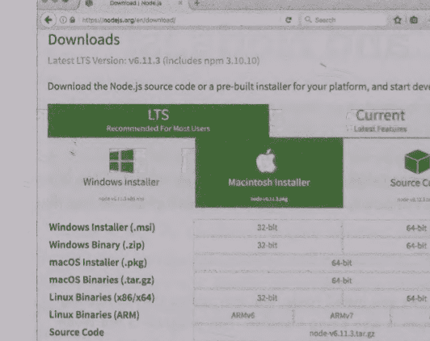
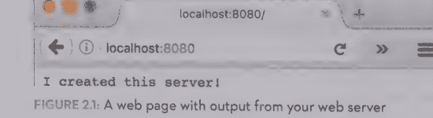
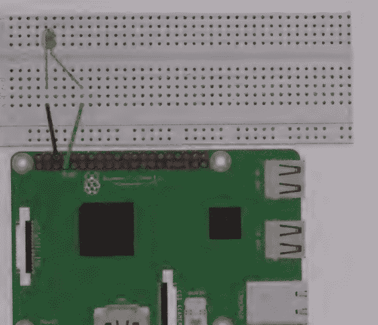

# JavaScript 快速启动指南：使用 Node.js 和 Raspberry Pi 构建 Twitter 机器人与 LED 提醒系统

## 如何联系我们

请将意见和问题致函出版商：

Maker Media, Inc.

1700 Montgomery Street, Suite 240

San Francisco, CA 94111

您可以通过电子邮件 `books@makermedia.com` 向我们发送意见和问题。

Maker Media 联合、激励、告知并娱乐着一个不断壮大的、足智多谋的社区，他们在自家后院、地下室和车库中开展令人惊叹的项目。Maker Media 庆祝您调整、破解和按自己的意愿改造任何技术的权利。Maker Media 的受众群体仍然是一个不断发展的文化和社区，他们相信可以改善我们自己、我们的环境、我们的教育体系——乃至我们的整个世界。这远不止是一个受众群体，它是 Maker Media 正在引领的一场全球性运动。我们称之为创客运动。

要了解更多关于 Make: 的信息，请访问 `makezine.com`。您可以通过以下网站了解更多关于公司的信息：

- Maker Media: `makermedia.com`
- Maker Faire: `makerfaire.com`
- Maker Shed: `makershed.com`
- Maker Share: `makershare.com`

## 前言：什么是 Node.js？

JavaScript 是一种可以在 web 浏览器中运行的编程语言。像 Firefox 和 Chrome 这样的浏览器是用能够理解并执行 JavaScript 语言编写的程序的引擎构建的。Firefox 有一个名为 `SpiderMonkey` 的引擎，而 Chrome 的引擎名为 `V8`。

在浏览器中运行 JavaScript 限制了您可以使用它做的事情。例如，在浏览器中使用 JavaScript 时，您仅限于与网页交互。您可以在人们在表单中输入信息时检测错误。您可以打开浏览器窗口和警报框。但您无法控制浏览器之外的任何内容。

幸运的是，您还有另一个选择。当您安装并使用 JavaScript 扩展 `Node.js` 时，您的 JavaScript 代码可以独立于 web 浏览器运行。（您通常会看到 `Node.js` 被简称为 `Node`，在本书的其余部分中，我们也将这样称呼它。）

`Node` 是 `V8` JavaScript 引擎与处理输入/输出和网络的库捆绑在一起。这意味着 `Node` 允许您在浏览器之外使用 JavaScript 来运行 shell 脚本、管理后端服务以及直接在设备上运行。

### 本书所需知识

- 基本熟悉编程概念
- 能够设置和连接 Raspberry Pi
- 能够访问和使用控制台
- 理解 `sudo`、目录以及文件创建/编辑

## 认识 JavaScript 和 Node.js!

本章将指导您在 Mac、Windows 或 Linux 操作系统上安装 `Node` 的步骤。然后您将检查它是否正常工作。

> **注意** 在安装 `Node` 的过程中，您可能会注意到一个名为 `npm` 的程序也在安装。这个程序是 `Node` 包管理器。

`Node` 非常流行，它拥有一个全新的、基于 `Node` 的有用代码包生态系统，这是其他开发人员为您创建以供使用的。当您想在 `Node` 中使用这些包之一时，您需要一种简便的方法来安装和管理它们。这就是 `npm` 为您所做的——它安装您想要使用的其他 `Node` 包。

请按照您的系统对应的说明操作；然后跳到最后一节“Node 已安装；现在呢？”

### 在 Mac 上安装 Node

虽然您可以从源代码构建 `Node`，但本指南的目的是让您快速入门。简便的方法是访问 `Node` 官方网站 `Nodejs.org` 并使用自动安装程序。以下是相关步骤：

**步骤 1.** 访问 `nodejs.org/en/download/` 并单击 Macintosh Installer 按钮下载安装程序（图 1.1）。



**图 1.1：** Nodejs.org 下载页面

**步骤 2.** 找到您下载的文件并双击它。您将看到安装对话框（图 1.2）。单击“继续”以完成安装。请坚持使用默认设置。

**步骤 3.** 安装完成后，您将看到一个包含安装信息的摘要屏幕（图 1.3）。

**步骤 4.**

你需要确保 `/usr/local/bin` 在你的 `PATH` 环境变量中。为此，请打开 `Terminal.app` 程序——你可以在 `/Applications/Utilities` 下找到它。启动 `Terminal` 程序。在新的终端窗口中，输入

```
echo $PATH
```

这将返回一个以冒号分隔的目录路径列表。在我的情况下，我会得到这样的输出：

```
/usr/local/bin:/usr/bin:/bin:/usr/sbin:/sbin
```

你可以看到 `/usr/local/bin` 是我的 `PATH` 中的第一个条目。如果你在你的 `PATH` 中没有看到它，你就需要添加它。如果你确实看到了它，请跳过第5步。

**步骤 5.**

以下是如何将 `/usr/local/bin` 添加到你的 `PATH`。在你的终端中，输入

```
touch ~/.bash_profile
```

如果文件不存在，此命令会创建它。现在输入

```
open ~/.bash_profile
```

这会在 `TextEdit` 中打开 `.bash_profile` 文件。在 `TextEdit` 中，添加这一行

```
PATH=${PATH}:/usr/local/bin
```

保存 `.bash_profile` 文件并退出 `TextEdit`。

你需要使你所做的更改生效。为此，在终端中输入此命令：

```
source ~/.bash_profile
```

**步骤 6.**

让我们确认一下 `Node` 是否正在运行。在你的终端中输入此命令来查看你已安装的版本：

```
node --version
```

**快速启动 JavaScript**

你会看到像这样的输出，它显示了你刚刚安装的 `Node` 版本：

```
v6.11.3
```

如果版本号与你在这里看到的不同，请不要担心；新版本会频繁发布。

在确认你已经安装并运行了 `Node` 程序后，你就可以开始编写 JavaScript 了。保持此终端打开，并跳到章节“Node 已安装；现在做什么？”

### 在 Windows 上安装 Node

你将从访问 `Node` 官方网站 `Nodejs.org` 并获取自动安装程序开始。以下是涉及的步骤：

**步骤 1.** 访问 `https://nodejs.org/en/download/` 并单击 **Windows Installer** 按钮以下载安装程序（图1.4）。根据你的计算机平台，选择 32 位或 64 位的 MSI 文件。

**步骤 2.** 找到你下载的文件并双击它。你可能会收到一个警告对话框，要求安装许可。单击 **确定**。

安装程序打开（图1.5）。单击 **继续** 以完成安装。坚持使用默认设置。

**步骤 3.** 当安装完成时，你会看到一个显示安装信息的摘要屏幕。让我们确认一下 `Node` 是否正在运行。单击你的**开始**菜单，你应该会在“最近添加”下看到两个新的菜单项：**Node.js** 和 **Node.js Command Prompt**（图1.6）。

**步骤 4.** 单击 **Node.js Command Prompt** 打开命令提示符。你会看到一个终端窗口打开，显示这一行：

```
Your environment has been set up for using Node.js 6.11.3 (x64) and npm
```

如果版本号与你在这里看到的不同，请不要担心；新版本会频繁发布。

这确认了你已经安装并运行了 `Node` 程序。你现在拥有开始编写 JavaScript 所需的一切。保持此终端打开，并跳到章节“Node 已安装；现在做什么？”

### 在 Linux 上安装 Node

在 Linux 上开始的最简单方法是从 `Nodejs.org` 网站安装预构建的二进制包。

> **注意** 如果你是一个有经验的 Linux 用户，你可能会发现使用你的特定 Linux 发行版的包管理器最简单。你可以在 `nodejs.org/en/download/package-manager` 找到这些信息的概要。

**步骤 1.** 访问 `https://nodejs.org/en/download/`。下载 32 位或 64 位文件，其名称类似于 `node-v6.11.3-linux-x64.tar.xz`，其中 `v6.11.3` 是当前版本（图1.7）。确保将其保存在你记得的目录中。我将其保存到我的 Downloads 目录。

#### 打开 node-v6.11.3-linux-x64.tar.xz

你已选择打开：

`node-v6.11.3-linux-x64.tar.xz`

这是一个：XZ 文件（8.9 MB）

来自：`https://nodejs.org`

Firefox 应该对此文件执行什么操作？

- 使用 Archive Utility 打开（默认）
- 保存文件
- 以后自动执行此操作以处理来自此源的此类文件。

取消

确定

图 1.7：Linux 下载

**步骤 2.**

此存档包含你需要的所有内容，并组织在子目录中。你可以使用以下命令将其提取到需要的位置：

```
~$ cd ~/bin
~$ tar xz ~/Downloads/node-v6.11.3-linux-x64.tar.xz
```

> **注意** 如果 `~/bin` 不存在，你需要先创建它。

**步骤 3.**

确保你的 `PATH` 设置能够找到你的 `Node` 安装。编辑你的 `.bash_profile` 文件并包含该行。你可以使用此命令来完成：

```
~$ PATH=$PATH:~/bin/node-v6.11.3-linux
```

或者通过编辑你的 `.bash_profile` 并添加这一行：

```
PATH=${PATH}:/usr/local/bin/node-v6.11.3-linux
```

**步骤 4.** 使用此命令检查 `Node` 是否已安装：

```
node --version
```

你应该会得到带有版本号的输出

```
v6.11.3
```

如果版本号与你在这里看到的不同，请不要担心；新版本会频繁发布。

这确认了你已经安装并运行了 `Node` 程序。你拥有开始编写 JavaScript 所需的一切。保持此终端打开，并继续到下一节。

### Node 已安装；现在做什么？

此时，你应该已经安装了 `Node` 并打开了一个终端或控制台窗口。（从现在开始，我们只称其为终端。）

在下一章中，你将编写你的第一个程序，但让我们快速尝试一下 `Node REPL`。

> **注意** `REPL` 就像一个游乐场，你可以在其中尝试 JavaScript 代码。它随 `Node` 一起安装。`REPL` 代表 **Read Eval Print Loop**（读取-求值-打印循环）。`REPL` 为你提供了一种快速简便的方式来测试你的 JavaScript 代码并修复任何错误。

在你的终端中，输入 **node** 来启动 `Node REPL`：

```
$ node
```

注意你的光标已变为大于号（>）。你现在正在与 `REPL` 交互。让我们输出一些文本：

```
> console.log('Hello World!');
Hello World!
undefined
```

如果你遇到某种错误，请检查你的标点符号。确保你的文本周围有单引号，并且在代码的最末尾有一个分号。

> **你是否得到了 *undefined* ？**

如果你得到了，请不要担心！你正在使用一个 JavaScript 函数，如果它没有返回值，它将总是返回 `undefined`（你稍后会了解更多关于此的信息）。现在，你可以忽略它。你没有犯任何错误。

现在尝试这个非常有用的 **.help** 命令：

```
> .help
.break Sometimes you get stuck, this gets you out
.clear Alias for .break
.exit Exit the repl
.help Show repl options
.load Load JS from a file into the REPL session
.save Save all evaluated commands in this REPL session to a file
```

> **注意** 以句点开头的命令是与 `REPL` 接口对话——它们不是 JavaScript 代码。

让我们使用 `.exit` 命令关闭 `REPL` 并返回到常规命令提示符：

```
> .exit
```

你已经安装了 `Node`，并且知道如何启动和退出 `REPL`。这意味着你已经准备好学习一些 JavaScript 了。第2章在等着你。

## 2 进入 JavaScript

你在上一章末尾玩过了 `REPL`。现在你将通过在 `REPL` 中编写代码和保存到 JavaScript 文件中开始学习 JavaScript。

### 字符串、数学和 REPL

你已经使用了 `REPL`（也称为 `Node shell`）。如果它没有打开，请立即启动它。在 Windows 中，打开一个命令提示符或单击你在“开始”菜单中安装的 **Node.js Command Prompt**。在 Mac 或 Linux 上，打开一个终端。

输入 `node` 来启动 `REPL`。记住，当提示符变为 `>` 时，你就在 shell 中了。

`REPL` 在你学习 JavaScript 时非常方便。你可以将你的 JavaScript 代码片段保存到文件之前进行测试。当你在 `REPL` 中犯错时，你会得到立即的反馈。

### 函数

你已经使用了你的第一个内置函数 `console.log`。这个简单的函数会打印出你放在括号中的任何字符串或其他值。

> **当你看到……**

尝试输入这个不完整的命令：

```
> console.log(
```

你不会收到错误信息，而是会看到这个：

```
...
```

这个省略号意味着 `REPL` 正在等待你输入更多代码以完成命令。如果你看到省略号但不确定原因，可以通过输入 `REPL` 命令 `.break` 来退出。

让我们尝试一个故意的错误，这样你就能看到 `REPL` 给出的反馈。

尝试这行有问题的代码：

```
> console.log(It's broken)
```

尽管这段代码有几个问题，但一次只会显示一个错误信息。这是第一个错误：

```
console.log(It's broken);
          ^^^^^^^^^^^
SyntaxError: Invalid or unexpected token
```

让我们来修复第一个问题。如果你看文本 `It's broken` 下方的脱字符，你会发现它们正好从单引号下方开始。在 JavaScript 中，每次使用文本字符串时，都需要将其放在引号中。否则，`REPL` 会认为这些单词是代码。所以现在试试这个：

```
> console.log('It's broken');
```

啊！你得到了一个悬挂的省略号。

```
console.log('It's broken');
...
```

这次 `REPL` 找到了字符串的开头，但它认为第二个引号结束了你的文本。它正在寻找一个括号来结束命令。

这很棘手。我们想在字符串中使用一个引号，但我们又需要在字符串周围加上引号。简单的解决方法是在整个字符串周围使用双引号，这样你就可以在字符串中使用单引号。单引号和双引号都可以用于包裹文本字符串：

```
> console.log("It's broken");
It's broken
undefined
```

（记住，你可以忽略 `undefined`！）

你可以在 `console.log` 函数的括号中放入多个字符串。尝试这些命令：

```
> console.log('Hello'+'world');
```

这个命令将两个字符串组合起来，输出单个字符串 `Helloworld`。如果你想在这两个单词之间加一个空格，可以在括号中使用以下三种参数中的任何一种；它们都有效。

```
'Hello '+'world'
'Hello'+' world'
'Hello'+' '+'world'
```

不过，你不会总是使用字符串——你会使用大量的数字和变量。这里快速浏览一下你的选项；试试看。

```
> console.log(42);
> console.log(5 + 4);
> console.log(5 * 4);
```

数字不使用引号；`REPL` 能识别它们。并且你可以对它们进行数学运算。

现在让我们来编写一个函数！*函数*基本上就是可以重用的代码。它不止于此，但你将从一些简单的东西开始。尝试输入以下函数。（不要输入省略号；它表示 `REPL` 正在等待更多代码，你可以在下一行输入。按回车键并使用多行。）

```
> function countPets(){
var dogs = 2; var cats = 1;
var total = dogs + cats; return (total);
... }
```

这个函数内部是这样的：

```
function countPets(){
```

这一行以 JavaScript 关键字 `function` 开头，因此 `REPL` 知道一个函数即将到来。

`countPets()` 是函数的名称。函数内的所有内容都放在花括号内。

接下来是两行以 JavaScript 关键字 `var` 开头的代码。它是 variable（变量）的缩写，这两行表示变量 `dogs` 等于 2，变量 `cats` 等于 1。

下一行表示变量 `total` 包含 `dogs` 和 `cats` 的和。

关键字 `return` 指示函数在函数完成后返回 `total` 的值。

要使用该函数，请输入此命令：

```
> countPets();
```

你将得到 `dogs` 和 `cats` 的和：3。

让我们使函数更具可重用性。看看这段代码，看看你能否猜出发生了什么。

```
> function countPets(dogs, cats){
... var total = dogs + cats;
... return (total);
... }
```

现在试试看！

```
> countPets(5, 3);
```

在这个函数中，你传入了函数可以使用的值。能够将不同的值添加到相同的代码中，这是函数如此有用的一部分原因！

你现在已经体验了 JavaScript 代码。不幸的是，一旦你结束这个 `REPL` 会话，你的函数将不会被保存。是时候离开 `REPL`，将你的代码放入 .js 文件中，这样你就可以从简单开始并在此基础上构建。

### 使用 JavaScript 文件

`REPL` 对于测试很棒，但你需要能够保存和重用你的代码。你需要一个文本编辑器，这样你就可以编写和编辑你的 JavaScript 代码并将其保存到文件中。

首先创建一个名为 **fromfile.js** 的文本文件。将此代码放入你的文件中，并将其保存到你记得的位置：

```
console.log('These words are from my .js file!');
```

在你的终端中，导航到保存 **fromfile.js** 的同一目录，然后在命令行（不是在 `REPL` 中）输入此命令：

```
$ node fromfile.js
```

`Node` 将执行你文件中的代码，你将在屏幕上看到输出。

### 创建 Web 服务器

既然你可以保存 .js 文件，你就可以开始探索 `Node` 的真正威力了。没有 `Node`，你只能编写在现有 Web 服务器上运行的 JavaScript 代码。但 `Node` 将你从那些浏览器中解放出来，让你可以创建自己的 Web 服务器！

使用 `Node` 创建一个小型 Web 服务器很容易。首先创建一个名为 **easyserver.js** 的文件，并将此代码保存在其中：

```javascript
var http = require('http');
var server = http.createServer(function(req, res) {
    res.writeHead('I created this server!');
    res.end();
});
server.listen(8080);
```

现在尝试运行你的服务器。我会在你尝试之后解释这段代码。在你的终端中，访问保存文件的目录中的命令行。输入

```
$ node easyserver.js
```

终端似乎会挂起，但没关系——这意味着你的服务器正在运行！

打开一个浏览器并访问 URL `localhost:8080`。你应该会看到 `I created this server!` 这行文字（图 2.1）。



**图 2.1：** 一个包含来自你的 Web 服务器输出的网页

访问网页后，在终端中按 `Ctrl-C` 结束程序。

让我们仔细看看这段代码中发生了什么。我不指望你现在就能理解它。我在原始代码中添加了注释。试着理解其主旨！

```javascript
var http = require('http');
var server = http.createServer(function(req, res) {
  // 向客户端发送响应
  res.writeHead('I created this server!');
  // 结束响应
  res.end();
});
// Web 服务器正在监听 8080 端口
server.listen(8080);
```

`Node` 使用内置代码为你完成了大部分工作。第一行是调用 `http` 模块，该模块在幕后拥有将你正在运行的程序转换为 Web 服务器的代码。`require` 关键字使新变量 `http` 能够访问大量保存的 `Node` 代码和函数，这些代码和函数可以创建 Web 服务器。

在第二行中，代码调用了一个名为 `createServer` 的函数。每当有人连接到你的 Web 服务器时，该函数中的代码就会被执行。

最后一行告诉你要创建的服务器开始在特定端口（本例中为 8080）上监听传入的请求。

### 你代码中的注释

你在上一个代码示例中看到的双斜杠允许你在代码中添加注释。`Node` 会忽略 `//` 后面的任何内容。注释对于帮助你记住代码中做了什么非常有用。

在下一章中，你将开始使用 JavaScript 构建一个 Twitter 机器人！

## 3 在树莓派上创建一个 Node Twitter 机器人

你已经编写了你的第一个 JavaScript 程序。接下来，你将学习如何使用 `Node` 创建一个 Twitter 机器人，该机器人可以在任何安装了 `Node` 的机器上运行，包括你的树莓派。

到现在为止，你的系统上应该已经安装了 `Node`。本章将指导你完成设置和授权 Twitter 帐户、将该帐户连接到 JavaScript 程序，并在程序中使用 `twit` npm 模块来完成大部分工作的步骤。

### 创建并授权你的 Twitter 帐户

如果你的机器人还没有 Twitter 帐户，请在 Twitter.com 上创建一个。

#### 你使用Gmail吗？

Twitter账号基于唯一的电子邮件地址。如果你没有备用邮箱但使用Gmail，可以通过一个小技巧省去创建新邮箱的麻烦。Gmail允许你在邮箱地址中添加加号和字母后缀。

例如，如果你的Gmail地址是 `jane-doe@gmail.com`，可以创建 `janedoe+twitterbot@gmail.com` 或 `janedoe+catbot@gmail.com` 这样的邮箱。

Twitter会视其为新邮箱，但Gmail会将所有发往该地址的邮件投递到现有收件箱。

有个有趣的附带效果：可以轻松设置Gmail过滤器，将发往该地址的所有邮件标记为"Twitter机器人邮件"或类似标签。这样就能一目了然地看到哪些邮件发送给了你的机器人。

**步骤 1.** 登录用于运行机器人的Twitter账号。

**步骤 2.** 访问 `apps.twitter.com`，点击"创建新应用"按钮。

**步骤 3.** 填写表单（图3.1）。完成所有字段填写。可以输入任意网站地址，确保在回调字段中输入网址。不必太在意当前填写的内容，随时可以修改。

**步骤 4.** 勾选开发者协议复选框，点击"创建你的Twitter应用"。

**步骤 5.** 此时会看到概览页面。点击"密钥和访问令牌"标签页（图3.2）。本页的密钥将把你的Twitter应用与本章稍后创建的Node机器人程序关联起来。


**图3.1：** 创建新Twitter应用表单


**图3.2：** 密钥和访问令牌页面

**步骤 6.** 滚动到页面底部，点击"创建我的访问令牌"按钮。页面将显示访问令牌和访问令牌密钥（图3.3）。保持此页面打开。接下来，你将在终端中创建文件，并将此页面的信息复制粘贴进去。


**图3.3：** Twitter应用密钥

下一节将设置目录、初始化，并创建包含此页面密钥和令牌的配置文件。

### 创建配置文件

在安装Node的设备上打开终端。

创建一个新目录存放Twitter机器人文件。我将目录命名为 `newtwitbot`。进入新目录：

```
pi@raspberrypi:~ $ mkdir newtwitbot
pi@raspberrypi:~ $ cd newtwitbot
pi@raspberrypi:~/newtwitbot $
```

我们的Twitter机器人将使用两个文件：`config.js`和`index.js`。现在用`touch`命令创建它们：

```
pi@raspberrypi:~/newtwitbot $ touch config.js index.js
pi@raspberrypi:~/newtwitbot $ ls
config.js index.js
```

需要用你的应用Twitter密钥编辑`config.js`文件。使用你喜欢的编辑器（我用nano），按如下方式编辑`config.js`文件。将`xxxxx`替换为你的密钥：

```javascript
//config.js
/* TWITTER APP CONFIGURATION
    consumer_key
    consumer_secret
    access_token
    access_token_secret
*/
module.exports = {
    consumer_key: 'xxxxx',
    consumer_secret: 'xxxxx',
    access_token: 'xxxxx',
    access_token_secret: 'xxxxx'
}
```

现在Twitter机器人配置完成。这四个值对于你创建的每个Twitter应用都是唯一的。

### 创建Twitter机器人

还记得随`Node`一起安装的`npm`应用吗？这个便捷工具让你能重用他人编写的代码。

已有名为`twit`的Twitter代码库。我们可以通过`npm`导入这个库，然后使用函数来简化与Twitter的通信。

安装此库的命令：

```
pi@raspberrypi:~/newtwitbot $ npm install --save twit
```

将看到以下输出：

```
npm notice created a lockfile as package-lock.json. You should commit this file.
npm WARN newtwitbot@0.0.0 No description
npm WARN newtwitbot@0.0.0 No repository field.
+ twit@2.2.9
added 55 packages, removed 55 packages and updated 1 package in 15.243s
```

`twit`包安装完成后，打开`index.js`文件。我们将开始添加代码。（不必担心WARN提示！如果我们要构建供他人使用的代码，就需要添加描述。但此场景下不需要。）

> **构建index.js文件**

如果迷失了方向，别担心。`index.js`文件的完整内容将在本章末尾列出。

在编辑器中打开`index.js`，添加以下代码。这些代码告诉机器人使用`twit`代码，并允许代码访问`config.js`文件中的Twitter应用密钥。

```javascript
// Dependencies
var twit = require('twit'), config = require('./config');
```

然后在下方添加：

```javascript
var Twitter = new twit(config);
```

这行代码创建名为`Twitter`的变量——一个特殊对象，可访问`twit`库中的所有代码，以及我们在`config.js`文件中设置的密钥，从而实现与Twitter的实际通信。（这听起来复杂，但可以把`Twitter`变量想象成超级英雄。它不仅是单一值，还能访问众多定制函数来执行发布、转发、收藏等Twitter操作。本章结束时你会更清楚。）

接下来进入机器人核心功能。首先让它查找包含字符串"doggo"或"pupper"的推文。然后使用你已见过的`console.log`函数，将找到的推文输出到终端。

将这个名为`retweet`的函数添加到`index.js`文件：

```javascript
var retweet = function() {
  var params = {
    q: 'doggo OR pupper',
    result_type: 'recent'
  }
  Twitter.get('search/tweets', params, function(err, data) {
    // if there no errors
    if (!err) {
      // grab ID of tweet to retweet
      var retweetId = data.statuses[0].id_str;
      // Tell Twitter to retweet
      Twitter.post('statuses/retweet/:id',
      {
        id: retweetId
      },
      function(err, response) {
        if (response) {
          console.log('Retweeted!!!');
        }
        // if there was an error while tweeting
        if (err) {
          console.log('Error tweeting');
        }
      });
    }
    // if unable to Search a tweet
    else {
      console.log('Error searching');
    }
  });
}
```

这里包含大量逻辑。整个代码块是一个函数。我们稍后会深入分析，但先让它运行起来试试。

如果现在尝试运行这段代码，它实际上不会执行任何操作。你已经编写了函数，但没有添加调用它的代码。现在添加。在代码末尾添加：

```javascript
retweet();
// retweet every 3 minutes
setInterval(retweet, 180000);
```

现在我们每180,000毫秒（即每3分钟）调用一次函数。你可以根据需要调整这个间隔。

> **警告** 如果机器人运行频率过高，Twitter会检测到资源滥用并进行"频率限制"。每3分钟一次完全足够。

现在尝试运行程序。在网页浏览器中打开机器人的Twitter动态。然后在终端中用以下命令运行程序：

```
pi@raspberrypi:~/newtwitbot $ node index.js
```

你会看到大量输出！所有匹配搜索字符串的推文信息都显示在终端中，同时也会被转发到机器人的Twitter账号。

### 自定义搜索

你可能不会持续搜索并转发"doggo"和"pupper"推文！可以修改查询字符串（`q:`后的引号内容）来搜索任何术语，包括话题标签。多个术语用逗号分隔。参数`result_type: 'recent'`告诉代码搜索机器人上次转发后的最新推文。更多查询字符串参数可参考Twitter API文档：`dev.twitter.com/rest/reference/get/search/tweets`。

你的程序会持续运行，每隔3分钟自动转发一次推文，直到你按下`Ctrl-C`停止它。

让我们更仔细地看看。考虑这段代码：

```javascript
var params = {
    q: 'watermelon, papaya, mango', result_type: 'recent'
}
```

这段代码设置了我们将要搜索的数据参数。

以下是使用这些参数的代码，从`Twitter.get`函数开始。这个函数来自`twit` API，它接收三个对象：

1.  我们要它执行的操作——在这里我们希望它搜索，所以我们使用`search/tweets`。
2.  `params`对象（我们的查询字符串和其他参数）。
3.  一个调用另一个`twit` API函数`Twitter.post`的回调函数。这个函数执行实际的发布或报告错误。

```javascript
Twitter.get('search/tweets', params, function(err, data) {
    // if there no errors
    if (!err) {
        // grab ID of matching tweet
        var retweetId = data.statuses[0].id_str;
        // found something to retweet
        Twitter.post('statuses/retweet/:id',
        {id: retweetId},
            function(err, response) {
                if (response) {
                    console.log('Retweeted this tweet');
                    console.log(data);
                }
            }
        );
        // error while retweeting
        if (err) {
            console.log('Error tweeting');
        }
    }
    // if unable to search through tweets
    else {
        console.log('Error searching.');
    }
});
}
```

我们添加的最后一段代码使用了JavaScript的定时器函数`setInterval()`。这个定时器函数定期调用转推函数。

```javascript
retweet();
// retweet every 3 minutes
setInterval(retweet, 180000);
```

我们在本章已经涵盖了很多内容。以下是目前完整的`index.js`代码：

```javascript
// Complete index.js code from Chapter 3
// Dependencies
var twit = require('twit'), config = require('./config');
var Twitter = new twit(config);

var retweet = function() {
  var params = {
    q: 'doggo OR pupper',
    result_type: 'recent'
  }
  Twitter.get('search/tweets', params, function(err, data) {
    // if there no errors
    if (!err) {
      // grab ID of tweet to retweet
      var retweetId = data.statuses[0].id_str;
      // Tell Twitter to retweet
      Twitter.post('statuses/retweet/:id',
        {
          id: retweetId
        },
        function(err, response) {
          if (response) {
            console.log('Retweeted!!!');
          }
          // if there was an error while tweeting
          if (err) {
            console.log('Error tweeting');
          }
        }
      );
    }
    // if unable to Search a tweet
    else {
        console.log('Error searching');
    }
  });
}
retweet();
// retweet every 3 minutes
setInterval(retweet, 180000);
```

在下一章，我们将扩展这个机器人的功能，并使用树莓派在我们的机器人Twitter账号被提及时点亮一个LED灯！

## 4 响应Twitter事件闪烁LED

你已经用`Node.js`创建了你的Twitter机器人。如果你在树莓派上设置好了它，你就可以连接一个LED灯，并在Twitter上发生事件时让它闪烁。在本章中，你将在连接到你的树莓派的面包板上接线一个LED。接下来，你将编写一个简短的程序，让LED闪烁两次。最后，你将把这段代码添加到你的Twitter机器人程序中，这样每次你的机器人Twitter账号被提及时，LED灯就会通过闪烁来提醒你（图4.1）。


**图4.1：** 闪烁的LED灯

### 在你的树莓派上设置LED

设置如图4.2所示，相当简单。你需要以下物品：

- 带5V电源的树莓派
- 面包板
- 2根公对母跳线（示例中使用黑色和绿色）
- 一个LED灯

**步骤1.** 找到你树莓派上的GPIO引脚（图4.3）。



**图4.2：** 树莓派上完整的LED设置


**图4.3：** GPIO引脚特写

> ## 你说的GPIO是什么意思？
>
> 看到你树莓派一侧边缘上的那26个引脚了吗？其中17个引脚被称为GPIO，即通用输入/输出的缩写。你可以将外部硬件连接到这些引脚上。其他引脚是电源或接地引脚。

**步骤2.** 将绿色跳线的母端连接到树莓派GPIO的4号引脚，如图4.1和4.2所示。

**步骤3.** 将黑色跳线的母端连接到GPIO的3号引脚。

**步骤4.** 看看你的LED灯。一条腿比另一条长。长腿是正极，短腿是负极。记住这一点很重要。

**步骤5.** 如图4.2所示，将你的LED灯插入面包板。确保LED灯的正极在右侧。

**步骤6.** 将黑色电缆的公端连接到面包板上与LED灯负极相邻的位置。如果这有任何令人困惑的地方，请仔细看图4.2。

**步骤7.** 将绿色电缆的公端连接到面包板上与LED灯正极相邻的位置。

现在，你的树莓派将能够根据你即将编写的代码来闪烁LED灯！

### 创建闪烁程序

打开你的终端并连接到你的树莓派。导航到你创建Twitter机器人文件的目录。

```bash
pi@raspberrypi:~ $ cd newtwitbot
pi@raspberrypi:~/newtwitbot $
```

还记得用`npm`安装名为`twit`的Twitter代码库吗？我们将再次使用`npm`，这次是导入另一个名为`onoff`的库，它让我们可以控制LED灯。

要安装这个库，使用以下命令：

```bash
pi@raspberrypi:~/newtwitbot $ npm install --save onoff
```

`onoff`安装完成后，创建并打开一个新文件`helloBlink.js`。

```bash
pi@raspberrypi:~/newtwitbot $ nano helloBlink.js
```

这将打开编辑器并创建一个空白文件。输入以下代码：

```javascript
//helloBlink.js
var Gpio = require('onoff').Gpio,
  led = new Gpio(4, 'out');
var iv = setInterval(function () {
  led.writeSync(led.readSync() === 0 ? 1 : 0)
}, 500);
// Toggle state of the LED every half second
setTimeout(function () {
  clearInterval(iv);
  led.writeSync(0);
  // Turn LED off
  led.unexport();
}, 2000);
// End blinking after 2 seconds
```

保存这个文件。

现在用`node`命令试一试：

```bash
pi@raspberrypi:~/newtwitbot $ node helloBlink.js
```

### 让你的机器人检测你的Twitter账号

在你的机器人能够响应有人在推文中提到你的Twitter账号之前，它需要能够检测到这件事的发生。

在这一节，我们将添加一些代码，它会向任何推文提及你账号的人回复一条问候。

在上一章，你在一个名为`index.js`的程序中创建了一个Twitter机器人。在编辑器中打开`index.js`（或者你命名的任何文件）。我们将把这段新代码添加到当前文件的末尾。确保将`@doggobot`改成你为你的机器人命名的任何名称！

```javascript
//Respond when someone mentions me, @doggobot
var stream = Twitter.stream('statuses/filter',
  { track: ['@doggobot'] });
//Look for my @name
stream.on('tweet', tweetEvent);
function tweetEvent(tweet) {
  // Get Twitter handle of who tweeted me
  var name = tweet.user.screen_name;
  // Now send a reply back to the sender
  var reply = 'You mentioned me! @' + name + ' ' + 'Bork bork!';
  var params = {
    status: reply,
    in_reply_to_status_id: nameID
  };
  Twitter.post('statuses/update', params,
    function(err, data, response) {
      if (err !== undefined) {
        //Report error if response tweet fails
        console.log(err);
      } else {
        //Report success
        console.log('Tweeted: ' + params.status);
      }
    })
};
```

基本上，这段代码监听你的机器人Twitter账号。当它检测到你的账号时，它会获取发送者的账号名。然后它创建一条包含发送者账号名的回复，并发布推文。在我们的例子中，如果有人——我们称她为`@lynnbeighley`——发布任何包含我的机器人名字`@doggobot`的推文，机器人将回复：You mentioned me! @lynnbeighley Bork bork!。

### 让你的机器人被提及时闪烁 LED

最后一步是在机器人程序的正确位置，加入你在 `helloBlink.js` 程序中使用的代码。你可以直接复制并粘贴到这行代码之后：

```
console.log('Tweeted: ' + params.status);
```

我们在本章末尾添加到你的机器人代码中的完整代码块如下：

```javascript
//当有人提到我，@doggothebotto 时做出响应
var stream = Twitter.stream('statuses/filter',
{ track: ['@doggothebotto'] });
//查找我的 @name
stream.on('tweet', tweetEvent);
function tweetEvent(tweet) {
  // 获取提到我的用户的推特账号
  var name = tweet.user.screen_name;
  // 现在向发送者发送回复
  var reply='You mentioned me! @' + name + ' ' + 'Bork bork!';
  var params = {
    status: reply, in_reply_to_status_id: nameID
  };
  Twitter.post('statuses/update', params,
  function(err, data,response) {
    if (err !== undefined) {
      //如果回复推文失败，报告错误
      console.log(err);
    } else {
      //报告成功
      console.log('Tweeted: ' + params.status);
    }
  });
}
var Gpio = require('onoff').Gpio,
  led = new Gpio(4, 'out');
var iv = setInterval(function () {
  led.writeSync(led.readSync() === 0 ? 1 : 0)
}, 500);
// 每半秒切换一次 LED 的状态
setTimeout(function () {
  clearInterval(iv);
  led.writeSync(0);
  // 关闭 LED
  led.unexport();
}, 2000);
// 2秒后停止闪烁
}
})
};
```

你现在有了一个机器人，它不仅会在有人发推特@它时做出响应，还会通过闪烁 LED 来让你知道！使用类似的技术，你可以监控 Twitter 上更实用的搜索词——例如，海啸和地震。

> **在后台运行 Node 应用程序**

如果你在树莓派上运行像 Twitter 机器人这样的程序，你可能希望让它在后台运行。你可以使用 `forever` 命令来实现这一点。

使用 npm 安装 `forever`：

```
pi@raspberrypi:~ $ npm install forever --global
```

现在你可以这样运行它：

```
pi@raspberrypi:~ $ forever start yourProgram.js
```

你的程序现在将作为进程运行。要停止它，使用这个命令：

```
pi@raspberrypi:~ $ forever stop yourProgram.js
```

## NODE、PI 与物联网

你现在通过 `Node` 和树莓派，已经快速入门了 JavaScript。你可以控制现实世界中的设备并与互联网互动。闪烁 LED 只是你用树莓派直接控制的东西中的一小部分。既然你能做到这一点，你就可以连接并控制其他更有趣的电子设备。

例如，你可以连接一个温度传感器，并定期将环境读数发布到网页上。或者你可以使用运动传感器，并设置一个警报来捕捉你的猫在晚上跳上柜台。

现在轮到你来构思并构建自己的 JavaScript/Node/Pi 项目了！

## 通过 Jumpstarting 系列快速上手！

Jumpstarting 系列为创客提供了一条快速掌握主题知识的途径。

每本书都从如何安装或初始化达到至关重要的“Hello, World”入门阶段所需的硬件或软件开始。

第二个项目建立在第一个项目的基础上，使用更多硬件或软件的功能。

后续项目将用户的知识扩展到主题中较少涉及的方面。所有 Jumpstarting 项目都面向创客——它们提供动手实践的真实世界经验，让你掌控硬件或软件按照你的意愿工作。

LYNN BEIGHLY 是一位被困在技术书籍作家身体里的虚构作家。当发现技术写作也可以富有创意时，她逐渐爱上了它。她撰写了她的第一本网络开发畅销书，并移居硅谷。她在那里工作了几年，同时撰写了越来越多的书籍。每年她都会搬到纽约去攻读写作硕士学位。Lynn 喜欢旅行、摄影，以及为陌生人编故事。最近，她一直在愉快地探索物联网。
