# JavaScript 入门指南

## 心智模型

阅读这段代码：

```
let a = 10;
let b = a;
a = 0;
```

这段代码运行后，`a`和`b`的值分别是多少？在继续阅读之前，请先在脑海中推算一下。

如果你已经写了一段时间的 JavaScript，你可能会反对说：“这个代码片段比我每天写的代码简单多了。有什么意义？”

这个练习的目的不是向你介绍变量。我们假设你已经熟悉变量了。相反，它是为了让你注意并反思自己的心智模型。

## 什么是心智模型？

带着*确保自己完全明白*结果是什么的意图，重新阅读上面的代码。（我们稍后会看到这个意图为什么重要。）

当你第二次阅读时，请密切关注你的头脑中一步一步发生了什么。你可能会注意到这样的内心独白：

- `let a = 10;`
  - 声明一个名为 `a` 的变量。将其设置为 `10`。
- `let b = a;`
  - 声明一个名为 `b` 的变量。将其设置为 `a`。
  - 等等，`a` 又是什么来着？啊，是 `10`。所以 `b` 也是 `10`。
- `a = 0;`
  - 将变量 `a` 设置为 `0`。
- 所以现在 `a` 是 `0`，`b` 是 `10`。这就是我们的答案。

也许你的独白有点不同。也许你用的是“赋值”而不是“设置”，或者你阅读的顺序略有不同。也许你得出了不同的结果。请特别留意它具体有什么不同。注意，即使是这样的独白也没有完全捕捉到你头脑中真正发生的事情。你可能说“把 `b` 设置为 `a`”，但“设置”一个变量到底是什么意思呢？

你可能会发现，对于每一个熟悉的基本编程概念（如变量）及其操作（如设置其值），都有一套与之相关联的根深蒂固的类比。其中一些可能来自现实世界。另一些可能来自你先前学习的其他领域，例如数学中的数字。这些类比可能相互重叠甚至相互矛盾，但它们仍然帮助你理解代码中发生的事情。

例如，许多人最初学习变量时是将其视为“盒子”——用来装你东西的容器。即使你在看到变量时不再生动地想象盒子，但在你的想象中，它们可能仍然表现得“像盒子一样”。

这些在你头脑中对事物如何工作的近似理解，被称为“心智模型”。如果你已经编程很长时间了，这可能很难，但试着去注意和反思你自己的心智模型。它们可能是视觉、空间和机械心理捷径的结合。这些直觉（比如变量的“盒子性”）影响着我们一生解读代码的方式。

不幸的是，有时我们的心智模型是错误的。也许我们早期阅读的教程为了更容易解释一个概念而牺牲了准确性。也许，在我们开始学习 JavaScript 时，我们错误地从之前学过的语言中“搬过来”了某种预期的行为。也许我们从某段代码中推断出了一个心智模型，但从未真正验证它是否正确。

识别和修复这些问题正是 *Just JavaScript* 的核心所在。我们将逐步构建（或可能重建）你关于 JavaScript 的心智模型，使其准确且有用。一个良好的心智模型将让你对自己的代码充满信心，并让你能够理解（并修复）别人编写的代码。

（顺便说一句，`a` 是 `0` 而 `b` 是 `10` 是正确的答案。）

## 快慢编程

丹尼尔·卡尼曼的《思考，快与慢》一书探讨了人类在思考时使用的两种不同“系统”。

只要有可能，我们就会依赖“快”系统，它擅长模式匹配和“直觉反应”。我们与许多动物共享这个系统（这对于生存是必要的！），它赋予我们惊人的能力，比如走路而不摔倒。但它不擅长规划。

得益于大脑额叶的发展，人类还拥有一种独特的“慢”思考系统。这个“慢”系统负责复杂的逐步推理。它让我们能够规划未来事件、进行论证或遵循数学证明。

因为使用“慢”系统非常耗费心力，我们倾向于默认使用“快”系统——即使是在处理像编程这样的智力任务时。

想象一下，你正忙于一大堆工作，想要快速识别这个函数的功能。看一眼：

```
function duplicateSpreadsheet(original) {
  if (original.hasPendingChanges) {
    throw new Error('You need to save the file before you can duplicate it.');
  }
  let copy = {
    created: Date.now(),
    author: original.author,
    cells: original.cells,
    metadata: original.metadata,
  };
  copy.metadata.title = 'Copy of ' + original.metadata.title;
  return copy;
}
```

你可能已经注意到：

- 这个函数复制一个电子表格。
- 如果原始电子表格未保存，它会抛出一个错误。
- 它在新电子表格的标题前加上了“Copy of”。

你可能*没有*注意到（如果你注意到了，干得好！）的是，这个函数*也*不小心更改了原始电子表格的标题。错过这样的错误是每个程序员每天都会发生的事情。

既然你知道存在一个 bug，你会用不同的方式阅读代码吗？如果你一开始使用的是“快”思考系统，当你意识到代码中有 bug 时，你可能会切换到更费力的“慢”系统。

当我们使用“快”系统时，我们根据代码的整体结构、命名约定和注释来猜测代码的功能。使用“慢”系统时，我们逐步追溯代码的功能——这是一个费力且耗时的过程。

这就是为什么拥有一个准确的心智模型如此重要。在头脑中模拟计算机是困难的，当你不得不依赖“慢”思考系统时，你的心智模型就是你唯一可以依赖的东西。如果心智模型错误，你从根本上就会误解你的代码预期会产生什么结果，你所有的努力都将白费。

如果你完全找不到 bug，请不要担心——这只是意味着你将从这门课程中获得最大收获！在接下来的模块中，我们将一起重建关于 JavaScript 的心智模型，这样你就能立即发现这样的错误。

在下一个模块中，我们将开始为一些最基本的 JavaScript 概念——值和表达式——构建心智模型。

### 阅读完成？

将此章节标记为已学习以跟踪你的进度。

标记为已学习

下一个

# JavaScript 宇宙 →

# JavaScript 宇宙

*太初有值。*

*值*是什么？很难说。

几何学中的点是什么？人类语言中的词是什么？值是 JavaScript 中的一个基本概念——所以我们不能用其他术语来定义它。

相反，我们将通过示例来定义它。数字和字符串是值。对象和函数也是值。

还有很多东西*不是*值，例如我们代码中的部分——比如我们的 `if` 语句、循环和变量声明。

## 值与代码

在我们开始构建心智模型时，我们需要澄清的第一个常见误解是：值*就是*我们的代码。相反，我们需要将它们分开思考——我们的代码与值交互，但值存在于一个完全独立的空间中。

为了区分我 JavaScript 程序中的值和代码，我喜欢想象安东尼·德·圣-埃克苏佩里《小王子》中的这幅画：


我站在一个小星球上，拿着一份指令清单。这份清单就是我的程序——我的代码。当我阅读我的指令清单时，我可以看到很多事情正在发生——有 `if` 语句、变量声明、逗号和花括号。

我的代码包含像“进行函数调用”、“多次执行此操作”甚至“抛出错误”这样的指令。我从我的小世界表面一步一步地阅读这些指令。

*但偶尔，我会抬起头。*

在一个晴朗的夜晚，我在 JavaScript 的天空中看到不同的值：布尔值、数字、字符串、符号、函数和对象、`null` 和 `undefined`——哦天哪！我可能会在我的代码中引用它们，但它们并不存在于*我的代码内部*。

*在我们的 JavaScript 宇宙中，值漂浮在空间中。*

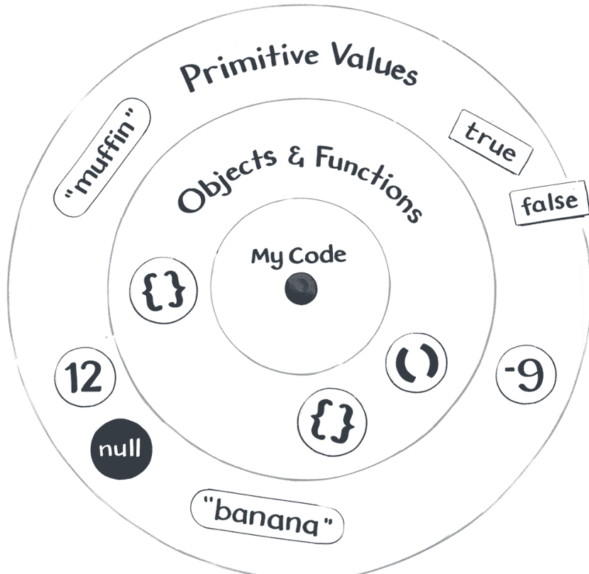

“等等，”你可能会说，“我一直认为值在我的代码内部！”在这里，我要求你相信我。还需要几个模块，这个心智模型才能显现其价值。[给它五分钟](http://example.com)。我知道自己在做什么。

## 值

大致来说，有两种值。

### 原始值

**原始值**就像恒星——冰冷而遥远，但每当我需要时，它们总在那里。即使从小行星表面，我也能找到并指认它们。它们可以是数字和字符串等等。所有原始值都有一个共同点：**它们是我们 JavaScript 宇宙的永久部分。我可以指向它们，但不能创建、销毁或改变它们。**

要在实践中看到原始值，请打开浏览器控制台并打印它们：

```
console.log(2);
console.log("hello");
console.log(undefined);
```

### 对象与函数

**对象与函数**也是值，但不同于原始值，**我可以从代码中操作它们**。如果原始值像遥远的恒星，那么对象和函数就更像漂浮在我行星周围的 asteroid。它们不是我代码的一部分，但它们足够接近，可以被操作。

> **趣味事实**
>
> 函数是对象，但由于它们包含一些独特的附加功能，我们将单独引用它们以避免混淆。

继续在浏览器控制台打印一些：

```
console.log({});
console.log([]);
console.log(x => x * 2);
```

注意浏览器控制台如何以不同于原始值的方式显示它们。某些浏览器可能会在它们前面显示一个箭头，或者在你点击它们时执行一些特殊操作。如果你安装了几个不同的浏览器，请比较它们如何可视化对象和函数。

## 值的类型

起初，JavaScript 宇宙中的所有值可能看起来都一样——只是天空中的亮点。但我们在这里研究漂浮在我们 JavaScript 宇宙上方的所有不同事物，因此我们需要一种分类它们的方法。

我们可以将值分解为类型——相同类型的值表现相似。作为一名有抱负的天文学家，你可能想知道 *每一种* 可以在 JavaScript 天空中观察到的值类型。

经过近二十五年的 JavaScript 研究，科学家们只发现了九种类型：

### 原始值

- **Undefined** (`undefined`)，用于意外缺失的值。
- **Null** (`null`)，用于故意缺失的值。
- **Booleans** (`true` 和 `false`)，用于逻辑操作。
- **Numbers** (`-100`、`3.14` 等)，用于数学计算。
- **BigInts**（不常见且新），用于大数的数学运算。
- **Strings** (`"hello"`、`"abracadabra"` 等)，用于文本。
- **Symbols**（不常见），用于执行仪式和隐藏秘密。

### 对象与函数

- **Objects** (`{}` 等)，用于分组相关数据和代码。
- **Functions** (`x => x * 2` 等)，用于引用代码。

## 没有其他类型

你可能会问：“但我用过的其他类型呢，比如数组？”

**在 JavaScript 中，除了我们刚刚列举的类型之外，没有其他基本值类型。** 其余全是对象！例如，即使是数组、日期和正则表达式在 JavaScript 中 *本质上* 都是对象：

```
console.log(typeof([])); // "object"
console.log(typeof(new Date())); // "object"
console.log(typeof(/(hello|goodbye)/)); // "object"
```

> ## 趣味事实
>
> “我明白了，”你可能会回答，“这是因为 *所有东西* 都是对象！” 唉，这是一个[流行的都市传说](https://www.google.com/search?q=everything+is+an+object+javascript)，但并非如此。
>
> 尽管像 `"hi".toUpperCase()` 这样的代码使 `"hi"` 看起来像对象，但这只是一种幻觉。当你这样做时，JavaScript 会创建一个临时对象，然后立即丢弃它。如果你还不理解这个机制也没关系。它确实相当令人困惑！
>
> **目前，你只需要记住，原始值，如数字和字符串，*不是* 对象。**

## 检查类型

值只有九种类型，但我们如何知道特定值的类型？

如果我们想检查值的类型，可以使用 `typeof` 运算符询问。以下是一些你可以在浏览器控制台尝试的例子：

```
console.log(typeof(2)); // "number"
console.log(typeof("hello")); // "string"
console.log(typeof(undefined)); // "undefined"
```

严格来说，使用 `typeof` 时不需要括号。例如，`typeof 2` 和 `typeof(2)` 一样有效。然而，有时需要括号以避免歧义。以下情况中有一个如果省略 `typeof` 后的括号会出错。试着猜猜是哪一个：

```
console.log(typeof({})); // "object"
console.log(typeof([])); // "object"
console.log(typeof(x => x * 2)); // "function"
```

你可以在浏览器控制台验证你的猜测。

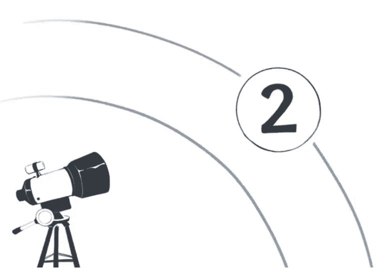


你可能有问题。很好。如果你提问，我们的 JavaScript 宇宙可能会回答！当然，前提是你知道如何提问。

## 表达式

有很多问题是 JavaScript 无法回答的。如果你想知道是否最好向最好的朋友坦白真实感受，还是继续等待直到你们都变成骷髅，JavaScript 可能帮不上什么忙。

但有些问题 JavaScript *很乐意* 回答。这些有特殊名称——它们被称为 *表达式*。

如果我们“问”表达式 `2 + 2`，JavaScript 会“回答”值 `4`。

```
console.log(2 + 2); // 4
```

另一个例子，记得我们如何用 `typeof` 确定值的类型。事实上，那也是一个表达式！我们的“问题”是 `typeof(2)`，JavaScript 宇宙用字符串值 `"number"` 回答了它。

```
console.log(typeof(2)); // "number"
```

表达式是 JavaScript 可以回答的问题。JavaScript 只能用它知道的方式回答表达式——用值。


如果“表达式”这个词让你困惑，把它想象成一段 *表达* 值的代码。你可能听到人们说 `2 + 2` “结果是”或“求值为” `4`。这些都是表达同一件事的不同方式。

我们问 JavaScript `2 + 2`，它回答 `4`。**表达式总是产生一个单一值。** 现在我们对表达式了解得足够多了，可以开始危险地尝试了！

### 回顾

让我们回顾一下目前所知道的：

1. **有值，然后有代码。** 我们可以把值想象成漂浮在 JavaScript 宇宙中的不同事物。它们不存在 *在* 代码 *内部*，但我们可以从代码中引用它们。
2. **值分为两类：原始值，以及对象与函数。** 总共有九种独立类型。每种类型都有特定用途，但有些很少使用。
3. **有些值是孤独的。** 例如，`null` 是 Null 类型的唯一值，`undefined` 是 Undefined 类型的唯一值。正如我们稍后将学到的，这两个孤独的值是相当麻烦的制造者！
4. **我们可以用表达式提问。** 表达式存在于我们的代码中，因此它们不是值。相反，JavaScript 将用值 *回答* 我们的表达式。例如，`2 + 2` *表达式* 的回答是值 `4`。
5. **我们可以通过将某物包装在 `typeof` 表达式中来检查其类型。** 例如，`typeof(4)` 的结果是字符串值 `"number"`。

## 测试

现在是将所学付诸实践的时候了。

即使你已经有相当丰富的 JavaScript 经验，也不要跳过练习！我个人就是几年前才学到其中一些东西的。

练习之后，我们将继续完善我们的心智模型。本模块呈现的是一个粗略的草图——一个近似值。我们将专注于图景的不同部分，并用更多细节填充它们，就像[渐进式 JPEG](progressive JPEG) 图像一样。

这些可能看起来是小步骤，但我们正在为其他一切奠定基础。我们正在一起构建我们的 JavaScript 宇宙。

### 读完了？

将此集标记为已学习以跟踪你的进度。


# 开始测验 →

# 值与变量

我们将从一个小代码片段开始本模块。

```
let reaction = 'yikes';
reaction[0] = 'l';
console.log(reaction);
```

你期望这段代码做什么？如果不确定也没关系。**尝试运用你目前所知的 JavaScript 知识找出答案。**

我希望你花点时间，一步一步地写下你对这段代码每一行的确切思考过程。同时，注意你现有思维模式中的任何空白或不确定性，也把它们写下来。如果有任何疑问，尽量清晰地表达出来。

#### 答案

这段代码将 \**在你完成书写前请勿揭示。**\* 这取决于你的代码是否处于严格模式。它永远不会打印出 "likes"。

糟糕。

## 原始值是不可变的

你答对了吗？这可能看起来像是那种只在 JavaScript 面试中才会出现的冷知识问题。即便如此，它也阐明了关于原始值的一个重要观点。

**我们无法改变原始值。**

我将用一个小例子来解释这一点。字符串（是原始值）和数组（不是）有一些表面的相似性。数组是一系列项目的序列，而字符串是一系列字符的序列：

```
let arr = [212, 8, 506];
let str = 'hello';
```

我们可以类似地访问数组的第一个项目和字符串的第一个字符。感觉字符串就像数组一样：

```
console.log(arr[0]); // 212
console.log(str[0]); // "h"
```

但它们并非如此。让我们仔细看看。我们可以改变数组的第一个项目：

```
arr[0] = 420;
console.log(arr); // [420, 8, 506]
```

直觉上，很容易假设我们也可以对字符串做同样的事情：

```
str[0] = 'j'; // ???
```

**但我们不能。**

这是我们思维模式中需要补充的一个重要细节。字符串是一个原始值，**所有原始值都是不可变的。**“不可变”是一个源自拉丁语的高级说法，意为“不可改变”。只读。我们根本无法修改原始值。

JavaScript 不允许我们在任何原始值上设置属性，无论是数字、字符串还是其他东西。它会默默拒绝我们的请求还是抛出错误，这取决于我们的代码处于[哪种模式](which mode)。但请放心，这永远不会奏效：

```
let fifty = 50;
fifty.shades = 'gray'; // 不行！
```

和任何数字一样，`50` 是一个原始值。我们无法在它上面设置属性。

记住，在我们的 JavaScript 宇宙中，所有原始值都是遥远的恒星，漂浮在离我们代码最远的地方。我们可以指向它们，但它们将永远停留在原地，不会改变。

_这让我感到一种奇特的安慰。_

## 变量与值——矛盾吗？

你已经看到原始值是只读的——或者用我们时代的术语来说，是不可变的。现在，使用下面的代码片段来测试你的思维模式。

```
let pet = 'Narwhal';
pet = 'The Kraken';
console.log(pet); // ?
```

像之前一样，用几句话写下你的思考过程。不要匆忙进行。密切关注你是如何一步一步地思考每一行代码的。字符串的不可变性在这里起作用吗？如果起作用，它扮演了什么角色？

#### 答案

> 如果你认为**在你完成书写前请勿揭示**，那么你是对的！答案是 "The Kraken"。不可变性在这里没有起作用。

如果你答错了，不要灰心。这个例子可能看起来与字符串的不可变性相矛盾，**但事实并非如此。**

当你刚开始学习一门语言时，有时有必要搁置矛盾，以避免钻进牛角尖并继续学习。但既然你现在致力于构建一个思维模式，你就需要质疑矛盾。

*矛盾揭示了思维模式中的漏洞。*

## 变量是导线

让我们再看一下这个例子。

```
let pet = 'Narwhal';
pet = 'The Kraken';
console.log(pet); // "The Kraken"
```

我们知道字符串值不能改变，因为它们是原始值。但 `pet` 变量*确实*变成了 `"The Kraken"`。这是怎么回事？

这可能看起来像一个矛盾，但并非如此。我们说的是原始*值*不能改变，但我们没有说任何关于*变量*的事情！在我们完善思维模式的过程中，我们需要理清几个相关的概念：

**变量不是值。**

**变量指向值。**

## 将值赋给变量

在我们的 JavaScript 宇宙中，变量是一根*指向*值的导线。

例如，我可以将 `pet` 变量指向 `"Narwhal"` 值。（也可以说，我将值 `"Narwhal"` *赋给*名为 `pet` 的变量）：

```
let pet = 'Narwhal';
```


但如果我想要一个不同的宠物呢？没问题——我可以将 `pet` 指向另一个值：

```
pet = 'The Kraken';
```

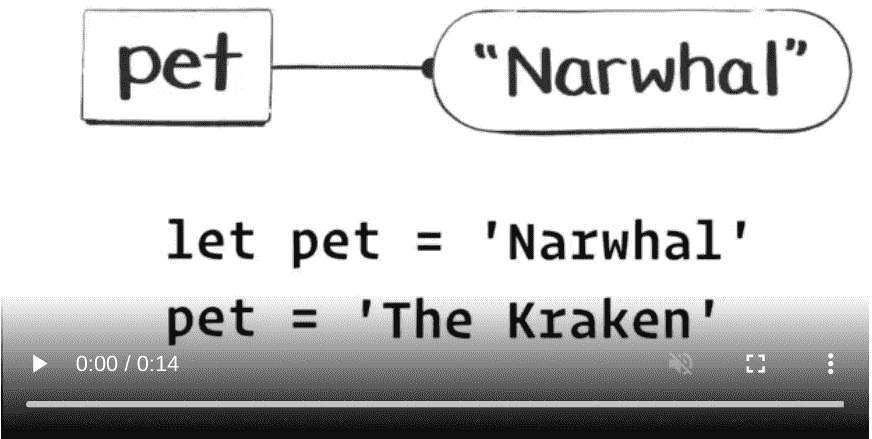

我在这里所做的就是指示 JavaScript 将左侧的变量（或者说“导线”）( `pet` ) 指向右侧的值（ `The Kraken` ）。除非我稍后再次重新赋值，否则它将一直指向该值。

## 赋值规则

当我们想要使用 `=` 赋值运算符时，有两条规则：

1. **赋值的左侧必须是一根“导线”——比如 `pet` 变量。**

   注意左侧不能是一个值。（在控制台中尝试这些示例）：

   ```
   20000 = 'leagues under the sea'; // 不行。
   'war' = 'peace'; // 不行。
   ```

2. **赋值的右侧必须是一个表达式，因此它总是会产生一个值。** 我们的表达式可以是简单的东西，比如 `2` 或 `'hello'`。也可以是一个更复杂的表达式——例如：

   ```
   pet = count + ' Dalmatians';
   ```

   这里，`count + ' Dalmatians'` 是一个表达式——一个向 JavaScript 提出的问题。JavaScript 将用一个值来回答它（例如，`"101 Dalmatians"`）。从现在起，`pet` 变量这根“导线”将指向那个特定的值。

> **有趣的事实**
>
> 如果右侧必须是一个表达式，这是否意味着写在代码中的简单事物——比如 `2` 这样的数字或 `'The Kraken'` 这样的字符串——也是表达式？是的！这样的表达式被称为*字面量*——因为我们*确实*写下了它们所产生的值。

## 读取变量的值

我也可以*读取*一个变量的值——例如，将其记录下来：

```
console.log(pet);
```

这几乎不令人惊讶。

但请注意，我们传递给 `console.log` 的并不是 `pet` 变量。我们可能会在口语上这么说，但我们不能真正将变量传递给函数。我们传递的是 `pet` 变量的当前值。这是如何运作的呢？

事实证明，像 `pet` 这样的变量名也可以作为一个表达式！当我们写 `pet` 时，我们是在向 JavaScript 提问：“`pet` 的当前值是什么？”为了回答我们的问题，JavaScript 会沿着 `pet` 这根“导线”，并给出这根“导线”末端的值。

所以，同一个表达式可以在不同时间给我们不同的值！

## 吹毛求疵

谁在乎你是说“传递一个变量”还是“传递一个值”？这种区别难道不是迂腐得无可救药吗？我当然不建议打断你的同事来纠正他们。那会浪费每个人的时间。

但你需要在脑海中清楚地了解每个 JavaScript 概念能做什么。你不能滑冰自行车。你不能飞行鳄梨。你不能歌唱蚊子。你也不能传递变量——至少在 JavaScript 中不行。

这里有一个小例子，说明为什么这些细节很重要。

```
function double(x) {
  x = x * 2;
}

let money = 10;
double(money);
console.log(money); // ?
```

如果我们认为 `double(money)` 是在传递一个变量，我们可能会期望 `x = x * 2` 会使 `money` 变量加倍。

但这是不正确的：`double(money)` 的意思是“找出 `money` 的值，然后将该值传递给 `double`。”所以 `money` 仍然指向 `10`。真是个骗局！

在你的脑海中，有哪些不同的 JavaScript 概念？它们之间如何关联，以及我们如何通过代码与它们交互？

写下你最常用的概念的一个简短列表。

## 整合起来

现在让我们重新审视[心智模型](#心智模型)中的第一个例子：

```
let x = 10;
let y = x;
x = 0;
```

我建议你拿一张纸或使用一个[绘图应用](drawing app)，草绘出 `x` 和 `y` 变量的“导线”一步一步发生的情况。

你可以在这里直接画出来：


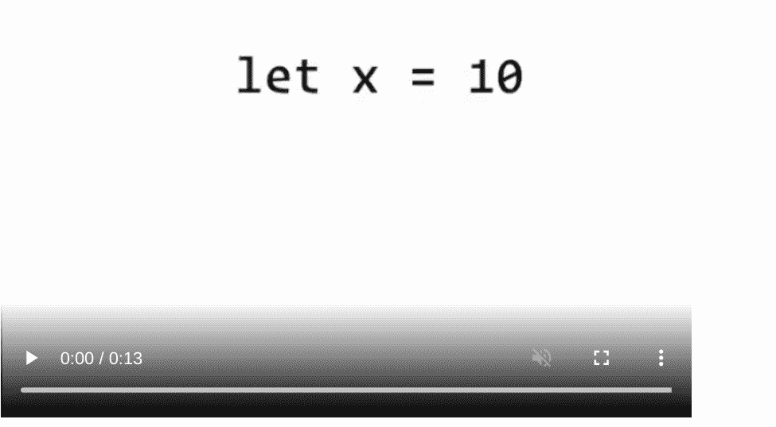

第一行代码作用不大：

- 声明一个名为 `x` 的变量。
  - 绘制 `x` 变量线。
- 将 `10` 的值赋给 `x`。
  - 将 `x` 线指向值 `10`。

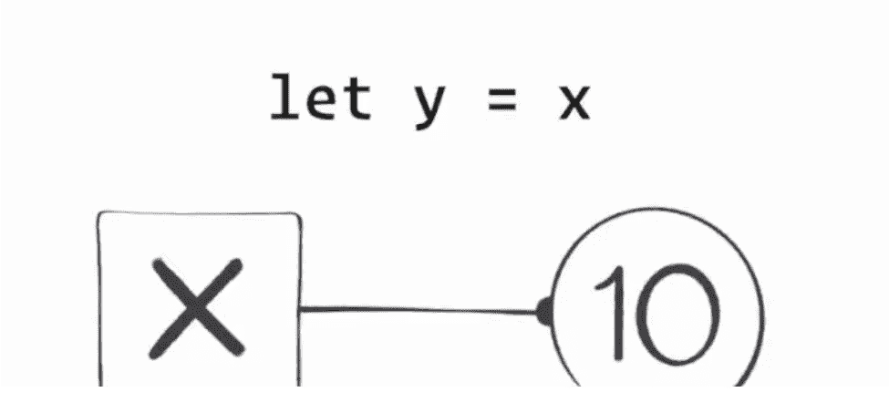


第二行代码虽短，但做了不少事情：

- 声明一个名为 `y` 的变量。
  - 绘制 `y` 变量线。
- 将 `x` 的值赋给 `y`。
  - 计算表达式：`x`。
    - 我们想解答的“问题”是 `x` 的值。
    - **沿着 `x` 线走——答案是值 `10`**。
  - `x` 表达式的结果是值 `10`。
  - 因此，将值 `10` 赋给 `y`。
  - **将 `y` 线指向值 `10`。**

最后，我们来看第三行代码：

```
x = 0
```

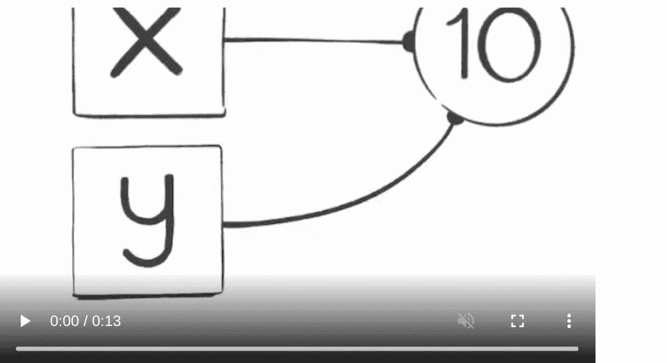

- 将值 `0` 赋给 `x`。
  - 将 `x` 线指向值 `0`。

这三行代码运行后，变量 `x` 指向值 `0`，变量 `y` 指向值 `10`。

**请注意，`y = x` 并不意味着将 `y` 指向 `x`。我们不能将变量相互指向！变量总是指向值。** 当我们看到赋值时，我们“询问”右侧的值，并将左侧的“线”指向*那个值*。

我在*心智模型*中提到，人们常把变量想象成盒子。但我们正在构建的宇宙将没有任何盒子。**它只有线！**

这可能看起来有点烦人，但使用“线”能让我们更轻松地解释许多其他概念，比如严格相等性、对象同一性和可变性。我们会坚持使用“线”，所以你现在不妨开始习惯它们！

> > 我们的宇宙充满了线。

### 回顾

- **原始值是不可变的。** 它们是我们 JavaScript 宇宙中永久的一部分——我们无法创建、销毁或更改它们。例如，我们无法在字符串值上设置属性，因为它是一个原始值。数组*不是*原始值，所以我们*可以*设置它们的属性。
- **变量不是值。** 每个变量*指向*一个特定的值。我们可以使用 `=` 赋值运算符来改变它指向*哪个*值。
- **变量就像线。** “线”不是一个 JavaScript 概念——但它帮助我们想象变量如何指向值。当我们进行赋值时，左边总有一条线，右边是一个表达式（产生一个值）。
- **注意矛盾。** 如果你学到的两件事似乎相互矛盾，不要气馁。通常，这是一个信号，表明底下潜藏着更深层的真理。
- **语言很重要。** 我们正在构建一个心智模型，以便我们能对我们宇宙中*可以*或*不可以*发生的事情充满信心。我们可能会用随意的方式谈论这些想法（吹毛求疵往往适得其反），但我们对术语背后含义的理解需要精确。

### 练习

本模块还有供你练习的习题！

**不要跳过它们！**

即使你可能熟悉变量的概念，这些练习将帮助你巩固我们正在构建的心智模型。在进入更复杂的主题之前，我们需要这个基础。

### 阅读完毕？

将此集标记为已学习以跟踪进度。

标记为已学习

## 下一步

# 去测验 →

## 从内部研究

在下一个模块中，我们将更深入地观察我们的 JavaScript 宇宙及其内部的值。但在开始之前，我们需要解决房间里的大象。*我们的 JavaScript 宇宙真实存在吗？*

## JavaScript 模拟

我生活在我们 JavaScript 宇宙中我的小星球上。

当我向我们的宇宙提出一个问题时，它会用一个值来回答。我当然没有自己想出所有这些值。变量、表达式、值——它们填充了我们的世界。我周围的 JavaScript 世界对我来说绝对是真实的。

但有时，在下一行代码之前会有一刻沉默；在下一次函数调用之前会有短暂的停顿。在那些时刻，我看到了一个比我们的 JavaScript 宇宙大得多的世界的景象。

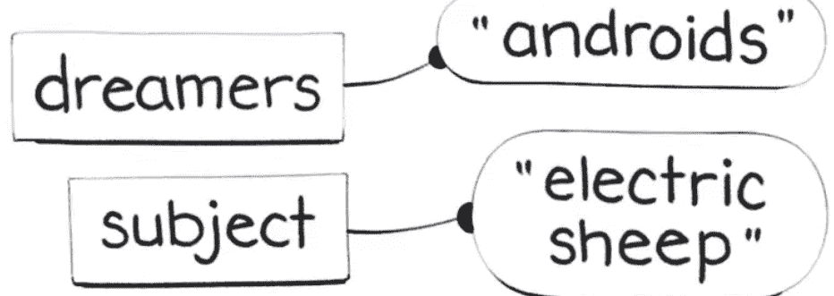


在这些景象中，没有变量和值；没有表达式和字面量。相反，有夸克。有原子和电子。有水和生命。也许你也熟悉这个宇宙？

在那里，被称为“人类”的有感知生物使用被称为“计算机”的特殊机器来模拟*我们的* JavaScript 宇宙。有些人这样做是为了娱乐。有些人这样做是为了盈利。有些人这样做根本没有原因。随着他们的心血来潮，我们整个宇宙一天之内被创造和销毁万亿次。

*也许我们的 JavaScript 宇宙并非那么真实。*

知道这一点，我们可以用两种方式来研究我们的世界。

## 从外部研究

研究我们 JavaScript 宇宙的一种方式是*从外部研究它*。

我们可能会关注对我们世界的一个模拟——一个 JavaScript 引擎——是“如何”真正工作的。例如，我们可能会了解到，这串文本——*我们世界中的一个值*——是存储在硅芯片内的一系列字节。

这种方法将我们的注意力集中在人和计算机的物理世界上。我们的方法则不同。

## 从内部研究

我们将*从内部*研究我们的世界。将你的精神传送到 JavaScript 宇宙，站到我身边。我们将像物理宇宙中的物理学家一样，观察我们宇宙的规律并进行实验。

**我们将学习我们的 JavaScript 世界，而不去思考它是如何实现的。这类似于一位物理学家讨论恒星的性质，而不去质疑*物理*世界是否真实。这无关紧要！无论我们研究的是物理宇宙还是 JavaScript 宇宙，我们都可以用它们自己的术语来描述它们。**

我们的心智模型不会试图解释一个值在计算机内存中是如何表示的。答案总是在变！甚至在你程序运行时，答案也会改变。如果你听过一个简单的解释，关于 JavaScript 在内存中“真正”如何表示数字、字符串或对象，那很可能是错的。

对我们来说，每个字符串都是一个值——不是“指针”或“内存地址”——而是一个值。**在我们的宇宙中，值就足够了。** 不要让“内存单元”和其他底层比喻分散你构建精确的 JavaScript 高层心智模型的注意力。反正，这就像乌龟驮着乌龟一样，没完没了！

如果你来自一门更底层的语言，请抛开你对“按引用传递”、“在栈上分配”、“写时复制”等等的直觉。这些关于计算机如何工作的模型，常常让人更难对 JavaScript 中*可以*或*不可以*发生什么充满信心。我们会看一些底层细节，但只在真正重要的地方。它们可以作为我们心智模型的补充，而不是其基础。

**我们心智模型的基石是值。** 每个值都属于一种类型。原始值是不可变的。我们可以通过称为变量的“线”来指向值。这个基石——这种对值的理解——将帮助我们继续构建我们的心智模型。

至于那些奇怪的景象，我不再想那么多了。我有线要指，有问题要问。我最好开始工作吧！

当我仰望星空，星星很明亮。

当我眨眼，它们还在那里吗？

我耸耸肩。

*“实现细节。”*


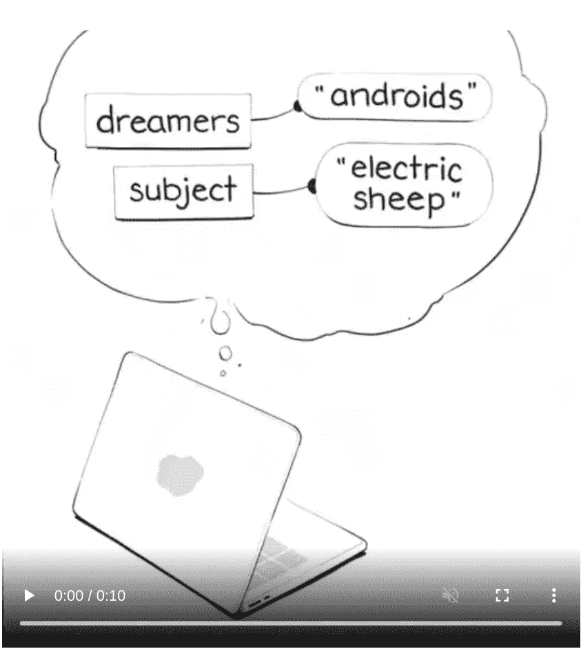

### 阅读完毕？

将此集标记为已学习以跟踪进度。

标记为已学习

## 下一步

# 认识原始值 →

# 认识原始值

到目前为止，我们一直在从我们星球的表面观察我们的 JavaScript 宇宙。我们已经从远处熟悉了填充我们宇宙的值，但在这个模块中，我们将改变这一点。我们将乘坐飞船去探索，认识我们 JavaScript 宇宙中的每一个值。

花时间详细观察每个值可能感觉不必要，但只有当你清楚地看到它们是两个*不同*的苹果时，你才能说有“两个苹果”。区分值与值是理解 JavaScript 中*相等性*的关键——这将是我们的下一个主题。

我们的飞船将引导我们穿越 JavaScript 的“天球”，去认识不同的值。我们将首先认识原始值：布尔值、数字、字符串等等。之后，我们会认识对象和函数。就把它当作一次观光旅行吧。

## 未定义

我们将从**未定义（Undefined）**类型开始我们的旅程。这是一个非常简单的起点，因为**这种类型只有一个值——`undefined`**。

```javascript
console.log(typeof(undefined)); // "undefined"
```

它被称为"未定义"，所以你可能认为它不存在——但它确实是一个值，一个非常真实的值！就像一个黑洞，`undefined`脾气不好，经常可能带来麻烦。例如，从它读取属性会破坏你的程序：

```javascript
let person = undefined;
console.log(person.mood); // TypeError!
```

哦，好吧。幸运的是，在整个 JavaScript 宇宙中只有一个`undefined`。你可能想知道：它为什么存在？在 JavaScript 中，它代表一种*无意间*缺失的值的概念。

你可以在自己的代码中通过写`undefined`来使用它——就像你写`2`或`"hello"`一样。然而，`undefined`也常常"自然出现"。它在一些 JavaScript 不知道你想要什么值的情况中出现。例如，如果你忘记给变量赋值，它将指向`undefined`：

```javascript
let bandersnatch;
console.log(bandersnatch); // undefined
```

然后你可以将它指向另一个值，或者如果你愿意，再次指向`undefined`。

不要过分纠结于它的名字。很容易将`undefined`想象成某种变量状态，例如"这个变量尚未定义"。但这是一种完全误导的思考方式！事实上，如果你读取一个*确实*未定义（或在`let`声明之前）的变量，你会得到一个错误：

```javascript
console.log(jabberwocky); // ReferenceError!
let jabberwocky;
```

这与 undefined 无关。

实际上，`undefined`是一个普通的原始值，就像 2 或"hello"一样。

请小心处理它。

## 空值

我们旅程的下一站是**空值（Null）**。你可以将`null`看作`undefined`的姊妹；**这种类型也只有一个值**——`null`。它的行为与 undefined 非常相似。例如，当你试图访问它的属性时，它也会出问题：

```javascript
let mimsy = null;
console.log(mimsy.mood); // TypeError!
```

### 有趣的事实

**`null`**是其自身类型的唯一值。**然而**，**`null`**也是一个**骗子**。由于 JavaScript 中的一个[缺陷](https://developer.mozilla.org/en-US/docs/Web/JavaScript/Reference/Global_Objects/null)，它假装自己是一个对象：

```javascript
console.log(typeof(null)); // "object" (一个谎言！)
```

你可能认为这意味着**`null`**是一个对象。不要掉入这个陷阱！它是一个原始值，它的行为在任何方面都不像一个对象。

不幸的是，**`typeof(null)`**是一个我们必须永远承受的历史偶然。

在实践中，**`null`**用于*有意*缺失的值。为什么要有**`null`**和**`undefined`**两者？这可以帮助你区分编码错误（可能导致**`undefined`**）和有效的缺失数据（你可能用**`null`**表示）。然而，这只是一个约定，JavaScript 并不强制这种用法。有些人尽可能避免使用它们两者！

我不怪他们。

## 布尔值

接下来在我们的旅程中，我们将遇到布尔值！就像白天和黑夜，或者开和关一样，只有两个布尔值：**`true`**和**`false`**。

```javascript
console.log(typeof(true)); // "boolean"
console.log(typeof(false)); // "boolean"
```

我们可以用它们执行逻辑操作：

```javascript
let isSad = true;
let isHappy = !isSad; // 取反
let isFeeling = isSad || isHappy; // 是否至少有一个为真？
let isConfusing = isSad && isHappy; // 是否两个都为真？
```

在继续我们 JavaScript 宇宙之旅之前，让我们检查一下我们的思维模型。使用下面的草稿本或一张纸，画出上述代码行的变量（记住把它们想象成导线）和值。

#### 答案

在你完成草稿之前不要揭示。

首先，验证**isHappy**指向**true**，**isConfusing**指向**false**。（如果你得到了不同的答案，那么在某个地方有错误——逐步检查每一行。）

接下来，验证**你的草稿上只有一个 true 和一个 false 值**。这很重要！无论布尔值在内存中如何存储，在我们的思维模型中只有两个。

## 数字

到目前为止，我们已经认识了四个值：`null`、`undefined`、`true`和`false`。

抓紧了，因为我们要在我们的思维模型中再增加 18,446,744,073,709,551,616 个值！

我当然指的是数字：

```javascript
console.log(typeof(28)); // "number"
console.log(typeof(3.14)); // "number"
console.log(typeof(-140)); // "number"
```

一开始，数字可能看起来很普通，但让我们更好地了解它们！

### 计算机的数学

JavaScript 数字的行为与普通数学数字并不完全相同。这里有一个代码片段可以证明：

```javascript
console.log(0.1 + 0.2 === 0.3); // false
console.log(0.1 + 0.2 === 0.30000000000000004); // true
```

这看起来可能非常令人惊讶！与普遍看法相反，这并不意味着 JavaScript 数字坏了。这种行为在不同编程语言中很常见。它甚至有一个名字：*浮点数运算*。

你看，JavaScript 没有实现我们现实生活中使用的数学。浮点数运算是"计算机的数学"。不要太担心这个名字或它具体如何工作。很少有人知道它的所有微妙之处，而这正是重点！在实践中它工作得足够好，以至于大多数时候你不会去想它。不过，让我们快速看看是什么让它有所不同。

### 颜色和数字

你是否曾经用扫描仪将实体照片或文档转换成数字的？这个类比可以帮助我们理解 JavaScript 数字。

扫描仪通常最多能区分 1600 万种颜色。如果你用红色蜡笔画一幅画并扫描它，扫描出来的图像应该也是红色的——但它会是从那 1600 万种颜色中挑选出最接近的红色。所以，如果你有两支颜色略有不同的红色蜡笔，扫描仪可能被骗，认为它们的颜色完全相同！

> 我们可以说扫描仪使用的是*有限精度*的颜色。

浮点数运算也是类似的。在真正的数学中，数字有无限集。但在浮点数运算中，**只有 18,446,744,073,709,551,616 个数字。** 所以当我们编写数字或用它们进行计算时，JavaScript 会选择它所知道的*最接近*的数字——就像扫描仪处理颜色一样。

> 换句话说，JavaScript 使用的是*有限精度*的数字。

我们可以在一个轴上想象所有的 JavaScript 数字。离`0`越近，数字的精度越高，它们彼此"坐"得越近：

这是因为在我们的程序中，相对较小的数字出现得更频繁，我们通常希望它们是精确的。

当我们从`0`向任一方向移动时，我们开始失去精度。在某个点上，即使两个最接近的 JavaScript 数字之间的间隔也比`1`大：

```javascript
console.log(Number.MAX_SAFE_INTEGER);     // 9007199254740991
console.log(Number.MAX_SAFE_INTEGER + 1); // 9007199254740992
console.log(Number.MAX_SAFE_INTEGER + 2); // 9007199254740992 (再次！)
console.log(Number.MAX_SAFE_INTEGER + 3); // 9007199254740994
console.log(Number.MAX_SAFE_INTEGER + 4); // 9007199254740996
console.log(Number.MAX_SAFE_INTEGER + 5); // 9007199254740996 (再次！)
```

幸运的是，`Number.MIN_SAFE_INTEGER`和`Number.MAX_SAFE_INTEGER`之间的任何**整数**都是精确的。这就是为什么`10 + 20 === 30`。

但当我们写`0.1`或`0.2`时，我们得到的并不是*精确的*`0.1`和`0.2`。我们得到的是 JavaScript 中最接近的可用数字。它们几乎完全相同，但可能存在微小的差异。这些微小的差异累积起来，这就是为什么`0.1 + 0.2`不给我们一个与写`0.3`完全相同的数字。

如果这仍然令人困惑，别担心。你可以[了解更多关于浮点数数学的知识](http://learn more about floating-point math)，但你已经知道的比我开始写这本指南时要多了！除非你从事金融应用开发，否则你可能不需要担心这个。

### 特殊数字

值得注意的是，浮点数运算包括几个*特殊数字*。你可能会偶尔遇到`NaN`、`Infinity`、`-Infinity`和`-0`。它们的存在是因为有时你可能会执行像`1 / 0`这样的运算，JavaScript 需要以某种方式表示它们的结果。浮点数运算标准指定了它们如何工作，以及使用它们时会发生什么。

以下是你的代码中可能出现特殊数字的情况：

```javascript
let scale = 0;

let a = 1 / scale; // Infinity
let b = 0 / scale; // NaN
let c = -a; // -Infinity
let d = 1 / c; // -0
```

在这些特殊数字中，`NaN` 尤为有趣。`NaN` 是 `0 / 0` 以及其他一些无效数学运算的结果，它代表“非数字”。

你可能会困惑为什么它声称自己是一个数字：

```
console.log(typeof(NaN)); // "number"
```

然而，这里并没有什么花招。从 JavaScript 的角度来看，`NaN` *是*一个数值。它不是 null、undefined、字符串或其他类型。但在浮点数数学中，这个术语的*名称*是["not a number"](# "not a number")。所以它*确实*是一个数值。它恰好被称为“非数字”是因为它代表一个无效的结果。

编写代码时使用这些特殊数字并不常见。然而，它们可能因编码错误而出现。所以了解它们的存在是有好处的。

## BigInts（大整型）

如果说数字扩展了我们的 JavaScript 宇宙，那么我们下一站要游览的 BigInts（大整型）将真正让我们忙于探索。事实上，我们可以永远探索它们！

普通数字无法精确表示大整数，因此 BigInts [填补了这个空白](# "fill that gap")（字面意思）。在我们的宇宙中有多少个 BigInts？规范说它们具有*任意精度*。这意味着**在我们的 JavaScript 宇宙中，有无限多个 BigInts——每一个都对应数学中的一个整数。**

如果这听起来很奇怪，可以想想你已经习惯了数学中有无限多个整数这个概念。（如果你还不习惯，花点时间想想！）那么从“数学宇宙”到“JavaScript 宇宙”也就不是什么大跳跃了。

（从那里，我们可以直接前往 [百事可乐宇宙](https://www.youtube.com/watch?v=dQw4w9WgXcQ)。）

你可以看到这里展示了任意精度的概念：

```
let alot = 9007199254740991n; // 末尾的 n 使其成为一个 BigInt！
console.log(alot + 1n); // 9007199254740992n
console.log(alot + 2n); // 9007199254740993n
console.log(alot + 3n); // 9007199254740994n
console.log(alot + 4n); // 9007199254740995n
console.log(alot + 5n); // 9007199254740996n
```

没有任何四舍五入的诡异操作！BigInts 非常适合需要高精度的金融计算。

但请记住，天下没有免费的午餐。处理*真正*巨大的数字可能需要时间和资源——我们无法将所有可能的 BigInts 都装入计算机内存。如果我们尝试，最终会导致崩溃或死机。但从概念上讲，我们可以永远游览我们的 JavaScript 宇宙，却永远无法遍历每一个 BigInt。

BigInts 是最近才被添加到 JavaScript 中的，所以你不会看到它们被广泛使用，而且如果你使用旧版浏览器，它们将无法工作。

## Strings（字符串）

我们的下一站是 Strings（字符串），它在 JavaScript 中表示文本。有三种编写字符串的方式（单引号、双引号和反引号），但它们指的是同一个概念。这三种字符串字面量产生相同的字符串值：

```
console.log(typeof("こんにちは")); // "string"
console.log(typeof('こんにちは')); // "string"
console.log(typeof(`こんにちは`)); // "string"
```

空字符串也是一个字符串：

```
console.log(typeof('')); // "string"
```

### 字符串不是对象

所有字符串都有一些内置属性。

```
let cat = 'Cheshire';
console.log(cat.length); // 8
console.log(cat[0]); // "C"
console.log(cat[1]); // "h"
```

这并不意味着字符串是对象！字符串属性是特殊的，其行为与对象属性不同。例如，你不能给 `cat[0]` 赋予任何值。字符串是原始值，而所有原始值都是不可变的。

### 每一个可想象字符串都有对应的值

**在我们的宇宙中，每一个可想象的字符串都有一个独特的值。** 是的，这包括你祖母的娘家名、你十年前用化名发表的同人小说，以及尚未写成的《黑客帝国5》的剧本。

当然，所有可能的字符串在字面上不可能都装入计算机内存芯片。但是每一个可能字符串的*概念*可以装入你的大脑。我们的 JavaScript 宇宙是为人服务的模型，而不是为计算机！

这可能会引发一个问题。这段代码是*创建*了一个字符串吗？

```javascript
// 在你的控制台中试试
let answer = prompt('Enter your name');
console.log(answer); // ?
```

还是它仅仅是*召唤*了我们宇宙中一个已经存在的字符串？

这个问题的答案取决于我们是“从外部”还是“从内部”研究 JavaScript。

*在外部*，我们的心理模型之外，答案取决于具体实现。字符串是表示为单个内存块、多个块，还是像[绳索](https://en.wikipedia.org/wiki/Rope_(data_structure))这样的特殊数据结构，这取决于 JavaScript 引擎。

但正如我们在 [从内部研究](#从内部研究) 中所讨论的，我们已经同意像生活在 JavaScript 宇宙内部一样谈论它。我们不会做出无法从内部——通过运行一些代码——验证的陈述。

字符串是已经“存在”还是被“创建”的问题，是我们无法从代码中测试的。*在我们的心理模型内部*，这个问题没有意义。我们无法设计实验来确定字符串在我们的 JavaScript 宇宙中是“被创建”还是“被召唤”。

为了保持我们的心理模型简单，我们将说**所有可想象的字符串值从一开始就存在——每一个不同的字符串对应一个值**。

## Symbols（符号）

我们已经探索了不少我们的 JavaScript 宇宙，但在第一部分游览中还有一个（简短的）站点：Symbols（符号）。

```
let alohomora = Symbol();
console.log(typeof(alohomora)); // "symbol"
```

了解 Symbols 的存在很重要，但如果不深入了解对象和属性，很难解释它们的作用和行为。Symbols 的作用类似于门钥匙：它们让你可以将一些信息隐藏在对象内部，并控制代码的哪些部分可以访问它。它们也相对稀少，所以在我们这次宇宙游览中，我们将跳过它们。抱歉了，symbols！

# 未完待续

现在我们已经认识了所有的原始值，我们将从游览中稍作休息。让我们回顾一下目前遇到的原始值！

- **Undefined（未定义）**
- **Null（空值）**
- **Booleans（布尔值）**
- **Numbers（数字）**
- **BigInts（大整型）**
- **Strings（字符串）**
- **Symbols（符号）**

我们还了解了一些关于 JavaScript 数字的有趣事实：

- **并非所有数字都能在 JavaScript 中完美表示。** 它们的小数部分在靠近 0 时提供更高的精度，离 0 越远精度越低。
- **来自无效数学运算（如 1 / 0 或 0 / 0）的数字是特殊的。** NaN 就是其中之一。它们可能因编码错误而出现。
- **typeof(NaN) 是一个数字，因为 NaN 是一个数值。** 它被称为“非数字”是因为它代表了一个“无效”数字的*概念*。

我们将通过认识非原始值——具体来说是对象和函数——来继续我们的观光之旅。

### 练习

本模块也为你准备了练习题！

**不要跳过它们！**

尽管你可能已经熟悉原始值的概念，但这些练习将帮助你巩固我们正在构建的心理模型。我们需要这个基础，然后才能进入更复杂的主题。

### 阅读完毕？

将本集标记为已学习以跟踪你的进度。

标记为已学习

## 下一步

## 测试一下 →

# 认识对象和函数

话不多说，让我们继续探索我们的 JavaScript 宇宙！

在上一模块中，我们了解了原始值：Undefined（未定义）、Null（空值）、Booleans（布尔值）、Numbers（数字）、BigInts（大整型）和 Strings（字符串）。现在我们将认识非原始值——这些类型让我们*能够创建自己的值*。

## 对象

终于，我们来到了对象！

这包括数组、日期、正则表达式和其他非原始值：

```
console.log(typeof({})); // "object"
console.log(typeof([])); // "object"
console.log(typeof(new Date())); // "object"
console.log(typeof(/\d+/)); // "object"
console.log(typeof(Math)); // "object"
```

与之前的所有内容不同，对象*不是*原始值。这也意味着默认情况下它们是可变的（我们可以改变它们）。我们可以使用 `.` 或 `[]` 来访问它们的属性：

```
let rapper = { name: 'Malicious' };
rapper.name = 'Malice'; // 点表示法
rapper['name'] = 'No Malice'; // 方括号表示法
```

### 创建我们自己的对象

对象有一件事特别令人兴奋和独特。**我们可以创建更多的对象！我们可以用自己创建的对象来填充我们的JavaScript宇宙。**

在我们的心智模型中，我们讨论过的所有原始值——`null`、`undefined`、布尔值、数字和字符串——都“一直存在”。我们无法创建一个新的字符串或一个新的数字，我们只能“召唤”那个值：

```javascript
let sisters = 3;
let musketeers = 3;
```

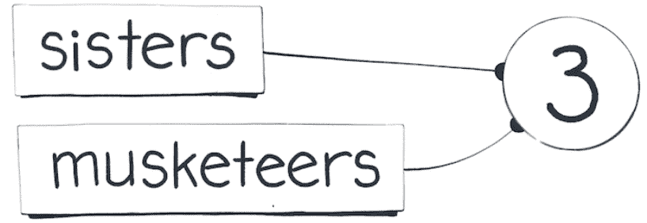

对象的不同之处在于我们*可以*创建更多的对象。**每次我们使用`{}`对象字面量，我们都在*创建*一个全新的对象值：**

```javascript
let shrek = {};
let donkey = {};
```

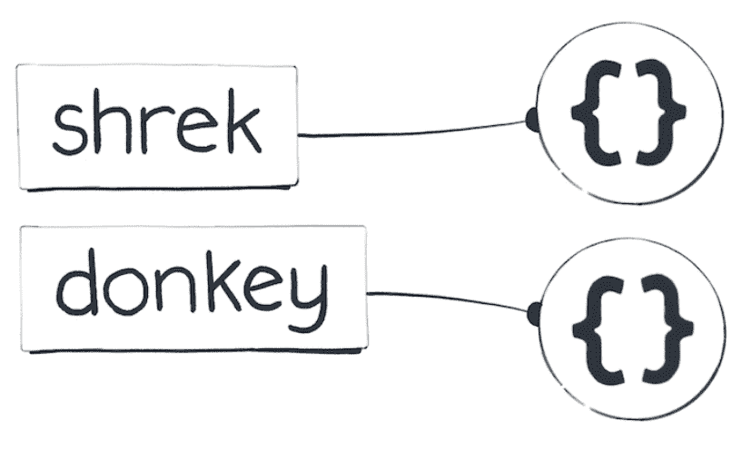

数组、日期和任何其他对象也是如此。例如，`[]`数组字面量会*创建*一个新的数组值——一个以前从未存在过的值。

### 对象会消失吗？

你可能会想：对象会消失吗，还是会永远存在？JavaScript的设计方式使得我们无法从代码内部判断这一点。例如，我们无法*销毁*一个对象：

```javascript
let junk = {};
junk = null; // 不一定会销毁一个对象
```

相反，JavaScript是一种垃圾回收语言。

这意味着，尽管我们不能销毁一个对象，但如果无法从我们的代码中通过连线找到它，它*可能*最终会“消失”。


JavaScript并不保证*何时*会发生垃圾回收。

除非你试图找出为什么一个应用程序使用了太多内存，否则你不需要经常考虑垃圾回收。我在这里提到它只是为了让你知道我们可以创建对象——但我们不能销毁它们。

> 在我们的宇宙中，对象和函数最接近我们的代码。这提醒我们，我们可以操纵它们，甚至可以创建更多的它们。

## 函数

我们已经到达了这次旅程的最后一站！

将函数视为与我的代码分离的值，这特别奇怪。毕竟，它们*是*我的代码。或者不是吗？

### 函数是值

我们定义函数是为了以后可以调用它们并运行其中的代码。然而，要真正理解JavaScript中的函数，我们需要暂时忘记它们*为什么*有用。相反，我们将把函数视为另一种值：一个数字，一个对象，*一个函数*。

为了理解函数，我们将把它们与数字和对象进行比较。

首先，考虑这个`for`循环，它运行`console.log(2)`七次：

```javascript
for (let i = 0; i < 7; i++) {
  console.log(2);
}
```

它向`console.log`传递了多少个不同的值？要回答这个问题，让我们回顾一下当我们写下`2`时它的含义。它是一个数字字面量。字面量是一个表达式——一个对我们宇宙的问题。在我们的宇宙中，每个数字只有一个值，所以它通过每次“召唤”数字`2`的相同值来“回答”我们的问题。**所以答案是一个值。** 我们将看到七次日志——但我们在每次调用中传递的是相同的值。

现在让我们简要回顾一下对象。

这是另一个`for`循环，它运行`console.log({})`七次：

```javascript
for (let i = 0; i < 7; i++) {
  console.log({});
}
```

现在它向`console.log`传递了多少个不同的值？在这里，`{}`也是一个字面量——只不过它是一个*对象字面量*。正如我们刚刚学到的，我们的JavaScript宇宙不会通过召唤任何东西来“回答”一个对象字面量。相反，它*创建*一个新的对象值——这将是`{}`对象字面量的结果。**所以上面的代码创建并记录了七个完全不同的对象值。**

好好想想这一点。

现在来看看函数。

```javascript
for (let i = 0; i < 7; i++) {
  console.log(function() {});
}
```

这段代码向`console.log`传递了多少个不同的值？

> # 答案
>
> 答案是**七个不同的函数值**。在你确定答案之前不要看答案。

每当我们执行一行包含函数表达式的代码时，我们宇宙中就会出现一个全新的函数值。


在这里，**`function() {}`**也是一个表达式。与任何表达式一样，函数表达式是向我们的JavaScript宇宙提出的一个“问题”——**宇宙通过每次我们提问时都*创建*一个新的函数值来“回答”我们。** 这与**`{}`**执行时创建一个新的对象值非常相似。函数就像对象！

从技术上讲，函数在JavaScript中*就是*对象。我们将继续将它们视为一种独立的基本类型，因为它们与常规对象相比具有独特的能力。但总的来说，如果你能对一个对象做某事，你也可以对函数做同样的事情。它们是非常特殊的对象。

### 调用函数

这段代码打印什么？

```javascript
let countDwarves = function() { return 7; };
let dwarves = countDwarves;
console.log(dwarves);
```

你可能认为它打印**7**，特别是如果你没有仔细看的话。

现在在控制台中检查这个代码片段！它打印的确切内容取决于浏览器，但你会在那里看到*函数本身*而不是数字**7**。

如果你遵循我们的心智模型，这个行为应该是有意义的：

1. 首先，我们使用`function() { }`表达式创建了一个新的函数值，并将`countDwarves`变量指向这个值。
2. 接下来，我们将`dwarves`变量指向`countDwarves`指向的值——也就是同一个函数值。
3. 最后，我们记录了`dwarves`当前指向的值。

*我们从未调用过我们的函数！*

结果，`countDwarves`和`dwarves`都指向同一个值，这个值恰好是一个函数。看，*函数是值*。我们可以将变量指向它们，就像我们可以对数字或对象做的那样。

**当然，如果我们想`调用`一个函数，我们也可以这样做：**

```javascript
let countDwarves = function() { return 7; };
let dwarves = countDwarves(); // () 是一个函数调用
console.log(dwarves);
```

请注意，`let`声明和`=`赋值都与我们的函数调用无关。是`()`执行了函数调用——并且只有它！

**添加`()`改变了我们代码的含义：**

- `let dwarves = countDwarves` 意味着“将`dwarves`指向`countDwarves`当前指向的值。”
- `let dwarves = countDwarves()` 意味着“将`dwarves`指向由`countDwarves`当前指向的函数*返回*的值。”

事实上，`countDwarves()`也是一个表达式。它被称为*调用表达式*。为了“回答”一个调用表达式，JavaScript运行我们函数内的代码，并将返回值作为结果交给我们（在这个例子中，是`7`）。

### 总结

这真是一段奇妙的旅程！在过去的两个模块中，我们已经探讨了JavaScript中的每一种值类型。让我们回顾一下我们遇到的每种值类型，从不同的原始类型开始：

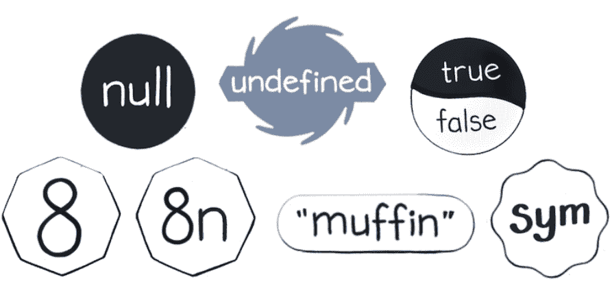

- Undefined
- Null
- Booleans
- Numbers
- BigInts
- Strings
- Symbols

然后，是下面的特殊类型，它们允许我们*创建自己的值*：

- Objects
- Functions

参观JavaScript不同的“天球”很有趣。既然我们已经介绍了所有的值，我们也学习了它们彼此*区别*于何处。

原始值（字符串、数字等），我们在旅程的第一部分遇到过，它们在我们的宇宙中一直存在。**例如，写下`2`或`"hello"`总是会“召唤”相同的数字或字符串值。对象和函数的行为不同，允许我们生成自己的值。写下`{}`或`function() {}`总是会*创建*一个全新的、不同的值。** 这个想法对于理解JavaScript中的相等性至关重要，这将是我们的下一个主题。

### 练习

这个模块也有供你练习的练习！

**不要跳过它们！**

即使你可能熟悉对象和函数的概念，这些练习将帮助你巩固我们正在构建的心智模型。在我们能够进入更复杂的话题之前，我们需要这个基础。

### 阅读完毕？

将此章节标记为已学习以跟踪你的进度。

标记为已学习

### 来个小测验 →

# 值的相等性

是时候来谈谈 JavaScript 中的相等性了！以下是它为何如此重要。

想象一下参加一个面具嘉年华，而只有几种面具可供选择。一群穿着完全相同服装的人会开玩笑、跳舞并在房间里走动。这将会很混乱！你可能和两个人交谈，却没意识到你其实是在和同一个人说了两次话。或者你可能*以为*你只和一个人交谈了，但实际上你和两个不同的人交谈了！

**如果你对 JavaScript 中的相等性没有清晰的心智模型，那么每一天都像一场嘉年华——而且不是什么好事。** 你永远无法完全确定你是在处理同一个值，还是两个不同的值。因此，你经常会犯错——比如修改了一个你本不打算修改的值。

幸运的是，我们已经完成了建立 JavaScript 相等性概念的大部分工作。它非常自然地融入了我们的心智模型。

## 相等性的种类

在 JavaScript 中，有几种相等性。如果你已经写了一段时间 JavaScript，你可能至少熟悉其中两种：

- **严格相等：** `a === b`（三重等于）。
- **宽松相等：** `a == b`（双重等于）。
- **同值相等：** `Object.is(a, b)`。

大多数教程根本没有提到*同值相等*。我们将走一条少有人走的路，先解释它。然后我们可以用它来解释其他类型的相等性。

## 同值相等： `Object.is(a, b)`

在 JavaScript 中，`Object.is(a, b)` 告诉我们 `a` 和 `b` 是否是相同的值：

```
console.log(Object.is(2, 2)); // true
console.log(Object.is({}, {})); // false
```

这被称为**同值相等**。

> **有趣的事实**
>
> 尽管方法名中包含 `Object`，但 `Object.is` 并非对象专用。它可以比较任何两个值，无论它们是否是对象！

在我们的心智模型中，“相同值”到底是什么意思？你可能已经凭直觉知道了这一点，但让我们来验证一下你的理解。

### 检验你的直觉

考虑我们之前练习中的这个例子：

```
let dwarves = 7;
let continents = '7';
let worldWonders = 3 + 4;
```

提醒一下，这段代码的示意图是这样的：

现在试着**使用上面的图表**回答这些问题：

```
console.log(Object.is(dwarves, continents)); // ?
console.log(Object.is(continents, worldWonders)); // ?
console.log(Object.is(worldWonders, dwarves)); // ?
```

写下你的答案，并思考你将*如何*解释它们。

#### 答案

1. `Object.is(dwarves, continents)` 是 `false`，因为 `dwarves` 和 `continents` 指向不同的值。
2. `Object.is(continents, worldWonders)` 是 `false`，因为 `continents` 和 `worldWonders` 指向不同的值。
3. `Object.is(worldWonders, dwarves)` 是 `true`，因为 `worldWonders` 和 `dwarves` 指向相同的值。

> 如果两个值在我们图示中用一个形状表示，这意味着它们实际上不是两个不同的值。它们是同一个值！在这些情况下，`Object.is(a, b)` 返回 `true`。

在上一个模块中，我们探索了 JavaScript 宇宙中的值的类型。在了解这些值的过程中，我们学习了是什么使它们彼此不同。因此，我们也学习了相反的一点——值相同意味着什么。

如果你对这个概念感到困惑，你可能想重新审视我们关于值的“天体之旅”并再次完成练习。我保证，它会变得有意义的！

### 但是对象怎么办呢？

至此，你可能在担心对象。你可能听说过相等性不适用于对象，或者它比较的是“引用”。**如果你有这些现有的直觉，请暂时把它们完全放在一边。**

相反，看看这段代码：

```
let banana = {};
let cherry = banana;
let chocolate = cherry;
cherry = {};
```

打开一个记事本或使用下面的草稿本，画一个变量和值的图表。你最好一步一步地画，因为很难在头脑中完成。

记住 `{}` 总是意味着“创建一个新的对象值”。同时，记住 `=` 意味着“将左侧的线指向右侧的值”。

**在你画完之后**，写下这些问题的答案：

```
console.log(Object.is(banana, cherry)); // ?
console.log(Object.is(cherry, chocolate)); // ?
console.log(Object.is(chocolate, banana)); // ?
```

确保**使用你的图表**来回答它们。

#### 答案

```
let banana = {};
let cherry = banana;
let chocolate = cherry;
cherry = {};
```

1. `let banana = {};`
   - 声明一个 `banana` 变量。
   - 创建一个新的对象值 `{}`。
   - 将 `banana` 线指向它。
2. `let cherry = banana;`
   - 声明一个 `cherry` 变量。
   - 将 `cherry` 线指向 `banana` 所指向的位置。
3. `let chocolate = cherry;`
   - 然后，我们声明一个 `chocolate` 变量。
   - 将 `chocolate` 线指向 `cherry` 所指向的位置。
4. `cherry = {};`
   - 创建一个新的对象值 `{}`。
   - 将 `cherry` 线指向它。

完成最后一步后，你的图表应该如下所示：

现在让我们检查你的答案：

1. `Object.is(banana, cherry)` 是 `false`，因为 `banana` 和 `cherry` 指向不同的值。
2. `Object.is(cherry, chocolate)` 是 `false`，因为 `cherry` 和 `chocolate` 指向不同的值。
3. `Object.is(chocolate, banana)` 是 `true`，因为 `chocolate` 和 `banana` 指向相同的值。

如你所见，我们不需要任何额外的概念来解释**同值相等**是如何应用于对象的。它使用我们的心智模型自然地出现。这就是需要知道的全部内容！

## 严格相等： a === b

你可能之前已经使用过**严格相等**运算符：

```
console.log(2 === 2); // true
console.log({} === {}); // false
```

还有一个对应的反运算符 `!==`。

### 同值相等 vs. 严格相等

那么 `Object.is` 和 `===` 之间有什么区别呢？

**同值相等** —— `Object.is(a, b)` —— 在我们的心智模型中有直接的含义。它对应于我们宇宙中“同一个值”的概念。

在几乎所有情况下，**严格值相等**适用相同的直觉。例如，`2 === 2` 是 `true`，因为 `2` 总是“召唤”相同的值：

```
console.log( 2 === 2 )
```

反过来，`{} === {}` 是 `false`，因为每个 `{}` *创建*一个不同的值：

```
console.log( {} === {} )
```

在上面的例子中，`a === b` 的行为与 `Object.is(a, b)` 相同。然而，有**两个罕见的情况**下 `===` 的行为不同。

还记得你学习英语时记忆不规则动词的情况吗？下面的情况类似——**将它们视为规则的例外**。

这两种特殊情况都涉及我们过去讨论过的“特殊数字”：

1. `NaN === NaN` 是 `false`，尽管它们是相同的值。
2. `-0 === 0` 和 `0 === -0` 是 `true`，尽管它们是不同的值。

这些情况不常见，但我们仍然会仔细研究它们。

### 第一个特殊情况： `NaN`

正如我们在值的天体之旅中看到的，`NaN` 是一个特殊的数字，当我们进行无效的数学运算（如 `0 / 0`）时会出现：

```
let width = 0 / 0; // NaN
```

使用 `NaN` 进行进一步的计算会再次给你 `NaN`：

```
let height = width * 2; // NaN
```

你可能不会故意这样做，但如果你的数据或计算有缺陷，它可能会发生。

**记住** `NaN === NaN` **总是** `false`：

```
console.log(width === height); // false
```

然而，`NaN` 和 `NaN` 是*相同*的值：

```
console.log(Object.is(width, height)); // true
```

这令人困惑。

`NaN === NaN` 为 `false` 的原因在很大程度上是历史性的，所以我建议接受它作为一个事实。如果你尝试编写一些检查值是否为 `NaN` 的代码（例如，打印警告），你可能会遇到这个问题。

```
function resizeImage(size) {
  if (size === NaN) {
    // 这永远不会被记录：检查总是为假！
    console.log('Something is wrong.');
  }
  // ...
}
```

相反，以下是几种检查 `size` 是否为 `NaN` 的方法（它们都有效！）：

- `Number.isNaN(size)`
- `Object.is(size, NaN)`
- `size !== size`

最后一个可能特别令人惊讶。花点时间思考一下。如果你看不出它如何检测 `NaN`，请重新阅读本节并再次思考。

> **答案**
>
> 在你找出答案或思考几分钟之前不要查看。
>
> 我们已经知道 `NaN` 不等于自身（`NaN !== NaN` 为真）。所以反过来（`NaN !== NaN`）也一定是 `true`。
>
> 由于 `NaN` 是唯一不等于自身的值，`size !== size` 只能意味着 `size` 是 `NaN`。

### 有趣的事实

一个简短的历史轶事：确保开发者能用这种方式检测 `NaN`，正是最初让 `NaN === NaN` 返回 `false` 的原因之一！这个决定甚至是在 JavaScript 诞生之前做出的。

### 第二个特殊情况：`-0`

在常规数学中，不存在“负零”的概念，但在浮点数数学中，出于实际原因，它确实存在。这里有一个关于它的有趣事实。

`0 === -0` 和 `-0 === 0` 的结果总是 `true`：

```javascript
let width = 0; // 0
let height = -width; // -0
console.log(width === height); // true
```

然而，`0` 和 `-0` 是*不同*的值：

```javascript
console.log(Object.is(width, height)); // false
```

*这也挺令人困惑的。*

实际上，在我整个职业生涯中，还没遇到过需要关心这种情况的案例。

### 编码练习

现在你知道了 `Object.is` 和 `===` 的工作原理，我给你准备了一个小的编码练习。你不一定要完成它，但这是一个有趣的脑筋急转弯。

编写一个名为 `strictEquals(a, b)` 的函数，使其返回值与 `a === b` 相同。你的实现**不能**使用 `===` 或 `!==` 运算符。

如果你想核对答案，这里是我的[参考答案](my_answer)。这个函数完全没用，但编写它有助于理解 `===` 的本质。

### 别慌

听到这些特殊数字以及它们的行为方式可能会让人不知所措。不要对这些特殊情况过度担忧！

它们并不常见。既然你知道了它们的存在，将来在实践中就能认出它们。在大多数情况下，对于 `Object.is(a, b)` 和 `a === b`，我们都可以相信我们的“相等直觉”。

## 宽松相等

最后，我们来看看最后一种相等性。

宽松相等（双等号）是 JavaScript 的“梦魇”。这里有几个让你“头皮发麻”的例子：

```javascript
console.log([[]] == ''); // true
console.log(true == [1]); // true
console.log(false == [0]); // true
```

等等，什么？！

宽松相等（也称为“抽象相等”）的规则深奥难懂。许多编码规范完全禁止在代码中使用 `==` 和 `!=`。

尽管《Just JavaScript》对你应该或不应该使用哪些功能不持强烈立场，但我们不会详细讨论宽松相等。它在现代代码库中不常见，并且其规则在语言中——或在我们的思维模型中——并不扮演重要角色。

### 有趣的事实

宽松相等的规则被广泛认为是 JavaScript 早期一个糟糕的设计决策，但如果你仍然好奇，可以查看[这里的工作原理](https://developer.mozilla.org/en-US/docs/Web/JavaScript/Reference/Operators/Equality)。别有压力去记住它——你需要把记忆力用在其他主题上！

一个相对常见且值得了解的用法是：

```javascript
if (x == null) {
  // ...
}
```

这段代码等同于：

```javascript
if (x === null || x === undefined) {
  // ...
}
```

然而，即使是 `==` 的这种用法，在某些团队中也可能引起争议。在使用之前，最好与团队讨论一下在你们的代码库中 `==` 的可接受程度。

### 总结

- JavaScript 有几种相等性。它们包括**同值相等**、**严格相等**和**宽松相等**。
- **同值相等**，即 `Object.is(a, b)`，与我们在上一模块中介绍的*值的同一性*概念相匹配。
- 理解这种相等性有助于预防错误！你通常需要知道你是在处理同一个值，还是两个不同的值。
- 当我们绘制值和变量的示意图时，*同一个值*不能出现两次。当变量 `a` 和 `b` 在示意图上指向同一个值时，`Object.is(a, b)` 的结果是 `true`。
- **同值相等**写起来冗长且有点烦人，但它也最容易解释，这就是我们从它开始的原因。
- 实践中，你会最常使用**严格相等**，即 `a === b`。除了两个罕见的特殊情况，它等同于**同值相等**：
  - `NaN === NaN` 是 `false`，即使它们是同一个值。
  - `0 === -0` 和 `-0 === 0` 是 `true`，但它们是不同的值。
- 你可以使用 `Number.isNaN(x)` 来检查 `x` 是否是 `NaN`。
- **宽松相等** (`==`) 使用一套深奥的规则，通常被避免使用。

### 练习

本模块也有练习题让你实践！

**别跳过它们！**

即使你可能已经熟悉相等性的概念，这些练习将帮助你巩固我们正在构建的思维模型。在进入更复杂的主题之前，我们需要这个基础。

### 阅读完毕？

将此章节标记为已学习以跟踪进度。

标记为已学

接下来

### 测验 →

# 属性

认识一下夏洛克·福尔摩斯，一位来自伦敦的世界著名侦探：

```javascript
let sherlock = {
    surname: 'Holmes',
    address: { city: 'London' }
};
```

他的朋友，约翰·华生，最近搬了进来：

```javascript
let john = {
    surname: 'Watson',
    address: sherlock.address
};
```

夏洛克是位才华横溢的侦探，但也是个难相处的室友。一天，约翰决定受够了——他改了姓并搬到了马里布：

```javascript
john.surname = 'Lennon';
john.address.city = 'Malibu';
```

来个小练习。**写下你对这些问题的答案：**


```javascript
console.log(sherlock.surname); // ?
console.log(sherlock.address.city); // ?
console.log(john.surname); // ?
console.log(john.address.city); // ?
```

在重新阅读代码之前，我希望你用一种特定的方式来处理这些问题。拿个草稿本或者纸笔，**画出你心中每一行代码执行过程的心理模型**。如果你不确定*如何*表示它也没关系。我们还没讨论过这些话题，所以尽你所能猜测一下。


然后，在你最终草图的帮助下，回答上面的四个问题。

#### 答案

现在，在你写出四个问题的答案之前，先不要看这里。

这不是笔误——它们就是最终的地址。想要摆脱夏洛克可没那么容易！如果心理模型不准确，可能会有人得出结论认为 `sherlock.address.city` 是 "London"——但事实并非如此。

要理解为什么，我们需要学习在我们的 JavaScript 宇宙中，属性是如何工作的。

### 属性

我们之前讨论过对象。例如，这里有一个 `sherlock` 变量指向一个对象值。我们可以通过写 `{}` 来创建一个新的对象值：

```javascript
let sherlock = {};
```

在我们的宇宙中，它可能看起来像这样：


然而，对象主要用于将相关数据*分组*在一起。例如，我们可能想将关于夏洛克的不同事实分组：

```javascript
let sherlock = {
  surname: 'Holmes',
  age: 64,
};
```

这里，`sherlock` 仍然是一个变量，但 `surname` 和 `age` 不是。它们是*属性*。与变量不同，属性*属于*特定的对象。

**在我们的 JavaScript 宇宙中，变量和属性都像“导线”。**

然而，属性的导线*起始于* *对象*，而不是我们的代码：

这里，我们可以看到 `sherlock` **变量**指向我们创建的一个对象。该对象有两个**属性**。它的 `surname` 属性指向字符串值 `"Holmes"`，它的 `age` 属性指向数字值 `64`。

重要的是，属性不*包含*值——它们*指向*值！记住我们的宇宙充满了导线。有些从我们的代码（变量）开始，有些从对象（属性）开始。所有的导线总是指向值。

在阅读本文之前，你可能想象值是“存储”在对象“内部”的，因为它们在代码中出现在“内部”。这种直觉常常导致错误，所以我们将改为“用导线思考”。再看一遍代码和示意图。在继续之前，确保你理解了它们。

### 读取属性

我们可以使用“点号表示法”来读取属性的当前值：

```javascript
console.log(sherlock.age); // 64
```

这里，`sherlock.age` 是我们的老朋友，一个表达式——向我们的 JavaScript 宇宙提出的一个问题。为了回答它，JavaScript 首先沿着 `sherlock` 导线：


它指向一个对象。从该对象出发，JavaScript 沿着 `age` 属性。

我们对象的 `age` 属性指向 `64`，所以 `sherlock.age` 的结果是 `64`。

### 属性名

命名属性时需要记住的一件重要事情是，单个对象不能有两个同名的属性。例如，我们的对象不能有两个名为 `age` 的属性。

属性名也始终区分大小写！例如，从 JavaScript 的角度来看，`age` 和 `Age` 将是两个完全不同的属性。

如果我们事先不知道属性名，但它在代码中是以字符串值的形式存在的，我们可以使用 `[]` "括号表示法" 从对象中读取它：

```javascript
let sherlock = { surname: 'Holmes', age: 64 };
let propertyName = prompt('What do you want to know?');
alert(sherlock[propertyName]); // Read property by its name
```

在浏览器控制台中试运行这段代码，当提示时输入 `age`。

### 赋值给属性

当我们向一个属性*赋值*时，会发生什么？

```javascript
sherlock.age = 65;
```

让我们将这段代码分成由 `=` 分隔的左右两部分。

**首先，我们确定左边是哪根线：`sherlock.age`。**

我们沿着 `sherlock` 这根线，然后找到 `age` 属性线：

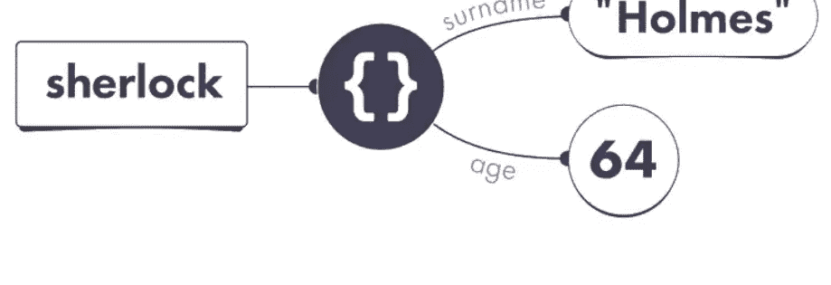


请注意，我们没有*沿着* `age` 这根线找到 `64`。我们不关心它的当前值是多少。在赋值语句的左侧，我们寻找的是**线本身**。

记住我们选的是哪根线了吗？继续。

**接下来，我们确定右边的值是多少：** `65`。

与左侧不同，赋值语句的右侧总是表示一个*值*。在这个例子中，右侧的值是数字值 `65`。让我们召唤它：

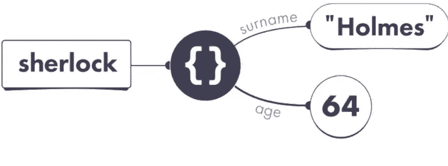


现在我们准备好执行赋值了。

**最后，我们将左侧的线指向右侧的值：**


我们就完成了！从现在开始，读取 **sherlock.age** 将会得到 **65**。

### 缺失的属性

你可能会好奇，如果我们读取一个不存在的属性会发生什么：

```javascript
let sherlock = { surname: 'Holmes', age: 64 };
console.log(sherlock.boat); // ?
```

我们知道 **sherlock.boat** 是一个属性表达式，但我们的 JavaScript 宇宙是如何决定用哪个值来“回答”我们的呢？

**JavaScript 使用一套看起来像这样的规则：**

1. 计算点（ **.** ）前面部分的值。
2. 如果那个值是 **null** 或 **undefined**，立即抛出一个错误。
3. 检查我们的对象上是否存在具有该名称的属性：
   a. 如果**存在**，则返回此属性指向的值。
   b. 如果**不存在**，则返回 **undefined** 值。

这些规则有所简化，但它们已经告诉了我们很多关于 JavaScript 工作原理的信息！例如，**sherlock** 指向一个对象，该对象**没有**一个 **boat** 属性。所以 **sherlock.boat** 给我们一个 **undefined** 作为答案：

```javascript
let sherlock = { surname: 'Holmes', age: 64 };
console.log(sherlock.boat); // undefined
```

请注意，**这并不意味着**我们的对象有一个指向 `undefined` 的 `boat` 属性！它只有两个属性，没有一个叫做 **boat**：

很容易认为 `sherlock.boat` 直接对应于我们心理模型中的属性概念，但**这并不完全正确**。它是一个*问题*——因此 JavaScript *遵循规则*来回答它。

它查看 `sherlock` 指向的对象，看到它**没有** `boat` 属性，并返回 `undefined` 值，因为**这就是规则的约定**。没有更深层的原因：计算机遵循规则。

> ## 趣味事实
>
> 根本上，这是因为每个表达式都需要产生*某个*值，或者抛出错误。一些其他语言在访问不存在的属性时会抛出错误——但 JavaScript 不是其中之一！

向上滚动并重新阅读这些规则。你能将它们付诸实践吗？

```javascript
let sherlock = { surname: 'Holmes', age: 64 };
console.log(sherlock.boat.name); // ?
```

如果我们运行这段代码会发生什么？**不要猜测——遵循规则。**

提示：这里有两个点，所以你需要遵循两次规则。

#### 答案

在完成书写之前不要揭示。

答案是 `sherlock.boat` 会显示一个错误：

1. 我们首先需要确定 `sherlock.boat` 的值。
   1. 为此，我们需要确定 `sherlock` 的值。
      1. `sherlock` 变量指向一个对象。
      2. 因此，`sherlock` 的值就是那个对象。
   2. 一个对象既不是 `null` 也不是 `undefined`，所以我们继续。
   3. 那个对象没有 `boat` 属性。
   4. 因此，`sherlock.boat` 的值是 `undefined`。
2. 我们在点（`.`）的左侧得到了 `undefined`。
3. 规则说，在左侧是 `null` 或 `undefined` 就是一个错误。

如果这仍然令人困惑，请向上滚动并机械地遵循这些规则。

### 回顾

1. 属性是线——有点像变量。它们都指向值。与变量不同，属性在我们的宇宙中**始于对象**。
2. 属性属于特定的对象。一个对象不能有多个同名属性。
3. 通常，你可以分三步执行赋值：
   1. 确定左边是哪根线。
   2. 确定右边的值是多少。
   3. 将那根线指向那个值。
4. 像 `obj.property` 这样的表达式分三步计算：
   1. 查看点（`.`）左侧的值（`obj`）。
   2. 如果那个值是 `null` 或 `undefined`，则抛出一个错误。
   3. 否则，查看那个值（它是一个对象）。
   4. 找到点（`.`）右侧具有该名称的属性（`property`）。
   5. 如果该属性不存在，返回 `undefined`。否则，返回该属性的值。
5. 确定左边的值是多少。
6. 如果是 `null` 或 `undefined`，抛出一个错误。
7. 如果该属性存在，结果就是它指向的值。如果该属性不存在，结果就是 `undefined`。

请注意，这个属性的心理模型仍然有些简化。目前它已经足够好了，但随着你对 JavaScript 宇宙了解的增多，它将需要扩展。

如果你被开头的夏洛克·福尔摩斯示例搞糊涂了，试着用我们新的心理模型，专注于属性是线，再次梳理一遍。下一个模块将包含详细的演练，以防你仍然不太确定为什么它会这样工作。

### 练习

本模块也有练习供你练习！

**不要跳过它们！**

即使你可能熟悉属性和赋值的概念，这些练习也将帮助你巩固我们正在构建的心理模型。在进入更复杂的主题之前，我们需要这个基础。

### 阅读完毕？

将此章节标记为已学习以跟踪你的进度。

**接下来**

**参加测验** →

## 变异

在前面关于*属性*的模块中，我们介绍了夏洛克·福尔摩斯搬到马里布的谜团，但我们还没有解释它。

**这次，我们将逐步讲解代码并一起绘制我们的图表**，这样你就可以检查你的心理模型。

### 第 1 步：声明 **sherlock** 变量

我们从这个变量声明开始：

```javascript
let sherlock = {
  surname: 'Holmes',
  address: { city: 'London' }
};
```

现在绘制此步骤的图表：


#### 答案

你的图表 在你绘制图表之前不要揭示。

有一个 **sherlock** 变量指向一个对象。该对象有两个属性。它的 **surname** 属性指向 "**Holmes**" 字符串值。它的 **address** 属性指向另一个对象。那个另一个对象只有一个名为 **city** 的属性。该属性指向 "**London**" 字符串值。

仔细观察我绘制此图表的过程：

### 没有嵌套对象

注意，我们这里不是一个，而是*两个完全独立*的对象。两对花括号意味着两个对象。

**对象在代码中可能看起来是“嵌套”的，但在我们的宇宙中，每个对象都是完全独立的。一个对象不能在另一个对象“内部”！** 如果你一直在想象嵌套对象，现在是时候改变你的心理模型了。

### 第 2 步：声明 `john` 变量

在这一步，我们声明另一个变量：

```javascript
let john = {
  surname: 'Watson',
  address: sherlock.address
};
```

编辑你之前绘制的图表以反映这些更改。

加载之前的草稿

### 回答

你的补充：**在画出图示前不要透露。**

现在有一个新的 `john` 变量指向一个包含两个属性的对象：

1. 它的 `address` 属性指向 `sherlock.address` 已经指向的同一个对象。
2. 它的 `surname` 属性指向 `"Watson"` 字符串值。

更详细地看看我的过程：

你是否有任何不同的做法？

### 属性总是指向值

当你看到 `address: sherlock.address` 时，很容易误以为 John 的 `address` 属性指向 Sherlock 的 `address` 属性。

这是误导性的。

> **记住：一个属性总是指向一个值！它不能指向另一个属性或一个变量。总的来说，我们宇宙中的所有连线都指向值。**

当我们看到 `address: sherlock.address` 时，我们必须先弄清楚 `sherlock.address` 的值，然后将 John 的 `address` 属性连线指向*那个值*。

**重要的是值本身（即先前用 `{ city: 'London' }` 创建的对象），而不是我们如何找到它**（`sherlock.address`）。

结果是，现在有两个不同的 `address` 属性指向同一个对象。你能在图上找出它们两个吗？

### 步骤 3：更改属性

现在——如果你还记得我们示例的上一步——John 产生了身份认同危机，厌倦了伦敦的毛毛雨。他决定改名并搬到马里布。我们通过设置几个属性来完成这个操作：

```javascript
john.surname = 'Lennon';
john.address.city = 'Malibu';
```

我们如何修改图示来反映这一点？

加载先前的草图

### 回答

你的图示... **在画出图示前不要透露。**

John 的 `surname` 属性... **透露** "Lennon" 字符串值。

更有趣的是，两个 `address` 属性所指向的那个对象已经发生了变化。它的 `city` 属性现在指向 "Malibu" 字符串值。

在一个地点劫持的奇怪案例中，Sherlock 和 John 最终都到了马里布。根据图示追踪连线并验证这一点：

这是我上一系列更改的过程：

```javascript
john.surname = 'Lennon';
john.address.city = 'Malibu';
```

> 我们先弄清楚连线，然后是值，并将连线指向那个值。

现在结果应该说得通了，但这个例子在更深层次上令人困惑。它的*错误*在哪里？我们实际上该如何修改代码，才能让 John 独自搬到马里布？为了理解这一点，我们需要谈谈变更。

### 变更

*变更*（Mutation）是“改变”的一种花哨说法。

**例如，我们可以说我们*改变*了一个对象的属性，或者我们可以说我们*变更*了那个对象（及其属性）。这是同一回事。**

人们喜欢说“变更”，因为这个词带有一种不祥的意味。它提醒你要格外小心。这并不意味着变更是“坏的”——这只是编程而已！——但你需要非常慎重地对待它。

让我们回顾一下最初的任务。我们想给 John 一个不同的姓氏，并把他搬到马里布。现在让我们看看我们的两次变更：

```javascript
// 步骤 3：更改属性
john.surname = 'Lennon';
john.address.city = 'Malibu';
```

这里被变更的是*哪些*对象？

第一行变更了 `john` 指向的对象。这很合理：我们*打算*改变 John 的姓氏。那个对象代表 John 的数据，所以我们变更了它的 `surname` 属性。

然而，第二行做的事情完全不同。它没有变更 `john` 指向的对象，而是变更了一个完全不同的对象——那个我们可以通过 `john.address` 访问到的对象。而如果我们看图示，就会知道我们可以通过 `sherlock.address` 访问到同一个对象！

通过变更程序中其他地方使用的对象，我们造成了混乱。

> ### 趣味事实
>
> 这就是为什么把对象想象成“嵌套”的想法如此错误！它让我们忘记了可能有多个对象指向我们所更改的那个对象。

### 可能的解决方案：变更另一个对象

一种修复方法是避免变更共享数据：

```javascript
// 用这段代码替换步骤 3：
john.surname = 'Lennon';
john.address = { city: 'Malibu' };
```

第二行的差异很细微，但非常重要。

使用 `john.address.city = "Malibu"` 时，我们变更了 `john.address` 指向的对象的 `city` 属性。因为 `john.address` 和 `sherlock.address` 指向同一个对象，所以我们无意中变更了共享数据。

使用 `john.address = { city: 'Malibu' }` 时，我们变更了 `john` 指向的对象的 `address` 属性。换句话说，*我们只变更了代表 John 数据的那个对象*。这就是为什么 `sherlock.address.city` 保持不变。

如你所见，视觉上相似的代码可能产生非常不同的结果。*务必注意那些连线！*

### 替代方案：不变更对象

还有另一种方法可以让 `john.address.city` 返回 "Malibu"，而 `sherlock.address.city` 继续返回 "London"：

```javascript
// 用这段代码替换步骤 3：
john = {
  surname: 'Lennon',
  address: { city: 'Malibu' }
};
```

在这里，我们完全没有变更 John 的对象。相反，我们将 `john` 变量*重新赋值*，使其指向 John 数据的“新版本”。从现在起，`john` 指向一个不同的对象，该对象的 `address` 也指向一个全新的对象。

你可能注意到现在我们的图示上有一个“被遗弃”的旧版 John 对象。我们不必担心它。如果没有连线指向它，JavaScript 最终会自动将其从内存中移除。

请注意，这两种方法都满足了我们所有的要求：

- `console.log(sherlock.surname);` // "Sherlock"
- `console.log(sherlock.address.city);` // "London"
- `console.log(john.surname);` // "Lennon"
- `console.log(john.address.city);` // "Malibu"

比较它们的图示。你个人更偏好哪种修复方式？在你看来，它们各有什么优缺点？

### 向 Sherlock 学习

夏洛克·福尔摩斯曾说过：“排除了所有不可能之后，剩下的无论多么不可思议，都必定是真相。”

随着你的心智模型变得更加完整，你会发现调试问题变得更容易，因为你知道该寻找哪些可能的原因。

例如，如果你知道运行某些代码后 `sherlock.address.city` 发生了变化，我们图示中的连线提供了三种解释：

1. 也许 `sherlock` 变量被重新赋值了。
2. 也许我们通过 `sherlock` 可以访问到的对象被变更了，并且它的 `address` 属性被设置成了别的值。
3. 也许我们通过 `sherlock.address` 可以访问到的对象被变更了，并且它的 `city` 属性被设置成了别的值。

你的心智模型为你提供了一个调查 bug 的起点。**反过来也适用。** 有时，你可以断定某段代码*不是*问题的根源——因为心智模型证明了这一点！

比如说，如果我们把 `john` 变量指向一个不同的对象，我们就可以相当确定 `sherlock.address.city` 不会改变。我们的图示显示，改变 `john` 连线不会影响任何从 `sherlock` 出来的连线。

尽管如此，请记住，除非你是夏洛克·福尔摩斯，否则你很少能对某事*完全*自信。这种方法的效果[不亚于](https://www.jamesforgety.com/2013/0/28/only-as-good-as-your-mental-model/)你的心智模型！心智模型将帮助你提出理论，但你需要用 `console.log` 或调试器来验证它们。

### Let 与 Const

值得注意的是，你可以使用 `const` 关键字作为 `let` 的替代：

```javascript
const shrek = { species: 'ogre' };
```

`const` 关键字允许你创建只读变量——也称为*常量*。一旦我们声明了一个常量，就不能将其指向另一个值：

```javascript
shrek = fiona; // TypeError
```

但这里有一个关键的细微差别。**我们仍然可以变更我们的连线所指向的*对象*：**

```javascript
shrek.species = 'human';
console.log(shrek.species); // 'human'
```

在这个例子中，只有 `shrek` *变量连线本身*是只读的（`const`）。它指向一个对象——而*那个*对象的属性是可以被变更的！

`const` 的实用性是一个热门争论话题。有些人倾向于完全禁止 `let`，总是使用 `const`。另一些人则认为程序员应该被信任，可以自己重新赋值变量。无论你的偏好如何，请记住 `const` 阻止的是变量重新赋值——而不是对象变更。

### 变更是坏的吗？

别一走了之就认为变更是“坏的”。这是一种懒惰的过度简化，会掩盖真正的理解。如果数据随时间变化，那么在*某处*就发生了变更。问题是，*什么*应该被变更，在*哪里*，以及*何时*？

变更是“诡异的超距作用”。更改 `john.address.city` 导致 `console.log(sherlock.address.city)` 打印出了其他内容。

**当你变更一个对象时，变量和属性可能已经指向它了。你的变更会影响任何后来“沿着”这些连线执行的代码。**

这既是福也是祸。变更使得更改一些数据并立即在整个程序中“看到”变化变得很容易。然而，不受约束的变更使得预测程序的行为变得更加困难。

有一种观点认为，变更应严格限制在应用程序的一个非常狭窄的层级中。根据这种哲学，这样做的好处是程序的行为更可预测。其缺点是，你必须编写更多代码来“传递数据”并避免变更。

值得注意的是，变更你刚刚创建的*新*对象总是可以的，因为此时还没有其他引用指向它们。在其他情况下，我建议你非常审慎地决定何时以及变更什么。你依赖变更的程度取决于你的应用程序架构。

### 回顾

- 在我们的宇宙中，对象从不是“嵌套”的——请密切关注引用。
- 更改对象的属性也称为*变更*该对象。
- 如果你变更了一个对象，你的代码将通过任何指向该对象的引用“看到”该变化。有时，这可能是你想要的结果。然而，意外变更共享数据可能导致错误。
- 你可以使用 `const` 而不是 `let` 来声明变量。这允许你强制该变量始终指向同一个值。但请记住，`const` *并不能*阻止对象变更！
- 在代码中变更你刚刚创建的对象是安全的。总的来说，你使用变更的频率取决于你的应用程序架构。

### 练习

本模块也包含供你练习的习题！

**不要跳过它们！**

即使你可能已经熟悉变更的概念，这些练习将有助于巩固我们正在构建的心智模型。在进入更复杂的话题之前，我们需要这个基础。

### 读完了？

将此章节标记为已学习以跟踪你的进度。


**接下来**

#### 参与测验 →

## 原型

在前面的模块中，我们涵盖了对象属性和变更，但我们还没完全结束——我们还需要讨论原型！

这里有一个小谜题来检验我们的心智模型：

```javascript
let pizza = {};
console.log(pizza.taste); // "pineapple"
```

问问自己：这可能吗？

我们刚刚用 `{}` 创建了一个空对象。在记录日志之前，我们肯定没有设置任何属性，所以看起来 `pizza.taste` 不可能指向 "pineapple"。我们原本期望 `pizza.taste` 会返回 `undefined`——当属性不存在时，我们通常会得到 `undefined`，对吧？

然而，`pizza.taste` 完全有可能是 "pineapple"！这可能是一个人为设计的例子，但它表明我们的心智模型是不完整的。

在本模块中，我们将介绍*原型*。原型解释了这个谜题中发生的事情——更重要的是，它们是其他几个 JavaScript 基础特性的核心。有时人们会因为原型看起来太不寻常而忽略学习它们，但其核心思想其实非常简单。

## 原型

这里有几个变量指向几个对象：

```javascript
let human = {
  teeth: 32
};

let gwen = {
  age: 19
};
```

我们可以用熟悉的方式直观地表示它们：

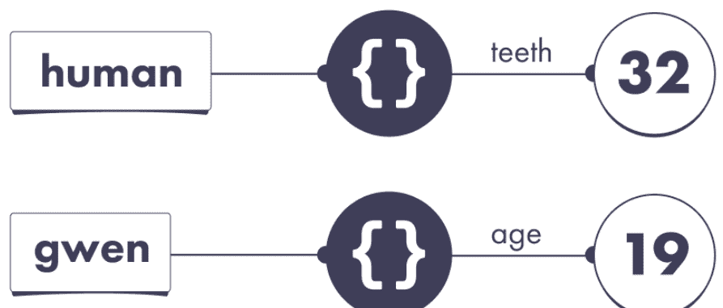

在这个例子中，`gwen` 指向一个没有 `teeth` 属性的对象。根据我们学过的规则，记录这个属性会得到 `undefined`：

```javascript
console.log(gwen.teeth); // undefined
```

但故事不必到此结束。JavaScript 的默认行为是返回 `undefined`，但我们可以指示它在另一个对象上继续查找缺失的属性。我们只需一行代码就能做到：

```javascript
let human = {
  teeth: 32
};

let gwen = {
  // 我们添加了这行：
  __proto__: human,
  age: 19
};
```

那个神秘的 `__proto__` 属性是什么？

它代表了 JavaScript 中的*原型*概念。任何 JavaScript 对象都可以选择另一个对象作为其原型。我们将讨论这在实践中意味着什么，但现在，让我们把它想象成一条特殊的 `__proto__` 引用：

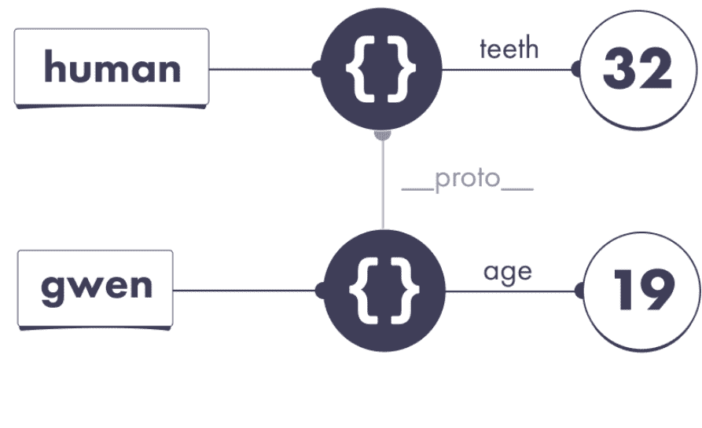

花点时间验证图表是否与代码匹配。我们像过去一样绘制它。唯一的新东西是那条神秘的 `__proto__` 引用。

通过指定 `__proto__`（也称为我们对象的*原型*），我们指示 JavaScript 在该对象上继续查找缺失的属性。

### 原型实战

当我们查找 `gwen.teeth` 时，得到 `undefined` 是因为 `gwen` 指向的对象上没有 `teeth` 属性。

但多亏了 `__proto__: human`，结果不同了：

```javascript
let human = {
  teeth: 32
};

let gwen = {
  __proto__: human,
  age: 19
};

console.log(gwen.teeth); // 32
```

现在步骤序列如下所示：

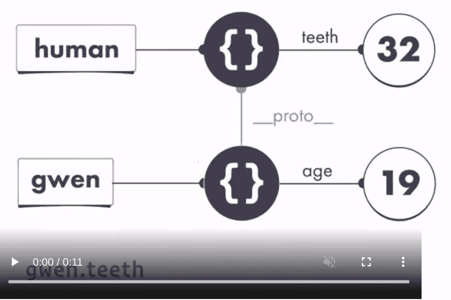

1. 沿着 `gwen` 引用。它指向一个对象。
2. 这个对象有 `teeth` 属性吗？
   - 没有。
   - **但它有一个原型。** 让我们检查一下。
3. *那个*对象有 `teeth` 属性吗？
   - 有，它指向 `32`。
   - 因此，`gwen.teeth` 的结果是 `32`。

这类似于说：“我不知道，但爱丽丝可能知道。”通过 `__proto__`，你指示 JavaScript “去问另一个对象。”

为了检查你目前的理解，请写下你的答案：

```javascript
let human = {
  teeth: 32
};

let gwen = {
  __proto__: human,
  age: 19
};

console.log(human.age); // ?
console.log(gwen.age); // ?

console.log(human.teeth); // ?
console.log(gwen.teeth); // ?

console.log(human.tail); // ?
console.log(gwen.tail); // ?
```

#### 答案

*现在，在你写出六个问题的答案之前，请不要查看*

`human` 变量指向一个没有 `age` 属性的对象，所以 `human.age` 是 `undefined`。`gwen` 变量指向一个确实有 `age` 属性的对象。那条引用指向 `19`，所以 `gwen.age` 的值是 `19`：

`human` 变量指向一个有 `teeth` 属性的对象，所以 `human.teeth` 的值是 `32`。`gwen` 变量指向一个没有 `teeth` 属性的对象。然而，那个对象有一个原型，原型确实有 `teeth` 属性。这就是为什么 `gwen.teeth` 的值也是 `32`。

我们的两个对象都没有 `tail` 属性，所以两者都得到 `undefined`：

请注意，尽管 `gwen.teeth` 的值是 `32`，但这并不意味着 `gwen` 有一个 `teeth` 属性！确实，在这个例子中，`gwen` 指向的对象*没有* `teeth` 属性。但它的原型对象——也就是 `human` 指向的那个——有。

这提醒我们，`gwen.teeth` 是一个*表达式*——一个向我们的 JavaScript 宇宙提出的问题——而 JavaScript 将遵循一系列步骤来回答它。现在我们知道这些步骤包括查看原型。

### 原型链

原型在 JavaScript 中并不是一个特殊的“东西”。原型更像是一种*关系*。一个对象可以指向另一个对象作为其原型。

这自然引出一个问题：但如果我的对象的原型有自己的原型呢？而那个原型又有*它自己的*原型？这行得通吗？

答案是肯定的——这*正是*它的工作方式！

```javascript
let mammal = {
    brainy: true,
};

let human = {
    __proto__: mammal,
    teeth: 32
};

let gwen = {
    __proto__: human,
    age: 19
};

console.log(gwen.brainy); // true
```

我们可以看到，JavaScript 会先在我们的对象上查找属性，然后在其原型上查找，接着在*那个*对象的原型上查找，依此类推。只有当我们耗尽了原型链而仍未找到属性时，才会得到 `undefined`。

这类似于说：“我不知道，但爱丽丝可能知道。”然后爱丽丝可能会说：“其实我也不知道——问问鲍勃吧。”最终，你要么找到答案，要么没有人可问了！

这个需要“访问”的对象序列被称为我们对象的*原型链*。（然而，与你可能佩戴的链条不同，原型链不能是循环的！）

### 遮蔽

考虑这个稍作修改的例子：

```javascript
let human = {
    teeth: 32
};

let gwen = {
    __proto__: human,
    // 这个对象有自己的 teeth 属性：
    teeth: 31
};
```

两个对象都定义了一个名为 `teeth` 的属性，所以结果不同：

```javascript
console.log(human.teeth); // 32
console.log(gwen.teeth); // 31
```

请注意 `gwen.teeth` 是 **31**。如果 `gwen` 没有自己的 `teeth` 属性，我们才会去查看原型。但因为 `gwen` 指向的对象有自己的 `teeth` 属性，我们不需要继续搜索答案了。

换句话说，一旦我们找到了属性，**我们就停止搜索**。

如果你想检查一个对象是否拥有名为 *自身的* 属性 `wire`，可以调用一个名为 `hasOwnProperty` 的内置函数。它对于"自有"属性返回 **true**，并且不会查看原型。在上一个例子中，两个对象都有自己的 `teeth` `wire`，所以对两者都是 **true**：

```javascript
console.log(human.hasOwnProperty('teeth')); // true
console.log(gwen.hasOwnProperty('teeth')); // true
```

### 赋值

考虑这个例子：

```javascript
let human = {
  teeth: 32
};

let gwen = {
  __proto__: human,
  // 注意：没有自己的 teeth 属性
};

gwen.teeth = 31;

console.log(human.teeth); // ?
console.log(gwen.teeth); // ?
```

在赋值之前，两个表达式的结果都是 `32`。

然后我们需要执行这个赋值：

```javascript
gwen.teeth = 31;
```

现在的问题是 `gwen.teeth` 对应的是哪个 `wire`？答案是，一般来说，赋值操作发生在对象自身上。

所以 `gwen.teeth = 31` 会在 `gwen` 指向的对象上创建一个名为 `teeth` 的新自有属性。它对原型没有任何影响：

结果是，`human.teeth` 仍然是 `32`，但 `gwen.teeth` 现在是 `31`：

```javascript
console.log(human.teeth); // 32
console.log(gwen.teeth); // 31
```

我们可以用一个简单的经验法则来总结这种行为。

当我们*读取*一个不存在于我们对象上的属性时，我们会沿着原型链继续查找。如果我们找不到，就会得到 `undefined`。

但当我们*写入*一个不存在于我们对象上的属性时，那会*创建*这个属性在我们的对象上。一般来说，原型*不会*发挥作用。

### 对象原型

这个对象没有原型，对吧？

```javascript
let obj = {};
```

在你的浏览器控制台里试试运行这个：

```javascript
let obj = {};
console.log(obj.__proto__); // 摆弄一下它！
```

令人惊讶的是，`obj.__proto__` 不是 `null` 也不是 `undefined`！相反，你会看到一个奇怪的对象，带有一堆属性，包括 `hasOwnProperty`。

我们将这个特殊对象称为对象原型：

起初，这可能有点颠覆认知。让它沉淀一下。一直以来，我们都认为 `{}` 创建了一个"空"对象，但它其实并不空！它有一个隐藏的 `__proto__` `wire`，默认指向对象原型。

这解释了为什么 JavaScript 对象似乎拥有"内置"属性：

```javascript
let human = {
  teeth: 32
};
console.log(human.hasOwnProperty); // (function)
console.log(human.toString); // (function)
```

这些"内置"属性不过是对象原型上的普通属性。因为我们的对象的原型是对象原型，所以我们可以访问它们。

### 没有原型的对象

我们刚刚了解到，所有用 `{}` 语法创建的对象都有一个特殊的 `__proto__` `wire`，指向一个默认的对象原型。但我们也知道可以自定义 `__proto__`。你可能想知道：我们能把它设置为 `null` 吗？

```javascript
let weirdo = {
  __proto__: null
};
```

答案是肯定的——这将产生一个真正没有原型的对象。因此，它甚至没有内置的对象方法：

```javascript
console.log(weirdo.hasOwnProperty); // undefined
console.log(weirdo.toString); // undefined
```

你可能不想创建这样的对象，然而对象原型正是如此——一个没有原型的对象。

### 污染原型

现在我们知道所有 JavaScript 对象默认获得相同的原型。让我们简要回顾一下关于突变的模块中的例子：

这张图片给了我们一个有趣的洞察。如果 JavaScript 在原型上查找缺失的属性，并且大多数对象共享同一个原型，我们能否通过突变那个原型，让新属性在所有对象上"出现"？

让我们添加这两行代码：

```javascript
let obj = {};
obj.__proto__.smell = 'banana';
```

我们通过向对象原型添加一个 `smell` 属性来突变它。结果是，两个侦探现在似乎都使用了香蕉味的香水：

```javascript
console.log(sherlock.smell); // "banana"
console.log(watson.smell); // "banana"
```

像我们刚才那样突变共享的原型称为*原型污染*。

过去，原型污染是扩展 JavaScript 添加自定义功能的流行方式。然而，多年来，网络社区意识到它很脆弱，并且使得添加新语言特性变得困难，所以我们倾向于避免它。

现在你可以解决本模块开头的菠萝披萨谜题了！在你的控制台中检查你的解决方案。


### 有趣的事实

**`__proto__`** vs. **`prototype`**

你可能想知道：**`prototype`** 属性到底是什么？你可能在 [MDN 文档](https://developer.mozilla.org)中见过它。

这背后的故事很混乱。在 JavaScript 添加 [类](https://developer.mozilla.org) 之前，通常将它们写成产生对象的函数，例如：

```javascript
function Donut() {
  return { shape: 'round' };
}

let donut = Donut();
```

你可能希望所有甜甜圈都共享一个带有某些共享方法的原型。然而，手动向每个对象添加 **`__proto__`** 看起来很丑陋：

```javascript
function Donut() {
  return { shape: 'round' };
}

let donutProto = {
  eat() {
    console.log('Nom nom nom');
  }
};

let donut1 = Donut();
donut1.__proto__ = donutProto;
let donut2 = Donut();
donut2.__proto__ = donutProto;

donut1.eat();
donut2.eat();
```

作为一个捷径，添加 **`.prototype`** 到函数本身，并在函数调用前添加 **`new`**，将自动附加 **`__proto__`**：

```javascript
function Donut() {
  return { shape: 'round' };
}
Donut.prototype = {
  eat() {
    console.log('Nom nom nom');
  }
};

let donut1 = new Donut(); // __proto__: Donut.prototype
let donut2 = new Donut(); // __proto__: Donut.prototype

donut1.eat();
donut2.eat();
```

现在这种模式大部分已经过时了，但你仍然可以在内置函数甚至类上看到 **prototype** 属性。总之，一个函数的 **prototype** 指定了用 **new** 关键字调用该函数创建的对象的 `__proto__`。

### 为什么这很重要？

在实践中，你可能不会在代码中直接使用原型。（事实上，甚至使用 `__proto__` 语法也是 [不被鼓励的](https://example.com/discouraged)。)

原型是不寻常的——大多数框架从未将它们作为一种范式来接受。尽管如此，你会注意到原型隐藏在其他 JavaScript 特性的"表面之下"。例如，人们经常使用原型来创建在其他编程语言中流行的传统的"类继承"模型。

这变得如此普遍，以至于 JavaScript 添加了类语法作为一种惯例，将原型"隐藏"起来。要看它的实际效果，请查看这个用 `__proto__` 重写的 JavaScript 类的[代码片段](https://example.com/snippet)以进行比较。

就我个人而言，我在日常编码中不经常使用类，也很少直接处理原型。然而，了解这些功能如何相互构建是有帮助的，并且了解当我读取或设置对象属性时会发生什么很重要。

### 回顾

- 当读取 `obj.something` 时，如果 `obj` 没有 `something` 属性，JavaScript 会查找 `obj.__proto__.something`。然后它会查找 `obj.__proto__.__proto__.something`，依此类推，直到它找到我们的属性或到达原型链的末端。
- 当写入 `obj.something` 时，JavaScript 通常会直接写入对象，而不是遍历原型链。
- 我们可以使用 `obj.hasOwnProperty('something')` 来确定我们的对象是否拥有名为 `something` 的自身属性。
- 我们可以通过突变一个被许多对象共享的原型来"污染"它。我们甚至可以对对象原型做这件事——`{}` 对象的默认原型！（但我们不应该这样做，除非我们想捉弄我们的同事。）
- 在实践中，你可能不会经常直接使用原型。然而，它们是 JavaScript 对象的基础，因此了解它们的底层机制很方便。一些高级 JavaScript 特性，包括类，都可以用原型来表达。

### 练习

这个模块也有供你练习的习题！

**不要跳过它们！**

即使你可能熟悉原型的概念，这些练习将帮助你巩固我们正在构建的心智模型。在我们能够进入更复杂的话题之前，我们需要这个基础。

### 阅读完成？

将本章节标记为已学习，以跟踪您的学习进度。

标记为已学习

**接下来**

#### 参与测验 →
