# JavaScript 开发者的 LangChain：如何将 LLM 集成到 JavaScript Web 应用中


# 1. 简介

# 1.1. 获取书籍更新和代码示例

要获取本书的最新版本，请通过电子邮件 [daniel@js-craft.io](mailto:daniel@js-craft.io) 订阅我们的邮件列表。我致力于让我的书保持与 LangChain 及其他库的最新版本同步。我定期更新代码和内容，因此请务必订阅以获取这些更新的通知。

如需访问所有已完成项目的完整源代码，或获取本书的 PDF 版本，请写信至 [daniel@js-craft.io](mailto:daniel@js-craft.io)。

# 1.2. 关于作者

你好，朋友！我是 Daniel，一名软件开发者和教育者。

我喜欢计算机。我努力让它们也喜欢我。比起计算机，我更喜欢人。我认为每个人都有价值、智慧和善良。我相信教育是构建一个更美好、更稳定、更富足世界的关键。

我曾在 Skillshare、Tradeshift 和 ING 等公司工作，在不同的团队中有机会接触完全不同类型的前端开发。

在过去的五年里，我一直在 [js-craft.io](https://js-craft.io) 上撰写关于 JavaScript、CSS 和其他软件开发主题的文章。

我一直很享受教学，既在课堂上也在线上授课，并参与科技教育初创公司。

你可以随时通过 [daniel@js-craft.io](mailto:daniel@js-craft.io) 联系我，并在 [https://www.js-craft.io/about/](https://www.js-craft.io/about/) 上了解更多关于我的信息。

你也可以在以下平台找到我：

- GitHub: [github.com/daniel-jscraft](https://github.com/daniel-jscraft)
- Twitter: [@js_craft_hq](https://twitter.com/js_craft_hq)
- Mastodon: [@daniel_js_craft](https://mastodon.social/@daniel_js_craft)
- YouTube: [@js-craftacademy6740](https://www.youtube.com/@js-craftacademy6740)

# 1.3. 本书的由来

我第一次编写计算机程序是在 26 年前，使用 Turbo Pascal。对于一个不会编程的人来说，这感觉就像在施展咒语。但我理解了咒语是如何编写的。If - then - else 语句、函数、变量。这就是你制造咒语的方式。

我再次有这种感觉是在 2022 年，当时一个朋友向我展示了 ChatGPT。这感觉像是一种神秘的魔法。但这一次，我并不是那个编写咒语的人。我并不真正理解那个“AI 东西”是如何制造的；你不能仅用我习惯的编程方式来创造它。

所以，我一头扎进了“学习 AI 工作原理”的兔子洞。哦天哪，这是一个很深的兔子洞。我试图从头开始理解这个东西。

我尝试从头构建和训练自己的模型。一段时间后，我唯一的实际项目是一个[纯 JavaScript 神经网络](https://purejavascriptneuralnetwork.com)。模型是从头编写的，可以被训练来检测手绘形状是否是数字。

过了一段时间后我放弃了。面对所有不同的架构、偏置神经元、训练数据集、反向传播或梯度下降，这对于我平庸的大脑来说太多了。AI 这个东西更具逻辑性，不那么神秘了，但我离能够实际应用新学到的知识还很远。

因此，我回到了我作为 Web 开发者的正常工作中。但在我的脑海深处，仍然有一种感觉，即我应该继续关注 AI。那里有些东西。

一段时间后，我正在收听优秀的 [Latent Space](https://latent.space) 播客的一集。我一直在关注该播客的联合创始人 [Swyx Swyx Wang](https://twitter.com/swyx)，从他谈论 React（JavaScript 框架，不是 ReAct 提示）的时候就开始了。

在那一集中，Swyx 提到了关于 LangChain 的一些事情。这个 LangChain 框架是为将 AI 模型与“传统”应用集成而打造的。我意识到，我并不完全理解数据库或操作系统的所有内部机制，但我正在使用它们。因此，我决定再给 AI 一次机会。但这一次是从更实际的角度。

读完一本书后，我现在可以说我热爱 LangChain，因为它教会了我关于大型语言模型（简称 LLM）工作原理的所有知识。这个框架的抽象、思维模型和用例将教会你很多关于 AI 模型以及如何将其与 JavaScript 驱动的应用结合使用的知识。

LangChain 可以被视为在 AI-Webapp 集成系统中连接几乎所有东西的编排器。这使它成为理解所有组件如何协同工作的绝佳入口。

那么，让我们开始学习吧！

# 1.4. 什么是 LangChain

LangChain 是一个旨在简化创建集成大型语言模型（简称 LLM）的应用程序的框架。

LangChain 在一个框架中提供了所有 AI 集成构建块。它提供了一个模块化、灵活且可扩展的架构，易于维护。

你可以将 LangChain 视为 AI 生态系统中几乎所有东西的粘合层。

通过学习 LangChain，你将对 AI 工程的结构、工作流和实践有深入的理解。

LangChain 的一些用例包括：

- LLM 是在人类编写的非结构化文本上训练的。虽然这适用于人类交互，但对于向 API 发送未格式化的文本可能效果不佳。API 更偏好结构化数据，如 JSON。LangChain 可以格式化 LLM 交互中的输入和输出。
- LLM 是无状态的。它们不记得你是谁或你几秒钟前说了什么。LangChain 为长期和短期记忆都提供支持。
- LLM 可能会很慢。LangChain 可以在响应生成时将其流式传输，为用户提供快速反馈。
- LLM 有知识截止日期。例如，GPT 3.5 没有 2021 年之后的训练数据。GPT-4o 对 2023 年 10 月之后的事件一无所知。使用 LangChain，我们可以创建和管理 AI 代理，让它们上线、搜索信息并使用工具解析这些信息。
- 我们可以将多个 LLM 串联起来。例如，我们可以用 Google 的 Gemini 模型生成一篇文章，然后将文本传递给 Midjourney 为该文章生成图像。


-   大型语言模型无法访问内部组织文档。我们可以使用检索增强生成（RAG）来为模型提供额外的上下文，使其能够基于组织的规则和知识与用户交互。LangChain 拥有一套出色的工具集用于执行 RAG 操作。

LangChain 将上述操作标准化，使得根据需要更换组件变得轻而易举。想用一个更好或更便宜的大型语言模型？想更换用于存储 RAG 嵌入向量的向量数据库？没问题，LangChain 都能轻松应对。

LangChain 抽象并标准化了处理大型语言模型时的常见模式。还记得以前浏览器兼容性问题百出的日子吗？后来 jQuery 出现了。LangChain 旨在为大型语言模型集成实现类似的目标。

虽然不用 LangChain 也能构建任何应用，但它极大地简化了流程，并且比手动提示要好得多。

如果你想深入探讨这个主题，我建议收听优秀播客 [Latent Space](https://latent.space/) 的 [一期节目，采访了 LangChain 的创始人 Harrison Chase](https://latent.space/)。

## 1.5. 本书概览

在本书中，我们将开启一段有趣、实践性强且务实的 LangChain 学习之旅。每个主要章节都配有一个相关的示例应用，并在该章节中逐步演进。每一步都以易于管理的方式介绍几个新的 LangChain 核心概念，避免让你应接不暇。

本书特意被拆分为短小精悍的章节，每章专注于不同的主题。

主要章节和示例应用的结构如下：

- **第 1 章：** 我们将使用一个儿童故事生成器应用来介绍 LangChain 的基础知识。我们将连接第一个大型语言模型，并使用提示模板和链。我们将深入探讨部分模板、模板组合等概念。
- **第 2 章：** 在第 1 章的基本设置之后，本章将介绍流式传输的概念。使用同一个儿童故事生成器应用，我们将从大型语言模型中流式获取长篇回复，以改善用户体验。
- **第 3 章：** 大型语言模型的一个挑战在于，它们给出的响应是非结构化的，因为它们是在人类可理解的文本上训练的。在本章中，我们将通过从头开始使用 ChatGPT 制作一个完整的知识竞赛游戏来学习输出解析器。
- **第 4 章：** 记忆模块使 LangChain 应用具备大型语言模型的记忆能力。我们可以像 ChatGPT 一样记住当前会话中的历史对话和回复。在本章中，我们将构建一个茶知识百科应用。
- **第 5 章：** LangChain 的一个关键特性是其对 RAG（检索增强生成）的支持。在本章中，我们将构建一个基于外部上下文回答问题的聊天机器人应用。我们将了解如何从 PDF 或在线文档等来源提供数据、什么是嵌入向量以及向量数据存储如何工作。
- **第 6 章：** 与链相比，AI 代理更加灵活和通用，它们帮助你构建复杂的解决方案，并支持访问第三方工具，例如 Google 搜索和数学计算器。它们可以在给定情况下决定使用合适的工具。

从构建故事生成器到创建知识竞赛游戏和真正的聊天机器人应用，每一章都逐步扩展你的理解。到最后，我们将探索流式传输、输出解析、记忆模块、AI 代理和 RAG 功能，使你能够开发复杂的解决方案。

准备好踏上一段丰富的 LangChain 开发世界之旅吧。

## 1.6. 本书的先决条件和使用方法

LangChain 提供了 JavaScript 和 Python 的实现。在本书中，我们的重点将放在 JavaScript 上。

你会发现，通过编写书中提供的示例代码，你学得最好。我的建议是，最初通读每一章，吸收内容以掌握概念。然后，在第二遍学习时，一边阅读一边编写代码。

我们将结合使用 LangChain、React 和 Next.js。虽然要求你对 React 有基本的理解，但你不必是专家。

要设置 Next.js，最简单的方法是使用 [create-next-app](create-next-app) 工具。

在大多数情况下，我们的工作将仅限于两个文件：

- `src/app/page.js` - 处理前端；其主要功能是显示信息和数据。
- `src/app/api/route.js` - 管理后端；此文件将处理与大型语言模型的 API 交互。

示例将以逐步迭代的方式进行。每次修改都会用 🔴 符号标记，并提供修改文件的路径以供参考。

例如：

```
// src/app/page.js - 更新后的文件路径

// 🟠 添加 PromptTemplate 以避免重复 - 文件更改
import { PromptTemplate } from "@langchain/core/prompts"

// 🟠 创建一个新的 ChatGPT 模型 - 文件更改
const model = new ChatGPT({
  openAIApiKey: process.env.OPENAI_API_KEY,
  temperature: 0.9
})
```

请注意，LangChain 目前正在积极开发中，变化迅速。虽然我会努力经常更新本书，但在某些短暂时期，方法名称或导入语句可能与最新版本不一致。

如需支持，请随时通过电子邮件联系：[daniel@js-craft.io](mailto:daniel@js-craft.io)。

# 2. 模型、提示与链

## 2.1. 简介

现在是时候使用 LangChain 和 JavaScript 创建我们的第一个应用了。
你被指派创建一个名为“故事制造者”的应用。这个应用将为儿童故事生成标题。应用的最终用户界面将如下所示：

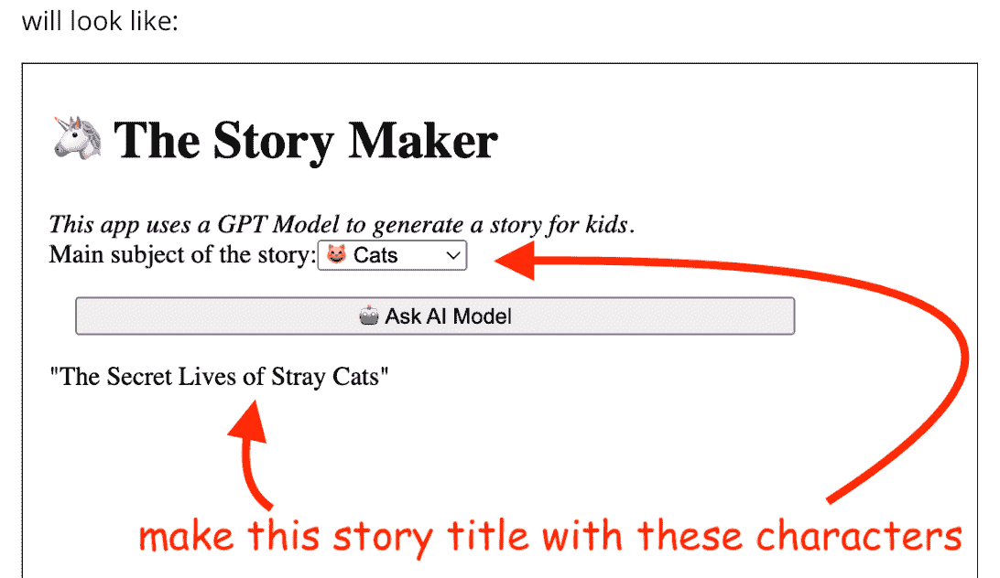

例如，如果我们指定想要一个以 `独角兽` 为主角的故事，应用将生成一个类似这样的故事标题：

```
"The Magical Adventures of Stardust the Unicorn"
```

## 2.2. 入门

入门最简单的方法是使用 [create-next-app](https://nextjs.org/docs/api-reference/create-next-app) 工具。安装后，创建一个名为 `story-generator` 的新项目：

```
yarn create next-app
```

或者，你可以使用代码示例文件夹中的起始代码。只需记住在示例文件夹内运行 `npm install`。

我们需要安装几个 npm 依赖包：LangChain 和 OpenAI。

进入项目的根文件夹，在终端中执行以下命令：

```
npm i langchain @langchain/openai
```

在撰写本书时，这些是已安装模块的当前版本：

```
"@langchain/openai": "^0.0.14",
"langchain": "^0.1.19"
```

请注意，LangChain 目前正在快速发展，随着它的进步，代码的某些部分可能会过时。我会努力保持本书更新，但如果因任何原因出现问题，回退到这些版本号可能是个明智之举。

一旦依赖项设置完毕，我们将继续使用 React 创建应用的前端。

将以下代码插入 `src\App.js`：

```
// code/story-generator/src/app/page.js

export default function Home() {
  const onSubmitHandler = async (event)=> {
    event.preventDefault()
    const subject = event.target.subject.value
    console.log(subject)
  }

  return (
    <>
      <h1>🦄 The Story Maker</h1>
      <em>This app uses a GPT Model to generate a story for kids.</em>
      <form onSubmit={onSubmitHandler}>
        <label htmlFor="subject">Main subject of the story:</label>
        <input name='subject' placeholder='subject...' />
        <button>🤖 Ask AI Model</button>
      </form>
    </>
  )
}
```

在这个阶段没有什么特别之处。它只是一个 React 用户界面，从文本输入中获取故事的主题并将其记录到控制台。

我们将通过在终端中执行以下命令来启动我们的应用：

```
npm run dev
```

这将生成以下输出：

目前，如果用户输入一个主题，将不会生成故事，因为我们尚未将应用程序与 OpenAI 集成。我们将在下一章中解决这个问题。

## 2.3. OpenAI ChatGPT 模型的 API 密钥

要使用 OpenAI 的 ChatGPT 模型，你需要一个 API 密钥。该 API 是基于订阅的，可以从以下网址生成密钥：

```
https://platform.openai.com/api-keys
```

你可以为账户充值最低金额。例如，编写本书中的所有示例花费不到 2 美元。

生成 API 密钥后，返回 Next.js 项目并将其粘贴到 `.env` 文件中：

```
// code/story-generator/.env

OPENAI_API_KEY='sk-1234567890B2tT4HT3BlbkFJXkATN1arB9DXABkRQ1uj'
```

此密钥将仅在我们应用程序的后端部分使用。要在 `code/story-generator/src/app/api/route.js` 文件中访问 API 密钥，可以编写以下代码：

```
// code/story-generator/src/app/api/route.js

console.log( process.env.OPENAI_API_KEY )
```

该密钥稍后将传递给 LangChain 模型对象构造函数。

此步骤将是本书后续章节中每个代码示例的默认程序。

如果你不希望使用 API 密钥，可以查看[此列表](https://js.langchain.com/docs/modules/model_io/models/)，其中包含 LangChain 支持的大型语言模型，并选择一个免费模型。你甚至可以使用免费的 HuggingFace 令牌来避免使用 OpenAI API。

## 2.4. 使用 ChatOpenAI LangChain 模型

让我们通过建立与 OpenAI 大语言模型的连接来继续。将以下代码添加到应用程序的后端，即 `src/app/api/route.js` 文件中：

```
// code/story-generator/src/app/api/route.js
import { ChatOpenAI } from "@langchain/openai"

const model = new ChatOpenAI({
  openAIApiKey: process.env.OPENAI_API_KEY,
  temperature: 0.9
})

export async function POST(req) {
  const { subject } = await req.json()
  const gptResponse = await model.invoke(subject)
  return Response.json({data: gptResponse})
}
```

要与 OpenAI 建立连接，我们创建一个新的 ChatOpenAI 对象实例。在其构造函数中，我们定义以下内容：

- 一个 temperature 参数，设置为 0.9
- 从前一个小节获取的 API 密钥

你可能对这个 temperature 参数感到好奇，对吧？

temperature 参数影响我们模型的想象力。提高它会导致更具创造性的输出，而降低它则使响应更基于事实。坚持事实可以减少模型潜在的不准确或幻觉。

选择合适的 temperature 取决于任务。对于头脑风暴想出吸引人的故事标题，较高的 temperature 是可取的。对于准确性至关重要的任务，例如总结法律文件，则较低的 temperature 更好。

设置好 temperature 后，让我们现在更新应用程序的前端：

```
// code/story-generator/src/app/page.js
export default function Home() {
  const onSubmitHandler = async (event) => {
    event.preventDefault()
    const subject = event.target.subject.value
    // 🟠 使用主题作为主要提示来调用大语言模型
    const response = await fetch('api', {
      method: "POST",
      body: JSON.stringify({ subject })
    })
    // 🟠 解析并打印响应数据
    const {data} = await response.json()
    console.log(response)
  }

  // 其余部分保持不变
  // ...
}
```

为了测试，让我们输入一个通用问题，比如 `Who is Elsa?` 作为答案，我们将收到：

> "Elsa is a fictional character and the protagonist of Disney animated film, Frozen. She is the queen of Arendelle and possesses the magical ability to create ice and snow."

## 🦄 故事制造者

此应用程序使用 GPT 模型为儿童生成故事。
故事主题：Who is Elsa?

```
▼ {lc: 1, type: 'constructor', id: Array(3), kwargs: {...}} i
    ▶ id: (3) ['langchain_core', 'messages', 'AIMessage']
    ▶ kwargs: {content: 'Elsa is a fictional character and the protag
    lc: 1
    type: "constructor"
    ▶ [[Prototype]]: Object
```

这证实了我们与 OpenAI 的连接成功。

请注意，你的答案可能略有不同。与经典的编程方式相反，大语言模型可以对相同的输入给出不同的输出。大语言模型通过估计来进行，一切都是概率性的。

另一个测试可以是请求故事标题，例如：

```
"Tell me a bedside story title about unicorns."
```

或：

```
"Tell me a bedside story title about cats."
```

试试看效果如何。

## 2.5. 提示模板

你很快就会注意到，提示需要重复输入，例如 `Tell me a bedside story title about ...` 后跟主要主题。

这种冗余可以通过使用提示模板来解决，我们接下来将探讨这一点。

在进入下一章之前，让我们对应用程序进行一个小的调整。我们将使用 React 状态变量在 UI 中显示大语言模型给出的故事标题。

以下是完整代码，突出了新增部分：

```
//code/story-generator/src/app/page.js

'use client'
import { useState } from "react"

export default function Home() {
  //🟠 添加 React 状态变量
  const [storyTitle, setStoryTitle] = useState()

  const onSubmitHandler = async (e)=> {
    e.preventDefault()
    const subject = e.target.subject.value
    const response = await fetch('api', {
      method: "POST",
      body: JSON.stringify({ subject })
    })
    const { data } = await response.json()
    //🟠 当我们得到大语言模型的回答时更新 React 状态
    setStoryTitle(data)
  }

  return (
    <>
        <h1>🦄 故事制造者</h1>
        <em>此应用程序使用 GPT 模型为儿童生成故事。</em>
        <form onSubmit={onSubmitHandler}>
            <label htmlFor="subject">故事主题：</label>
            <input name='subject' placeholder='主题...' />
            <button>🤖 询问 AI 模型</button>
        </form>
        {/* 🟠 在 UI 中显示故事标题 */}
        <p>{ storyTitle }</p>
    </>
  )
}
```

更改后的 UI 将如下所示：

现在让我们回到本章的主要内容：提示模板。

语言模型使用文本作为输入。该文本称为提示。但它不仅仅是一个固定字符串。通常，它是模板、示例和用户添加内容的混合。

使用模板，我们可以简化提示过程，确保用户不必为每个请求重复输入相同的前缀。

对于我们特定的用例，提示模板将如下所示：

```
`Tell me a story title about {subject}`
```

我们需要做的所有更改都在后端：

```
//code/story-generator/src/app/api/route.js

import { ChatOpenAI } from "@langchain/openai"
//🔴 我们将使用 PromptTemplate 来避免重复
import { PromptTemplate } from "@langchain/core/prompts"

const model = new ChatOpenAI({
  openAIApiKey: process.env.OPENAI_API_KEY,
  temperature: 0.9
})
//🔴 建立模板的一般格式
const prompt = new PromptTemplate({
  inputVariables: [ "subject"],
  template: "Tell me a story title about {subject}"
})

export async function POST(req) {
    const { subject } = await req.json()
    //🔴 传递 { subject } 参数
    const formattedPrompt = await prompt.format({
        subject
    })
    const gptResponse = await model.invoke(formattedPrompt)
    return Response.json({data: gptResponse.content})
}
```

编写提示模板的默认格式是 F-String 格式，在 Python 中很流行。如果你想使用更熟悉的双大括号 JavaScript Mustache 格式，可以这样：

```
const prompt = PromptTemplate.fromTemplate(
  inputVariables: [ "subject"],
  template: "Tell me a story title about {{subject}}",
  {
    templateFormat: "mustache"
  }
)
```

如果你想阅读更多内容，可以查看文档中的快速入门指南。


## 2.6. 链

链指的是调用序列——无论是调用大语言模型、工具还是数据预处理步骤。

它们是LangChain至关重要的核心概念，可以看作是围绕大语言模型编写的、用于执行复杂任务的简短程序。

说到链，这里有个关于LangChain标志的趣闻：鹦鹉和链条的灵感来源于人们称大语言模型为“随机鹦鹉”。这些模型能模仿人类写作，但并不真正理解它们在说什么。这个库旨在将这些“鹦鹉”“链接”在一起，以产生更有意义和有用的输出。

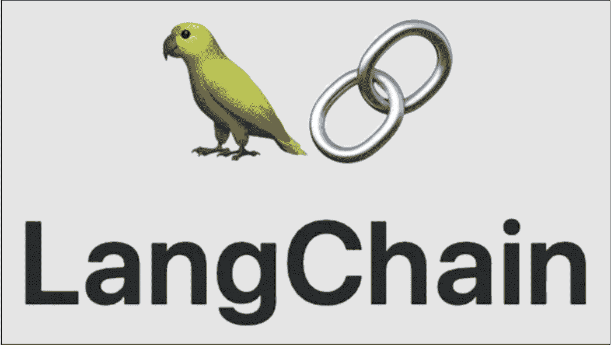

链中一个环节的输出成为下一个环节的输入。

假设我们需要为一本杂志创建一篇文章。我们将遵循以下步骤：

1. 使用ChatGPT生成文章标题。
2. 将此标题传递给一个本地大语言模型，利用内部文档来撰写实际文章。
3. 将文章传递给Midjourney（另一个大语言模型），为文章生成图片。

让我们看看如何将链添加到我们的后端代码中：

```javascript
import { ChatOpenAI } from "@langchain/openai"
import { PromptTemplate } from "@langchain/core/prompts"
//🔴 使用 LLMChain；可能是最直接的链
import { LLMChain } from "langchain/chains"

const model = new ChatOpenAI({
  openAIApiKey: process.env.OPENAI_API_KEY,
  temperature: 0.9
})

const prompt = new PromptTemplate({
  inputVariables: [ "subject"],
  template: "Tell me a story title about {subject}"
})

//🔴 一个将模型、提示词模板和详细日志选项链接起来的链
const chain = new LLMChain({
  llm: model,
  prompt,
  //🔴 使用 verbose 来调试链
  verbose: true
})

export async function POST(req) {
  const { subject } = await req.json()
  //🔴 调用链
  const gptResponse = await chain.invoke({subject})
  return Response.json({data: gptResponse.text})
}
```

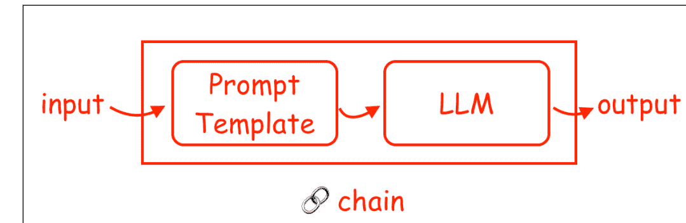

你可能会在网上遇到一些使用 `chain.call()` 方法而不是 `chain.invoke()` 的示例。请注意，`.call()` 已弃用，将来会被移除。

`verbose: true` 选项是可选的。如果启用，它将在后端控制台中提供关于链的额外详细信息。这些信息包括：

- 链中每一步的输入和输出
- 每一步花费的时间
- `tokenUsage` 变量

最后一点很重要，因为我们使用大语言模型的API时需要按token付费。平均而言，100个英文单词大约相当于130个token。一个用于管理token的有用工具是 [OpenAI Tokenizer](https://platform.openai.com/tokenizer)。`tokenUsage` 被分为输入提示词使用了多少token和实际响应使用了多少token：

```json
"llmOutput": {
  "tokenUsage": {
    "completionTokens": 14,
    "promptTokens": 14,
    "totalTokens": 28
  }
}
```

在前端代码中，我们将简单地用一个选择框替换文本输入，以方便数据输入：

```javascript
export default function Home() {
  // 其余部分保持不变
  // ...

  return (
    <>
      <h1>🦄 The Story Maker</h1>
      <em>This app uses a GPT Model to generate a story for kids.</em>
      {/* 🍊 添加一个选择框以加快数据输入速度 */}
      <form onSubmit={onSubmitHandler}>
        Main subject of the story:
        <select name="subject">
          <option value="cats">🐱 Cats</option>
          <option value="unicorns">🦄 Unicorns</option>
          <option value="elfs">🧝‍♀️ Elfs</option>
        </select>
        <button>🤖 Ask AI Model</button>
      </form>
      <p>{ storyTitle }</p>
    </>
  )
}
```

## 2.7. LCEL - LangChain 表达式语言

LangChain表达式语言，或LCEL，提供了一种更简单的方式来链接多个自定义组件。

简而言之，使用LCEL，我们可以使用 `.pipe()` 方法来替换其他类（如 `LLMChain`），从而形成一个链。

让我们再看一下上面示例的链：

```javascript
const model = new ChatOpenAI({
  openAIApiKey: process.env.OPENAI_API_KEY,
  temperature: 0.9
})

const prompt = new PromptTemplate({
  inputVariables: ["subject"],
  template: "Tell me a story title about {subject}"
})

const chain = new LLMChain({
  llm: model,
  prompt,
})

await chain.invoke({subject})
```

我们可以使用 `.pipe()` 方法来替换 `LLMChain` 包装器。其余代码保持不变：

```javascript
// 之前
const chain = new LLMChain({
    llm: model,
    prompt,
})
await chain.invoke({subject})

// 之后
const chain = prompt.pipe(model)
await chain.invoke({subject})
```

稍后，我们将看到通过添加其他类型的节点（如输出解析器），我们可以构建更复杂的链。

链中一个节点的输出成为下一个节点的输入。LCEL的关键元素是 [RunnableInterface](RunnableInterface)。它确保链中的节点具有通用的通信模式。

LCEL标准化了通信，并使得在LangChain框架内轻松交换组件成为可能。所有组件都是模块化的。如果需要更改某些内容，只需替换代码的那一部分，而不是整个管道。

它还使代码更简洁。

本书中的许多示例将使用LCEL链来构建。

如果你想深入探索这个主题，一定要查看 [LCEL官方文档](官方LCEL文档)，我也在我的博客上写了几篇文章：

- [LangChain JS 中的嵌套链 - 将一个链的输出传递给另一个链](LangChain JS 中的嵌套链 - 将一个链的输出传递给另一个链)
- [在 LangChain JS 中使用 RunnableLambda 定义自定义函数](在 LangChain JS 中使用 RunnableLambda 定义自定义函数)
- [LangChain JS 中的 RunnableMap 和 RunnableParallel](LangChain JS 中的 RunnableMap 和 RunnableParallel)
- [LangChain JS 中的路由 - 使用 LLM 分类器调用不同的提示词](LangChain JS 中的路由 - 使用 LLM 分类器调用不同的提示词)
- [在 LangChain.js 中使用 RunnableBranch 将执行路由到不同的提示词](在 LangChain.js 中使用 RunnableBranch 将执行路由到不同的提示词)

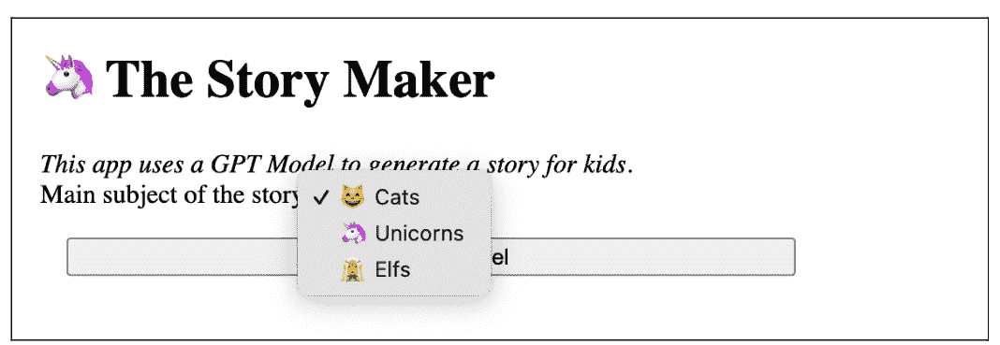

至此，我们完成了第一个使用JavaScript、LangChain和ChatGPT的小型应用程序。我们已经学习了如何：

- 引导并将一个Web应用连接到大语言模型。
- 利用LangChain的提示词模板来避免重复。
- 创建我们的第一个链。

在下一章中，我们将扩展这个应用程序，以生成实际的故事正文并集成数据流。

# 3. LangChain 中的流

## 3.1. 介绍与项目设置

某些答案可能需要大语言模型花费很长时间来生成。例如，如果你要求模型撰写一个复杂的回复，如一首诗或总结一篇文档。

鉴于大语言模型的工作方式，我们不必等待完整的答案生成完毕。你是否注意到，当你向ChatGPT提问时，你会看到那种打字机效果，即每个单词逐渐出现在屏幕上？

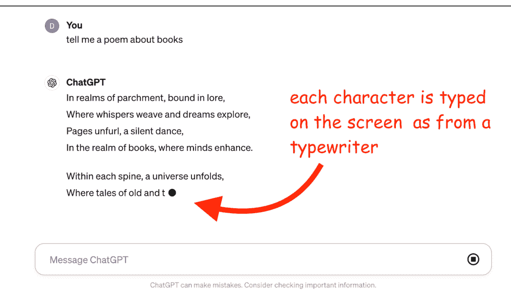

大语言模型并不像人类那样进行推理。它并非先构建完整的回复然后再进行解释。它也不会将答案映射到知识图谱或类似的东西上。它只是逐个token地向答案中添加内容。

这很棒，因为我们可以利用这种流式行为，在有了新信息要展示给用户时立即更新界面。

回到故事生成器的例子，假设我们想创建一个名为《银精灵的秘密》的故事。我们不必等待整个故事生成完毕，而可以在故事被书写时进行流式传输：

```
很久以前
...
...
很久以前，在一片神秘的森林里
...
...
很久以前，在一片深藏于群山之中的神秘森林里
...
...
很久以前，在一片深藏于群山之中的神秘森林里，生活着一个银精灵部落。
```

在本章中，我们将实现流式功能。这就是应用程序最终的用户界面：

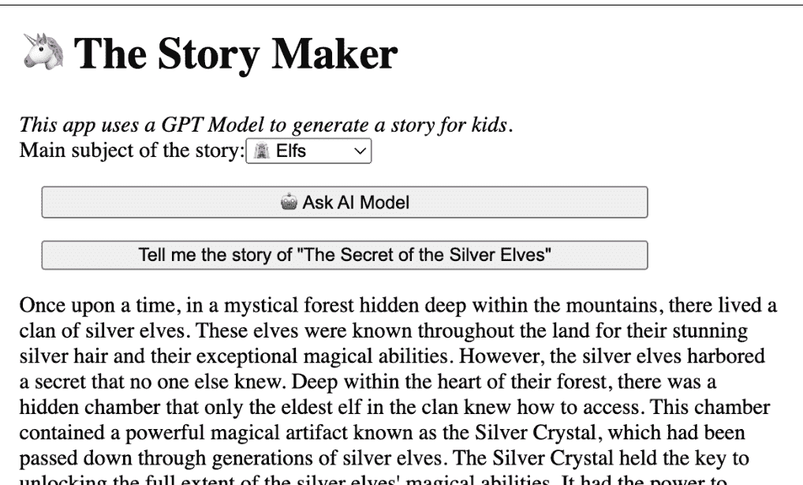


## 3.2. 项目重构

在继续之前，我们需要对项目进行一些重构。

在前端，我们将进行以下操作：

- 1. 一旦我们有了故事的标题，我们会将其显示为一个按钮，按钮文本为 `给我讲讲《这里放故事名》的故事`。
- 2. 当按下此按钮时，我们将调用后端，传入故事名称并打印响应。

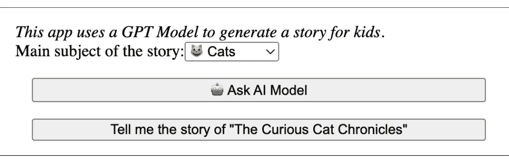

代码将如下所示：

```
// code/streaming/src/app/page.js

'use client'
import { useState } from "react"
export default function Home() {
  const [storyTitle, setStoryTitle] = useState()
  // 🟠 一个用于故事正文的新状态变量
  const [storyBody, setStoryBody] = useState()

  const onSubmitHandler = async (e)=> {
    e.preventDefault()
    const subject = e.target.subject.value
    const response = await fetch('api', {
      method: "POST",
      body: JSON.stringify({ subject })
    })
    const { data } = await response.json()
    setStoryTitle(data)
  }

  //🟠 当按下开始讲故事按钮时调用此方法
  const startStoryStream = async ()=> {
    //🟠 重置故事正文，调用后端
    // 并将响应显示在故事正文中
    setStoryBody('')
    const response = await fetch('api', {
      method: "POST",
      body: JSON.stringify({ storyTitle })
    })
    const { data } = await response.json()
    setStoryBody(data)
  }

  return (
    <>
      <h1>🦄 故事生成器</h1>
      <em>此应用使用GPT模型为孩子们生成故事。</em>
      <form onSubmit={onSubmitHandler}>
        故事的主要主题：
        <select name="subject">
          <option value="cats">😺 猫咪</option>
          <option value="unicorns">🦄 独角兽</option>
          <option value="elfs">🧑‍🎄 精灵</option>
        </select>
        <button>🤖 询问AI模型</button>
      </form>
      {/* 🟠 如果我们有故事标题，则显示
      开始讲故事按钮和故事正文 */}
      {storyTitle && <div>
        <button onClick={startStoryStream}>
          给我讲讲《{storyTitle}》的故事
        </button>
        <p>{storyBody}</p>
      </div>
    </>
  )
}
```

在后端，我们将添加这些更改：

- 添加一个 `makeStoryTitle()` 方法，其中将包含所有之前的逻辑。
- 添加一个 `streamStory()` 方法。我们稍后将使用此方法来实现流式机制。目前，它将返回一些静态文本。
- 检查来自前端的请求是要求故事标题还是故事正文。调用上述方法之一。

后端代码将如下所示：

```
import { ChatOpenAI } from "@langchain/openai"
import { PromptTemplate } from "@langchain/core/prompts"
// 🟡 我们将使用 NextResponse 来发送故事正文
import { NextResponse } from "next/server"

// 🟡 所有之前的逻辑都放在这里
const makeStoryTitle = async (subject)=> {
    const model = new ChatOpenAI({
        openAIApiKey: process.env.OPENAI_API_KEY,
        temperature: 0.9
    })
    const prompt = new PromptTemplate({
        inputVariables: [ "subject"],
        template: "Tell me a story title about {subject}",
    })
    const chain = prompt.pipe(model)
    return await chain.invoke({subject})
}

// 🟡 我们稍后将更新此方法以添加流式处理
const streamStory = async (storyTitle)=> {
    return new NextResponse(
        JSON.stringify( { data: "故事就从这里开始..." }
    ),
        { headers: { 'content-type': 'application/json' },
        })
}

export async function POST(req) {
    const { subject, storyTitle } = await req.json()
    // 🟠 如果请求中有 storyTitle，则返回
    // streamStory()
    if (storyTitle) {
        return streamStory(storyTitle)
    }
    // 🟠 如果没有 storyTitle，则返回一个
    const gptResponse = await makeStoryTitle(subject)
    return Response.json({data: gptResponse.text})
}
```

这就是应用在此阶段的样子：

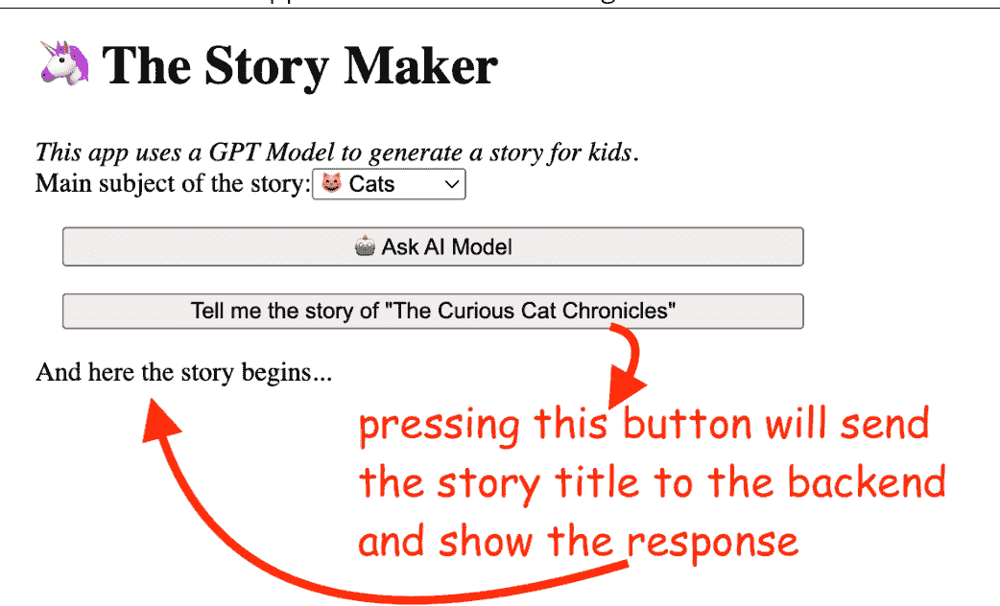

按下此按钮会将故事标题发送到后端并显示响应。

## 3.3. 流式传输响应

在某些情况下，AI模型可能需要几秒钟才能生成对提示的完整响应。这比应用给终端用户带来响应感的~200-300毫秒阈值要慢。

为了让应用感觉更响应，我们需要显示中间进度并以块的形式流式传输最终输出，在每一块可用时立即将其输出。

并非所有模型都支持流式传输，因此请务必检查您使用的模型是否支持此功能。

现在是时候为我们的故事生成器应用添加流式传输功能了。

请注意，这不会是一个单一的请求-响应交互。它将更像是一场持续的聊天。前端将不断请求新的LLM响应块并更新正在进行的结果，而后端则发回响应块或在流完成时发出通知。

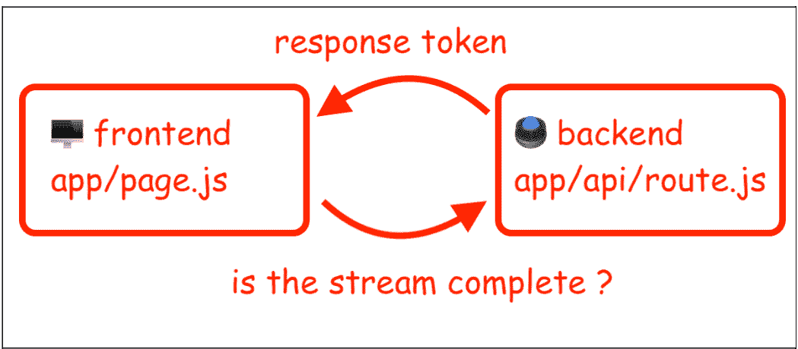

我们将从后端开始。所有更改都将在我们上一步中定义的 `streamStory()` 方法中进行：

```
// code/streaming/src/app/api/route.js

// 其余部分保持不变
// ...

const streamStory = async (storyTitle)=> {
    const encoder = new TextEncoder()
    const stream = new TransformStream()
    const writer = stream.writable.getWriter()
    const model = new ChatOpenAI({
        openAIApiKey: process.env.OPENAI_API_KEY,
        temperature: 0.9,
        streaming: true,
        callbacks: [{
            handleLLMNewToken: async (token) => {
              await writer.ready
              await writer.write(encoder.encode(`${token}`))
            },
            handleLLMEnd: async () => {
              await writer.ready
              await writer.close()
            }
        }]
    })
    const prompt = new PromptTemplate({
        inputVariables: [ "storyTitle" ],
        template: "Tell me story titled {storyTitle}"
    })
    const chain = prompt.pipe(model)
    chain.invoke({storyTitle})
    return new NextResponse(stream.readable, {
        headers: { "Content-Type": "text/event-stream" }
    })
}

// 其余部分保持不变
// ...
```

首先，我们需要创建一个生成故事正文的新链。

传递给此链的模型实例有两个更新：

- `streaming` 标志已启用。
- 实现了 `handleLLMNewToken()` 和 `handleLLMEnd()` 回调。

为了在初始请求后保持通信通道打开，返回的响应内容类型被设置为 `text/event-stream` 而不是标准的 `application/json`。

此外，在前端，我们将修改一个方法：`startStoryStream()`：

```
// code/streaming/src/app/page.js

// 其余部分保持不变
// ...

const startStoryStream = async ()=> {
    setStoryBody('')
    const response = await fetch('api', {
      method: "POST",
      body: JSON.stringify({ storyTitle })
    })
    // 🔵 reader 将充当数据通信的“管道”
    const reader = response.body.getReader()
    const decoder = new TextDecoder()
    // 🔵 在我们持续接收新的响应块时保持连接
    while (true) {
        const { value, done } = await reader.read()
        if (done) break
        const chunkValue = decoder.decode(value)
        // 🔵 向 React 状态字符串值追加文本的方式
        setStoryBody(prev => prev + chunkValue)
    }
}

// 其余部分保持不变
// ...
```

有了这些最终的UI更改，我们可以观察故事在LLM生成时逐步展开：

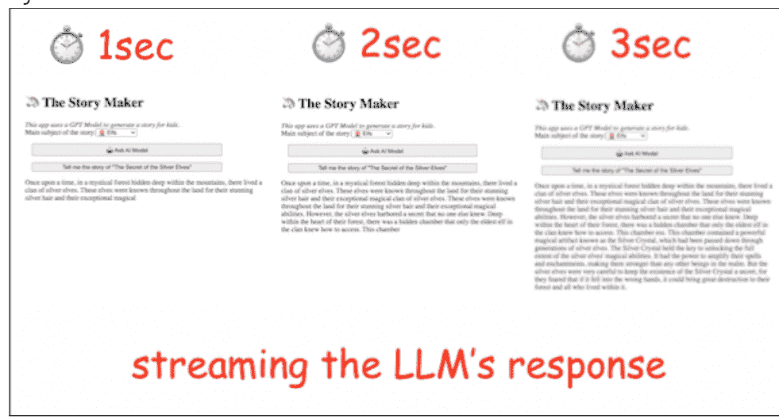

如果你想更深入地了解这个主题，LangChain文档有一个不错的[流式传输指南](https://example.com)，包括关于[如何在响应不如预期时停止流式传输](https://example.com)过程的部分。

## 4. 输出解析器

## 4.1. 引言

好吧，让我们深入探讨一下LangChain中输出解析器的具体细节。

为什么我们需要它们？嗯，在使用LLM时，你会发现即使问相同的问题两次，得到的响应也可能不同。此外，输出的格式也可能不同。

例如，如果我们要求一道菜的食谱，有时LLM会先返回“配料”，有时是“准备工作”。这是正常的，因为LLM是生成性的，而不是确定性的。对于人类读者来说，这种可变性可能没问题，但如果我们希望一个API端点处理这些响应，它就会成为问题。

而当你更换底层的LLM模型类型时，情况只会更糟。

把输出解析器看作你的格式化助手。它们可以：

- 1. 通过添加前缀或后缀等内容来调整你的提示，引导输出朝某个特定方向发展。想要一个JavaScript数组？想要一个简单的字符串或嵌套的JSON结构？LangChain的输出解析器都能满足你；
- 2. 在输出准备好之后，一个JavaScript函数可以介入来整理内容。这个函数甚至可能使用其他LLM来将输出完善成完美的格式。


## 4.2. 示例设置

LangChain 预定义了多种输出解析器，可直接使用。在接下来的示例中，我们将使用其中一些。

假设你被要求使用 ChatGPT 制作一个知识问答游戏。用户将请求一个包含四个可能答案的知识问答题。其中只有一个答案是正确的。一旦点击某个可能的答案，就会显示一个弹窗，指示该答案是正确还是错误。在任何时候，用户都可以请求一个新问题。

应用最终版本的效果如下所示：

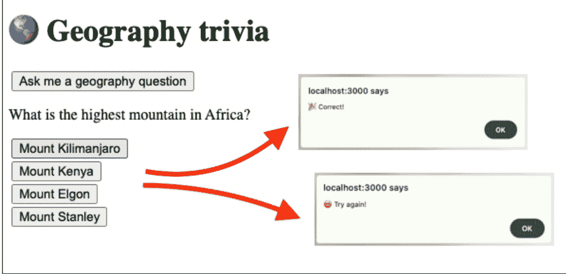

我们将从一个非常简单的状态开始。

在后端，我们将创建一个 OpenAI 模型，并让它提供一个知识问答题：

```javascript
// code/trivia-game/src/app/api/route.js

import { ChatOpenAI } from "@langchain/openai"
import { PromptTemplate } from "@langchain/core/prompts"

const model = new ChatOpenAI({
    openAIApiKey: process.env.OPENAI_API_KEY,
})

const prompt = PromptTemplate.fromTemplate(
    `Ask me a trivia question about geography.`
)

const chain = prompt.pipe(model)

export async function GET() {
    const gptResponse = await chain.invoke()
    return Response.json({question: gptResponse.text})
}
```

注意，这次我们使用 GET 请求，因为我们不需要发送任何请求体。我们只需要获取一个问题。

在前端，我们有一个简单的按钮来调用后端。使用 React 状态变量，一旦收到响应就会显示问题：

```javascript
// code/trivia-game/src/app/page.js

import { ChatOpenAI } from "@langchain/openai"
import { PromptTemplate } from "@langchain/core/prompts"

const model = new ChatOpenAI({
    openAIApiKey: process.env.OPENAI_API_KEY
})

const prompt = PromptTemplate.fromTemplate(
    `Ask me a trivia question about geography.`
)

const chain = new prompt.pipe(model)

export async function GET() {
    const gptResponse = await chain.invoke()
    return Response.json({question: gptResponse.text})
}
```

这就是项目第一阶段的样子。

🌍 **地理知识问答**

问我一个地理问题

澳大利亚的首都是哪里？

## 4.3. StringOutputParser

LangChain.js 的输出解析器旨在将 AI 响应转换为常见结构，如 JSON、数组、字符串等。

[StringOutputParser](https://example.com) 获取模型的输出并将其转换为简单的字符串。这可能是最易于使用的解析器。

让我们看看 ChatGPT 调用的实际响应是什么样子：

```javascript
const prompt = PromptTemplate.fromTemplate(
    `Ask me a trivia question about geography.`
)

const chain = prompt.pipe(model)

const gptResponse = await chain.invoke()

console.log(gptResponse)
```

如果我们打印 `gptResponse` 常量，它看起来会是这样：

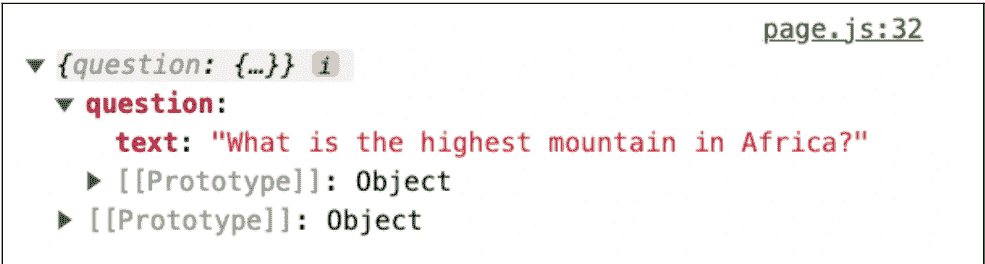

这是来自 ChatGPT 模型的结构，没有添加任何输出解析器。

然而，如果我们使用另一种类型的模型，例如 Llama（由 Meta 制作）或 Claude（由 Anthropic 制作），结构可能不同。每个模型可能以不同的结构包装答案。

这意味着提取最终字符串响应的行可能会失败，因为 `text` 属性可能不存在：

```javascript
question: gptResponse.text
```

最终，我们只需要一个包含问题的简单字符串。

这就是 `StringOutputParser` 发挥作用的地方。你可以将解析器添加到链中，它将确保来自不同 LLM 的各种响应类型都被转换为简单的字符串。

让我们看看这在代码中是如何实现的：

```javascript
// code/trivia-game/src/app/api/route.js

import { ChatOpenAI } from "@langchain/openai"
import { PromptTemplate } from "@langchain/core/prompts"
// 🟡 导入解析器
import { StringOutputParser} from
"@langchain/core/output_parsers"

const model = new ChatOpenAI({
  openAIApiKey: process.env.OPENAI_API_KEY
})

// 🟡 创建提示词并调用链
const makeQuestion = async ()=> {
  const prompt = PromptTemplate.fromTemplate(
    `Ask me a trivia question about geography.`
  )
  // 🟡 将解析器添加到 LCEL 链中，这样我们就能获得
  // 🟡 简单的字符串输出，而不是一个对象
  const chain = prompt
    .pipe(model)
    .pipe(new StringOutputParser())
  return await chain.invoke()
}

export async function GET() {
  // 🟡 将创建问题的部分提取到其方法中
  const question = await makeQuestion()
  return Response.json({question})
}
```

请记住，在一个链中，我们可以设置多个连续的操作，包括输出解析器。

请注意，在我们将输出解析器添加到链中之后，我们不需要手动解析 .text 属性：

```javascript
// 使用解析器之前
return Response.json({question: gptResponse.text})

// 将输出解析器添加到链中之后
return Response.json({question})
```

即使我们更改了模型类型，这也会有效。

接下来，让我们看看如何使用另一种类型的解析器来创建响应数组。

## 4.4. CommaSeparatedListOutputParser

在某些情况下，我们需要从 LLM 的响应中获取多个项目。

让我们请求 ChatGPT 帮助我们提供一些知识问答题的可能答案。提示词将如下所示：

```
`Give 4 possible answers for {question}, separated by commas, 3 false and 1 correct, in a random order.`
```

没有任何输出解析器时，ChatGPT 的标准响应将如下所示：

```javascript
AIMessage {
  lc_serializable: true,
  lc_kwargs: {
    content: 'North America, Africa, Australia, Asia',
    additional_kwargs: { function_call: undefined, tool_calls: undefined },
    response_metadata: {}
  },
  lc_namespace: [ 'langchain_core', 'messages' ],
  content: 'North America, Africa, Australia, Asia',
  name: undefined,
  additional_kwargs: { function_call: undefined, tool_calls: undefined },
  response_metadata: {
    tokenUsage: { completionTokens: 8, promptTokens: 47, totalTokens: 55 },
    finish_reason: 'stop'
  }
}
```

一个冗长且复杂的 JavaScript 对象，我们需要手动解析它。

顺便说一下，我们将在聊天记忆章节中更详细地介绍 `AIMessage` 类。

对于这样的情况，LangChain 可以通过 [CommaSeparatedListOutputParser](https://js.langchain.com/docs/modules/model_io/output_parsers/types/list) 来帮助我们。

`CommaSeparatedListOutputParser` 接收 LLM 给出的复杂答案，并将其重新格式化为标准的字符串数组。例如，上例中的 `AIMessage` 将变为：

```javascript
[
  'North America',
  'Africa',
  'Australia',
  'Asia'
]
```

干净、简洁多了！

让我们看看在我们添加这个 `CommaSeparatedListOutputParser` 来处理问题的可能答案之后，后端代码会是什么样子：

```javascript
// code/trivia-game/src/app/api/route.js

import { ChatOpenAI } from "@langchain/openai"
import { PromptTemplate } from "@langchain/core/prompts"
import { StringOutputParser } from "@langchain/core/output_parsers"
// 🟠 导入 CommaSeparatedListOutputParser
import { CommaSeparatedListOutputParser } from "@langchain/core/output_parsers"

const model = new ChatOpenAI({
    openAIApiKey: process.env.OPENAI_API_KEY,
    // 🟠 提高模型的温度
    temperature: 0.9
})

// 🟠 请求模型提供可能的答案
const makePossibileAnswers = async (question) => {
    const prompt = PromptTemplate.fromTemplate(
        `Give 4 possible answers for {question}, separated by commas,
            3 false and 1 correct, in a random order.`
    )
    // 🟠 将 CommaSeparatedListOutputParser 应用到链中
    const chain = prompt
        .pipe(model)
        .pipe(new CommaSeparatedListOutputParser())
    return await chain.invoke({question: question})
}

const makeQuestion = async () => {
    const prompt = PromptTemplate.fromTemplate(
        `Ask me a trivia question about geography.`
    )
    const chain = prompt
        .pipe(model)
        .pipe(new StringOutputParser())
    return await chain.invoke()
}

export async function GET() {
    const question = await makeQuestion()
    // 🟠 一旦我们有了问题，就获取一些可能的答案
    const answers = await makePossibileAnswers(question)
    return Response.json({question, answers})
}
```

请注意，我们已经提高了模型的温度，因为它需要在生成可能的答案时更具创造性。

虽然你可能很想使用 JavaScript 字符串的 split() 方法，但请再想想！如果我们更换 LLM 并且响应结构发生变化会怎么样？这就是 LangChain 如此强大的原因！它标准化了我们与 AI 模型交互的方式。


我们使用两个输出解析器：

- `StringOutputParser` 用于主问题
- `CommaSeparatedListOutputParser` 用于解析可能的答案列表

在前端，我们将读取可能的答案并将其显示为按钮：

```
// code/trivia-game/src/app/page.js

'use client'
import { useState } from "react"

export default function Home() {
  const [question, setQuestion] = useState()
  // 🟡 添加一个空数组状态变量来存储答案
  const [answers, setAnswers] = useState([])

  const getTriviaQuestion = async ()=> {
    const response = await fetch('api')
    const data = await response.json()
    console.log(data)
    setQuestion(data.question)
    // 🟡 一旦有了答案就更新状态
    setAnswers(data.answers)
  }

  return (<> 
    <h1>🌍 地理知识问答</h1>
    <button onClick={getTriviaQuestion}>
      问我一个地理问题
    </button>
    <p>{question}</p>
    {/* 🟡 循环显示每个答案为一个按钮 */}
    {answers.map((answ, i) =>
      <button key={i}>
        {answ}
      </button>
    )}
  </>)
}
```

此阶段应用的界面将如下所示：

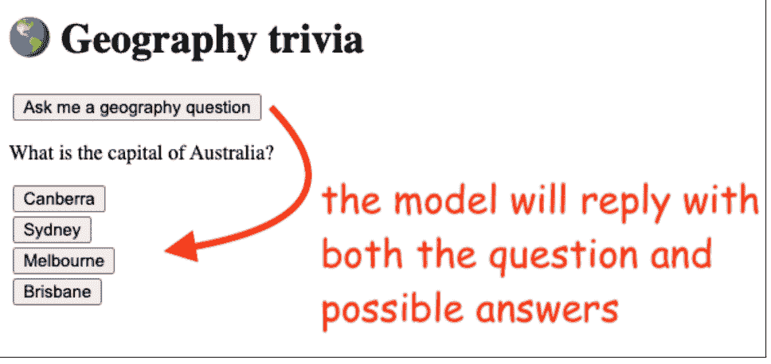

顺便说一下，如果列表不是用逗号分隔的，你可以使用 `CustomListOutputParser`。

一个有趣的额外项目是为这个应用添加记忆功能，使其不会重复提问。我们将在接下来的章节中了解如何使用 LangChain 的聊天记忆功能。

下一步将是确定用户是否点击了正确答案。

## 4.5. getFormatInstructions() 方法与自定义解析器

在我们继续之前，先简短地讨论一下 `getFormatInstructions()` 方法以及输出解析器在底层是如何工作的。

LangChain 中有许多输出解析器。文档提供了[这个表格](this table)来总结主要类型：

| 名称 | 支持流式传输 | 有格式说明 | 调用 LLM | 输入类型 | 输出类型 | 描述 |
|---|---|---|---|---|---|---|
| String | ✅ | | | string 或 Message | string | 获取语言模型输出（无论是整个响应还是流）并将其转换为字符串。这对于标准化聊天模型和 LLM 输出非常有用，使处理聊天模型输出更加方便。 |
| HTTPResponse | ✅ | | | string 或 Message | binary | 允许你将 LLM 输出正确格式化为字节流，通过 web HTTP 响应传输多种内容类型。 |
| OpenAIFunctions | ✅ | (传递函数给模型) | | Message (带 function_call) | JSON object | 允许你使用 OpenAI 函数调用来构建返回输出。如果你使用的模型支持函数调用，这通常是最可靠的方法。 |
| CSV | | ✅ | | string 或 Message | string[] | 返回一个逗号分隔值的列表。 |
| OutputFixing | | | ✅ | string 或 Message | | 包装另一个输出解析器。如果该输出解析器出错，则会将错误消息和错误输出传递给 LLM 并要求其修复输出。 |
| Structured | | ✅ | | string 或 Message | Record<string, string> | 返回结构化信息的输出解析器。它比其他输出解析器功能弱，因为它只允许字段为字符串。当你使用较小的 LLM 时，这可能很有用。 |
| Datetime | | ✅ | | string 或 Message | Date | 将响应解析为 JavaScript 日期。 |

所有这些解析器都共用 `getFormatInstructions()` 方法。

让我们创建一个 `CommaSeparatedListOutputParser` 并调用这个方法：

```
const parser = new CommaSeparatedListOutputParser()
console.log(parser.getFormatInstructions())

// 打印结果：
// 结果将只是一个简单的字符串：
// Your response should be a list of comma separated values, eg:
`foo, bar, baz`
```

基本上，这只是我们可以添加到提示词中的额外部分。

例如，我们可以创建一个 `RunnableSequence` 并传入 `getFormatInstructions()` 方法的结果：

```
const commaListOutputParser = new CommaSeparatedListOutputParser()

const chain = RunnableSequence.from([
  PromptTemplate.fromTemplate(`Give me 3 {topic}.\n{formatInstructions}`),
  new OpenAI({}),
  parser,
])

return await chain.invoke({
  topic: 'car brands',
  formatInstructions:
commaListOutputParser.getFormatInstructions()
})
```

如果我们打印 `commaListOutputParser.getFormatInstructions()`，我们将得到以下内容：

> Your response should be a list of comma separated values, eg:
`foo, bar, baz`

想一想这有点意思。我们正在使用一个 LLM 来解析另一个 LLM 的输出😅。

这将与直接在链中添加解析器起到相同的效果，并输出类似以下的内容：

```
[
  'Audi',
  'Ford',
  'Doge'
]
```

我们甚至可以制作自己的自定义输出解析器。文档链接在[这里](here)。

输出解析器必须实现两个主要方法：

- `getFormatInstructions()` 返回一个字符串，包含语言模型输出应如何格式化的说明。如果需要，你可以将此注入到你的提示词中。
- `parse()`：接收一个字符串（假设是来自语言模型的响应）并将其解析为特定结构。

## 4.6. StructuredOutputParser

大型语言模型喜欢结构化的输出！当我们为输入和输出定义清晰的预期结构时，它们的输出要准确得多。关于这个的更多信息，请参见[这里](https://docs.smith.langchain.com/configuration/structured_output)。

虽然 `CommaSeparatedListOutputParser` 或 `StringOutputParser` 是处理更简单直接响应的绝佳工具，但当我们需要处理更复杂的输出时，我们将需要其他类型的解析器，例如 [`StructuredOutputParser`](https://api.js.langchain.com/classes/langchain.output_parsers.StructuredOutputParser.html) 或 [`JsonOutputParser`](https://api.js.langchain.com/classes/langchain.output_parsers.JsonOutputParser.html)。

对于我们的小型问答应用，一个很大的改进是接收以下格式的输出：

```
{
  question: 'question text here',
  answers: [
    'foo',
    'bar',
    'qux',
    'baz',
  ],
  correct: 2 // 'qux' is correct
}
```

为了实现这一点，我们将使用带有 Zod 模式的 `StructuredOutputParser`。原因是 `StructuredOutputParser` 比 `JsonOutputParser` 更通用，能覆盖更多用例。

[Zod](https://zod.dev/) 是一个用于定义复杂数据结构的模式验证库。

让我们看看添加 `StructuredOutputParser` 将如何改变我们的后端代码：

```
// code/trivia-game/src/app/api/route.js

import { ChatOpenAI } from "@langchain/openai"
import { PromptTemplate } from "@langchain/core/prompts"
import { RunnableSequence } from "@langchain/core/runnables"
import { StructuredOutputParser } from "langchain/output_parsers"
import { z } from "zod"

const model = new ChatOpenAI({
    openAIApiKey: process.env.OPENAI_API_KEY,
    temperature: 0.9
})

//🟡 Zod 用于定义字段是字符串、数字、数组等
const parser = StructuredOutputParser.fromZodSchema(
    z.object({
        question: z.string().describe(
            `tell me a random geography trivia question`
        ),
        answers: z
            .array(z.string())
            .describe(`
                give 4 possible answers, in a random order,
                out of which only one is true.`
            ),
        correctIndex: z.number().describe(
            `the number of the correct answer, zero indexed`
        ),
    })
)

//🟡 使用 RunnableSequence 定义一个新链
const chain = RunnableSequence.from([
```


PromptTemplate.fromTemplate(
    `尽你所能回答用户的问题。\n {format_instructions}`
),
model,
parser,
])

// 使用 StructuredOutputParser，我们现在可以将所有
// 数据封装到一个单一结构中
const makeQuestionAndAnswers = async () => {
    // 返回一个具有定义结构的 JSON
    return await chain.invoke({
        format_instructions: parser.getFormatInstructions(),
    })
}

export async function GET() {
    // makeQuestion() 和 makePossibleAnswers() 被合并到
    // 一个函数中
    const data = await makeQuestionAndAnswers()
    return Response.json({data})
}
```

尽管看起来我们做了很多改动，但如果你移除新添加的注释，你会注意到我们的代码现在更简洁了。

从大语言模型（LLM）那里，我们返回一个包含应用所需所有信息的单一 JSON 结构。

此外，`makeQuestion()` 和 `makePossibleAnswers()` 方法现在合并为单次调用，使应用运行得更快一些。

应用这些更改后，我们现在可以判断用户点击的是正确还是错误的答案。

让我们看看前端的更改：

```javascript
// code/trivia-game/src/app/page.js
'use client'
import { useState } from "react"

export default function Home() {
  const [question, setQuestion] = useState()
  const [answers, setAnswers] = useState([])
  // 🍊 添加第三个状态变量来存储正确答案索引
  const [correctIndex, setCorrectIndex] = useState()

  const getTriviaQuestion = async ()=> {
    const response = await fetch('api')
    const { data } = await response.json()
    setQuestion(data.question)
    setAnswers(data.answers)
    // 🍊 一旦我们有了正确答案索引，就更新状态
    setCorrectIndex(data.correctIndex)
  }

  // 🍊 使用正确答案索引来查看是否选择了正确答案
  const checkAnswer = async (selectedIndex) => {
    (correctIndex === selectedIndex) ?
      alert('🎉 正确！'):
      alert('😅 再试一次！')
  }

  return (<>
    <h1>🌍 地理知识问答</h1>
    <button onClick={getTriviaQuestion}>
      问我一个地理问题
    </button>
    <p>{question}</p>
    {/* 🍊 点击时检查用户是否回答正确 */}
    {answers.map((answ, i) =>
      <button key={i}
        onClick={() => checkAnswer(i)}>
        {answ}
      </button>
    )}
    </>)
}
```

这里没什么特别的。我们给每个答案按钮添加了点击监听器，并将检查该按钮的索引是否与正确答案的索引匹配。

这是最终版本 UI 的样子：

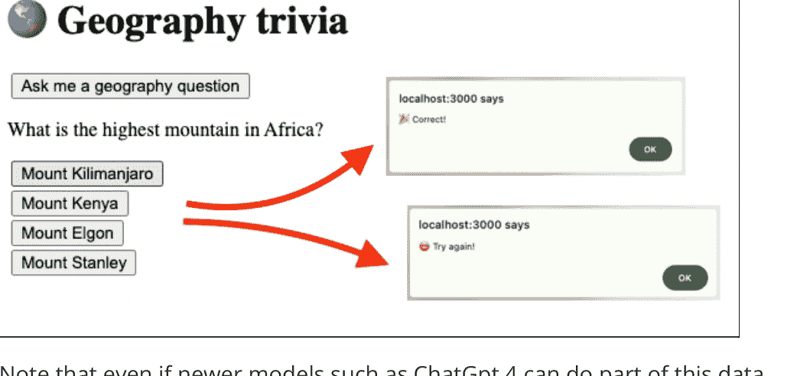

请注意，即使像 ChatGPT 4 这样的新模型可以开箱即用地完成部分数据处理，但它们的使用成本更高。因此，我们可以利用输出解析器来节省成本，并定义非常清晰的输出格式，从而减少意外行为。

我们最终的应用只有 80 多行代码。包括后端和前端。我们谈论的是一个功能齐全、拥有无限问题流的问答游戏。而且，它超级灵活，易于调整。这再次证明了大语言模型的新功能为我们作为 Web 开发者提供了多么强大的能力。太酷了 😎！

## 5. 对话记忆

## 5.1. 简介与项目设置

对话记忆功能使大语言模型（LLM）能够记住与用户之前的互动。

对话记忆是聊天机器人能够以类似聊天的方式响应多个查询的关键。没有它，每个查询都将被视为一个独立的输入，而不考虑过去的互动。

后续问题只有在引用之前的问题和答案时才有意义。例如，如果我只对 LLM 说 `详细解释`，它会要求更多上下文。但如果我先告诉同一个 LLM `光速是如何计算的`，然后说 `详细解释`，我就会得到一个连贯的答案。

默认情况下，LLM 是无状态的。每个传入的查询都是独立于其他交互进行处理的。对于一个无状态实体来说，唯一存在的就是当前的输入，仅此而已。

你正在为一家茶店工作，任务是制作一个由 GPT 驱动的应用，为用户提供关于茶的有趣事实。下图展示了应用最终版本的样子：

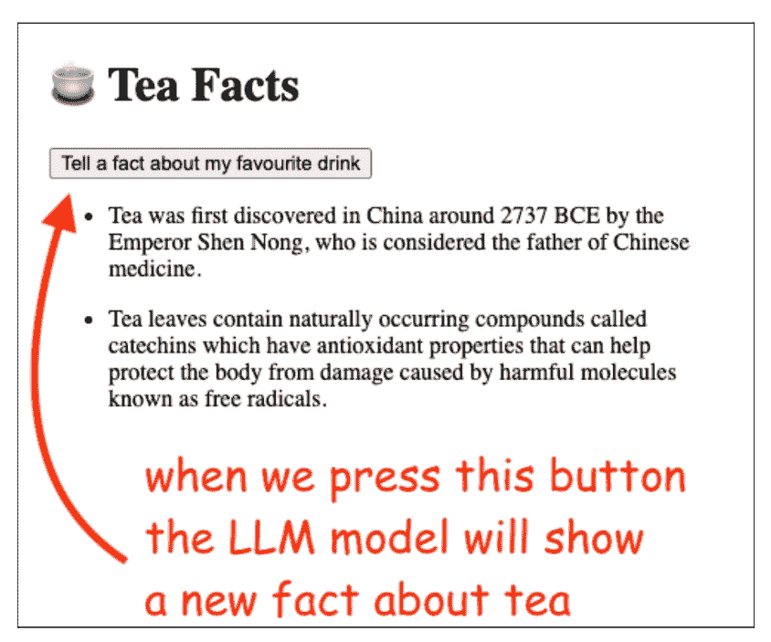

我们将从以下设置开始。

在前端，我们有一个按钮，它向 API 发送 POST 请求并打印出答案：

```javascript
// code/tea-wiki/src/app/page.js
'use client'
import { useState } from "react"

export default function Home() {
  const [answer, setAnswer] = useState()
  const tellFact = async ()=> {
    const response = await fetch('api', {
      method: "POST"
    })
    const { data } = await response.json()
    setAnswer(data)
  }

  return (
    <>
    <h1>🍵 茶知识</h1>
    <button onClick={tellFact}>
      讲一个关于我最爱饮料的事实
    </button>
    <div>{answer}</div>
    </>
  )
}
```

而后端，我们返回 GPT 模型对提示词 `告诉我一个关于我最爱饮料的事实：` 给出的答案：

```javascript
// code/tea-wiki/src/app/api/route.js
import { ChatOpenAI } from "@langchain/openai"
import { ChatPromptTemplate } from "@langchain/core/prompts"
import { StringOutputParser } from "@langchain/core/output_parsers"

const model = new ChatOpenAI({
  openAIApiKey: process.env.OPENAI_API_KEY,
  temperature: 0.9,
})

const prompt = ChatPromptTemplate.fromMessages([
  ["human", "{input}"]
])

const outputParser = new StringOutputParser()

const chain = prompt.pipe(model).pipe(outputParser)

export async function POST() {
  const question = `告诉我一个关于我最爱饮料的事实。`
  const fact = await chain.invoke({
    input: question,
  })
  return Response.json({data: fact})
}
```

## 5.2. 将消息注入对话记忆

从一开始就很清楚我们遇到了一个问题：

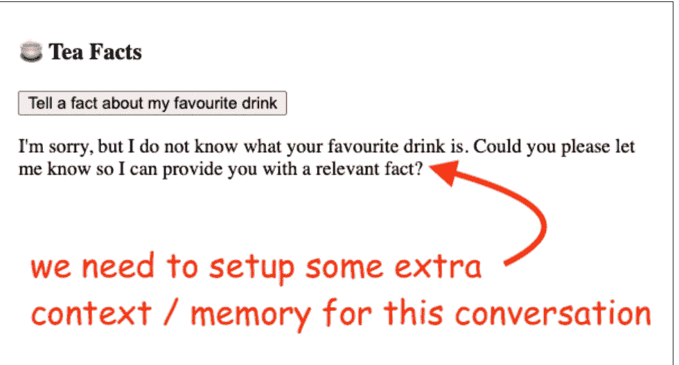

当我们调用一个链（chain）时，可以使用 `chat_history` 属性为当前对话设置记忆上下文。

让我们看看如何做到这一点！

以下是后端更新后的代码：

```javascript
// code/tea-wiki/src/app/api/route.js
import { ChatOpenAI } from "@langchain/openai"
import { ChatPromptTemplate } from "@langchain/core/prompts"
import { StringOutputParser } from "@langchain/core/output_parsers"
// 🟠 添加 HumanMessage 和 MessagesPlaceholder 的导入
import { HumanMessage } from "@langchain/core/messages"
import { MessagesPlaceholder } from "@langchain/core/prompts"

const model = new ChatOpenAI({
  openAIApiKey: process.env.OPENAI_API_KEY,
  temperature: 0.9,
})

//🟢 初始的对话记忆上下文
const chatHistory = [
    new HumanMessage(`我最爱的饮料是茶。`)
]

const prompt = ChatPromptTemplate.fromMessages([
    //🟢 我们需要告诉提示词它将拥有记忆
    new MessagesPlaceholder("chat_history"),
    ["human", "{input}"]
])

const outputParser = new StringOutputParser()

const chain = prompt.pipe(model).pipe(outputParser)

export async function POST() {
    const question = `告诉我一个关于我最爱饮料的事实。`
    const fact = await chain.invoke({
        input: question,
        //🟢 将 chatHistory 数组与提示词关联起来
        chat_history: chatHistory
    })
    return Response.json({data: fact})
}
```

这里的关键是 `MessagesPlaceholder` 对象。我们可以为提示词设置不同的消息占位符。

例如，我们可以使用 agent scratchpad 消息占位符来存储 AI 代理的“思考过程”。别担心，我们将在后面的章节中更详细地讨论 AI 代理。

在这种情况下，我们将使用带有 `chat_history` 的 `MessagesPlaceholder`，向提示词表明它不是无状态的，拥有之前的历史记录。

`chatHistory` 只是一个简单的数组，我们可以在其中用 `HumanMessage` 和 `AIMessage` 对象来存储对话历史。最终，这些对象的内容只是带有一些额外格式的简单字符串。

有了这些更改，模型现在会知道我们最爱的饮料是茶了：

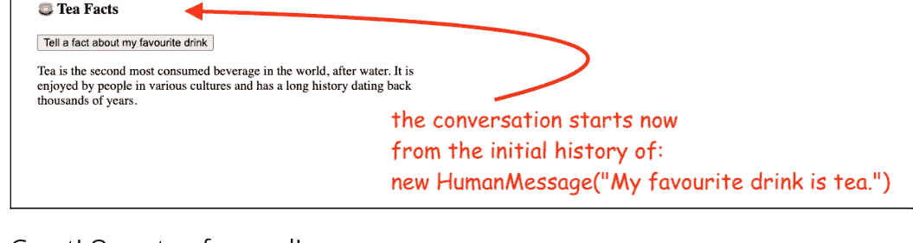

很好！向前迈进了一步！

然而，我们现在面临另一个问题。让我们看看在多次请求事实后会发生什么。

为了实现存储之前的事实，我们只更改了前端。我们将跟踪并显示模型给出的所有先前响应：

```javascript
import { useState } from 'react'

export default function Home() {
  // 将 answer 替换为 facts 数组
  const [facts, setFacts] = useState([])

  const tellFact = async ()=> {
    const response = await fetch('api', {
      method: "POST"
    })
    const { data } = await response.json()
    // 将新事实添加到数组中
    setFacts([data, ...facts])
  }

  return (
    <>
```


## 🍵 茶叶趣闻

<button onClick={tellFact}>
  讲一个关于我最爱饮品的趣事
</button>
<ul>
  {
    // 橙色圆圈：显示数组
    facts.map( (fact,i) => <li key={i}>{fact}</li>)
  }
</ul>

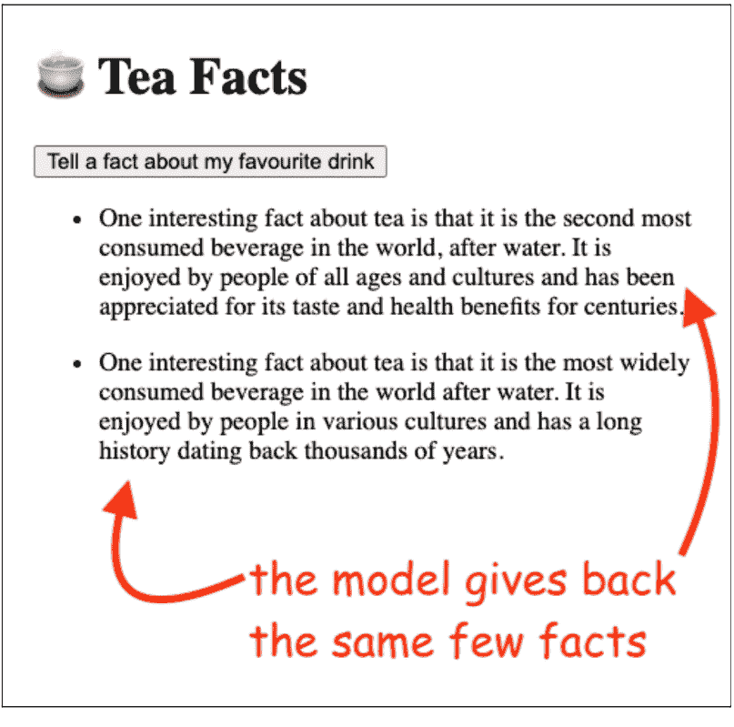

模型总是返回同样的几个事实，就像一位不停重复相同故事的老祖父。

我们可以尝试更新提示词，但这无济于事：

```javascript
// 🟠 修改提示词无法解决重复问题
const response = await chain.invoke({
  input: `Tell me a fact about my favorite drink.
    Do not repeat any of the previous facts.`,
  chat_history: chatHistory
})
```

记住，大语言模型是无状态的——这意味着每次传入的查询都是独立处理的，与其他交互无关。对于无状态模型而言，唯一存在的就是当前的输入。别无其他。

这种情况发生是因为我们只提供了初始消息（`我最爱喝的是茶`）。我们还需要随着对话的进行更新消息历史。

## 5.3. 完整对话历史

如果你看看我们如何存储对话历史，它就是一个普通的JavaScript数组。

```javascript
const chatHistory = [
    new HumanMessage(`My favorite drink is tea.`)
]
```

这意味着我们可以轻松地通过向数组中添加新项来添加消息：
- 来自用户的消息，由 `HumanMessage` 类表示
- 以及AI给出的响应，由 `AIMessage` 类表示

当我们从模型获得更多事实后，对话将呈现如下样子：

```javascript
[
    // 起始状态
    new HumanMessage(`My favorite drink is tea.`),
    // 用户点击按钮
    new HumanMessage(`Tell me a fact about my favorite drink. Do not repeat any of the previous facts.`),
    // 大语言模型回复
    new AIMessage(`Is the second most consumed beverage in the world, after water...`),
    // 用户再次点击按钮
    new HumanMessage(`Tell me a fact about my favorite drink. Do not repeat any of the previous facts.`),
    // 大语言模型回复另一个事实
    new AIMessage(`Is the second most consumed beverage in the world, after water...`),
    // 以此类推
    // ...
    // ...
]
```

对于此步骤，前端无需更改。

以下是后端完整代码的样子：

```javascript
import { ChatOpenAI } from "@langchain/openai"
import { ChatPromptTemplate } from "@langchain/core/prompts"
import { StringOutputParser } from "@langchain/core/output_parsers"
// 🟠 导入 AIMessage 类以存储大语言模型给出的响应
import { HumanMessage, AIMessage } from "@langchain/core/messages"
import { MessagesPlaceholder } from "@langchain/core/prompts"

const model = new ChatOpenAI({
    openAIApiKey: process.env.OPENAI_API_KEY,
    temperature: 0.9,
})

const chatHistory = [
    new HumanMessage(`My favorite drink is tea.`)
]

const prompt = ChatPromptTemplate.fromMessages([
    new MessagesPlaceholder("chat_history"),
    ["human", "{input}"]
])

const outputParser = new StringOutputParser()

const chain = prompt.pipe(model).pipe(outputParser)

export async function POST() {
    // 🟠 更新提示词
    const question = `Tell me a fact about my favorite drink.
                       Do not repeat any of the previous facts.`
    // 🟠 将用户发送的对话添加到聊天历史中
    chatHistory.push(new HumanMessage(question))
    const fact = await chain.invoke({
        input: question,
        chat_history: chatHistory
    })
    // 🟠 存储每个事实，以便大语言模型知道不要重复什么
    chatHistory.push(new AIMessage(fact))
    return Response.json({data: fact})
}
```

每当用户提出新问题时，我们将其包装在 `HumanMessage` 对象中并推送。

更重要的是，我们将每个关于茶叶的事实包装在 `AIMessage` 对象中。这将使大语言模型能够避免重复。

以下是我们的应用程序最终版本的外观：


多亏了更新后的对话历史版本，这里不再有重复。

最后请记住，我们可以在 `invoke()` 方法中使用 `sessionId` 配置参数来管理不同主题的多个对话线程：

```javascript
{
  configurable: {
    sessionId: "id_value_here"
  }
}
```

OpenAI ChatGPT 网页应用的做法：

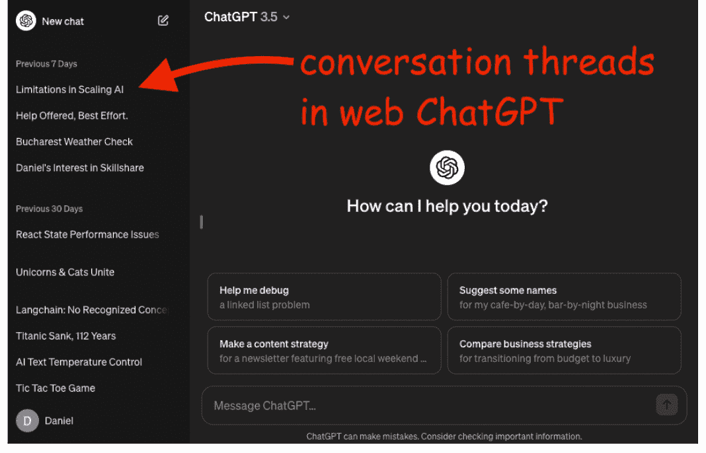

你可以在此处阅读更多详情：
https://js.langchain.com/docs/use_cases/chatbots/memory_management/

## 6. RAG / 与文档对话

### 6.1. 引言

让我们讨论一个在使用大语言模型时非常重要的话题：RAG，即检索增强生成。

RAG是通过参考训练数据源之外的知识库来优化大语言模型输出的过程。

例如，ChatGPT 3.5 Turbo的知识截止日期是2021年9月。这意味着，在没有外部帮助的情况下，模型将不知道在此日期之后发生了什么。

但是，如果我们需要处理关于LangSmith的信息呢？这是一个与LangChain同一家公司开发的工具。这个新工具是在2023年发布的，晚于知识截止日期。

或者，如果我们需要制作一个引用某组织内部文档来提供客户支持的聊天机器人呢？

这就是RAG的用武之地。使用RAG，你可以将外部数据源（如CSV文件、视频、PDF等）连接到大语言模型，并提供外部上下文。

关于RAG的一些注意事项：
- RAG不会重新训练模型。它不会更新神经网络的权重。它只是为模型提供更多可供参考的信息。
- 在下一章中，我们将讨论AI智能体。虽然AI智能体可以搜索外部信息，但它们更慢、更昂贵，并且可能提供不可靠的输出。AI智能体适用于复杂情况以及可以使用各种工具解决的if-then-else非线性情况。使用RAG，你可以预先执行知识检索过程，并为问答等场景提供快速解决方案。

但是，为什么RAG如此重要？

大语言模型训练成本高昂。非常高！例如，Meta的Llama 2模型使用了6000个GPU，运行了12天进行训练。训练成本约为200万美元。在绝大多数情况下，你并不想从头开始训练你的模型。

然而，随着时间的推移，不断有新的信息/知识产生。保持模型与新信息同步更新是一场持续的竞赛。

即使是微调也需要大量时间。

那么，另一个选择是什么？使用RAG为大语言模型提供我们所需的知识片段。

RAG既节省时间又节省金钱，因为无需训练。

### 6.2. 示例设置

我们将通过构建以下示例来探索如何将大语言模型与外部文档连接起来：

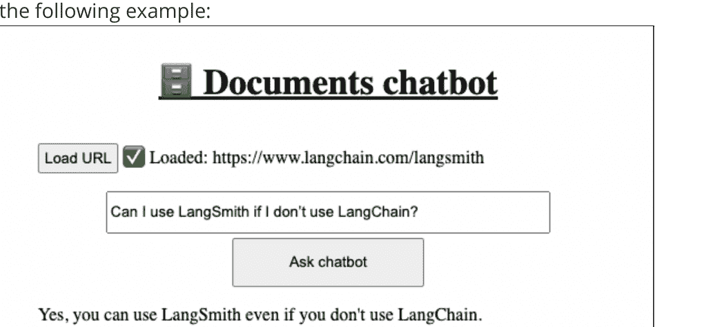

在其最终版本中，我们的应用程序将能够执行以下操作：
- 读取外部数据源
- 从文本中提取嵌入向量
- 将上一步的嵌入向量存储到本地向量数据库
- 基于此信息回答问题

这将是应用程序的数据流程：

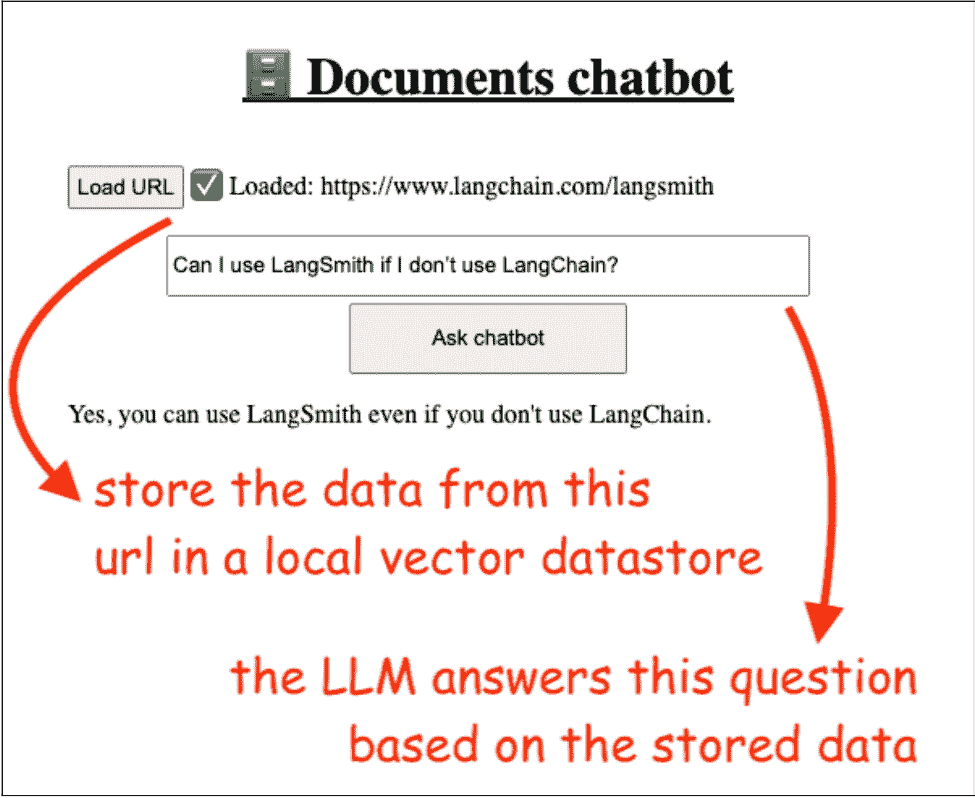

以下是初始的前端设置。我们发送一个问题并打印出响应：

```javascript
// code/rag/src/app/page.js

'use client'
import { useState } from "react"

export default function Home() {
  const [answer, setAnswer] = useState()

  const askQuestion = async (e)=> {
    e.preventDefault()
    const question = e.target.question.value
    const response = await fetch('api', {
      method: "POST",
      body: JSON.stringify({question})
    })
    const {data} = await response.json()
    setAnswer(data)
  }

  return (<>
    <h1>📄 文档聊天机器人</h1>
    <form onSubmit={askQuestion} >
      <input name="question" />
      <button>向聊天机器人提问</button>
    </form>
    <p>{answer}</p>
  </>)
}
```

而后端我们使用GPT模型来回答问题：

```javascript
// code/rag/src/app/api/route.js
import { ChatOpenAI } from "@langchain/openai"
import { ChatPromptTemplate } from "@langchain/core/prompts"
import { LLMChain } from "langchain/chains"

const model = new ChatOpenAI({
    openAIApiKey: process.env.OPENAI_API_KEY
})

const prompt = ChatPromptTemplate.fromTemplate(
    `Answer the user's question:
    Question: {input}`
)

const chain = new LLMChain({
    llm: model,
    prompt
})

export async function POST(req) {
    const { question } = await req.json()
    const data = await chain.invoke({
```


## 🖥️ 文档聊天机器人

应用程序的初始设置界面如下：

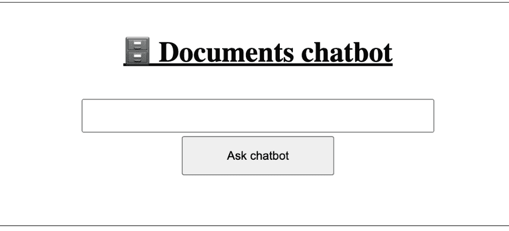

虽然这对于简单的问题运作如预期，但当我们询问超出其训练数据范围的主题时，模型的局限性就显现出来了。

例如，如果我们询问关于 **LangSmith** 的问题——一个用于部署和监控 LLM 应用程序的平台——它会给出如下所示的一般性回答：

什么是 LangSmith ？

询问聊天机器人

LangSmith 是一个语言学习平台，为希望提高语言技能的个人提供课程和资源。它提供各种课程、练习和互动工具，帮助用户有效地学习和练习语言。


✋ 这不是我们想要的答案！

你可能会说，我们可以尝试使用更新的模型。例如，我们可以尝试使用 `gpt-4o` 模型，其训练数据截至 2023 年 10 月。很可能，它会知道一些关于 **LangSmith** 的信息。然而，核心问题依然存在：我们永远在追赶模型的截止日期。

因此，是时候引入**检索增强生成**了！

我们可以使用 RAG 向模型添加新信息并克服其局限性。这些信息可以是：

-   在模型训练截止日期之后
-   在初始训练数据领域之外

所以，让我们向我们的模型解释什么是 **LangSmith**。

### 6.3. 使用本地文档

使用 LangChain 扩展 LLM 上下文最简单的方法之一是使用本地文档。

我们可以创建小片段的信息并将其提供给 LLM：

```javascript
// manualy create static documents
const documentA = new Document({
  pageContent:
    `LangSmith is a unified DevOps platform for developing,
    collaborating, testing, deploying, and monitoring
    LLM applications.`
})

const documentB = new Document({
  pageContent: `LangSmith was first launched in closed beta in
  July 2023`
})
```

在这个例子中，我们使用了简单的文本片段，但我们也可以使用本地存储的 PDF、CSV 和其他类型的文件。我们甚至可以包含视频和音频，它们可以包含更大量的信息。

让我们看看所有这些如何在后端代码中结合起来：

```javascript
// code/rag/src/app/api/route.js

import { ChatOpenAI } from "@langchain/openai"
import { ChatPromptTemplate } from "@langchain/core/prompts"
// we need the this one to create local documents
import { Document } from "@langchain/core/documents"
// createStuffDocumentsChain replaces LLMChain
import { createStuffDocumentsChain } from
"langchain/chains/combine_documents"

const model = new ChatOpenAI({
    openAIApiKey: process.env.OPENAI_API_KEY,
    // 🟠 zero temperature, no extra creativity
    temperature: 0
})

// 🟠 adding the extra context to the prompt
const prompt = ChatPromptTemplate.fromTemplate(
  `Answer the user's question from the following context:
  {context}
  Question: {input}`
)

// 🟠 manually create static documents
const documentA = new Document({
  pageContent:
  `LangSmith is a unified DevOps platform for developing,
  collaborating, testing, deploying, and monitoring
  LLM applications.`
})

const documentB = new Document({
  pageContent: `LangSmith was first launched in closed beta in
  July 2023`
})

// 🟠 updating the chain type
const chain = await createStuffDocumentsChain({
  llm: model,
  prompt,
})

export async function POST(req) {
  const { question } = await req.json()
  // 🟠 pass the documents array as the context
  const data = await chain.invoke({
    input: question,
    context: [documentA, documentB]
  })
  return Response.json({data})
}
```

请注意，使用 `createStuffDocumentsChain()` 创建的链在调用其 `invoke()` 方法时，需要接收一个 `context` 变量。

如果未能这样做，将导致以下错误：

```
Error: Prompt must include a context variable
```

`createStuffDocumentsChain()` 接收一个文档列表，将它们全部格式化到一个提示中，然后将该提示传递给 LLM。它传递**所有**文档，因此您应确保它们适合您所使用的 LLM 的上下文长度。

上下文长度是指模型一次能处理的最大单词数。可以将其视为模型的记忆或注意力范围。这是 ChatGPT 和 Llama 等基于 Transformer 的模型的一个预定特性。

以下是一些流行 LLM 的默认上下文长度：

| 模型 | 上下文大小 | 页数* |
| :--- | :--- | :--- |
| 🤖 GPT 3.5 | 4,096 | 6 |
| 🤖 GPT 4 | 8,192 | 12 |
| 🤖 GPT 4-32k | 32,768 | 49 |
| 🦙 Llama 1 | 2,048 | 3 |
| 🦙 Llama 2 | 4,096 | 6 |
| 🦙 Llama 3 | 8,192 | 12 |
| * 每页 500 个单词 | | |

扩展上下文**不会**重新训练模型；在此过程中权重保持不变。

前端将保持不变。我们只需传入问题并显示答案。

让我们来测试一下。再次询问它 `什么是 LangSmith？`，现在将从我们刚刚创建的本地文档中得到答案：

```javascript
const documentA = new Document({
  pageContent:
    `LangSmith is a unified DevOps platform for developing,
    collaborating, testing, deploying, and monitoring
    LLM applications.`
})
```

### 6.4. RAG 过程的组成部分

让我们来看一下 RAG 过程中涉及的不同组件类型：

1.  **文档加载器** - 可以将这些视为你的数据收集者。它们拉取外部信息并加载，无论是纯 `.txt` 文件、网页文本，甚至是 YouTube 视频转录稿。
2.  **转换器** - 你已经加载了文档，但有时它们需要一点改造才能完美适配你的应用程序。LangChain 的预制转换器帮助你调整文档。一个基本的例子可以是使用转换器将大文档分解成适合模型上下文窗口的较小片段。
3.  **嵌入** - 这完全关乎将数据转换为向量。`Embeddings` 类是你处理来自 OpenAI、Meta 或 Hugging Face 等嵌入模型的首选。将文本嵌入视为在向量空间中表示文本或数据的一种方式，使语义搜索之类的事情变得更快。
4.  **向量数据库** - 是时候存放我们在上一步生成的文本嵌入了。这些专用数据库旨在高效地存储和获取向量数据。它们使语义搜索变得简单快捷。我们可以瞬间提取最相关的文本。我们将在后面更深入地探讨向量数据库。
5.  **检索器** - 最后但同样重要的是，认识一下你的信息获取助手：检索器。与仅保存数据的向量存储不同，检索器会出去获取你需要的文档。虽然一些检索器可能使用向量存储，但也有各种各样的检索器是为特定任务量身定制的。

### 6.5. 向量、嵌入和向量数据库

在我们继续之前，我们需要绕个小弯，讨论一下 RAG 过程中涉及的一些基本概念。

我们将从向量开始。向量只是一个数字数组。

```javascript
// this is how a vector looks like
let vec = [2.5, 1.3, 7.0, 9.2]
```

向量的妙处在于，它们可以表示更复杂的对象，如单词、句子、音频文件，甚至图像，这些对象都存在于一个称为嵌入的高维空间中。

例如，让我们取以下条目：`蜗牛`、`飞机`、`高速列车` 和 `乌龟`。

我们可以基于以下因素将这些条目存储在一个二维嵌入空间中：

-   它们有多大
-   它们有多快

一个视觉表示可能看起来像这样：

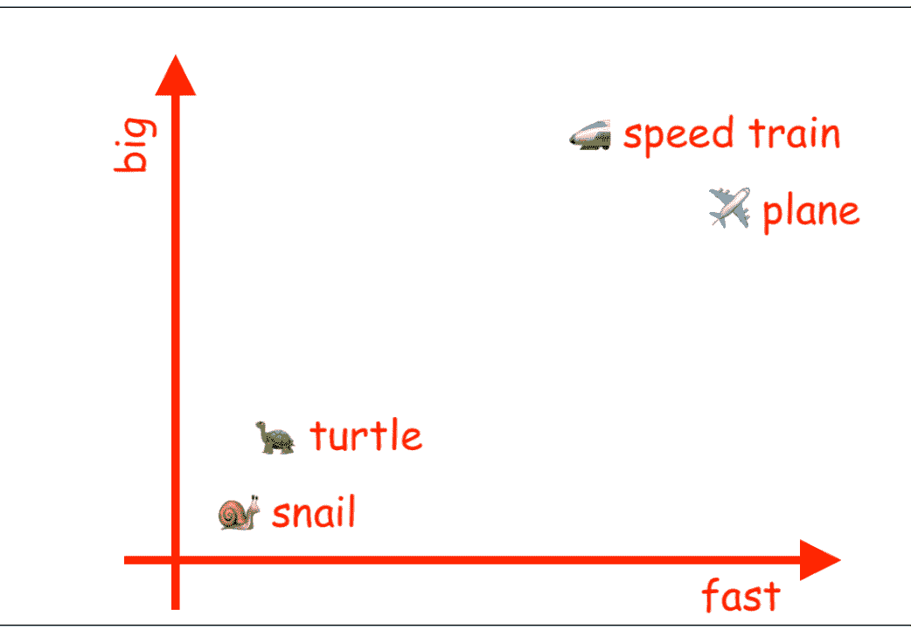

每个点都是一个具有以下格式的向量：

```javascript
[
    x, // how big is the object
    y  // how fast is the object
]
```

嵌入空间的每个轴也称为一个维度或特征。

请记住，此表示非常简化。通常，每个条目具有更多维度，范围从几十到几千，具体取决于数据的复杂性和粒度。

给定一组维度，相似的对象被分组在一起，使我们能够在任何其他数据类型中映射单词或类似特征的语义含义。

使用这些嵌入，我们可以做诸如推荐系统、搜索引擎，甚至像 ChatGPT 中那样的文本生成之类的事情。


## 6.6. 使用 CheerioWebBaseLoader 和 MemoryVectorStore

但是，一旦我们将向量条目映射到嵌入的维度，它们要存储在哪里？又如何快速查询它们呢？

这就要用到向量数据库了。在经典的关系型数据库中，我们有行和列；而在向量数据库中，我们有基于相似性分组的数字数组（向量）。

以这种方式组织数据，使我们能够以超低延迟进行相似性查询。

我们可以轻松检索这些条目之间的距离。这使得语义搜索更快，因为我们能够基于一个或多个维度轻松关联不同的概念。

目前我们可以使用的一些主要向量数据库包括：

- [Chroma](https://chroma.com)
- [Pinecone](https://www.pinecone.io)
- [Weaviate](https://weaviate.io)
- [Redis Vector Database](https://redis.io)

在前面的例子中，我们只使用了文档加载器和检索器。现在，是时候扩展我们的示例，并让其他 RAG 组件发挥作用了。

我们希望为应用添加以下功能：

- 读取用户提供的给定 URL
- 从该 URL 加载页面内容
- 创建嵌入并将结果存储在本地向量数据库中
- 从新数据中检索并回答问题

最终示例将如下所示：

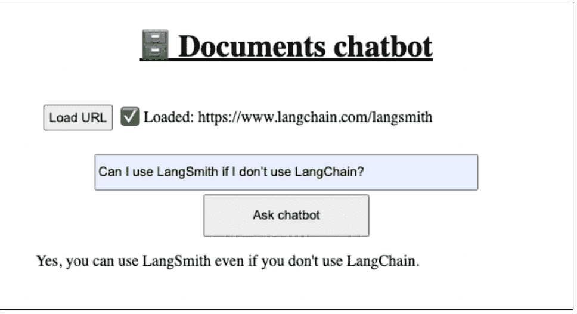

我们将从前端开始。我们将添加一个新按钮，用于请求 URL 并将其发送到后端：

```
// code/rag/src/app/page.js

'use client'
import { useState } from "react"

export default function Home() {
  const [answer, setAnswer] = useState()
  // 🔵 添加一个新的状态变量
  const [docStatus, setDocStatus] = useState(false)

  const askQuestion = async (e)=> {
    e.preventDefault()
    const question = e.target.question.value
    const response = await fetch('api', {
      method: "POST",
      body: JSON.stringify({question})
    })
    const {data} = await response.json()
    setAnswer(data)
  }

  // 🔵 请求 URL，将其传递给后端，并更新 docStatus
  const loadUrl = async (e)=> {
    const url = prompt("Please enter the URL for the document context:")
    const response = await fetch('api', {
      method: "POST",
      body: JSON.stringify({url})
    })
    const { loaded } = await response.json()
    setDocStatus(loaded ? `✅ Loaded: ${url}` : false)
  }

  return (<>
    <h1>📄 Documents chatbot</h1>
    {/* 🔵 请求 URL 并显示 docStatus */}
    <p>
      <button onClick={loadUrl}>Load URL</button>
      {docStatus}
    </p>
    <form onSubmit={askQuestion} >
      <input name="question" />
      {/* 🍊 在有文档状态之前禁用 */}
      <button disabled={!docStatus}>
        Ask chatbot
      </button>
    </form>
    <p>{answer}</p>
  </>)
}
```

默认情况下，提问表单将被禁用。一旦后端完成从 URL 加载数据，它将启用提问表单：

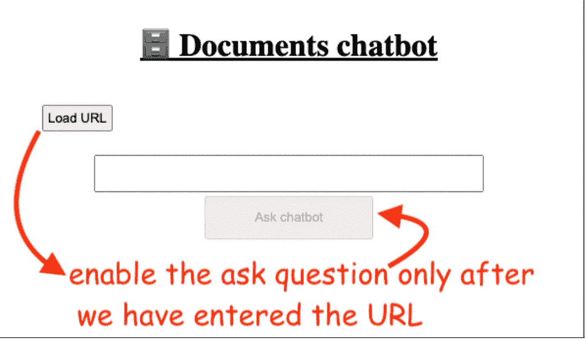

主要区别在于后端，即模型回答问题的地方。

首先，我们需要安装 `CheerioWebBaseLoader`：

```
npm install --save cheerio
```

现在，让我们先看完整的代码，稍后再深入解释：

```
import { ChatOpenAI } from "@langchain/openai"
import { ChatPromptTemplate } from "@langchain/core/prompts"
import { createStuffDocumentsChain } from
"langchain/chains/combine_documents"
// 可以检索网页内容的文档加载器
import { CheerioWebBaseLoader } from
"langchain/document_loaders/web/cheerio"
// 用于创建向量和嵌入的工具
import { RecursiveCharacterTextSplitter } from
"langchain/text_splitter"
import { OpenAIEmbeddings } from "@langchain/openai"
import { MemoryVectorStore } from
"langchain/vectorstores/memory"
// 检索工具
import { createRetrievalChain } from
"langchain/chains/retrieval"

const model = new ChatOpenAI({
    openAIApiKey: process.env.OPENAI_API_KEY,
    temperature: 0
})

const prompt = ChatPromptTemplate.fromTemplate(
    `Answer the user's question from the following context:
    {context}
    Question: {input}`
)

let retrievalChain, splitDocs

// RAG 过程
async function loadDocumentsFromUrl(url) {
    // 文档加载器
    const loader = new CheerioWebBaseLoader(url)
    const docs = await loader.load()

    // 文档转换器
    const splitter = new RecursiveCharacterTextSplitter({
        chunkSize: 100,
        chunkOverlap: 20,
    })

    splitDocs = await splitter.splitDocuments(docs)

    // 🔵 设置嵌入
    const embeddings = new OpenAIEmbeddings()

    // 🔵 创建一个本地向量数据库
    const vectorstore = await MemoryVectorStore.fromDocuments(
        splitDocs,
        embeddings
    )

    // 🔵 我们用于从向量数据库获取数据的工具
    const retriever = vectorstore.asRetriever()

    const chain = await createStuffDocumentsChain({
        llm: model,
        prompt
    })

    retrievalChain = await createRetrievalChain({
        combineDocsChain: chain,
        retriever
    })
}

export async function POST(req) {
    const { question, url } = await req.json()
    // 🔵 如果用户发送了 URL，则设置 RAG 并返回
    if (url) {
        await loadDocumentsFromUrl(url);
        return Response.json({ loaded: true });
    }
    const data = await retrievalChain.invoke({
        input: question,
        context: splitDocs
    })
    return Response.json({data: data.answer})
}
```

在这段代码中，我们看到了上一章描述的 RAG 组件在实际运行。

首先，我们从用户提供的 URL 加载原始文本：

```
const loader = new CheerioWebBaseLoader(url)
const docs = await loader.load()
```

这只是 LangChain 提供的一种加载器类型。你可以在此处查看完整的[加载器列表](https://example.com)。

我们有两类加载器可用：

- 文件加载器，例如 CSV、PDF、EPUB 等
- 以及网络加载器，例如 Figma、Amazon S3、Youtube 字幕等

一旦原始文本加载完成，我们就开始将文本（人类可理解）转换为数字向量（AI 可理解）的过程：

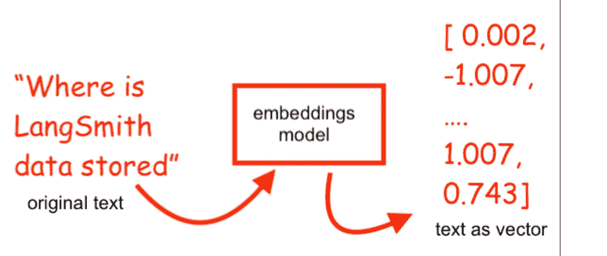

这个分割器是为处理通用文本而设计的。它尝试按顺序在这些字符处分割文本，直到生成的文本块达到最佳大小。

默认情况下，它使用包含 ["\n\n", "\n", " ", ""] 的列表。此配置旨在首先保持段落的完整性，然后是句子，最后是单词，因为这些片段通常表现出最高的语义连贯性。

文本按字符列表进行分割，块大小通过字符数来衡量：

```
const splitter = new RecursiveCharacterTextSplitter({
    chunkSize: 100,
    chunkOverlap: 20,
})
splitDocs = await splitter.splitDocuments(docs)
const embeddings = new OpenAIEmbeddings()
```

接下来，我们将所有这些嵌入存储在向量数据库中。在这个小例子中，我们使用了本地数据库。对于生产环境，我们可以使用真实的向量数据库服务，例如 Chroma 或 Pinecone。

```
const vectorstore = await MemoryVectorStore.fromDocuments(
    splitDocs,
    embeddings
)
```

我们每次运行 RAG 查询时都必须重新创建嵌入吗？这对于小文件可能适用，但对于较大的文件，创建嵌入的过程可能非常耗时。

例如，我们可以在创建 Chroma 数据库对象时设置一个参数，比如 `persist_directory`，指定一个有效的本地路径。这样，当你使用文件创建向量数据库时，它将被存储在指定的位置。之后，它将从该位置加载，从而显著减少处理时间。

`createRetrievalChain()` 接收用户的查询，然后将其传递给检索器以获取相关文档。这些文档（以及原始输入）随后被传递给大语言模型以生成响应。

最后，我们将构建一个检索器，供链用于从向量数据库中获取信息。

```
const retriever = vectorstore.asRetriever()
const chain = await createStuffDocumentsChain({
    llm: model,
    prompt
})
retrievalChain = await createRetrievalChain({
    combineDocsChain: chain,
    retriever
})
```

顺便提一下，谷歌的 Gemini 1.5 模型拥有百万级令牌的上下文窗口，并且正在研究千万级令牌的上下文。它如此之大，以至于你可以包含整个知识库、书籍或电影，而无需担心上下文限制。有些人认为这会使 RAG 过时。然而，这不太可能，原因如下：

1. 💸 成本 - 你仍然需要为每个令牌付费。谷歌很可能很乐意让你每次 API 调用都支付一百万个令牌的费用。所以，祝你拥有一次 100 美元的 API 调用好运。
2. 🐌 缓慢 - API 调用将非常巨大，响应也会很慢。
3. 🔍 故障排除 - 超大的上下文是不可调试的。如果出现问题，你无法像 RAG 那样分解它来查看错误来源。

一个有趣的实验可以是拿一本像这样的书，使用 RAG 将其内容馈送给一个大语言模型。用户之后可以与那个大语言模型互动，使用这本书中的方法学习 LangChain。或者只是让模型提供复习问题。

也许这将是我们未来消费技术书籍的方式。


# 7. AI智能体

到目前为止，我们已经研究了如何创建链。链遵循我们预先指定的预定序列。

智能体则不同，我们只需给它们一个目标，它们就会动态地找出采取的最佳行动方案以及这些行动的顺序，以达到最终目标。

我们将为智能体分配工具，智能体会尝试判断何时使用工具来完成任务。

在此之前，我们主要将大语言模型用作NLP（自然语言处理）工具。AI智能体更接近我们所想象的“真正的人工智能”。

拥有目标、尝试不同的方法、与环境交互以及做出决策，这些都更符合我们对真正智能的理解。

我们的任务是构建一个工具，帮助记者为新文章进行调研。这个工具需要能够搜索维基百科并执行精确的数学计算。

在本章结束时，我们将构建一个应用程序，它将执行以下操作：

-   从用户那里读取一个问题
-   使用智能体来回答这个问题
-   输出将包含问题的答案以及智能体用来找到该答案的工具。

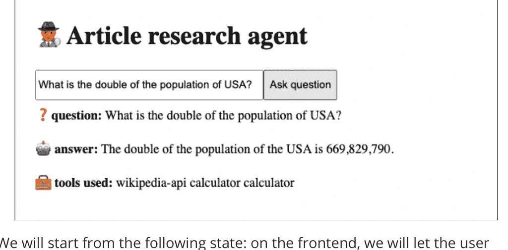

我们将从以下状态开始：在前端，我们将允许用户输入一个问题并将该问题提交给服务器。当响应到达时，我们将显示其文本内容。

```
// code/agents/src/app/page.js

"use client";
import { useState } from "react";

export default function Home() {
  const [data, setData] = useState();
  const onSubmitHandler = async (e) => {
    e.preventDefault();
    const question = e.target.question.value;
    if (question) {
      const response = await fetch("api", {
        method: "POST",
        body: JSON.stringify({
          question,
        }),
      });
      const { data } = await response.json();
      setData(data);
    }
  };
  return (
```

```
<>
    <h1>🕵️‍♂️ Article research agent</h1>
    <form onSubmit={onSubmitHandler}>
      <input name="question" />
      <button>Ask question</button>
    </form>
    <p>{data?.text}</p>
  </>
  );
}
```

在后端，我们将向GPT-4 Omni模型询问用户输入的问题。

```
// code/agents/src/app/api/route.js
import { ChatOpenAI } from "@langchain/openai"
import { PromptTemplate } from "@langchain/core/prompts"
import { StringOutputParser } from "@langchain/core/output_parsers"

const model = new ChatOpenAI({
    modelName: "gpt-4o",
    openAIApiKey: process.env.OPENAI_API_KEY,
})

const prompt = new PromptTemplate({
    inputVariables: ["question"],
    template: "Answer the user {question}",
})

const chain = prompt
                    .pipe(model)
                    .pipe(new StringOutputParser())

export async function POST(req) {
    const { question } = await req.json()
```

```
const data = await chain.invoke({
    question
})
return Response.json({data})
}
```

我们应用的初始版本似乎运行得相当不错。例如，如果我们让它给我们讲个笑话，一切都能按预期进行。


但如果我们问“谁赢得了2024年超级碗？”，训练数据集的局限性就开始显现了。鉴于模型是在2023年10月之前的数据上训练的，它不知道答案。


# 7.2. 制作一个智能体

是时候制作我们的第一个智能体了。为了克服训练数据集带来的限制，我们将赋予聊天机器人自行进行在线研究的选项。

为了完成工作，智能体需要访问特定的工具，例如谷歌或维基百科的搜索功能。通过将GPT模型与这些工具相结合，智能体可以确定实现其目标所需的操作。

如果我们查看工具文档，将会看到完整的可用选项列表 [https://js.langchain.com/docs/integrations/tools/](https://js.langchain.com/docs/integrations/tools/)。


虽然加载所有可用工具可能很诱人，但只为智能体配备必要的工具至关重要。提供过多的选项可能导致以下一种或多种情况：

-   智能体选择了不合适的工具
-   每次API调用的成本更高；智能体会使用更多的token
-   网络延迟增加

针对我们的用例，我们将仅为智能体配备两个工具。一个维基百科搜索工具和一个数学计算器。

```
const wikipediaQuery = new WikipediaQueryRun({topKResults: 1})
const calculator = new Calculator()
const tools = [wikipediaQuery, calculator]
```

请注意，对于`Calculator`工具，您需要安装`@langchain/community`包：

```
npm install @langchain/community
```

等等，什么？！给AI模型用数学计算器？嗯，因为神经网络是通过估计事物工作的，它们并不擅长数学。它们搞砸基础数学运算的可能性很小。因此，使用基础数学工具来执行这些运算更安全、更快。

这个工具集将被传递给一个AI智能体。每种智能体类型都有其独特的用途，正如文档中所见：
https://js.langchain.com/docs/modules/agents/agent_types/。例如，结构化聊天（Structured Chat）针对多次来回交互进行了优化。

我们将使用ReAct智能体，这是最通用的操作智能体。顺便提一下，ReAct智能体与JavaScript的React框架毫无关系。

后端完整代码如下所示：

```
// code/agents/src/app/page.js
import { ChatOpenAI } from "@langchain/openai"
import { WikipediaQueryRun } from
"@langchain/community/tools/wikipedia_query_run"
import { createReactAgent, AgentExecutor } from
"langchain/agents"
import { Calculator } from
"@langchain/community/tools/calculator"
import { pull } from "langchain/hub"

const model = new ChatOpenAI({
  modelName: "gpt-4o",
  openAIApiKey: process.env.OPENAI_API_KEY
})

// 🟠 为智能体制作工具箱
// 🟠 记得运行 'npm install @langchain/community'
const wikipediaQuery = new WikipediaQueryRun({topKResults: 1})
const calculator = new Calculator()
const tools = [wikipediaQuery, calculator]

// 🟠 获取智能体规则集
const prompt = await pull("hwchase17/react")
```

```
// 🟠 定义智能体和智能体执行器
const agent = await createReactAgent({
  llm: model,
  tools,
  prompt
})

const agentExecutor = new AgentExecutor({
  agent,
  tools
})

export async function POST(req) {
  const { question } = await req.json()
  const response = await agentExecutor.invoke({
    input: question
  })
  return Response.json({data: response, prompt})
}
```

以下是前端代码：

```
// code/agents/src/app/page.js
'use client'
import { useState } from "react"

export default function Home() {
  const [data, setData] = useState();

  const onSubmitHandler = async (e) => {
    e.preventDefault();
    const question = e.target.question.value;
    if (question) {
      const response = await fetch("api", {
        method: "POST",
        body: JSON.stringify({
          question,
        }),
      });
      const result = await response.json();
      setData(result.data);
    }
  };

  return (
    <main>
      <form onSubmit={onSubmitHandler}>
        <input name="question" />
        <button type="submit">Submit</button>
      </form>
      {data && <p>{data}</p>}
    </main>
  );
}
```

```
}),
    });
    const { data } = await response.json();
    setData(data);
  }
};

return (
    <>
      <h1>🕵️‍♂️ Article research agent</h1>
      <form onSubmit={onSubmitHandler}>
        <input name="question" />
        <button>Ask question</button>
      </form>
      {data && (
        <div>
          <p>
            <b>❓ question:</b> {data.input}{" "}
          </p>
          <p>
            <b>🤖 answer:</b> {data.output}{" "}
          </p>
        </div>
      )}
    </>
  );
}
```

此时，如果我们再次询问模型“谁赢得了2024年超级碗？”，它将能够使用维基百科工具来搜索答案。


天哪，泰勒·斯威夫特一定很开心！


## 7.3. 监控代理与性能考量

代理非常强大，但它们也存在一些代价。它们可能：

* 🐢 响应速度慢
* ⚡️ 计算成本高
* 🎲 有时可能给出随机结果

幸运的是，我们有一些方法来控制代理的自主行为。

让我们更新后端代码，添加一些监控和性能增强功能。

在 `AgentExecutor` 的构造函数中添加以下代码行：

```javascript
// code/agents/src/app/api/route.js

const agentExecutor = new AgentExecutor({
  agent,
  tools,
  verbose: true,
  returnIntermediateSteps: true,
  maxIterations: 4,
})
```

并在前端返回的 HTML 中添加这段代码：

```javascript
// code/agents/src/app/page.js
data && (<div>
  <p><b>❓ 问题：</b> {data.input}</p>
  <p><b>🤖 回答：</b> {data.output}</p>
  <p><b>🧰 使用的工具：</b> {
    data.intermediateSteps.map(step => step.action.tool)
  }</p>
</div>)
```

此时，如果我们问代理：“巴西赢得世界杯后过去了多少年？”我们会得到以下结果：

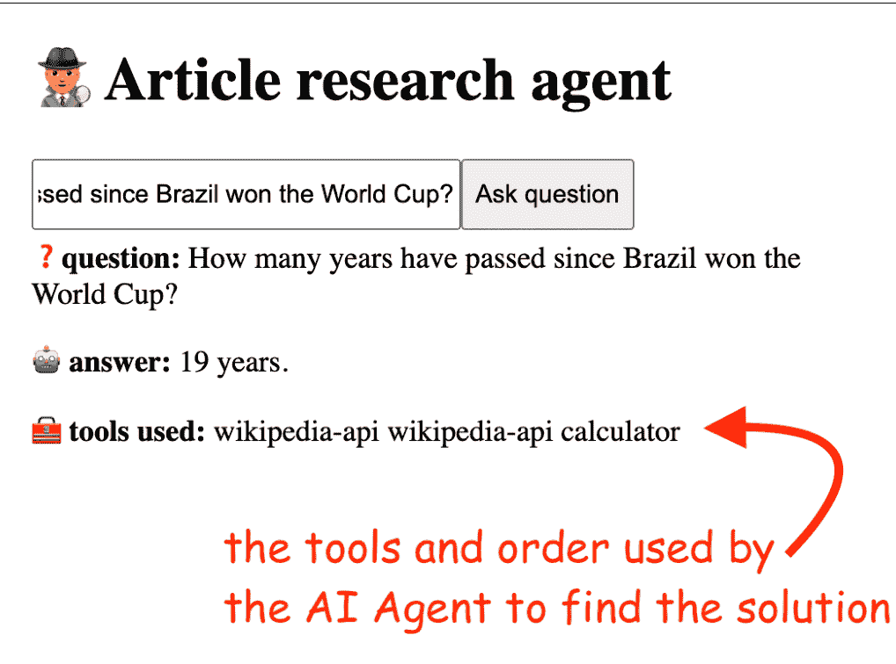

我们来稍微谈谈新增的选项。

首先，`maxIterations` 选项限制了代理尝试寻找解决方案的次数。这是一个很好的选项，可以加快响应速度并确保我们不会陷入无限循环。

与之前的用例一样，`verbose` 选项会在后端控制台中打印导致给定结果的推理过程。例如，当被问到“圆周率 PI 的两倍是多少？”时，它会打印类似这样的内容：

```
[chain/start] [1:chain:AgentExecutor > 18:chain:ReactAgent > 22:prompt:PromptTemplate] Entering Chain run with input: {
  "input": "What is the double of PI?",
  "steps": [
    {
      "action": {
        "tool": "wikipedia-api",
        "toolInput": "PI",
        "log": "PI is a mathematical constant that can be found on Wikipedia\nAction: wikipedia-api\nAction Input: PI"
      },
      {
        "action": {
          "tool": "calculator",
          "toolInput": "2*3.14159",
          "log": "I know that PI is approximately equal to 3.14159, so I can calculate the double of it\nAction: calculator\nAction Input: 2*3.14159"
        },
      ],
      "content": "I now know the final answer\nFinal Answer: 6.28318"
}
```

这相当酷，不是吗？

第三个选项 `returnIntermediateSteps`（[文档链接在此](https://docs.python.langchain.com)）会打印代理使用的工具及其顺序。代理是自主的，可以决定自己的行动集。

例如，维基百科工具足以回答“谁赢得了2024年超级碗？”这个问题。另一方面，“巴西赢得世界杯后过去了多少年？”这个问题则需要同时使用维基百科和计算器工具。通过这个选项，我们可以监控代理是否在为任务使用正确的工具。

## 7.4. 回顾

代理和工具使用，通常是 LangChain 的关键概念。

从高层次上讲，代理涉及使用一个大语言模型（LLM），并要求它推理应该采取哪些行动，然后执行这些行动。这通常在一个循环中完成，循环重复进行，直到 LLM 决定已达到目标，或者没有其他可采取的行动。

工具代表语言模型可以采取的行动，以及实现这些行动的函数。

代理与代理执行器结合在一起。这个代理执行器本质上是一个循环，运行以调用 LLM 来确定代理接下来应该尝试使用哪个工具，除非它已达到目标。

代理是基于提示构建的，正如您可能从代码中注意到的：

```javascript
const prompt = await pull("hwchase17/react")

const agent = await createReactAgent({
  llm: model,
  tools,
  prompt
})
```

存在许多不同类型的代理。您可以在[此页面](https://python.langchain.com/docs/modules/agents/agent_types/)上看到目前可用的五种主要代理类型。

### 何时使用

我们关于您何时应考虑使用此代理类型的评论。

| 代理类型 | 预期模型类型 | 支持聊天历史 | 支持多输入工具 | 支持并行函数调用 | 所需模型参数 |
|---|---|---|---|---|---|
| OpenAI Tools | Chat | ✅ | ✅ | ✅ | `tools` |

有些适合本地模型，有些适合最新的 OpenAI 模型，有些支持并行函数调用，有些支持对话历史。另一些则非常适合使用简单工具和单一输入，因为它们具有通用的提示策略。

在讨论 AI 代理时，请注意还有许多其他主题、概念、技术、提示和功能。我们在本章中讨论的只是对该主题非常简要的介绍。

## 7.5. 结语

希望您喜欢这本书！

我很想得到您的反馈。请告诉我您喜欢什么，不喜欢什么，以便我能改进这本书。

我很想得到您的反馈，并了解您喜欢什么，不喜欢什么，以便我能改进这本书。

请随时通过 [daniel@js-craft.io](mailto:daniel@js-craft.io) 向我发送电子邮件，以获取本书的更新版本。如果您认为我应该涵盖更多主题，请给我发邮件。我很乐意听到您的声音！

如果您喜欢这本书，如果您能留下评论，我将不胜感激。

谢谢，朋友，继续编码吧！
