# JavaScript开发者的 LangChain 指南

## 1. 引言

### 1.1. 获取书籍更新和代码示例

要获取书籍的最新版本，请通过邮件 `daniel@js-craft.io` 订阅我们的列表。我努力保持书籍的更新。为了获取最新内容，请确保订阅 `daniel@js-craft.io`。

### 1.2. 关于作者

你好，我是 Daniel，一名软件开发者和教育者。我一直喜欢教学。我相信教育是改进软件的关键。

你可以在这里找到我：

- GitHub: `github.com/daniel-nastase`
- Twitter: `twitter.com/danielnastase`
- Mastodon: `mastodon.social/@danielnastase`
- YouTube: `youtube.com/danielnastase`

### 1.3. 本书是如何产生的

我第一次写计算机程序是 26 年前，当时朋友向我展示了 ChatGPT。它感觉就像魔法一样。但这一次我知道它是如何工作的。

于是，我进入了“学习 AI 如何工作”的兔子洞。天哪，这是一个非常深的洞。我正尝试从零开始构建和训练。一段时间后，我唯一的项目是一个[纯神经网络](https://github.com/daniel-nastase/Pure-neural-network)。该模型用于识别手绘形状是否为数字。

一段时间后我放弃了。面对所有不同的架构、神经元、训练数据集、反向传播或梯度下降，这对我那平庸的大脑来说太复杂了。

因此，我回到了我作为 Web 开发者的日常工作中。但在脑海深处，我仍然觉得应该关注 AI。因此决定再次尝试 AI。但这次是从更实用的角度出发。

### 1.4. 什么是 LangChain

`LangChain` 是一个旨在简化集成大语言模型（LLM）应用程序创建的框架。

`LangChain` 在一个框架中提供了所有的 AI 集成构建块。它提供了一个模块化、灵活且可扩展的架构。

你可以将 `LangChain` 看作 AI 生态系统中几乎所有内容的胶水层。

通过学习 `LangChain`，你将对 AI 生态系统的结构、工作流和实践有深入的理解。

`LangChain` 的一些用例包括：

- LLM 是在人类编写的非结构化文本上训练的。虽然这对人类交互效果良好，但对于将未格式化的文本发送到 API 可能效果并不佳。API 需要的是类似 `JSON` 的结构化数据。
- `LangChain` 可以格式化 LLM 交互中的输入和输出。
- LLM 是无状态的。它们不会记得你是谁或你几秒前说了什么。`LangChain` 提供对长期和短期记忆的支持。
- LLM 速度可能慢。`LangChain` 可以在响应生成时进行流式传输，为用户提供快速反馈。
- LLM 有截止日期。例如，GPT-3.5 没有 2021 年之后的训练数据。GPT-4 不知道 2023 年之后的任何信息。通过 `LangChain`，我们可以创建并管理 AI 代理，让它们上线、搜索信息并使用工具解析这些信息。
- 我们可以将多个 LLM 链起来。例如，我们可以使用 Google 的 Gemini 生成文章，然后将文本传递给 Midjourney 为该文章生成图像。
- LLM 缺乏对内部文档的访问。我们可以使用检索增强生成（`RAG`）为模型提供额外的上下文，使其根据组织的规则和知识与用户交互。`LangChain` 拥有一套非常强大的 RAG 操作工具集。
- `LangChain` 抽象了上述操作，方便根据需要更换组件。想因为更好或更便宜而使用不同的 LLM 吗？想更改向量数据库来存储嵌入？`LangChain` 都能为你解决。
- `LangChain` 标准化了与 LLM 工作时的通用模式。虽然可以在不使用 `LangChain` 的情况下创建任何应用，但它简化了过程并比手动提示（prompting）好得多。
- 如果你想深入研究这个主题，我建议收听 Latent Space 播客中关于 `LangChain` 创始人 Harrison Chase 的那集节目。

### 1.5. 本书概述

在本书中，我们将开启一段有趣、实战且务实的 `LangChain` 学习之旅。每个主章节都有一个关联的示例应用程序，该程序会在章节期间逐渐演进。每一步都以易于理解的方式引入新的 `LangChain` 概念，而不会让你感到压力。本书被刻意分为短小的章节，每章关注不同的主题。

- **第 1 章**：我们将使用一个“故事生成器”应用介绍 `LangChain` 的基础。我们将连接第一个 LLM，并使用提示模板和链。我们将深入研究模板、模板组合等内容。
- **第 2 章**：在第 1 章的基础设置之后，本章将引入流式传输的概念。使用同一个“故事生成器”应用，我们将流式传输 LLM 的响应以改进用户体验。
- **第 3 章**：LLM 的挑战之一是它们以非结构化的格式给出响应，因为它们是在人类理解的文本上训练的。在本章中，我们将通过使用 `ChatGPT` 从零创建一个问答游戏来学习输出解析器。
- **第 4 章**：记忆模块为 `LangChain` 应用提供了 LLM 记忆。我们可以像 `ChatGPT` 那样记住当前会话中的过去对话和响应。在本章中，我们将构建一个“事实百科全”应用。
- **第 5 章**：`LangChain` 的关键特性之一是支持 `RAG` - 检索增强生成。在本章中，我们将构建一个根据外部上下文回答问题的聊天机器人应用。我们将看到如何从 PDF 或在线文档等来源提供数据、什么是嵌入以及向量数据库是如何工作的。
- **第 6 章**：与链相比，AI 代理更加灵活和多功能，它们帮助你构建复杂的解决方案，并允许访问 Google 搜索和数学计算器等第三方工具。它们可以在给定情况下决定使用什么适当的工具。

从构建“故事生成器”到创建“问答游戏”以及真实的“聊天机器人应用”，每一章都会逐渐扩展你的理解。到结束时，我们将探索流式传输、输出解析、记忆模块、AI 代理和 RAG 能力，赋予你开发复杂解决方案的能力。

### 1.6. 要求以及如何使用本书

`LangChain` 提供了 `JavaScript` 和 `Python` 两种实现。在本书中，我们的重点放在 `JavaScript` 上。

你会发现，通过跟随书中提供的示例进行编码学习效果最好。我的建议是最初通读每一章，吸收内容以掌握概念。然后在第二遍时，随着进度进行编码。

我们将结合使用 `LangChain`、`React` 和 `Next.js`。虽然要求你对 `React` 有基础了解，但不需要成为专家。设置 `Next.js` 的最简单方法是利用 `create-next-app` 工具。

在大多数情况下，我们的工作将仅限于两个文件：

- `src/app/page.js` - 处理前端；其主要功能是显示信息和数据。
- `src/app/api/route.js` - 管理后端；此文件将处理与 LLM 的 API 交互。

示例将以逐步迭代的方式进行。每次修改将用 `+` 符号标记，并提供修改文件的路径以供参考。例如：

```javascript
// src/app/page.js - 更新文件的路径

// 添加 PromptTemplate 以避免重复 - 文件更改
import { PromptTemplate } from "@langchain/core"

// 创建一个新的 ChatGPT 模型 - 文件更改
const model = new ChatGPT({
  openApiKey: process.env.OPENAI_API_KEY,
  temperature: 0.9
})
```

请注意，`LangChain` 目前正在经历开发且变化迅速。虽然我会努力频繁更新本书，但可能会出现短暂的方法名称或导入语句与最新版本不匹配的情况。如需帮助，请随时通过邮件联系 `daniel@js-craft.io`。

## 2. 模型、提示词与链

### 2.1. 引言

现在是使用 `LangChain` 和 `JavaScript` 创建我们的第一个应用了。你被分配创建一个名为“故事制作器”的应用。该应用将为儿童故事生成标题。这是应用程序的 UI 样式：

例如，如果我们指定一个独角兽为主角的故事，应用程序将生成这样的故事标题：

“独角兽的魔法冒险”

### 2.2. 开始

最简单的方法是使用 `create-next-app` 工具。一旦安装了它，创建一个名为 `story-generator` 的项目：

`yarn create next-app`

或者，你可以使用代码示例中的起始代码。只需在示例文件夹内运行 `npm install`。

我们需要安装几个 npm 依赖项：`LangChain` 和 `OpenAI`。进入项目根目录，并在终端中执行以下命令：

```bash
npm i langchain @langchain/openai
```

在编写本书时，这些是安装模块的当前版本：

```json
{
  "@langchain/openai": "0.0.14",
  "langchain": "0.1.19"
}
```

请注意，`LangChain` 目前正处于快速发展阶段，随着版本的迭代，某些代码可能会过时。我正努力保持书籍的更新，但如果由于某种原因导致代码报错，退回到这些版本号可能是明智之举。

一旦设置好依赖项，我们将使用 `React` 创建应用程序的前端。

将以下代码插入 `src/app/page.js`：

```javascript
// code/story-generator/src/app/page.js

export default function Home() {
  const onSubmitHandler = async (event) => {
    event.preventDefault()
    const subject = event.target.subject.value
    console.log(subject)
  }

  return (
    <>
      <h1>The Story Maker</h1>
      <em>此应用使用 GPT 模型来为儿童生成故事。</em>
      <form onSubmit={onSubmitHandler}>
        <label htmlFor="subject">故事的主题:</label>
        <input name='subject' placeholder='subject...' />
        <button>Ask AI Model</button>
      </form>
    </>
  )
}
```

在此阶段并没有特别显著的特点。它只是一个 React UI，从文本输入框获取故事主题并将其打印到控制台。

我们将通过在终端中执行以下命令来启动应用：`npm run dev`

这将生成以下输出：

目前，如果用户输入主题，将不会生成故事，因为我们还没有将应用与 `OpenAI` 集成。我们将在下一章解决这个问题。

### 2.3. OpenAI ChatGPT 模型的 API key

要使用 OpenAI 的 `ChatGPT` 模型，你需要一个 API key。该 API 是基于订阅制的，可以通过以下 URL 生成密钥：`https://platform.openai.com/api-keys`

你可以为账户充值最小金额。例如，编写本书中的所有用例花费了我少于 2 美元。

一旦生成了 API key，返回 `Next.js` 项目并将其粘贴到 `.env` 文件中：

```env
// code/story-generator/.env
OPENAI_API_KEY='sk-1234567890B2tT4HT3BlbkFJXkATN1arB9DXABkRQ1uj'
```

此密钥将仅用于我们应用程序的后端部分。要在 `code/story-generator/src/app/api/route.js` 文件中访问 API key，我们可以写如下代码：

```javascript
// code/story-generator/src/app/api/route.js
console.log(process.env.OPENAI_API_KEY)
```

密钥稍后将被传递给 `LangChain` 模型对象的构造函数。这一步骤将是本书后续章节中每个代码示例的默认流程。

[如果你不想使用 API key，可以查看此列表](https://js.langchain.com/docs/modules/model_io/models/)，了解 `LangChain` 支持的 LLM 并选择一个免费模型。你甚至可以使用免费的 `HuggingFace` token 来避开 `OpenAI` API。

### 2.4. 使用 ChatOpenAI LangChain 模型

让我们通过建立与 `OpenAI` LLM 的连接来继续。在应用后端的 `src/app/api/route.js` 文件添加以下代码：

```javascript
// code/story-generator/src/app/api/route.js
import { ChatOpenAI } from "@langchain/openai"

const model = new ChatOpenAI({
  openAIApiKey: process.env.OPENAI_API_KEY,
  temperature: 0.9
})

export async function POST(req) {
  const { subject } = await req.json()
  const gptResponse = await model.invoke(subject)
  return Response.json({data: gptResponse})
}
```

要与 `OpenAI` 建立连接，创建一个 `ChatOpenAI` 对象的实例。在其构造函数中，我们定义了以下内容：设置为 `0.9` 的 `temperature` 参数；以及上一节获取的 API key。

你可能对这个 `temperature` 参数好奇，对吧？`temperature` 参数影响模型的想象力。增加它会产生更具创造性的输出，而降低它则会让响应更贴实、更事实。坚持事实可以减少模型潜在的不准确性或幻觉。

选择合适的 `temperature` 取决于任务。对于脑风暴吸引人的故事标题，较高的温度更为理想。对于准确性至关重要的任务（如总结法律文件），较低的温度更好。

设置好 `temperature` 后，现在让我们更新应用的前端：

```javascript
// code/story-generator/src/app/page.js
export default function Home() {
  const onSubmitHandler = async (event) => {
    event.preventDefault()
    const subject = event.target.subject.value
    // 使用 subject 调用 LLM
  }
  // ...
}
```

设置好温度后……“艾莎是《冰雪奇缘》的主角。她是阿伦德尔的女王，拥有创造冰雪的魔法能力。”

请注意，你的答案可能会有些不同。与经典方式相反，LLM 可以对相同的输入给出不同的输出。例如，请求如：“给我讲一个关于猫的故事标题。”

### 2.5. 提示词模板

你很快会发现提示词需要重复输入，例如“给我讲一个关于”后面跟着主题。这种冗余可以通过模板解决，我们稍后探讨。

在进入下一章之前，让我们对应用进行一个小调整。使用状态变量在 UI 中显示 LLM 给出的故事标题。

```javascript
// code/story-generator/src/app/page.js
'use client'
import { useState } from "react"

export default function Home() {
  const [storyTitle, setStoryTitle] = useState()
  const onSubmitHandler = async (e) => {
    e.preventDefault()
    const subject = e.target.subject.value
    const response = await fetch('api', {
      method: "POST",
      body: JSON.stringify({ subject })
    })
    const { data } = await response.json()
    setStoryTitle(data)
  }

  return (
    <>
      <h1>The Story Maker</h1>
      <em>此应用使用 GPT 模型来为儿童生成故事。</em>
      <form onSubmit={onSubmitHandler}>
        <label htmlFor="subject">故事的主题:</label>
        <input name='subject' placeholder='subject...' />
        <button>Ask AI Model</button>
      </form>
      {/* 在 UI 中显示故事标题 */}
      <p>{ storyTitle }</p>
    </>
  )
}
```

这就是更改后 UI 将呈现的样子：

现在让我们回到本章的核心内容：提示词模板。语言模型使用文本作为输入。这些文本被称为提示词。不过，它不仅仅是一个固定的字符串。通常情况下，它是模板、示例和用户添加内容的混合。

通过模板，我们可以简化提示词流程，确保用户不需要每次请求都重复输入相同的前缀。

对于我们特定的用例，提示词模板看起来如下：

`Tell me a story title about {subject}`

我们在后端需要做的是：

```javascript
// code/story-generator/src/app/api/route.js
import { ChatOpenAI } from "@langchain/openai"
// 我们将使用 PromptTemplate 来避免重复
import { PromptTemplate } from "@langchain/core/prompts"

const model = new ChatOpenAI({
  openAIApiKey: process.env.OPENAI_API_KEY,
  temperature: 0.9
})

// establishing the general format of the template
const prompt = new PromptTemplate({
  inputVariables: ["subject"],
  template: "Tell me a story title about {subject}"
})

export async function POST(req) {
  const { subject } = await req.json()
  // passing down the { subject } parameter
  const formattedPrompt = await prompt.format({
    subject
  })

  const gptResponse = await model.invoke(formattedPrompt)
  return Response.json({data: gptResponse.content})
}
```

编写 prompt template 的默认格式是 F-String 格式，它在 Python 中非常流行。如果你想使用更熟悉的双大括号 JavaScript Mustache 格式，可以使用：

```javascript
const prompt = PromptTemplate.fromTemplate(
  "Tell me a story title about {{subject}}",
  {
    templateFormat: "mustache"
  }
)
```

如果你想了解更多，可以查看文档中的[快速上手指南](https://js.langchain.com/docs/modules/model_io/prompts/quick_start/)。

### 2.6. Chains (链)

Chains（链）指的是调用的序列——无论是调用 LLM、工具还是数据预处理步骤。

它们是 `LangChain` 中至关重要的核心概念，可以看作围绕 LLMs 编写的用于执行复杂任务的短程序。

提到链，这里有一个关于 `LangChain` Logo 的趣闻：鹦鹉和链条的灵感源于人们将 LLM 称为“随机鹦鹉”。这些模型可以模仿人类的写作，但并不真正理解它们在说什么。这个库旨在将这些“鹦鹉”“链”在一起，产生更有意义且实用的输出。

链中上一个环节的输出将成为下一个环节的输入。

假设我们需要为一本杂志创作一篇文章。我们将遵循以下步骤：

1. 使用 ChatGPT 生成文章标题。
2. 将此标题传递给本地 LLM，利用内部文档编写正文。
3. 将文章传递给 Midjourney（另一个 LLM），为文章生成图像。

让我们看看如何向我们的后端代码添加一个链：

```javascript
import { ChatOpenAI } from "@langchain/openai"
import { PromptTemplate } from "@langchain/core/prompts"

// 使用 LLMChain; 可能是最简单的链
import { LLMChain } from "langchain/chains"

const model = new ChatOpenAI({
  openAIApiKey: process.env.OPENAI_API_KEY,
  temperature: 0.9
})

const prompt = new PromptTemplate({
  inputVariables: ["subject"],
  template: "Tell me a story title about {subject}"
})

// 一个链接模型、提示和 verbose 选项的链
const chain = new LLMChain({
  llm: model,
  prompt,
  // 使用 verbose 来调试链
  verbose: true
})

export async function POST(req) {
  const { subject } = await req.json()
  // 调用链
  const gptResponse = await chain.invoke({subject})
  return Response.json({data: gptResponse.text})
}
```

你可能会在网上看到使用 `chain.call()` 方法而不是 `chain.invoke()` 的示例。请注意，`.call()` 已弃用并将移除。

`verbose: true` 选项是可选的。如果启用，它将在后端控制台中提供关于链的更多详细信息。这些信息包括：

- 链中每一步的输入和输出
- 每一步花费了多久
- `tokenUsage` 变量

最后一点很重要，因为我们通过 token 支付 LLM API 的费用。平均而言，100 个单词大约相当于 130 个 token。一个管理 token 的有用工具是 [OpenAI Tokenizer](https://platform.openai.com/tokenizer)。`tokenUsage` 分为输入 prompt 使用了多少以及实际响应使用了多少：

```json
"llmOutput": {
  "tokenUsage": {
    "completionTokens": 14,
    "promptTokens": 14,
    "totalTokens": 28
  }
}
```

在前端代码中，我们将简单地将文本输入替换为选择框以方便数据输入：

```javascript
export default function Home() {
// 其余部分保持不变
// ...
return (
  <>
    <h1>故事生成器</h1>
    <em>此应用使用 GPT 模型来生成故事...</em>

    <select name="subject">
      <option value="cats">猫</option>
      <option value="unicorns">独角兽</option>
      <option value="elfs">精灵</option>
    </select>

    <button>询问 AI</button>
  </>)
}
```

### 2.7. LCEL - LangChain 表达式语言

`LangChain` 表达式语言（简称 `LCEL`）提供了一种更简单的方法来链接多个节点。简而言之，使用 `LCEL`，我们可以用 `.pipe()` 方法替换其他类（如 `LLMChain`）。让我们再次查看：

```javascript
const model = new ChatOpenAI({
  openAIApiKey: process.env.OPENAI_API_KEY,
  temperature: 0.9
})

const prompt = new PromptTemplate({
  inputVariables: ["subject"],
  template: "Tell me a story title about {subject}"
})

// 之前
const chain = new LLMChain({
  llm: model,
  prompt,
})

await chain.invoke({subject})

// 之后
const chain = prompt.pipe(model)

await chain.invoke({subject})
```

`LCEL` 的核心元素是 `RunnableInterface`。它确保链中的节点具有通用模式。`LCEL` 标准化了通信并允许在 `LangChain` 框架内轻松切换组件。所有的组件都是模块化的。如果需要更改某些内容，只需替换该部分而不是整个流水线。本书中的许多示例将使用 `LCEL` 制作。

这标志着我们使用 JavaScript、`LangChain` 和 ChatGPT 的第一个小应用的结束。

我们学会了如何：

- 初始化并连接 Web 应用到 LLM。
- 利用 `LangChain` 的 prompt 模板防止重复并创建我们的第一个链。

在下一章节中，我们将扩展此应用程序以生成实际的故事正文并集成数据流。

## 3. LangChain 中的流式传输

### 3.1. 简介与项目设置

大语言模型（LLM）生成某些答案可能需要很长时间。例如，当你要求模型编写像诗或总结文档之类的复杂回复时。

考虑到 LLM 的工作方式，我们不需要等待整个回答完成。你是否注意到当你向 ChatGPT 提问时，你会看到那种“打字机效果”，即每个单词逐渐出现在屏幕上？

大语言模型的推理方式并不像人类。它不是先构建一个完整的回答，然后进行解释。它也不会将答案映射到知识图谱或类似的结构。它只是一次向答案添加一个 token（标记）。

这非常棒，因为我们可以利用这种流式行为，在有新信息要展示给用户时立即更新 UI。

回到故事生成器示例，假设我们想创建一个名为《银色精灵的秘密》的故事。与其等待整个故事生成，我们可以在故事编写的同时对其进行流式传输：

从前以前
...
...
从前，在一个神秘的森林里
...
...
从前，在一个深藏于山中的神秘森林里
...
...
从前，在一个深藏于山中的神秘森林里，住着一个银色精灵族。

在本章中，我们将实现流式功能。这是应用程序 UI 最终的样式：

### 3.2. 项目重构

在继续之前，我们首先需要对项目进行重构。

在前端，我们将执行以下操作：

1. 一旦我们有了故事标题，我们将将其作为按钮显示，文本为`告诉我关于 <<这里是故事名称>>的故事`
2. 当按下此按钮时，我们将调用后端，传递故事名称并打印响应

代码将如下所示：

```javascript
// code/streaming/src/app/page.js

'use client'

import { useState } from "react"

export default function Home() {

  const [storyTitle, setStoryTitle] = useState()

  //! 为 storyBody 准备的新状态变量
  const [storyBody, setStoryBody] = useState()

  const onSubmitHandler = async (e) => {
    e.preventDefault()
    const subject = e.target.subject.value
    const response = await fetch('api', {
      method: "POST",
      body: JSON.stringify({ subject })
    })
    const { data } = await response.json()
    setStoryTitle(data)
  }

  //! 点击开始故事按钮时调用此方法
  const startStoryStream = async () => {
    //! 重置故事正文，调用后端
    // 并在故事正文中显示响应
    setStoryBody('')
    const response = await fetch('api', {
      method: "POST",
      body: JSON.stringify({ storyTitle })
    })
    const { data } = await response.json()
    setStoryBody(data)
  }

  return (
    <>
      <h1>故事制造者</h1>
      <em>此应用使用 GPT 模型为孩子们生成故事。</em>
      <form onSubmit={onSubmitHandler}>
        故事的主题：
        <select name="subject">
          <option value="cats">猫</option>
          <option value="unicorns">独角兽</option>
          <option value="elfs">精灵</option>
        </select>
        <button>询问 AI 模型</button>
      </form>
      {/* ! 如果有故事标题，则显示
      开始故事按钮和故事正文 */}
      {storyTitle && (
        <div>
          <button onClick={startStoryStream}>
            告诉我关于 {storyTitle} 的故事
          </button>
          <p>{storyBody}</p>
        </div>
      )}
    </>
  )
}
```

在后端，我们将添加这些更改：

- 添加一个 `makeStoryTitle()` 方法，它包含之前所有的逻辑；
- 添加一个 `streamStory()` 方法。我们稍后将使用此方法来实现流机制。目前，它将返回一些静态文本。
- 检查来自前端的请求是请求故事标题还是故事正文。调用上述两个方法之一。

后端代码将如下：

```javascript
import { ChatOpenAI } from "@langchain/openai"
import { PromptTemplate } from "@langchain/core/prompts"
//! 我们将使用 NextResponse 来发送故事正文
import { NextResponse } from "next/server"

//! 所有的之前的逻辑都在这里
const makeStoryTitle = async (subject) => {
  const model = new ChatOpenAI({
    openAIApiKey: process.env.OPENAI_API_KEY,
    temperature: 0.9
  })

  const prompt = new PromptTemplate({
    inputVariables: ["subject"],
    template: "告诉我一个关于 {subject} 的故事标题",
  })

  const chain = prompt.pipe(model)
  return await chain.invoke({subject})
}

//! 我们稍后会更新这里以添加流式传输
const streamStory = async (storyTitle) => {
  return new NextResponse(
    JSON.stringify({ data: "故事从这里开始..."} ),
    { headers: { 'content-type': 'application/json' } }
  )
}

export async function POST(req) {
  const { subject, storyTitle } = await req.json()
  //! 如果请求有 storyTitle 则返回 streamStory()
  if (storyTitle) {
    return streamStory(storyTitle)
  }
  //! 如果没有 storyTitle 则返回
  const gptResponse = await makeStoryTitle(subject)
  return Response.json({data: gptResponse})
}
```

### 3.3. 流式响应

在某些情况下，AI 模型可能需要几秒钟来生成完整的提示响应。这比应用程序感觉流畅的 200-300 毫秒阈值慢。

为了让应用程序感觉流畅，我们需要显示中间进度并分块流式输出，一旦块可用立即产生。并不是所有模型都支持流式传输，因此请确保你使用的模型支持此功能。

是时候为我们的故事生成器应用添加流式功能了。注意，这不是单一的请求-响应交互。它更像是一个持续对话。前端将不断请求新的 LLM 响应块并更新结果，而后端将返回响应块并指示流何时结束。

我们将从后端开始。更改将在上一步中定义的 `streamStory()` 方法中完成：

```javascript
// code/streaming/src/app/route.js

// 其他部分保持不变
// ...

const streamStory = async (storyTitle) => {
  const encoder = new TextEncoder()
  const stream = new TransformStream()
  const writer = stream.writable.getWriter()

  const model = new ChatOpenAI({
    openAIApiKey: process.env.OPENAI_API_KEY,
    temperature: 0.9,
    streaming: true,
    callbacks: [{
      handleLLMNewToken: async (token) => {
        await writer.ready
        await writer.write(encoder.encode(`${token}`))
      },
      handleLLMEnd: async () => {
        await writer.ready
        await writer.close()
      }
    }]
  })

  const prompt = new PromptTemplate({
    inputVariables: ["storyTitle"],
    template: "告诉我一个标题为 {storyTitle} 的故事"
  })

  const chain = prompt.pipe(model)
  chain.invoke({storyTitle})

  return new NextResponse(stream.readable, {
    headers: { "Content-Type": "text/event-stream" }
  })
}
```

此外，在前端，我们将修改单个方法：`startStoryStream()`：

```javascript
// code/streaming/src/app/page.js

// 其他部分保持不变
// ...

const startStoryStream = async () => {
  setStoryBody('')
  const response = await fetch('api', {
    method: "POST",
    body: JSON.stringify({ storyTitle })
  })

  //! reader 将充当数据通信“管道”
  const reader = response.body.getReader()
  const decoder = new TextDecoder()

  //! 在我们不断接收新的响应块时保持连接
  while (true) {
    const { value, done } = await reader.read()
    if (done) break
    const chunkValue = decoder.decode(value)
    //! 向 React 状态字符串值追加文本的方法
    setStoryBody(prev => prev + chunkValue)
  }
}

// 其他部分保持不变
// ...
```

通过了这些最终的 UI 更改，我们可以看到故事随着 LLM 的生成而展开：如果你想更深入地研究这个主题，`LangChain` [文档有一份非常好的](https://js.langchain.com/docs/modules/chains/foundational/llm_chain#cancelling-a-running-llmchain) [关于流式的指南，](https://js.langchain.com/docs/expression_language/streaming) [包括这一部分关于如何](https://js.langchain.com/docs/modules/chains/foundational/llm_chain#cancelling-a-running-llmchain) [在响应不符合你的预期时停止流式处理的内容。](https://js.langchain.com/docs/modules/chains/foundational/llm_chain#cancelling-a-running-llmchain)

## 4. 输出解析器

### 4.1. 引言

好了，让我们深入探讨 `LangChain` 中输出解析器的细节。

我们为什么需要它们？嗯，在与 LLM 交互时，你会发现如果你两次问同一个问题，响应可能不同。此外，输出的格式也可能变化。

例如，如果我们请求某个菜的食谱，有时 LLM 会返回 `Ingredients`（食材）作为第一步，有时则返回 `Preparations`（准备工作）。这是正常的，因为 LLM 是生成性的，而不是确定性的。这种变性对于人类读者来说可能没问题，但如果我们想让 API 端点来处理这些响应，就会出现问题。

而且当你更改底层 LLM 模型类型时，情况会变得糟糕。

将输出解析器想象成你的格式化助手。它们可以：

1. 通过添加前缀或后缀等内容来调整你的提示词，将输出引导至特定方向。想要 JavaScript 数组吗？想要简单的字符串或 JSON 嵌套结构吗？`LangChain` 的输出解析器都能搞定；
2. 在输出准备好后，一个 JavaScript 函数可能会介入进行清理。该函数甚至可以使用其他 LLM 将输出润色为完美的格式。

### 4.2. 示例设置

`LangChain` 提供了几个预定义的输出解析器可以直接使用。我们将在随后的示例中使用其中一些。

你被要求使用 ChatGPT 制作一个问答游戏。用户将要求一个带有四个可能答案的问答问题。其中一个答案是正确的。点击其中一个答案后，将弹出一个窗口指示答案是正确还是错误。用户可以随时要求提一个新问题。

这就是应用程序的最终版本的样子：

我们将从一个非常简单的状态开始。

在后端，我们将创建一个 OpenAI 模型并向它请求一个问答问题：

```javascript
// code/trivia-game/src/app/api/route.js

import { ChatOpenAI } from "@langchain/openai"
import { PromptTemplate } from "@langchain/core/prompts"

const model = new ChatOpenAI({
  openAIApiKey: process.env.OPENAI_API_KEY,
})

const prompt = PromptTemplate.fromTemplate(
  `问我一个关于地理的问答问题.`
)

const chain = prompt.pipe(model)

export async function GET() {
  const gptResponse = await chain.invoke()
  return Response.json({question: gptResponse.text})
}
```

注意，这次我们使用的是 `GET` 请求，因为我们不需要发送任何请求体。我们只需要获取一个问题。

在前端，我们有一个简单的按钮来调用后端。使用 React 状态变量，一旦我们获得响应，就会显示该问题：

```javascript
// code/trivia-game/src/app/page.js
'use client'
import { useState } from "react"

export default function Home() {
  const [question, setQuestion] = useState()

  const getTriviaQuestion = async () => {
    const response = await fetch('api')
    const data = await response.json()
    console.log(data)
    setQuestion(data.question)
  }

  return (
    <>
      <h1>趣味知识</h1>
      <button onClick={getTriviaQuestion}>获取问题</button>
      <p>{question}</p>
    </>
  )
}
```

### 4.3. StringOutputParser

[`StringOutputParser`](https://js.langchain.com/docs/modules/output_parsers/string) 接收模型输出并将其转换为简单的字符串。这是最易使用的解析器。让我们看看实际样子：

```javascript
const prompt = PromptTemplate.fromTemplate(
  `问我一个关于地理的问答问题.`
)

const chain = prompt.pipe(model)

const gptResponse = await chain.invoke()

console.log(gptResponse)
```

如果我们打印 `gptResponse`，它看起来像：

```json
{text: "法国的首都是哪里？"}
```

然而，如果我们使用其他类型，例如 `Llama`（由 Meta 开发）或 `Claude`（由 Anthropic 开发），结构可能会不同。这意味着提取 `.text` 属性的行可能会失败：

```javascript
return Response.json({question: gptResponse.text})
```

注意，我们在链中添加解析器后，就不需要手动解析 `.text` 属性：

```javascript
// 使用解析器前
return Response.json({question: gptResponse.text})

// 添加解析器后
return Response.json({question})
```

这是项目在代码中的样子：

```javascript
// code/trivia-game/src/app/api/route.js

import { ChatOpenAI } from "@langchain/openai"
import { PromptTemplate } from "@langchain/core/prompts"
//! 解析器
import { StringOutputParser } from "@langchain/core/output_parsers"

const model = new ChatOpenAI({
  openAIApiKey: process.env.OPENAI_API_KEY
})

//! 创建提示词并调用链
const makeQuestion = async () => {
  const prompt = PromptTemplate.fromTemplate(
    `问我一个关于地理的问答问题.`
  )

  //! 将解析器添加到 LCEL 链中，以便我们得到简单的字符串输出而不是对象
  const chain = prompt
    .pipe(model)
    .pipe(new StringOutputParser())

  return await chain.invoke()
}

export async function GET() {
  //! 将制作问题的部分提取到方法中
  const question = await makeQuestion()
  return Response.json({question})
}
```

### 4.4. CommaSeparatedListOutputParser

有时我们需要从 LLM 的响应中获取多个项目。

让我们让 ChatGPT 也帮助我们为问答问题提供一些可能的答案。这就是提示词的样子：

`为 {question} 提供 4 个可能的答案，用逗号分隔，3 个错误答案 1 个正确答案，随机排序。`

在没有任何输出解析器的情况下，ChatGPT 的标准响应看起来如下：

```javascript
AIMessage {
  lc_serializable: true,
  lc_kwargs: {
    content: 'North America, Africa, Australia, Asia',
    additional_kwargs: { function_call: undefined, tool_calls: undefined },
    response_metadata: {}
  },
  lc_namespace: [ 'langchain_core', 'messages' ],
  content: 'North America, Africa, Australia, Asia',
  name: undefined,
  additional_kwargs: { function_call: undefined, tool_calls: undefined },
  response_metadata: {
    tokenUsage: { completionTokens: 8, promptTokens: 47, totalTokens: 55 },
    finish_reason: 'stop'
  }
}
```

这是一个长且复杂的 JavaScript 对象，我们需要对其手动解析。顺便说一下，我们将在聊天内存章节中详细介绍 `AIMessage` 类。

对于此类情况，`LangChain` 可以帮助我们使用 [逗号分隔列表输出解析器](https://api.js.langchain.com/classes/langchain_core_output_parsers.CommaSeparatedListOutputParser.html)。

`CommaSeparatedListOutputParser` 获取 LLM 提供的复杂答案并将其重新格式化为标准的字符串数组。例如，上面示例中的 `AIMessage` 将变为：

```javascript
[
  'North America',
  'Africa',
  'Australia',
  'Asia'
]
```

干净得多！让我们看看在添加了此 `CommaSeparatedListOutputParser` 来处理问题的可能答案后，我们的后端代码会变成什么样：

```javascript
// code/trivia-game/src/app/api/route.js

import { ChatOpenAI } from "@langchain/openai"
import { PromptTemplate } from "@langchain/core/prompts"
import { StringOutputParser } from "@langchain/core/output_parsers"
//! 导入 CommaSeparatedListOutputParser
import { CommaSeparatedListOutputParser } from "@langchain/core/output_parsers"

const model = new ChatOpenAI({
  openAIApiKey: process.env.OPENAI_API_KEY,
  //! 增加模型温度
  temperature: 0.9
})

//! 向模型询问可能的答案
const makePossibileAnswers = async (question) => {
  const prompt = PromptTemplate.fromTemplate(
    `为 {question} 提供 4 个可能的答案，用逗号分隔，
    3 个错误答案 1 个正确答案，随机排序.`
  )

  //! 在链中应用 CommaSeparatedListOutputParser
  const chain = prompt
    .pipe(model)
    .pipe(new CommaSeparatedListOutputParser())

  return await chain.invoke({question: question})
}

const makeQuestion = async () => {
  const prompt = PromptTemplate.fromTemplate(
    `问我一个关于地理的趣味知识问题.`
  )

  const chain = prompt
    .pipe(model)
    .pipe(new StringOutputParser())

  return await chain.invoke()
}

export async function GET() {
  const question = await makeQuestion()
  //! 一旦有了问题，获取一些可能的答案
  const answers = await makePossibileAnswers(question)
  return Response.json({question, answers})
}
```

注意，我们增加了模型的温度，因为它在生成可能的答案时需要具有创造性。

虽然你可能想使用 [JavaScript 的 `split()`](https://developer.mozilla.org/en-US/docs/Web/JavaScript/Reference/Global_Objects/String/split) 方法，但请想想！如果我们更改了 LLM 且响应结构发生了变化会发生什么？这就是为什么 `LangChain` 如此强大的原因！它标准化了我们与 AI 模型交互的方式。

在此时，我们正在使用两个输出解析器：

- `StringOutputParser` 用于主要的趣味知识问题
- `CommaSeparatedListOutputParser` 用于解析可能的答案列表

在前端，我们将读取可能的答案并将它们显示为按钮：

```javascript
// code/trivia-game/src/app/page.js

'use client'
import { useState } from "react"

export default function Home() {
  const [question, setQuestion] = useState()
  //! 添加一个空数组状态变量来存储答案
  const [answers, setAnswers] = useState([])

  const getTriviaQuestion = async () => {
    const response = await fetch('api')
    const data = await response.json()
    console.log(data)
    setQuestion(data.question)
    //! 一旦有了答案，更新状态
    setAnswers(data.answers)
  }

  return (
    <>
      <h1>趣味知识</h1>
      <button onClick={getTriviaQuestion}>获取问题</button>
      <p>{question}</p>
      {/* 遍历答案并显示为按钮 */}
      {answers.map((answ, i) => (
        <button key={i}>
          {answ}
        </button>
      ))}
    </>
  )
}
```

这种 UI 看起来是这样的：

一旦我们有了答案，我们将更新状态。

## 5. 对话记忆

### 5.1. 简介与项目设置

对话记忆功能允许大语言模型（LLM）记住之前与用户的交互内容。对话记忆是聊天机器人能够以对话方式响应多个查询的关键。如果没有它，每个查询都将被视为单个输入。只有当追问引用之前的问题和答案时，追问才有意义。例如，如果我只对 LLM 说 `Explain in detail`（详细解释），它会要求更多上下文。

默认情况下，LLM 是无状态的。每个传入的查询都是与其他交互独立处理的。对于无状态实体来说，唯一存在的是当前输入，别无其他。

你正在为一家茶馆工作，被指派创建一个 GPT 驱动的应用程序，为用户提供关于茶的趣知识。以下是应用程序最终版本的预览：

我们将从以下设置开始。

在前端，我们有一个按钮，它向 API 发送 POST 请求并打印答案：

```javascript
// code/tea-wiki/src/app/page.js

'use client'
import { useState } from "react"

export default function Home() {
  const [answer, setAnswer] = useState()

  const tellFact = async () => {
    const response = await fetch('api', {
      method: "POST"
    })
    const { data } = await response.json()
    setAnswer(data)
  }

  return (
    <>
      <h1>Tea Facts</h1>
      <button onClick={tellFact}>
        Tell a fact about my favourite drink
      </button>
      <div>{answer}</div>
    </>
  )
}
```

而在后端，我们返回 GPT 模型对提示词 `Tell me a fact about my favorite drink`（告诉我关于我最喜欢的饮料的知识）的回答：

```javascript
// code/tea-wiki/src/app/api/route.js

import { ChatOpenAI } from "@langchain/openai"
import { ChatPromptTemplate } from "@langchain/core/prompts"
import { StringOutputParser } from "@langchain/core/output_parsers"

const model = new ChatOpenAI({
  openAIApiKey: process.env.OPENAI_API_KEY,
  temperature: 0.9,
})

const prompt = ChatPromptTemplate.fromMessages([
  ["human", "{input}"]
])

const outputParser = new StringOutputParser()

const chain = prompt.pipe(model).pipe(outputParser)

export async function POST() {
  const question = `Tell me a fact about my favorite drink.`
  const fact = await chain.invoke({
    input: question,
  })
  return Response.json({data: fact})
}
```

### 5.2. 向对话记忆中注入消息

从一开始就能看出我们面临一个问题：在调用链时，我们可以使用 `chat_history` 属性为当前的对话设置内存上下文。

让我们看看如何实现这一点！

以下是更新后的后端代码：

```javascript
// code/tea-wiki/src/app/api/route.js

import { ChatOpenAI } from "@langchain/openai"
import { ChatPromptTemplate } from "@langchain/core/prompts"
import { StringOutputParser } from "@langchain/core/output_parsers"
//! 添加 HumanMessage 和 MessagesPlaceholder 的导入
import { HumanMessage } from "@langchain/core/messages"
import { MessagesPlaceholder } from "@langchain/core/prompts"

const model = new ChatOpenAI({
  openAIApiKey: process.env.OPENAI_API_KEY,
  temperature: 0.9,
})

//! 初始对话记忆上下文
const chatHistory = [
  new HumanMessage(`My favorite drink is tea.`)
]

const prompt = ChatPromptTemplate.fromMessages([
  //! 我们需要告诉提示词它将拥有内存
  new MessagesPlaceholder("chat_history"),
  ["human", "{input}"]
])

const outputParser = new StringOutputParser()

const chain = prompt.pipe(model).pipe(outputParser)

export async function POST() {
  const question = `Tell me a fact about my favorite drink.`
  const fact = await chain.invoke({
    input: question,
    //! 将 chatHistory 数组与提示词绑定
    chat_history: chatHistory
  })
  return Response.json({data: fact})
}
```

这里的关键是 `MessagesPlaceholder` 对象。我们可以为提示词设置不同的消息占位符。

例如，我们可以使用代理暂存板消息占位符来存储 AI 智能体的“想法”。别担心，我们将在后续章节中详细讨论 AI 智能体。

在这种情况下，我们将使用带有 `chat_history` 的 `MessagesPlaceholder` 来告知提示词它不是无状态的，并且有一个历史。

`chatHistory` 只是一个简单的数组，我们可以在其中存储带有 `HumanMessage` 和 `AIMessage` 对象的对话历史。最后，这些对象的内容仅由简单的字符串加上一些额外的格式组成。

通过这些更改，模型现在将知道我们最喜欢的饮料是茶：太棒了！向前迈了一步！

然而，我们现在面临另一个问题。让我们看看在请求多个事实后会发生什么。

为了实现存储之前的事实，我们只需要更改前端。我们将跟踪并显示模型给出的所有之前的响应：

```javascript
// code/tea-wiki/src/app/page.js

'use client'
import { useState } from "react"

export default function Home() {
  //! 将答案替换为事实数组
  const [facts, setFacts] = useState([])

  const tellFact = async () => {
    const response = await fetch('api', {
      method: "POST"
    })
    const { data } = await response.json()
    //! 将新事实添加到数组
    setFacts([data, ...facts])
  }

  return (
    <>
      <h1>Tea Facts</h1>
      <button onClick={tellFact}>
        告诉我关于我最喜欢的饮料的事实
      </button>
      <ul>
        {
          //! 显示数组
          facts.map((fact, i) => <li key={i}>{fact}</li>)
        }
      </ul>
    </>
  )
}
```

模型一直在返回同样的几个旧事实，就像一个老爷爷不断一遍又一遍复述同样的故事一样。

我们可以尝试更新提示词，但这将没有帮助：

```javascript
//! 更改提示词无法解决重复问题
const response = await chain.invoke({
  input: `Tell me a fact about my favorite drink.
  Do not repeat any of the previous facts.`,
  chat_history: chatHistory
})
```

记住，LLM 是无状态的——这意味着每个传入的查询都是独立于与其他交互处理的。对于无状态模型，唯一存在的是当前输入。其他一无所有。

之所以这样做是因为我们只提供了初始消息（My favorite drink is tea.）。我们还需要随着对话的演进来更新消息历史。

### 5.3. 完整的对话历史

如果你查看对话历史，它就是一个简单的 JavaScript 数组。这意味着我们可以通过向数组推送新项来轻松添加消息：来自用户端的 `HumanMessage`，来自模型的 `AIMessage`，对话看起来像这样：

```javascript
chatHistory = [
  new HumanMessage(`My favorite drink is tea.`)
]
```

对于这一步，前端不需要更改。

这是后端的完整代码：

```javascript
import { ChatOpenAI } from "@langchain/openai"
import { ChatPromptTemplate } from "@langchain/core/prompts"
import { StringOutputParser } from "@langchain/core/output_parsers"
//! 导入 AIMessage 类以存储模型提供的响应
import { HumanMessage, AIMessage } from "@langchain/core/messages"
import { MessagesPlaceholder } from "@langchain/core/prompts"

const model = new ChatOpenAI({
  openAIApiKey: process.env.OPENAI_API_KEY,
  temperature: 0.9,
})

const prompt = ChatPromptTemplate.fromMessages([
```


# 文档大纲

* 1. 引言
    * 1.1. 获取书籍更新和代码示例
    * 1.2. 关于作者
    * 1.3. 这本书是如何诞生的
    * 1.4. 什么是 LangChain
    * 1.5. 本书概述
    * 1.6. 要求以及如何使用本书

* 2. 模型、提示词和链
    * 2.1. 引言
    * 2.2. 入门
    * 2.3. OpenAI ChatGPT 模型的 API key
    * 2.4. 使用 `ChatOpenAI` LangChain 模型
    * 2.5. 提示词模板
    * 2.6. 链
    * 2.7. LCEL - LangChain 表达式语言

* 3. LangChain 中的流式传输
    * 3.1. 引言和项目设置
    * 3.2. 项目重构
    * 3.3. 流式传输响应

* 4. 输出解析器
    * 4.1. 引言
    * 4.2. 示例设置
    * 4.3. `StringOutputParser`
    * 4.4. `CommaSeparatedListOutputParser`
    * 4.5. `getFormatInstructions()` 方法和自定义解析器
    * 4.6. `StructuredOutputParser`

* 5. 对话记忆
    * 5.1. 引言和项目设置
    * 5.2. 将消息注入对话内存中
    * 5.3. 完整的对话历史

* 6. RAG / 与文档对话
    * 6.1. 引言
    * 6.2. 示例设置
    * 6.3. 使用本地文档
    * 6.4. RAG 过程的组件
    * 6.5. 向量、嵌入和向量数据库
    * 6.6. 使用 `CheerioWebBaseLoader` 和 `MemoryVectorStore`

* 7. AI 代理
    * 7.1. 引言和项目设置
    * 7.2. 创建智能体
    * 7.3. 监控智能体
    * 7.4. 总结
    * 7.5. 结语

---

## 5. 对话记忆

### 5.1. 引言和项目设置

...

### 5.2. 将消息注入对话内存中

...

### 5.3. 完整的对话历史

```javascript
new MessagesPlaceholder("chat_history"),

["human", "{input}"]
])

const outputParser = new StringOutputParser()

const chain = prompt.pipe(model).pipe(outputParser)

export async function POST() {

  //! 更新提示词

  const question = `Tell me a fact about my favorite drink.

  Do not repeat any of the previous facts.`

  //! 将用户发送的消息添加到历史中

  chatHistory.push(new HumanMessage(question))

  const fact = await chain.invoke({

    input: question,

    chat_history: chatHistory

  })

  //! 存储每个事实以便 LLM 知道不要重复

  chatHistory.push(new AIMessage(fact))

  return Response.json({data: fact})

}
```

每当用户发送一个新问题时，我们将其封装在 `HumanMessage` 对象中并推送。更重要的是，我们将关于茶的每个事实推送到 `AIMessage` 对象中。

这将允许 LLM 避免重复自己。

这就是我们应用程序最终版本的样子：得益于更新后的对话历史，这里不再有重复。

No. 78 / 120

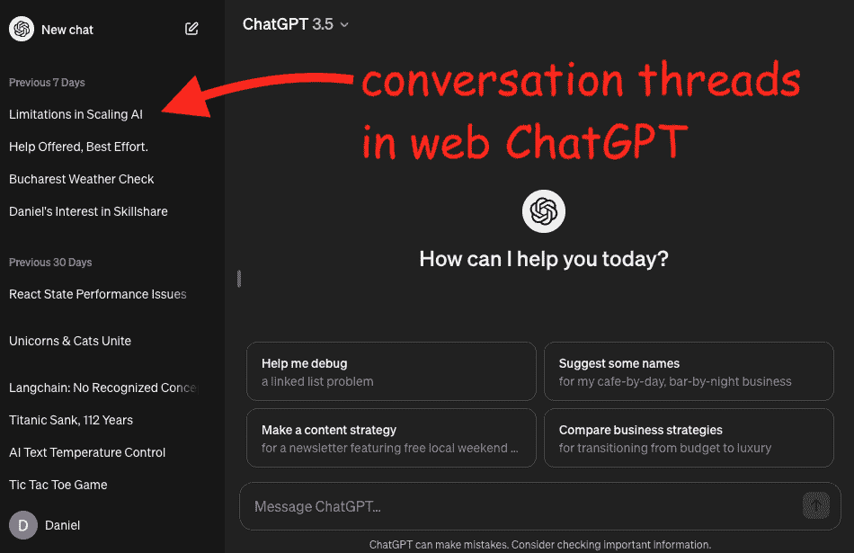

作为一个最后的想法，记住我们可以在 `invoke()` 方法中使用 `sessionId` 配置参数来管理不同主题的多个对话线程：

```javascript
{
  configurable: {
    sessionId: "id_value_here"
  }
}
```

OpenAI ChatGPT 网页应用的操作方式：

你可以在这里阅读更多详细信息：

[`js.langchain.com/docs/use_cases/chatbots/memory_management/`](https://js.langchain.com/docs/use_cases/chatbots/memory_management/)

---

## 6. RAG / 与文档对话

### 6.1. 引言

让我们来聊一个在使用 LLM 时非常重要的话题：`RAG`，它代表“检索增强生成”（Retrieval Augmented Generation）。

`RAG` 是通过引用训练数据源之外的知识库来优化 LLM 输出的过程。

例如，`ChatGPT 3.5 Turbo` 的知识截止日期是 2021 年 9 月。这意味着，在没有外部帮助的情况下，模型将不知道此日期之后发生了什么。

但如果我们需要处理关于 `LangSmith` 的信息呢？它是由与 `LangChain` 同一家公司开发的工具。这个新工具是在 2023 年发布的，晚于知识截止日期。

或者，如果我们需要创建一个机器人，让它引用组织的一些内部文档来提供客户支持呢？

这就是 `RAG` 大显身手的地方。通过使用 `RAG`，你可以将 `CSV` 文件、视频、`PDFs` 等外部数据源连接到 LLM 并提供外部上下文。

关于 `RAG` 的几点考量：

- `RAG` 不会重新训练模型。它不会更新神经网络的权重。它只是为模型提供了更多的参考信息。
- 在下一章中，我们将讨论到 `AI Agents`。虽然 `AI Agents` 可以搜索外部信息，但它们速度更慢、成本更高，并且可能提供不可靠的输出。`AI Agents` 适用于复杂情况以及可以使用各种工具解决的非线性 if-then-else 案例。
- 通过 `RAG`，你可以提前执行知识检索过程，并为 `Q&A` 等场景提供快速解决方案。

### 但为什么 `RAG` 如此重要？

LLM 的训练成本非常高。**非常高**！例如，来自 `Meta` 的 `Llama 2` 模型使用了 6000 个 `GPUs` 运行了 12 天。训练成本大约为 200 万美元。在绝大多数情况下，你并不想从零开始训练模型。

然而，随着每一分钟的过去，都会产生新的信息/知识。让模型与新信息同步是一场持续的竞赛。

即使是微调也需要花费大量时间。

其他选择是什么？使用 `RAG` 只为我们的 LLM 提供我们所需的知识片段。

`RAG` 节省了时间和金钱，因为不需要训练。

No. 82 / 120

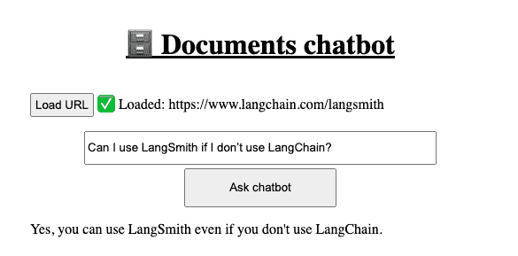

### 6.2. 示例设置

我们将通过构建以下示例来探索如何连接 LLM 与外部文档：

在最终版本中，我们的应用将执行以下操作：
- 读取外部数据源
- 从文本中提取嵌入（embeddings）
- 将上一步的嵌入存储在本地向量数据库中
- 根据这些信息回答问题

这将是应用的数据流：

No. 83 / 120

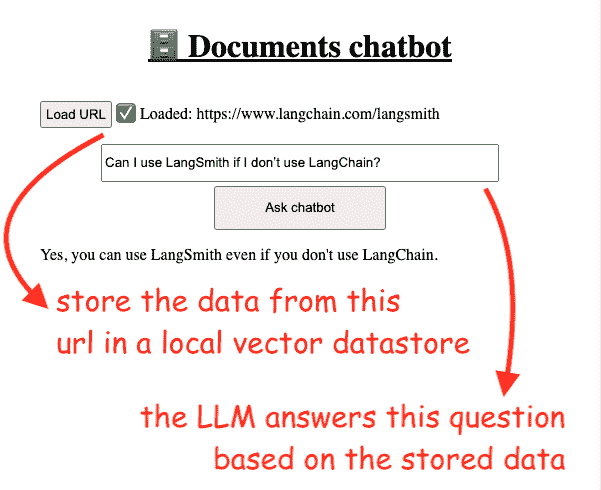

以下是初始的前端设置。我们发送一个问题并打印响应：

```javascript
// code/rag/src/app/page.js
'use client'
import { useState } from "react"

export default function Home() {
  const [answer, setAnswer] = useState()

  const askQuestion = async (e)=> {
    e.preventDefault()
    const question = e.target.question.value
    const response = await fetch('api', {
      method: "POST",
      body: JSON.stringify({question})
    })
    const {data} = await response.json()
    setAnswer(data)
  }

  return (<>
    <h1>文档机器人</h1>
    <form onSubmit={askQuestion} >
      <input name="question" />
      <button>提问机器人</button>
    </form>
    <p>{answer}</p>
  </>)
}
```

而在后端，我们使用 `GPT` 模型来回答问题：

```javascript
// code/rag/src/app/api/route.js
import { ChatOpenAI } from "@langchain/openai"
import { ChatPromptTemplate } from "@langchain/core/prompts"
import { LLMChain } from "langchain/chains"

const model = new ChatOpenAI({
  openAIApiKey: process.env.OPENAI_API_KEY
})

const prompt = ChatPromptTemplate.fromTemplate(
`回答用户的问题：
  问题: {input}`
)

const chain = new LLMChain({
  llm: model,
  prompt
})

export async function POST(req) {
  const { question } = await req.json()
  const data = await chain.invoke({
    input: question
  })
  return Response.json({data: data.text})
}
```

这就是应用的初始设置外观：

虽然这在处理简单问题时如预期运行，但当我们询问其训练数据之外的话题时，模型的局限性就会显现出来。

例如，如果我们询问 `LangSmith`（一个用于部署和监控 `LLM` 应用的平台），它将给出类似下面的通用回答：

No. 86 / 120

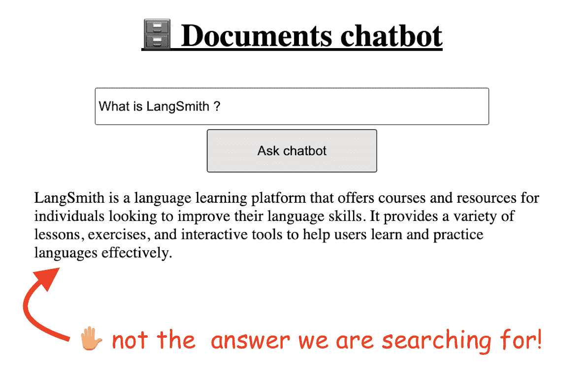

你可能会尝试使用较新的模型。例如，尝试使用 `gpt-4` 模型，它的数据截止到 2023 年 10 月。

因此，是时候引入 `RAG` 来为模型添加新信息并克服它的局限性了。检索增强生成！

No. 87 / 120


### 6.3. 使用本地文档

使用 `LangChain` 扩展 LLM 上文的方法之一是使用本地文档。在这个示例中，我们使用了简单的文本，但也可以拥有 `PDF`、`CSV` 和其他类型的文件。我们甚至可以包含视频和音频，这些包含大量信息。让我们看看这一切在后端是如何整合的：

```javascript
// code/rag/src/app/api/route.js
import { ChatOpenAI } from "@langchain/openai"
import { ChatPromptTemplate } from "@langchain/core/prompts"
// 我们需要这个来创建本地文档
import { Document } from "@langchain/core/documents"
// createStuffDocumentsChain 替换了 LLMChain
import { createStuffDocumentsChain } from "langchain/chains/combine_documents"

const model = new ChatOpenAI({
  openAIApiKey: process.env.OPENAI_API_KEY,
  // 零温度，没有额外创造力
  temperature: 0
})

// 将额外的上下文添加到 prompt
const prompt = ChatPromptTemplate.fromTemplate(
`根据以下上下文回答用户的问题：
{context}
问题: {input}`
)

// 手动创建文档
const documentA = new Document({
  pageContent: `LangSmith 是一个用于开发、协作、测试、部署和监控 LLM 应用的统一 DevOps 平台。`
})

const documentB = new Document({
  pageContent: `LangSmith 于 2023 年 7 月首次封闭发布。`
})

// 更新链类型
const chain = await createStuffDocumentsChain({
  llm: model,
  prompt,
})

export async function POST(req) {
  const { question } = await req.json()
  // 将文档数组作为上下文
  const data = await chain.invoke({
    input: question,
    context: [documentA, documentB]
  })
  return Response.json({data})
}
```

No. 89 / 120

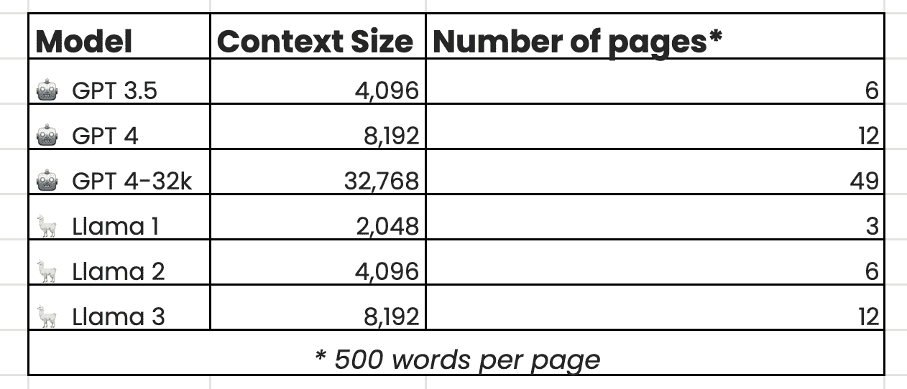

注意，使用 `createStuffDocumentsChain()` 创建的链在调用 `invoke()` 方法时期望接收一个 `context` 变量。

未这样做会导致以下错误：`Error: Prompt must include a context variable`

上下文长度（Context length）指的是模型一次能够处理的最大单词数。你可以将其视为模型的内存或注意力跨度。这是像 `ChatGPT` 和 `Llama` 等基于 Transformer 的模型中预设的特性。

以下是一些流行的大语言模型（LLMs）的默认上下文长度：扩展上下文不会重新训练模型；在此过程中权重将保持不变。

前端部分将保持不变。我们只需传入问题并显示答案即可。

第 90 / 120

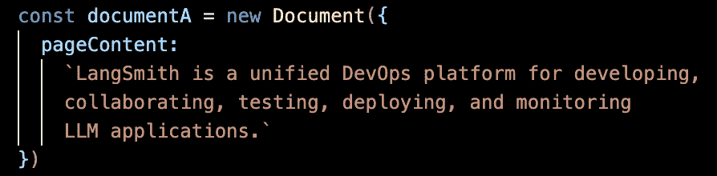

让我们测试一下。再次问它“LangSmith 是什么？”，而现在我们将从我们刚刚创建的本地文档中获得答案：

第 91 / 120

### 6.4. RAG 过程的组件

让我们来看一下 RAG 过程中涉及的各种组件类型：

1. `Document Loaders`（文档加载器） - 将这些看作你的数据收集器。它们抓取外部信息并将其加载，无论是旧的 `.txt` 文件、网页文本，甚至是 YouTube 视频字幕。
2. `Transformers`（转换器） - 你已经加载了文档，但有时它们需要进行一些微调以完美适配你的应用。`LangChain` 预制的转换器可以帮助你调整文档。一个基础示例是使用转换器将一个大文档拆分成较小的片段，以适应你模型的上下文窗口。
3. `Embeddings`（嵌入） - 这完全关于将数据转换为向量。`Embeddings` 类是你处理嵌入模型（如来自 `OpenAI`、`Meta` 或 `Hugging Face` 的模型）的首选。将文本嵌入看作是在向量空间中表示文本或数据的方式，使得语义搜索等操作更快。
4. `Vector Databases`（向量数据库） - 是时候存储我们在上一步生成的文本嵌入了。这些专门的数据库旨在高效地存储和检索向量数据。它们让语义搜索变得简单且快速。我们可以瞬间调出最相关的文本。我们稍后深入探讨向量数据库。
5. `Retrievers`（检索器） - 最后但同样重要的，认识你的信息获取助手：检索器。与仅仅持有数据的向量存储不同，检索器会出去抓取你需要的文档。虽然某些检索器可能会使用向量存储，但还有各种针对特定任务定制的检索器。

第 92 / 120

### 6.5. 向量、嵌入和向量数据库

在继续之前，我们需要进行短时间的绕路，讨论 RAG 过程中涉及的一些基础概念。

我们将从向量开始。向量简单来说就是一个数字数组。

```javascript
// this is how a vector looks like
let vec = [2.5, 1.3, 7.0, 9.2]
```

向量酷酷之处在于它们可以在称为“嵌入”（embedding）的高维空间中表示更复杂的对象，如单词、句子、音频文件甚至图像。

例如，让我们取以下条目：`snail`（蜗牛）、`plane`（飞机）、`speed train`（高铁）和 `turtle`（乌龟）。

我们可以根据以下标准将这些条目存储在二维嵌入空间中：
- 它们有多大
- 它们有多快

视觉表示可能像这样：

第 93 / 120

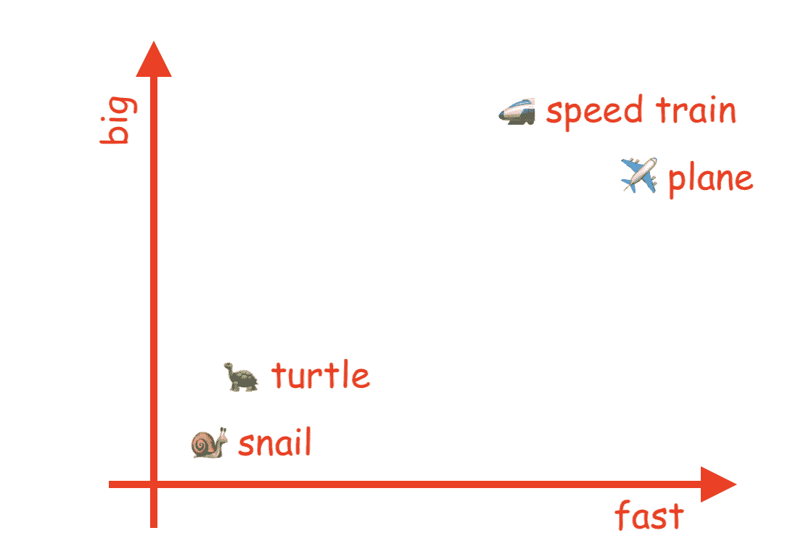

每个点都是一个如下格式的向量：

```javascript
[
  x, // 对象有多大
  y // 对象有多快
]
```

嵌入空间的每个轴也被称为维度（dimension）或特征（feature）。

记住，这种表示是非常简化的。通常情况下，每个条目都有更多维度，从几十到几千个不等，取决于数据的复杂性和细粒度。

给定一组维度，相似的对象会被分在一起，允许我们在虚拟空间或其他任何数据类型中映射单词或相似特征的语义含义。

使用这些嵌入，我们可以进行诸如推荐系统、搜索引擎，甚至是像 `ChatGPT` 那样的文本生成。

第 94 / 120

但一旦我们将向量条目映射到嵌入的维度上，我们把它们存储在哪里呢？以及如何快速查询它们？

嗯，这就是向量数据库的场。在经典的关系型数据库中，我们有行和列；在向量数据库中，我们有根据相似性分组的数字数组（向量）。

这样组织数据允许我们以极低的延迟进行相似查询。

我们可以轻松地检索这些条目之间的距离。这使得语义搜索更快，因为我们可以根据一个或多个维度轻松建立不同概念之间的联系。

今天我们可以使用的一些主要的向量数据库有：
- [Chroma](https://www.trychroma.com/)
- [Pinecone](https://www.pinecone.io/)
- [Weaviate](https://weaviate.io/)
- [Redis Vector Database](https://redis.io/solutions/vector-search/)

第 95 / 120

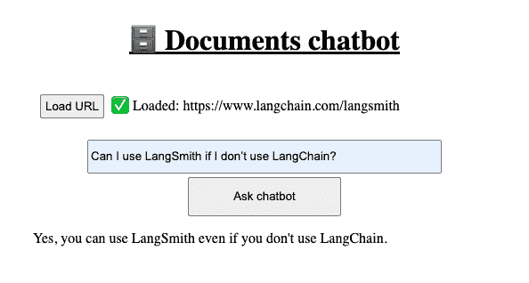

### 6.6. 使用 `CheerioWebBaseLoader` 和 `MemoryVectorStore`

在之前的示例中，我们只使用了文档加载器和检索器。现在是时候扩展我们的示例并让其他 RAG 组件工作了。

我们希望为应用添加以下功能：
- 读取用户提供的给定 URL
- 从 URL 加载页面内容
- 创建嵌入并将结果存储在本地向量数据库中
- 从新数据中检索并回答问题

最终示例将如下所示：

我们将从前端开始。我们将添加一个请求 URL 并将其发送到后端的：

```javascript
// code/rag/src/page.js
'use client'
import { useState } from "react"

export default function Home() {
  const [answer, setAnswer] = useState()
  //! add a new state
  const [docStatus, setDocStatus] = useState(false)

  const askQuestion = async (e) {
    e.preventDefault()
    const question = e.target.question.value
    const response = await fetch('api', {
      method: "POST",
      body: JSON.stringify({question})
    })
    const {data} = await response.json()
    setAnswer(data)
  }

  //! ask for the URL, pass it to the backend, update the docStatus
  const loadUrl = async () => {
    const url = prompt("Please enter the URL for the document:")
    const response = await fetch('api', {
      method: "POST",
      body: JSON.stringify({url})
    })
    const { loaded } = await response.json()
    setDocStatus(loaded ? `Loaded: ${url}` : false)
  }

  return (
    <>
      <h1>Documents chatbot</h1>
      {/* ask for the URL and show the docStatus */}
      <p>
        <button onClick={loadUrl}>Load URL</button>
        {docStatus}
      </p>
      <form onSubmit={askQuestion}>
        <input name="question" />
        {/* disabled until we have a doc status */}
        <button disabled={!docStatus}>Ask chatbot</button>
      </form>
      <p>{answer}</p>
    </>
  )
}
```

第 96 / 120


默认情况下，提问表单是禁用的。一旦后端完成从 URL 的加载，将启用提问表单：主要区别在于后端，在那里回答问题。

首先，我们需要安装 `CheerioWebBaseLoader`：`npm install --save cheerio`

现在，让我们先完整的代码，我们将深入解释：

```javascript
import { ChatOpenAI } from "@langchain/openai"
import { ChatPromptTemplate } from "@langchain/core/prompts"
import { createStuffDocumentsChain } from "langchain/chains/combine_documents"
import { CheerioWebBaseLoader } from "langchain/document_loaders/web/cheerio"
import { RecursiveCharacterTextSplitter } from "langchain/text_splitter"
import { OpenAIEmbeddings } from "@langchain/openai"
import { MemoryVectorStore } from "langchain/vectorstores/memory"
import { createRetrievalChain } from "langchain/chains/retrieval"

const model = new ChatOpenAI({
  openAIApiKey: process.env.OPENAI_API_KEY,
  temperature: 0
})

const prompt = ChatPromptTemplate.fromTemplate(`
  Answer 根据以下上下文回答用户的问题：
  {context}
  Question: {input}`)
```

```javascript
let retrievalChain, splitDocs

//! RAG 流程
async function loadDocumentsFromUrl(url) {
  //! 文档加载器
  const loader = new CheerioWebBaseLoader(url)
  const docs = await loader.load()

  //! 文档转换器
  const splitter = new RecursiveCharacterTextSplitter({
    chunkSize: 100,
    chunkOverlap: 20,
  })

  splitDocs = await splitter.splitDocuments(docs)

  //! 设置嵌入
  const embeddings = new OpenAIEmbeddings()

  //! 创建一个本地向量数据库
  const vectorstore = await MemoryVectorStore.fromDocuments(
    splitDocs,
    embeddings
  )

  //! 我们用它从向量数据库获取数据
  const retriever = vectorstore.asRetriever()

  const chain = await createStuffDocumentsChain({
    llm: model,
    prompt
  })

  retrievalChain = await createRetrievalChain({
    combineDocsChain: chain,
    retriever
  })
}

export async function POST(req) {
  const { question, url } = await req.json()

  //! 如果用户发送了 url，则设置 RAG 并返回
  if (url) {
    await loadDocumentsFromUrl(url);
    return Response.json({ loaded: true });
  }

  const data = await retrievalChain.invoke({
    input: question,
    context: splitDocs
  })

  return Response.json({data: data.answer})
}
```

No. 99 / 120


No. 100 / 120

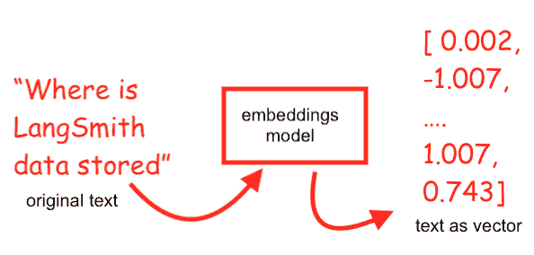

在这段代码中，我们看到了上一章中描述的 RAG 组件的实际运行。

首先，我们从用户提供的 URL 加载原始文本：`const loader = new CheerioWebBaseLoader(url)`
`const docs = await loader.load()`

[这只是 LangChain 提供的的一种加载器。你可以在这里](https://js.langchain.com/docs/integrations/document_loaders)
[查看加载器的列表。](https://js.langchain.com/docs/integrations/document_loaders)

我们可以访问两种类型的加载器：
- 文件加载器，例如 CSV、PDFs、EPUB 等
- 网络加载器，例如 Figma、Amazon S3、Youtube 转录文本等。一旦加载了原始文本，我们就开始将文本（人类可以理解的）转换为数字向量（AI 可以理解的）的过程：此分词器专为处理通用文本而定制。它尝试按这些字符顺序分割文本，直到生成的分块（chunks）达到最佳大小。

No. 101 / 120

默认情况下，它使用一个包含 `["\n\n", "\n", " ", ""]` 的列表。此配置旨在首先保持段落的完整性，然后是句子，最后是单词，因为这些片段通常具有最高的语义凝聚力。

文本通过字符列表进行分割，分块大小由字符数决定：

```javascript
const splitter = new RecursiveCharacterTextSplitter({
  chunkSize: 100,
  chunkOverlap: 20,
})

splitDocs = await splitter.splitDocuments(docs)

const embeddings = new OpenAIEmbeddings()

const vectorstore = await MemoryVectorStore.fromDocuments(
  splitDocs,
  embeddings
)
```

接下来，我们将所有这些嵌入存储在向量数据库中。对于这个简单的示例，我们使用了本地数据库。对于生产环境，我们可以使用真实的向量数据库服务，如 Chroma 或 Pinecone。

我们每次运行 RAG 查询时都需要重新创建嵌入吗？这对于小文件可能有效，但对于较大的文件，创建嵌入的过程可能会非常耗时。

例如，我们可以在创建 Chroma DB 对象时设置 `persist_directory` 参数，指定一个有效的本地路径。这样，当你使用文件创建向量数据库时，它将被存储在指定的位置。下次它将从该位置加载，从而显著减少处理时间。

`createRetrievalChain()` 接收用户查询，然后将其传递给 `retriever` 以获取相关文档。这些文档（以及原始输入）随后传递给 LLM 以生成响应。

No. 102 / 120


最后，我们将构建一个检索器，供链（chain）用于从向量数据库中获取信息。

```javascript
const retriever = vectorstore.asRetriever()

const chain = await createStuffDocumentsChain({
  llm: model,
  prompt
})

retrievalChain = await createRetrievalChain({
  combineDocsChain: chain,
  retriever
})
```

顺带一提，Google 的 Gemini 1.5 模型拥有百万 token 的上下文，并正在研究 1000 万 token。它是如此巨大，你可以包含整个知识库、书籍或电影，而无需担心上下文限制。一些人认为这会让 RAG 过时。然而，这是不太可能的，因为：
1. 成本 - 你仍然需要按 token 付费。Google 非常乐意让你每次都支付百万个 token。
2. 速度 - API 响应可能很慢。
3. 故障排除 - 庞大的上下文是非常调试的。

No. 103 / 120

---

## 7. AI 代理

### 7.1. 简介与项目设置

到目前，我们查看了链（chains）。代理（Agents）的区别在于，我们只需要给它们一个目标，它们就会尝试采取行动。与环境交互并做出决策更符合我们对智能的定义。

我们的任务是创建一个帮助记者研究新文章的工具。在本章结束时，我们将构建一个能够从用户读取问题并使用代理进行回答的应用程序。

No. 104 / 120

我们将从以下状态开始：在前端，让用户输入问题并提交到服务器。当响应到达时，我们将显示内容。

```javascript
// code/agents/src/app/page.js
"use client";
import { useState } from "react";

export default function Home() {
  const [data, setData] = useState();

  const onSubmitHandler = async (e) => {
    e.preventDefault();
    const question = e.target.question.value;
    if (question) {
      const response = await fetch("api", {
        method: "POST",
        body: JSON.stringify({
          question,
        }),
      });
      const { data } = await response.json();
      setData(data);
    }
  };

  return (
    <>
      <h1>1 • 文章研究代理</h1>
      <form onSubmit={onSubmitHandler}>
        <input name="question" />
        <button>提问</button>
      </form>
      <p>{data?.text}</p>
    </>
  );
}
```

No. 105 / 120

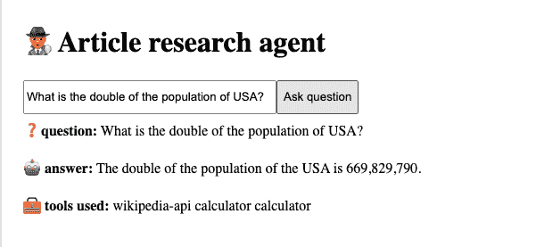

在后端，我们将让 GPT-4 Omni 模型询问用户输入的问题。

```javascript
// code/agents/src/app/api/route.js
import { ChatOpenAI } from "@langchain/openai"
import { PromptTemplate } from "@langchain/core/prompts"
import { StringOutputParser } from "@langchain/core/output_parsers"

const model = new ChatOpenAI({
  modelName: "gpt-4o",
  openAIApiKey: process.env.OPENAI_API_KEY,
})

const prompt = new PromptTemplate({
  inputVariables: ["question"],
  template: "Answer the user {question}",
})

const chain = prompt
  .pipe(model)
  .pipe(new StringOutputParser())

export async function POST(req) {
  const { question } = await req.json()
  const data = await chain.invoke({
    question
  })
  return Response.json({data})
}
```

我们应用的初始版本似乎运行得非常顺畅。例如，如果我们让它讲一个冷笑话，一切都能按预期工作。


但如果我们问它“2024 年超级碗赛冠军是谁？”，训练数据集的局限性就开始显现出来。由于该模型的训练数据只包含截至 2023 年 10 月的内容，它并不知道答案。


### 7.2. 创建一个智能体

是时候创建我们的第一个智能体了。为了克服训练数据集带来的局限性，我们将赋予聊天机器人进行在线研究的选项。

为了完成工作，智能体需要访问特定的工具，例如 Google 或维基百科搜索能力。通过将 GPT 模型与这些工具结合，智能体可以确定实现目标所需的行动。

如果我们查看工具（Tools）文档，可以看到所有可用选项的列表 [`js.langchain.com/docs/integrations/tools/`](https://js.langchain.com/docs/integrations/tools/)。


虽然加载所有可用工具可能很有诱力，但为智能体配备必要的工具至关重要。提供过多的选项可能会导致以下一种或多种情况：

- 智能体选择了不合适的工具
- API 调用成本更高；智能体将使用更多 token，增加网络延迟

对于我们的用例，我们将为智能体配备 2 个工具：一个维基百科搜索工具和一个数学计算器。

```javascript
const wikipediaQuery = new WikipediaQueryRun({topKResults: 1})
const calculator = new Calculator()
const tools = [wikipediaQuery, calculator]
```

请注意，对于 `Calculator` 工具，你需要安装 `@langchain/community` 包：

```bash
npm install @langchain/community
```


等等，什么！？给 AI 模型配数学计算器？嗯，因为神经网络是通过估算来工作的，它们并不擅长数学。它们有极小的概率会在基础数学运算上出错。因此，使用基础数学工具进行这些操作更安全、更快。

此工具集将传递给 AI 智能体。如文档所示，每种智能体类型都有独特的用途：[`js.langchain.com/docs/modules/agents/agent_types/`](https://js.langchain.com/docs/modules/agents/agent_types/)。例如，结构化对话（Structured Chat）针对多次交互进行了优化。

我们将采用 `ReAct Agent`，它是最多功能的行动智能体。顺便提一下，`ReAct Agent` 与 JavaScript React 框架无关。

后端的完整代码看起来如下：

```javascript
// code/agents/src/app/api/route.js
import { ChatOpenAI } from "@langchain/openai"
import { WikipediaQueryRun } from "@langchain/community/tools/wikipedia_query_run"
import { createReactAgent, AgentExecutor } from "langchain/agents"
import { Calculator } from "@langchain/community/tools/calculator"
import { pull } from "langchain/hub"

const model = new ChatOpenAI({
  modelName: "gpt-4o",
  openAIApiKey: process.env.OPENAI_API_KEY
})

// ! 为智能体制作工具箱
// ! 记得运行 'npm install @langchain/community'
const wikipediaQuery = new WikipediaQueryRun({topKResults: 1}) 
const calculator = new Calculator()
const tools = [wikipediaQuery, calculator]

// ! 获取代理规则集
const prompt = await pull("hwchase17/react")

// ! 定义 Agent 和 AgentExecutor
const agent = await createReactAgent({
  llm: model,
  tools,
  prompt
})

const agentExecutor = new AgentExecutor({
  agent,
  tools
})

export async function POST(req) {
  const { question } = await req.json()
  const response = await agentExecutor.invoke({
    input: question
  })
  return Response.json({data: response, prompt})
}
```

```javascript
// code/agents/src/app/page.js
'use client'
import { useState } from "react"

export default function Home() {
  const [data, setData] = useState();
  const onSubmitHandler = async (e) => {
    e.preventDefault();
    const question = e.target.question.value;
    if (question) {
      const response = await fetch("api", {
        method: "POST",
        body: JSON.stringify({
          question,
        }),
      });
      const { data } = await response.json();
      setData(data);
    }
  };

  return (
    <>
      <h1>研究型智能体</h1>
      <form onSubmit={onSubmitHandler}>
        <input name="question" />
        <button>提问</button>
      </form>
      {data && (
        <div>
          <p>❓ 问题: {data.input}</p>
          <p># 答案: {data.output}</p>
        </div>
      )}
    </>
  );
}
```


在此刻，如果我们问智能体“2024 年超级碗冠军是谁？”，它将能够使用工具进行搜索。

### 7.3. 监控智能体

智能体非常强大，但也有成本。幸运的是，我们有几种方法可以控制智能体的行为。让我们更新后端以增强监控：

```javascript
// code/agents/src/api/route.js
const agentExecutor = new AgentExecutor({
  agent,
  tools,
  verbose: true,
  returnIntermediateSteps: true,
  maxIterations: 4,
})
```

对应的前端代码：

```javascript
// code/agents/src/app/page.js
{data && (
  <div>
    <p>❓ 问题: {data.input}</p>
    <p># 答案: {data.output}</p>
    <p>使用的工具: {data.intermediateSteps.map(step => step.action.tool)}</p>
  </div>
)}
```


首先，`maxIterations` 选项限制了智能体寻找解决方案的次数。这是一个加速响应并确保我们不会陷入无限循环的好选项。与之前的用例一样，`verbose` 选项会在后端控制台中得出结果的推理过程。例如，当询问“PI 的两倍是多少？”时，它会打印类似的内容：

[chain/start] [1:chain:AgentExecutor > 18:chain:ReactAgent > 22:prompt:PromptTemplate] Entering Chain run with input: {
"input": "What is the double of PI?",
"steps": [
{
"action": {
"tool": "wikipedia-api",
"toolInput": "PI",
"log": "PI 是可以在维基百科上找到的数学常数\nAction: wikipedia-api\nAction Input: PI"
},
{
"action": {
"tool": "calculator",
"toolInput": "2*3.14159",
"log": "我知道 PI 大约等于 3.14159，所以我可以计算它的两倍\nAction: calculator\nAction Input: 2*3.14159"
}
}
],
],
"content": "I now know the final answer\nFinal Answer: 6.28318"
}

第三个选项 `returnIntermediateSteps`（[文档链接](https://js.langchain.com/docs/modules/agents/how_to/max_iterations/)）在这里会打印智能体使用的工具及其顺序。例如，维基百科工具就已经足够回答问题了。

“2024 年超级碗决赛的冠军是谁？”另一方面，“自从巴西赢得世界杯以来已经过了多少年了？”这个问题需要同时使用 `Wikipedia` 和 `Calculator` 工具。通过此选项，我们可以监控智能体是否正在为任务使用正确的工具。

第 116 / 120

### 7.4. 总结

代理（Agents）和工具使用通常是 `LangChain` 的核心概念。

从高层面上来说，代理涉及使用 LLM 并让它推理应该采取哪些操作，然后执行这些操作。这通常在一个循环中完成，直到 LLM 认为它已经实现了目标，或者没有其他可以的操作。

工具是语言模型可以采取的操作表示，以及实现这些操作的函数。

代理和工具与代理执行器（agent executor）结合使用。这个代理执行器通过一个循环运行，调用 LLM 来确定代理下一步应该尝试使用哪个工具，除非它已经达到了目标。

代理是基于提示（prompts）构建的，正如你从代码中注意到的：

```javascript
const prompt = await pull("hwchase17/react")
const agent = await createReactAgent({
  llm: model,
  tools,
  prompt
})
```

有许多类型的代理。你可以在[此页面](https://js.langchain.com/docs/modules/agents/agent_types/)查看目前可用的五种主要代理类型。

第 118 / 120

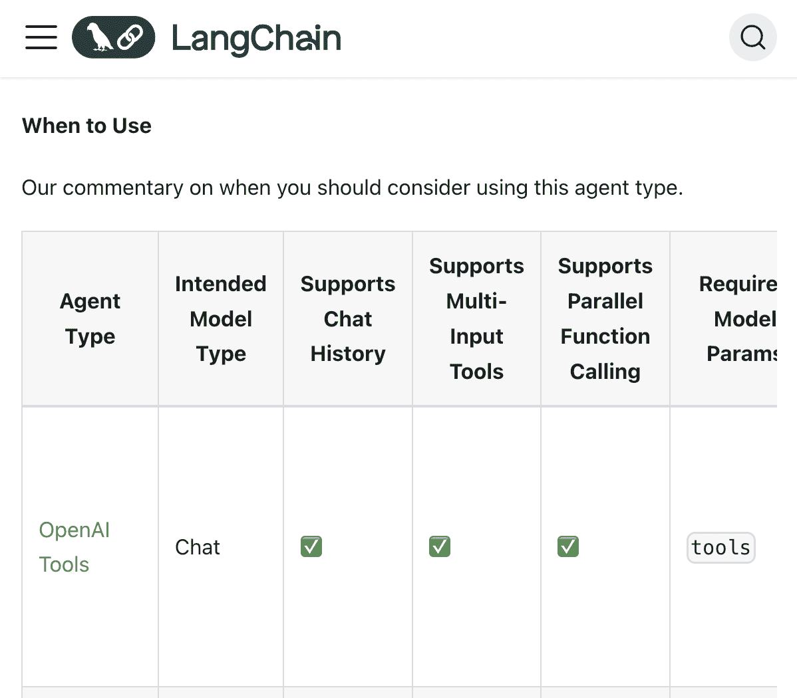

有些适用于本地模型，有些适用于最新的 OpenAI 模型，有些支持并行函数调用（parallel function calling），有些支持对话历史。由于其通用的提示词策略，其他代理非常适合使用简单工具和单一输入。

在讨论 AI 代理（AI agents）时，请注意还有许多其他主题、概念、技术、提示词和功能。我们在本章中讨论的只是该主题非常简要的介绍。

第 119 / 120

### 7.5. 结语

希望你喜欢这本书！

我非常期待得到你的反馈。请告诉我也你喜欢和不喜欢的地方，以便我改进这本书。

我非常期待得到你的反馈，并了解你喜欢和……不满意的部分，以便我改进这本书。

欢迎随时发送邮件到 daniel@js-craft.io 获取本书的更新版本。如果你认为我应该涵盖更多主题，请给我发邮件。我很乐意听到你的声音！

如果你喜欢这本书，如果你能留评论，我将不胜感激。

感谢，朋友，继续写代码吧！

第 120 / 120 页
