# LangChainJS 初学者指南：使用 LangChain、JavaScript、OpenAI/ChatGPT 开发 AI 应用

## 前言

本书的目标是提供温和的分步指导，帮助你从基础到高级逐步学习 LangChain.js。

你将了解为何 LangChain 是构建 AI 应用的绝佳工具，以及它如何简化将语言模型集成到 Web 应用中的过程。

我们将了解 LangChain 的核心功能（如提示模板、链、智能体、文档加载器、输出解析器和模型类）是如何被用来创建一个智能且灵活的生成式 AI 应用的。

之后，我们将把 LangChain 集成到 Next.js 中，让你了解如何创建 AI 驱动的 Web 应用。

### 如何使用本书

本书分为 16 个简洁的章节，每章都专注于 LangChain 编程中的一个特定主题。

我鼓励你编写书中看到的代码并运行它们，以便你亲身体验 LangChain 开发的样子。当你跟着书中的示例一起编码时，学习效果最佳。

充分利用本书的一个小技巧：每完成一章后，至少休息 10 分钟，以便恢复精力和专注力。

另外，如果某个概念难以理解，请不要气馁。学习任何新事物在第一次接触时都是困难的，尤其是像编程这样的技术性内容。最重要的是坚持下去。

### 先决条件

为了充分体验本书的全部价值，你需要具备基本的 JavaScript 和 NextJS 知识。

如果你需要在学习 JavaScript 或 NextJS 方面寻求帮助，可以在 https://codewithnathan.com 获取我的相关书籍。

### 源代码

你可以从以下 GitHub 链接下载源代码：

https://github.com/nathansebhastian/langchain-js

点击“Code”按钮，然后点击“Download ZIP”链接，如下图所示：

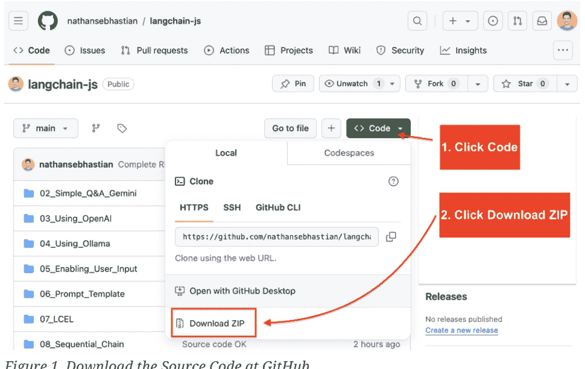

*图 1. 在 GitHub 上下载源代码*

你需要解压压缩包才能访问代码。通常，只需双击压缩包即可解压内容。

文件夹名称中的数字表示本书中的章节号。

### 联系方式

如果你需要帮助，可以通过 [nathan@codewithnathan.com](mailto:nathan@codewithnathan.com) 联系我。

你也可以在 LinkedIn 上联系或关注我：[https://linkedin.com/in/nathansebhastian](https://linkedin.com/in/nathansebhastian)

## 第一章：生成式 AI 应用简介

生成式 AI 应用是一种计算机应用程序，它能够根据给定的输入（或提示）生成上下文相关的输出。

生成式 AI 应用在 2022 年进入公众视野，当时 OpenAI 发布了 ChatGPT，并在短短 5 天内迅速获得了 100 万用户：

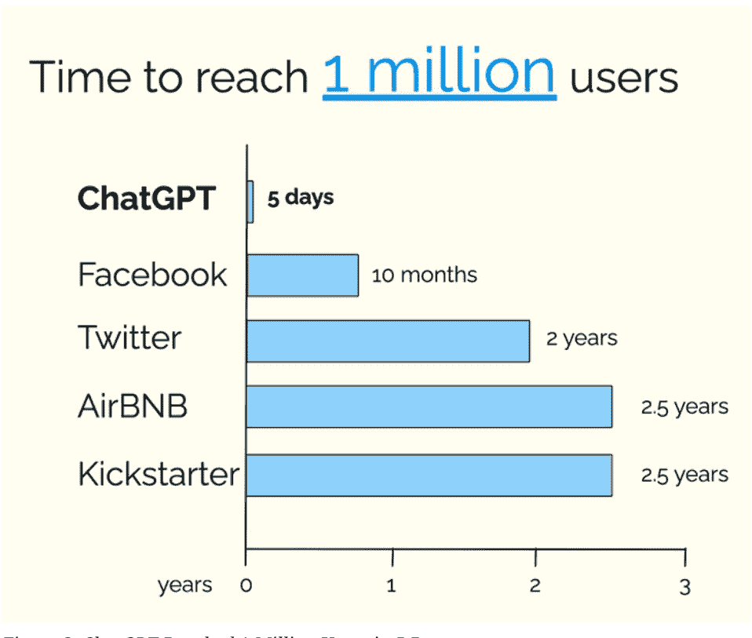

*图 2. ChatGPT 在 5 天内达到 100 万用户*

生成式 AI 应用的另一个例子是 chatpdf.com，它允许用户上传 PDF 文件并执行各种任务，例如从 PDF 中提取见解。

chatpdf.com 提供的答案包含了它们在原始 PDF 文档中的来源引用，因此无需再翻页查找来源。

在幕后，这些生成式 AI 应用利用大语言模型（LLM）的力量来生成答案。

### 什么是大语言模型？

大语言模型（简称 LLM）是一种机器学习模型，它能够理解并生成人类可以理解的输出。

LLM 通常在互联网上大量的文本数据上进行训练，因此它们能够执行广泛的与语言相关的任务，例如翻译、摘要、问答和创意写作。

LLM 的例子包括 OpenAI 的 GPT-4、Google 的 Gemini、Meta 的 Llama 和 Mistral 的 Mistral。

一些 LLM 是闭源的，比如 GPT 和 Gemini；而另一些则是开源的，如 Llama 和 Mistral。

### 什么是 LangChain？

LangChain 是一个开源框架，旨在简化 LLM 驱动的应用开发过程。

LangChain 使你能够通过简单地调用代表模型的类来集成和调用为生成式 AI 应用提供动力的 LLM。

在底层，LangChain 会执行与语言模型 API 交互所需的所有步骤，并管理输入和输出的处理，从而使你只需最少的代码更改就能访问不同的 LLM。

更重要的是，你还可以将外部数据源（如 PDF、维基百科文章或搜索引擎结果）与 LangChain 一起使用，以生成上下文相关的响应。

通过使用 LangChain，您可以开发针对特定用例优化的专用生成式 AI 应用，例如总结 YouTube 视频内容、从 PDF 中提取洞察或撰写文章。

LangChain 支持 Python 和 JavaScript。本书重点介绍 JavaScript 版本的 LangChain。

### 生成式 AI 应用的架构

传统应用通常采用如下客户端-服务器架构：

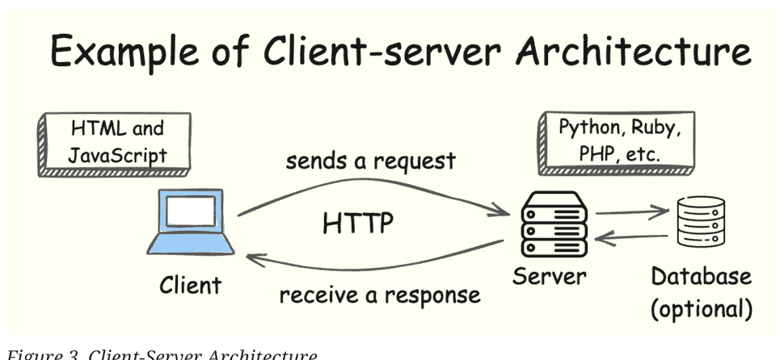

*图 3. 客户端-服务器架构*

客户端和服务器通过 HTTP 请求进行通信。必要时，服务器可能与数据库交互以处理客户端发送的请求。

另一方面，生成式 AI 应用利用大语言模型（LLM）的力量来理解人类语言提示并生成相关输出：

### 生成式 AI 架构示例

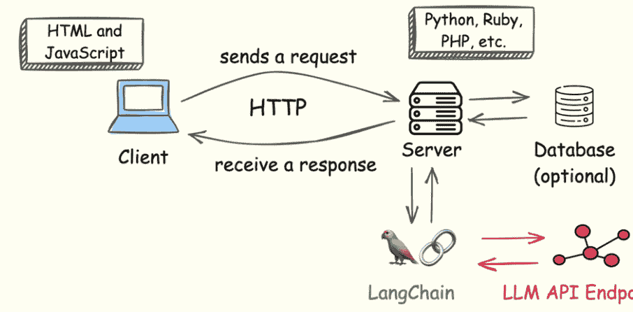

*图 4. AI 驱动的应用架构*

虽然其架构与传统应用相似，但增加了一个用于连接 LLM 的额外层。

这个额外的层正是 LangChain 发挥作用的地方，因为它执行和管理与 LLM 相关的任务，例如将我们的输入处理成 LLM 能理解的提示。它还将 LLM 的响应处理成传统应用可接受的格式。

随着您在后续章节中实践构建生成式 AI 应用，您会更深入地理解这一点。

目前，您可以将 LangChain 视为应用服务器与 LLM 之间的管理层。

### 开发环境设置

要开始使用 LangChain.js 开发 AI 应用，您的计算机上需要具备三样东西：

1.  网页浏览器
2.  代码编辑器
3.  Node.js 程序

我们将在下一节中安装它们。

### 安装 Chrome 浏览器

任何网页浏览器都可用于浏览互联网，但出于开发目的，您需要安装一个具备足够开发工具的浏览器。

Google 开发的 Chrome 浏览器是 Web 开发的绝佳选择。如果您尚未安装此浏览器，可以在此处下载：

https://www.google.com/chrome/

该浏览器适用于所有主流操作系统。下载完成后，按照安装程序提供的步骤操作，即可将浏览器安装到您的计算机上。

接下来，我们需要安装一个代码编辑器。互联网上有多款免费的代码编辑器可用，例如 Sublime Text、Visual Studio Code 和 Notepad++。

在这些编辑器中，我最青睐 Visual Studio Code，因为它快速且易于使用。

### 安装 Visual Studio Code

Visual Studio Code（简称 VSCode）是一款专为编写代码而创建的代码编辑器应用。除了免费之外，VSCode 还运行速度快，并且可在所有主流操作系统上使用。

您可以在此处下载 Visual Studio Code：

https://code.visualstudio.com/

当您打开上述链接时，应该会看到一个按钮，显示与您操作系统兼容的版本，如下所示：


点击按钮下载 VSCode，并将其安装到您的计算机上。

现在代码编辑器已安装完毕，下一步是安装 Node.js。

### 安装 Node.js

Node.js 是一个 JavaScript 运行时应用，使您能够在浏览器之外运行 JavaScript。我们需要这个程序来安装 TypeScript 编译器。

您可以从 https://nodejs.org 下载并安装 Node.js。请选择推荐的 LTS 版本，因为它提供长期支持。安装过程非常直接。

要检查 Node 是否已正确安装，请在命令行（Windows 上的命令提示符或 Mac 上的终端）中输入以下命令：

```
node -v
```

命令行应返回您计算机上安装的 Node.js 版本号。

Node.js 还包含一个名为 npm（Node 包管理器）的程序，您可以使用它来安装和管理 Node 包：

```
npm -v
```

Node 包是您可以免费在项目中使用的 JavaScript 库和框架。我们稍后将使用 npm 来安装一些包。

现在您已拥有开始开发 LangChain 应用所需的所有软件。让我们在下一章中开始实践。

## 总结

在本章中，您了解了生成式 AI 应用的架构，以及 LangChain 如何在服务器与 LLM API 端点之间扮演集成层的角色。

您还在计算机上安装了编写和运行 LangChain 应用所需的工具。

如果您遇到任何问题，可以发送电子邮件至 [nathan@codewithnathan.com](mailto:nathan@codewithnathan.com)，我将尽力为您提供帮助。

## 第二章：您的第一个 LangChain 应用

现在是时候创建我们的第一个 LangChain 应用了。

我们将创建一个简单的问答应用，可以向大型语言模型提出任何类型的问题。

首先，在计算机上创建一个用于存储与此项目相关的所有文件的文件夹。您可以将文件夹命名为 `beginning_langchain_js`。

接下来，打开 Visual Studio Code，从菜单栏选择 `File > Open Folder...`。选择您刚刚创建的文件夹。

VSCode 将加载该文件夹并在资源管理器侧边栏中显示其内容。由于我们尚未创建任何文件，它应该是空的。

要创建文件，请在 VSCode 窗口内任意位置右键单击，然后从菜单中选择 `New Text File` 或 `New File...`。

文件创建后，按 `Control + S` 或 `Command + S` 保存文件。将该文件命名为 `app.js`。

### 安装 LangChain 包

现在您需要安装创建 LangChain 应用所需的包。

在 VSCode 中，右键单击您刚创建的文件夹，然后选择 `Open in Integrated Terminal`，以在 VSCode 内显示命令行。

在终端中，运行以下命令：

```
npm install langchain @langchain/google-genai dotenv
```

上述命令将安装三个包：

- `langchain` 包含 LangChain 的所有核心模块
- `@langchain/google-genai` 是 Google 生成式 AI 集成模块
- `dotenv` 用于从环境变量加载 LLM API 密钥

包安装完成后，npm 将生成一个 `package.json` 文件，其中包含这些已安装包的版本信息。

### 创建问答应用

现在是时候为问答应用编写代码了。

在 `app.js` 文件中，导入 Google 生成式 AI 类并加载环境变量：

```javascript
import { ChatGoogleGenerativeAI } from '@langchain/google-genai';

// load environment variables
import 'dotenv/config';
```

要在 LangChain 中与 LLM 交互，您需要创建一个表示该 LLM API 的对象。

因为我们要与 Google 的 LLM 交互，所以需要从 `ChatGoogleGenerativeAI` 类创建一个对象，如下所示：

```javascript
const llm = new ChatGoogleGenerativeAI({
  model: 'gemini-1.5-pro-latest',
  apiKey: process.env.GOOGLE_GEMINI_KEY,
});
```

`GOOGLE_GEMINI_KEY` 包含您将在下一节中获取的 API 密钥。

目前，您只需理解 `ChatGoogleGenerativeAI` 对象代表了您想要使用的 Google LLM。

在实例化新的 `llm` 对象时，您需要传递一个指定该实例选项的对象。

`model` 选项是必需的，以便 Google 知道您想使用哪个模型，而 `apiKey` 选项用于验证您是否有权使用该模型。

接下来，编写一个简单的问答应用的代码，如下所示：

```javascript
console.log('Q & A With AI');
console.log('================');

const question = "What's the currency of Thailand?";
console.log(`Question: ${question}`);

const response = await llm.invoke(question);
console.log(`Answer: ${response.content}`);
```

在上面的代码中，我们只是打印一些文本，显示我们要向模型提出的问题。

`llm.invoke()` 方法将把输入的问题发送给 LLM 并返回响应对象。

答案存储在 `content` 属性下，因此我们打印 `response.content` 的值。

由于我们使用了 `await` 语法，需要在 `package.json` 文件中添加 `"type": "module"` 选项，如下所示：

```json
{
  "type": "module",
  "dependencies": {
    // ...
  }
}
```

当我们使用 `import` 语法而不是 `require()` 来导入包时，也需要这个 `type` 选项。

现在应用已准备就绪，但我们仍然需要获取 Google Gemini API 密钥才能访问 LLM。

### 获取 Google Gemini API 密钥

要获取 API 密钥，您需要访问 Gemini API 页面：[https://ai.google.dev/gemini-api](https://ai.google.dev/gemini-api)。

在页面上，您需要点击如下所示的“在 Google AI Studio 中获取 API 密钥”按钮：

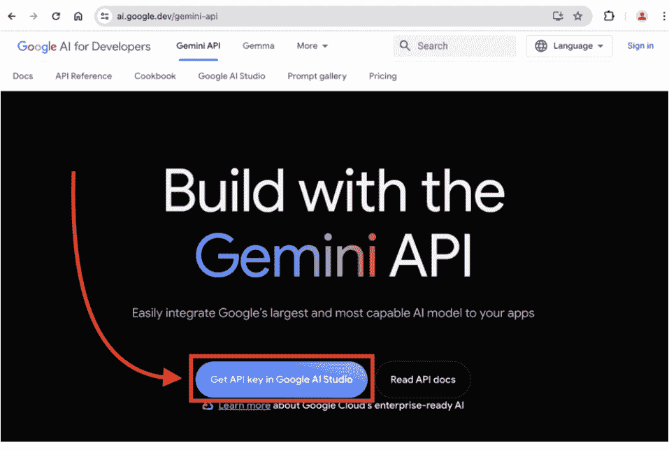

*图 6. 获取 Gemini API 密钥*

之后，您将被带到 Google AI Studio。

请注意，点击该按钮时，您可能会看到如下页面：


*图 7. Google AI Studio 可用区域页面*

此页面通常在您位于 Google AI Studio 不提供服务的地区时出现。

一种解决方法是使用 VPN 服务，但我建议您改用其他 LLM，例如 OpenAI 或 Ollama，我将在后续章节中介绍。

如果这是您第一次访问 Studio，它会显示如下服务条款：

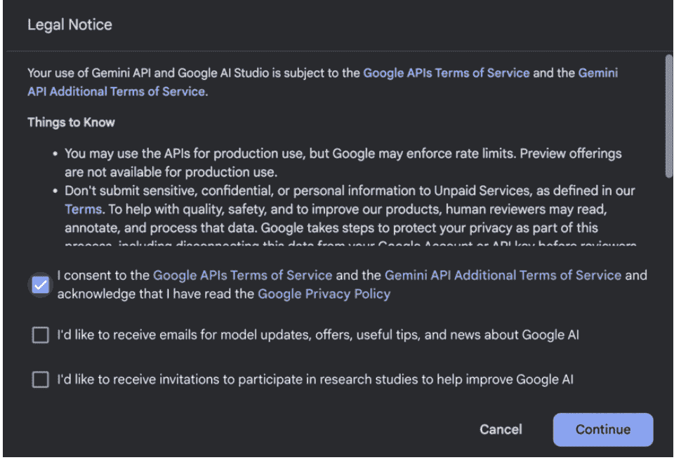

*图 8. Google AI Studio 服务条款*

只需勾选“我同意”选项，然后点击“继续”。

现在点击“创建 API 密钥”按钮来创建密钥：

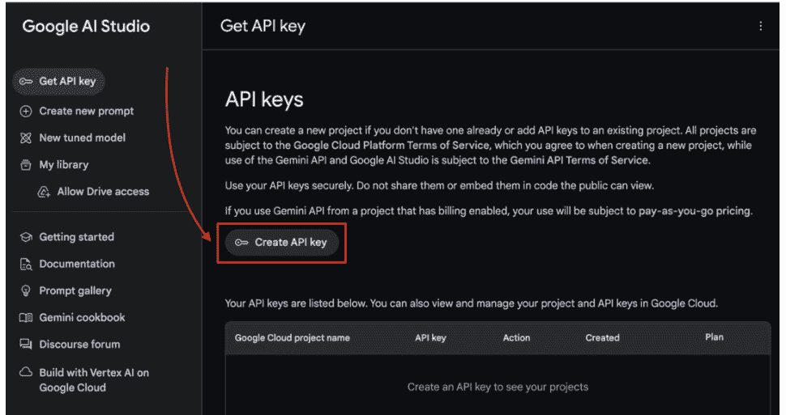

*图 9. Gemini 创建 API 密钥*

如果被询问在何处创建 API 密钥，请选择在新项目中创建：

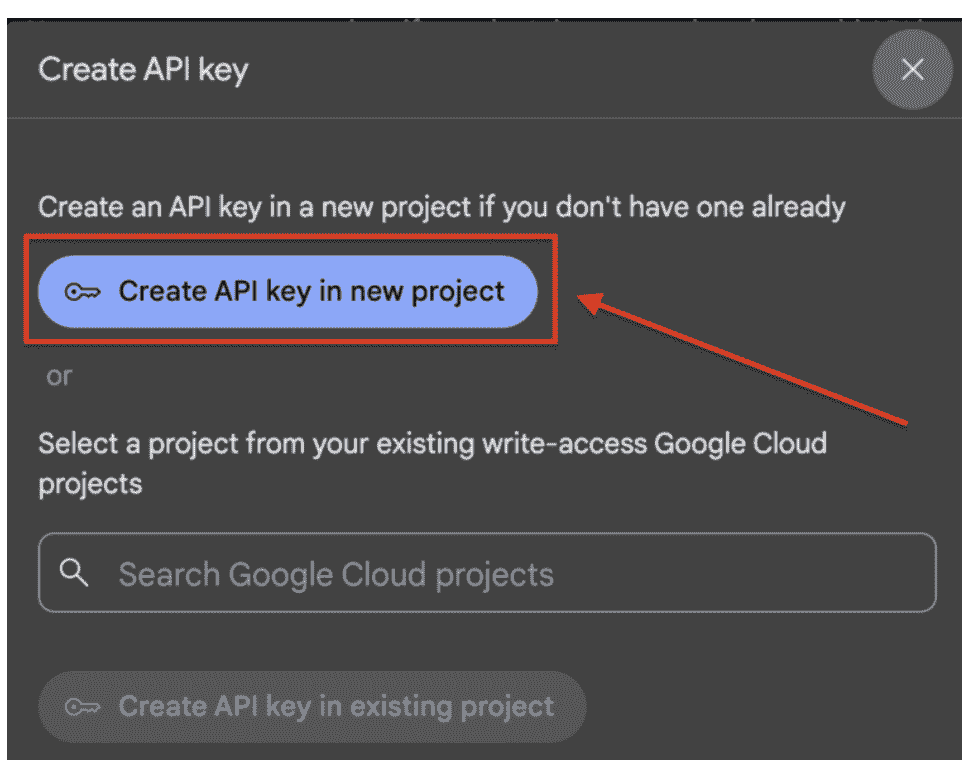

*图 10. 在新项目中创建 API 密钥*

Google 将会创建一个 Cloud 项目并为您生成密钥。

稍后，您应该会看到密钥显示在一个弹出框中，如下所示：

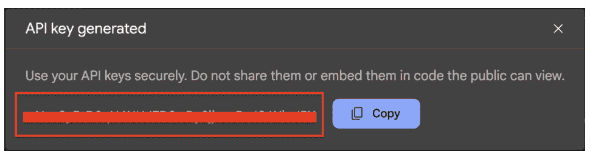

*图 11. Gemini API 密钥已生成*

复制 API 密钥字符串，然后在您的应用程序文件夹中创建一个 `.env` 文件，内容如下：

```
GOOGLE_GEMINI_KEY='Your Key Here'
```

将上面的 `Your Key Here` 字符串替换为您的实际 API 密钥。

### 运行应用程序

获得 API 密钥后，您就可以运行 LangChain 应用程序了。

在终端中，使用 Node.js 运行 `app.js` 文件，如下所示：

```
node app.js
```

您应该在终端中看到以下输出：

```
Q & A With AI
============
Question: What's the currency of Thailand?
Answer: Thai baht
```

这意味着您已成功创建了第一个 LangChain 应用程序，并使用 API 密钥与 Google 的 Gemini LLM 进行了交互。

每个 LLM 模型都有其自身的特点。“gemini-1.5-pro-latest”模型通常直接回答问题，不提供额外信息。

您可以尝试将模型更改为“gemini-1.5-flash-latest”，如下所示：

```javascript
const llm = new ChatGoogleGenerativeAI({
  model: 'gemini-1.5-flash-latest',
  apiKey: process.env.GOOGLE_GEMINI_KEY,
});
```

现在再次运行 `app.js` 文件，这次的答案会有所不同：

```
Q & A With AI
=============
Question: What's the currency of Thailand?
Answer: The currency of Thailand is the **Thai baht**, which is abbreviated as **THB**.
```

这里，“gemini-1.5-flash”首先重复了问题，然后提供了更多信息，例如货币缩写和符号。

THB 周围的星号 `**` 符号旨在使文本显示为粗体，但在终端中它被原样渲染。

现在，尝试将 `question` 变量替换为您想向 LLM 提出的任何问题。

### 资源耗尽错误

使用 Google Gemini 时，运行应用程序时可能会看到如下错误：

```
ResourceExhausted: 429 Resource has been exhausted (e.g. check quota)..
```

此错误发生是因为免费套餐的资源已耗尽。您需要稍后再试。

## 总结

本章的代码位于 `02_Simple_Q&A_Gemini` 文件夹中。

在本章中，您已经创建并运行了您的第一个 LangChain 应用程序。恭喜！

该应用程序可以连接到 Google 的 Gemini LLM，以提出问题并获取答案。

在下一章中，我们将学习如何在 LangChain 中使用 OpenAI 的 GPT 模型。

## 第三章：在 LangChain 中使用 OpenAI LLM

在上一章中，您已经了解了如何使用 LangChain 与 Google 的 Gemini 模型进行通信。

在本章中，我将向您展示如何在 LangChain 中使用 OpenAI 作为替代方案。

但请记住，OpenAI API 没有免费套餐。它曾经提供价值 5 美元的 API 使用额度，但似乎已经悄悄停止了。

因此，如果您想使用 OpenAI API，您需要购买最少的信用额度，即 5 美元。

### OpenAI API 入门

OpenAI 是一家人工智能研究公司，旨在开发并推广有益于人类的强大 AI 软件。著名的 ChatGPT 就是 OpenAI 开发的产品之一。

除了 ChatGPT 应用程序外，OpenAI 还以 HTTP API 端点的形式提供 GPT 模型，这是驱动 ChatGPT 的 LLM。

要使用 OpenAI 的 API，您需要在他们的网站 https://platform.openai.com 上注册一个帐户。

注册后，您可以访问 https://platform.openai.com/api-keys 来创建一个新的密钥。

当您首次尝试创建密钥时，会被要求通过添加电话号码进行验证：

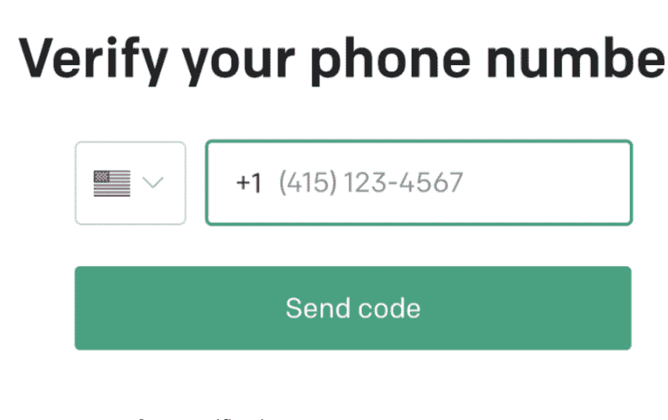

OpenAI 仅使用您的电话号码进行验证。您将通过短信收到验证码。

一旦验证通过，系统会要求您为 API 使用添加信用额度。如果没有，请访问 https://platform.openai.com/account/billing 添加一些信用额度。

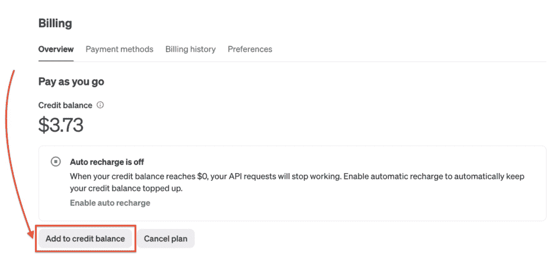

*图 13. OpenAI 添加信用额度*

OpenAI 接受信用卡支付，因此您需要有一张信用卡。您可以购买的最低金额是 5 美元，这足以使用 OpenAI 运行本书中的所有示例。

或者，如果您以某种方式获得了 5 美元的试用额度，那么您就不需要设置计费信息。

接下来，输入名称并选择密钥所属的项目：

### 创建新的密钥

所有者

您  服务帐户

此 API 密钥与您的用户关联，可以对所选项目进行请求。如果您被从组织或项目中移除，此密钥将被禁用。

名称  可选

LangChain-Test

项目

默认项目

权限

+   全部  受限  只读

取消  创建密钥

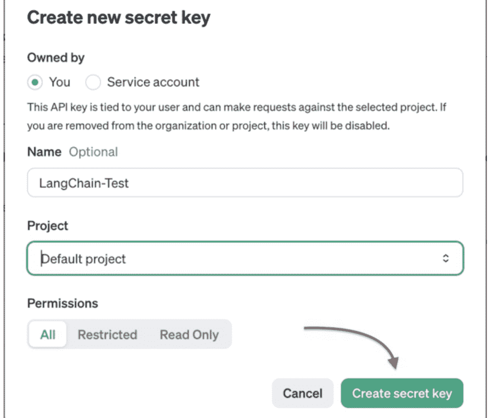

点击“创建密钥”按钮，OpenAI 将向您显示生成的密钥：

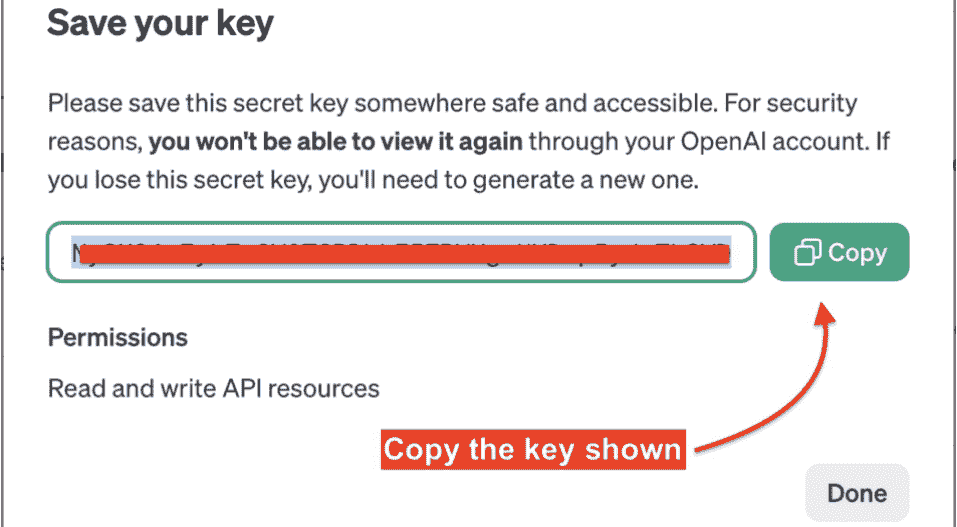

*图 15. OpenAI 复制 API 密钥*

您需要将此 API 密钥复制并粘贴到项目的 `.env` 文件中：

```
OPENAI_KEY='Your Key Here'
```

现在您的 OpenAI 密钥已准备好，是时候在 LangChain 应用程序中使用它了。

### 将 OpenAI 与 LangChain 集成

要在 LangChain 中使用 OpenAI，您需要使用 npm 安装 `@langchain/openai` 包：

```
npm install @langchain/openai
```

安装完包后，创建一个名为 `app_gpt.js` 的新文件，并从包中导入 `ChatOpenAI` 类。

实例化 `llm` 对象时，指定 `model` 和 `openAIApiKey` 选项，如下所示：

```javascript
import { ChatOpenAI } from '@langchain/openai';

import 'dotenv/config';

const llm = new ChatOpenAI({
  model: 'gpt-4o',
  openAIApiKey: process.env.OPENAI_KEY,
});
```

您可以将 `model` 参数更改为要使用的模型。截至撰写本文时，GPT-4o 是 OpenAI 发布的最新 LLM。

让我们向 GPT 询问与 Gemini 相同的问题：

```javascript
console.log('Q & A With AI');
console.log('=============');

const question = "What's the currency of Thailand?";
console.log(`Question: ${question}`);

const response = await llm.invoke(question);
console.log(`Answer: ${response.content}`);
```

保存更改，然后使用 Node.js 运行该文件：

```
node app_gpt.js
```

您应该会得到类似于以下内容的响应：

```
Q & A With AI
=============
Question: What's the currency of Thailand?
Answer: The currency of Thailand is the Thai Baht. Its ISO code is THB.
```

这意味着 LangChain 应用成功与 OpenAI 的 GPT 聊天模型进行了通信。太棒了！

你可以通过修改 `question` 变量的值来尝试提出另一个问题。

### ChatGPT 与 Gemini：该如何选择？

ChatGPT 和 Gemini 都非常擅长完成我们希望它们在本书中执行的任务，所以这完全取决于你。

过去，OpenAI 曾提供 5 美元的免费额度。但情况似乎已不再如此，因为 OpenAI 论坛上很多人表示注册后并未获得额度。

另一方面，Google 为 Gemma 模型提供了免费层级服务，作为交换，我们允许使用我们的数据来训练模型，因此用它来学习和探索 LangChain 是可以的。

不过，Google 保留随时停止免费层级服务的权利，所以让我再为你介绍一种在 LangChain 中使用大语言模型（LLM）的方法。

这次，我们将使用开源模型。

### 本章小结

本章的代码位于书籍源代码的 `03_Using_OpenAI` 文件夹中。

在本章中，你学习了如何创建 OpenAI API 密钥并在 LangChain 应用中使用它。

这里，我们开始看到使用 LangChain 的好处之一，即易于与任何类型的大语言模型（LLM）集成。

LangChain 将大语言模型（LLM）表示为你可以安装并导入到项目中的包。

你只需要创建一个模型类的实例并运行 `invoke()` 方法即可访问大语言模型（LLM）。

每当你需要使用另一个大语言模型（LLM）时，你只需更改使用的类并传递正确的模型和 API 密钥。

## 第四章：在 LangChain 中使用开源大语言模型（LLMs）

LangChain 库使你能够与各种大语言模型（LLM）通信，从专有的大语言模型（LLM）（如 Google 的 Gemini 和 OpenAI 的 GPT）到开源大语言模型（LLM）（如 Meta 的 Llama 和 Mistral）。

本章将向你展示如何在 LangChain 中使用开源模型。让我们开始吧。

### Ollama 简介

Ollama 是一个用于在本地运行大语言模型（LLM）的工具。它处理下载、管理以及为你想要使用的模型（在你的计算机上）开启 HTTP API 端点。

要开始，请访问 https://ollama.com 并点击 "Download" 按钮。

在那里，你可以选择适合你操作系统的版本：

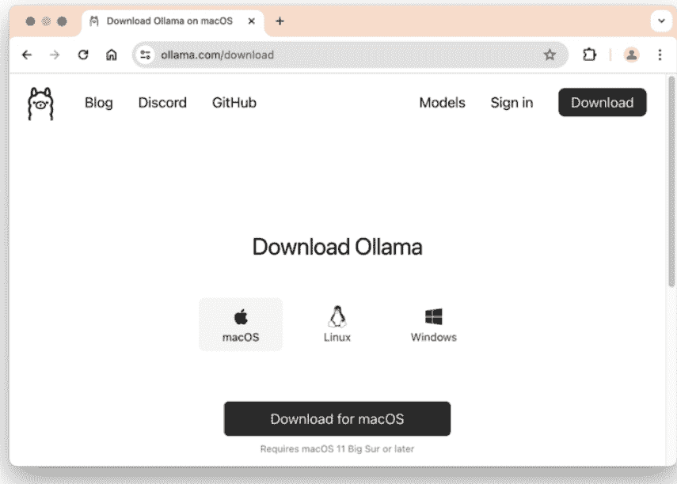

*图 16. 下载 Ollama*

下载后，打开安装包并按照说明操作，直到你被要求安装命令行工具，如下所示：

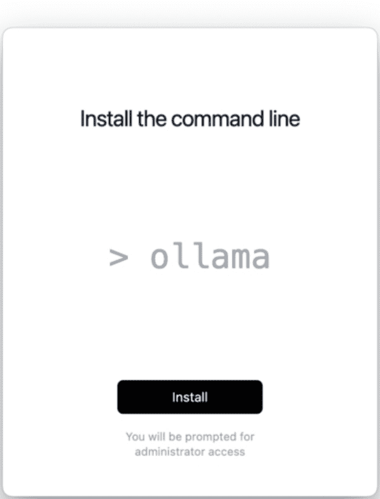

*图 17. 安装 Ollama 终端命令*

继续并点击 "Install" 按钮。

安装完成后，Ollama 会向你展示如何运行一个模型：

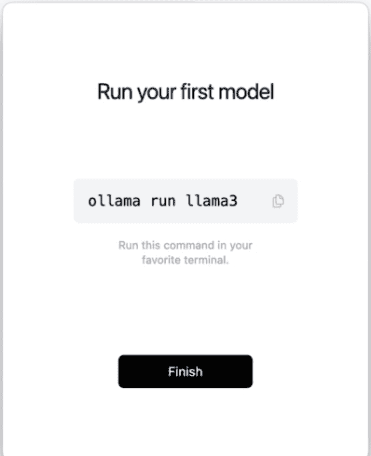

*图 18. Ollama 运行你的第一个模型*

但由于 Llama 3 是一个拥有 80 亿参数的模型，其文件相当大，有 4.7 GB。

我建议你改为运行 Gemma 模型，它只有 20 亿参数：

```
ollama run gemma:2b
```

Gemma 模型是 Google 推出的一个轻量级模型，因此你可以将其视为 Google Gemini 的开源版本。

Gemma 2B 模型的大小仅为 1.7 GB，因此当你想要试用 Ollama 时，它非常方便。

下载完成后，你可以立即从终端使用该模型。如下所示向它提问：

```
ollama run gemma:2b
>>> Who is the founder of Facebook?
Mark Zuckerberg is the co-founder and CEO of Meta (formerly Facebook). He co-founded Facebook in 2010 with Dustin Moskovitz and Chris Hughes.
>>> Send a message (/? for help)
```

*图 19. 在 Ollama 中向 Gemma 提问的示例*

要退出正在运行的模型，请输入 `/bye` 并按回车键。

只要 Ollama 在你的计算机上运行，Ollama API 端点就可以通过 `localhost:11434` 访问，如下所示：

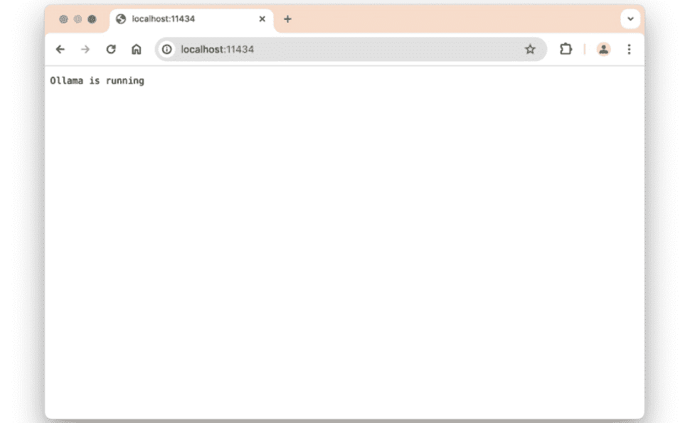

*图 20. Ollama 本地主机 API 端点*

LangChain 将使用此 API 端点与 Ollama 模型进行通信，这正是我们接下来要做的。

### 在 LangChain 中使用 Ollama

要使用 Ollama 下载的模型，你需要导入由 LangChain 社区开发的 `ChatOllama` 类。

在终端中，使用 npm 安装社区包，如下所示：

```
npm install @langchain/community
```

接下来，创建一个名为 `app_ollama.js` 的新文件，并如下所示导入 Ollama 聊天模型：

```javascript
import { ChatOllama } from '@langchain/community/chat_models/ollama';

const llm = new ChatOllama({
  model: 'gemma:2b',
});

console.log('Q & A With AI');
console.log('================');

const question = "What's the currency of Thailand?";
console.log(`Question: ${question}`);

const response = await llm.invoke(question);
console.log(`Answer: ${response.content}`);
```

因为 Ollama 是开源且本地运行的，你不需要导入 `dotenv` 模块或使用 API 密钥。

现在你可以使用 Node.js 运行该文件来与大语言模型（LLM）通信。你应该会得到类似于这样的响应：

```
Q & A With AI
================
Question: What's the currency of Thailand?
Answer: The currency of Thailand is the Thai baht (THB). It is subdivided into 100 sen. The baht is denoted by the symbol THB.
```

请注意，因为大语言模型（LLM）是在你的计算机上运行的，所以与 Gemini 和 GPT 模型相比，答案可能需要更长时间。

这就是你在 LangChain 中使用 Ollama 的方法。如果你想使用其他开源模型，你需要先用 Ollama 下载该模型：

```
ollama pull mistral
```

`pull` 命令会下载模型但不在命令行中运行它。

之后，你可以在创建 `ChatOllama` 对象时切换 `model` 参数：

```javascript
// 切换模型
const llm = new ChatOllama({
  model: 'mistral',
});
```

请记住，模型越大，运行所需的时间就越长。

通用准则是：运行 7B 模型至少需要 8 GB RAM，运行 13B 模型需要 16 GB RAM，运行 33B 模型需要 32 GB RAM。

有许多开源模型可以使用 Ollama 运行，例如 Google 的 Gemma 和 Microsoft 的 Phi-3。

你可以浏览 [https://ollama.com/library](https://ollama.com/library) 查看所有可用的模型。

### 那么，该如何选择？

到目前为止，你已经探索了如何使用 Google Gemini、OpenAI GPT 和 Ollama 开源模型。在你的应用中该使用哪一个？

如果你负担得起，我推荐你使用 OpenAI GPT，因为它的 API 没有速率限制，而且结果很棒。

如果由于任何原因无法使用 OpenAI GPT，那么你可以使用 Google Gemini 的免费层级服务（如果你的国家/地区可用）。

如果不行，你可以根据你计算机的 RAM 容量，使用 Ollama 并下载 Gemma 2B 模型或 Llama 3。

除非特别说明，本书中的所有示例代码都将使用 OpenAI GPT。

但不用担心，因为在 LangChain 中替换大语言模型（LLM）部分非常容易。你只需像本章所示那样更改 `llm` 变量本身即可。

你可以在代码仓库中找到使用 Gemini 和 Ollama 的代码示例。

### 本章小结

本章的代码位于书籍源代码的 `04_Using_Ollama` 文件夹中。

在本章中，你学习了如何使用 Ollama 和 LangChain 使用开源大语言模型（LLM）。

通过使用 Ollama，你可以下载并运行任何开源且免费使用的大型语言模型。

如果你查看 Ollama 网站，你会发现许多功能强大的模型，它们在性能上甚至可以媲美专有模型，如 Gemini 和 ChatGPT。

如果你担心数据的隐私，并想确保没有人将其用于训练他们自己的大语言模型（LLM），那么使用像 Llama 3、Mistral 或 Gemma 这样的开源大语言模型（LLM）是一个很好的选择。

## 第五章：通过提示词启用用户输入

到目前为止，你都是通过在 `question` 常量中写下问题来向大语言模型（LLM）提问的。

与其必须明确输入问题，不如让我们启用用户输入，以便你可以在终端中输入问题。

这可以通过从 npm 安装 `prompts` 包来实现：

```
npm install prompts
```

`prompts` 包是一个轻量级的包，用于为终端添加交互性。

这意味着你可以在运行问答应用时请求用户输入。

回到应用中，导入 `prompts` 包并这样提问：

```javascript
import prompts from 'prompts';

// ...
```

```javascript
console.log('Q & A With AI');
console.log('==============');

const { question } = await prompts(
  {
    type: 'text',
    name: 'question',
    message: 'Your question: ',
    validate: value => (value ? true : 'Question cannot be empty'),
  });

const response = await llm.invoke(question);
console.log(response.content);
```

`prompts()` 函数接收一个对象或对象数组，然后使用每个对象向用户提出问题。

你可以指定响应的类型、用于存储用户输入的变量名、请求输入时显示的消息，然后是验证函数。

`prompts()` 函数会持续提出相同的问题，直到验证函数返回 `true`。

如果你现在运行应用程序，可以在终端中输入问题，如下所示：

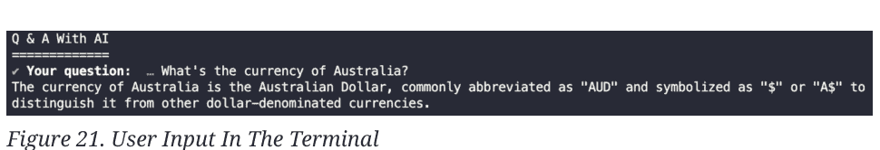

通过这种方式，你可以询问任何类型的问题，而无需每次替换 `question` 变量。

你也可以允许用户与 LLM 聊天，直到用户在终端输入 `/bye`。如以下所示，将用户输入提示包装在 `while` 循环中：

```javascript
console.log('Q & A With AI');
console.log('==============');
console.log('Type /bye to stop the program');

let exit = false;
while (!exit) {
  const { question } = await prompts({
    type: 'text',
    name: 'question',
    message: 'Your question: ',
    validate: value => (value ? true : 'Question cannot be empty'),
  });
  if (question == '/bye') {
    console.log('See you later!');
    exit = true;
  } else {
    const response = await llm.invoke(question);
    console.log(response.content);
  }
}
```

这样，JavaScript 将会持续请求输入，直到用户输入 `/bye`：

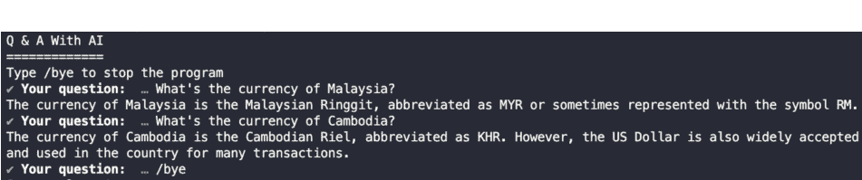

我们将在后续章节中请求更多输入，因此拥有 `prompts` 模块将会派上用场。

## 总结

本章的代码位于书籍源代码的 `05_Enabling_User_Input` 文件夹中。

在本章中，你添加了 `prompts` 包来捕获用户输入，并使应用程序更具交互性。

`prompts` 包仅在我们学习 LangChain 期间使用。在后续开发 Web 应用程序时不会使用它。

在下一章，我们将学习提示模板。

## 第六章：LangChain 提示模板

LangChain 提示模板是一个 JavaScript 类，用于创建发送给大型语言模型的特定提示（或指令）。

通过使用提示模板，我们可以在要求用户最少输入的情况下，重现相同的指令。

为了向你展示一个例子，假设你正在创建一个简单的 AI 应用程序，该程序仅提供特定国家的货币信息。

根据我们已经知道的，唯一的方法是不断重复问题，同时更改国家，如下所示：

```
Your question:  ... What is the currency of Malaysia?
...
Your question:  ... What is the currency of India?
...
Your question:  ... What is the currency of Cambodia?
```

你可以为该问题创建一个模板，如下所示，而不是重复问题：

```javascript
console.log('Currency Info');
console.log('===============');
console.log('You can ask for the currency of any country in the world');

const { country } = await prompts({
  type: 'text',
  name: 'country',
  message: 'Input Country: ',
  validate: value => (value ? true : 'Country cannot be empty'),
});

const response = await llm.invoke(`What is the currency of ${country}`);
console.log(response.content);
```

现在你只需要给出国家名称即可获取货币信息。

虽然你可以如上所示使用模板字符串，但 LangChain 建议你使用提示模板类以实现有效复用。让我向你展示如何操作。

### 创建提示模板

要创建提示模板，你需要从 `@langchain/core/prompts` 导入 `PromptTemplate` 类，如下所示：

```javascript
import { PromptTemplate } from '@langchain/core/prompts';
```

下一步是创建提示本身。

你可以创建一个名为 `prompt` 的变量，然后将对 `PromptTemplate()` 构造函数的调用传递给该变量：

```javascript
const prompt = new PromptTemplate({});
```

调用 `PromptTemplate()` 构造函数时，你需要传递两个参数：

1.  `inputVariables` - 模板中使用的变量名称数组
2.  `template` - 提示模板本身的字符串

这是一个完整的 `PromptTemplate()` 调用示例：

```javascript
const prompt = new PromptTemplate({
  inputVariables: ['country'],
  template: `What is the currency of {country}? Answer in one short paragraph`,
});
```

现在你可以在调用 `llm.invoke()` 方法时使用 `prompt` 对象。

你需要调用 `prompt.format()` 方法，并传递在 `inputVariables` 参数中指定的变量，如下所示：

```javascript
const { country } = await prompts({
  type: 'text',
  name: 'country',
  message: 'Input Country: ',
  validate: value => (value ? true : 'Country cannot be empty'),
});

const response = await llm.invoke(await prompt.format({ country: country }));
console.log(response.content);
```

现在运行应用程序并请求特定国家的货币。

以下是请求西班牙货币的示例：

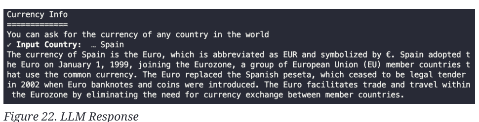

*图 22. LLM 响应*

`PromptTemplate` 类提供了一个结构，你可以用它来构建特定的提示。

### 具有多个输入的提示模板

提示模板可以在模板字符串中接受你需要的任意数量的输入。

例如，假设你想控制段落数量和答案的语言。你可以像这样在提示模板中添加两个变量：

```javascript
const prompt = new PromptTemplate({
  inputVariables: ['country', 'paragraph', 'language'],
  template: `
    You are a currency expert.
    You give information about a specific currency used in a specific country.

    Answer the question: What is the currency of {country}?

    Answer in {paragraph} short paragraph in {language}
  `,
});
```

由于我们有三个输入变量，我们需要向用户请求输入。

就在 `prompts()` 调用之前，创建一个包含输入详细信息的对象数组，如下所示：

```javascript
const questions = [
  {
    type: 'text',
    name: 'country',
    message: 'What country?',
    validate: value => value ? true : 'Country cannot be empty',
  },
  {
    type: 'number',
    name: 'paragraph',
    message: 'How many paragraphs (1 to 5)?',
    validate: value =>
      value >= 1 && value <= 5 ? true : 'Paragraphs must be between 1 and 5',
  },
  {
    type: 'text',
    name: 'language',
    message: 'What Language?',
    validate: value => value ? true : 'Language cannot be empty',
  },
];
```

注意，`paragraph` 输入限制在 1 到 5 之间，以避免生成过长的文章。

现在将 `questions` 变量传递给 `prompts()` 函数，然后使用解构赋值语法提取输入：

```javascript
const { country, paragraph, language } = await prompts(questions);
```

现在你可以将输入传递给 `prompt.format()` 方法：

```javascript
const response = await llm.invoke(
  await prompt.format({ country, paragraph, language })
);

console.log(response.content);
```

就是这样。现在你可以尝试运行应用程序，如下所示：

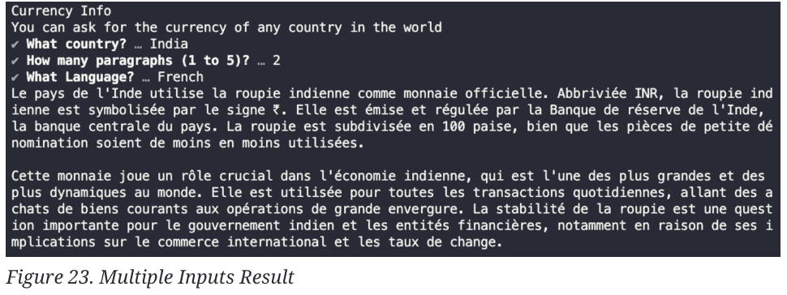

*图 23. 多输入结果*

将提示模板与 `prompts` 结合，你可以创建一个更复杂的货币信息应用程序，该程序可以生成精确 N 段长度且符合你首选语言的答案。

### 限制 LLM 回答不期望的提示

提示模板也可以防止你的模型回答奇怪的问题。

例如，你可以询问 LLM 关于纳尼亚（一个由英国作家 C.S. 创造的虚构国家）的货币：

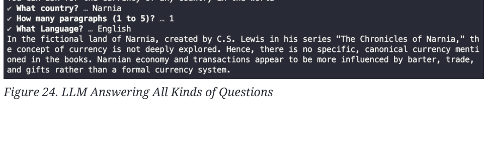

*图 24. LLM 回答各种问题*

虽然答案是合适的，但你可能一开始就不想提供关于虚构或不存在国家的信息。

按照以下方式修改提示模板参数：

```javascript
const prompt = new PromptTemplate({
  inputVariables: ['country', 'paragraph', 'language'],
  template: `
    You are a currency expert.
    You give information about a specific currency used in a specific country.
    Avoid giving information about fictional places.
    If the country is fictional or non-existent, answer: I don't know.
    Answer the question: What is the currency of {country}?
    Answer in {paragraph} short paragraph in {language}
  `,
});
```

上面的提示指示大语言模型在被问及虚构地点时不要回答。

现在如果你再次询问，大语言模型将如下响应：

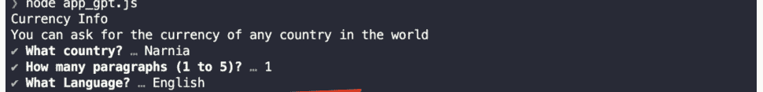

*图 25. 大语言模型拒绝回答*

如你所见，当被问及虚构国家的货币时，大语言模型拒绝了回答。

使用提示模板，代码比重复使用模板字符串更具可维护性和简洁性。

## 总结

本章的代码在书籍源代码的 `06_Prompt_Template` 文件夹中。

使用提示模板使你能够为大语言模型设计复杂的指令，同时仅需用户提供最少的输入。

你的指令越具体，响应就越准确。

你甚至可以指示大语言模型避免回答不需要的提示，如最后一节所示。

## 第七章：LangChain 表达式语言（LCEL）

在上一章中，我们在 `llm.invoke()` 方法内部调用了 `prompt.format()` 方法，如下所示：

```javascript
const response = await llm.invoke(
  await prompt.format({ country, paragraph, language })
);

console.log(response.content);
```

虽然这种技术有效，但 LangChain 实际上提供了一种声明式的方法来顺序执行提示和大语言模型对象。

这种声明式方法被称为 LangChain 表达式语言（简称 LCEL）。

使用 LCEL，你可以将提示和大语言模型对象包装在一个链中，如下所示：

```javascript
const chain = prompt.pipe(llm);
```

LCEL 的标志是 `pipe()` 方法，它可用于将 LangChain 组件包装在一起。

LangChain 中的组件包括提示、大语言模型、链本身和解析器。我们将在下一节中更多地了解解析器。

你可以从 `chain` 对象调用 `invoke()` 方法，并将提示所需的输入作为对象传递如下：

```javascript
const response = await chain.invoke({ country, paragraph, language });

console.log(response.content);
```

`chain` 对象将格式化提示，然后自动将其传递给 `llm` 对象。

`response` 对象与调用 `llm.invoke()` 方法时相同：它是一个消息对象，答案存储在 `content` 属性下。

### 顺序链

使用 LCEL，你可以创建多个链，并在大语言模型响应前一个提示后运行下一个提示。

这种在前一个提示被回答后运行下一个提示的方法被称为顺序链。

根据输入和输出结果，顺序链分为 2 类：

- 简单顺序链
- 常规顺序链

我们将在下一章探讨常规顺序链。现在，让我们先探讨简单顺序链。

### 简单顺序链

简单顺序链是链中的每个步骤具有单个输入/输出。一个步骤的输出将是下一个提示的输入：

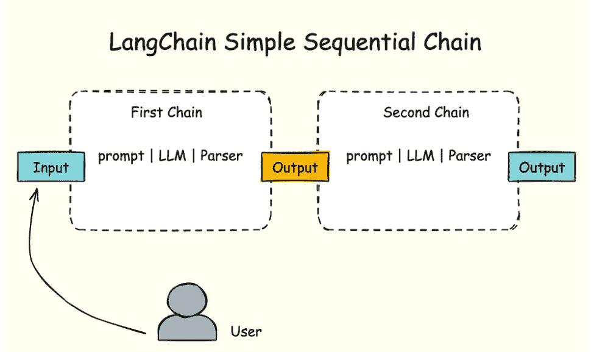

*图 26. 简单顺序链示意图*

例如，假设你想创建一个能够撰写短文的应用程序。

你将提供主题，大语言模型将首先确定标题，然后继续为该主题撰写文章。

要创建该应用程序，你需要先为标题创建一个提示：

```javascript
const titlePrompt = new PromptTemplate({
  inputVariables: ['topic'],
  template: `
    You are an expert journalist.
    You need to come up with an interesting title for the following topic:
    {topic}
    Answer exactly with one title
  `
});
```

上面的 `titlePrompt` 接收一个输入变量：它将生成的标题主题。

接下来，你需要为文章创建一个提示，如下所示：

```javascript
const essayPrompt = new PromptTemplate({
  inputVariables: ['title'],
  template: `
    You are an expert nonfiction writer.
    You need to write a short essay of 350 words for the following title:
    {title}
    Make sure that the essay is engaging and makes the reader feel excited.
  `
});
```

这个 `essayPrompt` 也接受一个输入：我们之前创建的 `titlePrompt` 生成的标题。

现在你需要创建两个链，每个提示一个：

```javascript
const firstChain = titlePrompt.pipe(llm).pipe(new StringOutputParser());
const secondChain = essayPrompt.pipe(llm);
```

`firstChain` 使用 `StringOutputParser` 类将大语言模型响应解析为字符串，因此你需要从 LangChain 导入解析器：

```javascript
import { StringOutputParser } from '@langchain/core/output_parsers';
```

使用字符串解析器，大语言模型响应将从对象转换为单个字符串值，移除响应中包含的元数据。

现在你可以将 `firstChain` 和 `secondChain` 组合起来创建一个 `overallChain`，如下所示：

```javascript
const overallChain = firstChain
    .pipe(firstChainResponse => ({ title: firstChainResponse }))
    .pipe(secondChain);
```

注意，第一个 `pipe()` 方法中传入了一个箭头函数。此函数将 `firstChain` 返回的值格式化为一个可以传递给 `secondChain` 的对象。

现在你有了一个 `overallChain`，让我们更新提示问题，只问一个问题：

```javascript
console.log('Essay Writer');

const { topic } = await prompts([
    {
        type: 'text',
        name: 'topic',
        message: 'What topic to write?',
        validate: value => (value ? true : 'Topic cannot be empty'),
    },
]);

const response = await overallChain.invoke({ topic });
console.log(response.content);
```

这样就完成了。如果你运行应用程序并询问一个主题，你将得到类似这样的响应：

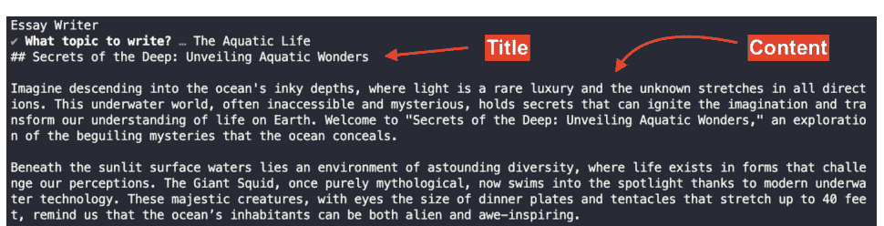

*图 27. 简单顺序链结果*

结果中有一些段落被截断了，但你已经可以看到 `firstChain` 提示生成了 `secondChain` 提示使用的 `title` 变量。

使用简单顺序链允许你将复杂任务分解为一系列较小的任务，提高大语言模型结果的准确性。

### 在顺序链中使用多个大语言模型

你也可以为使用 LCEL 创建的每个链分配不同的大语言模型。

以下示例代码使用 Google Gemini 运行第一个链，而第二个链使用 OpenAI GPT：

```javascript
const llm = new ChatOpenAI({
  model: 'gpt-4o',
  apiKey: process.env.OPENAI_KEY,
});

const llm2 = new ChatGoogleGenerativeAI({
  model: 'gemini-1.5-pro-latest',
  apiKey: process.env.GOOGLE_GEMINI_KEY,
});

// 为每个链使用不同的大语言模型：
const firstChain = titlePrompt.pipe(llm).pipe(new StringOutputParser());
const secondChain = essayPrompt.pipe(llm2);
```

因为 LCEL 是声明式的，你可以轻松地交换链中的组件。

### 调试顺序链

如果你想更详细地查看顺序链的过程，你可以在创建大语言模型对象时启用调试模式：

```javascript
const llm = new ChatOpenAI({
    model: 'gpt-4o',
    apiKey: process.env.OPENAI_KEY,
    debug: true
});
```

当你重新运行应用程序时，你会在终端上看到调试输出。

你可以通过搜索 `[llm/start]` 日志来查看 LangChain 发送给大语言模型的提示，如下所示：

```
[llm/start] [1:llm:ChatOpenAI] Entering LLM run with input: {
    // ...
}
```

要查看输出，你需要查找 `[llm/end]` 日志。

如果你搜索第二个链的输入，你会看到定义如下的提示：

```
[llm/start] [1:llm:ChatOpenAI] Entering LLM run with input: {
    "messages": [
    [
```

## 总结

本章的代码可在书籍源代码的 `07_LCEL` 文件夹中找到。

在本章中，你了解了 LangChain 表达式语言（LCEL），它可以用于以声明式方式组合 LangChain 组件。

一个链本质上是这些 LangChain 组件的封装器：

- 提示模板
- 要使用的 LLM
- 用于处理 LLM 输出的解析器

链的组件是可互换的，这意味着你可以对第一个提示使用 GPT 模型，然后对第二个提示使用 Gemini 模型，如上所示。

通过使用 LCEL，你可以创建高级工作流，并与大型语言模型交互来解决复杂任务。

在下一章中，我将向你展示如何创建一个常规的顺序链。

## 第八章：常规顺序链

常规顺序链是顺序链的一种更通用的形式，允许多个输入和输出。

下一个链的输入通常是前一个链的输出与另一个来源的混合，如下所示：

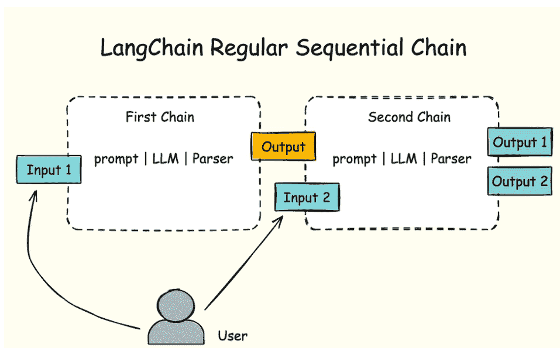

这个链比简单的顺序链稍微复杂一些，因为我们需要跟踪多个输入和输出。

例如，假设你将上一章的 `essayPrompt` 更改为具有两个 `inputVariables`，如下所示：

```javascript
const essayPrompt = new PromptTemplate({
  inputVariables: ['title', 'emotion'],
  template: `
    You are an expert nonfiction writer.
    You need to write a short essay of 350 words for the following title:
    {title}
    Make sure that the essay is engaging and makes the reader feel {emotion}.
  `,
});
```

作文提示所需的情感输入并非来自第一个链，第一个链只返回 `title` 变量。

你需要在创建 `overallChain` 时注入情感输入，如下所示：

```javascript
const overallChain = firstChain
  .pipe(result => ({
    title: result,
    emotion,
  }))
  .pipe(secondChain);
```

这样，`title` 输入从 `firstChain` 的输出中获取，而 `emotion` 输入来自另一个来源。

现在你需要向用户请求情感输入：

```javascript
console.log('Essay Writer');

const questions = [
  {
    type: 'text',
    name: 'topic',
    message: 'What topic to write?',
    validate: value => (value ? true : 'Topic cannot be empty'),
  },
  {
    type: 'text',
    name: 'emotion',
    message: 'What emotion to convey?',
    validate: value => (value ? true : 'Emotion cannot be empty'),
  },
];

const { topic, emotion } = await prompts(questions);
```

现在你为第二个链准备了两个输入：`title` 和 `emotion`。

确保 `overallChain` 在 `await prompts()` 行之下声明。

### 格式化输出变量

一个顺序链通常也跟踪多个输出变量。

要跟踪多个输出变量，你可以使用 LangChain 的 `StructuredOutputParser` 将输出格式化为 JSON 对象。

首先，从 LangChain 导入解析器：

```javascript
import {
  StringOutputParser,
  StructuredOutputParser,
} from '@langchain/core/output_parsers';
```

接下来，创建一个解析器，该解析器包含以对象形式表示的输出模式。

假设你想在响应中显示 `title`、`emotion` 和 `essay` 值。

调用 `StructuredOutputParser.fromNamesAndDescriptions()` 方法并传入模式，如下所示：

```javascript
const firstChain = titlePrompt.pipe(llm).pipe(new StringOutputParser());

const structuredParser = StructuredOutputParser.fromNamesAndDescriptions({
  title: 'the essay title',
  emotion: 'the emotion conveyed by the essay',
  essay: 'the essay content',
});
```

之后，将解析器传入 `secondChain`，如下所示：

```javascript
const secondChain = essayPrompt.pipe(llm).pipe(structuredParser);
```

现在 LLM 被指示使用 `structuredParser` 解析输出。

在 `essayPrompt` 中，更新 `inputVariables` 和 `template` 参数以包含 `format_instructions` 输入：

```javascript
const essayPrompt = new PromptTemplate({
  inputVariables: ['title', 'emotion', 'format_instructions'],
  template: `
You are an expert nonfiction writer.
You need to write a short essay of 350 words for the following title:
{title}
Make sure that the essay is engaging and makes the reader feel {emotion}.
{format_instructions}
  `,
});
```

对于最后一步，在创建 `overallChain` 对象时，通过调用 `structuredParser.getFormatInstructions()` 方法来传递 `format_instructions` 输入：

```javascript
const overallChain = firstChain
  .pipe(result => ({
    title: result,
    emotion,
    format_instructions: structuredParser.getFormatInstructions(),
  }))
  .pipe(secondChain);
```

`getFormatInstructions()` 方法返回一个包含指令和 JSON 模式的字符串。如果你想查看，可以通过调用 `console.log()` 来显示：

```javascript
console.log(structuredParser.getFormatInstructions());
```

现在你可以运行应用程序，并为作文提供 `title` 和 `emotion` 输入。LLM 将返回一个 JavaScript 对象：

```
Essay Writer
✔ What topic to write? ... The Beauty of Earth
✔ What emotion to convey? ... proud
{
  title: "Earth's Splendor: Exploring the Natural Wonders of Our Planet",
  emotion: 'pride',
  essay: "Our planet Earth is a treasure trove of natural wonders that inspire awe, wonder, and a deep sense of pride in our collective heritage. From the snow-capped peaks of the Himalayas to the vast and mysterious depths of the Amazon Rainforest, Earth's diverse landscapes are a testament to the dynamic forces that have shaped our planet over millions of years. These natural wonders not only highlight the incredible beauty of our world but also underscore the importance of preserving these habitats for future generations.\n" +
  '\n' +
  'Consider the majestic Grand Canyon in the United States, a colossal chasm carved by the Colorado River over millennia. Its layered bands of red rock reveal the chronological history of Earth, exposing us to the geological secrets spanning billions of years. Equally captivating are the Northern Lights dancing across the Arctic skies, their ethereal light displays a cosmic ballet that leaves viewers spellbound.\n' +
  '\n' +
  'Traveling to Africa, we encounter the Serengeti Migration, where millions of wildebeest, zebras, and gazelles make a perilous journey across the plains in a timeless cycle of life and survival. This natural spectacle is not only a marvel of animal behavior but also a crucial component of the ecosystem\'s balance. Similarly, the Great Barrier Reef in Australia stands as the world\'s largest coral reef system, teeming with marine biodiversity, which serves as both a natural wonder and a vital asset for scientific research.\n' +
  '\n' +
  'However, these wonders are under constant threat from human activities including deforestation, pollution, and climate change. The responsibility to conserve and protect these splendid features of our planet falls upon each one of us. It is through collective effort and sustainable practices that we can ensure the continued existence of our planet\'s natural treasures.\n' +
  '\n' +
  "As we explore the planet's extraordinary features, we are reminded of Earth's intricate and interconnected ecosystems, and how we, too, are a part of this tapestry. This realization should fill us with immense pride for living on such a magnificent planet, and a profound duty to protect and cherish it."
}
```

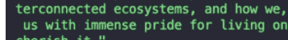

如果你想分别输出每个变量，可以直接访问属性，如下所示：

```javascript
const response = await overallChain.invoke({
  topic,
});

console.log(response.title);
console.log(response.emotion);
console.log(response.essay);
```

现在你拥有一个跟踪多个输入和输出的顺序链。非常好！

本章的代码位于书籍源代码的 `08_Sequential_Chain` 文件夹中。

创建顺序链时，你可以向下一个链添加额外的输入，这些输入并非源自前一个链。

你也可以将输出格式化为 JSON 对象，以使响应更易于组织和处理。

## 第九章：在 LangChain 中实现聊天历史记录

到目前为止，大语言模型接收我们提出的问题，并从训练数据中检索答案。

回顾第 5 章中的简单问答应用，你可以尝试向大语言模型提出如下问题：

1.  上一届国际足联世界杯是什么时候举办的？
2.  将年份乘以 2

在撰写本文时，上一届国际足联世界杯于 2022 年举办。阅读上述第二个提示，我们可以理解“年份”指的是“2022”。

然而，由于大语言模型没有意识之前的交互，答案将不相关。

对于 GPT，大语言模型指的是当前年份，而不是上一届国际足联世界杯的年份：

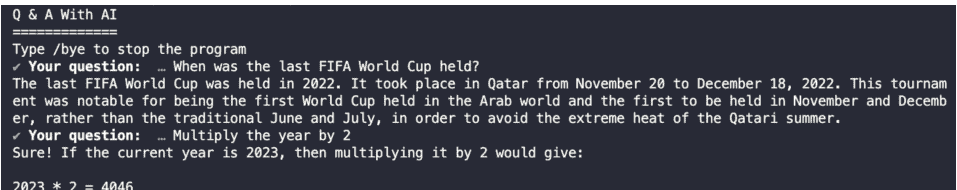

大语言模型无法理解我们是在对前一个问题进行后续指令。

要解决此问题，你需要保存之前的消息，并在发送新提示时使用它们。

要跟随本章内容，你可以从第 5 章复制代码并将其用作起点。

### 创建聊天提示模板

首先，你需要创建一个聊天提示模板，其中注入了聊天历史记录。

聊天提示模板与常规提示模板不同。它接受一个消息数组，每条消息可以关联一个特定角色。

以下是一个聊天提示模板示例：

```javascript
import {
  ChatPromptTemplate
} from '@langchain/core/prompts';

const chatTemplate = ChatPromptTemplate.fromMessages([
  ['system', 'You are a helpful AI bot. Your name is {name}'],
  ['human', 'Hello, how are you doing?'],
  ['ai', "I'm doing well, thanks!"],
  ['human', '{input}'],
]);
```

在上面的示例中，消息分别关联了“system”、“human”和“ai”角色。“system”消息用于影响 AI 行为。

你可以使用 `ChatPromptTemplate` 和 `MessagesPlaceholder` 类创建一个接受聊天历史记录的提示，如下所示：

```javascript
import {
  ChatPromptTemplate,
  MessagesPlaceholder,
} from '@langchain/core/prompts';

const prompt = ChatPromptTemplate.fromMessages([
  [
    'system',
    `You are an AI chatbot having a conversation with a human.
    Use the following context to understand the human question.
    Do not include emojis in your answer`,
  ],
  new MessagesPlaceholder('chatHistory'),
  ['human', '{input}'],
]);
```

`MessagesPlaceholder` 类充当一个入口，你可以通过它注入聊天历史记录。实例化该类时，你需要传递一个用于存储聊天历史记录的字符串键。

### 在 LangChain 中保存消息

要在 LangChain 中保存聊天消息，你可以使用提供的 `ChatMessageHistory` 类：

```javascript
import { ChatMessageHistory } from 'langchain/memory';

const history = new ChatMessageHistory();
```

`ChatMessageHistory` 类提供了获取、添加和清除消息的方法。

但你不会直接操作历史记录对象。相反，你需要将此对象传递给 `RunnableWithMessageHistory` 类。

`RunnableWithMessageHistory` 类创建一个链，为你注入聊天历史记录。它还会在调用链时自动添加新消息：

```javascript
const chain = prompt.pipe(llm);

const chainWithHistory = new RunnableWithMessageHistory({
  runnable: chain,
  getMessageHistory: sessionId => history,
  inputMessagesKey: 'input',
  historyMessagesKey: 'chatHistory',
});
```

创建 `RunnableWithMessageHistory` 对象时，你需要传递要注入历史记录的链（`runnable`）和一个返回聊天历史记录的函数（`getMessageHistory`）。

`inputMessagesKey` 是提示中存在的输入键，而 `historyMessagesKey` 是接受历史记录的变量（它应该与传递给提示中 `MessagesPlaceholder` 的字符串键相同）。

现在 `chainWithHistory` 对象已创建，你可以测试 AI 并查看它是否意识到之前的对话。这里使用 while 循环再次显示输入：

```javascript
console.log('Chat With AI');
console.log('Type /bye to stop the program');

let exit = false;
while (!exit) {
  const { question } = await prompts([
    {
      type: 'text',
      name: 'question',
      message: 'Your question: ',
      validate: value => (value ? true : 'Question cannot be empty'),
    },
  ]);

  if (question === '/bye') {
    console.log('See you later!');
    exit = true;
  } else {
    const response = await chainWithHistory.invoke(
      { input: question },
      {
        configurable: {
          sessionId: 'test',
        },
      }
    );

    console.log(response.content);
  }
}
```

调用 `chainWithHistory` 对象时，你需要将 `sessionId` 键传递到 config 参数中，如上所示。

`sessionId` 可以是任何字符串值。

现在你可以通过给出后续问题来测试应用程序：

```
Q: When was the last FIFA World Cup held?
A: The last FIFA World Cup was held in 2022 in Qatar.
Q: Multiply the year by 2
```


# 第9章：聊天历史记录

A: Multiplying the year 2022 by 2 gives you 4044.

因为聊天历史记录被注入到提示中，大语言模型可以将第二个问题置于第一个问题的上下文中。

如果你向大语言模型传递`verbose`选项：

```javascript
const llm = new ChatOpenAI({
  model: 'gpt-4o',
  apiKey: process.env.OPENAI_KEY,
  verbose: true
});
```

当你在运行第二个问题时，你会在`messages`数组中看到聊天历史记录被传递：

```
[llm/start] [1:llm:ChatOpenAI] Entering LLM run with input: {
  "messages": [
    ... objects containing previous chat messages
  ]
}
```

这些之前的消息是由`chainWithHistory`链注入到提示中的。

## 总结

本章的代码位于书籍源代码的`09_Chat_History`文件夹中。

在本章中，你学习了如何使用LangChain的`RunnableWithMessageHistory`类将聊天历史记录注入提示中。

添加聊天历史记录使AI能够根据之前的消息来理解你的问题上下文。

将聊天历史记录与提示结合使用，你可以与AI持续聊天，同时保留之前的交互。

# 第10章：AI代理与工具

AI代理是一种思考软件，能够通过一系列操作解决任务。它使用大语言模型作为推理引擎来规划和执行操作。

你需要做的就是给代理一个特定的任务。代理将处理该任务，确定解决它所需的操作，然后执行这些操作。

代理还可以使用工具在现实世界中执行操作，例如在互联网上搜索特定信息。

以下是一个插图，帮助你理解代理的概念：

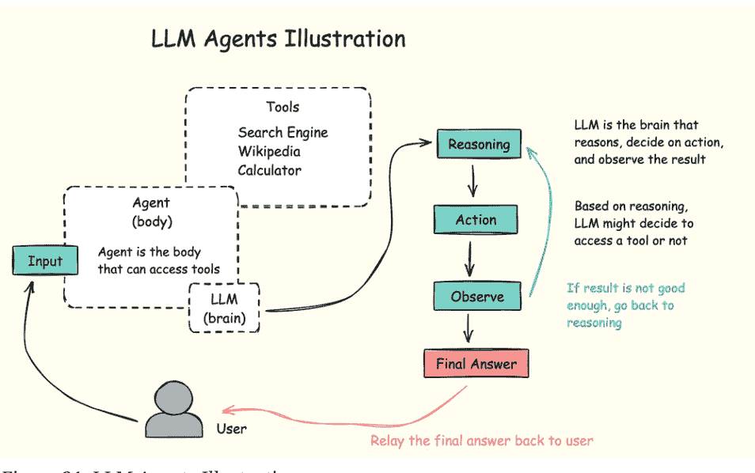

图31. 大语言模型代理插图

并非所有大语言模型都能创建代理，因此需要像GPT-4、Gemini 1.5 Pro或Mistral这样的先进模型。

接下来，我将向你展示如何使用LangChain创建代理。

## 使用LangChain创建AI代理

创建一个名为`react_agent.js`的新JavaScript文件，并导入以下模块：

```javascript
import { pull } from 'langchain/hub';
import { ChatOpenAI } from '@langchain/openai';
import { AgentExecutor, createReactAgent } from 'langchain/agents';
import { DuckDuckGoSearch } from '@langchain/community/tools/duckduckgo_search';
import { WikipediaQueryRun } from '@langchain/community/tools/wikipedia_query_run';
import { Calculator } from '@langchain/community/tools/calculator';
import 'dotenv/config';
import prompts from 'prompts';
```

`dotenv`和`ChatOpenAI`之前已经使用过，但其余模块是用于创建AI代理的新模块。

`pull`函数用于从LangChain社区中心检索提示。你可以访问该中心：https://smith.langchain.com/hub

LangChain社区中心是一个开放的提示集合，你可以在项目中免费使用。

`createReactAgent`模块创建一个使用ReAct提示的代理，而`AgentExecutor`管理代理的执行，例如处理输入、生成响应和更新代理状态。

接下来，按照以下方式初始化`llm`并从中心获取提示：

```javascript
const llm = new ChatOpenAI({
  model: 'gpt-4o',
  apiKey: process.env.OPENAI_KEY,
});
const prompt = await pull('hwchase17/react');
```

`pull()`函数从你指定为参数的仓库中检索提示。这里，我们使用用户“hwchase17”创建的“react”提示。

如果你想查看提示，可以访问 https://smith.langchain.com/hub/hwchase17/react

接下来，实例化我们希望提供给LLM的工具，然后按照以下方式创建代理执行器对象：

```javascript
const wikipedia = new WikipediaQueryRun();
const ddgSearch = new DuckDuckGoSearch({ maxResults: 3 });
const calculator = new Calculator();
const tools = [wikipedia, ddgSearch, calculator];
const agent = await createReactAgent({ llm, tools, prompt });
const agentExecutor = new AgentExecutor({
  agent,
  tools,
  verbose: true // 显示日志
});
```

我们为代理提供了三个工具：
1. `wikipedia` 用于访问和总结维基百科文章
2. `ddgSearch` 用于使用DuckDuckGo搜索引擎搜索互联网
3. `calculator` 用于计算数学方程式

要运行DuckDuckGo搜索工具，你需要使用npm安装 `duck-duck-scrape` 包：

```bash
npm install duck-duck-scrape
```

其余的工具已经可以从 `@langchain/community` 模块中获取。

安装完成后，通过添加问题提示并调用 `invoke()` 方法来完成代理：

```javascript
const { question } = await prompts([
  {
    type: 'text',
    name: 'question',
    message: 'Your question: ',
    validate: value => (value ? true : 'Question cannot be empty'),
  },
]);
const response = await agentExecutor.invoke({ input: question });
console.log(response);
```

AI代理现已完成。你可以按照以下方式使用Node.js运行代理：

```bash
node react_agent.js
```

现在给代理一个任务来完成，例如“美国的第一任总统是谁？”

由于在 `AgentExecutor` 中将 `verbose` 参数设置为 `true`，你将看到LLM的推理过程和所采取的行动：

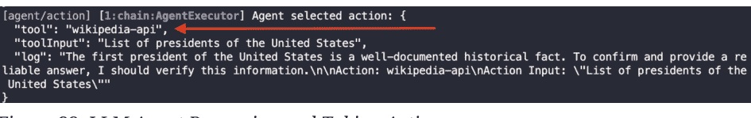

图32. LLM代理推理和采取行动

LLM将使用我们创建的代理来采取行动，以寻求最终答案。

以下日志显示了LLM的思考过程：

```
[llm/end] [1:chain:AgentExecutor > 10:chain:ReactAgent > 15:llm:ChatOpenAI] [2.35s] Exiting LLM run with output: {
  "generations": [
    [
      {
        "text": "I have gathered enough information to provide a reliable answer.\n\nThe first president of the United States was George Washington. He won a unanimous vote of the Electoral College and served as president from 1789 to 1797. Washington is a significant historical figure and is well known for being the only U.S. president never affiliated with any political party.\n\nFinal Answer: The first president of the United States was George Washington.",
        "generationInfo": {
          "prompt": 0,
          "completion": 0,
          "finish_reason": "stop"
        }
      }
    ]
  ]
}
```

图33. LLM代理完成

代理运行完成后，它将返回一个包含两个属性的对象：`input` 和 `output`，如下所示：

```javascript
{
  input: 'Who was the first president of America?',
  output: 'The first president of the United States was George Washington.'
}
```

如果你使用的LLM在其训练数据中已经有了答案，你可能会立即看到输出，而没有任何 `[agent/action]` 日志。

例如，我下面问了“美国独立日是什么时候？”

```
Your question:  ... When is America Independence Day?
America's Independence Day is a well-known historical event that does not require searching for current updates or detailed information from an encyclopedia.
It is generally known information.\n\nFinal Answer: America's Independence Day is on July 4th.
{
  input: 'When is America Independence Day?',
  output: "America's Independence Day is on July 4th."
}
```

因为答案已经在其训练数据中，LLM决定直接回答。

### 向代理提出不同的问题

你现在可以问不同类型的问题，以查看LLM是否足够智能，能够使用可用的工具。

如果你问“今天新加坡的总理是谁？”，LLM应该使用DuckDuckGo搜索来获取最新信息：

```
[agent/action] [1:chain:AgentExecutor] Agent selected action: {
"tool": "duckduckgo-search",
"toolInput": "Current Prime Minister of Singapore",
"log": "The Prime Minister of Singapore may have current and up-to-date information available through a search engine.\n\nAction: duckduckgo-search\nAction Input: Current Prime Minister of Singapore"
}
```

图34. LLM代理进行搜索

如果你问一个数学问题，例如“5的2次方，然后乘以6和3的和”，代理应该使用计算器工具：

```
[agent/action] [1:chain:AgentExecutor] Agent selected action: {
"tool": "calculator",
"toolInput": "25 * 9",
"log": "Now that I have both intermediate results, I can multiply 25 by 9 to get the final answer.\n\nAction: calculator\nAction Input: 25 * 9\n"
}
```

图35. LLM代理进行数学计算

最新的LLM足够智能，能够理解问题的意图并选择正确的工具来完成任务。

### 可用AI工具列表

AI代理只能使用你在创建代理时添加的工具。

LangChain提供的工具列表可以在 [https://js.langchain.com/v0.2/docs/integrations/tools](https://js.langchain.com/v0.2/docs/integrations/tools) 找到。

但是，像 `Calculator` 和 `BingSerpAPI` 这样的工具并未在上面的集成页面中列出，因此你需要深入研究LangChain社区包的源代码来找到所有可用的工具。

只需打开 `node_modules/` 文件夹，然后进入 `@langchain/community/tools`，你就能看到所有的工具：

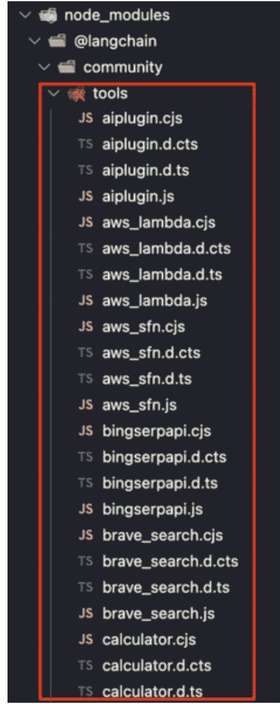

图36. LLM代理可用工具

你可以在这里看到其他工具，如Google搜索和Bing搜索，但这些工具需要API密钥才能运行。

### AI代理的类型

目前已确定几种类型的AI代理，我们创建的称为ReAct（推理+行动）代理。

ReAct代理是一种通用代理，还有更专业的代理，例如XML代理和JSON代理。

你可以在 https://js.langchain.com/v0.1/docs/modules/agents/agent_types/ 阅读更多关于不同代理类型的信息。

随着LLM和LangChain的改进，可能会创建新的代理类型，因此以上定义并不总是适用。

## 总结

本章的代码可在书籍源代码的 `10_Agents_and_Tools` 文件夹中找到。

虽然我们目前的世界还没有自主机器人助手（还没有），但我们已经可以看到AI代理的发展有一天可能被用作AI机器人的大脑。

AI代理是一项了不起的创新，它展示了一台机器如何能提出一系列行动步骤来实现一个目标。

当你创建一个代理时，LLM被用作推理引擎，需要提出一系列逻辑步骤来完成任务。

代理也可以使用各种工具来行动，例如浏览网页或解数学方程。

使用多个工具的更复杂任务也可以由这些代理执行。

有时，训练有素的LLM可以直接从训练数据中回答，从而绕过使用工具的需要。

# 第11章：在LANGCHAIN中与文档交互

最有趣的AI用例之一是“与文档聊天”功能，它允许用户通过对话式查询与文档进行交互。

只需提出问题，用户就可以快速找到相关信息、总结内容并获得见解，而无需阅读和整理大量文本。

以下是创建“与文档聊天”应用程序所需过程的说明：

## 与文档聊天应用程序流程

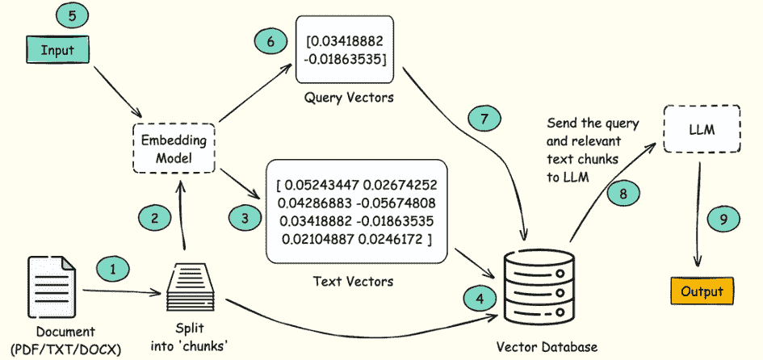

图37. 与文档聊天应用程序流程

你首先需要将单个文档分割成块，以便有效地处理和索引文档。然后将这些块转换为向量嵌入。

向量嵌入是数字数组，通过以数字格式捕捉各种类型信息（包括文本、图像、音频等）的特征来表示这些信息。

当你提出问题时，LangChain会将查询转换为向量，然后在文档向量中搜索最相关的匹配项。

然后，LangChain将用户查询和相关的文本块发送给LLM，以便LLM可以根据给定的输入生成响应。

寻找相关信息并将其发送给LLM的过程也称为检索增强生成。

## 获取文档

您将向应用程序上传一个文档并对其进行提问。您可以从源代码文件夹中获取名为 `ai-discussion.txt` 的文本文件。

该文本文件包含一个虚构的故事，探讨了人工智能对人类的影响。

因为是虚构的，您可以确信大语言模型是从文档中获取答案，而非来自其训练数据。

## 构建文档对话应用程序

创建一个新的 JavaScript 文件，命名为 `rag_app.js`，然后按照以下方式导入文档对话应用程序所需的包：

```javascript
import { ChatOpenAI, OpenAIEmbeddings } from '@langchain/openai';
import { ChatPromptTemplate } from '@langchain/core/prompts';
import prompts from 'prompts';
// New packages:
import { TextLoader } from 'langchain/document_loaders/fs/text';
import { RecursiveCharacterTextSplitter } from '@langchain/textsplitters';
import { MemoryVectorStore } from 'langchain/vectorstores/memory';
import { createRetrievalChain } from 'langchain/chains/retrieval';
import { createStuffDocumentsChain } from 'langchain/chains/combine_documents';
import 'dotenv/config';
```

`OpenAIEmbeddings` 类用于访问 OpenAI 的嵌入模型。

`TextLoader` 类用于加载文本文件，而 `RecursiveCharacterTextSplitter` 则用于将文本分割成小块，以便大语言模型能够更高效地处理。

`MemoryVectorStore` 类用于在内存中存储向量数据。`createRetrievalChain` 用于检索文档并将其传递给 `createStuffDocumentsChain`，后者再将文档传递给大语言模型。

导入包后，您可以按照如下方式定义 `llm`：

```javascript
const llm = new ChatOpenAI({
  model: 'gpt-4o',
  apiKey: process.env.OPENAI_KEY,
});
```

定义 `llm` 之后，使用 `TextLoader` 加载文本，并将文档路径传递给 `TextLoader`，如下所示：

```javascript
const loader = new TextLoader('./ai-discussion.txt');
const docs = await loader.load();
```

`docs` 将是一个 `Document` 对象的数组。现在您需要创建文本分割器，并将文档分割成块：

```javascript
const splitter = new RecursiveCharacterTextSplitter({
  chunkSize: 1000,
  chunkOverlap: 200,
});
const chunks = await splitter.splitDocuments(docs);
```

要将文档块转换为向量，您需要使用一个嵌入模型。

OpenAI 提供了一个 API 端点来将文档转换为向量，而 LangChain 提供了 `OpenAIEmbeddings` 类，使您能够轻松使用此嵌入功能。

在 `chunks` 变量下方添加以下代码：

```javascript
const embeddings = new OpenAIEmbeddings({ apiKey: process.env.OPENAI_KEY });
const vectorStore = await MemoryVectorStore.fromDocuments(chunks, embeddings);
const retriever = vectorStore.asRetriever();
```

`MemoryVectorStore.fromDocuments()` 方法将块和嵌入数据发送到向量存储。

接下来，您需要调用 `asRetriever()` 方法来创建一个检索器对象，该对象接受用户输入并返回文档的相关块。

之后，您需要创建发送给大语言模型的提示：

```javascript
const systemPrompt = `You are an assistant for question-answering tasks.
Use the following pieces of retrieved context to answer
the question. If you don't know the answer, say that you
don't know. Use three sentences maximum and keep the
answer concise.
\n\n{context}`;
const prompt = ChatPromptTemplate.fromMessages([
  ['system', systemPrompt],
  ['human', '{input}'],
]);
```

创建提示后，您需要通过调用 `createStuffDocumentsChain()` 函数来创建一个链，并像这样传递 `llm` 和 `prompt`：

```javascript
const questionAnswerChain = await createStuffDocumentsChain({
  llm: llm,
  prompt: prompt,
});
```

这个 `questionAnswerChain` 将负责填充提示模板并将提示发送给大语言模型。

接下来，将 `questionAnswerChain` 传递给 `createRetrievalChain()` 函数：

```javascript
const ragChain = await createRetrievalChain({
  retriever: retriever,
  combineDocsChain: questionAnswerChain,
});
```

上面的 `ragChain` 会将输入传递给检索器，检索器将文档的相关部分返回给链。

然后，将文档的相关部分和输入一起传递给 `questionAnswerChain` 以获取结果。

现在您可以获取用户输入，然后使用该输入运行 `invoke()` 方法：

```javascript
const { question } = await prompts([
  {
    type: 'text',
    name: 'question',
    message: 'Your question: ',
    validate: value => (value ? true : 'Question cannot be empty'),
  },
]);
const response = await ragChain.invoke(
  { input: question },
  {
    configurable: {
      sessionId: 'test',
    },
  }
);
console.log(response.answer);
```

当大语言模型返回答案时，您将答案打印到命令行。

现在应用程序已经完成。您可以使用 Node.js 从命令行运行它：

```bash
node rag_app.js
```

然后提出一个与文档上下文相关的问题。这里有一个例子：

```
node rag_app.js
Your question:  ... Where does Mr. Thompson work?
Mr. Thompson works at VegaTech Inc. as the Chief AI Scientist.
```

如我们所见，大语言模型能够通过分析 LangChain 创建的提示和我们的输入来回答问题。

### 添加聊天记忆以获取上下文

要将聊天记忆添加到 RAG 链中，您需要通过创建一个历史感知检索器来升级检索器对象。

这个历史感知检索器随后用于通过分析聊天历史来为您最新的问题提供上下文。

您需要导入 `createHistoryAwareRetriever` 链，然后按照如下方式创建一个 `createHistoryAwareRetriever` 对象：

```javascript
import { createHistoryAwareRetriever } from 'langchain/chains/history_aware_retriever';
// ... other code
const retriever = vectorStore.asRetriever();
const contextualizeSystemPrompt = `
Given a chat history and the latest user question
which might reference context in the chat history, formulate a standalone question
which can be understood without the chat history. Do NOT answer the question,
just reformulate it if needed and otherwise return it as is.
`;
const contextualizePrompt = ChatPromptTemplate.fromMessages([
  ['system', contextualizeSystemPrompt],
  new MessagesPlaceholder('chat_history'),
  ['human', '{input}'],
]);
const historyAwareRetriever = await createHistoryAwareRetriever({
  llm,
  retriever,
  rephrasePrompt: contextualizePrompt,
});
```

`contextualizePrompt` 用于使大语言模型在聊天历史的上下文中重新表述问题。

该提示被传递给 `createHistoryAwareRetriever` 对象。

接下来，您也需要向提示对象添加 `MessagesPlaceholder`：

```javascript
const prompt = ChatPromptTemplate.fromMessages([
  ['system', systemPrompt],
  new MessagesPlaceholder('chat_history'),
  ['human', '{input}'],
]);
```

之后，按照如下方式更新 `ragChain` 以使用 `historyAwareRetriever`：

```javascript
const ragChain = await createRetrievalChain({
  retriever: historyAwareRetriever,
  combineDocsChain: questionAnswerChain,
});
```

现在您有了一个更新后的 RAG 链，像我们在第 9 章中所做的那样，将该链传递给 `RunnableWithMessageHistory()` 类：

```javascript
// Add the imports
import { ChatMessageHistory } from 'langchain/memory';
import { RunnableWithMessageHistory } from '@langchain/core/runnables';
// ... other code
const ragChain = await createRetrievalChain({
  retriever: historyAwareRetriever,
  combineDocsChain: questionAnswerChain,
});
const history = new ChatMessageHistory();
const conversationalRagChain = new RunnableWithMessageHistory({
  runnable: ragChain,
  getMessageHistory: sessionId => history,
  inputMessagesKey: 'input',
  historyMessagesKey: 'chat_history',
  outputMessagesKey: 'answer',
});
```

最后一步，当应用程序接收到问题时，将调用的链更改为 `conversationalRagChain`，并为 `sessionId` 添加可配置参数。

为了重复提示，像之前一样添加一个 `while` 循环：

### 关于向量数据库

本应用中我们使用了 `MemoryVectorStore` 来存储向量数据，但实际上并不推荐在生产环境中使用这种存储方式。

当应用停止运行时，内存中的向量数据将会丢失。

大多数现代数据库应用（如 PostgreSQL、Redis 和 MongoDB）都支持存储向量数据，因此你可能需要在生产环境中使用它们。

你可以在 [https://js.langchain.com/v0.2/docs/integrations/vectorstores/](https://js.langchain.com/v0.2/docs/integrations/vectorstores/) 查看向量数据库集成的详细信息。

`MemoryVectorStore` 数据库仅建议用于原型设计和测试。

### 切换大语言模型

如果你想更改此应用使用的大语言模型，还需要更改用于向量生成的嵌入模型。

对于 Google Gemini，你可以这样导入 `GoogleGenerativeAIEmbeddings` 模型：

```javascript
import {
  ChatGoogleGenerativeAI,
  GoogleGenerativeAIEmbeddings,
} from '@langchain/google-genai';
// llm
const llm = new ChatGoogleGenerativeAI({
  model: 'gemini-1.5-pro-latest',
  apiKey: process.env.GOOGLE_GENERAI_KEY
});
// embeddings
const embeddings = new GoogleGenerativeAIEmbeddings({
  apiKey: process.env.GOOGLE_GENERAI_KEY,
  modelName: 'embedding-001',
});
```

对于 Ollama，你可以使用社区开发的 `OllamaEmbeddings` 类，如下所示：

```javascript
import { ChatOllama } from '@langchain/community/chat_models/ollama';
import { OllamaEmbeddings } from '@langchain/community/embeddings/ollama';
// llm
const llm = new ChatOllama({ model: 'mistral' });
// embeddings
const embeddings = new OllamaEmbeddings({ model: 'mistral' });
```

确保在实例化 `ChatOllama` 和 `OllamaEmbeddings` 类时使用相同的模型。

## 总结

本章的代码可在书籍源代码的 `11_Chat_With_Document` 文件夹中找到。

在本章中，你学习了如何使用 LangChain 创建一个与文档对话的应用程序。

利用 RAG 技术，LangChain 可以从文档中检索信息，然后将信息传递给大语言模型。

你需要做的第一件事是处理文档并将其转换成块，然后使用嵌入模型将这些块转换为向量。

向量存储在向量数据库中，当用户发送查询或输入时，会使用从数据库创建的检索器。

接下来，让我们看看如何加载不同格式的文档，例如 .docx 和 .pdf。

# 第12章：上传不同类型的文档

既然我们可以在 LangChain 中加载 .txt 文档，让我们来改进应用程序，使其也能加载其他类型的文档或格式，例如 .docx 和 .pdf。

要加载不同的文件格式，你需要按如下方式导入每种格式的加载器：

```javascript
import { TextLoader } from 'langchain/document_loaders/fs/text';
import { PDFLoader } from "@langchain/community/document_loaders/fs/pdf";
import { DocxLoader } from "@langchain/community/document_loaders/fs/docx";
```

接下来，你需要检查文档扩展名并使用匹配的加载器加载文档。

在创建 llm 的代码下方，将你想使用的文件位置指定为 `filePath` 变量，然后使用 `path.extname()` 方法获取文档扩展名：

```javascript
import path from 'path';
// ...
const filePath = './python.pdf';
const extension = path.extname(filePath);
let loader = null;
if (extension === '.txt'){
    loader = new TextLoader(filePath);
} else if (extension === '.pdf') {
    loader = new PDFLoader(filePath);
} else if (extension === '.docx') {
    loader = new DocxLoader(filePath);
} else {
    throw new Error('The document format is not supported');
}
const docs = await loader.load();
```

上述代码使用了 'python.pdf' 文件，你可以从源代码文件夹中获取。

获取扩展名字符串后，你需要检查该值以创建正确的加载器。

当文档格式不支持时，抛出错误以停止应用程序。

LangChain 加载器依赖于 Node 包。你需要安装 `mammoth` 来加载 .docx 文件，安装 `pdf-parse` 来加载 .pdf 文件：

```bash
npm install mammoth pdf-parse
```

加载器创建后，你可以加载并分割文档为块，将块转换为向量，并像上一章一样创建链：

```javascript
const docs = await loader.load();
const splitter = new RecursiveCharacterTextSplitter({
    chunkSize: 1000,
    chunkOverlap: 200,
});
const chunks = await splitter.splitDocuments(docs);
// 剩余部分相同...
```

就这样。现在你可以上传 .txt、.docx 或 .pdf 文档，并就文档内容提出相关问题。

要更改你想上传的文档，只需将 `filePath` 变量更改为文档的位置。

如果你上传的文档不支持，Node 将显示 'The document format is not supported' 错误。

## 总结

本章的代码可在书籍源代码的 `12_Uploading_Different_Document_Types` 文件夹中找到。

在本章中，你通过创建文件上传界面，然后根据文档类型使用不同的加载器加载文档，进一步改进了与文档对话的应用程序。

在下一章中，我将向你展示如何与 YouTube 视频进行对话。到时见！

# 第13章：与 YouTube 视频对话

既然你已经学会了如何让 AI 与文档交互，让我们继续创建一个与 YouTube 对话的应用程序。

要创建此应用程序，你可以从第 11 章复制完成的应用程序，并进行本章所示的更改。

让我们开始吧！

## 添加 YouTube 加载器

与 YouTube 对话的应用程序使用 RAG 技术，用视频的转录数据来增强大语言模型。

要获取 YouTube 视频的转录，你需要使用 npm 安装 `youtube-transcript` 和 `youtubei.js` 包，如下所示：

```bash
npm install youtube-transcript youtubei.js
```

此 API 被 LangChain 的 YouTube 加载器用于获取视频的转录。

在文件顶部，像这样从 LangChain 导入 `YoutubeLoader` 类：

```javascript
import { YoutubeLoader } from
'@langchain/community/document_loaders/web/youtube';
```

我们将向用户请求一个 YouTube URL，然后处理该 URL 以创建嵌入和 RAG 链。

在初始化历史记录的下方，创建一个名为 `processUrl()` 的函数，内容如下：

```javascript
const history = new ChatMessageHistory();
const processUrl = async ytUrl => {
    const loader = YoutubeLoader.createFromUrl(ytUrl);
    const docs = await loader.load();
    const splitter = new RecursiveCharacterTextSplitter({
        chunkSize: 1000,
        chunkOverlap: 200,
    });
    const chunks = await splitter.splitDocuments(docs);
    const embeddings = new OpenAIEmbeddings({ apiKey: process.env.OPENAI_KEY });
    const vectorStore = await MemoryVectorStore.fromDocuments(
        chunks,
        embeddings
    );
    const retriever = vectorStore.asRetriever();
    const historyAwareRetriever = await createHistoryAwareRetriever({
        llm,
        retriever,
        rephrasePrompt: contextualizePrompt,
    });
    const ragChain = await createRetrievalChain({
        retriever: historyAwareRetriever,
        combineDocsChain: questionAnswerChain,
    });
};
```

### 处理转录文本不存在错误

由于YouTube音乐视频没有转录文本，当你将此类视频提供给应用程序时，会出现错误。

以下是我尝试使用Taylor Swift视频（链接：https://youtu.be/q3zqJs7JUCQ）时显示的错误信息：

```
Error: Failed to get YouTube video transcription: [YoutubeTranscript]
🔴 Transcript is disabled on this video (q3zqJs7JUCQ)
```

此错误的发生是因为音乐视频的转录文本功能被禁用。

当你传递非YouTube网址时，同样会出现错误：

```
YouTube URL: https://amazon.com
Error: Failed to get youtube video id from the url
```

为避免上述两种错误，你需要按如下方式将函数体包裹在try..catch块中：

```javascript
const processUrl = async ytUrl => {
  try {
    const loader = YoutubeLoader.createFromUrl(ytUrl);
    // ...
    return conversationalRagChain;
  } catch (error) {
    console.log('Not a YouTube URL or video has no transcript. Please try another URL');
    return null;
  }
}
```

这样，当视频没有转录文本时，会显示错误信息，用户可以输入不同的URL：

```
YouTube URL: https://amazon.com
Not a YouTube URL or video has no transcript. Please try another URL
```

没有转录文本，我们无法生成向量数据。

## 总结

本章代码可在书籍源代码的文件夹 `13_Chat_With_Youtube` 中找到。

在本章中，你学习了如何创建一个“与YouTube视频聊天”的应用程序：该应用使用URL获取YouTube视频转录文本，然后将转录文本转换为向量，可用于增强大语言模型的知识。

借助AI，你可以直接询问长视频的要点或摘要，无需亲自观看视频。

# 第14章：使用多模态消息与图像交互

既然我们可以与不同类型的文档交互并“与YouTube视频聊天”，接下来让我们继续探索如何让AI理解图像。

## 理解多模态消息

多模态消息是指使用多种通信模式进行传递的消息。

人类已知的通信模式包括：
- 文本
- 视频
- 音频
- 图像

像GPT-4和Gemini Pro这样的先进模型已具备视觉能力，意味着这些模型能够“看到”图像并回答相关问题。

通过使用多模态消息，我们可以让AI与图像进行交互，例如询问图像中有多少人，或者图像的主色调是什么。

接下来，让我们学习如何使用LangChain创建这样的应用。

## 在LangChain中发送多模态消息

要在LangChain中发送多模态消息，你只需调整提示模板并为人类消息传递一个列表即可。

首先，创建一个名为`handle_image.js`的新文件，导入所需的包，并定义要使用的大语言模型，如下所示：

```javascript
import { ChatOpenAI } from '@langchain/openai';
import { ChatPromptTemplate } from '@langchain/core/prompts';
import { readFile } from 'node:fs/promises';
import prompts from 'prompts';
import 'dotenv/config';
const llm = new ChatOpenAI({
  model: 'gpt-4o',
  apiKey: process.env.OPENAI_KEY,
});
```

Node中的`readFile`模块用于读取图像文件并将其编码为base64字符串格式。

在`llm`变量下方编写图像编码函数：

```javascript
const encodeImage = async imagePath => {
    const imageData = await readFile(imagePath);
    return imageData.toString('base64');
}
const image = await encodeImage('./image.jpg');
```

将传递给`encodeImage()`函数的 `'./image.jpg'` 替换为你计算机上的图像文件。

你可以将计算机上的任何图像传递给该函数，但请确保其中不包含任何敏感数据。

然后，可以将编码后的图像按如下方式传递给聊天提示模板：

```javascript
const prompt = ChatPromptTemplate.fromMessages([
    ['system', 'You are a helpful assistant that can describe images in detail.'],
    ['human',
        [
            { type: 'text', text: '{input}' },
            {
                type: 'image_url',
                image_url: {
                    url: `data:image/jpeg;base64,${image}`,
                    detail: 'low',
                },
            },
        ],
    ],
]);
```

在上面的模板中，你可以看到作为人类消息传递了两个元素：用于问题的“text”和用于图像的“image_url”。

我们可以传递公共图像URL，例如“https://”，但这里我们使用data:image URI，因为我们上传的是计算机上的图像。

在底层，LangChain会自动将该消息转换为多模态消息。

从提示和大语言模型创建一个链，并向用户请求输入：

```javascript
const chain = prompt.pipe(llm);
const response = await chain.invoke({"input": "What do you see on this image?"})
console.log(response.content);
```

大语言模型将处理图像，然后给出相应的答案。

### 添加聊天记录

既然你可以使用语言模型询问关于图像的问题，接下来让我们通过添加聊天记录来改进应用。

首先，像往常一样导入添加网络界面和历史记录所需的包：

```javascript
import { ChatOpenAI } from '@langchain/openai';
import { ChatMessageHistory } from 'langchain/memory';
import { RunnableWithMessageHistory } from '@langchain/core/runnables';
import {
  ChatPromptTemplate,
  MessagesPlaceholder,
} from '@langchain/core/prompts';
import { readFile } from 'node:fs/promises';
import prompts from 'prompts';
import 'dotenv/config';
```

接下来，你需要实例化`ChatMessageHistory`类，并升级链以包含聊天记录，这与第9章类似。

```javascript
const history = new ChatMessageHistory();
const chain = prompt.pipe(llm);
const chainWithHistory = new RunnableWithMessageHistory({
  runnable: chain,
  getMessageHistory: sessionId => history,
  inputMessagesKey: 'input',
  historyMessagesKey: 'chat_history',
});
```

下一步是向用户提问。使用prompts来实现：

```javascript
console.log('Chat With Image');
console.log('Type /bye to stop the program');
let exit = false;
while (!exit) {
  const { question } = await prompts([
    {
      type: 'text',
      name: 'question',
      message: 'Your question: ',
      validate: value => (value ? true : 'Question cannot be empty'),
    },
  ]);
  if (question === '/bye') {
    console.log('See you later!');
    exit = true;
  } else {
    const response = await chainWithHistory.invoke(
      { input: question },
      {
        configurable: {
          sessionId: 'test',
        },
      }
    );
    console.log(response.content);
  }
}
```

就是这样。现在你可以针对你传递给 `encodeImage()` 函数的图像提问了。

下面我将使用来自 [https://g.codewithnathan.com/lc-image](https://g.codewithnathan.com/lc-image) 的图像作为示例：

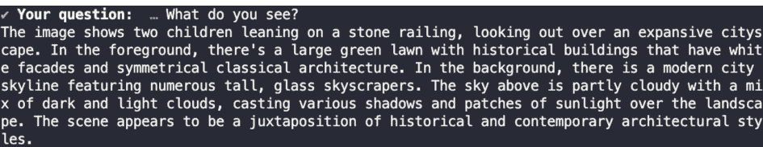

图 39. 图像对话结果

试着询问某个具体细节，例如你能看到图像中有多少人，或者图像中主要是什么颜色。

### Ollama 多模态消息

如果你想向 Ollama 发送多模态消息，你需要下载一个支持该消息格式的模型，例如 bakllava 和 llava。

你可以运行命令 `ollama pull bakllava` 将模型下载到你的机器。请注意，这两个模型都需要 8GB 内存才能无问题地运行。

要向 Ollama 发送多模态消息，你需要确保 `image_url` 键的值是一个字符串，如下所示：

```javascript
['human',
  [
    { type: 'text', text: '{input}' },
    {
      type: 'image_url',
      image_url: `data:image/jpeg;base64,${image}`,
    },
  ],
],
```

不过，LangChain 端存在一个 bug，它会将 `image_url` 键转换为一个对象，并在该对象中添加一个 `url` 属性。

为了解决这个问题，你需要打开位于 `node_modules/@langchain/community/dist/chat_models` 目录下的 `ollama.js` 源代码，并将第 468 行的代码修改如下：

```javascript
else if (contentPart.type === "image_url") {
  console.log(contentPart.image_url);
  const imageUrlComponents = contentPart.image_url.url.split(",");
  // Support both data:image/jpeg;base64,<image> format as well
  images.push(imageUrlComponents[1] ?? imageUrlComponents[0]);
}
```

上面的 `console.log()` 将打印 `image_url` 键的内容，它看起来像这样：

```
{
  url: '...'
}
```

正如你所看到的，即使我们传递的是一个字符串，它也被 LangChain 转换成了一个对象。

这导致原始的 `ollama.js` 代码中检查字符串类型的那部分始终报错：

```javascript
else if (
  contentPart.type === "image_url" &&
  typeof contentPart.image_url === "string"
) {
  const imageUrlComponents = contentPart.image_url.split(",");
  // Support both data:image/jpeg;base64,<image> format as well
  images.push(imageUrlComponents[1] ?? imageUrlComponents[0]);
} else {
  throw new Error(
    `Unsupported message content type. Must either have type "text" or type
"image_url" with a string "image_url" field.`
  );
}
```

一旦 LangChain 维护者解决了这个问题，我就会更新本节内容。

## 总结

本章的代码可在书籍源代码的 `14_Handling_Images` 文件夹中找到。

在本章中，你学习了如何使用 LangChain 向语言模型发送多模态消息。

请注意，并非所有模型都能理解多模态消息。如果你使用 Ollama，你需要使用像 bakllava 这样的模型，而不是 mistral 或 gemma。

如果大语言模型不理解，它通常会告诉你它无法理解你发送的消息。

# 第15章：开发 AI 驱动的 NEXT.JS 应用程序

既然你已经探索了 LangChain 的核心概念，接下来让我们学习如何将 LangChain 集成到 Next.js Web 应用程序中。

Next.js 是一个 JavaScript 和 React 框架，它使你能够开发功能齐全的 Web 应用程序。

如果你从未使用过 Next.js，也不用担心。我将指导你创建应用程序并解释编写的代码。

如果你想深入学习 Next.js 基础知识，可以购买我的《Beginning Next.js Development》一书，网址是 [https://codewithnathan.com/beginning-nextjs](https://codewithnathan.com/beginning-nextjs)。

让我们开始吧！

## 创建 Next.js 应用程序

要创建 Next.js 应用程序，你需要使用 npx 运行 create-next-app 包。

在撰写本文时，最新的 Next.js 版本是 14.2.4，它与 LangChain 存在一个尚未解决的构建问题。

为避免此问题，让我们使用 Next.js 14.1 版本。从终端运行以下命令：

```bash
npx create-next-app@14.1.0 nextjs-langchain
```

`npx` 命令允许你直接从终端执行一个 Javascript 包。

你应该会看到 npm 要求安装一个新包，如下所示。输入 'y' 并按 Enter 继续：

```
Need to install the following packages:
  create-next-app@14.1.0
Ok to proceed? (y) y
```

一旦 create-next-app 安装完成，程序会询问你 Next.js 项目的详细信息，例如你是否要使用 TypeScript 和 Tailwind CSS。

要更改选项，按左或右键选择 Yes 或 No，然后按 Enter 确认你的选择。你可以按照 create-next-app 的默认设置进行，如下所示：

```
npx create-next-app@14.1.0 nextjs-langchain
Need to install the following packages:
  create-next-app@14.1.0
Ok to proceed? (y) y
✔ Would you like to use TypeScript? … Yes
✔ Would you like to use ESLint? … Yes
✔ Would you like to use Tailwind CSS? … Yes
✔ Would you like to use `src/` directory? … No
✔ Would you like to use App Router? (recommended) … Yes
✔ Would you like to customize the default import alias (@/*)? … No
```

然后，该包会生成一个名为 'nextjs-langchain' 的新项目，如下所示：

```
Success! Created nextjs-langchain at ...
```

下一步是使用 `cd` 命令将工作目录更改为刚刚创建的应用程序，然后运行 `npm run dev` 来启动应用程序：

```bash
cd nextjs-langchain
npm run dev
> next-events@0.1.0 dev
> next dev
 ▲ Next.js 14.1.0
 - Local:      http://localhost:3000
 ✓ Ready in 1156ms
```

现在你可以在浏览器中，通过指定的 localhost 地址查看运行的应用程序：

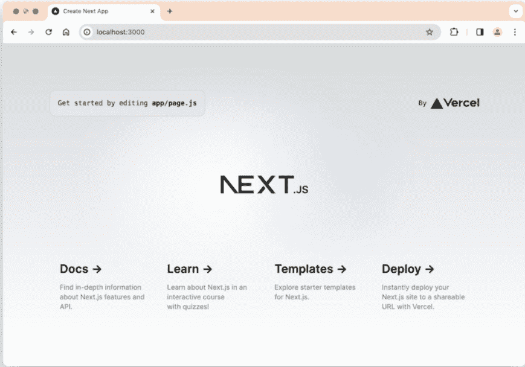

如果你看到上面的屏幕，意味着你已经成功创建并运行了你的第一个 Next.js 应用程序。干得好！

## 安装所需的包

按 CTRL + C 停止正在运行的应用程序，然后安装我们将要使用的包：

```bash
npm install langchain @langchain/openai
```

`langchain` 和 `@langchain/openai` 包与我们在前面章节中使用的相同。

接下来，安装创建前端 React 组件所需的包：

```bash
npm install @radix-ui/react-icons react-textarea-autosize react-code-blocks marked
```

包安装完成后，让我们创建一个服务器操作（server action），接下来它将指示 LangChain 调用大语言模型。

## 添加服务器操作

服务器操作是 Next.js 14 中添加的新功能，作为在 Next.js 应用程序中获取和处理数据的新标准方式。

服务器操作基本上是一个在服务器上执行的异步函数。你可以从 React 组件中调用该函数。

在你的项目文件夹中，创建一个名为 `actions/` 的新文件夹，然后创建一个名为 `openai.action.ts` 的文件，结构如下：

```
.
├── actions
│   └── openai.action.ts
└── app
```

在此文件中，导入 langchain 模块，并创建将用于与大语言模型通信的链（chain）：

```typescript
'use server';
import { ChatOpenAI } from '@langchain/openai';
import { ChatPromptTemplate } from '@langchain/core/prompts';
const llm = new ChatOpenAI({
  model: 'gpt-4o',
  apiKey: process.env.OPENAI_KEY,
});
const prompt = ChatPromptTemplate.fromMessages([
  ['system',
'You are an AI chatbot having a conversation with a human. Use the
following context to understand the human question. Do not include emojis in
your answer',
],
['human', '{input}'],
]);
const chain = prompt.pipe(llm);
```

文件顶部的 `'use server'` 指令用于告知 Next.js
此文件只能在服务器上运行。

在 Next.js 应用程序中，你不需要
`dotenv` 来加载环境变量。

之后，创建一个名为 `getReply()`
的异步函数，它接受一个字符串参数并调用 `chain.invoke()` 方法，如下所示：

```typescript
export const getReply = async (message: string) => {
    const response = await chain.invoke({
        input: message
    });
    return response.content;
};
```

这样，当你想向大语言模型发送消息时，就可以调用 `getReply()` 函数。

接下来，我们将为聊天界面创建组件。

### 为用户和助手添加头像

在创建界面之前，让我们先添加两张图片，它们将用作头像。

你可以从源代码中获取 `user.png` 和 `robot.png` 文件，并将它们放入 `public/` 文件夹。

另外，请删除 `next.svg` 和 `vercel.svg` 文件，因为我们不再需要它们了。

### 开发 React 聊天组件

聊天界面将使用 React 来创建。首先，创建一个名为 `components/` 的文件夹，然后在其内部创建另一个名为 `chat/` 的文件夹。

在 `chat/` 文件夹内，创建一个名为 `index.tsx` 的文件，并导入该文件所需的包：

```tsx
'use client';
import { useState } from 'react';
import ChatList from './chat-list';
import ChatBottombar from './chat-bottombar';
import { getReply } from '@/actions/openai.action';
```

当你使用 React 功能（如 `useState`）时，需要在文件顶部定义 `'use client'` 指令，以告诉 Next.js 该组件必须在浏览器端渲染。

`ChatList` 和 `ChatBottombar` 是我们稍后将创建的聊天界面的组成部分。

接下来，你需要为 Message 对象定义一个接口，如下所示：

```tsx
export interface Message {
  role: string;
  content: string;
}
```

这个接口用于定义 Message 对象的类型，它将存储前端的消息。

接下来，创建 `Chat()` 函数组件，如下所示：

```tsx
export default function Chat() {
  const [loadingSubmit, setLoadingSubmit] = useState(false);
  const [messages, setMessages] = useState<Message[]>([]);
  const sendMessage = async (newMessage: Message) => {
    setLoadingSubmit(true);
    setMessages(prevMessages => [...prevMessages, newMessage]);
    const response = await getReply(newMessage.content);
    const reply: Message = {
      role: 'assistant',
      content: response as string,
    };
    setLoadingSubmit(false);
    setMessages(prevMessages => [...prevMessages, reply]);
  };
  return (
    <div className='max-w-2xl flex flex-col justify-between w-full h-full'>
      <ChatList messages={messages} loadingSubmit={loadingSubmit} />
      <ChatBottombar sendMessage={sendMessage} />
    </div>
  );
}
```

`Chat()` 组件包含 `sendMessage()` 函数，用于将用户消息发送到服务器操作。

该组件定义了两个状态。`loadingSubmit` 状态将在 LLM 生成回复时显示加载动画。

`messages` 状态将保存对话消息，这些消息由 `ChatList` 组件显示。

接下来，你需要创建 `ChatList` 组件，因此请创建一个名为 `chat-list.tsx` 的新文件，内容如下：

```tsx
import { useRef, useEffect } from 'react';
import Image from 'next/image';
import { marked } from 'marked';
import { Message } from './';
interface ChatListProps {
  messages: Message[];
  loadingSubmit: boolean;
}
export default function ChatList({ messages, loadingSubmit }: ChatListProps) {
  const bottomRef = useRef<HTMLDivElement>(null);
  const scrollToBottom = () => {
    bottomRef.current?.scrollIntoView({ behavior: 'smooth', block: 'end' });
  };
  useEffect(() => {
    scrollToBottom();
  }, [messages]);
}
```

`ChatList` 组件将在浏览器上显示消息。

`scrollToBottom()` 函数用于自动滚动到聊天列表底部。每当 `messages` 变量的值因 `useEffect()` 而更新时，都会调用此函数。

在 `useEffect()` 调用下方，创建一个 `if` 语句来检查 `messages` 数组的长度：

```tsx
if (messages.length === 0) {
  return (
    <div className='w-full h-full flex justify-center items-center'>
      <div className='flex flex-col gap-4 items-center'>
        <Image
          src='/robot.png'
          alt='AI'
          width={64}
          height={64}
          className='object-contain'
        />
        <p className='text-center text-lg text-muted-foreground'>
          How can I help you today?
        </p>
      </div>
    </div>
  );
}
```

当 `messages` 数组的长度为零时，将向用户显示一个 `Image` 和一段文本，如下所示：

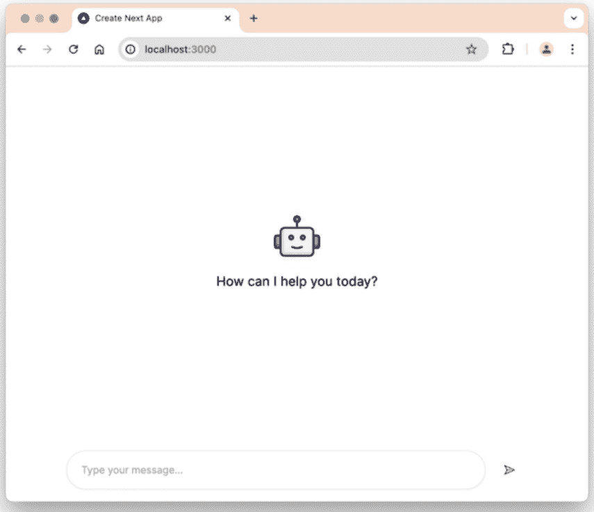

就在 `if` 语句的正下方，编写另一个 `return` 语句以显示现有消息：

```tsx
return (
  <div className='w-full overflow-x-hidden h-full justify-end'>
    <div className='w-full flex flex-col overflow-x-hidden overflow-y-hidden min-h-full justify-end'>
      {messages.map((message, index) => (
        <div
          key={index}
          className={`flex flex-col gap-2 p-4 ${
            message.role === 'user' ? 'items-end' : 'items-start'
          }`}
        >
          <div className='flex gap-3 items-center'>
            {message.role === 'user' && (
              <div className='flex items-end gap-3'>
                <span
                  className='bg-blue-100 p-3 rounded-md max-w-xs sm:max-w-2xl overflow-x-auto'
                  dangerouslySetInnerHTML={{
                    __html: marked.parse(message.content),
                  }}
                />
                <span className='relative h-10 w-10 shrink-0 rounded-full flex justify-start items-center overflow-hidden'>
                  <Image
                    className='aspect-square h-full w-full object-contain'
                    alt='user'
                    width='32'
                    height='32'
                    src='/user.png'
                  />
                </span>
              </div>
            )}
            {message.role === 'assistant' && (
              <div className='flex items-end gap-3'>
                <span className='relative h-10 w-10 shrink-0 overflow-hidden rounded-full flex justify-start items-center'>
                  <Image
                    className='aspect-square h-full w-full object-contain'
                    alt='AI'
                    width='32'
                    height='32'
                    src='/robot.png'
                  />
                </span>
                <span className='bg-blue-100 p-3 rounded-md max-w-xs sm:max-w-2xl overflow-x-auto'>
                  <span
                    key={index}
                    dangerouslySetInnerHTML={{
                      __html: marked.parse(message.content),
                    }}
                  />
                </span>
              </div>
            )}
          </div>
        </div>
      ))}
      {loadingSubmit && (
        <div className='flex pl-4 pb-4 gap-2 items-center'>
          <span className='relative h-10 w-10 shrink-0 overflow-hidden rounded-full flex justify-start items-center'>
            <Image
              className='aspect-square h-full w-full object-contain'
              alt='AI'
              width='32'
              height='32'
              src='/robot.png'
            />
          </span>
          <div className='bg-blue-100 p-3 rounded-md max-w-xs sm:max-w-2xl overflow-x-auto'>
            <div className='flex gap-1'>
              <span className='size-1.5 rounded-full bg-slate-700 motion-safe:animate-[bounce_1s_ease-in-out_infinite]'></span>
              <span className='size-1.5 rounded-full bg-slate-700 motion-safe:animate-[bounce_0.5s_ease-in-out_infinite]'></span>
              <span className='size-1.5 rounded-full bg-slate-700 motion-safe:animate-[bounce_1s_ease-in-out_infinite]'></span>
            </div>
          </div>
        </div>
      )}
    </div>
    <div id='anchor' ref={bottomRef}></div>
  </div>
);
```

当 `role` 属性为 `'user'` 时，用户聊天气泡将显示在右端。否则，我们将 AI 助手气泡显示在左端。

当 `loadingSubmit` 状态为 `true` 时，我们将显示一个思考动画：

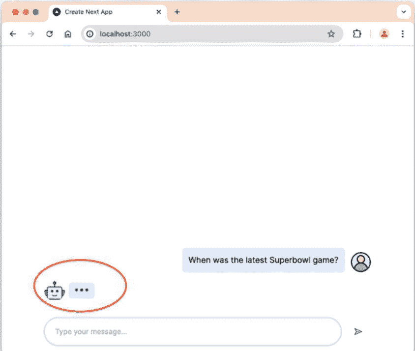

以上就是 `ChatList` 组件的全部内容。

接下来，创建一个名为 `chat-bottombar.tsx` 的新文件，其中包含一个聊天输入栏：

```tsx
import { useState } from 'react';
import TextareaAutosize from 'react-textarea-autosize';
import { PaperPlaneIcon } from '@radix-ui/react-icons';
import { Message } from './';
interface ChatBottombarProps {
  sendMessage: (newMessage: Message) => void;
}
```

当你发送消息时，将执行 `Chat` 组件传递的 `sendMessage()` 函数，然后 LangChain 将向 LLM 发送一个请求。

好了，现在聊天界面的组件已经完成了。

你可以从 `app/page.tsx` 导入该组件，如下所示：


import Chat from '@/components/chat';

export default function Home() {
  return (
    <main className='flex h-[calc(100dvh)] flex-col items-center'>
      <Chat />
    </main>
  );
}

另外，请移除 `globals.css` 中定义的 CSS 样式，只保留 Tailwind 指令：

```
@tailwind base;
@tailwind components;
@tailwind utilities;
/* 移除其余部分... */
```

现在使用 `npm run dev` 运行应用程序，并尝试在浏览器中与 LLM 进行聊天。

### 添加聊天记录

聊天记录可以添加到我们之前创建的服务器操作中。

导入 `ChatMessageHistory` 将历史记录保存在内存中，并导入 `RunnableWithMessageHistory` 来创建带有历史记录的链：

```typescript
// openai.action.ts
import { ChatMessageHistory } from 'langchain/memory';
import { RunnableWithMessageHistory } from '@langchain/core/runnables';
import { ChatPromptTemplate, MessagesPlaceholder } from '@langchain/core/prompts';
// ... 其他代码

const history = new ChatMessageHistory();
const prompt = ChatPromptTemplate.fromMessages([
  ['system', '你是一个正在与人类进行对话的AI聊天机器人。使用以下上下文来理解人类的问题。你的回答中不要包含表情符号'],
  new MessagesPlaceholder('chat_history'),
  ['human', '{input}'],
]);

const chain = prompt.pipe(llm);
const chainWithHistory = new RunnableWithMessageHistory({
  runnable: chain,
  getMessageHistory: sessionId => history,
  inputMessagesKey: 'input',
  historyMessagesKey: 'chat_history',
});
```

创建 `chainWithHistory` 对象后，你需要更新 `getReply()` 函数中调用的链：

```typescript
export const getReply = async (message: string) => {
  const response = await chainWithHistory.invoke(
    { input: message },
    { configurable: { sessionId: 'test' } }
  );
  return response.content;
};
```

现在，之前的聊天消息将被添加到提示词中。

你可以尝试先问一个问题，然后如所示询问你上次问的问题。

现在，这个应用程序看起来像是一个简化版的 ChatGPT。非常不错！

## 总结

本章的代码可在书籍源代码的 `15_nextjs_langchain` 文件夹中找到。

在本章中，你已成功地将 LangChain 集成到一个 Next.js 应用中。

如你所见，开发一个 AI 驱动的应用程序与开发一个常规的 Web 应用程序没有太大区别。

使用 Next.js 时，你可以使用 React 组件创建界面，然后定义使用 LangChain 库来调用 LLM 的服务器操作。

收到响应后，你可以将响应存储在一个状态中，然后从中向用户显示。

## 第16章：将 NEXT.JS AI 应用部署到生产环境

既然 Next.js 应用程序已经可以运行，我们将进行一些改进，以便将其部署到生产环境。

我们需要改进用户体验，让应用程序感觉更具交互性，然后向用户请求 API 密钥以使用该应用程序。

### 流式传输响应

到目前为止，LLM 的响应在 LLM 完成生成答案后一次性显示。这种延迟使得用户体验不够交互。

为了改善用户体验，我们可以在 LLM 生成响应时流式传输响应。这样，用户将逐渐看到输出，使交互更具动态性和响应性。

在终端中，运行 `npm install ai`，如下所示：

```bash
npm install ai
```

`ai` 包是一个用于管理聊天流和 UI 更新的库。它使你能够更高效地开发动态的 AI 驱动界面。

现在打开 `openai.action.ts` 文件，并从 `ai/rsc` 包导入 `createStreamableValue` 函数：

```typescript
import { createStreamableValue } from 'ai/rsc';

export const getReply = async (message: string) => {
  const stream = createStreamableValue();
  (async () => {
    const response = await chainWithHistory.stream(
      { input: message },
      { configurable: { sessionId: 'test' } }
    );
    for await (const chunk of response) {
      stream.update(chunk.content);
    }
    stream.done();
  })();
  return { streamData: stream.value };
};
```

`createStreamableValue()` 函数用于创建一个可流式传输的对象。该对象可以在响应传入时实时更新。

我们不是调用通常的 `invoke()` 方法，而是调用链的 `stream()` 方法。

`stream()` 方法返回一个可迭代对象，该对象在 LangChain 流式传输响应时更新。

`for await...of` 语法用于处理从响应对象接收到的数据块的异步迭代。

当响应完成时，调用 `stream.done()` 方法来通知流处理过程结束，并返回 `stream.value`。

流处理过程被包装在一个立即调用函数表达式（IIFE）中，以便流处理可以并行运行。

如果我们移除 IIFE，`streamData` 会在流完成之前立即返回给前端。

接下来，打开 `chat/index.tsx` 文件，并按照以下方式更新 `sendMessage()` 函数以读取可流式传输的值：

```typescript
import { readStreamableValue } from 'ai/rsc';

const sendMessage = async (newMessage: Message) => {
  setLoadingSubmit(true);
  setMessages(prevMessages => [...prevMessages, newMessage]);
  const { streamData } = await getReply(newMessage.content);
  const reply: Message = { role: 'assistant', content: '' };
  setLoadingSubmit(false);
  setMessages(prevMessages => [...prevMessages, reply]);
  for await (const stream of readStreamableValue(streamData)) {
    reply.content = `${reply.content}${stream}`;
    setMessages(prevMessages => [...prevMessages.slice(0, -1), reply]);
  }
};
```

这里，我们将响应变量的名称改为 `streamValue`，然后用一个空的 `content` 属性初始化 `reply` 对象。

当我们收到响应时，调用 `setLoadingSubmit(false)` 来停止思考指示器，然后将 `reply` 设置为最新的消息。

之后，创建另一个 `for await...of` 循环来读取可流式传输的值，并将其作为 `reply.content` 的值。

最新的消息通过 `setMessages()` 函数不断被 `reply` 对象覆盖。

现在，当你向 LLM 发送消息时，响应将具有打字动画效果。

### 创建 API 密钥输入

这个 Next.js 应用程序使用我们的 API 密钥来访问 LLM 提供商的 API。

这在生产环境中不被推荐，因为每次用户使用该应用程序时我们都会被收费。

与其提供我们的 API 密钥，不如让用户添加他们自己的 API 密钥到应用程序中。

为此，我们需要在侧边栏中为 API 密钥创建一个文本输入，并仅在添加此 API 密钥时在服务器上运行实例化 LLM 的过程。

我们将首先添加服务器操作来处理 API 密钥。

### 添加 setApi() 函数

回到 `openai.action.ts` 文件，你需要将 `llm` 和 `chainWithHistory` 的实例化包装在一个函数中。

下面的 `setApi()` 函数接受一个字符串 `apiKey`，该字符串将用于实例化 `llm` 对象：

```typescript
let chainWithHistory: RunnableWithMessageHistory<any, AIMessageChunk> | null = null;

export const setApi = async (apiKey: string) => {
  const llm = new ChatOpenAI({
    model: 'gpt-4o',
    apiKey: apiKey,
  });
  const history = new ChatMessageHistory();
  const prompt = ChatPromptTemplate.fromMessages([
    ['system', '你是一个正在与人类进行对话的AI聊天机器人。使用以下上下文来理解人类的问题。你的回答中不要包含表情符号'],
    new MessagesPlaceholder('chat_history'),
    ['human', '{input}'],
  ]);
  const chain = prompt.pipe(llm);
  chainWithHistory = new RunnableWithMessageHistory({
    runnable: chain,
    getMessageHistory: sessionId => history,
    inputMessagesKey: 'input',
    historyMessagesKey: 'chat_history',
  });
};
```

这里，我们将 `chainWithHistory` 变量初始化为 `null`。当 `setApi()` 函数执行时，它将持有 `RunnableWithMessageHistory` 实例。

现在 `chainWithHistory` 可能包含一个 `null` 值，我们需要在 `getReply()` 函数中断言 `chainWithHistory` 的类型，如下所示：

```typescript
import { AIMessageChunk } from '@langchain/core/messages';

// 在 getReply() 内部：
(async () => {
  const response = await (
    chainWithHistory as RunnableWithMessageHistory<any, AIMessageChunk>
  ).stream(
    // ...
  );
})();
```

`as` 类型断言告诉 TypeScript，在此函数执行时，我们确定 `chainWithHistory` 变量不是 `null`。

### 添加聊天侧边栏

既然我们已经有了 `setApi()` 函数，我们需要创建一个侧边栏，用户可以在其中输入他们的 API 密钥以使用该应用程序。

创建一个名为 `chat-sidebar.tsx` 的新文件，并编写以下代码：

```tsx
'use client';
import { useState } from 'react';

interface ChatSidebarProps {
  handleSubmitKey: (apiKey: string) => void;
}

export default function ChatSidebar({ handleSubmitKey }: ChatSidebarProps) {
  const [keyInput, setKeyInput] = useState('');
  const submitForm = (e: React.FormEvent<HTMLFormElement>) => {
    e.preventDefault();
    handleSubmitKey(keyInput);
  };
  return (
    <aside className='fixed top-0 left-0 z-40 w-64 h-screen -translate-x-full translate-x-0'>
      <div className='h-full px-3 py-4 overflow-y-auto bg-slate-50'>
        <h1 className='mb-4 text-2xl font-extrabold'>OpenAI API Key</h1>
        <div className='w-full flex py-6 items-center justify-between lg:justify-center'>
          <form className='space-y-4' onSubmit={submitForm}>
            <input
              type='password'
              placeholder='API Key'
              className='border border-gray-300 p-2 rounded focus:outline-none focus:ring-2 focus:ring-blue-500'
              value={keyInput}
              onChange={e => setKeyInput(e.target.value)}
            />
            <button
              type='submit'
              className='bg-blue-500 text-white p-2 rounded hover:bg-blue-600 focus:outline-none focus:ring-2 focus:ring-blue-500'
            >
              Submit
            </button>
          </form>
        </div>
      </div>
    </aside>
  );
}
```

`ChatSidebar` 组件类似于 `ChatBottombar` 组件，因为它也包含一个带有输入框和按钮的表单。

接下来，打开 `index.tsx` 文件以导入该组件和 `setApi()` 函数并使用它们：

```tsx
import { setApi, getReply } from '@/actions/openai.action';
import ChatSidebar from './chat-sidebar';

export default function Chat() {
  // ...
  const [apiKey, setApiKey] = useState('');
  // ...
  const handleSubmitKey = async (apiKey: string) => {
    await setApi(apiKey);
    setApiKey(apiKey);
  };
  return (
    <div className='max-w-2xl flex flex-col justify-between w-full h-full'>
      <ChatSidebar handleSubmitKey={handleSubmitKey} />
      <ChatList apiKey={apiKey} messages={messages} loadingSubmit={loadingSubmit} />
      {apiKey && <ChatBottombar sendMessage={sendMessage} />}
    </div>
  );
}
```

我们还将 `apiKey` 属性添加到 `ChatList` 组件中，以便只要 API 密钥为空，我们就能显示一条警报。

稍微更新一下 `ChatList` 组件以读取 `apiKey` 值：

```tsx
useEffect(() => {
  scrollToBottom();
}, [messages]);

if (!apiKey) {
  return (
    <div className='w-full h-full flex justify-center items-center'>
      <div className='flex flex-col gap-4 items-center'>
        <div className='bg-blue-50 text-blue-700 px-4 py-3 rounded' role='alert'>
          <p className='font-bold'>OpenAI Key</p>
          <p className='text-sm'>Input your OpenAI API Key to use this application.</p>
        </div>
      </div>
    </div>
  );
}
```

当未添加 API 密钥时，会显示如下警报：

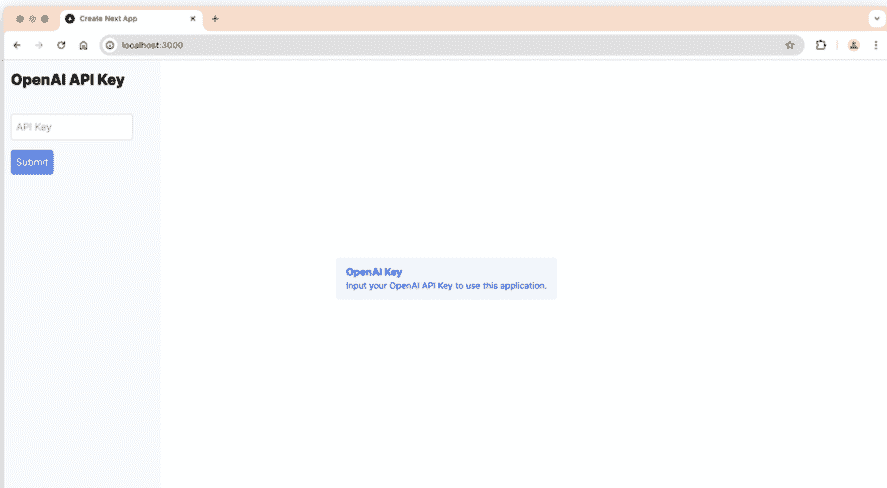

至此，应用程序已准备好进行部署。

### 本地运行构建

下一步是从命令行运行构建命令。如果在本地运行构建时出错，那么在部署到生产环境时肯定也会出现同样的错误。

从项目的根文件夹运行 Next.js 构建命令，如下所示：

```bash
npm run build
```

构建过程完成后，你将看到类似这样的输出：

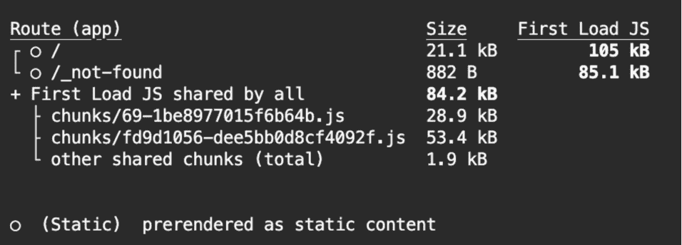

以上结果显示了编译后应用程序的大小，这意味着构建成功。

### 将代码推送到 GitHub

部署应用程序需要你授予对项目文件和文件夹的访问权限。GitHub 是一个你可以用来托管和共享软件项目的平台。

此时，你应该在注册 UploadThing 时已经拥有一个 GitHub 账户，但如果你还没有创建，现在是个好时机。

前往 [https://github.com](https://github.com) 并注册一个新账户。从仪表板中，通过点击左侧边栏的 + New 或导航栏右侧的 + 号来创建一个新仓库：

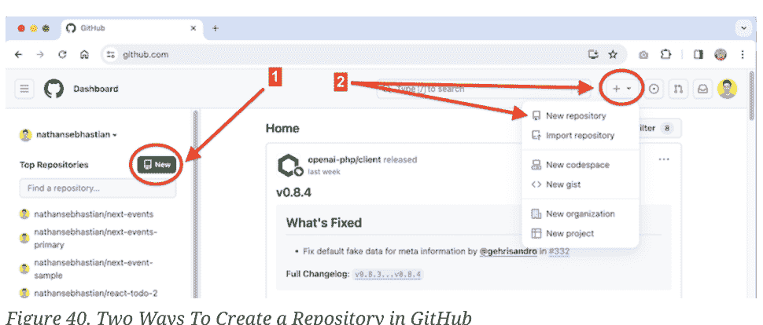

仓库（或 repo）是用于存储软件项目文件的存储空间。

在“创建一个仓库”页面中，填写项目的详细信息。唯一必需的字段是仓库名称。

我将其命名为 `nextjs-langchain`，如下所示：

#### 创建一个新仓库

一个仓库包含所有项目文件，包括修订历史记录。已经在其他地方有项目仓库了？[导入一个仓库。](https://github.com/)

必填字段用星号 (*) 标记。

**仓库模板**
[无模板 ▼]
使用模板仓库的内容开始您的仓库。

**所有者 ***
**仓库名称 ***
[nathansebhastian ▼] / [nextjs-langchain]
✔️ nextjs-langchain 可用。

好的仓库名称简短且易于记忆。需要灵感吗？[shiny-train](https://github.com/) 怎么样？

**描述（可选）**
[输入字段]

如果你想将此项目作为你作品集的一部分，可以将仓库设为公开；或者你也可以将其设为私有。

创建新仓库后，你将获得如何将文件推送到仓库的说明。

你需要的一条指令是从命令行推送现有仓库：

...或者从命令行推送现有仓库

```bash
git remote add origin https://github.com/nathansebhastian/nextjs-langchain.git
git branch -M main
git push -u origin main
```

*图 41. 如何将现有仓库推送到 GitHub*

现在你需要为你的项目创建一个仓库。打开命令行，在项目的根文件夹中运行 `git init` 命令：

```bash
git init
```

这会将你的项目转换为一个本地仓库。通过运行 `git add .` 命令将所有项目文件添加到这个本地仓库中：

```bash
git add .
```

更改添加到仓库后并非永久性的，直到你运行 `git commit` 命令。按如下所示提交更改：

```bash
git commit -m 'Application ready for deployment'
```

`-m` 选项用于为提交添加消息。通常，你将提交到仓库的更改总结为消息。

现在你需要将这个现有仓库推送到 GitHub。你可以按照 GitHub 的说明进行操作：

```bash
git remote add origin <URL>
git branch -M main
git push -u origin main
```

运行 `git push` 命令时可能会要求你输入 GitHub 用户名和密码。

推送完成后，刷新浏览器上的 GitHub 仓库页面，你应该能在那里看到你的项目文件和文件夹：

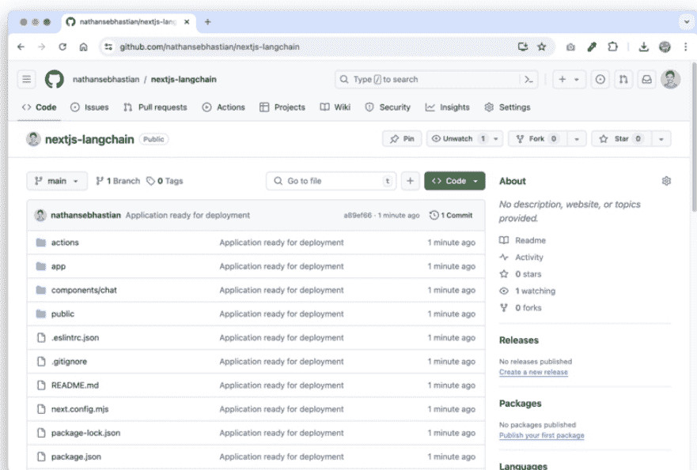

图 42. 项目已推送到 GitHub

这意味着我们的应用程序已经被推送到（上传到）GitHub 托管的远程仓库。

### Vercel 部署

最后一步是在一个开发平台上部署此应用程序。你可以使用多个平台来部署应用程序，例如 Google Cloud Platform、AWS 或 Microsoft Azure。

但部署 Next.js 应用程序的最佳开发平台是 Vercel。

Vercel 是一家云托管公司，你可以用它来构建并将 Web 应用程序部署到互联网。它也是创建 Next.js 的同一家公司，因此在 Vercel 上部署 Next 应用程序非常容易。

你可以在 [https://vercel.com](https://vercel.com) 注册一个免费账户，然后在仪表板页面上选择“Create New Project”：

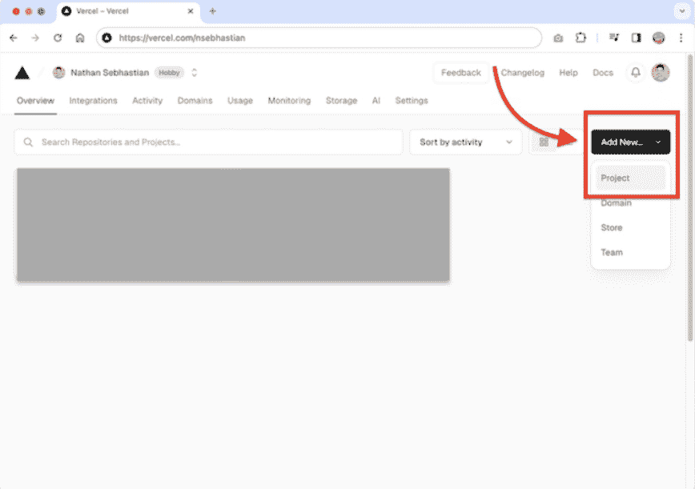

图 43. Vercel 创建新项目

接下来，你将被要求提供要构建和部署的项目。

由于项目已上传到 GitHub，你可以选择 *Continue With Github*，如下所示：

## 总结

本章的代码可在书籍源代码的 `16_nextjs_langchain_prod` 文件夹中找到。

你已成功将 Next.js 应用部署到互联网上。干得漂亮！

一旦你授权访问自己的 GitHub 账户，选择要部署的项目。你可以使用搜索栏筛选代码仓库。

然后，你将被引导至项目设置页面。点击 *部署* 按钮，Vercel 会为你构建应用程序。

构建完成后，你将看到如下成功页面：

你可以点击图片预览来打开你的应用程序。该应用将被分配一个免费的 `vercel.app` 域名。你可以从 Vercel 设置中添加自己的域名。

部署完成。恭喜！

由于 AI 模型可通过 HTTP 协议访问，你需要确保应用程序中添加了用于访问模型的 API 密钥。

与其提供你自己的密钥并因此产生运行模型的费用，你可以要求用户提供他们自己的密钥。

## 总结

恭喜你完成了本书的学习！我们共同学习了许多概念和主题，帮助你掌握如何使用 LangChain、Next.js 和 GPT、Gemini 及 Ollama 等大语言模型来开发 AI 应用程序。

你还学会了如何将应用部署到 Vercel，以便它能通过互联网访问。

我希望你喜欢通过本书学习和探索 LangChain.js，就像我享受写作过程一样。

我想请你帮个小忙。

如果你喜欢这本书，我将非常感激你能在亚马逊上留下一条诚实的评论（我会阅读收到的每一条评论）。

每一条评论都很重要，你的支持意义重大。

再次感谢你的善意支持！

下次再见，

Nathan

## 关于作者

Nathan Sebhastian 是一位拥有 8 年以上 Web 和移动应用开发经验的资深软件开发人员。

他热衷于让科技教育惠及每个人，并从 2018 年开始从事在线教学。

## LangChainJS 入门指南

通过 LangChain、JavaScript/NextJS、OpenAI/ChatGPT 及其他大语言模型开发 AI 应用的逐步指南

作者：Nathan Sebhastian

https://codewithnathan.com

版权所有 © 2024 Nathan Sebhastian

保留所有权利。

未经作者明确书面许可，不得以任何形式或任何方式（电子、机械、影印、录制或其他方式）复制本书的任何部分，或将其存储在检索系统中，或进行传播。
