# 现代奥林会语言政策与规划：中国的经验


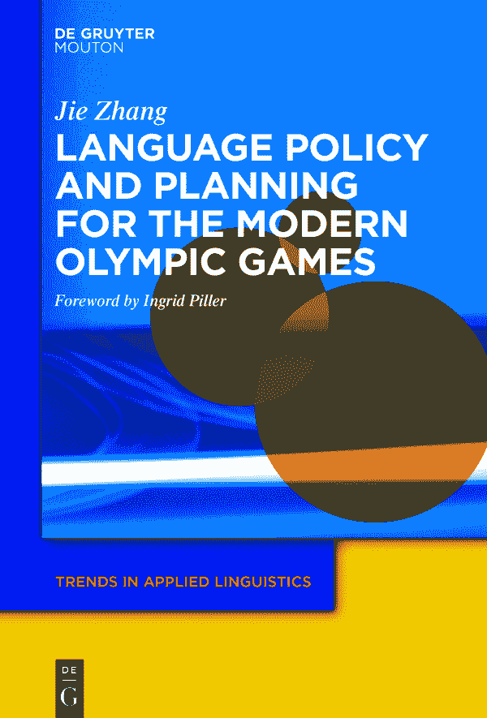


编辑


# 概述

1. 目录
2. V
3. VI
4. VII
5. VIII
6. IX
7. XVI
8. XVII
9. XVIII
10. 1
11. 2
12. 3
13. 4
14. 5
15. 6
16. 7
17. 8
18. 9
19. 10
20. 11
21. 12
22. 13
23. 14
24. 15
25. 16
26. 17
27. 18
28. 19
29. 20
30. 21
31. 22
32. 23
33. 24
34. 25
35. 26
36. 27
37. 28
38. 29
39. 30
40. 31
41. 32
42. 33
43. 34
44. 35
45. 36
46. 37
47. 38
48. 39
49. 40
50. 41
51. 42
52. 43
53. 44
54. 45
55. 46
56. 47
57. 48
58. 49
59. 50
60. 51
61. 52
62. 53
63. 54
64. 55
65. 56
66. 57
67. 58
68. 59
69. 60
70. 61
71. 62
72. 63
73. 64
74. 65
75. 66
76. 67
77. 68
78. 69
79. 70
80. 71
81. 72
82. 73
83. 74
84. 75
85. 76
86. 77
87. 78
88. 79
89. 80
90. 81
91. 82
92. 83
93. 84
94. 85
95. 86
96. 87
97. 88
98. 89
99. 90
100. 91
101. 92
102. 93
103. 94
104. 95
105. 96
106. 97
107. 98
108. 99
109. 100
110. 101
111. 102
112. 103
113. 104
114. 105
115. 106
116. 107
117. 108
118. 109
119. 110
120. 111
121. 112
122. 113
123. 114
124. 115
125. 116
126. 117
127. 118
128. 119
129. 120
130. 121
131. 122
132. 123
133. 124
134. 125
135. 126
136. 127
137. 128
138. 129
139. 130
140. 131
141. 132
142. 133
143. 134
144. 135
145. 136
146. 137
147. 138
148. 139
149. 140
150. 141
151. 142


# 前言：中国崛起与英语盛行的并存悖论

中国的崛起是 21 世纪初最具定义性的特征之一。然而，中国经济、地缘政治和军事影响力的增长，也伴随着一个语言学上的悖论：在教育和人力资源开发投入巨额资金后，获益最大的语言却是英语。在过去的三十年里，中国不断增长的中产阶级中，英语学习的现象级扩张如此剧烈，以被称为“英语热”之当。因此，如今中国的英语人数已超过英国，且仅次于美国、印度、尼日利亚和巴基斯坦，成为世界上英语使用者数量数第五大国家¹¹]。

在本书书中，张洁追溯了这一悖论的复杂性：其历史、亲身体验以及未来。作者以 2008 年北京奥运会为焦点，展示了英语如何成为这一盛大活动的核心，而这一盛会本应是中国向世界展示其国家进步的关键举措。

基于丰富的数据，包括政策文件、媒体报道、英语教材、北京语言景观中的标牌，以及对决策者和奥运志愿者的访谈，本书详尽地追踪了中国国家雄心与英语学习之间复杂的交汇。在此过程中，她还通过对“语言服务”研究的启发性概述，向英语读者引入了中国社会语言学。

自 19 世纪和 20 世纪初遭受耻辱以来，在伟大的文明和强国中恢复其应有的地位一直是中国的夙愿。2008 年北京奥运会为展示这些成就提供了完美的机会。因此，中国为其奥运申办投入了大量资源。这包括语言资源，张洁展示了该国是如何进行这项投资的：通过提高社会各层的英语能力。


一旦 2008 年奥运会授予北京，人们的雄心不仅是让它变得完美，还要让其壮观。除了办好赛事本身，这还意味着通过将北京转型为全球化城市来改善环境。在这一转型中投入的严密规划和巨大资源令人惊叹。张杰展示了数千万人口的人口语言能力是如何经过仔细评估和改进的。在 2002 年至 2007 年间，北京精通外语（主要是英语）的居民比例从 22%上升到 35%。从绝对数量上来说，有超过 500 万名人的语言能力得到了系统性的提升。

然而，张杰进一步挖掘了深层次。她不仅以详尽的细节展示了北京奥运会的语言规划与管理，还展示了个人是如何经历向英语使用者和全球公民转变的。大多数人尽力投入到提高英语的努力中，但他们的动力并非来自对英语以及与之相关的西方文化价值观的渴望，正如之前的研究发现的那样。相反，他们的动力来自于通过英语测试所获得的奖励：大学录取和就业前景。

然而，并非所有人都能在同等条件下竞争，将英语测试成绩作为社会晋升的门槛，使得现有的不平等凸显出来。在中国大都市之外，在英语测试中取得好成绩的物质条件——合格的教师、最新的教科书或媒体库——在许多情况下根本无法实现。

对英语的单一追求也导致了其他语言的贬值，正如张杰引用俄语所展示的那样。俄语在北方边境省份学到了很高水平，并且在当地跨境交流中具有很高的实用价值，但随着大学录取与英语挂钩，它几乎在夜之间变得文不值值。一位在中学教育阶段都学习俄语的奥运志愿者哀伤地向研究人员抱怨道：“我们县有大量的俄罗斯人，所以我从未想过学英语。直到我离开家乡，我才意识到英语在其他地方是如此重要。现在，学习俄语反而成了一种巨大的劣势！”

那是 2008 年的事了。但这项研究并未于此结束。

在成功举办北京奥运会并持续着其在经济和地缘政治上的崛起后，语言政策和规划已经得到了重新评估。随着中国现在正准备举办 2022 年北京冬奥会，新冠肺炎永远地改变了“全球化”的意义（Piller, Zhang & Li, 2020）。这一次，中国遵循了一项全面的语言行动计划，这与 2008 年夏季奥运会的计划大不同：现在意识到英语能力过剩，重点转向了加强其他语言的语言服务提供。除了英语，中国还拥抱了真正的多语言愿景。中国大学现在开设了 101 种语言的课程——涵盖所有与中国建立外交关系的国家的官方语言。虽然这些语言大多数语言的能力可能仍然有限，但正如本书详尽记录的那样，中国拥有将梦想变为现实的记录。

中国的崛起与英语的随之兴起可能已经走向终结。

Ingrid Piller，麦考瑞大学

# 致谢

本书基于我的博士论文。当我 2008 年开始这个项目时，我对语言多样化语境下的语言政策和规划了解非常有限。我想向我的导师 Ingrid Piller 教授表示最深诚的谢意，她细致入微的指导、不断的鼓励和一如既往的支持，使我能够完成论文和这本书。她在推进多语言主义和社会正义方面的学术劳动对我产生了深远的影响。

在 2017 年 9 月至 2018 年 7 月期间，我有幸访问了北京语言大学(`BLCU`)的李玉明教授。在次访问期间，我进入了由李教授的北京语言资源高级创新中心(`ACLR`)，并获得了关于其 2022 年北京冬奥会三个语言项目的宝贵信息。我非常感激李教授，他教我学者不应局限于写论文和传授知识，更重要的是要求我们具备社会责任感，以及解决实际问题的意识和能力。

2013 年，我与 De Gruyter 出版社签了书约。那时，我计划在 2015 年提交手稿。遗憾的是，我那段时间的生活让我措手不及。计划赶不上变化的脚步。七年后，当我终于提交书稿时，我向`Trends in Applied Linguistics`系列丛的编辑们致以最深切的谢意，他们巨大的耐心和信任使我能够完成这本书。

诚心感谢我的校对 Brett Todd 博士提供的富有见地的反馈和有帮助的建议。此外，我向所有的参与者和知情者，以及在项目完成期间在各方面支持我的朋友和家人致以问候和祝福。

最后，我必须感谢我的父亲张象胜和母亲袁丽华，是他们让我多年来能够享受追求相对脱离家庭负担的职业和生活的奢侈。如果没有父母持续支持的这一强力后盾，我怀疑自己是否有勇气去追求这样一个如此规模的项目。这本书献给你们。

# 缩写词与缩略词列表

`ACLP`
北京语言资源高级创新中心

`Aifly`
爱弗莱教育科技有限公司

`ASEAN`
东南亚国家联盟

`BBC`
英国广播公司

`BETS`
北京英语测试系统

`BFSU`
北京外国语

`BOBICO`
北京 2008 年奥运会申办委员会

`BOCOG`
北京 2008 年奥运会组织委员会

`BOCOWG`
北京 2022 年冬奥会残奥会组织委员会

`BSFLP`
北京外语教学计划

`CDA`
批判性话语分析

`CET-4`
大学英语四级

`CET-6`
大学英语六级

`CPC`
中国共产党

`CPPCC`
中国人民政治协会议

`EF`
外语天地有限公司

`EFL`
外语英语

`ELLT`
英语学习与教学

`ELT`
英语教学

`ESL`
英语作为第二语言

`EU`
欧盟

`FL`
外语

`GDP`
国内生产总值

`IFs`
国际体育联合会

`IOC`
国际奥委会

`LCTLs`
非常用教学语言

`LEP`
语言教育政策

`LL`
语言景观

`LPP`
语言政策与规划

`LOTE`
英语以外的其他语言

`MOE`
中华人民共和国教育部

`NCEE`
全国普通高等学校招生考试 (`高考`)

`NNESs`
非母语英语使用者

`NOCs`
各国奥林匹委员会

`NSE`
英语母语者

`OCOGs`
奥运会组委会

`OIF`
国际法语组织

`PLA`
中国人民解放军

`PRC`
中华人民共和国

`SL`
第二语言

`SOCOG`
2000 年悉奥运会组委会

`TAC`
中国翻译协会

`TESOL`
对外英语学习者的英语教学

`UK`
英国

`US`
美国

`VOA`
美国之音

`WTO`
世界贸易组织

`Advanced Reader`
高级读物

`A Conversational English Reader (Advanced)`
英语会话读（高级）

`Elementary Reader`
初级读物

`A Conversational English Reader (Elementary)`
英语会话读（初级）


# 第一章 作为语言复杂事件的现代奥林匹运动

## 1 现代奥林匹运动社会政治

奥运会的历史可以追溯到古希腊。古代奥林匹运动是古希腊不同城邦之间举行的一系列体育竞赛，旨在纪念奥林匹众神，并持续了十二世纪（公元前 776 年至公元 393 年）。奥林匹亚成为这些历史性古代运动会的举办地，为现代规模最大、影响力最国际体育盛事——现代奥林匹运动播下了种子。1896 年 4 月 6 日，奥运会在经历了中断 2000 多年后，由法国教育家皮埃尔·德·库伯丁男爵在雅典复兴，他怀揣着通过体育竞技促进国际和谐与理解的崇高理想。现代奥林匹运动是一项为夏季和冬季设立的国际多项运动赛事，每四年举办一次。古代奥林匹运动庆祝体能卓越，主要具有宗教目的。在现代形式中，尽管表面上仍然关于体能卓越，但奥运会还扮演着文化、经济往往是政治的角色（[Toohey and Veal, 2007], p. 1）。随着其各维度的快速扩张，现代奥林匹运动不再仅仅是一项体育赛事（如果它们曾经是过的话），而是*事实上*一种文化、经济和政治现象。

在社会科学领域，奥运会作为国家间顶级体育盛事的社会政治意义在近年来日益受到认可（例如，[Blain, Boyle and O’Donnell, 1993]; [Brown, 2000]; [Brownell, 2005]; [Burton, 2003]; [Dyreson, 2003]; [Essex and Chalkley, 1998]; [Houlihan, 1997]; [Ikhioya, 2001]; [Jaffe and Nebanzahl, 1993]; [Smith and Porter, 2004]; [Toohey and Veal, 2007]）。追求和赞助像奥林匹这样的大型体育赛事已成为全球各国和市政府日益流行的策略。奥运申办城市（在许多情况下，与其支持他们的国家政府合作）广泛声称，这一盛事可以带来社会和物质变化，例如体育基础设施的改善、可持续城市发展、全球媒体关注、旅游业繁荣，最重要的是为加强国家认同和国际认可提供长期形象提升的承诺。

没有其他活动能像现代奥林匹运动一样，在两周内吸引如此大规模的全球关注。在过去的几十年里，来自 200 多个国家的约 10,000 名运动员，伴随着同样数量的教练和官员、多达 15,000 名获授权媒体代表以及数十万观众，每四年聚集在一起超过两周，参与、报道和观看这项体育赛事；这项赛事反过来被全球数十亿人通过电视观看、通过广播收听、通过纸质媒体阅读，并在互联网上浏览（[Toohey and Veal, 2007], p. 1）。从这个意义上说，奥运会也是一个全球媒体事件。对于奥运主办国来说，全球媒体的曝光是一把双刃剑。奥运会是主办城市和国家通过强大的纸质、广播和电子媒体展示其文化并投影积极国家形象的重大机会。然而，主办城市和国家也让自己暴露在严烈的国际媒体审查之下。

从商业角度来看，举办奥运会也是一种喜忧参半。一方面，旅游收益、企业赞助和奥运会的商业化产生了巨大的收入。然而，吸引奥运会所需的尖端建筑和技术使得举办夏季和冬季赛事都成为一项相当昂贵且规模宏大的运作（[Wamsley and Heine, 1996]）。每个主办城市和国家在期待从奥运中获得巨大回报的同时，必须投入大量的物质和人力来举办赛事。现代奥运会不断增长的规模实际上让非西方发展中国家举办赛事变得更加困难。在国际奥委会（`IOC`）主席胡安·安东奥·萨马兰奇的领导下，奥运会开始转向国际赞助商，他们寻求将其产品与奥运品牌联系起来。奥运品牌的销售使得赛事背离了纯竞争和体育精神的理想，变得与任何其他商业化的体育奇观无异。在过去的几十年里，业余主义修辞与商业主义现实之间的紧张关系一直是奥运会的核心矛盾（[Blain, Boyle and O’Donnell, 1993], p. 186）。

自从世界各国于 1896 年开始聚集参赛以来，政治从未离开过奥运赛场。体育通常被构建为“伟大的平等者”（[Hogan, 2003], p. 100），因此，奥运运动被认为通过世界运动员之间自由公平的竞争促进国际善意、和平与平等（[International Olympic Committee, 2007]）。一些学术和大众话语还将体育视为一种“通用语言”，它不仅跨越了国界，还跨越了国家认同。然而，[Dyreson (2003)] 认为“体育在其现代形式下几乎一直是展示部落、特别是国家认同的舞台，而不是庆祝普遍人类共同体的场合”（p. 92）。对奥运会的实质研究表明，这项大型体育赛事的现实比那些美好的承诺要复杂且具有争议得多。国际主义修辞与国家关切之间的紧张关系是奥运会的另一个核心矛盾（[Blain, Boyle and O’Donnell, 1993], p. 186）。从奥运会的管理和组织来看，奥运运动仍然由西方主导，并在可预见的未来将继续保持如此（[Brownell, 2007]）。作为一个亚洲发展中国和社会主义国家的首都，北京被选为 2008 年奥运会主办城市，因此在奥运史上具有深远的社会政治意义。由于现代奥林匹运动的全球意义，成为奥运强国一直是“中国持久且终极的梦想”（[Dong, 2005], p. 533）。


古代奥林匹会并非现代意义上的国际性赛事，因为它们只允许说希腊语的自由男性参加比赛。自 1896 年以来举办的现代奥运会是多语言的活动。尽管 1896 年雅典奥运会是当时举办规模最大的国际体育赛事，但仅有来自 14 国家的 241 名运动员参加² (国际奥林匹委员会，2020a)。女性和有色人种并非运动员之员。一个世纪后的 2004 年，夏季奥运会回到雅典，有来自 201 个国家的不同种族和性别的 10,625 名运动员参赛 (国际奥林匹委员会，2020b)。如果第一届雅典奥运会是一场涉及十几个国家、且除匈牙利外所有国家都使用印欧语系的体育竞会，那么第二届雅典奥运会就是一场真正的国际化盛事，其交流跨越了数百个国家和多种语言。

现代奥运会，特别是二战后的奥运会，是复杂的语言活动。由于现代奥运会规模宏大，以及参赛国家文化和语言背景的多样性，可以预见到跨语言和文化的交流将面临许多困难和挑战。因此，此类活动的组织者必须做出重要的语言政策和规划决策，以确保运动员和游客在赛事期间获得高质量的体验。然而，要满足奥运会所有参与者的语言需求是一项极其艰巨的任务。从所有官方文件、媒体报道、游客信息和语言标识的翻译，到官方仪式、比赛场馆和新闻发布会的口译服务，再到为外国运动员、教练、官员、记者和游客提供其母语的即时信息，语言服务贯穿于奥运会准备工作的各个方面，并在使体育赛事真正成为全球庆典方面发挥着至关重要的作用。

现代奥运会为语言政策与规划（LPP）的研究提供了丰富的资源。首先，由于现代奥运会涉及来自 200 多个国家和地区、使用 80 多种官方语言的参与者，因此存在涉及地位规划（status planning）的重要问题。在整体规划的早期阶段，组织者会有意识地选择将成为赛事官方和工作语言的语言种类。具体而言，游戏的地位规划问题包括官方文件、网站和仪式、媒体传播、比赛场馆、文化活动、公告、标识、VIP 陪同、游客接待和观众引导等方面的语言选择。地位规划与声望规划（prestige planning）密切相关。语言的地位是其在特定社会环境中相对于其他语言的位置，而声望则是该社会环境中的居民对这种关系的感知 (Ager, 2005)。声望规划针对与语言形象相关的目标。声望规划通过建立语言的积极形象，为语言规划的实施营造良好的社会心理环境。过去的奥运会见证了各种语言推广活动（通过官方/政府、机构、压力团体、个人），以提高语言在奥林匹克运动和国际领域的形象和价值。在奥运的焦点下，中国政府试图通过奥运会“向世界教授和推广中文，并证明中文确实是一种全球使用的语言” (北京奥委会，2002)。他们开发了各种推广计划以鼓励和帮助外国人学习汉语，例如辩论、唱歌和讲故事比赛。从 2005 年开始，奥奥委会向海外寄送的宣传材料中增加了“学习汉语”章节 (北京奥委会，2002)。此外，现代奥运会往往会在举办市促进语料库规划（corpus planning）活动，如新术语的造词；拼写改革；字典编纂；公共标识英语翻译标准的制定；创建体育术语语料库及其访问门户；以及开发机器翻译软件、网站和应用程序。奥林匹克运动近期的历史显示，非英语国家主办国试图开发一套英语翻译规范，以定义公共领域英语的“标准”用法，并纠正“非规范”的英语拼写和语法。与主要由国际奥委会（IOC）和举办地国家政府承担的地位规划和声望规划不同，语料库规划通常涉及更高语言专业知识的规划者。最后，获取规划（acquisition planning，也称为教育语言规划）被组织者通过教育和培训来实现地位规划、声望规划和语料库规划的目的。例如，在准备 1988 年奥运会期间，首尔奥委会制定了语言教育计划，并采用多样的培训方法来提高赛事运营人员的外语水平。通常，获取规划被整合到一个更大的语言规划过程中，在该过程中，语言的地位得到评估，语料库得到修订，并最终通过从小学到大学的教育系统在国家或地方层面将变化引入社会。这一规划过程可能涉及多种活动，例如在学校普及国家语言或国际语言；为运动员、教练、官员和奥奥志愿者提供语言培训；培养较少教语言（LCTL）专业人才；开发双语教学计划；编纂语言教材；以及建立语言能力测试。

总结来说，奥运会是语言上复杂且文化上多元的活动，需要“对赛事的文化和语言维度制定战略性的整体计划” (LO Bianco, 1994)。语言能力与奥运会的成功或失败密切相关，为奥运会提供高质量的语言服务需要全面、可行且可持续的语言规划。全面性意味着奥运会的语言规划应涵盖所有的目标、领域和语言服务类型；可行性是指组织者需要根据其自身的社会语言状况、多语言资源和财政预算来制定奥运语言服务计划；最后，赛事的语言规划应当是可持续的，这要求组织者将奥运会语言规划嵌入到举办国政治、经济、教育和文化发展的长期战略计划中，为社会的可持续发展留下奥运遗产。

## 3 文献综述

### 3.1 国际奥委会的语言管理


国际奥委会（IOC）是一个国际非政府非营利组织，是主导和组织奥林匹运动的最高权威。因此，对现代奥林匹运动语言政策（LPP）的理解应从分析国际奥委会的语言管理开始。超国家层面的语言管理涵盖了超国家组织内部的语言管理活动，以及该超国家组织对其成员国语言政策的影响（Spolsky, 2009）。在本节中，我采用了 Spolsky (2004, 2009) 的语言管理模型，从内部政策和外部影响两个维度对国际奥委会的语言管理进行分析。

### 3.1.1 内部政策

国际组织的领域内部政策主要涉及内部立法和官僚活动的语言选择（Spolsky, 2009, p. 208），这涉及两个方面：官方语言和工作语言。Spolsky (2004, pp. 219–221) 识别了与语言政策并存的四个主要条件：社会语言状况、身份、变化，以及与语言相关的人权和公民权利。首先，社会语言状况指的是语言的数量和种类、每种语言的使用者数量和种类，以及每种语言在所研究社区内外的交流价值。第二个条件与社区内国家、民族或其他身份的运作有关。语言不仅是交流的工具，也是身份的象征。在超国家层面，语言的符号价值以及这些语言所代表的身份和权力关系与国际组织的形象密切相关。第三，自 20 世纪 90 年代以来，人类社会在全球化的影响下发生了剧变。在全球化过程中，英语已成为*唯一的*国际语言，并在许多国际领域起着主导作用。这种力量显著影响了国际组织的语言政策和实践。最后，人们日益认识语言选择是人权和公民权利的重要组成部分，这导致对语言多元主义价值的日益重视，并接受了承认个人和群体继续使用自身语言权利的必要性。这四个条件直接影响了国际奥委会官方语言和工作语言的制定。

通常，国际政策通过条约、宣言或章程来表达，这些章程在经过一定数量的国家批准后才生效，并且仅对批准它们的国家具有约束力（Spolsky, 2009, p. 206）。《奥林匹宪章》是国际奥委会（IOC）通过的奥林匹主义基本原则、规则和细则的汇编。它规范了奥林匹运动的组织、行动和运作，并规定了奥林匹运动会的条件（International Olympic Committee, 2020）。显然，《奥林匹宪章》是国际奥委会语言管理的（公开的）政策基础。随着奥林匹运动的发展，国际奥委会在保持基本原则一致性的前提下，根据不断变化的内外环境对《宪章》进行多次修订。从《奥林匹宪章》的不同版本中可以看出，国际奥委会的语言政策从早期的单语变为双语，并在 90 年代以后转变为多语。

在现代奥林匹运动的早期，法语是国际奥委会的官方语言。在 17 世纪到 19 世纪期间，随着法国成为经济和军事上欧洲最强大的国家之一，法语的地位大大增强，并成为国际外交的*唯一*语言。法语是国际奥委会的唯一官方语言。在这一时期，法语逐渐取代了拉丁语作为国际外交的语言（Rickard, 1989, pp. 117–118)）。《奥林匹宪章》首次于 1908 年出版，题为“ANNUAIRE DU COMITÉ OLYMPIQUE”。基于这份文件，奥林匹主义的原则逐渐形成。从 1908 年到 1924 年，国际奥委会发布了七个《宪章》，全部用法语编写。尽管自 1930 年国际奥委会开始发布英语版本的《宪章》，直到第二次世界大战结束，法语仍是其唯一的官方语言。

第二次世界大战后，世界发生了剧变。法国殖民帝国崩溃，法语逐渐失去了作为国际外交语言的地位。与此同时，作为两次世界大战最大的受益者，美国扩大了其政治、经济和文化影响力，促进了英语的传播。20 世纪以来英语的全球传播与美国作为超级国的崛起密切相关。最终，英语从国家语言和区域通用语发展成为世界上最广泛的交流手段，取代了法语。在此期间，奥林匹运动得到了迅速发展。国际体育联合会（IFs）相继成立，各国奥委会（NOCs）的数量以及参加奥运会的人数不断增加。在这种背景下，1949 年版《奥林匹宪章》的第 61 条首次将英语列为国际奥委会的官方语言之一（International Olympic Committee, 1949, p. 26）。同时，该版本的第 54 条（International Olympic Committee, 1949, p. 23)）奥运会组委会（OCOGs）为每项运动制作并分发一份手册，用至少三种语言编写节目和通用规则（其中必须包含法语和英语）。从那时，国际奥委会的官方语言政策从法语单语变为法语双语。

20 世纪 90 年代，冷战形成的世界秩序两极格局瓦解。随着全球化和多极化的发展，以及对民主价值和人权意识的增强，包括国际奥委会在内的许多国际组织开始支持多样性和多语言主义的观点，Lo Bianco (2007, p. 11)) 解释道：


> 现代奥林会……开始通过对文化多样性和跨文化交流的意识，强调平等、优异、诚信和和平共处的民主理想。这种……的一个体现是，要求主办国在奥运会之前及会会期间提供口译设施和语言服务。语言服务已成为奥林会国际和平作用不可或缺的一部分，因为它们促进了奥运会各个方面跨文化交流的便利性与接纳。

自 20 世纪 90 年代以来，国际奥委会（IOC）已将其官方和工作语言政策转向以欧洲语言为主的多语种主义，希望通过提供更平等、更多样化的语言政策，加强与成员国的合作，并展现出包容的组织形象。2020 年 7 月 17 日，国际奥委会第 136 次全体会议通过了对`Charter`的最新修订案。现行`Charter`第 23 条（国际奥委会委员会，2020，第 52 页）规定了国际奥委会的语言政策如下：

### 23 语言

1. 国际奥委会的官方语言是法语和英语。
2. 在所有会议上，必须提供法语、英语、德语、西班牙语、俄语和阿拉伯语的同步传译。
3. 如果《奥林克章程》的法语文本与英语文本之间存在差异，除非另有书面规定，否则以法语文本为准。

`Charter`承认了语言能力的重要性，并规定国际奥委会的官方语言为法语和英语，当`Charter`文本与其他国际奥委会文件出现差异时，以法语为准。除了法语和英语，`Charter`还将阿拉伯语、德语、俄语和西班牙语作为奥运会的“工作语言”。这些语言有时由“非官方语言”进行补充。许多国家奥委会（NOCs）使用的语言通常会被纳入官方沟通，以便奥会组委会（OCOGs）接触更广泛的受众（Djité, 2009）。例如，奥奥团结一直支持将修订后的`Sport Administration Manual`翻译成阿塞疆语、波斯尼亚语、格鲁吉语、高棉语、老挝语、拉脱维亚语、立陶宛语、葡萄牙语、俄语、西班牙语和乌尔都语（国际奥委会，2019，第 64 页）。值得注意的是，尽管英语在国际奥委会的内部管理、成员国之间及外部交流中更为广泛，但国际奥委会在其立法层面维持法语作为第一官方语言的地位，正如其他超国家组织组织，需要缓解少数（理想情况下一种）工作语言的效率与所有成员国象征主张之间的紧张关系（Spolsky, 2009，第 208 页）。`Olympic Charter`（国际奥委会委员会，2020，第 12 页）规定，应确保在不受包括语言在内的任何歧视的情况下享有权利和自由。然而，事实上，国际奥委会在其立法和行政层面的内部运营中并未赋予所有成员国语言同样的权利。这一事实不可避免地会导致官方/工作语言与非官方/非工作语言之间的权力距离，并带来涉及低声望语言使用者和语言少数群体权利的问题。

### 3.1.2 外部影响

对国际奥委会语言管理的分析还应考虑其对其负责承办奥运会的成员国语言政策的外部影响。超国家组织通常尊重构成它们的成员国的主权。它们没有太多权威为单个国家制定政策，但有地位影响成员国制定政策并检查政策的执行情况。由于奥运会每四年分配给主办城市，奥运会的组织工作由国际奥委会委托给主办国的国家奥委会。国家奥委会转而构成奥会组委会（OCOG）。例如，在 2008 年北京奥运会的情况下，第二十九届奥会北京组织委员会（BOCOG）在北京获得 2008 年奥运会主办权五个月后，于 2001 年 12 月 13 日成立。奥会组委会自成立之日起，便直接与国际奥委会沟通，并遵循其指南和指示组织奥运会。奥会组委会与国际奥委会合同的最低法律要求是在奥运会用途中使用法语和英语。

国际奥委会影响奥会组委会和主办国语言政策的努力主要体现在维持法语作为第一官方语言的地位。在全球英语传播的背景下，法语在奥运会的语言实践中正失去英语。自 1984 年洛杉矶奥运会以后，随后的奥运会未能很好遵守法语双语政策。自 2004 年以来，法语国际组织（OIF）³](#footnotes.xhtml_fn_3）秘书长任命了一名特别督员，负责并报告法语在奥运会的使用情况（法国文化中心，2013）。考虑到非法语国家使用法语的困难，法国和法语国际组织在其成员的帮助下为奥运组织者提供特定支持，以便他们能够在奥运期间尊重法语和英语的平等地位。2007 年，法国前总理、法语国际组织督员让·皮埃尔·拉法林（Jean Pierre Raffarin）与北奥主席刘琦签署了关于在奥运会中使用和推广法语的协议，以实施`Charter`的相关规定（Gui and Dai, 2008）。该协议提出了一系列保护法语官方语言地位的措施，例如：建立北京奥会的法语网站和 INFO2008 奥运新闻平台；制作北奥出版物的法语版（包括场馆介绍和观众指南手册）；招募 40 名法语翻译和记者；为数百名中国奥运志愿者提供法语培训并组织各种法语文化活动。


通过奥运会，国际奥委会（IOC）已经影响了许多主办国外语教育政策的制定与实施。在 2000 年夏季奥运会举行前，悉尼奥运会组委会（SOCOG）通过悉尼法兰西学院为其员工提供了一项法语培训计划，以确保官员和其他专业人员能够精通官方语言（Djité, 2009）。索契 2014 年冬奥奥会组委会也为奥林官员和服务人员开展了英语、法语和俄语的官方语言培训（Henning, 2014）。2008 年申奥会的成功以及 2001 年加入世界贸易组织（WTO），都预示着中国将在国际社会中扮演更大的角色。随着中国在 21 世纪第一个十年世界舞台的崛起，发展机会与英语之间的联系日益紧密（Zhang, 2011）。在奥运会前景和在全球治理中发挥更大角色的背景下，21 世纪的第一个十年见证中国对外语特别是英语的规定和规划出现了大幅加速。一系列政策相继出台，旨在在全国范围内扩大英语教育，并通过改革课程、教材、教学方法和评估程序来提高英语教学（ELT）的质量（Zhang, 2011）。例如，2001 年，中国教育部（2001a））发布了一份名为《教育部教育部关于大力加强小学英语教学的意见》的政策声明，要求将义务性英语教育的门槛从初一下移至小学三年级。根据 G. Hu (2005)的说法，该政策举措的制定是为了解决中国加入 WTO 和 2008 年奥运会前景所推动的英语需求增长，与 20 世纪 90 年代中学英语教学改革不尽人意的结果之间的矛盾。在 2002 年至 2008 年间，北京奥委会委会（BOCOG）和中国政府开展了一项大规模英语普及运动，涉及 4000 多名运动员、裁判员、组委会员工、150 万奥会志愿者以及数百万北京居民作为英语学习者，这将在第 4 和第 5 章中详细讨论。

《奥林匹章程》本质上赋予了奥会组委会（OCOGs）服务奥林家庭成员（即运动员、官员和媒体）的责任，首要目标是方便运动员、官员和国际游客的交流需求（International Olympic Committee, 2020）。在最近，奥会组委会已经超越了两种官方语言的最低要求，将范围扩大到主办国的语言。还存在一种提供其他“工作语言”服务的趋势，以便根据具体情况提供援助，并满足预期的媒体和游客组合的需求。在实践中，奥会组委会历史上倾向于在许多层面考虑语言——例如官方典礼上的正式传译；向世界媒体提供新闻和信息；支持标牌和公共信息；提供医疗和安全服务；以及招募具有证明语言技能的志愿者用他们自己的母语欢迎外国游客（Djité, 2009）。

最近，1992 年巴塞罗纳奥运会、2000 年悉尼奥运会、2004 年雅典奥运会和 2012 年伦敦奥运会都超越了《奥林匹章程》的最低要求，成功举办了多语言奥运会。巴塞罗纳作为西班牙第二大城市和著名的旅游目的地有两种官方语言：西班牙语和加罗尼亚语，作为罗曼语族的成员，这些语言与法语密切相关。在旅游部门，巴塞罗纳的许多员工会英语。在 1992 年巴塞罗纳奥运会上，除了加罗尼亚语、西班牙语、英语和法语四种官方语言外，还使用了其他 15 种语言（Djité, 2009）。澳大利亚不仅是一个英语国家，还拥有发达的社区传译服务。此类服务的建立是为了满足非英语背景移民者的的需求，并方便他们获得法律和医疗服务（Lo Bianco, 1994）。2000 年悉尼奥运会能够利用其多元文化社会提供多种语言的传译服务（Pym, 2003）。在 2000 年悉尼奥运会上，多语言交换机运行了 50 多种语言，超过 1400 名志愿者翻译在场馆内工作（Pound, 2003）。2004 年奥运会在希腊首都雅典举行。希腊是一个拥有悠久旅游业的欧洲国家，40%的人口将英语作为第二语言，此外广泛使用法语、意大利语和德语。2012 年奥运会主场城市伦敦是世界上最国际化的城市，拥有 200 个族裔社区，总计使用 3000 种语言（Collis, 2007）。2012 年伦敦奥运会让所有这些社区参与了赛事的举办。

从过去的奥运会可以看出，基于每个主办国（城市）国家（地区）语言能力的多语言服务已成为奥运会跨文化交流的新模式，这也是奥林匹克运动的*事实上的*语言政策。在当今世界的社会语言生态中，英语的主导地位与多语言主义并存。除了联合国外，全球超国家组织“倾向于不采用多种官方或工作语言”，且大多数组织像国际奥委会一样，官方语言少于三种（de Varennes, 2012，p. 154）。此外，国际组织的大多数官方语言是欧洲语言，其中英语是最常使用的官方语言（Zhang, 2019）。尽管有国际奥委会的语言管理以及英语法语官方化涉及的地位规划，但许多其他因素影响着这些语言和其他语言在奥运会中出现的程度和方式（Vessey, 2018）。因此，国际奥委会和奥运会组织者需要充分理解奥林匹克运动的语言需求，并积极寻求解决方案以弥合官方语言政策与多语言实践之间的差距。

### 3.2 奥运会的语言政策规划（LPP）研究


关于现代奥奥运会的学术文献极其庞大且在不断增加。在`Web of Science Core Collection`数据库的主题字段中以“Olympic Games”为关键词检索，截至 2020 年 10 月 1 日已发现 5292 项作品。除了体育科学外，大多数社会科学学科及其子学科（主要是历史、社会学、经济学、政治和教育）都对奥奥运会的研究做出了贡献（例如：Baldauf, 2006; Canagarajah, 2005）。最重要的是，奥奥运会已成为研究国家、地区和公民身份社会建构的一个引人入胜的场所。现有的学术出版物（Toohey and Veal, 2007，第 2 页）已经探讨了通过举办奥奥运会的体验与身份建构相关的若干重大且具有争议的问题。例如，许多中国和国际学者（例如：Blain, Boyle and O’Donnell, 1993; Brown, 2000; Brownell, 2005; Burton, 2003; Dyreson, 2003; Essex and Chalkley, 1998; Houlihan, 1997; Ikhioya, 2001; Jaffe and Nebanzahl, 1993; Smith and Porter, 2004; Toohey and Veal, 2007)）展示了如何利用 2008 年奥运会提高中国政府的威望，同时激发中国民众的民族意识和认同感。然而，尽管学术界对奥奥运会的关注日益增加，但在奥奥运会研究中，探索语言政策与规划在赛事中的作用及其与身份建构之间关系的文献仍然匮乏。

只有少数研究将语言政策、规划与身份建构的讨论置于奥奥运会的背景下。其中一类研究通过综合官方报告和独立研究，探索奥奥运会的语言规划和政策制定。在准备 2000 年悉尼奥运会期间，Lo Bianco (1994)敦促澳大利亚政府采取一项语言和文化计划，以补充基础设施、体育和电信规划。他解释说这种计划涉及八个方面，包括：1) 在官方奥运会组织结构内建立语言服务部门；2) 为奥运会上涵盖的所有运动项目以及典型的运动医学术语和争议解决术语建立多种语言的精确术语等值对应；3) 对来自非英语背景的亚特兰大运动会访客以及队伍和运动员样本的实际体验进行市场调研；4) 探索并鼓励市场创新，并建立一套技术支持语言服务的审批系统；5) 谈判奥运会中出现的图像或图标，并对海外的预期进行审查；6) 将作为外语的英语和旅游活动与 2001 年的“大团圆”构想及奥运会联系起来；7) 在规划访客人数和可能需要的语言时，为警察、医院和应急服务部门提供翻译和口译服务；8) 在专业服务的同时，系统地将代表举办地国家宗教、文化和语言多样性的志愿者组织起来。在他随后的出版物中，Lo Bianco (2007)为悉尼奥运会的语言规划和政策制定提供了详尽的细节。特别是，该书关注了`Language Service Programme`的作用，该计划负责赛会前和赛事期间的一系列翻译和口译服务。类似地，Djite (2009)指出，像奥运会这样的国际体育赛事是语言复杂的事件，需要大规模的语言规划和政策，而语言技能和服务（如翻译和口译）对于任何此类赛事的成功至关重要。他特别关注悉尼奥运会，考察了语言问题作为奥奥运会规划的一部分是如何解决的，并讨论了在筹备和举办奥运会期间促进国际合作的一系列活动。Collis (2007)分析了 2012 年伦敦奥运会和残奥运动会的语言服务机会，强调了伦敦在公共服务、交通、旅游、教育、商业和社区等领域多语种支持的重要性。Huc-Hepher, Kelly and Phipps (2008)不仅对 2012 年伦敦奥运会的规划提供了详尽的细节信息，还对往届奥运会的成功与失败进行了阐述。作者们强调了“国际化”的相关性，以及伦敦文化和族群语言多样性的关键作用，作者认为这些是奥奥运会组织者的资产。Zhang Jie (2011)将语言政策、语言实践和语言意识置于中国更广泛的社会、经济和政治变化之中，特别是 2008 年北京奥运会的筹备和举办。具体而言，该研究阐释了中国对英语的渴望与奥运会举办城市及其公民身份建构之间的关系。虽然没有专门侧重奥奥运会，但 De Varennes (2012)探索了如`IOC`等超国家组织的语言政策制定和规划。这一章节讨论了多语主义在国际背景下的相关性和英语的主导地位，特别参考了超国家组织使用的语言与个人理解的语言之间的差距。Vessey (2018)通过回顾历史视角、特定的近期案例以及奥奥运会语言规划和政策涉及的核心问题，考察了官方语言政策与实际语言实践之间的差距。基于“超多样性”（superdiversity）的概念，该章节主张奥奥运会可以被视为“超多样性”事件，它们汇聚了原籍国、种族、语言、宗教、性别（Vertovec, 2007: 1025）等“变量显著的新交汇与交互”，并创造了在实践中出现的具有共享索引性的“转瞬即逝”的社区（Blommaert & Backus, 2013: 12）。在过去的奥运会中，官方语言和工作语言与运动员和观众在全球范围内各种语境下通过面对面和媒体技术进行交流的一系列自下而上的语言实践并存。


另一类研究调查了奥奥运会背景下的语言意识形态。例如，Pan (2011) 对北京奥运会背景下关于英语的态度和意识形态进行了概述。作者认为，这些态度和意识形态是中国起作用的社会、文化和政治因素共同的结果。Vessey (2013) 讨论了在两份加拿大国家级报纸上发生的一场关于温哥华奥运会法语地位的语言意识形态辩论。关于开幕式期间法语使用不足的报道引发了来自政治家、官方评论员、公民以及在线新闻读者的共同抗议。她发现，这场辩论不仅涉及语言意识形态，还涉及身份和归属感的意识形态。

此外，还有少数研究关注奥奥运会的翻译和口译服务。例如，Pym (1996) 讨论了 1992 年巴塞罗纳奥运会上翻译和语言政策所发挥的作用。Stuker, 等人 (2006) 研究了 2008 年北京奥运会的口译对译服务。Henning (2014) 考察了 2014 年索契冬奥奥运会语言服务的作用。

与主要关注奥运会社会历史或政治经济层面的现有文献不同，本书从语言政策与规划的角度，探讨奥奥运会筹备和举办期间的身份构建。本研究特别感兴趣的是 2008 年北京奥运会中语言政策、语言意识形态、语言实践与身份构建之间的关系。

### 3.3 语言政策的扩展视角

语言政策（LP）是“政府或其他机构就语言与社会生活之间的关系所做的刻意选择”(Djité, 1994, p. 63)。这些决策特别是关于“在特定语境和社会中中使用和学习某些语言（例如，说话和学习的权利）的合法性（地位）及其形式（语料库）”(Shohamy, 2006, p. 45)。Spolsky (2004) 认为有用的第一步是区分语言社区语言政策的三个组成部分：“(1) 它的语言实践——在构成其语言库的变体之间进行选择的习惯模式；(2) 它的语言信念或意识形态——关于语言和语言使用的信念；以及(3) 通过任何类型的语言干预、规划或管理来修改或影响该实践的任何特定努力”（p. 5）。除了 Spolsky (2004)之外，我对语言政策的观点也借鉴了 Shohamy 的观点。在《语言政策：隐藏议程与新方法》中，Shohamy (2006) 提出了语言和语言政策的扩展视角。对于 Shohamy (2006) 来说，语言不是“一个封闭且有限的系统”（传统语言学家经常使用的概念），而是“开放的、动态的、充满活的不断演变且个人化的”（p. 5）。这意味着语言本身不受任何严格或规定的正确性规则限制。以扩展的视角看待语言也意味着它不仅限于词汇或其他语言标记，还包含了多模态的表达和使用形式：视觉、图形、图像、手势、衣服、建筑等等(Shohamy, 2006, pp. 14–16)。此外，人们在表面上似乎享有很大程度的表达自由，因为他们可以对日常生活中的语言使用做出决策。然而，大多数情况下，人们的语言使用受到公开和隐性的监管。语言并非没有意识形态；相反它是通过施加特定的语言行为来操纵国家政治、社会、经济和教育议程的符号工具，同时也是创造和延续群体成员身份、身份、阶级以及其他各种形式的控制工具(Shohamy, 2006, p. 1)。

基于这种广泛的语言观，Shohamy 将显性语言政策和隐性语言政策区分开来。她（2006, p. xvi）认为，深入理解一个政治和社会实体的语言政策不应仅通过公开宣布、正式化和法典化的政策文件（如法律、课程和测试）来观察，而应通过权力拥有者主要（但但不限于）使用的各种隐性和内含的机制来影响、创造和延续语言实践，即“事实上的语言政策”，这些政策在传统上不被视为政策工具。

根据 Shohamy (2006)观点，语言政策在操纵语言行为和确保意识形态转化为实践方面起着关键作用。在语言意识形态和实践之间存在多种显性和隐性的语言政策机制。图 1 提供了意识形态与实践框架内这些机制（或政策工具）的图表表示。为了理解真实的语言政策及其“隐藏议程”，Shohamy 认为仅研究公开和宣布的政策是不够的，而是需要研究隐性和事实上的政策。采用 Shohamy 的语言政策扩展视角，本书通过各种显性和隐性的语言政策机制探讨了北京奥运会的语言政策与规划。本研究讨论的具体语言政策机制包括行动计划、法律、法规、语言测试、语言推广计划、语言服务供应商、语言培训教材、语言景观、语言明星以及语言学习体验。除了显性政策过程，我同样关注隐性政策过程——“人们在日常社会实践中适应、抵抗和‘制定’政策的方式”(McCarty, 2015, p. 82)。对这些显性和隐性机制的检查需要采用三角交叉法作为一种混合方法。

```
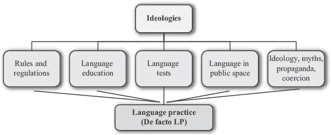
```

图 1：意识形态与实践之间的机制列表 (Shohamy, 2006, p. 58)。


语言政策“始终基于语言意识形态，基于对社会期望语言使用形式以及社会理想语言景观的想象” (Blommaert, 2006, p. 244)。语言意识形态正如 Errington (2001)所简练定义的样，是指“对语言的观念和使用具有情境性、局部性和利益驱动的特征”（p. 110）。中性的意识形态分析关注“文化共享”的信念和实践，而批判性的意识形态分析往往强调“语言作为一种特定群体符号统治工具的政治用途” (Kroskrity, 2005, p. 501)。我关于语言意识形态的观点借鉴了 Piller、葛兰西（Gramsci）和布尔迪厄（Bourdieu）的理论。从批判分析传统来看，Piller (2015) 强调语言意识形态由社会主导阶级的利益构成并不断重构这些利益，并且始终是多重、碎片、充满争议且不断变化的。葛兰西使用“霸权”一词来描述统治阶级如何使其意识形态成为“规范”（即被视为最“自然”和“不可避免”且被认为对社会上所有人都有“益”的观点），从而在广大民众中形成共识 (Freeden, 2003, p. 20)。对于葛兰西来说，统治阶级不仅可以通过施加国家强制，还可以通过教育和常识等各种文化手段行使意识形态霸权 (Freeden, 2003)。布尔迪厄 (1991) 的“符号权力”和“误认”构念进一步阐述了葛兰西的“霸权”。对于布尔迪厄而言，权力在日常生活中转化为符号形式，而不是作为显性的身体武力来行使。符号权力是一种隐性权力，它被“误认”为这种权力，从而在受权力者的眼中被“承认”是合法的 (Bourdieu, 1991)。追随葛兰西和布尔迪厄，我认为嵌入语言政策的意识形态不应被视为对社会所有成员都是“自然的”、“中性的”或“有益的”，相反，它们反映并服务于该社会主导阶级的利益。由于教育是“意识形态霸权”和“符号权力”的主要机制，语言教育政策被认为是国家行使政治和文化治理的有力工具，因为它可以通过语言教育强制各种政治和社会意识形态。

## 3.4 语言服务作为一种新的解释理论

本节介绍了语言服务作为一种新方法，用于分析和解释中国政府和北京奥委会（BOCOG）为 2008 年和 2022 年奥运会所做的语言规划和管理工作。

### 3.4.1 中国语言服务研究的发展

中国与外部世界日益频繁的接触以及 21 世纪社会生活的转型，使得语言成为中国现代化和国际化驱动因素的关键因素。许多中国学者开始根据中国社会经济发展的实际情况思考语言问题；因此，语言服务研究随着时代情况的变化而应生。`语言服务 yuyan fuwu` (`language service`）这一概念直到这段变革时期才开始在中国使用，它是在 2008 年北京奥运会的背景下，从传统的笔译服务发展而来的。目前，中国学术界对其定义尚未达成共识。根据赵世硕 (2012)，语言服务是行为者的一种行为和活动，以语言为内容或方法，为他人或整个社会提供帮助。李玉明 (2016) 广泛将语言服务定义为利用语言（口语和书语）、语言知识、语言技术以及语言的所有衍生物来满足社会生活中各种与语言相关的活动。李先乐 (2010) 将语言服务分为两个层面：宏观层面和微观层面。微观层面的语言服务主要指付费或免费的服务，以语言为内容或工具，由一方提供另一方，使接收方从中受益。宏观层面的语言服务是指国家或政府部门对语言资源进行有效配置、规划和标准化，以确保其管辖范围内的人和组织能够理性、有效地使用语言。

在 1986 年的全国文字工作会议上，国家语言文字委员会主任刘道生指出，中国语言文字工作的首要任务是加强语言文字的理论和实证研究，促进社会调查和咨询，并为社会提供服务 (Liu, 1987)。尽管在会议上尚未提出“语言服务”一词，但已经认识到了语言的社会服务功能。在国家战略议程下，中国学者从 1986 年全国会议开始，对语言服务研究采取了建设性的方法。自 21 世纪初以来，语言服务的理论框架得到了系统性的讨论，一个独立的语言服务研究领域在中国开始成形。2005 年 9 月，世博会语言环境建设国际论坛在上海举行。论坛上设立了关于“语言服务”的专题小组，李玉明、瞿韶冰等中国语言学家在此就“语言服务”是否可以作为应用语言学中的术语进行了深入交流。2007 年，瞿韶冰发表了题为《语言服务研究纲要》的文章。这是第一篇深入讨论语言服务的属性、功能、分类、规划和评估的研究论文。Qu (2007) 指出，语言服务研究是国际化、市场化、信息化和多语言化背景下当代社会发展的必然要求。Qu (2007) 认为，语言服务作为一个独立的研究领域，可以归类为应用语言学分支，并与语用学有密切关系。语言服务的研究范围涵盖了语言教育、语言规划、社会语言学、语言信息处理和广义的计算语言学。


多语言服务中心于 2008 年北京奥运会前夕成立，是中国首个政府性语言服务机构。该中心旨在赛事期间提供 44 种语言的“无障碍”语言服务。自那时起，中国的语言服务业进入了快速发展通道。中国涌现了成千上万的翻译咨询机构。与此同时，中国翻译员协会（TAC）开始承担语言服务行业国家协会的角色。许多政府部门、大学、学术组织和企业参与了语言服务的研究。一系列以语言服务为主题的学术会议相继举行。

2010 年 9 月，中国翻译员协会与北京市外事办共同举办了以“大型国际活动语言服务”为主题的`2010 年国际语言服务行业国际会议`。郭晓勇（2010）发表了主旨，题为“中国语言服务业：现状、问题及对策”。在本次会议上，首次发布了中国语言服务行业的官方统计数据。2011 年 5 月，教育部语言信息管理司与南京大学中国语言战略中心联合举办了`语言经济与语言服务研讨会`。2012 年 1 月，广州大学、教育部应用语言学研究所与南京大学中国语言战略中心共同举办了`语言服务研究高级论坛`。2012 年 12 月，教育部和国家语言文字工作委员会发布了《中国语言文字中期改革发展规划纲要（2012—2020 年）》。该规划号召建立语言文字使用和使用的信息平台，为语言政策、法规、标准和应用提供咨询服务。规划还呼吁发展“应急/救援类语言服务”，并建设国家多语种人才储备。

语言服务的概念大约于 2005 年左右在中国首次提出。在 2008 年北京奥运会、2010 年上海世博会等需要语言服务的重大国际活动的推动下，中国政界、工业界和学术界开始在相关研究实践中紧密合作。2013 年，中国政府提出了“一带一路”倡议，这是一个旨在连接中国与欧洲非洲的贸易和基础设施网络。这一倡议凸显了中国国家语言能力的薄弱，以及外交领域对非英语语种（LOTE）外语人才的迫切需求。因此可见，中国语言服务研究的发展是由政府驱动的，以满足国家社会经济发展的实际需求。

总体而言，中国的语言服务研究出现在加速改革、开放和经济转型的新时代，在这个时代，语言能力在政府的政治议程以及经济发展、跨文化交流和民众生活中发挥着日益重要的作用。过去十年里，在政府的支持下，中国的语言服务研究发展非常迅速，但也存在一些明显的问题(Zhang and Shen, 2016）。首先，对“语言服务”的定义没有共识。一些宽泛的定义非常模糊，与“语言政策”、“语言规划”和“语言管理”等现有概念重叠。对语言服务概念的不同解读导致中国学者在该课题上采取了不同的研究方向和方法，这不利于该学科的发展。其次，中国现有的语言服务研究大多是理论分析或政策讨论。实证研究匮乏，特别是针对特定行业语言需求和语言服务的研究。此外，大多数现有的语言服务实证研究采用定量分析方法（如问卷调查），这对于描述宏观层面上语言服务提供的总体趋势有用，但在解释语言政策和意识形态如何在微观层面影响人们的语言选择和语言实践方面无效。因此，建议语言服务研究应借鉴定性研究方法，如访谈、观察和民族志，以理解官方语言政策与个人语言实践之间的关系。

### 3.4.2 语言服务体系

语言服务体系可以围绕提供者、接受者或内容进行重点研究：

1) **语言服务提供者**

政府、社会和个人都可以是语言服务的提供者。政府是语言服务最大的提供者。首先，政府是语言服务的政策制定者。在中国，语言规范和语言服务标准过去由政府机构制定。现在，由于政府行政职能的变化，大多数情况下由行业组织负责制定语言规范和语言服务标准。尽管如此，语言服务行业的标准制定仍受政府的指导和监管。其次，政府为公共语言服务提供资金，包括科学研究、学术学科建设、语言人才培训以及针对某些特殊群体的语言服务。最后，政府拥有最丰富的语言服务资源，如语言服务人力资源、语言服务市场建设以及与语言服务相关的各种数据资源。基于这些原因，语言服务行业的发展责任在于政府。

除了政府机构外，一系列社会参与者（包括个人）也可以成为语言服务的提供者。学校、科研机构和行业协会等机构可以是语言服务的提供者，而高科技语言服务和创新语言服务主要由商业企业提供。在个人提供的语言服务方面，语言专家贡献最大。语言专家分布在许多行业学科中，如语言学家、语言技术专家、语言艺术家、语言教师、翻译员、播音员、评论员、操作员、主持人、表演者、词典编者、书法家、语言病学家治疗师、心理顾问、谈判专家、调解员、字体设计师、校对员、录音员、文稿人、产品代言人、导游、购物导购、活动主持人、网络主播、客服人员等。所有这些人都具有语言专业知识，并主要或部分从事语言服务。政府和普通社会提供的大多数语言服务都依赖语言专家。

2) **语言服务的接受者**


接受付费的语言服务可以被视为一种“语言消费”，因此，付费语言服务的接收者是“语言消费者”（Li, 2016）。付费语言服务使语言服务成为一种商品，一种可以为了经济价值出售的产品。当付费语言服务的发展达到一定规模时，语言服务行业和语言服务市场便形成了。

政府是语言服务最重要的接收者。当他们制定国家语言标准和语言服务行业标准等语言政策时，需要咨询专家并购买语言服务。同时，政府还有责任向社会提供语言服务的公共产品，例如义务教育阶段的语言教育、推广国家/官方语言、保护少数语言和方言等。这些公共产品在由政府购买后提供给相关的语言消费者。

社会各行各业、各阶层的人都可以是语言服务的接收者。例如，语言残障人士（如聋人、智力障碍者、自闭症儿童或语言发育迟缓儿童）对语言教育和培训有特殊需求，因此需要专业的语言服务。为了提供专业的语言服务，语言专家本身必须首先接受由专门提供相应语言服务的企业和机构提供的特定目的语言教育（这本身就是一种语言服务）。

接受免费语言服务可以被视为接受了“语言福利”（Li, 2016）。免费语言服务通常由政府机构提供。在许多国家，义务教育阶段的公立初中学生享受着国家机构提供的语言福利。李玉明 (2016)呼吁学术界更多关注与语言福利相关的问题，例如：谁应该享受语言福利，政府和社会如何提供语言福利，以及应该使用什么制度来保障人们享受语言福利的权利。

## 3. 语言服务的内容

关于语言服务内容的讨论范围将取决于我们如何定义语言服务。如果我们认为语言服务是使用语言（包括文本）、语言知识、语言技术以及语言的所有派生领域来满足语言生活（*Yuyan Shenghuo*）⁴（Li, 2016），那么语言服务的内容就是极其广泛。

除了语言教育和培训、语言翻译、语言艺术、广告和广播外，随着现代技术的进步发展，新形式的语言服务正在蓬勃发展。例如，惠及 8 亿中国互联网用户的语言技术服务，正通过互联网成为各行各业的重要支撑。赵世巨 (2012)根据内容将语言服务分为以下六类：

1.  **语言知识服务**：如词典编纂、面向自然语言处理的语言学研究、语言规范标准的制定、各种语言知识和材料的数字化、语料库建设。
2.  **语言相关技术服务**：如语音合成技术、语言和文字识别技术、词库技术、语音和文字识别/检测技术、机器翻译技术、数据检索技术、文本转换技术、文本排版技术、刻字技术。
3.  **语言工具服务**：如电子翻译器、在线翻译、智能多语言服务系统、语言和文本编辑软件、音频播放器、文本阅读器。
4.  **语言使用相关服务**：如速记、命名、配音、广播、打字、秘书工作、语言培训、语言能力测试、口语语管理、语言咨询、标牌制作、广告。
5.  **语言康复服务**：如口吃矫正、聋哑儿童语言训练、失语症诊断与治疗。
6.  **语言教育服务**：如国家通用语言和汉字教学、外语教育、汉语对外汉语教学。

语言服务的一个主要特征是，它们在完成任务时往往与其他活动交织在一起。如果语言服务贡献了任务的大部分，则可以被视为`基础语言服务`；而如果语言服务在某项工作中占比很小，则可以视为`辅助语言服务`（Li, 2016）。外语培训、语言能力测试、语言政策咨询、翻译、排版和校对都是语言服务作为主要内容的基础语言服务实例。在零售业，售前和售后客户服务沟通非常重要，并在很大程度上决定了客户满意度。然而，客户的整体满意度最终取决于产品质量，因此在零售业务的客户服务中，语言服务是辅助性的。在本书中，我将`language service`作为一个新的解释理论，来分析 2008 年北京夏季奥运会和 2022 年北京冬奥奥运会的语言政策（LPP）。

### 3.5 语言的政治经济学


近年来，作为不断扩张的服务经济的一部分，全球范围内涉及某些语言和沟通劳动的职位剧增（Piller, 2012, p. 88）。在过去的十多年里，在中国发展的语言服务学术话语尚未被国际学术界采用。然而，自 20 世纪 80 年代以来，许多国际学者已广泛讨论了全球化新经济中相关的语言问题，并发展了如“语言资本”、“语言商品化”、“语言劳动”、“语言工作”和“语言工作者”等概念和理论。在政治和经济条件变化的背景下，应对这一新语言现象的国际研究通常引用社会学家皮埃尔·布尔迪厄（Pierre Bourdieu (1986; 1991)）的作品，以探索在全球化新经济中，语言和文化资本如何转化为经济资本。

Bourdieu (1986] 将社会中的资本分为三种基本类型，所有类型都是可以相互转换的：经济资本、文化资本和社交资本。文化资本主要以三种形式存在：作为身心倾向的“体化”状态；作为文化物品的“客观化”状态（例如绘画、书籍和乐器）；以及作为客观化形式的“制度化”状态（例如学历）。“语言资本”是通过家庭和学校对语言实践的合法化而获得的一种体化文化资本。此外，Bourdieu (1991) 断言语言反映了社会内部的权力关系。他（1991) 将语言市场分为两类：正式和非正式，前者与国家的权力和权威有更紧密的联系。

在给定的语言市场中，语言资本在不同语言和不同表达风格之间的分配是不均等的。传统上，国家语言和官方语言在政府、商业和学校等正式市场中具有极高的需求并受到重视，而地方语言倾向于用于当地社区内部等非正式市场（Rassool, 2013）。因此，掌握一个国家的国家语言或官方语言能力，代表了该国正式语言市场中高价值的语言资本，使那些具备该能力的人比其他人具有优势（Nishioka and Durrani, 2019）。缺乏主导语言的语言资本可能成为被排除在工作、教育和高地位群体之外的依据。在全球语言市场中，英语如今已成为跨文化交流的通用语，因此具有高价值的语言资本和符号权力，这可以在对英语需求量大的工作中转化为经济收益。

Thomas Friedman (2006] 将全球化划分为三个阶段：全球化 1.0 由国家国际化驱动；全球化 2.0 由公司国际化驱动；全球化 3.0 则由个人国际化驱动。针对全球化特征的变化，Piller (2012, pp. 76–77) 讨论了跨文化商务沟通的三个阶段：跨文化商务沟通 1.0 研究侧重于比较不同国家国民的沟通风格；跨文化商务沟通 2.0 研究将重心转向国际公司内部的沟通；跨文化商务沟通 3.0 是最新的阶段，以个人作为跨文化交流的核心，出现了专门受雇进行跨文化交流的员工。

跨文化商务沟通 3.0 的特征是语言和沟通技能的商品化。在社会语言学、语言人类学和语言经济学中，与“语言资本”密切相关的术语是“语言商品化”，它描述了语言如何为了市场目的而被重构并被视为一种经济资源（Heller, 2010a, 2010b; Heller and Duchêne, 2016)）。Heller (2010a) 认为，晚期资本主义政治经济条件下的全球化新经济导致了语言日益成为核心经济角色，既是完成工作的手段（工作过程），也是劳动的产物（工作产品）。

普通沟通（特别是语言和多语言主义）成为全球化新经济核心的一个重要结果，是“语言工作”以及因此产生的“语言工作者”的出现（Duchêne, 2009; Heller, 2005; Heller and Boutet, 2006; Tange, 2009)）。Piller (2012) 认为，在一种商业活动以知识、信息和服务为中心的的经济中，语言和沟通成为人们工作的一部分（p. 88）。“语言工作”描述的是工作很大程度上由语言相关任务组成，如教学、翻译和传译或呼叫中心工作（Piller, 2012, p. 88）。被视为商品的语言代表了晚期资本主义的一种新劳动形式（Urciuoli and LaDousa, 2013）。基于对呼叫中心、服务接触和多语言工作场所的研究，Urciuoli and LaDousa (2013] 认为，在晚期资本主义时代，语言工作取代了早期的体力劳动，并成为当今的劳动商品。根据他们，“作为劳动的语言”是一种商品，是一种可以转化为经济资本的文化资本。


[Holborow (2018)] 也对语言的商品化发表了评论。某些社会语言学解释倾向于认为语言商品化的影响是塑造了一个顺从的语言劳动者，其语言技能可以转化为工资溢价等经济回报；与之相反的是，她通过马克思主义的视角认为，劳动力（包括语言技能）在劳动力市场上被购买时，其价格低于其通过增加销售额所创造的价值（例如呼叫中心操作员）。尽管语言知识和技能确实具有某些经济价值，但 [Holborow (2018)] 认为，新自由主义关于语言作为人类资本商品的论调过于简单化了：“它人为地将语言与一系列伴随技能隔离开，它掩盖了社会权力问题，以及在职场中谁从语言技能中获利的问题，或许更令人担忧的是，它暗示了一种对语言的还原论观点” ([Holborow, 2018]）。此外，[Holborow (2018)] 还探讨了“语言劳动者”的主动社会代理维度，他们以各种方式抵制语言商品化的尝试。

## 4 总结

鉴于参与者的数量和多样性，以及电视和互联网用户的规模，2008 年北京奥运会可能是历史上举办过的语言背景最复杂的事件。尽管关于奥运会有大量的学术文献，但奥运会作为语言政策规划（LPP）研究中心地的价值尚未被充分认可。为了填补这一研究空白，本书将语言政策、语言意识形态和语言实践的讨论置于北京奥运会的背景下。通过采用对语言政策（LP）的扩展视角，本书不仅考察了显性的自上而下政策（行动计划、法律、法规、语言测试），还考察了隐性及事实上的政策（语言推广计划、语言服务供应商、语言培训教材、语言景观、语言学习名人和语言学习体验）。本书还试图桥接两种研究范式：一种是中国学者对语言政策和语言服务的建构性研究；另一种西方学者对语言意识形态和语言劳动的后结构主义研究。通过这种方式，本书分析了北京举办和即将举办的两届奥运会在语言政策规划和语言服务方面面临的挑战与成就，同时揭示了语言意识形态如何在宏观层面驱动 LPP 的决策，并在微观层面影响个体参与者的语言实践。

# 第 2 章 在奥运光环下重塑中国

## 1 2008 年北京奥运会的历史与现实意义

奥运会对中国意味着什么？在理解 2008 年北京奥运会的语言政策和规划之前，这是一个必须回答的问题。第 29 届奥林会在世界历史的关键时刻来到北京，既代表了日益增长的全球化，也代表了中国近期巨大的社会经济变革 ([Xu, 2006]）。获得主办权为中国的现代化进程和国际整合提供了额外动力。从内部还是外部来看，2008 年北京奥运会都承载着构建国家认同和追求国际主导地位的历史使命 ([Xu, 2006]）。

### 1.1 褪去的荣辉与迷失的身份

中国是世界上最老的连续文明之一，其文字历史可以追溯到商代（约公元前 1700 年至公元前 1046 年）。在几个世纪里，中国一直是一个领先的文明，在科学和艺术方面超过世界其他地区。在经济上，中国拥有自给自足的经济和自给自足的国内贸易。在 19 世纪以前，中国拥有世界上最先进的社会和经济之一。直到清朝乾隆时期（1711–1799 年），中国的国内生产总值（`GDP`）仍占世界的三分之一 ([Niu, 2008], p. 40)。社会稳定和经济繁荣让清朝（1644–1912）的统治者陷入了以中国为中心的世界观 ([Adamson, 2002])，这导致了与世界的自我孤立。天圆地方 *tian yuan di fang* [Round Heaven – Square Earth] 中国古老而持久文化概念，是以中国为中心的世界观的最高表现。古代中国人相信天空将它的圆影投影在地球中心 ([Tang, 2010])，因此中国 *zhongguo* [China] 字面上的意思是“中间之地”。阴影下的区域，即天下 *tianxia* [字面意思是：天下的土地]，被神授权给中国皇帝。正方形未受天光照射的角则由夷 *yi* [外夷] 统治。几千年来，这种以中国为中心的世界观一直是中国构建自我认同的基础。由于持有对西方“蛮夷”以中国为中心的世界观，清政府禁止唯一开放港口的当地中国人学习外语 ([Niu, 2008], p. 34)。除了中文以外的所有语言，英语在中国封建社会中都被被视为“蛮夷语” ([Adamson, 2002])。


18 世纪见证了欧洲，尤其是英国的革命性变革，这标志着一个新时代的黎明和新世界结构的形成。农耕社会保证了古代中国封建社会的持续繁荣，但严重阻碍了中国后期封建社会社会生产力的发展。清朝实施的闭关锁国导致中国与世界隔绝，甚至进一步扩大了中国与欧洲国家在综合国力上的差距。然而，整个欧洲特别是英国，正被理性主义、民族主义、殖民主义以及最终工业革命的兴起所转型和注入活力。

1840 年英国与大帝国中国爆发的鸦片战争标志着中国历史的转折点。战争的结果使中国沦为半殖民半封建国家，晚清封建统治者终于意识到了西方在科学技术上的优越性。在随后的百年里，经济落后的中国饱受了外来侵略、内战和各种政治冲突的苦难，直到 1949 年中华人民共和国的成立。政治动荡和经济落后不仅损害了中国人民的民族自尊，也削弱了他们以中国为中心的国家认同。从那以后的一个世纪以来，一种自卑心理已在中国人的脑中制度化（Dong, 2005）。1840 年后外敌入侵带来的耻辱和屈辱，让处于共产主义下的中国人执着于摆脱“东亚病夫”的形象（Dong, 2005）。1993 年北京申办 2000 年奥运会的失败进一步加剧了这种失败和挫败的民族心理。

复兴一个统一、凝聚且强大的中华民族认同，并重塑其国家伟大，成为追求北京奥运会的内在动力。人们广泛认为，成功举办奥运会可以结束受西方列强侵略和隶属的百年耻辱，并成为中华民族伟大复兴进程中的一个里程碑。参加奥运会并取得优异成绩载着追赶甚至击败西方国家的象征意义（Fan, Ping and Huan, 2005）。

### 1.2 现代化进程中的中国身份危机

中国的改革开放始于 40 多年前，在经历了十年的文革（1966–1976）后，国家处于经济崩溃的边缘。直到 1978 年中共十一届三中全会，中国领导层才开始专注于经济发展。中国共产党（CPC）将其所有工作的重心从阶级斗争转向社会主义现代化——即农业、工业、科学科技和军事的现代化。在开始开放改革经济后，中国从 1978 年到 2008 年的三十年间 GDP 年平均增长达到 9.8%（Xinhua, 2008c），并于 2010 年超越日本，成为世界第二大经济体（Associated Press, 2010）。

正是 1978 年以来对资本主义市场机制的采用，让曾经贫困的中国逐渐变成一个日益繁荣的国家。然而，在去中心化和市场化的现代化驱动下，该国家的传统文化观念与社会主义原则往往是不可调的（Wu, 2007）。因此，经济成功是以国家认同为代价的。从 20 世纪 80 年代以来，西方倾向的现代化带来的巨大社会经济转型导致了一系列身份危机，如国家认同的丧失以及传统和社会主义价值观的衰落（Zheng, 1999, p. 47）。

因此，中国的身份危机也影响了公众对中共领导政治合法性的态度。由于飞速发展的经济改革与滞后的政治改革之间的差距，从 20 世纪 90 年代开始，不同社会群体（尤其是年轻一代）对信仰危机的担忧开始显现，这代人被媒体描述为“沉思的一代”、“伤痕的一代”、“浪费的一代”、“迷失的一代”和“堕落的一代”（Zheng, 1999, p. 48）。报道称，公众对他们所属的社会持冷淡态度。一项全国调查显示，个人对社会主义国家的忠诚度在整个 80 年代被严重削弱（Zheng, 1999, p. 50）。

通过向西方的“大开门”，全球文化侵蚀“中国”文化的可能性开始让中国领导人产生警觉（Knight, 2006）。前中共总书记（1989–2002）及中华人民共和国主席（1993–2003）江民在纪念中共成立 80 周年的演讲中，号召全党“在全范围内倡扬爱国、集体主义和社会主义思想”，并“反对和抵制金钱拜、享乐主义和其他颓废思想”（Knight, 2006）。中国政府意识到，必须更多依靠爱国主义来加强其合法性，而这种合法性已被去意识形态和市场导向的现代化所削弱（Xu, 2006）。成功举办大型体育赛事和中国运动员的国际成功被认为能给国家带来自豪和希望，这在转型的新时代是极切需要的（Fan, Ping and Huan, 2005）。

此外，事实证明，大型体育赛事在许多不同背景下都是国家凝聚力的主要来源。国家凝聚力是一个多要素概念，以爱国主义、归属感与认同、自我意识和主体意识为主要因素。由于体育与所有这些因素都有广泛联系，体育被视为激发民族精神、促进国家认同形成并最终增强民族国家凝聚力的有效手段。因此，2008 年奥运会被赋予了一系列奥运目标，正如江民在这一声明中所述：“申办成功将促进中国国内稳定和经济繁荣。在中国举办奥运会具有提高民族士气、加强海内外华人民团结的目标”（引自 Fan, Ping and Huan, 2005, p. 514）。在另一个例子中，中国奥委会荣誉主席、第 29 届奥运会北京委会（BOCOG）顾问何振亮宣布，中国应该通过国家凝聚力和自信心使 2008 年奥运会取得成功（Kong, 2006）。


通过现代化赶上西方资本主义世界一直是中国的国家抱负，而奥运会在会在激发国家对现代化的热情和动力方面发挥了重要作用(Fan, Ping and Huan, 2005)）。事实上，可以认为 2008 年北京奥运会实现了进一步增强国家凝聚力和团结的目标。在筹备奥运会期间，中国的国家凝聚力通过“志愿者服务”和“公众参与”的形式表现出来。凭借 94.9%的支持率和 150 万名奥运志愿者，中国人民其对奥运会的巨大热情和支持给世界留下了深刻印象。中国人从未像这样如此关注过奥运会。2008 年北京奥运会激发的情感促使大多数中国人抓住每一个机会参加这场史以来最大的体育盛事，并反过来增强了中国人的凝聚力。在奥运会前夕，几项调查（Ogilvy Group and Milward Brown ACSR, 2008; Pew Research Center, 2008）发现人们对北京奥运会感到非常兴奋，民族自豪是中国这种乐观情绪的关键驱动力。虽然奥运会大部分在北京举行，但奥运会不仅关乎北京，而是关整个国家。

### 1.3 全球化世界中国的形象危机

除了克服中国的自卑心理并增强国家认同和团结外，奥运会的第三个目标是向世界展示中国的新形象。中国作为远东的一个共产主义国家，长期以来一直“终极他者”的形象（Wu, 2007）。中国不断增长的经济实力引起了全球的关注，也引起了西方世界的过度担忧。中国崛起的各个方面的影响在国际社会以及中国国内引发了激烈的辩论（例如：Agarwala, 2002; Hu, 2007; Huntington, 1996; Kennedy, 1987; Overholt, 1993; Ramo, 2004; Xia and Jiang, 2004; Zhang, 2016）。一种广泛的观点是，中国的国际形象大大落后于其经济发展（Ramo, 2007）。面对 1978 年改革开放以来中国快速变化的复杂性，中国在国际社会中的形象未能跟上这些持续不断的变化。由于复杂的政治、历史和文化原因，中国在国际社会中的形象是相当复杂、矛盾且神秘的。2007 年的皮尤全球民意调查（Pew Research Center, 2008）显示，这些来，大多数国家对中国的态度变得更加负面。根据 Y&R Brand Asset® Valuator Group 进行的 2004/05 年调查（该调查涉及 45 个国家的 50 多万名受访者），Ramo (2007))指出，中国是世界上最不被理解的国家之一。对中国的常识仍然很低：“人们知道中国是不同的，但对这种差异的根源或影响几乎不了解”（Ramo, 2007，第 26 页）。他进一步认为，中国国内外形象的错位已成为其努力更好地与国际社区融合的战略性威胁。

由于中国在国际领域的形象危机，北京的申办之路在成功之前充满了困难和考验。2001 年北京申办奥运会期间，西方报纸的社论揭示了高水平的敌意：“中国不配得上奥运会”、“不受欢迎的北京申办”、“奥运会被困在中国式谜题中”等（Brownell, 2007，第 4 页）。北京奥运会被许多西方发达国家的人视为“东方帝国主义新时代的到来和‘中国威胁’崛起的预兆”（Brownell, 2007）。在奥运会召开前，西方政治家、人权组织和媒体评论员经常将奥运会作为他们政治议程的平台。例如，2007 年 3 月，演员米亚·法罗领导对中国支持苏丹政府发起攻击，她将北京奥运会称为“种族灭绝运动”（farrow and Farrow, 2007)）。在 2001 年北京成功申办之前，中国对自己的形象危机以及在全球化世界中建立信任的紧迫性日益增强。2001 年公布的第 29 届奥运会申办标志“新北京，新奥运会”最好地证明了中国呈现新形象的决心。

### 1.4 作为软实力的良好国家形象

对奥运会的追求和赞助是中国增强其国际形象并在全球舞台寻求更大权力的重要战略。这一战略与中国长期寻求的软实力密切相关。2007 年，“软实力”这一由哈佛大学教授 Nye (1990)开发的术语，成为当年中国议会和最高咨询机构年度会议的热点话题。尽管其作为描述性理论的用性经常受到挑战，但软实力仍被用作术语，用来区分文化、价值观和思想对他人行为的微妙影响，与被称为军事行动或经济激励等“硬实力”的更直接的强制措施。例如，中国全国人民代表大会（中国最高立法机关）副主席彭富春表达了这一观点：“我们绝不能低估建立软实力的重要性，因为经济奇迹只是中国在世界舞台崛起的一方面”（人民日报, 2007)）。鉴于此，中国一直努力另一方面，即通过外交和国家形象建设产生更大的国际影响力。Fan (2010) 强调国家形象是一个国家软实力的核心组成部分。因此，创造促进良好的国家形象是中国发展战略计划中不可或缺的一部分。毫无疑问的是，国际舞台上的权力部分源于一个国家展示其军事、经济、政治或文化重要性以良好且强有力光芒的能力。反之，国际社会对所展示国家形象的认可，是现任政府合法性和权力的重要保障。


如果我们了解中国申办奥运会所处的社会政治背景，就不难理解为什么《北京奥运会行动计划》（BOCOG, 2002）作为筹北京奥运会的总体指南发布时，将其主要战略目标之一设定为“为北京创造新新象”。这场为期 17 天的体育盛宴代表了中国三十年来重新与世界接触的努力结晶。`2008 项目调查`是由奥美集团中国（Ogilvy Group）和 Millward Brown ACSR 联合发起的，对中国火炬传递路线沿线的中国居民对即将到来的奥运会的态度和意见进行了调查。研究发现，中国拥抱奥运会的狂热支持了这样观点：中国将奥运会作为催化剂，实现其向世界展示新国家形象并在此过程中赢得重的雄心（Ogilvy Group and Millward Brown ACSR, 2008）。不久后，皮尤研究中心（2008）在其在全球态度项目中证实了，大多数中国人口坚信 2008 年北京夏季奥运会将会改变世界对他们国家的看法。中国受访者表示，他们的国家将是一个成功的东道主，奥运会将会提升中国的形象并扩大其国际影响力。除了认为北京奥运会对其国家有益外，该项目还发现，所有人口统计群体中的绝大多数人都表示这一活动对他们个人具有重要意义。北京市民更有可能持有这种观点。无疑，2008 年北京奥运会增强了大多数普通中国人对自身和国家的自信。奥运会的成功申办和举办被中国政府及其人民视为中华民族伟大复兴的重要象征。

## 2 中国成为奥运会东道主国的之路

一个世纪以来，中国举办奥运会的“梦想”一直与其建设强大大国的梦想交织在一起。通过现代化来赶上西方资本主义世界一直是中国的国家雄心，而奥运会在激发这个国家对现代化的热情和动力方面发挥了重要作用（Fan, Ping and Huan, 2005）。中国参与奥运运动可以追溯到奥运会的创立初期，即 1895 年，现代奥运会之父皮埃尔·德·库伯坦给清朝大臣李鸿章写信，敦促中国参加第一届奥运会。雅典奥运会组委会也于 8 月 16 日通过外国大使馆向中国发出了邀请，但当时该国正面临国内动荡和外国入侵的双重威胁，因此未能参加。1904 年，许多中国报纸和期刊物报道了第三届奥运会，从 1907 年开始，中国青年基督教协会（`YMCA`）和中国的传教士学校开始宣传奥运会。当年 10 月 24 日，体育倡导者、著名教育家张伯亭在天津`YMCA`举办的第五届校际运动会上发表了演讲，敦促中国加强准备，并尽早参加奥运会（Zhou, 2008）。1908 年，中国媒体报道了在伦敦举办的第四届奥运会，并宣布“奥运会在世界上是无与伦比的”。同年，一本名为《天津青年》（`tianjin qingnian` [`Tianjin Youth`]）的杂志发表了南开学校学生学生的一篇文章《体育》，其中提出了三个问题：“中国何时派遣运动员参加奥运会？中国何时获得金牌？中国何时举办奥运会？（Zhou, 2008）” 第一个问题的答案直到 1932 年才出现，当时刘长春参加了洛杉矶奥运会；第二个问题在中国在 1984 年同样在洛杉矶举行的奥运会上获得 15 枚金牌时得到了解答。最后一个问题在提问后整整一个世纪后得到了解决，即 2008 年北京首次举办奥运会时。

1991 年苏联的解体打破了全球格局的权力平衡，使中国采取了日益“国际化的立场”（Lam, 2002, p. 246; 2005），并积极开展多边外交以实现更紧密的国际合作。这种“国际化的立场”推动中国将奥运会作为其在国际舞台上的秀。从 20 世纪 90 年代初，中国政府一直大力支持中国举办奥运会。（注：原文在此处存在大量重复句子，译文已按逻辑处理）。


尽管奥林匹克精神超越了政治体制、意识形态、文化传统和种族，但每届奥林匹克主办国的选择一直涉及竞争者之间的政治博弈。在北京提交申请后不久，一些西方国家便以人权问题为由，反对北京成为 2000 年奥运会的可能主办地。除了严重干扰选举的政治因素外，环境污染、语言障碍以及现代基础设施的不足也是国际奥委会（IOC）成员对在中国举办奥运会的三大关切。1993 年的奥运会申办成为了中国解决自身弱点的镜子。从申办失败中吸取教训后，北京市在继续发展经济的同时，开始大力提高公众环保意识并加强基础设施建设。到 1999 年北京第二次申办奥运时，中国作为一个发展中国家，在过去十年中保持了 10.8%的年经济增长（en.olympic.cn, 2006）。作为首都的北京也经历了巨大的经济增长，1999 年国内生产总值飙升至 327.亿美元，人均 GDP 达到 2619 美元（北京市统计局, 2019）。从 1993 年到 2001 年，北京的城市绿化率从 28%提高到 38%（Yang, 2007）。1996 年至 2000 年间，北京共有 1382 亿元人民币投入现代现代的建设，其中包括两条环路和数百个体育场馆（Fu, 2001）。与此同时，中国已开始收获对体育事业长期投入的回报，在重大国际赛事中取得了辉煌成就。在 1996 年亚特兰大奥运会上，中国获得了 16 枚金牌、22 枚银牌和 12 枚铜牌，金牌数和总奖牌数均位列第四（en.olympic,cn, 2006）。在 2000 年千禧年的悉尼奥运会上，中国以获得 28 枚金牌、22 枚银牌和 15 枚铜牌取得了历史性突破，成为仅次美国和俄罗斯的世界第三体育大国（en.olympic.cn, 2006）。悉尼奥运会创纪录的金牌收成是中国奥奥团史上的最佳表现，这也是一个强有力的信号，表明该国在体育领域取得了瞩目的成就。

20 世纪 90 年代，政府提高国家外语能力的能力的决心，以及中国人民为成功申办奥运贡献力量的普遍愿望，引发了全国性的英语热，尤其是在北京市民中。与 20 世纪 70 年代末和 80 年代初英语仅被严格作为一门学习科目而非交流工具不同，90 年代英语教学（ELT）大纲的重点更侧重于语言学习的交流目的，即口语和写作交流能力、自主学习能力以及英语的使用。所有成就都为北京申办 2008 年奥运会提供了动力。

在国务院批准后，北京 2008 奥运会申办委员会（BOBICO）于 1999 年 9 月 6 日成立，由北京市长刘奇担任主席，奥委会主席袁卫民担任执行主席。北京申办的口号是“新北京、新奥运” `xin beijing, xin aoyun` [New Beijing, Great Olympics]，这意味着中国的改革开放已为这座拥有 3000 年历史的城市带来了巨大变化，而北京完全有能力举办好成功的奥运会。根据盖洛普公司于 2000 年 11 月在北京进行的民意调查结果，94.9%的北京居民强烈支持北京申办 2008 年奥运会。对于北京能否成功申办，62.4%的人对北京获胜充满信心。

2001 年 7 月 13 日，北京在莫斯科举行的第 112 次国际奥委会上被选为主办城市，大幅击胜了多伦多、巴黎、伊斯坦布尔和大阪（见表 2）。当晚，北京及中国其他城市的数千人涌上街头举行胜利游行，这种规模在中国历史上是罕见的。北京获得 2008 年奥运会主办权是在以两票之差负于悉尼申办奥运会七年后。中国政府的热情以及五个候选城市中最高的公众支持率被官方宣布为申办成功的两个关键因素。国际奥委会评估委员会得出结论：“对举办奥运会的前景有显著的支持，并认为成功的申办将为国家带来认可”（International Olympic Committee, 2001，第 75 页）。中国新华社评论道：“北京成功申办 2008 年奥运会是中国国际地位日益上升的又一个里程碑，也是中华民族伟大复兴中的一个历史性事件”（People’s Daily, 2001）。

表 2：第 112 次国际奥委会会议的选举结果。

| 城市 | 第一轮 | 第二轮 |
| --- | --- | --- |
| 北京 | 44 | 56 |
| 多伦多 | 20 | 22 |
| 巴黎 | 15 | 18 |

继 1964 年东京奥运会和 1988 年首尔奥运会之后，这是夏季奥运会第三次在亚洲举行。在世界上最大的发展中国家（占世界人口五分之一）举办奥运会的吸引力和深远意义是不言而喻的。北京重新申办奥运会的努力及其最终成功，不仅对于分享奥林匹精神、庆祝人类以及扩大东西方交流具有意义，还提供了一个全方位展示该国经济、文化、社会和政治发展的良好机会。在 2008 年奥运会之前，北京向世界展示了一个全新的、充满活力的开放、现代化、文明且发达的大都市形象，北京已准备好成为一个真正的“国际城市”，并竭尽全力举办“绿色奥运”、“高科技奥运”、“民众奥运”，而且最重要的是，举办一场史所未有的奥运会，正如国际奥委会评估报告所认为的，这届奥运会将为中国和整个体育事业留下一“独特的遗产”（Xinhua, 2008c）。


2008 年北京在多个领域创造了历史。中国政府承诺将尽一切努力，确保北京奥运会是有史以来规模最大的奥运会，也是“历史上最完美的奥运会”（BOCOG, 2002）。来自 205 个国家和地区的共 10,500 名运动员在 28 个项目的 302 项赛事中展开了竞技，这使得届奥林匹克成为历史上规模最大的一次。奥运会还涉及 21,600 名注册媒体记者和 20,000 多名非注册媒体记者、8,000 名赞助商及其合作伙伴、1,800 名奥委会（IOC）和国际体育联合会官员、4,000 名中国奥委会（COC）工作人员、100,000 名场馆志愿者、400,000 名城市志愿者以及 100 万社会志愿者。根据北京市旅游局估计，奥运会期间约有 200 万国内游客和 45 万海外游客访问了北京（Zhang and Zhang, 2008）。北京奥运会的筹备工作投入了 2800 亿人民币（约 420 亿美元）（Xinhua, 2008f），这一数字是雅典奥运会的 3 倍、悉尼奥运会的 4 倍以及里约奥运会的两倍，成为历史上最昂贵的奥运会。在为期 16 天的高强度体育竞技赛赛期间（2008 年 8 月 8 日至 24 日），北京成为了全球关注的焦点，处于奥运灯光的中心。北京奥运会拥有了任何赛事史上规模最大的媒体队伍——来自全球的 28,000 多名记者向其国内观众报道了奥运会故事（International Olympic Committee, 2009）。北京奥运会首次由主办转播机构完全以高清电视进行制作和直播，并通过在线直播视频广泛传播。根据尼尔森的媒体报告（Lu, 2009），2008 年北京奥运会吸引了历届奥林匹克运动会上最大的全球电视观众——全球范围内有 47 亿观众，占世界人口的 70%，成为奥林匹克历史上报道最广泛的赛事。此外，2008 年奥运会也是首届在全球范围内免费提供完整数字覆盖的奥运会（International Olympic Committee, 2009）。

凭借其前所未有的规模，2008 年北京奥运会成为奥林匹克历史上最复杂的跨语言和跨文化事件。过去的许多奥运会是在主办国举行的，这些国家的官方语言是奥委会官方语言（法语和英语）之一，或者至少是相关的印欧语系，但北京并不具备这些语言优势。面对语言服务方面更大的挑战，北京奥委会小组在缩小语言差距方面必须比其西方同行付出更大的努力。首先，北京奥运会的语言服务需要帮助来自 205 个国家和地区、使用 80 多种官方语言的运动员、教练、奥委会官员、记者和游客进行畅交流。其次，北京奥运会的语言服务需要促进与赛事相关的各种领域和情况的交流，包括比赛场馆、工作会议、新闻稿、文化活动、交通、安全、住宿、餐饮、医疗、VIP 接待、游客接待和观众引导。最后，北京奥运会的组织者需要提供赛事所需的多种形式语言服务，包括翻译、口译、电话翻译、机器翻译、在线翻译、多语言服务智能系统、语料库检索、多语识别、盲文和手语。在 2007 年“你好北京”这一系列北京奥运会测试活动期间，北京奥委会的语言服务收到了负评。批评人士指出，英中口译质量应有所提高，北京奥运会的语言服务应更具多语言化。面对这些挑战，中国政府在`奥运行动计划`中向世界做出了庄严承诺（BOCOG, 2002：“到 2008 年，信息服务将是廉价的、丰富的、无语言障碍的，并且任何人都能随时随随地享受到个性化的服务。”首尔奥运会二十年后，北京承诺举办规模最大和“历史上最完美的奥运会”（BOCOG, 2002），这意味着语言政策和规划对于实现赛事的战略目标将变得更加重要。

## 2 从首尔学习

2002 年，北京市外语环境考察团调查了一些非英语国家的外国语状况，特别是韩国首首尔，那里是 1988 年奥运会的主办城市。首尔市政府在规范化外语公共标识和提供技术支持的语言服务方面的工作为 2008 年北京奥运会的筹备提供了参考。

### 2.1 公共标识

### 2.1.1 道路标识和方向标志的集中整治

根据北京市市委外事工作小组办公室等（2008 年）发布的一份官方报告，首尔市政府的机构和部门曾负责制作自己的语言标识，且往往存在错误。为了统一和标准化外语术语并纠正路标识和方向标志上的错误，首尔市政府组建了“首尔外语标识咨询小组”，该小组由 12 名韩语专家、交通专家、外语专家以及英语、日语、中文和西班牙语的母语者组成。总共有 72,032 个语言标识由市政府管理。为了纠正公共标识上的错误，他们设立了外语错误报告中心，并公布了 120 个电话号码和在线报告服务平台（`Seoul Focus Website`、`SEOUL NOW Website`）供公众监督。在收到错误报告后，首先通知负责部门，并在确认后采取措施进行纠正。2002 年 2 月，首尔市政府建立了外语公共标识的统一标准，并据此培训了相关工作人员。4 月，一个英语标识的专用门户网站（`www.Englishname.net`）正式上线。

```
```

```text
除了规范路标上的英语表达外，还进行了其他变化：(1) 统一了路标的大小；(2) 路标上的名称从地名改为路名；(3) 路标的背景颜色从白色改为绿色。目前，首尔的大多数路标都是韩语和英语双语的。主道的道路和交通标志通常用三种语言编写：韩语、中文和英语。首尔市政府随后宣布了在所有路标和交通标志上增加中文翻译的计划。

### 2.1.2 公共标识英语词典网站


首尔市政府建立了`公共标识英语词典`网站（[www.Englishname.net](http://www.Englishname.net)），旨在推广首尔市公共标识英语翻译的统一标准（北京市委委员会外事领导小组办公室，等，2008 年）。该网站涵盖了 10 个类别、58 项内容，以及针对 20,000 个公共标识的英语翻译标准和规则。网站上安装了搜索引擎，为公众提供在线英语翻译咨询服务。`公共标识英语词典`网站极大地便利了未来标牌制作部门的后续工作，为标牌制作的标准化和统一奠定了基础，还为餐厅、酒店等其他公共场所所使用的英语术语提供了统一标准。纠正英语标识的操作流程如图图 2 所示：

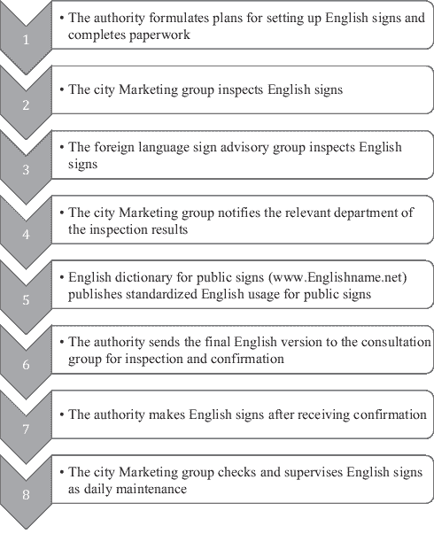

图 2：纠正英语标识的流程。

### 2.1.3 地铁标识

根据官方报告（北京市委委员会外事领导小组办公室，等，2008 年），首尔地铁标识系统主要包括站名标识、换乘路线图、换乘公交路线以及周边地点的标识。地铁标识要求使用韩语、英语和中文三种语言显示，而地铁广播则用韩语和英语播放。在 2002 年首尔世界杯期间，通往赛场馆和体育馆的路线增加了中文广播，并在活动结束后继续沿用。

1984 年，首尔开始为地铁工作人员提供英语和中文培训。每年的培训结果与员工薪资挂钩。目前，地铁工作人员要求具备一定的英语水平并通过专业英语考试方可入职。首尔地铁的负责官员认为，清晰有效的公共标识系统和会外语的地铁工作人员是建设首尔地铁外语环境的重要方面。

### 2.2 技术支持的语言服务

### 2.2.1 首尔热线

2002 年，外国人占首尔 1033 万总人口的比例为 0.66%，其中中国人美国人和日本人占 66.1%（北京市委委员会外事领导小组办公室，等，2008 年）。首尔已有非政府组织为外国人提供旅游信息和咨询服务，但没有政府机构负责为在市外国人提供信息和语言服务。因此，首尔市议会和市外国人监督会议提议设立“首尔热线”，旨在将首尔建设成生活舒适的国际化城市，使其成为外国游客的青睐目的地，从而提升其地位和形象。

首尔热线由首尔市政府赞助，于 2002 年 4 月 1 日开始运营。它提供英语、中文和日语的通用服务，并配备了这三种语言的专业翻译员。首尔热线的信息和语言服务可以通过电话（`080-731-911`）、网站（[www.metro.seoul.kr](http://www.metro.seoul.kr)）、传真和电子邮件访问。首尔热线在运营中采取了的方法：(1)针对常见问题准备自动回复；(2)对于无法现场解决的问题咨询部门并尝试在当天回复；(3)将所有咨询记录在登记簿以便进一步管理。在 2002 年首尔世界杯期间，首尔热线通过以下方式扩大了服务范围：(1)增加了法语、土耳其语和西班牙语等三种外语服务；(2)招募外语志愿者和翻译；(3)将工作时间从`09:00–18:00`延长至`07:00–22:00`。

### 2.2.2 BBB（BBB）免费翻译热线

BBB 免费翻译热线最初由《中央日报》提议，由各种社会资源共同赞助。三星企业提供了资金支持，韩国记者社（`KBS`）负责广告。在 2002 年世界杯期间，BBB 免费翻译热线提供了 13 种语言的信息和语言服务，包括中文、英语、俄语、法语、日语、德语、西班牙语、波兰语、瑞典语、土耳其语、意大利语、阿拉伯语和葡萄牙语。共有 2500 名志愿者，包括 350 名中国志愿者、850 名英语志愿者、500 名日本志愿者和 8 名瑞典志愿者。机场、游客信息中心、酒店等地提供多语言 BBB 信息卡（参见照片 2–6 第 46–48 页）。在韩国遇到语言障碍或想了解韩国文化的外国人可以直接拨打 BBB 信息卡上列出的电话获得志愿者的帮助。

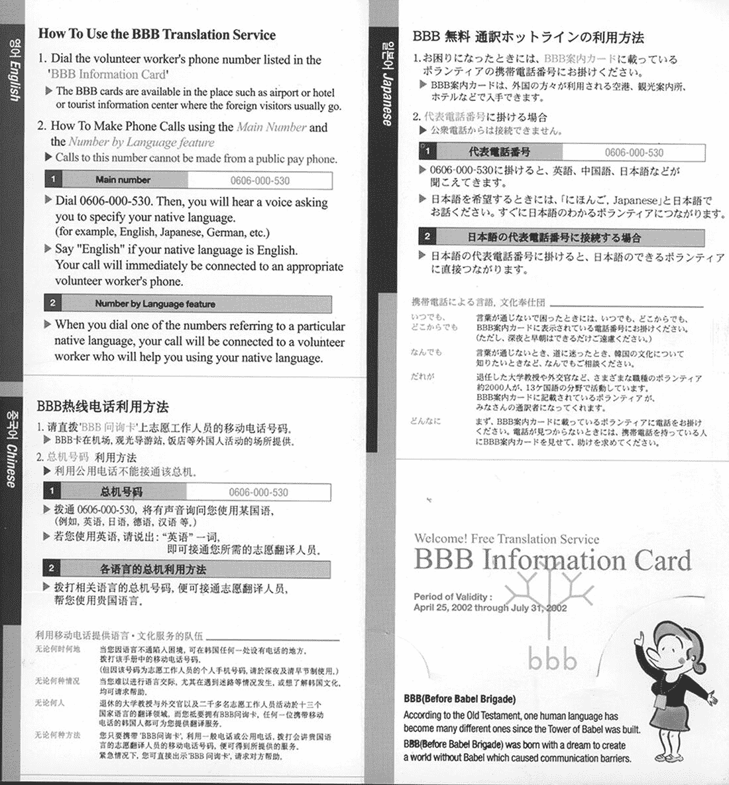

照片 2：多语言 BBB 免费翻译热线介绍折页。


照片 3：中文 BBB 信息卡正面。

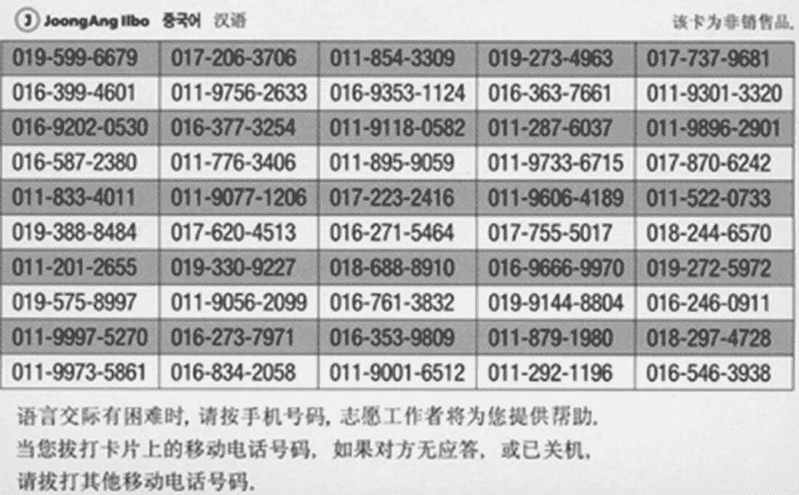

照片 4：中文 BBB 信息卡反面。


照片 5：英文 BBB 信息卡正面。

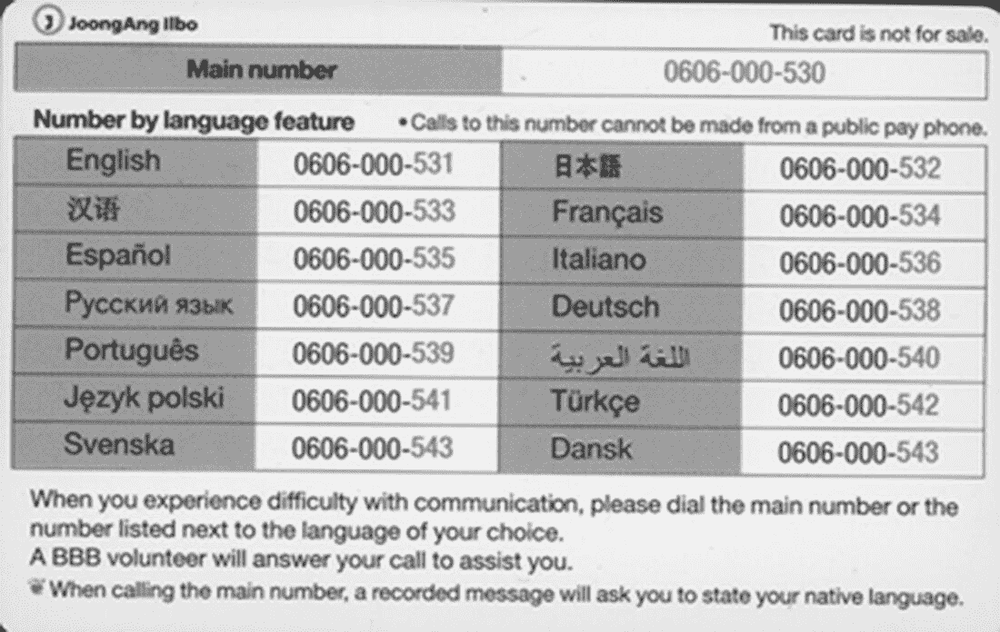

照片 6：英文 BBB 信息卡反面。

### 2.2.3 出租车中的外语服务和同传

为了方便世界杯期间在首尔旅行的外国人，首尔政府打造了两种出租车：`游客导览出租车`和`免费翻译出租车`。游客导览出租车是高端黑色轿车，后门上有显眼的`Visitors Guide`标志，通常停放在机场和餐厅门口。这些出租车的司机都是模特司机，能够使用基础英语和日语。免费翻译出租车的后门印有`Free Interpretation`标志，并配备了政府提供的免费电话设备，该设备可以提供中文、英语和日语三种语言的同声传译服务。这些出租车的司机可以通过车载电话获得翻译中心的同声传译服务。电话接通后，翻译就会用中文、英语或日语告知外国乘客目的地、时间和票价。

### 2.2.4 游客信息中心

2002 年首尔世界杯期间，在主要旅游景点和世界杯足球场设立了游客信息中心，提供韩语、英语、日语和中文多语言服务。在这些游客信息中心，外国游客可以咨询多语言服务人员，并获取免费的多语言纸质指南。


韩国和中国不仅地理位置相近，而且都属于东亚文化圈，拥有 2000 多年的文化交流历史。韩国政府为 1988 年首尔奥林克会采取的语言服务措施，为中国筹备 2008 年北京奥运会提供了有用的参考，也为研究东亚国家举办的国际赛事的 `LPP` 提供了良好范例。下文中我将详细阐述本研究的设计。

## 3 研究设计

研究设计是将研究初始问题与待收集数据以及采用的分析方法联系起来的逻辑。本研究根据调查中的数据类型，结合了多种数据收集和分析方法。

### 3.1 研究问题

在国内外社会、经济和政治变化的背景下，2008 年北京奥运会标志着国家、地区和个人层面身份构建的关键时期。推动中国迈向历史上规模最大的体育盛事的力量，也为 21 世纪第一个十年的外语推广活动提供了动力。北京奥运会组委会（BOCOG）和北京市政府需要做出重要的语言政策和规划决策，以实现奥运会“无障碍”语言服务的目标。首尔为 1988 年首尔奥运会和 2002 年世界杯提供的语言服务，为中国（另一个非英语国家亚洲国家）提供了宝贵经验。然而，在规模有以来最大的奥运会上兼顾所有参与者的语言需求，在语言规划中是一项更为复杂且艰巨的任务。尽管对现代奥林匹会有广泛研究，但缺乏试图解释奥运会 `LPP` 的严谨研究。本书将语言政策、语言实践和语言意识形态置于中国广泛的社会、经济和政治变化中，特别是从北京申办 2008 年奥运会到筹备 2022 年冬奥会的这一时期。结合宏观和微观视角，我试图呈现北京已举办和即将举办的两届奥运会自上而下的 `LPP` 的全景，并详细描述语言政策和语言意识形态如何影响北京奥运会背景下的实际语言使用和说话者的语言态度。本书根据以下八个问题展开：

1. 为什么现代奥林匹会是语言政策和语言规划研究中具有独特价值的课题？
2. 2008 年北京奥运会的历史意义和语言挑战是什么？
3. 为 2008 年北京奥运会颁布并实施了哪些官方语言政策？
4. 这些语言政策反映了什么样的语言意识形态和态度？
5. 在筹备期间和北京奥运会期间观察到了哪些语言实践？
6. 2008 年北京奥运会留下了哪些 `LPP` 遗产？
7. 奥运会后时代，中国的外语教育意识形态和政策发生了哪些变化？
8. 为 2022 年北京冬奥会的语言服务做了哪些语言规划工作？

### 3.2 数据收集方法

本研究通过结合不同类型的定性方法对数据进行三角互证：半结构化访谈、参与式观察和实地观察，以及文本和视听材料的收集。收集了微观领域（访谈转录和现场笔记）和宏观领域（政策文件、媒体文本、标识、教学材料）的数据。由于定性研究的演变性质以及英语在中国持续传播的过程，政策文件和媒体文本的收集贯穿整个研究过程。为了对宏观领域数据的话语分析进行背景化，我在北京进行了为期三个月的多点密集实地考察（2008 年 7 月至 10 月）。2008 年北京奥运会后，我多次回到研究现场进行观察和数据收集。2017 年 9 月至 2018 年 7 月期间，我在北京语言大学（`BLCU`）李明教授的指导下担任访问学者。访问期间，我进入了由李明教授的北京语言资源高级创新中心（`ACLR`），并获得了关于其 2022 年北京冬奥会三个语言服务项目的宝贵信息。所有这些研究活动为所研究的问题提供了重要的见解。

### 3.2.1 自然产生的数据

1) 政策文件

收集了 1990 年至 2020 年间中华人民共和国教育部（`MOE`）发布的各学校和大学英语教学大纲和课程进行分析。这些政策文件规定了要涵盖的 `ELT` 内容，推荐了教学方法和评估措施，并概述了公立教育中英语要达到的成果。为筹备 2008 年夏季奥运会和 2022 年冬奥会的外语学习与推广的官方政策、指南和规定，收集自第 XX 届奥运会北京组委会官方网站（[www.beijing2008.cn/](http://www.beijing2008.cn/)）、北京 2022 年奥运及残奥冬运组委会网站（[www.beijing2022.cn](http://www.beijing2022.cn)）、国际奥委会（[www.olympic.org/](http://www.olympic.org/)）、北京市政府（[www.ebeijing.gov.cn/](http://www.ebeijing.gov.cn/)）、北京市外事办（[www.bjfao.gov.cn/](http://www.bjfao.gov.cn/)）、“北京说外语”计划组织委员会（[www.bjenglish.com.cn/](http://www.bjenglish.com.cn/)）、北京教育考试委员会（[www.bjeea.cn/](http://www.bjeea.cn/)）、学而第一英语有限公司（[www.englishfirst.com/index.html](http://www.englishfirst.com/index.html)）以及北京 2008 奥运会语言培训服务供应商——爱飞科技有限公司（[www.aiflyworld.cn](http://www.aiflyworld.cn)）。

2) 媒体文本

收集了与两届北京奥运会 `LPP` 和语言服务相关的国内媒体报道，涵盖了几份主要官方报纸，即新华社（[www.xinhuanet.com](http://www.xinhuanet.com)）、中国日报（[www.chinadaily.com/](http://www.chinadaily.com/)）、人民日报（[www.people.com](http://www.people.com)）和环球时报（[www.huanqiu.com/](http://www.huanqiu.com/)）。这些媒体文本为北京奥运会所处的特定社会历史背景以及中国*英语热*现象的争议提供了多维度的视角。

3) 标识


为了了解北京作为奥运城市的语言景观，研究者在关键的奥运场馆、旅游景点、商业区和交通枢纽拍摄并收集了一系列双语/多语引导指示牌和其他语言对象的照片。这些自然产生的观测数据包括在北京火站（2008-08-01）、王府井大街（2008-08-04）、奥林匹克公园（奥运公园）（2008-08-05）、天安门广场（2008-08-06）、北京黑竹园（2008-08-07）、故宫（2008-08-08）、前门大街、北京西西站（2008-08-09）、北京首都国际机场（2008-08-09）、北京大学和北京体育大学（2008-09-20）。本研究中，采样的照片和视频均通过数码相机记录。这些照片包含了官方/非商业性标志（交通标志、方向标志、信息标志、提示和警告标志、旅游地图、告示等）以及非官方/商业性标志（广告牌、告示牌等）。这些采样标志上的文本可能是单语的、双语的或多语的。本研究将双语标志视为包含至少一种中文以外语言的标志。因此，如果一个标志只包含一种语言，只要该语言不是中文，它仍被归类为双语。同样，多语标志是指包含至少两种中文以外语言的标志。在北京的语言景观（LL）中可以区分出三种类型的标志：单语标志（中文）、双语标志（中文和英语）和多语标志（主要为中文、英语和法语）。在第七章中，我有针对地选择并分析了某些照片，取决于这些照片是否典型化了了地位置的语言特征。

## 4) 教学材料

本研究购买了三套用于服务北京奥运会的特定英语教学材料：(1) 北京奥运会组委会（BOCOG）出版的《A Conversational English Reader》（初级版和高级版）；(2) 北京英语教学中心（BSFLP）出版的《One World English》（第 100、300、600、1000 册）；(3) BSFLP 和 BEST 出版的《Olympic English》（第 1、2、3 册）。[Shardakova and Pavlenko (2004)] 强调语言教科书在语言学习者潜在赋权或去赋权的过程中起着“独特的作用”（第 28 页）。在第六章中，我对 `A Conversational English Reader`（初级和高级版）中的文本和视觉图像进行了多模态话语分析。第六章中解释了选择这两本 `Readers` 作为我研究数据部分的依据。

### 3.2.2 野外调查

[Patton (2002)] 指出，“如果没有访谈，记录将毫无意义，而访谈的焦点源于实地观察”（第 307 页）。为了深入理解北京奥运赛事所处的“更完整、更有意义的语境”（[Tedlock, 2000], 第 455 页），我在北京为期三个月的野外调查（2008 年 7 月至 10 月）期间了观察、访谈和文献收集。野外调查为话语分析提供了语境背景。

### 1) 研究地点

为了捕捉 2008 年北京奥运会之前、期间和之后整个城市的语言实践范围，我最初沉浸在各种场所，如奥运场馆、奥奥组大楼、奥运青少年营、旅游景点、大学、英语学校、中央商务区、机场、火车站、地铁、公交调度中心、购物中心和书店。从最初的沉浸到更有针对的研究地点，我逐渐发现了出现的主题，缩小了研究问题，并接触了重点关注的主体和事件。我进行实地观察的主要研究地点从关键奥运场馆（即奥林匹克公园）、旅游景点（故宫、天安门广场）到商业区（前门大街、王府井大街），以及交通枢纽（北京西站、北京首都国际机场）。这些研究地点大多位于北京市区。这些数据收集地点是游客经常光顾的热或公共场所，本研究选择它们是因为它们在奥运游客提供的观赛、观光、购物和通勤体验方面具有各自的意义。在上述领域，我做了现场笔记，拍摄了照片，并对研究问题相关的有趣且重要的物品、活动和现象记录了音频和/视频。我尝试对英语学习实践、英语媒介的跨文化交流以及外语服务和设施进行观察和自我反思。

### 2) 招募

为了识别和招募本研究的参与者，使用了非概率采样技术：目的抽样和雪球抽样。非概率意味着不使用随机选择方法进行采样，因此非概率样本不一定对研究总体具有代表性。[Burns (2000)] 指出，非概率抽样的通常形式是“目的性的、有意图的或基于标准的抽样”（第 178 页）。目的抽样是研究者根据其纳入研究的标准主观地选择参与者的方法。研究者根据他们认为适合该研究的人来选择样本。雪球抽样是一种开发研究样本的技术，让现有的研究参与者从同样符合标准的人中招募未来的参与者。当研究人员试图接触接触或难以发现的人群时，这种招募技术特别有用（[Trochim, 2006]）。

本研究从目的抽样开始。我首先联系了我在北京现有社交网络中的几个人。通过我的网络，我首先定位了信息丰富的关键知情人，然后向他们说明了我目标参与者的特征。一旦确定了潜在参与者，我通过这些关键知情人请求他们最初接受我的访谈。对于通过其机构抽样的大学生（例如，通过班主任老师或系主任），我提前向他们发送了介绍信以建立最初的合作和关系。在获得最初许可后，我通过电话联系了这些潜在参与者，并让他们指定他们最合适的访谈时间和地点。在与现有参与者建立合作关系后，我使用雪球抽样来接触更多的潜在参与者：我礼貌地请求他们向我介绍同样符合我标准的熟人，并征访谈许可。

### 3) 访谈


本研究的参与者主要分为两类：个人参与者和机构参与者。

第一类个人参与者是由在北京生活和学习的大学生（18 岁及以上）组成的奥运志愿者。这些奥运志愿者是“由第 29 届北京奥运会组委会招募和管理的经授权人员”，他们“在 2008 年北京奥运会和 2008 年残帕林匹克会期间，在`BOCOG`分配的时间和岗位上承担关键赛期间职责，且不收取报酬”（新华社，2008a）。

赛会组织方招募了三类奥运志愿者：赛期间志愿者、城市志愿者和社会志愿者。赛期间志愿者接受了最密集的培训，被分配到奥运场馆（包括比赛场馆、训练馆和非比赛场馆）提供服务。赛期间志愿者在指定区域提供服务，涵盖嘉宾接待、语言翻译、交通、安全、医疗服务、观众引导、通讯组织支持、场馆运营支持、媒体运行支持、文化活动支持等方面（[Nidemike, 2008]）。

城市志愿者负责在遍布北京各地的城市志愿者服务站提供信息、应急援助和翻译服务。社会志愿者被广泛招募，负责在奥运会和残帕林匹克会之前和期间帮助北京社区和乡镇维持交通秩序和社会秩序。在赛会期间，北京大学生是这三类奥运志愿者的主要来源之一。

总的来说，我访谈并观察了 35 名参与者（见附录 2：访谈者名单）。其中，28 人是 2008 年北京奥运会的志愿者（26 名赛期间志愿者和 2 名城市志愿者）。其余的 7 名机构参与者或或少参与过北京奥运会之前的奥运英语培训。他们包括三名英语教师、两名`BOCOG`行政人员、一名当地政府官员和一名当地出租车司机。所有机构受访者都受过高等教育，并拥有本科及以上学位。

在 35 名受访者中，31 人是汉族。另外 4 人是在北京读本科的少数民族学生。其中两个是是满族和赫哲族，他们的民族语言在各自的文化中已经消失或在日常使用中淡化。另外两人是畲族和瑶族背景。他们会普通话和至少一种民族语言，因此是将英语作为第三甚至第四语言来学习的。

我在 2008 年 7 月 7 日至 9 月 27 日期间对这 35 名参与者进行了 27 次面对面访谈和 1 次电话访谈。其中，22 次是一一访谈，5 次是小组访谈（见附录 2）。为了了解参与者在奥运会之前及期间对英语学习和使用的经历与感知，我设定了六个主要主题作为访谈指南。

这六个主题涉及参与者的相关经历和观点，即：海外学习经历；在家和工作场所的外语实践；对中国英语学习和教学的态度；对英语在各自未来生活中作用的理解；对英语作为北京奥运城市之作用的看法；北京奥运会期间使用英语的个人经历。这六个主题的框架是一个非正式的“访谈者可以针对不同参与者以不同方式提出的的话题和问题分组”（[Lindlof and Taylor, 2002], 第 195 页）。访谈使用录音机进行记录，以便准备用于数据分析的转录稿。在小组访谈期间，参与者之间的对话以及他们与其他人的互动都被记录下来。所有访谈均以中文进行。

### 4) 参与式观察

由于大多数参与者工作场所的敏感性（他们就职于各种奥运相关场馆）以及参与者的时间有限（所有人在赛会期间都深度投入工作），在大多数情况下我无法进入他们的工作场所进行参与式观察。2008 年 8 月 7 日，我对两名城市志愿者进行了参与式观察，他们被分配在北京黑竹公园入口的指定城市志愿者服务站提供半天的志愿者服务。我的观察目的是了解这两位参与者在工作场所通过英语媒介的跨文化交际实践。在获得许可后，我对参与者在工作场所及其工作环境中的行为进行了录像并记录了实地笔记。

### 3.3 数据分析方法

### 3.3.1 批判性话语分析视角


数据分析意味着对数据进行意义化或解释。本研究旨在从批判性话语分析（CDA）的角度解读这些数据。CDA 既不是一种同质的、也未必是统一的理论方法或研究方法；它是“一种对语言、符号或话语分析的共同视角”（Van Dijk, 1993, p. 253）。有四个概念在所有 CDA 研究任务中都是不可或的：话语、批判性、意识形态和权力。普遍认为认为，CDA 将`discourse` 视为一种“社会实践”的形式（Fairclough and Wodak, 1997），并认为“语言使用的语境”至关重要（Wodak, 2001a）。将话语描述为社会实践意味着“特定的话语事件与构成其框架的情境、机构和及结构之间存在着一种辩证关系”（Fairclough and Wodak, 1997, p. 258）。换句话说，话语既是社会建构的，也是受社会条件的——“它构成了情境、知识对象，以及个人与群体之间的社会身份和关系”（Fairclough and Wodak, 1997, p. 258）。

`Ideology` 是 CDA 中一个非常重要的课题。在 van Dijk (1998) 的社会认知理论中，意识形态被视为“解释框架”，用于“组织关于现代社会其他元素的态度集合”。Fairclough, Mulderrig and Wodak (2011) 提出将意识形态不仅理解为“一种对社会现实的呈现”，还理解为“一个将特定的现实表征和特定的身份建构整合在一起的过程”（p. 372）。意识形态通过话语产生并再，并作为“建立和维持不平等权力关系”的重要手段（Wodak, 2001b. p. 10）。对意识形态的研究要求分析者超越文本分析，考虑“文本是如何被解释和接收的，以及它们产生了什么样的社会影响”（Fairclough, Mulderrig and Wodak, 2011, p. 371）。此外，来自 CDA 视角的解释是动态且开放的，可能会受到新解读和新语境信息的影响。

CDA 对语言与权力之间的关系特别感兴趣。`Power` 关乎差异关系，特别是关于社会结构中差异产生的影响（Wodak, 2001b, p. 11）。对于 CDA 而言，语言“本身并不强大，相反，它通过权势人物对其的使用来获得权力”（Wodak, 2001b, p. 10）。与话语分析中的非批判性理论和方法论不同，CDA 的特征在于“共同利益在于即通过对符号数据（无论是书面的、口头的还是视觉的）进行系统研究，来揭秘意识形态和权力”（Wodak, 2007, pp. 185–186）。

采用`critical` 目标标志着批判性话语分析者不仅需要描述话语实践，还要解构“话语的意识形态基础，这些基础随着时间的推移已变得如此自然，以至于我们开始将其视为话语的常见、可接受的自然特征”（Talbot, Atkinson and Atkinson, 2003, p. 36），并揭示权力关系中的不平等现象。从事批判性领域的研究人员的核心关注点包括此类主题：语言与社会之间的辩证关系；通过语言构建和维护权力关系；语言在构建人类经验和世界观方面的作用；以及语言与社会变化。像 Fairclough 等 CDA 研究者热忱地关注话语作为广泛被称为“全球化”的当代社会变化的一个元素。人类话语的多样性、争论和转型，以及针对这些开发适当有效的方法，构成了话语研究中一个巨大的新领域。人们认为，对话语的意识形态效应的认识可以导致话语实践的改变，从而带来更大的社会公平和公正（Fairclough, 1992）。

批判性话语分析方法通常集中于数据，如政府文件、新闻报道、政治访谈、教科和广告，这些数据构建并传递了意识形态和权力关系，这些关系随着时间的推移已经根深并自然化，以至于看起来像是社会中的常识甚至是公理。基于批判性话语分析方法，本研究探讨了意识形态、权力、身份、阶级、性别和民族等问题，并考察了它们如何在文本或言语中体现。

### 3.3.2 数据分析程序

本研究分析的数据分为六类：政策文件、媒体文本、标牌、英语教学（ELT）教材、访谈、现场笔记。以下是我的数据分析程序：

Patton (2002, p. 307) 认为，文献分析可以提供“对计划的幕后观察，这些计划可能无法直接观察，而且在没有文献提供的线索的情况下，访谈者可能不会提出合适的问题”。在探索阶段，文献分析帮助我理解了中国英语传播相关的意识形态基础和身份冲突的社会与文化根源。根据 Shohamy 对语言规划（LP）的扩展观点（2006），我建立了一个分析框架，通过对语言政策文件、语言教学材料、语言景观和语言学习经验进行比较分析，解决语言政策和规划问题。这些理解和框架为后续的数据收集和分析提供了指导。

通过实地考察，我收集了政策文件、媒体文本和 ELT 教材，拍摄了照片，并进行了访谈和观察。Patton (2002) 强调，定性分析者的挑战在于理解海量数据，这涉及到“减少原始信息量、从琐碎中筛选出重要性、识别重要模式，并构建一个框架来交流数据所揭示的本质”（p. 432）。多点观察让我对外语普及的政策和实践以及该领域无处不在的话语有了总体了解，从而有助于界定我访谈的重点。在访谈和初步分析过程中，更具针对性的模式和主题逐渐显现。在此阶段，确定了四个主要主题，以通过各种显性和和隐性的语言规划机制来探索北京奥运会的语言政策和规划：(1) 奥运会英语推广活动中的语言政策与实践；(2) 个人英语学习轨迹；(3) 北京奥运英语教材中的想象社区和身份选择；(4) 奥运会城市的语言景观。


实地调查结束后，我对访谈转录稿和实地笔记进行了彻底审查，试图重新检查在数据收集以及与宏观领域数据进行交叉验证过程中得出的分析见解和解释。访谈转录首先由我从中文翻译成英文，然后由一名校对人员对其清晰度和语法进行编辑（参见附录 3：转录规范说明）。为了使翻译具有最大限的透明度，我提供了所有原始的中文数据以及相应的译文。

## 数据分析与解释

本研究采用内容分析法对收集的文本和叙事性数据进行解释。内容分析是当今社会科学中应用广泛的分析方法之一，用于对文本和叙事数据中出现的新主题进行分类。从文本和叙事数据中选择内容的依据是它们与本研究问题的相关性。对于确定的四个主题中的每一个，我都从数据中归纳性地制定了一套编码方案。在数据编码后，我发现了类别和模式，进行了推断，并展示了基于编码数据得出的解释。我选取了一些参与者的典型引言，并将其纳入讨论中，以加强对我信息的抽象处理。在不同位置，使用了图表来辅助描述。

为了增强定性内容分析的信度，使用了两种技术：成员检查（member checking）和交叉验证（triangulation）。首先，成员检查在访谈过程中和研究结束时进行了。在进行访谈时，我会总结信息并询问参与者以确定准确性。访谈结束后，参与者有机会审查原始数据、分析后的数据和报告，以确保研究充分且准确地代表了他们的观点和经历。交叉验证涉及使用多个不同的来源、方法和视角来阐明研究问题及其结果。本研究采取多重交叉验证的方法，考察了与北京奥运会语言学习政策（LLP）相关的政策文件、语言教材、语言景观和语言学习轨迹。该技术使我能够描出一个多维度、复杂的画面，并对所研究现象产生深入、丰富的理解。

## 反思性与研究者立场

文本和话语都受到多种解释的影响。Shardakova and Pavlenko (2004) 指出，“对文本的不同解释源于文本属性与解释者社会定位及知识的不同组合”。定性研究者，特别是批判性话语分析（CDA）分析师，旨在具有自我反性和政治意识。Nightingale and Cromby (1999)2) 认为，“反思性要求研究者意识到自己在整个研究过程中对意义构建的贡献，并承认在进行研究时无法‘脱离’其研究的主题。”在分析数据时，我反思了自己的价值观、经历、兴趣、信仰、政治承诺和身份身份是如何塑造这项研究的。作为研究调查者，我拥有多重身份：中国英语作为外语（EFL）的学习者、英语教师、留学生和全球公民，所有这些都影响了目前的研究。作为一名中国 EFL 学习者，我与大多数中国英语学习者有着共同经历，他们对语言投入了大量精力，渴望达到母语般的流利和社会地位的提升，因此我能够理解中国人对英语的需求以及他们在英语学习中的困境。作为一名在中国从事多年外语教学的大学英语教师，我了解中国英语教育和语言市场的现状及潜在问题。作为一名在多语言社会的澳大利亚获得博士学位的社会语言学研究者，我意在提高中国英语学习者、教育者和政策制定者对英语传播的批判意识，并提出其他国家可以从中国经验中学习的教训。在开展研究期间，我意识到本研究领域“本质上是政治性的，并受到多种伦理和政治立场的塑造”(Nelson, Treichler, and Grossberg, 1992), 2)。同时，我承认自己的批判性解释并非不受政治和伦理价值观的影响，也受到批判性的审查。

总体而言，本论文对两届北京奥运会大规模身份构建项目中的语言政策、实践和意识形态采用了语境敏感的批判性方法。通过这种方法，我希望对在非英语国家举办的现代奥运会语言政策（LPP）有丰富的理解。

## 3.4 伦理考量

作为一名涉及人类参与者的定性研究者，我认真考虑了伦理问题。为了确保定性研究过程符合伦理责任，人类研究遵循的三个伦理原则至关重要：“善”（beneficence）、“尊重”（respect）和“公正”（justice）(Sieber and Stanley, 1988), 53)。本研究涉及四类参与者：作为奥运志愿者的大学生、出租车司机、英语教师以及参与官方奥运英语培训的北京奥运组（BOCOG）行政人员。本研究通过四种策略在数据收集、分析和展示过程中保护受访者的权利：知情同意、保密性、匿名性和不可追溯性。

在进行访谈和观察时，一直在征求知情同意。所有参与者在访谈或观察之前都收到了一份母语编写的信息和同意书。鉴于知情同意过程是“动态且持续的”(Madison, 2005), 114)，我每次都会征求参与者进行访谈或观察的许可。在访谈或观察开始时，参与者被充分告知当前研究的目标、录制的目的、数据如何处理、存储和删除，以及谁有权访问数据。最重要的是，参与者意识到他们的参与是自愿的，并有权在研究期间随时退出。为了保护研究中参与者的匿名性和不可追溯性，所有参与的个人和机构都分配了化名。访谈者身份中可能识别其身份的方面，如所属机构、性别、年龄、居住地、职业和教育背景，在任何研究的书面报告或其他形式的传播中都不会公开。


关于北京奥运会的政治敏感性以及北京奥委会（BOCOG）的保密政策存在一个特定的伦理问题。一些参与者作为奥运志愿者和奥委会工作人员，需要与奥委会签署保密协议，因此在赛前及期间不能接受采访和观察。遵循“行善”、“尊重”和“公正”的精神（Sieber and Stanley, 1988, p. 53），我对参与者充满了充分的理解和尊重。我总是根据参与者的时间进行调整，并避免对他们造成不必要的风险或伤害。此外，这项研究对参与者来说也是互利的，因为我为他们提供了个人的英语学习经验和留学建议，并协助了一些参与者进行英语翻译。

# 第四章 北京的承诺——国际语言环境

## 1 北京奥运会行动计划

北京市政府和第二十九届北京奥委会委员会（BOCOG）于 2002 年 7 月 13 日正式发布了《北京奥运会行动计划》（BOCOG, 2002）。该计划作为北京未来社会经济发展及奥运会准备工作的指导性文件，体现了“办奥运、利奥运”的理念。它也是 21 世纪第一个十年以筹备奥运会为代表的城市快速发展的里程碑。

《行动计划》由一个总体计划和九项专项计划组成，分三个阶段实施：筹备阶段——2001 年 12 月至 2003 年 6 月；发展阶段——2003 年 7 月至 2006 年 6 月；赛前运行阶段——2006 年 7 月至奥运会开。该计划设定了奥运会准备工作的四个大目标：(1)使奥运会取得奥史上的巨大成功；(2)加速城市和国家社会经济的发展；(3)为首都打造改革开放的新形象；(4)力争中国体育事业的繁荣。

《行动计划》还是 2008 年北京奥运会语言规划和政策的政府指导。作为整体战略目标的一部分，奥委会承诺举办届“历史上最完美的奥运会”，并希望通过举办 2008 年奥运会，不仅促进“北京及中国其他地区的现代化”，而且创造“北京的新形象”（BOCOG, 2002）。这一新形象将北京定位为“正在快速发展并向世界更开放地开放”的“国际化城市”（BOCOG, 2002）。北京市政府副市长季林（2009, p. 5））认为，“一个城市的国际语言环境反映了其现代化和国际化水平……持续改进北京国际语言环境的工作有助于奥运会的成功，并推进北京的现代化”。关于北京“国际语言环境”的建设，《行动计划》（BOCOG, 2002）规定了三个方面作为奥运会语言规划（LPP）的优先任务：(1)外语的学习与普及；(2)推广普通话和规范汉字的使用；(3)双语/多语指示牌的标准化。外语学习和普及被视为在 2008 年前创造有利于北京作为成功奥运举办地身份、从长远来看打造现代化国际城市的语言环境的重要要素。政府制定了一项自上而下的语言政策来促进外语（主要是英语）的学习，如下节录所示。

> I. 外语学习与普及
>
> “北京微笑世界”计划组织委员会将在 2002 年底前制定并实施《市民使用外语能力规划（2003–2008 年）》。其目标是到 2007 年底，让大多数市民能够用至少一种外语进行百句左右的日常交流。在“窗口”行业工作的员工，特别是可能为外国人服务的人员，应接受更积极的外语培训。在一段时间内，将制定相关规定，要求员工在从事某些行业或职业前必须获得能力证书。所有学校均应重视外语教育，并采取措施提高所有学生的外语水平。还应组织并重点重视教授相对冷门外语的项目。
>
> 加强外语的推广和普及。报纸、杂志、广播电站、电视站和网站都应增加外语节目或栏目。英文报《北京日报》（*Beijing Today*）目前为周刊，从 2003 年起将每周出版三次，并在 2005 年改为日报。北京广播电视局将增强双语和多语节目制作能力。北京电信将设立电话翻译热线，为外语学习者和大部分情况下依赖外语的人员服务。

奥委会和政府认为提供双语标识牌是提升北京国际城市形象的重要措施。因此，工作的另一个重点是对奥运游客频繁出入公共场所的双语/多语标识牌进行标准化。《行动计划》（BOCOG, 2002）中列出的任务和目标如下：

> III. 导视牌
> 将组织专家进行全面研究和系统分析，以为北京开发一套标准化的旅游指南系统。市旅游局应检查现有的旅游指南、旅游地图、标识牌、折页及其在各街道、主要旅游景点和重点旅游服务设施的分布。旅游信息标准化应在 2005 年底实现。在游客频繁出入的公共场所提供触摸屏电子导览设施，并在奥运会期间配备流动咨询员提供旅游信息和导览服务。北京的主要道路、车站和停站、旅游景点和重点文化景点应设有中英文双语指示牌，某些特殊场馆和体育馆应配备多语标识。2006 年之前，将在“北京微笑世界”计划组织委员会的领导下制定一套外语标识检查系统[该计划名称于 2002 年改为“北京说外语”计划] 。从 2002 年起，将参考国际标准采用并推广简化图标，以逐步改变目前标识牌仅有文字无任何指示的情况。在城市公交和地铁系统中适时推广双语电子播报系统。应重点重视盲文和手语服务。


由于这只是夏季奥运会第三次在亚洲举办，当地奥委会组织者和国际奥委会委员会（IOC）都尽早关注了主办城市的“语言环境”能否经受奥运会严峻的语言挑战。尽管北京奥运组织者已做出大力承诺提升北京的整体外语水平，但国际社会对 2008 年奥运会由一个亚洲社会主义国家举办仍持有严重怀疑。新华社的一项研究项目（中国国际传播研究中心，2006）显示，47%的受访外国记者担心北京的外语水平将成为他们在该城市工作的障碍。国际奥委会委员会主席雅克·罗格（Jacques Rogge）据报道曾表示，虽然他有信心北京将举办一场无与伦比的史上最好的奥运会，但他对专业人才问题和北京的语言环境表示担忧（Hu, 2007）。面对这些担忧，中国政府在《奥奥行动计划》中向世界做出了（BOCOG, 2002）：“到 2008 年，信息服务将廉价、内容丰富、无语言障碍、个性化，并供任何人、随时、随地使用。”国内和国外对语言环境和语言服务的担忧，使得北京的外语普及运动更具迫性。在北京奥运会之前的七年里，北京市政府和奥委会采取了四项主要措施来实施这一自上而下的外语普及运动并构建“国际语言环境”：首先，成立“北京说外语计划”（语言政策制定与执行机制）；其次，启动“北京英语考试体系”（语言测试机制）；第三，启动“官方语言服务供应商”（语言服务机制）；第四，推广英语学习教学明星人物（模范与认同机制）。

## 2 BSFLP 的行动计划

“北京说外语计划”（BSFLP）于 2002 年启动，是北京市直接管理的全市外语普及项目之一。BSFLP 源于 2000 年为 2008 年奥运会申办发起的“市民英语计划”。BSFLP 组委会成员包括市长、副市长、市政府各部门局长以及 18 个区县负责人。自成立以来，BSFLP 组委会与北京奥组（BOCOG）密切合作，在市内营造“良好的语言环境”。BSFLP 组委会聘请了 35 名来自美国、英国和新加坡的国内外专家组成咨询小组。BSFLP 组委会办公室主任杨勇述道，BSFLP 的目标是“鼓励北京居民学习和说英语，将北京建设成为它本应有的国际化城市”（Stanway, 2008）。根据杨勇的话，中国政府是唯一承诺在奥运会期间消除语言障碍的政府，而北京在这方面已尽了最大努力（Stanway, 2008）。以下介绍了该计划的总体目标和工作程序，以及奥运会语言普及计划（LPP）的重要方面，包括外语普及、窗口行业语言服务、标识牌标准化、技术支持的语言服务以及外语服务市场。⁷

### 2.1 总体目标

2003 年，北京说外语计划组委会（2003）发布了其第一个五年`行动计划`（2003–2008），作为北京奥运会语言普及计划的更全面、更明确的规划。《行动计划》设定了三个主要总体目标：1）500 万外语口语人口；2）双语标识牌的标准化；3）窗口行业的外语服务。⁸

> 到 2008 年，全市外语口语人口应增加到 500 万，占全市总人口的 35%，公共场所的双语街牌应标准化，重点区域的窗口行业应提供外语服务，外语服务设施应系统化，外语服务志愿者应制度化；从而能够为北京 2008 年奥运会的成功举办营造良好的国际环境，并履行北京显著提高城市国际交流能力的承诺。到 2020 年，市民整体外语水平和综合素质将得到本质性提高，形成一个适合外国人在北京工作、学习和生活的一流文化环境，城市的国际交流能力将显著增强，为北京现代国际大都市基本框架的形成提供可靠保障。

### 2.2 工作程序

为了实现这些总体目标，北京说外语计划组委会（2003）计划分三个阶段实施`行动计划`并构建“国际语言环境”：

> 第一阶段（2003 年）：2003 年的主要工作是加强 BSFLP 的组织和制度建设，形成有效的工作模式；鼓励北京市民开展外语学习活动；继续扩大双语和多语言教学试点项目；逐步规范各政府部门和服务业所使用的语言以及重点文化场所、社区和旅游区展示的双语标识牌。在主要社区设立国内外游客信息中心。初步建立外语服务志愿者队伍。

> 第二阶段（2004–2006 年）：从 2004 到 2006 年，重点将推广外语学习活动，以提高北京市民的整体英语水平；在合格学校实施双语教育；在窗口行业和服务业提供必要的外语服务；在全市商业和文化场所、主要社区和旅游景点设立标准化双语标识牌；建立信息中心；扩大并培训 BSFLP 志愿者队伍，并基本解决外国人在的的困难。

> 第三阶段（2007–2008 年）：从 2007 到 2008 年，将全面实施北京英语考试体系，以规范北京市民的外语学习活动；全市所有商业和文化场所、主要社区和旅游景点应使用标准化双语标识牌；广泛建设信息中心；全市外语电视台开始广播，外语报开始发行；BSFLP 志愿者队伍将在实践中积累更多语言服务经验，以确保 2008 年奥运会的成功。

### 2.3 政府对外语普及的规划


在`Action Plan`（行动计划）中，`BSFLP 组委员会（2003 年)`对正式教育和社会教育给予了同等重视，以提高北京外语人才队伍的数量和质量。在从幼儿园到研究生阶段的教育机构中，鼓励开展外语（主要是英语）的教学。同时，还要求整合各种社会资源，为北京市民提供不同类型的外语培训。

### 1. 正式外语教育

1. **改革学校的外语教学方法。** 借鉴成功的国际经验，探索外语教学方法和考试体系的改革。采用先进教学方法，积极开展双语和多语教学改革实验。逐步在幼儿园开设外语课程，鼓励中小学开展外语教学实验，从学前教育到高等教育系统性地开展外语教育，以提高学生的外语能力，建立符合国际大都市要求的外语教育体系。

2. **培养高素质外语教师队伍。** 制定外语教师的培训和招聘计划。加强中小学外语教师的培训。更新其教学理论并提高其外语教学水平。创造良好条件，吸引合格的外籍教师参与外语教学。

3. **丰富外语教学内容。** 在外语教学中增加中国传统文化以及外国当地风土民俗的内容。通过加强中国国情民俗教育，培养开放的文化意识和国际视野，提高学生的综合素质。

### 2. 社会外语培训

1. **开展各种形式的社会外语培训。** 发挥北京在外语教育方面的独特优势，整合高校、培训机构和专业翻译公司在内的各种社会资源，积极与海外培训机构合作，计划培养高级外语人才。根据当地情况为北京市民提供多样化的外语培训形式。充分发挥各种资源的优势，开展政府推动、企业参与、市民受益的大型公共活动。

2. **培养高质量跨学科人才。** 开辟海外留学、专业培训和海外先进外语培训等高层次的外语培训研究渠道。重点培养能够直接与外国专家和专业机构交流的官员和企业领袖。

3. **提高北京市民日常交流中的外语水平。** 北京市民的外语培训，特别是针对外语水平较低的人群，应侧重于提高他们日常交流中的口语能力。

4. **加强小门种语言专业人才培训。** 以服务 2008 年奥运会为目标，在外语学院小门种语言专业学生培养的基础上，建立小门种语言专业人才库。

### 2.4 政府对窗口行业语言服务的规划

除了总体目标外，`BSFLP 行动计划`（`北京 BSFLP 组委员会，2003 年`）还为各行各业的北京居民制定了特定的外语学习和测试计划目标。要求公务员带头学习和测试英语。同时，高度重视“窗口行业员工（可能接待外国人的行业）”，如警察、出租车司机、公交司机和乘务、地铁工作人员、酒店工作人员以及商业部门员工。

**公务员**：北京公务员应在三年内（2003–2006 年）掌握常用对话英语和公务服务基础英语。通常要求公务员掌握 100 句常用英语句子。40 岁以下具有本科学及以上学历的公务员要求掌握 300 句常用英语句子，并基本上能用英语交流和工作。2008 年之前，将选 1000 名英语水平较高的公务员进行不少于三个月的强化培训，使其能够基本达到国际交流水平。

**公安部门人员**：80%的 40 岁以下警察应通过国家或市级初级英语口语测试，具备一定的英语听力能力。6000 名具有一定英语听读写能力的英语水平较高的警察需要通过国家或市级中级英语口语测试。300 名具有高水平英语听读写能力的顶尖英语学习者需要通过国家或市级高级英语口语测试。200 名会法语、俄语、日语、阿拉伯语等其他外语的警察需要通过另一种外语的高级测试，并能基本满足处理外交事务的翻译要求。

**交通部门人员**：到 2008 年，全市 80,000 名出租车司机中应有 60%通过`北京出租车司机 300 句英语`测试。其中 80%应通过`北京出租车司机 100 句英语`测试。所有公交司机和乘务员应通过`公交乘务员 100 句英语`测试。80%的地铁员工应通过`旅客服务员 300 句英语`测试。

**旅游业人员**：顺利完成“旅游酒店英语等级考试”。到 2008 年，拥有英语证书的人员占五星级酒店员工总数的 90%，四星级酒店 80%，三星级酒店 60%。将评估旅游酒店、餐厅和景点的员工的标准语言服务水平。

**零售业人员**：紧密业务实践和行业特点，培养一批能够提供外语服务的一线员工，提高商业行业员工的综合素质。以《北京商务英语培训教材》为教材，积极推广多级商务英语考试。将多级商务英语考试纳入国家职业技能鉴定。要求 60%包括销售员、餐厅服务员、酒店前台、房员、美容师、发型师和摄影师在内的 40 岁以下一线员工通过测试。推广零售人员口语活动，实现英语购物。


在`Action Plan`（(北京国际奥会语言工作委员会，2003 年)）中，公共场所和设施中英文双语标识的标准化被视为构建北京“国际语言环境”的重要方面，也是提升城市国际化水平的关键因素。根据北京市政府的要求，在北京奥运会前颁布了一系列关于公共标识牌英语翻译的地方标准，并建立了“中式英语”报告制度，我将在第 7 章中进行详细讨论。

1. 制定北京公共标识牌的地方标准。以国际通用标准为参考，广泛咨询中外专家意见，编写双语标识手册，并对公共场所和设施使用的语言进行标准化。通过北京市官网（`[www.beijing.gov.cn](http://www.beijing.gov.cn)`）和北京国际奥会语言工作委员会网站（`[www.bjenglish.org.cn](http://www.bjenglish.org.cn)`）以及其他新闻媒体推广公共标识牌的地方标准，方便相关部门和普通市民查询、学习和使用。
2. 逐步规范双语标识和告示。充分发挥中外专家的作用，根据国际通用标准，逐步对公共场所和设施（如主要旅游景点、文化场所、商业设施、奥运场馆、交通线、高速公路、街道、车站、地铁和机场）路牌上的图形、文字和双语信息进行设置、规范和标准化。建立双语标识监督委员会，设立“英语标识纠错”热线，充分利用公众力量对现有双语标识进行纠正和监督。

### 2.6 政府大众媒体外语推广规划

构建北京国际语言环境的另一个重点是大媒体。根据`Action Plan for the BSFLP`（(北京国际奥会语言工作委员会，2003 年)），强调了两个方面的工作：1）外语电视节目；2）外语书籍和报纸。

1. 播放外语电视节目。为北京市民编辑外语节目，并与外语教育专家和培训机构合作制作外语教学节目。在北京电视台和北京广播电台设立外语频道，并在其他频道逐步增加双语节目，以帮助市民学习外语和理解外国文化。鼓励各区县广播电台增加外语教学节目的播放频率。
2. 出版和发行外语书籍和报纸。组织高校和出版机构为北京市民和不同行业的人员编写和更新一套教学材料和视听产品。出版特定主题的双语书籍以满足国际人才的需求，增加外语学习书籍和报纸的出版和流通。增加在北京学习汉语的外国人的双语口手册的流通。在主要报杂志开设外语专栏。出版外语报纸展示北京，让北京市民参与外语学习。增加外语报纸的流通和覆盖面。

### 2.7 政府技术支持语言服务规划

除了双语标识和媒体出版物外，各种技术支持的语言服务，如多语言服务热线、双语信息导航系统、双语旅游网站、游客信息中心和电话翻译，也是构建“国际语言环境”和提高“北京国际化水平”的重要措施（(北京国际奥会语言工作委员会，2003 年)）。

1. 建立双语信息电子服务系统。在市综合服务中心、行政部门和外事服务单位设立多语言服务热线、中英文双语信息导航系统和咨询电话，为外国人在北京的工作生活提供便利的信息服务。征求外国人对建设现代化国际大都市的建议意见。
2. 完善北京生活和旅游双语网站。在现有旅游服务网站的基础上建立双语旅游门户网站。提供信息查询服务，方便北京市民、外国人和国内外游客购物、休闲和旅游活动。
3. 构建北京游客信息中心网络。借鉴国际旅游城市的成功经验，在现有 20 个中心的基础上，在游客经常的地方（如公园、景点、博物馆、展馆、酒店、机场和车站）设立更多游客信息中心。条件允许的情况下，游客信息中心可以提供多语言服务，以满足国内外游客的多样需求。游客信息中心可以提供多语言纸质材料，包括旅游手册、景点介绍、地图、时间表以及宣传中国文化的书籍杂志。
4. 设立出租车双语热线。在所有出租车上安装翻译服务热线电话，提供多语言服务。提高出租车业务的外语服务水平，解决外国人的出行问题。

### 2.8 政府外语服务市场监管规划

自 21 世纪以来，全球化和信息技术的发展极大促进了语言服务市场的繁荣，开启了中国语言服务业快速发展的时期。同时，语言服务业也面临许多问题和挑战，例如语言服务缺乏标准以及语言服务提供者缺乏认证。`Action Plan for the BSFLP`（(北京国际奥会语言工作委员会，2003 年)）对此制定了计划。

1. 规范外语出版物使用的语言。出版外语书籍时严格执行语言审查制度和编辑责任制。从根本上规范外语出版物使用的语言，确保这些出版物的质量。


2. 标准化网站双语内容。制定相关语言标准并将其作为参考，规范各出版单位、窗口性行业、大型企业和机构的双语网站上所使用的语言。规范北京市人民政府官方门户网站（[北京市 www.beijing.gov.cn](http://www.beijing.gov.cn)）上的政务双语内容。在所有委员会、局、区、县的网站上增加中英文双语内容。

3. 标准化外语服务市场。积极促进翻译人员协会、外语培训机构和其他中介组织的建立。通过自律机制规范翻译公司和外语培训市场。

## 2.9 政府对公共外语活动的规划

为了动员广大群众参与英语学习，实现“500 万外语人才”的总体目标，“北京市外语人才培养行动计划”（Organising Committee of the BSFLP, 2003）规划了一系列公共外语教学活动和各种形式的竞赛。

1. 有计划地组织中外专家开展一系列公共外语讲座。按照“精心组织、增加语言、丰富内容、形成品牌”的原则，我们将继续组织公益讲座和其他活动，并在 2008 年前产出一批优秀的语言服务产品。

2. 开展一系列外语竞赛。定期举办一系列竞赛活动，如市民英语电视比赛、中学生英语演讲比赛、商务英语电视比赛、中文唱外歌电视比赛、专门用途英语电视比赛、儿童英语比赛等。在现有竞赛的基础上，应开发新竞赛，在竞赛中引入新形式和更多语言，使竞赛更加活跃、内容更加丰富。各区、县、行业应根据自身特色举办各种形式的外语竞赛。

3. 开展流行且有趣的外语普及活动。每年继续举办“五月外语周”和“十月外语公园派对”。增加市民参与度，将外语普及活动打造成优质项目。各区、县可以通过园艺博览会、庙会等多种渠道开展外语文化普及活动。鼓励条件允许的社区和社区开设“外语角”和“外语茶馆”。

4. 开展外语水平测试。与国内外权威外语考试机构合作，制定统一的市民外语水平测试标准。鼓励市民积极参加外语水平测试，不断提高语言水平。

## 2.10 政府对外语志愿者的规划

最后但同样重要的是，Organising Committee of the BSFLP (2003) 计划招募致力于公共服务并具备外语技能的国内外志愿者，以开展各种志愿服务。奥运会志愿者是最有可能与外国运动员、教练、官员和游客进行跨文化交流的人群。他们的外语水平直接反映了主办城市的跨文化交流能力和国际形象。

1. 为北京市外语人才培养行动计划建立志愿者队伍。2003 年从社会群众（主要是高校）中招募志愿者。建立志愿者数据库，储备一定数量的外语人才，为 2008 年奥运会和大型国际活动做好准备。

2. 促进北京市市民外语普及活动。组织志愿者在社区、小区、窗口性行业和政府部门开展各种英语教学活动。巩固北京市外语人才培养行动计划的初步成果，保持市民、窗口行业从业者和政府人员学习外语的热情，进一步提高他们的外语水平和国际交往意识。

3. 参加各种大型国际活动。为志愿者在每年的“中国国际高技术博览会”、“北京国际旅游文化节”等大型活动中提供实践机会，以增强中国的国际服务能力。

4. 强化志愿者培训。志愿者可以通过讲座和社会实践，深入了解国际交往礼仪以及大多数大多数国家的习俗、饮食习惯、宗教和文化知识，从而提高其综合素质。召开国际研讨会，组织专门小组观察 2004 年雅典奥运会等活动，开展志愿者国际交流，建立一支符合国际标准的一流志愿者队伍。

规则和制度是权威者最常用的手段，它们直接影响并创造了事实上的语言实践，从而在私有和公共领域中将意识形态转化为实践（[Shohamy, 2006，第 59 页)）。在上海“国际化语言环境”的建设中，北京市外语人才培养行动计划是权威用来通过对语言学习和使用实施规则制度，从而最大限度控制语言行为的政策执行机制。

## 2.11 行动计划的实施与成果


在筹备北京奥运会期间，北京奥运会组委会及相关政府部门共同共同努力，提高北京市民的英语水平。正式教育和社会教育受到了同等程度的重视。在`Action Plan`中，组委会（2003）提议在京实施从学前幼儿教育到高等教育阶段的英语教育。自 2001 年起，响应教育部（2001a）发布的政策声明，全国范围内的英语教学范围已扩大至城市和城镇的小学三年级。2004 年，北京市教育委员会（2004）发布了一项工作计划，进一步将北京小学义务性英语教育的门槛降至小学一年级。事实上，随着越来越多的父母希望孩子为未来做好更好的准备，英语几乎已成为北京幼儿园的一门必修课程（中国教育研究网，2001a）。除了在各教育阶段进行教学外，英语还通过基于内容的英语语言教学得到了正式推广，这种教学法在中国被称为“双语教学”（`shuangyu jiaoxue`）。2001 年，教育部（2001b）发布了一份关于提高高等教育质量的官方指导意见，要求在三年内，大学课程中至少有 5–10%的课程应用英语教学。在该指南指导下，采用英语教材成为北京大学的一大新趋势。越来越多的大学开始为非英语专业学生开设使用英语教材的课程，特别是针对那些学习计算机、管理和经济学专业的学生（中国教育研究网，2001b）。

除了学校教育，北京奥运组委会还整合了各种社会资源来普及英语。他们鼓励高等院校、语言培训机构、翻译公司和外国组织之间的合作，为北京市民开展各种形式的外语培训。根据官方统计数据（2008 年北京奥运会官方网站，2007c），在 2008 年奥运会之前，北京奥运有超过百万北京市民参与了各类公共英语学习活动，包括免费社区讲座、培训课程、电视比赛、公园节、外语电影放映以及计算机辅助自主学习。到 2007 年底，奥运组委会已建立了一支志愿者队伍，组织了六场英语公园节、701 个社区英语培训中心和 433 个社区英语角⁹，当地居民在这些地方相互练习英语（Deng, 2009; Stanway, 2008）。2002 年至 2008 年间，奥运组委会赞助了许多电视比赛，包括“居民日报英语大赛”、“中唱外歌大赛”和“商务英语大赛”（Zhang, 2009）。在此筹备期间，还出版了外语学习书籍，包括《北京居民英语口语手册》、《北京人 100 句英语》和《北京人 300 句英语》。组委会还与北京大学及媒体共同努力，扩大英语报纸和期刊的传阅量。

奥运工作的另一个重点是提高北京公务员和服务业业人员的英语水平。各政府部门和服务行业都制定了计划和目标，以确保为北京奥运会提供“无障碍”的英语服务。北京奥运组委会声称，到 2006 年已有超过 6 万名公务员通过了相关的英语水平测试（北京市外事办公室，2008b）。根据《北京日报》（Jia, 2007），有一项更严格的政策要求超过 9 万多名北京出租车司机必须通过英语水平测试才能保留驾驶执照。那些在培训结束时未通过英语考试的人可能被不允许在奥运会期间工作。在筹备 2008 年奥运会期间，学习英语成为北京公务员和服务业人员日常工作的一部分，更重要的是，它成为了他们职业安全保障的核心方面。因此，在京奥运的背景下，英语水平变得与职业和经济效益紧密相关。通过对北京市民（特别是服务业人员）施加严格的英语培训和测试要求，`Action Plan for the BSFLP`延续了英语的主导地位和权力，从而排斥了那些不具备英语能力的人获得社会权利。

在提高北京市民英语水平之外，英语标准化也是奥运工作的另一个重要主题。北京在全国范围内率先对旅游景点、文化场所、医疗机构、体育馆和其他公共场所的英语标识进行标准化，制定了公共标识、机构名称、专业职称、餐厅菜单等英语翻译的当地标准。在奥运组委会的领导下，建立了一套报告“中式英语”（Chinglish）的系统。作为城市准备工作的一部分，至少 83 万个公共场所的非标准英语标识被标准化标识取代，位于干道上的 1300 家餐厅和餐饮企业的英语菜单也经过了标准化（北京市外事办公室，2008b）。我将在第 7 章中详细阐述这项双语标识标准化运动，该运动旨在消除中式英语并修改语言景观，以适应北京作为 2008 年奥运举办城市的身份。


`BETS` 被分为三个等级，即 `BETS-1`、`BETS-2` 和 `BETS-3`，旨在测试当地居民的英语听、说、读、写能力。自 2006 年以来，该测试每年在北京举行两次，并在奥运会后一直持续到 2013 年。通过`BETS`测试的北京市民每个等级可获得两个证书，这些证书由`BSFLP`组织委员会、外事办、剑桥英语`ESOL Examinations`以及北京市教育考试局联合颁发，并配有一枚写有“我会说英语”的胸章（[`Zhang, 2009`]）。`BSFLP`组织委员会鼓励北京市民佩戴这一胸章，以便更有效地协助外国游客。北京市教育考试局断言，这两张证书可以作为国际认可的参考，既供中国政府部门和企业招聘员工，也供北京人在申请留学时证明其英语水平（[`Xinhua, 2006`]）。在这些官方话语中，“外国游客”被构想为一个同质化的群体，英语是他们使用的默认语言。这种语言意识形态的危险在于，它忽略了大量非英语母入境游客，并直接导致了赛事期间多语种人才的短缺。

事实上，`BETS`证书的国际认可度并没有像中国官方声称的那样高。然而，它成为了北京获得机会的关键，例如奥运志愿者招募、公共或私营部门的职业机会、专业晋升资格以及政府资助的留学计划。`BETS`证明深受英语学习者的欢迎，尤其是那些在公安、交通、环卫、邮政和银行等服务行业工作的人员。区县的外事办在政府网站和海报上推广`BETS`。为了筹备奥运会，北京市政府（2007）要求服务行业人员在 2007 年通过`BETS-1`。在北京市政府批准后（`北京市外事办公室, 2007`），`BETS`已被纳入北京现有的职业资格体系，作为职业准入和晋升的“守门员”。主要的政府部门和企业，如`北京市卫生局`、`北京邮局`和`中国海洋石油集团`都将`BETS`纳入了他们的人力资源培训体系（`Cambridge ESOL, 2010`）。在这些部门和企业中，持有`BETS`证书的员工被列入人才库，在职业晋升和留学方面优先。`BETS`也被纳入了北京奥运学校的课程体系，如`北京第 65 中学`和`北京第 25 中学`（`Cambridge ESOL, 2010`）。到 2009 年底，`BETS`已举办了八次，共有 42,851 人参加了考试（[`Zhang, 2009]`）。

`Shohamy (2006)` 语言测试是操纵语言和创造事实语言政策的有力机制，特别是在决定社会和教育中特定语言的优先级方面。强制要求特定语言的测试包含了政策制定者关于“语言优先级和其他语言的边缘化”的直接讯息（`Shohamy, 2006`）。考生通常没有意识到测试在施加事实语言政策和维持掌权者意识形态议程方面的影响，因此他们倾向于服从通过测试做出的决定（`Shohamy, 2006`）。通过将`BETS`纳入北京现有的职业资格体系和学校课程，北京市政府刻意利用这种语言测试作为一种有力的语言政策工具，通过将学习重心转向英语并强化英语的权威，来操纵语言现实，同时同化并压制语言多样性。赛后，作为一项持续的政府项目，`BETS`被推向更多领域，以让更多北京市民学习英语。鉴于`BETS`及其他英语水平测试的力量，英语在北京相对于其他外语的统治地位得以维持。

## 奥运语言服务供应商

在 2008 年之前的奥运会中，语言服务主要由外语专家和从主办国及海外临时招募的志愿者承担。这种语言服务模式最大的问题是，由于缺乏专业的译译人员和有效的管理体系，导致语言服务质量参差不齐。此外，尽管过去有一些翻译公司参与奥运会的语言服务，但并没有将如此大规模语言服务外包给机构、组织或公司的先例。2008 年奥运会是一次非凡的，对中国的语言服务构成了巨大挑战。在对奥运语言服务进行大量研究后，`BOCOG`最终说服`IOC`同意在第 29 届北京奥运会上首次提名语言服务提供者。面对奥运会复杂的语言挑战，`BOCOG`启动了一系列语言服务提供者分类，并将各种语言服务外包给学校大学、培训机构、外语媒体、翻译及 IT 公司。

表 3：奥运语言服务类别及供应商。

| 语言服务类别 | 语言服务提供者 |
| --- | --- |
| 翻译与口译服务供应商 | `Yuan-pei Translation` |
| 语言培训服务供应商 | 1. `EF English First Co., Ltd.`<br>2. `Aifly Education & Technology Co., Ltd.` |
| 语言培训基地 | `北京新中文教育` |
| 语言培训媒体 | `英语学习者报` |
| 多语种服务供应商 | 1. `CapInfo Limited Company`<br>2. `北京奥运多语服务中心` |

### 翻译与口译服务供应商


作为 2008 年北京奥运会服务的核心组成部分，翻译服务发挥了至关重要的作用。赛场内外需要约 1,500 名翻译人员和口译员。他们每天需要将近百万字的新闻翻译成 10 种语言¹⁰。2006 年 12 月 30 日，译培翻译被任命为 2008 年北京奥运会官方译译服务供应商，击败了许多愿意提供超过 1 亿元赞助费的竞争者，其中包括作为 2004 年雅典奥运会语言服务提供商的 EF 教育。这是奥运会历史上首次由私营企业托承担奥运会的翻译口译服务。根据`BOCOG`的要求，译译服务供应商的主要责任是招募合格的国内外专业口译员，并进行必要的培训，以确保口译员能够完成所需的语言服务工作。

作为一家领先的中国翻译公司，译培翻译已经建立了复杂的翻译服务机制，包括 24 步工作流程、五阶段质量控制和三阶段审核——这些都是外语服务承接过程中的创新。此外，译培翻译开发了一套创新的质量体系，该体系不仅在中国翻译行业是独一无二的，而且具有严格的工作流程控制、严谨的质量控制和系统的质量体系。在北京奥运会期间，译培翻译为包括中国代表团、中国奥委会、`BOCOG`、奥运帆船委员会、`IOC`和奥运广播公司在内的 14 个单位提供了口译和翻译服务。

奥运会为译培翻译带来了巨大的直接经济效益。“北京奥运会口译和翻译服务的实际支出超过 1.5 亿元人民币，”译培翻译总经理江晓林说（Ma, 2008），并称“奥运项目将帮助译培翻译实现 2008 年销售收入 2.5 亿元人民币的目标。”译培翻译在 2006 年的销售额为 3000 万人民币，净利润率为 28%。2009 年，译培翻译的品牌价值达到 2.1 亿元，成为中国翻译行业价值最高的品牌。对于江晓林来说，赢得奥运会只是一个开始。“赞助奥运会使译培成为国际品牌是最具成本效益的业务。”他希望利用奥运语言服务提供者的品牌效应，将译培翻译定位为全球语言服务提供商。

在为奥运会提供译译服务的过程中，译培翻译遇到了两个主要问题：一个是多语人才的短缺，另一个是紧急情况下的语言服务问题。奥运会是一项全球性赛事，大量文件需要从英语翻译成法语、阿拉伯语和其他常用世界语言。然而，中国过去的教育体系没有足够重视多语人才的培养（Ma, 2008）。尽管译培翻译提供了优渥的薪水，但在奥运会期间，英语以外的其他外语专业口译员和翻译员仍然匮乏。应急响应的语言接入是译培面临的更复杂的挑战。北京奥运会涉及 205 个参赛国家和地区的 80 多种官方语言，而当时中国大学只有 44 种外语的教学课程。由于`LCTLs`（少数主要语言）翻译员和口译员的短缺，应急支持机制显得尤为重要。竞技比赛中存在巨大的不确定性：当一名说`LCTL`的非种子选手获得奖牌并举行发布会时，口译员需要立即到位。此外，奥运语言服务需要大量的备份人员。如果原分配的口译员突然生病无法工作，备份人员应立即接替，以确保语言服务工作的完成。

北京奥运会为翻译员和口译员的教育培训提供了巨大动力。2007 年，国务院学术学位委员会批准了翻译型硕士学位（`MTI`），这是语言专业人才教育培训中的一个重要里程碑。此外，奥运会对传统翻译业升级为语言服务业做出了卓越贡献，促进了服务流程从“小作坊”向“工业化”的转型，并将互联网、现代通信技术、软件技术和语言服务相结合。

### 4.2 语言培训服务供应商

2008 年北京奥运会官方语言培训供应商的启动，旨在为直接参与 2008 年奥运会的专业人士提供专业的英语培训。2007 年 3 月，EF 第一教育有限公司（`EF`）和爱飞教育科技有限公司（`Aifly`）被选为 2008 年北京奥运会官方语言培训服务供应商。`EF`过去赞助过多项大型国际体育赛事，包括 1988 年首尔奥运会（English First, 2011a）。然而，2008 年北京奥运会是奥运历史上首次“语言培训服务供应商”被正式视为一个独立的赞助类别。北京奥委会宣布，新赞助类别的设立是“确保北京奥运会成功的最重要的决定之一”（Aifly Education Technology Company, 2008）。`EF`首席执行官 Bill Fisher 认为，“奥运会是中国开始与世界对话绝佳机会，而英语是实现这一点的工具”（2008 年北京奥运会官网, 2007b）。在语言培训服务中，英语因与奥运会的成功挂钩而被赋予了额外的实用和象征价值。


从商业角度来看，引入语言培训服务供应商这一类别对于北京奥委会委员会（BOCOG）和中标者来说都是双赢的策略。通过出售北京奥运会的赞助权，北京奥委会不仅聘请专业的英语培训机构提供海量的英语培训服务，还从每家语言服务供应商处获得了 1600 万人民币的入场费（2008 年北京奥运会官网，2005a）。实际竞标价格高得多。作为回报，EF 和 Aifly 获得了诸多利益，例如在广告和营销中使用北京奥运会及北京奥委会标志的权利、赛会期间电视和户外广告的优先权，以及赞助奥运主题文化活动和火炬的优先权。EF 和 Aifly 都使用了一系列营销手段来使他们的赞助价值最大化。尽管很难对奥运会给供应商带来的收益进行定量分析，但供应商品牌形象和声誉的提升可能是巨大的。显然，对于 EF 和 Aifly 而言，赢得赞助让它们在与 5 万名英语教学业务对手的竞争中获得了实质优势，从而在中国价值数十亿美元的英语培训行业中占据更大的份额。现在我将详细地介绍这两家官方语言服务供应商。

### 4.2.1 学学英语：“母语者优越性”

EF 教育第一（EF Education First）由 Bertil Hult 于 1965 年在瑞士创立，到 21 世纪初已成为世界上最大的私立教育公司（EF 英语，2010a）。EF English First 是 EF 教育第一的子公司，专门从事英语语言培训、教育旅行和文化交流。EF English First（EF）于 1994 年进入中国，成为第一所外资私立语言学校。20 世纪 90 年代，中国的英语培训市场由`新东方`和李阳的`疯狂英语`等知名机构领导的国内英语学校所垄断。针对高端客户，EF 在最初进入市场时并未在中国获得显著的市场渗透。尽管如此，随着 20 世纪 90 年代以来以 EF 为首的外语学校涌入，“外教老师”迅速成为中国英语培训市场的流行词。随着外语学校的不断增长，“母语者优越性”的理念被外语学校在其网站、广告和宣传材料中明确提出并广泛宣传。同时，Kirkpatrick (2000)还观察到，中国教育部和中国英语教学（ELT）专业人士对“母语者标准”持有强烈的偏好。

2007 年，English First (2007)被委托为 100 名运动员、120 名中国比赛裁判员、250 名翻译和口译员、300 名场馆工作人员以及 4000 多北京奥委会工作人员提供英语培训服务。English First (2007)断言，其奥运英语培训计划的目标是让客户具备“充足的英语能力，以便更有效地担任奥运会主宾”。由于 EF 针对的是参与北京奥运会管理的高端客户，我的奥运志愿者受访者并没有获得 EF 的英语培训。

EF 成功获得北京奥运会官方语言培训服务供应商身份，证明了中国政府和英语教学专业人士对“母语者优越性”这一理念的认可。在竞标中，EF 击败了主要的竞争对手，包括中国最大的私立英语教育提供商`新东方`以及另一家著名的外资私立英语教育机构`华美国英语（Wall Street English School）`。English First (2007)声其在奥运语言培训服务供应商竞争中相对于其他供应商的优势源于其过去作为多个大型国际体育赛事赞助商的经验，以及基于其`EnglishTown`系统的定制培训课程，这“将 EF 与其他语言培训供应商区分开来，并使 EF 成为行业领导者”。在它的广告话语中，国际主义、专业主义和“母语者优越性”理念被 EF 用作其独特的卖点。

`EnglishTown`系统将教师主导的课程与在线`iLab`课程以及在`Life Club`中进行社交英语练习的机会结合起来（English First, 2007）。基于这一系统，English First (2008a)在成功中标后的一年里开展了奥运英语培训计划，包括为期 3 月的强化训练营、3000 门在线课程、200 场英语学习研讨会，以及如演讲比赛和`Life Club`在内的其他互动活动。`EnglishTown`系统大力推广的——正如 EF 网站上插图中的口号和图像清晰所示（参见图片 7](#chapter.xhtml_b_9781614514954-010_ref_109)在其网站上声称：“我们所有的母语老师都有资格教英语……通过每周培训，我们相信我们的老师是中国最好的。”在 EF 的话语中，假设“母语者”优于“非母语者”的所谓“优越性”，强化了对教学专业知识的狭隘定义，在这种定义中，母语般的发音和流利度被赋予了巨大的荣誉。通过这种方式，“母语者”在话语中被构建为处于权威地位的“最佳英语老师”。EF 大声地宣倡着“母语者优越性”，EF (2010b)将自己宣传为“世界领先的英语专家”。

```

```

图片 7：EF 的 EnglishTown 系统。[`www.ef.com.cn/englishfirst/englishstudy/olympics.aspx?lng=en3`](http://www.ef.com.cn/englishfirst/englishstudy/olympics.aspx?lng%3Den3)（访问于 2011 年 3 月 31 日）。

除了“母语者优越性”之外，EF 在其广告话语中还大力推广“英语的炼金术”（Kachru, 1986）。“炼金术”一词很好地捕捉了 EF 话语中对英语地位和功能的态度。在 EF 的官方介绍短片中，英语能力意味着“物质和社交利益及优势的额外潜力”（Kachru, 1986,p.1）。


奥运会的品牌效应帮助 EF 迅速占领了高端市场，并发展成为中国最大、知名度最高的英语培训品牌之一。自从 EF 与北京奥委会（BOCOG）合作以来，北京日报、联想、中海石油、华泰保险、华为、联邦快递和麦当等许多公司也选择 EF 作为其首选英语培训服务提供商（English First, 2010c）。2007 年，EF 以每三周一所学校的速度在中国范围内开设了 20 所新学校。到 2008 年，EF 已在中国中国大陆的 50 多个城市建立了 100 所英语培训学校，拥有 1000 多名英语教师和 1000 名行政人员（English First, 2010c）。2008 年北京奥运会的赞助成为 EF 在竞争激烈的中国英语培训市场蓬勃发展业务的试金石。

自北京奥运会以来，EF 更积极地参与了体育赞助。2009 年，EF 被任命为 2010 年广州亚运会的唯一官方语言服务供应商，并在该赛事准备期间协助组委会（GAGOC）培训了超过 60,000 名志愿者和组委会工作人员（English First, 2007）。同年，巴西政府宣布 EF 被选为 `Olá, Turista`（*你好，游客**）项目的官方语言课程提供者，为 2014 年将在巴西举办的世界杯培训约 80,000 名旅游贸易专业人员（English First, 2009b）。2011 年，EF 被任命为俄罗斯索契第 22 届冬奥会和第 11 届残奥冬运会的语言培训服务官方供应商（English First, 2009a）。该公司为近近 70,000 名参与者提供了英语培训，包括索契 2014 奥运会组委会的志愿者和员工，以及办事员、接待员、服务员、导游、司机和电话接线员等专业人士（English First, 2011b）。根据 EF 执行官 Philip Hult 的说法，这项巨大的英语培训计划展示了“俄罗斯对英语——全球通用语的巨大渴望”（English First, 2011b）。与中国一样，作为一个英语尚未发挥官方或制度作用的“外扩圈”国家，俄罗斯也出于同样的原因渴望奥运会和英语：作为发展、现代化、国际化、进步和声望的体现。该公司作为奥运会语言培训服务供应商的角色迅速扩大。在索奇奥运会之后，它还被选为 2018 年平长昌冬奥会、2020 年东京奥运会¹¹以及 2022 年北京冬奥会的语言培训服务供应商。EF 的赞助历史加深了英语与体育之间的联系。在全球化时代，通过对英语培训机构的赞助，规模日益增大、参与者人数不断增加的国际体育赛事极大地加速了英语在全球的传播，并进一步加强了英语的主导地位。

### 4.2.2 Aifly：疯狂英语法

与 EF 相比，Aifly（我易英语）是一家本土英语培训机构。我易教育科技有限公司（Aifly）于 1997 年由中国领先的数字产品集团华其信息数字科技有限公司和中国最著名的私立英语培训机构之一的李阳文化教育发展有限公司共同创立。与将国际主义、专业化和母语者优势作为其独特卖点的 EF 不同，我易英语借鉴了李阳的“疯狂英语”教学方法和教学力量。作为奥运会志愿者主体的大学生是许多私立语言学校最重要的潜在客户。因此，官方语言培训赞助领域成为了我易英语和其他竞标者的战场。我易英语自身的成立与北京奥运会直接相关。李阳疯狂英语学校举办大型英语讲座的经验帮助我易英语在官方奥运语言服务提供商的招标中成功而出。2007 年 3 月，我易受北京奥委会委托，为奥运会期间北京及授权城市的 100,000 名奥运志愿者提供英语培训。直到 2007 年底北京奥委会确定了奥运志愿者招募计划，我易才能启动其英语培训计划。鉴于培训计划的时间、规模和复杂性的局限性，我易创建了一个多模态库，以支持传统的面对面互动、小组课程、密集的疯狂英语训练营、在线`Aiflyworld` 项目、电视学习节目以及交流项目（Aifly Education Technology Company, 2008）。尽管在一年内为大量奥运志愿者提供英语培训对所有英语教育提供者来说似乎是“不可能完成的任务”，但 Aifly (2008) 声称它成功完成了这项使命。

我易的语言培训服务基于李阳的疯狂英语法。值得注意的是，爱国主义主题贯穿于疯狂英语法之中。这种爱国主义与北京奥运会的社会政治完全契合：培养中国公民的爱国主义，并通过英语推广中国文化。在中国政府的积极支持下，我易获得许可，在国家体育场、故宫等具有历史和政治意义的地点（参见照片 8）、慕日卢桥和长城向高达 30,000 人的群体进行英语教学（Woodward, 2008, p. 54)）。政府还允许我易在讲座、书籍和在线上广播和出版疯狂英语法及其理论。我易的客户包括政府部门和体育协会的官员、中国解放军（PLA）士兵、奥运志愿者以及企业员工，以及中大生。在北京奥运会之前，我易曾受邀为 78 个政府部门、委员会、局办和办公室举办大型英语讲座，包括水利部、《中国日报》、联想、中国银行、中国移动、中国航空、北京首都国际机场、国家体育总局、国家队以及第十一届女子垒球世界锦标赛志愿者（Aifly Education Technology Company, 2007a）。

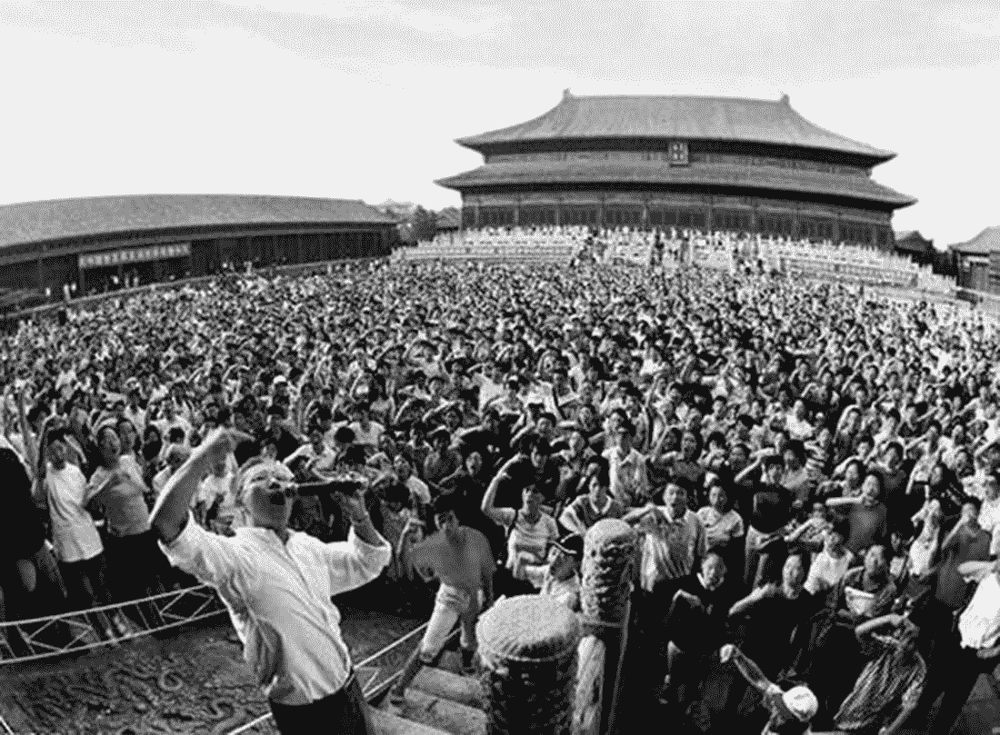

照片 8：故宫的疯狂英语大型讲座。2011 年 3 月 31 日检索自 [`www.ywenglish.com/dispnews.asp?id=17`](http://www.ywenglish.com/dispnews.asp?id%3D17)。

在意识形态上，在我易英语的论述中，英语被等同于“*国际*语言”，并始终与“炼金术的力量”（Kachru, 1986)联系在一起。一个很好的例子可以在我易执行官 Nathaniel Jones 在宣布北京奥运会语言培训供应商的新闻发布会演讲中找到：


> 奥运会是中国向世界传播中国人民友好与热情待客的机会，而学会用*访客的母语*来传达这一信息将产生截然不同的影响。对于 Aifly 来说，这是我们实现目标的无与伦比的机会和责任——*让中国的每一个人都能享受英语培训，让英语培训变得易于获得、有趣并改变生活。*
>> (2008 北京奥运会官方网站，2007a [添加斜体])

这篇演讲包含了若干假设，包括中国与“世界”的交流是针对“母语”为英语的访客的，而且如果中国学习者掌握了访客的“母语”，他们就能获得每个人都能平等获得的“改变生活”的资本。此外，演讲还暗示了通过 `Aifly` 的英语学习体验并非一个艰辛的故事，而是一种享受。不难想象，这样的话如何让许多在为国家服务的同时向往美好生活的奥运会志愿者激发了对精通英语的强烈渴望。爱国主义、符号资本获取与英语学习之间的交汇，不仅出现在官方语言培训服务供应商 `Aifly` 的话语中，也出现在奥运会英语推广活动中英语学习与教学（ELLT）名人的身上。在第 5 节)。奥运多语言服务中心和由 `CapInfo` 开发的多语言服务系统是北京为了履行这一承诺而采取的两种策略。

### 4.3.1 奥运多语言服务中心

作为中国领先的外语类大学，北京外国大学（`BFSU`）在奥运语言服务中发挥了至关重要的作用。`BFSU` 与北京奥运委会（`BOCOG`）国际联络部（`IRD`）在开幕式前一个月，即 7 月 7 日共同成立了北京奥运会多语言服务中心（`MSC`）。该中心旨在提供 44 种语言的“无障碍”口译和翻译，涵盖了奥运参与者使用的几乎所有语言，并为社区留下了遗产：作为一个 `BFSU` 继续提供语言服务并促进其多语言教学的永久机构。

`MSC` 运行了五项奥运语言服务计划，包括多语言交换机计划以及针对志愿者、翻译、语言服务场馆经理和观察者的特定计划。奥运多语言服务中心的人员主要来自 `BFSU`，包括 500 名志愿者学生、300 名志愿者教师以及付费专业人员。多语言交换机是一个借鉴自悉尼 2000 年奥运会的想法，专门为国际奥委会（`IOC`）和北京奥运委会官员、奥运运动员及代表设立。它提供 44 种语言的电话翻译，其中包括 10 种语言（英语、法语、俄语、德语、日语、阿拉伯语、西班牙语、葡萄牙语、意大利语和韩语）的全天热线，以及 34 种语言的 18 小时热线，甚至涵盖了一些少数语言，如冰岛语、辛哈拉语和豪萨语。交换机有助于解决比赛场馆、非比赛场馆和服务场所无法立即处理的现场语言障碍。例如，语言服务场馆经理（`LSVM`）脚注 12 被提供了不同语言的交换机卡。如果一名俄罗斯运动员遇到困难且在现场找不到俄中翻译，他/她可以寻找 `LSVM`。使用俄语类的电话卡，`LSVM` 会拨通说俄语的接员，由接员为 `LSVM` 和运动员提供口译。如果场馆工作人员或翻译遇到技术问题，也可以向 `LSVM` 寻求交换机帮助。约 300 名 `BFSU` 志愿者教师同国际学生担任多语言交换机的接员。在奥运会（2008 年 7 月 24 日日至 8 月 28 日）和残奥运会（8 月 30 日日至 9 月 16 日）期间，多语言交换机接收并处理了超过 3000 通电话：奥运会 2095 通，其中 471 通为西班牙语（占 22.5%），438 通为俄语（21%），424 通为法语（20.2%）；残奥运会 852 通（Wang and Zhang, 2008）。

在志愿者计划中，2500 名 `BFSU` 本科和研究生担任志愿者翻译，并部署在 31 个比赛场馆和若干非比赛场馆（Wang and Zhang, 2008）。其中，567 人担任奥运村助理（`OFA`）——负责 `IOC` 官员、VIP 以及世界各地奥运委会官员。他们主修 13 种外语：英语、法语、德语、西班牙语、葡萄牙语、意大利语、俄语、荷兰语、波兰语、阿拉伯语、日语、韩语和泰语。他们的客户包括 `IOC` 主席罗格、`IOC` 名誉主席萨马兰奇、前美国总统乔治·W·布什以及前德国总理哈哈尔德·施罗德格等。他们的工作包括语言协助、交通安排和日常行程协调。比赛期间，这些学生不仅护送客人前往比赛场馆、新闻发布会外交场合，还帮助他们及配偶处理日常生活——接送机、导游、医疗保健、法律问题等。在赛前，`BFSU` 对其学生以及来自其他大学和机构的志愿者进行了多次培训计划。`BFSU` 学生具备良好的语言能力，接受了关于文化、历史、经济、政治等相关问题的扩展培训。此外，作为北京奥运志愿者培训基地之一，该大学为近 30000 名志愿者提供了英语培训，并为 10000 多名志愿者司机举办了英语考试。此外，该大学还为北京奥运委会国际联络部培训了 609 名志愿者（其中 551 名来自 `BFSU`）（Wang and Zhang, 2008）。


翻译小组由奥林匹克新闻服务（ONS）团队和多语种应急响应小组组成。`ONS` 是组委会官方的消息发布渠道。`ONS` 的主要语言是英语。北京奥委会（`BOCOG`）国际关系部的语言服务处承担了将信息和新闻从英语翻译成中文和法语的任务。根据母语化翻译原则，法语翻译由外籍人员承担，中文翻译则由国内译译人员承担。

赛前信息的翻译任务包括：运动员、教练、裁判员、官员和马匹的传记；各国和地区奥林匹委员会的信息；历史成就（如奥林匹克历史上重大赛事的结果）；赛事、比赛和单项运动协会的背景信息；`IOC`、`BOCOG`、赞助商和文化活动的议程；新闻发布会议程；以及关于场馆、注册、住宿、交通和气象的信息。

赛期间新闻的翻译任务包括：赛事预告（赛前或活动前对主要赛事和每日比赛的分析和预测）；赛事回顾（赛后或活动后主要赛事和每日比赛的总结）；即兴演说（运动员和教练在赛后或活动后不久发表的演讲）；新闻发布会主要内容的摘要；选手扩展名单（主要体育赛事中运动员的信息，包括其传记）；媒体报道（与媒体采访相关的重要报道）；综合新闻（除上述规定类型外的涵盖奥运会相关重要活动的文章）；国际体育联合会的官方新闻；以及其他赛期间的新和部分赛前信息的更新。

多语种应急响应小组担任赛期前后语言服务的后备力量。其主要任务是在奥运会前后协助奥林家族，应对紧急和无计划的多语种翻译和口译需求。多语种应急响应小组为各场馆的新闻发布会、会议和引导活动等紧急语言需求提供专业口译服务，包括英语、法语、西班牙语、俄语、德语、日语、韩语、阿拉伯语和中文的同传和传译。应急口译任务应至少提前一天报小组，提供时间、地点、语言和人数等相关信息。应急响应小组的翻译服务主要涉及代表团长会议记录、`BOCOG`领导的重要文件和信函、新闻发布会的新稿的英语翻译。原则上，翻译要求超过 3000 字的任务需至少提前三天提交；超过 5000 字的任务需至少提前五天；超过 10000 字的任务需至少提前一周提交。

由于奥运期间各场馆对语言服务的需求巨大且管理难度大，实施了场馆语言服务经理计划，以协助语言服务管理，并为部分场馆的领导和 VIP 提供翻译口译服务。`BFSU`向每个场馆派遣了 24 名研究生（无论比赛场还是非比赛场）担任副语言服务经理。副语言服务经理属于相应的场馆团队，由语言服务经理直接领导，并在场馆接受适当培训。24 名副经理的工作时间、培训和服务内容因场馆而异。

除了成就外，也有值得反思和改进的领域。例如，英中口译员占中国所有译员的大多数，且在中国举办的重大国际活动中，英语往往成为默认语言。其他语言（包括`IOC`的另一种工作语言法语）在中文教育话语中均被视为小语种 `Xiao Yu Zhong` [minor languages]），因此在多语种服务的人员培训中未得到应关注。北京 2008 的多语种人才明显不足，导致某些体育赛事仅提供中英口译。在奥奥家族助理计划的 562 名`BFSU`志愿者中，415 名是英中口译，而只有 54 名志愿者主修法语（`Wang and Zhang, 2008`）。除英语和法语外的外语学生人数少得多。尽管`BFSU`翻译学院（`GSTI`）已开设多语种口译课程一年，但这些学生在赛期间参加`OFA Programme`时仍使用英语。例如，网球场馆由于多语种人员不足，仅配备了中英口译。这意味着所有外国教练和球员必须用英语听和回答问题。然而，其中一些人并不精通口语，导致了沟通障碍。因此，北京 2008 给中国带来了挑战，即在未来如何加强针对日益频繁的国际盛事的多语种服务。

### 4.3.2 技术支持的多语种服务


在之前的奥运会申办期间，智能多语言服务尚未出现，这种服务与人工完成的语言服务完全不同。2008 年北京奥运会通过中谱信息（CapInfo Company Ltd.）开发的`Multilingual Service System`实施了智能语言翻译服务。中谱信息是一家成立于 1998 年的国有 IT 公司，其核心使命是为北京的大型数字化项目提供数字服务。该公司曾是 2008 年北京奥运会申办活动的赞助商，也是奥运会网站的应用程序集成商，为`BOCOG`提供网络服务。中谱信息致力于通过其`Multilingual Service System`为 2008 年北京奥运会提供及时、便利、全面的多语言信息服务。中谱信息、科学技术部、北京市政府以及 2008 年奥运会科技委员会在五年内对语音识别、机器翻译、文本语音合成和应用软件进行了研究，共投入资 1.5 亿元人民币。`Multilingual Service System`通过整合语音识别、机器翻译、文本语音合成等技术实现了智能语言翻译服务。通过该系统，奥运会信息和城市信息以中文、英语、法语、俄语、西班牙语、日语、韩语和阿拉伯语等八种语言提供。观众、注册会员和游客可以通过北京奥运会官方网站、呼叫中心、手机、个人电脑和数字信息服务终端等应用终端（参见图 3

图 3：发布平台（城市中的语音和/或网络和/或终端）。

除了`Multilingual Service System`之外，另一种技术支持的语言服务也值得提及。在奥运会开始前，北京外国语（`BFSU`）的`GSTI`曾尝试为北京奥运会提供远程传译（Wang and Zhang, 2008）。`GSTI`与著名的视频通信产品制造商共同了将视频会议系统转换为专用口译设备的可行性。新设备将安装在`MSC`中并在奥运期间连接到多个场馆，使口译员能够留在`MSC`的同时为不同场馆的会议提供翻译服务。这一创新理念引起了`BOCOG`领导人的兴趣。当`BOCOG`主席刘奇先生考察`BFSU`时，他参加了`GSTI`关于操作翻译系统的演示并对其留下了深刻印象。尽管由于时间压力，该概念未能成为现实，但这次演示是一个很好的尝试，有利于口译服务技术进步的趋势。

## 5 五位英语学习与教学名人

除了官方的英语普及活动外，官方背书的模特英语学习者的名人效应是北京及中国其他地区英语传播的另一个重要且有影响的因素。人们从名人那里获取价值观和社会行为是大众媒体研究关注的问题。作为一种媒体现象，名人是由媒体创造并依赖公众关注的（Fraser and Brown, 2002）。另一方面，名人具有巨大的社会影响力。在媒体饱和的国家，“名人”和“成功”几乎成为同义词；因此，名人往往成为榜样，“其价值观、信仰和行为可能会被其影响范围内的其他人所采纳”（Fraser and Brown, 2002）。之前的研究（例如，Bandura, 1986;Basil, 1996;Fraser and Brown, 2002）表明，认同是名人效应的中介。认同是一种社会影响过程，个人通过这一过程采用名人的价值观和行为（Fraser and Brown, 2002，p. 187）。Bandura (1986)发现，认同某个名人的人更有可能采取名人所展示出的行为。在本节中，我想借用“名人”概念来解释名人认同如何导致人们认同英语学习与教学（ELLT）名人的价值观并模仿他们的学习行为。

正如英语精通被视为国家进一步发展的基石一样，它也被视为个体的宝贵资产。中国的英语热现象产生了许多名人，他们在英语学习与教学中发挥了模范作用。在本研究中，“ELLT 名人”是指因其英语学习成就而成名，并通过大众媒体的高频曝光而成为广泛认可的英语学习榜样的普通中国公民。当北京奥运会筹备工作全面展开时，两位英语学习者被赋予了官方英语学习榜样的角色，并通过媒体的广泛关注获得了名人地位：“疯狂英语”创始人李强和多语种警察刘文民。通过广播、电视、印刷媒体和互联网的广泛覆盖，他们都获得了大量的追随者。他们的“成功故事”在媒体上被广泛报道，并被作激励更多人学习英语的工具。正如下文将讨论的，李强和刘文民都受益于奥运英语普及活动，成功地将英语的符号资本转化为生活中的社会经济资本。

### 5.1 “疯狂英语”创始人李强：将英语学习作为一种爱国行为


李洋是`疯狂英语`的创始人，这是一种在中国广受欢迎但极具争议的英语学习方法。早在北京奥运会之前，他已经是英语外语教学（ELLT）领域的名人。作为中国成功的英语学习者和英语培训巨头，他可能位居中国英语学习界名人榜之首，并对民众的英语学习实践和欲望产生了巨大的影响。

李洋出生于 1969 年，在兰州大学学习机械工程专业时，他正面临着通过大学英语考试的需求。这促使他开发了所谓的“语言攻破解系统”——`疯狂英语` (CRIENGLISH, 2007)。李洋仅用了几年时间就放弃了机械工程，将他激进的方法变成了中国最著名的英语培训品牌之一，以及一项价值数百万元的业务。

`疯狂英语`的方法依赖三个核心原则：“越大越好”、“越快越好”和“越清晰越好” (Bolton, 2002, p. 195)。在`疯狂英语`的课程中，李洋鼓励学生大声、快速、反复地喊出励志英语表达，并配合强调发音的手势。`疯狂英语`方法的核心信念是，这些练习对于打破中国学习者面临的共同障碍——即对“丢面子”的恐惧具有作用。这是中国英语学习者在与“英语母语者”交流时自我感知的一种障碍 (Woodward, 2008, p. 28)。

“对于害羞和内向的亚洲人来说，这是一种新方法，”李洋宣布道，“我的方法可以很快给人信心。我试图为普通人简化英语。因为这些内容，我成为了中国年轻人的偶像和名人” (Independent News, 2009)。在许多公开场合中，李洋谈到了自己早年掌握英语的困难，敦促他的追随者学习他自我提升的榜样，并告诫观众大量朗读英语口号，如“我享受丢面子！”、“欢迎挫折！”、“乐于痛苦！”和“追求成功！” (Bolton, 2002, p. 195)。在一部由张元制作并执导的关于`疯狂英语`的中国纪录片开头，听到的一段广播节目中，李洋这样解释了他的成功理论：

> 你们好！我叫李洋。这听起来可能很奇怪。有人问我是否虚构了我的苦难。我的父母、同学和老师都会证明我曾缺乏自信。我不知道该何去何从。我有自卑心理，觉得自己很无知。我觉得自己什么也做不到。我总是告诉自己要下决心：明天开始！明天开始！每个人都想成功，我想成为一个榜样。我的疯狂英语包含了许多生活和成功的哲学……钱不再是问题。一天之内，我可以赚到 2 到 3 万，3 到 4 万。那个时代已经过去了。我已经进入了另一个阶段。一旦我成就了某些事，它就会变得乏味。我想我找到了更大的目标。向成千上万的人讲述我的奋斗过程。每个人都要做好自己的工作。因为中国人缺乏自信。中国人需要埋头苦干。

> （李洋英语自我介绍的摘录，引自 Bolton, 2002, p. 195）

李洋将自己塑造成一个征服者，试图在他自己的成功故事与观众的欲望和野心之间建立联系。在这个个人成就的典型故事中，他将自己从一个“缺乏自信”、“有自卑心理”且“觉得自己什么也做不到”的无名之辈，变成了一个“钱不再是问题”的名人，而且事实上，由于他现在正在追求金钱之外的“更大的目标”，金钱甚至不再重要。

在他的传达中，英语作为成功和自我转型的内在方面的价值被强调并被视为理所当然。在李洋的课程中，英语变成了某种魔术棒，让追随者能够实现通常被认为普通中国人无法触及的成功，例如“赚国际钱”。例如，在一次给清华大学学生的讲座中，他告诉观众，在索尼等公司在日本教英语，每小时可以赚 30,000 美元 (Bolton, 2002)。在李洋的论述中，英语水平始终与成就、自信、自我价值、快乐、金钱和成功联系在一起。

通过鼓励自信并通过其“白手起家”的叙事承诺物质回报，`疯狂英语`方法激发了数百万中国人的强烈渴望。尽管有这些辞藻，但该方法的教学效果受到了质疑，正如在第 5 章中所讨论的（参见 [Woodward, 2008]）。与其他英语教学名人相比，李洋声称他在推广英语方面已经“进入了另一个阶段”——在这个阶段，英语学习不仅是自我转化的手段，更是中国爱国主义的一个方面。`疯狂英语`的哲学包含了“锐且专注的民族主义” (Bolton, 2002, p. 196)，这可以用李洋的个人格言来体现：“激发爱国主义热情，弘扬民族精神；攻克英语，振兴中华” (Wikipedia, 2009)。

李洋认为学习英语是提升中国世界地位最重要的步骤之一。李洋在中国畅销百万的书总是包含爱国主义口号（参见照片 9），如“攻克英语，让中国更强大！”、“帮助 3 亿中国人说好英语”以及“让中国声音响彻全球” (Independent News, 2009)。“我希望[中国人]能使用英语并将汉语作为世界语言……精通英语并因此富强国家是爱国主义的行为”（Yamane, 2005 引自 Woodward, 2008, p. 34)。


照片 9：李洋疯狂英语海报。检索于 2011 年 3 月 31 日，`http://www.bjcrazyenglish.com/](http://www.bjcrazyenglish.com/)。


`疯狂英语`哲学中主张为了国家利益而学习英语的理念，源于 1861 年至 1894 年间在中国逐渐兴起的洋务运动（`yangwu yundong`）口号：“师夷长技以制夷 `Shiyi changji yi zhiyi` [学习西方的先进技术以对抗西夷]。”这一理念成为晚清时期学习西方运动的主要源。李刚在自己的讲座中引用这一口号，他经常敦促学生出国学习西方知识，并将知识和经验带回服务中国。李刚的`疯狂英语`哲学完美契合儒家关于学习功能的二元对立：西方学用于“用 `yong` [外部实用]，中国学用于“体 `ti` [内在本质]。“中学为体；西学为用 `zhongxue wei ti; xixue wei yong` [中国学为体，西方学为用]”的原则基于一种信念：西方学（当然包括外国语言，主要是英语）可以为了实用目的而引入，而不涉及其文化本质，因此中国的文化本质可以通过中国学得以完好保留 (Gao, 2009, p. 63)。

李刚的`疯狂英语`哲学与北京奥运会的社会政治背景非常契合，并使他在奥运期间获得了巨大的声望。2005 年，中国国家体育总局任命李刚为“国家队运动员总教练”。次年，他被北京奥奥委会（BOCOG）任命为“奥运大使”以及“150 万名奥运志愿者总教练”，并被北京市政府奥运备战工作小组聘为专家顾问。作为奥运志愿者的总教练和`疯狂英语`运动的创始人，李刚被描述为一位爱国教师。在奥运会前李刚的一次大型英语讲座上，超过 20,000 名大学生情绪激昂地跟着他反复朗诵道：“我要让我的国家感到自豪！” (Aifly Education Technology Company, 2007b)。通过与北京奥运组织者的积极合作，李刚作为英语学习者教学（ELLT）名人的地位不断提升，他的英语教学哲学也获得了合法性。从一个普通人跃升为社会英雄，他通过英语实现了个人自我的蜕变。对于数百万认同李刚的北京人和中国中国人来说，学习英语是为了 2008 年奥运会的成功和中华民族的发展而采取的爱国行为。李刚的明星效应不仅促进了他自己英语教学业务的快速扩张，还提升了英语在中国作为一种宝贵资产的象征意义，从而引发了人们对英语日益增长的渴望。

### 5.2 多语言警察刘文立：作为赋能的英语学习

与在北京奥运会之前就已经成为中国名人的李刚不同，警察刘文立为了备战奥运自学了 13 种外语，他更像是一个即红的英语学习名人，其名声直接植根于中国的奥运英语热潮。刘文立出生于 1967 年， 20 世纪 90 年代在北京郊区派出所担任勤务人员时开始学习英语。1995 年，联合国在北京召开第四次世界妇女大会。刘文立在会议期间在公共安全前线工作。一次失败的跨文化交流激励了他学习英语，并成为“第一位说英语的警察” (Li, 2008)。作为一个仅有高中学历的成年英语学习者，刘文立通过背诵英语单词和表达来自学英语，在英语角与其他中国学习者一起练习英语，并在街上与他遇到的每一个外国人建立交谈 (Li, 2008)。刘文立认为“重复”是最好的外语学习方法：“在语言学习中没有比重复更聪明的方法了。在过去的 13 年里，我一直这么做” (Cao, 2008)。

北京在 2001 年成功申奥引发了中国首都各行业英语学习的热潮。经过六年的刻苦学习，刘文立的英语水平有了大大提高。2001 年，北京市公安局举行了英语口语比赛以促进英语学习。当时仍只是北京郊区派出所勤务人员的刘文立赢得了比赛。不久后，刘文立被树立英语学习的官方模范（见照片 10），并在 2002 年被派往北京市区的一个重要旅游景点。刘文立在一次电视采访中描述自己为“窗口岗位的窗口警察 [a model policeman at a model service post]”，他的职责是展示北京的新形象而不是而不是捕罪犯 (BTV, 2008)。

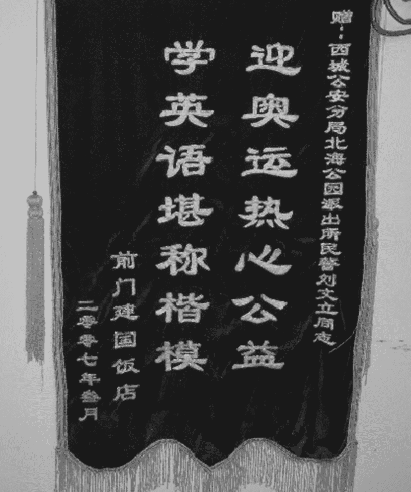

照片 10：横幅写着：“献身公益与奥运；树立学英语好典型。”检索于 2010 年 3 月 20 日，来自 [`bjliuwenli.blog.sohu.com`](http://bjliuwenli.blog.sohu.com)。

这次表扬让刘文立意识到在北京奥运背景下学习外语的物质价值和象征价值。因此，刘文立继续学习不同水平的法语、德语等十种外语。刘警察因语言能力闻名，被奥奥委会选为 2004 年雅典奥运会火炬传递和 2008 年北京奥运会火炬传递的两次火炬手。刘警察的成功故事通过电视、广播和报纸得到了广泛报道，包括 BBC、CNN、路透社、NHK、CCTV、BTV、中国国际广播电台、中国日报和日报在内的国内外媒体。许多主流互联网媒体机构，如新浪、搜狐、163.com 和 CCTV.com，都为刘警察创建了官方博客。在一些媒体报道中，刘文立被叙述性地塑造为一个平民英雄，一个以勇敢行为或卓越成就和高尚道德闻名的人：例如，“语言学家警察”、“英语专家”、“自律且坚毅的人”。

尽管刘警察没有像李刚那样以英语教学帝国的形式积累财富，但他非常自己英语的符号资本以及他在中国英语培训市场中的明星地位。在一次采访中，刘文立告诉《武汉晚间报》（(Li, 2008)，他面临着巨大的商业机会。


[刘文立：6 年后我就 48 岁了。到那时，我可能在工作 30 年后退休。届时，我将开设英语俱乐部部和英语培训班，成为名人代言。简而言之，我身上蕴含着巨大的商机！]

在史无未有的奥运英语热潮推动下，警察刘文立在北京奥运会的背景下，成功地将英语这一语言资本转化为了社会、经济和其他符号资本。用刘文立的话说，英语和奥运改变了他的生活（Li, 2008）。在北京获得申办奥运会后，他开始向社区内的居民教授英语。刘秀英就是其中之一：“他是我们学习的榜样。为了更好地帮助外宾，大家都在努力学习英语。刘老师的勤奋激励了我们，现在大家都在努力工作”（Cao, 2008）。陈桂颖在刘文立所在的社区经营一家自行车店：“刘文立帮我做了一个双语标牌。那是社区里的第一个。当然，为了方便奥运游客，更多的商店也效仿了这种做法”（Cao, 2008）。通过广泛的媒体宣传，刘文立在中国拥有了一大批追随者和粉丝。许多没有受过高等教育但渴望美好生活的中国成年英语非英语（EFL）学习者对他产生了强烈的认同，并将他视为应当学习和效法的榜样。

除了奥运英语普及运动外，官方认可的英语学习教学（ELLT）名人也是北京及中国其他地区英语传播的另一个重要且具有影响力的因素。这两位 ELLT 名人`Crazy English`的创始人李刚和多语种警察刘文立，被赋予了官方英语学习榜样的角色，并受到媒体的广泛关注而获得了名人地位。通过身份认同，他们对将学习英语视为一种爱国主义行为和自我转型的中国学习者产生了巨大影响。Bourdieu (1991, p. 19) 认为，语言资本的分配与其他形式资本（社会、经济、文化和符号资本）的分配存在特定的联系，这些资本定义了个人在社会空间中的位置。英语备受推的符号价值并非完全从外部强加的，更多是在现代中国社会内部构建、强化和流的。像李刚和刘文立这样的 ELLT 名人都是当代中国社会的产物，在这个社会中，英语被高度重视并资本化。在中国英语培训市场中拥有利益的 ELLT 名人，在放大英语语言资本以及在中国社会中传播英语欲望方面具有强大的力量。迄今为止，极少有研究探索名人在促进大众群体语言意识形态方面的作用，而这种意识形态最终塑造了行为（Fraser and Brown, 2002）。Braudy (1986) 认为我们忽略了名人在塑造社会价值观方面的重要性。在研究中国等扩展圈国家英语热这一显著现象时，我们需要更好地了解那些在经济或社会上被边缘化的人以及感到无力的人，是如何对 ELLT 名人产生认同的，以及他们是否模仿他们建立自己的英语学习价值观和行为。

## 6 总结


在像中国这样的集权制国家，语言政策的决策由中央当局做出，并由政治实体自上而下地实施，由于大多数地方政府、学校和教师都顺从，这种做法的阻力通常有限。这些政策随后通过教学实践、考试制度和语言景观得到了强化。在语言政策的制定和实施过程中，个人或群体隶属于国家利益，他们的语言选择并非自由的，而是在预定义的备选方案之间做出的，事实上，他们的权利受到了限制（Tollefson, 1991）。本章明确阐述了北京办委会（代表中国中央政府）对外语水平（主要是英语）的认知，认为这是 2008 年奥运会成功的关键因素，并详细介绍了 `BSFLP` 组委会为了改善北京举办奥运会期间的语言环境所采取的多种语言规划策略。此外，文中还描述了 `BSFLP`、`BETS`、私人语言培训机构、技术支持的语言服务以及英语学习教学明星在实现政府语言规划目标中的作用。服务于北京奥运会的外语政策（以英语普及为中心）是在集权体制下以自上而下的方式制定的。也就是说，当局组织了相关政府部门（例如北京市人民政府外事办）和一个咨询小组（由 35 名国内外外语教育专家组成）参与政策制定，但并没有考虑到社会基层部门的意见和需求，特别是那些对员工有外语需求的公司、组织和机构。根据实证数据，我在官方话语中识别出几种意识形态假设——即：母语者主义、英语的炼金术、英语作为改变命运的资本、为了`用`（外部效）而学英语、将学英语视为爱国主义行为，以及母语者交流者的想象社区——这些假设误读了作为国际语言的英语使用者不断变化的社会语言现实。在奥运会外语普及运动中赋予英语的地位和价值反映了 21 世纪初中国英语教育政策的总体趋势。`ELT` 被推为一种“自然、中立且有益”的东西，旨在维持经济发展并增强国际竞争力。在官方话语中，英语水平被描述为现代化进程的催化剂、所谓的国际化载体，以及确保奥运会成功的有效保障，最终将造福中国社会的各个层面。中国人，尤其是北京市民，被敦促通过学习英语获得个人成功，并为主办城市及国家的发展做出贡献。除了英语已有的教育、职业、经济和符号价值外，在北京奥运会的背景下，学习英语实际上已变成了一种爱国主义行为。在官方话语中，英语被用作构建中国作为一个和谐发展的现代民族国家身份、北京作为一个国际奥会之城身份，以及中国学习者作为爱国全球公民身份的关键匙。通过强调英语教育对于培养爱国主义和促进中国文化的必要性，中国政府希望对英语保持中立和工具主义的视角，并将英语的学与视为中国学习者巩固其本土文化认同的机会。可以认为，关于忠诚、爱国主义、群体成员身份和集体身份的宣传和意识形态是国家用于维持控制和促进其社会、政治和经济议程的策略。然而，这些在奥运外语普及运动中盛行的官方话语需要经过批判性的审查，而不应被视为绝对真理。[Fairclough (1989)] 认为，话语在通过许可行使意识形态控制方面发挥着特别重要的作用。中国的英语教育政策是国家根据其政治和经济利益分配英语地位和功能的结果，`ELT` 的标准和目的也被国家及其机构操纵，以满足国家发展的需要。至关重要的一点是，全球语言市场上英语的价值和意义并非固定且普遍的。嵌入这些话语中的英语意识形态，最好被理解为北京奥运会背景下的局部、社会和政治的建构。在第 5 章中，我将讨论为什么以及如何学习英语可能对所有中国学习者都没有回报。后续章节还将更详细讨论各种语言服务措施的影响以及对北京语言环境的评估。

# 第 5 章 评估北京的外语环境

## 1 评估北京外语口人口

### 1.1 北京外语人口总数


到 2008 年，在北京实现 500 万外语口语人口的目标已成为“北京市国际外语能力提升行动计划”（BSFLP）工作的重点。BSFLP 组委会声称，会说外语的人数已从 2002 年的 312 万增加到 2008 年的 550 万（Deng, 2009），完成了《2003–2008 年北京市国际外语能力提升行动计划》中关于建设北京“国际语言环境”的目标。然而，外语口语人口的规模实际上取决于如何定义它。在《北京语言环境后续调查与分析报告》（中共北京市市委外事领导小组等，2008 年）中，“外语口语人口”被定义为那些至少能读懂简单的外语文章、以及能够用外语进行简单交流的人。

报告解释说，“外语口语人口”包括初中及以上学历，且通过了特定外语水平考试或在自评中至少达到外语低中级水平的人员¹³。2007 年北京的常住人口为 1581 万（北京市统计局，2007 年）。根据官方定义，2007 年底北京外语口语人口规模为 534 万，占常住人口的 35%，比 2002 年同期的总数显著增长了 12.4%（见图 4）。其中，18 岁及以上人员有 454.6 万，18 岁以下人员 98.8 万。报告解释说，18 岁以下的外语口语人口规模是通过汇总《2006 学年各种学历学生人数统计》中列出的职业中专、技校、普通中学、初中、高中以及部分小学的学生总数估算出来的。具体而言，职业高中专有 7.7 万名学生，技校 5.2 万名，技中专 11 万名，成人中专 1.1 万名，初中 28.8 万名，高中 25.9 万名，以及该市的 18.9 万小学生。报告声称，小学学生中有五之二（原文为 two fifths*）被包含在京的外语人口中，因为近年来小学生的外语水平有了很大提高。显然，对“外语口语人口”的官方定义和计算存在问题。鉴于中国的考试导向教育长期以来被批评为培养了许多“聋哑式英语学习者”，如果认为任何受过初中教育（更不用说小学教育）或通过了特定外语水平考试的人都能自动认定为“外语口语者”，并因此能够用外语进行有效的跨文化交流，那就太过于乐观了。

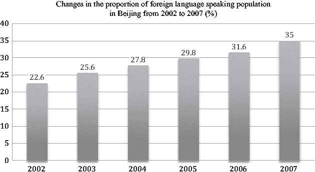

图 4：2002 年至 2007 年北京“外语口语人口”占比的变化。

### 1.2 北京外语口语人口的不同水平

BSFLP 组委会将北京的英语口语人口分为低中级、中高级和高级三个水平。在 2007 年北京 553.4 万外语口语人口中，有 298.3 万人处于外语低中级级水平，171 万人处于中高级水平，84.1 万人处于高级水平，占比分别为 53.9%、30.9%和 15.2%（见图 5）。对这些数字的计算方法进行细致分析可以发现许多问题。例如，报告声称有 53 万 18 岁以下的低中级外语口语者。这一数字是通过加 2007 年初中学和技校的学生人数得出的。同样，18 岁以下的中高级外语口语者有 45.8 万，这是通过加 2007 年高中、职业学校和技中专的学生人数得到的。这种计算方法将个人的外语能力与其学历自动挂钩，并忽略了外语能力的个体差异，因此缺乏效性。

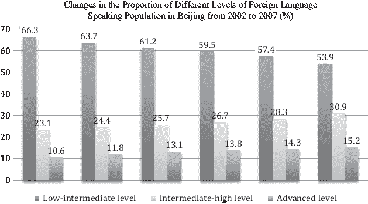

图 5：2002 年至 2007 年北京官方认定的“外语口语人口”不同水平比例的变化。

### 1.3 北京外语口语人口的语言分布

根据官方报告（中共北京市市委外事领导小组等，2008 年），北京官方认定的外语口语人口中有 74.2%一生中只学过一种外语，该群体中有 90.5%学过英语。在奥运会之前，英语是北京学习最广泛的语言。在北京 18 岁以上的英语学习者中，18.7%参加过国内或国际标准化英语考试。其中，10.8%通过了大学英语四级考试（CET-4`），3.1%通过了大学英语六级考试`CET-6`）。大部分通过六级的人是受过大学及以上教育的 18-34 岁居民。此外，21.2%的人学过俄语。俄语学习者主要是中老年人，对该语言的掌握和应用水平较低。日语是最受欢迎的第二语。此外，北京还有学习法语、韩语、德语和西班牙语等其他语言的人。这些语言在中国被归为“少数语种”或冷门语言（LCTLs）。

尽管该计划增加了对少数外语（LOTE）教学的关注，但对北京市民英语教学的强调更加加强。官方观点认为，在各种职业、商业、工作场所和企业中拥有大量英语使用者，对于北京奥运会的成功以及中国在全球化时代的持续发展至关重要。作为奥运英语推广活动的积极组织者和参与者，林林¹⁴（马拉松赛事语言经理）在访谈中证实，中国政府在推广英语方面的投入大于任何其他语言。根据林林的说法，英语在中国拥有极高的地位，以至于“外语”一词在公共话语中通常等同于“英语”。


-   [孙林：（……）在大多数情况下，例如，呃，当我说“提高公众英语外语水平”时，我指的是英语。当我谈到社区居民和服务行业人员，呃，如交通部门和银行的人员的外语学习时也是如此，我的意思是大多数时候指的是学习英语。在对外语方面，许多像我这样的中国学习者对英语都有一定的基础。我们没有多少机会使用[其他外语，如]法语和西班牙语。此外，我们对这些语言的了解非常匮乏。（2008-09-19）]

官方认定的外语口语人口规模不足以证明北京已实现“国际语言环境”。对于北京当局声称在 2008 年奥运会成功构建的“国际语言环境”，对其进行充分的解释应当考虑到长期外籍人士和奥运会访客的社会语言结构。2008 年，在京居住超过六个月的外国人有 11 万人，其中大多数并非来自英语国家，而是来自韩国（Xu, 2009）。这一长期外籍人士人数占北京总人口的 0.6%。有人认为，居住在城市的外国人人数是判断该城市国际水平的重要指标（Xu, 2009）。与伦敦和纽约等其他其他大都市相比，后者的外国人分别占人口的 30%和 15.6%（Xu, 2009），北京人口的国际化比例较低。`2009 年北京统计统计年鉴`（Beijing Municipal Bureau of Statistics, 2009）显示，2008 年北京在京注册国际学生有 31,712 名。他们的主要来源国是日本和韩国，其次是美国。

访问北京的国际游客也影响着城市的“国际语言环境”。根据北京市统计局（2008）的数据，2007 年有 380 多万外国游客访问北京。这些游客来自不同的语言背景，其中两个邻近亚洲国家日本和韩国占了总数的四分之一。2008 年，北京奥运会并未给举办城市的国际旅游经济带来益处。根据北京市旅游局（2008）](#chapter.xhtml_b_9781614514954-010_ref_030）发布的数据，北京在 2008 年 8 月接待了 35.6 万海外游客，与去年同期相比下降了 4.1%。开会前的一个月（7 月），赴京的国际游客人数骤降，比去年下降 30%。奥运会后一个月（9 月），旅游低迷持续，国际游客人数下降了 20%以上。[表 4]显示了 2008 年 8 月访问北京的前十大游客来源国。与去年同期相比，来自四个核心圈英语国家（美国、英国、澳大利亚和加拿大）的游客人数在 2008 年 8 月显著增加，占入境游客总数的 33.58%。相此相反，来自六个主要非英语国家游客来源国（日本、韩国、俄罗斯、德国、法国和西班牙）的游客人数不等程度地下降。除了奥运期间签证限制的影响外，另一种可能的解释是非英语母语者可能因为觉得自己被排除在奥运会之外而望而远之。尽管奥运会期间非英语国家游客总数有所下降，但不可忽视的是，奥运访客仍然来自不同的语言背景。在对外语推广活动中忽视国际访客这种多元的语言背景，并赋予英语优于其他语言的地位，可能会产生各种语言障碍。事实上，北京奥运会组委会（Official Website of the Beijing 2008 Olympic Games, 2007）证实，北京将缺乏高级英语人才、多语种者以及英语其他外语的人才。

表 4：2008 年 8 月访问北京的前十大游客来源国。

| 来源国 | 官方语言 | 人数 | 增长百分比 |
| --- | --- | --- | --- |
| 外国游客总量 | | 356,000 | −4.1 |
| **1\. 美国** | **英语** | **68,304** | **37.76** |
| 2\. 日本 | 日语 | 40,652 | −27.28 |
| **3\. 英国** | **英语** | **25,015** | **44.93** |
| 4\. 韩国 | 韩语 | 18,941 | −58.92 |
| 5\. 俄罗斯 | 俄语 | 17,067 | −25.00 |
| 6\. 德国 | 德语 | 15,332 | −5.56 |
| 7\. 法国 | 法语 | 14,216 | −17.20 |
| **8\. 澳大利亚** | **英语** | **14,912** | **37.68** |
| **9\. 加拿大** | **英语、法语** | **11,324** | **19.10** |
| 10\. 西班牙 | 西班牙语 | 6,837 | −48.32 |

在中国话语中将“英语”等同于“外语”或“国际语言”的概念（正如孙林在 1.3 节关于全球化对日本外语教育影响的研究中，她指出将“外语”等同于“英语”反映了一种将英语的全球传播合法化为自然、中立且有益的的话语（Pennycook, 1994），以及一种将英语提升到“奇妙语言”地位的殖民主义话语（Pennycook, 1998）[第 20 页）。将英语与外语等同导致了人们认为，英语是中国等“扩展圈”国家与语言和文化多元的全球社区进行交流的唯一可行语言选择，这有助于维持当今世界英语持续的主导地位。此外，赋予英语优于其他语言的优越性可能会让人忽视当地和全球社区的语言和文化多样性。尽管英语是国际旅游和交流的主导语言，但良好的国际语言环境应当适应中国所处的当地文化和语言多样性。

## 2 评估奥运外语推广

### 2.1 北京市民对外语学习的动机


语言学习中的动机研究在西方从社会心理学角度已经非常成熟（例如：Brophy, 1999; Dörnyei 2005; Dörnyei and Ushioda, 2009; Eccles and Wigfield, 2002; Gardner, 1985)）。在本书中，我借鉴了 Ryan 和 Dec（2000）对内在动机和外在动机的分类来理解北京市民学习外语的原因和需求。内在动机行为是为了本身（例如对活动本身的快乐、乐趣和兴趣）而被激活和维持的，而外在动机行为是为了“可分离”的结果而被激活和维持的。根据数海市场调查公司发布的官方报告（北京市市委外事工作领导小组等，2008 年），尽管有 75.9%的受访者有学习外语的动机，但只有 7.7%的人声称外语在他们的工作和生活中很重要，只有 5.1%的人出于兴趣的内在动机学习外语（见图 6）。大多数受访者表示他们学习外语是外在动机：37.9%的人希望学习外语是为了为北京奥运会做贡献，25.5%的人学习外语是为了其在中国正式语言市场入学和就业的实用价值。然而，仍有 23.8%的受访者声称他们没有学习任何外语的动机。在该类人中，18.8%的人觉得外语对他们完全没有用，5%由于各种原因被迫学习外语。

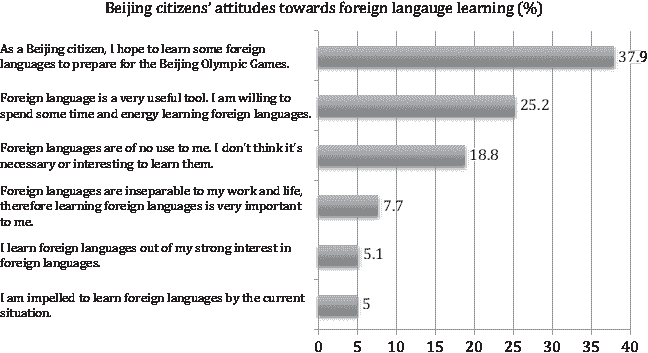

图 6：北京市民对外语学习的态度。

### 2.2 “北京说外语”计划的成果

为了在备奥期间普及并提高北京市民的外语水平，北京外国语推广委员会（BSFLP）为北京市民组织了一系列外语普及活动，如英语电视比赛、英语演讲比赛、外语歌曲电视比赛以及在王府井外语书店举办系列讲座（见表 5）。根据报告（北京市市委外事工作领导小组等，2008 年），63.4%的市民听说过这些活动。尽管在让北京市民参与各种外语学习活动方面付出了巨大努力，但市民参与这些活动的意愿并不强烈（见图 7）。在 42.8%对中文唱外语比赛感兴趣的受访者之外，只有 20%的人对参加 BSFLP 组织的任何其他外语活动感兴趣。在奥运会准备期间，BSFLP 的行动包括：

表 5：BSFLP 的外语普及活动。

| 序号 | 活动 |
| :--- | :--- |
| 1 | 在校园举办了一系列“你好世界”多语活动——北京中学生法语比赛 |
| 2 | 举行了“北京餐饮业菜单英语翻译”评审会议 |
| 3 | 每月在北京各大学举办一系列关于 BETS（北京英语译考试）的公开讲座 |
| 4 | 每月为北京市民举办一系列“学外语迎奥会”公开讲座 |
| 5 | 向社区居民发放免费（试用版）英语报`English lovers` |
| 6 | 在奥运会倒计时 500 天期间，英语志愿者为出租车司机提供外语（英语）课程 |
| 7 | 每月在书店为北京市民举办一系列关于 BSFLP 的公开讲座 |
| 8 | 成立了公共英语标识工作组，并定期检查英语路牌 |
| 9 | 在王府井步行街开展“让青春点亮五环，自愿奉献奥运”活动，从北京市政府机构招募志愿者 |
| 10 | 为志愿者提供英语标识培训课程 |
| 11 | 在朝阳公园举办了 2007 年安利——北京市民外语活动周 |
| 12 | 与北京电视台联合举办“我是英雄”英语大赛 |
| 13 | 吸引了近 10,000 名中学生参加“第六届北京市小学生英语比赛” |
| 14 | 组织各行业、区、县对全市公共场所英语标识进行检查和纠正 |
| 15 | 在奥运会倒计时 400 天期间为市民开展了多语问候在线学习活动 |
| 16 | 开展了“庆祝奥运周年，争做奥运双语记者”的大规模双语主题活动 |
| 17 | 组织全市中学生参加北京“新东方杯中学生英语比赛”决赛 |
| 18 | 组织全市 18 区县参加“第三届北京家庭英语大赛” |
| 19 | 在北京工人宫举办了“第六届北京市民外语博览会”。近万名市民、数十外外语机构以及国内外媒体参与了活动。同时，成功启动了“2007 世界语言挑战赛”，并在博览会上评出了“优秀外语交流社区”。 |

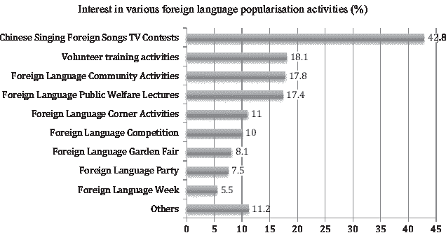

图 7：对各种外语普及活动的兴趣。

### 2.3 奥运外语培训的成果

根据官方报告（北京市市委外事工作领导小组等，2008 年），2007 年有 33.1%的市民参加了外语学习活动，主要通过自学教材或参加工作场所和社会组织的的外语学习活动。与 2006 年相比，外语学习的重点继续从听转向说。北京市民学习外语的主要困难是缺乏语言环境和时间不足，导致许多人在坚持学习外语方面遇到问题。此外，50.6%外语水平低的受访者表示，他们在学习外语基础知识存在困难，或者不知道合适的学习方法。


参加奥运会让许多中国人，尤其是那些积极参与奥运会筹备和举办的人，首次获得了在真实的跨文化互动中使用英语的机会。奥运志愿者司机`华 Shuo` 在接受我的采访时承认，与外国人练习英语的愿望是他担任奥运志愿者的主要动力。然而，对于许多参与奥运会筹备的北京市民来说，接受官方英语培训并不能保证他们梦以求的英语水平和跨文化交流能力。

以奥运志愿者的英语培训为例，尽管 `Aifly` 声称其已完成了对 10 万名奥运志愿者的培训任务，但实际的参与率和效果并不如所声明的那好。在许多情况下，招募奥运志愿者时，`CET-4` 和 `CET-6` 证书被视为英语水平的充分证明，因此只有持有关键管理职位的人被分配参加官方英语培训。在 28 名接受访谈的奥运志愿者中，只有两人参加了 `Aifly` 提供的奥运会英语培训。这两位受访者均认为 `Aifly` 的英语培训没有效果。

来自清华大学的媒体服务志愿者赵晨对 `Aifly` 的培训结果表示了不满。根据他自己的经历，赵晨发现，参加了几个小时的 `Crazy English` 大众演讲后，他的英语水平并没有提高，而这正是 `Aifly` 在培训奥运志愿者和服务部门人员时所采用的教学方法。奥运志愿者 `Chen Zheng` 也表达了类似的不满情绪，她是国际青年营大活动组户外文化艺术活动的协调助理。她在赛前与另外 1000 名志愿者（主要从北京各高校大学中选拔出来）一起，参加了为期七天的 `Aifly` 沉浸式训练营。在为七天的密集英语培训期间，`Chen Zheng` 和其他营成员需要进行大量的英语发音（配合手势）和背诵练习。她说，培训让她意识到了英语发音上的“缺点”以及缺乏背诵练习，但她否认英语在培训后真的得到了提高。

`Zhang Jie`: 你觉得参加这个英语培训营对你的英语有很大提高吗？
[``Zhang Jie`: Do you think your English proficiency has been greatly improved after attending this English training camp?`]

`Chen Zheng`: 显然没有。但是［通过此次培训］确实能让自己认识我们在学英语的时候有什么样的不足,以后注意。但是说在七天里面有很大的提高也不太现实。
[``Chen Zheng`: Certainly not. [Through the training] I did recognise my shortcomings in learning English. [I will] pay attention to them afterwards. However, it is not realistic to say my English has been greatly improved within seven days.]`

`Zhang Jie`: 你通过培训看到了哪些学习方面的不足？
[``Zhang Jie`: What are the shortcomings that you recognised through the training?]

`Chen Zheng`: 主要就是发音上的一些问题。还有就是以前我在学英语的过程中不太背东西。然后他就每天让我们背、背、背,每天背完这个背那个,一天到晚就是背, 他认为你背下来自然就会说了。
[``Chen Zheng`: Primarily, I have some problems with [English] pronunciation. And … I seldom recited when I was studying English. And then … he (the class lecturer) asked us to recite and recite and recite every day. We recited one thing after another. We’ve been reciting all day long. He believes that the more we recite the more naturally we can speak [in English] (21-09-2008)]`

根据 `BSFLP` 组委会的要求（详情请见第 4 章第 2.4 节），为 8 万名北京出租车司机安排了自愿英语班和英语水平测试。官方要求北京出租车司机必须通过英语水平测试才能保留其执照。一些统计数据显示，到 2008 年奥运会开幕时，北京出租车司机平均接受了 52 节英语培训（`Jia, 2007`）。然而，由于大多数北京出租车司机英语很少，且许多人缺席了英语课，出租车培训课程并没有发挥有效作用（`Associated Press, 2007`）。2008 年北京奥运期间执岗几乎所有的北京出租车司机在培训课程后都通过了指定的英语测试。尽管如此，通过水平测试让这些北京出租车司机在纸面上变成了官方认可的“英语口语者”，但实际上并没有赋予他们交流能力。据报道，实际上他们大多数人在实践中无法使用英语（`Xinhua, 2008b`）。当地出租车司机 `Zhang Yonghui` 告诉我，他的公司在京奥运前组织了两年的英语培训，并每两周举行一次定期英语测试。尽管他在业余时间努力学习英语，但他无助地说：“我英语不管用, 记不住, 和年纪有关。[My English does not work. I cannot remember English words due to my old age]”（08-08-2008）。在接受采访时年 50 多岁的 `Wang` 是“失落一代”的一员，他在文革期间错过了学习英语的机会，那个历史时期英语在政治上是不受欢迎的，英语课也被取消了。同样，在一条新闻报道（`Pallavi, 2007`），47 岁的出租车司机 `Zhao` 抱怨道，尽管他花了近两年时间背英语短语书，但大多数外国人仍然听不懂他的口音。“当我说英语时，没人听得懂，”他痛苦地承认道，“过了一段时间我就不再尝试了，然后就忘了我学过的所有。”像出租车司机 `Wang` 和 `Zhao` 这样被强制“学习”英语但未能达到任何显著英语水平的北京市民，绝不可能是少数。正如快速扩张的教育系统的典型特征一样，在筹备北京奥运会的大规模英语普及运动中，数量是以质量为代价的。语言能力绝来得得容易，尤其是在一种语言在日常交流中很少使用的环境中。应用语言学的共识是，“语言学习需要很长的时间，而且根据能力水平衡量的精确时长和最终结果几乎无法预测的，因为它们取决于许多因素，其中大多数因素是个人语言学习者无法控制的，例如年龄、受教育程度、天赋、教学计划、语言接近程度或获得互动的机会”（`Piller, 2016a`, p. 46）。这种要求所有北京市民无论其年龄、动机、受教育程度和工作责任如何，都通过英语水平测试才能就业的政策不仅是有问题的，而且是不公平的。


开发外语媒体是《北京市外国语学习推广行动计划》（`Action Plan for the BSFLP`）(2003)中构建北京“国际语言环境”的重要部分。中国对外宣传和国内外语普及的需求促进了外语媒体的良好发展，尤其是英语媒体。工作从两个方面开展：（1）外语电视广播节目；（2）外语书籍和报纸。根据官方报告（北京市委对外事领导小组办公室等，2008），到 2008 年，中国已建立了 23 个外语电视节目道和 10 个外语广播调频频道，并出版了 68 本外语杂志和 49 份外语报纸。¹⁵]。这些外语媒体主要以英语为主，涵盖了自然、社会、人文、科技、体育和娱乐等广泛领域。

尽管政府努力通过大众媒体普及外语（尤其是英语），但大多数北京市民声称他们很少接触外语媒体。如表 6 所示，外语广播电视节目的收视率并不高，外语杂志报的购买和利用率也很低。只有 0.9%和 2%的受访者表示每天阅读外语报纸或书籍。同样，只有 1.1%和 1.3%的受访者每天收看外语电视或广播节目。事实上，大多数北京市民几乎没有接触过任何外语媒体。这证明了，即使在中国首都这个中国国际化程度最高的一线城市之一，英语或其他任何外语都不是大多数人在日常生活中和工作中需要的主要语言。

表 6：北京市民外语媒体利用率（%）。

| | 报纸 | 书籍 | 视听产品 | 电视节目 | 广播节目 |
| --- | --- | --- | --- | --- | --- |
| 每天 | 0.9 | 2 | 2.3 | 1.1 | 1.3 |
| 每周至少一次 | 2.5 | 3.1 | 3.8 | 2.1 | 1.5 |
| 每月至少一次 | 2.4 | 1.7 | 4.2 | 3 | 0.9 |
| 偶尔 | 10.5 | 9.9 | 16.5 | 20 | 11.5 |
| 几乎没有 | 83.7 | 83.4 | 73.2 | 73.7 | 84.9 |

## 3 北京外语环境评估

经过六年的准备，北京市政府声称，通过城市的英语学习计划和活动，主办城市的“国际语言环境”得到了“显著改善”(Zhang, 2009)）。然而，官方报告（北京市委对外事领导小组办公室等，2008）却给出了不同的结论（见图 8）。在问卷调查的 0 到 10 分范围内，30.2%的受访者对北京的国际化水平评分为 8–10 分。结果显示，21.8%的受访者对窗口行业的外语普及评价较高。然而，52.1%的人声称他们在工作和生活中很少有机会使用外语，因为他们周围的人外语水平并不高。超过半数的受访者表示他们学习外语的机会很少，外语媒体和活动的多样性需要提高。此外，近一半的受访者对公共场所英语标识的标准化程度不满意。

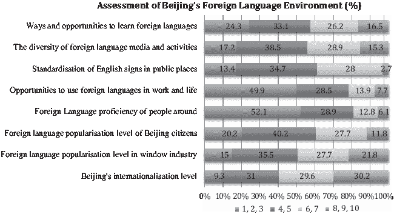

图 8：北京外语环境评估。

如图 9 所示，超过半数的受访者对景点、博物馆、文体设施、公交车、地铁和商业场所的英语标识非常满意或比较满意。然而，他们认为医疗区和卫生设施的英语标识是不令人满意的。这些观点与在京外国人的意见一致。根据报告（北京市委对外事领导小组办公室等，2008），外国人认为道路交通标志、地铁标识和景点内的标识最标准且最用。然而，他们也发现一些英语标识存在拼写和语法错误，并建议在公交车和医院等公共场所增加更多标准的的中英文双语标识。

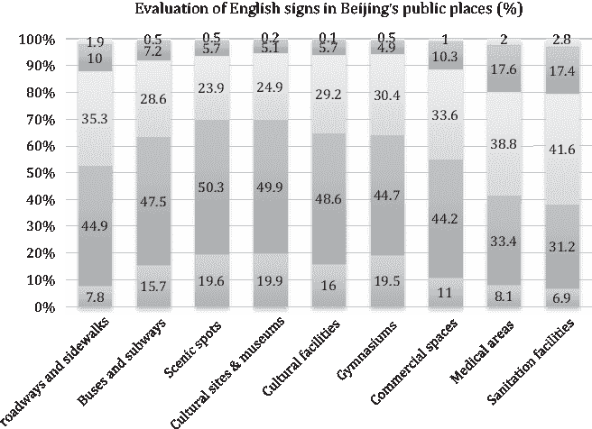

图 9：北京公共场所英语标识评价。

## 4 奥运城市身份构建中的“英语热”

英语学习与奥运热情的交汇在一部于奥运会前不久发行的 60 分钟纪录片《疯狂英语》（`Mad About English`）中得到了很好的捕捉。该纪录片由新加坡导演连培民（Lian Pek）执，通过忠实记录英语如何影响五个真实人物在人生不同阶段，很好地捕捉了中国奥运英语热的历史时刻。这部电影最令人记忆的画面之一是成千上万中国奥运志愿者在国家体育场跟随志愿者总教练李阳齐声喊道：“我受不了我糟糕的英语了！我想改变生活！”这部引人入胜的纪录片不仅生动地展示了中国的奥运英语热，也再次给我们留下了一个引人深思的问题：为什么在北京奥运会的背景下，中国政府和中国人民如此渴望英语？


“英语热”（作为一种社会现象，参见 Krashen, 2003; Power 2005; Shim and Park, 2008)）指的是对学习英语的压倒性的集体热情以及随之而来的巨大投入。英语热也是许多其他亚洲国家的显著现象，最著名的是日本 (Oda, 2007; Piller and Takahashi, 2006; Piller, Takahashi and Watanabe, 2010)）和韩国 (Park, 2009; Piller, Takahashi and Watanabe, 2010; Shim and Park, 2008)）。自从中国在 1978 年实施开放政策以来，英语已在中国教育政策中牢固确立了其主要外语的主导地位（例如，Adamson, 2002, 2004; Chang, 2006; G. Hu, 2005; Y. Hu, 2008; Lam, 2002; McGuire, 1997)）。正是在全球化以及中国推动现代化和国际化的宏大背景下，“英语热”在过去的三十里席遍了全国。在 2001 年中国加入世界贸易组织（WTO）以及北京获得 2008 年奥运会申办成功后，英语的地位得到了强有力的提升 (Bolton, 2002)。推动中国走向历史上最大国际盛的力量也驱动了中国人拥抱英语。在国内外社会、经济和政治变化的条件下，北京奥运会标志着国家、地区和个人层面身份建构的关键时期。这些不同层面的身份建构都以某种方式与英语的教学有关，英语是`默认`的国际语言、奥林匹克运动的官方语言以及知识经济时代的主导语言。英语水平成为中国在现代化和国际化驱动过程中追求理想身份的重要组成部分，对于作为奥运之城的北京以及 21 世纪的中国公民而言也是如此。在中国的官方话语中，特别是那些在奥运会背景下加速英语传播的话语，英语主要被描绘成一种必要的工具，可以有助于获取现代科技进步并促进经济发展，其次被视为促进社会和个人国际交流的载体。

与其他旨在北京奥运会的城市转型其他方面一样，政府主导的规划和决策体系使主办市及全国的英语普及运动变得非常高效。北京奥运会引发了英语学习热潮，涉及 4000 多名运动员、裁判、北京奥委会工作人员、150 万奥运志愿者以及数百万北京居民成为英语学习者。与韩国在 1986 年亚运会和 1988 年首尔奥运会做法类似，中国政府将 2008 年奥运会推广为“号召公民获得全球视野并具备全球化的重要特征，其中之一就是说英语的能力” (Shim and Park, 2008, p. 144)。在中国这样的集体主义社会中，人们从出生起就被整合进强大、凝聚力强的群体（如种族、阶级或国家），并被教育要优先考虑社会利益而非个人福利。当代表国家的政府员爱国热情时，集体主义精神为英语学习增加了道德价值。因此，来自各行各业、不同年龄段的北京市民被鼓励通过英语来表达他们的爱国情怀并光光国家。在奥运会之前，国内媒体充斥着关于爱国老人、厨师和警察学习字母表的故事，力求为赛事尽一份力。对于北京市民来说，学习英语不仅是“有益的”，更是一种爱国行为。2008 年北京的一项调查显示，86.39%的参与者计划参加英语培训 (Liu, 2008)）。奥运会成为主办市及中国其他地区英语传播的强大驱动力。英语培训的普及在所有年龄段中日益增长。结果是中国的英语教育市场蓬勃发展。2008 年，中国英语学习者总数达到 3.5 亿 (Liu, 2008)，到 2010 年 7 月，这一数字已上升到 4 亿，占中国人口的三分之一左右 (He, 2010)。根据《中国教育发展统计公报》的数据（Ministry of Education of PRC, 2011)），2010 年中国培训市场的估计价值为 3000 亿人民币（4400 亿美元）。其中，英语培训市场的估计规模达到 300 亿元人民币（44 亿美元）。数据显示，在北京奥运会之前，中国有超过 5000 家机构或公司提供校外英语课程，争夺这块利润丰“英语蛋糕”份额 (Research in China, 2008)。

## 5. 对英语工具主义的质疑

尽管语言教育政策（LEP）在决定语言实践和操纵语言意识方面发挥着强大作用，但 Shohamy (2006, p. 91) 指出，关于语言教育政策实际效果和后果的研究非常少。在本节中，我将研究我的受访者的英语学习轨迹，作为本世纪初为应对国家政治议程而实施的中国英语教育政策的结果。通过案例研究，我意在阐明英语工具主义观点如何在官方话语中传播并自然化，以及如何影响中国学习者的语言信念和语言实践。

### 5.1 高预期 vs. 低实用性


北京奥运会不仅为许多中国人提供了学习英语的强大动力，也对奥运会后中国英语的使用前景产生了乐观的预期。北京奥运会英语普及运动所强化的英语工具主义观点，使得我的许多受访者产生了为了个人晋升而“需要”英语的念头。在围绕英语的讨论中，一个经常被引用的论是：英语在职场中具有很的使用价值，学生“需要”英语才能在就业市场上取得成功 (Piller, 2007)。对于本研究中的许多受访者而言，他们学习英语的动力主要来自于对职业前景的看法。学习英语可以帮助人们在就业中获得优势这一信念，被许多人视为理所当然的事情。

### 康培

例如，康培是武汉一所三流大学旅游管理专业的大四学生。奥运会期间，他被招为北京大学乒乓球馆的奥运志愿者司机。在参加北京奥运会之前，康培承认由于缺乏对该语言的接触，且教室外的使用机会有限，他并没有意识到“英语的真正重要性”。奥运经历改变了他对毕业后职业前景的理解。

> 康培：我有几个姐姐他们现在已经参加工作了嘛, 我也马上要找工作了。她们就跟我讲说, 如果你的外语水平好的话, 首先这是一个门槛。即使以后你讲外语－讲英语的机会很少, 但是确实这就是一种优势。特别是一些好的工作, 还有一些层次比较高的工作比如说经理啊, 他们可能就会用英语来跟你面试。如果你连这一关你都过不了的话, 那对于工作来说就不用谈可以找到一个岗位了。

> [Kong Pei: I have several elder sisters who have already taken up jobs. And I’m also going to look for a job soon. They told me … high foreign language proficiency, in the first place, plays a gate-keeping role in seeking a job. Even if later on probably you have very little chance of speaking a foreign language – speaking English, high English proficiency is indeed an advantage. While applying for good jobs, especially those senior positions such as manager, well, candidates will be interviewed by employers in English. If you cannot even pass it, getting a job will be out of the question. (27-09-2008)]

### 赵飞翔

北京奥运会的成功举办影响了许多中国人理解中国未来的方式以及他们在未来中自身可能性的。对于奥运志愿者司机赵飞翔来说，英语不仅是“日益开放的中国”的“绝对必需”，更重要的是为了他大学毕业后理想的“成功经理或总监”这一身份。

> 赵飞翔： (…) 现 在就是说我们国家越来越开放。很多外资企业、外国人都进到我们国家。我觉得在一个公司或者一个企业里面, 比如说一个成功的经理人或者一个主管, 他所涉及到的不仅仅是他的专业领域, 文化、政治、经济、甚至语言这一块他都要涉及到。因为你所接触的人群可能是外国人, 而且英语作为国际上的通用语言, 所以我觉得英语是非常有必要的。尽管在平时工作当中没有可能用到, 但是对于一个主管或者一个经理人的话, 在以后绝对是有机会用到的。因为你熟悉了语言, 你就可以跟别人沟通, 然后可以学些别人的一些先进思想或者方法什么的。对以后的话, 我觉得是非常有必要的。

> [Chao Feixiang: (…) Nowadays, just like … our country is becoming increasingly open. A large number of foreign enterprises and foreigners have entered into China. And I think- In my opinion, in a company or an enterprise, take a successful manager or director for instance, what he may be involved with is not only professional knowledge but also cultural, political, economic and even linguistic knowledge. Because whom he will come into contact with may be foreigners, and English is said to be a common language in the international community. In this regard, I think English is an absolute essential. >> … >> Even though [English] may be << … << of no use in daily work, for a director or manager, [English] will definitely be useful in the future. (…) I think [English] is an absolute essential for the FUTURE. (27-09-2008)]

### 赵晨

随着对奥运后中国国际流动性持有更乐观的观点，我的一些受访者（尤其是那些受教育程度更高、拥有更好社会资源的人）开始相信英语是衡量中国及其他社会生活潜力的定义标准。2008 年，赵晨是位于北京的一所领先中国大学的连读博二级学生。在奥运会期间，他与一组来自澳大利亚和美国的“英语母语者”合作，担任主新闻中心媒体运营的志愿者。赵晨的奥运志愿者经历证实了他对于像他这样的“高学历人士”英语具有工具性的的信念。

> 赵晨： (…) 毕竟现在这个世界是一个西方价值观主导的世界。你要融入这个世界中, 就必须学习英语, 因为英语是一个世界性的语言 (…) 特别是我的同学英语好的人有很多, 他们会有很好的机会, 不管是工作的机会还是交流的机会。英语好的人会获得更多的信息, 或者是你出国发展你的国际事业, 针对你个人的发展都有好处。我现在做的这个科研, 绝大多数文献都是英语的, 所以我觉得英语对一些文化水平高的人, 还有那些科研人员和高级商务人员, 包括像政府部门他们需要交流的时候, 都是非常重要的。

> [Zhao Chan: After all, this is a world dominated by Western values. If you want to integrate into the world, you have to learn English, as English is a world language (…) Particularly, many of my fellow students have high English proficiency. They have better access to information. Alternatively, if you want to go abroad and develop your international career, [English] is beneficial for your personal advancement. In my case, most of the literature for my current research project is in English. So I think English is critically important for highly educated people like research fellows and senior business personnel, as well as [civil servants working with] government departments involved with international communication. (22-09-2008)]

### 秦思

对于就业机会和职业晋升对英语的需求，非英语类的中国学习者也深有感触。秦思是一名负责 VIP 陪同和西班牙语服务的奥运志愿者。然而，直到她进入大学西班牙语专业后，才开始学习这种在中国被称为“小语”。从小学三年级开始，她已经学习了十年的英语。尽管大学的西班牙语专业的通常有良好的就业前景，秦思仍然继续学习英语。在大学四年里，她定期上大学英语课并通过了`CET-4`。在采访中，秦思说她仍然几乎不会说英语，因此对求职需要英语的需求表达了担忧。

> 秦思：我听以前找工作的人说, 作为 XX 高校的, 用人单位不太怀疑你的专业能力。而且他们有的人, 是一个上上届的学生自己说, 他说他已经是系里面最差的了, 他虽然最差可是他出去找工作, 还是要比其他学校的要好 (…)但是他说用人单位会考一下你的英语, 他们也会考英语, 找工作面试的时候, 他们会组织讨论什么的, 最后他们让你用英语总结你的表现, 或者说用英语做一些自我介绍啊什么的。

> [Qin Si: I heard from those job seekers that … as graduates from XX University, employers wouldn’t doubt your academic capability. And there is someone, a student graduated the year before last year; he said he was academically the poorest student in the department. Despite this, he could get better job offers than those graduated from other universities (…) But he said employers might test your English proficiency, they would test English proficiency. While interviewing job applicants, they would organise a discussion or something else. At the end, they would let you summarise your performance in English, or let you, say, do a self-introduction in English. (22-09-2008)]


对于许多中国英语学习者，如孔裴、赵飞翔、赵晨和秦思来说，掌握英语是他们看似无尽抱负的核心部分，是通往更有趣且更丰厚的职业道路的途径，也是一种他们父母无法想象的方式与世界其他地区接触的工具。然而，这些语言形态往往被认为反映了现实，而没有对事实进行批判性的审查。Takahashi (2011) 强调，英语意识形态最好被理解为“特定国家和社区内的一种地方、社会和政治建构”。尚未实现的是，英语学习者本身也参与了他们所感知的英语社会现实的构建。全球范围内的研究人员早已意识到，英语的传播在不同背景下表现形式各异。尽管人们普遍认为英语水平能让人更易地获得符号资源（如教育、社会地位）和物质资源（经济提升、职业晋升），但英语的价值和力量绝非内在且普遍的。

与这种关于需要英语的普遍论调相反，新兴的研究证据表明，作为语言资本的英语在职业或教育进步方面的回报可能并不理想（`Piller, Takahashi and Watanabe, 2010`、`Zhang, 2011`）。中国英语学习者在英语学习上投入了大量精力，却一直为教室外英语接触少、实用性不足而挣扎（`Zhao and Campbell, 1995`；`Yang, 2003`）。2005 年的一项研究指出，中国劳动力市场上 90%的职业与英语无关（`Zhang, 2005`）。这意味着，大学毕业生中不超过 20%的人在工作场所需要不同程度的英语。由于英语在中国社会（尤其是就业市场）的实用性较低，真正重要的似乎并不是实际的英语能力，而是拥有这种能力的证明，主要是通过大学学位和英语考试证书。考虑到从小学三年级到本科阶段平均 12 年的义务性英语教育，与许多其他非英语国家类似的、以英语为中心的教育政策（`Piller & Cho, 2013`）已导致人力、物力和财资源的巨大浪费。

## 5.2 英语学习的问题与困境

尽管我的受访者普遍对英语作为一种一种促进个人进步的“中立且有益”的工具持积极态度，但强制性的英语学习可能会给他们带来严肃的教育公平问题和学习者身份的困境。

### 5.2.1 缺乏自发动力

我采访的所有奥运会志愿者都是同一年龄段的大学生（2008 年时 20-25 岁）。除少数几个大学才开始学习英语的学生外，大多数受访者从初一就开始学习英语，而少数几个在故乡能获得更好外语教学（ELT）资源的学生从小学阶段就开始了。由于英语对大多数参与者来说是义务教育和`Gaokao`（全国大学入学考试）的一部分，他们报告说没有选择权，也没有时间去学习另一种外语言（LOTE）。在实践中，极有可能是父母为孩子在外语教育中的语言选择做出了决定。中国教育体系对英语其他外国语言的青睐，以及大部分就业市场对英语水平证书的要求，都构成了社会化和制度化的动力，而不是中国学习者学习英语的自发动力。

张洁：你是有意识地自主选择学习英语的吗吗？

[Zhang Jie: Did you consciously choose to learn English as a foreign language?]

陈正：（…我家里人比较倾向于让我出国。其实算是父母的选择吧, 不是我自己选的。那时候我也不知道为什么要学英语。(…)这也是一个教育导向问题。因为高考啊、报考学校啊, 像现在一些高校啊包括研究生招生, 小语种［考生］都会有限制。(…)然后你找工作的时候, (…)你像在我们北方, 我家在辽宁, 我们那边的日企、韩企, 也有一些德国来的企业比较多。像德国来的企业, 你不会德语可以但是你要会英语。但是像日韩的那种企业, 他们就会喜欢要日语生和韩语生这样。也会有一些不同的选择方向吧。但是现在就是越来越多的考试它没事考你一下英语, 它限制在英语上。我觉得这是一个教育导向问题。

[Chen Zheng: (…) My parents were inclined to send me abroad. Actually, it was my parents’ choice instead of my own. At that time I didn’t know why I should study English. (…) This is also a matter of educational orientation. Because like `Gaokao` and university application … like when some universities and graduate schools recruit applicants, there are restrictions for those who learn foreign languages other than English. (…) Then, when you are job searching (…) like in the north, my hometown is in Liaoning Province, there are many Japanese, Korean enterprises and also a few German enterprises. In German enterprises, it’s OK not to speak German as long as you speak English. But Japanese and Korean enterprises prefer to recruit Japanese and Korean speakers. There are also different choices. But there are more and more occasions where English is tested. English is the restriction. I think this is a problem of educational orientation. (21-09-2008)]

### 5.2.2 “耗时太，效率太低”

英语学习大多被呈现为一个艰辛的故事。在针对 1996 年外语教育会议的演讲中，国务院副总理李兰青（`1997`）表示，中国英语教学最严重且最普遍的问题是耗费时间太多，但效率相当低。北京大四学生、酒店服务类奥运志愿者海海强的英语学习轨迹说明了一切。海海强成长在桂林一个知识分子家庭，桂林是中国南方的一个地级市。从小学三年级就开始学习英语，他在学业成就上比大多数中学才开始学英语的同龄人领先。小学毕业后，海海强被录取到一所竞争激烈的当地中学，其课程特别侧重外语培训。与普通中学相比，这所外语中学的英语教育更加密集，英语课由当地和外教教师使用海外外语教材和各种创意课程进行。然而，当海海强升到高二时，情况完全不同了。他所在年级的英语教育变成了以考试为导向。据他描述，培养英语交流能力的训练都停止了，他们在英语课上要做的就是做模拟测试。英语学习对他来说不再是享受，而是变成了巨大的压力，唯一目标是在`gaokao`中取得好成绩。海海强被北京某大学社会学本科专业录取后，他继续花费大部分时间学习英语，然而大学英语教学的质量让他非常失望。在对语言进行了多年持续且高度的投入后，海海强的自评是他只获得了通过考试的能力，而不是英语交际能力。

张洁：你怎么评价你的英语能力？

[Zhang Jie: How do you evaluate your proficiency in English?]


Ji Haiqiang: 我觉得考试能力有, 但是真正的实际应用能力 … 我觉得, 就我们班来说, 怎么说呢, 举个例子吧, 老师上英语课时(…)他点的是成绩成绩比较好的人, 我看, 在我心目中是英语不错的人。站起来一句话都说不完整(…)叙述一件事情, 一件简单的事情都叙述不出来。但是你让他考试, 他肯定能考挺高的分。但是真的要他说, 他说不出来, 一句话都说不出来。

Ji Haiqiang: I think I have the ability to pass examinations, but in terms of a true communicative competence in … I think, as far as my class is concerned, how can I put it, let me give you an example. When in English class (…), the teacher always chooses academically better students [to answer questions]. In my view, these students are good at English. [However], [they] can’t even finish a complete sentence [in English] when they were asked to stand up and answer a question in class. [They] can’t give an account of a thing … a simple thing. But if you test them, they can sure get a fairly high score. But really, [they] can’t speak [English], even a sentence. (03-08-2008)

## 5.2.3 英语学习中的“体”与“用”张力

尽管官方强调英语学习的个人选择、益处、中性和互补性，但一些受访者反映，英语学习对他们的母语（L1）能力和文化认同产生了负面影响。2008 年，徐健是北京某领先外语大学英语口译专业的本科高四学生。在奥运期间，她经过筛选和培训，被 `BOCOG` 招募为奥运志愿者，负责贵宾陪同和（英语）语言服务。徐健在长春长大，那是中国东北的一个省会会。在所外语学校完成中学教育后，她免参加了 `Gaokao` 并被推荐录取大学。虽然徐健对自己的英语水平显而自豪，但她认为中文能力受到了其英语思维模式的负面影响，这是一个“悲伤的事实”。

语言学习是身份构建与协商的场所（Norton, 2000）。语言学习者对自己在目标语言中身份的理解影响着他们在语言学习中的主体性、动机、投入和抵抗。我对比中国少数民族学生魏茹的采访显示，一些少数民族学生曾痛苦地感受到学习英语过程中的身份冲突。2008 年 8 月，当我在北京遇到魏茹时，她是北京某大学民族学专业的本科毕业高四学生。在北京奥运期间，`BOCOG` 委托她所在的大学负责国际青年营的志愿者工作。因此，魏茹被招募为国际青年营大项活动组的户外文艺活动协调助理。她的职责是协助为国际青年营成员提供户外交通服务。魏茹是中国达纳鄂族中国支系的成员。由于历史原因，达纳鄂族是一个跨国民族，人口分布在中国和俄罗斯。中华人民共和国成立后，中国达纳鄂族人被正式认定为“赫哲族”（`Hezhe-zu`），是中国最小的少数民族之一。赫哲人有自己的语言，属于满语-通语系（Bradley, 2006）。尽管民族语言失去了实际的日常交流功能，魏茹仍将赫哲语视为自己的母语，并坚持自己的赫哲族身份认同。由于与俄罗斯达纳鄂人的族缘关系，魏茹也对俄语有强烈认同。像她家乡的许多同学——黑龙江省一个边接俄罗斯的小县一样——魏茹从初一开始学习俄语作为首选外语科目。凭借当地极高的俄语教学标准和当地丰富的俄语接触，包括魏茹在内的许多当地高中毕业生都获得了高水平的俄语。俄语曾是许多当地学生在 `Gaokao` 中的优势科目。然而，`2001a` 出台了《教育部（2001 年）《关于大力加强小学英语教学的意见》，要求将义务教育下延至初中。`2001` 导致了 21 世纪初中国的快速扩张。`2004` 在 2009 年参加 `Gaokao` 之前，魏茹和其他学生面临着 `2009)` 的困境：他们可以选择的本科专业范围有限。许多本科专业只录取以英语为考试科目的高中毕业生。面对同样的困境，魏茹和她的同学不得不在俄语和英语之间做出的痛苦的选择。与她一些选择留级一年苦读英语以进入名牌大学和理想专业的同学不同，魏茹坚持学习俄语，并成为了 `Gaokao` 考生。魏茹并没有认同普遍存在的英语重要性和实用性，并且对学习英语几乎没有动力。

魏茹: (…) 当时我们班有很多同学为了学英语, 就蹲了一年。但是我们家就考虑学习挺好的, 没必要为了一个语言, 就是没有意识到这个语言－因为我们家是县城嘛, 就比较偏远, 就没有想过英语－因为我们那儿打交道的都是俄罗斯人, 俄罗斯人特别多, 就根本没有想过。走出来才发现英语这么重要。从来没有想过, 也根本没有意识到。所以我当时也没有蹲级啊怎么样, 就一直学着俄语。

Wei Ru: … Many fellow students in my class repeated a grade for studying English. But my family thought there was no point in repeating a grade solely for learning a language, since I was doing very well at school. I was just not aware that this language is so predominant elsewhere – because my hometown is in a remote county, and we dealt with Russian people all the time. There were a great number of Russian people in our county, thus I had never thought of learning English. I’ve never thought about and didn’t realise English is so important elsewhere until I left my hometown. So, I didn’t repeat a grade and went on learning Russian. (21-09-2008)


2004 年，由于俄罗斯籍高考考生的身份限制，魏茹被录取了北京一所针对少数民族大学的预科班。2001 年,教育部 (2001b)发布了一项政策，要求在三年内，大学课程中至少有 5 至 10%的课程应用英语教学。2004 年，教育部发布了《高校本科教育评估方案》(2004)，试图确保英汉双语课程的比例不低于大学课程的 10%。该文件还规定，英汉双语班级应采用英语教材，且分配给英语教学的时间比例不应低于总课时的 50%。由于英语是她所在大学所有非英语专业学生大学课程的必修部分，魏茹被迫放弃了俄语学习，成为大学英语教育中被边缘化的学生（Zhang, 2011]

观察奥运会前中国广为人知的英语热潮，使人们很容易假设中国英语学习者都是出于工具性或整合性目的而学习的，无论他们具有怎样的社会经济、族裔和语言背景。然而，现实情况是，并非所有中国学生都有为了实际应用语言或融入西方文化的动力学习英语。上述讨论的英语学习轨迹表明，英语学习是一个复杂的、情境化的的且流动的体验，它嵌入在关于英语的制度化话语中，并与学习者的身份认同以及他们未来想成为谁紧密相关。英语在中国的传播不是一个纯中立的过程，也不是普遍受益的过程；相反，它导致了主流社会与弱势群体之间资源分配的不平等。在回顾了英语对个人国际益处的实证证据后，Tollefson (2000) 认为，英语的传播与那些以牺牲其他群体为代价使某些群体受益的政治决策密切相连。受访者徐健对中国英语教育的现状评价道：“在我理解中英语在中国就像贫富两级分化一样。”(22-09-2008)。英语资源并不像像学而英语和 EF 等英语学校广告所描述的那样对所有中国人都平等开放并受益。在京奥运的背景下，英语水平对于在英语培训行业有共同利益的利益相关者是有益的。虽然少数人受益，但对魏茹英语学习轨迹的分析发现，以英语为中心的语言政策可能对那些缺乏平等获得英语教学资源的人造成严重劣势，其中包括少数族裔成员，他们的文化和个人倾向于其他外语（LOTE），但却被强加了学习英语的需求。根据教育部 (2009)发布的统计数据，2008 年全国有超过 1 亿名全日制中学生学习外语。在这些学生中，超过 95%将英语作为必修课。鉴于中国约 60%的人口居住在农村地区，那里英语教学资源匮乏，可以确定有一部分学生已经并将继续处于劣势地位（Hu, 2007）。

## 6 重新思考全球城市形成中的语言因素

全球城市地位已成为发展中国家许多大市政府追求的目标。全球城市愿景背后是政府在国际舞台上对权力、财富和影响力的竞争。在北京奥运之前，北京宣布了雄心勃勃的措施使其成为顶级全球城市，并经历了剧性的转型（Wei and Yu, 2006)）。市政府认为“国际语言环境”是使北京成为全球城市的重要保障，并为此开展了大规模的外语普及运动。北京奥运筹备期间外语普及运动的底层基础是国家主导的语言意识形态，即外语水平（尤其是英语水平）是世界/全球城市形成的重要指标。重新审视这种语言意识形态要求我们回顾什么成了“世界/全球城市”，以及语言在衡量标准中扮演了什么作用。

### 6.1 世界/全球城市的概念与评估


自 20 世纪 60 年代以来，世界城市/全球城市研究经历了快速增长。大多数发表的文献侧重于在全球经济中对世界/全球城市进行概念化和排名。全球/世界城市研究源于 Hall（1966）的断言，“存在某些伟大的城市，世界上最重要的业务有很大极不比例的部分是在这些城市中进行的”（第 7 页）。他预测“世界的经济生活将集中在几个主要的信息中心”，即伦敦、巴黎、兰斯塔德（荷兰地区）、莱茵-鲁尔地区、莫斯科、纽约、东京（1966，第 240 页）。继之后，约翰·弗里德曼（John Friedman）和格策茨·沃尔夫（Goetz Wolf）在关于世界城市形成的开创性研究（1982）中指出，与 1970 年代后资本主义相关的新的国际分工背景下，世界城市越来越多地认为起着将全球经济系统粘合在一起的作用。Friedmann（1986）进一步概述了他著名的“世界城市等级体系”，该体系将 30 个世界城市分类为世界经济核心区或半边缘地区的首要或次要城市：其中，只有九个核心城市（伦敦、巴黎、鹿特丹、法兰克福、苏黎世、纽约、芝加哥、洛杉矶、东京）和两个半边缘城市（圣保罗罗、新加坡）被归为一级。“全球城市”这一术语通过 Sassen（1991）的工作获得了更广泛的学术认可，她在工作中详细阐述了在全球化金融和生产者服务经济背景下，城市作为“基准点”的角色。她设想了一个多节点的全球经济体系，并将纽约、伦敦和东京巩固为全球化的“首要场所”。除了世界/全球城市，Ng and Hills（2003）, 1989)是首位使用指标法分析世界城市的人。他通过评估 9 个财务指标和 41 个与文化、经济、地理和政治相关的指标，研究了 40 多个国家的 76 个城市。在《世界城市假设》中，Friedmann（1986）采用了分级分类法，根据七个相互关联的筛选标准对城市进行排名，包括：主要金融中心、跨国公司总部、国际机构、业务服务部门的快速增长、重要制造中心、主要交通枢纽和人口规模。受“伟大城市”概念框架的启发，Ng and Hills（2003）对五个亚洲世界城市进行了比较研究，以 57 个指标为基准，涉及开明式治理、促进全球和本地发展的创新技术和经济活动，以及人力、社会、文化和环境资本。Hussain, Zaidi, and Rozenblat（2018）提出了基于多样性、实力和网络中心性的城市排名，以评估城市在世界上的重要性。

除了学术论文中报告的排名外，还有许多面向公众发表的排名引起了广泛关注。经济学人情报（`[www.eiu.com/topic/liveability`）每年发布《全球生活质量指数》，根据稳定性、医疗、文化和环境、教育和基础设施的质量对全球 140 个城市进行排名。美世咨询公司（`mobilityexchange.mercer.com`）针对全球热门派驻地的外员工发布年度《生活质量指数》，根据安全、教育、文化和环境等因素对 200 多个城市进行排名。由 IESE 商学院（`[www.iese.edu/faculty-research/cities-in-motion/]`）编制的 IESE 流动城市指数根据九个主要维度对 174 个城市进行排名，包括人力资本、社会凝聚力、经济、公共管理、治理、环境、流动与交通、城市规划、国际拓展和技术。全球权力城市指数（GPCI）由森记忆纪念会（`[www.mori-m-foundation.or.jp]`）开发，通过衡量涵盖 6 项城市功能的 70 个指标（包括经济、研发、文化互动、生活质量、环境和可访问性），对世界 48 个主要城市的综合实力进行评估和排名。全球城市指数由 A.T. Kearney 咨询公司、《政策》杂志和芝加哥全球事务委员会（`[www.atkearney.com]`）设计，根据五个维度的 27 项指标对全球城市进行排名：商业活动、人力资本、信息交换、文化体验和政治参与。


到目前为止，国际学者对世界/全球城市的评估已逐渐从对现有世界/全球城市的认可导向转向了未来世界/全球城市形成的规划导向。

在早期研究中，对世界/全球城市的评估主要采用经济指标。随着全球化的加强，研究开始将社会、政治、文化、基础设施等其他城市表现纳入经济和财务因素的衡量矩阵中。自 21 世纪以来，越来越多的世界/全球城市研究还将创新和可持续发展纳入评估指标体系中。

值得注意的是，很少有城市指数和排名将公民的外语水平作为评估城市全球地位的维度，尽管语言能力在教育、人力资本、知识经济和跨文化交流中发挥着基础性的作用。各各项指数的排名结果证明，城市走向全球化并没有单一的正确路径，英语也不是实现这一目标的必要条件和手段。

例如，在 2008 年全球城市指数（外交政策、肯尼锡与芝加哥全球事务委员会，2008）中，没有任何一个城市在指数的所有维度上占据主导地位。该指数包含的 60 个城市代表了世界政治、商业、文化和交流中心的广泛跨领域（见表 7）。

在全球十大城市中，巴黎（第 3 位）、东京（第 4 位）、首尔（第 9 位）并非英语国家国家，但巴黎在信息交流方面领先世界，东京在商业活动方面位居第二。北京成功的奥运盛会赢得了广泛的国际尊重。在指数中，北京总排名全球第 12 位，于布鲁塞尔（13）、柏林（17）和莫斯科（19）等其他国家首都之前。该城市是当年来自发展中国家中排名最高的特大城市。显然，有限的英语水平并没有阻止作为社会主义发展中国家和转型经济体首的北京加入全球大都市行列。

在对五个中国全球城市（北京、香港、上海、广州、深圳）的分析中，Chubarov and Brooker (2013) 挑战了一种“全球主义视角”，该视角认为“全球城市”的形成是一个统一的过程，所有城市最终都将努力成为或类似于伦敦、纽约和东京。通过采用对各个城市特定政治、经济、社会文化功能敏感的功能职性方法，他们认为这些中国特大城市证明了，在非西方、非资本主义的背景下，全球城市的形成存在多种路径。

### 表 7：2008 年全球城市指数。¹⁶

| 排名 | 城市 | 商业活动 | 人力资本 | 信息交流 | 文化体验 | 政治参与 |
| :--- | :--- | :--- | :--- | :--- | :--- | :--- |
| 1 | 纽约 | 1 | 1 | 4 | 3 | 2 |
| 2 | 伦敦 | 4 | 2 | 3 | 1 | 5 |
| 3 | 巴黎 | 3 | 11 | 1 | 2 | 4 |
| 4 | 东京 | 2 | 6 | 7 | 7 | 6 |
| 5 | 香港 | 5 | 5 | 6 | 26 | 40 |
| 6 | 洛杉矶 | 15 | 4 | 11 | 5 | 17 |
| 7 | 新加坡 | 6 | 7 | 15 | 37 | 16 |
| 8 | 芝加哥 | 12 | 3 | 24 | 20 | 20 |
| 9 | 首尔 | 7 | 35 | 5 | 10 | 19 |
| 10 | 多伦多 | 26 | 10 | 18 | 4 | 24 |
| 11 | 华盛顿 | 35 | 17 | 10 | 14 | 1 |
| **12** | **北京** | **9** | **22** | **28** | **19** | **7** |
| 13 | 布鲁塞尔 | 19 | 34 | 2 | 32 | 3 |
| 14 | 马德里 | 14 | 18 | 9 | 24 | 33 |
| 15 | 旧金山 | 27 | 12 | 22 | 23 | 29 |
| 16 | 悉尼 | 17 | 8 | 27 | 36 | 43 |
| 17 | 柏林 | 28 | 29 | 12 | 8 | 14 |
| 18 | 维也纳 | 13 | 31 | 29 | 11 | 9 |
| 19 | 莫斯科 | 23 | 15 | 33 | 6 | 39 |
| 20 | 上海 | 8 | 25 | 42 | 35 | 18 |


有趣的是，在向公众发布的一系列世界/全球城市排名中，国际英语培训机构`EF English First`（七届奥林会官方语言培训服务供应商）自 2011 年开始发布其“英语能力指数”（`EPI`）。2019 年的 EF EPI 评估了来自 100 个国家和地区的 230 万名考者。根据该指数，欧洲的 EPI 平均分最高（56.71），其次是亚洲（53）、拉丁美洲（50.34）、非洲（50.28）和中东（44.60）。英语水平最高的国家集中在斯堪的纳维亚地区，而在光谱的另一端，许多中东国家的英语水平最低（见表 8）。法国（第 31 位）、西班牙（第 35 位）、韩国（第 37 位）和中国（第 40 位）均被分为中等英语水平组。俄罗斯（第 48 位）和日本（第 53 位）被认为是英语水平较低的国家。转向城市评分，阿姆斯特丹在调查的 100 个城市中英语水平最高。在 2019 年全球城市指数中，三个非英语国家的前十大全球城市——巴黎、东京和首尔，在 EF EPI 中的得分分别为 60.28、52.58 和 57.14。北京的 EPI 得分为 55.68，落后于巴黎和首尔，但在英语水平上领先东京。

基于这些统计数据，`EF English First (2019a)`声称，英语能力与科学创新、人类和经济发展、全球联系、甚至权力和性别平等呈“正相关”。报告认为，“人们英语水平最好”的国家或城市往往具有更强的人才竞争、、更前沿的科学研究、更高的国内生产值、净收入和劳动力生产率，以及更低的权力距离，因此倾向于变得“更富有、更开放且更具国际视野”（第 18 页）。更令人惊讶的是，报告强调“英语能力与好客国家指数之间存在着非常强的相关性，后者是衡量一个国家目前对人类整体贡献程度的综合指标（第 18 页）。”

作为过去及未来七届奥林匹克的官方语言培训服务供应商，EF 对英语内在“价值”的言论显然影响了大量投入英语学习的普通大众语言政策。这些关于英语的评论与将英语描述为科学、技术、现代化和国际化语言的胜利主义描述相吻合。在这种观点下，英语单语主义和文化同质化在全球化世界中被呈现为不可避免且理想的，并忽视了围绕这一现象的底层政治、文化和伦理问题。`Piller (2016a)`认为，英语与学术卓越之间的紧密联系导致了知识权威的削弱。事实上，学术权威是通过将英语作为当代交流的主导媒介实现的，而不是 EF 报告中所描述的某些“内在属性”。我们必须警惕将英语能力作为衡量一个国家对人类贡献的标尺。语言演变和社会达尔文主义将为非英语国家群体的种族歧视提供理由。

表 8：国家和地区的 EPI 排名

| 极高 | 高 | 中等 | 低 | 极低 |
| :--- | :--- | :--- | :--- | :--- |
| 1 荷兰 | 15 匈牙利 | 30 哥斯黎达 | 47 白俄罗斯 | 70 阿联酋 |
| 2 瑞典 | 16 罗马尼亚 | 31 法国 | 48 俄罗斯 | 71 孟加拉 |
| 3 挪威 | 17 塞尔维 | 32 拉脱维亚 | 49 乌克兰 | 72 马尔代夫 |
| 4 丹麦 | 18 肯尼亚 | 33 香港（中国） | 50 阿尔尼亚 | 73 委内瑞拉 |
| 5 新加坡 | 19 瑞士 | 34 印度 | 51 玻利维亚 | 74 泰国 |
| 6 南非 | 20 菲律宾 | 35 西班牙 | 52 越南 | 75 约旦 |
| 7 芬兰 | 21 立陶 | 36 意大利 | 53 日本 | 76 摩洛哥 |
| 8 奥地利 | 22 希腊 | 37 韩国 | 54 巴基斯坦 | 77 埃及 |
| 9 卢森堡 | 23 捷克 | 38 台湾（中国） | 55 巴林 | 78 斯里兰卡 |
| 10 德国 | 24 保加利亚 | 39 乌拉圭 | 56 格鲁吉亚 | 79 土耳其 |
| 11 波兰 | 25 斯洛伐克 | 40 中国 | 57 洪尔拉斯 | 80 卡塔尔 |
| 12 葡萄牙 | 26 马西亚 | 41 澳门（中国） | 58 秘鲁 | 81 厄瓜多尔 |
| 13 比时 | 27 阿根廷 | 42 智利 | 59 巴西 | 82 叙利亚 |
| 14 克罗地亚 | 28 爱沙尼亚 | 43 古巴 | 60 萨尔瓦多尔 | 83 喀麦隆 |
| 29 尼日利亚 | 44 多米尼加共和国 | 61 印度尼西亚 | 84 科威特 |
| 45 巴拉拉圭 | 62 尼加拉瓜 | 85 阿塞拜疆 | 86 缅甸 |
| 46 瓜地马拉拉 | 63 埃塞俄比亚 | 87 苏丹 | 88 蒙古 |
| 64 巴拿马 | 65 突尼斯 | 89 阿富汗 | 90 阿尔及利亚 |
| 66 尼泊尔 | 67 墨西哥 | 91 安哥拉 | 92 阿曼 |
| 68 哥伦比亚 | 69 伊朗 | 93 哈萨克斯克斯坦 | |
| 94 柬埔寨 | 95 乌兹别克斯坦 | 96 科迪瓦亚 | |
| 97 伊拉克 | 98 沙特阿拉伯 | 99 吉尔吉斯斯坦 | |
| 100 利比亚 | | | | |


对 2019 年全球城市指数（GCI）与 2019 年 EF 英语能力国家指数（EPI）进行对比研究会发现，城市的英语水平与其全球排名之间不存在因果关系。英语在当今世界的主导地位和“价值”应被理解为社会文化和历史产物，而非反映了语言的某种本质属性。

如果正如 EF 报告所声，英语水平可以预判全球竞争力，那么当前世界将根据 Kachru（1985, 1992）的世界英语三圈模型，简单地划分为三个“全球化”水平。在这个构想的世界中，英语作为第一语言或母语的内圈国家¹⁸自然会培养出“完美”的全球城市。然而，在 2019 年 EF EPI 中，只有柏林和布鲁塞尔这两个处于“英语水平最高”的前 20 名城市进入了当年全球城市指数（GCI）的前 20 强（参见表 9）。

A. T. Kearney 2019 全球城市报告（Kearney, 2019)）揭示了一个变动的世界，并强化了这样一个观点：没有哪个城市能够垄断最全球城市的地位。结果（Kearney, 2019）显示，尽管纽约、伦敦、巴黎、东京和香港保持了其作为全球城市指数前五名的十十年统治地位，但世界城市体系的根本性转变正在发生。

## 西方全球城市的转型

北美和欧洲正在与政治不确定性和日益增长的民族主义作斗，这引发了人们对其长期前景的质疑。伦敦和其他欧洲主要城市经历了商业活动的放缓。而言，自 2018 年以来，所有领先欧洲城市的表现都停滞了。人力资本得分的下降加剧了这种惯性，因为最优秀、多样化的人才正在其他地方寻找机会，或干脆留在家里。这种情况发生在包括伦敦、布鲁塞尔和柏林在内的欧洲顶级城市。

## 中国及新兴地区的崛起

与此同时，中国经济的实力和中东开放度的提高推动这些新兴地区的城市在全球舞台上更加突出。在过去的 40 里，中国在城市增长和发展方面取得了巨大成就。城镇化率从 1978 年的 18%上升到 2018 年的 60%，该国城镇人口从 1.7 亿增长到 8.亿（Kearney, 2019，第 9 页）。

中国证明了其城市地区继续提高宜居性，变得更加以人为中心，并向世界领先城市靠拢。北京在 2019 年 GCI 中排名第 9，比 2008 年上升了三位。事实上，中国城市的平均指数增长速度是北美城市的三倍，在球城市展望排名中，中国城市的进步速度是欧洲城市的 3.4 倍（Kearney, 2019），第 8 页）。商业活动仍是指数得分的最大贡献因素。但中国城市在人力资本和信息交换方面取得的进步显著加速了它们的进程。

### 表 9：2018–2019 年 GCI 与 2019 年 EF EPI 的交叉。

| 2019 | 2018 | ∆ | GCI 排名 | 2019 | EF EPI 排名 |
| --- | --- | --- | --- | --- | --- |
| 1 | 1 | – | 纽约 | 1 | 阿姆斯特丹 |
| 2 | 2 | – | 伦敦 | 2 | 斯德哥尔摩 |
| 3 | 3 | – | 巴黎 | 3 | 哥哈根 |
| 4 | 4 | – | 东京 | 4 | 赫尔辛基 |
| 5 | 5 | – | 香港 | 5 | 奥斯陆 |
| 6 | 7 | +1 | 新加坡 | 6 | 维也纳 |
| 7 | 6 | −1 | 洛杉矶 | 7 | 柏林 |
| 8 | 8 | – | 芝加哥 | 8 | 孟买 |
| 9 | 9 | – | 北京 | 9 | 汉堡 |
| 10 | 11 | +1 | 华盛顿特区 | 10 | 华沙 |
| 11 | 15 | +4 | 悉尼 | 11 | 利斯本 |
| 12 | 10 | −2 | 布鲁塞尔 | 12 | 布加勒斯特 |
| 13 | 12 | −1 | 首尔 | 13 | 布达佩斯 |
| 14 | 16 | +2 | 柏林 | 14 | 萨格勒布 |
| 15 | 13 | −2 | 马德里 | 15 | 达 |
| 16 | 17 | +1 | 墨尔本 | 16 | 马尼拉 |
| 17 | 18 | +1 | 多伦多 | 17 | 波尔 |
| 18 | 14 | −4 | 莫斯科 | 18 | 柏林 |
| 19 | 19 | – | 上海 | 19 | 吉隆坡 |
| 20 | 22 | +2 | 阿姆斯特丹 | 20 | 新德里 |


在中国国际化驱动的背景下，英语往往与多种术语联系在一起，并用于各种评论中，例如“全球竞争力”、“全球公民意识”、“全球思维”和“跨文化能力”。英语被理所当然地被视为国家国际化的语言。然而，英语与全球城市形成之间的联系是假设的，而非被证实的。这种假设的联系不仅存在问题，而且对世界的文化多样性和语言保护是有害的。这种假设可能会误政策制定者，使他们认为城市的全球竞争力是通过英语实现的，从而忽视了在语言教育规划和国家发展战略中国家语言（汉语）和少数民族国家教学语言（LCTLs）的重要性，并最终导致英语霸权的延续。在过去的三十年里，中国不断向世界开放，从一个“以国内为导向的国家”转变为一个“以国际为导向的国家”（Li, 2010）。“以国内为导向的国家”对外语的需求主要局限于外交、军事、安全和翻译领域的几种主导语言。相比之下，“以国际为导向的国家”对外语能力有更广泛的需求，因为这些国家与世界其他地区有着更紧密的社会经济联系，并承担着更多的国际义务。在中国全球/世界城市研究的第三波浪中，一组社会语言学家（例如 Dai, 2011;Li, 2015;Wen, Su and Jian, 2011;Yang, 2015;Zhao, 2016)）提出了“国家语言能力”的概念，认为它是国家综合实力的重要组成部分。这些学者将语言资源视为一个国家的软实力和硬实力。他们意识到，仅用英语的外语教育方法会限制符合国家发展战略利益的国家语言能力的构建。中国是一个拥有规模最大的外语学习人口的国家，但外语资源匮乏（Li, 2011）。中国对外语规划的紧迫任务是根据外语人才库和对外语的需求，提升其多语种能力。

## 7 总结

中国一直深受“英语热”的影响，这种现象在三十年前开始扎根，并在北京奥运期间变得白热化。支撑着中国政府加强英语推广的强大驱动力是将“英语”等同于“外语”，将“英语水平”等同于“全球能力”。因此，北京外语人口的 500 万这一数字只是一个低水平的大数字。这种官方认同的外语人口并不能证明奥会举办城市拥有高水平的外语能力以及相应的“国际化语言环境”。作为直接结果，北京缺乏高级英语演讲者、多语种演讲者以及其他外语的使用者。最重要的是，北京服务业人员必须通过英语考试的规定维持了英语的霸权，并加剧了“有者”与“无者”之间的差异。以英语形式体现的跨文化能力有利于那些拥有英语的人，增加了社交机会、加速了晋升并获取信息的途径。另一方面，缺乏英语能力则剥夺了其他人获得这些资源的机会。

语言政策影响教育和其他关键公共领域的语言教学和使用，涉及语言的选择及其如何合法化。根据 Shohamy (2006, p. xvi) 的扩大观点，语言教材实际上是一种有效的“语言政策工具”或“机制”，它是显性政策声明的结果，并被用于延续语言实践。鉴于教材对语言实践的直接影响，在下一章中，我们将通过两本奥会英语教材，为研究北京奥运会的语言政策（LPP）提供不同的视角。

# 第 6 章 北京奥会英语教材中的想象社区与身份选择

本章通过对教材中的多模态意义资源进行语言和符号分析，探讨两本奥会英语材料中构建的想象社区和身份选择。结构如下：首先，我将介绍语言教材身份构建研究的理论依据；这涉及女性主义、后结构主义、批判性话语分析和批判教育学。之后，我将详细说明两个英语教材的内容、形式和教学目标，以及选择它们作为数据的理由。在后续章节中，将考察三个想象社区（目标学习者、想象对话者以及作为奥会城市的北京）。总体而言，我将证明这两本教材为目标中国学习者提供了偏见、刻板和过度简化的身份选择。此外，这两本教材试图构建一个和谐的想象社区，甚至没有暗示跨文化交流可能会失败。这些话语建构可能会学习者的语言学习轨迹产生负面影响。

## 1 语言教材中的身份选择


外语和第二语言（FL/SL）教科书中身份建构的研究正成为一个新兴的研究方向，这一方向受到女性主义和后结构主义对语言教育重新概念化的影响和推动（例如，Blackledge and Pavlenko, 2004; Block, 2003, 2007; Cummins, 1994; Norton, 2000; Noton and Toohey, 2002; Pavlenko, 2001, 2002)）以及批判性学的的新进展（例如，Apple, 1990, 1992, 1996; Giroux, 1988, 1989)）。作为对第二波女性主义的回应，20 世纪 70 年代和 80 年代见证了对语言教科书中性别呈现的大量内容层面（如对两种性别在可见性、职业、性格、关系及所扮演角色的刻画）和语言层面（表示对两种性别之一的歧视的语法特征）的分析。这些教科书分析发现，在“排除”、“从属”、“扭曲”和“贬低”方面，存在大量针对女性的普遍性性别偏见证据（Sunderland et al. 2000）。20 世纪 90 年代初，第三波女性主义兴起，对性别的本质主义定义以及对中上层阶级白人女性经历的过度强调提出了挑战。在女性主义运动第三波的推动下，教育理论家和实践者逐渐接受了对性别和性性的后结构主义解释。在第二语言习得（SLA）领域，Norton（1955）对“社会身份全面理论”的呼唤引发了对身份深远的重新概念化。因此，过去的二十十年里，人们从后结构主义视角对身份和语言学习的兴趣日益增加。关于身份和语言学习的学术也深受批判性教学的影响。批判性教学将教学背景中的权力问题视为核心关注。人们广泛认为，教科书在定义什么知识以及谁的知识被重视和教授方面起着重要作用。作为正式教育中最常见的教学手段，教科书绝不是中立的知识，而是“更大文化政治过程体现”（Apple, 1992，第 1 页）。根据 Apple（1992），教科书通过赋予某一组人的文化资本并剥夺另一组人的资本，标志了特定的现实建构并体现了合法知识和文化。也就是说，什么被认为是“合法”或“真实”知识——即教科书中包含的内容——是可识别的阶级、种族、性别和宗教群体之间复杂权力关系和斗争的结果（Apple, 1992, 1996)）。

基于女性主义、后结构主义理论和批判性教学，一些研究人员（概述见 Shardakova and Pavlenko, 2004）通过考虑一系列社会身份以及学生对提供他们的身份选项的感知，扩大了语言教科书研究的调查范围。对身份和语言学习投入的学术兴趣的延伸，涉及到语言学习者在学习额外语言时向往的想象社区（Norton and Gao, 2008）。特别是，Shardakova and Pavlenko (2004)为语言教科书中的身份选项引入了一种新的分析方法。在对两本流行的初级俄语教科书的研究中，他们考察了两组身份选项：想象的学习者（文本隐含针对的）和想象的对话者（显式唤起的）。通过这种方式，他们提出了广泛的身份问题，涵盖性别、种族、阶级、民族、宗教信仰、（残障）能力、性向和其他身份。他们的研究详述了这两本俄语教科书的主角是如何被描绘成身体健全的白人中产阶级受教育青年和国际精英成员的，而俄罗斯对话者通常被描绘为标准俄语的白人中产阶级说话者。此类身份选项对于具有非洲或亚洲裔的俄罗斯人，或许多俄语少数民族的成员来说可能并不相关。之前的研究表明，语言教科书可能为目标 FL/SL 学习者提供过度简化、刻板化且偏见的身份选项。语言教科书中的过度简化、刻板印象和偏见可能剥夺学习者自我呈现的重要手段，有时甚至剥夺自我防御。它们还可能负面影响学习者对目标语言和文化的参与程度，以及跨文化能力的发展（Shardakova and Pavlenko, 2004）。

采用 Shardakova 和 Pavlenko（2004）的分析方法，本章旨在调查语言教科书如何通过其内容和形式使关于世界的特定知识合法化并验证某些身份库，以及这些身份库反过来如何结构化学习者获取目标语言资源和互动机会的机会。具体而言，我提出了以下研究问题：

1. 哪些学习者在多模文本中被隐含地设定为中国对话者，哪些被排除了？
2. 多模文本中哪些类型的对话者被凸显，哪些被忽略了？
3. 中国与外国对话者之间的互动是如何被描绘的？
4. 推广了哪些英语变体？
5. 哪些语言和文化意识是文本的基础？

由于教科书是显性语言政策的直接结果，它们不仅反映了嵌入显性语言政策的语言意识，还作为操纵语言行为和确保语言意识转化为实践的有效机制。在北京奥运语言政策（LPP）的实施过程中，教科书是一种重要的语言政策工具。通过回答上述问题，我试图为关于 2008 年北京奥运背景下语言政策和语言意识如何与身份建构相关的全球性研究问题增加一个与之前数据分析章节不同的维度。

## 2 会话英语读物


当 2008 年北京奥运会的开幕钟响起时，中国的奥运英语推广活动已经全面开展了六年。这项活动不仅提振了价值数十亿美元的英语培训行业，也为英语教学（ELT）出版物的繁荣提供了巨大动力。到奥运会期间，各种国内外英语教学材料已涌入中国图书市场（21st 世纪，2008）。2008 年 8 月 4 日，我访问了王府井书店，北京最大的书店之一。这家有六层楼的书店拥有种类丰富的英语作为英语（EFL）教学材料、模拟英语试卷、参考书以及一套专门奥运英语培训材料。这些奥运英语培训材料大致分为两类：

(1) 针对北京居民的通用交流英语教科书，如《北京居民英语口语手册》、《北京人 100 句常用英语》、《北京人 300 句常用英语》以及《1000 句奥运英语》；以及 (2) 针对各行业专业人士的特殊用途英语教科书，如《公务员英语》、《奥运安全英语》、《警察英语》、《游客英语》、《酒店英语》。

我在王府井书店琳集的英语培训材料中挑选了一些，并随后从《北京奥运会培训系列》中选了两本书进行进一步分析：《英语会话读本（初级）》（北京奥运会组委会和北京市教育委员会，2007a）和《英语会话读本（高级）》（北京奥运会组委会和北京市教育委员会，2007b）。选择这两本教材是基于三个标准：

### 1. 官方地位与权威性
首先，两个版本的《英语会话读本》成了中国关于奥运语言服务的首批官方英语培训材料（2008 北京奥运会官方网站，2008）。这两本读本是在北京市教育委员会和北京奥委会（BOCOG）的指导和赞助下编写并出版的。它们被用作教材，教授中国学习者如何应对奥运会期间可能出现的状况，并特别关注了残奥会。从这个意义上说，它们代表了关于奥运会和英语的官方授权知识，特别是如何用英语展示北京作为奥运主办城市的形象。因此，研究北京奥运会背景下什么被认为是“恰当”且“正确”的英语实践是非常件趣的事。

### 2. 读者群体与发行
其次，这些书籍的读者面比同类书籍更广。《北京奥运会培训系列》是非营利出版物，共计 13 本书，作为奥委会员工、志愿者、承包商、国内技术人员、服务业人员、中小学及高高校学生、北京市民以及中国观众的必备培训手册（北京奥运会组委会和北京市教育委员会，2007a）。到 2008 年，每种各种培训手册的发行量已超过 15.5 万册（2008 北京奥运会官方网站，2008）。此外，《中国出版出版物》（2008）的统计数据显示，在奥运会期间两个月内（2008 年 7 月至 8 月），北京最大的书店北京书大楼卖出了 2064 本《英语会话读本（初级）》和 1725 本《英语会话读本（高级）》。此外，这两本读本被广泛传播，特别是面向那些在奥运会期间可能与外国人接触的人。总的来说，两个版本的《英语会话读本》提供了一个特别引人入胜的研究视角，因为这些书籍代表了中国学习者在奥运会期间应对英语访客所需的语言资源和交流策略的政府指南。

### 3. 教学转型
最后但同样重要的是，这些读本代表了英语教学目标随这一新时代开启而发生的转变。为了满足 21 世纪进一步融入世界体系的前景所推动的、对良好英语交流能力的合格人才日益增长的需求，中国教育部加速了英语教育体系向交际倾向的发展（Nunan, 2003）。所研究的两读本均由多模态的情景对话组成，强调英语的生产性使用，特别是口语能力。

根据《初级读本》编辑介绍，教材针对的是受过中学教育的服务业人员和普通北京市民。相比之下，《高级读本》针对的是持有 CET-4 证书的大学生志愿者，以及英语水平相当于 CET-4 的奥委会员工和承包商。[表 11]](#9781614516866_009282.xhtml_b_9781614514954-006_tab_001）提供了这两本读本的内容和结构概览。

表 11：两本*读本*的内容和结构。

| 教科 | 目录 | 特点 |
| --- | --- | --- |
| *初级读本* | 第 1 单元：当出租司机 第 2 单元：在酒店服务 第 3 单元：在餐厅工作 第 4 单元：指路 第 5 单元：与患者交流 第 6 单元：在商店售货 第 7 单元：公共交通工作 第 8 单元：在市中心散步 第 9 单元：在比赛场地见面 第 10 单元：担任导游 第 11 单元：在高中举办活动 第 12 单元：在欢送会上告别 | * *目标学习者：*<br>- 服务业人员<br>- 北京市民<br><br>* *每个单元包含：*<br>- 4 个对话（每个均配有词表和语言贴士）<br>- 一个相关单词和短语列表<br>- 一篇“奥运小知识”英语短文<br><br>* *总共 83 幅视觉图像：*<br>- 48 幅漫画<br>- 26 张照片<br>- 8 幅插图<br>- 1 幅地图<br><br>* *对话中的 96 位主要对话者：*<br>- 48 个中国人物<br>- 48 个外国人物 |
| *高级读本* | 第 1 单元：接待服务 第 2 单元：住宿服务 第 3 单元：比赛场地服务 第 4 单元：观众服务 第 5 单元：媒体服务 第 6 单元：休闲时间服务 第 7 单元：聚会与告别 | * *目标学习者：*<br>- 奥运志愿者<br>- 奥委会员工<br>- 承包商<br><br>* *每个单元包含：*<br>- 4 个对话（每个均配有词表和语言贴士）<br>- 一个相关单词和短语列表<br>- 一篇“文化贴记”英语散文<br><br>* *总共 101 幅视觉图像：*<br>- 28 幅漫画<br>- 56 张照片<br>- 15 幅插图<br>- 2 幅地图<br><br>* *对话中的 74 位主要对话者：*<br>- 34 个中国人物<br>- 40 个外国人物 |


由于目标群体的不同，`Elementary Reader`（初级读者）中的对话主题主要涉及外国游客的公共服务，而 `Advanced Reader`（高级读者）则主要涉及各个场馆的奥运志愿者工作。`Elementary Reader` 包含十二个单元，`Advanced Reader` 包含七个单元。每个单元由四个关于同一主题的独立情境对话组成（并配有词汇表和语言提示），每个单元末尾还附有相关表达列表和补充阅读材料。这两本《读者》由多模态意义构建资源组成，结合了口语文本、视觉图像和录音。两本《读者》都有系列角色和混合性别对话。混合性别对话允许我研究主导角色提供了哪些身份选项，而哪些是从属且被贬值的。我的总结显示，两本教科书中共使用了 184 张四种类型（漫画、照片、插图、地图）的视觉图像。口语文本之前的漫画描绘了每个情境对话的场景和主要人物。大量的图像表明语言与图像之间的互补关系，并体现了解释这两本《读者》中通过文本与视觉资源共同部署所构建的意义的必要性。

多模态是英语教学（ELT）背景中一个不断演变的特征，引起了教育工作者和教师的高度关注。尽管多模态资源在英语教科书中被广泛采用，但在深度话语层面的研究较少（`Zhang, 2005`，第 11 页，引自 `Chen, 2010`）。在对口语文本和视觉图像的分析中，我借鉴性话语分析（CDA）作为解释方法，将语言选择和视觉设计的决策与潜在意识形态、权力关系和身份选项联系起来。本章分析了三个想象共同：作为目标学习者的中国角色、作为想象游客的外国角色，以及作为奥运城市的北京。遵循 `Shardakova and Pavlenko (2004)`，我对两本《读者》中为中国和外国角色提供的身份身份选项进行了批判性审查和解释，这是基于每个身份类别出现次数的数量分析（包括性别、职业、社会经济阶层、种族、国籍和族群），以及对每个类别中作为中外交话者之间跨文化相遇的文本进行的内容分析。对群体身份的视觉分析仅考虑了情境对话中涉及的角色以及在口语文本之前的漫画中描绘角色的视觉呈现。还对主要人物的音频呈现进行了检查，以识别两本《读者》中受重视和推崇的是哪种英语变体。在进行分析时，我采用了交叉性方法（`Piller and Takahashi, 2010`），以考察性别、种族、阶级和其他身份轴线等各种类别如何交叉并导致社会不平等。在此过程中，我试图阐明哪类中国学习者在学习英语的过程中被边缘化和剥夺权力，以及哪类外国交话者作为英语母语者变得“不可想象”。在分析两本《读者》中构建的北京想象共同体时，我通过对文本和照片的内容分析，考察了主办城市的语言和视觉呈现。

## 3. 不平衡的性别分布

我的分析从两本《读者》中性别身份的话语构建开始。性别是语言教科书中角色提供的最显著的身份选项之一。在两本《读者》中，性别与职业、社会经济阶层、种族和族群等其他社会身份交叉，在奥运城市的想象共同体中赋予某些群体权力，同时也边缘化了其他群体。基于对性别代表（及缺失）的分析，我能够揭示性别意识形态如何与奥运举办城市北京的英语实践紧密相连。两本《读者》中主要人物的性别分布总结在 `Tables 12` 和 `13` 中如下：

表 12：`Elementary Reader` 中的性别分布。

| 性别 | 中国男性 | 中国女性 | 外国男性 | 外国女性 |
| --- | --- | --- | --- | --- |
| 数量 (/96) | 27 | 21 | 43 | 5 |
| 百比 | 28% | 22% | 45% | 5% |

表 13：`Advanced Reader` 中的性别分布。

| 性别 | 中国男性 | 中国女性 | 外国男性 | 外国女性 |
| --- | --- | --- | --- | --- |
| 数量 (/74) | 28 | 6 | 37 | 3 |
| 百比 | 38% | 8% | 50% | 4% |

`Elementary Reader` 包含 96 名主要人物，包括 48 名中国和 48 名外国人。`Advanced Reader` 了 74 名主要人物，包括 34 名中国和 40 名外国人。`Tables 12` 和 `13` 中的统计显示，两本《读者》在性别方面都严重不平衡。在 `Elementary Reader` 中，96 名主要人物中有 70%是男性。在 `Advanced Reader` 中，88%的主要人物是男性。更注意的是，男性在 `Elementary Reader` 中占了不成比例的大比例。女性角色（尤其是外国女性）的代表缺失可能被解释为一种先入观念，即女性在奥运活动中的社会参与度低于男性。

表 14：`Elementary Reader` 中主要人物的职业身份。

| 中国角色 | 外国角色 |
| --- | --- |
| 职业身份 | 男性: 27 | 女性: 21 | 职业身份 | 男性: 43 | 女性: 5 |
| --- | --- | --- | --- | --- |
| 出租司机 | 4 | 记者 | 2 |
| 导游 | 6 | 1 | 摄影师 | 1 |
| 医生 | 1 | 1 | 教授 | 1 |
| 校长 | 1 | 1 | 教师 | 3 |
| 教师 | 1 | 1 | 学生 | 3 |
| 运动员 | 1 | – | 运动员 | 1 |
| 学生 | 3 | 2 | 未（即：普通外国游客） | 32 | 1 |
| 志愿者 | 2 | – | | |
| 酒店预订员 | – | 2 | | |
| 酒店接待员 | – | 1 | | |
| 客房员 | – | 1 | | |
| 女侍/男侍 | – | 3 | | |
| 收银员 | – | 1 | | |
| 护士 | – | 1 | | |
| 商店助理 | – | 3 | | |
| 商店经理 | – | 1 | | |
| 公交售务员 | – | 2 | | |
| 未（即：普通北京居民） | 8 | 1 | | |

表 15：`Advanced Reader` 中主要人物的职业身份。

| 中国角色 | 外国角色 |
| --- | --- |
| 职业身份 | 男性: 28 | 女性: 6 | 职业身份 | 男性: 37 | 女性: 3 |
| --- | --- | --- | --- | --- | --- |
| 北京奥委会 | 7 | – | 运动员（一名残障人士） | 12 | – |
| 酒吧老板 | 1 | – | 团队领袖 | 3 | – |
| 学生/志愿者 | 20 | 1 | 官员 | 2 | – |
| 洗衣工 | – | 1 | 记者 | 11 | 2 |
| 未（即：普通外国游客） | 9 | 1 | | |


表 14 和表 15 总结了两本《读者》中两种性别主要角色的职业身份。显然，两本《读者》中的主要角色被分配了性别化的的职业角色。大多数中国女性角色（《初级读物》中 21 人中的 16 人；《高级读物》中 6 人中的 5 人）从事低技能服务岗位的服务性行业，担任刻板印象的女性工作，如服务生、前台接待和店员。形成鲜明对比的是，中国男性角色更多地参与了奥运会的行政工作（如北京奥委会工作人员和志愿者），并享有更高的社会经济地位（如校长或酒吧老板）。两本《读者》都很少为外国女性角色分配重要且活跃的角色。教师和记者是教科书中为外国女性角色提供的唯一职业身份选项。参加北京奥运会的外国运动员、团队领袖和官员被构想为纯男性化。总的来说，女性角色（无论是中国还是外国）不仅在数量上被边缘化，而且在职业身份和社会阶层方面也处于劣势。这种性别分布建立在男性优越和女性服从的观念，以及一种认为男性与女性有本质区别的信念之上。

女性角色的边缘化可以从两本《读者》对话话题中排除女性角色的现象观察出来（见表 11）。例如，《初级读物》并没有在整个教科书中充分整合中国女性角色，而是将超过一半的女性角色（21 人中的 12 人，即 57%）限制在三个单元内：单元 2 “在酒店服务”、单元 3 “在餐厅工作”和单元 6 “在商店购物”。在单元 1 “当出租车司机”、单元 9 “在比赛场地见面”和单元 10 “担任导游”中可以观察到女性角色的完全排除。对女性的排除在《高级读物》中更为显著：28 个情境对话中只有 6 个赋予了中国女性角色声音，3 个赋予了外国女性角色声音。一些情境对话在漫画中描绘了女性角色，但在文中没有为她们分配交流角色。例如，在《初级读物》单元 8 中，对话 2 是北京一家古董店里当地导游和外国游客之间的简短对话。两个主要人物都是男性。在说明文字的插画中，一名女店员被放在图片的右下角，双手叠在胸前站立。她在文中无声的角色和顺从的姿态清楚地显示了她的谦卑和低等地位。

排除女性的另一个良好例子可以在《高级读物》的第 7 单元找到。该单元包含四个对话，描述了奥运会临近时的社交活动场景，分别举办在当地中国餐厅、北京什刹海街的酒吧、奥运村国际区和新闻大厦酒店。值得注意的是，在文本和漫画中被描绘为北京奥委会工作人员、奥运志愿者、当地酒吧老板、外国运动员、记者和访客的角色全部都是男性。该单元中唯一的女性角色出现在对话 1 “在餐厅用餐”中。这段对话描绘了当地餐厅服务生帮助一组外国男性运动员点餐的场景。尽管中国女服务生在口语文本中扮演了重要的交流角色，但在伴随文本的漫画中并没有在形象上表现出来。

总而言之，两本《读者》的特点是性别分布不平衡。具体而言，女性角色（无论是中国还是外国）在数量和职业身份上都被边缘化了。此外，作为中上产阶级成员的女性形象在两本教科书中很大程度上、如果不是完全缺失了。这种代表性不足有助于再生产中国现有的社会阶层秩序。《读者》中各种身份类别中主要角色的不平衡性别分布，反映了针对女性的多种形式歧视和压迫的交织。在下一节中，我将更详细地探讨这两个《读者》如何验证某些身份储备并为目标学习者构建想象的社区。

## 4 想象的社区

教科书通过想象创造了社会认可的合法且真实的事物。想象是一个社会和话语过程，权力阶层往往为其他公民进行构想，为他们提供某些身份选项，并让其他选项变得“不可想象”（Shardakova and Pavlenko 2004**，第 29 页）。在本节中，我将分别结合中国角色、外国角色以及作为奥运主办城市的北京讨论三个想象的社区，通过考察各种身份选项及其交集。

### 4.1 作为目标学习者的中国角色

在语言和视觉上，两本《读者》构建了一个由男性主导的社区，其中中国人被视为总是容易接近、有礼貌并乐于服务外国人。如前节所述，两本教科书中中国男性角色在数量和社会经济地位上始终优于女性角色。事实上，两本《读者》都为目标学习者提供了刻板印象的性别身份。在《初级读物》中（见表 14），中国女性角色大多被描绘为从事服务行业，担任酒店预订员、酒店前台、客房、服务生、收银员、护士、乘务（（乘务在中国背景下是典型的女性工作）、店员或店经理。相比之下，分配给中国男性角色的典型职业是出租车司机、运动员和校长。


同质性是两个`Readers`中中国人物的另一个显著特征。在职业和社会地位方面，最引人注目的是，教材完全消除了工人阶级的男性化形象以及对女性服务人员的刻板印象。此外，两本`Readers`的口语文本没有提供关于中国人物裔背景的信息。从视觉上看，两本教材中描绘的中国人物在着装和外貌上无法区分。

在《初级读者》中，从事各种服务行业的中国女性人物明显穿着工作服，而中国男性人物则总是穿着衬衫和领带。《高级读者》中出现的出的男女中国人物都着装统一：穿着绿色制服的奥运志愿者和穿着西装、领带的北京奥委会（BOCOG）工作人员。更令人惊讶的是，两本教材中的卡通人物都西方化了，他们有着大眼睛、双眼皮和大鼻子。实际上，两本`Readers`呈现了一个社会和种族上同质化的中国社会。这种同质性可以解释为中国对其社会、语言和文化多元的人口所采取的整合政策，以及奥运会前提出的构建“和谐”社会的政治构想。这两项政策旨在加强民众中统一的中国认同，培养共同价值观，并建立作为该国公民的民族自豪感。考虑到这一点，这两本`Readers`的重点在于呈现一个统一、和谐的民族国家，而不是反映中国的社会和种族多样性。

在两本`Readers`中，中国人物被描绘为平易近人、礼貌、乐于助人且英语流利信赖的人。在任何场合，他们都能避免误解。从内容来看，两本`Readers`主要关注针对外国游客的各种服务和礼仪，从为外国游客指路到陪外国奥运官员参观关于北京奥运筹备工作的展览。中国人物过度的无私精神和对外国人的奉献可以从以下示例中看出：

- 在《初级读者》中，`第 4 单元，`第 3 组`关于一次跨文化交流，其中一位年长的北京居民为一位年轻的白人男性游客提供了他的私人厕所。
- `第 7 单元`，`第 3 组`描述了一位当地乘客如何在拥挤的公交上为一位生病的年轻白人男性乘客找到座位。
- 在`第 9 单元`，`第 3 组`中，一名当地大学生在场馆票务中心外遇到外国学生并为其提供搭车。
- 在`第 10 单元`，`第 3 组`中，一名当地居民在景点为他的外国朋友提供免费的导游服务。

除了无私和礼貌之外，中国人物被描述为守法且诚信的人。在一次餐厅对话中（《初级读者》，`第 3 单元`，`第 4 组`）中，一名当地女服务员拒绝了外国顾客的小费，并友好地告诉“北京没有小费”。在另一个对话中（《初级读者》，`第 10 单元`，`第 1 组`）中，一名当地导游告诉外国游客他遵循标准的导游费率。这两本`Readers`的设计不仅是为了教英语，还旨在推广典范的礼仪和伦理规范。

作为口语文本的重要补充，视觉意义构建资源在实现主要人物的态度倾向方面起着重要作用。两本`Readers`中的卡通人物大多刻有积极的情感，这从主要人物脸上持久的微笑中观察出来。特别是奥运志愿者和北京奥委会工作人员，即使在与外国对话者讨论困难问题时，看起来也像是在喜颜地微笑。

在《高级读者》，`第 5 单元`，`第 4 组`中，两位埃塞俄比亚记者向一位北京奥委会工作人员抱怨，他们的媒体评论员距离赛场太远，他们的相机被其他媒体工作人员移动了。此外，他们请求北京奥委会工作人员在新闻发布会上将他们的座位向前移动，以弥补赛后采访中的不利位置。虽然北京奥委会工作人员在口头上礼貌但坚定地拒绝了他们的请求，但通过视觉情感符号，多模态文本增添了快乐的情绪。北京奥委会工作人员以友好礼貌的态度倾听，这从人物微笑和眯眼睛的面部表情可以观察出来。有趣的是，在抱怨时，埃塞俄比亚记者看起来也很开心。此外，他们没有继续争论自己的观点，而是乐然接受了请求被拒绝。

在这个例子中，教材编写者忽略了跨文化的误解和冲突。事实上，在两本读者所想象的英语国际社区中，很少发生误解和冲突，因此教科书中没有提供处理跨文化误解和冲突的技能。微笑被认为对所有志愿者特别重要，也是他们的要求。这一信息通过奥运场内一次对话中的一个外国人物揭示（《高级读者》，`第 3 单元`，`第 2 组`）。当这个外国人物在当地志愿者的帮助下通过检查站时，她评论道：“你们这些志愿者在北京总是友好且乐助。我喜欢你们的笑脸。”中国人物普遍的礼貌、友好、乐助和专业精神是通过两个`Readers`的语言和视觉意义构建资源共同引导的。总的来说，这两本`Readers`充当官方指南，教授目标中国学习者英语中的“文明”行为、通用礼仪、职业道德，甚至是顺从。


北京奥组委会（BOCOG）在《北京奥运行动计划》（2002）中规定，北京致力于尽一切努力“提高市民的道德水平，从而提升城市文明化水平，为奥运会做好准备”。要提倡的基本道德标准是“爱国主义、守法、礼貌、诚实、友好、勤奋刻苦、职业精神和奉献精神”。北京奥组委会认为，志愿者是激发北京居民学习外语热情的重要力量，号召公众参与社会福利活动，提升社会文化水平，从而在世界范围内建立文明城市的形象。秉着“志愿者的微笑是北京最好的名片”（BOCOG, 2002)）口号，北京奥组委会敦促 40 万志愿者参与城市服务，并有 7 万名志愿者为奥运赛事提供服务，用他们的微笑展现北京最好的形象（Zhang, 2009, p. 22）。优先考虑在机场、火车站、海关、酒店，或在地铁和公交上工作的人员，以及提供食品、娱乐、文化、零售、医疗服务、银行和出租行业的部门（BOCOG, 2002）。当时已采取措施帮助服务行业提高其员工的态度、专业知识、纪律和表现。此外，这些服务行业中还引入了制服。作为政府努力的一部分，北京在市民中大力推广社会礼仪、助人为乐、爱公物、环境保护和守法等道德原则。在 2008 年奥运会之前，北京到处是广告牌、海报和电视广告，倡导*Wenming*（文明），并对市民被认为在社会上不可接受的行为提供建议。在公交和地铁上，LCD 显示器不断播放着旨在创造“和谐社会”的宣传片。在这两本官方英语教材中，提倡文明行为、通用礼仪和职业道德的教学目标，体现了政府对“城市文明”的这种强调。

## 4.2 以访客身份呈现的外籍角色

总的来说，两本教材中的外国角色有许多共同点——他们主要是白人男性，中中上层阶级，受到当地居民和志愿者的良好照料，并对中国传统文化表现出不倦的兴趣。我们首先看看外国角色的性别分布和职业身份。与我在第 4.1 节中对目标学习者的分析惊人相似，两本《读者》（*Readers*）中的外国角色构成了一个明显的由男性主导的想象社区。在两本《读者》中，说英语的角色主要是男性，外国女性在职业身份方面被边缘化了。正如之前在表 14 和表 15 中分析的那样，大多数外国男性交谈者的职业身份是记者、摄影师、教授、老师、运动员队领袖和政府官员。形成鲜明对比的是，在《初级英语读者》（*Elementary Reader*）第 11 单元第 3 课对话中，只有一名外国女性以教师的身份出现。大多数外国女性角色被描绘成匿名的访客/观众，在文中没有被赋予任何职业身份。在《高级英语读者》（*Advanced Reader*）中，外国角色同样（similar）地以男性为主，代表运动员、记者、观众、团队领袖和政府官员。注意的是，仅有的三个女性角色中，没有一个被描成为直接参与北京奥运会的运动员、团队领袖或政府官员。与对《初级英语读者》的分析结果一致，外国女性不仅在数量上代表不足，在职业身份方面也被贬值了。这种对外国女性代表性不足和贬值的一个可能影响是，目标中国学习者在应对职业女性英语交谈者时，可能缺乏有效的语言资源和交流策略。此外，这种代表性不足可能会进一步强化中国英语学习者心中男性优越的观念。

表 16：外国角色的种族和国籍。

| 初级英语读者 (Elementary Reader) | 高级英语读者 (Advanced Reader) |
| --- | --- |
| 种族 | 国籍 | 男性 43 | 女性 5 | 种族 | 国籍 | 男性 37 | 女性 3 |
| --- | --- | --- | --- | --- | --- | --- | --- |
| 白人 | 美国 | 6 | – | 白人 | 美国 | 2 | – |
| | 未定义 | 33 | 5 | | 阿根廷 | 1 | – |
| | | | | | 澳大利亚 | 1 | – |
| 捷克 | 1 | – | | | | | |
| 丹麦 | 1 | – | | | | | |
| 英国 | 2 | – | | | | | |
| 巴基斯坦 | 1 | – | | | | | |
| 新西兰 | 1 | – | | | | | |
| 瑞士 | 2 | – | | | | | |
| 瑞典 | 2 | 1 | | | | | |
| 南非 | 1 | – | | | | | |
| 土耳其 | 2 | 2 | | | 未定义 | 17 | – |
| 黑人 | 南非 | 1 | – | 黑人 | 埃俄比亚 | 2 | – |
| | 未定义 | 3 | – | | 南非 | 1 | – |
| 亚洲人 | – | – | – | 亚洲人 | – | – | – |

表 16 展示了两个本《读者》中外国角色的种族和国籍身份的总结。外国角色的种族身份并非通过语言指示，而是通过图片描绘的肤色和面部特征。如表 16 所示，非白人背景的交谈者在两本《读者》中很大程度上是隐形的。亚洲脸角色的几乎缺失尤为显著。在两本《读者》中，亚洲人在多模态文本中都没有承担任何交流角色。尽管《初级英语读者》有四个说英语的黑人交谈者，但其中三个出现在一个单元“与病人交谈”，作为病人或病人的朋友出现。这种想象中的外国交谈者的种族构成可能会导致对非白人作为合法英语使用者的偏见，并阻碍中国学习者与多样化的英语使用者交流。《高级英语读者》显示了提高英语母语外国交谈者内部多样性意识的尝试。表 16 显示，更广泛的具有不同国籍的想象角色被写进了这本《读者》中。然而，外国角色仍然主要是浅发白人男性。此外，书中假设美国、英国、澳大利亚和新西兰等多语言和多元文化国家的公民全是白人。在视觉上，两本《读者》的封面都明确描绘了一个以白人（主要是年轻人）为主的想象英语社区。再次，这种将英语与白人联系起来的假设可能会损害目标学习者对目标语言多族社区的理解，以及他们的英语跨文化交能力。


在英语语种的选择上，这两本 `Readers` 对美国英语表现出特殊的偏好。美国英语被假设为想象中的英语社区的默认语言。两本 `Readers` 中中国与外国对话者之间的情景对话均专门使用“标准美国英语”语音进行录制。此外，两本 `Readers` 都使用了美式英语拼写、发音和习语表达。例如，在 `Unit 3, Dialog 4` 的一次餐馆对话中，一位白男性外国顾客评论说他在当地餐厅吃的一道前菜吃起来像“布法罗鸡翅”（Buffalo wings），然后索要了一个“外卖袋”（doggy bag）带走剩下的。在正文后的语言贴士中，目标学习者获得了关于这两个美式英语表达的含义和词源的解释。此外，语言贴士还简要介绍了北美地区“正确”的小费支付：小费通常为账单金额的 20%。重视美式英语表达方式的文本注释，可能将美式英语设定为目标中国学习者的标准参考，这再次让他们在面对其他语种和文化时准备不足，包括作为通用语的英语——而英语在北京奥运背景下更有可能发挥这种功能。

在北京奥运会十年前，`Kirkpatrick (2000)` 观察到一个事实：中国教育部和中国专业人士在英语教学（ELT）中极力主张一种母语语种标准：对于政府来说，英国英语代表标准，尽管年轻人更倾向于美式标准。在我对`Chapter 4` 和 `Chapter 5` 北京奥运会官方英语普及推广活动的分析中，政府仍表现出对母语者语种的强烈偏好。这种母语语种标准的强烈观念对中国的英语教学教材产生了巨大影响。`Xu (2002)` 考察了《大学英语》（中国非英语专业学生指定的英语教学教材）的 40 篇重点文本。他发现，自 20 世纪 80 年代以来在中国范围内使用的流行教材仅包含由英国或美国作者的文章，或源自英国或美国的资源。本研究中的两本 `Readers` 虽然并非源自英国或美国，但也表现出对美国英语的强烈偏好。除了五位中国审稿员外，一位美国学者（John A. Gordan）也被聘请加入教材评审委员会。中国英语教学教材中的母语者标准显然影响了中国学习者的英语学习实践。我的受访者对正确英语用法的理解反映在他们将英式英语和美式英语视为“标准英语”的强烈观念中。例如，武汉新东方学校的英语老师杜杰断言，向中国学习者教授“标准英语”是首要任务。中国某顶大学的研究生赵晨肯定地表示，他认为“标准英语”就是英式或美式英语。他们的言论在中国英语教学从业者和学习者中具有很强的代表性。长期以来，母语者英语（即“标准”英式/美式英语）被认为是中国学术和官方用途中最可接受的英语，许多人对非母语英语使用者（NNESs）所说的英语持有相当负面的观点。然而，英语语种之间及内部之间存在着巨大的多样性。真实的英语世界并非仅由两种“标准语种”组成。在奥运英语教材中对美国英语的单一关注以及对以美国为中心的观点推广，掩盖了世界语言和文化多样性的现实，对中国英语学习者的跨文化交流没有帮助。

与上述描述的中国人物的无私、奉献和礼貌并肩，两本 `Readers` 中的外国人物总是得到良好的照顾、非常满意，并对北京的传统和现代方面表现出不倦的兴趣。在`Elementary Reader` `Unit 8` “逛街”中，所有外国游客对发现北京的“传统文化”（古董店、古古建筑、书法、茶馆等）表现出浓厚兴趣，并对城市的现代化表示惊（例如：王府井购物区、咖啡馆、酒吧街、中国嘻哈、长安街、国家大剧）。在`Advanced Reader` Unit 6 Dialogue 1 中，一位美国运动员在当地志愿者的陪同下在和园光光。在看到颐和园的地标性建筑佛香塔后，这位美国运动员对这一景象充满了惊奇，并对中国志愿者说他在美国的朋友“疯狂迷上了中国”。在文中，外国人物公开表达了对成功举办北京奥运会的高度满意。在`Advanced Reader`的最后一个单元中，一位外国记者对北京的经历评价道：“我本以为我会想家，但北京这里太愉快了，以至于我知道明天就要回家了，反而感到更加快乐了”（`Unit 7, Dialog 4, page 221`）。外国人物对北京及其人民的积极评价贯穿整个 `Readers`。上述所有例子都说明了教材作者希望西方人对中国文化感兴趣，并对他们的北京之行感到满意。

尽管这套教材是中国第一份关于残疾奥运会服务的英语培训材料（`Official Website of the Beijing 2008 Olympic Games, 2008`），但 `Readers` 对残障外国对话者的关注少得惊人。在两本 `Readers`的 76 个情景对话中，只有一个贡献了对残疾奥运会服务的讨论。唯一的残障外国人物是`Advanced Reader` Unit 3, Dialog 4 中的一位白男性运动员，他正在中国志愿者的帮助下前往比赛场参观。同样，文本充当了文明行为的指南：为残疾人士提供帮助。总之，官方教材投影了一个以美国为中心、白男性为主导的、中产阶级的乌托邦社区。说美式英语的白男性被想象成最理想的英语外国对话者。

### 4.3 作为和谐奥运之城的北京


这两本 `Readers` 将北京描述为传统与现代的混合体。一方面，北京能为外国游客提供古老而丰富的文化遗产；另一方面，这座城市也能为外国游客提供现代的基础设施和高效的服务。`Readers` 中被频繁提到的地点既包括历史悠久的旅游景点（如长城、故宫、颐和园、天安门广场、`hutongs`），也包括现代设计的新场馆（奥林匹克公园、国家体育、奥林匹克村、媒体村、国家大剧院、首都机场）。在互动中，外国角色被告知他们可以逛古董店，也可以在当地咖啡馆享受现场中国嘻哈音乐。在 `Advanced Reader` 第 1 单元第 2 课中，一位外国记者表示，与八年前相比，他对他“现代且华丽”的首都国际机场感到非常惊讶。外国游客有时会将北京的现代面与美国城市相比较，包括纽约（`Elementary Reader` 第 8 单元第 1 课）和华盛顿特（`Elementary Reader` 第 8 单元第 4 课）。这种比较证明了中国政府致力于将北京建设为“世界城市”，并“通过大规模的城市改造项目打造壮观的城市现代性形象”(Xinhua, 2008f)。然而，`Readers` 也表达了政府的担心，即城市改造项目后北京可能会失去对外国游客的吸引。在 `Elementary Reader` 中，一位外国游客表示，比起西化的咖啡馆，他更喜欢北京“文化底蕴丰富”的茶馆（第 8 单元第 3 课）。另一位外国游客表示，他不喜欢国家大剧院的现代设计，更偏爱“中式设计”（第 8 单元第 4 课）。这里通过想象中的外国游客的视角，产生了一种对“中国性”的东方主义诠释。

“建设和谐社会”在 2006 年被置于中共议程的首位，也是 `Readers` 的重要主题。如前所述，在想象的北京和谐社区中，当地居民被描绘为平易近人、礼貌、乐于助人且守法，而外国游客得到了照顾、满意和快乐。值得注意的是，这两本 `Readers` 避免了任何关于跨文化交流失败的描述。中国角色英语流利，且在想象的北京社区中，很少与外国角色在英语交流中产生误解。这样做，目标学习者可能会失去学习处理误解技巧的机会，而这对于跨文化能力至关重要。从视觉上看，北京这种和谐的形象可以通过 `Elementary Reader` 封面的视觉展示得到最好的体现。封面是一张合成照片，包含了三个独立的图像。背景图是故宫宏伟的红墙，代表了中国的政治和文化中心——北京。在红背景的衬托下，一位中国老人正在帮助一位年长的白人游客看北京地图。他们都欢快地微笑。前景中，一群白人年轻人正张大嘴热情地欢呼并挥动着手。所有年轻人都水平看向前方，因此他们的目光直接与观众交汇。这种视觉展示结合文字所描述的快乐，向观众呈现了一个“和谐”的北京社会景象：当地居民乐于助人，外国游客充满快乐。在白人年轻人图像下方是北京奥运会的口号——“同一个世界，同一个梦想 [*tongyige shijie, tongyige mengxiang*]”。该口号自 2005 年 6 月 26 日正式发布以来引发了许多争议。根据北京 2008 奥运会官方网站（2005b），英文口号强调了“人类生活在同一个世界，追求同一个梦想和理想”的主题，并反映了“天人合一”和“和平优先”的哲学哲学。相比之下，一些批评者认为“同一个世界同一个梦想是一个谬误”(Liao, 2009)，这忽视了世界的多样性以及存在的差异和矛盾。在 `Readers` 封面上应用“同一个世界同一个梦想”这一口号，可能向目标学习者暗示了“一个世界一种语言”的思想：一个以英语为*唯一*统一语言的单一语言国际社区。

中国人在准备北京奥运期间表现出的“英语热”社会现象也在两本 `Readers` 中有所体现。在 `Advanced Reader` 第 5 单元第 4 课中，两位埃塞俄比亚记者说，他们早就听说过针对北京市民（尤其是志愿者）的“英语学习计划”。在文中，一位北京奥运会组织委员会（BOCOG）的工作人员称，所有志愿者在赛前都接受了系统的语言培训。文中配有一张名为“北京的英语培训班”的照片，图中展示了一群从儿童到老年人的北京社区居民正热情地学习 `English 100 for Beijing Citizens`，这是一种包含 100 个常用英语句子的教学材料，广泛发放给北京的英语初学者。在 `Elementary Reader` 第 11 单元第 3 课中（见第 166 页对话），一位当地高中教师在被问及为什么北京学生如此疯狂地学英语时，解释了中国人学英语的原因。这些理由是：(1) “这是一个实用的工具”，“(2) “中国需要双语公民”，“(3) “为了高等教育”，“(4) “它是研究语言”。中国公民学习英语的这四个论点体现了政府在各教育阶段推广英语的决定，以及在 21 世纪学校课程中将英语能力纳入公民素质培养的发展(Ministry of Education of PRC, 2000)。然而，英语是教育研究的实用工具且是培养双语中国社会所要求的假设，是意识形态霸权的精确范例。通过将英语中立化并赋予其实用性常识化的，政府实际上在行使“同意治理”。结果是个人可能会接受这种主导意识形态并将其误认为非意识形态，即使在自己的生活轨迹中缺乏证明，也认为英语的实用理所当然。值得注意的是，`Readers` 中的一些中国角色表现出对英语和西方（美国和英国）的强烈渴望。一个很好的例子可以在 `Elementary Reader` 第 11 单元第 4 课中找到（见第 166 页对话）。在这一情境对话中，一位外国老师被一群中国高中生围着，他们希望获得关于未来学学的建议。所有中国学生都表达了大学后出国（更准确地说是去英美）的渴望。文中为高中生提出的最理想生活愿景是先去北京大学，然后在“牛津”或“哈佛”深造，最后成为一名英语教授。它还将英国和美国投影为最理想的海外留学目的地。

## 5 Summary


这两本 `Readers` 尽管在目标读者和教学内容上有所不同，但都具有相似的身份构建特征。首先，女性角色在数量和职业身份上被边缘化了。在中国社会占据统治地位的父权意识形态下，看到大多数女性角色在职业和社会地位上被定位为低于男性角色，这并不令人意外。然而，这两本 `Readers` 对女性的偏见性刻画与“女性在中国及其他地区的高职业阶梯中持续占据声誉职业”的事实是不一致的。语言教材中的性别偏见不仅可能负面影响教材的教学价值和目标，还成为中国社会构建和维持性别不平等的因素。以往的研究表明，语言教学材料中缺乏女性和女孩，会严重损害学习者对目标语言及其文化的理解（Rifkin, 1998）。

目标中国学习者获得了一个机会，想象自己在奥运举办城市中扮演积极的角色，与一群以白人中产阶级男性为主的母语及其他学习者进行英语交流。在跨文化接触中，中国角色被描绘为平易近人、礼貌、乐助且可靠的人，他们英语流利，能够在任何场合避免误解。外国游客被想象为主要是中高层阶级的白人男性，受到当地居民和志愿者的悉心照顾，并对中国传统文化表现出不倦的热。此外，这两本 `Readers` 呈现了一种母语者意识以及英语与白人种族之间的本质主义联系。根据 Cummins (1994)，我认为，主要反映中产阶级白人英语母语人口的经验和价值观的课程和教材，实际上抑制了目标中国学生的经验和价值观。

北京在话语中被构建为一个兼具传统与现代良好的和谐社会，中国人在保留文化传统的同时，正努力学习英语作为国际语言。在“一个世界，一个梦想”的奥运会主题下，国际社会被构想为一个以英语为 `the` 国际语言的单语空间。在想象的北京和谐社区中，中国角色和外国角色很少遇到任何误解。这两本 `Readers` 中想象的和谐社区恰恰是国家决心“将这一体育盛事变为中国复兴的庆典和世界文明的和谐的体现”（Xu, 2006, p. 90）。因此，文本中完全避免了社会矛盾和冲突。通过将北京想象为一个没有误解和冲突的和谐社区，并将这种想象认可为合法知识，国家通过实践意识形态霸权来维持治理。

这两本 `Readers` 为目标学习者提供了被歪曲的、刻板的且简化的身份选择，这不仅可能影响学习者对英语在奥运会作用的理解，也可能影响其他语言的使用者——特别是法语（另一种官方语言），他们的身份和在奥运会的地位可能会因为被合并为一个同质整体而被抹除。由于语言教材是将意识形态转化为实践的有力工具，学习者可能会将官方奥运英语教材中嵌入的意识形态视为“非意识形态”，并将其误认为常态（Bourdie and Thompson, 1991）。此外，我认为，语言教材中身份库的歪曲、刻板化和过度简化可能导致学习者缺乏重要的自我表达语言手段，并引发跨文化误解、挫败感、冒犯和冲突；在学生自身的语言和文化价值观与文本强加的价值观发生冲突时，还会引发学生的反抗（见第 5 章关于魏茹的案例研究）。

Shohamy (2006), p. 133) 指出，语言政策的体现不仅通过政策文件和测试材料等显性项目，还通过语言景观（LL）——即标记公共空间的语言对象。在下一章中，我将调查作为语言对象的公共标志是如何被用构建身份和将语言意识形态转化为实践的符号的。

| `Elementary Reader`, Unit 11 Dialog 3 高中校园 | `Elementary Reader`, Unit 11 Dialog 4 高中教室 |
| :--- | :--- |
| A: 有这么多英语语者！ | A: 希望你尽快回来。 |
| B: 他们每天都学英语。 | B: 我会的，孩子。打算出国吗？ |
| A: 他们在哪里练习？ | A: 噢是的的。大学后。 |
| B: 在教室里，在实验室里。 | B: 去哪儿？ |
| A: 我听说过英语角。 | A: 欧洲。也许是美国。 |
| B: 是的。他们经常去那里。 | B: 如何选择大学？ |
| A: 频率多高？ | A: 全取决于情况。 |
| B: 每隔一个晚上。 | B: 我明白了。你计划做什么？ |
| A: 他们对这个很痴迷。怎么回事？ | A: 我想当教授。可能是教英语的。 |
| B: 为什么呢，它是一个很有用的工具。 | B: 太棒了。北京大学（PKU）可能是一个选择。 |
| A: 为了交流吗？ | A: 是的，之后去牛津。 |
| B: 是的。中国需要双语公民。 | B: 哈佛可能也不错。 |
| A: 也是为了高等教育吗？ | A: 是的。期间。我应该努力学习。 |
| B: 没错。它是一种科研语言。 | B: 你是个志愿者，对吧？ |
| A: 还有其他外语吗？ | A: 没有。但我想为奥运会工作。 |
| B: 日语也是他们的最爱。 | 为什么要问这个？ |
| A: 在大学水平上？ | B: 只是好奇。浪费时间吗？ |
| B: 噢，是的。还有俄语和法语。 | A: 噢不！我需要这种经验。 |
| B: 对他们来说很好。 | B: 为了什么？ |
| B: 你们这些外国朋友在这里很受欢迎。 | A: 为了奥运精神。为了我自己的未来。 |
| | B: 我为你感到骄傲。 |
| | 注：PKU 是北京大学的缩写 |


北京从 20 世纪 80 年代末开始使用双语（中英两种）标牌，作为其开放的具体措施，特别是为 1990 年亚运会做准备（新华，2005）。在北京成功申办 2008 年奥运会后，双语标牌在旅游景点、大型酒店、街道交叉口、交通枢纽和其他主要公共场所变得日益常见。早在 2002 年，北京奥奥委会 (2002) 就在《北京奥运会行动计划》中制定了公共标牌改造的总体目标。不久后，《北奥视觉信息工程（BSFLP）行动计划》制定了具体的任务和工作程序（北京奥运会视觉信息工程组，2003）。北京奥运会公共标牌的改造和升级显然以英语标牌翻译的标准化为中心。

在奥运会之前，北京开始了一场消除“中式英语”（Chinglish）并将其替换为“标准英语”的战斗。中式英语是指表现出汉语语言干扰或中国文化影响的英语演讲或写作。北京奥奥委会副主组长刘阳指责中式英语是有缺陷的英语，涵盖了从粗心拼写错误、语法错误到文化误读等方面（《北京评论》，2004）。从北京奥奥委会官方网站选取的几个最受热议的中式英语例子包括：写着“Export”（出口）的方向性标牌、写着“Guest Go No Further”（工作人员行内/仅限授权人员进入）的标牌、北京首都国际机场写着“Careful Landslip Attention Security”（小心滑坡，注意安全）的标牌，以及指向“Racist Park”（中国民族文化公园）的街道标牌。在中国公共和学术话语中，英语学习和使用的“正确性”和“准确性”总是以母语者标准为衡量尺度（Kirkpatrick, 2000；Xu, 2002）。“中式英语”一词被带有低劣和缺陷的含义，与之相对，“标准英语”在符号上关联着权威、威望、现代和全球化（Kirkpatrick, 2000；Xu, 2002）。这种主导的语言意识形态将“标准英语”与北京作为奥运之全球全球城市的形象联系起来，并将“中式英语”与开放初期和不受监管的市场经济联系起来。

早在 2005 年，中国最大的英语门户网站 *中国日报* (2005) 就在北京、上海、西安和广州等中国主要城市发起了一项名为“用准确的英语迎接奥运会——公共双语标牌标准化行动”的活动。这项活动得到了英国文化协会文化教育处和加拿大驻华大使馆公共事务处的支持（《中国日报》，2005）。包括国际经济大学在内的若干所知名中国大学也支持了这一活动。组织者表示，该活动旨在“通过创造更好的语言学习环境，为 2008 年北京奥运会做准备，更重要的是，提升国家的国际形象”（《中国日报》，2005）。他们以“母语者”为参考点、推广“准确英语”的共同努力很快演变成了一项政府运动。2006 年，北京市政府外事办公室成立了一个咨询委员会和一个办公室，专门负责与北京奥奥委会合作开展全市范围内的英语标牌标准化运动。该运动的目标是确保北京所有的公共标牌都“语法正确且没有‘中式英语’”（新华社，2007a）。为了实现这一目标，采取了两项举措：一个是主动制定英语翻译标准，另一个是被动地建立中式英语报告系统。

### 1.2 奥运英语标牌标准化运动

语言标准化是自上而下语言语料库规划的重要方面。2006 年至 2008 年，北京市政府聘请了奥奥委会顾问小组的帮助，逐步推出了一系列公共标牌英语翻译的地方标准。领导奥奥委会并负责英语标牌标准化运动的刘阳强调：“如果需要英语翻译，必须符合规定中列出的标准”（《美联社》，2007）。这些标准是以母语者变体为模型的。

地方英语翻译标准的发布对北京的语言景观产生了广泛影响。2006 年 1 月 1 日，《北京市公共标牌英语翻译地方标准》（北京市政府外事办公室，2006）正式实施，使北京成为中国第一个实施英语标牌翻译地方标准的城市。这些标准涵盖了九领域：道路交通、旅游景点、博物馆、商业机构、文化设施、公交地铁系统、健康医疗、体育场馆和卫生设施。2006 年至 2008 年，共制定了 5,398 份标准英语翻译和一套翻译原则（北京市政府外事办公室，2008b](#chapter.xhtml_b_9781614514954-010_ref_125)）。根据北京市政府外事办公室 (2008b)，官方标准已应用于各种道路交通设施、60 多处景区、11 个市政公园、22 个博物馆、927 处文化遗迹、152 个体育场馆、320 家重点商业企业、3,600 家医疗机构、641 条公交线路、16,000 台公交车、37 列地铁火车、66,000 台出租车和 34,000 个公共厕所，导致了 825,700 个现有标牌的更新和更换。下一步是更新北京餐饮酒店业私营企业使用的英语菜单。2007 年 12 月，北京市政府发布了《北京市中文菜单英语翻译标准（2007）》，规定了 2,862 个中菜的标准英语翻译和通用翻译原则。官方标准已分发并实施包括商业区和奥运场馆周边餐厅、顶级餐厅以及北京 119 家签约酒店在内的 1,300 多企业。采用《北京市机构名称及行政及专业职称英语翻译地方标准》（北京市政府外事办公室，2008a）是推进英语标牌标准化运动的另一项重要措施。这些标准规定了市委、市政府、人大、政协委员会、法院和检察院、群众组织和市属企业的英语名称，以及相关人员的专业和技术资格的英语职称。


在这些地方标准颁布后，建立了一套严格执行英语翻译规范的长期机制。首先，通过北京市政府官方网站（[www.beijing.gov.cn/](http://www.beijing.gov.cn/)）、北京奥林匹克服务中心（BSFLP）官方网站（[www.bjenglish.com.cn/](http://www.bjenglish.com.cn/)）以及其他主流媒体，对英语翻译术语规定进行了广泛宣传。为了加强推广“标准英语”的力度，北京奥奥委会在其网站上设立了“中式英语”标牌举报系统，并开展了全市范围“纠正中式英语”活动，动员当地市民和学生志愿者帮助清除北京英文标牌中的中式英语（新社，2007a）。中式英语被列入奥运会主办者寻求禁止的清单，与吐痰、破旧房屋和没礼貌的行为并列。所有这些行为都被视为对北京通过奥运会努力营造的官方形象的损害和危害。北京市政府声称，该机制是“推动北京发展为现代国际大都市的动力”（北京市外事办公室，2008b）。在意识形态上，英语标牌规范化运动受以下假设的指导： “标准英语”有利于社会发展，而“标准”的美式或英式英语是所有语言变体的正确参考点。我现在将转向语言景观研究的文献综述，然后探讨标牌规范化政策在奥运城市的语言景观中是如何实现的。

## 2 语言景观研究

近年来，越来越多的研究人员开始关注公共空间中的语言文本。语言景观（LL）是社会语言学中的一个概念，学者用它研究“特定领土或地区公共和商业标牌上语言的可见性和显著性”（(Landry and Bourhis, 1997, p. 23）。语言景观是语言政策和语言使用研究中较新的关注领域，因为大多数研究倾向于主要关注语言政策的显性机制（如政策文件）或语言用户体验，而不是公共空间中的语言对象。Shohamy (2006) 指出，公共空间中语言的存在（或缺失）传递了“关于语言及其所代表的人和群合法性、相关性、优先顺序和标准的符号信息”（p. 111）。因此，语言景观是一种“以隐藏和隐蔽的方式影响、操纵和实施事实语言政策与实践”的机制（(Shohamy, 2006, p. 111）。同样，Cenoz 和 Gorter (2006, p. 67) 认为语言景观与社会语言学背景之间的关系是“双向的”。一方面，语言景观反映了特定社会语言学背景下不同语言的相对权力和地位。另一方面，因为标牌所使用的语言会影响人们对这些语言地位的认知，语言景观可以影响语言实践，并有助于社会语言学背景的构建。因此，语言景观是不同语言之间的战场，也是不同群体之间身份构建与协商的领域。本研究考察了语言景观作为语言政策机制以及身份构建符号的模式和功能。

在奥运主办城市北京，城市居民和游客都沉浸在各种形式的语言对象中，这些对象共同构成了城市的语言景观，即“社会公共生活发生的地方”（(Ben-Rafael et al. 2006, p. 8）。在这项研究中，我关注北京奥运游客经常出入的公共场所的标牌。Kress (1993) 认为“所有标牌都同样受到批判性阅读的影响，因为没有哪个标牌是无辜的”（p. 174）。Van Leeuwen (1993) 也警告说，无论标牌（以及其所属的社会实践）看起来在“意识形态上是多么无辜”，它们实际上可能是在其所构成的景观景观的社会世界中进行（再）生产的有力工具。北京居民和奥运游客周围的公共标牌可能被理所当然地视为“给定”设置，因此其嵌入的语言意识形态很容易接受。因此，本章旨在揭示北京的语言景观如何作为一种隐蔽的语言政策机制，将语言意识形态转化为语言实践。

语言景观研究中第一个需要澄清的是，如 Gorter (2006) 所言，要确定什么属于所研究的语言景观。关于什么构成了“语言对象”（换句话说，语言景观研究的分析单位），存在不同的观点。大多数研究者遵循 Landry and Bourhis (1997), p. 25)，主要考虑相对“固定”标牌上的语言文本，如“公共道路标志、广告告示牌、街道名称、地名、商业店铺招牌以及政府建筑上的公共标牌”，这些标牌在空间位置上具有某种程度的稳定性。其他研究人员将“移动型”标牌加入到这些对象列表中。这些移动标牌可以是“在街道上发放（并可能被丢弃）的传单和折页、通过研究区域街道的货车、巴士和其他车辆上的广告、酒店和游客中心柜台和桌子上提供的免费地图和其他出版物”（Torkington, 2009, p. 124），甚至是“个人名片”（Ben-Rafael et al. 2006, p. 8）和“商务名片”（Thurlow and Jaworski, 2010）。

语言景观的一个重要特征（如 Ben-Rafael et al. (2006), p. 8 所指出的）是它包含了由公共当局（例如政府、市政府或公共机构）颁发的“自上而下/官方”标牌，以及在官方法规授权范围内行动的自主个人、协会或公司颁发的“自下而上/非官方”标牌。Backhaus (2006) 注意到，这两种类标牌对某一特定地点的语言景观有不同的贡献。应用这种区分可以为特定的语言景观提供不同的图景，从而揭示语言选择背后的潜在意识形态倾向和权力关系。通常来说，官方标牌是中央或地方政府的语言产物，可能反映了特定国家或地区的显性语言政策。从这个意义上说，它们可能是地位和权力的符号标记。相比之下，非官方标牌可能体现当地的语言实践和基层文化身份。它们共同促进了公共空间的符号构建（Ben-Rafael et al. 2006, p. 10）。


语言景观（LL）的研究主要关注特定领土或区域标牌上语言代码的可见性和显著性。到目前为止，这些语言景观研究很大程度上是由定量研究方法驱动的，通常统计特定地理空间内采样标牌上包含的不同语言的出现次数，正如 Huebner (2006) 和 Backhaus (2006) 分别对曼谷和东京的语言景观进行研究的那样。相比之下，少数研究采用了定性方法研究语言景观。例如，Piller (2007) 利用社会语言民族志，讨论了瑞士一个旅游门户多语言文本中的语言选择，分为三个层面：语言选择、特定语言提供的内容以及可用语言的相对定位。她的研究发现，作为市场驱动的选择，语言选择在瑞士旅游背景下倾向于将英语作为“国际默认语言”和“一种廉价资源”。在另一项语言景观研究中，Puzey (2007) 对挪威、苏和意大利公共场所道路标牌中少数语言的使用进行了定性调查，并参考法律以及公众和媒体的反应考察了采样标牌的格式。这项研究揭示了标牌上地名对身份认同的符号意义。本研究采用基于批判话语分析（CDA）的定性方法对奥运会期间北京的语言景观进行考察，主要基于三个原因：首先，定性方法允许我调查决策的“为什么”和“如何”，而不只是“什么”、“哪里”和“何时”。通过这种方式可以更有效地揭示为什么北京特定的语言景观会以某种方式形成。此外，在定性驱动的语言景观研究中，采样的语言对象是整体且结合语境进行研究，而不是以还原和孤立的方式。虽然对标牌语言文本的定量分析可以告诉我们特定语言在某地出现的频率，但它往往忽略了支配语言实践的社会语言背景和主导意识形态。最后，定性方法的优势在于允许多样和多种解读。

基于这些性考虑，在接下来的章节中，我将考察在北京多地实地调查中采样的标牌，并观察北京语言景观如何作为创建语言政策、再生产语言意识形态和构建身份的机制。

## 3 标准化官方标牌

2008 年 8 月 1 日至 20 日，在主要的奥运场馆、旅游景点、商业区和交通枢纽处拍摄并收集了一系列官方标牌照片。在北京的语言景观中可以区分出三种类型的标准化官方标牌：单语言标牌（中文）、双语标牌（中文和英语）和多语言标牌（中文、英语和法语）。

### 3.1 单语言标牌

北京的单语言标牌主要是简体中文字，这是中国大陆使用的国家官方文字系统。中文有两套不同的书写系统：繁体字 `fantizi` [Traditional Chinese characters] 和简体字 `jiantizi` [Simplified Chinese characters]。繁体字是华人几千年来书写并不断演变的传统字体版本。其字符往往看起来更复杂，笔画也更多。如今，它是香港、澳门、台湾以及许多海外华人社区使用的主要书写系统。在中华人民共和国成立初期，汉语教育的总体水平较低。小学教育净入学率为 20%，初中教育总入学率仅为 3%。大学生仅有 11.7 万，80%的人口是不识字的（(Information Office of the State Council, 2019)）。20 世纪 50 年代，新中国政府决定重组和简化一些最复杂的字符，作为提高国家识字率运动的一部分。文化部和中国文字改革委员会于 1956 年发布了《标准汉字表》，标志着简体字系统的全国范围内推行。简化过程在 1960 年完成，这种新的书写系统一直在中国大陆使用。与所有官方出版物和教育资源一样，公共标牌始终使用简体字。

在标牌升级运动之后，大量的双语标牌被用于北京主要道路、车站和站点、旅游景点和关键文化场所的单语言标牌。在北京奥运会前夕，在公共空间可以看到体现国家主权和政府合法性的官方中文单语言标牌，例如天安门城楼和人民纪念碑。这些中文标牌大部分由耐用材料制成供长期使用。另一种类型的中文单语言标牌仅供国内观众的临时展示。2008 年 8 月 6 日，我在前门大街车站发现了一系列中文宣传告示牌。其中一块写着“文明引导行动：文明进一步你我同进步 [Civility campaign: Let’s progress together with the improvement of civilised behaviours]”（参见 照片 11）。另一块告示牌用于教育观众的礼貌行为（参见 照片 12）。这些中文宣传标牌是在中央文明建设指导委员会办公室的监督下设立的，作为政府为奥运会筹备文明运动的一部分。2006 年，北京市政府和北京奥组（BOCOG）积极启动了一项期三年的运动，旨在提高市民文明素质，为 2008 年奥运会营造一个更有利的社会环境。文明运动重点关注此类任务，如发布宣传材料、准备选拔模范人物、观众礼仪讲座、交通站有序排队以及消除公共场所的吐痰和乱扔垃圾。

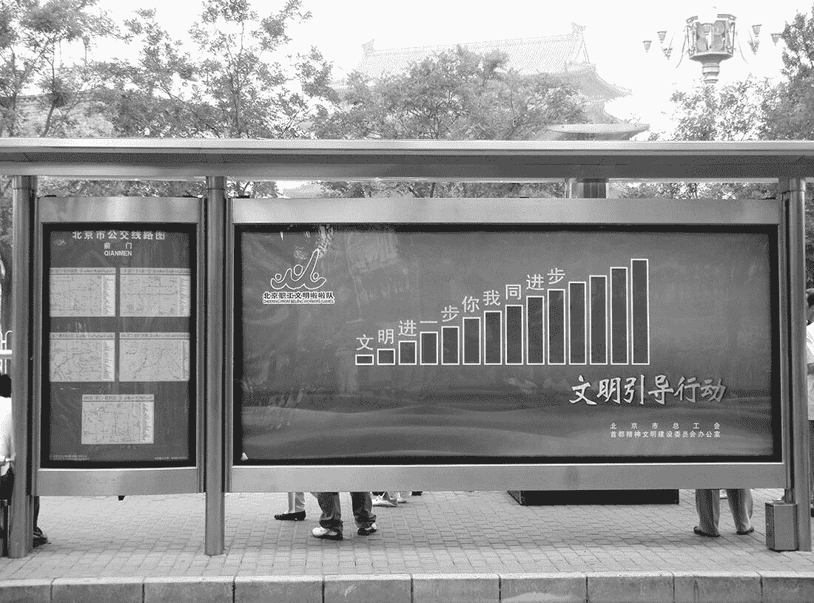

照片 11：前门车站推广文明行为的宣传告示牌。

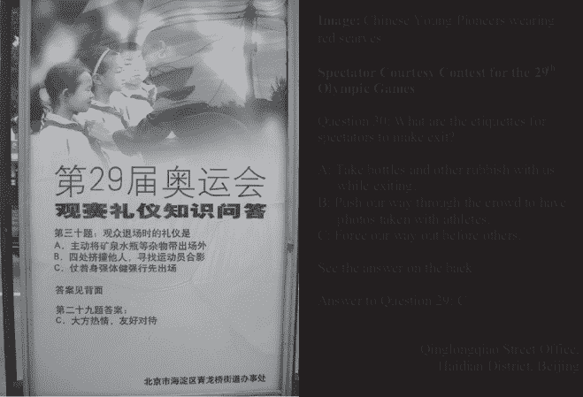

照片 12：前门车站推广观众礼仪的宣传告示牌。

### 3.2 双语标牌

在奥运会之前的北京语言景观中，官方中英文双语标牌的数量仅次于单语言标牌。根据《北京奥会语言服务规划方案》（Action Plan for the BSFLP）（(Organising Committee of the BSFLP, 2003)的要求，中英文双语标牌经过标准化，并设置在公共场所和设施中，如主要旅游景点、文化场所、商业设施、奥运场馆、公交线路、高速公路、街道、车站、地铁和机场。

#### 3.2.1 奥运志愿者服务台/站


中英文双语标识牌在与奥运志愿者服务相关的地点最为显著。2008 年北京奥运会和帕残奥会的志愿者是由 `BOCOG` 为第 XXIX 届奥林匹克运动会招募并管理的认证人员。这些关键人员在 2008 年北京奥运会和帕残奥会期间，在 `BOCOG` 分配的时间和岗位上承担了至关重要的赛事职责，且不收取任何报酬。奥运会和帕残奥会的志愿者主要在北京地区招募，其中大学生占绝大多数，此外还有部分来自相关部门的人员、各省市及自治区的居民、港澳台同胞、海外华人以及外国人。据介绍，北京奥运会和帕残奥会共招募了 100 万社会志愿者、40 万城市志愿者和 10 万期间志愿者。期间志愿者主要服务于各个奥运赛场馆（包括比赛场馆、训练馆和非比赛场馆）。他们的服务角色包括礼宾、翻译、安保、医疗、联络等。城市志愿者在设置于国内外游客经常访问的公共场所的志愿者服务站内提供信息咨询、语言翻译和应急服务（参见照片 13 & 14）。


照片 13：北京首都国际机场的奥运志愿者服务台。

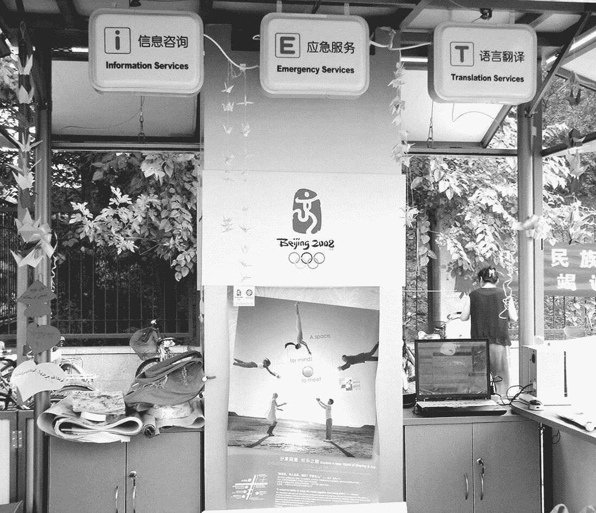

照片 14：黑竹公园的北京奥运会城市志愿者服务站。

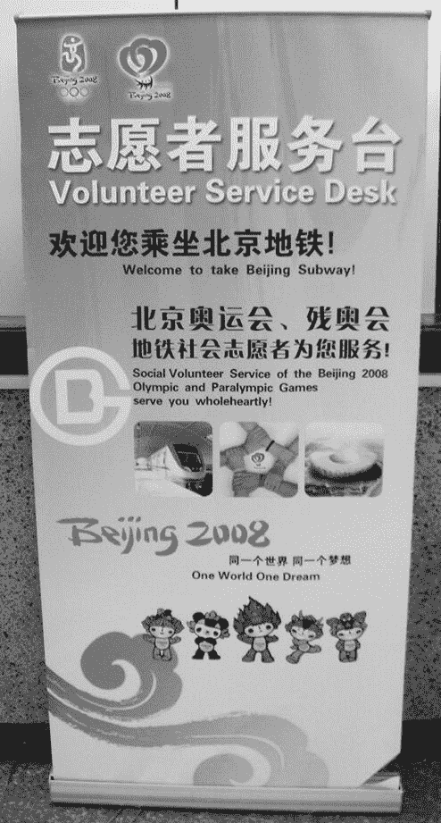

照片 15：北京地铁站的志愿者服务台。

### 3.2.2 公共交通与地铁系统

中英文双语标识在北京的公交和地铁系统中无处不在（参见照片 16 & 17）。公交车和地铁上的线路图、方向标志和警告标志均已升级为双语标识。2006 年，`BOCOG` 设立了 38 条奥运专线公交，为 16 个奥运场馆周边的志愿者和记者提供免费出行模式。乘坐这些专线路的乘客可以获得中英文双语时刻表（参见照片 18）。此外，公交车和地铁内的广播也采用中英文双语。

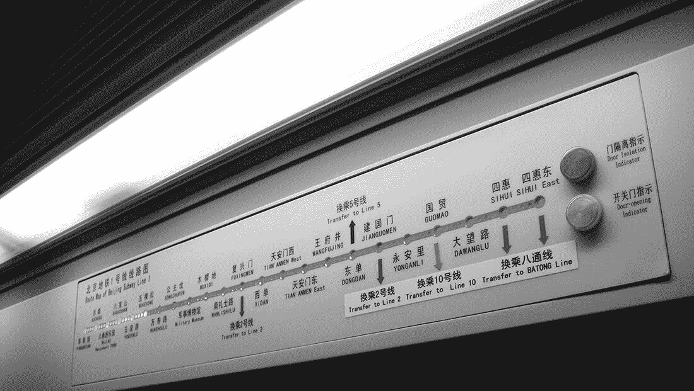

照片 16：北京地铁 1 号线双语线路图。

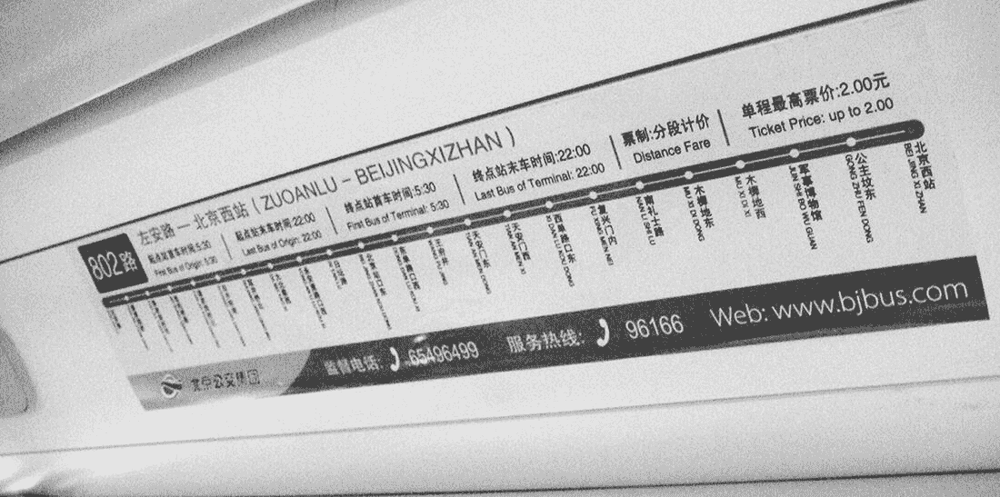

照片 17：802 路公交车内的双语线路图。

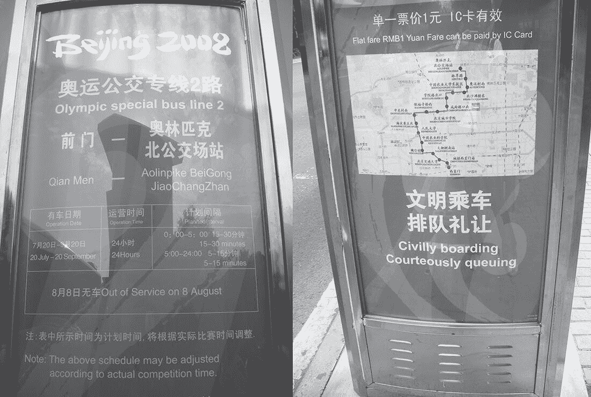

照片 18：奥运专线 2 路标识牌的正反面。

### 3.2.3 道路交通

地名英语翻译的标准化是英语标识标准化运动中最重要的部分之一。根据《公共标识英文翻译通用规范》，地名是通过结合汉语拼音和英文术语进行翻译的（参见照片 19）。汉语拼音要求全大写。英文单词必须采用大小写混合形式，即首字母大写，其余字母小写。在翻译不同类型的道路名称时，英文单词 `Avenue (Ave)` 仅用于 `长安街 (CHANG’AN Ave)` 和 `平安大街 (PING’AN Ave)` 的翻译。所有其他的 `街 (*jie*)` 和 `大街 (*dajie*)` 均翻译为 `Street (St)`，例如隆福寺街 LONGFUSI St..。`小街 (*xiaojie*)`、`条 (*tiao*)`、`巷 (*xiang*)` 和 `夹道 (*jiadao*)` 通常翻译为 `Alley`，例如东直门北小街 (DONGZHIMEN North Alley)，东四十条 (DONGSISHITIAO Alley)。`路 (*lu*)` 的英文翻译通常为 `Road (Rd)`，如北辰路 BEICHEN Rd..最后，`高速公路 (*gaosu gonglu*)` 翻译为 `Expressway (Expwy)`，而 `公路 (*gonglu*)` 则是 `Highway`。

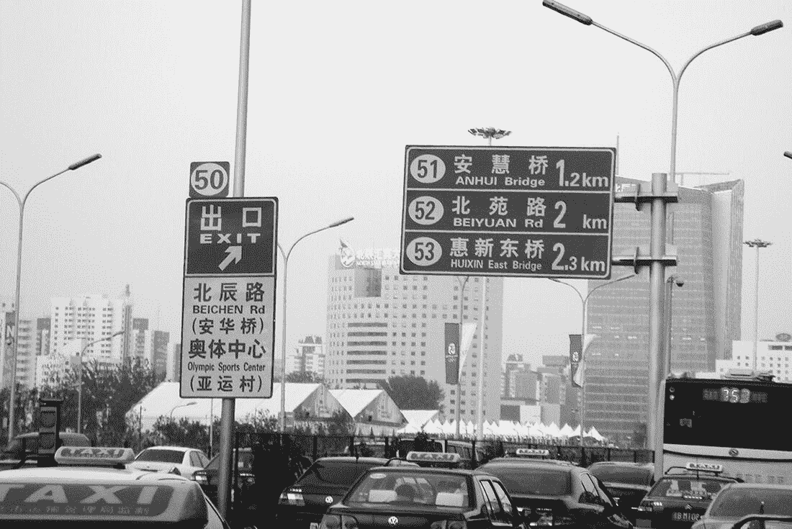

照片 19：国家体育附近的交通标志。

### 3.2.4 旅游景点

故宫位于北京中心，也被称为故宫博物院，是明清两朝的中国皇宫。1987 年，它被列为联合国教科文组织世界遗产。2008 年 8 月 8 日，我访问了故宫，调查了那里的语言服务供应。在故宫这一北京最大的旅游景点和全球参观人数最多的博物馆内，除了中文之外，英语是各种双语标识上使用的唯一语言——从票务处外的告示板、安检口处的警告标志，到故宫博物院内的触摸屏电子导览设施（参见照片 20）。

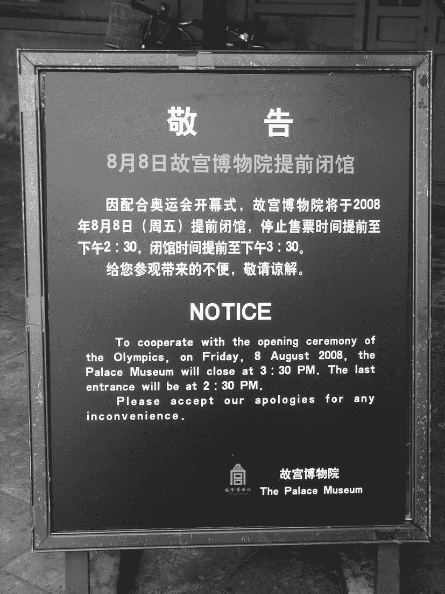

照片 20：故宫博物院的一处双语标识。

### 3.3 多语言标识

《北京奥运行动计划》(BOCOG, 2002) 要求在特定的场馆和场馆内提供多语言标识。事实上，除了英语和法语，外语言在奥运举办城市的标识系统中几乎不可见。作为国际奥委会（IOC）的官方语言，法语与英语一起出现在与赛事密切相关的特殊场馆内设置的少量官方多语言标识上。由于法语的存在主要与奥运有关，大多数多语言标识在赛后已从北京的标识系统中移除。显然，在北京奥运的背景下，北京市的语言选择倾向于英语。

## 4 语言选择、意识形态与认同


语言景观涉及无数的语言选择，正如 Piller (2007)所指出的，任何语言选择都不是中立或随意的，而是从根本上与特定的语境、意识形态和实践相联系。同样，Spolsky and Cooper (1991)和 Landry and Bourhis (1997)都指出，语言景观（LL）中的语言选择一方面可以作为重要的信息标记，另一方面也可以作为该居住地语言社区相对权力和地位的符号标记。遵循 Piller (2007)的方法，我将从三个层面（语言选择、内容和位置）对抽样的标牌进行语言选择调查，并探讨北京语言景观中哪些语言获得了可见性，以及它们具体的的功能和象征意义。

## 4.1 汉语与作为和谐之国的北京

我在北京各处重点奥运会场馆、旅游景点、商业区和交通枢纽的实地调查显示，意乎不用说，简体中文是城市语言景观中最可见、最突出的语言。国家通用语言不仅出现在单语标牌上，还出现在双语和多语言标牌的前景位置。简体中文在双/多语言标牌上总是置于首位，其字体大小通常大于其他语言。尽管北京的主要街道、车站和站点、旅游景点和关键文化遗迹处设立或更新了大量的双语和多语言标牌，但全城范围内有得多的官方和非官方的单语标牌。天安门广场的语言景观就是一个很好的例子。

2008 年 8 月 6 日，即北京奥运会开幕前两天，我参观了天安门广场，当时正在举办奥林匹花卉展。展中的图案将吉祥的中国文化元素与奥林匹克符号相结合，营造出温馨的节日氛围。天安门广场是双语标牌可见度极高的文化场所之一。然而，花卉展的围栏展览空间呈现出一个明显的单语空间。与花卉展相关的文本信息大部分以简体中文呈现，只有少数为了引导外国游客和媒体专业人士活动而认为必要的双语导向标牌。

最引人注目的标牌之一是一个高 16.9 米的 2008 年夏季奥运会官方标志——“中国印，舞动的北京”（参见照片 21），立在花坛中心。该标志借鉴了中国文化的各种元素，在“北京 2008”字样和奥林匹克五环上方描绘了一个传统的红色中国印。根据北京奥运组（2003）的介绍，印章刻有一个书法字体`京`（`Jing`，意为“首都”，源自主办城市北京），呈现出一个舞动的形象。弯曲的线条暗示了一条条跃动的中国龙，中国是中国力量、强度和好运的传统象征。这个形象像一个越过终线的跑步者。人物张开双臂象征着中国邀请世界共享其文化。标志两侧是两个巨大的红色标牌，上面上面刻有口号（参见照片 21）：“五湖四海喜庆奥运盛会 *Wuhu sihai xiqing aoyun shenghui* [热烈欢迎世界各地朋友共临北京奥运会]”和“改革开放共谱和谐篇章 *Gaige gaifang gongpu hexie pianzhang* [在改革开放中谱写和谐发展新篇章]。”“和谐”`hexie` [harmony]这一主题强调了北京奥运会的政治和经济议程。花卉展中的两个巨大的红色单语标牌对应着挂在天安门城（通常翻译为 Gate of Heavenly Peace）东西两墙上的另外两个标牌，它们用简体中文写着“中华人民共和国万岁 *Zhonghua renmin gongheguo wansu* [Long live the People’s Republic of China]”和“世界人民大团结万岁 *Shijie renmin datuanjie wansu* Long live the worldwide unity”。这两个单语口号以及位于它们之间的毛泽东像共同象征了中国党的合法性，并再次强调了“和谐”作为中国文化精髓的哲学。鉴于显而易见的单语语言选择，花卉展内和天安门城台上的信息显然是针对国内观众的。单语语言的选择是基于国家的概念。在民族国家中，“一国一语言”的意识形态（将民族认同与特定语言，通常是主导群体语言相关）是社会文化治理的常用策略（[Piller, 2007; Shohamy, 2006）。

```
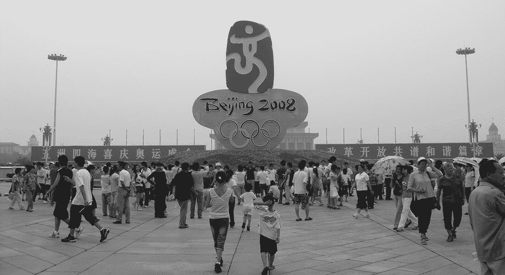
```

照片 21：2008 年夏季奥运会官方标志立于花卉展中两个巨大的标牌之间。天安门广场，2008 年 8 月 8 日。


在天安广场精心规划的语言景观（LL）中，中文（标准口语和书面语为`Putonghua`和简体中文）被用作作为统一和谐中华民族首都北京的显著身份标识。中国是世界上人口最多的国家，中国大陆拥有 13.3 亿人口，并承认 56 个在种族和社会语言学上具有多样性的“民族”（中国国家统计局, 2010）。汉族是最大的民族，占中华人民共和国（大陆）总人口的 91.51%（中国国家统计局, 2010），占北京常住人口的 95.69%（北京市统计局, 2009）。52 个少数民族居住在 60%的土地上，他们拥有自己的母语（回族、满族和畲族¹⁹除外），有时甚至是多种，总计涵盖五个语系的 100 多种语言（Tsung, 2009，第 11–12 页）。

尽管中国是一个多语言、多民族的国家，但汉语作为最大的中国民族的语言，在公共话语中被轻易地等同于“中文”。由于中国境内各地区民族和部落数千年的移民和同化，汉族具有显著的内部遗传、语言、文化和社会多样性（Wen et al, 2004）。因此，习俗上所说的“中文/汉语”是一个由各种汉语口语变体组成的语言族，这些变体在不同程度上上是互不通的。尽管存在许多互不通的口语变体，但汉族民族统一的一个因素是汉字（`Hanzi`），它们拥有统一的标准形式。这种统一性归功于秦朝，它统一了当时在中国存在的各种书写形式。数千年来，无论王朝如何更，`Hanzi`一直是所有汉语变体使用者之间通用的统一书写系统，并作为汉族与中国其他民族之间之间的的书面通用语。在当代中国，简体汉字 `Jianti hanzi` [Simplified Chinese characters] 是跨民族交流中无可争议的书面语言，也是北京及中国其他地区政府、法律和正式教育中使用的文字，尽管在技术上它仅属于一个民族——占主导地位的汉族的文字。通过这种方式，处于标准形式的统一中文（普通话和简体中文）被视为中国身份认同的基础。

简体中文的使用结合所取样标牌文本中强调的“和谐”主题，传达了政府希望通过举办奥运会来促进国家“和谐发展”的愿望。儒家“和谐”哲学主张“和而不同 `he er butong`”（字面意思是“在差异中保持和谐”），强调了多样性和平衡的重要性（[Feng, 2005）。“和谐”哲学诞生了大多数中国传统的宇宙观信仰，并鼓励了宽容、兼容、顺应、和平、统一、诚信和稳定等价值观。2006 年，在中央委员会会议上，中国共产党提出了“和谐社会 `hexie shehui` [harmonious Society]”理论，作为对国家在转型时期面临的众多社会经济问题的应对。将中国建设成和谐的社会主义社会被视为实施科学发展观的重要战略。在北京奥运会之前，“和谐”已成为中国政治话语的主要主题，因为中国中央政府重新发现“和谐”是调节社会矛盾和确保稳定的有效工具（Feng, 2005）。正是在这样的社会政治环境中，中国政府加大了推广中文（包括口语和书面语）标准使用的努力，并使其在作为奥运城市北京的语言景观中具有最高的可见度。此外，中国政府认识到推广标准汉语是中国获得软实力的重要战略，而奥运会提供了一个绝佳的契机。`北京奥运会行动计划`（BOCOG, 2002）指出，奥运会为整个中国特别是北京吸引的全球关注，可以被作为一个“向世界教和推广中文，并证明中文实际上是一种在全球范围内使用的语言”的机会。这种向世界推广“中文”并以此增强国家软实力资源的雄心，也构成了中文在北京语言景观中占据主导地位的基础。

### 4.2 英语与作为全球城市的北京

日益增实证研究表明，英语已迅速渗透到亚洲非英语现代大都市和地区的公共空间（Backhaus, 2006, 2007; Huebner, 2006; MacGregor, 2003)）以及欧洲（Griffin, 2004; Hult, 2003; Piller, 2007; Schlick, 2003; Torkington, 2009)）。我对北京语言景观的研究证实了英语在这些空间中的高可见度。除了简体中文外，英语显然在北京的语言景观中也得到了相当重视。英语几乎像中文一样无处不在，出现在交通标志牌、公交和地铁站、店面、橱窗、奥运场馆内外、旅游景点和公共建筑内、户外广告牌和其他街道广告上、手册和地图上，以及单页和菜单中。英语标牌的高度集中通常标志着一个旅游景点或想象中的英语社区经常出没公共场所。


公共标识的英文翻译是政府英语标识标准化运动的重中之重。表面上，这是为了帮助外国人更好地利用公共设施。但对北京双语公共标识的仔细研究表明，许多英文标识的符号功能大于信息功能。例如，在天安门地铁站的实地调查中，我发现了两个双语公共标识：一个是挂在通道墙上的禁令告示（参见照片 22），另一个是放置在电扶梯前的指示告示（参见照片 23）。该禁令告示包含四幅图以及中英文对照的四个短语：“禁止吸烟 *Jinzhi xiyan* [No Smoking]”、“请勿坐卧停留 *Qingwu zuowo tingliu* [No Loitering]”、“禁止摆卖 *Jinzhi baimai* [No Vendors]”以及“禁止乱扔废弃物 *Jinzhi luanreng feiqiwu* [No Littering]”。有趣的是，在离禁令告示不远的安全检查口有警察和志愿者在值守。根据我的现场观察，说英语外国的小贩不太可能出现在北京的公共场所，尤其是在北京奥运会之前和期间如此严密的监控下。事实上，说英语街头小贩在北京不太可能频繁到需要专门为他们设立禁令告示的程度。因此，这块禁令告示上出现英语更多是因为其作为国际大都市主义的符号意义，而非为了其信息和指令内容。

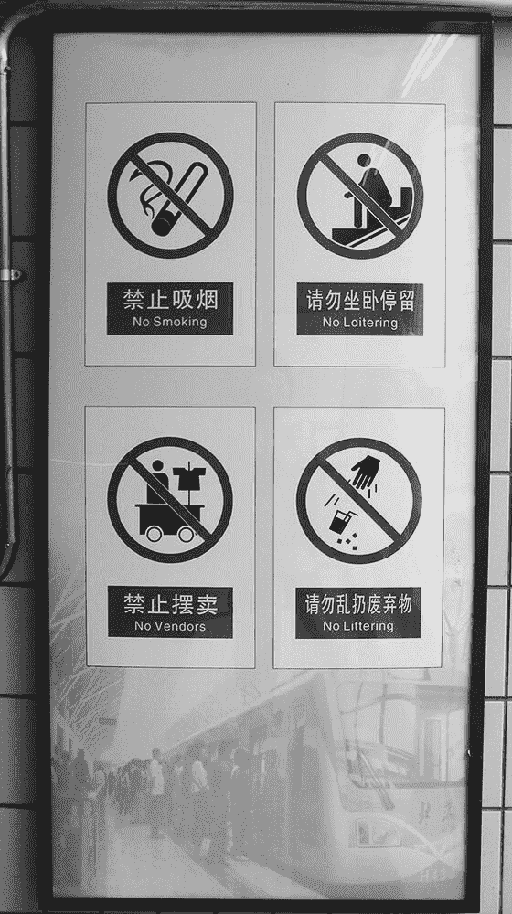

照片 22：禁令告示。天安门地铁站，2008 年 8 月 6 日。

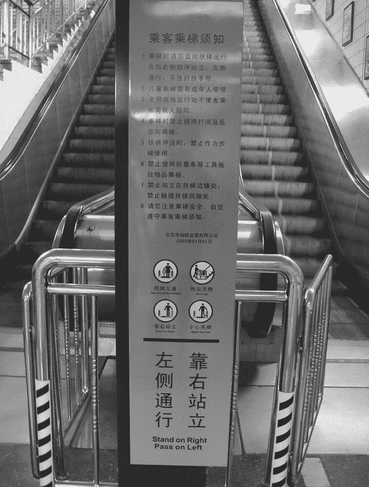

照片 23：指示告示。天安门地铁站，2008 年 8 月 6 日。

英文标识的符号功能在天安门地铁站电扶梯前的指示告示中变得更加明显（参见照片 23）。与中文文本相比，英文翻译在内容和字体大小上都被缩减到了最小。告示上半部分重点列出的给乘客八项规定没有英文翻译。在边缘位置处刻的唯一英文翻译包括“Take Care of Your Children”（照顾儿童）、“No Cargo”（禁止携带货物）、“Stand on Right”（右侧站立）、“Watch Your Foot”（注意脚下）以及“Stand on Right; Pass on Left”（右侧站立，左侧通行）。这块告示上中文的显著性表明了中文在告知公众和规范其使用电扶梯行为方面的相对重要性。可以认为，这两块告示上的英文文本几乎没有实际的信息意义，主要起到一种索引功能，作为北京作为一个新兴“全球性城市”的身份标记。

### 4.3 待售的英语与全球精英主义

通过语言景观（LL）研究语言政策也可以通过广告（Shohamy, 2006，第 133 页）。作为全球化的超中心语言，英语在非英语国家世界的商业话语中无处不在（Piller, 2012）。当广告和商业话语中使用英语代替（或辅助）国语时，它通常被用来指示现代、国际化、专业和成功的身份（Piller, 2012）。照片 24 是我在北京东方广场（亚洲最大的商业中心之一）拍摄的一个奥运会主题耐克（Nike）运动鞋的展窗。耐克总部位于美国，是世界领先的运动用品制造商。到 2008 年底，中国是耐克最大的单一来源国。中国消费者购买的大多数耐克产品都是中国制造。在中国市场的广告中使用英语，可以成功地将语言的积极联想转移到耐克产品上。

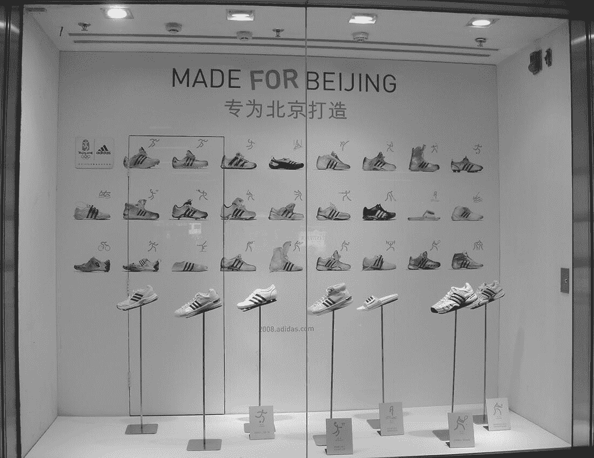

照片 24：东方广场的一个展窗。

在北京的语言景观中，英语不仅作为媒介存在，还作为内容存在。我所说的“作为内容存在”是指主要以简体中文呈现、但旨在促进英语“消费”的非官方标识：例如宣传英语培训机构的广告牌。这些广告牌上的中文文本直接面向全国受众。在很多情况下，白人形象是促销销售英语培训产品广告中不可分割的一部分。随着英语在中国语境下的商品价值不断增加，且英语培训机构在奥运会前的几年在北京到处涌现，这些广告牌越来越多地成为城市语言景观的一部分。学英语（EF）作为北京奥运官方语言服务供应商之一，通过我的实地调查观察，它是通过户外广告最积极地推销其服务的机构。例如，在王府井地铁站繁忙的通道内，我发现了一排宣传北京奥运会的霓虹灯牌。在它们旁边，一块学英语的广告牌是关注的焦点（参见照片 25）。在照片中，一个漂亮的中国女性被绳子系在一个看起来专业的白人男子身上，以一种引人注目的方式展示了广告的卖点：“24 小时‘私人英语教练’”。

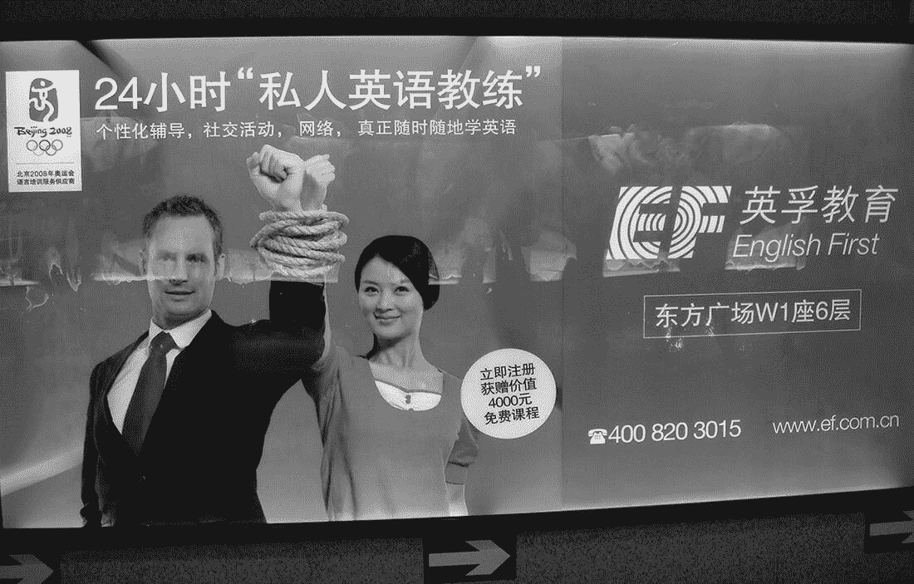

照片 25：*English First*（学英语）的广告牌。王府井地铁站，2008 年 8 月 4 日。


这则 EF（EF）广告推广了高度种族化、性别化和性化的话语。语言代码的选择和女性形象清晰地将中国年轻女性定位为目标潜在消费者。广告中白人男性与中国女性的并置构建了高桥（Takahashi, 2006）在关于“日本女性学习英语”的研究中讨论过的两种话语：一方面，穿着西装、领带的英俊西方男性被视为“令人向往且有效的英语教师”；另一方面，年轻的亚洲女性则是“对西方男性气概和作为国际语言的英语充满渴望的消费者”（第 125 页）。被系在一起的手臂象征着 EF 的个性化一对一英语课程，暗示每个人都能掌握英语，并与理想的英语母语教师拥有“亲密”的体验。作为理想“母语教师”的白人男性与作为渴望的“客户”的年轻女性之间身体上的“亲密感”，通过充满性色彩的广告口号得到了强化，暗示了与白人共度“私人”且“亲密”的时光。在身体位置上，白人男性略站在前面，用他系着的手臂引导中国女性。男人的深色西装和蓝色领带形象象征着 EF “母语教师”的质量和专业性。此外，举起的手和拳头是战斗和胜利的手势。尽管由西方男性引导，但年轻女性脸上洋溢着胜利的微笑，显示出她对这位“私人英语教师”的完全掌控和极度满意。EF 的商业广告向潜在客户暗示，其增值英语教学服务为每位中国学习者提供了一个身份转变的机会，可能还有跨种族的浪漫爱情。在右上角，使用了奥林匹克标志，以表明 EF 作为北京奥运会官方语言服务供应商的官方地位，这为其个性化英语课程提供了官方保障。

英语语言学校的这种充满性色彩的广告并非孤立案例。在高桥（2006）对 Gaba（日本扩张最快的 `eikaiwa` 即英语口会学校之一）的研究中，她分析了一幅类似的广告，画面中一名日本女性与一名白人男性戴着手铐。根据高桥 (2006)，Gaba 的 `mantsuman`（一对一）课程广告旨在吸引日本女性在时尚空间内与白人共度“私人”且“亲密”时光的渴望。与 EF 广告中由白人“母语教师”引导的中国女性不同，Gaba 广告中的日本女性被定位为权力的持有者，体现在她“会心的微笑”和“对手铐的拉拽”（(Takahashi, 2006，第 126 页）。对于日本女性来说，英语被认为是获得他们热烈渴望之物的手段——西方和西方男性。日本的英语学习已与对西方男性的浪漫渴望混合在一起（(Piller and Takahashi, 2010）。他们的日本案例以及我上面的分析表明，语言学校的广告是英语被性别化、性化和种族化的领域，用以销售英语学习和教学。通过将奥林匹克品牌充分运用，EF 将其主打的个性化英语课程推广为性别化和浪漫化的产品。

在上一节中，我证明了英语如何通过两个指示性符号被推广为想象中的国际大都市的语言，并主要作为北京作为一个全球性市的身份标记。相比之下，这则 EF 广告推广了一种母语者意识形态，在这种意识形态中，英语不是一种国际语言，而是白人母语者的财产。“母语者优越性”的意识形态在中国 EF 等外国私立语言学校中被理所当然地视为常识。这种意识形态将英语母语者合法化为理想的英语教师，并作为非母语学习者在英语学习中的理想模型。几十年来，越来越多的研究人员（例如，Brutt-Griffler and Samimy, 1999; Canagarajah, 1999; Cook, 1999; Kaplan, 1999; Kirkpatrick, 1997; Mckay, 2003; Pennycook, 1998; Phillipson, 1992; Piller, 2001) 已经证明，“母语者”并不是一个经验事实，而是一个社会建构。在许多情况下，“母语性”的本质与其说是主导群体的意识形态，不如说是语言能力。例如，Piller (2001) 坚持“母语者”意识形态应该被抛弃，因为它在语言上是一个无用的概念，在社会上与其附加的出生权心态是损害且不公平的（第 14 页）。尽管存在“母语者”，Piller (2001) 认为，早期习语言并不能保证他们作为唯一仲决者的地位。Phillipson (1992) 声称，非母语者拥有母语者可能不具备的资格，例如作为第二语言（外语）学习英语的经验（第 195 页）。Rampton (1990) 概述了关于母语者的五个专业特征，并证明了“教育或培训使一个人成为专家”（第 97 页）。母语者并不合格，也没有获得所需的“专业知识”。换句话说，培训和经验在定义教师成功方面起着更大的作用。

### 4.4 法语与奥运之城

根据《奥林匹克章程》（International Olympic Committee, 2007，页 53），法语和英语都是国际奥林匹克委员会的官方语言。除了这两个语言外，主办国语言也是奥运会期间奥林运动的官方语言。这意味着与 2008 年奥运会相关的所有公告、服务和设施都应提供三种语言版本。在北京的语言景观中，法语在公共机构发布的官方自上而下标志中的存在感远比自主社会主体发布的非官方自下而上标志要强得多。特别是在北京奥运背景下，法语主要出现在某些场所和体育馆设置的少量官方自上而下多语言标志上。这些多语言标志主要包括奥运专线标牌（参见[照片 26]）、奥运场馆外的指示牌（参见[照片 27]）以及奥运场馆入口处工作站的标识（`9781614514954-007_fig_018`）。指示牌上的法语出现与北京作为奥运举办城市的身份紧密相关。


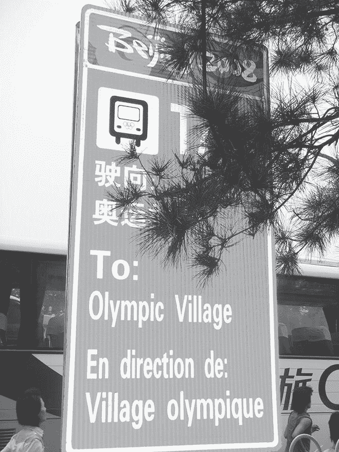

照片 26：天门广场奥运会专线巴士停站牌。

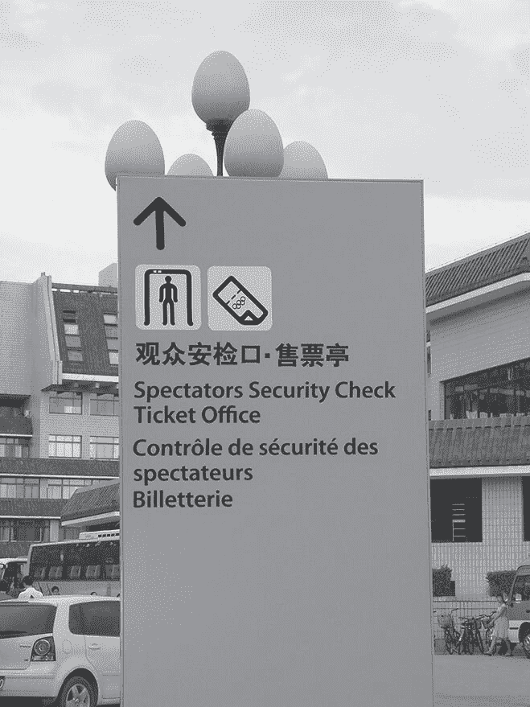

照片 27：指示牌。北京大学奥运场地的入口。

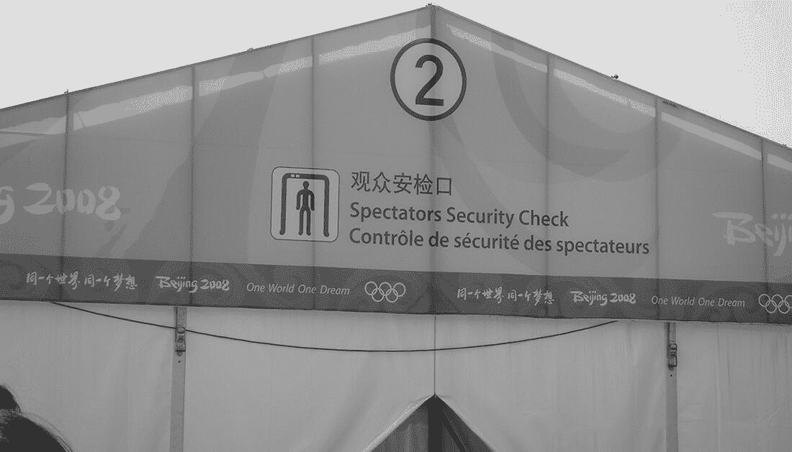

照片 28：顺义奥运赛舟赛艇公园的观众安检检查站。

此外，大多数法语标牌都是为了奥运会而临时设立的，这意味着这些标牌并不十分“固定”，因此在奥运会后就会被移除。在显著性方面，尽管多语言标牌上使用的法语字体大小与英语相同，但法语总是出现在中文和英语之后，这表明其重要性排序排名较低。在当地个人、公民或企业行为产的非官方标牌上，法语几乎缺席。法语在北京语言景观（LL）中的代表性不足和临时性，证明了市政府在城市规划中并未赋予法语与英语同等的地位。这也证明了尽管法语具有官方奥运地位，但在当地的语言实践和意识形态中，其受欢迎程度和符号资本远低于英语。

### 4.5 其他语言与隐形城市

正如前几节所讨论，北京官方规划的语言景观赋予了三种语言最高的可见性：中文（代表北京作为和谐社会的首都）、英语（代表北京作为全球城市）和法语（代表北京作为奥运城市）。与这三种语言相比，其他语言受重视程度较低，可见性有限。2008 年 8 月 7 日，即北京奥运会开幕式的前一天，前门街在经过一年的装修后重新开放。这条经过翻新的历史商业街在开业当天吸引了大量游客。街道旁设立了中英双语的标准化标牌。在街道南端，几名学生志愿者在城市志愿者服务站为游客提供信息。接待台上放着许多份《北京奥运住宿服务指南》（参见照片 29）。该指南于 2008 年 4 月 24 日发行，提供八种语言：中文、英语、日语、韩语、俄语、德语、西班牙语和阿拉伯语（《北京晚报》，2008）。然而，由于该服务站的志愿者没有会说英语以外的其他六种外语，这些出版物结果仅仅是形式。英语在北京语言景观中的主地位依然没有受到。


照片 29：《北京奥运住宿服务指南》。前门街，2008 年 8 月 8 日。

北京的主要旅游景点提供了多语言的设施和服务。2008 年 8 月 8 日，我访问了故宫，以调查那里的语言服务情况。我注意到，午门 `Wu men` 和神武门 `Shenwu men` 提供多语言语音导览服务。语音导览是一种电子设备，当游客沿路线游时，它可以自动响应并提供 20 种语言（包括普通话和粤语）的现场说明。在入口处，票务处的大型告示牌显示了该语音导览服务提供的语言（参见照片 30）。告示牌使用国旗图标配合各自语言的名称来指示可用的语音导览。国旗代表了特定语言的所属权（Piller, 2012）。显然，这种做法的背后是“一国一语”的意识形态，它将国家认同与特定语言联系起来。持有这种意识形态的人认为，“单语主义或使用单一通用语言对于社会和谐和国家统一至关重要”（Piller, 2015）。此外，语言的“母语性”通过出生与特定的国家或地区联系在一起。在告示牌上，英语在两种中文变体（普通话和粤语）之后位于所有其他语言之前，并位于其他语言的最上方，这暗示了重要性和地位的差异。英国米（Union 旗被用作英语的符号标记。这种告示牌在北京语言景观中并非孤例。在北京市旅游局官方网站（`www.english.visitbeijing.com.cn`）上，英国旗也被用作英语的符号标记。英国作为英语的出生地拥有该语言所有权的假设是不言而喻的。这种意识形态将英式英语（在某些情况下为美式英语）优于所有其他变体，意味着它本质上具有权威性，并且对于某些或所有目的更好。在一项关于瑞士旅游营销中英语的研究中，Piller (2007) 观察到了类似的做法。她认为，将语言与其所在地国家联系的做法使得小国或非国家语言的使用变得隐形。这也有解释为什么中国少数民族社区和“小众”外语社区在北京的语言景观中没有或仅有限存在。

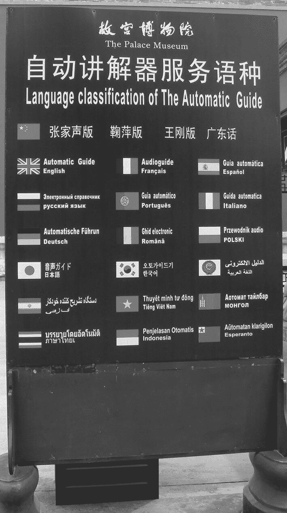

照片 30：多语言自动导服务告示牌。故宫入口，2008 年 8 月 8 日。

事实上，与许多其他社会一样，北京拥有多民族和多语言的人口，许多长期外国居民和奥运访客都来自不同的语言背景。在北京的少数民族社区中，多语言实践很常见。少数民族社区语言在北京的语言景观中基本上是隐形的，这反映了中文与少数民族语言之间的中心与边缘关系。在中国语境下，人们假设国际交流主要发生在来自经济和技术发达英语国家（特别是美国和英国）的人之间。事实上，北京超过一半的外国居民和游客来自非英语背景，主要来自两个邻近的亚洲国家：韩国和日本。然而，在奥运背景下北京语言景观的规划显示出对英语的强力偏好，而非韩语和日语（这两个大外国居民和游客群的语言，对于韩国人来说也是少数民族的语言）。声称英语在各种外国群体之间或当地中国人和外国居民之间被广泛作为通用语使用是很有争议的。尽管奥运会期间北京外国居民和游客人口内部具有多样性，但发现除英语和法语以外的其他语言在关键公共和文化空间的官方标牌上实际上不存在。中文和英语的主导地位以及其他语言的近乎隐形，反映了中国语境下不同语言之间不平等的权力关系。

### 5 总结


`LL` 为语言政策和语言使用研究提供了一个新的视角。鉴于 `LL` 作为语言政策机制的角色，在公共空间使用 `LL` 的后果是重申了处于权力之中的语言和群体，同时边缘化了其他非权权语言和群体 (Shohamy, 2006, p. 124)。北京是一个在种族和语言上都多元化的城市，但在奥运会的背景下，并非所有的语言和群体都平等地呈现。北京的 `LL` 是不同语言之间权力斗争的场所。这些斗争的结果是三种语言意识形态和身份的混合：中文象征着北京作为和谐社会的首都，英语代表北京作为全球化城市，法语则代表北京作为奥会之城。正如本章示例所示，这些语言选择进一步强化了语言与群体之间现有的权力不平等。正在进行的奥运会英语标牌标准化运动是由“标准英语”意识形态驱动的。参与该项运动的相关部门和专业人士强烈倾向于母语者变体（尤其是英式英语和美式英语），而非外圈和扩张圈非母语者的英语变体。中国政府对母语变体标准的强烈感知导致了全范围内对“中式英语”的打击，将其视为一种“低等”且“缺陷”的英语变体。官方制定了各项规章制度以标准化公共标牌、菜单和专业职称的英语翻译。关于“标准英语”的官方态度定义了何为“正确”的英语表达，这也可以从将特定语言与国旗联系的实践中推断出来。在这种实践中，英语的所有权与 `UK`（以及较少的 `US`）作为源地建立了紧密联系。在京奥运背景下，英语的商品价值导致了英语作为“内容”在广告中具有高可见度。英语学校的广告（正如 Takahashi 的研究 (2006) 所讨论的那样）呈现了性别化、性化和种族化的话语，其中白人男性“母语者”被想象成“理想的英语教师”。北京 `LL` 中体现的所有这些语言实践和意识形态，都导致了对英语定义以及英语属于谁的狭隘理解，并阻碍了对中国及全球社区文化和语言多样性的充分理解。

自 20 世纪 80 年代以来，中国的外国语言教育政策一直青睐英语，并对英语教育持中性的工具主义观点。这种英语热在 2008 年北京奥运会前夕达到了历史高潮。随着中国在本世纪第二个十年全球政治和经济地位的上升，中国外国语言教育正经历着从“英语单语主义”向以国家语言能力为导向的多语主义的意识形态转型。这种转型意味着 2022 年北京将在里程碑意义的 2008 年奥运会 `LPP` 遗产的基础上，并在多语言服务方面做出巨大努力。

# 第 8 章 中国奥运语言服务——遗产、转型与展望

现代奥运会是语言上极其复杂的活动。2008 年北京奥运会为中国语言服务业的发展提供了巨大动力，并为未来的国际和综合性体育赛事提供了语言服务的参考模型。同时，奥运会的准备工作也促使中国政策制定者和学术界反思其国家外国语言政策。随着进入人工智能（`AI`）和电信技术加速发展的时代，语言服务提供的模式转型正在悄然发生。

## 1 2008 年奥运会的语言服务遗产

2008 年北京奥运会比以往任何奥运会都了更广泛的参与和更大的观众。国际奥委会（`IOC`）主席雅克·罗在闭幕式上赞誉北京奥运会为“真正异常的运动” (Xinhua, 2008f)。国际奥委会（2009）评论道，举办 2008 年奥运会为奥林匹运动和中国带来了许多有形遗产，涵盖了基础设施、环境、健康和教育等领域。`IOC` 未提到的是，北京奥运会是语言服务业发展的一个里程碑式的事件，为非英语国家举办大型国际活动提供了宝贵经验。

### 1.1 奥运语言服务供应商

作为一种新的语言服务模式，2008 年北京奥运会语言服务提供者的建立促进了奥运会语言服务的标准化和规范化。

### 1.1.1 奥运语言培训服务供应商

2008 年北京奥运会标志着奥运历史上首次将“语言培训服务供应商”正式视为一个独立的赞助类别。这一类别在随后的在非英语国家举办的奥运会中得到了维持，且 `EF` 已成为主办国运动员、教练、裁判和官员的默认英语培训机构。自 1988 年以来，`EF` 已在七次奥运会上提供过语言培训服务（参见表 17）。在 2008 年至 2020 年间，只有两届在英语母语国家举办的奥运会没有提名 `EF` 作为其语言服务提供者，即 2010 年温哥华冬季奥运会和 2012 年伦敦夏季奥运会。²¹

表 17：过去奥运会及特奥运动会的语言服务。

| 语言服务类别 |
| --- |
| 1988 年首尔夏季奥运会官方语言学校 |
| 2008 年北京夏季奥运会官方语言培训服务供应商 |
| 2014 年俄罗斯冬季奥运会官方语言课程供应商 |
| 2016 年里约夏季奥运会官方语言培训供应商 |
| 2018 年平昌冬季奥运会官方教育服务赞助商 |
| 2019 年阿布扎比特奥运动会官方供应商及独家培训提供商 |
| 2020 年东京夏季奥运会官方语言培训服务合作伙伴 |


因此显而易见，英语一直是奥运会的主导语言，并且在不久的将来很可能继续保持这一地位，因此英语培训仍是非英语国家作为主场时奥运会语言服务的重要内容之一。英语在全球的传播导致了英语变体。在英语培训方面，奥运会语言培训服务供应商需要意识到，具有不同本地化特征的英语变体已成为现代英语的主要趋势。Graddol (1997, 1999) 和 Crystal (1997) 经常引用的统计数据表明，英语母语者的数量已经超过了母语者，因此非母语者的交流机会正在增加。最新的统计告诉我们，如今大约 80% 的口语英语是非英语母语者之间进行的。如果英语从数字上来说是“他者”的语言，那么语言的重心几乎必然向“他者”的方向转移。因此，英语教学的目的应该是帮助世界英语（Kachru, 1992）使用者（包括母语和非母语变体使用者）相互进行顺畅的交流。因此，母语者规范不仅无关，而且是奥运会以英语为媒介的跨文化交流的障碍。事实上，奥运会是高度多语言的。过去奥运会的语言服务证明，英语单语主义无法满足语言和文化多样化的奥运参与者的语言需求。在复杂的语言情况下，奥运组织者需要放弃英语单语意识形态，并在现代奥运会的语言政策和规划中嵌入多语言主义。未来，奥运会语言培训服务供应商应该考虑国际奥委会（IOC）的语言政策以及所有奥运组织者和参与者的实际语言需求，重新评估并规划其外语培训服务，并为主场国多语言交流能力的发展贡献。

### 1.1.2 北京奥运多语言服务中心，北外

北京外国语大学（BFSU）成立于 1941 年，是中国第一所专门从事外语研究的机构。该大学在 2008 年教授了 44 种外语，多于中国任何其他大学的数量。北外的外语教育水平在某种程度上代表了中国的国家外语能力。该大学利用 2008 年奥运会作为一个极佳平台，让许多学生参与翻译实践，并在校园内营造了志愿者文化。赛会期间，北外派遣了 3000 多名翻译员，他们以志愿者和有偿专业人员的双重身份参与了 2008 年北京奥运会广泛的语言服务和培训计划（Wang and Zhang, 2008）。北外译质学院（GSTI）院长王丽立（2008）称，2008 年北京为北外译质学院展示其外语教学成果（特别是翻译方面的成果）提供了一个全球平台。

对北外而言最大的有形奥运遗产是北京奥运多语言服务中心（MSC）。该中心是为奥运会设立的，但其使命远于此。与许多专为奥运会设立的设施一样，该中心在活动结束后停止了运行。但在 2010 年，北外重新开放了它，配备 3 名全职员工和 260 名学生志愿者，提供包括英语、法语、德语、俄语、阿拉伯语、西班牙语、日语和韩语在内的 8 种语言的翻译服务（Zhang, 2014）。目前，MSC 已成为北外的一个常设机构，为外国游客或当地社区的居民提供多语言服务。2008 年北京奥运会还赋予了北外许多无形遗产。它们为大学的志愿者文化奠定了基础。奥运会还促进了北外的多语言教育，学生变得更有热情学习英语以外的第二或第三种外语。

### 1.2 “北京人外语”计划

“北京人外语”计划（BSFLP）于 2002 年启动。实施以来，重要的阶段性目标和任务多年一直被纳入北京市“折子 *Zhezi* [必做]”项目中。2006 年，它被国际奥委会列入文化奥运遗产清单（Official Website of the State Council of PRC, 2007）。2008 年北京奥运后，该计划以新的行动方案继续运行。北京市外事办公室设立了国际语言环境部负责负责该计划。集中的领导体制确保了计划以标准化、制度化和可持续的方式发展（Official Website of the Beijing 2008 Olympic Games, 2012）。在操作层面，市政府动员了各种社会力量，鼓励市民尽可能参与该计划，包括数千名志愿者、180 所高校和外语培训机构、由 36 名中外专家组成的“北京人外语”计划咨询委员会、一个负责公共场所英语标识标准化的 35 人专家领先小组，以及 340 多个社会单位。同时，有 40 多家中央和地方媒体机构持续关注该计划的活动。

### 1.3 志愿者精神

2008 年奥运会鼓励了志愿者精神，并在中国留下了一批高水平专业人才。2008 年，北京奥运会组委会（BOCOG）在场馆设计与建设、体育、营销、接待、医疗服务、媒体运营、交通等多个领域的员工举办了有以来最大的世界体育赛事。根据国际奥委会（2009）的统计，有 1,125,799 人申请参加 2008 年奥运会志愿者，创下了奥运会纪录。赛会期间，10 万名志愿者在奥运和帕林匹克场馆提供各种服务，40 万名城市志愿者在指定的服务站提供信息、语言翻译和应急服务。2008 年之后，北京希望在奥运会志愿者体系的基础上，争取在三到五年内实现 20%的公众参与率，注册志愿者人数至少 200 万，人均每年志愿服务时长超过 50 小时（International Olympic Committee, 2009）。


### 2.1 北京奥运会背景下的“体用”张力

在 2008 年奥运会临近期间，由中国政府和北京奥运会组织委员会（BOCOG）指导的英语普及运动将“英语热”推向了历史高潮。那种认为英语学习可以被引入用于“体”（内在本质）而不损害中国文化“用”（外部实用性）的意识形态，开始受到来自媒体和教育工作者的批评和挑战。许多报文章表达了公众对英语在中国霸权地位日益增长的担忧。例如，南舟（2007）敦促中国政府以奥运会为平台推广汉语而非英语，并对中国外语教育政策中的英语主导地位保持警惕。林志波（2005）质疑了英语对所有中国公民的实用性，并敦促政策制定者在人才培养和选拔中放弃“仅英语”政策。张其华（2005）发布了各级招生和考试制度改革总体方案草案。该方案规定，英语考试将不再纳入全国统一的招考考试（`Gaokao`）。相反，英语考试将每年举行多次，允许学生选择参加的时间和频率，以减轻学习压力并改变中国“一生一机会”的考试制度。此外，小学一、二年级将不再有英语课。根据总体方案，所有省份都要求在 2014 年制定具体的实施措施，并在 2017 年前启动试点改革项目。近期，多个中国省市响应政府号召，宣布了多项政策举措，以降低当地高中和大学入学考试（中考 `Zhongkao` 和高考 `Gaokao`）中英语的比重。例如，北京市教育委员会（2013）建议从 2016 年开始，将高考英语考试总分从 150 分降至 100 分，中考从 120 分降至 100 分。同时，它建议允许学生每年参加两次英语考试，而不是给他们机会一次的机会。2018 年秋季学，由教育部（2018）编制的《高中课程方案及学科课程标准（2017 年版）》开始全国实施。为了优化高中课程结构，课程方案要求在原外语科目（英语、日语、俄语）的基础上增加德语、法语和西班牙语。学校可以自主选择第一外语，教育部鼓励学校创造条件提供第二外语。这意味着学生可以在高考中选择六门外语。英语考试改革引发了全国性的激烈辩论。这种对后奥运时代改革的全国性讨论反映了外语学习者个人发展需求与外语教学实践之间、国家发展需求与国家语言政策及规划之间的多层次矛盾。中国外语教育正在经历一场从“英语单语主义”或“以英语单语视角看待多元文化”（Piller, 2016b）向以国家语言能力为导向的多元语言主义的意识形态转型。

### 2.3 国家语言能力

“国家（语言）能力”这一概念最早由美国学者 Richard D. Brecht 和 A. Ronald Walton (1994)使用，指代“一个国家根据何种原因应对特定语言能力需求的能力，包括提供目前未开设或未开设的语言教学的能力”。在美国，该术语主要与对外语言能力（LOTE）相关，特别是少数民族语言（LCTLs）。


随着国家经济发展的进步和各项重大战略的实施，中国许多语言学家已将“语言能力”这一问题提升到了国家战略的高度，“国家语言能力”在过去十年中已成为研究热点。李玉明（2011） 这位将该概念引入中国的中国语言学家将其定义为“一个主权国家在处理各种国内外事务时所需的语言能力”。更具体地说，国家语言能力包括公民的个人语言能力和整体社会语言能力，还包括国家在处理政治、经济、外交、军事、科技以及文化等维度的各种国内外事务时所需的语言能力（[杨建，2015]](#chapter.xhtml_b_9781614514954-010_ref_386)）。从“语言作为资源”的角度来看，赵世奎（2016）](#chapter.xhtml_b_9781614514954-010_ref_399) 解释道，“国家语言能力”是“一个国家掌握语言资源、提供语言服务、处理语言问题、发展语言以及相关任务能力的总和”。基于对国内外国家语言能力研究的文献综述，文秋芳（2019）](#chapter.xhtml_b_9781614514954-010_ref_356) 将该概念重新定义为“政府利用语言处理涉及国家利益的国内和国际事务的能力”。根据她对“国家语言能力”的重新构概念，处理语言事务的主体是政府机构，而非个人或非政府组织。此外，这些语言事务必须涉及国家利益，并且必须通过语言手段处理，而非通过军事或其他非语言手段。

尽管对“国家语言能力”有不同的定义，但这些中国社会语言学家都一致认为，外语已成为国家发展过程中不可或缺的资源，是国家核心竞争力的组成部分，也是国家软实力的重要体现。许多中国学者（[戴国，2011]](#chapter.xhtml_b_9781614514954-010_ref_077); [李平，2010]](#chapter.xhtml_b_9781614514954-010_ref_210); [沈晓，2015]](#chapter.xhtml_b_9781614514954-010_ref_317); [文秋芳、苏珊和姜建，2011]](#chapter.xhtml_b_9781614514954-010_ref_355); [赵世奎，2015]](#chapter.xhtml_b_9781614514954-010_ref_398) 呼吁对外语规划进行战略转型，并发展中国的语言能力。然而，中国在外语资源方面仍然匮乏。尽管有大量的中国人在从事外语学习，但绝大多数是英语学习者。根据国家外语人才动态数据库的统计（[文秋芳，2019]](#chapter.xhtml_b_9781614514954-010_ref_356)），2010 年至 2015 年期间，中国高校开设了 44 门非英语外语课程，这六年的学生总人数仅为 80,000 人。到 2016 年，中国高校开设的非英语外语课程数量增加到 65 门。在 2020 年，中国高校开设了 101 门非英语外语课程，涵盖了 24 种官方语言。然而，在处理涉及国家利益的语言事务方面，中国仍然缺乏语言能力。在目前世界上使用的 6000 多种语言中，中国仅掌握 101 种语言的能力（[赵世奎，2016]](#chapter.xhtml_b_9781614514954-010_ref_399）。尽管中国在过去十年中发布了许多加强语言政策，但在 2013 年，中国高校在处理跨国事务的语言能力上取得了显著进展，开设了 26 种官方语言课程²² 语言学习人数超过了 150 万（[Goldberg, Looney, 2015]](#chapter.xhtml_b_9781614514954-010_ref_139）。李玉明（2011）](#chapter.xhtml_b_9781614514954-010_ref_211) 认为，迫切需要四类外语：第一类是国际事务中常用的语言，如英语和法语；第二类涵盖涉及国家利益的语言，如邻国、友好合作国家和竞争国家的语言；第三类是“应急响应”语言，即用于反恐、禁毒、维和和救援等需要的语言；第四类是科学研究所需的语言，可被称为“学术语言”。李玉明（2011）](#chapter.xhtml_b_9781614514954-010_ref_211) 呼吁语言学家和政策制定者关注世界各国的官方语言，特别是亚洲和非洲的语言，以及中国的跨界语言。正如 Spolsky（2004）](#chapter.xhtml_b_9781614514954-010_ref_323) 所指，“英语作为全球语言，现在是任何国家在语言政策中必须考虑的因素（91 页）”。尽管英语在国家间的交流中仍起着主要作用，英语在中国语言规划中的主导地位在短期内不会改变，但中国在理论上已向多语言主义迈出了重要一步。

## 3 后奥运时代的中国语言服务

### 3.1 中国语言服务概况

语言服务业起源于 20 世纪 80 年代的改革开放和 20 世纪 90 年代的信息技术发展。早期，语言服务的内容主要是翻译和口译。中国译界协会²³ 成立于 1982 年，是中国唯一的翻译口译全国性协会。在 2008 年北京奥运会期间，在中国译界协会和北京奥会组委会领导下，翻译和口译人员提供了 44 种语言的服务。


随着世界变得日益互联互通，全球语言服务市场经历了快速增长。2008 年北京奥运会后，中国语言服务业进入了快速发展通道。根据《2019 年中国语言服务行业发展报告》（中国翻译译员协会，2019），全球语言服务市场规模在过去十年中增长了一倍，首次达到 500 亿美元。目前，中国有 369,935 家企业将语言及与语言相关的服务纳入业务范围，其中有 9,734 家企业将语言服务列为主要业务，并被称为“语言服务提供商”（LSPs）。截至 2019 年底，LSPs 的总收入估计为 372.2 亿元人民币（约 53.6 亿美元）。这些 LSPs 在注册资本方面的差异巨大，从 10 万人民币以下到 1 亿元以上不等。总的来说，LSPs 的规模仍然较小，82.06%的企业注册资本不足 100 万元。大多数 LSPs 为私营企业，其中 55.62%位于中国东部地区，那里市场繁荣、需求巨大，特别是北京（2,231 家）、上海（2,072 家）和广州（1,111 家）。

中国的 LSPs 提供多元化的服务以促进多语言和跨文化交流。虽然翻译口译服务是它们的主要收入来源，但一些公司也涉及语言咨询、工具与应用、教育培训以及其他语言相关服务。他们服务于法律与合同、化工能源、机械制造以及建筑和矿业等广泛领域和行业，这可能是由于这些领域中外合作的增加，导致这些行业的需求更高（Luo, Meng and Lei, 2018）。中国语言服务业现在提供各种翻译服务。其中，信息技术、教育培训和政府宣传已成为语言服务提供商承接翻译订单的前三大领域，分别占比 63%、52%和 45.3%（中国翻译译员协会，2019）。

随着与“一带一路”沿线国家积极合作的推进，中国语言服务市场翻译服务的供需呈现出多元化的发展趋势。俄语、英语、阿拉伯语、德语和法语是翻译服务需求的前五个语言。除了这些主流语言，包括泰语、日语、越南语、白俄罗斯语和波兰语在内的少数语言（LCTLs）也占了需求的较高比例。在供给端（LSPs），语言服务业以常用外语为主，但近年来 LCTLs 翻译服务的日益增加。值得注意的是，语言服务提供商对专业语言人才的紧迫需求与高等院校培养的人才之间存在巨大差异。目前，中国语言服务提供商面临许多语言专业人才短缺的问题；在这方面，最紧迫需要的十种语言是意大利语、阿拉伯语、葡萄牙语、西班牙语、泰语、俄语、土其语、越南语、白俄罗斯语和菲律宾语，这些主要是“一带一路”沿线国家的语言。在《2019 年中国语言服务行业发展报告》（中国翻译译员协会，2019）中，67.3%的 LSPs 急需 LCTL 译员，85.7%的人表示很难招募 LCTL 专业人才。LCTL 译员的匮乏和人才招聘的高成本是中国 LSPs 面临的最大挑战。然而，该报告也指出，大学最紧迫需要广泛开设的前十种语言是阿尔巴尼亚语、阿塞拜语、爱斯尼亚语、白俄罗斯语、保加利亚语、波兰语、波黑语、波斯语、泰顿语和德语（中国翻译译员协会，2019）。中国高校的 LCTL 教学能力与语言服务市场的实际需求之间显然存在巨大差距。近年来，在国家政策的鼓励下，中国外国院校对 LCTL 专业的发展表现出高度热情，LCTL 专业数量增长迅速。然而，高校中 LCTL 专业的设置与分配尚未从理论和实践层面与“国家外语能力”的建设有机结合，发展性理性和缺乏整体规划的问题也随之暴露出来。因此，中国 LCTL 人才发展的紧迫任务是基于需求分析开展外语教育规划，以明确国家对 LCTL 专业人才的长期需求。

### 3.2 语言服务的标准化

自 2008 年北京奥运会以来，中国语言服务的标准化取得了进展。作为语言服务领域唯一的一国家级协会，中国翻译译员协会（TAC）通过组织制定语言服务指南，为推动行业标准化做出了大量努力（Luo, Meng and Lei, 2018）。它游说颁布翻译法，并领导了三项标准的制定工作，这些标准后来成为了国家标准，即：`翻译服务规范第 1 部分：翻译`、`翻译服务译文质量要求`以及`翻译服务规范第 2 部分：口译`。它还试点开展了 10 项规范的编写，包括：`翻译服务报价规范`、`口译服务报价规范`、`本地化服务基础术语`、`本地化服务报价规范`以及`本地化服务提供商选择规范`。此外，TAC 还赞助或参与了其他规范的编写，如《汉语专有名词翻译通用规则》、《公共服务区域英语使用指南——第一部分：通用规则》。TACTAC 还组织了专家小组编写了一本名为《本地化入门手册》的小册，旨在向语言服务用户介绍本地化服务。中国的标准化基本上是由 TAC 领导的行业发起的过程，作为行业自律的一种手段。然而，目前尚未基于上述标准的企业认证。因此，少数 LSPs 申请了国际认证或适用于相关行业框架的认证，而约 83.5%的 LSPs 在没有任何认证的情况下运营。

### 3.3 语言服务的技术创新


计算机辅助翻译（CAT）、机器翻译（MT）以及基于网络的语言服务平台的创新正在重塑中国语言服务的经济结构和增长模式（Luo, Meng and Lei, 2018）。调查结果（见图 10）显示（根据 Luo Huifang, et al. (2018)），CAT 是中国语言服务提供商（LSPs）最广泛的技术（70.6%），其中 `SDL Trados` 的用户数量最多（91.1%），其次是 `memoQ`（56.8%）。机器翻译虽仅被 17.2% 的 LSPs 使用，但预计在可预见的未来将语言服务行业产生重大影响。随着中国顶尖电子商务和科技公司（特别是百度、阿里巴巴和腾讯）向人工智能领域投入资金，机器翻译可能会随着深度神经网络研发的每一次突破而获得提振。在中国这样一个体量巨大的国家，机器翻译通常被认为是应对巨大翻译和口译需求的理想手段。事实上，该行业的一些一些主要参与者已经开发了自身的机器翻译应用，或在日常运营中采纳了此类技术。语音识别、人机对话和写作技术也取得了持续进展。中国语言服务行业还见证了基于网络的语言服务平台的发展，这些实现了资源汇聚并使交易变得简单。在接受调查的 LSPs 中，6.8% 表示他们正在开发自己的翻译工具，大部分是在线语言业务平台和项目管理应用程序。在另一项调查（中国译员协会, 2019）中，80% 的受访 LSPs 认为“使用翻译技术可以降低翻译成本”，67% 的人认为“使用翻译技术可以提高翻译质量”，58% 的人同意“使用翻译技术可以提高翻译水平”。

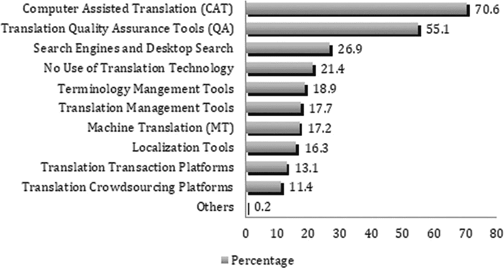

图 10：翻译技术的应用。

由于语言服务行业的传统模式要求创新和转型，信息技术在语言服务中的应用已成为主流趋势。中国的 LSPs 发现需要通过即时的业务模式升级和重新设计来重新定义其发展战略。他们意识到，随着进入信息技术的新时代，传统的思维模式、组织结构、组织行为和业务模式很快就会成为过去式。得益于少数主要参与者（它们在某些情况下已经拥有了非常强大的内部研发能力），中国语言服务行业正处于技术创新的快速车道上。这些技术创新将在服务未来的国际体育赛事（包括 2022 年冬奥会）中发挥日益重要的作用。

### 3.4 语言人才的教育与培训

语言服务市场的快速发展为译员和口译员的教育和培训提供了巨大动力。2007 年，国务院学术学位委员会批准了翻译专业硕士（MTI）学位。2018 年底，已建立起一套完整的翻译口译（T&I）教育体系，涵盖了本科、硕士和博士阶段。共有 272 个翻译口译本科专业，涉及 9 种语言：英语、法语、日语、俄语、德语、韩语、西班牙语、阿拉伯语和泰语（Zhong, 2019）。MTI 专业从 2007 年的 15 所大学增加到 249 所，涵盖 11 种外语，总招生人数接近 60,000 人（Zhong, 2019）。翻译学有 40 多个博士项目，博士毕业生超过 1,000 人（Zhong, 2019）。翻译专业人才的培训已进入大规模发展阶段。同时，如《翻译口译专业本科教学要求》和《翻译专业硕士基本要求》等一系列指南已将翻译口译教育推向标准化发展的道路。

除了几种更具声誉语言的 T&I 专业外，小语种语言（LCTLs）的培养也为中国语言服务行业提供了重要的人才储备。近年来，随着中国综合国力的增强和“一带一路”倡议的全面发展，中国政府高度重视小语种人才的培养，开启了快速发展的新纪元。在中国的外语教育中，联合国六种工作语言（中文、英语、法语、俄语、阿拉伯语和西班牙语）以及德语和日语被定义为“常用语言”。相应地，所有其他语言被称为“非常用语言”或“少用语言”（Su, 2017）。自 2001 年获得教育部批准以来，北京大学、北京外国语大学等高校开始建立小语种本科教学基地。2010 年，中国教育部（2010b）发布了 21 世纪首个国家规划——《中国教育改革发展规划纲要（2010—2020 年）》，作为指导中国改革发展的纲领性文件。该规划强调，国家应当培养大量具有国际视野、熟悉国际规则并能够参与国际事务和竞争的人才，以满足国家经济发展和开放的需求。在相关国家政策的鼓励和支持下，外语院校的数量和规模显著增加。截至 2019 年 6 月，共有 1,040 所外语类大学。在中国各省份中，江苏省和湖北省的外语院校数量位第一，均为 64 所，其次是山东（59 所）、广东（58 所）、北京（54 所）、河北（53 所）和浙江（52 所）（中国译员协会, 2020）。根据 2016 年 3 月发布的统计数据，全国有 167 所高校设有 66 个小语种专业和 391 个专业，本科生人数超过 32,000 人（Ding, 2017）。

## 4 展望 2022 年北京冬奥会

在 2015 年 7 月 31 日于马来西亚吉隆坡举行的第 128 届奥委会会议上，国际奥委会将 2022 年冬奥会授予了北京，称该市在 2008 年举办了一场“卓越”的奥运会，并承诺这次会做得更好。北京在国际奥委会投票中获得 44 票，哈萨克斯坦的城市阿拉马提获得 40 票，另有一弃票，成为首个同时举办过夏季和冬季奥运会的城市。北京 2022 旨在通过赛事创造丰富的的新遗产，同时增强 2008 年北京夏季奥运会的遗产。

### 4.1 变化的社会经济环境

#### 4.1.1 中国日益增长的全球影响力


过去十年，中国的经济实力经历了飞速增长。自 2010 年以来，中国一直是世界第二大经济体，日本也交出了其保持了 42 年的排名。中国经济的稳定增长使其成为全球经济复苏的主要引擎。根据国际货币基金组织（IMF）的数据，中国对世界经济增长的贡献不断增加，2017 年达到约 35%（Liu, 2017）。中国目标到 2020 年实现 2010 年 GDP 和人均收入翻倍，作为建设“全面小康社会”的重要组成部分（China Economic Net, 2014）。专家预测，中国在超越德国、法国、英国和日本之后，最早在 2030 年就能赶上美国。

这种日益增长的经济实力使中国在全球治理中扮演了更加积极的角色。中国于 2013 年底启动了雄心勃勃的“一带一路”倡议，旨在建立连接亚洲与中东、欧洲、非洲及其他地区的贸易和基础设施网络。该倡议由中国国家主席习近平提出，旨在重振曾经连接东西方的古代贸易路线。“一带一路”倡议正汇聚势能，已有超过 100 个国家和国际组织参与了该倡议。2019 年前三个季度，中国对“一带一路”沿线 56 个国家的新投资额达 114.6 亿美元，占该期间中国对外投资总额的 12.7%，同比增长 4 个百分点（Ministry of Commerce of the PRC, 2019）。中国与沿线国家的贸易也大幅增长。2017 年，中国与俄罗斯、波兰和哈萨克斯克的贸易额分别增长 27.7%、24.8%和 41.1%（Liu, 2017）。

中国的“一带一路”倡议为沿线地区和国家教育的深度融合提供了巨大机遇。一方面，除了英国、美国、澳大利亚和加拿大等传统主要目的地国家，“一带一路”国家也逐渐成为中国留学生的新热点。另一方面，中国已成为世界接收国际学生最多的国家，而沿线国家是中国国际学生的重要来源。2018 年，有来自 196 个国家和地区的 492,185 名留学生在中国 31 个省（自治区、直辖市）的 1,004 所高等教育机构学习²⁴，其中近一半学生来自“一带一路”国家（Ministry of Education of the PRC, 2019a）。中国国际学生的前十大来源国是：韩国、泰国、巴基斯坦、印度、美国、俄罗斯、印度尼西亚、老挝、日本和哈萨克斯坦（Ministry of Education of the PRC, 2019a）。

在已举办和即将举办的两届北京奥运会之间，中国正在从一个寻求国际认可（尤其是西方认可）的现代化国家，转变为一个在在全球政策制定和治理中争取更大话权的最大且最强大的发展中国家。自 2008 年以来，中国举办了一系列重大国际活动，如 2009 年哈尔滨冬大运动会、2010 年上海世博会、2010 年广州亚运会、2011 年深圳大运会、2014 年南京夏季青赛、2019 年北京国际植物园会和 2019 年武汉军运会。随着中国在全球治理中采取日益积极的角色，其外语思想正逐渐从“英语单一主义”（Piller, 2016b）转向以国家语言能力为导的多的多主义。

### 4.1.2 奥林匹议程 2020

尽管中国的发展战略发生了变化，奥林匹运动也在发生变化。由于规模极其巨大、兴奋剂和腐败丑闻的频发以及巨大的商业压力，奥运会的管理和组织变得日益困难。一些批评者甚至声称奥运会正成为实现奥林匹理想的障碍。由于申办程序昂贵且低效，国际奥委会（IOC）发现缺乏愿意举办奥运会的候选者，显然改革是必行的。国际奥委会对此做出了反应，推出了`奥林匹议程 2020`，这是一项使奥运会会对潜在主办地更有吸引力的改革进程`奥林匹议程 2020`（International Olympic Committee, 2014）于 2014 年 12 月 8 日和 9 日在蒙哥举行的第 127 届国际奥委会会议上一致通过。这些改革是在与奥林匹运动的所有利益相关者以及外部专家和公众经过一年的讨论和咨询后提出的。40 项详细建议就像拼图的各个碎片，组合在一起就为我们描勒出了奥林匹运动未来的清晰蓝图。`奥林匹议程 2020`涉及的关键领域包括：

1. 申办程序的变更，采用了一种新理念，即邀请潜在候选城市提交符合其体育、经济、社会和环境长期规划需求的项目。
2. 降低竞标成本，通过减少允许的演示次数并由国际奥委会提供大量的资金支持。
3. 从以运动为基础的项目转变为以活动为基础的项目。
4. 通过在《奥林匹克宪章》中加入基于性取向的不歧视，加强奥林匹克学的第六大基本原则。
5. 启动奥运频道，为奥运会之外全年 365 天的体育和运动员提供平台。
6. 根据不断变化的需求调整并进一步加强良好治理和伦理原则。
7. 运动员始终是 40 项建议的核心，保护纯洁运动员是国际奥委会理念的内核。

`奥林匹议程 2020`的实施工作已经开始。国际奥委会已开始筹备奥运频道。2024 年申办流程已启动新的邀请阶段，允许城市提交最符合其长期体育、经济、社会和环境规划的奥运项目。


作为首个充分从《2020 年奥议程》中受益的举办城市，北京 2022 年冬奥会及冬残奥组会在落实国际奥委会（IOC）阐述的新工作方式方面取得了巨大进展(新华，2018）。自申办 2022 年赛事以来，北京就规划了“纯冰雪之约”的动人愿景，强调了举办冬奥会的三个办会理念：“以运动员为中心、可持续和经济性”。这三个理念符合《2020 年奥议程》。2018 年，国际奥委会宣布了一项包含 118 项改革的宏大计划，重点关注《2020 年奥议程》中与赛事组织相关的六项建议，旨在确保赛事负担得起、受益匪浅且具有可持续性。北京 2022 冬奥会始终致力于遵守这些改革，通过举办一场“绿色、包容、开放、廉净”的赛事，履行中国举办“盛会、非凡、卓越”赛事的承诺。国际奥委会主席巴赫表示有信心，“北京 2022 冬奥会可以为可持续奥运会树立新标杆，一方面受益于 2008 年北京奥运会的遗产，另一方面以可持续的方式打造一个新的冬季运动旅游胜地”(新华，2018)。

## 4.2 语言服务行动计划

语言服务是北京冬奥会筹备工作的重要组成部分，承担着各参与群体之间进行沟通与联系的重要任务。2017 年，北京 2022 年冬奥奥会组织委员会（BOCWOG）、教育部和国家语言文字工作委员会（2017）联合发布了《北京 2022 冬奥语言服务行动计划》。《行动计划》的主要内容如下：²⁵

### 4.2.1 主要目标

> 北京 2022 冬奥会承诺遵循举办绿色、共享、开放、廉洁赛事的原则。冬奥组委会将充分发挥国家语言文字委资源优势，协调相关部门、大学、科研机构、企业和社会力量共同努力，联合举办奥林匹克赛事，为 2022 年冬奥会的成功举办营造良好的语言环境，提供高质量语言服务，展现中国语言文化的魅力，确保 2022 年北京冬奥会盛凡、非凡、卓越。

### 4.2.2 行动原则

教育部、国家语言文字委和冬奥组委会应当：

> 1. 发挥整体协调组织作用，加强与相关部门的联动，整合各方参与，推进《行动计划》的实施。

> 2. 根据本次冬奥会的语言服务需求，整合多种语言资源，充分发挥大学、科研机构、企业及相关社会力量的作用。参与方应通力、分工明确，通过共建共享形成互动发展关系。充分利用语言和信息技术发展的最新成果；通过项目实施机制促进语言服务与信息技术的紧密结合，实现“高科技奥运”。

> 及时跟进冬奥会前五年的筹备需求，及时调整和完善《行动计划》项目内容，并通过重大国际赛事活动活动测试其应用效果，从而将项目成果提升至先进水平。

### 4.2.3 重点项目

根据冬奥会筹备需求，将提前推进基础资源建设、标准建立以及城市语言环境改善的相关项目。

> 1. 发展语言技术融合与服务：开展相关术语开发工作，构建跨语种术语服务平台。在此平台基础上，开发多语言服务系统和智能`APPs`；整合语音识别与合成、机器翻译、人机对话等技术成果；构建人机智能交互平台，为冬奥会提供实时、便利、全方位的多语言服务。

> 2. 提供语言翻译与培训服务：根据冬奥会对语言服务和语言翻译的需求，组建语言专家团队对重要会议材料和文件的译文进行审核，并推荐专家对冬奥语言翻译服务供应商的公开招标进行评审。组织专家根据冬奥会需求及相关标准制定多语种培训标准。准备语言培训教材，为国内外志愿者提供语言和文化培训，并为国内技术人员、翻译员、`BOCWOG`工作人员、2022 年冬奥志愿者等提供语言培训服务。

> 3. 优化奥运语言环境：组织开展北京、张家口语言文字使用检查，并向社会公布检查结果，确保北京冬奥会的语言文字使用符合国家相关语言政策和标准。检查各冬奥场馆的英文标识，并提出修改建议。编制《2022 年北京冬奥会及冬残奥会赛事术语手册》，推进冬奥会赛事术语的标准化。设立“北京公共语言文化讲堂”，编制手册《迎动冬奥：语言与文化》。

> 4. 开展外语志愿者培训：根据冬奥会筹备及举办的语言服务需求，制定旨在提高组织能力和专业水平的外语志愿者培训计划，协调外语院校在冬奥会及期间为志愿者提供外语培训服务。

> 5. 开展冬奥语言文化展览体验项目：以“语言与运动文化”为主题，北京冬奥场地的文化展览应展示北京的文化优势，介绍冬奥会涉及的语言和文化，开展多种形式的语言文化展览体验项目。

## 4.3 奥运志愿者服务行动计划


志愿者是确保奥运会和残奥匹克会成功的重要贡献者。2019 年 5 月 10 日，北京冬委会（BOCWOG）发布了《志愿者服务行动计划》，标志着北京 2022 倒计时 1000 天的开启。在倒计时仪式上，北京 2022 执行副主席张建东表示，北京作为唯一举办过夏冬奥会的城市，将汇聚全球志愿者的智慧，举办一场“精彩、非凡、卓越的盛会”(新华，2019)）。北京 2022 于 2019 年 12 月 5 日启动了赛事期间志愿者全球招募。截至 2020 年 1 月 5 日，申请北京冬奥会的志愿者人数已超过 63 万人(新华，2020)）。

根据该计划，将启动五项志愿者服务项目，包括赛前志愿者项目、城市志愿者项目、测试赛事志愿者项目、志愿者服务遗产转化项目以及赛事期间志愿者项目。为了让广泛的公众参与，还将实施包括沟通、招募和培训在内的多计划。

`BOCWOG (2019)`](#chapter.xhtml_b_9781614514954-010_ref_041)计划为冬奥会招募 27,000 名赛事期间志愿者，为冬残奥招募 12,000 名赛事期间志愿者。赛事期间志愿者预计主要来自国内高校生、海外华侨、国际志愿者以及省级及港澳台选出的志愿者。北京冬委会还鼓励专长冬季运动的运动员申请专业志愿者岗位。

## 4.4 奥运语言服务供应商

2008 年北京奥运会的语言服务遗产在 2022 年冬奥会中得到了良好继承，不仅为建立具有相关职责的机构提供了模板，还利用了首届奥运会期间创建、如今已成熟且多维的资源和能力。

### 4.4.1 官方语言培训服务独家供应商

为了准备奥运会重返中国，EF 于 2019 年 8 月 20 日被提名为北京 2022 官方语言培训服务独家供应商（EF Education First, 2019b）。EF 在中国拥有悠久历史，在往届奥运会提供语言服务的丰富经验，使其与其他语言培训机构相比具有无比拟的优势。北京 2022 人力资源部主任严成表示，北京 2022 与 EF 将共同制定培训计划，并为北京冬委会的职人员、国家技术官员和志愿者组织一系列定制化且实用的课程，帮助他们培养全球视野并提升语言能力（EF Education First, 2019）。EF 中国区 CEOJacob Toren 表示，公司将提供符合《奥运议程 2020》的语言培训计划，重点关注遗产和可持续性。

### 4.4.2 官方自动翻译软件独家供应商

2019 年 9 月 16 日，人工智能公司科大讯飞（iFLYTEK）被宣布为 2022 年北京冬奥会和残奥会的自动翻译软件独家供应商(Cheng, 2019)。科大讯飞成立于 1999 年，专精人工智能、语音识别、自然语言处理和自主学习。近年来，他们开始将业务扩展到消费电子领域，包括一种提供 60 种语言实时翻译的便携式翻译机。公司将在赛事期间提供语音识别、语音合成和机器翻译的技术支持，例如赛事结果的多语种展示、重大活动的多语种翻译、多语种广播以及工作人员与运动员之间的机器翻译通信。北京冬委会认为，此类产品和服务将为赛事营造良好的交流环境，并有助于减少重复性工作以提高效率。讯飞控股董事长刘清峰表示，公司旨在利用先进技术帮助中国声音和故事向世界更多人传播。这是奥运会历史上“自动翻译软件供应商”首次被正式设立为一个独立的赞助类别。因此，大型国际赛事的语言服务形式已逐渐从人工翻译转向基于 AI 技术的机器翻译，以满足对及时、便利和低成本多语种服务的需求。

### 4.4.3 北京奥运多语言服务中心（北外）

“北京奥运多语言服务中心”是中国首个政府性语言服务机构，旨在为 2008 年北京奥运会提供 44 种语言的“无障碍”语言服务。赛后，中心更名为“北京多语言服务中心”，成为北京外国语大学（BFSU）的一个永久机构。在这一新身份下，中心依托北外的学生志愿者，为众多会议和活动提供多语言服务，包括 APEC 会议和广州亚运会。自 2010 年 4 月起，中心陆续与警方和急救热线建立了联系。目前，中心已设立包括英语、法语、德语、俄语、阿拉伯语、日语和韩语在内的八种常用电话，通过三方通话为首都应急热线提供语言服务，其中英语翻译服务 24 小时运行。响应中国政府建设“国家语言能力”的号召(赵, 2015)，北外致力于培养更多多语言人才并扩大语种。截至 2020 年，北外已开设 101 个外语专业，涵盖了与中国建交的 175 个国家的官方语言(北京外国语大学, 2019)。可以预计中心将为参加北京冬奥会的外国运动员、教练、裁判员和官员提供更全面的多语言服务。

## 4.5 技术支持的多语言服务

技术支持的语言服务将成为 2022 年北京冬奥会的亮点之一(教育部语言信息管理司，2018)。根据《北京 2022 语言服务行动计划》，北京语言文化大学语言资源先进创新中心（ACLP）在国家语言委员会的支持下，设立了三个北京冬奥会语言智能服务项目。

### 4.5.1 “冬奥会术语门户”项目


2019 年 12 月 11 日，“冬奥会术语门户网站 2 版”（`owgt.blcu.edu.cn`）在 2018 年 12 月 13 日交付 1 版后（ACLR, 2019），正式移交给北京冬奥会服务保障组（BOCWOG）。冬奥会术语门户项目由北京语言大学的刘和平教授管理，并成立了专家小组，由资深奥运翻译丹尼尔·格隆（Daniel Glon）担任首席专家。专家小组由 11 名成员组成，来自中国、美国、韩国、日本、俄罗斯、加拿大等国的资深术语专家、翻译专家和奥运语言服务专家。到为止，在冬奥保障组、教育部和国家语言委员会的指导下，以及专家们的努力下，2 版取得了显著成就。该门户网站共包含约 125,000 个术语，其中核心赛事术语 9,539 个，中文术语 27,022 个，英文术语 30,015 个，法语术语 19,166 个，日文术语 12,388 个，俄语术语 16,111 个，韩语术语 11,135 个，德语术语 9,539 个。该版本还增加了从《奥运语言服务风格手册》中提取的数百个专业词汇和数千常用中英文公共标识。此外，还将根据测试要求的实时添加常用词汇和术语。预计到 2021 年底，“冬奥会术语门户网站 3 版”将建成，涵盖中、英、法、日、韩、俄语对照术语。作为奥运语言服务的基础，冬奥会术语门户网站收集了大量与奥运相关的标准表达，将为主办方、参赛者和观众提供准确及时的查询服务。

### 4.5.2 “北京冬奥机器翻译”项目

“北京冬奥会机器翻译”项目由清华大学计算机与技术学院的刘杨副教授负责。该项目旨在构建机器翻译文本数据库，并基于神经网络技术为 2022 年北京冬奥会开发中英文机器翻译系统。截至 2019 年 4 月，已收集了近 130 万对高质量领域文本语料和近 20 万对口语语料（Gao, 2019）。项目组提出的同步双向翻译模型被认为能极大地提高翻译性能。目前的翻译系统在国际开放数据集和冬奥会数据集的评估中处于领先地位。该研究成果将应用于赛会相关领域；例如，文本翻译系统可以嵌入北京冬奥会官方网站。

### 4.5.3 “基于知识图谱的北京冬奥智能问答系统”项目

针对信息知识碎片化以及信息服务系统在智能化和个性化方面的不足等挑战，基于大数据知识图谱设计了北京冬奥会中文智能问答系统。2019 年 9 月 26 日，智能问答系统正式发布（Deng, 2019）。该项目构建了覆盖五类冬奥核心实体的大规模知识图谱，设计了多种类型的知识展示服务，并开发了具有语音和文本输入模式的“智能问答平台”。该系统为冬奥会提供实时、便捷的问答服务，是普及冬奥知识、推广冬奥文化的全面且三维的手段。

### 4.6 英文标识标准化

根据北京市公安局的数据，在普通工作日内，北京可能有超过 20 万名外国人，包括常住居民、访客和游客（China Daily, 2019）。随着 2022 年冬奥会的临近，北京市政府决定进一步纠正公共标识的英文翻译，以帮助外国人更好地利用公共设施，并将首都打造为更加开放、友好的城市。2017 年 6 月 20 日，国家质量监督局、教育部和国家语言委员会在北京联合召开新闻发布会，发布了《公共服务区域英语使用规范（GB/T 35302）》（中华人民共和国教育部语言信息管理司, 2017a），这是一系列旨在规范中国公共服务区域英语翻译和编写的国家标准。这些规范规定了交通、旅游、文化、娱乐、体育、教育、卫生、医疗、邮政、电信、餐饮、住宿、商业和金融等 13 个公共服务区域的英语翻译原则、方法和要求，并为这些区域的常见公共服务信息提供了标准译文。该标准于 2017 年 12 月 1 日起实施。此不久后，2017 年底又发布了《公共服务区域日语使用规范（GB/T 30240）》（中华人民共和国教育部语言信息管理司, 2017b）和《公共服务区域俄语使用规范（GB/T 35303）》（中华人民共和国教育部语言信息管理司, 2017c），并于 2018 年 7 月 1 日起实施。《公共服务区域韩语使用规范》的编编也已完成并等待发布（中华人民共和国教育部语言信息管理司, 筹备）。目前，`GB/T35302`、`GB/T30240`和`GB/T35303`构成了公共服务领域外语翻译规范系列国家标准。在这些规范的基础上，北京市政府将组织国内外语言专家修订 2007 年实施的《北京市公共标识英文翻译地方标准》，并在 2022 年冬奥会前发布一系列外语种公共标识地方标准。2018 年，首都编制了一份年度白皮书，包含 1005 个公共标识标准译文，并增加了 6061 个新译文，为外国人营造了良好环境（China Daily, 2019）。自 2018 年 3 月启动纠正公共标识翻译错误行动以来，在市 28 个热门旅游区内已识别出 2600 多处错误翻译（China Daily, 2019）。未来，全市将鼓励包括国际学校、医院和国际人才社区在内的更多机构参与纠正，不断提升国际公共服务水平。


技术创新已应用于为 2022 年冬奥会做准备的持续公共标识标准化工作中。建立了一个名为“公共标识翻译错误在线纠”的网络平台([www.interview.qianlong.com/zt/bjpubsign](http://www.interview.qianlong.com/zt/bjpubsign))用于收集、分析和纠正首都的翻译内容以提高效率。建立了一个电子数据库，用于收集和检索公共标识的标准英语译文。除了英语翻译数据库外，2022 年之前还将建立法语、西班牙语、俄语、韩语、意大利语和其他少数语言（LCTLs）的标识翻译数据库。北京市政府还鼓励外语标识形式的创新。电子屏幕、移动导航应用和智能触摸屏等新型公共标识将被使用，以最大限度地提高单位面积公共标识的信息承载量（北京日报，2019）。

## 5 总结

语言技能和服务不仅对于确保赛事期间运动员、访客和奥家庭获得优质体验至关重要，而且对于在赛后为社区和公民创造遗产如此。2008 年北京奥运会促进了中国语言服务业的快速发展，并为中国举办大型体育赛事积累了宝贵的语言服务经验。2010 年后，中国主流社会的语言观念发生了变化，转向语言作为资源的观点，这促进了以国家语言能力为导向的多语言政策的实施。在过去的十年中，中国政府加强了对少数语言（LCTL）人才的规划与培训以及语言服务的学科建设，并日益重视语言智能和语言技术的发展。今天，移动互联网、云计算、大数据和人工智能时代正悄然到来。计算机辅助翻译、机器翻译和在线语言服务平台的持续创新正在重塑中国语言服务业的结构。在此背景下，北京 2022 年冬奥会的语言服务将充分利用语言服务和信息技术发展的最新成果，实现“高科技奥运”（中华人民共和国教育部，2017）。未来，与语言相关的智能技术将在奥林匹克语言服务和其他领域发挥日益重要的作用。

# 第 9 章 结论

自 2001 年北京成功申办第 29 届夏季奥运会已二十。北京是一座活跃的城市。它的动态增长反映了整个中国的发展。随着综合实力、国际地位和影响力的不断提升，中国正在寻求在全球治理体系中发挥更大的作用。同时，中国对外语言政策重点已从“英语单语主义”转向“以国家语言能力为导向的多语言主义”。在中长期教育改革和发展规划中（中华人民共和国教育部，2010），中国政府根据国家需求，日益强调对少数语言（LCTL）人才的培养。这种国家语言政策的转型是基于从“语言即问题”导向向“语言即资源”导向的思想转变。前者认为语言多样性给社会带来麻烦，而语言同质化有利于经济增长和国家统一。形成鲜明对比的是，后者观点认为所有语言都是宝贵的社会和文化资源，并呼吁机构保护、发展和利用语言资源。2019 年 2 月 18 日，中国教育部和联合国教科文组织联合发布了《岳麓宣言》（*Yuelue xuanyan* *Yuelu Proclamation*），一份关于保护和促进世界语言多样性的文件（[中华人民共和国教育部，2019b）。作为联合国教科文组织第一个以语言多样性保护为主题的永久文件，该宣言号召国际社会达成共识并采取措施保护和促进语言多样性。语言多样性并非我们时代的新奇，而是“一直以来人类体验”（Piller, 2016a，第 30 页）。事实上，世界语言的多样性正在减少。然而，我们对语言多样性的感知增加了，因为在 21 世纪，越来越多的人每天都在体验语言多样性（Piller, 2016a）。在保护语言多样性和社会正义的前提下促进跨文化交流是我们今天面临的一个重大研究课题，也是未来研究的合适课题。

在北京 2022 年冬奥会召开之际，我们的世界正逐渐进入人工智能时代，我们需要学习人工智能如何影响我们的生活，以及我们将如何与人工智能共存。近年来，见证了神经机器翻译技术的指数级发展，多语言智能人机交互已成为语音识别领域的热点。未来，机器翻译将为母语的跨文化交流提供可能。人工智能已经改变并将继续改变不同语言背景的人的互动方式。鉴于这些发展的意义和速度，政策制定者需要站在前沿，引导语言政策和规划的未来方向。北京 2022 年冬奥会将象征并推动这座城市在语言服务技术进步方面的承诺。北京市和中国政府认识到，对变化环境带来的语言挑战做出深远、创新且全面的应对，是 21 世纪现代社会发展的本质要求。


国际组织是全球治理的重要参与者，它们为主国家参与全球治理提供了平台。国际组织的语言选择关系到成员国的权利，并可被视为国家国际声望和影响力的代表。在国际社会的社会语言学生态系统中，以英语为主的欧洲语言充当了大多数国际组织的官方语言或工作语言。尽管中文是世界上使用人数最多的语言，也是联合国六种官方语言之一，但其在国际组织中使用非常有限。其他非欧洲语言也处于类似的境地。随着 2020 年东京奥运会和 2022 年北京冬会的到来，奥林会现在进入了完全的亚洲周期。从某种意义上说，连续在亚洲举办三届奥运会告诉我们`IOC`必须承认其成员的多语言背景，并加强其非西方成员的声音。亚洲国家可能为作为全球最大盛典的奥林会提供新的语言管理和语言服务模型。北京作为首个同时举办夏季和冬季奥奥运会的城市，其经验对于未来国际组织`LPP`以及语言复杂活动语言服务的研究具有深远影响。主办国在准备和举办奥林会期间面临的语言挑战可能是人类历史上最复杂的。在奥运会期间弥合官方语言政策与实际语言实践之间差距的方法，将为超国家层面语言管理和语言服务的发展提供巨大动力，并最终有助于维护全球化世界中的语言多样性并促进跨文化交流。

在第三章中，我曾提到本书旨在基于来自中国的证据，呈现非英语国家现代奥林会`LPP`的整体图景。为了实现这一目标，我不仅对为奥运会制定的语言政策（第四章）和提供的语言服务（第五章）进行了详尽描述，还批判性地分析了主导语言意识形态如何从个人学习经历（第五章）、语言教科书（第六章）和语言景观（第七章）的角度产生语言实践的影响。这项纵向研究还使我能够观察到在中国不断变化的社会经济环境中，中国外语意识形态及相应语言政策的转型（第八章）。此外，我还尝试将中国的“语言服务”研究与西方的`LPP`研究相结合，以促进跨文化学术交流。在语言规划和管理研究中，研究语言意识形态(Joseph and Taylor, 1990; Piller, 2015; Schieffelin, Woolard and Kroskrity, 1998)或语言规划目标 (Kaplan and Baldauf, 2003)如何激励语言规划中的决策并对人们的语言实践产生影响，是非常重要的。奥林会作为一项参与广泛的国际体育赛事，在`LPP`过程中涉及多个层级的参与者。研究宏观层面（`IOC`、`BOCOG`、国家和地方政府）、中观层面（机构、媒体、教育系统、社区）和微观层面（运动员、教练、裁判员、记者、教师、志愿者、服务人员、北京市民）的参与者如何通过各种努力影响奥运会的语言地位、教育和使用也是非常重要的。值得注意的是，`LPP`研究长期以来关注宏观层面的语言政策和规划问题，即国家层面，因此是从自上而下的视角。但正如 Spolsky (2004, p. 56)所指出的，“[语]仅关注单一民族国家及其集中语言规划的语言政策研究可能会错过许多重要特征”。这种批评——与其他观点一起——催生了更多关注微观层面的方法，即调查实际的语言使用和说话者的态度。通过这种方式，`LPP`研究人员试图通过考察两者的相互作用，弥合宏观层面`LPP`与微观层面`LPP`之间的差距，并试图确定宏观层面在何种程度上以及以什么方式影响微观层面，以及微观过程如何有助于宏观目标和过程的及其维护（例如，Baldauf, 2006; Canagarajah, 2005）。因此，未来对国际体育赛事`LPP`或更广义的超国家层面`LPP`的研究，应该更加关注微观层面`LPP`参与者的主体性及其与宏观层面`LPP`的互动。

在确保语言交流效率的同时维护语言多样性，可能是 21 世纪世界面临的最大挑战之一。最后，我希望本书能吸引社会语言学家和应用语言学家，对涉及现代奥林会的语言管理、语言意识形态、语言实践和语言服务的复杂且不断变化的问题进行进一步研究。

# 参考文献

21st Century. (2008, January 14). 2008 书展：奥运会相关外语出版物广受欢迎。[`www.www.21stcentury.com.cn/story/39048.html`](http://www.www.21stcentury.com.cn/story/39048.html) (访问于 2010 年 4 月 20 日) →

ACLR. (2019, December 11). ACLR 的冬奥会术语库项目（版本 2）正式交付给北京奥奥委会。[`yuyanziyuan.blcu.edu.cn/en/info/1065/2059.htm`](http://yuyanziyuan.blcu.edu.cn/en/info/1065/2059.htm) (访问于 2020 年 2 月 6 日) →

Adamson, Bob. (2002). 中国的英语：初步文献。*World Languages*, 21(2), 349–355.

Adamson, Bob. (2002). 作为外语的英语：中国的学校。*World Languages*, 21(2), 231–243.

Adamson, Bob. (2004). 《中国的英语：中国英语史》。香港：香港大学出版社。

Agarwala, Ramgopal. (2002). 《中国的崛起：威胁还是机会？》新德里：Bookwell。

Ager, Dennis. (2005) 声与形象规划。在 Eli Hinkel (编) 《第二语言教学与研究手册》，第 57 章。马瓦，新泽西：Erlbaum。


Aifly 教育技术公司. (2008 年 8 月 22 日). Aifly 为北京奥运会培训了 150 万人。[`www.prnasia.com/pr/08/08/08530011-1.html`](http://www.prnasia.com/pr/08/08/08530011-1.html) (访问于 2009 年 9 月 18 日) a, b, c

Apple, Michael. W. (1990). 意识形态与课程 (第 2 版). 纽约；伦敦：Routledge. →

Apple, Michael. W. (1992). 文本与文化政治。《教育研究者*, 21(7), 4–19. a, b, c, d

Apple, Michael. W. (1996). 权力、意义与认同：美国教育的批判社会学。《英国教育社会学*, 17(2), 125–144. a, b

美联社. (2007 年 4 月 11 日). 糟糕英语被列入北京奥运会想要禁止的清单。[`journeyeast.org/Beijing_2008_Summer_Olympics.htm`](http://journeyeast.org/Beijing_2008_Summer_Olympics.htm) (访问于 2009 年 10 月 1 日) a, b

美联社. (2010 年 8 月 16 日). 中国超越日本成为世界第二大经济体。[`www.guardian.co.uk/business/2010/aug/16/china-overtakes-japan-second-largest-economy`](http://www.guardian.co.uk/business/2010/aug/16/china-overtakes-japan-second-largest-economy) (访问于 2010 年 12 月 14 日) →

Backhaus, Peter. (2006). 东京的多语言主义：语言景观的观察。《国际多语言期刊*, 3, 52–66. a, b, c

Backhaus, Peter. (2007). 语言景观：东京多语言主义比较研究。Clevedon；Buffalo：Multilingual Matters. →

Baldauf Jr., Richard. B. (2006). 在语言生态背景下重新阐述语言规划。《语言规划问题*, 7(2&3), 147–170. a, b

Bandura, Albert. (1986). 思维的基础：认知理论。Englewood Cliffs, N.:Prentice-Hall. a, b

Basil, Michael. D. (1996). 作为媒介的身份。《广播与电子媒体*, 40(4), 478–496. →

北京日报. (2019 年 11 月 26 日). 2022 年奥运会之前的外国语标识将完全覆盖。`https://baijiahao.baidu.com/s?id=16512323408957172&wfr=spider&for=pc` `https://baijiahao.baidu.com/s` (访问于 2020 年 2 月 3 日) →

北京晚报. (2008 年 7 月 7 日). 北京为观众提供的八语种服务。[`caofeidian.china.cn/sport/zhuanti/2008ay/2008-07/content_15967152.htm`](http://caofeidian.china.cn/sport/zhuanti/2008ay/2008-07/content_15967152.htm) (访问于 2010 年 6 月 25 日) →

北京外国语. (2019 年 9 月 23 日). 学校简介。[`www.bfsu.edu.cn/overview`](https://www.bfsu.edu.cn/overview) (访问于 2020 年 2 月 5 日) →

北京市统计局. (2007). 2007 年北京统计鉴。北京：统计出版社. →

北京市统计局. (2008). 来京游客人数。[`www.ebeijing.gov.cn/feature_2/Tourism/t105944.htm`](http://www.ebeijing.gov.cn/feature_2/Tourism/t105944.htm) (访问于 2010 年 6 月 16 日) →

北京市统计局. (2009). 2009 年北京统计鉴。北京：统计出版社. a, b

北京市统计局. (2019 年 5 月 21 日). 国内生产总值（1978–2017）。[`tjj.beijing.gov.cn/tjsj/cysj/201905/t20190521_153987.htm`](http://tjj.beijing.gov.cn/tjsj/cysj/201905/t20190521_153987.htm) (访问于 2020 年 2 月 11 日) →

北京市教育委员会. (2004). 北京的工作计划。北京市教育委员会的计划：实验性课程。`http://www.bjedu.gov.cn/publish/144/20100916402890` www.bjedu.gov.cn/publish/144/20100916402890` (访问于 2010 年 11 月) →

北京市教育委员会. (2013 年 10 月 21 日). 北京教育委员会的通知：2014 年招生咨询。`http://www.bjedu.gov.cn/publish/144/20160202143813` www.bjedu.gov.cn/publish/144/20160202143813` (访问于 2010 年 11 月) →


Blommaert, Jan. (2006). 语言政策与国家认同。在 Thomas Ricento (Ed.), *语言政策导论：理论与方法* (pp. 238–254). 牛津:Blackwell. →

Blommaert, Jan. and Ad Backus. (2013). 超多样储备与个人。在 I. de Saint-Georges and J. Weber (eds), *多语言与多模态：教育研究面临的挑战* (11–32). 鹿特丹:Sense Publishers.

北京奥委会组委会与北京市教育委员会. (2007a). *英语会会读（初级）* (第 1 版). 北京:北京范大学出版社. a, b

北京奥委会组委会与北京市教育委员会. (2007b). *英语会会读（高级）* (第 1 版). 北京:北京范范出版社. →

北京奥委会组委会. (2002, 3 月 28 日). *北京奥运会行动计划*.[`en.beijing2008.cn/59/80/column211718059.shtml`](http://en.beijing2008.cn/59/80/column211718059.shtml) (访问于 2008 年 11 月 3 日) a, b, c, d, e, f, g, h, i, j, k, l, m, n, o, p, q, r, s 北京奥委会组委会. (2019, 12 月 5 日). 关于 2022 年冬奥奥运会及残林匹克全球志愿者招募公告。[`www.beijing2022.cn/a/20191205/013659.htm`](https://www.beijing2022.cn/a/20191205/013659.htm) (访问于 2020 年 2 月 1 日) →

Bolton, Kingsley. (2002). 中国英语：从方言到全球英语。《World Englishes*, 21(2), 181–199. a, b, c, d, e, f

Bourdieu, Pierre, & Jean-Claude Passeron. (1977). *教育再生产：社会与文化*。伦敦:Sage Publications.

Bourdieu, Pierre, & John B. Thompson. (1991). *语言与符号权力*.马萨诸塞:哈佛大学出版社。 a, b, c, d, e, f, g

Bourdieu, Pierre. (1986). 资本的形式。在 John Richardson (Ed.), *教育社会学理论与研究手册* (pp. 241–258).纽约:Greenwood. a, b

Bradley, David. (2006). 中国：语言现状。在 Keith Brown (Ed.), *语言百科全* (第 2 版) (pp. 319–323). Elsevier. →

Braudy, Leo. (1986). *声名的狂热：名与历史*.纽约:哈佛大学出版社. →

Brecht, Richard D., & A. Ronald Walton. (1994). 常用语言的国家战略规划。《美国政治与社会科学纪报*, 532(1), 190–212. →

Brown, Jere. (1999). 教育动机研究：过去、现在与未来。在 Timothy C. Urdan (Ed.), *动机与成就的进展：背景的角色* (pp. 1–44). 康涅狄格州:JAL. →

Brown, Graham. (2000). 奥运赞助的新兴问题：对主办市的影响。《体育管理评论*, 3(1), 71–92. a, b

Brownell, Susan. (2005). 遭受挑战的美国：中国、女性与体育的过去与未来。《国际体育史杂志*, 22(6), 1173–1193. a, b

Brownell, Susan. (2007). 奥运会改变美国吗？挑战性的奥运会。[`en.beijing2008.cn/59/80/column211718059.shtml`](http://en.beijing2008.cn/59/80/column211718059.shtml) (访问于 2008 年 11 月 3 日) a, b, c, d, e, f, g, h, i, j, k, l, m, n, o, p, q, r, s

Brutt, Richard D., & Griffler, Keiko. (1999). 后殖民主义的后殖民：再思考。《TESOL*, 33(3), 413–431. a

Cao, Jie. (2008, 8 月 8 日). “语言学家”警察员——刘莉。[`en.beijing2008.cn/59/80/column211718059.shtml`](http://en.beijing2008.cn/59/80/column211718059.shtml)


# 参考文献

- Cheng, Yu. (2019, 9 月 16 日). AI 公司讯飞签署独家协议，为 2022 年运会提供翻译软件。[`www.chinadaily.com.cn/a/201909/16/WS5d7f3ecba310cf3e3556bb4e.html`](http://www.chinadaily.com.cn/a/201909/16/WS5d7f3ecba310cf3e3556bb4e.html) (访问于 2020 年 2 月 5 日) →

- 中国日报. (2005, 5 月 26 日). 2008 年奥运会的标准英语。[`www.chinadaily.com.cn/english/doc/2005-05/26/content_445962.htm`](http://www.chinadaily.com.cn/english/doc/2005-05/26/content_445962.htm) (访问于 2010 年 6 月 25 日) a, b, c

- 中国日报. (2019, 11 月 27 日). 北京承诺将改进城市标牌翻译工作。[`www.chinadaily.com.cn/a/201911/27/WS5dddd6a3a310cf3e3557a47f.html`](http://www.chinadaily.com.cn/a/201911/27/WS5dddd6a3a310cf3e3557a47f.html) (访问于 2020 年 1 月 16 日) a, b, c

- 中国经济网. (2014, 4 月 25 日). 中国目标在 2020 年加入“高收入国家俱乐部”。http://en.ce.cn/subject/exclusive/201404/25/t20140425_2721591.shtml](http://en.ce.cn/subject/exclusive/201404/25/t20140425_2721591.shtml) (访问于 2020 年 2 月 3 日) →

- 中国教育教育网. (2001a). 英语成为北京学前儿童的必修课。[`www.edu.cn/200111_1473/20060323/t20060323_18930.shtml`](http://www.edu.cn/200111_1473/20060323/t20060323_18930.shtml) (访问于 2008 年 6 月 15 日) →

- 中国教育教育网. (2001b). 英文版教材进入大学课堂。[`www.edu.cn/200108_1470/20060323/t20060323_14671.shtml`](http://www.edu.cn/200108_1470/20060323/t20060323_14671.shtml) (访问于 2008 年 6 月 15 日) →

- 中国国际传播研究中心. (2006). 2008 年北京奥运会与中国国家形象构建研究。[`www.qzwb.com/gb/2006-12/28/content_233828.htm`](http://www.qzwb.com/gb/2006-12/28/content_233828.htm) (访问于 2010 年 11 月 16 日) →

- Chubarov, Llya, & Dane Brooker. (2013). 通往全球城市的多条路径：功能性方法及中国近期证据述。`Cities`, 35, 181–189. a, b

- Collis, Jane. (2007). 2012 年奥运会与残奥会中语言学专员的机会。`The ATA Chronicle`, 36(8), 20–24. a, b

- Cook, Vivian. (1999). 在语言学习中超越母语语者。`TESOL Quarterly`, 33(2), 185–209. →

- CRIENGLISH. (2007, 11 月 14 日). 李阳，《疯狂》的爸爸。[`english.cri.cn/4406/2007/11/47@294362`](http://english.cri.cn/4406/2007/11/47@294362) (访问于 2009 年 8 月 20 日) →

- Crystal, David. (1997). 《作为全球语言的英语》。剑桥；纽约大学出版社。 a, b

- Cummins, Jim. (1994). 第二语言教学中的知识、权力与认同。见 Fred Genesee (编)，《教育儿童，教育社区》，第 33–60 页。剑桥；纽约大学出版社。 a, b

- Dai, Mengchun. (2011). 国家能力、语言规划与国家安全。`Applied Linguistics`(4), 123–131. a, b

- De Varennes, F. (2012). 超国家国家的语言政策。见 Bernard Spolsky (编)，《语言政策》，第 149–173 页。剑桥；剑桥大学出版社。 a, b

- Deng, Hui. (2019, 9 月 26 日). 发布“基于地图的北京奥运会系统”。[`news.gmw.cn/2019-09/26/content_331904`](http://news.gmw.cn/2019-09/26/content_331904) (访问于 2020 年 2 月 5 日) →

- Deng, Sujuan. (2009, 12 月). 珍视北京的遗产并促进城市发展。《北京月》（语言特刊），第 8–13 页。 a, b

- 中华人民共和国教育部. (2016, 9 月 24 日). 公共服务区域俄语、韩语使用指南已获批准。[`www.moe.gov.cn/s78/A19/moe_814/201609/t2016092728349`](http://www.moe.gov.cn/s78/A19/moe_814/201609/t2016092728349) (访问于 2020 年 2 月 3 日)

- 中华人民共和国教育部. (2017a). 公共服务区域英语使用指南（GB/T 30240-2017）。北京：中国标准出版社。

- 中华人民共和国教育部. (2017b). 公共服务区域日语使用指南（GB/T 35303-2017）。北京：中国标准出版社。

- 中华人民共和国教育部. (2017c). 公共服务区域俄语使用指南（GB/T 35302-2017）。北京：中国标准出版社。

- 中华人民共和国教育部. (2018, 11 月 12 日). 北京奥运会语言信息调查。[`www.moe.gov.cn/s78/A19/moe_814/201609/t2016092728349`](http://www.moe.gov.cn/s78/A19/moe_814/201609/t2016092728349) (访问于 2020 年 2 月 5 日)

- Ding, Chao. (2017). 中国小门教学外语的观察与分析。`Foreign Language Education in China`, 10(4), 3–8, 86.

- Djite, Paulin G. (1994). 《从语言政策到语言规划》。堪培：澳大利亚国家语言与识字学院。

- Djité, Paulin G. (2009). 重大中的语言政策。`Current Issues in Language Planning`, 10(2), 221–233. a, b, c, d, e

- Dong, Jinxia. (2005). 女性、民族主义与北京奥运会：为光荣准备。`The International Journal of the History of Sport`, 22(4), 530–544. a, b, c


# Dornyei, Zoltán, & Ema Ushioda. (Eds.). (2009). *动机、语言身份与二语自我*.Bristol, Buffalo and Toronto: Multilingual Matters. →

Dörnyei, Zoltán. (2005). *语言学习者的心理学：二语学习中的个体差异*.London, New Jersey: Lawrence Erlbaum. →

Duchêne, Axexandre. (2009). 营销、管理与表现：作为旅游呼叫中心商品的多语言主义。*语言政策 (Language Policy)*, 8(1), 27–50. →

Dyreson, Mark. (2003). 全球化的国家建设过程：世界历史中的现代运动。*国际体育史杂志 (International Journal of the History of Sport)*, 20(1), 91–106. a, b, c

Eccles, Jacquelynne S., & Allan Wigfield. (2002). 动机信念、价值观与目标。*心理学年鉴 (Annual Review of Psychology)*, 53, 109–132. →

EF Education First. (2019a). 2019 EF 英语能力指数。[`www.ef.com.tr/epi/`](https://www.ef.com.tr/epi/) (访问 2019 年 12 月 28 日) a, b, c, d

EF Education First. (2019b, 8 月 21 日). 北京 2022 签约 EF Education First 为官方语言培训服务独家供应商。[`en.prnasia.com/releases/apac/beijing-2022-signs-ef-education-first-as-official-language-training-services-exclusive-supplier-255204.shtml`](https://en.prnasia.com/releases/apac/beijing-2022-signs-ef-education-first-as-official-language-training-services-exclusive-supplier-255204.shtml) (访问 2020 年 1 月 15 日)

en.olympic.cn. (2006, 8 月 10 日, 2006). 申办 2008 年奥运会。[`english.cri.cn/3126/2006/08/10/269@125226.htm`](http://english.cri.cn/3126/2006/08/10/269@125226.htm) (访问 2019 年 8 月 20 日) a, b, c

English First. (2007, 3 月 26 日). EF 英语支持北京 2008 奥运会并帮助中国与世界对话。[`www.ef.com/master/about_ef/press/news_26_03_07.asp`](http://www.ef.com/master/about_ef/press/news_26_03_07.asp) (访问 2011 年 3 月 31 日) a, b, c, d, e

English First. (2008a). EF 英语第一奥运英语。[`www.ef.com.cn/englishfirst/englishstudy/olympics.aspx?lng=en`](http://www.ef.com.cn/englishfirst/englishstudy/olympics.aspx?lng=en) (访问 2009 年 9 月 18 日) →

English First. (2008b). *EF 英语第一简介，演示与视频*.中国: English First. →

English First. (2009a, 10 月 23 日). EF Education First 将成为`Olá, Turista`（你好，游客）项目的官方语言课程提供商。[`www.ef-australia.com/corporate/news/world-cup/`](http://www.ef-australia.com/corporate/news/world-cup/) (访问 2011 年 4 月 20 日) →

English First. (2009b, 7 月 17 日). EF 被选为 2010 年第 16 届亚运会语言培训供应商。[`www.sz-ef.com/news.asp?ID=21&classId=1`](http://www.sz-ef.com/news.asp?ID=21&classId=1) (访问 2010 年 11 月 19 日) →

English First. (2010a). 关于 EF。[`www.ef.com.cn/englishfirst/about/aboutef.aspx`](http://www.ef.com.cn/englishfirst/about/aboutef.aspx) (访问 2010 年 11 月 16 日) →

English First. (2010b). EF 中国首页。[`www.ef.com.cn/englishfirst/default.aspx?lng=en`](http://www.ef.com.cn/englishfirst/default.aspx?lng=en) (访问 2010 年 11 月 16 日) →

English First. (2010c). 企业语言培训。[`www.ef.com.cn/englishfirst/corporate.aspx`](http://www.ef.com.cn/englishfirst/corporate.aspx) (访问 2010 年 11 月 16 日) a, b

English First. (2011a). EF 是 2008 年奥运会的官方供应商。[`www.ef.com.cn/englishfirst/olympics.aspx`](http://www.ef.com.cn/englishfirst/olympics.aspx) (访问 2011 年 4 月 20 日) →

English First. (2011b). EF 英语第一商务英语。[`www.ef.com.cn/englishfirst/business.aspx`](http://www.ef.com.cn/englishfirst/business.aspx) (访问 2011 年 4 月 20 日) →

English First. (2011c). EF 英语第一青少年英语。[`www.ef.com.cn/englishfirst/kids.aspx`](http://www.ef.com.cn/englishfirst/kids.aspx) (访问 2011 年 4 月 20 日) →

English First. (2011d). EF 英语第一备考英语。[`www.ef.com.cn/englishfirst/exams.aspx`](http://www.ef.com.cn/englishfirst/exams.aspx) (访问 2011 年 4 月 20 日) →

English First. (2011e). EF 英语第一雅思培训。[`www.ef.com.cn/englishfirst/ielts.aspx`](http://www.ef.com.cn/englishfirst/ielts.aspx) (访问 2011 年 4 月 20 日) →

English First. (2011f). EF 英语第一托福培训。[`www.ef.com.cn/englishfirst/toefl.aspx`](http://www.ef.com.cn/englishfirst/toefl.aspx) (访问 2011 年 4 月 20 日) →

English First. (2011g). EF 英语第一剑桥英语。[`www.ef.com.cn/englishfirst/cambridge.aspx`](http://www.ef.com.cn/englishfirst/cambridge.aspx) (访问 2011 年 4 月 20 日) →

English First. (2011h). EF 英语第一多福培训。[`www.ef.com.cn/englishfirst/delft.aspx`](http://www.ef.com.cn/englishfirst/delft.aspx) (访问 2011 年 4 月 20 日) →

English First. (2011i). EF 英语第一职业英语。[`www.ef.com.cn/englishfirst/career.aspx`](http://www.ef.com.cn/englishfirst/career.aspx) (访问 2011 年 4 月 20 日) →

English First. (2011j). EF 英语第一旅游英语培训。[`www.ef.com.cn/englishfirst/travel.aspx`](http://www.ef.com.cn/englishfirst/travel.aspx) (访问 2011 年 4 月 20 日) →

English First. (2011k). EF 英语第一口语培训。[`www.ef.com.cn/englishfirst/speaking.aspx`](http://www.ef.com.cn/englishfirst/speaking.aspx) (访问 2011 年 4 月 20 日) →

English First. (2011l). EF 英语第一写作能力培训。[`www.ef.com.cn/englishfirst/writing.aspx`](http://www.ef.com.cn/englishfirst/writing.aspx) (访问 2011 年 4 月 20 日) →

English First. (2011m). EF 英语第一阅读能力培训。[`www.ef.com.cn/englishfirst/reading.aspx`](http://www.ef.com.cn/englishfirst/reading.aspx) (访问 2011 年 4 月 20 日) →

English First. (2011n). EF 英语第一听力能力培训。[`www.ef.com.cn/englishfirst/listening.aspx`](http://www.ef.com.cn/englishfirst/listening.aspx) (访问 2011 年 4 月 20 日) →

English First. (2011o). EF 英语第一语法能力培训。[`www.ef.com.cn/englishfirst/grammar.aspx`](http://www.ef.com.cn/englishfirst/grammar.aspx) (访问 2011 年 4 月 20 日) →

English First. (2011p). EF 英语第一词汇能力培训。[`www.ef.com.cn/englishfirst/vocabulary.aspx`](http://www.ef.com.cn/englishfirst/vocabulary.aspx) (访问 2011 年 4 月 20 日) →

English First. (2011q). EF 英语第一文化能力培训。[`www.ef.com.cn/englishfirst/culture.aspx`](http://www.ef.com.cn/englishfirst/culture.aspx) (访问 2011 年 4 月 20 日) →

English First. (2011r). EF 英语第一交流能力培训。[`www.ef.com.cn/englishfirst/communication.aspx`](http://www.ef.com.cn/englishfirst/communication.aspx) (访问 2011 年 4 月 20 日) →

English First. (2011s). EF 英语第一自信能力培训。[`www.ef.com.cn/englishfirst/confidence.aspx`](http://www.ef.com.cn/englishfirst/confidence.aspx) (访问 2011 年 4 月 20 日) →

English First. (2011t). EF 英语第一动力能力培训。[`www.ef.com.cn/englishfirst/motivation.aspx`](http://www.ef.com.cn/englishfirst/motivation.aspx) (访问 2011 年 4 月 20 日) →

English First. (2011u). EF 英语第一身份能力培训。[`www.ef.com.cn/englishfirst/identity.aspx`](http://www.ef.com.cn/englishfirst/identity.aspx) (访问 2011 年 4 月 20 日) →

English First. (2011v). EF 英语第一策略能力培训。[`www.ef.com.cn/englishfirst/strategy.aspx`](http://www.ef.com.cn/englishfirst/strategy.aspx) (访问 2011 年 4 月 20 日) →

English First. (2011w). EF 英语第一学习能力培训。[`www.ef.com.cn/englishfirst/learning.aspx`](http://www.ef.com.cn/englishfirst/learning.aspx) (访问 2011 年 4 月 20 日) →

English First. (2011x). EF 英语第一评估能力培训。[`www.ef.com.cn/englishfirst/assessment.aspx`](http://www.ef.com.cn/englishfirst/assessment.aspx) (访问 2011 年 4 月 20 日) →

English First. (2011y). EF 英语第一反馈能力培训。[`www.ef.com.cn/englishfirst/feedback.aspx`](http://www.ef.com.cn/englishfirst/feedback.aspx) (访问 2011 年 4 月 20 日) →

English First. (2011z). EF 英语第一调整能力培训。[`www.ef.com.cn/englishfirst/adjustment.aspx`](http://www.ef.com.cn/englishfirst/adjustment.aspx) (访问 2011 年 4 月 20 日) →

English First. (2012a). EF 英语第一反思能力培训。[`www.ef.com.cn/englishfirst/reflection.aspx`](http://www.ef.com.cn/englishfirst/reflection.aspx) (访问 2011 年 4 月 20 日) →

English First. (2012b). EF 英语第一自主能力培训。[`www.ef.com.cn/englishfirst/autonomy.aspx`](http://www.ef.com.cn/englishfirst/autonomy.aspx) (访问 2011 年 4 月 20 日) →

English First. (2012c). EF 英语第一协作能力培训。[`www.ef.com.cn/englishfirst/collaboration.aspx`](http://www.ef.com.cn/englishfirst/collaboration.aspx) (访问 2011 年 4 月 20 日) →

English First. (2012d). EF 英语第一批判性能力培训。[`www.ef.com.cn/englishfirst/critical.aspx`](http://www.ef.com.cn/englishfirst/critical.aspx) (访问 2011 年 4 月 20 日) →

English First. (2012e). EF 英语第一创造性能力培训。[`www.ef.com.cn/englishfirst/creativity.aspx`](http://www.ef.com.cn/englishfirst/creativity.aspx) (访问 2011 年 4 月 20 日) →

English First. (2012f). EF 英语第一全球化能力培训。[`www.ef.com.cn/englishfirst/global.aspx`](http://www.ef.com.cn/englishfirst/global.aspx) (访问 2011 年 4 月 20 日) →

English First. (2012g). EF 英语第一跨文化能力培训。[`www.ef.com.cn/englishfirst/cross.aspx`](http://www.ef.com.cn/englishfirst/cross.aspx) (访问 2011 年 4 月 20 日) →

English First. (2012h). EF 英语第一数字化能力培训。[`www.ef.com.cn/englishfirst/digital.aspx`](http://www.ef.com.cn/englishfirst/digital.aspx) (访问 2011 年 4 月 20 日) →

English First. (2012i). EF 英语第一媒体素养培训。[`www.ef.com.cn/englishfirst/media.aspx`](http://www.ef.com.cn/englishfirst/media.aspx) (访问 2011 年 4 月 20 日) →

English First. (2012j). EF 英语第一问题解决能力培训。[`www.ef.com.cn/englishfirst/problem.aspx`](http://www.ef.com.cn/englishfirst/problem.aspx) (访问 2011 年 4 月 20 日) →

English First. (2012k). EF 英语第一领导力能力培训。[`www.ef.com.cn/englishfirst/leadership.aspx`](http://www.ef.com.cn/englishfirst/leadership.aspx) (访问 2011 年 4 月 20 日) →

English First. (2012l). EF 英语第一适应性能力培训。[`www.ef.com.cn/englishfirst/adaptation.aspx`](http://www.ef.com.cn/englishfirst/adaptation.aspx) (访问 2011 年 4 月 20 日) →

English First. (2012m). EF 英语第一韧性能力培训。[`www.ef.com.cn/englishfirst/resilience.aspx`](http://www.ef.com.cn/englishfirst/resilience.aspx) (访问 2011 年 4 月 20 日) →

English First. (2012n). EF 英语第一创新性能力培训。[`www.ef.com.cn/englishfirst/innovation.aspx`](http://www.ef.com.cn/englishfirst/innovation.aspx) (访问 2011 年 4 月 20 日) →

English First. (2012o). EF 英语第一批判思维能力培训。[`www.ef.com.cn/englishfirst/thinking.aspx`](http://www.ef.com.cn/englishfirst/thinking.aspx) (访问 2011 年 4 月 20 日) →

English First. (2012p). EF 英语第一情感智能能力培训。[`www.ef.com.cn/englishfirst/emotional.aspx`](http://www.ef.com.cn/englishfirst/emotional.aspx) (访问 2011 年 4 月 20 日) →

English First. (2012q). EF 英语第一社会责任能力培训。[`www.ef.com.cn/englishfirst/social.aspx`](http://www.ef.com.cn/englishfirst/social.aspx) (访问 2011 年 4 月 20 日) →

English First. (2012r). EF 英语第一可持续发展能力培训。[`www.ef.com.cn/englishfirst/sustainable.aspx`](http://www.ef.com.cn/englishfirst/sustainable.aspx) (访问 2011 年 4 月 20 日) →

English First. (2012s). EF 英语第一全球公民能力培训。[`www.ef.com.cn/englishfirst/citizen.aspx`](http://www.ef.com.cn/englishfirst/citizen.aspx) (访问 2011 年 4 月 20 日) →

English First. (2012t). EF 英语第一未来学习能力培训。[`www.ef.com.cn/englishfirst/future.aspx`](http://www.ef.com.cn/englishfirst/future.aspx) (访问 2011 年 4 月 20 日) →

English First. (2012u). EF 英语第一终身学习能力培训。[`www.ef.com.cn/englishfirst/lifelong.aspx`](http://www.ef.com.cn/englishfirst/lifelong.aspx) (访问 2011 年 4 月 20 日) →

English First. (2012v). EF 英语第一自我学习能力培训。[`www.ef.com.cn/englishfirst/self.aspx`](http://www.ef.com.cn/englishfirst/self.aspx) (访问 2011 年 4 月 20 日) →

English First. (2012w). EF 英语第一目标驱动能力培训。[`www.ef.com.cn/englishfirst/goal.aspx`](http://www.ef.com.cn/englishfirst/goal.aspx) (访问 2011 年 4 月 20 日) →

English First. (2012x). EF 英语第一兴趣驱动能力培训。[`www.ef.com.cn/englishfirst/interest.aspx`](http://www.ef.com.cn/englishfirst/interest.aspx) (访问 2011 年 4 月 20 日) →

English First. (2012y). EF 英语第一需求驱动能力培训。[`www.ef.com.cn/englishfirst/need.aspx`](http://www.ef.com.cn/englishfirst/need.aspx) (访问 2011 年 4 月 20 日) →

English First. (2012z). EF 英语第一热情驱动能力培训。[`www.ef.com.cn/englishfirst/passion.aspx`](http://www.ef.com.cn/englishfirst/passion.aspx) (访问 2011 年 4 月 20 日) →


-   冯智军. (2005 年 3 月 23 日). “和谐”的哲学。《人民日报》(海外版)。[`english.peopledaily.com.cn/200503/23/eng20050323_177974.html`](http://english.peopledaily.com.cn/200503/23/eng20050323_177974.html) (访问于 2009 年 2 月 28 日) a, b

-   北京市人民政府外事办公室. (2006 年 12 月 1 日). 北京市公共标识英语翻译地方标准。[`www.bjenglish.net.cn/specialreports/english/standard/`](http://www.bjenglish.net.cn/specialreports/english/standard/) (访问于 2010 年 5 月 30 日) →

-   北京市人民政府外事办公室. (2007a，8 月 30 日). 关于加强北京“窗口”服务行业北京英语考试（BETS）组织工作的通知。[`www.bjenglish.net.cn/specialreports/examination/Q_A/2007-08/30430.shtml`](http://www.bjenglish.net.cn/specialreports/examination/Q_A/2007-08/30430.shtml) (访问于 2010 年 11 月 11 日) →

-   北京市人民政府外事办公室. (2007b). 北京市中文菜单英语翻译标准。[`www.bjenglish.net.cn/specialreports/english/standard/2008-09/12580.shtml`](http://www.bjenglish.net.cn/specialreports/english/standard/2008-09/12580.shtml) (访问于 2010 年 5 月 30 日)

-   北京市人民政府外事办公室. (2007c). 关于将北京英语考试纳入北京专业英语水平测试体系的。[`www.bjenglish.net.cn/specialreports/examination/Q_A/2007-08/30428.shtml`](http://www.bjenglish.net.cn/specialreports/examination/Q_A/2007-08/30428.shtml) (访问于 2008 年 11 月 3 日) →

-   北京市人民政府外事办公室. (2008a，8 月 1 日). 北京市机构名称及行政、专业职称英语翻译地方标准。[`www.bjenglish.net.cn/specialreports/english/standard/2009-01/13586.shtml`](http://www.bjenglish.net.cn/specialreports/english/standard/2009-01/13586.shtml) (访问于 2010 年 5 月 30 日) →

-   北京市人民政府外事办公室. (2008b，7 月 17 日). 英语标识标准化宣传活动报告（11 号）。[`www.bjenglish.net.cn/specialreports/english/trends/2008-08/07572.shtml`](http://www.bjenglish.net.cn/specialreports/english/trends/2008-08/07572.shtml) (访问于 2010 年 5 月 30 日) a, b, c, d, e

-   《外交政策》，A. T. Kearney 与芝加哥全球事务委员会. (2008). 2008 年全球城市指数。《外交政策》（11 月/12 月），68–76。 →

-   Fraser, Benson P. & William J. Brown. (2002). 媒体、名人与社会影响：对埃尔维斯·普雷斯利的认同。《大众传播与社会》，5(2), 183–206. a, b, c, d, e

-   Freeden, Michael. (2003). *意识形态：极简导读》。牛津；纽约：牛津大学出版社。 a, b

-   北京法国文化中心. (2013 年 4 月 8 日). Fayu, Aolinpike De Yuyan [法语，奥林匹会的语言]。[`bj.xdf.cn/publish/portal/24/tab15295/info73579.htm`](http://bj.xdf.cn/publish/portal/24/tab15295/info73579.htm) (访问于 2020 年 11 月 1 日) →

-   Friedman, Thomas L. (2006). *世界是平的：21 世纪简史*（第 1 版更新增版）。纽约：Farrar, Straus and Giroux。 →

-   Friedmann, John & Goetz Wolf. (1982). 世界城市的形成：研究议程。《国际城市与区域研究期刊》，6, 309–344. →

-   Friedmann, John. (1986). 世界城市。《发展与变化》，17, 69–83. a, b

-   Fu, Bonan. (2001). 城市基础设施中的英语建设。《城市经济》（J1），58–79. →

-   Gao, Er. (2019 年 4 月 9 日). 跨文化背景下的英语。[`bj.xdf.cn/publish/portal/24/tab15295/info73579.htm`](http://bj.xdf.cn/publish/portal/24/tab15295/info73579.htm) (访问于 2020 年 11 月 1 日) →

-   Gao, Yihong. (2009). 全球化背景下的英语。在 Jane Bianco & Gao Yihong (编)，《英语与全球化的困境》，第 56–78 页。→

-   Gardner, Robert C. (1985). 英语学习的态度。《语言心理学》，3(1)。→

-   Gorter, Durk. (2006). 语言景观作为一种新方法。《多语言主义研究杂志》，3(1), 1–6. a, b

-   Graddol, David. (1997). 母语使用者的衰落。在 D. Graddol & U. Meinhof (编)，《变革世界中的英语》，第 13 卷，第 57–68 页。Guildford：AILA。 →

-   Graddol, David. (2008). 21 世纪英语的未来？英语预测指南。伦敦：英国文化。 →

-   Griffin, Jeffrey L. (2004). 罗马街道上的书面英语。《英语今日》，20(02), 3–8. →

-   Gui, Tao, Dai Ying. (2008 年 8 月 9 日). 罗杰：北京奥运会开幕式为法语提供了“重要地位”。[`bj.xdf.cn/publish/portal/24/tab15295/info73579.htm`](http://bj.xdf.cn/publish/portal/24/tab15295/info73579.htm) (访问于 2020 年 11 月 1 日) →

-   Guo, Xiaoyong. (2010). 中国语言服务行业的发展现状、问题及对策：在 2010 年中国国际语言服务行业大会上的主旨演讲。《中国译者杂志》(6), 34–37. →


Hall, Peter. (1966). *世界城市 (The World Cities)*。伦敦：Weidenfeld and Nicolson. a, b

Hanson, John. (1997). 众语言之母：对大卫·克里斯蒂《作为全球语言的英语》的评述。《高等教育辅助杂志 (Times Higher Education Supplement)》，1288, 22. →

He, Na. (2010, 8 月 5 日). 热衷学英语引发质量问题。《中国日报 (China Daily) [`www.chinadaily.com.cn/china/2010-08/05/content_11098499.htm`](http://www.chinadaily.com.cn/china/2010-08/05/content_11098499.htm)]`（访问于 2011 年 4 月 28 日） →

Heller, Monica & Alexandre Duchêne. (2016). 将语言视为经济资源：话语、数据与辩。收于 Nikolas Coupland (编)，*社会语言学：理论争论 (Sociolinguistics: Theoretical Debates)*。剑桥：剑桥大学出版社。 →

Heller, Monica & Boutete J. (2006). 语言权力的新形式出现了吗？《新经济背景下的语言与身份 (Langue(s) et identite dans la nouvelle economic Langage et societe)》，118, 5–16. →

Heller, Monica. (2005). *全球化新经济中的语言、技能与真实性 (Language, skill and authenticity in the globalized new economy)*。Noves Sl: Revista De Sociolingüística. →

Heller, Monica. (2010a). 语言的商品化。《人类学年度评论 (Annual Review of Anthropology)》，39, 101–114. a, b

Heller, Monica. (2010b). 全球化新经济中的资源语言。收于 N. Coupland (编)，*语言与全球化手册 (The Handbook of Language and Globalization)* (pp. 349–365)。Blackwell：Malden。 →

Henning, Ryan. (2014, 2 月 6 日). 语言服务在 2014 年索契冬奥奥会中的作用。[`translationexcellence.com/role-language-services-2014-sochi-winter-olympics/`](https://translationexcellence.com/role-language-services-2014-sochi-winter-olympics/)`（访问于 2020 年 3 月 20 日） a, b

Hogan, Jackie. (2003). 舞台化的国家：奥会开幕式中国家身份的性别化与民族化话语。《体育与社会问题期刊 (Journal of Sport & Social Issues)》，27(2), 100–123. →

Holborwo, Marine. (2018). 语言、商品化与劳动：马克思的意义。《语言科学 (Language Sciences)》，70, 58–67. a, b, c, d

Houlihan, Barrie. (1997). 体育、国家身份与公共政策。《国家与民族主义 (Nations and Nationalism)》，3(1), 113–137. a, b

Hu, Angang. (2007). *《中国崛起录 (Zhongguo Jueqi Zhilu)*》。北京：北京大学出版社。

Hu, Guangwei. (2003). 中国的英语教学：区域差异与影响因素。《多语言与多文化发展期刊 (Journal of Multilingual & Multicultural Development)》，24(4), 290–318.

Hu, Guangwei. (2005). 中国的英语教育：政策、进展与问题。《语言政策 (Language Policy)》，4(1), 5–24. a, b

Hu, Guangwei. (2008). 关于中国中英双语教育的误导性学术话语。《教育研究评论 (Review of Educational Research)》，78(2), 195–231.

Hu, Qunfang. (2007, 10 月 10 日). 三家公司争夺北京奥运会语言培训市场。[`nd.oeeee.com/F/html/2007-10/10/content_273722.htm`](http://nd.oeeee.com/F/html/2007-10/10/content_273722.htm)]`（访问于 2010 年 11 月 14 日）

Hu, Yuanyuan. (2007). 中国小学英语教育的外语语言政策：背后是什么？《语言政策 (Language Policy)》，6(3–4), 359–376. a, b, c

Hu, Yuanyuan. (2008). 中国小学英语教育的外语语言政策：背后是什么？《世界英语 (World Englishes)》，27(3), 516–534.

Huang, Yanjun. (2009, 5 月 24 日). 哈尔滨`哈尔滨日报 (Harbin Daily)`。[`news.sina.com/c/2009-05-24/053315673.html`](http://news.sina.com/c/2009-05-24/053315673.html)]`（访问于 2010 年 10 月 1 日）

Huc-He, S., Kelly, D. & Phipps, A. (2012). 我们准备好交谈了吗？《国际多语言期刊 (International Journal of Multilingualism)》，9, 11. →

Huebner, T. (2006). 语言权力的新形式出现了吗？《新经济背景下的语言与身份 (Langue(s) et identite dans la nouvelle economic Langage et societe)》，118, 5–16. →

Huntington, Samuel P. (1996). *文明冲突与世界秩序重重 (The Clash of Civilizations and the Remaking of World Order)*。纽约：Schuster。

Hussain, Owais. (2018). 分析多样性。《国家与民族主义 (Nations and Nationalism)》，37, 79. →


国际奥委会委员会。1949。*奥运宪章*。[`stillmedab.olympic.org/media/Document%20Library/OlympicOrg/Olympic-Studies-Centre/List-of-Resources/Official-Publications/Olympic-Charters/EN-1949-Olympic-Charter-Olympic-Rules.pdf`](https://stillmedab.olympic.org/media/Document%20Library/OlympicOrg/Olympic-Studies-Centre/List-of-Resources/Official-Publications/Olympic-Charters/EN-1949-Olympic-Charter-Olympic-Rules.pdf) (访问于 2020 年 11 月 12 日) a, b

国际奥委会委员会。(2019)。*2019 年奥林团结年度报告*。[`olympicsolidarity.touchlines.com/annualreport2019/en/static/_content/olympic_solidarity_annual_report_2019.pdf`](https://olympicsolidarity.touchlines.com/annualreport2019/en/static/_content/olympic_solidarity_annual_report_2019.pdf) (访问于 2020 年 11 月 12 日) →

国际奥委会委员会。(2020)。*奥运宪章*。[`stillmedab.olympic.org/media/Document%20Library/OlympicOrg/General/EN-Olympic-Charter.pdf`](https://stillmedab.olympic.org/media/Document%20Library/OlympicOrg/General/EN-Olympic-Charter.pdf) (访问于 2020 年 11 月 12 日) a, b, c, d

国际奥委会委员会。(2014)。*2020 奥运议程：20 + 20 项建议*。瑞士：国际奥委会委员会。→

国际奥委会委员会。(2020a)。1896 雅典奥运会。[`www.olympic.org/athens-1896`](https://www.olympic.org/athens-1896) (访问于 2020 年 2 月 29 日) →

国际奥委会委员会。(2020b)。2004 雅典奥运会。[`www.olympic.org/athens-2004`](https://www.olympic.org/athens-2004) (访问于 2020 年 2 月 29 日) →

Jaffe, Eugene. D., & Nebanzahl, Israel. D. (1993)。国家形象的全球化推广：奥运会起作用吗？收于 Nicolas Papadopoulos & Louise Heslop (编辑)，*产品-国家形象：在国际营销中的影响与作用* (第 433–452 页)。纽约：国际商务出版社。a, b

Ji, Lin. (2009，12 月)。序言。*北京本月* (北京外语节目特刊)，3–5 页。→

Jia, Xi. (2007，7 月 24 日)。五千名公交售务员可以用英语报站。[`jtcx.beijing.cn/bus/gjdt/n214036689.shtml`](http://jtcx.beijing.cn/bus/gjdt/n214036689.shtml) (访问于 2011 年 1 月 31 日) a, b

Joseph, John Earl & Talbot J. Taylor. (1990)。*语言意识形态*。伦敦：Routledge。→

Kachru, Braj B. (1985)。标准、规范与社会语言学现实主义：外围圈的英语。收于 R. Quirk, H. G. Widdowson, Y. Cantáu & 英国文化 (编辑)，*世界英语：语言与文学的教学与学习：1984 年 9 月 17 日至 21 日在伦敦举办的题为“英语研究进展”的国际会议论文集，以庆祝英国文化成立五十周年及其对英语研究五十年的贡献* (第 xi,275 页)。剑桥：剑桥大学出版社代表英国文化协会出版。

Kachru, Braj B. (1986)。*英语的炼金术：非母语英语的传播、功能与模式* (第一版)。牛津；纽约：英语学院。a, b, c

Kachru, Braj B. (1992)。*跨文化的英语* (第二版)。乌尔巴纳：伊利诺伊大学出版社。a, b

Kaplan, Robert B. (1999)。英语教学 (ELT) 是还是英语教学 (NEST)？*NEST 简报*,1(1),5–6 页。→

Kaplan, Robert B. & Richard B. Baldauf. (2003)。*太平洋地区的语言与教育规划*。德德特：Kluwer Publishers。

Kearney, A. T. (2019)。2019 全球城市。[`www.atkney.com/global-cities/2019`](https://www.atkney.com/global-cities/2019) (访问于 2019 年 12 月 28 日) a, b, c, d, e

Kennedy, Paul. M. (1987)。*强权的兴衰：1500 年至 2000 年的经济变革与冲突* (第一版)。纽约：Random House。→

Kirkpatrick, Andy. (1997)。英语教学与研究的未来方向。*EA 期刊*,15(1),28–35 页。→

Kirkpatrick, Andy. (2000)。作为亚洲语言的英语对英语课程的影响。收于 Adam Brown (编辑)，*东南英语*。新加坡：国立教育学院。a, b, c, d

Knight, Nick. (2006)。反思全球化的悖论：中国对认同和凝聚力的寻求。*中国：国际期刊*,4(1),1–31 页。a, b

Kong, Fanmin. (2006)。从华侨参与奥运会看中国人的凝聚力。*中国学术出版社*,4(3),84–86 页。→

Krashen, Stephen. (2003)。应对“英语热”。在第十二届国际英语教学研讨会上的论文，台北。→

Kress, Gunther. (1993)。反对任意性：符号的社会生产作为批判性话语分析的基础性问题。*话语社会*,4(2),169–191 页。→

Kroskrity, Paul. V. (2005)。语言意识形态。收于 Alessandro Duranti (编辑)，*语言人类学手册* (第 496–516 页)。牛津：Blackwell。→

Kubota, Ryuko. (2002)。全球化对日本语言教学的影响。收于 David Block & Deborah Cameron (编辑)，*全球化与语言教学* (第 13–28 页)。伦敦和纽约：Routledge。→

Lam, Agnes. (2002)。中国的英语教育：政策变化与学习者经验。*世界英语*,21(2),245–256 页。a, b

Lam, Agnes. (2005)。*中国的语言教育：从 1949 年来的政策与经验*。香港；伦敦：香港大学出版社；Eurospan 销商。→

Landry, Rodrigue & Richard Y. Bourhis. (1997)。语言景观与民族语言活力：一项实证研究。*语言与社会心理学*,16(1),23–49 页。a, b, c


- Li, Demin. (2001, 7 月 16 日, 2001). 八年：回顾北京 1993 年奥运申办。[`en.people.cn/english/200107/16/eng20010716_75095.html`](http://en.people.cn/english/200107/16/eng20010716_75095.html) (访问于 2018 年 8 月 28 日) →

- Li, Jiaquan. (2005, 3 月 10 日). 主导地位的英语与衰落的中文：这是谁的失败？*贵州政协报*。→

- Li, Lanqing. (1997). 在国家教育委员会组织的对外语教学座谈会讲话[The talk at a conference on foreign language teaching organized by the state education commission]。*《江苏外语教学研究》*，2。→

- Li, Xianle. (2010). 语言资源与语言问题视域下的语言服务研究[A Study of Language Services from the Perspective of Language Resources and Language Problems]。*《云南范师学报》（人文社会科学版）*(5), 16–21。→

- Li, Xun. (2008, 8 月 27 日). 精通 14 种语言的警察刘文立。《武汉晚报》。[`cjmp.cnhan.com/whwb/html/2008-08/27/content_405609.htm`](http://cjmp.cnhan.com/whwb/html/2008-08/27/content_405609.htm) (访问于 2008 年 8 月 28 日) a, b, c, d

- Li, Yuming. (2005). *中国语言规划 (Language Planning in China)*。长春：东北师范大学出版社。→

- Li, Yuming. (2010). 关于中国外语规划的一些思考[Zhongguo Waiyu Guihua De Ruogan Sikao]。*《外语界》*，33(1), 2–8。a, b

- Li, Yuming. (2011). 对提升国家能力的反思。*《南开语言学》*，(1), 1–8。a, b, c, d

- Li, Yuming. (2013, 2 月 25 日). 国家能力问题[GuoJia De Yuyan Nengli]。*《中国科学报》。http://news.blcu.edu.cn/info/1025/12922](http://news.blcu.edu.cn/info/1025/12922) (访问于 2019 年 10 月 1 日)

- Li, Yuming. (2015). 中国语言规划 (Language Planning in China)。柏林：De Gruyter/商务印书。→

- Li, Yuming. (2016). 语言服务与语言产业[Yuyan Fuwu Yu Yuyan Chanye]。*《东方翻译期刊》**(4), 4–8。a, b, c, d, e, f, g

- Liao, Yi. (2009, 8 月 8 日). “世界大同”是一个幻想[‘One World One Dream’ shi ge miuwu]。*《联合报》*。→

- Lin, Angel & Peter W. Martin. (2005). *去殖民化、全球化：语言政策与实践 (Decolonisation, Globalisation: Language-in-Education Policy and Practice)*。Clevedon; Buffalo: Multilingual Matters.

- Lin, Zhibo. (2005, 2 月 21 日). 英语真的重要吗？*《丽水日报》*。[→

- Lindlof, Thomas R., & Bryan C. Taylor. (2002). *定性研究方法 (Qualitative Research Methods)* (第 2 版)。Thousand Oaks, Calif.: Sage。→

- Liu, Baoku. (2017, 12 月 18 日). 中国对全球增长的贡献。[`www.scio.gov.cn/32618/Document/161375/161375`](http://www.scio.gov.cn/32618/Document/161375/161375) (访问于 2019 年 10 月 1 日) a, b

- Liu, Daosheng. (1987). 新时期的语言工作[Xin Shiqi De Yuyan Wenzi Gongo]。收录国家语言会议秘书，*新时期的语言工作：全国语言会议文献 (Xin Shiqi De Yuyan Wenzi Gongo: Quanguo Yuyan Wenzi Huibian)* (第 16–34 页)。北京：语言出版社。→

- Liu, Haixia. (2008, 1 月 15 日). 2007 年教育：语言培训行业调查。搜狐学习。[`learning.sohu.com/20080115/n25467764`](http://learning.sohu.com/20080115/n25467764) (访问于 2008 年 11 月 5 日) a, b

- Lo Bianco, Joseph. (1994). 语言政策与规划：应对悉尼 2000 年奥运会（提交给经济发展委员会的论文）。Deakin, ACT，澳大利亚语言学院。a, b, c

- Lo Bianco, Joseph. (2007). *悉尼 2000 年语言规划：奥运运动遗产 (Language Planning for Sydney 2000: A Legacy to the Olympic Movement)*。墨尔本：CILT（国家语言中心).a, b

- Lu, Wenjun. (2009, 9 月 5 日). 北京奥运吸引 47 亿观众，创下世界纪录。[`china.huanqiu.com/roll/2008-09/218465.html`](http://china.huanqiu.com/roll/2008-09/218465.html) (访问于 2009 年 3 月 28 日) →

- Luo, Huifan, Yongye Meng & Yanlin Lei. (2018). 新兴产业中国的语言服务。*《国际翻译期刊 (International Journal of Translation)》*,64(3), 370–381。a, b, c, d

- Ma, Ivy. (2008). 语言“榨子”工厂[Yuyan “Duanzao” Gongchang]。http://www.forbeschina.com/cmslive/articledetail.jsp?contentid=10002](http://www.forbeschina.com/cmslive/articledetail.jsp?contentid=10002) (访问于 2009 年 1 月 1 日) a, b

- MacGregor, Laura. (2003). 东商店招牌的语言。*《今日英语 (English Today)》*,19(01), 18–23。→

- Madison, Soyini. (2005). *批判民族志：方法、伦理与表演 (Critical Ethnography: Method, Ethics, and Performance)*。Thousand Oaks, Calif.: Sage。→

- McCarty, Teresa L. (2015). 语言规划与政策研究中的民族志。收录于 Francis. M. Hult & David Cassels Johnson (编)，*《语言政策与规划的研究方法：实用指南 (Research Methods in Language Policy and Planning: A Practical Guide)** (第 81–93 页)。West Sussex, UK: John Wiley & Sons, Inc。→

- McGuire, Josephine. (1997). *作为外语的英语：过去与现在 (English as A Foreign Language in China: Past and Present)*。南安普顿：南安普顿大学语言教育中心。→

- McKay, Sandra Lee. (2003). 适当的内部英语（EIL）教学法：重新审视常见的英语教学假设。*《国际应用语言期刊 (International Journal of Applied Linguistics)》*,13(1), 1–22。→


- 中华人民共和国商务部。(2019 年 11 月 15 日)。2019 年前三季度，中国对“一带一路”国家新增投资额达 114.亿美元。[`www.mofcom.gov.cn/article/i/jyjl/e/201911/20191102913928.shtml`](http://www.mofcom.gov.cn/article/i/jyjl/e/201911/20191102913928.shtml) (访问 2020 年 3 月 3 日) →

- 中华人民共和国教育部。(2000)。*普通高中英语教学大纲*[English Language Syllabus for Full-time Ordinary Senior Secondary School]。北京：人民教育出版社。→

- 中华人民共和国教育部。(2001a)。教育部关于大力推进小学开设英语课程的指导意见[The Ministry of Education guidelines for vigorously promoting the teaching of English in primary schools]。[`www.moe.gov.cn/edoas/website18/level3.jsp?tablename=23&infoid=8770`](http://www.moe.gov.cn/edoas/website18/level3.jsp?tablename%3D23%26infoid%3D8770) (访问 2008 年 11 月 3 日) a, b, c

- 中华人民共和国教育部。(2001b)。关于加强高校本科教学工作提高教学质量的一些意见[Some Recommendations on Strengthening College Undergraduate Programs and Enhancing the Quality of Teaching, Ministry of Education]。[`www.moe.edu.cn/edoas/website18/81/info7281.htm`](http://www.moe.edu.cn/edoas/website18/81/info7281.htm) (访问 2010 年 7 月 22 日) a, b

- 中华人民共和国教育部。(2004)。普通高等培养本科教学评估方案[University undergraduate education evaluation program]。[`www.moe.edu.cn/edoas/website18/level3.jsp?tablename=1528&infoid=15008`](http://www.moe.edu.cn/edoas/website18/level3.jsp?tablename%3D1528%26infoid%3D15008) (访问 2011 年 4 月 20 日) →

- 中华人民共和国教育部。(2009 年 12 月 24 日)。各类类型各层次规制教育招生人数、毕业生人数、新生人数数据。[`www.moe.gov.cn/edoas/website18/89/info1261469797229789.htm`](http://www.moe.gov.cn/edoas/website18/89/info1261469797229789.htm) (访问 2010 年 7 月 22 日) →

- 中华人民共和国教育部。(2011)。*2009 年国民教育发展统计公报*。北京：中国教育研究网。→

- 中华人民共和国教育部。(2010 年 7 月 29 日)。*国家中期教育改革发展规划纲要*2010–2020[The outline of China’s medium and long term education reform and development plan 2010–2020]。http://old.moe.gov.cn/publicfiles/business/htmlfiles/moe/info_list/201407/xxgk_171904.html](http://old.moe.gov.cn/publicfiles/business/htmlfiles/moe/info_list/201407/xxgk_171904.html) (访问 2020 年 2 月 1 日) →

- 中华人民共和国教育部。(2013)。教育部关于 2013 年深化教育领域综合改革的意见[Opinions of the Ministry of education on deepening the comprehensive educational reform in 2013]。http://old.moe.gov.cn/publicfiles/business/htmlfiles/moe/s7229/201303/14802.html](http://old.moe.gov.cn/publicfiles/business/htmlfiles/moe/s7229/201303/14802.html) (访问 2020 年 1 月 22 日) →

- 中华人民共和国教育部。(2017 年 5 月 25 日)。2022 语言服务行动计划[Action Plan on Language Services for 2022]。http://www.moe.gov.cn/s78/A19/moe_814/20170525_30579.html](http://www.moe.gov.cn/s78/A19/moe_814/20170525_30579.html) (访问 2020 年 1 月 16 日) a, b, c, d

- 中华人民共和国教育部。(2018)。2017 年高中及其他学科课程标准[Curriculum plan of senior high school and curriculum of other subjects (2017)]。http://www.moe.gov.cn/srcsite/A26/s8001/20180115_32467.html](http://www.moe.gov.cn/srcsite/A26/s8001/20180115_32467.html) (未提供访问日期) a, b

- 中华人民共和国教育部。(2019a，4 月 12 日)。2018 年中国留学生统计[Statistics of international students in China in 2018]。http://www.moe.gov.cn/jyb_xwfb/gzdt/s5987/20190412_37762.html](http://www.moe.gov.cn/jyb_xwfb/gzdt/s5987/20190412_37762.html) (访问 2020 年 1 月 22 日) a, b

- 中华人民共和国教育部。(2019b，1 月 22 日)。联合国教科文组织在其网站正式发布公告[UNESCO officially publishes Yuelu Proclamation on its website]。http://en.moe.gov.cn/news/press_releases/201901/20190124_36795.html](http://en.moe.gov.cn/news/press_releases/201901/20190124_36795.html) (访问 2020 年 2 月 22 日) →

- 南舟。(2007 年 8 月 20 日)。推广奥林匹克汉语而非奥林匹克英语[Promote Olympic Chinese rather than Olympic English]。今日信息[Jinri Xin Bao]。→](#9781614516866_012794.xhtml_xref_d19465e1392)

- 中国统计局。(2010 年 7 月 23 日)。2010 年人口普查统计[Statistics of 2010 population census]。http://www.stats.gov.cn/tjsj/pcsj/rkpc/6rp/indexch.html](http://www.stats.gov.cn/tjsj/pcsj/rkpc/6rp/indexch.html) (访问 2020 年 1 月 22 日) a, b

- Nelson, Cary, Paula A. Treichler & Lawrence Grossberg。(1992)。文化研究：导论[Cultural Studies: An introduction]。收于 Lawrence Grossberg, Cary Nelson & Paula A. Treichler (编)，*Cultural Studies* (第 1–16 页)。纽约：Routledge 出。→

- Ng, Mee Kam, & Peter Hills。(2003)。世界城市还是伟大的城市？亚洲五个大城市的比较研究[World cities or great cities? A comparative study of five Asian metropolises]。*Cities*，20(3), 151–165。a, b

- Nidem。(2008 年 7 月 28 日)。北京志愿者[Beijing volunteers]。http://www.moe.gov.cn/s78/A19/moe_814/20080728_14575.html](http://www.moe.gov.cn/s78/A19/moe_814/20080728_14575.html) (访问 2009 年 3 月 30 日) →

- Nightingale, David & John Cromby。(1999)。社会构建心理学：理论与实践的批判分析[Social Constructionist Psychology: A Critical Analysis of Theory and Practice]。英国：开放大学出版社。

- Niu, 道生。(2008)。英语与中国[English and China]。北京：中国社会科学。a, b

- Nishioka, Shunsuke, & Naureen Durrani。(2019)。马拉维的语言与文化复制：语言资本与学习成果的关系[Language and cultural reproduction in Malawi: Unpacking the relationship between linguistic capital and learning outcomes]。*International Journal of Educational Research*，93, 1–12。→

- Norton, Bonny & Kelleen Toohey。(2002)。身份与语言学习[Identity and language learning]。收于 Robert B. Kaplan (编)，*The Oxford Handbook of Applied Linguistics* (第 115–123 页)。牛津：Oxford 出版社。→

- Norton, Bonny & Yihong Gao。(2008)。身份、投入与中国英语学习者[Identity, investment, and Chinese learners of English]。*Journal of Asian Pacific Communication*，18(1), 109–120。→

- Norton, Bonny。(1995)。社会身份、投入与语言学习[Social Identity, Investment, and Language Learning]。*TESOL Quarterly*，29(1), 9–31。→


- Norton, Bonny. (2000). *身份与语言学习：性别、民族与教育变革*. Harlow, England; New York: Longman. a, b

- Nunan, David. (2003). 英语作为全球语言对亚太地区教育政策和实践的影响。《英语教学季》（TESOL Quarterly），37(4), 589–613. →

- Nye, Joseph S. (1990). *注定领导：美国力的演变*. New York: Basic Books. →

- Oda, Masaki. (2007). 全球化还是英语世界：日本准备好面对浪潮了吗？国际多语研究期刊》（International Multilingual Research Journal），1(2), 119–126. →

- 中共北京市委外事工作领导小组、北京市人民政府外交办公室以及“北京微笑英语”计划组织委员会。(2008). 《北京外语环境跟踪调查与分析报告》。[`www.beijing.gov.cn/zfxxgk/110042/smjwy52/2008-04/13/content_86553.shtml`](http://www.beijing.gov.cn/zfxxgk/110042/smjwy52/2008-04/13/content_86553.shtml) (访问于 2010 年 10 月 1 日) a, b, c, d, e, f, g, h, i, j, k, l, m, n, o

- 2008 年北京奥运会官方网站。(2003). 奥运会标志。[`en.beijing2008.cn/spirit/beijing2008/graphic/n214070081.shtml`](http://en.beijing2008.cn/spirit/beijing2008/graphic/n214070081.shtml) (访问于 2010 年 6 月 17 日)

- 2008 年北京奥运会官方网站。(2005a，12 月 9 日). 服务供应商入场标准及权益公告。[`www.beijing2008.cn/94/48/article211994894.shtml`](http://www.beijing2008.cn/94/48/article211994894.shtml) (访问于 2010 年 11 月 12 日) →

- 2008 年北京奥运会官方网站。(2005b，6 月 26 日). “一个世界，一个梦想”。[`en.beijing2008.cn/17/74/article212027417.shtml`](http://en.beijing2008.cn/17/74/article212027417.shtml) (访问于 2010 年 6 月 25 日)

- 2008 年北京奥运会官方网站。(2007a，6 月 20 日). 爱飞飞成为 2008 年北京奥运会语言培训服务供应商。[`en.beijing2008.cn/bocog/sponsors/headlines/n214099347.shtml`](http://en.beijing2008.cn/bocog/sponsors/headlines/n214099347.shtml) (访问于 2009 年 5 月 1 日) →

- 2008 年北京奥运会官方网站。(2007b，3 月 2 日). 英国英语（EF）被选为 2008 年北京奥运会官方语言培训供应商。[`en.beijing2008.cn/76/26/article214022676.shtml`](http://en.beijing2008.cn/76/26/article214022676.shtml) (访问于 2009 年 5 月 1 日) →

- 2008 年北京奥运会官方网站。(2007c，4 月 11 日). 北京英语标识标准化发布会。[`www.beijing2008.cn/62/23/s21403262.shtml`](http://www.beijing2008.cn/62/23/s21403262.shtml) (访问于 2010 年 6 月 13 日) →

- 2008 年北京奥运会官方网站。(2008，4 月 11 日). 第一本帕林匹会书籍。[`en.beijing2008.cn/paralympic/news/n21431079.shtml`](http://en.beijing2008.cn/paralympic/news/n21431079.shtml) (访问于 2011 年 3 月 7 日) a, b, c, d

- 2008 年北京奥运会官方网站。(2012，11 月 11 日). 北京市政府持续推进。[`www.beijing.gov.cn/fangtan/1507.shtml`](http://www.beijing.gov.cn/fangtan/1507.shtml) (访问于 2020 年 1 月 15 日) →

- 国务院网站。(2007，4 月 11 日). 文化遗产入选。[`www.gov.cn/zhengce/content/7787.htm`](http://www.gov.cn/zhengce/content/7787.htm) (访问于 2020 年 1 月 15 日) →

- Ogilvy Group & Millward。(2008，3 月 10 日). 2008 年民意调查。[`www.ogilvy.com.cn/webapp/cds/view.jsp?newsid=106`](http://www.ogilvy.com.cn/webapp/cds/view.jsp?newsid=106) (访问于 2010 年 12 月 5 日) a, b

- FL 组织委员会。(2003，5 月 27 日). 2003–2008 行动计划。[`www.bjenglish.net/ministry/`](http://www.bjenglish.net/ministry/) (访问于 2010 年 5 月 30 日) a, b, c, d, e, f, g, h, i, j, k, l, m

- Overholt, William H. (1993). *中国的崛起：经济改革如何创造超级大国*. New York; London. →

- Pallavi, Alyar. (2007，6 月 27 日). 中国疯狂迷恋英语。《印度人》。[`www.thehindu.com/2007/06/27/stories/200706275061100.htm`](http://www.thehindu.com/2007/06/27/stories/200706275061100.htm) (访问于 2010 年 7 月 17 日) →

- Pan, Lin. (2011). 奥运北京中的英语语言形态（ELI）。应用语言评论》（Applied Linguistics Review），1, 75–97. →

- Park, Joseph Sung-Yul. (2009). *全球语言的本土构建：韩国的英语形态*. Berlin; New York: Mouton de Gruyter. →

- Patton, Michael Quinn. (2002). 《定性研究与评估方法》（第 3 版）. Thousand Oaks, Calif.: Sage Publications. a, b, c


- Pennycook, Alastair. (1994). *作为国际语言的英语的文化政治*. Harlow, Essex, England; New York: Longman. →

- Pennycook, Alastair. (1998). *英语与殖民主义话语*. London; New York: Routledge. a, b

- 人民日报. (2001 年 7 月 13 日，2001 年). 华社评论：中国民族的历史性事件。[`en.people.cn/english/200107/13/eng20010713_74935.html`](http://en.people.cn/english/200107/13/eng20010713_74935.html). (访问于 2019 年 8 月 20 日) →

- 人民日报. (2007 年 3 月 14 日). 软实力：中国两会的新焦点。[`english.peopledaily.com.cn/200703/14/eng20070314_357578.html`](http://english.peopledaily.com.cn/200703/14/eng20070314_357578.html) (访问于 2011 年 4 月 25 日) →

- 皮 ew 民民研究中心. (2008 年 8 月 5 日). 热情的中国欢迎奥运会[`pewresearch.org/pubs/918/china-olympics`](http://pewresearch.org/pubs/918/china-olympics). (访问于 2010 年 12 月 5 日) a, b, c

- Phillipson, Robert. (1992). *语言帝国主义*. Oxford England; New York: Oxford University Press. a, b

- Piller, Ingrid & Kimie Takahashi. (2010). 性别、语言与跨国主义的交汇。收录 Nicholas Coupland (编), *语言与全球化手册* (pp. 540–554). Malden: Blackwell. a, b

- Piller, Ingrid, & Jinhyun Cho. (2013). 作为新自由主义的语言政策。《社会中的语言*, 42 (1): 23–44. →

- Piller, Ingrid, & Kimie Takahashi. (2006). 对英语的热狂：欲望与语言市场。收录 Aneta Pavlenko (编), *双语大脑：情感体验、表达与呈现* (pp. 59–83): Multilingual Matters.

- Piller, Ingrid, Kimie Takahashi & Yukinori Watanabe. (2010). 英语教学（TESOL）的阴暗面：消费英语的隐藏成本。《跨文化研究*, 20, 183–201. a, b, c

- Piller, Ingrid, Zhang, Jie, & Li, Jia. (2020). 危机时代的语言多样性：新冠肺炎疫情带来的语言挑战。《多语种研究*, *39*(5), 503–515. doi:https://doi.org/10.1515/multi-2020-0136

- Piller, Ingrid. (2001). 谁（如果有人的话）是母语者？*德国语言学者协会公报*, 12, 109–121. a, b, c

- Piller, Ingrid. (2007). 瑞士旅游营销中的英语。收录 Cristina Flores & Orlando Grossegesse (编), *葡语-奥地利-德语语言与文本领域的荒野：庆祝 Erwin Koller 60 周岁生日的纪念论文* [在葡萄牙、奥地利和德语的语言与文本荒野：庆祝 Erwin Koller 60 周岁生日的纪念论文] (pp. 57–73). Braga, PT: Cehum – Centro de Estudos Humanísticos. a, b, c, d, e, f, g, h

- Piller, Ingrid. (2012). *跨文化交流：批判性导论*. Edinburgh: Edinburgh University. a, b, c, d, e, f, g

- Piller, Ingrid. (2015). 语言意识形态。收录 Karen Tracy & Todd Sandel (编), *国际语言全书*, 917–927. West Sussex. a, b

- Piller, Ingrid. (2016). 单语主义的视角。《多语话语*, 11(1), 25–33. a, b

- Piller, Ingrid. (2019). 关于权威。《跨文化研究*, 20, 183–201. →

- Qu, Shaobing. (2007). 语言服务《江汉大学报》 (人文), (6), 56–62. a, b

- Ramo, Joshua Cooper. (2004). *北京共识*. London: Foreign Policy Center. →

- Ramo, Joshua Cooper. (2007). *品牌中国*. London: Foreign Policy Center. a, b, c

- Rampton, Ben. (1990). 取代“母语者”：专业知识、归属与继承。《英语教学期刊*, 44(2),97–101. a, b


# 参考文献

Rassool, Naz. (2013). 英语与发展的政治经济学：发展中国家的英语与国家及当地语言。收于 Elizabeth J. Erling & Philip Seargeant (编辑)，*英语与国际发展：政策、教学与全球化* (pp. 45–67)。布里斯托尔：Multilingual Matters. →

Reed, Howard Curtis. (1981). *国际金融中心的卓越地位*。纽约：Praeger. →

Reed, Howard Curtis. (1989). 金融中心霸权、利率与全球政治经济学。收于 Yoon S. Park & Muse Essayard (编辑)，*国际银行与金融中心* (pp. 247–268)。伦敦：Kluwer Academic Press. →

Research in China. (2008). *中国教育与培训行业研究报告* (2007–2008)。北京：中国研究网。 →

Rickard, Peter. (1989). *法语史* (第 2 版)，伦敦与纽约：Unwin Hyman Ltd. →

Rifkin, Benjamin. (1998). 外语教材中的性别呈现：俄语教材的案例研究。《现代语言期刊》, 82(2),217–236. →

Ryan, Richard. M., & Edward L. Deci. (2000). 内在与外在动机：经典定义与新方向。《当代教育心理学》, 25(1),54–67. →

Sassen, Saskia. (1991). *全球城市：纽约、伦敦、东京*。普林斯顿，新州：普林斯顿大学出版社. →

Schieffelin, Bambi B., Kathryn Ann Woolard, & Paul V. Kroskrity. (1998). *语言意识形态：实践与理论*。纽约；牛津：牛津大学出版社。 →

Schlick, Maria. (2003). 欧洲商店招牌上的英语。《英语今日》, 19(01),3–17. →

Shardakova, M., & Pavlenko, A. (2004). 俄语教材中的身份选择。《语言、认同与教育期刊》， 3(1), 25–46. a, b, c, d, e, f, g, h

Shen, Qi. (2015). “一带一路”战略指导下我国国家外语能力建设的战略性转型。《云南范范大学报》(人文社会版), 47(5),9–13. →

Shim, Doobo & Joseph Sung-Yul Park. (2008). 韩国“英语热”的语言政治。《韩国期刊》, 48(2),136–159. a, b, c

Shohamy, Elena. G. (2006). *语言政策：隐藏的议程与新方法*。伦敦；纽约：Routledge. a, b, c, d, e, f, g, h, i, j, k, l, m, n, o, p, q, r, s, t, u

Sieber, Joan E. & Barbara Stanley. (1988). 社交敏感性的伦理与专业维度。《美国心理学家》, 43(1),49–55. a, b

Smith, Adrian & Dilwyn Porter. (2004). *战后世界的体育与国家认同*。伦敦；纽约：Routledge. a, b

Spolsky, Bernard & Robert L. Cooper. (1991). *耶路撒冷的语言*。牛津：Clarendon Press. →

Spolsky, Bernard. (2004). *语言政策*。剑桥：剑桥大学出版社. a, b, c, d, e, f

Spolsky, Bernard. (2009). *语言管理*。剑桥：剑桥大学出版社. a, b, c, d, e

Stanway, David. (2008). 针对奥运会的语言服务。《[`www.guardian.co.uk/2008/0lish`](http://www.guardian.co.uk/2008/0lish) (访问于 2017 年 8 月 8 日)。 a, b, c

Takahashi, Kim. (2006). *语言欲望：在澳大利亚学习英语的日本女性的批判民族志*。未出版的博士论文，悉尼大学，悉尼。 a, b, c, d

Takahashi, Kimie. (2011). *语言欲望：性别、性欲与第二语言学习*。布里斯托尔：Multilingual Matters. →

Talbot, Mary, Karen Atkinson & David Atkinson. (2003). *现代世界中的语言与权力*。塔斯卡卢萨：阿拉巴马大学大学出版社. →


Tang, Xiangyu. (2010). 鸦片战争与中国的开放。[`historyliterature.homestead.com/files/extended.html`](http://historyliterature.homestead.com/files/extended.html)。(访问于 2010 年 8 月 19 日) →

Tange, Hanne. (2009). 语言工作者与语言管理实践。*Corporate Communications: An International Journal* (2)。 →

Tedlock, Barbara. (2000). 民族志与民族志表现。在 Norman K. Denzin & Yvonna S. Lincoln (编)，*The Handbook of Qualitative Research* (第 2 版，页码 455–486)。加利福尼亚州千橡橡克斯：Sage Publications。 →

Thurlow, Crispin & Adam Jaworski. (2010). 冈比亚亚的贸易标志与名片。在 Crispin Thurlow & Adam Jaworski (编)，*Tourism Discourse: 语言与全球流动*。汉德米，贝斯托克，汉普郡郡；纽约：Palgrave Macmillan。 →

Tollefson, James W. (1991). *规划语言，规划不平等：社区中的语言政策*。伦敦；纽约：Longman。 →

Tollefson, James W. (2000). 英语传播中的政策与意识形态。在 Joan Kelly Hall & William Eggington (编)，*The Sociopolitics of English Language Teaching* (页码 1–21)。英国克莱夫多登：Multilingual Matters。 →

Toohey, Kristine Margaret & A. J. Veal. (2007). *奥运会：社会科学视角* (第 2 版)。英国沃灵福德，奥克斯福郡；美国，马萨诸塞州剑桥市：CABI Pub。 a, b, c, d, e

Torkington, Kate. (2009). 探索语言景观：葡萄牙阿尔加维的“黄金三角”案例。*发表于兰兰斯特大学语言学与语言教学研究生会议的论文*。 a, b

中国译者协会。 (2019)。《2019 年中国语言服务行业发展报告》。北京：中国译者协会。a, b, c, d, e

中国译者协会。 (2020)。中国译者协会：简史。[`tac-online.org.cn/en//tran/2009-10/12/content_3180484.htm`](http://tac-online.org.cn/en//tran/2009-10/12/content_3180484.htm)(访问于 2020 年 1 月 28 日) a, b

Trochim, William M. (2006,10 月 20 日)。非概率抽。研究方法知识库。[`www.socialresearchmethods.net/kb/sampnon.php`](http://www.socialresearchmethods.net/kb/sampnon.php)。(访问于 2009 年 3 月 30 日) →

Tsung, Linda. (2009)。 *中国的少数语言、教育与社区*。英国贝斯斯托克：Palgrave Macmillan。 →

Urciuoli, Bonnie, & Chaise LaDous. (2013)。语言管理。*Annual Review of Anthropology* 42,175–190. a, b

van Dijk, T. (1993)。批判性话语分析原则。*Discourse and Society* 4(2),249–283. →

van Dijk, T. (1998)。 *意识形态：多学科方法*。加利福尼亚州千橡橡克斯：Sage Publications。 →

van Leeuwen, T. (1993)。批判性话语分析中的体裁与场。*Discourse* 4(2),193–223. →

Vertovec, Steven. (2007)。 *英国凝聚的新复杂性：多样性、跨民族主义与整合*。地方政府出版。

Vessey, Rachelle. (2013)。法语太多了吗？奥运会与语言的辩论。*Multilingua-Journal of Cross-Cultural and Language* 32(5),659–682. →

Vessey, Rachelle. (2018)。语言政策与规划。在 Angela Creese & Adrian Blackledge (编)，*The Routledge Handbook of Language and Superdiversity* (页码 227–240)。纽约：Routledge.

Wamsley, Kevin & Michael K. Heine, (1996)。传统、现代性与身份的构建：奥运会。*International Journal of Olympic Studies*, V, 81–90. →

Wang, Hui. (2006)。背景、问题与思考：全球化时代下的中国语言规划。*华北大学（社会科学）* 7(5),53–58. →

Wang, Lidi, & Jie Zhang. (2008)。解读北京。[`www.doc88.com/p-11671593177`](http://www.doc88.com/p-11671593177)(访问于 2020 年 2 月 2 日) a, b, c, d, e, f, g

Wei, Yehua Dennis, & Danlin Yu. (2006)。国家政策与北京的全球化：新兴主题。*Habitat International*, 30(3),377–395. →

Wen, Bo, Hui Li, Daru Lu, Xiufeng Song, Feng Zhang, Yungang He, Feng Li, Yang Gao, Xianyun Mao, Liang Zhang, Ji Qian, Jingze Tan, Jianzhong Jin, Wei Huang, Ranjan Deka, Bing Su, Ranajit Chakraborty & Li Jin. (2004)。遗传证据支持汉族文化的人口扩散。*Nature*, 431, 302–305. →

Wen, Qiufang, jing Su, & Yanhong Jian. (2011)。《国家语言能力的理论构建与尝试应用》。*中国外语教育*, 8(3),4–10. a, b

Wen, Qiufang. (2019)。重新审视“国家能力”概念：过去 70 年中国语言规划的成就与挑战。*新疆师范大学（哲学与社会科学）*, 40(5),57–67. a, b


Wodak, Ruth. (2001a). 话语历史法。收于 Ruth Wodak & Michael Meyer (编)，*批判性话语分析方法* (pp. 63–95)。伦敦；加利福尼亚州千橡市：Sage 出版。→

Wodak, Ruth. (2001b). `CDA` 究竟是什么——对其历史、重要概念及发展的总结。收于 Ruth Wodak & Michael Meyer (编)，*批判性话语分析方法* (pp. 1–13)。伦敦；加利福尼亚州千橡市：Sage 出版。a, b, c

Wodak, Ruth. (2007). 批判性话语分析。收于 Clive Seale (编)，*定性研究实践* (pp. 185–201)。伦敦；加利福尼亚州千橡市：Sage 出版。→

Woodward, Amber. R. (2008) *李杨疯狂英语调查。第 180 卷，中西柏拉图论文集*。费城：宾夕法尼亚大学东亚语言与文明系。a, b, c, d

Wu, Jianse. (2007). 翻译中国与重构中国文化认同。*Neohelicon*, 34(2),137–148.

Wu, Xiaogang. (2007, 5 月 24–27 日). 1990–2000 年中国的经济转型、学校扩张与教育不平等。*在 ISA 社会阶层与流动性研究委员会 (RC28) 春季会议上的论文*，捷克布尔诺。a, b

Xia, Liping, & Xiyuan Jiang. (2004). *中国和平崛起* [China’s Peaceful Rising]。北京：中国社会出版社。→

新华社. (2005, 8 月 15 日). 北京英文标牌“迷失在翻译中”。[`www.chinadaily.com.cn/english/doc/2005-08/15/content_469176.htm`](http://www.chinadaily.com.cn/english/doc/2005-08/15/content_469176.htm) (访问于 2010 年 6 月 10 日) →

新华社. (2006). 北京启动考试以提高居民英语水平。[`en.people.cn/200603/29/eng20060329_254254.html`](http://en.people.cn/200603/29/eng20060329_254254.html)。(访问于 2008 年 8 月 8 日) a, b, c

新华社. (2007a, 2 月 27 日). 北京开始着消除英文标牌中的“中式英语”。[`en.beijing2008.cn/48/19/article214021948.shtml`](http://en.beijing2008.cn/48/19/article214021948.shtml)。(访问于 2010 年 6 月 10 日)

新华社. (2007b, 3 月 14 日). 软实力，中国“两会”的新关注点。[`english.mofcom.gov.cn/aarticle/subject/lhsessions/lanmua/200703/200703045721.html`](http://english.mofcom.gov.cn/aarticle/subject/lhsessions/lanmua/200703/200703045721.html)。(访问于 2010 年 12 月 6 日)

新华社. (2008a, 6 月 5 日). 北京志愿者队伍。[`en.ypctv.com/20080605/108230`](http://en.ypctv.com/20080605/108230) (访问于 2009 年 3 月 30 日)

新华社. (2008b, 8 月 17 日). 北京出租车司机不觉得英语好。[`news.xinhuanet.com/world/2008-08/17/content_942180`](http://news.xinhuanet.com/world/2008-08/17/content_942180) (访问于 2011 年 2 月 4 日) →

新华社. (2008c, 12 月 15 日). 过去几十年中国的巨大变化。[`news.xinhuanet.com/video/2008-12/05/content_104591`](http://news.xinhuanet.com/video/2008-12/05/content_104591) (访问于 2010 年 12 月 14 日) a, b

新华社. (2008d, 8 月 23 日). 评论：北京奥运将闪耀历史。[`en.people.cn/90001/90780/648027`](http://en.people.cn/90001/90780/648027) (访问于 2020 年 2 月 2 日)

新华社. (2008e, 8 月 24 日). Rogge：北京奥运会“非常非凡”。[`www.chinadaily.com.cn/olympics/2008-08/24/content_696766`](http://www.chinadaily.com.cn/olympics/2008-08/24/content_696766) (访问于 2020 年 1 月 15 日)

新华社. (2008f, 8 月 28 日). 中国经济将走向奥运会后。[`news.xinhuanet.com/english/2008-08/28/content_972892`](http://news.xinhuanet.com/english/2008-08/28/content_972892) (访问于 2010 年 5 月 30 日) a, b, c, d

新华社. (2018, 12 月 22 日). 年终：北京 2022 通过创新迎接 2020 年奥运议程。[`www.xinhuanet.com/english/2018-12/22/c_1376914`](http://www.xinhuanet.com/english/2018-12/22/c_1376914) (访问于 2020 年 2 月 1 日) a, b

新华社. (2019, 5 月 10 日). 北京奥委会发布北京 2022 志愿者服务行动计划。[`www.xinhuanet.com/english/2019-05/10/c_1380491`](http://www.xinhuanet.com/english/2019-05/10/c_1380491) (访问于 2020 年 1 月 16 日) →

新华社. (2020, 1 月 9 日). 2022 年冬奥会志愿者招募，一个月人数超过 63 万。[`baijiahao.baidu.com/s?id=1655238935721019670&wfr=spider&for=pc`](https://baijiahao.baidu.com/s?id=1655238935721019670&wfr=spider&for=pc) (访问于 2020 年 2 月 1 日) →

徐, Fan. (2009, 11 月 24 日). 北京外籍占北京总人口的 0.6%。[`www.chinadaily.com.cn/zgz/2009-11/24/content_90258`](http://www.chinadaily.com.cn/zgz/2009-11/24/content_90258) (访问于 2010 年 5 月 28 日) a, b, c

徐, Xin. (2006). 奥运光环下的中国现代化：国家认同与 2008 年奥运会。*Sociological Review*, 54(s2),90–107. a, b, c, d

徐, Ying. (2011). 北京作为国际城市的战略目标与发展模式研究。*Urban Studies*, 18(3),72–77. →

徐, Zhichang. (2002). 从英语作为英语教学（TEFL）到英语作为国际语言教学（TEIL）：中国大学国际英语教学的认知与实践变化。收于 Andy Kirkpatrick (编)，*亚洲英语：交流、身份、权力* (pp. 225–244)。墨尔本：Language Australia。a, b, c

雪, Yan. (2003). 构建国际城市的愿望：上海与国际人士有什么区别？*International Market*, 1, 18–19. →

山根, Yusaku. “中国爱国者狂热英语”。《朝日新闻》，2005 年 7 月 2 日。访问于 2005 年 10 月[`www.asahi.com/english/Heraldasahi/TKY200507020151.html`](http://www.asahi.com/english/Heraldasahi/TKY200507020151.html)


杨爱祥，杨爱祥. (2003 年 10 月 28 日). 批评中国大学英语考试制度：英语考试给国家和人民带来灾难。《第 21 世纪人才报告》。[`www.people.com.cn/GB/jiaoyu/1055/2156626.html`](http://www.people.com.cn/GB/jiaoyu/1055/2156626.html)。（访问 2010 年 8 月 20 日）→

杨亚明. (2015 年 11 月 24 日). 提高国家语言能力迫在眉睫。《人民日报》。a, b

杨振伟. (2007). “绿色奥林会”——北京生态建设的催化剂。《林业科学研究》(7)，5–6。→

张洁. (2011). *针对 2008 年北京奥运会的语言政策与规划：对奥林会城市与全球人口的调查*（博士论文），澳大利亚悉尼麦考瑞大学。a, b, c, d, e

张连庆. (2009 年 12 月). 强调全球视野和国际视角。《北京本月》（北京外语频道特刊），14–23 页。a, b, c, d, e

张鲁雄. (2005 年 7 月 19 日). 统一英语教育应从何时开始？《中国教育改革问题》。[`www.dajunzk.com/yingyujxue.htm`](http://www.dajunzk.com/yingyujxue.htm)（访问 2008 年 11 月 16 日）

张其华. (2005 年 8 月 9 日). 中国的英语主导地位：本末倒置。《重庆日报》。a, b, c

张拓铎 & 张崇芳. (2008 年 8 月 4 日). 北京市旅游局：北京奥运会将迎来 45 万名外国游客。[`news.sina.com.cn/c/2008-08-04/151116058772.shtml`](http://news.sina.com.cn/c/2008-08-04/151116058772.shtml)。（访问 2009 年 3 月 28 日）→

张薇薇. (2016). 《中国震动世界：一个文明国家的崛起》。北京：中国信谊出版社。→

张文, & 齐申. (2016). 过去十年中国语言服务研究。《云南师范大学报》（对外汉语教学与研究），14(3),60–69。→

张悦. (2014). 免费手机翻译服务帮助外国人在北京穿行。[`www.chinadaily.com.cn/kindle/2014-07/28/content_17941809.htm`](http://www.chinadaily.com.cn/kindle/2014-07/28/content_17941809.htm)（访问 2020 年 2 月 5 日）→

张智国. (2019). 国际组织语言政策特征调查研究。《语言文字应用》(2),51–60。→

赵世菊. (2012). 从语言服务内容看语言服务的界定与类型。《语言科学研究》。a, b

赵世菊. (2015). 全球化背景下的语言能力建设。《语言科学研究》(7)，5–6。a, b

赵世菊. (2016). 全球化背景下的语言能力建设。《语言科学研究》(3)，105–118。a, b

赵勇 & Keith P. (1995). 发现中国民族主义。《世界英语》(14)。

正永年. (1999). 《中国英语》。纽约：剑桥大学出版社。

# 附录 1：人员名单

| 序号 | 日期 | 笔名 | 民族 | 职位 |
| :--- | :--- | :--- | :--- | :--- |
| 1 | 2008 年 7 月 10 日 | 谢长兵 | 汉 | 志愿者组长 |
| 2 | 2008 年 7 月 11 日 | 杜洁 | 汉 | 学新英语老师 |
| 3 | 2008 年 7 月 15 日 | 齐红 | 汉 | 语言主管 |
| 4 | 2008 年 9 月 10 日 | 国茂 | 汉 | 学新英语老师 |
| 5 | 2008 年 9 月 19 日 | 张林 | 汉 | 马拉松主管 |
| 6 | 2008 年 9 月 26 日 | 胡君芳 | 汉 | 高级英语老师 |
| 7 | 2008 年 8 月 8 日 | 何永辉 | 汉 | 北京出租车司机 |
| 8 | 2008 年 7 月 13 日 | 赵灿 | 汉 | 主媒体中心运营志愿者 |
| 9 | 2008 年 8 月 3 日 | 吉海强 | 姚 | 世纪酒店服务志愿者 |
| 10 | 2008 年 8 月 3 日 | 张辉 | 汉 | 鸟巢体育场服务志愿者 |
| 11 | 2008 年 8 月 3 日 | 李洁 | 汉 | 奥运村接梭巴士站志愿者 |
| 12 | | 周深 | 汉 | 老山自行车赛场志愿者 |
| 13 | | 吴琳娜 | 汉 | 工人室内体育馆志愿者 |
| 14 | 2008 年 8 月 7 日 | 正素端 | 女 | 北京社区志愿者 |
| 15 | | 王晓 | 汉 | 北京社区志愿者 |
| 16 | 2008 年 9 月 20 日 | 凤尚辉 | 汉 | 北京国家水上中心服务志愿者 |
| 17 | 2008 年 9 月 21 日 | 陈正 | 满 | 国际青少年营大活动组户外文化艺术活动协调助理 |


| 18 |  | Wei Ru | Hezhe | 国际青少年营地大活动组户外文化艺术活动协调助理（招募自 B 大学） |
| 19 |  | Zhu Ning | Han | 国家体育场观赛服务奥运会志愿者（招募自 B 大学） |
| 20 | 2008 年 9 月 22 日 | Jiang Fangqi | Han | 奥运新闻中心（ONC）媒体运营奥运会志愿者（招募自 F 大学） |
| 21 | 2008 年 9 月 22 日 | Shen Manli | Han | 兴奋剂检测服务奥运会志愿者（招募自 F 大学） |
| 22 | 2008 年 9 月 22 日 | Han Yun | Han | 顺义赛艇赛场媒体运营奥运会志愿者（招募自 F 大学） |
| 23 | 2008 年 9 月 22 日 | Yang Yijing | Han | 奥运场语言服务奥运会志愿者（招募自 F 大学） |
| 24 | 2008 年 9 月 22 日 | Qin Si | Han | VIP 随同及（西班牙语）语言服务奥运会志愿者（招募自 F 大学） |
| 25 | 2008 年 9 月 22 日 | You Qingchuan | Han | 北京外大门口城市志愿者展位组长（招募自 F 大学） |
| 26 | 2008 年 9 月 22 日 | Xu Jian | Han | VIP 随同及（英语）语言服务奥运会志愿者（招募自 F 大学） |
| 27 | 2008 年 9 月 23 日 | He Ying | Han | 首都工人体育馆观赛服务奥运会志愿者（招募自 G 大学） |
| 28 | 2008 年 9 月 23 日 | Lu Xin | Han | 国际青少年营管理助理（招募自 B 大学） |
| 29 | 2008 年 9 月 24 日 | Shi Na | Han | 奥运司机英语水平测试老师及 VIP 随同及（英语）语言服务奥运会志愿者（招募自 F 大学） |
| 30 | 2008 年 9 月 27 日 | Zhang Qing | Han | 五源森文化体育中心奥运会司机（招募自 H 大学） |
| 31 |  | Kong Pei | Han | 北京大学乒乓球馆奥运会司机（招募自 H 大学） |
| 32 |  | Chao Feixiang | Han | 主媒体中心奥运会司机（招募自 H 大学） |
| 33 | 2008 年 9 月 27 日 | Hua Shuo | Han | 北京国家水上运动中心中心（水立方）奥运会司机（招募自 H 大学） |
| 34 |  | Jin Yuan | Han | 奥运场内区域奥运会司机（招募自 H 大学） |
| 35 |  | Tao Bin | Han | 国际广播中心（IBC）奥运会司机（招募自 H 大学） |

**注：**

1. 本论文全文中的所有参与个人和机构均使用化名。
2. 转录文本按照`年-月-日`的顺序标注日期。我使用采访时的语言进行转录。转录规范的完整列表请参见附录 2。本书中的英文翻译由我本人完成。

# 附录 2：转录规范说明

| 符号 | 功能 |
| --- | --- |
| … | 停顿 |
| – | 省略 |
| [ ] | 译者对不完整语句的补充 |
| (…) | 转录稿中截取的部分 |
| 大写 | 强调语气 |
| ≫ … ≫ | 说话快速 |
| ≪ … ≪ | 说话缓慢 |
| @spoken laughingly@ | 两个@符号之间的话语是带笑的 |
| erm | 犹豫标记 |

# 索引

* 准确的英语
    * `北京 2022 年语言服务行动计划`
    * `北京 2022 年奥运志愿者服务行动计划`
    * 机构
    * Aifly
    * 阿尔巴尼亚语
    * 炼金术
    * 美式英语
    * 英美文化
    * 阿拉语
    * 人工智能
    * 自动翻译软件
    * 自主学习
    * 阿塞拜疆语
* 蛮夷语
    * 北京市民
    * 北京英语考试体系
    * `北京奥运行动计划`
    * 北京奥运多语言服务中心
    * 北京市外语计划
    * 白俄罗斯语
    * “一带一路”倡议
    * 出生权利观念
    * 波斯尼亚语
    * 盲文
    * 品牌效应
    * 英式英语
    * 保加利亚语
* 首都
    * – 文化
    * – 经济
    * – 语言
    * – 社会
    * – 象征
    * 资本主义
    * 加泰罗尼亚语
    * 中英双语教育
    * 中式英语
    * 公务员
    * 封闭政策
    * 集体主义
    * 大学英语
    * 殖民主义
    * 复杂语言事件（语言学复杂事件）
    * 建设性方法
    * `英语会话读物`
    * 顾拜丁皮埃尔男爵
    * 疯狂英语
    * 批判性方法
    * 批判性教学法
    * 跨文化交流
    * 文化大革命
* 数据分析方法
    * – 批判性话语分析
    * – 内容分析
    * – 多模态话语分析
    * – 三角互证法
    * 数据收集方法
    * – 访谈
    * – 参与观察
    * – 招募
    * – 研究
    * 退化
    * 困境
    * 话语构建
    * 扭曲
    * 以国内为导向的国家
    * 主导语言
* 教育公平
    * 英语优先（English First）
    * 赋权
    * 英语需求
    * 英语主导地位
    * 英语热
    * 英语霸权
    * 英语语言教学名人
    * 英语教学
    * 英语学习轨迹
    * 英语能力指数
    * 英语水平
    * 英语城市体系
    * 英语变体
    * 以英语为中心的教育政策
    * 仅限英语
    * 爱沙尼亚语
    * 少数民族
    * 排除
    * 扩张的圈
* 衰落的光辉
    * 谬误
    * 女权主义
    * 菲律宾语
    * 外语媒体
    * 外语普及
    * 讲外语的人口
    * 外籍人士
    * 正规教育
    * 法语
* 高考
    * 性别偏见
    * 性别角色
    * 德语
    * 全球公民
    * 全球竞争力
    * 全球治理
    * 全球通用语
    * 全球视野
    * 全球权力
    * 全球/世界城市
        * – 世界城市评价指数
        * – 世界城市指数
        * – 世界权力城市指数
        * – 生活质量指数
    * 全球化
    * 全球化新经济
    * 全球性
* 汉族
    * 硬实力
    * 和谐社会
    * 和谐
    * 赫兹族
    * 同质性
    * 人机对话
    * 人权
* 身份（身份构建）
    * – 公民身份
    * – 公民
    * – 文化
    * – 性别
    * – 个人
    * – 国家
    * – 职业
    * – 种族
    * – 地域
    * – 社会
    * 身份冲突
    * 身份构建（身份）
    * 身份危机
    * 身份标记
    * 身份选择
    * iFLYTEK
    * 形象危机
    * 想象社区
    * 想象的对话者
    * 想象的学习者
    * 浸入式计划
    * 印欧语系
    * 自卑情结
    * 信息技术
    * 信息传递功能
    * 内圈
    * 工具主义观点
    * 跨文化商务交流
    * 跨文化交际能力
    * 跨文化能力
    * 跨学科人才
    * 国际城市
    * 国际语言环境
    * 国际委员会
        * – 语言管理
        * – 官方语言
        * – 非官方语言
        * – 工作语言
    * 国际组织


- `international stance` 国际立场
- `international student` 国际学生
- `internationalisation` 国际化
- `internationalism` 国际主义
- `internationally-oriented country` 国际化国家
- `interpreter` 口译员
- `investment` 投资
- `Italian` 意大利语
- `Japanese` 日语
- `Knowledge Map Based Intelligent Q-A System for the Beijing Winter Olympics project` 北京冬奥项目基于知识图谱的智能问答系统
- `Korean` 韩语
- `language` 语言
    - – 作为人力资本商品
    - – 作为劳动力
    - – 作为问题
    - – 作为资源
    - – 作为权利
- `language access for emergency response` 应急响应语言获取
- `language and script` 语言与文字
- `language barrier` 语言障碍
- `language challenge` 语言挑战
- `language code` 语言代码
- `language commodification` 语言商品化
- `language consumer` 语言消费者
- `language consumption` 语言消费
- `language expert` 语言专家
- `language family` 语族
- `language ideology` 语言意识形态
- `language learning` 语言学习
- `language management` 语言管理
- `language need` 语言需求
- `language norm` 语言规范
- `language object` 语言对象
- `language policy and planning` 语言政策与规划
    - – 习得规划
    - – 执行者
    - – 语料库规划
    - – 教育中的语言规划
    - – 声望规划
    - – 地位规划
- `language policy` 语言政策
    - – 自下而上
    - – 事实上的
    - – 扩展视角
    - – 机制
    - – 公开/隐含
    - – 政策手段
    - – 自上而下
- `language practice` 语言实践
- `language professional` 语言专业人士
- `language proficiency` 语言能力
- `language service` 语言服务
    - – 辅助性
    - – 基础性
    - – ……的内容
    - – ……的定义
    - – ……的发展
    - – 语言教育服务
    - – 语言知识服务
    - – 语言康复服务
    - – 语言工具服务
    - – 语言使用相关服务
    - – 语言相关技术服务
    - – ……提供者
    - – ……接收
    - – 技术支持的语言服务
- `language service market` 语言服务市场
- `language service provider` 语言服务供应商
- `language services industry` 语言服务业
- `language skill` 语言技能
- `language test` 语言测试
- `language training` 语言培训
- `language welfare` 语言福利
- `language work` 语言工作
- `language worker` 语言工作者
- `language-related disability` 语言相关障碍
- `languages other than English` 非英语语种
- `legacy` 遗产
- `less commonly taught language` 小众语言
- `Li Yang` 李阳
- `linguistic diversity` 语言多样性
- `linguistic labour` 语言劳动
- `linguistic landscape` 语言景观
- `linguistic market` 语言市场
- `linguistic need` 语言需求
- `linguistic sign` 语言符号
    - – 双语标志
    - – 指示标志
    - – 引导标志
    - – 地铁标志
    - – 单语标志
    - – 多语标志
    - – 官方/自上而下的标志
    - – 公共标志
    - – 道路标
    - – 非官方/自下而上的标志
- `linguistically complex event` 语言复杂事件
- `Liu Wenli` 刘文立
- `lost generation` 迷失的一代
- `low practicability` 实用性低
- `machine translation` 机器翻译
- `Machine Translation for the Beijing Winter Olympics” project` “北京冬奥会”机器翻译项目
- `Mad about English` 英语狂
- `mandatory learning` 强制学习
- `mass media` 大众媒体
- `Masters in Translation and Interpretation` 译专硕士
- `meaning-making resource` 意义构建资源
- `minor language` 少数语言
- `misrecognition` 误认
- `modernisation` 现代化
- `monolingualism` 单语主义
- `motivation in language learning` 语言学习动机
    - – 内在
    - – 外在
- `multilingual service hotline` 多语言服务热线
- `multilingual service` 多语言服务
- `multilingual talent` 多语言人才
- `multilingualism` 多语种主义
- `multimodal text` 多模态文本
- `Nanai` 纳奈
- `national cohesion` 国家凝聚力
- `national image` 国家形象
- `national language capacity` 国家语言能力
- `National Olympic Committee` 国际奥委会委员会
- `national pride` 国家自豪感
- `nationalism` 民族主义
- `native speaker standard` 母语者标准
- `native speaker superiority` 母语者优越感
- `native speaker` 母语者
- `native teacher` 母语教师
- `nativeness` 母语性
- `natural language processing` 自然语言处理
- `New Oriental` 新东方
- `non-Anglophone country` 非英语国家
- `non-native (English) speaker` 非母语（英语）学习者
- `non-Western developing country` 非西方发展中国家
- `Olympiad(Olympic Games)` 奥运会
    - – 阿兹比 2019
    - – 雅典 1896
    - – 雅典 2004
    - – 巴塞罗纳 1992
    - – 北京 2008
    - – 北京 2022
    - – 伦敦 1908
    - – 伦敦 2012
    - – 平昌 2018
    - – 里约卢 2016
    - – 首尔 1988
    - – 莫斯科 2014
    - – 悉尼 2000
    - – 东京 1964
    - – 东京 2020
- `Olympic Agenda 2020` 奥运议程 2020
- `Olympic bid` 奥运申办
- `Olympic brand` 奥林匹克品牌
- `Olympic Charter` 奥林匹克章程
- `Olympic family members` 奥林匹克运动成员
- `Olympic Games` 奥运会
    - – 古代
    - – ……的矛盾
    - – 现代
    - – 规模
    - – 社会政治
- `Olympic host city and country` 奥运主办城市和国家
    - – 阿联酋阿布扎比
    - – 希腊雅典
    - – 西班牙巴塞罗纳
    - – 中国北京
    - – 英国伦敦
    - – 韩国平昌
    - – 巴西里约内卢
    - – 韩国首尔
    - – 俄罗斯莫斯科
    - – 澳大利亚悉尼
    - – 日本东京
- `Olympic language services provider` 奥运语言服务供应商
- `Olympic Movement` 奥林匹克运动
- `Olympic organiser` 奥运赛事组织者
- `Olympic participant` 奥运参与者
- `Olympic studies` 奥运研究
- `Olympic visitor` 奥运游客/访客
- `Olympic volunteer` 奥运志愿者
- `“Olympic Winter Games Term Portal” project` “冬奥会术语门户”项目
- `Olympism` 奥林匹克精神
- `online translation` 在线翻译
- `Open door policy` 开放政策
- `Opium War` 鸦片战争
- `Organisation Internationale de la Francophonie` 国际法语联盟
- `oversimplification` 过度简化
- `ownership` 所有权
- `patriotism` 爱国主义
- `Persian` 波斯语
- `policy maker` 政策制定者
- `Polish` 波兰语
- `political economy of language` 语言政治经济学
- `Portuguese` 葡萄牙语
- `post-Olympic era` 奥运后时代
- `poststructuralism` 后结构主义
- `power` 权力
- `power distance` 权力距离
- `power relation` 权力关系
- `private English teacher` 私人英语教师
- `Putonghua` 普通话
- `race` 种族
- `reform and opening up` 改革开放
- `research design` 研究设计
- `research question` 研究问题
- `resistance` 阻抗/抵抗
- `role model` 榜样
- `Romance language` 罗曼语
- `Russian` 俄语
- `salience` 显著性
- `Samaranch, Juan Antonio` 赫尔尼奥·萨马兰奇
- `second language acquisition` 二语习得
- `semiotic analysis` 符号学分析
- `sexuality` 性倾向
- `sign language` 手语
- `signage standardisation` 标识牌标准化
- `Sino-centric world view` 中国中国的世界观
- `social actor` 社会参与者
- `social class` 社会阶级
- `social education` 社会教育
- `social resource` 社会资源
- `socio-economic transformation` 社会经济转型
- `sociolinguistic context` 社会语言学语境
- `soft power` 软实力
- `Spanish` 西班牙语
- `speech recognition` 语音识别
- `sport sciences` 运动科学
- `sport sponsorship` 体育赛事赞助
- `sporting event` 体育赛事
- `spread of English` 英语传播
- `Standard English` 标准英语
- `stereotype` 刻板印象
- `subordination` 隶属
- `superdiversity` 超多样性
- `supernational organisation` 超国家组织
- `symbolic function` 符号功能
- `symbolic power` 符号权力
- `symbolic value` 符号价值
- `taxi driver` 技司机
- `telephone translation` 电话翻译
- `Tetun` 德顿语
- `Thai` 泰语
- `ti` [internal essence] 提 [内在本质]
- `ti-yong` tension “用”张力
- `tourist information centre` 游客信息中心
- `translation and interpretation service supplier` 翻译口译服务供应商
- `translation company` 翻译公司
- `translation technology` 翻译技术
- `translator` 译员
- `Translators Association of China` 中国译者协会
- `Turkish` 土耳其语
- `upward social mobility` 社会阶层上升
- `urban civility` 城市文明
- `Vietnamese` 越南语
- `visibility` 可见性
- `volunteer training` 志愿者培训
- `volunteerism` 志愿者精神
- `Wall Street English School` 华街英语学校
- `window industry` 窗窗行业
- `world city hierarchy` 世界城市等级
- `world Englishes` 世界英语
- `yong` [external utility] 用 [外在效用]
- `Yuan-pei Translation` 元培翻译
- `Zhongxue wei ti, xixue wei yong` [Chinese learning for essence
    - – Western learning for utility] 中学为体，西学为用
