# Lauren Ipsum：一个关于计算机科学及其他概率事件的故事


# 对 *Lauren Ipsum* 的赞誉

> “一个计算机时代的《爱丽丝镜》故事。”
> —《学校图书馆杂志》

> “这是一场宏大运动的一部分，旨在将编程技能带给……嗯，给每个人。”
> —《连线杂志》

> “捕捉了解决问题的精神，并点燃了读者的想象力……向男女少年介绍了计算机科学——以及一种全新的思考和解决问题的方法。”
> —谢丽尔·桑德伯（FACEBOOK 首席运营官，《向前一步》作者）

> “一个迷人的寓话，却恰好植根于计算的基本概念之上。”
> —乔塞尔琳·戈尔德费因（FACEBOOK 前任工程总监）

> “一场进入 21 世纪科技‘仙仙境’的奇幻之旅，既具教育意义又具趣味性。”
> —露丝·法默（国家妇女与 IT 中心首席策略与增长官）

> “*Lauren Ipsum* 是一本关于计算背后理念的绝佳指南。我希望我小时候能有她这样的一个朋友。”
> —罗伯特·圣阿曼特博士（《普通人的计算》作者）

> “对于任何想为计算机科学学习或教学增添趣味的人来说，这都是必读。”
> —琳·马丁博士（华盛顿大学）

> “为那些可能错过计算机机会的人投射了积极的光芒。”
> —盖尔·卡米麦尔尔（卡尔顿大学教员，Anita Borg 妇女与技术学院董事会顾问）

# 书中的计算机

我觉得我应该警告你：你在这本书里找不到任何计算机。如果一本没有计算机的计算机科学书的想法让你感到不快，请闭上眼睛，直到你读完这一页的内容。

事实是，计算机科学并不是真的关于计算机。计算机只是帮助你更清晰地观察想法的工具。你不需要望远镜就能看到月亮和星星，不需要荧光镜也能闻到花香，不需要趣味镜也能玩，不需要示波器也能胡闹。

你也可以在没有“那些东西”的情况下玩转计算机科学。理念才是计算机科学真正的真谛。这本书关于这些理念以及如何找到它们。事实上，`Userland` 中的大多数角色、地点和各种小东西实际上都是基于这些理念的。查看书末的 `Field Guide` 以了解更多关于它们的信息！

# 第 0 章：大部分迷失


Lauren Ipsum 在森林里迷失了一整个上午。这个可怜的女孩不知道自己在哪里，也不知道自己要去向哪里。

这一切都始于一次争论。她妈妈想让她上夏令班，而自然地，洛莉（Laurie）不想去。“其他国家的孩子全年都在学校，”她妈妈说。“我们不在其他国家，”洛莉回答道。“上外课是领先的方法，”妈妈说。“夏天是用来玩的，”洛莉坚持道。争论持续了很久很久，没完没了，并在最后变得激烈起来。为了冷静一下，洛莉在森林里散了散步。

当人们面对自己不想做的事情时，他们通常会去做一些被不允许的事。没多久，洛莉进入森林的深度就超过了以前的任何地方。

迷失其实挺有趣的。在这里，洛莉可以成为她想成为任何身份，没有人会告诉她不对。

她是一个秘密忍者，像幽灵一样穿过在古老的森林。光影在叶片下跳舞，她也随之起舞。没有人能听见她潜行的忍者脚步。没有人会看到她的到来，直到——

“`Chiguire!`”前面传来一个声音。一个身影从黑暗中向她走来。那是愤怒的灵吗？可怕的猛兽吗？

“`Argot!`”那个生物说道。它像是一只鼠狗，或者狗鼠。也就是说，它有狗那么大，但看起来更像老鼠。它直接走到洛莉面前，开始用一种非常不像野兽的方式蹭她的手。

“噢，你真友好！”洛莉说道，语气相当不像个忍者。

“`Repl!`”它一边说，一边把一只带蹼的脚放在她的膝盖上。

“你可长得真奇怪，不是吧？你叫什么名字，嗯？我该怎么叫你？”

“`Argot!`”

“好吧，我叫你 Argot。你饿了吗？像你……这样的东西吃什么？”她给了它一些花生。

“`Snarfl!`”它嗅了嗅，从她手里抓吃了起来。

“嘿，小家伙，”她笑着挠了挠它的下巴，“你不知道回汉密尔顿（Hamilton）的路吧？”

“`Hamilton!`”它兴奋地说道。

“你真的知道？”

“`Lalr!`”它拉勒着，吐出舌头。

“那路在哪里？”

“`Isit!`”它说道。

“我的意思是，我怎么去那儿？”

“`Gether!`”它回答道。


“`Argot!`”它说道。

“`Isit!`”它说道。

“`Gether!`”它回答道。

“`Ar`”它说道。

“`Ar`”它说道。

“`Ar`”它说道。

“`Ar`”它说道。


“STANI！”他对着他们大喊。

所有的“语者”（Jargon）都僵住了，耳朵颤抖着。

“CEPAT! AFVIGE! `SCHNELL! SCHNELL!`”

就这样，它们消失了，逃进了森林的阴影中。

洛莉（Laurie）靠在一棵树上倒了下来。“谢-谢谢，”她说。

“没关系，小姐。在这儿休息一会儿吧，”那个男人说。他当当的一一声丢下背包，然后坐在了上面。

等洛莉匀了气后，她问道：“什么是‘语者’？”

“语者住在沼泽里。它们以注意力为食。如果得不到注意力，它们就会满足于恐惧和困惑。”

“但第一个看起来很友好！我只是和它聊了几句，它就开始跟随着我。”

“开始就是这样的的，”他说，“小语者看起来没什么大不了。有些人甚至把它们当作宠物养。但它们会结群活动，而且非常危险。”

“那太可怕了！”

他耸了耸肩。“你能做什么呢？守住立场，表现得自信。如果你表现出任何恐惧，一群野生的语者就会直接把你撞过去。”

“你对它们说了什么让它们离开了？”

“我不知道。不过听起来很不错，不是吗？”他说，“所以小姐，你叫什么名字？”

“我叫洛莉。我觉得我迷路了。”

“那太棒了！”男人说，“我也迷路了。”

“噢不！你是说你不知道自己在哪儿？”

“不，我很清楚自己在哪儿。”

“所以你不知道要去哪里？”

“我很清楚自己要去哪里。我正在回家的路上。”

洛莉困惑得几乎快没力感到困惑了。“但如果你知道自己*在哪里*，”她说，“又知道你要*去哪里*，你怎么会迷路呢？”

“因为我不知道该怎么到达那里，”男人笑了，“我是一个游荡推销员。”

“游荡推销员？那是什么？”

“我们在各个城镇之间穿梭，买来卖去。有两个规则：在回家之前必须访问每个城镇，而且不能两次访问同一个城镇。除了我身后的那条路，每条路都是家的路。”

“所以你总是去你没去过的地方？”她问。

“没错！你保证最终能到家，”他说，“这很有逻辑。一路上，我见过汉诺诺塔之上的日出，攀爬过上界（Upper Bounds）。我曾在 `Lookup Table` 坐下，漂浮在 `Overflow River` 上。这种生活很好。迷路也可以很有趣的！”

“对我来说已经不再有趣了，”洛莉说，“我真的不知道自己在哪儿，不知道要去哪里，*或者*不知道怎么去那里。”

“嗯。大部分迷路是有趣的，但完全迷失就很严重了。你要回家的，对吧？”

“是的，我想回家！”她说。

“你住在哪儿？”

“我跟我妈妈住在哈密尔顿（Hamilton）。你知道它在哪儿吗？”

“一无头绪。从没听过！”他愉快地说，“不过无论如何，这算三分之一了。你有一个明确的目标。”

“嗯，我想是吧。”

“而且我知道*我*在哪儿，既然我们在同一个地方，意味着我就知道*你*在哪儿。你在红黑森林，靠近`零里处`（Mile Zero）。”

*什么地方在谁附近？*她在心里想，但男人还在继续说。

“……现在你知道自己在哪儿，以及你要去哪里了！”推销员说，“你只是*大部分*迷失了。”

“但我还是不知道怎么去那里！”

“嗯，”他低声思考着，“我认识一个你应该聊聊的人：一个叫 `Eponymous Bach`（同名巴赫）的智者女士。”

“她在哪？”

“她住在`Bach Haus`（巴赫住宅），位于`Bach Way`（巴赫路）的尽头，在……”

“巴赫？”

“你怎么猜到的？巴赫是一位优秀的作曲家。至少，她能指出你的问题。”

这听起来比等青苔长出来要好得多！

“好的，我会去的。你跟我一起去吗？”

“我很愿意，洛莉。但我刚拜访完巴赫，”推销员说。

“噢。这意味着你不能回去了，对吧？”

“对。我可以带你到路口，但从那里起你就得自为力了。”

游荡推销员带她来到森林边缘。刚过最后一棵树就有一个路牌。“啊，我们到了，”他说，“一路，`零里处`。”

“我从没见过零*里*处，”洛莉说。

“任何事情都要从某个地方开始。它可能看起来没什么，但这是一个非常特别的地方。你甚至可以说它是整个`System`（系统）的起点。”

“`零里处`之后是什么？”

“当然是第一里处。紧接着就是巴赫镇。你准备好了吗？”

“是的，我想准备好了。谢谢！”

“不客气，洛莉。好运！也许我们的路还会再次交汇。”游荡推销员离开了，牛铃和锅碗叮当响地响着，走向一个他以前从未去过的地方。

洛莉也是如此。

# 第一章 隐藏的盟友


“好吧，行。我可以把你装进我的口袋里，”洛莉说道，“你听过哈密尔顿吗？”

“我不清楚。它能吃吗？”

“别管了。我们走吧。”

# 第二章. 理性与常识


洛莉和索尔很快到达了巴赫（Bach）小镇。起初这让人很困惑，因为“巴赫”这个名字到处都是：`Bach Street`、`Bach Avenue`、`Bach Plaza`——甚至人行道都被标记为 `sidebach`。他们终于在 `Bach Way` 找到了 `Bach Haus`（巴赫豪）。

洛莉敲了敲那扇巨大的正门。一位留留着卷曲白发、穿着优雅大衣的高个来开门。“你好，有什么我能帮你的吗？”她问。

“你是同名标识巴赫（Eponymous Bach）吗？我是洛莉。有人告诉我你可以帮我。”

“如果我不能解决你的问题，我至少可以给它起个名字。进来吧，喝点茶。”

房子外面看起来很惊人，但里面却一团糟！奇怪的机器挤在墙角，蜘蛛网从角落垂下，工具散落在地板上，到处是成堆写满笔记的纸张。一把小提琴被塞在一个花盆里。索尔从洛莉的口袋里跳出来去捕捉一些昆虫。


“呃，所以你是一个作曲家？”洛莉问。

“没错，”同名标识说。

“你创作什么类型的音乐？”

“噢，我不创作音乐，”同名标识说，“我创作的是**想法**！”

“你创作……想法？怎么做？”

“我把小小的想法组合在一起变成更大的想法。然后我把*那些*想法组合在一起，变成越来越大的！然后我在上面签上我的名字。你不应该让任何想法在没有名字的情况下溜走，”她说，“这就是‘巴赫命名第一法则’。你看，这是我自己制定的。”

“这就是为什么所有的街道都用你的名字命名的吗？”洛莉问。

“是的，我以前确实把名字写在‘东西’上。但把名字写在‘想法’上要好得多。这是我的‘命名第二法则’。”

“但为什么想法更好呢？”洛莉问，“你看不见想法。”

“因为好的想法永远不会磨损！你把名字写在生日蛋糕上，但它坚持不了多久，不是吗？”

“不。你马上就把它吃掉了，”洛莉说。生日蛋糕根本存不了多久！

“你也可以把名字刻在山上，”同名标识说，“但即使是山最终也会倒塌。而且声音非常难听！不，让某物永存最好的方法是去掉除了想法以外的一切。”她指向一幅留着卷发、穿着奇怪大衣的人肖像。“看那里，”她说。

“那是我的朋友安迪·安培（Andy Ampère）。有一天，他注意到当电流通过两根电线时，它们会向彼此稍微弯曲。于是他将其称为‘安迪的魔法弯线器’，然后到处卖给那些制作回形针的人。”

“那挺酷的！”洛莉说。

“是的，但我告诉安迪继续下去，去掉所有的‘东西’，直到他拥有一个值得签上名字的想法。他意识到自己可以使用他的机器通过观察电线弯曲的程度来测量电。那真的是一种发现——一条新的自然法则。现在已经没有人使用安迪的魔法弯线器了，但安培定律将永远‘流行’（current）。”

“但你为什么要给每样东西都签上你的名字？”

“名字非常重要！没有名字的东西就像没有把手的罐子。试着讲一个关于乌龟的故事但不要使用 `turtle` 这个词。”

“这个嘛，”洛莉总是准备好辩论某个观点，“你可以说`一种长着壳的绿色圆形动物`来代替 `turtle`。”

“哼，”同名标识哼了一声鼻鼻，“那可不是一个很好记的名字，但我想可以接受的。那么，孩子，我能怎么帮你呢？”

“我正在寻找一条回哈密尔顿的路。流浪推销员说我只需要去我以前没去过的地方，最终就能找到家的路。但是……”

“怎么了，孩子？”

“我不知道，他说的话里有些不合逻辑。”

“它可能*合得通*（sense），但可能并不*符合常识*（sensible），”同名标识说。

“这两者不是一回事吗？”洛莉问。

“很多事情合得通，但完全不符合常识！你可以穿过房子从前门走到后门，对吧？”

“当然。”

“你也可以绕房子外面走，甚至绕整个星球走来实现同样的事。很多方法都合得通，但只有部分是符合常识的。”

“我想找一个符合常识的方法，”洛莉说，“我不想绕整个地球走！”

“所以，”同名标识说，“我们已经为你的问题命名并定了框架：洛莉的任务是找到回家的最短路径。”

“但我该怎么做呢？”洛莉问，“难吗？”

“你不尝试一下就永远不知道。路上的下一个镇子叫符号（Symbol）。你以前去过那里吗？”

“没有，我甚至没听说过。”

“那听起来很完美。顺着 `Bach Avenue` 离开小镇，在 `Recursion Junction` 处左转。”


又有五只生物扑棱棱地跳了进来，加入了它们那群残暴同类的聚会。它们分担了石头的重量，并更大声地嘲笑起洛里。

“你没法那样赢我们的！”
“我们要吃饭了！”
“每只吃到的会少一点——
“——但约定就是约定！”

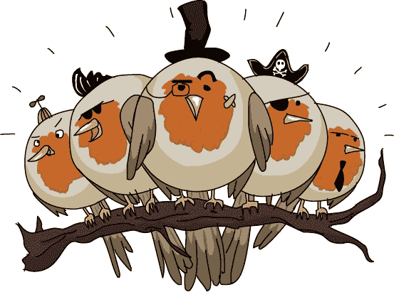

这些鸟现在玩耍着 15、20、25 块石头。它们能接住洛里扔过去的任何东西，还有十多只生物在等待加入。她该怎么把 `Xor` 从它们手里救出来呢？

“聪明的轮转鸟，”
“太多了打不过！”
“你们停不住轮转鸟的——
“——当有晚餐吃的时候！”

鸟类的鸣叫声和 `Xor` 的尖叫声让她很难集中注意力，但洛里再次等待着，试图观察出一个规律。轮转鸟可以接住任何东西……

“它在转圈圈！”
“它会在哪里停？”
“石头都在跳动，”
“但蜥蜴不会——唔！！”

就在其中一只鸟正要接住 `Xor` 时，洛里用一大块泥土砸中了它的喙。轮转鸟可以接住任何东西。但它不能同时接住两件东西！

她在 `Xor` 掉落时抓住了他，并尽快地逃了。随着鸟群失去了节奏，石头和愤怒的轮转鸟飞得到处都是。有些试图追上她，但它们太胖了，追不上，也太愤怒了，没法继续押韵。

“不公平！”
“不公平！”
“你偷了我们的零食！”
“回来！”
“不公平！”
“你偷了……”

“你还好吗？”洛里问。

“不……好……也许吧。” `Xor` 喘着粗气。他们两个都是这样。小蜥蜴看起来并没有受伤，但他被吓得魂飞魄散。“鸟！”

“这就是为什么你必须伪装自己，不是吗？”她问。“鸟儿想吃你。”
“我讨厌鸟。”

# 第 4 章 乌龟对洛里说


洛里在标有“递归交叉路口”的牌子处左转。爬过一个小山丘后，她来到了……递归交叉路口！

“这是同一个地方吗，`Xor`？”洛里问。“看起来一样。”
“试着向右转，”他说。

她照做了，但过了一会儿，他们又回到了起点。当她尝试第二次、第三次，直到第二十十七次时，他们总是回到递归交叉路口。

“似乎我正在去某个地方，但我们总是回到同一个地方。这是怎么了？”洛里想道。

他们绕了…… . . . . . 又绕了…… . . . . . 又绕了…… . . . . . . 很多次，洛里已经数不清。

就在她打算放弃时，传来一声巨大的撞击声，像是一叠盘子掉在地板上。

他们吓得跳了起来，一瞬间 `Xor` 不小心变成了和洛里衬衫一样的颜色。他们环顾寻找声音来源，但没有找到。让他们惊讶的是，下一次转弯让他们进入了另一条路。

这条路整洁而笔直，似乎无无止。。前方，一个戴着希腊头盔的男人坐在一只带壳的巨大轮绿色动物上（Eponym 可能会把这种生物称为乌龟，尽管她的说法并不完全准确）。它们正缓慢而稳定地离开。

“嘿！等一下！”洛里大喊着向他们跑去。
“终于有人追上我们了！”动物说道。
“我以为这不可能，”男人说。
“你好！”动物对洛里说。“我是乌龟，一只谦逊的乌龟。”他体大得完全不像普通的乌龟。“这是我尊敬的伙伴，逻辑学家阿基琉斯。”
“为您效劳，小姐！”阿基琉斯从坐在乌龟背上向她鞠躬。
“嗯，你好。我的名字是洛伦·伊普。”她尝试了礼貌。
“你是怎么来到这里的，伊普小姐？”乌龟问。
“我真的不知道，”洛里说。“我们本来沿着通往符号的路，但我在递归交叉路口迷路了。”
“这经常发生。我猜你花了很多时间在追尾巴。”
“但我没有尾巴，”她说。
“所以它逃了你了，对吧？”
“什么？”洛里问。“不，我没有……”


“也许它被优化掉了，”乌龟说。“没关系。你们大多数人都过来了，这才是重要的。你可以帮我们解决一个问题。”
“好吧，我可以尝试，”洛里说，不确定她和乌龟是否在讨论同一个话题。
“太棒了！”乌龟说。“我亲爱的朋友阿基琉斯和我考虑的问题是：一条无限长的绳有多长？”
“无限长的绳？无限意味着它是真的、真的、真的、真的、真的、真的非常长。真的，”洛里说。真的。
“啊！所以你同意我的观点，”阿基琉斯说。“这意味着举证责任必须由对方来承担。”
“我背上阿基琉斯的负担已经足够了！”乌龟嘟哝着。
“乌龟朋友在很多方面都是睿智的，”阿基琉斯说。“但他这次显然错了。他说无限长的绳可以恰好只有两英寸长！”
“但无限长的绳怎么可能只有两英寸长？”洛里问。
“他的主张是荒谬且不严密的，”阿基琉斯说。“我们对此持续存在分歧。”
“我从不产生意见，”乌龟说。“我只是讨论，尤其是和像你这样的智者交流时，阿基琉斯。你的理解没有极限。”
“你太客气了，亲爱的乌龟。”
“我是真意的，”乌龟说。“允许我提议一种通过实验来解决问题的方法。”
“请尽管提议吧，”阿基琉斯说。
“让我们建立——当然，是假设的！——一段无限长的绳，然后测量它。伊普小姐可以做我们的公正裁判。”
“我接受。实验总是比单纯的理论好，”阿基琉斯说。“而且公正裁判听起来很棒，尤其是当她已经同意我的时候！”
“非常好，”乌龟说。“伊普小姐，想象你拥有无数段绳子。如果你把它们首尾相接，它们会是无限长的吗？假设的情况下？”
“是的，一定是，”洛里说。
“无限就是无限，”阿基琉斯说。“这符合逻辑。”
“我想想。假设我们从一根一英寸长的绳开始，”乌龟说。“然后增加第二根一二分之一长的绳。它们合在一起有多长？”
“一一又半英寸，”洛里说。
“那比两英寸短？”乌龟问。
“短了二分之一英寸。毫无疑问，”阿基琉斯说。
“我们到为止达成了一致，”乌龟说。“也许我们会得出相同的结论。”
“我怀疑！”阿基琉斯说。洛里不确定乌龟想表达什么，她也怀疑。
“阿基琉斯，请数一下我们假设的绳吗？我想再增加第三根四分之一英寸长的，”乌龟说。“我们的绳现在是一三四分之一英寸长吗？”
阿基琉斯从头盔下取出一本经常使用的笔记本，涂写了一些数字。“看起来是这样，”他说。
“还有四分之一英寸的空间？”乌龟问。
“是的，”阿基琉斯回答。“只有四分之一英寸了！你离失败只有一指之宽！”
“增加一段八分之一英寸的，”乌龟说。“我还有空间吗？”
“有的，但我很快就会赢过你！”希腊逻辑学家叫道道。“你的绳距离极限只有八分之一英寸了，而你才加了四段！”
“你的算术一如既往准确，阿基琉斯。但为了科学，让我们持续到最后，”，”乌龟说。
“不会很久的，”阿基琉斯说。“你的下一步是什么？”
“我想再加一段绳，这次是十六分之一英寸长的。”
“搞定！”阿基琉斯飞快地写写着。“只剩十六分之一英寸了，老朋友！”
“只有这么多？”乌龟说。“那么对于下一段，我想增加一段一三十二分之一长的绳。”
“如你所愿，可怜的乌龟。增加了一三十二分之一。还剩下一三十二分之一，还有无限段绳子要加！会有足够的绳子让你自己绊倒的！”阿基琉斯说道。


“请再加一段六十四分之一的线，”乌龟说，“再加一段一百分二十八分之一的，再加一段二百五十五六分之一的，再加一段五百十二分之一的，然后——”

“慢点，乌龟！你进展太快了，”阿基琉斯说，“那些数字很大——不，是非常`small`的数字。”他思索着并涂写了一分钟。“只剩下五百十二英寸了。真遗憾我们不是在分`hairs`，否则你本可以再走更远一点的！你现在放弃了吗？”

“噢，我明白了！”罗里惊呼道，“阿基琉斯，乌龟是对的。”

“什么？在我们离胜利这么近的时候`now`改变主意！”阿基琉斯喊道。

“不，我确定乌龟是对的，”罗里说，“你没看到吗？他添加的每一段长度都是前一段的`half`。这正好留下了足够的空间。即使他添加无限多段，这根线也`never` 到不了两英寸。”

“嗯，几乎如此，”乌龟说。

阿基琉斯皱了皱脸。“看来你再次证明了不可能的，乌龟。但为了保险起见，我会`myself`检查一下算术。”他继续在笔记本上涂写着：

```
+ 1/512 inch
+ 1/1,024 inch
    + 1/2,048 inch
    + 1/4,096 inch
        + 1/8,192 inch
          + 1/16,384 inch
            + 1/32,768 inch
              + 1/65,536 inch
              + 1/131,072 inch
                + 1/262,144 inch . . .
```

“这足够让他忙好一阵了。如果说谁有耐心数到无穷，那一定是阿基琉斯了。谢谢你的帮助，伊普姆小姐。”

“不客气，乌龟先生，”罗里说，“我不知道这么大的东西可以这么小。”

“这就是 2 的力量，”乌龟说，“如果你把一个数字分成两半，再切成两半，以此类推，很快就会小到看不见。但总会有东西留下来。”

“乌龟先生，你知道这条路有多长吗？感觉它没完没了。我试着去符号城。”

“这条路非常长，”他回答道，“事实上，它是无限的。”

“噢，不！我该怎么到达终点？”

“你只需要两个简单的步骤。”

“怎么做？”

“你怎么想？右脚迈一步，然后左脚迈一步，”乌龟说，“你的观点才是重要的。它是积分的。”

当然了！如果一根无限长的线可以小于两英寸，那么只要你观察的角度正确，一条无限的路完全可以小于两步。罗里闭上眼睛，深吸了一气。她试图想象一条无限的路。那有点太难以处理了，于是她想象了一条非常、非常、非常、非常长的路。然后她想象把它对折。然后她再次对折，一次，一次，一次，一次，一次……

当罗里睁开眼睛时，阿基琉斯和乌龟已经消失了。无限的路现在变成了一个微小的短东西，几乎就像一块踏脚石。她用右脚向前迈了一步。然后又用左脚迈了一步。在她面前有一块路牌，上面写着…………

# 第 5 章 欢迎来到符号城


符号城被高大且完美光滑的墙包围着。一条宽大的河流分成两股，流过城市的两侧。

“你对这个地方有什么了解吗？”罗里问。

“那里的人有点奇怪，”索尔说。

“那是什么意思？”

“你会看到的。”

小路通向一个带有闸机的门口。它看起来像这样：╞

两个和罗里相仿的男孩守着大门。一个穿一套亮白色西装，内穿衬衫。另一个穿一套亮黑色西装，内白色衬衫。

*也许他们会考我一个谜题*，罗里想。*或者我需要弄清楚哪一个是撒谎者，哪一个是说真话的！*，罗里读过很多童话。她认为自己正在发现这个地方是如何运作的。

“名字？”其中一个问道。

“罗里·伊普姆。”

“密码？”另一个问道。

“噢，我不知道密码，”罗里说。

“那么你不能进去！”两个男孩齐声说道。

“这可算不上什么谜题。”

“谜题？哈哈，不，抱歉，小姐。不是那样运行的。这里没有谜题，没有赌注，没有撒谎者，也没有说真话的人。我们也读过那些书，不是吗，托伦斯？”

“是的，我们读过，波恩。在我们的系统里没有那些神话童话之类的，小姐。文字游戏和聪明的谜题，哈！那只是糟糕的安全措施！”

“但这不公平！”罗里喊道，“我怎么进去？”

“这很简单，”波恩说，“如果你有密码，意味着你可以通过语义闸机。”

“如果你不能通过闸机，意味着你没有密码。这很逻辑，”托伦斯说，“你有密码吗？”

“不，我不知道是什么，”罗里说。

“那么你不能进去！”他们再次在一起说。“可以给我一个提示吗？”罗里确信如果有某种线索，她是能猜到密码的。

“是的，提示是系统的一部分，”波恩说。

“噢，好的。”

“你为你的账户设置提示了吗？”托伦斯问。

“嗯，没有，”她说，“这是我第一次来这里。”

“那你太倒霉了，小姐，”波恩说，“一旦你进来了，一定要为下次设置一个提示。”

“并记得把你的密码改成一个好记但难猜的，”托伦斯说，“这只是良好的安全措施。”

“但我正试着`get`进去啊！我不知道该怎么办！”


“这很简单，”波恩说，“如果你有密码，意味着你可以通过语义闸机。”

“如果你不能通过闸机，意味着你没有密码。这很逻辑，”托伦斯说。

“这不完全对，不是吧？”罗里说，“如果闸机坏了呢？即使我有密码，也进不去。”

“嗯……”托伦斯看起来有些有些没底。

“或者如果我骗了你们让你们`believing`我有密码，即使我并没有？那样我就可以没有密码也能进去。”

“嗯。”波恩考虑了罗里的论点，试图寻找漏洞。

罗里继续说道：“或者如果我有密码，但我不想给你们呢？”

“不，你还是不能侵入我们的领地，”波恩更有底心地说，“你提供一个与你提供的名字匹配的密码。”

“是‘Laurie’吗？”她猜道。

“不！”他们一起喊道。

“是‘11 月 1 日’吗？”那是罗里的生日。

“不！”他们再次喊道。

“只剩一次机会了，小姐，”托伦斯说。

“噢，不！真的吗？”

“你只能尝试几次。这只是良好的安全措施。”

“我有账户吗？”她想。

“我们无法确认或否定这一点，”波恩回答道，“那是糟糕的安全。”

“我……`not`有账户吗？”

“我们也无法否定或确认！”托伦斯回答道。

“这很简单——波恩开始说。

“——是的，是的，”罗里打断道，“如果有，我知道；但如果没有，你们不能告诉我。而且只有在我之前设置过，你们才能给我提示！”这确实是良好的安全措施。*思考，罗里，思考！*

“好了，让我们重新开始，”她说。

“很好，小姐，”托伦斯说，“名字？”

“我告诉过你了，是 Lau——”她停住了。“其实……我的名字是同名·巴赫。”

“密码？”波恩问。

*不可能是那么简单吧？*

“巴赫的密码。”

“欢迎！”波恩和托伦斯挥手让她通过闸机。

巴赫会用自己的名字命名密码！


“`Al-go-rith-ms`（算法）。听起来像某种水果。”

“你总是这么肚子饿吗，Xor？”

“时间光如箭，果蝇喜欢香蕉。让我们看看有没有什么我可以帮它们解决的果蝇问题。”

当 Laurie 打开门时，风铃叮铃作响。“你好，你好！”店主说，“欢迎来到我的商店。我是提金克（Tinker），你正在寻找一种精良的算法，对吧？”

Laurie 看着黑板上列出的项目，但它们完全说不通。


“我不确定。什么是算法？它能吃吗？”Laurie 问。

“什么？不，它只是说‘如何做某事’的一种高级说法。但 `Algorithm` 这个词写在招牌上看起来更有面子，”提金克说。

Xor 失望得脸都红了。

“如何做某事，”Laurie 重复道，“既然这样，我想找到一种访问每个城镇的合理方法。”

“这听起来是个有趣的问题。你目前为止在做什么？”

Laurie 向提金克讲述了她在红黑森林的冒险以及拜访同名巴赫（Eponymous Bach）的情况。

“哈密顿路径，哈？”提金克说，“这道题很难。我不想这么说，因为他听起来是个好人，但流浪推销员可能需要很久才能完成对所有城镇的旅行。”

“噢，不！但为什么？”

“如果你总是去最近的一个未过的城镇，可能会错过一个稍微远一点的城镇。然后你去另一个离你近但离你错过的那个城镇更远的城镇，以此类推。你最后可能会横跨整个国家才能到达最后几个城镇。”

“听起来很累，”Laurie 说。流浪推销员终并不合理！“那么我该如何找到最短路径呢？”

“我看看库存里有什么。但可能很贵。”

“我身上的钱不多，”Laurie 说。她从口袋里掏出几个四分之一硬币给提金克看。

他惊讶地看着它们。“四分之一美元？我不知道什么是美元，更别说它的四分之一了。这是你们那儿的钱吗？”

“当然是钱了！那是七十五分，”她说。

“分？我们这儿用的是公平硬币（Fair Coins）。”

“什么是公平硬币？”

“嗯，它们比你的这些四分之一美元大一点，但没那么漂亮！你可以一眼看出是真正的公平硬币，因为它们总是正面或反面，概率各占五十。”

“但四分之一硬币也可以各占五十的概率啊！”

“这可能是事实，但我不能光听你的，对吧？在这里，所有的公平硬币都必须经过公平认证。”

Laurie 垂头丧气。

“别这么难过！我是想帮你的，”提金克说，“也许我们可以做个交易。碰巧我需要一种特定的算法。”

“但我也没有任何算法，”Laurie 说。

“这没问题，”提金克说，“你可以随时随地编写新的，只需要花点心思。”

“我可以吗？怎么做？”

“嗯，每个人都有自己的风格。你可以把小想法组合在一起变成大想法。或者你把两个想法放在一起进行比较。或者你从大想法开始把它们拆解。”

“你的意思是像同名巴赫那样？”

“是的，就像她一样。她是一位伟大的作曲家。”

Laurie 从未想过自己也能做那样的事情。但提金克似乎认为这很正常。

“所以我该怎么做？”

“我寻找的算法是如何画一个圆，”提金克说，“这是一个难题，所以你得运用你的想象力。我已经问过所有的大人，甚至包括波恩（Ponens）和托伦（Tollens）了，但他们只是在那儿嘟囔 `x` 平加 `y` 平，毫无进展。”

“看看这个。”他递给 Laurie 一个发条玩具动物。它有一个 `Shell`，圆圆的绿色。“这只乌龟可以做三件事：它可以向前或后移动，它可以转身，并在纸上画一个小点。”

“嘿，那真酷！”

“是的，但问题是，它不知道做其他任何事情。这就是算法大显身场的地方。”提金克拿出张纸，写了一段看起来像小诗的内容：

```
前进英寸，
画一个标记，
重复五次。
```

然后他上好乌龟的发条把它放在诗上。它发出 `zzzrbt bzzaap whuzzzsh` 的声音，以此类推。然后它画了一排点，就像诗里写的那样：


“看到了吗？如果你把小想法组合在一起，就能做出更大的想法，”提金克说，“你还可以把这些想法组合成更大的想法。”

“你是怎么做的？”Laurie 问。

“通过给它们命名。你可以把名字当作手柄：你会通过手柄提一锅汤，你可以通过写下名字移动整个想法。在这里，我们把第一个想法命名为 `LINE`（线）。然后你可以把四条线组合成一个正方形。”

> **LINE**:
>
> **前进英寸，**
>
> **画一个标记，**
>
> **重复五次。**
>
> **SQUARE**:
>
> **画一条 LINE，**
>
> **向右转，**
>
> **重复四次。**
>
> **画一个 SQUARE。**

小乌龟 `zzzrbt` 叫着、`whuzzzsh` 动着、`bzzaap` 闪着，然后画了这个：

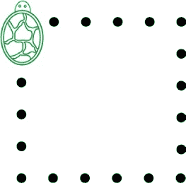

Laurie 惊呆了。这像魔法一样，但每一步都有理可循。

“所以，知道了乌龟能做什么，你能教它怎么画圆吗？”提金克问。

“我不知道，”Laurie 说，“但我想尝试！”

“这我就满意了。来，你可以在我的桌子上工作。那里有很多纸、圆规之类的东西。”

Laurie 坐在提金克的桌子旁。她用圆规涂鸦，和乌龟玩了一会儿，试图回忆她所关于圆的知识。

`圆是圆的。不，不只是圆——是完美的圆。你把针插在中心，笔尖旋转。想画大一点，就打开圆规；画小一点，就关闭圆规。如果你在旋转时改变圆规的宽度，画出来的就不是圆……`

突然，一个想法，也许是一个记忆，跳进了她的脑海：`圆是所有距离中心完全相同的点。嗯，如果你……`

```
前进英寸，
画一个标记，
后退英寸，
向右转一点点，
然后重复！
```

在 Laurie 写下她的诗后，她再次上好小乌龟的发条把它放在纸上。它嗡嗡作响了一会儿，然后画成了这个：

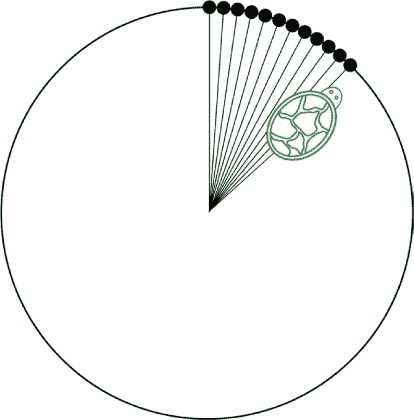

“它成功了！”她对提金克喊道，“嘿，它没停。”乌龟正在画它已经画过的点。

“我觉得是因为你只告诉它重复，但没说重复几次，”提金克说。

“嗯，它应该画完圆就停止，”Laurie 说。

“它并不真正理解圆，”提金克说，“它只是一只乌龟，记得吗？你得教它。”

Laurie 又思考了一会儿，重写了她的诗：

> **CIRCLE**:
>
> **前进英寸，**
>
> **画一个标记，**
>
> **后退英寸，**
>
> **向右转一度，**
>
> **重复三百六次。**

然后她意识到自己可以画任何想要尺寸的圆。这只需要把圆规开得更大。

> **TWO-CIRCLE**:
>
> **前进两英寸，**
>
> **画一个标记，**
>
> **后退两英寸，**
>
> **向右转一度，**
>
> **重复三百六次。**

“这很有趣。你真的很努力！”提金克挠了挠头，“但现在这样，它并不好。”

“为什么？”

“人们想要画很多不同的圆，”他说，“我得准备很多不同尺寸的算法，以防有人想要三又十分之十三英寸或者四又四之四英寸。”

“那么，如果你告诉乌龟要画多大的圆呢？”她说，“也许像。”

> **ANY-CIRCLE (how-big?):**
>
> **前进 how-big? 英寸，**
>
> **画一个标记，**
>
> **后退 how-big? 英寸，**
>
> **向右转一度，**
>
> **重复三百六次。**


“而且*然后*，”她说道，“与其说 `ONE-CIRCLE` 或 `TWO-CIRCLE`，你可以说 `ANY-CIRCLE(one)`、`(two)`，甚至是 `(one-and-eleventy-sevenths)`！”

“好主意，Laurie。那简单多了，”Tinker 说，“我还担心你会用圆圈填满我的店呢！”

“你你知道的，乌龟画得真的非常慢。不像它画正方形的时候，”她说道。

事实确实如此。乌龟会一直爬到圆的边缘，然后画一个标记，然后一直爬回中心，重复 360 次。对于小圆来说，这不算糟糕，但大圆需要花费更长的时间。

“嗯，”Tinker 说，“它在来回奔跑上花费的时间比画标记的时间要*多得多*。你觉得你能缩短跑步的时间吗？”

*这很有道理，但并不合逻辑。* Laurie 边想边涂鸦，涂鸦着思考，思考着涂鸦，但她找不到如何让它变得更合理。乌龟必须回到中心，对吧？否则它怎么知道圆的边缘在哪里呢？

Laurie 让目光在房间里环视。Xor 正盯着一只在灯泡周围懒散散地绕圈飞行的蛾子。他的皮肤从红色慢慢变成黄色，又变回红色。蛾子绕了一圈圈。令人着迷。绕了一圈又一圈，又一圈……

*噢！如果蛾子不需要去灯泡中心就能绕着它飞圈，那为什么乌龟画圆时需要回到中心呢？*

在想法溜走之前，Laurie 拿了一张新纸。*不要让一个新事物在没有名字的情况下离开你的视线。*

> **蛾子之圆 (多大?):**
> **向前移动多大? 英寸，**
> **画一个标记，**
> **向右转一度，**
> **重复三百六十次。**

> **画一个蛾子之圆 (一个)。**

乌龟发出 *bzzaap*、*zzzrbt* 和 *whuzzzsh* 的声音，然后开始画画。它移动了一英寸，画了一个点，然后转了一小点角度，然后移动了一英寸，又画了另一个点……

“哎呀。它在画一个*巨大*的圆！让我试一个小数字。”Laurie 手头没有方便的小数字，所以她借用了一个从 Tortoise 那里听来的数字：三分之一英寸。

“这样好多了，”Laurie 说。

“让我看看，”Tinker 说，“哇，看这个小家伙跑起来！”

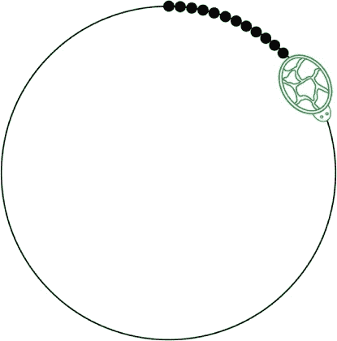

“这很有趣，”Laurie 说，“我不知道你可以发明新方法来做事情。”

“当然可以。通常你不是第一个想到某件事的人，但如果它有效，谁在乎呢？现在，轮到我的交易了。”

“你找到最短路径了吗？”Laurie 问。

“不完全。坏消息是你正在尝试做的事情是不可能的。”

“不可能？”

“嗯，极不可能。访问所有城镇有很多方法。看起来你可以为乌龟写一个算法，尝试每一种并找到最短的，对吧？”

“当然可以，为什么不呢？”Laurie 说。

“Userland 有二十一个城镇。你觉得有多少条路径？”Tinker 说。

“我不知道，”Laurie 说，“一百条？”

“多得多。”

“嗯，一百万条？”Laurie 说。

“大约是它的百万万倍！”Tinker 说。

“这怎么可能呢？”

“假设只有三个城镇：A、B 和 C，”Tinker 说，“你已经站在 A，所以你只需要担心 B 和 C。你有多少种走法？”

“嗯，”她说道，“我可以从 B 去到 C，或者先去 C 再去 B。那是两种。”

“没错！但 `BC` 和 `CB` 是一样的，只是方向反向的。每条路径都有一个镜像，所以对于三个城镇，实际上只有一条访问所有城镇的可能路径。如果有四个城镇，A、B、C 和 D 呢？”

Laurie 数着手指。“我可以走 `BCD`、`BDC`、`CBD`、`CDB`、`DCB`、或者…… `DBC`。六种！不，不是三种。”

“那是三倍。再加一个城镇，就有十二倍了，”Tinker 说，“再加第六个城镇，穿过所有城镇的路径就有*六十*种不同的。七个城镇有*三百六十条路径*。随着城镇的增加，路径的数量会变得非常大！”

> 3 个城镇: 2 ÷ 2 = 1
> 4 个城镇: 2 × 3 ÷ 2 = 3
> 5 个城镇: 2 × 3 × 4 ÷ 2 = 12
> 6 个城镇: 2 × 3 × 4 × 5 ÷ 2 = 60
> 7 个城镇: 2 × 3 × 4 × 5 × 6 ÷ 2 = 360
> 8 个城镇: 2 × 3 × 4 × 5 × 6 × 7 ÷ 2 = 2,520
> 9 个城镇: 2 × 3 × 4 × 5 × 6 × 7 × 8 ÷ 2 = 20,160

“对于二十一个城镇，你必须把一乘以二乘以三乘以四，一直乘到二十。这会产生一个巨大的数字！”

> 2 × 3 × 4 × 5 × 6 × 7 × 8 × 9 × 10 × 11 × 12 × 13 × 14 × 15 × 16 × 17 × 18 × 19 × 20 ÷ 2 =
> **1,216,451,004,088,320,000**

“！”Laurie 说。

“确实如此！”Tinker 说，“那些‘一乘以二乘以三’的内容写起来太慢了。所以你可以用叹号作为简写。”

> **20! ÷ 2 = 1,216,451,004,088,320,000**

“但是……”Laurie 数着逗号说道，“超过了一百百万百万*百万*条路径！”

“那些百万百万百万路径中有一条是最的，”Tinker 说，“我不知道任何方法可以快速找到它。”

“等我们检查完所有路径，我就老了！没有更好的方法吗？”

“啊，那是好消息！”Tinker 说，“我只处理精确答案。但 Permute 住着一位才华的作曲家叫 Hugh Rustic。他处理的是足够好的答案。我把所有最困难的案例都发给他。我会写一张欠条，你可以带给给他。”


“现在，嗯，让我们慢慢读一遍并寻找线索。Con-sec-te-tour a-dee-peace-ick-ing el . . .” 当 Xor 在字母间移动移动时，他的皮肤泛起了波纹。. . . dew-is ow-tay . . . ”

“嘿，Xor，等一下。” Laurie 发现有些不对劲。“再后退一点点。”

“这样吗？”

“对。现在，仔细想想怎么融入其中。”

“好的。你看到了什么？”他说。

“你的皮肤。我觉得我可以读懂它。”

当 Xor 对齐得恰好时，白底黑字的 `LOREM IPSUM ESXIHU` 变成了黑底白字的 `LAUREN IPSUM GREETINGS`。

“你正在显示隐藏的信息！”

“真的吗？我的意思是，看吧？我告诉过你我可以做到。”

“你太棒了，Xor！你能离纸近一点吗？”

“如果我再近一点，我就在纸的后面面了！”

他们一个字一个字地破解了信息。但即便如此，它仍然没什么什么意义：

> LAUREN IPSUM，问候！毫无疑问，你是长期以来 Userland 最有趣访客。但如果你继续现在所做的事，前方将面临许多艰辛和挫折。记住，地图并非领域！

> 你谦卑的仆人，

> 特拉普上校（COLONEL TRAPP）

“艰辛和挫折？地图并非领域？那到底是什么意思？”Laurie 问。

“我曾听说一个国王想为他的领土制作一张完美的地图，”Xor 说道。

“他为什么要那样做？”

“国王总是想要一些蠢东西，比如一本关于万物的书，或者一辆没有弱点的马车，”他说。“这个国王决定他想要一张和王国一样大的完美地图。这样，皇家制图师就能把一切都画进去，直到每一块石头和每一朵花。它花了整整七年才完成。但那是一场灾难！”

“为什么？发生了什么？”Laurie 问。

“作为一张地图，它的效果并不好。”蜥蜴解释道，“为了测量两个地方之间的距离，你必须恰好走完那个距离。等那时你已经到达那里了。”

“他们甚至把这么大一张地图放在哪儿？”

“那是另一件事。博尔赫斯国王（King Borges）只有一个王国，除了原处，没地方可以放这张地图。那真是个大麻烦，地图盖在人们的房顶上，作物无法生长。人们最终推翻了国王并撕掉了地图。他们说你仍然能在沙漠里看到巨大的纸片在飘动。”

# 第 8 章 做事的方法不止一种


Permute 是一个离 Symbol 不远的小村庄。Hugh Rustic（休斯蒂）的店很容易找到。它的招牌比 Tinker 的更大、更花哨。


“你好，Rustic 先生？”Laurie 走进店里喊道。“Symbol 的 Tinker 先生欠我一个算法，他说我应该来谈谈这件事。”

Rustic 是一个高大、大嗓、看起来乱糟糟的男人，留着大红胡子。他看起来完全不像优雅的 Eponymous，也不像整洁得体的 Tinker。

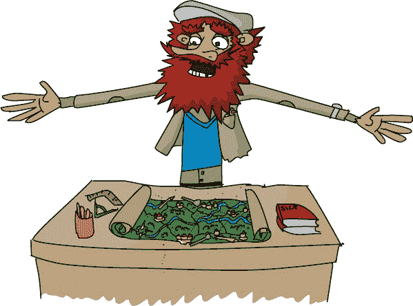

他看起来完全不像 Laurie 想象中作曲家（Composer）应该的样子！但 Tinker 推荐过他，所以 Laurie 把借条交给了他。

“我，嗯，正在尝试找到通过所有城镇的最短路径。你能帮我吗？”

“太棒了！有趣！”Rustic 说道。“Tinker 把你送对地方了，小姐。立刻做到是不可能的。最晚周二前完成是不可能的。”

“但如果不可能——”Laurie 开始说。

“只是不太可能，”Rustic 纠正道。

“如果不太可能，你怎么做呢？”

“通过转变你的观点，”Rustic 说，“与其寻找一个符合你问题的答案，不如想象一个答案，然后寻找一个符合它的问题。”

“但你不能直接改变问题，对吧？”

“为什么不能，当然可以！担心问题是在浪费时间！你真正想要的是答案，对吧？”

“也许吧，我不明白怎么做，”Laurie 说。

“你如何买到最好的西红柿？”他说。

“呃，我 . . . 什么？”

“假设你在市场上。你想买最好、最完美的西红柿。但为了找到最好的西红柿，你必须比较每一个一个，对吧？你会观察每一个，转转它，也许再挤一下。对整个市场里的每一个西红柿都这样。”

“没人会那样做！”Laurie 说。“好吧，老 Harris 夫人确实会那样做。但我妈妈说她有点疯。我只挑一个好的就行了。”

“看吧？你已经知道如何用 Hugh Rustic 的方式做事了。当有许多‘足够好’的西红柿时，你不需要浪费时间寻找最好的西红柿。”

“所以，与其尝试找到通过 Userland 所有城镇的最短路径，”Laurie 说，“我们找一条足够短的路径？”

“为什么不呢？”Rustic 问。“在所有数以百万计的路径中，我打赌有很多路径是很短的。你只需要找到其中一条，那要容易得多。”

Rustic 拿出一张大地图放在柜台上。

“这是我们所在地，”他指着 Permute 说，“这是你开始的地方，对吧？让我们在这里放几支铅笔代表上限山（Mount Upper Bound），在那儿放一个小勺代表下界谷（Lower Bound Valley）。”地图上还标记了 Bach（巴赫）和 Recursion Junction（递归交汇点），以及许多 Laurie 还没有去过的地方。

“现在是有趣的部分，”Rustic 说，“我们问问蚂蚁吧。”

“问蚂蚁？你在说什么？蚂蚁读不了地图的！”Laurie 说。一提到昆虫，Xor 突然警觉了。

“谁说它们不会？下次你又要告诉我龟画不了圆了，”Rustic 说。

“所以你教蚂蚁读地图？”

“不完全。蚂蚁已经很擅长找路了。主意是让它们为我们工作。”他打开一罐蜂蜜，在每个城镇上滴了一小块甜味。

过过去了。什么都没发生。然后一只小蚂蚁爬上桌子。它闻到了蜂蜜的味道，在地图上之字形移动。它咬了一块蜂蜜，然后到处逛，直到走到另一块。

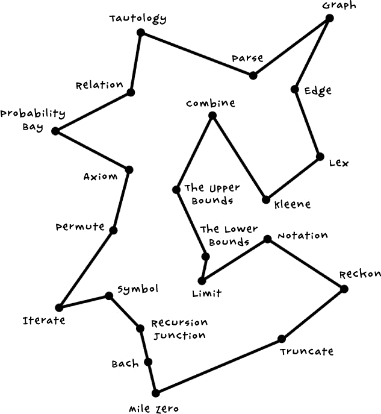

“当蚂蚁找到食物时，她会为后面的同伴留下一小气味信息，”Rustic 说。“蚂蚁追着食物的味道以及其他蚂蚁的味道。许多蚂蚁可以同时尝试许多不同的路径。最终，它们会确定一条通往所有食物并返回巢穴的快速路线。”

第一只蚂蚁继续走向 Bach。另一只出现了，但直接走向了 Recursion Junction。还有一些蚂蚁一直穿过到达 Probability Bay、Permute、Notation 以及其他城镇。很快，地图上就有几十只蚂蚁向四面八方走去，收集蜂蜜碎片并为它们的姐妹们留下气味。

几分钟后，很明显某些路径比其他路径更受欢迎。蚂蚁的队伍变得越来越宽，直到只剩下一条蚂蚁超级高速，在整个地图上行进并回到巢穴。Hugh Rustic 在蜂蜜消失之前把它抄在了一张纸上。

“啊，这就对了！”他说把草图交给了 Laurie。

“谢谢你，Rustic 先生！这真的是最短的路吗？”

“这是一条短路。这是我能做出的保证。”

# 第 9 章 不要重复


Laurie 和 Xor 带着新地图从 Permute 出发了。他们终于知道自己在哪里，要去去哪里，以及如何到达那里。这一切都在纸上。

“这张地图上的地方名字很奇怪，”Laurie 说。“Truncate（截断）。那是什么意思？”

“`Truncate` 是通过切掉一部分让某物变短。Truncate 的边界非常精确，”Xor 说。

“噢。那么 Axiom（公理）是什么？”Laurie 问。

“一个 Axiom 是规则，即使你不知道它为什么是真的，你也假装它是真的，”Xor 说。

“真的吗？”

“当然。我的表姐 Nand 教过我关于这的一切。她是一只欧几龙（Euclidosaurus）。”

“又在胡编了，Xor。”

“不，这只是其中之一，”蜥蜴耸了耸肩，变成了灰绿色。“要么相信公理，要么不相信。”

“是吗？我打赌你不知道什么是 Furfnoodle，”Laurie 说。

“它是一个 . . . 我意思是，嗯。我放弃了。它是什么？”


“‘毛努德（Furfnoodle）是一种鸟，”她说，“长着长蓝色的羽毛！而且它们喜欢吃小蜥蜴。”

“真的吗？”Xor 看起来很担心，抬头寻找着蓝色的羽毛。

“不。但如果我以后看到一只喜欢吃蜥蜴的大蓝鸟，我会叫它为‘毛努德’。”

“你真的不应该编造那样的词，”Xor 说。

“如果你能编造词，我也可以，”Laurie 说道。

“我说的是真话，Laurie。”

“读起来还好玩！”她说，“Furfnoodle。”

“但是——”

“Furfnooooodle！”她唱道。

“看，这儿不安全——”

“Furfnoodle. Furfnoodlefurfnoodle. Furf. Nood. Ull!”

听到一声 `bloop` 的声音，一个看起来像小鼠的小型生物出现在他们面前的路面上。

“`Furfnoodle!`”它用细小老鼠的声音说道。它绕着他们跑了几圈，然后冲进草丛，嘴里还在尖叫。“`Furfnoodle! Furfnoodle!`”

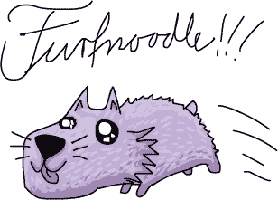

“那到底是什么？！”Laurie 说道。

“那个，”Xor 说，“是一只婴儿逻辑（Jargon）。”

“它从哪儿来的？它就这么从空气 `blooped` 出来了。”

“是你用……那个词造出来的。”

“我 `造` 出来的？”

“我试过警告你了，”Xor 说，“你觉得逻辑是从哪儿来的？”

“Furf——那个词有什么特别的？”

“它是一个只对你个人有意义的名字。这就是逻辑（Jargon）的`定义`，”Xor 说，“是你造出来的。它是你的。”

“但为什么呢？”

“没人知道，”他说，“那是公理（Axiom）的一种特性。你对名字必须小心。它们有独特的力量。”

# 第 10 章 恰到好处的登


概率（Probability）是海边的一个小镇。它周围只被一圈粗糙的木栅围着，完全不像符号（Symbol）的高大石墙，而且主入口似乎没有任何守卫。Laurie 正走过大门，这时——

“打扰一下，亲爱的！你好，在你左边。”一位老太太坐在入口处的阴影里。她膝上放着一本大书。她的胸牌写着 `海恩·赫凯特（Jane Hecate），边界安全`。

“噢！我没看到你，”Laurie 说。

“没关系，亲爱的。但在你进来之前，我必须确保你在`名单` 上。”

Laurie 以前玩过这个游戏。“我的名字是 `匿名巴赫（Eponymous Bach）`，我的密码是——”

“等一下，亲爱的，等一下！一件一件来。我们先查查你的名字。”她打开沉重的书，手指在页面上一个字母一个字母地扫描着。

“E . . . E . . . 啊，E！在这里。”

速度慢得令人痛苦。

“P . . . P . . . E-P! . . . E-P-O . . . E-P-O . . . 不。”

海恩砰地一声合上书。

“抱歉，不在`名单` 上。”

“什么？”

“你不在`名单` 上，亲爱的。有 E，也有 E-P 的，但没有以 E-P-O 开头的名字。如果你名字的`开头`不在`名单` 上，就没有理由继续找它的`剩余部分`了，对吧？这很合逻辑。”

“但她的——`我的`名字一定在`名单` 上！她是一个伟大的——我的意思是，我是——”Laurie 结结巴巴地说。

“你是外人吗？我打赌你的名字在你们那里拼写不一样。这种情况会发生，尤其是对于外人。我们为什么不再试一次？”

也许她确实有一个账户。“是在‘劳莉·伊普森（Laurie Ipsum）’吗？”

“让我看看。”`Fllliiiip!` “L . . . L . . . L! A . . . U . . . R . . . I . . . 不。不在这，但我确定我们会找到的。”

“也许可以拼成 `劳伦·伊普森（Lauren Ipsum）`。”

“L . . . A . . . U . . . R . . . E . . . 不，也不是那种。” “呃，休（Hugh） . . . 拉斯蒂（Rustic）？”

“H . . . H . . . H! H-U-G-H R-U-S-T-I-C. 啊，`在这儿`。”

“太棒了！”

“很高兴能找到你！”海恩说，“你的名字有几种不同的拼法，不是吗？”

“是的，我想是。谢谢！”Laurie 转身向里面走。

海恩用惊人的力气拽住了她。

“你的`密码`，亲爱的？”

“噢！是‘Rustic’吗？”

“不。”

“乌龟（Turtle）？”

“不。”

“算法（Algorithm）？”

“A . . . L . . . 不。”

“足够（Good Enough）？”

“不。”

Laurie 愣住了。“现在怎么办？”她对 Xor 低声说，“她不在乎我尝试字典里的每一个词。但我们会在这里呆一个月！”

“我有一个主意，”Xor 回道，“试试‘抽象（Abstraction）’。”

“那是什么？我甚至没——”

“我的三表哥是一个同义词（Thesaurus）。相信我！”

“是 Ab-stract-tion 吗？”Laurie 问海恩。

“A . . . B . . . S . . . 不，亲爱的。”

“‘相信我’，哈？”Laurie 对 Xor 说。

“想起来，我从没喜欢那个表哥。”

“嘿 . . . 你注意到什么了吗？”

“到饭时间了吗？”Xor 期待地问。

“不！当我说‘乌龟’时，她立刻拒绝了，”Laurie 说。

“所以呢？它不是密码，”Xor 说。

“但当我说‘算法’时，她花了更长时间才拒绝。而说‘抽象’时，她比那又久一点，手指在页面移动……”Laurie 清了清嗓子对海恩说，“密码是，嗯，关于（About）吗？”

“A . . . B . . . O . . . 不。”

“看到了吧？”她 whispered。

“好吧，但它是什么意思？”

“也许意味着真正的密码是以 AB 开头的！如果我们继续猜 AB 开头的词……”

他们一个字母一个字母地破解了 Rustic 的密码。Laurie 来说很难想出以正确字母开头的词。她并不认识 Xor 让她尝试的很多词，但他向全世界的同义词的荣誉发誓说这些词是真的。她知道他们正越来越接近答案了，因为海恩拒绝的时间越越越长。

“结束（Abend）！”

“A . . . B . . . E . . . 不，”海恩回答道。

“退位（Abdicate）！”

“A . . . B . . . D . . . 不。”

“废除（Abrogate）！”

“A . . . B . . . R . . . O . . . 不。”

“是以 ABR 开头的！”Laurie 对 Xor 低声说，“突然（Abrupt）！”

“A . . . B . . . R . . . U . . . 不。”

“辫（Abraid）！”

“A . . . B . . . R . . . A . . . I . . 不。”

“我们接近了，”Xor 在耳边说，“什么是以 ABRA 开头的？”

“阿卡达拉（Abracadabra）？”Laurie 大声说道。

“A-B-R-A-C-A-D-A-R-A-F！”海恩说，“这就是密码，没错无缺。欢迎来到概率！”

# 第 11 章 交换

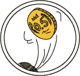

概率（Probability）是海边的一个小镇。它周围只被一圈粗糙的木栅围着，完全不像符号（Symbol）的高大石墙，而且主入口似乎没有任何守卫。Laurie 正走过大门，这时——

“打扰一下，亲爱的！你好，在你左边。”一位老太太坐在入口处的阴影里。她膝上放着一本大书。她的胸牌写着 `海恩·赫凯特（Jane Hecate），边界安全`。

“噢！我没看到你，”Laurie 说。

“没关系，亲爱的。但在你进来之前，我必须确保你在`名单` 上。”

Laurie 以前玩过这个游戏。“我的名字是 `匿名巴赫（Eponymous Bach）`，我的密码是——”

“等一下，亲爱的，等一下！一件一件来。我们先查查你的名字。”她打开沉重的书，手指在页面上一个字母一个字母地扫描着。

“E . . . E . . . 啊，E！在这里。”

速度慢得令人痛苦。

“P . . . P . . . E-P! . . . E-P-O . . . E-P-O . . . 不。”

海恩砰地一声合上书。

“抱歉，不在`名单` 上。”

“什么？”

“你不在`名单` 上，亲爱的。有 E，也有 E-Ps 的，但没有以 E-P-O 开头的名字。如果你名字的`开头`不在`名单` 上，就没有理由继续找它的`剩余部分`了，对吧？这很合逻辑。”

“但她的——`我的`名字一定在`名单` 上！她是一个伟大的——我的意思是，我是——”Laurie 结结巴巴地说。

“你是外人吗？我打赌你的名字在你们那里拼写不一样。这种情况会发生，尤其是对于外人。我们为什么不再试一次？”

也许她确实有一个账户。“是在‘劳莉·伊普森（Laurie Ipsum）’吗？”

“让我看看。”`Fllliiiip!` “L . . . L . . . L! A . . . U . . . R . . . I . . . 不。不在这，但我确定我们会找到的。”

“也许可以拼成 `劳伦·伊普森（Lauren Ipsum）`。”

“L . . . A . . . U . . . R . . . E . . . 不，也不是那种。” “呃，休（Hugh） . . . 拉斯蒂（Rustic）？”

“H . . . H . . . H! H-U-G-H R-U-S-T-I-C. 啊，`在这儿`。”

“太棒了！”

“很高兴能找到你！”海恩说，“你的名字有几种不同的拼法，不是吗？”

“是的，我想是。谢谢！”Laurie 转身向里面走。

海恩用惊人的力气拽住了她。

“你的`密码`，亲爱的？”

“噢！是‘Rustic’吗？”

“不。”

“乌龟（Turtle）？”

“不。”

“算法（Algorithm）？”

“A . . . L . . . 不。”

“足够（Good Enough）？”

“不。”

Laurie 愣住了。“现在怎么办？”她对 Xor 低声说，“她不在乎我尝试字典里的每一个词。但我们会在这里呆一个月！”

“我有一个主意，”Xor 回道，“试试‘抽象（Abstraction）’。”

“那是什么？我甚至没——”

“我的三表哥是一个同义词（Thesaurus）。相信我！”

“是 Ab-stract-tion 吗？”Laurie 问海恩。

“A . . . B . . . S . . . 不，亲爱的。”

“‘相信我’，哈？”Laurie 对 Xor 说。

“想起来，我从没喜欢那个表哥。”

“嘿 . . . 你注意到什么了吗？”

“到饭时间了吗？”Xor 期待地问。

“不！当我说‘乌龟’时，她立刻拒绝了，”Laurie 说。

“所以呢？它不是密码，”Xor 说。

“但当我说‘算法’时，她花了更长时间才拒绝。而说‘抽象’时，她比那又久一点，手指在页面移动……”Laurie 清了清嗓子对海恩说，“密码是，嗯，关于（About）吗？”

“A . . . B . . . O . . . 不。”

“看到了吧？”她 whispered。

“好吧，但它是什么意思？”

“也许意味着真正的密码是以 AB 开头的！如果我们继续猜 AB 开头的词……”

他们一个字母一个字母地破解了 Rustic 的密码。Laurie 来说很难想出以正确字母开头的词。她并不认识 Xor 让她尝试的很多词，但他向全世界的同义词的荣誉发誓说这些词是真的。她知道他们正越来越接近答案了，因为海恩拒绝的时间越越越长。

“结束（Abend）！”

“A . . . B . . . E . . . 不，”海恩回答道。

“退位（Abdicate）！”

“A . . . B . . . D . . . 不。”

“废除（Abrogate）！”

“A . . . B . . . R . . . O . . . 不。”

“是以 ABR 开头的！”Laurie 对 Xor 低声说，“突然（Abrupt）！”

“A . . . B . . . R . . . U . . . 不。”

“辫（Abraid）！”

“A . . . B . . . R . . . A . . . I . . . 不。”

“我们接近了，”Xor 在耳边说，“什么是以 ABRA 开头的？”

“阿卡达拉（Abracadabra）？”Laurie 大声说道。

“A-B-R-A-C-A-D-A-R-A-F！”海恩说，“这就是密码，没错无缺。欢迎来到概率！”

# 第 11 章 交换


概率（Probability）是海边的一个小镇。它周围只被一圈粗糙的木栅围着，完全不像符号（Symbol）的高大石墙，而且主入口似乎没有任何守卫。Laurie 正走过大门，这时——

“打扰一下，亲爱的！你好，在你左边。”一位老太太坐在入口处的阴影里。她膝上放着一本大书。她的胸牌写着 `海恩·赫凯特（Jane Hecate），边界安全`。

“噢！我没看到你，”Laurie 说。

“没关系，亲爱的。但在你进来之前，我必须确保你在`名单` 上。”

Laurie 以前玩过这个游戏。“我的名字是 `匿名巴赫（Eponymous Bach）`，我的密码是——”

“等一下，亲爱的，等一下！一件一件来。我们先查查你的名字。”她打开沉重的书，手指在页面上一个字母一个字母地扫描着。

“E . . . E . . . 啊，E！在这里。”

速度慢得令人痛苦。

“P . . . P . . . E-P! . . . E-P-O . . . E-P-O . . . 不。”

海恩砰地一声合上书。

“抱歉，不在`名单` 上。”

“什么？”

“你不在`名单` 上，亲爱的。有 E，也有 E-Ps 的，但没有以 E-P-O 开头的名字。如果你名字的`开头`不在`名单` 上，就没有理由继续找它的`剩余部分`了，对吧？这很合逻辑。”

“但她的——`我的`名字一定在`名单` 上！她是一个伟大的——我的意思是，我是——”Laurie 结结巴巴地说。

“你是外人吗？我打赌你的名字在你们那里拼写不一样。这种情况会发生，尤其是对于外人。我们为什么不再试一次？”

也许她确实有一个账户。“是在‘劳莉·伊普森（Laurie Ipsum）’吗？”

“让我看看。”`Fllliiiip!` “L . . . L . . . L! A . . . U . . . R . . . I . . . 不。不在这，但我确定我们会找到的。”

“也许可以拼成 `劳伦·伊普森（Lauren Ipsum）`。”

“L . . . A . . . U . . . R . . . E . . . 不，也不是那种。” “呃，休（Hugh） . . . 拉斯蒂（Rustic）？”

“H . . . H . . . H! H-U-G-H R-U-S-T-I-C. 啊，`在这儿`。”

“太棒了！”

“很高兴能找到你！”海恩说，“你的名字有几种不同的拼法，不是吗？”

“是的，我想是。谢谢！”Laurie 转身向里面走。

海恩用惊人的力气拽住了她。

“你的`密码`，亲爱的？”

“噢！是‘Rustic’吗？”

“不。”

“乌龟（Turtle）？”

“不。”

“算法（Algorithm）？”

“A . . . L . . . 不。”

“足够（Good Enough）？”

“不。”

Laurie 愣住了。“现在怎么办？”她对 Xor 低声说，“她不在乎我尝试字典里的每一个词。但我们会在这里呆一个月！”

“我有一个主意，”Xor 回道，“试试‘抽象（Abstraction）’。”

“那是什么？我甚至没——”

“我的三表哥是一个同义词（Thesaurus）。相信我！”

“是 Ab-stract-tion 吗？”Laurie 问海恩。

“A . . . B . . . S . . . 不，亲爱的。”

“‘相信我’，哈？”Laurie 对 Xor 说。

“想起来，我从没喜欢那个表哥。”

“嘿 . . . 你注意到什么了吗？”

“到饭时间了吗？”Xor 期待地问。

“不！当我说‘乌龟’时，她立刻拒绝了，”Laurie 说。

“所以呢？它不是密码，”Xor 说。

“但当我说‘算法’时，她花了更长时间才拒绝。而说‘抽象’时，她比那又久一点，手指在页面移动……”Laurie 清了清嗓子对海恩说，“密码是，嗯，关于（About）吗？”

“A . . . B . . . O . . . 不。”

“看到了吧？”她 whispered。

“好吧，但它是什么意思？”

“也许意味着真正的密码是以 AB 开头的！如果我们继续猜 AB 开头的词……”

他们一个字母一个字母地破解了 Rustic 的密码。Laurie 来说很难想出以正确字母开头的词。她并不认识 Xor 让她尝试的很多词，但他向全世界的同义词的荣誉发誓说这些词是真的。她知道他们正越来越接近答案了，因为海恩拒绝的时间越越越长。

“结束（Abend）！”

“A . . . B . . . E . . . 不，”海恩回答道。

“退位（Abdicate）！”

“A . . . B . . . D . . . 不。”

“废除（Abrogate）！”

“A . . . B . . . R . . . O . . . 不。”

“是以 ABR 开头的！”Laurie 对 Xor 低声说，“突然（Abrupt）！”

“A . . . B . . . R . . . U . . . 不。”

“辫（Abraid）！”

“A . . . B . . . R . . . A . . . I . . . 不。”

“我们接近了，”Xor 在耳边说，“什么是以 ABRA 开头的？”

“阿卡达拉（Abracadabra）？”Laurie 大声说道。

“A-B-R-A-C-A-D-A-R-A-F！”海恩说，“这就是密码，没错无缺。欢迎来到概率！”


“廷克（Tinker）也是这么说的，但我不明白，”洛莉（Laurie）说，“在我出生的地方，抛硬币五五对开完全没问题。”

“啊，但其中一面可能和另一面*稍微*不同，”特特（Trent）说，“所以它可能并不完全公平。”

“真的吗？”

“当然。如果你旋转硬币而不是抛掷它，不公平性会表现得更明显。我们测试所有的‘公平硬币（Fair Coins）’都是这么做的。”

“所以我的硬币也没有价值了吗？”

“不完全。我可以给你一个汇率：你的两枚硬币换一枚公平硬币。”

“为什么二比一？”她问。

“问得好！”特特说，“大多数人不知道这一点，但即使是最不公平的硬币，也能得到绝对公平的抛掷结果。”

“我不相信你。”

“来，我给你看。”特特从抽屉里拿出一枚大而沉重的硬币递给她。“这是一枚假的公平硬币。它看起来和真的一样，不是吗？但很容易看出它是假的，因为它出现正面的次数比出现反面的多得多。”

“那么你如何得到公平的抛掷呢？”洛莉问。

“只要抛两次。如果是正面-反面，就正面作为答案。如果是反面-正面，就反面作为答案。如果是正面-正面或反面-反面，就重新开始。”

| H + T = 正面 |
| T + H = 反面 |
| H + H = 重新开始 |
| T + T = 重新开始 |

“噢，我明白了。不公平互相抵消了！”

“你说得对。无论币有多不公平，先正面后反面的概率和先反面后正面总是*完全*一样。”

特特·埃斯罗（Trent Escrow）严肃地用洛莉的五枚硬币和一枚幸运扑克币换了三枚公平硬币。

“这就是为什么汇率是二比一。”

“谢谢你！”洛莉冲到外面，在面包师关门之前赶上他。晚餐到了！

# 第 12 章 不可能的转折


当洛莉跑出银行时，一个胖警察抓住了她的衣领。“抓到你了！”他说，“你跑着干什么？你也抢银行了吗？”

“什么？你是谁？放开！”洛莉大道。

“我是库斯迪警官（Officer Custody），而*你*有大麻烦了，”警察说，“劳伦·伊普萨姆（Lauren Ipsum），*如果*那是你的真名，我以多项指控逮捕你！”

“什么指控？你在说什么？”

“那不重要！”库斯迪在洛莉耳边大吼，用力摇晃她。“指控！”

“噢！但是是*什么*指控？”洛莉重复道。警察抓她的力度让她痛苦。街上的人开始指指点点。如果洛莉真的什么时候希望自己能像盾龙（Steganosaurus）一样消失，那一定就是现在！”

“你想硬吗？既然你坚持，那我们就按规矩办吧！”库斯迪拿出一卷纸，清了清嗓子。

“劳伦·伊普萨姆，你现因企图实施神话罪、伪造公平硬币、*两项*冒充作曲家、三级黑客攻击以及意图猥琐的杂项猥琐行为被捕！”

“放开我！你才是那个猥琐的！”洛莉试图挣脱，但他抓得太紧了。正这时，人群中传来一声叫声。

“*嘿，库斯迪！你为什么要欺负小女孩？*”

一个看起来很强悍的女人走上前对质警察。她穿着大靴，戴着黑色手套，还戴着一个心形的眼罩。

“这不是女孩，洛斯索姆（Losesome）。这是一个危险的罪犯！她突破了我们的周界警戒，”库斯迪说。

“你是说杰恩（Jane），门口那个小老太太？”女人问道。

“赫卡特警官（Officer Hecate），没错！”

“行了，库斯迪。杰恩并不好骗。上周我还告诉她是圣诞老人呢。”人群中传出了笑声。

“那是……”

“那该死的‘企图实施神话罪’是什么鬼？”女人打断道，“我觉得你只是瞎编的。”

“什么？我——”

“你怎么知道你找对人了？”

“她符合描述！”库斯迪坚持道。

“真的吗？在我看来她不像圣诞老人！”

“*不*，”他说，“她符合今天下午进来的那个黑客的描述！”

“所以你的意思是说，一个孩子就能穿过你们所有的超级安全措施？”女人怀疑地挑起了一边眉毛。

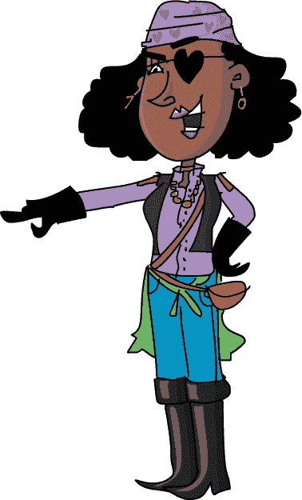

“额——”

“不管如何，这个女孩是我的助手。”

到此时，库斯迪彻底糊涂了。“这个小……她是在为*你*工作？”

“当然了。她正在帮我测试这里的安保。而且如果一个*孩子*都能把你耍得团团转……”她摇了摇头。“只能这么说吧，这看起来不太妙。”

“但你是——”

女人没有说话。她只是笑了，露出一排牙齿。

库斯迪突然满头大汗。他松开了洛莉，掏出一块手帕。

“嘿，这只是个失误！我不知道她是为科——呃，为你工作的。”

“现在你知道了。现在我们要走了。走吧，洛尔（Laurel）。”女人搂住洛莉的手臂，高昂着头走开了。

“我们慢慢走，”女人低声说，“等转过街角，试着在库斯迪开始用脑子而不是嘴之前码头。”

一离开库斯迪的视线，她们就跑了起来。

“太棒了！但我的名字是洛莉，不是洛尔。”

“差不多。我是温索姆·洛斯索姆（Winsome Losesome）。”

“很高兴认识你！谢谢你帮我！我不是故意惹麻烦的。”

“别客气。反正我也要离开这个城市。而且我很不喜欢那个家伙。他是个笨的霸凌者。”

在码头，温索姆跳上了一艘船，开始准备出发。“快来！上上来，”她对洛莉喊道。

“温索姆，这是谁的船？”

“这是我的船，叫‘双身号（Doppelganger）’。帮我拿那根别的绳，好吗？”

“哇，你怎么弄来一只船的？你是海盗吗？”

“我身份很多，女孩，”温索姆说，“至于这只船，我某种程度上是偷来的。但我偷得很诚实！”

“你怎么能*诚实地*偷东西？”洛莉担心自己又陷入了更大的麻烦中。

“我以前是这只船的甲板员，”她说，“老板总是让我做所有的脏活。‘洛斯索姆，换掉主桅！’他会说，‘逆时针方向装上新的索具！’”

温索姆展开了帆。

“但我私下留下了所有我换下的旧零件。它们反正都要进垃圾堆，不如留着对吧？一旦我收集了足够的零件，我就辞职了，然后把它们重新组装了一只船。老板并没有发现！他有的那只船全是替换件。一个复制品。我有*真正的*那只。”

“但是——”洛莉开始说。

“以后再说，宝贝？我们正忙着逃法呢。”

温索姆说的对。洛莉解开绳子，他们驶入了无月的夜色。

# 第 13 章 生命游戏


“双身号”驶出了概率湾（Probability Bay），远离了洛莉的烦恼。她冒险从船侧看去，发现了一个美丽的惊喜。

“温索姆！看那个！”

在船迹中，发光的闪光点亮了水面。蓝色和绿色的卷曲在身后跳舞。

“噢，是的。那些被称为滑翔（gliders）。漂亮吧？”

“它们太美了！是什么让它们发光的？”洛莉问。

“当你搅动水时，它们就会发光并形成图案。只有在像这样的夜晚才能看到它们。”

“哇！我从未见过这种东西！”

“想看*真的*酷的东西吗？”温索姆把一个浅盘放入水里，放在长凳上。等水平静下来，她在水里勾勒了一个小小的图形。


发光点活了过来，在盘里扭动了几次，然后消失了。

“它们怎么那样移动？”洛莉问，“它们真的是活的吗？”

“我不认为是。那只是一个看起来像活的图案。应该有一些关于光点如何移动的规则，但我从未在意。也许你可以研究一下。”

温索姆回去操纵舵轮。洛莉忙着制作更多的滑翔、漂亮的波浪和卷曲。克斯（Xor）试图咬住那些游过的发光波纹，但他只咬到了一嘴水。


罗莉擅长寻找那些在水面上穿梭得越来越慢的模式，但最终，她变得不耐烦了。

“温森，我们要去哪里？”

“我们要去抽象岛，”温森回答道，“我有些东西要送达。我们应该在早晨前到达那里。”

“抽象岛？我的地图上没有那个地方，”罗莉说。

“我敢打赌，有很多东西可不在你的地图上，孩子。”

“你是说地图并不等于疆域？”

“哈？是谁告诉你的？”温森问道。

“特普上校。他给我寄了一封非常奇怪的信。”

“噢，是`他`啊。”

“你认识特普上校吗？”


“他是个疯老头，”温森说，“总是爱管别人的闲。发那些带着他愚蠢秘密信的无礼守护（daemons）。”

“那些秘密信很有趣。Xor 想出了办法怎么——”

“对上校要小心，罗莉。我很确定他就是那个想把你关进监狱的人。”

“他是谁？”罗莉问。

“他是我的——他曾是我的老板，”温森说，“这是他的邮件船船。直到我复制了它。我们 . . . 在经营方式上产生了分歧，所以我自立门户了。”

“你和他吵架了？”

“嗯，是的，”温森说。

“你们为了什么吵架？”

“他希望一切保持原样。我 . . . 不。”

“噢，”罗莉说。温森声音中的某些信息告诉罗莉不要再问关于吵架的事。他们沉默了一会儿，看着天空和水面。

“上校在某方面是对的，”温森轻声说。

“什么？”

“地图只是一张画。它不是真实的。如果有人忘记把抽象岛画在地图上，那个岛依然存在。它不在乎你知道什么。”

“用户之地（Userland）没人提到过岛屿，”罗莉说。

“那里的人对外界世界并不并不多。那是上校喜欢的样子。用户之地是一个岛屿。这是一个由岛屿组成的世界。”

罗莉不喜欢她听到的这些。“但是温森，我必须按照我的地图回家。”

“是吗？”

“是！”

“为什么？”

“每个人都这么告诉我的，”罗莉说。

“那个理由不够充分，”温森说。

“不是吗？” 人们总是时候告诉罗莉该怎么做。当然，她并不总是听他们的话，但她通常会为此感到很抱歉。

“不！你应该一直知道自己`为什么`在做某件事，”温森说，“而不是因为有人让你这么做。保持清醒并灵活一点，孩子。否则，你就像那些小滑翔器，别人推你去哪里你就去哪里。”

“但是廷克说过——”

“先把廷克忘掉，”温森说，“你起初是怎么迷路的？”

“我跟我妈妈吵架了，”罗莉说，“妈妈想让我暑假去学校，但我根本不需要！”

“也许暑期学校是件好事。我听其他国家的孩子——”

“我不在乎！我不想和我不认识的人在学校里浪费整个暑假！”

“好吧，这很合理。那后来发生了什么？”

“我进森林里散了步想冷静一下，但我太气了，忘了看路，结果迷路了，我绕圈子走了好久，”罗莉说，眼里满了泪水，“然后我被那些术语（Jargon）怪物袭击了，我一直跑直到来到这里，但因为我不知道规则，我自己制造了一个术语，而且这里的人甚至没听过哈密尔顿、美元或者任何东西！我不明白为什么我需要密码，现在我要去一个地图上根本没有岛，而且——”

“嘿，慢点……”温森说。

“——现在我又彻底迷路了，而且 . . 和 . . ”罗莉开始抽泣。

“等等，别哭，老天……”

温森知道如何对付那些完全不想见的讨厌鬼，但一个哭的女孩是另一回事。她给了罗莉一个笨拙的拥抱，直到声音停止。

“好了吗？”

“嗯。”罗莉吸了吸鼻子。

“很好。我原以为你会把船弄沉了，”温森说，“你不要去下面休息一下？在睡觉前想些什么。”

“想什么？”

“画你自己的地图。”

# 第 14 章：在抽象之中


“罗莉，醒醒。”

“Mrfl。”罗莉只是翻了个身。感觉现在醒得太早了！

“快点。醒醒。”

“妈妈？”罗莉听到水花声。洗澡吗？

“我们到了，孩子。帮我整理一下船。”

“那 . . 船？什么什——”她睁开眼睛。墙壁是木制的，是温森而不是罗莉的妈妈想让她醒来。当然——罗莉仍然在`双生胎（Doppelganger）`上。”


“不，听起来你已经偏离了真实目标。当你到达 Rustic 时，你并没有问如何找到 Hamilton。你问的是他，如何找到一条穿过 Userland 所有城镇的短路。”

“哇，你说得对。” Laurie 低头看着自己的膝盖，“**我现在我觉得自己真笨极了。”

“没，别难过。每个人都会犯那种错误。”

“大家都是吗？”

“你完全不知道，”Winsome 说，“算法并不仅仅存在于乌龟、蚂蚁和硬币中。它们也出现在你的脑海里，而那些算法是最难做正确的。”

“我还是不知道该怎么回家。”

“我也不知道。但问出正确的问题是一个良好的开始。既然你在这里了，最好派上点用场。” Winsome 指着窗外山上的一座高大白塔。“你看到那座灯塔了吗？”

“那怎么了？”

“你想去顶上看看吗？那里的景色美极了。”

“好 . . . 好！听起来很有趣，”Laurie 说。

“太好了。拿着这个。”Winsome 给她一个沉重的木箱。“我需要你把它送到灯塔守护人那里。”

“里面是什么？”

“非常昂贵。而且易碎。”

“但是—”

“去吧，他还在等。我会在船上接你。”

![figs/web/095fig01.png.jpg)

Laurie 爬上山的过程精疲力竭，所以她在灯塔底部停下休息了一会儿，检查是否有门铃或人让她进去。一楼地上什么迹象都没有，于是她对着塔楼喊道。

“你好！上面好吗！有人吗？”

一个声音飘了。“是的！上来吧！门开着。”

Laurie 绕着楼梯向上，提着笨重的箱子气喘吁吁，Xor 趴在她的肩膀上。最后她到达了塔顶的灯塔守护人房间，完全屏透了气。灯塔守护人背对着她，用双远镜扫描着地平线。

“噢，很好，”他低声说，“小心放下。”

Laurie 把箱子搬到长凳上，环顾四周。房间几乎没有可以说的墙；它完全是由玻璃做的。Laurie 站在灯塔守护人旁边，更清楚地观察窗外。一侧是宽阔的蓝色海水。她几乎看不到地平线上有什么凸起——也许那是 Userland。另一侧，整个 Abstract Island 展现在眼前，就像，嗯，就像地图一样。沿岸边有港口和 `Doppelganger` 号船。两个穿长袍的人在哲学家餐馆前争论着。从上面看，这座岛屿看起来更加整洁、有组织。

“哇！从这里可以看到这里的一切！”Laurie 惊呼道。

“是的。”灯塔守护人的眼睛一直盯着窗外的景色。

“所以 . . . 就这样？”

“就是，”灯塔守护人说，“噢，呃，谢谢。”

没有了箱子，下山比上山容易得多。

“到底，那个箱子里**到底**是什么呀？”Laurie 在返回 `Doppelganger` 号的路上大声自语道。

Xor 从她的口袋里探出头。“我猜是灯泡。些无聊的东西，”他插话道，“大人们总是为了无聊的事情大惊小怪。”

回到船上时，Winsome 正准备再次起航。

“做得好，姑娘。谢谢，”当 Laurie 上船时，她说。

“不客气。他没怎么说话。”

“有的人一直住在塔里就会变成那样，”Winsome 说，“另一些人会变得话**很多**。”

“是吗？”

“你会看到的。那么现在你打算做什么？”

“我考虑过了，”Laurie 说，“Userland 只是一个岛。这个岛 . . . 很好，但我问了周围的人，这里没人听说过 Hamilton。”

“嗯，”Winsome 说，“你想做我的助手吗？”

“你什么意思？”

“你想找家的路吧？`Doppelganger` 号几乎哪里都能去。你可以帮我送货，你可以在比走路或游泳多多的地方寻找答案。”

“这和你告诉我我去哪里有什么区别吗？”

Winsome 笑了。“你变得越来越聪明了。但别太聪明。跟我航行一段时间吧。我需要帮助。如果你不喜欢，我可以在你任何地方放下你。互不介意。”

Laurie 想了一会儿，咬了咬嘴。“好吧，”她说，“成交了！”

# 第 15 章 关键时刻的机智

![figs/web/099fig01.png.jpg)

乘坐 `Doppelganger` 号与 Winsome 一起旅行非常有趣。Laurie 看到了许多奇怪的地方和人，有时她忘记了自己正在寻找返回 Hamilton 的路。但她的工作并不轻松。

每当他们到达一个岛，Winsome 就会带着一大袋信件进入镇子递送。几小时后，她会带着新的一批信回来，要从那个岛送到其他地方。

Laurie 的工作是递送那些“有趣的”包裹。（Winsome 一直用那个词。Laurie 不认为它的意思是 Winsome 认为的含义。）“有趣的”客户住在偏远地区的高塔里，跨越摇晃可怕的桥梁，位于高山顶，，或悬崖侧面。包裹很重（而且易碎 . . . 而且昂贵），目的地的指示往往非常奇怪且不完整。为了能完好无损地往返，Laurie 工作时必须非常聪明。

模糊的指示已经够糟糕了，但这一次，Laurie 应该递送的包裹根本没有地址。上面只写着 `FIRST, FOLLOW THE BYZANTINE PROCESS.`。Winsome 去了某处，所以 Laurie 甚至无法向她寻求帮助。

“什么是拜占庭流程？我甚至不知道它什么样子。我该怎么遵循它？”她大声自语道。

“我们在拜占庭岛，”Xor 说，“所以流程一定是主干道的名字。或者是一条河。或者是河边。这合乎逻辑。”

“你完全不知道，对吧，Xor？”

“我当然知道！我的继妹是一只剑龙龙！”

“什么是 Atlas . . 算了。我不想知道。”

从哪里开始并不神秘，至少不是。拜占庭的入口被一座巨大的石质建筑挡住了。牌子上写着`所有货物从此处进入`。一条长红地毯通向内部的语义旋转门，那里有两个守卫，就像在 Symbol 里一样。守卫们似乎在争论。

“. . . 这不符合逻辑，Anton！”

“这完全符合逻辑，Basil。如果你只—”

“打扰一下，”Laurie 说，“我想通过。”

“抱歉，小姐。对于这个，你必须有一个由值守副官签字的通行证—”Anton 开始说。

“——并由值守高级官员签字，”Basil 完成道。

“他们是谁？”她问。

“我们就是。”

“噢，很好。”

“Basil 尉是值守副官，而我是值守高级官员—”Anton 说。

“——但只有在偶数日，”Basil 说，“在奇数日，我是高级官员，Anton 尉是副官。”

“今天是几号？”

“这正是我们在你打断我们之前正在讨论的，”Anton 说，“昨天是 Pent 月的三十号。我想我们都同意三十是一个偶数，所以我当时是高级官员。”

“这意味着今天是 Hect 月的零号，”Basil 说。

*Hect 月的零 . . ？ 嗯，万物总得有个开始的地方*，Laurie 想道。“所以今天 Anton 应该是副官，Basil 应该是高级官员，对吧？”

“没那么简单，小姐！”Anton 说。

“这是一个关于零是奇是奇的问题，”Basil 说。

“噢。”Laurie 从未那样想过零。现在她很好奇。“所以到底是偶数还是奇数？”

“零是偶数！”Anton 说，“它能被二整除。零除以二等于零。”

“这不能证明任何问题，”Basil 说，“零除以**任何**数字都等于零。更重要的是，如果零是偶数，那么 Anton 就会连续两天担任高级官员，我绝不接受！”

“更重要的是，”Anton 说，“如果零是奇数，那么 Basil 在今天和明天——明天是 Hect 月的一号——都将高级官员，我绝不坐视不管那样！”

“你看，小姐，在面对重要问题时，你的立场取决于你坐在哪里，”Basil 说。


“但是——”劳莉开始说道。

“总之，你得先让你的通行证申请表获得批准。”

“我的通行证申请表？我不明白。”

“噢，当然，我们这里已经没有通行证了，”巴塞尔说，“那样太不符合保规定了！”

“你必须让凯斯将军批准你的通行证申请。如果他说你可以通过，那么我们就说你可以通过，”安东说道。

“他在就在走廊右侧的尽头，”巴塞尔补充道，“现在你听着，安东：如果你把两个奇数相加你会得到一个偶数，对吧？零加零等于零。所以如果零像你坚持的那样是偶数，它也同时是奇数……”

劳莉走过一条无尽的走廊，直到她来到一扇标有`康斯丁·凯斯将军，边界安全办公室`的敞开门前。她轻轻敲了门，进了房间。

“你好，将军先生，吗？我想找一张可以通过大门的通行证。”

“嗯。”凯斯将军从文件中抬头看了一刻。“你来这里什么事？”

“我是来送包裹的。”

“嗯。100 英尺的围栏需要多少根栅柱？”

你说什么？

“栅柱，孩子。我想在 100 英尺的围栏上每隔 10 英尺放一根栅柱。我需要多少根？”

“呃，10 根？”

“我也是这么想的，”他说，“但我们的栅柱快不够了。我怀疑敌人正在偷走它们。”

劳莉完全不知道他在说什么。“很抱歉打扰您，先生，但关于那张通行证……”

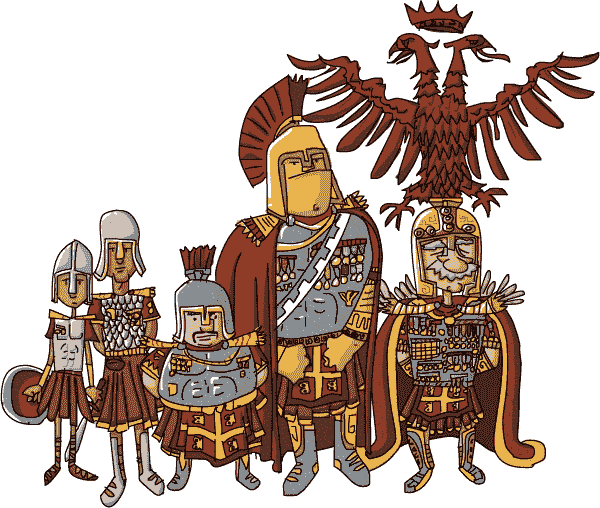

“把这个交给走廊下物流办公室的达里乌将军，”凯斯说，递给她一张空白的通行证申请表，“如果他批准了，我也批准。”

“谢谢您！”劳莉轻快地说。

“嗯。”他转过头去忙他的栅柱问题，让劳莉自己去寻找达里乌将军。

***

达米安·达里乌将军也正忙于一堆文书。劳莉注意到他的桌子上有一张巨大的河流地图；地图上布满了涂鸦和箭头。

“达里乌将军？我需要一张通行证，”劳莉说，递上她从凯斯那里拿到的通行证申请表。

“你是为了杏仁西兰（mandelbroccoli）来的吗？”

“呃，杏仁西兰？不是，先生。”

“那你就有关于狼的信息。”

“狼？”

“是的，狼，”达里乌说，“我的一名士兵正试图把一只狼、一只羊和一筐杏仁西兰运过并发流（Concurrent Streams）。小船只够载他和另一件东西。”

“他不能一次带一个吗？”她问。

“不行。如果他带走了狼，把羊留在西兰旁边，羊就会吃掉它。如果他带走了西兰，把狼留在羊旁边，狼就会吃掉羊。”

“所以先带羊，”劳莉说着，在脑子里比划着，“然后带……噢。”

“没错。无论他接下来带什么，在另一边都会面临同样的问题，”达里乌说。

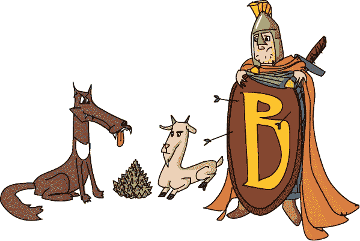

“那消息太糟糕了，但我实际上是来问通行证的，”劳莉回答道。

“我没时间陪平民闲聊。把你的这什么东西交给档案办公室的尤里庇德斯将军，”达里乌说，把劳莉的表格还了给她，“如果他批准了，我也批准。”

劳莉沿着走廊走了过去。

***

尤里庇德斯正忙于自己的问题。人们挤在档案办公室桌子上摆放的巨大记录簿周围。有些人正试图从书上阅读长串的数字。另一些人则想在书上写新数字。读者和写作者们推来挤去，互相阻碍。看起来随时可能爆发冲突。

将军在各个桌子之间来回走动，听取抱怨并发布命令。一群人围着他转，互相大叫着，试图引起他的注意。看起来他几乎没有时间思考。

劳莉推挤、挣扎，钻到了人群前面。

“先生？尤里庇德斯将军？你能帮我吗？”

“呃？噢，又来。你是读者还是写作者？”

“我不是读者也不是写作者。我需要你批准——”劳莉开始说，但将军必须去平息一场争吵。

“你刚才想要什么？读者？哪一本书？”尤里庇德斯回来时问道。

“不，先生。我需要——先生？你好，先生？”

尤里庇德斯去了房间另一个角落。劳莉试图再次引起他的注意，但人群不断把她推开。

***

劳莉坐在走廊的地板上，头枕在膝盖，精疲力竭且困惑。杏仁西兰、栅柱、通行证、这个将军、那个将军……这一切到底什么时候是个头？她仍然能听到关于谁下一个能用哪本书书的争吵声。

“那些人太没礼貌了，”她抱怨道。

“为什么他们不能轮流和分享呢？”

“也许没有人教过他们吧，”索尔说，“我的表弟雷克斯从不喜欢分享。当然了，他有四十英尺高，牙齿有你的手臂那么长。”

“应该有人教教他们。这不公平。”

“是啊，”索尔说，“嘿，你不是‘某人（Somebody）’吗？”

“我？”

“是的！我很确定你是‘某人’。否则，你就是‘无人（Nobody）’，那对‘任何一个人（Anybody）’来说都不说得通。”

“但我只是个孩子。没人理孩子的。”

“又怎样？没人也不理我，”他说。

“但这不正是你想要的，对吧？变得隐形。”

“噢。对的。”

“我们要怎么办，索尔？”

“我不知道。想想吧。你擅长那个。”

“不，我不擅长，”劳莉嘟囔道。

“真的吗？廷克（Tinker）觉得你擅长。温瑟姆（Winsome）也是。”

劳莉再次低下头，叹了口气。“我只是她的送货员。”

“不，你是她有趣的送货员，”索尔说。

“那又？”

“所以你想办法去那些别人去不了的地方。还记得你在符号之（Symbol）外面和波恩（Ponens）以及托伦（Tollens）争论吗？我没以为你能找到绕过去的办法。但你做到了。老太太也是一样。”

“他们也没能抓到我们，”劳莉微微笑了一下。

“什么？”索尔问。

“我只是……我办不到。她给了我一份工作，我必须自己完成。”

既然别无可做，也无处可去，劳莉开始思考。

她需要尤里庇德斯的批准，才能从达里乌那里获得批准。然后，表格必须由巴塞尔和安东签字并会签。这种混乱有些熟悉。休格告诉过她的。*先想出一个答案，然后寻找一个与之匹配的问题。*

尤里庇德斯忙不可开。每个人都想同时做所有事情。也许她应该从那里开始……

***

半小时后，劳莉回到了档案办公室。她没有叫喊，推推，也没有插队。她在等待。最后，其中一本书完全空出来了。劳莉走过去，在地板上画了一条线。

一个女人走过来要在书上写字。劳莉让开旁让她工作。几刻后，一个男人走过来要读书。

“新规定，先生，”劳莉说，“你必须站在线上，直到第一个客户用完。”

“但我得在第 1728 页查点东西！”

“很抱歉，”她说，“将军的命令。但你是下一个。”

“噢。行吧。”那个男人小心地站在线上。另一个人来读第 1024 页。“

“将军的命令，”1728 指着线说，“别担心。你在我后面。”

劳莉守着那条线，直到这种模式看起来可以自动运行下去。每个新来的人都会被已经在队中的人告诉等待。然后她等下一本书空出来。

随着这个主意的传开，人们开始在其他书前面画自己的线。很快，整个档案办公室都变得安静而井然。毕竟，这是将军的命令。


欧里庇得斯几乎无法相信自己的眼睛。读者们和作者们正遵循着一个简单的规则在轮流进行！他很高兴能休息一下，于是二话不说地签了洛莉的通行证。

***

“达里斯将军？”

“又是你。在我们解决好‘西兰花危机’之前，我不想听任何其他事情。”

“我觉得曼德西兰花并不重要，先生，”洛莉说道。

“什么？你想让那只羊把它们全吃了吗？”

“不，我的意思是，即使你有两只狼，答案也是一样的。你不能把羊单独地留在任何东西旁边。如果你变换一下视角就很简单。我觉得。”

“继续说，”将军说。

洛莉又思考了一小会儿，然后写下了她的想法。这看起来有点像丁格尔那里的算法：

1. **把羊带到对岸去。**
2. **空手回来。**
3. **把狼带过去，但把羊带回来。**
4. **留下羊，把曼德西兰花带过去。**
5. **空手回来。**
6. **最后，再次把羊带过去！**”

达里斯研究了一会儿洛莉的想法，他在思考时双手比来比划着。

“我相信这行得通。那只羊可能不喜欢这样来回去，但总比被吃掉好，”达里斯说，“现在小姐，你想要什么？”

***

最后，洛莉回到了边界安全局。“凯斯将军，先生？达里斯将军签了我的通行证。”

“嗯，”凯斯哼哼了一声，在达里斯的签名下面潦草了一个签名。

“谢谢您，先生。”

“嗯。”

“先生？还有一件事，”洛莉说。

“嗯？”

“我不认为有人在偷你的栅栏柱。你只是需要`eleven`根柱。像这样。”

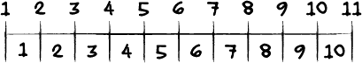

“嗯！”

***

“欢迎回来，小姐，”安东说道。洛莉递交了从拜占庭将军们那里收集的文件。

“看起来一切正常，”巴西西尔检查着签名列表说，“这些批准一直落实到了高层！”

“小姐，你有什么需要报备的吗？”安东问。

“报备？”

“安东中尉的意思是，”巴西西尔说，“有什么我们应该知道的事情吗？”

“噢。这个，我觉得安东是对的。零是偶数。”

“不！”巴西西尔说。

“对。零不可能是奇数，因为一是奇数，而你不能连续有两个奇数，对吧？”

“对！”安东说。

“我想不是，”巴西西尔嘟囔着说，“但这不能证明它是偶数。”

“嗯，如果你把一个奇数和一个偶数加在一起，得到的总是一个奇数，”洛莉说道。

“嗯，”巴西西尔若有所思地思考道，“一加二等于三，二加三等于五……是的。”

“所以我可以证明零是偶数还是奇数。把它加在一个奇数上看看结果。零加一等于一，而一是奇数。所以零必须是偶数，”洛莉说。

“我还是不服，”巴西西尔说。

“好吧，”洛莉说，“如果你把两个`even`数加在一起，得到的总是一个偶数，对吧？零加二等于二，是偶数。零又是偶数了！”

“完全正确！”安东说。

“哼，”巴西西尔哼了一声，“所以零是偶数。我该如何防止安东连续两天当值长呢？”

“那部分很简单，”洛莉说，“问题是昨天，三十日，和今天，零日，都是偶数。安东昨天是值长。所以巴西西尔，你今天可以当值班长。”

“现在等一下——”安东说

“——但到午餐为止，”洛莉说，“今天午餐后，安东就是值长。这样才公平。”

“太棒了！”值长巴西西尔说，“副官安东，签一下这位小姐的通行证！”

批准、批准、批准、签名、复签。洛莉终于通过闸机。

“我很高兴终于结束了，”索说，“现在，该死的拜占庭流程到底在哪儿？”

# 第 16 章 计划的变更


*第二*，包裹说明上写着，*递交给 BRUTO FUERZA，LOOKOUT HILL 灯塔*。洛莉和索没有看到任何灯塔，但山丘上升起了一片尘土。

“你们为温森工作，对吧？很准，”布鲁托在他们到达时说道，“我很遗憾我们进度落后了。我们的灯塔还没完工。我们一直在加夜加命地工作。”

“要把灯塔盖在那座城堡上面吗？”洛莉问。

“城堡？”布鲁托问，“那*就是*灯塔。”

几十个绿壳圆型机器在巨大的结构周围忙碌。它们看起来就像丁格尔的乌龟，但有大卡那么大。这些乌龟不是在纸上画点，而是在一层一层地砌砖，在洛莉眼面前建造着`WALLs`、`STAIRs`和`WINDOWs`。

“墙上出来的那些东西是什么？”她问，指向塔楼一侧密集的支撑柱和扶壁。

“我们的问题没完，”布鲁托摇着摇头吐口唾沫，“南墙一直在向外塌。所以我们必须加固它。然后它开始向内`inward`塌。”

“这就是你们进度落后的原因吗？”她问。这场景中的某些东西让洛莉感到不安，但她又说不上。它看起来……很乱。

“事情总是会出问题的，”布鲁托说，“大想法伴随着大风险。但我们可以用更多的力量和努力来解决任何问题！”

“你这两样确实非常多，”洛莉说道，带着一丝微小的羡慕。如果有了那些乌龟她能做多少事啊！你们是怎么教乌龟盖塔的？”

“来，我给你看。”布鲁托带她来到附近的一个帐篷。一小群人围着桌子工作。“首先我们在纸上写下计划。”

> **砖块行：**
>
> 铺一块砖，
>
>向前移动，
>
> 铺一块砖，
>
>向前移动，
>
> 铺一块砖，
>
>向前移动，
>
> . . .

“那部分形成了一行的砖。我们将许多`砖块行`堆叠在一起，墙就是这样建成的。为了让墙更厚，我们只需要添加更多命令。”

> **砖块行版本二：**
>
> 铺一块砖，
>
> 铺一块砖，
>
> 向前移动，
>
> 铺一块砖，
>
> 铺一块砖，
>
> 向前移动，
>
> 铺一块砖，
>
> 铺一块砖，
>
> 向前移动，
>
> 铺一块砖，
>
> 铺一块砖，
>
> . . .

“哇，它一直写下去没完没了，”洛莉翻着书页说，“写完这些一定花了好很长时间。”


“不。我们需要的 . . . 我们需要的 . . . 是计划的彻底改变！”布鲁托并没有针对特定的某人说，“好了，大家。清理甲板！清空你们的大脑！脑力风暴！我要看到新主意！”

“让我们把墙加四倍厚，但塔只高三倍，”一个工人说。

“内外都要更多的支撑！”另一人喊道。

“用更大的砖块！”

“用钢做砖块！”

“钢太太贵了。铁怎么样？”

“你疯了吗？铁会生锈的！”

“我告诉过我们应该用三角形的。”

“外面用钢板，里面用砖块。”

“好！这个好！继续提。我们正在跳出框架思考。还有人吗？”布鲁托问道。

“为什么不能用圆形的呢，就像抽象岛上的灯塔那样？”洛莉建议道。她思考了一分钟，然后写下了两首小诗。

> **砖之圆：**
>
> **铺一块砖，**
>
> **向右转一度，**
>
> **向前走，**
>
> **重复三百六十次。**
>
> **塔之圆（多高？）：**
>
> **做一个“砖之圆”，**
>
> **重复“多高？”次。**

“看到了吗？你用砖块砌一个圆，然后在上面再放一个圆，一直到顶端！”洛莉解释道。

“哈哈哈，真可爱的主意，姑娘！但这绝对行不行，”布鲁托回答道。

“为什么不行？”洛莉问。

“它太小了！”布鲁托说，“你凭什么指望用这样一个微小的计划造出一座宏伟的大塔？”

“我不知道，”洛莉说。这在她看来是合理的，但也许他们知道一些我不知道的。毕竟，他们是专业人士。“我 . . . 我觉得它会行。”

“哼，”布鲁托哼哼了一声，“即使它足够大，它也有一个致命缺陷。”

“什么缺陷？”

“我们的第一个计划是一个空心正方形，它塌了，”布鲁托说，“第二个计划是同样两倍大的空心正方形，它也塌了。而你的计划是一个空心圆。”

“我不明白。圆不应该更坚固吗？”

“显然，问题不在于形状或大小——问题在于它们内部是空的！”布鲁托说，“我们需要把内部也填满砖块。这才是逻辑。”

“你说得对，布鲁托！”一个工人说。

“这就是为什么你是老板，”另一人说。

“但我见过空心塔，”洛莉说，“它们以前造过过。”

“你怎么知道它们最终不会倒塌？证据非常明显，”布鲁托说。

“是的，非常清楚，”其他工人同意道，互相点头。

“但我——”

“不，我已经下定主意了，”布鲁托说。塔必须是实心的。事实上，”他看着那堆材料，“我们要造一座金字塔。”

“金字塔？！”

“金字塔不会倒塌。它已经屹立了，”布鲁托解释道，“它是完美的几何体之一！”

“没错，”工人同意道。

“天才！”

“这只是工作量和材料的问题。”

“好！我们计划好了，”布鲁托说，“大家，开始工作吧！向温萨姆致歉意，姑娘，告诉她我们需要更多时间来把它做好。”

有人是不可理喻的。当洛莉和索尔前往 `Doppelganger` 时，布鲁托和他的团队正忙于为他的 `PYRAMID` 编写说明书，一块砖一块砖地写。

# 第 17 章 追逐优雅


“好了，”温萨姆在清单上勾掉了福埃尔萨（Fuerza）的包裹。

“下一个是优雅岛。现在那个特殊包裹在哪儿？”

“哇，那些是什么动物？”洛莉问。。沿岸边，长着灰色长象鼻子的小灰色动物正互相玩耍，并在阳光下打午睡。

“那些是优雅族（Elegants）。岛上到处都是它们，”温萨姆回答道。

“它们好小好优雅！就像在跳舞一样。”

“是啊。包裹，包裹……”温萨姆自言自语道。

“你们那那里没有优雅族吗？”

“没有。我们有大象，但它们都又大又笨。优雅族友好吗？”

“只要有需要就有多友好，”温萨姆说，“找到了！好，这个包裹是给弗雷内尔·古德拉斯（Fresnel Goodglass）的。”

“地址只写了在红色气球下方，”洛莉说，“我想那是他在那儿。”她指了指漂浮在树上方的红色圆球。

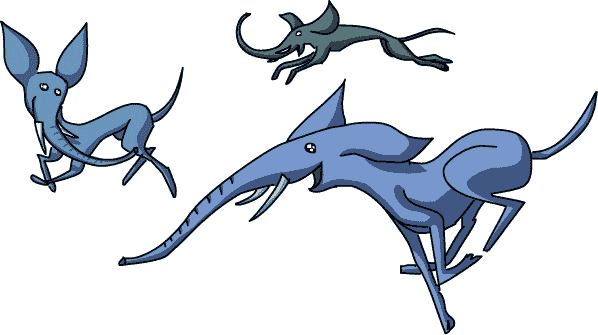

但在离开之前，洛莉想和优雅族玩玩。她小心翼翼地靠近它们，发出轻柔的“咕咕，咕”声。

“你现在变成鸟了吗？”索尔嘲讽道。

“嘘。我只是试着引起它们的注意。”

优雅族似乎并不特别害怕或好奇。事实上，它们表现得好像洛莉不在一样。但它们的舞步似乎总是避开她的路。当她沿着岸边走时，这些小生物就向内陆移动。当她进入内陆时，它们决定树下才是该待的地方。很快，洛莉只能看到几个优雅族，在她的触及不到的地方玩耍。噢，好吧，她想。

***

在气球的指引下，洛莉和索尔很容易就找到了那座山。但当他们到达时，那里没什么。一个巨大的船锚半埋在土里。一根绳子向上、向上、向上接到地面高方的篮子上，篮子本身连接在气球上。几个年轻的优雅族在树下玩躲迷猫。那里完全没有建筑或人。

“我们在对的地方吗？”洛莉大声自问，“灯塔在哪？”

“嘿，洛莉，看这个。”索尔抓着一个写着“请按铃服务”的牌子。下面挂着一个小铃。他们互相看了看，耸了耸肩。索尔用尾巴用力撞了一下。


铃声响了，声音比这么小东西本该发出的要大得多。


索尔就在旁边。那只蜥蜴变成了亮靛蓝色，倒在了地上。


洛莉不得不捂住耳朵，直到声音消失。


当一切结束后，那些年轻的优雅族无影无踪了。洛莉把索尔抱在手里。他的皮肤是白的，眼睛向不同的方向转动。

“索尔！你还好吗？”

“我觉得还好。那一下快把魂都吓散了！”

上方传来的一声嘶嘶让洛莉抬头。一个电梯箱正从他们面前下降到地面。当门礼貌地 `叮` 一声打开时，他们缩了缩。

洛莉拿起包裹，最后环顾四周，走进了里面。门关上了，电梯上升得很快，让她脚趾都缩在一起，胃里翻江倒海。

当门再次打开时，他们已经在百码高空，在篮子里。那里像一个小公寓。有一张桌子、一张床和一些舒服的椅子。一个满脸皱纹、留着灰色胡须、耳朵尖尖的老人对着她微笑。

“这里是……你是弗雷内尔·古德拉斯吗？我是洛莉。我有一个包裹要给你。”

“是的，是！是的，我是！是的，你是！谢谢你！”那人接过包裹，“欢迎来到我的漂浮灯塔。你觉得怎么样？”

“这不是灯塔，”洛莉说，在下电梯之前用脚测试了编织的地板，“这是一个气球！”

“当然，它是灯塔。气球形式的灯塔。看到上面那个大灯光了吗？”弗雷内尔问。他们上方确实挂着一个巨大的灯塔光。

“但长长的扭曲的楼梯在哪？”洛莉问。

“取而的是电的是。对我这老骨头方便。”

“灯塔员的房间呢？”

“你可以直接从篮子侧面看。”

“那塔呢？”

“不需要！没必要！”弗雷内尔说，“灯塔本质上是光，而不是房子。”

洛莉并不信服。“你不能只是在气球上插一盏灯就称它为灯塔。”

“我不能吗？”

“不！”

“为什么不行？”

“因为 . . . 这是作弊，”她说。

“嗯。我明白你的意思，”弗雷内尔同意道，“但只要它好用，名字并不重要。”

“是的，很重要！”


“也许你是对的，”他再次赞同道。“但我是个糟糕的主人！你走了这么久，一定口渴了。想喝点水吗？”弗勒涅尔在一个托盘上递给她一个水壶和几个玻璃杯。

“噢，好的，麻烦了。”劳里拿过一个杯子试图接水。水溅到了她的鞋上。

“`Hey!`！这个杯子没有底！”

“那不是杯子，亲爱的孩子。那是玻璃杯，”他说。

“这个`glass`没有底。我该怎么用它喝水？”

“仔细想想，那不完全是玻璃杯，”弗勒涅尔说，“它是一个马克杯。看到手柄了吗？”

“好吧，这个`mug`有——”

“第三次想想，”他摸着胡子说道，“它是玻璃制成的，但也有手柄。所以也许我们应该叫它玻璃马克杯，或者，马克杯玻璃杯……”

“我不在乎你管它`call` 什么！”劳里大喊道，“它`got no bottom`，而且水……我是意思是，嗯，你叫它玻璃杯，但它没有……噢。”她的脸变得通红了。

弗勒涅尔给劳里另一个玻璃马克杯杯。“你又说对了。无论人们给它们起什么名字，事物就是它的样子。”

“但名字不重要吗？”劳里问道，仔细检查她那个新的玻璃-杯-马克杯有没有洞。幸运的是，这有一个底的。

“名字是有局限性的。而且很多名字其实是伪装的同一东西。”

“真的吗？”

“当然了。你是劳里还是劳伦？”

“嗯，两个都是。但我喜欢劳里。当妈妈非常生气时，她会叫我劳伦。”她叉着腰，向后仰起头。“`Lauren Ipsum，现在下楼!`”

弗勒涅尔像马一样大笑起来，如果那只马听懂了笑话的话。“全名是一个强大的东西。但无论怎么叫，你都是同一个人。有时候不同的东西会有相同的名字。你叫你妈妈为‘妈妈’，我也叫我妈妈为‘妈妈’。”

“但我不会叫`your`妈妈为‘妈妈’！”劳里说。*那样会多奇怪啊？*

“这就对了。这很符合逻辑。你必须透过`past`名字去看清事物的本质。这就是弗勒涅尔第一定律。”

“你听起来就像那个同名的巴赫，”劳里说。

“真的吗？嗯，我也是作曲家，”弗勒涅尔说，“我从大想法开始，然后让它们变小。”

“让它们变小？为什么？”

“为什么不呢？只有心胸狭窄的人认为大问题需要大想法。”

劳里并不确定他在说什么。“你如何让一个想法变小？”

“通过`De`composing（分解）。如果不使用`lighthouse`这个词，你会如何描述一座灯塔？”

“嗯，它是海边的一座白色高塔，顶部有一间满是窗户的房间，上面有一个巨大的灯，里面有一条长长的弯曲的楼梯。”

“非常好，”弗勒涅尔说，“现在看每一个部分，看看它是不是必不可少的。如果你那座有窗户、有大灯和楼梯的海边高塔是`pink`粉色的，它还能同样地工作吗？”

“我想可以。我没见过粉红色的灯塔，”她说。

“我没见过！但如果一切都是现成的，生活就会很无聊。为什么你的灯塔是高的？”

“为了让船能看到你，”劳里说。“短灯塔效果没那么好。而且你需要弯曲的楼梯才能到达顶部。”

“为什么要灯？”

“有灯是为了让船在晚上能看到你。”

“还有灯塔守护人的房间呢？”

“为了你可以看到`them`。”

“噢，原来，”弗勒涅尔说。“我的气球在高处有一个灯，这样远处的人就能看到它。我可以看向侧面看到他们。我坐电梯到达顶部。颜色不重要。它做了灯塔能做的一切。它是灯塔吗？”

“它`like`一个灯塔，”劳里承认道。

“你可真会还！我满足于‘像灯塔’了，”他说。

“这就是你 Decompose 的方法？”

“大体如此。你把一个大想法拆开，看看每个部分背后的`why`。然后你寻找执行相同功能的更小想法。例如，你觉得我的那个小铃怎么样？”

“你的那个`little`小铃！那东西吓坏了——”

“它确实需要一些调整，我同意。但想法是合理的，”他说，“铃的关键部分是声音。因为铃在很远的地面上，它需要巨大的声音我才能听到。”

“那你为什么不用一个大铃呢？”她问。

“如果我用大铃，我就需要一个大框架来挂它。”


Ping 放下 Laurie 递来的沉重包裹，打开了锁扣。里面是一台矮矮的望远镜。“太棒了！我一直在等这个。”


“这是给网络的，对吧？你会教我它是怎么运作的吗？”Laurie 问。

“当然可以，”Ping 说，“看着瞧。”她走到房间中央，转动一个巨大的轮子，直到一个红色箭头直接指向优雅岛。然后她快速地上下拉动杠杆：

> FLOP. FLOP. FLIP. FLOP. FLIP.
> FLOP. FLIP. FLIP. FLOP. FLOP.

“现在再看一次菲涅尔，”她说。

Laurie 把眼睛贴在优雅岛的望远镜上。菲涅尔将光线对准他们，开始闪烁着一条信息：

> FLOOSH. FLOOSH. FLASH. FLOOSH. FLASH.
> FLOOSH. FLASH. FLASH. FLOOSH. FLOOSH.

“他回信了！他说了什么？”Laurie 问。

“噢，他只是说了‘嗨’。”

“就为了一个‘嗨’费了这么多？”

“这就是波多特码的工作方式，”Ping 说，“句子由单词组成，而单词由字母组成，对吧？同样，我们用 FLIP 和 FLOP 组成字母。像这样。”

> 01001 = L
> 11000 = A
> 10011 = U
> 01010 = R
> 01100 = I
> 10000 = E

“这真酷！但我还是觉得光是说个‘嗨’就太费劲了，”Laurie 说。

“也许你是对的，”Ping 微笑着，“但现在构建网络的艰苦工作已经完成了，我们可以做一些真正有趣的事情：利用网络让它变得更好。”

“怎么做？”

“嗯，我正在研究一种使用两种颜色光的方法。菲涅尔有一个更简单的代码的想法，只需要四个 FLIP 或 FLOP，不过我不太确定那将如何运作。我们使用旧的波多特码来交流我们对新代码的想法，然后尝试它们。”

“所以……你可以利用网络来讨论如何使用网络？”

“Laurie，你通过递送所有那些望远镜让这一切成为了可能。现在，随着我们学习如何使用它，网络只会越来越好。我们已经可以在几分钟内将信息从网络的一端传到另一端！即使分身邮寄那么远的邮件也需要几天时间。一旦我们修复了漏洞，大家都会想用它的。”

“但是……Winsome 呢？她会失去工作吗？”Laurie 问。

“什么？不，完全不会！网络是她的主意。”

“是吗？”

“当然！我们所有人都在为 Winsome 工作。她不想整天搬着邮件袋到处跑。说起来了，”Ping 在堆纸中找着，“Winsome 说她还有最后一个任务给你。”

“噢！是什么？”Laurie 问。

“她想让你把这封信交给分叉路花园另一边的人。”

信封上没有名字，但这比起 Laurie 在分身期间接到的某些任务并不算不上奇怪。如果她能快点完成，就可以回到这里玩网络了。“那我该怎么去花园？”

“你很急，是吧？我来告诉你它在哪里。”

# 第 19 章 分支延伸


花园被至少八英尺高的树篱围着。入口是一个从灌丛中切出的拱门。入口上方的木牌写着：

> **欢迎来到分叉路花园。**

“到了这里，”Ping 说。

Laurie 突然非常担心。“Ping，这是一个迷宫……迷宫……那种花园迷宫吗？”Laurie 读过关于小女孩和花园迷宫的故事，那些故事从没有太好的结局。花园迷宫充满了怪物，你和出口之间有许多弯弯曲的小通道。

“这并不是真正的迷宫。你总能找到出口，”Ping 说，“但你会在哪里是另一了。”

“噢，很好。我送完这封信后，我可以回到树灯塔吗？也许我们可以问问网络如何找到汉尔顿！”

“这是一个……好主意。好的。当你完成后，如果你愿意，我们可以聊聊这个。”

“谢谢你！一会儿见！”

“再见，Laurie。保重。”

Laurie 和 Xor 穿过入口，进入了一个由更多灌丛组成的走廊。走了一会儿后，他们发现了一个小喷泉，上方有一块牌子。

> **留下一硬币。许下一个愿望。**

Laurie 把她最后一枚公平币丢进喷泉，闭上眼睛，许下愿望。以防万一，她多闭了一会儿眼睛。但并没有什么兴奋的事情发生。

她继续沿着绿色的走廊走下去。除了树篱、更多的树篱，以及更多关于花园的牌子外，没什么好看的。

> **你知道吗？**
> **花园里有 16,777,216 条路径。**

“只有 1600 万？那不算什么！”Laurie 说，“用户领域有几百万百万百万条。”

> **每位访问者只有一条路。**

“没关系。我想快速通过这里。”

> **每条路只有一位访问者。**

“这不就是一回事吗？”

> **不是。**

“我想知道哪条路最短，”Laurie 说。下一块牌子回答了她的问题。

> **所有路径的长度都一样。**

“那我怎么知道该选哪一条呢？”她问。

> **明智选择。**

这时她来到了路上的第一个分叉口。每个分叉口都有自己的牌子。左边的牌子写着：

> **实物**

而右边的牌子写着：

> **想法**

Laurie 最近看到很多“想法”了。一个简单的“实物”会是很不错的改变。她选择了左边的路。一分钟后，她来到了下一个分叉口。那里的牌子写着：

> **熟悉的事物 | 奇怪的事**

“我最近也看到了很多奇怪的事，”她说，“我选熟悉的。”

> **年轻的 | 老的**

“嗯……老的！”他们沿着右边的路走过去。

> **有趣的 | 无聊的**

“这个好选，”Xor 说，“有趣的。”

“当我们去送那些‘有趣’的任务时，需要爬岩石和过可怕桥梁的人又你，”Laurie 说，“但行吧。”

> **丢失的 | 未丢失的**

“你怎么能有一个指向‘丢失物’的牌子呢？那难道不会让它们变成‘未丢失’了吗？”Xor 问。

“也许在在你找到它们之前，它们都是丢失的，”Laurie 沉思道。

“有道理，”Xor 回道。他们走了左边的路。

> **大部分丢失的 | 完全丢失的**

“全……不，大部分丢失，”Laurie 决定。再次向左转。

“你知道吗，我没看到几百万条路，”Xor 说，“一直只有两条。”

> **小的 | 不大的**

“不大的！”他们一起说道。

> **比你大吗？**
> **否 | 是**

“一切都比我大，”Xor 说，“我们往右边走。”

> **比山大吗？**
> **是 | 否**

*没那么大！* 他们又向右走去。

> **比灯塔高吗？**
> **否 | 是**

Laurie 也看够了灯塔。她尝试向左边走，但一只带壳的绿色动物挡住了路。

“我们又相遇了，字母语小姐，”它说道。

“乌龟先生！你在这儿做什么？”

“我正在享受特别美味，”乌龟说，咬了一口绿植，“我帮助保持花园里的羽蓝花丛修剪整齐。对我来说，这是一项美妙的差事。你在这儿做什么，字母语？”

“我正在寻找最近的出口，好送一封信。”

乌龟似乎在微笑。当然，他总是看起来在微笑。“花园里有几百万条路径。所有路径的长度都完全一样。”

她试图想象那么多路径并排在一起的样子。“我不明白。如果有这么多路，它们在哪儿呢？”


“它们就在你周围。每条路都从另一条路分叉，”乌龟说，“一条路变成 2 条，2 变成 4 条，然后是 8、16，以此类推。经过 24 次分叉后，有超过 1600 万条不同的路径。”

“噢！又是 2 次方的力量。但这次它是变大了，而不是变小了，”洛莉说。

“完全正确。你现在正处于通往‘熟悉、老、有趣、大多已失、比你大但比山小’的事物的道路上，”乌龟说，“我想我是其中之一。”

“那么我该如何选择走哪条叉呢？”

“我建议智智选择。再见，伊普森小姐。”乌龟转身，缓慢而稳健地沿着左路走去。

“等一下！我不知道你什么意思！”洛莉追在他身后。追上乌龟本应该是很容易的。但每走一步，他都离她越来越远。等洛莉莉走到下一个分叉口时，他已经无影无踪了。

> `友好 | 不友好`

“你觉得呢，索尔？哪边？”

“你真的想看到一个充满不友好事物的花园吗？”

“有道理。”她向了左边。

> `空中 | 地上`

它们不想看到任何比自己大且会飞的东西，无论它有多友好。反正，乌龟是在地上的。

> `轻 | 重`

“绝对是重了！”索尔喊道。

> `住在室外 | 住在室内`

“乌龟住在室外，不是吗？”现在她想一想，洛莉并不完全确定。但这看起来像是个不错的猜测！

> `从不睡觉 | 偶尔睡觉`

“它们绝对会睡觉，”索尔说。他们向右边走去。

> `晚上睡觉 | 白天睡觉`

“晚上睡觉！”洛莉喊道，“我们应该快到了了！”

> `多种颜色 | 单一颜色`

洛莉径着左路跑去，没有停下来思考。但乌龟不是只有一种颜色吗？回去来已经太晚了。

> `安静 | 吵闹`

“我不喜欢吵闹的东西，”她说，“乌龟很安静的。”

> `复数 | 单数`

“那是什么意思？”“复数`意味着多于一个。`单数`意味着只有一个，”索尔说。他们向右边走去。

> `本土 | 外来`

“我认识这个，”洛莉说，“`本土`意味着来自这里。`外来`意味着来自其他地方。本土！”

> `预期 | 意外`

“我想知道我们会在哪里到达，”当他们向右时她说道，“什么是熟悉、老、有趣、大多已失、比我大但比山小且比灯塔短、友好、在地上、重、住在室外、晚上睡觉——”（她停下来喘了口气）——而且多种颜色、安静、单数、本土，*而且*是意外？”

> `你的愿望 | 别人的愿望`

“是我的愿望！”索尔和洛莉同时说道。他们咯咯笑着沿着左路走去。下一个指示牌让他们思考了一会儿。它问道：

> **你确定吗？**

> 

> `是 | 否`

“确定，我很确定！”洛莉说，“我怎么会想要别人的愿望呢？”她走下左路，“我想我们快穿过花园了，索尔！”

她开始快走，然后慢跑，接着再次沿着那长长的绿色走廊跑了起来。索尔也变得兴奋起来，变成了各种波点色的颜色。洛莉已经在想她想给弗斯内尔、丁克尔以及——发送什么信息了。

“噢不！”

洛莉猛地停下脚步。在他们面前是另一个分叉口。最后一个。

左边的指示牌写着：

> `哈密顿（洛莉的愿望)`

右边的指示牌写着：

> **凡娜阿姨（索尔的愿望）**

“花园猜中了我的愿望！”洛莉说。

“我的也是，”索尔说。

洛莉开始向左走，然后停了。。她又开始向右走，但又犹豫了。他们在那里站了非常长、非常安静的一分钟。

“我们只能选一条路，”女孩说。

“是，”蜥蜴回答道。

“而且无法回头。”

“那是规则。”

“你真的想找到你阿姨，”洛莉说。

“而你真的想回家，”索尔叹了口气。

“这意味着我们必须选择，”洛莉说，“但怎么？”她是想回家，但也想让索尔找到凡娜阿姨。她想把索尔和凡娜一起带回家，那有多酷啊——

“不，洛莉，”索尔忧伤地说，“这意味着我们必须分开。”

“但是……”

“每条路只能有一个访客。那是规则。”他从她的肩膀跳下来，落在右边的指示牌上。“我猜……这就是你找到我的方式。”他的皮肤变成了橙紫色。

“我们可以做到的，”洛莉疯狂地思考着，“一旦你找到了你凡娜阿姨，就把她带去树灯塔。我会找到回来的办法。或者也许我会买一个望远镜和一个大灯光——”

“我们会再次相见的，”索尔说。

“好的，”洛莉说，“保证吗？”

“保证。”

“我会吹哨子的，好吗？”

“好。”

“这样你就能听到我。”

“明白，”索尔说。

“会好的。”

“绝对会，”索尔同意道。

“我走了。”

“我也是。”

洛莉确实尝试吹哨子，但不可能一边吹一边哭。试试看吧。

# 第二十章 终


曼德西兰花丛变得越来越短、越来越杂乱，直到与森林融合在一起。此时已经是傍晚，影子变长了。森林里的树是大大的橡树和枫树，偶尔有几棵松树或云杉。还有许多各种幼树和灌木。因为叶子茂密，很难远眺，但只要绕开云杉，走路还是相当容易的。

“*啾！！”

洛莉的心开始狂跳。更多的术语？多少个？在哪儿？

“*啾！！”

这次没有跑。她尽可能安静地朝声音处走去。似乎在一棵大树后面。不，不是术语。是一只……松鼠。它用松鼠语叫了几句可能很难听的话，然后爬上树躲了起来。那棵树！她认出了它。那是她房子后面那棵大树，在森林边缘……

洛莉回家了。

* * *

洗完热水澡躺在自己的床里，洛莉感到既开心又疲惫。在她母亲看来，洛莉只离开了一一两个小时。但对洛莉来说，感觉她在森林里迷路已经至少了一个星期。她太累了，没精力想这件事。她希望索尔实现了他的愿望，并学习如何融入其中。她没能再次看到新朋友感到遗憾。她承诺会回来……在送交……那封信……

两秒后，她下床拆开了那封白色信封。

> **你好，孩子。如果你正在读这封信，说明你猜出了它是给谁的。我不确定花园是否真的起作用，我不喜欢告别。**

> **你帮助我们建立了网络。没有你，我们无法完成。弗斯内说，一旦你学会了一些东西并忘记了另一些，你会成为一名出色的作曲家。**

> 

> **回头见，**

> 

> **温和“···············” Tra 普上尉**


她反复读了两遍，才注意到 Winsome 的姓是 Trapp。这倒也说通。考虑到 Winsome 对 Trapp 上校所说的那些难听的话，他们确实有很多相似之处：发送奇怪的信息，并指手画脚指挥别人。看来 Laurie 并不是唯一一个和父母相处时遇到困难的人。

她再次躺下，思考起明天。明天是暑期学校的第一天。听起来没有之前那么可怕了。如果她能搞定 `Byzantine Process`，击败 `Ponens` 和 `Tollens`，制作无限字符串，并教乌龟盖大楼，那么坐在教室里似乎一点都不难。

她甚至可能学到一些有趣的东西。

*完*

# 第 21 章 还有


这是一个黑暗且雾气弥罩的夜晚，Lauren Ipsum 回到哈密尔顿已经好几个月了。灯塔闪烁着。闪烁。闪烁。闪烁。

今晚的闪光没有传递任何信息。雾气太浓，无法发送信号，所以 `Network` 处于离线状态。这些强光被用于它们原本的用途：警告船只远离危险的礁石。

巧的是，周围只有一条船，而且它不需要警告。它正处于它应该在的位置。

`Jargonaut` 就是那艘船，Kevin Kelvin 是它的船长。这艘船很大、很平且普通。船头有一个小小屋，Kelvin 就住在那里。甲板的其他部分被一台起重机和一个卷扬机占据着——这是一个用于收放钢线的机器。一根钢线从起重机引向水中，看起来像一根巨大的鱼竿。甲板下方大部分是一个存放成千上万卷绕好钢线的货舱。

说 `Jargonaut` 是一艘带有卷扬机的巨型船并不准确。那可能会给你产生错觉。不如将其描述为一艘挂着船的巨型 `winch`。它人生的全部意义就是放长和收起数里的重钢线。

在船舱内，Kevin Kelvin 揉着双手来保暖。门旁的一个钩子上挂着一个温度计。显示读数是冷骨的 273。*抖抖！* 现在，273 度对你和我来说听起来很热，但这个温度计不是用华氏度或摄氏度衡量的。它是 `Kelvin Scale`，这是船长的众多发明之一。`Kelvin Scale` 起于 `Absolute Zero`（绝对零），这是任何物体可能达到的最低温度。而 273 开尔文并没有好多少。它大约冰块的温度。*抖抖！*

温度计反映了 Kevin Kelvin 是什么样的人。他是一个 `Composer`，而且是一个聪明得过命的人。他从不让好主意在没有签上名字的情况下溜走。

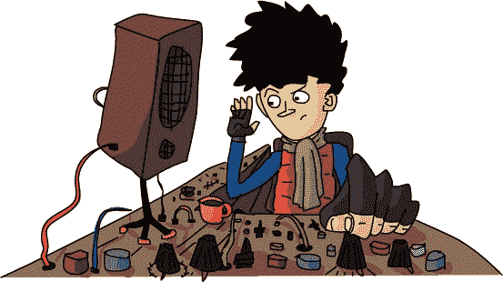

当人们问起 Kelvin 在做什么时，他会说他在钓鱼。他从不解释自己在半夜里用着一台挂着船的巨型卷扬机到底在钓*什么*。当人们开关于捕获海怪的玩笑时，Kelvin 只微笑。没有人知道他所知道的。他们怎么可能知道？

Kevin Kelvin 正在钓流过他的 `Wire` 之上的微小电流。`Wire` 在海洋下延伸数英，一直通到灯塔附近的一座小建筑里。他拨动着旋钮，仔细听着连接 `Wire` 的附近的扬声器，并做记录。如果他的想法是正确的，现在任何时候他应该听到另一端助手发来的信号。听起来像是——

> BEEP.

他的皮肤因兴奋而颤抖，但他不敢发出一点声音。

> BLOOP. BEEP.

Kelvin 迅速断开了一些电线并连接了另一些电线。他反复拨动开关。

> FLIP. FLOP. FLIP.

`Wire` 给了回应。

> BLOOP.

`Wire` 起作用了！正如 Kelvin 所想的那样：他可以使用电力发送信息，即使在数英的海水下。如果 `Jargonaut` 在两个岛屿之间铺设一条 `Wire`，那将形成 Kelvin 自己的 `Network` 的第一个节点。一个可以随时发送信息的 `Network`，即使在像今天这样糟糕的夜晚。一个有一天甚至可以拥有 `multiple Wires` 的 `Network`。

那些躲在象牙塔里的蠢货们，闪烁着他们的小灯，，永远不知道什么叫降临！

# 用户领域指南


你可能好奇故事中的某些部分是否是真的。你真的能从一个 `Unfair Coin` 制造出一个 `Fair Coin` 吗？你真的能利用蚂蚁寻找更短的路径吗？是的，这两点都可以做到——而且更多。在本指南中，你将发现 Laurie 在用户领域遇到的一些地方、人和事物是如何与我们的世界联系的。

# 第 0 章 大部分迷失

## jargon

在现实世界中，术语（jargon）看起来不像一只鼠狗，甚至也不像狗鼠；它看起来就像一个普通的词！计算机科学家（实际上，所有的科学家）都喜欢发明新词。我们把这些专业词汇称为 `jargon` 或 `argot`。术语是有好处的，当你与同事讨论问题时，它可以帮你节省时间。它也可能是坏的，因为它将非专业人士排除在对话之外。

当你刚开始学习编程时，所有的术语、行话和奇怪的新词都可能让你望而畏惧，但不要让这阻止你的学习。术语可以是愚蠢的、强大的，或者是危险的，取决于你如何使用它。但无论你使用什么词，如果你总是 `obfuscate`（混淆）而不是 `explicate`（阐释），没有人会理解你的！

## wandering salesman

`Traveling Salesman problem`（旅行推问题）是计算机科学中的经典问题。给定一组城市，你的目标是找到最短的 `Hamiltonian path`（哈密顿路径），一条让你每个城市只访问一次的路线。如果你有大量城市，即使对于计算机来说，计算这条路径也要花费长时间。所以，游荡的旅行推可能在路上走很长时间！

旅行推并不计算精确的答案，而是寻找一条穿过所有城镇的路径，这条路径“足够”最短。旅行推问题一个非常感兴趣的方面是，人类非常擅长用手解决小例子。关于人们在解决问题时脑子里在使用什么算法，有很多讨论。另见 `Hugh Rustic` (`第 8 章`)。


## upper and lower bounds

在用户领域，`Upper Bounds`（上边界）是山脉，是任何可能达到的高度。`Lower Bounds`（下边界）是山谷，是任何可能达到的深度。没有什么比这些边界更高，也没有比它们更低。

在现实世界中，找到一个问题的上限和下限可以简化很多事情。假设你要猜一个人的年龄。没有人可能超过 150 岁，也没有人小于 0 岁。所以，150 是 `upper limit`（上限），0 是 `lower limit`（下限）。你可以通过简单的问题进一步缩小边界。

## mile zero

你有时会看到标记公路上某地点的标志，比如“第 14 英里”。现在，如果有第 14 英里，那么就有第 13 英里、12 英里，以此类推。一切都必须从某个地方开始，而零就是它开始的地方。最著名的零英里位于佛罗里达州的基西斯特。它是美国 1 号公路的起点，一直延伸到加拿大。如果你仔细观察并足够幸运，可能会在你居住的地方发现一个零英里。


当你说“A 或 B”时，意味着你想要这两者之一，或者可能两个都想要！如果你说“A 异或 B（xor）”，那么就意味着你想要这两者中的*有且仅有一个*，而不是两个都要。这就是为什么 Xor 一直变换着彩虹色：Xor 和他目前坐的地方不能同时是蓝色的。如果他坐在一个蓝色的牌子上，他就必须变成任何*不是*蓝色的颜色！这可不是一种很好的伪装形式，对吧？

## 隐写恐龙

*隐写术*是将信息隐藏在其他信息之中的技艺术，它既应用于数字世界，也应用于物理世界。例如，你可能会通过在纸上用隐形水写秘密信息来隐藏它。通过计算机程序，你甚至可以将文字隐藏在声音和图片中。因此，“隐写恐龙”是一种可以在任何地方隐藏自己的恐龙。

# 第 2 章：理智与理性

## 构图

同名的巴赫（Eponymous Bach）是一位作曲家，但她处理的是思想而不是音乐。*构图（Composing）*是将小的思想组合成更大的思想，以逐步解决问题。几乎每一个思想都是由更小的思想组成的。例如，整数相法并没有什么特别。你可以将其看作是将一个数字不断加自己并重复：

> 2 × 3 = 6
> 2 + 2 + 2 = 6 (相加三次 2)

另见*解构（Decomposing）*（第 17 章；第 17 章：追求优雅）和*关联（Relating）*（第 17 章；关联）。构图、解构和关联是植根于所有数学、逻辑和计算机科学根源的问题解决方法。

## 巴赫的命名第一法则

不要让任何新思想在没有命名的情况下溜走。名字就像一个手手，让这个思想变得更容易使用。

## 巴赫的命名第二法则

给“思想”起名字比给“事物”起名字更好，因为思想更长久。

## 巴赫的命名第三法则

随着一个思想变得越来越有用和有名，它的名字会变得越来越短并全小写。这条法则最终影响了巴赫的朋友安迪·安培（Andy Ampère）以及他对电的发现。


## 安培

安德烈·马里·安培（André-Marie Ampère）发现当电流通过平行导线时，导线会相互吸引或排斥，导致导线弯曲。通过测量它们弯曲的程度，你可以测量电流的大小。安培利用这个想法为我们所知的关于电的一切几乎奠定了基础，为了纪念他，我们用*安培*（或简称培）来衡量电流。（参见*巴赫的命名第三法则*了解巴赫关于为什么我们几乎不将单位称为*安培*的理论。）

## 理性 vs 理智

程序员和数学家有时使用一对概念——*解空间（solution space）*和*问题空间（problem space）*来描述寻找问题答案的过程。

假设你需要移动一个沉重的箱子以便拆箱；任何与移动箱子相关的活动都在你的问题空间内。尝试想象你为了移动那个箱子可能做的每一件事。你可以向前走、向后走、伸出舌头、唱一首歌、写一个方程、使用杠杆、寻求帮助、寻找叉车，或者做任何你能想到的任何其他事情。在一张纸上写下尽可能多的这些可能性。

在那个巨大的可能性空间中，只想象那些有很大几率移动箱子的项。用红笔圈出那些。被圈出的在解空间内。它们*符合逻辑（make sense）*，因为它们能实现你的目标，而其他的则不符合逻辑。现在，再次观察所有被圈出的可能性，思考哪一个是最好的（最快、最便宜、最简单、最可靠等）。用绿笔画下那一个。这就是所有符合逻辑的答案中最*理智（sensible）*的答案。

这个练习的意义在于避免一种非常人性且非常常见的错误：我们倾向于抓住第一个想到的解决方案，而忘记考虑其他可能性。这就是巴赫告诉洛里（Laurie）游走推销员的解决方案并不理智时的意思。另见*休·鲁斯蒂（Hugh Rustic）*（第 8 章；第 8 章：解决问题的多种方法）和*五问法（Five Whys）*（第 14 章；第 14 章：抽象）。

# 第 3 章：舍入误差

## 轮询算法

罗宾家族（The Robins）并不邪恶——他们只是饿了。他们所做的一切都互相合作，轮流并确保工作在他们之间平衡。共享工作是更快完成任务的好方法，计算机也可以共享工作！

你可以在几乎任何地方找到轮询法。想象一条需要一小时完成的公交路线。如果你在那条路线上放两辆公交车，每辆车将每 30 分钟到达一站。如果有三辆车，你每 20 分钟就能看到一辆车，四辆意味着你每 15 分钟看到一辆。如果有五辆，你每 12 分钟看到一辆，以此此类推。只需将 60（一小时的分钟数）除以公交车的数量，即可看到车应该多久来一次。

但你必须小心确保公交车到达每个站点的时间是均匀的。五辆车同时到达一个站点是不平衡的。此外，如果有一辆车故障导致延迟，这可能会导致所有其他车都拥堵！


# 第 4 章：龟对洛里说

## 递归

*递归（Recursion）*是一种反复相同过程的方法，直到你找到寻找的答案。当你使用递归时，你运行该过程，如果答案是你想要的，就停止。如果不是，你就把找到的答案带入相同的过程中并再次运行。

让我们来看这里用户领域（Userland）的一个递归应用示例。回想第 10 章简·赫凯特（Jane Hecate）有一本巨大的名字书。名字*Lauren*以*L*开头，所以简应该在书的*L*部分找到它，但由于页面非常多，这可能花费很长时间。如果简想用更快的方法寻找*Lauren*，她可以将书分成两个相等的部分，看看*L*是在前半部分还是后半部分

> 前半部分：{A, B, C, D, E, F, G, H, I, J, K, L, M}
>
> 后半部分：{N, O, P, Q, R, S, T, U, V, W, X, Y, Z}

由于*L*在前半部分，简可以将书的前半部分对半，得到两个四分之一的书进行搜索。

> 第一四分之一：{A, B, C, D, E, F, G}
>
> 第二四分之一：{H, I, J, K, L, M}

*Lauren*应该在第二个四分之一中，所以简可以将该四分之一对半，得到字母表的两个八分之一：

> 第一八分之一：{H, I, J}
>
> 第二八分之一：{K, L, M}

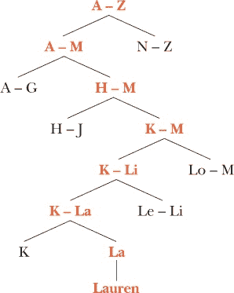

简可以继续将包含*L*的字母组对半，直到最终只剩下*L*部分。（简还需要将字母组对半多少次才能找到*L*？）这种寻找特定信息的方法被称为*二分查找（binary search）*。

另见*分叉路径园（Garden of Forking Paths）*（第 19 章；第 19 章：分支）和*追逐自己的尾巴（Chasing Your Tail）*（龟与兔）。

## 龟与兔


这两个字符大约在 2,500 年前被一位名为埃利亚的芝诺（Zeno of Elea）的哲学家用来讨论无限。从亚里士多德到刘易斯·卡罗尔，再到马文·明斯基和道格拉斯·霍夫斯塔特，数学中充满了关于他们冒险的故事。从头尾都是乌龟。

## 追逐自己的尾巴

追自己的尾巴并不总是在浪费时间！在计算机科学中，有一种递归听起来有点像是在圈圈转转，而且非常有用。在`尾部递归`中，你执行一个过程，然后对结果再次执行该过程，重复直到得到最终答案。例如，Jane Hecate 对她书中的 `L` 部分进行二分查找可能像这样：

*   检查我们目前拥有的书名列表章节。
*   我们只有 `L` 部分吗？
*   如果是，那就大功告成了！
*   如果不是，就把书一分为二。
*   查看包含 `L` 部分的那一半列表，并重复。

参见 `递归` (第 4 章：乌龟对洛莉说的话)。

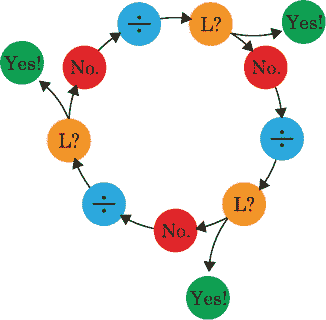

## 无限

当人们说某东西是`无限`的时，他们的意思是该东西的存在量没有限制。当乌龟演示一个无限字符串如何可以小于两英寸时，他展示了你可以将该字符串分成无限数量更小的碎片。

无限是`大`的，比你想象的还要大。但你只需要通过几句话就能在脑海中掌握无限。有无限多个奇数：1, 3, 5, 7 等，直到永远。也有无限多个偶数：0, 2, 4, 6, 8 等。无论你如何努力寻找，你永远在偶数列表中找不到奇数，也不会在奇数中找到偶数。这意味着至少有两种无限：偶数和奇数。

还有`无限种无限`。想想所有能被 3 整除的数字以及所有`不能`被 3 整除（或 4，或 5）整除的数字。现在想象一下所有以前没人想过的数字。那是另一种无限！

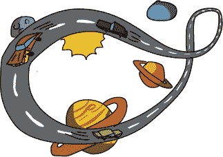

## 无限归溯

如果你思考你是如何思考的，你可能会开始思考你是如何思考你是如何思考的，然后思考你是如何思考你是如何思考你是如何思考的，以此此类推。这种论证的形式被称为`无限归溯`，它可以没有结束。当你第一次掉进这个心理陷阱时，可能会感到困惑甚至害怕。秘诀在于不要太当真它。

如果你觉得这和递归有关，你是正确的！永远陷入一个递归过程中将是非常糟糕的。在真实的计算机中，无限递归永远不会发生，因为没有一台计算机可以存储无限的信息。当计算机在处理递归任务时用完空间时，你不知道会发生什么。Laurie 和 Xor 在“递归交叉路口”亲身验了这一点。参见 `追逐自己的尾巴` (阿基琉斯与乌龟)。

# 第 5 章：欢迎来到符号

## 语义闸机

`╞` 是一个指向真理之路的逻辑符号。它有点像等号（`=`），区别在于它展示的是`思想`之间的关系，而不是数字之间的关系。如果语义闸机左侧的所有想法都是真的，那么右侧的想法也是真的。

假设你有两个想法：(A) “你有密码”和 (B) “你可以进入”。你可以将这些想法组合在一起形成一条`规则`：

> (A → B) “**如果你有密码，**那么**你可以进入。”

这就是 Ponens 在符号世界（Symbol）的大门处向洛莉解释的规则。（在那个小箭头的两侧放置两个想法是另一种表达方式，即“如果 A 是真的，那么 B 就是真的”。）

但你如何知道这条规则是真实的呢？也许这并不是进入符号世界的方式。所以你必须证明规则 `(A → B)` 和第一个想法 A 都是真的。在这种情况下，我们需要确保在允许任何人通过大门之前，规则（“如果你有密码，那么你可以进入”）和想法（“你有密码”）都是真的。

这正是语义闸机的作用。我们将规则和第一个想法放在闸机的左侧，并将第二个想法 `(B, 在本例中是“你可以进入”)`放在右侧：

`(A → B), (A) ╞ (B)`

这意味着“**如果**我们的规则是真的，且**如果**你真的有密码，**那么**你可以进入。”

更奇怪的部分在这里：你可能注意到这个闸机看起来非常像 IF...THEN。如果左侧的一切都是真的，那么右侧的想法就是真的。那么我们如何知道这条规则整体是真的呢？我们需要为闸机准备一个闸机吗？

`(A → B), (A) ╞ (B) ╞ (C)`

. . . 然后再为那个准备一个闸机，下一个？

`(A → B), (A) ╞ (B) ╞ (C) ╞ (D) ╞ (E) ╞ (G) . . .`

在理论上，在知道任何事情是真的之前，你必须通过无限多个闸机！我们早上早上能穿上鞋真是个奇迹！那么我们如何知道某些事情是真的呢？你如何知道明天早餐时牛奶会从盒里流出来，或者你的教室不会在屋顶上？

在实践中，我们简单地相信我们遵循的规则是真的，因为我们过去见过它们起作用。然而，像洛莉那样去探究规则可能是有趣且实用的。即使它们被证明是合理的，你也能学到很多关于它们如何运作的知识。质疑规则是科学的核心！参见 `无限归溯` (第 4 章；无限) 和 `这合逻辑` (pr03.html_itapost_only_logic "这合逻辑")).

## Ponens

它的全称是 Modus Ponendo Ponens，它代表了一种逻辑论证。这种论证可以得出`逻辑`结论，但它并不总是`真实`的。例如，Ponens 是这样判断符号大门是安全的：

*   如果有密码的人可以进入，那么我们的门是安全的。
*   只有带密码的人进入了。
*   因此，我们的门是安全的。

参见 `Tollens`（下一节）和 `语义闸机` ([第 5 章：欢迎来到符号)。

## Tollens

它的全称是 Modus Tollendo Tollens，和 Ponens 一样，它代表了一种逻辑论证。事实上，Tollens 的工作原理与 Ponens 相似，但方向相反。例如，Tollens 可能这样判断它的门是安全的：

*   如果我们的门不安全，没有密码的人就会进入。
*   没有没有密码的人进入。
*   因此，我们的门是安全的。

这就是 Tollens 判断恐龙蛋不存在的方式：

*   如果恐龙存在，你就能看到它们。
*   你从未见过恐龙蛋。
*   因此，它们不存在。

和 Ponens 一样，Modus Tollendo Tollens 是完全有效的逻辑，但它的质量取决于它所基于的假设。仅仅因为你没有证明某事是真的，并不意味着它自动是错误的；仅仅因为你从未见过恐龙蛋，并不意味着它们不存在。也许它们生活在你从未去过的岛上，或者它们躲得太好，以至于没有人能它们。参见 `这合逻辑`（下一节）。


即使一个想法是符合逻辑的，它也可能不是事实。一个想法很容易变得简单、合逻辑且错误——只要你忘记了考虑所有的事实。例如，去游泳的人在完游后头发是湿的。如果你看到有人头发湿着，这意味着她刚从泳池里出来吗？不！也许外面在下雨，或者也许她只是洗了个澡。

逻辑也很容易陷入无尽的循环中。参见 `Ponens`（Ponens）和 `Infinite Regress`（第 4 章; Infinity）。

# 第 6 章：修补匠的行艺

### 算法
`algorithm` 是一组你可以遵循以解决特定问题的特定步骤。例如，制作披萨的配方就是一个算法：

1. 将面团摊在锅里。
2. 在面团上覆盖一层披萨酱。
3. 在酱料上撒上奶士。
4. 在 350 华氏度下烘烤披萨 20 分钟。
5. 将披萨从烤箱中取出并冷却。
6. 开动吧！

就像那个配方一样，Laurie 的乌龟画诗也是算法。它们将画圆的过程分解成细小的步骤，乌龟遵循这些指令创建任何尺寸的圆。如果你真的想，你甚至可以为算法设计算法，也就是说，如何弄清楚如何弄清楚该如何做某事。参见 `Infinite Regress`（第 4 章; Infinity）。

你会如何告诉修补匠的乌龟画一个任意尺寸的三角形，且所有三个角度的度数相同？（提示：这三个角之和应为 180 度。）

### 汉顿回路
Laurie 来自哈密尔顿（Hamilton），这非常合适，因为她的“返回哈密尔顿之路”将是一个 `Hamiltonian path`。这种路径以数学家威廉·哈密尔顿（William Hamilton）命名，是一种旅行者恰好访问地图上每个城镇一次的路线。在书中，我使用了 `path` 一词，但汉顿顿 `path` 和汉顿 `cycle`（回路）之间实际上存在细微差别，后者是指返回起点的路径。

在有有 `N` 个城镇的地图上，有 (`N` – 1)! ÷ 2 个回路。正如修补匠说的，`x`! 是 (`x` × (`x` – 1) × . . . × 2 × 1) 的简写，所以对于一张有六个城镇的地图，你有：

```
(6 – 1)! ÷ 2 = 5! ÷ 2 = (5 × 4 × 3 × 2 × 1) ÷ 2 = 60 个回路!
```

找到一个回路相当容易，因为有很多可能性；找到一个`短`的才是困难之处！另见 `Wandering Salesman`（第 0 章; Wandering salesman）。

### 公平硬币
`Fair Coin` 是一种在投掷硬币时，正面朝上或反面朝上的概率相等的币。然而，真实的硬币（如 Laurie 的四角币）重量并不总是完美平衡的，因此在我们的世界上，不存在完美的公平硬币。但对于大多数硬币来说，任何一面朝上的概率接近五十对五十，我们没有问题可以通过投掷硬币在两个选项之间做出选择。


尽管如此，对于物理模拟或选择谁坐在副座等重要事情，请投掷两次以确保绝对的公平。另见 `A Fair Flip`（第 11 章; 第 11 章：公平交换）。

### 圆
当 Laurie 使用乌龟机器人画一个圆时，她发现为 `how-big?` 填充 `one` 会得到一个比她预想大得多的圆。你应该在 `MOTH-CIRCLE` 中输入什么数字才能画出一个直径两英寸的圆？

> **MOTH-CIRCLE (how-big?):**
>
> 向前 how-big? 英寸，
> 留一个标记，
> 向右旋转一度，
> 重复三百六十次。
> 画一个 MOTH-CIRCLE (how-big?)。

### 不可能与可能
无论你学习哪个学科，总会有没有解决方案的问题。我们说这些问题是 `impossible`（不可能解决的）。另一方面，有些问题是可以解决的，但只有在极不利的情况下。那些是 `improbable`（可能的）。

# 第 7 章：关于我

### 密码学
谢天谢地 Xor 能够破译 Trapp 上校的秘密信息！自古以来，人们就将信息编码成 `ciphers` 以供他人解码，而今天这项科学被称为 `cryptography`（密码学）。计算机非常擅长创建和破解密码，但你也可以做到！

加密信息的一种快速方法是使用 `substitution cipher`（替换密码），即将你信息中的每个字母替换为其他东西。例如，你可以将每个字母映射到一个数字：

| A | B | C | D | E | F | G | H | I | J | K | L | M | N | O | P | Q | R | S | T | U | V | W | X | Y | Z |
|---|---|---|---|---|---|---|---|---|---|---|---|---|---|---|---|---|---|---|---|---|---|---|---|---|---| |
| 0 | 1 | 2 | 3 | 4 | 5 | 6 | 7 | 8 | 9 | 10 | 11 | 12 | 13 | 14 | 15 | 16 | 17 | 18 | 19 | 20 | 21 | 22 | 23 | 24 | 25 |

遵循这些规则，“Hello!” 会变成“7 4 11 11 14！”但你可以用你任何想要的东西替换这些字母：不同的数字、其他字母，甚至是你自己创建的符号。制作自己的秘密信息并看看你的朋友是否能破解它。或者，将你的密码分享给朋友，这样你们就可以互相发送其他人无法阅读的秘密信息了！

# 第 8 章：不止一种方法

### Hugh Rustic
如果解决困难问题的方法数以百万计，那么寻找最佳解决方案并不实际。当这种情况发生时，科学家使用 `heuristics`（启发式算法）来找到一个正如 Hugh Rustic 可能说的“足够好”的答案。

启发式算法基于经验——基于我们知道会有效的事情——但它们不能保证是最可能的解决方案。例如，Hugh Rustic 的蚂蚁在地图上随机找到许多不同的路径，并遵循其他蚂蚁的气味轨迹。如果没有新的蚂蚁跟随，气味轨迹最终会干涸。路径越短，跟随的蚂蚁就越多，这使得气味越强。随着时间的推移，短路径变得越来越流行，而长路径则逐渐消失。根据 Laurie 观察蚂蚁的行为，她知道这条路很短，即使它可能不是最短的，所以她可以将其作为一种启发方法更快地回家。

值得思考的问题：Hugh Rustic 穿过 Userland 的蚁地图是最可能的路径，还是仅仅是一条足够短路径？你能做得更好吗？试试看！

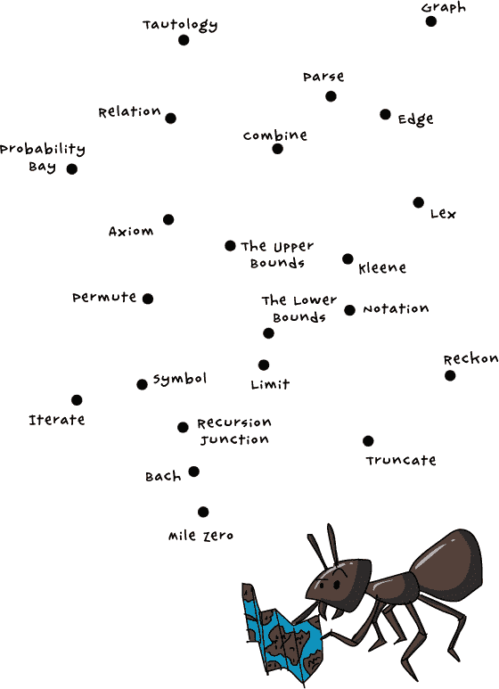

# 第 9 章：不要重复自己

### 公理
正如 Xor 所说，`axiom`（公理）是一个你无法证明的规则或原则，但每个人都接受它是真的，因为它是合逻辑。数学家、科学家以及任何想要证明任何事情的人都可能从公理开始他们的论证。

例如，事物的 `part` 总是小于 `entire` 个体是一个公理。如果你从蛋糕上切下一块，这块蛋糕就不可能比整个蛋糕大。同样的规则适用于数字：如果你从 5 中减去 2，你手里会剩下 2 和 3，没有一个数字大于 5。


# 第 10 章：恰逢好处的登场

###计时攻击
Jane Hecate 逐个检查 Laurie 密码猜测的每个字母，直到与正确密码不匹配为止。Laurie 连续正确的字母越多，Jane 发现不匹配所需的时间就越长，这告诉 Laurie 她的猜测离正确有多近。

计算机科学家将其称为 `timing attack`（计时攻击），因为猜测者观察检查每次错误尝试所需的时间，并据此做出新的猜测。许多本该知道这些的人犯了 Jane 同样的错误，泄露了他们保守的秘密信息。


正如 Trent Escrow 向 Laurie 解释的那样，如果你抛掷两次不平衡的硬币，你可以保证得到正面或反面的概率各占百分之——如果你得到“正面-反面”，那么正面就是你的答案；如果你得到“反面-正面”，那么反面就是你的答案。至少有一半的时间，你可能会得到“正面-正面”或“反面-反面”；在这种情况下，只需重新开始。平均而言，你至少需要抛三次硬币才能得到一次公平的结果。试一下！另参见 `公平硬币` (第 6 章；哈密顿循环）。

# 第 12 章：难以想不到的转折

## 尝试神话

. . . 在任何司法管辖区这实际上都不是犯罪，这是一件好事！否则，将没有人被允许写任何故事，而`神话`只是代代相传给我们的故事。有些神话试图解释世界是如何运作的，而有些仅仅是为了好玩。发挥你的想象力，也许有一天，你写出的故事将成为未来神话的一部分。

## 孪生兄弟

`Doppelganger` 的故事基于哲学中的一个经典问题：如果你替换了船上所有的部件，你还拥有原来的那条船吗？Winsome 并不认为如此。她声称自己从所有主那里一个零件地偷走了 `Doppelganger`，并留给他一个复制品！但你怎么看呢？如果你重新组装旧部件，哪条船才是原始的？如果你只替换了一半的部件呢？

# 第 13 章：生命游戏

## 滑翔者

`康威生命游戏`是对物种群如何随时间推移而变化的模拟。计算机科学家（以及许多其他科学家）利用生命游戏来研究基于简单规则的模式。你可以自己用笔和纸来尝试一下！首先，拿一些方格纸或画一个像这样的网格：


现在在网格中填充一些方格。这里有一个例子：


在你填充了一些方格后，只需遵循以下几个简单规则即可玩游戏并改变你的模式：

1. 如果一个填充的方格有三个以上的填充的邻居，那么它就会死去。将其变为空。
2. 如果一个填充的方格只有一个或零个填充的邻居，它就会死去。将其变为空。
3. 如果一个填充的方格有两个或三个填充的邻居，它就能存活！保持涂色状态。
4. 如果一个空白方格有三个填充的邻居，它就会获得生命！将其涂上颜色。

遵循这些规则填充一个新的网格。我们的示例网格在经过回合后会变成这样：


这些模式有许多类型。`滑翔者`会移动。`闪烁者`像交通灯一样开启和熄灭。某些模式在运行过程中还会创建其他模式。这种特定的网格模式会重复：


# 第 14 章：抽象思维

## 五问分析法

当科学家想要找到困惑问题的根源时，他们会不断问“为什么”，直到确切发现实验在`哪里`出了错。但你不必把这种思考方式留给科学家。

下次当你需要为自己的问题寻找解决方案时，玩玩“五问分析法”。有很多心理游戏可以尝试，帮助你避免错误或从错误中学习。另一个好规则是“永远不要独自担心”。当你感到困惑时，找个朋友吧——当你们合作时，你们可以解决任何问题！


# 第 15 章：关键时刻的聪明

## 遵循拜占庭流程

`Byzantine` 一词可以描述任何极其漫长且的过程。幸运的是，Laurie 通过帮助那三位将军获得了她需要的所有签名，而且她实际上以类似的方法解决了他们三个完全不同的问题。

Laurie 移动狼、羊和曼德西兰花的算法使用了`计数原理`。计数原理的背后的思想是，你可以通过忽略事物之间不重要的差异，并只统计它们的数量来解决某些问题。例如：

* 每个人都想一次性使用欧里庇得斯将军的书。但无论是读者还是作者，任何时候只有`一个`人可以使用特定的书。
* 达利斯将军太关注将曼德西兰花、狼和羊运过河了，以至于他没有倒着数——即把羊运过去`多次`。但无论是曼德西兰花还是狼，只要你不让羊和它们单独在一起，一切都会顺利解决。

有时情况恰恰相反：你必须以不同的方式计算同一个事物，以看看它们是否相符。Case 将军在数到 100 英尺围栏后停止数柱子；他没有考虑过支撑最后一段！数柱子`之间`的间隙，你会得到 10 个。数柱子，你会得到 11 个。

当 Tinker 告诉 Laurie 将与其他路径呈镜像的路径（如 `BCD` 和 `DCB`）视为一条时，他同样在使用计数原理。这条规则将通过`Userland` 的路径数量减少了一半。但即使数量减少了一半，对旅行员问题也没有太大帮助：一个巨大的数字除以一个小的数字仍然是一个巨大的数字！

## 曼德西兰花

曼德西兰花确实存在于我们的世界，它是我见过的长相最奇怪的蔬菜。在市场上，它被称为 `Romanesco`（罗马花花），它看起来非常像分形。`Fractals`是从一个形状开始，并根据一组规则无限重复、变得越来越小的模式。

例如，在另一个等边三角形内部画一个等边三角形（三条边长度相同的三角形）。确保第二个三角形的每个点都触及第一个三角形某边的中间！这应该会在原始三角形内部创建四个较小但相同的三角形。

现在，在每一个三角形内部也画一个等边三角形，遵循相同的规则，并重复直到你无法再放入更多三角形为止。你应该得到像此处所示的分形模式的东西。另参见 `无限` (第 4 章；无限）。


*“谢尔宾斯基三角形演变”。通过维基共享共享公有领域。*

# 第 16 章：计划的改变

## 暴力破解

这位灯塔守护人认为每个问题的答案都是更多的力量和暴力破解。即使他建造的灯塔比失败的那个高一倍、宽一倍、厚一倍，新的一个最终仍然倒塌，因为他遵循的是同样的计划。

然而在他自己的方式上，Bruto 决定改为金字塔是正确的。金字塔坚固得多，如果你堆上足够的砖，你最终可以造出一个足够高当灯塔的金字塔。


有些程序员也这样解决问题，但将所有资源投入暴力尝试并不总是明智的答案。当你的算法崩溃时，不要只堆砌更多的砖！像 Laurie 处理拜占庭岛的将军那样改变你的观点，你将找到一个更有效的解决方案。另参见 `五问分析法` (第 14 章；第 14 章：抽象思维)。

# 第 17 章：追求优雅

## 优雅者

它们并不真实存在，但难道你不希望它们存在吗？

## 菲涅耳


Laurie 在优雅岛遇到的菲涅涅尔是以一位真实的科学家奥古斯丁-让·菲涅尔尔（Augustin-Jean Fresnel）命名的，这位科学家发明了一种仅需一少量玻璃就能聚焦大型灯塔光线的方法。他知道要聚焦光束，透镜不需要做得又大厚，因此，`Fresnel lens`并不是一大块巨大的玻璃，而是由不同角度的小玻璃碎片排列成的。今天，灯塔仍然在使用这种透镜。

## 分解

`Decomposing` 从一个大想法开始，将其分解成更小、更易理解的部分。当你知道如何解决每个较小的部分时，就可以将这些想法组合起来解决更大的问题。拆解一个想法的好方法之一是不使用它的名称来描述它，就像 Laurie 所说的那样，你也可以把龟称为“带壳的绿色圆形动物”。

即使是简单的想法，比如数字 `3` 和 `4`，也可以分解成更简单的想法。从 `0` 开始，然后加 `1`。再次加 `1`，以此此类推：

> 0 = 0

> 1 = 0 + 1

> 2 = 0 + 1 + 1

> 3 = 0 + 1 + 1 + 1

如果你真的想做，你可以只使用 `0` 和 `1` 并抛弃所有其他数字。我不建议这样做——你会用掉很多纸的！但这是一种完全有效的数学方法。例如，让我们把一个加法题分解为纯的 `0` 和 `1`：

2 + 2 = 4

将变为

(0 + 1 + 1) + (0 + 1 + 1) = (0 + 1 + 1 + 1 + 1)

## 关联

当你 `relate` 两个想法时，你将它们并排放在一起比较，就像菲涅尔尔的气球和灯塔。对于数字，你使用小于号（`<`）来表示左侧的数字比右侧的小。你使用等号（=`）表示左侧的值等于右侧的值。

> 2 < 3

> 2 × 3 = 6

不过你也可以关联数字以外的事物，尽管这意味着某些关系并不那么精确。菲涅尔尔的气球并不完全是灯塔，但它像灯塔。我们期望灯塔有一种让人们爬得很高的方法，到达后有一个站立的地方，以及一个远处船只能看到的大光。菲涅尔尔的气球在技术上具备所有这些特征：

*   菲涅尔尔的气球像灯塔。
*   (电梯, 气球, 光) 像 (楼梯, 塔, 光)。

# 第 18 章：众人拾山

## 网络

Winsome 创建了灯塔网络（Lighthouse Network），让 Userland 的人们能够更快速地发送消息。在计算机科学中，`network` 是一组相互连接的计算机，以便它们共享信息。这些计算机可以通过电线甚至通过空气连接！

## 鲍多特

1870 年，埃米尔·鲍多特（Émile Baudot）发明了一种代码，用不同的 1 和 0 组合来表示字母。这种代码旨在让人们利用电力共享消息：如果你有一个开关，电源就可以开启 (1) 或关闭 (0)。自然地，鲍多特用自己的名字命名了这种代码。参见 `Bach’s Laws of Eponymy`（第 2 章; Bach’s First Law of Eponymy）。

我们在现实世界中并不经常使用鲍多特代码，但 Ping、菲涅尔尔以及 Winsome 灯塔网络的其他成员使用它通过他们的灯光发送消息，这些灯光也可以开启 (FLASH) 或关闭 (FLOOSH)。

这里是鲍多特代码以及每个数字代表的字母，你可以此建立自己的灯塔网络。找几个朋友和一些手电筒，互相发送消息吧！

| 字母 | 鲍多特代码 | 字母 | 鲍多特代码 |
| --- | --- | --- | --- |
| A | 11000 | N | 00110 |
| B | 10011 | O | 00011 |
| C | 01110 | P | 01101 |
| D | 10010 | Q | 11101 |
| E | 10000 | R | 01010 |
| F | 10110 | S | 10100 |
| G | 01011 | T | 00001 |
| H | 00101 | U | 11100 |
| I | 01100 | V | 01111 |
| J | 11010 | W | 11001 |
| K | 11110 | X | 10111 |
| L | 01001 | Y | 10101 |
| M | 00111 | Z | 10001 |

# 第 19 章：分分支

## 分叉路花园

花园里有 16,777,216 条路径，但最后，Laurie 和 Xor 每人恰好找到了一条对他们来说有意义的路径。可能路径的数量之所以迅速减少，是因为在每个分叉路口，Laurie 都回答了一个二选一的问题，这让可能路径的数量减了一半。


Laurie 在分叉路花园的之旅非常像计算机科学家所说的 `binary search`（二分查找），程序员用它来在巨大的列表中快速查找单个信息。当某物是二进的时，它只有两个部分——就像花园问 Laurie 的的问题一样。

这个小图有四种可能的结果。如果你回答问题“A 还是 B？”为 A，你就将数量减半，只剩下两种可能性。然后在 A 处，你必须回答“C 还是 D？”无论你选择哪个选项，你再次让数量减半，直到剩一个选择。

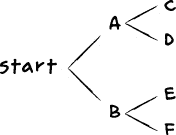

在二分查找中，你会对你巨大的信息列表问类似的问题；最终，你会将可能性减少到只剩一个。下次玩“二十个问题”（Twenty Questions）时试试看！如果你仔细地选择问题（或答案），你只需要 20 或 30 步就能到达几乎任何结果。参见 `Recursion`（递归）（第 4 章; 第 4: What the Tortoise Said to Laurie）。

# 第 21 章：还有还有

## 电报

凯文·凯尔文船长（Captain Kevin Kelvin）正在沿海洋铺设线路以建立 `telegraph` 网络。电报系统让人们可以在远距离互相发送消息，而无需实际发送物理物体。Winsome 的灯塔网络也是电报的一种！

在 Kevin 的情况下，字母是由声音集合表示的，而不是灯光。不同的哔声和嘟嘟组合代表不同的字母，而这些哔声和嘟嘟是 Kevin 的助手按下连接在电线另一端的按钮时产生的。电报只是人类历史上用来相互交流的许多系统之一。

## 开尔文标

凯尔文勋爵（Lord Kelvin）是一位从事电报工作的真实工程师，但他因创立开尔文标来测量温度而广闻。。与其他温度标不同，开尔文标不使用小于零的数字，因此最低温度被称为 `absolute 零`。水在 273.16 结冰！

# 给孩子的聪明书！

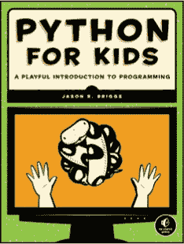

**PYTHON FOR KIDS**

**有趣的编程入门**

by JASON R. BRIGGS

2012 年，344 页，$34.95

ISBN 978-1-59327-407-8

*全彩*

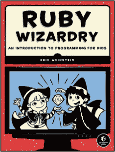

**RUBY WIZARDRY**

**孩子的编程入门**

by ERIC WEINSTIN

2014 年，360 页，$29.95

ISBN 978-1-59327-566-2

*双色*

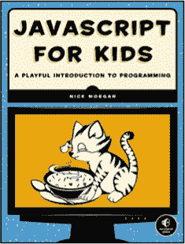

**JAVASCRIPT FOR KIDS**

**有趣的编程入门**

by NICK MORGAN

2014 年，348 页，$34.95

ISBN 978-1-59327-408-5

*全彩*

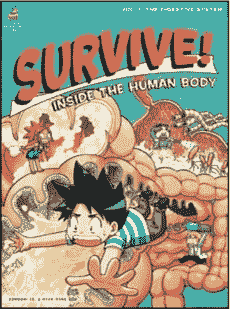

**SURVIVE!**

**人体内部，卷 1**

**消化系统**

by GOMDORI CO. 和 HYUN-DONG HAN

2013 年，184 页，$17.95

ISBN 978-1-59327-471-9

*全彩*

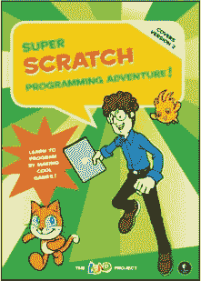

**SUPER SCRATCH PROGRAMMING ADVENTURE!**

**通过制作游戏学习编程**

by THE LEAD PROJECT

2013 年，160 页，$24.95

ISBN 978-1-59327-531-0

*全彩*

（第 2 版）

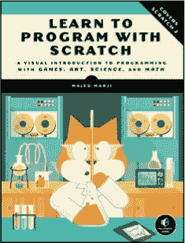

*LEARN TO PROGRAM WITH SCRATCH*

**通过游戏、艺术、科学和数学进行视觉化编程入门**

by MAJED MARJI

2014 年，288 页，$34.95

ISBN 978-1-59327-543-3

*全彩*


800.420.7240 或 415.863.9900 | sales@nostarch.com | [www.nostarch.com](http://www.nostarch.com)

# 关于作者

Carlos Bueno 曾任 Facebook 工程师，目前任职数据库公司 `MemSQL`。他编写关于计算机科学、编程以及互联网结构的文章。

# Lauren Ipsum：一个关于计算机科学和其他其他概率事件的故事

LAUREN IPSUM. 版权所有 © 2015 Carlos Bueno。

保留所有权利。未经版权所有者和出版者的书面许可，不得以任何形式或通过手段（电子或机械，包括复印、录音或信息存储或检索系统）复制或传输本书的任何部分。

18 17 16 15 14 1 2 3 4 5 6 7 8 9

ISBN-10: 1-59327-574-9
ISBN-13: 978-1-59327-574-7
出版者: William Pollock
制作编辑: Riley Hoffman
封面设计: Beth Middleworth
插画师: Miran Lipovača
开发编辑: Jennifer Griffith-Delgado
校对: Rachel Monaghan
排字员: Riley Hoffman
校对: Paula L. Fleming

有关发行、翻译或批量销售的信息，请直接联系 No Starch Press, Inc.：

No Starch Press, Inc.
245 8th Street, San Francisco, CA 94103
电话：415.863.9900； info@nostarch.com
[www.nostarch.com](http://www.nostarch.com)

*美国国会目录出版数据*

Bueno, Carlos, 1979-
Lauren Ipsum：一个关于计算机科学和其他其他概率事件的故事 / Carlos Bueno.
页码 cm

摘要：Lauren 是一个迷失在`Userland` 的女孩，她运用逻辑和解决问题的技巧寻找回家的路，途中遇到了时序攻击、算法设计和旅行推销问题等概念。
ISBN 978-1-59327-574-7 -- ISBN 1-59327-574-9
[1. 计算机科学--小说。 2. 解决问题--小说。 3. 幻想。] I. Title。
PZ7.1.B84Lau 2014
[Fic]--dc23
2014035552

No Starch Press 及 No Starch Press Logo 是 No Starch Press, Inc. 的注册商标。此处提到的其他产品和公司名称可能是其所有者的商标。我们并非在每次出现商标名称时使用商标符号，而是仅以编辑方式为了商标所有者的利益使用这些名称，无侵犯商标的意图。

本书信息按“现状”提供，不提供任何保证。尽管在准备本书时已采取一切预防措施，但作者或 No Starch Press, Inc. 对书中包含的信息直接或间接造成或声称造成的任何损失或损害，均不对任何个人或实体承担任何责任。

出版物中的所有人物均为虚构，或为虚构使用。

No Starch Press
2014-12-02T13:09:39-08:00

