# Leaflet 实战：使用 JavaScript Leaflet 库创建网络地图


# 前言

本书旨在帮助新兴的GIS专家、地理学家或制图师，他们有兴趣在掌握最少JavaScript知识的情况下快速学习如何创建网页地图。本书的目标是让学习者掌握如何使用Leaflet创建几乎任何类型的网页地图。本书从自学程序员的角度撰写，更像是一本中级水平的Leaflet JavaScript语法导航指南。然而，作者希望本书能激发你的兴趣，深入使用编程不仅用于地理信息系统(GIS)目的，也用于任何其他令你着迷的目的。

## 使用说明

尽管作者强烈建议读者按顺序通读全书，但对于急于求成的学习者，从第3章开始的每一章都是一个独立的练习，并在每章末尾提供源代码链接。链接可以在**总结**小节之前找到。本书中使用的所有代码脚本均可从此Github文件夹获取。

https://github.com/sammigachuhi/my-leaflet-project/tree/main/my-leaflet-vs

图片可从此处获取。

https://github.com/sammigachuhi/my-leaflet-project/tree/main/my-leaflet/images

最后，本书也提供可移植文档文件(PDF)版本，可在此处下载。为方便起见，本书最好阅读此处提供的网页版本。这是因为网页版本不会像PDF那样在页面边缘截断长代码。

## 关于作者

Samuel Gachuhi Ngugi毕业于内罗毕大学，持有地理与环境研究学士学位。此外，他还持有环境影响评估(EIA)证书，以及来自欧洲中期天气预报中心(ECMWF)的谷歌地球引擎、场地规划以及天气与气候机器学习等认证。他于2021年开始对编程产生兴趣。他的第一本编程书籍是2022年出版的《A Beginner Friendly Introduction to GIS Operations in R: A practical guide》。在此之前，他于2020年出版了一本GIS教程书籍《Basic Raster and Vector Operations using Qgis: A tutorial》。两本书都受到了学术界的热烈欢迎。

## 版权声明

本书《Leaflet in Practice: Create webmaps using the JavaScript Leaflet library》是根据署名-非商业性使用-相同方式共享4.0国际许可协议(CC BY-NC-SA 4.0)创建的。

这是许可协议的人类可读摘要（而非替代品）。免责声明。

**你可以自由地：**
分享 — 在任何介质或格式中复制和重新分发材料
改编 — 重新混合、转换和构建材料
只要您遵循许可条款，许可人就不能撤销这些自由。


## 须遵守以下条款：

**署名** — 您必须以适当的方式提供署名，提供指向许可证的链接，并说明是否进行了更改。您可以采用任何合理的方式操作，但不得以任何方式暗示许可方认可您或您的使用。

**非商业性** — 您不得将材料用于商业目的。

**相同方式共享** — 如果您对材料进行混合、转换或改编，您必须按照与原作相同的许可证分发您的贡献。

**不得增加额外限制** — 您不得应用法律条款或技术措施，从法律上限制他人执行许可证所允许的任何操作。

**注意事项：**

对于处于公共领域的材料要素，或您的使用受到适用例外或限制的许可，您无需遵守该许可证。

不提供任何保证。该许可证可能无法授予您为预期使用所需的全部权限。例如，其他权利（如宣传权、隐私权或精神权利）可能会限制您使用该材料的方式。

## 出版者

本书由 R Bookdown 生成。

# 第 1 章

## 引言

### 1.1 什么是 Leaflet？

与树叶有关吗？当然不是。Leaflet，剥离其最基本的定义，就是一个用于交互式地图的开源 JavaScript 库。它由具有数学背景的乌克兰人 Volodymyr Agafonkin 于 2011 年开发。

### 1.2 它如何工作？

只要代码出现在 `<script>` 标签下，即使每一行代码都在一个 HTML 文档内，Leaflet 也能工作。然而，为了获得整洁的工作成果，尤其是处理复杂地图时，建议将 HTML 文件与其 `main.js` 和 `style.css` 等其他组件分开。

```
knitr::include_graphics(rep("D:/gachuhi/my-Leaflet/images/inspect.jpg"))
```

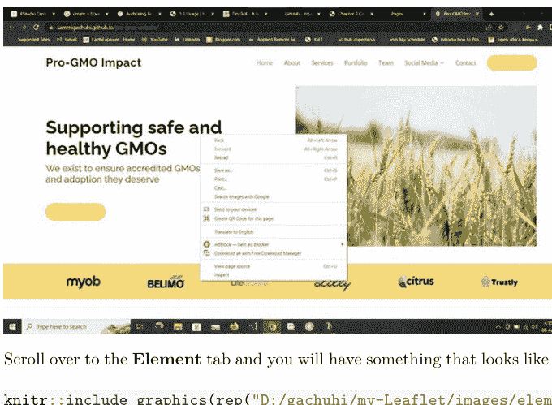

切换到 Element 选项卡，您将看到类似这样的内容：

```
knitr::include_graphics(rep("D:/gachuhi/my-Leaflet/images/elements.jpg"))
```

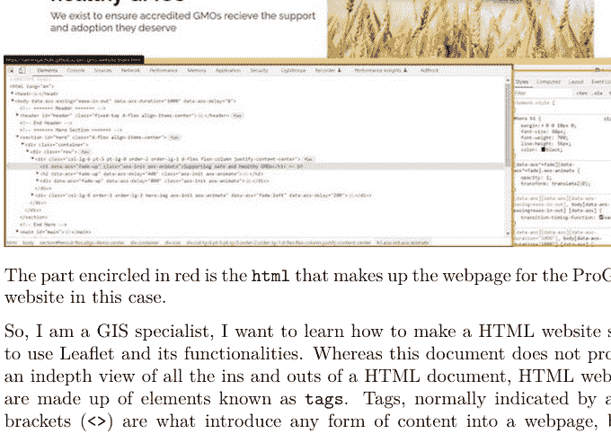

红色圈出的部分就是构成 ProGMO 网站网页的 HTML。

所以，我是一名 GIS 专家，我想学习如何制作 HTML 网站以使用 Leaflet 及其功能。虽然本文档没有深入介绍 HTML 文档的所有细节，但 HTML 网站由称为标签的元素构成。标签通常由尖括号 (`<>`) 标示，它们是将任何形式的内容引入网页的方式，无论是段落 (`<p>`)、图像 (``)、视频 (`<video>`) 甚至整个部分 (`<div>`, `<section>`, `<article>`)。有了这个基本介绍，让我们创建一个基本的 HTML 页面。

要创建 HTML 元素以及许多其他编程文件（例如我们稍后将看到的 `.js` 和 `.css`），我们使用文本编辑器。一个很好的文本编辑器示例是 VS Code 或 Pycharm。请查看它们的网站以获取针对您个人计算机的安装方法。为了创建 HTML 并稍后处理 `.js` 文档，除非另有说明，我们将使用 VS Code。

这是一个基本的 HTML 网页。

```
<!DOCTYPE html>
<html lang="en">
    <head>
        <title>A basic html webpage</title>
        <meta charset="utf-8">
        <link rel="stylesheet" href="style.css">
    </head>
    <body>
        <div id="division-1">
            <p>Hello, World!</p>
        </div>
        <script src="main.js">

        </script>

    </body>
</html>
```

让我们逐一介绍上述标签。

1. `<!DOCTYPE html>` - 它是向浏览器“通报”期望什么文档类型的“信息”。
2. `<html lang="en">` - 它是所有其他 HTML 元素（`<!DOCTYPE>` 标签除外）的容器。`lang` 属性用于帮助网络引擎了解网站使用的语言。
3. `<head>` - 它不像其他标签那样显示在网页上，但包含网页的元数据。
4. `<title>` - 能猜到吗？您猜对了。定义文档的标题。在我们的例子中，如果您在 VS Code 中创建了它并打开网页，网页的浏览器标签页将显示标题 “A basic html webpage”。
5. `<meta charset="utf-8">` - 这是 `<head>` 标签托管的元数据的一部分。我们之前提到过 `<head>` 包含网页的元数据。现在我们想补充一点，位于 `<head>` 中的 `<meta>` 标签定义了元数据。您可以将其视为任何软件随附的 **README** 文本文件。在我们的例子中，`<meta>` 标签使用属性 `charset="utf-8"` 定义了 HTML5 文档的编码。不要想太多。HTML5 文档使用 `utf-8` 作为其编码。您可以试着查找什么是编码，但这对本教程没有用处！
6. `<link>` - 定义文档与外部资源之间的关系。它有各种属性，但这里使用了 `rel` 和 `href`。前者指定当前文档与链接的文档/资源之间的关系。这里的 `rel` 将 `styles.css` 文件引用为我们 HTML 的样式表。也就是说，我们 HTML 的样式包含在 `styles.css` 文件中。而 `href` 将 HTML 文档指向样式表的路径——`styles.css` 文件。
7. `<body>` - 这是您网页的核心。如果 `<body>` 标签内没有任何内容，您的网页将像一张白纸一样空白。此标签是网页所有其他内容（如标题、段落、图像、表格等）的载体。
8. `<div>` - 这是一个特殊的元素，可让您在网页上将相似的内容组组合在一起。您可以将其用作关联相似内容的通用容器。在上面的 HTML 脚本中，我们包含了一个 `<id>` 属性，换句话说，是此网页部分的唯一标识符。`<id>` 在您想要自定义网页特定部分的外观时非常有用。`<class>` 的行为类似，但 `<id>` 和 `<class>` 之间的区别在于 `<id>` 必须是唯一的，而 `<class>` 可以多次使用。
9. `<script>` - 用于嵌入可执行代码或数据。在大多数情况下，它指的是 JavaScript，它增强了交互性。

如果您注意到上面，大多数 HTML 标签以 `</标签名>` 结尾。除了少数例外（如 ``），几乎所有 HTML 标签都以此方式结束。

### 1.3 JavaScript

JavaScript，缩写为 `.js`，是网络的语言。它为 HTML 文件引入交互性。没有它，我们的 HTML 文件就只是静态的。您是否曾在网站上点击过链接或闪亮的按钮，然后弹出一些视觉内容或菜单？JavaScript 就是这一切背后的引擎。将 `.js` 视为派对的灵魂，而 HTML 只是环境。没有 `.js`，创建网络地图是不可能的，因为通过 `<script>` 向 HTML 文件添加 JavaScript 代码才能让地图显示在任何网站上！

### 1.4 CSS 文件

CSS 代表 *层叠样式表*。CSS 定义了您 HTML 的外观，例如文本的颜色和大小、HTML 的背景色以及 HTML 页面的结构。

尽管在新手眼中看似简单，但 CSS 是一个相当庞大的领域。然而，网页的 HTML 元素都带有一个包含指定属性和值的花括号。CSS 术语“属性”和“值”描述如下。

- **属性**：这些是人类可读的标识符，指示您要修改哪些样式特征。例如，`font-size`、`width`、`background-color`。
- **值**：每个属性都分配一个值。此值指示如何设置属性的样式。

以我们的 ProGMO 网站为例，以下是我们将如何指定网页 `<body>` 元素的字体和颜色。在某些情况下，CSS 元素中的属性值可以不止一个，如下方的 **font-family**。

```
body {
    font-family: "Open Sans", sans-serif;
    color: #444444;
}
```

CSS 文件中的 `body` 称为选择器。CSS 中的选择器就像 HTML 文件中的标签。但是，选择器可以更具体，例如指定应以特定方式显示的确切 `<div>`。使用我们的 HTML 文件示例，如果除了上面的 `<div id="division-1">` 之外还有其他 `<div>`，我们将在 CSS 文档中指定 ID 为 `division-1` 的那个，如下所示：

```
#division-1 {
    font-family: "Open Sans", sans-serif;
    color: #343a40;
}
```

我们使用前缀 `#` 指定 HTML 文件中的所有特定 ID。假设 HTML 中某处有一个 `<div id="division-2">`。我们同样会以如下方式定义一些特定于它的属性：

```css
#division-2 {
    font-family: helvetica;
    color: #000000;
}
```

对于`<classes>`（类选择器），可以有多个，我们使用以下惯例来选择每个特定的类：

```css
.class_name {
    property: value;
    property2: value2;
}
```

你可以使用检查控制台中**元素**选项卡下的“样式”选项卡来查看特定 HTML 元素的样式。要进入浏览器的**检查**选项卡，请右键单击网页，并从提供的选项列表中选择**检查**。

MDN 网站提供了大量关于 HTML 和 CSS 的信息。

### 1.5 总结

本章介绍了超文本标记语言（HTML）、JavaScript 和层叠样式表（CSS）语言。你学到了以下内容：

- 你可以在 HTML 或 JavaScript 文件中使用 Leaflet。在 HTML 中，JavaScript 代码必须出现在 `<script>` 标签下。
- HTML 文件由称为标签的元素组成。标签是将任何形式的内容引入网页的特征。
- JavaScript 是网络的主要语言。它是负责大多数网站交互性的语言。
- CSS 代表层叠样式表（Cascading Style Sheets）。CSS 定义了你的 HTML 应该如何显示，例如文本的颜色和大小、背景颜色，甚至 HTML 页面的结构。

## 第 1 章. 简介

# 第 2 章. 第一个 Leaflet 地图

## 2.1 搭建上层建筑

我们之前提到过，在网页方面，Javascript 是派对的灵魂。换句话说，它能将你的网页从静态状态转变为交互式状态。你可以把它想象成能让精疲力竭的运动员再跑一圈的能量饮料。

创建 Leaflet 地图与创建任何其他 HTML 网页不同。你必须首先在 HTML 页面中设置 Leaflet 的基本要素。首先，创建一个名为 map.html 的新 HTML 文档。这将是 HTML 文档，它将作为使用 JavaScript 创建的网页的结构。使用 VS Code，创建 map.html 并粘贴，或者最好输入以下代码。

```html
<!DOCTYPE html>
<html lang="en">
    <head>
        <title>Leaflet Maps</title>
        <meta charset="utf-8">
        <link rel="stylesheet" href="styles.css">
        <link rel="stylesheet" href="https://unpkg.com/leaflet@1.9.3/dist/leaflet.css"
        integrity="sha256-kLaT2GOSpHechhsozzB+flnD+zUyjE2LlfWPgU04xyI="
        crossorigin=""/>
        <script src="https://unpkg.com/leaflet@1.9.3/dist/leaflet.js"
        integrity="sha256-WBkoXOwTeykclOuWtc+i2uENFpDZ9YPdf5Hf+D7ewM="
        crossorigin=""></script>
    </head>
    <body>
        <div id="myMap">
        </div>
        <script src="main.js">
        </script>
    </body>
</html>
```

你可能想知道为什么我们有两个 `<link>` 和 `<script>` 标签。当浏览器读取 HTML 脚本时，它从上到下读取。在我们的 html 脚本中，浏览器会将 `styles.css` 中定义的样式应用到 HTML 元素。为了更清楚地说明，以下是 `styles.css` 中包含的内容：

```css
#myMap {
    height: 600px;
}
```

CSS 值，即花括号内的内容，将负责使我们的地图画布在浏览器中具有 600px 的高度。

现在来看两个 `<script>` 标签。一个引用在线 JavaScript 库。`src` 属性实际上链接到一个网页，正如你从协议 `https://...` 所看到的那样。第二个，位于 `<div>` 标签下，引用了我们的本地 JavaScript 文件，该文件将包含将我们的 HTML 页面转变为网络地图忍者（线条、多边形和其他很酷的东西）的所有代码。

## 2.2 美化房屋

把 HTML 文档想象成上层建筑，就像一栋刚刚竣工的大型多层建筑。虽然该结构拥有最好的建筑设计，但除非我们请一些外部设计师来添加一些颜色，否则它看起来只是灰蒙蒙的，毫无生气。这正是 HTML 文档中 `<script>` 标签所指向的 `main.js` 文件将精确完成的工作。借助 JavaScript，我们的静态 HTML 文件将转变为交互式地图。

打开你的 VS Code，并假设你已经创建了 `main.js`（如果没有，请立即创建一个），将以下代码插入到 `.js` 文件中。

```javascript
var map = L.map('myMap').setView([-0.0884105, 34.7299038], 13);
```

暂停一下。深呼吸，呼气。

你即将在这里学到一些非常重要的东西。事实上，它是使 Leaflet 运作的关键。你对 leaflet 的理解取决于上面这小段代码。

我们刚才使用的 L.map() 类就是初始化 Leaflet 地图的类。正是得益于这个类函数，`<div>` 内的所有内容才得以显示。它被称为工厂函数，因为它使用了 map 方法来返回一个对象。

setView 方法*使用给定的动画选项设置地图的视图（地理中心和缩放）*。它的属性是经纬度、缩放级别和其他选项。所有 Leaflet 方法和函数都在 [Leaflet 参考手册](https://leafletjs.com/reference.html) 中有解释。请注意，我们已在 setView 方法中分别插入了纬度、经度和缩放级别。

尝试加载你的 map.html。你看到的是一个带有缩放选项的灰色画布。这是因为我们还没有添加切片图层。切片图层是一组位于服务器上的可网络访问的切片。切片由来自服务器的单个图像或矢量文件组成，这些文件被组合在一起形成一个网络地图。如果你曾放大网络地图，例如谷歌地图，并注意到在放大或缩小时出现的方框，那些就是*切片*。

让我们将一个常见的切片图层示例——Open StreetMap——加载到 Leaflet 中。

```javascript
L.tileLayer('https://tile.openstreetmap.org/{z}/{x}/{y}.png', {
    maxZoom: 19,
    attribution: '&copy; <a href="http://www.openstreetmap.org/copyright">OpenStreetMap</a>'
}).addTo(map);
```

重新加载你的 HTML 页面。你应该能看到如下所示的网络地图。

L.tileLayer 所做的是从提供的统一资源定位符（url）源检索网络切片，并在 url 后面的字典中提供了缩放级别（`maxZoom`）和地图归属（`attribution`）。在使用 Leaflet 时，由花括号 `{}` 表示的字典包含了除关键选项之外的大多数额外类选项。在这种情况下，我们使用了 `maxZoom` 和 `attribution` 的附加选项。最后，`addTo` 方法将该图层添加到给定的图层组或图层组。这里，我们的网络切片被添加到了只包含 `setView` 属性的 `var map` 中。

一位非常有影响力的人士曾说，位于肯尼亚的基苏木是一个潜力巨大的城镇。何不向全世界展示它，让世界认识到这一点！

## 2.3 总结

在本章中，我们创建了我们的第一个 Leaflet 地图。以下是你在这段网络地图之旅第一步中学到的一些东西。

- 浏览器从上到下读取代码脚本，就像快速浏览页面一样。
- 在 CSS 样式表中定义的样式（本例中为 `styles.css`）将应用于 `map.html` 文件中的 HTML 元素。
- 我们使用 `src` 属性将 HTML 以外的其他文件（如 JavaScript 文件）链接到你的 HTML 文件。例如，在线脚本 `leaflet.js` 通过 `<script>` 的 `src` 属性连接到 HTML 文件，使 HTML 文件能够执行 Leaflet 功能，如网络地图创建、渲染和控件。
- 如果 HTML 是宏伟的建筑，JavaScript 就像一位优秀的外部设计师。
- `L.map()` 类就是初始化 Leaflet 地图的类。

# 第 3 章. 附加组件

## 3.1 不仅仅是一个简单的地图

就像一部剧集的最终季，本集以“上回讲到...”开头，本章将是第 2 章的延续。所以我们有了一个看起来很简单的网络地图，如下所示。

然而，尽管它是一个很酷的网络地图，但它没有向用户提供任何其他附加信息。为了传递一些信息，例如显示基苏木的位置以及*其他内容*，标记是显示此类内容的一种方式。顺便提一下，这里还有其他与 Leaflet 兼容的底图图层服务器。


## 3.2 一个标记点

很多人可能很难知道基苏木在哪里，所以让我们用一个简单的图钉标记点来指示它的位置。更具体地说，让我们精确标记基苏木国际机场。

```javascript
// Location of Kisumu International Airport
var marker = L.marker([-0.0819301, 34.7260167]).addTo(map);
```

```r
knitr::include_graphics(rep("D:/gachuhi/my-leaflet/images/kisumu-international-airport.jpg"))
```

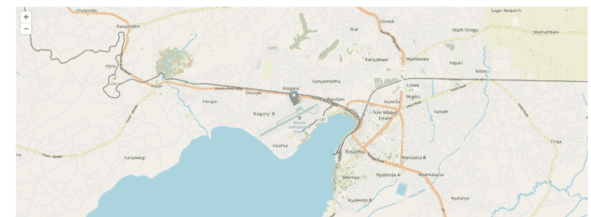

作为一个简单的练习，你能尝试使用目前为止学到的 `setView` 方法，为你自己的家庭住址创建一个标记点吗？

好了，我们现在有了一个标记点。但是，除了它只是位于某处中央的一个孤独图钉之外，它有什么特别之处呢？让我们尝试让这个标记点包含一些信息，在GIS中也称为属性。假设我们想要添加的属性是机场的名称和其他辅助数据。

## 3.3 带弹出窗口的标记点

要创建弹出窗口，Leaflet 提供了 `bindPopup` 方法。你只需将其链接到变量上，这有点像为浏览器添加扩展以执行新功能，但在这个情况下，这些额外的功能是添加到变量上的。在下面的代码中，`bindPopup` 通过点号 `.` 链接到标记点变量。

```javascript
// Create popup of Kisumu International Airport
marker.bindPopup("Kisumu International Airport.").openPopup();
```

```r
knitr::include_graphics(rep("D:/gachuhi/my-leaflet/images/kisumu-airport-popup.jpg"))
```

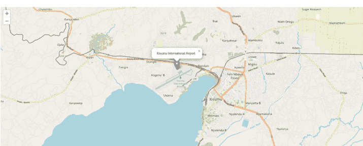

刚才发生的事情是，`bindPopup` 将弹出窗口内容——“基苏木国际机场”绑定到标记点。在下面的代码中，我们添加了另一个方法 `openPopup`，它会*打开*指定经纬度处的弹出窗口。如果你删除或注释掉（使用 `//`）`openPopup` 方法，你就必须点击标记点才能看到弹出窗口内容。试试看吧。

标记点也可以与HTML元素一起使用，例如，当你想显示额外的元数据时，比如地点的所有者、土地面积等。在下面的例子中，我们添加了基苏木机场位置的经纬度坐标。强烈建议不要在HTML标记点元素中包含冗长的信息。

```javascript
// With html content
marker.bindPopup("<br>Name: Kisumu International Airport</br><br>Latitude: -0.0819301</br><br>Longitude: 34.7269058</br>")
```

```r
knitr::include_graphics(rep("D:/gachuhi/my-leaflet/images/marker-html.jpg"))
```

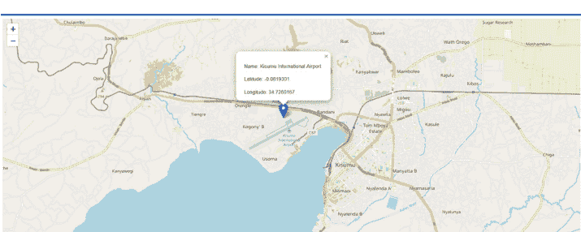

## 3.4 不同类型的标记点和弹出窗口

到目前为止，你已经看到了图钉标记点，但还有其他类型的标记点，比如圆形和矩形。与我们一直在试验的图钉标记点不同，这些其他标记点需要额外的选项，例如圆的半径值和矩形的经纬度坐标。让我们逐一尝试。

从圆形开始，让我们首先在基苏木博物馆的位置画一个半径。

```javascript
// Circle over Kisumu Museum
var circle = L.circle([-0.107637, 34.7435975]).setRadius(2000).addTo(map);
```

```r
knitr::include_graphics(rep("D:/gachuhi/my-leaflet/images/kisumu-museum-circle.jpg"))
```

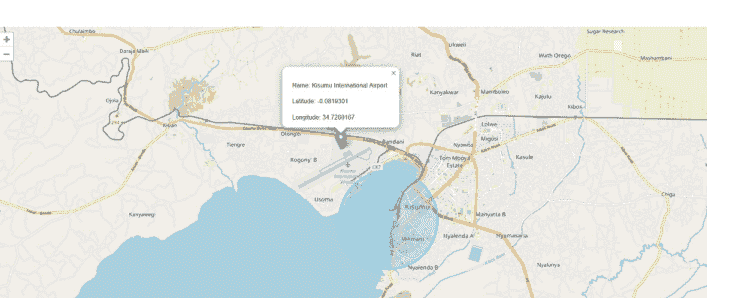

下面的代码也将创建一个稍微类似的圆形标记点，唯一的区别是在前面的代码中我们没有插入选项，并且使用 `setRadius` 方法设置了半径。在下面的第二个代码中，我们非常具体地说明了我们想要的内容——我们的规格说明被放入了花括号 `{}` 中，然后才将圆形标记点添加到我们的地图中。JavaScript 中的括号表示你正在处理一个字典。JavaScript 甚至 Python 中的字典用于表示键值对。

```javascript
var circle = L.circle([-0.107637, 34.7435975], {
    color: 'blue',
    fillColor: 'blue',
    fillOpacity: .5,
    radius: 2000
}).addTo(map);
```

正如我们之前提到的，其他标记点元素，如圆形和矩形，也可以附加弹出窗口。准备好体验一些酷炫的东西了吗？我们将为我们的圆形附加一个弹出窗口。不是普通的硬编码弹出窗口，而是依赖其他 Leaflet JavaScript 方法来生成输出的弹出窗口。在我们的例子中，我们想要一个显示圆半径的弹出窗口，而无需我们手动输入到代码中。

```javascript
// Circle marker pop up for Kisumu Museum
var getRadius = circle.getRadius();
circle.bindPopup("Radius is: " + getRadius.toString() + " metres");
```

在我们上面的代码中，`getRadius` 获取我们圆形标记点的半径。`bindPopup` 如前所述，将弹出窗口内容绑定到我们的圆形标记点。但有一个注意事项。变量 `getRadius` 用于打印结果，当然是2000。然而，`bindPopup` 只理解字符串，所以我们使用 `toString()` 将我们的变量结果转换为字符串。我们还添加了其他字符串，以提供一个完整的结果，让每个人都（Tom, Dick, Harry and Harriet）都能理解。

```r
knitr::include_graphics(rep("D:/gachuhi/my-leaflet/images/circle-radius.jpg"))
```

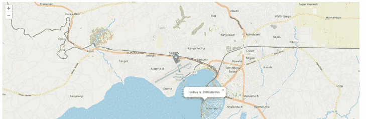

最后，让我们尝试使用矩形。实际上，Leaflet 允许我们创建多边形。让我们使用多边形类来创建一个包围给定位置的矩形。复制以下坐标。

```javascript
// Draw rectangle around Kisumu Wildlife Impala Park
var impalaParkCoordinates = [
    [-0.1144753, 34.743418],
    [-0.115097, 34.745242],
    [-0.114238, 34.745071],
    [-0.114002, 34.746101],
    [-0.115054, 34.746787],
    [-0.115998, 34.745586],
    [-0.118444, 34.746208],
    [-0.121255, 34.744684]
];
```

现在使用 `L.polygon` 类和一些可选参数，让我们展示基苏木野生动物黑斑羚公园的位置。

```javascript
// Create a polygon using the above coordinates
var impalaParkPolygon = L.polygon(impalaParkCoordinates, {
    color: 'brown',
    fillOpacity: 0.4
}).addTo(map);
```

就像我们为圆形标记点所做的那样，我们将使我们的弹出窗口内容依赖于另一个变量，在这种情况下是 `getCenter`，它获取我们多边形的中心坐标。我们曾寻找更酷的东西，比如 Leaflet 中的 `getArea`，它能在弹出窗口中自动打印出多边形的面积。不幸的是，我们没能找到它。

```javascript
// Add popup to the polygon of Kisumu Impala Park
var getCenter = impalaParkPolygon.getCenter();
impalaParkPolygon.bindPopup("Centre is at Lat-Lon: " + getCenter.toString()).openPopup();
```

如果你觉得圆形标记点对矩形标记点构成了太大的阻碍，请随意使用 `//` 将其注释掉。

```r
knitr::include_graphics(rep("D:/gachuhi/my-leaflet/images/polygon-marker.jpg"))
```

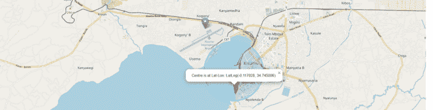

你可以在这里获取本练习中使用的文件。

## 3.5 小结

本章带你进一步丰富了网络地图中可以显示的内容。你已经看到，网络地图可以提供的有用信息远不止网络画布上的简单标记和符号。弹出窗口是显示信息的一种方式，它们也可以进一步定制。通过本章的实践，你学到了以下内容：

- 要在 Leaflet 中创建弹出窗口，我们使用 `bindPopup` 方法。
- `openPopup` 在 Leaflet 地图加载后会自动打开弹出窗口。它们只有在你关闭后才会消失。
- 标记点也可以与HTML元素一起使用。
- 除了位置图钉，标记点也可以是圆形和矩形。
- Leaflet 中存在一些方法，可以自动解析弹出窗口中的信息，而无需程序员进行任何硬编码。例如，我们使用 `getRadius` 在弹出窗口中显示圆的半径，而无需在 `bindPopup` 方法中手动输入。
- 你可以使用 `//` 来注释掉 JavaScript 代码。

# 第三章 附加功能

# 第四章

## 将 Leaflet 地图嵌入到外部网站

## 4.1 一个有方向感的网站

现在，我们已经成功创建了一个独立的 Leaflet 地图。然而，我们想做一些能让你从新手迅速升级为专家的事情。那就是将 Leaflet 地图嵌入到网站中。下图展示了一个我们想要的示例，它是来自 HDX 网站的快照。

```r
knitr::include_graphics(rep("D:/gachuhi/my-leaflet/images/webmap-in-web.jpg"))
```

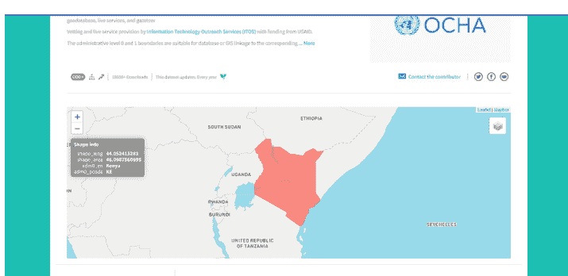

在本练习中，我们将把一个 Leaflet 地图嵌入到一个简单的 HTML 网页中。这


## 4.2 HTML 网页

使用以下代码创建一个 HTML 页面。

```html
<!DOCTYPE html>
<html lang="en">
<head>
    <title>Pro-GMO Alliance</title>
    <meta charset="utf-8">
    <link rel="stylesheet" href="example-styles.css">
    <link rel="stylesheet" href="https://unpkg.com/leaflet@1.9.3/dist/leaflet.css"
    integrity="sha256-kLaT2GOSpHechhsozzB+flnD+zUyjE2LlfWPgU04xyI="
    crossorigin=""/>
    <script src="https://unpkg.com/leaflet@1.9.3/dist/leaflet.js"
    integrity="sha256-WBkoXOwTeyKclOHuWtc+i2uENFpDZ9YPdf5Hf+D7ewM="
    crossorigin=""></script>
</head>
<body>
<div id="div-for-article">
    <article id="introduction">
        <h2>Introduction</h2>
        <q>Sed ut perspiciatis unde omnis iste natus error sit voluptatem accusantium doloremque laudantium, totam rem aperiam, eaque ipsa quae ab illo inventore veritatis et quasi architecto beatae vitae dicta sunt explicabo. Nemo enim ipsam voluptatem quia voluptas sit aspernatur aut odit aut fugit, sed quia consequuntur magni dolores eos qui ratione voluptatem sequi nesciunt. Neque porro quisquam est, qui dolorem ipsum quia dolor sit amet, consectetur, adipisci velit, sed quia non numquam eius modi tempora incidunt, ut labore et dolore magnam aliquam quaerat voluptatem. Ut enim ad minima veniam, quis nostrum exercitationem ullam corporis suscipit laboriosam, nisi ut aliquid ex ea commodi consequatur? Quis autem vel eum iure reprehenderit qui in ea voluptate velit esse quam nihil molestiae consequatur, vel illum qui dolorem eum fugiat quo voluptas nulla pariatur?</q>
    </article>
</div>
<div id="div-for-section">
    <section id="Products">
        <div class="row">
            <h2>Our Products</h2>
            <div class="column">
                
            </div>
            <div class="column">
                
            </div>
            <div class="column">
                
            </div>
        </div>
    </section>
</div>
</body>
</html>
```

这个网页看起来并不宏伟，但它满足了我们练习的目的。我们开始吧。以下是文件。

# 第四章。将 Leaflet 地图嵌入外部网站

## 4.2 HTML 网页

使用以下代码创建一个 HTML 页面。

```html
<!DOCTYPE html>
<html lang="en">
<head>
    <title>Pro-GMO Alliance</title>
    <meta charset="utf-8">
    <link rel="stylesheet" href="example-styles.css">
    <link rel="stylesheet" href="https://unpkg.com/leaflet@1.9.3/dist/leaflet.css"
    integrity="sha256-kLaT2GOSpHechhsozzB+flnD+zUyjE2LlfWPgU04xyI="
    crossorigin=""/>
    <script src="https://unpkg.com/leaflet@1.9.3/dist/leaflet.js"
    integrity="sha256-WBkoXOwTeyKclOHuWtc+i2uENFpDZ9YPdf5Hf+D7ewM="
    crossorigin=""></script>
</head>
<body>
<div id="div-for-article">
    <article id="introduction">
        <h2>Introduction</h2>
        <q>Sed ut perspiciatis unde omnis iste natus error sit voluptatem accusantium doloremque laudantium, totam rem aperiam, eaque ipsa quae ab illo inventore veritatis et quasi architecto beatae vitae dicta sunt explicabo. Nemo enim ipsam voluptatem quia voluptas sit aspernatur aut odit aut fugit, sed quia consequuntur magni dolores eos qui ratione voluptatem sequi nesciunt. Neque porro quisquam est, qui dolorem ipsum quia dolor sit amet, consectetur, adipisci velit, sed quia non numquam eius modi tempora incidunt, ut labore et dolore magnam aliquam quaerat voluptatem. Ut enim ad minima veniam, quis nostrum exercitationem ullam corporis suscipit laboriosam, nisi ut aliquid ex ea commodi consequatur? Quis autem vel eum iure reprehenderit qui in ea voluptate velit esse quam nihil molestiae consequatur, vel illum qui dolorem eum fugiat quo voluptas nulla pariatur?</q>
    </article>
</div>
<div id="div-for-section">
    <section id="Products">
        <div class="row">
            <h2>Our Products</h2>
            <div class="column">
                
            </div>
            <div class="column">
                
            </div>
            <div class="column">
                
            </div>
        </div>
    </section>
</div>
</body>
</html>
```

```html
        
    </div>
    <div class="column">
      
    </div>
    <div class="column">
      
    </div>
  </div>
</section>
</div>
<div>
  <br>
  <h2>Our Branches</h2>
  <br>
</div>
  <div class="container">
    <div id="map">
      <script src="example-main.js"></script>
    </div>
    <div class="text">
      <h1>Address</h1>
      <p>
        P.O. Box 55044, Nakuru
      </p>
    </div>
  </div>
</body>
</html>
```

由于这是一本地理空间书籍，我们不会逐行讲解上面的 HTML 脚本。它只是一个包含一些文本、图片和网络地图的网页。网络地图是本章我们关注的核心。我们至少知道如何创建一个 Leaflet 地图，但我们如何将其放入网页中呢？

在继续之前，我们先插入 CSS 文件，它看起来像这样。

```css
/* 三个图片容器（四个用25%，两个用50%等等） */
.column {
  float: left;
  width: 33.33%;
  padding: 5px;
}

/* 在图片容器后清除浮动 */
.row::after {
content: "";
clear: both;
display: table;
}
```

```css
/* 地图样式 */
.container {
    display: flex;
    align-items: center;
    justify-content: center
}
```

```css
#map {
    height: 300px;
    width: 90%
}
```

```css
.text {
    font-size: 15px;
    padding-left: 20px;
}
```

## 4.3 用于网络地图显示的简单 for 循环

回到我们虚构的 Pro-GMO Alliance 网页的 Leaflet 地图。我们是如何将 Leaflet 放入其中的？在不到一分钟的时间里，将 JavaScript Leaflet 文件解析到 `<script>` 标签中，并使用 `src` 属性引用它，我们的网络地图就会出现在 HTML 文件的指定位置。我们解析到 HTML 文件中的 JavaScript 文件叫做 `example-main.js`。它包含以下代码：

```javascript
var map = L.map('map').setView([-0.302765, 36.146147], 12);
```

```javascript
L.tileLayer('https://tile.openstreetmap.org/{z}/{x}/{y}.png', {
    maxZoom: 19,
    attribution: '&copy; <a href="http://www.openstreetmap.org/copyright">OpenStreetMap contributors</a>'
}).addTo(map);
```

```javascript
var branches = [
    ["Potatoes",-0.328858, 36.008474],
    ["Maize",-0.302765, 36.146147],
    ["Sunflower",-0.224832, 36.159880],
    ["Cotton", -0.214189, 36.135847]
];

for (var i = 0; i < branches.length; i++) {
    marker = new L.marker([branches[i][1], branches[i][2]])
        .bindPopup(branches[i][0])
        .addTo(map);
}
```

在本书中，我们首次引入了 `for` 循环。与其他语言（如 R 和 Python）一样，JavaScript 也使用 `for` 循环来遍历项目。在我们的例子中，并且记住数组中的索引从 0 开始，标记的弹出窗口将读取分别位于索引 1 和 2 的纬度和经度。纬度和经度由 `[branches[i][1], branches[i][2]]` 表示。作为 `branches` 数组中第一个元素的弹出字符串位于索引 0。弹出字符串由 `branches[i][0]` 表示。在链的末尾，标记通过 `.addTo` 被添加到地图上。

好的。那么关键字 `new` 呢？

`new` 关键字是一个构造函数。也就是说，它创建一个空对象。可以从 `new` 对象的实例创建变量 `marker` 的多个实例。有关 `new` 关键字构造函数的更多信息，请参阅此网站。请放心，`new` 关键字并非使我们的网络地图正常工作的必需品，但学习这个 JavaScript 技巧对你来说是有益的，可以增加你的知识储备。

下面是虚构的 Pro-GMO 网站嵌入我们新的网络地图后的截图。

```
knitr::include_graphics(rep("D:/gachuhi/my-leaflet/images/embedded.jpg"))
```

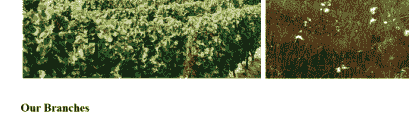

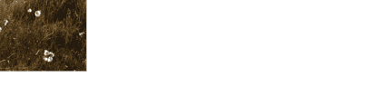

Our Branches

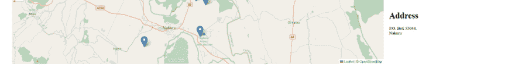


“我们如何将网络地图左对齐，并让其他文本位于其旁边？”这都归功于 CSS 属性 `display: flex`。`display` 是一个处理 HTML 元素如何显示的 CSS 属性。

`display` 属性将 HTML 元素对齐，以根据其在网页中指定部分内的可用空间进行填充或收缩。另一方面，CSS 属性 `padding-left` 只是在元素周围创建空间，从而在 Leaflet 地图和地址文本之间创建一个整洁的间距。移除它将使地址文本和 Leaflet 地图紧挨着对方。将所有这些 CSS 属性和值用于将 HTML 元素并排放置的灵感来源于此示例。

完成以上步骤后，你可以认为自己已经是一个熟练的 Leaflet 制图师，可以承担任何任务了！稍后，在第 13 章中，我们将看到如何将 Leaflet 地图插入到一个更复杂的网站中。这只是一个简单的介绍。

## 4.4 总结

本章向您介绍了如何使用 CSS 来自定义网络地图的外观和位置。您还接触到了在 JavaScript 代码中使用 `for` 循环来检索地理空间信息，特别是从数组中检索。以下是本章的一些要点。

*   如虚构的 Pro-GMO 网页所示，Leaflet 地图可以嵌入到网站内部。
*   可以使用 `for` 循环来遍历数组中的元素并检索地理空间信息。在本章中，`for` 循环被用于从 `branches` 数组变量中检索经纬度坐标和文本。
*   我们可以使用 CSS 元素，如 `display` 和 `padding-left`，来定位和定义网络地图在我们的网页上如何显示。


## 第五章

## 在Leaflet中使用GeoJSON

## 5.1 创建 .geojson 文件

到目前为止，我们已经创建了一个Leaflet地图，添加了一些美学元素如标记，甚至将地图嵌入到了一个虚拟网站中。好吧，这个网站离优秀还差得远，但在处理其他功能完善且更美观的网站时，其方法论应该是相同的。这可能足以给你开始成为网络地图制作者的信心，但别急！还有更多领域需要探索！我想介绍另一种存储地理空间信息的格式——使用 .geojson 文件。

## 5.2 什么是 .geojson 文件？

根据GIS领域的领导者ESRI的定义，.geojson 文件是一种开放标准的地理空间数据交换格式，用于表示简单的地理要素及其非空间属性。GeoJSON基于JavaScript对象表示法（JSON）文件格式，这是一种轻量级的数据交换格式，易于人和机器解读。在极少数情况下，任何数据格式能同时满足双方的需求，但JSON做到了，本网站提供了示例。总之，就像你可以从名称中看出的那样，JSON基于JavaScript编程语言。如果你之前使用过JavaScript，它看起来非常像一种基于字典的数据格式。本质上，JSON是一个包含其他数据*字典*的大型字典。GeoJSON是一个遵循特定结构并包含空间索引和几何规范的JSON文件。有关GeoJSON示例，请参见此网站。

GeoJSON文件格式结构示例如下所示：

```json
{
  "type": "FeatureCollection",
  "features": [
    {
      "type": "Feature",
      "properties": {
        "City": "Nairobi",
        "Population": "4, 300, 000"
      },
      "geometry": {
        "coordinates": [
          36.80617598261199,
          -1.2868825246637812
        ],
        "type": "Point"
      }
    },
    {
      "type": "Feature",
      "properties": {
        "City": "Kisumu",
        "Population": "610, 082"
      },
      "geometry": {
        "coordinates": [
          34.738718987625106,
          -0.10390483386935045
        ],
        "type": "Point"
      }
    },
    ---snip----
```

下面是一个json文件结构的例子。

```json
{
  "Influencers" : [
    {
      "name" : "Jaxon",
      "age" : 42,
      "Works At" : "Tech News"
    },
    {
      "name" : "Miller",
      "age" : 35,
      "Works At" : "IT Day"
    }
  ]
}
```

## 5.3 为什么使用geojson？

鄙人可能错了，但**geojson**和json的一个优点是与shapefile相比，它体积更小，也更便于携带。Shapefile依赖于随附的其他数据格式，例如 .shx、.dbf、.prj，这些文件提供辅助的地理空间方向、元数据和属性。另一方面，GeoJSON和JSON格式将以单个文件形式出现，但仍包含与shapefile所有组件（.shx、.dbf 和 .prj）组合起来一样多的数据。

那么我应该在什么情况下使用shapefile与GeoJson呢？如果你想在Web界面中处理地理空间数据，**geojson**就是你的选择。就这样。

## 5.4 创建一个geojson文件

在几乎没有错误的情况下创建一个GeoJSON文件可能看起来令人生畏，事实上也确实如此，但幸运的是geojson.io网站为我们完成了繁重的工作。我们将前往该网站，创建一个包含一些城市及其人口的**geojson**文件。

首先，网站看起来如下所示。真是一个由Mapbox驱动的超酷全球地图。

```
knitr::include_graphics(rep("D:/gachuhi/my-leaflet/images/mapbox-front.jpg"))
```

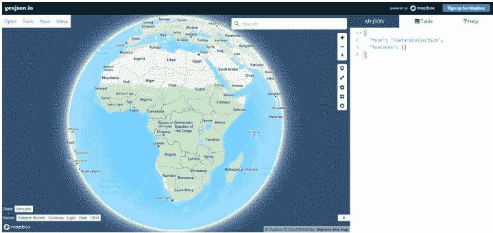

在你的右边，<>JSON标签下，Mapbox团队已经为你开了个头，指明了将放入你的geojson文件的要素类型和要素。这些很重要，因为任何网站在解析GeoJSON文件中的信息时都会使用这些关键字。放大到肯尼亚，然后点击内罗毕点标记上方的一个点，如下图所示。使用下面图片中突出显示的标记在内罗毕上方创建一个标记。

```
knitr::include_graphics(rep("D:/gachuhi/my-leaflet/images/nairobi-pin.jpg"))
```

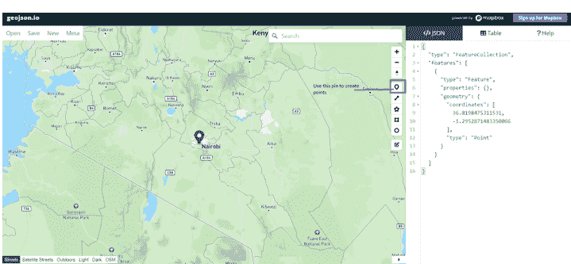

这样做之后，你会意识到一个包含**type**、**properties**和**geometry**的新字典出现在了**features**列表中。这些新键在它们的值中提供了额外的空间和几何数据，网站使用这些数据将它们放置在网络地图的适当位置上。

现在转到**Table**标签页，点击新建列，如下所示。

```
knitr::include_graphics(rep("D:/gachuhi/my-leaflet/images/table.jpg"))
```

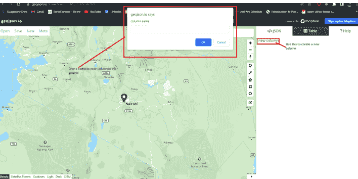

点击它，在出现的图形中，为你的列命名为**City**。点击**Ok**，然后在出现的表格单元格中，输入**Nairobi**。

```
knitr::include_graphics(rep("D:/gachuhi/my-leaflet/images/nairobi-named.jpg"))
```

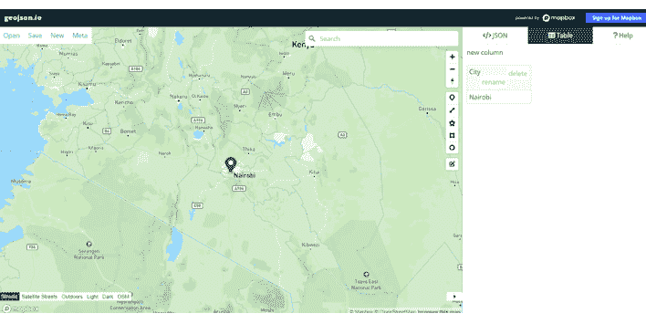

现在在*Kisumu*上方创建一个新的标记，将会发生两件事：一个新的字典将出现在内罗毕的下方，并且在**Table**标签页中将出现一个新的表格行。在以下城市上方创建标记：蒙巴萨、纳库鲁、涅里、马查科斯和马林迪。从法律上讲，只有前四个是法定城市，其余的只是城镇，但为了本教程的目的，让我们统一称它们为城市。

```
knitr::include_graphics(rep("D:/gachuhi/my-leaflet/images/cities-named.jpg"))
```

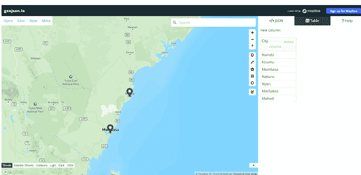

好的，一个流程完成了，还有一个。我们将用人口统计数据填充这些城市。创建一个标题为**Population**的新列。用以下统计数据填充每个城市。

```
read.csv("D:/gachuhi/my-leaflet-vs/data/points.csv")[ , 1:2]
```

| 城市 | 人口 |
| :--- | :--- |
| Nairobi | 4, 300, 000 |
| Kisumu | 610, 082 |
| Mombasa | 1, 440, 000 |
| Nakuru | 422, 000 |
| Nyeri | 759, 164 |
| Machakos | 1, 422, 000 |
| Malindi | 119, 859 |

完成后，前往geojson.io网站的左上角，点击**Save**。将出现一个选项列表，点击另存为**geojson**。它应该会出现在你的*Downloads*目录中的某个地方。

```
knitr::include_graphics(rep("D:/gachuhi/my-leaflet/images/geojson-save.jpg"))
```

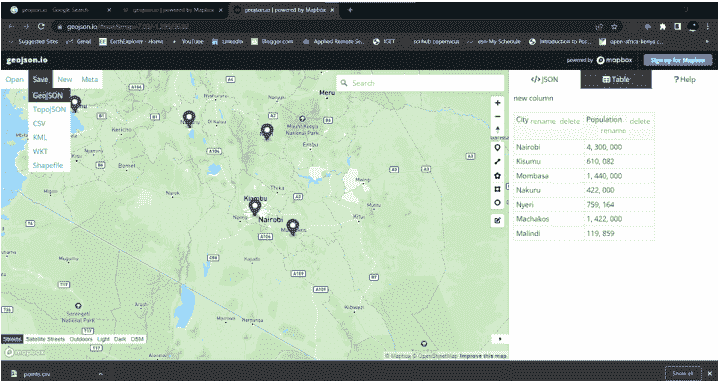

## 5.5 将Geojson保存到Github

现在，根据经验，将本地Geojson文件（你计算机目录中的文件）加载到JavaScript中是一种痛苦的体验，即使不是几乎不可能。产生的错误与服务器或某些东西有关。为了找到解决这个问题的方法，同时仍然能够在Leaflet中显示.geojson数据，GeoJson文件必须存储在线服务器上，在这种情况下，是Github。我们很乐意向你展示如何在Github上保存数据，但这会使本章变得太长。因此，我真诚地致歉，你最好自己谷歌搜索一下。尽管如此，这里是GeoJSON文件，它将在本练习的最后两个子章节中派上用场。

## 5.6 将GeoJSON加载到Leaflet

正如他们常说的，杀鼠有多种方法。根据我们的发现，至少有三种方法可以将GeoJson数据加载到Leaflet中。我们将从最简单但最不可靠的方法开始，到我们认为最好的方法。让我们从简单的方法开始，即从我们的Javascript文件本身加载一个.geojson文件。

### 5.6.1 简单的方法

首先创建一个名为`geojson.js`的空白JavaScript文件。然后，转到你在第2章中最后创建的`map.html`文件。打开它。在`<body>`元素的`<script>`标签内，将`src`属性更改为"geojson.js"，如下所示。

```html
<!DOCTYPE html>
<html lang="en">
    <head>
        -- snip ---
    </head>
    <body>
        <div id="myMap">
            <script src="geojson.js">
            </script>
        </div>
    </body>
</html>
```

好的。转到你的`geojson.js`，像往常一样，添加Leaflet类`L.map`和`L.tileLayer`。我们将新的Leaflet地图的视图设置为内罗毕的视图。你的空白`geojson.js`现在应该包含以下代码。

```javascript
var map = L.map('myMap').setView([-1.295287148, 36.81984753], 7);

L.tileLayer('https://tile.openstreetmap.org/{z}/{x}/{y}.png', {
    maxZoom: 19,
    attribution: '&copy; <a href="http://www.openstreetmap.org/copyright">OpenStreetMap</a>'
}).addTo(map);
```

好的。转到geojson.io网站，在`</>`**JSON**正下方，你会看到一个复制图标。

```
knitr::include_graphics(rep("D:/gachuhi/my-leaflet/images/geojson-copy.jpg"))
```


## 5.6. 将GeoJSON加载到Leaflet中

点击它，并将JSON代码粘贴到你的 `geojson.js` 文件中，放在其他 `L.map` 和 `L.tileLayer` 类的上方。你的 `geojson.js` 文件内容应如下所示。

```
var cities = {
    "type": "FeatureCollection",
    "features": [
        {
            "type": "Feature",
            "properties": {
                "City": "Nairobi",
                "Population": "4, 300, 000"
            },
            "geometry": {
                "coordinates": [
                    36.8198475311531,
                    -1.2952871483350066
                ],
                "type": "Point"
            }
        },
        -- snip ---
        {
            "type": "Feature",
            "properties": {
                "City": "Malindi",
                "Population": "119, 859"
            },
            "geometry": {
                "coordinates": [
                    40.10521499751357,
                    -3.2138767356491655
                ],
                "type": "Point"
            }
        }
    ]
};
```

```
var map = L.map('myMap').setView([-1.295287148, 36.81984753], 7);
```

```
L.tileLayer('https://tile.openstreetmap.org/{z}/{x}/{y}.png', {
  maxZoom: 19,
  attribution: '&copy; <a href="http://www.openstreetmap.org/copyright">OpenStreetMap</a>'
}).addTo(map);
```

刷新你的 `map.html`。这确实是肯尼亚的地图，但我们的 .geojson 要素尚未出现。我们即将改变这一点。Leaflet提供了 `L.geoJSON` 类来将GeoJSON数据添加到地图中。类名不言自明，因此我们用它来添加我们的GeoJSON要素。在其他Leaflet地图类图层下方添加以下代码。

```
L.geoJSON(cities).addTo(map);
```

刷新你的 `map.html`。GeoJSON要素现在应该出现在它们精确的位置上了。

如果我们让标记更具交互性会怎样？比如，像我们在第3章那样显示弹出窗口？我们希望城市名称在用户点击标记时出现。很简单。只需创建一个函数来实现这一点，如这里提供的逻辑。我们根据自己的情况对其进行了自定义，以确保它引用了附加在 `properties` 键下的字典中的 `City` 键。

```
L.geoJSON(cities).bindPopup(function (layer) {
    return layer.feature.properties.City;
}).addTo(map);
```

这种方法有一个问题。如果我们有非常长的GeoJSON数据结构，它会扰乱我们的JavaScript文件。我们只处理了七个城市，但处理包含数百甚至数千个字典的数据是很常见的。那会使你的JavaScript文件无限延伸。

这就引出了另外两种方法，即使用Ajax插件和使用Fetch应用程序编程接口（API）。别被这些词吓到。休息一下，喝杯水再回来。

### 5.6.2 使用Ajax插件

正如术语“插件”所暗示的，这是一个为Leaflet核心插件提供额外功能的扩展。Ajax插件可从这个链接获取。将其下载到你的目录中，最好放在与 `map.html` 和 `geojson.js` 相同的目录下。好了。在你的 `map.html` 中 `leaflet.js` 的 `src` 标签正下方，添加以下 `<script>` 标签。

```
<head>
    -- snip --
    <script src="leaflet-ajax-gh-pages/dist/leaflet.ajax.js"></script>

</head>
-- snip --
```

这个文件将允许你将 .geojson 文件添加到你的Leaflet地图中。但是，有一个注意事项。Ajax和Fetch API只能处理保存在网络服务器上的GeoJSON文件格式。根据经验，它们无法处理本地GeoJSON文件。作为一种解决方法，我们将GeoJSON文件保存到了Github。为方便起见，这里再次提供我们最初从 geojson.io 创建的原始文件的链接。

我们将使用Ajax从Github调用我们的GeoJSON文件，如下所示。请记住使用 `//` 注释掉你的 `var cities` 和 `L.geoJSON`，因为在这种特定情况下它们是无关的。

```
var geojsonLayer = new L.geoJson.ajax("https://raw.githubusercontent.com/sammigachuhi/p
```

你的地图现在应该显示我们城市的标记了。如果你眼尖，可能已经注意到Ajax的语法与之前Leaflet的 `L.geoJSON` 不同。从后者开始，我们改用了 `L.geoJson`，并且不同于Ajax创建者网站上使用的 `var geojsonLayer = new L.GeoJSON.AJAX(<your-geojson-file>)`，我们使用了以下语法：`L.geoJson.ajax()`（ajax和geoJson以小写字母开头）。实际上，这是经过相当长时间的网络搜索后才生效的写法。

就像使用 `L.geoJSON` 一样，我们也可以在调用 `.ajax` 方法后添加弹出窗口。

```
var geojsonLayer = new L.geoJson.ajax("https://raw.githubusercontent.com/sammigachuhi/p
    .bindPopup(function (layer) {
        return layer.feature.properties.City;
    }).addTo(map);
```

这样做应该会使城市名称在Leaflet地图上点击标记时显示出来。

### 5.6.3 使用Fetch API

Fetch API是一个现代接口，允许你从网页浏览器向服务器发出HTTP请求。换句话说，它通过网络搜索资源，检索它，并将其带给你。把它想象成一只狗，你扔出一个飞碟，对你的忠实猎犬说：“*Sabretooth, 去捡回来！*”。狗跑去追飞碟，用犬齿在空中咬住它，然后迅速带回给你。Fetch API也是同样的道理！

我曾提到过我将向你展示如何检索我们存储在Github上的GeoJSON数据，我会遵守诺言！我还将尝试解释这个 *神秘的* `fetch` 是如何工作的。

首先，将调用 `fetch` 函数并传递包含我们GeoJSON文本的Github URL。由于 `fetch` 是一个API，它从 Github.io（在此例中是服务器）检索数据，并将其带到我们的笔记本电脑（客户端）。好了，IT术语说够了。让我们把它写下来。

```
fetch("https://raw.githubusercontent.com/sammigachuhi/geojson_files/main/cities-geojson.geojson")
```

好的，下一步。一旦服务器将数据传回给我们，我们该如何处理？根据Digital Ocean的说法，响应 *实际上* 并不是原始格式的数据，而是 *一系列可以根据你想要处理信息的方式而使用的方法*。这听起来令人困惑。然而， *至少* 很清楚的是，最终目标是将我们获取的数据转换为JSON格式。将对象转换为JSON是使用 `json()` 方法完成的。我们将 `.json()` 解析到 `then` 方法，这是一个异步函数¹。在 `fetch` 函数成功后，对象被存储在方括号中的 **response** 参数中，然后函数将结果作为json对象返回。

```
fetch("https://raw.githubusercontent.com/sammigachuhi/geojson_files/main/cities-geojson.geojson")
    .then(function(response) {
        return response.json()
    })
```

将响应转换为JSON后，它仍然需要进一步处理。处理成什么？处理成GeoJSON文件，然后将其添加到我们的Leaflet地图中。

```
fetch("https://raw.githubusercontent.com/sammigachuhi/geojson_files/main/cities-geojson.geojson")
    .then(function(response) {
        return response.json()
    })
    .then(function(data) {
        L.geoJson(data).addTo(map);
    })
```

我们还将添加一个函数——`catch()` 方法。`catch()` 是一个方法，当我们的服务器响应被拒绝时，它会返回一个操作。让我们来演示一下所有这些。

```
fetch("https://raw.githubusercontent.com/sammigachuhi/geojson_files/main/cities-geojso")
    .then(function(response) {
        return response.json()
    })
    .then(function(data) {
        L.geoJson(data).addTo(map);
    })
    .catch(function(error) {
        console.log(`This is the error: ${error}`)
    })
```

要看到 `catch()` 的实际效果，请省略我们URL中的最后一个字母，使其变为 **cities-geojson.geojso**。是的，你没看错。现在只需省略字母 'n' 并重新加载你的 **map.html**。右键单击网页地图页面，并在出现的小界面中单击 **检查**。转到控制台选项卡，查看错误响应。它应该如下图所示。

恢复省略的字母 'n' 并重新加载你的 **map.html**。你的Leaflet地图应该会像使用Ajax插件或将Geojson数据硬编码到 **var cities** 中的情况一样，覆盖显示城市标记。为了进一步锻炼你的Javascript技能，我们可以通过保留参数 **response**、**data** 和 **error**，并使用箭头函数 `=>` 来传递返回语句，从而进一步缩短我们的代码，如下所示：

¹异步编程是一种技术，它使你的程序能够启动一个可能耗时较长的任务，并且在该任务运行时仍能响应其他事件，而不是必须等到该任务完成。一旦该任务完成，程序就会呈现结果。参见Mozilla


## 5.6. 将 GeoJSON 加载到 Leaflet 中

```javascript
fetch("https://raw.githubusercontent.com/sammigachuhi/geojson_files/main/cities-geojson.geojson")
    .then((response) => {
        return response.json()
    })
    .then((data) => {
        L.geoJson(data).addTo(map);
    })
    .catch((error) => {
        console.log(`This is the error: ${error}`)
    })
```

这看起来有点难懂，但别慌！我们只是省略了 `function()` 关键字，而是在 `function()` 和花括号 `{<code-to-run>}` 之间加上了 `=>`，花括号内是函数体，也就是魔法发生的地方。就像使用 Ajax 一样，我们也可以在 `fetch` 插件内为 `L.geoJSON` 添加其他功能。在这里，得益于模板字符串（``）的使用，我们甚至可以添加语句并使用 `${}` 引用 GeoJSON 的键（在某些情况下，还可以是变量）。`${}` 中的任何内容都会被执行，并作为字符串传递给模板字符串。

```javascript
fetch("https://raw.githubusercontent.com/sammigachuhi/geojson_files/main/cities-geojson.geojson")
    .then((response) => {
        return response.json()
    })
    .then((data) => {
        L.geoJson(data).bindPopup((layer) => {
            return `City: ${layer.feature.properties.City},<br>
            Population: ${layer.feature.properties.Population}`
        }).addTo(map);
    })
    .catch((error) => {
        console.log(`This is the error: ${error}`)
    })
```

在上面的 `return` 语句中，我们添加了 HTML 标签 `<br>` 来分隔 GeoJSON 中的城市和人口键。这样做将返回整洁的标记文本，其中城市名称和人口数字显示在两行上。

今天的 Javascript 学习到此为止！

```r
knitr::include_graphics(rep("D:/gachuhi/my-leaflet/images/city-population.jpg"))
```

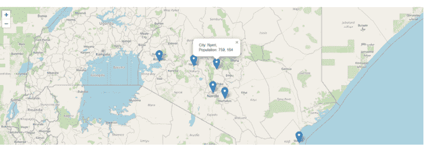

以下是本章中使用的完整文件。

## 5.7 总结

谁能想到简单的 GeoJSON 文件加载和查看起来会如此复杂？让我们回顾一下所学内容。

-   GeoJSON 文件是一种开放标准的地理空间数据交换格式，用于表示简单的地理要素及其非空间属性。
-   GeoJSON 基于以其轻量级特性而闻名的 JavaScript 对象表示法（JSON）文件格式。
-   GeoJSON 文件是在 Web 上处理空间信息的*通用语言*。
-   geojson.io 网站允许用户以交互式和直观的方式创建 GeoJSON 文件。
-   在 Leaflet 中加载 GeoJSON 文件主要有三种方法。一种是在 JavaScript 文件中硬编码空间属性的字典。这是我们探索的第一种方法。
-   另一种方法是使用 Ajax 插件。我们通过将提取的 Ajax 文件路径插入到 `<head>` 元素中来调用 Ajax 到 Leaflet。
-   第三种也是最后一种方法是通过使用 `fetch` API。`fetch` API 在网络上搜索资源，检索它，并将其带到你的计算机上。

## 第六章：创建你自己的自定义标记

## 6.1 设置基础

希望你没有丢弃我们在上一章创建的城市。在本章中，我们将专注于创建自己的自定义标记。我们喜欢干净的工作，因此我们将创建一个新的 JavaScript 文件并将其命名为 `custom-markers.js`。我们知道上一章相当长，但请相信我，尽管创建自定义标记听起来更容易，但我们花了更长时间才掌握它。好消息是，我们已经经历了足够多的教训来教你如何避免这些痛点。

首先要做的就是创建一个底图。

```javascript
var map = L.map('myMap').setView([-1.295287148, 36.81984753], 7);

L.tileLayer('https://tile.openstreetmap.org/{z}/{x}/{y}.png', {
    maxZoom: 19,
    attribution: '&copy; <a href="http://www.openstreetmap.org/copyright">OpenStreetMap</a>'
}).addTo(map);
```

我们将创建一个名为 `cities` 的新变量，它模拟保存到 Github 的 GeoJson 文件，只是这次人口值做了一些调整。将以下代码粘贴到你的 `custom-markers.js` 中。

```javascript
var cities = {
    "type": "FeatureCollection",
    "features": [
{
  "type": "Feature",
  "properties": {
    "City": "Nairobi",
    "Population": 4300000
  },
  "geometry": {
    "coordinates": [
      36.8198475311531,
      -1.2952871483350066
    ],
    "type": "Point"
  }
},
{
  "type": "Feature",
  "properties": {
    "City": "Kisumu",
    "Population": 610082
  },
  "geometry": {
    "coordinates": [
      34.74657469430895,
      -0.10402992528247523
    ],
    "type": "Point"
  }
},
{
  "type": "Feature",
  "properties": {
    "City": "Mombasa",
    "Population": 1440000
  },
  "geometry": {
    "coordinates": [
      39.66358575335434,
      -4.041883912902392
    ],
    "type": "Point"
  }
},
{
  "type": "Feature",
  "properties": {
    "City": "Nakuru",
    "Population": 422000
  },
  "geometry": {
    "coordinates": [
      36.06412271026528,
      -0.2754534004690896
    ],
    "type": "Point"
  }
},
{
  "type": "Feature",
  "properties": {
    "City": "Nyeri",
    "Population": 759164
  },
  "geometry": {
    "coordinates": [
      36.957036675396154,
      -0.42345404217887506
    ],
    "type": "Point"
  }
},
{
  "type": "Feature",
  "properties": {
    "City": "Machakos",
    "Population": 1422000
  },
  "geometry": {
    "coordinates": [
      37.25780808801821,
      -1.518874011494134
    ],
    "type": "Point"
  }
},
{
  "type": "Feature",
  "properties": {
    "City": "Malindi",
    "Population": 119859
  },
  "geometry": {
    "coordinates": [
      40.10521499751357,
      -3.2138767356491655
    ],
    "type": "Point"
  }
}
]
}
```

你能注意到与第5章代码中 `Population` 属性的任何区别吗？如果你眼光锐利，你会注意到这次 `Population` 的值是整数，而上一章使用的是字符串值。将人口值创建为字符串，然后再将它们转换为整数似乎有些多余，但请记住，是 geojson.io 网站为我们这样做的，而不是作者。这是为本章定制的原始 geojson 脚本。它也可以在这里获取。

在继续之前，有一个小提示。当 GeoJSON 文件中的人口值用字符串 `""` 括起来时，它们会自动在 Github 服务器的地图上渲染，如下所示。

```r
knitr::include_graphics(rep("D:/gachuhi/my-leaflet/images/geojson-webmap.jpg"))
```

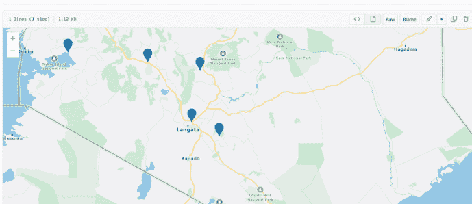

但是，当字符串被移除，人口值保持为整数时，它们就不再在网页地图上渲染了，如下所示。

```r
knitr::include_graphics(rep("D:/gachuhi/my-leaflet/images/geojson-nowebmap.jpg"))
```

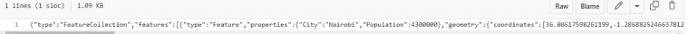

没有渲染地图，只是一个包含其他字典的字典。

## 6.2 图标

好的。让我们创建一个城市地图，但这次使用自定义标记。以下代码创建了我们的自定义标记。

```javascript
// Yellow Icon
var yellowIcon = new L.Icon({
    iconUrl: 'https://raw.githubusercontent.com/pointhi/leaflet-color-markers/master/img/marker-icon-yellow.png',
    shadowUrl: 'https://cdnjs.cloudflare.com/ajax/libs/leaflet/0.7.7/images/marker-shadow.png',
    iconSize: [25, 41],
    iconAnchor: [12, 41],
    popupAnchor: [1, -34],
    shadowSize: [41, 41]
});

// Orange Icon
var orangeIcon = new L.Icon({
    iconUrl: 'https://raw.githubusercontent.com/pointhi/leaflet-color-markers/master/img/marker-icon-orange.png',
    shadowUrl: 'https://cdnjs.cloudflare.com/ajax/libs/leaflet/0.7.7/images/marker-shadow.png',
    iconSize: [25, 41],
    iconAnchor: [12, 41],
    popupAnchor: [1, -34],
    shadowSize: [41, 41]
});

// Red Icon
var redIcon = new L.Icon({
    iconUrl: 'https://raw.githubusercontent.com/pointhi/leaflet-color-markers/master/img/marker-icon-red.png',
    shadowUrl: 'https://cdnjs.cloudflare.com/ajax/libs/leaflet/0.7.7/images/marker-shadow.png',
    iconSize: [25, 41],
    iconAnchor: [12, 41],
    popupAnchor: [1, -34],
    shadowSize: [41, 41]
});
```

我们按重要性顺序创建了三个标记：黄色、橙色、红色。你稍后会看到这些颜色的意义（并不大）。

是时候用这些来创建 GeoJSON 标记了。

```javascript
L.geoJSON(cities, {
    pointToLayer(feature, latlng) {
        return L.marker(latlng, {icon: yellowIcon});
    }
}).bindPopup(function (layer) {
```


## 第六章 创建自定义标记

```js
return layer.feature.properties.City;
}).addTo(map);
```

我们得到了这个结果。

```r
knitr::include_graphics(rep("D:/gachuhi/my-leaflet/images/geojson-markers.jpg"))
```

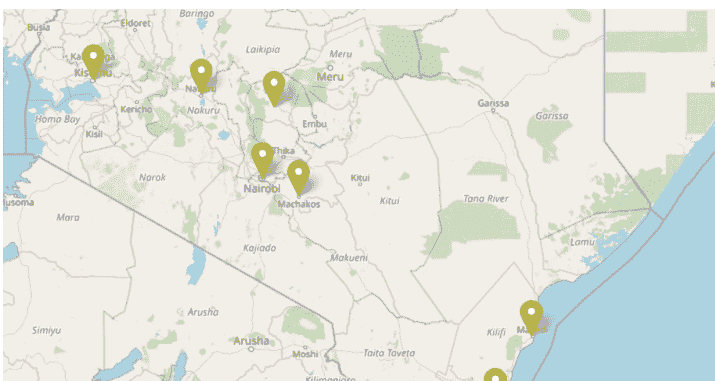

所有城市都被标记为黄色，无论其人口数量或行政级别如何。从制图师的角度来看，这个网页地图需要更多的样式设计，但在深入之前，我们先来看看`pointToLayer()`函数的用途是什么？根据Leaflet指南，`pointToLayer()`是针对GeoJSON变量的一个特殊函数，它指定了这些变量应如何被绘制。更具体地说，该函数将`return L.marker...`函数解析到每一个经纬度坐标上，从而在该点创建一个标记。

## 6.3 在网页地图上区分自定义标记

现在来看城市标记。我们希望标记能根据某个特定变量（比如人口）来区分城市。顺便说一句，城市规模通常由人口决定。以下代码将根据圆形标记的大小对城市进行分类，而这个大小将基于城市的人口。如果你在QGIS中见过点符号，准备好在Leaflet中看看它们的实际效果吧！

注释掉之前的代码并插入以下内容：

```js
L.geoJSON(cities, {
    pointToLayer: function (feature, latlng) {
        if (feature.properties.Population <= 250000) {
          return L.circleMarker(latlng, {
            radius: 4,
            fillColor: '#FFFF00',
            color: '#000',
            weight: 1,
            opacity: 1,
            fillOpacity: 0.8
          });
        } else if (feature.properties.Population <= 800000) {
          return L.circleMarker(latlng, {
            radius: 8,
            fillColor: '#ff9900',
            color: '#000',
            weight: 1,
            opacity: 1,
            fillOpacity: 0.8
          });
        } else {
          return L.circleMarker(latlng, {
            radius: 12,
            fillColor: '#FF0000',
            color: '#000',
            weight: 1,
            opacity: 1,
            fillOpacity: 0.8
          });
        }
    }
}).bindPopup(function (layer) {
  return `City: ${layer.feature.properties.City},<br>
  Population: ${layer.feature.properties.Population}`;
}).addTo(map);
```

你将得到一个地图，其中圆形标记的大小已由城市人口决定。这一次，`pointToLayer()`函数体与**if/else if**语句配合，来区分每个圆形标记的半径和颜色。在**if/else if**代码语句块内，为不同的人口类别插入了不同的圆形标记规格（半径和填充颜色）。任何人口超过800000的城市都被归入**else**块。

```r
knitr::include_graphics(rep("D:/gachuhi/my-leaflet/images/geojson-diff1.jpg"))
```

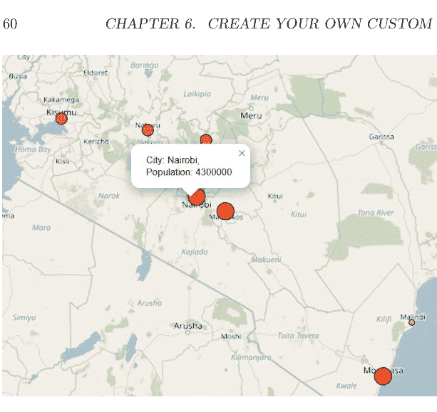

这就引出了我们之前为何将人口值从字符串改为整数的原因。如果我们使用原始的字符串值（如带引号的"1000000"），那么任何超过1,000,000的值都会匹配**feature.properties.Population <= 250000**这个条件。也就是说，它会显示为与人口25,000或以下的城市相同的黄色配色方案。这就会传递错误的信息。使用字符串值导致这个明显错误的原因是：在JavaScript中，对字符串中的数字进行排序时，会按照第一个字符来排序，而不管实际值的大小。换句话说，1比9大，尽管后者数值更大。因此，一个"**800,000**"人口的城市会被视为比"**1,000,000**"人口的城市更大。现在你就明白为什么我们的GeoJSON文件中，**Population**变量周围没有引号才能正确工作的逻辑了。

在下一个代码示例中，我们将创建城市标记图标，其颜色将由城市人口规模决定。我们将使用三种颜色：黄色、橙色和红色。黄色标记最小的城市，红色标记最大的城市。以下代码展示了如何实现这种分类。

```js
L.geoJSON(cities, {
    pointToLayer: function (feature, latlng) {
        if (feature.properties.Population <= 250000) {
            return L.marker(latlng, {
                icon: yellowIcon
            });
        } else if (feature.properties.Population <= 800000) {
          return L.marker(latlng, {
            icon: orangeIcon
          });
        } else {
          return L.marker(latlng, {
            icon: redIcon
          });
        }
    }
}).bindPopup(function (layer) {
  return `City: ${layer.feature.properties.City},<br>
  Population: ${layer.feature.properties.Population}`;
}).addTo(map);
```

```r
knitr::include_graphics(rep("D:/gachuhi/my-leaflet/images/geojson-diff2.jpg"))
```

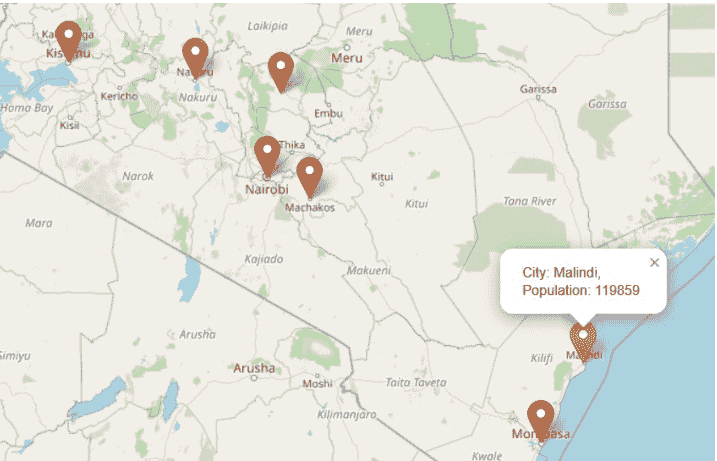

在上图中，人口超过800,000的大城市用红色标记分类，人口低于250,000的用黄色标记，介于两者之间的用橙色标记。在所有情况下，我们的`bindPopup()`仍然包含相同的设置，同时显示城市名称和人口规模。

`pointToLayer()`键的值被分配了一个函数，该函数检查城市人口是否在特定范围内。如果一个城市落在if语句指定的范围内，`L.marker()`函数就会返回一个特定的图标——无论是`yellowIcon`、`orangeIcon`还是`redIcon`。

## 6.4 使用 fetch

还记得在前面章节中`fetch`如何帮助我们从服务器检索数据吗？虽然我们不会重复整个过程（你可以松一口气了），但区分标记图标的相同逻辑也可以插入到`fetch` API中。所有这些操作都在`L.geoJson(data, {options})`的选项内部完成。

```js
fetch("https://raw.githubusercontent.com/sammigachuhi/geojson_files/main/cities-geojson")
    .then((response) =>{
        return response.json()
    })
    .then((data) => {
        L.geoJson(data, {
            pointToLayer: function (feature, latlng) {
                if (feature.properties.Population <= 250000) {
                    return L.marker(latlng, {
                        icon: yellowIcon
                    });
                } else if (feature.properties.Population <= 800000) {
                    return L.marker(latlng, {
                        icon: orangeIcon
                    });
                } else {
                    return L.marker(latlng, {
                        icon: redIcon
                    });
                }
            }
        }).bindPopup((layer) => {
            return `City: ${layer.feature.properties.City},<br>
            Population: ${layer.feature.properties.Population}`
        }).addTo(map);
    })
    .catch((error) => {
        console.log(`This is the error: ${error}`)
    })
```

生成的地图应与之前的地图相似。

```r
knitr::include_graphics(rep("D:/gachuhi/my-leaflet/images/cities_colored.jpg"))
```

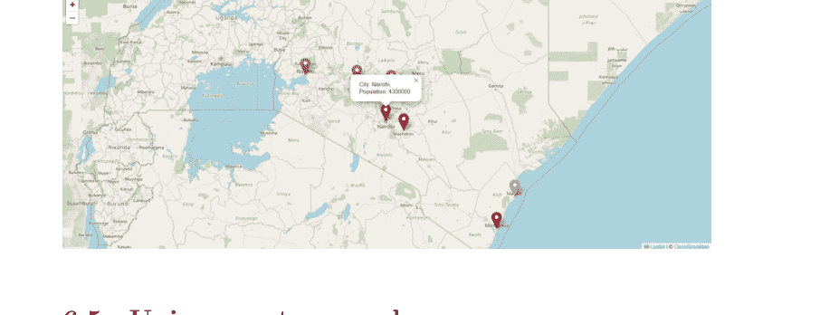

## 6.5 独特的自定义标记

这部分可能不是必需的，但加入它是为了向你展示除了Leaflet提供的默认标记外，还有各种其他标记。可以使用Leaflet.Awesome.Markers插件在Leaflet之外创建自定义标记。就像Ajax的情况一样，你需要使用`<script>`标签提供插件依赖项的路径。将以下`<script>`标签插入到map.html中。

```html
<script src="Leaflet.awesome-markers-2.0-develop/Leaflet.awesome-markers-2.0-develop/dist/leaflet.awesome-markers.js"></script>
```

```html
<script src="Leaflet.awesome-markers-2.0-develop/Leaflet.awesome-markers-2.0-develop/dist/leaflet.awesome-markers.css"></script>
```

以及这个`<link>`标签：

```html
<link href="http://netdna.bootstrapcdn.com/font-awesome/4.0.0/css/font-awesome.css" rel="stylesheet" />
```

为了节省时间，按照他们网站上的示例，我们只需将图标键的值替换为新的`L.AwesomeMarkers.icon`。我们还调整了每个图标的颜色以匹配之前使用的颜色。因为这些标记代表各种便利设施，为了演示它们的用途，我们做了一些过于简化的假设，即人口超过1,000,000的大城市有最好的购物中心，人口在250,000到800,000之间的城市必定有不错的咖啡馆，而人口低于250,000的城市显然有像样的工业。我们假设我们的假设是公平合理的。那么，代码如下。


## 第六章 创建自定义标记

```javascript
L.geoJSON(cities, {
  pointToLayer: function (feature, latlng) {
    if (feature.properties.Population <= 250000) {
      return L.marker(latlng, {
        icon: L.AwesomeMarkers.icon({icon: 'cog', prefix: 'fa', markerColor: 'purple'})
      });
    } else if (feature.properties.Population <= 800000) {
      return L.marker(latlng, {
        icon: L.AwesomeMarkers.icon({icon: 'coffee', prefix: 'fa', markerColor: 'red'})
      });
    } else {
      return L.marker(latlng, {
        icon: L.AwesomeMarkers.icon({icon: 'shopping-cart', prefix: 'fa', markerColor: 'blue'})
      });
    }
  }
}).bindPopup(function (layer) {
  return `城市: ${layer.feature.properties.City},<br>
  人口: ${layer.feature.properties.Population}`;
}).addTo(map);
```

```r
knitr::include_graphics(rep("D:/gachuhi/my-leaflet/images/extra-markers.jpg"))
```

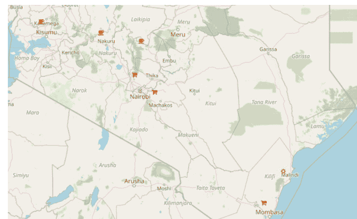

自定义标记也是可点击的！

## 6.6 图像叠加

有时一张图片也能起到很好的标记作用。在地图上叠加图像相当简单。以下代码在肯尼亚首都内罗毕的一处历史纪念碑上方插入了一张图像。

```javascript
// 图像叠加
var imageUrl = 'https://pbs.twimg.com/media/DddQBk5WsAAlbdJ?format=jpg&name=large';
var errorOverlayUrl = 'https://pbs.twimg.com/media/DddQBk5WsAAlbdJ?format=jpg&name=large';
var altText = '加尔顿-芬齐纪念碑：来源：谷歌和推特';
var latLngBounds = L.latLngBounds([[-1.2861259,36.8172709], [-1.2886193,36.8230413]]);

var imageOverlay = L.imageOverlay(imageUrl, latLngBounds, {
    opacity: 0.8,
    errorOverlayUrl: errorOverlayUrl,
    alt: altText,
    interactive: true
}).addTo(map);
```

然而，在广阔的地球上找到某个特定地点的图片可能很费劲，所以我们用矩形将其框起来。`map.fitBounds` 函数使浏览器能自动缩放到我们图像放置的位置。

```javascript
L.rectangle(latLngBounds).addTo(map);
map.fitBounds(latLngBounds);
```

```r
knitr::include_graphics(rep("D:/gachuhi/my-leaflet/images/geltan-fenzi.jpg"))
```

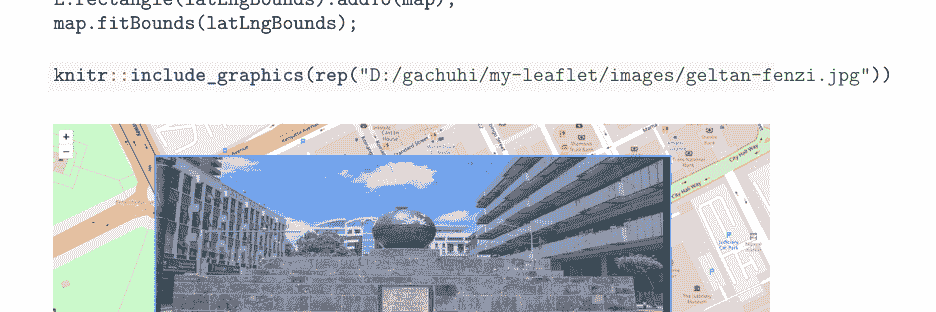

请注意，这座纪念碑建于1939年，是为了纪念莱昂内尔·道格拉斯·加尔顿-芬齐；早在1926年，他就成为第一位驾车从内罗毕前往蒙巴萨的驾驶者。纪念碑上还刻有指向多个东非城市的方位，不过今天的历史就讲到这里了。

## 第六章 创建自定义标记

总之，以下是 **L.imageOverlay** 所用属性的简要说明：
a) **var latLngBounds** 使用 **L.latLngBounds** 类来设置经纬度坐标。请注意，它们是两个用单个 **[]** 绑定在一起的坐标列表。未能用 **[]** 包裹这两个坐标会导致错误。b) **var ImageUrl** 是图像源。

对于传递给 **L.imageOverlay()** 类的附加选项，描述如下：

-   1. **opacity** - 定义图像叠加层的不透明度，默认值为1.0。减小此值可以使图像叠加层变得透明，并露出底层的地图图层。
-   2. **errorOverlayUrl** - 是一个URL，用于在加载失败的叠加层位置显示叠加图像。
-   3. **alt** - 设置HTML的alt属性，以提供图像的替代文本描述。在网络连接不佳导致图像加载失败时，它能以文本形式描述图像，这非常有用。此外，它还能改善其所在网站的搜索引擎优化（SEO）。
-   4. **interactive** - 默认为false。如果设为true，图像叠加层在被点击或悬停时会触发鼠标事件。

完整代码和文件在这里。

## 6.7 总结

这一章内容相当长，详细讲解了如何在Leaflet中自定义GeoJSON标记。通过本章中的各种练习，你学到了以下内容：

-   GeoJSON文件，如果格式正确，可以从Github渲染为独立地图。示例在这里。
-   可以根据GeoJSON文件的属性自定义标记的颜色或大小。在本章中，城市人口值被用来定义标记的大小和颜色。
-   **pointToLayer** 键在作为 **L.geoJSON** 的选项使用时，会为GeoJSON对象的每个经纬度坐标解析一个特定函数。
-   也可以在 **fetch** API中通过简单指定其应如何显示（以函数形式）在 **L.geoJson** 选项环境中来自定义标记。

## 6.7. 总结

-   除了Leaflet自带的，还存在许多与Leaflet兼容的自定义图标库。其中一个例子就是Leaflet Awesome Markers。
-   图像也可以叠加在Leaflet地图上。这在图像叠加子章节中已完成。

# 第七章

## 创建交互式分级统计图

## 7.1 什么是分级统计图？

现在，我们将从标记转向更宏大的主题——分级统计图。你可能会问，*分级统计图到底是什么？* 地理学家们会对这个术语翻白眼，因为他们在职业生涯中已经无数次遇到它了。然而，为了新读者着想，分级统计图是一种地图，其地理区域或区域根据数据变量被着色、阴影或图案化。如果在选举期间，你看到过一张地图，它在获胜候选人所在的（一个或多个）州披上了其政党的主题颜色，那么这就是一张分级统计图。大多数人口地图也是分级统计图。在本章中，我们将创建肯尼亚各县的分级统计图，并通过利用每个县的区域和人口特征使其具有交互性。

```r
knitr::include_graphics(rep("D:/gachuhi/my-leaflet/images/choropleth.png"))
```

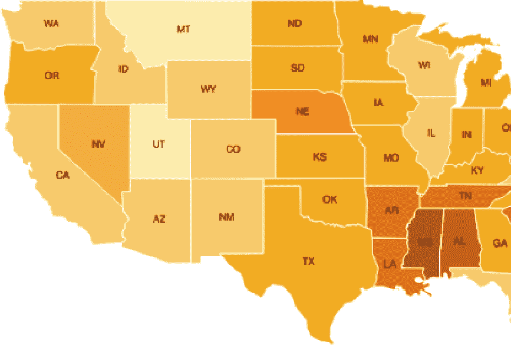

来源：数据可视化目录

## 7.2 创建分级统计图：开始

显然，到现在为止，无需太多细节，你也能闭着眼睛创建一个基本的Leaflet地图了。无论如何，眼见为实，所以让我们立即开始。创建另一个名为 **interactive-choropleth.js** 的新JavaScript文件。为了打破单调，我们将使用不同的图层。请记住，Leaflet有多个瓦片图层服务器，本章使用的CyclOSM只是众多服务器中的一种。

```javascript
var map = L.map('myMap').setView([0.3556, 37.5833], 6.5);

L.tileLayer('https://{s}.tile-cyclosm.openstreetmap.fr/cyclosm/{z}/{x}/{y}.png', {
    maxZoom: 20,
    attribution: '<a href="https://github.com/cyclosm/cyclosm-cartocss-style/releases"'
}).addTo(map); // 来自Leaflet服务器的CyclOSM瓦片图层
```

现在进入重要部分——GeoJSON文件。我们要提一下，设置GeoJSON文件使其能被JavaScript的Fetch API访问相当费劲。只有在我们将GeoJSON转换为.json之后，才能成功使用fetch查看它。我们将用于创建分级统计图的肯尼亚各县的原始json文件可在此处或此处获取。

让我们获取各县的json文件。

```javascript
fetch("https://raw.githubusercontent.com/sammigachuhi/geojson_files/main/counties_json.json")
    .then((response) =>{
        return response.json()
    })
    .then((data) => {
        L.geoJson(data, {style: style}).addTo(map);
    })
    .catch((error) => {
        console.log(`这是错误: ${error}`)
    })
```

到目前为止，你应该得到如下所示的结果。

```r
knitr::include_graphics(rep("D:/gachuhi/my-leaflet/images/kenya_json.jpg"))
```

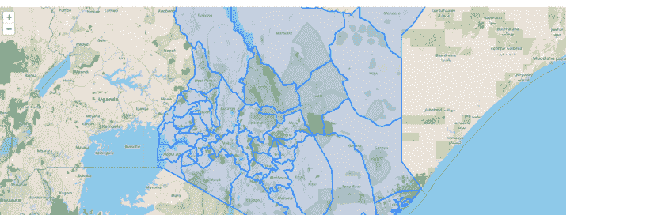

## 7.3 为各县着色

好了，我们已经成功将json文件加载到了Leaflet地图上。然而，它看起来很单调，并且没有给随意观察者提供有意义的信息。制作地图时，要以闪电般的速度提供信息。也就是说，让读者一目了然。接下来的代码片段大量借鉴了Volodymyr的交互式分级统计图教程。


## 72 第7章. 创建交互式分级统计图

首先，让我们创建一个为每个种群类别设置十六进制颜色代码的函数。我们为此使用了 color brewer。

看看这段代码，我们将进行解释。

```
// 添加一些颜色
function getColor(d) {
    return d > 1400 ? '#8c2d04' :
           d > 700 ? '#cc4c02' :
           d > 400 ? '#ec7014' :
           d > 100 ? '#fe9929' :
           d >  50 ?  '#fec44f':
           d > 25 ?  '#fee391':
                   '#ffffd4';
}
```

上面的函数使用问号 `?` 来充当 `if...else` 语句。在 JavaScript 中，这被称为三元运算符。三元运算符？那是什么？它是如何工作的？

对于三元运算符，如果 `?` 右侧的任何语句与 `?` 左侧的值相符，则返回为真。重新阅读最后这句话。如果 `?` 右侧的值为假，则返回冒号 `:` 之后的值。请重新阅读最后这句话，以理解这个三元运算符的概念。

如果听起来仍然模糊，下面这张改编自 FreeCodeCamp 的图片应该会有所帮助。

```
knitr::include_graphics(rep("D:/gachuhi/my-leaflet/images/ternary.png"))
```

## 7.3. 为县着色

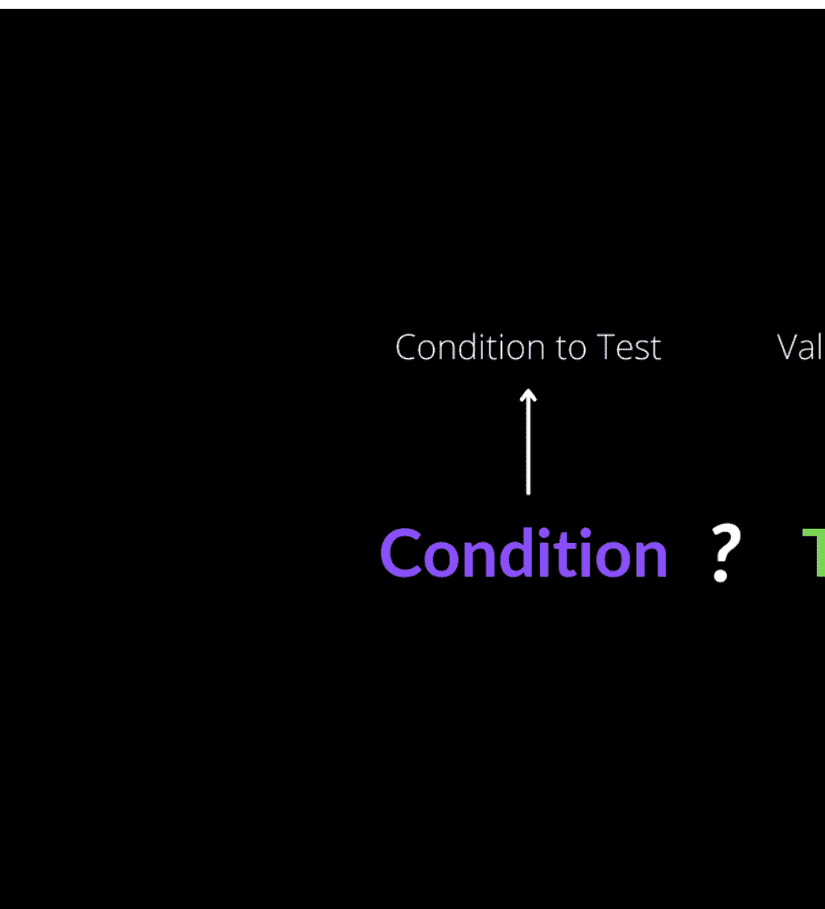

换句话说，三元运算符是在多行中编写 **if...else** 语句的简写形式。看看下面这段代码，它只是我们上面使用的三元运算符的 **if...else** 版本。毫无疑问，在简洁性方面，三元运算符胜出了。

```
function getColor(d) {
    if (d > 1400) {
        return '#8c2d04';
    } else if (d > 700) {
        return '#cc4c02';
    } else if (d > 400) {
        return '#ec7014';
    } else if (d > 100) {
        return '#fe9929';
    } else if (d > 50) {
        return '#fec44f';
    } else if (d > 25) {
        return '#fee391';
    } else {
        return '#ffffd4';
    }
}
```

现在，我们已经创建了为 Leaflet 上的 json 文件设置颜色的函数，接下来我们还需要**创建**一个函数，将颜色指定应用到 GeoJSON 文件本身的各县中。幸运的是，我们有 Leaflet 的 **style** 选项，这是一个专门用于设置 GeoJSON 线条和多边形样式的函数。我们在第5章见过它，这里也将使用它。

```
var style = ((feature)=> {
    return {
        fillColor: getColor(feature.properties.Pop_Density),
        weight: 2,
        opacity: 1,
        color: 'gray',
        fillOpacity: 0.5
    }
})
```

上面是一个箭头函数。与常规的 JavaScript 函数声明格式 **function** `<函数名>` (`<参数>`) 不同，我们去掉了 **function** 关键字，将所有内容用括号括起来，并在参数括号和函数体之间放置一个箭头 `=>`。就是这样。箭头函数并不那么难！

记住，我们将箭头函数赋值给一个名为 `var style` 的变量，因为我们将在 `L.geoJson` 类中解析它。

最后，我们将 `style` 变量添加到 `L.geoJson` 类的 `style` 选项中。

```
fetch("https://raw.githubusercontent.com/sammigachuhi/geojson_files/main/counties_json.json")
  .then((response) =>{
    return response.json()
  })
  .then((data) => {
    L.geoJson(data, {style: style}).addTo(map);
  })
  .catch((error) => {
    console.log(`This is the error: ${error}`)
  })
```

由于 `style` 选项是一个键（也是一个函数），其值将是我们创建的 `var style`。这个值本身就是一个函数，它会遍历每个县，因为它包含 `getColor(feature.properties.Pop_Density)` 作为 `fillColor` 值！

今天的 JavaScript 内容到此为止！

```
knitr::include_graphics(rep("D:/gachuh/my-leaflet/images/choropleth-map.jpg"))
```

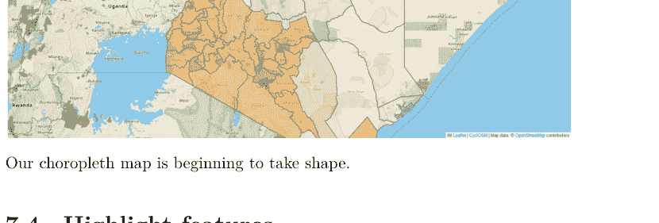

我们的分级统计图开始成形了。

## 7.4 高亮显示功能

从我们上次中断的地方继续，我们希望分级统计图在屏幕指针（或鼠标）悬停时能高亮显示任何县。此外，点击时，地图应缩放到被点击的县并显示其属性。当屏幕指针移出时，各县也应恢复其默认特征。

好的。看来我们手头的工作不少。

让我们从简单的开始，并在复杂性上逐步提升。

记得我们之前用于检索 json 文件的 fetch API 吗？我们将稍微调整一下，在调用 `L.geoJson` 类之前添加变量 `var geojson`。我们将把变量 `var geojson` 解析到 `L.geoJson` 类。我们将解释为什么我们要将 `L.geoJson` 赋值给一个变量 (`var geojson`)，因为我们很清楚它本身就可以工作，如前两章所示。

```
fetch("https://raw.githubusercontent.com/sammigachuhi/geojson_files/main/counties_json")
    .then((response) =>{
        return response.json()
    })
    .then((data) => {
        var geojson;
        geojson = L.geoJson(data, {
            style: style,
            --snip--
        })
    })
```

我们最初提到，我们希望悬停的县被高亮显示。以下代码将用白色色调高亮显示悬停的县，同时使其似乎从其余部分中凸显出来。

```
geojson = L.geoJson(data, {
    style: style,
    onEachFeature: ((feature, layer) => {
        layer.on('mouseover', ((e) => {
            var layer = e.target;

            layer.setStyle({
                weight: 5,
                color: '#FFFFFF',
                dashArray: '',
                fillOpacity: 0.7
            });

            layer.bringToFront();
        }))
```

### 7.4. 高亮显示功能

**on** 方法的目的是添加一个事件监听器。JavaScript 中的事件监听器是在浏览器用户以特定方式与浏览器交互时运行代码的函数。现在 **on** 方法的作用是为 GeoJSON 层中的每个县触发 **mouseover** 事件监听器。**mouseover** 事件使得我们的县在屏幕指针悬停*在它们上方*时被高亮显示并“弹出”。

由于 HTML 中元素状态的变化被称为事件（在我们的例子中表示为 **e**），**e.target** 属性返回事件正在发生的元素。由于在我们的例子中它是一个特定的县，我们继续通过 **setStyle** 函数中的参数更改其符号。之后，我们使用 **bringToFront** 方法使发生事件的元素从其余部分中“弹出”。

记住，我们也提到过，当鼠标移出到另一个县或完全移出地图时，我们希望各县恢复到其默认状态。以下代码完成了这项工作。

```
layer.on('mouseout', function() {
             geojson.resetStyle(this);
           })
```

我们使用 **resetStyle** 函数将层恢复为默认设置，但有一个转折。在 **resetStyle** 的情况下，我们在括号中添加参数 **this** 以指代被接收的元素。换句话说，当鼠标“移出”某个县时，该元素将恢复到其原始符号。

在我们结束这段独白之前，我们确保将变量 **geojson** 传递给 **resetStyle** 函数，否则它将无法工作。这似乎是 Leaflet 中重置样式的*操作方式*，如这个 Stack Overflow 问题以及这里所示。

最后，我们提到我们希望在点击某个县时缩放到该特定县。以下代码将地图适配到被点击县的边界。请注意，**fitBounds** 被解析为 **getBounds**，后者获取被点击县的边界。浏览器能够通过参数 **e** 和 **e.target** 的帮助识别被点击的县。

```
layer.on('click', ((e) => {
             map.fitBounds(e.target.getBounds())
           }))
```

```
knitr::include_graphics(rep('D:/gachuhi/my-leaflet/images/highlightable-map.jpg'))
```


## 第7章 创建交互式分级统计图

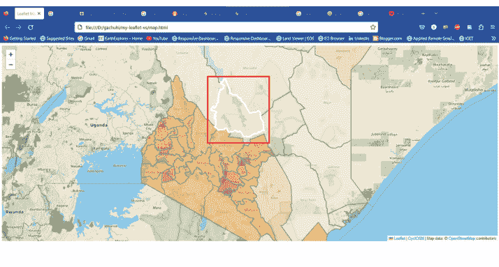

你在fetch API中的代码应该如下所示。

```
fetch("https://raw.githubusercontent.com/sammigachuhi/geojson_files/main/counties_json")
    .then((response) =>{
        return response.json()
    })
    .then((data) => {
        var geojson;
        geojson = L.geoJson(data, {
            style: style,
            onEachFeature: ((feature, layer) => {
                layer.on('mouseover', ((e) => {  // 鼠标悬停时高亮县区
                    var layer = e.target;

                    layer.setStyle({
                        weight: 5,
                        color: '#FFFFFF',
                        dashArray: '',
                        fillOpacity: 0.7
                    });

                    layer.bringToFront();
                }))

                layer.on('mouseout', function () { // 鼠标移开时恢复原始样式
                    geojson.resetStyle(this);
                })

                layer.on('click', ((e) => {  // 点击时缩放到县区
                    map.fitBounds(e.target.getBounds())
                }))
            })
        }).addTo(map);
    })
    .catch((error) => {
        console.log(`This is the error: ${error}`)
    })
```

## 7.5 创建自定义信息框

我们的分级统计图运行完美，但缺少一些交互性。如果在它旁边补充一个信息界面会怎样？自定义信息控件就是一种实现方式。可以将控件视为允许交互的UI元素。对于我们的分级统计图，我们希望自定义信息控件能提供鼠标悬停县区的名称、总人口和人口密度的详细信息。

```
// 添加控件
var info = L.control();

info.onAdd = function (map) {
    this.div = L.DomUtil.create('div', 'info');
    this.update();
    return this.div;
};

// 我们将根据传递的要素属性使用此方法更新控件
info.update = function (props) {
    this.div.innerHTML = '<h4>肯尼亚人口密度</h4>' + (props ?
        '<b>' + props.ADM1_EN + '</b><br />' + '总人口' + '<br>' + props.County_pop +
        props.Pop_Density + ' 人 / km<sup>2</sup>': '将鼠标悬停在州上')
};

info.addTo(map);
```

好的。让我们尽可能详细地逐段解析上面的代码。

```
var info = L.control();
```

上面这行代码创建了一个名为 **info** 的变量，它保存了所有地图控件的基类 **L.control()**。例如，在 **L.control.zoom** 中，**L.control** 类会在地图中创建一个缩放控件。

```
info.onAdd = function (map) {
    this.div = L.DomUtil.create('div', 'info');
    this.update();
    return this.div;
};
```

上面的代码返回控件的DOM元素，并创建一个class为info的`<div>`。这是通过L.DomUtil的帮助完成的，根据Leaflet网站，它提供了用于处理文档对象模型(DOM)的实用函数¹。实际上，这个新的class为info的`<div>`是在你启动浏览器时创建的，但它只存在于你的浏览器中。不要期望它会神奇地出现在你的静态map.html文件中。

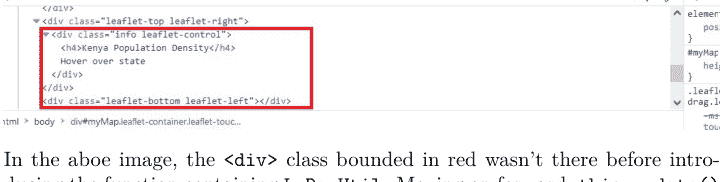

在上图中，红色框内的`<div>` class在引入包含L.DomUtil的函数之前并不存在。继续向前，`this.update()`只是使用每个新点击县区的属性来更新自定义信息控件的内容。

```
// 我们将根据传递的要素属性使用此方法更新控件
info.update = function (props) {
    this.div.innerHTML = '<h4>肯尼亚人口密度</h4>' + (props ?
        '<b>' + props.ADM1_EN + '</b><br />' + '总人口' + '<br>' + props.County_pop +
        props.Pop_Density + ' 人 / km<sup>2</sup>': '将鼠标悬停在州上')
};

info.addTo(map);
```

上述函数使用每个县区的名称、人口和人口密度更新Leaflet地图。该函数被传递给变量`info.update`，然后使用`addTo`方法添加到地图中。此函数内部包含`this.div.innerHTML`。innerHTML的目的是返回一个元素的HTML内容。由于我们的地图是在HTML页面中渲染的，因此要素将以HTML形式返回。

> ¹ 文档对象模型(DOM)是网页上构成文档结构和内容的对象的数据表示。

因为自定义信息控件是一个UI元素，我们需要在其CSS文件中设置其样式。将以下内容粘贴到你的**styles.css**文件中。

你可能会问，“我以为Leaflet不需要设置CSS样式，因为它似乎已经自带了所有样式”。

我明白你的意思，但请记住我们创建了一个名为 **info** 的新`<div>`，它在浏览器启动时出现。而且由于这个`<div class="info ...">`必须在浏览器启动时出现，因此必须使用CSS样式来定义其外观。

```
.info {
    padding: 6px 8px;
    font: 14px/16px Arial, Helvetica, sans-serif;
    background: white;
    background: rgba(255,255,255,0.8);
    box-shadow: 0 0 15px rgba(0,0,0,0.2);
    border-radius: 5px;
}

.info h4 {
    margin: 0 0 5px;
    color: #777;
}
```

## 7.6 创建图例

创建了自定义信息控件后，接下来的代码创建图例。

```
var legend = L.control({position: 'bottomright'});

legend.onAdd = function (map) {
    var div = L.DomUtil.create('div', 'info legend'),
    grades = [0, 25, 50, 100, 400, 700, 1400],
    labels = [];

    // 遍历我们的密度区间，并为每个区间生成一个带有彩色方块的标签
    for (var i = 0; i < grades.length; i++) {
        div.innerHTML +=
            '<i style="background:' + getColor(grades[i] + 1) + '"></i> ' +
            grades[i] + (grades[i + 1] ? '&ndash;' + grades[i + 1] + '<br>' : '+');
    }
    return div;
}

legend.addTo(map);
```

显然，我们的图例位置是通过`L.control({position: 'bottomright'});`中的`position`选项设置的。

除了我们在自定义信息控件中讨论的其他元素外，我们还通过`grades`数组设置了图例的颜色区间。随后的for循环遍历`grades`数组，为每个区间创建一个彩色方块。

老实说，创建图例配色方案的代码相当复杂。它实际上是从Leaflet分级统计图教程中复制粘贴而来的。循环中看起来奇怪的`&ndash;`只是连字符(-)在HTML中的写法。但无论如何，回到for循环，它本质上在每个区间内创建一个范围，例如0-25、25-50等等。这发生在前面讨论的?三元运算符之后。当循环到达末尾时，即超出范围时，会将`+`附加到`grades`数组的最后一个值上。最后这一步之所以可能，是因为JavaScript中的`:`会返回假值。

图例也需要它的CSS属性，否则它不会出现在浏览器中。class为`info legend`的`<div>`也是在浏览器启动时创建的。你可能会想知道为什么是`info legend`而不是`legend`。嗯，亲爱的火眼金睛，由于浏览器（如HTML文件的情况）以自上而下的格式读取CSS，`.info`类的属性（如背景色等）也会被图例类继承。`legend`类只会覆盖那些也出现在`info legend`类中的属性。我们还通过`.legend i`类指定了颜色区间和文本的CSS属性。

以下是CSS。

```
.legend {
    line-height: 18px;
    color: #555;
}
.legend i {
    width: 18px;
    height: 18px;
    float: left;
    margin-right: 8px;
    opacity: 0.7;
}
```

图例制作完成，最终被添加到地图上。


knitr::include_graphics('D:/gachuhi/my-leaflet/images/choropleth-legend.jpg')

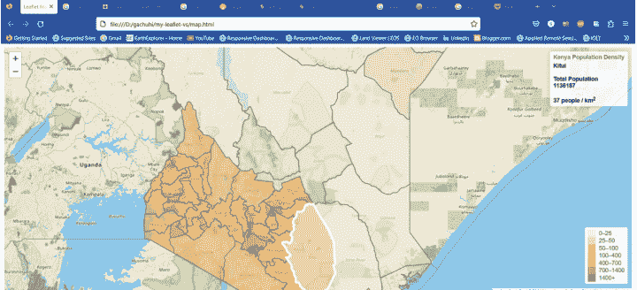

完整代码文件可从这里获取。
创建等级统计地图时，应旨在挑战读者并使其产生共鸣，而非仅仅提供信息。

## 7.7 总结

本章篇幅较长，过程艰难，甚至可能令人困惑。尽管如此，以下是我们从本章中总结的要点：

-   等级统计地图是指其地理区域或区域根据数据变量进行着色、阴影处理或图案填充的地图。全国人口地图是等级统计地图的很好示例。
-   三元运算符是 `if...else` 语句的简写形式。在三元运算符中，如果 `?` 右侧的语句与 `?` 左侧的值一致，则返回该语句；反之，如果 `?` 右侧的值为假，则返回冒号 `:` 后面的任何值。
-   `style` 是 `L.geoJson` 类中的一个特殊键，用于为 GeoJSON 文件中的每个图层应用自定义样式。
-   `mouseover` 是一个事件监听器，当屏幕指针悬停在某个要素上时，会触发特定操作。
-   我们可以使用 `resetStyle` 将要素重置为其默认状态。
-   `L.control()` 类是启用大多数 Leaflet 控件的基础类。例如，`L.control.zoom` 用于创建缩放控件。
-   `L.control()` 也可用于自定义图例的外观和显示的信息。

# 第 8 章：图层组与控件

## 8.1 图层组与控件的目的

有时，用户可能希望其网络地图由多个底图图层或叠加地图组成。假设您希望您的 Leaflet 地图包含两个底图图层，以及一个可切换显示任意底图的额外叠加图层，您将如何操作？

## 8.2 设置底图

为了创建控件，我们需要将保存地图变量的对象解析为 `L.control.layers` 类。之后，`L.control.layers` 类用于将对象值解析到 Leaflet 地图并创建用户界面控件。为此，打开一个新的 JavaScript 文件并将其命名为 `groups_controls.js`。插入以下代码，这将把我们的底图保存到各自的变量 `osm` 和 `cyclOSM` 中。

```javascript
var osm = L.tileLayer('https://tile.openstreetmap.org/{z}/{x}/{y}.png', {
    maxZoom: 19,
    attribution: '&copy; <a href="http://www.openstreetmap.org/copyright">OpenStreetMap</a>'
});

var cyclOSM = L.tileLayer('https://{s}.tile-cyclosm.openstreetmap.fr/cyclosm/{z}/{x}/{y}.png', {
    maxZoom: 20,
    attribution: '<a href="https://github.com/cyclosm/cyclosm-cartocss-style/releases" title="Cyclosm">'
}); // 可从 Leaflet 服务器获取的 CyclOSM 瓦片图层
```

我们将把上面的两个变量 `osm` 和 `cyclOSM` 传递给 `L.map` 类，该类有一个 `layers` 选项，可以在其中解析希望在地图上显示的图层。

```javascript
var map = L.map('myMap', {
    layers: [osm, cyclOSM]
}).setView([-1.295287148, 36.81984753], 7);
```

然而，这将只会添加第一个底图变量（即 `osm`），同时屏蔽 `cyclOSM`。如下所示。

knitr::include_graphics(rep('D:/gachuhi/my-leaflet/images/no-control.jpg'))

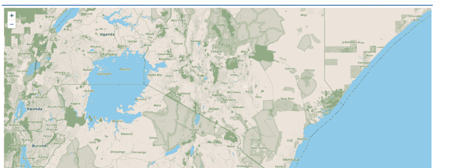

## 8.3 创建控件

然而，为了给 `cyclOSM` 一个公平的机会，我们需要将它们存储在一个对象中，比如 `var basemaps`，并将其解析到 `L.control.layers`，它将为每个底图创建一个复选按钮。下面的代码正是这样做的。

```javascript
// 为底图设置对象
var basemaps = {
    "OpenStreetMap": osm,
    'cycleOsm': cyclOSM,
}

L.control.layers(basemaps).addTo(map);
```

这是您得到的结果。

knitr::include_graphics(rep('D:/gachuhi/my-leaflet/images/controls.jpg'))

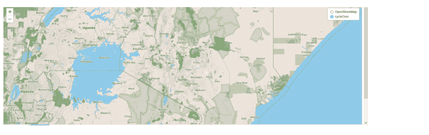

## 8.4 添加叠加地图

现在我们已经看到了如何向 Leaflet 添加两个或多个底图，并使它们全部显示在图层控件中。添加叠加地图也遵循相同的步骤。

我们想要创建的第一个叠加图层是一个等级统计地图，显示根据 2019 年人口普查数据，可接入主下水道的传统家庭百分比。为简单起见并避免我们遇到的错误，我们将重用 Ajax 插件从在线服务器获取 GeoJSON 文件。作为提醒，我们通过将其插入到地图 `html` 的以下 `<script>` 标签中来将 Ajax 加载到 Leaflet 中。

```html
<script src="leaflet-ajax-gh-pages\dist\leaflet.ajax.js"></script>
<script src="leaflet-ajax-gh-pages\dist\leaflet.ajax.min.js"></script>
<script src="leaflet-ajax-gh-pages\example\leaflet.spin.js"></script>
<script src="leaflet-ajax-gh-pages\example\spin.js"></script>
```

使用 fetch API 加载 json 文件带来了几个需要创造性思维来解决的问题，但使用替代的 Ajax 插件则是一个安全的选择。以下代码块将为我们全国性的卫生设施地图添加颜色函数和样式。最终生成的颜色函数将被解析到 Ajax 函数中。

```javascript
//// 添加一些颜色
function getColor(d) {
    return d > 20 ? '#3288bd' :
            d > 10 ? '#99d594' :
            d > 6 ? '#e6f598' :
            d > 4 ? '#fee08b' :
            d > 2 ? '#fc8d59' :
            '#d53e4f';
}
```

```javascript
// 设置颜色的函数（使用箭头函数）
var style = ((feature)=> {
    return {
        fillColor: getColor(feature.properties.Human_waste_disposal),
        weight: 2,
        opacity: 1,
        color: 'gray',
        fillOpacity: 0.9
    }
})
```

现在，让我们添加将显示人口接入主下水道卫生服务情况的叠加地图。剧透提醒：统计数据相当严峻。

```javascript
// 添加第一个叠加图层 - 家庭接入主下水道的地图
var countySanitation = new L.geoJson.ajax("https://raw.githubusercontent.com/sammigach/...",{
    style: style
})
.bindPopup(function (layer) {
    return `<b>County Name: </b> ${layer.feature.properties.ADM1_EN} <br>
    <b>Total County Population: </b><br>
    ${layer.feature.properties.County_pop.toString()} <br><br>
    <b>% of Conventional Households with access to main sewer: </b><br><br>
    ${layer.feature.properties.Human_waste_disposal.toString()}`
}).addTo(map);
```

让我们为上面的地图添加一个配套的图例。如果您学习了第 7 章关于交互式等级统计地图的内容，下面的部分代码应该看起来很熟悉。

```javascript
// 创建图例
var legend = L.control({position: 'bottomright'});

legend.onAdd = function (map) {
    var div = L.DomUtil.create('div', 'info legend'),
    grades = [0, 2, 4, 6, 10, 20],
    labels = [];

    // 遍历我们的密度区间，并为...生成带有彩色方块的标签
    for (var i = 0; i < grades.length; i++) {
        div.innerHTML +=
            '<i style="background:' + getColor(grades[i] + 1) + '"></i> ' +
            grades[i] + (grades[i + 1] ? '&ndash;' + grades[i + 1] + '<br>' : '+');
    }
    return div;
}

legend.addTo(map);
```

现在，设置一个对象来保存我们的两个叠加图层之一。

```javascript
var overlays = {
    'countySanitation': countySanitation,
}
```

最后，将叠加图层对象解析到 `L.control.layers` 类。

```javascript
// 添加图层控件
L.control.layers(basemaps, overlays).addTo(map);
```

knitr::include_graphics(rep('D:/gachuhi/my-leaflet/images/controls-overlay.jpg'))

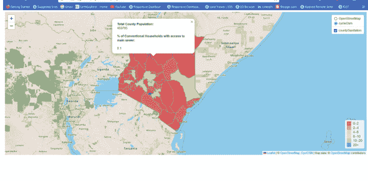

如果您点击任何一个县，将会看到弹出窗口出现。
我们还将添加一个叠加图层到我们的显示中，以完整地结束我们对图层控件的实验。还记得我们的 **cities** 变量对应的 GeoJSON 吗？让我们再次调用它。但首先，让我们加载根据人口区分城市的自定义图标标记。


## 第八章 图层组与控件

```javascript
// 彩色图标
// 黄色图标
var yellowIcon = new L.Icon({
    iconUrl: 'https://raw.githubusercontent.com/pointhi/leaflet-color-markers/master/img/marker-icon-yellow.png',
    shadowUrl: 'https://cdnjs.cloudflare.com/ajax/libs/leaflet/0.7.7/images/marker-shadow.png',
    iconSize: [25, 41],
    iconAnchor: [12, 41],
    popupAnchor: [1, -34],
    shadowSize: [41, 41]
});

// 橙色图标
var orangeIcon = new L.Icon({
    iconUrl: 'https://raw.githubusercontent.com/pointhi/leaflet-color-markers/master/img/marker-icon-orange.png',
    shadowUrl: 'https://cdnjs.cloudflare.com/ajax/libs/leaflet/0.7.7/images/marker-shadow.png',
    iconSize: [25, 41],
    iconAnchor: [12, 41],
    popupAnchor: [1, -34],
    shadowSize: [41, 41]
});

// 红色图标
var redIcon = new L.Icon({
    iconUrl: 'https://raw.githubusercontent.com/pointhi/leaflet-color-markers/master/img/marker-icon-red.png',
    shadowUrl: 'https://cdnjs.cloudflare.com/ajax/libs/leaflet/0.7.7/images/marker-shadow.png',
    iconSize: [25, 41],
    iconAnchor: [12, 41],
    popupAnchor: [1, -34],
    shadowSize: [41, 41]
});
```

现在加载带有图标的各城市 GeoJSON 数据。

```javascript
var cities = L.geoJson.ajax("https://raw.githubusercontent.com/sammigachuhi/geojson_files/master/kenya-counties.geojson", {
    pointToLayer: function (feature, latlng) {
        if (feature.properties.Population <= 250000) {
            return L.marker(latlng, {
                icon: yellowIcon
            });
        } else if (feature.properties.Population <= 800000) {
            return L.marker(latlng, {
                icon: orangeIcon
            });
        } else {
            return L.marker(latlng, {
                icon: redIcon
            });
        }
    }
}).addTo(mymap);
```

## 8.4 添加叠加地图

```javascript
    icon: redIcon
    });
}

}
}).bindPopup(function (layer) {
    return `城市: ${layer.feature.properties.City},<br>
    人口: ${layer.feature.properties.Population}`;
    }).addTo(map);
```

将 `cities` 变量作为其中一个键添加到我们的 `overlays` 变量中，最后将 `overlays` 对象传递给 `L.control.layers`。

```javascript
// 设置叠加地图的对象
var overlays = {
    'countySanitation': countySanitation,
    'cities': cities
}

// 添加图层控件
L.control.layers(basemaps, overlays).addTo(map);
```

在第 7 章的结尾，我们提到力求让我们的分级统计图更具挑战性，而不仅仅是提供信息。这看起来像是一张简略的地图，但它清楚地显示了大部分人口在获取基本卫生服务方面的差异。

最后，似乎无法更改 `L.controls.layer` 默认的右上角位置。例如，在 `L.controls.layer(basemap, overlaymap, {position: 'topleft'})` 中将位置设置为左上角，会导致 UI 图层控件完全从地图上消失。这很可能是一个尚未报告的 bug。

```r
knitr::include_graphics(rep('D:/gachuhi/my-leaflet/images/controls-all.jpg'))
```

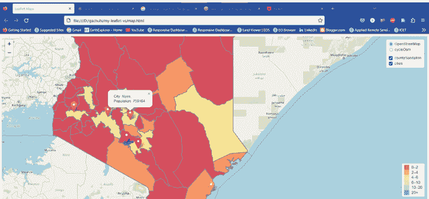

## 8.5 添加比例尺

比例尺是任何地图的关键要素之一。有人可能会好奇它们在网络地图中的作用，但它们对于估算要素的大小和长度非常有用。添加一个小型的动态比例尺并没有坏处！

```javascript
// 添加比例尺
L.control.scale({position:'bottomleft'}).addTo(map);
```

```r
knitr::include_graphics(rep('D:/gachuhi/my-leaflet/images/controls-scale.jpg'))
```

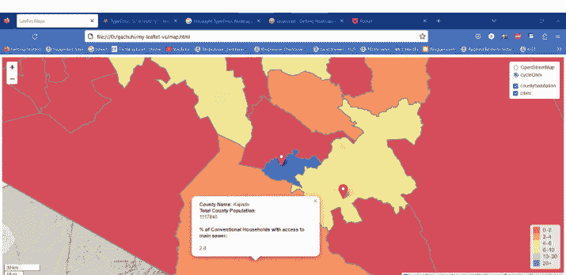

本章使用的所有文件和脚本都可以在这里访问。

## 8.6 总结

与纸质地图不同，网络地图使我们能够在同一个平台中包含多个底图和叠加图层。以下是您从本章学到的内容。

- 通过将底图和叠加图层的变量名存放在一个 JavaScript 字典对象中，可以将它们解析到 Leaflet。
- 要创建图层控件，请将包含底图和叠加图层名称的 JavaScript 对象解析到 `L.control.layers()` 类。
- GeoJSON 要素也可以解析到图层控件。只需将调用 GeoJSON 文件的函数保存到一个变量中即可。例如，Ajax 函数 `var cities` 被解析到 `L.control.layers()` 类。
- 比例尺对于估算大小和长度非常有用，即使在网络地图中也是如此。Leaflet 提供了 `L.control.scale` 类来为你的网络地图添加自定义比例尺。

# 第九章 热力图

## 9.1 什么是热力图？

热力图是一种在地理上可视化特定变量（如犯罪、疾病、服务中心等）发生频率高于平均水平的地点的地图类型。

## 9.2 加载热力图插件

Leaflet 没有内置的绘制热力图的工具。相反，我们需要使用一个名为 Leaflet.heat 的外部插件。zip 文件的链接可在此处获取。下载并将文件夹解压到与 map.html 相同的目录中。

解压 zip 文件内容后，打开你的 map.html，并在 `<head>` 元素中添加以下 `<script>` 标签。

```html
<script src="Leaflet.heat-gh-pages\Leaflet.heat-gh-pages\dist\leaflet-heat.js"></script>
```

之后，我们需要想办法将 GeoJson 加载到一个名为 heatmap.js 的新 JavaScript 文件中。我们将在这里编写热力图代码。你可能会考虑使用 fetch 或 L.geoJson.ajax 来实现这个目的，但先别急！根据文档，热力图是使用 L.heatLayer 创建的。将 fetch 或 L.geoJson.ajax 解析到 L.heatLayer 中以创建热力图的方法行不通。尽管这两个 GeoJSON 方法在之前的章节中对各种用途都运行良好。因此，需要一种新方法。

经过大量网络搜索，Stack Overflow 上的一段代码拯救了我们。然而，它只有在插入另一个 Ajax 插件后才能工作。幸运的是，不需要下载，只需将这个新的 `<script>` 插入到你的 map.html 中即可。

```html
<script src="https://ajax.googleapis.com/ajax/libs/jquery/2.1.4/jquery.min.js"></script>
```

## 9.3 创建 Leaflet 热力图

让我们调用添加底图的常规代码。

```javascript
var map = L.map('myMap').setView([0.3556, 37.5833], 6.5);

L.tileLayer('https://tile.openstreetmap.org/{z}/{x}/{y}.png', {
    attribution: '&copy; <a href="https://www.openstreetmap.org/copyright">OpenStreetMap</a> contributors'
}).addTo(map);
```

之后，我们添加以下大段代码。

```javascript
var geoJsonUrl = "https://raw.githubusercontent.com/sammigachuhi/geojson_files/main/seismic_events_usgs.json";

var geojsonLayer = $.ajax({
    url : geoJsonUrl,
    dataType : 'json',
    jsonpCallback: 'getJson',
    success : console.log("Data successfully loaded!"),
    });

geoJson2heat = (geojson) => {
    return geojson.features.map(function(feature) {
        return [parseFloat(feature.geometry.coordinates[1]),
                parseFloat(feature.geometry.coordinates[0])];
    });
};

$.when(geojsonLayer).done(function() {
    // var kill = L.geoJSON(geojsonLayer.responseJSON);
    var layer = geoJson2heat(geojsonLayer.responseJSON, 4);
    var heatMap = L.heatLayer(layer, {
        radius: 40,
        blur: 10,
        gradient: {
            '0': 'Navy', '0.25': 'Navy',
            '0.5': 'Lime', '0.75': 'Yellow',
            '1.0': 'Red'
        }
    }).addTo(map);
});
```

为了给予应有的赞扬，这些代码片段取自这个 Stack Overflow 问题并稍作修改。为了对大家公平起见，我们逐段解析上述代码。

```javascript
var geoJsonUrl = "https://raw.githubusercontent.com/sammigachuhi/geojson_files/main/selected_hospitals.json";

var geojsonLayer = $.ajax({
    url: geoJsonUrl,
    dataType: 'json',
    jsonpCallback: 'getJSON',
    success: console.log("Data successfully loaded!"),
});
```

`var geoJsonUrl` 保存着指向我们医院 json 文件的链接。`var geojsonLayer` 使用异步 JavaScript 和 XML (Ajax) 方法从我们的 Github 服务器加载数据。如果成功，我们将在浏览器控制台中看到消息“Data successfully loaded!”。

```javascript
geoJson2heat = ((geojson) => {
    return geojson.features.map(function(feature) {
        return [parseFloat(feature.geometry.coordinates[1]),
                parseFloat(feature.geometry.coordinates[0])];
    });
});
```

上面的代码片段很容易理解。传递给 `geoJson2heat` 的函数使用 map 方法遍历每个元素，例如 json 文件中的城市，并检索经度和纬度坐标。注意格式被反转了。我们使用 [1]...[0] 而不是 [0]...[1] 表示经纬度。

最后一个是一个 jQuery 函数，它将返回所需的热力图图层。

```javascript
geoJson2heat = (geojson) => {
    return geojson.features.map(function(feature) {
        return [parseFloat(feature.geometry.coordinates[1]),
                parseFloat(feature.geometry.coordinates[0])];
    });
};

$.when(geojsonLayer).done(function() {
    var layer = geoJson2heat(geojsonLayer.responseJSON, 4);
    var heatMap = L.heatLayer(layer, {
        radius: 40,
        blur: 10,
        gradient: {
            '0': 'Green',
            '0.25': 'Green',
            '0.26': 'Green',
            '0.5': 'Green',
            '0.51': 'Yellow',
            '0.75': 'Yellow',
            '0.76': 'Red',
            '1': 'Red'
        },
        maxZoom: 13
    });
    map.addLayer(heatMap);
});
```


$.when(geojsonLayer).done(function() {
    // var kill = L.geoJSON(geojsonLayer.responseJSON);
    var layer = geoJson2heat(geojsonLayer.responseJSON, 4);
    var heatMap = L.heatLayer(layer, {
        radius: 40,
        blur: 10,
        gradient: {
            '0': 'Navy', '0.25': 'Navy',
            '0.26': 'Green',
            '0.5': 'Green',
            '0.51': 'Yellow',
            '0.75': 'Yellow',
            '0.76': 'Red',
            '1': 'Red'
        },
        maxZoom: 13});
    map.addLayer(heatMap);
});

说实话，上一个例子有点牵强，因为 jQuery 在 Leaflet 或现代普通 JavaScript 编程中已很少使用。

knitr::include_graphics(rep('D:/gachuhi/my-leaflet/images/heatmap.jpg'))

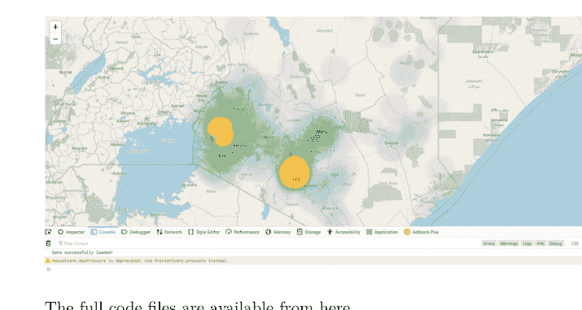

完整的代码文件可从这里获取。

**注意**：需要指出的是，我们采用了各种方法尝试使用 `L.heatLayer` 创建热力图。其中最有希望的方法似乎是将 `L.heatLayer` 嵌套在我们之前多次遇到的简单 `L.geoJson.ajax` 类中。然而，所有尝试，包括向 ChatGPT 寻求可行的解决方案，都未能成功。

## 总结

## 9.3 创建 Leaflet 热力图

热力图是地理学中最简单的地图形式之一。它们使用颜色和色调来可视化现象在空间上的分布集中程度。以下是本章的关键要点。

- 热力图是一种地图类型，它从地理上可视化那些特定变量发生频率高于平均水平的区域模式。
- 要使用 Leaflet 绘制热力图，我们必须下载 Leaflet.heat 插件。然后，将该插件的路径解析到 HTML 文件的 script 标签中。
- 除了使用 `L.heatLayer`，从 GeoJSON 数据创建热力图的另一种方法是结合使用 Ajax 和 jQuery。

# 第 10 章

## 聚类以减少杂乱

## 10.1 一张杂乱的地图

在某些时候，将多个点合并成一个单一的多聚类点会是方便的。考虑以下例子：假设存在这样一个场景，你有一个包含超过 10000 个房屋点的 GeoJSON 文件，这些房屋位于一个 5 公里乘 5 公里的高密度人口岛屿上。你会想在如此小的区域内显示如此庞大数量的点吗？那会显得过于拥挤！此外，地图对于观看者来说将难以理解。考虑我们在一个新的 JavaScript 文件中设置的以下示例，我们亲切地称之为 `cluster-markers.js`。

```
var map = L.map('myMap').setView([-1.295287148, 36.81984753], 7);

L.tileLayer('https://tile.openstreetmap.org/{z}/{x}/{y}.png', {
    maxZoom: 19,
    attribution: '&copy; <a href="http://www.openstreetmap.org/copyright">OpenStreetMap</a>'
}).addTo(map);

url = 'https://raw.githubusercontent.com/sammigachuhi/geojson_files/main/selected_hospitals.json'

L.geoJson.ajax(url).addTo(map);

var markers = L.markerClusterGroup();
```

以下是结果。

knitr::include_graphics(rep('D:/gachuhi/my-leaflet/images/clutter-points.jpg'))

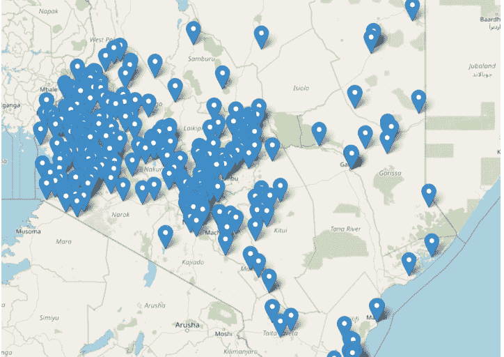

一点也不好。是 Leaflet.markercluster 插件将杂乱的地图转换成了排列整齐的聚类标记点地图。

## 10.2 准备工作

创建聚类标记地图相当容易。你首先需要将 Leaflet.markerCluster 插件插入到 `map.html` 中。该插件可从这里获取。将以下 `<script>` 标签插入到 `map.html` 的 `<head>` 元素中。

```
<script src="Leaflet.markercluster-1.4.1\Leaflet.markercluster-1.4.1\dist\leaflet.markerc
```

你还需要通过 `<link>` 标签插入 Leaflet.markercluster 的 CSS 属性。为 Leaflet.markercluster 添加以下 `<link>` 标签。为了可读性和代码整洁，请将其放置在其他 `<link>` 属性下方。

```
<link rel="stylesheet" href="Leaflet.markercluster-master\Leaflet.markercluster-master"
```

不要小看它们。这些 CSS 属性是必要的，可以将你的聚类点以美观、赏心悦目的方式样式化。同时，我们假设你已经将 JavaScript 文件的名称 `cluster-marker.js` 插入到了 `map.html` 文件的 `<body>` 元素内的 `<script>` 标签中。如果你在本章开头完成了那个小练习，那么以下代码应该已经存在。

```
var map = L.map('myMap').setView([-1.295287148, 36.81984753], 7);

L.tileLayer('https://tile.openstreetmap.org/{z}/{x}/{y}.png', {
    maxZoom: 19,
    attribution: '&copy; <a href="http://www.openstreetmap.org/copyright">OpenStreetMap</a>'
}).addTo(map);
```

```
url = 'https://raw.githubusercontent.com/sammigachuhi/geojson_files/main/selected_hospitals.json'
```

## 10.3 看，聚类标记地图！

删除 `L.geoJson.ajax(url).addTo(map);`，我们现在不需要它了。我们创建聚类标记地图的真正工作从 `markerClusterGroup` 类开始。让我们开始吧！

```
var markers = L.markerClusterGroup();
```

我们将再次使用 Ajax，但这次我们将解析一些函数来自定义 GeoJson 标记的外观和功能。

```
L.geoJson.ajax(url, {
    pointToLayer: ((feature, latLng) => {
        return markers.addLayer(L.circleMarker(latLng));
    }),

    onEachFeature: ((feature, layer) => {
        layer.bindPopup(`<b>Facility Name:</b> ${feature.properties.Facility_N} <br>
        <b>Type:</b> ${feature.properties.Type}`)
    })
}).addTo(map);
```

还记得 Leaflet GeoJSON 文件的 `pointToLayer` 吗？它定义了 GeoJson 文件的显示方式。`pointToLayer` 检索纬度-经度坐标，最终通过 `...return markers.addLayer(L.circleMarker(latLng)),` 创建圆形标记。

那 **onEachFeature** 呢？你可以猜到。它的意思很简单——*对每一个要素，执行这个和那个操作*。在我们的例子中，我们绑定了一个包含设施名称和类型的弹出窗口，当点击圆形标记时会显示出来。

实际上，上面的代码某种程度上已经帮我们完成了工作。

knitr::include_graphics(rep('D:/gachuhi/my-leaflet/images/cluster-marker-map.jpg'))

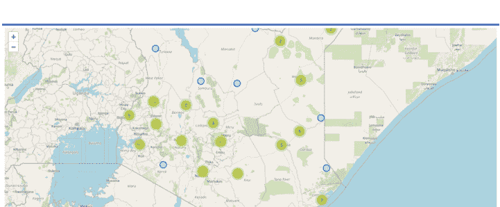

放大和缩小，观察圆形标记如何像“蜘蛛感应”一样展开单个点并显示弹出窗口。我没有调整标记，因为默认设置已经足够好了。可以从这个 Github 页面查看它们。

然而，作为良好的实践，我们需要将 **markers** 全局变量添加到地图中。我们使用以下代码来完成。

```
map.addLayer(markers)
```

**addLayers**，顾名思义，就是将给定的图层添加到地图中。

Ajax 函数中 `pointToLayer` 键里的 `L.circleMarker` 可以用 `L.marker()` 替换。下图是一些展开的医院标记的样子，但它们的美观程度不如圆形标记。

knitr::include_graphics(rep('D:/gachuhi/my-leaflet/images/cluster-marker-plain.jpg'))

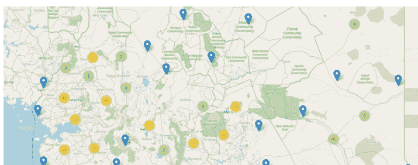

回到原点，圆形标记要好得多。
大部分 Ajax 代码的灵感来源于这个视频。
但是等等！先别高兴得太早，这里有一个 bug。尝试点击任何一个展开的或单独的医院，你会注意到一件令人皱眉的事情。所有医院在被点击时都显示以下弹出窗口：

Facility Name: Wajir Tb Manyatta Sub - District Hospital
Type: Sub-District Hospital

knitr::include_graphics(rep('D:/gachuhi/my-leaflet/images/cluster-marker-bug.jpg'))

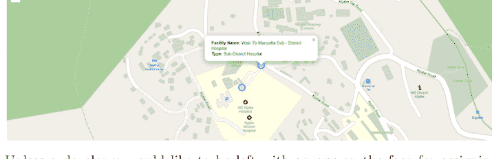

除非开发者想因为给所有医院分配相同的地名而出丑，否则这个问题应该迅速处理。我们的代码本身没问题，因为它在其他场景中（例如这里）是有效的。然而，在万维网上分配错误的地名是不可接受的。
是时候尝试不同的策略了：使用 **fetch** API。我们之前已经使用过 **fetch**，所以这里不再过多解释。你可以随意搜索一下作为复习。将之前从 **var markers** 到 **map.addLayer(markers)** 的代码注释掉，并替换为以下代码块。


## 第十章 通过聚类减少杂乱

```javascript
fetch(url)
    .then((response) =>{
        return response.json()
    })
    .then((data) => {
        var markers = L.markerClusterGroup();

        var geojsonGroup = L.geoJSON(data, {
            onEachFeature : function(feature, layer){
                layer.bindPopup(`<b>Facility Name:</b> ${feature.properties.Facility_Name} <br>
                <b>Type:</b> ${feature.properties.Type}`);
            },
            pointToLayer: function (feature, latlng) {
                return L.circleMarker(latlng);
            }
        });

        markers.addLayer(geojsonGroup);
        map.addLayer(markers);

    })
    .catch((error) => {
        console.log(`This is the error: ${error}`)
    })
```

```r
knitr::include_graphics(rep('D:/gachuhi/my-leaflet/images/cluster-marker-map-fixed.jpg'))
```

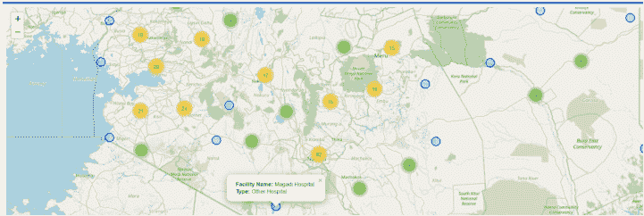

现在，所有点都拥有了其应有的、各自的名称。

## 10.4 聚类标记插件的附加功能

该插件的官方文档列出了该工具附带的许多其他功能。我们无法一一介绍，但让我们概述一个重要的功能：鼠标悬停事件。当鼠标悬停在 Leaflet 中的某个要素上时，鼠标悬停事件会触发一个操作。

让我们演示如何为我们的聚类标记地图添加一个悬停事件，这要感谢这个答案。

```javascript
////// 添加了 `mouseover` 事件

fetch(url)
  .then((response) => {
    return response.json()
  })
  .then((data) => {
    var markers = L.markerClusterGroup({chunkedLoading: true}); // 将添加图层拆分以提高性能
    var geojsonGroup = L.geoJSON(data, {
      onEachFeature : function(feature, layer){
        layer.bindPopup(`<b>Facility Name:</b> ${feature.properties.Facility_Name} <br>
          <b>Type:</b> ${feature.properties.Type}`);
      },
      pointToLayer: function (feature, latlng) {
        return L.circleMarker(latlng).on('mouseover', function(){
          this.bindPopup(`Nearest_Center: ${feature.properties.Nearest_To}`).openPopup();
        });
      }
    });

    markers.addLayer(geojsonGroup);
    map.addLayer(markers);

  })
  .catch((error) => {
    console.log(`This is the error: ${error}`)
  })
```

在上面的代码中，我们使用 `on` 方法为每个标记点添加了鼠标悬停事件。`this.bindPopup()` 中的 `this` 关键字将选定变量的弹出窗口绑定到 `var geojsonGroup` 变量中的坐标。我们还通过向 `L.markerCluster()` 函数添加 `chunkedLoading: true` 参数，加快了 Leaflet 地图的渲染速度。

悬停在每个标记点上将显示 `Nearest_To` 属性的值，该值是距离医院标记最近的实际城镇中心。

```r
knitr::include_graphics(rep('D:/gachuhi/my-leaflet/images/cluster-marker-mouseover.jpg'))
```

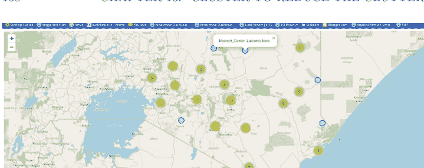

本章使用的代码文件可从这里获取。

## 10.5 总结

聚类标记点是显示多个点的一种简洁方式。当缩小视图时，空间上分散的点会合并成一个显示数字的单一单位，该数字代表它包含的标记数量。当放大视图时，这些点会“蛛网式展开”（想象一下散开）到其相应的位置。以下是本章的要点。

- 聚类点有时有助于地图的整洁。在 Leaflet 中，这通过 `Leaflet.markercluster` 插件得以实现。
- 可以自定义“蛛网式展开”的标记点的外观。例如，我们没有满足于单个标记的默认样式，而是使用了圆形标记来显示各个点。
- 也可以为“蛛网式展开”的标记点添加事件。当点击时，“蛛网式展开”的标记点可以显示弹出窗口，或触发代码块中指定的任何其他事件。

# 第十一章

## 移动端友好的 Web 应用

## 11.1 对移动端友好 Web 应用的需求

简而言之。不久前，我还是某个日渐衰落的著名手机品牌的自豪拥有者。有一次，在为维基百科的非洲气候摄影比赛拍摄标志性的恩贡山时，手机突然死机了。就这样。快速拜访授权经销商后，得到了令人难以置信且令人费解的话语：“我们不再向该国运送主板了。”虽然已经有所恢复，但我当时完全心碎了，并且偶尔还会怀念与手机共度的“美好时光”。

现在回到正题。Web 应用可能很庞大，并且在较小的设备（如智能手机）上加载缓慢。加载缓慢的应用可能会让你的 Web 应用用户望而却步，因此为用户的手机定制你的 Web 应用是明智的。

在本章中，我们将致力于使我们的聚类标记应用对移动端友好。我们还将添加其他功能，使 Web 应用变得“更重”，以便通过破坏性测试来检验我们让应用加载更快的雄心壮志是否奏效。

为了创建移动端友好的 Leaflet 体验，请将以下代码插入到你的 `map.html` 的 `<head>` 元素中。以下 meta 标签告诉浏览器禁用不需要的页面缩放，而是将其设置为实际大小。

```html
<meta name="viewport" content="width=device-width, initial-scale=1.0, maximum-scale=1.0, user-scalable=no">
```

## 11.2 底图

如果你已经学习了第 8 章（我们创建了控件），那么以下内容你会感到熟悉。我们将添加一些底图，稍后创建它们的控制部件。

```javascript
// 底图
var osm = L.tileLayer('https://tile.openstreetmap.org/{z}/{x}/{y}.png', {
    maxZoom: 19,
    attribution: '&copy; <a href="http://www.openstreetmap.org/copyright">OpenStreetMap</a> contributors'
});

var cyclOSM = L.tileLayer('https://{s}.tile-cyclosm.openstreetmap.fr/cyclosm/{z}/{x}/{y}.png', {
    maxZoom: 20,
    attribution: '<a href="https://github.com/cyclosm/cyclosm-cartocss-style/releases">CyclOSM</a> | Map data: &copy; <a href="https://www.openstreetmap.org/copyright">OpenStreetMap</a> contributors'
}); // 来自 Leaflet 服务器的 CyclOSM 瓦片图层
```

让我们将底图添加到 Leaflet。

```javascript
// 添加 Leaflet 底图
var map = L.map('myMap', {
    layers: [osm, cyclOSM]
}).setView([-1.295287148, 36.81984753], 7);
```

## 11.3 添加功能

还记得我们的医院 JSON 图层吗？让我们再次调用它，并使用 fetch 将其转换为聚类标记。

```javascript
// 添加医院数据集

url = 'https://raw.githubusercontent.com/sammigachuhi/geojson_files/main/selected_hosp.geojson'

var cluster = fetch(url)
    .then((response) =>{
        return response.json()
    })
    .then((data) => {
        var markers = L.markerClusterGroup();

        var geojsonGroup = L.geoJSON(data, {
            onEachFeature : function(feature, layer){
                var popupContent = `<b>Facility Name:</b> ${feature.properties.Facility_Name}<br>
                                    <b>Type:</b> ${feature.properties.Type}`;
                layer.bindPopup(popupContent)
            },
            pointToLayer: function (feature, latlng) {
                return L.circleMarker(latlng);
            }
        });

        markers.addLayer(geojsonGroup);
        map.addLayer(markers);

    })
    .catch((error) => {
        console.log(`This is the error: ${error}`)
    })
```

为什么 `fetch` 代码被解析为 `var cluster`？嗯，我们本想追求卓越。我们希望也为 `cluster` 变量创建一个图层控件，但不幸的是这个计划失败了。

让我们将 `basemaps` 和 `cluster` 变量放入 JavaScript 对象中，以便为每个变量创建图层控件。

```javascript
// 为底图设置对象
var basemaps = {
    "OpenStreetMap": osm,
    'cycleOsm': cyclOSM,
}

////不要添加 'overlays' 对象。仅用于演示目的
// 为覆盖图设置对象
var overlays = {
    'Hospitals': cluster
}
```

在继续之前，请注意，将 `overlays` 对象插入到 `L.control.layers()` 类中会导致多个错误。这就是为什么我们无法为 `var cluster` 中包含的标记创建控件。下图显示了在将 `overlays` 对象插入 `L.control.layers()` 后控制台中出现的错误。


## 第十一章 适配移动端的 Web 应用

```
knitr::include_graphics(rep('D:/gachuhi/my-leaflet/images/mobile-friendly-error.jpg'))
```

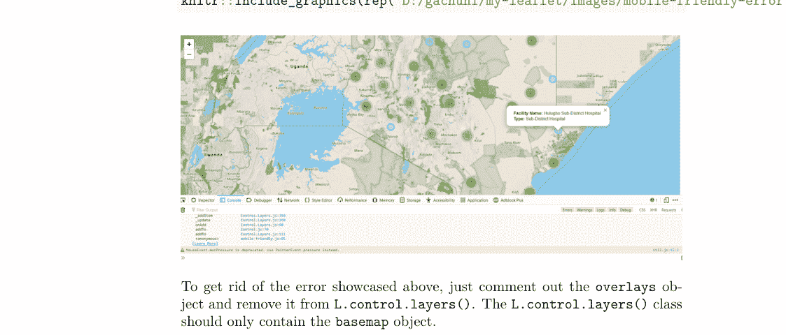

要解决上面展示的错误，只需注释掉 `overlays` 对象并将其从 `L.control.layers()` 中移除。`L.control.layers()` 类应该只包含 `basemap` 对象。

## 11.4 缩放到移动端用户的位置

根据 Leaflet 官方文档，Leaflet 提供了一个便捷的快捷方式，可以缩放到用户的位置。如果由于某些原因无法精确定位坐标，它会在移动用户的大致位置周围创建一个缓冲区。

```
// Zoom to your location
map.locate({setView: true, maxZoom: 16});
```

## 11.5 为移动用户地理定位添加标记

即使位置偏差几英里，至少显示三角定位位置的标记会有所帮助。至少你不会在地图上*到处乱跑*！以下代码在移动用户三角定位的经纬度坐标处添加一个标记，并显示一条消息，说明移动用户最有可能位于该标记点半径范围内的区域。

```
// Add marker at your location
function onLocationFound(e) {
    var radius = e.accuracy;
    L.marker(e.latlng).addTo(map)
        .bindPopup("You are within " + Number((radius/1000).toFixed(2)) + " kilometers from this")
    L.circle(e.latlng, radius).addTo(map);
}
```

以防你忘记了，**on** 方法用于添加事件监听器。温和地提醒一下，监听器是在事件触发时运行的代码，例如鼠标悬停在某个要素上。在下面的代码中，如果 Leaflet 成功近似用户位置，监听器 'locationfound' 将触发 **onLocationFound** 函数。

```
map.on('locationfound', onLocationFound);
```

**locationfound** 监听器负责在浏览器加载 Leaflet 地图时，显示下面红色框住的消息。点击 **Allow** 将提示浏览器尽其所能缩放到用户的位置。

```
knitr::include_graphics(rep('D:/gachuhi/my-leaflet/images/location-found.jpg'))
```

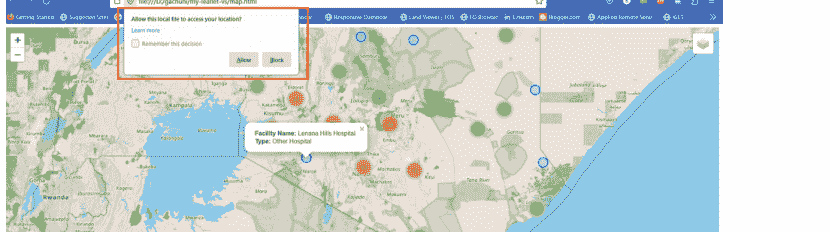

如果获取移动用户的地理定位失败怎么办？我们将创建一个函数，将错误事件输出到控制台，如下所示。

```
// Error displayed after finding location failed
function onLocationError(e) {
    alert(e.message);
}
```

实际上，**message** 是一个错误事件，用于显示参数的错误消息。**message** 事件被解析到 **onLocationError** 函数。如果浏览器无法近似用户位置，**onLocationError** 函数返回 'true'，这会触发浏览器上的错误警报。

```
map.on('locationerror', onLocationError);
```

## 11.6 移动端 Web 地图应用

本人已为你省去了详细说明本章文件如何保存到 Github 并随后转换为网页的麻烦。需要注意的关键是，HTML 文件必须命名为 `index.html`，而不是其他名称如 `map.html`，因为 'index' 这个名字是在 Github 上即时渲染文件的最简单方式。还有一些额外的步骤可以将我们的 Leaflet 地图发布到全球网络，但为了确保本章的简洁性，我们建议你访问这个权威的 Github 页面以获取进一步指导。不过，以下链接应该能让你在手机上查看该 Web 应用。

https://sammigachuhi.github.io/hospitals_webapp/

```
knitr::include_graphics(rep('D:/gachuhi/my-leaflet/images/mobile-app.jpg'))
```

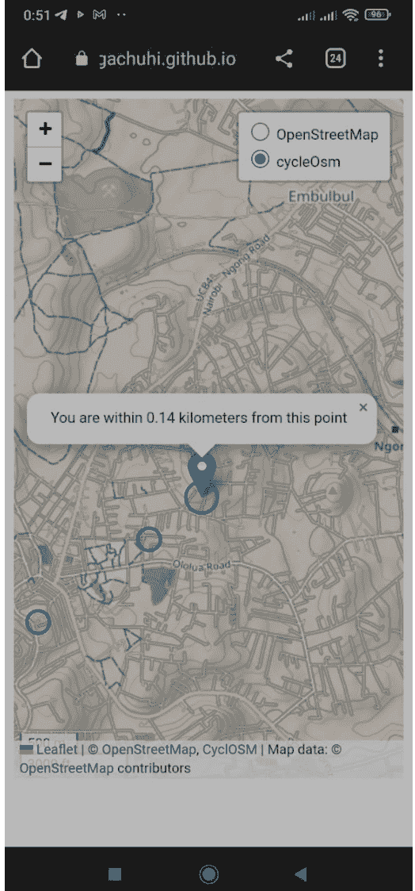

我们最初的目标是星辰大海，想要创建一个除了底图图层外还具有一些图层控件的 Web 应用。然而，看起来我们似乎只够到了天空。尽管如此，这看起来像是一个不错的医院位置应用。天空只是在此应用基础上构建更多功能的基准。

完整代码脚本可在此处获取。

## 11.7 总结

启用 Leaflet 地图适配移动端，使其能够在智能手机上快速加载并高效缩放。以下是您学到的内容。

-   在 HTML 文件的 `<head>` 元素中插入一个特殊的 `meta` 标签，以便在用户于智能手机上查看 Leaflet 地图时，浏览器能够平滑缩放。
-   Leaflet 有一个特殊函数 `map.locate`，可以进行地理定位并缩放到用户的精确坐标。如果由于某种原因精度失败，它会在移动用户的大致位置周围创建一个缓冲区。
-   如果 Leaflet 无法近似用户位置，可以使用 `message` 事件，该事件会在浏览器上返回一个错误。

# 第十二章 Web 地图服务图层

## 12.1 什么是 Web 地图服务（WMS）图层？

Web 地图服务（WMS）由通过互联网托管的地理空间数据组成，其标准由开放地理空间信息联盟（OGS）制定。

WMS 允许通过网络交换空间信息，并以地图或图像的形式在浏览器中查看。Web 地图服务最常见的格式包括 Web 地图服务（WMS）、Web 要素服务（WFS）、Web 覆盖服务（WCS）、Web 处理服务（WPS）、Web 地图瓦片服务（WMTS）和 Web 覆盖处理服务（WCPS）。然而，Web 地图服务（WMS）图层是使用最广泛的。它提供基本的平移、缩放和快速渲染速度。

## 12.2 加载 WMS 服务器

要将 WMS 图层加载到 Leaflet 中，我们使用 `L.tileLayer.wms` 类。就这么简单。那么让我们设置我们的 Leaflet 地图。创建一个名为 `wms_layers.js` 的新 JavaScript 文件，并插入以下代码：

```
let map = L.map('myMap').setView([-1.295287148, 36.81984753], 7);

let tileLayer = L.tileLayer('https://tile.openstreetmap.org/{z}/{x}/{y}.png', {
    maxZoom: 19,
    attribution: '&copy; <a href="http://www.openstreetmap.org/copyright">OpenStreetMap</a>'
});
```

我们添加了一个 OSM 图层，因为我们要创建一个图层控件小部件，其中也包含 WMS 图层，这样你就可以在 Open Street Map（OSM）图层和 WMS 之间切换。在这个练习中，我们将添加两个 WMS 图层。

```
let wmsLayerTopo = L.tileLayer.wms('https://www.gmrt.org/services/mapserver/wms_merc_m', {
    layers: 'topo',
    format: 'image/png'
})

let wmsLayerTopomask = L.tileLayer.wms('https://www.gmrt.org/services/mapserver/wms_merc_m', {
    layers: 'topo-mask',
    format: 'image/png'
})
```

## 12.3 将 WMS 添加到图层控件

让我们将上述 Web 地图图层插入到一个 JavaScript 对象中，然后将其解析给图层控件。

```
var basemaps = {
    OSM: tileLayer,
    Topo: wmsLayerTopo,
    Topo_mask: wmsLayerTopomask,
}
```

现在让我们将该对象解析到控件中。如果你学过第八章，这应该看起来很熟悉。

```
L.control.layers(basemaps).addTo(map);

basemaps.Topo.addTo(map);  // To have the Topo as the default map layer
```

最后一行 `basemaps.Topo.addTo(map)` 用于设置地图加载时显示的默认图层。在本例中，它是 `var basemaps` 中的 Topo 键。如果省略最后一行，除非选择了某个单选按钮项，否则 Leaflet 只会显示一个空白画布。

```
knitr::include_graphics(rep('D:/gachuhi/my-leaflet/images/wms_layer.jpg'))
```

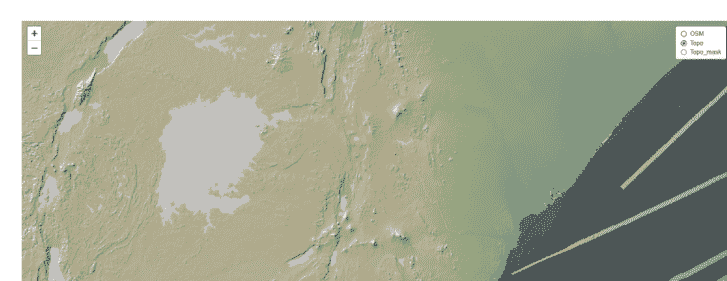

就是这样！

尽管我们希望使用基于非洲的 WMS 图层（Digital Earth Africa 提供了很多），但由于某些原因，尽管我们认真遵循了其文档，还是无法成功。颇具讽刺意味的是，它们在 Qgis 中可以轻松加载，而在 Leaflet 中却不行。

有兴趣获取其他 WMS 图层吗？请访问 Spartineo.com。

本章使用的文件可在此处获取。

## 12.4 总结

Web 地图服务（WMS）图层在许多方面看起来和表现得像一个底图。就像 Open Street Map 和其他类似服务器一样，WMS 图层通过互联网托管数据。以下是本章的要点。

-   Web 地图服务由通过互联网托管的地理空间数据组成，其标准由开放地理空间信息联盟（OGS）制定。
-   Web 地图服务最常见的格式包括 Web 地图服务（WMS）、Web 要素服务（WFS）、Web 覆盖服务（WCS）、Web 处理服务（WPS）、Web 地图瓦片服务（WMTS）和 Web 覆盖处理服务（WCPS）。
-   `L.tileLayer.wms` 类用于将 WMS 图层加载到 Leaflet 中。
-   就像任何其他底图一样，可以将 WMS 图层解析到 Leaflet 控件中，如 `wmsLayerTopo` 和 `wmsLayerTopomask` 所示。


# 第13章：使用Leaflet项目的标准网站

## 13.1 获取HTML模板

回到第4章，我们曾在一款外观朴素的网站中插入了一个Leaflet地图。为了将这个练习更进一步，我们想演示如何将Leaflet添加到一个标准的、外观专业的HTML网站中。本章将训练你如何将Leaflet地图插入到你的公司、客户甚至同事的网站中。

本练习使用的模板来自Free CSS.com，可在此处获取。请解压文件并查看HTML文档，即index.html、about.html、contact.html、courses.html、team.html和testimonial.html文件。请特别注意`<head>`元素和包含网站画廊部分的`<div>`。画廊的`<div>`如下所示：

```html
<div class="col-lg-3 col-md-6">
    <h4 class="text-white mb-3">Gallery</h4>
    <div class="row g-2 pt-2">
        <div class="col-4">
            
        </div>
        <div class="col-4">
            
        </div>
        <div class="col-4">
            
        </div>
    </div>
</div>
```

这里是电子学习网页中画廊的位置（用红色框标出）。

```r
knitr::include_graphics(rep('D:/gachuhi/my-leaflet/images/gallery.jpg'))
```


为什么我们要更改画廊，或者更准确地说，用Leaflet地图替换它？既然这个网站仅用于演示目的，那么用网页地图替换那些漂亮的图片似乎是个好主意。

## 13.2 将Leaflet嵌入标准HTML网站

由于我们想将Leaflet地图集成到电子学习网站中，我们需要将必要的Leaflet链接和脚本加载到电子学习演示网站的`<head>`元素中，就像我们以前对map.html所做的那样。之后，我们将用一个引用我们众多Leaflet JavaScript文件之一的`<div>`来替换整个画廊部分。

准备好了吗？我们开始吧。

假设你正在使用VSCode，请将所有Leaflet插件文件复制到同一目录，例如Leaflet.markercluster-master文件夹以及你在之前章节中提取的所有其他文件。这些文件夹的名称在下图中用红色边框标出。

```r
knitr::include_graphics(rep('D:/gachuhi/my-leaflet/images/elearning-plugins.jpg'))
```


为什么我们要确保Leaflet插件文件夹与我们的电子学习模板文件在同一目录下？这是因为我们希望避免修改相对路径的麻烦，如果插件文件夹位于与电子学习网站不同的目录中，则必须更改该路径。

转到电子学习模板的index.html文件。从`<head>`到`</head>`标签，将现有代码替换为以下内容：

```html
<meta charset="utf-8">
<!-- For leaflet and mobile compatibility -->
<meta name="viewport" content="width=device-width, initial-scale=1.0, maximum-scale=1.0, user-scalable=no">

<title>eLEARNING - eLearning HTML Template</title>
<meta content="width=device-width, initial-scale=1.0" name="viewport">
<meta content="" name="keywords">
<meta content="" name="description">

<!-- Favicon -->
<link href="img/favicon.ico" rel="icon">

<!-- Google Web Fonts -->
<link rel="preconnect" href="https://fonts.googleapis.com">
<link rel="preconnect" href="https://fonts.gstatic.com" crossorigin>
<link href="https://fonts.googleapis.com/css2?family=Heebo:wght@400;500;600&family=Jost:wght@500;600;700&display=swap" rel="stylesheet">

<!-- Icon Font Stylesheet -->
<link href="https://cdnjs.cloudflare.com/ajax/libs/font-awesome/5.10.0/css/all.min.css" rel="stylesheet">
<link href="https://cdn.jsdelivr.net/npm/bootstrap-icons@1.4.1/font/bootstrap-icons.css" rel="stylesheet">

<!-- Libraries Stylesheet -->
<link href="lib/animate/animate.min.css" rel="stylesheet">
<link href="lib/owlcarousel/assets/owl.carousel.min.css" rel="stylesheet">

<!-- Customized Bootstrap Stylesheet -->
<link href="css/bootstrap.min.css" rel="stylesheet">

<!-- Template Stylesheet -->
<link href="css/style.css" rel="stylesheet">

<!-- For leaflet -->
<link rel="stylesheet" href="https://unpkg.com/leaflet@1.9.3/dist/leaflet.css"
      integrity="sha256-kLaT2GOSpHechsozzB+fInD+zUyjE2LlWPgU04xyI="
      crossorigin=""/>
<link rel="stylesheet" href="Leaflet.Control.Opacity-master\Leaflet.Control.Opacity-master\Leaflet.Control.Opacity.css" />
<!-- For Leaflet marker clusters -->
<link rel="stylesheet" href="Leaflet.markercluster-master\Leaflet.markercluster-master\dist\MarkerCluster.css" />
<link rel="stylesheet" href="Leaflet.markercluster-master\Leaflet.markercluster-master\dist\MarkerCluster.Default.css" />

<!-- For leaflet scripts -->
<script src="https://unpkg.com/leaflet@1.9.3/dist/leaflet.js"
        integrity="sha256-WBkoXOwTeyKcl0HuWtc+i2uENFpDZ9YPdf5Hf+D7ewM="
        crossorigin=""></script>
<script src="leaflet-ajax-gh-pages\dist\leaflet.ajax.js"></script>
<script src="leaflet-ajax-gh-pages\dist\leaflet.ajax.min.js"></script>
<script src="leaflet-ajax-gh-pages\example\leaflet.spin.js"></script>
<script src="leaflet-ajax-gh-pages\example\spin.js"></script>
<script src="Leaflet.heat-gh-pages\Leaflet.heat-gh-pages\dist\leaflet-heat.js"></script>
<script src="https://ajax.googleapis.com/ajax/libs/jquery/2.1.4/jquery.min.js"></script>
<!-- For leaflet cluster markers -->
<script src="Leaflet.markercluster-1.4.1\Leaflet.markercluster-1.4.1\dist\leaflet.markercluster.js"></script>
<script src="Leaflet.markercluster-1.4.1\Leaflet.markercluster-1.4.1\dist\leaflet.markercluster-src.js"></script>
```

我们要对电子学习网站的HTML文件夹做的第一个修改，就是添加相关的Leaflet `<link>`和`<script>`标签。这些`<link>`和`<script>`标签是从我们一直使用的`map.html`文件中复制粘贴过来的。

现在我们已经有了将Leaflet嵌入到电子学习演示网站所需的`<link>`和`<script>`标签，我们只需要插入包含Leaflet代码的JavaScript文件的路径。这个JavaScript文件当然负责在电子学习网站中启动Leaflet地图。在本练习中，我们将使用我们一直很喜欢的`cluster_markers.js`文件。将此文件复制粘贴到包含电子学习网站文件夹的同一目录中。

好了。

是时候添加Leaflet地图了。加在哪里？在画廊部分。

提醒一下，它看起来是这样的：

```html
<div class="col-lg-3 col-md-6">
    <h4 class="text-white mb-3">Gallery</h4>
    <div class="row g-2 pt-2">
        <div class="col-4">
            
        </div>
        <div class="col-4">
            
        </div>
        <div class="col-4">
            
        </div>
        <div class="col-4">
            
        </div>
        <div class="col-4">
            
        </div>
        <div class="col-4">
            
        </div>
    </div>
</div>
```

你可能需要*真的*向下滚动才能找到它。在`<h4 class="text-white mb-3">Gallery</h4>`标签正下方，用以下代码替换它，一直到``之后的`<div>`标签。

```html
<div id="myMap">
    <script src="cluster-markers.js">
</div>
```


126 第13章 标准网站与LEAFLET项目

```
</script>
</div>
```

或许一张图片能稍加说明。你需要在此处插入`cluster-markers.js`文件的路径。

```
knitr::include_graphics(rep('D:/gachuhi/my-leaflet/images/div_replace.jpg'))
```


另外提醒一下，记得将`<h4>`标签替换为陈述`Our Location`。它不再是一个图库，而是一个网络地图！

似乎还不够，我们还必须为我们的Leaflet地图设置CSS属性。

## 13.3 编辑CSS

在文本编辑器（如VS code）中打开你的eLearning模板的`style.css`文件。CSS文件的路径如下：

```
elearning-template\css\style.css
```

向下滚动到`style.css`的最底部，为我们的Leaflet地图粘贴以下CSS属性。

```
#myMap {
    height: 400px;
    width: auto;
}
```

请记住，`#`及其后面的文本引用了`index.html`中无数HTML标签中该特定ID属性的名称。上面的CSS选择器引用了ID为`#myMap`的`<div>`。

重新加载**index.html**后，我们的Leaflet地图在eLearning模板内的样子如下。

```
knitr::include_graphics(rep('D:/gachuhi/my-leaflet/images/location_elearning.jpg'))
```


很好。

## 13.4 将Leaflet嵌入每个网页

现在点击**About, Courses, Pages/Our Team, Pages/Testimonial**和**Contact**网页。Leaflet地图在每种情况下都存在吗？没有。还是原来的老图库。想象一下，你将不得不分别将about.html、courses.html、team.html、testimonial.html和contact.html网页的`<head>`和图库`<div>`元素也替换为相关的Leaflet路径！幸运的是，希望你已经掌握了要领，以下链接包含了在所有上述网页中嵌入了Leaflet地图的eLearning文件夹。

```
elearning_template_demo
```

## 13.5 将Html网站发布到全世界

本章将省略将文件保存到Github的详细信息。不过，如第11章所述，你HTML文件中的名称**index**会被Github自动视为根HTML文件。话虽如此，这是我们内嵌了Leaflet网络地图的eLearning网站链接。

eLearning网站

## 13.6 总结

将必要的Leaflet文件夹与你的HTML网站文件放在同一目录下，可以防止Leaflet地图因路径中断而无法加载。以下是我们遇到的其他经验教训。

- 为了将Leaflet地图嵌入你的网站，你必须将必要的Leaflet `<link>`和`<script>`标签加载到你的`<head>`以及必要的`<div>`元素中。
- 使用`<script>`标签插入启动你的Leaflet的JavaScript代码。这就是将JavaScript文件`cluster-markers.js`插入eLeaflet示例网站的方法。
- 确保你的Leaflet地图出现在所有子网页中的正确位置也很重要。例如，就像在其父文件`index.html`中所做的那样，Leaflet也必须嵌入到`about.html`、`courses.html`、`team.html`、`testimonial.html`和`contact.html`网页的图库部分。

# 第14章

# ESRI与Leaflet

## 14.1 ESRI概述

好了。如果你是一名GIS从业者，你可能听说过ESRI，它是全球领先的地理空间软件和服务提供商之一。你（可能）也遇到过各种ESRI底图服务器，例如ESRI地形图、ESRI街道图和ESRI影像图层。他们还有插件，允许Leaflet用户访问ArcGIS功能。例如，Leaflet的ESRI插件允许你访问一些ESRI底图和产品，同时也让你成为一名ESRI ArcGIS JavaScript开发者。

要使用ESRI Leaflet，你需要创建一个ArcGIS开发者账户并获取一个API密钥。请在继续之前完成这些操作。

## 14.2 ESRI Leaflet插件

正如我们之前提到的，你需要ESRI Leaflet插件才能通过你的应用程序编程接口（API）密钥体验所有可能的ArcGIS功能。还记得你的`map.html`文件吗？要在ESRI中体验Leaflet，请将以下`<script>`标签添加到`map.html`文件的`<head>`元素中。

```
<!-- Load Esri Leaflet from CDN -->
<script src="https://unpkg.com/esri-leaflet@3.0.10/dist/esri-leaflet.js"></script>
<script src="https://unpkg.com/esri-leaflet-vector@4.0.2/dist/esri-leaflet-vector.js"></script>
```

创建一个名为`esri_leaflet.js`的新JavaScript文件，准备享受ESRI服务吧！

## 14.3 创建ESRI Leaflet地图

在你的空白`esri_leaflet.js`文件中，创建一个变量来存储你的API密钥。这个密钥对于访问你的ESRI权益非常重要，就像传说中*阿里巴巴与四十大盗*故事里能打开通往满是宝藏洞穴的魔法咒语“芝麻开门”一样！
下面是如何从你的ArcGIS开发者账户获取API密钥的示例。

```
knitr::include_graphics(rep('D:/gachuhi/my-leaflet/images/esri_leaflet_api.jpg'))
```


将该密钥复制粘贴到你的`esri_leaflet.js`文件中。

```
const apiKey = "Your key";
```

让我们继续创建一个底图。要创建一个，只需创建一个名为`basemapEnum`的变量，存储ESRI底图标识符。在ESRI Leaflet中，底图是通过解析提供商名称和所需样式来调用的，格式如下：`{Provider}:{Style name}`或`{Provider}:{Style name}:{Component}`。在我们的例子中，我们想要ArcGIS街道底图图层。

```
const basemapEnum = "ArcGIS:Streets";
```

好了。是时候启动我们的地图功能了。像我们一直做的那样创建一个ESRI Leaflet地图实例。

```
const map = L.map("myMap", {
    minZoom: 2
}).setView([0.3556, 37.5833], 6.5);
```

## 14.4 地理编码搜索

我们之前创建了一个底图变量，所以我们将把它解析到负责创建底图的`L.esri.Vector.vectorBasemapLayer`类。实际上，也可以将`{Provider}:{Style name}`解析到`L.esri.vector.vectorBasemapLayer()`类，但我们的方法使用变量名看起来更简洁。

```
L.esri.Vector.vectorBasemapLayer(basemapEnum, {
    apiKey: apiKey,
}).addTo(map);
```

现在打开你的`map.html`文件。它应该如下所示。

```
knitr::include_graphics(rep('D:/gachuhi/my-leaflet/images/esri_leaflet_basemap.jpg'))
```


现在想象还有其他底图样式，如该网页所示。

## 14.4 地理编码搜索

当然还有其他ESRI Leaflet功能。出于好奇，进行了一项简短搜索，以找到一个加载栅格图层的ESRI插件，希望其操作比Leaflet的地理栅格插件更简单。尽管两者都有下载`.jpeg`和`.png`图像格式的插件，但都不足以加载地理空间栅格文件，如`.tiff`。尽管如此，ESRI Leaflet还提供了其他很酷的服务，例如地理编码搜索¹。

在本章的剩余部分，我们将使用ESRI Leaflet创建一个地理编码服务。

¹地理编码是将地址或地点文本转换为位置的过程。地理编码服务提供地址和地点地理编码以及反向地理编码。

## 14.5 添加搜索栏

将以下`<link>`和`<script>`添加到你的`<head>`元素。

```
<!-- Load Esri Leaflet Geocoder from CDN -->
<link rel="stylesheet" href="https://unpkg.com/esri-leaflet-geocoder@3.1.4/dist/esri-leaflet-geocoder.css">
<script src="https://unpkg.com/esri-leaflet-geocoder@3.1.4/dist/esri-leaflet-geocoder.js"></script>
```

我们将首先在ESRI Leaflet地图的右上角添加一个搜索控件小部件。搜索控件小部件是使用**L.esri.Geocoding.geosearch**类创建的。在下面的代码中，我们将**L.esri.Geocoding.geosearch**解析到了变量**searchControl**。

```
const searchControl = L.esri.Geocoding.geosearch({
    position: "topright",
    placeholder: "Enter an address or place e.g. 1 York St",
    useMapBounds: false,

}).addTo(map);
```

就像在Leaflet中一样，ESRI Leaflet构造函数也有其选项。请在此处查阅此特定构造函数的选项。

另一件小事；将你的**const basemapEnum**改为读取**ArcGIS:Navigation**。

```
const basemapEnum = "ArcGIS:Navigation";
```

刷新**map.html**文件后，除了有一个新的底图样式，你还会看到右上角有一个新的搜索栏。然而，它是无法使用的。它没有把我们带到任何地方。

```
knitr::include_graphics(rep('D:/gachuhi/my-leaflet/images/search_bar.jpg'))
```


## 14.6 让搜索栏功能生效

为了让搜索栏能够实现其名称所示的功能，我们将把 providers 键的值设置为一个 `arcgisOnlineProvider`。后者是通过构造函数 `L.esri.Geocoding.arcgisOnlineProvider` 进行实例化的。ESRI 在其平台上提供了各种开源教程，为大多数工具提供了简洁明了的说明。

```javascript
const searchControl = L.esri.Geocoding.geosearch({
  position: "topright",
  placeholder: "Enter an address or place e.g. 1 York St",
  useMapBounds: false,

  // Add provider
  providers: [
    L.esri.Geocoding.arcgisOnlineProvider({
      apikey: apiKey,
      nearby: {
        lat: 0.3556,
        lng: 37.5833
      }
    })
  ]
}).addTo(map);
```

现在再次尝试你的搜索栏。输入时会显示一些地名，如果你按下 **Enter** 键，它会将你带到确切的位置。这很好，但有一点不足：没有一个标记来精确指出那个特定地址。下一节将概述如何让 ESRI 在搜索到的任意地名处动态创建一个标记。


## 14.7 添加自动生成的位置图钉

首先添加一个图层组来存储地理编码结果。

```javascript
const results = L.layerGroup().addTo(map);
```

我们将创建一个事件处理程序来访问搜索结果中的数据。我们还将添加一个 clearLayers 调用，以从图层组中移除先前的数据。这听起来开始有点复杂了，但如果读者希望进一步了解清楚，应参考 ESRI Leaflet 地理编码教程。

```javascript
searchControl.on("results", (data) => {
    results.clearLayers();
});
```

以下循环将搜索位置的坐标添加到标记中。此循环放入 searchControl 代码块内。

```javascript
for (let i = data.results.length - 1; i >= 0; i--) {
    const marker = L.marker(data.results[i].latlng);
    results.addLayer(marker);
}
```

下面的 lngLatString 变量将存储四舍五入后的坐标，而我们熟悉的 bindPopup 和 openPopup 将显示坐标和我们的地址。

```javascript
const lngLatString = `${Math.round(data.results[i].latlng.lng * 100000) / 100000}, ${Math.round(data.results[i].latlng.lat * 100000) / 100000}`;
marker.bindPopup(`<b>${lngLatString}</b><p>${data.results[i].properties.LongLabel}</p>`);
results.addLayer(marker);
marker.openPopup();
```

完整的 searchControl 代码块应如下所示。

```javascript
searchControl.on("results", (data) => {
    results.clearLayers();
    for (let i = data.results.length - 1; i >= 0; i--) {
        const marker = L.marker(data.results[i].latlng);
        const lngLatString = `${Math.round(data.results[i].latlng.lng * 100000) / 100000}, ${Math.round(data.results[i].latlng.lat * 100000) / 100000}`;
        marker.bindPopup(`<b>${lngLatString}</b><p>${data.results[i].properties.LongLabel}</p>`);
        results.addLayer(marker);
        marker.openPopup();
    }
});
```

所以现在，当你在搜索栏中搜索特定地点并按下 **Enter** 键时，应该会出现一个标记及其弹出窗口，展示该位置的地址和经纬度坐标。


ArcGIS Developers 网站还提供了更多关于使用 ESRI Leaflet 的教程。

以下是本练习中使用的文件。

## 14.8 总结

使用 ESRI Leaflet 将许多 ArcGIS 功能带到了开源的 Leaflet 插件中。

以下是本章学到的经验教训。

- 需要一个 ArcGIS 开发者账户才能使用 ESRI Leaflet 功能。
- 应用程序编程接口（API）密钥就像现实世界中的钥匙，用于授予用户访问 ESRI Leaflet 功能和特性的权限。
- 独立的 Leaflet 和 ESRI Leaflet 在许多方面相似。可以通过各种 ESRI Leaflet 构造函数（如 `L.esri.Geocoding.arcgisOnlineProvider`）在 Leaflet 之上构建 ArcGIS 功能。

# 第15章

# 结语

现在，我们的书即将结束。如果你已经读到了这里，那么恭喜你！你现在有能力继续使用 Leaflet 创建酷炫的网络地图了，甚至可能比你在本书中遇到的那些更好。

我希望这本书对你有所帮助。对于任何你觉得难以理解的地方，或者文本表述不够清晰的地方，那绝不是你的问题。完全不是。作者希望他能够简洁、精炼、清晰明了地解释一切，就像在创作一首诗。然而，作者渴望能像解释地理和地理信息事务一样，直观地解释计算领域的概念。

*终！*
