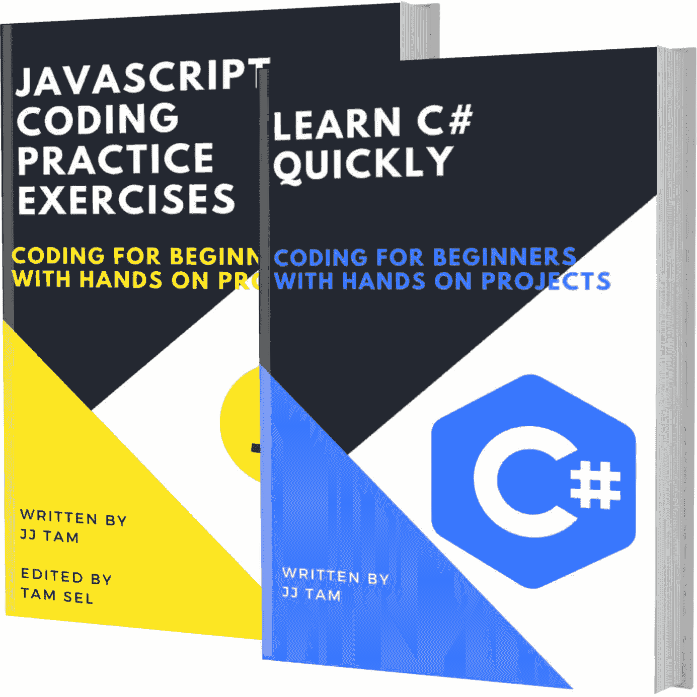
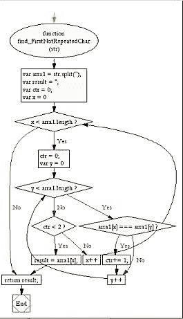
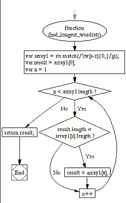
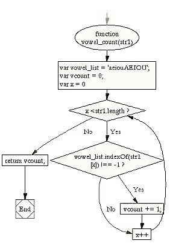
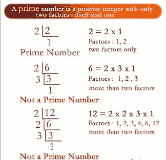
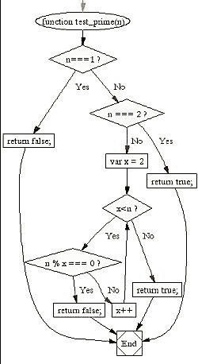
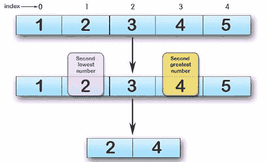
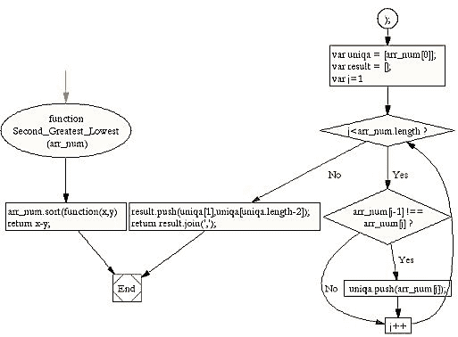
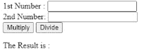

# 快速学习 C# 与 JavaScript 编程实践指南：初学者编程



## C# 简介

C# 是一种支持多种范式的编程语言。C# 的基本语法与 C、C++ 和 `Java` 相似。因此，如果你熟悉其中任何一种语言，就可以很轻松地学习 C#。

### 什么是多范式语言？

支持多一种范式的语言被称为多范式语言。C# 是一种多范式语言，它同时支持命令式和面向对象的范式。C# 也支持某种程度的函数式编程。

## C# 与 .NET

C# 是一种编程语言，而 `.NET` 是一个框架。`.NET` 包含多种语言。C# 是 `.NET` 中的语言之一。

### C# 的最新版本是什么？

在编写本文时，最新版本是 C# 6.0，它于 2015 年发布。

### 使用 C# 的前提

安装 Visual Studio。你可以通过以下链接获取社区版：https://www.visualstudio.com/vs/community/

## C#: Hello World 程序

希望你已经安装了 Visual Studio。以下步骤介绍了如何创建一个“Hello World”应用程序。

### 第 1 步：打开 Visual Studio

### 第 2 步：进入文件 (File) -> 新建 (New) -> 项目 (Project)。选择“控制台应用程序 (Console Application)”，将项目命名为“HelloWorld”。按下确定。它会创建一个名为 `Program.cs` 的文件，包含一些默认数据。按如下更新程序。

```csharp
using System;

namespace HelloWorld
{
    class Program
    {
        static void Main (string [] args)
        {
            Console.WriteLine("Hello World");
            Console.WriteLine("Welcome To C# Programming...");
        }
    }
}
```

按下 `CTRL + F5`，它将打开命令提示符并显示传递给 `Console.WriteLine` 方法的字符串。

### 分析程序

`using System`

上述语句加载了命名空间 `System`。命名空间用于组织代码。命名空间是类、接口、枚举、结构和委托的集合。

`namespace HelloWorld`

上述语句为程序提供了命名空间 `HelloWorld`。这是可选的。你甚至可以在没有此语句的情况下运行程序。

```csharp
using System;

class Program
{
    static void Main (string [] args)
    {
        Console.WriteLine("Hello World");
        Console.WriteLine("Welcome To C# Programming...");
    }
}
```

`class Program`

类（Class）用于将方法和属性封装成单个实体。暂时忽略它，我将在后面的文章中解释。

`static void Main(string[] args)`

`Main` 方法是你的 C# 应用程序的入口点。应用程序的执行从这里开始。

`Console.WriteLine("Hello World");`

上述语句将消息 "Hello World" 写入控制台。`Console` 是位于命名空间 `System` 中的类。`WriteLine` 是 `Console` 类的方法。

## C#: 从控制台读取输入

`Console` 类提供了 `ReadLine` 方法从控制台读取输入。`ReadLine` 方法从控制台读取信息并以字符串格式返回输入。

```csharp
String name = Console.ReadLine();
```

```csharp
using System;

class Program
{
    static void Main (string [] args)
    {
        Console.WriteLine("Welcome to C#, Please Enter Information");
        Console.WriteLine("Enter Your Name");
        String name = Console.ReadLine();
        Console.WriteLine("Enter Your Age");
        String age = Console.ReadLine();
        Console.WriteLine("Hello " + name + " You are " + age + " years old");
    }
}
```

输出

```
Welcome to C#, Please Enter Information
Enter Your Name
JJ TAM
Enter Your Age
26
Hello JJ TAM You are 26 years old
```

### 占位符语法

在拼接字符串时，占位符语法比使用 `+` 运算符更方便。

以下是占位符语法的示例。

```csharp
Console.WriteLine("Hello {0}. You are {1} years old", name, age);
```

上述语句等同于以下语句。

```csharp
Console.WriteLine("Hello " + name + " You are " + age + " years old");
```

```csharp
Console.WriteLine("You are {0} years old", age);
Console.WriteLine("Hello {1}. You are {0} years old", name, age);
```

输出

```
Welcome to C#, Please Enter Basic Information
Enter Your Name
JJ TAM
Enter Your Age
26
Hello JJ TAM
You are 26 years old
Hello 26. You are JJ TAM years old
Press any key to continue . . .
```

## C#: 内置类型

C# 支持几乎所有类型的数据进行操作。所有数据类型都表示为 `System` 命名空间中的类。数据类型可以分为以下类型：

a. 布尔型：`bool`

b. 整数：`byte`, `sbyte`, `int`, `uint`, `short`, `ushort`, `long`, `ulong`

c. 浮点型：`double`, `float`, `decimal`

d. 字符：`char`

e. 字符串：`String`

下表总结了所有数据类型：

| 简写 | 类 | 最小值 | 最大值 |
| :--- | :--- | :--- | :--- |
| `byte` | `Byte` | 0 | 255 |
| `sbyte` | `SByte` | -128 | 127 |
| `int` | `Int32` | -2,147,483,648 | 2,147,483,647 |
| `uint` | `UInt32` | 0 | 4294967295 |
| `short` | `Int16` | -32,768 | 32767 |
| `ushort` | `UInt16` | 0 | 65535 |
| `long` | `Int64` | -9223372036854775808 | 9223372036854775807 |
| `ulong` | `UInt64` | 0 | 18446744073709551615 |
| `float` | `Single` | -3.402823e38 | 3.402823e38 |
| `double` | `Double` | -1.79769313486232e308 | 1.79769313486232e308 |
| `decimal` | `Decimal` | ±1.0 × 10e−28 | ±7.9 × 10e28 |
| `char` | `Char` | | 表示 Unicode 字符。占用 16 位。 |
| `string` | `String` | | 字符序列 |

### Note

a. `Float` 变量后加 `f` 后缀。

   例：`float floatVar = 18.18f;`

b. `Decimal` 变量后加 `m` 后缀。

   例：`decimal decimalVar = 20.20m;`

```csharp
using System;

class Program
{
    static void Main (string [] args)
    {
        byte byteVar = 10;
        sbyte sbyteVar = 11;
        int intVar = 12;
        uint uintVar = 13;
        short shortVar = 14;
        ushort ushortVar = 15;
        long longVar = 16;
        ulong ulongVar = 17;
        float floatVar = 18.18f;
        double doubleVar = 19.19;
        decimal decimalVar = 20.20m;
        char charVar = 'S';
        string stringVar = "Hello World";
        Console.WriteLine("byteVar = {0}", byteVar);
        Console.WriteLine("sbyteVar = {0}", sbyteVar);
        Console.WriteLine("intVar = {0}", intVar);
        Console.WriteLine("uintVar = {0}", uintVar);
        Console.WriteLine("shortVar = {0}", shortVar);
        Console.WriteLine("ushortVar = {0}", ushortVar);
        Console.WriteLine("longVar = {0}", longVar);
        Console.WriteLine("ulongVar = {0}", ulongVar);
        Console.WriteLine("floatVar = {0}", floatVar);
        Console.WriteLine("doubleVar = {0}", doubleVar);
        Console.WriteLine("decimalVar = {0}", decimalVar);
        Console.WriteLine("charVar = {0}", charVar);
        Console.WriteLine("stringVar = {0}", stringVar);
    }
}
```

## C#: 字符串与转义序列

`String` 是字符的集合。字符串用双引号包围。

例：

`String firstName = "JJ TAM";`

`String lastName = "Delhi";`

```csharp
using System;

class Program
{
    static void Main (string [] args)
    {
        String firstName = "JJ TAM";
        String lastName = "Delhi";
        Console.WriteLine("Hello Mr {0} {1}", firstName, lastName);
    }
}
```

输出

```
Hello Mr JJ TAM Delhi
```

### 转义序列

程序语言中的转义序列具有特殊含义，例如 `\n` 在新行中打印字符串，`\t` 是制表符等。下表总结了 C# 中的一些转义字符。

| 转义序列 | 说明 |
| :--- | :--- |
| `\a` | 蜂鸣 |
| `\b` | 退格 |
| `\f` | 换页 |
| `\n` | 换行 |
| `\r` | 回车 |
| `\t` | 水平制表符 |
| `\v` | 垂直制表符 |
| `\'` | 单引号 |
| `\"` | 双引号 |
| `\\` | 反斜杠 |
| `\?` | 问号 |
| `\ooo` | 八进制格式的 ASCII 字符 |
| `\xhh` | 十进制格式的 ASCII 字符 |
| `\xhhhh` | 十进制格式的 Unicode 字符 |

```csharp
using System;

class Program
{
    static void Main (string [] args)
    {
        String quote = "Life is an \"Open Secret\". \nEverything is avialble, you can't hidden";
        Console.WriteLine(quote);
    }
}
```

输出

```
Life is an "Open Secret".
Everything is avialble, you can't hidden
```

## C#: 逐字面量 (Verbatim Literal)

逐字面字符串字量由一个 `@` 字符后跟双引号内的字符串组成。逐字面字符串量中的转义序列不会被处理。

```csharp
using System;

class Program
{
    static void Main (string [] args)
    {
        String withVerbatim = @"1\n2\n3\t4";
        String withoutVerbatim = "1\n2\n3\t4";
        Console.WriteLine(withVerbatim);
        Console.WriteLine("******************");
        Console.WriteLine(withoutVerbatim);
    }
}
```

输出

```
1\n2\n3\t4
******************
1
2
3       4
```

如输出所示，`@` 符号不会解释转义序列 `\n`, `\t`。而不带 Verbatim 的字符串会将 `\n` 解析为换行并将 `\t` 解析为制表符。

## C#: 运算符

运算符是执行操作的符号。

如果运算符对单个操作数执行操作，称为一元运算符。

例：

`int a = 10;`

`a++;`

如果运算符对两个操作数执行操作，称为二元运算符。

例：

`int a=10, b=20;`

如果运算符对三个操作数执行操作，则称为三元运算符。

例：

`int a=10, b=20, c = a>b ? a : b;`

C# 中的运算符分为 4 类：

1. 算术运算符

2. 条件运算符

3. 逻辑运算符

4. 位运算运算符

### 算术运算符

算术运算符用于执行算术运算。

```csharp
Console.WriteLine("var = {0}", var ++);
Console.WriteLine("var = {0}", var );
```

输出

```
var = 10
var = 11
```

### 前置减

#### 语法

```text
--variable
```

前置减运算符会立即将变量值减 1。

```csharp
using System;

class Program
{
    static void Main (string [] args)
    {
        int var = 10;
        Console.WriteLine("var = {0}", --var);
    }
}
```

输出

```
var = 9
```

### 后置减

#### 语法

```text
variable--
```

后置减运算符在执行完当前语句后，将变量值减 1。

```csharp
using System;

class Program
{
    static void Main (string [] args)
    {
        int var = 10;
        Console.WriteLine("var = {0}", var--);
        Console.WriteLine("var = {0}", var);
    }
}
```

输出

```
var = 10
var = 9
```

## C#: 条件运算符

条件运算符用于判断一个操作数是否大于、小于、等于或不等于另一个操作数。

(Image00003.jpg)](https://4.bp.blogspot.com/-L0p6MK64YEg/W3bnD8IFVLI/AAAAAAAAK7E/mqCH_nXaXWsY-VvmKP-hR-xFUA0zLgwKwCLcBGAs/s1600/C#+Conditional+operators.jpg)

条件运算符接受两个操作数，如果条件为真，则返回 true，否则返回 false。

```csharp
using System;

class Program
{
    static void Main (string [] args)
    {
        int a = 10 , b = 11;
        Console.WriteLine("is a equals to a {0}", (a == a));
        Console.WriteLine("is a equals to b {0}", (a == b));
        Console.WriteLine("is a equals equals a {0}", (a != a));
        Console.WriteLine("is a not equals to b {0}", (a != b));
        Console.WriteLine("is a less than a {0}", (a < a));
        Console.WriteLine("is a less than b {0}", (a < b));
        Console.WriteLine("is a less or equal to a {0}", (a <= a));
        Console.WriteLine("is a less or equal b {0}", (a <= b));
        Console.WriteLine("is a greater than a {0}", (a > a));
        Console.WriteLine("is a greater than b {0}", (a > b));
        Console.WriteLine("is a greater or equal to a {0}", (a >= a));
        Console.WriteLine("is a greater or equal b {0}", (a >= b));
    }
}
```

输出

```
is a equals a True
is a equals b False
is a not equals a False
is a not equals to b True
is less than a False
is less than b True
is less or equal to a True
is less or equal b True
is greater than a False
is greater than b False
is greater or equal to a True
is greater or equal b False
```

## C#: 逻辑运算符

C# 提供了三种逻辑运算符，分别是 `&&` (与)、`||` (或) 和 `!` (非)。

`&&` 也称为条件与。

`||` 也称为条件或。

`&&` 和 `||` 被称为短路运算符，请查看为什么它们被称为短路运算符。

### 逻辑与运算符

| 操作数 1 | 操作数 2 | 结果 |
| :--- | :--- | :--- |
| TRUE | TRUE | TRUE |
| TRUE | FALSE | FALSE |
| FALSE | TRUE | FALSE |
| FALSE | FALSE | FALSE |

```csharp
using System;

class Program
{
    static void Main (string [] args)
    {
        bool operand1 = true;
        bool operand2 = true;
        Console.WriteLine("operand1 = {0}", operand1);
        Console.WriteLine("operand2 = {0}", operand2);
        Console.WriteLine("operand1 && operand2 = {0}", (operand1 && operand2));

        bool operand1 = true;
        bool operand2 = false;
        Console.WriteLine("\noperand1 = {0}", operand1);
        Console.WriteLine("operand2 = {0}", operand2);
        Console.WriteLine("operand1 && operand2 = {0}", (operand1 && operand2));

        bool operand1 = false;
        bool operand2 = true;
        Console.WriteLine("\noperand1 = {0}", operand1);
        Console.WriteLine("operand2 = {0}", operand2);
        Console.WriteLine("operand1 && operand2 = {0}", (operand1 && operand2));

        bool operand1 = false;
        bool operand2 = false;
        Console.WriteLine("\noperand1 = {0}", operand1);
        Console.WriteLine("operand2 = {0}", operand2);
        Console.WriteLine("operand1 && operand2 = {0}", (operand1 && operand2));
    }
}
```

输出

```
operand1 = True
operand2 = True
operand1 && operand2 = True
operand1 = True
operand2 = False
operand1 && operand2 = False
operand1 = False
operand2 = True
operand1 && operand2 = False
operand1 = False
operand2 = False
operand1 && operand2 = False
```

### 为什么逻辑与被称为短路运算符？

因为如果表达式中的第一个语句求值为假，那么 Java 就不会再评估整个表达式。因此，逻辑与被称为短路与。

```csharp
using System;

class Program
{
    static void Main (string [] args)
    {
        int a = 10 , b = 21;
        if ((a > b) && (a++ > b))
        {
            Console.WriteLine("This not evaluated");
        }
        Console.WriteLine("a is not incremented " + a);
        if ((a < b) && (a++ < b))
        {
            Console.WriteLine("This statement evaluated");
        }
        Console.WriteLine("a is incremented " + a);
    }
}
```

输出

```
a is not incremented 10
This statement evaluated
a is incremented 11
```

### 观察

在表达式 `(a>b) && (a++ > b)` 中，`a>b` 为假，所以 `&&` 运算符不会评估第二个语句，因此 `a` 没有自增。

### 逻辑或运算符

| 操作数 1 | 操作数 2 | 结果 |
| :--- | :--- | :--- |
| TRUE | TRUE | TRUE |
| TRUE | FALSE | TRUE |
| FALSE | TRUE | TRUE |
| FALSE | FALSE | FALSE |

如上表所示，如果任何一个操作数求值为真，则 `||` 运算符返回 true，否则返回 false。

```csharp
using System;

class Program
{
    static void Main (string [] args)
    {
        bool operand1 = true;
        bool operand2 = true;
        Console.WriteLine("operand1 = {0}", operand1);
        Console.WriteLine("operand2 = {0}", operand2);
        Console.WriteLine("operand1 || operand2 = {0}", (operand1 || operand2));

        bool operand1 = true;
        bool operand2 = false;
        Console.WriteLine("\noperand1 = {0}", operand1);
        Console.WriteLine("operand2 = {0}", operand2);
        Console.WriteLine("operand1 || operand2 = {0}", (operand1 || operand2));

        bool operand1 = false;
        bool operand2 = true;
        Console.WriteLine("\noperand1 = {0}", operand1);
        Console.WriteLine("operand2 = {0}", operand2);
        Console.WriteLine("operand1 || operand2 = {0}", (operand1 || operand2));

        bool operand1 = false;
        bool operand2 = false;
        Console.WriteLine("\noperand1 = {0}", operand1);
        Console.WriteLine("operand2 = {0}", operand2);
        Console.WriteLine("operand1 || operand2 = {0}", (operand1 || operand2));
    }
}
```

输出

```
operand1 = True
operand2 = True
operand1 || operand2 = True
operand1 = True
operand2 = False
operand1 || operand2 = True
operand1 = False
operand2 = True
operand1 || operand2 = True
operand1 = False
operand2 = False
operand1 || operand2 = False
```

### 为什么逻辑或被称为短路运算符？

因为如果第一个语句求值为真，那么 Java 就不会评估整个表达式。因此，逻辑或被称为短路或。

如果操作数为 `TRUE`，`!` 运算符将其求值为 `FALSE`。

```csharp
using System;

class Program
{
    static void Main (string [] args)
    {
        bool a = true;
        Console.WriteLine("a = {0}, !a = {1}", a, !a);
        a = false;
        Console.WriteLine("a = {0}, !a = {1}", a, !a);
    }
}
```

输出

```
operand1 = True
operand2 = True
operand1 || operand2 = True
operand1 = True
operand2 = False
operand1 || operand2 = True
operand1 = False
operand2 = True
operand1 || operand2 = True
operand1 = False
operand2 = False
operand1 || operand2 = False
```

## C#: 移位运算符

### 按位左移(<<)

左移运算符将所有位向左移动一位，即：它简单地将值翻倍。

#### 语法:

`variable << n`

- 将变量向左移动 'n' 次。

- `Variable << n` 等于 `variable = variable * 2 power n`

```csharp
int var = 2;
var << 1 = 2 * 2 power 1 = 4
var << 2 = 2 * 2 power 2 = 8
var << 9 = 2 * 2 power 9 = 1024
```

```csharp
using System;

class Program
{
    static void Main (string [] args)
    {
        byte byteVar = 7;
        Console.WriteLine("Value of Byte variable is " + byteVar);
        Console.WriteLine("After shifting 1 bit left " + (byteVar << 1));
        Console.WriteLine("After shifting 2 bits left " + (byteVar << 2));
        Console.WriteLine("After shifting 3 bits left " + (byteVar << 3));
        Console.WriteLine("After shifting 4 bits left " + (byteVar << 4));
        Console.WriteLine("After shifting 5 bits left " + (byteVar << 5));
        Console.WriteLine("After shifting 6 bits left " + (byteVar << 6));
        Console.WriteLine("Value of Byte variable is " + byteVar);
    }
}
```

输出

```
Value of Byte variable is 7
After shifting 1 bit left 14
After shifting 2 bits left 28
After shifting 3 bits left 56
After shifting 4 bits left 112
After shifting 5 bits left 224
After shifting 6 bits left 448
Value of Byte variable is 7
```

### 按位右移(>>)

右移运算符将所有位向右移动一位，即：它简单地将值减半（除以 2）。

#### 语法:

`variable >> n`

- 将变量向右移动 'n' 次。

- `Variable >> n` 等于 `variable = variable / 2 power n`

```csharp
int var = 128;
var >> 1 = 128 / (2 power 1) = 64
var >> 2 = 128 / (2 power 2) = 32
```

```csharp
using System;

class Program
{
    static void Main (string [] args)
    {
        int intVar = 128;
        Console.WriteLine("Value of int variable is " + intVar);
        Console.WriteLine("After shifting 1 bit Right " + (intVar >> 1));
        Console.WriteLine("After shifting 2 bits Right " + (intVar >> 2));
        Console.WriteLine("After shifting 3 bits Right " + (intVar >> 3));
        Console.WriteLine("After shifting 4 bits Right " + (intVar >> 4));
        Console.WriteLine("After shifting 5 bits Right " + (intVar >> 5));
        Console.WriteLine("After shifting 6 bits Right " + (intVar >> 6));
        Console.WriteLine("After shifting 7 bits Right " + (intVar >> 7));
        Console.WriteLine("Value of int variable is " + intVar);
    }
}
```

输出

```
Value of int variable is 128
After shifting 1 bit Right 64
After shifting 2 bits Right 32
After shifting 3 bits Right 16
After shifting 4 bits Right 8
After shifting 5 bits Right 4
After shifting 6 bits Right 2
After shifting 7 bits Right 1
Value of int variable is 128
```

## C#: 按位运算符

### 按位与(&), 按位或(|), 异或(^)

```csharp
using System;

class Program
{
    static void Main (string [] args)
    {
        byte a = 8;
        byte b = 9;
        Console.WriteLine("a & b is " + (a & b));
        Console.WriteLine("a | b is " + (a | b));
        Console.WriteLine("a ^ b is " + (a ^ b));
    }
}
```

输出

```
a & b is 8
a | b is 9
a ^ b is 1
```

### 解析

`a = 0000 1000`

`b = 0000 1001`

`a&b = 0000 1000`

`a = 0000 1000`

`b = 0000 1001`

`a|b = 0000 1001`

`a = 0000 1000`

`b = 0000 1001`

`a^b = 0000 0001`

## C#: 复合赋值运算符

### 复合赋值

#### 语法:

`variable operator= value`

#### 示例:

`int a = 10;`

`a+=10` 求值为 `a=a+10`

| 复合运算符 | 示例 | 描述 |
| :--- | :--- | :--- |
| `+=` | `a+=10` | `a=a+10` |
| `-=` | `a-=10` | `a=a-10` |
| `*=` | `a*=10` | `a=a*10` |
| `/=` | `a/=10` | `a=a/10` |

```csharp
using System;

class Program
{
    static void Main (string [] args)
    {
        int var1 = 100;
        int sum = 10, sub = 10, mul = 10, div = 1000;
        Console.WriteLine("sum+var1 is " + (sum += var1));
        Console.WriteLine("sub-var1 is " + (sub -= var1));
        Console.WriteLine("mul*var1 is " + (mul *= var1));
        Console.WriteLine("div/var1 is " + (div /= var1));
    }
}
```

输出

```
sum+var1 is 110
sub-var1 is -90
mul*var1 is 1000
div/var1 is 100
```

## C#: 三元运算符( ?:

根据条件返回两个表达式之一。

### 语法

`test ? expression1 : expression2`

如果 `test` 求值为真，则返回 `expression1`，否则返回 `expression2`。

```csharp
using System;

class Program
{
    static void Main (string [] args)
    {
        int a = 100;
        bool flag = a > 10 ? true : false;
        Console.WriteLine("flag = {0}", flag);
    }
}
```

输出

```
flag = True
```

## C#: 数组

数组是存储在连续内存中的一系列相同类型的元素。使用索引访问数组中的元素。

### 语法

`datatype[] arrayName = new datatype[sizeOfTheArray];`

### 示例:

`int[] evenNumbers = new int[10];`

假设你想计算 9 个整数之和，你必须定义 9 个变量：

`int var1, var2, var3, var4, var5, var6, var7, var8, var9;`

`var1 = 5;`

`var2 = -10;`

`var3 = 7;`

`var4 = 8;`

`var5 = 11;`

`var6 = 12;`

`var7 = 14;`

`var8 = 21;`

`var9 = 0;`

通过数组可以声明如下：

`int[] var = new int[9];`

`var[0] = 5;`

`var[1] = -10;`

`var[2] = 7;`

`var[3] = 8;`

`var[4] = 11;`

`var[5] = 12;`

`var[6] = 14;`

`var[7] = 21;`

`var[8] = 0;`

可见，数组索引从 0 开始。`var[0]` 代表 5，`var[2]` 代表 7 等。

```csharp
using System;

class Program
{
    static void Main (string [] args)
    {
        int [] var = new int [9];
        var[0] = 5;
        var[1] = -10;
        var[2] = 7;
        var[3] = 8;
        var[4] = 11;
        var[5] = 12;
        var[6] = 14;
        var[7] = 21;
        var[8] = 0;
        Console.WriteLine("var[0] = {0}", var[0]);
        Console.WriteLine("var[1] = {0}", var[1]);
        Console.WriteLine("var[2] = {0}", var[2]);
        Console.WriteLine("var[3] = {0}", var[3]);
        Console.WriteLine("var[4] = {0}", var[4]);
        Console.WriteLine("var[5] = {0}", var[5]);
        Console.WriteLine("var[6] = {0}", var[6]);
        Console.WriteLine("var[7] = {0}", var[7]);
        Console.WriteLine("var[8] = {0}", var[8]);
    }
}
```

输出

```
var[0] = 5
var[1] = -10
var[2] = 7
var[3] = 8
var[4] = 11
var[5] = 12
var[6] = 14
var[7] = 21
var[8] = 0
```

通过注释，你可以在编写程序时对代码进行记录。注释不会影响程序的执行。注释仅仅是记录你的代码。

C# 支持 3 类型的注释

### 单行注释：

单行注释以 `//` 开头

```csharp
// 这是一个单行注释
```

### 多行注释

多行注释置于 `/* */` 之间

```csharp
/* 这是一个多行注释 */
```

### XML 文档注释

XML 文档注释用于为指定的类、函数、命名空间等提供帮助，

```csharp
using System;

class Program
{
    static void Main (string [] args)
    {
        int marks; /* variable marks 代表学生
                      获得的分 */
        marks = 70;
        Console.WriteLine("Marks : {0}", marks); //打印到控制台
    }
}
```

输出

```
Marks : 70
```

### XML 文档注释示例

如下所示更新 `Program.cs`。

```csharp
using System;

class Program
{
    static void Main (string [] args)
    {
        IntresetCalculator calc;
    }
}

/// <summary>
/// 计算简单利类
/// </summary>
class IntresetCalculator
{
}
```

当你将鼠标悬停在 `IntresetCalculator` 上时，你可以看到 `IntresetCalculator` 类的摘要。

## C#: if, else : 条件判断语句

C# 提供了用于决策的控制流语句。

### 决策语句

### if 语句

“if”语句在条件求值为真时执行该代码段。

#### 语法

```csharp
if(condition){
// 如果条件为真则执行
}
```

```csharp
using System;

class Program
{
    static void Main (string [] args)
    {
        Console.WriteLine("Please Enter Your Marks");
        int marks = int.Parse(Console.ReadLine());
        if (marks < 35)
        {
            Console.WriteLine("You failed in the Exam. Better luck next time");
        }
        if (marks >= 35)
        {
            Console.WriteLine("Congrats, you passed in the Exam");
        }
    }
}
```

示例输出 1

```
Please Enter Your Marks
85
Congrats, you passed in the Exam
```

示例输出 2

```
Please Enter Your Marks
20
You failed in the Exam. Better luck next time
```

### if-else 语句

#### 语法：

```csharp
if(condition){
}
else{
}
```

如果条件为真，则执行 if 块代码，否则执行 else 块代码。

```csharp
using System;

class Program
{
    static void Main (string [] args)
    {
        Console.WriteLine("Please Enter Your Marks");
        int marks = int.Parse(Console.ReadLine());
        if (marks < 35)
        {
            Console.WriteLine("You failed in the Exam. Better luck next time");
        }
        else
        {
            Console.WriteLine("Congrats, you passed in the Exam");
        }
    }
}
```

示例输出 1

```
Please Enter Your Marks
85
Congrats, you passed in the Exam
```

示例输出 2

```
Please Enter Your Marks
20
You failed in the Exam. Better luck next time
```

### if-else if-else 阶梯

通过使用 if-else if-else 结构，你可以选择多个备选方案。

if 语句后面可以跟随可选的 else if...else 语句，这对于测试各种条件非常有用。

```csharp
using System;

class Program
{
    static void Main (string [] args)
    {
        Console.WriteLine("Please Enter Your Marks");
        int marks = int.Parse(Console.ReadLine());
        if (marks < 35)
        {
            Console.WriteLine("You are failed");
        }
        else if (marks < 50)
        {
            Console.WriteLine("You are passed and third class");
        }
        else if (marks < 60)
        {
            Console.WriteLine("You are passed and second class");
        }
        else if (marks < 70)
        {
            Console.WriteLine("You are passed and first class");
        }
        else
        {
            Console.WriteLine("You are passed and distinction");
        }
    }
}
```

示例输出 1

```
Please Enter Your Marks
20
You are failed
```

示例输出 2

```
Please Enter Your Marks
40
You are passed and third class
```

示例输出 3

```
Please Enter Your Marks
60
You are passed and first class
```

示例输出 4

```
Please Enter Your Marks
80
You are passed and distinction
```

## C#: Switch 语句

switch 语句求值其表达式，然后执行所有匹配 case 标签的语句。switch 语句的体被称为 switch 块。switch 块中的语句可以用一个或多个 case 或 default 标签标记。

```csharp
using System;

class Program
{
    static void Main (string [] args)
    {
        Console.WriteLine("Enter a Number");
        int number = int.Parse(Console.ReadLine());
        switch (number)
        {
            case 1:
                Console.WriteLine("Sunday");
                break;
            case 2:
                Console.WriteLine("Monday");
                break;
            case 3:
                Console.WriteLine("Tueday");
                break;
            case 4:
                Console.WriteLine("Wednesday");
                break;
            case 5:
                Console.WriteLine("ThursDay");
                break;
            case 6:
                Console.WriteLine("Friday");
                break;
            case 7:
                Console.WriteLine("Saturday");
                break;
            default:
                Console.WriteLine("You entered wrong day");
                break;
        }
    }
}
```

示例输出

```
Enter a Number
5
ThursDay
```

示例输出

```
Enter a Number
15
You entered wrong day
```

## C#: goto 语句

通过 goto 语句，我们可以将控制转移到标签。标签是程序中的一个标记，你的代码可以跳转那里。

### 语法

```csharp
goto label;
```

```csharp
using System;

class Program
{
    static void Main (string [] args)
    {
        Console.WriteLine("Enter a Number");
        int num = int.Parse(Console.ReadLine());
        if (num == 5)
        {
            goto error;
        }
        else
        {
            Console.WriteLine("You Entered {0}", num);
            goto exit;
        }
        error:
        Console.WriteLine("Wrong Choice");
        System.Environment.Exit(1);
        exit:
        Console.WriteLine("Exiting Successfully");
        System.Environment.Exit(0);
    }
}
```

示例输出 1

```
Enter a Number
5
Wrong Choice
```

示例输出 2

```
Enter a Number
10
You Entered 10
Exiting Successfully
```

## C#: while 循环

while 语句执行一组语句，直到特定条件为真

### 语法

```csharp
while (expression) {
    //执行语句
}
```

while 语句中的表达式必须求值为布尔值，否则编译器会抛出错误。while 语句首先评估表达式，直到表达式求值为真，它会执行 while 块内部的代码，否则退出 while 循环。

```csharp
using System;

class Program
{
    static void Main (string [] args)
    {
        int var1 = 0;
        while (var1 < 10)
        {
            Console.WriteLine(var1);
            var1++;
        }
    }
}
```

输出

```
0
1
2
3
4
5
6
7
8
9
```

## C#: do-while 循环

do-while 是一种类似于 while 循环的循环结构，但它在循环结束时评估表达式。

### 语法

```csharp
do {
//语句(s)
} while (expression);
```

```csharp
using System;

class Program
{
    static void Main (string [] args)
    {
        int var1 = 0;
        do
        {
            Console.WriteLine(var1);
            var1++;
        } while (var1 < 10);
    }
}
```

## C#: for 循环

‘for’语句提供了一种紧凑的方法来遍历值范围的值。

### 语法

```csharp
for(initialization; condition; update){
    //要执行的语句
}
```

`for` 循执行语句，直到条件求值为假。

- **初始化**（Initialization）部分在循环开始时执行一次。

- **条件**（Condition）部分在每次执行循环语句之前求值。

- **更新**（Update）部分在每次循环执行完成后立即执行。

```csharp
using System;

class Program
{
    static void Main (string [] args)
    {
        for (int var1 = 0; var1 < 10; var1++)
        {
            Console.WriteLine(var1);
        }
    }
}
```

输出

```
0
1
2
3
4
5
6
7
8
9
```

## C#: for-each 循环

`for-each` 循环用于遍历元素集合。

### 语法

```
foreach(datatype variable in collection){
}
```

```csharp
using System;

class Program
{
    static void Main (string [] args)
    {
        int [] primeNumbers = new int [10];
        primeNumbers[0] = 2;
        primeNumbers[1] = 3;
        primeNumbers[2] = 5;
        primeNumbers[3] = 7;
        primeNumbers[4] = 11;
        primeNumbers[5] = 13;
        foreach (int num in primeNumbers)
        {
            Console.WriteLine(num);
        }
    }
}
```

输出

```
2
3
5
7
11
13
```

## C#: break 语句

`break` 语句用于退出循环。

### 语法

```
break;
```

```csharp
using System;

class Program
{
    static void Main (string [] args)
    {
        for (int i = 0; i < 10; i++)
        {
            if (i == 5) break;
            Console.WriteLine(i);
        }
        Console.WriteLine("I am out of the loop");
    }
}
```

输出

```
0
1
2
3
4
I am out of the loop
```

## C#: continue 语句

`continue` 语句跳过 for, while, do-while, for-each 循环的当前迭代。

### 语法

```
continue;
```

```csharp
using System;

class Program
{
    static void Main (string [] args)
    {
        for (int i = 0; i < 10; i++)
        {
            if (i % 2 == 0) continue;
            Console.WriteLine(i);
        }
        Console.WriteLine("I am out of the loop");
    }
}
```

输出

```
1
3
5
7
9
I am out of the loop
```

## C#: 方法 (Methods)

方法是一个语句块，你可以定义一次方法并执行任意次。

### 语法

```
accessModifier returnType methodName(arguments){
    //方法体
}
```

- 现在不要担心 `accessModifier`，我会在解释完类之后再解释它。

- `returnType` 是方法返回的值，可以是任何有效的预定义（或）自定义数据类型。如果你不想从方法返回任何值，请将返回类型设为 `void`。

- `methodName` 是任何不是 C# 关键字的有效名称。

- 你可以向方法传递零（或）多个参数。

### 示例

```csharp
int sum(int a, int b)
{
    return a + b;
}
```

- `int` : 方法的返回类型

- `sum` : 方法名

- `int a, int b` : 方法的参数

```csharp
using System;

class Program
{
    static void Main (string [] args)
    {
        Program obj = new Program();
        int result1 = obj.sum(10, 5);
        int result2 = obj.sub(10, 5);
        int result3 = obj.mul(10, 5);
        int result4 = obj.div(10, 5);
        Console.WriteLine("Sum of 10 and 5 is {0}", result1);
        Console.WriteLine("Subtraction of 10 and 5 is {0}", result2);
        Console.WriteLine("Multiplication of 10 and 5 is {0}", result3);
        Console.WriteLine("Division of 10 and 5 is {0}", result4);
        obj.printEvenNumbers();
    }
    int sum (int a, int b)
    {
        return a + b;
    }
    int sub (int a, int b)
    {
        return a - b;
    }
    int mul (int a, int b)
    {
        return a * b;
    }
    int div (int a, int b)
    {
        return a/ b;
    }
    void printEvenNumbers ()
    {
        Console.WriteLine("Even Numbers from 0 to 10 are : ");
        for (int i= 0; i< 10; i += 2)
        {
            Console.WriteLine(i);
        }
    }
}
```

输出

```
Sum of 10 and 5 is 15
Subtraction of 10 and 5 is 5
Multiplication of 10 and 5 is 50
Division of 10 and 5 is 2
Even Numbers from 0 to 10 are :
0
2
4
```

注意上述代码段，方法是通过类的实例（object）调用的：

```csharp
Program obj = new Program();
int result1 = obj.sum(10, 5);
int result2 = obj.sub(10, 5);
int result3 = obj.mul(10, 5);
int result4 = obj.div(10, 5);
```

未定义 `static` 关键字的方法是实例方法。实例方法必须通过类的对象来调用。在上面的示例中，`sum`、`sub`、`mul`、`div`、`printEvenNumbers` 实例方法。

定义对象：

```csharp
Program obj = new Program();
```

### 静态方法 (Static Methods)

使用 `static` 关键字定义的是静态方法。这些方法通过类名调用。

例如：

```csharp
static int sum(int a, int b)
{
    return a + b;
}
```

你可以通过 `Program.sum(10, 5)` 调用上述方法，其中 `Program` 是类名。

```csharp
using System;

class Program
{
    static void Main (string [] args)
    {
        Program obj = new Program();
        int result1 = Program.sum(10, 5);
        int result2 = Program.sub(10, 5);
        int result3 = Program.mul(10, 5);
        int result4 = Program.div(10, 5);
        Console.WriteLine("Sum of 10 and 5 is {0}", result1);
        Console.WriteLine("Subtraction of 10 and 5 is {0}", result2);
        Console.WriteLine("Multiplication of 10 and 5 is {0}", result3);
        Console.WriteLine("Division of 10 and 5 is {0}", result4);
        Program.printEvenNumbers();
    }
    static int sum (int a, int b)
    {
        return a + b;
    }
    static int sub (int a, int b)
    {
        return a - b;
    }
    static int mul (int a, int b)
    {
        return a * b;
    }
    static int div (int a, int b)
    {
        return a/ b;
    }
    static void printEvenNumbers ()
    {
        Console.WriteLine("Even Numbers from 0 to 10 are : ");
        for (int i= 0; i< 10; i += 2)
        {
            Console.WriteLine(i);
        }
    }
}
```

输出

```
Sum of 10 and 5 is 15
Subtraction of 10 and 5 is 5
Multiplication of 10 and 5 is 50
Division of 10 and 5 is 2
Even Numbers from 0 to 10 are :
0
2
4
6
```

## JAVASCRIPT 编程练习

### 初学者编程

### JAVASCRIPT 编程练习

### JavaScript 函数练习

### JavaScript: 查找第一个非重复字符

示例参数：`'abacddbec'`

预期输出：`'e'`

### HTML 代码

```html
<!DOCTYPE html>
<html>
<head>
  <meta charset="utf-8">
  <title>查找第一个非重复字符</title>
</head>
<body>
</body>
</html>
```

### JAVCRIPT 代码

```javascript
function find_FirstNotRepeatedChar(str) {
  var arra1 = str.split('');
  var result = '';
  var ctr = 0;
  for (var x = 0; x < arra1.length; x++) {
    ctr = 0;
    for (var y = 0; y < arra1.length; y++)
    {
      if (arra1[x] === arra1[y]) {
        ctr+= 1;
      }
    }
    if (ctr < 2) {
      result = arra1[x];
      break;
    }
  }
  return result;
}
console.log(find_FirstNotRepeatedChar('abacddbec'));
```

### 输出

```
e
```

### 流程图



### JavaScript: 查找字符串中最长的单词

示例字符串：`'Web Development Tutorial'`

预期输出：`'Development'`

### HTML 代码

```html
<!DOCTYPE html>
<html>
<head>
<meta charset=utf-8 />
<title>查找字符串中最长的单词</title>
</head>
<body>
</body>
</html>
```

### JAVASCRIPT 代码

```javascript
function find_longest_word(str)
{
  var array1 = str.match(/\w[a-z]{0,}/gi);
  var result = array1[0];
  for(var x = 1; x < array1.length; x++)
  {
    if(result.length < array1[x].length)
    {
      result = array1[x];
    }
  }
  return result;
}
console.log(find_longest_word('Web Development Tutorial'));
```

### 输出

```
Development
```

当字符串与正则表达式进行匹配时，使用 `match()` 方法可以获取匹配结果。

`str.match(/w[a-z]*/gi)` 的结果将返回 `["Web", "Development", "Tutorial"]`。

`for` 循环将每个数组元素的长度与前一个元素进行比较，并返回最长的字符串。

`length` 属性是一个 32 位无符号整数，其数值始终大于数组的最高索引。

### 语法

`arr.length`

### 流程图



### JavaScript: 统计字符串中的元音数量

示例字符串：'The quick brown fox'

预期输出：5

### HTML 代码

```html
<!DOCTYPE html>
<html>
<head>
<meta charset=utf-8 />
<title>Counts the number of vowels within a string</title>
</head>
<body>
</body>
</html>
```

### JAVCRIPT 代码

```javascript
function vowel_count(str1)
{
  var vowel_list = 'aeiouAEIOU';
  var vcount = 0;
  for(var x = 0; x < str1.length; x++)
  {
    if (vowel_list.indexOf(str1[x]) !== -1)
    {
      vcount += 1;
    }
  }
  return vcount;
}
console.log(vowel_count("The quick brown fox"));
```

### 输出

5

### 解释

`indexOf()` 方法返回指定值在调用的 `String` 对象中首次出现的索引，从 `fromIndex` 开始。如果找不到该值，则返回 `-1`。

### 语法

`str.indexOf(searchValue[, fromIndex])`

**参数包括：**

- `searchValue`：表示要查找值的字符串。

- `fromIndex`（可选）：字符串正向搜索的索引。可以使用任何整数。

如果满足条件 `vowel_list.indexOf(str1[x])!== -1`，则字符串中的字符将被计为元音。

### 流程图



### JavaScript: 检查数字是否为质数



### HTML 代码

```html
<!DOCTYPE html>
<html>
<head>
<meta charset=utf-8 />
<title>Check a number is prime or not</title>
</head>
<body>
</body>
</html>
```

### JAVCRIPT 代码

```javascript
function test_prime(n)
{
  if (n===1)
  {
    return false;
  }
  else if(n === 2)
  {
    return true;
  }else
  {
    for(var x = 2; x < n; x++)
    {
      if(n % x === 0)
      {
        return false;
      }
    }
    return true; 
  }
}
console.log(test_prime(37));
```

### 输出

True

### 流程图



### JavaScript: 获取数据类型

我们将创建一个 JavaScript 函数，接收一个参数并返回其类型。

注意六种可能的值：`object`、`boolean`、`method`、`number`、`string` 或 `undefined`。

### HTML 代码


```html
<!DOCTYPE html>
<html>
<head>
<meta charset=utf-8 />
<title>Detect JavaScript Data Types</title>
</head>
<body>
</body>
</html>
```

### JAVCRIPT 代码

```javascript
function detect_data_type(value)
{
  var dtypes = [Function, RegExp, Number, String, Boolean, Object], x, len;
  if (typeof value === "object" || typeof value === "function")
  {
    for (x = 0, len = dtypes.length; x < len; x++)
      {
        if (value instanceof dtypes[x])
        {
          return dtypes[x];
        }
      }
  }
  return typeof value;
}
console.log(detect_data_type(12));
console.log(detect_data_type('w3resource'));
console.log(detect_data_type(false));
```

### 输出

number

string

Boolean

### JavaScript: 从数组中找到第二小和第二数字



### HTML 代码

```html
<!DOCTYPE html>
<html>
<head>
<meta charset=utf-8 />
<title>Find the second lowest and second greatest numbers from an array</title>
</head>
<body>
</body>
</html>
```

### JAVCRIPT 代码

```javascript
function Second_Greatest_Lowest(arr_num)
{
  arr_num.sort(function(x,y)
          {
    return x-y;
          });
  var uniqa = [arr_num[0]];
  var result = [];
  for(var j=1; j < arr_num.length; j++)
  {
    if(arr_num[j-1] !== arr_num[j])
    {
      uniqa.push(arr_num[j]);
    }
  }
  result.push(uniqa[1],uniqa[uniqa.length-2]);
  return result.join(',');
}
console.log(Second_Greatest_Lowest([1,2,3,4,5]));
```

### 输出

2,4

### 流程图



### JavaScript 基础

计算两个数字的乘法和除法

### HTML 代码

```html
<!DOCTYPE html>
<html>
<head>
<meta charset=utf-8 />
<title>JavaScript program to calculate multiplication and division of numbers</title>
<style>
body {margin:30px;}
</style>
</head>
<body>
<form>
1st Number : <input type="text" id="firstNumber" />
2nd Number: <input type="text" id="secondNumber" />
<input type="button" onclick="multiplyBy()"> Multiply />
<input type="button" onclick="divideBy()"> Divide />
</form>
<p>Result is : <span id="result"></span></p>
</body>
</html>
```

### JAVCRIPT 代码

```javascript
function multiplyBy()
{
  var num1 = document.getElementById("firstNumber").value;
  var num2 = document.getElementById("secondNumber").value;
  document.getElementById("result").innerHTML = num1 * num2;
}

function divideBy()
{
  var num1 = document.getElementById("firstNumber").value;
  var num2 = document.getElementById("secondNumber").value;
  document.getElementById("result").innerHTML = num1 / num2;
}
```

### 解释

可以使用以下公式进行精确转换（华氏度转摄氏）：

- 华氏转摄氏： (°F − 32) ÷ 1.8

- 摄氏转华氏： (°C × 1.8) + 32

元素的 `innerHTML` 属性用于设置内容。



### 温度转换

从摄氏度到华氏度

### HTML 代码

```html
<!DOCTYPE html>
<html>
<head>
<meta charset=utf-8 />
<title>JavaScript program to convert temperatures to from celsius</title>
</head>
<body>
</body>
</html>
```

### JAVCRIPT 代码

```javascript
function cToF(celsius)
{
  var cTemp = celsius;
  var cFahr = (cTemp - 32) * 9 / 5;
  var message = cFahr + '°F';
}

function fToC(fahrenheit)
{
  var fTemp = fahrenheit;
  var fCel = (fTemp - 32) * 5 / 9;
  var message = fCel + '°C';
}
cToF(60);
fToC(45);
```

### 输出

68°F

7.°C

# JavaScript 程序：将给定字符串中的每个字符替换为字母表中的下一个字符。

## JAVASCRIPT 代码

```javascript
function string_reverse(str)

function LetterChanges(text) {
  //https://goo.gl/R8gn7u
  var s = text.split('');

  for (var i = 0; i < s.length; i++) {
    // 凯撒密码
    switch(s[i]) {
      case ' ':
        break;
      case 'z':
        s[i] = 'a';
        break;
      case 'Z':
        s[i] = 'A';
        break;
      default:
        s[i] = String.fromCharCode(1 + s[i].charCodeAt(0));
    }
    // 大写元音
    switch(s[i]) {
      case 'a': case 'e': case 'i': case 'o': case 'u':
        s[i] = s[i].toUpperCase();
    }
  }
  return s.join('');
}

console.log(LetterChanges("PYTHON"));
console.log(LetterChanges("W3R"));
console.log(LetterChanges("php"));
```

**输出：**

QZUIPO

X4S

qIq

---

# JavaScript 程序：创建一个去掉第一个和最后一个字符的新字符串。

## JAVASCRIPT 代码

```javascript
function without_first_end(str) {
  return str.substring(1, str.length - 1);
}

console.log(without_first_end('JavaScript'));
console.log(without_first_end('JS'));
console.log(without_first_end('PHP'));
```

**输出：**

avaScrip

H

---

# 拼接两个字符串，除掉它们的第一个字符

## JAVASCRIPT 代码

```javascript
function concatenate(str1, str2) {
  str1 = str1.substring(1, str1.length);
  str2 = str2.substring(1, str2.length);
  return str1 + str2;
}

console.log(concatenate("PHP","JS"));
console.log(concatenate("A","B"));
console.log(concatenate("AA","BB"));
```

**输出：**

HPS

AB

---

# 将指定字符串的最后三个字符移动到开头

## JAVASCRIPT 代码

```javascript
function right_three(str) {
  if (str.length > 1) {
    return str.slice(-3) + str.slice(0, -3);
  }
  return str;
}

console.log(right_three("Python"));
console.log(right_three("JavaScript"));
console.log(right_three("Hi"));
```

**输出：**

honPyt

iptJavaScr

Hi

---

# 计算长度为 3 的给定整数数组中三个元素的和

## JAVASCRIPT 代码

```javascript
function sum_three(nums) {
  return nums[0] + nums[1] + nums[2];
}

console.log(sum_three([10, 32, 20])); 
console.log(sum_three([5, 7, 9]));
console.log(sum_three([0, 8, -11]));
```

**输出：**

62

21

-3

---

# 将长度为二的给定正整数两个数字相加

## JAVASCRIPT 代码

```javascript
function add_two_digits(n) {
  return n % 10 + Math.floor(n / 10);
}

console.log(add_two_digits(25));
console.log(add_two_digits(50));
```

**输出：**

7

5

---

# 检查给定年份是否为闰年

## JAVASCRIPT 代码

```javascript
function leapyear(year) {
  return (year % 100 === 0) ? (year % 400 === 0) : (year % 4 === 0);
}

console.log(leapyear(2016));
console.log(leapyear(2000));
console.log(leapyear(1700));
console.log(leapyear(1800));
console.log(leapyear(100));
```

**输出：**

true

true

false

false

---

# 检查正数是否为 3 或 7 的倍数

## JAVASCRIPT 代码

```javascript
function test37(x) {
  if (x % 3 == 0 || x % 7 == 0) {
    return true;
  } else {
    return false;
  }
}

console.log(test37(12));
console.log(test37(14));
console.log(test37(10));
console.log(test37(11));
```

**输出：**

true

true

false

false

---

# 检查字符串是否以 'Java' 开头，否则返回 false

## JAVASCRIPT 代码

```javascript
function start_spec_str(str) {
  if (str.length < 4) {
    return false;
  }
  front = str.substring(0, 4);
  if (front == 'Java') {
    return true;
  } else {
    return false;
  }
}

console.log(start_spec_str("JavaScript"));
console.log(start_spec_str("Java"));
console.log(start_spec_str("Python"));
```

**输出：**

true

true

false

---

# 检查两个整数是否在 50..99 范围内

## JAVASCRIPT 代码

```javascript
function check_numbers(x, y) {
  if ((x >= 50 && x <= 99) || (y >= 50 && y <= 99)) {
    return true;
  } else {
    return false;
  }
}

console.log(check_numbers(12, 101));
console.log(check_numbers(52, 80));
console.log(check_numbers(15, 99));
```

**输出：**

false

true

true

---

# 从两个不同的整数值中找到距离 100 最近的值

## JAVASCRIPT 代码

```javascript
function near_100(x, y) {
  if (x != y) {
    x1 = Math.abs(x - 100);
    y1 = Math.abs(y - 100);
    if (x1 < y1) {
      return x;
    }
    if (y1 < x1) {
      return y;
    }
    return 0;
  } else
    return false;
}

console.log(near_100(90, 89));
console.log(near_100(-90, -89));
console.log(near_100(90, 90));
```

**输出：**

90

-89

false

# 编程书籍资源列表

- [初学者 HTML 教程：HTML/CSS 编程语言快速上手教程，简单步骤网页设计快速启动脚本教程书](https://www.amazon.com/HTML-BEGINNERS-Programming-Language-Tutorial-ebook/dp/B07SBFC4TG/ref=sr_1_1?dchild=1&keywords=HTML+FOR+BEGINNERS%3A+Html+CSS+Programming+Language+Crash+Course%2C+Web+Design+Quick+Start+Script+Tutorial+Book+in+Easy+Steps+-+LEARN+TO+CODE+FAST&qid=1627653769&s=digital-text&sr=1-1)

- [DART 编程入门：针对初学者](https://www.amazon.com/DART-PROGRAMMING-BASICS-ABSOLUTE-BEGINNERS-ebook/dp/B08ZHVYV2L/ref=sr_1_1?dchild=1&keywords=DART+PROGRAMMING+BASICS%3A+FOR+ABSOLUTE+BEGINNERS&qid=1627653907&s=digital-text&sr=1-1)

- [初学者 Rust 和 Go 语言 ang：二合一 - 快速学习编程！RUST 和 GOLANG](https://www.amazon.com/RUST-GOLANG-BEGINNERS-QuickStart-Tutorial-ebook/dp/B085417G1F/ref=sr_1_1?dchild=1&keywords=RUST+AND+GOLANG+FOR+BEGINNERS%3A+2+BOOKS+IN+1+-+Learn+Coding+Fast%21&qid=1627654027&s=digital-text&sr=1-1)

- [初学者 APACHE SPARK 和 HADOOP：二合一 - 快速学习编程！](https://www.amazon.com/APACHE-SPARK-HADOOP-BEGINNERS-QuickStart-ebook/dp/B083KDVCKQ/ref=sr_1_1?dchild=1&keywords=APACHE+SPARK+AND+HADOOP+FOR+BEGINNERS%3A&qid=1627654125&s=digital-text&sr=1-1)

- [初学者 TensorFlow：快速学习编程](https://www.amazon.com/TensorFlow-Beginners-Framework-learning-Hands-ebook/dp/B0872T7GS1/ref=sr_1_1?dchild=1&keywords=TensorFlow+For+Beginners%3A+Learn+Coding+Fast%3A&qid=1627654182&s=digital-text&sr=1-1)

- [初学者 Django 和 Python：二合一 - 快速学习编程！](https://www.amazon.com/DJANGO-PYTHON-BEGINNERS-Programming-QuickStart-ebook/dp/B07Y58ZGVS/ref=sr_1_1?dchild=1&keywords=DJANGO+AND+PYTHON+FOR+BEGINNERS%3A+2+BOOKS+IN+1+-+Learn+Coding+Fast%21&qid=1627654258&s=digital-text&sr=1-1)

- [JavaScript 和 Dart 编程基础：针对初学者](https://www.amazon.com/JAVASCRIPT-DART-CODING-BASICS-BEGINNERS-ebook/dp/B092DKX7S9/ref=sr_1_1?dchild=1&keywords=JAVASCRIPT+AND+DART+CODING-BASICS%3A+FOR+ABSOLUTE+BEGINNERS&qid=1627654541&s=digital-text&sr=1-1)

- [初学者 TensorFlow 和 Python 编程基础：针对初学者](https://www.amazon.com/TENSORFLOW-BEGINNERS-PYTHON-CODING-BASICS-ebook/dp/B08RVGF33C/ref=sr_1_2?dchild=1&keywords=TENSORFLOW+FOR+BEGINNERS+AND+PYTHON+CODING+BASICS%3A+FOR+ABSOLUTE+BEGINNERS&qid=1627654724&s=digital-text&sr=1-2)

- [Rust 编程语言：针对初学者，快速学习编程！](https://www.amazon.com/RUST-Programming-Language-Beginners-QuickStart-ebook/dp/B07VRXQ2PR/ref=sr_1_2?dchild=1&keywords=RUST+Programming+Language+TAM+SEL&qid=1627653241&s=digital-text&sr=1-2)

- [初学者 HADOOP 和 Python：二合一 - 快速学习编程！](https://www.amazon.com/HADOOP-PYTHON-BEGINNERS-QuickStart-Tutorial-ebook/dp/B082WH5Y1X/ref=sr_1_1?dchild=1&keywords=HADOOP+AND+PYTHON+FOR+BEGINNERS%3A+2+BOOKS+IN+1+-+Learn+Coding+Fast%21&qid=1627654833&s=digital-text&sr=1-1)

- [初学者 Selenium 和 Java：二合一 - 快快学习编程！](https://www.amazon.com/SELENIUM-JAVA-BEGINNERS-framework-QuickStart-ebook/dp/B08533D6L9/ref=sr_1_1?dchild=1&keywords=SELENIUM+AND+JAVA+FOR+BEGINNERS%3A+2+BOOKS+IN+1+-+Learn+Coding+Fast%21&qid=1627654994&s=digital-text&sr=1-1)

- [初学者 Android 和 Java：二合一 - 快速学习编程！](https://www.amazon.com/ANDROID-JAVA-BEGINNERS-QuickStart-Tutorial-ebook/dp/B087F54VY2/ref=sr_1_1?dchild=1&keywords=ANDROID+AND+JAVA+FOR+BEGINNERS%3A+2+BOOKS+IN+1+-+Learn+Coding+Fast%21&qid=1627655061&s=digital-text&sr=1-1)

## 特定语言指南

### Python 与数据

- [Hadoop 和 Python](https://www.amazon.com/HADOOP-PYTHON-BEGINNERS-QuickStart-Tutorial-ebook/dp/B082WH5Y1X)

- [TensorFlow 和 Python](https://www.amazon.com/TENSORFLOW-BEGINNERS-PYTHON-CODING-BASICS-ebook/dp/B08RVGF33C)

### Java 与 Android

- [Selenium 和 Java](https://www.amazon.com/SELENIUM-JAVA-BEGINNERS-framework-QuickStart-ebook/dp/B08533D6L9)

- [Android 和 Java](https://www.amazon.com/ANDROID-JAVA-BEGINNERS-QuickStart-Tutorial-ebook/dp/B087F54VY2)

### Web 与框架

- [Django 和 Python](https://www.amazon.com/DJANGO-PYTHON-BEGINNERS-Programming-QuickStart-ebook/dp/B07Y58ZGVS)

- [JavaScript 和 Dart](https://www.amazon.com/JAVASCRIPT-DART-CODING-BASICS-BEGINNERS-ebook/dp/B092DKX7S9)

- [HTML 和 CSS](https://www.amazon.com/HTML-BEGINNERS-Programming-Language-Tutorial-ebook/dp/B07SBFC4TG)
