# JavaScript 编程快速入门：面向无经验者的计算机编程入门指南

## 第一章

### 欢迎

欢迎来到The Tech Academy的《几小时内学会JavaScript编程基础》一书！

现在，我们确定你很想立刻投入编程，但我们会先介绍一些信息，以确保你做好充分准备。事实上，直到本书的第十三章，你才会开始编写任何代码。

在深入实践之前，似乎要读很多内容，但这是值得的。让我们把这比作另一门学科：如果你无法定义重要术语——比如方向盘、油门踏板或刹车踏板，开车会有多难？所以，请耐心花些时间学习一些基础知识，这将为你接下来的冒险打下良好基础。

我们试图定义本书中使用的所有技术术语，但如果你遇到任何不理解的术语，请在The Tech Academy的《技术基础词典》（可在亚马逊上购买）中查阅。

The Tech Academy是一所位于俄勒冈州波特兰市的技术学校，在全球多个地方设有校区。我们专注于编程训练营（旨在为毕业生准备入门级技术职位的强化培训项目，可在几个月内完成）。我们还为企业提供定制培训，并出版了几本书。

虽然我们很想在本书中告诉你关于计算机和技术的一切，但我们只会介绍绝对必要的信息。如果你有兴趣了解计算机具体如何工作，我们推荐阅读我们的书《你并不笨——计算机与科技简化版》，可在亚马逊上购买。

我们的教育理念是*假设学生没有任何先验知识*。这意味着我们的培训内容，包括这本书，是为绝对初学者编写的。我们假设你从未编写过代码，也不知道基本的技术术语——这确保了所有内容都不会超出你的理解范围，你在阅读时也不会迷失。

你即将亲身体验The Tech Academy的教育方法：我们将从定义书名中使用的技术术语开始本书！

### 编程

编程是指向计算机输入指令以使其执行指定动作的行为。计算机是一种特殊类型的机器。

机器是人类为了完成工作而制造的设备（有目的的工具；工具）。它们通常由耐用材料如木材、塑料和金属制成。通常它们有一些可移动部件和一些不可移动部件；有时它们根本没有可移动部件。它们接收某种能量来完成工作。

使人区别于动物的一个特征是他们创造复杂机器的能力。

通常人们创造机器是因为有些工作他们想做，而机器可以帮助他们完成。机器提供的帮助可能是更快地完成工作、以更少的错误完成工作，或者几乎不间断地完成工作，无需停下来进食或睡眠。人们制造机器还有其他原因，但通常归结为在给定时间内以更少的错误完成更多工作。

随着时间的推移，机器通常会得到改进或改变，以使其更有效或响应其使用领域的社会变化。

汽车、飞机、电话和烤箱都是机器。

再说一次，计算机只是另一种机器——它是人们为了完成工作而制造的设备。

让我们更仔细地看看计算机。

## 第二章

### 计算机

计算机的诞生是为了完成一项简单的任务：它们接收数据（信息），以某种方式处理数据，然后输出数据。仅此而已。

关于计算机，有几条不变的真理：

1.  它们只是机器，并非人类。

2.  它们由人类创造，只能在人类的指令下运作。即便如此，它们也只能执行人类事先设计并编入其中的动作。

计算机没有灵魂，也无法思考。计算机所做的一切都由人类预先设定。即使是所谓的“人工智能”（能够执行需要人类智能才能完成的动作的计算机系统，例如识别声音和图像），或能够“学习”的计算机，之所以具备这些能力，也仅仅是因为我们这样设计了它们。

作为机器，计算机具有以下一些特征：

-   它们处理数据。数据就是信息——例如文字、符号（代表数量、概念或词语的书写内容）、图片等。

-   它们遵循指令（输入其中以执行特定任务的命令）。

-   它们实现任务自动化（无需人类干预即可执行操作），这些任务若由人工执行可能耗时过长或过于枯燥。请记住，这些自动化操作是由人设计的。

-   它们处理数据。“处理”意味着通过使用一套既定的（通常是常规的）程序来操作某物。当计算机显示“正在处理”这个词时，它实际上在说：“请稍等，我正在执行一些预设的程序。”处理指的是“对数据采取行动”。在文字中搜索并定位拼写错误就是“处理数据”的一个例子。

当计算机正在处理数据时，你有时会看到像这样的“进度条”（一个显示任务进行到何种程度的符号）：

或者在处理数据时，你可能会看到这个符号：

这个圆形符号被称为“旋转器”，因为它们最初的设计是尺寸会扩大和收缩——即符号会“跳动”。

> 计算机的目的在于接收数据、处理数据并输出数据。

当计算机执行操作时，这被称为“执行”或“运行”。例如，你可以通过点击搜索按钮在互联网上运行搜索，或者通过按下键盘上的回车键来执行一条指令。

理解机器并非生命体这一点很重要。尽管它们能执行看似神奇的操作，但其产出的真正源头是人类。

没有程序，计算机就没什么用处——那么，让我们来具体了解一下程序是什么。

## 第三章

### 程序

作为名词，代码是你输入到计算机中以创建程序的书面指令。

程序是一系列输入到计算机中的书面指令，它使计算机执行一个或多个特定任务。例如，Microsoft® Paint 就是一个可以在计算机上用于创建基础插图的程序。

硬件指的是计算机的物理部件——可以触摸到的部分。“硬”意味着“坚固的”或“有形的”（能看见和触摸到），而“件”则指“被创造出来的东西”。

计算机屏幕、鼠标、打印机和键盘都是硬件。

硬件的反义词是软件。软件只是“计算机程序”的另一个名称——指示计算机做什么的指令集。计算机游戏，如纸牌游戏，就是软件的例子。

计算机程序或软件的另一个词是“应用程序”。这些术语可以互换使用。不过，“应用”（应用程序的缩写）通常用来指移动设备（如手机）上的程序（应用程序；软件）。

“软件”这个词出现在20世纪60年代，目的是强调它与计算机硬件的区别。软件（程序；应用程序）是指令，而硬件则执行这些指令。

安装程序意味着将其放入计算机中，以便该程序可以执行。

例如，你可以通过将数据从互联网传输到你的计算机来安装一个程序。在20世纪90年代，大多数软件都是通过盒装磁盾安装的，看起来像这样：

创建程序的人被称为计算机程序员。他们也被称为编码员、软件开发人员、软件工程师和开发人员。这些职位名称都指的是同一回事。

程序是使用编程语言创建的，所以让我们来讨论一下编程语言。

## 第四章

### 编程语言

语言是允许你通过书面和口头词语传递思想的交流系统。类似于人们使用的口头语言（如西班牙语和英语），也存在不同的语言可用于编写（创建）计算机程序——这些被称为编程语言或计算机语言。编程语言是词汇、短语和符号的组织系统，让你能够创建程序。

编程语言有许多不同的类型，每种语言的创建都是为了满足特定目的。通常，一种语言的创建是为了使创建某些类型的计算机程序更加容易。

例如，Python 是一种流行的编程语言。使用 Python 这种计算机语言，你会这样告诉计算机在屏幕上显示“Hello, world!”：

```python
print (“Hello, world!”)
```

这就是代码。所有的软件/应用程序/程序都由代码构成。作为用户（使用某物的人），你看不到代码。开发人员用来编写代码的三种最常见的程序类型是：

1.  **集成开发环境（IDE）**：IDE 是一套用于编写软件程序的编程工具。IDE 对计算机程序的创建有很大帮助。它通常将许多可用的工具整合到一个地方。本质上，IDE 是帮助你制作软件的软件。

    例如，科技公司 Microsoft 提供的 Visual Studio，就是众多可供软件开发人员使用的 IDE 之一。

    IDE 是开发人员最常用的编写代码的程序。

2.  **文本编辑器**：文本编辑器是用于编写和编辑文本的程序。文本编辑器非常基础——这意味着文本通常是纯文本，没有效果。这在技术上不同于文字处理器，文字处理器是计算机上的一个程序，允许你创建、格式化（设计样式和布局）、修改和打印文档。虽然文本编辑器可以用来编写代码，但文字处理器不能。相反，文字处理器比文本编辑器具有更多的功能（执行更广泛操作的能力）。

    作为各自的示例，Microsoft Word（左图）是一个文字处理器，而 Notepad（右图）是一个文本编辑器。

    在此处列出的三种用于编写代码的程序中，文本编辑器是最不流行且最不推荐使用的。

3.  **代码编辑器**：顾名思义，这是一个可以用来编写/编辑代码的程序。代码编辑器在功能（内置于应用程中的功能）方面介于 IDE 和文本编辑器之间——它们的功能比 IDE 少，但比文本编辑器多。最受欢迎的代码编辑器之一是 Notepad++（加加）。

    例如，流行的 IDE Visual Studio 有一个名为“LiveShare”的功能，允许开发人员在编写代码时与他人共享。其他开发人员甚至可以在 Visual Studio 中使用 LiveShare，从另一台计算机访问和编辑你的代码！这个功能在代码编辑器 Notepad++ 中并不包含。

    另一方面，Notepad++ 有一个很酷的功能叫做“自动完成”，它可以为你输入的代码建议各种完成选项。例如，当你输入 *pr* 时，自动完成可能会建议 *print*。这个功能在文本编辑器 Notepad 中不存在。

## 第五章

### 机器语言

你可能听说过计算机基于1和0运行的概念。其具体工作原理超出了本书的范围，但可以简单解释为：计算机由数十亿个微小部件组成，这些部件要么处于开启状态，要么处于关闭状态。1代表开启，0代表关闭。你可以通过向计算机输入1和0来指令计算机控制这些部件的开关状态。这些1和0被称为机器语言。用机器语言编写的指令被称为机器指令。

举个例子，“10010100 01101011 01011011 01010110”可能指令计算机“删除名为Vacation.doc的文件。”这个“10010100 01101011 01011011 01010110”就是一条机器指令。

人们很难读写机器语言，因为这些指令仅仅是独特的1和0的组合模式。这就是编程语言被创造出来的原因。计算机将开发人员编写的代码转换（翻译）成机器指令。

其工作原理如下：

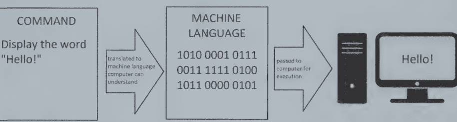

计算机的主要用途之一是互联网。那么，互联网是什么，JavaScript又与它有何关系？

## 第六章

### 互联网与万维网

JavaScript是一种能在大多数计算机上运行的编程语言。它由一位名叫布兰登·艾奇的美国人在1995年创造，在制作网站方面特别有用。

万维网（缩写为“www”或“web”）是相互链接的电子文档集合，被组织成称为网站的组。

一个网站由一个或多个独立的网页组成，其中“页面”是一个有组织的、独立的文档，包含文本、图像、视频和其他元素。

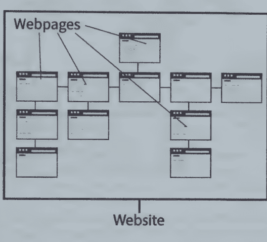

### 互联网

网络是一个两台或多台计算机相互连接的系统。计算机可以通过电缆（即有线连接）连接，也可以通过无线（通过空气）连接。“网络”一词用于描述协同工作的设备之间的连接，并在计算机领域以多种不同方式使用。通过使用网络，信息可以在计算机之间共享。


“Internet”（互联网）一词是“interconnected”（互联）和“network”（网络）的组合。

互联网是一个由全球许多计算机互联而成的网络。它是现存最大的网络，允许计算机相互传递数据。

在连接到互联网的计算机之间可以来回发送许多不同类型的数据——例如电子邮件消息、电子文档、医疗记录等。


除了指代该网络上计算机之间的连接，“互联网”还指一套用于在这些计算机之间传输不同类型数据的协议或规约。

“协议”是一种官方程序。在技术领域，它是指某种类型信息的格式和处理方式的正式描述。基本上，它是所有处理该类型信息的人员共同遵守的一份约定。协议通常在书面文件中有详细描述，并且非常精确。它们通常由相关行业的专家创建。

一个需要使用协议的典型数据类型例子是医疗信息。如果医疗行业的各个组织在工作过程中需要在计算机之间来回传输医疗数据，那么他们必须就信息的确切格式、如何保护隐私数据安全等事项达成一致，这一点至关重要。所有这些都会在书面协议中予以规定。医疗行业确实存在若干此类协议。

针对可以在互联网上传输的每种数据类型，都创建了一种或多种协议。违反这些协议会导致错误，数据将无法正常传输或根本无法传输。

所以总结一下：互联网是一个由全球许多计算机互联而成的网络，以及一套用于在这些计算机之间传输不同类型数据的协议或规约。

### 互联网 vs. 万维网

那么，互联网和万维网有什么区别呢？互联网是数据传输所依赖的硬件和协议，而万维网是通过互联网访问的一种信息类型。万维网是由称为网页的链接电子文档组成的集合。

互联网是基础设施（物理框架），而万维网是传输和显示的代码。从某种意义上说，互联网是硬件，万维网是软件。


“动态”指的是在需要时立即发生的动作，而非预先设定。例如，一家根据你点餐时的规格来准备食物的餐厅，就是动态的。动态的对立面是“静态”，字面意思是“不变”。一家静态餐厅会在你点餐前就准备好并放着食物——食物不会随时间或情况而改变。

在编程中，“动态”意味着计算机在你请求时立即处理你的请求——它没有预先设定的结果。

“动态”与互联网相关，用于描述那些在浏览时内容会发生变化的网站。

举个例子，网站上的一个动态图片可以是当你在鼠标悬停在它上面时会有特效（移动或变化）的图片（鼠标悬停指的是将指针保持在特定对象上）。

## 第七章

### JavaScript

JavaScript是学习编程的绝佳入门语言，并且在一些榜单中被评为世界上最流行的编程语言之一。

JavaScript的主要用途之一是使网站更具动态性（描述那些内容会根据用户操作或其他因素而变化，而非外观和内容都静态不变的网站）。

JavaScript还可以使程序和网站更具交互性，例如，可以让视频在用户将鼠标移到其上方时立即开始播放。

JavaScript还有许多其他用途；它被用于创建多种不同类型的计算机程序。


那么，JavaScript的定义是什么？嗯，根据一个顶级在线技术词典，“JavaScript是一种高级、无类型、解释型的运行时语言。”

一上来，这个解释就显示了我们为什么写这本书。那个定义毫无意义。因此，为了理解那里说的是什么，让我们来剖析一下这个定义。

### 高级语言

我们之前讨论的机器语言（1和0）被认为是“低级语言”。这是因为它接近计算机的硬件，直接表示计算机指令和计算机操作的数据中使用的开或关状态。

低级语言的相反是高级语言——其代码编写方式更易于读写，因为它有些类似于英语，例如：

```
Print “Hello”;
```

### 非类型化

数据就是信息。

计算机程需要不同类型的数据。这些数据类型包括：

-   数字，

-   字母，

-   日期，

-   真或假，等等。

当信息在计算机中使用时，该信息将具有一个“数据类型”。这包含两方面：

1.  “这是什么类型的信息？”，以及

2.  “我们可以对这种数据做什么操作？”

不同的数据类型可以以不同的方式使用。

当数据存储在计算机中时，其类型也会被存储——这样计算机就知道如何处理该特定的数据片段。

你可以对数据执行的各种不同操作称为运算。并非所有数据类型都具有相同可用的运算。

例如，“十进制数”（0-9）是一种数据类型。对十进制数数据可以执行的典型运算是加法、减法、乘法等。

“文本”是另一种数据类型。对文本数据可以执行的典型运算是“将文本转换为大写”或“连接”（这意味着将它们链接在一起，就像链条一样——例如，你可以获取单独的文本元素“Pizza”和“s!”，然后将它们连接成“Pizzas!”等等）。

在创建计算机程序时，计算机跟踪的每一段数据都是某种数据类型。例如，数据342.98是“十进制”类型的数据。数据“casserole”是“文本”类型的数据。


（数据类型示例）

对文本数据进行数学运算没有意义——例如，试图告诉计算机将数字34与文本“banana”相加是行不通的，因为这两种数据类型不同，数学不适用于文本数据。

在数学中，变量是一个用于表示未知量或可能变化的量的符号。在计算机中，变量是一种构造（由更简单元素形成的概念），用于存储在计算机执行任务时可能变化的数据。

计算机经常需要跟踪各种信息片段。这些可以是诸如计算机用户名、计算机屏幕上显示的背景颜色、用户向公司订购的订单号等信息。

计算机通常为这些数据中的每一段分配一个NAME和一个VALUE。NAME用于标识特定的数据片段，VALUE用于显示我们需要跟踪的实际数据。通常使用“=”符号来设置变量的VALUE。

在数学中，值是数量、量或数字——像这样：X = 10

这里我们说*名称*“X”持有*值*“10”。

在编码中，值是任何类型的特征或属性。我们可以这样赋值：

X = Happy

这意味着我们说*名称* X 被赋值为 Happy。我们稍后可以告诉计算机：

Print X

计算机随后会显示：

Happy

计算机跟踪的事物通常称为“变量”。这是因为它的VALUE部分可以在你告诉计算机更改时发生变化。值可以变化这一事实是它被称为“变量”的原因——它的值不是永久或恒定的。

许多计算机编程语言要求程序员指定变量的数据类型。这些称为“类型化语言”。当你在类型化语言中首次创建一个变量时，你需要指定变量是什么数据类型。

在类型化语言中，对各种数据类型如何交互存在某些限制。

例如，你可能需要让计算机指令来计算一个人的当日工资。这里，你可以有三个数据类型为“整数”的变量，这意味着它们表示数值数据（即数字）。整数是一个整数——比如6、99和182。3.11和9½不是整数。

你会这样创建计算一个人当日工资的变量：

```
integer PayRate = 35.00
integer HoursWorked = 10
integer Paycheck
```

第三个变量，名为Paycheck的整数，还没有值。这个变量旨在存储确定工人赚取了多少钱的数学运算结果。

计算机指令可能看起来像这样：

```
Paycheck = HoursWorked x PayRate
```

因为所有三个变量都是相同的数据类型，计算机可以处理这个数学运算并将结果存储到变量“Paycheck”的值中：350.00。

非类型化语言是不需要你定义变量数据类型的编程语言。相反，计算机使用预定义系统根据变量的值及其使用方式来推断变量的数据类型。

例如，让我们使用前面的数学例子，但看看当使用非类型化语言执行时它如何工作。

这里，我们可能有三个类似于前面例子的变量：

```
PayRate = 35.00
HoursWorked = "ten"
Paycheck
```

注意没有指定数据类型。同时注意，变量“HoursWorked”的值是“ten”——一个词，而不是数字。

如果我们想执行与上面例子相同的数学运算，我们可能会创建相同的计算机指令：

```
Paycheck = HoursWorked x PayRate
```

这使得数学运算有些不同。计算机获取变量PayRate的值35.00，并尝试将其乘以变量HoursWorked的值“ten”。

乍一看这行不通——你不能用一个词乘以一个数字！但非类型化语言有一个预定的系统，用于推断（根据可用信息确定某事）变量所代表的数据类型。这里，语言可以推断出单词“ten”可以表示数字10——并且由于指令是一个数学运算，语言以这种方式解释变量，并将35.00乘以10得到350。

JavaScript是一种*非类型化*编程语言，即你不需要定义变量的类型。

### 解释型

编译器是一个特殊的程序，它将看起来几乎像英语的代码转换成计算机可以理解并执行的形式。编译器的产物将是一组计算机可以执行的指令，最终完成“几乎像英语”的代码所描述的功能。

例如，如果你在计算机程序中输入这个指令：

```
if age > 18, print "You are an adult"
（符号 > 表示大于）
```

编译器会获取你写的内容，将其转换成计算机可以理解的形式，然后将该命令传递给计算机，以便它可以执行（即机器语言——一长串的1和0）。

编译器工作方式的一个重要方面是，它获取程序中的所有指令，并在实际执程序之前将它们转换成计算机可以理解的语言。还有其他将高级语言转换为计算机可读形式的方法，这些方法不涉及在执行前转换整个程序。相反，每条指令都是单独转换和执行的。然而，编译器不是这样工作的。

编译型编程语言使用编译器。

解释器是一个特殊的程序，它将高级语言指令转换为低级语言指令。解释器一次一条指令地以这种方式转换代码，而不是在执行前转换程序中的整个指令集。

换句话说，解释器将读取一条指令，将其转换为计算机可以理解的语言，让计算机执行该指令，然后继续处理程序中的下一条指令并重复。

解释型编程语言（如JavaScript）使用解释器。

### 运行时

运行是指启动或执行某事。

要理解运行时，你必须首先理解什么是“编译器”。

运行时是指计算机中的某些东西正在运行的时间。运行时正是它的意思——程序运行的时间。你可以说某事发生在运行时，或者它发生在编译时。

“运行时”这个术语还描述了在你的程序运行时执行的软件或指令，特别是那些你没有明确编写但正确执行代码所必需的指令。这实际上是一个“运行时库”，但通常简称为“运行时”。

库是用于创建计算机程序的预制作资源的集合。最常见的是，它们采用包含内置函数的代码包形式，这些函数都与特定领域相关。它们通常通过将它们添加到已经创建的软件项目中来使用，然后让该项目中的代码利用库中的各种函数。

在计算机编程中，运行时库是编译器在计算机程序的运行时（执行期间）用于实现内置在编程语言中的函数的特殊程序库。

例如，你可以在运行时或运行前设计视频加载。如果它们在运行时加载，那么你必须在单击它之后等待它加载。如果它们在运行前加载，视频会在你最初打开程序（输入计算机的执行特定功能的指令集）时加载，因此程序启动时加载时间会更长。

### 综合运用

那么，让我们回到本章开头给出的定义。"JavaScript" 是一种 "高级、无类型、解释型的运行时语言。" 结合本章涵盖的数据知识，你现在可以理解这个定义了！

现在我们来回顾如何解决编码中的问题。

## 第八章

### 算法

“算法”是一个数学术语，指的是解决问题的计划。它包含一系列解决问题或执行操作的步骤。

计算机使用算法。算法是一组用于完成某项任务的指令。

例如，选择合适衬衫的算法可能包含以下步骤：

- 1. 从衣柜里挑选一件衬衫。

- 2. 把衬衫穿上。

- 3. 照镜子看看自己。

- 4. 如果喜欢，转到步骤 6。

- 5. 如果不喜欢，返回步骤 2。

- 6. 结束流程。

计算机通过处理算法来执行功能。你可以为计算机创建算法，其他人将来就可以使用这些算法，而无需再次写出整个步骤列表。

例如，当你的计算机打印东西时，它会使用许多庞大的算法来确定你拥有的打印机类型、如何以打印机能够理解的方式传输文档等等。这一切都在后台处理完成，你只需要点击“打印”即可。这些算法是由其他人编写的，目的是让计算机和打印机按照你的意愿工作。

算法的另一个例子可以是一个简单的食谱，比如：

- 1. 打碎三个鸡蛋，将蛋液倒入一个小碗中——尽量避免蛋壳掉入碗中。

- 2. 如果有蛋壳，从碗中取出。

- 3. 在小碗中将3个鸡蛋搅拌90秒。

- 4. 将一个小煎锅放在炉子上，将炉火调至中温。

- 5. 将鸡蛋倒入小煎锅中，煎至几乎没有或完全没有水分。

- 6. 将鸡蛋盛出。

虽然存在相似之处，但计算机和人使用算法的方式并不相同；现实生活中的算法和计算机算法之间有相似的特点，但它们并不相同。

计算机不会思考——它们完全以字面意思运行——因此在为计算机编写算法时，必须具备某些特征才能让计算机使用该算法。人们可以推断事物和推导数据；人们有想象力。计算机只能做它们被告知去做的事情。

为了完全理解计算机算法是什么，必须先澄清一些术语和概念。算法由五个独立的特征组成：

- 1. 结果：某事的最终产出。

- 2. 有限的时间：完成某事所需的确定时间量。

- 3. 良好排序：按正确顺序并以有组织的方式列出。

- 4. 可有效计算的操作：指计算机能够成功处理的命令。

- 5. 明确性：含糊意味着不清楚、令人困惑、不明确。Un = 不。明确的事物意味着它是清晰且定义明确的。

让我们详细回顾每一点。

#### 结果

结果：某事的最终产出。

在计算机中，一个响应可以被视为结果。你输入：“告诉我日期”，计算机回复：“2022年1月3日。” “2022年1月3日”就是结果。问题的答案也被视为结果。

算法总是有结果的。如果没有结果，它就不能被视为有效的算法。

例如：打印数字 “2”，结果：2。

#### 有限的时间

有限的时间：完成某事所需的确定时间量。

算法应该包含有限数量的操作，并应在设定的时间段内执行这些操作。算法绝不应该是开放式的或无限的。由于算法的每一步都需要一定时间来完成，这意味着算法将在有限的时间内完成。

一个不正确的算法是：

- 1. 从数量 1 开始

- 2. 将 1 加到该数量上

- 3. 转到步骤 2

然后计算机将永远计数 0, 1, 2, 3, 4 等等。

例如，“从 1 数到 10，然后打印一条消息，上面写着‘我数了1-10’”，这将是一个正确的算法，因为它包含有限数量的步骤。

#### 良好排序

良好排序：按正确顺序并以有组织的方式列出。计算机只有在算法良好排序的情况下才能执行它。如果顺序混乱或未指定顺序等，计算机将无法处理该算法。

例如，这是一个不正确的算法，因为它没有良好排序：

- 1. 关闭程序

- 2. 在程序内打印 “I am here”

- 3. 在程序中保存你的工作

- 4. 打开程序

#### 可有效计算的操作

可有效计算的操作：指计算机能够成功处理的命令。这个短语字面意思是能够以有效方式计算的操作。

在算法中，算法的所有部分都必须是可执行的。

例如，一个不可有效计算的操作可能是：“将绿色乘以红色”——计算机无法处理这个，因为它无法计算。算法中包含的操作必须是可有效计算的操作，例如，“2 + 2 = ”。

#### 明确性

明确性：含糊意味着不清楚、令人困惑、不明确。Un = 不。明确的事物意味着它是清晰且定义明确的。

在计算机中，你的算法必须是明确的。你必须对算法的每一步/每个部分极其具体，否则计算机将无法处理这些算法。

例如，如果你有一个处理十个数字列表的算法，而你的算法的一个步骤是“删除数字”，计算机就无法处理，因为你没有明确指定要删除哪个数字。

现在你知道了上述术语和概念，我们有了美国作者施奈德和格斯汀在《计算机科学导论》一书中对“算法”的完整定义：

> *算法：* 一个由明确且可有效计算的操作组成的良好排序的集合，当执行时会产生一个结果并在有限时间内终止。

排序意味着将项目按精确的顺序或次序排列。计算机经常对项目进行排序。在你的计算机上，你可以按创建时间、名称等对文件进行排序。算法可以被计算机用来组织数据。

例如，你可以按名称或日期对计算机上的文件进行排序。这是通过计算机内部的排序算法完成的。有几种不同的方式可以编写算法来对数据进行排序。

在学习如何编程时，你将编写算法来执行各种功能。计算机已经内置了许多算法，使它们能够执行你使用计算机所做的许多操作。例如，你的计算机在保存文档时执行许多复杂的步骤。这些步骤之所以能处理，是因为程序员输入了算法来为你处理。

无论你是否学习编写代码，了解构成程序的要素都是有帮助的，我们现在就来介绍这些要素。

## 第九章

### 程序的五个要素

任何计算机程序都有五个关键要素：

- 1. 入口

- 2. 控制/分支（程序中的决策点）

- 3. 变量

- 4. 子程序（程序中的程序）

- 5. 出口

让我们详细回顾每一点。

#### 入口

计算机归根结底是一台简单的机器。它一次只能做一件事，并且它严格按照计算机程序员输入的顺序执行计算机程序的指令。只有当被指示时，它才能执行（执行或运行）指令。

这意味着任何计算机程序都必须有一个明确标记的“第一条指令”。这是计算机程序启动时计算机将执行的第一个任务。从那时起，程序中的每条指令都会在执行完当前指令后，指导计算机下一步执行什么指令。

指定入口点的方法因使用的计算机编程语言而异，但每个计算机程序都有一个定义好的入口点。

#### 控制/分支

计算机通常用于自动化那些原本由人执行的动作。人在执行工作中最常被要求做的事情之一就是评估事物的状况，并根据该状况选择两个或多个可能的行动方案。换句话说，他们必须做出决定。一个例子是“教师批改一叠试卷”的活动：

- 1. 从一叠试卷顶部取下下一张学生试卷。

- 2. 批改试卷。

- 3. 在试卷上写下分数。

- 4. 如果分数是 70% 或更高，将试卷放入“通过”堆。

- 5. 如果分数低于 70%，将试卷放入“未通过”堆。

你可以看到这里有两条可能的“路径”。一条路径是“由一个决策产生的可能的行动过程”。把它想象成你走到一个岔路口时发生的情景。你必须决定采取什么行动——你走哪条路？这也被称为一个分支。

除了最简单的计算机程序，所有程序都需要做同样的事情。也就是说，它们必须检查一段数据的状况，并根据该数据的状况，执行不同的计算机指令集。

为了做到这一点，程序将使用一种称为“控制”指令的特殊计算机指令。这些指令只是告诉计算机在做决定时需要看什么，然后告诉计算机对于每一种可能的决策该做什么。计算机最基本的控制语句是“if”。它的使用方式如下：

IF [要检查的条件] THEN [要执行的计算机指令分支]

这里，“IF”是控制语句；“THEN”是指向如果控制语句为真则要执行的程序路径的分支指令。

#### 变量

我们之前介绍过变量，它们是程序的关键部分。

回顾一下，变量是计算机程序用来跟踪在程序执行过程中可能发生变化的数值的一段数据。这可能是诸如“刚刚被评分的学生论文的成绩”或“为装配线上的下一辆车使用的油漆颜色”之类的东西。

变量是任何计算机程序的重要组成部分，因为它们使得计算机程序不仅仅能用于一组单一的、预定的数值。你可以想象，如果“为装配线上的下一辆车使用的油漆颜色”永远只能是“蓝色”，那么使用该数据的计算机程序就不会非常有用。让计算机程序能够为每一辆要喷漆的汽车改变这个值会更有意义。

当你在计算机程序中编写变量时，它们通常以这样的方式编写：

[变量名] = [变量的值]

例如，你可能会有这样的代码：

```
color = "red"
```

这里，变量名为“color”，该变量的值已被设置为“red”。换句话说，名为“color”的变量现在“等于”单词“red”。

让我们看看“一位老师给一叠论文评分”的例子。这里，我们可以有一个名为“Paper Grade”（论文成绩）的变量，每次老师给一篇论文评分时它都会改变。你还可以有关于论文总题目数的变量（“Total Questions”），用于学生回答正确的题目数（“Correct Questions”），以及论文成绩。

上面的书面描述如下：

1.  从“待评分”堆的顶部取出下一位学生的论文。

2.  评分。

3.  将成绩写在论文上。

4.  如果成绩为70%或更高，则将论文放入“通过”堆。

5.  如果成绩低于70%，则将论文放入“未通过”堆。

用计算机语言表示，这个过程可能如下所示：

1.  取出下一篇论文

2.  设置 Total Questions = [当前论文的总题数]

3.  评分

4.  设置 Correct Questions = [回答正确的题目数]

5.  设置 Paper Grade = [Correct Questions/Total Questions]

6.  If (Paper Grade >= 70%) then Paper Status = “passed”

7.  If (Paper Grade < 70%) then Paper Status = “failed”

这是一个简单的计算机程序。

注意，>=（大于号后跟等号）是一个用于表示应进行比较的符号。具体来说，这个“大于或等于”符号是一个指令，用于检查符号左侧的数据在数量或数量上是否大于或等于右侧的数据。这个比较的答案是“true”或“false”。

例如：5 >= 4

这意味着“检查5是否大于或等于4”。由于五实际上大于四，答案是“true”。

另一个例子：3 >= 6

这意味着“检查3是否大于或等于6”。答案是“false”。

最后一个例子：6 >= 6

这意味着“检查6是否大于或等于6”。答案是“true”。

>=的反向（相反）符号是<=，它检查符号左侧的数据是否*小于或等于*右侧的数据。

每次计算机运行前面列出的七步过程时，程序中每个变量的值都可能不同，这取决于被评分的论文有多少道题以及学生正确回答了多少道题。

例如，假设论文有100道题，学生答对了82道。程序运行后，结果如下：

| Total Questions: | 100 |

| Correct Questions: | 82 |

| Paper Grade: | 82% |

| Paper Status: | Passed |

再举一个例子，假设论文有50道题，学生答对了30道。程序运行后，结果如下：

| Total Questions: | 50 |

| Correct Questions: | 30 |

| Paper Grade: | 60% |

| Paper Status: | Failed |

为了阐明使用变量的必要性：假设在这个计算机程序创建时，学校的所有论文都有100道题，并且老师们告诉程序员，要始终假定题目数量为100。在这种情况下，程序员就不会使用名为“Total Questions”的变量。

相反，他们可以让程序看起来像这样：

1.  取出下一篇论文

2.  评分

3.  设置 Correct Questions = [回答正确的题目数]

4.  设置 Paper Grade = [Correct Questions/100]

5.  If (Paper Grade >= 70%) then Paper Status = "passed"

6.  If (Paper Grade < 70%) then Paper Status = "failed"

注意，在程序的第4行，程序员将题目数量设置为100。

现在，假设学校引入了“测验”的概念，这是一种只有20道题的小型论文。如果计算机程序处理的是测验，那么成绩将不再准确——即使学生20道题全部正确，他们也只能得到20%的成绩（20/100）。

一个优秀的程序员会分析程序旨在解决的需求，然后构建程序，使其能够随着时间的推移处理该需求的变化。

另一个有价值的控制语句是循环。这是程序的一部分反复执行，直到满足某个条件为止。

用现实世界的术语来说，一个例子可能是“一次评一份论文，直到所有论文都评完”或者“复制这份文档五份”。

在计算机程序中，循环看起来像这样：

- [开始循环]

  - 执行操作

  - If [结束条件已满足] then [退出循环]

  - If [结束条件未满足] then [重复循循环]

- [结束循环]

我们看到的评分程序可以设置为一个循环。指令可以这样安排：

- [开始循环]

  - 从“待评分”堆的顶部取出下一位学生的论文。

  - 评分。

  - 将成绩写在论文上。

  - 如果成绩为70%或更高，则将论文放入“通过”堆。

  - 如果成绩低于70%，则将论文放入“未通过”堆。

  - If [“待评分”堆中没有更多论文] then [退出循环]。

  - If [“待评分”堆中还有更多论文] then [重复循环]。

- [结束循环]

通常循环会使用一个名为“计数器”的特殊变量。计数器跟踪循环已执行的次数。这可以用来确保循环仅在需要时执行。

让我们也给正在讨论的评分程序添加一个计数器和两个新变量：“Total Papers”将用于存放“需要评分的论文总数”的值，而“Counter”将用于存放“循环已执行的次数”的值。

1.  设置 Total Papers = [要评分的论文总数]

2.  设置 Counter = 0

3.  If (Counter < Total Papers):

    a.  取出下一篇论文

    b.  设置 Total Questions = [当前论文的总题数]

    c.  评分

    d.  设置 Correct Questions = [回答正确的题目数]

    e.  设置 Paper Grade = [Correct Questions/Total Questions]

    f.  If (Paper Grade >= 70%) then Paper Status = “passed”

    g.  If (Paper Grade < 70%) then Paper Status = “failed”

    h.  Counter = Counter + 1

    i.  回到步骤 3

4.  [继续程序的其余部分]

这里，循环出现在步骤3。

让我们分解一下每个步骤在这里的作用：

**步骤1：** 计算“待评分”堆中有多少篇论文，并将“Total Papers”变量的值设置为该数字。

**步骤2：** 创建一个名为“Counter”的变量，并将其值设置为零。此变量将用于跟踪已评分的论文数量。

**步骤3：** 使用控制语句“if”来查看我们是否应该执行循环。

**步骤3a-3g：** 评分；这在上面已经介绍过了。

**步骤3h：** 由于我们现在已经评分了一篇论文，将我们的Counter变量加一。

**步骤3i：** 回到循环顶部，我们检查是否需要再次执行整个循环。

## 第十章

### 编程语言的类型

正如我们在本书前面所介绍的，编程语言是让你能够创建程序的、由词语、短语和符号组成的系统。它们也被称为计算机语言。

编程语言有许多不同的类型，每种语言都是为了满足特定目的而创建的。通常，一种语言的创建是为了使某些类型的计算机程序的创建更加容易。

一些编程语言专门用于创建网站，而另一些则专门用于制作应用程序。在本章中，我们将介绍一些最知名的编程语言。但首先，有一些与编程语言相关的术语需要介绍。第一个是“标记”。

“标记”是指向文档添加指令以控制文档内容的格式、样式和外观的行为。这既适用于物理打印文档，也适用于在计算机屏幕上显示的电子文档（如网站）。

标记语言是一种用于指指定文档中数据标记指令的编程语言。换句话说，标记指令不是文档中的数据；它们是*关于*文档中数据的数据。

有几种类型的标记语言。通常，它们是为具有明确结构规范的常用文档类型而创建的。这些关于文档结构的规范在世界范围内广为人知，任何想要创建此类文档的人都可以获得。

脚本是计算机在没有你参与的情况下自动执行的一系列命令。脚本语言是用来制作脚本的计算机语言。

通常，这些脚本执行的任务对于自动化非常有价值——这样，你就无需每次执行这些任务时都重新将任务步骤输入计算机。

这个术语的起源与其在“电影剧本告诉演员该做什么”中的含义相似；脚本语言控制计算机的操作，一次性给它一系列工作来完成。例如，你可以将一系列编辑命令放在一个文件中，并告诉编辑器运行该“脚本”，就像这些命令是手动输入的一样。

举个例子，如果你想让系统在每天午夜自动打印出所有报名参加你学校课程的人员名单，你可以使用脚本语言来制作一个完成这项工作的脚本。

JavaScript 可以用来创建脚本，并且它是一种脚本语言。

有几种语言与 JavaScript 一起使用——让我们来看看它们是什么。

## 第十一章

### HTML 和 CSS

JavaScript 是用于创建万维网内容的三种主要技术之一（另外两种是 HTML 和 CSS）。

#### HTML

超文本标记语言是构成万维网网页的标记语言。它由蒂姆·伯纳斯-李（万维网的发明者）于 1990 年创建。超文本是用于链接电子文档的系统。在 HTML 文档中，超文本是链接到其他 HTML 文档的单词、图像、视频等。当用户选择超文本时，链接的文档就会被检索并显示在计算机屏幕上。HTML 用于创建网页。

计算机程序员使用 HTML 在网页内容的前后放置标记指令。这些标记指令为计算机提供*关于*文档元素的数据——文本、图像、视频等。当文档实际显示在屏幕上时，这些标记指令不会显示在屏幕上——相反，它们被用来控制文档实际内容的*显示方式*。截至 2020 年，HTML5 是 HTML 的最新版本。以下是一个来自 1990 年代的 HTML 网站示例：

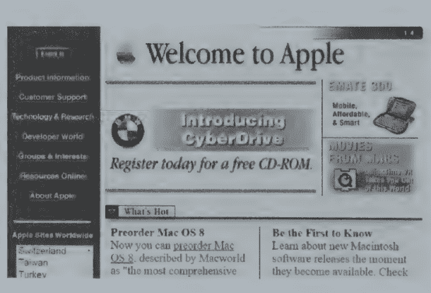

#### CSS

层叠样式表创建于 1996 年，用于控制这些网页上的文本、图像、视频等的外观。样式表是一种用于设计网页格式的工具。样式表是存储关于页面将如何显示以及如何运行的数据的中心位置。它们可以用来存储关于如何显示颜色、图片、文本等信息。样式表是处理网站样式的表格。

样式并不关心页面的内容；相反，它关心的是这些内容的外观。层叠是一个源自水从一系列高度递减的水滴上滴落的术语。可以把它想象成一系列小瀑布。信息可以层叠，这意味着它可以存储在一个中心的、最重要的位置，然后可以应用于被认为低于或源于该更重要中心位置的其他位置。对于网页来说，这意味着你可以在一个高级网页中设置样式信息，同样的样式信息可以“层叠”到其他更低级的页面，而无需任何额外的工作。CSS 通常与 HTML 结合使用，以提升 HTML 网站的外观和功能。截至 2020 年，CSS3 是 CSS 的最新版本。

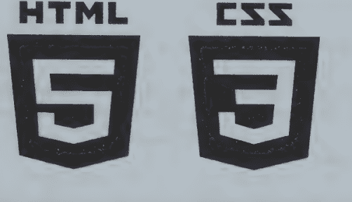

HTML、CSS 和 JavaScript 通常结合使用来创建动态网站。在本书中，我们将教你一些基础的 JavaScript，为此，我们将偶尔使用 HTML。

### JAVASCRIPT 的历史

浏览器是你用来查看互联网上网页的程序。为了查看网上的信息，你需要使用网络浏览器。人们使用浏览器最常见的活动是查找和查看网站——更具体地说，是网站上的网页。谷歌 Chrome 是使用最广泛的浏览器。

浏览器和搜索引擎的区别在于：浏览器用于访问和显示网站，而搜索引擎用于搜索网站。例如，你可以使用 Internet Explorer 浏览器在雅虎的搜索引擎上进行搜索。

在 1990 年代中期，还没有谷歌，因此，在谷歌 Chrome 之前，最受欢迎的浏览器是 Netscape Navigator。JavaScript 由布兰登·艾奇于 1995 年创建，他当时在 Netscape 工作。

Java 是当时流行的一种编程语言，现在仍然是——它也是 JavaScript 的灵感来源之一。但需要明确的是，Java 和 JavaScript 是两种完全不同的编程语言。由于当时 Java 正在被大力推广，Netscape 将这种新的脚本语言命名为 JavaScript。

#### 值类型

几乎每种计算机编程语言都内置了某些数据类型，并允许计算机程序员创建其他类型的数据。在 JavaScript 中，这些不同类型的数据被称为“值”。

JavaScript 中有六种值类型：

- 1. 字符串（表示文本或一系列文本的数据）

- 2. 数字

- 3. 布尔值（真或假的陈述）

- 4. 对象（具有状态和行为的事物）

- 5. 函数（一段组织化、可复用的计算机代码，用于执行单个相关操作——也称为子程序或例程）

- 6. 未定义的值

你将在本书中学习如何使用这些值类型。

我们离编写代码已经很近了！让我们回顾一些技巧，帮助你学习本书。

## 第十二章

### 编码技巧

如果你在学习本书时遇到任何问题，这里有一些技巧：

- 1) 确保你理解所有使用的单词和术语——弄清楚你不理解的任何内容。

- 2) 确保你的代码完全按照这里所写的方式编写。代码中的一个小错误，比如缺少一个逗号，都可能破坏整个程序。代码必须精确，程序才能正确运行，因此务必仔经检查你的代码是否有错误。

- 3) 在网上搜索解决方案。

- 4) 你也可以联系 The Tech Academy 寻求帮助——learncodinganywhere.com

### 挑战

在一些章节的末尾，我们会有一个“章节末挑战”。这些是你将本章所学内容整合起来的机会。有时你也会被要求自己找出问题的解决方案。在职的软件开发人员经常被分配他们以前从未做过的项目和任务。这项工作的一个关键要素是在网上研究解决方案。你会发现本书中的一些挑战会要求你做我们尚未教你的一些事情。这是故意为之的。我们希望你获得在网上查找新数据并自己解决问题的经验。用不止一位软件开发人员的话说：“我靠谷歌搜索拿工资！”

其中一些挑战将重复你已经执行过的任务。这样做的原因是：

- a. 为你提供创建自己方法的机会，以及

- b. 通过重复让你更好地理解和记住代码。

恭喜你完成了这些入门章节！现在我们将开始编码！

## 第十三章

### 首次编码任务

这是你的第一个任务：

在此处下载并安装 Notepad++：https://notepad-plus-plus.org/

你将在代码编辑器 Notepad++ 中编写代码。

注意：如果你使用的是 Mac 电脑，可以使用不同的代码编辑器——例如 Brackets。

#### HTML

在 JavaScript 中编写代码之前，你必须熟悉一些基本的 HTML。

HTML 中的标记指令为计算机提供关于文档元素的数据*关于*——文本、图像、视频等。当文档实际显示在屏幕上时，这些标记指令不会显示在屏幕上；相反，它们用于控制文档的实际内容*如何*显示。

##### 标签

HTML 使用标签。标签是指定 HTML 文档中内容标记的方式。

基本原则是：如果你想影响内容的前后放置特殊指令，另一个程序可以区分指令和内容，然后以指定的方式呈现数据。

因此，标签通常由两部分组成：开始标签和结束标签。内容将放在这两个标签之间。开始标签表示标记指令的开始，结束标签表示结束。

开始标签写为一个“小于”角括号（<），后跟标记指令，然后是一个“大于”角括号（>）。

一个例子是用于使文本**粗体**的标签。实际指令是单词“strong”，意思是“使此标签控制的文本突出显示”，通常通过加粗。开始的“strong”标签看起来像这样：

```
<strong>
```

你需要指定一个结束标签，这样计算机程序才知道何时停止使文本加粗。这就是结束标签的作用。结束标签使用与开始标签相同的指令，但在指令前放置一个正斜杠（/）（</>）。

结束的“strong”标签看起来像这样：

```
</strong>
```

将所有部分组合在一起，如果你想强调一个引语，你会这样编写 HTML：

```
<strong>"教育是你能用来改变世界的最强大的武器。"</strong> -纳尔逊·曼德拉
```

此代码的输出将如下所示：

> "教育是你能用来改变世界的最强大的武器。"

> -纳尔逊·曼德拉

##### 元素

标签和编写在它们之间的代码称为“元素”。下面是一个展示这一点的示意图：

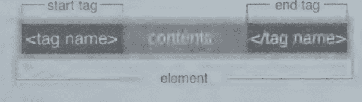

在本章中，我们将一起编写 HTML 和 JavaScript。这样，你就可以看到它们如何协同工作。此外，当你声明自己懂 JavaScript 时，会默认你也懂 HTML。

##### NOTEPAD++

现在 Notepad++ 已经安装在你的机器上，请执行以下操作：

启动 Notepad++

点击菜单栏上的“文件”并打开一个新文件（或直接按 Ctrl + N）。

##### HTML 中的 “HELLO, WORLD”

开发人员学习新语言时通常编写的第一个代码是让计算机显示文本：“Hello world.” 我们将首先使用 HTML 来完成此操作。

每个包含 HTML 代码的 HTML 文档顶部都有 <!DOCTYPE HTML> 声明。这不是一个标签。它是给浏览器的指令，告诉它你正在使用 HTML——还有其他 doctypes（文档类型）可以使用，因此明确说明这一点有助于浏览器。

<html> 标签插入在代码的开头，你所有的 HTML 代码都包含在它和结束标签（</html>）之间。

<body> 标签表示你可以添加 HTML 文档内容的位置——例如文本、图像、视频、列表、链接等。

在 Notepad++ 中，编写以下代码：

```
<!DOCTYPE HTML>
<html>
    <body>
        你好，世界！
    </body>
</html>
```

提醒一下，你编写的代码中的“/”符号表示“结束标签”。

通过点击“文件”，然后“另存为”来保存此文档。将文档命名为 Test.html，并确保在“保存类型”下点击“超文本标记语言”。在所有 HTML 代码文件的末尾包含 .html 非常重要，因为如果你不这样做，你的计算机将不会识别它是一个 HTML 文件，你的代码将无法运行。另外，确保将此文件保存到你的桌面。

有多种方法可以运行你的代码。最简单的方法之一是将 HTML 文件拖放到打开的 Google Chrome 窗口中，如下所示：


请注意，上图中的文件图标（文件名上方的符号）是 Google Chrome 的标志，这是因为照片拍摄所用的计算机上，Google Chrome 被设置为打开 HTML 文件的默认程序。你的文件图标可能相同也可能不同。

你也可以右键单击桌面上的文件，选择“打开方式”，然后导航到 Google Chrome。

从现在起，在本书中，当我们说“运行”或“执行”你的代码时，我们指的是“在 Google Chrome 中打开它”，这样你就可以在浏览器中看到你的网页。

对于使用 Brackets 的 Mac 用户，你也可以点击“文件”，然后“实时预览”来运行你的代码。

现在执行以下操作：

运行你的代码。

恭喜你！你让浏览器显示了文本“你好，世界！”

##### 在线图像

统一资源定位符（URL）是 Web 资源的唯一名称。“Web 资源”是可以在互联网上找到的可识别事物。URL 最常见的例子是一个网站——https://www.google.com 就是一个 URL。

属性是用于元素开始标签内的一个单词或短语，用于控制元素的行为。

例如，图像  标签允许你将图像放置在网页中。src（源）属性与此  标签一起使用，它给出了图像的位置（图像显示的来源）。

你可以在以下内容中看到这一点：

```

```

在此代码中，图像标签告诉浏览器将图像放在页面的什么位置，而 src 属性给出了获取图像的位置。你可以从在线或计算机中获取（使用）图像。在上面的代码中，我们从在线获取图像。

请完成以下操作：

在网上找到一张你希望在HTML代码中显示的图片，并复制该图片的URL。

你可以按以下步骤操作：

1.  在Google上搜索你想要的图片（例如“小猫”）。

2.  点击搜索栏下方的“图片”。

3.  点击你想要的图片（它应该会显示在屏幕右侧）。

4.  右键单击该图片，选择“复制图片地址”。将此URL粘贴到某处，因为我们很快会用到它。

打开你的Test.html文件（如果尚未打开，一种方法是在桌面上右键单击你的文件，然后选择“使用Notepad++编辑”），并将代码替换为：

```html
<!DOCTYPE HTML>
<html>
    <body>
        </img>
    </body>
</html>
```

保存并执行你的代码。你的图片就会在浏览器中显示出来了！

现在，让我们尝试显示一张保存在你电脑上的图片。

##### 电脑图片

文件的路径称为“文件路径”。“文件路径”是文件的地址，它指定了文件的精确位置。它为文件提供了一个“路径”。

文件路径会这样描述：“你可以在名为‘Poems’的文件夹中找到名为‘Winter’的文件，而这个文件夹位于C盘内。”驱动器只是数据存储的一个位置。C盘是电脑上大多数文件和软件的存储位置。

路径的各个部分由一个不太可能用于目录或文件名的文本字符分隔。通常这个字符是斜杠、反斜杠或冒号（分别为“/”、“\”或“:”）。

“\”（反斜杠）符号在计算机中用于分隔电子文档集合的不同部分，并且已经被使用了很长时间。它被创造出来是为了帮助组织和查找你可能存储在计算机上的各种文件。

在文件路径中，反斜杠用于表示一个项目位于另一个项目之下（从层次结构的角度来看）。

层次结构是指根据等级或地位来排列事物。它指的是根据项目的相对重要性或特征来排列项目。存储层次结构指的是一个系统，在该系统中，各种数据存储设备根据其使用方式被赋予了层次重要性排名。影响给定设备排名的主要因素是其响应时间——即当计算机请求数据时，设备返回请求的数据片段需要多长时间。响应时间越快，排名越高。

在文件路径中，左边的项目位于右边项目的“上方”。如果我们采用之前的例子，文件路径将写为：

```
C:\Poems\Winter
```

为下一个任务做准备，下载一张你选择的图片（确保将其保存在“下载”文件夹中）。

书面文件、图片和视频是不同文件格式的示例。这些文件中的数据是以特定方式组织的，通常是基于数据将被计算机执行的各种进程使用的方式来组织的。

例如，书面文档文件中的数据组织方式将与视频文件中的数据非常不同。

一种常见的文件格式是“PDF”。这代表“便携式文档格式”。这是由软件公司Adobe在1990年代开发的文件格式。开发这种文件格式是为了确保无论文件在何种计算机上显示，都能保持一致的显示效果。

文件格式由其扩展名指示。扩展名是一个代码，它说明了文件格式是什么（文本、图像、视频等）。扩展名被附加在文件名的末尾。

假设你有一个名为“Contract”的文件，它以PDF格式存储；该文件将被命名为“Contract.pdf”——.pdf就是扩展名。

另一种常见的文件格式和扩展名是“.txt”（“文本文件”的缩写）。这是一种纯文本文件类型，无格式（没有特殊设计；纯文本）。如果你曾使用过记事本，它保存和运行的就是.txt文件。

正如我们之前所介绍的，你的HTML文件必须始终以.html扩展名结尾。

如果我们想在HTML代码中显示一张保存在电脑上的图片，我们需要包含文件路径，如下所示的代码所示。文件路径应该是：C:\Users\user\Downloads\File_Name.Extension

但为了确保你拥有正确的文件路径，你可以右键单击图片并选择“属性”——你会在“位置”旁边看到图片的文件路径。

例如，如果我们有一张名为“Kitten”的图片保存在“下载”文件夹中，文件路径可能是：C:\Users\user\Downloads\Kitten.jpeg

Jpeg是一种图片类型，我们必须在文件路径中包含图片的扩展名。否则，图片将无法显示。

打开你的Test.html文件，并将代码替换为：

```html
<!DOCTYPE HTML>
<html>
    <body>
        </img>
    </body>
</html>
```

保存并运行你的代码。

如果没有正确显示，请检查以下几点：

1.  你是否将图片保存在“下载”文件夹中？如果没有，请将其移至该文件夹。

2.  你是否包含了图片文件扩展名？如果没有，请添加它。

3.  你是否输入了正确的文件路径？如果没有，请验证并添加它。

##### “你好，世界”的JavaScript实现

现在，我们有两种方法可以将JavaScript添加到HTML代码中。第一种方法是直接在HTML内部使用`<script>`元素编写代码。

“方法”是对象可以执行的操作。它是一个命名的事件序列。方法应该始终有一个有意义的名称，例如CalculateIncomeTax，而不是Method_1之类的东西。这样你就可以通过阅读名称来了解它的预期功能。

“alert”是一个JavaScript方法，它会显示一个警告框（一个带有“确定”按钮的小窗口）。

字符是字母、数字和符号——例如键盘上可以找到的那些。正如我们之前提到的，字符串（一系列字符）是六种值类型之一。在JavaScript中，我们可以使用双引号（"）或单引号（'）创建字符串，例如：“Mary had a little lamb”或“Its fleece was white as snow”。在我们的上述代码中，“Hello, World!”是一个字符串。无论使用双引号还是单引号都无关紧要；它们执行相同的功能。

让我们在HTML文件中使用JavaScript来显示Hello, world!——按如下方式编辑你的代码：

```html
<!DOCTYPE HTML>
<html>
    <body>
        <script>
            alert("Hello, World!");
        </script>
    </body>
</html>
```

保存并执行此代码。注意：我们这里所说的“执行”是指“通过点击‘运行’，然后点击‘在Chrome中启动’来在Google Chrome中运行代码。” *在运行代码之前，你应该始终保存你的代码。*

做得好！我们刚刚创建了一个弹出窗口！

当我们把JavaScript代码包含在HTML文件中时，它被称为*内联JavaScript*。

还有另一种方法可以将JavaScript与HTML一起使用，那就是将我们的代码连接到外部文件。这意味着，我们有一个包含HTML代码的HTML文件，以及一个*独立的*包含JavaScript代码的文件。

以下是它的工作原理。首先，创建一个新文件并编写以下代码：

```javascript
alert("Hello, World!");
```

这就是我们的JavaScript代码。

将此文件保存在你的桌面上。将其保存为“Test_1”，格式为“JavaScript文件”（即，点击“文件”，“另存为”，在“文件名”中输入“Test_1”，然后在“保存类型”下点击“JavaScript文件”）。

要将我们的HTML文件与JavaScript文件链接起来，我们使用带有src属性的script元素。Src是“source”的缩写——意思是，我们正在指定我们链接的文件的来源（位置/名称）。

现在，回到你原来的HTML文件并编写以下代码：

```html
<!DOCTYPE HTML>
<html>
    <body>
        <script src="Test_1.js">
        </script>
    </body>
</html>
```

保存并执行代码。我们以不同的方式显示了相同的警告框！

将你的JavaScript代码保存在与HTML代码分离的文件中是推荐的方式，被认为是最佳实践。它使你的代码组织得更好。

总结一下，我们可以通过两种方式执行JavaScript：

1)  内联JavaScript（将你所有的JavaScript写在HTML文件中），或者

2)  将你的JavaScript代码写在一个独立的外部文件中，并在HTML文件中引用它（指向它）。

虽然在进行专业软件开发时，后一种方式是首选，但我们将在本书中同时使用这两种方法。

##### WINDOW.ALERT()

我们可以使用window.alert()方法使一个警告窗口弹出。在JavaScript中，语句是由计算机执行的指令列表，它们构成了程序。语句使用分号分隔。它告诉计算机：“这条语句到此结束。”

删除你的 HTML 文件中的代码，然后编写、保存并执行以下代码：

```html
<!DOCTYPE HTML>
<html>
    <body>
        <script>
            window.alert("Hello, world!");
        </script>
    </body>
</html>
```

干得好！你用内联 JavaScript 创建了一个弹出窗口。

##### DOCUMENT.WRITE()

你也可以使用 `document.write()` 方法在 JavaScript 中显示文本。删除你的 HTML 文件中的代码，然后编写、保存并执行以下代码：

```html
<!DOCTYPE HTML>
<html>
    <body>
        <script>
            document.write("Hello, world!");
        </script>
    </body>
</html>
```

如你所见，编程中执行操作有不止一种方法——一个问题可以有多个解决方案！

### 本章挑战

编写一个包含以下内容的程序：

-   创建一个包含文本和图片的网页，并在浏览器中成功运行它。

-   使用一个外部 JavaScript 文件（即使用 `<script src="">`）和 `document.write()` 来显示你选择的文本。

## 第十四章

### 变量和字符串

编程中的一个常见操作是赋值变量。变量在每种编程语言中都是关键。我们之前已经定义过这个术语，简单来说：它是一个可以根据条件或传递给程序的数据而改变的值。

在数学中，运算符是用于执行计算（通过数学计算出某个数量）的符号。有几种不同类型的运算符。算术运算符，例如：

-   +（加），

-   -（减），

-   /（除），和

-   *（乘）

用于执行数学运算。

#### 赋值运算符

在 JavaScript 中，赋值运算符是“=”；它用于给变量赋值。

例如，在 JavaScript 中说 X = 10，我们就是在给变量 “X” 赋予值 “10”。

让我们在 JavaScript 中给一个变量赋值。删除你的旧代码，编写以下内容：

```html
<!DOCTYPE HTML>
<html>
    <body>
        <script>
            var X = "Hello, world!";
            document.write(X);
        </script>
    </body>
</html>
```

保存并执行此代码。我们给变量 X 赋予了字符串值 “Hello, world!”

#### 创建字符串

在 JavaScript 中编写字符串时，有些字符和函数不容易放在引号内。

例如，如果你想显示：Sally said, "I don't want to go" 怎么办？你不仅有围绕 Sally 陈述的额外引号，还有 “don't” 中的单引号（撇号）。

这个问题的解决方案是添加一个反斜杠（\）——这被称为“转义”字符，并告诉计算机后面的字符具有特殊含义。例如：\' 或 \" 表示反斜杠后面的引号不会结束字符串，而是会被打印在屏幕上。

另外，如果你想开始新的一行，你可以使用 HTML 的 `<br>` 标签，这就像按下回车键。它的意思是“换行”。换行会字面上创建一个新的文本行——再次强调，就像在键盘上按下 Return/Enter 一样。

让我们来试试。删除你之前的 HTML/JavaScript 代码，编写以下代码：

```html
<!DOCTYPE HTML>
<html>
<body>
    <script>
        document.write("Sally said, \"I don't want to go\"");
    </script>
</body>
</html>
```

保存并执行你的代码。我们已经成功显示了引号和撇号！

等一下……如果你需要在代码中显示反斜杠怎么办？很简单，写两个就行了：\\

#### 连接字符串

连接意味着将项目连接在一起，就像链条中的环节。它意味着取一段数据并将其粘贴到另一段数据的末尾。例如，连接字符串 “dev” 和字符串 “ices” 就会得到文本 “devices”。

在 JavaScript 中，你可以使用 + 运算符来连接字符串。

删除你的 JavaScript 代码，编写以下内容：

```html
<!DOCTYPE HTML>
<html>
<body>
    <script>
        document.write("Be who you are and say what you feel."
        + "because those who mind don't matter and those who matter don\'t mind."
        + "-Dr. Seuss");
    </script>
</body>
</html>
```

保存并执行你的代码。有些地方不太对劲……我们在 “feel,” 和 “because” 之间缺少一个空格。

要解决这个问题，只需在 “because” 前添加一个空格，如下所示：

`" + "because those who mind don't matter and those who matter don\'t mind." +"`

保存并执行你的代码。现在它显示正确了！

#### 多个变量

你也可以在一条语句中给多个变量赋值。编写以下代码：

```html
<!DOCTYPE HTML>
<html>
<body>
    <script>
        var Family = "The Arezzinis", Dad = "Jeremiah",
            Mom = "Hermoine", Daughter = "Penny", Son = "Zorro";
        document.write(Dad);
    </script>
</body>
</html>
```

保存并运行你的代码。你给多个变量赋了值，然后显示了其中一个。

#### STR.FONTCOLOR("");

我们可以用字符串做的一个很酷的事情是使用 `str.fontcolor` 方法更改字体颜色。

打开一个 Notepad++ 文档，编写以下代码：

```html
<!DOCTYPE HTML>
<html>
<body>
    <script>
        var blues = "I have the blues.";
        var blues = blues.fontcolor("blue");
        document.write(blues);
    </script>
</body>
</html>
```

保存并执行你的代码。我们创建了一个名为 “blues” 的字符串变量。我们给那个变量分配了蓝色，然后显示了它。明白这是如何工作的了吗？

### 本章挑战

编写一个包含以下内容的程序：

-   给多个变量赋值，并使用 `document.write()` 方法显示其中一个，以及

-   创建一个字符串，连接一个字符串并更改字符串的字体颜色。

## 第十五章

### 表达式和语句

表达式是组合在一起以显示某个数量的数字、符号和运算符。基本上，表达式就是一个写出来的数学问题。

在计算机中，表达式是由计算机计算的值的组合。根据你使用的编程语言，表达式有不同的书写方式。

例如，Name = "What person types in the name box" 可以是一个表达式。同样，x + 5 也是一个表达句。

提醒一下，语句是计算机指令。这些是人们在创建计算机程序时使用的指令。其中最简单的可能是像“打印”、“删除”、“加法”、“乘法”等这样的操作。

例如，“打印”语句告诉你的计算机打印你作为命令一部分输入的任何文本。

在 JavaScript 中，表达式和语句是不同的东西。表达式产生一个值，而语句执行一个任务——程序基本上就是一系列的语句。

基本上有两种类型的表达式：

1.  那些具有值（或产生一个值）的表达式，以及

2.  那些给变量赋值的表达式。

以下 JavaScript 代码是一个表达式：

```
3 + 3
```

现在，考虑以下内容：

```
document.write(3 + 3);
```

这是一个语句。在这个语句中，包含了表达式 3 + 3。

让我们编写一个语句。打开你的 HTML 文件，编写以下代码：

```html
<!DOCTYPE HTML>
<html>
<body>
    <script>
        document.write(1 + 1);
    </script>
</body>
</html>
```

保存并执行你的代码。你刚刚用 JavaScript 进行了数学运算并显示了结果！

### 本章挑战

完成以下内容：

-   编写你自己的语句，并确保它显示一个结果。

## 第十六章

### 函数

JavaScript 函数是一个可重复执行的代码块，用于执行特定操作和任务。你通过调用它来执行函数。这也被称为“调用”函数。

“调用”的字面意思是请求或要求某事。在编码中，它意味着导致某事被执行（执行）。

在 JavaScript 中，关键字标识要执行的操作。有一个 *function* 关键字。

每种口语都有一套通用的规则，规定单词和句子应如何构造。这些规则被称为该特定语言的语法。在编程语言中，语法具有相同的用途。语法是你在与计算机对话并告诉它做什么时必须遵循的规则。你可以使用多种语言为计算机编程。每种语言都有自己的语法。未能正确使用特定语言的语法可能意味着你设计的任何东西都无法工作。

语法是单词和短语的排列，以在一种语言中形成结构正确的句子。在计算机科学中，它是允许用户写出程序的以及关于如何正确编写代码的规则。

编写 JavaScript 函数的语法是：关键字，然后是名称，然后是括号。

函数之所以有价值，是因为代码的可重用性——你可以一次又一次地调用函数。由于 JavaScript 中的函数包含属性（状态）和方法（行为），它们基本上就是对象。

函数很有用，这样你就不必一直重新键入代码；相反，你可以在需要时简单地调用函数。

我们稍后会编写一个函数，但首先……

#### <p> 元素

`<p>` 元素用于创建段落。

```markdown
打开你的 HTML 文件并编写以下代码：

```html

<!DOCTYPE HTML>

<html>

    <body>

        <p>This is a paragraph!</p>

    </body>

</html>

```

保存并执行你的代码。干得好！你创建了一个段落。

#### ID

"Id" 是 "identification"（标识）的缩写。其中，id 属性是最常用的属性之一。

id 属性为 HTML 元素指定一个唯一的名称。

例如，你可以为一个特定的 `<p>` 元素分配 id（名称）"paragraph"，如下所示：

```html

<p id="paragraph">This is some text.</p>

```

一旦你有了这个 id，你就可以在后续的代码中引用（调用；指代）它。

你很快就会确切地学习如何做到这一点以及为什么它很有用。

Id 是特定的，并且你只能为每个元素使用一个 id。例如，你不能为同一个 `<h1>` 元素分配两个不同的 id。请注意，`<h1>`-`<h6>` 元素在 HTML 中用于创建标题（章节标题）。`<h1>` 是最大的字体大小，随着数字的增加（`<h2>`、`<h3>` 等），字体大小会依次减小。此外，你也不能为两个不同的元素使用相同的 id 名称。

例如，以下是错误的：

```html

<h2 id="heading"></h2>

<h3 id="heading"></h3>

```

Id 必须特定于一个元素，并且不能包含任何空格。

#### DOCUMENT.GETELEMENTBYID

document.getElementById 方法返回一个元素。

该元素具有一个分配了特特定值的 id 属性。它主要用于在代码中控制元素或从元素获取信息。如果它找不到具有指定值的元素，它将返回 “null”。Null 的意思是 “值为零；没有值”。

一旦我们付诸实践，你会更好地理解它！

使用 `<button>` 元素，我们可以这样创建一个按钮：

Button

现在让我们创建一个函数并使用 document.getElementById 方法。首先，在 Notepad++ (Test.html) 中打开你的 HTML 代码并编写以下代码：

```html

<!DOCTYPE HTML>

<html>

<body>

    <button onclick="My_First_Function()">

        Click me!

    </button>

    <p id="Irish"></p>

<script>

    function My_First_Function() {

        var String = "Kiss me, I'm Irish!";

        var result = String.fontcolor("green");

        document.getElementById("Irish").innerHTML =

            result;

    }

</script>

</body>

</html>

```

保存并执行你的代码。你创建了一个函数和一个功能正常的按钮！

通读你的代码，并尝试弄清楚我们刚才做了什么。

花括号 { } 内的所有内容都是我们的函数。

我们使用了 ID 属性，并为按钮元素分配了值 “Irish”。

然后，我们通过调用之前分配的 “Irish” 值（编写 ID 属性时分配的）来返回按钮元素。

#### += 运算符

你还可以使用 += 运算符来连接字符串。编写以下代码：

```html

<!DOCTYPE HTML>

<html>

    <body>

        <p id="Concatenate"></p>

        <script>

            Sentence = "I am learning ";

            Sentence += "a lot from this book!";

            document.getElementById("Concatenate").innerHTML = Sentence;

        </script>

    </body>

</html>

```

保存并执行你的代码。干得漂亮！你使用了 += 运算符连接了一个字符串。

### 章末挑战

编写一个程序，包含以下内容：

- 一个函数，以及

- document.getElementById() 方法。

## 第十七章：数字

为简单起见，本章我们将保持 HTML 和 JavaScript 文件分开。因此，首先，在 Notepad++ (Test.html) 中打开你的 HTML 文件，并确保代码内容如下：

```html

<!DOCTYPE HTML>

<html>

	<body>

		<p id="Math"></p>

		<script src="Test_1.js">

		</script>

	</body>

</html>

```

保存你的代码。在接下来的几步中，我们将此文件称为你的 “HTML 代码”。

二进制是一种仅使用两个数字进行计数和执行数学运算的形式。“binary” 一词来自拉丁语 *binarius*，意为 “成对的” 或 “一对”。二进制中的所有数量都由使用 1 和/或 0 的数字表示。实际上，任何数字都可以用二进制表示。

计算机中的 1 和 0 称为位（“binary digits” 的缩写）。位在计算机中是通过非常小的设备来保持的，每个设备都可以改变状态以表示 1 或 0。

正如我们之前讨论过的，JavaScript 的另一种值类型是 “数字”。为了存储数字，JavaScript 使用 64 位。64 位可以表示 18,000,000,000,000,000,000 种不同的数字。

算术是 JavaScript 中数字最常见的用途。我们已经定义了 “运算符”，但作为提醒，运算符是用于执行计算的符号。算术运算符包括 +、-、/ 和 *。在 JavaScript 中，我们可以使用它们来执行算术运算。

现在，打开你的 JavaScript 文件（Test_1.js —— 在接下来的几步中称为你的 “JavaScript 代码”）并编写以下代码：

```javascript

var Simple_Math = 2 + 2;

document.getElementById("Math").innerHTML = "2 + 2 = " + Simple_Math;

```

保存你的代码。现在，如果你运行你的 JavaScript 文件，它不会工作！那是因为你需要运行链接到该 JavaScript 代码的 HTML 文件。执行你的 HTML 文件。

#### 减法

让我们做一些减法 - 按如下方式编辑你的 JavaScript 代码：

```javascript

var Simple_Math = 5 - 2;

document.getElementById("Math").innerHTML = "5 - 2 = " + Simple_Math;

```

保存你的 JavaScript 代码并执行 HTML 文件。

#### 乘法

要进行乘法运算，按如下方式编辑你的 JavaScript 代码：

```javascript

var Simple_Math = 6 * 8;

document.getElementById("Math").innerHTML = "6 X 8 = " + Simple_Math;

```

保存你的 JavaScript 代码并执行 HTML 文件。

#### 除法

我们可以除数字 - 按如下方式编辑你的 JavaScript 代码：

```javascript

var Simple_Math = 48 / 6;

document.getElementById("Math").innerHTML = "48 / 6 = " + Simple_Math;

```

保存你的 JavaScript 代码并执行 HTML 文件。

#### 多重算术运算符

假设你想一次性乘、减、加 *和* 除数字。按如下方式编辑你的 JavaScript 代码（这是 *一种* 做法）：

```javascript

var Simple_Math = (1 + 2) * 10 / 2 - 5;

document.getElementById("Math").innerHTML = "1 plus 2, multiplied by 10, " +

"divided in half and then subtracted by 5 equals " + Simple_Math;

```

保存你的 JavaScript 代码并执行 HTML 文件。

#### 取模运算

取模运算用于找出两个数相除后的余数。还记得数学课吗？在除法中，余数是两个数相除后剩下的部分。例如：$5 \div 2$ 的余数为一。

另外几个数学术语是 “被除数”（dividend，被除的数）和 “除数”（divisor，用这个数去除被除数）。在我们之前的例子中，$5$ 是被除数，$2$ 是除数。

“Modulus” 来自拉丁语 *modulus*，意思是 “测量”。

取模是被除数除以除数后的余数。

在 JavaScript 中，% 符号表示取模运算符 —— 也可以称为余数运算符。让我们把它付诸实践。打开你的 JavaScript 代码并编写以下内容：

```javascript

var Simple_Math = 25 % 6;

document.getElementById("Math").innerHTML="When you divide 25 by 6 you have a remainder of: " + Simple_Math;


保存你的 JavaScript 代码并执行 HTML 文件。

## 一元和二元运算符

“Unary” 意味着由单个组件、项目或元素构成或作用于一个组件。“Operand”（操作数）是在数学运算中被处理的数字。它不是对数字采取的操作 —— 它是数字本身。

例如，在 $5+6$ 中，操作数是 $5$ 和 $6$。 “+” 是运算符。

“一元运算符” 是一个只包含单个操作数的运算。一个例子是 $+5$。

“二元运算符” 是一个需要两个操作数的操作 —— 一个在运算符之前，一个在之后。一个例子是 $5 + 5$。

有一个一元运算符叫做 “取反运算符”。Negate 字面意思是拒绝或否认某事。“negation operator” 中的 “negation” 一词意味着 “负的；非正的”。

这会返回某物的相反数或负数形式。

让我们在一个新的文本文档中编写这段代码：

```
<!DOCTYPE html>
<html>
    <body>
        <p id="Negation"></p>
        <script>
            var x = 10;
            document.getElementById("Negation").innerHTML = -x;
        </script>
    </body>
</html>
```

保存并执行你的代码。注意：取反运算符的语法是 `-x`。

## 递增运算符

递增是指对某物进行加法或增加。“递增”意味着增加。JavaScript 中的递增运算符写作 `++`，表示增加一个步长。

编写以下代码：

```
<!DOCTYPE html>
<html>
    <body>
        <script>
            var X = 5;
            X++;
            document.write(X);
        </script>
    </body>
</html>
```

保存并执行你的代码——它从 5 递增到了 6。

与之相反的是递减运算符。递减基本上意味着倒数。

编写以下代码：

```
<!DOCTYPE html>
<html>
    <body>
        <script>
            var X = 5.25;
            X--;
            document.write(X);
        </script>
    </body>
</html>
```

这应该显示为 "4.25"。

## MATH.RANDOM()

要返回一个 0 到 1 之间的随机数，请编写以下代码：

```
<!DOCTYPE html>
<html>
    <body>
        <script>
            window.alert(Math.random());
        </script>
    </body>
</html>
```

保存并运行你的代码。做得好！

要让随机数显示在 ____ 和 ____ 之间（例如 0 到 100 之间），请编写以下代码：

```
<!DOCTYPE html>
<html>
    <body>
        <script>
            window.alert(Math.random() * 100);
        </script>
    </body>
</html>
```

保存并运行你的代码。太棒了！

## 章节末挑战

编写一个包含以下内容的程序：

-   一个二元运算符，

-   一个一元运算符，

-   模运算符，

-   `Math.random()`，以及

-   递增或递减运算符。

注意：确保上述每个运算符都显示（打印）出结果。

# 第十八章：JAVASCRIPT 对象

我们之前讨论过对象。对象是在计算机程序中可以表示的事物。它们通常用于代表现实世界中的事物。

你身边充满了对象——你的狗、电视等等。对象具有状态和行为。对象的状态可以是它的大小、颜色等。对象的行为则是对象所做的事情——它采取的行动。

一辆赛车可以是一个对象。描述其状态的特征可能包括：发动机类型、发动机马力、车轮尺寸、油箱容量等。描述其行为的特征可能包括：加速、减速、右转、左转等。在计算机中，对象是计算机程序的组成部分，并与现实生活中的物体有相似之处：它们都有状态和行为。

让我们再看一个例子：一个应用程序可能使用一个“客户”对象。同样，对象的状态是对象的特征和属性。行为则是对象能做什么。在我们的例子中，“客户”对象的状态可以是“活跃”或“已删除”。它的行为可以是“升级奖励等级”或“添加到家庭账户”。

对象是设计程序时首先考虑的主题之一。对象是计算机上你可以点击、交互、移动等的事物。它也可以是幕后由数据和用于操作数据的过程组成的某个东西。对象是计算机中实际运行的东西。

再举一个例子，假设你想在计算机上制作两种不同类型的汽车；每辆车都是一个对象。每个对象（汽车）都有自己的大小、形状、颜色、速度、无需加油可行驶的距离等。

## 字典

在计算机编程中，字典是一种特殊类型的列表。第一个项目是键，第二个项目是值。它们共同构成一个“键值对”。

键值对缩写为 “KVP”。KVP 是一组两个相关联的数据项，包括：一个键（某个数据项的唯一标识符）和值（由键标识的数据）。键是唯一的名称，值是内容。

KVP 的集合（即字典）经常在计算机程序中使用。

下面是一个可能用于学校计算机程序的 KVP 集合示例。在这里，键（KEY）用于存储学校课程的名称，值（VALUE）是课程的描述——这就是一个字典：

| 键 | 值 |
|---|---|
| SOUND | 巨响！ |
| SEASON | 夏天 |
| WEATHER | 暴风雨 |
| DAY | 星期六 |
| MONTH | 八月 |

注意，在这个列表中，你不能有第二个使用键 "SEASON" 或 "DAY" 的键值对，因为在给定的 KVP 集合中，键必须是唯一的。

“字典”就是“键值对的集合”。

在一个字典中，一个键可以被赋予多个值。这很有用，因为你可以通过键查找各种值。在下面的例子中，每个键被赋予了三个值：

| 键 | 值 |
|---|---|
| 0 | 艾德·史塔克 | 35 岁 | 男性 |
| 1 | 瑟曦·兰尼斯特 | 32 岁 | 女性 |
| 2 | 琼恩·雪诺 | 18 岁 | 男性 |
| 3 | 丹妮莉丝·坦格利安 | 20 岁 | 女性 |

要在 JavaScript 中创建一个字典，请在你的 HTML 文件（Test.html）中编写以下代码：

```
<!DOCTYPE html>
<html>
    <body>
        <p id="Display"></p>
        <script>
            var Animal = {
                Species: "Dog",
                Color: "Black",
                Breed: "Labrador",
                Age: 5,
                Sound: "Bark!"
            };
            document.getElementById("Display").innerHTML = Animal.Sound;
        </script>
    </body>
</html>
```

保存并执行你的代码。输出是：Bark!，因为这与键 "Sound" 关联。

注意：由于 5 是值类型 “number”，我们不需要将它放在引号内。

### 为键赋予多个值

我们可以为字典中的键赋予多个值。将你之前的代码编辑如下：

```
<!DOCTYPE HTML>
<html>
    <body>
        <p id="Display"></p>
        <script>
            var Food = {
                Vegetables: ["broccoli", "carrot", "lettuce"],
                Meat: ["hotdog", "steak", "hamburger"],
                Fruit: ["strawberry", "orange", "apple"],
                Quantity: [10, 21, 182]
            };
            document.getElementById("Display").innerHTML = Food.Fruit;
        </script>
    </body>
</html>
```

### 作为单词的运算符

大多数运算符写作符号：`+`, `-`, `/` 等。但有些是单词。delete 运算符就是一个例子。

将你之前的代码编辑如下：

```
<!DOCTYPE HTML>
<html>
<body>
    <p id="Delete"></p>
    <script>
        var Animal = {
            Species: "...",
            Color: "Black",
            Breed: "Labrador",
            Age: 5,
            Sound: "Bark!"
        };
        delete Animal.Sound;
        document.getElementById("Delete").innerHTML = Animal.Sound;
    </script>
</body>
</html>
```

保存并执行你的代码。我们删除了与键 Animal 关联的值，所以返回了 "undefined"，因为在我们的字典中，这个值不再被定义。

### TYPEOF 运算符

这个运算符给出变量的值类型。编写以下代码：

```
<!DOCTYPE html>
<html>
<body>
    <script>
        document.write(typeof "This is a string");
    </script>
</body>
</html>
```

保存并执行你的代码。它返回了 “string”。

现在将你的 typeof 运算符改为这个：

```
document.write(typeof 247365);
```

保存并执行你的代码。它返回了 “number”——另一个 JavaScript 值类型。

## 章节末挑战

编写一个包含以下内容的程序：

-   一个字典。

-   使用 delete 运算符从你的字典中删除一个键值对。

-   使用 typeof 运算符。

-   尝试创建一个具有两个相同键的字典，然后尝试使用 document.getElementById() 方法显示这些键，看看会发生什么。

# 第十九章

浮点数

是时候来点数学知识了！

因子是能够相乘得到另一个数字的数。例如，4和5是20的因子，因为4 × 5 = 20。

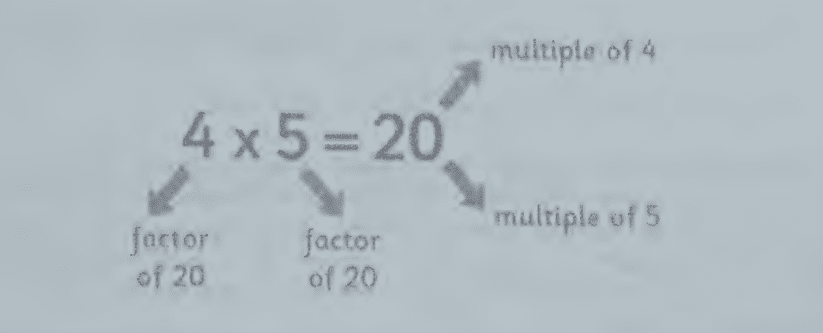

上标是通常显示在另一个数字右上方的较小字符——就像这样：4<sup>12</sup>

上标通常表示“幂”。幂指的是一个数字自乘的次数。例如，10<sup>4</sup>表示10的四次方——即10,000（10乘以10再乘以10再乘以10）。

记号是用于表示数字或数量的符号或符号组合——比如放在数字末尾的E。这种记号表示“10的给定指数次方”。“指数”是数字自乘的次数。在上面给出的10<sup>4</sup>的例子中，4就是指数。

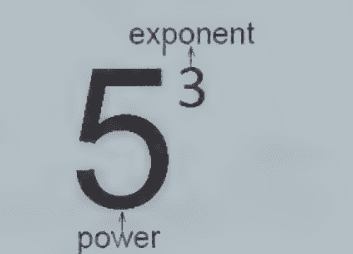

浮点数是表示大数字的一种特定方式。你无需写出整个数字，而是可以写出它的第一部分，然后乘以一个因子。这样，通过执行乘法运算，你得到的基本上与完整写出该数字的结果相同。这样做时，你移动了数字中的小数点；因此得名“浮点数”。

例如，取数字三千四百二十五。正常写法是：3425——用浮点数记法写，则是：3.425 x 10³。由于10³是1000，这表示“3.425乘以1000”，即3425。

“浮点型”是计算机使用的一种数据类型。“浮点型”用于存储精度非常高的数字。它主要用于数学目的。

假设我们想要一个更短的方式来书写100,000。我们可以写成 10E 4。

10E 4 表示 10 X 10⁴（10乘以10四次）。

在JavaScript中，所有数字都是浮点数，而浮点数的上限是 1.797693134862315E+308（这意味着JavaScript无法处理更大的浮点数）。任何大于 1.797693134862315E+308 的数字都被视为“无穷大”。需要注意的是，这是一个巨大的数字，远远超出了大多数计算器的能力，需要非常多的位数才能显示出来。

## 其他数字

在JavaScript中，有三个独特的值被认为是数字，但实际上它们的行为方式并不相同。它们是：

- NaN（“非数字”的缩写）

- Infinity（正无穷大）

- -Infinity（负无穷大）

理解这些数字的最佳方式是将它们付诸实践。下面是一个例子：在一个*新建*的Notepad++文档中，编写以下代码：

```html
<!DOCTYPE html>
<html>
    <body>
        <p id="Not_a_Number"></p>
        <script>
            document.getElementById("Not_a_Number").innerHTML = 0/0;
        </script>
    </body>
</html>
```

将你的文件保存为.html文档，名称自选。然后执行你的代码。结果是NaN，因为0不能除以0。

我们可以使用 isNaN() 函数来检查某个值是否为数字。将你的代码修改如下：

```html
<!DOCTYPE html>
<html>
    <body>
        <p id="Not_a_Number"></p>
        <script>
        document.getElementById("Not_a_Number").innerHTML = isNaN('Hello World');
        </script>
    </body>
</html>
```

保存并运行你的代码。如你所见，结果是“true”，因为"Hello World"*不是*一个数字。让我们将代码改为：

```html
<!DOCTYPE html>
<html>
    <body>
        <p id="Not_a_Number"></p>
        <script>
        document.getElementById("Not_a_Number").innerHTML = isNaN('007');
        </script>
    </body>
</html>
```

注意：唯一的区别是我们将"Hello World"改为了"007"。保存并运行你的代码。现在结果是false，因为007是一个数字。

现在，删除你的代码并编写以下内容：

```html
<!DOCTYPE HTML>
<html>
    <body>
        <p id="Infinity"></p>
        <script>
        document.getElementById("Infinity").innerHTML = 1.7976931348623157E+309;
        </script>
    </body>
</html>
```

保存并执行你的代码。你可以看到结果“infinity”。这是因为我们输入了一个大于 1.797693134862315E+308 的数字。

要看到 -Infinity，只需将你的代码改为一个小于 -1.797693134862315E+308 的数字，例如下面的数字：

```html
<!DOCTYPE HTML>
<html>
    <body>
        <p id="Infinity"></p>
            <script>
                document.getElementById("Infinity").innerHTML = -1.7976931348623157E+309;
            </script>
    </body>
</html>
```

## 章节末尾挑战

创建你自己的程序，返回以下值：

- Infinity（无穷大），

- -Infinity（负无穷大），和

- NaN（非数字）。

# 第二十章

布尔逻辑

“逻辑”指的是有意义、合理的行为、表现和思考方式。在计算机领域，逻辑是构成计算机执行特定任务基础的规则。计算机逻辑是计算机在决策时使用的指导方针。

诸如“与”（and）、“或”（or）和“非”（not）之类的逻辑运算符用于评估表达式是真还是假。

乔治·布尔是一位英国数学家，他发展了布尔逻辑。“布尔逻辑”是一种逻辑形式，其中决策的唯一可能结果是“真”和“假”。对于计算或决策，不存在模糊或“差不多”的答案——非黑即白，没有灰色地带。


布尔逻辑的一个例子是只用“是”或“否”来回答问题。

布尔逻辑对于数字计算机的构建和运行尤为重要，因为创建一个运算结果要么为“真”要么为“假”的机器相对容易。

这是通过比较两个或更多项目来完成的——这些项目只能是“真”或“假”。

一些常见的此类布尔比较例子是“AND”（与）和“OR”（或）。

名为“AND”的布尔比较，*仅当所有涉及的比较都为真时*，比较结果才为真。

让我们看一些例子来展示这是如何工作的：

在下面的AND比较中，结果为真：

5 大于 3 且 10 大于 5

我们来分解一下。

这里发生了三个比较：

1. 比较5和3，看5是否大于3（5大于3吗？）

2. 比较10和5，看10是否大于5（10大于5吗？）

3. 使用布尔比较“AND”比较这两个比较的结果（两个比较都为真吗？）

这是整体比较。

5大于3是成立的，所以第一个比较为真。

10大于5也是成立的——所以第二个比较也为真。

布尔AND比较在另一个比较都为真时才为真——所以在这个例子中，整体比较为真，因为第一个比较为真*且*第二个比较为真。

在下一个例子中，结果为假（不为真）：

5 大于 7 且 10 大于 5

尽管10大于5，但5并不大于7——所以整体比较不为真。

“条件”是必须为真才能发生其他事情的项目。在上面的AND比较中，检查的这两个条件是：

1. 5大于7

2. 10大于5

它们是条件，因为结果取决于（依赖于）这两个比较。

布尔OR比较检查是否*一个或*两个条件都为真。下面是一个例子：

```
4 小于 9 或 8 小于 7
```

结果将为真，因为至少一个比较为真（4是一个比9小的数字）。

在下面的例子中，结果将为假，因为两个都不为真：

```
8 小于 4 或 9 小于 3
```

而在这个例子中，结果将为真，因为一个或两个（在这种情况下是两个）都为真：

```
7 小于 8 或 2 小于 5
```

提醒一下，在为计算机编写指令时，我们会使用大于和小于符号（分别为 > 和 <）。例如：7 > 3 表示“七大于三”，而4 < 9 表示“四小于九”。

所以，例如，不是写“10大于2”，我们会写：

```
10 > 2
```

同样，如果我们想说“大于或等于”，我们可以使用符号 >=。

例如：

```
10 >= 8
```

这将为真。

与几乎所有其他编程语言一样，JavaScript中的布尔值是true（真）和false（假）。

## CONSOLE.LOG 方法

`console.log` 方法可用于在浏览器控制台中显示数据。控制台是你在浏览器内可用于调试代码的工具。

你可以通过几种方式访问控制台，包括：

- a. 按下 `F12` 键，然后点击“控制台”，或

- b. 点击浏览器右上角的三个竖点，选择“更多工具”，点击“开发者工具”，然后选择“控制台。”

将你上次编写的代码替换为以下内容：

```
<!DOCTYPE html>
<html>
    <body>
        <script>
            console.log(2 + 2);
        </script>
    </body>
</html>
```

保存并运行你的代码。没看到任何东西？那是因为它显示在控制台中。打开控制台，你应该会看到 "4"！

## 类型强制转换

在英语中，“coercion”意为通过威胁或惩罚来强迫或说服某人。JavaScript 中的“类型强制转换”是指当运算符的操作数是不同数据类型时（例如 "string" 和 "number" —— 像这样："five" + 5）。

类型强制转换会将其值转换为它所选择的类型。让我们试一下。编写这段代码：

```
<!DOCTYPE html>
<html>
    <body>
        <script>
            document.write("10" + 5);
        </script>
    </body>
</html>
```

许多其他编程语言如果我们在一个操作中包含两种不同的数据类型，会返回一个错误。

## 章节挑战

编写一个包含以下内容的程序：

- 返回 "true" 的布尔逻辑，

- 类型强制转换，以及

- 使用布尔逻辑在 `console.log` 中显示 "false"。

# 第二十一章

## 比较运算符

在 JavaScript 中，我们可以使用双等号和三等号。

`==`（双等号）是一个符号，用于表示应该进行比较。具体来说，这个 “==” 符号是一个指令，用于检查符号左侧的数据是否等于符号右侧的数据。这个比较的答案是 “true” 或 “false”。

当使用 “==” 符号检查相等性时，通常这样使用：[要比较的第一个项] == [要比较的第二个项]

例如：`(10 + 5) == 15`

在这个例子中，我们要求计算机检查将 5 和 10 相加的结果是否等于 15。

当 “==” 符号以这种方式使用时，我们要求计算机在检查相等性后给出响应。通常，这个结果以 “true” 或 “false” 的形式给出。在这里，响应将是 “true”，因为 `(10 + 5)` 等于 15。

另一个例子：`(10 + 6) == 15`

在这里，计算机将响应 “false”，因为 `(10 + 6)` 不等于 15。

`===`（三等号）用于表示应该进行比较。具体来说，这个 “===” 符号是一个指令，用于检查符号左侧的数据是否等于符号右侧的数据，并且其数据类型与右侧的数据类型相同。这个比较的答案是 “true” 或 “false”。

例如，假设你想检查两个出生日期是否相等。你有两个代表这两个出生日期的数据：

1. “DateOfBirth1” 是 “Date” 类型的数据，数据的值是 “1/1/1970”。

2. “DateOfBirth2” 是 “Date” 类型的数据，数据的值是 “1/1/1970.”

你会这样使用 "===" 符号：

```
DateOfBirth1 === DateOfBirth2
```

这告诉计算机检查这两个数据在值和类型上是否都相等。由于在这种情况下它们相等，计算机响应 “true”。

像所有代码一样，通过编写代码来理解它是最好的！现在，让我们再次使用一个单独的 HTML 文档和 JavaScript 文档。首先，打开一个 HTML 文件（如果你没有，就新建一个）并编写以下代码：

```
<!DOCTYPE HTML>
<html>
    <body>
        <script src="Test_1.js">
        </script>
    </body>
</html>
```

确保此文件保存为 HTML.html。然后打开你的 JavaScript 代码文件（名为 Test_1.js – 如果你没有此文件，创建一个新文件）并输入以下代码：

```
document.write(10 == 10);
```

同样，确保将其保存为 Test_1.js。然后运行你的 HTML.html 代码。它应该返回 “true”（因为 10 等于 10）。要让它返回 “false”，只需更改你 JavaScript 中的一个数字，例如：

```
document.write(5 == 10);
```

现在，让我们使用 `===`。在你的 JavaScript 代码文件中编写以下内容：

```
X = 10
Y = 10
document.write(X === Y);
```

保存它并运行 HTML 代码。它返回 “true”，因为它们都是变量并且值都是 10。你可以通过将其改为：

```
X = 10
Y = 11
document.write(X === Y);
```

使其为 false。保存它然后运行 HTML 代码 – 它返回 “false”。尽管它们都是变量，但值不同。我们也可以通过编写以下 JavaScript 代码返回 false：

```
X = "Ten"
document.write(X === 10);
```

## 章节挑战

编写一个包含以下内容的程序：

- 双等号 (`==`) 和类型强制转换（即，使用一个变量和一个值）并显示 "true" 结果。

- 三等号 (`===`) 产生 "true" 和 "false"。

# 第二十二章

## 逻辑运算符

在 JavaScript 中，有三个布尔逻辑运算符：

1. AND 写作：`&&`

2. OR 写作：`||`

3. NOT 写作：`!`

`&&` 运算符确定值或变量之间的逻辑，例如验证 _____ 和 _____ 为真（两者都必须为真才能返回 “true”。如果其中一个或两个都为 false，代码将返回 “false”）。

编写此代码：

```
<!DOCTYPE html>
<html>
	<body>
		<script>
			document.write(5 > 2 && 10 > 4);
		</script>
	</body>
</html>
```

我们的代码返回 “true”，因为五大于二，且十大于四。我们可以通过更改一个或两个比较来使我们的代码返回 “false”，例如：

```
<!DOCTYPE html>
<html>
	<body>
		<script>
			document.write(5 > 10 && 10 > 4);
		</script>
	</body>
</html>
```

编写、保存并执行此代码，它将返回 false。

`||`（或）运算符的含义如其名，通过使用最好地描述。编写此代码：

```
<!DOCTYPE html>
<html>
    <body>
        <script>
            document.write(5 > 10 || 10 > 4);
        </script>
    </body>
</html>
```

保存并执行你的代码。它返回 “true”，因为虽然 5 不大于 10，但 10 大于 4。我们可以通过以下代码使其返回 “false”，因为两个都不为真：

```
<!DOCTYPE html>
<html>
    <body>
        <script>
            document.write(5 > 10 || 10 > 20);
        </script>
    </body>
</html>
```

`!`（非）运算符检查某事是否为真。如果 _____ 不存在，则返回 “true”。

编写此代码：

```
<!DOCTYPE html>
<html>
    <body>
        <p id="Not"></p>
        <script>
            document.getElementById("Not").innerHTML = !(5 > 10);
        </script>
    </body>
</html>
```

保存并运行你的代码。结果是 “true”，因为 5 *不* 大于 10。

当然，如果你想要一个“双重否定”，编写此代码：

```
<!DOCTYPE html>
<html>
    <body>
        <p id="Not"></p>
        <script>
            document.getElementById("Not").innerHTML = !!(20 > 10);
        </script>
    </body>
</html>
```

保存并执行你的代码。我们的意思是说 20 *不不* 大于 10。

# 第二十三章

## 三元运算符

三元的意思是“由三部分组成”。三元运算符在三个值上操作。它可用于根据条件将值分配给变量。这也称为条件运算符，因为它根据条件为变量赋值。

其语法是：

```
变量名 = (条件) ? 值1 : 值2
```

三元运算符是 “?”。编写此代码：

```
<!DOCTYPE html>
<html>
    <body>
        <script>
            document.write(Bigger = (5 > 1) ? "The number on the left is bigger" : "The number on the right is bigger");
        </script>
    </body>
</html>
```

保存并执行你的代码。

在此代码中，我们说：“如果五大于一为真，则显示 ‘左边的数字更大’。”如果你更改数字或将符号翻转为 `<`，你可以更改代码的结果。

输入是一个命令，让用户输入数据。它允许用户在你的程序中输入信息。

# 第二十四章

面向对象编程

正如我们之前所介绍的，对象是计算机程序中同时具有状态和行为的项目。对象的状态可以是重量、颜色、高度等。而对象的行为则是对象所做的事情——它所采取的动作——例如跳跃、跑步、坐下等。

面向对象是一种专注于对象和数据的编程方法（与连续动作或其他方法相对）。

你通过创建所谓的“类”来创建对象，这需要使用众多专业计算机编程语言中的一种。类用于描述一个或多个对象。例如，可以通过创建（或“声明”）一个名为“Customer”的类来实现。需要了解的重要一点是，当你首次创建这个类时，你描述的是该类事物的**潜在**特性和行为。你仍然需要创建一个实际的事物实例。这个过程被称为创建类的“实例”，其中“实例”指的是你声明类时所描述事物的一个“实际存在”。当你这样做时，组成对象的数据将被存储在计算机的内存中。

例如，在一个旨在跟踪所有员工薪资记录的计算机程序中，你可以有一个名为“Employee”的类。每个代表实际员工（John Smith、Sally Jackson 等）的程序元素都将是“Employee”类的一个实例。你为输入到计算机中的每个员工创建一个实例。每次你创建一个“employee”对象时，计算机首先会找到“employee”类，然后使用该类的定义，利用实际员工的数据来创建这个特定的“employee”实例。

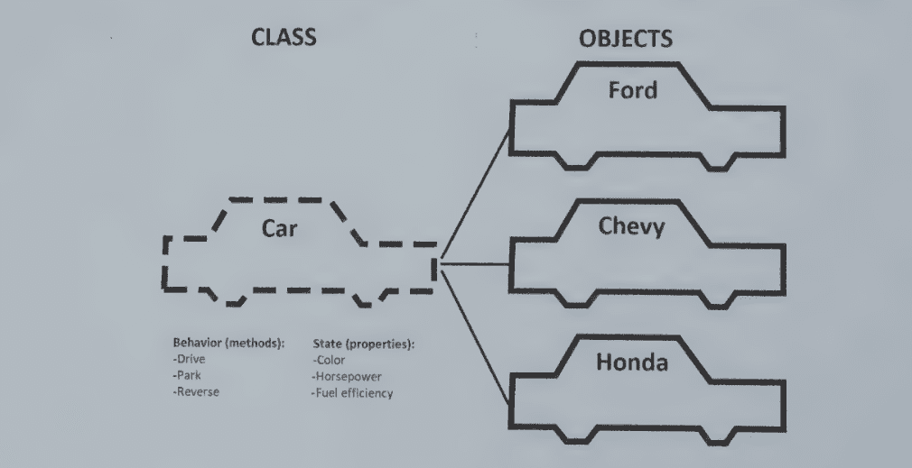

下面是一个我们可以使用三元运算符完成的更复杂的示例：。编写以下代码：

```html
<!DOCTYPE html>
<html>
    <body>
        <p>Riders must be at least 52 centimeters tall to ride.</p>
        <input id="Height" value="52" />
        <button onclick="Ride_Function()">Click here</button>
        <p id="Ride"></p>
        <script>
        function Ride_Function() {
            var Height, Can_ride;
            Height = document.getElementById("Height").value;
            Can_ride = (Height < 52) ? "You are too short":"You are tall enough";
            document.getElementById("Ride").innerHTML = Can_ride + " to ride.";
        }
        </script>
    </body>
</html>
```

保存并执行你的代码。

## 章节挑战

编写一个包含以下内容的程序：

-   一个三元运算符，以及

-   输入命令。

### 构造函数

“构造函数”是类的一个特殊部分（类是定义对象[具有状态和行为的项目]的模板）。

构造函数是类的一个特殊部分，它描述了创建该类任何新实例的默认状态。换句话说，它为类的属性提供了默认值。

例如，假设你有一个名为“Customer”的类。创建“customer”类的计算机代码可能如下所示：

```javascript
class Customer
{
    String FullName;
    Boolean Active;
}
```

现在，假设每当你创建一个新的“customer”类实例时，你都希望它是一个活跃的客户——换句话说，你希望将属性“Active”设置为“true”。

为此，你需要为“customer”类创建一个构造函数。它将是一个位于类内部的小型子程序，在每次创建“customer”类的实例时都会被使用。

构造函数可能如下所示：

```javascript
Customer(string name) {
    FullName = name;
    Active = true;
}
```

整个类将如下所示：

```javascript
class Customer
{
    String FullName;
    Boolean Active;
    Customer(string name){
        FullName = name;
        Active = true;
    }
}
```

构造函数通过请请创建一个“customer”类的实例并传入客户所需的名称来使用。

创建类实例的调用将如下所示：

```javascript
Customer cust = new Customer("Brenda Smith");
```

这使用类内部的构造函数创建了一个新的“customer”类实例。构造函数使用传入的字符串“Brenda Smith”来设置属性“FullName”的值，并使用构造函数中的指令将属性“Active”设置为“true”。

因此，“customer”类的新实例（此处为变量“cust”）将具有以下属性：

```javascript
FullName = "Brenda Smith";
Active = true;
```

注意：以上代码仅作为示例给出，无需执行。我们很快就会创建一个构造函数。

### 关键字

如前所述，JavaScript 关键字用用于标识要执行的操作。例如，var 是我们用来声明变量的关键字。

关键字的一个重要方面是它们不能用于命名变量或函数。例如：你不能写 `var var = "variable"`。

另一种类型的关键字是“new”关键字，用于创建新对象。

我们还有“this”关键字。“this”关键字指示代码所属的对象。当在对象内部使用时，“this”的值就是该对象本身。当与函数一起使用时，“this”的值是拥有该函数的对象。

现在我们刚刚涵盖了大量关于构造函数、“new”关键字、“this”关键字等的信息。让我们把这些知识都运用起来。

在 HTML 文件中编写以下代码：

```html
<!DOCTYPE html>
<html>
    <body>
        <p id="Keywords_and_Constructors"></p>
        <script>
            function Vehicle(Make, Model, Year, Color) {
                this.Vehicle_Make = Make;
                this.Vehicle_Model = Model;
                this.Vehicle_Year = Year;
                this.Vehicle_Color = Color;
            }
            var Jack = new Vehicle("Dodge", "Viper", 2021, "Red");
            var Emily = new Vehicle("Jeep", "Trail Hawk", 2020, "White and B...");
            var Erik = new Vehicle("Ford", "Pinto", 1971, "Mustard");
            document.getElementById("Keywords_and_Constructors").innerHTML =
                "Erik drives a " + Erik.Vehicle_Color + "-colored " + Erik.Vehicle_Model
                + " manufactured in " + Erik.Vehicle_Year;
        </script>
    </body>
</html>
```

保存并执行你的代码。这应该会打印出以下字符串：

Erik drives a Mustard-colored Pinto manufactured in 1971

让我们检查一下我们的代码。函数“Vehicle()”是一个对象构造函数。

### 保留字

在 JavaScript 中，某些词语不能用作变量、标签（分配给代码段的名称）或函数。保留字的例子有：“true”和“false”。

如果你感兴趣，这里有一个链接列出了 JavaScript 中的保留字：

w3schools.com/js/js_reserved.asp

你不能使用这些词语的原因是它们已经有其他含义——它们是为 JavaScript 保留的。

## 章节挑战

编写一个包含以下内容的程序：

-   一个类，

-   一个构造函数，

-   “new”关键字，以及

-   “this”关键字。

# 第二十五章

标识符与字面量

“标识符”是某个事物的名称。在 JavaScript 中，标识符是变量、函数、关键字和标�的名称。在下面的代码中，“X”是标识符：

```javascript
var X = 10
```

与标识符相反，字面量是在源代码中表示一个值的实体。源代码是计算机程序由其设计者最初编写（即用某种编程语言输入到计算机中）的版本。通常，当程序员完成程序编写后，她会让计算机将她编写程序所用的代码（“源代码”）转换为另一种格式，这种格式对计算机来说更容易且使用更快。在那种新格式中，程序无法被人类轻易理解——但它对计算机非常有用。在那时，它也无法被其他程序员修改。

看看这段代码：

```javascript
var X = 10
var Y = "Charlie"
```

10 是整数字面量，Charlie 是字符串字面量，而“X”和“Y”是标识符。

字面量是按照其预期处理方式呈现的数据。而标识符是一个名称，字面量则是值本身。

## 嵌套函数

“嵌套”指的是某些东西被包含在其他东西内部。这可以是一个程序中的程序，或者一组指令位于另一组指令内部。

有时子程序需要从主程序获取一些信息才能执行其任务。当子程序被创建时，它的描述可能包含此信息。该信息被称为子程序的“参数”。

嵌套实体的参数在更大（且包含它）的实体内部进行解释。它之所以是嵌套的，是因为它被放置在其他东西内部。

例如，一个嵌套的过程将是一组包含在更大过程中的命令。

在 JavaScript 中，函数可以访问其在代码中上方的函数。嵌套函数是指在另一个函数内部，并且与之有某种关联的函数。

要实际查看这一点，请编写以下代码：

```
<!DOCTYPE html>
<html>
    <body>
        <p id="Counting"></p>
        <script>
            document.getElementById("Counting").innerHTML = Count();
            function Count() {
                var Starting_point = 9;
                function Plus_one() {Starting_point += 1;}
                Plus_one();
                return Starting_point;
            }
        </script>
    </body>
</html>
```

保存并执行此代码，应该会显示 "10"。在我们的代码中，`Plus_one()` 函数就是嵌套函数。

## 作用域

在编程中，代码可以有“作用域”。简单来说，作用域就是你可以访问的函数、变量和对象。作用域可以是有限的。变量的作用域取决于它是否可以被程序中的一个、多个或所有函数访问。变量的作用域可以是“局部”或“全局”。

在 JavaScript 中，全局变量可以从程序内的任何函数访问，而局部变量只能被赋值给它的函数访问。

全局变量在函数外部声明，而局部变量在函数内部声明。

全局变量可以按如下方式编写（编写此代码）：

```
<!DOCTYPE html>
<html>
    <body>
        <script>
            var X = 10;
            function Add_numbers_1() {
                document.write(20 + X + "<br>");
            }
            function Add_numbers_2() {
                document.write(X + 100);
            }
            Add_numbers_1();
            Add_numbers_2();
        </script>
    </body>
</html>
```

保存并执行你的代码。应该会返回 "30" 和 "110"。变量 `X` 在我们的函数外部被赋值为 10，但我们仍然可以访问它。因此，以上是全局变量的一个例子。提醒一下，`<br>` 是换行标签，用于在文本中创建换行（就像在键盘上按回车键一样）。

现在，让我们尝试一个局部变量。编写以下代码：

```
<!DOCTYPE html>
<html>
    <body>
        <script>
            function Add_numbers_1() {
                var X = 10;
                document.write(20 + X + "<br>");
            }
            function Add_numbers_2() {
                document.write(X + 100);
            }
            Add_numbers_1();
            Add_numbers_2();
        </script>
    </body>
</html>
```

保存并执行你的代码。这次，它只返回 "30"，因为该变量是局部的——这意味着它是在函数 `Add_numbers_1` 内部编写的，不能在该函数外部访问。

假设你编写了上述代码，但不明白为什么 `Add_numbers_2` 没有显示结果。我们可以使用 `console.log()` 来帮助调试代码。

将你的代码更改为以下内容：

```
<!DOCTYPE html>
<html>
    <body>
        <script>
            function Add_numbers_1() {
                var X = 10;
                console.log(15 + X);
            }
            function Add_numbers_2() {
                console.log(X + 100);
            }
            Add_numbers_1();
            Add_numbers_2();
        </script>
    </body>
</html>
```

保存并执行你的代码。你会注意到没有显示任何结果。打开控制台，它就在那里！它给你错误信息“X is not defined”。

## 章节结束挑战

执行以下操作：

-   编写你自己的嵌套函数，

-   赋值一个局部变量，以及

-   赋值一个全局变量。

# 第二十六章：条件语句

“If 语句”是一种条件语句，它指定 *如果* 条件为真，则执行一段代码。

编写以下代码：

```
<!DOCTYPE HTML>
<html>
    <body>
        <script>
            if (1 < 2) {
                document.write("The left number is smaller than the right number.")
            }
        </script>
    </body>
</html>
```

保存并执行你的代码。由于 1 小于 2，因此会显示该字符串。

`Date().getHours()` 方法根据本地时间返回指定日期中的小时数，小时数以 0 到 23 之间的整数表示。例如：18 等于下午 6:00，12 是中午，等等。

我们可以创造性地使用 "if" 语句。编写以下代码：

```
<!DOCTYPE html>
<html>
    <body>
        <p id="Greeting">How are you this evening?</p>
        <script>
            if (new Date().getHours() < 18) {
                document.getElementById("Greeting").innerHTML = "How are you today?";
            }
        </script>
    </body>
</html>
```

保存并执行你的代码。在这个程序中，我们写道：“如果在我运行代码时是下午 6:00 之后（大于），则显示‘How are you this evening?’。如果在我运行代码时是下午 6:00 之前，则显示‘How are you today?’。”

那么，如果我们想要更多选择呢？

## ELSE 语句

else 语句指定一个代码块，当条件为 false 时（与 if 语句相反）将执行该代码块。

编写以下代码：

```
<!DOCTYPE html>
<html>
    <body>
        <p>Write your age:</p>
        <input id="Age" value="" />
        <p id="How_old_are_you?"></p>
        <button onclick="Age_Function()">Click here</button>
        <script>
        function Age_Function() {
            Age = document.getElementById("Age").value;
            if (Age >= 18) {
                Vote = "You are old enough to vote!";
            }
            else {
                Vote = "You are not old enough to vote!";
            }
            document.getElementById("How_old_are_you?").innerHTML = Vote;
        }
        </script>
    </body>
</html>
```

保存并执行你的代码。你刚刚创建了一个判断一个人是否可以投票的程序！

现在，如果我们想要更多选择呢？

## ELSE IF 语句

“else if” 语句跟在 “if” 语句之后，如果 “if” 语句被发现为 false，则执行它。例如：

-   如果饿了，就吃。

-   否则如果渴了，就喝。

-   否则，休息。

编写以下代码：

```
<!DOCTYPE html>
<html>
    <body>
        <p id="Time_of_day"></p>
        <script>
            function Time_function() {
                var Time = new Date().getHours();
                var Reply;
                if (Time < 12 == Time > 0) {
                    Reply = "It is morning time!";
                }
                else if (Time > 12 == Time < 18) {
                    Reply = "It is the afternoon.";
                }
                else {
                    Reply = "It is evening time.";
                }
                document.getElementById("Time_of_day").innerHTML = Reply;
            }
            Time_function();
        </script>
    </body>
</html>
```

保存并运行你的代码。你制作了一个从你的计算机获取时间并告诉你现在是一天中什么时间的程序！

## 章节结束挑战

执行以下操作：

-   编写你自己的函数，其中包含一个 "if" 语句、一个 "else if" 语句和一个 "else" 语句。

# 第二十七章：字符串方法

JavaScript 有字符串方法，允许你对字符串执行任务。

如前所述，编程语言内置了某些数据类型。这些内置数据类型是编程语言中最基本的数据类型，被称为原始数据类型。原始数据类型的一个关键特征是它不能进一步简化。原始数据类型是语言中预定义的数据类型。

JavaScript 中有五种原始数据类型——它们是：

1.  String（字符串）,

2.  Number（数字）,

3.  Boolean（布尔）,

4.  Null（空值）, 和

5.  Undefined（未定义）。

其他所有内容（非原始数据类型）都是对象。对象是由程序员创建的，而不是预定义并内置在编程语言中的。

## CONCAT() 方法

`concat()` 方法连接（连接）两个或多个字符串。编写以下代码：

```
<!DOCTYPE html>
<html>
<body>
<p id="Concatenate"></p>
<script>
var part_1 = "Hello ";
var part_2 = "World ";
var part_3 = "from ";
var part_4 = "sentence.";
var whole_sentence = part_1.concat(part_2, part_3, part_4);
document.getElementById("Concatenate").innerHTML = whole_sentence;
</script>
</body>
</html>
```

保存并执行你的代码。它会将句子作为一个整体显示出来！

## SLICE() 方法

`slice()` 方法是一种字符串方法，它提取字符串的一部分，然后以新字符串的形式返回提取的部分。

# 第二十八章

## 数字方法

数字方法帮助你在 JavaScript 中处理数字。数字方法有多种。其中之一是 `toPrecision()` 方法，它返回一个指定长度的数字字符串。编写此代码：

```html
<!DOCTYPE html>
<html>
    <body>
        <p id="Precision"></p>
        <script>
            var X = 12938.3012987376112;
            document.getElementById("Precision").innerHTML =
                X.toPrecision(10);
        </script>
    </body>
</html>
```

保存并运行你的代码。你应该得到 "12938.30130。" 数字方法有很多——以上两个应该能让你对这些方法的工作方式有个概念。

## 章节末挑战

现在我们将分配一些我们尚未教授的任务——请在线搜索解决方案：

- 1. 使用 `toFixed()` 方法。

- 2. 使用 `valueOf()` 方法。

这里有一个有用的链接：w3schools.com/js/js_number_methods.asp

# 第二十九章

## 最终挑战

为了结束本书，我们将通过创建一个按秒倒计时的计时器，把所有知识整合起来。开始吧！

首先，用以下代码替换你编辑器中的任何现有代码：

```html
<!DOCTYPE html>
<html>
    <body>
        <p>你想设置多少秒的闹钟？</p>
        <input id="seconds" value="" />
        <button onclick="countdown()">点击这里</button>
        <p id="timer"></p>
    </body>
</html>
```

这里的想法是，用户将被问到他/她想设置多少秒的计时器。有一个输入框可以输入值。还创建了一个按钮，这样当点击时，它会将值发送出去进行处理。结果将是一个显示的倒计时计时器。

记住，输入标签处理用户输入的信息。id "seconds" 和 value "" 与我们将很快看到的 JavaScript 代码相关联。

"button" 标签将创建一个按钮，当点击时，它会在 JavaScript 代码中查找 "countdown()" 函数。倒计时函数产生的结果将取决于用户点击我们创建的按钮时提交的内容。

带有 id "timer" 的标签需要知道倒计时函数的结果，以便它可以为用户显示一个计时器。它将从关联的 JavaScript 中检索此信息。

那么，让我们再次查看 HTML 代码，但这次，添加了 JavaScript 代码：

```html
<!DOCTYPE html>
<html>
<body>
    <p>你想设置多少秒的闹钟？</p>
    <input id="seconds" value="" />
    <button onclick="countdown()">点击这里</button>
    <p id="timer"></p>
    <script>
        function countdown() {
            var seconds = document.getElementById("seconds").value;

            function tick() {
                seconds = seconds - 1;
                timer.innerHTML = seconds;
                setTimeout(tick, 1000);
                if(seconds == -1){
                    alert("时间到！");
                }
            }
            tick();
        }
    </script>
</body>
</html>
```

你会立刻注意到我们的 JavaScript 代码中有两个独立的函数。实际上，"tick" 函数嵌套在 "countdown" 函数内部！提醒一下，这被称为"嵌套函数"。

倒计时函数只被调用一次，并且只做两件事：

- 1. 它将一个名为 "seconds" 的变量设置为用户输入的值。

- 2. 它创建并运行 tick 函数。

另一方面，tick 函数有几个步骤需要执行，并且最终会重复多次。

倒计时函数从用户那里接收到输入值后，tick 函数立即开始执行其指令。重要的是要认识到 tick 函数实际上还没有被执行。它只是让其指令被知晓，以防该函数真的需要被使用。一旦解释器读取了 tick 函数，它就会退出并看到 "tick()" 指令。看到这个函数后，解释器知道要立即返回 tick 函数。然而，这次，它不是简单地读取函数，而是要实际运行该函数。

看看 tick 函数中的变量 "seconds"。它从 countdown 函数中获取 "seconds" 的值并减去 1。这个值需要减去 1 的原因是，每次这个函数运行时，它将持续一秒（我们将看到），并且我们需要 "seconds" 变量在每一秒过去时减去 1。

在第一次通过 tick 函数时，从用户输入中减去 1 秒后，那个被减去 1 的相同数字现在将被显示给用户看。这发生是因为 `timer.innerHTML` 被赋予了这个数字。还记得我们在一个 HTML 标签中放置了 "id=timer" 吗？那个标签现在持有我们分配给它的这个数字。

语句 "`setTimeout(tick, 1000);`" 只是意味着程序暂停 1000 毫秒（即 1 秒）。这很重要，因为这个函数可能会重复多次——并且每次重复时，它都需要恰好持续一秒钟。

我们现在有了条件语句。它告诉我们的是，如果用户的输入计数一直减少到 -1，则停止一切并运行警告框。你可能会问自己，*为什么是 -1 而不是 0？* 原因是当解释器看到 -1 时，它实际上还没有将其显示给用户。用户仍然看到 0。因此，在显示 -1 之前，警告框将出现，阻止任何其他代码运行。请注意，如果用户点击警告框上的确定按钮，他/她将看到计时器继续倒计时到负数。

现在，如果用户的输入不等于 -1，解释器将像以前一样退出函数。但是等等；它将再次遇到那个 "tick()" 语句！没错。你看到我们的函数现在将如何继续重复了吗？也就是说，直到满足我们的条件语句——此时警告框将显示。

自己试一试，如果需要多次阅读代码才能真正理解，不要担心！

## 最终挑战

这是你的最终任务：

通过在线研究，找出当用户点击警告框上的确定按钮时，如何结束程序（即停止倒计时）。

# 第三十章

## 恭喜！

你已经完成了我们的书！为你的努力和坚持干得好！

你现在应该对 JavaScript 和编码有了基本的了解。

下一步，我们建议你参加 Tech Academy 的编码训练营。我们的编码训练营像这本书一样设计：面向初学者，并且假设没有先前的知识或经验。

以下是成千上万的学生选择在 Tech Academy 注册的一些原因：

- 1) 我们的课程——它是现代的、强大的（强劲；经得起时间考验），并且涵盖需求旺盛的技术。我们的课程是全面的，涵盖的不仅仅是 1-2 种语言。我们全面的课程确保学生不会被局限（限制在特定类别）在小的技能集内。理解大量技术不仅使毕业生为进入职场做好准备，而且极大地帮助他们在未来掌握新的技术技能。

- 2) 我们的训练营定价合理。事实上，我们的学费低于全国编码训练营的平均每周成本。

- 3) 我们不要求技术背景或经验。你不必已经懂编码才能学习编码。只要学生能够阅读、写作和进行基本的数学运算，他们就能在 Tech Academy 取得成功。

- 4) 我们拥有出色的在线形象。我们在顶级评论网站上的平均评论评分为 4.5-4.9 星。我们连续多年被 SwitchUp.Org 和 CourseReport.Com（两大训练营评论网站）评为最佳编码训练营，并且也列入其他几个顶级编码训练营名单。我们还被电视节目 "World’s Greatest" 评为 "世界上最好的代码学校"。所有这些奖项和评论都基于我们项目学生和毕业生的反馈。

- 5) 我们极其灵活。学生可以选择自己的学习时间表。他们可以在家学习，在我们其中一个校区学习，或者两者兼有。他们每天 24 小时在线访问他们的课程。这确保了学生无论生活状况如何都能注册。课程是自学进度的事实是我们灵活性的一个方面——学生可以快速学习他们已经熟悉的内容，并且花时间学习新概念。我们灵活性的另一个因素是我们提供开放注册，这意味着学生可以随时开始。

## 其他阅读

请务必查看其他 Tech Academy 书籍，均可在亚马逊上购买：


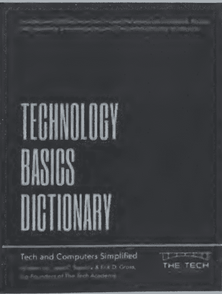

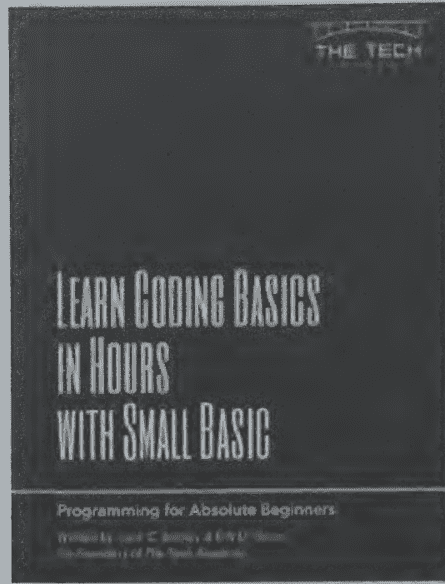

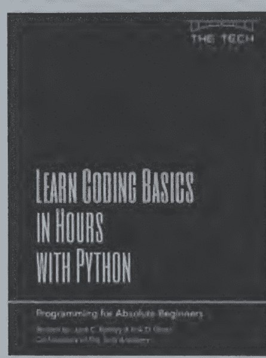


## 项目管理手册

面向初学者的简化版敏捷、Scrum 和 DevOps

**作者**

Jack C. Stanley & Erik D. Gross

The Tech Academy 联合创始人

美国制造

哥伦比亚，南卡罗来纳州

2020年8月13日


# THE TECH ACADEMY

Ann Townsend Leverette 女士

2524 Flair Knoll Dr NE

亚特兰大，佐治亚州 30345-1316

JavaScript 在某些榜单上被评为世界上最受欢迎的计算机编程语言。本书是一本使用 JavaScript 进行编码的入门书籍，适合没有任何技术知识或经验的个人。

以下是给您的一些问题：

- 您是否对了解编码感兴趣？

- 您是否想弄清楚自己是否喜欢计算机编程？

- 您是否考虑在科技行业工作？

如果您对其中任何一个问题的回答是“是”，那么这本书就是为*您*而写的。

您可以在几个小时内完成本书，最后，您不仅将掌握 Python 的基础知识，还将对技术有更全面的了解。

我们希望您喜欢这本书，并祝您在编码之旅中好运！

The Tech Academy 是一所总部位于俄勒冈州波特兰市的技术学校，在全球多个地点设有分校。我们专注于编码训练营（旨在为毕业生准备入门级技术职位的强化培训课程，可在几个月内完成）。我们还为企业提供定制培训，并出版了几本书。

要了解更多关于 The Tech Academy 的信息，请访问：

**Learncodinganywhere.com**

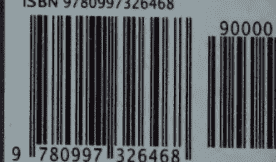

# 索引

==, 88

===, 88

&&, 91

||, 91

!, 91

## 算法

- 定义, 33

## 撇号处理,

59

## 反斜杠, 59

## 二元运算符, 70

## 布尔逻辑

- 定义, 83

- 历史, 83

- 逻辑运算符, 91

## 分支, 34

## 调用, 41

## 类, 96

## 代码

- 定义, 13

## 编码

- 定义, 17

## 比较

- 运算符, 88

## 编译器, 27

## 计算机

- 定义, 11

## 计算机语言

- 定义, 15

## 计算机编程

- 定义, 22

- 示例, 22

## 连接, 59

## concat() 方法, 107

## 条件语句,

104

## Console.log, 86

## 构造函数, 97

- 关键字, 98

## 控制/分支

- 定义, 34

- 循环, 38

## 开发者

- 定义, 14

## 字典创建, 76

## 除法, 69

## Document.getelementbyid, 66

## Document.write(), 57

## 元素, 49

## Else If 语句, 105

## Else 语句, 104

## 入口, 34

## 执行

- 定义, 12

## 出口, 41

## 指数, 79

## 表面

- 定义, 62

- 示例, 62

## 文件路径, 52

## 最终挑战, 112

## 五个要素, 34

- 控制/分支, 34

- 入口, 34

- 出口, 41

- 子程序, 40

- 变量, 35

## 浮点数, 79

## 函数

- 定义, 64

- 调用, 64

- 嵌套, 100

## 批改作业

- 示例, 34

## "Hello, World"

- 在 HTML 中, 50

- 在 JavaScript 中, 54

## JavaScript 历史,

45

## HTML

- 定义, 44

- 示例, 48

## 超文本, 44

## 标识符, 100

## Ids, 65

## If 语句, 104

## 图像,

- 在线, 51

- 计算机, 52

## 递增运算符, 71

## 无穷大, 80

## 输入

- 定义, 94

## 互联网

- 定义, 19

## 解释器, 28

## 调用, 64

## JavaScript

- 历史, 45

## 键值对, 74

## 关键字, 98

## 字面量, 100

## 逻辑运算符, 91

## 循环, 38

## 低级语言

- 定义, 23

## 机器

- 定义, 10

## 机器语言

- 定义, 18

- 低级语言, 23

## 主程序, 40

## 标记, 42

## Math.random(), 72

## 方法

- concat(), 107

- console.log, 86

- date().gethours(), 104

- 定义, 55

- document.write(), 57

- math.random(), 72

- slice(), 107

- window.alert(), 56

## 取模运算, 70

## 多变量, 60

60

## 乘法, 69

## 嵌套函数, 100

## 网络

- 定义, 19

## 记事本, 16

## Notepad++,

- 功能, 16

- 下载, 48

## 数字

- 加法, 68

- 二进色, 70

- 除法, 69

- 递增, 71

- 取模运算, 70

- 多个运算符, 69

- 乘法, 69

- 减法, 69

- toPrecision(), 108

- toString(), 108

- 一元, 70

## 数字方法, 108

## 对象

- 定义, 54, 74

- 示例, 74

## 面向对象

- 编程, 95

## 运算符

- 比较, 88

- 定义, 58

- 示例, 58

- 逻辑, 91

- 三元运算符, 94

- typeof, 77

- 与字符串, 58

- 词语, 77

## 段落元素, 64

## 执行路径, 40

## 程序

- 定义, 12

- 示例, 12

## 编程

- 语言

- 定义, 14

- 低级语言, 23

## 协议

- 定义, 20

- 示例, 20

## 引号

- 撇号, 55

- 单引号与双引号, 55

## 保留字, 98

## 运行时, 28

## 作用域, 101

## Slice(), 107

## 软件

- 定义, 13

## 字符串

- 连接, 59

- 创建, 58

- 定义, 46

- str.fontcolor(""), 60

## 子程序

- 调用, 41

- 定义, 40

## 减法, 69

## Tech Academy

- 网站, 114

## 三元运算符, 94

## 计时挑战, 110

## 提示, 47

## 真/假, 83

## 类型强制转换, 87

## Typeof 运算符, 77

## 一元运算符, 70

## 无类型语言, 24

## 值

- 布尔值, 46

- 定义, 25

- 数字, 46

- 对象, 46

- 字符串, 46

- 未定义, 46

## 变量

- 定义, 25, 35

- 示例, 25

- 多变量, 60

## Window.alert(), 56

## 万维网

- 定义, 19

## WWW (参见 万维网)

## Web (参见 万维网)

我们的招生团队和入学流程透明且乐于助人。我们回答问题且彬彬有礼，从一开始就为学生提供积极的体验。

要开始，请访问 The Tech Academy 的网站：learncodinganywhere.com
