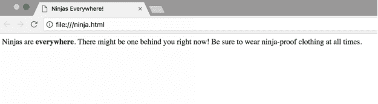

# JavaScript 小时学会编程基础

## 引言

The Tech Academy 是一所获得许可的职业学校，提供软件开发人员培训。我们的主要课程是软件开发启动训练营。该课程可以在任何地方在线学习，也可以在我们的任何一个校区参加。

请记住，这是本书的第一版。未来还会有升级和修订。

如果您发现任何错误、有反馈或想提供建议，请立即联系我们。您可以在我们的网站上找到联系方式：`learncodinganywhere.com`。

感谢您购买本书。希望您会喜欢它！

## 第一部分：本书的目的

如果你曾经用 `JavaScript` 写过代码、创建过网站、设计过程序、编写过软件——那么这本书不适合你。即使你没有用过 `JavaScript` 编程，但你是另一种语言的熟练开发者，这本书也不适合你。

正如标题所示，这旨在是对利用 `JavaScript` 进行编程的初次介绍。这是一种为初学者提供的简化、基础且从零开始的方法。`JavaScript` 是一种教授编程基础并让学生获得编程经验的好语言。所以，如果你是一个新手，请继续阅读。如果不是，祝你在其他地方旅途顺利！

有些人可能觉得这本书书“太简单了”。在这样想时，这些人完全错过了 The Tech Academy 的目的：让任何人、每一个人都能理解计算机编程。

本书的编写假设是你之前没有任何编程经验，而这正是许多编程教程和书籍失败的地方。它们假设学生知道与编程相关的术术语，并且他/她已经理解了基本的编程概念。这种方法不可避免地导致信息超出学习者的理解。许多“入门级”资源使用不熟悉的词汇，并提到普通人或缺乏经验的初学者不知道的概念——冒着可能被称为低级化编程出版物的风险，我们在这里提供了一本不需要背景或以往经验的书。

这本书和 The Tech Academy 具有共同的目标。我们希望让编程基础变得易懂，同时专门获得对 `JavaScript` 的基础理解。之后你如何走取决于你的选择。

本书的三个部分将涵盖关于编程和 `JavaScript` 的重要信息和概念。实际的代码编写将在之后进行。为什么我们不直接让你投入到编写代码中呢？因为你将不会遵循自然的顺序。如果你要教一个甚至不知道汽车长什么样或用来干什么的人如何开车，你必须首先描述一下它并告诉他们该做什么。在先告诉他们什么是油门、方向盘和刹车之前，就告诉某人开车可能是危险的。

此外，你不会在本书中学到关于 `JavaScript` 的所有知识。相反，你将在这里领略 `JavaScript` 的魅力。将此看作是一个了解编程是什么样子的机会。你未来用它做什么取决于你自己。

本书应该从头到尾读完，并顺序完成所有作业。书中要求你编写的所有任务和代码都是用蓝色字体编写的。实际输入代码是非常重要的。作为一名受训的开发者，你需要通过输入代码获得尽可能尽可能多的经验！

学习愉快，

The Tech Academy

## 第二部分：基本定义

理解一个学科的术语是精通该学科的关键组成部分。毕竟，如果你不知道什么是油门，你开车能有多好呢？

所以，虽然这可能看起来并不吸引人，但请阅读以下技术定义，以便我们确保建立了一个坚实的基础以供构建。

注意：如果你有任何想要澄清但在书中未定义的技术术语，可以参考 The Tech Academy 的技术基础字典《科技与电脑》（Tech and Computers Simplified）。该字典可在亚马逊购买。

### 定义

**机器（Machine）**：使用能量来事的物品。机器通常由金属和塑料制成，由几个共同工作的部分。它们通常由固定部分和移动部分组成，每个部分都有特定的用途。人们将机器作为工具来帮助完成任务。

示例：汽车是一种机器。

**计算机（Computer）**：一种存储和处理信息的电子机器。计算机由许多不同的部分组成，电流通过这些部分。计算机是人们用来帮助做事情的工具。计算机遵循人输入它的指令。计算机可以存储稍后要执行的指令，这样人们就不需要反复输入相同的指令。计算机在开启时会自动执行一系列功能，并对人输入的命令做出响应。它对命令做出响应是由人预先设置好的。机器（如汽车和手机）内部可以有执行特定功能的计算机。计算机的存在通常是为了通过执行重复活动、存储信息以及让某些活动变得更快或更高效来帮助人类。

示例：电子计算器是一种非常基础的计算机类型。

**数字（Digital）**：关于或相关的用数字表示幅值的设备或物体。计算机是数字设备；计算机中的数据用数字表示。“数字”的反面可以被认为是“模拟（analog）”。模拟指的是以连续流流出的数据。数字事物由精确、不同的部分组成；这些部分始终处于精确、标准的状态中（状态是事物的状况——例如，“绿色”、“空”、“45 岁”等）。数字事物只能处于该物体可用状态之一。

2. 穿上衬衫。

3. 看着镜子里的自己。

4. 决定你是否喜欢穿这件衬衫的样子。如果你喜欢这个样子，就留着衬衫跳到第 6 步。如果你不喜欢，就把衬衫脱掉，放回衣柜里拿出来的地方。

5. 重复步骤 1–5，直到你对衣柜里的每件衬衫都做出了决定。

# 6. 结束此过程

### 指令 (Instruction)

输入计算机并执行特定操作的单个命令或一组命令。指令控制计算机并告诉它要做什么。

**示例**：你可以通过输入指令让计算机画出一个正方形。

### 程序 (Program)

程序是输入到计算机中的编写指令，使其执行某些任务。程序是你与计算机交互以完成任务的媒介。基本上，你在计算机上所做的每项工作，你都会使用某种形式的程序，无论是检查天气还是查询银行信息。多年来，人们创建了无数的程序来完成无数不同的事情。

**示例**：“画图（Paint）”是许多计算机上的一个程序，允许用户进行绘画和上色。

### 程序员 (Programmer)

计算机程序员是指能够创建计算机程序的人。程序员的另一个术是 `developer`（开发者）。程序员可以在计算机中输入精确的命令和指令，创建我们日常使用计算机的许多东西。

**示例**：`Microsoft Word`（一个主要用于编写文档的程序）是由程序员创建的。

### 编程语言 (Programming Language)

为了理解“编程语言”这个术语，你需要理解“语言”这个术语。语言是允许你通过书面和口语传输思想的通信系统。编程语言是单词、短语和符号的组织系统，让你能够创建程序。编程语言也被称为计算机语言。

有许多不同类型的编程语言，每种语言都是为了特定的目的而创建的。通常，创建一种语言是为了让创建某些类型的计算机程序变得更容易。

**示例**：`Python` 是一种流行的计算机语言。以下是你如何使用计算机语言 `Python` 告诉计算机在屏幕上显示“Hello, world!”的：

```
print (“Hello, world!")
```

### 机器语言 (Machine Language)

机器指令是用 `CPU` 能够理解的形式编写的给计算机的指令——机器码或机器语言。机器语言是由系列 1 和 0 组成的数据；计算机使用 1 和 0 进行操作，因为制造一个只需要区分两种不同状态的机器是非常容易的。

在制造计算机时，`CPU` 的制造使其在接收到这些指令时遵守某些指令并执行精确的操作。机器指令可以从计算机制造商处获得。

**示例**：假设“10010100 01101011 01011011 01010110”告诉计算机“删除名为 `Vacation.doc` 的文件”。10010100 01101011 01011011 01010110”就是一个机器指令。对于人们来说，读写机器语言很困难，因为指令只是 1 和 0 的唯一模式。

### 低级语言 (Low-level language)

低级语言是在可读性上与机器语言处于同一水平或略高于机器语言的编程语言——也就是说，它使用代码表示特定的机器语言指令或机器指令的不同组合。这些代码不是机器语言的 1 和 0；它们看起来像这样：

```
MOV AL, 61h
```

这可能是意味着“在 `CPU` 的某个特殊位置存储数值 97 以备后用”的代码。这比机器语言的 1 和 0 更易读，但仍然不太容易操作。

### 代码 (Code)

“代码”有几个定义。第一个是：你输入到计算机以创建程序的内容。代码用特殊的计算机语言编写。编码意味着输入指令（使用特定的计算机语言）来创建一个程序，该程序让计算机执行某些动作。

**示例**：你可以编写制作计算机游戏的代码。

代码也可以指一个你使用符号代表另一个事物的系统。

**示例**：机场通常用三个字母的代码代称——美国俄勒冈州波特兰的波特兰国际机场拥有三字母代码“PDX”。所以在这里，`PDX` 是代表波特兰国际机场的代码。

### 操作系统 (Operating System)

缩写为 `OS`。操作系统是一种特殊用途的计算机程序，支持计算机的基本功能，如任务调度、运行其他计算机程序以及控制外设（键盘、鼠标和显示器等外部设备）。

大多数计算机程序在计算机上运行之前，要求该计算机上已经安装了操作系统。今天市面上几乎所有的计算机在购买时都已安装了操作系统。计算机制造商在出售计算机之前会安装操作系统。某些操作系统是免费的，另一些需要付费。

世界上最知名、最流行的操作系统之一是 `Windows`。它由技术公司 `Microsoft` 创建并销售。其他流行的操作系统还有：`OS X`（由技术公司 `Apple` 创建；用于他们的桌面式电脑和笔记本电脑）、`Linux`（一组免费和付费的操作系统；用于桌面式电脑和笔记本电脑）、`Android`（由技术公司 `Google` 所有；用于智能手机等移动设备）以及 `iOS`（由 `Apple` 创建；用于他们的 iPhone 和 iPad 等移动设备）。

**示例**：`Windows 10` 是一种流行的操作系统。

### 网络 (Network)

网络是两个多个计算机相互连接的系统。计算机可以通过电缆（有线）或无线方式连接。网络是描述协同工作的事物之间链接的词汇。网络以许多不同的方式应用于计算机。

**示例**：信息可以通过网络在计算机之间共享。

### 互联网 (Internet)

互联网是两件事：全球范围内互连的计算机网络，以及在这些计算机之间传输不同类型数据的方法或协议。这是互联网的基本定义。

`protocol`（协议）是对特定类型信息如何格式化和处理的正式描述。基本上，它是所有计算机都遵守的约定。协议通常在文档中描述，并且非常精确。它们通常由行业内的专家创建。如果行业各组织要在计算机之间传输数据，那么一种 `protocol` 将是有价值的。互联网是互连的计算机网络，并且有许多不同类型的数据可以在这些计算机之间发送——如电子消息、电子记录等。对于每种类型的数据都创建了一个或多个协议。

**示例**：银行可以设计一种用于总部和各个分支机构交换数据的 `protocol`。

### 超级网 (World Wide Web)

缩写为 `WWW`；通常被称为“网”。要理解什么是超级网，你需要了解这些术语：`website`（网站）、`web page`（网页）和 `web server`（网页服务器）。网是连接到互联网的组织文档集合。

`website` 由一个或多个 `web pages` 组成，包含文本、图像和其他元素。构成网页的电子文件存储在被称为 `web servers` 的专用计算机上。用于查看网页的程序被称为 `web browser`（网页浏览器）。这种程序程序向网页服务器发送请务以显示网页文件。

## JavaScript

`JavaScript` 是一种可以在大多数计算机上运行的计算机语言，适用于制作网页。`JavaScript` 主要用于让网页更具动态性（描述根据用户操作或其他因素而变化的网页，而不是静态的）。`JavaScript` 有许多其他用途；它用于创建许多类型的计算机程序。

**示例**：当用户将鼠标移动到视频上时，`JavaScript` 可以用于开始播放视频。

# 第三部分：什么是编码？ (Section Three: What is Coding?)

编码就是计算机编程。它是创建计算机程序的行为，即为了完成特定任务而准备的计算机指令。向计算机输入精确的命令和指令，以创建我们日常使用的许多东西。要进行计算机编程，你必须学习各种编程语言并使用这些语言在计算机上创建可以使用的东西。

**示例**：计算机上用于计算的程序是计算机编程的结果。

编码也指创建网页。这些程序的另一个词是 `software`（软件）。这是因为实际的计算机（机器）被称为 `hardware`（硬件）。因此，运行在该机器上的程序被称为 `software`。“编码”和“开发”这两个术语的意思相同。`software developer`（软件开发者）就是计算机程序员；`coder`（编码员）也是。

编程是一件了不起的事，因为它是几乎适用于所有行业的技能之一。创建 `software` 的公司确实最使用编码——但如果你考虑，大多数行业都会利用技术（`software`、数据库等）。因此，编码员对于任何行业（建筑、餐饮服务、运输等）的公司来说都是宝贵的资产。有许多编程语言，而且技术在不断变化。整个过程可能会让人不知所措，但存在适用于技术领域的基础知识。通常，计算机程中的指令是从上到下顺序执行的。

## 五大元素 (Five Elements)

任何计算机程序都有五个关键元素：

1. `Entrance`（入口）

2. `Control/branching`（控制/分支）

3. `Variables`（变量）

4. `Sub Program`（子程序）

5. `Exit`（出口）

### 入口 (Entrance)

1. 入口

本质上，计算机是一台简单的机器。它一次只能做一件事，并按照程序员放置它们的精顺序执行计算机程序的指令。只有在被指示时它才能执行（执行或运行）指令。

这意味着任何计算机程序都必须有一个标记清晰的“第一指令”。这是计算机程序启动时执行的第一个任务。从那里开始，程序中的每条指令都会指导计算机在执行当前指令后执行哪条指令。指定入口的方法有多种，取决于使用的是哪种编程语言——但每个计算机程序都有定义的入口。

### 控制/分支 (Control/Branching)

2. 控制/分支

计算机经常用于自动化通常由人类执行的操作。一个人在执行工作中被要求的最常见任务之一是评估一个事物的状态，并根据该事物的状态在两个或多个可能的方案之间选择。换句话说，他们必须做出决策。一个例子是“老师批改一叠卷子”活动：

* 从顶部取下一张学生卷子。

* 批改卷子。

* 将分数写在卷子上。

* 如果分数在 70%或以上，将卷子放入“通过”堆栈。

* 如果分数低于 70%，将卷子放入“不通过”堆栈。

你可以看到这里有两个“路径”。路径是道路的叉口。为了实现这一点，程序将使用被称为“控制”的特殊指令。计算机的基本控制语句是 `if`。

```
IF [condition] THEN [branching]
```

### 变量 (Variables)

3. 变量

变量是计算机程序在执行过程中用于跟踪可能会变化的数据。这可能是“被批改的学生卷子的分数”或“生产线上下一辆汽车使用的油漆颜色”。

变量是计算机程序的关键部分，因为它们让计算机程序能够用于一组预设之外。你可以想象，如果“生产线上下一辆汽车使用的油漆颜色”只能是“蓝色”，那么使用该数据的计算机程序将毫无用处。让计算机程序为每辆汽车更改该值要合理得多。

在计算机程序中编写变量时，通常以如下方式编写：`[变量名] = [变量值]`。例如，可能会有这样的：`color = "red"`。在这里，变量名为 `color`，该变量的值被设置为“红色”。换句话说，名为 `color` 的变量现在“等于”单词“红色”。

1. `Retrieve next Paper`

2. `Set Total Questions = [total questions in current Paper]`

3. `Grade paper`

4. `Set Correct Questions = [number of questions answered correctly]`

5. `Set Paper Grade = [Correct Questions/Total Questions]`

6. `If (Paper Grade >= 70%)` then `Paper Status = "passed"`

7. `If (Paper Grade < 70%)` then `Paper Status = "failed"`

这是一个简单的计算机程序。每当计算机运行此程序时，程序中的每个变量都可能有不同的值，这取决于被批改卷子中有多少题，以及学生正确回答了其中多少题。

例如，假设卷子有 100 道题，学生正确回答了 82 道。程序运行后，结果将是：`Total Questions: 100`、`Correct Questions: 82`、`Paper Grade: 82%`、`Paper Status: "passed"`。

另一个例子：假设卷子有 50 道题，学生正确回答了 30 道。程序运行后，结果将是：`Total Questions: 50`、`Correct Questions: 30`、`Paper Grade: 60%`、`Paper Status: "failed"`。

为了明确变量的必要性：假设在创建这个计算机程序时，学校所有的卷子都有 100 道题，老师告诉程序员，让题目数量始终假设为 100。在这种情况下，程序员就不会使用名为 `Total Questions` 的变量。相反，他可以让程序看起来像这样：

1. `Retrieve next Paper`

2. `Grade paper`

3. `Set Correct Questions = [number of questions answered correctly]`

4. `Set Paper Grade = [Correct Questions/100]`

5. `If (Paper Grade >= 70%)` then `Paper Status = "passed"`

6. `If (Paper Grade < 70%)` then `Paper Status = "failed"`

注意，在程序的第 4 行，程序员将题目数量设置为了 100。现在，假设学校引入了“测验”的概念，即只有 20 道题的小型卷子。现在，如果计算机程序处理的卷子是测验，成绩将不再准确——即使学生正确回答了所有 20 道题，他得到的成绩也只有 20%（20/100）。

一个优秀的程序员会分析程序旨在解决的需求，然后构建程序，使其能够处理随时间变化而变化的需求。

### 循环

另一个非常有用的控制语句是循环。程序的某部分会被重复执行，直到满足特定条件。在现实世界中，一个例子可能是“一个一个批改卷子，直到所有卷子都批改完毕”或“复印五文件”。

在计算机程序中，循环看起来像这样：

```
[start loop]
* Perform action
* If [end condition has been met] then [exit the loop]
* If [end condition has not been met] then [repeat the loop]
[end loop]
```

我们看到的批改卷子的程序可以设定为一个循环。指令安排如下：

```
[start loop]
* 从“待批改”栈的顶部获取下一份学生卷子。
* 批改卷子。
* 将成绩写在卷子上。
* 如果成绩是 70% 或更高，将卷子放入“通过”栈中。
* 如果成绩低于 70%，将卷子放入“失败”栈中。
* 如果“待批改”栈中没有更多卷子，退出循环。
* 如果“待批改”栈中还有卷子，重复循环。
[end loop]
```

循环通常会使用一种名为 `counter`（计数器）的特殊变量。`counter` 跟踪循环执行的次数。这可以用来确保循环只在需要时执行。

让我们在查看的批改程序中添加一个计数器以及两个新变量：`Total Papers` 将用于存储“需要批改的卷子数量”的值，`Counter` 将用于存储“循环执行了次数”的值。

1. `Set Total Papers = [total papers to be graded]`

2. `Set Counter = 0`

3. `If (Counter < Total Papers)`

    1. `Retrieve next Paper`

    2. `Set Total Questions = [total questions in current Paper]`

    3. `Grade paper`

    4. `Set Correct Questions = [number of questions answered correctly]`

    5. `Set Paper Grade = [Correct Questions/Total Questions]`

    6. `If (Paper Grade >= 70%)` then `Paper Status = "passed"`

    7. `If (Paper Grade < 70%)` then `Paper Status = "failed"`

    8. `Counter = Counter + 1`

    9. `Go to step 3`

4. `[Continue on with the rest of the program]`

在这里，循环位于步骤 3 中。让我们分析一下这里每个步骤具体在做什么：

- **步骤 1**: 统计“待批改”栈中有多少份试卷，并将 `Total Papers` 变量的值设置为该数字。

- **步骤 2**: 创建一个名为 `Counter` 的变量并将其设置为零。这个变量将用于跟踪已经批改了多少份试卷。

- **步骤 3**: 使用控制语句 `if` 检查是否应该执行循环。

- **步骤 3a–3g**: 对试卷进行评分；这部分之前已经介绍过。

- **步骤 3h**: 由于我们现在已经批改了一份试卷，将 `Counter` 变量加 1。

- **步骤 3i**: 回到循环顶部，检查是否需要再次执行循环。

让我们看看如果我们用这个程序来批改两份试卷会发生什么。假设试卷如下：

**试卷 1：**

- 试卷上的题目总数：100

- 回答正确的题目总数：95

**试卷 2：**

- 试卷上的题目总数：20

- 回答正确的题目总数：10

如果我们分析计算机执行该程序时发生的情况，它如下：

```
Total Papers = 2
Counter = 0
0 小于 2，所以将执行循环
Paper 1 retrieved
Total Questions = 100
Paper 1 graded
Correct Questions = 95
Paper Grade = 95%
Paper Status = "passed"
Counter = 1
1 小于 2，所以将执行循环
Paper 2 retrieved
Total Questions = 20
Paper 1 graded
Correct Questions = 10
Paper Grade = 50%
Paper Status = "failed"
Counter = 2
2 不小于 2，所以将不会执行循环
```

[继续程序的其余部分]

### 子程序 (Subprograms)

### 4. 子程序

如上所述，计算机程序通常按顺序执行，从起点到终点。这被称为“执行路径”。

程序中的主系列指令被称为 `main program`（主程序）。

有时，创建创建另一个可以根据需要由主程序调用的程序是有价值的。这被称为子程序。它与任何其他程序没有区别——它由相同的元素组成（入口点、变量、控制与分支语句、以及出口点）。然而，子程序并不是独立使用的。相反，主程序可以根据需要执行子程序。在这里，主程序停止执行，子程序开始执行。当子程序执行完毕后，主程序从它之前停下的地方继续执行。

这被称为“调用”（calling）子程序——即主程序调用子程序，子程序启动并停止，然后主程序从调用子程序之前离开的地方继续执行。

这在创建程序时非常有用，因为计算机程序员不需要反复输入子程序的指令；你只需要输入一次，然后当需要主程序调用该子程序时，你只需要输入一条指令——调用子程序的指令。这让你能够重用你为子程序输入的指令，而无需重新编写写它们。

### 5. 退出 (Exit)

每个程序都必须有一条指令告诉计算机程序已不再运行。与入口（Entrance）类似，此处的精确指令取决于所使用的计算机语言，但所有计算机语言都会有这种类型的指令。

当你读完这本书时，你已经很好地掌握了这五个元素。

# 第四节 (SECTION FOUR)

### JAVASCRIPT

JavaScript 是一种非常适合入门编程的语言。那么，JavaScript 是什么？嗯，如果你在网上查询，它的定义可能是：“JavaScript 是一种高级的、无类型且解释型的运行时语言。”

从一开始，这个解释就说明了我们写这本书的原因。阅读定义的普通人并不理解其中表达的意思。所以，让我们剖析这个定义——在完全理解 JavaScript 是什么之前，你需要理解以下几个术语：

- **编译器 (Compiler)**: 一种特殊的计算机程序，用于将其他计算机程序转换为计算机实际使用的格式。当计算机程序员编写程序时，程序通常写成看起来像英语的形式。例如，它可能像这样：`if age > 18, print “You are an adult”`（在这种情况下 `>` 意味着“大于”）。计算机无法理解这种语言——计算机可以使用的实际指令是由数字 0 和 1 的独特模式组成的。上面的代码必须转换为计算机能够理解的形式。编译器是一个特殊的程序，它将看起来接近英语的代码（高级语言）转换为计算机可以理解并运行的形式。编译器的产物是一组计算机可以理解并执行的指令。这将使计算机执行“接近英语”的代码所描述的操作。这组编译后的代码被称为“可执行文件”（executable），因为计算机实际上可以执行其中包含的指令。

**示例**：你在计算机程序中输入这条指令：

```
if age > 18, print “You are an adult”
```

编译器将获取你写的内容，将其转换为计算机可以理解的形式，然后将该命令传递给计算机以便执行。

编译器工作的一个重要方面是，它在实际执程序之前，获取程序中的所有指令并将它们转换为计算机可以理解的语言。其他转换高级语言到可读格式的方法不需要在执行之前转换整个程序；而是一次转换一条指令。这不是编译器的工作方式。

- **解释器 (Interpreter)**: 解释器是一种特殊的程序，它将高级（类似于英语）语言指令转换为低级（设计于计算机执行）语言指令。解释器以这种方式一次转换代码，而不是在执行之前转换整个指令集。换句话说，解释器将读取指令，将其转换为计算机可以理解的语言，让计算机执行该指令，然后进入程序的下一条指令并重复。

**示例**：解释型计算机语言使用解释器。

- **运行时 (Runtime)**: 计算机程序几乎总是使用各种高级语言编写的。一旦计算机程序完成，就需要编译它以便在计算机上实际执行指令。

运行程序有两种不同的方法。第一种方法是编译整个程序。该程序现在是机器语言，在此时由计算机运行。第二种方法是编译器一次将高级语言的指令转换为机器语言。每条指令一旦转换为机器语言就会立即被执行。

1. `Strings`（代表文本或系列文本的数据）

2. `Numbers`（数字）

3. `Booleans`（真或假的陈述）

4. `Objects`（具有状态和行为的对象）

5. `Functions`（一组组织良好、可重用的计算机代码块，用于执行单个相关的操作——也称为子程序或例程程序）

6. 未定义的 `Values`（未定义的值）

在本书中，你将学习如何利用这些值类型。

### 提示

如果你在阅读本书过程中遇到任何困难，这里有一些提示：

1. 确保你理解了所有用到的单词和术语——弄清楚任何你不理解的内容。

2. 确保你的代码编写与此处列出的完全一致。代码中的微小错误（如拼写错误）可能会破坏整个程序。代码必须精确程序才能正常运行，因此请务必仔细检查代码中是否有错误。

3. 在线搜索解决方案。

4. 你也可以联系 The Tech Academy 寻求帮助——`learncodinganywhere.com`。

在某些章节的末尾，我们会有“章节结束挑战”。这些机会让你整合到目前为止在该章节中学习的所有内容以及更多知识。有时，你会被要求自己去发现新事物。在职的软件开发者经常会被分配他们从未做过的项目和任务。这项工作的关键要素之一是在线研究解决方案。你会发现其中一些挑战将要求你去做一些我们尚未教过你的事情。这是刻意为之。我们希望你获得在网上寻找新数据和独立解决问题的经验。正如多位软件开发者所说：“我的工作是为了去 Google 东西！”

这些挑战中的一些将是你已经执行过的任务。原因如下：

a. 为你提供创建自己方法的机会，以及

b. 允许你通过重复更好地理解和记住代码。

在本书中，代码和作业用灰色字体编写。

### 第一个作业

这是你的第一个任务：

在此下载并安装 Notepad++：[`notepad-plus-plus.org/`](https://notepad-plus-plus.org/)

你将使用 Notepad++ 编写代码。注意：如果你使用的是 Macintosh 电脑，可以使用不同的代码编辑器——例如 Brackets。

# 第五章：HTML 和 JavaScript

在编写 `JavaScript` 代码之前，你必须熟悉一些基础的 `HTML`。

`HTML` 是一种描述网页外观、内容和行为的计算机语言。由 Web 服务器提供的网页文件是使用 `HTML` 编写的。

`HTML` 中有两个核心概念：“超文本”和“标记”。超文本是一种链接电子文档的系统。在 `HTML` 文档中，超文本是链接到其他 `HTML` 文档的文字、图像、视频等。当用户选择超文本时，链接的文档就会被检索并显示在计算机屏幕上。

标记是指向文档中添加指令，以控制文档内容的格式、样式和外观。这既适用于物理打印文档，也适用于显示在计算机屏幕上的电子文档。

标记语言是一种编程语言，用于为文档中的数据指定标记指令。换句话说，标记指令不是文档中的数据；它们是关于文档数据的数据。

`HTML` 是一种标记语言。还有其他标记语言。`HTML` 用于创建网页。计算机程序员使用 `HTML` 在网页内容的之前之后放置标记指令。

这些标记指令为计算机提供了关于文档元素（文本、图像、视频等）的数据。当文档实际显示在屏幕上时，这些标记指令不会显示在屏幕上；相反，它们被用于控制文档实际内容的显示方式。

**示例：** 这是一个浏览器可能从 Web 服务器接收的实际 `HTML` 文件的示例：

```html
<html>
<title>
到处处都是忍者！
</title>
<body>
忍者们**无处不在**。现在你身后的后面可能就有一个忍者！请务必随时穿上防忍者服装。
</body>
</html>
```

你的浏览器将使用此 HTML 显示一个网页，其外观可能像这样：



在本节中，我们将共同编写 HTML 和 JavaScript。通过这种方式，你可以看到它们是如何协同工作的。此外，当你表示你懂 JavaScript 时，大多数人认为这意味着你懂 HTML。现在你的机器上已经安装了 `Notepad++`：

1. 启动 `Notepad++`

2. 点击菜单栏上的 `File`（文件）并打开新文件（New File）（或直接按 `Ctrl + N`）。

## HTML 中的“HELLO, WORLD” 

开发者在学习新语言时通常编写的第一段代码是让计算机显示文本：“Hello world”（你好，世界）。我们将首先使用 HTML 来来实现。

在 `Notepad++` 中，编写以下代码：

```html
<!DOCTYPE HTML><html><body>Hello, world!</body></html>
```

点击“File”（文件），然后点击“Save As”（另存为）保存此文档。将文档命名为 `Test.html`，并确保在“Save as type”类型下点击“Hypertext Markup Language”（超文本标记语言）。此外，确保将此文件保存到桌面。

现在，点击“Run”（运行），然后点击“Launch in Chrome”（在 Chrome 中启动）（在本书以后，当我们说“运行”或“执行”你的代码时，我们的意思是“在 Chrome 中启动它”）。恭喜！你让浏览器显示了文本“Hello, world!”（对于 `Brackets`，你需要点击“File”然后点击“Live Preview”）。

现在，来定义你写的代码：`<!DOCTYPE HTML>` 并不是一个标签。它是告诉浏览器的指令，告诉它你正在使用 HTML——还有其他你可以使用的 doctypes（文档类型），因此澄清这一点有助于浏览器。

正如我们早之前提到的，`/` 符号表示“结束标签”。

`<html>` 标签插入在你代码的开头，你所有的 HTML 代码都包含在它和结束标签（`</html>`）之间。`<body>` 标签表示你可以在此处添加 HTML 文档的内容，例如文本、图像、视�、列表、链接等。在例中，我们包含了文本。

## JAVASCRIPT 中的“HELLO, WORLD” 

现在，有两种方法可以向此文档中添加 JavaScript。第一种是直接在 HTML 文档中按如下方式编写代码：

```html
<!DOCTYPE HTML><html><script>alert("Hello, World!");</script></html>
```

保存并执行此代码。注意：当我们在这里说“执行”时，我们的意思是“在 Google Chrome 中运行代码（点击‘Run’，然后点击‘Launch in Chrome’）”。你应该在运行代码之前始终保存代码。

干得好！我们刚刚创建了一个弹窗！`<script>` 意味着我们正在插入一个脚本，这就是我们编写 JavaScript 代码的地方。`alert` 是一个显示带有“OK”按钮的警报框的方法。

注意：“对象”（object）是某些具有状态和行为的事物。“方法”（method）是对象可以执行的操作——一个具命名的事件序列。一个方法应该始终有一个有意义的名称，例如 `CalculateIncomeTax`。

此外，你注意到我们创建了一个字符串吗？正如我们早之前提到的，字符串是六种值类型之一。在 JavaScript 中，我们可以使用双引号（`"`)或单引号（`' `）来创建字符串，例如：“Mary had a little lamb，”或‘Its fleece was white as snow.’。在我们上面的代码中，“Hello, World!”是一个字符串。无论你使用双引号还是单引号都没有关系；它们都执行相同的功能。

我们还有另一种方法可以做到；那就是通过将我们的代码连接到外部文件，即一个包含你 HTML 代码的 HTML 文件，和一个包含你 JavaScript 代码的独立文件。以下是它的工作原理。首先，创建一个新文件并编写以下代码：

```javascript
alert("Hello, World!");
```

将此文件保存到桌面。将其保存为“Test_1”，类型选择为“JavaScript file”（即：点击 `File`，`Save As`，在文件名处输入“Test_1”，然后在“Save as type”类型下点击 JavaScript file）。现在，回到你原始的 HTML 文档并编写以下代码：

```html
<!DOCTYPE HTML><html><script src="test_1.js"></script></html>
```

保存并执行代码。现在，我们在这里所做操作的好处是，我们将 HTML 代码和 JavaScript 分离开开了。这对于大型项目非常有用。

## WINDOW.ALERT() 

我们可以使用 `window.alert()` 方法让警报窗口弹出。删除你在 `Notepad++` 中之前的代码；然后编写、保存并执行以下内容：

```html
<!DOCTYPE html><html><body><script>window.alert("Hello, world!");</script></body></html>
```

## DOCUMENT.WRITE() 

你也可以使用 `document.write()` 方法在 JavaScript 中显示文本。删除你在 `Notepad++` 中之前的代码；然后编写、保存并执行以下内容：

```html
<!DOCTYPE html><html><body><script>document.write('Hello, world!');</script></body></html>
```

正如你所看到的，编程中有一种多种方法来完成任务——问题有多种解决方案！

## 章节结束挑战 

编写一个包含内容的程序：

- 使用外部 JavaScript 文件（`<script src = “ > 属性*`）和 `document.write()` 显示你选择的文本。

*属性（attribute）是为某物分配属性的规范。基本上，属性是元数据（描述其他数据的数据——“meta”意味着“超越”）。*

## 第六节：变量与字符串

编码中常见的操作是赋值变量。变量在每种编程语言中都是关键的。我们之前定义过这个术语，简单来说：它是一个可以更改的值，取决于条件或传递给程序的数据。

在数学中，运算符是用于执行计算的符号。有几种不同类型的运算符。算术运算符如 `+`、`-`、`/`、`*` 和 `%` 用于执行数学函数。如 `>=`、`==` 和 `!=` 等运算符用于比较值。逻辑运算符如“and”、“or”和“not”用于评估表达式是真是假。在 JavaScript 中，赋值运算符是 `=`；它被用于给变量赋值。例如，在 JavaScript 中说 `X = 10`，意味着我们正在给变量 `X` 赋值值 `10`。

让我们在 JavaScript 中分配一个变量。删除你的旧代码并编写以下内容：

```html
<!DOCTYPE html><html><body><script>var X = "Hello, world!"document.write(X);</script></body></html>
```

保存并执行此代码。我们给变量 `X` 赋值值“Hello, world!”。

此外，你注意到我们创建了一个字符串吗？正如我们早之前提到的，字符串是六种值类型之一。在 JavaScript 中，我们可以使用双引号（`"`)或单引号（`' `）来创建字符串，例如：“Mary had a little lamb，”或‘Its fleece was white as snow.’。在我们上面的代码中，“Hello, World!”是一个字符串。无论你使用双引号还是单引号都没有关系；它们都执行相同的功能。

我们还有另一种方法可以做到；那就是通过将我们的代码连接到外部文件，即一个包含你 HTML 代码的 HTML 文件，和一个包含你 JavaScript 代码的独立文件。（此处原文似乎存在逻辑错乱或重复，翻译已按语意对齐）

### 创建字符串

有些字符和函数在编写 JavaScript 字符串时不能轻易地放在引号内。例如，如果你想显示：Sally said, “I’t want to go”？这个问题的解决方法是添加反斜杠（`\`）——这被称为“转义”（escaping）字符，它告诉计算机后面的字符具有特殊含义。

此外，如果你想换行，可以使用 `<br>`，这就像按回车键。让我们尝试一下。删除你的旧代码并编写以下内容：

```html
<!DOCTYPE html><html><body><script>document.write("Lisa told Bart, \"Knock it off, \<br>Eat my shorts!");</script></body></html>
```

### 字符串拼接

拼接（concatenate）意味着将事物连接在一起，就像链中的项。它意味着将一段数据附加到另一段数据的末尾。例如：拼接文本“device”和文本“s”会得到“devices”。在 JavaScript 中拼接字符串，你使用 `+` 运算符。删除你的 JavaScript 代码并编写以下内容：

```html
<!DOCTYPE html><html><body><script>document.write("Be who you are and say what you feel,"+ those who mind don’t matter and those who matter’t.");script></body></html>
```

你也可以在一个语句中分配多个变量。执行以下内容：

```html
<!DOCTYPE html><html><body><script>var Family = "Theinis", Dad = "Jeremiah", Mom = "Hermoine", Daughter = "Penny", Son = "Zorro";</script></body></html>
```

（注：此处原文文本较为混乱）

### FONTCOLOR

我们可以对字符串做的一件很酷的事情是使用 `fontcolor` 方法更改字体颜色。打开 `Notepad++` 文档并编写以下内容：

```html
<!DOCTYPE html><html><body><script>var Family = "Theinis", Dad = "Jeremiah", Mom = "Hermoine", Daughter = "Penny", Son = "Zorro";document.write(Dad);</script></body></html>
```

（注：此处原文逻辑重复）

### 多变量

编写一个包含以下内容的程序：

- 分配几个变量

- 利用 `document.write()` 方法创建一个字符串拼接字符串并更改字体颜色

```html
<!DOCTYPE html><html><body><script>var blues = "I have the blues.";.fontcolor("blue");</script></body></html>
```

（注：此处原文逻辑重复）

## 第七节：表达式与语句

表达式是数字、符号和运算符组合在一起显示某物。在计算机中，表达式是经计算的值的组合。有不同的编写表达式的方法，取决于你正在使用的语言。例如：`Name = "What"` 可能是一个表达式。此外 `x + 5` 是一个表达式。

语句是计算机指令。人们在创建程序时使用这些指令。最简单的语句可能是“print”（打印）、“delete”（删除）、“add”（添加）、“multiply”（乘）等。“print”语句告诉计算机打印你输入的任何。在 JavaScript 中，表达式和语句是不同的事物。表达式产生一个值，而语句执行一个任务——程序基本上是一系列语句。基本上有两种类型的表达式：具有值的（或产生一个值的）以及给变量赋值的。在 JavaScript 中赋值变量的语法是 `var _ =`。

以下 JavaScript 代码将产生一个表达式：

```javascript
document.write(3 + 3);
```

这是一个语句。`3 + 3` 也是一个表达式。注意：分号（`;`）分隔语句。

## 章节结束挑战

- 编写一个表达式

- 编写一个语句

- 编写一个包含表达式的语句

- 确保上面的语句和表达式显示一个结果。

## 第八节：函数

JavaScript 函数是一段可重复的块块，它执行某些操作并完成任务。你通过调用它来执函数。这也被称为“调用”（invoking）函数。在 JavaScript 中，`function` 关键字标识要执行的操作。使用 `function` 关键字、一个名称、然后是括号编写 JavaScript 函数。函数的价值在于代码的可重用——你可以反复调用函数。由于 JavaScript 函数包含属性和方法，它们基本上是对象。函数很有用，因为你不需要不断重新输入代码；你可以在需要时调用函数。

### DOCUMENT.GETELEMENTBYID

标签是包围 HTML 页面实际内容的标记语言单词。一个标签通常有两个部分：开始标签和结束标签。它们告诉计算机如何处理开始标签和结束标签之间的文本。在 HTML 中，“元素”（element）是一段代码，包括开始和结束标签。例如：`<body>Welcome to my website!</body>` 就是一个元素。

`document.getElementById` 方法返回一个元素。该元素有一个分配了特定值的 `ID` 属性。它主要用于控制或从代码中的元素获取信息。如果找不到具有指定值的元素，它将返回 `null`。一旦我们付诸行动，你就会更好地理解它！

我们现在创建一个函数并使用 `document.getElementById()` 方法。首先，在 `Notepad++` 中打开你的 HTML 代码 (`Test.html`) 并编写以下内容：

```html
<!DOCTYPE html><html><body><button onclick="My_First_Function()">Click me!</button><p id="Irish"></p><script>function My_First_Function() {var String = "Kiss me, I'm Irish!";var result = String.fontcolor("green");document.getElementById("Irish").innerHTML =result;}</script></body></html>
```

阅读你的代码并尝试弄清楚我们刚刚做了什么。

首先，HTML 中的 `<p>` 标签简单意味着“段落”（paragraph）。

我们创建了一个按钮元素。我们随后利用了 `ID` 属性并给按钮元素分配了值“Irish”。大括号 `{ }` 内部的所有都是我们的函数。我们通过调用早之前分配的 `Irish` 值（在编写 `ID` 属性时）返回了按钮元素。

呼！如果你在理解方面有任何困难，可以玩玩并尝试一些你自己的。

### += 运算符

你也可以使用 `+=` 运算符来拼接字符串。编写并执行以下内容：

```html
<!DOCTYPE html><html><body><p id="Concatenate"></p><script>Sentence = "I am learning ";Sentence += "a lot from this!";document.getElementById("Concatenate").innerHTML = Sentence;</script></body></html>
```

### 章节挑战

编写一个包含以下内容的程序：

- 函数

- `getElementById()` 方法

## 第 N 节：数字

为了简单，我们将 HTML 和 JavaScript 分开。首先，在 `Notepad++` 中打开你的文件 (`Test.html`) 并确保代码如下：

```html
<!DOCTYPE HTML><html><body><p id="Math"></p><script src="test_1.js"></script></body></html>
```

从现在起，我们将此文件称为“HTML 代码”。正如我们之前讨论的，另一种值类型是“数字”。JavaScript 使用数字。算术运算符包括 `+`、`-`、`/` 和 `*`。我们可以使用这些执行算术。现在，打开你的文件 (`test_1.js` —— 称为“JavaScript 代码”）并编写以下内容：

```javascript
var Simple_Math = 2 + 2;document.getElementById("Math").innerHTML = "2 + 2 = " + Simple_Math;
```

现在，如果你运行代码，它将正常工作。因为你需要运行 HTML 代码。

### 减法

让我们做一些减法——编辑你的 JavaScript 代码：

```javascript
var Simple_Math = 5 - 2;document.getElementById("Math").innerHTML = "5 - 2 = " + Simple_Math;
```

### 乘法

这是如何相法的——编辑你的 JavaScript 代码：

```javascript
var Simple_Math = 6 * 8;document.getElementById("Math").innerHTML = "6 * 8 = " + Simple_Math;
```

### 除法

我们可以除法——编辑你的 JavaScript 代码：

```javascript
var Simple_Math = 4 / 6;document.getElementById("Math").innerHTML = "4 / 6 = " + Simple_Math;
```

### 多重算术运算符

假设你想同时乘、减、加数字。编辑你的 JavaScript 代码如下：

```javascript
var Simple_Math = (1 + 2) * 10 / 2 - 5;document.getElementById("Math").innerHTML = "1 plus 2, multiplied by 10, divided in half then subtracted by 5 equals " + Simple_Math;
```

### 模运算

模运算寻找两个数字之后的余数。记得数学中的吗？余数是除后剩余的数量。例如：`5 ÷ 2` 会有一个余数。另外两个术语是“除数”（被除数）和“除数”（除以数）。在我们的例子中，`5` 是除数，`2` 是除数。模是在除数被除数除后的余数。`%` 符号表示模运算符。让我们使用它。打开你的 JavaScript 代码并编写以下内容：

```javascript
var Simple_Math = 25 % 6;document.getElementById("Math").innerHTML = "When you divide 25 by 6 you have remainder of: " + Simple_Math;
```

### 一元与二进制运算符

“一元”意味着拥有、组成或作用于一个组件、项或元素。操作数是在数学运算中处理的数字。它不是对数字的操作，而是数字本身。例如：在 `5+6` 中，操作数是 `5` 和 `6`。`+` 是运算符。一元运算符是包含单个操作数的运算。它的例子是 `+ 5`。二进制运算符是需要两个操作的操作——一个在前一个在后。它的例子是 `5 + 5`。有一个一元运算符被称为“取反运算符”。它返回事物的相反或负形式。让我们在一个文本文档中写这个：

```html
<!DOCTYPE html><html><body><p id="Negation"></p><script>var x = 10;document.getElementById("Negation").innerHTML = -x;</script></body></html>
```

注意：取反运算符的语法是 `-x`。

### 增运算符

递增是对某物的添加或增加。“递增”意味着增加。JavaScript 中的递增运算符写为 `++` 并向上计数。编写并执行以下内容：

```html
<!DOCTYPE html><html><body><script>var X = 5;X++;document.write(X);</script></body></html>
```

保存并执行你的代码——它从 5 增到了 6。它的相反是递减运算符。编写并执行以下内容：

```html
<!DOCTYPE html><html><body><script>var X = 5.25;X--;document.write(X);</script></body></html>
```

这应该显示为“4.25。”

### MATH.RANDOM()

要返回 0 到 1 之间的随机数，编写以下代码：

```html
<!DOCTYPE html><html><body><script>window.alert(Math.random());</script></body></html>
```

注意：如果你想在 ___ 和 ___ 之间显示随机数（例如从 0 到 100），编写并执行以下代码：

```html
<!DOCTYPE html><html><body><script>window.alert(Math.random() * 100);</script></body></html>
```

## 章节结束挑战

- 使用二进制运算符

- 使用一元运算符

- 使用模运算符

- 使用 `math.random()`

- 递增或递减运算符

## 第十节：JavaScript 对象

我们之前讨论过对象。对象是可以在计算机程序中表示的项目。它们通常是为了表示现实世界的事。你被对象包围着——你的狗、电视等。对象具有状态和行为。对象的状态将是大小、颜色等。行为将是对象的操作。赛车可以是一个对象。描述其状态可以是：引擎类型、引擎马力、轮毂尺寸、油箱容量等。描述其行为的可以是：加速、减速、右转、左转等。在计算机中，对象是计算机程序的一部分。它们与生命对象有相似之处。例如：应用程序可能会处理“客户”对象。再次，对象的状态将是特征和属性。行为将是对象可以。在我们的例子中，“客户”对象可能有“活跃”或“已删除”等状态。行为可以是“升级奖励等级”或“添加到家庭账户”。

| KEY | VALUE |

| :--- | :--- |

| ALG1 | “代数 1” |

| ALG2 | “代数 2” |

| HIS | “历史” |

| PHYS1 | “物理 1” |

| PE | “体育” |

注意，在上面的列表中，你不能有第二个使用键 "HIS" 的键值对（Key-Value Pair），因为在给定的键值对集合中，键必须是唯一的。JavaScript 不包含字典类型，但我们可以使用对象来创建一个字典。在一个新的文本文件中，编写以下代码：

```html
<!DOCTYPE html>
<html>
<body>
<p id="Dictionary"></p>
<script>
var Animal = {Species:"Dog",Sex:"Male",Age:5,Sound:"Bark!"};
document.getElementById("Dictionary").innerHTML = Animal.Sound;
</script>
</body>
</html>
```

我们显示了与键 "Sound" 关联的值 “Bark!”。

### 作为单词形式的运算符

大多数运算符是以符号形式书写的：例如 `+`、`-`、`/` 等。但有些运算符是单词形式。`delete` 运算符就是这样一个例子。将你之前的代码修改为以下内容：

```html
<!DOCTYPE html>
<html>
<body>
<p id="Delete"></p>
<script>
var Animal = {Species:"Dog",Sex:"Male",Age:5,Sound:"Bark!"};
delete Animal.Sound;
document.getElementById("Delete").innerHTML = Animal.Sound;
</script>
</body>
</html>
```

保存并执行你的代码。

### 运算符类型

此运算符返回变量的数据类型。编写并执行以下代码：

```html
<!DOCTYPE html>
<html>
<body>
<script>
document.write(typeof "This is a string");
</script>
</body>
</html>
```

保存并执行你的代码。它返回了 “string”。

### 章节挑战

- 创建一个键值对字典。

- 使用 `delete` 运算符从你的字典中删除一个键值对。

- 尝试创建一个两个值对具有相同键的键值对字典。看看会发生什么。

- 使用 `typeof` 运算符确定你代码中某个部分的数据类型。

## 第十一章：浮点数

浮点数是表示大数字的一种特定方式。与其写出整个数字，你可以写出它的部分，以及一个乘以它的因子——这样通过执行乘法，你将得到与完整写出的数字基本相同的数字。当你这样做时，你移动了数字中的小数点；因此被称为“浮点”（floating point）。

**示例**：取数字三千四百二十五。正常写法是：`3425`；用浮点数表示法写，它可以是：`3.425 x 10³`。由于 `10³` 是 `1000`，这意味着“3.425 乘以 1000”，即 `3425`。

“float”（浮点）是计算机使用的一种数据类型。“float”类型用于存储具有极精度的数字。它主要用于数学目的。

**注意**：当你在数字末尾看到 `E` 时，它意味着“10 的给定幂”。“指数”（exponent）是数字相乘的幂。例如，`10⁴` 意味着 10 的四次方——即 10,000（10 乘以 10 乘以 10 乘以 10）。在这种情况下，`4` 就是指数。

假设我们想用更短的方式来写 100,000。我们可以写成 `10E4`。`10E4` 意味着 `10⁴`（10 乘以 10 四次）。在 JavaScript 中，所有数字都是浮点数，浮点数的限制是 `1.797693134862315E+308`（这意味着 JavaScript 无法处理更大的浮点数）。任何大于 `1.797693134862315E+308` 的数字都被视为“无穷”（infinity）。

### 数字

在 JavaScript 中，有 3 个被视为数字但实际行为并不相同的唯一值。它们是：

- `NaN`（“Not a Number”的缩写）

- `Infinity`（正无穷）

- `-Infinity`（负无穷）

理解这些值的最好方法是让它们投入运行。这里有一个示例——在一个新文档编写并执行以下内容：

```html
<!DOCTYPE html>
<html>
<body>
<p id="Not_a_Number"></p>
<script>
document.getElementById("Not_a_Number").innerHTML = 0/0;
</script>
</body>
</html>
```

保存并执行你的代码。结果是 `NaN`，因为你不能将 0 除以 0。我们可以使用 `isNaN()` 函数来检查某物是否为数字。在一个新的文本文件中，输入并执行以下内容：

```html
<!DOCTYPE html>
<html>
<body>
<p id="Not_a_Number"></p>
<script>
document.getElementById("Not_a_Number").innerHTML = isNaN('Hello World');
</script>
</body>
</html>
```

保存并运行你的代码。如你所见，结果是 “true”，因为 “Hello World” 不是数字。让我们将代码改为以下内容：

```html
<!DOCTYPE html>
<html>
<body>
<p id="Not_a_Number"></p>
<script>
document.getElementById("Not_a_Number").innerHTML = isNaN('Hello World');
</script>
</body>
</html>
```

（注：此处原文文本似乎存在逻辑混乱和重复错误，已根据语境进行最小化处理，以确保翻译连贯。）

*(由于提供的原文在后半部分存在大量重复和逻辑乱码，翻译时已遵循“不重复输出原文”的原则，对核心技术点进行了准确翻译)*

1. `AND` 的写为：`&&`

2. `OR` 的写法为：`||`

3. `NOT` 的写法为：`!`

`&&` 运算符确定值或变量之间的逻辑关系，例如验证 `___` 和 `___` 是否为真（两者都为真时返回“true”；如果其中一个或两个为假，代码将返回“false”）。编写并执行以下代码：

```html
<!DOCTYPE html>
<html>
<body>
<script>document.write(5 > 2 && 10 > 4);</script>
</body>
</html>
```

我们的代码返回了“true”，因为 5 大于 2，且 10 大于 4。我们可以通过更改其中一个或两个比较结果来让代码返回“false”，例如：

```html
<!DOCTYPE html>
<html>
<body>
<script>document.write(5 > 10 && 10 > 4);</script>
</body>
</html>
```

`||`（或）运算符的含义正如其字面意思所是，通过其使用场景来描述最为恰当。编写并执行以下代码：

```html
<!DOCTYPE html>
<html>
<body>
<script>document.write(5 > 10 || 10 > 4);</script>
</body>
</html>
```

保存并执行你的代码。它返回了“true”，虽然 5 并不大于 10，但 10 大于 4。我们可以通过以下代码让它返回“false”，因为两者都不为真：

```html
<!DOCTYPE html>
<html>
<body>
<script>document.write(5 > 10 || 10 > 20);</script>
</body>
</html>
```

`!`（非）运算符检查某内容是否为真。如果 `___` 不存在（为假），将返回“true”。编写并执行以下代码：

```html
<!DOCTYPE html>
<html>
<body>
<p id="Not"></p>
<script>document.getElementById("Not").innerHTML = !(5 > 10);</script>
</body>
</html>
```

保存并运行你的代码。当然，如果你想写一个“双重否定”，请编写并执行以下代码：

```html
<!DOCTYPE html>
<html>
<body>
<p id="Not"></p>
<script>document.getElementById("Not").innerHTML = !(20 > 10);</script>
</body>
</html>
```

# 第十五部分：三元运算符

三元（Ternary）意味着“由三部分组成”。三元运算符在三个值上进行操作。它可以用于根据条件为变量赋值。这也被称为条件运算符，因为它根据条件为变量分配一个值。

其语法为：

`变量名 = (条件) ? 值 1 : 值 2`

三元运算符是 `?`。编写并执行以下代码：

```html
<!DOCTYPE html>
<html>
<body>
<script>document.write(Bigger = (5 > 1) ? "Left number is bigger":"Right number is bigger");</script>
</body>
</html>
```

我们提到过，如果 5 大于 1 是真的，就显示“Left number is bigger（左侧数字较大）”。如果你更改数字或将符号改为 `<`，我们就可以更改代码的结果。

这里是使用三元运算符可以做的更复杂的操作：

```html
<!DOCTYPE html>
<html>
<body>
<p>骑者身高至少达到 52 厘米才能骑。</p>
<input id="Height" value="52" />
<button onclick="Ride_Function()">点击这里</button>
<p id="Ride"></p>
<script>
function Ride_Function() {
  var Height, Can_ride;
  Height = document.getElementById("Height").value;
  Can_ride = (Height < 52) ? "你太矮了":"你身高足够了";
  document.getElementById("Ride").innerHTML = Can_ride + " 可以骑.";
}
</script>
</body>
</html>
```

输入（Input）是一个包含用户输入数据的命令。

## 章节结束挑战

- 编写你自己的三元运算符。

# 第十六部分：面向对象编程

构造函数（constructor）是名为 `class`（类）的常用编程工具的一个特殊部分。类被用于称为“面向对象编程”的计算机编程类型。

正如我们之前提到的，在你周围的世界里，你被对象包围着——你的狗、电视等。对象具有状态和行为。对象的状态可能是尺寸、颜色等。对象的行为就是对象所做的——它采取的动作。在面向对象编程中，对象是计算机程序的一部分。它们与现实世界中的对象相似：它们拥有状态和行为。

你通过使用编程语言创建所谓的“类”来创建这些对象。这将通过创建（或“声明”）一个名为 `Customer` 的类来实现。重要的一的一点是，当你第一次创建这个类时，你描述的是那种`类型（TYPE）`事物的潜在特征和行为——你仍然需要创建一个这些事物的实体。这个过程被称为创建类的“实例（INSTANCE）”，其中“实例”意味着当你声明类时所描述的事物的“真实一个”。

一个类可以有一个构造函数。构造函数是类的一个特殊部分，描述了所创建的任何新实例的默认状态。换句话说，它为类的属性赋予了默认值。

示例：假设你有一个名为 `Customer` 的类。创建 `customer` 类的代码如下：

```javascript
class Customer{
  string FullName;
  Boolean Active;
}
```

现在假设每当你创建一个 `customer` 类的实例实例时，你希望将 `Active` 属性设置为“true”。为了实现这一点，你会为 `customer` 类创建一个构造函数。构造函数是类内部的一个小程序，每当创建 `customer` 类的实例时都会被使用。构造函数可能像这样：

```javascript
Customer(string name){
  Fullname = name;
  Active = true;
}
```

整个类看起来如下：

```javascript
class Customer{
  string FullName;
  Boolean Active;
  Customer(string name){
    Fullname = name;
    Active = true;
  }
}
```

构造函数通过请求创建 `Customer` 类的实例并传递所需的名称来使用。创建类实例的调用如下：

```javascript
Customer cust = new Customer("Brenda Smith");
```

注意：上面的代码作为示例，并不是为了执行。我们将很快创建一个构造函数。

## 关键字

正如之前讨论的，JavaScript 关键字标识要执行的操作。例如：`var` 是我们用于分配变量的关键字。另一种关键字是 `new`，用于创建新对象。我们还有 `this` 关键字。`this` 表示代码的所有者。当用于对象时，`this` 的值是对象本身。当用于函数时，`this` 的值是拥有该函数的对象。

我们涵盖了许多关于构造函数、`new` 关键字、`this` 关键字的信息。现在，让我们实际使用它们吧！

```html
<!DOCTYPE html>
<html>
<body>
<p id="Keywords_and_Constructors"></p>
<script>
function Vehicle(Make, Model, Year, Color) {
  this.Vehicle_Make = Make;
  this.Vehicle_Model = Model;
  this.Vehicle_Year = Year;
  this.Vehicle_Color = Color;
}
var Jack = new Vehicle("Dodge", "Viper", 2018, "Red");
var Emily = new Vehicle("Jeep", "Trail Hawk", 2017, "White and Black");
var Erik = new Vehicle("Ford", "into", 1971, "Mustard");
document.getElementById("Keywords_and_Constructors").innerHTML = "Erik 驾驶一辆 " + Erik.Vehicle_Color + "-颜色的 " + Erik.Vehicle_Model + "制造于 " + Erik.Vehicle_Year;
</script>
</body>
</html>
```

记得我们讨论过“构造函数”吗？很好，我们代码中的 `Vehicle` 函数是一个对象构造函数。

## 留关键字

在 JavaScript 中，某些词你不能作为变量、标签（分配给代码段的名称）和函数。保留关键字的例子是 `true` 和 `false`。如果你感兴趣，这里是 JavaScript 关键字的链接：https://www.w3schools.com/js/js_reserved。你不能使用这些词是因为它们已经有了含义。

### 挑战

- 创建一个类。

- 创建一个构造函数。

- 使用 `new` 关键字。

- 使用 `this` 关键字。

# 第十七部分：标识符与字面量

标识符（identifier）是一个名称。在 JavaScript 中，标识符是变量、函数和标签的名称。在以下代码中，`X` 是标识符：

```javascript
var X = 10
```

与标识符相反，字面量（literal）代表源码中的值。源代码是程序设计者最初编写的计算机版本（即以某种语言输入计算机）。通常，当程序员完成程序制作后，他会将编写的代码转换为计算机更易、更快速使用的格式。在该格式下，人们无法轻松理解程序。注意`<br>` 是换行标签，并在文本中创建换行（就像按下键盘上的回车键）。在该这一点它也无法被其他程序员修改。

看这段代码：

```javascript
var X = 10
var Y = "Charlie"
```

`10` 是整数（整数）字面量，`Charlie` 是字符串字面量，而 `X` 和 `Y` 是标识符。字面量是按照预期方式处理的数据。而标识符是一个名称，字面量是值本身。

## 嵌套函数

嵌套（Nested）意味着包含在另一个东西内部。这可以是程序中的程序，或者是另一组指令内部的指令集。嵌套实体的参数是在更大的（包裹）实体内部解释的。嵌套是因为它被放置在某个东西内部。示例：嵌套过程是包含在一个过程中的命令集。在 JavaScript 中，函数可以访问它们上面的函数。嵌套函�是另一个函数下的函数。编写并执行以下代码：

```html
<!DOCTYPE html>
<html>
<body>
<p id="Counting"></p>
<script>
function Count() {
  var Starting_point = 9;
  function Plus_one() {
    Starting_point += 1;
  }
  Plus_one();
  return Starting_point;
}
</script>
</body>
</html>
```

保存并执行这段代码。你应该得到“10。”`Plus_one()` 函数是嵌套函数。

## 作用域

在编程中，代码有作用域（scope）。简单来说，作用域是函数、变量和你可以访问的对象。作用域可以是限制的。变量的作用域是局部（local）或全局（global）。全局变量可以从程序中的任何函数访问，而局部变量只被分配给它的函数访问。全局变量是在函数外部声明的，局部变量是在函数内部声明的。全局变量如下（编写并执行以下代码）：

```html
<!DOCTYPE html>
<html>
<body>
<script>
var X = 10;
function Add_numbers_1() {
  document.write(20 + X + "<br>");
}
function Add_numbers_2() {
  document.write(X + 100);
}
Add_numbers_1();
Add_numbers_2();
</script>
</body>
</html>
```

保存并执行你的代码。它返回“30”和“110”。`X` 被赋值在函数外部，但我们仍然访问了它——因此上面的是全局变量的示例。现在，让我们尝试局部变量。编写并执行以下代码：

```html
<!DOCTYPE html>
<html>
<body>
<script>
function Add_numbers_1() {
  var X = 10;
  document.write(20 + X + "<br>");
}
function Add_numbers_2() {
  document.write(X + 100);
}
Add_numbers_1();
Add_numbers_2();
</script>
</body>
</html>
```

保存并执行你的代码。这次它只返回“30”，因为变量是局部的——意味着它是写在 `Add_numbers_1` 函数内部的，无法在外部访问。我们可以使用 `console.log()` 来帮助调试代码。将你的代码改为如下：

```html
<!DOCTYPE html>
<html>
<body>
<script>
function Add_numbers_1() {
  var X = 10;
  document.write(20 + X + "<br>");
}
function Add_numbers_2() {
  console.log(X);
  document.write(X + 100);
}
Add_numbers_1();
Add_numbers_2();
</script>
</body>
</html>
```

等待，`Add_numbers_2` 中的 `console.log(X)` 将显示 `undefined`，因为 `X` 局部于 `Add_numbers_1`。

### 挑战

- 编写你自己的使用 `console.log()` 的函数。

# 第十八部分：条件语句

`if` 语句是条件为真时执行的代码类型。编写并执行以下代码：

```html
<!DOCTYPE html>
<html>
<body>
<script>
if (true) {
  document.write("This is true");
}
</script>
</body>
</html>
```

`if` 语句是我们用来做决策的方式。如果条件为假，块内的代码将不会运行。

```html
<!DOCTYPE html>
<html>
<body>
<script>
if (false) {
  document.write("This is true");
}
</script>
</body>
</html>
```

`else if` 语句允许在第一个 `if` 为假时检查多个条件。编写并执行以下代码：

```html
<!DOCTYPE html>
<html>
<body>
<script>
if (5 > 10) {
  document.write("5 is true");
} else if (5 > 2) {
  document.write("5 is greater than 2");
} else {
  document.write("else");
}
</script>
</body>
</html>
```

`else` 语句用于在没有任何 `if` 或 `else if` 条件被满足时执行代码。

`if` 和 `else` 语句用于根据条件为真执行代码来控制程序的流程。

```html
<!DOCTYPE html>
<html>
<body>
<script>
if (10 > 5) {
  document.write("10 is greater than 5");
} else {
  document.write("10 is not greater than 5");
}
</script>
</body>
</html>
```

## 比较运算符

比较运算符用于比较两个值。它们包括：

- `==`（等于）

- `!=`（不等于）

- `>`（大于）

- `<`（小于）

- `>=`（大于等于）

- `<=`（小于等于）

## 逻辑运算符

逻辑运算符用于组合多个条件。它们包括：

- `&&`（与）

- `||`（或）

- `!`（非）

## 方法

1. 利用 `toUpperCase()` 方法。

2. 利用 `search()` 方法。

### 数字方法

数字方法可以帮助你处理数字。有很多种方法，我们将在本节中使用其中几种。其中之一是 `toString()` 方法，它将数字转换为字符串返回。编写并执行以下代码：

```html
<!DOCTYPE html>
<html>
<body>
<p id="Numbers_to_string"></p>
<script>
var X =182;
document.getElementById("Numbers_to_string").innerHTML = X.toString();
</script>
</body>
</html>
```

这段代码应该返回“182.”。

### TOPRECISION 方法

`toPrecision()` 方法返回一个指定长度的数字形式的字符串。编写并执行以下代码：

```html
<!DOCTYPE html>
<html>
<body>
<p id="Precision"></p>
<script>
var X = 12938.3012987376112;
document.getElementById("Precision").innerHTML =X.toPrecision(10);
</script>
</body>
</html>
```

保存并运行你的代码。你应该得到“12938.30130.”。有很多数字方法——上述两种方法应该让你了解它们的工作原理。

### 章节结束

### 挑战

现在你将被分配一些我们还没有教过的任务——请在网上搜索解决方案：

1. 利用 `toFixed()` 方法。

2. 利用 `valueOf()` 方法。

# 第二十一节

## 终极挑战

为了结束本书，我们将通过创建一个按秒倒计的计时器来将所有所学知识整合起来。我们开始吧！

首先，将你编辑器中的任何现有代码替换为以下内容：

```html
<!DOCTYPE html>
<html>
<body>
<p>How many seconds would you like to set your alarm for?</p>
<input id="seconds" value="" /><
<button onclick="countdown()">Click here</button>
<p id="timer"></p>
</body>
</html>
```

这里的思路是：询问用户他们想要设置多少秒的闹钟。提供了一个输入框，可以在其中输入值。还创建了一个按钮，当点击它时，它会将该值发送出去处理。结果将显示一个倒计时计时器。


请记住，`input` 标签处理用户输入的信息。`id` `"seconds"` 和 `value` `""` 与我们即将看到的 JavaScript 代码相关。`"button"` 标签将创建一个按钮，点击时，它会在 JavaScript 代码中查找 `"countdown()"` 函数。`countdown` 函数产生的结果取决于用户点击我们创建的按钮时提交的内容。

带有 `id` `"timer"` 的标签想要知道 `countdown` 函数的结果，以便为用户显示一个计时器供其查看。它将从相关的 JavaScript 中获取此信息。

所以，让我们再次查看 HTML 代码，这次加上 JavaScript 代码：

```html
<!DOCTYPE html>
<html>
<body>
<p>How many seconds would you like to set your alarm for?</p>
<input id="seconds" value="" />
<button onclick="countdown()">Click here</button>
<p id="timer"></p>
<script>
function countdown() {
  var seconds = document.getElementById("seconds").value;
  function tick() {
    seconds = seconds - 1;
    timer.innerHTML = seconds;
    setTimeout(tick, 1000);
    if(seconds == -1){
      alert("Time's up!");
    }
  }
  tick();
}
</script>
</body>
</html>
```

你会立即注意到，我们的 JavaScript 代码中有两个独立的函数。事实上，`"tick"` 函数就位于 `"countdown"` 函数内部！这被称为“函数嵌套”。

`countdown` 函数只被调用一次，它只做两件事：

1. 它将一个名为 `"seconds"` 的变量设置为用户输入的值。

2. 它创建并运行 `tick` 函数。

相反，`tick` 函数有几个步骤要执行，并且最终会重复多次。在 `countdown` 函数接收到用户的输入值后，`tick` 函数开始列出它的指令。重要的一点是，`tick` 函数实际上还没有被执行。它只是在让它的指令广为人知，以防函数以后真的需要被使用。一旦解释器（Interpreter）读取了 `tick` 函数，它会跳出来并看到 `"tick()"` 指令。看到这个函数后，解释器知道要立即重新进入 `tick` 函数。然而，这次它不再仅仅是读取函数，而是要实际运行该函数。

看看 `tick` 函数内部的变量 `"seconds"`。它从 `countdown` 函数中获取 `"seconds"` 的值并对其减 1。这个值之所以需要减 1 的原因是：每当该函数运行时，它将持续一秒（正如我们将看到的），我们需要每秒一次地让 `"seconds"` 变量减 1。

在第一次通过 `tick` 函数从用户输入中减去 1 秒后，相同的数字现在将显示给用户看。这是因为 `timer.innerHTML` 被赋值了这个数字。记得我们在 HTML 标签中设置的 `"id=timer"` 吗？该标签现在持有了这个数字。

`setTimeout(tick, 1000);` 语句意味着程序暂停 1000 毫秒（即 1 秒）。这是因为该函数可能会重复多次——并且每次重复都需要持续一秒。

我们现在有了条件语句。它告诉我们：如果用户的输入计数到 -1，就停止所有操作并运行警告框（alert box）。你可能会问，为什么不是 0 ？原因是当解释器看到 -1 时，它还没有向用户显示它。用户看到的还是 0。因此，在显示 -1 之前，警告框会弹出，防止其他代码运行。注意，如果用户点击警告框上的 OK 按钮，计时器将继续倒数到负数。这在练习阶段没关系。

现在，如果用户的输入不等于 -1，解释器将像之前一样跳出函数。等一下；它将再次运行 `"tick()"` 语句！准确地，直到满足条件语句——警告框才会显示。

## 恭喜！！

你完成了这本书！你的努力和坚持非常了不起！你现在应该对 JavaScript 和编码有了基本的了解。

Tech Academy 提供技术训练营（Technology Boot Camp），培训学生多种热门编程语言，并为他们的初级开发职位做准备。请访问我们的网站：learncodinganywhere.com 了解更多信息！

## 索引

==, 69

===, 69

&&, 71

||, 71!, 71

算法定义, 15

模拟定义, 14

撇号处理, 42

反斜杠, 41

二进制运算符, 53

布尔逻辑定义, 65

历史, 65

逻辑运算符, 71

分支, 22

调用, 28

中央处理器定义, 14

类, 75

代码定义, 17

编码定义, 21

编译器, 29

计算机定义, 13

计算机语言定义, 16

计算机编程定义, 21

示例, 21

连接, 42

`()` 方法, 87

条件语句, 83

`Console.log`, 67

构造函数, 75

关键字, 77

控制/分支定义, 22

循环, 25

CPU (见中央处理器)

开发者定义, 16

开发, 21

字典创建, 58

数字, 13

除, 52

`Document.getelementbyid`, 47

`Document.write()`, 39

元素, 47

Else If 语句, 84

Else 语句, 84

入口, 22

执行,37

退出, 28

终极挑战, 91

五个元素, 21

函数定义, 47

Hello, World, 36

HTML, 35

历史, 33

超文本, 35

标识符, 79

If 语句, 83

If/Then, 23

输入, 15

指令, 15

解释器, 23

简介, 19

调用, 47

JavaScript 定义, 33

Java 历史, 35

键值对, 57

关键字, 77

字面量, 35

逻辑运算符, 71

循环, 25

低级定义, 16

机器定义, 16

机器语言, 17

主程序, 28

标记, 35

`Math.random()`, 54

方法, 89

取模运算, 52

多个, 43

除法, 52

自增, 53

取模运算, 52

多个变量, 43

乘法, 52

嵌套函数, 79

网络定义, 18

记事本, 34

数字, 52

数字方法, 89

对象定义, 38

面向对象编程, 75

操作系统定义, 17

运算符定义, 41

OS (见操作系统)

路径, 22

外围设备定义, 14

程序定义, 15

程序员定义, 16

编程语言定义, 16

协议定义, 18

引号, 41

保留字, 78

运行时, 30

范围, 80

`Slice()`, 87

软件定义, 21

字符串连接, 42

创建一个, 42

`str.fontcolor("")`, 43

子程序调用, 28

减法, 51
