# 一天学会并精通 CSS（包含 HTML5）：带实战项目的 CSS 初学者实用指南。你开始 CSS 编程所需的唯一书籍……通过实战项目快速编程（第 2 卷）


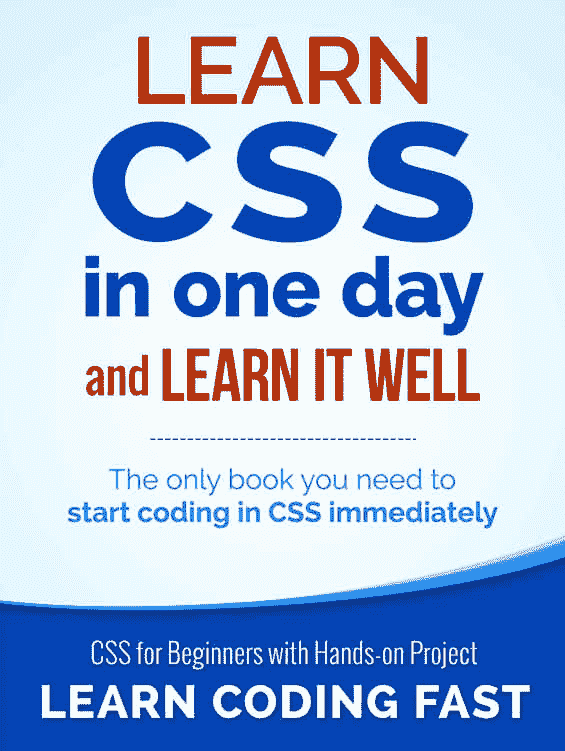


[`www.learncodingfast.com/css`](http://www.learncodingfast.com/css)


## 前言

本书的编写目的是帮助你**快速**学习 CSS 并**精通**它。

本书不假设你具备任何编程背景。如果你是一个完全的初学者，你会发现这本书以易于理解的方式解释了复杂的概念。如果你是一个经验丰富的编程人员但刚接触 CSS，这本书将为你提供足够的深度，让你立即开始编写 CSS 代码。

书中的所有示例和图像都经过仔细挑选，用于演示每个概念，以便你对该语言有更深入的理解。每个 CSS 章节末尾都有一个练习。这些练习旨在帮助你进一步加强理解。所有练习的源代码可以在书末的附录中找到。

此外，正如理查德·布兰森所说：“学习任何事情最好的方法就是实践”。本书包含一个额外的赠送项目，你将在引导下从零开始编写一个网页。该项目使用了书中涵盖的概念，并让你有机会看到它们是如何整合在一起的。

你可以在下处下载额外项目和所有练习的源代码：

[`www.learncodingfast.com/css`](http://www.learncodingfast.com/css)。

## 联系信息

我非常期待听到你的反馈。

如需反馈或查询，您可以通过 jamie@learncodingfast.com 联系我。

## Jamie 的其他书籍

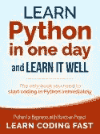

[Python：一天学会并精通 Python](http://mybook.to/Python)


> 工具工具

> 打开 .HTML 文件


> 什么是 HTML
> HTML 页面的基本结构
> Doctype
> 开始和结束标签
> Head 元素
> Body 元素
> Head 元素中的元素
> Body 元素中的元素
> 用于向添加内容的元素
> 与 CSS 配合使用的元素
> 用于为网站添加 JavaScript 代码的元素
> 用于格式化文本的元素
> 定义网页区域的元素
> 注释
> 字符实体


> 应用 CSS 代码
> CSS 规则的语法
> 选择元素
> 选择类和 ID
> 更多选择器
> 不区分大小写
> 优先级顺序
> 显示不一致性
> 注释
> 练习 3
> 练习 3.1


> 什么是 CSS 盒模型
> 宽度和高度属性
> 溢出属性
> 内边距和外边距属性
> 边框属性
> `border-width`
> `border-color`
> `border-style`
> `border-radius`
> 练习 4
## 第五章：定位
> 静态 Static
> 相对 Relative
> 固定 Fixed
> 绝对 Absolute
> 练习 5
## 第六章：显示与可见性

> 显示 Display
> 可见性 Visibility
> 练习 6
## 第七章：背景

> 背景图片 Background-image`
> 背景重复 Background-repeat`
> 背景属性 Background-attachment`
> 练习 7
## 第八章：文本与字体

> 字体族 Font-family`
> 字体样式 Font-style`
> 字体粗细 Font-weight`
> 文本颜色 Text-color`
> 文本对齐 Text-alignment`
> 文本装饰 Text-decoration`
> 字间距 Letter-spacing`
> 词间距 Word-spacing`
> 行高 Line-height`
> 练习 8

## 第九章：列表、链接与导航栏
> 列表 Lists
> 列表类型 List-style-type`
> 列表图片 List-style-image`
> 链接 Links
> 导航栏 Navigation Bars
> 练习 9
## 第十章：表格
> 边框、内边距和外边距


# 第 1 章：引言

欢迎来到 CSS 的世界。非常荣幸也感谢你选择这本书。在我们共同开启这段学习之旅之前，让我们先定义什么是 CSS。

CSS 代表级联样式表（Cascading Stylesheet），用于网站的样式设置和设计。它是 Web 程序员创建网站时使用的多种语言之一。其他网页语言包括 HTML、Javascript 和 PHP 等（仅列举几个）。

HTML 关注网站的内容和结构。由于没有内容的网站存在是毫无意义的，因此对于任何对网页编程感兴趣的人来说，了解 HTML 是至关重要的。本书将首先从介绍 HTML 开始，涵盖你可能需要了解的一些 HTML 基础知识。虽然这些内容并非无一不包，但它足够你完成大部分必要的 HTML 任务。如果你已经熟悉 HTML，可以随时跳到第 3 章。

## 工具

在我们开始编写 HTML 和 CSS 页面之前，让我们先看一些推荐用于网页编程的工具。

在最基础的层，你只需要一个网页浏览器（例如 Internet Explorer、Chrome、Safari、Firefox）和一个文本编辑器（例如记事本）就可以开始编写网站代码。然而，除非你属于认为真正的程序员不应该使用任何编程辅助工具的流派，否则我强烈建议使用一些在线免费工具来让你的编码生活更轻松。

最推荐的工具之一是提供语法高亮的高级文本编辑器。语法高亮意味着编辑器会根据文本用途用不同的颜色显示文本。例如，编辑器可以使用红色表示关键字，蓝色表示注释，绿色表示变量。这个简单的功能将使你的代码变得更容易阅读和调试。如果你使用的是 Windows 机器，我建议使用 Notepad++ ([`notepad-plus-plus.org/`](http://notepad-plus-plus.org/))。对于 Mac，我建议使用 TextWrangler ([`www.barebones.com/products/textwrangler/`](http://www.barebones.com/products/textwrangler/))。两者都是免费的。

### 打开 .HTML 文件

.HTML 文件有两种打开方式。一种方法是通过双击文件在网页浏览器中打开，这用于查看页面。另一种方法是在文本编辑器中打开进行编辑。要这样做，首先启动你的文本编辑器，然后在编辑器内部打开文件。

在处理 HTML 文件时，我建议你同时在浏览器和文本编辑器中打开文件，并将两个窗口并排排列。这样，你就可以在编辑器中编辑代码，保存，然后移动到浏览器，刷新页面并立即检查对代码所做更改的效果。在完成第 3 章到第 10 章的练习时，请遵循此步骤。

# 第 2 章：HTML 基础

现在我们已经介绍了网页编程的基础，让我们开始学习一些实际的 HTML 代码。在本章中，我们将涵盖 HTML 的核心内容。如果你熟悉 HTML，可以跳过本章直接进入第 3 章。

对于初次接触 HTML 的同学，让我们开始吧。

## 什么是 HTML

HTML 代表超文本标记语言（Hypertext Markup Language），是 Web 程序员用于向网页添加内容的语言。标记语言简单来说是一种用于注释文档的语言，用以解释文本的不同部分是什么以及它们应该如何呈现。例如，我们可以使用 HTML 来指定内容应该以列表形式还是表格形式呈现。目前的 HTML 版本是 HTML5。

HTML 最棒的一点是网页的源代码对所有人免费开放。这使得我们很容易通过研究其他网页的代码来学习 HTML。在 Windows 上查看网页源代码，只需在页面任何地方点击右键，并选择“查看源代码”（或其他类似的选项，取决于你使用的浏览器，例如“查看页面源代码”）。如果你使用的是 Mac，点击菜单栏中的“查看”，选择“开发工具”，然后选择“查看源代码”。

你看到的大部分源代码看起来会非常复杂，特别是如果你没有任何 HTML 基础知识。不用担心。很快，你就能自己写出这些“复杂”的代码了。

为了更好地理解 HTML5 的工作原理，让我们从检查 HTML 文档的基本结构开始。

### HTML 页面的基本结构

下面是一个基础 HTML 文档的示例。我在每一行旁边添加了数字。

```
1 <!doctype html>
2 <html>
3 <head>
4 <title>My HTML Page</title>
5 </head>
6 <body>
7 <p>This is just text</p>
8 
9 </body>
10 </html>
```

从上面的代码可以看出，HTML 使用了许多标签，例如 `<head>` 和 `<body>`。

#### Doctype

在第 1 行，`<!doctype html>` 标签告诉浏览器此文档使用的是 HTML5。如果你检查旧页面的源代码，可能会看到类似 `<!DOCTYPE HTML PUBLIC "-//W3C//DTD HTML 4.01//EN" "http://www.w3.org/TR/html4/strict.dtd">` 的内容。这意味着它们使用的是其他版本，如 HTML4.01。

插入 开始和结束标签

在第 2 行，`<html>` 标签告诉浏览器 HTML 代码从这里开始。HTML 中的大多数标签都有对应的结束标签。`<html>` 标签的结束标签位于第 10 行。它在 `html` 单词之前有一个额外的斜杠 (/)。

注意，HTML 中的并非所有标签都有结束标签。例如，用于向网页添加图像的 `` 标签就没有结束标签。通常，当我们需要告诉浏览器标签的效果应该何时结束时，就需要一个结束标签。例如，如果我们想在 HTML 中将某些文本加粗，我们可以写道：

`This text is <strong>important</strong>, but this text is not.`

我们将得到：This text is important, but this text is not.

`<strong>` 标签和 `</<strong>` 标签告诉浏览器加粗效果从何时开始以及何时结束。相比之下，不需要告诉浏览器插入的图像应该何时结束。

#### head 元素

在第 3 行，我们是 `head` 元素的开始。

从广义上说，一个 HTML 文档由两个主要元素组成：`head` 元素和 `body` 元素。

`head` 元素提供了关于文档的一信息，包括元数据、标题以及附加资源的链接。它从第 3 行的 `<head>` 标签开始，到第 5 行的 `</head>` 标签结束。在 `<head>...</head>` 标签之间，我们封装了其他提供文档所有这些后台信息的标签。

在示例中，我们只在 `head` 元素中包含了关于标题的信息。`<title>` 元素（第 4 行）显示浏览器应该在标题栏或页面标签页上显示的标题。在这种情况下，将显示文本“My First HTML Page”。我们将在后的章节中介绍更多在 `head` 元素内部使用的标签。

### body 元素


第 6 行是 `body` 元素开始的地方。`<body>...</body>` 标签内的内容将显示在网页上。在我们的示例中，文本“This is just text”和图像“someimage.jpg”将被显示。

在 `<body>...</body>` 标签内部，我们还可以使用许多其他标签，例如用于添加图像的 `` 标签、用于显示表格的 `<table>` 标签以及用于添加列表的 `<ul>` 标签。我们将在稍后详细介绍这些标签。

为了直观地感受它的工作原理，你可以从配套网站（[`http://learncodingfast.com/css`](http://learncodingfast.com/css)）下载本章节的代码。你可以在 `Chapter 2 - Basics of HTML` 文件夹中找到源代码。双击 `HTML` 文件即可启动它。

在完成本书附带的额外项目时，你也将被引导去编写一个真实的 HTML 文档。该项目的源代码可以在 `Bonus Project\Answers` 文件夹中找到。

## head 元素中的元素

现在我们已经了解了 HTML 的工作原理，让我们详细查看 `head` 元素。

如上所述，`head` 元素提供了有关文档通用信息，例如元数据、标题以及指向外部资源的链接。让我们来看看 `head` 元素中的一些标签。

### `<meta>`

`<meta>` 标签包含在 `<head>…</head>` 标签内，用于向浏览器、搜索引擎或其他网络服务提供有关网站的附加信息。这些信息不会显示在页面本身。`<meta>` 标签没有结束标签。

`<meta>` 标签的一个常见用途为搜索引擎提供关键词。例如：

```html
<meta name="keywords" content="HTML, CSS, Learn in One Day">
```

你可能会注意到这个标签比我们之前讨论的标签要长得多。这是因为 `<meta>` 标签有两个属性：`name` 和 `content`。

`name` 用于指定标签包含的信息的类型（在本例中为关键词），而 `content` 用于指定信息的内容。

你还可以使用 `name=description` 属性为你的网站提供描述。例如：

```html
<meta name="description" content="This is my first Website. It teaches you how to use HTML and CSS">
```

`<meta>` 标签的另一个常见用途是用它来指定浏览器如何控制页面缩放级别和尺寸。这是通过使用 `name=viewport` 属性实现的。例如，你可以写：

```html
<meta name="viewport" content="width=300, initial-scale=1">
```

`width=300` 将视口的宽度设置为 300 像素。一个像素（`px`等于计算机屏幕上的一个点。

当你将视口设置为 300px 且有一张宽度为例如 500 像素的图像时，你只能看到图像的一部分，因为图像的宽度大于视口的宽度。要查看图像的其余部分，你需要向下滚动页面。相比之下，如果你将视口设置为 500px，整个图像将完整显示，无需任何滚动。如果你将视口设置为 1000px，整个图像也会显示，但它会更小，并且只占屏幕宽度的一半。

`initial-scale=1` 设置页面在被浏览器首次加载时的初始缩放级别（在本例中为 1x）。

如果你感兴趣了解更多关于视口的工作原理，可以查看 [`https://developer.apple.com/library/ios/documentation/AppleApplications/Reference/SafariWebContent/UsingtheViewport/UsingtheViewport.html`](https://developer.apple.com/library/ios/documentation/AppleApplications/Reference/SafariWebContent/UsingtheViewport/UsingtheViewport.html)

### `<title>...</title>`

`<title>` 标签用于定义浏览器应该在其标题栏或页面标签页上显示的标题。

### `<style>...</style>`

`<style>` 标签用于向我们的 HTML 文档添加内部 CSS 代码。我们将在第 3 章学习如何操作。

示例：

```html
<style type="text/css">
body {
  …
}
</style>
```

### `<link>`

`<link>` 标签用于链接到外部资源，最常用于链接到外部 CSS 样式表。它不需要结束标签。

示例：

```html
<link rel="stylesheet" type="text/css" href="mystyle.css">
```

`rel` 和 `type` 属性只是告诉浏览器你正在链接到一个 CSS 样式表。你不需要修改它们。唯一你需要修改的属性是 `href` 属性。该属性用于指定 CSS 文件的路径。

## 如何编写外部文件的路径

任何外部文件的路径始终从 HTML 文档的当前文件夹开始。假设有五个文件夹：`User`、`Documents`、`MyWebsite`、`MyCSS` 和 `MoreCSS`，结构如下：

`User > Documents > MyWebsite > MyCSS > MoreCSS`

这意味着 `User` 文件夹包含 `Documents` 文件夹，该文件夹又包含 `MyWebsite` 文件夹。在 `MyWebsite` 文件夹中，我们有 `MyCSS` 文件夹，它包含 `MoreCSS` 文件夹。

如果你正在 `MyWebsite` 中处理一个 HTML 文件，并想访问 `MoreCSS` 中的文件，你将使用路径 `MyCSS/MoreCSS/filename.ext`。


`<ol>` 标签代表有序列表，用于创建一个以数字或字母作为列表标记的列表。

### 有序列表

示例：

```html
<ol>
  <li>Chocolate</li>
  <li>Strawberry</li>
  <li>Vanilla</li>
</ol>
```

输出：
> 1. Chocolate（巧克力）
> 2. Strawberry（草莓）
> 3. Vanilla（香草味）

### 无序列表
`<ul>`...`</ul>` 和 `<li>`...`</li>`

`<ul>` 标签代表无序列表，与 `<ol>`</ol>` 标签类似。但是，它不使用数字或字母作为列表标记，而是使用形状（如圆点或空心圆）。

### 表格
`<table>`...`</table>`, `<tr>`...`</tr>`, `<th>`...`</th>`, `<td>`...`</td>`

`<table>` 标签用于创建表格。`<tr>` 代表“表格行（Table Row）”，`<th>` 代表“表头（Table Header）”，而 `<td>` 代表“表格数据（Table Data）”。在 HTML 中，表格是逐行创建的。

示例（数字不属于代码内容）：

```html
<table>
  <tr>
    <th>Name</th>
    <th>Gender</th>
  </tr>
  <tr>
    <td>Abigail</td>
    <td>F</td>
  </tr>
  <tr>
    <td>Benny</td>
    <td>M</td>
  </tr>
</table>
```

这段代码将为你生成一个有 3 行 2 列的表格。第 2 到 5 行定义了表格的第一行，由于使用了 `<th>` 标签，它是表头行。第 6 到 9 行定义了第二行，10 到 13 行定义了第三行。取决于你在 CSS 中如何样式化表格，你将得到一个类似于下面的表格：

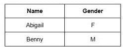

### 与 CSS 结合使用的元素

有两个特殊的 HTML 元素在 HTML 中没有任何固有含义。它们主要与 CSS 结合使用，为网页的特定部分设置样式。这两个元素是 `div` 和 `span`。

#### Div 标签
`<div>`...`</div>`

`<div>` 代表“划分（division）”，用于定义 HTML 文档中的一个划分或区域。`<div>` 标签通常与 CSS 结合使用，以格式化 `<div>`...`</div>` 标签内的内容。

例如，如果我们写：

```html
<div>
  This is some division in the HTML document.
  <ol>
    <li>Chocolate</li>
    <li>Strawberry</li>
    <li>Vanilla</li>
  </ol>
</div>
```

我们可以使用 CSS 来格式化 `div` 标签内的所有内容（即：文本和有序列表）。我们将在下一章学习如何操作。

#### Span 标签
`<span>`...`</span>`

`<span>` 标签与 `<div>` 标签类似。主要区别在于 `<div>` 是**块级元素 (block element)**，而 `<span>` 是**行内元素 (inline element)**。

块级元素是以新换行开始并结束的元素。相比之下，行内元素不会以换行开始或结束。例如，如果我们写：

`This is a <div>block element</div>, while this is an <span>inline</span> element.`

我们将得到：

This is a
block element
while this is an inline element.

由于短语“block element”被标记为 `<div>`标签，它会在新行开始并结束。另一方面，“inline”一词是一个行内元素，不会在新行开始或结束。通常，我们倾向于使用 `<div>` 来封装文档的章节，而 `<span>` 用于封装一小部分文本、图像等。

### 用于向网站添加 JavaScript 代码的元素

`<script>`...`</script>`

`<script>` 标签用于向我们的 HTML 文档添加内部 JavaScript 代码，或链接到外部脚本。JavaScript 是一种脚本语言，为我们的网站添加交互性。

示例（添加内部 JS 代码）：

```html
<script>
  document.getElementById("para1").innerHTML = "Hello JavaScript!";
</script>
```

示例（链接到外部 JS 脚本）：

```html
<script type="text/javascript" src="myscripts.js"></script>
```

### 用于格式化文本的元素

#### Strong 标签
`<strong>`...`</strong>`

`<strong>` 标签用于定义重要的文本。大多数浏览器会将文本**加粗**。

示例：

`The examination will be held on <strong>12 Jan at 2pm</strong>. Late will not be allowed into the hall.`

输出：
考试将于 1 月 12 日下午 2 点举行。迟到者将不允许进入现场。

#### Em 标签
`<em>`...`</em>`

`<em>` 标签用于定义强调的文本。大多数浏览器将以*斜体*形式显示文本。

示例：

`The examination will be held on 12 Jan at 2pm. Late <em>not</em> be allowed into the hall.`

### 用于定义网页部分的元素

`<header>`...`</header>`

`<header>` 标签用于定义页面的页眉部分。

`<nav>`...`</nav>`

`<nav>` 标签用于导航。

`<main>`...`</main>`

`<main>` 标签用于页面的主要内容。

`<footer>`...`</footer>`

`<footer>` 标签用于页面的页脚部分。

```html
<!doctype html>
<html>
<head>
  <title>Example</title>
</head>
<body>
  <header>
    <!-- Insert Header -->
  </header>
  <nav>
    <!-- Insert Navigation -->
  </nav>
  <main>
    <!-- Insert Main Content -->
  </main>
  <footer>
    <!-- Insert Footer -->
  </footer>
</body>
</html>
```

## 注释

注意在之前的示例中，我们使用了大量的 `<!--` 和 `-->` 符号？这些被称为注释。通常我们在编程时，需要添加注释以便阅读和理解。注释不会在浏览器中显示，它们仅仅是为了解释我们的代码。

要在 HTML 中添加注释，我们使用 `<!--...-->` 标签。

示例：

```html
<!--This is a comment. It will not be displayed in the browser-->
```

### 字符实体

某些字符在 HTML 中有预定义定义的特定用途。例如，小于符号 `<` 用于启动所有标签。如果我们需要在网页上显示文本 5<12 怎么办？

为了实现这一点，我们需要使用字符实体。字符实体始终以与符号 `&` 开始并以分号 `;` 结束。显示小于符号有两种方法。我们可以写成 `&lt;` 或 `&#60;`。前者被称为实体名称，而后者被称为实体数字。实体名称更容易记忆（`lt` 代表 less than），但某些浏览器并不支持所有的实体名称。

常用的字符实体包括：

小于符号 (<):
`&lt;` 或 `&#60;`

大于符号 (>):
`&gt;` 或 `&#62;`

安培符号 (&):
`&amp;` 或 `&#38;`

例如，如果你想在网站上显示 5<12，你在 HTML 代码中应将其写为 `5&lt;12`。


另一个常用的字符实体是不换行空格（`&nbsp;`）。不换行空格实体用于显示连续的空格。在默认情况下，HTML 不识别连续的空格。如果你在 HTML 代码中写 5 个空格，浏览器会移除其中的 4 个并只显示一个空格。例如，如果你写

`“There are 5 spaces      here”`

浏览器将将其显示为

`“There are 5 spaces here”。

如果你想显示多个空格，你需要写

`“There are 5 spaces &nbsp;&nbsp;&nbsp;&nbsp;here”`。

# 第 3 章：CSS 基础

现在我们已经涵盖了大量的 HTML，让我们转向 CSS。CSS 代表级联样式表（Cascading Stylesheet），正如其名所示，CSS 的核心在于样式设计以及让你的网站看起来非常精美。

CSS 的最新版本是 `CSS3`。与之前的 CSS 版本（即 `CSS1` 和 `CSS2.1`）不同，`CSS3` 将语言分成了不同的模块，以便每个模块可以以不同的速度独立开发。每个模块都添加了新功能，或者扩展了之前在 `CSS2.1` 中定义的功能能力。本质上，`CSS3` 只是 `CSS2.1` 的扩展。

本书涵盖了 `CSS2.1` 的核心属性，以及 `CSS3` 中引入的几个新属性。一旦你掌握了核心属性，你就可以毫无问题地转向 `CSS3` 中新添加的高级属性。这些高级属性允许对你的网站进行更奇幻的样式设计，例如添加过渡和动画。

在本章中，我们将介绍 CSS 的基础，包括它的语法和优先级。然而，在进入 CSS 语法之前，让我们先学习如何向我们的网站添加 CSS 规则。

## 应用 CSS 代码

有三种方法可以将 CSS 代码应用到我们的网站中。

第一种是链接到外部文件。这是推荐的方法。要进行链接，你需要将 CSS 规则写在一个单独的文本文件中并将其保存为 `.css` 扩展名。在 HTML 代码中添加规则的语法为

```
<link rel="stylesheet" type="text/css" href="style.css">
```

你将将 `<link>` 标签添加到 `head` 元素中，位于 `<head>...</head>` 标签之间。前两个属性 `rel` 和 `type  告诉这是一个 CSS 样式表。你不需要修改它们。最后一个属性 `href` 是你指定要链接的 CSS 文件路径的地方。CSS 文件仅仅是一个包含 CSS 规则的文件，不包含任何 HTML 标签。下例所示。如果代码对你来说意义不大不要担心，我们很快就会讲解。

```
body {
    margin: 0;
    background-color: green;
}
```

将此代码保存为“style.css”，并与 `.html` 文件放在同一个文件夹中。然后你可以使用上面的 `<link>` 标签将此 CSS 文件链接到你的 HTML 文件。

第二种向我们的网站添加 CSS 规则的方法是将代码直接嵌入到 HTML 源代码中，位于 `head` 元素内。这是通过 `<style>` 标签实现的。下例所示。

```html
<head>
<style>
div {
    color: blue;
    width: 100px;
    height: 200px;
}
</style>
</head>
```

最后一种方法是使用内联 CSS。内联 CSS 是在你想要应用它的元素的起始标签中，使用 `style` 属性指定的。每个规则以分号（`;`）结束。示例如下：

```
<div style="text-decoration:underline; color:blue;">Some text</div>
```

在这三种方法中，链接是首选方法。链接将 HTML 内容与样式规则分离，使其更易维护。当我们需要对多个页面应用相同的 CSS 规则时，它也非常有用。相反，嵌入式 CSS 通常用于适用于页面的规则。当你需要将一个规则应用于一个元素，或者当你想覆盖应用于同一元素的其他 CSS 规则时，内联 CSS 非常方便。这是因为内联 CSS 的优先级高于使用其他两种方法添加的 CSS。我们稍后会讨论优先级。然而，内联 CSS 将样式与内容混合在一起，应该尽可能避免。

## CSS 规则的语法

现在我们已经知道如何将 CSS 规则应用到 HTML 中，让我们学习实际的 CSS 代码。学习 CSS 的第一件事是它的语法，它相对非常直观。语法是：

`selector { property : value; property : value; }`

例如，如果你想为 `<div>` 标签内部的内容设置样式，你可以这样写规则：

```
div {
    background-color: green;
    font-size: 12px;
}
```

第一个单词 `div` 是选择器。它告诉浏览器大括号 `{ }` 内部的规则适用于所有带有 `<div>` 标签的元素。在大括号内部，你写所有的声明。你首先声明你想要设置的属性（在第一个声明中是 `background-color`），紧接着是一个冒号（`:`）。然后，你给出你想要的值（在这种情况下是 `green`）。最后，你用分号（`;`）结束每个声明。

在 CSS 中，缩进和换行并不重要。你也可以这样写你的声明：

```
div { background-color: green; font-size: 12px; }
```

非常直观，对吧？太棒了！让我们继续...

## 选择元素

在上面的示例中，大括号中声明的规则将适用于所有带有 `<div>` 标签的元素。然而，在大多数情况下，我们希望有所变化。假设你想让一个 `<div>` 元素具有 `12px` 的字体大小，而另一个具有 `14px` 的字体大小。你会如何做呢？

### 选择类和 ID

基本上有两种方法。第一种是使用 `id` 属性。在你的 HTML 文档中，不再仅仅使用 `<div>` 标签，你可以给它添加一个 `id` 属性。例如，你可以写：

```html
<div id="para1">Some text.</div
<div id="para2">More text.</div>
```

在我们的 CSS 代码中，我们可以通过在 `id` 名称前添加 `#` 号来选择相应的 `id`。示例所示：

```css
div {
    background-color: green;
}
#para1 {
    font-size: 12px;
}
#para2 {
    font-size: 14px;
}
```

第一条规则适用于所有带有 `<div>` 标签的元素。第二条规则仅适用于 `id="para1"` 的元素。第三条规则仅适用于 `id="para2"` 的元素。

除了选择器 `#para1` 之外，你也可以写得更具体，比如 `div#para1`，在 `#` 号前后都不留空格。这两种方法将选择同一个元素，但第二种方法具有更高的优先级（稍后详细介绍）。

注意，`id` 在页面内应该是唯一的。不允许有两个 `<div id="para1">` 标签。一个 `<div id="para1">` 和一个 `<p id="para1">` 标签也是不允许的，因为它们具有相同的 `id`。即使你有两个具有相同 `id` 的元素，你的 HTML 和 CSS 代码也可以工作，但当你开始在网站上使用 JavaScript 或其他脚本语言时就会出现问题。如果你需要对两个不同的元素应用相同的 CSS 规则，可以使用 `class`。`class` 类似于 `id`，区别在于 `class` 不需要是唯一的。此外，`id` 的优先级高于 `class`。

现在，让我们考虑以下代码：

```html
<div class="myclass1">Some text.</div
<p class="myclass1">More text.</p>
<div>Yet more text.</div>
```

如果你想选择所有的 `<div>` 元素（即第一个和第三个元素），你写：

```css
div { ... }
```

如果你想选择所有 `class="myclass1"` 的元素（即第一个和第二个元素），你在 `class` 名称前添加一个点（`.`），如下：

```css
.myclass1 { ... }
```

如果你只想选择 `class="myclass1"` 的 `<p>` 标签（即第二个元素），你写：

```css
p.myclass1 { ... }
```

点的前后不应该留空格。


一个元素可以有多个类。在 HTML 属性中，多个类之间用空格分隔。例如，下面的 `div` 元素有两个类：`myclass1` 和 `myclass2`。

```html
<div class="myclass1 myclass2">
…
</div>
```

如果我们有以下 CSS 代码：

```css
.myclass1 { … }
.myclass2 { … }
```

那么 `myclass1` 和 `myclass2` 的规则都适用于上述 `<div>` 元素。

## 更多选择器

除了通过 `id` 和 `class` 选择元素外，CSS 还提供了许多方法来指定我们想要选择的元素。

### 选择多个元素

例如，我们可以一次选择多个元素。如果我们想选择 `<div>`、`<p>` 和 `<ul>` 元素，我们可以写：

```css
div, p, ul { … }
```

### 选择子元素

如果我们想选择 `<div>` 元素内部所有的 `<p>` 元素，我们可以写：

```css
div p { … }
```

注意 `div` 和 `p` 之间没有逗号。在这种情况下，CSS 规则将仅适用于 `<div>` 内部的 `<p>` 元素。例如，如果我们有下所示 HTML 结构，规则将适用于“I am a paragraph inside div”，而不会适用于“I am a stand-alone paragraph”。

```html
<div>
    <p>I am a paragraph inside div</p>
</div>
<p>I am a stand-alone paragraph</p>
```

第一个段落“I am a paragraph inside div”被称为 `<div>` 标签的子元素，因为它的起始和结束标签（`<p>` 和 `</p>`）完全位于 `<div>...</div>` 标签之内。

### 按属性选择

你也可以根据元素的属性来选择元素。如果你想选择所有指向 `http://www.learncodingfast.com/` 的超链接，你可以写：

```css
a[href="http://www.learncodingfast.com"] { … }
```

方括号前不应该有空格。如果你有以下 HTML 代码，只有第一个链接会被选中。

```html
<a href="http://www.learncodingfast.com/">Learn Coding Fast</a>
<a href="http://www.google.com/">Google</a>
```

### 选择伪类

另一个常用的选择器是伪类选择器。伪类指的是元素的一种特殊状态。最常见的伪类是针对 `<a>...</a>` 元素的伪类。超链接可以处于四种状态之一：

- `link`（未访问过的链接）
- `visited`（已过的链接）
- `hover`（当用户鼠标悬停在其上方时），或
- `active`（当链接被点击时）。

我们可以根据链接所处的状态来选择它。例如，要选择悬停状态，我们写：

```css
a:hover { … }
```

关键字 `hover` 通过冒号（`:`）添加到 `a` 选择器的后面，冒号前后均不留空格。我们将在第 9 章中回到选择和样式化链接不同状态的概念。

除了选择链接的不同状态外，我们还可以使用伪类来选择子元素。假设我们有一个带有三个 `<p>` 子元素的 `<div>` 元素：

```html
<div>
    <p>I am the first child</p>
    <p>I am the second child</p>
    <p>I am the third child</p>
</div>
```

我们可以使用 `first-child` 伪类来选择第一个 `<p>` 元素。我们也可以使用 `last-child` 选择器选择最后一个子元素，或者使用 `nth-child(n)` 选择器来选择第 n 个子元素。例如，如果我们写：

```css
p:nth-child(2) { … }
```

由于括号 `()` 中的数字‘2’，我们将选择段落“I am the second child”。

### 选择伪元素

除了伪类，CSS 还有伪元素的概念。伪元素指的是元素的指定部分，例如元素的第一个字母或第一行。

例如，如果我们有下所示的 `<p>` 元素：

```html
<p>This is some text.</p>
```

我们可以通过书写以下代码来选择第一个字母 (T)：

```css
p::first-letter { … }
```

注意，在这种情况下使用了双冒号。另一个伪元素是 `first-line` 元素。它将选择文本的第一行。

最后，我们可以使用 `before` 和 `after` 伪元素在元素的内容之前或之后插入内容。例如，如果我们想在所有的 `<h1>` 元素之后添加一个感叹号，我们可以写：

```css
h1::after {
    content: "!";
}
```

这将在会在所有的 `<h1>` 元素之后添加一个感叹号。如果我们有以下 HTML 代码：

```html
<h1>This is a heading</h1>
```

## 大小不敏感

在大多数情况下，选择器是不区分大小写的的。然而，唯一的例外是某些语境下的 `id` 和 `class` 名称（等等，根据提供的文本：“在大多数情况下，选择器是不区分大小写的的”）。实际上，提供的文本有些碎片化，但我将保留核心信息。

## 优先级

现在我们已经学会了如何选择，让我们进入一个非常重要的概念：优先级。三个原则控制着哪条规则生效。

### 原则 1：选择器越具体，优先级越高

我们不会详细介绍如何计算选择性。要记住的点是 `id` 比 `class` 更具体，而 `class` 比元素更具体。考虑以下代码：

```css
div { font-size: 10px; }
#myId { font-size: 12px; }
.myClass { font-size: 14px; }
```
```html
<div id="myId" class="myClass">Some text</div>
```

由于 `<div>` 元素拥有 `class="myClass"` 和 `id="myId"`，三条规则 `div`、`#myId` 和 `.myClass` 都生效。然而，由于 `id` 优先级最高，“Some text”将以 12px 显示。

此外，关于特性的另一点是，选择器越详细，优先级越高。例如，`div#myId` 的优先级高于 `#myId`。这是因为 `div#myId` 更详细，因为它告诉我们 `myId` 是 `div` 元素的 `id`。在示例代码中，将应用黄色。

```css
div { color: red; }
div#myId { color: yellow; }
#myId { color: blue; }
.myClass { color: green; }
```

### 原则 2：如果没有指定样式，元素将从父容器继承样式

子元素是完全位于另一个元素的起始和结束标签之内的元素。例如，在下代码中，`<p>` 是 `<body>` 元素的子元素。由于没有定义 `<p>` 的字体大小，它将从定义了该属性的 `<body>` 元素继承该属性。

```css
body {
    font-size: 1.5em;
}
```
```html
<body>
    <p>Some text</p>
</body>
```

如果 `<body>` 元素也没有定义 `font-size` 属性，将使用浏览器的字体字体。

### 原则 3：在其他相等的情况下，最后声明的规则胜出

假设你在 HTML `<head>` 元素中有以下 CSS 声明。

```html
<head>
<style>
    p { font-size: 20px; }
</style>
</head>
```


在 HTML 文档的后续，你有以下 HTML 代码，其中包含一条内联 CSS 规则：

```html
<p style=”font-size: 30px;>Some text</p>
```

你认为哪种规则将应用于“Some text”这些单词上？

正确答案是内联规则。这是因为在其他相等的情况下，最后声明的规则优先级最高。由于内联 CSS 是在 HTML 代码内部声明的，它的声明顺序晚于在 `head` 部分中声明的嵌入式 CSS。因此，将应用 30px 的字体大小。

## 显示不一致

在处理 CSS 时需要解决的另一个问题是跨浏览器的显示不一致问题。你可能会发现你的网站在不同的浏览器中看起来略有（或极度）不同。大多数显示问题倾向于旧版本的 Internet Explorer，尽管问题也可能发生在其他浏览器中（尤其是移动浏览器）。

显示不一致的发生的原因是不同的浏览器使用不同的布局引擎来解释网站的 CSS 代码。例如，`Safari` 和 `Chrome` 使用 `WebKit` 引擎，而 `Firefox` 使用 `Gecko` 引擎。一个引擎计算和显示页面的方式可能与另一个引擎不同。例如，`Internet Explorer` 使用的引擎 `Trident` 会为某些页面设计自动加宽页面像素宽度。这可能导致侧边栏因宽度不足而被推到底部。

另一个导致显示不一致的问题是对某些 CSS 属性缺乏通用支持。某些属性并不是所有浏览器都支持。你可以访问 [`www.caniuse.com`](http://www.caniuse.com/) 网站来检查你正在开发的浏览器是否支持特定的 CSS 属性。

有时，只有当我们为 CSS 规则添加前缀时，特定的浏览器才支持某个 CSS 属性。这对于 CSS3 中的新属性尤其如此。一个例子是 CSS 中的 `column-count` 属性。该属性将元素分成多个列。例如，我们可以通过编写 `column-count: 3` 将一个 `div` 元素分为三列。

旧版本的 `Firefox`、`Chrome`、`Safari` 和 `Opera` 不支持此属性。为了让该属性在这些浏览器上生效，你必须将其三个三个声明：

```css
-webkit-column-count: 3;
-moz-column-count: 3;
column-count: 3;
```

而不是简单的

```css
column-count: 3;
```

`-webkit-` 前缀增加了对旧版本 `Chrome`、`Safari` 和 `Opera` 的支持，而 `-moz-` 前缀增加了对 `Firefox` 的支持。此外，我们还有 `-ms-` 前缀增加了对 `Internet Explorer` 的支持。

在创建网站时，在各种浏览器上进行测试是有用的，以确保没有内容损坏。修复“损坏”显示的方法取决于导致问题的原因。如果你真的卡住了，我建议在 [`stackoverflow.com`](http://stackoverflow.com/) 上搜索或发布问题，这是一个非常有用的程序员在线社区。

## 注释

本章最后介绍的是注释。在 CSS 中，我们使用 `/*...*/` 符号向代码中添加注释。例如所示：

```css
/*
下面的规则是注释。
p {
    background-color: black;
    font-size: 20px;
    color: white;
}
*/
```

`/*` 和 `*/` 符号之间的所有内容会被浏览器忽略。

## 练习 3

从 [`learncodingfast.com/css`](http://learncodingfast.com/css) 下载此练习的源代码并解压文件。此练习的源代码可以在“Chapter 3 - Basics of CSS”文件夹中找到。

### 练习 3.1

> 1. 在你的浏览器和文本编辑器中同时打开 `Chapter 3 - Basics of CSS.html` 文件。
> 2. 首先，在文本编辑器的源代码中寻找以下行：
```css
p {
background-color: yellow;
}
```
这选取了所有的 `<p>` 元素并将它们的背景颜色设置为黄色。“This is some text in the div element.” 这一行没有被选中，因为它不在任何 `<p>...</p>` 标签之内。
> 3. 现在，让我们尝试将规则从
```css
p {
background-color: yellow;
}
```
改为
```css
P {
Background-coloR: YELLOW;
}
```
在你的文本编辑器中保存文件并刷新浏览器。注意看没有发生变化？这是因为在大多数情况下 CSS 是不区分大小写的。
> 4. 现在，让我们尝试选择不同的 HTML 元素，并观察哪些元素最终变成了黄色背景。对于下方的每一项，只需将 HTML 文件第 6 行的选择器更改为所需的选择器即可。
> 首先，让我们选取 `class = "myClassPara"` 的元素。要做到这一点，将 CSS 规则中的 `p` 选择器改为 `.myClassPara`。在编辑器中保存文件并刷新浏览器中的页面。注意现在哪个段落被选中了。
> 5. 现在将选择器改为 `.myclasspara`。注意现在什么都没有被选中？那是因为 CSS 在选取类和 id 时是区分大小写的。
> 6. 接下来，让我们选取 `id = "myIDPara"` 的元素。尝试自己做一下。
> 明白了吗？
> 将 `.myClassPara` 改为 `#myIDPara`。注意现在哪个段落被选中了。
> 7. 现在，将 `#myIDPara` 改为 `#myidpara`。注意什么都没有被选中？那是因为 CSS 在选取类和 id 时是区分大小写的。
> 8. 接下来，让我们选取 `id = "myIDPara"` 的元素。尝试自己做一下。
> 明白了吗？
> 将 `.myClassPara` 改为 `#myIDPara`。注意现在哪个段落被选中了。
> 9. 现在，将 `#myIDPara` 改为 `#myidpara`。注意什么都没有被选中？那是因为 CSS 在选取类和 id 时是区分大小写的。

# 第 4 章：CSS 盒模型

到目前，我们已经涵盖了 HTML 和 CSS 的基础。在本章中，我们将开始进行实际的 CSS 编码。具体来说，我们将学习 CSS 盒模型，并研究如何修改 CSS 盒的外观。

## 什么是 CSS 盒模型

CSS 中的所有元素都被视为盒子。CSS 盒子由外边距、边框、内边距和实际内容组成，如下所示。


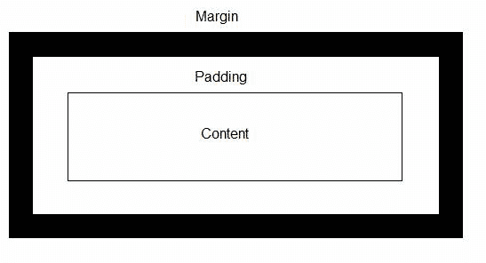

粗黑线是边框（border）。边界内部是内边距（padding）和实际内容。边界外部是框的外边距（margin）。内边距、边框和外边距的厚度都可以 CSS 修改。为了理解这个盒模型是如何工作的，让我们分析下面的代码。你可以在 [`learncodingfast.com/css`](http://learncodingfast.com/css) 下载这段代码。

```html
<!doctype html>
<html
<head><title>Chapter 4 - CSS Box Model</title>
<style type="text/css">
#box1 {
  margin: 20px;
  padding: 10px;
  border: 5px solid black;
  width: 100px;
  height: 100px;
  text-align: justify;
  float: left;
}
#box2 {
  margin: 20px;
  padding: 50px;
  border: 5px solid black;
  width: 100px;
  height: 100px;
  text-align: justify;
  float: left;
}
</style></head>
<body>
<div id="box1">Learn CSS in One Day and Learn It Well. CSS is easy.</div>>
<div id="box2">Learn CSS in One Day and Learn It Well. CSS is easy.</div>>
<p>skajd fhadlc vkas j cnl ka jshvn aclaks jdclkasjd ckasj cnkas djvcn ksa mc nlkasd jn skajd fhadlc vkas j cnl ka jshvn aclaks jdclkasjd ckasj cnkas djvcn ksa mc nlkasd jn skajd fhadlc vkas j cnl ka jshvn aclaks jdclkasjd ckasj cnkas djvcn ksa mc nlkasd jn</p>
</body>
</html>
```

如果你运行这段代码，你将得到下面的框。框旁边和下方的乱码文本是为了显示外边距（margin）。

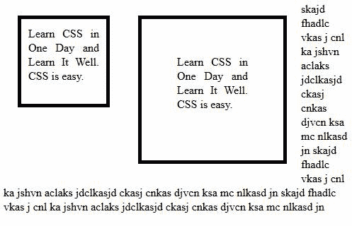

这段代码定义了两个宽度和高度均为 100 像素的框。这个宽度和高度仅指内容区域的尺寸。

第一个框（`box1`）内容区域周围有 10 像素（px）的内边距。在内边距周围，它有一个 5px 的黑色实线边框。`box1` 的总宽度（包括边框）为 100（内容区域）+ 10*2（两侧内边距）+ 5*2（两侧边框）=130 px。高度也是如此。

第二个框（`box2`）有 50px 的内边距。尽管 `box2` 比 `box1` 大得多，但请注意文字“Learn CSS in One Day and Learn It Well. CSS is easy.” 仍然占据相同的区域？这是因为内容区域是由宽度和高度属性决定的，而不是内边距。`box2` 的总宽度为 100+50*2+5*2 = 210px。它的高度也是 210px。

在边框外部，两个框都有 20px 的外边距。注意乱码文本和框之间有一些空间吗？那就是外边距。

尝试稍微修改代码，更改宽度、height、padding、margin 和 border 属性的值。观察每项变化影响了哪些部分。你会注意到宽度和高度影响内容区域。外边距影响边框外部的区域，而内边距影响内部的区域。边框理当然是框的边界。我们将在接下来详细介绍这些每一个属性。

## 宽度和高度属性

CSS 框的 `width` 和 `height` 属性指定了内容区域的尺寸（不包括内边距、边框和外边距）。值通常以像素或百分比给出。例如，示例中的代码将 `box1` 和 `box2` 的宽度和高度都设置为 100px。你也可以将宽度设置为 80%。此时框的内容区域将占据页面宽度的 80%。最后，你可以将高度和宽度设置为 `auto`。在这种情况下，浏览器将根据显示框内内容所需的空间自动计算这些值。

## Overflow 溢出属性

有时，内容区域的宽度和高度可能太小，无法容纳框内的内容。默认情况下，内容将溢出框外并与其他内容重叠。这将导致网页格式非常糟糕。如果你不希望发生这种情况，可以使用 `overflow` 属性。下面的图显示了使用 `overflow` 属性的不同值（`visible`、`hidden`、`scroll` 和 `auto`）如何显示内容。

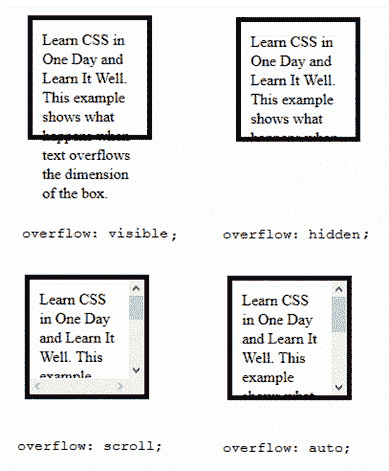

## Padding 和 Margin 属性

内边距和外边距都是透明的。因此，我们无法改变它们的颜色。但我们可以指定它们的宽度。指定宽度最常用的单位是像素。如果你希望外边距为 10 像素，可以写 `margin: 10px;`。10 和 px 之间不应有空格。

下面的示例显示了指定外边距宽度的四种不同语法。内边距也一样。只需将属性名从 `margin` 更改为 `padding`。

语法 1
```css
margin: 25px;
```
语法 2
```css
margin: 25px 50px;
```
语法 3
```css
margin-top: 25px;
```
语法 4
```css
margin: 25px 50px 60px 10px;
```


除了使用 RGB 表示法外，你也可以使用十六进制表示法，它使用 6 位数字表示颜色。前两个数字代表“红色”强度的十六进制值，接下来的两个代表“绿色”，最后两个代表“蓝色”。通常使用颜色工具来生成这些十六进制值。可以访问 [`instant-eyedropper.com/`](http://instant-eyedropper.com/) 网站获取其中一个免费工具。

或者，你可以访问 [`html-color-codes.info/`](http://html-color-codes.info/)，那里有一张颜色表供你选择所需的颜色。点击它，就会得到对应的十六进制值。

### 示例

```css
border-color: rgb(255, 0, 0);
```
将所有边框设置为红色。

```css
border-color: red green;
```
将顶部和底部边框设置为红色，左侧和右侧边框设置为绿色。

```css
border-top-color: #12005F;
```
将顶部边框设置为 #12005F。

### border-style

要设置边框样式，你需要使用属性 `border-style`。接受的值有：`none`、`dotted`、`dashed`、`solid`、`double`、`groove`、`ridge`、`inset` 和 `outset`。例如，如果你写

```css
border-style: solid dotted;
```
顶部和底部边界将为实线，左侧和右侧将为虚线。如果你想单独设置样式，可以写：

```css
border-top-style: solid;
```

```css
border-left-style: dotted;
```

### border-radius

`border-radius` 属性用于创建圆角边框。值通常以像素或百分比给出。

可以为四个角单独设置圆角半径。四个角分别是 `top-left`（左上）、`top-right`（右上）、`bottom-right`（右下）和 `bottom-left`（左下）。

### 示例

```css
border-radius: 5px;
```
将所有角的圆角半径设置为 5px。

```css
border-radius: 10px 20px;
```
将左上和右下（即两个对角的角）的半径设置为 10px，右上和左下的半径设置为 20px。

```css
border-radius: 25px 5px 0 50px;
```
从左上角开始按顺时针方向设置各个角的值。

```css
border-top-left-radius: 10px;
```
将左上角的圆角半径设置为 10px。

如果元素的宽度和高度为 100px，内边距为 20px，边框宽度为 50px（总宽度和总高度 = 100 + 20*2 + 50*2 = 240px），将圆角半径设置为 120px（240 除以 2）将得到一个圆而不是正方形。

### 边框简写

`border` 属性是单行内指定边框宽度、样式和颜色的简写，而不需要分开进行。只需写：

```css
border: 5px solid green;
```
这些值分别为宽度 (5px)、样式 (solid) 和颜色 (green)。此简写中不包含圆角半径。

## 练习 4

从 [`learncodingfast.com/css`](http://learncodingfast.com/css) 下载此练习的源代码并解压文件。此练习的源代码可以在第 4 章 - CSS 模型中找到。

### 练习 4.1

1. 在浏览器和文本编辑器中同时打开 `Chapter 4 - CSS Model.html` 文件。
2. 调整浏览器窗口大小，观察乱码文本如何环绕方框。
3. 修改 `box1` 的 CSS 声明，将 `width: 100px;` 和 `height: 100px;` 分别改为以下各项：
   - (a) `width: 200px; height: 200px;`
   - (b) `width: 60%;`
   - (c) `height: auto; width: auto;`
   在文本编辑器中保存文件并刷新页面。注意每种情况下 `box1` 发生了什么。
4. 现在将 `box1` 的宽度和高度改回 100px，并将标签 `<div id="box1">...</div>` 之间的文本更改为：“Learn CSS in One Day and It Well. 这个例子显示了文本溢出框尺寸会发生什么。”接下来，在 `box1` 的 CSS 声明中添加以下各项，并注意每种情况下发生了什么：
   - (a) `overflow: visible;`
   - (b) `overflow: hidden;`
   - (c) `overflow: scroll;`
   - (d) `overflow: auto;`
5. 修改 `box1` 的 CSS 声明，将 `margin: 20px;` 改为以下各项，并注意 `box1` 周围空间的变化：
   - (a) `margin: 50px;`
   - (b) `margin: -50px;`
   - (c) `margin: 25px 200px;`
   - (d) `margin: 25px 50px 60px 10px;`
6. 移除 `box1` 的外边距规则并添加以下 4 行：
   ```css
   margin-top: 25px;
   margin-right: 50px;
   margin-bottom: 60px;
   margin-left: 10px;
   ```
   注意 `box1` 有任何变化吗？应该没有变化，因为这与上面的 5(d) 相同。
7. 移除 `box1` 的外边距规则并添加下面的一行：
   ```css
   margin: 0 auto;
   ```
   接下来，将 `box1` 的宽度改为 80%。最后，删除行 `float: left;`。注意发生了什么（我们将在下一章解释 `float` 的作用）。`box1` 现在居中对齐了。
8. 现在，让我们处理 `box2`。修改 `box2` 的 CSS 声明，将 `padding: 50px;` 改为以下各项，并注意 `box2` 内部的变化：
   - (a) `padding: 25px;`
   - (b) `padding: -10px;`
   - (c) `padding: 25px 50px;`
   - (d) `padding: 25px 50px 60px 10px;`
   8(b) 将不起作用，因为内边距不能为负值。你将得到 0 像素的内边距。
9. 移除 `box2` 的内边距规则并添加以下 4 行：
   ```css
   padding-top: 25px;
   padding-right: 50px;
   padding-bottom: 60px;
   padding-left: 10px;
   ```
   注意 `box2` 有任何变化吗？应该没有变化，因为这与上面的 8(d) 相同。
10. 现在让我们更改 `box2` 的边框样式。从 `box2` 的 CSS 声明中删除行 `border: 5px solid black;` 并添加以下各项。注意边框在每种情况下发生了什么：
    - (a) `border-style: solid;`
    - (b) `border-style: none double;`
    - (c) `border-style: inset;`
    - (d) `border-style: outset;`
11. 接下来，移除 `box2` 的 `border-style` 规则并添加以下：
    ```css
    border-top-style: dotted;
    border-left-style: double;
    ```
12. 现在移除第 11 的规则并将边框样式改为实线（`border-style: solid;`）。添加以下各项。注意每种情况下 `box2` 发生了什么：
    - (a) `border-width: 25px;`
    - (b) `border-width: 25px thin;`
    - (c) `border-top-width: 30px;`
13. 现在我们要更改 `box2` 的边框颜色。尝试添加以下各项：
    - (a) `border-color: rgb(255, 0, 0);`
    - (b) `border-color: red green;`
    - (c) `border-top-color: #12FF5F;`
14. 接下来，我们尝试边框简写。移除 `box2` 的所有边框属性。添加以下：
    ```css
    border: 5px solid green;
    ```
15. 现在，尝试 `border-radius` 属性。尝试以下各项：
    - (a) `border-radius: 20px;`
    - (b) `border-radius: 10px 20px;`
    - (c) `border-radius: 25px 5px 0 50px;`
    - (d) `border-top-left-radius: 10px;`


定位元素有四种方法。为了理解这四种方法的工作原理，我强烈建议你尝试本章末尾的练习。这是一个没有实践很难理解的话题。

## 静态定位 (Static Positioning)

第一种定位方法是 `static` 静态定位。静态并没有特殊含义，它意味着元素是根据页面的正常流进行定位的。所有的 HTML 元素默认都使用这种方法进行定位。如果你想指定使用 `static` 定位（例如为了覆盖同一元素的其他定位规则），你可以写：

```css
position: static;
```

## 相对定位 (Relative Positioning)

定位元素的第二种方法是 `relative` 相对定位方法。这种方法相对于元素相对于正常位置进行定位。正常位置是指元素在没有指定定位规则或使用 `static` 定位时的默认位置。

假设我们有两个盒子，`box1` 和 `box2`，且没有指定定位。如果我们在 HTML 代码中在 `box1` 之后创建 `box2`，那么 `box2` 默认将位于 `box1` 下方（参见下方代码）。

```html
<!DOCTYPE html>
<html
<head>
<style>
#box1 {
  /*一些用于 box1 的样式规则*/
}
#box2 {
  /*一些用于 box2 的样式规则*/
}
</style>
</head>
<body>
<div id="box1">Box 1</div>
<div id="box2">Box 2</div>
</body>
</html>
```

现在，假设我们为 `box2` 的 CSS 声明添加了以下规则：

```css
position: relative;
left: 150px;
top: 50px;
```

我们所做的是将 `box2` 的定位更改为 `relative` 相对定位。

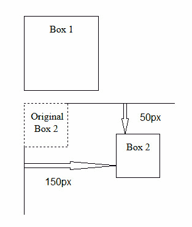

上面的图片显示了在使用 `relative` 定位时 `box2` 的位置。添加了一个白色虚线框来显示 `box2` 的原始位置。

当应用 `relative` 定位时，`box2` 会相对于它的正常位置移动。`top: 50px;` 行将盒子距离原始位置的顶部移动 50px，而 `left: 150px;` 行将其向左移动 150px。

你也可以使用 `right` 和 `bottom` 属性来定位 `box2`。例如，`bottom: 50px;` 将将 `box2` 从其原始底部向上移动 50px，而 `right: 50px;` 将将其从 `box2` 的原始右边缘向左移动 50px。此外，你可以使用负像素来定位盒子（例如 `left: -50px`）。

尝试第 5 章的练习，并调整这些值看看所有所有设置是如何工作的。

注意，当使用 `relative` 定位时，元素可能会与其他元素重叠。

如果你想指定哪个元素应该在前面，必须使用 `z-index` 属性。`z-index` 属性适用于任何定位为 `relative`、`fixed` 或 `absolute` 的元素（即非 `static`）。`z-index` 值较大的元素将定位在 `z-index` 值较小的元素前面。

假设你有两个盒子，`greenBox` 和 `redBox`，它们相互重叠。如果你将 `greenBox` 的 `z-index` 声明为

```css
z-index: 1;
```

并将 `redBox` 的 `z-index` 声明为

```css
z-index: 2;
```

那么 `redBox` 将位于 `greenBox` 之上，因为它的 `z-index` 值更大。

## 固定定位 (Fixed Positioning)

第三种定位方法是 `fixed` 固定定位。顾如其名，使用 `fixed` 方法定位的元素将始终保持在它指定的位置；即使页面滚动，它也不会移动。固定定位通常用于在网页的侧边定位社交分享按钮。要使用 `fixed` 定位，我们写：

```css
position: fixed;
```

在使用 `fixed` 定位时，我们可以使用 `top` 属性指定盒子距离页面顶部的像素数，而使用 `left` 属性指定它距离页面左侧的像素数。

除了 `top` 和 `left`，还有 `right` 和 `bottom` 属性，它们分别指定盒子距离页面右侧和底部的像素数。

## 绝对定位 (Absolute Positioning)

最后的方法是 `absolute` 绝对定位。

当使用 `absolute` 定位时，元素相对于第一个定位非 `static` 的父元素进行定位。如果没有找到这样的元素，它将相对于页面进行定位。

例如，假设我们有以下 HTML 代码：

```html
<div id="box1">Content in Box 1</div>
<div id="box2">Content in Box 2</div>
```

以及以下 CSS 声明：

```css
#box1 {
  position: relative;
}
#box2 {
  position: absolute;
  top: 50px;
  left: 150px;
}
```

假设 `box2` 不是任何具有非静态定位元素的子元素，它将相对于页面进行定位。也就是说，它距离页面顶部 50px，距离左侧 150px。

然而，如果我们更改 HTML 结构为：

```html
<div id="box1">Content in Box 1
  <div id="box2">Content in Box 2</div>
</div>
```

`box2` 现在是 `box1` 的子元素。因此 `box2` 将相对于 `box1` 定位。它距离 `box1` 顶部 50px，距离 `box1` 左侧 150px。

在某种程度上，`absolute` 定位与 `relative` 定位相似，只是元素相对于父元素而不是正常位置。

## 浮动 (Floating)

我们将讨论的下一个 CSS 属性是浮动。浮动是一种在页面上排列元素的技术。这种想法类似于将书放在书架上。假设你有一叠厚度和高度不同的书，你需要将这些书放在书架上。此外，不允许重新排列书籍。也就是说，书籍必须按照它们在原始中的顺序放在书架上。

```html
<!doctype html>
<html>
<head>
<title>Float</title>
<style type="text/css">
div {
  float: left;
  border: 1px dashed black;
  margin: 5px;
}
#box1 {
  width: 60px;
  height: 100px;
}
#box2 {
  width: 100px;
  height: 20px;
}
#box3 {
  width: 50px;
  height: 150px;
}
#box4 {
  width: 20px;
  height: 50px;
}
#box5 {
  width: 150px;
  height: 120px;
}
#box6 {
  width: 120px;
  height: 70px;
}
#box7 {
  width: 25px;
  height: 80px;
}
</style>
</head>
<body>
<div id="box1">Box 1</div>
<div id="box2">Box 2</div>
<div id="box3">Box 3</div>
<div id="box4">Box 4</div>
<div id="box5">Box 5</div>
<div id="box6">Box 6</div>
<div id="box7">Box 7</div>
</body>
</html>
```

如果我们运行这段代码，我们将得到类似下面的图片。

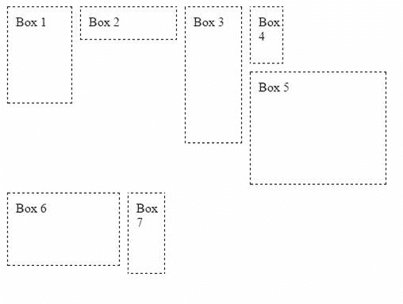

注意盒子是如何是从顶部开始从左到右排列的。由于 box 5 太厚无法放入第一行，CSS 将其放在上一个盒子的下方。

现在，假设在这些 7 个盒子之外，我们还有想要显示在网站上的以下文本。

<p>这是一些非浮动的文本。</p>
<p>这是更多非浮动的文本。</p>
<p>这是更多的非浮动的文本。</p>


如果这些段落包含在 `div` 框之后的 HTML 文档中，我们将得到下面的图。这些段落将仅仅“挤入”任何可用的空间。

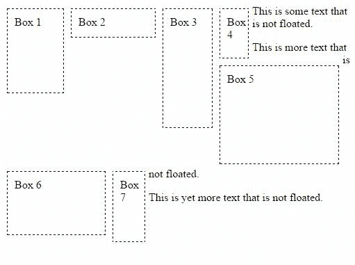

如果你不希望发生这种情况，可以使用 `clear: both` 属性来清除浮动。要这样做，请在 CSS 声明中添加以下内容：

```css
.clearFloat { clear: both; }
```

要使用此类，我们将其添加到第一个 `<p>` 标签中：

```html
<p class="clearFloat">这是某段未浮动的文本。</p>
```

你只需要在第一个 `<p>` 标签上添加 `clearFloat` 类。一旦清除了浮动，文本将不再环绕这些框布局。

这就是 CSS 中定位和浮动的的工作原理精要。我强烈建议你尝试本章节的练习题，以更好地理解这两个概念。

## 练习 5

从 [`learncodingfast.com/css`](http://learncodingfast.com/css) 下载此练习的源代码并解压文件。该练习的源代码可以在 `Chapter 5 - Positioning and Floating` 文件夹中找到。

### 练习 5.1

> 1. 在浏览器和文本编辑器中同时打开 `Chapter 5 - Positioning.html` 文件。

> 2. 为 `#box1` 和 `#box2` 的 CSS 声明添加规则 `position: static;`，并观察两个框的位置发生了什么变化。

>
> 没有任何变化，对吧？那是因为所有 HTML 元素默认都使用 `static` 定位。

> 3. 从 `#box1` 和 `#box2` 的 CSS 声明中移除规则 `position: static;`。在 `#box2` 的 CSS 声明中添加以下几行。

```css
position: relative;
top: 50px;
left: 70px;
```

> 观察第二个框的位置发生了什么变化。 3. 它现在距离顶部 50px，距离其正常位置左侧 70px。

> 尝试对 `top` 和 `left` 属性使用不同的值，观察 `box2` 位置发生的变化。也尝试使用负值。你也可以尝试使用 `right` 和 `bottom` 属性。

> 4. 现在将 `#box2` 的 CSS 声明改回

```css
position: relative;
top: 50px;
left: 70px;
```

> 注意到文本被红色框部分遮挡了吗？

> 如果你想让文本出现在红色框前面，请在 `p` 的 CSS 声明中添加以下几行。

```css
position: relative;
z-index: 2;
```

> 你可以将位置设置为 `relative`、`absolute` 或 `fixed`。只要不是 `static` 即可。

> 接下来，为 `#box2` 的 CSS 声明添加行 `z-index: 1;`。刷新页面。现在文本应该在红色框前面了，因为文本的 `z-index` 大于红色框的 `z-index`。

> 如果你想让红色框反出现在文本前面，只需将 `#box2` 的 `z-index` 改为大于 2 的值即可。

> 5. 现在，将 `#box1` 的高度改为 `5000px`，并将 `#box2` 的定位改为 `fixed`（`position: fixed;`）。

> 滚动页面。 5. 红色框没有移动，因为它现在使用了固定定位。

> 6. 将 `#box2` 的定位改回 `relative`，并将 `#box1` 的高度改回 `100px`。在文件底部的 HTML 代码中的 `<p>` 标签之前添加以下行。

```html
<div id="box3"></div>
```

现在添加以下 CSS 声明来样式化 `box3`。

```css
#box3 {
  position: absolute;
  top: 50px;
  left: 150px;
  background-color: yellow;
  width: 50px;
  height: 50px;
  padding: 20px;
  border: 5px dotted black;
  margin: 10px;
}
```

> `box3` 使用 `absolute` 定位，由于它不是任何 `<div>` 元素的子元素，因此它是相对于页面定位的。也就是说，它距离页面顶部 50px，距离左侧 150px。

> 7. 现在将三个框的 `<div>` 代码改为以下内容：

```html
<div id="box1"> </div>
<div id="box2">
    <div id="box3"></div>
</div>
```

> `box3` 现在是 `box2` 的子元素。因此，它是相对于 `box2` 定位的。

### 练习 5.2

> 1. 在浏览器和文本编辑器中同时打开 `Chapter 5 - Positioning.html` 文件。

> 2. 为 `#box1` 和 `#box2` 的 CSS 声明添加规则 `position: static;`，并观察两个框的位置发生了什么变化。

> 3. 从 `#box1` 和 `#box2` 的 CSS 声明中移除规则 `position: static;`。在 `#box2` 的 CSS 声明中添加以下几行。

> 4. 现在将 `#box2` 的 CSS 声明改回 `position: relative; top: 50px; left: 70px;`。注意到文本被红色框部分遮挡了吗？

> 5. 如果你想让文本出现在红色框前面，请在 `p` 的 CSS 声明中添加以下行：`position: relative; z-index: 2;`。

> 6. 接下来，为 `#box2` 的 CSS 声明添加行 `z-index: 1;`。刷新页面。现在文本应该在红色框前面了，因为文本的 `z-index` 大于红色框的 `z-index`。

> 7. 如果你想让红色框反出现在文本前面，只需将 `#box2` 的 `z-index` 改为大于 2 的值即可。

> 8. 现在，将 `#box1` 的高度改为 `5000px`，并将 `#box2` 的定位改为 `fixed`（`position: fixed;`）。

> 9. 滚动页面。红色框没有移动，因为它现在使用了固定定位。

> 10. 将 `#box2` 的定位改回 `relative`，并将 `#box1` 的高度改回 `100px`。在文件底部的 HTML 代码中的 `<p>` 标签之前添加以下行：`<div id="box3"></div>`。

> 11. 现在添加以下 CSS 声明来样式化 `box3`。`box3` 使用 `absolute` 定位，由于它不是任何 `<div>` 元素的子元素，因此它是相对于页面定位的。

> 12. 现在将三个框的 `<div>` 代码改为嵌套结构。`box3` 现在是 `box2` 的子元素。因此，它是相对于 `box2` 定位的。


> 没有任何变化，对吧？黄色框被声明为内联元素。因此，它只会占据它所需的宽度和高度。事实上，你可以移除高度和宽度属性，且什么都不会改变。

> 3. 现在将 `#displaydemo` 的 `display` 属性从 `display: inline;` 改为 `display: block;`。发生了什么？

> 黄色框现在以块级元素的形式显示。它会在新行开始并结束。如果你声明了它的宽度和高度，宽度和高度将是你你指定的值。如果你没有指定宽度和高度，黄色框将占据页面的整个宽度。它将占据它所需的高度。

> 4. 尝试更改 CSS 中针对 `#displaydemo` 声明的高度和宽度。观察发生了什么。

> 5. 现在，让我们来看 `visibility` 属性。将 `#magic` 的 CSS 声明从 `display: inline;` 改为 `visibility: hidden;`。观察蓝色句子中“magic”一词发生了什么。

> 6. 接下来，将 `#magic` 的 CSS 声明从 `visibility: hidden;` 改为 `display: none;`。观察发生了什么。

# 第 7 章：背景

在本章中，我们将学习如何更改元素的背景属性。这些属性包括更改其背景颜色和背景图像。

首先，让我们先看看如何更改背景颜色。

## 背景颜色

要声明元素的背景颜色，我们使用 `background-color` 属性。类似于指定 CSS 框的边框颜色，我们可以使用三种表示法之一声明元素的背景颜色：颜色名称、rgb 表示法或十六进制表示法。

示例：

```
background-color: green;
background-color: rgb(0, 255, 0);
background-color: #00FF00;
```

## 背景图像

如果你觉得仅使用颜色作为元素的背景太单调，你可以选择使用图像。CSS 允许我们在图像显示上具有极大的灵活性。

### background-image

要使用图像作为背景，我们使用 `background-image` 属性指定图片的 URL。

示例：

```
background-image: url(“image1.jpg”);
```

### background-repeat

默认情况下，背景图像位于元素的左上角，并在水平和垂直方向上重复。如果你不希望背景图像重复，可以使用 `background-repeat` 属性进行更改。以下列表显示了 `background-repeat` 属性的一些常用值：

- `repeat`: 默认值。图像将在水平和垂直方向上重复。
- `repeat-x`: 图像仅在水平方向重复。
- `repeat-y`: 图像仅在垂直方向重复。
- `no-repeat`: 图像不重复。

示例：

```
background-repeat: repeat-x;
```

### background-attachment

`background-attachment` 属性指定背景图像应该是固定还是随页面滚动。两个常用的值是 `fixed` 和 `scroll`。默认值是 `scroll`。尝试本章末尾的练习来看看它是如何工作的。

示例：

```
background-attachment: scroll;
```

### background-position

如果你想指定显示背景图像的哪个区域，`background-position` 属性非常有用。

假设你有一个宽度和高度均为 100px 的元素。如果你使用的背景图像宽度为 200px，高度为 300px，那么由于图像大于元素的大小，只有背景图像的一部分会被显示。

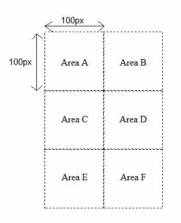

例如，如果你使用上面的图像（200px x 300px）作为 100px x 100px 元素的背景图像，默认只会显示区域 A（左上角）。如果你想显示区域 F 呢？要实现，你需要更改 `background-position` 属性的值。

指定 `background-position` 值的最常用方法是使用像素。语法为：

```
background-position: xpos ypos;
```

为了理解这种语法如何工作，让我们想象一块中间有一个 100px x 100px 孔洞的纸板。纸板上的这个孔代表 HTML 元素。现在想象你的背景图像在纸板下方。默认情况下，图像将对齐，使得区域 A 通过纸板上的孔显示。如果你想显示区域 F，你必须将图像（而不是纸板）向左移动 100px 并向上移动 200px。用 CSS 实现这一点，你需要写：

```
background-position: -100px -200px;
```

第一个数字（`-100px`）水平移动图像。如果这个数字是正数，图像向右移动。如果是负数，则向左移动。

第二个数字（`-200px`）垂直移动图像。如果这个数字是正数，图像向下移动。如果是负数，则向上移动。

理解这个概念的最佳方法是尝试本章的练习。我强烈建议你在进入第 8 章之前完成这些练习。

## 练习 7

从 [`learncodingfast.com/css`](http://learncodingfast.com/css) 下载此练习的源代码并解压文件。此练习的源代码可以在章节找到。

### 练习 7.1

1. 从 [`learncodingfast.com/css`](http://learncodingfast.com/css) 下载此练习的源代码并解压文件。此练习的源代码可以在章节找到。
2. 在浏览器中打开 `7 - Background.html` 文件。注意滚动时发生了什么。
3. 在 `body` 元素中，将 `background-attachment: fixed;` 改为 `background-attachment: scroll;`。注意标志发生了什么。
4. 接下来，将 `background-repeat: repeat;` 改为：
   - (a) `repeat-x;`
   - (b) `no-repeat;`
   - (c) `repeat-y;`
   注意每种情况下发生了什么。
5. 接下来，将 `background-color: white;` 改为 `background-color: #0000FF;`。这应该改变页面的背景颜色。
6. 最后，我们将查看 `backgroundposition` 属性。此示例使用的图像是存储在相同文件夹中的‘backgroundposition.png’。在继续之前看一眼图像。
7. 注意当 `background-position` 设置为 `0 0`（默认值）时，显示区域 A。更改 `background-position` 属性将相对于区域 A 移动背景图像。
8. 在 `#box1` 的 CSS 中，将 `background-position: 0 0;` 改为：
   - (a) `background-position: -100px 0;`
   - (b) `background-position: 100px 0;`
   - (c) `background-position: 0 -100px;`
   - (d) `background-position: 0 100px;`
   - (e) `background-position: -100px -100px;`
   尝试弄清楚你会得到哪个区域。

# 第 8 章：文本和字体

CSS 中的文本和字体属性用于格式化网页上单词和文本的外观。`font` 属性涉及字符的外观，例如它们是“粗”还是“细”、“大”还是“小”，以及使用哪种字体。`text` 属性用于样式化所有其他内容。在本章中，我们将涵盖常用的 `text` 和 `font` 属性。

## 字体属性

font-family

`font-family` 属性用于设置字体类型。


字体类型主要三大类：衬线字体、无衬线字体和等宽字体。

衬线字体（Serif）在字符的末端有一个小装饰线。例如“Times New Roman”和 Georgia。

无衬线字体（San Serif）字符的末端没有装饰线。例如 Arial 和 Verdana。

等宽字体（Monospace）所有字符都使用相同的空间。例如，字母‘i’的宽度与字母‘a’相同。等宽字体的示例包括“Courier New”和“Lucida Console”。

在指定 `font-family` 属性时，你应该始终包含多个字体名称，这样如果浏览器不支持第一个字体，它就会尝试下一个字体，直到找到它支持的字体为止。从更具体的字体（如“Times New Roman”）开始，并以通用字体族结束。如果字体名称包含多个单词，应使用引号。

示例：

```css
font-family: "Times New Roman", Times, serif;
```

## font-size

`font-size` 属性设置文本的大小。字体大小可以使用像素 (px)、em、百分比 (%) 或使用关键字来设置。

### 使用 px

大多数浏览器使用的默认字体大小是 16 像素。如果你想让网站显示不同的字体大小，可以这样指定：`font-size: 20px;`。

### 使用 em

一个 em 等于当前的字体大小。如果该元素是另一个元素的子元素，则当前字体大小是父元素的字体大小。如果该元素不是任何元素的子元素，则当前字体大小是浏览器的默认字体大小。如上述，大多数浏览器使用的默认字体大小为 16px。因此，默认情况下 `1em = 16px`。

然而，可以通过更改浏览器设置来更改默认字体大小。例如，要更改 Firefox 的默认字体大小，点击菜单按钮（右侧的三条横线按钮），选择“选项”（Options），最后选择“内容”选项卡。然后你可以在“字体与颜色”部分下更改当前字体大小。

如果用户将默认字体设置为 20px，`1em` 变为 20px。如果你想让字体大小变为当前字体大小的 1.5 倍，只需编写 `1.5em`。em 是大多数开发者使用的首选单位大小，因为默认字体大小可以由用户自定义。

### 使用百分比

百分比类似于 em。`200%` 仅意味着当前字体大小的 2 倍。因此，`200% = 2em`。

### 使用关键字

指定字体大小的最后方法是使用关键字。常用的关键字有 `xx-small`、`x-small`、`small`、`medium`（默认值）、`large`、`x-large` 和 `xx-large`。

示例：

```css
font-size: 40px;
font-size: 1.5em;
font-size: 120%;
font-size: large;
```

## font-style

`font-style` 属性用于指定斜体文本。两个常用值是 `normal` 和 `italic`。normal 显示不斜体的文本，而 italic 以斜体显示文本。

示例：

```css
font-style: italic;
```

## font-weight

`font-weight` 属性是 `font-style` 的对应属性。`font-style` 用于指定斜体文本，而 `font-weight` 用于指定加粗文本。常用的值包括 `normal`、`bold`、`bolder` 和 `lighter`。或者，你也可以使用 100 的倍数数字指定字符的粗细，从 100（最细）到 900（最粗）。400 是正常粗细，700 等于粗。

然而，注意大多数网络浏览器只支持 `normal` 和 `bold` 字体权重。在这种情况下，100-500 对应 `normal`，而 600 及以上对应 `bold`。

示例：

```css
font-weight: bold;
font-weight: 300;
```

## Text Properties

CSS `text` 属性允许你设置与文本字体相关的属性。常用属性包括文本颜色、文本对齐、文本装饰、字间距、词间距行高。

### color

CSS `color` 属性指定文本的颜色。与我们在第 4 章中学习的 `border-color` 属性类似，文本颜色可以通过三种方式之一指定：使用颜色名称、RGB 值或十六进制值。

示例：

```css
color: blue;
color: #00ff00;
color: rgb(255,0,0);
```

### text-alignment

`text-alignment` 属性允许我们指定文本是居中、左对齐、右对齐还是两端对齐。常用的值有 `left`、`right`、`center` 和 `justify`。

示例：

```css
text-align: center;
```

### text-decoration

`text-decoration` 属性主要用于指定文本是否带有装饰。常用的值有 `none`（即：普通文本，无装饰）、`underline`（下划线）、`overline`（文本上方的线）和 `line-through`（文本删除线）。

此属性通常用于移除链接的下划线。默认情况下，大多数浏览器将以蓝色并带下划线显示链接。你可以使用代码 `text-decoration: none;` 来移除下划线。

示例：

```css
text-decoration: none;
```

### letter-spacing

字间距用于增加或减少字符之间的间距。

### word-spacing

词间距用于增加或减少单词之间的间距。

### line-height

行高用于设置文本行之间的垂直距离。


## 7. 修改 CSS 属性 `text-align` 并观察示例文本的变化。默认情况下，此段的文字是左对齐的。现在尝试每一项：

(a) `text-align: justify;`

(b) `text-align: right;`

(c) `text-align: center;`

## 8. 修改 CSS 属性 `text-decoration` 并观察示例文本的变化。尝试：

(a) `text-decoration: underline;`

(b) `text-decoration: overline;`

(c) `text-decoration: line-through;`

## 9. 修改 CSS 属性 `letter-spacing` 并观察示例文本的变化。尝试：

(a) `letter-spacing: 5px;`

(b) `letter-spacing: -5px;`

## 10. 将 `letter-spacing` 改回 `0px`。修改 CSS 属性 `word-spacing` 并观察示例文本的变化。尝试：

(a) `word-spacing: 10px;`

(b) `word-spacing: -20px;`

## 11. 将 `word-spacing` 改回 `0px`。修改 CSS 属性 `line-height` 并观察示例文本的变化。尝试：

(a) `line-height: 2;`

(b) `line-height: 25px;`

(c) `line-height: 30%;`

# 第 9 章：列表、链接与导航栏

在本章中，我们将学习用于样式化链接和列表的 CSS 属性。此外，我们还将结合这两个概念，讨论如何创建网页上常见的导航栏。准备好了吗？让我们从 CSS 列表开始。

## CSS 列表

回想在 HTML 中，我们可以创建两种类型的列表：有序列表和无序列表。我们可以使用 CSS 列表属性对这些列表进行样式化。

### list-style-type

`list-style-type` 属性允许为列表设置列表项目标记。列表项目标记是指每个列表项目左侧的那些符号/数字/字母。

对于有序列表，我们可以指定想要作为标记的数字或字母类型。例如，如果我们想使用罗马数字（例如 i, ii, iii）作为项目标记，可以写 `list-style-type: lower-roman;`。

其他常用的标记包括：

- `decimal`（这是默认值），
- `decimal-leading-zero`（带有前导零的数字，例如 01, 02..），
- `lower-alpha`（例如 a, b, c..），
- `lower-greek`（例如 α, β, γ..），
- `upper-alpha`（例如 A, B, C..）以及
`upper-roman`（例如 I, II, III…）。

对于无序列表，你可以指定想要作为符号的形状。默认标记是 `disc`（实心圆）。你可以将其更改为 `square`（正方形）或 `circle`（空心圆）。

此外，还可以选择不为列表使用任何项目标记。要这样做，你需要写 `list-style-type: none;`。这在创建导航栏时非常常见。

示例：

- `list-style-type: lower-roman;`
- `list-style-type: circle;`
- `list-style-type: none;`

### list-style-image

如果你不喜欢提供的任何列表样式，可以选择使用图像作为列表项目标记。要这样做，你可以使用 `list-style-image` 属性来指定使用的图像 URL。

示例：

- `list-style-image: url(‘myMarker.gif’);`

### list-style-position

`list-style-position` 属性用于指定列表项目标记应该出现在内容流内部还是外部。有两个接受的值：`inside` 和 `outside`。

默认情况下，列表项目带有一定程度的缩进。如果 `list-style-position` 设置为 `inside`，则列表项目标记将在缩进后显示。缩进由下方图中框框的左边缘表示。如果 `list-style-position` 设置为 `outside`，则标记将在缩进之前显示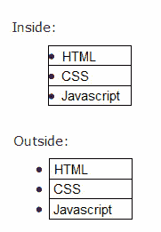

换句话说，`list-style-position: inside` 导致的缩进比 `list-style-position: outside` 更多。默认位置是 `outside`。

示例：

- `list-style-position: outside;`

### list-style

`list-style` 是一个简写属性，用于在一条声明中设置所有列表属性（即 `list-style-type`、`list-style-position` 和 `list-style-image`）。如果缺少任何值，将使用该缺失属性的默认值。

示例：

- `list-style: square inside url("myMarker.gif");`

## CSS 链接

链接可以使用之前章节中讨论过的任何 CSS 属性进行样式化。你可以使用 `background-color` 属性设置背景颜色，这将为链接提供高亮显示效果。你还可以使用第 8 章涵盖的文本和字体属性来更改字体大小、字体样式、文本颜色、文本装饰等。

此外，我们可以根据状态对链接进行样式化。链接可以处于四种状态：

- `link`（未访问的链接）
- `visited`（已访问的链接）
- `hover`（当鼠标悬停在其上方时）
- `active`（当点击点击时）

要指定状态，我们写：

```css
a:link { ... }
a:visited { ... }
a:hover { ... }
a:active { ... }
```

## 导航栏

导航栏通常作为无序列表创建。让我们尝试制作自己的菜单。

```html
<ul>
  <li><a href="home.html">首页</a></li>
  <li><a href="html.html">HTML 教程</a></li>
  <li><a href="csst.html">CSS 教程</a></li>
  <li><a href="javascript.html">Javascript 教程</a></li>
</ul>
```

接下来，我们需要移除列表的项目符号。

```css
ul {
  list-style-type: none;
}
```

现在，我们必须对链接进行样式化。

```css
a {
  display: block;
  width: 160px;
  text-align: center;
  text-decoration: none;
  background-color: #0000FF;
}

a:link {
  color: #0000FF;
}

a:visited {
  color: #00FF00;
}

a:hover {
  color: #FFFF00;
}

a:active {
  color: #FF00FF;
}
```

最后，如果我们想让导航栏成为水平条，我们需要让列表项目浮动（float）。

```css
li {
  float: left;
}
```

搞定！我们刚刚创建了一个简单的水平导航栏。该导航栏的源代码已作为练习的一部分给出。尝试一下并让它在视觉上更有吸引力。你还可以为四种链接状态指定不同的样式。


> 刷新浏览器。什么都没有变化吧？那是因为 `list-style-position: outside;` 是默认值。现在将 `list-style-position: outside;` 改为 `list-style-position: inside;`。你会发现无序列表向右稍微移动了（即缩进变大了）。

> 5. 移除 `ul` 的 `list-style-type` 属性，并改用以下属性：

> (a) `list-style-image: url("myMarker.gif");`

> 观察“Cars Unordered List”发生了什么变化。

> 6. 现在让我们来看看如何为超链接样式。尝试在指定的选择器中添加以下规则：

> (a) 在 `a:link{}` 中添加 `color: green;`，并观察“Click Me”链接发生了什么变化。

> (b) 在 `a:active{}` 中添加 `font-size: 2em;` 并点击该链接。

> (c) 在 `a:hover{}` 中添加 `background-color: red;` 并将鼠标悬停在链接上。

### 练习 9.2

1. 在浏览器和文本编辑器中同时打开 `Chapter 9 - Navigation Bar.html` 文件。
2. 此页面展示了如何使用列表和链接的 CSS 规则创建一个水平导航栏的示例。书中解释了这些步骤。学习代码并尝试修改 CSS 声明以改进此导航栏的设计。

# 第 10 章：表格

HTML 表格默认看起来并不好看。然而，通过一些简单的 CSS 样式，我们可以轻松地将其转换为精美的表格。在本章中，我们将学习如何实现。

## 边框、内边距和外边距

我们将的第一组属性是 `border`、`padding` 和 `margin`。还记得我们在讨论 CSS 盒模型时提到过这些属性吗？HTML 表格（<table>`）和单元格（`<th>` 和 `<td>`）遵循与其他 CSS 元素相同的盒模型，因此可以使用这些属性进行样式设置。

请参考下面的图（“Table Margin”和“Table Padding”字样是为了参考添加的，实际表格中并不存在）。

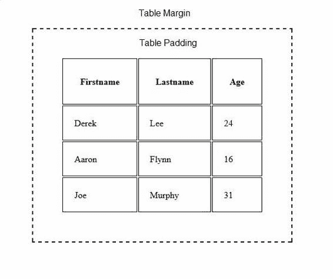

该表格的 CSS 规则如下：

```css
table {
  border: dashed 1px black;
  padding: 50px;
  margin: 60px;
}

th {
  border: solid 1px black;
  padding: 30px;
  text-align: center;
}

td {
  border: solid 1px black;
  padding: 20px;
}
```

虚线是表格的边框。虚线框周围的空间是表格的外边距（margin，声明为 60px），虚线框内部的空间是它的内边距（padding，50px）。

第一行（Firstname, Lastname, Age）使用 `<th>` 标签定义为表格表头。“Firstname”、“Lastname”和“Age”单词周围的空间是 `<th>` 元素的内边距（30px）。

第二行、第三行和第四行使用 `<td>` 标签定义。“Derek”、“Aaron”和“31”等单词周围的空间是 `<td>` 元素的内边距（20px）。

`<th>` 和 `<td>` 元素没有声明外边距，因为外边距会被表格单元格忽略。因此，我们无法指定单元格之间的间距。默认情况下，单个表格单元格之间会有一个小的间隙。此外，即使你将表格内边距设置为 0px，表格边框（虚线）与单元格边框（实线）之间也存在间隙。如果你只需要一个边框，必须使用 `border-collapse` 属性：

```css
border-collapse: collapse;
```

在本章的练习中，我们将有机会尝试各种 `border`、`padding` 和 `margin` 属性。现在，让我们来看下一个属性。

## 高和宽

表格的宽高度可以使用 `width` 和 `height` 属性设置。值通常以像素或百分比的形式给出。例如，下面的代码将表格宽度设置为父元素的 100%，高度设置为 500px。

```css
table {
  width: 100%;
  height: 500px;
}
```

你也可以在 `tr`、`th` 或 `td` 级别上使用 `height` 属性。例如，如果你想让表头行的高度为 100px，可以写道：

```css
th {
  height: 100px;
}
```

此外，你可以在表格单元格级别设置 `width` 属性（即针对 `td` 和 `th` 元素）。如果你想让表格单元格的宽度为 200px，可以写道：

```css
th {
  width: 200px;
}
```

如果你想对单独列设置样式，可以使用 `id`/`class` 属性。例如，如果你有如下表格结构：

```html
<table>
  <tr>
    <th id="firstColumn">Firstname</th>
    <th class="secondColumn">Lastname</th>
  </tr>
  <tr>
    <td>Derek</td>
    <td>Aaron</td>
  </tr>
</table>
```

如果你只需要一个边框，就必须使用 `border-collapse` 属性：

```css
border-collapse: collapse;
```

## 文本对齐

表格单元格内的文本可以使用 `text-align` 属性进行水平对齐，并使用 `vertical-align` 属性进行垂直对齐。例如：

```css
td {
  text-align: center;
  vertical-align: top;
}
```

## 背景、字体和文本

还可以使用第 7 章涵盖的背景、字体和文本设置样式。例如：

```css
th {
  background-color: #f2f2f2;
  font-weight: bold;
}
```

## nth-child 选择器

有时当我们有一个非常大的表格时，很难阅读。提高可读性的一种方法是使用 `nth-child()` 选择器为交替行上色。

```css
tr:nth-child(even) {
  background-color: lightgray;
}

tr:nth-child(odd) {
  background-color: white;
}
```


## 7. 分别在第一个、第二个和第三个 `<th>` 起始标签上添加 `id="firstColumn"`、`id="secondColumn"` 和 `id="thirdColumn"` 属性。接下来，添加以下 CSS 规则来分别调整三列的宽度：

```css
#firstColumn {
    width: 100px;
}
#secondColumn {
    width: 200px;
}
#thirdColumn {
    width: 50px;
}
```

刷新页面并观察变化。尝试使用不同的值调整宽度。

## 8. 修改 `tr` 的 CSS 声明并观察表格发生了什么。尝试添加：

(a) `text-align: center;`
(b) `vertical-align: top;`

从 `tr` 中删除上述属性并将它们添加到 `th` 中。注意发生了什么。对 `td` 重复相同的操作。如果你没有看到任何区别，请增加表格的宽度和/或行的高度。

## 9. 修改 `tr` 的 CSS 声明并观察表格发生了什么。尝试添加：

(a) `background-color: green;`
(b) `color: white;`

从 `tr` 中删除上述属性并将它们添加到 `th` 中。注意发生了什么。

现在，从 `th` 中删除属性并将它们添加到 `td` 中。

## 10. 最后，让我们尝试为交替行染色。首先从 `td` 中移除 `background-color` 和 `color` 规则。接下来，添加以下代码并观察发生了什么。

```css
tr:nth-child(even) {
    background-color: lightgreen;
}
tr:nth-child(odd) {
    background-color: lightgray;
}
```

## 额外项目

恭喜你！我们现在涵盖了足够的 CSS（以及 HTML）基础知识来从开始编写我们的第一个网页。学习 CSS 的最佳方法是实践。因此，我在书中包含了一个额外项目，它将引导你编写一个虚构旅行社的网页。你可以在 `http://www.learncodingfast.com/demo/jetspeed.html` 查看该项目的演示。

最初我打算将该项目放在书末。然而，考虑到 CSS 的图形化特性，我决定在 Kindle 书中包含该项目的所有指令和图像并不理想。因此，我为项目创建了一个单独的 PDF 文件，你可以在 `http://learncodingfast.com/css` 下载。

我强烈鼓励你尝试这个项目，因为它将让你有机会看到在书中学到的所有概念是如何结合在一起的。通过完成项目将有助于巩固你的学习，并填补你可能存在的任何空白。

祝编程愉快！

## 感谢

我们已经读到了书的最后。感谢你阅读这本书，希望你喜欢它。更重要的是，我诚地希望这本书帮助你掌握了 CSS 的基础知识。

我知道你本可以在几十本 CSS 相关的书中选择任何一本，但你选择了这本书。再次感谢你下载这本书并一直读到最后。请尝试练习题和额外项目。你将在实践中学学到很多。

现在，我想请你帮个“小”忙。你能否花一或两分钟时间[在亚马逊上为此书留评论](http://www.amazon.com/review/create-review/ref=cm_cr_dp_wrt_summary?ie=UTF8&asin=B00UI2QHQG&channel=detail-glance&nodeID=133140011&store=digital-text)？

这些反馈对我将非常有帮助，并将帮助我继续编写更多编程指南。如果你喜欢这本书或有任何改进建议，请告诉我。我将深表感激 :)

最后但同样重要的是，记住你可以在 `http://www.learncodingfast.com/css` 下载项目和练习源代码。

你也可以通过 `jamie@learncodingfast.com` 与我联系。

## 附录 A：练习源代码

### 练习 3.1

```html
<!doctype html>
<html>
<head><title>第 3 章 - CSS 基础</title>
<style> 
p{
background-color: yellow;
}
</style>
</head>
<body>
<h1>第 3 章 - CSS 基础</h1>
<h2>CSS 选择器</h2>
<p>这个练习使用背景颜色来帮助我们确定我们正在选择哪个元素。这个段落既没有 class 没有 id。</p>
<p id="myIDPara">这个段落有 id = "myIDPara".</p>
<p class="myClass">这个段落有 class="myClass".</p>
<p class="myClass mySecondPara">这个段落有 class="myClass" 和 class="mySecondPara".</p>
<div>
    这是 div 中的一些文本。
    <p>这个段落是 'div' 的第一个孩子。</p>
    <p>这个段落是 'div' 的第二个孩子。</p>
    <p>这个段落是 'div' 的第三个孩子。</p>
</div>
<a href="http://www.learncodingfast.com">快速学习</a><br>
<a href="http://www.google.com">Google</a>
</body></html>
```

### 练习 4.1

```html
<!doctype html>
<html>
<head><title>第 4 章 - 盒模型</title>
<style type="text/css">
div {
    width: 100px;
    height: 100px;
    padding: 10px;
     :0px;
    float: left;
}
</style>
</head>
<body>
<div id="box1">盒子</div>
<div id="box2">盒子</div>
<div id="box3">盒子</div>
<div id="box4">盒子</div>
<div id="box5">盒子</div>
<div id="box6">盒子</div>
<div id="box7">盒子</div>
</body></html>
```

### 练习 5.1

```html
<!DOCTYPE html>
<html>
<head><title>第 5 章 - 定位</title>
<style type="text/css">
#box1 {
    background-color: green;
    width: 100px;
    height: 100px;
    padding: 20px;
    border: 5px solid black;
}
#box2 {
    background-color: red;
    width: 100px;
    height: 100px;
    padding: 20px;
    border: 5px dotted black;
}
p {
}
</style>
</head>
<body>
    <div id="box1"></div>
    <div id="box2"></div>
    <p>添加了一些文本。</p>
</body></html>
```

### 练习 5.2

```html
<!doctype html>
<html>
<head><title>第 5 章 - 浮动</title>
<style type="text/css">
div {
    padding: 10px;
    border: 1px dashed black;
    margin: 5px;
    float: left;
}
#box1 {
    width: 60px;
    height: 100px;
}
#box2 {
    width: 100px;
    height: 20px;
}
#box3 {
    width: 50px;
    height: 150px;
}
#box4 {
    width: 20px;
    height: 50px;
}
#box5 {
    width: 150px;
    height: 120px;
}
#box6 {
    width: 120px;
    height: 70px;
}
#box7 {
    width: 25px;
    height: 80px;
}
</style>
</head>
<body>
<div id="box1">盒子 1</div>
<div id="box2">盒子 2</div>
<div id="box3">盒子 3</div>
<div id="box4">盒子 4</div>
<div id="box5">盒子 5</div>
<div id="box6">盒子 6</div>
<div id="box7">盒子 7</div>
</body></html>
```

### 练习 6.1

```html
<!doctype html>
<html>
<head><title>第 6 章 - 显示与可见性</title> 
<style type="text/css">
#displaydemo {
border: 1px dashed black;
background-color: yellow;
display: inline;
width: 100px;
height: 100px;
}
#magic {
display: inline;
}
#magicsentence {
    color: blue;
    font-size: 2em;
}
</style>
</head>
<body>
```


这个 `<span id="displaydemo">黄色框</span>` 用来演示行内元素和块级元素之间的区别。

“这就像`<span id="magic">魔法</span>`一样。你可以让文字消失。”

### 练习 7.1

```html
<!doctype html>
<html>
<head>
<title>第 7 章 - 背景</title>
<style type="text/css">
body {
    background-color: white;
    background-image: url("learncodingfast.png");
    background-repeat: repeat-x;
    background-attachment: fixed;
}
#box1 {
    width: 100px;
    height: 100px;
    background-repeat: no-repeat;
    background-color: blue;
    background-image: url("backgroundposition.png");
    background-position: 0 0;
}
#box2 {
    height: 1000px;
}
</style>
</head>
<body>
    <div id="box1"></div>
    <div id="box2"></div>
</body>
</html>
```

### 练习 8.1

```html
<!doctype html>
<html>
<head>
<title>第 8 章 - 字体与文本</title>   
<style type="text/css">
#sampletext{
width: 300px;
border: 1px solid black;
padding: 20px;
font-family: Times, "Times New Roman", Georgia, serif;
font-size: 1em;
font-style: normal;
font-weight: normal;
color: black;
text-align: left;
text-decoration: none;
letter-spacing: 0px;
word-spacing: 0px;
line-height: 1;
}
</style>
</head>
<body>
    <h3>示例文本</h3>
    <p id="sampletext">这段文本用于演示各种字体和文本属性的效果。修改为 "sampletext" 的 CSS 声明，并观察这段文本发生了什么。这段文本被添加了边框，以显示“两端对齐”（justify）的效果。</p>
</body>
</html>
```

### 练习 9.1

```html
<!doctype html>
<html>
<head>
<title>第 9 章 - 列表与链接</title>   
<style type="text/css">
body { padding-left: 20px; }
div { font-weight: bold; text-decoration: underline; font-size: 1.2em; padding-top: 5px;}
ol {
    list-style-type: decimal;
}
ul { 
    list-style-type: disc;
}
a { text-decoration: none;}
a:link { }
a:visited { }
a:hover { }
a:active { }
</style>
</head>
<body>
<div>样式化 HTML 列表</div>
<p>本节用于演示如何在 CSS 中样式化有序列表和无序列表</p>
汽车有序列表
<ol>
    <li>福特</li>
    <li>本田</li>
    <li>丰田</li>
</ol>
汽车无序列表
<ul>
    <li>福特</li>
    <li>本田</li>
    <li>丰田</li>
</ul>
<hr>
<div>样式化超链接</div>
<p>本节用于演示如何在 CSS 中样式化超链接</p>
<a href="some.html">点击我</a>
</body>
</html>
```

### 练习 9.2

```html
<!doctype html>
<html>
<head>
<title>第 9 章 - 导航栏</title>
<style>
ul {
list-style-type: none;
}
a {
display: block;
width: 160px;
text-align: center;
text-decoration: none;
background-color: #00FF00;
}
li {
float: left;
}
</style>
</head>
<body>
<ul>
<li><a href="home.html">首页</a></li>
<li><a href="htmltutorial.html">HTML 教程</a></li>
<li><a href="csstutorial.html">CSS 教程</a></li>
<li><a href="javascripttutorial.html">Javascript 教程</a></li>
</ul>
</body>
</html>
```

### 练习 10.1

```html
<!doctype html>
<html>
<head>
<title>第 10 章 - 表格</title>
<style>
div {
    width: 100%;
    height: 600px;
    border: red solid 1px;
}
table {
border: dashed 1px black;
}
th {
    border: solid 1px black;
}
td {
    border: solid 1px black;
}
tr {
}
</style>
</head>
<body>
下表是红框的子元素。添加红框是为了显示 'table' 的高度和宽度属性的效果。<br><br>
<div>
<table>
    <tr><th>名</th><th>姓</th><th>年龄</th></tr>
    <tr><td>Derek</td><td>Lee</td><td>24</td></tr>
    <tr><td>Aaron</td><td>Flynn</td><td>16</td></tr>
    <tr><td>Joe</td><td>Murphy</td><td>31</td></tr>
</table>
</div>
</body>
</html>
```

