# 学习 D3.js 的简单方法：通过分步骤和最简单的方式学习如何使用 D3 Javascript 库，并配有大量实用示例

轻松学习

免费赠送优惠券

或

[点击这里](https://example.com)

您可能还感兴趣的内容

学习 SAP® UI5：附带示例的新型企业级 JavaScript 框架

SAP® Netweaver Gateway：学习如何将 SAP® Netweaver Gateway 用于 UI5 和 ABAP 项目

七步轻松实现数据可视化

SAP HANA 物联网：使用 Raspberry PI、Arduino Uno、HANA XSJS 和 SAPUI5 构建您的物联网用例

# 1. 介绍

**什么是 D3？**

D3 代表数据驱动文档。它是一个 JavaScript 库，允许开发者创建惊人的数据分析和可视化效果。

**为什么选择 D3？**

D3 应优于任何其他 JavaScript 库，因为我们有很多可用的选项。如果我们想创建一些可视化项目，比如一个简单的项目或一个简单的数学应用，那么它就是最好的选择之一，原因如下。

**现代浏览器能力：** 我们可以利用 D3 使用现代浏览器的能力。我们可以访问所有的 HTML5 和 CSS 属性。因此，创建的应用是响应式的，并且能适应用户设备。

**无限的可能性：** D3 提供的变体和选项是无穷无尽的。我们可以在 [d3js.org](https://d3js.org) 网站上了解 D3 的可能性。

**BSD 开源许可证：** D3 附带 BSD 开源许可证。因此我们无需为使用 D3 支付任何费用。

**庞大的社区支持：** D3 拥有庞大的社区支持。在 **StackOverflow** 和 **GitHub** 上有许多人。当我们学习一项新技术时，支持至关重要。这个社区将指导我们解决在项目中遇到的任何问题和疑问。

让我们探索 [d3js.org](https://d3js.org) 网站

如果您转到示例选项卡，您可以在图库中看到流行的示例。这里我们可以看到许多使用 D3 创建的示例。有许多常见的图形，如箱线图、气泡图、热力图，以及更具创新性的图表，如带有力导向布局和动态图表的图形，这些都在示例选项卡中可用。我们将找到多种变体和创新方法来使用 D3 解决任何可视化问题。在右侧，他们提供了 API 参考。如果您是 D3 新手，这非常有用。它包含了 D3 中使用的所有元素的文档和功能。

# API 参考

让我们回到示例并选择一个示例来探索。这里我们选择箱线图示例来探索。

选择箱线图后，它会打开 D3 示例以及创建该图表的代码。Mike Bostock 是创建此图表的开发者。他也发布了许多示例。您可以点击他的名字查看他发布的图表。

您也可以查看我们的 **通过实践和简单方式学习 D3.JS** 视频课程以加速学习：[点击这里](https://via.placeholder.com) 或使用下方的二维码享受 50-90% 的折扣。

# 通过实践和简单方式学习 D3.JS

UIS 社区网络 • SAP 专家 • SAP 服务、SAP 咨询、SAP 教育

通过循序渐进且最简单的方式，结合大量实践示例，学习如何使用 D3 JavaScript 库

- 35 节课

- 7 小时

- 所有级别

★★★★★ 4.4 (10 个评分)

# 2. 本书学习路径

- 首先我们将从 SVG（可缩放矢量图形）开始。我们将看到如何创建简单的图形对象，如圆形、矩形和三角形。

- 同时，我们将学习如何从 HTML5 绘制这些 SVG 元素。接下来，我们将使用 D3 来创建这些 SVG 元素。

- 一旦我们理解了基本 SVG 元素的工作原理，我们就会转向使用自定义样式表（CSS）。

- 使用 CSS，我们将看到如何将数据与 D3 结合使用。

- 之后，我们将看到如何使用简单的图表，如气泡图和柱状图。

- 然后，我们将看到当最终用户将鼠标悬停在图表上时，图表中的事件。

- 我们的学习曲线还将继续深入到一些高级图表，如地图或热力图项目。

- 最后，我们将创建一个作业项目。这个作业将是一个可视化的用例项目，我们将使用 D3 来解决。我们将逐步、通过实践来学习整个过程。

# 3. SVG 元素

SVG 是可缩放矢量图形的缩写。类似于 PNG 或 JPEG 文件，SVG 用于存储基于 XML 的矢量图像格式。普通的位图图像由固定的像素集组成。而矢量图像则由固定的形状集组成，如圆形、线条或文本。我们可以看到，.jpeg、.png 或 .gif 文件中表示的图像可能会像素化或失真。然而，在矢量图像中，它们是一组形状，我们在缩放图像时不会看到任何质量损失。

## 示例

让我们看一些在 HTML5 页面中使用 SVG 元素的简单示例。我们将使用 Cloud9 IDE。我们大部分开发都在 Cloud9 IDE 中进行。文件全天候 24x7 对用户开放访问。

代码仓库链接：[https://ide.c9.io/ajaytech/dataviz](https://ide.c9.io/ajaytech/dataviz)

不熟悉此 IDE 的人员可以在给定链接中阅读入门文档。

入门指南：[https://docs.c9.io/docs/getting-started](https://docs.c9.io/docs/getting-started)

让我们**开始编码吧！**

### 3.1. SVG 简单示例

在这个示例中，我们将使用 SVG 元素创建一个条形。要创建一个 SVG，我们需要一个 `<svg>` 标签。在这个标签中，我们添加了矩形条的宽度、高度和背景颜色。如果我们在 body 标签之前添加以下代码并运行它，我们将得到一个宽度为 300px、高度为 100px 的橙色矩形。

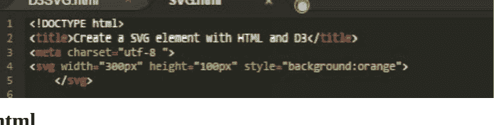

#### SVG.html 的代码

```html
<!DOCTYPE html>
<title>Create a SVG element with HTML and D3</title>
<meta charset="utf-8">
<svg width="300px" height="100px" style="background:orange">
</svg>
<script src="../D3/d3.v3.min.js"></script>
<script>
    var svg = d3.select("body").append("svg").style("background","green");
</script>
<body>
</body>
</html>
```

#### 结果：

这是我们的 **SVG** 元素。在接下来的章节中，我们将把它与 D3 一起使用。

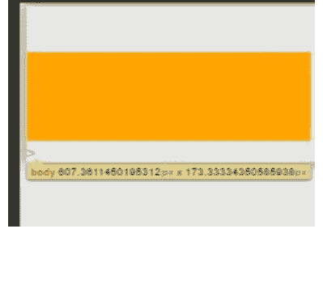

### 3.2 使用 D3 的 SVG

在这个示例中，我们将把 SVG 元素与 D3 一起使用。为此，我们需要使用 `d3.select("body").append("svg")`。我们网页的最终层次结构将包含一个 HTML 元素，其中有一个 body，而这个 body 将包含 SVG 元素。

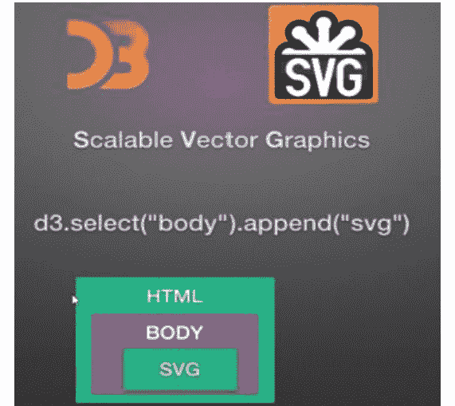

让我们在 Cloud9 IDE 中试一试。我们已经在 HTML 页面内创建了一个简单的 SVG 元素。现在，我们将使用 D3 来执行相同的操作。要使用 D3，我们需要在 body 标签之前添加 D3 库。为此，我们需要在 script 标签内添加该库的链接。

```html
<script src="../D3/d3.v3.min.js"></script>
<script>
```

`"../D3/d3.v3.min.js"` 是 D3 库文件的相对路径。要验证这一点，运行文件，然后右键单击页面并选择“检查元素”进入控制台。接着，输入 D3 并回车。如果一切正常，它不会显示任何错误，并且我们的路径是正确的。

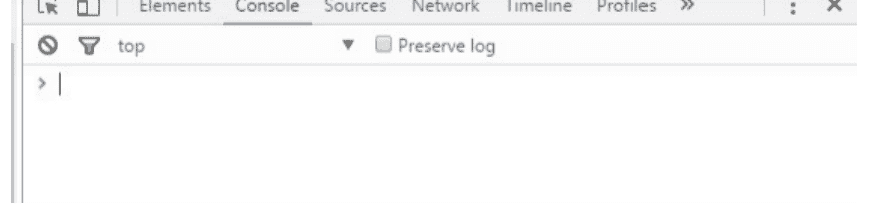

如果路径定义有误，那么它会在控制台中显示如下信息。

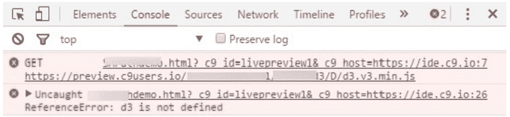

在项目中，我们通常会使用相对路径或来自内容分发网络（CDN）的路径。如果我们打开 D3 库文件，我们会看到里面有一个很大的文件。这就是我们将在应用程序中使用的库文件。D3 基于 JavaScript，所以我们有一个 script 标签，并在其中编写 JavaScript 代码。我们要创建的第一个示例是使用 D3 创建一个 SVG。

#### 使用 D3 的 SVG 代码：

```html
<!DOCTYPE html>
<title>Create a SVG element with HTML and D3</title>
<meta charset="utf-8">
<svg width="300px" height="100px" style="background:orange">
</svg>

<script src="../D3/d3.v3.min.js"></script>
<script>
  /*在 body 内创建一个 SVG，并添加绿色样式以使 SVG 可见*/
  var svg = d3.select("body").append("svg").style("background", "green");
</script>
<body>
</body>
</html>
```

#### 输出：

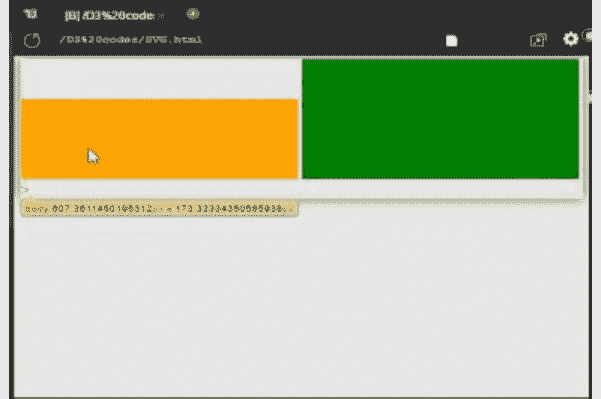

第一个橙色矩形是没有使用 D3 的，第二个矩形框是通过 D3 语法渲染的。这是一个使用 SVG 的简单示例。我们将在接下来的章节中看到更多图形元素及其变化的示例。

你也可以查看我们的 **《轻松上手 D3.JS》** 视频课程以加速学习：[点击此处](http://www.tutorialspoint.com)，或使用下方的二维码享受 50-90% 的折扣。

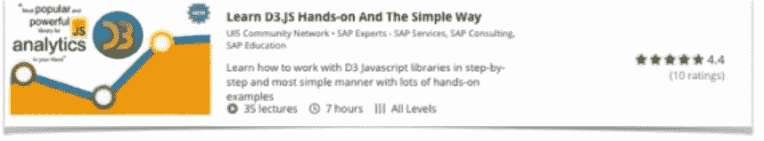


## 4. 选择元素和操作

类似于 JQuery，如果我们想要获取一个对象以进行一些修改或读取一些值，我们需要使用 select 语句。D3 提供了两个顶级元素来选择元素：**`select`** 和 **`selectAll`**。让我们从 select 开始。在这个示例中，我们将有一个简单的 HTML 页面，其中包含一个 body，这个 body 内部将有一个 SVG 元素。这个 SVG 元素将包含一些属性值，如宽度或高度。这些属性实际上被称为 SVG 属性。

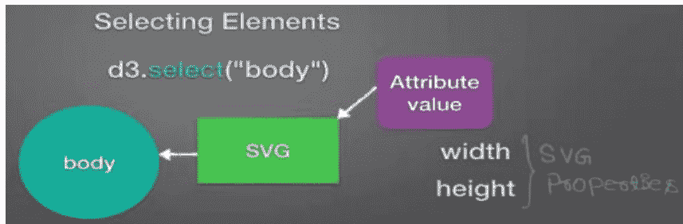

### 4.1 编码

你可以访问这些示例的仓库。访问链接：[https://ide.c9.io/ajaytech/dataviz](https://ide.c9.io/ajaytech/dataviz)


在这个示例中，我们看到了 select 和 selectAll 属性。如果我们使用 select 属性，它会选择提到的特定元素。第一个橙色矩形是 select 属性的示例。恐龙、大象和猫使用了 selectAll。在这里你可以看到恐龙和大象是绿色的，因为在带有 id 和 class 属性的 div 标签中，我们将背景颜色定义为绿色。

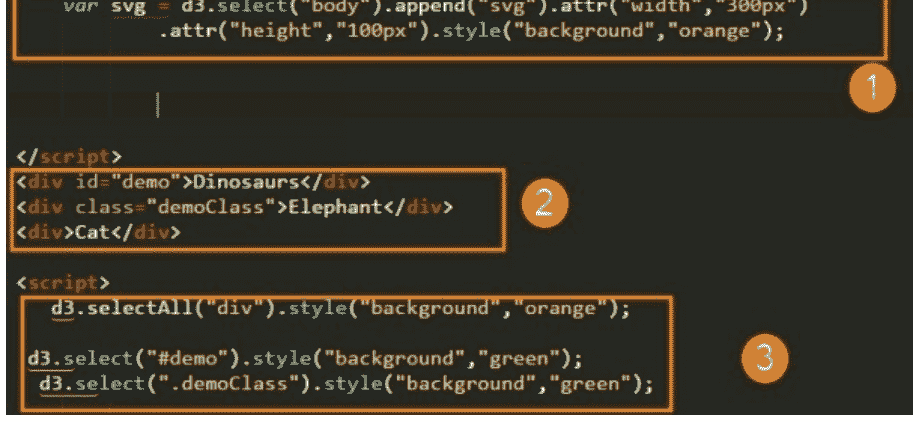

-   1. `d3.select("body")` 是一个 jQuery 选择器语句，用于选择 body 内的内容。属性也在这里定义，样式为橙色背景。

-   2. 带有 id 为 demo 的 div 元素和另一个 class 为 ‘demoClass’ 的 div 元素用于分组指定的类或 id。

-   3. ‘SelectAll’ 将选择 div 内的整个 SVG，而 ‘Select’ 仅选择函数内指定的特定类或 id。

#### D3SVG.html 的代码

```html
<!DOCTYPE html>
<meta charset="utf-8">
<title>Adding attributes and selection to SVG element</title>
<body>
<script src="../D3/d3.v3.min.js"></script>
<script>
    var svg = d3.select("body").append("svg").attr("width", "300px")
    .attr("height", "100px").style("background", "orange");
</script>
<div id="demo">Dinosaurs</div>
<div class="demoClass">Elephant</div>
<div>Cat</div>
<script>
d3.selectAll("div").style("background", "orange");
d3.select("#demo").style("background", "green");
d3.select(".demoClass").style("background", "green");
</script>
</body>
</html>
```

#### 输出

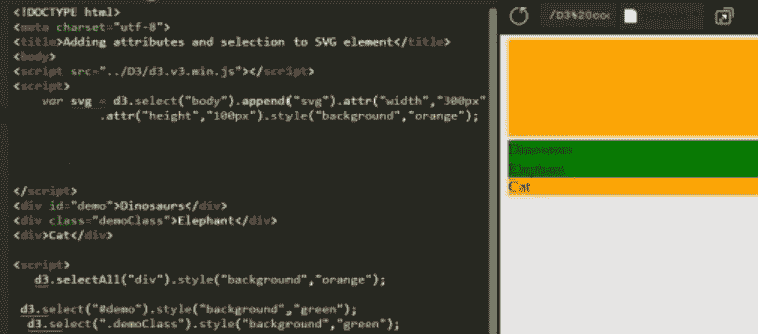

如果我们移除恐龙和大象的 id 和 class，实际结果将显示如下。

```html
<title>Adding attributes and selection to SVG</title>
<body>
<script src="../D3/d3.v3.min.js"></script>
<script>
    var svg = d3.select("body").append("svg")
              .attr("height", "100px").style("background", "grey");
</script>
<div>Dinosaurs</div>
<div>Elephant</div>
<div>Cat</div>
<script>
    d3.selectAll("div").style("background", "orange");

    d3.select("#demo").style("background", "green");
    d3.select(".demoClass").style("background", "blue");
</script>
```

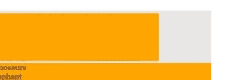

恐龙

大象

猫

你也可以查看我们的 **《轻松上手 D3.JS》** 视频课程以加速学习：[点击此处](here)，或使用下方的二维码享受 50-90% 的折扣。


## 5. 样式

样式主要指的是 D3 应用程序中的 CSS 部分。CSS 部分将使我们的应用程序看起来更美观。此外，在绘制气泡图和条形图等图形元素时，当我们需要区分数据点时，样式也变得至关重要。为 D3 添加样式可以通过三种不同的方式实现。

-   内联样式

-   外部样式表

-   内部样式表

### 内联样式

样式的规则是在引号（“”）内定义。

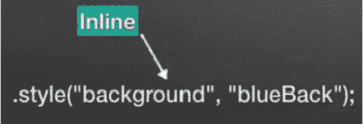

这是我们在前面的示例中看到的内联样式规则。

```javascript
var svg = d3.select("body").append("svg").attr("width","300px")
    .attr("height","100px").style("background","orange");
```

### 外部或内部样式表

在这种情况下，样式直接添加到我们的元素上。然而，更好的方法是采用外部或内部样式类。在这里，我们将定义一个类，并将这个类添加到元素上。之后，如果我们想更改属性，就不必访问所有单独的元素来执行这些更改。我们只需在类中进行更改，分配了该类的元素就会自动更新。我们将在编码中看到这一点。

### 内部样式规则

内部样式规则可以在主编码内部定义，无需任何外部样式表。以下代码是内部样式表的示例。

#### 内部样式规则的代码：

```html
<!DOCTYPE html>
<meta charset="utf-8">
<title>Adding attributes and selection to SVG element</title>
<style>
```

## 6. 几何对象

在创建图表时，图表中的各个元素就是我们的几何对象。它可以是矩形或圆形，也可以是线段或弧线。让我们通过示例来看看如何使用D3来创建这些几何对象。在上一节中，我们了解了如何为D3添加样式表。在同一个示例中，我们将添加几何对象。在这个例子中，我们将使用同一个SVG并在其中附加一个矩形。

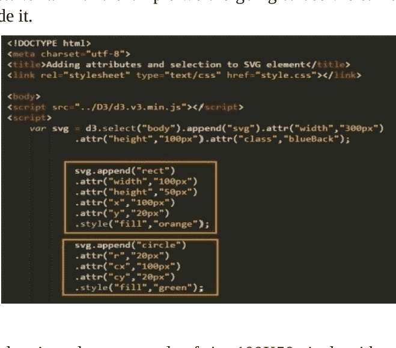

下面的代码用于绘制一个尺寸为100X50像素的矩形，x和y方向的**内边距**分别为100和20。**内边距**用于告知D3在x轴和y轴上从何处开始绘制对象。我们还用橙色填充了矩形。

```
svg.append("rect")
.attr("width", "100px")
.attr("height", "50px")
.attr("x", "100px")
.attr("y", "20px")
.style("fill", "orange");
```

下面的代码用于绘制圆形。绘制圆形需要半径，因此我们定义了100px的半径。x和y与矩形中的内边距作用相同。圆形内部的颜色设为绿色，以与矩形区分。

```
svg.append("circle")
.attr("r", "20px")
.attr("cx", "100px")
.attr("cy", "20px")
.style("fill", "green");
```

### D3GeometricalShape.html 的代码

```
<!DOCTYPE html>
<meta charset="utf-8">
<title>Adding attributes and selection to SVG element</title>
<link rel="stylesheet" type="text/css" href="style.css">

<body>
<script src="../D3/d3.v3.min.js"></script>
<script>
var svg = d3.select("body").append("svg").attr("width", "300px")
.attr("height", "100px").attr("class", "blueBack");

svg.append("rect")
.attr("width", "100px")
.attr("height", "50px")
.attr("x", "100px")
.attr("y", "20px")
.style("fill", "orange");

svg.append("circle")
.attr("r", "20px")
.attr("cx", "100px")
.attr("cy", "20px")
.style("fill", "green");
</script>
</body>
</html>
```

#### 输出

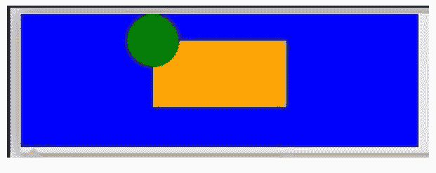

在实际项目中，我们通常使用变量而不是硬编码属性值如宽度和高度。在下一节中，我们将看到使用矩形制作的条形图。

你也可以查看我们的**动手学习D3.JS的简单方法**视频课程以加速学习：[点击这里](https://www.udemy.com/)，或使用下面的二维码享受50-90%的折扣。


## 7. 引入数据

我们将在项目中引入数据。数据可以是JavaScript数组、JSON、XML或CSV数据。我们可以将数据外部加载到D3应用中。在实际项目中，数据会通过异步请求传递给应用。我们将使用一些异步服务，并通过AJAX调用将数据获取到我们的应用中。在上一节中，我们学习了几何对象。我们将使用这些对象，结合一些数据，在D3中创建条形图以进行可视化。我们将在应用中看到一些新的函数，称为：

+   1. data()

2. enter()

我们将在示例中讨论它们。

**编码**

我们将创建一个名为**D3DataHand.html**的新文件，并从之前的示例中复制结构，移除其他不需要的代码。现在，我们将使用一个名为data的变量添加一些数据。添加数据后，我们将设置整个SVG的高度和宽度。同时，我们将SVG附加到body内部。你可以看到，正如我们在上一节所说的，我们没有使用硬编码的值，而是赋给了变量widthSVG和heightSVG。另外，我们将背景样式设置为黑色。

```
var data = [10,20,30,40,100];
var heightSVG = 700;
var widthSVG = 700;
var svg = d3.select("body")
    .append("svg")
    .attr("width",widthSVG)
    .attr("height",heightSVG)
    .style("background","black");
```

初始化数据后，我们开始添加数据并绘制条形图。

```
svg.selectAll()
.data(data)
.enter()
.append("rect")
.attr("height",function(d,i){
    return d*100;
})
.attr("width","20px")
.style("fill","orange")
.attr("y",function(d,i){
    return heightSVG -(d)*10 ;
})
.attr("x",function(d,i){
    return i*40;
});
```

-   我们使用.data(data)将数据添加到程序中。

-   之后，我们使用.enter()函数。它用于对enter()之后的所有数据执行相同的操作。它类似于循环。

然后我们将添加矩形。这个矩形的宽度是固定的，但高度取决于输入数据。为了让高度依赖于数据，我们添加了函数(d,i)，其中‘d’是数据，‘i’是索引。条形的宽度是固定的，因为这里我们使用的是条形图。所以我们给了一个常量20px。对于y值，函数d和i用于根据数据绘制矩形。返回值heightSVG – (d)*10; 用于根据数据返回SVG的高度。值10用于缩放目的，以扩大或缩小矩形的尺寸。

### D3DataHand.html 的代码

```
<!DOCTYPE html>
<meta charset="utf-8">
<title>Adding attributes and selection to SVG element</title>
<link rel="stylesheet" type="text/css" href="style.css">

<body>
<script src="../D3/d3.v3.min.js"></script>
<script>
var data=[10,20,30,40,100];   //数据变量 数组
var heightSVG = 700;          //SVG的最大高度
var widthSVG = 700;           //SVG的最大宽度
var svg = d3.select("body")
    .append("svg")
    //正如我们在上一个示例中所说，我们移除了硬编码的值，而是使用了变量widthSVG和heightSVG
    .attr("width",widthSVG)
    .attr("height",heightSVG)
    .style("background","black");   //黑色背景

svg.selectAll()
.data(data) //在此处传递数据
.enter() //这将对之后的所有数据点执行此代码之后的所有操作
.append("rect") //附加矩形
    .attr("height",function(d,i){ //使用函数根据数据添加高度。
        return d*100;
    })
    .attr("width","20px")//由于是条形图，宽度固定
    .style("fill","orange")
    .attr("y",function(d,i){
        return heightSVG -(d)*10 ; //从总高度heightSVG中减去数据值。10用于增加条形的缩放比例
    })
    .attr("x",function(d,i){
        return i*40;
    });
</script>
</body>
</html>
```

#### 输出

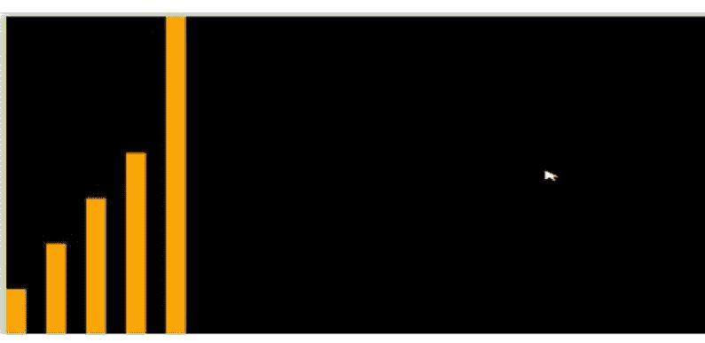

你也可以查看我们的**动手学习D3.JS的简单方法**视频课程以加速学习：[点击这里](https://www.udemy.com/)，或使用下面的二维码享受50-90%的折扣。

# 动手学 D3.JS 简单入门

UIS 社区网络 · SAP 专家 · SAP 服务 · SAP 咨询，SAP 教育

通过分步骤、最简单的方式，结合大量动手示例，学习如何使用 D3 JavaScript 库。

⭐⭐⭐⭐⭐ 4.4 (10 个评分)

35 节课 · 7 小时 · 适合所有水平

## 8. 从外部文件加载数据

从外部文件加载数据，其格式可能是 CSV、JSON 或 TSV。D3 提供了一个简单的函数来从这些外部文件加载数据。该函数是：

```
d3.csv("filePath",function(data){
    })
```

第一个参数是文件名路径，第二个参数是数据从文件加载完成后将执行的函数。让我们开始编写代码，以便更好地理解这个例子。在上一个例子中，我们使用了内部数据。通过在代码中做一些简单的修改，我们可以使用外部数据。

创建一个新文件 **D3DataLoad.html**，并将上一个示例的代码复制过来。移除我们之前定义的值。此外，我们需要再创建一个名为 **data.csv** 的文件。它用于存储我们的外部数据。我们在其中添加一些数据，如 10、20、30、40、20、10、100。

让我们使用这些值创建一些柱状图。现在，我们将使用 `d3.csv("data.csv",function(d){})` 函数来添加 csv 文件。我们还会添加一个错误处理函数，以防文件出现问题，它将在浏览器控制台中显示错误信息。这些是我们与上一个例子相比所做的修改。

```
<!DOCTYPE html>
<meta charset="utf-8">
<title>Adding attributes and selection to SVG element</title>
<link rel="stylesheet" type="text/css" href="style.css"></link>
<body>
<script src="../D3/d3.v3.min.js"></script>
<script>

var heightSVG = 700;
var widthSVG = 700;
d3.csv("data.csv",function(d){
    return d.value;
},function(error,data){

    if(error)throw error;
           d3.select("body")
          .append("svg")
         .attr("width",widthSVG)
         .attr("height",heightSVG)
        .style("background","black");
```

现在保存并运行该文件。

如果我们没有得到任何输出，这意味着我们的程序有错误。你可以通过在浏览器控制台中检查程序是否有错误来识别问题。在浏览器页面上右键单击并点击“检查”进入浏览器控制台。它会打开一个控制台窗口。在右上角会显示错误信息。在这里，你可以发现它显示 svg 未定义。根据这个提示，我们检查程序并添加缺失的 SVG。

修复错误并运行文件。

### data.csv 的代码

```
"value"
10
20
30
40
20
10
```

### D3DataLoad.html 的代码

```
<!DOCTYPE html>
<meta charset="utf-8">
<title>Adding attributes and selection to SVG element</title>
<link rel="stylesheet" type="text/css" href="style.css"></link>

<body>
<script src="../D3/d3.v3.min.js"></script>
<script>

    var heightSVG = 700;
    var widthSVG = 700;
    d3.csv("data.csv",function(d){
    return d.value;
    },function(error,data){

    if(error)throw error;
    var svg= d3.select("body")
    .append("svg")
    .attr("width",widthSVG)
    .attr("height",heightSVG)
    .style("background","black");

    svg.selectAll()
    .data(data)
    .enter()
    .append("rect")
    .attr("height",function(d,i){
    return d*100;
})
.attr("width", "20px")
.style("fill", "orange")
.attr("y", function(d, i) {
    return heightSVG - (d) * 10;
})
.attr("x", function(d, i) {
    return i * 40;
});
});
});
```

```
</script>
</body>
</html>
```

### 程序的输出

输出显示了对应于 data.csv 文件的柱状图。在此输出中，我们可以注意到最后一个值没有放入我们的 SVG 内。为了解决这个问题，我们将在 D3 中使用缩放比例。你可以在下一节中看到这个示例。

你也可以查看我们的 **动手学 D3.JS 简单入门** 视频课程以加速学习：[点击此处](https://www.google.com) 或使用下方二维码享受 50-90% 折扣。

## 9. 比例尺与坐标轴

在上一个示例中，我们看到最后一个矩形条超出了我们的 SVG。为了修正这个错误，我们将在 D3 中使用比例尺。

通常，我们有一个输入，需要将该输入映射到所需的输出。输出可以是画布的宽度或画布的高度。输入可以是我们的数据点，或者我们需要映射的数据点数量。在 D3 中，输入称为**定义域**，输出称为**值域**。因此，我们必须将定义域映射到值域。例如，假设有三个输入 1、2、3，我们需要将这三个输入映射到六个字母 a、b、c、d、e、f。这里一个简单的方法是，我们可以将每个输入值分配给两个字母。即 1 对应 a 和 b，2 对应 c 和 d，3 对应 e 和 f。这是一个展示映射如何完成的简单例子。也可以有基于值的其他映射方法。例如，1 对应 a，2 对应 b 和 c，3 对应 d、e、f。

在 D3 中，我们有两种主要的缩放类型，称为**线性**比例尺和**序数**比例尺。

**线性比例尺** - 用于连续输入定义域，例如数字。

**序数比例尺** - 用于离散定义域，例如一组名称或类别。

**序数比例尺**

让我们以柱状图为例。在那个柱状图中，如果我们希望柱子彼此之间保持适当的距离，如下图所示为 2、4 和 6 个单位。在这个数据集中，我们的输入数据集是 [1, 2, 3]，我们需要一个输出数据集为 [2, 4, 6]，即它距离原点的距离。在这种情况下，我们需要一个函数来获取每个输入数据集并将其映射到输出数据集。这个函数称为序数比例尺。

### 序数比例尺

用于离散定义域，

例如一组名称或类别。

- 输入数据集 : [1, 2, 3]

- f(1) → 2

- f(2) → 4

- f(3) → 6

- 输出数据集 : [2, 4, 6]

#### 9.1. 线性比例尺

这些比例尺用于连续输入定义域，例如数字。例如，如果输入数据集是 [7, 10, 6]，整个画布高度是 100。我们需要在这个 100 值内绘制图形。为了根据画布绘制图形，我们需要输出数据集分别为我们输入数据集的 70、100 和 60 个单位。

**语法**

**线性比例尺**

```
var y = d3.scale.linear().domain([0,d3.max(data)])   /* 数据的最小值和最大值 */
    .range([0, heightSVG]);       /* 指定在指定区域内创建图表的范围
```

#### 9.2. 序数比例尺

```
var x = d3.scale.ordinal().domain(d3.range(data.length)) /* 指定数据点的数量
.rangeRoundBands([0,widthSVG]); /* 根据 widthSVG 创建范围带
```

我们将在之前看到的示例中使用这种缩放，以解决柱子超出 SVG 的问题。创建一个新文件 (D3Scale.html) 并将代码复制到其中。我们需要做的修改是添加一个比例尺。对于 y 轴，我们使用线性比例尺。

要使用这个 x 比例尺，我们需要将返回值替换为 `return x(i);`。这里我们传递了将被迭代的索引值。它将返回应绘制柱子的对应 x 位置。做出这些更改后，我们运行应用程序。

##### 编码

```
<!DOCTYPE html>
<meta charset="utf-8">
<title>Adding attributes and selection to SVG element</title>
<link rel="stylesheet" type="text/css" href="style.css"></link>

<body>
<script src="../D3/d3.v3.min.js"></script>
<script>

    var data=[10,20,30,40,100];
    var heightSVG = 700;
    var widthSVG = 700;

    var y = d3.scale.linear().domain([0,d3.max(data)])
    .range([0, heightSVG]); /* Y 比例尺 */

    var x = d3.scale.ordinal().domain(d3.range(data.length))
    .rangeRoundBands([0,widthSVG]);  /* X 比例尺 */

    var svg = d3.select("body")
    .append("svg")
```

```
.attr("width", widthSVG)
.attr("height", heightSVG)
.style("background", "black");

svg.selectAll()
.data(data)
.enter()
.append("rect")
.attr("height", function(d, i) {
    return d * 100;
})
.attr("width", "20px")
.style("fill", "orange")
.attr("y", function(d, i) {
    return heightSVG - y(d); /* 矩形从返回的值开始绘制 */
})
.attr("x", function(d, i) {
    return i * 40; /* 用索引值替换x */
});
});
</script>
</body>
</html>
```

注意：如果我们从这段代码中移除 heightSVG

.attr("y", function(d, i) {

    return y(d);

那么输出将会反转。也就是说，条形图会从高到低显示。

#### 输出

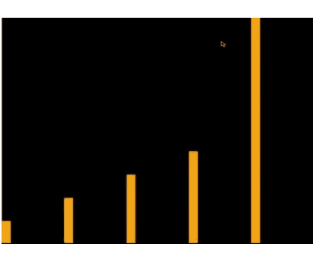

我们也可以在控制台窗口中检查。要验证，右键单击浏览器窗口并选择检查元素。在控制台窗口中输入最小数据点值。在我们的例子中，它是10，所以在控制台窗口中输入 y(10)，它会返回70。这个70就是我们第一个数据集的高度。同样地，我们可以检查 y(100)，它会返回700。你也可以检查x比例尺（序数比例尺），如果我们输入 x(0)，它会返回第一个矩形的左内边距，因为条形图从零内边距开始。如果我们输入 x(1)，它会返回140。

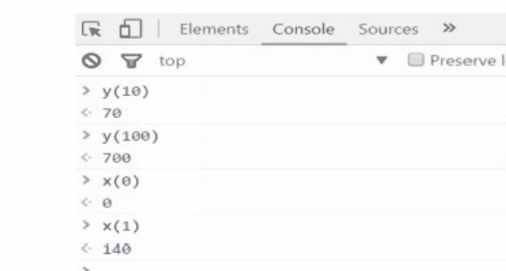

#### 9.3. 坐标轴

当我们想在图表中使用比例尺时，我们会使用坐标轴。它帮助用户理解数据点的边界以及对应的值是多少。通常，在二维图表中，我们有两个坐标轴，即X轴和Y轴。要在D3中创建坐标轴，我们使用函数 `d3.svg.axis()`。创建坐标轴的实际语法是

```
var yAxis = d3.svg.axis()
    .scale(y)
    .orient('left')
    .ticks(5);
```

我们使用 `d3.svg.axis()` 函数并将比例尺传递给它。我们传递的方向将告诉条形图显示在左侧。刻度用于设置Y轴上所需的刻度数量。类似地，X轴的语法是

```
var xAxis = d3.svg.axis()
    .scale(x)
    .orient('bottom')
    .ticks(10);
```

我们在这里传递比例尺。方向设置为底部，因为我们需要x轴位于条形图的底部。在我们的例子中，我们需要更多的刻度。所以我们设置ticks参数为10。根据我们的需求，我们可以设置更多或更少的刻度。通常在大多数情况下，我们需要在X轴上有更多的刻度。我们将在我们的cloud9编辑器中看到使用此语法的示例。

在上一个例子中，我们创建了条形图并介绍了比例尺的概念。在本节中，我们将为条形图添加坐标轴。我们需要做的第一步是创建X轴和Y轴。

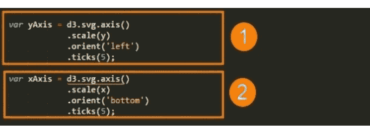

1.  添加Y轴，使用比例尺y，方向为left，刻度为5。

2.  添加X轴，使用比例尺x，方向为bottom，刻度为5。

```
var svg = d3.select("body")
  .append("svg")
  .attr("width", widthSVG)
  .attr("height", heightSVG)
  .style("transform", "translate(" + paddingChart + "px, " + paddingChart + "px)")
  .style("background", "black");
```

3.  我们引入了两个新的坐标轴。因此我们需要一些空间来显示坐标轴。为此，我们需要在SVG中添加transform属性。paddingChart变量最初已定义为40px。

4.  接下来我们需要调用我们的坐标轴。为此，我们使用函数 `.call(yAxis)`，类似地对X轴使用 `.call(xAxis)`。这里的'g'元素代表对坐标轴进行分组，stroke用于将坐标轴的颜色设置为白色。

```
svg.append("g")
  .call(yAxis)
  .style("stroke", "#fff");

svg.append("g")
  .call(xAxis)
  .style("stroke", "#fff");
```

添加这些后，如果我们运行代码。我们将看到结果如下所示

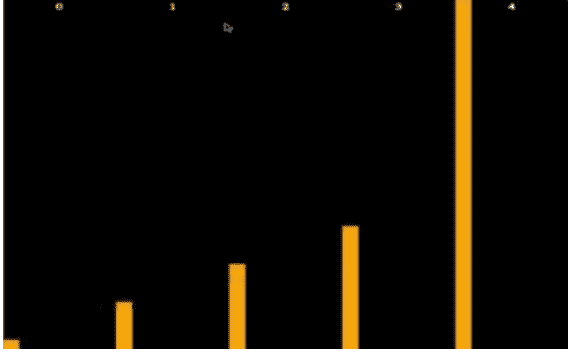

这不是我们想要的确切结果。Y轴不可见，X轴在上方。

5.  首先我们将X轴推到下方，然后将Y轴稍微向右推。为此，我们在这里添加transform属性，值为translate。我们添加了一个axisMargin变量来统一坐标轴边距。我们需要在声明部分将其值声明为30。

```
svg.append("g")
    .call(yAxis)
    .attr("transform","translate("+axisMargin+",0)")
    .style("stroke", "#fff");

svg.append("g")
    .call(xAxis)
    .attr("transform","translate(0,"+(heightSVG-axisMargin)+")")
    .style("stroke", "#fff");
```

我们修复了坐标轴。然而，我们仍然需要将图表稍微向上和向右移动。目前，如果我们运行代码，将得到如下结果

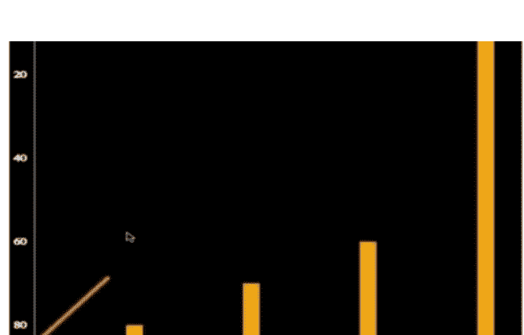

要修复图中箭头所示的问题，我们需要添加一个简单的CSS属性。

6.  首先，我们将使用append函数将矩形组合在一起。同时，我们添加style函数，类名为rectangle。

```
svg.append("g")
    .attr("class","rectangle")
    .selectAll()
    .data(data)
    .enter()
    .append("rect")
    .attr("height",function(d,i){
        return 0;
    })
```

7.  在输出中，我们可以看到Y轴的值是反的。要修复这个问题，我们需要反转Y轴的范围。

```
var y = d3.scale.linear().domain([0,d3.max(data)])
    .range([heightSVG-axisMargin,0]);

var x = d3.scale.ordinal().domain(d3.range(data.length))
    .rangeRoundBands([0,widthSVG]);
```

如果我们交换 heightSVG 和 y(d) 的值，我们会看到条形图反转。即从高到低变为从低到高。

```
svg.append("g")
    .attr("class", "rectangle")
    .selectAll()
    .data(data)
    .enter()
    .append("rect")
    .attr("height", function(d,i){
        return heightSVG;
    })
    .attr("width", "20px")
    .style("fill", "orange")
    .attr("y", function(d,i){
        return y(d);
    })
```

这些是我们创建和对齐坐标轴需要进行的更改。我们需要进行大量实验才能得到正确的结果。

### D3Axis.html 的代码

```
<!DOCTYPE html>
<meta charset="utf-8">
<title>向 SVG 元素添加属性和选择</title>
<link rel="stylesheet" type="text/css" href="style.css"></link>

<body>
<script src="../D3/d3.v3.min.js"></script>
<script>

var data=[10,20,30,40,100];
var heightSVG = 700;
var widthSVG = 700;
var padding = 10;
var paddingText = 30;
var paddingChart = 40;
var axisMargin = 30;
var margin = {
	'top':5,
	'right':20,
	'bottom':20,
	'left':50
};

var y = d3.scale.linear().domain([0,d3.max(data)])
.range([heightSVG-axisMargin,0]);

var x = d3.scale.ordinal().domain(d3.range(data.length))
.rangeRoundBands([0,widthSVG]);

var yAxis = d3.svg.axis()
.scale(y)
.orient('left')
.ticks(5);

var xAxis = d3.svg.axis()
.scale(x)
.orient('bottom')
.ticks(5);

var svg = d3.select("body")
.append("svg")
.attr("width",widthSVG)
.attr("height",heightSVG)
.style("transform","translate("+paddingChart+"px,"+paddingChart+"px")
.style("background", "black");

svg.append("g")
.call(yAxis)
.attr("transform","translate("+axisMargin+",0)")
.style("stroke","#fff");

svg.append("g")
.call(xAxis)
.attr("transform","translate(0,"+(heightSVG-axisMargin)+")")
.style("stroke","#fff");

svg.append("g")
.attr("class","rectangle")
.selectAll()
.data(data)
.enter()
.append("rect")
.attr("height",function(d,i){
return heightSVG;
})
.attr("width","20px")
.style("fill","orange")
.attr("y",function(d,i){
return  y(d);
})
</script>
</body>
</html>
```

##### Style.css

```
.blueBack{

    background : blue;

}

.rectangle{
    transform: translate(30px,-30px) !important;
}
```

#### 输出

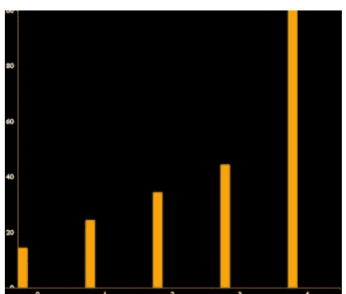

你也可以查看我们的 **实践学习D3.JS的简单方法** 视频课程以加速学习：[点击此处](here)，或使用下面的二维码享受50-90%折扣。

# 实践学习D3.JS的简单方法

UIS社区网络 · SAP专家 · SAP服务、SAP咨询、SAP教育

通过大量实践示例，以逐步和最简单的方式学习如何使用D3 javascript库

35节课 · 7小时 · 适合所有级别

⭐⭐⭐⭐☆ 4.4 (10个评分)

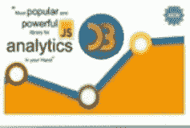


## 10. 事件

事件用于在鼠标移过某个对象时执行某些操作。例如，在我们之前创建的柱状图中，如果我们将鼠标移到柱子上，一个小的弹出框会出现在它上面，以显示该柱子的值。同样，在柱子生成的过程中，也会有一些过渡效果。这些都是通过使用事件来完成的。要创建一个事件，我们需要一个 `on` 函数。在这个事件中，我们使用了 `mouseover` 事件。所以我们需要在 `on` 函数内提供 `mouseover` 事件的值。第二个参数 `function(d)` 用于在事件触发时调用函数。要在柱子生成期间添加过渡属性，我们需要使用 `transition` 函数，参数包括动画的持续时间及其在此次过渡中要更改的属性。例如，当柱子开始生成时，它会从底部生成或从侧面滑动。这些将由属性完成。让我们进入我们的 cloud9 IDE，在我们的柱状图中使用事件。

在上一节中，我们创建了柱状图。现在，我们将对该柱状图使用事件。

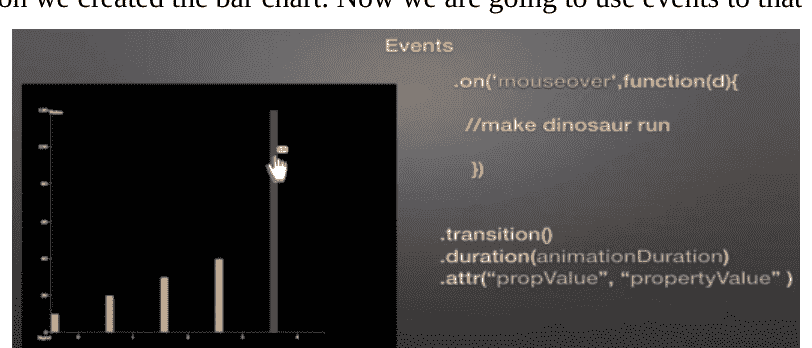

1. 我们需要一个工具提示来显示柱子的值。所以我们创建一个框并添加工具提示。然后我们选择 `body`。我们附加一个 `div` 元素。我们需要为工具提示添加样式。我们将 `position` 设置为 `absolute`，`background` 设置为白色。我们还为工具提示添加了 `padding` 和 `border` 属性。`opacity` 我们最初设置为 `0`，因为我们要暂时隐藏这个。稍后我们可以通过增加这个值来更改它。

```
var tooltip = d3.select('body')
    .append('div')
    .style('position', 'absolute')
    .style('background', '#fff')
    .style('padding', '5px 15px')
    .style('border', '1px #fff solid')
    .style('opacity', '0');
```

2. 我们将为 `mouseover` 事件添加 `on` 函数。`function(d)` 将在我们将鼠标移到柱子上时拉出我们的工具提示。`left` 和 `top` 是显示工具提示在柱子上的位置。

3. `d3.select(this).style(‘opacity’,0.5);` 函数将选择鼠标指向的当前柱子，并将其透明度降低到 0.5。一旦我们降低了透明度，它将被设置为 0.5，并且不会更改回 1。为了执行此操作，我们添加另一个 `mouseover` 事件以将其设置回 1。

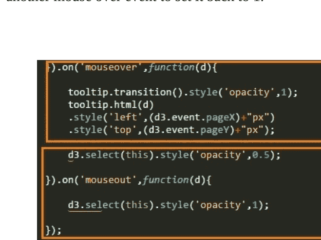

4. 下一步是添加过渡效果。为此，我们向图表添加一个 `transition` 函数。我们需要对所有矩形执行过渡，因此我们通过 `d3.selectAll(‘rect’)` 选择了所有矩形。添加了 `transition` 函数，并且还添加了过渡效果的持续时间（以毫秒为单位的时间）。我们还需要添要更改的属性。

```
d3.selectAll("rect").transition()
    .duration(4000)
    .attr("height",function(d,i){
        return heightSVG-y(d);
    })
    .attr("y",function(d,i){
        return y(d) ;
    })
```

5. 我们需要从 0 开始设置图表的高度，直到达到总高度 (`heightSVG`)。为此，我们将更改 `y` 值。

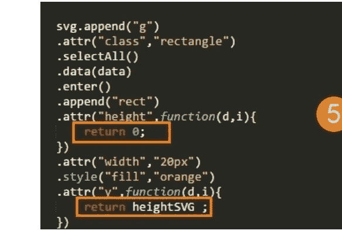

如果我们运行这些更改后的代码，我们将看到过渡效果和工具提示。

### D3Axis.html 的代码

```html
<!DOCTYPE html>
<meta charset="utf-8">
<title>Adding attributes and selection to SVG element</title>
<link rel="stylesheet" type="text/css" href="style.css"></link>

<body>
<script src="../D3/d3.v3.min.js"></script>
<script>

    var data=[10,20,30,40,100];
    var heightSVG = 700;
    var widthSVG = 700;
    var padding = 10;
    var paddingText = 30;
    var paddingChart = 40;
    var axisMargin = 30;
    var margin = {
        'top':5,
        'right':20,
        'bottom':20,
        'left':50
    };

    var y = d3.scale.linear().domain([0,d3.max(data)])
    .range([heightSVG-axisMargin,0]);

    var x = d3.scale.ordinal().domain(d3.range(data.length))
    .rangeRoundBands([0,widthSVG]);

    var yAxis = d3.svg.axis()
    .scale(y)
    .orient('left')
    .ticks(5);

    var xAxis = d3.svg.axis()
    .scale(x)
    .orient('bottom')
    .ticks(5);

    var svg = d3.select("body")
    .append("svg")
    .attr("width",widthSVG)
    .attr("height",heightSVG)
    .style("transform","translate("+paddingChart+"px,"+paddingChart+"px)")
    .style("background","black");

    var tooltip = d3.select('body')
    .append('div')
    .style('position','absolute')
    .style('background','#fff')
    .style('padding','5px 15px')
    .style('border', '1px #fff solid')
    .style('opacity', '0');

    svg.append("g")
    .call(yAxis)
    .attr("transform", "translate("+axisMargin+",0)")
    .style("stroke", "#fff");

    svg.append("g")
    .call(xAxis)
    .attr("transform", "translate(0,"+(heightSVG-axisMargin)+")")
    .style("stroke", "#fff");

    svg.append("g")
    .attr("class", "rectangle")
    .selectAll()
    .data(data)
    .enter()
    .append("rect")
    .attr("height", function(d,i){
        return 0;
    })
    .attr("width", "20px")
    .style("fill", "orange")
    .attr("y", function(d,i){
        return heightSVG ;
    })
    .attr("x", function(d,i){
        return x(i);
    }).on('mouseover', function(d){
        tooltip.transition().style('opacity', 1);
        tooltip.html(d)
            .style('left', (d3.event.pageX) + 'px')
            .style('top', (d3.event.pageY) + 'px');
        d3.select(this).style('opacity', 0.5);
    }).on('mouseout', function(d) {
        d3.select(this).style('opacity', 1);
    });
    d3.selectAll('rect').transition()
        .duration(4000)
        .attr('height', function(d, i) {
            return heightSVG - y(d);
        })
        .attr('y', function(d, i) {
            return y(d);
        })
</script>
</body>
</html>
```

#### 输出

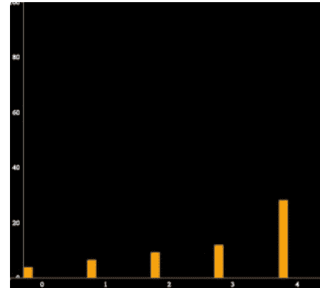

400ms 后

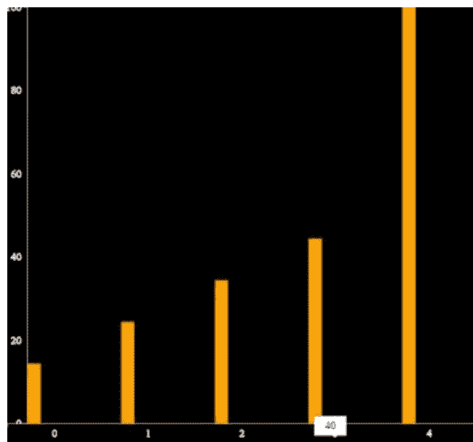

**注意：** 这是过渡效果，我们只能在浏览器中看到过渡。这些图片仅用于演示目的。要查看真实的过渡效果，请转到 cloud9 编辑器中的 D3Axis.html 文件并运行该文件。

**文件名：** D3Axis.html

**链接：** [https://ide.c9.io/ajaytech/dataviz](https://ide.c9.io/ajaytech/dataviz)

您也可以查看我们的 **Learn D3.JS Hands-on And The Simple Way** 视频课程以加速学习：[点击这里](here) 或使用下方的二维码享受 50-90% 的折扣。

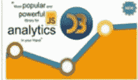

# Learn D3.JS Hands-on And The Simple Way

UJS Community Network • SAP Experts • SAP Services, SAP Consulting, SAP Education

通过大量实践示例，以最简单、最循序渐进的方式学习如何使用 D3 Javascript 库

⭐ 4.4 (10 ratings) | 🎥 35 lectures | ⏱ 7 hours | ⬆ All Levels


## 11. 气泡图

气泡图是显示数据点之间相关性的非常直观的方式。例如，考虑如下所示的数据点具有 X 和 Y 坐标。当使用气泡图表示这些数据点时，有些数据点被分组在一起。这种发现在气泡图中非常容易找到。

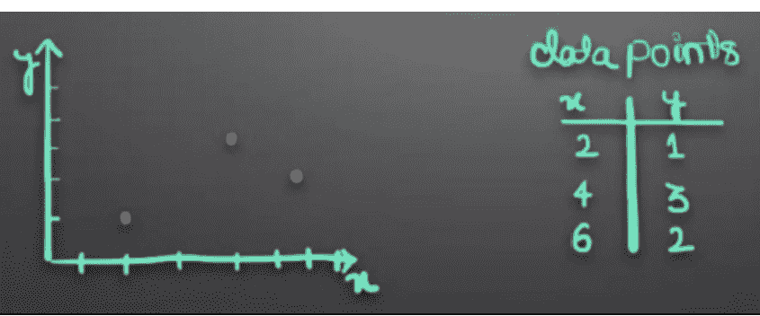

我们的数据可能有额外的维度，比如三维数据，我们希望在图表中表示它。那么我们将考虑 `d` 作为圆的大小。根据 `d` 的值，我们可以有更大或更小的圆。因此，我们不仅可以根据 X 和 Y 坐标的位置来区分数据点，还可以根据圆的大小来区分。让我们进入我们的 cloud9 编辑器并开始创建我们的气泡图。

之前我们创建了具有一些过渡效果的柱状图。我们将对代码进行一些更改以创建气泡图。为此，请创建一个新文件 **D3Bubble.html**，并将 **D3Axis.html** 的内容复制过去，然后为气泡图进行一些更改。将代码中的标题名称更改为 Bubble chart，因为我们正在为气泡图编码。

1. 我们将要进行的主要更改是从矩形更改为圆形。

    1. 我们需要将所有 `rect` 类更改为 `circle`。

    2. 我们需要半径 `r` 来创建一个圆，这里用半径 `r` 替换高度。

    3. 用 `cy` 和 `cx` 替换 `y` 和 `x`。

svg.append("g")

    .attr("class","circle")

    .selectAll()

    .data(dataVal1)

    .enter()

    .append("circle")

    .attr("r",function(d,i){

        return r(dataVal2[i]);

    })

    .attr("width","10px")

    .style("fill","orange")

    .attr("cy",function(d,i){

        return heightSVG ;

    })

    .attr("cx",function(d,i){

        return x(i);

    })

2.  类似地，我们需要在以下部分进行更改：

    1.  从 'rect' 到 'circle' 的过渡部分。

    2.  函数调用从 'y' 改为 'cy'。我们在返回值中添加了 +px，以将其视为像素值，而不是其他值。

```javascript
d3.selectAll("circle").transition()
    .duration(4000)
    .attr('cy',function(d,i){
        return (y(d))+"px" ;
    })
```

我们还需要更改一些 CSS 属性。由于我们只为矩形创建了 CSS 属性，因此需要在 CSS 中添加 `circle`，以便从正确的轴对齐气泡图。完成此操作后，如果我们运行代码，将看到半径较小的气泡图。

```css
.blueBack{
    background : blue;
}

.rectangle{
    transform: translate(30px,-30px) !important;
}

.circle{
    transform: translate(30px,0px) !important;
}
```

3.  下一步是为气泡图添加新的维度。为此，我们将创建一个对象，并持有两个键，即 'val1' 和 'val2'。第一个键保存相同的数据，第二个键保存圆的半径。

```javascript
var data={
    "val1": [10,20,30,40,100],
    "val2":[20,30,50,40,70]};
```

4.  当我们更改了数据值后，也需要执行相关的更改。此外，我们需要添加半径并定义范围圆带（Range round bands）为 minR 和 maxR 范围。要使用这个范围圆带，我们需要在声明部分对其进行声明。

```javascript
var y = d3.scale.linear().domain([0,d3.max(dataVal1)])
    .range([heightSVG - axisMargin,0]);

var x = d3.scale.ordinal().domain(d3.range(dataVal1.length))
    .rangeRoundBands([0,widthSVG]);

var r = d3.scale.linear().domain([d3.min(dataVal2),d3.max(dataVal2)])
    .range([minR,maxR]);
```

我们还更新了工具提示（tooltip），以便也显示半径。

```javascript
tooltip.transition().style('opacity',1);
tooltip.html("y: "+d+" / r: "+dataVal2[i])
    .style('left',(d3.event.pageX)+"px")
    .style('top',(d3.event.pageY)+"px");
```

### D3Bubble.html 的代码

```html
<!DOCTYPE html>
<meta charset="utf-8">
<title>Bubble chart</title>
<link rel="stylesheet" type="text/css" href="style.css"></link>

<body>
<script src="../D3/d3.v3.min.js"></script>
<script>

var data={
    "val1": [10,20,30,40,100],
    "val2":[20,30,50,40,70]};
var heightSVG = 700;
var widthSVG = 700;
var padding = 10;
var paddingText = 30;
var paddingChart = 40;
var axisMargin = 30;
var margin = {
    'top':5,
    'right':20,
    'bottom':20,
    'left':50
};
var minR = 20;
var maxR = 70;
var dataVal1 = data["val1"];
var dataVal2 = data["val2"];

var y = d3.scale.linear().domain([0,d3.max(dataVal1)])
    .range([heightSVG-axisMargin,0]);

var x = d3.scale.ordinal().domain(d3.range(dataVal1.length))
    .rangeRoundBands([0,widthSVG]);

var r = d3.scale.linear().domain([d3.min(dataVal2),d3.max(dataVal2)])
    .range([minR,maxR]);

var yAxis = d3.svg.axis()
    .scale(y)
    .orient('left')
    .ticks(5);

var xAxis = d3.svg.axis()
    .scale(x)
    .orient('bottom')
    .ticks(5);

var svg = d3.select("body")
    .append("svg")
    .attr("width",widthSVG)
    .attr("height",heightSVG)
    .style("transform","translate("+paddingChart+"px,"+paddingChart+"px")
    .style("background","black");
var tooltip = d3.select('body')
    .append('div')
    .style('position','absolute')
    .style('background','#fff')
    .style('padding','5px 15px')
    .style('border','1px #fff solid')
    .style('opacity','0');

svg.append("g")
    .call(yAxis)
    .attr("transform","translate("+axisMargin+",0)")
    .style("stroke","#fff");

svg.append("g")
    .call(xAxis)
    .attr("transform","translate(0,"+(heightSVG-axisMargin)+")")
    .style("stroke","#fff");

svg.append("g")
    .attr("class", "circle")
    .selectAll()
    .data(dataVal1)
    .enter()
    .append("circle")
    .attr("r", function(d,i){
        return r(dataVal2[i]);
    })
    .attr("width", "10px")
    .style("fill", "orange")
    .attr("cy", function(d,i){
        return heightSVG ;
    })
    .attr("cx", function(d,i){
        return x(i);
    }).on("mouseover", function(d,i){

        tooltip.transition().style("opacity", 1);
        tooltip.html("y: "+d+" / r: "+dataVal2[i])
        .style("left",(d3.event.pageX)+"px")
        .style("top",(d3.event.pageY)+"px");

        d3.select(this).style("opacity",0.5);

    }).on("mouseout", function(d){

        d3.select(this).style("opacity",1);

    });

d3.selectAll("circle").transition()
    .duration(4000)
    .attr('cy',function(d,i){
        return (y(d))+"px" ;
    })
</script>
</body>
</html>
```

### CSS 样式

```css
.blueBack{
    background : blue;
}

.rectangle{
    transform: translate(30px,-30px) !important;
}

.circle{
    transform: translate(30px,0px) !important;
}
```

#### 输出

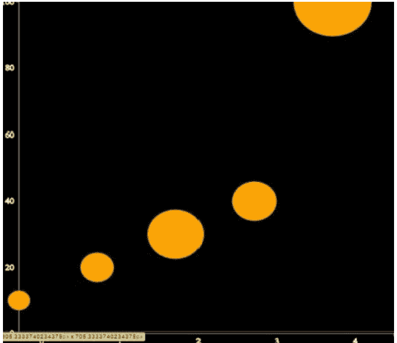

你也可以查阅我们的**《动手学 D3.JS：简单上手之道》**视频课程以加速学习：[此处](link)，或使用下方二维码获取五至九折优惠。

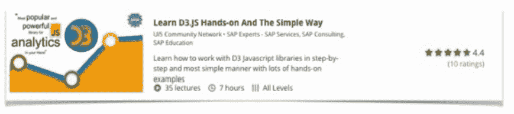


## 12. 饼图和环形图

饼图用于展示数据点之间的差异和比较。在商业场景中，它通常用于显示不同数据点之间的占比份额，例如我们公司不同区域的收入，或工厂不同区域的产量。它也可以用来展示不同区域的某些销售信息，以及它们在销售方面的表现。我们可以据此得出哪些区域收入最高，哪些区域最低。这些是使用饼图的一些例子。饼图的一个轻微修改版本是环形图。我们可以通过挖去饼图的中心圆来生成环形图。要创建饼图和环形图，我们将使用以下函数。

```javascript
d3.svg.arc()
d3.layout.pie()
```

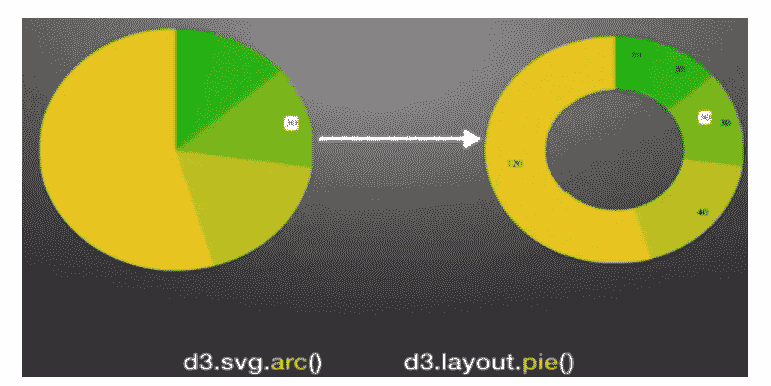

让我们转到 Cloud9 编辑器来创建环形图。

1.  首先创建一个名为 D3PieChart.html 的文件，并声明变量和基本框架。

```javascript
var padding = 1;
var paddingText = 30;
var paddingChart = 40;
var heightSVG = 700;
var widthSVG = 700;
var extraPadding = 200;
var animationDuration = 1000;
var animationDelay = 1000;
var radius = 200;
var innerRadius = 100;
var paddingPieX = 200;
var paddingPieY = 250;
var unit = "px";
```

2.  接下来，我们将添加一些数据和颜色比例尺。我们使用线性比例尺，其定义域参数从0到数据集的最大长度。颜色值范围从绿色到橙色。

```javascript
var data = [10,20,30,40,120];
var color = d3.scale.linear().domain([0,data.length])
    .range(["green","orange"]);
```

3.  我们需要添加的是具有外半径和内半径的弧。

```javascript
var arc = d3.svg.arc()
    .outerRadius(radius)
    .innerRadius(innerRadius);
```

4.  接下来，我们需要创建一个具有外半径和内半径的弧标签。外半径需要减去 paddingText。

```javascript
var labelArc = d3.svg.arc()
    .outerRadius(radius - paddingText)
    .innerRadius(innerRadius - paddingText);
```

5.  我们将在下一步创建一个饼图布局（pie lay out）。以下语法将给我们一个饼图布局。

```javascript
var pie = d3.layout.pie()
    .sort(null)
    .value(function(d){return d;});
```

6.  创建具有最大高度和宽度的 SVG。

```javascript
var svg = d3.select("body").append("svg")
    .attr("width",widthSVG+extraPadding)
    .attr("height",heightSVG+extraPadding)
    .style("background","#000");
```


7. 接下来，我们需要将所有的 SVG 元素分组，然后追加这些元素的路径。我们在这里使用了 transform 属性。这将使图表正确地与浏览器窗口对齐。如果我们未能引入 transform 属性，我们将无法在浏览器窗口内看到完整的图表。

```javascript
var g = svg.selectAll(".arc")
    .data(pie(data))
    .enter()
    .append("g");

g.append("path")
    .attr("d",arc)
    .style("transform","translate("+paddingPieX+"px,"+paddingPieY+"px)")
    .style("fill",function(d,i){return "#000";})
```

到目前为止，如果我们运行代码，将能够看到环形图。我们仍然需要为其添加标签、工具提示和鼠标悬停事件。

8. 要添加标签，我们需要追加一个带有转换的文本，以显示在弧内部。我们在这里使用 translation 属性来转换 X 和 Y 坐标。我们在这里使用的 centroid 函数是为了获得一个包含 X 和 Y 值的简单数组。我们还使用 `.attr("dy",".35em")` 函数添加了一些额外的边距，并使用 `.text(function(d){return d.value;})`。

```javascript
g.append("text")
    .attr("transform",function(d){
        return "translate("+(parseInt(labelArc.centroid(d)[0])+paddingPieX-10)+","+"+(parseInt(labelArc.centroid(d)[1])+paddingPieY-10)+")";
    })
    .attr("dy",".35em")
    .text(function(d){return d.value;});
```

9. 在下一步，我们将为环形图添加一些事件。为此，我们将使用 mouseover 事件，并从那里调用工具提示。mouseover 事件会将不透明度更改为 0.5，mouseout 事件会将其设置回 1。

var tooltip = d3.select('body')

    .append('div')

    .style('position','absolute')

    .style('background','#fff')

    .style('padding','5px 15px')

    .style('border','1px #fff solid')

    .style('opacity','0');

```
g.on("mouseover",function(d){
    tooltip.transition()
        .style('opacity',1);

    tooltip.html(d.value)
        .style('left',(d3.event.pageX)+"px")
        .style('top',(d3.event.pageY)+"px")

    d3.select(this).style('opacity',0.5);

}).on("mouseout",function(){
    d3.select(this).style('opacity',1);
});
```

10. 我们也可以使用过渡函数，在环形图开始渲染时以动画形式展示它。

```
d3.selectAll("path").transition()
.duration(animationDuration)
.style("transform","translate("+paddingPieX+"px,"+paddingPieY+"px)")
.style("fill",function(d,i){return color(i)});
```

最后，如果我们运行这段代码，就能看到启动时的动画效果。当鼠标悬停在其上时，它会显示一个工具提示，其中包含相应的值。

### 环形图代码

```
<!DOCTYPE html>
<head>
</head>
<title>Pie chart</title>
<body >
<script src="../D3/d3.v3.min.js"></script>
<script >

var padding = 1;
var paddingText = 30;
var paddingChart = 40;
var heightSVG = 700;
var widthSVG = 700;
var extraPadding = 200;
var animationDuration = 1000;
var animationDelay = 1000;
var radius = 200;
var innerRadius = 100;
var paddingPieX = 200;
var paddingPieY = 250;
var unit = "px";


var data = [10,20,30,40,120];
var color = d3.scale.linear().domain([0,data.length])
    .range(["green","orange"]);

var arc = d3.svg.arc()
    .outerRadius(radius)
    .innerRadius(innerRadius);

var labelArc = d3.svg.arc()
    .outerRadius(radius-paddingText)
    .innerRadius(innerRadius-paddingText);

var pie = d3.layout.pie()
.sort(null)
.value(function(d){return d;});

var svg = d3.select("body").append("svg")
    .attr("width",widthSVG+extraPadding)
    .attr("height",heightSVG+extraPadding)
    .style("background","#000");

var tooltip = d3.select('body')
    .append('div')
    .style('position','absolute')
    .style('background','#fff')
    .style('padding','5px 15px')
    .style('border','1px #fff solid')
    .style('opacity','0');

var g = svg.selectAll(".arc")
    .data(pie(data))
    .enter()
    .append("g");

g.append("path")
    .attr("d",arc)
    .style("transform","translate("+paddingPieX+"px,"+paddingPieY+"px)")
    .style("fill",function(d,i){return "#000";})

g.append("text")
    .attr("transform",function(d){
        return "translate("+(parseInt(labelArc.centroid(d)[0])+paddingPieX-10)+", "
        +(parseInt(labelArc.centroid(d)[1])+paddingPieY-10)+")";
    })
    .attr("dy",".35em")
    .text(function(d){return d.value;});

g.on("mouseover",function(d){
    tooltip.transition()
    .style('opacity',1);

    tooltip.html(d.value)
    .style('left',(d3.event.pageX)+"px")
    .style('top',(d3.event.pageY)+"px")

    d3.select(this).style('opacity',0.5);

}).on("mouseout",function(){
    d3.select(this).style('opacity',1);
});

d3.selectAll("path").transition()
.duration(animationDuration)
.style("transform","translate("+paddingPieX+"px,"+paddingPieY+"px)")
.style("fill",function(d,i){return color(i)});

</script>
</body>

</html>
```

#### 输出

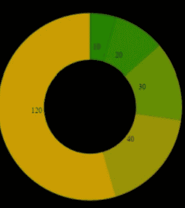

#### 12.1. 将环形图转换为饼图

在上一节中，我们了解了如何创建环形图。在本节中，我们将看到如何通过一个简单的改动，将环形图转换为饼图。我们唯一需要做的就是将内半径设置为0。

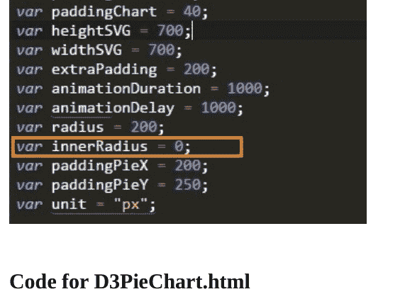

##### D3PieChart.html 代码

```
<!DOCTYPE html>
<head>
</head>
<title>Pie chart</title>

<body >
<script src="../D3/d3.v3.min.js"></script>
<script >

var padding = 1;
var paddingText = 30;
var paddingChart = 40;
var heightSVG = 700;
var widthSVG = 700;
var extraPadding = 200;
var animationDuration = 1000;
var animationDelay = 1000;
var radius = 200;
var innerRadius = 0;
var paddingPieX = 200;
var paddingPieY = 250;
var unit = "px";

var data = [10,20,30,40,120];
var color = d3.scale.linear().domain([0,data.length])
    .range(["green","orange"]);

var arc = d3.svg.arc()
    .outerRadius(radius)
    .innerRadius(innerRadius);

var labelArc = d3.svg.arc()
    .outerRadius(radius-paddingText)
    .innerRadius(innerRadius-paddingText);

var pie = d3.layout.pie()
    .sort(null)
    .value(function(d){return d;});

var svg = d3.select("body").append("svg")
    .attr("width",widthSVG+extraPadding)
    .attr("height",heightSVG+extraPadding)
    .style("background","#000");

var tooltip = d3.select('body')
    .append('div')
    .style('position','absolute')
    .style('background','#fff')
    .style('padding','5px 15px')
    .style('border','1px #fff solid')
    .style('opacity','0');

var g = svg.selectAll(".arc")
    .data(pie(data))
    .enter()
    .append("g");

g.append("path")
    .attr("d",arc)
    .style("transform","translate("+paddingPieX+"px,"+paddingPieY+"px)")
    .style("fill",function(d,i){return "#000";})

g.append("text")
    .attr("transform",function(d){
        return "translate("+(parseInt(labelArc.centroid(d)[0])+paddingPieX-10)+","
        +(parseInt(labelArc.centroid(d)[1])+paddingPieY-10)+")";
    })
    .attr("dy", ".35em")
    .text(function(d){return d.value;});

g.on("mouseover",function(d){
    tooltip.transition()
        .style('opacity',1);

    tooltip.html(d.value)
    .style("left",(d3.event.pageX)+"px")
    .style("top",(d3.event.pageY)+"px")

    d3.select(this).style("opacity",0.5);

}).on("mouseout",function(){
    d3.select(this).style("opacity",1);
});

d3.selectAll("path").transition()
.duration(animationDuration)
.style("transform","translate("+paddingPieX+"px,"+paddingPieY+"px)")
.style("fill",function(d,i){return color(i)});

</script>
</body>
</html>
```

#### 输出

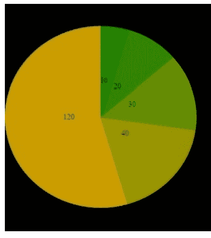

您也可以查看我们的 **动手实践，简单学习 D3.JS** 视频课程以加速学习：[这里](https://example.com)，或使用下方二维码享受 50-90% 的折扣。


## 13. 折线图

折线图是表示**随时间变化趋势**的绝佳方式。它就像是多个代表我们数据的小气泡。我们用直线将这些点连接起来。当我们在一段时间内拥有大量数据点时，使用折线图对于观察一些模式或随时间变化的趋势非常有益。要在 D3 中创建一个简单的折线图，我们需要使用函数

```
d3.svg.line()
  .x(function(d,i) { return x(i)})
  .y(function(d){return y(d) });
```

我们传入 x 和 y 值。`x` 值基于索引值 `i`。`y` 值基于数据点本身的值。为了创建折线图，我们取条形图的代码，移除了绘制条形的代码，只保留了坐标轴。我们使用了在条形图中使用过的线性比例尺和序数比例尺。因此，我们将添加折线图的代码，以便使用 D3 进行绘制。

-   1. 我们将添加线的语法，并通过包含数据和索引的函数添加 x 值和 y 值。这里的 y 比例尺值可能不会返回整数值，因此我们需要添加 `parseInt` 来获取整数数据。

```
var line = d3.svg.line()
  .x(function(d,i){return x(i);})
  .y(function(d){return parseInt(y(d));});
```

-   2. 我们需要将路径追加到 svg。我们使用一个名为 `datum` 的新函数来指定数据。同时，我们将添加描边属性并将数据添加到线中。这将会在每个数据点上调用线函数。

```
svg.append("path")
  .datum(data)
  .attr("stroke","orange")
  .attr("d",line)
```

添加这些代码后，如果我们尝试运行它，就会得到一条根据数据点连接的线。接下来，我们需要在鼠标悬停在线上时添加一个工具提示，它会显示相应的 `y` 值。在条形图和气泡图中，我们有离散值，但这种情况下我们将使用连续值，因此显示值会有些棘手。这是因为如果我们把鼠标放在线的任何部分上，它都必须显示相应的 `y` 值。所以我们需要为此找到一种方法。

### 3. 我们将为工具提示的过渡效果添加鼠标悬停事件。

```javascript
.on("mouseover",function(d,i){
    tooltip.transition()
        .style("opacity",1);
```

4.  我们需要为鼠标事件添加一个工具提示。正如之前提到的，这里会有点复杂。为此，我们将使用一个比例尺。首先定义比例尺，然后添加工具提示。我们使用`hoverVal`变量来定义比例尺，并设置其最小和最大范围。

```javascript
var hoverVal = d3.scale.linear().domain([0,heightSVG])
        .range([d3.max(data),0]);
```

5.  现在我们用`hoverVal`参数添加工具提示并获取`y`位置。同时，我们将设置工具提示显示在折线上的位置。因此，我们将工具提示的样式定义为`left`和`top`。`chartBottomPadding`上增加的值`50`，用于使工具提示中显示的`y`值与实际位置对齐。

```javascript
tooltip.html(parseInt((hoverVal(d3.event.pageY-chartBottomPadding+50))))
    .style('left',(d3.event.pageX+"px"))
    .style('top',(d3.event.pageY)+"px");

d3.select(this).style("opacity",0.5);
```

6.  既然我们创建了`mouseover`事件，也需要创建一个`mouseout`事件，将状态恢复为正常。

```javascript
}).on("mouseout",function(){
    d3.select(this).style("opacity",1);
})
```

完成这些步骤后，运行程序我们就能得到折线图。在实际场景中，折线图并非项目中的唯一图表。在这些情况下，我们需要进行一些计算并为其添加内边距。需要经过大量试错才能达到最终效果。

7.  此外，我们可以添加一些文本属性来说明坐标轴的含义，比如振幅、时间、数值等变量。为此，我们将`text`属性追加到`x`轴和`y`轴上。

```javascript
svg.append("g")
    // .attr("class", "axis")
    .call(yAxis)
    .style("fill", "none")
    .style("stroke", "#fff")
    .append("text")
    .attr("transform", "translate(-"+paddingText+",0)")
    .attr("dy", "0.71rem")
    .style("text-anchor", "end")
    .text("Value");
```

```javascript
svg.append("g")
    .call(xAxis)
    .attr("transform", "translate(0,"+(heightSVG)+")")
    .style("fill", "none")
    .style("stroke", "#fff")
    .append("text")
    .attr("transform", "translate(-"+paddingText+",0)")
    .attr("dy", "0.71rem")
    .style("text-anchor", "end")
    .text("Time");
```

#### D3LineChart.html 代码

```html
<!DOCTYPE html>
<head>
<style>


</style>
</head>
<title>Line chart</title>
<meta charset="utf-8">

<body >
<script src="../D3/d3.v3.min.js"></script>
<script >
var padding = 1;
var paddingText = 30;
var paddingChart = 40;
var heightSVG = 700;
var widthSVG = 700;
var animationDuration = 1000;
var animationDelay = 1000;
var chartBottomPadding = 200;

var data = [10,20,30,40,120];

var svg = d3.select("body").append("svg").attr("width", widthSVG+200)
  .attr("height", heightSVG+chartBottomPadding)
  .style("transform", "translate("+paddingChart+"px,"+paddingChart+"px)")
  .style("padding-left","100px")
  .style("padding-top","100px")
  .style("background", "#000");

var tooltip = d3.select('body').append('div')
  .style('position','absolute')
  .style('background','#fff')
  .style('padding','5 15px')
  .style('border','1px #fff solid')
  .style('border-radius','5px')
  .style('opacity','0');

var y = d3.scale.linear().domain([0,d3.max(data)])
  .range([heightSVG,0]);

var hoverVal = d3.scale.linear().domain([0,heightSVG])
  .range([d3.max(data),0]);

var x = d3.scale.ordinal().domain(d3.range(data.length))
    .rangeRoundBands([0, widthSVG]);

var yAxis = d3.svg.axis()
    .scale(y)
    .orient("left")
    .ticks(5);
//.tickValues([1, 2, 3, 5, 8, 13]);;

var xAxis = d3.svg.axis()
    .scale(x)
    .orient("bottom")
    .ticks(10);

svg.append("g")
    //.attr("class", "axis")
    .call(yAxis)
    .style("fill", "none")
    .style("stroke", "#fff")
    .append("text")
    .attr("transform", "translate(-"+paddingText+",0)")
    .attr("dy", "0.71rem")
    .style("text-anchor", "end")
    .text("Value");

svg.append("g")
    .call(xAxis)
    .attr("transform", "translate(0,"+(heightSVG)+")")
    .style("fill", "none")
    .style("stroke", "#fff")
    .append("text")
    .attr("transform","translate(-"+paddingText+",0)")
    .attr("dy","0.71rem")
    .style("text-anchor","end")
    .text("Time");

var line = d3.svg.line()
.x(function(d,i){return x(i);})
.y(function(d){return parseInt(y(d));});

svg.append("path")
.datum(data)
.attr("stroke","orange")
.attr("d",line)
.on("mouseover",function(d,i){
tooltip.transition()
.style("opacity",1);

tooltip.html(parseInt((hoverVal(d3.event.pageY-chartBottomPadding+50))))
.style("left",(d3.event.pageX)+"px")
.style("top",(d3.event.pageY)+"px");

d3.select(this).style("opacity",0.5);

}).on("mouseout",function(){

d3.select(this).style("opacity",1);
})
</script>
</body>
</html>
```

#### 输出

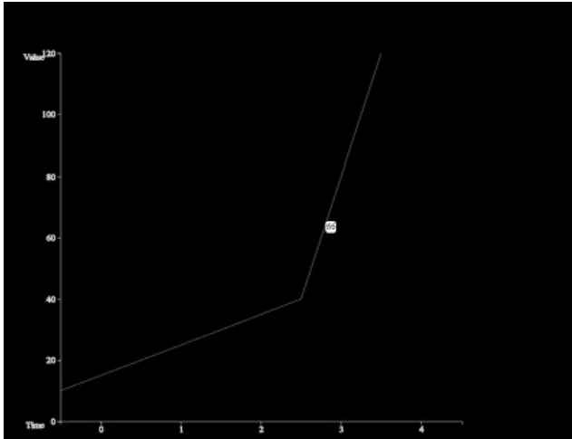

您也可以查看我们的**动手学D3.JS：简单易懂的视频课程**以加速学习：[点击这里](here) 或使用下方二维码享受5-5折优惠。

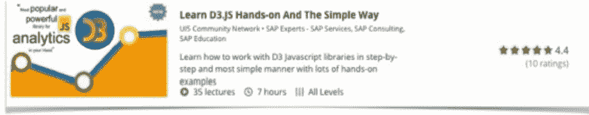


## 14. 地图

地图是最令人兴奋和有趣的数据表示格式之一。当我们看到地图表示时，可能会有一个疑问：我们如何创建一个地图。在这个例子中，我们将创建一个简单的美国地图。这个美国地图由许多州组成，每个州都有一个多边形形状。

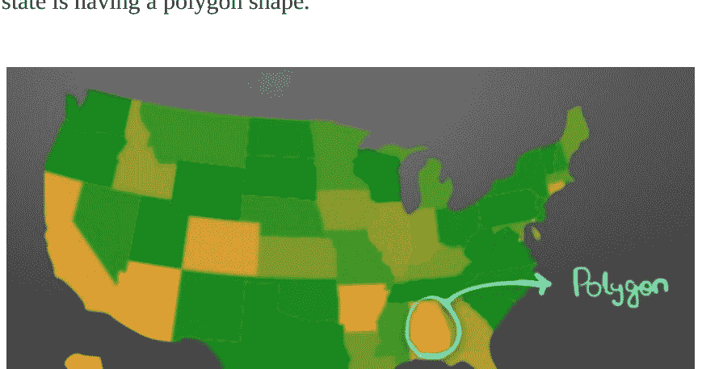

观察这个多边形，我们可以看到它涉及哪些对应的`X`和`Y`坐标来表示边界。例如，如果我们考虑`n`个点，`n`可以是100、20或10。那么按顺序连接每个点就会形成一个闭合的边界，代表一个州。所有坐标点是一个数组列表。这是我们创建多边形时需要知道的第一件事。此外，我们还需要知道一些关于该州的基本属性，比如州名和州ID。这两个数据通常被称为Geo-JSON数据。我们将在示例中详细介绍Geo-JSON数据。除此之外，创建地图还需要考虑投影。这是因为当使用几何图形时，我们需要考虑地球是球形的。当我们将3D数据格式表示为2D时，就需要使用投影。

D3提供了许多流行的格式，用于将这些3D数据投影到2D。让我们来看一些我们在项目中使用过的投影。

现在我们访问链接[https://github.com/d3/d3/wiki/Geo-Projections](https://github.com/d3/d3/wiki/Geo-Projections)，可以看到有很多地理投影格式，我们选择一个将在项目中使用的。每种格式都有特定的优点。我们将使用**d3.geo.albersUsa**格式。

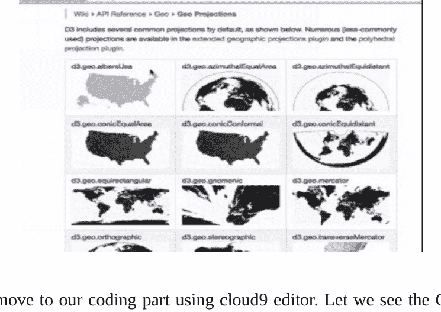

现在我们可以使用cloud9编辑器进入编码部分。在开始实际开发之前，让我们先看看GeoJSON数据。

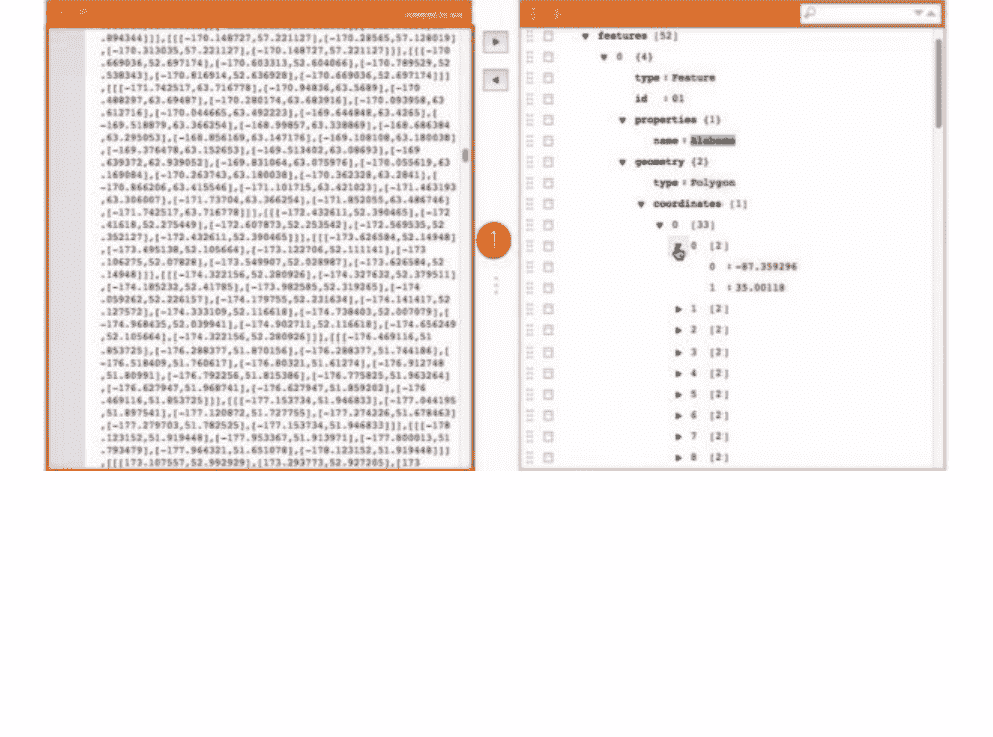

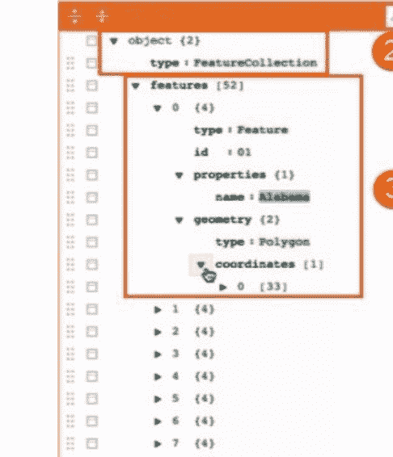

- 1. GeoJSON数据是一种非常庞大的数据表示形式。它包含大量的坐标和信息。

- 2. 图中显示的顶层是这个GeoJSON数据表示格式的一个对象。如果我们进入下一层，可以看到该对象有两个键：`type`和`features`。`type`表示它对应的GeoJSON数据类型。

- 3. `features`实际上是一个对象数组。如果我们打开其中一个单独的对象，可以看到`type`、`id`、`properties`和`geometry`作为键。`properties`将代表州的名称。`geometry`代表该州对应的多边形坐标。

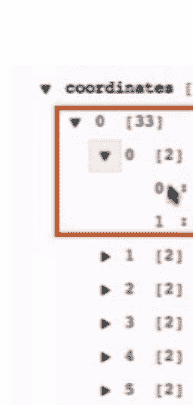

## 15. 期末项目

在本节中，我们将开始进行期末项目，并探讨如何在实际项目中使用D3。这是一个数据可视化项目，而**数据可视化是当前市场上的热门技能之一**。如果你想了解更多关于数据可视化的内容，我们强烈推荐你在Udemy上查看我们的**'7个简单步骤学会数据可视化'**课程。这将为你在如何进行数据可视化项目方面打下非常坚实的基础。在下一节中，我们将探讨使用D3的工作场景。

在开始任何数据可视化项目之前，我们应始终有清晰的目标陈述/需求。让我们看看这里的目标陈述。

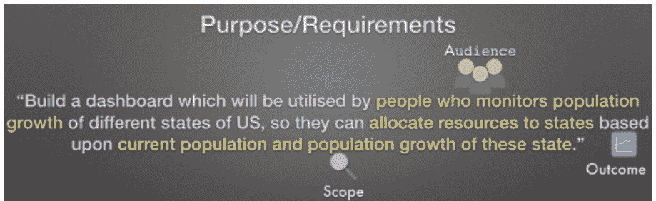

根据这个目标陈述，我们需要构建一个仪表板，供**监控美国各州人口增长的人**使用，以便他们能够根据**各州当前人口和人口增长情况**来**分配资源**。

这里我们可以看到三个主要部分：

-   受众是谁？

-   范围是什么？

-   结果

**受众**：监控人口的人群。我们将使用D3为他们创建一个可视化项目。

**范围和结果**：他们将使用此可视化来根据情况向各州分配资源。

一旦我们明确了在数据可视化项目中要做什么，我们就会进入数据可视化项目的7个步骤。初始阶段，我们将获取数据，之后我们会花时间解析数据并为其使用做准备。

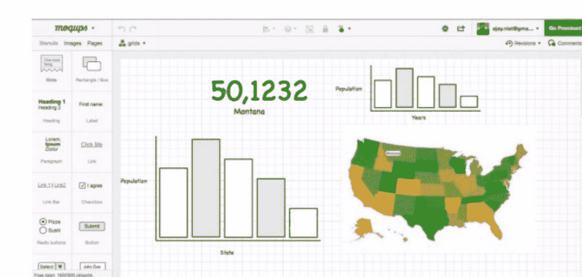

这是基于我们已在moqups网站上创建的需求所绘制的线框图。我们跳过了如何获取数据、如何处理数据、过滤以及创建此线框图的步骤，因为我们在其他数据可视化课程中已经涵盖了这7个步骤。本课程侧重于开发。在上图中，我们可以看到包含所有州人口的条形图，以及一个美国地图。KPI字段显示当前州的人口数据。

在地图上方还有一个小的条形图，它将显示该特定年份（将在图中注明）的人口变化。这是一个交互式的D3地图，如果我们点击地图上的任何州，KPI值和小条形图将相应地更改为该州的数据。

### 15.1. 代码结构

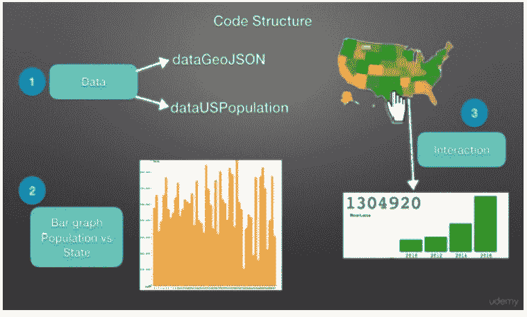

1.  让我们看看解决我们讨论过的用例的代码结构。第一项是美国地图的GeoJSON数据文件。第二项是美国人口数据。在开始项目之前，这两个JSON数据将提供给我们。

2.  接下来，我们需要为美国所有州的人口创建条形图。

3.  第三步是添加交互事件。如果我们点击地图上的任何一个州，我们应该能够看到代表该州多年来人口的条形图。我们还会根据所选的州更新KPI字段信息。接下来，我们将使用Cloud9编辑器在编码中看到这些步骤。

### 15.2. 创建地图项目

1.  创建一个新文件，将其命名为D3FinalProject.html，并将我们从Github获取的地图内容复制并粘贴到该文件中。我们将看到一个非常大的geoJSON数据，将其最小化/折叠以便更容易查看其他代码。

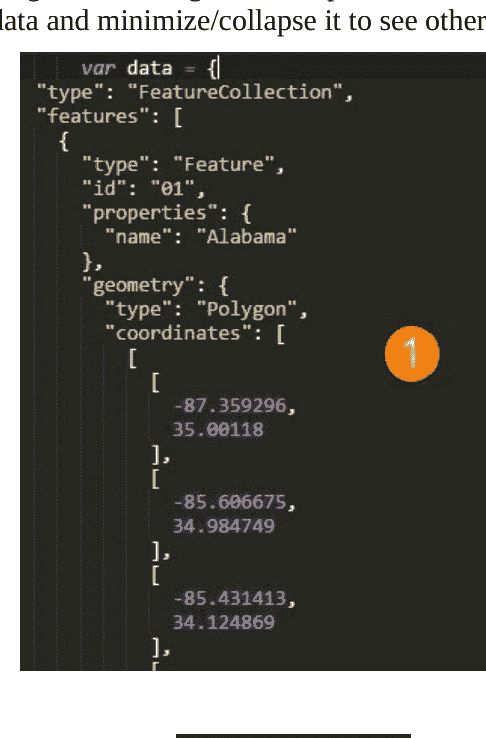

```javascript
var data = { };
```

2.  接下来，我们需要美国的人口数据。我们可以看到美国人口的JSON数据。它包含大量数据，每个对象都有一个name键字段，并且有2010年、2012年、2014年和2016年的数据。这些是我们将使用的偶数年份。在实际项目中，我们通常从网络服务获取数据或从文件中读取数据。这个用例的目的很简单，所以我们可以在D3程序中使用硬编码的数据。我们将JSON数据复制并粘贴到var dataUSPopulation = [{<data to be pasted here>}]中；

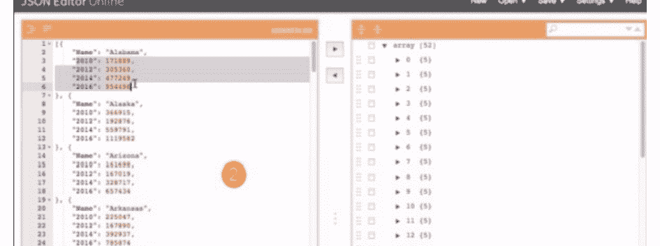

3.  地图的其余部分保持不变。我们将增加宽度和高度，并为图表添加一些内边距。

```javascript
//Width and height
var w = 1600;
var h = 800;
var margin ={
    left:32,
    right:30,
    bottom:30,
    top:30
};
var numOfState = 50;
var scaleOfMap = 1000;
var tooltip = d3.select('body').append('div')
    .style('position','absolute')
    .style('background','#fff')
    .style('padding','5 15px')
    .style('border','1px #fff solid')
    .style('border-radius','5px')
    .style('opacity','0');
```

4.  在地图中，我们还有一个点击事件。即当用户点击地图上的某个特定州时，用户可以看到一个条形图。当点击事件发生时，我们将执行一个函数。我们可以看到这里使用了两个函数：update和new。当用户第一次点击州时，将调用new函数。此时，该州的人口图表将出现。一旦出现，用户再点击任何其他州时，将调用update函数。'if'语句应在创建州条形图之后添加。

```javascript
}).on("click", function(d,i){
    if(document.getElementById("stateBar").childNodes.length>0)
    {
        addStateBarChart(d,i,"update");
    }else{
        addStateBarChart(d,i,"new");
    }
}
```

### 15.3. 定义州与人口条形图的属性

5.  接下来，我们将定义州与人口条形图（主条形图）。为此，我们将创建一个名为barFirstTimeRender()的函数。我们将设置条形图的限制以及其他边界和内边距。同时复制地图的工具提示并在此使用。maxPop用于确定所有州的最高人口，并将其用于缩放。

6.  我们使用'for循环'来找到当前年份的最大人口值。`if(!Number.isNaN(parseInt(k)))` - 这用于仅允许年份值作为键条件。为此，我们使用了'不是数字(NaN)'。

```javascript
function barFirstTimeRender(){
    var maxPop = 0;
    var widthBar = 750;
    var heightBar = 700;
    var paddingText = 70;
    var tooltip = d3.select('body').append('div')
        .style('position','absolute')
        .style('background','#fff')
        .style('padding','5 15px')
        .style('border','1px #fff solid')
        .style('border-radius','5px')
        .style('opacity','0');
}
```

```javascript
for(var i=0;i<dataUSPopulation.length;i++){
    for(k in dataUSPopulation[i]){
        if(!Number.isNaN(parseInt(k))){
            if(dataUSPopulation[i][k]>maxPop){
                maxPop = dataUSPopulation[i][k];
            }
        }
    }
}
```

7.  一旦我们有了最大人口，它将作为条形图的上限，然后我们将创建比例尺。

```javascript
var h = d3.scale.linear()
    .domain([0,maxPop])
    .range([0,heightBar]);

var y = d3.scale.linear()
    .domain([0,maxPop])
    .range([heightBar,0]);

var x = d3.scale.ordinal()
    .domain(d3.range(dataUSPopulation.length))
    .rangeRoundBands([0,widthBar]);
```

8. 创建比例尺后，我们将创建具有刻度数量、方向和比例尺的“Y”轴。“X”轴同样如此。同时，我们将通过计算 `widthBar / dataUSPopulation` 并向下取整来创建条形的宽度，以确保得到一个完整的整数值。

```javascript
var yAxis = d3.svg.axis()
    .scale(y)
    .orient('left')
    .ticks(10);

var xAxis = d3.svg.axis()
    .scale(x)
    .orient('bottom')
    .ticks(50);

var widthOfBar = Math.floor(widthBar / dataUSPopulation.length)-1;
```

9. 我们将分别对“Y”轴和“X”轴进行分组，因为我们将单独应用 CSS 属性。

```javascript
svg.append("g")
    .attr("id","yAxis")
    .call(yAxis)
    .style("stroke","#000")
    .attr("transform","translate("+paddingText+",0)");

svg.append("g")
    .attr("id","xAxis")
    .call(xAxis)
    .style("stroke","#000")
    .attr("transform","translate("+paddingText+","+(heightBar)+")");
```

10. 接下来，我们将把“Y”轴和“X”轴添加到这个条形图的 SVG 中。我们在此绘制条形。

```javascript
var plot = svg.append("g")
    .attr("id","barPlot")
    .selectAll()
    .data(dataUSPopulation)
    .enter()
    .append("rect")
    .attr("width",widthOfBar)
    .attr("height",function(d,i){

        return h(d["2016"]);
    })
    .style("fill","orange")
    .attr("y",function(d,i){
        return heightBar- h(d["2016"]);
    })
    .attr("x",function(d,i){
        return x(i);
    })
```

11. 到此为止，如果我们运行代码，将会得到条形图。我们需要调用 `barFirstTimeRender` 函数，所以在我们创建的函数之前调用它。我们还可以使用鼠标悬停事件添加一个工具提示事件。

```javascript
}).on('mouseover',function(d){

    tooltip.transition()
        .style('opacity',1);
    tooltip.html("2016 : "+d["2016"]+" "+d["Name"])
        .style('left',(d3.event.pageX)+"px")
        .style('top',(d3.event.pageY)+"px");

    d3.select(this).style('opacity',0.5);

})
.on('mouseout',function(){

    d3.select(this).style('opacity',1);

});
```

#### 15.4. 为我们的各州 vs 年份条形图定义属性

12. 下一步将是“州 vs 年份”条形图，当点击任何州时需要显示该图。我们已经看到，我们将使用两个函数：‘update’ 和 ‘new’。因此，我们将回到我们的 `addStateBarChart()` 函数，继续绘制我们的“州 vs 年份”人口图。我们将使用这里重命名的小变量来区分主条形图变量和这些条形图变量。

```javascript
function addStateBarChart(data,index,mode){
  var sBMaxPop = 0;
  var sBWidthBar = 400;
  var sBHeightBar = 250;
  var sBPaddingText = 10;
  var sTtooltip = d3.select('body').append('div')
    .style('position','absolute')
    .style('background','#fff')
    .style('padding','5 15px')
    .style('border','1px #fff solid')
    .style('border-radius','5px')
    .style('opacity','0');
```

13. 这里我们使用 `sBData`。这里的`数据`是不同的。我们将选择一个特定的州并为其绘制条形图。每个独立的州都有一个不同的索引。这个索引将作为函数参数传入。我们还创建一个新的 `sBDataNew` 数组来存储年份值，以使处理过程更简单。

```javascript
var sBData = dataUSPopulation[index];
var sBDataNew = [];
var sBNumYear = 0;
var sBState = dataUSPopulation[index]["Name"];

for(k in sBData){
  if(!Number.isNaN(parseInt(k))){
    sBNumYear++;
    sBDataNew.push({
      "year":k,
      "popl":sBData[k]
    });
    if(sBMaxPop < sBData[k]){
      sBMaxPop = sBData[k];
    }
  }
};
```

14. 接下来，我们将定义条形图的比例尺以及条形的宽度。

```javascript
var sBH = d3.scale.linear().domain([0,sBMaxPop])
               .range([0,sBHeightBar]);

var sBY = d3.scale.linear().domain([0,sBMaxPop])
               .range([sBHeightBar,0]);

var sBX = d3.scale.ordinal().domain(d3.range(sBNumYear))
               .rangeRoundBands([0,sBWidthBar]);

var sBWidthOfBar =  Math.floor(sBWidthBar / sBNumYear)-1;
```

15. 如果条形图是新的，即我们第一次点击条形图时，它将开始渲染。`mode new` 是这个小条形图函数的第三个参数。我们将创建一个名为 `statePlot` 的全局变量，并在 `mode` 内部使用它。

```javascript
if(mode === "new"){

    statePlot.selectAll()
    .data(sBDataNew)
    .enter()
    .append("rect")
    .attr("width",sBWidthOfBar)
    .attr("height",function(d,i){
        return parseInt(sBH(d["pop1"]));
    })
    .attr("y",function(d,i){
        return parseInt(sBY(d["pop1"]));
    })
    .attr("x",function(d,i){
        return sBX(i);
    })
}
```

```javascript
.style("fill", "green").on('mouseover', function(d) {
    tooltip.transition()
        .style('opacity', 1);
    tooltip.html(d["year"] + " : " + d["popl"])
        .style('left', (d3.event.pageX) + "px")
        .style('top', (d3.event.pageY) + "px");
    d3.select(this).style('opacity', 0.5);
})
.on('mouseout', function() {
    d3.select(this).style('opacity', 1);
});
```

16. 在 `else if` 部分，我们编写代码来更新数据。这将产生过渡效果并显示当前州的图表。

```javascript
} else if (mode === "update") {
    statePlot.selectAll("rect")
        .data(sBDataNew)
        .transition()
        .duration(1000)
        .attr("width", sBWidthOfBar)
        .attr("height", function(d, i) {
            return parseInt(sBH(d["popl"]));
        })
        .attr("y", function(d, i) {
            return parseInt(sBY(d["popl"]));
        })
        .attr("x", function(d, i) {
            return sBX(i);
        })
        .style("fill", "green");
} else {
    return;
}
```

#### 15.5. 定义和绘制 KPI 数字

17. 最后一部分是根据我们的用例定义 KPI 数字。这将显示特定州的数据。我们将在 `addBarChart()` 函数内添加 KPI。

```javascript
svg.selectAll("#kpi")
    .text(sBData["2016"])
    .transition()
    .duration(1000);

svg.selectAll("#kpiDec")
    .text(sBState)
    .transition()
    .duration(1000);
```

18. 我们还需要在 `barFirstTimeRender` 函数中添加 KPI 信息。

```javascript
svg.append("text")
    .attr("id","kpi")
    .text("State Population")
    .attr("class","KPIMain")
    .attr("x",parseInt(widthBar/2 - 200))
    .attr("y",parseInt(heightBar/2 - 200));

svg.append("text")
    .attr("id","kpiDec")
    .text("State Name")
    .attr("class","KPIDesc")
    .attr("x",parseInt(widthBar/2 - 200))
    .attr("y",parseInt(heightBar/2 - 200));
```

#### 15.6. CSS 和其他小改动

19. 没有 CSS，地图会看起来不美观。所有的地图和图表都将无法正确对齐。为了解决这个问题，我们需要添加 CSS 样式来修正元素。

没有 CSS 的情况

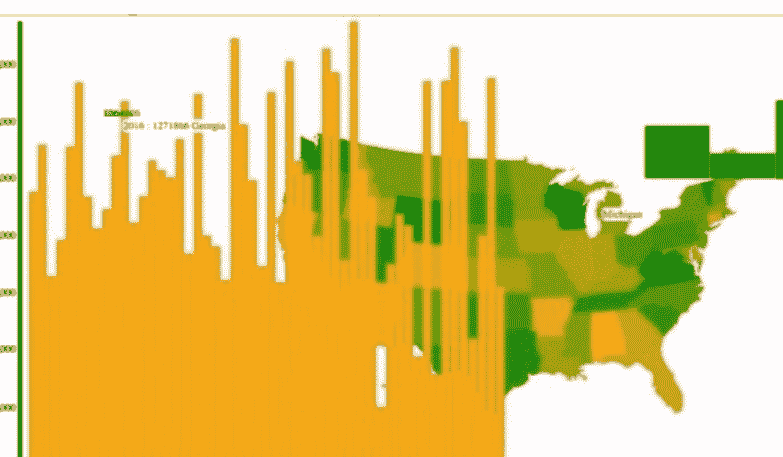

因此，我们需要改进 CSS。经过一些试验和错误之后，我们终于有了一个合适的 CSS 来正确显示我们的项目。

```css
<style type="text/css">
/* No style rules here yet */

g#barPlot {
    transform: translateX(70px) !important;
}

.KPIMain{
    transform:translate(814px,-82px);
    font-size:72px;
    fill:gray !important;
    font-weight:bold;
}
.KPIDesc{
    transform:translate(840px,-41px);
    font-size:20px;
    fill:gray !important;
}
.map{
    transform:translate(400px,77px);
}
</style>
```

D3FinalProject.html 的代码可在仓库 [https://c9.io/ajaytech/dataviz](https://c9.io/ajaytech/dataviz) 中找到。

它包含 15000 多行代码，无法在此分享。因此请前往仓库验证您的代码。

#### 15.7 输出

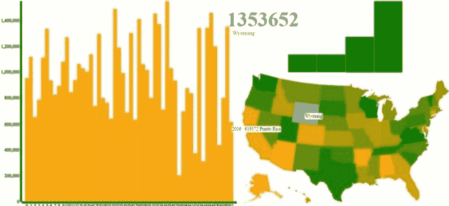

您也可以查看我们的 **Learn D3.JS Hands-on And The Simple Way** 视频课程以加速学习：[点击这里](http://example.com)，或使用下方二维码享受 5- 折扣优惠。


# 参考文献与书目

- http://alignedleft.com/work/d3-book ：Scott Murray 所著的《面向 Web 的交互式数据可视化》

- https://d3js.org/ ：D3 JavaScript 库官方文档和 API 参考。

- http://www.census.gov/ ：美国人口普查局政府网站，提供公共数据以展示用例。
