# D3.js 学习秘籍：通过大量实践示例，以循序渐进和最简洁的方式学习如何使用 D3 JavaScript 库


轻松学习


## 免费礼品券


或
[点击这里](https://example.com)

## 您可能也感兴趣


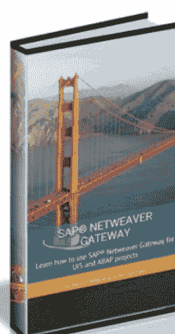
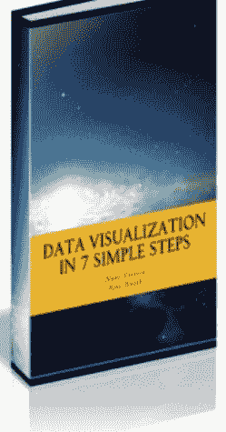


[学习 SAP® UI5：使用示例掌握新的企业 JavaScript 框架](http://www.example.com)


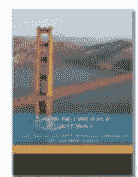

[SAP® Netweaver Gateway：学习如何在 UI5 和 ABAP 项目中使用 SAP® Netweaver Gateway](http://www.example.com)


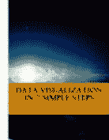

[7 个简单步骤完成数据可视化](http://www.example.com)


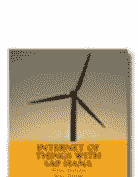

[基于 SAP HANA 的物联网：使用 Raspberry PI、Arduino Uno、HANA XSJS 和 SAPUI5 构建您的 IoT 用例](http://www.example.com)


参考文献与书目

## 1. 简介

**什么是 D3？**
D3 代表数据驱动文档。它是一个 JavaScript 库，允许开发者创建惊人的分析和可视化效果。

**为什么选择 D3？**
D3 应优先于任何其他 JavaScript 库，因为我们有很多选择。如果我们想创建一些可视化项目，比如一个简单的项目或一个简单的数学应用程序，那么由于以下原因，它是最佳选择之一。

**现代浏览器能力：** 我们可以使用现代浏览器的功能与 D3 一起工作。我们可以访问所有 HTML5 和 CSS 属性。因此，创建的应用程序是响应式的，并且能够适应用户的设备。

**无限的变化：** D3 提供的变化和选项是无限的。我们将在 [d3js.org](https://d3js.org) 网站上了解 D3 的各种可能性。

**BSD 开源许可证：** D3 附带 BSD 开源许可证。因此，我们无需向任何人付费即可使用 D3。

**庞大的社区支持：** D3 拥有庞大的社区支持。在 **StackOverflow** 和 **GitHub** 上有许多人。当我们学习一项新技术时，支持至关重要。这个社区将指导我们解决在项目中遇到的任何查询和问题。

让我们探索 [d3js.org](https://d3js.org) 网站


如果您转到示例选项卡，您可以在画廊中看到流行的示例。在这里我们可以看到许多使用 D3 创建的示例。有许多常见的图表，如箱线图、气泡图、热图，以及更具创新性的图表，如力导向布局图和动态图表，都可以在示例选项卡中找到。我们将发现多种变化和创新方法，使用 D3 解决任何可视化问题。在右侧，他们提供了 API 参考。如果您是 D3 新手，这非常有用。它包含了 D3 中使用的所有元素的文档和功能。

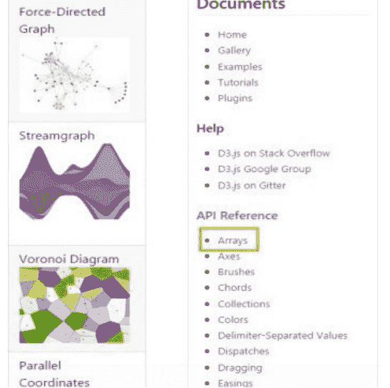

### 数组 (d3-array)

数组操作、排序、搜索、汇总等。

> 统计

计算基本汇总统计的方法。

-   `d3.min` - 计算数组中的最小值。
-   `d3.max` - 计算数组中的最大值。
-   `d3.extent` - 计算数组中的最小值和最大值。
-   `d3.sum` - 计算数字数组的总和。
-   `d3.mean` - 计算数字数组的算术平均值。
-   `d3.median` - 计算数字数组的中位数（0.5 分位数）。
-   `d3.quantile` - 计算已排序数字数组的分位数。
-   `d3.variance` - 计算数字数组的方差。
-   `d3.deviation` - 计算数字数组的标准差。

### API 参考

让我们回到示例，选择一个示例来探索。这里我们选择箱线图示例进行探索。

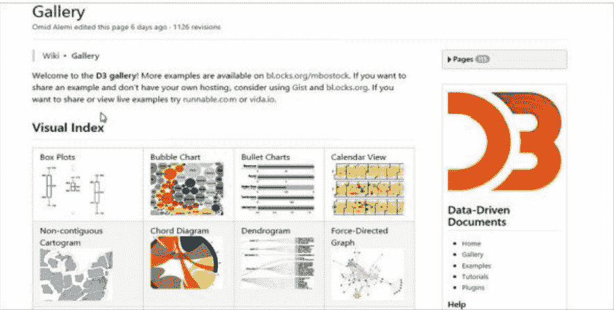

选择箱线图后，它会打开 D3 示例以及创建该图表的代码。Mike Bostock 是创建此图表的开发者。他也发布了很多示例。您可以点击他的名字查看他发布的图表。

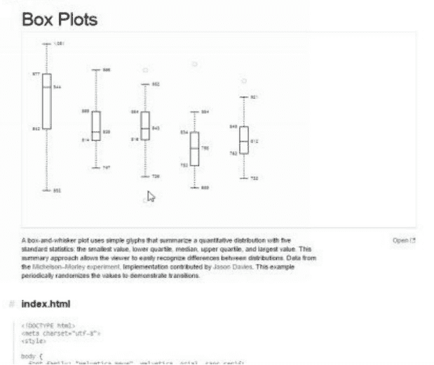

您也可以查看我们的 **动手学习 D3.JS 之简易方法** 视频课程以加速学习：[点击此处](link) 或使用下方二维码享受 50-90% 折扣。

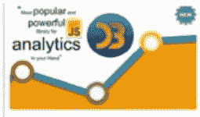


## 2. 本书的学习路径

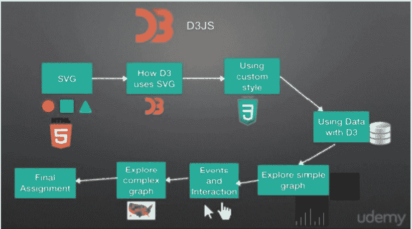

-   首先，我们将从 SVG（可缩放矢量图形）开始。我们将了解如何创建简单的图形对象，如圆形、矩形和三角形。
-   此外，我们学习如何从 HTML5 绘制这些 SVG 元素。接下来，我们将使用 D3 创建这些 SVG 元素。
-   一旦我们了解了基本的 SVG 元素如何工作，我们就将继续处理自定义样式表（CSS）。
-   使用 CSS，我们将看到如何将数据与 D3 一起使用。
-   之后，我们将看到如何使用简单的图表，如气泡图和条形图。
-   然后，我们将了解当最终用户在图表上移动鼠标时图表中的事件。
-   我们的学习曲线还将推进到一些高级图表，如地图或热图项目。
-   最后，我们将创建一个作业项目。这个作业将是一个可视化项目的用例，我们将使用 D3 来解决它。我们将逐步学习这个过程，并基于实践操作。


## 3. SVG 元素

SVG 是可缩放矢量图形的缩写。与 PNG 或 JPEG 文件类似，SVG 用于存储基于 XML 的矢量图像格式。普通的位图图像由一组固定的像素组成。而矢量图像则由一组固定的形状（如圆形、线条或文本）组成。我们可以看到，.jpeg、.png 或 .gif 文件中表示的图像是像素化的或失真的。然而，在矢量图像中，它们是一组形状，因此在缩放图像时不会看到任何质量损失。

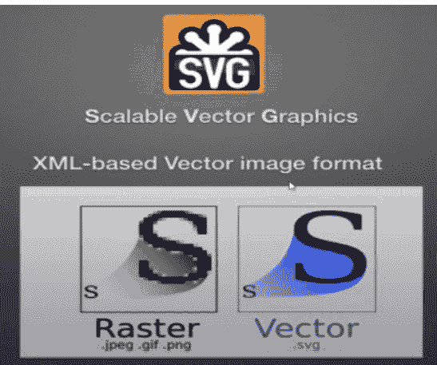

### 示例

让我们看一些在 HTML5 页面中使用 SVG 元素的简单示例。我们将使用 Cloud9 IDE。我们大部分开发工作都在 Cloud9 IDE 中进行。用户可以全天候访问这些文件。

代码仓库链接：[https://ide.c9.io/ajaytech/dataviz](https://ide.c9.io/ajaytech/dataviz)

不熟悉此 IDE 的用户可以在给定链接上阅读入门文档。

入门指南：[https://docs.c9.io/docs/getting-started](https://docs.c9.io/docs/getting-started)

让我们***开始编码！***

### 3.1. SVG 简单示例

在这个例子中，我们将使用 SVG 元素创建一个条形图。要创建 SVG，我们需要一个 `<svg>` 标签。在这个标签中，我们添加了矩形条的宽度、高度和背景颜色。如果在 body 标签之前添加以下代码并运行代码，我们将得到一个宽度为 300px、高度为 100px 的橙色矩形。

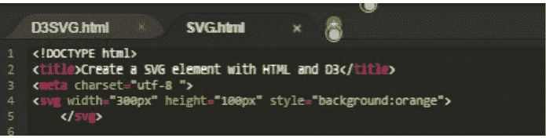

**SVG.html 的代码**

```html
<!DOCTYPE html>
<title>Create a SVG element with HTML and D3</title>
<meta charset="utf-8">
<svg width="300px" height="100px" style="background:orange">
</svg>
<script src="../D3/d3.v3.min.js"></script>
<script>
    var svg = d3.select("body").append("svg").style("background","green");
</script>
<body>
</body>
</html>
```

**结果：**
这就是我们的 **SVG** 元素。在接下来的部分，我们将把它与 D3 一起使用。

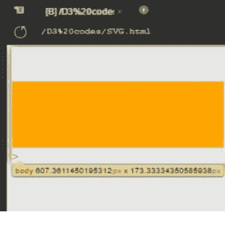

### 3.2 SVG 与 D3

在这个例子中，我们将把 SVG 元素与 D3 一起使用。为此，我们需要使用 `d3.select("body").append("svg")`。我们网页的最终层级将有一个 HTML 元素，其内部将有一个 body，而这个 body 将包含 SVG 元素。

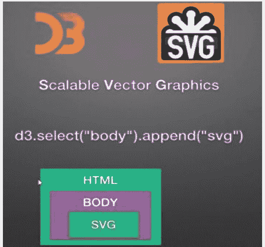

让我们在我们的 Cloud9 IDE 中尝试一下。我们已经在 HTML 页面中创建了一个简单的 SVG 元素。现在我们将使用 D3 来执行相同的活动。要使用 D3，我们需要在 body 标签之前添加 D3 库。为此，我们需要在 script 标签内添加该库的链接。

```html
<script src="../D3/d3.v3.min.js"></script>
<script>
```

“../D3/d3.v3.min.js”是 D3 库文件的相对路径。

要验证这一点，运行该文件并右键单击页面选择“检查元素”进入控制台。然后，输入 D3 并按回车键。如果一切正常，它将不会显示任何错误，并且我们的路径是正确的。

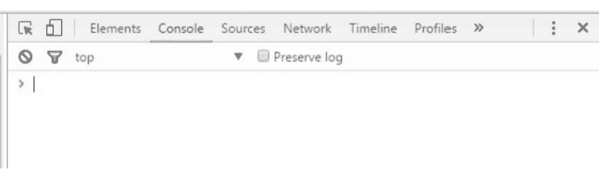

如果在定义路径时有错误，那么控制台将显示如下内容。

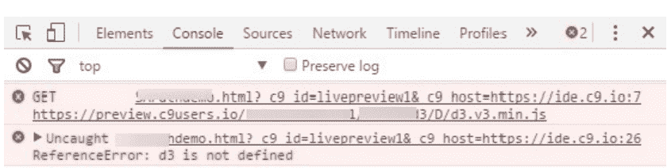

在项目中工作时，我们将始终使用相对路径或来自内容分发网络 CDN 的路径。如果我们打开 D3 库文件，我们会看到里面有一个非常大的文件。这就是我们将在应用程序中使用的库文件。D3 是基于 JavaScript 的，所以我们有一个 script 标签，并在 script 标签内编写 JavaScript 代码。我们将创建的第一个示例是使用 D3 创建 SVG。

**使用 D3 的 SVG 代码：**

```html
<!DOCTYPE html>
<title>Create a SVG element with HTML and D3</title>
<meta charset="utf-8 ">
<svg width="300px" height="100px" style="background:orange"></svg>

<script src="../D3/d3.v3.min.js"></script>
<script>
	/*在 body 内创建一个 SVG，并添加绿色样式使 SVG 可见*/
	
	var svg = d3.select("body").append("svg").style("background", "green");

</script>
<body>
</body>
</html>
```

**输出：**

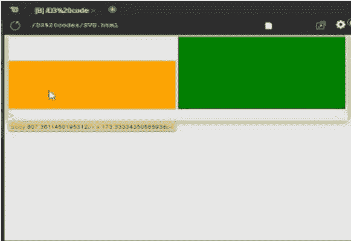

第一个橙色矩形是没有 D3 的，第二个矩形框是由 D3 语法渲染的。这是一个使用 SVG 的简单示例。我们将在接下来的部分中看到更多图形元素及其变体的示例。

您也可以查看我们的 **Learn D3.JS Hands-on And The Simple Way** 视频课程以加速学习：[点击此处](https://www.google.com) 或使用下面的二维码享受 50-90% 的折扣。

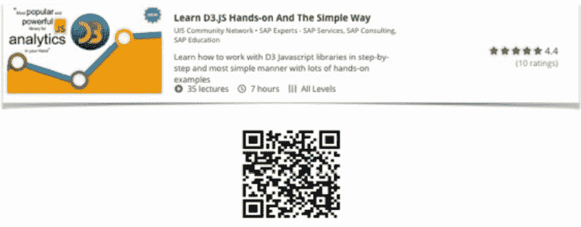

## 4. 选择元素和操作

与 JQuery 类似，如果我们想持有某个对象以进行一些更改或读取一些值，我们需要使用 select 语句。D3 提供了两个顶级元素来选择元素：**select** 和 **selectAll**。让我们从 select 开始。在这个例子中，我们将有一个简单的 HTML 页面，其中包含一个 body，这个 body 内部将有一个 SVG 元素。这个 SVG 元素将包含一些属性值，如宽度或高度。这些属性实际上被称为 SVG 属性。

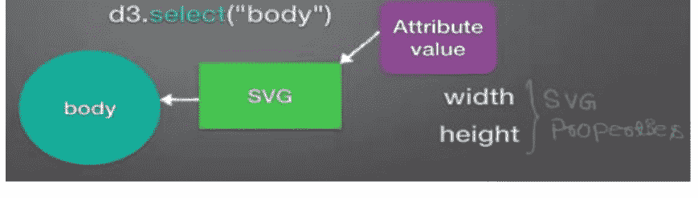

### 4.1 编码

您可以访问这些示例的代码仓库。要访问它，请转到链接 [https://ide.c9.io/ajaytech/dataviz](https://ide.c9.io/ajaytech/dataviz)


在这个例子中，我们看到了 select 和 selectAll 属性。如果我们使用 select 属性，它会选择指定的特定元素。第一个橙色矩形是 select 属性的示例。Dinosaur、Elephant 和 Cat 使用了 selectAll。在这里您可以看到 Dinosaur 和 Elephant 是绿色的，因为在带有 id 和 class 属性的 div 标签中，我们定义了背景颜色为绿色。

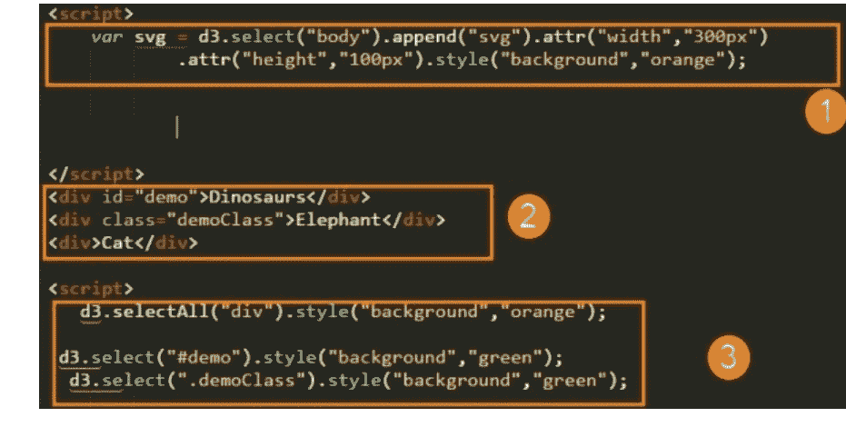

1. `d3.select("body")` 是一个 jQuery 选择器语句，用于选择 body 内部的内容。属性也在这里定义，样式为橙色背景。
2. 带有 id demo 的 div 元素和另一个 class 为 'demoClass' 的 div 元素用于分组指定的类或 id。
3. 'SelectAll' 将选择 div 内部的所有 SVG，而 'Select' 仅选择函数内部指定的特定类或 id。

### D3SVG.html 的代码

```html
<!DOCTYPE html>
<meta charset="utf-8">
<title>Adding attributes and selection to SVG element</title>
<body>
<script src="../D3/d3.v3.min.js"></script>
<script>
    var svg = d3.select("body").append("svg").attr("width", "300px")
    .attr("height", "100px").style("background", "orange");
</script>
<div id="demo">Dinosaurs</div>
<div class="demoClass">Elephant</div>
<div>Cat</div>
<script>
d3.selectAll("div").style("background", "orange");
d3.select("#demo").style("background", "green");
d3.select(".demoClass").style("background", "green");
</script>
</body>
</html>
```

## 输出

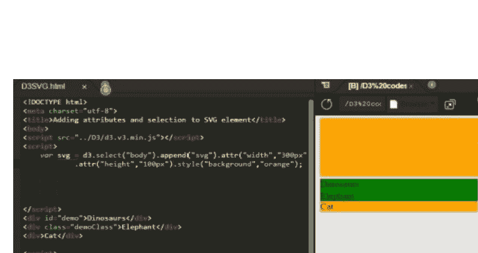

如果我们移除 Dinosaur 和 Elephant 的 id 和 class，实际结果将如下所示。

```html
<title>Adding attributes and selection to SVG</title>
<body>
<script src="../D3/d3.v3.min.js"></script>
<script>
    var svg = d3.select("body").append("svg")
              .attr("height","100px").style("border","1px solid black");

</script>
<div>Dinosaurs</div>
<div>Elephant</div>
<div>Cat</div>

<script>
    d3.selectAll("div").style("background","orange").style("color","black");

    d3.select("#demo").style("background","green").style("color","black");
    d3.select(".demoClass").style("background","purple").style("color","white");
</script>
```

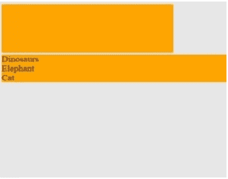

您也可以查看我们的 **Learn D3.JS Hands-on And The Simple Way** 视频课程以加速学习：[点击此处](here) 或使用下面的二维码享受 50-90% 的折扣。

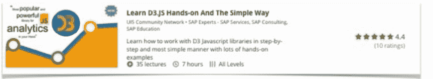


## 5. 样式

样式主要指我们 D3 应用程序的 CSS 部分。CSS 部分将使我们的应用程序看起来更美观。此外，在绘制气泡图和条形图等图形元素时，当我们需要区分数据点时，样式也变得至关重要。D3 的样式可以通过三种不同的方式实现。

-   **行内**
-   **外部**
-   **内部**

### 行内

样式的规则是在引号（“”）内定义。

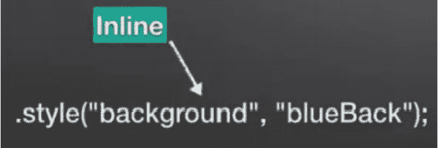

这是我们之前示例中看到的行内样式规则。

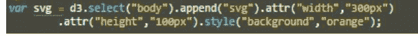

### 外部或内部样式表

在这种情况下，样式直接添加到我们的元素上。然而，更好的方法是使用外部或内部样式类。在这里，我们将定义一个类，并将这个类添加到元素上。之后，如果我们想更改属性，就不必访问所有单独的元素来执行这些更改。我们只需在类中进行更改，已分配该类的元素就会采用这些更改。我们将在编码中看到这一点。

#### 内部样式规则

内部样式规则可以在主代码内部定义，无需任何外部样式表。以下代码是内部样式表的一个示例。

#### 内部样式规则代码：

```html
<!DOCTYPE html>
<meta charset="utf-8">
<title>Adding attributes and selection to SVG element</title>
<style>
.blueBack{
    background : blue;
}
</style>
<body>
<script src="../D3/d3.v3.min.js"></script>
<script>
var svg =
d3.select(“body”).append(“svg”).attr(“width”,“300px”).attr(“height”,“100px”).attr(“class”,
/* we are appending the class property ‘blueBack’ with body elements*/
</script>
</body>
</html>
```

## 输出

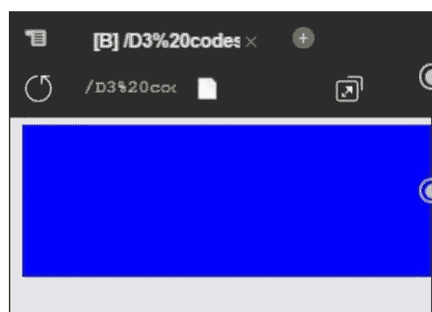

#### 外部样式规则

可以通过创建一个 `<filename>.css` 文件并在程序内链接该 CSS 文件来添加外部样式规则。例如，我们创建一个名为 `style.css` 的样式表，然后在程序中使用文件名 `style` 进行链接。这可以在编码部分的开头链接，如下图所示。

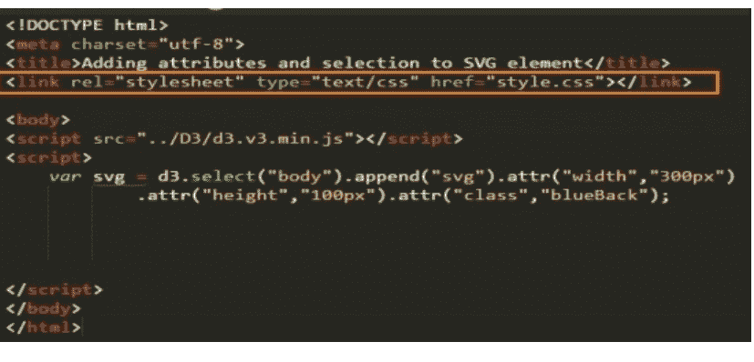

##### D3.Styling.html

```html
<!DOCTYPE html>
<meta charset="utf-8">
<title>Adding attributes and selection to SVG element</title>
<link rel="stylesheet" type="text/css" href="style.css"></link>

<body>
<script src="../D3/d3.v3.min.js"></script>
<script>
    var svg = d3.select("body").append("svg").attr("width", "300px")
            .attr("height", "100px").attr("class", "blueBack");
</script>
</body>
</html>
```

##### style.css

```css
.blueBack{

    background : blue;

}
```

您也可以查看我们的 **Learn D3.JS Hands-on And The Simple Way** 视频课程以加速学习：[这里](here)，或使用下方二维码享受 50-90% 折扣。

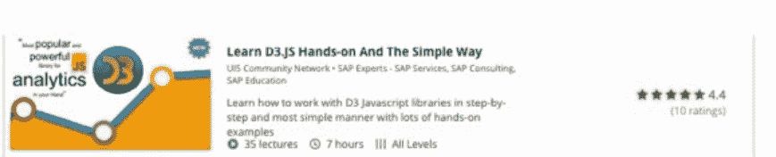


## 6. 几何对象

在我们创建图表时，这些图表的各个元素就是我们的几何对象。它可以是矩形或圆形，也可以是线条或圆弧。让我们通过示例看看如何使用 D3 创建这些几何对象。在上一节中，我们了解了如何为 D3 添加样式表。在同一个示例中，我们将把几何对象添加到其中。在这个例子中，我们将使用相同的 SVG 并在其内部追加矩形。

```html
<!DOCTYPE html>
<meta charset="utf-8">
<title>Adding attributes and selection to SVG element</title>
<link rel="stylesheet" type="text/css" href="style.css"></link>
<body>
<script src="../D3/d3.v3.min.js"></script>
<script>
var svg = d3.select("body").append("svg").attr("width","300px")
.attr("height","100px").attr("class","blueBack");

svg.append("rect")
.attr("width","100px")
.attr("height","50px")
.attr("x","100px")
.attr("y","20px")
.style("fill","orange");

svg.append("circle")
.attr("r","20px")
.attr("cx","100px")
.attr("cy","20px")
.style("fill","green");
</script>
</body>
```

下面的代码用于绘制一个尺寸为 100X50 像素的矩形，其 x 和 y 内边距分别为 100 和 20。**内边距** 用于指定 D3 开始绘制对象的 x 和 y 轴位置。我们还将矩形填充为橙色。

```javascript
svg.append(“rect”)
.attr(“width”,“100px”)
.attr(“height”,“50px”)
.attr(“x”,“100px”)
.attr(“y”,“20px”)
.style(“fill”,“orange”);
```

下面的代码用于绘制圆形。要绘制一个圆，我们需要半径，因此我们定义了 100px 的半径。x 和 y 的作用与矩形中的内边距相同。圆内部的颜色设置为绿色，以将其与矩形区分开来。

```javascript
svg.append(“circle”)
.attr("r", "20px")
.attr("cx", "100px")
.attr("cy", "20px")
.style("fill", "green");
```

### D3GeometricalShape.html 的代码

```html
<!DOCTYPE html>
<meta charset="utf-8">
<title>Adding attributes and selection to SVG element</title>
<link rel="stylesheet" type="text/css" href="style.css"></link>

<body>
<script src="../D3/d3.v3.min.js"></script>
<script>
    var svg = d3.select("body").append("svg").attr("width", "300px")
    .attr("height", "100px").attr("class", "blueBack");


    svg.append("rect")
    .attr("width", 100px")
    .attr("height", 50px")
    .attr("x", 100px")
    .attr("y", 20px)
    .style("fill", "orange");

    svg.append("circle")
    .attr("r", 20px")
    .attr("cx", 100px)
    .attr("cy", 20px)
    .style("fill", "green");
</script>
</body>
</html>
```

## 输出

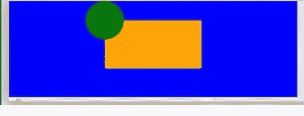

在实际项目中，我们使用变量而不是硬编码属性值 width、height。
在下一节中，我们将看到使用矩形创建的条形图。
您也可以查看我们的 **Learn D3.JS Hands-on And The Simple Way** 视频课程以加速学习：[这里](https://example.com)，或使用下方二维码享受 50-90% 折扣。

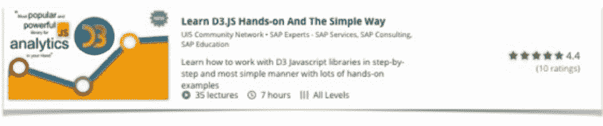


## 7. 将数据引入画面

我们将在项目中使用数据。数据可以是 JavaScript 数组、JSON、XML 或 CSV 数据。我们可以将数据从外部加载到 D3 应用程序中。在实际项目中，数据将通过异步请求传递给应用程序。我们将使用一些异步服务，并通过 AJAX 调用将数据获取到我们的应用程序中。在上一节中，我们了解了几何对象。利用它们，我们将使用一些数据创建条形图，以便在 D3 中进行可视化。我们将在应用程序中看到一些新的函数，称为：

1.  data()
2.  enter()

我们将在示例中讨论它们。

#### 编码

我们将创建一个名为 `D3DataHand.html` 的新文件，并从之前的示例中复制结构，删除其他不需要的编码。现在，我们将使用一个名为 `data` 的变量添加一些数据。添加数据后，我们将设置整个 SVG 的宽度和高度。同时，我们将 SVG 追加到 body 内部。在这里，正如我们在上一节中所说，我们使用了变量 `widthSVG` 和 `heightSVG` 而不是硬编码值。此外，我们将背景样式设置为黑色。

```javascript
var data = [10,20,30,40,100];
var heightSVG = 700;
var widthSVG = 700;
var svg = d3.select("body")
    .append("svg")
    .attr("width",widthSVG)
    .attr("height",heightSVG)
    .style("background","black");
```

初始化数据后，我们开始添加数据并绘制条形图。

```javascript
svg.selectAll()
.data(data)
.enter()
.append("rect")
.attr("height",function(d,i){
    return d*100;
})
.attr("width","20px")
.style("fill","orange")
.attr("y",function(d,i){
    return heightSVG -(d)*10 ;
})
.attr("x",function(d,i){
    return i*40;
}));
```

-   我们使用 `.data(data)` 将数据添加到程序中。
-   之后，我们使用 `.enter()` 函数。它用于对进入后的所有数据执行相同的操作。它类似于循环。

然后我们将添加矩形。这个矩形的宽度是固定的，但高度取决于数据输入。为了使高度依赖于数据，我们添加了函数 `(d,i)`，其中 ‘d’ 是数据，‘i’ 是索引。条形的宽度是固定的，因为我们这里使用的是条形图。所以我们给出了常量 `20px`。对于 y 值，函数 `d` 和 `i` 用于根据数据绘制矩形。`return heightSVG -(d)*10;` 用于根据数据返回 SVG 的高度。值 `10` 用于缩放目的，以放大或缩小矩形的尺寸。

#### D3DataHand.html 的代码

```html
<!DOCTYPE html>
<meta charset="utf-8">
<title>Adding attributes and selection to SVG element</title>
<link rel="stylesheet" type="text/css" href="style.css"></link>

<body>
<script src="../D3/d3.v3.min.js"></script>
<script>

    var data=[10,20,30,40,100];  //Data variable Array
    var heightSVG = 700;      //Maximum height of SVG
    var widthSVG = 700;       //Maximum width of SVG
    var svg = d3.select("body")
    .append("svg")
    //As we told in previous example we removed the hard coded value and given variables
                                widthSVG and heightSVG

    .attr("width",widthSVG)
    .attr("height",heightSVG)
    .style("background","black");  //Black background

    svg.selectAll()
```


```html
.data(data) //在此处传递数据
.enter() //这将为所有数据点执行此代码之后的所有操作
.append("rect") //添加矩形
.attr("height",function(d,i){ //根据数据使用函数添加高度。
return d*100;
})
.attr("width","20px")//固定宽度，因为是柱状图
.style("fill","orange")
.attr("y",function(d,i){
return heightSVG -(d)*10 ; //从总高度SVG中减去数据。10将增加柱状图的比例
})
.attr("x",function(d,i){
return i*40;
});
</script>
</body>
</html>
```

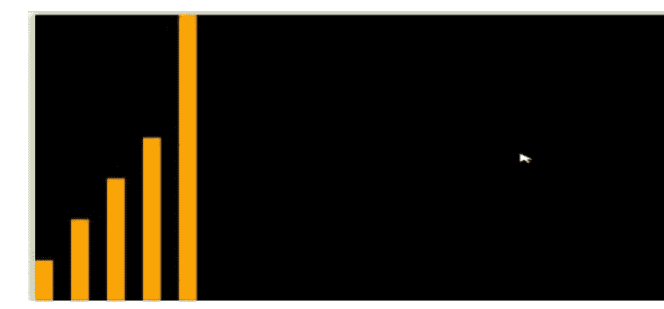

您也可以查看我们的 **Learn D3.JS Hands-on And The Simple Way** 视频课程以加速学习：[here](here)，或使用下方二维码享受5-5折优惠。

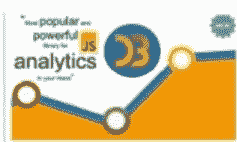


## **8. 从外部文件加载数据**

从外部文件加载数据可以是CSV、JSON或TSV格式。我们有一个简单的D3函数，可以从这些外部文件加载数据。该函数是：

```
d3.csv("filePath",function(data){
    })
```

第一个参数是文件名的路径，第二个参数是文件数据加载后将执行的函数。让我们开始编码，以便更好地理解这个示例。在之前的示例中，我们使用的是内部数据。通过在代码中做一些简单的更改，我们可以使用外部数据。

创建一个新文件 **D3DataLoad.html**，并将上一个示例的代码复制过去。删除我们之前定义的值。此外，我们需要创建一个名为 **data.csv** 的文件。它用于存储我们的外部数据。我们在其中添加一些数据，如10、20、30、40、20、10、100。

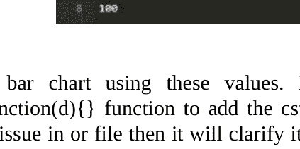

让我们使用这些值创建一些柱状图。现在我们将使用 `d3.csv("data.csv",function(d){}` 函数来添加csv文件。我们还添加了一个错误处理函数，以防我们的文件出现问题，它将在浏览器控制台中说明。这些是我们相对于上一个示例所做的更改。

```
<!DOCTYPE html>
<meta charset="utf-8">
<title>为SVG元素添加属性和选择</title>
<link rel="stylesheet" type="text/css" href="style.css"></link>

<body>
<script src="../D3/d3.v3.min.js"></script>
<script>

    var heightSVG = 700;
    var widthSVG = 700;
    d3.csv("data.csv",function(d){
        return d.value;
    },function(error,data){

        if(error)throw error;
                d3.select("body")
                .append("svg")
                .attr("width",widthSVG)
                .attr("height",heightSVG)
                .style("background","black");
```

现在保存并运行该文件。

当我们没有得到任何输出时，意味着我们的程序有错误。您可以通过在浏览器控制台中检查任何程序错误来识别。通过右键单击浏览器页面并点击“检查”来访问浏览器控制台。它会打开一个控制台窗口。在右上角会显示错误。在这里，您可以识别出它显示“svg is not defined”。根据此输入，我们检查程序并添加缺失的SVG。

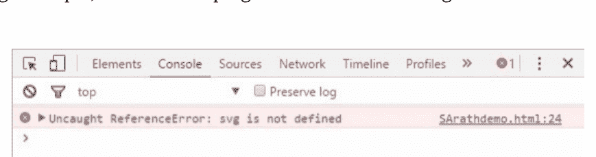

修复错误并运行文件。

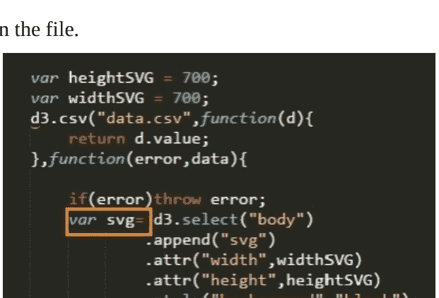

### data.csv的代码

```
“value”

10
20
30
40
20
10
100
```

### D3DataLoad.html的代码

```
<!DOCTYPE html>
<meta charset="utf-8">
<title>为SVG元素添加属性和选择</title>
<link rel="stylesheet" type="text/css" href="style.css"></link>

<body>
<script src="../D3/d3.v3.min.js"></script>
<script>

    var heightSVG = 700;
    var widthSVG = 700;
    d3.csv("data.csv",function(d){
    return d.value;
    },function(error,data){

    if(error)throw error;
    var svg= d3.select("body")
    .append("svg")
    .attr("width",widthSVG)
    .attr("height",heightSVG)
    .style("background","black");

    svg.selectAll()
    .data(data)
    .enter()
    .append("rect")
    .attr("height",function(d,i){
    return d*100;
    })
    .attr("width", "20px")
    .style("fill", "orange")
    .attr("y", function(d, i) {
    return heightSVG - (d) * 10;
    })
    .attr("x", function(d, i) {
    return i * 40;
    });
    });
    </script>
</body>
</html>
```

### 程序输出

输出显示了与data.csv文件对应的柱状图。在此输出中，我们可以注意到最后一个值无法完全容纳在我们的SVG内。为了解决这个问题，我们将使用缩放比例。您可以在下一节中看到此示例。

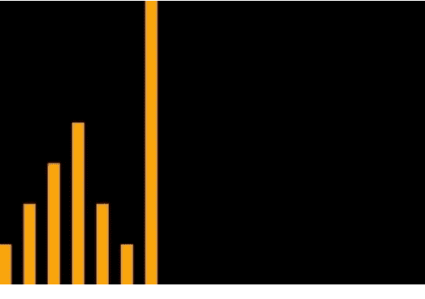

您也可以查看我们的 **Learn D3.JS Hands-on And The Simple Way** 视频课程以加速学习：[here](here)，或使用下方二维码享受5-5折优惠。

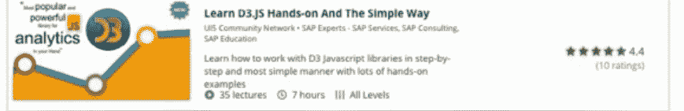


## **9. 缩放和坐标轴**

在上一个示例中，我们看到最后一个矩形条超出了我们的SVG。为了纠正这个错误，我们在D3中使用缩放比例。

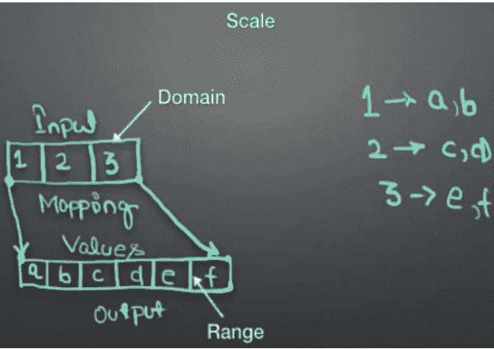

通常，我们有一个输入，需要将该输入映射到所需的输出。输出可以是画布的宽度或高度。输入可以是我们的数据点，或者我们需要映射多少个数据点。在D3中，输入称为 **domain**，输出称为 **range**。所以，我们需要将域映射到范围。例如，假设我们有三个输入1、2、3，我们需要将这三个输入与六个字母a、b、c、d、e、f进行映射。这里一个简单的方法是每个输入值分配两个字母。即1拥有a和b，2拥有c和d，3拥有e和f。这是映射如何进行的一个简单示例。也可能有基于值的方法等多种方法。例如1拥有a，2拥有b和c，3拥有d、e、f。

在D3中，我们有两种主要类型的缩放，称为 **线性** 缩放和 **序数** 缩放。

**线性缩放** - 用于连续输入域，例如数字。

**序数缩放** - 用于离散域，例如一组名称或类别。

序数比例

让我们以柱状图为例。在该柱状图中，如果我们希望将柱子放置在彼此之间适当的距离，如下图所示，为2、4和6个单位。在此数据集中，我们的输入数据集为[1, 2, 3]，我们需要一个输出数据集为[2, 4, 6]，即距离原点的距离。在此场景中，我们需要一个函数来获取每个输入数据集并将其映射到输出数据集。此函数称为序数比例。

## **缩放**

**序数**

用于离散域，
例如一组名称或类别。

- 输入数据集：[1, 2, 3]
  - f(1) → 2
  - f(2) → 4
  - f(3) → 6
- 输出数据集：[2, 4, 6]

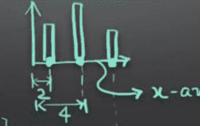

### **9.1. 线性比例**

这些比例用于连续输入域，例如数字。例如，如果输入数据集是[7, 10, 6]，整个画布高度是100。我们需要在这个100值内绘制图形。为了根据画布绘制图形，我们需要输出数据集分别为70、100和60个单位，对应我们的输入数据集。

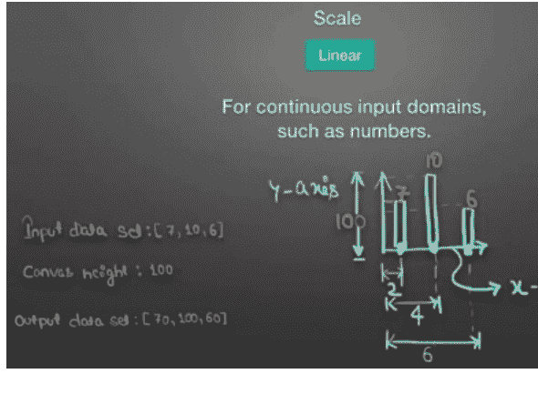

**语法**

**线性比例**

```
var y = d3.scale.linear().domain([0,d3.max(data)]) /* 数据的最小值和最大值 */
.range([0, heightSVG]); /* 指定范围以在指定区域内创建图表 */
```

### **9.2. 序数比例**

```
var x = d3.scale.ordinal().domain(d3.range(data.length)) /* 指定数据点数量
    .rangeRoundBands([0,widthSVG]); /* 根据widthSVG创建范围波段
```

我们将在先前看到的示例中使用此缩放，以解决柱子延伸超出SVG的问题。创建一个新文件(D3Scale.html)并将代码复制到其中。我们需要做的更改是添加一个缩放。对于y轴，我们使用线性比例。

要使用此x比例，我们需要将返回值替换为 `return x(i);` 这里我们传递的是将要迭代的索引值。它将返回柱子应绘制的相应x位置。进行这些更改后，我们运行应用程序。

### **编码**

```
<!DOCTYPE html>
<meta charset="utf-8">
<title>为SVG元素添加属性和选择</title>
<link rel="stylesheet" type="text/css" href="style.css"></link>
<body>
<script src="../D3/d3.v3.min.js"></script>
<script>
    var data=[10,20,30,40,100];
    var heightSVG = 700;
    var widthSVG = 700;

    var y = d3.scale.linear().domain([0,d3.max(data)])
    .range([0, heightSVG]); /* Y比例 */

    var x = d3.scale.ordinal().domain(d3.range(data.length))
    .rangeRoundBands([0,widthSVG]);  /* X比例 */

    var svg = d3.select("body")
    .append("svg")
```


`.attr("width",widthSVG)`
`.attr("height",heightSVG)`
`.style("background","black");`

`svg.selectAll()`
`.data(data)`
`.enter()`
`.append("rect")`
`.attr("height",function(d,i){`
`return d*100;`
`})`
`.attr("width","20px")`
`.style("fill","orange")`
`.attr("y",function(d,i){`
`          return heightSVG - y(d); /* 矩形从返回的值开始绘制 */`
`})`
`.attr("x",function(d,i){`
`                        return i*40; /* 用索引值替换x */`
`});`
`});`
`</script>`
`</body>`
`</html>`

注意：如果我们将代码中的 `heightSVG` 移除
`.attr("y",function(d,i){`
`    return y(d);`
那么输出将会反转。也就是说，柱状条将从高到低开始显示。

## 输出

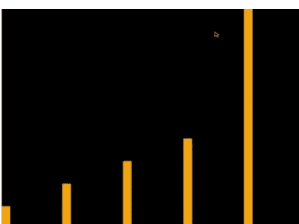

我们也可以在控制台窗口中检查这一点。为了验证，右键单击浏览器窗口并选择“检查元素”。在控制台窗口中输入最小数据点值。在我们的例子中是10，所以在控制台窗口中输入 `y(10)`，然后它会返回70。这个70是我们第一个数据集的高度。类似地，我们可以检查 `y(100)`，它会返回700。你也可以检查X轴比例（序数比例），如果我们输入 `x(0)`，它会返回第一个矩形的左边距，因为柱状条开始时没有任何内边距。如果我们输入 `x(1)`，它会返回140。

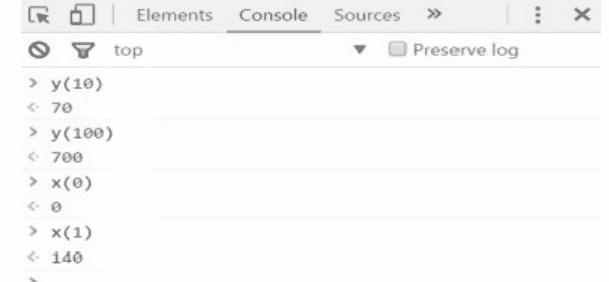

### 9.3. 坐标轴

当我们想在图表中使用比例尺时，我们会使用坐标轴。它帮助用户理解数据点的边界以及对应的值。通常，在二维图表中，我们有两个坐标轴，即X轴和Y轴。要在D3中创建坐标轴，我们使用函数 `d3.svg.axis()`。创建坐标轴的实际语法是

```
var yAxis = d3.svg.axis()
    .scale(y)
    .orient('left')
    .ticks(5);
```

我们使用函数 `d3.svg.axis()` 并将比例尺传递给它。我们传递的方向将告诉柱状图位于左侧。刻度（ticks）用于设定Y轴上需要的刻度线数量。类似地，X轴的语法是

```
var xAxis = d3.svg.axis()
    .scale(x)
    .orient('bottom')
    .ticks(10);
```

我们在这里传递比例尺。方向设置为底部，因为我们需要X轴位于柱状图的底部。在我们的例子中，我们需要更多的刻度线。所以我们在X轴的刻度参数中给了10。根据我们的需求，我们可以设定更多或更少的刻度线。通常在大多数情况下，我们需要X轴上有更多的刻度线。我们将在我们的Cloud9编辑器中看一个使用此语法的例子。

在上一个例子中，我们创建了柱状图并引入了比例尺的概念。在本节中，我们将为柱状图添加坐标轴。我们需要做的第一步是创建X轴和Y轴。

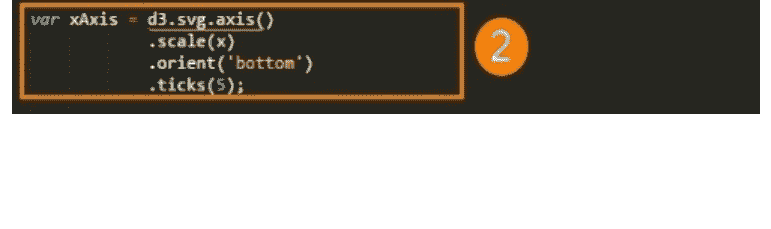

1.  添加Y轴，使用比例尺 `y`，方向设置为 `left`，刻度设置为5。
2.  添加X轴，使用比例尺 `x`，方向设置为 `bottom`，刻度设置为5。

```
var svg = d3.select("body")
    .append("svg")
    .attr("width",widthSVG)
    .attr("height",heightSVG)
    .style("transform","translate("+paddingChart+"px,"+paddingChart+"px)")
    .style("background","black");
```

3.  我们引入了两个新坐标轴。所以我们需要一些空间来显示坐标轴。为了实现这一点，我们需要在我们的SVG中添加 `transform` 属性。`paddingChart` 变量最初已定义为40px。

4.  接下来我们需要调用我们的坐标轴。为此，我们使用函数 `.call(yAxis)`，类似地对于X轴使用 `.call(xAxis)`。这里的 ‘g’ 元素用于分组我们的坐标轴，`stroke` 用于将坐标轴颜色设置为白色。

```
svg.append("g")
    .call(yAxis)
    .style("stroke","#fff");

svg.append("g")
    .call(xAxis)
    .style("stroke","#fff");
```

添加这些后，如果我们运行代码。我们将看到结果看起来像这样

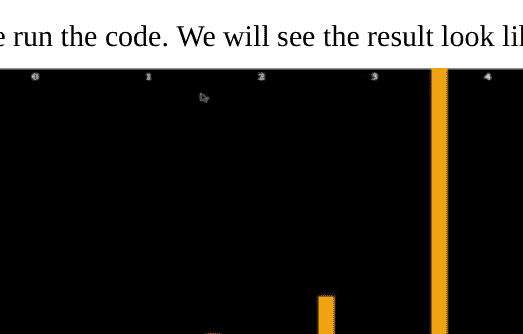

这不是我们想要的确切结果。Y轴不可见，X轴位于上方。

5.  首先我们将X轴推到底部，然后将Y轴稍微推到右侧。为此，我们在这里添加 `transform` 属性，值为 `translate`。我们添加了一个变量 `axisMargin` 来统一定位坐标轴边距。我们需要在声明部分将其值声明为30。

```
svg.append("g")
    .call(yAxis)
    .attr("transform", "translate("+axisMargin+",0)")
    .style("stroke", "#fff");

svg.append("g")
    .call(xAxis)
    .attr("transform", "translate(0,"+(heightSVG-axisMargin)+")")
    .style("stroke", "#fff");
```

我们现在已经修复了坐标轴。然而，我们仍然需要将图表稍微向上和向右移动。目前如果我们运行代码，我们将得到如下结果

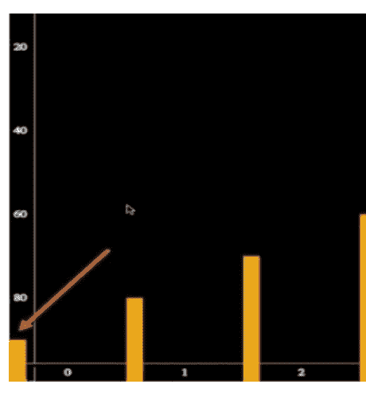

为了修复该图片中箭头所示的问题，我们需要添加一个简单的CSS属性。

6.  首先，我们将使用 `append` 函数将矩形组合在一起。同时我们添加带有类名 `rectangle` 的样式函数。

```
svg.append("g")
    .attr("class", "rectangle")
    .selectAll()
    .data(data)
    .enter()
    .append("rect")
    .attr("height", function(d,i){
        return 0;
```

7.  在输出中，我们可以看到Y轴的值是反的。为了修复这个问题，我们需要反转Y轴的范围。

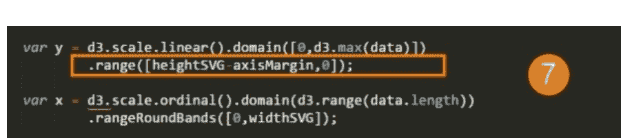

如果我们交换 `heightSVG` 和 `y(d)` 的值，我们可以看到柱状图会反转。即从高到低变为从低到高。

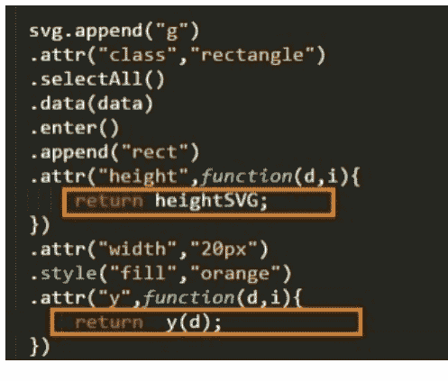

这些是我们创建和对齐坐标轴需要做的更改。我们需要做大量的实验才能得到正确的结果。

### D3Axis.html 的代码

```
<!DOCTYPE html>
<meta charset="utf-8">
<title>向 SVG 元素添加属性和选择</title>
<link rel="stylesheet" type="text/css" href="style.css"></link>

<body>
<script src="../D3/d3.v3.min.js"></script>
<script>

    var data=[10,20,30,40,100];
var heightSVG = 700;
var widthSVG = 700;
var padding = 10;
var paddingText = 30;
var paddingChart = 40;
var axisMargin = 30;
var margin = {
    'top':5,
    'right':20,
    'bottom':20,
    'left':50
};

var y = d3.scale.linear().domain([0,d3.max(data)])
    .range([heightSVG-axisMargin,0]);

var x = d3.scale.ordinal().domain(d3.range(data.length))
    .rangeRoundBands([0,widthSVG]);

var yAxis = d3.svg.axis()
    .scale(y)
    .orient('left')
    .ticks(5);

var xAxis = d3.svg.axis()
    .scale(x)
    .orient('bottom')
    .ticks(5);

var svg = d3.select("body")
.append("svg")
.attr("width", widthSVG)
.attr("height", heightSVG)
.style("transform", "translate(" + paddingChart + "px, " + paddingChart + "px")")
.style("background", "black");
```

```
svg.append("g")
.call(yAxis)
.attr("transform", "translate(" + axisMargin + ", 0)")
.style("stroke", "#fff");
```

```
svg.append("g")
.call(xAxis)
.attr("transform", "translate(0, " + (heightSVG - axisMargin) + ")")
.style("stroke", "#fff");
```

```
svg.append("g")
.attr("class", "rectangle")
.selectAll()
.data(data)
.enter()
.append("rect")
.attr("height", function(d, i){
    return heightSVG;
})
.attr("width", "20px")
.style("fill", "orange")
.attr("y", function(d, i){
    return y(d);
})
```

```
</script>
</body>
</html>
```

#### Style.css

```
.blueBack{
    background : blue;
}

.rectangle{
    transform: translate(30px,-30px) !important;
}
```

## 输出

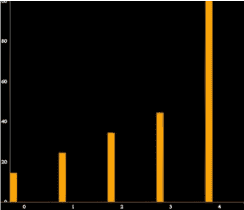

你也可以查看我们的 **实战且简单的方式学习 D3.JS** 视频课程以加速学习：[点击这里](https://www.google.com)，或使用下方二维码享受5-9折优惠。

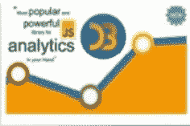


## 10. 事件

事件用于在我们将鼠标移到某个对象上时执行某些操作。例如，在我们之前创建的条形图中，如果我们将鼠标移到条形图上，那么上面会出现一个小的弹出窗口来显示该条形图的值。同样，当条形图生成时，会有一些过渡效果。这些都是通过事件来完成的。要创建一个事件，我们需要一个 `on` 函数。在这个事件中，我们使用的是 `mouseover` 事件。所以我们需要在 `on` 函数内部给出 `mouseover` 事件的值。第二个参数 `function(d)` 用于在事件触发时调用该函数。为了在条形图生成过程中添加过渡属性，我们需要使用 `transition` 函数，并传入动画持续时间以及在此次过渡中要更改的属性作为参数。例如，当条形图开始生成时，它会从底部生成或从侧面滑动。这些将通过属性来完成。让我们进入我们的 cloud9 IDE，在我们的条形图中使用事件。

在上一节中，我们创建了条形图。现在我们将在该条形图上使用事件。

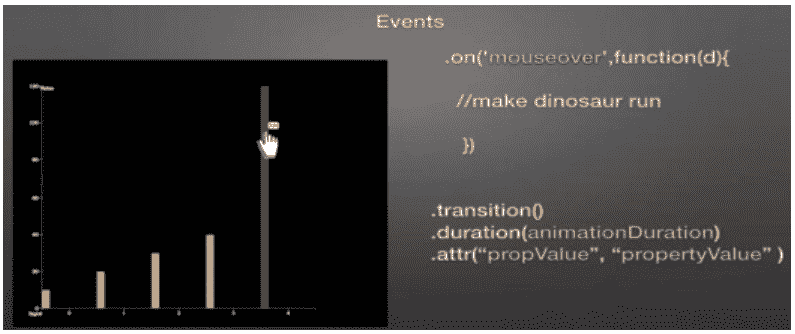

1.  我们需要一个工具提示来显示条形图的值。所以我们创建一个方框并添加一个工具提示。然后我们选择 `body`。我们追加一个 `div` 元素。我们需要为工具提示添加样式。我们将位置设置为 `absolute`，背景设置为白色。此外，我们为工具提示添加了 `padding` 和 `border` 属性。`opacity` 我们最初设为 0，因为我们现在要隐藏它。我们可以通过增加数值在以后更改它。

    ```javascript
    var tooltip = d3.select('body')
    .append('div')
    .style('position','absolute')
    .style('background','#fff')
    .style('padding','5px 15px')
    .style('border','1px #fff solid')
    .style('opacity','0');
    ```

2.  我们将为 `mouseover` 事件添加 `on` 函数。`function(d)` 将在我们将鼠标移到条形图上时拉出我们的工具提示。`left` 和 `top` 是在条形图上显示工具提示的位置。

3.  `d3.select(this).style('opacity',0.5);` 函数将选择鼠标当前指向的条形图，并将其不透明度降低到 0.5。一旦我们降低了不透明度，它将被设置为 0.5 并且不会变回 1。为了执行此操作，我们添加另一个 `mouseout` 事件将其设置回 1。

    ```javascript
    }).on('mouseover',function(d){
        tooltip.transition().style('opacity',1);
        tooltip.html(d)
            .style('left',(d3.event.pageX)+'px')
            .style('top',(d3.event.pageY)+'px');
        d3.select(this).style('opacity',0.5);
    }).on('mouseout',function(d){
        d3.select(this).style('opacity',1);
    });
    ```

4.  下一步是添加过渡效果。为此，我们向图形添加一个 `transition` 函数。我们需要对所有矩形进行过渡，所以我们使用 `d3.selectAll('rect')` 选择了所有矩形。添加了 `transition` 函数，以及过渡效果的持续时间（以毫秒为单位的时间）。此外，我们需要添加要更改的属性。

    ```javascript
    d3.selectAll("rect").transition()
        .duration(4000)
        .attr('height',function(d,i){
            return heightSVG-y(d);
        })
        .attr('y',function(d,i){
            return y(d);
        })
    ```

5.  我们需要将图形的高度从 0 开始设置到总高度（`heightSVG`）。为此，我们将更改 `y` 值。

    

    如果我们在进行这些更改后运行此代码，我们将看到过渡效果和工具提示。

### D3Axis.html 的代码

```html
<!DOCTYPE html>
<meta charset="utf-8">
<title>Adding attributes and selection to SVG element</title>
<link rel="stylesheet" type="text/css" href="style.css"></link>
<body>
<script src="../D3/d3.v3.min.js"></script>
<script>
    var data=[10,20,30,40,100];
    var heightSVG = 700;
    var widthSVG = 700;
    var padding = 10;
    var paddingText = 30;
    var paddingChart = 40;
    var axisMargin = 30;
    var margin = {
        'top':5,
        'right':20,
        'bottom':20,
        'left':50
    };

    var y = d3.scale.linear().domain([0,d3.max(data)])
    .range([heightSVG-axisMargin,0]);

    var x = d3.scale.ordinal().domain(d3.range(data.length))
    .rangeRoundBands([0,widthSVG]);

    var yAxis = d3.svg.axis()
    .scale(y)
    .orient('left')
    .ticks(5);

    var xAxis = d3.svg.axis()
    .scale(x)
    .orient('bottom')
    .ticks(5);

    var svg = d3.select("body")
    .append("svg")
    .attr("width",widthSVG)
    .attr("height",heightSVG)
    .style("transform","translate("+paddingChart+"px,"+paddingChart+"px")
    .style("background","black");
    var tooltip = d3.select('body')
    .append('div')
    .style('position','absolute')
    .style('background','#fff')
    .style('padding','5px 15px')
    .style('border', '1px #fff solid')
    .style('opacity', '0');
    svg.append("g")
    .call(yAxis)
    .attr("transform", "translate("+axisMargin+",0)")
    .style("stroke", "#fff");

    svg.append("g")
    .call(xAxis)
    .attr("transform", "translate(0,"+(heightSVG-axisMargin)+")")
    .style("stroke", "#fff");

    svg.append("g")
    .attr("class", "rectangle")
    .selectAll()
    .data(data)
    .enter()
    .append("rect")
    .attr("height", function(d,i){
        return 0;
    })
    .attr("width", "20px")
    .style("fill", "orange")
    .attr("y", function(d,i){
        return heightSVG ;
    })
    .attr("x", function(d,i){
        return x(i);
    }).on('mouseover', function(d){

        tooltip.transition().style('opacity',1);
        tooltip.html(d)
            .style('left',(d3.event.pageX)+'px')
            .style('top',(d3.event.pageY)+'px');

        d3.select(this).style('opacity',0.5);

    }).on('mouseout',function(d){

        d3.select(this).style('opacity',1);

    });
    d3.selectAll("rect").transition()
    .duration(4000)
    .attr('height',function(d,i){
        return heightSVG-y(d);
    })
    .attr('y',function(d,i){
        return y(d) ;
    })
</script>
</body>
</html>
```

## 输出


4000毫秒后


**注意：** 这是一种过渡效果，我们只能在浏览器中看到过渡。图片仅用于演示目的。要查看真实的过渡效果，请在 cloud9 编辑器中转到 `D3Axis.html` 文件并运行该文件。

**文件名：** D3Axis.html

**链接：** [https://ide.c9.io/ajaytech/dataviz](https://ide.c9.io/ajaytech/dataviz)

您也可以查看我们的 **实践学习 D3.JS 的简单方法** 视频课程以加速学习：[这里](here) 或使用以下二维码获取 50-90% 的折扣。

## 11. 气泡图

气泡图是显示数据点之间相关性的一种非常好的方式。例如，考虑下面显示的数据点，它们具有 X 和 Y 坐标。当使用气泡图表示这些数据点时，有一些数据点是分组在一起的。在气泡图中很容易找到这类发现。


我们的数据可能还有一个额外的维度，比如三维数据，我们希望在图形中表示它。那么我们将考虑 `d` 作为圆的大小。根据 `d` 的值，我们可以得到更大或更小的圆。因此，我们不仅可以在 X 和 Y 坐标的位置上区分数据点，还可以通过圆的大小来区分数据点。让我们进入我们的 cloud9 编辑器，开始创建我们的气泡图。

之前，我们创建了一个带有一些过渡效果的条形图。我们将对代码进行一些更改以创建气泡图。为此，创建一个新文件 **D3Bubble.html**，并将 **D3Axis.html** 的内容复制过来，为气泡图进行一些更改。在代码中将标题名称更改为气泡图，因为我们在为气泡图编写代码。

1.  我们要进行的主要更改是从矩形到圆形。
    1.  我们需要将所有 `rect` 元素更改为 `circle`。
    2.  我们需要半径 `r` 来创建一个圆，在这里用半径 `r` 替换 `height`。
    3.  不使用 `y` 和 `x`，我们需要将其更改为 `cy` 和 `cx`。


## 12. 饼图与环形图

饼图用于展示数据点之间的差异和比较。在商业场景中，大多数情况下用于展示不同数据点之间的百分比份额，例如公司来自不同区域的收入或工厂来自不同地区的产量。它也可以用于展示不同地区的销售信息及其表现情况。通过饼图，我们可以得出收入最高和最低的区域结论。这些是使用饼图的一些典型示例。饼图的一个轻微变体是环形图。我们可以通过挖去饼图的内圆来生成环形图。创建饼图和环形图，我们将使用以下函数。

```
d3.svg.arc()
d3.layout.pie()
```

让我们打开 Cloud9 编辑器来创建环形图。

- 1. 简单地创建一个名为 D3PieChart.html 的文件，并声明变量和基本框架。

```
var padding = 1;
var paddingText = 30;
var paddingChart = 40;
var heightSVG = 700;
var widthSVG = 700;
var extraPadding = 200;
var animationDuration = 1000;
var animationDelay = 1000;
var radius = 200;
var innerRadius = 100;
var paddingPieX = 200;
var paddingPieY = 250;
var unit = "px";
```

- 2. 接下来，我们将添加一些数据和颜色比例尺。我们使用线性比例尺，其域参数从 0 到数据集的最大长度。颜色值范围从绿色到橙色。

```
var data = [10,20,30,40,120];
var color = d3.scale.linear().domain([0,data.length])
    .range(["green","orange"]);
```

- 3. 接下来需要添加的是带有外半径和内半径的弧。

```
var arc = d3.svg.arc()
    .outerRadius(radius)
    .innerRadius(innerRadius);
```

- 4. 接下来我们需要创建一个带有外半径和内半径的弧标签。外半径减去了 paddingText 的值。

```
var labelArc = d3.svg.arc()
    .outerRadius(radius-paddingText)
    .innerRadius(innerRadius-paddingText);
```

- 5. 下一步我们将创建一个饼图布局。以下语法将为我们提供一个饼图布局。

```
var pie = d3.layout.pie()
    .sort(null)
    .value(function(d){return d;});
```

- 6. 创建具有最大高度和宽度的 SVG。

```
var svg = d3.select("body").append("svg")
    .attr("width",widthSVG+extraPadding)
    .attr("height",heightSVG+extraPadding)
    .style("background","#000");
```

- 7. 接下来，我们需要将所有 SVG 元素分组，然后追加这些元素的路径。这里我们使用了 transform 属性。这将使图表与浏览器窗口正确对齐。如果我们未能引入 transform 属性，我们将无法在浏览器窗口内看到完整的图表。

```
var g = svg.selectAll(".arc")
    .data(pie(data))
    .enter()
    .append("g");

g.append("path")
.attr("d",arc)
.style("transform","translate("+paddingPieX+"px,"+paddingPieY+"px)")
.style("fill",function(d,i){return "#000";})
```

目前，如果我们运行代码，将能够看到环形图。我们仍需为其添加标签、工具提示和鼠标悬停事件。

- 8. 要添加标签，我们需要追加一个带有变换的文本，以显示在弧内部。这里我们使用 translation 属性来平移 X 和 Y 坐标。我们这里使用的 centroid 函数是为了获取一个包含 X 和 Y 值的简单数组。我们还使用 `.attr("dy",".35em")` 函数添加了一些额外的间距，并使用 `.text(function(d){return d.value;});` 设置了文本内容。

```
g.append("text")
    .attr("transform",function(d){
        return "translate("+(parseInt(labelArc.centroid(d)[0])+paddingPieX-10)+","
              +(parseInt(labelArc.centroid(d)[1])+paddingPieY-10)+")";
    })
    .attr("dy",".35em")
    .text(function(d){return d.value;});
```

- 9. 在下一步中，我们将为环形图添加一些事件。为此，我们将使用 mouseover 事件，并在那里调用工具提示。mouseover 事件将透明度更改为 0.5，而 mouseout 事件将透明度设置回 1。

### D3Bubble.html 代码

```
<!DOCTYPE html>
<meta charset="utf-8">
<title>Bubble chart</title>
<link rel="stylesheet" type="text/css" href="style.css"></link>

<body>
<script src="../D3/d3.v3.min.js"></script>
<script>

    var data={
        "val1": [10,20,30,40,100],
        "val2":[20,30,50,40,70]};
    var heightSVG = 700;
    var widthSVG = 700;
    var padding = 10;
    var paddingText = 30;
    var paddingChart = 40;
    var axisMargin = 30;
    var margin = {
        'top':5,
        'right':20,
        'bottom':20,
        'left':50
    };
    var minR = 20;
    var maxR = 70;
    var dataVal1 = data["val1"];
    var dataVal2 = data["val2"];

    var y = d3.scale.linear().domain([0,d3.max(dataVal1)])
        .range([heightSVG-axisMargin,0]);

    var x = d3.scale.ordinal().domain(d3.range(dataVal1.length))
        .rangeRoundBands([0,widthSVG]);

    var r = d3.scale.linear().domain([d3.min(dataVal2),d3.max(dataVal2)])
        .range([minR,maxR]);

    var yAxis = d3.svg.axis()
        .scale(y)
        .orient('left')
        .ticks(5);

    var xAxis = d3.svg.axis()
        .scale(x)
        .orient('bottom')
        .ticks(5);

    var svg = d3.select("body")
        .append("svg")
        .attr("width",widthSVG)
        .attr("height",heightSVG)
        .style("transform","translate("+paddingChart+"px,"+paddingChart+"px)")
        .style("background","black");
    var tooltip = d3.select('body')
        .append('div')
        .style('position','absolute')
        .style('background','#fff')
        .style('padding','5px 15px')
        .style('border','1px #fff solid')
        .style('opacity','0');

    svg.append("g")
        .call(yAxis)
        .attr("transform","translate("+axisMargin+",0)")
        .style("stroke","#fff");

    svg.append("g")
        .call(xAxis)
        .attr("transform","translate(0,"+(heightSVG-axisMargin)+")")
        .style("stroke","#fff");

    svg.append("g")
        .attr("class","circle")
        .selectAll()
        .data(dataVal1)
        .enter()
        .append("circle")
        .attr("r",function(d,i){
          return r(dataVal2[i]);
        })
        .attr("width","10px")
        .style("fill","orange")
        .attr("cy",function(d,i){
          return heightSVG ;
        })
        .attr("cx",function(d,i){
          return x(i);
        }).on("mouseover",function(d,i){

          tooltip.transition().style("opacity",1);
          tooltip.html("y: "+d+" / r: "+dataVal2[i])
          .style("left",(d3.event.pageX)+"px")
          .style("top",(d3.event.pageY)+"px");

          d3.select(this).style("opacity",0.5);

        }).on("mouseout",function(d){

          d3.select(this).style("opacity",1);

        });

    d3.selectAll("circle").transition()
        .duration(4000)
        .attr("cy",function(d,i){
            return (y(d))+"px" ;
        })
</script>
</body>
</html>
```

### CSS 样式

```
.blueBack{
    background : blue;
}
```

```
.rectangle{
    transform: translate(30px,-30px) !important;
}
```

```
.circle{
    transform: translate(30px,0px) !important;
}
```

### 12. 将环形图转换为饼图

我们也可以使用过渡函数，在环形图开始渲染时以动画形式展示它。

```
d3.selectAll("path").transition()
    .duration(animationDuration)
    .style("transform","translate("+paddingPieX+"px,"+paddingPieY+"px)")
    .style("fill",function(d,i){return color(i)});
```

最后，如果我们运行这段代码，将在启动时看到动画效果。当鼠标悬停在其上时，它会显示带有相应值的工具提示。

#### 环形图代码

```html
<!DOCTYPE html>
<head>
</head>
<title>饼图</title>
<body>
<script src="../D3/d3.v3.min.js"></script>
<script>

var padding = 1;
var paddingText = 30;
var paddingChart = 40;
var heightSVG = 700;
var widthSVG = 700;
var extraPadding = 200;
var animationDuration = 1000;
var animationDelay = 1000;
var radius = 200;
var innerRadius = 100;
var paddingPieX = 200;
var paddingPieY = 250;
var unit = "px";


var data = [10,20,30,40,120];
var color = d3.scale.linear().domain([0,data.length])
    .range(["green","orange"]);

var arc = d3.svg.arc()
    .outerRadius(radius)
    .innerRadius(innerRadius);

var labelArc = d3.svg.arc()
    .outerRadius(radius-paddingText)
    .innerRadius(innerRadius-paddingText);

var pie = d3.layout.pie()
    .sort(null)
    .value(function(d){return d;});

var svg = d3.select("body").append("svg")
    .attr("width",widthSVG+extraPadding)
    .attr("height",heightSVG+extraPadding)
    .style("background","#000");

var tooltip = d3.select('body')
    .append('div')
    .style('position','absolute')
    .style('background','#fff')
    .style('padding','5px 15px')
    .style('border','1px #fff solid')
    .style('opacity','0');

var g = svg.selectAll(".arc")
    .data(pie(data))
    .enter()
    .append("g");

g.append("path")
    .attr("d",arc)
    .style("transform","translate("+paddingPieX+"px,"+paddingPieY+"px)")
    .style("fill",function(d,i){return "#000";})

g.append("text")
    .attr("transform",function(d){

return "translate("+(parseInt(labelArc.centroid(d)[0])+paddingPieX-10)+", "
+(parseInt(labelArc.centroid(d)[1])+paddingPieY-10)+")";
})
    .attr("dy", ".35em")
    .text(function(d){return d.value;});

g.on("mouseover",function(d){
tooltip.transition()
.style('opacity',1);

tooltip.html(d.value)
.style('left',(d3.event.pageX)+"px")
.style('top',(d3.event.pageY)+"px")

d3.select(this).style('opacity',0.5);

}).on("mouseout",function(){
d3.select(this).style('opacity',1);
});

d3.selectAll("path").transition()
.duration(animationDuration)
.style("transform","translate("+paddingPieX+"px,"+paddingPieY+"px)")
.style("fill",function(d,i){return color(i)});

</script>
</body>
</html>
```

## 输出


#### 12.1. 将环形图转换为饼图

在上一节中，我们看到了如何创建环形图。在本节中，我们将看到如何通过简单的更改将环形图转换为饼图。我们需要做的就是将内半径更改为0。

```
var padding = 1;
var paddingText = 30;
var paddingChart = 40;
var heightSVG = 700;
var widthSVG = 700;
var extraPadding = 200;
var animationDuration = 1000;
var animationDelay = 1000;
var radius = 200;
var innerRadius = 0;
var paddingPieX = 200;
var paddingPieY = 250;
var unit = "px";
```

##### D3PieChart.html 代码

```html
<!DOCTYPE html>
<head>
</head>
<title>饼图</title>

<body >
<script src="../D3/d3.v3.min.js"></script>
<script >

var padding = 1;
var paddingText = 30;
var paddingChart = 40;
var heightSVG = 700;
var widthSVG = 700;
var extraPadding = 200;
var animationDuration = 1000;
var animationDelay = 1000;
var radius = 200;
var innerRadius = 0;
var paddingPieX = 200;
var paddingPieY = 250;
var unit = "px";

var data = [10,20,30,40,120];
var color = d3.scale.linear().domain([0,data.length])
    .range(["green","orange"]);

var arc = d3.svg.arc()
    .outerRadius(radius)
    .innerRadius(innerRadius);

var labelArc = d3.svg.arc()
    .outerRadius(radius-paddingText)
    .innerRadius(innerRadius-paddingText);

var pie = d3.layout.pie()
    .sort(null)
    .value(function(d){return d;});

var svg = d3.select("body").append("svg")
    .attr("width",widthSVG+extraPadding)
    .attr("height",heightSVG+extraPadding)
    .style("background","#000");

var tooltip = d3.select('body')
    .append('div')
    .style('position','absolute')
    .style('background','#fff')
    .style('padding','5px 15px')
    .style('border','1px #fff solid')
    .style('opacity','0');

var g = svg.selectAll(".arc")
    .data(pie(data))
    .enter()
    .append("g");

g.append("path")
    .attr("d",arc)
    .style("transform","translate("+paddingPieX+"px,"+paddingPieY+"px)")
    .style("fill",function(d,i){return "#000";})

g.append("text")
    .attr("transform",function(d){

return "translate("+(parseInt(labelArc.centroid(d)[0])+paddingPieX-10)+","
+(parseInt(labelArc.centroid(d)[1])+paddingPieY-10)+")";
})
    .attr("dy", ".35em")
    .text(function(d){return d.value;});

g.on("mouseover",function(d){
tooltip.transition()
.style("opacity",1);

tooltip.html(d.value)
.style("left",(d3.event.pageX)+"px")
.style("top",(d3.event.pageY)+"px")

d3.select(this).style("opacity",0.5);

}).on("mouseout",function(){
d3.select(this).style("opacity",1);
});

d3.selectAll("path").transition()
.duration(animationDuration)
.style("transform","translate("+paddingPieX+"px,"+paddingPieY+"px)")
.style("fill",function(d,i){return color(i)});

</script>
</body>
</html>
```

## 输出


## 13. 折线图

折线图是展示**随时间变化的趋势**的绝佳方式。它就像多个代表我们数据的小气泡。我们使用直线连接这些点。当我们在一段时间内拥有大量数据点时，使用折线图对于观察随时间变化的模式或趋势非常有益。要在D3中创建一个简单的折线图，我们需要使用函数

```
d3.svg.line()
.x(function(d,i) { return x(i)})
.y(function(d){return return y(d) });
```

我们传递x和y值。'x'值基于索引值'i'。'y'值基于数据点本身的值。为了创建折线图，我们取条形图的代码，移除条形的代码，并仅使用轴来制作它。我们使用条形图中用过的线性尺度和序数尺度。因此，我们将添加使用D3绘制折线图的代码。

- 1. 我们将添加折线的语法，并添加带有数据和索引函数的x值和y值。这里的y尺度值可能不会返回整数值，因此我们需要添加`parseInt`来获取数据的整数值。

```
var line = d3.svg.line()
    .x(function(d,i){return x(i);})
    .y(function(d){return parseInt(y(d));});
```

- 2. 我们需要将路径附加到svg。我们使用一个名为`datum`的新函数来指定数据。我们还将添加描边属性并将数据添加到折线。这将对每个数据点调用折线函数。

```
svg.append("path")
    .datum(data)
    .attr("stroke","orange")
    .attr("d",line)
```

添加这些代码后，如果我们尝试运行，将得到根据数据点连接的折线。接下来，我们需要在鼠标悬停在折线上时添加工具提示，以显示相应的'y'值。在条形图和气泡图中，我们有离散值，但在这种情况下，我们将使用连续值，因此显示值会有些棘手。这是因为如果我们将鼠标悬停在线的任何部分，它都必须显示相应的'y'值。所以我们需要找到一个方法来实现这一点。


### 3. 我们将为工具提示的过渡添加鼠标悬停事件。


### 4. 我们需要为鼠标事件添加一个工具提示。

正如我们所说，这里会有点棘手。为此，我们将使用一个比例尺。首先我们定义比例尺，然后添加工具提示。定义比例尺时，我们使用了 `hoverVal` 变量，并定义了最小和最大范围。


### 5. 现在我们添加带有参数 `hoverVal` 的工具提示并获取 y 位置。

同时，我们将添加工具提示在折线上的显示位置。因此，我们将工具提示样式定义为 `left` 和 `top`。加到 `chartBottomPadding` 上的值 `50` 是为了使工具提示中显示的精确 'y' 值对齐。


### 6. 既然我们创建了 mouseover 事件，我们还需要创建一个 mouseout 事件，将事件恢复到正常状态。


一旦我们完成这些，就可以运行程序，然后会得到一个折线图。在实际场景中，折线图并非我们项目中存在的唯一图表。在这些情况下，我们必须进行一些计算并添加一些填充。我们需要进行大量的试错才能达到最终结果。

### 7. 此外，我们可以添加一些文本属性来说明轴代表的含义，如振幅、时间、值和其他变量。

为此，我们将文本属性附加到我们的 'x' 和 'y' 轴上。


### D3LineChart.html 的代码

```
<!DOCTYPE html>
<head>
<style>
</style>
</head>
<title>Line chart</title>
<meta charset="utf-8">

<body>
<script src="../D3/d3.v3.min.js"></script>
<script>
var padding = 1;
var paddingText = 30;
var paddingChart = 40;
var heightSVG = 700;
var widthSVG = 700;
var animationDuration = 1000;
var animationDelay = 1000;
var chartBottomPadding = 200;

var data = [10,20,30,40,120];

var svg = d3.select("body").append("svg").attr("width", widthSVG+200)
    .attr("height", heightSVG+chartBottomPadding)
    .style("transform", "translate("+paddingChart+"px,"+paddingChart+"px)")
    .style("padding-left","100px")
    .style("padding-top","100px")
    .style("background", "#000");

var tooltip = d3.select('body').append('div')
    .style('position','absolute')
    .style('background','#fff')
    .style('padding','5 15px')
    .style('border','1px #fff solid')
    .style('border-radius','5px')
    .style('opacity','0');

var y = d3.scale.linear().domain([0,d3.max(data)])
    .range([heightSVG,0]);

var hoverVal = d3.scale.linear().domain([0,heightSVG])
    .range([d3.max(data),0]);

var x = d3.scale.ordinal().domain(d3.range(data.length))
    .rangeRoundBands([0, widthSVG]);

var yAxis = d3.svg.axis()
    .scale(y)
    .orient("left")
    .ticks(5);
//.tickValues([1, 2, 3, 5, 8, 13]);;

var xAxis = d3.svg.axis()
    .scale(x)
    .orient("bottom")
    .ticks(10);

svg.append("g")
    //.attr("class","axis")
    .call(yAxis)
    .style("fill","none")
    .style("stroke","#fff")
    .append("text")
    .attr("transform","translate(-"+paddingText+",0)")
    .attr("dy","0.71rem")
    .style("text-anchor","end")
    .text("Value");

svg.append("g")
    .call(xAxis)
    .attr("transform", "translate(0,"+(heightSVG)+")")
    .style("fill","none")
    .style("stroke","#fff")
    .append("text")
    .attr("transform","translate(-"+paddingText+",0)")
    .attr("dy","0.71rem")
    .style("text-anchor","end")
    .text("Time");

var line = d3.svg.line()
.x(function(d,i){return x(i);})
.y(function(d){return parseInt(y(d));});

svg.append("path")
.datum(data)
.attr("stroke","orange")
.attr("d",line)
.on("mouseover",function(d,i){
    tooltip.transition()
    .style("opacity",1);

    tooltip.html(parseInt((hoverVal(d3.event.pageY-chartBottomPadding+50))))
    .style("left",(d3.event.pageX)+"px")
    .style("top",(d3.event.pageY)+"px");

    d3.select(this).style("opacity",0.5);

}).on("mouseout",function(){

    d3.select(this).style("opacity",1);
})
</script>
</body>
</html>
```

## 输出


## 14. 地图

地图是最令人兴奋和有趣的数据表示格式之一。当我们看到地图表示时，可能会想如何创建一个地图。在这个例子中，我们将创建一个简单的美国地图。这个美国地图由许多州组成，每个州都是一个具有多边形形状的区域。


当我们查看多边形时，可以看到哪些对应的 'X' 和 'Y' 坐标构成了边界。例如，如果我们考虑 'n' 个点，这个 'n' 可以是 100、20 或 10。然后每个点按顺序连接将形成一个表示一个州的封闭边界。所有坐标点都是一个数组列表。这是我们创建多边形首先需要知道的。同时，我们还需要知道一些州的基本属性，比如州名和州 id。这两组数据通常合称为 Geo-JSON 数据。我们将在示例中详细查看 Geo-JSON 数据。除了这些，创建地图我们还需要投影。这是因为当我们使用几何图形时，需要考虑地球是球形的。当我们将 3D 数据格式表示为 2D 时，就需要使用投影。

D3 提供了许多流行的格式，用于将这些 3D 数据投影到 2D。让我们看看我们项目中使用的一些投影。

现在我们访问链接 [https://github.com/d3/d3/wiki/Geo-Projections](https://github.com/d3/d3/wiki/Geo-Projections)，可以看到有很多地理投影格式，我们选择一个将在我们项目中使用的格式。每种格式都有其特定的优点。我们将使用 **d3.geo.albersUsa** 格式。


现在我们可以转到使用 cloud9 编辑器进行编码的部分。在进入实际开发之前，让我们先看看 GeoJSON 数据。


- 1. GeoJSON 数据是一种非常庞大的数据表示。它包含大量的坐标和信息。
- 2. 图片中显示的顶层是这个 GeoJSON 数据表示格式的一个对象。如果我们深入一层，可以看到该对象有两个键：`type` 和 `features`。`type` 代表它对应的 GeoJSON 数据类型。
- 3. `feature` 实际上是一个对象数组。如果我们打开其中任何一个单独的对象，可以看到 `type`、`id`、`properties` 和 `geometry` 作为键。`properties` 将表示州的名称。`geometry` 表示该州对应多边形的坐标。


- 4. 我们可以看到大量的坐标。'0' 是阿拉巴马州的坐标，它包含 33 个坐标点。如果我们继续展开，可以看到坐标的 '第0个' 和 '第1个' 索引。'第0个' 索引代表 'X'，'第1个' 索引值代表 'Y'。大部分情况下，GeoJSON 数据可以在互联网上下载并使用。


## 15. 最终项目

在本节中，我们将开始着手最终项目，并了解如何在真实项目中运用 D3。我们将开展一个数据可视化项目，而**数据可视化是当前市场上热门的技能组合之一**。如果你想了解更多关于数据可视化的内容，我们强烈推荐你查看 Udemy 上的‘**7 个简单步骤学习数据可视化**’课程。这将为如何在数据可视化项目中工作打下非常坚实的基础。下一节我们将探讨使用 D3 的用例。

在开始任何数据可视化项目之前，我们应始终有一个明确的目标陈述/需求。让我们看一下这里的目标陈述。


根据此目标陈述，我们需要构建一个仪表盘，供**监测美国各州人口增长的人们**使用，以便他们能够基于**这些州的当前人口和人口增长情况**来**分配资源给各州**。

这里我们可以看到三个主要部分：
-   受众是谁？
-   范围是什么？
-   产出

**受众**：监测人口的人们。我们将使用 D3 为他们创建一个可视化项目。

**范围和产出**：利用这个可视化工具，他们将根据这些数据为各州分配资源。

一旦我们明确了在数据可视化项目中要做什么，我们就会进入数据可视化项目的 7 个步骤。初始阶段我们将获取数据，然后花时间解析数据并为使用做准备。


这是基于我们已在 moqups 网站创建的需求而生成的线框图。我们跳过了如何获取数据、如何处理数据、过滤以及创建此线框图的步骤，因为我们在其他数据可视化课程中已经涵盖了这 7 个步骤。本课程我们主要关注开发。在上图中，我们可以看到包含所有州人口的柱状图以及一张美国地图。KPI 字段显示当前州的人口数据。

地图上方还有一个小的柱状图，它将显示特定年份的人口变化。这是一个交互式的 D3 地图，如果我们按下地图上的任何州，KPI 值和小的柱状图将根据该州的数据相应改变。

### 15.1. 代码结构


1.  让我们看看解决我们讨论的用例的代码结构。第一项是美国地图的 GeoJSON 数据文件。第二项是美国人口数据。这两项是 JSON 数据，将在项目开始前提供给我们。
2.  接下来，我们需要创建所有州的“人口 vs 图表”的柱状图。
3.  第三步是添加交互事件。如果我们在地图上按下单个州，我们应该能够看到代表该州历年的人口柱状图。我们还需要根据所选州更新 KPI 字段信息。接下来，我们将使用 cloud9 编辑器在代码中看到这些步骤。

### 15.2. 创建地图项目

1.  创建一个新文件，命名为 D3FinalProject.html，并将我们从 github 获取的地图内容复制粘贴到该文件中。我们会看到一个非常大的 geoJSON 数据，将其最小化/折叠以便更容易查看其他代码。

```javascript
var data = {
    "type": "FeatureCollection",
    "features": [
        {
            "type": "Feature",
            "id": "01",
            "properties": {
                "name": "Alabama"
            },
            "geometry": {
                "type": "Polygon",
                "coordinates": [
                    [
                        [-87.359296, 35.00118],
                        [-85.606675, 34.984749],
                        [-85.431413, 34.124869],
                        // ...
                    ]
                ]
            }
        }
    ]
};
```


2.  接下来我们需要美国的人口数据。我们可以看到美国人口的 JSON 数据。它包含大量数据，每个对象都有一个 name 键字段，并且我们拥有 2010、2012、2014 和 2016 年的数据。这些是我们将使用的偶数年份。在实际项目中，我们通常从网络服务获取数据或从某些文件中读取数据。这个用例的目的很简单，所以我们可以在 D3 程序中使用硬编码的数据。我们将复制 JSON 数据并粘贴到 `var dataUSPopulation = [{<在此粘贴数据>}]` 中。


3.  其余部分对于地图是相同的。我们将增加宽度和高度，并为图表添加一些内边距。

```javascript
//Width and height
var w = 1600;
var h = 800;
var margin = {
    left:32,
    right:30,
    bottom:30,
    top:30
};
var numOfState = 50;
var scaleOfMap = 1000;
var tooltip = d3.select('body').append('div')
    .style('position','absolute')
    .style('background','#fff')
    .style('padding','5 15px')
    .style('border','1px #fff solid')
    .style('border-radius','5px')
    .style('opacity','0');
```

4.  在地图中我们还有一个点击事件。即当用户点击地图上的某个州时，可以看到一个柱状图。我们将在点击事件发生时执行一个函数。我们可以看到我们使用了两个函数：`update` 和 `new`。当用户首次点击州时，将调用 `new` 函数，此时该州的人口图表将会显示。一旦显示后，用户再点击任何其他州，将调用 `update` 函数。`if` 语句应在创建州柱状图之后添加。

```javascript
}).on("click", function(d,i){
    if(document.getElementById("stateBar").childNodes.length>0)
    {
        addStateBarChart(d,i,"update");
    }else{
        addStateBarChart(d,i,"new");
    }
```

### 15.3. 为我们的州人口柱状图定义属性

5.  接下来我们将定义州人口柱状图（主柱状图）。为此，我们将创建一个名为 `barFirstTimeRender()` 的函数。我们将创建柱状图的限制范围、其他边界和内边距。同时复制地图的 tooltip 并在此处使用。`maxPop` 用于确定所有州中的最高人口，并将其用于缩放。

6.  我们使用 `for` 循环来查找当前年份的最大人口值。`if(!Number.isNaN(parseInt(k)))`：这用于仅允许键条件中的年份值。为此我们使用了‘非数字(NaN)’。

```javascript
function barFirstTimeRender(){
    var maxPop = 0;
    var widthBar = 750;
    var heightBar = 700;
    var paddingText = 70;
    var tooltip = d3.select('body').append('div')
        .style('position','absolute')
        .style('background','#fff')
        .style('padding','5 15px')
        .style('border','1px #fff solid')
        .style('border-radius','5px')
        .style('opacity','0');

    for(var i=0;i<dataUSPopulation.length;i++){
        for(k in dataUSPopulation[i]){
            if(!Number.isNaN(parseInt(k))){
                if(dataUSPopulation[i][k]>maxPop){
                    maxPop = dataUSPopulation[i][k];
                }
            }
        }
    }
}
```

7.  一旦我们得到最大人口（这将是柱状图的上限），我们就会创建比例尺。

```javascript
var h = d3.scale.linear()
        .domain([0,maxPop])
        .range([0,heightBar]);

var y = d3.scale.linear()
        .domain([0,maxPop])
        .range([heightBar,0]);

var x = d3.scale.ordinal()
        .domain(d3.range(dataUSPopulation.length))
        .rangeRoundBands([0,widthBar]);
```

8.  创建比例尺后，我们将创建带有刻度数、方向和比例尺的 ‘Y’ 轴。‘X’ 轴同理。同时，我们将通过 `widthBar / dataUSPopulation.length` 并向下取整来创建柱子的宽度，以确保一个完整的圆整值。

```javascript
var yAxis = d3.svg.axis()
    .scale(y)
    .orient('left')
    .ticks(10);

var xAxis = d3.svg.axis()
    .scale(x)
    .orient('bottom')
    .ticks(50);

var widthOfBar = Math.floor(widthBar / dataUSPopulation.length)-1;
```

9.  我们将分别对 ‘Y’ 轴和 ‘X’ 轴进行分组，因为我们将分别应用 CSS 属性。

```javascript
svg.append("g")
    .attr("id","yAxis")
    .call(yAxis)
    .style("stroke","#000")
    .attr("transform","translate("+paddingText+",0)");

svg.append("g")
    .attr("id","xAxis")
    .call(xAxis)
    .style("stroke","#000")
    .attr("transform","translate("+paddingText+","+(heightBar)+")");
```

10. 接下来，我们将为这个柱状图将 ‘Y’ 轴和 ‘X’ 轴附加到我们的 SVG。我们在这里绘制柱子。


### 15.4. 为我们的各州人口与年份柱状图定义属性

```javascript
var plot = svg.append("g")
    .attr("id","barPlot")
    .selectAll()
    .data(dataUSPopulation)
    .enter()
    .append("rect")
    .attr("width",widthOfBar)
    .attr("height",function(d,i){
        return h(d["2016"]);
    })
    .style("fill","orange")
    .attr("y",function(d,i){
        return heightBar- h(d["2016"]);
    })
    .attr("x",function(d,i){
        return x(i);
})
.on('mouseover',function(d){

    tooltip.transition()
        .style('opacity',1);
    tooltip.html("2016 : "+d["2016"]+" "+d["Name"])
        .style('left',(d3.event.pageX)+"px")
        .style('top',(d3.event.pageY)+"px");

    d3.select(this).style('opacity',0.5);

})
.on('mouseout',function(){

    d3.select(this).style('opacity',1);

});
```

11. 目前，如果我们运行代码，将会得到这个柱状图。我们需要调用 `barFirstTimeRender` 函数，所以在我们创建的函数之前调用它。我们还可以使用鼠标悬停事件添加工具提示事件。

下一步将是“各州与年份柱状图”，需要在点击任意一个州时显示该图。我们已经看到我们将使用两个函数：‘update’ 和 ‘new’。因此，我们将回到 `addStateBarChart()` 函数，继续绘制我们的“各州与年份人口”图表。我们将使用此处重命名的小变量，以区分主柱状图变量和这些柱状图变量。

```javascript
function addStateBarChart(data,index,mode){

    var sBMaxPop = 0;
    var sBWidthBar = 400;
    var sBHeightBar = 250;
    var sBPaddingText = 10;
    var sTtooltip = d3.select('body').append('div')
        .style('position','absolute')
        .style('background','#fff')
        .style('padding','5 15px')
        .style('border','1px #fff solid')
        .style('border-radius','5px')
        .style('opacity','0');
```

13. 我们在这里使用 `sBData`。此处的数据不同。我们将选择一个特定的州，并为其绘制柱状图。每个州都有一个不同的索引。这个索引将作为函数参数传递。我们还创建了一个新的 `sBDataNew` 数组，用于存储年份值，以简化处理过程。

```javascript
var sBData = dataUSPopulation[index];
var sBDataNew = [];
var sBNumYear = 0;
var sBState = dataUSPopulation[index]["Name"];

for(k in sBData){
    if(!Number.isNaN(parseInt(k))){

        sBNumYear++;
        sBDataNew.push({

            "year":k,
            "popl":sBData[k]
        });

        if(sBMaxPop < sBData[k]){
            sBMaxPop = sBData[k];
        }
    }
};
```

14. 接下来，我们将定义柱状图的比例尺以及柱子的宽度。

```javascript
var sBH = d3.scale.linear().domain([0,sBMaxPop])
           .range([0,sBHeightBar]);

var sBY = d3.scale.linear().domain([0,sBMaxPop])
           .range([sBHeightBar,0]);

var sBX = d3.scale.ordinal().domain(d3.range(sBNumYear))
           .rangeRoundBands([0,sBWidthBar]);

var sBWidthOfBar = Math.floor(sBWidthBar / sBNumYear)-1;
```

15. 如果柱状图是新的，那么当我们第一次点击柱状图时，它将开始渲染。模式 `new` 是这个小柱状图函数的第三个参数。我们将创建一个名为 `statePlot` 的全局变量，并在模式中使用它。

```javascript
if(mode === "new"){
    statePlot.selectAll()
    .data(sBDataNew)
    .enter()
    .append("rect")
    .attr("width",sBWidthOfBar)
    .attr("height",function(d,i){
        return parseInt(sBH(d["pop1"]));
    })
    .attr("y",function(d,i){
        return parseInt(sBY(d["pop1"]));
    })
    .attr("x",function(d,i){
        return sBX(i);
    })
    .style("fill","green").on('mouseover',function(d){

    tooltip.transition()
        .style('opacity',1);
    tooltip.html(d["year"]+" : "+d["popl"])
        .style('left',(d3.event.pageX)+"px")
        .style('top',(d3.event.pageY)+"px");

    d3.select(this).style('opacity',0.5);

})
.on('mouseout',function(){

    d3.select(this).style('opacity',1);

});
```

16. 在 `else if` 部分，我们编写代码来更新数据。这将产生过渡效果并显示当前州的图表。

```javascript
}else if(mode === "update"){
    statePlot.selectAll("rect")
    .data(sBDataNew)
    .transition()
    .duration(1000)
    .attr("width",sBWidthOfBar)
    .attr("height",function(d,i){
        return parseInt(sBH(d["popl"]));
    })
    .attr("y",function(d,i){

        return parseInt(sBY(d["popl"]));
    })
    .attr("x",function(d,i){

        return sBX(i);
    })
    .style("fill","green");

}else{

    return ;
}
```

### 15.5. 定义和绘制关键绩效指标数字

17. 最后部分是根据我们的用例定义关键绩效指标数字。这将显示特定州的数据。我们将在 `addBarChart()` 函数中添加关键绩效指标。

```javascript
svg.selectAll("#kpi")
.text(sBData["2016"])
.transition()
.duration(1000);

svg.selectAll("#kpiDec")
.text(sBState)
.transition()
.duration(1000);
```

18. 我们还需要将关键绩效指标信息添加到 `barFirstTimeRender` 函数中。

```javascript
svg.append("text")
.attr("id","kpi")
.text("State Population")
.attr("class","KPIMain")
.attr("x",parseInt(widthBar/2 - 200))
.attr("y",parseInt(heightBar/2 - 200));

svg.append("text")
.attr("id","kpiDec")
.text("State Name")
.attr("class","KPIDesc")
.attr("x",parseInt(widthBar/2 - 200))
.attr("y",parseInt(heightBar/2 - 200));
```

### 15.6. CSS 和其他小改动

19. 没有 CSS，地图将不会好看。所有的地图和图表将无法正确对齐。为了解决这个问题，我们需要添加 CSS 样式来修正元素。

没有 CSS 的情况


因此我们需要改进 CSS。经过反复试验，我们终于有了正确的 CSS 来正确显示我们的项目。

```html
<style type="text/css">
/* No style rules here yet */

g#barPlot {
    transform: translateX(70px) !important;
}

.KPIMain{
    transform:translate(814px,-82px);
    font-size:72px;
    fill:gray !important;
    font-weight:bold;
}
.KPIDesc{
    transform:translate(840px,-41px);
    font-size:20px;
    fill:gray !important;
}
.map{
    transform:translate(400px,77px);
}
</style>
```

D3FinalProject.html 的代码可在仓库 [https://c9.io/ajaytech/dataviz](https://c9.io/ajaytech/dataviz) 中找到。它包含 15000 多行代码，无法在此分享。因此请访问该仓库并验证你的代码。

### 15.7 输出


# 参考文献与书目

- [Scott Murray 著《基于 Web 的交互式数据可视化》](http://alignedleft.com/work/d3-book)
- [D3 JavaScript 库官方文档和 API 参考](https://d3js.org/)
- [美国人口普查局政府网站，用于展示用例的公共数据](http://www.census.gov/)
