# 初学者 24 小时学会 Django：使用 HTML、CSS、JavaScript、Python 和 Django Web 框架构建 Web 应用的简单、易懂指南


免责声明：此处提供的信息和材料仅供教育目的。我们已尽力使本书尽可能完整和准确，但不作任何保证或适用性暗示。提供的信息均按“现状”提供。文中所表达的想法和观点仅代表作者的个人想象，作者不属于任何组织、学校或教育学科，且对任何无意的误述不承担责任或法律责任。

# 第 1 章：HTML 和 CSS

## 1.1：HTML 和 DOM 简介

### 什么是 HTML？

- `HTML` 代表超文本标记语言（Hyper Text Markup Language）。
- `HTML` 元素用于设计网页，它们用开放标签和闭合标签表示。例如：开放标签 `<element_name>`，闭合标签 `</element_name>`。

`HTML` 文档分为 `<head>` 和 `<body>`。

- `<head>` 包含网页的所有信息。例如：`CSS`、`JavaScript`、`meta` 数据。
- `<body>` 包含网页的主要内容，并将显示给用户。

### 什么是 DOM？

- `DOM` 代表文档对象模型（Document Object Model），定义了文档的逻辑结构。
- 有数百个 `HTML` 标签。我们将查看其中几个。

## 1.2：级联样式表 (CSS) 简介

`CSS` 代表级联样式表（Cascading Style Sheets），主要用于使 `HTML` 文档变得美观易读。如果有多个页面使用相同的样式信息，`CSS` 帮助我们通过避免重复工作来节省时间。`CSS` 有三种类型：

1. `内部 CSS`
2. `外部 CSS`
3. `内联 CSS`

### 1.2.1：内部 CSS

在 `内部 CSS` 中，`CSS` 代码和网页的主要内容存在同一个 `HTML` 文档中，并为该页面提供样式信息。`CSS` 代码写在 `HTML` 文件 `<head>` 部分的 `<style>` 标签内。

现在让我们开始编写代码……我们将创建一个带有 `内部 CSS` 的 `HTML` 文档。打开 `Notepad` 或 `Notepad++` -> 创建新文件并保存为 `index.html`。

在书中，我将创建一个名为 `Doggy Day Care System`（狗狗日托系统）的项目。这是一个简单的项目，将包含首页、登录、新个人资料、关于我们等页面。随着我们教程的进行，我们将把这个项目转换为 `Django Web 应用程序`。现在让我们设计我们的首页 `Index.html`。

在上面的示例中，我创建了一个网页并给它命名为 `Scrappy-Doo Day Care Center`。目前，该网页只包含一个标题，位于 `<div>` 容器内，其 `id` 为 `homePageHeader`。

为了给元素添加样式信息……

#### 什么是 ID？

`id` 用于唯一标识一个元素。

#### 什么是 `<div>` 标签？

`<div>` 标签用于定义网页的划分。

#### 什么是 CSS 中的 ID？

在 CSS 中，`id` 选择器用于选择特定的元素。

### 样式

*   我将 `homePageLinks` 声明为父容器，并将其位置设置为 `relative`（相对）。我还为容器设置了高度和宽度，并设置了背景颜色。

```css
background-color: color_name;
```

*   我希望 `<ul>` 标签内的 `<li>` 标签并排显示，而不是一个接一个。为了实现这一点，我将它的 `display` 属性设置为 `inline`。

```css
display: inline;
```

*   对于 `<a>` 标签链接，我设置了它的颜色并将文本加粗。

```css
color: color_name;
font-weight: bold;
```

`:hover` 选择器用于在用户鼠标悬停在元素上时更改颜色。代码 `a:hover { color: black; }` 指定了当用户将鼠标悬停在“登录”文本上时，将其颜色变为黑色。

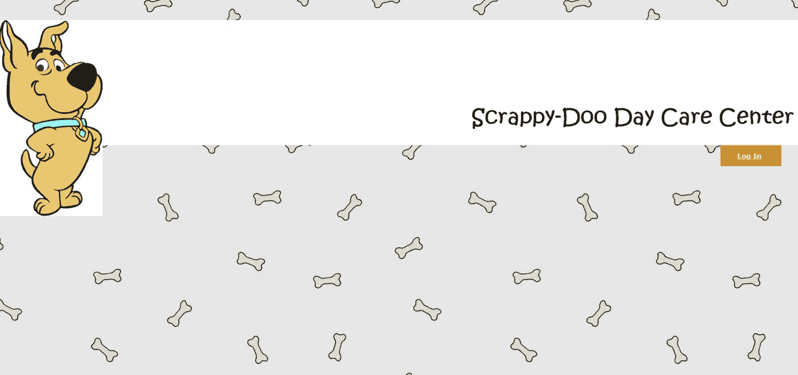

一切看起来良好。目前，我将只显示一个链接（登录），并将另一个链接（联系我们）移动到下拉菜单中。让我们创建一个位于首页中间的下拉菜单。创建下拉菜单的语法为：

```html
<select><option value="val1">Name_1</option><option value="val2">Name_2</option>……</select>
```

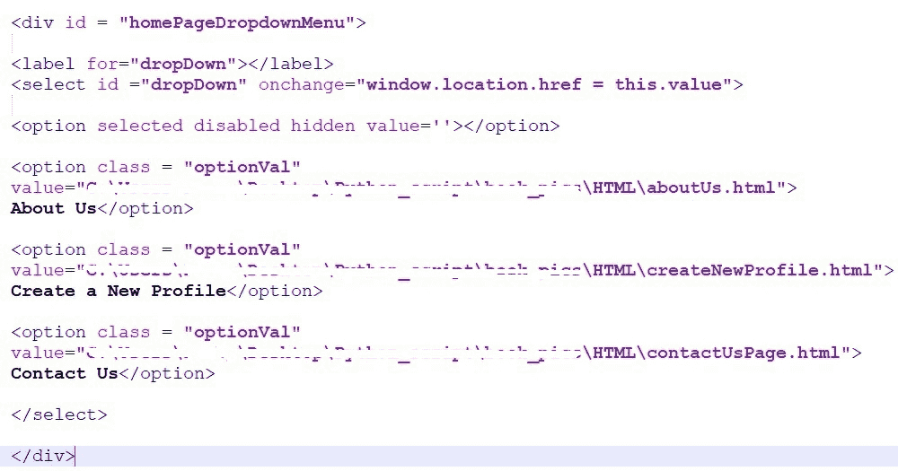
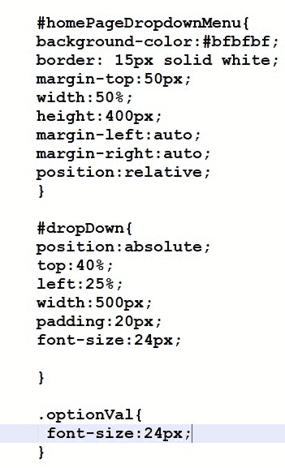

在上面的 HTML 截图中：
*   我创建了一个 `<div>` 区，并给了它 id `homePageDropdownMenu`。现在在那个 `<div>` 容器内，我创建了一个 id 为 `dropDown` 的下拉菜单，当选择它的值时，它可以帮助我们导航到不同的页面。
*   `<select>` 标签内的 `<option>` 属于 CSS 类 `optionVal`。

#### CSS 中 id 和 class 的区别？

1.  类选择器是以点（`.`）开头的名称，而 id 是以哈号（`#`）开头的。
2.  `id` 是唯一的，它只引用一个 HTML 元素。但类可以引用多个元素。

在上面的 CSS 截图中：
*   我将 `homePageDropdownMenu` 声明为父元素，并将它的 `position` 属性设置为 `relative`。我希望我的父元素对齐到页面中心，为了这一点，应该将 `margin-left` 和 `margin-right` 设置为 `auto`。

```css
margin-left: auto;
margin-right: auto;
```

*   现在，我将 id 为 `dropDown` 的 `<select>` 标签相对于其父元素进行了定位。

```css
position: absolute;
```

*   在上面的 HTML 代码中，你会注意到以下这一行：

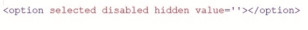

*   `selected` 属性用于显示页面加载时出现在下拉菜单中的默认项。
*   `disabled` 属性使该项变为禁用且不可点击。
*   `hidden` 属性用于隐藏元素。

由于这行代码，当页面加载时，我们的下拉菜单中会出现一个默认的空白项。现在让我们保存一切并用 Google Chrome 打开 `index.html`。

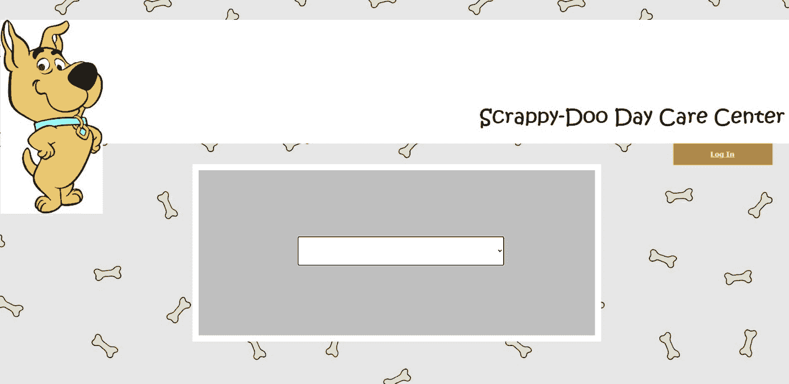
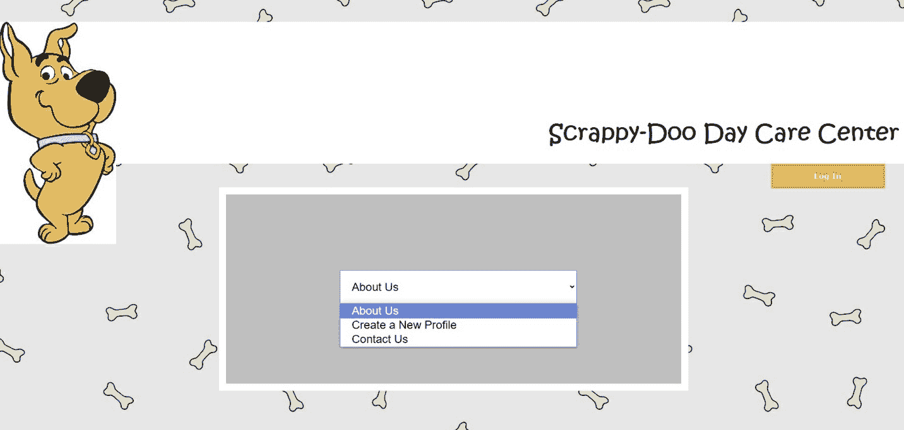

一切看起来良好，但我们仍然无法导航到我在下拉菜单中选择的值对应的页面。为了实现这一点，需要 JavaScript（请参阅第 2 章第 2.4 节）。现在让我们继续制作我们的登录、关于我们、创建配置文件和联系我们的 HTML 页面。

### 1.2.2：外部 CSS

外部 CSS 中需要注意的关键点是：

*   在外部 CSS 中，我们将 CSS 代码写在一个单独的文件中并使用 `<link>` 标签将该文件与 HTML 文档链接。
*   将 CSS 代码与 HTML 代码分离，使 HTML 文档看起来更简洁、不复杂。
*   外部 CSS 节省了时间并防止了在多个页面中重复编写相同 CSS 代码。

现在让我们创建一个新文件，并将我的 CSS 文件命名为 `commonCss.css`。此 CSS 文件将包含所有四个页面（登录、创建配置文件、关于我们和联系我们页面）使用的样式信息。

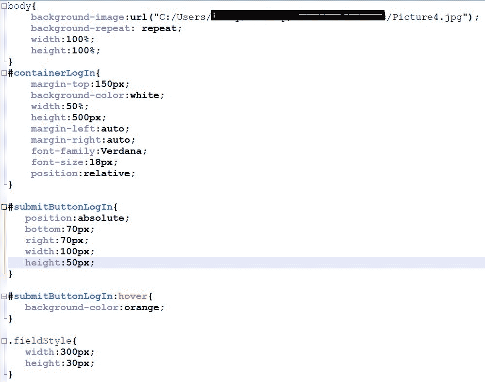

为了将这些样式信息整合到我们的页面中，我们需要 `<link>` 标签，该标签应该存在 HTML 文档的 `<head>` 部分。

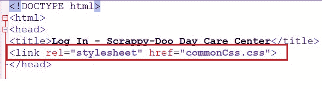

现在创建登录页面。登录页面将有两个输入字段，一个用于用户名，一个用于密码。

*   只接受文本值的 `<input>` 语法是：

```html
<input type="text" placeholder="default_name" name="name" id="id">
```

*   只接受密码值的 `<input>` 语法是：

```html
<input type="password" placeholder="default_name" name="name" id="id">
```

*   提交按钮的 `<input>` 语法：

```html
<input type="submit" name="name">
```

*   单选按钮的 `<input>` 语法：

```html
<input type="radio" name="name">
```

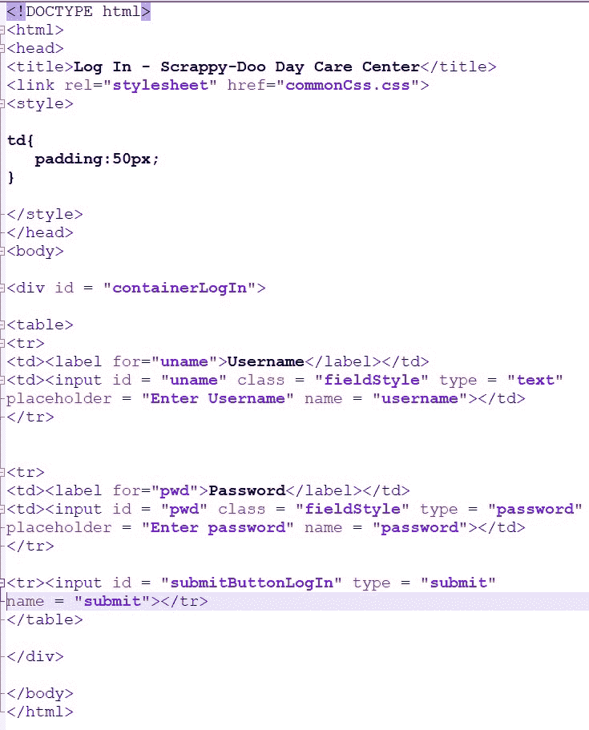

从上面的 HTML 代码中，你会注意到输入字段存在 HTML 表格结构中。创建表格的语法为：

```html
<table>
    <th>...</th>
    <tr><td>...</td></tr>
    <tr><td>...</td></tr>
</table>
```

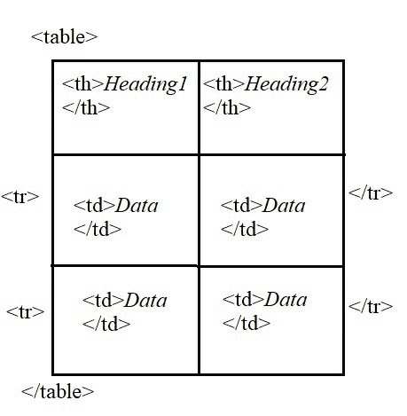

*   `<th>` 代表表头
*   `<tr>` 代表行
*   `<td>` 代表数据

在上面的 HTML 代码中，你会注意到存在 `<label>` 标签。什么是 `<label>` 标签？`<label>` 标签在鼠标悬停在其上时出现。为了将 `<label>` 标签与其对应的输入字段连接，`id` 必须匹配。

```html
<h1 style="font-family: Verdana;">Hello World</h1>
```

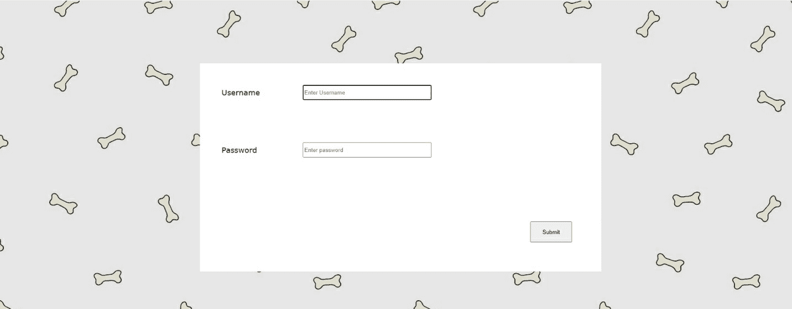

一切看起来完美。请注意：我们将在第 2 章创建其余页面。

### 1.2.3：内联 CSS

内联 CSS 中需要注意的关键点是：

*   在内联 CSS 中，使用 `style` 属性向 HTML 元素添加样式信息。例如：

```html
<h1 style="font-family: Verdana;">Hello World</h1>
```

*   开发者通常避免内联 CSS，原因如下：
    1.  它让 HTML 代码变得混乱且庞大。最佳实践是将内容与设计分离。
    2.  随着我们的 HTML 文档变得巨大，内联 CSS 变得难以维护。
    3.  它是耗时的。

# 第 2 章：JavaScript 简介

关于 JavaScript 的注意点是：

1.  JavaScript 是一种事件驱动的语言。当发生事件（如点击按钮或选择值）时，JavaScript 代码就会触发并执行特定任务。任务通常写在函数内部。
2.  JavaScript 主要用于描述网页的行为。
3.  JavaScript 代码应该写在 `<script>` 标签中，`<script>` 标签可以位于 HTML 文档的 `<head>` 部分或 `<body>` 部分。

请注意：在本章中，我将介绍开发项目所需的 JavaScript 重要话题。为了深入了解所有 JavaScript 话题，请访问 [`www.w3schools.com/`](https://www.w3schools.com/)。

## 2.1 JavaScript 变量

JavaScript 变量有三种声明方式：

1.  `var` 关键字
2.  `let` 关键字
3.  `const` 关键字

在上述三种中，开发者更倾向于使用 `let` 和 `const`。

### 2.1.1 Var、Let 和 Const 关键字的区别

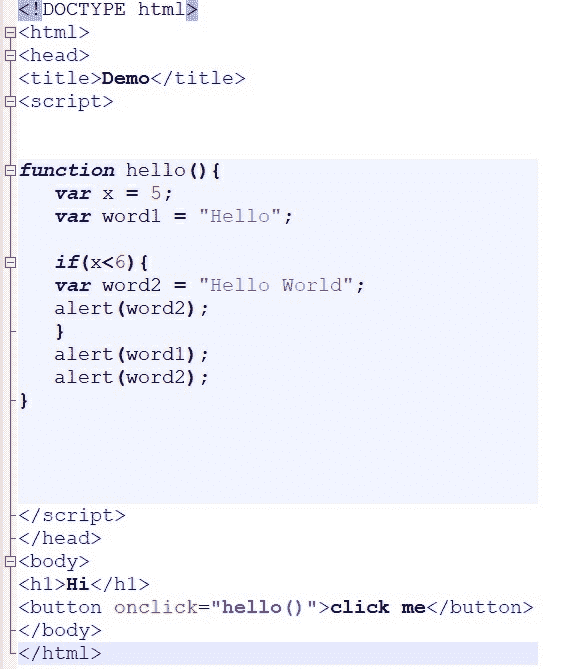

输出：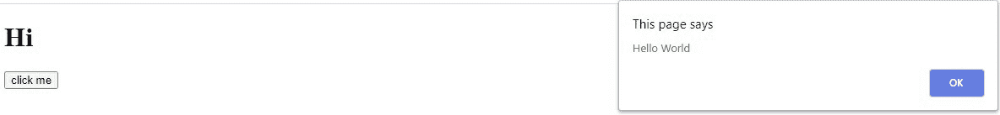
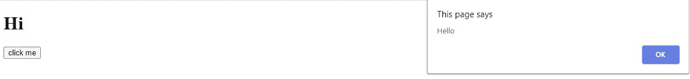
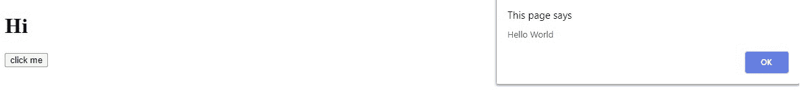

**代码解释：**

*   在上面的代码中，你会注意到 HTML 文档的 body 中包含一个名为 `click me` 的简单按钮。通过 JavaScript `onclick` 事件，点击按钮时会运行 `hello()` 函数。

创建按钮的语法为：

```html
<button type="button">Click Me</button>
```

什么是 JavaScript `onclick` 事件？当用户点击元素时会发生 `onclick` 事件。什么是 JavaScript `alert()` 函数？`alert()` 函数用于在小弹出框中显示消息。

*   `hello()` 函数存在于 HTML 文档 head 部分 `<script>` 标签内。在这个函数中，我们声明了两个变量 `x` 和 `word1`。

在 `if` 循环中，我们声明了另一个变量 `word2`。现在当我们运行代码时，如上方的截图所示，我们得到了三个输出，一个来自 `word1`，其他来自 `word2`。

注意：在花括号 `{ }` 内编写的代码被称为块（Block）。`word2` 是在 `if` 代码块内部声明的，我们看到它可以从 `if` 代码块外部进行访问。这意味着使用 `var` 关键字声明的变量不具有任何块作用域（Block Scope）。现在，让我们使用 `let` 关键字运行相同的代码。

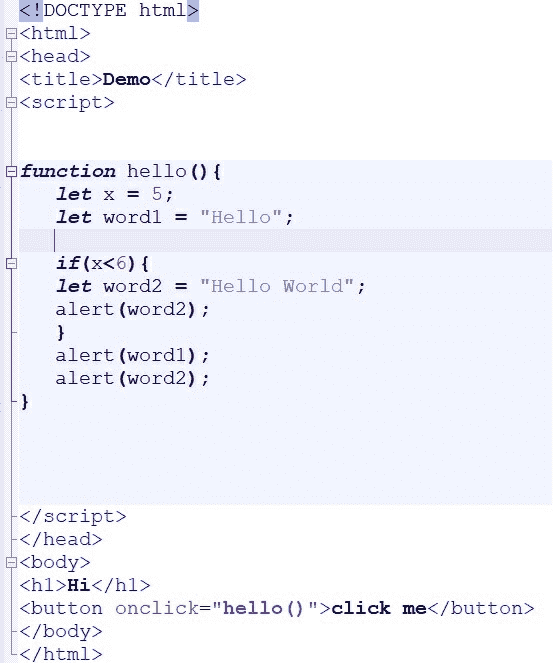
输出：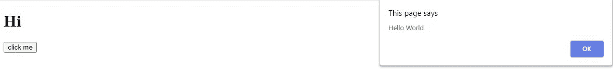
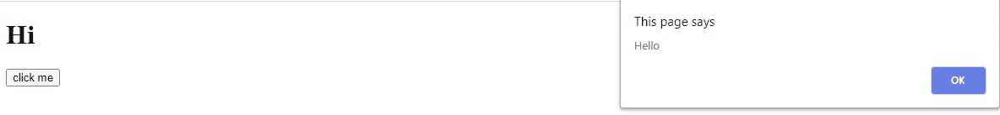
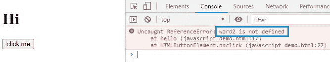

注意：当我们尝试从 `if` 代码块外部访问 `word2` 变量时，它返回了一个错误，显示“`word2 is not defined`”。我们无法从 `if` 代码块外部访问 `word2`。这意味着使用 `let` 关键字声明的变量具有块作用域。

`var`、`let`、`const` 之间的区别是：

- `var` 变量可以从花括号内编写的代码块外部进行访问。
- `let` 变量无法从花括号内编写的代码块外部进行访问。
- 任何使用 `const` 关键字声明的变量意味着其值是固定的或常量。

## 2.2：JavaScript 数据类型

需要注意的重要点是：

- 在 JavaScript 中，数据类型有：
    1. `Number`
    2. `String`
    3. `Object`

- 在 JavaScript 中，我们不需要像 `int x = 10` 或 `string x = "John"` 那样声明变量的数据类型。通过简单向变量赋值，JavaScript 就会知道它的数据类型。

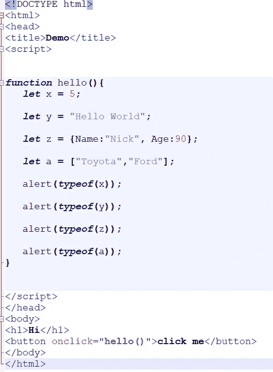
输出：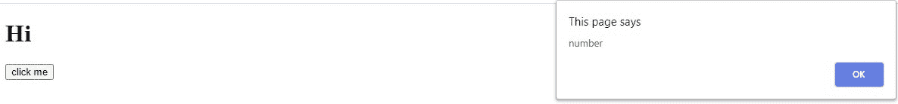
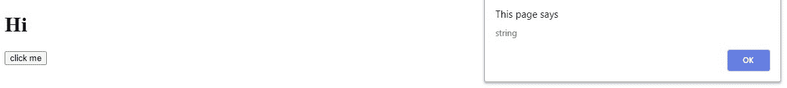
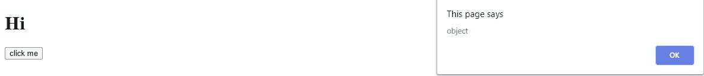

### 什么是 JavaScript `typeof` 运算符？

`typeof` 运算符用于获取变量的数据类型。在上面的代码中，我们看到 JavaScript 显示了数据类型：`x` 为 `number`，`y` 为 `string`，`z` 为 `object`，`a` 也为 `object`。

### 什么是 JavaScript 对象？

JavaScript 对象用花括号 `{ }` 表示，其属性以 `name: value` 对的形式编写，并用逗号分隔。示例：`employee = {emp_id: 123, emp_name: "John"};`

## 2.3：JavaScript 函数

- JavaScript 函数是执行某些任务的代码块。其语法为：

```javascript
function function_name() {………………..}
```

- 当 JavaScript 事件发生时，函数内部的代码会被调用，例如点击某个按钮或选择列表中的某项。

现在，让我们为我们的狗狗日托中心项目创建 `createNewProfile.html` 文件。

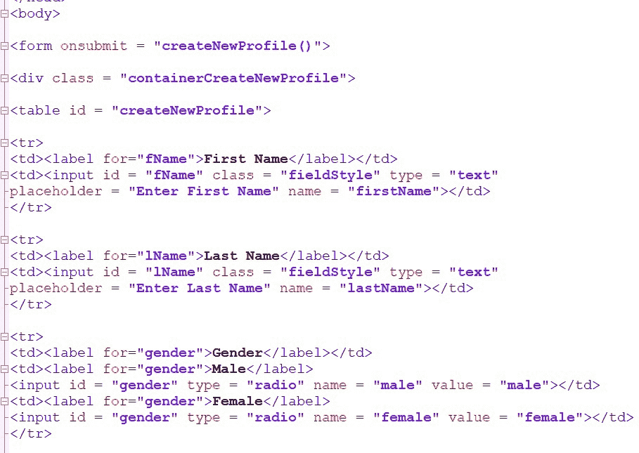
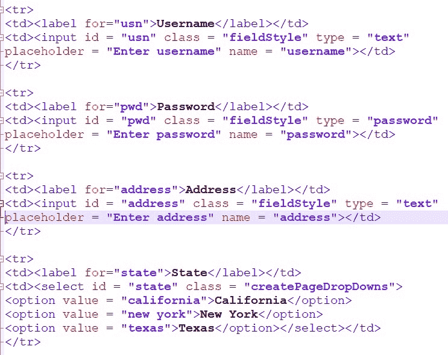
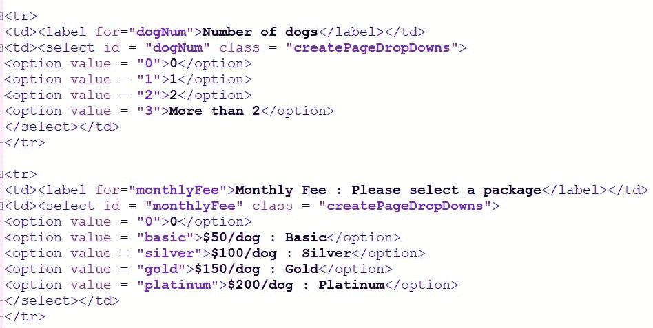
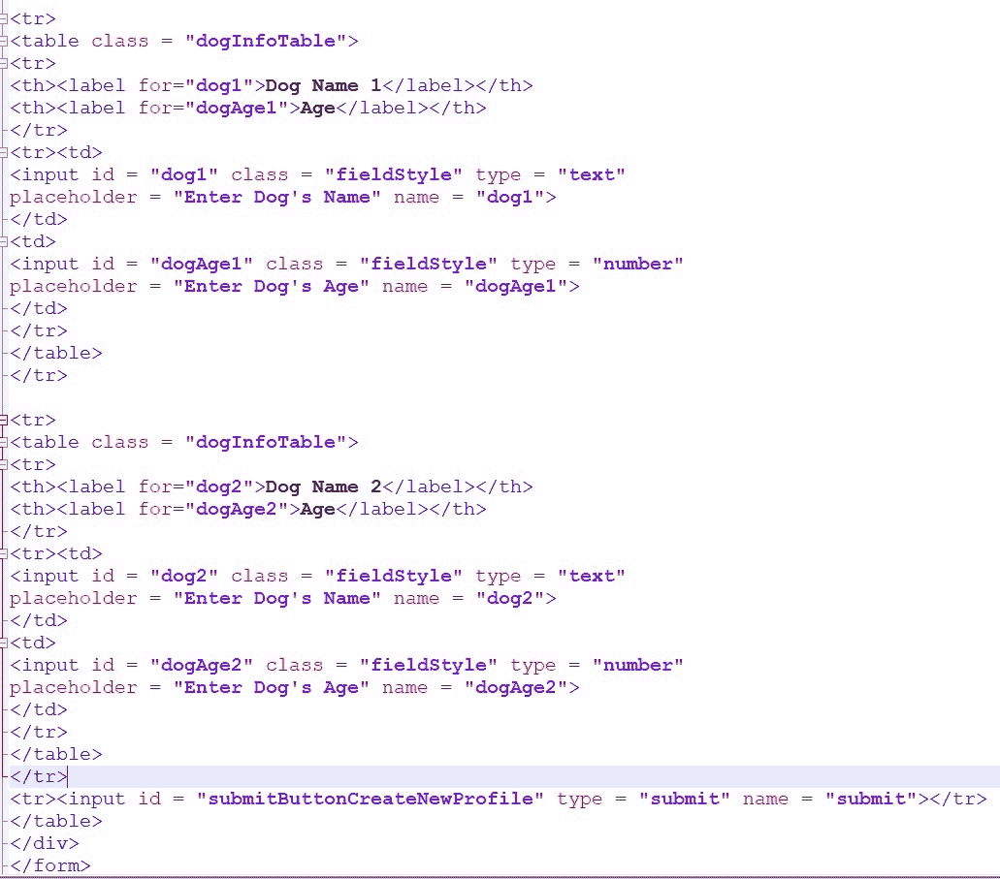

CSS 代码：
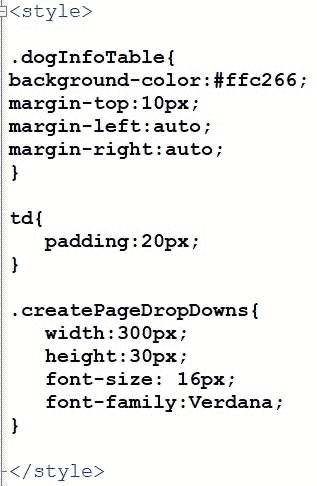
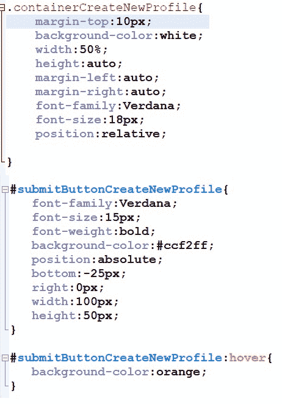

让我们保存一切并使用 Google Chrome 打开 HTML 文件。

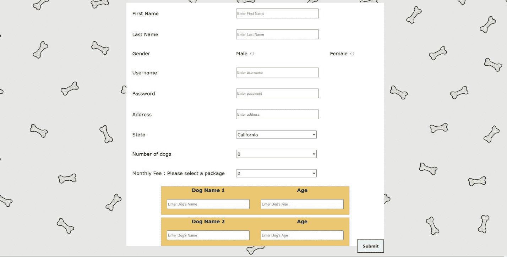

### 代码解释

我们在之前的章节（第 1 章第 1.2.2 节）讨论过 `<input>` 标签和 `<label>` 标签。现在让我们讨论 `<form>` 标签。

### 什么是 `<form>` 标签？

`<form>` 标签用于创建一个 HTML 表单，用户可以在其中输入数据。`<form>` 标签最重要的属性是它的 `action` 属性。action 属性包含一个 url，一旦提交表单，表单数据就会发送到指定的 url。

处理页面间数据的两个重要表单方法是：`GET` 和 `POST`

- `GET` – 该方法将表单数据附加到 URL 名称中。这使得整个过程变得具有风险，因为如果用户发送敏感信息，它将出现在 URL 上。
- `POST` – 该方法将表单数据随 HTTP 请求附加，而不是通过 URL。

在上面的 HTML 代码中，在 `<form>` 标签内，我调用了 `onsubmit` 事件并向其传递了一个函数 `createNewProfile()`。

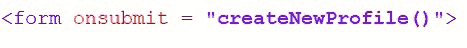

函数 `createNewProfile()` 在表单提交时执行。

### 什么是 JavaScript `onsubmit` 事件？

`onsubmit` 事件在表单提交时触发。现在让我们创建函数 `createNewProfile`。JavaScript 函数应该写在 `<script>` 标签内，最佳实践是在关闭 `<body>` 标签之前单独编写代码。

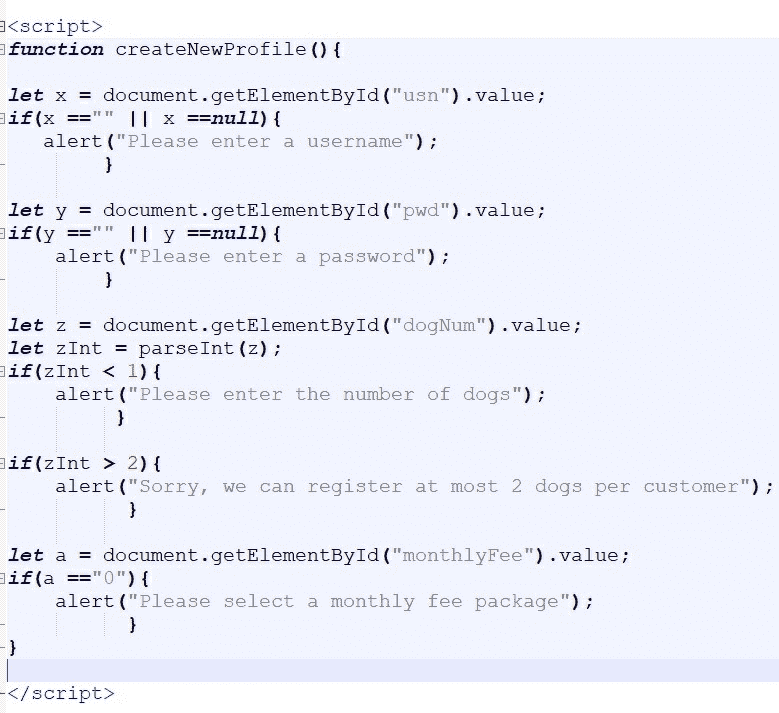

此函数简单地检查 `Username`、`Password`、`Number of dogs` 和 `Monthly Fee` 字段中是否存在值（这些字段请参考上方的 HTML 代码）。如果没有值，则它将抛出一个警报框（alert）。

几个需要注意的重要点是：

- 为了通过 `id` 访问输入字段的值，JavaScript 语法是：`document.getElementById("id_name").value`
- 为了通过 `class` 访问输入字段的值，JavaScript 语法是：`document.getElementsByClassName("class_name").value`
- 为了将字符串值转换为整数值，使用了 `parseInt()` 函数。

### `==` 和 `===` 比较运算符的区别是什么？

- `==` 用于比较两个变量的值。
- `===` 用于比较值及其数据类型。

现在让我们为项目创建联系我们页面。

`contactUs.html`：
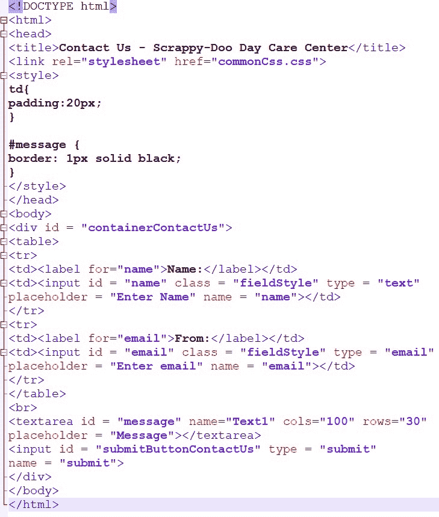

CSS 代码：
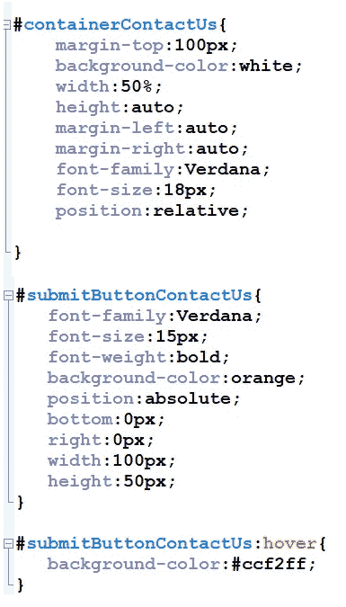

在上面的 HTML 中，我们使用了新的代码：

```html
<textarea id="message" name="" cols="100" rows="30" placeholder="Message"></textarea>
```

`<textarea>` 标签用于定义多行文本。其属性 `cols` 用于指定文本区域的宽度，`rows` 用于指定行数。让我们保存 HTML 文件并用 Google Chrome 打开。

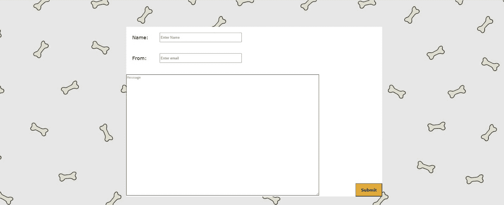

在上面的 HTML 中：

*   你会注意到文本写在 `<p>` 标签内，`p` 代表段落。
*   在关于我们页面，我们创建了一个返回按钮。

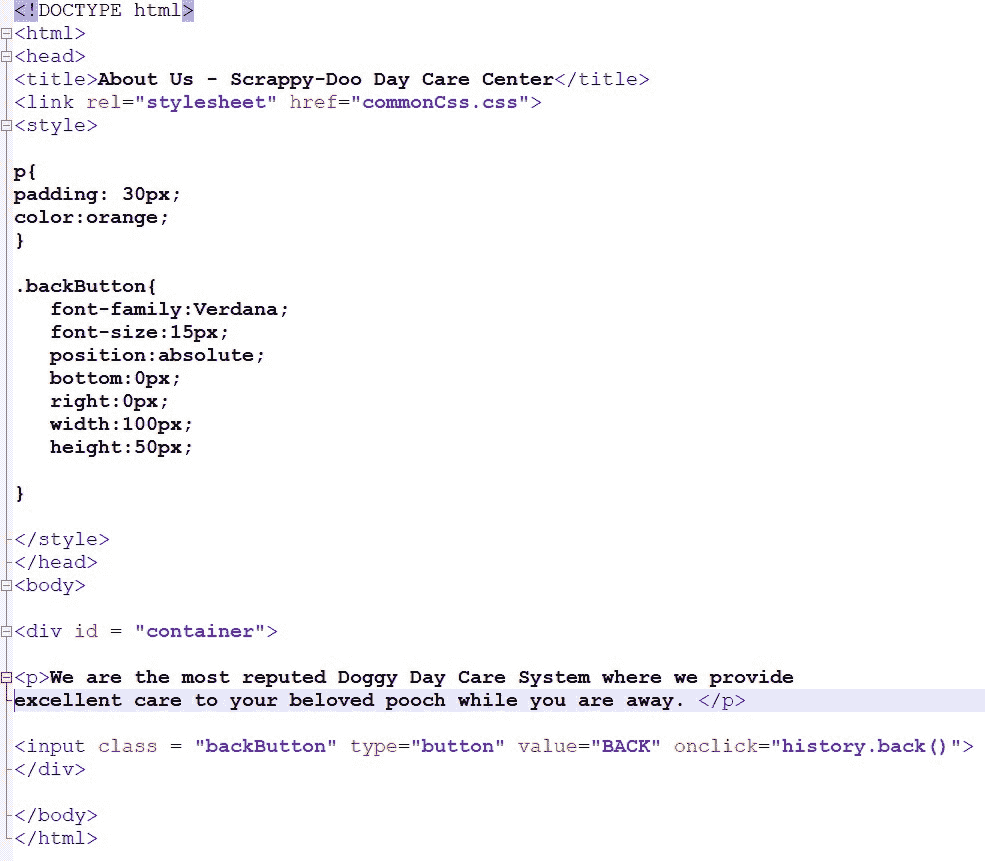

上面的代码意味着点击按钮时返回上一页 `onclick="history.back()"`。

*   `history` 对象包含了用户访问过的 url 列表。
*   `back()` 方法加载历史列表中的上一个 url。

## 2.4：JavaScript 事件

JavaScript 是一种事件驱动语言，其代码只有在发生事件时才会运行。有很多 JavaScript 事件，但最常用的事件有：

1.  `onsubmit`（在 2.3 节中讨论）
2.  `onclick`（在 2.1 节中讨论）
3.  `onchange` – 如你可能记得在第 1 章第 1.2.1 节为我们的狗狗日托中心项目设计首页（`index.html`）时，我们通过 `<select>` 标签创建下拉菜单。菜单包含 `<option>` 标签提供的不同 HTML 页面路径，但当选择这些值时，链接没有任何反应。为了让链接正常工作，需要 JavaScript `onchange` 事件（请参考第 1 章第 1.2.1 节中的下拉菜单 HTML 代码）。

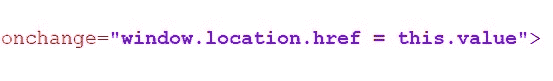

*   `window` 指向浏览器窗口。
*   `location` 对象表示页面 url。
*   `href` 属性用于导航到提供的 url。
*   `this` 关键字指向当前执行的对象。

这是 JavaScript 的写法，表示如果 `<select>` 字段中的值发生变化，则触发 JavaScript `onchange` 事件。`onchange` 事件将获取该 url 值（写在 `<option>` 标签内）并将该页面返回给用户。

4.  `onload` – `onload` 事件是在页面、图像或框架加载时触发的事件。示例：

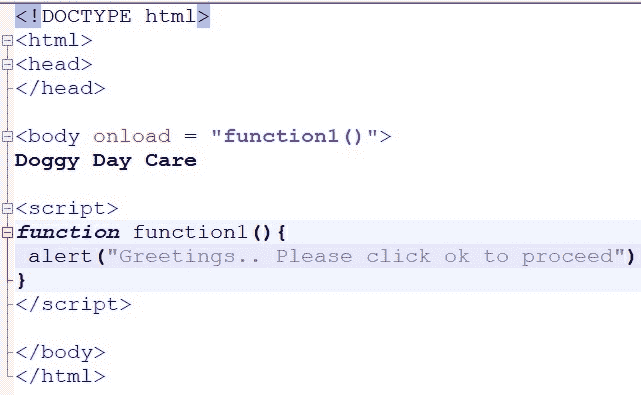

输出：

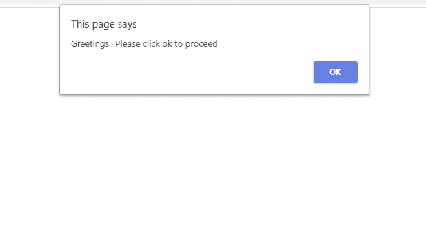

# 第 3 章：如何对网站进行移动端优化

让网站具有响应式非常重要，这样它在所有设备上都能完美加载。现在让我们打开我们的“狗狗日间中心”（Doggy Day Care Center）项目的首页，并缩小窗口大小以检查它在手机屏幕上的显示效果。


上面的首页不仅看起来杂乱，而且无法阅读。因此，让任何网站都具有响应式是非常重要的。

## 3.1：移动端优化的三个规则

我们可以遵循以下三个简单规则让网站具有响应式：

### 规则 1：在 HTML 文档的 `<head>` 部分添加响应式 meta 标签。

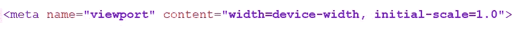

*   `viewport` 是网页在任何设备上的可视区域。
*   `width=device-width` 意味着将网页的宽度设置为设备的屏幕宽度。
*   `initial-scale=1.0` 设置在首次加载页面时的初始缩放级别为 1.0。

### 规则 2：使用百分比格式（如 `100%`、`80%`、`50%` 或 `20%`）设置整个网页或网页任何部分的高度和宽度。尽量避免硬编码高度和宽度值。

### 规则 3：使用媒体查询。其语法为：

```css
@media (min-width: 600px) {…当设备最小宽度为 600px 时，在此媒体查询中编写 CSS 属性…}
@media (max-width: 600px) {…当设备最大宽度为 600px 时，在此媒体查询中编写 CSS 属性…}
```

注意：媒体查询应该写在 `<style>` 标签内，而这些标签反过来应该存在于 HTML 文档的 `<head>` 部分中。

现在让我们将这三个规则应用于“狗狗日间中心”项目的网页中。下面的截图显示了我们在第 1 章 1.2.1 节创建的 `index.html`（首页）文件的更新 CSS 代码。

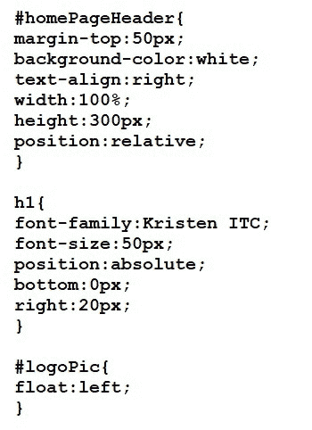
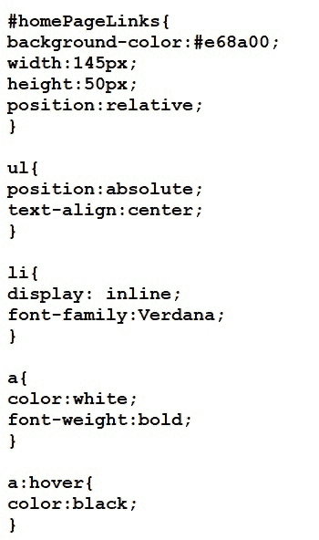
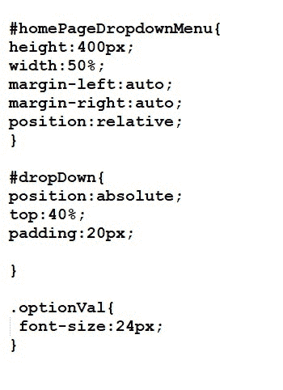

现在让我们创建设备最大宽度为 600px 时的媒体查询：

*   我想为 ID 为 `logoPic`、`homePageLinks` 和 `dropDown` 的元素添加一些额外的属性，这些属性只在设备最大宽度为 600px 时才会显示。

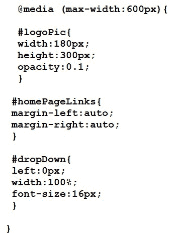

在上面的代码段中，我们通过 `opacity` 属性让 ID 为 `logoPic` 的 logo 图片变为透明。该属性用于使图像变透明。值越小，图像越透明。

现在让我们创建设备最小宽度为 600px 时的媒体查询：

*   在这里，我们为 ID 为 `homePageLinks`、`dropDown` 和 `homePageDropdownMenu` 的元素添加了一些属性，这些属性只在设备最小宽度为 600px 时才会显示。

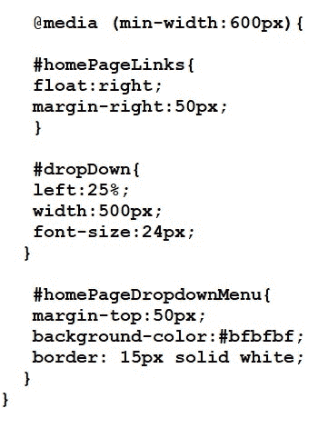

现在让我们保存所有内容并用 Google Chrome 打开 HTML 文件（`index.html`）。

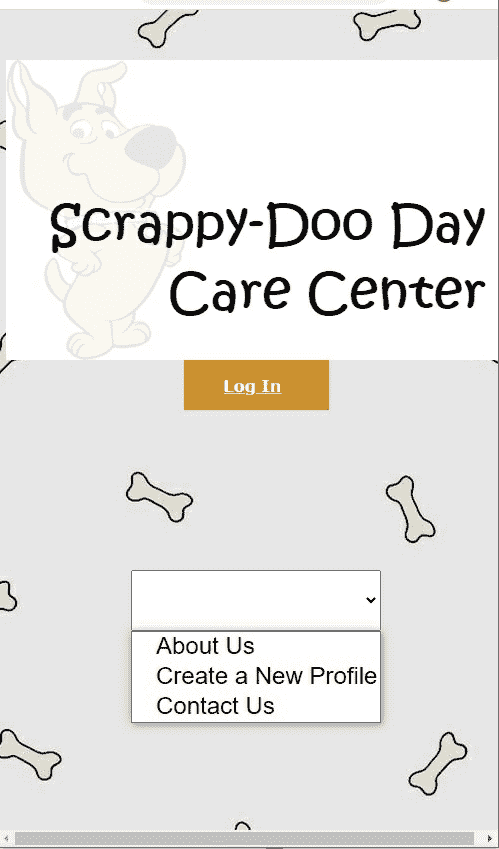

首页是响应式的，看起来完美。

请注意：也可以使用 Chrome 开发者工具来模拟移动设备的页面视图。更多信息请参阅此处 - `https://developers.google.com/web/tools/chrome-devtools/device-mode`

# 第 4 章：Python 编程简介

Python 是最流行且使用最广泛的脚本语言。它的语法简单易用，为了便于编码而编写。

## 4.1：Python 安装

**步骤 1**：访问 `https://www.python.org/downloads/` 并下载最新的 Python 版本。

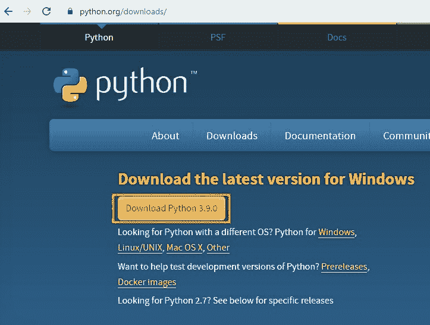

**步骤 2**：点击“自定义安装”（Customize installation）。

对于下载的 Python，给出一个你自己的、短且易记的路径位置是非常重要的。这是因为我们在安装 Django 时将再次使用这个路径位置。

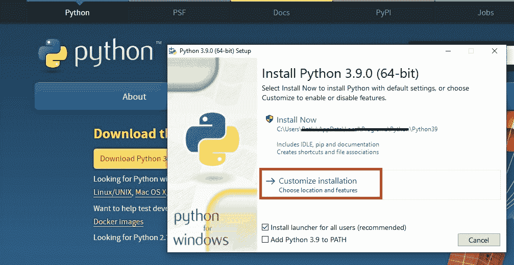

**步骤 3**：点击“下一步”（Next）。

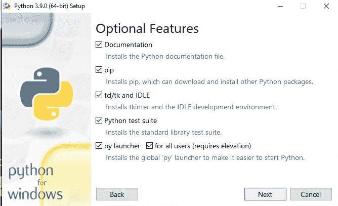

**步骤 4**：然后浏览你的安装位置。

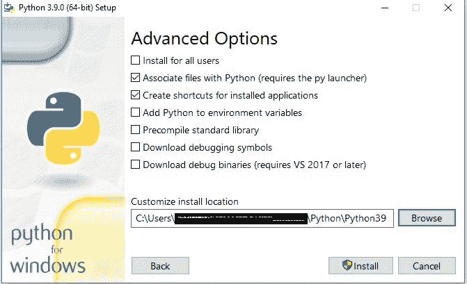

**步骤 5**：点击安装（Install）。


**步骤 6**：现在进入控制面板 -> 系统和安全 -> 系统 -> 高级系统设置 -> 环境变量 -> 将 Python 安装位置添加到你的 `PATH` 变量中。


**步骤 7**：打开命令提示符，通过 `python` 命令检查安装是否正确完成。


现在让我们写代码吧。

打开 Notepad++ 并创建一个新文件（`hello_world`），并以 `.py` 扩展名保存。


在 `hello_world` 内部编写：


什么是 `print()` 函数？它用于显示输出。

现在打开命令提示符，运行 `hello_world` 文件：

```bash
python hello_world
```


## 4.2：Python 变量、运算符

重要说明：

*   变量用于存储数据。
*   在大多数编程语言中，你需要声明变量。例如：

```python
x = 5
y = "John"
```


输出：


什么是 `type()` 函数？它用于确定变量的类型。除了 `int`、`float` 和 `string`，Python 还有 `list`、`tuple` 和字典。

### 4.2.1：Python 字符串

重要说明：

*   Python 字符串是字符序列。
*   Python 字符串是不可变的，一旦创建就无法修改。

什么是 Python 中的字符串切片？字符串切片是获取子字符串的过程。语法为：`string[start:stop:step]`

示例：

打开 Notepad++ 创建新文件并编写以下代码。


现在运行这些代码：


**代码解释：**

让我们查看“Health is wealth”字符串。

索引始终从 0 开始。H 位于索引 0，e 位于索引 1，a 位于索引 2，l 位于索引 3，t 位于索引 4，h 位于索引 5。然后空格位于索引 6。i 位于索引 7，s 位于索引 8。再次空格位于索引 9。w 位于索引 10，e 位于索引 11，a 位于索引 12，l 位于索引 13，t 位于索引 14，h 位于索引 15。

在上面的代码段中，`message[2:12]` 的输出是从索引 2（包含索引 2 的值）到索引 12（不包含索引 12）：`alth is we`。

`message[:6]` 的输出是从开始（索引 0，包含值）到索引 6（不包含索引 6）：`Health`。

`message[7:]` 的输出是从索引 7（包含索引 7 的值）到结尾：`is wealth`。

### 常用字符串方法

5.  `lstrip()` 函数移除左侧空格。
    语法：`string.lstrip()`

6.  `rstrip()` 函数移除右侧空格。
    语法：`string.rstrip()`

7.  `index()` 函数返回给定元素的索引数字。
    语法：`string.index(element)`


输出：

8.  `split()` 函数返回由空格分隔的子字符串列表。
    语法：`string.split()`


输出：

9.  `replace(old, new)` 函数将旧值替换为新值。
    语法：`string.replace(old, new)`


输出：

10. `join()` 字符串方法通过分隔符连接迭代对象（列表、元组和字符串）的所有元素并返回一个字符串。
    语法：`delimiter.join(iterable)`


输出：

#### 字符串格式化

`format()` 方法用于格式化字符串。

字符串格式化的规则为：

1.  使用大括号 `{}` 创建占位符。
2.  调用 `format` 方法并将变量作为参数传递。当程序执行时，传递给这些参数的值将替换大括号占位符。

**示例 1：**


在上面的示例中，传递给变量 `animal` 的值将填充第一个占位符，传递给变量 `legs` 的值将填充第二个占位符。


输出：

**示例 2：** 如果你想显示带有两位小数浮点位数，可以使用格式化表达式 `{:.2f}`。


输出：

### 4.2.2：Python 列表 (List)

*   Python 列表与数组非常相似。它包含一个用逗号分隔的元素列表，其元素写在方括号 `[ … ]` 中。
*   Python 列表是可变的，这意味着我们可以修改列表元素。
*   可以通过索引值访问列表中的值。

从列表访问值的语法为：`list_name[index_num]`

#### 什么是数组 (Array)？

数组是所有具有相同数据类型的项目或元素的集合。数组中的元素只能通过其索引值访问。

示例：让我们创建一个汽车数组。

```python
cars = ["Kia", "Toyota", "Ford", "Tesla"]
```


为了获得 `Ford` 作为输出，我们需要写 `print(cars[2])`。

**示例：** 创建一个新的 Python 文件 (`variables.py`) 并写入以下几行代码：


运行上述代码后，我们得到如下输出：


**代码解释：**

*   在上面的代码中，`fruits` 是一个包含 6 个元素的列表。位置 0 的值是“apple”，位置 1 的值是“orange”以此类推。
*   `x` 是一个持有字符串值的变量。位置 0 的值是“t”，位置 1 的值是“h”以此类推。
*   `len()` 函数用于获取列表的长度。
*   在第 4 行和第 5 行中我们执行切片操作。
    *   `print(fruits[2:4])` 意味着从位置 2（包含其值）到位置 4（不包含其值）打印元素。


输出：`['banana', 'mango']`

    *   `print(x[2:8])` 意味着从位置 2（包含其值）到位置 8（不包含其值）打印 `x` 的值（“this apple is tasty”）。


输出：`is app`

##### 常用的列表方法

1.  `append()` 方法将元素插入到列表末尾。
    语法：`list.append(element)`


输出：

2.  `insert()` 方法在指定的索引处插入元素。
    语法：`list.insert(index_num, element)`


输出：

3.  `remove()` 方法移除指定元素的首次出现。
    语法：`list.remove(element)`


输出：

### 4.2.3：Python 元组 (Tuple)

*   元组非常像列表。它包含在圆括号 `( … )` 内的用逗号分隔的元素。
*   Python 元组是不可变的，这意味着一旦声明了元组，就无法对其修改。

**元组和列表的区别**

| 元组 (Tuple) | 列表 (List) |
| :--- | :--- |
| 元素包含在 `(…)` 圆括号内 | 元素包含在 `[…]` 方括号内 |
| 一旦创建元组，无法添加、更新或删除任何项 | 列表是可变的，可以添加、更新或删除项 |

**示例：**


运行上述代码后，我们得到如下输出：


## 4.3：Python 控制流

1.  语法有所不同。
2.  在其他编程语言中，控制语句代码块写在花括号 `{ … }` 内部，而在 Python 中，通过缩进来标记代码块的开始和结束。

### 4.3.1：Python If .. Elif .. Else

*   `if` `else` 代码块用于检查某些条件是否为真或假。如果满足条件，则执行 `if` 代码块；如果不满足，则执行 `else` 代码块。
*   Python 中的 `elif` 意为 `else if`。

语法为：`if condition: … elif condition: … else: …`

执行流程：


**示例 1：** 创建一个新的 Python 文件（`test.py`）并编写以下代码：


**Python 缩进说明：**

*   冒号(`:`) 标记了代码块的开始。
*   你会发现上面的代码没有包含任何大括号。在 Python 中，缩进标记了代码块的开始和结束。
*   在上面的示例中，在声明 `if` 代码行（第 2 行）后，我们进行了缩进并写了 `print("Output is Orange")`。这个缩进表示 `print` 语句属于 `if` 代码块。接着在声明 `elif` 代码行（第 4 行）后，我们进行了缩进并写了 `print("Output is apple")`。这个缩进再次表示 `print` 语句属于 `elif` 代码块。然后我们对 `else` 代码块重复了相同的过程。
*   一旦满足 `if` 条件，就会执行 `print("Output is Orange")` 语句。如果由于某种原因 `if` 条件不满足，则会测试 `elif` 条件。如果 `elif` 条件同样不满足，则执行 `else` 代码块。

现在让我们运行上面的代码。打开命令提示符 -> 导航到 Python 文件所在并使用 `python` 命令运行脚本。

输出：


在上面的 Python 代码中，`fruits` 是一个包含 4 个元素的 `List`。由于位置 1 的值确实是“orange”，因此满足了 `if` 语句，不再检查 `elif` 和 `else` 代码块。

**示例 2：**


**代码解释：** 上述代码的第 2 行检查 `stocks` `List` 中是否存在值。如果为真，执行 `if` 代码块，否则执行 `else` 代码块。

输出：


### 4.3.2：Python For 循环

需要注意的重要点是：

*   Python `for` 循环用于遍历数组、`list`、`tuple`、`dictionary` 或字符序列。
*   `for` 循环会持续到给定变量的长度。示例：

```python
cars = ["Kia", "Toyota", "Ford"]
```

上述 `cars` 列表的长度为 3，因此循环将进行 3 次。首先它将获取索引为 0 的元素（“Kia”）并通过向下遍历循环执行检查操作 -> 然后它会检查索引为 1 的元素（“Toyota”）并通过向下遍历循环执行检查操作 -> 然后它会检查索引为 2 的元素（“Ford”）。

语法为：`for each_element in elements: …`

for 循环的执行流程：


**示例：** 创建一个新的 Python 文件（`loops.py`）并编写以下代码：


运行上述代码后，我们得到了输出：


**需要注意的重要点是：**

1.  冒号(`:`) 标记了代码块的开始。
2.  在启动 `for` 循环后，我们进行了缩进然后开始了 `if` 循环。那个缩进表示 `if` 代码块属于 `for` 循环。现在在 `if` 代码块内部，我使用了两个缩进来表示 `print("I wish to own tesla one day")` 语句属于 `if` 语句，而 `if` 语句又属于 `for` 循环。我们对 `elif` 和 `else` 代码块重复了上述过程。
3.  循环将持续到 `List car` 的长度。上述 `List` 的长度为 4，因此循环将发生 4 次。

上述代码的执行流程：


**嵌套 for 循环**

嵌套 for 循环意味着一个 `for` 循环内部存在另一个 `for` 循环。


输出：


**代码解释：** 在上述代码中，我们创建了一个杂货列表并将其存储在变量 `groceries` 中。该列表是子列表集合。在 `for record in groceries:` 行中，我们捕获子列表。然后在 `for grocery_item in record:` 行中，我们循环并获取子列表中的杂货项。

### 4.3.3：Python While 循环

`while` 循环只要条件为真，就会一直执行某个代码块。

语法为：`while condition: …`

示例：


**代码解释：**

*   在第 1 行，我们声明了变量 `x` 的值。
*   在第 2 行，我们启动了 `while` 循环。由于 `x` 小于 100，`while` 循环开始并执行第 3 行的 `print` 语句。
*   在第 4 行，我们将 `x` 增加了 10，并将值赋回 `x`。`while` 循环会再次开始，直到 `x` 等于或大于 100。

让我们运行上述代码。


**注意：** 在 `while` 循环中，初始化变量是极其重要的。

### 4.3.4：Python Break 和 Continue

`break` 和 `continue` 语句用于改变循环的流程。

*   `break` 语句用于在满足条件时跳出循环。

**示例：**


在上述示例中，`for` 循环会在满足条件时停止，因为它遇到了 `break` 语句。

让我们运行上述代码。


*   `continue` 当循环执行 `continue` 语句时，控制权将返回循环开头并跳过剩余代码。

**示例：**


一旦遇到 `continue` 语句，第 9 行的代码不会被执行，循环将回到开头。注意循环并没有终止。

## 4.4：Python 函数

函数是执行特定任务的代码块。声明函数的语法为：`def function_name(): …`


**代码解释：**

*   在上述代码中，我们创建了一个带有参数 `uname` 的函数 `validate_username`。如果参数是“John123”，函数打印“Hello”，否则打印“Wrong username”。
*   调用任何函数，只需编写函数名并加上括号。在括号内，我们传递了 `username` 的值“John”。

## 4.5：Python 类

*   Python 是一种面向对象的编程语言。
*   类是创建对象的“蓝图”，与其他任何编程语言一样，Python 类包含属性和方法。
*   创建类的语法为：

```python
class ClassName:
    def __init__(self):
        ...
    def method1(self):
        ...
```

**什么是 `__init__(self)`？** `__init__` 是 Python 类中的一个保留方法，用于初始化对象的状态。在面向对象概念中，它是类的构造函数。该方法在创建对象时初始化类的属性。


输出：


**上述代码注意的重要点是：**

1.  Python 类名应该大写字母开头。
2.  在 `__init__` 方法中，我们声明了类 `Employee` 的不同属性，并将这些值传递给 `self.id_num`、`self.name` 等。
3.  在我们的 `validation()` 方法中，我们传递了参数 `self`，这有助于访问 `Employee` 类的所有属性。
4.  `str()` 函数有助于整数值转换为字符串值。
5.  `and` 是 Python 中的逻辑与运算符。
6.  在上方代码的第 15 行中，我们声明了一个对象 `e` 并向其传递了值。

请注意：在本章中，我只涵盖了对于我们 Django 项目开发至关重要的几个 Python 主题。要深入、全面地了解所有 Python 主题，请访问网站 [`www.w3schools.com/`](https://www.w3schools.com/)。

# 第 5 章：Django

Django 是一个免费开源的高级 Python Web 框架，有助于开发网站。

## 5.1 Django 安装

**步骤 1**：打开命令提示符 -> 进入 Python 文件夹所在的路径位置（Python 在第 4 章第 4.1 节中安装） -> 进入 `Scripts` 文件夹。我的 Python 文件夹位于 `C` 盘。`C` 盘 -> `Python` 文件夹 -> `Scripts`。


**步骤 2**：检查 `Scripts` 文件夹中是否存在 `pip` 应用程序。让我们使用命令 `pip --version` 显示 `pip` 版本。


**步骤 3**：要安装 Django，输入命令 `py -m pip install Django`。


在安装过程中，我遇到了一个提示说“建议将此目录添加到 PATH”。让我们来修复这个提示吧……

进入环境变量 -> 现在将 `pip` 文件所在位置添加到 `PATH` 变量中。


现在显示“Successfully installed Django”。

**步骤 4**：现在让我们设置虚拟环境。要做到这一点，请遵循 Django 文档中的步骤：[`docs.djangoproject.com/en/3.1/howto/windows/`](https://docs.djangoproject.com/en/3.1/howto/windows/)。

关于创建虚拟环境，Django 文档说明如下：


让我们创建一个文件夹（我将文件夹命名为 `Python_script`）。打开命令提示符 -> 导航到文件夹位置（`Python_script`），然后输入以下命令：

```bash
py -m venv project_name
```


我们看到 Django 为我们创建了文件夹。


现在 Django 文档说：


让我们激活虚拟环境。打开命令提示符 -> 导航到 `Scripts` 文件夹 -> 运行以下命令：

```bash
activate.bat
```


**步骤 5**：设置虚拟环境后，打开命令提示符 -> 导航到上述 `Scripts` 文件夹 -> 使用以下命令创建 Django 项目：

```bash
django-admin startproject project_name
```

（我将项目命名为 `project1`）


我们看到 Django 为我们创建了项目文件夹（`project1`）。


注意：所有的 Django 主项目位于 `Scripts` 文件夹中。

**步骤 6**：打开项目文件夹（`project1`），你将看到 `manage.py` 文件。该文件是最重要的文件，运行 Django 项目时需要它。


现在让我们运行第一个 Django 项目（`project1`）。打开命令提示符 -> 导航到存在 `manage.py` 文件的 `project1` 文件夹位置 -> 运行以下命令：

```bash
python manage.py runserver
```


打开浏览器并访问上方截图显示的网站。


安装运行完美。

## 5.2 Django App

App 代表 Application（应用程序）。Django 项目和 Django App 之间有什么区别？

项目指的是整个应用程序，而 App 指的是主项目的子模块。

以 Amazon 为例。Amazon 是一家大公司，它可以被划分为多个部门。一个部门可能处理 Amazon Marketplace，另一个部门可能处理 Amazon KDP 等。因此，在这种情况下，Amazon Marketplace 和 Amazon KDP 就变成了大项目 Amazon 的 App 或子部门。

现在让我们创建一个 App 并将其与我们的主项目（`project1`）连接。

**步骤 1**：打开命令提示符 -> 由于 App 将位于主项目（`project1`）内部，我们需要导航到项目位置 -> 现在使用命令创建一个新 App：

```bash
python manage.py startapp app_name
```


（我将 App 命名为 `doggyDayCareCustomerInterface`）。我们看到 Django 在主项目（`project1`）中自动创建了新 App 文件夹。


**步骤 2**：现在让我们新创建的 App（`doggyDayCareCustomerInterface`）与主项目（`project1`）连接。打开包含 `settings.py`、`urls.py` 等所有重要 Python 文件的 `project1` 文件夹 -> 打开 `settings.py` 文件。


在 `settings.py` 中，将新创建的 App（`doggyDayCareCustomerInterface`）添加到 `INSTALLED_APPS` 列表中并保存。


App（`doggyDayCareCustomerInterface`）与项目（`project1`）之间的连接现在建立。

### 5.2.1 Django 架构

我们成功创建了新的 App（`doggyDayCareCustomerInterface`）。每个 App 必须包含：

1.  `urls.py` 文件 – 包含 App 内部所有的 URL。
2.  `views.py` 文件 – 包含执行任务的所有函数和类。
3.  `models.py` 文件 – 包含模型或数据库表。
4.  `admin.py` 文件 - 帮助将模型注册到 Django Admin App。
5.  `templates` 文件夹 – 包含所有的 HTML 文件。
6.  `static` 文件夹 – 包含所有的静态文件，如 CSS、图像和 JavaScript。


Django 流程非常简单：

1.  用户 HTTP 请求首先进入 `urls.py` 文件，在其中查找关联的 URL 名称并根据该名称找到位于 `views.py` 文件中的关联函数。
2.  `views.py` 文件中的函数向用户返回 HTTP 响应（来自 `templates` 文件夹的 HTML 文件）。
    *   `views.py` 文件也具有访问 `models.py` 文件以读取或写入数据的能力。
    *   `models.py` 包含了所有的模型或数据库表。

现在，让我们创建一个简单的 Django Hello World 应用来理解整个过程。

### 5.2.2 Hello World 示例

#### 步骤 1

在 `project1` 中创建一个新应用并将其命名为 `helloWorld`。


#### 步骤 2

现在我们将新创建的应用（`helloWorld`）与主项目（`project1`）连接。

打开文件夹 `project1` -> 打开 `settings.py` 文件 -> 在 `INSTALLED_APPS` 中添加 `helloWorld` 并保存。


#### 步骤 3

现在打开 `helloWorld` 应用文件夹，检查是否存在 `urls.py`、`views.py` 和 `models.py` 文件。如果不存在 `urls.py`，则创建一个新的 Python 文件并命名为 `urls.py`。

请注意：我正在使用 Notepad++ 编写所有的代码。

#### 步骤 4

在 `helloWorld` 应用内创建一个新文件夹并命名为 `templates`。


#### 步骤 5

在 `templates` 文件夹内部创建另一个与应用同名的文件夹。这个新文件夹 `templates/helloWorld` 将包含 `helloWorld` 应用专用的所有 HTML 文件。


创建一个简单的 HTML 文件（我将我的文件命名为 `index.html`）并将其保存到 `templates/helloWorld` 文件夹中。


#### 步骤 6

打开 `urls.py` 文件并编写下方截图所示的代码。


*   `urlpatterns` 是一个列表，包含了 `views.py` 文件中写的每个函数的路径。它定义了 url 和视图之间的连接。
*   `path()` 函数用于将 url 路由到相应的视图函数。


#### 步骤 7

将我们的应用（`helloWorld`）的 `urls.py` 文件与主项目（`project1`）的 `urls.py` 文件连接。操作方法如下：

*   打开项目文件夹（`project1`），其中包含 `settings.py` 和 `urls.py` 等重要文件 -> 打开 `urls.py` 文件。


*   在主项目的 `urls.py` 文件中创建一个通向 `helloWorld` 应用及其对应 url 的路径并保存。


注意：要使用 `include()` 函数，我们需要从 `django.urls` 导入它。

#### 步骤 8

打开应用（`helloWorld`）的 `views.py` 文件并创建从应用（`helloWorld`）`urls.py` 文件调用的 `index` 函数。


`index` 函数接收 HTTP 请求并通过 `render()` 函数返回一个 HTTP 响应，即存储在 `templates/helloWorld` 文件夹中的 `index.html` 文件。

什么是 `render` 函数？

`render()` 函数用于返回 Http 响应，要使用此函数，我们需要如上方截图所示导入 `HttpResponse`。

#### 步骤 9

保存所有内容并运行项目。

打开命令行提示符 -> 导航到存在 `manage.py` 文件的主项目（`project1`）位置 -> 运行以下命令：

```bash
python manage.py runserver
```


打开浏览器 -> 进入 `http://127.0.0.1:8000/` 并输入下方所示的 url。


让我们总结整个 Django 流程。


## 5.3 Django 模型

Django 模型更像是存储数据的数据库表。

让我们为我们的应用 `doggyDayCareCustomerInterface`（在 5.2 节创建）创建一些模型或表。

### 步骤 1

在 `doggyDayCareCustomerInterface` 应用文件夹内查找 `models.py` 文件。


### 步骤 2

在 `models.py` 中我们将创建两个模型类：`customer_information` 和 `dog_information`。


*   `models.IntegerField()` 创建一个用于存储整数值的列。
*   `models.CharField(max_length=n)` 创建一个用于存储字符值的列，其中 `n` 指定长度。

请注意：有多个模型字段，请访问 Django 文档查看模型字段参考 [`docs.djangoproject.com/en/3.2/ref/models/fields/`](https://docs.djangoproject.com/en/3.2/ref/models/fields/)。

*   为了在两个模型或表之间建立关系，我们使用了外键。


`on_delete=models.CASCADE` 意味着如果引用对象被删除，也删除指向该引用对象的关联记录。

注意：要为特定字段添加主键，请设置 `primary_key=True`。例如：`models.CharField(max_length=50, primary_key=True)`。

### 步骤 3

开始迁移过程以创建表。

打开命令行提示符 -> 导航到存在 `manage.py` 文件的主项目（`project1`）位置 -> 运行以下命令：

```bash
python manage.py makemigrations
```


为了应用迁移，运行以下命令：

```bash
python manage.py migrate
```


### 步骤 4

在主项目（`project1`）文件夹中查看已创建的模型是否存在。


### 步骤 5

现在为我们的模型添加一些数据。

打开命令行提示符 -> 导航到存在 `manage.py` 文件的主项目（`project1`）位置 -> 运行以下命令：

```bash
python manage.py shell
```


为了操作模型，我们需要先导入它们：

```python
from doggyDayCareCustomerInterface.models import customer_information
```

向 `customer_information` 插入数据：

```python
customer_information.objects.create(username="John", lastName="Kim", gender="M", address="Cedar Park", state="Texas")
```

成功地向 `customer_information` 模型插入了一条记录。

## 5.4 Django Admin 应用

Django 已经为我们创建了一个用于数据管理的应用，称为 Admin 应用。它允许我们无需编写数据库查询即可插入或删除数据。

访问 admin 的步骤如下：

### 步骤 1

打开项目文件夹（`project1`），其中包含 `settings.py` 和 `urls.py` 文件 -> 打开 `urls.py` 文件并检查 admin 的路径：

```python
from django.contrib import admin

path('admin/', admin.site.urls),
```


### 步骤 2

为了访问 admin 应用，我们需要创建一个管理员账户，可以通过以下命令完成：

```bash
python manage.py createsuperuser
```


### 步骤 3

进入应用 `doggyDayCareCustomerInterface` -> 打开其 `admin.py` 文件 -> 注册 5.3 节创建的模型：

```python
from django.contrib import admin
from .models import customer_information, dog_information

admin.site.register(customer_information)
admin.site.register(dog_information)
```

### 步骤 4

打开命令行提示符 -> 导航到存在 `manage.py` 文件的主项目（`project1`）位置 -> 运行项目：

```bash
python manage.py runserver
```


打开浏览器 -> 进入 `http://127.0.0.1:8000/admin`

输入用户名和密码 -> 点击登录

admin 应用显示了模型。

## 5.5 如何使用 Django 在项目的不同页面间跳转

在 5.2 节中，我们创建了应用 `doggyDayCareCustomerInterface` 并将其与主项目 `project1` 连接。

在 5.3 节中，我们创建了它的模型或数据库表。

现在让我们按照 Hello World 示例（5.2.2 节）的步骤让我们的 `doggyDayCareCustomerInterface` 应用功能化。

### 步骤 1

已通过 `settings.py` 文件建立了主项目与 `doggyDayCareCustomerInterface` 应用之间的连接（已在 5.2 节中完成）。

### 步骤 2

现在我们将应用路径及其所有的 url 包含到主项目的 `urls.py` 文件中。

*   在我们的应用文件夹 (`doggyDayCareCustomerInterface`) 中创建一个新的 `urls.py` 文件。


*   将应用的 `urls.py` 文件与主项目的 `urls.py` 文件连接起来（正如我们在 5.2.2 节的 hello world 示例中所做的那样）。

### 步骤 3：创建 templates 文件夹

在 `templates` 文件夹内创建一个与应用同名的文件夹，并将 Doggy Day Care 项目的所有 HTML 文件粘贴到其中。

### 步骤 4：更新 urls.py

现在让我们进入应用 (`doggyDayCareCustomerInterface`) 的 `urls.py` 文件，并添加以下代码：

```python
# urls.py
from django.urls import path
from . import views

urlpatterns = [
    path("", views.index, name="index"),
    path("logInPage", views.logInPage, name="logInPage"),
    # 其他路径...
]
```

### 步骤 5：更新 views.py

打开应用 (`doggyDayCareCustomerInterface`) 的 `views.py` 文件，并添加以下代码：

```python
# views.py
from django.shortcuts import render

def index(request):
    return render(request, 'doggyDayCareCustomerInterface/index.html')

def logInPage(request):
    return render(request, 'doggyDayCareCustomerInterface/logInPage.html')

# 其他视图函数...
```

### 代码解释

*   在 `urls.py` 文件中，`path("", views.index, name="index")` 没有任何路由名称。这意味着当没有路由名称时，它将直接执行 `views.py` 文件中的 `index` 函数。`index` 函数向用户返回 `index.html`（Doggy Day Care 项目的首页）文件。
*   在 `urls.py` 文件中，`path("logInPage", views.logInPage, name="logInPage")` 拥有 `logInPage` 路由名称和 URL 名称。这意味着当路由名称为 `logInPage` 时，将执行 `views.py` 文件中的 `logInPage` 函数。`logInPage` 函数向用户返回 `logInPage.html`（Doggy Day Care 项目的登录页面）。

### 步骤 6：更新 index.html

打开 Doggy Day Care 项目的 `index.html` 文件（在第 1 章 1.2.1 节创建） -> 注意到 HTML 的 `href` 属性提供了一个硬编码路径，这将引导我们进入登录 HTML 页面。现在删除旧路径并在 `href` 属性中提供来自 `urls.py` 文件的 URL 名称 `logInPage`。

在 HTML 文件添加来自 `urls.py` 文件的 URL 名称的语法是 ``。什么是 ``？`` 称为 Django 标签。它们主要用于 HTML 文档内部：

1.  加载某些外部信息。
2.  执行循环或逻辑。

当用户点击首页上的登录按钮时，`href` 属性引导我们进入 URL 名称 `logInPage`。请求进入 `urls.py` 文件，它会在其中查找 URL 名称为 `logInPage` 的路径。现在通过此名称的帮助，它进入 `views.py` 文件中关联的函数 `logInPage`。函数 `logInPage` 向用户返回登录页面（请参考上面的代码）。

### 步骤 7：运行项目

让我们运行项目并检查从首页到登录页的导航是否执行正常。

打开命令提示符 -> 导航到主项目 (`project1`) 所在的目录（存在 `manage.py` 文件），并运行以下命令：

```bash
python manage.py runserver
```

打开浏览器 -> 访问 `http://127.0.0.1:8000/doggyDayCareCustomerInterface/`。现在点击登录按钮检查导航是否正常工作。

导航运行完美。现在按照上述步骤操作，将 `index.html` 文件中的所有硬编码路径替换为 URL 名称。一切运行良好，但你会注意到一个巨大的缺陷：你会发现加载的页面没有任何图像和 CSS。所以，让我们在下一节中修复这个问题。

## 5.6：如何将 CSS 和图像等静态文件加载到我们的 Django 应用中

在 5.2 节中，我们创建了应用 `doggyDayCareCustomerInterface` 并将其与主项目 `project1` 连接。

在 5.3 节中，我们创建了它的模型或表。

在 5.5 节中，我们学习了如何导航到不同的页面。

现在让我们学习如何将图像和 CSS 加载到 `doggyDayCareCustomerInterface` 应用中。在开始之前，请注意第 1 章中我们已经为 `index.html` 文件做了内部 CSS，外部 CSS 文件的文件名为 `common.css`。

### 步骤 1：配置设置

打开主项目 (`project1`) 的 `settings.py` 文件。向下滚动找到 `STATIC_URL`。它表示类似 CSS、图像等静态文件存储在 `static` 中。让我们创建 `static` 文件夹。

### 步骤 2：创建 static 文件夹

打开应用文件夹 (`doggyDayCareCustomerInterface`) -> 创建名为 `static` 的新文件夹。

### 步骤 3：创建应用特定的文件夹

在 `static` 文件夹内创建一个文件夹，名称应与应用相同。此文件夹将包含 `doggyDayCareCustomerInterface` 应用专用的所有静态文件。

### 步骤 4：添加资源

将所有图像和 CSS 文件添加到 `static/doggyDayCareCustomerInterface` 文件夹中。

### 步骤 5：在 index.html 中加载静态

打开 `index.html`（Doggy Day 项目首页） -> 在 `<head>` 部分写入以下代码：

```html

```

然后使用语法添加静态文件：``。

### 步骤 6：在 logInPage.html 中加载静态

打开 `logInPage.html` -> 在 `<head>` 部分写入 ``，然后使用 `` 语法引用静态文件。

### 静态文件操作总结

*   **如何访问静态文件？**
    ```html
    
    ```
*   **如何加载静态文件？**
    ```html
    
    ```
*   **如何添加静态文件？**
    ```html
    
    ```

## 5.7：与 Django 表单配合

使用 Django 表单可能有点复杂，需要很多步骤。我会为你简化步骤。

### 步骤 1：定义表单类

在 `forms.py` 中创建表单类（例如 `Test123Validation`），包含 HTML 文档（`test123.html`）的所有输入字段。

### 步骤 2：更新 views.py

在视图函数中处理表单逻辑：

```python
# views.py
from .forms import Test123Validation

def test_view(request):
    if request.method == "POST":
        form = Test123Validation(request.POST)
        if form.is_valid():
            obj = form.cleaned_data
            # 处理数据...
            return render(request, 'doggyDayCareCustomerInterface/greetings.html', {'form': obj})
    else:
        form = Test123Validation()
    return render(request, 'doggyDayCareCustomerInterface/test123.html', {'form': form})
```

*   如果方法为 `POST`，则从属于类 `Test123Validation` 的表单字段中获取值并将其传递给变量 `form`。如果值存在，则获取该值并存储在变量 `obj`。
*   现在在函数 `test_view` 的最后一行，我们只需将 `obj` 的值传递给变量 `form`，该变量将由 `greetings.html` 访问。
*   在 `greetings.html` 中，我们只需插入 `form` 变量即可。

注意：`cleaned_data` 属性用于从输入字段获取值。

`greetings.html`：


现在让我们运行项目吧。打开命令提示符 -> 导航到包含 `manage.py` 文件的主项目（`project1`）文件夹 -> 使用以下命令运行项目：

```bash
python manage.py runserver
```


打开浏览器 -> 访问 `http://127.0.0.1:8000/doggyDayCareCustomerInterface/test`


在我输入名称并点击提交按钮后，出现了一个错误。


这个错误的出现是因为我忘记在 `test123.html` 的 `<form>` 标签内添加 `csrf_token`。

什么是 `csrf_token`？Django `csrf_token` 是专门为身份验证用户生成的唯一值。它必须用于所有的 Django 表单，因为它有助于保护用户信息并防止任何类型的恶意活动。所以让我们在 `test123.html` 文件的 `<form>` 标签内添加 `csrf_token` 并保存。

`test123.html`：


运行项目。


一切运行正常。

让我们总结整个过程：

*   要操作 Django 表单，我们需要创建一个表单类（`Test123Validation`）。
*   该表单类包含我们 HTML 文档（`test123.html`）的所有输入字段。


- 从`views.py` -> 函数`test123`，表单类被传递给变量`form`，由`test123.html`访问，在那个 HTML 页面中我们只需插入该变量。一旦变量插入，Django 会自动生成所有输入字段。

- 一旦提交表单，它将带我们进入名为`greetings`的 URL。请求随后进入`urls.py` 文件 -> `views.py` 文件中的`greetings`函数。

- `greetings`函数获取用户在表单输入字段中输入的值并将其显示在`greetings.html`中。

在现实世界中，没有页面像上面的示例那样简单。网页复杂得多，包含了 CSS、Javascript 以及更多内容。在下一节中，我们将学习如何手动将 Django 表单字段插入我们的 HTML 文件，而不破坏原始的 DOM 结构。

### 示例：

在这个示例中，我们将创建一个数据库模型并在其中插入一些数据。然后我们把模型中的数据打印到 HTML 文件中。

- 在我们的主项目（`project1`）中创建一个新应用（我将我的新应用命名为`cars`）。然后通过`settings.py`和`urls.py`文件将新创建的应用（`cars`）与主项目（`project1`）连接。

- 设置`urls.py`文件、`views.py`文件和templates文件夹。

- 打开`models.py`文件并创建一个模型（我将我的模型命名为`Cars`）。


- 开始迁移过程（在 5.3 节讨论过）。

- 现在在`admin.py`文件中注册模型。


- 运行项目并访问`http://127.0.0.1:8000/admin/`。如下所示，应该是新创建的`Cars`模型。


让我们向其中添加一些数据并在 HTML 文档中显示这些数据。

#### 在`views.py`文件中：

在`views.py`文件中添加以下代码（代码在之前的节中讨论过）。

#### 在`cars.html`文件中：

在`cars.html`文件中使用`for`循环显示记录

**请注意：** 在 Django 中，如果你在模板中开始循环，你就需要结束循环。

示例：

```django
 ….. 
 ….. 
```

运行项目。

## 5.8 :带有 CSS 的 Django 表单与手动渲染表单字段

现在让我们打开我们的`doggyDayCareCustomerInterface`应用 -> 进入`templates` -> `doggyDayCareCustomerInterface`并打开我们的`logInPage.html`文件（5.5 节有创建 templates 文件夹的步骤）。`logInPage.html

- `widget` 是 Django 对 HTML 输入元素的表示。

- `attrs` 用于存储 HTML 属性。在这里，我传递了一个属性，说明表单输入字段属于 CSS 类`fieldStyle`（存在`commonCss.css`中）。

- `TextInput` 允许使用输入框输入任何字符串值。

- `PasswordInput` 允许使用输入框输入任何密码值。

注意：如果我们想在 Django 表单字段中添加 JavaScript 事件，我们可以在`attrs`属性中添加。例如：`password = forms.CharField (widget=forms.PasswordInput (attrs = { 'class' : 'fieldStyle', 'onchange' : 'js_function_name( ) }))` 

现在在`logInPage`函数中，让我们将上述表单字段传递给变量`form`，该变量将由`logInPage.html` HTML 文件访问。`views.py`

步骤 3：打开`logIn.html`文件 -> 在`<input>`标签的地方，我正在通过点运算符`.`手动渲染 Django 表单字段。`logIn.html`

注意：当手动渲染表单字段时，Django 不会自动生成对应的`<label>`标签。我们需要为相应的字段手动添加标签，为此需要使用`Id_for_label`。如果我们正在手动为字段构建标签，则会使用`Id_for_label`。

保存所有内容并检查我们在`logInPage.html`中做的新更改是否正常工作。一切看起来良好。让我们在下一节中继续执行验证过程。

## 5.9 登录页面验证过程

在 5.3 节中，我们为`doggyDayCareCustomerInterface`应用创建了模型或数据库表。在 5.8 节中，我们为登录页面创建了表单。现在让我们来执行验证过程。

请注意，当表单从`logInPage.html`（在 5.8 节中创建）提交时，它会将我们引导到下所示所示的 URL 名称`customer`。

步骤 1：打开`urls.py`文件 -> 创建一个具有 URL 名称`customer`和路由名称`customer`的路径，它将指向`views.py`文件中的`customerProfile`函数

步骤 2：打开`views.py`文件，让我们创建函数`customerProfile`。该函数将接收来自用户的`request`，检查输入的用户名和密码是否与其对应的数据库记录匹配，然后抛出响应

### 代码解释

在 5.7 节中，我们讨论了从`if request.method ==="POST"`到`obj2 = form.cleaned_data["password"]`的代码行。现在让我们讨论从行：`table_val = customer_information.objects.filter(username = obj1, password = obj2).`的代码

上述行代码是一个数据库查询，它在`customer_information`模型或表中查找`username = obj1`且`password = obj2`的记录。我们都熟悉数据库选择查询，例如：`select * from table_name where column_name = “value”`。但在 Django 中，上述选择查询的语法略有不同。上述选择查询的 Django 等效语句是：`table_name.objects.filter(column_name = “value”)`。

你也可以使用`get()`方法代替`filter()`方法。

注意：`select * from table_name`的 Django 等效语句是：`table_name.objects.all()`。

*   在上述代码段中，查询结果存储在变量`table_val`中。

`customer_information`存在`models.py`文件中。要在`views.py`文件中访问该表，首先需要从`models.py`文件导入表

请参考下面的截图进行逐行代码解释

简而言之这意味着：从上述查询获取数据并将其存储在变量`table_val`中。如果存在值，通过`first()`方法获取第一行并将数据存储另一个变量`row`中。现在将该`row`变量传递另一个变量`form`，该变量将被HTML文件`customerProfile.html`访问。如果表单有效，则执行上述步骤。现在如果表单无效，则重定向回 URL 名称`logInPage`](Image00250.jpg)

要使用`HttpResponseRedirect`，我们需要先导入它

现在在`customerProfile.html`中，让我们显示来自`customer_information`模型或表的数据。`customerProfile.html`

现在运行项目。打开命令提示符 -> 导航到主项目（`project1`）所在`manage.py`文件所在的文件夹位置 -> 使用以下命令运行项目：

```bash
python manage.py runserver
```

打开 浏览器 -> 访问`http://127.0.0.1:8000/doggyDayCareCustomerInterface/logInPage`](Image00253.jpg)

验证工作运行完美。

## 5.10 将多个表或模型的数据显示到网页

在 5.3 节中，我们为`doggyDayCareCustomerInterface`应用创建了模型。在 5.9 节中，我们学习了如何从一个表或模型向我们的网页显示信息。现在在这一节中，我们将学习如何从多个表或模型显示信息。

需要注意的几个重要点：

*   我们都熟悉`SQL Join`。`SQL Join`有助于从多个表中检索信息。Django 也赋予我们从多个模型或表检索数据的能力，但语法不同。

*   在我们`doggyDayCareCustomerInterface`应用的`models.py`文件中，`dog_information`模型或表通过在`dog_id`列中声明的外键与`customer_information`模型或表连接。

由于这种关系，`dog_id`列将显示来自`customer_information`模型所有列的相关数据。与其显示所有列的数据，我想显示来自单独一列`customer_id`的数据，为此我们需要`__init__`函数（在第 4 章中讨论过的`__init__`函数）。所以让我们在`customer_information`类中添加`__init__`函数

*   打开`models.py`文件 -> 在类`customer_information`中声明`__init__`函数，它将在创建类对象时仅返回`customer_id`。

什么是`f“…”`？`f“…”`是Python格式化字符串字面量，它在`{ }`内包含表达式，这些表达式就是替换字段。

*   现在让我们打开`views.py`文件并进入我们在 5.9 节中创建的`customerProfile( )`函数。

在同一个函数中，我添加了一行代码：

在上方高亮的查询中，我正在执行一个`Join`（连接），我从`dog_id`列访问`username`字段（存在于`customer_information`模型中），并查找`username = obj1`的记录。然后我将查询结果存储在`val2`中。

函数`customerProfile()`的代码解释位于 5.9 节。现在让我们更新我们的`customerProfile.html`文件并接入变量。

在`ID`中，我显示了来自`dog_id`列的数据，这反过来将显示其关联的来自列`customer_id`的数据，这是因为存在了`__init__`函数

## 5.11 : Django 邮件表单

我们在第 2 章中创建了“联系我们”页面。现在让我们按照下面的步骤操作，让我们的`contactUsPage.html`文件兼容 Django。

**第 1 步：**

打开`doggyDayCareCustomerInterface`应用的`index.html`文件（Doggy Day Care 项目的主页），并为其指定一个`url`名称（页面导航在 5.5 节讨论过）

**第 2 步：**

打开`urls.py`文件并创建一个路径，引导我们到达`views.py`文件中的`contactUsPage`函数。`urls.py`

**第 3 步：**

打开`views.py`文件并创建函数`contactUsPage()`。此函数将简单地返回`contactUsPage.html`页面。`views.py`

**第 4 步：**

我们的网页在没有任何任何样式信息的情况下出现，所以让我们将样式信息加载到 HTML 文件中（在 5.6 节讨论过）`contactUsPage.html`

**第 5 步：**

现在让我们创建表单。（Django 表单在 5.7, 5.8 和 5.9 节讨论过）

打开`views.py`文件 -> 创建一个新的类，该类将包含“联系我们”页面的所有表单字段

现在创建函数`contactUsPage`并表单字段传递到`customerUsPage.html`文件

**第 6 步：**

打开`contactUsPage.html`文件并手动渲染表单字段（在 5.8 节讨论过）。

**第 7 步：**

在`contactUsPage.html`中，为`<form>`标签添加`action`属性。一旦表单提交，它将我们带到名为`mail`的`url`。所以让我们打开`urls.py`文件，创建一个`url`名称和路由名称均为`mail`的路径，这将引导我们到达`views.py`文件中的`mail`函数。`urls.py`

**第 8 步：**

打开`views.py`文件并创建函数`mail()`。`views.py`

### 代码解释

我们已经讨论过以下代码行：

```python
if request.method ==="POST":
name = form.cleaned_data["name"]
```

（在 5.8, 5.9 和 5.10 节讨论过）。现在让我们讨论代码行：

`email_from = settings.EMAIL_HOST_USER`

但在理解上述代码行之前，让我们先打开主项目（project1`）文件夹并进入`settings.py`文件。在`settings.py`文件中，插入以下代码

*   `EMAIL_BACKEND` 包含用于发送邮件的后端。它的默认值为`'django.core.mail.backends.smtp.EmailBackend'`。

*   `EMAIL_HOST` 包含用于发送邮件的主机。它的默认值为`'localhost'`。

*   `EMAIL_HOST_USER` 包含我们将发送邮件的帐户名称。

*   `EMAIL_HOST_PASSWORD` 包含我们正用于发送邮件的电子邮件帐户密码。

*   `EMAIL_PORT` 包含 SMTP 服务器使用的端口。

**什么是 SMTP 服务器？**

`SMTP` 代表 Simple Mail Transfer Protocol（简单邮件传输协议），SMTP 服务器有助于在发送者和接收者之间发送和接收邮件。

*   `EMAIL_USE_TLS` 包含布尔值`true`或`false`。此设置指定了与 SMTP 服务器通信时是否使用显式 TLS（安全）连接。

**什么是 TLS？**

`TLS` 代表 Transport Layer Security（传输层安全），有助于加密通过互联网发送的数据以防止黑的的活动。

*   `EMAIL_USE_SSL` 包含布尔值`true`或`false`。此设置指定了与 SMTP 服务器通信时是否使用隐式 TLS（安全）连接。

**什么是 SSL？**

`SSL` 代表 Secure Sockets Layer（安全套接层）。它可以加密网络浏览器和网络服务器之间的通信。

**请注意：** 在`EMAIL_USE_TLS`和`EMAIL_USE_SSL`之间，仅设置其中一个`True`。

现在让我们通过`email_from = settings.EMAIL_HOST_USER`这一行来讨论。但在理解上述代码行之前，让我们先打开主项目（project1`）文件夹并进入`settings.py`文件。在`settings.py`文件中，插入以下代码

*   `EMAIL_BACKEND` 包含用于发送邮件的后端。它的默认值为`'django.core.mail.backends.smtp.EmailBackend'`。

*   `EMAIL_HOST` 包含用于发送邮件的主机。它的默认值为`'localhost'`。

*   `EMAIL_HOST_USER` 包含我们将发送邮件的帐户名称。

*   `EMAIL_HOST_PASSWORD` 包含我们正用于发送邮件的电子邮件帐户密码。

*   `EMAIL_PORT` 包含 SMTP 服务器使用的端口。

**什么是 SMTP 服务器？**

`SMTP` 代表 Simple Mail Transfer Protocol（简单邮件传输协议），SMTP 服务器有助于在发送者和接收者之间发送和接收邮件。

*   `EMAIL_USE_TLS` 包含布尔值`true`或`false`。此设置指定了与 SMTP 服务器通信时是否使用显式 TLS（安全）连接。

**什么是 TLS？**

`TLS` 代表 Transport Layer Security（传输层安全），有助于加密通过互联网发送的数据以防止黑的的活动。

*   `EMAIL_USE_SSL` 包含布尔值`true`或`false`。此设置指定了与 SMTP 服务器通信时是否使用隐式 TLS（安全）连接。

**什么是 SSL？**

`SSL` 代表 Secure Sockets Layer（安全套接层）。它可以加密网络浏览器和网络服务器之间的通信。

**请注意：** 在`EMAIL_USE_TLS`和`EMAIL_USE_SSL`之间，仅设置其中一个`True`。

现在让我们通过`email_from = settings.EMAIL_HOST_USER`这一行来讨论。但在理解上述代码行之前，让我们先打开主项目（project1`）文件夹并进入`settings.py`文件。在`settings.py`文件中，插入以下代码

*   `EMAIL_BACKEND` 包含用于发送邮件的后端。它的默认值为`'django.core.mail.backends.smtp.EmailBackend'`。

*   `EMAIL_HOST` 包含用于发送邮件的主机。它的默认值为`'localhost'`。

*   `EMAIL_HOST_USER` 包含我们将发送邮件的帐户名称。

*   `EMAIL_HOST_PASSWORD` 包含我们正用于发送邮件的电子邮件帐户密码。

*   `EMAIL_PORT` 包含 SMTP 服务器使用的端口。

**什么是 SMTP 服务器？**

`SMTP` 代表 Simple Mail Transfer Protocol（简单邮件传输协议），SMTP 服务器有助于在发送者和接收者之间发送和接收邮件。

*   `EMAIL_USE_TLS` 包含布尔值`true`或`false`。此设置指定了与 SMTP 服务器通信时是否使用显式 TLS（安全）连接。

**什么是 TLS？**

`TLS` 代表 Transport Layer Security（传输层安全），有助于加密通过互联网发送的数据以防止黑的的活动。

*   `EMAIL_USE_SSL` 包含布尔值`true`或`false`。此设置指定了与 SMTP 服务器通信时是否使用隐式 TLS（安全）连接。

**什么是 SSL？**

`SSL` 代表 Secure Sockets Layer（安全套接层）。它可以加密网络浏览器和网络服务器之间的通信。

**请注意：** 在`EMAIL_USE_TLS`和`EMAIL_USE_SSL`之间，仅设置其中一个`True`。

现在让我们通过`email_from = settings.EMAIL_HOST_USER`这一行来讨论。但在理解上述代码行之前，让我们先打开主项目（project1`）文件夹并进入`settings.py`文件。在`settings.py`文件中，插入以下代码

*   `EMAIL_BACKEND` 包含用于发送邮件的后端。它的默认值为`'django.core.mail.backends.smtp.EmailBackend'`。

*   `EMAIL_HOST` 包含用于发送邮件的主机。它的默认值为`'localhost'`。

*   `EMAIL_HOST_USER` 包含我们将发送邮件的帐户名称。

*   `EMAIL_HOST_PASSWORD` 包含我们正用于发送邮件的电子邮件帐户密码。

*   `EMAIL_PORT` 包含 SMTP 服务器使用的端口。

**什么是 SMTP 服务器？**

`SMTP` 代表 Simple Mail Transfer Protocol（简单邮件传输协议），SMTP 服务器有助于在发送者和接收者之间发送和接收邮件。

*   `EMAIL_USE_TLS` 包含布尔值`true`或`false`。此设置指定了与 SMTP 服务器通信时是否使用显式 TLS（安全）连接。

**什么是 TLS？**

`TLS` 代表 Transport Layer Security（传输层安全），有助于加密通过互联网发送的数据以防止黑的的活动。

*   `EMAIL_USE_SSL` 包含布尔值`true`或`false`。此设置指定了与 SMTP 服务器通信时是否使用隐式 TLS（安全）连接。

**什么是 SSL？**

`SSL` 代表 Secure Sockets Layer（安全套接层）。它可以加密网络浏览器和网络服务器之间的通信。

**请注意：** 在`EMAIL_USE_TLS`和`EMAIL_USE_SSL`之间，仅设置其中一个`True`。

现在让我们通过`email_from = settings.EMAIL_HOST_USER`这一行来讨论。但在理解上述代码行之前，让我们先打开主项目（project1`）文件夹并进入`settings.py`文件。在`settings.py`文件中，插入以下代码

*   `EMAIL_BACKEND` 包含用于发送邮件的后端。它的默认值为`'django.core.mail.backends.smtp.EmailBackend'`。

*   `EMAIL_HOST` 包含用于发送邮件的主机。它的默认值为`'localhost'`。

*   `EMAIL_HOST_USER` 包含我们将发送邮件的帐户名称。

*   `EMAIL_HOST_PASSWORD` 包含我们正用于发送邮件的电子邮件帐户密码。

*   `EMAIL_PORT` 包含 SMTP 服务器使用的端口。

**什么是 SMTP 服务器？**

`SMTP` 代表 Simple Mail Transfer Protocol（简单邮件传输协议），SMTP 服务器有助于在发送者和接收者之间发送和接收邮件。

*   `EMAIL_USE_TLS` 包含布尔值`true`或`false`。此设置指定了与 SMTP 服务器通信时是否使用显式 TLS（安全）连接。

**什么是 TLS？**

`TLS` 代表 Transport Layer Security（传输层安全），有助于加密通过互联网发送的数据以防止黑的的活动。

*   `EMAIL_USE_SSL` 包含布尔值`true`或`false`。此设置指定了与 SMTP 服务器通信时是否使用隐式 TLS（安全）连接。

**什么是 SSL？**

`SSL` 代表 Secure Sockets Layer（安全套接层）。它可以加密网络浏览器和网络服务器之间的通信。

**请注意：** 在`EMAIL_USE_TLS`和`EMAIL_USE_SSL`之间，仅设置其中一个`True`。

现在让我们通过`email_from = settings.EMAIL_HOST_USER`这一行来讨论。但在理解上述代码行之前，让我们先打开主项目（project1`）文件夹并进入`settings.py`文件。在`settings.py`文件中，插入以下代码

*   `EMAIL_BACKEND` 包含用于发送邮件的后端。它的默认值为`'django.core.mail.backends.smtp.EmailBackend'`。

*   `EMAIL_HOST` 包含用于发送邮件的主机。它的默认值为`'localhost'`。

*   `EMAIL_HOST_USER` 包含我们将发送邮件的帐户名称。

*   `EMAIL_HOST_PASSWORD` 包含我们正用于发送邮件的电子邮件帐户密码。

*   `EMAIL_PORT` 包含 SMTP 服务器使用的端口。

**什么是 SMTP 服务器？**

`SMTP` 代表 Simple Mail Transfer Protocol（简单邮件传输协议），SMTP 服务器有助于在发送者和接收者之间发送和接收邮件。

*   `EMAIL_USE_TLS` 包含布尔值`true`或`false`。此设置指定了与 SMTP 服务器通信时是否使用显式 TLS（安全）连接。

**什么是 TLS？**

`TLS` 代表 Transport Layer Security（传输层安全），有助于加密通过互联网发送的数据以防止黑的的活动。

*   `EMAIL_USE_SSL` 包含布尔值`true`或`false`。此设置指定了与 SMTP 服务器通信时是否使用隐式 TLS（安全）连接。

**什么是 SSL？**

`SSL` 代表 Secure Sockets Layer（安全套接层）。它可以加密网络浏览器和网络服务器之间的通信。

**请注意：** 在`EMAIL_USE_TLS`和`EMAIL_USE_SSL`之间，仅设置其中一个`True`。

现在让我们通过`email_from = settings.EMAIL_HOST_USER`这一行来讨论。但在理解上述代码行之前，让我们先打开主项目（project1`）文件夹并进入`settings.py`文件。在`settings.py`文件中，插入以下代码

*   `EMAIL_BACKEND` 包含用于发送邮件的后端。它的默认值为`'django.core.mail.backends.smtp.EmailBackend'`。

*   `EMAIL_HOST` 包含用于发送邮件的主机。它的默认值为`'localhost'`。

*   `EMAIL_HOST_USER` 包含我们将发送邮件的帐户名称。

*   `EMAIL_HOST_PASSWORD` 包含我们正用于发送邮件的电子邮件帐户密码。

*   `EMAIL_PORT` 包含 SMTP 服务器使用的端口。

**什么是 SMTP 服务器？**

`SMTP` 代表 Simple Mail Transfer Protocol（简单邮件传输协议），SMTP 服务器有助于在发送者和接收者之间发送和接收邮件。

*   `EMAIL_USE_TLS` 包含布尔值`true`或`false`。此设置指定了与 SMTP 服务器通信时是否使用显式 TLS（安全）连接。

**什么是 TLS？**

`TLS` 代表 Transport Layer Security（传输层安全），有助于加密通过互联网发送的数据以防止黑的的活动。

*   `EMAIL_USE_SSL` 包含布尔值`true`或`false`。此设置指定了与 SMTP 服务器通信时是否使用隐式 TLS（安全）连接。

**什么是 SSL？**

`SSL` 代表 Secure Sockets Layer（安全套接层）。它可以加密网络浏览器和网络服务器之间的通信。

**请注意：** 在`EMAIL_USE_TLS`和`EMAIL_USE_SSL`之间，仅设置其中一个`True`。

现在让我们通过`email_from = settings.EMAIL_HOST_USER`这一行来讨论。但在理解上述代码行之前，让我们先打开主项目（project1`）文件夹并进入`settings.py`文件。在`settings.py`文件中，插入以下代码

*   `EMAIL_BACKEND` 包含用于发送邮件的后端。它的默认值为`'django.core.mail.backends.smtp.EmailBackend'`。

*   `EMAIL_HOST` 包含用于发送邮件的主机。它的默认值为`'localhost'`。

*   `EMAIL_HOST_USER` 包含我们将发送邮件的帐户名称。

*   `EMAIL_HOST_PASSWORD` 包含我们正用于发送邮件的电子邮件帐户密码。

*   `EMAIL_PORT` 包含 SMTP 服务器使用的端口。

**什么是 SMTP 服务器？**

`SMTP` 代表 Simple Mail Transfer Protocol（简单邮件传输协议），SMTP 服务器有助于在发送者和接收者之间发送和接收邮件。

*   `EMAIL_USE_TLS` 包含布尔值`true`或`false`。此设置指定了与 SMTP 服务器通信时是否使用显式 TLS（安全）连接。

**什么是 TLS？**

`TLS` 代表 Transport Layer Security（传输层安全），有助于加密通过互联网发送的数据以防止黑的的活动。

*   `EMAIL_USE_SSL` 包含布尔值`true`或`false`。此设置指定了与 SMTP 服务器通信时是否使用隐式 TLS（安全）连接。

**什么是 SSL？**

`SSL` 代表 Secure Sockets Layer（安全套接层）。它可以加密网络浏览器和网络服务器之间的通信。

**请注意：** 在`EMAIL_USE_TLS`和`EMAIL_USE_SSL`之间，仅设置其中一个`True`。

现在让我们通过`email_from = settings.EMAIL_HOST_USER`这一行来讨论。但在理解上述代码行之前，让我们先打开主项目（project1`）文件夹并进入`settings.py`文件。在`settings.py`文件中，插入以下代码

*   `EMAIL_BACKEND` 包含用于发送邮件的后端。它的默认值为`'django.core.mail.backends.smtp.EmailBackend'`。

*   `EMAIL_HOST` 包含用于发送邮件的主机。它的默认值为`'localhost'`。

*   `EMAIL_HOST_USER` 包含我们将发送邮件的帐户名称。

*   `EMAIL_HOST_PASSWORD` 包含我们正用于发送邮件的电子邮件帐户密码。

*   `EMAIL_PORT` 包含 SMTP 服务器使用的端口。

**什么是 SMTP 服务器？**

`SMTP` 代表 Simple Mail Transfer Protocol（简单邮件传输协议），SMTP 服务器有助于在发送者和接收者之间发送和接收邮件。

*   `EMAIL_USE_TLS` 包含布尔值`true`或`false`。此设置指定了与 SMTP 服务器通信时是否使用显式 TLS（安全）连接。

**什么是 TLS？**

`TLS` 代表 Transport Layer Security（传输层安全），有助于加密通过互联网发送的数据以防止黑的的活动。

*   `EMAIL_USE_SSL` 包含布尔值`true`或`false`。此设置指定了与 SMTP 服务器通信时是否使用隐式 TLS（安全）连接。

**什么是 SSL？**

`SSL` 代表 Secure Sockets Layer（安全套接层）。它可以加密网络浏览器和网络服务器之间的通信。

**请注意：** 在`EMAIL_USE_TLS`和`EMAIL_USE_SSL`之间，仅设置其中一个`True`。

现在让我们通过`email_from = settings.EMAIL_HOST_USER`这一行来讨论。但在理解上述代码行之前，让我们先打开主项目（project1`）文件夹并进入`settings.py`文件。在`settings.py`文件中，插入以下代码

*   `EMAIL_BACKEND` 包含用于发送邮件的后端。它的默认值为`'django.core.mail.backends.smtp.EmailBackend'`。

*   `EMAIL_HOST` 包含用于发送邮件的主机。它的默认值为`'localhost'`。

*   `EMAIL_HOST_USER` 包含我们将发送邮件的帐户名称。

*   `EMAIL_HOST_PASSWORD` 包含我们正用于发送邮件的电子邮件帐户密码。

*   `EMAIL_PORT` 包含 SMTP 服务器使用的端口。

**什么是 SMTP 服务器？**

`SMTP` 代表 Simple Mail Transfer Protocol（简单邮件传输协议），SMTP 服务器有助于在发送者和接收者之间发送和接收邮件。

*   `EMAIL_USE_TLS` 包含布尔值`true`或`false`。此设置指定了与 SMTP 服务器通信时是否使用显式 TLS（安全）连接。

**什么是 TLS？**

`TLS` 代表 Transport Layer Security（传输层安全），有助于加密通过互联网发送的数据以防止黑的的活动。

*   `EMAIL_USE_SSL` 包含布尔值`true`或`false`。此设置指定了与 SMTP 服务器通信时是否使用隐式 TLS（安全）连接。

**什么是 SSL？**

`SSL` 代表 Secure Sockets Layer（安全套接层）。它可以加密网络浏览器和网络服务器之间的通信。

**请注意：** 在`EMAIL_USE_TLS`和`EMAIL_USE_SSL`之间，仅设置其中一个`True`。
