# 掌握足以致命的 JavaScript：JavaScript 编程入门教程

## 对"学习足够多"系列教程的赞誉

> “我对@LearnEnough课程只有赞美之词。我即将完成#javascript课程。我必须说，视频是必看的，因为@mhartl会扮演新手角色，并分享你写的东西真正运行起来的喜悦！”

—克劳迪娅·维泽纳

> “我必须说，这个‘学习足够多’系列是教育界的杰作。感谢你做了这么了不起的工作！”

—迈克尔·金

> “我要感谢你为这些教程所做的出色工作。它们很可能是我读过的最好的教程。”

—佩德罗·亚茨基

此页有意留白

**"学习足够多"**系列教你成为开发者所需的工具、Web技术和编程技能，让你能够启动自己的应用程序、获得程序员工作，甚至可能开创自己的公司。在这个过程中，你将学会技术娴熟度，即自行解决技术问题的能力。"学习足够多"系列总是专注于每个主题最重要的部分，所以你不需要学习所有内容就能开始——你只需要学习足够多以变得危险。该系列包括书籍和视频课程，因此你可以选择最适合你的学习风格。

请访问我们的网站：informit.com/aw

ScoutAutomatedPrintCode

此页有意留白

# 前言

*《学习足够多的JavaScript以变得危险》* 旨在让你尽快开始编写实用且现代的JavaScript程序，使用最新的JavaScript技术，并专注于软件开发人员每天使用的实际工具。JavaScript是一门庞大的语言，相应地也有海量的教程。好消息是，你不需要学习所有内容就能开始……你只需要学习足够多以变得*危险*。

与大多数JavaScript教程不同，*《学习足够多的JavaScript以变得危险》*从一开始就将JavaScript视为通用编程语言，因此我们的示例不会局限于浏览器。除了交互式HTML网站，你还将学习如何编写命令行程序和独立的JavaScript包。我们甚至有机会探索重要的软件开发实践，如版本控制、函数式编程和测试驱动开发。最终成果是一本实用的JavaScript叙述性入门书——无论是对于浏览器内编码教程，还是对于网络上庞大但难以导航的JavaScript参考资料，它都是完美的补充。

除了教你具体的技能外，*《学习足够多的JavaScript以变得危险》*还帮助你发展技术娴熟度——这种看似神奇的能力可以解决几乎所有实际的技术问题。技术娴熟度包括具体的技能，如版本控制和HTML，也包括模糊的技能，如通过搜索引擎查找错误信息，以及知道何时只需重启这个该死的东西。在整本书中，我们将在实际示例的背景下，有大量机会来发展技术娴熟度。

## 逐章概述

第1章从最基础的内容开始，通过一系列简单的“hello, world”程序介绍多种不同技术，包括浏览器中的“alert”警报以及使用Node.js（一种快速且广泛应用于JavaScript程序的运行环境）编写的命令行shell脚本。我们甚至会将一个（非常简单的）动态JavaScript应用程序部署到真实的网络环境中。

接下来的三章涵盖一些最重要的JavaScript数据结构。第2章介绍字符串，第3章介绍数组，第4章介绍其他原生对象，如数字、日期和正则表达式。综合来看，这些章节构成了使用JavaScript进行面向对象编程的温和入门引导。

第5章将学习函数的基础知识——这是几乎所有编程语言的核心主题。第6章则将这些知识应用于一种优雅而强大的编码风格，即函数式编程。

第7章展示如何以回文（正读反读都相同的单词或句子）为例，创建自定的JavaScript对象。我们将从最简单的回文定义开始，然后在第8章中运用一种名为测试驱动开发的强大编程技术对其进行大幅扩展。在这个过程中，你将学习如何创建和发布一个自包含的JavaScript软件包，称为NPM模块。

第9章基于回文模块，构建一个用于检测回文的实时网站。在此过程中，我们将学习事件、DOM操作、警报、提示框以及HTML表单的示例。

第10章涵盖了使用JavaScript编写shell脚本这一常被忽视的主题。你将学习如何从本地文件和实时URL读取文本，还将学习如何从普通文本文件中提取信息，就像处理HTML网页一样。

第11章通过展示如何使用HTML、CSS和JavaScript创建一个真实的、工业级网站来完成本教程。最终成果是一个交互式图片库，它能根据用户点击动态更改图片、CSS类和页面文本。最后，我们将完整的示例网站部署到真实的网络环境中。

## 附加特性

除了主要的教程内容外，《Learn Enough JavaScript to Be Dangerous》还包含大量练习，以帮助你测试对内容的理解并扩展正文中的材料。练习中经常提供提示，并常常包含预期答案。社区解答可通过单独订阅在 www.learnenough.com 获取。

## 结语

《Learn Enough JavaScript to Be Dangerous》为你提供了JavaScript基础知识的实用入门指导，涵盖其最初应用于Web浏览器的领域以及作为通用编程语言的各个方面。在学习了本教程中的技术，尤其是提升了你的技术成熟度之后，你将掌握编写shell脚本、发布Node包以及使用JavaScript设计和部署交互式网站所需的一切知识。同时，你也将准备好利用大量其他资源，包括书籍、博客文章和在线文档。一个特别好的下一步学习方向是学习如何创建动态的、由数据库支持的Web应用程序，相关内容在《Learn Enough Ruby to Be Dangerous》和《Ruby on Rails™ Tutorial》中有介绍。

## Learn Enough 奖学金

Learn Enough 致力于为尽可能广泛的人群提供技术教育。作为这一承诺的一部分，我们在2016年创建了 Learn Enough 奖学金计划 (https://www.learnenough.com/scholarship)。奖学金获得者可免费或以大幅折扣访问 Learn Enough All Access 订阅服务，其中包括所有 Learn Enough 在线书籍内容、嵌入式视频、练习以及社区练习解答。

正如在2019年 RailsConf 闪电演讲 (https://www.learnenough.com/scholarship-talk) 中所述，Learn Enough 奖学金的申请流程极其简单：只需填写一个保密的文本区域，简要说明你的情况。奖学金标准非常宽泛且灵活——我们理解申奖学金的原因多种多样，从是在校学生，到处于待业状态，再到所在国家的货币兑美元汇率不利等等。很可能，如果你认为自己有充分的理由，我们也会这样认为。

迄今为止，Learn Enough 已向全国乃至全球有抱负的开发者颁发了超过2500份奖学金。要申请，请访问 www.learnenough.com/scholarship 上的 Learn Enough 奖学金页面。也许下一个奖学金获得者就是你！

> 在 InformIT 网站上注册你的《Learn Enough JavaScript to Be Dangerous》副本，以便在更新和/或更正发布时方便获取。要开始注册过程，请访问 informit.com/register 并登录或创建一个账户。输入产品 ISBN (9780137843749) 并点击提交。在“已注册产品”选项卡上查找此产品旁边的“访问奖励内容”链接，并按照该链接访问任何可用的奖励材料。如果你想收到有关新版本和更新的独家优惠通知，请勾选复选框以接收我们的电子邮件。

## 关于作者

**Michael Hartl** (www.michaelhartl.com) 是《Ruby on Rails™ Tutorial》(www.railstutorial.org) 的创作者，该教程是Web开发领域最主要的入门指南之一，同时也是 Learn Enough (www.learnenough.com) 的联合创始人和主要作者。此前，他曾是加州理工学院（Caltech）的物理学讲师，并因卓越教学获得终身成就奖。他毕业于哈佛大学，拥有加州理工学院物理学博士学位，并且是 Y Combinator 创业计划的校友。

作为唯一能在Web浏览器内执行的语言，JavaScript是每个程序员工具箱中不可或缺的一部分。《Learn Enough JavaScript to Be Dangerous》旨在让你尽快开始编写实用且现代的JavaScript程序，使用最新的JavaScript技术（包括Node.js和ES6），并聚焦于软件开发者日常使用的真实工具。

与大多数JavaScript教程不同，我们将从一开始就把JavaScript视为一种*通用*编程语言，因此我们的示例将不限于浏览器环境。其结果是对JavaScript的一种实用叙事性入门介绍 (https://www.learnenough.com/tutorial-writing-tutorial)——它既是对浏览器内编码教程的完美补充，也是对网络上海量但难以导航的JavaScript参考资料的绝佳补充。

你不会学到关于JavaScript的所有知识——那需要数千页篇幅和几个世纪的努力——但你将学到足够多的JavaScript知识，足以让你变得*危险*（图1.1）。

学习《Learn Enough JavaScript to Be Dangerous》没有编程先决条件，尽管如果你以前编程过，那肯定没有坏处。重要的是，你已经开始培养自己的*技术成熟度*（方框1.1），无论是通过自学还是使用之前的 Learn Enough 教程 (https://www.learnenough.com/courses)。这些教程包括以下内容，它们共同构成了本书的良好前置知识列表：

1.  [Learn Enough Command Line to Be Dangerous](https://www.learnenough.com/command-line)

2.  [Learn Enough Text Editor to Be Dangerous](https://www.learnenough.com/text-editor)

3.  [Learn Enough Git to Be Dangerous](https://www.learnenough.com/git)

4.  [Learn Enough HTML to Be Dangerous](https://www.learnenough.com/html)

5.  [Learn Enough CSS & Layout to Be Dangerous](https://www.learnenough.com/css-and-layout)


> **方框 1.1：技术成熟度**

>

> 使用计算机的一个核心能力是能够自行摸索解决问题和排除故障，Learn Enough (https://www.learnenough.com/) 将这种技能称为*技术成熟度*。

## 1.1 JavaScript 简介

JavaScript 最初是由计算机科学家 Brendan Eich 为 Netscape Navigator（首个商业网络浏览器）开发的，当时名为 "LiveScript"（Box 1.2）。JavaScript 的原始用途至今仍是其主要用途——即“让网页上发生酷炫的事情”，通常通过操作 *Learn Enough CSS & Layout to Be Dangerous* 中介绍的文档对象模型（DOM）来实现。然而，近年来，JavaScript 的角色已显著扩展，现在它也常被用作后端和通用编程语言。

> 名字有什么关系？我们称为玫瑰的那种东西

> 换个名字，闻起来还是一样香甜；

> ——威廉·莎士比亚，《罗密欧与朱丽叶》2.2.45–46

我们现在称为 *JavaScript* 的语言，最初被其在网景的创造者称为 "LiveScript"，但在其计划发布之际，*Java* 这种由 Sun Microsystems 开发的语言正引起巨大轰动。为了利用这股热潮，网景将 LiveScript 更名为 "JavaScript"——从而给那些想知道它与 Java 有何关系的开发者带来了无尽的困惑。（答案是：毫无关系。）

后来，为了提高跨浏览器兼容性，创建了一个标准化的 JavaScript 版本，称为 *ECMAScript*（发音为 ECK-muh-script）。从技术上讲，大多数人所说的 "JavaScript" 更准确地应称为 "ECMAScript"，JavaScript 只是 ECMAScript 最常见的实现，但在本教程中，我们遵循常见惯例，使用 "JavaScript" 来泛指该语言。这个规则的一个主要例外是我们偶尔会使用像 "ES6" 这样的缩写名称，它指的是 ECMAScript 的第六版（一个特别重大且重要的更新，为 ECMAScript/JavaScript 标添加了许多有用特性）。

最后，值得注意的是，拼写为小写 "s" 的 "Javascript" 这种误拼极其常见，几乎达到了在相对正式的语境中也可接受的边缘。坦率地说，我觉得 "Javascript" 的拼写比那个相当学究气的官方版本更顺眼，但从技术上讲它是错误的，因此在本教程中，我们将坚持使用 "JavaScript"，以求技术上的正确。

培养技术素养不仅意味着遵循像 *Learn Enough Command Line to Be Dangerous*、*Learn Enough Git to Be Dangerous*、*Learn Enough HTML to Be Dangerous* 和 *Learn Enough CSS & Layout to Be Dangerous* 这样系统的教程，还意味着知道何时该摆脱结构化的讲解，直接去搜索解决方案。

*Learn Enough JavaScript to Be Dangerous* 将为我们提供大量练习这项核心技能的机会。

特别是，如上所述，网络上有丰富的 JavaScript 参考资料，但除非你已经基本了解自己在做什么，否则这些资料可能很难使用。本教程的一个目标就是成为打开这些文档的钥匙。这将包括许多指向我最喜欢的 JavaScript 资源——Mozilla 开发者网络（MDN）Web 文档（或简称 "MDN"）的指引。

随着讲解变得更加深入，我还会经常附上我为完成手头特定任务而进行的确切网络搜索。例如，如何使用 JavaScript 返回页面上所有匹配特定 CSS 类的元素？像这样：javascript css class return all elements。

为了学习足够的 JavaScript 以达到“危险”水平，我们将从一系列使用不同技术的简单“hello, world”程序开始（第 1 章），包括对 *Node.js* 的介绍，这是一个快速且广泛使用的 JavaScript 程序执行环境。遵循 Learn Enough 哲学，始终“实战”操作，即使早在第 1 章，我们就会将一个（非常简单的）动态 JavaScript 应用部署到真实的网络上。

掌握“hello, world”之后，我们将游览一些 JavaScript *对象*，包括字符串（第 2 章）、数组（第 3 章）和其他原生对象（第 4 章）。综合起来，这些章节构成了使用 JavaScript 进行*面向对象编程*的入门引导。

在第 5 章，我们将学习*函数*的基础知识，这是几乎每种编程语言的必备主题。然后，我们将把这些知识应用于一种优雅而强大的编码风格，称为*函数式编程*（第 6 章）。

在涵盖了内置 JavaScript 对象的基础知识后，在第 7 章我们将学习如何创建自己的对象。具体来说，我们将定义一个*短语*对象，然后开发一个方法来确定该短语是否是*回文*（正着读和反着读相同）。

我们最初的回文实现将相当初级，但我们将在第 8 章使用一种称为*测试驱动开发*（TDD）的强大技术来扩展它。

在这个过程中，我们将了解更多关于测试的通用知识，以及如何创建和发布一个自包含的软件包，称为 *NPM 模块*（从而加入由 *npm*（Node 包管理器）管理的、不断壮大的软件包生态系统）。

在第 9 章，我们将把新的 NPM 模块应用到一个 JavaScript Web 应用程序：一个检测回文的网站。这将让我们有机会学习*事件*和 *DOM 操作*。我们将从最简单的实现开始，然后添加几个复杂性逐步增加的扩展，包括 *alert*、*prompt* 和一个 *HTML 表单* 的示例。

在第 10 章，我们将学习如何使用 JavaScript 编写非简单的*脚本*，这是一个被大大忽视的话题，它突显了 JavaScript 作为通用编程语言日益增长的重要性。示例包括从文件和 URL 读取内容，最后一个示例展示了如何将下载的文件当作 HTML 网页来操作。

在第 11 章，我们将把第 9 章和第 10 章的技术应用到一个真实的、工业级的网站上。具体来说，我们将扩展 *Learn Enough CSS & Layout to Be Dangerous* 中的示例应用程序，添加一个功能性的*图片库*，它能动态地响应用户点击来更改图片、CSS 类和页面文本。（我们将使用 Git 来*克隆*一个仓库，因此即使你没有完成 *Learn Enough CSS & Layout to Be Dangerous*，你也能构建和部署这个图片库。）

在大多数情况下，手动输入代码示例是学习最有效的方式，但有时复制粘贴更实用。为方便后者，本书所有代码清单均可在线获取，地址如下：

```
https://github.com/learnenough/learn_enough_javascript_code_listings
```

尽管涉及动态渲染前端和数据库后端的完整网页开发超出了本书的范围，但在学完 *Learn Enough JavaScript to Be Dangerous* 后，你将为此类技能打下坚实的基础。本教程将以指向扩展 JavaScript 知识的额外资源，以及用于全栈 Web 开发的更深入的 Learn Enough 教程的指引作为结束——具体来说，是使用 *Ruby*（通过 *Sinatra*）和 *Ruby on Rails*，而拥有 JavaScript 背景是学习它们的绝佳准备。

为了给你提供最佳的 JavaScript 编程广泛入门，*Learn Enough JavaScript to Be Dangerous* 使用四种主要方法：

- 在用户浏览器中运行的前端 JavaScript 程序

- 带有 Node.js 读取-求值-打印循环（REPL）的交互式提示

- 独立的 JavaScript 文件（包括 Node 包管理器）

- 脚本（正如在 *Learn Enough Text Editor to Be Dangerous* 中介绍的（https://www.learnenough.com/text-editor-tutorial/advanced_text_editing#sec-writing_an_executable_script））

我们将从“hello, world”程序这个历史悠久主题的四个变体开始我们的 JavaScript 学习，这一传统可以追溯到 C 编程语言的早期。“hello, world”的主要目的是确认我们的系统已正确配置，可以执行一个将字符串 `hello, world!`（或某些相近的变体）打印到屏幕上的简单程序。根据设计，该程序很简单，让我们能专注于让程序运行起来的首要挑战。

由于 JavaScript 最初且至今最常见的应用是编写在 Web 上执行的程序，我们将从编写（并部署！）一个在网页浏览器中显示问候语的程序开始。然后，我们将使用 JavaScript 执行系统 Node.js 编写三个程序：首先在 Node REPL 中，然后在一个名为 `hello.js` 的 JavaScript 库文件中，最后在一个名为 `hello` 的可执行脚本文件中。

在接下来的内容中，我将假设你可以访问像 macOS、Linux 或 Cloud9 IDE（https://www.learnenough.com/dev-environment-tutorial#sec_cloud_ide）这样的 Unix 兼容系统，如免费教程 *Learn Enough Dev Environment to Be Dangerous*（https://www.learnenough.com/dev-environment）中所述。如果你没有此类系统的访问权限，建议你在继续之前先完成 *Learn Enough Dev Environment to Be Dangerous*。（如果你使用 Cloud IDE，我建议创建一个名为 `javascript-tutorial` 的开发环境（https://www.learnenough.com/dev-environment-tutorial#fig-cloud9_page_aws）。）

*Mac 用户注意*：尽管在 *Learn Enough JavaScript to Be Dangerous* 中可能无关紧要，但建议你使用 Bourne-again shell（Bash）而不是默认的 Z shell 来完成本教程。要切换到 Bash shell，请运行

在命令行中输入 `chsh -s /bin/bash`，输入你的密码，然后重启你的终端程序。任何由此产生的警告信息都可以安全地忽略。更多信息请参阅 Learn Enough 博客文章 "使用 Z Shell 在 Mac 上运行 Learn Enough 教程" (https://news.learnenough.com/macos-bash-zshell)。

## 1.2 在 Web 浏览器中使用 JavaScript

尽管 JavaScript 越来越多地被用作通用编程语言，但它在其原生栖息地——Web 浏览器中依然蓬勃发展。因此，我们的第一个 "hello, world" 程序涉及在网页上显示一个由 JavaScript 代码创建的通知，或称 *警告*。

我们将首先使用 `mkdir -p`（它会在需要时创建中间目录）² 为本教程创建一个目录，同时使用 `touch` 命令创建一个 HTML 索引文件：³

```
$ mkdir -p ~/repos/js_tutorial
$ cd ~/repos/js_tutorial
$ touch index.html
```

接下来，我们将遵循在 *Learn Enough Git to Be Dangerous* (https://www.learnenough.com/git-tutorial/getting_started#sec-initializing_the_repo) 中介绍的做法，使用 Git 将我们的项目置于版本控制之下：

```
$ git init
$ git add -A
$ git commit -m "Initialize repository"
```

此时，我们已准备好进行第一次编辑。我们将从熟悉的地方开始，为我们的索引页面添加一个简单的 HTML 骨架（不包含 JavaScript），如清单 1.1 所示。结果出现在图 1.2 中。

2. 如果你使用的是 *Learn Enough Dev Environment to Be Dangerous* 中推荐的云端 IDE，我建议将主目录 `~` 替换为目录 `~/environment`，不过本教程在两种情况下应该同样有效。

3. 你可以在 *Learn Enough Command Line to Be Dangerous* 中找到对这些 Unix 命令的介绍。

# 第一章：Hello, World!

**清单 1.1：** 一个 HTML 骨架。

*index.html*

```
<!DOCTYPE html>
<html>
  <head>
    <title>Learn Enough JavaScript</title>
    <meta charset="utf-8">
  </head>
  <body>
    <h1>Hello, world!</h1>
    <p>This page includes an alert written in JavaScript.</p>
  </body>
</html>
```

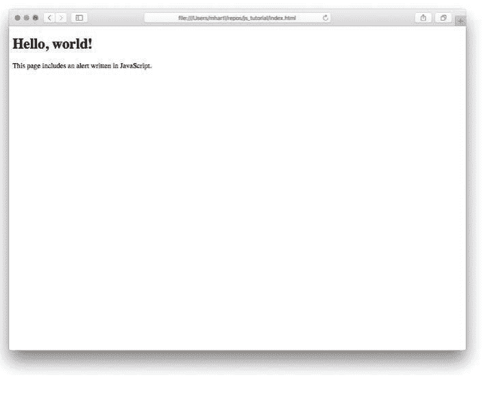

**图 1.2：** 我们初始的静态索引页面。

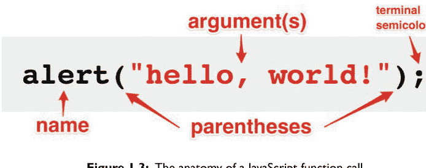

**图 1.3：** JavaScript 函数调用的构成。

这个页面的段落有点不实，因为我们还没有添加任何 JavaScript。让我们通过插入一个包含单个命令的 **script** 标签来改变这一点：

```
<script>
  alert("hello, world!");
</script>
```

这里我们使用了 **alert**，它是一个 JavaScript *函数*，一段接收参数并使用它们执行某些任务的代码。如图 1.3 所示，JavaScript 函数调用的构成是：函数名、左括号、零个或多个参数、右括号以及结束该行的分号。（我们将在第五章学习更多关于函数的知识，包括如何定义自己的函数。）

在这种情况下，**alert** 接收一个 *字符串*（第二章）并将其显示为浏览器中的一个警告。为了看到实际效果，让我们将 **alert** 代码添加到我们的索引页面中，如清单 1.2 所示。从技术上讲，我们可以将 **script** 标签放在页面上的任何位置，但按照惯例，它被放置在文档的 **head** 中（特别是当包含外部 JavaScript 文件时，如我们将在 5.2 节中看到的）。

**清单 1.2：** 用 JavaScript 实现 "Hello, world!"。

*index.html*

```
<!DOCTYPE html>
<html>
  <head>
    <title>Learn Enough JavaScript</title>
    <meta charset="utf-8">
    <script>
      alert("hello, world!");
    </script>
  </head>
  <body>
    <h1>Hello, world!</h1>
    <p>This page includes an alert written in JavaScript.</p>
  </body>
</html>
```

刷新页面后，我们的浏览器现在显示一个友好的问候（图 1.4）。

### 1.2.1 部署

作为最后一步，让我们将我们极其 fancy 的 JavaScript 应用部署到互联网上。我们的技术与在 *Learn Enough Git to Be Dangerous*、*Learn Enough HTML to Be Dangerous* 和 *Learn Enough CSS & Layout to Be Dangerous* 中介绍的一样，即使用 GitHub Pages 托管一个免费站点。

即使在这个早期阶段进行部署也是一个强有力的概念验证——抛开关于我们那个 "极其 fancy" 应用的玩笑不说，我们确实是在部署一个实时网站，这在几年前还是极其困难的一步，而现在我们可以在几秒钟内完成。

首先，让我们提交清单 1.2 中所做的更改：

```
$ git commit -am "Add a JavaScript 'hello, world'"
```

下一步是在 GitHub 上创建一个新的远程仓库，如图 1.5 所示。（如果这些步骤中的任何一步你不熟悉，请查阅 *Learn Enough Git to Be Dangerous* 了解详情。）

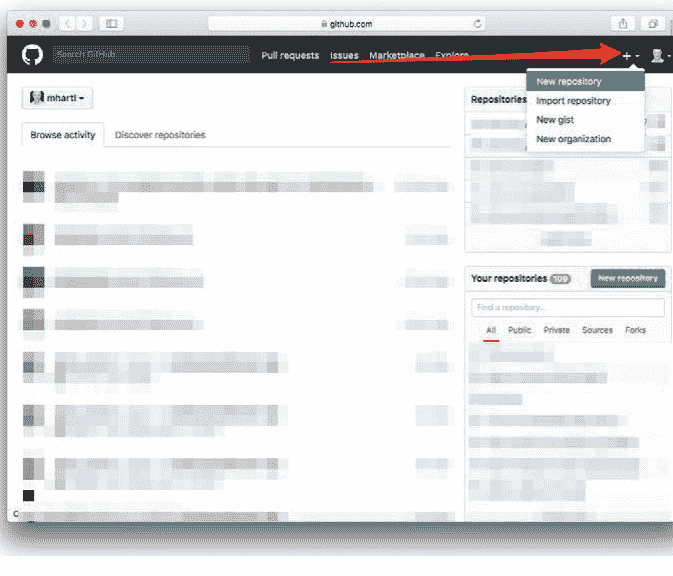

**图 1.5：** 在 GitHub 上创建新仓库。

接下来，使用远程仓库配置你的本地系统并将其推送上去（注意用你的 GitHub 用户名替换 `<username>`，并在提示输入密码时使用 GitHub 个人访问令牌），然后推送：

```
$ git remote add origin https://github.com/<username>/js_tutorial.git
$ git push -u origin main
```

因为视频相对难以更新，所以本书附带的屏幕录制视频使用的是 **master**，这是 Git 存在的前 15 多年里的默认分支名称，但正文已更新为使用 **main**，这是当前首选的默认名称。更多信息请参阅 Learn Enough 博文 "使用 Learn Enough 和 Rails 教程的默认 Git 分支名称" (https://news.learnenough.com/default-git-branch-name-with-learn-enough-and-the-rails-tutorial)。

要完成部署，我们需要做的就是编辑设置（图 1.6）并将我们的站点配置为由 GitHub Pages 从 **main** 分支提供服务，如图 1.7 和 1.8 所示。

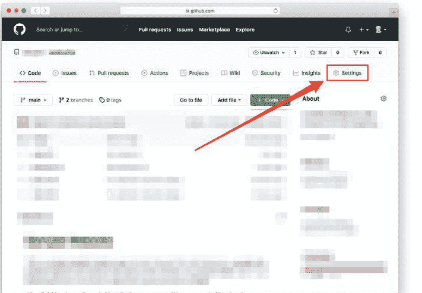

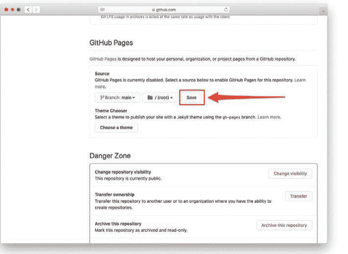

**图 1.8：** 保存新的 GitHub Pages 设置。

### 1.2.2 练习

1.  如果你在第一个警告之后放置第二个警告，会发生什么？

4.  要了解如何使用自定义域名托管 GitHub Pages 站点，请参阅免费教程 *Learn Enough Custom Domains to Be Dangerous* (https://www.learnenough.com/custom-domains)。

5.  图片由 Niday Picture Library/Alamy Stock Photo 提供。

## 1.3 在 REPL 中使用 JavaScript

我们接下来的两个关于 "hello, world" 程序的密切相关的示例涉及一个读取-求值-打印循环，或称 *REPL*（发音为 "repple"）。REPL 是一个程序，它**读取**输入，**求值**它，**打印**出结果（如果有的话），然后**循环**回读取步骤。大多数现代编程语言都提供 REPL，JavaScript 也不例外。事实上，正如上面暗示的，它实际上提供了两个。

### 1.3.1 浏览器控制台

我们关于 REPL 的第一个例子是浏览器 *控制台*，它在大多数现代浏览器中作为标准开发者工具套件的一部分可用。这些工具是否默认可用取决于你使用的浏览器；例如，它们在 Google Chrome 中是自动包含的，但在 Safari 中必须安装。请运用你的技术熟练度（框 1.1）来弄清楚你选择的浏览器的设置方法。

开发者工具通常可以通过右键单击（或 Ctrl 单击）浏览器窗口并选择 "检查元素" 来访问，以打开网页检查器（图 1.11）。结果应该看起来像图 1.12。

此时，我们已准备好通过点击开发者工具中的相应选项卡来访问控制台，如图 1.13 所示。正如我们将在 5.2 节中看到的，控制台是一个宝贵的调试工具，因为它可以访问完整的 DOM 和我们应用环境的其他方面，以及显示可能影响我们应用的任何警告或错误。特别注意，图 1.13 显示了一个警告。

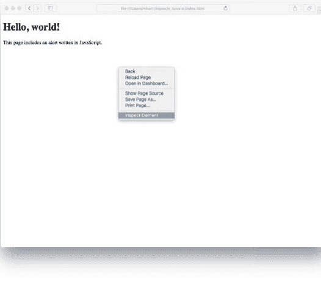

**图 1.11：** 通过 "检查元素" 激活开发者工具。

**图 1.9：** 互联网上的一个 JavaScript "hello, world!" 页面。

**图 1.10：** 让站点上线比以前更容易了。

我们终于准备好使用控制台 REPL 来编写我们的“hello, world”程序了。我们的方法是使用 `console`，这是一个表示控制台及其相关数据、函数等的 JavaScript *对象*。特别是，`console` 对象有一个名为 `log` 的函数，它会将其参数打印（“记录”）到屏幕上。我们可以通过一种在各种 *面向对象* 语言中已成为标准的“点”表示法来访问它，如代码清单 1.3 所示。

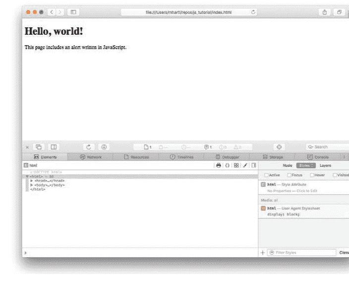

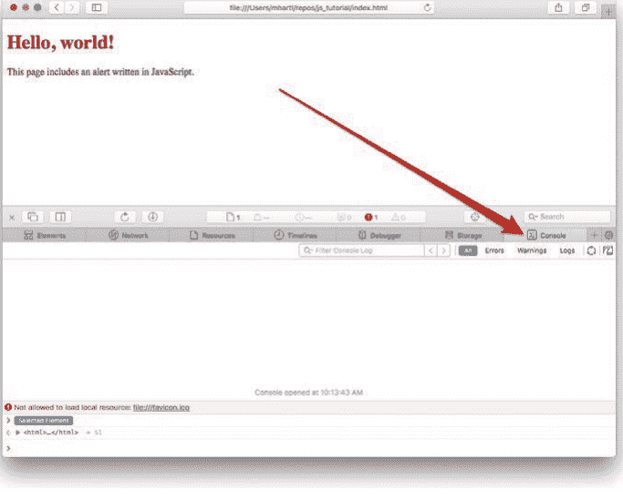

**图 1.13：** 交互式 JavaScript 控制台。

**代码清单 1.3：** 控制台中的“hello, world”命令。

```
> console.log("hello, world!");
```

在对象的上context中，像 `log` 这样通过点表示法调用的函数通常被称为 *方法*。

此时，你应该将 `console.log` 命令输入到你的浏览器控制台，注意代码清单 1.3 中的 `>` 代表控制台提示符本身，不应照字面输入。结果应类似于图 1.14。（我们将在第 2.3 节解释 `undefined` 的含义。）

细心的读者（双关语无意冒犯）可能注意到代码清单 1.3 中的命令包含一个结尾分号（图 1.3），而图 1.14 中显示的命令则没有。这种差异是为了表明

```
> console.log("hello, world!")
hello, world!
undefined
> |
```

**图 1.14：** 在浏览器控制台中打印“hello, world!”。

这两个命令的工作方式相同，并且在使用交互式控制台时省略分号是很常见的。为了保持一致，我们将在本教程的其余部分（甚至在控制台中）通常都包含分号，但最好了解这两种惯例，以防你在其他人的代码中看到不同的情况。

### 1.3.2 Node 提示符

已知宇宙中的每个 Web 浏览器都可以执行 JavaScript 程序，但将 JavaScript 视为通用编程语言的一部分也意味着要在命员行中运行它。这意味着需要安装并使用一个能够评估 JavaScript 程序的命令行程序，而如今最受欢迎的选择已非常明确：Node.js（通常发音为“node jay-ess”，常简称为“Node”）。

Node.js 可能已经安装在你的系统上。最简单的检查方法是使用 **which** 命令（如 *Learn Enough Command Line to Be Dangerous* 中（https://www.learnenough.com/command-line-tutorial/inspecting_files#sec-downloading_a_file）所述）：

```
$ which node
/usr/local/bin/node
```

如果显示了 **node** 可执文件的路径，那么你就可以继续了。

如果 Node 不在你的系统上，你现在应该安装它。如果你使用的是安装了 Homebrew（https://www.learnenough.com/dev-environment-tutorial#sec-homebrew）的 Macintosh，你可以运行

```
$ brew install node
```

来获取最新版本。如果你已经安装了，可以运行

```
$ brew upgrade node
```

来升级。否则，请访问 Node.js 网站（https://nodejs.org/en/）并按照适用于你系统的下载和安装说明进行操作。安装完成后，运行 Node.js REPL 很容易——只需在命令行中运行 **node** 命令，如代码清单 1.4 所示。

**代码清单 1.4：在命令行中调出 Node 提示符。**

```
$ node
>
```

与浏览器控制台一样，`>` 代表 Node 提示符，并且像控制台一样，它允许我们交互式地运行命令。（为了简单起见，我们有时会使用“console”来指代浏览器控制台或 Node REPL。）具体来说，要复制代码清单 1.3 中的“hello, world”程序，我们只需在 Node 提示符下输入相同的命令，如下所示：

```
> console.log("hello, world!");
hello, world!
```

（根据你的系统，你也可能会看到 **undefined** 出现；我们将在第 2.3 节讨论这个细节。）就是这样！在浏览器控制台和 Node 提示符中，我们都可以用这一个命令打印“hello, world!”：

```
> console.log("hello, world!");
```

### 1.3.3 练习

- 1. 如果你在浏览器控制台中运行 **alert** 会发生什么？在 Node 控制台中呢？

### 1.4 文件中的 JS

尽管能够交互式地探索 JavaScript 很方便，但大多数真正的编程™（Real Programming™）是在用文本编辑器创建的文本文件中进行的。在本节中，我们将展示如何创建和执行一个包含我们在前两节中讨论过的相同“hello, world”程序的 JavaScript 文件。结果将是我们将在第 5.2 节开始学习的可重用 JavaScript 文件的一个简化原型。

我们将首先为我们的 hello 程序创建一个 JavaScript 文件（扩展名为 .js）：

```
$ touch hello.js
```

接下来，使用我们最喜欢的文本编辑器，我们将用代码清单 1.5 中显示的内容填充该文件。请注意，代码与代码清单 1.3 及后续示例中的完全相同，区别在于 JavaScript 文件中没有命令提示符 >。

**代码清单 1.5：JavaScript 文件中的“hello, world”程序。**

*hello.js*

```
console.log("hello, world!");
```

此时，我们准备好使用我们在代码清单 1.4 中用来调出 Node 提示符的相同 `node` 命来执行我们的程序。唯一的区别是这次我们包含了一个参数，即我们的文件名：

```
$ node hello.js
hello, world!
```

和之前一样，结果是打印“hello, world!”，这次是打印到终端屏幕上。（在程序内部，`console.log` 的返回值像以前一样是 `undefined`，但与交互式提示符不同，命令行程序不会显示返回值，因此它没有被显示。）

尽管这个例子很简单，但这是一个巨大的进步，因为我们现在可以编写比在交互式控制台或 Node 会话中能舒适容纳的更长的 JavaScript 程序了。

### 1.4.1 练习

- 1. 如果你给 **console.log** 两个参数，如代码清单 1.6 所示，会发生什么？

**代码清单 1.6：** 使用两个参数。

*hello.js*

```
console.log("hello, world!", "how's it going?");
```

### 1.5 Shell 脚本中的 JS

尽管第 1.4 节中的代码完全可用，但在编写要在命令行 Shell（https://www.learnenough.com/command-line-tutorial/basics#sec-man\_pages）中执行的程序时，使用 *可执行脚本* 通常更好，就像 *Learn Enough Text Editor to Be Dangerous* 中讨论的那样。既然 JavaScript 可以在浏览器外如此有效地使用，它已经与更传统的“脚本语言”如 Perl、Python 和 Ruby 一起，成为编写此类 Shell 脚本的绝佳选择。

让我们看看如何使用 Node 创建一个可执行脚本。我们将从创建一个名为 **hello** 的文件开始：

```
$ touch hello
```

注意我们 *没有* 包含 *.js* 扩展名——这是因为文件名本身就是用户界面，没有理由向用户暴露实现语言。确实，有一个不这样做的理由：通过使用名字 **hello**，我们给自己保留了将来用不同语言重写脚本的选项，而无需更改程序用户必须输入的命令。（虽然在这个简单案例中并不重要，但这个原则应该很清楚。我们将在第 10.3 节看到一个更真实的例子。）

编写一个可工作的脚本有两个步骤。第一步是使用我们之前见过的相同命令（代码清单 1.5），前面加上一行“shebang”，告诉我们的系统使用 **node** 来执行该脚本。

确切的 shebang 行取决于系统；你可以通过运行 **which** 命令找到适合你系统的正确可执行路径：

```
$ which node
/usr/local/bin/node
```

在 **hello** 文件中使用此命令作为 shebang 行，即可得到代码清单 1.7 中所示的 Shell 脚本。

**代码清单 1.7：** “hello, world” Shell 脚本。

*hello*

```
#!/usr/local/bin/node

console.log("hello, world!");
```

我们可以像第 1.4 节那样直接使用 **node** 命令执行此文件，但一个真正的 Shell 脚本应该无需使用辅助程序即可执行。（这就是 shebang 行的用途。）相反，我们将遵循上面提到的第二个步骤，使用 **chmod**（“更改模式”）命令结合 **+x**（“添加可执行权限”）使文件本身可执行：

```
$ chmod +x hello
```

此时，该文件应该是可执行的，我们可以通过在命令前加上 `./` 来执行它，这告诉我们的系统在当前目录（点 = .）中查找可执行文件。（将 **hello** 脚本放在 PATH（https://www.learnenough.com/text-editor-tutorial/advanced_text_editing#code-export_path）上，以便可以从任何目录调用，这留作练习。）结果如下所示：

```
$ ./hello
hello, world!
```

成功！我们现在编写了一个可工作的 JavaScript Shell 脚本，适合进行扩展和细化。如上文简要提到的，我们将在第 10.3 节看到一个真实实用脚本的例子。

在本教程的其余部分，我们将主要使用 Node REPL 进行初步研究，但最终目标几乎总是创建一个包含 JavaScript 的文件（纯代码或 HTML）。

## 1.5.1 练习

1.  通过移动文件或更改系统配置，将 `hello` 脚本添加到环境的 PATH 中。（你可能会发现 *Learn Enough Text Editor to Be Dangerous* 中的步骤很有帮助。）确认无需在命令名前添加 `./` 即可运行 `hello`.

# 第 2 章

## 字符串

字符串可能是 Web 上最重要的数据结构，因为网页最终由从服务器发送到浏览器的字符串序列组成，而且许多其他类型的程序也需要字符串操作。因此，字符串是我们 JavaScript 编程之旅的绝佳起点。

### 2.1 字符串基础

字符串由特定顺序的字符序列组成。我们在第 1 章的“hello, world”程序中已经见过几个例子。让我们看看在 Node 会话中单独输入一个字符串（不使用 `console.log`）会发生什么：

```
$ node
> "hello, world!"
'hello, world!'
```

输入的一系列字符称为*字符串字面量*，我们在这里使用双引号字符 " 创建了它。REPL 打印计算该行的结果，对于字符串字面量，结果就是字符串本身。

你可能注意到上面的细节：我们使用双引号输入字符串，但 REPL 使用单引号返回它。这个细节取决于系统（例如，Chrome 和 Safari 等浏览器的控制台对字符串返回值使用双引号），因此如果你的系统不同，你不必担心。但这个小差异给了我们一个机会来了解 JavaScript 中单引号和双引号的区别。

# 第 2 章：字符串

与许多其他语言不同，JavaScript 在几乎所有实际用途中都可以互换使用双引号和单引号。主要的例外情况是，当撇号包含在单引号字符串中，必须用反斜杠*转义*：

```
> "It's not easy being green"
'It\'s not easy being green'
```

这里的输出在“It's”中的撇号前包含一个反斜杠。如果我们输入相同的字符串而不转义撇号，REPL 会认为字符串在“It”之后结束，导致语法错误：

```
> 'It\'s not easy being green'
'It\'s not easy being green'
> 'It's not easy being green'
'It's not easy being green'
      ^
SyntaxError: Unexpected identifier
```

这里发生的情况是，JavaScript 在字符串 **'It '** 之后看到一个裸字母 **s**。由于没有名为 **s** 的标识符，REPL 会引发错误（图 2.1）。^1^（我们将在第 2.2 节（框 2.2）中更多地讨论标识符。）

类似地，在双引号字符串中，字面双引号也必须转义：

```
> "Let's write a \"hello, world\" program!"
'Let\'s write a "hello, world" program!'
```

正如你可能猜到的，返回值显示了在单引号字符串中不需要转义双引号。

一个特别重要的字符串是没有内容的字符串，仅由两个引号组成。这被称为*空字符串*（有时也称为*唯一的*空字符串）：

```
> ""
''
```

我们将在第 2.4.2 节和第 3.1 节中更多地讨论空字符串。

1. 图片由 LorraineHudgins/Shutterstock 提供。


**图 2.1：** 有时处理语法错误并不容易。

## 2.1.1 练习

1.  JavaScript 支持常见的特殊字符，如制表符 (\t) 和换行符 (\n)。证明这两种特殊字符都适用于单引号和双引号字符串。它们的效果是什么？

### 2.2 连接和插值

两个最重要的字符串操作是*连接*（将字符串连接在一起）和*插值*（将变量内容放入字符串中）。

无论我们使用单引号还是双引号字符串，我们都可以使用 **+** 运算符连接（连接）它们：²

> 2. 在编程语言中，使用 **+** 进行字符串连接很常见，但从某个方面来说这是一个不幸的选择，因为加法是数学中典型的可交换运算：$a + b = b + a$。（相比之下，乘法在某些情况下是不可交换的；例如，当乘以矩阵时，通常有 $AB \neq BA$。）然而，在字符串连接的情况下，**+** 肯定*不是*一个可交换运算，因为，例如 **"foo" + "bar"** 是 **"foobar"**，而 **"bar" + "foo"** 是 **"barfoo"**。部分出于这个原因，一些语言（如 PHP）使用不同的符号进行连接，例如点 **.**（产生 **"foo" . "bar"**）。

```
$ node
> "foo" + "bar";    // String concatenation
'foobar'
```

这里计算 **"foo"** 加上 **"bar"** 的结果是字符串 **"foobar"**。（名称“foo”和“bar”的奇怪含义在 *Learn Enough Command Line to Be Dangerous*（[https://www.learnenough.com/command-line](https://www.learnenough.com/command-line)）中讨论了（[https://www.learnenough.com/command-line-tutorial/manipulating_files#aside-foo_bar](https://www.learnenough.com/command-line-tutorial/manipulating_files#aside-foo_bar)）。）还要注意，连接示例包含一个描述性的 JavaScript *注释*（框 2.1），你通常不会在 REPL 会话中包含它，但有时会在本教程中添加以使其更清晰。

#### 框 2.1：关于注释的注释

JavaScript *注释*以两个斜杠字符 `//` 开头，并延伸到行尾。当 JavaScript 执行时，注释会被忽略，但它们对人类读者（包括，通常情况下，原始作者！）很有用。在代码中

```
// Prints a greeting to the console.
console.log("hello, world!");  // The command itself
```

第一行是注释，指示下一行的目的，而第二行包含一些代码和一个描述该行目的的注释。

有时你会想一次为多行添加注释（这在调试时“注释掉”多行代码时特别有用（框 5.1））。任何好的文本编辑器（[https://www.learnenough.com/text-editor](https://www.learnenough.com/text-editor)）都允许你选择多行并同时注释或取消注释它们，产生类似这样的内容：

```
// console.log("foobar");
// console.log("racecar");
// console.log("Racecar");
```

细节因编辑器而异，因此请使用你的技术熟练程度（框 1.1）来找出你选择的编辑器的命令。

JavaScript 还支持包含在 `/* ... */` 中的多行注释，如下所示：

```
/* console.log("foobar");
console.log("racecar");
console.log("Racecar"); */
```

> 由于现代文本编辑器可以轻松地将单行注释应用于多行，实际上我发现我很少使用 /* ... */ 语法。

你通常不会在控制台会话中包含注释，但出于教学目的，我有时会在后面的内容中包含注释，如下所示：

```
$ node
> 17 + 42 // Integer addition
59
```

如果你通过在自己的控制台中输入或复制粘贴命令来跟进，你可以根据喜好省略注释；无论如何控制台都会忽略它们。

让我们在 *变量* 的上下文中再次查看字符串连接，你可以将变量视为包含某个值的命名框（如 *Learn Enough CSS & Layout to Be Dangerous* (https://www.learnenough.com/css-and-layout) 中所述，并在框 2.2 中进一步讨论）。

> **框 2.2：变量和标识符**

>

> 如果你以前从未编程过计算机，你可能不熟悉*变量*这个词，这是计算机科学中的一个基本概念。你可以将变量视为一个可以容纳不同（或“可变”）内容的命名框。

>

> 作为一个具体的类比，考虑许多小学为学生提供的用于存放衣物、书籍、背包等的带标签的盒子（图 2.2）。变量是盒子的位置，盒子的标签是变量名（也称为*标识符*），盒子的内容是变量值。

>

> 在实践中，这些不同的定义经常被混淆，“变量”通常用于这三个概念（位置、标签或值）中的任何一个。

我们可以使用 JavaScript 命令 `let`</think>


1. 编写JavaScript代码，测试字符串 "hoNeY BaDGeR" 是否包含字符串 "badger"，不区分大小写。

2. 对于任意整数 i，**includes(string, i)** 做什么？*提示：* 在JavaScript中，计数从0而不是1开始。

## 2.6 字符串迭代

我们关于字符串的最后一个主题是*迭代*，即一次一个元素地重复遍历对象的实践。迭代是计算机编程中的一个常见主题，我们将在本教程后面看到一些其他示例（第3.5节和第5.4节）。我们还将看到，作为开发者力量增长的一个标志是学会如何完全*避免*迭代（如第6章和第8.5节所讨论的）。

在字符串的情况下，我们将学习如何一次迭代一个*字符*。这有两个主要前提条件：首先，我们需要学习如何访问字符串中的特定字符；其次，我们需要学习如何进行*循环*。

我们可以通过查阅**String**方法列表（https://developer.mozilla.org/en-US/docs/Web/JavaScript/Reference/Global_Objects/String）来弄清楚如何访问特定的字符串字符，其中包括以下条目：

`String.prototype.charAt()`

Returns the character (exactly one UTF-16 code unit) at the specified index.

深入查看该方法本身的文档（https://developer.mozilla.org/en-US/docs/Web/JavaScript/Reference/Global_Objects/String/charAt），我们可以从示例中了解**charAt**和“索引”在此上下文中的含义。使用第2.5节中的**soliloquy**字符串，我们可以如清单2.16所示来说明这一点。

```
> console.log(soliloquy);    // 只是提醒一下字符串是什么
To be, or not to be, that is the question:
> soliloquy.charAt(0);
'T'
> soliloquy.charAt(1);
'o'
> soliloquy.charAt(2);
' '
```

## 2.6 字符串迭代

我们在代码清单 2.16 中看到，**charAt(0)** 返回第一个字符，**charAt(1)** 返回第二个，以此类推。（我们将在第 3.1 节进一步讨论这个可能违反直觉的编号约定，称为“零偏移”。）每个数字 **0**、**1**、**2** 等，都被称为一个*索引*（复数形式为 *indexes* 或 *indices*）。

现在来看我们的第一个循环示例。具体来说，我们将使用一个 **for** 循环，它定义一个索引值 **i** 并递增其值，直到达到某个最大值（代码清单 2.17）。

**代码清单 2.17：一个简单的 for 循环。**

```
> for (let i = 0; i < 5; i++) {
    console.log(i);
  }
  0
  1
  2
  3
  4
```

这种循环（语法上只有细微变化）在各种各样的编程语言中都很常见，从 C 和 C++ 到 Java、Perl、PHP 以及（正如我们刚刚看到的）JavaScript。代码清单 2.17 展示了如何使用 **let** 创建 **i** 并将其设置为 **0** 后，索引变量每次递增 **1**，直到达到 **5**，此时 **i < 5** 为 **false**，循环停止。而记法 **i++** 是一个*递增*语句，每次将 **i** 的值增加一。

如果你觉得代码清单 2.17 中的代码令人困惑或难看，你并不孤单。我认为良好编程的标志是尽可能*避免*使用 **for** 循环，而是更倾向于使用 **forEach** 循环（第 5.4 节）或完全避免循环，转而使用函数式编程（第 6 章和第 8.5 节）。正如计算机科学家（也是我的朋友）Mike Vanier（图 2.14）曾经在一封给 Paul Graham 的邮件中所说：

> 这种[繁琐的重复]一段时间后会让你精疲力竭；如果每次我用 C 写“for (i = 0; i < N; i++)”都能拿到五美分，那我已经是百万富翁了。

注意 Mike 邮件中的 **for** 循环语法与代码清单 2.17 中的几乎相同；唯一的区别是没有 **let** 以及使用了 **N**，我们可以从上下文推断出它代表循环索引的某个上限。


**图 2.14：** 再多写几个 **for** 循环，Mike Vanier 就要成为百万富翁了。

我们将从第 6 章开始学习如何避免这种精疲力竭，但现在，代码清单 2.17 是我们能做到的最好情况。

让我们结合代码清单 2.16 和 2.17 来迭代哈姆雷特著名独白第一行的所有字符。我们需要的新东西是循环应该停止的索引。在代码清单 2.17 中，我们硬编码了上限（**i < 5**），我们也可以在这里这样做。但 **soliloquy** 变量有点长，手动计数字符太麻烦，所以让我们用 JavaScript 的 **length** 属性（第 2.4 节）来获取：

```
> soliloquy.length
42
```

这个极其吉利的结果表明可以这样写代码：

```
for (let i = 0; i < 42; i++) {
  console.log(soliloquy.charAt(i));
}
```

这段代码可以工作，并且与代码清单 2.17 完全类似，但它也引出了一个问题：为什么要在循环本身中硬编码长度，而不是直接使用 **length** 属性呢？

答案是我们不应该这样做，在循环时尽可能使用 **length** 属性是常见做法。改进后的 **for** 循环（及其结果）见代码清单 2.18。

**代码清单 2.18：** 结合 **charAt** 和 **for** 循环。

```
> for (let i = 0; i < soliloquy.length; i++) {
    console.log(soliloquy.charAt(i));
  }
  T
  o

  b
  e
  .
  .
  .
  t
  i
  o
  n
  :
```

如上所述，**for** 循环最好尽可能避免，但这种不太优雅的循环风格仍然是一个很好的起点。正如我们将在第 8 章看到的，一种强大的技术是为我们想要的功能编写一个*测试*，然后尽一切可能让它通过测试，然后*重构*代码以使用更优雅的方法。这个过程（称为*测试驱动开发*，或 TDD）的第二步通常涉及编写不优雅但易于理解的代码——而这正是简单的 **for** 循环所擅长的。

### 2.6.1 练习

1.  使用 **let** 定义一个等于 **soliloquy** 长度的变量 **N**，并证明 Mike Vanier 的 **for** 循环代码在 JavaScript 中确实如所写那样工作。（特别地，有时可以省略 **let**，虽然这不是好习惯。）

2.  证明你可以将代码清单 2.18 中的 **charAt** 方法替换为字面量的方括号表示法，例如：**soliloquy[i]**。

# 第 3 章

## 数组

在第 2 章中，我们看到字符串可以被视为按特定顺序排列的字符序列。在本章中，我们将学习*数组*数据类型，它是 JavaScript 中用于按特定顺序存放任意元素的通用容器。我们将首先通过 String `split` 方法（第 3.1 节）明确连接字符串和数组，然后在本章剩余部分学习各种数组方法。

### 3.1 分割

到目前为止，我们花了很多时间理解字符串，通过 `split` 方法有一种自然的方式从字符串得到数组：

```
> "ant bat cat".split(" ");	// 将字符串分割成一个包含三个元素的数组。
[ 'ant', 'bat', 'cat' ]
```

从这个结果我们看到，`split` 返回一个由原始字符串中以空格分隔的字符串组成的列表。

按空格分割是最常见的操作之一，但我们也可以按几乎任何其他内容分割：

```
> "ant,bat,cat".split(",");
[ 'ant', 'bat', 'cat' ]
> "ant, bat, cat".split(", ");
[ 'ant', 'bat', 'cat' ]
> "antheybatheycat".split("hey");
[ 'ant', 'bat', 'cat' ]
```

我们甚至可以通过按空字符串分割，将字符串拆分成其组成字符：

```
> "badger".split("")
[ 'b', 'a', 'd', 'g', 'e', 'r' ]
```

我们将在第 5.3 节好好利用这个基本技术（同时也会发现它有一个重要的限制）。

最后，值得注意的是分割支持*正则表达式*，这将在第 4.3 节介绍。

#### 3.1.1 练习

1.  将字符串 "A man, a plan, a canal, Panama" 按逗号-空格分割，并将结果赋给变量 **a**。结果数组有多少个元素？

2.  你能猜出就地反转 **a** 的方法吗？（如果需要，可以搜索一下。）

### 3.2 数组访问

通过 **split** 方法将字符串与数组连接起来后，我们现在将发现第二个紧密的联系。让我们开始将一个变量赋值为使用 **split** 创建的字符数组：

```
> let a = "badger".split("");
```

我们可以使用在大量不同语言中常见的方括号表示法来访问 **a** 的特定元素，如代码清单 3.1 所示。

**代码清单 3.1：** 使用方括号表示法访问数组。

```
> a[0];
'b'
> a[1];
'a'
> a[2];
'd'
```

代码清单 3.1 看起来有点眼熟吗？这和我们在代码清单 2.16 中通过 **String#charAt** 方法看到的字符与数字索引之间的基本关系是一样的。（上一句中的表示法表明 *charAt* 是一个*实例方法*，即字符串实例上的方法。）事实上，方括号表示法实际上可以直接用于字符串：

```
> "badger"[0];
'b'
> "badger"[1];
'a'
```

我们从代码清单 3.1 中看到，与字符串一样，数组也是*零偏移*的，这意味着“第一个”元素索引为 **0**，第二个索引为 **1**，以此类推。这个约定可能令人困惑，实际上，对于零偏移数组，通常将初始元素称为“第零个”元素，以提醒索引从 **0** 开始。在使用多种语言时（其中一些语言的数组索引从 **1** 开始），这个约定也可能令人困惑，正如 xkcd 连环漫画“唐纳德·克努特”（https://m.xkcd.com/163/）所说明的那样。¹

到目前为止，我们只处理了字符数组，但 JavaScript 数组可以包含各种元素：

```
> a = ["badger", 42, soliloquy.includes("To be")];
[ 'badger', 42, true ]
> a[2];
true
> a[3];
undefined
```

我们在这里看到，对于混合类型数组，方括号访问表示法照常工作，这并不奇怪。我们还看到，尝试访问定义范围之外的数组索引会返回 **undefined**（我们之前在 **console.log** 的上下文中见过这个值（图 2.4））。如果你有之前的编程经验，这可能会让你感到惊讶，因为许多语言在你尝试访超出范围的元素时会抛出错误，但 JavaScript 在这方面更为宽容。

1.  这条特定的 xkcd 连环漫画以其同名的著名计算机科学家唐纳德·克努特（发音为“kuh-NOOTH”）命名，他是《计算机程序设计艺术》的作者，也是 TeX 排版系统的创建者，许多技术文档（包括本文档）都使用该系统排版。

## 3.2.1 练习

- 1. 编写一个 `for` 循环，打印出将字符串 "honey badger" 按空字符串分割后得到的字符。

- 2. 猜猜 `undefined` 在布尔上下文中是什么值。用 `!!` 来验证。

### 3.3 数组切片

除了支持第 3.2 节描述的方括号表示法外，JavaScript 还支持一种称为 *数组切片* 的技术，用于一次访问多个元素。为了预习第 3.4 节的 *排序* 知识，我们重新定义数组 **a**，使其包含纯数字元素：

```
> a = [42, 8, 17, 99];
[ 42, 8, 17, 99 ]
```

切片数组最简单的方法是只提供一个参数，它会返回数组中从该索开始的所有元素。例如，对于一个有四个元素的数组，**slice(1)** 会返回第二个、第三个和第四个元素（回想一下，“第一个”或第零个元素的索引是 **0**）：

```
> a.slice(1);
[ 8, 17, 99 ]
```

我们也可以从一个索引切片到另一个索引：

```
> a.slice(1, 3);
[ 8, 17 ]
```

切片为我们提供了一种简便的方法来执行一个常见任务，即访问数组中的最后一个元素。与字符串类似，数组也有一个 **length** 属性，因此我们可以这样找到最后一个元素：

```
> a.length;
4
> a[a.length-1];
99
```

不过，如果变量名很长，这可能会变得有点混乱，在有很多变量的大型项目中经常如此：

```
> let aMuchLongerArrayName = a;
> aMuchLongerArrayName[aMuchLongerArrayName.length - 1];
99
```

这引出了我们获取最后一个元素的第二种方法，即使用 **slice** 和一个 *负数*，它从末尾开始计数：

```
> aMuchLongerArrayName.slice(-1);
[ 99 ]
```

这是一个包含一个元素的数组，因此我们可以使用方括号表示法来选择该元素本身：

```
> aMuchLongerArrayName.slice(-1)[0];
99
```

最后一个常见情况是，我们想同时访问最后一个元素并将其移除。我们将在第 3.4.2 节介绍实现此操作的方法。

#### 3.3.1 练习

- 1. 定义一个包含数字 1 到 10 的数组。使用切片和 **length** 选择从第三个到倒数第三个的元素。使用负索引完成相同的任务。

- 2. 证明字符串也支持 **slice** 方法，从字符串 **"ant bat cat"** 中选择 **"bat"**。（你可能需要尝试一下才能得到正确的索引。）

### 3.4 更多数组方法

除了第 3.3 节看到的 **slice** 方法外，数组还支持许多其他方法。与往常一样，文档 (https://developer.mozilla.org/en-US/docs/Web/JavaScript/Reference/Global_Objects/Array) 是获取详细信息的好地方。

与字符串类似，数组支持 **includes** 方法来测试是否包含某个元素：

```
> a;
[ 42, 8, 17, 99 ]
> a.includes(42);        // 测试是否包含元素。
true
> a.includes("foo");
false
```

#### 3.4.1 排序和反转

你也可以对数组进行原地排序——在 C 语言的古老年代，这通常需要自定义实现，是一个非常棒的技巧。在 JavaScript 中，我们只需调用 **sort()**：

```
> a.sort();
[ 17, 42, 8, 99 ]
> a;                   // `a` 因 `sort()` 而改变。
[ 17, 42, 8, 99 ]
```

你可能注意到这里有点奇怪，JavaScript 对数组元素进行排序时，并不是根据它们的数值，而是“按字母顺序”，所以 **17** 排在 **8** 之前，因为在计算机使用的排序方案（ASCII）中，**1** 排在 **8** 之前。（我们将在第 5 章学习如何按数值排序数组。）

另一个有用的方法——我们将在第 5.3 节开始开发回文主题时善加利用——是 **reverse** 方法：

```
> a.reverse();
[ 99, 8, 42, 17 ]
> a;                   // 像 `sort()` 一样，`reverse()` 会改变数组。
[ 99, 8, 42, 17 ]
```

如注释所述，像 **a.sort()** 和 **a.reverse()** 这样的方法会 *修改* 数组，意味着它们在执行各自操作时，会作为副作用修改数组。这种行为因编程语言而异，因此在其他语言中使用类似方法时要小心。

#### 3.4.2 入栈和出栈

一对有用的数组方法是 **push** 和 **pop**；**push** 让我们向数组末尾添加一个元素，而 **pop** 则移除它：

```
> a.push(6);
5
> a;
[ 99, 8, 42, 17, 6 ]
> a.push("foo");
6
> a;
[ 99, 8, 42, 17, 6, 'foo' ]
> a.pop();
'foo'
> a.pop();
6
> a;
[ 99, 8, 42, 17 ]
```

如注释所示，**pop** 返回最后一个元素的值（同时将其移除作为副作用），但 **push**（有点反直觉）返回的是新数组的 *长度*。截至撰写本文时，我不知道为什么（Stack Overflow 上也没有答案）。

现在我们可以理解第 3.3 节中关于获取数组最后一个元素的评论了，只要我们不介意修改它：

```
> let lastElement = a.pop();
> lastElement;
17
> a;
[ 99, 8, 42 ]
> let theAnswerToLifeTheUniverseAndEverything = a.pop();
```

#### 3.4.3 撤销分割

最后一个数组方法的例子是 **join**，它让我们从第 3.1 节绕了一圈又回来了。正如 **split** 将字符串分割成数组元素一样，**join** 将数组元素连接成一个字符串（清单 3.2）。

清单 3.2：不同的连接方式。

```
> a = ["ant", "bat", "cat", 42];
[ 'ant', 'bat', 'cat', 42 ]
> a.join();                    // 使用默认值（逗号）连接。
'ant,bat,cat,42'
> a.join(", ");                  // 使用逗号加空格连接。
'ant, bat, cat, 42'
> a.join(" -- ");                // 使用双破折号连接。
'ant -- bat -- cat -- 42'
> a.join("");                  // 使用空字符串连接。
'antbatcat42'
```

请注意，整数 42 在连接时会自动转换为字符串。

#### 3.4.4 练习

- 1. `split` 和 `join` 方法几乎是互逆操作，但并不完全等同。特别是，请使用 `==`（不是 `===`）验证清单 3.2 中的 `a.join(" ").split(" ")` *不等于* `a`。为什么？

- 2. 查阅数组文档，弄清楚如何向数组的 *头部* 添加元素或从 *头部* 移除元素。*提示：* 这些名称一点也不直观，所以你可能需要费点心思。

### 3.5 数组迭代

数组最常见的任务之一是遍历其元素并对每个元素执行操作。这听起来可能很熟悉，因为我们在第 2.6 节用字符串解决了完全相同的问题，而且解决方案实际上几乎相同。我们需要做的就是调整清单 2.18 中的 `for` 循环以应用于数组。

我们本可以一步到位地轻松实现，但如果我们首先用方括号访问表示法重写字符串 `for` 循环（如我们在第 3.2 节所见，它也适用于字符串），那么这种联系会更清晰。对于清单 2.15 中定义的 `soliloquy` 字符串，结果显示在清单 3.3 中。

清单 3.3：结合字符串访问和 **for** 循环。

```
> for (let i = 0; i < soliloquy.length; i++) {
    console.log(soliloquy[i]);
}
T
o

b
e
.
.
.
t
i
o
n
:
```

清单 3.3 中的结果与清单 2.18 中显示的结果完全相同。将此模式应用于数组现在应该很清楚了。我们只需要将 **soliloquy** 替换为 **a**，如清单 3.4 所示；其余代码完全相同。

清单 3.4：结合数组访问和 **for** 循环。

```
> for (let i = 0; i < a.length; i++) {
    console.log(a[i]);
  }
ant
bat
cat
42
```

这里值得注意的一点是，迭代索引变量 **i** 出现在两个 **for** 循环中。如果你完成了第 2.2.2 节的练习，你可能还记得，重新定义一个已经用 **let** 声明的变量通常会导致错误。为什么我们在这个上下文中可以重用 **i**？答案是在 **for** 循环的上下文中，变量的 *作用域* 被限制在循内，并在循环结束时消失。


**图 3.1：** Mike Vanier 仍然对输入 **for** 循环感到烦恼。

这很方便，但不是遍历数组的最佳方式，Mike Vanier 仍然不会满意（图 3.1）。我们将在第 5.4 节看到一种更简洁的数组遍历方法，并在第 6 章看到一种完全避免迭代的方法。

#### 3.5.1 练习

- 1. 证明标识符 `i` 在 `for` 循环执行前后都是未定义的。（你可能需要退出并重新进入 Node 控制台。）

- 2. 定义一个累加器变量 **total**，并将其与循环结合使用，以计算清单 3.4 中所有元素的总和。你可以使用清单 3.5 中的代码作为起点（只需将注释替换为正确的代码）。**total** 的值与 `a.join("")` 相比如何？

清单 3.5：计算总和的框架。

```
> let total = "";
> for (let i = 0; i < a.length; i++) {
    // 将 total 设置为当前总和加上当前元素
  }
```

# 第4章

其他原生对象

现在我们已经了解了字符串和数组，接下来将继续探索一些其他重要的JavaScript对象：数学对象、日期对象、正则表达式和通用对象。

## 4.1 Math 和 Number

与大多数编程语言一样，JavaScript支持大量的数学运算：

```
> 1 + 1;
2
> 2 - 3;
-1
> 2 * 3;
6
> 10/5;
2
> 2/3;
0.6666666666666666
```

请注意，这里的最后一个例子并不精确；它是一个*浮点数*（也称为*浮点*），计算机无法精确表示。但事实上，JavaScript只有一种数字类型，即使是像1或2这样的数字在底层也被视为浮点数。这对我们程序员来说很方便，因为这意味着我们永远不必区分不同种类的数字。¹

包括我在内的许多程序员发现，当需要时，启动一个REPL并将其用作简单的计算器是很方便的。它不花哨，但速度快且相对强大，定义变量的能力也经常派上用场。

### 4.1.1 更高级的运算

JavaScript通过名为 **Math** 的*全局对象*支持更高级的数学运算，该对象包含数学常数、幂运算²、根和三角函数等属性和方法：

```
> Math.PI
3.141592653589793
> Math.pow(2, 3);
8
> Math.sqrt(3)
1.7320508075688772
> Math.cos(2*Math.PI)
1
```

对于那些从高中（甚至大学）教科书中使用 `ln` 表示自然对数的人来说，这里有一个需要注意的地方。像数学家和大多数其他编程语言一样，JavaScript使用 `log` 代替：

```
> Math.E;
2.718281828459045
> Math.log(Math.E);
1
> Math.log(10);
2.302585092994046
```

数学家通常使用 `log₁₀` 表示以十为底的对数，JavaScript也遵循这一惯例，使用 **log10**：

```
> Math.log10(10);
1
> Math.log10(1000000);
6
> Math.log10(Math.E);
0.4342944819032518
```

Math文档（https://developer.mozilla.org/en-US/docs/Web/JavaScript/Reference/Global_Objects/Math）包含更全面的运算列表。

### 4.1.2 Math 转字符串

我们在第3章讨论了如何使用 `split` 和 `join` 在字符串和数组之间转换（反之亦然）。同样，JavaScript允许我们在数字和字符串之间转换。

将数字转换为字符串最常用的方法可能是使用 `toString()` 方法，我们可以通过这个有用的定义（https://tauday.com/tau-manifesto）（图4.1）来了解：³

```
> let tau = 2 * Math.PI;
> tau.toString();
'6.283185307179586'
```

`toString()` 方法在裸整数上不起作用：

```
> 100.toString();
100.toString();
^^^^
SyntaxError: Invalid or unexpected token
```

但如果你使用额外的点，使JavaScript将数字视为浮点数，它就能工作：

```
> 100.0.toString()
'100'
```

这是不幸的行为，因为 `100.0` 对应的字符串更应该是"100.0"，但这是我们为JavaScript缺乏适当的整数数据类型所付出的代价。

将原始数字转换为字符串的另一种方法是直接使用 `String` 对象：

```
> String(100.0);
'100.0'
> String(tau);
'6.283185307179586'
```

从第二个例子我们看到，`String` 也适用于变量。

这种转换为字符串的方法与反向转换很好地契合，反向转换直接使用 `Number` 对象：

```
> Number("6.283185307179586");
6.283185307179586
> String(Number("6.283185307179586"));
'6.283185307179586'
> Number('1.24e6')
1240000
```

在最后一行我们看到，JavaScript支持科学记数法：

```
> 1.24e6
1240000
```

### 4.1.3 练习

- 1. 试着猜测 `String(Number('1.24e6'))` 的返回值。使用Node REPL确认。

- 2. 与大多数编程语言一样，JavaScript不支持虚数，即虚数单位 *i* 的实数倍（满足方程 $i^2 = -1$，有时写作 $i = \sqrt{-1}$）。JavaScript中 $-1$ 的平方根的值是什么？通过猜测或谷歌搜索，弄清楚这个值代表什么。它的布尔值是什么？

## 4.2 日期对象

另一个常用的内置对象是 `Date`，它表示时间中的一个时刻。

`Date` 对象给了我们第一次使用 `new` 函数的机会，这是一个所谓的*构造函数*，是JavaScript创建新对象的标准方式。到目前为止，我们一直依赖于引号和方括号等"字面量构造函数"，但我们也使用 `new` 来定义字符串和数组等：

```
> let s = new String("A man, a plan, a canal-Panama!");
> s;
[String: 'A man, a plan, a canal-Panama!']
> s.split(", ");
[ 'A man', 'a plan', 'a canal-Panama!' ]
```

和

```
> let a = new Array();
> a.push(3);
> a.push(4);
> a.push("hello, world!");
> a;
[ 3, 4, 'hello, world!' ]
> a.pop();
'hello, world!'
```

与字符串和数组不同，日期没有字面量构造函数，因此在这种情况下我们*必须*使用 **new**：

```
> let now = new Date();
> now;
2022-03-16T 19:22:13.673Z
> let moonLanding = new Date("July 20, 1969 20:18");
> now - moonLanding;
1661616253673
```

这里的结果是自首次登月以来的毫秒数（图4.2）。⁴（当然，你的结果会有所不同，因为时间在流逝，你的 **new Date()** 值会不同。）

与其他JavaScript对象一样，**Date** 对象响应多种方法：

```
> now.getYear();       // 给出一个奇怪的结果
122
> now.getFullYear();    // 这才是我们想要的。
2022
> now.getMonth();
2
> now.getDay();
3
```

这里的第一行表明，有时JavaScript方法的结果令人困惑，因此重要的是要保持警惕，并不时手动复查数值。

月份和天数以索引形式返回，像JavaScript中的所有东西一样，它们是从零开始的。例如，月份 **0** 是一月，月份 **1** 是二月，月份 **2** 是三月，等等。

尽管官方国际标准是星期一为一周的第一天，但JavaScript遵循美国的惯例，使用星期日作为第一天。我们可以通过创建一个包含星期几的字符串数组，然后使用 `getDay()` 作为索引，用方括号表示法（第3.1节）在数组中获取星期几的名称：

```
> let daysOfTheWeek = ["Sunday", "Monday", "Tuesday", "Wednesday", "Thursday", "Friday", "Saturday"];
> daysOfTheWeek[now.getDay()];
'Wednesday'
```

当然，除非你恰好在星期三读到这里，否则你的结果会有所不同。作为最后的练习，让我们更新网页，添加一个包含星期几的警报。代码如清单4.1所示，结果如图4.3所示。

### 清单4.1：添加根据星期几定制的问候语。

index.html

```
<!DOCTYPE html>
<html>
  <head>
    <title>Learn Enough JavaScript</title>
    <meta charset="utf-8">
    <script>
      const daysOfWeek = ["Sunday", "Monday", "Tuesday", "Wednesday",
                         "Thursday", "Friday", "Saturday"];
      let now = new Date();
      let dayName = daysOfWeek[now.getDay()];
      alert(`Hello, world! Happy ${dayName}.`);
    </script>
  </head>
  <body>

  </body>
</html>
```

**图4.3：仅为你定制的今日问候语。**

---

¹ 与JavaScript相反，许多语言区分整数和浮点数，这会导致诸如 `1.0/2.0` 是预期的 `0.5`，但 `1/2` 是 `0` 的陷阱。

² 添加对使用两个星号 `**` 进行幂运算的支持正在进行中，但在撰写本文时并未普遍实现。

³ 使用 τ 表示圆周常数 6.283185... 是我在2010年发表的一篇名为 *The Tau Manifesto* 的数学论文中提出的，该论文还设立了一个名为 Tau Day (https://tauday.com/) 的数学节日，每年6月28日庆祝。

⁴ 图片由 Castleski/Shutterstock 提供。

请注意，清单4.1在定义**daysOfTheWeek**时使用了**const**而不是**let**：

```
const daysOfTheWeek = ["Sunday", "Monday", "Tuesday", "Wednesday",
                        "Thursday", "Friday", "Saturday"];
```

这里的**const**，（你可能已经猜到）是“constant”的缩写，它提供了一种方式来表明变量的值不会改变。<sup>5</sup> 有些人甚至尽可能使用**const**来代替**let**。我的偏好是默认使用**let**，而在需要特别强调值不应改变时使用**const**作为信号。

## 4.2.1 练习

-   1. 通过传入包含年份的生日字符串来创建一个新的**Date**对象。JavaScript支持多种不同的格式，所以使用你喜欢的日期格式应该都能成功。这很酷，对吧？

-   2. 你是在月球着陆后多少秒出生的？（或者你可能在月球着陆*之前*就出生了——那样的话，你真幸运！我希望你当时能在电视上看到它。）

### 4.3 正则表达式

JavaScript完全支持*正则表达式*，通常简称为*regexes*或*regexps*，这是一种用于匹配文本模式的强大迷你语言。全面掌握正则表达式超出了本书的范围（或许也超出了人类能力的范围），但好消息是，有许多资源可以让你逐步学习。（其中一些资源在*Learn Enough Command Line to Be Dangerous*（[https://www.learnenough.com/command-line](https://www.learnenough.com/command-line)）的“Grepping”（[https://www.learnenough.com/command-line-tutorial/inspecting_files](https://www.learnenough.com/command-line-tutorial/inspecting_files)）和*Learn Enough Text Editor to Be Dangerous*（[https://www.learnenough.com/text-editor](https://www.learnenough.com/text-editor)）的“全局查找和替换”（[https://www.learnenough.com/text-editor-tutorial/advanced_text_editing#sec-global_find_and_replace](https://www.learnenough.com/text-editor-tutorial/advanced_text_editing#sec-global_find_and_replace)）中有所提及。）最重要的是理解正则表达式的总体思路；具体细节你可以在实践中逐步补充。

正则表达式以简洁和容易出错而臭名昭著；正如程序员Jamie Zawinski的名言：

> 有些人遇到问题时会想：“我知道了，我要用正则表达式。”现在他们有两个问题了。

幸运的是，像regex101 (https://regex101.com/)这样的Web应用极大地改善了这种情况，它允许我们交互式构建正则表达式（图4.4）。此外，这类资源通常包含快速参考，帮助我们找到匹配特定模式的代码（图4.5）。

如果你仔细观察图4.4，你可能会在左侧菜单中看到一个勾选标记，表示已为正则表达式输入格式选择了“javascript”。这安排使用了本教程中我们需要的确切正则表达式约定。实际上，不同语言在实现正则表达式上差异很小，但使用正确的特定语言设置是明智的，并且在将正则表达式移至不同语言时，务必仔细检查。让我们看看JavaScript中一些简单的正则表达式匹配。我们的示例将结合使用正则表达式方法和专门为正则表达式定制的字符串方法。（后者在实践中通常更方便。）

### 4.3.1 正则表达式方法

一个基本的正则表达式由一系列字符组成，这些字符匹配特特定的模式。我们可以使用`RegExp`对象（第4.2节）的`new`函数创建一个新的正则表达式。例如，这是一个匹配标准美国邮政编码（图4.6）⁶的正则表达式，由连续五个数字组成：

```
> let zipCode = new RegExp("\\d{5}");
```

这里`\d`代表任何数字（0–9），第一个反斜杠需要*转义*第二个反斜杠，以便在字符串中得到一个字面的反斜杠。（我们将在第4.3.2节看到如何使用字面正则表达式构造函数来避免这种不便的要求。）同时，{5}表示匹配连续的正好五个数字。

如果你经常使用正则表达式，最终你会记住许多这样的规则，但你总是可以在快速参考中查找它们（图4.5）。

现在让我们看看如何判断一个字符串是否匹配一个正则表达式。正则表达式有一个`exec`方法，它在字符串上“执行”该正则表达式：

```
> let result = zipCode.exec("Beverly Hills 90210");
> result;
[ '90210', index: 14, input: 'Beverly Hills 90210' ]
```

结果包括匹配的字符串、匹配开始的索引号以及原始输入。

我不喜欢上面结果的格式，主要因为输出是一个奇怪且令人困惑的伪数组，它似乎有三个元素，但事实上长度为1：

```
> result.length
1
```

### 4.3.2 字符串方法

进行正则表达式匹配的一种更方便的方法是使用字符串方法。还有一种字面正则表达式构造语法，对大多数目的来说更方便。

正如我们在第4.2节学到的，一些JavaScript对象需要使用**new**创建，而另一些则有可选的字面构造函数，例如用引号创建字符串，用方括号创建数组。正则表达式支持这样一种字面构造语法，即，放在正斜杠内的模式：

```
> zipCode = /\d{5}/;
/\d{5}/
```

请注意，与第4.3.1节中命名的**RegExp**构造函数的情况不同，使用字面构造函数时，我们不必用额外的反斜杠转义**\d**。

现在让我们构建一个包含多个邮政编码的更长字符串（图4.7）：⁷

```
> let s = "Beverly Hills 90210 was a '90s TV show set in Los Angeles.";
> s += " 91125 is another ZIP code in the Los Angeles area."
'Beverly Hills 90210 was a \'90s TV show set in Los Angeles. 91125 is another ZIP code in the Los Angeles area.'
```

如果你以前没见过，你应该能够运用你的技术成熟度（方框1.1）推断出**+=**运算符在这里的作用（这可能需要快速搜索一下）。

要判断字符串是否匹配正则表达式，我们可以使用字符串的**match**方法：

```
> s.match(zipCode);
[ '90210',
  index: 14,
  input: 'Beverly Hills 90210 was a \'90s TV show set in Los Angeles. 91125 is another ZIP code in the Los Angeles area.' ]
```

结果与我们在第4.3.1节看到的相同奇怪的伪数组，但至少第二次运行时给出了相同的结果：

```
> s.match(zipCode);
[ '90210',
  index: 14,
  input: 'Beverly Hills 90210 was a \'90s TV show set in Los Angeles. 91125 is another ZIP code in the Los Angeles area.' ]
```

**match**方法在条件语句中特别有用；回顾第2.4.2节的“bang bang”表示法，我们可以在布尔上下文中评估匹配结果：

```
> !!s.match(zipCode);
**true**
```

因此，我们可以这样做：

```
> **if** (s.match(zipCode)) {
    "Looks like there's at least one ZIP code in the string!";
  }
'Looks like there\'s at least one ZIP code in the string!'
```

更棒的是，有一种常用的技术用于匹配正则表达式的*所有*出现，即在第二个斜杠后使用“全局标志”**g**：

> <sup>5</sup> 从技术上讲，**const**创建一个*不可变绑定*——即，名称不能改变，但值可以改变。然而，修改使用**const**创建的变量的内容是一种不良实践，应避免以防止混淆。

### 4.3 正则表达式

```javascript
> zipCode = /\d{5}/g;    // 使用 'g' 来设置 '全局' 标志。
/\d{5}/g
```

得到的结果非常直观：

```javascript
> s.match(zipCode);
[ '90210', '91125' ]
```

这里的结果就是一个在字符串中检测到的邮政编码数组，适用于连接（第3.4.3节）或迭代（第3.5节和第5.4节）。

我们关于正则表达式的最后一个例子结合了模式匹配的强大功能与我们在第3.1节看到的 **split** 方法。在那一节中，我们按空格进行分割，如下所示：

```javascript
> "ant bat cat duck".split(" ");
[ 'ant', 'bat', 'cat', 'duck' ]
```

我们可以通过按 *空白字符* 分割来以更稳健的方式获得相同的结果，空白字符包括空格、制表符（用 \t 表示）和换行符（用 \n 表示）。

查阅快速参考（图4.5），我们发现表示空白字符的正则表达式是 **\s**，而表示“一个或多个”的方式是加号 **+**。因此，我们可以按空白字符进行分割，如下所示：

```javascript
> "ant bat cat duck".split(/\s+/);
[ 'ant', 'bat', 'cat', 'duck' ]
```

这样做的好处在于，现在即使字符串之间由多个空格、制表符、换行符等分隔，我们也能得到相同的结果：⁸

```javascript
> "ant\tbat cat\nduck".split(/\s+/);
[ 'ant', 'bat', 'cat', 'duck' ]
```

我们在这里也看到了字面量构造器的价值：特别是在使用短正则表达式时，无需定义中间变量；相反，我们可以直接使用字面量正则表达式。

8. 这个模式非常有用，在某些语言（尤其是Ruby）中，它是 **split** 的默认行为，因此 "ant\tbat cat".split 的结果是 ["ant", "bat", "cat"]。


**图 4.8：** 邮政编码 10118-0110（帝国大厦）。

#### 4.3.3 练习

1.  编写一个正则表达式，匹配扩展格式的邮政编码，该格式由五位数字、一个连字符和一个四位扩展名组成（例如 10118-0110）。使用 `String#match` 和图4.8的说明来确认其有效。

2.  编写一个仅按换行符分割的正则表达式。此类正则表达式对于将一段文本分割成单独的行很有用。特别是，通过将清单4.2中的诗粘贴到控制台并使用 `sonnet.split(/你的正则表达式/)` 来测试你的正则表达式。得到的数组长度是多少？

**清单 4.2：** 带有一些换行符的文本。

```javascript
> const sonnet = `Let me not to the marriage of true minds
Admit impediments. Love is not love
Which alters when it alteration finds,`
```

> 9. 图片由 jordi2r/123RF 提供。

Or bends with the remover to remove.

O no, it is an ever-fixed mark

That looks on tempests and is never shaken;

It is the star to every wand'ring bark,

Whose worth's unknown, although his height be taken.

Love's not time's fool, though rosy lips and cheeks

Within his bending sickle's compass come:

Love alters not with his brief hours and weeks,

But bears it out even to the edge of doom.

If this be error and upon me proved,

I never writ, nor no man ever loved.

## 4.4 普通对象

*object* 这个词在JavaScript的各种语境中使用，通常指的是数据（属性）和函数（方法）集合的抽象概念。如第2.4节所述，JavaScript中（几乎）一切都是对象，我们将在第7章看到如何定义与 **String**、**Array** 和 **RegExp** 等内置对象类似的对象。在本节中，我们将重点关注 *普通对象*，它们比目前遇到的更通用的对象更容易定义。

通常，JavaScript中的对象可能非常复杂，但在其最简单的形式下，它们的工作原理类似于其他语言中的哈希表（也称为 *关联数组*）。你可以将它们想象成类似于常规数组，但使用字符串而不是整数作为索引。因此，每个元素都是一个值对：一个字符串（*键*）和一个任何类型的元素（*值*）。这些元素也称为 *键值对*。

作为一个简单的例子，让我们创建一个对象来存储用户的姓和名，就像我们在Web应用程序中可能遇到的那样：

```javascript
> let user = {};    // {} 是一个空对象。
{}
> user["firstName"] = "Michael"; // 键 "firstName"，值 "Michael"
'Michael'
> user["lastName"] = "Hartl"; // 键 "lastName"，值 "Hartl"
'Hartl'
```

如你所见，空 **Object** 由花括号表示，我们可以使用与数组相同的方括号语法来赋值。我们也可以用同样的方式检索值：

```javascript
> user["firstName"];       // 元素访问类似于数组
'Michael'
> user["lastName'];
'Hartl'
```

我们对象中的键无非是我们在第2.4节首次遇到的 *属性*，因此它们也可以使用我们在例如 **string.length** 中看到的点表示法来访问：

```javascript
> user.firstName;           // 使用点表示法进行元素访问
'Michael'
> user.lastName;
'Hartl'
```

决定使用哪种语法取决于上下文和风格。请注意，在任何一种情况下，未定义的键/属性名都简单地返回 **undefined**：

```javascript
> user["dude"];
undefined
> user.dude;
undefined
> !!user.dude
false
```

最后一行提醒我们，**undefined** 在布尔上下文中为 **false**，如果你做过第3.2.1节的相应练习，你可能还记得这一点。最后，我们可以简单地显示或定义整个对象，从而显示键值对（清单4.3）。

**清单 4.3：** 对象的字面量表示法。

```javascript
> user;
{ firstName: 'Michael', lastName: 'Hartl' }
> let otherUser = { firstName: 'Foo', lastName: 'Bar' };
> otherUser["firstName"];
'Foo'
> otherUser["lastName"];
'Bar'
```

### 4.4.1 练习

1.  证明 **new Object()** 也可以用来创建一个新的空对象。如果你将一个等于清单4.3输出的参数传递给对象构造函数会发生什么？

## 4.5 应用：唯一单词

让我们将普通对象应用到一个具有挑战性的练习中，这将是我们迄今为止最长的程序。我们的任务是从一段相当长的文本中提取所有唯一的单词，并计算每个单词出现的次数。

由于命令序列相当广泛，我们的主要工具将是一个JavaScript文件（第1.4节），使用 **node** 命令执行。（我们不打算像第1.5节那样将其做成一个独立的Shell脚本，因为我们不打算将其作为通用的实用程序。）在每个阶段，如果你对某个命令的效果有任何疑问，我建议使用Node REPL来交互式地执行代码。

让我们从创建文件开始：

```bash
$ touch count.js
```

现在用一个包含文本的 **const** 来填充它，我们将选择莎士比亚的第116首十四行诗¹⁰（图4.9），¹¹ 借用自清单4.2并在清单4.4中再次显示。

**清单 4.4：** 添加一些文本作为 **const**。

`count.js`

```javascript
const sonnet = `Let me not to the marriage of true minds
Admit impediments. Love is not love
Which alters when it alteration finds,
Or bends with the remover to remove.
O no, it is an ever-fixed mark
That looks on tempests and is never shaken;
It is the star to every wand'ring bark,
Whose worth's unknown, although his height be taken.
Love's not time's fool, though rosy lips and cheeks
Within his bending sickle's compass come:
Love alters not with his brief hours and weeks,
But bears it out even to the edge of doom.
If this be error and upon me proved,
I never writ, nor no man ever loved.`;
```

10. 注意，在莎士比亚时代使用的原始发音中，像“love”和“remove”这样的词是押韵的，“come”和“doom”也是如此。

11. 图片由 psychoshadowmaker/123RF 提供。

注意清单4.4使用了反引号语法（第2.2.1节），（正如我们发现的）这允许我们跨行分割文本（与普通引号不同）。<sup>12</sup> *注意：因为这种语法相对较新，一些文本编辑器（特别是某些版本的Sublime Text）可能需要配置才能正确高亮显示它。*

接下来，我们将初始化我们的对象，我们称之为 **uniques**，因为它将包含文本中每个唯一单词的一个条目：

```javascript
let uniques = {};
```


**图 4.9：** 第116首十四行诗将爱的恒久性比作引导迷航船只的恒星。

12. 我不得不去搜索一下，才学会如何做到这一点。

### 4.5 应用：单词唯一性

在本练习中，我们将“单词”定义为一个或多个*单词字符*（即字母或数字，尽管在当前文本中没有后者）组成的序列。这种匹配可以通过正则表达式（第4.3节）来实现，其中包含一个正好适用于这种情况的模式（`\w`）（图4.5）：

```
let words = sonnet.match(/\w+/g);
```

这里使用了“全局” **g** 标志和第4.3.2节中的 **match** 方法，返回一个包含所有匹配“连续一个或多个单词字符”的字符串的数组。（将此模式扩展以包含撇号，使其也能匹配例如“wand'ring”，将作为练习留待完成（第4.5.2节）。）此时，文件内容应如代码清单4.5所示。

**代码清单4.5：** 添加对象和匹配的单词。

*count.js*

```
const sonnet = `Let me not to the marriage of true minds
Admit impediments. Love is not love
Which alters when it alteration finds,
Or bends with the remover to remove.
O no, it is an ever-fixed mark
That looks on tempests and is never shaken;
It is the star to every wand'ring bark,
Whose worth's unknown, although his height be taken.
Love's not time's fool, though rosy lips and cheeks
Within his bending sickle's compass come:
Love alters not with his brief hours and weeks,
But bears it out even to the edge of doom.
If this be error and upon me proved,
I never writ, nor no man ever loved.`;

let uniques = {};
let words = sonnet.match(/\w+/g);
```

现在进入程序的核心部分。我们将遍历 **words** 数组（第3.5节）并执行以下操作：

1. 如果该单词在 **uniques** 对象中已有条目，则将其计数加 **1**。

2. 如果该单词在 **uniques** 中尚无条目，则将其初始化为 **1**。

结果，使用我们在第4.3.2节中简要介绍的 `+=` 运算符，如下所示：

```
for (let i = 0; i < words.length; i++) {
  let word = words[i];
  if (uniques[word]) {
    uniques[word] += 1;
  } else {
    uniques[word] = 1;
  }
}
```

我们在此可以看到方括号访问表示法的强大之处，因为使用点语法无法完成同样的任务。同时请注意，我们依赖 `uniques[word]` 在 `word` 尚未作为有效键时为未定义（`false`）这一事实。

最后，我们将结果打印到终端：

```
console.log(uniques)
```

完整的程序（添加了注释）如代码清单4.6所示。

**代码清单4.6：** 一个统计文本中单词数量的程序。

*count.js*

```
const sonnet = `Let me not to the marriage of true minds
Admit impediments. Love is not love
Which alters when it alteration finds,
Or bends with the remover to remove.
O no, it is an ever-fixed mark
That looks on tempests and is never shaken;
It is the star to every wand'ring bark,
Whose worth's unknown, although his height be taken.
Love's not time's fool, though rosy lips and cheeks
Within his bending sickle's compass come:
Love alters not with his brief hours and weeks,
But bears it out even to the edge of doom.
    If this be error and upon me proved,
    I never writ, nor no man ever loved.`;

// 唯一单词
let uniques = {};
// 文本中的所有单词
let words = sonnet.match(/\w+/g);
// 遍历 `words` 并构建一个唯一单词的关联数组。
for (let i = 0; i < words.length; i++) {
    let word = words[i];
    if (uniques[word]) {
        uniques[word] += 1;
    } else {
        uniques[word] = 1;
    }
}

console.log(uniques)
```

值得注意的是，即使在像代码清单4.6这样相对简短的程序中，让所有的花括号、圆括号等正确匹配也可能很棘手。一个好的文本编辑器可以提供帮助；例如，当光标位于右花括号旁边时，Atom会显示打开/关闭括号对下方细微的条形（图4.10）。

在终端运行 **count.js** 的结果如下所示：

```
$ node count.js
{
  Let: 1,
  me: 2,
  not: 4,
  to: 4,
  the: 4,
  marriage: 1,
  .
  .
  .
  upon: 1,
  proved: 1,
  I: 1,
  writ: 1,
  nor: 1,
  man: 1,
  loved: 1
}
```

**图4.10**：文本编辑器可以极大地帮助匹配花括号等。

### 4.5.1 Map

虽然原生JavaScript对象可以用作哈希表/关联数组（如我们上面所做的），但它们确实有其弱点，例如性能较慢和对提取键和值的支持有限。JavaScript提供了一个专用的 `Map` 对象来解决这些限制，它具有用于使用键设置和获取值的 `set` 和 `get` 方法：

```
> let uniques = new Map();
> uniques.set("loved", 0);
Map { 'loved' => 0 }
> let currentValue = uniques.get("loved");
> uniques.set("loved", currentValue + 1);
Map { 'loved' => 1 }
```

结合上述技术重写 `count.js` 程序将作为练习留待完成（第4.5.2节）。

### 4.5.2 练习

1. 扩展代码清单4.6中使用的正则表达式，使其包含撇号，从而匹配例如“wand'ring”。*提示：* 将regex101中的第一个引用正则表达式（图4.11）与 `\w`、撇号和加号运算符 `+` 结合起来。

2. 使用 **Map**（第6.1节）重写代码清单4.6，替代原生JavaScript对象。

# 第5章 函数

到目前为止，我们在本教程中已多次提及JavaScript函数，在本章中，我们最终将学习如何定义自己的函数。由此产生的能力赋予我们作为程序员更大的灵活性，并支持诸如 **forEach**（第5.4节）和*函数式编程*（第6章）等强大技术。函数：成就解锁（图5.1）。

## 5.1 函数定义

正如我们在第1.2节中所见，JavaScript中的函数调由一个*名称*和零个或多个括在圆括号中的参数组成：

```
> console.log("hello, world!");
hello, world!
```

如第2.5节所讨论的，附加在对象上的函数（例如附加到 **console** 的 **log**）也称为*方法*。

编程中最重要的任务之一涉及定义我们自己的函数。让我们在REPL中看一个简单的例子。我们将定义一个名为

**图5.1：** 是时候升级了。

**stringMessage** 的函数，它接受一个参数，并根据参数是否为空返回一条消息：

```
> function stringMessage(string) {
    if (string) {
      return "The string is nonempty.";
    } else {
      return "It's an empty string!";
    }
  }
undefined
```

注意使用 **return** 来指示函数的*返回值*。通过在REPL中调用函数可以看到结果：

```
> stringMessage("honey badger");
'The string is nonempty.'
> stringMessage("");
'It\'s an empty string!'
```

重要的是要理解，对于调用者来说，函数参数的名称是无关紧要的。换句话说，上面的第一个例子可以用任何其他有效的变量名（例如 **asdf**）替换 **string**，它的效果完全相同：

```
> function stringMessage(asdf) {
    if (asdf) {
      return "The string is nonempty.";
    } else {
      return "It's an empty string!";
    }
  }
undefined
> stringMessage("honey badger");
'The string is nonempty.'
> stringMessage("");
'It\'s an empty string!'
```

### 5.1.1 数值数组排序

我们可以应用函数来解决第3.4.1节中遇到的难题，我们当时看到JavaScript默认对数值数组也进行“字母顺序”排序：

```
> let a = [8, 17, 42, 99];
> a.sort();
[ 17, 42, 8, 99 ]
```

要按数值对数组排序，我们可以定义一个函数（我们称之为 **numberCompare**），它接受两个数字 **a** 和 **b**，并在 **a > b** 时返回 **1**，在 **a < b** 时返回 **1**，在相等时返回 **0**。这是数组sort文档（https://developer.mozilla.org/en-US/docs/Web/JavaScript/Reference/Global_Objects/Array/sort）所要求的形式，正如我们将看到的，它将让 **sort** 弄清楚我们希望按数值而非字母顺序对数组进行排序。结果如代码清单5.1所示。

**代码清单5.1：** 按数值比较数字。

```
> function numberCompare(a, b) {
    if (a > b) {
      return 1;
    } else if (a < b) {
      return -1;
    } else {
      return 0;
    }
  }
```

我们可以直接测试如下：

```
> numberCompare(8, 17);
-1
> numberCompare(17, 99);
-1
> numberCompare(99, 42);
1
> numberCompare(99, 99);
0
```

此时，我们可以通过给 **sort** 一个*函数参数*来对数组进行排序，这会使其改变默认比较方式：

```
> a.sort(numberCompare);
[ 8, 17, 42, 99 ]
```

### 5.1.2 箭头函数

ES6 增加了第二种定义函数的方法，称为“箭头函数”，由等号后跟一个右尖括号表示：**=>**。我们可以通过组合 **=>** 和 **let** 关键字来定义一个替代的字符串消息函数：

```javascript
> let altStringMessage = (string) => {
>     if (string) {
>         return "The string is nonempty.";
>     } else {
>         return "It's an empty string!";
>     }
> }
> altStringMessage("honey badger");
'The string is nonempty'
```

这里 `(string) => ...` 表示创建一个函数，它接受一个参数（**` (string) `**），该参数由箭头右侧的代码定义。换句话说，

```javascript
function name(arg) {
    // code
}
```

与

```javascript
let name = (arg) => {
    // code
}
```

是等价的。

一些开发者更喜欢*所有*函数都使用这种替代表示法，这最终可能会成为通用做法，但目前使用 **` function `** 仍然*非常*普遍。它也更清晰地映射到实际调用函数的方式：

```javascript
function foo(bar, baz) {
    // do something with bar and baz
}

let x = 1;
let y = 2;
let result = foo(x, y);
```

因为实际代码中使用的是 **` foo(x, y) `**，所以在函数定义中看到类似的字符序列会让人感觉很舒服。

在本教程中，我们通常将坚持使用 **` function `** 来定义函数，但在某些情况下，我们将使用箭头表示法来定义匿名函数，特别是在第 6 章讨论的*函数式编程*技术中。

与 **` var `** 和 **` let/const `** 一样，**` function `** 和 **` => `** 都在普遍使用。即使你为自己的代码标准化了一种惯例，你也必须了解这两种语法，才能阅读他人编写的代码。

### 5.1.3 练习

- 使用 **` function `**，定义一个 **` square `** 函数，返回一个数字的平方。使用类似的 **` altSquare `** 函数，使用箭头函数表示法完成同样的任务。

## 5.2 文件中的函数

虽然在 REPL 中定义函数对于演示目的来说很方便，但这样做有些繁琐，更好的实践是将它们放入文件中（正如我们在 4.5 节中对脚本所做的那样）。我们将从直接在 1.2 节创建的 **` index.html `** 文件中定义一个函数开始，然后将该函数移至一个更方便的外部文件。

回顾 4.2 节，**` Date `** 对象有一个 **` getDay() `** 方法，返回对应星期几的索引（0 代表星期日，1 代表星期一，等等）。在代码清单 4.1 中，我们定义了一个表示星期几的 **` const `**，然后使用 **` getDay() `** 定义了一个 **` dayName `** 变量：

```javascript
const daysOfTheWeek = ["Sunday", "Monday", "Tuesday", "Wednesday",
                        "Thursday", "Friday", "Saturday"];
let now = new Date();
let dayName = daysOfTheWeek[now.getDay()];
alert(`Hello, world! Happy ${dayName}.`);
```

将这个定义和逻辑*封装*到一个 **` dayName `** 函数中会很方便，这样我们就可以这样编写 alert：

```javascript
alert(`Hello, world! Happy ${dayName(now)}.`);
```

这消除了对 **` dayName `** 变量的使用，转而用函数调用 **` dayName(now) `** 替代它。应用 5.1 节中的函数定义语法，我们得到以下的 **` dayName `** 函数：

```javascript
function dayName(date) {
  const daysOfTheWeek = ["Sunday", "Monday", "Tuesday", "Wednesday",
                       "Thursday", "Friday", "Saturday"];
  return daysOfTheWeek[date.getDay()];
}
```

注意我们如何从变量 **` now `** 切换到了更通用的 **` date `**，这是一种表明我们的函数适用于传递给它的任何日期的方式。将此定义放入代码清单 4.1 的代码中，很好地将 **` alert `** 逻辑与用于生成星期几的代码分离开来，如代码清单 5.2 所示。结果如图 5.2 所示。

### 代码清单 5.2：将星期几分解为一个函数。

`index.html`

```html
<!DOCTYPE html>
<html>
  <head>
    <title>Learn Enough JavaScript</title>
    <meta charset="utf-8">
    <script>
      function dayName(date) {
        const daysOfTheWeek = ["Sunday", "Monday", "Tuesday", "Wednesday",
                              "Thursday", "Friday", "Saturday"];
        return daysOfTheWeek[date.getDay()];
      }

      let now = new Date();
      alert(`Hello, world! Happy ${dayName(now)}.`);
    </script>
  </head>
  <body>
  </body>
</html>
```

我们可以通过将 **` dayName `** 函数分解到一个单独的文件中，然后将其包含到我们的页面中，使代码清单 5.2 中的代码更加清晰。我们将首先剪切该函数并将其粘贴到一个新文件 **` day.js `** 中：

```bash
$ touch day.js
```

**图 5.2：** 函数式问候的结果。

### 第 5 章：函数

结果文件如代码清单 5.3 和代码清单 5.4 所示。¹

### 代码清单 5.3：在文件中的 `dayName` 函数。

`day.js`

```javascript
// Returns the day of the week for the given date.
function dayName(date) {
  const daysOfTheWeek = ["Sunday", "Monday", "Tuesday", "Wednesday",
                         "Thursday", "Friday", "Saturday"];
  return daysOfTheWeek[date.getDay()];
}
```

### 代码清单 5.4：使用文件中的函数的问候。

`index.html`

```html
<!DOCTYPE html>
<html>
  <head>
    <title>Learn Enough JavaScript</title>
    <meta charset="utf-8">
    <script>
      let now = new Date();
      alert(`Hello, world! Happy ${dayName(now)}!`);
    </script>
  </head>
  <body>
  </body>
</html>
```

正如你可以通过重新加载浏览器来验证的那样，此时我们的 **` index.html `** 页面是空白的——没有警报，JavaScript 也没有工作。默认行为只是静默错误，但使用浏览器控制台（1.3.1 节）可以显示问题，如图 5.3 所示。以这种方式使用控制台是一种强大的调试技术——如果你的 JavaScript 总是静默失败，启动浏览器控制台应该是你的首选策略（框 5.1）。²

1.  在某些编辑器中，你可以使用 Shift-Command-V 以本地缩进级别粘贴选区，这省去了我们手动调整缩进的麻烦。

2.  @ThePracticalDev 的图片经许可使用。

**图 5.3：** 使用浏览器控制台查找错误。

### 框 5.1：调试 JavaScript

一项作为技术熟练度核心部分的技能是*调试*：在计算机程序中查找和纠正错误的艺术。虽然经验无可替代，但以下技巧应在你追踪代码中不可避免的故障时提供帮助：

- *启动浏览器控制台。* 通常，仅此一项就能让你识别错误，尤其是当错误是静默的（即程序在浏览器中失败但没有任何错误提示时）。

- *使用日志或警报跟踪执行。* 当试图弄清楚为什么某个特定程序运行异常时，使用临时的 `console.log` 或 `alert` 语句显示变量值通常很有帮助，这些语句可以在错误修复后移除。

- *注释掉代码。* 有时注释掉你怀疑与问题无关的代码是个好主�，这样你就可以专注于不工作的代码。

- *使用 REPL。* 启动 REPL 并粘贴有问题的代码通常是一个隔离问题的好方法。

- *用谷歌搜索。* 搜索错误消息或其他与错误相关的搜索词（这经常会在 Stack Overflow 上找到有用的讨论帖）是每位现代软件开发者必备的技能（图 5.4）。

问题在于我们从 **` index.html `** 的 **` script `** 部分移除了 **` dayName `**，所以我们的页面自然不知道它是什么。解决方案是使用第二个带有 **` src `**（源）属性的 script 标签来包含它，该属性指向包含定义的文件：

```html
<script src="day.js"></script>

<script>
  let now = new Date();
  alert(`Hello, world! Happy ${dayName(now)}!`);
</script>
```

这段代码可能看起来很熟悉，因为它类似于包含图像（https://www.learnenough.com/html-tutorial/filling_in_the_index_page#sec-images）的语法（图 5.5）：³

```html

```

特别是，**` src `** 需要文件的完整路径，因此位于 **` scripts/ `** 目录中的 JavaScript 源文件 **` site.js `** 将被引用为：

```html
<script src="scripts/site.js"></script>
```

## 5.2 文件中的函数

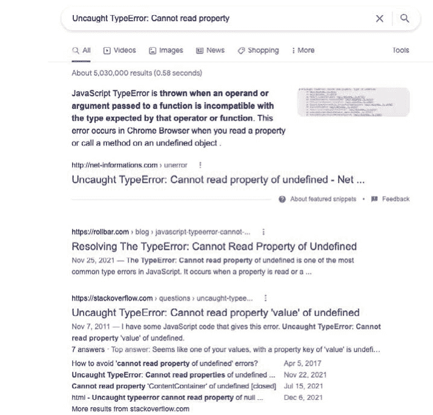

**图 5.4：** 在 Google 出现之前，人们是如何调试的？

将我们新的带有 `src` 的 `script` 标签放入 `index.html` 后的结果如代码清单 5.5 所示。重新加载页面后，我们的问候语现在如预期般显示（图 5.6）。


**图 5.5：** 认出这个来自 *《学够危险的 HTML、CSS 和布局》* 的小可爱了吗？

**代码清单 5.5：** 使用外部文件中的函数。

*index.html*

```html
<!DOCTYPE html>
<html>
  <head>
    <title>Learn Enough JavaScript</title>
    <meta charset="utf-8">
    <script src="day.js"></script>
    <script>
      let now = new Date();
      alert(`Hello, world! Happy ${dayName(now)}!`);
    </script>
  </head>
  <body>
  </body>
</html>
```

需要注意的是，源脚本必须在脚本中定义的任何函数被使用*之前*加载。否则，结果将与图 5.3 相同。确认这一点将作为练习（第 5.2.1 节）留给你。

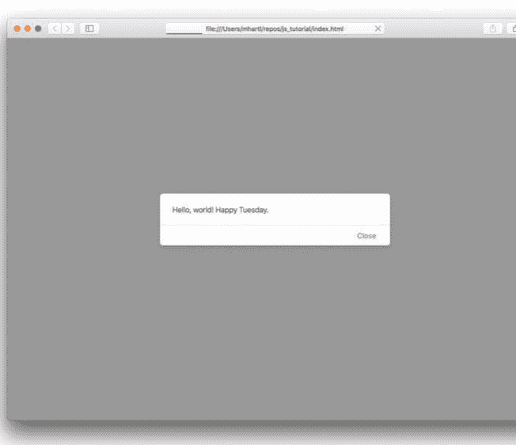

**图 5.6：** 问候语恢复了。

### 5.2.1 练习

- 1. 如果代码清单 5.5 中的 `src` 行在主脚本之后会发生什么？控制台中的错误是什么？

- 2. 让我们用 `day.js` 中的一个 `greeting` 函数替换代码清单 5.4 中的插值字符串。填写代码清单 5.6 中的代码，使代码清单 5.7 正常工作。

**代码清单 5.6：** 定义一个 `greeting` 函数。

`day.js`


```javascript
// Returns the day of the week for the given date.
function dayName(date) {
  const daysOfTheWeek = ["Sunday", "Monday", "Tuesday", "Wednesday",
                          "Thursday", "Friday", "Saturday"];
  return daysOfWeek[date.getDay()];
}

// Returns a greeting for the given date.
function greeting(date) {
  // FILL IN
}
```

**代码清单 5.7：** 使用 `greeting` 函数。

`index.html`

```html
<!DOCTYPE html>
<html>
  <head>
    <title>Learn Enough JavaScript</title>
    <meta charset="utf-8">
    <script src="day.js"></script>
    <script>
      let now = new Date();
      alert(greeting(now));
    </script>
  </head>
  <body>

  </body>
</html>
```

## 5.3 方法链

在本节中，我们将开始开发引言（第 1 章）中提到的回文主题。我们的目标是编写一个名为 **palindrome** 的函数，如果其参数正向和反向读取相同，则返回 **true**，否则返回 **false**。

我们可以将回文最简单的定义表达为“一个字符串与其反转后的字符串相同”。（我们将随着时间的推移逐步扩展这个定义。）在代码中，我们可以这样写这个定义：

```javascript
function palindrome(string) {
  return string === reverse(string);
}
```

如要求所示，如果一个字符串是回文（等于它自身的反转），它将返回 **true**，否则返回 **false**。不过，这里有一个问题：JavaScript 没有原生的反转字符串的方法，因此我们提议的实现中的 **reverse(string)** 将无法工作。这意味着我们必须自己编写 **reverse** 函数。

我们的技术涉及一种名为*方法链*的有用实践，即我们连续调用一系列方法。特别是，尽管 JavaScript 没有反转字符串的原生方法，但我们在第 3.4.1 节中看到它*确实*有反转*数组*的原生方法：

```javascript
> let a = [ 17, 42, 8, 99 ];
> a.reverse();
[ 99, 8, 42, 17 ]
```

同时，我们在第 3.1 节中看到了如何通过在空字符串 `""` 上分割来将字符串分解为其组成的字符：

```javascript
> "racecar".split("");
[ 'r', 'a', 'c', 'e', 'c', 'a', 'r' ]
```

最后，我们在第 3.4.3 节中了解到 **join** 方法有效地撤销了 split 操作：

```javascript
> [ 'r', 'a', 'c', 'e', 'c', 'a', 'r' ].join("");
'racecar'
```

这段讨论建议了以下编写 **reverse** 方法的算法：

- 1. 在空字符串上分割字符串以创建一个字符数组。

- 2. 反转该数组。

- 3. 在空字符串上连接数组以创建反转后的字符串。

得益于方法链，我们可以在一行代码中实现这个算法：

```javascript
> let string = "Racecar";
> string.split("").reverse().join("")
'racecaR'
```

> （由于 **split("")** 的工作方式，此方法实际上对于包含更复杂字符（如表情符号）的文本会失败。我们将在第 5.3.1 节中修复这个小瑕疵。）

让我们将 **reverse** 函数放入一个用于检测回文的库中，我们称之为 **palindrome.js**：

```bash
$ touch palindrome.js
```

生成的函数如代码清单 5.8 所示。

**代码清单 5.8：** 一个用于反转字符串的函数。

*palindrome.js*

```javascript
// Reverses a string.
function reverse(string) {
  return string.split("").reverse().join("");
}
```

请注意，代码清单 5.8 包含一个*文档注释*（在代码清单 5.3 中简要介绍），解释了该函数的目的。这并非严格要求，但为了未来的程序员（包括我们自己！），这是一个极好的实践。

为了检查代码清单 5.8 的效果，我们可以在 Node REPL 中使用“点加载”**load** 外部文件（注意缺少结尾分号，这是避免错误所必需的）：

```javascript
> .load palindrome.js
> reverse("Racecar");
'racecaR'
```

（使用 **.load** 只是在 REPL 中运行文件的每一行。这会产生一个副作用，即改变了我们的命令历史记录，使得使用“上箭头”检索之前的命令不如其他方式有用。这确实无法避免；不幸的是，由于其网络浏览器起源，JavaScript 没有原生的将一个文件包含到另一个文件中的方法，因此 **.load** 权宜之计是我们能做的最好的事情。）

我们现在可以编写我们的第一个版本的 palindrome 函数，该函数将一个字符串与其自身的反转进行比较：

```javascript
> string;     // Just a reminder of what our string is
'Racecar'
> string === reverse(string);
false
```

生成的 **palindrome** 定义如代码清单 5.9 所示。

**代码清单 5.9：** 我们初始的 **palindrome** 函数。

*palindrome.js*

```javascript
// Reverses a string.
function reverse(string) {
    return string.split("").reverse().join("");
}

// Returns true for a palindrome, false otherwise.
function palindrome(string) {
    return string === reverse(string);
}
```

重新加载 **palindrome.js** 让我们可以直接检查 **palindrome** 函数的效果：

```javascript
> .load palindrome.js
> palindrome("To be or not to be");
false
> palindrome("Racecar");
false
> palindrome("level");
true
```

它工作了！

现在有一个我们想立即添加的小改进，那就是能够独立于大小写检测回文。换句话说，我们希望对于像 “Racecar” 这样的内容返回 **true**，即使首字母 “R” 是大写的。我们可以通过在进行比较之前将字符串转换为小写来实现这一点，我们可以使用第 2.5 节中的 **toLowerCase** 方法来完成：

```javascript
> let processedContent = string.toLowerCase();
> processedContent;
'racecar'
> processedContent === reverse(processedContent);
true
```

将这个放入 **palindrome.js** 得到代码清单 5.10。

**代码清单 5.10：** 独立于大小写检测回文。

*palindrome.js*

```javascript
// Reverses a string.
function reverse(string) {
  return string.split("").reverse().join("");
}

// Returns true for a palindrome, false otherwise.
function palindrome(string) {
  let processedContent = string.toLowerCase();
  return processedContent === reverse(processedContent);
}
```

使用 REPL，我们可以确认它工作了：

```javascript
> .load palindrome.js
> palindrome("racecar");
true
> palindrome("Racecar");
true
> palindrome("Able was I ere I saw Elba");
true
```

### 5.3.1 注意事项：表情符号

代码清单 5.10 中开发的 **reverse** 方法有一个小注意事项，那就是它对于包含更复杂字符（如表情符号）的文本不太有效。例如，尝试反转一个包含“狐狸脸”和“狗脸”表情符号的句子会产生混乱的结果，如图 5.7 所示。

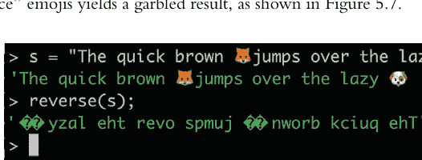

**图 5.7：** 一次失败的表情符号反转。

### 5.3.1 练习

原因在于每个表情符号实际上由两个独立字符表示，而如清单 5.10 中那样对空字符串进行分割，会将每个表情符号一分为二（糟糕！）。解决方案是使用一种不同的方式从字符串创建数组，使用名为 **Array.from()** 的自定义数组方法：

```
> Array.from('honey badger');
[ 'h', 'o', 'n', 'e', 'y', ' ', 'b', 'a', 'd', 'g', 'e', 'r' ]
```

将清单 5.10 中的 **split** 替换为此改进方法，即可得到清单 5.11 中更新后的 **reverse** 代码。

```
**清单 5.11**：使用 **Array.from** 改进 **reverse**。
___________________________________________
// 反转字符串。
**function** reverse(string) {
  **return** Array.from(string).reverse().join("")
}

// 对于回文返回 true，否则返回 false。
**function** palindrome(string) {
  let processedContent = string.toLowerCase();
  return processedContent === reverse(processedContent);
}
___________________________________________
```

请自行验证此代码的有效性。

### 5.3.2 练习

1.  使用方法链和清单 5.12 中的模板，编写一个函数 **emailParts**，用于返回标准电子邮件地址（格式为 **username@example.com**）的用户名和域名部分。*注意*：确保函数对 **USERNAME@EXAMPLE.COM** 也能返回相同结果。

2.  使用 Node REPL，确认清单 5.11 中定义的 **reverse** 函数能正确反转包含表情符号的字符串。（你可能会发现 Emojipedia (https://emojipedia.org/) 上关于狐狸脸和狗脸表情符号的链接有所帮助。）你的结果应类似图 5.8。

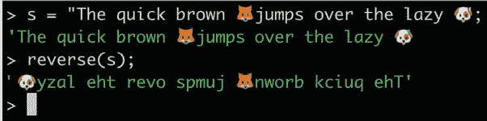

**图 5.8：** 成功的表情符号反转。

### 清单 5.12：返回电子邮件的各部分。

```
> function emailParts(email) {
  // 填空
}
```

## 5.4 逐项迭代

到目前为止，我们已经看到了几种*迭代*的例子：针对字符串（第 2.6 节）、数组（第 3.5 节）和对象（第 4.5 节）——都基于 **for** 循环。在本节中，我们将学习如何使用 **forEach** 循环，它遍历数组中的每个元素，而无需使用辅助索引变量的麻烦。

对数组中的每个元素执行一个操作意味着我们可以从这样：

```
for (let i = 0; i < array.length; i++) {
  console.log(array[i]);
}
```

改为这样：

```
array.forEach(function(element) {
  console.log(element);
});
```

后一种代码允许我们直接对每个数组元素执行操作，而无需使用 `array[i]` 来访问它。

你可以明白为什么我们必须等到现在才介绍：**forEach** 要求我们使用一个函数——具体来说，一个无名或*匿名*函数——来为数组中的每个元素创建一个变量。⁴ 话虽如此，我发现不念出“function”（无论大声还是默念）会有所帮助，这样听起来就像是“数组：对每个元素<做某事>”。

为了更好地理解 **forEach**，让我们看一个 REPL 中的具体例子：

```
> [42, 17, 85].forEach(function(element) {
    console.log(element);
});
42
17
85
```

这里发生的是，**forEach** 本身接受一个函数作为参数，该函数随后依次返回相应数组的每个元素。语法可能看起来有点奇怪，但将函数传递给方法的这种模式很常见，你很快就会习惯它。不要过于担心底层具体发生了什么——而是专注于具体效果。

运用我们新发现的 **forEach** 能力，我们可以使用 **forEach** 重写之前遇到的每个 **for** 循环，从清单 3.4 中的数组迭代开始。为方便起见，我们将代码放在一个文件中并在命令行执行：

```
$ touch foreach.js
```

要执行迭代，我们需要的只是一个 **forEach** 循环，其内容打印元素本身，而不是打印 a[i]。结果如清单 5.13 所示。

### 清单 5.13：使用 **forEach** 循环遍历数组。

*foreach.js*

```
let a = ["ant", "bat", "cat", 42];
a.forEach(function(element) {
    console.log(element);
});
```

⁴. 以这种方式附带数据的函数（无论是命名的还是匿名的）称为*闭包*。

在命令行执行清单 5.13 中的程序，将产生与我们在清单 3.4 中看到的相同输出，如清单 5.14 所示。

### 清单 5.14：数组迭代的输出。

```
$ node foreach.js
ant
bat
cat
42
```

现在让我们使用 **forEach** 来重写清单 2.18 中的字符串迭代。我们的技术是从字符串创建一个数组，然后使用 **forEach** 一次迭代一个元素。第一步，我们将使用第 5.3 节末尾（清单 5.11）介绍的 **Array.from** 方法从字符串创建一个数组：

```
> Array.from("honey badger");
[ 'h', 'o', 'n', 'e', 'y', ' ', 'b', 'a', 'd', 'g', 'e', 'r' ]
```

结果是一个字符数组，然后我们可以使用 **forEach** 遍历它。我们将首先在 **foreach.js** 文件中包含清单 2.15 中的 **soliloquy** 变量，然后使用 **Array.from** 和 **forEach**。结果代码（我们将它放在清单 5.13 的数组迭代之后）如清单 5.15 所示。

### 清单 5.15：使用 **forEach** 循环遍历字符串。

### foreach.js

```
.
.
.
let soliloquy = "To be, or not to be, that is the question:";
Array.from(soliloquy).forEach(function(character) {
  console.log(character);
});
```

在命令行执行清单 5.15 中的程序，将产生与我们在清单 2.18 中看到的相同输出（在这种情况下，前面是清单 5.14 的输出），如清单 5.16 所示。


**图 5.9：** 使用 **forEach** 让迈克·范尼尔（Mike Vanier）稍微开心了一点。

### 清单 5.16：字符串迭代的输出。

```
$ node foreach.js
ant
bat
cat
42
T
o
b
e
.
.
.
t
i
o
n
:
```

使用 **forEach** 方法，我们可以直接遍历数组中的元素，从而避免输入迈克·范尼尔的*眼中钉*，“for (i = 0; i < N; i++)”。结果是代码更简洁，程序员更快乐（图 5.9）。

### 5.4.1 练习

1.  使用第 5.1.2 节中的胖箭头符号重写清单 5.13 中的 **forEach** 循环。

2.  我们在清单 5.1 中看到如何定义一个数字比较函数，使我们能够对 JavaScript 数组进行数值排序。那里我们使用了返回值 **1**、**-1** 和 **0**，但事实证明 `sort` 只关心比较结果的*符号*，所以 **17** 与 **1** 相同，**-42** 与 **-1** 相同，等等。对于数字 **a** 和 **b**，值 **a - b** 具有正确的符号，所以证明清单 5.17 中的代码（使用匿名函数）能正确排序数组。

3.  编写一个 `forEach` 循环来打印上一个练习的值。

### 清单 5.17：使用匿名方式排序数组。

```
> let a = [8, 17, 42, 99];
> a.sort(function(a, b) { return a - b; });
[ 8, 17, 42, 99 ]
```

# 第 6 章 函数式编程

在学习了如何定义函数并在几个不同上下文中应用它们之后，现在我们将通过学习*函数式编程*的基础知识，将我们的编程提升到一个新的水平，这种编程风格强调——你猜对了——函数。这是一个充满挑战的章节，你可能需要反复练习才能完全理解（方框 6.1），但回报确实丰厚。

> ### 方框 6.1：反复练习

>

> 在从武术到国际象棋再到语言学习的各种情境中，练习者会达到一个点，即再多的分析或反思也无法帮助他们提高——他们只需要多做几次重复练习，或称为“reps”。

>

> 令人惊讶的是，通过尝试某事、有点懂（但可能不完全）然后只是*再做一次*，你能提高多少。在像本教程这样的背景下，有时这意味着重新阅读一个特别棘手的部分或章节。有些人（包括在下）甚至会重新阅读整本书。

>

> 反复练习的一个重要方面是*暂停自我评判*——允许自己一开始并不擅长。（许多人——同样包括在下——通常需要练习才能擅长于接受自己一开始并不擅长。可以说，这是元练习。）

>

> 放松一下，反复练习，看着你的技术熟练度与日俱增。

函数式编程弱化了诸如变异和副作用之类的东西，而是专注于应用函数来操作和转换参数，

### 第6章：函数式编程

**图6.1：** 函数式方法的三巨头。

函数。这个定义相当抽象，其主题本身也十分庞大，因此我们将通过聚焦于函数式编程中常用的三个经典方法：**map**、**filter** 和 **reduce**（图6.1），来使问题变得具体和可管理。

在每种情况下，我们的技术路线是：先执行一个涉及 **forEach** 循环和一系列命令的任务（这称为“命令式编程”，$^2$ 这也是我们迄今为止主要采用的方式），然后展示如何使用函数式编程来完成同样的事情。

为了方便起见，我们将创建一个文件来探索，而不是在REPL中输入所有内容：

```
$ touch functional.js
```

### 6.1 Map

我们三巨头中的第一个是 **map** 函数（图6.2），$^3$ 它让我们能够将一个函数映射到一个元素数组上。这通常是循环的一个强大替代方案。

> 1. 图片由 Kamira/Shutterstock（左）、World History Archive/Alamy Stock Photo（中）和 colaimages/Alamy Stock Photo（右）提供。

2. 这类程序被写成一系列命令；因此，“命令式”（imperative）一词源自拉丁语 *imperātīvus*，意为“源于命令”。

3. 图片由 Kamira/Shutterstock 提供。*Gāius Iūlius Caesar* 等拉丁词中的上划线是长音符号，表示长元音。

**图6.2：** 三巨头之一，盖乌斯·尤利乌斯·恺撒（Gāius Iūlius Caesar，即尤利乌斯·恺撒）。

例如，假设我们有一个混合大小写的字符串数组，我们想创建一个对应的、小写并用连字符连接的字符串数组（使其适合用于URL），像这样：

```
"North Dakota" -> "north-dakota"
```

使用本教程之前的技巧，我们可以这样做：

- 1. 定义一个包含字符串数组的变量。

- 2. 定义第二个变量（初始为空），用于存储URL友好的字符串数组。

- 3. 对于第一个数组中的每一项，将其推入（第3.4.2节）一个经过小写处理（第2.5节）、在空白字符处分割（第4.3.2节）、然后用连字符连接（第3.4.3节）的版本。（你也可以按单个空格" "分割，但按空白字符分割要健壮得多，因此默认使用它是良好的实践。）

结果如代码清单6.1所示。

**代码清单6.1：** 从数组创建适合URL的字符串。

*functional.js*

```
let states = ["Kansas", "Nebraska", "North Dakota", "South Dakota"];

// urls: 命令式版本
function imperativeUrls(elements) {
  let urls = [];
  elements.forEach(function(element) {
    urls.push(element.toLowerCase().split(/\s+/).join("-"));
  });
  return urls;
}
console.log(imperativeUrls(states));
```

这段代码相当复杂，因此能够阅读代码清单6.1是你技术理解力增长的一个良好检验。（如果读起来不容易，启动一个Node REPL并交互式运行它是个好主意。）

运行代码清单6.1的结果如下所示：

```
$ node functional.js
[ 'kansas', 'nebraska', 'north-dakota', 'south-dakota' ]
```

现在让我们看看如何使用 **map** 来完成同样的事情，它通过将同一个函数应用于数组中的每个元素来工作。例如，要计算一个数字数组中每个元素的平方，我们可以将函数 **n * n** 映射到该数组上，就像在REPL中看到的：

```
> [1, 2, 3, 4].map(function(n) { return n * n; });
[ 1, 4, 9, 16 ]
```

这里我们将一个匿名函数（第5.4节）映射到数组上，得到每个元素的平方。使用箭头函数（第5.1.2节）看起来更简洁：

```
> [1, 2, 3, 4].map( (n) => { return n * n; });
[ 1, 4, 9, 16 ]
```

更好的是，对于单参数函数的常见情况，JavaScript允许我们省略圆括号、花括号甚至 **return** 关键字，从而得到以下极其简洁的代码：

```
> [1, 2, 3, 4].map(n => n * n);
[ 1, 4, 9, 16 ]
```

回到我们的主要例子，我们可以将“小写，然后分割，然后连接”这个转换视为一个**单一**操作，并使用 **map** 将该操作依次应用于数组中的每个元素。结果非常简洁，很容易放入REPL中：

```
> let states = ["Kansas", "Nebraska", "North Dakota", "South Dakota"];
> states.map(state => state.toLowerCase().split(/\s+/).join('-'));
[ 'kansas', 'nebraska', 'north-dakota', 'south-dakota' ]
```

将其粘贴到 **function.js** 中，我们可以看到它短了多少，如代码清单6.2所示。

**代码清单6.2：** 使用 **map** 添加函数式技术。

*functional.js*

```
let states = ["Kansas", "Nebraska", "North Dakota", "South Dakota"];

// urls: 命令式版本
function imperativeUrls(elements) {
  let urls = [];
  elements.forEach(function(element) {
    urls.push(element.toLowerCase().split(/\s+/).join("-"));
  });
  return urls;
}
console.log(imperativeUrls(states));

// urls: 函数式版本
function functionalUrls(elements) {
  return elements.map(element => element.toLowerCase().split(/\s+/).join('-'));
}
console.log(functionalUrls(states));
```

**图6.3：** 把一些州放在地图上。

我们可以在命令行确认结果是相同的：

```
$ node functional.js
[ 'kansas', 'nebraska', 'north-dakota', 'south-dakota' ]
[ 'kansas', 'nebraska', 'north-dakota', 'south-dakota' ]
```

我们的函数式程序确实把这些州放在了**地图**上（图6.3）。^4

作为最后的改进，让我们将负责使字符串URL兼容的方法链提取到一个单独的辅助函数 **urlify** 中：

```
// 返回字符串的URL友好版本。
// 例如: "North Dakota" -> "north-dakota"
function urlify(string) {
  return string.toLowerCase().split(/\s+/).join('-');
}
```

4. 图片由 Creative Jen Designs/Shutterstock 提供。

在 **functional.js** 中定义此函数并在命令式和函数式版本中使用它，得到的代码如代码清单6.3所示。

**代码清单6.3：** 定义辅助函数。

*functional.js*

```
let states = ["Kansas", "Nebraska", "North Dakota", "South Dakota"];

// 返回字符串的URL友好版本。
//   例如: "North Dakota" -> "north-dakota"
function urlify(string) {
  return string.toLowerCase().split(/\s+/).join("-");
}

// urls: 命令式版本
function imperativeUrls(elements) {
  let urls = [];
  elements.forEach(function(element) {
    urls.push(urlify(element));
  });
  return urls;
}
console.log(imperativeUrls(states));

// urls: 函数式版本
function functionalUrls(elements) {
  return elements.map(element => urlify(element));
}
console.log(functionalUrls(states));
```

和之前一样，结果是相同的：

```
$ node functional.js
[ 'kansas', 'nebraska', 'north-dakota', 'south-dakota' ]
[ 'kansas', 'nebraska', 'north-dakota', 'south-dakota' ]
```

与命令式版本相比，函数式版本的行数只有其五分之一（1行而不是5行），不改变任何变量（这在命令式编程中通常是一个容易出错的步骤），并且实际上完全消除了中间数组（**urls**）。正是这类事情让迈克·瓦尼尔（Mike Vanier）非常高兴（图6.4）。⁵

⁵ 据我上次确认，迈克最喜欢的是一门名为Haskell的“纯函数式”语言。

**图6.4：** 函数式编程让迈克·瓦尼尔最为开心。

#### 6.1.1 练习

- 1. 使用 `map`，编写一个函数，该函数接收 `states` 变量并返回一个URL数组，格式为 `https://example.com/<urlified form>`。

### 6.2 Filter

我们的第二个三巨头是 `filter`（图6.5），^6 它允许我们根据某个布尔条件过滤数据。

例如，假设我们想从第6.1节定义的相同 `states` 数组开始，并返回一个由单个单词组成的字符串构成的新数组。这正是 `filter` 擅长的任务，但与第6.1节一样，我们将先写一个命令式版本。步骤相当直接：

- 1. 定义一个数组来存储单单词字符串。

- 2. 对于列表中的每个元素，如果将其按空白字符分割后得到的数组长度为1，则将其 `push` 到存储数组中。

6. 图片由 World History Archive/Alamy Stock Photo 提供。

## 6.1 过滤

结果如代码清单6.4所示。

**代码清单 6.4：** 命令式地解决一个过滤问题。

`functional.js`

```javascript
let states = ["Kansas", "Nebraska", "North Dakota", "South Dakota"];
.
.
.
// singles: 命令式版本
function imperativeSingles(elements) {
    let singles = [];
    elements.forEach(function(element) {
        if (element.split(/\s+/).length === 1) {
            singles.push(element);
        }
    });
    return singles;
}
console.log(imperativeSingles(states));
```

注意代码清单6.4中与代码清单6.1类似的模式：首先定义一个辅助变量以维护状态（这里没有双关）；然后循环遍历原始数组，根据需要修改该变量；最后返回修改后的结果。这种方式不算特别优雅，但确实有效：

```bash
$ node functional.js
[ 'kansas', 'nebraska', 'north-dakota', 'south-dakota' ]
[ 'kansas', 'nebraska', 'north-dakota', 'south-dakota' ]
[ 'Kansas', 'Nebraska' ]
```

现在让我们看看如何使用 **filter** 来完成相同的任务。正如第6.1节，我们将从一个简单的数值示例开始，在REPL中进行。

我们首先看看 *取模运算符 %*，它返回一个整数除以另一个整数后的余数。换句话说，**17 % 5** （读作“17取模5”）等于 **2**，因为5进入17三次（得到15），余数为17 – 15 = 2。特别地，考虑整数对2取模会将其分为两个 *等价类*：偶数（余数为0 (mod 2)）和奇数（余数为1 (mod 2)）。代码表示为：

```javascript
> 16 % 2;  // 偶数
0
> 17 % 2;  // 奇数
1
> 16 % 2 === 0;  // 偶数
true
> 17 % 2 === 0;  // 奇数
false
```

我们可以结合 % 和 **filter** 来处理一个数字数组并仅选择偶数：

```javascript
> [1, 2, 3, 4, 5, 6, 7, 8].filter(n => n % 2 === 0);
[ 2, 4, 6, 8 ]
```

语法几乎与 **map** 完全相同：我们给 **filter** 一个变量（**n**），然后执行一个 *测试*，返回 **true** 或 **false**。

运用这个思路，我们看到代码清单6.4的函数式版本要简洁得多——确实，与 **map** 类似，**filter** 版本只需一行代码（在函数式编程中很常见），我们可以在REPL中看到：

```javascript
> states.filter(state => state.split(/\s+/).length === 1);
```

将结果放回我们的示例文件再次凸显了函数式版本的简洁性（代码清单6.5）。

**代码清单 6.5：** 以函数式方式解决过滤问题。

*functional.js*

```javascript
let states = ["Kansas", "Nebraska", "North Dakota", "South Dakota"];
.
.
// singles: 命令式版本
function imperativeSingles(elements) {
    let singles = [];
    elements.forEach(function(element) {
        if (element.split(/\s+/).length === 1) {
            singles.push(element);
        }
    });
    return singles;
}
console.log(imperativeSingles(states));

// singles: 函数式版本
function functionalSingles(elements) {
    return elements.filter(element => element.split(/\s+/).length === 1);
}
console.log(functionalSingles(states));
```

如预期，结果相同：

```bash
$ node functional.js
[ 'kansas', 'nebraska', 'north-dakota', 'south-dakota' ]
[ 'kansas', 'nebraska', 'north-dakota', 'south-dakota' ]
[ 'Kansas', 'Nebraska' ]
[ 'Kansas', 'Nebraska' ]
```

## 6.2.1 练习

1.  编写两个返回"Dakotas"的 `filter` 函数：一个使用 `String#includes`（第2.5节）来测试字符串“Dakota”是否存在，另一个使用正则表达式来测试分割后数组的长度是否为2。

## 6.3 归约

我们终于迎来了三巨头中的第三位成员，强大的 `reduce`（图6.6）——这是三者中最复杂的一个。

因为 `reduce` 尤其具有挑战性，我们将介绍两个例子。首先，我们将对整数数组执行 `sum` 操作，分别创建命令式版本和函数式版本。其次，我们将创建一个普通的JavaScript对象（第4.4节），将州名映射到每个名称的长度，结果将如下所示：

```javascript
{ "Kansas": 6,
  "Nebraska": 8,
  .
  .
  .
}
```

### 6.3.1 归约，示例1

我们将从 `sum` 函数的命令式解决方案开始，这涉及（通常）一个 `forEach` 循环和一个辅助变量（`total`），我们用它来累积结果。结果如代码清单6.6所示。

**代码清单 6.6：** 求和整数的命令式解决方案。

*functional.js*

```javascript
let numbers = [1, 2, 3, 4, 5, 6, 7, 8, 9, 10];

// sum: 命令式解决方案
function imperativeSum(elements) {
    let total = 0;
    elements.forEach(function(n) {
        total += n;
    });
    return total;
}
console.log(imperativeSum(numbers));
```

我们再次看到熟悉的模式：初始化一个辅助变量（**total**），然后循环遍历集合，通过将每个数字加到总数中来累积结果。

如预期，结果是55：

```bash
$ node functional.js
[ 'kansas', 'nebraska', 'north-dakota', 'south-dakota' ]
[ 'kansas', 'nebraska', 'north-dakota', 'south-dakota' ]
[ 'Kansas', 'Nebraska' ]
[ 'Kansas', 'Nebraska' ]
55
```

现在看看 **reduce** 解决方案。它有点巧妙，让我们在REPL中操作：

```javascript
> let numbers = [1, 2, 3, 4, 5, 6, 7, 8, 9, 10];
> numbers.reduce((total, n) => {
    total += n;
    return total;
  }, 0);
55
```

你能明白我说的“巧妙”是什么意思了。**reduce** 方法接受一个具有 *两个* 参数的函数，第一个是结果的 *累加器*，第二个是数组元素本身。（匿名）函数的返回值会作为下一个数组元素的起始值传递回 **reduce**。**reduce** 的第二个参数是累加器的初始值（本例中是0）。

我们可以做两处优化。首先，+= 运算符返回其值，因此我们实际上可以在递增值的同时赋值（或返回）：

```javascript
> let i = 0;
> let j = i += 1;
> i
1
> j
1
```

这意味着我们可以直接返回 **total += n**：

```javascript
> numbers.reduce((total, n) => { return total += n }, 0);
55
```

其次，默认情况下初始值是数组的第一个元素（**reduce** 过程从第二个元素开始），因此在这种情况下可以省略：

```javascript
> numbers.reduce((total, n) => { return total += n });
55
```

将结果放入我们的示例文件，如常所示，相比迭代版本有显著改进（代码清单6.7）。

**代码清单 6.7：** 求和整数的函数式解决方案。

*functional.js*

```javascript
let numbers = [1, 2, 3, 4, 5, 6, 7, 8, 9, 10];

// sum: 命令式解决方案
function imperativeSum(elements) {
    let total = 0;
    elements.forEach(function(n) {
        total += n;
    });
    return total;
}
console.log(imperativeSum(numbers));

// sum: 函数式解决方案
function functionalSum(elements) {
    return elements.reduce((total, n) => total += n);
}
console.log(functionalSum(numbers));
```

函数式求和的结果应与命令式版本相同：

```bash
$ node functional.js
[ 'kansas', 'nebraska', 'north-dakota', 'south-dakota' ]
[ 'kansas', 'nebraska', 'north-dakota', 'south-dakota' ]
[ 'Kansas', 'Nebraska' ]
[ 'Kansas', 'Nebraska' ]
55
55
```

代码清单6.7让我们对 **reduce** 的含义有了提示：它是一个函数，接受一个数组的元素并基于某种操作（本例中是加法）来处理（*归约*）它们。但这并非总是如此，正如我们稍后将看到的，将 **reduce** 视为 *累积* 结果并将其存储在其第一个参数（代码清单6.7中的 **total**）中通常更有帮助。⁸

### 6.3.2 归约，示例2

为了帮助加深对 **reduce** 的理解，让我们看第二个例子。如上所述，我们的任务是创建一个普通对象（关联数组），其键等于州名，值等于其长度（这可用于计算，例如，较长文档中的词频直方图）。我们可以通过初始化一个 **lengths** 对象，然后遍历各州，将 **lengths[state]** 设置为相应的长度来命令式地解决：

```javascript
lengths[state] = state.length;
```

8. 因此，**reduce** 在其他语言中有时被称为 **accumulate**。例如，参见《计算机程序的构造和解释》第2章中的“序列操作”。

### 第6章：函数式编程

完整示例见代码清单6.8。

### 代码清单6.8：用于状态/长度对应关系的命令式解决方案。

*functional.js*

```javascript
// lengths: 命令式解决方案
function imperativeLengths(elements) {
    let lengths = {};
    elements.forEach(function(element) {
        lengths[element] = element.length;
    });
    return lengths;
}
console.log(imperativeLengths(states));
```

如果在命令行运行该程序，期望的关联数组将作为输出的最后一部分出现：

```
$ node functional.js
.
.
.
{ Kansas: 6, Nebraska: 8, 'North Dakota': 12, 'South Dakota': 12 }
```

使用 **reduce** 的函数式解决方案则更为巧妙。与命令式解决方案一样，我们有一个普通的 **lengths** 对象，但它不是一个辅助变量，而是函数的一个参数：

```javascript
(lengths, state) => {
    lengths[state] = state.length;
    return lengths;
}
```

同时，**reduce** 方法的初始值不是 **0**，而是空对象 **{}**：

```javascript
reduce((lengths, state) => {
    lengths[state] = state.length;
    return lengths;
}, {});
```

请注意，这些是代码片段，而不是 REPL 会话；**reduce**（以及函数式解决方案普遍）的一个缺点是，它们更难逐步构建。

稍后会详细介绍这一点。

综合上述思路，我们可以使用 **reduce** 来遍历 **states** 数组，在 **lengths** 参数中累积所需的关联数组，然后将其返回，如代码清单6.9所示。

### 代码清单6.9：用于状态/长度对应关系的函数式解决方案。

*functional.js*

```javascript
// lengths: 命令式解决方案
function imperativeLengths(elements) {
  let lengths = {};
  elements.forEach(function(element) {
    lengths[element] = element.length;
  });
  return lengths;
}
console.log(imperativeLengths(states));

// lengths: 函数式解决方案
function functionalLengths(elements) {
  return elements.reduce((lengths, element) => {
    lengths[element] = element.length;
    return lengths;
  }, {});
}
console.log(functionalLengths(states));
```

尽管在文本编辑器中被拆分成多行，但代码清单6.9中的函数式解决方案**返回**的是单个 **reduce** 的结果，这与 **map**（代码清单6.2）和 **filter**（代码清单6.5）的函数式解决方案非常相似。

正如要求的那样，结果与命令式解决方案相同：

```
$ node functional.js
.
.
.
{ Kansas: 6, Nebraska: 8, 'North Dakota': 12, 'South Dakota': 12 }
{ Kansas: 6, Nebraska: 8, 'North Dakota': 12, 'South Dakota': 12 }
```

比较代码清单6.9中的命令式和函数式解决方案，**reduce** 的优势不如在 `map` 和 `filter` 的情况下那么明显。事实上，可以有充分的理由认为命令式解决方案更清晰。

使用哪种方法取决于个人喜好。我发现，你越多地进行函数式编程，就越想这样做，并且使用 **reduce** 通过单个（逻辑）行来解决问题有一种奇特的愉悦感。同样值得注意的是，**reduce** 是高级程序员中常用的一种技术，并且在处理大型数据集的一项重要技术（称为 MapReduce）中扮演着关键角色。

### 6.3.3 函数式编程与TDD

在构建代码清单6.9时，你可能注意到的一点是，函数式解决方案更难分解成步骤。优点是我们通常可以将函数式解决方案压缩成一行，但代价是可能更难逐步理解。确实，我发现这是我们三位一体函�中一个一致的模式：最终目标通常是简洁而优雅的，但实现过程可能充满挑战。

我应对这一挑战最喜欢的技术是*测试驱动开发*（TDD），它涉及编写一个*自动化测试*，将期望的行为捕获为代码。然后，我们可以使用任何想要的方法（包括一个丑陋但易于理解的迭代解决方案）让测试通过。此时，我们可以*重构*代码——改变其形式但不改变其功能——以使用更简洁的函数式解决方案。只要测试仍然通过，我们就可以确信代码仍然有效。

在第8章中，我们将把这种完全相同的技术应用于第7章中开发的主要对象。具体来说，我们将使用 TDD 来实现对第5.3节首次出现的 **palindrome** 函数的一个漂亮扩展，该扩展可以检测像 "A man, a plan, a canal—Panama!" 这样复杂的回文（图6.7）。

⁹. 图片由 Everett Collection Historical/Alamy Stock Photo 提供。


**图6.7：** 泰迪·罗斯福是个有计划的人。

### 6.3.4 练习

1.  使用 **reduce**，编写一个函数，返回数组中所有元素的乘积。*提示：* `+=` 是加法，`*=` 是乘法。

2.  删除代码清单6.9中 **reduce** 解决方案的换行符，将其转换为单行长行。它是否仍然给出正确的答案？结果代码行有多长？

# 第7章：对象与原型

在第4.4节中，我们学习了如何创建普通对象，我们将其用作简单的键值对关联数组。在本章中，我们将创建更通用版本的 JavaScript 对象，这些对象既有属性（数据）也有附加的方法（函数）。

## 7.1 定义对象

在 JavaScript 中定义对象的方式多种多样，令人眼花缭乱，但我们将专注于最经典的方法之一，即使用函数（第5章）。结果将是一个对象*构造函数*，可用于使用我们在第4.2节首次见到的 `new` 语法创建（或*实例化*）新对象（称为*实例*）。

我们将从定义一个 **Phrase** 对象开始。最终，我们将使用 **Phrase** 来表示像 "Madam, I'm Adam." 这样的短语，即使它在技术上正向和反向不完全相同，也可以被视为回文。但一开始，我们只会定义一个 **Phrase** 构造函数，它接受一个参数（**content**）并设置 **content** 属性。我们稍后会将其放入文件中，但现在让我们在 REPL 中操作：

```javascript
> function Phrase(content) {
    this.content = content;
  }
```

在 **Phrase** 函数内部，**this** 代表对象本身，我们可以像在第4.4节中使用普通对象一样为其分配属性。

定义 **Phrase** 的效果是我们可以使用 **new Phrase** 创建一个新的短语：

```javascript
> let greeting = new Phrase("Hello, world!");
```

与例如 **String** 对象的 **length** 属性（第2.4节）一样，我们可以使用熟悉的点表示法访问短语的内容：

```javascript
> greeting.content;
'Hello, world!'
```

请注意，对象名称通常采用驼峰式命名（图2.3），首字母大写（与变量不同，变量以小写字母开头）。到目前为止，我们见过的所有原生对象——包括 **String**、**Array**、**Date** 和 **RegExp**——都遵循这种一致的命名约定。

因为我们将构建一个可以检测回文的 **Phrase** 对象，所以我们将使用在第5.3节创建的 **palindrome.js** 文件。供参考，以下重复了文件内容，以及我们简单的 **Phrase** 对象定义（代码清单7.1）。请注意，代码清单7.1使用了在代码清单5.11中开发的改进版 **reverse**。

### 代码清单7.1：我们初始的 **Phrase** 对象定义。

*palindrome.js*

```javascript
// Reverses a string.
function reverse(string) {
  return Array.from(string).reverse().join("");
}

// Returns true for a palindrome, false otherwise.
function palindrome(string) {
  let processedContent = string.toLowerCase();
  return processedContent === reverse(processedContent);
}

// Defines a Phrase object.
function Phrase(content) {
  this.content = content;
}
```

## 7.1 定义对象

为了验证，最好在 REPL 中运行一下，以捕获任何语法错误等：

```
> .load palindrome.js
> phrase = new Phrase("Racecar");
> phrase.content;
'Racecar'
```

下一步，我们将把 **palindrome**（回文）函数移入 **Phrase** 对象，将其添加为一个方法。实现方法是将一个**函数**直接赋值给一个 **palindrome** 属性——实际上，方法就是一个绑定到函数的属性。

由于所需的 **content** 字符串在方法内部可通过 **this.content** 访问，**palindrome** 函数不再需要将其作为参数传入。这使得我们可以将 **palindrome** 从单变量函数变为零变量函数。换句话说，我们将代码从这样：

```
function palindrome(string) {
    let processedContent = string.toLowerCase();
    return processedContent === reverse(processedContent);
}
```

改为这样：

```
this.palindrome = function palindrome() {
    let processedContent = this.content.toLowerCase();
    return processedContent === reverse(processedContent);
}
```

将 **palindrome** 方法放入 **Phrase** 方法的合适位置，得到如清单 7.2 所示的代码。请注意，即使在对象定义内部，我们也可以使用 **reverse** 方法；我们将在第 7.3 节实现一种更好的字符串**反转**方式。

**清单 7.2：** 将 **palindrome** 移入方法中。

### palindrome.js

```
// Reverses a string.
function reverse(string) {
    return Array.from(string).reverse().join("");
}

// Defines a Phrase object.
function Phrase(content) {
  this.content = content;

  // Returns true if the phrase is a palindrome, false otherwise.
  this.palindrome = function palindrome() {
    let processedContent = this.content.toLowerCase();
    return processedContent === reverse(processedContent);
  }
}
```

在 REPL 中加载文件表明它生效了（图 7.1）：¹

```
> .load palindrome.js
> phrase = new Phrase("Racecar");
> phrase.palindrome();
true
```

清单 7.2 中的回文检测器相当基础，但我们现在为在第 8 章构建（和测试）一个更复杂的回文检测器打下了良好基础。


**图 7.1：** 一个 F1 赛车的回文。

> 1. 图片由 msyaraafiq/Shutterstock 提供。

### 7.1.1 练习

1. 通过填写清单 7.3 中的代码，向 **Phrase** 对象添加一个 **louder** 方法，该方法返回内容的大写版本。在 REPL 中确认结果如清单 7.4 所示。

**清单 7.3：** 使内容变大声。

*palindrome.js*

```
// Defines a Phrase object.
function Phrase(content) {
  this.content = content;

  // Makes the phrase LOUDER.
  this.louder = function() {
    // FILL IN
  };
}
```

**清单 7.4：** 在 REPL 中使用 **louder**。

```
> .load palindrome.js
> let p = new Phrase("yo adrian!");
> p.louder();
'YO ADRIAN!'
```

## 7.2 原型

如果你查阅 JavaScript 对象系统的细节，很快会发现它是“基于原型的”。例如，Mozilla 开发者网络（MDN）关于对象原型的文章（https://developer.mozilla.org/en-US/docs/Learn/JavaScript/Objects/Object_prototypes）这样说：

> JavaScript 通常被描述为一种**基于原型的语言**——每个对象都有一个**原型对象**，该对象充当模板，从中继承方法和属性。一个对象的原型对象本身也可能有自己的原型对象，从中继承方法和属性，以此类推。这通常被称为**原型链**，并解释了为什么不同的对象可以访问定义在其他对象上的属性和方法。

这个解释完全正确，但根据我的经验，除非你已经知道它在说什么，否则它可能令人困惑，而且我认为没有人曾通过阅读这样的定来理解对象系统。在我看来，从具体实例中进行归纳是更好的方法。

我们的策略是创建一个名为 **TranslatedPhrase** 的新对象，使用 **Phrase** 作为其原型。我们将首先回顾清单 7.2 中定义的 **Phrase** 对象，它具有一个 **content** 属性和一个 **palindrome** 方法（清单 7.5）。

**清单 7.5：** Phrase 对象的当前状态。

### palindrome.js

```
// Reverses a string.
function reverse(string) {
  return Array.from(string).reverse().join("");
}

// Defines a Phrase object.
function Phrase(content) {
  this.content = content;

  this.palindrome = function palindrome() {
    let processedContent = this.content.toLowerCase();
    return processedContent === reverse(processedContent);
  }
}
```

我们的下一步是将 **processedContent** 提取为它自己的方法，因为从逻辑上讲，它是一个独立的操作，并且是我们将来可能想要更改的东西（实际上，稍后就会改变）。结果如清单 7.6 所示。

**清单 7.6：** 将 processedContent 移入方法中。

### palindrome.js

```
// Reverses a string.
function reverse(string) {
  return Array.from(string).reverse().join("");
}

// Defines a Phrase object.
function Phrase(content) {
  this.content = content;

  // Returns content processed for palindrome testing.
  this.processedContent = function processedContent() {
    return this.content.toLowerCase();
  }

  // Returns true if the phrase is a palindrome, false otherwise.
  this.palindrome = function palindrome() {
    return this.processedContent() === reverse(this.processedContent());
  }
}
```

现在我们准备添加第二种短语 **TranslatedPhrase**，它包含内容*以及*翻译。我们将首先定义两个属性：**content** 和 **translation**，如清单 7.7 所示。

**清单 7.7：** 定义一个 **TranslatedPhrase** 对象。

*palindrome.js*

```
// Defines a TranslatedPhrase object.
function TranslatedPhrase(content, translation) {
  this.content = content;
  this.translation = translation;
}
```

现在，为了赋予 **TranslatedPhrase** 一个 **palindrome** 方法，我们可以像这样从 **Phrase** 复制并粘贴方法：

```
function TranslatedPhrase(content, translation) {
  this.content = content;
  this.translation = translation;

  // Returns content processed for palindrome testing.
  this.processedContent = function processedContent() {
    return this.content.toLowerCase();
  }

  // Returns true if the phrase is a palindrome, false otherwise.
  this.palindrome = function palindrome() {
    return this.processedContent() === reverse(this.processedContent());
  }
}
```

但这会导致代码的严重重复，明显违反了 DRY 原则（框 7.1）。

> **框 7.1：不要重复你自己**

如果你一直在互联网上开发者交流的地方逛，你可能注意到有人提到要保持 *DRY*，其中 “dry” 全部大写。他们不是在谈论相对湿度水平。他们谈论的是编程中的一个核心原则：*不要重复你自己*。

DRY 背后的理念是，好的编码应该尽可能减少不必要的重复，原因很简单：如果你在很多地方有相同的代码，那么每次你想做一个更改时，你就必须更新应用程序中所有重复该代码的不同位置。例如，如果你想更改 `palindrome` 方法的定义，你必须在定义它的每个对象中进行相同的更改。只有两个对象时，这可能很丑陋但尚可管理，但对于更大的项目来说，这将是一场噩梦。

程序员是一种特殊的懒惰——特别是当涉及到做一些重复性的事情时，而这些事情可以通过一点额外的编程更高效的完成。为了更容易地偷懒，有进取心的程序员花费无数时间创建系统，让其他开发者不必重复自己。我们都受益于那些在某个时刻决定现在要非常努力工作，以便将来可以工作得更轻松的开发者。

*继承*就是这些理念之一。它允许对象*继承*其他对象的属性，因此任何它们共同拥有的方法只需要定义一次。结果是，我们可以*一次*定义一个 `palindrome` 方法，然后让其他对象从父方法继承 `palindrome`。在 JavaScript 中，实现这一点的机制被称为*原型系统*。

相反，我们将使用面向对象编程中一个重要的概念*继承*，并安排 `TranslatedPhrase` 直接从 `Phrase` 继承所需的 `palindrome` 方法。在 JavaScript 中，实现这一点的方法是将第二个对象类型的*原型*设置为第一个对象的实例；即，我们需要将 `TranslatedPhrase.prototype` 设置为 `new Phrase()`，如清单 7.8 所示。

## 7.2 原型

**清单 7.8：** 定义一个具有 Phrase 原型的 TranslatedPhrase 对象。

```javascript
palindrome.js

// 定义一个 TranslatedPhrase 对象。
function TranslatedPhrase(content, translation) {
  this.content = content;
  this.translation = translation;
}
TranslatedPhrase.prototype = new Phrase();
```

由于 TranslatedPhrase 的 prototype 属性已被设置为一个 Phrase 对象，TranslatedPhrase 的实例会自动拥有 Phrase 实例的所有方法，包括 palindrome。让我们创建一个名为 frase（发音为 "FRAH-seh"，西班牙语中意为 "phrase"）的变量来看看它是如何工作的（清单 7.9）。

**清单 7.9：** 定义一个 TranslatedPhrase。

```javascript
> .load palindrome.js
> let frase = new TranslatedPhrase("recognize", "reconocer");
> frase.palindrome();
false
```

我们看到 frase 确实拥有一个 palindrome() 方法，它返回 false，因为 "recognize" 不是回文。

但如果我们想使用翻译内容而不是原始内容来判断翻译后的短语是否为回文呢？由于我们已将 processedContent 提取为一个单独的方法（清单 7.6），我们可以通过在 TranslatedPhrase 中重写 processedContent 方法来实现，如清单 7.10 所示。

**清单 7.10：** 重写方法。

```javascript
palindrome.js

// 反转字符串。
function reverse(string) {
  return Array.from(string).reverse().join("");
}

// 定义一个 Phrase 对象。
function Phrase(content) {
  this.content = content;

  // 返回为回文测试处理过的内容。
  this.processedContent = function processedContent() {
    return this.content.toLowerCase();
  }

  // 如果短语是回文则返回 true，否则返回 false。
  this.palindrome = function palindrome() {
    return this.processedContent() === reverse(this.processedContent());
  }
}

// 定义一个 TranslatedPhrase 对象。
function TranslatedPhrase(content, translation) {
  this.content = content;
  this.translation = translation;

  // 返回为回文测试处理过的翻译内容。
  this.processedContent = function processedContent() {
    return this.translation.toLowerCase();
  }
}

TranslatedPhrase.prototype = new Phrase();
```

清单 7.10 的关键点在于，在 TranslatedPhrase 版本的 `processedContent` 中，我们使用了 `this.translation` 而不是 `this.content`，因此 JavaScript 知道使用这个方法，而不是 Phrase 中的那个。因为翻译内容 "reconocer" 是回文，我们得到的结果与清单 7.9 不同，如清单 7.11 所示。（注意，我们需要重新赋值 `frase` 以使用更新后的 TranslatedPhrase。）

**清单 7.11：** 为 TranslatedPhrase 定义 `processedContent` 之后。

```javascript
> .load palindrome.js
> frase = new TranslatedPhrase("recognize", "reconocer");
> frase.palindrome();
true
```

这种重写实践给了我们极大的灵活性。我们可以追踪 **frase.palindrome()** 在两种不同情况下的执行过程：

情况 1：清单 7.8 和清单 7.9

1.  **frase.palindrome()** 在 **frase** 实例（一个 **TranslatedPhrase**）上调用 **palindrome()**。由于 **TranslatedPhrase** 对象中没有 **palindrome()** 方法，JavaScript 使用 **Phrase** 中的那个。

2.  **Phrase** 中的 **palindrome()** 方法调用 **processedContent()** 方法。由于 **TranslatedPhrase** 对象中没有 **processedContent()** 方法，JavaScript 使用 **Phrase** 中的那个。

3.  结果是比较 **this.content** 处理后的版本与其自身的反转。由于 "recognize" 不是回文，结果是 **false**。

情况 2：清单 7.10 和清单 7.11

1.  **frase.palindrome()** 在 **frase** 实例（一个 **TranslatedPhrase**）上调用 **palindrome()**。与情况 1 类似，**TranslatedPhrase** 对象中没有 **palindrome()** 方法，因此 JavaScript 使用 **Phrase** 中的那个。

2.  **Phrase** 中的 **palindrome()** 方法调用 **processedContent()** 方法。由于现在 **TranslatedPhrase** 对象中*有*一个 **processedContent()** 方法，JavaScript 使用 **TranslatedPhrase** 中的这个，而不是 **Phrase** 中的那个。

3.  结果是比较 **this.translation** 处理后的版本与其自身的反转。由于 "reconocer"*是*回文，结果是 **true**。

> *¿Puedes «reconocer» un palíndromo en español?*（你能“reconocer”[识别]一个西班牙语回文吗？）（图 7.2）。²

### 7.2.1 练习

1.  在清单 7.10 填入代码后，**Phrase** 和 **TranslatedPhrase** 都显式调用了 **toLowerCase** 方法。通过填写清单 7.12 来定义一个合适的 **processor** 方法（该方法返回内容的小写版本），以消除这种重复。

**清单 7.12：** 使用 **processor** 方法消除重复。

*pindrome.js*

```javascript
// 反转字符串。
function reverse(string) {
  return Array.from(string).reverse().join("");
}

function Phrase(content) {
  this.content = content;

  this.processor = function(string) {
    // 填写此处
  }

  this.processedContent = function processedContent() {
    return this.processor(this.content);
  }

  // 如果短语是回文则返回 true，否则返回 false。
  this.palindrome = function palindrome() {
    return this.processedContent() === reverse(this.processedContent());
  }
}

function TranslatedPhrase(content, translation) {
  this.content = content;
  this.translation = translation;

  // 返回为回文测试处理过的翻译内容。
  this.processedContent = function processedContent() {
    return this.processor(this.translation);
  }
}
```

## 7.3 修改原生对象

作为理解 JavaScript 原型链的最后一步，我们将学习如何修改原生 JavaScript 对象。具体来说，我们将清单 5.11 中的 **reverse** 函数作为 **String** 对象的一个方法添加进去。

需要提醒读者的是，我们即将做的事情是有争议的。正如 Mozilla 开发者网络所说（https://developer.mozilla.org/en-US/docs/Web/JavaScript/Inheritance_and_the_prototype_chain）（原文强调）：

> **不良做法：扩展原生原型**

> 一个经常被使用的错误特性是扩展 **Object.prototype** 或其他内置原型。

> 这种技术被称为猴子补丁，并且破坏了*封装*。虽然像 Prototype.js 这样的流行框架使用了它，但没有充分的理由在内置类型中充斥额外的*非标准*功能。

> 扩展内置原型的**唯一**好理由是反向移植更新 JavaScript 引擎的特性，比如 **Array.forEach**。

这个建议让我想起了电影《特洛伊》中的一个场景，其中希腊最伟大的战士阿喀琉斯（Ἀχιλλεύς）正在训练他的亲信帕特罗克洛斯（Πάτροκλος，在电影中被描绘为阿喀琉斯的表弟）。在他们模拟的剑斗中，阿喀琉斯将他的木制训练剑从右手换到左手，抵住帕特罗克洛斯的脖子。帕特罗克洛斯回应道：“你告诉过我永远不要换手持剑！”“是的，”阿喀琉斯回答说。“当你知道如何使用它时，你就不会听从*我的*命令了。”

同样地，一旦我们知道了何时以及为何要扩展内置原型，我们就不会听从 Mozilla 开发者网络的命令了（图 7.3）。³

修改原生对象的能力无疑是强大的——可以说是一把“锋利的刀”。但与其被动地接受 MDN 的建议，我们将遵循 Ruby on Rails 网页框架创建者 David Heinemeier Hansson 所倡导的理念。正如 DHH 所说（https://twitter.com/dhh/status/965618592606638080）（图 7.4）：“别让任何人告诉你，一种强大的技术对你来说太可怕或太危险了。相反，让它激起你的好奇心吧。”

记住这些警告，让我们看看如何将 **reverse** 添加到 **String** 中。技巧是将一个函数直接赋值给 **String.prototype** 属性，我们可以直接在 REPL 中看到：

3. 图片由 Historic Images/Alamy Stock Photo 提供。

## 7.3 修改原生对象

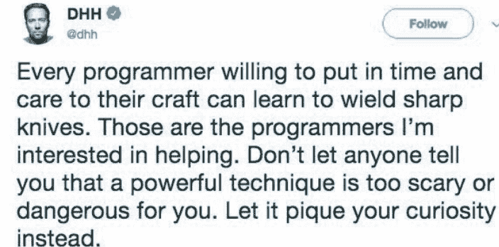

**图 7.4：** DHH 同意锋利的刀是好的（使用时需小心）。

```javascript
> String.prototype.reverse = function() {
>   return Array.from(this).reverse().join("");
> }
```

完成这个赋值后，我们现在可以直接在字符串字面量上调用 **reverse**：

```javascript
> "foobar".reverse();
'raboof'
> "Racecar".reverse();
'racecaR'
```

它也适用于字符串变量：

```javascript
> let string = "Able was I ere I saw Elba";
> string.reverse();
'ablE was I ere I saw elbA'
```

用上述代码替换 **palindrome.js** 中的 **reverse**，得到清单 7.13。（由于 **TranslatedPhrase** 对象现在不再需要用于演示目的，我们已将其移除。）

**清单 7.13：** 在 `processedContent` 中使用 `reverse` 方法。

*palindrome.js*

```javascript
// 为所有字符串添加 `reverse` 方法。
String.prototype.reverse = function() {
  return Array.from(this).reverse().join("");
}

// 定义一个 Phrase 对象。
function Phrase(content) {
  this.content = content;

  // 返回为回文测试处理过的内容。
  this.processedContent = function processedContent() {
    return this.content.toLowerCase();
  }

  // 如果短语是回文，则返回 true，否则返回 false。
  this.palindrome = function palindrome() {
    return this.processedContent() === this.processedContent().reverse();
  }
}
```

如我们所愿，我们的代码仍然能正确找到回文（图 7.5）：⁴


```javascript
> .load palindrome.js
> let napoleonsLament = new Phrase("Able was I ere I saw Elba");
> napoleonsLament.palindrome();
true
```

最后一点值得探讨，我们是否应该将 `palindrome()` 方法直接添法直接添加到 `String` 对象上。答案部分取决于语言的文化。一些语言，如 Ruby，对向原生对象添加方法相对宽容，只要这种特权不被滥用。就 JavaScript 而言，根据 MDN 不要添加*非标准*功能的告诫，我们将只添加 `reverse`，这可以认为是语言本身 `String` 对象的一部分（事实上一些语言确实包含了原生的字符串 `reverse` 方法）。但如果你想自己将 `palindrome()` 添加到 `String` 对象上，无论是我还是阿喀琉斯都不会阻止你。


**图 7.5：** 拿破仑·波拿巴在流放厄尔巴岛之前是万能的。

### 第 7 章：对象与原型

152

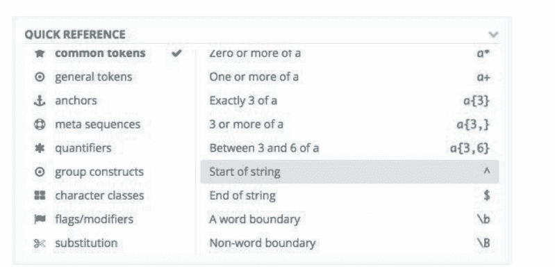

**图 7.6：** 从头到尾，空字符串全是空白字符。

### 7.3.1 练习

1.  在 `String` 对象原型上添加一个 `blank` 方法，如果字符串是空的*或者*仅由空格（空格、制表符或换行符）组成，则返回 `true`。*提示：* 使用正则表达式（第 4.3.2 节）。你需要用于字符串开头和结尾的正则表达式语法（图 7.6）。

2.  使用你偏好的方法（直接索引或切片），在 `Array` 对象原型上添加一个 `last` 方法，返回数组的最后一个元素。*提示：* 参考第 3.3 节。

# 第 8 章：测试与测试驱动开发

尽管在入门编程教程中很少涉及，*自动化测试*是现代软件开发中最重要的主题之一。因此，本章包括 JavaScript 测试入门，以及对*测试驱动开发*（TDD）的初步介绍。

测试驱动开发在第 6.3.3 节曾简要提及，当时我们承诺将使用测试技术为寻找回文添加一个重要功能，即能够检测复杂的回文，如 "A man, a plan, a canal—Panama!"（图 6.7）或 "Madam, I'm Adam."（图 8.1）。¹ 本章将兑现这一承诺。

事实证明，学习如何编写 JavaScript 测试也将给我们机会学习如何创建和使用称为 *NPM 模块*的独立软件包，这是另一项宝贵的现代 JavaScript 技能。

（除了测试 NPM 模块，在 Web 应用程序中测试 JavaScript 当然是可能的，但选择不太标准化，并且通常与底层浏览器和操作系统耦合得更紧密。因此，本教程侧重于测试背后的基本*思想*，从而为将来可能的浏览器测试做准备。）

以下是我们测试当前回文代码并将其扩展到更复杂短语的策略：

1.  图片由 Album/Alamy Stock Photo 提供。


**图 8.1：** 伊甸园拥有一切——甚至包括回文。

1.  为我们的系统设置自动化测试（第 8.1 节）。

2.  为现有的 `palindrome` 功能编写自动化测试（第 8.2 节）。

3.  为增强的回文检测器编写一个*失败*的测试（RED）（第 8.3 节）。

4.  编写（可能不太优雅的）代码让测试*通过*（GREEN）（第 8.4 节）。

5.  *重构*代码使其更美观，同时确保测试套件保持绿色状态（GREEN）（第 8.5 节）。

## 8.1 测试设置

我们选择的测试工具是 Mocha (https://mochajs.org/)（图 8.2），一个强大的 Node.js 测试框架。我们可以使用 Node 包管理器（NPM）来安装它，NPM 随 Node 一起自动安装。要全局安装，我们使用带有 `--global` 标志的 `npm` 命令（它作为 Node.js 的一部分自动包含在内）：


**图 8.2：** Mocha 是一个流行且强大的 JavaScript 测试框架。

```
$ npm install --global mocha
```

（关于 NPM 模块的一般规则是：如果你想访问相应的可执行文件（在本例中是 **mocha**），就全局安装它们；如果你想让模块成为当前项目的一部分，就本地安装（省略 **--global** 标志）。我们将在第 9.1 节开始看到后一种情况的示例。）

作为第二项设置，我们还必须将 **palindrome.js** 本身配置为 NPM 模块。这是因为（如第 5.3 节简要提到的）JavaScript 没有原生的方式将一个源文件的功能包含到另一个文件中（对于编程语言来说这是一种不寻常的情况，这在此例中源于 JavaScript 的浏览器根源）。在这种情况下，我们希望能够在网页（第 9 章）和 shell 脚本（第 10 章）中使用我们的回文检测器。幸运的是，Node 包含一个名为 **require** 的特殊函数来完成此任务，这样代码

```javascript
require(<module name>)
```

就会将相应模块的功能包含到当前应用程序中。

我们的回文检测器将作为一个独立模块存在；也就是说，它是自包含的，适合包含到其他程序（网页、shell 脚本或其他模块）中。因此，我们将模块的所有代码放在一个单独的目录中，称为 **palindrome**：

```
$ cd ~/repos/
$ mkdir palindrome
$ cd palindrome
```

接下来，我们将通过将前面章节开发的 **palindrome.js** 文件复制到 **index.js** 文件来启动我们的 **palindrome** 模块，**index.js** 是 NPM 模块主文件的标准名称：

```
$ cp ~/repos/js_tutorial/palindrome.js index.js
```

在本章的剩余部分中，我们将把这个文件调整为完整的回文检测器。

由于目录现在非空，我们可以用 Git 将其置于版本控制之下：

```
$ git init
$ git add -A
$ git commit -m "Initialize repository"
```

此时，我建议按照第 1.2.1 节中的说明在 GitHub 上为此模块创建一个公共仓库。这也将为你提供一个 GitHub 仓库 URL，供下一步使用。

为了开始一个新模块，**npm** 程序附带了一个有用的命令 **npm init**，它包含一系列交互式问题。我建议运行 **npm init**，并参考清单 8.1 填写各项值；特别是确保使用 **mocha** 作为"测试命令"，版本号设为 0.1.0（框 8.1）。（我们将在第 8.5 节发布模块时了解更多关于版本控制过程的知识。）还要注意，我使用了我的标准用户名（**mhartl**）为包名设置了作用域，得到

```json
"name": "mhartl-palindrome"
```

而不是

```json
"name": "palindrome"
```

这样做是为了让每个阅读本教程的人都可以创建一个独立的模块，所以你应该在清单 8.1 中用你自己独特的用户名替换 **mhartl**。

## 8.1 测试设置

**清单 8.1：初始化一个 NPM 模块。**

```
$ npm init
package name: (mhartl-palindrome)
version: (0.1.0)
description: Palindrome detector
entry point: (index.js)
test command: mocha
git repository: https://github.com/mhartl/mhartl-palindrome
keywords: palindrome learn-enough javascript
author: Michael Hartl
license: (ISC)
About to write to /Users/mhartl/repos/palindrome/package.json:
{
  "name": "mhartl-palindrome",
  "version": "0.1.0",
  "description": "Palindrome detector",
  "main": "index.js",
  "scripts": {
    "test": "mocha"
  },
  "repository": {
    "type": "git",
    "url": "https://github.com/mhartl/mhartl-palindrome"
  },
  "author": "Michael Hartl",
  "license": "ISC"
}
```

清单 8.1 的结果是一个名为 **package.json** 的文件，它使用 JavaScript 对象表示法（或 JSON，通常读作“JAY-sun”或“JAY-sahn”）记录了我们模块的配置。

> **框 8.1：语义化版本控制**

>

> 你可能在清单 8.1 中注意到，我们为新模块使用了版本号 0.1.0。开头的零表示我们的包处于早期阶段，通常称为“测试版”（或对于非常早期的项目称为“alpha 版”）。我们可以通过增加版本号中间的数字来表示更新，例如，从 0.1.0 到 0.2.0、0.3.0 等。错误修复通过增加最右边的数字来表示，如 0.2.1、0.2.2，而一个成熟的版本（适合他人使用，并且可能与早期版本不向后兼容）则用版本 1.0.0 来表示。

>

> 达到版本 1.0.0 后，进一步的更改遵循相同的通用模式：1.0.1 代表较小的更改（“补丁发布”），1.1.0 代表新的（但向后兼容的）功能（“次要发布”），而 2.0.0 代表主要的或不向后兼容的更改（“主要发布”）。

>

> 这些编号约定被称为*语义化版本控制*，简称 semver。更多信息，请参阅 NPM 关于如何使用语义化版本控制的文章（https://docs.npmjs.com/about-semantic-versioning）。

为我们的模块准备测试的最后一步是*导出* **Phrase** 对象，以便它可以在其他文件中使用。（我们将在 8.2 节中看到如何*导入* **Phrase**。）只需要一行 **export** 语句，我们可以将其放在文件的顶部（清单 8.2）。

**清单 8.2：导出一个模块。**

*~/repos/palindrome/index.js*

```
module.exports = Phrase;

// Adds `reverse` to all strings.
String.prototype.reverse = function() {
  return Array.from(this).reverse().join("");
}

// Defines a Phrase object.
function Phrase(content) {
  this.content = content;

  // Returns content processed for palindrome testing.
  this.processedContent = function processedContent() {
    return this.content.toLowerCase();
  }

  // Returns true if the phrase is a palindrome, false otherwise.
  this.palindrome = function palindrome() {
    return this.processedContent() === this.processedContent().reverse();
  }
}
```

### 8.1.1 练习

- 1. 正如 NPM 指南“如何发布和更新包”（https://docs.npmjs.com/packages-and-modules/contributing-packages-to-the-registry）中（https://docs.npmjs.com/about-package-readme-files）指出的那样，在包中包含一个提供模块信息的“README”文件是一种良好的实践。创建一个名为 **readme.md** 的文件，并填写关于该模块的信息。如果你愿意，可以参考我的 readme（https://github.com/mhartl/mhartl-palindrome#phrase-object-with-palindrome-detector）。

## 8.2 初始测试覆盖率

有了第 8.1 节的准备工作，我们现在可以开始进行自动化测试了。我们将首先创建一个 **test** 目录和一个 **test.js** 文件：

```
$ mkdir test/
$ touch test/test.js
```

现在我们需要用 **palindrome** 方法的测试代码来填充 **test.js**。我们首先使用 **require** 函数在 **test.js** 中包含两个 NPM 模块，这是 Node 从外部文件导入功能的方式。第一个是一个*断言库*，它允许我们在测试中断言某些条件为真，第二个是 **Phrase** 对象本身：

```
let assert = require("assert");
let Phrase = require("../index.js");
```

接下来，我们将使用 **assert** 中的两个函数，名为 **describe** 和 **it**。**describe** 函数接受一个字符串和一个函数。例如，为了描述 **Phrase** 对象，我们可以这样开始：

```
describe("Phrase", function() {
```

接下来，由于我们将在 **Phrase** 对象内部测试 **palindrome**，我们将*嵌套*第二个 **describe** 调用。特别是，正如我们在第 3.2 节中简要看到的，表示对象方法的通常方式是在方法前使用井号 #（**Phrase#palindrome**），我们可以在测试中这样表示：

```
describe("Phrase", function() {
  describe("#palindrome", function() {
```

最后，在 **describe** 函数内部，我们将添加一个 **it** 函数的调用，它也接受一个字符串和一个函数：

```
describe("Phrase", function() {
  describe("#palindrome", function() {
    it("should return false for a non-palindrome", function() {
      let nonPalindrome = new Phrase("apple");
      assert(!nonPalindrome.palindrome());
    });
    .
    .
    .
```

在这里，我们使用 **assert** 来断言“apple”*不*应该是一个回文（图 8.3），² 其中“不”用通常的感叹号（“bang”）! 来表示（第 2.4.1 节）。

类似的，我们可以用另一个 **it** 调用来测试一个简单的回文（一个字面上正反读都一样的词）：

```
it("should return true for a plain palindrome", function() {
  let plainPalindrome = new Phrase("racecar");
  assert(plainPalindrome.palindrome());
});
```

结合上述讨论的代码，我们得到了初始的测试文件，如清单 8.3 所示。

**清单 8.3：我们的初始测试套件。**

*~/repos/palindrome/test/test.js*

```
let assert = require("assert");
let Phrase = require("../index.js");

describe("Phrase", function() {
  describe("#palindrome", function() {

    it("should return false for a non-palindrome", function() {
      let nonPalindrome = new Phrase("apple");
      assert(!nonPalindrome.palindrome());
    });

    it("should return true for a plain palindrome", function() {
      let plainPalindrome = new Phrase("racecar");
      assert(plainPalindrome.palindrome());
    });
  });
});
```

**图 8.3：** 单词“apple”：不是回文。


现在来真正的测试（可以这么说）。要运行我们的测试集或*测试套件*，我们只需运行 `npm test`（清单 8.4），它（由于第 8.1 节中的配置）在底层使用 `mocha` 命令。

**清单 8.4：初始设置后的测试套件。绿色**

```
$ npm test

  Phrase
    #palindrome()
      ✓ should return false for a non-palindrome
      ✓ should return true for a plain palindrome

  2 passing (6ms)
```

测试应该是绿色的，表明它们现在处于通过状态。

### 8.2.1 待处理的测试

在继续之前，我们将添加几个待处理的测试，它们是我们想要编写的测试的占位符/提醒。编写待处理测试的方法是简单地仅使用字符串参数调用 **it**（省略函数），如清单 8.5 所示。

**清单 8.5：添加两个待处理的测试。**

*~/repos/palindrome/test/test.js*

```
let assert = require("assert");
let Phrase = require("../index.js");

describe("Phrase", function() {

  describe("#palindrome", function() {

    it("should return false for a non-palindrome", function() {
      let nonPalindrome = new Phrase("apple");
      assert(!nonPalindrome.palindrome());
    });

    it("should return true for a plain palindrome", function() {
      let plainPalindrome = new Phrase("racecar");
      assert(plainPalindrome.palindrome());
    });

    it("should return true for a mixed-case palindrome");

    it("should return true for a palindrome with punctuation");
  });
});
```

## 8.2 初始测试覆盖率

通过重新运行测试套件（代码清单 8.6），我们可以看到代码清单 8.5 的结果。

**代码清单 8.6：** 来自代码清单 8.5 的待处理测试。<font color="green">通过</font>

```
$ npm test

  Phrase
    #palindrome
      ✓ should return false for a non-palindrome
      ✓ should return true for a plain palindrome
      - should return true for a mixed-case palindrome
      - should return true for a palindrome with punctuation

  2 passing (6ms)
  2 pending
```

现在 Mocha 显示了有两个待处理测试的指示。（有时人们会将包含待处理测试的测试套件称为<font color="goldenrod">黄色</font>，类比交通灯的红黄绿颜色方案。）

填充混合大小写回文的测试留作练习（解决方案将在下一节展示），而填充第二个待处理测试则是第 8.3 节和第 8.4 节的主题。

### 8.2.2 练习

1.  通过填充代码清单 8.7 中的代码，添加一个针对如“RaceCar”这样的混合大小写回文的测试。测试套件是否仍然是<font color="green">通过</font>的？

2.  为了100%确保测试确实在测试我们*认为*它们在测试的内容，一个好习惯是通过故意*破坏*测试来达到失败状态（<font color="red">失败</font>）。修改应用程序代码以依次破坏每个现有测试，然后确认一旦原始代码恢复，它们会再次变为<font color="green">通过</font>。一个破坏前一个练习测试（但不影响其他测试）的代码示例如代码清单 8.8 所示。（*首先*编写测试的一个优势是，这个<font color="red">失败</font>–<font color="green">通过</font>的循环会自动发生。）

## 8.3 失败

在本节中，我们将迈出重要的第一步，以检测更复杂的回文，如“Madam, I’m Adam.” 和 “A man, a plan, a canal—Panama!”。与我们之前遇到的字符串不同，这些短语——包含空格和标点符号——即使忽略大小写，在字面意义上也不是严格的回文。我们不能直接测试原始字符串，而必须想办法只提取字母，然后检查提取出的字母是否前后一致。

实现这一点的代码相当棘手，但相应的测试却很简单。这是测试驱动开发尤其能大显身手的情况之一（方框 8.2）。我们可以编写简单的测试，从而进入失败状态，然后以任何我们想要的方式编写应用程序代码以达到通过状态（第 8.4 节）。此时，有了测试保护我们免受未发现错误的影响，我们就可以放心的修改应用程序代码（第 8.5 节）。

> **方框 8.2：何时测试**

>

> 在决定何时以及如何测试时，理解*为什么*测试会很有帮助。在我看来，编写自动化测试主要有三个好处：

>

> 1.  测试可以防止*回归*，即正常工作的功能因某种原因停止工作。

> 2.  测试允许代码进行*重构*（即改变其形式而不改变其功能）时更有信心。

> 3.  测试充当应用程序代码的*客户端*，从而有助于确定其设计及其与系统其他部分的接口。

>

> 虽然以上任何好处都*不*要求必须先编写测试，但在许多情况下，测试驱动开发（TDD）是你工具箱中的一个宝贵工具。何时以及如何测试，部分取决于你对编写测试的熟悉程度；许多开发者发现，随着他们越来越擅长编写测试，他们更倾向于先编写测试。这也取决于测试相对于应用程序代码的难度、期望功能的明确程度，以及功能在未来被破坏的可能性。

>

> 在此背景下，制定一套关于我们何时应该先测试（或根本测试）的指南会很有帮助。以下是一些基于我个人经验的建议：

>

> *   当测试与其测试的应用程序代码相比特别短或简单时，倾向于先编写测试。

> *   当期望的行为尚未完全明确时，倾向于先编写应用程序代码，然后编写测试来记录结果。

> *   一旦发现错误，就编写一个测试来重现它并防止回归，然后编写应用程序代码来修复它。

> *   在重构代码之前编写测试，重点关注特别容易出错的代码。

我们将从为带标点的回文编写一个测试开始，这与代码清单 8.3 中的测试类似：

```
it("should return true for a palindrome with punctuation", function() {
  let punctuatedPalindrome = new Phrase("Madam, I'm Adam.");
  assert(punctuatedPalindrome.palindrome());
});
```

更新后的测试套件出现在代码清单 8.9 中，其中也包含了代码清单 8.7 练习的解决方案（图 8.4）。（为简洁起见，代码清单 8.9 中仅高亮显示了新的 `let` 和断言，但你也应该包含 `it` 语句。）


### 代码清单 8.9：为带标点的回文添加测试。

~/repos/palindrome/test/test.js

```
let assert = require("assert");
let Phrase = require("../index.js");

describe("Phrase", function() {

  describe("#palindrome", function() {

    it("should return false for a non-palindrome", function() {
      let nonPalindrome = new Phrase("apple");
      assert(!nonPalindrome.palindrome());
    });

    it("should return true for a plain palindrome", function() {
      let plainPalindrome = new Phrase("racecar");
      assert(plainPalindrome.palindrome());
    });

    it("should return true for a mixed-case palindrome", function() {
      let mixedCase = new Phrase("RaceCar");
      assert(mixedCase.palindrome());
    });

    it("should return true for a palindrome with punctuation", function() {
      let punctuatedPalindrome = new Phrase("Madam, I'm Adam.");
      assert(punctuatedPalindrome.palindrome());
    });
  });
});
```

如要求所示，测试套件现在是失败状态，如代码清单 8.10 所示。

### 代码清单 8.10：添加代码清单 8.9 中测试后的测试套件。

```
$ npm test

  Phrase
    #palindrome
      ✓ should return false for a non-palindrome
      ✓ should return true for a plain palindrome
      ✓ should return true for a mixed-case palindrome
      1) should return true for a palindrome with punctuation

  3 passing (8ms)
  1 failing

  1) Phrase
      #palindrome
        should return true for a palindrome with punctuation:

      AssertionError [ERR_ASSERTION]: false == true
      + expected - actual

      -false
      +true
```

此时，我们可以开始思考如何编写应用程序代码并达到通过状态。我们的策略是为 **Phrase** 对象编写一个 **letters** 方法，该方法仅返回内容字符串中的字母。换句话说，代码

```
new Phrase("Madam, I'm Adam.").letters();
```

应评估为：

```
MadamImAdam
```

（注意，这里我们实际上可以对 **new Phrase** 调用 **letters()**——JavaScript 会先创建新的对象实例，然后在该实例上调用 **letters()** 方法。）达到此状态将允许我们使用当前的回文检测器来判断原始短语是否是回文。

明确了这个规范，我们现在可以为 **letters** 编写一个简单的测试。我们可以沿用之前测试的模式，直接断言（严格）相等（代码清单 8.11）。

### **代码清单 8.11：直接断言严格相等。**

```
let punctuatedPalindrome = new Phrase("Madam, I'm Adam.");
assert(punctuatedPalindrome.letters() === "MadamImAdam");
```

然而，事实证明，**assert** 模块原生支持这种比较（如官方文档 (https://www.npmjs.com/package/assert) 所示），从而引出了代码清单 8.12 所示的断言形式。

## 8.3 红色阶段

**清单 8.12：** 使用原生断言。

```
assert.strictEqual(<actual>, <expected>);
```

正如我们稍后将看到的，通常尽可能使用原生断言更为可取，因为这样做能为失败的测试提供更有帮助的消息。为了这些失败的测试消息，同样重要的是按照上面所示的“实际值，期望值”顺序包含参数。

在当前情况下，“实际”结果是 `punctuatedPalindrome.letters()`，“期望”值是 `"MadamImAdam"`，因此我们可以如下填写断言：

```
let punctuatedPalindrome = new Phrase("Madam, I'm Adam.");
assert.strictEqual(punctuatedPalindrome.letters(), "MadamImAdam");
```

为 **letters** 添加一个新的 **describe** 函数（并添加井号 # 以表示我们正在测试 **Phrase#letters**），将得到清单 8.13 中所示的代码。

**清单 8.13：** 为 **letters** 方法添加测试。红色阶段

`~/repos/palindrome/test/test.js`

```
describe("Phrase", function() {
  .
  .
  describe("#palindrome", function() {
    .
    .
  });

  describe("#letters", function() {
    it("should return only letters", function() {
      let punctuatedPalindrome = new Phrase("Madam, I'm Adam.");
      assert.strictEqual(punctuatedPalindrome.letters(), "MadamImAdam");
    });
  });
});
```

由于 **letters** 方法根本不存在，当前的失败消息并非那么有用，如清单 8.14 所示。

**清单 8.14：** `letters` 的初始失败消息。红色阶段

```
$ npm test
.
.
.
2) Phrase
    #letters
        should return only letters:
    TypeError: punctuatedPalindrome.letters is not a function
```

我们可以通过为 `letters` 添加一个*存根*来达到更有用的红色状态：一个至少存在的、但尚不能工作的方法。为简单起见，我们将简单地返回短语的内容，如清单 8.15 所示。

**清单 8.15：** `letters` 方法的存根。红色阶段

```
~/repos/palindrome/index.js
module.exports = Phrase;
.
.
.
function Phrase(content) {
.
.
.
// Returns the letters in the content.
this.letters = function letters() {
    return this.content; // stub return value
}

// Returns true if the phrase is a palindrome, false otherwise.
this.palindrome = function palindrome() {
    return this.processedContent() === this.processedContent().reverse();
}
}
```

如承诺的那样，现在的错误消息相当有帮助，如清单 8.16 所示。

**清单 8.16：** 更有帮助的错误消息。红色阶段

```
$ npm test
Phrase
  #palindrome
    ✓ should return false for a non-palindrome
    ✓ should return true for a plain palindrome
    ✓ should return true for a mixed-case palindrome
    1) should return true for a palindrome with punctuation
  #letters
    2) should return only letters

3 passing (9ms)
2 failing

1) Phrase
      #palindrome
        should return true for a palindrome with punctuation:

    AssertionError [ERR_ASSERTION]: false == true
    + expected - actual

    -false
    +true

    at Context.<anonymous> (test/test.js:25:7)

2) Phrase
      #letters
        should return only letters:

    AssertionError [ERR_ASSERTION]: 'Madam, I\'m Adam.' === 'MadamImAdam'
    + expected - actual

    -Madam, I'm Adam.
    +MadamImAdam
```

有了我们两个捕获期望行为的红色测试，我们现在可以继续处理应用代码，并尝试使其达到绿色。

### 8.3.1 练习

1.  使用清单 8.11 中显示的直接 === 断言时，错误消息是什么？为什么这不如清单 8.16 中的消息有用？

2.  如果你在清单 8.16 中反转清单 8.12 的实际值和期望值会发生什么？为什么产生的错误消息令人困惑？

## 8.4 绿色阶段

现在我们有了捕获回文检测器增强行为的红色测试，是时候让它们变绿了。测试驱动开发 (TDD) 的理念之一是先让测试通过，而不太在意实现的质量。一旦测试套件变绿，我们就可以在不引入回归的情况下对其进行完善（框 8.2）。

主要挑战是实现 `letters`，该方法返回一个字符串，包含构成 Phrase 内容的字母（但不包含任何其他字符）。换句话说，我们需要选择匹配特定模式的字符。这听起来像是正则表达式（第 4.3 节）的工作。

在这种时候，使用在线正则表达式匹配器，配合图 4.5 所示的正则表达式参考，是个极好的主意。确实，有时它们会让事情变得过于简单，比如当参考中有你恰好需要的正则表达式时（图 8.5）。

让我们在控制中测试它，以确保它满足我们的标准：

```
$ node
> !!"M".match(/[a-zA-Z]/);
true
> !!"d".match(/[a-zA-Z]/);
true
> !!",".match(/[a-zA-Z]/);
false
```

看起来不错！

我们现在可以构建一个匹配大写或小写字母的字符数组。最直接的方法是使用 **for** 循环和我们在第 2.6 节首次见到的 **charAt** 方法。我们将从一个空字母数组开始，然后遍历内容字符串，如果字符匹配字母正则表达式，则将其**推入**数组（第 3.4.2 节）：

```
let theLetters = [];
for (let i = 0; i < this.content.length; i++) {
    if (this.content.charAt(i).match(/[a-zA-Z]/)) {
        theLetters.push(this.content.charAt(i));
    }
}
```

此时，**theLetters** 是一个字母数组，可以用空字符串**连接**起来，形成原始字符串中的字母字符串：

```
return theLetters.join("");
```

将所有内容组合在一起，得到清单 8.17 中的 **Phrase#letters** 方法（添加高亮以指示新方法的开始）。

**清单 8.17：** 一个可用的 **letters** 方法（但完整套件仍为红色）。

`~/repos/palindrome/index.js`

```
module.exports = Phrase;

// Adds `reverse` to all strings.
String.prototype.reverse = function() {
    return Array.from(this).reverse().join("");
}

// Defines a Phrase object.
function Phrase(content) {
    this.content = content;

    // Returns content processed for palindrome testing.
    this.processedContent = function processedContent() {
        return this.content.toLowerCase();
    }

    // Returns the letters in the content.
    // For example:
    //   new Phrase("Hello, world!").letters() === "Helloworld"
    this.letters = function letters() {
      let theLetters = [];
      for (let i = 0; i < this.content.length; i++) {
        if (this.content.charAt(i).match(/[a-zA-Z]/)) {
          theLetters.push(this.content.charAt(i));
        }
      }
      return theLetters.join("");
    }

    // Returns true if the phrase is a palindrome, false otherwise.
    this.palindrome = function palindrome() {
      return this.processedContent() === this.processedContent().reverse();
    }
}
```

尽管完整的测试套件仍然是红色的，但我们的 **letters** 测试现在应该是绿色的了，如清单 8.18 中的高亮行所示。

**清单 8.18：** 红色套件但绿色的 **letters** 测试。

```
$ npm test

  Phrase
    #palindrome
      ✓ should return false for a non-palindrome
      ✓ should return true for a plain palindrome
      ✓ should return true for a mixed-case palindrome
      1) should return true for a palindrome with punctuation
    #letters
      ✓ should return only letters

  4 passing (8ms)
  1 failing

  1) Phrase
       #palindrome
         should return true for a palindrome with punctuation:

     AssertionError [ERR_ASSERTION]: false == true
     + expected - actual

     -false
     +true
```

我们可以通过在 `processedContent` 方法中将 `content` 替换为 `letters()` 来使最后一个红色测试通过。结果出现在清单 8.19 中。

**清单 8.19：** 一个可用的回文方法。绿色阶段

`~/repos/palindrome/index.js`

```
module.exports = Phrase;

// Adds `reverse` to all strings.
String.prototype.reverse = function() {
  return Array.from(this).reverse().join("");
}

// Defines a Phrase object.
function Phrase(content) {
  this.content = content;

  // Returns content processed for palindrome testing.
  this.processedContent = function processedContent() {
    return this.letters().toLowerCase();
  }

  // Returns the letters in the content.
  // For example:
  //   new Phrase("Hello, world!").letters() === "Helloworld"
  this.letters = function letters() {
    let theLetters = [];
    for (let i = 0; i < this.content.length; i++) {
      if (this.content.charAt(i).match(/[a-zA-Z]/)) {
        theLetters.push(this.content.charAt(i));
      }
    }
    return theLetters.join("");
  }

  // Returns true if the phrase is a palindrome, false otherwise.
  this.palindrome = function palindrome() {
    return this.processedContent() === this.processedContent().reverse();
  }
}
```


**图 8.6：** 我们的检测器终于理解了Adam的回文特性。

清单 8.19 的结果是一个绿色的测试套件（图 8.6），如清单 8.20 所示。

**清单 8.20：** 清单 8.19 之后的测试套件。绿色

```
$ npm test

  Phrase
    #palindrome
      ✓ should return false for a non-palindrome
      ✓ should return true for a plain palindrome
      ✓ should return true for a mixed-case palindrome
      ✓ should return true for a palindrome with punctuation
    #letters
      ✓ should return only letters

  5 passing (6ms)
```

这或许不是世界上最漂亮的代码，但这个绿色的测试套件表明我们的代码正在运行！

### 8.4.1 练习

1.  在 Node REPL 中通过 `require` 引入 `palindrome` 模块，手动验证 `Phrase#palindrome` 代码能否成功检测形如“Madam, I’m Adam.”的回文。（你可能需要退出并重启 REPL 以刷新所有相关的对象定义。*提示：* 使用与清单 8.3 第二行相同的 `require` 命令，但用 `./` 替换 `../`。）

## 8.5 重构

尽管清单 8.19 中的代码现在可以工作了，正如我们的绿色测试套件所证明的那样，但它依赖于一个相当笨重（尽管直接）的 `for` 循环，并且还有一些重复。在本节中，我们将*重构*代码，这是在不改变功能的情况下改变代码形式的过程。

通过在任何重大更改后运行测试套件，我们将快速发现任何回归，从而让我们确信重构代码的最终形式仍然是正确的。在本节中，我建议进行增量更改，并在每次更改后运行测试套件以确认套件仍然是绿色的。

我们首先观察到清单 8.19 中存在一些重复：表达式

```
this.content.charAt(i)
```

出现了两次。这表明可以通过使用 `let` 将其绑定到一个变量来消除重复：

```
this.letters = function letters() {
  let theLetters = [];
  for (let i = 0; i < this.content.length; i++) {

    let character = this.content.charAt(i);
    if (character.match(/[a-zA-Z]/)) {
      theLetters.push(character);
    }
  }
  return theLetters.join("");
}
```

作为另一项优化，我们可以通过在 `/.../` 后使用 `i` 进行不区分大小写的匹配来简化正则表达式，同时将其绑定到一个命名常量以使其目的更清晰：

```
const letterRegex = /[a-z]/i;

for (let i = 0; i < this.content.length; i++) {
  let character = this.content.charAt(i);

  if (character.match(letterRegex)) {
    theLetters.push(character);
  }
}
```

根据第 5.4 节，通常最好在可以时使用 **forEach** 循环。我们可以使用清单 5.15 中的技术来做到这一点，如下所示：

```
const letterRegex = /[a-z]/i;

Array.from(this.content).forEach(function(character) {

  if (character.match(letterRegex)) {
    theLetters.push(character);
  }
});
```

请注意，我们能够移除 **character** 变量的 **let**，因为它现在作为 **forEach** 循环的函数参数免费提供。

我们还有一次最终的重构要做，但作为参考，应用程序代码的完整状态出现在清单 8.21 中。

**清单 8.21：** 重构后的 **letters** 方法。绿色

~/repos/palindrome/index.js

```
module.exports = Phrase;

// Adds `reverse` to all strings.
String.prototype.reverse = function() {
  return Array.from(this).reverse().join("");
}

// Defines a Phrase object.
function Phrase(content) {
  this.content = content;

  // Returns content processed for palindrome testing.
  this.processedContent = function processedContent() {
    return this.letters().toLowerCase();
  }

  // Returns the letters in the content.
  // For example:
  //   new Phrase("Hello, world!").letters() === "Helloworld"
  this.letters = function letters() {
    let theLetters = [];
    const letterRegex = /[a-z]/i;
    Array.from(this.content).forEach(function(character) {
      if (character.match(letterRegex)) {
        theLetters.push(character);
      }
    });
    return theLetters.join("");
  }

  // Returns true if the phrase is a palindrome, false otherwise.
  this.palindrome = function palindrome() {
    return this.processedContent() === this.processedContent().reverse();
  }
}
```

运行测试套件的结果是令人满意的，如清单 8.22 所示。

**清单 8.22：** 使用 **forEach** 重构后的测试套件。绿色

```
$ npm test

Phrase
  #palindrome
    ✓ should return false for a non-palindrome
    ✓ should return true for a plain palindrome
    ✓ should return true for a mixed-case palindrome
    ✓ should return true for a palindrome with punctuation
  #letters
    ✓ should return only letters

5 passing (6ms)
```

它仍然是绿色的！上述更改涉及许多棘手且容易出错的操作，因此绿色的测试套件让我们确信没有引入任何回归。

为了激发最后一次重构，我们可以注意到清单 8.21 中的代码形式与第 6.2 节中清单 6.4 的形式相似：我们初始化一个空数组，然后在 `forEach` 循环中向其推送元素。在清单 6.5 中，我们使用函数式编程的 `filter` 方法将该循环转换为一行代码，我们可以在这里做完全相同的事情。

作为快速回顾，让我们进入 REPL：

```
> Array.from("Madam, I'm Adam.");
[ 'M', 'a', 'd', 'a', 'm', ',', ' ', 'I', '\'', 'm', ' ',
'A', 'd', 'a', 'm', '.' ]
> Array.from("Madam, I'm Adam").filter(c => c.match(/([a-z])/i));
[ 'M', 'a', 'd', 'a', 'm', 'I', 'm', 'A', 'd', 'a', 'm' ]
> Array.from("Madam, I'm Adam").filter(c => c.match(/([a-z])/i)).join("");
'MadamImAdam'
```

我们在这里看到，将方法链（第 5.3 节）与函数式编程相结合，可以轻松地过滤和连接字符串中的字母字符。

将 `filter` 应用到清单 8.21 的代码中，我们可以将 `letters` 方法压缩为一行，如清单 8.23 所示。（可以说，通过保留清单 8.21 中的 `lettersRegEx` 常量可以改进它，但我发现单行函数的简洁性几乎让人无法抗拒。）

**清单 8.23：** 将 `letters` 重构为单行。绿色

```
module.exports = Phrase;

// Adds `reverse` to all strings.
String.prototype.reverse = function() {
  return Array.from(this).reverse().join("");
}

// Defines a Phrase object.
function Phrase(content) {
  this.content = content;

  // Returns content processed for palindrome testing.
  this.processedContent = function processedContent() {
    return this.letters().toLowerCase();
  }

  // Returns the letters in the content.
  // For example:
  //   new Phrase("Hello, world!").letters() === "Helloworld"
  this.letters = function letters() {
    return Array.from(this.content).filter(c => c.match(/([a-z])/i)).join("");
  }

  // Returns true if the phrase is a palindrome, false otherwise.
  this.palindrome = function palindrome() {
    return this.processedContent() === this.processedContent().reverse();
  }
}
```

正如第 6 章所指出的，函数式程序更难以增量构建，这是拥有测试套件以检查其是否达到预期效果的一个原因（清单 8.24）。⁴

**清单 8.24：** 函数式重构后的测试套件。

```
$ npm test
  Phrase
    #palindrome
      ✓ should return false for a non-palindrome
      ✓ should return true for a plain palindrome
      ✓ should return true for a mixed-case palindrome
      ✓ should return true for a palindrome with punctuation
    #letters
      ✓ should return only letters

  5 passing (6ms)
```

好耶！我们的测试套件仍然通过，所以我们的一行 **letters** 方法有效。这是一个重大的改进，但实际上还有一次重构，它代表了 JavaScript 力量的一个绝佳范例。回顾第 4.3 节，**match** 可以使用正则表达式从字符串返回一个数组。通过与第 4.5 节的全局标志 **g** 结合，我们可以直接选择字母：

```
> "Madam, I'm Adam.".match(/[a-z]/gi);
[ 'M', 'a', 'd', 'a', 'm', 'I', 'm', 'A', 'd', 'a', 'm' ]
> "Madam, I'm Adam.".match(/[a-z]/gi).join("");
'MadamImAdam'
```

> 4. 在现实生活中，我可能会首先编写我们在第 8.3 节中看到的测试，然后立即尝试函数式解决方案来编写 **Phrase#letters** 方法。如果失败，我会回溯，用一种更简单（更循环化）的方式来做，然后在测试套件变绿后再尝试函数式解决方案。（我发现这种回溯对于我们在第 6.3 节遇到的 **reduce** 方法来说尤其必要。）

## 8.5 重构

通过使用我们本节一直在用的相同正则表达式进行匹配，然后将结果连接成空字符串，我们几乎复制了 **letters** 方法的功能！只有一个细微之处需要注意：当没有匹配到*任何*字母时，结果是 **null**：

```
> "1234".match(/[a-z]/gi);
null
> "1234".match(/[a-z]/gi).join("");
**TypeError**: Cannot read property 'join' of null
```

我们可以用 **||**（"或"）运算符（第 2.4 节）来解决这个问题，它使用了一种称为"短路求值"的方法。

在 **||** 运算符的一列表达式中，如果第一个元素求值为 **true**，求值过程就会"短路"，JavaScript 立即返回该元素。如果第一个元素是 **false**，JavaScript 就会求值下一个元素，依此类推，直到找到一个 **true** 的元素，然后返回最后一个元素（或者如果所有元素都是 **false**，则返回最后一个元素）。这意味着我们可以这样处理上述情况：

```
> null || []
[]
```

这里 JavaScript 看到 **null**，将其求值为 **false**，然后接着看 **[]**，它是 **true**，因此被返回。

我们可以将这个想法与 **match** 结合使用，如下所示：

```
> ("1234".match(/[a-z]/gi) || []);
[]
> ("1234".match(/[a-z]/gi) || []).join("");
''
```

使用这种技术，我们可以进一步简化应用代码，如清单 8.25 所示。

### 清单 8.25：用 **match** 替换 **letters** 方法。

~/repos/palindrome/index.js

```
module.exports = Phrase;

// Adds `reverse` to all strings.
String.prototype.reverse = **function**() {
  **return** Array.from(**this**).reverse().join("");
};

}

// Defines a Phrase object.
function Phrase(content) {
  this.content = content;

  // Returns content processed for palindrome testing.
  this.processedContent = function processedContent() {
    return this.letters().toLowerCase();
  }

  // Returns the letters in the content.
  // For example:
  //   new Phrase("Hello, world!").letters() === "Helloworld"
  this.letters = function letters() {
    return (this.content.match(/[a-z]/gi) || []).join("");
  }

  // Returns true if the phrase is a palindrome, false otherwise.
  this.palindrome = function palindrome() {
    return this.processedContent() === this.processedContent().reverse();
  }
}
```

请注意，我们没有为 `match` 返回 `null` 的重要情况添加测试；添加这个测试留作练习（第 8.5.2 节）。

再次运行测试套件证实一切仍然正常（图 8.7），如清单 8.26 所示。

### 清单 8.26：最终重构后的测试套件。GREEN

```
$ npm test

  Phrase
    #palindrome
      ✓ should return false for a non-palindrome
      ✓ should return true for a plain palindrome
      ✓ should return true for a mixed-case palindrome
      ✓ should return true for a palindrome with punctuation
    #letters
      ✓ should return only letters


  5 passing (6ms)
```


图 8.7：经过所有工作，它仍然是一个回文。

### 8.5.1 发布 NPM 模块

完成了**回文**模块的重构版本后，我们现在准备进行最后一步：公开发布该模块，以便将其纳入其他项目（例如第 9 章中的网站）。幸运的是，NPM 让这变得非常简单。

首先，我们应该进行一次 Git 提交并推送到远程仓库：

```
$ git add -A
$ git commit -m "Finish working and refactored palindrome method"
$ git push
```

要发布 NPM 模块，你需要将自己添加为用户（除非你已经是成员），使用 **npm adduser** 即可轻松完成（你应该使用自己的名字、用户名和电子邮件地址）：

```
$ npm adduser Michael Hartl
Username: mhartl
Password:
Email: (this IS public) michael@michaelhartl.com
Logged in as mhartl on https://registry.npmjs.org/
```

NPM 要求你在允许发布之前验证你的电子邮件地址（大概是为了让滥用其系统变得更加困难），因此你应该检查电子邮件并点击验证链接，然后再继续操作（图 8.8）。

**图 8.8：** 验证你的 NPM 电子邮件。

这样，我们就可以开始了！只需使用 `npm publish` 即可将模块发布到公共 NPM 列表：

```
$ npm publish
```

对于未来的任何修订，你只需按照语义化版本控制规则（第 8.1 节）递增 `package.json` 中的版本号即可。

### 8.5.2 练习

- 1. 删除清单 8.25 中的 `|| []` 部分，并确认测试仍然是 GREEN。这是一个问题，因为实际上应用代码现在已损坏。添加清单 8.27 所示的测试以捕获错误并确认它是 RED，然后恢复 `|| []` 以使套件恢复为 GREEN。

- 2. 重新引入清单 8.21 中的 `lettersRegEx` 变量（现在带有清单 8.25 中添加的 `g` 标志），并通过填写清单 8.28 中所示的代码，将其应用于 `letters` 方法的函数式版本。测试套件是否仍然通过？

186 第 8 章：测试与测试驱动开发

### 清单 8.27：测试一个没有字母的字符串。RED

```
~/repos/palindrome/test/test.js
describe("Phrase", function() {
  .
  .
  .
  describe("#palindrome", function() {
    .
    .
    .
  });

  describe("#letters", function() {
    it("should return only letters", function() {
      let punctuatedPalindrome = new Phrase("Madam, I'm Adam.");
      assert.strictEqual(punctuatedPalindrome.letters(), "MadamImAdam");
    });

    it("should return the empty string on no match", function() {
      let noLetters = new Phrase("1234.56");
      assert.strictEqual(noLetters.letters(), "");
    });
  });
});
```

### 清单 8.28：重新引入 lettersRegEx 变量。GREEN

```
~/repos/palindrome/index.js
this.letters = function letters() {
  const lettersRegEx = /[a-z]/gi;
  return // FILL IN
}
```

# 第 9 章

## 事件与 DOM 操作

在本章中，我们将回到 JavaScript 的原生环境，并将新创建的 Node 模块应用到浏览器中。具体来说，我们将制作一个简单的单页 JavaScript 应用程序，该程序接收用户输入的字符串，并指示该字符串是否为回文。

我们的方法涉及逐渐增加复杂程度，从一个简单的"hello, world"风格的概念验证开始（第 9.1 节）。然后，我们将添加一个提示/警告设计，这将引出事件监听器的介绍（第 9.2 节）。在第 9.3 节中，我们将用动态插入页面本身的 HTML 替换警告框——这是操作文档对象模型树的第一个例子。最后，在第 9.4 节中，我们将添加一个 HTML 表单，这是一种比 JavaScript 提示框更方便的数据输入方法。

### 9.1 一个可工作的回文页面

为了开始我们的回文检测器，我们将分别创建一个 HTML 文件和我们网站的主 JavaScript 文件，分别命名为 `palindrome.html` 和 `main.js`：

```
$ cd ~/repos/js\_tutorial
$ touch palindrome.html main.js
```

和第 1 章一样，我们将制作一个最小的"hello, world"应用来证明一切基本正常。为此，我们需要安装第 8.1 节创建的 **<username>-palindrome** 模块：

```
$ npm install <username>-palindrome  # Replace <username> with your username.
```

如果由于任何原因你没有完成第 8.1 节，你可以使用我的模块版本 **mhartin-palindrome**。

要使用该模块导出的 **Phrase** 对象（清单 8.2），我们只需要编辑 **main.js**，并使用 **let** 将名称 **Phrase** 绑定到 **require** 函数的结果，如清单 9.1 所示。

### 清单 9.1：添加一个概念验证。

`main.js`

```
let Phrase = require("<username>-palindrome");

alert(new Phrase("Madam, I'm Adam.").palindrome());
```

清单 9.1 还包括一个 **alert**，如果它能工作，将告诉我们 **require** 成功了。

回想一下第 5.2 节，我们可以使用 **script** 标�的 **src** 属性来包含外部 JavaScript 文件（清单 5.5）：

```
<script src="filename.js"></script>
```

你可能认为我们可以直接包含 **main.js**，就像这样：

```
<script src="main.js"></script>
```

不幸的是，因为浏览器不支持 **require**，所以这行不通。相反，我们需要使用一个名为 **browserify** 的 NPM 模块（在 Google 上搜索"require node module into browser"）：

```
$ npm install --global browserify
```

**browserify** 工具以浏览器可以理解的方式打包我们的离线代码，如清单 9.2 所示。

## 9.1 一个可用的回文页面

清单 9.2：使用 **browserify** 为浏览器准备一个 JavaScript 包。

```
$ browserify main.js -o bundle.js
```

使用 `-o`（输出文件）标志，清单 9.2 创建了一个名为 **bundle.js** 的文件，该文件*可以*被包含在浏览器中。¹（browserify 是如何做到这一点的？我不知道。能够使用那些内部工作原理神秘莫测的模块，是技术娴熟的重要体现。）

注意：在 **main.js** 中进行了修改但忘记重新运行 **browserify** 是一个常见的错误来源，因此，如果你发现预期的更改没有在页面上显示出来，请务必尝试重新运行清单 9.2。我还建议查看 watchify (https://www.npmjs.com/package/watchify) 软件包，它旨在自动重新构建打包版本。

此时，我们的 JavaScript 已经为在网页上使用而正确打包，因此我们可以像第 5.2 节中介绍的那样，使用 `src` 属性将其包含进来。最终的 **palindrome.html**（其中也包含一个最小的 HTML 骨架）如清单 9.3 所示。

清单 9.3：创建回文页面，包含 JavaScript 源码。

palindrome.html

```
<!DOCTYPE html>
<html>
  <head>
    <title>回文测试器</title>
    <meta charset="utf-8">
    <script src="bundle.js"></script>
  </head>
  <body>
    <h1>回文测试器</h1>
  </body>
</html>
```

结果应该是一个可用的提示框，如图 9.1 所示。如果你的系统上无法正常工作，请按照 Box 5.1 中的建议来解决差异问题。

¹. **browserify** 程序默认将结果输出到屏幕（STDOUT），因此通过 **browserify main.js > bundle.js** 进行重定向 (https://www.learnenough.com/command-line-tutorial/manipulating_files#sec-redirecting_and_appending) 也可以。

**图 9.1：** 确认模块已加载。

令人惊讶的是，我们已经可以得到一个可用的（尽管是初级的）回文检测器了。我们所要做的就是使用 `prompt` 函数，它会提示用户输入一些内容（并返回结果）：

```
let Phrase = require("<username>-palindrome");
let string = prompt("Please enter a string for palindrome testing:");
```

用户输入的内容会自动返回，允许我们创建一个新的 `Phrase` 实例并测试它是否为回文：

```
let phrase = new Phrase(string);

if (phrase.palindrome()) {
    alert(`"${phrase.content}" is a palindrome!`);
} else {
    alert(`"${phrase.content}" is not a palindrome.`)
}
```

将所有内容整合在一起，得到如清单 9.4 所示的结果。

清单 9.4：我们的第一个可用的回文检测器。

main.js

```
let Phrase = require("<username>-palindrome");

let string = prompt("Please enter a string for palindrome testing:");
let phrase = new Phrase(string);

if (phrase.palindrome()) {
  alert(`"${phrase.content}" is a palindrome!`);
} else {
  alert(`"${phrase.content}" is not a palindrome.`);
}
```

我们现在需要做的就是重新运行 **browserify** 并刷新浏览器：

```
$ browserify main.js -o bundle.js
```

刷新 **palindrome.html** 现在会立即提示我们输入一个字符串，如图 9.2 所示。用户体验可能不是特别好，但是，如图 9.3 所示，它确实有效！

### 9.1.1 练习

- 1. 按照第 1.2.1 节的步骤，将回文检测器部署到生产环境。可能需要添加一个文件来告诉 GitHub Pages 将该站点视为普通 HTML，而不是使用 Jekyll 静态网站构建器（后者在处理 Node 模块时有时会导致错误），如清单 9.5 所示。（一些读者报告说，目前不需要这一步也能正常工作。）代码在实际站点上能工作吗？

清单 9.5：告诉 GitHub Pages 不要使用 Jekyll 静态网站构建器。

```
$ touch .nojekyll
$ git add -A
$ git commit -m "Prevent Jekyll build"
```

**图 9.2：** 字符串提示。

## 9.2 事件监听器

在第 9.1 节中，我们有点神奇地让一个在线的回文检测器工作了，但用户体验并不是很好：访问页面的用户立即被一个提示框打断，甚至没有机会了解页面的内容是什么。

在本节中，我们将通过添加一个按钮来让回文页面更友好一些，这个按钮给用户一个选择，让他们可以主动发起操作。这对于需要多次检测回文的情况也更友好，因为用户可以再次点击按钨，而不必刷新整个页面。

我们的第一步是添加按钮本身，如清单 9.6 所示，它展示了如何使用 HTML 的 `button` 标签。

**图 9.3：** 被提示是一个有效的回文。

清单 9.6：添加一个按钮。

palindrome.html

```
<!DOCTYPE html>
<html>
  <head>
    <title>回文测试器</title>
    <meta charset="utf-8">
    <script src="bundle.js"></script>
  </head>
  <body>
    <h1>回文测试器</h1>
    <button id="palindromeTester">Is it a palindrome?</button>
  </body>
</html>
```

请注意，清单 9.6 中的按钮使用了一个 CSS id。这符合在《足以精通 CSS 与布局》(https://www.learnenough.com/css-and-layout) 中讨论的建议 (https://www.learnenough.com/css-and-layout-tutorial/style-of-style#sec-css_why)，该建议推荐不要将 id 用于样式设置（而是首选类），并将其保留用于 JavaScript 应用程序等场景（现在正是这样的时候！）。刷新页面后，我们看到按钮出现了（图 9.4）。正如你可以通过点击它来确认的那样，该按钮目前没有任何作用，但我们可以使用 JavaScript *事件监听器*来改变这一点，事件监听器是一段代码，它等待一个特定事件的发生，然后做出相应的响应。在这种情况下，响应将是回文测试本身，因此我们将清单 9.4 中的相应代码提取到一个单独的函数中，如清单 9.7 所示。

**图 9.4：** 一个野生的按钮出现了。

清单 9.7：将回文测试器提取成一个函数。

main.js

```
function palindromeTester() {
  let string = prompt("Please enter a string for palindrome testing:");
  let phrase = new Phrase(string);

  if (phrase.palindrome()) {
    alert(`"${phrase.content}" is a palindrome!`);
  } else {
    alert(`"${phrase.content}" is not a palindrome.`);
  }
}
```


接下来，我们将创建一个代表按钮本身的特殊对象。这样做的方法是使用强大的 `querySelector` 函数，它允许我们通过元素的 id 在页面的 DOM 中查找元素：²

```
let button = document.querySelector("#palindromeTester");
```

请注意，JavaScript 知道要查找一个 CSS id（而不是 CSS 类），因为 `#palindromeTester` 以井号 # 开头。回想一下《足以精通 CSS 与布局》(https://www.learnenough.com/css-and-layout-tutorial/style-of-style#sec-naming_things) 中的内容，在 CSS 本身中，这也是选择 CSS id 的相同符号。

（`querySelector` 方法是一个罕见的例子，其中搜索可能会误导你；截至本文写作时，搜索 "javascript find element by id" 主要导向 `getElementById`，它确实有效，但不像较新的 `querySelector` 方法那样强大和灵活。）

在创建了一个代表按钮的对象之后，我们现在可以添加事件监听器，并使用 `addEventListener` 设置它来监听“点击”事件：

```
let button = document.querySelector("#palindromeTester");
button.addEventListener("click", function() {
  palindromeTester();
});
```

². 我原本打算在本教程中介绍流行的 jQuery 库，但使用它确实会引入一些开销和第三方依赖，因此我很高兴发现 `querySelector` 以及密切相关的 `querySelectorAll`（第 11.2 节）已经使原生 JavaScript 足够强大，可以满足我们的目的。

## 9.1 事件监听器

这里的第一个参数是事件类型，而第二个参数是在点击发生时将要执行的函数。（这种在其他事件发生时执行的函数被称为 *回调函数*。）在这种情况下，我们实际上可以写成

```
let button = document.querySelector("#palindromeTester");
button.addEventListener("click", palindromeTester);
```

但我们使用了一个匿名函数，而不是具名函数，以强调可能存在多行代码的更一般情况。

综合以上内容，最终的 `main.js` 代码如清单 9.8 所示。

**清单 9.8：** 初始的事件监听器代码。

`main.js`

```
let Phrase = require("<username>-palindrome");

function palindromeTester() {
  let string = prompt("Please enter a string for palindrome testing:");
  let phrase = new Phrase(string);

  if (phrase.palindrome()) {
    alert(`"${phrase.content}" is a palindrome!`);
  } else {
    alert(`"${phrase.content}" is not a palindrome.`)
  }
}

let button = document.querySelector("#palindromeTester");
button.addEventListener("click", function() {
  palindromeTester();
});
```

运行清单 9.2 的代码，刷新页面，然后点击按钮，结果发现……仍然什么也没发生。查看控制台给了我们一个提示（图 9.5）。不知何故，**button** 对象没有被定义。

解开这个谜团的答案，也解决了我们在构建清单 9.8 时略过的一个问题：即，**document** 是什么？答案是，**document**（意想不到吧！）代表文档本身。我们面临的问题是，在 `main.js`（通过 `bundle.js`）加载时，*文档内容尚未加载完毕。*

**图 9.5：** 一个意外的 `null` 对象。

因此，虽然 `document` 对象存在，但此时还没有 id 为 `palindromeTester` 的元素，所以清单 9.8 中的 `querySelector` 返回了一个巨大的 `null`。当我们尝试对这个 `null` 调用 `addEventListener` 时，它就抛出了图 9.5 所示的错误。

这是在 JavaScript 编程中一个常见问题，解决方案是使用 *第二个* 监听器，一个等待文档对象模型内容加载完毕的监听器。

如第 1 章简要提到的，文档对象模型（DOM）是用于描述网页内容的分层模型（图 9.6）。当渲染一个页面时，浏览器使用页面内容构建 DOM，并在 DOM 内容加载完毕时触发一个事件通知。为了让我们的按钮监听器工作，这个事件——恰如其名地称为 "`DOMContentLoaded`"——需要自己的监听器：

```
document.addEventListener("DOMContentLoaded", function() {
    let button = document.querySelector("#palindromeTester");
    button.addEventListener("click", function() {
        palindromeTester();
    });
});
```

让我们把这个扩展后的代码放入 main.js（清单 9.9），看看会发生什么。

## 9.2 事件监听器

**清单 9.9：** 监听 DOM 加载的事件监听器。

`main.js`

```
let Phrase = require("<username>-palindrome");

function palindromeTester() {
  let string = prompt("Please enter a string for palindrome testing:");
  let phrase = new Phrase(string);

  if (phrase.palindrome()) {
    alert(`"${phrase.content}" is a palindrome!`);
  } else {
    alert(`"${phrase.content}" is not a palindrome.`)
  }
}

document.addEventListener("DOMContentLoaded", function() {
  let button = document.querySelector("#palindromeTester");
  button.addEventListener("click", function() {
    palindromeTester();
  });
});
```

重新运行清单 9.2，刷新浏览器，然后点击按钮，显示它工作了！结果如图 9.7 所示。

**图 9.7：** 等待 DOM 加载后点击按钮。

与第 9.1 节中的初始版本一样，当前页面在 **alert** 中显示结果，如图 9.8 所示。

**图 9.8：** 仍然是一个提示框。

这是一个极好的开始。在 9.3 节中，我们将学习如何直接在 HTML 中显示结果。

### 9.2.1 练习

- 1. 处理按钮最常见的方式是将其放在一个 HTML *表单* 中（在 9.4 节将进一步讨论）。使用清单 9.10 和 9.11 中的代码，确认可以将一个表单、一个按钮和一个 **submit** 事件上的监听器结合起来，实现与普通按钮相同的功能。（别忘了重新运行 **browserify** 来更新 **bundle.js**。）

### 清单 9.10：添加一个简单的 HTML 表单。

`palindrome.html`

```
<!DOCTYPE html>
<html>
  <head>
    <title>Palindrome Tester</title>
    <meta charset="utf-8">
    <script src="bundle.js"></script>
  </head>
  <body>
    <h1>Palindrome Tester</h1>
    <form id="palindromeTester">
      <button type="submit">Is it a palindrome?</button>
    </form>
  </body>
</html>
```

### 清单 9.11：监听 submit 事件。

`main.js`

```
let Phrase = require("<username>-palindrome");

function palindromeTester() {
  let string = prompt("Please enter a string for palindrome testing:");
  let phrase = new Phrase(string);

  if (phrase.palindrome()) {
    alert(`"${phrase.content}" is a palindrome!`);
  } else {
    alert(`"${phrase.content}" is not a palindrome.`)
  }
}

document.addEventListener("DOMContentLoaded", function() {
  let form = document.querySelector("#palindromeTester");
  form.addEventListener("submit", function() {
    palindromeTester();
  });
});
```

## 9.3 动态 HTML

我们在 9.2 节结束时得到了一个能工作的回文检测器，但在提示框中显示结果有点笨拙。在本节中，我们将通过直接更新页面 HTML 来改进设计。（通过提示框接受输入也很笨拙；我们将在 9.4 节解决这个问题。）

为此，我们先添加另一个标题和一个带 CSS id 的段落用于显示结果（清单 9.12）。

**清单 9.12：** 为回文结果添加 HTML。

`palindrome.html`

```
<!DOCTYPE html>
<html>
  <head>
    <title>Palindrome Tester</title>
    <meta charset="utf-8">
    <script src="bundle.js"></script>
  </head>
  <body>
    <h1>Palindrome Tester</h1>

    <button id="palindromeTester">Test palindrome</button>
    <h2>Result</h2>

    <p id="palindromeResult"></p>
  </body>
</html>
```

注意清单 9.12 中的段落是空的；这是因为我们将用 JavaScript 动态填充其内容。

令人惊讶的是，要将我们的代码更新为使用动态 HTML 而不是 alert，只需添加一行代码，并对另外两行做微小编辑。我们首先需要使用清单 9.9 中相同的 `querySelector` 方法来获取具有 `palindromeResult` id 的 HTML 元素：

```
function palindromeTester() {
  let string = prompt("Please enter a string for palindrome testing:");
  let phrase = new Phrase(string);

  let palindromeResult = document.querySelector("#palindromeResult");

  if (phrase.palindrome()) {
    palindromeResult.innerHTML = `"${phrase.content}" is a palindrome!`;
  } else {
    palindromeResult.innerHTML = `"${phrase.content}" is not a palindrome.`;
  }
}
```

完整的 **main.js** 现在如清单 9.13 所示。

**清单 9.13：** 在结果区域添加通知。

```
let Phrase = require("<username>-palindrome");

function palindromeTester() {
  let string = prompt("Please enter a string for palindrome testing:");
  let phrase = new Phrase(string);
  let palindromeResult = document.querySelector("#palindromeResult");

  if (phrase.palindrome()) {
    palindromeResult.innerHTML = `"${phrase.content}" is a palindrome!`;
  } else {
    palindromeResult.innerHTML = `"${phrase.content}" is not a palindrome.`;
  }
}

document.addEventListener("DOMContentLoaded", function() {
  let button = document.querySelector("#palindromeTester");
  button.addEventListener("click", function() {
    palindromeTester();
  });
});
```

重新运行清单 9.2 并刷新浏览器后，结果区域现已准备好显示之前在警报中看到的通知（图 9.9）。
让我们看看我们的检测器能否正确识别最古老的回文之一，即所谓的萨托方阵，它首次发现于庞贝古城废墟中（图 9.10）。³（权威人士对萨托方阵中拉丁词语的确切含义有不同看法，但最可能的翻译是：“播种者阿雷波努力地转动着车轮。”）

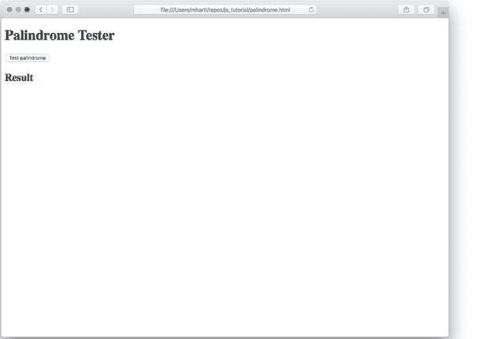

**图 9.9：** 结果区域。


**图 9.10：** 来自失落之城庞贝的拉丁回文。

点击按钮并输入“SATOR AREPO TENET OPERA ROTAS”（图 9.11），结果将直接在 HTML 中显示，如图 9.12 所示。

### 9.3.1 练习

- 1. 为了使图 9.12 中的结果更易于阅读，请使用 **strong** 标签将回文本身加粗，如“**SATOR AREPO TENET OPERA ROTAS** 是一个回文！”

## 9.4 表单处理

作为最后的润色，在本节中，我们将用更自然的 `HTML` 表单替换之前章节中使用的 `prompt`。尽管表单处理通常需要在服务器上有一个后端 Web 应用程序（例如由 Sinatra (https://www.learnenough.com/ruby) 或 Rails (https://www.railstutorial.org/) 提供），但我们可以通过添加事件监听器来拦截产生的 `"submit"` 事件，从而用 JavaScript 来模拟它。

第一步是将 **button** 标签（清单 9.12）包装在一个表单中：

```
<form id="palindromeTester">
  <textarea name="phrase" rows="10" cols="30"></textarea>
  <br>
  <button type="submit">Is it a palindrome?</button>
</form>
```

这里我们已经将 CSS id 转移到了 **form** 标签本身，并引入了 HTML 的 **textarea** 标签（10 行高，30 列宽），同时将 **button** 标识为类型为 "**submit**" 的按钮。还要注意 **textarea** 有一个 **name** 属性（值为 "**phrase**"）；这一点很快会变得重要。

将表单放在我们的回文页面上将导致清单 9.14 所示的代码。结果如图 9.13 所示。

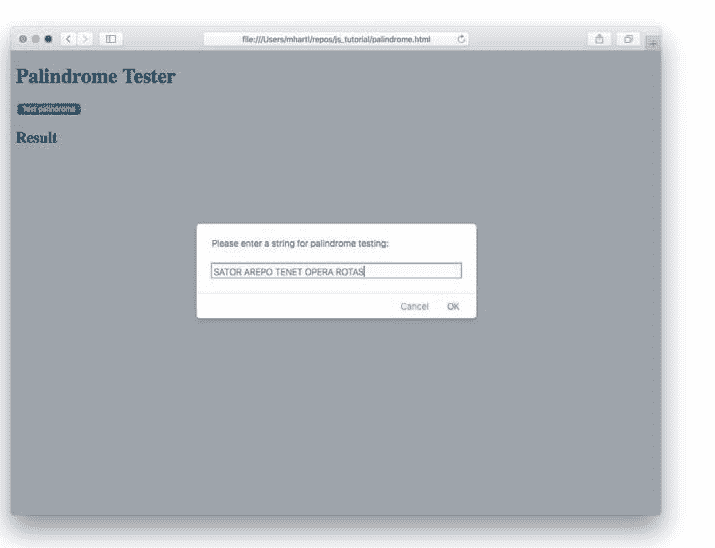
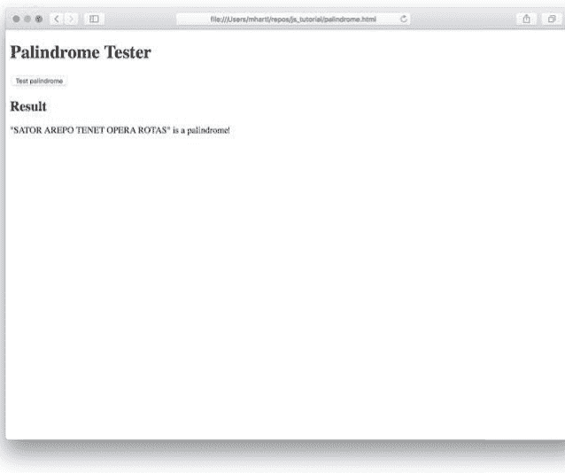

**图 9.12：** HTML 动态显示。

### 清单 9.14：向回文页面添加一个表单。

`palindrome.html`

```
<!DOCTYPE html>
<html>
  <head>
    <title>Palindrome Tester</title>
    <meta charset="utf-8">
    <script src="bundle.js"></script>
  </head>
  <body>
    <h1>Palindrome Tester</h1>
    <form id="palindromeTester">
      <textarea name="phrase" rows="10" cols="30"></textarea>
      <br>
      <button type="submit">Is it a palindrome?</button>
    </form>
    <h2>Result</h2>
    <p id="palindromeResult"></p>
  </body>
</html>
```

由于我们更改了事件类型，需要更新监听器，从“click”更改为“submit”：

```
document.addEventListener("DOMContentLoaded", function() {
  let tester = document.querySelector("#palindromeTester");
  tester.addEventListener("submit", function(event) {
    palindromeTester(event);
  });
});
```

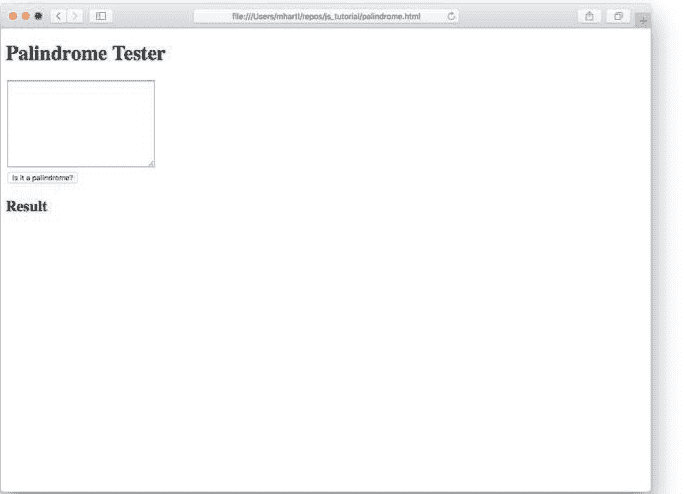

**图 9.13：** 我们带有全新漂亮表单的回文页面。

注意，我们还在函数参数和调用 **palindromeTester** 时添加了 **event** 参数；关于这一点稍后会详细说明。

然后，在 **palindromeTester** 方法中，我们需要做两个小的更改。第一个涉及防止表单的*默认行为*，即将信息提交回服务器。由于我们的“服务器”只是一个静态网页，无法处理这样的提交，所以我们需要按照如下方式防止这种默认行为：

```
function palindromeTester(event) {
  event.preventDefault();
  .
  .
  .
}
```

这里的 **event** 是一个特殊的对象，JavaScript 专门为这种情况提供。

第二个更改是，我们不再从 **prompt** 中获取字符串，而是直接从表单提交中获取。这就是清单 9.14 中 **textarea** 的 **name** 属性发挥作用的地方：我们可以从 **event** 的 *target* 中访问短语。在这种情况下，**event** 的目标就是一个 **form** 对象，所以 **event.target** 就是表单本身。此外，由于表单的 **textarea** 中有 name="phrase" 键值对，**event.target** 有一个属性，其 *值* 就是提交的字符串。换句话说，如果我们输入了短语“Madam, I'm Adam.”，我们可以这样提取值：

```
event.target.phrase.value  // 结果为 "Madam, I'm Adam."
```

将其应用于 **palindromeTester** 函数，并结合新的监听器，得到清单 9.15 所示的结果。顺便说一下，在某些系统上，在 **function(event)** 中包含 **event** 并非必需，但为了最大程度的跨浏览器兼容性，应该包含它。

### **清单 9.15：** 在 JavaScript 中处理表单提交。

*main.js*

```
let Phrase = require("<username>-palindrome");

function palindromeTester(event) {
  event.preventDefault();
  let phrase = new Phrase(event.target.phrase.value);
  let palindromeResult = document.querySelector("#palindromeResult");

  if (phrase.palindrome()) {
    palindromeResult.innerHTML = `"${phrase.content}" is a palindrome!`;
  } else {
    palindromeResult.innerHTML = `"${phrase.content}" is not a palindrome.`;
  }
}

document.addEventListener("DOMContentLoaded", function() {
  let tester = document.querySelector("#palindromeTester");
  tester.addEventListener("submit", function(event) {
    palindromeTester(event);
  });
});
```

重新运行清单 9.2，刷新页面，并在 textarea 中填入我最喜欢的超长回文之一（图 9.14），得到如图 9.15 所示的结果。⁴
就这样——“一个人，一个计划，一个独木舟，意大利面，英雄，王公，花腔女高音，地图，鹬鸟，印花棉布，通心粉，一个笑话，一个香蕉袋，一种棕褐色，一个标签，又一个香蕉袋（或一头骆驼），一个可丽饼，大头针，午餐肉，车辙，一种巧克力豆，现金，一个罐子，旧帽子，一个苦力，一条运河——巴拿马！”——我们完成了我们 JavaScript 回文检测器的网页版本。呼！

## 9.4.1 练习

- 1. 通过提交一个空表单来确认，空字符串目前被认为是回文（图 9.16）。这在空洞的意义上是成立的，但这可能不是我们想要的行为。
- 2. 要解决这个问题，请遵循方框 8.2 中概述的流程，编写一个 RED 测试，断言空字符串不是回文（清单 9.16），然后确认清单 9.17 中的应用程序代码使测试变为 GREEN。
- 3. 使用方框 8.1 中的指南增加版本号，按照 8.5.1 节发布你的新模块，然后使用 npm update 命令（清单 9.18）进行更新。你的应用程序现在是否正确地将“”识别为非回文（图 9.17）？（提示：不要忘记重新运行清单 9.2。）
- 4. 图 9.14 中那个惊人长度的回文是由先驱计算机科学家盖伊·斯蒂尔（Guy Steele）在 1983 年借助一个定制程序创建的。

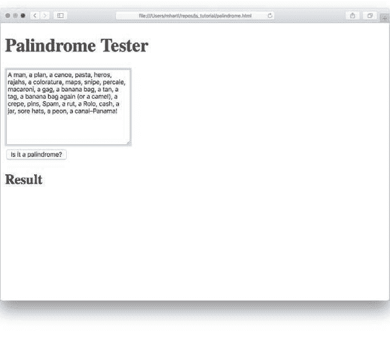

**图 9.14：** 在表单的 textarea 字段中输入一个长字符串。

### 清单 9.16：断言空字符串不是回文的模板。RED

```
~/repos/palindrome/test/test.js

let assert = require("assert");

let Phrase = require("../index.js");

describe("Phrase", function() {
  describe("#palindrome", function() {
    .
    .
    .
    it("should return false for an empty string", function() {
      let emptyPhrase = new Phrase("");
      assert(FILL_IN);
    });
  }
});
```

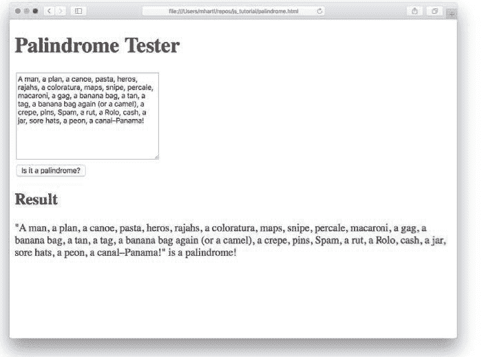

**图 9.15：** 那个长字符串是一个回文！

### 清单 9.17：清单 9.16 的应用程序代码。<span style="color:green">GREEN</span>

`~/repos/palindrome/index.js`

```
module.exports = Phrase;

// Adds `reverse` to all strings.

String.prototype.reverse = function() {
    return Array.from(this).reverse().join("");
}

function Phrase(content) {
    this.content = content;
    .
    .
    .
    // Returns true if the phrase is a palindrome, false otherwise.
    this.palindrome = function palindrome() {
        if (this.processedContent()) {
            return this.processedContent() === this.processedContent().reverse();
        }
    }
}
```

# 第十章

## 使用 Node.js 编写 Shell 脚本

在本章中，我们将重返命令行世界，使用 Node.js 来编写三个功能逐渐增强的 *shell 脚本*。这种 JavaScript 的用法目前比浏览器中的 JavaScript 更少见，但可以预期，随着 JavaScript（尤其是通过 Node 和 NPM）持续超越其最初的 Web 编程领域而不断扩展，这种情况将会有所改变。这些程序也为用传统上被认为更"脚本化"的语言（如 Perl、Python 和 Ruby）编写的类似程序打下了有用的基础。

也许令人惊讶的是，我们将发现在此过程中，第 9 章中开发的 DOM 操作技能在 shell 脚本中仍然有用。事实上，我们将显著扩展我们的能力，其方向恰好是第 11 章中更高级操作所需要的。

第一个程序（第 10.1 节）展示了如何使用 JavaScript 从文件系统读取和处理文件内容。第 10.2 节中的程序则展示了如何实现类似的功能来读取一个 URL 的内容。（这对我个人有特殊意义，因为我清楚地记得第一次编写从 Web 读取和处理文本的自动化程序时，感觉那简直是个奇迹。）最后，在第 10.3 节，我们将编写一个改编自我曾经为自己编写的实用程序；它包含一个在非 Web 浏览器环境中进行 DOM 操作的介绍（上文已提及）。

### 10.1 从文件读取

我们的第一个任务是读取和处理文件的内容。这个例子设计得很简单，但它展示了必要的原理，并为你阅读更高级的文档提供了背景知识。

我们将首先使用 `curl` 下载一个包含简单短语的文件（注意，这应该在我们第 8 章之前使用的 `js_tutorial` 目录中，而不是回文包目录中）：

```
$ cd ~/repos/js_tutorial/
$ curl -OL https://cdn.learnenough.com/phrases.txt
```

正如你通过在命令行运行 `less phrases.txt` 可以确认的，这个文件包含大量短语——其中一些（令人惊讶的是！）恰好是回文。

我们具体的任务是编写一个回文检测器，遍历此文件中的每一行，并打印出任何是回文的短语（同时忽略其他）。为此，我们需要打开文件并读取其内容。

当我开始编写本教程时，*我*并不知道如何在 JavaScript 中做到这一点。但我运用了我的技术素养（方框 1.1），在 Google 中输入了“node open file”。（为什么不输入“javascript open file”？那样可能也行，但我怀疑——事后证明是正确的——JavaScript 以浏览器为中心的起源使得“node”成为一个更有希望的搜索词。）这个搜索很快找到了文件系统模块 `fs`，它恰好解决了我们的问题：

```
$ npm install --global fs
```

文件系统的文档可能有点令人望而生畏，所以我深入挖掘了一下，找到了一篇题为“使用 Node.js 读取文件”（https://code-maven.com/reading-a-file-with-nodejs）的博客文章，它描述了我们问题的精确解决方案。根据我们当前的文件名和编程惯例（例如，用 `let` 代替 `var`，使用双引号）进行调整后，在 REPL 中看起来是这样的：

```
> let fs = require("fs");
> let text = fs.readFileSync("phrases.txt", "utf-8");
```

这里我们选择了 `readFile` 函数的“Sync”（同步）版本，主要是因为我们没有需要同时运行多个程序的情况（那才是“异步”用武之地）。我们还（按照博客文章）包含了第二个参数来表明源文件是 UTF-8，即在《足够危险地学习 HTML》（https://www.learnenough.com/html）中讨论过的 Unicode 字符集（https://www.learnenough.com/html-tutorial/html_intro#sec-an_html_skeleton）。

运行这段代码的结果是将文本文件的全部内容加载到 **text** 变量中：

```
> text.length;
1373
> text.split("\n")[0]; // 按换行符分割并提取第 1 个短语。
'A butt tuba'
```

这里的第二个命令按换行符 `\n` 分割文本并选择第零个元素，揭示了文件神秘的第一行：“A butt tuba”。

让我们把 REPL 中的想法放入一个脚本：

```
$ touch palindrome_file
$ chmod +x palindrome_file
```

脚本本身很简单：我们只需打开文件，按换行符分割内容，然后遍历生成的数组，打印任何是回文的行。结果（此时你应该能相当轻松地阅读）出现在代码清单 10.1 中。（在本例和后续示例中，确保你的 shebang 行与你的系统上 **which node** 的结果匹配，如果与我的不同。）

**代码清单 10.1：** 读取和处理文件内容。

*palindrome_file*

```
#!/usr/local/bin/node
let fs = require("fs");
let Phrase = require("<username>-palindrome");
let text = fs.readFileSync("phrases.txt", "utf-8");
text.split("\n").forEach(function(line) {
  let phrase = new Phrase(line);
  if (phrase.palindrome()) {
    console.log("palindrome detected:", line);
  }
});
```

请注意，代码清单 10.1 中的代码仅在 **palindrome** 模块正确安装（第 9.1 节）的情况下才能工作。

在命令行运行脚本确认了文件中有相当多的回文：

```
$ ./palindrome_file
.
.
.
palindrome detected: Dennis sinned.
palindrome detected: Dennis and Edna sinned.
palindrome detected: Dennis, Nell, Edna, Leon, Nedra, Anita, Rolf, Nora, Alice, Carol, Leo, Jane, Reed, Den, Dale, Basil, Rae, Penny, Lana, Dave, Denny, Lena, Ida, Bernadette, Ben, Ray, Lila, Nina, Jo, Ira, Mara, Sara, Mario, Jan, Ina, Lily, Arne, Bette, Dan, Reba, Diane, Lynn, Ed, Eva, Dana, Lynne, Pearl, Isabel, Ada, Ned, Dee, Rena, Joel, Lora, Cecil, Aaron, Flora, Tina, Arden, Noel, and Ellen sinned.
palindrome detected: Go hang a salami, I'm a lasagna hog.
palindrome detected: level
palindrome detected: Madam, I'm Adam.
palindrome detected: No "x" in "Nixon"
palindrome detected: No devil lived on
palindrome detected: Race fast, safe car
palindrome detected: racecar
palindrome detected: radar
palindrome detected: Was it a bar or a bat I saw?
palindrome detected: Was it a car or a cat I saw?
palindrome detected: Was it a cat I saw?
palindrome detected: Yo, banana boy!
```

除了其他，我们看到了一个相当精心编排的、对简单回文“Dennis sinned”的扩展（图 10.1）！[^1]

#### 10.1.1 练习

- 1. 使用你喜欢的任何方法（例如搜索 node write file），向代码清单 10.1 中的脚本添加代码，将所有检测到的回文写入一个名为 **palindromes.txt** 的文件中。

### 10.2 从 URL 读取

在本节中，我们将编写一个脚本，其效果与第 10.1 节中的脚本相同，不同之处在于它直接从公共 URL 读取 **phrases.txt** 文件。这个程序本身并不花哨，但请意识到这是多么神奇：这些想法并非特定于我们访问的 URL，这意味着在本节之后，你将有能力编写程序来访问和处理网上几乎任何公共站点。（这种做法有时被称为“网络爬虫”，应谨慎且适度地进行。）

与第 10.1 节一样，安装一个 NPM 模块是必要的先决条件。正如 NPM 模块常见的那样，有多种不同的方法可以完成同一任务。根据网络搜索 node read web page url 的结果和 request 的替代列表²，我们将使用 urllib 模块，可以如下安装：³

```
$ npm install urllib
```

2. 本教程的原始版本使用 request，但后来它已被弃用。
3. 由于我不太清楚的原因，urllib 模块全局安装不起作用，至少在我的系统上如此，因此我们在此处进行本地安装。

### 10.2 从 URL 读取内容

然后我们可以按照第 10.1 节的方式创建脚本：

```
$ touch palindrome_url
$ chmod +x palindrome_url
```

查阅 `urllib` 文档（https://www.npmjs.com/package/urllib），我们发现（截至撰写本文时）示例代码如清单 10.2 所示。

### 清单 10.2：读取 URL 内容的示例代码。

```
var urllib = require('urllib');
urllib.request('http://cnodejs.org/', function (err, data, res) {
  if (err) {
    throw err; // you need to handle error
  }
  console.log(res.statusCode);
  console.log(res.headers);
  // data is Buffer instance
  console.log(data.toString());
});
```

借鉴像清单 10.2 这样的代码示例是一个极好的实践。实际上，在每个阶段实际执行代码并非坏主意，但为简洁起见，我将省略输出，直到脚本完成。

我们可以通过更新约定（例如使用 `let` 代替 `var`）、使用更具描述性的名称以及删除我们绝对不需要的行来修改默认代码以满足我们的需求：

```
let urllib = require("urllib");
urllib.request("http://www.cnodejs.org/", function(error, data, response) {
  console.log('body:', data.toString());
});
```

我们开始看到解决方案的轮廓。`urllib` 模块为给定的 URL 打开一个网络*请求*，并接受一个带有三个参数的函数：错误（如果有的话）、包含页面主体（即*整个*页面，不要与 HTML `body` 标签混淆）的数据对象，以及一个响应对象。

此时需要强调的是*我并不确切知道这些对象是什么*，所以你也不必知道。我所知道的是——从清单 10.2 的示例代码中可以合理推断出——`data.toString()` 是一个字符串，可以替代清单 10.1 中的 `text`。（回想一下我们在第 4.1.2 节看到的将 `toString()` 方法应用于数字。）这足以解决我们的问题，因为它意味着我们可以用 `phrases.txt` 的 URL 替换清单 10.2 中的 cnodejs.org URL，并将

```
console.log('body:', data.toString());
```

替换为清单 10.1 中的回文检测逻辑。

最后还有一个细微之处，即 `phrases.txt` 的 URL 实际上是一个*重定向*：如果你访问 `https://cdn.learnenough.com/phrases.txt`，你会发现它实际上*转发*（使用 301 重定向）到亚马逊简单存储服务（S3）上的一个页面，如图 10.2 所示。

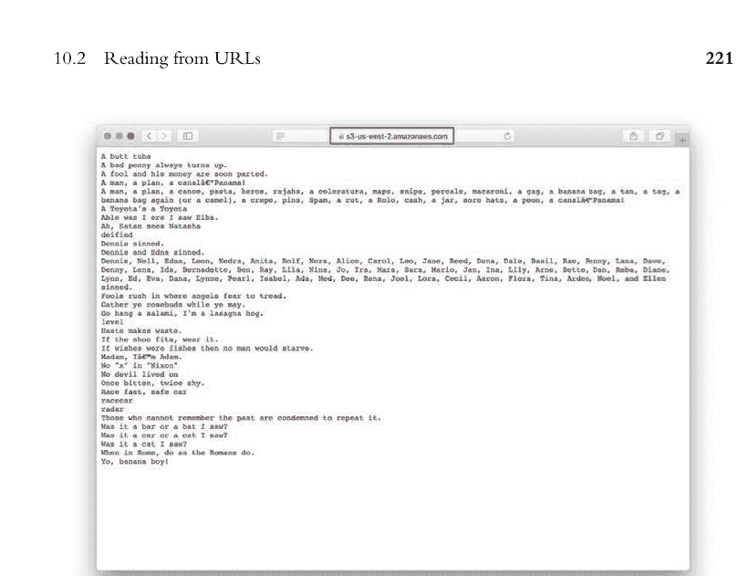

一些 URL 库默认跟随重定向，但 **urllib** 不是，因此我们必须添加一个选项（如 **urllib** 文档中所述（https://www.npmjs.com/package/urllib#api-doc））：

```
urllib.request(url, { followRedirect: true }, function(error, data, response)
```

将 **followRedirect** 选项设置为 **true** 后，**urllib** 将跟随 301 重定向到 S3，因此最终代码如清单 10.3 所示。

### 清单 10.3：一个读取 URL 的脚本。
*palindrome_url*

```
#!/usr/local/bin/node
let urllib = require("urllib");
let Phrase = require("mhartl-palindrome");
let url = 'https://cdn.learnenough.com/phrases.txt'
urllib.request(url, { followRedirect: true }, function(error, data, response) {
  let body = data.toString();
  body.split("\n").forEach(function(line) {
    let phrase = new Phrase(line);
    if (phrase.palindrome()) {
      console.log("palindrome detected:", line);
    }
  });
});
```

此时，我们已经准备好在命令行试用该脚本：

```
$ ./palindrome_url
.
.
palindrome detected: Dennis sinned.
palindrome detected: Dennis and Edna sinned.
palindrome detected: Dennis, Nell, Edna, Leon, Nedra, Anita, Rolf, Nora, Alice, Carol, Leo, Jane, Reed, Dena, Dale, Basil, Rae, Penny, Lana, Dave, Denny, Lena, Ida, Bernadette, Ben, Ray, Lila, Nina, Jo, Ira, Mara, Sara, Mario, Jan, Ina, Lily, Arne, Bette, Dan, Reba, Diane, Lynn, Ed, Eva, Dana, Lynne, Pearl, Isabel, Ada, Ned, Dee, Rena, Joel, Lora, Cecil, Aaron, Flora, Tina, Arden, Noel, and Ellen sinned.
palindrome detected: Go hang a salami, I'm a lasagna hog.
palindrome detected: level
palindrome detected: Madam, I'm Adam.
palindrome detected: No "x" in "Nixon"
palindrome detected: No devil lived on
palindrome detected: Race fast, safe car
palindrome detected: racecar
palindrome detected: radar
palindrome detected: Was it a bar or a bat I saw?
palindrome detected: Was it a car or a cat I saw?
palindrome detected: Was it a cat I saw?
palindrome detected: Yo, banana boy!
```

太棒了！结果与我们在第 10.1 节看到的完全相同，但这次我们是从真实的网络上获取的数据。

### 10.2.1 练习

1.  拥有一个单独的变量来存放你要选择的项目列表（在本例中是回文）通常很有用。使用第 6.2 节讨论的 `filter` 方法，创建一个 `palindromes` 变量，其中包含一个回文数组，如清单 10.4 所示。输出是否与清单 10.3 的输出相同？

#### 清单 10.4：以函数式方式读取 URL。

```
palindrome_url
---
#!/usr/local/bin/node
let urllib = require("urllib");
let Phrase = require("<username>-palindrome");
let url = 'https://cdn.learnenough.com/phrases.txt'
urllib.request(url, { followRedirect: true }, function(error, data, response) {
  let body  = data.toString();
  let lines = body.split("\n");
  let palindromes = lines.filter(line => /* FILL IN */);
  palindromes.forEach(function(palindrome) {
    console.log("palindrome detected:", palindrome);
  });
});
---
```

### 10.3 命令行中的 DOM 操作

在最后一节中，我们将充分利用在第 10.2 节学到的 URL 读取技巧，编写一个我曾经为自己写过的实用脚本的版本。首先，我将解释该脚本产生的背景及其解决的问题。

近年来，用于学习外语的资源呈爆炸式增长，包括 Duolingo、Google 翻译以及操作系统对多语言文本转语音（TTS）的原生支持。几年前，我决定利用这个机会复习我的高中/大学西班牙语。

我发现自己经常使用的资源之一是维基百科，它拥有大量非英语文章。特别是，我发现从西班牙语维基百科（图 10.3）复制文本并粘贴到 Google 翻译（图 10.4）中非常有用。这样，我可以使用 Google 翻译（图 10.4 中的红色方块）或 macOS 的文本转语音功能来聆听西班牙语的单词发音，同时跟随母语或翻译文本。这非常有用。

过了一段时间，我注意到两个持续的摩擦来源：

- 手动复制大量段落很麻烦。
- 手动复制文本经常选中我不想要的内容，特别是*参考编号*，TTS 系统会忠实地读出它们，导致句子中间出现随机数字（例如，“Se define como orientado a objetos, 3 [tres] basado en prototipos” = “It's defined as object-oriented, 3 [three] based on prototypes.” ¿Qué pasó?）。

像这样的摩擦激发了许多实用脚本的诞生，于是 **wikp**（“Wikipedia paragraphs”）应运而生，这是一个程序，用于下载维基百科文章的 HTML 源代码，提取其段落，并消除其参考编号，将所有结果输出到屏幕。

最初的 **wikp** 程序是用 Ruby 编写的，但用 JavaScript 编写同样容易（甚至可以说更容易）。我们已经从清单 10.3 中知道了如何下载源代码。剩下的任务是：

1. 在命令行接受任意 URL 参数。
2. 将下载的 HTML 当作普通 DOM（第 9.3 节）进行操作。
3. 移除参考文献。
4. 输出段落。

我想强调的是，当我开始编写本教程时，*我无法用 JavaScript 完成这些事情中的任何一件*。所以本节不仅是关于告诉你如何做到它们；更是关于教你如何自己弄清楚这类事情——换句话说，经典的“技术成熟度”。

让我们开始创建初始脚本：

```
$ touch wikp
$ chmod +x wikp
```

现在我们准备好开始编写主程序了。对于上面的每一项任务，我都会包含你可能用来弄清楚如何完成它的那种 Google 搜索。

### 第十章：使用 Node.js 编写 Shell 脚本

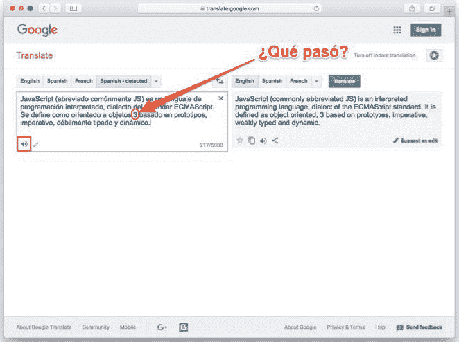

**图 10.4：** 一篇关于 JavaScript 的文章被投入 Google 翻译。

首先，我们将以命令行参数（javascript node command line arguments）的形式接收 URL，如代码清单 10.5 所示。请注意，我们包含了一行 **console.log** 作为临时追踪进度的方式。

### 代码清单 10.5：接收命令行参数。

```wikp
#!/usr/local/bin/node
// Returns the paragraphs from a Wikipedia link, stripped of reference numbers.
let urllib = require("urllib");
let url = process.argv[2];
console.log(url);
```

我们可以确认代码清单 10.5 如所宣传的那样工作：

```
$ ./wikp https://es.wikipedia.org/wiki/JavaScript
https://es.wikipedia.org/wiki/JavaScript
```

接下来，我们需要学习如何用 Node 解析 HTML（node parse html），对此有多种可能性。与我们已知知识联系最紧密的是 JSDOM：

```
$ npm install jsdom
```

将 JSDOM 添加到我们的脚本中，得到代码清单 10.6。

**代码清单 10.6：** 添加 JSDOM。

```wikp
#!/usr/local/bin/node
// Returns the paragraphs from a Wikipedia link, stripped of reference numbers.
let urllib = require("urllib");
let url = process.argv[2];
const jsdom = require("jsdom");
const { JSDOM } = jsdom;
```

为什么代码清单 10.5 有这个看起来很奇怪的赋值语句？

```
const { JSDOM } = jsdom;
```

答案是，我手头并不知道；我是直接从 JSDOM 文档（https://github.com/jsdom/jsdom#basic-usage）中复制粘贴的代码。这是每位开发者都应掌握的基本技能（图 10.5）。

我们需要做更多的工作来查看 JSDOM 的效果。根据文档，我们可以使用以下代码创建一个模拟的 **document** 对象——就像我们在代码清单 9.8 中看到的那个：

```
let { document } = (new JSDOM(body)).window;
```

### 基本用法

```
const jsdom = require("jsdom");
const { JSDOM } = jsdom;
```

要使用 jsdom，你主要会使用 JSDOM 构造函数，它是 jsdom 主模块的一个命名导出。向构造函数传递一个字符串。你将获得一个 JSDOM 对象，它有许多有用的属性，特别是 window：

```
const dom = new JSDOM(`<!DOCTYPE html><p>Hello world</p>`);
console.log(dom.window.document.querySelector("p").textContent); // "Hello world"
```

（请注意，jsdom 会像浏览器一样解析你传递给它的 HTML，包括隐含的 `<html>`、`<head>` 和 `<body>` 标签。）

生成的 JSDOM 类实例包含许多有用的属性和方法，除了 window 之外。通常，它可用于从“外部”操作 jsdom，执行普通 DOM API 无法完成的操作。对于不需要这些功能的简单情况，我们建议使用如下编码模式：

**图 10.5：** 一点点复制粘贴没什么错。

（JSDOM 文档使用 `const`，但我们将使用 `let` 作为我们可能会更改文档的信号，而我们确实会这样做（通过删除参考文献）。）

将其与代码清单 10.3 中的下载代码结合，得到代码清单 10.7。

### 代码清单 10.7：添加模拟 DOM。

```wikp
#!/usr/local/bin/node
// Returns the paragraphs from a Wikipedia link, stripped of reference numbers.
let urllib = require("urllib");
let url = process.argv[2];
const jsdom = require("jsdom");
const { JSDOM } = jsdom;
urllib.request(url, { followRedirect: true }, function(error, data, response) {
    let body = data.toString();
    // Simulate a Document Object Model.
    let { document } = (new JSDOM(body)).window;
});
```

我们的下一个任务是抓取所有段落和参考文献。由于我们有了模拟的 DOM，我们可以使用一些类似我们在 9.2 节首次见到的 `querySelector` 函数。那个函数只返回*一个* DOM 元素，但我们可以猜测如何找到所有元素（javascript queryselector return all elements）。确实，在撰写本文时，解决方案是第一次 Google 搜索结果的第一个示例：

```
let paragraphs = document.querySelectorAll("p");
```

（我做的唯一改动是将 `var matches` 修改为 `let paragraphs`。）

类似的代码也适用于查找所有参考文献，但这里我们需要对 Wikipedia 的源代码有一点了解。我们可以使用网络检查器（第 1.3.1 节）看到所有参考文献都有 CSS 类 `reference`，如图 10.6 所示。

现在，如果我告诉你代码

```
document.querySelector("#palindromeTester");
```

返回了 CSS id 为 `palindromeTester` 的元素（如代码清单 9.9 所示），你会猜找到所有 CSS *类*等于 `reference` 的元素的代码是什么？类的 CSS 表示法涉及用一个点 `.` 代替 `#` 作为前缀，而我们刚刚学习了如何使用 `querySelectorAll` 来找到所有元素，这意味着你可能会猜到是这个：

```
let references = document.querySelectorAll(".reference");
```

将这些赋值添加到脚本中，得到代码清单 10.8。

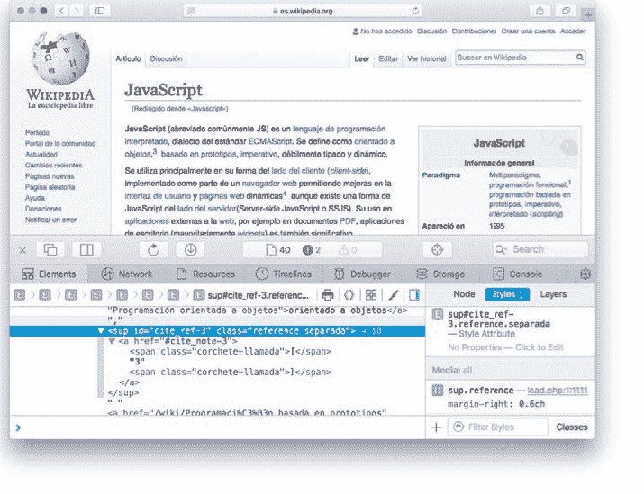

**图 10.6：** 在网页检查器中查看一个参考文献。

### 代码清单 10.8：提取段落和参考文献。

```wikp
#!/usr/local/bin/node
// Returns the paragraphs from a Wikipedia link, stripped of reference numbers.
let urllib = require("urllib");
let url = process.argv[2];
const jsdom = require("jsdom");
const { JSDOM } = jsdom;
urllib.request(url, { followRedirect: true }, function(error, data, response) {
  let body = data.toString();
  // Simulate a Document Object Model.
  let { document } = (new JSDOM(body)).window;
  // Grab all the paragraphs and references.
  let paragraphs = document.querySelectorAll("p");
  let references = document.querySelectorAll(".reference");
});
```

此时，我们几乎完成了。我们只需要移除参考文献，然后打印出每个段落的内容。第一个任务很简单，因为有一个原生的 **remove** 方法可以移除 HTML “节点”（文档对象模型树中的一个元素；javascript dom remove element）：

```
references.forEach(function(reference) {
  reference.remove();
});
```

请注意，这涉及到猜测 **references** 是一个可以使用 **forEach** 遍历的集合，而这在技术层面上应该是你能力范围内的。（从技术上讲，**querySelectorAll** 返回的不是一个数组，而是一个 "NodeList"。尽管如此，这个对象仍然可以使用 **forEach** 来遍历。）

第二个任务也很简单，一旦我们知道每个元素都有一个 **textContent** 属性（javascript dom element print content）：

```
paragraphs.forEach(function(paragraph) {
  console.log(paragraph.textContent);
});
```

将所有内容组合在一起，得到如代码清单 10.9 所示的 **wikp** 脚本。

**代码清单 10.9：** 最终的 Wikipedia 段落脚本。

```wikp
#!/usr/local/bin/node
// Returns the paragraphs from a Wikipedia link, stripped of reference numbers.
let urllib = require("urllib");
let url = process.argv[2];
const jsdom = require("jsdom");
const { JSDOM } = jsdom;
urllib.request(url, { followRedirect: true }, function(error, data, response) {
  let body = data.toString();
  // Simulate a Document Object Model.
  let { document } = (new JSDOM(body)).window;
  // Grab all the paragraphs and references.
  let paragraphs = document.querySelectorAll("p");
  let references = document.querySelectorAll(".reference");
  // Remove any references.
  references.forEach(function(reference) {
      reference.remove();
  });
  // Print out all of the paragraphs.
  paragraphs.forEach(function(paragraph) {
      console.log(paragraph.textContent);
  });
});
```

让我们看看运行结果如何：

```
$ ./wikp https://es.wikipedia.org/wiki/JavaScript
.
.
.
Existen algunas herramientas de ayuda a la depuración, también escritas en
JavaScript y construidas para ejecutarse en la Web. Un ejemplo es el programa
JSLint, desarrollado por Douglas Crockford, quien ha escrito extensamente
sobre el lenguaje. JSLint analiza el código JavaScript para que este quede
conforme con un conjunto de normas y directrices y que aseguren su correcto
funcionamiento y mantenibilidad.
```

成功了！通过在终端中向上滚动，我们现在可以选择所有文本并将其粘贴到 Google 翻译或我们选择的文本编辑器中。在 macOS 上，我们可以通过管道（https://www.learnenough.com/command-line-tutorial/inspecting_files#sec-wordcount_and_pipes）将结果传递给 **pbcopy**，它会自动将结果复制到 macOS 的 **粘贴板**（也称为“剪贴板”），效果更好：

```
$ ./wikp https://es.wikipedia.org/wiki/JavaScript | pbcopy
```

此时，粘贴到 Google 翻译（或任何其他地方）将会粘贴完整的文本。⁴

____________________
4. Google 翻译对一次翻译的文本量有限制，但为了文本转语音的目的，你总是可以粘贴到文字处理器中，然后使用操作系统的原生 TTS 功能。

试想一下这项成就有多么了不起。清单 10.9 中的脚本有点复杂——要完全独立搞定这个，你可能需要多用几个 `console.log` 语句来调试——但这并非什么尖端科技。然而，它确实非常实用，如果你在积极学习外语，这可能是你会经常用到的工具。更重要的是，其中涉及的基本技能——不仅包括编程，还包括技术悟性（<cough>谷歌搜索</cough>）——能解锁大量的潜在应用。

### 10.3.1 练习

1.  通过移动文件或更改系统配置，将 `wikp` 脚本添加到环境变量 PATH 中。（你可能会觉得《*精通足以用危险的文本编辑器*》（[https://www.learnenough.com/text-editor](https://www.learnenough.com/text-editor)）中的步骤（[https://www.learnenough.com/text-editor-tutorial/advanced_text_editing#sec-writing_an_executable_script](https://www.learnenough.com/text-editor-tutorial/advanced_text_editing#sec-writing_an_executable_script)）有所帮助。）确认你可以直接运行 `wikp` 命令，而无需在命令名前加上 `./`。
2.  如果不带参数运行 `wikp` 会发生什么？在你的脚本中添加代码，检测命令行参数是否缺失，并输出适当的使用说明。*提示：* 打印完使用说明后，你需要*退出*，你可以通过搜索“node how to exit script”来学习如何做到这一点。
3.  文中提到的“通过管道传递给 `pbcopy`”的技巧仅在 macOS 上有效，但任何兼容 Unix 的系统都可以将输出重定向（[https://www.learnenough.com/command-line-tutorial/manipulating_files#sec-redirecting_and_appending](https://www.learnenough.com/command-line-tutorial/manipulating_files#sec-redirecting_and_appending)）到文件。将 `wikp` 的输出重定向到名为 `article.txt` 的文件的命令是什么？（然后你可以打开此文件，全选并复制内容，其基本效果与通过管道传递给 `pbcopy` 相同。）

# 第 11 章

# 完整示例应用：图片画廊

作为我们新掌握的 JavaScript 能力的最终应用，在本章中，我们将在《*精通足以用危险的 CSS 与布局*》(https://www.learnenough.com/css-and-layout) 中开发的示例应用基础上进行构建。（我们将*克隆*初始的示例仓库，因此即使你没有学习 CSS 教程，也能完成本章。）特别地，我们将遵循 JavaScript 教程中一个历史悠久的传统，创建一个*图片画廊*，它将允许我们显示和切换自定义图片——在我们的案例中，是一个花哨的三栏布局 (https://www.learnenough.com/css-and-layout-tutorial/flex-intro#sec-pages-3col)。

在准备好画廊（第 11.1 节）之后，我们将学习如何更改画廊图片（第 11.2 节）、将图片设置为“当前”（第 11.3 节）以及更改图片标题和描述（第 11.4 节）。由于我们的起点是在《*精通足以用危险的 CSS 与布局*》中开发的专业级网站，因此结果对于 JavaScript 教程的示例画廊来说异常精致（图 11.1）。

## 11.1 准备画廊

要开始使用我们的图片画廊，你需要获取该网站完整起始应用程序 (https://github.com/learnenough/le_js_full) 的副本。第一步是创建应用程序的个人副本，你可以使用 GitHub 上的 *fork* 功能来完成此操作（图 11.2）。

下一步取决于你当前是否在 <username>.github.io 拥有 GitHub Pages 站点。如果你没有这样的仓库，你可以相应地重命名


**图 11.1：** 这就是我们要实现的画廊。

你的应用程序（图 11.3），它将自动在 URL <username>.github.io 上可用。

重命名仓库后，你可以使用来自 GitHub 的克隆 URL（图 11.4）将画廊应用克隆到本地系统：

```
$ git clone <clone URL> <username>.github.io
```

如果你已经在 <username>.github.io 拥有来自《*精通足以用危险的 CSS 与布局*》的仓库，你应该将画廊应用克隆（不重命名）到默认目录，方法是省略 `git clone` 的第二个参数：

```
$ git clone <clone URL>   # 如果你已经有 <username>.github.io，则使用此命令
```

这将创建一个名为 `le_js_full` 的本地仓库，你可以将其用作复制所需文件的参考。特别地，你将需要画廊的 `index.html` 以及大图和小图：


**图 11.2：** 在 GitHub 上 fork 起始应用程序。

```
# 仅当你是通过学习《精通足以用危险的 CSS 与布局》已经拥有 <username>.github.io 时，才运行这些命令。
$ cd le_js_full/
$ cp gallery/index.html /path/to/repo/<username>.github.io/gallery/
$ cp -r images/* /path/to/repo/<username>.github.io/images/
```

（如果你在 <username>.github.io 已经拥有一个仓库，但*不是*学习《*精通足以用危险的 CSS 与布局*》的结果，我将假设你具备足够的技术悟性，能够自己找到解决方法。）

无论哪种情况，一旦应用程序准备就绪，你就可以使用 Jekyll 静态网站构建器运行它。《*精通足以用危险的 CSS 与布局*》中的 Jekyll 设置说明 (https://www.learnenough.com/css-and-layout-tutorial/struct-layout#sec-jekyll) 解释了如何在系统上安装 Jekyll（如果尚未安装）。简要版本是你首先需要安装 *Bundler*：

```
$ gem install bundler -v 2.2.17
```

然后使用 `bundle` 命令安装仓库中 `Gemfile` 里列出的 `jekyll` gem：

```
$ bundle _2.2.17_ install
```

安装完 Jekyll 后，你可以通过使用 Bundler 执行正确版本的 `jekyll` 程序来启动示例网站：

```
$ bundle exec jekyll serve
```

此时，应用将在 localhost:4000 上运行，并且应该看起来像图 11.5。

### 11.1.1 准备 JavaScript

作为最后的准备工作，我们将为主画廊函数 `activateGallery` 添加一个存根，我们将在本章的剩余部分逐步完善它。由于我们将完全使用纯 JavaScript 进行操作，因此无需包含任何 Node 模块、运行 `browserify` 等。事实上，我们只需要编写一个函数。

我们的第一步是创建一个目录和 JavaScript 文件（记住，这是在应用目录中，而不是 `js_tutorial` 中）：

```
$ mkdir js
$ touch js/gallery.js
```


**图 11.5：** 我们的初始示例应用。

为了开始，我们将在 **gallery.js** 中添加一个初始警报（清单 11.1）。

**清单 11.1：** 一个存根画廊文件。
*js/gallery.js*

```
function activateGallery() {
  alert("Hello from the gallery file!");
}
```

在文件的头部，我们将使用 `src` 属性（第 5.2 节）引入画廊 JavaScript，并添加一个事件监听器（第 9.2 节），以便在 DOM 加载后自动运行画廊激活函数（清单 9.9）。结果出现在清单 11.2 中。

**清单 11.2：** 引入画廊 JavaScript。
*includes/head.html*

```
<head>
    .
    .
    .
    <link rel="stylesheet" href="/css/main.css">
    <script src="/js/gallery.js"></script>
    <script>
        document.addEventListener("DOMContentLoaded", function() {
            activateGallery();
        });
    </script>
</head>
```

现在访问本地画廊页面可以确认 JavaScript 已正确加载（图 11.6）。

### 11.1.2 练习

1.  将你的存根画廊部署到 GitHub Pages，并确认它在生产环境中正常工作。


**图 11.6：** 来自画廊的问候！

## 11.2 更改画廊图片

让我们看一下应用程序的当前状态。画廊页面有三列：一列是较小的“缩略图”图片，一列是主图片，还有一列是描述。如图 11.7 所示，在默认状态下，缩略图中的“当前图片”指示器与主图片不匹配，描述内容也不匹配。

我们可以通过查看画廊的当前 HTML 结构（如代码清单 11.3 所示）来找出这种不匹配的根源。

**代码清单 11.3：** 画廊的 HTML

*gallery/index.html*

```
---
layout: default
title: Gallery for Learn Enough JavaScript to Be Dangerous
---

<div class="gallery col-three">
    <div class="col col-nav gallery-thumbs" id="gallery-thumbs">
        <div class="current">
            
        </div>
        .
        .
        .
        <div>
            
        </div>
    </div>
    <div class="col col-content">
        <div class="gallery-photo" id="gallery-photo">
            
        </div>
    </div>
    <div class="col col-aside gallery-info" id="gallery-info">
        <h3 class="title">Pacific Sunset</h3>
        <p class="description">A sunset over the Pacific Ocean.</p>
    </div>
</div>
```

从代码清单 11.3 中，我们看到当前图片通过 CSS 类 **current**（第 8 行）来指示，主图片位于一个 CSS id 为 **gallery-photo** 的 HTML **div** 中（第 25 行），标题和描述则位于一个 CSS id 为 **gallery-info** 的 div 中（第 29 行）。我们的任务是动态更新这个 HTML（第 9.3 节），使所有三列的内容保持一致。

我们的第一个任务，从用户界面的角度来看是最重要的，即当用户点击缩略图时替换主图片。我们的策略是为每张图片添加一个事件监听器（第 9.2 节），然后在点击时更改主显示图片的源（**src**）。

为此，我们将首先创建一个包含所有图片列表的变量。¹ 检查代码清单 11.3 中的 HTML 源代码，我们看到缩略图图片都是 CSS id 为 **gallery-thumbs** 的 div 内的 **img** 标签。因此，我们可以使用方法链（第 5.3 节）来选择所有缩略图，该方法结合了 **querySelector**（第 9.2 节）来选择缩略图 div 和 **querySelectorAll**（第 10.3 节）来选择所有图片：

```
let thumbnails = document.querySelector("#gallery-thumbs").
                    querySelectorAll("img");
```

请注意，JavaScript 允许我们跨行断开方法调用，以便使结构更清晰并避免超过 80 字符的限制（框 2.3）。

通过遍历 **thumbnails** 集合，我们可以使用如下代码为每个缩略图添加事件监听器：

```
thumbnails.forEach(function(thumbnail) {
    thumbnail.addEventListener("click", function() {
        // 将被点击的图片设置为主图片的代码
    });
});
```

这安排了监听我们在代码清单 9.13 中看到的“click”事件。

如代码示例中间的 JavaScript 注释所示，监听器的主体应将被点击的图片设置为主图片。我们将通过设置当前显示图片的 **src** 属性为被点击图片的“大”版本来实现这一点。参考代码清单 11.3，我们看到主图片位于一个 CSS id 为 **gallery-photo** 的 div 内，因此我们可以通过链式调用 **querySelector** 来选择它：

```
let mainImage = document.querySelector("#gallery-photo").
                    querySelector("img");
```

事实上，**querySelector** 足够智能，允许我们将此合并为一个命令：

```
let mainImage = document.querySelector("#gallery-photo img");
```

值得注意的是，有一个等效的替代表示法，使用尖括号 `>` 来强调元素之间的嵌套关系（在此情况下，是一个 CSS id 为 **gallery-photo** 的元素内的 **img** 元素）：

```
let mainImage = document.querySelector("#gallery-photo > img");
```


我们将在第 11.2.1 节中使用这种替代表示法与 `querySelectorAll`。

一旦我们有了主图片，我们就可以使用 `setAttribute` 方法来更改其 `src` 属性：

```
mainImage.setAttribute("src", newImageSrc);
```

如果您一直紧密地跟进，您现在会意识到我们所需的一切都已创建，除了 `newImageSrc`，即新图片的源。令人高兴的是，示例应用已经安排将必要的路径编码在图片标签本身中。假设我们点击了太平洋日落图片，其 HTML 如下所示：

```
<div>
    
</div>
```

在像这样的标签中编码数据是 *非侵入式 JavaScript* 的一个重要方面，它涉及永远不将 JavaScript 放在 HTML 本身内部。当在 HTML 标签上使用这些 data 属性时，浏览器会自动创建一个特殊的 `dataset` 属性，其值与 HTML 源代码对应如下：

```
data-large-version -> thumbnail.dataset.largeVersion
data-title           -> thumbnail.dataset.title
data-description     -> thumbnail.dataset.description
```

通常，HTML 元素 `object` 上的数据标签 `data-foo-bar-baz` 对应于变量 `object.dataset.foobarBaz`，其中最终属性采用驼峰命名法（图 2.3）。

我们现在拥有了用被点击的图片替换主图片所需的一切。如果您想自己尝试，这是一个很好的练习。与往常一样，如果遇到问题，请使用调试控制台（框 5.1）。答案出现在代码清单 11.4 中。

**代码清单 11.4：** 设置画廊主图片。

*js/gallery.js*

```
// 激活图片画廊。
// 主要任务是为画廊中的每张图片附加一个事件监听器，
// 并在点击时做出适当响应。

function activateGallery() {

    let thumbnails = document.querySelector("#gallery-thumbs").
                     querySelectorAll("img");

    let mainImage = document.querySelector("#gallery-photo img");

    thumbnails.forEach(function(thumbnail) {

        thumbnail.addEventListener("click", function() {

            // 将被点击的图片设置为主图片。

            let newImageSrc = thumbnail.dataset.largeVersion;

            mainImage.setAttribute("src", newImageSrc);

        });

    });

}
```

除了更改 `src` 属性外，我们还应该更换入图片的 `alt` 属性。添加此细节留作练习（第 11.2.1 节）。

向下滚动并点击太平洋日落图片会产生预期的结果（图 11.8）。然而，与第三列描述的匹配只是巧合，通过点击任何其他图片（图 11.9）可以看出。此外，橙色的“当前图片”指示器只有在我们恰好点击相应的缩略图时才会与画廊中的主图片匹配（图 11.10）。

### 11.2.1 练习

1.  代码清单 11.4 中的代码替换进了新大图的 `src`，但不幸的是，**alt** 属性仍然是代码清单 11.3 中的默认值（图 11.11）。请在代码清单 11.5 中通过将 `FILL_IN` 替换为适当的值来纠正这个小瑕疵。*提示：* `thumbnail` 的图片 `src` 值由 `thumbnail.src` 给出，那么您认为如何才能获得 `thumbnail` 的 `alt` 属性值呢？
2.  正如正文中所提示的，可以更改代码清单 11.4 中的 `thumbnails` 定义以消除方法链。我们首先注意到画廊缩略图是 CSS id 为 `gallery-thumbs` 的元素内 `div` 标签内的 `img` 标签；方便的是，我们可以使用右尖括号 `>` 来表示“内部”。通过将代码清单 11.6 中的 `???` 替换为适当的标签，表明我们可以将 `thumbnails` 的定义缩减为一行。*注意：* 我通常建议选择一种约定并坚持使用，但目前我们将保留 `querySelectorAll` 和 `querySelector` 的参数不一致（一个使用尖括号，一个不用），以强调两种表示法都有效。

¹ 正如在第 10.3 节中简要提到的，严格来说，`querySelectorAll` 的结果是一个“NodeList”对象，而不是一个数组，但出于迭代的目的，我们可以将其视为一个数组。具体来说，我们可以使用 `forEach` 方法遍历其元素。

## 11.2 更改画廊图片


图 11.8：一次太平洋日落。

### 代码清单 11.5：更新图片 alt 属性。

```javascript
// js/gallery.js
// 激活图片画廊。
// 主要任务是为画廊中的每张图片附加一个事件监听器，
// 并在点击时做出适当响应。

function activateGallery() {

  let thumbnails = document.querySelector("#gallery-thumbs")
                   .querySelectorAll("img");

  let mainImage = document.querySelector("#gallery-photo img");

  thumbnails.forEach(function(thumbnail) {

    thumbnail.addEventListener("click", function() {

      // 将点击的图片设置为主图片。

      let newImageSrc = thumbnail.dataset.largeVersion;

      mainImage.setAttribute("src", newImageSrc);

      mainImage.setAttribute("alt", FILL_IN);

    });

  });

}
```


图 11.9：图 11.8 中图片/描述的匹配纯属巧合。


图 11.10：此处的 "当前图片" 匹配也纯属巧合。

## 11.2 更改画廊图片

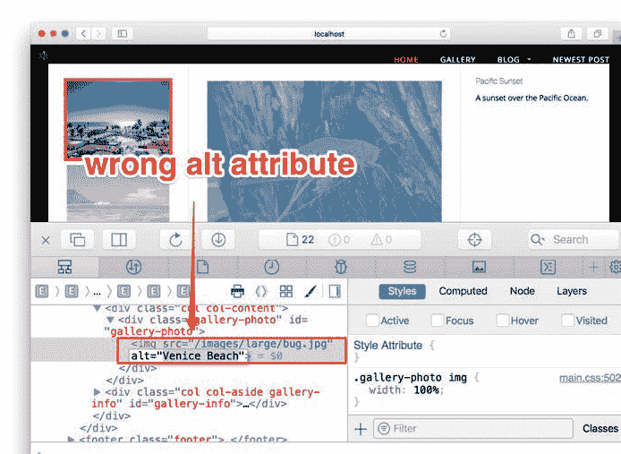

图 11.11：`alt` 属性与图片 `src` 不匹配。

### 代码清单 11.6：将缩略图精简为单行。

```javascript
// js/gallery.js
// 激活图片画廊。
// 主要任务是为画廊中的每张图片附加一个事件监听器，
// 并在点击时做出适当响应。

function activateGallery() {

  let thumbnails = document.querySelectorAll("#gallery-thumbs > ??? > ???");

  let mainImage  = document.querySelector("#gallery-photo img");

  .

  .

  .

}
```

## 11.3 设置图片为当前项

11.2 节代表了一项重大成就：照片画廊的主要任务——即根据用户的点击交换主显示图片——已经完成。我们现在需要做的是更改第一列中的 "当前图片" 指示器（本节内容）并更新第三列中的图片信息（11.4 节）。这两项任务都涉及新旧技术的结合。

如代码清单 11.3 所示，当前图片在 HTML 源代码中使用名为 `current` 的 CSS 类来指示：

```html
<div class="current">
    
</div>
```

这通过 `main.css` 中的一行代码实现了橙色的盒子阴影：

```css
.
.
.
.gallery-thumbs .current img {
    box-shadow: 0 0 0 5px #ed6e2f;
    opacity: 1;
}
.
.
.
```

我们的基本策略是在代码清单 11.4 的监听器中添加代码，以将当前图片指示器从它所在的缩略图上移除，并将其移到被点击的缩略图上。这比看起来要棘手一点，因为该类不在图片上——它在图片 *周围* 的 `div` 上。幸运的是，JavaScript 让我们能够轻松地在 DOM 中上下导航，因此我们可以轻松访问 DOM 树上一级的元素（图 9.6）——即所谓的 *父节点*。

简而言之，我们更改当前图片类的算法如下：

- 1. 找到当前缩略图并移除 `current` 类。
- 2. 将 `current` 类添加到被点击图片的 *父元素* 上。

因为页面上只有一个带有 `current` 类的元素，我们可以使用 `querySelector` 选择它：

```javascript
document.querySelector(".current");
```

但我们如何移除这个类呢？啊：javascript dom remove class。这引导我们找到了 `classList` 方法及其附带的 `remove` 方法：

```javascript
document.querySelector(".current").classList.remove("current");
```

这里有很多方法链式调用，但其含义非常清楚。令人高兴的是，一旦我们知道如何找到元素的父节点（javascript dom parent node），我们就可以使用相应的 `classList.add` 方法（javascript dom add class）来添加所需的类：

```javascript
thumbnail.parentNode.classList.add("current");
```

将这些结合起来意味着我们已经完成了！结果出现在代码清单 11.7 中（其中包含了 11.2.1 节练习的结果）。

### 代码清单 11.7：更改 current 类。

*js/gallery.js*

```
// 激活图片画廊。
// 主要任务是为画廊中的每张图片附加一个事件监听器，
// 并在点击时做出适当响应。

function activateGallery() {

  let thumbnails = document.querySelectorAll("#gallery-thumbs > div > img");

  let mainImage  = document.querySelector("#gallery-photo img");

  thumbnails.forEach(function(thumbnail) {

    thumbnail.addEventListener("click", function() {

      // 将点击的图片设置为显示图片。

      let newImageSrc = thumbnail.dataset.largeVersion;

      mainImage.setAttribute("src", newImageSrc);

      // 更改当前图片指示器。

      document.querySelector(".current").classList.remove("current");

      thumbnail.parentNode.classList.add("current");

    });

  });

}
```


**图 11.12：猛犸山。**

由于代码清单 11.7 中的代码，点击缩略图会自动更新当前图片指示器，无论该图片是内华达山脉的猛犸山（图 11.12）还是加利福尼亚州圣马力诺的亨廷顿（图 11.13）。

### 11.3.1 练习

- 1. 代码清单 11.7 中存在一点重复；特别是，它重复了字符串字面量 `"current"`。通过将这个字符串提取到一个名为 `currentClass` 的变量中来消除这种重复。

## 11.4 更改图片信息

我们最后的任务是更新画廊第三列中的图片信息（标题和描述）。执行此操作实际上不需要我们以前未见过的东西——我们只需以一种略微新颖的方式将我们已经知道的内容组合起来，这使得它成为结束本教程的绝佳方式。

我们将遵循的序列很简单：

- 1. 找到图片标题和描述的 DOM 元素。
- 2. 用来自被点击图片的相应数据替换其内容。

要找到必要的 DOM 元素，我们首先观察到它们都在 CSS id 为 `gallery-info` 的 `div` 内部：

```html
<div class="col col-aside gallery-info" id="gallery-info">
  <h3 class="title">Pacific Sunset</h3>
  <p class="description">A sunset over the Pacific Ocean.</p>
</div>
```

在该 `div` 内部，两者分别是 `title` 和 `description` 类的第一个（也是唯一的）元素，这意味着我们可以如下选择它们：

```javascript
let galleryInfo = document.querySelector("#gallery-info");
let title        = galleryInfo.querySelector(".title");
let description  = galleryInfo.querySelector(".description");
```

请注意，我添加了额外的空格来对齐等号，这是一种很好的（虽然不是严格必需的）代码格式化实践（Box 2.3）。

我们可以使用 11.2 节中介绍的 `dataset` 变量获取被点击图片的相应值：

```javascript
thumbnail.dataset.title
```

用于标题，以及

```javascript
thumbnail.dataset.description
```

用于描述。

拼图的最后一块是我们在 9.3 节首次看到的 `innerHTML` 属性，它让我们能够直接更新 DOM 元素的内部 HTML：

```javascript
title.innerHTML = thumbnail.dataset.title;
description.innerHTML = thumbnail.dataset.description;
```

将所有内容组合在一起，得到了 `activateGallery` 函数的最终版本，如代码清单 11.8 所示。

### 代码清单 11.8：在点击时更新图片标题和描述。

*js/gallery.js*

```
// 激活图片画廊。
// 主要任务是为画廊中的每张图片附加一个事件监听器，
// 并在点击时做出适当响应。

function activateGallery() {

  let thumbnails = document.querySelectorAll("#gallery-thumbs > div > img");

  let mainImage = document.querySelector("#gallery-photo img");

  // 要更新的图片信息

  let galleryInfo = document.querySelector("#gallery-info");

  let title = galleryInfo.querySelector(".title");

  let description = galleryInfo.querySelector(".description");

  thumbnails.forEach(function(thumbnail) {

    thumbnail.addEventListener("click", function() {

      // 将点击的图片设置为显示图片。

      let newImageSrc = thumbnail.dataset.largeVersion;

      mainImage.setAttribute("src", newImageSrc);

```

## 11.4 更改图片信息

```javascript
// 更改当前显示的图片。

document.querySelector(".current").classList.remove("current");

thumbnail.parentNode.classList.add("current");

// 更新图片信息。

title.innerHTML = thumbnail.dataset.title;

description.innerHTML = thumbnail.dataset.description;

});

});

}

```

我们的最后一项更改是为新访客同步三个栏目，使第一栏（当前图片指示器）、第二栏（主图）和第三栏（图片信息）全部保持一致。这只需像清单11.9那样更新画廊索引HTML即可。

## 清单11.9：三个栏目已同步。
*gallery/index.html*

```html
---
layout: default
title: Gallery for Learn Enough JavaScript to Be Dangerous
---

<div class="gallery col-three">
  <div class="col col-nav gallery-thumbs" id="gallery-thumbs">
    <div class="current">
      
    </div>
    .
    .
    .
  </div>
  <div class="col col-content">
    <div class="gallery-photo" id="gallery-photo">
      
    </div>
  </div>
  <div class="col col-aside gallery-info" id="gallery-info">
    <h3 class="title">Venice Beach</h3>
    <p class="description">An overhead shot of Venice Beach, California.</p>
  </div>
</div>
```


图11.14：一张加利福尼亚州威尼斯海滩的俯瞰图。

现在我们的三个栏目都保持一致了，无论是迎接新访客的威尼斯海滩图片（图11.14）、友好的海龟（图11.15）、洛杉矶市中心的沃尔特·迪士尼音乐厅（图11.16），还是罗马的弗拉维圆形剧场（斗兽场）（图11.17）。

### 11.4.1 部署

因为所有必要的文件——包括所有JavaScript——完全位于我们的项目内部（与前几章中一些NPM模块不同），我们可以通过简单的git push将应用部署到GitHub Pages：

```bash
$ git add -A
$ git commit -m "Finish the JavaScript gallery"
$ git push
```

访问<username>.github.io上的画廊并点击图片即可确认：我们已经将动态JavaScript应用部署到了真实的网络上（图11.18）！


**图11.15：一只友好的海龟。**

（要了解如何使用自定义域名（而非github.io子域名）来托管GitHub Pages网站，请参阅免费教程*《掌握足以危险的自定义域名知识》*（https://www.learnenough.com/custom-domains）。）

### 11.4.2 练习

1.  在线上站点上点击新的缩略图图片时（图11.18），你可能会注意到主图出现在中心之前有一个轻微的延迟。这是因为，与缩略图不同，大尺寸版本尚未下载。

    一种常见的做法是通过在后台*预加载*图片，将其放入浏览器缓存，从而防止这种小而恼人的延迟——我们可以用JavaScript来完成这项任务。诀窍是创建一个新的`Image`对象，并为其分配与每个缩略图对应的大图的`src`。这会迫使浏览器在页面加载之前就下载*所有*大图。

    通过填写清单11.10中的代码并部署结果，确认图片预加载有效，并且后续的图片切换响应迅速且


**图11.16：** 洛杉矶市中心的沃尔特·迪士尼音乐厅。

流畅。（注意，我们已经将`newImageSrc`提升到了监听器之外，这是一个很大的提示，告诉你应该用什么来替换`FILL_IN`。）

## 清单11.10：预加载大尺寸版本。
*js/gallery.js*

```javascript
// 激活图片画廊。
// 主要任务是为画廊中的每张图片附加事件监听器，
// 并在点击时做出适当响应。

function activateGallery() {

  let thumbnails = document.querySelectorAll("#gallery-thumbs > div > img");

  let mainImage  = document.querySelector("#gallery-photo img");

  thumbnails.forEach(function(thumbnail) {

    // 预加载大图。

    let newImageSrc = thumbnail.dataset.largeVersion;

    let largeVersion = new Image();

    largeVersion.src = FILL_IN;

    thumbnail.addEventListener("click", function() {

      // 将点击的图片设为显示图片。

      mainImage.setAttribute("src", newImageSrc);

      // 更改当前显示的图片。

      document.querySelector(".current").classList.remove("current");

      thumbnail.parentNode.classList.add("current");

      // 更新图片信息。

      let galleryInfo = document.querySelector("#gallery-info");

      let title       = galleryInfo.querySelector(".title");

      let description = galleryInfo.querySelector(".description");

      title.innerHTML       = thumbnail.dataset.title;

      description.innerHTML = thumbnail.dataset.description;

    });

  });

}
```

## 11.5 结论

恭喜！你现在掌握的JavaScript知识已经足以让你*大展身手*了。


图11.17：罗马的弗拉维圆形剧场（斗兽场）。


凭借本教程中培养的技能，你现在已有准备向多个不同方向发展。我特别推荐两个方向：(1) 学习更多JavaScript知识，(2) 确保JavaScript不是你掌握的唯一一门语言。

### 11.5.1 学习更多JavaScript

有大约∞种资源可以学习更多JavaScript知识。既然你已经掌握了基础，一个值得专注的好方向是扩展你对该语言语法的掌握，以及学习更高级的技巧（如*async/await*和*promises*），并继续开发实际应用。以下是我使用过或强烈推荐的一些资源：

- Codecademy JavaScript (https://www.codecademy.com/learn/introduction-to-javascript)：一个引导式的浏览器内JavaScript入门课程，与*《掌握足以危险的JavaScript知识》*中的方法高度互补。
- Treehouse JavaScript (https://teamtreehouse.com/library/topic:javascript)：广受好评的互动教程。
- Wes Bos JavaScript (https://javascript30.com/)：一个关于原生JavaScript的免费课程。Wes还提供大量付费课程（https://wesbos.com/courses），其中许多聚焦于JavaScript主题，如ES6和Node。
- Learn JavaScript Essentials (https://medium.com/javascript-scene/learn-javascript-b631a4af11f2#.lsb25e2f5)：由Eric Elliott (https://medium.com/@_ericelliott) 精心编制的优秀资源列表，包括指向其他课程和书籍的链接。

### 11.5.2 学习一门新语言

问问有经验的开发者，掌握一门以上编程语言是否重要，回答通常从“是！”到“极其、毫无疑问地是！”不等。的确，不成为单一语言使用者有很多理由。

当为有史以来最伟大的平台——万维网——构建软件时，我推荐的语言（除了JavaScript之外）是*Ruby*，一门为“程序员幸福感”而设计的强大语言。特别地，Ruby是两个最受欢迎的Web应用框架*Sinatra*（被迪士尼和Stripe等公司使用）和*Rails*（被GitHub、Hulu和Airbnb等公司使用）所使用的语言。

Sinatra适合更大的应用，是一个更简单的框架，是*《掌握足以危险的Ruby知识》*（https://www.learnenough.com/ruby）的一部分。Rails是我构建数据库驱动Web应用的首选框架，并在*《Ruby on Rails 教程》*（https://railstutorial.org/book）中有详尽的涵盖。此外，两者都可以与JavaScript一起使用，其中Rails/JavaScript集成尤其受欢迎。

因此，这些是*掌握足以...知识*系列教程的推荐后续：

- *《掌握足以危险的Ruby知识》*
- *《Ruby on Rails 教程》*


最后，对于希望打下最坚实技术基础的用户，Learn Enough All Access (https://www.learnenough.com/all-access) 是一项订阅服务，它提供所有 Learn Enough 书籍的特别在线版本以及超过 40 小时的流媒体视频教程。我们希望您能去看看！

## 索引

### 符号
- \（反斜杠），75
- "（双引号），25–29
- []（方括号）表示法，56
- !!（双重否定），43–44
- '（单引号），25
- {}（花括号），32, 37
- #（井号），195
- %（取模运算符），124
- /（斜杠字符），28–29
- ! 运算符，42, 43
- && 运算符，40, 41
- + 运算符，27
- || 运算符，41

- 通知，203
- 待处理的测试，162–163
- 概念验证，187, 188
- 桩代码，170
- 测试，169

- 警报，4, 34
- alt 属性，更新，247
- 匿名函数，110, 118, 196

### 应用程序
- 代码，165（另请参阅 代码）
- 部署，10–13
- 来自外部文件的函数，102
- 图像画廊（示例应用程序），235（另请参阅 图像画廊）
- 测试，153

### A
#### 访问
- 数组，56–58
- 组合数组，63
- DOM（文档对象模型），250
- 字符串字符，50
- 累加器，127
- 激活工具，16

#### 添加
- 按钮，193
- 注释，28–29
- 事件监听器，195
- 表单，201, 207, 208
- HTML 表单，201

#### 应用
- 计算器，66
- 原生断言，169
- REPL（读取-求值-打印循环），100
- 技术复杂性，28
- 三重等于，36
- 参数，22
- 命令行，226
- 函数，92, 93（另请参阅 函数）
- 数组，55
- 访问，56–58
- 关联数组，81
- 为 URL 创建适当的字符串，118
- filter 方法，122–125
- 迭代，62–64, 111, 112
- 方法，59–62
- 弹出，61
- 压入，61
- 反转，60
- 切片，58–59
- 排序，60
- 数值排序，92–94
- 分割，55–56
- 撤销分割，61–62

#### 断言
- 应用活动断言，169
- 相等性，168

#### 赋值
- 属性，135
- 变量，29, 31

- 关联数组，81
- 属性，35（另请参阅 字符串属性）
- src，100
- 自动化测试，132, 153, 159–164（另请参阅 测试）
- 辅助函数，120, 121

### B
- 反斜杠（\），75
- 反引号语法，31–32
- 双重否定（!!），43–44
- Bash（Bourne-again shell），6
- 块结构，38
- 布尔，乔治，367
- 布尔值
- 组合/取反，40–43
- 字符串，35–44
- Bourne-again shell（另请参阅 Bash）
- 方括号（[]）表示法，56
- browserify 工具，188, 189, 191
- 浏览器（另请参阅 查看）
- 兼容性，5
- 控制台，14–19, 99
- 开发者工具，17
- JavaScript 在其中，7–14
- 语言，1
- 缺陷修复，157
- 错误，166（另请参阅 错误；故障排除）
- 内置对象，3

- bundle 命令，238
- 包，189
- 按钮
- 添加，193
- 野生，194
- button 标签，192, 193, 206

### C
- 计算器，应用，66
- 调用，函数，9
- 驼峰命名法，136
- 层叠样式表（另请参阅 CSS（层叠样式表））
- 链
- 方法，104–110, 180
- 原型，139
- 变更，提交，11（另请参阅 修改）
- 字符
- 迭代，50
- 压入，173
- 字符串字面量，25（另请参阅 字符串）
- charAt 方法，52, 53, 173
- chmod 命令，23
- 类
- 当前类，250, 251
- 等价类，124
- 克隆，235
- 代码（另请参阅 应用程序）
- 应用程序，165
- DRY 原则，142
- 事件监听器，196
- 格式化，38–39
- 回文，153
- 重构，53, 132, 165, 177–184
- 列，38
- 组合布尔值，40–43
- 命令行 DOM 操作，224–233
- 命令
- bundle，238
- chmod，23
- console.log，18
- node，22, 23, 83
- npm，154, 156
- which，18, 22

- 注释，28–29（另请参阅 词语）
- 文档，106
- JavaScript，244
- 比较数字，93
- 兼容性，浏览器，5
- 连接，27–32
- 配置
- Jekyll，237
- JSON（JavaScript 对象表示法），157
- 仓库，11
- 测试，154–159
- console.log，18, 33, 233
- 控制台
- 浏览器，14–19, 99
- JavaScript，18
- 常量，66
- 构造函数，135
- 控制，版本，156
- 控制流，字符串，35–44
- 约定
- 日期，71
- 数字，158
- 正则表达式（regexes/regexp），74
- 将数字转换为字符串，67–69
- 复制
- 文件，236
- shell 脚本，232
- 计数单词，86, 87
- 创建（另请参阅 配置；格式化）
- CSS（层叠样式表），229
- 当前类，250, 251
- 图像画廊，243
- 花括号（{}），32, 37
- 当前，将图像设置为当前，250–252
- 自定义星期几，72

- 工具，16
- 默认行为，209
- 定义
- 函数，91–95, 96
- 对象，3, 135–138
- 原型，143
- TranslatedPhrase 对象，141
- 部署应用程序，10–13
- describe 函数，159, 160, 169
- 检测回文，136, 138, 154, 155, 187–191, 216
- 开发者工具（另请参阅 工具）
- 浏览器，17
- MDN（Mozilla 开发者网络），139, 147, 148
- 文档
- 注释，106
- File System 文档，216
- JSDOM，228
- urllib，220
- 文档对象模型（另请参阅 DOM（文档对象模型））
- 文档对象，227
- 文档，196
- DOM（文档对象模型），187, 197, 198, 215, 250
- 查找元素，253
- 加载，198, 199
- 操作，4
- 命令行操作，224–233
- 点加载，106
- 点表示法，17
- 双引号（"），25
- DRY 原则，142
- 重复代码
- DRY 原则，142
- 消除，146–147
- 动态 HTML（超文本标记语言），202–205, 207（另请参阅 HTML（超文本标记语言））

### D
- 日期，69–73
- 星期几
- 自定义，72（另请参阅 日期）
- 因子化（函数），96
- 调试
- JavaScript，99
- 打印，33

### E
- ECMAScript，5, 31（另请参阅 JavaScript）
- 编辑 GitHub Pages，12
- 艾希，布兰登，5

- 表情符号，108, 109
- 空字符串，26
- 封装，96
- 输入长字符串，211, 212
- 相等性，断言，168
- 等价类，124
- 错误
- 消息，100, 101, 170
- 语法，27
- 测试，165
- 求值，短路，182
- 事件，4
- DOM（文档对象模型），197, 198
- 监听器，187, 192-201
- exec 方法，76
- 可执行脚本，22
- 指数运算，66
- 导出
- 模块，158
- Phase 对象，158
- 表达式，正则（另请参阅 正则表达式）

### F
- 将回文测试器因子化到函数中，195
- 箭头函数，94-95
- 文件
- 复制，236
- 创建，21
- 函数在其中，95-104
- JavaScript 在其中，21-22
- 读取，216-218
- 独立 JavaScript，6
- 测试，160（另请参阅 测试）
- File System 文档，216
- filter 方法，116, 122-125, 180
- 浮点数，65
- 浮点数（另请参阅 浮点数）
- forEach 循环，110-114, 116, 126, 178, 179
- fork 功能（GitHub Pages），235, 237
- for 循环，53, 58, 62
- 格式化（另请参阅 配置）
- 代码，38-39
- 文件，21
- 缩进，98
- 图像列表，243
- 打印，33-35
- 引号，26
- 仓库，11
- 表单（另请参阅 文档）
- 添加，201, 207, 208
- HTML（超文本标记语言），4, 200, 205-214
- 提交，209
- 前端 JavaScript 程序，6
- 功能，非标准，150
- 函数式编程，3, 95, 115-116, 179, 180
- filter 方法，122-125
- map 方法，116-122
- reduce 方法，126-133
- TDD（测试驱动开发），132-133
- 函数，3（另请参阅 方法；对象）
- 匿名，110, 118, 196
- 参数，92, 93
- 辅助，120, 121
- 调用，9
- console.log，33
- 构造，135
- 定义，91-95, 96
- describe，159, 160, 169
- 将回文测试器因子化到其中，195
- 箭头函数，94-95
- 在文件中，95-104
- forEach 循环，110-114
- it，159
- 方法链，104-110
- 无名，110
- new，69, 75, 77
- 回文，104, 107, 132, 137, 140, 141, 142
- Phrase，135, 136, 137, 140, 142
- prompt，190, 205
- querySelector，229
- querySelectorAll, 244
- 返回值，92
- 数值数组排序，92-94
- 求和，126
- 三角函数，66
- urlify，120

### G
- 通用编程语言，1
- getDay() 方法，95
- GitHub Pages，11, 191
- 编辑，12
- fork 功能，235
- 重命名，238
- 保存设置，14
- 用户名，12
- 谷歌翻译，226, 232
- Green，测试，172–177

- 递增语句，51
- 缩进，98（另请参阅 格式化代码，38）
- 索引，51
- 继承，142
- 初始化 NPM（Node 包管理器）模块，157
- 插入注释，28–29（另请参阅 添加）
- 通过“检查元素”激活工具，16
- 安装
- Jekyll，237
- Mocha，154
- NPM（Node 包管理器），219
- 实例
- 方法，57
- 字符串，44
- 实例化对象，135
- 整数，求和，127, 128
- 插值，27–32
- 反引号语法，31–32
- 取反布尔值，40–43
- 迭代
- 数组，62–64, 111, 112
- forEach 循环，110–114
- 字符串，50–53, 112, 113
- it 函数，159

### H
- 处理 HTML 表单，205–214
- 汉松，大卫·海涅迈尔，148, 149
- 井号（#），195
- 你好，世界！，6, 8, 9–10
- 添加概念验证，187, 188
- 在网页上运行，15
- HTML（超文本标记语言）
- 添加表单，201
- button 标签，192, 193, 206
- 动态，202–205, 207
- 表单，4, 200, 205–214
- 图像画廊（示例应用程序），242–243
- 与其无关的方法，47
- 骨架，7, 8

### I
- 标识符，29
- 图像画廊（示例应用程序），235
- 更改图像信息，252–259
- 部署，256–259
- fork 功能（GitHub Pages），235, 237
- HTML（超文本标记语言），242–243
- 修改图像，242–249
- 准备，235–242
- 将图像设置为当前，250–252
- 图像
- 修改，242–249
- 更新，254
- img 标签，243
- includes 方法，48, 60

### J
- JavaScript
- 应用程序，10–13（另请参阅 应用程序）
- 在浏览器中，7–14
- 注释，244
- 控制台，18
- 调试，99
- 在文件中，21–22
- 对象，17（另请参阅 对象）
- 概述，5–7
- 准备，239–240
- 在 REPL（读取-求值-打印循环）中，14–20
- 在 shell 脚本中，22–23
- 提交表单，209
- JavaScript 对象表示法（另请参阅 JSON（JavaScript 对象表示法））


# Jekyll 静态网站构建器

- 配置, 237
- 安装, 237

连接, 27. *另见* 拼接
撤销拆分, 61–62

jQuery 库, 195

# JSDOM

- 添加, 227 (*另见* DOM [文档对象模型])
- 文档, 228

JSON (JavaScript 对象表示法), 157

# K

键, 81
键–值对, 81
关键字, 返回, 119
克努特, 唐纳德, 57

# L

长度属性, 35, 36, 52
lengths 对象, 129
letters 方法, 168, 169, 173, 174, 178, 180, 181
监听器, 事件, 187, 192–201. *另见* 事件
图片列表, 243
字面量, 模板, 31–32
LiveScript. *参见* JavaScript

## 加载

- DOM (文档对象模型), 198, 199
- 模块, 190

对数, 66
长字符串, 输入, 211, 212

## 循循环

- for, 53, 58, 62
- 替代方案, 116
- forEach, 110–114, 116, 126, 178, 179
- 索引, 51
- 迭代, 50
- REPL (读取-求值-打印循环), 6

小写字母, 46

# M

主分支, 从主分支提供网站, 13
主图库图片, 设置, 245
map 方法, 116–122
Map 对象, 87–89
匹配器, 正则表达式, 172
match 方法, 78, 85

## 数学

- 浮点数, 65
- 数学运算, 65–66
- + 运算符, 27
- Math 对象, 66–67
- 数字转字符串, 67–69

MDN (Mozilla 开发者网络), 3, 139, 147, 148
消息, 错误, 100, 101, 170

## 方法

- 18, 91
- 数组, 59–62
- 链式调用, 104–110, 180
- charAt, 52, 53, 173
- exec, 76
- filter, 116, 122–125, 180
- getDay(), 95
- includes, 48, 60
- 实例, 57
- letters, 168, 169, 173, 174, 178, 180, 181
- map, 116–122
- match, 78, 85
- 覆盖, 143–144
- 回文检测, 175
- palindromeTester, 209
- querySelector, 195
- querySelectorAll, 244
- reduce, 116, 126–133
- 正则表达式 (regexes/regexps), 75–76
- remove, 231
- reverse, 108, 109, 137, 150
- slice, 59
- split, 55, 79
- 字符串, 44–50
- toLowerCase, 107
- toString(), 67
- 与 HTML 无关, 47

混合大小写的回文, 164

## Mocha 测试工具

- 安装, 154
- 待处理测试, 162–163
- 设置, 154
- 启动, 156

索引 269

修改
- 当前类, 250, 251
- 图片信息, 252–259
- 图片, 242–249
- 原生对象, 147–152

模块
- 导出, 158
- 安装 NPM (Node 包管理器), 219
- 加载, 190
- NPM (Node 包管理器), 4, 153, 157
- 发布, 184–186

取模运算符 (%), 124

将 processedContent 移至方法中, 140, 150

Mozilla 开发者网络. *参见* MDN (Mozilla 开发者网络)

# N

匿名函数, 110

名称
- GitHub Pages, 12, 238
- 仓库, 236
- 变量, 29, 30 (*另见* 标识符)

原生断言, 应用, 169

原生对象, 65. *另见* 对象
- 日期, 69–73
- Map 对象, 87–89
- 数学运算, 65–66
- Math 对象, 66–67
- 修改, 147–152
- 数字, 65–66
- 普通对象, 81–82
- 正则表达式, 73–81
- 唯一单词, 83–89

网景导航者, 5

网络, MDN. *参见* MDN (Mozilla 开发者网络)

new 函数, 69, 75, 77

node 命令, 22, 23, 83

Node.js, 18–20
- Shell 脚本, 215 (*另见* Shell 脚本)

Node 包管理器. *参见* NPM (Node 包管理器)

Node REPL, 23, 38, 69, 83, 106. *另见* REPL (读取-求值-打印循环)

非标准功能, 150

表示法, 244
- 方括号 ([]), 56
- JSON (JavaScript 对象表示法), 157

通知, 添加, 203

NPM (Node 包管理器), 4, 6
- browserify 工具, 188, 189, 191
- 安装, 219
- 模块, 153, 157
- 发布, 184–186

npm 命令, 154, 156

null 对象, 197

数字, 65–66
- 比较, 93
- 约定, 158
- 转换字符串, 67–69
- 日期, 69–73
- 浮点数, 65

数字数组, 排序, 92–94

# O

面向对象的语言, 17, 44

对象
- 内置, 3
- 定义, 3, 135–138
- 文档, 227
- 附加函函数, 91 (*另见* 函数; 方法)
- 实例化, 135
- JavaScript, 17
- JSON (JavaScript 对象表示法), 157
- lengths, 129
- Map, 87–89
- 修改原生对象, 147–152
- 原生, 65 (*另见* 原生对象)
- null, 197
- 普通, 81–82
- 原型, 30

运算符
- +, 27
- !, 42, 43
- &&, 40, 41
- ||, 41
- 取模运算符 (%), 124

覆盖方法, 143–144

# P

回文函数, 104, 107, 132, 137, 140, 141, 142, 175

回文
- 添加表单, 207, 208
- 为结果添加 HTML, 202
- 代码, 153
- 创建页面, 187–191
- 检浀测, 136, 138, 154, 155, 187–191, 216
- 将测试器拆分为函数, 195
- 长字符串, 212
- 混合大小写, 164
- 带标点符号, 167
- 测试, 160, 166
- 翻译, 144

palindromeTester 方法, 209

段落
- 提取, 230
- Shell 脚本, 231

密码, 40

粘贴 Shell 脚本, 232

待处理测试, 162–163

Perl, 215

Phrase 函数, 135, 136, 137, 140, 142

短语, 3

管道, 232

普通对象, 81–82

从数组弹出元素, 61

幂, 66

准备
- 图片库 (示例应用), 235–242
- JavaScript, 239–240

打印字符串, 33–35

processedContent, 移至方法中, 140, 150

编程语言
- 函数式编程, 95
- 通用, 1
- HTML (超文本标记语言), 4 (参见 HTML [超文本标记语言])
- 面向对象的语言, 17

程序. *另见* 应用
- 前端 JavaScript, 6
- hello, world!, 6, 8, 9–10 (参见 hello, world!)
- 图片库 (参见 图片库 [示例应用])
- wikp, 224
- 编写, 6

prompt 函数, 190, 205

提示, 4
- Node.js, 18–20

属性, 82
- 赋值, 135
- 长度, 35, 36, 52
- 字符串, 35–44

基于原型的语言, 139

原型, 139–147
- 链, 139
- 定义, 143
- 对象, 30, 139 (参见对象)

发布 NPM (Node 包管理器) 模块, 184–186

带标点符号的回文, 测试, 167

压入, 179
- 数组, 61
- 字符, 173

Python, 215

# Q

querySelectorAll 方法, 244
querySelector 方法, 195, 229

# R

Rails, 205

读取-求值-打印循环. *参见* REPL (读取-求值-打印循环)

读取
- 从文件, 216–218
- 从 URL, 218–223

真实编程, 21

红, 测试, 164–172

reduce 方法, 116, 126–133

重构代码, 53, 132, 165, 177–184

引用
- 正则表达式, 75
- 查看, 230

正则表达式匹配器, 172. *另见* 正则表达式

回归测试, 165

正则表达式 (regexes/regexps), 56, 73–81
- 方法, 75–76
- 在线构建器, 74
- 引用, 75
- 字符串方法, 77–80

重新加载
- 页面, 101
- 回文函数, 107

remove 方法, 231

重命名
- GitHub Pages, 238
- 仓库, 236

重复, DRY 原则, 142

REPL (读取-求值-打印循环), 6, 100. *另见* Node REPL
- 应用计算器, 66
- 其中代码, 39
- 其中 JavaScript, 14–20
- 加载文件, 138
- 引号, 26
- Shell 脚本, 217 (*另见* Shell 脚本)
- 字符串, 25

仓库
- 创建, 11
- 图片库, 235, 236 (*另见* 图片库 [示例应用])

资源, MDN (Mozilla 开发者网络), 3

结果区域, 204

return 4

return 关键字, 119

返回值, 92

reverse 方法, 108, 109, 137, 150

反转
- 数组, 60
- 字符串, 106

根, 66

Ruby, 215

# S

示例应用. *参见* 图片库 (示例应用)

脚本
- 可执行, 22
- Shell, 4, 6 (*另见* Shell 脚本)

script 标签, 9

语义化版本控制, 158

序列, 字符串字面量, 25. *另见* 字符串

设置. *另见* 配置; 格式化
- 编辑 GitHub Pages, 12
- Mocha, 154
- 保存 (GitHub), 14

Shell 脚本, 4, 6, 215
- Bash (Bourne-again shell), 6
- 复制, 232
- 命令行中的 DOM 操作, 224–233
- 其中的 JavaScript, 22–23
- 段落, 231
- 粘贴, 232
- 从文件读取, 216–218
- 从 URL 读取, 218–223

短路求值, 182

Sinatra, 205

单引号 ('), 25

斜杠 (/) 字符, 28–29

slice 方法, 59

切片数组, 58–59

排序
- 数组, 60
- 数字数组, 92–94

split 方法, 79

拆分
- 数组, 55–56
- 撤销拆分, 61–62

src 属性, 100

独立 JavaScript 文件, 6

启动
- 图片库 (示例应用), 235–242
- Mocha, 156

状态/长度对应关系, 故障排除, 130, 131

语句
- console.log, 233
- 递增, 51

严格相等, 断言, 168

字符串
- 反引号语法, 31–32
- 布尔值, 35–44
- 拼接, 27–32
- 控制流, 35–44
- 创建适用于数组的 URL, 118
- 空字符串, 26
- 输入, 211, 212
- filter 方法, 122–125
- 实例, 44
- 插值, 27–32
- 迭代, 50–53, 112, 113
- 字面量, 25, 30
- 方法, 44–50
- + 运算符, 27
- 概述, 25–27
- 打印, 33–35
- 属性, 35–44
- 正则表达式 (regexes/regexps), 77–80
- 反转, 106

存根, 添加, 169

提交表单, 209

求和函数, 126

求和整数, 127, 128

同步版本, 216

语法
- 反引号, 31–32
- 定义函数, 96
- 错误, 27

测�试, 153
- 添加, 169
- 打破, 164
- 配置, 154–159
- 错误, 165
- 绿, 172–177
- 初始覆盖, 159–164
- Mocha (参见 Mocha)
- 回文, 160, 166
- 待处理测试, 162–163
- 发布 NPM (Node 包管理器), 184–186
- 红, 164–172
- 重构代码, 177–184
- 何时测试, 165

测试
- 自动化, 132
- 测试套件, 160, 161, 167 (参见测试)
- 测试套件, 运行, 179

文字转语音. *参见* TTS (文字转语音)

缩略图, 249. *另见* 图片

标题, 更新图片, 254

toLowerCase 方法, 107

工具
- 激活, 16
- 浏览器控制台, 14–19
- 浏览器开发者工具, 17
- browserify 工具, 188, 189, 191
- 调试, 16
- Mocha, 154 (参见测试)

toString() 方法, 67

TranslatedPhrase 对象, 141, 142

翻译回文, 144

三角函数, 66

严格相等, 36

故障排除
- 缺陷修复, 157
- 过滤, 123, 125
- 状态/长度对应关系, 130, 131

真值表, 40, 41

TTS (文字转语音), 224

# T

表, 真值, 40, 41

标签. *另见* HTML (超文本标记语言)
- button, 192, 193, 206
- img, 243
- script, 9

TDD (测试驱动开发), 3, 53, 153. *另见* 测试
- 函数式编程, 132–133
- 何时使用, 165

技术复杂度, 1, 47
- 应用, 28
- 定义, 2–3

模板, 字面量, 31–32

测试驱动开发. *参见* TDD (测试驱动开发)

# U

撤销拆分, 61–62

唯一单词, 83–89


## 索引

更新中

- alt 属性，247
- 图片，254
- 大写字母，46
- urlify 函数，120
- urllib 文档，220
- URL（统一资源定位符），读取自，218–223
- 用户名，GitHub Pages，12。*另请参见* 名称

## V

值

- 布尔值，36（*另请参见* 布尔值）
- 键值对，81
- Vanier, Mike，64，121，122
- 变量，29
  - 赋值，29，31
  - 创建，110，111
  - 插值，27–32
  - 名称，29，30
  - 作用域，63
  - 字符串连接与，29（*另请参见* 连接）
- 版本，5
  - 控制，156
  - 语义化版本，158
  - 同步，216
- 查看
  - JavaScript，7–14
  - 参考文献，230

## W

- Web 应用，测试，153。*另请参见* 应用
- Web 检查器，230
- 网页，查看其中的 JavaScript，7–14
- which 命令，18，22
- wikp 程序，224
- 通配按钮，194
- 单词
  - 计数，86，87
  - 唯一，83–89
- 编写
  - 注释，28–29
  - 控制台日志，34
  - 程序，6
  - Shell 脚本，215（*另请参见* Shell 脚本）

## Z

- 零，157
- 邮政编码，75，76，77

此页有意留白


# Web 开发与 Rails 的权威入门指南

从 Hulu、GitHub、Shopify 到 Airbnb，众多知名网站都采用了 Ruby on Rails。作为最流行的 Web 应用开发框架之一，它功能强大，但也可能具有一定学习门槛。无论你是 Web 开发新手，还是仅对 Rails 不熟悉，*《Ruby on Rails 教程》*都是你的理想选择。

Michael Hartl 通过指导你开发三个复杂度递增的示例应用，来传授 Rails 知识。这套综合教程不仅涵盖 Rails 本身，还包括你进行 Web 开发所必备的 Ruby、HTML、CSS 和 SQL 核心技能。

**《Ruby on Rails 教程》（第 7 版）**
ISBN：978-0-13-804984-3

提供印刷版和电子书格式


**《Ruby on Rails 教程》LiveLessons（第 7 版）**
ISBN：978-0-13-805036-8

超过 20 小时的视频教学


[informit.com/hartl](https://informit.com/hartl)


摄影：Marvent/Shutterstock

## 面向 IT 专业人士的视频培训

1.  **快速学习**
    仅需数小时掌握一门新技术。视频培训能用更少的时间传授更多内容，且材料通常更易于吸收和记忆。

2.  **观看与学习**
    讲师亲自演示概念，让你看到技术的实际应用。

3.  **自我测试**
    我们的完整视频课程全程提供自测小测验。

4.  **便捷灵活**
    大部分视频支持在线流播放，也可选择下载课程以便离线观看。

了解详情、浏览我们的商店并观看免费示例课程，请访问 [informit.com/video](http://informit.com/video)

使用折扣码 **VIDBOB**，购买视频课程可享受标价 **50%*** 的优惠。


*折扣码 VIDBOB 可在 informit.com 购买符合条件的图书时，享受标价 50% 的折扣。符合条件的图书包括大多数完整课程视频、图书 + 电子书捆绑包、图书/电子书 + 视频捆绑包、单个视频课程、早期访问版本、Safari 在线图书、不可折扣图书、与我们零售合作伙伴联合促销的图书，以及任何作为“每日电子书特惠”或“每周视频特惠”展示的图书均不享受此折扣。折扣不可与其他优惠叠加，且不可兑换现金。优惠条款可能变更。


**注册您的产品** 请访问 informit.com/register
获取额外福利，并在下次购买时节省多达 65%*

- 自动获得一张优惠券，购买图书、电子书和网络版可享 35% 折扣，购买视频课程可享 65% 折扣，有效期 30 天。请在您的 InformIT 购物车或账户页面的“管理代码”部分查找您的优惠码。
- 下载可用的产品更新。
- 获取额赠品资料（如有）。**
- 勾选方框以接收我们的最新动态和独家优惠信息。

# InformIT——值得信赖的技术学习资源

InformIT 是培生旗下信息技术品牌的在线家园，培生是全球领先的学习公司。在 informit.com，您可以：

- 购买我们的图书、电子书和视频培训产品。大多数电子书无数字版权管理限制，并包含 PDF 和 EPUB 文件。
- 利用我们的特别优惠和促销活动（informit.com/promotions）。
- 注册特别优惠和内容资讯（informit.com/newsletters）。
- 访问数千个免费章节和视频课程。
- 美国境内订单享受免费地面运输。*

* 优惠条款可能变更。
** 注册福利因产品而异。福利将在您账户页面的“已注册产品”下列出。

## 与 InformIT 建立联系——访问 informit.com/community

twitter.com/informit


Addison-Wesley ▪ Adobe Press ▪ Cisco Press ▪ Microsoft Press ▪ Oracle Press ▪ Peachpit Press ▪ Pearson IT Certification ▪ Que
