# 24 小时精通 HTML、CSS 和 JavaScript 全合一指南


第三部分：使用CSS进行高级网页设计

第四部分：动态网站入门


## 第11章：使用CSS增强列表、文本和导航功能

HTML列表复习
CSS盒模型如何影响列表
放置列表项标记
使用列表项和CSS创建图像映射
导航列表与普通列表的区别
使用CSS创建垂直导航
使用CSS创建水平导航

## 第12章：创建固定或弹性布局

理解固定布局
理解弹性布局
创建固定/弹性混合布局

## 第13章：理解动态网站

了解不同类型的脚本
在HTML中包含JavaScript
显示随机内容
理解文档对象模型
基于用户交互更换图像
结构
管理文本流
隐藏和显示对象

## 第16章：使用JavaScript变量、字符串和数组

使用变量
理解表达式和运算符
JavaScript中的数据类型
在数据类型之间转换
使用字符串对象
处理子字符串
使用数值数组
使用字符串数组
对数值数组进行排序

## 第17章：使用JavaScript函数和对象

使用函数
介绍对象
使用对象简化脚本
扩展内置对象
使用Math对象
处理数学函数
使用with关键字
处理日期

## 第18章：使用条件语句和循环控制流程

if语句
使用简写条件表达式
使用if和else测试多个条件
使用switch处理多个条件
使用for循环
使用while循环
使用do...while循环
处理循环
遍历对象属性

## 第19章：响应事件

理解事件处理程序
使用鼠标事件
使用键盘事件
使用onLoad和onUnload事件
使用onclick更改<div>外观

## 第20章：使用窗口和框架

使用对象控制窗口
移动和调整窗口大小
使用超时
显示对话框
使用框架
构建框架集
在框架和窗口之间链接
使用内联框架

## 第21章：使用非侵入式JavaScript

脚本最佳实践
读取浏览器信息
跨浏览器脚本编写
支持非JavaScript浏览器

## 第22章：使用第三方库

使用第三方库
其他库

## 第23章：Greasemonkey：使用用户脚本增强网站

介绍Greasemonkey
使用用户脚本
创建自己的用户脚本

## 第24章：AJAX：远程脚本

介绍AJAX
使用XMLHttpRequest
创建一个简单的AJAX库
使用该库创建一个AJAX测验
调试AJAX应用程序

## 第25章：创建适合打印的网页

是什么让页面适合打印？
应用特定于媒体的样式表
为打印页面设计样式表
在打印预览中查看网页

## 第26章：处理基于Web的表单

HTML表单如何工作
创建表单
接受文本输入
为每个表单数据项命名
探索表单输入控件
提交表单数据
使用JavaScript访问表单元素
显示来自表单的数据
通过电子邮件发送表单结果

## 第27章：组织和管理网站

当一个页面就足够时
组织一个简单的网站
组织一个更大的网站
编写可维护的代码
考虑版本控制

## 第28章：帮助人们找到您的网页

宣传您的网站
在主要搜索网站中列出您的页面
为搜索引擎提供提示
搜索引擎优化的其他技巧

## 关于作者

Julie C. Meloni是弗吉尼亚大学在线图书馆环境的首席技术员和架构师。在加入图书馆之前，她在硅谷多家大小公司从事网络应用开发工作超过15年。她撰写了多本关于网络编程语言和数据库主题的书籍和文章，包括畅销书《Sams Teach Yourself PHP, MySQL, and Apache All in One》。

## 我们想听听您的意见！

作为本书的读者，您是我们最重要的评论者和批评家。我们重视您的意见，并想知道我们做对了什么，哪些地方可以做得更好，您希望看到我们出版哪些领域的书籍，以及您愿意分享的任何其他真知灼见。

您可以通过电子邮件或直接写信告诉我们您喜欢或不喜欢本书的哪些方面——以及我们可以如何改进我们的书籍。

请注意，我们无法帮助您解决与本书主题相关的技术问题，并且由于我们收到的邮件量很大，我们可能无法回复每一条消息。

写信时，请务必包含本书的书名和作者，以及您的姓名和电子邮件地址。我们将仔细审查您的评论，并将其分享给参与本书工作的作者和编辑。

电子邮件：feedback@samspublishing
地址：Sams Publishing
800 East 96th Street
Indianapolis, IN 46240 USA

## 读者服务

访问我们的网站并在informit.com/register注册本书，以便方便地获取任何可能的更新、下载或勘误信息。

## 第1章：本章您将学到什么

在学习HTML（超文本标记语言）、CSS（层叠样式表）和JavaScript的复杂细节之前，重要的是您需要扎实理解那些帮助将这些纯文本文件转换为您在电脑或手持设备上浏览万维网时看到的丰富多媒体显示的技术。例如，一个包含标记和客户端代码（HTML和CSS）的文件，如果没有网页浏览器来查看它是无用的，而且除非有网络服务器参与，否则除了您自己之外没有人会看到您的内容。网络服务器使您的内容可供其他人访问，他们反过来使用他们的网页浏览器导航到一个地址，并等待服务器向他们发送信息。当您读完本书时，您将对这些概念非常熟悉。

- 万维网非常简短的历史
- “网页”一词的含义，以及为什么这个术语并不总是反映所有涉及的内容
- 内容如何从您的个人电脑传输到其他人的设备上


### HTML与万维网简史

很久以前，当月球上还没有任何足迹时，一些有远见的人决定尝试能否将几个主要的计算机网络连接起来。我就不详细罗列那些名字和故事了（它们实在太多了），但最终的结果是那个“所有网络之母”，也就是我们今天所说的互联网。

直到1990年，通过互联网访问信息还是一件相当技术性的事情。事实上，它非常困难，以至于即使是拥有博士学位的物理学家在尝试交换数据时也常常感到沮丧。其中一位物理学家，如今著名（并被封爵）的蒂姆·伯纳斯-李爵士，构思出一种通过超文本链接在互联网上轻松交叉引用文本的方法。

> **注意** 这并非一个全新的想法，但他简单的HTML得以蓬勃发展，而那些更宏大的超文本项目却举步维艰。超文本最初指的是以电子形式存储的文本，页面之间带有交叉引用链接。如今，它是一个更广泛的术语，几乎指代任何可以链接到其他对象的对象（文本、图像、文件等）。超文本标记语言是一种用于描述文本、图形和包含其他信息的文件如何组织和链接在一起的语言。

关于万维网历史的更多信息，请参阅维基百科上的相关文章：http://en.wikipedia.org/wiki/History_of_the_Web。

到1993年，全球大约只有100台计算机配备了提供HTML页面的服务。这些相互链接的页面被称为万维网（WWW），并且已经编写了几个网络浏览器程序，让人们可以查看网页。由于网络日益普及，一些程序员很快编写了能够同时显示图形图像和文本的网络浏览器。从那时起，网络浏览器软件的持续发展以及HTML——和XHTML——语言的标准化，引领我们进入了今天生活的世界。在这个世界里，超过1.1亿台网络服务器响应着超过250亿个文本和多媒体文件的请求。

这几段文字确实是对这个非凡时期的一个简要回顾。如今的大一新生从未经历过网络不存在的时代，而这种随时在线的信息和无处不在的计算理念将塑造我们未来生活的方方面面。在读完本书之前，不要将网页内容创作和管理仅仅视为少数技术导向人士（好吧，如果你愿意，可以称他们为极客）所掌握的技能；你会看到，这些是任何人都能掌握的技能，无论其是否天生具有极客特质。

### 创建网页内容

你可能注意到我使用了“网页内容”而不是“网页”这个术语——这是有意为之。虽然我们常说“访问一个网页”，但我们真正的意思是“查看我们计算机上某个地址的所有文本和图像”。我们阅读的文本和看到的图像，是由我们的网络浏览器根据某些指令（存在于单个文件中）进行渲染的。

这些文件包含被标记的文本，即被HTML代码包围的文本，这些代码告诉浏览器如何显示文本——作为标题、段落、红色字体，等等。一些HTML标记告诉浏览器显示图像或视频文件，而不是纯文本，这就回到了重点：不同类型的内容被发送到你的网络浏览器，因此简单地说“网页”远不足以涵盖它。在这里，我们使用“网页内容”这个术语，以涵盖在线上找到的文本、图像、音频、视频和其他媒体的全部范围。

在后续章节中，你将学习链接或创建网站中各种类型多媒体网页内容的基础知识。你现在需要记住的是，用户访问你的网站时所看到的内容是由你控制的。从包含要显示文本或指示服务器向用户网络浏览器发送图形的代码的文件开始，你必须规划、设计并实施所有最终将构成你网络存在感的部分。正如你将在本书中学到的，只要理解过程中的每一个小步骤，这并不是一个困难的过程。

其最基本的形式是，网页内容始于一个简单的文本文件，其中包含HTML或XHTML标记。XHTML是HTML的另一种形式；“X”代表可扩展，你将在后续章节中了解更多。从一开始需要知道的最重要的事情是，本书中的所有示例都是HTML4和XHTML兼容的，这意味着它们现在和未来都能被任何新一代网络浏览器以类似的方式渲染。这就是编写符合标准代码的好处之一：你不必担心将来某个时候需要返回去修改你的代码，因为它无法工作。只要网络浏览器遵循标准（希望这能持续很长时间），你的代码很可能总是有效的。

### 理解网页内容的传输

有多个过程在许多不同的位置发生，最终产生你能看到的网页内容。这些过程发生得非常快——大约在毫秒级——并且在幕后进行。换句话说，尽管我们可能认为我们所做的只是打开一个网络浏览器，输入一个网址，然后立即看到我们请求的内容，但背景技术正在为我们努力工作。图1.1展示了浏览器和服务器之间的基本交互。

然而，在你看到所请求网站的全部内容之前，这个过程有几个步骤——并且浏览器和服务器之间可能需要多次往返。

假设你想进行一次谷歌搜索，于是你认真地在地址栏输入 http://www.google.com 或从书签列表中选择谷歌的书签。几乎立刻，你的浏览器会向你显示类似图1.2所示的内容。

图1.2显示了一个包含文本和一张图片（谷歌标志）的网站。从网络服务器检索该文本和图像并将其显示在你的屏幕上，所发生的过程的简化版本如下：

1.  你的网络浏览器发送一个请求，要求获取位于 http://www.google.com/ 地址的 index.html 文件。index.html 文件不必是你在地址栏中输入的地址的一部分；你将在本章后续部分了解更多关于 index.html 文件的内容。

2.  在收到针对特定文件的请求后，网络服务器进程在其目录内容中查找该特定文件，打开它，并将该文件的内容发送回你的网络浏览器。

3.  网络浏览器接收到 index.html 文件的内容，这是用HTML代码标记的文本，并基于这些HTML代码渲染内容。在渲染内容时，浏览器遇到了谷歌标志的HTML代码，你可以看到如图1.2所示。HTML代码如下所示：

    ```
    
    ```

    该标签提供了属性，告诉浏览器显示该标志所需的文件源位置（src）、宽度（width）、高度（height）、边框类型（border）和替代文本（alt）。你将在后续章节中了解更多关于属性的知识。

4.  浏览器查看 `` 标签中的 src 属性以找到源位置。在这种情况下，图像 logo.gif 可以在与浏览器获取HTML文件相同的网络地址（www.google.com）的 logos 目录中找到。


## 第6章 第1章 发布网页内容

### 选择网页托管服务提供商

尽管刚才我告诉过你，即使没有网络服务器，你也可以学习本书的所有章节，但拥有一个网络服务器仍然是推荐的进阶方式。别担心——获取一个托管服务提供商通常是一个快速、轻松且相对便宜的过程。事实上，你甚至只需花费比你现在这本书稍多一点的价钱，就能拥有自己的域名和一年的网络托管服务。

如果你在选定的搜索引擎中输入"网页托管服务提供商"，你会得到数百万个结果和一个没完没了的赞助搜索结果（也称为广告）列表。实际上，世界上并没有这么多托管服务提供商，尽管看起来可能很多。即使你查看的是一个经过筛选的托管服务提供商列表，也可能让人感到不知所措——尤其当你只是想找一个地方来托管一个简单的个人、公司或组织网站时。

在寻找提供商时，你需要缩小搜索范围，并选择一个最符合你需求的提供商。选择网页托管服务提供商的一些标准包括：

- **可靠性/服务器"正常运行时间"**——如果你有一个在线形象，你希望确保人们能够持续稳定地访问它。
- **客户服务**——寻找多种联系客服的方式（电话、电子邮件和在线聊天），以及针对常见问题的在线文档。
- **服务器空间**——托管套餐是否包含足够的服务器空间，以容纳你计划包含在网站中的所有多媒体文件（图片、音频和视频）（如果有的话）？
- **带宽**——托管套餐是否包含足够的带宽，以便所有访问你网站和下载文件的人可以在不需要你额外付费的情况下完成操作？
- **域名购买和管理**——套餐是否包含自定义域名，还是你必须单独购买和维护你的域名？
- **价格**——不要为托管服务支付过高的费用。你会看到各种各样的价格，应该立即想知道"区别在哪里？"。通常，这种差异与服务质量关系不大，而更多地与公司管理费用和公司认为可以向人们收取的费用有关。一个经验法则是，如果你为基本的托管套餐和域名每年支付超过75美元，你可能支付得太多了。

## 选择网页托管服务提供商 7

以下是三个可靠的网页托管服务提供商，它们的基本套餐包含大量服务器空间和带宽（以及域名和额外福利），且成本相对较低。如果你不选择这些网页托管服务提供商中的任何一个，你至少可以在比较时将它们的基本套餐描述作为参考。

- **ASmall Orange (http://www.asmallorange.com)**——"Tiny"和"Small"托管套餐是网页内容发布新手的完美起点。
- **DailyRazor (http://www.dailyrazor.com)**——即使是它的Rookie托管套餐也功能齐全且可靠。
- **LunarPages (http://www.lunarpages.com)**——Basic托管套餐适合许多个人和小型企业网站。

一个好的托管服务提供商的一个特点是它为你的账户管理提供了一个"控制面板"。图1.3展示了我在Daily Razor自己托管账户的控制面板。许多网络托管服务提供商提供这个特定的控制面板软件，或者一些设计类似的控制面板——标签清晰的图标引导你执行可以配置和管理账户的任务。

**图1.3**
一个控制面板示例。

## 第8章 第1章 发布网页内容

你可能永远不需要使用你的控制面板，但拥有它可以简化数据库和其他软件的安装、查看网络统计信息以及添加电子邮件地址（以及许多其他功能）。如果你能遵循说明，你就可以管理自己的网络服务器——无需特殊培训。

### 使用多种网络浏览器进行测试

刚刚讨论了网页内容交付和获取网络服务器的过程，现在回头讨论使用多种网络浏览器测试你的网站可能看起来有点奇怪。但是，在你开始学习如何使用HTML和CSS创建网站之前，请记住这个非常重要的声明：访问你网站的每一个人都可能使用与你不同的硬件和软件配置。他们的设备类型（台式机、笔记本电脑、上网本、智能手机或iPhone）、屏幕分辨率、浏览器类型、浏览器窗口大小和连接速度都会不同——记住，你无法控制访问者在查看你的网站时使用的任何方面。所以，就在你设置好网络托管环境并准备开始工作时，考虑下载几种不同的网络浏览器，这样你就可以拥有一个本地测试工具套件。让我解释一下为什么这很重要。

尽管所有网络浏览器都以大致相同的方式处理和处理信息，但它们之间存在一些具体的差异，这导致在不同浏览器中显示的内容并非总是相同。即使是相同版本的相同网络浏览器的用户，也可以通过选择不同的显示选项或更改其查看窗口的大小来改变页面的显示方式。所有主要网络浏览器都允许用户用他们自己选择的背景和字体覆盖网页作者指定的背景和字体。屏幕分辨率、窗口大小和可选工具栏也会改变人们在页面首次出现在屏幕上时看到的内容量。你只能确保你编写的是符合标准的HTML和CSS。

在任何情况下，都不要花上好几个小时来设计一个在你自己的计算机上看起来完美的东西——除非你愿意在你的朋友的计算机、平板电脑或iPhone上看到它时感到失望。

你应该始终使用尽可能多的以下网络浏览器来测试你的网站：

## 创建示例文件 9

- **Apple Safari (http://www.apple.com/safari/)** 适用于Mac和Windows
- **Google Chrome (http://www.google.com/chrome)** 适用于Windows
- **Mozilla Firefox (http://www.mozilla.com/firefox/)** 适用于Mac、Windows和Linux
- **Microsoft Internet Explorer (http://www.microsoft.com/ie)** 适用于Windows
- **Opera (http://www.opera.com/)** 适用于Mac、Windows和Linux/UNIX

现在你已经设置好了开发环境，或者至少对未来想要设置的类型有了想法，让我们继续创建一个测试文件。

### 创建示例文件

在我们开始之前，看一下清单1.1。这个清单代表了一个简单的网页内容——几行HTML代码，在浏览器窗口中居中显示两行大号、加粗的"Hello World! Welcome to My Web Server."文字。

**清单1.1** 我们的示例HTML文件

ptg999

+   5. 浏览器请求http://www.google.com/logos/logo.gif网址的文件。
6. 网络服务器解释该请求，找到文件，并将该文件的内容发送给请求它的网络浏览器。
7. 网络浏览器在你的显示器上显示图像。

正如你从网页内容交付过程的描述中看到的，网络浏览器的作用远不止是作为你可以查看内容的图片框。浏览器会组装网页内容组件，并根据文件中的HTML命令排列这些部分。

你也可以在本地，即你自己的硬盘驱动器上查看网页内容，而不需要网络服务器。内容检索和显示的过程与前面步骤中列出的过程相同，即浏览器查找和解释HTML文件的代码和内容，但旅程更短；浏览器在你自己的计算机硬盘驱动器上查找文件，而不是在远程机器上。需要网络服务器来解释文件中嵌入的任何基于服务器的编程语言，但这超出了本书的范围。事实上，你可以学习本书的所有章节而不需要拥有一个属于你自己的网络服务器，但那样除了你自己，就没有人能看到你的杰作了。

# 注意

要使用此内容，请打开您选择的文本编辑器，例如 Windows 上的 Notepad（记事本）或 Mac 上的 TextEdit（文本编辑）。请勿使用 WordPad、Microsoft Word 或其他功能齐全的文字处理软件，因为这些程序创建的文件类型与我们用于 Web 内容的纯文本文件不同。您将在第 2 章“理解 HTML 和 XHTML 连接”中了解更多关于文本编辑器的知识。

目前，我只希望您拥有一个可以放到 Web 服务器上的示例文件！请输入您在代码清单 1.1 中看到的内容，然后使用 sample.html 作为文件名保存该文件。.html 扩展名告诉 Web 服务器您的文件确实是 HTML 文件。当文件内容被发送到请求它的 Web 浏览器时，浏览器也会知道它是 HTML 并会适当地呈现它。

# 10 第 1 章 发布 Web 内容

既然您已经有了一个可用的示例 HTML 文件——并且希望有一个放置它的地方，例如 Web 托管账户——那么我们就开始发布您的 Web 内容吧。

### 使用 FTP 传输文件

到目前为止，您已经了解到，您必须将 Web 内容放在 Web 服务器上，才能让其他人访问。这个过程通常通过使用文件传输协议（FTP）来完成。要使用 FTP，您需要一个 FTP 客户端——一个用于将文件从您的计算机传输到 Web 服务器的程序。

FTP 客户端需要三部分信息来连接到您的 Web 服务器；这些信息将在您设置账户后由您的托管服务提供商发送给您：

-   您将要连接的主机名或地址
-   您的账户用户名
-   您的账户密码

获得这些信息后，您就可以使用 FTP 客户端将内容传输到您的 Web 服务器了。

#### 选择 FTP 客户端

无论您使用哪个 FTP 客户端，FTP 客户端通常使用相同类型的界面。图 1.4 屏示了 FireFTP 的一个示例，它是一个用于 Firefox Web 浏览器的 FTP 客户端。本地计算机（您的计算机）的目录列表出现在屏幕左侧，远程计算机（Web 服务器）的目录列表出现在右侧。通常，您会看到向右和向左的箭头按钮——如图 1.4 所示。右箭头将您计算机上选定的文件发送到您的 Web 服务器；左箭头将文件从 Web 服务器发送到您的计算机。许多 FTP 客户端还允许您只需选择文件，然后将这些文件拖放到目标计算机上。

有许多免费的 FTP 客户端可供您使用，但您也可以通过基于 Web 的文件管理器工具来传输文件，该工具通常是您的 Web 服务器控制面板的一部分。然而，这种文件传输方法通常会在过程中引入更多步骤，并且远不如在您自己的机器上安装 FTP 客户端来得高效（或简单）。

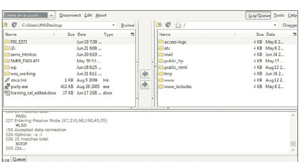

# 使用 FTP 传输文件 11

以下是一些流行的免费 FTP 客户端：

-   Classic FTP (http://www.nchsoftware.com/classic/) 适用于 Mac 和 Windows
-   Cyberduck (http://cyberduck.ch/) 适用于 Mac
-   Fetch (http://fetchsoftworks.com/) 适用于 Mac
-   FileZilla (http://filezilla-project.org/) 适用于所有平台
-   FireFTP (http://fireftp.mozdev.org/) Firefox 扩展，适用于所有平台

当您选择了一个 FTP 客户端并将其安装在您的计算机上后，您就可以开始从 Web 服务器上传和下载文件了。在下一节中，您将了解如何使用代码清单 1.1 中的示例文件来完成此过程。

#### 使用 FTP 客户端

以下步骤展示了如何使用 Classic FTP 连接到您的 Web 服务器并传输文件。但是，所有 FTP 客户端都使用相似（即使不完全相同）的界面。如果您理解了以下步骤，您应该能够使用任何 FTP 客户端。

记住，您首先需要主机名、账户用户名和账户密码。

1.  启动 Classic FTP 程序并单击“连接”按钮。系统会提示您填写有关要连接的站点的信息，如图 1.5 所示。

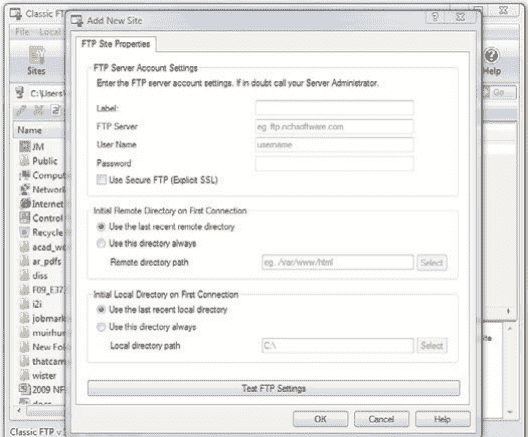

# 12 第 1 章 发布 Web 内容

2.  按照以下方式填写图 1.5 中所示的每个项目：
    -   站点标签是您用来指代自己站点的名称。其他人不会看到此名称，因此可以输入您想要的任何内容。
    -   FTP 服务器是您需要发送 Web 页面的 Web 服务器的 FTP 地址。此地址将由您的托管服务提供商提供给您。它可能是 yourdomain.com，但请检查您注册服务时收到的信息。
    -   用户名字段和密码字段也应使用托管服务提供商提供给您的信息填写。
    -   在您习惯使用该客户端并建立工作流程之前，请不要更改“首次连接时的初始远程目录”和“首次连接时的初始本地目录”的值。

3.  设置完成后，单击“确定”以保存设置并与 Web 服务器建立连接。

您将看到一个对话框，指示 Classic FTP 正在尝试连接到 Web 服务器。连接成功后，您将看到一个类似于图 1.6 的界面，左侧显示本地目录的内容，右侧显示您的 Web 服务器的内容。

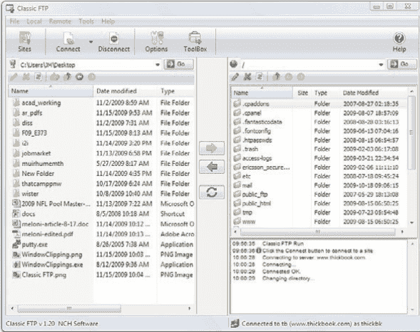

# 使用 FTP 传输文件 13

4.  现在，您几乎准备好将文件传输到您的 Web 服务器了。剩下的就是切换到所谓的 Web 服务器的文档根目录。您的 Web 服务器的文档根目录是被指定为 Web 内容顶级目录的目录——目录结构的起点，您将在本章后面了解更多。通常，此目录将被命名为 public_html（如图 1.6 所示）、www（也显示在图 1.6 中，因为 www 已被创建为 public_html 的别名）或 htdocs。这不是您必须创建的目录，因为您的托管服务提供商已经为您创建了它。

双击文档根目录名称将其打开。FTP 客户端界面右侧的显示应更改以显示此目录的内容。（此时它可能是空的，除非您的 Web 托管服务提供商已代您在该目录中放置了占位符文件。）

5.  目标是将您之前创建的 sample.html 文件从您的计算机传输到 Web 服务器。在 FTP 客户端界面左侧的目录列表中找到该文件（如果需要，请进行导航），然后单击一次以突出显示文件名。

6.  单击客户端界面中间的右箭头按钮，将文件发送到 Web 服务器。文件传输完成后，客户端界面右侧应刷新以向您显示文件已到达其目标位置。

7.  单击“断开连接”按钮关闭连接，然后退出 Classic FTP 程序。

这些步骤在概念上与您任何时候想要通过 FTP 将文件发送到 Web 服务器所采取的步骤相似。您还可以使用您的 FTP 客户端在远程 Web 服务器上创建子目录。要使用 Classic FTP 创建子目录，请单击“远程”菜单，然后单击“新建文件夹”。不同的 FTP 客户端将有不同的界面选项来实现相同的目标。

#### 了解在 Web 服务器上放置文件的位置

维护 Web 内容的一个重要方面是确定如何组织这些内容——不仅是为了用户查找，也是为了您在服务器上维护。将文件放入目录将有助于您管理...

age那些文件。

在Web服务器上命名和组织目录，以及制定文件维护规则，完全取决于你。然而，从长远来看，维护一个组织良好的服务器确实能使你对内容的管理更加高效。

#### 基础文件管理

当您浏览网页时，您可能已经注意到，随着您在网站中导航，URL会发生变化。例如，如果您正在查看一家公司的网站，并点击图形导航跳转到该公司的产品或服务页面，URL可能会从
http://www.companyname.com/
变为
http://www.companyname.com/products/
或
http://www.companyname.com/services/

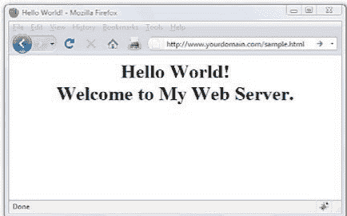

## 理解如何在Web服务器上放置文件 15

在上一节中，我使用了“文档根目录”这个术语，但并未真正解释其含义。Web服务器的文档根目录本质上就是完整URL中的尾部斜杠。例如，如果您的域名是 yourdomain.com，而您的URL是 http://www.yourdomain.com/，那么文档根目录就是由尾部斜杠 (/) 表示的目录。文档根目录是您在Web服务器上创建的目录结构的起点；它是Web服务器开始查找Web浏览器请求文件的地方。

如果您按照之前的说明将 sample.html 文件放入文档根目录，您将能够通过Web浏览器在以下URL访问它：http://www.yourdomain.com/sample.html

如果您在Web浏览器中输入此URL，您将看到渲染后的 sample.html 文件，如图1.7所示。

图1.7

通过Web浏览器访问的 sample.html 文件。

ptg999

但是，如果您在文档根目录内创建了一个新目录，并将 sample.html 文件放入该目录，那么访问该文件的URL将是：http://www.yourdomain.com/newdirectory/sample.html

如果您将 sample.html 文件放入连接服务器时最初看到的目录中——也就是说，您没有更改目录并将文件放入文档根目录——那么 sample.html 文件将无法通过任何URL从您的Web服务器访问。该文件仍然位于您称为Web服务器的机器上，但由于文件不在文档根目录中——服务器软件知道从那里开始查找文件——因此它将永远不会通过Web浏览器被任何人访问。

# 16 第1章 发布网页内容

关键点是什么？在开始传输文件之前，请始终导航到Web服务器的文档根目录。

这对于图形文件和其他多媒体文件尤其重要。Web服务器上一个常见的目录名为 images，顾名思义，所有图像资源都放置在此处以便检索。其他常用的目录包括用于样式表文件的 css（如果您使用不止一个）和用于外部JavaScript文件的 js。或者，如果您知道网站上会有一个区域供访客下载多种不同类型的文件，您可能只需将该目录命名为 downloads。

无论是包含您艺术作品集的ZIP文件，还是包含销售数据的Excel电子表格，在互联网上发布非简单网页的文件通常很有用。要使非HTML文件在Web上可用，只需像上传HTML文件一样将文件上传到您的网站，并遵循本章前面提供的上传说明。

文件上传到Web服务器后，您可以创建一个指向它的链接（正如您将在后续章节中学到的）。换句话说，您的Web服务器可以服务远不止HTML文件的内容。

以下是您将在本书后面更详细地了解的HTML代码示例。以下代码将用于一个名为 artfolio.zip 的文件，该文件位于您网站的 downloads 目录中，链接文本为“Download my art portfolio!”：

```
<a href="/downloads/artfolio.zip">Download my art portfolio!</a>
```

### 使用索引页

当您想到索引时，您可能想到的是书后面的部分，它告诉您在哪里可以找到各种关键词和主题。Web服务器目录中的索引文件可以起到这个作用——如果您这样设计的话。事实上，名字就是由此而来。

index.html 文件（或通常称为 index 文件）是您指定给某个页面的名称，该页面是当用户导航到您网站中的特定目录时，希望他们看到的默认文件。如果您在设计该页面时考虑到了可用性，您的用户将能够从索引页面访问该部分的所有内容。

例如，图1.8显示了下拉导航和左侧导航都包含指向三个页面的链接：解决方案概述（该部分索引页面本身）、连接管理和成本管理。


## 理解如何在Web服务器上放置文件 17

页面本身的内容——名为 index.html 并位于 solutions 目录中——也包含指向 solutions 部分中另外两个页面的链接。当用户访问此特定网站的“solutions”部分的索引页面时（至少在截图时），他们可以到达该部分的任何其他页面（并且有三种不同的方式！）。

图1.8

展示了一个良好的部分索引页面。

ptg999

索引页面的另一个功能是，当用户访问您网站上某个具有索引页面的目录，但没有指定该页面时，他们仍然会进入您网站该部分或网站本身的主页面。例如，在前面的示例中，用户可以输入以下任一URL，并进入该网站 solutions 部分的主页面：

http://www.ipass.com/solutions/

http://www.ipass.com/solutions/index.html

如果 solutions 目录中没有 index.html 页面，结果将取决于Web服务器的配置。如果服务器配置为禁止目录浏览，用户在尝试访问未指定页面名称的URL时将看到“Directory Listing Denied”消息。但是，如果服务器配置为允许目录浏览，用户将看到该目录中的文件列表。

# 18 第1章 发布网页内容

这些服务器配置选项将由您的托管服务提供商为您确定。如果您的托管服务提供商允许您通过控制面板修改服务器设置，您可以更改这些设置，以便您的服务器根据您自己的要求响应请求。索引文件不仅用于子目录，也用于您网站的顶级目录（或文档根目录）。您网站的第一个页面——或主页、主页面，或者您喜欢如何称呼您希望用户首次访问您的域名时看到的网页内容——应命名为 index.html 并放置在您Web服务器的文档根目录中。这将确保当用户在其Web浏览器中输入 http://www.yourdomain.com/ 时，服务器将响应您希望他们看到的内容（而不是“Directory Listing Denied”或其他非预期的结果）。

### 无需Web服务器分发内容

在线发布HTML和多媒体文件显然是学习HTML和创建网页内容的主要原因。然而，也存在其他形式的发布方式不可行的情况。例如，您可能希望在贸易展上分发CD-ROM、DVD-ROM或USB驱动器，其中包含设计为网页内容的营销材料——即，可通过Web浏览器查看的超链接文本，但不涉及Web服务器。您也可能希望在培训研讨会上为学生包含基于HTML的教学手册，这些手册存储在可移动介质上。这些只是HTML页面如何在不涉及互联网的发布场景中使用的两个示例。

注意
分发本地站点时不需要分发Web浏览器，尽管这是一个不错的补充。您可以合理地假设用户有自己的Web浏览器，并会打开目录中的 index.html 文件以开始浏览超链接内容。此过程也称为创建本地站点；即使不涉及Web服务器，这些超文本内容包仍然被称为站点。这个术语之所以适用，是因为您的文件是本地访问的，而不是远程（通过Web服务器）访问的。

#### 本地发布内容

假设您需要创建一个本地站点，并希望将其分发到


## 测试网络内容的技巧 19

只需将USB驱动器的目录结构想象成您Web服务器的目录结构即可。USB驱动器目录结构的顶层可以是您的文档根目录。或者，如果您在分发Web浏览器的同时也分发内容，您可能有两个目录——例如，一个名为`browser`，另一个名为`content`。在这种情况下，`content`目录就是您的文档根目录。在文档根目录内，您可以有额外的子文件夹，用于放置内容和其他多媒体资源。

对于本地网站和远程网站一样，保持良好的组织结构都很重要，这样可以避免HTML文件中出现断链。您将在后面的章节中了解更多关于如何将文件链接在一起的具体内容。

### 在博客上发布内容

您可能拥有一个由第三方托管的博客，例如Blogger或WordPress（等等），因此即使没有专用的Web服务器，甚至不懂任何HTML，您也已经发布了内容。这些服务除了源代码编辑器外，还提供可视化编辑器，这意味着您可以输入文字并添加粗体、斜体或字体颜色等视觉格式，而无需知道这些操作对应的HTML代码。但是，当您在这些编辑器中点击“发布”按钮时，内容实际上会变成HTML代码。然而，随着您在本书中获得的知识，您的博客将会得到提升，因为您将能够为您的博客文章内容和博客模板使用源代码编辑器，从而让您对该内容的外观和感觉拥有更多控制权。这些操作与您学习过的创建HTML文件并使用FTP将其上传到专用Web服务器的过程不同，但如果我不指出博客实际上是一种Web发布形式，那就是我的疏忽了。

### 测试网络内容的技巧

每当您将文件传输到Web服务器或将其放置在可移动介质上以进行本地浏览时，都应立即对每个页面进行彻底测试。以下检查清单将帮助确保您的网络内容按预期运行。请注意，此时您可能对其中一些术语还不熟悉，但随着您学习本书并创建更大的项目，可以返回此清单查看：

-   在传输文件之前，请在您的计算机上本地测试它们，以确保链接有效且内容反映了您预期的视觉设计。将页面传输到Web服务器或可移动设备后，请再次测试所有页面。
-   使用尽可能多的浏览器进行这些测试——Chrome、Firefox、Internet Explorer、Opera和Safari是一个很好的列表——并在Mac和Windows平台上都进行测试。如果可能，请在低分辨率（800×600）和高分辨率（1600×1200）下进行检查。
-   开始测试前，请在您的Web浏览器中关闭自动图像加载功能，这样您就可以查看每个页面在没有图形时的样子。检查您的alt标签消息，然后重新打开图像加载功能以加载图形，并再次仔细查看页面。
-   使用浏览器的字体大小设置，以各种字体大小查看每个页面，以确保当用户用自己的设置覆盖您的字体规范时，您的布局不会崩溃。
-   等待每个页面完全加载完毕，然后一直向下滚动，以确保所有图像都出现在它们应有的位置。
-   记录每个页面加载所需的时间。加载时间是否超过几秒钟？如果是，该页面上的信息是否足够有价值，能让用户在页面加载完成前不离开？当然，宽带连接很普遍，但这并不意味着您应该在页面上加载1MB的图像。

如果您的页面通过了所有这些测试，您就可以放心了；您的网站已准备好供公众查看。

## 总结

本章向您介绍了使用HTML标记文本来生成网络内容的概念。您还了解到，网络内容不仅仅是“页面”——还包括图像、音频和视频文件。所有这些内容都存储在Web服务器上——一台通常远离您自己计算机的远程机器。在您的计算机或其他设备上，您使用Web浏览器来请求、检索并最终将网络内容显示在屏幕上。

您了解了在确定Web托管提供商是否适合您的需求时应考虑的标准。有了Web托管提供商后，您就可以开始使用FTP客户端将文件传输到Web服务器。您还了解了一些关于Web服务器目录结构和文件管理的知识，以及给定Web服务器目录中index.html文件的重要作用。您发现可以在可移动介质上分发网络内容，以及如何构建文件和目录以实现无需使用远程Web服务器即可查看内容的目标。最后，您了解到在将网站放置到Web服务器后，在多种浏览器中进行测试的重要性。编写有效、符合标准的HTML和CSS将有助于确保您的网站对所有访问者看起来都大致相同，但您仍然不应在不从开发团队外的潜在用户那里获取意见的情况下进行设计——当您是一个设计团队时，从他人那里获取意见更为重要！

## 问与答

> 问：我看过互联网上一些网页的HTML源代码，它看起来非常难以学习。我必须像计算机程序员一样思考才能学会这些东西吗？

> 答：尽管复杂的HTML页面确实看起来令人生畏，但学习HTML比学习实际的软件编程语言（如C++或Java）要容易得多。HTML是一种标记语言，而不是编程语言；您标记文本，以便浏览器可以以某种方式呈现文本。这与开发计算机程序的思维过程完全不同。您实际上不需要任何计算机程序员的经验或技能就能成为成功的网络内容作者。

> 许多商业网站背后的HTML看起来很复杂的原因之一是，它可能是由可视化Web设计工具创建的——一种“所见即所得”（WYSIWYG）编辑器，它会使用其软件开发人员在特定情况下告诉它使用的任何标记——而不是手工编码，后者让您完全控制生成的标记。在本书中，您将从头开始学习基本编码，这通常会产生整洁、易于阅读的源代码。可视化Web设计工具往往使代码难以阅读，并产生复杂且不符合标准的代码。

> 问：您推荐的所有测试将比创建我的页面花费更长时间！我能减少测试量吗？

> 答：如果您的页面不打算赚钱或提供重要服务，那么它们看起来对某些用户很滑稽或偶尔产生错误可能没什么大不了的。在这种情况下，只需用几种不同的浏览器测试每个页面就可以了。但是，如果您需要树立专业形象，严格的测试是无可替代的。

> 问：说真的，谁在乎我如何组织我的网络内容？

> 答：信不信由你，您的网络内容组织确实对搜索引擎和您网站的潜在访问者很重要——您将在第28章“帮助人们找到您的网页”中了解更多相关内容。但总的来说，拥有一个有组织的Web服务器目录结构将帮助您跟踪可能需要经常更新的内容。例如，如果您有一个专门的图像或多媒


## 工作坊 23

本工作坊包含测验题和练习，旨在帮助你巩固对所学内容的理解。请尽量在查看后续的“答案”部分之前，尝试回答所有问题。

## 测验

1.  为了在网页服务器上发布一个包含一些文字和两张图片的单个网页，你需要存储多少个文件？
2.  在选择网络托管服务提供商时，应该关注哪些特性？
3.  通过FTP连接到你的网页服务器，需要哪三部分信息？
4.  `index.html` 文件的用途是什么？
5.  你的网站是否必须包含目录结构？

## 答案

1.  你需要三个文件：一个用于网页本身（包含文字和HTML标记），另外两个分别用于两张图片。
2.  关注可靠性、客户服务、Web空间和带宽、域名服务、网站管理附加功能以及价格。
3.  主机名、你的账户用户名和账户密码。
4.  `index.html` 文件通常是网页服务器中某个目录的默认文件。它允许用户访问 `http://www.yourdomain.com/somedirectory/` 而无需在URL末尾指定文件名，就能跳转到正确的位置。
5.  不需要。使用目录结构来组织文件完全取决于你，不过强烈建议使用，因为它能简化内容维护。

## 练习

1.  准备好你的网络托管——你是打算通过在本地计算机上浏览文件来学习本书的各章内容，还是打算使用网络托管服务提供商？请注意，大多数网络托管服务提供商会在你购买托管方案的当天就让你启动并运行。
2.  如果你使用外部托管服务提供商，并使用FTP客户端，在你的网站文档根目录下创建一个子目录。将 `sample.html` 文件的内容粘贴到另一个名为 `index.html` 的文件中，将 `<title>` 和 `</title>` 标签之间的文本更改为新的内容，并将 `<h1>` 和 `</h1>` 标签之间的文本也更改为新的内容。保存文件并将其上传到新的子目录。使用你的Web浏览器导航到网页服务器上的新目录，查看 `index.html` 文件中的内容是否显示。然后，使用你的FTP客户端，从远程子目录中删除 `index.html` 文件。使用你的Web浏览器返回该URL，重新加载页面，看看在没有 `index.html` 文件的情况下服务器是如何响应的。
3.  使用上一个练习中创建的同一组文件，将这些文件放置在可移动媒体设备上——例如CD-ROM或USB驱动器。使用你的浏览器浏览这个本地版本的示例网站，并思考你需要随此可移动媒体分发哪些说明，以便其他人可以使用它。

## 第 2 章

本章学习要点：

-   如何用HTML创建一个简单的网页
-   如何包含每个网页必须包含的所有HTML标签
-   如何使用段落和换行符组织页面
-   如何使用标题组织内容
-   如何验证你的网页内容
-   如何区分HTML、XML、XHTML和HTML5

第一章向你介绍了创建网页内容并在线上查看（或如果你还没有网页托管服务提供商，则在本地查看）的基本流程。在本章中，我们将开始讲解一个HTML文件中必须包含的各种元素，以便它能在你的Web浏览器中正确显示。

在本章结束时，你将了解HTML与XHTML的区别，以及为什么有两种不同的语言被设计用来完成同一件事——创建网页内容。总的来说，本章简要总结了HTML和XHTML的基础知识，并提供了一些实用技巧，让你作为网页作者和发布者能够充分利用时间。不过，这并非全是理论；你将看到一个真实的网页及其背后的HTML代码。

### 准备工作

以下是开始使用本书其余部分之前你需要做的事情：

1.  获取一台计算机。我使用运行Ubuntu（Linux）的计算机来测试示例网页内容并截取本书的图表，但你可以使用任何Windows、Macintosh或Linux/UNIX机器来创建和查看你的网页内容。
2.  获取互联网连接。无论你使用拨号、无线还是宽带连接，对创建和查看你的网页内容都没有影响，但连接速度越快，整体体验就越好。为你提供互联网连接的互联网服务提供商（ISP）、学校或企业可以帮助你正确设置。此外，许多公共场所如咖啡馆、书店和图书馆提供免费的无线互联网服务，如果你有支持Wi-Fi网络的笔记本电脑，就可以使用。
    **注意**：不确定如何找到ISP？最好的方法是在线进行比较购物（使用朋友的计算机或已连接到互联网的公共计算机）。你可以在 http://www.thelist.com/ 找到全国性和地区性ISP的综合列表。
3.  获取Web浏览器软件。这是你的计算机检索和显示网页内容所需的软件。正如你在第一章所学到的，最流行的浏览器软件（按字母顺序排列）是Apple Safari、Google Chrome、Microsoft Internet Explorer、Mozilla Firefox和Opera。最好安装其中几种浏览器，以便你可以进行实验并确保你的内容在所有浏览器中看起来一致；你无法假设其他人使用的是哪种浏览器。
4.  去探索吧！使用Web浏览器在互联网上寻找与你想创建的网站在内容或外观上相似的网站。注意哪些页面让你感到沮丧，哪些页面吸引你并让你继续阅读，以及哪些页面让你一次又一次地回来。如果有特定的主题让你感兴趣，可以考虑使用流行的搜索引擎，如Google（http://www.google.com/）或Bing（http://www.bing.com/）进行搜索。
    **注意**：尽管所有Web浏览器处理信息的方式大体相同，但它们之间存在一些具体差异，导致在不同浏览器中内容看起来并非总是相同。务必在多个浏览器中检查你的网页，以确保它们看起来大致一致。

### 从一个简单的网页开始

在第一章中，你了解到网页只是一个文本文件，它被HTML代码标记（或包围），这些代码告诉浏览器如何显示文本。要创建这些文本文件，请使用文本编辑器，如Windows上的“记事本”（Notepad）或Mac上的TextEdit——不要使用写字板（WordPad）、Microsoft Word或其他功能齐全的文字处理软件，因为它们创建的文件类型与我们用于网页内容的纯文本文件不同。

**注意**：如第一章所述，如果你计划将你的网页内容放到互联网上（而不是在CD-ROM或本地内部网上发布），你需要将其传输到一台24小时连接到互联网的计算机上。为你提供互联网访问的同一家公司或学校也可能提供网络空间；如果没有，你可能需要向托管服务提供商付费购买该服务。

在开始工作之前，你应该先准备一些你想要放到网页上的文本：

1.  找到（或写）几段关于你自己、你的家庭、你的公司、你的垒球队或其他你感兴趣主题的文字。
2.  将此文本保存为标准的纯ASCII文本。“记事本”和大多数简单的文本编辑器总是将文件保存为纯文本，但如果你使用其他程序，你可能需要选择此文件类型作为选项（在选择“文件”、“另存为”之后）。

在你继续学习本章的过程中，你将添加HTML标记（称为标签）

到文本文件，从而将其转化为网页内容。

## 从简单网页入手 27

当你保存包含HTML标签的文件时，务必使用以`.html`结尾的文件名。这一点很重要：如果保存文件时忘记在文件名末尾输入`.html`，大多数文本编辑器会将其保存为其他扩展名（例如`.txt`）。如果发生这种情况，当你试图用网页浏览器打开该文件时，可能无法找到它；即使找到了，它也无法正常显示。换句话说，网页浏览器期望网页文件具有`.html`的文件扩展名。

重申一次，因为这对最终结果和学习过程本身都至关重要：

不要用Microsoft Word或任何其他兼容HTML的字处理器来创建你的第一个HTML文件；这些程序大多会试图以奇怪的方式重写你的HTML，让你完全摸不着头脑。此外，我建议你不要使用所见即所得（WYSIWYG）编辑器，如Microsoft FrontPage或Adobe Dreamweaver。在你刚开始学习HTML时，从简单的文本编辑器入手可能会更容易，也更有教育意义。等你更好地理解了底层运作机制后，再转用可视化工具（如FrontPage和Dreamweaver）也不迟。

你可能会在网络上遇到其他文件扩展名，例如`.jsp`（Java Server Pages）、`.asp`（Microsoft Active Server Pages）或`.php`（PHP：Hypertext Preprocessor），但这些文件类型使用了超出HTML范围和本书章节范围的服务器端技术。不过，这些文件在包含编程语言的同时也包含HTML；尽管这些文件中的编程代码在服务器端编译，你在客户端（浏览器）看到的只是HTML输出，但如果你查看源文件，可能会看到编程代码和标记代码复杂的交织在一起。

访问网站时，你可能还会遇到文件扩展名为`.htm`的页面，这也是一个可接受的文件扩展名。

清单2.1展示了你可以输入并保存以创建简单HTML网页的文本示例。如果你用Firefox浏览器打开这个文件，将看到图2.1所示的页面。你创建的每个网页都必须包含`<html></html>`、`<head></head>`、`<title></title>`和`<body></body>`这些标签对。

**注意** 如果你使用的是Macintosh电脑上的TextEdit，创建HTML文件的步骤与在Windows电脑上使用Notepad略有不同。两者都是流行的文本编辑器，但使用后者时，你必须先点击“格式”菜单，选择“制作纯文本”，然后在“保存”标题下更改偏好设置，取消选中“为纯文本文件追加'.txt'扩展名”复选框。此外，默认偏好设置为以浏览器中的显示方式来显示`.html`文档，这将不允许你编辑它们。要解决此问题，请在“富文本处理”标题下勾选“忽略HTML文件中的富文本命令”。

**清单 2.1** `<html>`、`<head>`、`<title>`和`<body>`标签

```xml
<?xml version="1.0" encoding="UTF-8"?>
<!DOCTYPE html PUBLIC "-//W3C//DTD XHTML 1.1//EN"
"http://www.w3.org/TR/xhtml11/DTD/xhtml11.dtd">
<html xmlns="http://www.w3.org/1999/xhtml" xml:lang="en">
<head>
<title>The First Web Page</title>
</head>
<body>
<p>
In the beginning, Tim created the HyperText Markup Language. The Internet was without form and void, and text was upon the face of the monitor and the Hands of Tim were moving over the face of the keyboard. And Tim said, Let there be links; and there were links. And Tim saw that the links were good; and Tim separated the links from the text. Tim called the links Anchors, and the text He called Other Stuff. And the whole thing together was the first Web Page.
</p>
</body>
</html>
```

## 28 第2章 理解HTML与XHTML的联系

### 清单 2.1 续

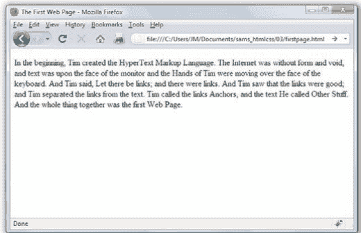

### 图 2.1

当你将清单2.1中的文本保存为HTML文件并用网页浏览器查看时，只会显示实际的标题和正文文本。

**注意** 在清单2.1中，如同在每个HTML页面中一样，以`<`开头、以`>`结尾的词实际上是编码命令。这些编码命令被称为HTML标签，因为它们“标记”文本片段，并告诉网页浏览器这是何种文本。这使得网页浏览器能够恰当地显示文本。

从技术上讲，HTML5将是下一个网络标准，但尚未完全普及。目前估计HTML5要到2011年左右才能完全普及。不过，当你在本书中学习HTML和XHTML的重要特性时，我会加入关于HTML5特性可能有所不同的说明。

网页代码的前几行是标准样板代码，你将把它包含在所有页面中。这段代码实际上将页面标识为有效的XHTML 1.1文档，这意味着从技术上讲，该网页是一个XHTML页面。本书中开发的所有页面都是XHTML 1.1页面。因为XHTML是HTML更结构化的版本，通常将本书所有页面称为HTML页面仍然是可以的。通过将你的代码定位于XHTML 1.1，你正在开发符合最新网络标准的网页。这是一件好事！

## 每个XHTML网页必须有的HTML标签 29

在你学习清单2.1中使用的HTML标签的含义之前，你可能想确切地了解我是如何创建和查看这个文档本身的。

#### 创建和查看基本网页

按照以下步骤操作：

1.  在Windows Notepad（或使用Macintosh TextEdit或你选择的其他文本编辑器）中，输入清单2.1中的所有文本，包括HTML标签。
2.  选择“文件”，“另存为”。确保将文件类型选择为纯文本（或ASCII文本）。
3.  将文件命名为`firstpage.html`。
4.  选择硬盘上用于保存网页的文件夹——并记住你选择的文件夹！单击“保存”或“确定”按钮来保存文件。
5.  现在启动你常用的网页浏览器。（也保持Notepad运行，以便你可以在查看和编辑页面之间轻松切换。）

在Internet Explorer中，选择“文件”，“打开”并单击“浏览”。如果你使用Firefox，选择“文件”，“打开文件”。导航到相应的文件夹并选择`firstpage.html`文件。一些浏览器和操作系统还允许你将`firstpage.html`文件拖放到浏览器窗口中来查看它。

瞧！你应该能看到图2.1所示的页面。

**注意** 你不需要连接到互联网就可以查看存储在你自己电脑上的网页。默认情况下，你的网页浏览器每次启动时都会尝试连接到互联网，这在大多数情况下是有道理的。但是，如果你在硬盘上本地（离线）开发页面，并且不断收到页面未找到的错误信息，这可能会很麻烦。如果你通过局域网、有线调制解调器或DSL拥有全天候的网络连接，这就不是问题，因为浏览器永远不会抱怨离线。否则，适当的处理方法取决于你的浏览器类型；请检查浏览器“工具”菜单下的选项。

如果你已经获得了网络托管账户，此时你可以使用FTP将`firstpage.html`文件传输到网络服务器。事实上，从本章开始，指导说明将假设你拥有托管服务提供商，并且熟悉通过FTP来回发送文件；如果不是这样，请在继续之前回顾第一章。或者，如果你有意识地选择在本地（没有网络托管）处理文件，请准备好调整说明以适应你的特定需求（例如忽略“传输文件”和“输入URL”等命令）。

### 每个XHTML网页必须有的HTML标签

现在是向你揭示HTML标签这门秘密语言的时候了。当你理解了这门语言，你将拥有远超其他人类的创造力。别告诉其他人类，但它真的相当容易。


## 30 第二章 理解HTML与XHTML的联系

> 注意：在深入了解HTML标签之前，我们先来处理这些看起来有些混乱的代码……

目前理解字符编码等概念并非至关重要。清单2.1的第一行表明，该HTML文档实际上是一个XML文档：

```xml
<?xml version="1.0" encoding="UTF-8"?>
```

重要的是，你需要在页面中包含适当的样板代码，以确保它们符合最新的网络标准。截至本文写作时，XHTML 1.1 是一项网络标准。HTML5 尚未成为网络标准，因此 HTML 文件开头的这些行并非必需。

XML 版本设置为1.0，这是相当标准的，字符编码类型（UTF-8）也是如此。清单2.1中的第二和第三行代码看起来更为复杂：

```html
<!DOCTYPE html PUBLIC "-//W3C//DTD XHTML 1.1//EN"
"http://www.w3.org/TR/xhtml11/DTD/xhtml11.dtd">
```

同样，只要记得在页面开头包含这段代码，其具体细节并非特别重要。这段代码将文档标识为 XHTML 1.1，从而使网络浏览器能够确保代码符合 XHTML 1.1 的所有要求。

### XML/XHTML 样板代码

> 注意：创建网页时并非严格要求使用此代码。你可以删除示例中的起始代码行，让页面以 `<html>` 标签开始，它仍能在网络浏览器中正常打开。包含额外代码是为了确保你的页面能够进行验证，以检查其准确性，你将在本章稍后部分学习如何操作。

大多数HTML标签由两部分组成：开始标签，表示一段文本的开始；结束标签，表示该段文本的结束。结束标签以 `<` 符号后的 `/`（正斜杠）开头。

另一种类型的标签是空标签，其独特之处在于它不包含配对的开始和结束标签。相反，空标签由单个标签组成，以 `<` 开头，以 `/>` 结尾。理解它们各自的作用：

- **开始标签** 是指示HTML命令开始的HTML标签；受该命令影响的文本出现在开始标签之后。开始标签总是以 `<` 开头，以 `>` 结尾，如 `<html>`。
- **结束标签** 是指示HTML命令结束的HTML标签；受该命令影响的文本出现在结束标签之前。结束标签总是以 `</` 开头，以 `>` 结尾，如 `</html>`。
- **空标签** 是在页面中发布HTML命令而不包含任何文本的HTML标签。空标签总是以 `<` 开头，以 `/>` 结尾，如 `<br />` 和 ``。

## 31 使用段落和换行符组织页面

例如，清单2.1中的 `<body>` 标签告诉网络浏览器页面实际正文从何处开始，而 `</body>` 则表示正文结束的位置。`<body>` 和 `</body>` 标签之间的所有内容将显示在网络浏览器窗口的主要显示区域，如图2.1所示。浏览器窗口的最顶部（参见图2.1）显示标题文本，即位于 `<title>` 和 `</title>` 之间的任何文本。标题文本还用于在浏览器的书签或收藏夹菜单中标识页面（具体取决于你使用的浏览器）。为你的页面提供标题很重要，这样访问者才能正确地将其添加为书签以备将来参考。

你无疑在清单2.1中注意到，与 `<html>` 标签关联有一些额外代码。这些代码包含两个属性（`xmlns` 和 `xml:lang`），用于指定与该标签相关的附加信息。这两个属性是所有XHTML网页的标准要求；前者定义XML命名空间，后者定义内容语言。本书中定义了标准命名空间，并使用英语。如果你使用其他语言编写，请将“en”（英语）替换为你相关的语言标识符。

在你创建的每个HTML页面中，你都会使用 `<body>` 和 `<title>` 标签对，因为每个网页都需要标题和正文。你也会使用 `<html>` 和 `<head>` 标签对，它们是清单2.1中显示的另外两个标签。将 `<html>` 放在文档最开头仅表示该文档是一个网页。结尾的 `</html>` 表示网页结束。

在一个页面内，有一个头部区域和一个主体区域。每个区域由 `<head>` 和 `<body>` 标签标识。其理念是，页面头部的信息以某种方式描述页面，但不会被网络浏览器实际显示。然而，放置在主体中的信息会被网络浏览器显示。`<head>` 标签总是出现在页面HTML代码的开头附近，紧跟在 `<html>` 开始标签之后。

你可能会发现创建并保存一个只包含 `<html>`、`<head>`、`<title>` 和 `<body>` 开始和结束标签的极简页面（也称为骨架页面或模板）会很方便，类似于清单2.1中使用的文档。然后，每当你要创建新网页时，都可以将该文档作为起点，省去每次输入所有这些必需标签的麻烦。

用于标识页面标题的 `<title>` 标签对出现在页面的头部，这意味着它位于 `<head>` 开始标签之后，`</head>` 结束标签之前。在接下来的章节中，你将了解一些其他可以放在 `<head>` 和 `</head>` 之间的高级头部信息，例如用于设置页面格式的样式表规则，以及你将学习编写和嵌入的JavaScript。

清单2.1中使用的 `<p>` 标签封装了一段文本。应尽可能将你的文本块包含在适当的容器标签中。

### 使用段落和换行符组织页面

当网络浏览器显示HTML页面时，它不会注意行尾或单词之间的空格数量。例如，图2.2中显示的诗歌顶部版本中，所有单词之间都显示一个空格，尽管在清单2.2中的输入并非如此。这是因为HTML代码中多余的空格会自动缩减为一个空格。此外，当文本到达浏览器窗口边缘时，它会自动换行，无论原始HTML文件中的换行符在何处。

当清单2.2中的HTML作为网页查看时，行和段落分隔仅出现在有 `<br />` 和 `<p>` 标签的地方。

#### 清单2.2 包含段落和换行符的HTML

```xml
<?xml version="1.0" encoding="UTF-8"?>
<!DOCTYPE html PUBLIC "-//W3C//DTD XHTML 1.1//EN"
"http://www.w3.org/TR/xhtml11/DTD/xhtml11.dtd">
<html xmlns="http://www.w3.org/1999/xhtml" xml:lang="en">
<head>
    <title>The Advertising Agency Song</title>
</head>
<body>
    <p>
        When your client's hopping mad,<br />
        put his picture in the ad.
    </p>
    <hr />
    <p>
        When your client's hopping mad,<br />
        put his picture in the ad.
    </p>
    <p>
        If he still should prove refractory,<br />
        add a picture of his factory.
    </p>
</body>
</html>
```

如果你想控制行和段落分隔实际出现的位置，就必须使用HTML标签。当文本包含在 `<p></p>` 容器标签内时，在结束标签之后会假定有一个换行符。`<br />` 标签在段落内强制换行。与你目前见过的其他标签不同，`<br />` 不需要结束 `</br>` 标签——这是前面提到的那些空标签之一。

你可能会遇到很多包含 `<br>` 而非 `<br />` 的网络内容。或者你可能会看到其他不包含 `</p>` 结束标签的内容。只要记住，正确的XHTML是有规则的。


如前所述的空标签。尽管HTML4不要求在空标签中包含斜杠`/`，但XHTML要求，未来标准也会要求，因此遵循最新标准并创建编码正确的网页至关重要。务必始终将空标签编码为以`/>`结尾。

清单2.2和图2.2中的诗展示了`<br />`和`<p>`标签的使用，它们用于分隔一首广告公司歌曲的行和节。你可能还注意到了清单中的`<hr />`标签，它会在页面上显示一条水平线（参见图2.2）。使用`<hr />`标签插入水平线也会导致换行，即使你没有同时包含`<br />`标签。与`<br />`类似，`<hr />`水平线标签是一个空标签，因此永远不会带有结束标签`</hr>`。

拿一段文本，尝试将其格式化为正确的HTML。

### 在HTML中格式化文本

1.  在文本开头添加`<html><head><title>My Title</title></head><body>`（用你自己的页面标题替换“My Title”）。同时，在页面顶部包含模板代码，以满足XHTML的要求。
2.  在文本的最末尾添加`</body></html>`。
3.  在每个段落的开头添加一个`<p>`标签，在每个段落的结尾添加一个`</p>`标签。
4.  在需要单倍行距换行的地方使用`<br />`标签。
5.  使用`<hr />`绘制水平线，分隔文本的主要部分，或在任何需要横贯页面线条的地方。
6.  将文件保存为mypage.html（用你自己的文件名替换mypage）。
7.  在网页浏览器中打开文件以查看你的网页内容。（如果你有网站托管账户，请通过FTP将文件发送到该账户。）
8.  如果显示不正确，返回文本编辑器进行更正，然后再次保存文件（如果适用，同时发送到你的网站托管账户）。然后你需要在浏览器中单击“重新加载/刷新”以查看所做的更改。

> **注意**
> 如果你使用文字处理器创建网页，请确保将HTML文件保存为纯文本或ASCII格式。

#### 使用标题组织你的内容

当你在互联网上浏览网页时，你会注意到许多网页顶部都有一个标题，它比页面其余文本更大、更粗体。清单2.3是一个简单网页的示例代码和文本，其中包含一个标题与普通段落文本的对比示例。任何位于`<h1>`和`</h1>`标签之间的文本都会显示为大标题。此外，`<h2>`和`<h3>`会生成逐渐变小的标题，依此类推，直到`<h6>`。

**清单 2.3 标题标签**

```xml
<?xml version="1.0" encoding="UTF-8"?>
<!DOCTYPE html PUBLIC "-//W3C//DTD XHTML 1.1//EN"
"http://www.w3.org/TR/xhtml11/DTD/xhtml11.dtd">
<html xmlns="http://www.w3.org/1999/xhtml" xml:lang="en">
<head>
<title>My Widgets</title>
</head>
<body>
<h1>My Widgets</h1>
<p>My widgets are the best in the land. Continue reading to
learn more about my widgets.</p>
<h2>Widget Features</h2>
<p>If I had any features to discuss, you can bet I'd do
it here.</p>
<h3>Pricing</h3>
<p>Here, I would talk about my widget pricing.</p>
<h3>Comparisons</h3>
<p>Here, I would talk about how my widgets compare to my competitor’s widgets.</p>
</body>
</html>
```

正如你在图2.3中所看到的，创建标题的HTML简单得不能再简单了。在这个例子中，短语“My Widgets”使用`<h1>`标签突出显示。要创建最大的（一级）标题，只需在要用作标题的文本开头放置一个`<h1>`标签，在结尾放置一个`</h1>`标签。对于稍小一些的（二级）标题——用于比标题重要性低的信息——在文本周围使用`<h2>`和`</h2>`标签。对于需要比二级标题显示得更不突出的内容，在文本周围使用`<h3>`和`</h3>`标签。

但是，请记住，你的标题应遵循内容层次结构；只使用一个一级标题，在一级标题之后有一个（或多个）二级标题，在二级标题之后直接使用三级标题，依此类推。不要陷入为内容分配标题仅仅是为了让该内容以某种特定方式显示的陷阱。相反，确保你根据内容进行适当的分类（作为主标题、副标题等），同时使用显示样式使该文本在网页浏览器中以特定方式渲染。

**图 2.3**
使用三个级别的标题显示了此示例产品页面上内容的层次结构。

理论上，你也可以使用`<h4>`、`<h5>`和`<h6>`标签来创建重要性逐渐降低的标题，但这些标签并不常用。网页浏览器很少在这些标题与`<h3>`标题之间显示出明显的差异，而且内容通常也不会以需要六个级别的标题来显示内容层次的方式呈现。

记住标题和主标题之间的区别很重要。这两个词在日常英语中经常可以互换，但当你谈论HTML时，`<title>`给整个页面一个标识名称，该名称不会显示在页面本身上；它只显示在浏览器窗口的标题栏上。另一方面，标题标签会使页面上的某些文本以视觉强调的方式显示。每个页面只能有一个`<title>`，并且必须出现在`<head>`和`</head>`标签内，而你可以根据自己的喜好，以任何顺序拥有任意多的`<h1>`、`<h2>`和`<h3>`标题。然而，正如我之前提到的，你应该使用标题标签来严格控制内容层次结构；不要使用标题来实现特定的外观，因为那是CSS的工作。

> **注意**
> 在如今的许多网页上，华丽渲染的字母和标志的图形图像经常被用来代替本章讨论的普通文本标题。然而，使用文本标题是你将在第28章“帮助人们找到你的网页”中学习的众多搜索引擎优化（SEO）技巧之一。
>
> 搜索引擎会查看标题标签以了解你如何组织内容；它们会优先考虑你指示为更重要的内容（例如，一级标题），而不是你指示为较不重要的内容（低级别标题）。

> **注意**
> 不要忘记，放置在网页头部（head）的任何内容都不打算在页面本身上显示。

你将在本书的第二部分和第三部分学习完全控制网页中文本的外观。除了精确控制字体的大小、字体系列和颜色之外，标题提供了吸引人们对重要文本额外注意的最简单、最受欢迎的方式。


### 验证您的网页内容

在第一章中，我讨论了测试页面的方法；其中一种非常重要的方法就是验证。可以这样理解：设计和绘制一套漂亮的房屋图纸是一回事，但建筑师将其盖章认证为适合建造的安全结构则是另一回事。验证网页就是一个类似的过程；只不过在这里，建筑师是一个应用程序，而不是一个人。

简而言之，验证是使用一个特殊应用程序测试您的页面的过程，该程序会搜索错误并确保您的页面遵循严格的 XHTML 标准。验证很简单。事实上，负责制定网络标准的标准机构——万维网联盟（W3C）——提供了一个您可以使用的在线验证工具。要验证一个页面，请访问此网址：http://validator.w3.org/。W3C 标记验证服务如图 2.4 所示。

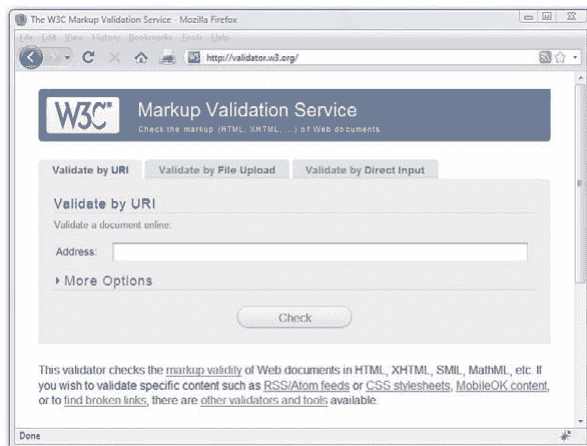

## 验证您的网页内容 37

### 窥探其他设计师的页面

考虑到许多流行网页中存在的视觉甚至音频效果，您可能已经意识到本章描述的简单页面只是 HTML 冰山的一角。既然您掌握了基础知识，您可能会惊讶于通过查看互联网上其他人的页面，您能自己领悟到多少其余内容。您可以在任何网络浏览器中右键单击并选择“查看源文件”来查看任何页面的 HTML。

如果您还无法解读某些 HTML 标签的功能或如何准确使用它们，请不要担心。您将在接下来的几章中了解所有这些内容。然而，现在先偷看一眼，会让您看到您已知的标签的实际应用，并让您尝到即将能够用网页做什么的滋味。

> 图 2.4 W3C 标记验证服务使您能够验证 HTML（XHTML）文档，以确保其编码准确。ptg999

如果您已经将页面发布到网上，可以使用“通过 URI 验证”选项卡。使用“通过文件上传验证”选项卡来验证存储在本地计算机文件系统中的文件。“通过直接输入验证”选项卡使您可以从文本编辑器粘贴文件内容。如果一切顺利，您的页面将获得通过报告（见图 2.5）。

如果 W3C 标记验证服务在您的网页中遇到错误，它将提供详细信息（包括问题代码的行号）。这是查找问题并清除页面中错误代码的好方法。验证不仅会告知您的页面是否构建正确，还能帮助您在发布页面供全世界查看之前发现问题并进行修复。

**提示**

一些网络开发工具包含内置的验证功能，您可以使用它们来代替 W3C 标记验证服务。例如，包括 Firebug（http://getfirebug.com/）和 HTML Validator（http://users.skynet.be/mgueury/mozilla/）等浏览器扩展，但许多其他程序也提供类似功能；请查阅您的用户文档。

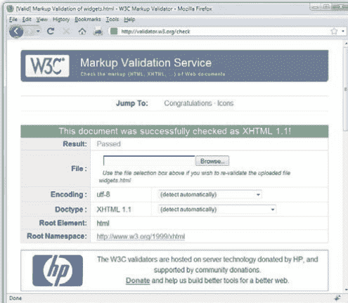

图 2.5 如果一个页面通过了 W3C 标记验证服务，您就知道它已准备好正式发布。

## 38 第 2 章 理解 HTML 和 XHTML 的关系

### 关于 HTML、XML、XHTML 和 HTML5 的内幕

在早期，HTML 非常棒，因为它允许科学家以高效且相对结构化的方式在互联网上共享信息。直到后来图形网络浏览器被创建，HTML 才开始被用于编写科学论文以外的内容。HTML 很快从研究人员整洁的小标记语言转变为在线发布语言。在确定 HTML 可以增强以用于图形浏览之后，网络浏览器的创建者们疯狂地为该语言添加了许多巧妙的功能。尽管这些新功能起初很整洁，但它们损害了 HTML 的原始设计，并在浏览器如何显示网页方面引入了不一致性；新功能只在一个或另一个浏览器上有效，如果您碰巧使用的是错误的浏览器，那就倒霉了。HTML 开始像是一次糟糕的房屋改造——由太多承包商完成且没有适当规划的工作。事实证明，此时创建的一些特定于浏览器的功能现在已被采纳为标准，而另一些则被完全放弃了。与大多数革命一样，网络的诞生非常混乱，对 HTML 的修改反映了这种混乱。

多年来，人们付出了巨大努力来遏制 HTML 的不一致性并恢复该语言的一些秩序。HTML 无序的问题在于，它导致网络浏览器不得不猜测页面应如何显示，这可不是件好事。理想情况下，网页设计者应该能够精确定义页面的外观，并且无论使用哪种浏览器或操作系统，页面看起来都是一样的。更好的是，设计者应该能够精确定义页面的含义，并让该页面在不同浏览器和平台上看起来一致。这种乌托邦仍在未来的某个地方，但一种名为 XML（可扩展标记语言）的标记语言开始在引领我们走向它的过程中发挥重要作用。

XML 是一种用于创建特定语言（如 HTML）的通用语言。这听起来可能有点奇怪，但它实际上只是意味着 XML 提供了一个基本结构和一套任何标记语言都必须遵守的规则。使用 XML，您可以创建一种独特的标记语言来描述几乎任何类型的信息，包括网页。

既然 XML 是一种用于创建其他标记语言的语言，您可以使用 XML 创建自己的 HTML 版本。您甚至可以创建一种名为 BCCML（瓶盖收集标记语言）的标记语言，用于创建和管理您大量的稀有瓶盖收藏品。重点在于 XML 为以一致的方式组织信息奠定了基本规则，而这些信息可以是任何东西，从网页到瓶盖。

您可能会想瓶盖与网络无关，那为什么要提到它们呢？原因是 XML 并不完全与网页有关。事实上，XML 比网络更广泛，因为它可以用于在任何类型的计算机上表示任何类型的信息。如果您能想象到在全球计算机、手机、掌上电脑、电视和广播之间飞速传递的所有信息，您就能开始理解为什么 XML 的应用远不止于清理网页。然而，XML 最早的应用之一是恢复网络的一些秩序，这就是为什么 XML 与学习 HTML 相关。

如果 XML 比 HTML 更好地描述数据，这是否意味着 XML 将取代 HTML 成为网络的首选标记语言？不。XML 不是 HTML 的替代品；它甚至不是 HTML 的竞争对手。XML 对 HTML 的影响与清理 HTML 有关。HTML 是一种相对无结构的语言，它受益于 XML 的规则。这两种技术的自然融合导致了 HTML 遵守 XML 的规则和结构。为了实现这种融合，制定了一种遵循更严格 XML 规则的新版本 HTML。这个符合 XML 的新版本 HTML 被称为 XHTML。对您来说幸运的是，您实际上将在本书中学习 XHTML，因为它确实只是 HTML 的一个更清洁的版本。

您可能听说过 HTML5，它被誉为下一个网络标准。它将会成为标准，但目前还不是。当它真正成为网络标准时，并不会使 XHTML 失去用处——HTML5 不是 XHTML 的替代品，而是 HTML4 的主要修订版。换句话说，XHTML 和 HTML5 可以在网络上共存，目前支持 XHTML 的网络浏览器（将来某天）也会支持 HTML5。

本书的目标是引导您了解网络发布的基础知识，并以 XHTML 和 CSS 作为这些页面的核心语言。然而，只要有可能，我将指出这些语言中不存在于 HTML5 中的元素，以防您希望为您的内容设计更高的可持续性。如果您对网络发布以及 CSS 如何与页面的整体标记语言（无论是 XHTML 还是 HTML5）协同工作有了扎实的理解，那么如果您决定从 XHTML 转向 HTML5，您将处于有利地位。

## 40 第 2 章 理解 HTML 和 XHTML 的关系


## 总结

本章介绍了网页是什么以及它们如何工作的基础知识，包括HTML和XHTML的历史和区别。你学习了HTML编码命令包含在文本文件中，并且对于学习HTML的人来说，自己键入HTML文本比使用图形编辑器为你生成HTML命令要好——尤其是在你学习HTML的时候。你接触了最基本和最重要的HTML标签。通过将这些编码命令添加到任何纯文本文档中，你可以快速将其转变为一个真正的网页。你了解到创建网页的第一步是在开头和结尾放置一些必须的HTML标签，包括一个页面标题。然后，你可以标记段落和行的结束位置，并根据需要添加水平线和标题。

表2.1总结了本章介绍的所有标签。

### 表2.1 第2章涵盖的HTML标签

| 标签 | 功能 |
| :--- | :--- |
| `<html>...</html>` | 包围整个HTML文档。 |
| `<head>...</head>` | 包围HTML文档的头部。在`<html>`标签对内使用。 |
| `<title>...</title>` | 表示文档的标题。在`<head>`标签对内使用。 |
| `<body>...</body>` | 包围HTML文档的主体。在`<html>`标签对内使用。 |
| `<p>...</p>` | 段落；在段落之间跳过一行。 |
| `<br />` | 换行。 |
| `<hr />` | 水平线。 |
| `<h1>...</h1>` | 一级标题。 |
| `<h2>...</h2>` | 二级标题。 |
| `<h3>...</h3>` | 三级标题。 |
| `<h4>...</h4>` | 四级标题（很少使用）。 |
| `<h5>...</h5>` | 五级标题（很少使用）。 |
| `<h6>...</h6>` | 六级标题（很少使用）。 |

最后，你了解了XML和XHTML，它们与HTML的关系，以及HTML5相对于你在这里学习的内容意味着什么。

## 问与答

问：我创建了一个网页，但当我在浏览器中打开文件时，我看到了所有文本，包括HTML标签。有时我甚至在页面顶部看到奇怪的乱码！我哪里做错了？

答：你没有将文件保存为纯文本格式。请尝试再次保存文件，注意保存为“仅文本”或“ASCII文本”。如果你不太确定如何让文字处理软件做到这一点，别担心。只需用记事本或TextEdit编写你的HTML文件，一切应该都能正常工作。（另外，请始终确保你的网页文件名以.html或.htm结尾。）

问：我在网上看到有些网页开头没有`<html>`标签。你说页面总是必须以`<html>`开头。这是怎么回事？

答：许多浏览器在你忘记包含`<html>`标签时会宽容处理，并且仍然会正确显示页面。然而，包含它是一个非常好的主意，因为某些软件确实需要它来识别页面为有效的HTML。此外，你希望你的页面是真正的XHTML页面，以便它们符合最新的网络标准。

## 实践环节

实践环节包含测验题和练习题，以帮助你巩固对所涵盖材料的理解。请在查看后面的“答案”部分之前，尝试回答所有问题。

## 测验

1. 每个HTML页面必须包含哪四个标签？
2. 你会使用什么HTML标签和文本来生成以下网页内容：
    - 一个写有“We are Proud to Present”的小标题
    - 跨页面的一条水平线
    - 一个写有“Orbit”一词的大标题
    - 一个写有“The Geometric Juggler”的中号标题
    - 另一条水平线
3. 你会使用什么代码来创建一个标题为“Foo Bar”、顶部有一个写着“Happy Hour at the Foo Bar”的标题、后面跟着普通字体“Come on down!”的完整HTML网页？

## 答案

1. `<html>`、`<head>`、`<title>`和`<body>`（以及它们的闭合标签`</html>`、`</head>`、`</title>`和`</body>`）。

2. 你的代码会是这样的：

```
<h3>We are Proud to Present</h3>
<hr />
<h1>Orbit</h1>
<h2>The Geometric Juggler</h2>
<hr />
```

3. 你的代码会是这样的：

```xml
<?xml version="1.0" encoding="UTF-8"?>
<!DOCTYPE html PUBLIC "-//W3C//DTD XHTML 1.1//EN"
"http://www.w3.org/TR/xhtml11/DTD/xhtml11.dtd">
<html xmlns="http://www.w3.org/1999/xhtml" xml:lang="en">
<head>
<title>Foo Bar</title>
</head>
<body>
<h1>Happy Hour at the Foo Bar</h1>
<p>Come on Down!</p>
</body>
</html>
```

## 练习

- 即使你阅读本书的主要目标是为你的业务创建网络内容，你可能也想制作一个个人网页来练习。键入几段文字向世界介绍你自己，并使用你在本章学到的HTML标签将它们制作成一个网页。
- 在整本书中，你将跟随代码示例并制作自己的页面。现在花点时间设置一个基本的文档模板，包含XML声明、文档类型声明和核心HTML文档结构的标签。这样，你就可以随时准备好复制粘贴这些信息。

# 第3章

在上一章中，你学习了HTML和XHTML的基础知识，包括如何为所有的网页内容设置一个骨架HTML模板。在本章中，你将学习如何使用层叠样式表来微调网页内容的显示。

**你将在本章学到：**

- 如何创建基本样式表
- 如何使用样式类
- 如何使用样式ID
- 如何构建内部样式表和内联样式

样式表背后的概念很简单：你创建一个样式表文档，指定字体、颜色、间距和其他特性，从而为网站建立独特的外观。然后，你将每个需要具有该外观的页面链接到该样式表，而不是在每个单独的文档中重复指定所有这些样式。因此，当你决定更改公司的官方字体或配色方案时，你只需修改样式表中的一两个条目，就能一次性更新所有网页。所以，样式表是一组格式化指令，用于同时控制多个HTML页面的外观。

**注意**
如果你有三个或更多共享（或应该共享）相似格式和字体的网页，你可能想在阅读本章时为它们创建一个样式表。即使你选择不创建一个完整的样式表，你会发现直接在网页中为单个HTML元素应用样式会很有帮助。

样式表使你能够设置大量的格式化特性，包括精确的字体控制、字母和行间距、页边距和页面边框等等。样式表还允许使用熟悉的单位来指定尺寸和其他度量，例如英寸、毫米、磅和皮卡。你还可以使用样式表精确地将图形和文本定位在网页上的任何位置，可以是特定坐标，也可以是相对于页面上的其他项目。

简而言之，样式表为网络带来了高级别的显示效果。而且它们做到了——请原谅我这么说——并且富有风格。

### CSS的工作原理

样式表背后的技术称为CSS，即层叠样式表。CSS是一种语言，定义样式构造，如字体、颜色和定位，用于描述网页上的信息如何格式化和显示。CSS样式可以直接存储在HTML网页中，也可以存储在单独的样式表文件中。无论哪种方式，样式表都包含将样式应用于给定类型元素的样式规则。当用作外部样式表时，样式规则放置在文件扩展名为`.css`的外部样式表文档中。

样式规则是一条格式化指令，可以应用于网页上的元素，例如一段文本或一个链接。样式规则由一个或多个样式属性及其关联值组成。内部样式表直接放置在网页内，而外部样式表存在于一个单独的文档中，并通过一个特殊的标签链接到网页——关于这个标签的更多信息稍后介绍。

> **注意**
> CSS名称中的“层叠”部分指的是样式表规则应用于HTML文档中元素的方式。


### 一个基础样式表

尽管样式表功能强大，但创建起来可能很简单。考虑图 3.1 和图 3.2 所示的网页。这些页面共享几个可以放入公共样式表的视觉属性：

- 它们对标题使用大号、粗体的 Verdana 字体，对正文使用正常大小和字重的 Verdana 字体。
- 它们使用一个名为 `logo.gif` 的图像，该图像浮动在内容区域内，并位于页面的右侧。
- 除了小标题为紫色外，所有文本均为黑色。
- 它们在左侧和顶部有边距。
- 文本行之间有垂直间距。
- 脚注居中且为小号字体。

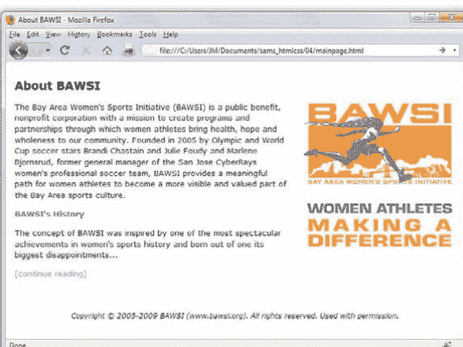

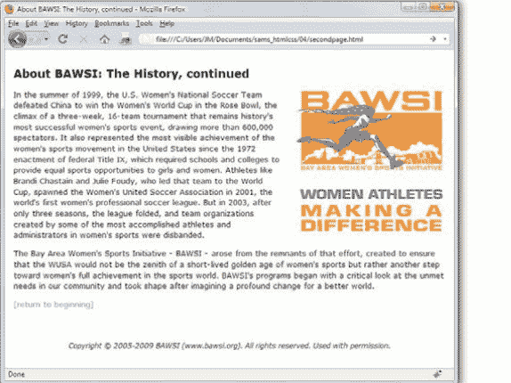

图 3.1 此页面使用样式表来微调文本和图像的外观及间距。

图 3.2 此页面使用与图 3.1 所示相同的样式表，从而保持一致的外观和感觉。

清单 3.1 显示了指定这些属性的样式表代码。

#### 清单 3.1 一个外部样式表

```css
body {
    font-size: 10pt;
    font-family: Verdana, Geneva, Arial, Helvetica, sans-serif;
    color: black;
    line-height: 14pt;
    padding-left: 5pt;
    padding-right: 5pt;
    padding-top: 5pt;
}

h1 {
    font: 14pt Verdana, Geneva, Arial, Helvetica, sans-serif;
    font-weight: bold;
    line-height: 20pt;
}

p.subheader {
    font-weight: bold;
    color: #593d87;
}

img {
    padding: 3pt;
    float: right;
}

a {
    text-decoration: none;
}

a:link, a:visited {
    color: #8094d6;
}

a:hover, a:active {
    color: #FF9933;
}

div.footer {
    font-size: 9pt;
    font-style: italic;
    line-height: 12pt;
    text-align: center;
    padding-top: 30pt;
}
```

这最初可能看起来代码很多，但如果你仔细看，会发现每行代码的信息并不多。将各个样式规则放在单独一行以使样式表更具可读性是很常见的做法，但这只是个人偏好；只要你继续使用分号来分隔每个规则，就可以将所有规则放在一行上（稍后会详细讨论）。说到代码可读性，也许你首先注意到的是这个样式表代码看起来一点也不像正常的 HTML 代码。CSS 使用其自己的语言来指定样式表。

当然，该清单包括一些熟悉的 HTML 标签。你可能猜到了，样式表中的 `body`、`h1`、`p`、`img`、`a` 和 `div` 指的是样式表将应用于的 HTML 文档中对应的标签。

每个标签名称后的花括号包含该标签内所有内容应如何显示的规范。

在本例中，样式表规定所有 `body` 文本应以 10 点大小、Verdana 字体（如果可能）、黑色显示，且行间距为 14 点。如果用户没有安装 Verdana 字体，样式表中的字体列表表示浏览器应按顺序查找要使用的字体：Geneva，然后是 Arial，然后是 Helvetica。如果用户没有这些字体中的任何一种，浏览器将使用任何可用的默认无衬线字体。此外，页面应有 5 点的左边距、右边距和上边距。

任何在 `<h1>` 标签内的文本应以 14 点粗体 Verdana 字体显示。继续，任何仅使用 `<p>` 标签的段落将继承 `body` 元素指示的所有样式。但是，如果 `<p>` 标签使用名为 `subheader` 的特殊类，文本将显示为粗体，颜色为 `#593d87`（一种紫色）。

**注意** 清单 3.1 中每个测量值后的 `pt` 表示磅（一英寸有 72 磅）。如果你愿意，你可以在样式表中将任何测量值指定为英寸（in）、厘米（cm）、像素（px）或字母 m 的宽度，称为 em（em），尽管某些显示设备和打印机无法正确处理大于 200 磅的字体。

你可能已经注意到，清单中的每个样式规则都以分号（`;`）结尾。分号用于分隔彼此的样式规则。因此，每个样式规则以分号结尾是惯例，这样你就可以轻松地在它后面添加另一个样式规则。要将此样式表链接到 HTML 文档，请在每个文档的 `<head>` 部分包含一个 `<link />` 标签。清单 3.2 显示了图 3.1 所示页面的 HTML 代码。它包含以下 `<link />` 标签：

```html
<link rel="stylesheet" type="text/css" href="styles.css" />
```

这假设样式表存储在与 HTML 文档同一文件夹中，文件名为 `styles.css`。只要网络浏览器支持样式表——所有现代浏览器都支持样式表——样式表中指定的属性将应用于页面中的内容，而无需任何特殊的 HTML 格式化代码。这证实了 XHTML 的最终目标，即提供网页内容与显示该内容所需的具体格式之间的分离。

#### 清单 3.2 图 3.1 所示页面的 HTML 代码

```xml
<?xml version="1.0" encoding="UTF-8"?>
<!DOCTYPE html PUBLIC "-//W3C//DTD XHTML 1.1//EN"
"http://www.w3.org/TR/xhtml11/DTD/xhtml11.dtd">
<html xmlns="http://www.w3.org/1999/xhtml" xml:lang="en">
<head>
<title>About BAWSI</title>
<link rel="stylesheet" type="text/css" href="styles.css" />
```

**提示** 在大多数网络浏览器中，你可以通过打开 `.css` 文件并选择记事本或其他文本编辑器作为辅助应用程序来查看文件，从而查看样式表中的样式规则。（要确定 `.css` 文件的名称）


## 52 第三章 理解层叠样式表

湾区女性体育倡议组织（BAWSI）是一家公益性质的非营利性机构，其使命是通过创建项目和建立合作伙伴关系，让女性运动员为社区带来健康、希望和完整的生活。该组织由奥运及女足世界杯明星球员布兰迪·查斯坦和朱莉·福迪，以及圣何塞闪电女足职业队前总经理马琳·比约恩鲁德于2005年共同创立，为女性运动员提供了一条有意义的路径，使她们成为湾区体育文化中更受瞩目且更有价值的一部分。

## BAWSI的历史

BAWSI的构想灵感源于女子体育史上最辉煌的成就之一，同时也诞生于其最大的失望之一……

代码清单3.2中的代码很有趣，因为它不包含任何形式的格式化。换句话说，HTML代码中没有任何指示文本和图像应如何显示的元素——没有颜色，没有字体，什么都没有。然而，多亏了外部样式表 `styles.css` 的链接，页面被精心格式化并渲染到屏幕上。这种方法的真正好处在于，你可以轻松创建一个拥有多页面且保持一致外观和感觉的网站。而且，你可以将页面的视觉样式隔离到单个文档（样式表）中，这样一处更改就能影响所有页面。

从头开始，创建一个名为 `mystyles.css` 的新文本文件，并为以下基本HTML标签添加一些样式规则：`<body>`、`<p>`、`<h1>` 和 `<h2>`。创建好样式表后，创建一个包含这些基本标签的新HTML文件。尝试不同的样式规则，亲眼看看只需在样式表文件中进行一处简单更改，就能轻松改变段落中整块文本的效果有多简单。

### CSS样式入门

你现在对CSS样式表有了基本的了解，知道了它们基于描述网页中信息外观的样式规则。本章接下来的几节将快速概述一些最重要的样式属性，让你开始在自己的样式表中使用CSS。

CSS包含各种用于控制字体、颜色、对齐和边距等的样式属性。CSS中的样式属性通常可以分为两大类：

-   布局属性——包括影响网页上元素定位的属性，如边距、内边距、对齐等等。
-   格式化属性——包括影响网站内元素视觉显示的属性，如字体类型、大小、颜色等等。

#### 布局属性

CSS布局属性用于确定内容在网页上的放置方式。最重要的布局属性之一是 `display` 属性，它描述了元素相对于其他元素的显示方式。`display` 属性有四种可能的值：

-   block——元素在新行上显示，如新段落。
-   list-item——元素在新行上显示，旁边带有列表项标记（项目符号）。
-   inline——元素与当前段落内联显示。
-   none——元素不显示；它被隐藏了。

如果将网页上的每个元素在显示时想象成占据一个矩形区域，会更容易理解 `display` 属性——`display` 属性控制的就是这个矩形区域的显示方式。例如，`block` 值导致元素自身独占一行，而 `inline` 值则将元素放置在其紧前内容旁边。`display` 属性是少数几个可以在大多数样式规则中应用的样式属性之一。以下是设置 `display` 属性的示例：

```
display:block;
```

注意：`display` 属性依赖于一个称为相对定位的概念，这意味着元素的位置是相对于页面上其他元素的位置确定的。CSS还支持绝对定位，它使你能够将元素放置在页面上的精确位置，而不依赖于其他元素。你将在第三部分“CSS高级网页设计”中了解更多关于这两种定位类型的知识。

你可以使用 `width` 和 `height` 属性来控制元素的矩形区域大小。与许多与尺寸相关的CSS属性一样，`width` 和 `height` 属性值可以使用几种不同的计量单位来指定：

-   in——英寸
-   cm——厘米
-   mm——毫米
-   px——像素
-   pt——磅

你可以在样式表中任意混合搭配使用这些单位，但一般来说，最好在一组相似的样式属性中保持单位一致。例如，你可能希望字体属性使用磅，尺寸属性使用像素。以下是使用像素单位设置元素宽度的示例：

```
width: 200px;
```

#### 格式化属性

CSS格式化属性用于控制网页上内容的外观，而不是控制内容的物理定位。最流行的格式化属性之一是 `border` 属性，它用于在元素周围建立一个可见的边界（盒子或部分盒子）。以下边框属性提供了一种描述元素边框的方式：

-   border-width——边框边缘的宽度
-   border-color——边框边缘的颜色
-   border-style——边框边缘的样式
-   border-left——边框的左侧
-   border-right——边框的右侧
-   border-top——边框的顶部
-   border-bottom——边框的底部
-   border——所有边框边

`border-width` 属性用于建立边框边缘的宽度。它通常以像素为单位表示，如下代码所示：

```
border-width:5px;
```

毫不奇怪，`border-color` 和 `border-style` 属性用于设置边框的颜色和样式。以下是设置这两个属性的示例：

```
border-color:blue;
border-style:dotted;
```

`border-style` 属性可以设置为以下任一值：

-   solid——单线边框
-   double——双线边框
-   dashed——虚线边框
-   dotted——点线边框
-   groove——凹槽样式的边框
-   ridge——脊状样式的边框
-   inset——内嵌样式的边框
-   outset——外凸样式的边框
-   none——无边框

`border-style` 属性的默认值是 `none`，这就是为什么除非你将边框属性设置为不同的样式，否则元素没有边框。最常见的边框样式是 `solid` 和 `double`。当图像放置在 `<a>` 标签内以作为链接图像时，`border-style` 为 `none`。在这种情况下，默认会自动设置一个 `solid` 边框。这就是为什么你经常看到带有 `border-style:none` 样式的链接图像。

`border-left`、`border-right`、`border-top` 和 `border-bottom` 属性使你能够分别设置元素每一侧的边框。如果你希望边框在四侧都相同，可以单独使用 `border` 属性，它接受以下由空格分隔的样式：`border-width`、`border-style` 和 `border-color`。

以下是使用 `border` 属性设置一个由两条（双线）红色线组成、总宽度为10像素的边框的示例：

```
border: 10px double red;
```


元素的边框颜色通过 `border-color` 属性设置，而元素内部区域的颜色则使用 `color` 和 `background-color` 属性来设置。`color` 属性设置元素中文本（前景）的颜色，`background-color` 属性设置文本背后背景的颜色。以下是将两个颜色属性都设置为预定义颜色的示例：

```
color: black;
background-color: orange;
```

你也可以通过十六进制（详见第8章“处理颜色、图像和多媒体”）或RGB（红、绿、蓝）十进制值来指定自定义颜色，就像在HTML中一样：

```
background-color: #999999;
color: rgb(0,0,255);
```

你还可以轻松控制网页内容的对齐和缩进。这可以通过 `text-align` 和 `text-indent` 属性来实现，如下代码所示：

```
text-align: center;
text-indent: 12px;
```

在元素正确对齐和缩进后，你可能想设置它的字体。以下字体属性用于设置与字体相关的各种参数：

- `font-family` —— 字体系列
- `font-size` —— 字体大小
- `font-style` —— 字体样式（正常或斜体）
- `font-weight` —— 字体粗细（细体、中等、粗体等）

`font-family` 属性指定一个按优先级排序的字体系列名称列表。使用优先级列表而不是单个值，是为了在给定系统上没有某种字体时提供备选方案。`font-size` 属性使用度量单位（通常是点）来指定字体的大小。最后，`font-style` 属性设置字体的样式，`font-weight` 属性设置字体的粗细。以下是设置这些字体属性的示例：

```
font-family: Arial, sans-serif;
font-size: 36pt;
font-style: italic;
font-weight: medium;
```

现在你已经对样式属性及其工作方式有了更深入的了解，请回顾一下清单3.1，看看它是否更有意义了。以下是该样式表中使用的样式属性的回顾，你可以将其作为理解其工作原理的指南：

- `font` —— 允许你一次设置多个字体属性。你可以指定一个以逗号分隔的字体名称列表；如果第一个不可用，就会尝试下一个，依此类推。你也可以包含 `bold` 和/或 `italic` 以及一个字体大小。如果你愿意，每个字体属性都可以分别用 `font-family`、`font-size`、`font-weight` 和 `font-style` 来指定。
- `line-height` —— 在出版界也称为行距。它设置每行文本的高度，通常以点为单位。
- `color` —— 使用标准颜色名称或十六进制颜色代码设置文本颜色（更多详情请参见第8章）。
- `text-decoration` —— 对于关闭链接下划线很有用——只需将其设置为 `none`。也支持 `underline`、`italic` 和 `line-through` 值。样式在链接上的应用在第7章“使用外部和内部链接”中有更详细的介绍。
- `text-align` —— 将文本对齐到 `left`、`right` 或 `center`，以及使用 `justify` 值两端对齐文本。
- `padding` —— 为元素的左、右、上、下添加内边距；这个内边距可以是度量单位或页面宽度的百分比。如果你想独立地为元素的左右添加内边距，请使用 `padding-left` 和 `padding-right`。使用 `padding-top` 或 `padding-bottom` 分别为元素的顶部或底部添加内边距。你将在第9章“处理外边距、内边距、对齐和浮动”和第10章“理解CSS盒模型和定位”中了解更多关于这些样式属性的知识。

#### 使用样式类

这是一本“自学”书，所以你不必去上任何课程来学习如何让页面样式出色，尽管你确实需要了解什么是样式类。当你希望页面上的某些文本看起来与其他文本不同时，你可以创建一个相当于自定义的HTML标签。你定义的每种特殊格式的文本类型称为一个样式类。样式类是一组自定义的格式规范，可以应用于网页中的任何元素。

在向你展示样式类之前，我需要快速回退一步，澄清一些CSS术语。首先，CSS样式属性是一个可以被赋予值的具体样式，比如 `color` 或 `font-size`。你通过使用选择器将样式属性及其相应的值与网页上的元素关联起来。选择器用于识别页面上你应用样式的标签。以下是一个基本样式规则中包含选择器、属性和值的示例：

```
h1 { font: 36pt Courier; }
```

在此代码中，`h1` 是选择器，`font` 是样式属性，`36pt Courier` 是值。选择器很重要，因为它意味着字体设置将应用于网页中所有的 `h1` 元素。但也许你想区分一些 `h1` 元素——那该怎么办？答案就在于样式类。

假设你想在文档中使用两种不同类型的 `<h1>` 标题。你可以通过将以下CSS代码放入样式表来为每个标题创建一个样式类：

```
h1.silly { font: 36pt Comic Sans; }
h1.serious { font: 36pt Arial; }
```

注意这些选择器在 `h1` 后面包含一个句点（`.`），然后是描述性的类名。要在这两个样式类之间进行选择，请使用 `class` 属性，如下所示：

```
<h1 class="silly">Marvin's Munchies Inc.</h1>
<p>Text about Marvin's Munchies goes here.</p>
```

或者你可以使用这个：

```
<h1 class="serious">MMI Investor Information</h1>
<p>Text for business investors goes here.</p>
```

当在HTML代码中引用样式类时，只需在元素的 `class` 属性中指定类名。在前面的示例中，假设你在网页顶部包含了指向样式表的 `<link />`，并且假设用户安装了Comic Sans字体，那么单词 `Marvin's Munchies Inc.` 将以36磅的Comic Sans字体显示。而单词 `MMI Investor Information` 将以36磅的Arial字体显示。你可以在清单3.2中看到类在实际应用中的另一个示例；留意 `subheader` `<p>` 类和 `footer` `<div>` 类。如果你想创建一个可以应用于任何元素而不仅仅是标题或其他特定标签的样式类，该怎么办？你可以将样式类与 `<div>` 标签关联，如清单3.2所示，该标签用于将任何文本包含在一个类似于段落文本的块中；`<div>` 标签是另一个有用的容器元素。你本质上可以使用 `div` 选择器后跟一个句点（`.`），再跟上你创建的任何样式类名和任何你选择的样式规范来创建自己的自定义HTML标签。该标签可以一次控制任意数量的字体、间距和边距设置。在页面中，无论你想在何处应用自定义标签，请使用带有 `class` 属性的 `<div>` 标签，后跟你创建的类名。

你可能已经注意到，当样式规则中包含多个属性时，编码风格发生了变化。例如，清单3.1中的样式表包含以下样式类：

对于包含单个规范的样式规则：

```
div.footer { font-size: 9pt; }
```

你通常会看到属性与规则放在同一行，像这样：

```
div.footer {
  font-size: 9pt;
  font-style: italic;
  line-height: 12pt;
  text-align: center;
  padding-top: 30pt;
}
```

然而，当样式规则包含多个样式属性时，如果将属性列在不同的行上，代码会更容易阅读和理解。此样式类在清单3.2中通过以下标签应用：

每行一个属性，就像这样：<div class="footer">

```css
div.footer {
  font-size: 9pt;
  font-style: italic;
  line-height: 12pt;
  text-align: center;
  padding-top: 30pt;
}
```

在清单3.2中，该标签与闭合`</div>`标签之间的所有内容将以9点字体、居中、斜体文本显示，垂直行距为12点，元素顶部有30点内边距。

样式类之所以如此有价值，是因为它们能将样式代码与网页隔离，有效地让你可以专注于HTML代码中的页面实际内容，而非其在屏幕上的呈现方式。然后，你可以通过微调样式表来专注于内容如何渲染到屏幕上。你可能会惊讶于样式表中相对少量的代码如何能对整个网站产生显著效果。这使得你的页面更易于维护和操作。

#### 使用样式ID

当你创建自定义样式类时，可以根据需要多次使用这些类——它们不是唯一的。然而，在某些情况下，你希望对唯一的元素进行精确控制以用于布局或格式化（或两者兼有）。在这种情况下，请考虑使用ID而非类。

样式ID是一组自定义的格式规范，只能应用于网页中的一个元素。你可以在一组页面中使用ID，但在每个页面内只能使用一次。

例如，假设你在所有页面的正文中都有一个标题。每个页面只有一个标题，但所有页面本身都包含该标题的一个实例。下面是一个带有ID指示符的选择器示例，以及一个属性和一个值：

```css
p#title {font: 24pt Verdana, Geneva, Arial, sans-serif}
```

请注意，此选择器在`p`后包含一个井号（或磅符号`#`），后跟一个描述性的ID名称。在HTML代码中引用样式ID时，只需在元素的`id`属性中指定ID名称，如下所示：

```html
<p id="title">Some Title Goes Here</p>
```

开闭`<p>`标签之间的所有内容将以24点Verdana字体显示——但在任何给定页面上仅出现一次。你经常会看到样式ID用于定义页面的特定部分以用于布局目的，例如页眉区域、页脚区域、正文区域等。页面中的这些类型区域每页只会出现一次，因此使用ID而非类是合适的选择。

### 内部样式表和内联样式

在某些情况下，你可能希望指定仅用于一个网页的样式，此时你可以将样式表包含在`<style>`和`</style>`标签之间，并直接将其包含在HTML文档中。以这种方式使用的样式表必须出现在HTML文档的`<head>`中。不需要`<link />`标签，你也不能从任何其他页面引用该样式表（除非你也将其复制到该文档的开头）。这种样式表被称为内部样式表，正如你在本章前面学到的那样。

#### 清单3.3 一个带有内部样式表的网页

```xml
<?xml version="1.0" encoding="UTF-8"?>
<!DOCTYPE html PUBLIC "-//W3C//DTD XHTML 1.1//EN"
"http://www.w3.org/TR/xhtml11/DTD/xhtml11.dtd">
<html xmlns="http://www.w3.org/1999/xhtml" xml:lang="en">
<head>
<title>Some Page</title>
<style type="text/css">
div.footer {
  font-size: 9pt;
  line-height: 12pt;
  text-align: center;
}
</style>
</head>
<body>
...
<div class="footer">
Copyright 2009 Acme Products, Inc.
</div>
</body>
</html>
```

**注意**
`<span>`和`</span>`是虚拟标签，它们本身什么都不做，只是指定要应用你添加的任何样式属性的内容范围。`<div>`和`<span>`之间唯一的区别是`<div>`是一个块级元素，因此会强制换行，而`<span>`则不会。

在清单代码中，`div.footer`样式类在页面头部的内部样式表中指定。该样式类现在可在本页面的正文中使用。事实上，它在页面正文中用于设置版权说明的样式。

如果你想创建在单个页面中多次使用的样式规则，内部样式表很方便。但是，在某些情况下，你可能需要将唯一的样式应用于特定元素。这需要内联样式规则，它允许你仅为页面的一小部分（例如单个元素）指定样式。因此，你应该使用`<span>`来修改要在句子或段落中间出现的任何文本部分的样式，而不会产生任何换行。

例如，你可以通过`style`属性在`<p>`、`<div>`或`<span>`标签内创建并应用样式规则。这种类型的样式被称为内联样式，因为它直接在HTML代码中间指定。

### 验证你的样式表

就像验证你的HTML或XHTML标记很重要一样，验证你的样式表也很重要。可以在 http://jigsaw.w3.org/css-validator/ 找到专门用于CSS的验证工具。就像第2章“理解HTML和XHTML连接”中讨论的验证工具一样，你可以将工具指向一个网址、上传文件或将内容粘贴到提供的表单字段中。最终目标是得到如图3.3所示的结果：有效！

下面是一个示例`style`属性可能的样子：

```html
<p style="color:green">
This text is green, but <span style="color:red">this text is red.</span>
Back to green again, but…
</p>
<p>
…now the green is over, and we’re back to the default color for this page.
</p>
```

此代码使用`<span>`标签来展示如何在内联样式规则中应用`color`样式属性。事实上，此示例中的`<p>`标签和`<span>`标签都使用`color`属性作为内联样式。

需要理解的重要一点是，`color:red`样式属性会覆盖`<span>`和`</span>`标签之间出现的文本的`color:green`样式属性。然后在第二个段落中，两种颜色样式都不适用，因为它是一个全新的段落，遵循整个页面的默认颜色。

**图3.3**
W3C CSS验证器显示清单3.1的样式表内容中没有错误。

## 总结

在本章中，你学习了样式表可以同时控制许多HTML页面的外观。它还可以让你对HTML元素的排版、间距和定位进行极其精确的控制。你还发现，通过向几乎任何HTML标签添加`style`属性，你可以在不引用单独样式表文档的情况下控制HTML页面的任何部分的样式。

你了解了将样式表包含在网站中的三种主要方法：一个扩展名为`.css`的单独样式表文件，它链接在文档的`<head>`中；一组放置在文档头部`<style>`标签内的样式规则；以及直接通过`style`属性放置在HTML标签中的规则。

表3.1总结了本章讨论的标签。有关可以在`<style>`标签或`style`属性之后包含哪些选项的详细信息，请参阅 http://www.w3c.org 上的CSS 2样式表标准。

**表3.1 第3章涵盖的HTML标签和属性**

| 标签/属性 | 功能 |
| :--- | :--- |
| `<style>…</style>` | 允许在文档中包含一个内部样式表。在`<head>`和`</head>`之间使用。 |
| **属性** | |
| `type="contenttype"` | 互联网内容类型。（对于CSS样式表，始终为"text/css"。） |
| `<link />` | 链接到外部样式表（或其他文档类型）。在文档的`<head>`部分使用。 |
| **属性** | |
| `href="url"` | 样式表的地址。 |
| `type="contenttype"` | 互联网内容类型。（对于CSS样式表，始终为"text/css"。） |
| `rel="stylesheet"` | 链接类型。（对于样式表，始终为"stylesheet"。） |
| `<span>…</span>` | 除了提供放置样式或其他属性的位置外，什么也不做。（类似于`<div>…</div>`，但不会导致换行。） |
| **属性** | |
| `style="style"` | 包含内联样式规范。（可以在`<span>`、`<div>`、`<body>`和大多数其他HTML标签中使用。） |


工作坊 63

## 问答

问：假设我为我的页面链接了一个样式表，该样式表规定所有文本应为蓝色，但页面某处有一个 `<span style="font-color:red">` 标签。那么这段文本将显示为蓝色还是红色？

答：红色。局部内联样式始终优先于外部样式表。你在页面顶部的 `<style>` 和 `</style>` 标签之间设置的任何样式规范，也会优先于外部样式表（但不会优先于同一页面后面出现的内联样式）。这就是我之前在本章中提到的样式表的层叠效果。你可以将层叠样式效果理解为从外部样式表开始，然后被内部样式表覆盖，再被内联样式覆盖。

问：我可以为一个页面链接多个样式表吗？

答：当然可以。例如，你可能有一个用于格式化（文本、字体、颜色等）的样式表，和另一个用于布局（边距、内边距、对齐等）的样式表——只需为两者都包含一个 `<link />` 即可。从技术上讲，CSS 标准要求网页浏览器在通过多个 `<link />` 标签呈现多个样式表时，为用户提供选择样式的选项。然而，在实践中，所有主流浏览器只是简单地包含每个样式表。链接多样式表的首选技术涉及使用特殊的 `@import` 命令。以下是使用 `@import` 导入多个样式表的示例：

```
@import url(styles1.css);
@import url(styles2.css);
```

类似于 `<link />` 标签，`@import` 命令必须放在网页的头部。你将在第 25 章“创建适合打印的网页”中了解到更多关于这个便捷小命令的信息，届时你将学习如何创建专门用于打印网页的样式表。

## 工作坊

本工作坊包含测验题和练习，旨在帮助你巩固对所涵盖内容的理解。请在查看后面的“答案”部分之前，尝试回答所有问题。

## 测验

1. 你会使用什么代码来创建一个样式表，指定 30 点蓝色 Arial 字体的标题，以及所有其他文本为双倍行距、10 点蓝色 Times Roman 字体（或浏览器默认字体）？

2. 如果你将为问题 1 创建的样式表保存为 corporate.css，你将如何将其应用于名为 intro.html 的网页？

3. 确保样式规则可以应用于你的内容有多少种不同的方式？

## 答案

1. 你的样式表将包含以下内容：

```
h1 { font: 30pt blue Arial; }
body { font: 10pt blue; }
```

2. 在 intro.html 文档的 `<head>` 和 `</head>` 标签之间放入以下标签：

```
<link rel="stylesheet" type="text/css" href="corporate.css" />
```

3. 三种：外部、内部和内联。

## 练习

- 使用你在本章前面创建的样式表，向你的样式表添加一些样式类。要查看你的成果，请将这些类也应用到你创建的 HTML 页面上。在 `<h1>` 和 `<p>` 标签上使用类，以感受一下效果。
- 为你的网站开发一个标准样式表，并将其链接到所有页面。（对于需要偏离标准的页面，使用内部样式表和/或内联样式。）如果你在一家公司工作，很可能它已经为印刷材料制定了字体和样式规范。获取这些规范的副本，并在公司网页上也遵循它们。
- 请务必探索 http://www.w3.org/Style/CSS/ 上的官方样式表规范，并尝试一些本章未涉及的更专业的样式属性。

# 第 4 章

万维网（WWW）最初是一个纯文本媒介——第一批浏览器甚至不支持网页中的图像。自那些早期以来，网络已经走了很长一段路，因为今天的网站除了有用的内容外，还包含了丰富的视觉和交互功能：图形、声音、动画和视频。Web 脚本语言，如 JavaScript，是为网页增添趣味和与用户进行新方式互动的最简单方法之一。

本章的第一部分介绍了 Web 脚本和 JavaScript 语言的概念。随着本章的深入，你将学习如何将 JavaScript 命令直接包含在你的 HTML 文档中，以及当页面在浏览器中查看时你的脚本将如何被执行。你将使用一个简单的脚本，编辑它，并在你的浏览器中测试它，同时学习创建和使用 JavaScript 脚本所涉及的基本任务。

### 学习 Web 脚本基础

在科幻电影（以及许多没有借口的其他电影）的世界里，计算机常常被看到服从英语命令。尽管这在不久的将来可能确实会发生，但计算机目前发现更容易理解 BASIC、C 和 Java 等语言。

你已经知道如何使用一种类型的计算机语言：HTML。你使用 HTML 标签来描述你希望文档如何格式化，浏览器服从你的命令并向用户显示格式化后的文档。但由于 HTML 是一种简单的文本标记语言，它无法响应用户、做出决策或自动化重复性任务。诸如这些交互式任务需要更复杂的语言：编程语言或脚本语言。

### 理解 JavaScript

尽管许多编程语言很复杂，但脚本语言通常很简单。它们具有简单的语法，可以用最少的命令执行任务，并且易于学习。Web 脚本语言使你能够将脚本与 HTML 结合起来创建交互式网页。

#### 脚本和程序

> 注意 一部电影或戏剧遵循脚本——供演员表演的一系列动作（或台词）。网页脚本为网络浏览器提供相同类型的指令。JavaScript 中的脚本可以是从单行代码到完整的应用程序。（无论哪种情况，JavaScript 脚本通常都在浏览器内运行。）

JavaScript 是一种脚本语言还是一种编程语言？这取决于你问谁。我们将在本书中通篇使用“脚本”，但当你读完本书后，可以随意在简历中包含“JavaScript 编程”。

一些编程语言必须被编译或转换成机器代码才能执行。另一方面，JavaScript 是一种解释型语言：浏览器在遇到每一行脚本时都会执行它。

解释型语言有一个主要优势：编写或修改脚本非常简单。修改 JavaScript 脚本就像修改典型的 HTML 文档一样容易，并且更改在你在浏览器中重新加载文档后立即生效。

> 注意 解释型语言也有它们的缺点——它们无法快速执行，因此不太适合复杂的工作，例如图形处理。此外，它们需要解释器（在 JavaScript 的情况下，通常是浏览器）才能工作。

#### JavaScript 简介

JavaScript 由网景通信公司开发，该公司是网景网页浏览器的制造商。JavaScript 是第一种被浏览器支持的网页脚本语言，并且至今仍是最受欢迎的。JavaScript 几乎和 HTML 一样容易学习，并且可以直接包含在 HTML 文档中。以下是你可以用 JavaScript 做的一些事情：

> 注意 一点历史：JavaScript 最初被称为 LiveScript，并且


#### JavaScript 如何融入网页

通过 `<script>` 标签，你可以向网页文档中添加简短的脚本（本例中仅一行代码），如代码清单4.1所示。`<script>` 标签告知浏览器开始将文本视为脚本处理，而结束标签 `</script>` 则指示浏览器返回HTML模式。通常情况下，除了在 `<script>` 标签内，你无法在HTML文档中使用JavaScript语句。事件处理器是例外情况，本章稍后将进行说明。

##### 代码清单 4.1 包含简单脚本的HTML文档

```xml
<?xml version="1.0" encoding="UTF-8"?>
<!DOCTYPE html PUBLIC "-//W3C//DTD XHTML 1.1//EN"
"http://www.w3.org/TR/xhtml11/DTD/xhtml11.dtd">
<html xmlns="http://www.w3.org/1999/xhtml" xml:lang="en">
<head>
<title>The American Eggplant Society</title>
</head>
<body>
<h1>The American Eggplant Society</h1>
<p>Welcome to our site. Unfortunately, it is still
under construction.</p>
<p>We last worked on it on this date:
<script type="text/javascript">
<!-- Hide the script from old browsers
document.write(document.lastModified);
// Stop hiding the script -->
</script>
</p>
</body>
</html>
```

你稍后将更详细学习的JavaScript `document.write` 语句，会将输出作为网页文档的一部分发送。在本例中，它显示了文档的修改日期，如图4.1所示。

**图 4.1**

使用 document.write 显示最后修改日期。

本例中，我们将脚本放在了HTML文档的主体部分。实际上，你可能在以下四个不同位置使用脚本：

-   在页面主体中——在此情况下，当浏览器加载页面时，脚本的输出会作为HTML文档的一部分显示。
-   在页面头部 `<head>` 标签之间——头部中的脚本无法在HTML文档内创建输出，但可以被其他脚本引用。头部通常用于存放函数——即可以作为单一单元使用的JavaScript语句组。你将在第14章“JavaScript编程入门”中更深入地了解函数。
-   在HTML标签内，如 `<body>` 或 `<form>`——这被称为事件处理器，使脚本能够与HTML元素协作。在事件处理器中使用JavaScript时，无需使用 `<script>` 标签。你将在第14章中了解更多关于事件处理器的知识。
-   在一个完全独立的文件中——JavaScript支持使用扩展名为 `.js` 的文件存放脚本；通过在 `<script>` 标签中指定文件路径即可包含它们。

#### 使用独立的JavaScript文件

当你创建更复杂的脚本时，会很快发现HTML文档变得庞大且难以理解。为避免这种情况，你可以使用一个或多个外部JavaScript文件。这些是包含JavaScript语句的扩展名为 `.js` 的文件。

所有现代浏览器都支持外部脚本。要使用外部脚本，你只需在 `<script>` 标签中指定其文件名：

```html
<script type="text/javascript" src="filename.js"></script>
```

由于JavaScript语句被放置在单独的文件中，你无需在开始和结束 `<script>` 标签之间添加任何内容——事实上，浏览器会忽略它们之间的任何内容。你可以使用文本编辑器创建 `.js` 文件。它应包含一个或多个JavaScript命令，并且只能包含JavaScript——不要包含 `<script>` 标签、其他HTML标签或HTML注释。将 `.js` 文件保存在与HTML文件相同的目录中。

**提示** 外部JavaScript文件有一个显著优势：你可以从两个或多个HTML文档链接到同一个 `.js` 文件。由于浏览器会将此文件存储在其缓存中，这可以加快页面加载速度并减少网页显示所需的时间。

#### 理解JavaScript事件

使用JavaScript所能做的许多有用的事情都涉及与用户的交互，这意味着要对事件做出响应——例如，点击链接或按钮。你可以在HTML标签内定义事件处理器，以告知浏览器如何响应事件。例如，代码清单4.2定义了一个按钮，点击时会显示一条消息。

##### 代码清单 4.2 一个简单的事件处理器

```xml
<?xml version="1.0" encoding="UTF-8"?>
<!DOCTYPE html PUBLIC "-//W3C//DTD XHTML 1.1//EN"
"http://www.w3.org/TR/xhtml11/DTD/xhtml11.dtd">
<html xmlns="http://www.w3.org/1999/xhtml" xml:lang="en">
<head>
<title>Event Test</title>
</head>
<body>
<h1>Event Test</h1>
<button type="button"
onclick="alert('You clicked the button.')">
Click Me!</button>
</body>
</html>
```

在本书的多个地方，你将更深入了解JavaScript的事件模型以及如何创建简单和复杂的事件处理器。

#### 探索JavaScript的功能

如果你曾花时间浏览过网页，无疑会看到许多JavaScript实际应用的例子。以下是对JavaScript典型应用的一些简要描述，所有这些都将在本书后续内容中进一步探讨。

##### 改进导航

JavaScript最常见的一些用途是用于网站的导航系统。你可以使用JavaScript创建导航工具——例如，一个用于选择下一个要阅读页面的下拉菜单，或者一个在鼠标悬停于导航链接上时弹出的子菜单。

如果设计得当，这种JavaScript交互性可以使网站更易于使用，同时保持对不支持JavaScript的浏览器的可用性。

### 验证表单

表单验证是JavaScript的另一个常见用途。一个简单的脚本可以读取用户在表单中输入的值，并确保它们格式正确，例如邮政编码或电话号码。这使用户能够注意到常见错误并加以修正，而无需等待网络服务器的响应。你将在第26章“使用基于Web的表单”中学习如何处理表单数据。

##### 特殊效果

JavaScript最早也最令人烦恼的用途之一是创建引人注目的特殊效果——例如，在浏览器的状态栏滚动消息或使页面背景颜色闪烁。幸运的是，这些技术已经过时，但得益于W3C DOM和最新的浏览器，JavaScript可以实现一些更令人印象深刻的效果——例如，创建可在页面上拖放的对象，或在幻灯片放映中创建图像之间的淡入淡出过渡效果。

##### 远程脚本 (AJAX)

很长一段时间以来，JavaScript最大的限制是无法与网络服务器进行通信。例如，你可以用它来验证电话号码的位数是否正确，但无法根据号码在数据库中查询用户的位置。

现在，大多数浏览器都支持JavaScript的一些高级功能，情况已非如此。你的脚本可以从服务器获取数据而无需加载页面，或者将数据发送回服务器进行保存。这些功能统称为AJAX（异步JavaScript和XML），或远程脚本。你将在第24章“AJAX：远程脚本”中学习如何开发AJAX脚本。

如果你使用过Google的Gmail邮件应用程序，或Yahoo! Mail、Microsoft Hotmail的最新版本，那么你已经见证了AJAX的实际应用。所有这些都使用远程脚本技术，为你提供一个响应迅速的用户界面，并在后台与服务器协作。

##### 使用JavaScript显示时间

JavaScript一个常见且易于使用的功能是显示日期和时间。**注意** 由于JavaScript在浏览器中运行，它显示的时间将是用户所在的本地时区时间。

JavaScript于1995年首次推出，最初名为LiveScript，但很快被重命名为JavaScript，以表明其与Sun公司Java语言的市场营销关系——尽管Java和JavaScript在结构或其他方面没有任何其他关系。

今天，所有现代浏览器都支持JavaScript。你可以使用JavaScript来：

-   验证表单内容并进行计算（例如，订单表单可以在你输入商品数量时自动显示累计总额）
-   动画图像或创建当鼠标移过时发生变化的图像
-   创建与用户交互的广告横幅，而不仅仅是显示图形
-   检测正在使用的浏览器或其功能，并仅在支持这些功能的浏览器上执行高级功能
-   检测已安装的插件，并在需要插件时通知用户
-   无需用户重新加载即可修改网页的全部或部分内容
-   显示或与从远程服务器检索到的数据进行交互

使用JavaScript，你可以完成以上所有事情以及更多，包括创建完整的应用程序。我们将在本书中探讨JavaScript的各种用途。

JavaScript是一种轻量级的、解释执行的编程语言，具有一等函数支持。虽然它最著名的是作为网页的脚本语言，但它在许多非浏览器环境中也有使用。它是一种动态的、弱类型的、基于原型的、多范式的语言。


用于世界时

用户当前的时区。不过，你也可以使用JavaScript来计算
协调世界时，它是一种基于旧的
“世界”（UTC）时间的原子时间标准。

格林威治标准时间（GMT）
作为JavaScript的基础介绍，你现在将创建一个简单的脚本标准。
这是位于
本初子午线的时间，该线穿过
格林威治，伦敦，
英格兰。

#### 开始编写脚本

**注意**
你的脚本与大多数JavaScript程序一样，以HTML的
`<script>`标签开始。正如你之前在本章学到的，你使用`<script>`
和`</script>`标签将脚本包裹在HTML文档中。
开始创建脚本时，打开你最喜欢的文本编辑器，并输入
如图所示的开始和结束`<script>`标签。

```html
<script type="text/javascript"></script>
```
请确保在起始和结束`<script>`标签之间仅包含有效的
JavaScript语句。如果浏览器在`<script>`标签内发现非有效的
JavaScript语句，它将显示一条JavaScript错误消息。

##### 添加JavaScript语句

你的脚本现在需要确定本地时间和UTC时间，然后将它们显示给浏览器。幸运的是，所有复杂的部分，如在日期格式之间转换，都已内置于JavaScript解释器中。

##### 将数据存储在变量中

要开始编写脚本，你将使用一个变量来存储当前日期。你将在第16章“使用JavaScript变量、字符串和数组”中了解更多关于变量的知识。变量是一个可以容纳值的容器——一个数字、一段文本，或者在这种情况下，一个日期。

要开始编写脚本，请在第一个`<script>`标签后添加以下行。在你的版本中，请务必使用相同的大小写组合，因为JavaScript命令和变量名区分大小写。

```
now = new Date();
```
> **注意** 此语句创建一个名为`now`的变量，并将当前日期和时间存储在其中。此语句和你将在本脚本中使用的其他语句都使用JavaScript内置的`Date`对象，该对象使你能够方便地处理日期和时间。你将在第17章“使用JavaScript函数和对象”中了解更多关于处理日期的知识。

请注意上一条语句末尾的分号。它告诉浏览器已到达语句末尾。分号是可选的，但使用它们有助于避免一些常见错误。为了清晰起见，我们将在本书中始终使用它们。

##### 计算结果

在内部，JavaScript将日期存储为自1970年1月1日以来的毫秒数。幸运的是，JavaScript包含许多函数，可以以各种方式转换日期和时间，因此你不必费心去弄清楚如何将毫秒转换为日、日期和时间。

要继续编写脚本，请在最后一个`</script>`标签前添加以下两条语句：

```
localtime = now.toString();
utctime = now.toGMTString();
```
这些语句创建了两个新变量：`localtime`，包含以易于阅读的格式显示的当前时间及日期；`utctime`，包含对应的UTC时间。

> **注意** `localtime`和`utctime`变量存储一段文本，例如“January 1, 2001 12:00 PM”。在编程术语中，一段文本被称为一个字符串。

##### 创建输出

你现在有了两个变量——`localtime`和`utctime`——它们包含了我们希望从脚本中获得的结果。当然，除非我们能看到它们，否则这些变量对我们没有太大用处。JavaScript包含多种显示信息的方式，其中最简单的方式之一是`document.write`语句。

`document.write`语句显示一个文本字符串、一个数字或你传递给它的任何其他内容。因为你的JavaScript程序将在网页中使用，输出将作为页面的一部分显示。要显示结果，请在最后一个`</script>`标签前添加这些语句：

```
document.write("<strong>Local time:</strong> " + localtime + "<br/>");
document.write("<strong>UTC time:</strong> " + utctime);
```
这些语句告诉浏览器向包含你脚本的网页中添加一些文本。输出将包括一些介绍结果的简短字符串，以及`localtime`和`utctime`变量的内容。

请注意引号内的HTML标签，如`<strong>`——因为JavaScript的输出出现在网页中，所以它需要使用HTML进行格式化。第一行中的`<br/>`标签确保两个时间将显示在不同的行上。

> **注意** 请注意代码清单4.3中用于连接文本和变量的加号（+）。在这种情况下，它告诉浏览器将这些值组合成一个文本字符串。如果你在两个数字之间使用加号，它们会被相加。

##### 将脚本添加到网页中

你现在应该有一个计算结果并显示它的完整脚本。你的代码应该与代码清单4.3匹配。

**代码清单4.3 完整的日期和时间脚本**

```html
<script type="text/javascript">
now = new Date();
localtime = now.toString();
utctime = now.toGMTString();
document.write("<strong>Local time:</strong> " + localtime + "<br/>");
document.write("<strong>UTC time:</strong> " + utctime);
</script>
```
要使用你的脚本，你需要将其添加到HTML文档中。如果你使用目前为止在各章中看到的通用模板，最终结果应该类似于代码清单4.4。

**代码清单4.4 包含日期和时间脚本的HTML文档**

> **注意** 记事本和其他Windows文本编辑器可能会自作主张，为你的脚本添加`.txt`扩展名。请确保保存的文件具有正确的扩展名。

```xml
<?xml version="1.0" encoding="UTF-8"?>
<!DOCTYPE html PUBLIC "-//W3C//DTD XHTML 1.1//EN"
"http://www.w3.org/TR/xhtml11/DTD/xhtml11.dtd">
<html xmlns="http://www.w3.org/1999/xhtml" xml:lang="en">
<head>
<title>显示时间和日期</title>
</head>
<body>
<h1>当前日期和时间</h1>
<script type="text/javascript">
now = new Date();
localtime = now.toString();
utctime = now.toGMTString();
document.write("<strong>Local time:</strong> " + localtime + "<br/>");
document.write("<strong>UTC time:</strong> " + utctime);
</script>
</body>
</html>
```
现在你有了一个完整的HTML文档，将其保存为`.htm`或`.html`扩展名。

##### 测试脚本

要测试你的脚本，你只需在Web浏览器中加载你创建的HTML文档。如果你正确输入了脚本，你的浏览器应该显示脚本的结果，如图4.2所示。（当然，你的结果不会和我的一样，但应该与你电脑时钟的设置一致。）

关于Internet Explorer 6.0及更高版本的说明：根据你的安全设置，脚本可能无法执行，并且浏览器顶部可能会出现一个黄色的高亮栏，显示安全警告。在这种情况下，点击黄色栏并选择“允许被阻止的内容”以允许你的脚本运行。（这是因为默认安全设置允许在线文档中的JavaScript，但不允许本地文件中的JavaScript。）

##### 修改脚本

尽管当前脚本确实显示了当前日期和时间，但其显示效果远不如你墙上的或桌上的时钟吸引人。为了改善这一点，你可以使用一些额外的JavaScript特性和一点HTML来显示一个大型时钟。

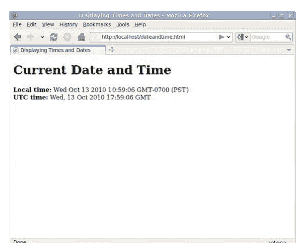

**图4.2** Firefox显示日期和时间脚本的结果。

要显示一个大型时钟，我们需要将小时、分钟和秒分别存储在单独的变量中。同样，JavaScript有内置函数可以完成大部分工作：

```
hours = now.getHours();
mins = now.getMinutes();
secs = now.getSeconds();
```
这些语句使用JavaScript的内置日期函数，将时间的各个组成部分加载到`hours`、`mins`和`secs`变量中。

一旦小时、分钟和秒被存储在单独的变量中，你就可以

创建 `document.write` 语句来显示它们：

```
document.write("<h1>");
document.write(hours + ":" + mins + ":" + secs);
document.write("</h1>");
```

第一条语句显示一个 HTML `<h1>` 标题标签，以大字体显示时钟。第二条语句显示 `hours`、`mins` 和 `secs` 变量，用冒号分隔。第三条语句添加闭合的 `</h1>` 标签。

你可以将上述语句添加到原始的日期和时间脚本中，以添加大型时钟显示。清单 4.5 展示了脚本完整的修改版本。

##### 清单 4.5 带大型时钟显示的日期和时间脚本

```
<?xml version="1.0" encoding="UTF-8"?>
<!DOCTYPE html PUBLIC "-//W3C//DTD XHTML 1.1//EN"
"http://www.w3.org/TR/xhtml11/DTD/xhtml11.dtd">
<html xmlns="http://www.w3.org/1999/xhtml" xml:lang="en">
<head>
<title>Displaying Times and Dates</title>
</head>
<body>
<h1>Current Date and Time</h1>
<script type="text/javascript">
now = new Date();
localtime = now.toString();
utctime = now.toGMTString();
document.write("<strong>Local time:</strong> "
+ localtime + "<br/>");
document.write("<strong>UTC time:</strong> " + utctime);
hours = now.getHours();
mins = now.getMinutes();
secs = now.getSeconds();
document.write("<h1>");
document.write(hours + ":" + mins + ":" + secs);
document.write("</h1>");
</script>
</body>
</html>
```

现在你已经修改了脚本，保存 HTML 文件并在浏览器中打开修改后的文件。如果你让浏览器一直运行，只需使用“刷新”按钮即可加载新版本的脚本。试一试，验证窗口上部和新的大时钟显示的时间是否相同。图 4.3 展示了结果。

#### 处理 JavaScript 错误

随着你开发更复杂的 JavaScript 应用程序，你会不时遇到错误。JavaScript 错误通常是由 JavaScript 语句输入错误引起的。

要查看 JavaScript 错误消息的示例，请修改你在上一节中添加的语句。我们将使用一个常见的错误：省略一个括号。将清单 4.5 中的最后一个 `document.write` 语句修改为：

```
document.write("</h1>");
```

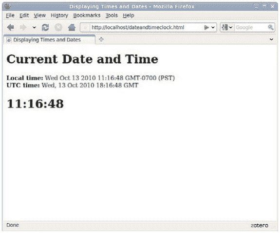

##### 测试脚本

图 4.3

Firefox 显示修改后的日期和时间脚本。

> **注意**
>
> 此脚本产生的时间格式并不完美；中午之后的小时采用 24 小时制，并且没有前导零，因此 12:04 显示为 12:4。有关解决这些问题的方案，请参阅第 17 章。

再次保存你的 HTML 文档，并在浏览器中加载该文档。根据你使用的浏览器版本，会发生以下两种情况之一：要么显示错误消息，要么脚本根本无法执行。

如果显示错误消息，你通过添加缺失的括号就解决了一半的问题。如果没有显示错误消息，你应该配置浏览器以显示错误消息，以便你诊断未来的问题：

- 在 Firefox 中，你还可以从菜单中选择“工具”、“JavaScript 控制台”。控制台如图 4.4 所示，显示了你在本示例中创建的错误消息。
- 在 Chrome 中，从“自定义和控制 Google Chrome”（选项）菜单中选择“更多工具”、“JavaScript 控制台”。控制台将显示在浏览器窗口的底部。
- 在 Internet Explorer 中，选择“工具”、“Internet 选项”。在“高级”选项卡上，取消选中“禁用脚本调试”复选框，并选中“显示每个脚本错误的通知”复选框。（如果禁用了此项，状态栏中的黄色图标仍会通知你错误。）

在这种情况下，我们得到的错误是 `missing ) after argument list`（Firefox）或 `Expected ')'`（Internet Explorer），这正是问题所在。

但要警惕，错误消息并不总是如此有启发性。

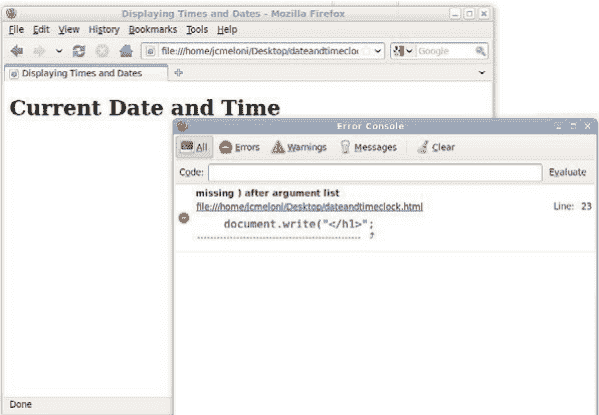

##### Firefox 的 JavaScript 控制台

图 4.4

Firefox 的 JavaScript 控制台显示错误消息。

虽然 Internet Explorer 为每个错误显示错误对话框，但 Firefox 的 JavaScript 控制台显示单个错误列表并允许你测试命令。因此，你可能会发现安装 Firefox 用于调试和测试 JavaScript 很有用，即使 Internet Explorer 是你的主要浏览器。

## 总结

在本章中，你学习了什么是 Web 脚本以及什么是 JavaScript。你还学习了如何将脚本插入 HTML 文档或引用外部 JavaScript 文件，JavaScript 能做什么，以及 JavaScript 如何与其他 Web 语言不同。你还编写了一个简单的 JavaScript 程序并使用 Web 浏览器对其进行了测试。你发现了如何修改和测试脚本，以及当 JavaScript 程序遇到错误时会发生什么。

在编写此脚本的过程中，你使用了 JavaScript 的一些基本功能：变量、`document.write` 语句以及用于处理日期和时间的函数。

既然你已经了解了一些 JavaScript 语法，你就可以继续学习关于 Web 开发的各种知识，然后再开始编写使用客户端脚本的交互式网站。

## 问答

**问：我需要在多个浏览器上测试我的 JavaScript 吗？**

答：在理想情况下，你编写的任何遵循 JavaScript 标准的脚本都应在所有浏览器中正常工作，在现实世界中 93% 的情况下（大致如此）确实如此。但浏览器确实有它们的怪癖，你至少应该在 Internet Explorer 和 Firefox 上测试你的脚本。

**问：如果我计划学习 PHP 或其他一些服务器端编程语言，JavaScript 对我还有用吗？**

答：当然有用。JavaScript 是许多基于 Web 应用程序部分的理想语言，例如表单验证。尽管 PHP 和其他服务器端语言有它们的用途，但它们无法在客户端直接与用户交互。

**问：当我尝试运行我的脚本时，浏览器在浏览器窗口中显示实际的脚本而不是执行它。我做错了什么？**

答：这很可能由以下三种错误之一引起。首先，你可能缺少开头或结尾的 `<script>` 标签。检查它们，并验证第一个标签读取为 `<script type="text/javascript">`。其次，你的文件可能以 .txt 扩展名保存，导致浏览器将其视为文本文件。将其重命名为 .htm 或 .html 以解决问题。第三，确保你的浏览器支持 JavaScript 并且它在“首选项”对话框中未被禁用。

**问：为什么在打印时间的语句中允许使用 `<strong>` 和 `<br />` 标签？我以为在 `<script>` 标签内不允许使用 HTML 标签。**

答：因为这个特定的标签在引号内，所以它被认为是脚本的有效部分。脚本的输出（包括任何 HTML 标签）由浏览器解释和显示。你可以在引号内使用其他 HTML 标签来添加格式，例如我们为大型时钟显示添加的 `<h1>` 标签。

## 研讨会

研讨会包含测验题和练习，以帮助你巩固对所涵盖内容的理解。在查看后面的“答案”部分之前，尝试回答所有问题。

## 测验

1. 当用户查看包含 JavaScript 程序的页面时，哪台机器实际执行脚本？
   a. 运行 Web 浏览器的用户机器
   b. Web 服务器
   c. 深藏在 Netscape 公司办公室内的一台中央机器

2. 你使用什么软件来创建和编辑 JavaScript 程序？
   a. 浏览器
   b. 文本编辑器
   c. 铅笔和一张纸

3. 变量在 JavaScript 程序中用于什么？
   a. 存储数字、日期或其他值
   b. 随机变化
   c. 引发高中代数课的回忆

4. 在嵌入 HTML 文件的 JavaScript 脚本的最末尾应该出现什么？
   a. `<script type="text/javascript">` 标签
   b. `</script>` 标签


c. END 语句

## 答案

-   1. a. JavaScript 程序在网页浏览器中执行。（实际上有一个服务器端版本的 JavaScript，但那是另一个话题了。）
-   2. b. 任何文本编辑器都可用于创建脚本。如果你注意将文档保存为 `.html` 或 `.htm` 扩展名的纯文本文件，也可以使用文字处理器。
-   3. a. 变量用于存储数字、日期或其他值。
-   4. b. 你的脚本应以 `</script>` 标签结束。

## 练习

-   为大时钟添加一个毫秒字段。你可以使用 `getMilliseconds` 函数，它的用法与 `getSeconds` 相似，但返回毫秒。
-   修改脚本以显示两次时间（包括毫秒）。注意当你加载页面时，两次时间显示之间是否有时间流逝。

# 第五章

在互联网早期，文本只以一种字体和一种大小显示。然而，HTML 和 CSS 的结合现在使得控制文本的外观（字体类型、大小或颜色）以及其在网页上的对齐和显示方式成为可能。在本章中，你将学习如何更改字体的视觉显示——其字体家族、大小和粗细——以及如何将粗体、斜体、上标、下标和删除线文本整合到你的页面中。你还将学习如何更改字体和字体大小。然后，在熟悉了这些文本方面之后，你将学习文本对齐的基础知识以及一些高级文本技巧和窍门，例如列表的使用。因为列表非常常见，HTML 提供了可以自动缩进文本并在每个列表项前添加数字、项目符号或其他符号的标签。你将学习如何格式化不同类型的列表，这是在网站中展示内容的众多方式之一。

**本章你将学到：**
-   如何使用粗体、斜体和特殊文本格式
-   如何调整字体
-   如何使用特殊字符
-   如何在页面上对齐文本
-   如何使用三种类型的 HTML 列表
-   如何在列表内嵌套列表

**注意**
在查看其他设计师的网页内容时，你可能会注意到文本标记的方法与本书所教授的不同。旧的文本格式化方法包括使用 `<b></b>` 标签对表示单词应加粗，使用 `<i></i>` 标签对表示单词应为斜体，以及使用 `<font></font>` 标签对指定字体家族、大小和其他属性。然而，没有理由去学习它，因为它正从 HTML 中逐渐淘汰，而 CSS 要强大得多。

## 82 第五章 使用字体、文本块和列表

如果你有一些可以用来显示不同字体和颜色、并且可以缩进、居中或以其他方式操作的示例文本，你就能充分利用整个章节来学习如何设置文本样式。使用什么类型的文本并不重要，因为有很多不同的样式可能性可以尝试，它们永远不会同时出现在同一个网页上（除非你想让你的访客抓狂）。抓住这个机会，感受一下文本级别的更改如何影响内容的外观。

#### 准备示例文本

-   如果你要使用的文本来自文字处理或数据库程序，请务必将新文件保存为纯文本或 ASCII 格式。然后，你可以在学习本章的过程中添加适当的 HTML 标签和样式属性来格式化它。
-   任何文本都可以，但试着找一些（或输入一些）你想放到网页上的文本。公司宣传册或你简历中的文本可能是个不错的选择。
-   任何类型的提纲、演示文稿中的要点、编号步骤、术语表或数据库中的文本信息列表都是很好的素材。
-   在使用本章介绍的代码格式化正文之前，先添加你在前几章中使用过的一套骨架 HTML 标签（`<html>`、`<head>`、`<title>` 和 `<body>` 标签）。

### 粗体、斜体和特殊文本格式

早在打字机时代，我们满足于纯文本显示，并偶尔使用下划线来表示强调。如今，粗体和斜体文本已成为所有书面交流的标配。当然，你也可以在你的网页内容中添加粗体和斜体文本。

有几种标签和样式规则使得文本格式化成为可能。

为文本添加粗体和斜体格式的老派方法涉及 `<b></b>` 和 `<i></i>` 标签对。对于粗体文本，将 `<b>` 标签放在文本开头，`</b>` 放在结尾。类似地，你可以通过将任何文本放在 `<i>` 和 `</i>` 标签之间使其变为斜体。虽然这种方法在浏览器中仍然有效并得到 XHTML 的支持，但它不如用于文本格式化的 CSS 样式规则灵活或强大。

## 粗体、斜体和特殊文本格式 83

虽然你将在第三部分“使用 CSS 进行高级网页设计”中学习更多关于 CSS 样式规则的知识，但这里值得稍作预示，以便你理解文本格式化选项。`font-weight` 样式规则允许你使用样式规则设置字体的粗细或粗细程度。`font-weight` 的标准设置包括 `normal`、`bold`、`bolder` 和 `lighter`（其中 `normal` 是默认值）。斜体文本由 `font-style` 规则控制，可设置为 `normal`、`italic` 或 `oblique`。如果你想应用多个样式规则，可以一起指定，如下例所示：

```html
<p style="font-weight:bold; font-style:italic">This paragraph is bold and italic!</p>
```

在此示例中，两个样式规则都在 `<p>` 标签的 `style` 属性中指定。使用多个样式规则的关键在于它们必须用分号（`;`）分隔。

不过，你并不限于在段落中使用字体样式。以下代码展示了如何在项目符号列表中使文本变为斜体：

```html
<ul>
  <li style="font-style:italic">Important Stuff</li>
  <li style="font-style:italic">Critical Information</li>
  <li style="font-style:italic">Highly Sensitive Material</li>
  <li>Nothing All That Useful</li>
</ul>
```

你也可以在标题中使用 `font-weight` 样式规则，但更粗的字体通常对标题没有影响，因为它们默认就是粗体。

**注意**
关于粗体和斜体文本，样式规则的一个替代方案是使用 `<strong></strong>` 和 `<em></em>` 标签对。`<strong>` 标签在大多数浏览器中与 `<b>` 标签的作用相同，而 `<em>` 标签则与 `<i>` 标签一样，将文本格式化为斜体。有些人认为 `<strong>` 和 `<em>` 标签是对 `<b>` 和 `<i>` 的改进，因为它们只暗示文本应获得特殊强调，而不是规定应如何实现这种效果。换句话说，浏览器不一定必须将 `<strong>` 解释为粗体或将 `<em>` 解释为斜体。这使得 `<strong>` 和 `<em>` 更符合 XHTML，因为它们在影响文本显示方式的同时，也为文本增加了语义。所有四个标签仍然是 HTML5 的一部分，尽管它们的使用变得更加微妙。

虽然使用 CSS 使你能够应用更丰富的格式，但还有一些其他 HTML 标签，当你不一定需要像 CSS 那么具体时，它们非常适合为文本添加特殊格式。以下是一些这些标签。清单 5.1 和图 5.1 演示了每个标签的实际应用。

-   `<small></small>`——小号文本
-   `<big></big>`——大号文本；在 HTML5 中不存在，因为文本大小最好由 CSS 控制
-   `<sup></sup>`——上标文本
-   `<sub></sub>`——下标文本
-   `<em></em>` 或 `<i></i>`——强调（斜体）文本
-   `<strong></strong>` 或 `<b></b>`——强烈（粗体）文本
-   `<tt></tt>`——等宽文本（打字机字体）；在 HTML5 中不存在，因为字体外观最好由 CSS 控制
-   `<pre></pre>`——等宽文本，保留空格和换行符

## 84 第五章 使用字体、文本块和列表

**注意**
过去有一个 `<u>` 标签用于创建带下划线的文本，但现在有几个理由不再使用它。首先，用户期望带下划线的文本是链接，因此如果你给不是链接的文本添加下划线，他们可能会感到困惑。其次，`<u>` 标签已被弃用，这意味着它已从 HTML/XHTML 语言中逐步淘汰，`<strike>` 标签也是如此。这两个标签


尽管`<strike>`标签在网页浏览器中仍被支持，并且可能还会持续使用一段时间，但使用CSS是创建下划线和删除线文本的首选方法。在HTML5中，被删除的文本可以用`<strike></strike>`标签对包围，该标签会渲染出带有删除线的文本。

## 图 5.1

以下是代码清单5.1中字符格式化的显示效果。

#### 代码清单 5.1 特殊格式标签

```xml
<?xml version="1.0" encoding="UTF-8"?>
<!DOCTYPE html PUBLIC "-//W3C//DTD XHTML 1.1//EN"
"http://www.w3.org/TR/xhtml11/DTD/xhtml11.dtd">
<html xmlns="http://www.w3.org/1999/xhtml" xml:lang="en">
<head>
<title>神奇产品</title>
</head>
<body>
<p>
```

全新的 <sup>超级</sup><strong>强效</strong> H<sub>2</sub>O
<em>加强</em> 版能去除任何污渍，无论 <big>大</big> 还是 <small>小</small>。<br /> 在您附近的溪流中寻找
全新的 <sup>超级</sup><b>强效</b> H<sub>2</sub>O <i>加强</i> 版。

`<tt>营养信息</tt>`（禁售地区除外）

| 每份卡路里 | 脂肪克数 | 美国推荐每日摄入量湿度 |
| :--- | :---: | :---: |
| 常规 | 3 4 | 100% |
| 无铅 | 3 2 | 100% |
| 有机 | 2 3 | 99% |
| 无糖 | 0 1 | 110% |

## 微调字体 85

代码清单 5.1 续

```html
</pre>
</body>
</html>
```

`<tt>`标签通常会将字体更改为等宽字体Courier New。（等宽意味着所有字母和空格的宽度相同。）然而，网络浏览器允许用户将等宽的`<tt>`字体更改为他们选择的字体（查看浏览器的选项菜单）。对于某些用户来说，等宽字体甚至可能不再是等宽的，尽管绝大多数用户坚持使用浏览器默认显示的标准字体。

`<pre>`标签使文本以等宽字体显示，但它还做了一些独特且有用的事情。正如你在第2章“理解HTML和XHTML的关系”中所学到的，HTML文件中的多个空格和换行符通常会被忽略，但`<pre>`会保留精确的空格和换行符。例如，如果没有`<pre>`，图5.1末尾的文本将如下所示：

```
calories grams usrda /serving of fat moisture regular
3 4 100% unleaded 3 2 100% organic 2 3 99% sugar free 0 1 110%
```

即使你在每行末尾添加了`<br />`标签，列也无法正确对齐。然而，当你在开头放置`<pre>`并在结尾放置`</pre>`时，列就能正确对齐，因为精确的空格被保留了——不需要`<br />`标签。`<pre>`标签为你提供了一种快速简便的方法，以最小的努力保留任何你可能想要转移到网页上的等宽文本文件的对齐方式。

CSS提供了更强大的文本对齐方法（实际上，对文本可以做任何处理），你将在第三部分中学习更多相关内容。

### 微调字体

`<big>`、`<small>`和`<tt>`标签让你对页面上文本的大小和外观有了一些基本的控制。然而，有时你可能只想对文本的大小和外观有更多一点的控制。在我深入讲解在XHTML代码中调整字体的正确方法之前，让我们简要看看在CSS出现之前，人们是如何处理这个问题的

# 86 第5章 处理字体、文本块和列表

> **注意** 你将在第8章“处理颜色、图像和多媒体”中学习更多关于控制页面文本颜色的知识。那一章还会展示如何创建你自己的自定义颜色以及如何控制文本链接的颜色。

在样式表出现之前，现在已淘汰的`<font>`标签曾被用于控制网页文本中的字体。例如，以下代码展示了如何更改页面上一些文本的大小和颜色：

```html
<font size="5" color="purple">这段文字会是大号紫色。</font>
```

如你所见，`<font>`标签的`size`和`color`属性使得无需太多努力就能更改文本的字体。尽管这种方法效果不错，但它已经被一种远更优越的字体格式化方法所取代，这要归功于CSS样式规则。以下是用于控制字体的一些主要样式规则：

- font-family——设置字体的系列（字体族）
- font-size——设置字体的大小
- color——设置字体的颜色

`font-family`样式规则允许你设置用于显示文本的字体族。你可以，而且通常应该为此样式指定多个值（用逗号分隔），这样如果第一种字体在用户的系统上不可用，浏览器就可以尝试替代字体。你在前面的章节中已经见过这个了。

提供替代字体很重要，因为每个用户可能安装了不同的字体集，至少超出了一组核心的常见基本字体（如Arial、Times New Roman等）之外。通过提供一份替代字体列表，当你的理想字体找不到时，你的页面更有可能优雅地回退到已知字体。以下是使用`font-family`样式为一段文本设置字体族的示例：

```html
<p style="font-family:arial, sans-serif, 'times roman'">
```

这个示例有几个有趣之处。首先，`arial`被指定为主要字体。大小写不会影响字体族，所以`arial`与`Arial`或`ARIAL`没有区别。这段代码的另一个有趣之处是，`Times Roman`字体名因为包含空格而被单引号括起来。然而，由于`'times roman'`出现在通用规格`sans-serif`之后，所以`'times roman'`不太可能被使用。因为`sans-serif`处于第二位，它告诉浏览器“如果此机器上没有Arial字体，请使用默认的无衬线字体。”

## 微调字体 87

`font-size`和`color`样式规则也常用于控制字体的大小和颜色。`font-size`样式可以设置为预定义的大小（如`small`、`medium`或`large`），也可以设置为特定的磅值（如`12pt`或`14pt`）。`color`样式可以设置为预定义的颜色（如`white`、`black`、`blue`、`red`或`green`），也可以设置为特定的十六进制颜色（如`#FFB499`）。

> **注意：** 你将在第8章学习关于十六进制颜色的知识。现在，只需理解`color`样式规则使你能够指定超出基本名称之外的精确颜色。

以下是使用`green`、`blue`、`orange`和`red`，并指定了`font-size`和`color`的前一个段落。

```html
<p style="font-family:arial, sans-serif, 'times roman'; font-size:14pt; color:green">
```

代码清单5.2中的示例网页内容（如图5.2所示）使用了一些字体样式规则来创建一份基本在线简历的开头。

#### 代码清单 5.2 使用字体样式规则创建基本简历

```xml
<?xml version="1.0" encoding="UTF-8"?>
<!DOCTYPE html PUBLIC "-//W3C//DTD XHTML 1.1//EN"
"http://www.w3.org/TR/xhtml11/DTD/xhtml11.dtd">
<html xmlns="http://www.w3.org/1999/xhtml" xml:lang="en">

<head>

<title>Jane Doe的简历</title>

<style type="text/css">

body {
    font-family: Verdana, sans-serif;
    font-size: 12px;
}

h1 {
    font-family:Georgia, serif;
    font-size:28px;
    text-align:center;
}

p.contactinfo {
    font-size:14px;
    text-align:center;
}

p.categorylabel {
    font-size:12px;
    font-weight:bold;
    text-transform:uppercase;
}

div.indented {
    }
</style>
</head>

<body>

<h1>Jane Doe</h1>

<p class="contactinfo">1234 Main Street, Sometown,
CA 93829<br/>
tel: 555-555-1212, e-mail: jane@doe.com</p>

<p class="categorylabel">资历概要</p>

<ul>
<li>技能精湛且专注的专业人士，拥有满足您任何需求的扎实背景。</li>
<li>为能够让我获得工作的任何事情提供全面指导。</li>
<li>精通与行业相关的各种计算机程序和设备。适用于任何行业。</li>
</ul>

<p class="categorylabel">专业经验</p>

<div class="indented">
<p><span style="font-weight:bold;">运营经理，
超级棒公司，某市，加州 [2002年9月 –
至今]</span></p>
```


## 项目经理，Less Awesome 公司，CA 州某市 [2000年5月 - 2002年9月]

-   管理所有部门运营
-   协调内外部资源的工作
-   总体上负责所有事务

## 教育背景

-   MBA，MyState 大学，2002年5月
-   工商管理学士，MyState 大学，2000年5月

## 推荐人

-   可应要求提供。

### 处理特殊字符

使用 CSS，它将样式集组织成类——正如你在第 3 章“理解层叠样式表”中所学——你可以看到文本格式如何应用于此内容的不同区域。如果你仔细查看 `div.indented` 类的定义，你会看到使用了 `margin-left` 样式。这个样式，你将在第三部分了解更多，它会在元素左侧应用一定量的空白（在此示例中为 25 像素）。这个空白构成了图 5.2 中所示的缩进。

图 5.2

以下是清单 5.2 中使用的代码。

### 处理特殊字符

现在大多数字体都包含了欧洲语言的特殊字符，例如 Café 中带重音的 é。还有一些数学符号和特殊标点符号，例如圆形项目符号 •。

你可以使用适当的代码在 HTML 文档中的任何位置插入这些特殊字符，如表 5.1 所示。你会在 http://www.webstandards.org/learn/reference/named_entities.html 找到更广泛的字符集代码列表。

例如，单词 café 可以使用以下任一方法编写：

caf&eacute;

caf&#233;

# 90 第 5 章 处理字体、文本块和列表

**提示** 表 5.1 常用英语特殊字符

寻找版权 © 和注册商标符号？那些代码分别是 &copy; 和 &reg;。要创建未注册商标 ™ 符号，请使用 &trade;。

| 字符 | 数字代码 | 代码名称 | 描述 |
| :--- | :--- | :--- | :--- |
| " | &#34; | &quot; | 引号 |
| & | &#38; | &amp; | 和号 |
| < | &#60; | &lt; | 小于 |
| > | &#62; | &gt; | 大于 |
| ¢ | &#162; | &cent; | 分币符号 |
| £ | &#163; | &pound; | 英镑符号 |
| ¦ | &#166; | &brvbar; 或 &brkbar; | 断竖线 |
| § | &#167; | &sect; | 节符号 |
| © | &#169; | &copy; | 版权 |
| ® | &#174; | &reg; | 注册商标 |
| ° | &#176; | &deg; | 度符号 |
| ± | &#177; | &plusmn; | 加或减 |
| ² | &#178; | &sup2; | 上标二 |
| ³ | &#179; | &sup3; | 上标三 |
| · | &#183; | &middot; | 中点 |
| ¹ | &#185; | &sup1; | 上标一 |
| ¼ | &#188; | &frac14; | 四分之一 |
| ½ | &#189; | &frac12; | 二分之一 |
| ¾ | &#190; | &frac34; | 四分之三 |
| Æ | &#198; | &AElig; | 大写 AE 连字 |
| æ | &#230; | &aelig; | 小写 ae 连字 |
| É | &#201; | &Eacute; | 带重音的大写 E |
| é | &#233; | &eacute; | 带重音的小写 e |
| × | &#215; | &times; | 乘号 |
| ÷ | &#247; | &divide; | 除号 |

尽管你可以通过数字指定字符实体，但每个符号也有一个助记名称，通常更容易记忆。

HTML/XHTML 使用一种称为字符实体的特殊代码来表示特殊字符，如 © 和 ®。字符实体总是以 & 开头并以 ; 结尾。表 5.1 列出了最常用的字符实体，尽管 HTML 支持更多。

# 处理特殊字符 91

表 5.1 包括了尖括号、引号和和号的代码。

如果你想让这些符号出现在你的页面上，你必须使用这些代码；否则，Web 浏览器会将它们解释为 HTML 命令。

在清单 5.3 和图 5.3 中，展示了表 5.1 中几个符号的使用示例。

#### 清单 5.3 特殊字符代码

```xml
<?xml version="1.0" encoding="UTF-8"?>
<!DOCTYPE html PUBLIC "-//W3C//DTD XHTML 1.1//EN"
"http://www.w3.org/TR/xhtml11/DTD/xhtml11.dtd">
<html xmlns="http://www.w3.org/1999/xhtml" xml:lang="en">
<head>
<title>标点符号行</title>
</head>
<body>
<p>
问：当一个英国银行家向你挑衅时该怎么办？<br />
答：用 &pound; 一些 &cent;&cent; 砸他。
<hr />
问：当法官从法律书籍上删除一部分法律时，你称之为什么？

答：§ 暴力。

---

问：足球教练在比赛中途从更衣室自动售货机里买了什么？

答：一个 ¼ 后卫在 ½ 场休息。

---

问：当警察侦探审讯数学家时，有多热？

答：x³°

---

问：一个一丝不苟的抄袭者做什么？

答：©

---

</p>
</body>
</html>
```

# 92 第 5 章 处理字体、文本块和列表

图 5.3
清单 5.3 中的 HTML 页面
在大多数 Web 浏览器中的样子。

### 页面上文本的对齐

现在你已经了解了如何在文本级别更改内容的外观，是时候更进一步，修改页面上出现的文本块了。在阅读 Web 上的信息时，大多数段落自动左对齐的事实很容易被视为理所当然。然而，确实存在某些情况，你可能选择将内容右对齐甚至居中对齐。HTML 为你提供了对齐单个 HTML 块级元素（例如包含在 `<p></p>` 或 `<div></div>` 标签对中的文本）的选项。然而，在我们深入了解块元素对齐的细节之前，让我们简要说明一下属性的工作方式。

# 使用属性

属性用于提供与 HTML 标签相关的额外信息。属性是 HTML 标签内使用的特殊代码词，用于精确控制标签的功能。即使在最简单的 Web 内容中，它们也非常重要，因此你熟练使用它们很重要。属性调用应用于特定标签的样式、类或 ID。如果你在样式表中定义了特定的类或 ID——正如你在第 3 章“理解层叠样式表”中所学——那么你可以在标签本身内使用 `class=”someclass”` 或 `id=”someid”` 来调用该类或 ID。当浏览器渲染内容以进行显示时，它会查看样式表以根据关联的样式定义确定内容的确切显示方式

# 页面上文本的对齐 93

类似地，你可以使用 style 属性为特定元素包含样式信息，而无需将元素连接到实际的样式表。例如，当你以 `<p>` 标签开始一个段落时，你可以通过设置 style 属性来指定该特定段落中的文本应该左对齐、右对齐还是居中对齐。如果你想将该特定段落与现有的类或 ID 关联起来，则设置 class 或 id 属性。

在下面的示例中，每个段落都可以左对齐：

```html
<p style="text-align: left;">文本放在这里。</p>

<p class="leftAlignStyle">文本放在这里。</p>

<p id="firstLeftAlign">文本放在这里。</p>
```

在第一段中，样式直接出现在 style 属性中。在第二段中，如果 leftAlignStyle 类的样式表条目包含 text-align 语句，则该段落将左对齐。

类似地，如果 firstLeftAlign 类的样式表条目包含 text-align 语句，则第三段将左对齐。

在前面的示例中，你可能已经注意到标签、属性和样式使用了小写字母。严格的 XHTML 标准要求标签和属性使用小写；XHTML 标准还要求属性值使用引号括起来。

例如，以下代码将被大多数流行的 Web 浏览器渲染：

`<P STYLE=TEXT-ALIGN:CENTER>`

然而，此代码不符合 XHTML 标准，因为标签是大写的，`style` 属性及其值 `(text-align:center)` 是大写的，并且值没有用引号括起来。如果你想保持与最新标准和软件的兼容性，你应该始终改为使用以下代码：

**注意**

`<p style="text-align:center">`

HTML 中的每个属性和样式规则都有一个默认值，当你没有自己设置属性时会被采用。对于 `<p>` 标签的 `text-align` 样式规则，默认值是 left，因此使用最简单的 `<p>` 标签与使用

#### 对齐块级元素


要将`<p>`这样的块级元素对齐到右页边距，而无需使用`<p style="text-align:left">`或在样式表中创建单独的类或ID，只需在段落开头的`<p>`标签内放置`style="text-align:right"`即可。同样，要居中对齐元素，请使用`<p style="text-align:center">`。要将段落左对齐，请使用`style属性`中的`text-align`部分称为样式规则，这意味着它正在设置HTML元素的特定样式方面。您可以使用许多样式规则来精确控制网页内容的格式。

`text-align`样式规则不仅限于`<p>`标签。事实上，您可以将`text-align`样式规则与任何块级元素一起使用，包括`<h1>`、`<h2>`、其他标题标签以及`<div>`标签等。`<div>`标签尤其方便，因为它可以包含其他块级元素，从而让您一次性控制网页内容大部分的对齐方式。`<div>`标签中的`div`代表“分区”。

## 94 第5章 处理字体、文本块和列表

`style`属性中的`text-align`部分被称为样式规则，这意味着它正在设置HTML元素的特定样式方面。您可以使用许多样式规则来精确控制网页内容的格式。

`text-align`样式规则不仅限于`<p>`标签。事实上，您可以将`text-align`样式规则与任何块级元素一起使用，包括`<h1>`、`<h2>`、其他标题标签以及`<div>`标签等。`<div>`标签尤其方便，因为它可以包含其他块级元素，从而让您一次性控制网页内容大部分的对齐方式。`<div>`标签中的`div`代表“分区”。

清单5.4演示了`<p>`和`<div>`标签的`style`属性和`text-align`样式规则。结果显示在图5.4中。

您将在第三部分学习更多关于`<div>`标签的高级用法。

#### 清单5.4 与style属性一起使用的text-align样式规则

```xml
<?xml version="1.0" encoding="UTF-8"?>
<!DOCTYPE html PUBLIC "-//W3C//DTD XHTML 1.1//EN"
"http://www.w3.org/TR/xhtml11/DTD/xhtml11.dtd">
<html xmlns="http://www.w3.org/1999/xhtml" xml:lang="en">
<head>
<title>Bohemia</title>
</head>
<body>
<div style="text-align:center">
<h1>Bohemia</h1>
<h2>by Dorothy Parker</h2>
</div>
<p style="text-align:left">
Authors and actors and artists and such<br />
Never know nothing, and never know much.<br />
Sculptors and singers and those of their kidney<br />
Tell their affairs from Seattle to Sydney.
</p>
<p style="text-align:center">
Playwrights and poets and such horses' necks<br />
Start off from anywhere, end up at sex.<br />
Diarists, critics, and similar roe<br />
Never say nothing, and never say no.
</p>
<p style="text-align:right">
People Who Do Things exceed my endurance;<br />
God, for a man that solicits insurance!</p>
</p>
</body>
</html>
```

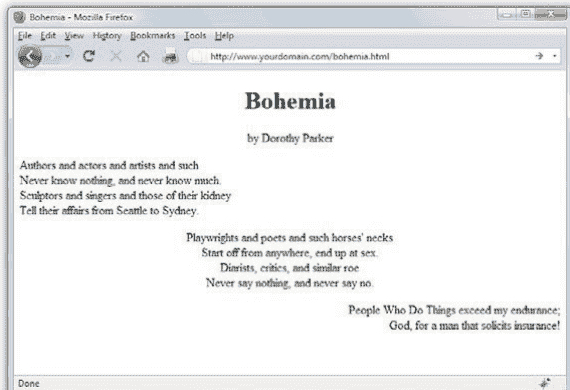

### 图5.4
在清单5.4中使用文本对齐的结果。

使用`<div style="text-align:center">`可确保内容区域（包括两个标题）居中。但是，`<div>`内单个段落的文本对齐会覆盖该设置，并确保第一段文本左对齐，第二段居中，第三段右对齐。

### HTML列表的三种类型

为了清晰起见，将网页上的信息以列表形式呈现通常很有用。HTML列表有三种基本类型。所有三种类型都显示在图5.5中，清单5.5揭示了用于构建它们的HTML。

-   **有序列表** - 一个缩进列表，每个列表项前有数字或字母。有序列表以`<ol>`标签开始，以结束的`</ol>`标签结束。列表项包含在`<li></li>`标签对中，并且在每个起始`<li>`标签处自动出现换行符。整个列表都是缩进的。
-   **无序列表** - 一个缩进列表，每个列表项前有项目符号或其他符号。无序列表以`<ul>`标签开始，以`</ul>`结束。与有序列表一样，其列表项包含在`<li></li>`标签对中。在每个起始`<li>`标签处出现换行符和符号，并且整个列表是缩进的。
-   **定义列表** - 一个术语及其含义的列表。这种列表类型在每个项目前没有特殊的数字、字母或符号，以`<dl>`开始，以`</dl>`结束。`<dt></dt>`标签对包含每个术语，`<dd></dd>`标签对包含每个定义。换行符和缩进会自动出现。

#### 清单5.5 无序列表、有序列表和定义列表

```xml
<?xml version="1.0" encoding="UTF-8"?>
<!DOCTYPE html PUBLIC "-//W3C//DTD XHTML 1.1//EN"
"http://www.w3.org/TR/xhtml11/DTD/xhtml11.dtd">
<html xmlns="http://www.w3.org/1999/xhtml" xml:lang="en">
<head>
<title>How to Be Proper</title>
</head>
<body>
<h1>How to Be Proper</h1>
<h2>Basic Etiquette for a Gentlemen Greeting a Lady Acquaintance</h2>
<ul>
<li>Wait for her acknowledging bow before tipping your hat.</li>
<li>Use the hand farthest from her to raise the hat.</li>
<li>Walk with her if she expresses a wish to converse; Never make a lady stand talking in the street.</li>
<li>When walking, the lady must always have the wall.</li>
</ul>
<ol>
<li>A simple stare of iciness should suffice in most instances.</li>
<li>A cold bow discourages familiarity without offering insult.</li>
<li>As a last resort: “Sir, I have not the honour of your acquaintance.”</li>
</ol>
<dl>
<dt><strong>Your Majesty</strong></dt>
<dd>To the king or queen.</dd>
<dt><strong>Your Royal Highness</strong></dt>
<dd>To the monarch’s spouse, children, and siblings.</dd>
<dt><strong>Your Highness</strong></dt>
<dd>To nephews, nieces, and cousins of the sovereign.</dd>
</dl>
```

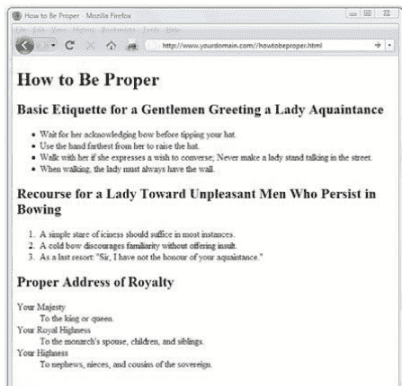

### 图5.5
三种基本的HTML列表类型。

**注意**
请记住，不同的网页浏览器可以非常不同地显示网页内容。HTML标准没有明确规定网页浏览器应如何格式化列表，因此使用较旧网页浏览器的用户可能看不到与您完全相同的缩进。您可以使用CSS来精确控制列表项，您将在本章后面学习相关内容。

#### 将列表放置在列表中

虽然定义列表正式应用于定义术语，但许多网页作者会在他们希望看到一些缩进的任何地方使用它们。实际上，您可以通过在文本开头放置`<dl><dd>`，在文本结尾放置`</dd></dl>`，并跳过`<dt></dt>`标签对来缩进任何文本。但是，缩进文本的更好方法是使用`<blockquote></blockquote>`标签对，它可以缩进内容而不预设定义，并且允许更清晰的样式设置。通过一组属性，您可以设置元素区域的宽度、高度、背景颜色、边框类型和颜色以及其他视觉效果。

由于使用CSS时您对项目的显示具有控制级别，因此无需使用嵌套列表来实现缩进的视觉效果。将嵌套列表的使用保留给内容需要时。换句话说，使用嵌套列表来显示信息的层次结构，例如清单5.6。

有序和无序列表可以相互嵌套，嵌套级别可以任意多。在清单5.6中，一个复杂的缩进大纲由几个无序列表构建而成。您会在图5.6中注意到，Firefox自动为前三个缩进级别中的每一个使用不同类型的项目符号，使列表非常易于阅读。这在现代浏览器中很常见。

#### 清单5.6 使用列表构建大纲

```xml
<?xml version="1.0" encoding="UTF-8"?>
<!DOCTYPE html PUBLIC "-//W3C//DTD XHTML 1.1//EN"
"http://www.w3.org/TR/xhtml11/DTD/xhtml11.dtd">
<html xmlns="http://www.w3.org/1999/xhtml" xml:lang="en">
<head>
<title>Vertebrates</title>
</head>
<body>
<h1>Vertebrates</h1>
<ul>
<li><span style="font-weight:bold">Fish</span>
<ul>
<li>Barramundi</li>
<li>Kissing Gourami</li>
<li>Mummichog</li>
</ul>
</li>
<li><span style="font-weight:bold">Amphibians</span>
<ul>
<li>Anura
```


#### 在列表中嵌套列表

如图 5.6 所示，网页浏览器通常为一级项目符号使用实心圆盘，为二级项目符号使用空心圆圈，所有更深层次的项目符号则使用实心方块。但是，你可以通过使用 `<ul style="list-style-type:disc">`、`<ul style="list-style-type:circle">` 或 `<ul style="list-style-type:square">` 来代替 `<ul>`，从而显式地为任何层级选择要使用的项目符号类型。

> **图 5.6**
>
> 在 Firefox 中，多级无序列表具有整洁的缩进和项目符号，提高了可读性。

你甚至可以通过在 `<li>` 标签中使用 `list-style-type` 样式规则来更改无序列表中任何单个点的项目符号。例如，以下代码在 `extra` 和 `super` 词语前显示一个空心圆圈，在 `special` 词语前显示一个实心方块：

```html
<ul style="list-style-type:circle">
    <li>extra</li>
    <li>super</li>
    <li style="list-style-type:square">special</li>
</ul>
```

`list-style-type` 样式规则也适用于有序列表，但它不是选择项目符号类型，而是选择放在每个项目前面的数字或字母类型。代码清单 5.7 展示了如何在多级列表中使用罗马数字 (`list-style-type:upper-roman`)、大写字母 (`list-style-type:upper-alpha`)、小写字母 (`list-style-type:lower-alpha`) 和普通数字。图 5.7 显示了生成的提纲，其格式很规范。

尽管代码清单 5.7 仅在 `<ol>` 标签上使用了 `list-style-type` 样式规则，但你也可以将其用于列表中的特定 `<li>` 标签（尽管很难想象你会在什么情况下需要这样做）。你也可以使用 `list-style-type:decimal` 显式地指定普通编号，并且可以使用 `list-style-type:lower-roman` 创建小写罗马数字。

##### 代码清单 5.7 在多层列表中使用带有 `style` 属性的 `list-style-type` 样式规则

```xml
<?xml version="1.0" encoding="UTF-8"?>
<!DOCTYPE html PUBLIC "-//W3C//DTD XHTML 1.1//EN"
"http://www.w3.org/TR/xhtml11/DTD/xhtml11.dtd">
<html xmlns="http://www.w3.org/1999/xhtml" xml:lang="en">
<head>
<title>Advice from the Golf Guru</title>
</head>
<body>
<h1>How to Win at Golf</h1>
<ol style="list-style-type:upper-roman">
<li>Training
<ol>
<li>Mental prep
<ol style="list-style-type:upper-alpha">
<li>Watch golf on TV religiously</li>
<li>Get that computer game with Tiger whatsisname</li>
<li>Rent “personal victory” subliminal tapes</li>
</ol>
</li>
<li>Equipment
<ol style="list-style-type:upper-alpha">
<li>Make sure your putter has a pro autograph on it</li>
<li>Pick up a bargain bag of tees-n-balls at Costco</li>
</ol>
</li>
<li>Diet
<ol style="list-style-type:upper-alpha">
<li>Avoid junk food
<ol style="list-style-type:lower-alpha">
<li>No hotdogs</li>
</ol>
</li>
<li>Drink wine and mixed drinks only, no beer</li>
</ol>
</li>
</ol>
</li>
<li>Pre-game
<ol>
<li>Dress
<ol style="list-style-type:upper-alpha">
<li>Put on shorts, even if it’s freezing</li>
<li>Buy a new hat if you lost last time</li>
</ol>
</li>
<li>Location and Scheduling
<ol style="list-style-type:upper-alpha">
<li>Select a course where your spouse or boss won’t find you</li>
<li>To save on fees, play where your buddy works</li>
</ol>
</li>
<li>Opponent
<ol style="list-style-type:upper-alpha">
<li>Look for: overconfidence, inexperience</li>
<li>Buy opponent as many pre-game drinks as possible</li>
</ol>
</li>
</ol>
</li>
<li>On the Course
<ol>
<li>Tee off first, then develop severe hayfever</li>
<li>Drive cart over opponent’s ball to degrade aerodynamics</li>
<li>Say “fore” just before ball makes contact with opponent</li>
<li>Always replace divots when putting</li>
<li>Water cooler holes are a good time to correct any errors in ball placement</li>
</ol>
</li>
</ol>
</body>
</html>
```

**图 5.7**

一个格式规范的提纲几乎能让任何计划看起来更加可信。

## 总结

在本章中，你学习了如何使文本显示为粗体或斜体，以及如何编码上标、下标、特殊符号和重音字母。你了解了如何在等宽字体的预格式化段落中使文本正确对齐，以及如何控制网页上任何文本部分的大小、颜色和字体。你还了解到属性用于指定许多 HTML 标签的选项和特殊行为，以及如何将 `style` 属性与 CSS 样式规则一起使用来对齐文本。你还探索了如何创建和组合三种基本类型的 HTML 列表：有序列表、无序列表和定义列表。列表可以嵌套在其他列表中，以创建提纲和其他复杂的文本排列。

表 5.2 总结了本章讨论的标签和属性。顺便说一句，不要觉得你必须记住所有这些标签！

### 表 5.2 第 5 章涵盖的 HTML 标签和属性

| 标签/属性 | 功能 |
| :--- | :--- |
| `<em>...</em>` | 强调（通常为斜体）。 |
| `<strong>...</strong>` | 更强的强调（通常为粗体）。 |
| `<b>...</b>` | 粗体文本。 |
| `<i>...</i>` | 斜体文本。 |
| `<tt>...</tt>` | 打字机（等宽）字体。 |
| `<pre>...</pre>` | 预格式化文本（将保留精确的行尾和间距——通常以等宽字体呈现）。 |
| `<big>...</big>` | 文本比正常稍大。 |
| `<small>...</small>` | 文本比正常稍小。 |
| `<sub>...</sub>` | 下标。 |
| `<sup>...</sup>` | 上标。 |
| `<div>...</div>` | 要格式化的文本区域。 |
| `<dl>...</dl>` | 定义列表。 |
| `<dt>...</dt>` | 定义列表中的定义术语。 |
| `<dd>...</dd>` | 定义列表中与定义术语对应的定义。 |
| `<ol>...</ol>` | 有序（编号）列表。 |
| `<ul>...</ul>` | 无序（项目符号）列表。 |
| `<li>...</li>` | 用于 `<ol>` 或 `<ul>` 的列表项。 |
| `style="font-family:typeface"` | 字体系列（族），即字体的名称，例如 Arial。（也可与 `<p>`、`<h1>`、`<h2>`、`<h3>` 等一起使用。） |
| `style="font-size:size"` | 字体大小，可设置为 small、medium、large 以及 x-small、x-large 等。也可设置为特定的点大小（例如 12 pt）。 |
| `style="color:color"` | 更改文本颜色。 |
| `style="text-align:alignment"` | 将文本对齐到居中、左或右。（也可与 `<p>`、`<h1>`、`<h2>`、`<h3>` 等一起使用。） |
| `style="list-style-type:numtype"` | 用于标记列表的数字类型。可能的值有 decimal、lower-roman、upper-roman、lower-alpha、upper-alpha 和 none。 |
| `style="list-style-type:bullettype"` | 用于标记列表项目的项目符号图形。可能的值有 disc、circle、square 和 none。 |
| `style="list-style-type:type"` | 用于标记此项目的项目符号或数字类型。可能的值有 disc、circle、square、decimal、lower-roman、upper-roman、lower-alpha、upper-alpha 和 none。 |

## 问答

**问：** 我如何找到我电脑上某个字体的准确名称？

**答：** 在 Windows 或 Macintosh 计算机上，打开控制面板并单击字体文件夹——你的系统字体列表会显示出来。（Vista 用户可能需要在控制面板中切换到“经典视图”。）在指定字体时，font-family 样式规则中应使用字体名称的准确拼写。不过，字体名称不区分大小写。

**问：** 我如何将汉字、阿拉伯语、中文和其他非欧洲字符放到我的页面上？

**答：** 首先，需要在你页面上阅读这些字符的用户必须安装相应的语言字体。他们还必须为其网络浏览器选择该语言字符集及其关联的字体。你可以使用 Windows 中的字符映射程序（或其他操作系统中的类似程序）来获取任何语言字体中每个字符的数字代码。要找到字符映射程序，请单击“开始”、“所有程序”、“附件”，然后单击“系统工具”。如果你想要的字符代码是 214，请使用 `&#214;` 将其放置在网页上。如果你找不到字符映射程序，请使用你的操作系统

在网页中包含简短亚洲语言信息（例如“我们会说泰米尔语-致电给我们！”）的最佳方式是将其作为图形图像包含。这样，即使用户主要使用英语浏览网页，也能看到该信息。但是，即使要在图形中使用某种语言字体，你也可能需要为操作系统下载特定的语言包。同样，请查阅系统的帮助功能以获取具体说明。

**问：** 我见过一些网页使用三维小球或其他特殊图形作为项目符号。他们是怎么做到的？
**答：** 这个技巧稍微超出了本章的涵盖范围。你将在第8章学习如何自己实现。

**问：** 如何让文本“完全两端对齐”，使左右页边距都对齐？
**答：** 你可以在样式声明中使用 `text-align:justify`。

## Workshop 105

本研讨环节包含测验题和活动，以帮助你巩固对所涵盖材料的理解。在查看后面的“答案”部分之前，请尝试回答所有问题。

## 测验

1.  使用样式（而非 `<b>` 或 `<strong>` 标签），如何创建一个段落，其中前三个单词是粗体？
2.  如何表示水的化学式？
3.  如何在网页上显示“© 2010, Webwonks Inc.”？
4.  如何将整个页面上的所有内容居中对齐？
5.  你会使用什么来创建一个定义列表，说明单词 *glunch* 意为“一种轻蔑、愤怒或不悦的表情”，以及单词 *glumpy* 意为“愠怒、阴郁或闹别扭的”？

## 答案

1.  你会使用以下代码：
    ```
    <p><span style="font-weight: bold">First three words</span> are bold.</p>
    ```

2.  你会使用 H<sub>2</sub>O。

3.  你可以使用以下任一方式：
    `&copy; 2010, Webwonks Inc.`
    `&#169; 2010, Webwonks Inc.`

4.  如果你想到在页面顶部的 `<body>` 标签之后立即放置 `<div style="text-align:center">`，并在页面底部的 `</body>` 标签之前放置 `</div>`，那么你是正确的。然而，`text-align` 样式也直接支持在 `<body>` 标签中使用，这意味着你可以省略 `<div>` 标签，直接将 `style="text-align:center"` 样式放在 `<body>` 标签中。看，整个页面就居中了！

5.  你会使用以下代码：
    ```
    <dl>
    <dt>glunch</dt><dd>a look of disdain, anger, or displeasure</dd>
    <dt>glumpy</dt><dd>sullen, morose, or sulky</dd>
    </dl>
    ```

## 第5章 处理字体、文本块和列表

## 练习

-   1. 将本章学到的字体级样式属性应用于各种块级元素，如 `<p>`、`<div>`、`<ul>` 和 `<li>` 项。尝试嵌套你的元素，以感受样式在内容层次结构中是否以及如何层叠。
-   2. 使用文本对齐样式属性，将文本块放置在网页的不同位置。尝试嵌套你的段落和区块（`<p>` 和 `<div>`），以感受样式在内容层次结构中是否以及如何层叠。
-   3. 尝试创建一个有序列表，概述你想放在网页上的信息。这将让你练习格式化 HTML 列表，并为思考本书后续章节涵盖的问题提供一个良好的开端。

## 第6章

在本章中，你将学习如何构建 HTML 表格，用于控制网页内容中表格数据的间距、布局和外观。虽然使用 CSS 可以达到类似的效果，但在某些情况下，表格绝对是呈现信息的最佳方式，你会发现表格对于将信息排列成行和列非常有用。我还将解释设计师过去如何使用表格进行页面布局，以及为什么这并不总是最好的主意。在我们开始之前，请记住，表格只是将内容有序地排列成垂直列和水平行。

**本章你将学习到：**
-   如何创建简单的表格
-   如何控制表格的大小
-   如何在表格中对齐内容以及跨行和跨列

### 创建简单的表格

在阅读本章时，请思考将文本排列成表格如何能让你的网页受益。表格由包含单个单元格的信息行组成。要制作表格，你必须从 `<table>` 标签开始。当然，以 `</table>` 标签结束你的内容。如果希望表格有边框，请使用特定的边框属性以像素为单位指定边框宽度。表格最明显的应用是组织信息，例如多列的名称和数字列表。

`<table>` 标签包含一些需要牢记的特定概念：
-   `border` 属性以像素为单位指定边框宽度。边框大小为 0 或 `none`（或完全省略边框属性）将使边框不可见，如果你发现自己将表格用作页面布局工具（不推荐），这会很方便。

有了 `<table>` 标签后，接下来你需要的是 `<tr>` 标签。无论何时你需要多列文本或图像，表格都是解决方案。`<tr>` 标签创建一个表格行，在结束标记 `</tr>` 之前包含一个或多个信息单元格。要创建这些单独的单元格，请使用 `<td>` 标签（`<td>` 代表表格数据）。将表格信息放在 `<td>` 和 `</td>` 标签之间。单元格是一个矩形区域，可以包含任何文本、图像和 HTML 标签。表格中的每一行至少包含一个单元格。一行中的多个单元格形成表格中的列。

**提示**
构建表格还涉及另一个基本标签。`<th>` 标签的工作方式与 `<td>` 标签完全相同，只是 `<th>` 表示该单元格是表格标题的一部分。大多数网络浏览器将 `<th>` 单元格中的文本渲染为居中和粗体。

你可以根据需要创建任意数量的单元格，但表格中的每一行应与其他行具有相同数量的列。代码清单 6.1 中显示的 HTML 代码仅使用我目前提到的四个表格标签创建了一个简单的表格。图 6.1 显示了在网页浏览器中查看的结果页面。

**代码清单 6.1** 使用 `<table>`、`<tr>`、`<td>` 和 `<th>` 标签创建表格

```xml
<?xml version="1.0" encoding="UTF-8"?>
<!DOCTYPE html PUBLIC "-//W3C//DTD XHTML 1.1//EN"
"http://www.w3.org/TR/xhtml11/DTD/xhtml11.dtd">
<html xmlns="http://www.w3.org/1999/xhtml" xml:lang="en">
<head>
<title>Baseball Standings</title>
</head>
<body>
<h1>Baseball Standings</h1>
<table>
<tr>
<th>Team</th>
<th>W</th>
<th>L</th>
<th>GB</th>
</tr>
<tr>
<td>Los Angeles Dodgers</td>
<td>62</td>
<td>38</td>
<td>—</td>
</tr>
<tr>
<td>San Francisco Giants</td>
<td>54</td>
<td>46</td>
<td>8.0</td>
</tr>
<tr>
<td>Colorado Rockies</td>
<td>54</td>
<td>46</td>
<td>8.0</td>
</tr>
<tr>
<td>Arizona Diamondbacks</td>
<td>43</td>
<td>58</td>
<td>19.5</td>
</tr>
<tr>
<td>San Diego Padres</td>
<td>39</td>
<td>62</td>
<td>23.5</td>
</tr>
</table>
</body>
</html>
```

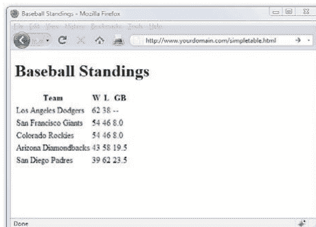

**图 6.1**
代码清单 6.1 中的 HTML 代码创建了一个包含六行四列的表格。

**提示**
HTML 会忽略单词和标签之间的多余空格。但是，如果你使用空格来缩进 `<tr>` 和 `<td>` 标签，如我在代码清单 6.1 中所做的那样，你可能会发现你的 HTML 表格更易于阅读（并且更不容易出现浪费时间的错误）。

示例中的表格包含棒球排名，非常适合按行和列排列——虽然有点单调。在本章中，你将学习如何让它变得生动一些。表格中的标题显示了排名中的球队（Team）、胜场（W）、负场（L）和落后场次（GB）。虽然我们没有对代码清单 6.1 中的 HTML 应用任何样式，但你可以在表格单元格中使用任何文本样式。但是，在一个单元格中使用的样式或 HTML 标签不会传递到其他单元格，并且来自表格外部的标签不适用于表格内部。例如，请考虑以下表格：


# 110 第6章 使用表格展示信息

```
<table>
<tr>
<td style="font-style:italic">hello</td>
<td>there</td>
</tr>
</table>
```

在这个例子中，`<p>` 标签被用于表格周围，以演示表格如何免疫外部标签。单词 `there` 既不会是粗体，也不会是斜体，因为表格外部的 `font-weight:bold` 样式和前一个单元格的 `font-style:italic` 样式都不会影响它。然而，在这个例子中，单词 `hello` 是斜体。

要将单词 `hello` 和 `there` 加粗，请将表格代码更改为如下所示：

```
<table style="font-weight:bold">
<tr>
<td style="font-style:italic">hello</td>
<td>there</td>
</tr>
</table>
```

在这个例子中，两个单词都是粗体，单词 hello 同时也是斜体。当然，你不必在表格级别应用样式。`font-weight:bold` 样式同样可以轻松地单独应用于每个单元格；你可以在每个单元格中重复 `style=”font-weight:bold”`，或者在你的样式表中创建一个类，并在每个单元格中使用 `class=”classname”`——这取决于你的选择。

### 控制表格尺寸

当未指定表格宽度时，表格及其各个单元格的大小会自动扩展以适应你放置在其中的数据。然而，你可以选择通过使用 `<table>` 标签中的 `width` 和/或 `height` 样式来精确控制整个表格的大小。你也可以通过在各个 `<td>` 标签中放置 `width` 和 `height` 样式来控制每个单元格的大小。`width` 和 `height` 样式可以指定为像素或百分比。例如，以下代码创建了一个宽500像素、高400像素的表格：

```
<table style="width:500px; height:400px">
```

要使表格的第一个单元格宽度为表格总宽度的20%，第二个单元格宽度为表格总宽度的80%，请输入以下内容：

```
<table style="width:100%">
<tr>
<td style="width:20%">skinny cell</td>
<td style="width:80%">fat cell</td>
</tr>
</table>
```

注意表格的尺寸被设置为100%，这确保了表格填满浏览器窗口的整个宽度。当你使用百分比而不是固定的像素大小时，表格将自动调整大小以适应任何大小的浏览器窗口，同时保持你所追求的审美平衡。在这种情况下，表格内的两个单元格将自动调整大小，分别占表格总宽度的20%和80%。

在清单6.2中，清单6.1中的简单表格被扩展，以展示对表格单元格宽度的具体控制。

#### 清单6.2 指定表格单元格宽度

```
<?xml version="1.0" encoding="UTF-8"?>
<!DOCTYPE html PUBLIC "-//W3C//DTD XHTML 1.1//EN"
"http://www.w3.org/TR/xhtml11/DTD/xhtml11.dtd">
<html xmlns="http://www.w3.org/1999/xhtml" xml:lang="en">
<head>
<title>Baseball Standings</title>
</head>
<body>
<h1>Baseball Standings</h1>
<table>
<tr>
<th style="width:35px;"></th>
<th style="width:175px;">Team</th>
<th style="width:25px;">W</th>
<th style="width:25px;">L</th>
<th style="width:25px;">GB</th>
</tr>
<tr>
<td></td>
<td>Los Angeles Dodgers</td>
<td>62</td>
<td>38</td>
<td>—</td>
</tr>
<tr>
<td></td>
<td>San Francisco Giants</td>
<td>54</td>
<td>46</td>
<td>8.0</td>
</tr>
<tr>
<td></td>
<td>Colorado Rockies</td>
<td>54</td>
<td>46</td>
<td>8.0</td>
</tr>
<tr>
<td></td>
<td>Arizona Diamondbacks</td>
<td>43</td>
<td>58</td>
<td>19.5</td>
</tr>
<tr>
<td></td>
<td>San Diego Padres</td>
<td>39</td>
<td>62</td>
<td>23.5</td>
</tr>
</table>
</body>
</html>
```

你可以在图6.2中看到一致的列宽。

图6.2

清单6.2中的HTML代码创建了一个包含六行五列的表格，每列都使用了特定的宽度。

# 112 第6章 使用表格展示信息

清单6.1和清单6.2中使用的代码有两个区别。首先，清单6.2中增加了一列；这一列没有标题，但在第一个表格行中仍然存在 `<th></th>` 标签对。在第二到第六行中，这额外的一列包含一个图像（`` 标签）。清单6.2中的第二个区别是为第一行中的每个 `<th>` 元素添加了特定的宽度样式。第一列定义为35px宽，第二列为175px宽，第三、第四和第五列各为25px宽。

还要注意，这些宽度在后续行的 `<td>` 元素中并未重复。从技术上讲，你只需要在第一行定义宽度；其余的行将遵循这一设定，因为它们都是同一表格的一部分。但是，如果你使用了另一种格式化样式（例如改变字体大小或颜色的样式），则必须为每个应该具有这些显示属性的元素重复该样式。

### 表格内的对齐和合并

默认情况下，你放置在表格单元格中的任何内容都向左对齐并垂直居中。图6.1和图6.2展示了这种默认对齐方式。然而，你可以使用 `text-align` 和 `vertical-align` 样式属性来水平和垂直对齐表格单元格的内容。你可以将这些对齐属性应用于任何 `<tr>`、`<td>` 或 `<th>` 标签。分配给 `<tr>` 标签的对齐属性将应用于该行中的所有单元格。根据你的表格大小，通过将这些属性应用于 `<tr>` 级别而不是每个 `<td>` 或 `<th>` 标签，你可以节省相当多的时间和精力。

清单6.3中的HTML代码使用文本对齐样式的组合为一行应用了默认对齐，但在一些单独的单元格中被覆盖。图6.3展示了清单6.3中代码的结果。

以下是一些更常用的 `vertical-align` 样式**属性值：** `top`、`middle`、`bottom`、`text-top`、`text-bottom` 和 `baseline`（用于文本）。这些属性值为你在垂直对齐表格数据方面提供了充足的灵活性。

# 114 第6章 使用表格展示信息

#### 清单6.3 表格中的对齐、单元格间距、边框和背景颜色

```
<?xml version="1.0" encoding="UTF-8"?>
<!DOCTYPE html PUBLIC "-//W3C//DTD XHTML 1.1//EN"
"http://www.w3.org/TR/xhtml11/DTD/xhtml11.dtd">
<html xmlns="http://www.w3.org/1999/xhtml" xml:lang="en">
<head>
<title>Things to Fear</title>
</head>
<body>
<h1>Things to Fear</h1>
<table border="2" cellpadding="4" cellspacing="2" width="100%">
<tr style="background-color:red;color:white">
<th colspan="2">Description</th>
<th>Size</th>
<th>Weight</th>
<th>Speed</th>
</tr>
<tr style="vertical-align:top">
<td></td>
<td style="font-size: 14px;font-weight:bold; vertical-align:middle;text-align:center">.38 Special</td>
<td>Five-inch barrel.</td>
<td>Twenty ounces.</td>
<td>Six rounds in four seconds.</td>
</tr>
<tr style="vertical-align:top">
<td></td>
<td style="font-size: 14px;font-weight:bold; vertical-align:middle;text-align:center">Rhinoceros</td>
<td>Twelve feet, horn to tail.</td>
<td>Up to two tons.</td>
<td>Thirty-five miles per hour in bursts.</td>
</tr>
<tr style="vertical-align:top">
<td></td>
<td style="font-size: 14px;font-weight:bold; vertical-align:middle;text-align:center">Broad Axe</td>
<td>Thirty-inch blade.</td>
<td>Twelve pounds.</td>
<td>Sixty miles per hour on impact.</td>
</tr>
</table>
```


## 表格中的对齐与合并 115

图 6.3

代码清单 6.3 展示了 `colspan` 属性和对齐样式的用法。

> 提示

在图 6.3 的顶部，单个单元格（Description）横跨两列。这通过在该单元格的 `<th>` 标签中使用 `colspan` 属性来实现。正如你可能猜到的，你也可以使用 `rowspan` 属性来创建一个跨越多行的单元格。

合并是指强制一个单元格跨越表格中多行或多列的过程。`colspan` 属性使单元格跨越多列；`rowspan` 对行有同样的效果。在创建跨越多列或多行的单元格时，在脑海中保持行和列的结构组织清晰可能是最困难的部分。最微小的错误也常常会使整个表格陷入混乱。在开始编写实现它们的 HTML 之前，先在纸上勾勒出你的表格，这将为你节省时间和避免挫折。

此外，Description 列中的第二个单元格使用了文本样式来创建粗体文本，该文本同时垂直居中和水平居中。

代码清单 6.3 中有几个我尚未解释的技巧。你可以为整个表格以及表格中的每一行或每个单元格设置自己的背景，该背景不同于你可能在网页本身上使用的任何背景。你经常会看到表格中交替的行颜色。你可以通过将 `background-color` 或 `background-image` 样式放入 `<table>`、`<tr>`、`<td>` 或 `<th>` 标签中来实现这一点，就像在 `<body>` 示例中一样，一行可能有灰色背景，而下一行可能有白色背景。注意：参见第 8 章“处理颜色、图像和多媒体”。

例如，要给整个表格设置黄色背景，你可以使用 `<table style="background-color:yellow">` 或等效的 `<table style="background-color:#FFFF00">`。在代码清单 6.3 中，只有顶行有背景颜色；它使用 `<tr style="background-color:red;color: white">` 来为该行中的单元格应用红色背景。此外，`color` 样式确保该行中的文本为白色。交替的行颜色有助于用户更清晰地阅读表格内容，特别是当表格相当大时。

## 116 第 6 章 使用表格显示信息

注意 与 `background-color` 样式属性类似的是 `background-image` 属性（本例中未显示），它用于为表格背景设置图像。如果你想将图像 `leaves.gif` 设置为表格的背景，你可以使用 `<table style="background-image:url(leaves.gif)">`。注意，图像文件放在圆括号内，并以 `url` 一词开头，这表明你正在描述图像文件的位置。尽管 XHTML 中仍允许使用 `cellpadding` 和 `cellspacing` 属性，但 CSS 中存在等效的 `padding` 和 `border-spacing` 样式属性。

调整表格不仅仅是使用样式属性。如代码清单 6.3 所示，你可以使用 `cellpadding` 和 `cellspacing` 属性来控制表格边框周围的间距。`cellspacing` 属性设置表格边框之间以及表格单元格之间的间距（以像素为单位）。`cellpadding` 属性设置单元格内信息边缘周围的间距，也是以像素为单位。将 `cellpadding` 值设置为 0 会使表格中的所有信息尽可能靠近表格边框对齐，甚至可能接触边框。`cellpadding` 和 `cellspacing` 属性让你能很好地全面控制表格的外观。

### 使用表格进行页面布局

在本章开头，我指出设计师使用表格进行页面布局和显示表格信息。如果你查看另一位设计师的源代码，你仍然会发现许多基于表格的布局示例。这种设计方法源于旧时代（1990 年代中期至 2000 年代初期）浏览器对 CSS 支持的不一致性。所有浏览器都支持表格，并且通常方式相同，因此网页设计师采用了基于表格的内容创建方法，以在所有浏览器上实现相同的视觉页面显示。然而，现在主要浏览器对 CSS 的支持相对相似，设计师可以遵循长期以来基于标准的建议，即不使用表格进行页面布局。

万维网联盟（W3C）是监督网络未来的标准机构，它推广样式表作为布局页面的正确方式（而不是使用表格）。样式表最终比表格强大得多，这就是为什么本书的大部分内容教你如何使用样式表进行页面布局。

避免使用表格进行布局的主要原因包括：

- 将呈现与内容混合——CSS 和符合标准的网页设计的目标之一是将呈现层与内容层分离。
- 创造不必要的复杂重新设计——要更改基于表格的布局，你必须更改站点每个页面上的基于表格的布局（除非它是复杂的、动态驱动的站点的一部分，在这种情况下，你必须撤销所有动态部分并重新制作它们）。
- 可访问性问题——屏幕阅读软件会查看表格以获取内容，并且经常尝试将你的布局表格作为内容表格来读取。
- 在移动设备上渲染——表格布局通常不够灵活，无法缩小到小屏幕上（参见第 12 章，“创建固定或弹性布局”）。

这些只是基于表格的网页设计中问题的几个例子。要更仔细地了解其中一些问题，请参阅热门演讲“为什么使用表格进行布局是愚蠢的”，地址为 http://www.hotdesign.com/seybold/everything.html。

## 总结

在这个简短的章节中，你学习了如何将文本和图像排列成有组织的行和列组合，称为表格。你学习了创建表格的三个基本标签以及许多用于控制表格对齐、间距和外观的可选属性和样式。你还发现表格可以组合使用并相互嵌套，以实现更广泛的布局选项。

表 6.1 总结了本章涵盖的标签和属性。

### 表 6.1 第 6 章涵盖的 HTML 标签和属性

| 标签/属性 | 功能 |
| :--- | :--- |
| `<table>...</table>` | 创建一个表格，可以包含任意数量的行（`<tr>` 标签）。 |
| **属性** | |
| `border="width"` | 指示表格边框的宽度（以像素为单位）。使用 `border="0"` 或省略 border 属性会使边框不可见。 |
| `cellspacing="spacing"` | 表格中单元格之间的间距，以像素为单位。 |
| `cellpadding="padding"` | 单元格边缘与其内容之间的间距，以像素为单位。 |
| `style="width:width"` | 表格在页面上的宽度，可以是精确的像素值，也可以是页面宽度的百分比。 |
| `style="height:height"` | 表格在页面上的高度，可以是精确的像素值，也可以是页面高度的百分比。 |
| `style="background-color:color"` | 表格和尚未设置背景颜色的单个单元格的背景颜色。 |
| `style="background-image:url(imageurl)"` | 要在表格和尚未设置背景图像的单个单元格内显示的背景图像。（如果还指定了背景颜色，则颜色将显示在图像的透明区域中。） |
| **`<tr>...</tr>`** | 定义一行表格，包含一个或多个单元格（`<td>` 标签）。 |
| **属性** | |
| `style="text-align:alignment"` | 该行中单元格内容的水平对齐方式。可能的值有 left、right 和 center。 |

## 118 第 6 章 使用表格显示信息

此行内单元格内容的垂直对齐方式。常用值包括 top、middle 和 bottom。

style="background-color:color" 该行中所有尚未设置背景色的单元格的背景颜色。

style="backgroundimage: url(imageurl)" 该行中所有尚未设置背景图像的单元格内显示的背景图像。

`<td>...</td>` 定义表格数据单元格。

`<th>...</th>` 定义表格标题单元格。（接受与 `<td>` 所有相同的属性和样式。）

### 属性

style="text-align:alignment" 单元格内容的水平对齐方式。可能的值为 left、right 和 center。

style="vertical-align:alignment" 单元格内容的垂直对齐方式。常用值为 top、middle 和 bottom。

rowspan="numrows" 此单元格将跨越的行数。

colspan="numcols" 此单元格将跨越的列数。

style="width:width" 此列单元格的宽度，以精确像素值或占表格宽度的百分比表示。

### 属性

style="height:height" 此行单元格的高度，以精确像素值或占表格高度的百分比表示。

style="background-color:color" 单元格的背景颜色。

style="backgroundimage: url(imageurl)" 单元格内显示的背景图像。

## 总结 119

表 6.1 续表

### 属性

style="height:height" 此行单元格的高度，以精确像素值或占表格高度的百分比表示。

style="background-color:color" 单元格的背景颜色。

style="backgroundimage: url(imageurl)" 单元格内显示的背景图像。

## 120 第 6 章 使用表格显示信息

## 问与答

问：我制作了一个大表格，加载页面时，页面长时间显示空白。为什么会等待这么久？

答：复杂的表格可能需要一段时间才能在屏幕上显示。网页浏览器必须计算表格中所有内容的大小，然后才能显示其中的任何部分。你可以通过始终为表格中的每个图形图像包含 `width` 和 `height` 属性来略微加快显示速度。在 `<table>` 和 `<td>` 标签中使用 `width` 属性也有帮助。

问：我可以在表格内放置表格吗？

答：是的，你可以在其他表格单元格内嵌套表格。但是，嵌套表格——尤其是大表格——需要时间加载和正确渲染。在创建嵌套表格之前，请考虑你放在页面上的内容，并问问自己是否可以用 CSS 来显示它。在读完本书之前，你可能不会知道所有答案，但这里有一个提示：在大多数情况下，答案是肯定的。

## 练习区

本练习区包含测验题和练习题，帮助你巩固对所涵盖材料的理解。请在查看后面的“答案”部分之前，尝试回答所有问题。

## 测验

1. 如何创建一个带有标准边框的简单两行两列表格？
2. 扩展问题 1，如何在表格边框和单元格之间添加 30 像素的间距？
3. 继续使用你在问题 1 和 2 中构建的表格，如何使左上角单元格为绿色，右上角单元格为红色，左下角单元格为黄色，右下角单元格为蓝色？

## 练习区 121

## 答案

1. 使用以下 HTML：

```html
<table border="1">
  <tr>
    <td>左上...</td>
    <td>右上...</td>
  </tr>
  <tr>
    <td>左下...</td>
    <td>右下...</td>
  </tr>
</table>
```

2. 在 `<table>` 标签中添加 `cellspacing="30"`。
3. 在左上角 `<td>` 标签中添加 `style="background-color:green"`，在右上角 `<td>` 标签中添加 `style="background-color:red"`，在左下角 `<td>` 标签中添加 `style="background-color:yellow"`，在右下角 `<td>` 标签中添加 `style="background-color:blue"`。

## 练习题

- 你是否有任何页面包含访问者可能感兴趣以列表或表格形式查看的信息？使用表格呈现一些表格信息。确保每列都有自己的标题（或者可能是自己的图形）。尝试使用你在本章学到的各种对齐和间距类型。
- 你经常会看到表格中交替的行颜色，一行是灰色背景，下一行是白色背景。表格行颜色交替的目的是在快速浏览充满数据的表格时，更容易分辨各个行。创建一个具有交替行颜色和文本颜色（如果需要）的表格。虽然关于颜色的课程在第 8 章，但你在本课中已有足够的信息可以开始尝试此过程。

此页有意留白

# 第 7 章

**本章你将学到：**

- 如何使用锚点链接
- 如何链接你自己网站上的页面
- 如何链接到外部内容
- 如何链接到电子邮件地址
- 如何在链接中使用窗口目标
- 如何使用 CSS 为链接设置样式

到目前为止，你已经学习了如何使用 HTML 标签创建一些基本的网页。然而，此时，这些内容片段是孤立的，与其他任何内容都没有连接（尽管在第 3 章“理解层叠样式表”的示例中，我确实悄悄加入了一些页面链接）。要将你的作品转化为真正的网络内容，你需要将其连接到 Web 的其他部分——或者至少是你个人或公司网站中的其他页面。

本章将向你展示如何创建指向你自己文档中内容的超文本链接，以及如何链接到其他外部文档。此外，你将学习如何为超文本链接设置样式，使其以你期望的颜色和装饰显示——而不一定是默认的蓝色下划线显示。

### 使用 Web 地址

为单个网站存储 Web 内容的最简单方法是将所有文件放在同一个文件夹中。当文件这样集中存储时，你只需在 `<a>` 标签的 href 属性中提供文件名即可链接到它们。

> **注意**
> 在我们开始之前，你可能需要回顾一下关于在服务器上放置文件以及如何在目录集中管理文件的基础知识。这些信息在创建 Web 内容中的链接时很重要。请参阅第 1 章“发布 Web 内容”，特别是标题为“了解在 Web 服务器上放置文件的位置”的部分。

属性是与标签关联的额外信息，提供有关标签的更多详细信息。例如，`<a>` 标签的 href 属性标识你正在链接的页面地址。

在拥有多个页面之后，或者当你开始对网站中的内容进行组织结构划分时，你应该将文件放入目录（或文件夹）中，其名称应反映其中的内容。例如，你所有的图片可以放在一个“images”目录中，公司信息可以放在一个“about”目录中，以此类推。

## 124 第 7 章 使用外部和内部链接

> **注意**
> 在 HTML 中始终使用 / 正斜杠分隔目录。不要使用 \ 反斜杠（通常在 Windows 中使用）来分隔目录。请记住，Web 中的一切都是向前的，所以请使用正斜杠。

无论你在自己的 Web 服务器内如何组织文档，你都可以使用相对地址，它只包含从一个页面找到另一个页面所需的足够信息。

相对地址描述了从一个网页到另一个网页的路径，而不是完整的（或绝对的）互联网地址。

如果你回忆第 1 章，你的 Web 服务器的文档根目录是指定为 Web 内容顶级目录的目录。在 Web 地址中，该文档根目录由正斜杠 (/) 表示。所有后续级别的目录都由相同类型的正斜杠分隔。例如：

/directory/subdirectory/subsubdirectory/

假设你正在文档根目录中创建一个名为 `zoo.html` 的页面，并且你想包含指向 `elephants` 子目录中名为 `african.html` 和 `asian.html` 的页面的链接。链接将如下所示：


### 使用网页地址

这些特定的地址实际上被称为相对根目录地址，因为它们是省略了整个域名的相对地址，但它们具体是相对于正斜杠指定的文档根目录。使用常规的相对地址时，可以省略开头的正斜杠。这种类型的地址允许链接相对于它们所在的任何目录——可能是文档根目录，也可能是从文档根目录向下一级或多级目录：

```html
<a href="elephants/african.html">了解非洲象。</a>
```

```html
<a href="elephants/asian.html">了解亚洲象。</a>
```

你位于 `elephants` 子目录中的 `african.html` 和 `asian.html` 文件，可以通过以下两种方式链接回主页面 `zoo.html`：

```html
<a href="http://www.yourdomain.com/zoo.html">返回动物园主页。</a>
```

```html
<a href="/zoo.html">返回动物园主页。</a>
```

```html
<a href="../zoo.html">返回动物园主页。</a>
```

第一个链接是绝对链接。对于绝对链接，链接目标非常明确，因为提供了完整的 URL——包含域名。第二个链接是相对根目录链接。它相对于你当前浏览的域名，因此不需要协议类型（例如 `http://`）和域名（例如 `www.yourdomain.com`），但开头的正斜杠用于表明地址从文档根目录开始。在第三个链接中，双点 (`..`) 是一个特殊命令，表示包含当前文件夹的文件夹——换句话说，就是父文件夹。任何时候看到双点，只需在心里想着“在目录结构中向上一级”。

如果你在整个网页中始终如一地使用相对地址，那么你可以将页面移动到另一个文件夹、磁盘驱动器或网络服务器上，而无需更改链接。

如果需要，相对地址可以跨越相当复杂的目录结构。第27章“组织和管理网站”提供了关于组织和链接大量网页的更详细建议。

希望到目前为止，你在学习各章节的过程中已经创建了一两个自己的页面。按照以下步骤再添加几个页面并将它们链接起来：

#### 创建一个简单的网站架构

1.  将主页用作主要入口和中心枢纽，所有其他页面都与之相连。如果你创建了一个关于你个人或业务的页面，就将该页面用作主页。你现在可能还想为此目的创建一个新页面。
2.  在主页上，放置一个指向你已创建的其他 HTML 文件的链接列表（或为你计划很快创建的 HTML 文件放置占位符）。确保每个链接中文件名的拼写（包括任何大写字母）都正确无误。
3.  在除了主页之外的每个页面的底部（或顶部），都包含一个指向你主页的链接。这使得在你的网站中导航变得简单而轻松。
4.  你可能还想在你的主页或一个单独的链接页面上，包含一个指向相关或有趣网站的链接列表。人们通常会在自己的主页上列出朋友的个人页面链接。然而，企业应该注意不要过快地将潜在客户引导到其他网站——因为他们可能不会记得返回。

> **提示** 关于相对地址（`elephants/african.html`）与绝对地址（`http://www.takeme2thezoo.com/elephants/african.html`）的一般规则是：当链接到存储在一起的文件时（例如同属于一个网站的文件），应使用相对地址。当链接到其他地方的文件时——另一台计算机、另一个磁盘驱动器，或者更常见的是互联网上的另一个网站——则应使用绝对地址。

## 第126页 第7章 使用外部和内部链接

### 使用锚点在页面内链接

`<a>` 标签——负责网络超链接的标签——其名称来源于“锚”这个词，意味着链接充当网页中某个位置的标识。到目前为止，在本书展示的示例中，你已经学习了如何使用 `<a>` 标签链接到其他地方，但这只是它用途的一半。让我们开始使用锚点链接，这些链接指向同一页面内的内容。

#### 使用锚点在页面中标识位置

`<a>` 标签可用于将页面上的某个点标记为锚点，从而允许你创建一个指向该精确位置的链接。清单7.1（将在本章稍后展示）演示了一个指向页面内锚点的链接。为了了解此类链接是如何制作的，让我们快速预览一下清单中的第一个 `<a>` 标签：

```html
<a id="top"></a>
```

> **注意** `<a>` 标签通常使用 `href` 属性来指定超链接目标。旧版本的 HTML 使用 `name` 属性而不是 `id`。较新版本的 HTML 和 XHTML 已弃用 `name` 属性，转而使用 `id`。`<a href>` 是你点击的内容，而 `<a id>` 是你点击后前往的位置。在这个例子中，`<a>` 标签仍然指定了一个目标，但没有创建实际的链接。相反，`<a>` 标签为标签所在页面的特定点赋予了一个名称。必须包含 `</a>` 标签，并且必须为 `id` 属性分配一个唯一的名称，但 `<a>` 和 `</a>` 之间不需要任何文本。

#### 链接到锚点位置

清单7.1展示了一个在单个页面中放置了各种锚点的网站。查看清单7.1中的最后一个 `<a>` 标签示例：

```html
<a href="#top">返回目录。</a>
```

`#` 符号意味着 `top` 这个词指的是当前文档内的一个命名锚点，而不是一个单独的页面。当用户点击“返回目录”时，网页浏览器会显示从 `<a id="top">` 标签开始的页面部分。

### 使用锚点在页面内链接 第127页

**清单7.1** 使用带 `id` 属性的 `<a>` 标签设置锚点

```xml
<?xml version="1.0" encoding="UTF-8"?>
<!DOCTYPE html PUBLIC "-//W3C//DTD XHTML 1.1//EN"
"http://www.w3.org/TR/xhtml11/DTD/xhtml11.dtd">
<html xmlns="http://www.w3.org/1999/xhtml" xml:lang="en">
<head>
<title>按字母排序的莎士比亚</title>
</head>
<body>
<h1><a id="top"></a>莎士比亚十四行诗首句</h1>
<p>你是否曾讨厌在求爱时，单膝跪地准备朗诵一首完全浪漫的莎士比亚十四行诗，却突然大脑一片空白。*“嗯… 是，呃… 我想它以 B 开头…”*</p>
<p>那么，现在你不再显得傻乎乎了。只需参考此页，点击你想找的十四行诗的首字母，就能立即回忆起开篇诗句。*“让那颗使我心呻吟的心遭殃吧…”*</p>
<h2 style="text-align:center">字母索引</h2>
<h3 style="text-align:center">
<a href="#A">A</a> <a href="#B">B</a> <a href="#C">C</a>
<a href="#D">D</a> <a href="#E">E</a> <a href="#F">F</a>
<a href="#G">G</a> <a href="#H">H</a> <a href="#I">I</a>
<a href="#J">J</a> <a href="#K">K</a> <a href="#L">L</a>
<a href="#M">M</a> <a href="#N">N</a> <a href="#O">O</a> <!-- 继续字母 -->
<a href="#P">P</a> <a href="#Q">Q</a> <a href="#R">R</a>
<a href="#S">S</a> <a href="#T">T</a> <a href="#U">U</a>
<a href="#V">V</a> <a href="#W">W</a> <a href="#X">X</a>
<a href="#Y">Y</a> <a href="#Z">Z</a>
</h3>
<hr />
<h3><a id="A"></a>A</h3>
<ul>
<li>
女人天生丽质的脸庞，</li>
<li>
如此控诉我，说我怠慢了所有，</li>
```

在清单7.1的末尾，你会看到一行文字：

```
<!-- 继续字母 -->
```

这段文本（一个 HTML 注释）会出现在你的源代码中，但不会被浏览器显示。你可以在第27章了解更多关于为代码添加注释的内容。


作为一个舞台上不完美的演员，
你成长的速率有多快，衰落的速率就有多快，
锚点，请务必用文本（如 photo1, photo2,
等）来开启它们，而不是仅仅用 1, 2
之类的纯数字。纯数字的锚点ID在
浏览器中可以工作，但它们并不符合
有效的XHTML代码标准。

返回索引。

## Z

（没有十四行诗以Z开头。）

返回索引。

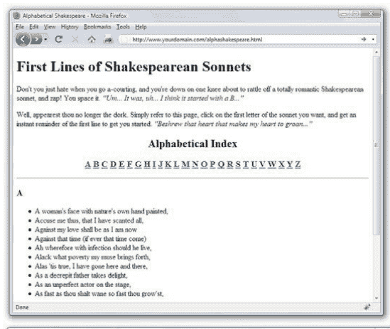

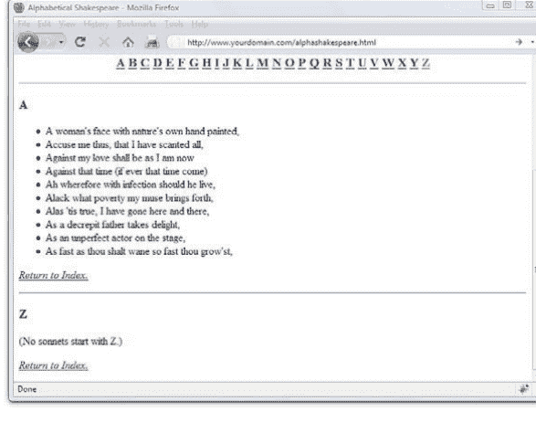

### 128 第7章 使用外部和内部链接

代码清单7.1中的每个`<a href>`链接都会创建一个带下划线的链接，指向一个对应的`<a id>`锚点——或者如果我填入了所有文本的话，它应该是这样的。在这个示例中，只有A和Z会生效，因为只有A和Z链接有对应的文本可以链接，但请随时自己填入其余部分！例如，点击图7.1中字母索引下的字母Z，就会跳转到图7.2所示的页面部分。

### 图7.1

代码清单7.1中的`<a id>`标签在网页上完全不显示。`<a href>`标签则显示为带下划线的链接。

### 图7.2

点击图7.1所示页面上的字母Z，会将你带到同一页面的相应部分。

### 在自己的网页内容间建立链接 129

掌握了在单个页面内对文本部分建立链接的概念后，你现在可以学习将其他网页内容片段链接在一起了。

### 在自己的网页内容间建立链接

正如你在本章前面所学，当链接到你所在域（或在同一台计算机上本地查看你的网站时）内的内容时，你不需要在href属性中指定的每个地址前都加上`http://`。当你在同一个域或同一台计算机上的两个文件之间创建链接时，不需要指定完整的互联网地址。事实上，如果两个文件存储在同一个文件夹中，你可以直接使用HTML文件的名称：

```
<a href="pagetwo.html">前往第2页。</a>
```

例如，代码清单7.2和图7.3展示了一个带有答案页面链接的测验页面，答案页面如代码清单7.3和图7.4所示。答案页面包含一个返回测验页面的链接。因为代码清单7.2中的页面链接到同一目录中的另一个页面，所以可以使用文件名代替完整地址。

#### 代码清单7.2 historyquiz.html文件

```
<?xml version="1.0" encoding="UTF-8"?>
<!DOCTYPE html PUBLIC "-//W3C//DTD XHTML 1.1//EN"
"http://www.w3.org/TR/xhtml11/DTD/xhtml11.dtd">
<html xmlns="http://www.w3.org/1999/xhtml" xml:lang="en">

<head>

<title>历史测验</title>

</head>

<body>

<h1>历史测验</h1>

<p>完成以下韵文。（例如：征服者威廉

在……十年六十六年对撒克逊人施以残酷诡计。）</p>

<ol>

<li>哥伦布在……年航行于蔚蓝大洋。</li>

<li>西班牙无敌舰队在……年遭遇其命运。</li>

<li>伦敦在……年如朽木般燃烧。</li>

</ol>

<p style="text-align: center;font-weight: bold;">

<a href="historyanswers.html">检查你的答案！</a>

</p>

</body>

</html>
```

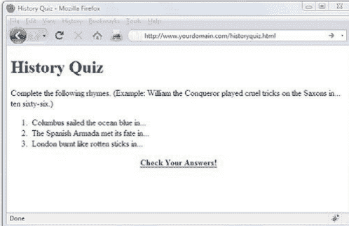

### 130 第7章 使用外部和内部链接

#### 图7.3

这是代码清单7.2中列出的historyquiz.html文件，也是代码清单7.3中链接所指向的文件。

#### 代码清单7.3 historyquiz.html链接到的historyanswers.html文件

```
<?xml version="1.0" encoding="UTF-8"?>
<!DOCTYPE html PUBLIC "-//W3C//DTD XHTML 1.1//EN"
"http://www.w3.org/TR/xhtml11/DTD/xhtml11.dtd">
<html xmlns="http://www.w3.org/1999/xhtml" xml:lang="en">
<head>
<title>历史测验答案</title>
</head>
<body>
<h1>历史测验答案</h1>

<ol>
<li>...一千四百九十二年。</li>
<li>...一千五百八十八年。</li>
<li>...一千六百六十六年。</li>
</ol>
<p style="text-align: center;font-weight: bold;">
<a href="historyquiz.html">返回问题</a>
</p>
</body>
</html>
```

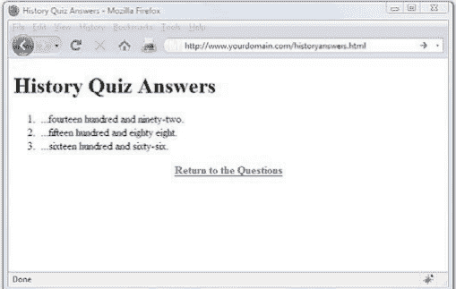

### 链接到外部网页内容 131

#### 图7.4

图7.3中的“检查你的答案！”链接会带你到这个答案页面。“返回问题”链接则带你回到图7.3所示的内容。

使用文件名代替完整的互联网地址可以为你节省大量输入。更重要的是，无论这组页面存储在哪里，你页面之间的链接都能正常工作。你可以在文件仍在计算机硬盘上时测试这些链接。然后，你可以将它们移动到Web服务器、CD-ROM、DVD或内存卡上，所有链接仍然可以正常工作。这种简化识别网页的方法并没有什么魔力——这与你已经学过的网页地址机制有关。

### 链接到外部网页内容

链接到你自己网站内的页面与链接到外部网页内容的唯一区别在于，链接到站外时，你需要包含该内容的完整地址。完整地址包括域名前的`http://`，然后是文件的完整路径名（例如，HTML文件、图像文件、多媒体文件等）。

正如你可能知道的，在大多数网页浏览器中键入地址时，你可以省略前面的`http://`。

例如，要从你自己的某个网页中包含一个指向Google的链接，你会在你的`<a>`链接中使用这种绝对地址方式：然而，当你在网页的`<a href>`链接中输入互联网地址时，不能省略该部分。

```
<a href="http://www.google.com/">前往谷歌</a>
```

你可以将前面学到的知识应用到创建指向其他页面上命名锚点的链接。链接的锚点不限于同一页面。你可以通过包含地址或文件名，后跟`#`和锚点名称，来链接到另一个页面上的命名锚点。例如，以下链接将带你到域名www.takeme2thezoo.com上elephants目录内african.html页面中名为photos的锚点。

```
<a href="http://www.takemetothezoo.com/elephants/african.html#photos">查看非洲大象照片！</a>
```

**注意** 如果你链接自www.takemetothezoo.com域上的另一个页面（因为事实上你是该网站的维护者），你的链接可能如下：

```
<a href="/elephants/african.html#photos">查看非洲大象照片！</a>
```

请确保仅在`<a href>`链接标签中包含`#`符号。不要仅仅将`#`符号放在`<a id>`标签中；在那种情况下，指向该名称的链接将无法工作。在这种情况下，`http://`和域名将不是必需的，正如你已经了解到的。

### 链接到电子邮件地址

除了在页面之间以及单个页面的不同部分之间建立链接外，`<a>`标签还允许你链接到电子邮件地址。这是让网页访问者能够回复你的最简单方式。当然，你也可以直接向访问者提供你的电子邮件地址，相信他们会将其输入到他们使用的任何电子邮件程序中，但这会增加出错的可能性。通过提供一个可点击的电子邮件地址链接，你可以让他们几乎毫不费力地给你发送消息，并消除打字错误的可能性。

HTML链接到电子邮件地址的形式如下：

```
<a href="mailto:yourusername@yourdomain.com">给我发送
电子邮件消息。</a>
```

`给我发送电子邮件消息`这些文字将像任何其他`<a>`链接一样显示。

如果你想让人们看到你的实际电子邮件地址（以便他们可以记录下来或使用不同的电子邮件程序发送消息），请同时将其包含在`href`属性中以及`<a>`和`</a>`标签之间的消息部分中，如下所示：

```
<a href="mailto:you@yourdomain.com">you@yourdomain.com</a>
```

在大多数网页浏览器中，当有人点击该链接时，她会得到一个窗口，她可以在其中输入一条消息，该消息会立即发送给你——无论此人使用什么电子邮件程序收发邮件，都会自动……


### 链接到电子邮件地址

你可以在链接中提供一些额外信息，使主题和邮件正文也能有默认值。这可以通过向 mailto 链接添加 subject 和 body 变量来实现。变量与电子邮件地址之间用问号 (?) 分隔，变量与值之间用等号 (=) 分隔，每对变量和值之间则用和符号 (&) 分隔。此刻你不必理解变量/值这些术语。以下是为前面的电子邮件示例指定主题和正文的示例：

```
<a href="mailto:author@somedomain.com?subject=Book Question&body=When is the next edition coming out?">author@somedomain.com</a>
```

当用户点击此链接时，会创建一封电子邮件，收件人为 author@somedomain.com，邮件主题为 Book Question，邮件正文为 When is the next edition coming out?。

如果你想只指定邮件主题而不指定正文，只需省略和符号以及 body 变量、其值和等号即可。

在你开始将电子邮件地址广泛粘贴到你的网页上之前，我必须给你一个小小的警告，然后再告诉你一个小秘密。

一个实用的技巧。你肯定熟悉那些建立电子邮件地址数据库然后向其大量发送垃圾邮件广告的垃圾邮件发送者。垃圾邮件发送者收集电子邮件地址的一种方式是使用程序自动搜索网页中的 mailto 链接。

幸运的是，有一个小技巧可以挫败绝大多数垃圾邮件发送者。这个技巧涉及使用字符实体来编码你的电子邮件地址，这会迷惑那些试图从你的网页上获取电子邮件地址的爬虫程序。例如，以电子邮件地址 jcmeloni@gmail.com 为例。如果你用其字符实体等效形式替换地址中的字母，大多数电子邮件收集程序就会被搞糊涂。小写 ASCII 字符实体从 &#97; 对应字母 a 开始，并按字母顺序递增。例如，字母 j 是 &#106;，c 是 &#99;，依此类推。将所有字符替换为其 ASCII 属性后，得到以下结果：

```html
<a href="mailto:&#106;&#099;&#109;&#101;&#108;&#111;&#110;&#105;&#064;&#103;&#109;&#097;&#105;&#108;&#046;&#099;&#111;&#109;">Send me an email message.</a>
```

> **提示：** 惯例是在每个网页底部放置一个指向网页作者的电子邮件链接。

这不仅使其他人更容易联系到你，还为他们提供了一种方式，可以告诉你页面中可能遗漏的任何问题。只需别忘了使用电子邮件地址字符实体技巧，让你的地址躲过垃圾邮件发送者的雷达。

因为浏览器将字符编码解释为，嗯，字符，所以从浏览器的角度来看，最终结果是相同的。然而，自动化的电子邮件收集程序搜索网页的原始 HTML 代码，在这种情况下，它显示的是一个相当混乱的电子邮件地址。如果你不想弄清楚自己地址的字符编码，只需在搜索引擎中输入“电子邮件地址编码器”，你就会在网上找到一些服务，它们会为你生成一个编码字符串。

### 在新浏览器窗口中打开链接

现在你已经掌握了如何创建链接地址——无论是内部的（网站内）还是外部的（指向其他网站），还有一种额外的链接方法：强制用户在新窗口中打开链接。

你肯定听说过弹出窗口，这些是浏览器窗口——通常用于宣传产品或服务——它们在用户未同意的情况下自动打开和显示。然而，在某些情况下，打开另一个窗口或定位到另一个位置确实具有有效的用途。例如，你可能希望在一个较小的辅助浏览器窗口中呈现信息，但仍然允许用户在主窗口中看到信息。当点击链接查看动画演示、影片剪辑或其他多媒体元素时，通常就是这种情况。当链接到站点外的内容时，你可能也希望定位到一个新的浏览器窗口。

然而，代表你的用户打开一个新的浏览器窗口——特别是当它是一个全尺寸的新窗口时——违背了一些可用性和可访问性原则。当人们打开新窗口时，通常是通过使用 `<a>` 标签的 target 属性。在严格的 XHTML 1.1 规范中，target 属性已从 `<a>` 标签中移除。

有一些有效的方法可以在遵守可用性和可访问性原则的同时实现相同的结果，但这些方法需要一点 JavaScript 和其他高级技术。随着我们进入本书的 JavaScript 部分，你将学习这些方法，该部分还将涵盖如何以符合标准且可访问的方式通过外部链接调用新窗口。

### 使用 CSS 为超链接设置样式

网页上基于文本的超链接的默认显示是带下划线的蓝色文本。你可能还注意到，以前访问过的链接显示为带下划线的紫色文本——该颜色也是默认值。如果你在网上花过任何时间，你还会注意到并非所有链接都是蓝色或紫色的——为此，我想我们都心存感激。

> **注意：** 你可以使用图形作为链接（而不是使用文本作为链接），方法是在开始的 `<a>` 和结束的 `</a>` 标签之间放置一个 `` 标签。

你将学习一些 CSS 知识以及 `<a>` 链接的各种伪类，你就可以随心所欲地设置链接的样式。

## 第八章，“处理颜色、图像和多媒体。”

伪类是一个类，描述适用于特定情况的元素样式，例如用户与该元素交互的各种状态。

### 使用 CSS 为超链接设置样式

例如，`<a>` 标签的常见伪类是 link、visited、hover 和 active。你可以用助记符“Love-Hate”——LV（love）HA（hate）来记住它们，如果你愿意的话。

- `a:link` 描述先前未访问过的超链接的样式。
- `a:visited` 描述先前已访问过并存在于浏览器内存中的超链接的样式。
- `a:hover` 描述当用户鼠标悬停在其上时（且在点击之前）超链接的样式。
- `a:active` 描述正在被点击但尚未释放的超链接的样式。

例如，假设你想制作一个具有以下样式的链接：

- 一种粗体的 Verdana 字体（且不带下划线，即没有文本装饰）
- 基础颜色为浅蓝色
- 当用户悬停或点击时颜色为红色
- 用户访问过后颜色为灰色

你的样式表条目可能如下所示：

```css
a {
  font-family: Verdana, sans-serif;
  font-weight: bold;
  text-decoration: none;
}

a:link {
  color: #6479A0;
}

a:visited {
  color: #CCCCCC;
}

a:hover {
  color: #E03A3E;
}

a:active {
  color: #E03A3E;
}
```

> **注意：** 此示例中的颜色由其十六进制值表示，你将在第八章中学习。

因为示例链接将始终是粗体 Verdana（且不带下划线），无论其处于何种状态，这三个属性和值对可以放在 a 选择器的规则中。然而，因为每个伪类必须与特定颜色关联，我们为每个伪类使用一条规则，如代码示例所示。伪类继承父规则的样式，除非伪类的规则专门覆盖该规则。换句话说，前面示例中的所有伪类都将是粗体 Verdana（且不带下划线）。但是，如果我们为 hover 伪类使用以下规则，那么当用户悬停时（如果用户确实安装了 Comic Sans 字体），文本将以 Comic Sans 显示：

```css
a:hover {
  font-family: "Comic Sans MS";
  color: #E03A3E;
}
```

此外，因为 active 和 hover 伪类使用相同的字体颜色，你可以将它们的样式规则组合起来：

```css
a:hover, a:active {
  color: #E03A3E;
}
```

清单 7.4 将这些代码片段组合在一起，生成一个使用样式化伪类的页面；此代码的结果可以在图 7.5 中看到。


#### 清单 7.4 使用样式显示链接伪类

```xml
<?xml version="1.0" encoding="UTF-8"?>
<!DOCTYPE html PUBLIC "-//W3C//DTD XHTML 1.1//EN"
"http://www.w3.org/TR/xhtml11/DTD/xhtml11.dtd">
<html xmlns="http://www.w3.org/1999/xhtml" xml:lang="en">
<head>
<title>Sample Link Style</title>
<style type="text/css">
a {
    font-family: Verdana, sans-serif;
    font-weight: bold;
    text-decoration: none;
}

a:link {
    color: #6479A0;
}

a:visited {
    color: #CCCCCC;
}

a:hover, a:active {
    color: #FF0000;
}
</style>
</head>
```

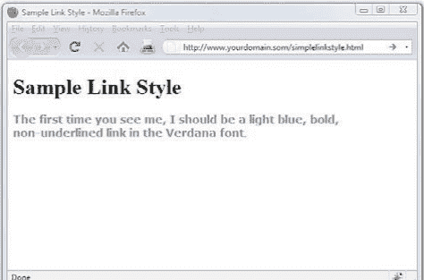

## 使用 CSS 为超链接添加样式 137

#### 清单 7.4 续

```html
<body>
    <h1>Sample Link Style</h1>
    <p><a href="simplelinkstyle.html">The first time you see me,
    I should be a light blue, bold, non-underlined link in
    the Verdana font</a>.</p>
</body>
</html>
```

#### 图 7.5

链接可以使用特定样式来控制其视觉显示。

ptg999

如果你在网页浏览器中查看这个示例，链接确实应该是一个浅蓝色、加粗、无下划线的 Verdana 字体。如果你将鼠标悬停在链接上，或点击链接但不释放鼠标，它应该会变成红色。如果你点击并释放链接，页面将只是重新加载，因为该链接指向同名的文件。然而，此时该链接将被记录在浏览器的内存中，因此会显示为已访问过的链接——它会呈现为灰色而不是蓝色。

你可以使用 CSS 对你的链接应用各种文本相关的更改。你可以更改字体、大小、粗细、装饰等等。

有时你可能希望在样式表中有几组不同的链接样式。在这种情况下，你可以创建类；你并非只能为 `<a>` 标签使用一组样式。以下示例是一组针对 `footerlink` 类的样式表规则，用于我可能想放置在网站页脚区域的链接：

```css
a.footerlink {
    font-family: Verdana, sans-serif;
    font-weight: bold;
    font-size: 75%;
    text-decoration: none;
    color: #6479A0;
}

a.footerlink:hover, a.footerlink:active {
    color: #E03A3E;
}
```

正如你在下面的示例中所见，类名 (`footerlink`) 出现在选择器名称 (`a`) 之后，用一个点分隔，并位于伪类名称 (`hover`) 之前，用一个冒号分隔：

`selector.class:pseudoclass`  
`a.footerlink:hover`

## 总结

`<a>` 标签是使超文本变得“超”的关键。通过它，你可以创建页面之间的链接以及链接到任何页面上的特定锚点。本章重点介绍了使用相对或绝对地址来标识页面，从而创建和样式化到其他页面的简单链接。ptg999

你了解到，在创建链接到他人页面时，在 `<a href>` 标签中包含每个页面的完整互联网地址非常重要。对于你自己页面之间的链接，只需包含文件名和足够的目录信息，以便从一个页面导航到另一个页面即可。

你发现了如何在页面内创建命名的锚点，以及如何创建链接到特定锚点的方法。你还学习了如何链接到你的电子邮件地址，以便用户可以轻松地给你发送消息。你甚至学会了如何保护你的电子邮件地址免受垃圾邮件发送者的侵扰。最后，你学习了使用 CSS 控制链接显示的方法。

表 7.1 总结了本章讨论的 `<a>` 标签。

### 表 7.1 第 7 章涵盖的 HTML 标签和属性

| 标签/属性 | 功能 |
|---|---|
| `<a>...</a>` | 带有 `href` 属性，可创建到另一个文档或锚点的链接；带有 `id` 属性，可创建一个可被链接到的锚点。 |
| **属性** | |
| `href="address"` | 要链接到的文档或锚点的地址。 |
| `id="name"` | 此锚点在文档中的名称。 |

## 问答 139

## 问答

**问。** 如果我链接到互联网上的一个页面，然后该页面的所有者删除或移动了它，会发生什么？

**答。** 这取决于该外部页面的维护者如何设置他的 Web 服务器。通常，当你点击一个已被移动或删除的链接时，你会看到“页面未找到”或类似的消息。你仍然可以点击“后退”按钮返回到你的页面。作为网站维护者，你可以定期运行链接检查程序，以确保你的内部和外部链接有效。一个例子是位于 http://validator.w3.org/checklink 的链接检查服务。

**问。** 我网站上的一个内部链接在我的电脑上运行正常，但当我将页面放到互联网上时，链接不再工作了。怎么回事？

**答。** 以下是最可能的罪魁祸首：

- 大小写问题——在 Windows 计算机上，使用 `<a href="myfile.html">` 链接到名为 `MyFile.html` 的文件是可行的。在大多数 Web 服务器上，链接必须是 `<a href="MyFile.html">`（或者你必须将文件名更改为 `MyFile.html`）。更糟糕的是，一些文本编辑器和文件传输程序实际上会在不通知你的情况下更改大小写！最好的解决方案是坚持为网页使用全小写的文件名。
- 文件名中的空格——大多数 Web 服务器不允许文件名中包含空格。例如，你永远不应该将网页命名为 `my page.html`。相反，应将其命名为 `mypage.html` 甚至 `my_page.html`（使用下划线而不是空格）。
- 本地绝对地址——如果出于某种原因，你使用本地绝对地址（如 `C:\mywebsite\news.html`）链接到文件，当你将文件放到互联网上时，该链接将无法工作。你永远不应该使用本地绝对地址；这种情况通常是由于为测试页面的一部分而创建的临时链接意外造成的。因此，在将页面发布到 Web 上之前，请务必小心移除任何测试链接。

**问。** 我能在同一个 `<a>` 标签中同时包含 `href` 和 `id` 吗？有什么理由需要这样做吗？

**答。** 你可以这样做，如果你有一个命名的锚点和一个链接紧挨着，这可能会节省你一些输入。然而，通常最好将 `<a href>` 和 `<a id>` 分开使用，以避免混淆，因为它们在 HTML 文档中扮演着非常不同的角色。

**问。** 如果我不小心拼错了锚点的名称，或者忘记在它前面加上 `#`，会发生什么？

**答。** 如果你链接到一个在页面内不存在的锚点名称，或者拼错了锚点名称，该链接将跳转到该页面的顶部。

## 第 7 章 使用外部和内部链接

## 研讨会

研讨会包含测验题和练习，以帮助你巩固对所涵盖内容的理解。在查看后面的“答案”部分之前，请尝试回答所有问题。

## 测验

1. 你小学时最好的朋友在互联网上找到了你，并说他想交换主页链接。你如何在你的某个页面上放置一个指向他位于 www.supercheapsuits.com/~billybob/ 的网站的链接？
2. 你会使用什么 HTML 来使得点击页面顶部的“关于作者”这几个词的人能够跳转到页面其他地方的致谢列表？
3. 如果你的电子邮件地址是 bon@soir.com，你将如何使文本“goodnight greeting”成为一个链接，人们可以点击它来撰写并发送电子邮件给你？

## 答案

1. 在你的页面上放置以下代码：

```html
<a href="http://www.supercheapsuits.com/~billybob/">Billy Bob’s site</a>
```

2. 在页面顶部输入：

```html
<a href="#credits">About the Authors</a>
```

在致谢部分的开头输入：

```html
<a id="credits"></a>
```

3. 在你的网页上输入以下内容：

```html
Send me a <a href="mailto:bon@soir.com">goodnight greeting</a>!
```

## 练习

- 创建一个 HTML 文件，其中包含一个格式化的你最喜欢网站的列表。你可能已经在网页浏览器中将这些网站添加了书签，在这种情况下，你可以访问它们，在浏览器的地址栏中找到确切的 URL。
- 如果你已经为一个网站创建了任何页面，请浏览它们，并考虑是否有任何地方你希望让人们能轻松地与你联系。在该位置包含一个指向你的电子邮件地址的链接。你永远无法提供太多让人们联系你的机会，告诉他们他们的需求或者他们对你的产品的看法——特别是如果你在经营业务。


## 第8章

这份列表看起来可能很长，但其中的每个任务都简短而精妙，将帮助你把Web开发经验从本书目前为止的白底黑字示例，提升到更有趣（或更多彩）的示例。但这并不是说浅色背景上的深色文本不好——事实上，这是你在网上最常见的颜色组合。

虽然关注配色方案并制作一个视觉上吸引人的网站很重要，但你不必是专业艺术家才能在网页上放置高影响力的图形。更重要的是，你也不需要花费数百或数千美元购买软件。本章将帮助你开始创建一些可以在网站中使用的图像。虽然本章的示例图使用了一款流行且免费的图形程序（适用于Windows、Mac和Linux用户，即GNU图像处理程序，简称GIMP），但你可以将本章学到的知识应用到任何主要的Windows或Macintosh图形应用程序中——尽管菜单和选项看起来会略有不同。

在学会创建图形本身之后，你将学习如何使用HTML和CSS来整合你的图形。在本章末尾，你将了解一些关于将额外媒体或多媒体集成到网站中的知识。

**本章你将学到：**
- 如何为网站选择在Web上有效的颜色
- 如何使用CSS设置背景、文本和边框颜色
- 如何准备用于在线的照片
- 如何创建横幅和按钮
- 如何减少图像中的颜色数量
- 如何创建透明图像
- 如何为平铺背景准备图像
- 如何在网页上放置图像
- 如何用文本描述图像
- 如何指定图像的高度和宽度
- 如何对齐图像
- 如何使用背景图像
- 如何使用图像地图
- 如何使用多媒体文件

### 选择颜色的最佳实践

我无法确切告诉你该在网站中使用哪些颜色，但我可以帮助你理解在独立选择这些颜色时应该考虑的因素。你使用的颜色会极大地影响你的访客；如果你经营一个电子商务网站，你会希望使用能够吸引用户浏览目录并最终购买商品的颜色。为此，你需要确保颜色的使用是明智且充满尊重的。你可能会想，谈论颜色时如何涉及尊重，但请记住，万维网是一个国际社区，不同的文化有不同的解读；例如，粉色在日本非常受欢迎，但在东欧国家却非常不受欢迎。同样，在美国，绿色是金钱的颜色，但绝大多数其他国家使用的是彩色纸币，因此“金钱的颜色”根本不是单一颜色，这个比喻对他们毫无价值。

除了使用具有文化敏感性的颜色外，其他最佳实践包括以下几点：
- 使用自然的调色板。这并不意味着你应该使用大地色调，而是指使用人们在小镇上随意漫步时自然会看到的颜色——避免使用会导致眼睛疲劳的超高亮度颜色。
- 使用小型调色板。你不需要使用15种不同的颜色来实现你的目标。事实上，如果你的页面包含15种不同颜色的文本和图像，你可能需要重新评估你试图传达的信息。专注于三到四种主要颜色，最多再加几种互补色。
- 考虑你的人口统计数据。你可能无法控制你的人口统计数据，因此必须找到一个适合所有人的折中方案。年轻人喜欢的颜色不一定被老年人欣赏，就像男性和女性之间、不同地理区域和文化背景的人之间存在颜色偏好差异一样。

仅仅牢记这几点提示，你的颜色选择似乎可能会受到限制。事实并非如此——这仅仅意味着你应该在做出决策之前先思考一下。在你选择的搜索引擎中搜索色彩理论，应该会给你提供更多思考的素材，色轮的使用也是如此。

色轮是一个以圆形方式组织颜色的图表。这种展示方式旨在帮助你直观地理解原色、二次色和互补色之间的关系。配色方案是通过使用色轮制定的；理解配色方案可以帮助你确定在整个网站中始终如一地使用的调色板。例如，了解一些色彩关系知识，希望可以让你避免在浅蓝色背景上使用橙色文本，或在棕色背景上使用亮蓝色文本。

Web设计中一些常见的配色方案如下：
- **类似色**——在色轮上相邻的颜色，例如黄色和绿色。其中一种颜色是主色，其类似色用于丰富显示效果。
- **互补色**——在色轮上彼此对立的颜色，例如一种暖色（红色）和一种冷色（绿色）。
- **三色组**——在色轮上等距分布的三种颜色。三色组方案在保持色彩丰富的同时提供了平衡感。

有整本书和课程致力于理解色彩理论，因此在本书中继续讨论确实会偏离主题。然而，如果你打算从事网页设计和开发，扎实理解色彩理论基础知识将会对你大有裨益。

花些时间阅读相关内容——在线搜索会提供大量信息。此外，花些动手时间与色轮打交道。位于http://colorschemedesigner.com/的配色方案生成器允许你从一种基础颜色开始，生成单色、互补、三色、四色、类似和强调类似等配色方案。

### 理解Web颜色

为一个网页指定白色以外的背景色，可能比你想象的要容易。例如，要指定蓝色作为页面的背景色，只需在`<body>`标签内或针对body元素的样式表规则中放入`style="background-color:blue"`。当然，你可以使用许多蓝色以外的颜色。事实上，W3C标准中列出了16种颜色：aqua（水绿色）、black（黑色）、blue（蓝色）、fuchsia（紫红色）、gray（灰色）、green（绿色）、lime（酸橙色）、maroon（栗色）、navy（海军蓝）、olive（橄榄色）、purple（紫色）、red（红色）、silver（银灰色）、teal（水鸭色）、white（白色）和yellow（黄色）。

显然，网页上显示的颜色远不止这16种。事实上，有140种颜色名称你可以放心使用，所有浏览器都会以相似的方式显示这些颜色。以下是140种描述性颜色名称的部分列表：azure（天蓝色）、bisque（桔黄色）、cornflowerblue（矢车菊蓝色）、darksalmon（暗鲑肉色）、firebrick（耐火砖红）、honeydew（蜜瓜色）、lemonchiffon（柠檬绸色）、papayawhip（木瓜鞭绒色）、peachpuff（桃肉色）、saddlebrown（鞍褐色）、thistle（蓟色）、tomato（番茄红）、wheat（小麦色）和whitesmoke（烟白色）。

**注意**
> 要获取140种描述性颜色名称的完整列表、它们的十六进制代码以及浏览器显示该颜色的示例，请访问 http://www.w3schools.com/HTML/html_colornames.asp。

**提示**
> 值得指出的是，颜色名称不区分大小写。因此，Black、black和BLACK都是黑色，尽管大多数网页设计师会坚持使用小写或混合大小写（如果他们使用颜色名称的话，因为大多数设计师会使用十六进制表示法以实现更细致的颜色使用）。

但名称是主观的——例如，如果你查看140种跨浏览器颜色名称的色表，你将无法区分fuchsia（紫红色）和magenta（品红色）。然后你会意识到，这两个术语fuchsia和magenta所关联的十六进制颜色值完全相同：#FF00FF。你将在下一节中了解十六进制颜色值，但现在要知道，如果你想符合标准并使用W3C标准规定之外更多的颜色名称，你应该尽可能使用十六进制颜色代码。

实际上，使用十六进制颜色代码可以实现1600万种颜色。然而，大多数现代计算机显示器“只能”显示16,384种颜色。但16,384种仍然比140种或16种多得多。你应该意识到，并非所有计算机显示器都以


除了可以将页面背景色改为非白色外，您还可以更改文本链接的颜色，包括链接的各种属性（例如用户悬停时与点击时的颜色——正如您在之前章节所学）。您还可以设置容器元素（如段落、div、blockquote 和表格单元格）的背景色，并使用颜色指定这些元素的边框。本章稍后将展示一些关于颜色和容器元素的示例。

网络上有很多非常糟糕的网站，其中一些是认真的人在毫无讽刺意味的情况下创建的。然而，图 8.1 所示的“世界最差网站”是故意创建的，旨在展示一些更为恶劣的网页设计错误，尤其是在颜色使用方面。截图无法完全展现其效果——请亲自访问并体验该网站：http://www.angelfire.com/super/badwebs/main.htm。

如果您在搜索引擎中搜索糟糕网站的示例，您会找到许多收集不良设计案例并解释此类网站为何应被列入“耻辱堂”而非“名人堂”的网站。许多网站被认为糟糕是因为它们的视觉呈现，而这种呈现始于颜色选择。因此，理解颜色以及其规范和使用的细微差别，是创建优秀网站的关键步骤。

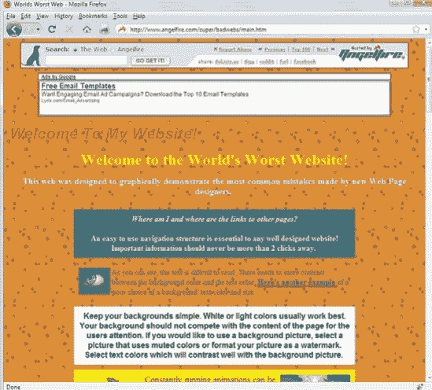

### 使用十六进制值表示颜色

为了保持标准兼容性，并对网站中的颜色保持精确控制，您可以使用十六进制值来引用颜色。颜色的十六进制值表示应混合多少红、绿和蓝光。其工作原理有点像橡皮泥——只需混合您想要的红、蓝和绿的量，就能得到相应的颜色。

十六进制颜色格式为 `#rrggbb`，其中 `rr`、`gg` 和 `bb` 是表示颜色中红（`rr`）、绿（`gg`）和蓝（`bb`）分量的两位十六进制值。如果您不熟悉十六进制数，也不必担心。只需记住 `FF` 是最大值，`00` 是最小值。

每个分量使用以下代码之一：

-   `FF` 表示全亮度。
-   `CC` 表示 80% 亮度。
-   `99` 表示 60% 亮度。
-   `66` 表示 40% 亮度。
-   `33` 表示 20% 亮度。
-   `00` 表示无此颜色分量。

例如，亮红色是 `#FF0000`，深绿色是 `#003300`，蓝紫色是 `#660099`，中灰色是 `#999999`。要制作一个红色背景、深绿色文字的页面，HTML 代码应如下所示：

```
<body style="background-color:#FF0000; color:#003300">
```

虽然这里只展示了六个两位十六进制值的示例，但实际上两位十六进制值有 225 种组合——0 到 9 和 A 到 F 配对。例如，`F0` 是一个可能的十六进制值（十进制值 240），`62` 是一个可能的十六进制值（十进制值 98），等等。

如前所述，`#rrggbb` 十六进制颜色代码格式中的 `rr`、`gg` 和 `bb` 代表颜色的红、绿和蓝分量。每个分量的十进制值范围是从 0（无颜色）到 255（全颜色）。

因此，白色（或 `#FFFFFF`）对应红色值 255、绿色值 255 和蓝色值 255。类似地，黑色（`#000000`）对应红色值 0、绿色值 0 和蓝色值 0。正红是 `#FF0000`（全红、无绿、无蓝），正绿是 `#00FF00`（无红、全绿、无蓝），正蓝是 `#0000FF`（无红、无绿、全蓝）。所有其他十六进制表示法都对应三种颜色的 255 个可能值中的某种变体。跨浏览器兼容的颜色名 `cornflowerblue`（矢车菊蓝）与十六进制表示法 `#6495ED` 相关联——红色值 40、绿色值 149 和蓝色值 237（几乎使用了所有可用的蓝色值）。

在挑选颜色时，无论是通过图形程序还是在网上找到喜欢的东西，您可能会看到十六进制或十进制的颜色表示法。如果您在搜索引擎中输入“十六进制颜色转换器”，您会找到许多选项来帮助您将颜色值转换为可以在样式表中使用的形式。

### 使用 CSS 设置背景、文本和边框颜色

使用 CSS 时，有三种情况可以使用颜色值：指定元素的背景色、文本色或边框色。前面的章节包含指定颜色的示例，但没有详细介绍颜色表示法或颜色理论。例如，在第 7 章“使用外部和内部链接”中，您学习了为各种链接状态使用颜色。

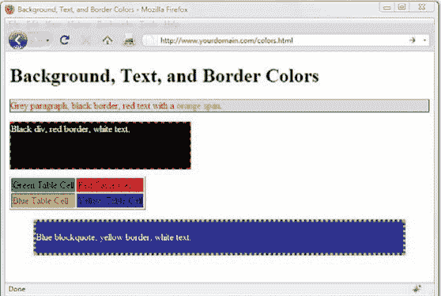

代码清单 8.1 展示了用于生成图 8.2 的 XHTML 和 CSS 样式。

#### 代码清单 8.1 使用样式生成背景、文本和边框颜色

```xml
<?xml version="1.0" encoding="UTF-8"?>
<!DOCTYPE html PUBLIC "-//W3C//DTD XHTML 1.1//EN"
"http://www.w3.org/TR/xhtml11/DTD/xhtml11.dtd">
<html xmlns="http://www.w3.org/1999/xhtml" xml:lang="en">

<head>

<title>Background, Text, and Border Colors</title>

</head>

<body>

<h1>Background, Text, and Border Colors</h1>

<p style="background-color:#CCCCCC;

border:1px solid #000000; color:#FF0000">

Grey paragraph, black border, red text with a

<span style="color:#FFA500">orange span</span>.</p>

<div style="width:300px; height:75px;

background-color:#000000; border:2px dashed #FF0000;

color: #FFFFFF">
Black div, red border, white text. </div>
<table border="1">
<tr>
<td style="background-color: #00FF00">Green Table Cell</td>
<td style="background-color: #FF0000">Red Table Cell</td>
</tr>
<tr>
<td style="background-color: #FFFF00">Blue Table Cell</td>
<td style="background-color: #0000FF">Yellow Table Cell</td>
</tr>
</table>
<blockquote style="background-color:#0000FF;
border:4px dotted #FFFF00; color:#FFFFFF"><p>Blue blockquote,
yellow border, white text.</p></blockquote>
</body>
</html>
```

查看代码清单 8.1 中使用的样式，您应该能够理解几乎所有内容，除了一些边框样式。在 CSS 中，不能只指定边框颜色而不同时指定宽度和类型；在代码清单 8.1 显示的第一个示例中，边框宽度为 1px，边框类型为 solid。在代码清单 8.1 显示的第二个示例中，边框宽度为 2px，边框类型为 dashed。在代码清单 8.1 显示的第四个示例中，边框宽度为 4px，边框类型为 dotted。

在为网站挑选颜色时，请记住“少即是多”——如果您真的喜欢一种明亮而绚丽的颜色，请将其用作强调色，而不是贯穿主要设计元素。为了可读性，请记住浅色背景配深色文字比深色背景配浅色文字更容易阅读。

Adobe Photoshop 毫无疑问是图像编辑程序中的翘楚。然而，它价格昂贵，而且如果您没有计算机图形处理经验，它也相当复杂。有关 Adobe 产品的更多信息，

最后，请考虑您的受众中相当一部分可能患有色盲。为了无障碍访问，您可以考虑使用位于 http://colorfilter.wickline.org/ 的“色盲网页过滤器”工具，查看您的网站在色盲人士眼中的样子。


### 选择图形软件

访问 Adobe 网站 http://www.adobe.com/。如果你正考虑购买他们的产品，可以从其网站下载免费试用版。

为你的网站选择整体配色方案是一回事；创建或编辑要放入这些模板的图像则是另一回事——而且超出了本书（或者坦率地说，任何一本单独的书）的范围。然而，在接下来的章节中，你将学习一些任何维护网站的人都应该迅速掌握的基本操作。

### 关于图形你至少需要知道的事

你可以使用几乎任何图形程序来为你的网站创建和编辑图像，从通常随电脑操作系统免费附带的简单绘图程序，到昂贵的专业程序如 Adobe Photoshop。同样，如果你的电脑连接了数码相机或扫描仪，它可能附带了一些能够创建网页图形的图形软件。还有一些免费的图像编辑器可供下载——甚至作为网络应用在线使用——专门用于处理照片元素的操作。

如果你已经有你认为适合创建网页图形的软件，尝试用它来完成接下来这些部分描述的所有操作。如果你的软件无法完成这里涵盖的一些任务，它可能不是一个好的网页图形工具。在这种情况下，从 http://www.gimp.org 下载并安装 GIMP。这个功能齐全的图形程序是完全免费的，并且用于执行本章所示的操作。

如果 GIMP 不适合你，可以考虑下载 Adobe Photoshop 或 CorelDRAW 的试用版。仅用于照片处理的话，有很多免费的选择，它们都有实用的功能。Google 的 Picasa（在 http://picasa.google.com/ 免费提供）就是其中一个选择。Picnik (http://www.picnik.com/) 是另一个。这两个程序都更适合编辑图像而不是从头创建它们，并且 Picasa 还倾向于组织你的数码照片收藏。因此，这类程序不一定能帮助你为网站设计横幅或按钮图像。然而，这些程序可以帮助你处理一些辅助图像，并且它们功能强大，值得一看。

#### 使用其他网站的素材

节省创建网页图形和媒体文件时间的最好方法之一，当然是完全避免创建它们。

从任何网页抓取图形很简单：右键单击它（或在 Mac 鼠标上单击并按住按钮）并选择**将图像另存为**或**将图片另存为**（取决于你的浏览器）。从页面提取背景图像同样容易：右键单击它并选择**将背景另存为**。

然而，你绝不应该在没有所有者明确许可的情况下使用图像，无论是通过询问他们还是寻找知识共享许可。未经明确许可使用图像是版权侵权（也是令人反感的）。要了解更多关于版权的信息，请访问 http://www.utsystem.edu/OGC/IntellectualProperty/cprtindx.htm。

你可能还想考虑免版税的剪贴画，它不需要你获得版权许可。在线剪贴画的一个好来源是 Microsoft 的 Office Online 剪贴画和媒体网站，位于 http://office.microsoft.com/clipart/。Barry's Clipart Server 是另一个受欢迎的剪贴画目的地，位于 http://www.barrysclipart.com/。

当你在互联网上发布图形和多媒体时，两种力量总是相互冲突。用户的眼睛和耳朵希望你所有的内容都尽可能详细和准确，他们也希望这些信息立即显示出来。复杂、色彩丰富的图形意味着文件尺寸大，即使在快速连接下也会增加传输时间。你如何在最小化文件大小的同时最大化演示质量？要做出这些选择，你需要理解颜色和分辨率如何共同作用以创造主观的质量感。

## 150 第 8 章 处理颜色、图像和多媒体

**注意** 图像的分辨率是构成图像的单个点或像素的数量。大型、高分辨率的图像通常比小型、低分辨率的图像需要更长的传输和显示时间。分辨率通常表示为图像宽度乘以高度，以像素为单位；例如，300×200 的图像宽 300 像素，高 200 像素。

图像分辨率有几种类型，包括像素分辨率、空间分辨率、光谱分辨率、时间分辨率和辐射分辨率。你可以花几个小时来学习每种类型；如果你正在上图形设计课，你可能真的会这么做。然而，现在你只需要记住，大图像下载需要更长时间，并且图像在显示时会占用你显示器上的大量空间。显示大小以及存储或传输大小是你在设计网站时应考虑的因素。

你可能会惊讶地发现，分辨率并不是决定图像文件存储大小（和传输时间）的最关键因素。这是因为网页上使用的图像总是以压缩形式存储和传输。图像压缩是你可以用来挤出重复模式的数学操作。图像压缩的数学很复杂，但基本思想是，当图像存储在磁盘上时，重复的模式或大面积的相同颜色可以被挤出。这使得图像文件小得多，并允许它通过互联网更快地传输。然后，网络浏览器在显示图像时恢复其原始外观。

在接下来的章节中，你将学习如何创建具有强烈视觉冲击力但文件大小很小的图形。你将使用的技术取决于每张图像的内容和用途。网页图形的用途与网页一样多，但有四种类型的图形目前最为常见：

- 人物、产品或地点的照片
- 图形横幅和徽标
- 表示操作和提供链接的按钮或图标
- 容器元素的背景纹理

### 准备照片图像

**提示** 要将照片放到网页上，你需要将你的纸质照片转换为数字图像，或者使用数码相机数字创建照片。你可能需要使用扫描仪或相机附带的自定义软件将图片保存到硬盘驱动器上，或者你可以直接将文件从相机拖放到硬盘驱动器上。如果你使用扫描仪创建纸质照片的数字版本，你可以从你选择的图形程序直接控制几乎任何扫描仪——如果你没有扫描仪或数码相机，几乎所有胶片冲印店都提供将照片从 35mm 胶片转换到 CD-ROM 或 DVD-ROM 的服务，只需支付少量费用。然后，你可以将文件从 CD-ROM 或 DVD-ROM 复制到硬盘驱动器，然后使用你的图形程序打开和修改图像文件。

## 准备照片图像 151

将数字图像文件传输到计算机后，你可以使用图形程序进行裁剪、调整大小、颜色校正和压缩，为在网站中使用做好准备。

#### 裁剪图像

因为你希望网页图形尽可能紧凑，所以通常需要裁剪你的数码照片。裁剪照片时，你要选择要显示的区域，并裁掉其余部分。

GIMP 工具箱提供了对裁剪工具及其可能属性的快速访问。找到一个图像文件——可以是你用相机拍摄并存储在硬盘驱动器上的数字图像，也可以是网上找到的图像。在找到图像并打开 GIMP 后，单击工具箱中的裁剪工具图标，然后在图像上单击并拖动，以定义你想要保留的区域。释放鼠标按钮后，裁剪边界将出现。你可以通过拖动边框上的方块来调整裁剪区域，或者如果裁剪区域正确，则在区域内单击以执行裁剪。

在 GIMP 中打开图像后，请按照以下步骤进行裁剪：

1.  在 GIMP 工具箱中，点击裁剪工具（参见图 8.3）。根据你选择的工具，可能会有一些额外的属性可供选择。例如，图 8.3 显示了裁剪工具的属性（如长宽比、位置、大小等）。

    图 8.3

    从工具箱中选择裁剪工具。

    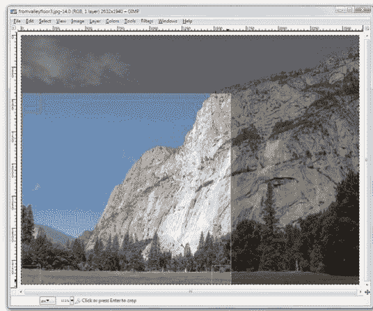

## 152 第 8 章 处理颜色、图像和多媒体

2.  在要裁剪的图像上，通过点击要保留部分的左上角并按住鼠标左键拖动到右下角来绘制选框（参见图 8.4）。

    图 8.4

    选择你想显示的图像区域。

3.  点击选框的任意一个角来应用裁剪。

你的图形程序可能有不同的操作方法，但概念是相同的：选择要保留的区域，然后裁剪掉其余部分。

> 提示 即使在图像裁剪后，它对于网页来说可能仍然过大。根据特定网页的设计，你可能希望将大图像的尺寸限制在不超过 800×600 像素（如果是单独在页面上显示，例如商品目录），甚至是 640×480 像素或更小。当与文本一起显示时，图像的宽度通常在 250 到 350 像素范围内，以便为文本留出足够的空间。在某些情况下，你可能还想提供一个链接到更大版本图像的缩略图版本，在这种情况下，缩略图的较长尺寸可能更接近 100 像素。

> 提示 你的图形软件很可能在图像窗口本身的某个位置有始终可见的尺寸显示。在 GIMP 中，可以在窗口顶部看到当前图像的大小。其他程序可能会在右下角或左下角显示。你可能还会在窗口中看到缩放比例以及更改它的能力（通过放大或缩小）。

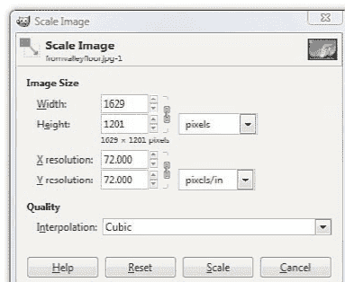

准备照片图像 153

#### 调整图像大小

调整图像大小所需的确切工具取决于你使用的程序。在 GIMP 中，转到“图像”菜单并点击“缩放图像”以打开“缩放图像”对话框（参见图 8.5）。

图 8.5

使用“缩放图像”对话框来更改图像的大小。

你几乎总是希望使用现有的长宽比进行调整，这意味着当你输入图像的期望宽度时，高度将自动计算（反之亦然），以防止图像被挤压变形。在 GIMP 中，长宽比默认是锁定的，如图 8.5 所示的“宽度”和“高度”选项旁边的链接图标所示。单击一次链接图标会解锁它，允许你指定自己选择的像素宽度和高度——无论是否变形。

> **注意** 与 GIMP 中的许多功能一样，“缩放图像”对话框出现在包含正在调整大小的图像的窗口前面。这种布局使你可以在对话框中进行更改、应用它们并立即看到结果。

在大多数（如果不是全部）图形程序中，你也可以根据百分比而不是提供特定的像素尺寸来调整图像大小。例如，如果我的图像最初是 1629×1487，而我不想计算将其显示为一半宽度所需的值，我只需选择“百分比”（在此示例中，从图 8.5 所示的像素显示旁边的下拉菜单中选择）并将默认设置（100）更改为 50。然后图像宽度将变为 815 像素宽 × 744 像素高——而我无需进行任何计算。

#### 微调图像颜色

如果你正在编辑照片图像而不是创建自己的图形，你可能需要使用一些颜色校正工具来使照片恰到好处。与许多图像编辑程序一样，GIMP 提供了多种选项来调整图像的亮度、对比度和颜色平衡，以及一个用于减少令人头疼的红眼的过滤器。要使用 GIMP 去除红眼，请转到“滤镜”，点击“增强”，然后点击“红眼消除”。这些选项大多非常直观。如果你希望图像更亮，请调整亮度。如果你希望图像中有更多红色，请调整颜色平衡。在 GIMP 中，“颜色”菜单为你提供了众多工具。与上一节描述的“缩放图像”对话框类似，每个工具都会在工作区的前台显示一个对话框。当你调整颜色时，图像会反映这些变化。此预览功能是大多数图像编辑软件中包含的一项功能。图 8.6 显示了“调整色相/亮度/饱和度”工具，这是“颜色”菜单上提供的众多工具之一。如图所示，许多与颜色相关的更改是通过使用对话框中的各种滑块来调整你正在处理的值来完成的。“预览”功能使你能够在操作时看到你的操作效果。“重置颜色”按钮可将图像恢复到未应用任何更改的原始状态。

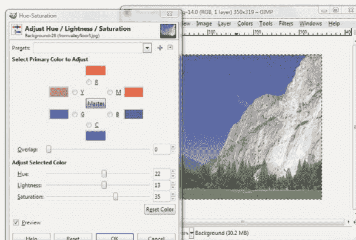

## 154 第 8 章 处理颜色、图像和多媒体

图 8.6

“调整色相/亮度/饱和度”工具是 GIMP 中众多基于滑块的颜色修改工具之一。

由于你可以使用众多工具以及每个工具都提供预览功能，稍微尝试性地操作一下是了解每个工具功能的最佳方式。

#### 控制 JPEG 压缩

网络上的照片图像最好保存为 JPEG 文件格式，而不是 GIF；JPEG 使你能够保留文件中的颜色数量，同时将整体文件大小保持在可管理的水平。当你完成照片尺寸和外观的调整后，选择“文件”、“另存为”，并选择 JPEG 作为文件类型。你的图形程序可能会通过另一个对话框为你提供控制各种 JPEG 选项（如压缩）的功能。

图 8.7 显示了你在 GIMP 中保存 JPEG 时会看到的“另存为 JPEG”对话框。你可以看到，你可以通过将“质量”滑块在 1（低质量，小文件大小）和 100（高质量，大文件大小）之间调整来控制保存 JPEG 文件的压缩比。

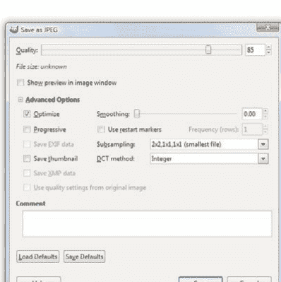

图 8.7

GIMP 使你能够通过保存为 JPEG 格式来减小文件大小，同时仍保留图像质量。

你可能想稍微尝试一下，看看各种 JPEG 压缩级别如何影响图像质量，但对于大多数照片图像来说，85% 的质量（或 15% 的压缩）通常是文件大小（以及下载速度）和质量之间的一个良好折中。

创建横幅和按钮 155

### 创建横幅和按钮

你从零开始创建的图形，如横幅和按钮，需要你做出与照片完全不同的考虑。

## 156 第 8 章 处理颜色、图像和多媒体

> 提示 在制作横幅或按钮时，你需要做出的第一个决定是它应该有多大。现在大多数访问网页的人使用的计算机屏幕分辨率至少为 1024×768 像素，如果不是更大得多的话。例如，我当前的屏幕设置为 1440×900 像素。你通常应该规划你的图形，使其始终能够适应较小的屏幕（1024×768），并为滚动条和边距留出空间。关键的尺寸限制是页面的水平宽度，因为水平滚动页面对网页用户来说是一个巨大的麻烦和困惑来源。垂直滚动页面要容易接受得多，因此你的页面高于最低屏幕尺寸是可以的。

> 提示 多年来，为 800×600 屏幕分辨率设计一直是一个标准。仍然要记住这个较低的数字，因为许多人不会以全屏模式打开应用程序。然而，为 1,024×768 的基准屏幕分辨率设计也不是一个坏主意。

假设你针对的是 800×600 像素的最低分辨率，全尺寸


横幅和标题图形的宽度不应超过770像素，高度不应超过430像素，这是在考虑了滚动条、工具栏和浏览器窗口其他部分后，页面的最大可见区域。在单个页面内，普通照片和插图的尺寸应在100到300像素之间，较小的按钮和图标应为20到100像素见方。显然，如果你针对1024×768分辨率进行设计，会有更多的屏幕“空间”可用，但横幅、按钮和其他辅助图形的尺寸指南仍然有效。

要在GIMP中创建新图像，请转到“文件”菜单并选择“新建”。将显示“新建图像”对话框（参见图8.8）。如果不确定图像需要多大，可以直接接受默认的640×480尺寸。或者你可以从“模板”下拉菜单中选择其他预设尺寸之一，例如“网页横幅 常用 468×60”或“网页横幅 巨大 728×90”。这两个设置对于网站横幅来说确实是“常用”和“巨大”的。否则，请输入新图像的宽度和高度。

对于图像的背景色，通常应该选择白色，以匹配大多数网页浏览器用于网页的背景（尽管如你在上一章所学，该颜色可以更改）。当你知道将创建背景非白色的页面时，可以为图像选择不同的背景色。或者，你可能想创建一个完全没有背景的图像，这种情况下，你将选择“透明”作为背景色。当图像背景是透明时，图像后面的网页将显示在这些区域。在GIMP中，通过打开“新建图像”对话框中的“高级选项”来选择新图像的背景色。

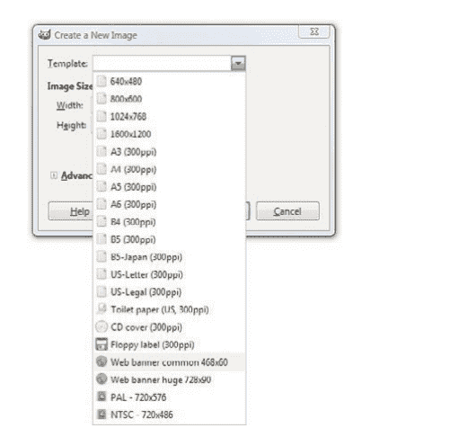

## 减少图像中的颜色数量 157

图 8.8
在开始处理图像之前，你需要确定其尺寸。

当你以像素为单位输入图像的宽度和高度并点击“确定”时，你将面对一块空白画布——如果你像我们大多数人一样对艺术感到恐惧，这景象可能令人望而却步！然而，由于有如此多的图像创建教程（更不用说整本的书籍）可以指导你完成这个过程，我很放心地让你自行发挥创造力。本节主要介绍在为网站创建图形时需要牢记的事项。本节不一定教你具体如何操作，因为熟练掌握你选择的工具是精通它们的第一步。

### 减少图像中的颜色数量

减少图像大小（从而减少下载时间）最有效的方法之一是减少图像中使用的颜色数量。这可能会大幅降低某些摄影图像的视觉质量，但对于大多数横幅、按钮和其他图标非常有效。

你会很高兴知道有一种专门用于颜色数量有限的图像的文件格式；它被称为图形交换格式（GIF）。当你将图像保存为GIF时，可能会被提示展平图层或通过转换为索引图像来减少颜色数量。

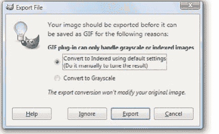

# 158 第8章 处理颜色、图像和多媒体

提示：抖动是图像编辑程序使用的一种技术，通过使用两种相似颜色的交替像素来模拟调色板中没有的颜色。例如，抖动的粉色将由红色和白色像素交替组成，从而给出粉色的整体印象。抖动在某些情况下可以使图像看起来更好，但对于网页图形通常应避免使用。为什么？它会显著增加图像的信息复杂性，这通常会导致文件大小更大、下载速度更慢。

图8.9：将图像保存为GIF时，可能会提示你将其转换为索引颜色调色板。

请记住，GIF图像格式是为包含纯色区域的图像设计的，例如网页标题和其他插图图形；GIF格式不适用于照片。

PNG（读作“ping”）是另一种有用的文件格式，所有主流网页浏览器都支持它。虽然GIF图像格式允许你指定单个透明色（这意味着网页背景将显示在图像的这些区域），但PNG格式更进一步，允许你指定不同程度的透明度。

### 处理透明图像

你可能见过一些网站在其容器元素中使用背景色或图像，但前景中也有图像允许背景在前景图形的某些部分显示出来。在这些情况下，前景图像的部分是透明的，因此图像本身（总是在矩形画布上）不会显示画布中未设计的部分。你经常会想使用这些部分透明的图像，以便在任何背景色或背景图像上使图形看起来美观。

# 创建平铺背景 159

要使图像的一部分透明，必须将图像保存为GIF或PNG文件格式。如本章前面所述，大多数支持GIF格式的图形程序允许你指定一种颜色为透明，而PNG图像允许一定程度的透明范围。

在很大程度上，由于这种透明范围，PNG格式优于GIF。所有最新的网页浏览器都已支持PNG图像。有关PNG图像格式的更多信息，请访问http://www.libpng.org/pub/png/pngintro.html。

创建透明图像的过程取决于你创建的图像类型（GIF或PNG）以及用于创建它的图形软件。具体说明，请查看你的图形程序的帮助文件，或在搜索引擎中输入“使用[你的程序名]创建透明图像”。

### 创建平铺背景

任何GIF或JPEG图像都可以用作容器元素中的背景平铺图案。但是，在你开始创建平铺背景，特别是高度图案化的平铺背景之前，请问问自己，这个平铺背景为网站的整体外观和感觉增加了什么；更重要的是，问问自己，当文本覆盖在该图案上时，是否能轻松阅读。

想想你每天经常访问的网站，并考虑到很少有网站在整个页面上使用平铺的图案背景。如果你的浏览仅限于公司、产品、运动队或其他信息（主要是文本）占主导的网站，那么使用平铺图案背景的网站数量会进一步减少。

尽管网络赋予每个人设计个性化的权利，但如果你是为企业创建网站，可能需要避免使用高度图案化的背景和对比色文本。

如果你确实在整个网站上使用了平铺的图案背景图像，请记住，当无法分辨它们是平铺图像时，平铺图像看起来效果最好。换句话说，当背景平铺图案的上边缘与下边缘无缝衔接，左边缘与右边缘匹配时，你就知道你有了一个好的图像。

图8.10和图8.11展示了正在使用的背景平铺图案，两者都是无缝背景，但效果程度不同。


## 第160页 第8章 处理颜色、图像与多媒体

这是一个无缝背景图像的例子，你可以看出背景是平铺的，因为你能看到六个完全相同的形状。

这也是一个无缝背景图像的例子，但你无法看出它是平铺的。

> 提示 在本章后续内容中，你将学习如何在容器元素内放置背景图像。

如果你确实想使用背景平铺图案，但就是找不到想要的样式，你可以查看互联网上数百个提供公共领域背景图像的网站。这些图像免费或价格低廉，且设计专业。

尽管我在本节中提出了警告，但实际上有时背景图像可以成为你设计武器库中的强大武器——只是不应用于作为整个页面的背景。

### 创建动画网页图形

GIF 图像格式使你能够创建动画图像，可用于为任何网页增添动态效果。动画 GIF 图像的传输速度也远快于通常用于类似效果的大多数视频或多媒体文件。使用 GIMP，你可以通过在一个图像内创建多个图层，然后在保存文件时修改动画 GIF 选项来创建动画 GIF。此外，如果你想将一系列图像制作成动画，可以使用 Gickr（http://www.gickr.com/）这个免费的基于网络的 GIF 动画服务。

创建 GIF 动画的第一步是创建一系列将依次显示的图像——或者一系列图层，具体取决于你使用的特定软件程序。这些图像中的每一个都称为一帧。顺便说一句，“帧”这个词的用法与你在第20章“使用窗口和框架”中将学到的“框架”毫无关系。相反，可以这样理解：帧就像电影或卡通的制作方式——你在屏幕上看到的图像由许多单独的帧组成，这些帧在外观上略有不同。确定好帧之后，将它们组合在一起的过程相对简单——最困难的是规划阶段。花些时间以分镜图的方式勾勒出帧，特别是如果你计划的帧数超过少数几个。一旦你知道帧将如何组合，就可以使用本节前面提到的 Gickr 服务，或者查阅你的图形软件文档以了解其特定的整合流程。

你现在应该准备好两三个图像，以便在跟随本章后续内容学习时，可以尝试将它们放在自己的页面上。如果你已经有一些保存为 GIF、PNG 或 JPEG 格式的图像文件（文件名以 .gif、.png 或 .jpg 结尾），可以使用它们。使用你在阅读前面章节时创建的任何图形也是可以的。

### 为网站准备图像

搜索引擎（如 Google）可以成为图像的宝库，引导你访问与你自己主题相关的网站。搜索引擎还可以帮助你发现大量专门提供免费或廉价可重复使用媒体集合的网站。另外，不要忘记微软在 Office Online 剪贴画和媒体网站（http://office.microsoft.com/clipart/）上的庞大剪贴画库。其他有价值的资源包括 Google 图片（http://images.google.com/）和 Flickr（http://www.flickr.com/）——寻找使用知识共享许可的图像，这些许可允许在署名的情况下免费使用。

### 将图像放置在网页上

要将图像放到网页上，首先将图像文件移动到与 HTML 文件相同的文件夹中，或者放在名为 images 的目录下以便于组织。

注意
在文本中希望图像出现的位置插入以下 HTML 标签。使用你的图像文件名代替 myimage.gif：
``

如果你的图像文件位于文档根目录下的 images 目录中，则应使用以下路径：
``

在 XHTML 网页中，`` 标签的 src 和 alt 属性都是必需的。src 属性标识图像文件，alt 属性使你能够指定关于图像的描述性文本，后者旨在作为用户无法查看图像时的替代内容。你将在后面的“用文本描述图像”一节中阅读更多关于 alt 属性的内容。

注意
`` 标签还支持 title 属性，用于描述图像。与 alt 属性不同，title 属性真正旨在提供图像描述，前提是图像是可见的。alt 属性具有更重要的用途，主要在图像无法显示时起作用，例如当盲人用户使用辅助屏幕阅读软件“查看”页面时。alt 属性是必需的，但如果你想确保你的图像都被很好地描述，同时提供 alt 和 title 属性是一个好主意。

作为如何使用 `` 标签的示例，清单 8.2 在页面顶部、一段文本之前插入了一张图像。每当网页浏览器显示清单 8.2 中的 HTML 文件时，它都会自动检索并显示图像文件，如图 8.12 所示。

**清单 8.2 使用 `` 标签在网页上放置图像**

```xml
<?xml version=”1.0” encoding=”UTF-8”?>
<!DOCTYPE html PUBLIC “-//W3C//DTD XHTML 1.1//EN”
“http://www.w3.org/TR/xhtml11/DTD/xhtml11.dtd”>
<html xmlns=”http://www.w3.org/1999/xhtml” xml:lang=”en”>
<head>
<title>A Spectacular Yosemite View</title>
</head>
<body>
<h1>A Spectacular Yosemite View</h1>
<p></p>
<p><strong>Half Dome</strong> is a granite dome in Yosemite National Park, located in northeastern Mariposa County, California, at the eastern end of Yosemite Valley. The granite crest rises more than 4,737 ft (1,444 m) above the valley floor.</p>
<p>This particular view is of Half Dome as seen from Washburn Point.</p>
</body>
</html>
```

当网页浏览器显示清单 8.2 中所示的 HTML 代码时，它会渲染 hd.jpg 图像。

注意
> 理论上，你可以在自己的页面中包含来自任何网站的图像。在这种情况下，每当你的页面显示时，图像都会从另一个页面的 web 服务器检索。你可以这样做，但你不应该这样做！这不仅因为使用他人的带宽为自己谋利而显得不礼貌，还可能导致你的页面显示变慢。你也无法控制图像何时可能被更改或删除。

如果你猜测 img 代表 image（图像），你是对的。而 src 代表 source（源），这是对图像文件位置的引用。正如本书开头所讨论的，即使图像在浏览器中查看时似乎是同一页面的一部分，它也总是存储在与文本分开的文件中。

就像用于超链接的 `<a href>` 标签一样，你可以在 `` 标签的 src 属性中指定任何完整的互联网地址。或者，如果图像与 HTML 文件位于同一文件夹中，你可以只指定文件名。你也可以使用相对地址，例如 /images/birdy.jpg 或 ../smiley.gif。

如果你被授权重新发布来自另一个网页的图像，请务必将该图像的副本传输到你的计算机上，并使用本地文件引用，例如 `` 标签都包含一段简短的文本信息，例如 `alt="Half Dome"`。这里的 alt 代表替代文本，即当图像本身无法加载时，将显示在此处的消息。图像可能无法加载，原因可能是地址不正确、用户在浏览器偏好设置中关闭了自动图像下载，或者网络连接非常缓慢，数据尚未传输完毕。图 8.13 展示了替代文本在图像未显示时的一个示例。

当你将图像（如照片）托管在专门为图像仓库而设计的服务（例如 Flickr (http://www.flickr.com/)）上时，像 Flickr 这样的服务会为每张图像提供一个 URL，且每个 URL 的地址中都包含 Flickr 的域名。

`` 而不是 ``。不过，这条建议在以下情况下并不适用，

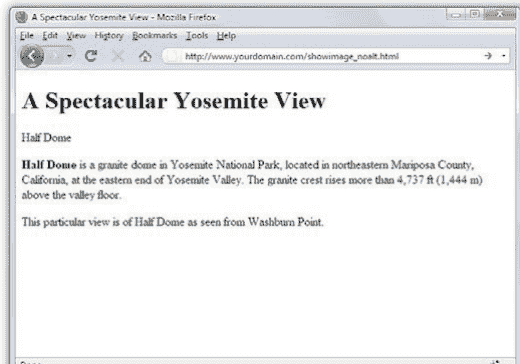

## 164 第 8 章 处理颜色、图像和多媒体

**图 8.13**
当图像未显示时，用户将看到替代文本消息。

即使图像已完全加载并在浏览器中可见，当鼠标指针悬停在图像上时，替代文本通常仍会显示在一个小框中（称为工具提示）。替代文本也有助于视力障碍用户（或正在使用语音界面来读取网页的用户）。

你必须在网页上的每个 `` 标签中包含合适的 `alt` 属性，并考虑到人们可能在各种情况下看到该消息。通常最好对图像进行简要描述，但网页作者有时会在其替代文本消息中放置简短的广告信息或微妙的幽默；然而，过多的幽默和不足的信息是不受欢迎的。对于小图像或不重要的图像，很容易完全省略替代文本消息，但它是 `` 标签的必需属性。这并不意味着你的页面无法正常显示，但这确实意味着你将违反最新的 XHTML 标准。我建议，如果你绝对不需要替代文本（`alt=""`），可以为其分配一个空文本消息，对于小型或装饰性图像有时就是这种情况。

`title` 属性不是 `` 标签必需的，但其功能类似于 `alt` 属性；实际上，如果两个属性都存在，`title` 属性会取代 `alt` 属性作为工具提示。了解这一点后，通过文本描述图像的最佳方法是同时使用 `alt` 属性和 `title` 属性，提供关于图像的有用注释或提示，这些信息在以工具提示形式查看或通过屏幕阅读器软件访问时可能很有帮助。

## 对齐图像 165

#### 指定图像的高度和宽度

因为文本通过互联网传输的速度远快于图形，所以大多数浏览器在显示图像之前会先显示页面上的文本。这使用户在等待查看图片时有所阅读，从而使整个页面感觉加载得更快。

你可以通过明确声明每张图像的高度和宽度，来确保页面上的所有内容都尽可能快地出现在正确的位置。这样，浏览器在布局页面并等待图像传输完成时，可以立即且准确地为每张图像预留空间。

对于你想包含在网站中的每张图像，你可以使用图形程序来确定其以像素为单位的确切高度和宽度。你也可以通过系统工具找到这些图像属性。例如，在 Windows 中，你可以通过右键单击图像、选择“属性”，然后选择“详细信息”来查看图像的高度和宽度。知道图像的高度和宽度后，你可以在 `` 标签中包含其尺寸，如下所示：

```

```

> **提示** 为图像指定的高度和宽度不必与图像的实际高度和宽度匹配。浏览器会尝试压缩或拉伸图像以显示你指定的任何尺寸。然而，这通常不是一个好主意，因为浏览器在调整图像大小方面做得并不特别好。如果你想让图像显示得更小，最好在图像编辑器中调整其大小。

### 对齐图像

就像你可以在页面上对齐文本一样，你也可以使用特殊属性在页面上对齐图像。你不仅可以水平对齐图像，还可以相对于它们周围的文本和其他图像进行垂直对齐。

#### 水平图像对齐

正如第 5 章“处理字体、文本块和列表”中所讨论的，你可以使用 `<div style="text-align:center">`、`<div style="text-align:right">` 和 `<div style="text-align:left">` 将元素居中、右对齐或左对齐。这些样式设置同时影响文本和图像，也可以在 `<p>` 标签内使用。

与文本类似，图像通常与左边缘对齐，除非设置了 `style="text-align:center"` 或 `style="text-align:right"`，指示它们应该居中或右对齐。换句话说，`left` 是 `text-align` 样式属性的默认值。

> **注意** 你也可以通过直接在 `` 标签内使用 `float` 样式属性，让文本环绕图像。`float` 样式属性实际上比这里描述的功能更强大，并且实际上不仅适用于图像。你可以创造性地使用 `float` 样式属性来实现一些有趣的页面布局，正如你将在本书后面学到的那样。

**注意：清单 8.3 使用 `text-align` 样式在网页上对齐图像**

注意清单 8.3 中使用的两个 `` 标签的 style 属性中都添加了 padding。这个 padding 在图像和文本之间提供了一些呼吸空间——在图像四周各留出 6 像素。你将在第 9 章“处理边距、填充、对齐和浮动”中了解更多关于 padding 的知识。

```xml
<?xml version="1.0" encoding="UTF-8"?>
<!DOCTYPE html PUBLIC "-//W3C//DTD XHTML 1.1//EN"
"http://www.w3.org/TR/xhtml11/DTD/xhtml11.dtd">
<html xmlns="http://www.w3.org/1999/xhtml" xml:lang="en">
<head>
<title>More Spectacular Yosemite Views</title>
</head>
<body>
<h1>More Spectacular Yosemite Views</h1>
<p><strong>El
Capitan</strong> is a 3,000-foot (910 m) vertical rock formation
in Yosemite National Park, located on the north side of Yosemite
Valley, near its western end. The granite monolith is one of the
world’s favorite challenges for rock climbers. The formation was
named “El Capitan” by the Mariposa Battalion when it explored the
valley in 1851.</p>

<p><strong>Tunnel
View</strong> is a viewpoint on State Route 41 located directly east
of the Wawona Tunnel as one enters Yosemite Valley from the south.
The view looks east into Yosemite Valley including the southwest face
of El Capitan, Half Dome, and Bridalveil Falls. This is, to many, the
first views of the popular attractions in Yosemite.</p>
</body>
</html>
```

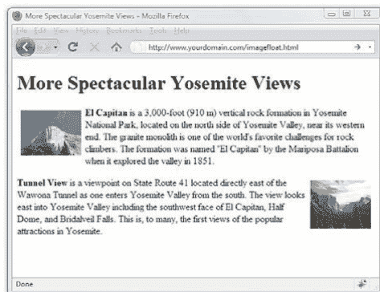

## 对齐图像 167

**图 8.14**
展示清单 8.3 中的图像对齐效果。

#### 垂直图像对齐

有时，你可能想在文本行中间插入一个小图像；或者你可能想将单行文本放在图像旁边作为标题。在这两种情况下，能够控制文本和图像如何垂直对齐会很方便。图像的底部应该与文本的基线对齐吗？

> **注意** `vertical-align` 样式属性也支持 **top** 和 **bottom** 值，可用于将图像与一行元素的整体顶部或底部对齐。


up with the bottom of the letters, or should the text and images all be arranged so that their middles line up? You can choose between these several other options:

- To line up the top of an image with the top of the tallest image or letter on the same line, use ``.
- To line up the bottom of an image with the bottom of the text, use ``.
- To line up the middle of an image with the overall vertical center of everything on the line, use ``.
- To line up the bottom of an image with the baseline of the text, use ``.

All four of these options are used in Listing 8.4 and displayed in Figure 8.15. Four thumbnail images are now listed vertically down the page, along with descriptive text next to each image. Various settings for the `vertical-align` style property are used to align each image and its relevant text.

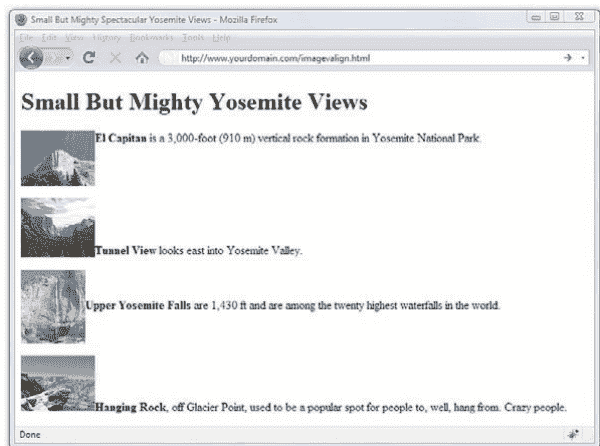

## 168 第8章 处理颜色、图像和多媒体

### 提示 清单8.4 使用 vertical-align 样式将文本与图像对齐

```
If you don’t include any align attribute in an  tag, the bottom of the image will line up with the baseline of any text next to it. That means you never actually have to type style="vertical-align: baseline" because it is assumed by default. However, if you specify a margin for an image and intend for the alignment to be a bit more exacting with the text, you might want to explicitly set the vertical-align attribute to text-bottom. Take a look at the last image shown in Figure 8.15 to see an example of the text appearing slightly below the image due to the image margin—this is a result of the baseline setting for vertical-align.
```

```xml
<?xml version="1.0" encoding="UTF-8"?>
<!DOCTYPE html PUBLIC "-//W3C//DTD XHTML 1.1//EN"
"http://www.w3.org/TR/xhtml11/DTD/xhtml11.dtd">
<html xmlns="http://www.w3.org/1999/xhtml" xml:lang="en">
<head>
<title>Small But Mighty Spectacular Yosemite Views</title>
</head>
<body>
<h1>Small But Mighty Yosemite Views</h1>
<p><strong>El Capitan</strong> is a 3,000-foot (910 m) vertical rock formation in Yosemite National Park.</p>
<p><strong>Tunnel View</strong> looks east into Yosemite Valley.</p>
<p><strong>Upper Yosemite Falls</strong> are 1,430 ft and are among the twenty highest waterfalls in the world.</p>
<p><strong>Hanging Rock</strong>, off Glacier Point, used to be a popular spot for people to, well, hang from. Crazy people.</p>
</body>
</html>
```

## 图 8.15
展示了清单 8.4 中使用的垂直图像对齐选项。

## 将图像转换为链接 169

你可能在图8.12中注意到页面上的图像相当大，虽然在这个特定示例中这没问题，但当你想要呈现多张图像时，这并不理想。在这种情况下，更有意义的做法是创建较小的图像缩略图，链接到每张图像的较大版本。然后，你可以在页面上排列缩略图，这样访问者就能轻松看到所有内容，即使他们只看到实际（较大）图像的小版本。缩略图是你用来为页面增添活力的众多图像链接方式之一。要将任何图像转换为指向另一个页面或图像的可点击链接，你可以使用之前用于创建文本链接的 `<a href>` 标签。清单8.5包含了清单8.3（已使用缩略图）的修改版代码，以提供指向图像较大版本的链接。为确保用户知道要点击缩略图，图像和一些辅助文本被包含在一个 `<div>` 中，如图8.16所示。

#### 清单 8.5 使用缩略图实现有效的图像链接

```xml
<?xml version="1.0" encoding="UTF-8"?>
<!DOCTYPE html PUBLIC "-//W3C//DTD XHTML 1.1//EN"
"http://www.w3.org/TR/xhtml11/DTD/xhtml11.dtd">
<html xmlns="http://www.w3.org/1999/xhtml" xml:lang="en">
<head>
<title>More Spectacular Yosemite Views</title>
<style type="text/css">
div.imageleft {
    float:left;
    clear: all;
    text-align:center;
    font-size:9px;
    font-style:italic;
}
div.imageright {
    float:right;
    clear: all;
    text-align:center;
    font-size:9px;
    font-style:italic;
}
img {
    padding: 6px;
    border: none;
}
</style>
</head>
<body>
```

## 170 第8章 处理颜色、图像和多媒体

#### 清单 8.5 续

```xml
<h1>More Spectacular Yosemite Views</h1>
<p><div class="imageleft">
<a href="http://www.flickr.com/photos/nofancymane/614253439/"></a>
<br/>click image to enlarge</div><strong>El Capitan</strong> is a 3,000-foot (910 m) vertical rock formation in Yosemite National Park, located on the north side of Yosemite Valley, near its western end. The granite monolith is one of the world’s favorite challenges for rock climbers. The formation was named “El Capitan” by the Mariposa Battalion when it explored the valley in 1851.</p>
<p><div class="imageright">
<a href="http://www.flickr.com/photos/nofancymane/614287355/"></a>
<br/>click image to enlarge</div><strong>Tunnel View</strong> is a viewpoint on State Route 41 located directly east of the Wawona Tunnel as one enters Yosemite Valley from the south. The view looks east into Yosemite Valley including the southwest face of El Capitan, Half Dome, and Bridalveil Falls. This is, to many, the first views of the popular attractions in Yosemite.</p>
</body>
</html>
```

#### 图 8.16
使用缩略图作为链接改善了使用大图像的页面布局。

清单8.5中的代码使用了将在后续章节中更详细解释的额外样式，但你应该能够理解其基本原理：

- `<a>` 标签将这些特定图像链接到更大版本，在本例中，这些版本存储在外部服务器（Flickr）上。
- `<div>` 标签及其样式用于对齐这些图形集和说明文字（并包含一些内边距）。

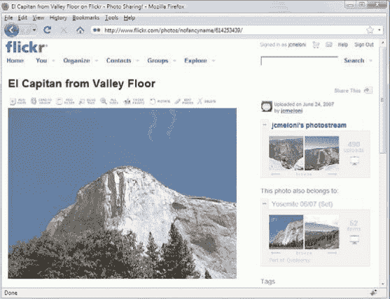

## 使用背景图像 171

除非另有说明，网络浏览器会在每个图像链接的边缘显示一个彩色矩形。与文本链接一样，该矩形通常为未最近访问的链接显示蓝色，或为最近访问的链接显示紫色——除非你在样式表中指定了不同颜色的链接。因为如果你很少或从不希望这种难看的线条出现在链接图像周围，所以通常应在链接内的任何 `` 标签中包含 `style="border:none"`。在这种情况下，`border:none` 样式被作为 `img` 元素样式表条目的一部分，因为我们两次使用了相同的样式。

当你点击示例页面上显示的其中一个缩略图图像时，链接会在浏览器中打开，如图8.17所示。

#### 图 8.17
点击链接的缩略图图像会打开链接的目标。

### 使用背景图像

正如你在本章前面学到的，你可以使用背景图像在容器元素中充当一种壁纸，这样文本或其他图像就会出现在这个底层设计之上。

共同创建背景的基本样式属性如下：

- `background-color`—指定元素的背景颜色。虽然与图像无关，但它是背景相关属性集的一部分。


# 8 处理颜色、图像和多媒体

- `background-image` — 指定用作元素背景的图像，语法如下：`url('imagename.gif')`。
- `background-repeat` — 指定图像应如何在水平和垂直方向上重复。默认情况下（未指定任何内容），背景图像将在水平和垂直方向上重复。其他选项包括 `repeat`（与默认相同）、`repeat-x`（水平）、`repeat-y`（垂直）和 `no-repeat`（图形仅出现一次）。
- `background-position` — 指定图像相对于其容器的初始放置位置。选项包括 `top-left`、`top-center`、`top-right`、`center-left`、`center-center`、`center-right`、`bottom-left`、`bottom-center`、`bottom-right`，以及特定的像素和百分比位置。

在指定背景图像时，可以将所有这些规范组合为一个属性，如下所示：

```css
body {
  background: #ffffff url('imagename.gif') no-repeat top right;
}
```

在上述样式表条目中，网页的 `body` 元素将为白色，并在右上角包含一个名为 `imagename.gif` 的图形。`background` 属性的另一个用途是为无序列表创建自定义项目符号。要将图像用作项目符号，首先定义 `<ul>` 标签的样式，如下所示：

```css
ul {
  list-style-type: none;
  padding-left: 0;
}
```

接下来，将 `<li>` 标签的声明更改为：

```css
li {
  background: url(mybullet.gif) left center no-repeat;
}
```

确保 `mybullet.gif`（或您命名的任何图形）位于 Web 服务器上且可访问；在这种情况下，所有无序列表项将显示您的自定义图像，而不是标准的实心圆项目符号。我们将在第三部分“使用 CSS 进行高级网页设计”中，讨论使用 CSS 进行整体页面布局时，再次具体介绍背景属性的使用。

### 使用图像映射

有时您可能希望使用图像进行导航，但不仅限于您在网站中常见的简单按钮式或基于链接的导航。例如，假设您有一个医疗信息网站，并且想要显示一张人体图像，该图像链接到提供有关身体各部分信息的页面。或者，您有一个提供世界地图的网站，用户可以点击该地图以访问有关国家的信息。您可以将图像划分为多个区域，每个区域根据用户在图像内的点击位置链接到不同的文档。这称为图像映射，任何图像都可以被制作成图像映射。

#### 为什么图像映射并非总是必要的

关于图像映射，您首先应该了解的是，除非在非常特殊的情况下，您可能不需要使用它们。通常，使用多个彼此直接相邻的普通图像并为每个图像提供单独的链接会更容易、更高效。例如，参见图 8.18。这是一个显示 12 个不同公司标志的网页；此示例在商业世界中是一种常见的网页类型，您在其中为合作伙伴提供一些免费广告。您可以将这些标志呈现为一张大图像，并创建一个图像映射，为每个公司提供链接。用户可以单击图像中的每个标志来访问每个公司的网站。或者，您可以像此示例中那样在页面上显示图像，并使用 12 个单独的图像——每个公司一个——每个图像都包含指向该特定公司的链接。

当图像具有众多部分、排列不规则，或者图像本身的设计可能过于复杂而无法分成单独的图像时，图像映射是最佳选择。图 8.19 显示了一张最适合用作图像映射的图像。

#### 映射图像中的区域

要创建任何类型的图像映射，您需要找出图像中要转换为可单击链接的每个区域的数值像素坐标。这些可单击的链接也称为区域。您的图形程序可能为您提供了一种轻松找到这些坐标的方法。或者，您可能想使用独立的图像映射工具，例如 Mapedit（http://www.boutell.com/mapedit/）或在线图像映射制作器 http://www.image-maps.com/。除了帮助您映射坐标外，这些工具还提供使映射工作所需的 HTML 代码。

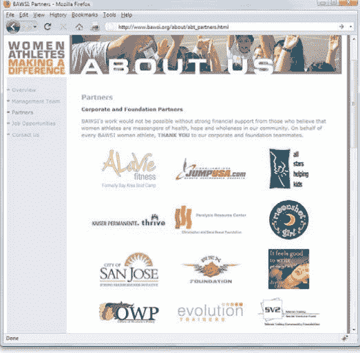

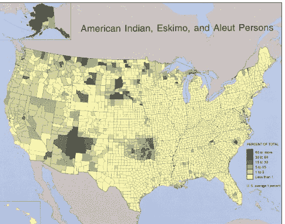

**图 8.18** 显示 12 个不同标志的网页；这可以呈现为单个图像映射，也可以分成 12 个独立的部分。

**图 8.19** 一张不适合被分割的图像——最好将其制作成图像映射。

使用图像映射工具通常就像使用鼠标在您想要成为链接的区域周围绘制一个矩形（或自定义形状）一样简单。图 8.20 显示了其中一次矩形选择的结果，以及为该链接添加 URL 和标题或替代文本的界面。

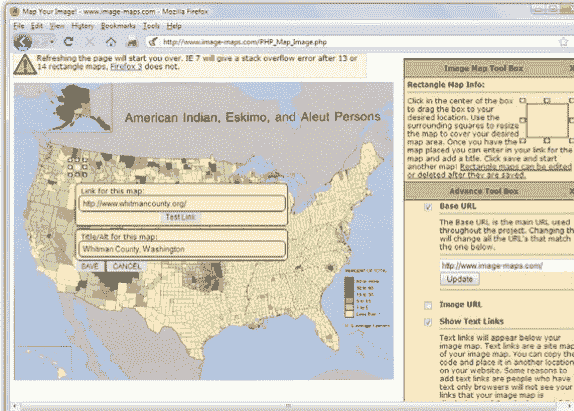

**图 8.20** 使用图像映射工具为单个图形创建链接区域。

要创建图像映射的 HTML，需要提供几条信息：坐标、目标 URL、链接标题和链接的替代文本。

您在继续本章“创建您自己的图像映射”时，如果您拥有自己的图像并将其转换为图像映射，您将更有可能记住如何制作图像映射。

#### 创建您自己的图像映射

- 首先，选择一个相当大的图像，该图像在视觉上被划分为大致矩形的区域是最容易的。
- 如果手边没有合适的图像，请使用您喜欢的图形程序制作一个。也许可以使用一张显示多人的照片，并将每个人用作图像映射的一个区域。
- 尝试几种不同的图像映射工具，以确定您最喜欢哪一种。从独立软件（如 MapEdit（http://www.boutell.com/mapedit/））开始，然后使用在线图像映射制作器 http://www.image-maps.com/。还有其他工具；使用您选择的搜索引擎查找图像映射软件主题的变体。

#### 为图像映射创建 HTML

如果您使用图像映射生成器，您将已经拥有创建图像映射所需的 HTML。但是，了解代码的各个部分以便检查其准确性是一个好主意。启动任何图像映射都需要以下 HTML 代码：

```html
<map name="mapname">
```

请记住，您可以为 `<map>` 标签的 `name` 使用任何您想要的名称，尽管尽可能使其具有描述性会有所帮助。接下来，您需要为图像的每个区域添加一个 `<area />` 标签。以下是在 mapping-a-map 图像映射示例中使用的单个 `<area />` 标签示例：

```html
<area shape="rect" coords="100,136,116,152"
      href="http://www.whitmancounty.org/"
      alt="Whitman County, WA"
      title="Whitman County, WA" />
```

这个 `<area />` 标签有五个属性，您将在图像映射中描述的每个区域中使用它们：
- `shape` 指示区域是矩形（`shape="rect"`）、圆形（`shape="circle"`）还是不规则多边形（`shape="poly"`）。
- `coords` 给出该区域的确切像素坐标。对于矩形，请给出左上角的 x,y 坐标，然后是右下角的 x,y 坐标。对于圆形，请给出 x,y 中心点，然后是以像素为单位的半径。对于多边形，请按连接顺序列出所有角的 x,y 坐标。
- `href` 指定该区域链接到的页面。您可以使用在普通 `<a href>` 链接标签中会使用的任何地址或文件名。
- `alt` 使您能够提供与该形状相关联的一段文本。大多数浏览器（不包括 Firefox）在用户将鼠标悬停在形状上时，在一个小框中显示此文本。此文本为可能没有意识到他们正在查看图像映射的用户添加了细微但重要的视觉提示。Firefox 正确地使用 `title` 属性以及 `alt` 属性来提供视觉提示，这就是为什么，正如本章前面所述，您应该同时使用这两个属性。

图像映射中的每个不同的可单击区域都必须描述为一个单独的区域，这意味着典型的图像映射由一系列区域组成。编写 `<area />` 标签后，您就完成了图像映射的定义，因此用关闭的 `</map>` 标签来结束。


### 使用图像映射

创建图像映射的最后一步是将其连接到实际的地图图像。

地图图像使用普通的 `` 标签放置在页面上。

但是，有一个额外的 `usemap` 属性，其编码如下：

```

```

指定 `usemap` 属性的值时，请使用您在 `<map>` 标签的 `id` 中设置的名称（不要忘记 `#` 符号）。同时还需包含 `style` 属性，以指定图像的高度和宽度，并关闭图像映射周围的边框——在您自己的图像映射中，可以选择保留或关闭此边框。

清单 8.6 展示了包含地图图形、其图像映射以及一些已映射区域的示例网页的完整代码。

#### 清单 8.6 使用 <map> 和 <area /> 标签定义图像映射的区域

```
<?xml version="1.0" encoding="UTF-8"?>
<!DOCTYPE html PUBLIC "-//W3C//DTD XHTML 1.0 Transitional//EN"
"http://www.w3.org/TR/xhtml1/DTD/xhtml1-transitional.dtd">
ptg999
```

如果您注重细节，NOTE 您可能已经注意到——请检查代码的前几行——

```
<html xmlns="http://www.w3.org/1999/xhtml" xml:lang="en">
<head>
<title>Testing an Imagemap</title>
</head>
<body>
<h1>Testing an Imagemap</h1>
<p style="text-align:center">Click on a logo to go to the county's web site.<br/>
</p>
<map name="countymap" id="countymap">
<area shape="rect" coords="100,136,116,152" ... />
<area shape="rect" coords="29,271,42,283"
href="http://www.sccgov.org/" alt="Santa Clara County, CA"
title="Santa Clara County, CA" />
<area shape="rect" coords="535,216,548,228"
href="http://visitingmifflincounty.com/"
alt="Mifflin County, PA" title="Mifflin County, PA" />
</map>
</body>
</html>
```

此网页被编码为 XHTML 1.0 文档，而不是本书大多数其他示例中使用的 XHTML 1.1。这样做是因为一些浏览器（例如 Internet Explorer）对 XHTML 1.1 中关于图像映射使用方式的一项更改支持滞后。此更改特定于 `usemap` 属性，在 XHTML 1.1 中，它不再需要 `#` 符号。然而，在 XHTML 1.0 中允许使用 `#` 符号，因此为了满足当前的 Web 浏览器并仍然为您提供一个有效的网页；此特定示例使用了 XHTML 1.0。

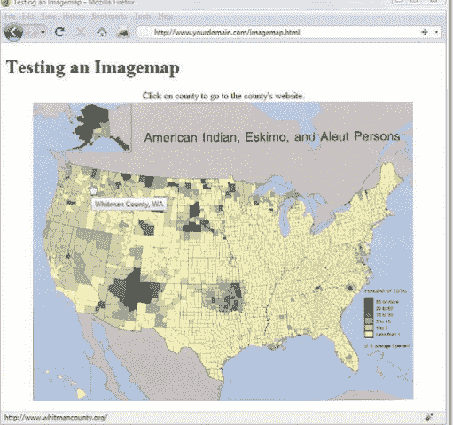

## 178 第 8 章 使用颜色、图像和多媒体

图 8.21 展示了图像映射的实际效果。请注意，在浏览器窗口底部，您的浏览器（在此示例中为 Firefox）会显示鼠标悬停区域对应的链接地址。此外，当您将鼠标悬停在某个区域上时，该区域的 `alt` 或 `title` 文本——在此示例中为 Whitman County——会显示在图像映射上。

图 8.21 清单 8.6 中定义的图像映射在网页上的显示效果。

**NOTE** 有一种生成映射图像的方法仅依赖 CSS，而不使用 HTML 的 `<map>` 标签。您将在第 11 章“使用 CSS 更好地处理列表、文本和导航”中了解更多相关信息。

### 将多媒体集成到您的网站中

既然您已经学会了如何处理静态图像，自然而然的下一步就是处理多媒体。多媒体一词涵盖了我们在网页上看到和听到的一切：音频、视频、动画，以及静态图像和文本。在本节中，您不会学习如何创建任何特定的音频、视频或动画，但您将学习如何通过链接或嵌入内容的方式将这些文件包含到您的网站中。不过，请记住，并非每个用户都有可以播放您的媒体类型的设备，也并非所有用户都拥有可以快速传输这些大文件的宽带 Internet 连接。请始终警告您的访问者，他们点击的链接将带他们到多媒体文件，并提供查看或收听内容的选择——不要将文件强加给他们。

创建任何类型的多媒体都可能是一项具有挑战性和复杂的任务。如果您计划从头开始创建自己的内容，您将需要远不止本书的知识才能成为下一个顶尖的多媒体开发者。不过，在您拥有一些内容之后，本节将向您展示如何将您的新创作放入网页中。

对于我们这些在艺术方面不擅长的人来说，有几种获取有用多媒体资产的替代方法。除了显而易见的方法（例如聘请艺术家）之外，这里有一些建议：

- 互联网上的许多材料都是免费的。当然，与作者或内容的所有者仔细核对仍然是个好主意；您不想因版权侵权而被起诉。此外，美国政府的许多机构生成的内容根据法律属于所有美国人。（例如，网上找到的任何 NASA 镜头都是免费供您使用的。）
- 许多搜索引擎（google.com、yahoo.com、bing.com 等）具有专门的搜索功能，用于查找多媒体文件。只要您注意版权问题，这可能是查找与特定主题相关的多媒体的简便方法。简单搜索示例 Flash 动画、示例 QuickTime 电影或示例音频文件，会产生多到您处理不过来的结果。
- 如果您有创造力，请确定您最喜欢的媒介——对您中的一些人来说，可能是视频制作，其他人可能喜欢音频制作，还有一些人可能想涉猎动画。确定起点后，请研究各种可以创建此类艺术杰作的软件类型。许多公司提供多媒体软件，例如 Adobe (http://www.adobe.com/) 和 Apple (http://www.apple.com/)。

#### 链接到多媒体文件

将视频或音频文件集成到网站中最简单且最可靠的选择是简单地使用 `<a href>` 将其链接，就像链接到另一个 HTML 文件一样。无论本章中显示的具体媒体类型如何，将多媒体集成到网页中的过程在您选择的任何媒体格式下都是相似的。

例如，以下行可用于提供一个曲棍球比赛的 MOV 视频：

```
<a href="hockey.mov">View the hockey video clip.</a>
```

**NOTE** 当用户点击文字 "View the hockey video clip" 时，hockey.mov QuickTime 视频文件会从您的 Web 服务器传输到她的计算机。一旦文件下载完成，她已安装的任何辅助应用程序或插件都会自动启动。如果找不到兼容的辅助程序或插件，Web 浏览器将提供下载相应插件的机会，或者将视频保存在她的硬盘驱动器上以供稍后观看。

点击操作的结果是，浏览器要么在插件的帮助下播放视频（如果找到可以播放该片段的插件），要么委托给合适的辅助应用程序。辅助应用程序（简称 helper apps）是 Web 浏览器调用以显示其自身无法处理的任何类型文件的外部程序。通常，当 Web 浏览器无法自行显示某种类型的文件时，就会调用与该文件类型关联的辅助应用程序。

插件是一种特殊类型的辅助应用程序，直接安装在 Web 浏览器中，使您可以在浏览器窗口内直接查看多媒体内容。

如果您将链接从 pond.wmv (Windows Media) 更改为 pond.mov (QuickTime)，您的浏览器处理链接的方式会有所不同。QuickTime 插件使您可以直接在浏览器窗口中查看视频片段，而不是启动另一个程序。

正如您可能猜到的那样，这种使用简单链接播放多媒体文件的方法提供了最佳的向后兼容性，因为浏览器承担了弄清楚如何播放多媒体片段的所有责任。其缺点是您对片段的播放方式没有太多控制权，而且您肯定无法在页面的上下文中直接播放片段。

> **NOTE** 如果您的浏览器不支持 QuickTime，您可以从 Apple 免费下载 QuickTime 播放器，地址为 http://www.apple.com/quicktime/。即使您已经安装了 QuickTime，某些浏览器可能...

#### 嵌入多媒体文件

XHTML 包含一个标准的 `<object>` 标签，它是...


首选方式仍然是根据是否安装了插件来以不同方式播放 QuickTime 电影。例如，在我的 Windows 计算机上，Internet Explorer 和 Firefox 都通过插件播放 QuickTime 电影，而 Opera 则将 QuickTime 作为辅助应用程序启动。

将任何类型的多媒体嵌入网页。使用此标签替代您可能仍在某些 HTML 源代码中看到的旧 `<embed />` 标签。

将多媒体文件嵌入页面会产生一组软件控件，允许直接播放文件——无需辅助窗口，也无需离开当前页面。

以下是使用 `<object>` 标签本身嵌入池塘视频的代码：

```
<object classid="CLSID:6BF52A52-394A-11d3-B153-00C04F79FAA6"
        width="320" height="305">
    <param name="type" value="video/x-ms-wmv" />
    <param name="URL" value="pond.wmv" />
    <param name="uiMode" value="full" />
    <param name="autoStart" value="false" />
</object>
```

考虑到这段代码实际上是将视频直接嵌入您的网页（参见图 8.22），它并不算太复杂。代码中最复杂的部分是 `<object>` 标签的 `classid` 属性，它被设置为一个长的字母数字代码。此代码是 Windows Media Player 的全局 ID，这意味着您正在告诉 `<object>` 标签在页面上嵌入 Windows Media Player 来播放视频剪辑。您可以将此代码直接复制并粘贴到您自己的网页中。

**注意：** 需要注意的是，Windows Media Player 是一个功能足够强大的媒体播放器，它可以自动流式传输多媒体文件，这意味着它在加载内容的前几秒后就开始播放。其理念是，在您观看或收听较早部分时，其余内容在后台加载。结果是，访客在查看或收听您的多媒体剪辑时不必等待漫长的下载时间。

## 图 8.22

`<object>` 标签使您能够在网页上嵌入视频剪辑，同时指定哪个媒体播放器来播放它。

`<object>` 标签的 `width` 和 `height` 属性决定了嵌入的 Windows Media Player 窗口的大小。如果您省略这些属性，某些浏览器会自动调整嵌入播放器的大小以适应内容，而其他浏览器则根本不会显示任何内容。为了安全起见，请将它们设置为适合所播放多媒体内容的大小。

`<object>` 标签内有四个 `<param>` 标签，负责关于剪辑如何播放的额外细节。每个标签有两个属性：`name` 和 `value`，负责将数据（`value`）与特定设置（`name`）相关联。在此示例中，媒体剪辑的 URL 设置为 `pond.wmv`。第三个参数 `uiMode` 决定了 Windows Media Player 提供哪些按钮和用户界面选项——`full` 表示启用所有用户界面功能，例如控制按钮和音量滑块。最后，`autoStart` 参数设置为 `false`，以便在浏览器中打开页面时视频剪辑不会自动开始播放。

## 182 第 8 章 处理颜色、图像和多媒体

`type` 参数可能是最棘手的。它标识正在显示的媒体类型，在本例中是 Windows Media Video (WMV) 文件。此媒体类型必须指定为标准 Internet MIME 类型之一。

MIME 类型是用于在互联网上唯一标识不同类型媒体对象的标识符。MIME 代表多用途互联网邮件扩展，这个名称来源于 MIME 类型最初用于标识电子邮件附件。这些 MIME 类型应在 `<object>` 标签的 `type` 属性中使用，以标识 `data` 属性中引用的多媒体对象类型。

以下是您可能想在网页中使用的几种流行声音和视频格式的 MIME 类型：

- WAV 音频——audio/x-wav
- AU 音频——audio/basic
- MP3 音频——audio/mpeg
- MIDI 音频——audio/midi
- WMA 音频——audio/x-ms-wma
- RealAudio——audio/x-pn-realaudio-plugin
- AVI——video/x-msvideo
- WMV——video/x-ms-wmv
- MPEG 视频——video/mpeg
- QuickTime——video/quicktime

清单 8.7 显示了池塘网页的相关代码，您可以看到 `<object>` 标签在上下文中的样子。

#### 清单 8.7 使用 `<object>` 标签直接嵌入 WMV 视频剪辑

```xml
<?xml version="1.0" encoding="UTF-8"?>
<!DOCTYPE html PUBLIC "-//W3C//DTD XHTML 1.1//EN"
"http://www.w3.org/TR/xhtml11/DTD/xhtml11.dtd">
<html xmlns="http://www.w3.org/1999/xhtml" xml:lang="en">
<head>
<title>Fun in the Pond</title>
</head>
<body>
<h1>Fun in the Pond</h1>
<div style="float:left; padding:3px">
<object classid="CLSID:6BF52A52-394A-11d3-B153-00C04F79FAA6"
        width="320" height="305">
    <param name="type" value="video/x-ms-wmv" />
    <param name="URL" value="pond.wmv" />
    <param name="uiMode" value="full" />
    <param name="autoStart" value="false" />
    <embed width="320" height="305" type="video/x-ms-wmv" src="pond.wmv" controls="All" loop="false" autostart="false" pluginspage="http://www.microsoft.com/windows/windowsmedia/" />
</object>
</div>
```

**注意：** 由于 `<embed />` 标签在 XHTML 中不受支持，它会阻止您的页面通过验证。不幸的是，这个问题确实没有解决方法——我们只能等待浏览器完全支持 `<object>` 标签本身或转向 HTML5 的 `<embed />` 元素。

迈克尔家后院的池塘不仅是一项有趣的爱好，也是一项持续进行的家庭改进项目，既富有创意又令人放松。

```html
<p>He has numerous fish in the pond, all Koi from various places as far as Japan, Israel, and Australia. Although they don’t bark, purr, or fetch anything other than food, these fish are his pets, and good ones at that.</p>
</body>
</html>
```

您可能会注意到，这里有一些在之前的 `<object>` 标签示例中没有出现的额外代码。不幸的是，正如本节前面讨论的那样，并非所有网络浏览器都完全一致地支持 `<object>` 标签。因此，有必要在 `<object>` 标签内包含一个 `<embed />` 标签，以应对浏览器的不一致性。这不是一个理想的解决方案，但在浏览器供应商继续落后于主流标准的情况下，这是我们目前唯一的选择。如果您仔细观察，会注意到 `<embed />` 标签包含了与 `<object>` 标签相同的所有信息，并且它确定了具体使用哪些 `classid` 和 `codebase` 属性，以及其他参数。

添加任何多媒体文件都将遵循相同的过程。要确定使用哪些参数（在 `<param />` 标签中），您可以使用搜索引擎查找类似“object embed mediatype”的内容，其中 mediatype 是 Real Audio、QuickTime、Flash 或任何您想要的内容。

视频文件不是唯一可以使用 `<object>` 和 `<embed />` 标签包含在网站中的媒体文件。

`<object>` 标签比此处揭示的要复杂一些。但是，您不需要知道如何使用 `<object>` 标签的高级功能就可以播放多媒体内容。换句话说，您不必成为多媒体大师才能在网页上分享一些多媒体剪辑。

#### 使用多媒体的额外提示

在向网站添加视频、音频或动画之前，请先问问自己是否真的应该这样做。当您使用这些类型的多媒体时，请确保有理由这样做。无意义的声音和视频，就像无意义的图片一样，会削弱您的整体信息。不过，如果您的信息是“看看我制作的视频”或“听听我的音乐并下载一些歌曲”，那么多媒体绝对必须在您的网站中发挥作用。

## 184 第 8 章 处理颜色、图像和多媒体

以下是需要记住的几个额外提示：

- 不要在页面中包含多媒体并将其设置为页面加载时自动播放。始终给用户提供启动（和停止）您的声音或视频的选项。
- 尽可能为用户提供多媒体播放器的选择。不要将自己限制在只能由单一操作系统上的一种播放器播放的多媒体内容。
- 多媒体文件比典型的图形和文本文件更大，这意味着您需要在网络服务器上有足够的空间来存储它们，以及有足够的带宽分配将它们传输给通过您的网站请求它们的任何人。
- 如果您的网站完全是音频或视频，提供的文本或图形非常少，请理解，由于其系统或带宽的限制，特定一部分受众将无法看到或听到您想要呈现的内容。为这些用户提供获取您信息的其他选项。

. 利用免费的在线视频托管服务，例如 YouTube (http://www.youtube.com/)。YouTube 不仅为您的视频片段提供存储空间，还会提供将视频嵌入您自己网页所需的代码。例如，图 8.23 展示了世界上最可爱的小狗的 YouTube 页面。如果您复制并粘贴图中“嵌入”区域所示的文本，您将得到以下内容：

```
<object width="425" height="344">
<param name="movie" value="http://www.youtube.com/v/yPxiHd2BOpo&rel=0&color1=0xb1b1b1&color2=0xcfcfcf&feature=player_profilepage&fs=1"></param>
<param name="allowFullScreen" value="true"></param>
<param name="allowScriptAccess" value="always"></param>
<embed src="http://www.youtube.com/v/yPxiHd2BOpo&rel=0&color1=0xb1b1b1&color2=0xcfcfcf&feature=player_profilepage&fs=1" type="application/x-shockwave-flash" allowfullscreen="true" allowScriptAccess="always" width="425" height="344"></embed>
</object>
```

然后，您可以将这段代码插入到您的网页中。

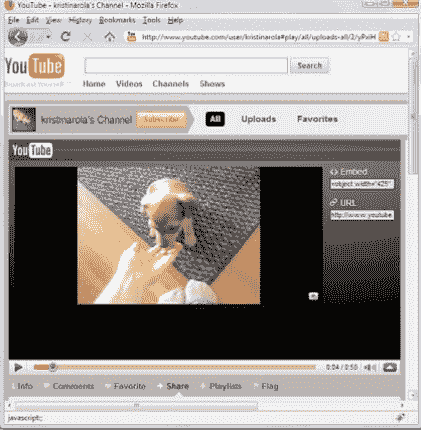

## 总结

图 8.23

YouTube 为您的视频文件提供存储，同时提供链接和可用于您自己页面的 `<object>` 代码。

## 总结

在本章中，您学习了一些关于颜色使用最佳实践的知识，以及如何使用色轮帮助您找到与文本相辅相成的颜色。此外，您还了解了颜色的十六进制表示法——即所有颜色都通过与其包含的红、绿、蓝量相关的表示法来表达——以及十六进制表示法如何让您为元素应用细微的颜色。更重要的是，您学习了三种与颜色相关的样式属性，可用于通过 CSS 为容器背景、边框和文本应用颜色。您还学习了为网页准备图形的基础知识。至少，您了解到这是一个非常复杂的话题，并且在本章中您学到的内容足以激发您的兴趣。本章中的示例使用了流行（且免费！）的 GIMP 软件包，但请随时使用最适合您需求的图形软件。您学到的操作包括如何裁剪、调整大小和调整图像颜色，您还了解了不同的文件格式。在网站中包含图形时，有许多事项需要牢记，包括图形的大小和分辨率，以及如何使用透明度、动画 GIF 和平铺背景。创建或编辑了一些图像后，您可以将它们放置在网页中，您也学习了如何通过 `` 标签来实现。您学会了如何包含一个简短的文本消息，该消息在图像加载时显示，且在用户将鼠标指针移到图像上时也会显示。您还发现了如何控制每个图像的水平和垂直对齐，以及如何在图像的左侧或右侧环绕文本。

您学习了如何将图像用作链接——可以通过在图像周围使用 `<a>` 标签，或者通过创建图像映射。您还略微了解了如何在容器元素的背景中使用图像。

最后，您学习了如何将视频和音频嵌入网页。您发现了如何使用指向多媒体文件的简单链接，这是支持最广泛但灵活性最低的媒体内容播放选项。然后，您学习了如何使用 `<object>` 标签将媒体播放器直接嵌入网页。不仅如此，您还发现为了最大程度的浏览器兼容性，使用 `<embed />` 标签辅助 `<object>` 标签会有所帮助。`<object>` 和 `<embed />` 标签可用于包含各种媒体类型，包括 WAV、MP3、RealAudio 和 MIDI 文件——更不用说 AVI、WMV 和 QuickTime 视频，仅举几例。

表 8.1 总结了本章涵盖的标签和属性。

### 表 8.1 本章涵盖的标签和属性

| 标签 | 功能 |
| :--- | :--- |
| `` | 在页面中放置一个图像文件。 |
| `<map>…</map>` | 由 `` 引用的客户端图像映射。包含一个或多个 `<area />` 标签。 |
| `<area />` | 在客户端图像映射中定义一个可点击的链接。 |
| `<embed />` | 嵌入由插件应用程序读取或显示的多媒体文件；此标签在技术上已弃用，但由于浏览器尚未完全支持 `<object>` 标签，因此仍然有用。 |
| `<object>…</object>` | 将图像、视频、Java 小程序、ActiveX 控件或其他对象插入到文档中。 |
| `<param>…</param>` | 对象的运行时设置，例如它在页面上所占区域的宽度和高度。 |

| 属性/样式 | 功能 |
| :--- | :--- |
| `style="background-color: color"` | 设置元素（如 `<body>`、`<p>`、`<div>`、`<blockquote>` 和其他容器）的背景颜色。 |
| `style="color: color"` | 设置元素内文本的颜色。 |
| `style="border: size type color"` | 设置元素周围四个边框的颜色。边框颜色必须同时指定边框的宽度和类型才能使用。 |
| `src="address"` | 图像的地址或文件名。 |
| `alt="altdescription"` | 图像的替代描述，在无法显示图像本身时显示，主要为无法查看图像的用户提供。 |
| `title="title"` | 作为图像标题显示的文本消息，通常在图像上方的小弹出框（工具提示）中显示。 |
| `width="width"` | 图像的宽度（以像素为单位）。 |
| `height="height"` | 图像的高度（以像素为单位）。 |
| `style="border:attributes"` | 如果图像用作链接，则移除图像周围的边框。 |
| `style="vertical-align:alignment"` | 将图像垂直对齐到 text-top、top、text-bottom、bottom、middle 或 baseline。 |
| `style="float:float"` | 将图像浮动到一侧，以便文本可以环绕它。可能的值为 left、right 和 none（默认）。 |
| `usemap="name"` | 客户端图像映射的图像映射规范的名称。与 `<map>` 和 `<area />` 一起使用。 |
| `shape="value"` | 在 `<area />` 标签内，指定可点击区域的形状。此属性的有效选项为 rect、poly 和 circle。 |
| `coords="values"` | 在 `<area />` 标签内，指定图像中可点击区域的坐标。其含义和设置根据区域类型而变化。 |
| `href="linkurl"` | 在 `<area />` 标签内，指定当区域被点击时应加载的 URL。 |
| `name="name"` | 命名参数属性。 |
| `value="value"` | 与命名参数属性关联的值。 |
| `width="width"` | 嵌入对象的宽度（以像素为单位）。 |
| `height="height"` | 嵌入对象的高度（以像素为单位）。 |
| `type="mimetype"` | 多媒体内容的 MIME 类型。 |
| `src="mediaurl"` | 要嵌入的文件的 URL。 |
| `controls="controls"` | 媒体播放器用户输入控件的配置；使用 all 以启用所有控件。 |
| `loop="loop"` | 播放媒体片段一次或循环播放；设置为 true 或 false。 |
| `autostart="autostart"` | 在打开页面时播放媒体片段；设置为 true 或 false。 |
| `pluginspage="pluginurl"` | 播放媒体片段所需的插件的 URL。 |

## 问与答

**问：与其我自己学习所有这些东西，难道我不应该直接聘请一位平面设计师来设计我的页面吗？**

答：这是一个难以回答的问题，这并不是因为我在这里有利益冲突——我为一家网页开发和设计机构工作，因此推荐机构对我来说是最有利的。但机构并非总是最佳解决方案。聘请平面设计师需要时间和金钱。此外，有许多平面艺术家并不适合从事网络工作——他们专门从事平面设计，而平面世界与网络世界大相径庭。另外，聘请自认为是平面设计师的个人来创建网站可能无法发挥该设计师的优势。换句话说，他可能擅长设计网站的图形元素，但可能不擅长内容架构或处理 HTML 和 CSS。如果您的网站只是一个个人网站，专业的设计可能不是您想要花钱的地方。但如果您的网站旨在推广业务、产品、学校或任何其他形象对成功至关重要的事物，那么这


## 研讨会 189

问：我为印刷品制作了图形。网页图形有什么不同吗？

答：是的。事实上，许多印刷图形的规则在网页上恰恰相反。网页图形必须是低分辨率的，而印刷图形则应尽可能保持高分辨率。在电脑屏幕上，白色会“冲淡”黑色，而在纸上，黑色则会“渗入”白色。此外，有时用户可能只加载了一半图形就停止了网页的加载。如果你曾做过大量印刷图形设计，要尽量避免陷入旧习惯。

问：我完全按照你的建议使用了 `` 标签，但当我查看页面时，看到的只是一个带有形状的小方框。这是怎么回事？

答：你看到的“图像破损”图标可能意味着两种情况：要么是网络浏览器找不到图像文件，要么是图像未保存为浏览器能识别的格式。要解决这些问题，请首先确认图像是否位于其应在的位置。如果是，那么请在你的图形编辑器中打开图像，并再次将其保存为 GIF、JPG 或 PNG 格式。

问：如果我重叠了图像地图上的区域会怎样？

答：允许在图像地图上重叠区域。只需记住，在确定要跟随哪个链接时，一个区域的优先级会高于另一个区域。优先级是根据图像地图中区域列出的顺序来分配的。例如，地图中的第一个区域优先级高于第二个区域，这意味着在区域重叠部分的点击将链接到第一个区域。如果你在图像地图中有一个不链接到任何内容的区域（称为“死区”），你可以利用这种重叠技巧来故意阻止该区域链接到任何内容。只需将死区放在其他区域之前，使其与其他区域重叠，然后将其 href 属性设置为 "" 即可。

问：我经常听说流媒体视频和音频。这是什么意思？

答：过去，视频和音频文件通过大多数调制解调器需要几分钟甚至几个小时才能检索，这严重限制了网页中视频和音频的使用。大家正在努力的目标是流式视频或音频，它在数据接收的同时进行播放。换句话说，你不必完全下载片段才能开始观看或收听。现在，大多数媒体播放器（包括独立版本和插件）都广泛支持流式播放。当你使用 `<object>` 标签嵌入媒体对象时，如果播放器支持流媒体，底层的媒体播放器会自动流式传输媒体片段。

## 研讨会

本研讨会包含测验题和练习，以帮助你巩固对所涵盖内容的理解。请在查看后面的“答案”部分之前，尝试回答所有问题。

## 测验

1.  如何让网页具有黑色背景并使所有文本呈现亮绿色？根据你在本章学到的知识，你是否真的想使用这种颜色组合？
2.  你有一张扫描的马的图片需要放到网页上。它应该做多大？应该保存为什么文件格式？
3.  如何将 elephant.jpg 图像文件插入到网页的顶部？
4.  当实际的 elephant.jpg 图像无法被网页浏览器显示时，如何使单词“Elephant”显示出来？

## 第 190 页 第 8 章 处理颜色、图像和多媒体

## 答案

1.  在网页开头放置以下内容，或使用针对 body 元素的样式规则：
    `<body style="background-color:#000000; color:#00FF00">`
2.  根据图片对页面的重要性，你应该将其设置为小至 100×40 像素或大至 300×120 像素。使用约 85% 压缩率的 JPEG 格式将是最佳选择。当然，你也可以提供一个缩略图链接，链接到单独查看的更大图像。
3.  将图像文件复制到与 HTML 文本文件相同的目录文件夹中。在 HTML 文本文件的 `<body>` 标签之后，输入 `<p></p>`。
4.  使用以下 HTML：
    ``

## 练习

-   选择一个你喜欢的基础颜色——也许是可爱的蓝色或大地色调——并使用 http://colorscheme-designer.com/ 上的配色方案生成器来创建一组可用于网站的颜色。我推荐四色组或强调的类似色方案类型。
-   在你获得一组颜色——或几组颜色的选项——之后，创建一个包含 `<h1>` 元素、一段文本和一些列表项的基本 HTML 页面。使用你在本章学到的与颜色相关的样式来更改页面的背景色和各种块级元素的文本颜色，看看这些颜色组合如何协同工作。观察它们的相互作用，并确定哪些颜色最适合用于容器，哪些最适合用于纯文本、标题文本和链接文本。
-   在你开始为重要的商业网站设计图形之前，试着为自己的个人主页增添一些色彩。这将给你一个学习 GIMP（或使用你的图形软件）的机会，这样当你在工作中处理任务时，就会知道自己在做什么。
-   练习本章中的任何图像放置方法，都将大大帮助你确定图像能够并且将在你设计的网站中扮演的角色。使用一些示例图像，练习使用 `float` 样式来安排图像和文本的相对位置。记住，`float` 的可能值有 `left`、`right` 和 `none`（默认值）。

## 第 9 章

既然你已经学习了创建网页内容的一些基础知识，在本章中，你将学习使用 CSS 增强该内容的具体细节。在前面的章节中，你已经学习了如何使用基础 CSS 进行显示（例如字体大小和颜色）。在接下来的章节中，你将深入使用 CSS 来控制整个网页的各个方面，而不仅仅是单个的文本或图形。

然而，在处理页面布局之前，重要的是在将所有部分组合在一起之前，分别理解四个特定的 CSS 属性：

-   margin 和 padding 属性——用于在元素周围添加空间
-   align 和 float 属性——用于将你的元素相对于其他元素进行放置

本章中提供的示例并非有史以来创建的最有风格的网页内容示例，它们也并非旨在如此。相反，这些示例清楚地展示了 XHTML 和 CSS 如何协同工作。当你通过本章及其他章节掌握了 CSS 后，你就能创建基于网页的杰作，比如图 9.1 所示的那个，一个来自 CSS 禅意花园的例子。

CSS 禅意花园的网站可能看起来不像你经常访问的典型电子商务或社交网络网站。相反，这些网站展示了使用 CSS 可以展开的艺术可能性。毫无疑问，这些网站需要仔细的思考和规划，但其设计潜力是无限的。

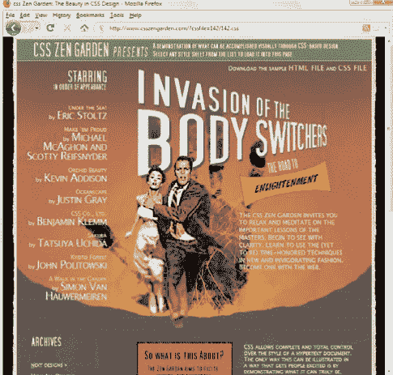

**图 9.1**
这是 CSS 禅意花园中众多展示 XHTML 和 CSS 协同工作的示例之一。

**注意**
CSS 禅意花园（http://www.csszengarden.com/）中的网站展示了通过使用符合标准的 CSS 可以实现的设计类型。花园中所有用户提交的条目都使用完全相同的 HTML 文件，但艺术家可以自由修改 CSS 文件来创建他们自己的视觉展示。图 9.1 所示的示例来自 Stuff and Nonsense 公司的 Andy Clarke（http://www.stuffandnonsense.co.uk/）。

## 第 192 页 第 9 章 处理外边距、内边距、对齐和浮动

### 使用外边距

样式表的外边距允许你在网页上元素的矩形区域外部添加空白空间。重要的是要记住，`margin` 属性处理的是元素外部的空间。以下是设置外边距的样式属性：

-   `. margin-top`—设置上外边距
-   `. margin-right`—设置右外边距
-   `. margin-bottom`—设置下外边距
-   `. margin-left`—设置左外边距
-   `. margin`—将上、右、下、左外边距设置为单个属性


### 使用边距

你可以使用任何单个边距属性或使用 `margin` 属性来指定边距。边距可以指定为 `auto`，这意味着浏览器本身会设置边距，或者使用特定的长度（像素、点、ems）或百分比。如果你决定将边距设置为百分比，请记住，该百分比是基于整个页面的大小计算的，而不是基于元素的大小。因此，如果你将 `margin-left` 属性设置为 25%，该元素的左边距最终将是整个页面宽度的 25%。

注意：你至少可以用两种不同的方式记住简写顺序。首先，如果将元素想象成一个矩形，从顶部开始顺时针方向依次为：上边、右边、下边、左边。或者，你可以使用首字母助记法，记住 "TRBL"，发音为 "trouble"，这也代表了一种可能的存在状态。

代码清单 9.1 在页面上生成了四个矩形，每个矩形宽 250 像素，高 100 像素，并带有 5 像素的黑色实线边框（见图 9.2）。每个矩形——或者在此例中是 `<div>` ——具有不同的背景色。我们希望每个 `<div>` 周围的边距在所有边上都是 15 像素，因此我们可以使用以下方式：

你也可以使用 `margin` 属性以简写方式编写：

```css
margin: 15px 15px 15px 15px;
```

当你使用 `margin` 属性（或 `padding`，或 `border`）并且希望四个值都相同时，你可以进一步简化，使用：

```css
margin: 15px;
```

还要注意，TRBL 顺序同样适用于 `padding` 属性和 `border` 属性。

在使用简写方式设置边距、内边距或边框时，实际上有三种方法，它们基于设置属性时使用的值的数量而有所不同：

-   一个值——所有边距的大小
-   两个值——上下边距的大小和左右边距的大小（按此顺序）
-   四个值——上、右、下、左边距的大小（按此顺序）

你可能会发现坚持使用一个值或所有四个值更容易，但这当然不是必需的。

#### 代码清单 9.1 生成四个带边框和边距的彩色 `<div>` 的简单代码

```xml
<?xml version="1.0" encoding="UTF-8"?>
<!DOCTYPE html PUBLIC "-//W3C//DTD XHTML 1.1//EN"
   "http://www.w3.org/TR/xhtml11/DTD/xhtml11.dtd">
<html xmlns="http://www.w3.org/1999/xhtml" xml:lang="en">
<head>
<title>Color Blocks</title>
<style type="text/css">
div {
    width: 250px;
    height: 100px;
    border: 5px solid #000000;
    color: black;
    font-weight: bold;
    text-align: center;
}
div#d1 {
    background-color: red;
    margin: 15px;
}
div#d2 {
    background-color: green;
    margin: 15px;
}
div#d3 {
    background-color: blue;
    margin: 15px;
}
div#d4 {
    background-color: yellow;
    margin: 15px;
}
</style>
</head>
<body>
<div id="d1">DIV #1</div>
<div id="d2">DIV #2</div>
<div id="d3">DIV #3</div>
<div id="d4">DIV #4</div>
</body>
</html>
```

你可以在图 9.2 中看到代码清单 9.1 的输出。

接下来，仅使用代码清单 9.1 样式表条目中的 `margin` 属性，让我们调整边距。在这个示例中，你看不到这些 `<div>` 元素右侧的边距，因为它们的右边没有东西，而且它们也没有右对齐。考虑到这一点，让我们在所有这些元素中将 `margin-right` 设置为 0px。除此之外，下一组目标是实现以下效果：

-   第一个颜色块周围没有边距。
-   第二个颜色块左侧边距为 15 像素，顶部边距为 5 像素，底部没有边距。
-   第三个颜色块左侧边距为 75 像素，顶部和底部没有边距。
-   第四个颜色块左侧边距为 250 像素，顶部边距为 25 像素。

**图 9.2** 基本颜色块示例页面显示了四个颜色块，每个颜色块的边距相等。

这似乎很简单——没有为第一个块设置边距。但是，我们希望第二个块的顶部有一个边距，所以实际上第一个和第二个块之间会有一个可见的边距，即使我们没有为第一个块指定边距。四个命名 `<div>` 的新样式表条目现在将如下所示：

```css
div#d1 {
    background-color: red;
    margin: 0px;
}
div#d2 {
    background-color: green;
    margin: 5px 0px 0px 15px;
}
div#d3 {
    background-color: blue;
    margin: 0px 0px 0px 75px;
}
div#d4 {
    background-color: yellow;
    margin: 25px 0px 0px 250px;
}
```

上述代码更改的结果（见图 9.3）看起来很随意，但实际上对于指出其他一些要点非常有用。例如，当你回想起目标之一是让第一个颜色块完全没有边距时，你可能期望颜色块的边框与浏览器窗口齐平。但是，如图 9.3 所示，页面内容与浏览器窗口框架之间有明显的空间。

**图 9.3** 对颜色块示例页面的修改显示了不同的边距。

如果我们正在进行元素放置——我们将在下一章讨论——这将导致布局问题。为确保你的放置和边距是从与浏览器齐平的位置开始计算，你需要处理 `<body>` 元素本身的边距。在这种情况下，你需要将以下内容添加到你的样式表中：

```css
body {
    margin: 0px;
}
```

另一个需要记住的 "陷阱" 是，如果你有两个带边框的元素堆叠在一起但没有边距，它们接触的点看起来会有双边框。然后你可能考虑将顶部元素的 `border-bottom` 宽度减半，同时将底部元素的 `border-top` 宽度减半。如果你这样做，当它们堆叠在一起时，边框看起来将与其他边具有相同的宽度。

此外，你可能认为通过使用 250 像素的左侧边距——即 `<div>` 的宽度——第四个颜色块将从第三个颜色块结束的地方开始。然而，事实并非如此，因为第三个颜色块有 75 像素的 `margin-left`。为了让它们接近对齐，第四个 div 的 `margin-left` 值必须是 325 像素。将样式更改为以下代码所示的内容会产生图 9.4 所示的间距。

```css
body {
    margin: 0px;
}
div {
    width: 250px;
    height: 100px;
    color: black;
    font-weight: bold;
    text-align: center;
}
div#d1 {
    border: 5px solid #000000;
    background-color: red;
    margin: 0px;
}
div#d2 {
    border-width: 6px 6px 3px 6px;
    border-style: solid;
    border-color: #000000;
    background-color: green;
    margin: 10px 0px 0px 15px;
}
div#d3 {
    border-width: 3px 6px 6px 6px;
    border-style: solid;
    border-color: #000000;
    background-color: blue;
    margin: 0px 0px 0px 15px;
}
div#d4 {
    border: 5px solid #000000;
    background-color: yellow;
    margin: 0px 0px 0px 265px;
}
```

**图 9.4** 此图显示了调整边距和边框后的修改颜色块的结果。

这些更改使 `<body>` 元素的边距为零，从而确保 25 像素的 `margin-left` 值确实是距离浏览器框架边缘 25 像素。它还显示第二个和第三个颜色块堆叠在一起，但对边框元素进行了修改，因此不会出现双边框。此外，第四个颜色块从第三个颜色块结束的地方开始。

对颜色块的第三次修改将项目拉近彼此。如你在图 9.4 中所见，第三个颜色块的右边缘和第四个颜色块的左边缘之间有一些重叠。为什么是这种情况？因为颜色块宽 250 像素，而第三个颜色块...


## 内边距元素 199

一个元素的 `margin-left` 值为 15 像素，而第四个色块预计其左侧边距为 265 像素？嗯，它确实有那个 265 像素的边距，但这个边距大小还不够，因为我们还得考虑那 6 像素的边框。如果我们更改第四个色块的 `margin` 属性以反映以下代码，那么第三个和第四个色块就会按计划对齐（参见图 9.5）：

```
margin:0px 0px 0px 276px;
```

### 图 9.5

更改边距以留出 11 像素的边框宽度。

ptg999

正如这些示例所示，边距规范对于元素定位非常有用，但在设置这些规范时必须谨慎。

### 内边距元素

内边距（Padding）与外边距（Margins）类似，因为它为元素增加了额外的空间，但主要区别在于该空间所在的位置。回想一下，外边距是添加到元素的外部。而内边距则是在元素的矩形区域内添加空间。例如，如果你为一个元素创建样式规则，将其宽度设置为 50 像素，高度设置为 30 像素，然后将规则的内边距设置为 5 像素，那么剩余的内容区域将是 40 像素乘以 20 像素。此外，由于元素的内边距出现在元素的内容区域内，它将采用与元素内容相同的样式，包括背景颜色。

## 200 第 9 章 处理外边距、内边距、对齐和浮动

你使用 `padding` 属性之一来指定样式规则的内边距，这些属性的工作方式与 `margin` 属性非常相似。以下内边距属性可用于设置样式规则的内边距：

-   - `padding-top` — 设置顶部内边距
- `padding-right` — 设置右侧内边距
- `padding-bottom` — 设置底部内边距
- `padding-left` — 设置左侧内边距
- `padding` — 作为一个单独的属性设置顶部、右侧、底部和左侧内边距

与外边距一样，你可以使用单个 `padding` 属性或单个 `padding` 属性来设置样式规则的内边距。内边距也可以使用测量单位或百分比来表示。

以下是如何设置样式规则的左右内边距的示例，使元素内容两侧各有 10 像素的内边距：

```
padding-left: 10px; ptg999
padding-right: 10px;
```

与外边距一样，你可以使用单个属性（`padding` 属性）来设置元素的所有内边距。要设置 `padding` 属性，你可以使用与 `margin` 属性相同的三种方法。以下是如何为样式规则设置垂直内边距（上/下）为 12 像素，水平内边距（左/右）为 8 像素的示例：

```
padding:12px 8px;
```

以下是更明确的代码，通过指定所有内边距值来执行相同的任务：

```
padding:12px 8px 12px 8px;
```

在所有前面的图中，你会注意到文本 DIV #1、DIV #2 等出现在彩色块的顶部，边框和文本之间只有一点空间。这个空间量没有被任何内边距值指定，但它作为元素内的一种默认值出现。但如果你想对元素的内边距进行特定控制，清单 9.2 展示了一些示例。所有色块的宽度为 250 像素，高度为 100 像素，具有 5 像素的实心黑色边框和 25 像素的外边距（参见图 9.6）。有趣的部分发生在每个单独的 `<div>` 的内边距值内。

## 内边距元素 201

清单 9.2 生成四个带边框、外边距和内边距的彩色 <div> 的简单代码

```
<?xml version="1.0" encoding="UTF-8"?>
<!DOCTYPE html PUBLIC "-//W3C//DTD XHTML 1.1//EN"
"http://www.w3.org/TR/xhtml11/DTD/xhtml11.dtd">
<html xmlns="http://www.w3.org/1999/xhtml" xml:lang="en">
<head>
<title>色块</title>
<style type="text/css">
body {
margin:0px;
}
div {
width:250px;
height:100px;
border:5px solid #000000;
color:black;
font-weight:bold;
margin:25px;
}
div#d1 {
background-color:red;
ptg999
text-align:center;
padding:15px;
}
div#d2 {
background-color:green;
text-align:right;
padding:25px 50px 6px 6px;
}
div#d3 {
background-color:blue;
text-align:left;
padding:6px 6px 6px 50px;
}
div#d4 {
background-color:yellow;
text-align:center;
padding:50px;
}
</style>
</head>
<body>
<div id="d1">DIV #1</div>
<div id="d2">DIV #2</div>
<div id="d3">DIV #3</div>
<div id="d4">DIV #4</div>
</body>
</html>
```

### 图 9.6

基本色块示例页面显示了具有可变内边距的四个色块。

ptg999

你应该立即认识到这个示例中有些地方不对劲。所有色块都应该宽 250 像素，高 100 像素。图 9.6 中的色块并不统一，因为尽管我们努力控制 `<div>` 的大小，但后来应用的内边距覆盖了最初的大小声明。

如果你将文本放在 `<p>` 元素中并为该元素提供白色背景（参见图 9.7），你就可以看到内边距相对于文本的位置。当空间不足以使用所有已定义的内边距时，周围的元素必须进行调整。你将在第 10 章“理解 CSS 盒模型和定位”中详细了解这种效果。

你在网页设计中用 CSS 做的最多的“微调”或“轻推”将与外边距和内边距有关。只需记住：外边距在元素外部，内边距在元素内部。

# ## 保持一切对齐 203

### 图 9.7

显示内边距相对于文本的位置。

ptg999

### 保持一切对齐

知道网页上的内容并不总是填满其显示的矩形区域的整个宽度，通常控制内容的对齐是很有帮助的。即使矩形区域内的文本延伸到多行，对齐仍然很重要，因为你可能希望文本左对齐、右对齐或居中对齐。有两个样式属性可以让你控制元素的对齐：`text-align` 和 `vertical-align`。

你在第 8 章“处理颜色、图像和多媒体”中看到了这些样式属性的实际应用示例——对齐图像，但在这里再次提及这些属性没有坏处，因为对齐在整体页面设计中也起着作用。

作为复习，使用 `text-align` 可以在其边界区域内水平对齐元素，它可以设置为 `left`、`right`、`center` 或 `justify`。

`vertical-align` 属性与 `text-align` 类似，但用于垂直对齐元素。`vertical-align` 属性指定一个元素如何与其父元素对齐，或者在某些情况下，与页面上的当前行元素对齐。当前行指的是出现在同一父元素内的元素的垂直位置——换句话说，

## 204 第 9 章 处理外边距、内边距、对齐和浮动

内联元素。如果几个内联元素出现在同一行上，你可以设置它们的垂直对齐方式相同来垂直对齐它们。一个很好的例子就是一排接一排出现的图像——`vertical-align` 属性使你能够垂直对齐它们。

以下是与 `vertical-align` 属性一起使用的常见值：

-   - `.top` — 将元素的顶部与当前行对齐
- `.middle` — 将元素的中间与其父元素的中间对齐
- `.bottom` — 将元素的底部与当前行对齐
- `.text-top` — 将元素的顶部与其父元素的顶部对齐
- `.baseline` — 将元素的基线与其父元素的基线对齐
- `.text-bottom` — 将元素的底部与其父元素的底部对齐

对齐与外边距、内边距以及——正如你将在下一节中了解到的——`float` 属性协同工作，使你能保持对设计的控制。

### 理解浮动属性

理解 `float` 属性是理解基于CSS的布局和设计的基础；它是所有这些元素如何组合在一起的拼图中的最后几块。简而言之，`float` 属性允许元素在设计中被移动，以便其他元素可以环绕它们。你经常会发现 `float` 与图像一起使用（正如你在第8章中所见），但你可以——而且许多设计师也确实——在布局中浮动各种元素。

元素是水平浮动，而不是垂直浮动，所以你只需要关心两个可能的取值：`right` 和 `left`。当使用时，浮动的元素会根据 `float` 的值，尽可能地向右或向左浮动。例如，如果你有三个 `<div>` 的 `float` 值为 `left`，它们将全部排列在包含的 body 元素的左侧。如果你的 `<div>` 在另一个 `<div>` 内部，它们将排列在该元素的左侧，即使该元素本身被浮动到右侧。

通过几个例子最好理解浮动，所以让我们来看一下清单9.3。这个清单只是定义了三个矩形 `<div>` 并将它们并排浮动（向左浮动）。

## 理解浮动属性 205

#### 清单9.3 使用float放置<div>

```xml
<?xml version="1.0" encoding="UTF-8"?>
<!DOCTYPE html PUBLIC "-//W3C//DTD XHTML 1.1//EN"
"http://www.w3.org/TR/xhtml11/DTD/xhtml11.dtd">
<html xmlns="http://www.w3.org/1999/xhtml" xml:lang="en">
<head>
<title>Color Blocks</title>
<style type="text/css">
body {
    margin:0px;
}
div {
    width:250px;
    height:100px;
    border:5px solid #000000;
    color:black;
    font-weight:bold;
    margin:25px;
}
div#d1 {
    background-color:red;
    float:left;
}
div#d2 {
    background-color:green;
    float:left;
}
div#d3 {
    background-color:blue;
    float:left;
}
</style>
</head>
<body>
<div id="d1">DIV #1</div>
<div id="d2">DIV #2</div>
<div id="d3">DIV #3</div>
</body>
</html>
```

结果页面如图9.8所示，你已经可以看到一个问题——这三个色块本应浮动并排。嗯，实际上它们确实是浮动并排的，只是浏览器窗口不够宽，无法显示这三个250像素宽的色块以及它们之间25像素的边距。因为它们在浮动，第三个色块只是浮动到了下一行。

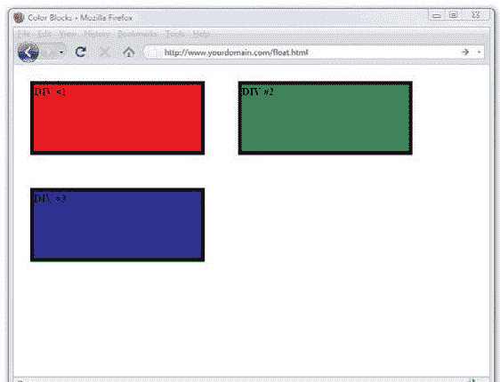

## 206 第9章 使用边距、内边距、对齐和浮动

### 图9.8 使用float放置色块。

你可以想象这在特定的视觉布局中可能是个问题，因此在关注边距、内边距、对齐和浮动的同时，也要在目标浏览器窗口大小内进行测试。诚然，图9.8中显示的浏览器窗口很小——为了说明浮动元素在没有空间适应时会移动到下一行这一点。换句话说，如果你用更大的浏览器窗口打开同一个HTML文件，你可能看不到这个问题——这就是为什么你还应该在不同分辨率下检查你的网站，看看是否需要修复。这里的修复方法是调整 `<div>` 的边距和其他与大小相关的属性。

图9.9展示了使用 `float` 属性时另一个有趣的可能性。

图9.9中的代码清单9.3相比，唯一的改动是将色块宽度改为100像素，边距减小到10px，并将第二个色块的 `float` 对齐方式改为 `right`（而不是 `left`）。

然而，发生了一件非常有趣的事情。第二个色块现在在视觉上作为第三个色块出现，因为它紧靠右边。第二个色块的 `float` 值为 `right`，所以它一直浮动到右侧。

第一个和第三个色块都尽可能地向左浮动，无论 `<div>` 代码在HTML中出现的顺序如何，其代码如下：

```html
<div id="d1">DIV #1</div>
<div id="d2">DIV #2</div>
<div id="d3">DIV #3</div>
```

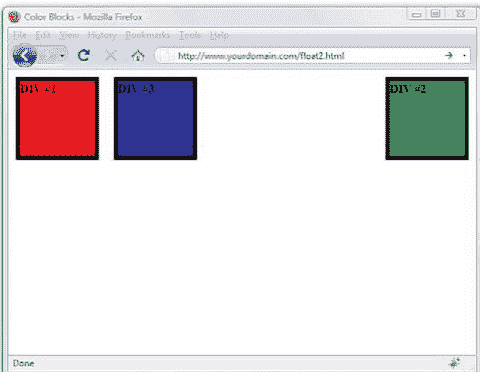

## 总结 207

### 图9.9 使用float放置色块。

浮动需要大量练习才能习惯，特别是当页面中还有额外元素而不仅仅是几个色块时。例如，当你添加一个基本段落时会发生什么？所有放置在浮动元素之后的元素都会环绕那个元素。为避免这种情况，请使用 `clear` 属性。

`clear` 属性有五个可能的值：`left`、`right`、`both`、`none` 和 `inherit`。最常见的值是 `left`、`right` 和 `both`。指定 `clear:left` 确保左侧不允许有其他浮动元素，`clear:right` 确保右侧没有其他浮动元素，依此类推。浮动和清除是一个需要实践的过程，所以请寻找本章后面练习部分中的更多情况。

## 总结

本章向你介绍了基于CSS的设计中一些最基本的样式属性：`margin`、`padding` 和 `float`。你学习了 `margin` 属性如何控制元素外部的空间，以及 `padding` 属性如何处理元素内部的空间。

在回顾了你在前面课程中学习的 `text-align` 和 `vertical-align` 属性之后，你学习了 `float` 属性。

`float` 属性允许对元素进行特定放置，并允许其他内容环绕这些元素。

208 第9章 使用边距、内边距、对齐和浮动

## 问答

问：边距和内边距的示例都与框和文本有关。我能否也对图像应用边距和内边距？

答：可以，你可以对任何块级元素应用边距和内边距，例如 `<p>`、`<div>`、``、列表如 `<ul>` 和 `<ol>`，以及列表项（`<li>`）——仅举几例。

## 练习

练习部分包含测验题和练习，以帮助你巩固对所涵盖材料的理解。请在查看后面的“答案”部分之前，尝试回答所有问题。

## 测验

1.  要将两个 `<div>` 元素并排放置，但它们之间有30像素的边距，你可以在样式表中使用什么条目或条目？
2.  哪个CSS样式属性和值用于确保内容不会出现在浮动元素的左侧？
3.  使用什么样式表条目可以将文本放置在 `<div>` 内，使其距离元素顶部12像素？

## 答案

-   1. 你可以使用几种方式。第一个 `<div>` 使用样式属性 `margin-right:15px`，第二个 `<div>` 使用样式属性 `margin-left:15px`。或者，你可以使用 `margin-right` 或 `margin-left` 将完整的30像素分配给任意一个 `<div>`。
-   2. 在这种情况下，使用 `clear:left`。
-   3. `padding-top:12px`

## 练习

-   全面理解边距、内边距、对齐和浮动需要实践。在进入下一章之前，请使用色块代码或你自己的 `<div>`，练习各种类型的间距和浮动。下一章将讨论整个CSS盒模型，其中涵盖了本章讨论的各个项目。
-   同时，练习对你目前学过的所有块级元素应用边距和内边距。习惯于将图像放在文本块内，并在图像周围设置边距，这样文本就不会紧贴到图形的边缘。

## 第10章

在上一章中，我多次提到了CSS盒模型——本章**你将学到的内容：**从盒模型的讨论开始，并解释你在上一章学到的信息如何帮助你理解这个概念。通过学习盒模型，当你创建一个设计，然后意识到元素没有对齐或者看起来有点“不对劲”时，你就不会抓狂了。你会知道在几乎所有情况下，有些东西——边距、内边距或边框——只需要稍微调整一下就能解决。

你还将学习更多关于CSS定位的知识，包括堆叠元素、控制元素如何堆叠、管理文本流。

```


### CSS 盒模型

HTML 中的每个元素都被视为一个“盒”，无论是段落、`<div>`、图像还是其他元素。无论我们是否能看到它们，也无论它们是否在样式表中被明确指定，盒子都具有一致的属性。它们始终存在，作为设计师，我们在创建布局时必须考虑到它们的存在。

图 10.1 是盒模型的示意图。盒模型描述了每个 HTML 块级元素如何可能拥有边框、内边距和外边距，以及边框、内边距和外边距是如何应用的。换句话说，所有元素在内容与边框之间都存在一定的内边距。此外，边框可能可见也可能不可见，但确实有其空间，同样，在元素的边框与外部任何其他内容之间也存在外边距。

以下是从外向内对盒模型的另一种解释：

-   外边距是元素外部的区域。它永远没有颜色；它始终是透明的。
-   边框围绕元素延伸，位于任何内边距的外边缘。边框可以有多种类型、宽度和颜色。
-   内边距存在于内容周围，并继承内容区域的背景色。
-   内容被内边距包围。

以下是棘手的地方：要了解一个元素的真实高度和宽度，你必须考虑盒模型的所有组成部分。

如果你还记得前一章的例子，尽管明确指定了 `<div>` 应该是 250 像素宽和 100 像素高，但那个 `<div>` 必须变大以适应所使用的内边距。

你已经知道如何使用 `width` 和 `height` 属性来设置元素的宽度和高度。以下示例展示了如何定义一个宽度为 250 像素、高度为 100 像素、具有红色背景和黑色 1 像素边框的 `<div>`：

```
div {
    width: 250px;
    height: 100px;
    background-color: #ff0000;
    border: 1px solid #000000;
}
```

这个简单的 `<div>` 如图 10.2 所示。

如果我们定义第二个具有相同属性的元素，但同时添加特定大小的 `margin` 和 `padding` 属性，我们就会开始看到元素尺寸是如何变化的。这是由于盒模型的影响。

第二个 `<div>` 的定义如下，仅为元素添加了 10 像素的外边距和 10 像素的内边距：

```
div#d2 {
    width: 250px;
    height: 100px;
    background-color: #ff0000;
    border: 5px solid #000000;
    margin: 10px;
    padding: 10px;
}
```

第二个 `<div>` 如图 10.3 所示，其定义的高度和宽度与第一个相同，但当外边距和内边距发挥作用时，围绕元素本身的整个盒子的整体高度和宽度要大得多。

元素的总宽度是以下各项的总和：

width + padding-left + padding-right + border-left + border-right + margin-left + margin-right

元素的总高度是以下各项的总和：

height + padding-top + padding-bottom + border-top + border-bottom + margin-top + margin-bottom

因此，第二个 `<div>` 的实际宽度为 300（250 + 10 + 10 + 5 + 5 + 10 + 10），实际高度为 150（100 + 10 + 10 + 5 + 5 + 10 + 10）。

> **注意**
> 至此，你开始了解盒模型将如何影响你的设计。假设你只有 250 像素的水平空间，但你喜欢在所有边都有 10 像素的外边距、10 像素的内边距和 5 像素的边框。为了在你拥有的显示空间内容纳你所喜欢的样式，你必须将 `<div>` 的宽度指定为仅 200 像素，这样 200 + 10 + 10 + 5 + 5 + 10 + 10 就会加起来等于可用的 250 像素水平空间。

理解盒模型背后的概念很重要，该模型的计算方式同样重要。在动态驱动的网站或客户端显示由用户交互（例如通过 JavaScript 事件）驱动的网站中，你的服务器端或客户端代码可能会动态绘制和重绘容器元素。换句话说，你的代码将生成数字，但你必须提供边界。

既然你已经学习了盒模型的方法，请在本书剩余部分以及你的网页设计工作中始终牢记它。其中，它将影响元素定位和内容流，这两个主题是我们接下来要探讨的。

### 关于定位的全部详解

相对定位是 HTML 使用的默认定位类型。你可以将相对定位类比为在棋盘上摆放棋子：棋子从左到右排列，当到达棋盘边缘时，就移到下一行。样式属性 `display` 的值为 `block` 的元素会自动放置在新行上，而 `inline` 素则被放置在与前一个元素相同的行上。例如，`<p>` 和 `<div>` 标签被认为是块级元素，而 `<span>` 标签被认为是内联元素。

CSS 支持的另一种定位类型称为绝对定位，因为它使你能够在页面上设置 HTML 内容的确切位置。尽管绝对定位赋予你自由指定元素出现位置的权力，但位置仍然是相对于页面上出现的任何父元素而言的。换句话说，绝对定位使你能够指定元素矩形区域相对于其父元素区域的确切位置，这与相对定位截然不同。随着在页面上任意位置放置元素的自由度，你可能会遇到重叠问题，即一个元素占据了另一个元素所使用的空间。没有什么能阻止你指定元素的绝对位置使其重叠。在这种情况下，CSS 依赖每个元素的 `z-index` 来确定哪个元素在上层，哪个在下层。你将在本章后面了解更多关于元素 `z-index` 的知识。现在，让我们看看你如何控制样式规则使用相对定位还是绝对定位。

特定样式规则使用的定位类型（`relative` 或 `absolute`）由 `position` 属性决定，该属性可以具有以下两个值之一：`relative` 或 `absolute`。指定定位类型后，你然后使用以下属性提供具体位置：

-   **left** — 左侧位置偏移
-   **right** — 右侧位置偏移
-   **top** — 顶部位置偏移
-   **bottom** — 底部位置偏移


## 214 第十章 理解CSS盒模型与定位

你可能认为这些定位属性只对绝对定位有意义，但它们实际上适用于这两种定位类型。

在相对定位下，元素的位置被指定为相对于其原始位置的偏移量。因此，如果你将一个元素的 `left` 属性设置为 `25px`，该元素的左侧将从其原始（相对）位置向右移动25像素。另一方面，绝对定位是相对于应用样式的元素的父元素来指定的。因此，在绝对定位下，如果你将一个元素的 `left` 属性设置为 `25px`，该元素的左侧将出现在父元素左边缘向右25像素的位置。另一方面，使用相同值的 `right` 属性将定位该元素，使其右边缘位于父元素右边缘向右25像素的位置。

让我们回到颜色块示例，以展示定位的工作原理。在清单10.1中，四个颜色块指定了相对定位。如图10.4所示，这些块被垂直放置。

**图10.4**

颜色块被垂直放置，一个叠在另一个上面。

**清单10.1 使用四个颜色块展示相对定位**

```xml
<?xml version="1.0" encoding="UTF-8"?>
<!DOCTYPE html PUBLIC "-//W3C//DTD XHTML 1.1//EN"
"http://www.w3.org/TR/xhtml11/DTD/xhtml11.dtd">
<html xmlns="http://www.w3.org/1999/xhtml" xml:lang="en">
<head>
<title>Positioning the Color Blocks</title>
<style type="text/css">

div {

position:relative;

width:250px;

height:100px;

border:5px solid #000;

color:black;

font-weight:bold;

text-align:center;

}

div#d1 {

background-color:red;

}

div#d2 {

background-color:green;

}

div#d3 {

background-color:blue;

}

div#d4 {

background-color:yellow;

}

</style>

</head>

<body>

<div id="d1">DIV #1</div>

<div id="d2">DIV #2</div>

<div id="d3">DIV #3</div>

<div id="d4">DIV #4</div>

</body>

</html>
```

`<div>` 元素本身的样式表条目将 `<div>` 元素的 `position` 样式属性设置为 `relative`。由于其余的样式规则继承自 `<div>` 样式规则，它们继承了其相对定位。事实上，其他样式规则之间唯一的区别是它们具有不同的背景颜色。

注意图10.4中，`<div>` 元素一个接一个地显示，这正是你对相对定位的预期。但为了让事情更有趣——这正是我们此行的目的——你可以将定位更改为绝对定位，并显式地指定颜色的位置。在清单10.2中，样式表条目被更改为使用绝对定位来排列颜色块。

## 216 第十章 理解CSS盒模型与定位

#### 清单10.2 使用颜色块的绝对定位

```xml
<?xml version="1.0" encoding="UTF-8"?>
<!DOCTYPE html PUBLIC "-//W3C//DTD XHTML 1.1//EN"
"http://www.w3.org/TR/xhtml11/DTD/xhtml11.dtd">
<html xmlns="http://www.w3.org/1999/xhtml" xml:lang="en">
<head>
<title>Positioning the Color Blocks</title>
<style type="text/css">
div {
position:absolute;
width:250px;
height:100px;
border:5px solid #000;
color:black;
font-weight:bold;
text-align:center;
}
div#d1 {
background-color:red;
left:0px;
top:0px;
}

div#d2 {
  background-color:green;
  left:75px;
  top:25px;
}

div#d3 {
  background-color:blue;
  left:150px;
  top:50px;
}

div#d4 {
  background-color:yellow;
  left:225px;
  top:75px;
}
</style>

</head>

<body>

<div id="d1">DIV #1</div>
<div id="d2">DIV #2</div>
<div id="d3">DIV #3</div>
<div id="d4">DIV #4</div>
</body>
</html>
```

此样式表将 `position` 属性设置为 `absolute`，这是样式表使用绝对定位所必需的。此外，每个继承的 `<div>` 样式规则都设置了 `left` 和 `top` 属性。然而，这些规则的位置设置使得元素显示为相互重叠，如图10.5所示。

**图10.5**

颜色块使用绝对定位显示。

现在我们来谈谈布局！图10.5展示了绝对定位如何使你能够将元素精确放置在你想要的位置。它还揭示了排列元素使其相互重叠是多么容易。你可能好奇，当元素重叠时，网页浏览器如何知道哪个元素绘制在上层。下一节将介绍如何控制堆叠顺序。

### 控制元素的堆叠方式

在某些情况下，你可能希望仔细控制网页上元素相互重叠的方式。`z-index` 样式属性使你能够设置元素在彼此堆叠顺序方面的顺序。虽然 `z-index` 这个名字听起来可能有点奇怪，但它指的是第三维度（Z）的概念，该维度指向计算机屏幕内部，除了横跨屏幕（X）和向下（Y）的两个维度之外。理解 `z-index` 的另一种方式是将其视为一叠杂志中单本杂志的相对位置。靠近叠顶部的杂志比叠底部的杂志具有更高的 `z-index`。类似地，具有较高 `z-index` 的重叠元素会显示在具有较低 `z-index` 的元素之上。

> **注意** `z-index` 属性用于设置一个数值，该数值表示样式规则的相对 `z-index`。分配给 `z-index` 的数字仅相对于你为样式规则设置的其他 `z-index` 值，且仅相对于样式表中的其他样式规则才有意义，这意味着为单个规则设置 `z-index` 属性没有太大意义。另一方面，如果你为应用于重叠元素的多个样式规则设置了 `z-index`，则具有较高 `z-index` 值的元素将显示在具有较低 `z-index` 值的元素之上。

清单10.3包含了另一个版本的颜色块样式表和HTML，它使用 `z-index` 设置来改变元素的自然重叠顺序。

#### 清单10.3 使用z-index改变颜色块示例中元素的显示

```xml
<?xml version="1.0" encoding="UTF-8"?>
<!DOCTYPE html PUBLIC "-//W3C//DTD XHTML 1.1//EN"
"http://www.w3.org/TR/xhtml11/DTD/xhtml11.dtd">
<html xmlns="http://www.w3.org/1999/xhtml" xml:lang="en">
<head>

<title>Positioning the Color Blocks</title>

<style type="text/css">

div {

position:absolute;

width:250px;

height:100px;

border:5px solid #000;

color:black;

font-weight:bold;

text-align:center;

}

div#d1 {

background-color:red;

left:0px;

top:0px;

z-index:0;

}

div#d2 {

background-color:green;

left:75px;

top:25px;

z-index:3;

}

div#d3 {

background-color:blue;

left:150px;

top:50px;

z-index:2;

}

div#d4 {

background-color:yellow;

left:225px;

top:75px;

z-index:1;

}

</style>

</head>

<body>

<div id="d1">DIV #1</div>

<div id="d2">DIV #2</div>

<div id="d3">DIV #3</div>

<div id="d4">DIV #4</div>

</body>

</html>
```

此代码与你在清单10.2中看到的唯一区别是在每个编号的 `div` 样式类中添加了 `z-index` 属性。注意，第一个编号的 `div` 的 `z-index` 设置为 0，这应该使其在 `z-index` 方面成为最低的元素，而第二个 `div` 具有最高的 `z-index`。图10.6显示了使用此样式表显示的颜色块页面，清楚地展示了 `z-index` 如何影响显示内容，并使得可以仔细控制元素的重叠成为可能。

**图10.6**

使用 `z-index` 改变颜色块的显示。

虽然示例中显示的是简单的 `<div>` 元素颜色块，但 `z-index` 样式属性可以影响任何HTML内容，包括图像。


## 第220页 第10章 理解CSS盒模型与定位

### 管理文本流

既然你已经看到了一些相对于其他元素放置元素或绝对定位元素的例子，现在是时候重新审视内容围绕元素的流动了。概念上的当前行是一条不可见的线，用于在页面上放置元素。这条线与页面上元素的流动有关；当元素在页面上并排和向下排列时，它就会发挥作用。元素流动的一部分是页面上文本的流动。当文本与其他元素（如图像）混合时，控制文本如何围绕这些其他元素流动非常重要。

你在第9章“处理外边距、内边距、对齐和浮动”中已经看到过其中两个样式属性。以下是一些样式属性，它们使你能够控制文本流动：

- `float`——决定文本如何围绕元素流动
- `clear`——停止文本围绕元素的流动
- `overflow`——当元素太小无法容纳所有文本时，控制文本的溢出

`float` 属性用于控制文本如何围绕元素流动。它可以设置为 `left` 或 `right`。这些值决定了相对于流动文本，元素应该被放置在何处。因此，将图像的 `float` 属性设置为 `left` 会将图像放置在流动文本的左侧。

正如你在前一章学到的，你可以通过使用 `clear` 属性来防止文本在元素旁边流动，该属性可以设置为 `none`、`left`、`right` 或 `both`。clear 属性的默认值是 `none`，表示文本流动时不考虑该元素的特殊影响。

`left` 值会使文本停止围绕元素流动，直到页面左侧没有该元素为止。同样，`right` 值意味着文本不会围绕元素的右侧流动。`both` 值表示文本不会围绕元素的任一侧流动。

`overflow` 属性处理溢出文本，即不适合其矩形区域的文本；如果你将元素的 `width` 和 `height` 设置得太小，就可能发生这种情况。`overflow` 属性可以设置为 `visible`、`hidden` 或 `scroll`。`visible` 设置会自动放大元素，以便溢出文本能够容纳在其中；这是该属性的默认设置。`hidden` 值使元素保持相同大小，让溢出的文本在视图中保持隐藏。也许最有趣的值是 `scroll`，它会向元素添加滚动条，这样你就可以滚动查看文本。

## 第221页 总结

## 总结

本章首先讨论了CSS盒模型以及如何在计算元素宽度和高度时考虑外边距、内边距和边框。接下来，章节继续探讨了元素的绝对定位，然后你学习了使用 `z-index` 进行定位。你还发现了一些巧妙的小样式属性，使你能够控制页面上文本的流动。

本章内容简短，但充满了关于控制网站设计的基础信息。值得重新阅读并实践示例，以便为你的工作打下良好的基础。

## 第222页 第10章 理解CSS盒模型与定位

## 问与答

问：我该如何确定何时使用相对定位，何时使用绝对定位？

答：虽然关于使用相对定位还是绝对定位没有固定的准则，但一般认为，只有当你想要更精细地控制内容如何定位时才需要绝对定位。这与绝对定位能够让你精确到像素来定位内容有关，而相对定位在定位内容方面则不那么可预测。这并不是说相对定位不能很好地完成页面上元素的定位任务；只是意味着绝对定位更精确。当然，这也使得绝对定位可能更容易受到屏幕尺寸变化的影响，而屏幕尺寸是你无法真正控制的。

问：如果我不指定两个重叠元素的 z-index，我怎么知道哪个元素会显示在上面？

答：如果重叠元素没有设置 `z-index` 属性，那么在网页代码中出现较后的元素将显示在上面。记住这一点的简单方法是，想象网络浏览器在从HTML文档中读取元素时，会在页面上绘制每个元素；文档中较晚读取的元素会绘制在较早读取的元素之上。

## 第223页 研讨会

## 研讨会

研讨会包含测验题和练习，以帮助你巩固对所涵盖材料的理解。在查看后面的“答案”部分之前，请尝试回答所有问题。

## 测验

1.  相对定位和绝对定位有什么区别？
2.  哪个CSS样式属性控制元素相互重叠的方式？
3.  你可以使用什么HTML代码，使文本“Where would you like to”从浏览器窗口的左上角精确开始，并以大字体显示文本“GO TODAY?”，位置在距离该角落向下80像素、向左20像素处？

## 答案

1.  在相对定位中，内容根据页面的流动显示，每个元素在物理上出现在其在HTML代码中前一个元素之后。另一方面，绝对定位允许你在页面上设置内容的精确位置。
2.  `z-index` 样式属性用于控制元素相互重叠的方式。
3.  你可以使用以下代码：

```
<span style="position:absolute;left:0px;top:0px">Where would you like to</span>
<h1 style="position:absolute;left:80px;top:20px">GO TODAY?</h1>
```

## 练习

-   通过创建一系列具有不同外边距、内边距和边框的元素，练习处理CSS盒模型的复杂性，并观察这些属性如何影响它们的高度和宽度。
-   找一组你喜欢的图像，使用绝对定位，甚至可能使用一些 `z-index` 值，将它们排列成一种画廊形式。

尝试放置你的图像，使它们形成一个设计（如正方形、三角形或圆形）。

## 第11章

在第5章“处理字体、文本块和列表”中，你接触到了三种类型的HTML列表，在第9章“处理外边距、内边距、对齐和浮动”中，你学习了元素的外边距、内边距和对齐。在本章中，你将学习如何将外边距、内边距和对齐样式应用于不同类型的HTML列表，帮助你仅使用HTML和CSS创建一些强大的设计元素。

具体来说，你将学习如何修改列表元素的外观——超越你在第5章学到的 `list-style-type` 属性的用法——以及如何使用CSS样式化的列表来替换你在第8章“处理颜色、图像和多媒体”中学到的客户端图像映射。你将实践到目前为止学到的许多CSS样式，你在本章中获得的知识将直接引导你使用列表来超越简单地呈现项目符号或编号项目列表。你将学习使用列表作为垂直或水平导航的众多方法中的一部分，包括如何使用列表创建下拉菜单。

本章中解释的方法代表了使用列表可以创建的众多且多样的导航方法中非常小的一部分。然而，这些概念都是相似的；不同的结果来自于你自己的创造力和对这些基本概念的应用。为了帮助你激发创意，我将在本章末尾提供其他基于CSS的导航示例。

### 你将在本章学到：

-   CSS盒模型如何影响列表
-   如何自定义列表项标记
-   如何使用列表项和CSS创建图像映射
-   导航列表与常规列表有何不同
-   如何使用CSS创建垂直导航
-   如何使用CSS创建水平导航


### HTML 列表复习

正如你在第5章所学，HTML列表有三种基本类型。每种类型都根据其类型和上下文以略有不同的方式呈现内容：

-   有序列表是一个缩进列表，在每个列表项前显示数字或字母。有序列表由 `<ol>` 和 `</ol>` 标签包围，列表项包含在 `<li></li>` 标签对中。这种列表类型通常用于显示带编号的步骤或内容层级。
-   无序列表是一个缩进列表，在每个列表项前显示项目符号或其他符号。无序列表由 `<ul>` 和 `</ul>` 标签包围，列表项包含在 `<li></li>` 标签对中。这种列表类型通常用于提供视觉提示，表明接下来是简短但具体的信息片段。
-   定义列表通常用于显示术语及其含义，从而在列表本身内提供信息层级——类似于有序列表，但没有编号。定义列表由 `<dl>` 和 `</dl>` 标签包围，术语包含在 `<dt>` 和 `</dt>` 标签中，定义包含在 `<dd>` 和 `</dd>` 标签中。

当内容需要时，你可以嵌套有序列表和无序列表——或将列表放在其他列表内。嵌套列表会产生内容层级，因此仅在内容确实具有你想要显示的层级（例如内容大纲或目录）时才保留其使用。或者，正如你将在本章后面学到的，当你的网站导航包含子导航元素时，你可以使用嵌套列表。

> 注意：一些较旧的浏览器处理边距和填充的方式不同，尤其是在列表和列表项周围。然而，在撰写本文时，本书以及其他章节中的HTML和CSS在主流网络浏览器（Apple Safari、Google Chrome、Microsoft Internet Explorer、Mozilla Firefox和Opera）的当前版本中显示完全相同。当然，在将你的网络内容发布到在线之前，你仍然应该在所有浏览器中查看它，但为适应浏览器渲染特性而“破解”样式表的需求正在逐渐消失。

### CSS 盒模型如何影响列表

特定的列表相关样式包括 `list-style-image`（用于将图像放置为列表项标记）、`list-style-position`（指示列表项标记的放置位置）和 `list-style-type`（列表标记本身的类型）。但是，尽管这些样式控制列表和列表项的结构，你可以使用 `margin`、`padding`、`color` 和 `background-color` 样式来实现列表的更具体显示。

在第9章中，你学到了每个元素在内容和元素边框之间都有一些填充；你还学到了在元素边框和任何其他内容之间存在边距。这对于列表也是如此，当你设置列表样式时，你必须记住“列表”实际上由两个元素组成：父列表元素类型（`<ul>` 或 `<ol>`）和各个列表项本身。这些元素中的每一个都有边距和填充，可能会受到样式表的影响。

本章中的示例向你展示了不同的CSS样式如何影响HTML列表和列表项的视觉显示。在练习本章中处理列表时，请记住这些基本区别，你将能够使用列表在站点导航中实现高级视觉效果。

清单11.1创建了一个包含三个项目的基本列表。在此清单中，无序列表本身（`<ul>`）被赋予了蓝色背景、黑色边框和特定的宽度100像素，如图11.1所示。列表项（单个 `<li>`）具有灰色背景和黄色边框。列表项文本和指示符（项目符号）是黑色的。

#### 清单 11.1 使用颜色和边框样式创建基本列表

```xml
<?xml version="1.0" encoding="UTF-8"?>
<!DOCTYPE html PUBLIC "-//W3C//DTD XHTML 1.1//EN"
"http://www.w3.org/TR/xhtml11/DTD/xhtml11.dtd">
```

注意：你可以通过创建一个简单的测试文件（如清单11.1所示）来测试不同浏览器显示的默认 `padding-left` 值。然后，在样式表中为 `ul` 选择器的声明添加 `padding-left: 40px;`。如果你重新加载页面后显示没有变化，那么你就知道你的测试浏览器使用40像素作为 `padding-left` 的默认值。

```html
<html xmlns="http://www.w3.org/1999/xhtml" xml:lang="en">
<head>
<title>列表测试</title>
<style type="text/css">
ul {
background-color: #6666ff;
border: 1px solid #000000;
width:100px;
}
li {
background-color: #cccccc;
border: 1px solid #ffff00;
}
</style>
</head>
<body>
<h1>列表测试</h1>
<ul>
<li>项目 #1</li>
<li>项目 #2</li>
<li>项目 #3</li>
</ul>
</body>
</html>
```

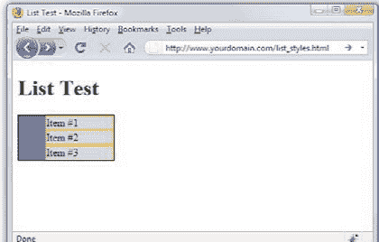
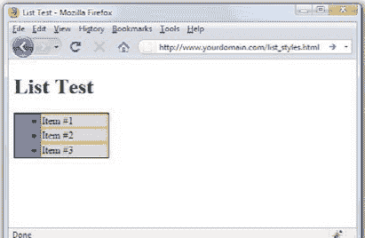

**图 11.1** 使用颜色和边框为列表和列表项设置样式。

如图11.1所示，`<ul>` 创建了一个框，各个列表项被放置在其中。在此示例中，整个框具有蓝色背景。但也请注意，在此示例中，各个列表项（使用灰色背景和黄色边框）并未延伸到 `<ul>` 创建的框的左边缘。

这是因为浏览器会自动向 `<ul>` 的左侧添加一定量的填充。浏览器不会向边距添加填充，因为那会出现在框的外部。它们在框内部添加填充，并且仅在左侧。该填充值约为40像素。默认的左侧填充值无论列表类型如何都保持不变。如果你在样式表中添加以下行，创建一个没有项目指示符的列表，你会发现填充保持不变（参见图11.2）：

```css
list-style-type: none;
```

**图 11.2** 无论是否有列表项指示符，默认的左侧填充都保持不变。

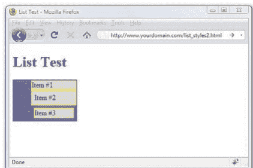

**图 11.3** 不同的值会影响列表项的填充和边距。

第一个列表项是基础项，没有应用任何填充或边距。但是，第二个列表项使用 `style="padding: 6px;"`，你可以看到所有边（在内容和包围元素的黄色边框之间）都有六像素的填充。请注意，项目符号的位置与第一个列表项相同。第三个列表项使用 `style="margin: 6px;"` 在列表项周围应用六像素的边距；这个边距允许 `<ul>` 的蓝色背景透出来。

### 放置列表项指示符

所有这些关于边距和填充的讨论引出了其他问题：列表项指示符（使用时）的控制以及文本应如何围绕它们换行（或不换行）。`list-style-position` 属性的默认值是“outside”——这种放置方式意味着项目符号、数字或其他指示符保持在文本左侧，位于 `<li></li>` 标签对创建的框之外。

当你创建包含任何类型列表的页面布局时，尝试使用填充来将项目“恰当地”放置在页面上。同样，仅仅因为没有与列表关联的默认边距并不意味着你不能为显示分配一些；在 `ul` 选择器的声明中添加 `margin` 值将提供额外的布局控制。

但请记住，到目前为止我们只处理了列表定义本身；我们还没有处理将样式应用于各个列表项。在图11.1和图11.2中，列表项的灰色背景和黄色边框没有显示默认填充或边距。图11.3显示了通过将填充或边距值应用于列表项而不是整个列表“框”本身所产生的不同效果。


## 11 使用CSS为列表、文本和导航添加更多功能

当文本在列表项内换行时，它会在该方框内换行，并且与元素的左边界保持左对齐。

但是当 `list-style-position` 的值为 "inside" 时，项目符号将位于 `<li></li>` 标签对创建的方框内部。这不仅会使列表项项目符号进一步缩进（它们本质上成为文本的一部分），文本还会在每个项目符号下方换行。

图11.4展示了 "outside" 和 "inside" 两种列表样式位置的示例。清单11.1与生成图11.4所示示例（不包括为“Item #2”和“Item #3”添加的填充文本）所用代码之间的唯一区别是，第二个列表项包含 `style=”list-style-position: outside;”`，而第三个列表项包含 `style=”list-style-position: inside;”`。

图11.4 列表样式位置的 "outside" 和 "inside" 值之间的区别。

用于第二个列表项的额外填充文本展示了当列表宽度定义得太窄而无法在一行内显示所有内容时，文本是如何换行的。即使不使用 `style="list-style-position: outside;"` 也会得到相同的结果，因为那是 `list-style-position` 在代码中没有明确声明时的默认值。

然而，当使用 "inside" 位置时，您可以清楚地看到差异。在第三个列表项中，项目符号和文本都位于黄色边框内的灰色区域中——即列表项本身。当 `list-style-position` 的值为 inside 时，边距和填充对列表项的影响有所不同（见图11.5）。

图11.5 边距和填充改变了使用 inside 列表样式位置的项目的显示方式。

在图11.5中，第二个和第三个列表项的 `list-style-position` 值都是 `inside`。但是，第二个列表项的 `margin-left` 值为12像素，第三个列表项的 `padding-left` 值为12像素。尽管两个内容块（列表项符号加文本）都显示文本环绕在项目符号周围，并且这些块在定义列表项的灰色区域内的位置相同，但受影响的区域是列表中列表项本身。

正如您所预期的那样，`margin-left` 值为12像素的列表项会在其周围的透明边距中显示12像素的红色。类似地，`padding-left` 值为12像素的列表项会在内容开始之前显示12像素的灰色背景（列表项本身的）。填充在元素内部；边距在元素外部。通过理解边距和填充影响列表项及其所在列表的方式，您应该能够在网站中创建纯粹的CSS导航元素，而不依赖于外部图像。本章后面，您将学习如何创建垂直和水平导航菜单以及下拉菜单。

**注意**：有关于创建XHTML和CSS图像映射的几篇教程链接，请访问 http://designreviver.com/tutorials/css-image-map-techniques-and-tutorials/。这些教程的交互性水平各不相同，有些可能引入超出本书范围的客户端编码，但解释都很详尽。

### 使用列表项和CSS创建图像映射

在第8章中，您学习了如何使用HTML中的 `<map/>` 标签创建客户端图像映射。图像映射允许您定义图像的一个区域并将链接分配给该区域（而不是必须将图像切成碎片，为每个碎片应用链接，然后在HTML中将图像重新拼接起来）。但是，您也可以使用有效的XHTML和CSS纯粹地创建图像映射。

清单11.2中的代码生成了一个类似于图11.6所示的图像映射。（清单11.2中的代码不会生成图中所示的红色边框。这些边框是为了突出显示定义的区域而添加到图中的。）当代码在网页浏览器中呈现时，它看起来就像一个网页中放置了一张图片。当您的鼠标悬停在一个“热区”上时，动作就会发生。

#### 清单11.2 使用CSS创建图像映射

```xml
<?xml version="1.0" encoding="UTF-8"?>
<!DOCTYPE html PUBLIC "-//W3C//DTD XHTML 1.1//EN"
"http://www.w3.org/TR/xhtml11/DTD/xhtml11.dtd">
<html xmlns="http://www.w3.org/1999/xhtml" xml:lang="en">
<head>
<title>CSS Image Map Example</title>
<style type="text/css">
#theImg {
    width:500px;
    height:375px;
    background:url(tea_shipment.jpg) no-repeat;
    position:relative;
    border: 1px solid #000000;
}
#theImg ul {
    margin:0px;
    padding:0px;
    list-style:none;
}
#theImg a {
    position:absolute;
    text-indent: -1000em;
}
#theImg a:hover {
    border: 1px solid #ffffff;
}
#ss a {
    top:0px;
    left:5px;
    width:80px;
    height:225px;
}
#gn a {
    top:226px;
    left:15px;
    width:70px;
    height:110px;
}
#ib a {
    top:225px;
    left:85px;
    width:60px;
    height:90px;
}
#iTEA1 a {
    top:100px;
    left:320px;
    width:178px;
    height:125px;
}
#iTEA2 a {
    top:225px;
    left:375px;
    width:123px;
    height:115px;
}
</style>
</head>
<body>
<div id="theImg">
<ul>
<li id="ss"><a href="[some URL]"
title="Sugarshots">Sugarshots</a></li>
<li id="gn"><a href="[some URL]"
title="Golden Needle">Golden Needle</a></li>
<li id="ib"><a href="[some URL]"
title="Irish Breakfast">Irish Breakfast</a></li>
<li id="iTEA1"><a href="[some URL]"
title="IngenuiTEA">IngenuiTEA</a></li>
<li id="iTEA2"><a href="[some URL]"
title="IngenuiTEA">IngenuiTEA</a></li>
</ul>
</div>
</body>
</html>
```

如清单11.2所示，样式表有很多条目，但实际的HTML非常简短。列表项被用来创建五个不同的可点击区域；这些“区域”是被赋予特定高度和宽度并放置在背景图像上的列表项。如果从包含列表的 `<div>` 中移除背景图像，列表项仍然存在并且仍然可以点击。

让我们逐步分析样式表，以便您理解构成这个XHTML和CSS图像映射的各个部分——从根本上说，它只是一组链接列表。

图11.6 CSS使您能够在图像映射中定义热区。

链接列表被封装在一个名为 "theImg" 的 `<div>` 中。在样式表中，这个 `<div>` 被定义为一个块级元素，宽度为500像素，高度为375像素，并带有1像素的黑色实线边框。该元素的背景是一张名为 tea_shipment.jpg 的图片，它被放置在一个位置且不重复。您看到的下一个HTML部分是无序列表（`<ul>`）的开始。在样式表中，这个无序列表的四周边距和填充都被设置为零像素，并且 `list-style` 设置为 `none`——列表项前不会出现任何图标。

列表项文本本身永远不会显示给用户，这是因为样式表中针对 `<div>` 内所有 `<a>` 标签的这个技巧：

```css
text-indent: -1000em;
```

通过将文本缩进负1000em，您可以确保文本永远不会显示。它确实存在，但它存在于浏览器窗口左侧1000em处的一个不可见区域。换句话说，如果您举起左手并将其放在电脑显示器旁边，`text-indent:-1000em` 会将文本放置在您小指左侧的某个位置。但这就是我们想要的，因为我们不需要看到文本链接。我们只需要定义一个区域作为链接，这样当用户的鼠标悬停在上面时，光标就会像悬停在网站上的任何其他链接上时一样发生变化。

当用户的鼠标悬停在一个包含链接的列表项上时，由于样式表中的这个条目，该列表项会显示一个1像素的白色实线边框：


### 导航列表与普通列表的区别

```css
#theImg a:hover {
  border: 1px solid #ffffff;
}
```

列表项本身随后被定义，并根据图像中应该是可点击区域的位置放置在特定位置。

例如，具有 "ss" id 的列表项（对应图中显示的项目名称 "Sugarshots"）的左上角位于 `<div>` 顶部零像素处，距 `<div>` 左边缘五像素。

此列表项宽度为80像素，高度为225像素。类似地，也为 "#gn"、"#ib"、"#iTEA1" 和 "#iTEA2" 列表项创建了样式声明，使得与这些ID关联的链接区域相对于图像出现在特定位置。

当我们谈论使用列表创建导航元素时，我们实际上是指使用CSS以网站访问者期望的导航外观来显示内容——简而言之，不同于简单的项目符号或编号列表。

尽管一组导航元素本质上确实是一个链接列表，但这些链接通常以一种清晰表明用户应与内容交互的方式显示：

- 用户的鼠标光标会改变以指示该元素是可点击的。
- 当鼠标悬停在元素上时，其周围区域的外观会发生变化。
- 内容区域在视觉上与普通文本区分开来。

较早创建导航的方法倾向于依赖图像——例如带有斜角边缘的图形以及使用对比色作为背景和文本颜色——外加使用JavaScript进行客户端编程以处理基于鼠标操作的图像切换。但是，使用纯CSS从列表元素创建导航，会产生更易用、更灵活且对搜索引擎友好的显示效果，并且可以被使用各种设备的所有用户访问。

无论你的导航元素布局是水平还是垂直，本章讨论了两级导航：主要导航和次要导航。主要导航将用户引导至网站主要部分的介绍性页面；次要导航则反映特定部分内的这些页面。

236 第11章 使用CSS增强列表、文本和导航

### 使用CSS创建垂直导航

根据你的网站架构——你创建的显示模板以及你对网站中信息进行分类的方式——你可能会发现自己使用垂直导航作为主要导航或次要导航。

例如，假设你为公司创建了一个网站，主要部分是关于我们、产品、支持和媒体。在主要的"关于我们"部分内，你可能还有几个其他页面，例如使命、历史、管理团队和联系我们——这些其他页面是"关于我们"主要部分内的次要导航。

清单11.3设置了一个基本的次要页面，左侧是垂直导航，中间是内容。侧边和页面内容区域中的链接都是基本的HTML列表元素。

此清单和图11.7所示的示例为您提供了一个起点，向您展示CSS如何使您能够将两个相似的HTML结构转换为两种不同的视觉显示（从而两种不同的上下文）。

#### 清单11.3 使用列表的垂直导航基本页面

```xml
<?xml version="1.0" encoding="UTF-8"?>
<!DOCTYPE html PUBLIC "-//W3C//DTD XHTML 1.1//EN"
"http://www.w3.org/TR/xhtml11/DTD/xhtml11.dtd">
<html xmlns="http://www.w3.org/1999/xhtml" xml:lang="en">
<head>
<title>About Us</title>
<style type="text/css">
body {
  font: 12pt Verdana, Arial, Georgia, sans-serif;
}
#nav {
  width:150px;
  float:left;
}
#content {
  width:550px;
  float:left;
}
</style>
</head>
<body>
<div id="nav">
<ul>
<li><a href="#">Mission</a></li>
<li><a href="#">History</a></li>
<li><a href="#">Executive Team</a></li>
<li><a href="#">Contact Us</a></li>
</ul>
</div>
<div id="content">
<h1>About Us</h1>
<p>On the introductory pages of main sections, it can be useful to repeat the secondary navigation and provide more context, such as:</p>
<ul>
  <li><a href="#">Mission</a>: Learn more about our corporate mission and philanthropic efforts.</li>
  <li><a href="#">History</a>: Read about our corporate history and learn how we grew to become the largest widget maker in the country.</li>
  <li><a href="#">Executive Team</a>: Our team of executives makes the company run like a well-oiled machine (also useful for making widgets).</li>
  <li><a href="#">Contact Us</a>: Here you can find multiple methods for contacting us (and we really do care what you have to say).</li>
</ul>
</div>
</body>
</html>
```

图11.7

起点：未设置样式的列表导航。

238 第11章 使用CSS增强列表、文本和导航

此页面的内容设置在两个相邻的 `<div>` 元素中：一个的id值为nav，另一个的id值为content。此基本页面中分配给任何内容的唯一样式是与每个 `<div>` 相关的宽度、边距和浮动值。没有为列表元素应用任何样式。

为了区分内容区域列表中存在的链接和侧边导航列表中存在的链接，请将以下样式添加到样式表：

```css
#nav a {
    text-decoration: none;
}

#content a {
    text-decoration: none;
    font-weight: bold;
}
```

这些样式只是说明 `id` 为 `nav` 的 `<div>` 中的所有 `<a>` 链接没有下划线，而 `id` 为 `content` 的 `<div>` 中的所有 `<a>` 链接没有下划线且为粗体。区别如图11.8所示。

图11.8

使用CSS区分列表元素。

但要真正使侧边导航列表看起来与众不同，您需要更深入地研究样式表。

239 使用CSS创建垂直导航

#### 设置单级垂直导航的样式

这组特定导航元素的目标仅仅是将它们作为一块链接呈现，不带项目符号，并且背景色和文本颜色会根据其链接状态（常规链接、已访问链接、悬停在链接上或激活链接）而变化。此过程的第一步已经完成：将导航与内容分离。我们通过将导航放在一个id为nav的 `<div>` 中来实现这一点。

接下来，您需要修改在nav `<div>` 中定义链接的 `<ul>`。让我们去掉列表标记，并确保除了上边距外没有额外的边距或内边距。该上边距用于将导航的顶部与页面内容区域中"关于我们"标题文本的顶部对齐：

```css
#nav ul {
  list-style: none;
  margin: 12px 0px 0px 0px;
  padding: 0px;
}
```

因为导航列表项本身呈现为彩色区域，所以为每个列表项添加一个底部边框，以便在内容之间产生一些视觉分隔：

```css
#nav li {
  border-bottom: 1px solid #ffffff;
}
```

现在开始构建列表项的其余部分。其理念是，当列表项仅作为链接存在时，它们是一种特殊的蓝色，带有粗体白色文本（尽管它们的字体比正文本身要小）。为了实现这一点，请添加以下内容：

```css
#nav li a:link, #nav li a:visited {
  font-size: 10pt;
  font-weight: bold;
  display: block;
  padding: 3px 0px 3px 3px;
  background-color: #628794;
  color: #ffffff;
}
```

除了在样式表条目中使用 `display: block;` 之外，您应该熟悉之前使用的所有样式。将 display 属性设置为 block 可确保当用户将鼠标悬停在 `<li>` 元素上时，整个元素都处于活动状态。图11.9显示了应用了这些新样式的垂直列表菜单。


# 240 第11章 使用CSS增强列表、文本和导航功能

图11.9

这个垂直列表开始看起来像一个导航菜单。

当用户鼠标悬停在一个导航列表元素上时，预期的效果是发生一些视觉变化，以便用户知道该元素是可点击的。这类似于大多数软件菜单在用户光标悬停在菜单项上时会改变颜色的情况。在本例中，我们将更改列表项的背景色和文本颜色；它们将与之前显示的蓝色和白色不同。

```css
#nav li a:hover, #nav li a:active {
    font-size: 10pt;
    font-weight: bold;
    display: block;
    padding: 3px 0px 3px 3px;
    background-color: #6cac46;
    color: #000000;
}
```

图11.10展示了目前所有样式设计工作的成果。通过使用样式表中的几条规则，一个简单的列表被转换成了一个在视觉上有所区分的菜单。

### 样式化多级垂直导航

如果你的网站架构要求用户始终能看到另一级导航呢？这通过嵌套列表（你在前面章节中学过）和更多的样式表条目来表示。在这种情况下，假设在“Executive Team”链接下有四个导航元素。在HTML中，按如下方式修改列表：

# 使用CSS创建垂直导航 241

```html
<ul>
    <li><a href="#">Mission</a></li>
    <li><a href="#">History</a></li>
    <li><a href="#">Executive Team</a>
        <ul>
            <li><a href="#">&raquo; CEO</a></li>
            <li><a href="#">&raquo; CFO</a></li>
            <li><a href="#">&raquo; COO</a></li>
            <li><a href="#">&raquo; Other Minions</a></li>
        </ul>
    </li>
    <li><a href="#">Contact Us</a></li>
</ul>
```

图11.10

列表项现在在鼠标悬停时会改变颜色。

这段代码在“Executive Team”链接下生成了一个嵌套列表（参见图11.11）。`&raquo;` HTML实体在新链接文本前显示了指向右侧的箭头。

新项目作为块级元素出现在列表中，但信息的层次结构没有被可视化地表示出来。为了添加某种视觉元素，将这些项目标识为附加在“Executive Team”链接下的子导航元素，我们需要再次修改样式表以添加一些缩进。但在这样做之前，我们也要修改一些其他的样式表条目。

在上一节中，我们添加了诸如 `#nav ul` 和 `#nav li` 这样的选择器，它们分别表示“`<div>`（名为 nav）中的所有 `<ul>`”和“`<div>`（名为 nav）中的所有 `<li>`”。然而，我们现在在名为 nav 的 `<div>` 中有两个 `<ul>` 实例和另一组 `<li>` 元素，我们希望它们都与原始集合的显示方式不同。

# 242 第11章 使用CSS增强列表、文本和导航功能

图11.11

创建了一个嵌套导航列表（但尚未良好样式化）。

为了确保两组列表项都被适当地样式化，请确保样式表选择器清楚地表明列表的层次结构。为此，为第一级列表使用 `#nav ul` 和 `#nav ul li` 这样的条目，为第二级列表使用 `#nav ul ul` 和 `#nav ul ul li` 这样的条目。清单11.4展示了产生图11.12所示菜单的新的样式表条目和HTML版本。

#### 清单11.4 列表中的多级垂直导航

```html
<?xml version="1.0" encoding="UTF-8"?>
<!DOCTYPE html PUBLIC "-//W3C//DTD XHTML 1.1//EN"
“http://www.w3.org/TR/xhtml11/DTD/xhtml11.dtd”>
<html xmlns=”http://www.w3.org/1999/xhtml” xml:lang=”en”>
<head>
<title>About Us</title>
<style type=”text/css”>
body {
    font: 12pt Verdana, Arial, Georgia, sans-serif;
}
#nav {
    width:150px;
    float:left;
}
#content {
    width:550px;
    float:left;
}
#nav a {
    text-decoration: none;
}
#content a {
    text-decoration: none;
    font-weight: bold;
}
#nav ul {
    list-style: none;
    margin: 12px 0px 0px 0px;
    padding: 0px;
}
#nav ul li {
    border-bottom: 1px solid #ffffff;
}
#nav ul li a:link, #nav ul li a:visited {
    font-size: 10pt;
    font-weight: bold;
    display: block;
    padding: 3px 0px 3px 3px;
    background-color: #628794;
    color: #ffffff;
}
#nav ul li a:hover, #nav ul li a:active {
    font-size: 10pt;
    font-weight: bold;
    display: block;
    padding: 3px 0px 3px 3px;
    background-color: #c6a648;
    color: #000000;
}
#nav ul ul {
    margin: 0px;
    padding: 0px;
}
#nav ul ul li {
    border-bottom: none;
}
#nav ul ul li a:link, #nav ul ul li a:visited {
    font-size: 8pt;
    font-weight: bold;
    display: block;
    padding: 3px 0px 3px 18px;
    background-color: #628794;
    color: #ffffff;
}
#nav ul ul li a:hover, #nav ul ul li a:active {
    font-size: 8pt;
    font-weight: bold;
    display: block;
    padding: 3px 0px 3px 18px;
    background-color: #c6a648;
    color: #000000;
}
</style>
</head>
<body>
<div id="nav">
    <ul>
        <li><a href="#">Mission</a></li>
        <li><a href="#">History</a></li>
        <li><a href="#">Executive Team</a>
            <ul>
                <li><a href="#">&raquo; CEO</a></li>
                <li><a href="#">&raquo; CFO</a></li>
                <li><a href="#">&raquo; COO</a></li>
                <li><a href="#">&raquo; Other Minions</a></li>
            </ul>
        </li>
        <li><a href="#">Contact Us</a></li>
    </ul>
</div>
<div id="content">
    <h1>About Us</h1>
    <p>在主要部分的介绍页面上，重复二级导航并提供更多上下文信息会很有用，例如：</p>
    <ul>
        <li><a href="#">Mission</a>: 了解更多关于我们的企业使命和慈善努力。</li>
        <li><a href="#">History</a>: 阅读我们的企业历史，了解我们如何成长为全国最大的小部件制造商。</li>
        <li><a href="#">Executive Team</a>: 我们的管理团队让公司像一台运转良好的机器一样运作（也适用于制造小部件）。</li>
        <li><a href="#">Contact Us</a>: 这里您可以找到多种联系我们的方式（我们真的关心您想说什么）。</li>
    </ul>
</div>
</body>
</html>
```

样式化垂直导航的不同方式仅受限于你自己的创造力。你可以使用颜色、外边距、内边距、背景图像以及任何其他有效的CSS，来制作非常灵活且易于修改的垂直导航。如果你在搜索引擎中输入“CSS vertical navigation”，你会找到成千上万的示例——它们都基于你在本章学到的简单原则。

# 245 使用CSS创建水平导航

图11.12

使用CSS创建两级垂直导航。

### 使用CSS创建水平导航

关于导航的课程从垂直导航开始，因为当导航仍然看起来像你可能在一张纸上垂直书写的项目列表（如购物清单）时，将列表转换为导航的概念更容易掌握。在创建水平导航时，你仍然使用HTML列表元素，但不是通过为 `<ul>` 和 `<li>` 都使用 `display` 属性的 `inline` 值来实现垂直显示，而是改用 `block` 值。真的就这么简单。

清单11.5展示了一个具有水平导航的页面的起点。该页面包含两个主要的 `<div>` 元素：一个用于页眉，一个用于内容。页眉 `<div>` 包含一个logo `<div>` 和一个导航 `<div>`，它们彼此浮动并列。出现在导航 `<div>` 中的列表，其列表和列表项的 `display` 属性值均为 `inline`。你可以在图11.13中看到这些元素及其布局。

#### 清单11.5 从列表创建基本水平导航

```html
<?xml version="1.0" encoding="UTF-8"?>
<!DOCTYPE html PUBLIC "-//W3C//DTD XHTML 1.1//EN"
"http://www.w3.org/TR/xhtml11/DTD/xhtml11.dtd">
<html xmlns="http://www.w3.org/1999/xhtml" xml:lang="en">
<head>
<title>ACME Widgets LLC</title>
```


# 246 第11章 使用CSS为列表、文本和导航增添更多功能

清单 11.5 续

```css
<style type="text/css">
body {
    font: 12pt Verdana, Arial, Georgia, sans-serif;
}

#header {
    width: auto;
}

#logo {
    float:left;
}

#nav {
    float:left;
}

#nav ul {
    list-style: none;
    display: inline;
}

#nav li {
    display: inline;
}

#content {
    width: auto;
    float: left;
    clear: left;
}

#content a {
    text-decoration: none;
    font-weight: bold;
}
</style>
</head>
<body>
<div id="header">
    <div id="logo">
        
    </div>

    <div id="nav">
        <ul>
            <li><a href="#">关于我们</a></li>
            <li><a href="#">产品</a></li>
            <li><a href="#">支持</a></li>
            <li><a href="#">新闻</a></li>
        </ul>
    </div>
</div>

<div id="content">
    <p><strong>ACME Widgets LLC</strong> 是全天下最棒的小部件制造商。</p>

    <p>不相信我们？请继续阅读……</p>

    <ul>
        <li><a href="#">关于我们</a>：我们确实很棒。</li>
        <li><a href="#">产品</a>：我们的产品是最好的。</li>
        <li><a href="#">支持</a>：您可能不太需要支持服务，但我们仍然提供。</li>
        <li><a href="#">新闻</a>：阅读他人对我们的评价（关于我们有多么出色）。</li>
    </ul>
</div>
</body>
</html>
```

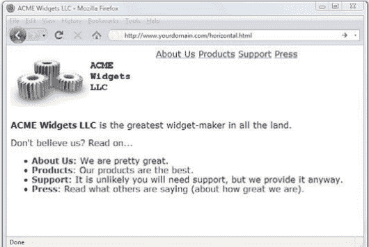

## 247 使用CSS创建水平导航

#### 清单 11.5 续

> 图 11.13：使用内联列表元素创建功能性（但不一定美观）的水平导航。

修改此列表的显示方式完全通过CSS实现；HTML内部的内容结构已经设定。要实现所需的显示效果，请使用以下CSS。首先，将id为nav的`<div>`修改为特定宽度，显示背景色和边框，并使用85像素的上边距（使其显示在logo下方附近）。

```css
#nav {
    float:left;
    margin: 85px 0px 0px 0px;
    width: 400px;
    background-color: #628794;
    border: 1px solid black;
}
```

`<ul>`的定义与清单11.5保持相同，除了边距和填充的更改：

```css
#nav ul {
    margin: 0px;
    padding: 0px;
    list-style: none;
    display: inline;
}
```

`<li>`的定义与清单11.5保持相同，只是为其设置了1.8em的行高值：

```css
#nav li {
    display: inline;
    line-height: 1.8em;
}
```

链接样式与垂直导航中使用的类似；这些条目具有不同的填充值，但颜色和字体大小保持不变：

```css
#nav ul li a:link, #nav ul li a:visited {
    font-size: 10pt;
    font-weight: bold;
    text-decoration: none;
    padding: 7px 10px 7px 10px;
    background-color: #628794;
    color: #ffffff;
}

#nav ul li a:hover, #nav ul li a:active {
    font-size: 10pt;
    font-weight: bold;
    text-decoration: none;
    padding: 7px 10px 7px 10px;
    background-color: #c6a648;
    color: #000000;
}
```

将这些样式组合在一起，您将得到如图11.14所示的显示效果。当用户将鼠标悬停在导航元素上时，背景色和文本颜色会发生变化，方式与用户将鼠标悬停在垂直导航菜单上时相同。同样，就像您使用垂直导航菜单一样，您可以使用嵌套列表在水平菜单中实现下拉功能。请自己尝试一下！

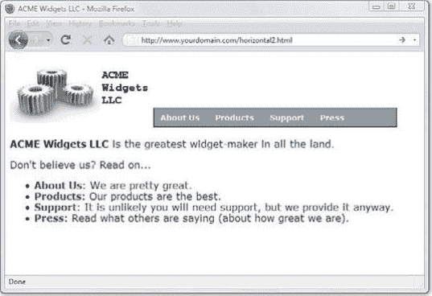

## 249 总结

> 图 11.14：创建带有某些样式的水平导航。

## 总结

本章首先通过示例展示了列表和列表元素如何受填充和边距样式的影响。您首先了解了与列表相关的默认填充以及如何控制该填充。接下来，您学习了如何修改填充和边距值，以及如何将列表项指示符放置在列表项内部或外部，以便您开始思考样式和列表如何影响整体网站设计。

最后，您学习了如何利用列表和列表元素创建纯XHTML/CSS图像映射，从而减少对链接图像进行切片或使用`<map/>`标签的需求。

在学习“跳出（列表）框框思考”之后，您学习了如何使用无序列表在网站内创建水平或垂直导航。通过使用CSS代替图形，您将在网站的显示和维护方面获得更大的灵活性。在本章中，您了解到只需在样式表中添加几条条目，就可以将普通的带下划线文本链接转换为带有边框、背景色和其他文本样式的区域。此外，您还学习了如何在菜单中显示嵌套列表。

## 250 问答

**问：有很多网页讨论关于边距和填充的“盒子模型hack”，尤其是在列表和列表元素方面。您确定我不需要使用hack吗？**

**答：** 在本章开头，您了解到本章（以及其他章节）中的HTML和CSS在当前主流网页浏览器的版本中看起来都是一样的。这是多年来网页开发者不得不进行代码hack和其他技巧的结果，然后现代浏览器才开始根据CSS规范而非其自身的特性来处理事情。此外，还有一股日益增长的运动，旨在让互联网用户摆脱那些最初导致大多数hack的老旧网页浏览器。因此，虽然我不一定建议您仅为当前主流网页浏览器的版本进行设计，但我也不建议您花费大量时间为较旧版本的浏览器实现hack——这些浏览器的使用率已低于互联网用户的5%。您应该继续编写经过验证并符合设计原则的坚实代码，在最能反映您目标受众的一系列浏览器中测试您的页面，然后将您的网站发布到全球。

**问：CSS图像映射似乎工作量很大。`<map/>`标签有那么糟糕吗？**

**答：** `<map/>`标签一点也不糟糕，在XHTML和HTML5中都是有效的。然而，确定客户端图像映射中使用的坐标可能很困难，尤其是在没有图形软件或专门用于创建客户端图像映射的软件的情况下。CSS版本为您提供了更多定义和显示可点击区域的选项，这里只是展示了其中一种。

**问：我可以在导航菜单中使用图形作为自定义列表指示符吗？**

**答：** 可以。您可以在列表项的HTML文本中使用图形，也可以在`<li>`元素内使用背景图像。您可以像设置任何其他列表元素的样式一样设置导航元素的样式。HTML无序列表和基于CSS的水平或垂直导航列表之间的唯一区别在于，您这样称呼它，并且您将无序列表用于正文之外的特定目的。此外，然后您设置列表的样式以向用户展示它确实是不同的东西——您可以用小图形来强调您的列表。

**问：我在哪里可以找到更多关于如何使用列表的示例？**

**答：** 上次我查的时候，在搜索引擎中输入“CSS导航”大约返回了4400万条结果。这里有几个起点：

- A List Apart的CSS文章，地址：http://www.alistapart.com/topics/code/
- Maxdesign的CSS Listamatic，地址：http://css.maxdesign.com.au/listamatic/
- Vitaly Friedman的CSS Showcase，地址：http://www.alvit.de/css-showcase/

## 251 实战

## 测验

1.  `list-style-position`属性的`inside`和`outside`值有什么区别？哪个是默认值？


## 252 第11章 使用CSS增强列表、文本和导航功能

2.  当 `list-style` 的值为 `none` 时，是否仍会生成结构化列表（无论是有序列表还是无序列表）？

3.  创建基于列表的导航时，最多可以使用多少层嵌套列表？

4.  创建任何类型的导航列表时，`a` 选择器的四个伪类可以使用相同的值吗？

## 答案

1.  `list-style-position` 的 `inside` 值会将列表项标记放置在列表项创建的块内部。`outside` 值则将其放置在块外部。当设置为 `inside` 时，内容会环绕在列表项标记下方。默认值为 `outside`。

2.  是的。唯一的区别在于，列表项内的内容前面不会出现列表项标记。

3.  技术上讲，你可以根据需要将列表嵌套到任意深度。但从可用性的角度来看，你希望使用的嵌套层数是有限制的。通常三层是上限——超过这个深度，你就有使网站结构混乱的风险，或者给用户提供了远超其需要的选项。

4.  可以，但这样做的风险是用户可能意识不到你精心设计的菜单确实是菜单（因为鼠标操作不会产生任何视觉反馈）。

## 练习

+   .  找一张图片，尝试使用本章展示的技术来映射其区域。选择一张包含你可以设置热点或可点击区域的图片，这些区域可以链接到你网站上的其他页面或别人的网站。然后创建 HTML 和 CSS 来定义这些可点击区域及其应该链接到的 URL。
.   使用本章末尾展示的多级垂直列表技术，为该垂直列表添加子导航项。

.   观察网络上众多使用 CSS 导航的案例，找出一些看起来很巧妙的效果。使用你的网页浏览器的“查看源代码”功能，查看这些网站使用的 CSS，并尝试为你自己实现类似的效果。

## 第12章

到目前为止，你已经学习了大量关于网页内容样式化的知识，从字体大小、颜色到图像、块级元素、列表等等。但尚未讨论的是页面布局的高级概述。一般来说，布局有两种类型——固定布局和流体布局——但也存在一种两者的组合布局，其中某些元素是固定的，而其他元素是流动的。

-   固定布局的工作原理
-   流体布局的工作原理
-   如何创建固定/流体混合布局

在本章中，你将首先了解这两种布局的特点，并看到一些使用它们的网站示例。在本章末尾，你将看到一个结合了两种布局元素的基本模板。最终，你决定使用哪种布局取决于你自己——只要你的网站遵循 HTML 和 CSS 标准，就很难出错。

流体布局示例的一个好去处是 WordPress 主题画廊，网址为 http://wordpress.org/extend/themes/。WordPress 是一个博客平台，正越来越多地被用作非博客网站管理工具。主题画廊展示了数百个固定宽度和流体布局的示例，即使不提供所有代码，也能让你对可以创建的内容有所了解。即使你在本书的练习中不使用 WordPress 博客，主题画廊也是一个你可以看到并与众多设计变体互动的地方。

花些时间查看 WordPress 的示例，或许也看看 CSS 禅意花园（CSS Zen Garden），网址为 http://www.csszengarden.com/。这将帮助你感受你喜欢的布局类型，而不会因布局内的内容而产生偏好倾向。

254 第12章 创建固定或流体布局

### 理解固定布局

固定布局，或称固定宽度布局，顾名思义：页面的主体被设置为一个特定的宽度。该宽度通常由一个主“包装器” `<div>` 控制，所有内容都包含在其中。如果该 `<div>` 被赋予一个 ID 值（如“main”或“wrapper”——尽管名称由你决定），则其 width 属性将设置在 style 属性中或样式表条目中。

**注意** 创建固定宽度布局时，最重要的决定是确定你希望支持的最小屏幕分辨率。请记住，网页浏览器窗口包含不可见区域，包括滚动条。多年来，800×600 一直是网页设计师的“最低公分母”，导致典型的固定宽度约为 760 像素。因此，如果你的目标屏幕分辨率是 1024 像素宽，你实际上无法使用全部 1024 像素。然而，自 2007 年以来，使用 800×600 屏幕分辨率的人数已不足 8%（目前约为 4%）。考虑到这一点，许多网页设计师认为 1024×768 是当前的最低屏幕分辨率，导致固定宽度设计在 800 到 1000 像素宽之间。

创建固定宽度布局的主要原因之一是为了精确控制内容区域的外观。但是，如果用户访问你的固定宽度网站时，屏幕分辨率比你设计时考虑的分辨率小得多或大得多，他们可能会遇到滚动条（如果他们的分辨率较小）或大量空白区域（如果他们的分辨率较大）。

当前的 ESPN.com 主页提供了一个直观的例子；它的内容区域固定为 964 像素宽。在图 12.1 中，浏览器窗口宽度略低于 800 像素。在图像的右侧，重要内容被截断（并且在图像底部，浏览器中显示了一个水平滚动条）。

然而，图 12.2 显示了当浏览器窗口宽度超过 1400 像素时该网站的样子：在主体内容的两侧有大量的空白（或“空间”）。

创建固定宽度布局时还有另一个考虑：是将内容左对齐还是居中对齐。左对齐内容只在右侧产生额外空间；居中内容区域则在两侧都产生额外空间。

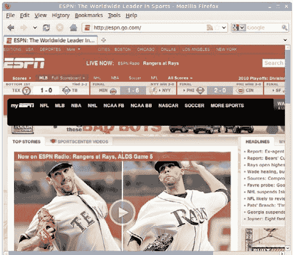

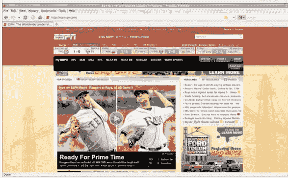

图 12.1 在较小屏幕尺寸下的固定宽度示例。

图 12.2 在较大屏幕尺寸下的固定宽度示例。

### 理解流体布局

流体布局——也称为弹性布局——是指页面主体不使用指定的像素宽度，尽管它可能被封装在一个使用百分比宽度的主“包装器” `<div>` 中。流体布局的理念是，即使用户使用非常小或非常宽的屏幕，它也能保持完美的可用性并保留整体设计美感。

图 12.3、图 12.4 和图 12.5 展示了三个流体布局的实际示例。

**图 12.3** 在相对较小的屏幕上查看的流体布局。

**图 12.4** 在非常小的屏幕上查看的流体布局。

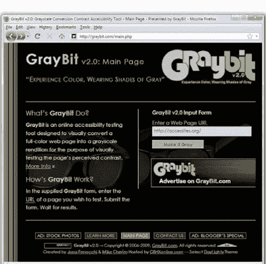

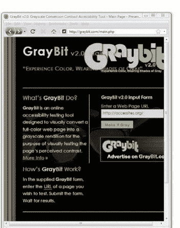

256 第12章 创建固定或流体布局

图 12.5 在宽屏幕上查看的流体布局。

在图 12.3 中，浏览器窗口宽度约为 770 像素。该示例展示了在出现水平滚动条之前的合理最小屏幕宽度。事实上，直到浏览器宽度为 735 像素时滚动条才会出现。另一方面，图 12.4 显示了一个非常小的浏览器窗口（545 像素宽）。

在图 12.4 中，你可以看到一个水平滚动条；在页面内容的标题区域，标志图形开始占据文本空间并显示在文本上方。但页面的大部分内容仍然相当可用。页面左侧的信息内容仍然清晰可读，并与右侧的输入表单共享可用空间。

图 12.5 显示了同一页面在非常宽的屏幕上的样子。


在图12.5中，浏览器窗口宽度约为1330像素。页面上所有内容都有充足的空间展开。这种流动布局之所以能实现，是因为所有设计元素都指定了百分比宽度（而非固定宽度）。这样一来，布局就能充分利用所有可用的浏览器空间。流动布局方法乍一看似乎是最佳方案——毕竟，谁不想充分利用所有可用的屏幕空间呢？然而，充分利用空间与允许内容自由“呼吸”之间存在微妙的界限。内容过多会显得杂乱不堪；而在开阔空间中内容不足又会显得空洞。纯粹的流动布局可能相当令人印象深刻，但它需要大量的测试，以确保在各种浏览器和不同屏幕分辨率下都能正常使用。你可能没有足够的时间和精力来制作这样的设计；在这种情况下，一个合理的折中方案是采用固定/流动混合布局。

### 创建固定/流动混合布局

固定/流动混合布局是同时包含两种布局元素的布局。例如，你可以采用流动布局，但在主体区域内或作为锚定元素（如左侧栏或顶部导航条）包含固定宽度的内容区域。你甚至可以创建一个像框架一样的固定内容区域，正如你将在第20章“使用窗口和框架”中看到的那样，该固定内容区域即使在用户滚动内容时也保持固定。

### 从基本布局结构开始

在本例中，你将学习创建一个模板，该模板是流动布局，但在主体区域（可以理解为第三列，只是比其他两列宽得多）的两侧有两个固定宽度的列。模板还将包含明确的页眉和页脚区域。代码清单12.1展示了该布局的基本HTML结构。

#### 代码清单12.1 基本固定/流动混合布局结构

```xml
<?xml version="1.0" encoding="UTF-8"?>
<!DOCTYPE html PUBLIC "-//W3C//DTD XHTML 1.1//EN"
"http://www.w3.org/TR/xhtml11/DTD/xhtml11.dtd">
<html xmlns="http://www.w3.org/1999/xhtml" xml:lang="en">
<head>
<title>Sample Layout</title>
<link href="layout.css" rel="stylesheet" type="text/css" />
</head>
<body>
<div id="header">HEADER</div>
<div id="wrapper">
<div id="content_area">CONTENT</div>
<div id="left_side">LEFT SIDE</div>
<div id="right_side">RIGHT SIDE</div>
</div>
<div id="footer">FOOTER</div>
</body>
</html>
```

首先请注意，该布局的样式表是通过`<link>`标签链接的，而不是包含在模板中。因为模板用于多个页面，所以你希望能够以最有序的方式控制模板的显示元素。这意味着你只需在一个地方——即样式表中更改这些元素的定义。

其次，你会注意到基本HTML确实非常简单。而且，说实话，这个基本HTML结构可以用于固定布局、流动布局或你将在这里看到的固定/流动混合布局，因为所有使布局成为固定、流动或混合的实际样式设置都发生在样式表中。

代码清单12.1中的HTML结构实际上是标识了你想包含在网站中的内容区域。这种规划对于任何开发都至关重要；在考虑布局类型之前，你必须知道你想包含什么内容，更不用说要应用到该布局的具体样式了。

在这一阶段，layout.css文件只包含以下内容：

```css
body {
    margin: 0;
    padding: 0;
}
```

如果你查看代码清单12.1中的HTML并对自己说“但这些`<div>`元素没有任何样式，只会堆叠在一起”，你是对的。如图12.6所示，根本谈不上任何布局。

**图12.6**
未对`<div>`元素应用任何样式的基本HTML模板。

### 在固定/流动混合布局中定义两列

我们可以先从简单的部分开始。因为这个布局应该是流动的，所以我们知道，无论放在页眉和页脚区域的内容是什么，它都会根据浏览器窗口的宽度（无论多窄或多宽）延伸其宽度。

将以下代码添加到样式表中，为页眉和页脚区域分别设置100%的宽度和相同的背景颜色：

```css
#header {
    float: left;
    width: 100%;
    background-color: #7152F4;
}

#footer {
    float: left;
    width: 100%;
    background-color: #7152F4;
}
```

现在情况变得有点复杂了。我们必须定义页面两侧的两个固定列，以及中间的列。在HTML中，注意有一个`<div>`包围了所有三列，它被称为`wrapper`。该元素定义如下：

```css
#wrapper {
    float: left;
    padding-left: 200px;
    padding-right: 125px;
}
```

使用这两个padding定义本质上是为页面左右两侧的两个固定宽度列预留空间。左侧列将宽200像素，右侧列将宽125像素，并且每个都有不同的背景颜色。但我们还必须相对于它们在HTML未设置样式时的位置（参见图12.6）来定位这些项目。这意味着需要在样式表条目中为每个这样的列添加`position: relative`。此外，我们还指出`<div>`元素应该向左浮动。

但在`left_side` `<div>`的情况下，我们还指出希望其最右侧的边距边缘从边缘向内缩进200像素。（这是在列定义为200像素宽之外的。）我们还希望左侧的边距为完整的负边距；这将把它拉到位（你很快就会看到）。`right_side` `<div>`不包含right的值，但它在右侧包含一个负边距：

```css
#left_side {
    position: relative;
    float: left;
    width: 200px;
    background-color: #52f471;
    right: 200px;
}

#right_side {
    position: relative;
    float: left;
    width: 125px;
    background-color: #f452d5;
}
```

此时，我们还要定义内容区域，使其具有白色背景，占据100%的可用区域，并相对于其位置向左浮动：

```css
#content_area {
    position: relative;
    float: left;
    background-color: #ffffff;
    width: 100%;
}
```

此时，基本布局将类似于图12.7所示，各个区域被清晰地划分开。

**图12.7**
应用了一些样式后的基本HTML模板。

然而，如果窗口宽度调整到小于某个特定值，这个模板就会出现问题。因为左列宽200像素，右列宽125像素，并且你希望内容区域至少有一些文本，所以可以想象，如果窗口宽度只有350到400像素，这个页面就会出问题。图12.8显示了当窗口宽度调整到略低于400像素（具体为390像素）时发生的情况。

**图12.8**
调整到小于400像素的基本HTML模板：糟糕！

### 设置布局的最小宽度

尽管用户不太可能使用小于400像素宽的浏览器访问你的网站，但此例在本书的篇幅范围内达到了其目的。你可以推而广之，广泛应用此信息：即使在固定/流动混合网站中，除非你采取一些措施，否则布局总会有一个崩溃点。

那个“措施”就是使用`min-width`属性。`min-width`属性设置元素的最小宽度，不包括内边距、边框或外边距。图12.9显示了将`min-width`应用于`<body>`元素时发生的情况。图12.9在向右滚动后显示了右列的一小部分，但重点是，当宽度调整到小于最小宽度时，布局不会崩溃。在这个例子中，最小宽度是525像素。


## 创建固定/液体混合布局 263

```css
body {
    margin: 0;
    padding: 0;
    min-width: 525px;
}
```

**图 12.9**
一个基本 HTML 模板在 400 像素下缩放：效果更好了！

ptg999

在此示例中会出现水平滚动条，因为浏览器窗口本身的宽度小于 500 像素。当窗口宽度略大于 525 像素时，滚动条会消失；当浏览器窗口宽度约为 875 像素时，滚动条肯定会完全消失（参见图 12.10）。

**图 12.10**
一个基本 HTML 模板在宽度大于 800 像素的浏览器窗口中查看。

## 264 第 12 章 创建固定或液体布局

### 处理固定/液体混合布局中的列高度

这个示例一切顺利，除了一个问题：它没有内容。当内容添加到各个元素中时，会出现更多问题。如图 12.11 所示，列的高度会根据其包含的内容变得尽可能高。

**图 12.11**
列的高度仅与其内容一样高。

ptg999

由于无法指望用户的浏览器具有特定的高度，或者内容长度始终相同，您可能会认为这给固定/液体混合布局带来了问题。事实并非如此。如果您稍微跳出思维定式，可以应用更多样式将所有部分组合在一起。

首先，为 `left_side`、`right_side` 和 `content_area` ID 的样式表条目添加以下声明：

`padding-bottom: 2000px;`

这些声明添加了极大的内边距，并为所有三个元素的底部分配了极大的外边距。您还必须在样式表中为页脚 ID 添加 `position:relative`，以便即使有此内边距也能使其可见。

此时，页面如图 12.12 所示——仍然不是我们想要的，但更接近了。

**图 12.12**
尽管列中有内容，但彩色字段现在可见了。

ptg999

要裁剪掉所有多余的彩色部分，请为外层容器 ID 的样式表添加以下内容：

```css
overflow: hidden;
```

图 12.13 显示了最终结果：一个具有必要列间距的固定宽度/液体混合布局。

完整的 HTML 代码可以在清单 12.2 中看到，最终的样式表如清单 12.3 所示。

**图 12.13**
恭喜！这是一个固定宽度/液体混合布局。

#### 清单 12.2 基本固定/液体混合布局结构（带内容）

ptg999

```xml
<?xml version="1.0" encoding="UTF-8"?>
<!DOCTYPE html PUBLIC "-//W3C//DTD XHTML 1.1//EN"
"http://www.w3.org/TR/xhtml11/DTD/xhtml11.dtd">
<html xmlns="http://www.w3.org/1999/xhtml" xml:lang="en">
<head>
<title>Sample Layout</title>
<link href="layout.css" rel="stylesheet" type="text/css" />
</head>
<body>
```

```html
<div id="header"></div>
```

```html
<div id="wrapper">
```

```html
<div id="content_area">
```

# <h1>Welcome to ACME Widgets!</h1>

Lorem ipsum dolor sit amet, consectetur adipiscing elit.
Nam tincidunt posuere malesuada. Suspendisse ac felis ac ante
tincidunt ullamcorper. Nulla vitae ligula vitae mi rhoncus
adipiscing. Etiam congue felis id ante semper at imperdiet
massa tempor. Nullam hendrerit fermentum ligula, sit amet
pellentesque purus faucibus in. Sed molestie lacus mauris,
ultrices accumsan sem. Phasellus facilisis malesuada sem, nec
ornare ipsum dictum consectetur. Nulla libero nisl,
consectetur eget accumsan vel, interdum ut risus. Donec
vitae enim vitae nulla feugiat dignissim ut sit amet odio.
Nunc non enim id sem faucibus congue. Integer ac mi in justo
euismod sodales. Aenean imperdiet vestibulum auctor. Sed

## 创建固定/液体混合布局 267

**清单 12.2 续**

ullamcorper congue ipsum, eget vulputate sem scelerisque in.
Donec ornare vestibulum congue. Etiam sapien nulla, rutrum
mattis mattis ut, pellentesque eget augue. Proin nisl mauris,
suscipit quis elementum ac, vestibulum quis lacus. Ut eget
justo vitae urna varius sodales. </p>

</div>

```html
<div id="left_side">
    <ul>
        <li><a href="#">Mission</a></li>
        <li><a href="#">History</a></li>
        <li><a href="#">Executive Team</a></li>
        <li><a href="#">Contact Us</a></li>
    </ul>
</div>
```

```html
<div id="right_side"><strong>SPECIAL WIDGET DEAL!</strong><br/>
    Buy three widgets and get a fourth for free.<br/><br/>
    Act now!
</div>
```

```html
</div>
```

```html
<div id="footer"> Copyright information usually goes here.</div>
```

</body>
</html>

ptg999

#### 清单 12.3 固定/液体混合布局的完整样式表

```css
body {
    margin: 0;
    padding: 0;
    min-width: 525px;
}
```

```css
#header {
    float: left;
    width: 100%;
    background-color: #ffffff;
}
```

```css
#footer {
    float: left;
    width: 100%;
    background-color: #7152f4;
    font-size: 8pt;
    font-weight: bold;
    text-align: center;
    position: relative;
}
```

```css
#wrapper {
    float: left;
    padding-left: 200px;
    padding-right: 125px;
    overflow: hidden;
}
```

## 268 第 12 章 创建固定或液体布局

**清单 12.3 续**

```css
#left_side {
    position: relative;
    float: left;
    width: 200px;
    background-color: #52f471;
    right: 200px;
    padding-bottom: 2000px;
}
```

```css
#right_side {
    position: relative;
    float: left;
    width: 125px;
    background-color: #f452d5;
    padding-bottom: 2000px;
}
```

```css
#content_area {
    position: relative;
    float: left;
    background-color: #ffffff;
    width: 100%;
    padding-bottom: 2000px;
}
```

ptg999

```css
#left_side ul {
    list-style: none;
    margin: 12px 0px 0px 12px;
    padding: 0px;
}

#left_side li a:link, #left_side li a:visited {
    font-size: 12pt;
    font-weight: bold;
    padding: 3px 0px 3px 3px;
    color: #000000;
    text-decoration: none;
    display: block;
}

#left_side li a:hover, #left_side li a:active {
    font-size: 12pt;
    font-weight: bold;
    padding: 3px 0px 3px 3px;
    color: #ffffff;
    text-decoration: none;
    display: block;
}
```

## 总结 269

## 总结

在本章中，您看到了三种主要布局类型的一些实际示例：固定、液体和固定/液体混合。在本章的第三节中，您看到了一个扩展示例，它逐步引导您完成创建固定/液体混合布局的过程，其中 HTML 和 CSS 均能正确验证。请记住，创建布局最重要的部分是找出您认为在设计中需要考虑的内容部分。

ptg999

## 270 第 12 章 创建固定或液体布局

## 问答

**问：我听说过一种叫做弹性布局的东西。它和液体布局有什么不同？**

答：弹性布局是一种当用户调整文本大小时，其内容区域会相应调整大小的布局。弹性布局使用 em，它本质上与文本和字体大小成比例。em 是一种与当前字体点大小相等的排版度量单位。在弹性布局中使用 em 时，如果用户通过按住 Ctrl 键并使用鼠标滚轮强制文本大小增加或减少，包含文本的区域会按比例增加或减少。弹性布局非常难以实现，并且由于完善它们需要大量时间，因此更常见于作品集而非实际实践中。

**问：您花了很多时间讨论液体布局或混合布局。它们比纯粹的固定布局更好吗？**

答：“更好”是一个主观术语；在本书中，关注的是符合标准的代码。大多数设计师会告诉您，液体布局需要更长时间来创建（和完善），但可用性的增强是值得的

它。什么时候时间可能不值得？如果你的客户没有意见，并且他们支付你的是固定费率而不是按小时计费，那么可能就不值得。在这种情况下，你只是在展示自己的技能——不过，这对你来说可能是值得的。

## 研讨会

本研讨会包含测验题和活动，以帮助你巩固对所涵盖材料的理解。在查看后面的“答案”部分之前，请尝试回答所有问题。

## 测验

1.  一般来说，哪种布局是最佳选择：固定布局、流式布局还是混合布局？
2.  你能否将固定布局定位在页面上的任何位置？
3.  `min-width` 的作用是什么？

## 答案

1.  这是个陷阱问题；没有“最佳”布局。它取决于你的内容和受众的需求。
2.  当然可以。虽然大多数固定布局是左对齐或居中的，但你可以在XY轴上分配一个固定位置，在该位置放置一个包含所有其他布局 `<div>` 的 `<div>`。
3.  `min-width` 属性设置元素的最小宽度，不包括内边距、边框或外边距。

## 练习

1.  图12.13展示了完成的固定/流式混合布局，但请注意有几个可以改进的地方。右侧列中的文本周围没有任何空间，正文与任一列之间没有外边距，页脚条有点稀疏，等等。花些时间来完善这些设计元素。
2.  在第一个练习中添加了适当的边距或外边距后，根据你在第11章“使用CSS为列表、文本和导航做更多事情”中学到的知识，用水平导航条和更花哨的垂直导航来美化这个页面。

# 第13章

术语“动态”意味着活跃的事物或能激励另一个事物变得活跃的事物。当谈论网站时，动态网站是指在其功能和设计中融入交互性，同时激励用户采取行动——阅读更多、购买产品等的网站。在本章中，你将了解一些能使网站动态化的不同类型交互性的知识，包括有关服务器端和客户端脚本的信息（以及后者的实用示例，作为在HTML中包含JavaScript的复习，旨在使用JavaScript进行编程）。

### 本章学习内容：

-   如何概念化不同类型的动态内容
-   关于其他动态脚本语言的基本信息
-   如何用JavaScript显示随机文本
-   如何使用JavaScript和用户事件来更改图像
-   你在第4章“理解JavaScript”中对客户端脚本有了初步介绍，并在第11章“使用CSS为列表、文本和导航做更多事情”中使用了一点，当时你使用了事件属性和JavaScript来更改特定元素的样式——这被称为操作文档对象模型（DOM）。在接下来的章节中全力学习这门语言之前，你将在本章中进行更多此类操作。

### 理解不同类型的脚本

在Web开发中，有两种不同类型的脚本：服务器端和客户端。服务器端脚本超出了本书的范围，但也相差不远。事实上，《Sams Teach Yourself PHP, MySQL and Apache All in One》是本书的自然延伸——在我看来（作为其作者），它确实如此。

## 第274页 第13章 理解动态网站

**注意** 服务器端脚本是指在Web服务器上运行的脚本，然后将结果发送到你的Web浏览器。如果你曾经在任何其他网站（包括使用搜索引擎）提交过表单，你就体验过服务器端脚本的结果。流行的服务器端脚本语言包括以下（要了解更多信息，请访问下面列出的网站）：

-   **PHP（PHP：超文本预处理器）**—http://www.php.net/
-   **JSP（Java服务器页面）**—http://java.sun.com/products/jsp/
-   **ASP（活动服务器页面）**—http://www.asp.net/
-   **Perl**—http://www.perl.org/
-   **Python**—http://www.python.org/
-   **Ruby**—http://www.ruby-lang.org/

尽管名字如此，JavaScript并非面向对象编程语言Java的派生或近亲。Java由Sun Microsystems于1995年发布，与服务器端脚本语言JSP密切相关。JavaScript由Netscape Communications于1995年创建，其命名意在表明它与Java在外表上有相似之处，但并非直接相关。

另一方面，客户端脚本是指在你的Web浏览器中运行的脚本；脚本运行时无需与Web服务器交互。迄今为止，最流行的客户端脚本语言是JavaScript。多年来的研究表明，超过93%的Web浏览器都启用了JavaScript。

另一种客户端脚本语言是微软的VBScript（Visual Basic Scripting Edition）。这种语言仅适用于Microsoft Internet Explorer浏览器，因此，除非你确定用户将使用该浏览器访问你的网站（例如在封闭的公司环境中），否则不应使用它。

### 在HTML中包含JavaScript

本章大部分内容是对第4章的复习；我认为在HTML和CSS章节之后，开始大量的客户端应用编程之前，回顾一些JavaScript基础知识是个好主意。

如果你还记得，JavaScript代码可以存在于你文件中的两个位置之一：

-   在其自己的文件中，扩展名为 `.js`
-   直接在你的HTML文件中

外部文件通常用于脚本库（你可以在多个页面中重用的代码），而直接出现在HTML文件中的代码往往实现特定于这些页面的功能。

无论你的JavaScript放在哪里，你的浏览器都通过使用 `<script></script>` 标签对来了解它的存在。

## 在HTML中包含JavaScript 第275页

当你将JavaScript存储在外部文件中时，其引用方式如下：

```html
<script type="text/javascript" src="/path/to/script.js"></script>
```

这些 `<script></script>` 标签通常放置在 `<head></head>` 标签之间，因为严格来说，它不属于页面 `<body>` 的内容。相反，`<script>` 提供了一组JavaScript函数或其他信息，页面的其余部分可以使用。但是，你也可以根据需要，仅用 `<script>` 封装你的JavaScript函数或代码片段，并将它们放置在页面的任何位置。清单13.1展示了一个放置在HTML文档 `<body>` 中的JavaScript代码片段示例。

#### 清单13.1 使用JavaScript打印一些文本

```xml
<?xml version="1.0" encoding="UTF-8"?>
<!DOCTYPE html PUBLIC "-//W3C//DTD XHTML 1.1//EN"
"http://www.w3.org/TR/xhtml11/DTD/xhtml11.dtd">
<html xmlns="http://www.w3.org/1999/xhtml" xml:lang="en">
<head>
<title>JavaScript Example</title>
</head>
<body>

<h1>JavaScript Example</h1>

<p>This text is HTML.</p>

<script type="text/javascript">
<!-- Hide the script from old browsers

document.write('<p>This text comes from JavaScript.</p>');

// Stop hiding the script -->

</script>

</body>

</html>
```

在 `<script></script>` 标签之间是一条JavaScript命令，它输出以下HTML：

```html
<p>This text comes from JavaScript.</p>
```

当浏览器渲染此HTML页面时，它会看到 `<script></script>` 标签之间的JavaScript，暂停一毫秒来执行该命令，然后返回渲染现在包含来自JavaScript命令的HTML输出。图13.1显示此页面的显示方式与其他任何HTML页面相同。它是一个HTML页面，但只有一小部分HTML来自JavaScript命令。


# 276 第13章 理解动态网站

**图13.1**
一段JavaScript代码片段的输出看起来与其他输出并无二致。

**注意**

你可能注意到了清单13.1中的这两行代码：

```html
<!-- Hide the script from old browsers
// Stop hiding the script
-->
```

这是一个HTML注释。位于`<!--`开始标记和`-->`结束标记之间的任何内容都会在源代码中可见，但不会被浏览器渲染。在这种情况下，JavaScript代码被HTML注释包围，以防万一你的访客使用的是非常古老的网络浏览器或者已经禁用了JavaScript。

### 显示随机内容

你可以使用JavaScript在每次页面加载时显示不同的内容。也许你收藏了一些有趣的文本或图片，足以纳入你的网页？

我对好的名言情有独钟。如果你和我一样，你可能会觉得将不断变化的名言融入你的网页很有趣。要创建一个每次页面加载时名言都会变化的页面，你必须首先将你所有的名言连同它们各自的出处收集在一起。然后，你将把这些名言放入一个JavaScript数组中，这是编程语言中一种特殊的存储单元，非常适合存放项目列表。

名言加载到数组之后，用于随机抽取一句名言的JavaScript代码就相当简单了。你已经看到了将输出打印到HTML页面中的代码片段。

清单13.2包含了一个网页的完整HTML和JavaScript代码，该网页在每次加载时都会显示一句随机名言。

#### 清单13.2 一个随机名言网页

```xml
<?xml version="1.0" encoding="UTF-8"?>
<!DOCTYPE html PUBLIC "-//W3C//DTD XHTML 1.1//EN"
"http://www.w3.org/TR/xhtml11/DTD/xhtml11.dtd">
<html xmlns="http://www.w3.org/1999/xhtml" xml:lang="en">
<head>
<title>Quotable Quotes</title>
```

#### 清单13.2 续

```javascript
<script type="text/javascript">

<!-- Hide the script from old browsers

function getQuote() {
  // Create the arrays
  quotes = new Array(4);
  sources = new Array(4);

  // Initialize the arrays with quotes
  quotes[0] = "When I was a boy of 14, my father was so " +
              "ignorant...but when I got to be 21, I was astonished " +
              "at how much he had learned in 7 years.";
  sources[0] = "Mark Twain";

  quotes[1] = "Everybody is ignorant. Only on different " +
              "subjects.";
  sources[1] = "Will Rogers";

  quotes[2] = "They say such nice things about people at " +
              "their funerals that it makes me sad that I'm going to " +
              "miss mine by just a few days.";
  sources[2] = "Garrison Keilor";

  quotes[3] = "What's another word for thesaurus?";
  sources[3] = "Steven Wright";

  // Get a random index into the arrays
  i = Math.floor(Math.random() * quotes.length);

  // Write out the quote as HTML
  document.write("<dl style='background-color: lightpink'>\n");
  document.write("<dt>" + "\"<em>" + quotes[i] + "</em>\"\n");
  document.write("<dd>" + "- " + sources[i] + "\n");
  document.write("<dl>\n");
}

// Stop hiding the script -->
</script>
</head>

<body>
<h1>Quotable Quotes</h1>
<p>Following is a random quotable quote. To see a new quote just
reload this page.</p>

<script type="text/javascript">
<!-- Hide the script from old browsers
getQuote();
// Stop hiding the script -->
</script>
</body>
</html>
```

尽管这段代码看起来有点长，但如果你仔细观察，你会发现大部分内容都是页面上可供显示的四句名言。一旦你接受了它的长度，代码本身并不太复杂。

# 278 第13章 理解动态网站

在第一组`<script></script>`标签之间的大量行代码创建了一个名为`getQuote()`的函数。函数定义之后，可以在同一页面的其他地方调用。请注意，如果函数存在于外部文件中，则可以从你所有的页面中调用它。

如果你仔细查看代码，会看到一些这样的行：

```
// Create the arrays
```

以及

```
// Initialize the arrays with quotes
```

这些是代码注释。开发人员使用这些注释在代码中留下笔记，以便任何阅读代码的人都能了解代码在特定位置的作用。在关于创建数组的第一个注释之后，你可以看到创建了两个数组——一个叫`quotes`，另一个叫`sources`——每个包含四个元素：

```javascript
quotes = new Array(4);
```

```javascript
sources = new Array(4);
```

在第二个注释（关于用名言初始化数组）之后，四个项目被添加到数组中。我们将仔细查看其中一个，即马克·吐温的第一句名言：

```javascript
quotes[0] = "When I was a boy of 14, my father was so " +
```

```javascript
"ignorant...but when I got to be 21, I was astonished at " +
"how much he had learned in 7 years.";
sources[0] = "Mark Twain";
```

你已经知道数组的名字是`quotes`和`sources`。但是，在这个例子中，被赋值的变量叫做`quotes[0]`和`sources[0]`。因为`quotes`和`sources`是数组，数组中的每个项目都有自己的位置。使用数组时，数组中的第一个项目不在位置#1；它在位置#0。换句话说，你从0开始计数，而不是从1开始。因此，第一句名言的文本（一个值）被赋给`quotes[0]`（一个变量）。同样，第一个出处的文本被赋给`sources[0]`。

文本字符串用引号括起来。然而，在JavaScript中，换行表示命令结束，因此以下情况会导致代码出现问题：

```javascript
quotes[0] = "When I was a boy of 14, my father was so
ignorant...but when I got to be 21, I was astonished at
how much he had learned in 7 years.";
```

# 显示随机内容 279

因此，你会看到字符串是由一系列用引号括起来的字符串构建而成，并用加号（`+`）连接这些字符串。

下一段代码确实最像编程；这一行获取一个随机数：

```javascript
i = Math.floor(Math.random() * quotes.length);
```

但你不能随便选一个随机数，因为随机数的目的是确定应该打印哪句名言和出处——而这里只有四句名言。所以，这行JavaScript做了以下工作：

-   使用`Math.random()`获取一个0到1之间的随机数。例如，0.5482749可能是`Math.random()`的一个结果。
-   将随机数乘以`quotes`数组的长度，当前长度为4；数组的长度就是数组中元素的数量。如果随机数是0.5482749（如前所示），乘以4的结果是2.1930996。
-   使用`Math.floor()`将结果向下舍入到最接近的整数。换句话说，2.1930996变成了2。
-   将变量`i`赋值为2。

函数的其余部分应该看起来很熟悉，但有几个例外。首先，正如你在本章前面所学，`document.write()`用于编写HTML，然后由浏览器渲染。接下来，字符串被分开，以便清楚地看到何时需要进行不同的处理，例如当需要按字面意思打印引号时（`\"`）使用反斜杠转义，或者当变量的值被替换时。实际打印的名言和出处是与`quotes[i]`和`sources[i]`匹配的那一句，其中`i`是由前面显示的数学函数确定的数字。

但是，仅仅编写函数并不意味着会产生任何输出。在HTML的后面部分，你可以看到两个`<script></script>`标签之间的`getQuote();`；这就是调用函数的方式。无论函数调用在何处进行，函数的输出就将被放置在那里。在这个例子中，输出显示在介绍名言的段落下方。

图13.2展示了在网页浏览器中加载时的“Quotable Quotes”页面。当页面重新加载时，有四分之一的机会显示不同的名言——毕竟，这是随机的！


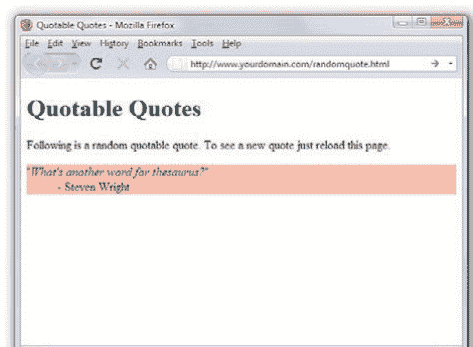

## 第280章 第13章 理解动态网站

**图 13.2**

"名言警句"页面每次加载时都会显示一句随机的名言。

请记住，你可以轻松修改此页面以包含你自己的名言或其他你想随机显示的文本。你也可以通过向代码中的 `quotes` 和 `sources` 数组添加更多条目，来增加可供显示的名言数量。ptg999

如果你将"名言警句"页面作为起点，你可以轻松地修改脚本并创建你自己的、关于这个想法的有趣变体。即使你在过程中犯了错，也没关系。克服脚本代码错误的关键在于耐心，并仔细分析你输入的代码。你总是可以删除代码来简化脚本，直到它能正常工作，然后一次添加一小部分新代码，以确保每一部分都能正常工作。

### 理解文档对象模型

使用 JavaScript 进行客户端交互通常表现为以某种方式操作 DOM。DOM 是所有文档的不可见结构——它不是 HTML 结构或你应用格式化层级的方式，而是一种整体的框架或容器。如果这个描述听起来很模糊，那是因为它确实如此；它不是一个有形的对象。

## 第281章 基于用户交互的图像变换

这个整体的容器对象被称为 `document`。文档中任何具有 ID 的容器都可以通过该 ID 来引用。例如，如果你有一个 ID 为 `wrapper` 的 `<div>`，那么在 DOM 中，该元素可以通过以下方式引用：

```
document.wrapper
```

在第11章中，你通过更改与元素关联的 `style` 对象中的某些内容来改变特定元素的可见性。如果你想访问 ID 为 `wrapper` 的 `<div>` 的 `background-color` 样式，它会被引用为：

```
document.wrapper.style.background-color
```

要将该样式的值更改为其他值，可能是基于交互式的用户事件，使用以下代码将颜色更改为白色：

```
document.wrapper.style.background-color="#ffffff"
```

DOM 是你能够以这种方式引用元素及其关联对象的背后框架。显然，这只是对一个非常复杂事物的简要概述，但至少你现在可以开始理解这个“文档点某物”的业务到底是怎么回事。要了解更多关于 DOM 的信息，请访问万维网联盟（World Wide Web Consortium）关于 DOM 的信息：http://www.w3.org/DOM/。

### 基于用户交互的图像变换

在第11章中，你了解了不同类型的用户交互事件，如 `onclick`、`onmouseover`、`onmouseout` 等等。在那一章中，你根据用户交互触发了文本的更改；在本节中，你将看到一个既实用又动态的、可见的交互类型示例。

**图 13.3** 显示了一家收藏品公司的在线目录中的一个页面。目录中的每个页面都显示一张大图、关于该商品的信息，以及页面底部的一组小图。在这种类型的目录中，每个商品细节的特写图片对潜在买家很重要，但从显示和带宽的角度来看，在一个页面上放置几张大图会变得难以处理。


## 第282章 第13章 理解动态网站

**图 13.3**

用户首次加载时的商品目录页面。

页面上的大图是通过这个 `` 标签调用的：ptg999

```

```

如你所见，这张图片被命名为 `product_img`。因此，这张图片在 DOM 中以 `document.product_img` 的形式存在。这一点很重要，因为一点点 JavaScript 功能就能使我们动态地更改 `document.product_img.src` 的值，即图像的源路径（src）。

以下代码片段创建了图 13.3 底部所示的五张小图中的第四张。`onmouseover` 事件表示，当用户将鼠标悬停在这张小图上时，`document.product_img.src` 的值——即大图的位置——会被一张匹配的大图路径所填充。

```
<a href="#" onmouseover="javascript:document.product_img.src = '/path/to/large4.jpg'">
</a>
```

**图 13.4** 显示了同一个页面——用户没有重新加载——当用户将鼠标悬停在页面底部的一张小图上时，大图的位置被另一张不同的图像填充。鼠标指针悬停在右起第二张图片上。当用户将鼠标悬停在室内照片的小版本上时，页面顶部区域显示了它的大版本。


## 第283章 总结

**图 13.4**

当用户将鼠标悬停在小图上时，大图被替换。

## 总结 ptg999

在这个简短的章节中，你被提醒了服务器端脚本和客户端脚本之间的区别，并且你回顾了如何在 HTML 文件中包含 JavaScript，以便为你的网站添加一些交互性。你还学习了如何使用 JavaScript 的 `document.write()` 方法在页面加载时显示随机引言。最后，你了解了 DOM 到底是什么。通过应用你从前面章节中学到的知识，你学会了如何使用客户端脚本使网页上的图像响应鼠标移动。这些任务都不需要太多的编程技巧，但它应该能激励你继续阅读本书，并了解更多关于 JavaScript 的知识，以便为你的页面添加更复杂的交互功能。

## 第284章 第13章 理解动态网站

## 问与答

问：如果我想使用本章中的随机引言脚本，但我想拥有一个包含大量引言的库，我是否必须把所有引言都放在每个页面中？

答：是的。数组中的每一项都必须在那里。在这里，你可以开始看到一点分界点：哪些事情适合客户端处理，哪些事情更适合在服务器端处理。如果你有一个真正的随机引言库，并且在任何给定时间只显示一条，那么最好将这些项目存储在数据库表中，并使用一小段服务器端脚本来连接到该数据库、检索文本并将其打印在页面上。或者，你也可以继续在 JavaScript 中携带所有引言，但你至少应该将该 JavaScript 函数放入一个单独的文件中，以便与文本分开维护。

问：我见过一些在线目录，它们在一个似乎是覆盖在网站内容上的图层中显示一张大图。我可以看到下面的常规网站内容，但重点在大图上。这是怎么做到的？

答：你的描述听起来像是由一个名为 Lightbox 的 JavaScript 库创建的效果。Lightbox 库使你能够在一个放置于你的站点内容之上的图层中显示一张图片或一个图片集。这是一个流行的库，用于显示大图的细节，或者只是显示一组被认为重要到足以“凌驾”于内容之上展示的图片。（要安装和使用它，请遵循软件中包含的说明。你将能够使用到目前为止从本书中获得的知识将其集成到你的网站中。）

## 研讨会

研讨会包含测验题和练习，以帮助你巩固对所涵盖材料的理解。在查看后面的“答案”部分之前，请尝试回答所有问题。

## 测验

- 1. 你制作了一个按钮的图片，并将其命名为 `button.gif`。你还制作了一个简单的 GIF 动画按钮，它会闪烁绿色和白色。你将该 GIF 命名为 `flashing.gif`。你会使用什么 HTML 和 JavaScript 代码来使按钮在用户将鼠标指针移到其上时闪烁，并在用户单击该按钮时链接到名为 `gohere.html` 的页面？


## 第285号工作坊

2. 你会如何修改为问题1编写的代码，使得当用户将鼠标悬停在按钮上时按钮会闪烁，并且即使将鼠标移开后仍继续闪烁？

3. 在以下上下文中，加号（+）是什么意思？
`document.write('This is a text string ' + 'that I have created.');`

## 答案

1. 你的代码可能类似于这样：
```html
<a href="gohere.html"
onmouseover="javascript:document.flasher.src='flashing.gif'"
onmouseout="javascript:document.flasher.src='button.gif'">
</a>
```

2. 你的代码可能类似于这样：
```html
<a href="gohere.html"
onmouseover="javascript:document.flasher.src='flashing.gif'">
</a>
```

3. 加号（+）用于将两个字符串连接在一起。

## 练习

- 你是否有任何网页，如果导航图标或其他图片在鼠标经过时发生变化，会看起来更炫酷或更易于理解？如果有，请尝试创建这些图片的高亮版本，并尝试使用本章介绍的信息修改你自己的页面。

- 你可以显示随机图片——例如图形横幅或广告——方式与你之前在本章中学到的使用JavaScript显示随机内容相同。只需打印你想显示的图片的 `` 标签，而不是打印文本。

# 第14章

**你将在本章学到：**
- 使用函数组织脚本
- 对象是什么以及JavaScript如何使用它们
- JavaScript如何响应事件
- 条件语句和循环简介

上一章提醒了你JavaScript是什么、JavaScript能做什么，并让你创建了一个简单的脚本。在本章中，你将学习更多基础知识和脚本组件，这些将用于你编写的几乎所有脚本中。这将为你探索本书的其余章节做好准备，你将在这些章节中更深入地研究特定的JavaScript函数和功能。

### 基本概念

有几个基本概念和术语你会在本书中遇到。在接下来的几节中，你将了解JavaScript的基本构建模块。
- 浏览器如何按正确顺序执行脚本
- 避免JavaScript错误的语法规则
- 添加注释以记录你的JavaScript代码

#### 语句

语句是JavaScript程序的基本单位。语句是执行单个操作的代码段。例如，以下三条语句来自第4章“理解JavaScript”中的日期和时间示例。

```javascript
hours = now.getHours();
mins = now.getMinutes();
secs = now.getSeconds();
```

尽管语句通常是单行的JavaScript代码，但这不是硬性规定——可以将一条语句分成多行，也可以在一行中包含多条语句。

分号标记一条语句的结束。如果你在语句后开始新行，也可以省略分号。如果将多条语句合并为一行，则必须使用分号分隔它们。

#### 使用函数组合任务

在你目前看过的基础脚本中，你已经见过一些JavaScript语句中带有括号的部分，像这样：

`document.write("Testing.");`

这是一个函数的示例。函数提供了一种处理任务的简单方法，例如向网页添加输出。JavaScript包含各种内置函数，你将在本书中学习这些函数。使用函数的语句，如前面的示例，被称为函数调用。

函数接受参数（括号内的表达式）来告诉它们该做什么。此外，函数可以返回一个值给一个等待的变量。例如，以下函数调用会提示用户输入响应并将其存储在 `text` 变量中：

`text = prompt("Enter some text.")`

你也可以创建自己的函数。这主要有两个原因：首先，你可以将脚本的逻辑部分分开，使其更易于理解。其次，更重要的是，你可以多次使用该函数或使用不同的数据，以避免重复编写脚本语句。

#### 变量

在第4章中，你了解到变量是可以存储数字、文本字符串或其他值的容器。例如，以下语句创建一个名为 fred 的变量并为其赋值为 27：

```javascript
var fred = 27;
```

JavaScript变量可以包含数字、文本字符串和其他值。你将在第16章“使用JavaScript变量、字符串和数组”中了解更多关于它们的信息。

#### 理解对象

JavaScript还支持对象。像变量一样，对象可以存储数据——但它们可以一次存储两块或更多数据。

存储在对象中的数据项称为对象的属性。例如，你可以使用对象来存储关于人员的信息，比如通讯录中。每个人对象的属性可能包括姓名、地址和电话号码。

JavaScript使用句点来分隔对象名和属性名。例如，对于一个名为Bob的人对象，属性可能包括 `Bob.address` 和 `Bob.phone`。

对象还可以包括方法。这些是处理对象数据的函数。例如，我们用于通讯录的person对象可能包含一个 `display()` 方法来显示人员的信息。在JavaScript术语中，语句 `Bob.display()` 将显示Bob的详细信息。

如果这听起来令人困惑，请不要担心——你将在本书后面更详细地探讨对象。现在，你只需要了解基础知识。

JavaScript支持三种对象：

- **内置对象** 是内置于JavaScript语言中的对象。你已经遇到过其中一个，`Date`，在第2章“理解HTML和XHTML连接”中。其他内置对象包括 `Array` 和 `String`，你将在第16章中探索它们，以及 `Math`，将在第17章中解释。
- **DOM（文档对象模型）对象** 代表浏览器和当前HTML文档的各种组件。例如，你在本章前面使用的 `alert()` 函数实际上是 `window` 对象的一个方法。你将在第15章“使用文档对象模型（DOM）”中更详细地探讨这些内容。
- **自定义对象** 是你自己创建的对象。例如，你可以创建一个 `person` 对象，如本节前面所述。

#### 条件语句

尽管事件处理程序在发生某事时会通知你的脚本，但你可能想自己检查某些条件。例如，用户是否输入了有效的电子邮件地址？

JavaScript支持条件语句，这使你能够回答这样的问题。典型的条件语句使用 `if` 语句，如本例所示：

```javascript
if (count==1) alert("The countdown has reached 1.");
```

这会将变量 `count` 与常量1进行比较，如果它们相等，则向用户显示警报消息。你将在大多数脚本中使用像这样的条件语句。

#### 循环

JavaScript——以及大多数其他编程语言——的另一个有用特性是创建循环的能力，或者说是重复执行一定次数的语句组。例如，以下语句显示相同的警报10次，极大地烦扰用户：

```javascript
for (i=1; i<=10; i++) {
    alert("Yes, it’s yet another alert!");
}
```

`for` 语句是JavaScript用于循环的几种语句之一。这正是计算机应该擅长的事情——执行重复性任务。你将在许多脚本中使用循环，其用途远比这个示例有用得多。

#### 事件处理程序

如第1章所述，并非所有脚本都位于 `<script>` 标签内。你也可以将脚本用作事件处理程序。尽管这听起来像一个复杂的编程术语，但实际上它字面意思就是：事件处理程序是处理事件的脚本。你已经了解了一点关于


### JavaScript 语法规则

每个事件处理器都与特定的浏览器对象相关联，你可以在定义该对象的标签中指定事件处理器。例如，图像和文本链接有一个事件 `onMouseOver`，当鼠标指针移到该对象上时触发。以下是一个带有事件处理器的典型 HTML 图像标签示例：

```html

```

你将事件处理器指定为 HTML 标签的一个属性，并在引号内包含处理该事件的 JavaScript 语句。这是函数的理想应用场景，因为函数名称简洁明了，且可以指代一整套语句。

请参阅本章末尾的“自己动手试一试”部分，查看 HTML 文档中事件处理器的完整示例。

#### 哪个脚本先运行？

实际上，你可以在一个网页文档中包含多个脚本：一个或多个 `<script>` 标签集、外部 JavaScript 文件以及任意数量的事件处理器。面对所有这些脚本，你可能会想知道浏览器如何决定先执行哪个。幸运的是，这是以一种合乎逻辑的方式完成的：

-   HTML 文档的 `<head>` 部分中的 `<script>` 标签集会最先处理，无论它们包含内嵌代码还是引用外部 JavaScript 文件。由于这些脚本无法在网页中创建输出，因此它们是定义函数以供后续使用的理想位置。
-   HTML 文档的 `<body>` 部分中的 `<script>` 标签集会在 `<head>` 部分之后执行，同时网页加载并显示。如果 `<body>` 中有多个脚本，它们将按顺序执行。
-   事件处理器在它们的事件发生时执行。例如，`onLoad` 事件处理器在网页的 `<body>` 加载时执行。由于 `<head>` 部分在任何事件之前加载，你可以在其中定义函数，并在事件处理器中使用它们。

### JavaScript 语法规则

JavaScript 是一门简单的语言，但你确实需要小心，正确地使用其语法——即定义如何使用该语言的规则。本书的其余部分涵盖了 JavaScript 语法的许多方面，但有一些基本规则你应该了解，以避免错误。

#### 区分大小写

JavaScript 中几乎一切都是区分大小写的，这意味着你不能互换使用小写字母和大写字母。以下是几条通用规则：

-   JavaScript 关键字，如 `for` 和 `if`，始终使用小写字母。
-   内置对象，如 `Math` 和 `Date`，首字母大写。
-   DOM 对象名称通常使用小写字母，但它们的方法通常是大小写字母的组合。通常，除第一个单词外，所有单词的首字母都大写，如 `toLowerCase` 和 `getElementById`。

如有疑问，请遵循本书或其他 JavaScript 参考资料中使用的确切大小写。如果你使用了错误的大小写，浏览器通常会显示错误消息。

#### 变量、对象和函数名称

当你定义自己的变量、对象或函数时，你可以选择它们的名称。名称可以包含大写字母、小写字母、数字和下划线（`_`）字符。名称必须以字母或下划线开头。

你可以选择在变量名中使用大写或小写字母，但请记住 JavaScript 是区分大小写的：`score`、`Score` 和 `SCORE` 会被视为三个不同的变量。确保每次引用变量时都使用相同的名称。

#### 保留字

变量名还有一条规则：它们不能是保留字。这些保留字包括构成 JavaScript 语言的单词（如 `if` 和 `for`）、DOM 对象名称（如 `window` 和 `document`）以及内置对象名称（如 `Math` 和 `Date`）。

#### 空格

空白字符（在程序员中称为“空白符”）会被 JavaScript 忽略。你可以在一行中包含空格和制表符，或者包含空行，而不会导致错误。空白符通常使脚本更具可读性。

#### 使用注释

JavaScript 注释使你能够在脚本中添加文档。如果其他人试图理解脚本，或者你在长时间中断后试图理解它，这将非常有用。要在 JavaScript 程序中添加注释，请以两个斜杠开始一行，如下例所示：

```javascript
//this is a comment.
```

你也可以在行中间以两个斜杠开始注释，这对记录脚本很有用。在这种情况下，斜杠之后该行的所有内容都会被视为注释并被浏览器忽略。例如，

```javascript
a = a + 1; // add one to the value of a
```

JavaScript 还支持 C 风格注释，以 `/*` 开始，以 `*/` 结束。这些注释可以跨越多行，如下例所示：

```javascript
/*This script includes a variety
of features, including this comment. */
```

> **注意** 由于注释内的 JavaScript 语句会被忽略，C 风格注释常用于注释掉代码段。如果你有一些 JavaScript 代码行在调试脚本时想暂时不执行，你可以在该段代码开头添加 `/*`，结尾添加 `*/`。由于这些注释是 JavaScript 语法的一部分，因此它们仅在 `<script>` 标签内或外部 JavaScript 文件中有效。

### JavaScript 最佳实践

你现在应该已经熟悉编写有效 JavaScript 的基本规则。除了遵守规则外，遵循最佳实践也是一个好主意。以下实践可能不是强制性的，但如果你遵循它们，你会让自己和他人省去不少麻烦。

-   充分使用注释——这让你的代码更容易被他人理解，也让你在以后编辑时更容易理解。它们对于标记脚本的主要部分也很有用。
-   在每个语句末尾使用分号，并且每行只使用一个语句——这会使你的脚本更容易调试。
-   尽可能使用独立的 JavaScript 文件——这将 JavaScript 与 HTML 分离，使调试更容易，并鼓励你编写可重用的模块化脚本。
-   避免针对特定浏览器——随着你对 JavaScript 了解的增多，你会了解到一些仅在特定浏览器中有效的功能。除非绝对必要，否则请避免使用它们，并始终在多个浏览器中测试你的代码。
-   保持 JavaScript 的可选性——不要使用 JavaScript 来执行你网站上的基本功能——例如，主要的导航链接。只要有可能，没有 JavaScript 的用户应该也能使用你的网站，尽管它可能不那么有吸引力或方便。

这种策略被称为“渐进增强”。

还有更多涉及 JavaScript 更高级方面的最佳实践。

为了结束本章，这里有一个事件处理器的简单示例。这个“使用事件”将演示如何设置事件（你将在本书中一直使用它），以及 JavaScript 如何在没有 `<script>` 标签的情况下工作。清单 14.1 展示了一个包含简单事件处理器的 HTML 文档。

#### 清单 14.1 包含简单事件处理程序的 HTML 文档

```xml
<?xml version="1.0" encoding="UTF-8"?>
<!DOCTYPE html PUBLIC "-//W3C//DTD XHTML 1.1//EN"
"http://www.w3.org/TR/xhtml11/DTD/xhtml11.dtd">
<html xmlns="http://www.w3.org/1999/xhtml" xml:lang="en">
<head>
<title>Event Handler Example</title>
</head>
<body>
<h1>Event Handler Example</h1>
<p>
<a href="http://www.google.com/"
onclick="alert('Aha! An Event!');">Go to Google</a>
</p>
</body>
</html>
```

该事件处理程序是在定义链接的 `<a>` 标签内通过以下 `onClick` 属性定义的：

`onclick="alert('Aha! An Event!');"`

当你点击链接时，这个事件处理程序使用内置的 `alert()` 函数来显示消息。在更复杂的脚本中，你通常会定义自己的函数来作为事件处理程序。图 14.1 展示了此示例的实际效果。

**图 14.1**

当你点击链接时，浏览器会显示一个警告框。

> **提示：** 在下一个小时中，你将使用其他与此类似的事件处理程序，并且在第 19 章“响应事件”中将更详细地介绍事件。请注意，在你点击警告框上的“确定”按钮后，浏览器会遵循 `<a>` 标签中定义的链接。你的事件处理程序也可以阻止浏览器跟随该链接，如第 19 章所述。

## 总结

在本章中，你已接触到 JavaScript 编程和语法的几个组成部分：函数、对象、事件处理程序、条件语句和循环。你还学习了如何使用 JavaScript 注释使脚本更易于阅读，并查看了一个简单的事件处理程序示例。

# 296 第 14 章 JavaScript 编程入门

## 问与答

**问：** 我听说过“面向对象”这个术语应用于 C++ 和 Java 等语言。如果 JavaScript 支持对象，它是一种面向对象的语言吗？

**答：** 是的，尽管它可能不符合一些人的严格定义。JavaScript 对象不支持 C++ 和 Java 等语言支持的所有功能，尽管最新版本的 JavaScript 已添加了更多面向对象的特性。

**问：** 让几个脚本在不同时间执行似乎令人困惑。为什么我想使用事件处理程序？

**答：** 事件处理程序是处理网页中控件（如按钮、复选框和文本字段）的理想方式（在 JavaScript 中，也是唯一的方式）。实际上，用这种方式处理它们更方便。与其编写一个脚本坐着等待按钮被按下，你只需创建一个事件处理程序，让浏览器为你等待即可。

## 工作坊

工作坊包含测验题和练习，以帮助你巩固对所涵盖内容的理解。在查看后面的“答案”部分之前，请尝试回答所有问题。

## 测验

- 1. 当用户点击鼠标按钮时执行的脚本是什么的一个例子？
  a. 一个对象
  b. 一个事件处理程序
  c. 一种不可能

- 2. 以下哪项是 JavaScript 中函数的功能？
  a. 接受参数
  b. 返回一个值
  c. 以上两者都是

- 3. 浏览器首先执行以下哪一项？
  a. `<head>` 部分中的脚本
  b. `<body>` 部分中的脚本
  c. 按钮的事件处理程序

## 答案

- 1. b. 当用户点击鼠标按钮时执行的脚本是一个事件处理程序。
- 2. c. 函数可以同时接受参数和返回值。
- 3. a. 浏览器首先执行 HTML 文档 `<head>` 部分中定义的脚本。

## 练习

- 检查你在第 4 章创建的日期和时间脚本，并找出使用函数和对象的任何示例。
- 为日期和时间脚本添加 JavaScript 注释，以更清楚地说明每行的作用。验证脚本是否仍然正常运行。

# 297 工作坊

# 第 15 章

**你将在本章学到：**

- W3C DOM 标准如何使动态页面更易于控制
- window DOM 对象的基础知识
- document DOM 对象的基础知识
- location DOM 对象的基础知识
- 如何使用节点、父节点、子节点和兄弟节点
- 如何访问和使用 DOM 节点的属性
- 如何访问和使用 DOM 节点的方法
- 如何使用 JavaScript 控制定位
- 如何使用 JavaScript 隐藏和显示对象
- 如何使用 JavaScript 修改页面内的文本
- 如何使用 JavaScript 向页面添加文本

### 理解文档对象模型 (DOM)

JavaScript 相对于纯 HTML 的一个优势是，这些客户端脚本可以在内容加载后直接在浏览器中操作网页文档及其内容。你的脚本可以加载新页面到浏览器中，操作浏览器窗口和文档的各个部分，打开新窗口，甚至动态修改页面内的文本。

为了与浏览器和文档交互，JavaScript 使用称为 DOM 的父子对象层次结构。这些对象被组织成树状结构，代表网页文档的所有内容和组件。

DOM 中的对象具有属性——描述网页或文档的变量——和方法——使你能够操作网页各部分的函数。

当你引用一个对象时，你使用父对象名称，后跟子对象名称，用句点分隔。例如，JavaScript 将代表文档中图像的对象存储为文档对象的子对象。以下语句引用 image9 对象，它是文档对象的子对象，而文档对象又是 window 对象的子对象：

```javascript
window.document.image9
```

# 300 第 15 章 使用文档对象模型 (DOM)

> **注意：** DOM 不是 JavaScript 或任何其他编程语言的一部分——相反，它是内置在浏览器中的 API（应用程序编程接口）。

### 使用 window 对象

在浏览器对象层次结构的顶部是 `window` 对象，它代表一个浏览器窗口。你已经至少使用过 `window` 对象的一个方法：该方法，或者简单地说是 `alert()`，在警告框中显示消息。

一次可以有几个 `window` 对象，每个对象代表一个打开的浏览器窗口。框架也由 `window` 对象表示。你将在第 20 章“使用窗口和框架”中了解更多关于窗口和框架的信息。

`window` 对象是我们在本章中将要查看的所有对象的父对象。图 15.1 显示了 DOM 对象层次结构中的窗口部分及其各种对象。

**图 15.1** DOM 对象层次结构的窗口部分。

```
window
(parent, self, top)
├── frames[ ]
├── history
├── forms[ ]
│   └── form
│       └── elements
├── document
│   ├── links[ ]
│   ├── anchors[ ]
│   ├── images[ ]
│   └── ...
└── location
```

> **注意：** 你已经使用过 `document.write` 方法在网页文档中显示文本。前面章节中的示例只使用了一个窗口和文档，因此没有必要使用 `window.document.write`——但这个更长的语法同样有效。

### 使用 document 对象

document 对象代表一个网页文档或页面。网页文档显示在浏览器窗口中，所以 document 对象是 window 对象的子对象这一事实应该不会让你感到惊讶。

因为 window 对象总是代表当前窗口（包含脚本的那个），你可以使用 `window.document` 来引用当前文档。你也可以简单地引用 `document`，它会自动引用当前窗口。

如果使用多个窗口或框架，可能会有几个 `window` 对象，每个对象都有自己的 `document` 对象。要使用这些文档对象之一，你需要使用窗口名称和文档名称。


### 使用 document 对象

在接下来的章节中，你将了解 document 对象的一些对脚本编写有用的属性和方法。

### 获取关于文档的信息

document 对象的几个属性包含了当前文档的一般信息：

-   `. document.URL` 指定文档的 URL。这是一个简单的文本字段。你无法更改此属性。如果需要将用户引导至其他位置，请使用 `window.location` 对象，我们将在后续内容中学习它。
-   `. document.title` 列出当前页面的标题，由 HTML 的 `<title>` 标签定义。
-   `. document.referrer` 是用户在查看当前页面之前所查看页面的 URL——通常是包含指向当前页面链接的页面。
-   `. document.lastModified` 是文档最后修改的日期。此日期随页面一起从服务器发送。
-   `. document.cookie` 允许你为 ptg999 文档读取或设置 cookie。
-   `. document.images` 返回文档中使用的图像集合。

作为文档属性的一个示例，代码清单 15.1 展示了一个简短的 HTML 文档，它使用 JavaScript 显示其最后修改日期。

#### 代码清单 15.1 显示最后修改日期

```
<?xml version="1.0" encoding="UTF-8"?>
<!DOCTYPE html PUBLIC "-//W3C//DTD XHTML 1.1//EN"
"http://www.w3.org/TR/xhtml11/DTD/xhtml11.dtd">
<html xmlns="http://www.w3.org/1999/xhtml" xml:lang="en">
<head>
<title>Displaying the Last Modified Date</title>
</head>
<body>
<h1>Displaying the Last Modified Date</h1>
<p>This page was last modified on:</p>
<script type="text/javascript">
document.write(document.lastModified);
</script>
</body>
</html>
```


## 302 第 15 章 使用文档对象模型 (DOM)

图 15.2 展示了代码清单 15.1 的输出结果。

**图 15.2**

查看文档的最后修改日期。

> **注意** 如果你使用 JavaScript 显示此文档属性的值，你可能会发现 `document.lastModified` 属性可能无法在你的网页上工作，或者返回错误的值。该日期是从 Web 服务器接收的，而一些服务器没有正确维护修改日期。如果你选择将此信息展示给用户，你就不必每次修改页面时都记得更新日期。（你也可以使用脚本始终打印当前日期而不是最后修改日期，但那会是一种欺骗。）

### 在文档中编写文本

最简单的 `document` 对象方法也是你将最常用的方法。事实上，即使在本书迄今为止最基本的示例中，你也已经使用过其中一个了。`document.write` 方法将文本作为文档窗口中 HTML 的一部分进行打印。另一个语句 `document.writeln` 也打印文本，但它还会在末尾包含一个换行符 (`\n`)。

**注意**

请记住，换行符在浏览器中会显示为空格，除非在 `<pre>` 容器内。如果你需要实际的换行，将需要使用 `<br/>` 标签。

这些方法只能在网页的 body 内使用，因此它们会在页面加载时执行。你不能使用这些方法向已经加载的页面添加内容而不重新加载它。然而，你可以为文档编写新内容，如下一节所述。

**注意** 通过使用 DOM 的更高级功能（你将在本章稍后学习），`document.write` 方法可以在网页 body 内的 `<script>` 标签中使用。你也可以在函数中使用它，前提是你要在文档的 body 内调用该函数，正如你在代码清单 15.1 中看到的那样。

## 303 访问浏览器历史记录

#### 使用链接和锚点

`document` 对象的另一个子对象是 `link` 对象。实际上，一个文档中可以有多个 `link` 对象。每个对象都包含关于指向其他位置或锚点的链接信息。

你可以通过 `links` 数组访问 `link` 对象。数组的每个成员都是当前页面中的一个 `link` 对象。数组的一个属性 `document.links.length` 表示页面中的链接数量。

每个 `link` 对象（或 `links` 数组的成员）都有一组定义 URL 的属性。`href` 属性包含整个 URL，其他属性则定义了它的各个部分。这些属性与 `location` 对象的属性相同，后者将在本章后面定义。

你可以通过指定链接编号和属性名来引用一个属性。例如，以下语句将第一个链接的整个 URL 赋值给变量 `link1`：

```
link1 = links[0].href;
```

`anchor` 对象也是 `document` 对象的子对象。每个 `anchor` 对象代表当前文档中的一个锚点——一个可以直接跳转到的特定位置。

与链接类似，你可以通过数组 `anchors` 访问锚点。该数组的每个元素都是一个 `anchor` 对象。`document.anchors.length` 属性告诉你 `anchors` 数组中的元素数量。

### 访问浏览器历史记录

`history` 对象是 `window` 对象的另一个子对象（属性）。此对象保存有关之前访问过的 URL 以及历史列表中的当前、上一个和下一个文档 URL 的信息。

`history` 对象有一个你可以访问的属性：`history.length` 记录历史列表的长度——换句话说，就是用户访问过的不同位置的数量。

然而，出于安全和隐私原因，这些对象通常无法被浏览器访问。

`history` 对象有三个方法可用于在历史列表中移动：

## 304 第 15 章 使用文档对象模型 (DOM)

-   `. history.go()` 打开历史列表中的一个 URL。要使用此方法，请在括号中指定一个正数或负数。例如，`history.go(-2)` 相当于按下“后退”按钮。
-   `. history.back()` 加载历史列表中的上一个 URL——相当于按下“后退”按钮。
-   `. history.forward()` 加载历史列表中的下一个 URL（如果可用）。这相当于按下“前进”按钮。

你可以使用 history 对象的 back 和 forward 方法为网页文档添加自己的“后退”和“前进”按钮。当然，浏览器本身已经有“后退”和“前进”按钮，但偶尔包含自己的、具有相同功能的链接会很有用。

假设你想创建一个显示“后退”和“前进”按钮的脚本，并使用这些方法来导航浏览器。以下是创建“后退”按钮的代码：

```
<input type="button" onClick="history.back();" value="Go Back">
```

`<input>` 标签定义了一个标记为“Go Back”（后退）的按钮。`onClick` 事件处理程序使用 `history.back()` 方法转到历史记录中的上一页。

“Go Forward”（前进）按钮的代码类似：

```
<input type="button" onClick="history.forward();" value="Go Forward">
```

有了这些，你只需要构建 HTML 文档的其余部分。代码清单 15.2 展示了一个完整的 HTML 文档，图 15.3 展示了浏览器对文档的显示。将此文档加载到浏览器后，访问其他 URL 并确保“后退”和“前进”按钮按预期工作。

### 代码清单 15.2 使用 JavaScript 包含“后退”和“前进”按钮的网页

```
<?xml version="1.0" encoding="UTF-8"?>
<!DOCTYPE html PUBLIC "-//W3C//DTD XHTML 1.1//EN"
"http://www.w3.org/TR/xhtml11/DTD/xhtml11.dtd">
<html xmlns="http://www.w3.org/1999/xhtml" xml:lang="en">
<head>
<title>Using Back and Forward Buttons</title>
</head>
<body>
<h1>Using Back and Forward Buttons</h1>
<p>This page allows you to go back or forward to pages in the history list. These should be equivalent to the back
```


### 使用 location 对象

`window` 对象的第三个子对象是 `location` 对象。此对象存储当前窗口中当前 URL 的信息。例如，以下语句将一个 URL 加载到当前窗口中：
`window.location.href="http://www.google.com";`

此语句中使用的 `href` 属性包含窗口当前位置的完整 URL。你也可以通过 `location` 对象的各种属性来访问 URL 的各个部分。要解释这些属性，请看以下 URL：
`http://www.google.com:80/search?q=javascript`

以下属性代表 URL 的各个部分：

- `location.protocol` 是 URL 的协议部分（在此示例中为 http:）。
- `location.hostname` 是 URL 的主机名（在此示例中为 www.google.com）。
- `location.port` 是 URL 的端口号（在此示例中为 80）。
- `location.pathname` 是 URL 的文件名部分（在此示例中为 search）。
- `location.search` 是 URL 的查询部分（如果有；在此示例中为 q=javascript）。

**注意** 虽然在此示例中未使用，但同样可访问的属性还有：`location.host` 是 URL 的主机名加上端口号。`location.hash` 是 URL 中使用的锚点名称（如果有；在此示例中为 #anchor）。

虽然 `location.href` 属性通常包含与本章前面描述的 `document.URL` 属性相同的 URL，但你无法更改 `document.URL` 属性。本章前面介绍的链接对象也包含用于访问 URL 各部分的这些属性列表。

始终使用 `location.href` 来加载新页面。

`location` 对象有三个方法：

- `location.assign()` 当如下使用时会加载新文档：`location.assign("http://www.google.com")`
- `location.reload()` 重新加载当前文档。这与浏览器工具栏上的重新加载按钮功能相同。如果你选择性地包含 `true` 参数，它将忽略浏览器的缓存，并强制重新加载，无论文档是否已更改。
- `location.replace()` 用一个新位置替换当前位置。这类似于自己设置 `location` 对象的属性。不同之处在于 `replace` 方法不会影响浏览器的历史记录。换句话说，无法使用后退按钮返回到上一个位置。这对于启动画面或临时页面非常有用，因为返回这些页面没有意义。

### 更多关于 DOM 结构的知识

本章前面，你已经了解了一些最重要的 DOM 对象的组织方式：`window` 对象包含 `document` 对象，依此类推。虽然这些对象是最初唯一可用的，但现代 DOM 在 `document` 对象下为页面的每个元素添加了对象。

为了更好地理解这个概念，我们来看一下清单 15.3 中的简单 HTML 文档。此文档具有通常的 `<head>` 和 `<body>` 部分、一个标题和一个段落文本。

#### 清单 15.3 一个简单的 HTML 文档

```xml
<?xml version="1.0" encoding="UTF-8"?>
<!DOCTYPE html PUBLIC "-//W3C//DTD XHTML 1.1//EN"
"http://www.w3.org/TR/xhtml11/DTD/xhtml11.dtd">
<html xmlns="http://www.w3.org/1999/xhtml" xml:lang="en">
<head>
<title>A Simple HTML Document</title>
</head>
<body>
<h1>This is a Level-1 Heading.</h1>
<p>This is a simple paragraph.</p>
</body>
</html>
```

像所有 HTML 文档一样，此文档由各种容器及其内容组成。`<html>` 标签形成一个包含整个文档的容器，`<body>` 标签包含页面的主体，依此类推。在 DOM 中，页面中的每个容器及其内容都由一个对象表示。这些对象组织成树状结构，`document` 对象本身位于树的根部，而各个元素（如标题和段落文本）位于树的叶子节点。

图 15.4 显示了这些关系的示意图。如果这个树状结构让你感到困惑，请不要担心；你几乎可以通过为元素分配 ID 并引用它们来完成任何操作。这是本书前面一些示例中使用的方法。稍后，你将看到更复杂的示例，这些示例要求你理解对象在 DOM 中的组织方式。

**注意** 如果这个树状结构让你感到困惑，请不要担心；你几乎可以通过为元素分配 ID 并引用它们来完成任何操作。

### 图 15.4

DOM 如何表示 HTML 文档。

### 父与子

正如你已经学到的，每个 JavaScript 对象都可以有一个父对象——包含它的对象，也可以有子对象——它包含的对象。DOM 使用相同的术语。

在图 15.4 中，`document` 对象是其余对象的父对象，它本身没有父对象。`html` 对象是 `head` 和 `body` 对象的父对象，而 `h1` 和 `p` 对象是 `body` 对象的子对象。

文本节点的工作方式略有不同。段落中的实际文本本身就是一个节点，并且是 p 对象的子节点。同样，`<h1>` 标签中的文本是 h1 对象的子节点。

### 兄弟节点

DOM 还使用另一个术语来描述对象的组织：兄弟节点。正如你可能预期的，这指的是具有相同父对象的对象——换句话说，是 DOM 对象树中同一级别的对象。

在图 15.4 中，h1 和 p 对象是兄弟节点，因为它们都是 body 对象的子节点。同样，head 和 body 对象是 html 对象下的兄弟节点。

### 使用 DOM 节点

正如你所看到的，DOM 将网页中的对象组织成树状结构。此树中的每个节点（对象）都可以在 JavaScript 中访问。在接下来的几节中，你将学习如何使用节点的属性和方法来管理它们。

**注意** 以下各节仅描述节点最重要的属性和方法，以及当前浏览器支持的属性和方法。有关可用属性的完整列表，请参阅 W3C 的 DOM 规范，网址为 http://www.w3.org/TR/DOM-Level-2/。

### 基本节点属性

你已经使用过节点的 style 属性来更改其样式表值。每个节点还有许多你可以检查或设置的基本属性。这些包括：

- `nodeName` 是节点的名称（不是 ID）。对于基于 HTML 标签的节点，如 `<p>` 或 `<body>`，名称就是标签名：`p` 或 `body`。对于文档节点，名称是一个特殊代码：`#document`。类似地，文本节点的名称是 `#text`。
- `nodeType` 是一个描述节点类型的整数：1 表示普通 HTML 标签，3 表示文本节点，9 表示文档节点。
- `nodeValue` 是文本节点中包含的实际文本。此属性对于其他类型的节点无效。
- `innerHTML` 是任何节点的 HTML 内容。你可以为此属性分配一个包含 HTML 标签的值，从而动态更改节点的 DOM 子对象。

**注意** `innerHTML` 属性不是 W3C DOM 规范的一部分。然而，它受到主流浏览器的支持，并且通常是更改页面内容最简单的方法。你也可以通过删除和创建节点来以更标准的方式完成此操作，如后文所述。

### 节点关系属性

除了前面描述的基本属性外，每个节点还有许多描述其与其他节点关系的属性。这些包括：


### 文档方法

`document` 节点本身具有多个你可能觉得有用的属性。你已经使用过其中之一 `getElementById`，它可以通过 ID 属性来引用 DOM 对象。`document` 节点的方法包括以下：

-   `.getElementById(id)` 返回具有指定 `id` 属性的元素。
-   `.getElementsByTagName(tag)` 返回一个包含所有指定标签名的元素的数组。你可以使用通配符 `*` 来返回包含文档中所有节点的数组。
-   `.createTextNode(text)` 创建一个包含指定文本的新文本节点，然后你可以将其添加到文档中。
-   `.createElement(tag)` 为指定标签创建一个新的 HTML 元素。与 `createTextNode` 一样，创建后你需要将元素添加到文档中。你可以通过更改其子对象或 `innerHTML` 属性来为元素分配内容。

### 节点属性

页面中的每个节点都有多个可用属性。包括以下：

-   `.firstChild` 是节点的第一个子对象。对于包含文本的节点，如 `h1` 或 `p`，包含实际文本的文本节点就是第一个子节点。请记住，与所有 JavaScript 对象和属性一样，这里描述的节点属性和函数是区分大小写的。请确保你输入的内容与所示完全一致。
-   `.lastChild` 是节点的最后一个子对象。
-   `.childNodes` 是一个数组，包含节点的所有子节点。你可以使用循环遍历此数组来处理给定节点下的所有节点。
-   `.previousSibling` 是当前节点的前一个兄弟节点（同一级别的节点）。
-   `.nextSibling` 是当前节点的下一个兄弟节点。

### 节点方法

页面中的每个节点都有多个可用方法。哪些方法是有效的取决于节点在页面中的位置以及它是否有父节点或子节点。包括以下：

-   `.appendChild(new)` 在对象所有现有节点之后追加指定的新节点。
-   `.insertBefore(new, old)` 在指定的旧子节点之前插入指定的新子节点，该旧子节点必须已经存在。
-   `.replaceChild(new, old)` 用新节点替换指定的旧子节点。
-   `.removeChild(node)` 从对象的子节点集合中移除一个子节点。
-   `.hasChildNodes()` 如果对象有一个或多个子节点，则返回布尔值 `true`，如果没有则返回 `false`。
-   `.cloneNode()` 创建现有节点的副本。如果提供 `true` 参数，副本还将包含原始节点的任何子节点。

### 创建可定位元素（层）

既然你对 DOM 结构有了更多了解，你应该可以开始思考如何控制网页中的任何元素，例如段落或图像。例如，你可以使用 DOM 来更改元素的位置、可见性和其他属性。

在 W3C DOM 和 CSS2 标准之前，你只能重新定位层（使用专有标签定义的特殊元素组）。虽然你现在可以定位任何元素，但在许多情况下，处理元素组仍然很有用。

你可以有效地创建一个层，或者一组可以作为一个整体来控制的 HTML 对象，方法是使用本书前面介绍过的 `<div>` 或 `<span>` 标签。

要使用 `<div>` 创建层，请将层的内容放在两个 division 标签之间，并在 `style` 属性中指定层的属性。正如你在前面章节中学到的，你可以在 `<style>` 块、外部样式表或 HTML 标签的 `style` 属性中指定 CSS 属性，例如 `position` 属性和其他层属性，然后使用 JavaScript 控制这些属性。此处显示的代码片段使用 `style` 属性中的属性而不是 `<style>` 块中的属性，因为这是示例片段，而不是完整的代码清单。

```html
<div id="layer1" style="position:absolute; left:100px; top:100px">
<p>This is the content of the layer.</p>
</div>
```

此代码定义了一个名为 `layer1` 的层。这是一个可移动的层，位于浏览器窗口左上角向下 100 像素、向右 100 像素的位置。

你已经在本书第二部分和第三部分学习了定位属性并看到了它们的实际应用。这包括设置对象大小（如 `height` 和 `width`）和位置（如 `absolute` 或 `relative`）、可见性以及对象背景和边框。本章剩余示例将把这些 DOM 技术付诸实践。

### 使用 JavaScript 控制定位

使用上一节中的代码片段，你将看到一个如何使用 JavaScript 控制对象定位属性的示例。

这是我们的示例层（一个 `<div>`）：

```html
<div id="layer1" style="position:absolute; left:100px; top:100px">
<p>This is the content of the layer.</p>
</div>
```

要使用 JavaScript 在页面内上下移动此层，你可以更改其 `style.top` 属性。例如，以下语句将层从其原始位置向下移动 100 像素：

```javascript
var obj = document.getElementById("layer1");
obj.style.top = 200;
```

`document.getElementById()` 方法返回与层的 `<div>` 标签对应的对象，第二条语句将对象的 top 定位属性设置为 200px；你也可以将这两个语句合并：

```javascript
document.getElementById("layer1").style.top = 200;
```

> 注意：这仅仅是为层设置 `style.top` 属性，而没有为层对象分配变量。

某些 CSS 属性，如 `text-indent` 和 `border-color`，其名称中带有连字符。当你在 JavaScript 中使用这些属性时，需要将连字符部分合并并使用大写字母：`textIndent` 和 `borderColor`。

现在让我们创建一个定义层的 HTML 文档，并将其与脚本结合，允许使用按钮移动、隐藏或显示该层。清单 15.4 展示了定义按钮和层的 HTML 文档。脚本本身（position.js）将在清单 15.5 中展示。

#### 清单 15.4 可移动层示例的 HTML 文档

```html
<?xml version="1.0" encoding="UTF-8"?>
<!DOCTYPE html PUBLIC "-//W3C//DTD XHTML 1.1//EN"
"http://www.w3.org/TR/xhtml11/DTD/xhtml11.dtd">
<html xmlns="http://www.w3.org/1999/xhtml" xml:lang="en">
<head>
<title>Positioning Elements with JavaScript</title>
<script type="text/javascript" src="position.js"></script>
<style text="text/css">
#buttons {
    text-align:center;
}
#square {
    position:absolute;
    top: 150px;
    left: 100px;
    width: 200px;
    height: 200px;
    border: 2px solid black;
    padding: 10px;
    background-color: #e0e0e0;
}
</style>
</head>
<body>
<h1>Positioning Elements</h1>
<form action="" name="form1">
<div id="buttons">
<input type="button" name="left" value="Left"
onclick="pos(-1,0);" />
<input type="button" name="right" value="Right"
onclick="pos(1,0);" />
<input type="button" name="up" value="Up"
onclick="pos(0,-1);" />
<input type="button" name="down" value="Down"
onclick="pos(0,1);" />
<input type="button" name="hide" value="Hide"
onclick="hideSquare();" />
<input type="button" name="show" value="Show"
onclick="showSquare();" />
</div>
</form>
<hr />
<div id="square">
<p>This square is an absolutely positioned layer that you can move using the buttons above.</p>
</div>
</body>
</html>
```

除了基本的 HTML 外，清单 15.4 还包含以下内容：

-   头部的 `<script>` 标签读取一个名为 position.js 的脚本，该脚本将在清单 15.5 中展示。
-   `<style>` 部分是一个简短的样式表，定义了可移动层的属性。它将 position 属性设置为 absolute 以指示它可以定位在精确位置，在 top 和 left 属性中设置初始位置，并设置 border 和 background-color 属性以使层清晰可见。
-   `<form>` 部分中的 `<input>` 标签定义了六个按钮：四个用于将层向左、向右、向上或向下移动，两个用于控制其可见或隐藏状态。
-   `<div>` 部分定义了层本身。id 属性被设置为值 "square"。这个 id 在样式表中用于引用该层，并且也将在你的脚本中使用。


如果你将其加载到浏览器中，应该能看到按钮和“方形”图层，但按钮目前还不会执行任何操作。清单15.5中的脚本添加了执行操作的功能。当你在浏览器中加载清单15.4中的代码时，它应该看起来像图15.5所示。

**图15.5**

可移动图层已准备好移动。

清单15.5展示了清单15.4中HTML所调用的JavaScript变量和函数。此代码（通过`<script>`标签）预计位于名为`position.js`的文件中。

### 清单15.5 可移动图层示例的脚本

```javascript
var x=100,y=150;

function pos(dx,dy) {

if (!document.getElementById) return;

x += 10*dx;
y += 10*dy;

obj = document.getElementById("square");

obj.style.top=y + "px";

obj.style.left=x + "px";

}

function hideSquare() {

if (!document.getElementById) return;

obj = document.getElementById("square");

obj.style.display="none";

}

function showSquare() {

if (!document.getElementById) return;

obj = document.getElementById("square");

obj.style.display="block";

}
```

### 创建可定位元素（图层）

脚本开头的`var`语句定义了两个变量`x`和`y`，用于存储图层的当前位置。`pos`函数由所有四个移动按钮的事件处理程序调用。

`pos()`函数的参数`dx`和`dy`告诉脚本图层应如何移动：如果`dx`为负数，将从`x`中减去一个数，使图层向左移动；如果`dx`为正数，将向`x`中加上一个数，使图层向右移动。类似地，`dy`指示是向上还是向下移动。

`pos()`函数首先确保`getElementById()`函数受支持，这样它就不会尝试在旧版浏览器中运行。然后，它将`dx`和`dy`乘以10（使移动更明显）并将其应用于`x`和`y`。最后，它将`top`和`left`属性设置为新位置（包括“px”以指示测量单位），从而移动图层。

另外两个函数`hideSquare()`和`showSquare()`通过将图层的`display`属性设置为“none”（隐藏）或“block”（显示）来隐藏或显示图层。要使用此脚本，请将其保存为`position.js`，然后将清单15.4中的HTML文档加载到浏览器中。图15.6显示了此脚本运行中的效果——嗯，至少是操作之后的效果。图15.6显示了按下“右”按钮七次和“下”按钮十次后的脚本状态。

**图15.6**

可移动图层已被移动。

### 隐藏和显示对象

在前面的示例中，你看到了一些可用于隐藏或显示“方形”的函数。在本节中，我们将更仔细地了解页面中对象的隐藏和显示。

作为复习，对象有一个visibility样式属性，指定它们在页面中当前是否可见：

```javascript
Object.style.visibility="hidden"; // 隐藏对象
Object.style.visibility="visible"; // 显示对象
```

使用此属性，你可以创建一个在任一浏览器中隐藏或显示对象的脚本。清单15.6展示了一个允许显示或隐藏两个标题的脚本的HTML文档。

### 清单15.6 隐藏和显示对象

```xml
<?xml version="1.0" encoding="UTF-8"?>
<!DOCTYPE html PUBLIC "-//W3C//DTD XHTML 1.1//EN"
"http://www.w3.org/TR/xhtml11/DTD/xhtml11.dtd">
<html xmlns="http://www.w3.org/1999/xhtml" xml:lang="en">
<head>
<title>隐藏或显示对象</title>
<script type="text/javascript">
function ShowHide() {

if (!document.getElementById) return;

var head1 = document.getElementById("head1");

var head2 = document.getElementById("head2");

var showhead1 = document.form1.head1.checked;

var showhead2 = document.form1.head2.checked;

head1.style.visibility=(showhead1) ? "visible" : "hidden";

head2.style.visibility=(showhead2) ? "visible" : "hidden";

}

</script>

</head>

<body>

<h1 id="head1">这是第一个标题</h1>

<h1 id="head2">这是第二个标题</h1>

<p>使用W3C DOM，你可以使用下面的复选框选择显示或隐藏此页面上的标题。</p>

<form action="" name="form1">

<div>

<input type="checkbox" name="head1"

onclick="ShowHide();" checked="checked" />

<span style="font-weight:bold">显示第一个标题</span><br/>

<input type="checkbox" name="head2"

onclick="ShowHide();" checked="checked" />

<span style="font-weight:bold">显示第二个标题</span><br/>

</div>

</form>

</body>

</html>
```

此文档中的`<h1>`标签定义了标识符为`head1`和`head2`的标题。`<form>`部分定义了一个包含两个复选框的表单，每个标题对应一个复选框。当复选框被修改时，`onClick`方法用于调用`ShowHide()`函数。

此函数在头部的`<script>`语句中定义。该函数使用`getElementById()`方法将`head1`和`head2`变量分配给标题对象。接下来，它将`showhead1`和`showhead2`变量分配给复选框的内容。最后，该函数使用`style.visibility`属性设置标题的可见性。

图15.7显示了此示例运行中的效果。在图中，第二个标题的复选框已被取消选中，因此只有第一个标题可见。

**图15.7**

文本隐藏/显示示例运行中。

### 修改页面中的文本

接下来，你可以创建一个简单的脚本来修改网页中标题的内容。正如你在本章前面学到的，文本节点的`nodeValue`属性包含其实际文本，而标题的文本节点是该标题的子节点。因此，更改标识符为`head1`的标题文本的语法如下：

```javascript
var head1 = document.getElementById("head1");
head1.firstChild.nodeValue = "New Text Here";
```

这将变量`head1`分配给标题的对象。`firstChild`属性返回作为标题唯一子节点的文本节点，其`nodeValue`属性包含标题文本。

使用此技术，很容易创建一个允许动态更改标题的页面。清单15.7展示了此脚本的完整HTML文档。

### 清单15.7 完整的文本修改示例

```xml
<?xml version="1.0" encoding="UTF-8"?>
<!DOCTYPE html PUBLIC "-//W3C//DTD XHTML 1.1//EN"
"http://www.w3.org/TR/xhtml11/DTD/xhtml11.dtd">
<html xmlns="http://www.w3.org/1999/xhtml" xml:lang="en">
<head>
<title>JavaScript中的动态文本</title>
<script type="text/javascript">
function ChangeTitle() {
if (!document.getElementById) return;
var newtitle = document.form1.newtitle.value;
var head1 = document.getElementById("head1");
head1.firstChild.nodeValue=newtitle;
}
</script>
</head>
<body>
<h1 id="head1">JavaScript中的动态文本</h1>
<p>使用W3C DOM，你可以动态更改此页面顶部的标题。输入新标题并点击“更改！”按钮。</p>
<form action="" name="form1">
<div>
<input type="text" name="newtitle" size="40" />
<input type="button" value="更改！" onclick="ChangeTitle();" />
</div>
</form>
</body>
</html>
```

此示例定义了一个表单，使用户能够为页面输入新标题。按下按钮会调用在头部定义的`ChangeTitle()`函数。此函数获取用户在表单中输入的值，并将标题的值更改为新文本。

图15.8显示了输入新标题并点击“更改！”按钮后的页面运行状态。


### 向页面添加文本

图 15.8

标题修改示例运行效果。

### 向页面添加文本

接下来，你可以创建一个脚本，用于实际向页面添加文本。为此，你必须首先创建一个新的文本节点。以下语句创建了一个包含文本"this is a test"的新文本节点：

```javascript
var node = document.createTextNode("this is a test");
```

然后，你可以将此节点添加到文档中。为此，你需要使用 `appendChild` 方法。文本可以添加到任何可包含文本的元素中，但我们将使用段落。以下语句将之前定义的文本节点添加到标识符为 `p1` 的段落中：

```javascript
document.getElementById("p1").appendChild(node);
```

清单 15.8 展示了一个使用此技术的完整示例的 HTML 文档，该示例使用表单允许用户指定要添加到页面的文本。

#### 清单 15.8 向页面添加文本

```xml
<?xml version="1.0" encoding="UTF-8"?>
<!DOCTYPE html PUBLIC "-//W3C//DTD XHTML 1.1//EN"
"http://www.w3.org/TR/xhtml11/DTD/xhtml11.dtd">
<html xmlns="http://www.w3.org/1999/xhtml" xml:lang="en">
<head>
<title>Adding Text to a Page</title>
<script type="text/javascript">

function AddText() {

if (!document.getElementById) return;

var sentence = document.form1.sentence.value;

var node = document.createTextNode(" " + sentence);

document.getElementById("p1").appendChild(node);

document.form1.sentence.value = "";

}

</script>

</head>

<body>

<h1 id="head1">Create Your Own Content</h1>

<p id="p1"> Using the W3C DOM, you can dynamically add

sentences to this paragraph. Type a sentence and click

the Add! Button.</p>

<form action="" name="form1">

<div>

<input type="text" name="sentence" size="65" />

<input type="button" value="Add!" onclick="AddText();" />

</div>

</form>
</body>
</html>
```

在这个示例中，`<p>` 部分定义了将用于容纳添加文本的段落。`<form>` 部分定义了一个表单，其中包含一个名为 `sentence` 的文本字段和一个"Add"按钮，该按钮调用 `AddText()` 函数。

该函数在头部定义。

`AddText()` 函数首先将 `sentence` 变量赋值为在文本字段中输入的文本。接下来，它创建一个包含该句子的新文本节点，并将这个新文本节点附加到段落中。

将此文档加载到浏览器中进行测试，并尝试通过输入多个句子并点击"Add"按钮来添加它们。图 15.9 显示了向段落中添加多个句子后的文档效果。


## 总结

图 15.9

文本添加示例运行效果。

## 总结

在本章中，你学习了 DOM，即 JavaScript 的网页对象层次结构。你学习了如何使用 `document` 对象来操作文档，以及如何使用 `history` 和 `location` 对象来控制浏览器中显示的当前 URL。

此外，你学习了可用于管理 DOM 对象的函数和属性，并使用示例脚本来隐藏和显示页面中的元素、修改文本以及添加文本。你还学习了如何使用 HTML 和 CSS 来定义可定位层，以及如何使用 JavaScript 动态地设置定位属性。

这些关于 DOM 的基础知识为你在后续章节中更高级地使用 JavaScript 奠定了基础（绝非双关语）。

## 问答

**问：我能否避免为每个想用脚本处理的 DOM 对象都分配一个 `id` 属性？**

答：可以。虽然本章中的脚本通常为了方便使用 `id` 属性，但实际上你可以通过使用节点属性（如 `firstChild` 和 `nextSibling`）的组合来定位页面中的任何对象。

不过请记住，你对 HTML 的任何更改都可能改变元素在 DOM 层次结构中的位置，因此 `id` 属性是一种可靠且推荐的方式。

**问：我可以使用 `history` 和 `document` 而不是 `window.history` 和 `window.document`。在其他情况下，我能否省略 `window` 对象？**

答：可以。例如，你可以使用 `alert` 而不是 `window.alert` 来显示消息。`window` 对象包含当前脚本，因此它被视为默认对象。但是请注意，当你在框架、层、多窗口环境或事件处理程序中使用时，不应省略 `window` 对象的名称。

**问：我能更改历史记录条目或阻止用户使用"后退"和"前进"按钮吗？**

答：你无法更改历史记录条目。你无法阻止使用"后退"和"前进"按钮，但你可以使用 `location.replace()` 方法加载一系列不会出现在历史记录中的页面。有一些技巧可以阻止"后退"按钮正常工作，但我不推荐这样做——这种行为正是让 JavaScript 声名狼藉的原因。

**问：当我的网页包含多个 HTML 文档（例如使用框架）时，会发生什么？**

答：在这种情况下，每个窗口或框架都有自己独立的 `document` 对象，用于存储其包含的 HTML 文档的元素。

**问：如果 DOM 允许动态更改任何对象，为什么定位示例需要使用 `<div>` 标签来定义层？**

答：这个示例同样可以移动一个标题或一个段落。`<div>` 只是一种方便且标准的方式来组合对象，并创建一个带边框的方形对象。

## 研讨会

研讨会包含测验题和练习，旨在帮助你巩固对所涵盖内容的理解。在查看后面的"答案"部分之前，请尝试回答所有问题。

## 测验

1.  以下哪个 DOM 对象永远没有父节点？
    a. body
    b. div
    c. document

2.  以下哪项是获取标识符为 `head1` 的标题对应的 DOM 对象的正确语法？
    a. `document.getElementById("head1")`
    b. `document.GetElementByID("head1")`
    c. `document.getElementsById("head1")`

3.  以下哪个标签可用于创建层？
    a. `<layer>`
    b. `<div>`
    c. `<style>`

4.  哪个属性控制元素的左到右位置？
    a. left
    b. width
    c. lrpos

5.  以下哪条 CSS 规则会创建一个在页面中当前不可见的标题？
    ```css
    a. h1 {visibility: invisible;}
    b. h1 {display: none;}
    c. h1 {style: invisible;}
    ```

## 答案

1.  c. `document` 对象是 DOM 对象树的根，没有父对象。

2.  a. `getElementById` 开头是小写的 g，结尾是小写的 d，这与标准的英语语法相反。

3.  b. `<div>` 标签可用于创建可定位的层。

4.  a. `left` 属性控制元素的左到右位置。

5.  b. `display` 属性的值 `none` 使其不可见。`visibility` 属性也可以使用，但其可能的值是 `visible` 或 `hidden`。

## 练习

如果你想获得更多使用本章所学 DOM 功能的实践经验，请尝试以下操作：

- 修改清单 15.2 中的"后退"和"前进"示例，在"后退"和"前进"按钮之外添加一个"刷新"按钮。（此按钮将触发 `location.reload()` 方法。）

- 修改清单 15.4 和 15.5 中的定位示例，使方块每次移动一个像素，而不是十个像素。

- 在清单 15.6 中添加第三个复选框，以允许显示或隐藏文本段落。你需要在 `<p>` 标签中添加一个 id 属性，在表单中添加一个复选框，并在脚本中添加相应的行。

# 第 16 章

现在你已经学习了 JavaScript 和 DOM 的一些基础知识，是时候深入了解 JavaScript 语言的更多细节了。

### 本章你将学到：

- 如何命名和声明用于存储数字或文本的变量；字符串，即用于处理文本的特殊变量；以及数组，即可以通过索引引用的多个变量。
- 如何选择是否为变量赋值。
- 如何在不同数据类型之间进行转换。

### 使用变量


#### 选择变量名

除非你跳过了本书开头的 JavaScript 相关章节，否则你已经使用过一些变量了。你可能也能不费力地知道如何使用更多变量。然而，关于变量你还没有学到一些方面。我们现在将来看一些细节。

变量是可存储数据（例如，数字、文本字符串或对象）的有名称的容器。正如你在本书前面所学到的，每个变量都有一个名称。选择变量名时，必须遵循特定的规则：

- 变量名可以包含字母表的字母，包括大写和小写。也可以包含数字 0–9 和下划线（_）字符。
- 变量名不能包含空格或任何其他标点字符。
- 变量名的第一个字符必须是字母或下划线。
- 变量名区分大小写——`totalnum`、`Totalnum` 和 `TotalNum` 是不同的变量名。
- 对于变量名的长度没有官方限制，但必须能在一行内显示。

使用这些规则，以下是有效变量名的示例：

```
total_number_of_fish
LastInvoiceNumber
temp1
a
_var39
```

注意：你可以选择使用友好、易读的名称或完全晦涩的名称。帮自己一个忙：尽可能使用较长、友好的名称。虽然你现在可能记得 `a`、`b`、`x` 和 `x1` 之间的区别，但睡了一觉好觉后你可能就不记得了。

#### 使用局部变量和全局变量

一些计算机语言要求你在使用变量之前先声明它。JavaScript 包含 `var` 关键字，可用于声明变量。在许多情况下，你可以省略 `var`；当你第一次为变量赋值时，它仍然会被声明。

要理解在何处声明变量，你需要理解作用域的概念。变量的作用域是该变量可以在脚本中使用的区域。变量有两种类型：

- 全局变量的作用域是整个脚本（以及同一 HTML 文档中的其他脚本）。它们可以在任何地方使用，甚至在函数内部。
- 局部变量的作用域是单个函数。它们只能在创建它们的函数内部使用。

要创建全局变量，你在主脚本中声明它，在任何函数外部。你可以使用 `var` 关键字来声明变量，如本例所示：

```
var students = 25;
```

此语句声明一个名为 `students` 的变量并为其赋值为 25。如果此语句用在函数外部，它会创建一个全局变量。在这种情况下，`var` 关键字是可选的，因此此语句等同于前一个：

```
students = 25;
```

### 使用变量

在你养成省略 `var` 关键字的习惯之前，请确保你完全理解何时需要它。实际上，总是使用 `var` 关键字是一个好主意——你将避免错误并使你的脚本更易读，而且它通常不会引起任何麻烦。

局部变量属于特定函数。你在函数中使用 `var` 关键字声明的任何变量都是局部变量。此外，函数参数列表中的变量始终是局部变量。要在函数内创建局部变量，必须使用 `var` 关键字。这会强制 JavaScript 创建一个局部变量，即使存在同名的全局变量。

你现在应该理解局部变量和全局变量之间的区别。如果你仍然有点困惑，别担心——如果你每次都使用 `var` 关键字，你通常最终会得到正确类型的变量。

#### 为变量赋值

正如你在第 4 章“理解 JavaScript”中学到的，你可以使用等号为变量赋值。例如，以下语句将值 40 赋给变量 `lines`：

```
lines = 40;
```

你可以在等号右边使用任何表达式，包括其他变量。你之前使用过这种语法将变量加一：

```
lines = lines + 1;
```

因为增加或减少变量非常常见，JavaScript 为此语法包含了两种简写形式。第一种是 `+=` 运算符，它使你能够创建上述示例的更短版本：

```
lines += 1;
```

类似地，你可以使用 `-=` 运算符从变量中减去一个数字：

```
lines -= 1;
```

如果你仍然觉得这打字太多，JavaScript 还包含递增和递减运算符 `++` 和 `--`。此语句将 `lines` 的值加一：

```
lines++;
```

类似地，此语句将 `lines` 的值减一：

```
lines--;
```

你也可以将 `++` 或 `--` 运算符放在变量名之前，例如 `++lines`。然而，这些并不完全相同。区别在于递增或递减何时发生：

- 如果运算符在变量名之后，则递增或递减发生在当前表达式求值之后。
- 如果运算符在变量名之前，则递增或递减发生在当前表达式求值之前。

注意：这种差异仅在你将变量用于表达式并在同一语句中对其递增或递减时才会产生问题。例如，假设你已为 `lines` 变量赋值 40。以下两条语句具有不同的效果：

```
alert(lines++);
```

```
alert(++lines);
```

第一条语句显示一个值为 40 的警报，然后将 `lines` 递增到 41。第二条语句首先将 `lines` 递增到 41，然后显示一个值为 41 的警报。

这些运算符纯粹是为了你的方便。如果坚持使用 `lines = lines + 1` 对你来说更有意义，那就这么做——你的脚本不会因此受损。

### 理解表达式和运算符

表达式是变量和值的组合，JavaScript 解释器可以对其求值得到一个单一的值。用于组合这些值的字符，如 `+` 和 `/`，称为运算符。除了变量和常量值之外，你还可以在表达式中使用返回结果的函数调用。

#### 使用 JavaScript 运算符

你已经使用过一些运算符，例如 `+` 号（加法）以及递增和递减运算符。表 16.1 列出了你可以在 JavaScript 表达式中使用的一些最重要的运算符。

#### 表 16.1 常用的 JavaScript 运算符

| 运算符 | 描述 | 示例 |
| :--- | :--- | :--- |
| + | 连接（组合） | message="this is" + "a test"; |
| + | 加 | result = 5 + 7; |
| - | 减 | score = score - 1; |
| * | 乘 | total = quantity * price; |
| / | 除 | average = sum / 4; |
| % | 模（余数） | remainder = sum % 4; |
| ++ | 递增 | tries++; |
| -- | 递减 | total--; |

除了这些，还有许多其他运算符用于条件语句；你将在第 18 章“使用条件和循环控制流程”中学习这些内容。

#### 运算符优先级

当你在一个表达式中使用多个运算符时，JavaScript 使用运算符优先级规则来决定如何计算值。表 16.1 按优先级从低到高列出了运算符，优先级最高的运算符首先求值。例如，考虑以下语句：

```
result = 4 + 5 * 3;
```

如果你想计算这个结果，有两种方法。你可以先计算 `5 * 3` 然后加 4（结果：19），或者先计算 `4 + 5` 然后乘以 3（结果：27）。JavaScript 通过遵循优先级规则来解决这个困境：因为乘法的优先级高于加法，它首先计算 `5 * 3`，然后加上 4，产生结果 19。

有时运算符优先级不会产生你想要的结果。例如，考虑以下语句：

```
result = a + b + c + d / 4;
```

这是试图通过将四个数字相加然后除以四来求平均值。然而，由于 JavaScript 给予除法比加法更高的优先级，它会先将 `d` 变量除以 4，然后再与其他数字相加，从而产生不正确的结果。

注意：如果你熟悉任何其他编程语言，你会发现 JavaScript 中的运算符和优先级在大多数情况下与 C、C++、Java 以及 PHP 等 Web 脚本语言中的工作方式相同。


## 第 16 章 330 页 使用 JavaScript 变量、字符串和数组

> 提示：你可以使用圆括号来控制运算符的优先级。下面是一个计算平均值的有效语句：

```
result = (a + b + c + d) / 4;
```

圆括号确保先将四个变量相加，然后将总和除以四。如果你不确定运算符的优先级，可以使用圆括号来确保按预期方式运行，并使脚本更具可读性。

### JavaScript 中的数据类型

> 注意：在某些计算机语言中，你必须指定变量将存储的数据类型，例如数字或字符串。

你将在第 18 章学习更多关于布尔值以及在 JavaScript 中使用条件的知识。然而，你应该了解 JavaScript 能够处理的数据类型。

以下是基本的 JavaScript 数据类型：

-   数字，例如 3、25 或 1.4142138——JavaScript 支持整数和浮点数。
-   布尔值，或逻辑值——它们可以是两种值之一：`true` 或 `false`。这些对于指示某个条件是否为真非常有用。
-   字符串，例如 "I am a jelly doughnut"——它们由一个或多个文本字符组成。（严格来说，这些是字符串对象，你将在本章后面学习。）
-   空值，由关键字 null 表示——这是未定义变量的值。例如，如果变量 `fig` 之前未使用或定义，语句 `document.write(fig)` 将导致此值（以及一条错误消息）。

> 注意：尽管 JavaScript 会跟踪每个变量当前存储的数据类型，但它并不限制你中途更改类型。尽管 JavaScript 的这一特性方便而强大，但也容易导致错误。例如，假设你通过赋值声明了一个变量：

```
total = 31;
```

这个语句声明了一个名为 `total` 的变量并为其赋值 31。这是一个数字变量。现在假设你更改了 `total` 的值：

```
total = "albatross";
```

这将字符串值赋给了 `total`，替换了数字值。JavaScript 在执行此语句时不会显示错误；这是完全有效的，尽管它可能不是一个非常有用的总数。例如，如果 `total` 变量后来用于数学计算，结果将是无效的——但 JavaScript 不会警告你犯了这个错误。

### 在数据类型之间转换

JavaScript 会在可能的情况下为你处理数据类型之间的转换。例如，你已经使用过这样的语句：

```
document.write("The total is " + total);
```

这个语句打印出一条消息，例如 "The total is 40"。因为 `document.write` 函数处理字符串，所以 JavaScript 解释器在执行函数之前会自动将表达式中的任何非字符串（在本例中是 `total` 的值）转换为字符串。

这对于浮点数和布尔值同样适用。然而，在某些情况下它可能不起作用。例如，如果 `total` 的值是 40，以下语句可以正常工作：

```
average = total / 3;
```

但是，`total` 变量也可能包含一个字符串；在这种情况下，前面的语句将导致错误。

在某些情况下，你可能会得到一个包含数字的字符串，需要将其转换为常规的数字变量。JavaScript 包含两个用于此目的的函数：

-   `parseInt()`——将字符串转换为整数。
-   `parseFloat()`——将字符串转换为浮点数。

这两个函数都会从字符串的开头读取一个数字并返回其数值版本。例如，以下语句将字符串 "30 angry polar bears" 转换为数字：

```
stringvar = "30 angry polar bears";
numvar = parseInt(stringvar);
```

执行这些语句后，`numvar` 变量包含数字 30。字符串的非数字部分将被忽略。

> 注意：这些函数会在字符串的开头查找适当类型的数字。如果未找到有效的数字，函数将返回特殊值 `NaN`，表示“非数字”。

## 第 16 章 332 页 使用 JavaScript 变量、字符串和数组

#### 使用字符串对象

你在前面的章节中已经使用过几个字符串。字符串存储一组文本字符，并且命名方式与其他变量类似。作为一个简单的例子，这个语句将字符串 "This is a test" 赋给一个名为 `test` 的字符串变量：

```
test = "This is a test";
```

#### 创建字符串对象

JavaScript 将字符串存储为字符串对象。你通常不需要担心这一点，但它将解释一些使用字符串的技术，这些技术使用字符串对象的方法（内置函数）。有两种方法可以创建新的字符串对象。第一种是你已经使用过的方法，而第二种使用面向对象的语法。以下两个语句创建相同的字符串：

```
test = "This is a test";
test = new String("This is a test");
```

> 注意：第二个语句使用了 `new` 关键字，你用它来创建对象。这告诉浏览器创建一个新的字符串对象，其中包含文本 "This is a test"，并将其赋给变量 `test`。使用面向对象的语法，标准的 JavaScript 语法更简单，并且这两种方法创建的字符串没有区别。

#### 赋值

你可以像赋值给任何其他变量一样为字符串赋值。上一节中的两个示例都为字符串赋了初值。你也可以在字符串创建后为其赋值。例如，以下语句用新字符串替换 `test` 变量的内容：

```
test = "This is only a test.";
```

你还可以使用连接运算符（+）来组合两个字符串的值。清单 16.1 展示了一个赋值和组合字符串值的简单示例。

## 第 333 页 使用字符串对象

#### 清单 16.1 为字符串赋值并组合它们

```xml
<?xml version="1.0" encoding="UTF-8"?>
<!DOCTYPE html PUBLIC "-//W3C//DTD XHTML 1.1//EN"
"http://www.w3.org/TR/xhtml11/DTD/xhtml11.dtd">
<html xmlns="http://www.w3.org/1999/xhtml" xml:lang="en">
<head>
<title>String Text</title>
</head>
<body>
<h1>String Test</h1>
<script type="text/javascript">
test1 = "This is a test. ";
test2 = "This is only a test.";
both = test1 + test2;
alert(both);
</script>
</body>
</html>
```

这个脚本为两个字符串变量 `test1` 和 `test2` 赋值，然后显示一个包含它们组合值的警告框。如果你在浏览器中加载这个 HTML 文档，你的输出应该类似于图 16.1。

### 图 16.1
字符串示例脚本的输出。

## 第 16 章 334 页 使用 JavaScript 变量、字符串和数组

> 注意：除了使用 `+` 运算符连接两个字符串外，你还可以使用 `+=` 运算符向字符串添加文本。例如，此语句向字符串 `sentence` 的当前内容添加一个句点：

```
sentence += ".";
```

浏览器根据你与加号一起使用的数据类型来判断是使用加法还是连接。如果你在数字和字符串之间使用它，数字将被转换为字符串并连接起来。

#### 计算字符串长度

你可能会不时地发现了解字符串变量包含多少个字符很有用。你可以使用 `String` 对象的 `length` 属性来做到这一点，你可以将其用于任何字符串。要使用此属性，请输入字符串的名称，后跟 `.length`。

> 注意：请记住，尽管 `test` 指的是一个字符串变量，但 `test.length` 的值是一个数字，可以在任何数字表达式中使用。

例如，`test.length` 指的是 `test` 字符串的长度。这里有一个例子：

```
test = "This is a test.";
document.write(test.length);
```

第一个语句将字符串 "This is a test" 赋给 `test` 变量。第二个语句显示字符串的长度——在本例中，是 15 个字符。`length` 属性是一个只读属性，因此你不能为它赋值来改变字符串的长度。

#### 转换字符串大小写

String 对象的两个方法使你能够将字符串的内容转换为全大写或全小写：

-   `.toUpperCase()`——将字符串中的所有字符转换为大写。
-   `.toLowerCase()`——将字符串中的所有字符转换为小写。

请注意，这些方法的语法类似于前面介绍的 `length` 属性。区别在于方法……

方法总是使用圆括号，`document.write(test.toLowerCase());`，而属性则不需要。`toUpperCase` 和 `toLowerCase` 方法不接受任何参数，但你仍然需要使用圆括号。假设这个变量包含文本 "This Is A Test"，结果将是以下字符串：

this is a test

请注意，该语句不会改变 `text` 变量的值。这些方法返回字符串的大写或小写版本，但不会改变字符串本身。如果你想改变字符串的值，可以使用如下语句：

```
test = test.toLowerCase();
```

#### 处理子字符串

到目前为止，你已经处理过完整的字符串。JavaScript 还允许你处理子字符串，即字符串的一部分。你可以使用 `substring` 方法检索字符串的一部分，或者使用 `charAt` 方法获取单个字符。这些将在以下部分中解释。

#### 使用字符串的一部分

`substring` 方法返回一个由原始字符串中两个索引值之间的部分组成的字符串，你必须在括号中指定这两个索引。例如，以下语句显示 `text` 字符串的第四个到第六个字符：

```
document.write(text.substring(3,6));
```

此时，你可能想知道 3 和 6 是从哪里来的。关于索引参数，你需要理解三点：

- 索引从 0 开始，对应字符串的第一个字符，因此第四个字符实际上是索引 3。
- 第二个索引是不包含的。第二个索引为 6 包括到索引 5（第六个字符）。
- 你可以按任意顺序指定两个索引。较小的值将被视为第一个索引。在前面的例子中，(6,3) 会产生相同的结果。当然，很少有理由使用相反的顺序。

再举一个例子，假设你定义了一个名为 `alpha` 的字符串来保存字母表：

```
alpha = "ABCDEFGHIJKLMNOPQRSTUVWXYZ";
```

以下是使用此字符串的 `substring()` 方法示例：

- `alpha.substring(0,4)` 返回 **ABCD**。
- `alpha.substring(10,12)` 返回 **KL**。
- `alpha.substring(12,10)` 也返回 KL。因为 10 更小，所以 10 被用作第一个索引。
- `alpha.substring(6,7)` 返回 G。
- `alpha.substring(24,26)` 返回 YZ。
- `alpha.substring(0,26)` 返回整个字母表。
- `alpha.substring(6,6)` 返回空值，一个空字符串。当两个索引值相同时，情况总是如此。

#### 获取单个字符

`charAt` 方法是从字符串中获取单个字符的一种简单方法。你在括号中指定字符的索引或位置。索引从 0 开始，对应第一个字符。以下是使用 `alpha` 字符串的几个示例：

- `alpha.charAt(0)` 返回 A。
- `alpha.charAt(12)` 返回 M。
- `alpha.charAt(25)` 返回 Z。
- `alpha.charAt(27)` 返回空字符串，因为该位置没有字符。

> **注意**
> 与大多数 JavaScript 方法和属性名一样，`indexOf` 区分大小写。在脚本中使用时，请确保完全按照此处显示的方式键入它。

#### 查找子字符串

子字符串的另一个用途是在另一个字符串中查找字符串。一种方法是使用 `indexOf` 方法。要使用此方法，将 `indexOf` 添加到要搜索的字符串中，并在括号中指定要搜索的字符串。此示例在 `test` 字符串中搜索 "this"：

```
loc = test.indexOf("this");
```

`loc` 变量中返回的值是字符串中的索引，类似于 `substring` 方法中的第一个索引。字符串的第一个字符是索引 0，第二个字符是索引 1，依此类推。

> **提示**
> 第二个参数的一个用途是搜索字符串的多个出现位置。找到第一个出现位置后，你可以使用第二个参数从该位置索引开始搜索。

你可以指定一个可选的第二个参数来指示开始搜索的索引值。例如，以下语句从第 20 个字符开始搜索 `temp` 字符串中的单词 `fish`：

```
location = temp.indexOf("fish",19);
```

第二个方法 `lastIndexOf()` 的工作方式相同，但查找字符串的最后一个出现位置。它从最后一个字符开始向后搜索字符串。例如，以下语句在 `names` 字符串中查找 "Fred" 的最后一个出现位置：

```
location = names.lastIndexOf("Fred");
```

与 `indexOf()` 一样，你可以指定搜索的起始位置作为第二个参数。在这种情况下，字符串将从该位置开始向后搜索。

### 使用数字数组

数组是一个编号的数据项组，你可以将其视为一个单元。例如，你可以使用一个名为 `scores` 的数组来存储游戏的多个分数。数组可以包含字符串、数字、对象或其他类型的数据。数组中的每个项称为数组的元素。

#### 创建数字数组

与大多数其他类型的 JavaScript 变量不同，通常需要在使用数组之前声明它。以下示例创建一个包含四个元素的数组：

```
scores = new Array(4);
```

要为数组赋值，你使用方括号中的索引。索引从 0 开始，因此此示例中数组的元素编号为 0 到 3。以下语句为数组的四个元素赋值：

```
scores[0] = 39;
scores[1] = 40;
scores[2] = 100;
scores[3] = 49;
```

请记住，使用 `new` 关键字声明数组时使用圆括号，如 `a=new Array(3,4,5)`，而不使用 `new` 声明数组时使用方括号，如 `a=[3,4,5]`。否则，你将遇到 JavaScript 错误。

你也可以在声明数组的同时指定元素的值。以下语句在单行中创建相同的 `scores` 数组：

```
scores = new Array(39,40,100,49);
```

你还可以使用简写语法来声明数组并指定其内容。以下语句是创建 `scores` 数组的另一种方式：

```
scores = [39,40,100,49];
```

#### 理解数组长度

与字符串一样，数组有一个 `length` 属性。这告诉你数组中的元素数量。如果你在创建数组时指定了长度，该值将成为 `length` 属性的值。例如，以下语句将打印数字 30：

```
scores = new Array(30);
document.write(scores.length);
```

你可以声明一个没有特定长度的数组，然后通过为元素赋值或更改 `length` 属性来更改长度。例如，以下语句创建一个新数组并为其两个元素赋值：

```
test = new Array();
test[0]=21;
test[5]=22;
```

> **提示**
> 在此示例中，由于目前为止分配的最大索引号是 5，因此数组的 `length` 属性为 6——请记住，元素的编号从 0 开始。看这个例子，你可能想象显示大数组的所有元素会很不方便。这是循环的理想工作，它使你能够使用不同的值多次执行相同的语句。你稍后将全面了解循环。

#### 访问数组元素

你可以使用与赋值时相同的符号读取数组的内容。例如，以下语句将显示 `scores` 数组前三个元素的值：

```
scoredisp = "Scores: " + scores[0] + ";" + scores[1] + ";" + scores[2];
document.write(scoredisp);
```

#### 使用字符串数组

到目前为止，你已经使用了数字数组。JavaScript 还允许你使用字符串数组或字符串数组。这是一个强大的功能，使你能够同时处理大量字符串。

#### 创建字符串数组

你声明字符串数组的方式与声明数字数组相同——事实上，JavaScript 并不区分它们：

```
names = new Array(30);
```


#### 使用字符串数组

然后，你可以将字符串值赋给数组元素：

```
names[0] = "Henry J. Tillman";
names[1] = "Sherlock Holmes";
```

与数字数组一样，你也可以在创建字符串数组时指定其内容。以下两种声明方式都能创建与前面示例相同的字符串数组：

```
names = new Array("Henry J. Tillman", "Sherlock Holmes");
names = ["Henry J. Tillman", "Sherlock Holmes"];
```

你可以在任何使用字符串的地方使用字符串数组元素。你甚至可以使用前面介绍的字符串方法。例如，以下语句打印 `names` 数组第一个元素的前五个字符，结果为 `Henry`：

```
document.write(names[0].substring(0,5));
```

#### 拆分字符串

JavaScript 包含一个名为 `split` 的字符串方法，用于将字符串拆分为其组成部分。要使用此方法，请指定要拆分的字符串和一个用于分割各部分的字符：

```
test = "John Q. Public";
parts = test.split(" ");
```

在此示例中，`test` 字符串包含姓名 John Q. Public。第二条语句中的 `split` 方法在每个空格处拆分 `test` 字符串，生成三个字符串。这些字符串存储在一个名为 `parts` 的字符串数组中。示例语句执行后，`parts` 的元素包含以下内容：

- parts[0] = “John”
- parts[1] = “Q.”
- parts[2] = “Public”

JavaScript 还包含一个名为 `join` 的数组方法，它执行相反的功能。此语句将 `parts` 数组重新组合为字符串：

```
fullname = parts.join(“ “);
```

括号中的值指定了一个用于分隔数组各部分的字符。在此示例中，使用的是空格，最终得到的字符串是 John Q. Public。如果你不指定字符，则默认使用逗号。

### 对字符串数组进行排序

JavaScript 还包含一个用于数组的 `sort` 方法，它返回数组按字母顺序排序的版本。例如，以下语句初始化一个包含四个名字的数组并对其进行排序：

```
names[0] = "Public, John Q.";
names[1] = "Doe, Jane";
names[2] = "Duck, Daisy";
names[3] = "Mouse, Mickey";
sortednames = names.sort();
```

最后一条语句对 `names` 数组进行排序，并将结果存储在新数组 `sortednames` 中。

### 对数字数组进行排序

由于 `sort` 方法按字母顺序排序，它不适用于数字数组——至少不是你期望的方式。例如，如果一个数组包含数字 4、10、30 和 200，它会将它们排序为 10、200、30、4——在 `sort` 方法的参数中指定一个函数，该函数将用于比较数字。以下代码正确地对数字数组进行排序：

```
function numcompare(a,b) {
    return a-b;
}
```

```
nums = new Array(30, 10, 200, 4);
sortednums = nums.sort(numcompare);
```

此示例定义了一个简单的函数 `numcompare`，它将两个数字相减。在 `sort` 方法中指定此函数后，数组将按正确的数字顺序排序：4、10、30、200。

为了获得更多使用 JavaScript 字符串和数组特性的经验，你可以创建一个脚本，使用户能够输入姓名列表，并以排序形式显示该列表（排序并显示姓名）。

由于这将是一个较大的脚本，你将创建单独的 HTML 和 JavaScript 文件，如第 14 章“JavaScript 编程入门”所述。首先，`sort.html` 文件将包含脚本工作所需的 HTML 结构和表单字段。清单 16.2 显示了 HTML 文档。

#### 清单 16.2 用于排序示例的 HTML 文档

```
<?xml version="1.0" encoding="UTF-8"?>
<!DOCTYPE html PUBLIC "-//W3C//DTD XHTML 1.1//EN"
"http://www.w3.org/TR/xhtml11/DTD/xhtml11.dtd">
<html xmlns="http://www.w3.org/1999/xhtml" xml:lang="en">
<head>
<title>Array Sorting Example</title>
<script type="text/javascript" src="sort.js"></script>
</head>
<body>
<h1>Sorting String Arrays</h1>
<p>Enter two or more names in the field below,
and the sorted list of names will appear in the
text area.</p>
<form name="theform">
Name:
<input type="text" name="newname" size="20" />
<input type="button" name="addname" value="Add"
onclick="SortNames();">
<br/>
<h2>Sorted Names</h2>
<textarea cols="60" rows="10" name="sorted">
The sorted names will appear here.
</textarea>
</form>
</body>
</html>
```

由于脚本将位于单独的文档中，因此此文档头部的 `<script>` 标签使用 `src` 属性来包含一个名为 `sort.js` 的 JavaScript 文件。你接下来将创建这个文件。

此文档定义了一个名为 `theform` 的表单、一个名为 `newname` 的文本字段、一个 `addname` 按钮和一个名为 `sorted` 的文本区域。你的脚本将使用这些表单字段作为其用户界面。

清单 16.3 提供了排序过程所需的 JavaScript 代码。

#### 清单 16.3 用于排序示例的 JavaScript 文件

```
// initialize the counter and the array
var numnames=0;
var names = new Array();

function SortNames() {
    // Get the name from the text field
    var thename=document.theform.newname.value;

    // Add the name to the array
    names[numnames]=thename;

    // Increment the counter
    numnames++;

    // Sort the array
    names.sort();

    document.theform.sorted.value=names.join(“\n”);
}
```

脚本首先使用 `var` 关键字定义两个变量：`numnames` 将是一个计数器，每添加一个姓名就递增一次；`names` 数组将用于存储姓名。

当你在文本字段中键入一个姓名并点击按钮时，`onclick` 事件处理程序会调用 `SortNames` 函数。此函数将文本字段的值存储在一个变量 `thename` 中，然后使用 `numnames` 作为索引将该姓名添加到 `names` 数组中。接着，它会递增 `numnames` 以准备添加下一个姓名。

脚本的最后一部分对姓名进行排序并显示它们。首先，使用 `sort()` 方法对 `names` 数组进行排序。接下来，使用 `join()` 方法将姓名组合起来，用换行符分隔它们，并在文本区域中显示。

要测试该脚本，请将其保存为 `sort.js`，然后将之前创建的 `sort.html` 文件加载到浏览器中。接着，你可以添加一些姓名来测试脚本。图 16.2 显示了对几个姓名进行排序后的结果。

图 16.2
姓名排序示例的输出。

## 总结

在本章中，你重点学习了变量以及 JavaScript 如何处理它们。你学习了如何命名变量、如何声明它们，以及局部变量和全局变量之间的区别。你还探索了 JavaScript 支持的数据类型以及如何在它们之间进行转换。此外，你还学习了 JavaScript 更复杂的变量——字符串和数组，并研究了能够对它们执行操作的特性，例如将字符串转换为大写或对数组进行排序。
在下一章中，你将继续学习 JavaScript 的基础知识，了解更多关于两个额外关键特性：函数和对象的知识。

## 问答

问：`var` 关键字的重要性是什么？我是否应该总是使用它来声明变量？
答：你只需要在函数中使用 `var` 来定义局部变量。然而，如果你有任何疑虑，始终使用 `var` 总是安全的。始终如一地使用它将有助于保持你的脚本组织有序且没有错误。

问：我是否有任何理由想要使用 `var` 关键字创建一个与全局变量同名的局部变量？
答：非故意的情况下不会。使用 `var` 的主要原因是避免与你可能不知道的全局变量发生冲突。例如，你可能将来会添加一个全局变量，或者你可能会向页面添加另一个使用类似变量名的脚本。这在大型复杂脚本中更是一个问题。

问：布尔变量有什么好处？
答：在脚本中，你通常需要一个变量来指示某事是否已发生——例如，用户输入的电话号码是否符合正确格式。布尔变量非常适合此用途；它们在处理条件时也很有用，正如你将在第 18 章中看到的那样。


我能在数组中存储其他类型的数据吗？例如，我能有一个日期数组吗？

A. 当然可以。JavaScript允许你在数组中存储任何数据类型。

Q. 那二维数组呢？

A. 这是具有两个索引（例如列和行）的数组。JavaScript不直接支持这种类型的数组，但你可以使用对象来实现相同的效果。你将在下一章中学习更多关于对象的知识。

## 练习场

练习场包含测验题和练习，旨在帮助你巩固对所涵盖材料的理解。请在查看后续的“答案”部分之前，尝试回答所有问题。

## 练习场 345

## 测验

1. 以下哪项不是有效的JavaScript变量名？

- a. 2names
- b. first_and_last_names
- c. FirstAndLast

2. 如果语句 `var fig=2` 出现在函数中，它声明的是哪种类型的变量？

- a. 全局变量
- b. 局部变量
- c. 常量变量

3. 如果字符串 `test` 包含值 `The eagle has landed`，那么 `test.length` 的值是多少？

- a. 4
- b. 21
- c. The

4. 使用相同的示例字符串，以下哪个语句会返回单词 `eagle`？

- a. `test.substring(4,9)`
- b. `test.substring(5,9)`
- c. `test.substring("eagle")`

5. JavaScript表达式 `31 + " angry polar bears"` 的结果是什么？

- a. 错误消息
- b. 32
- c. "31 angry polar bears"

## 346 第16章 使用JavaScript变量、字符串和数组

## 答案

1. a. `2names` 是无效的JavaScript变量名，因为它以数字开头。其他选项是有效的，尽管它们可能不是理想的命名选择。

2. b. 因为变量在函数内声明，所以它是局部变量。`var` 关键字确保创建一个局部变量。

3. b. 字符串的长度是21个字符。

4. a. 正确的语句是 `test.substring(4,9)`。请记住，索引从0开始，并且第二个索引是非包含的。

5. c. JavaScript将整个表达式转换为字符串 “31 angry polar bears”。（无意冒犯北极熊，它们很少生气，也极少以如此大的群体出现。）

## 练习

- 修改清单16.3中的排序示例，在排序和显示名称之前将名称转换为全大写。

- 修改清单16.3，以便在文本区域中显示带编号的名称列表。

# 第17章

在本章中，你将学习在本书后续内容中会用到的另外两个关键JavaScript概念。首先，你将学习使用函数的细节，函数使你能够将任意数量的语句组合成一个代码块。这对于重复执行代码段很有用，你还可以创建接受参数并返回值以供后续使用的函数。

函数使你能够组合代码段，而对象使你能够组合数据——你可以使用它们来组合相关的数据项以及操作这些数据的函数。你将学习如何定义和使用对象及其方法，并将专门学习两个有用的内置对象：`Math` 和 `Date`。

### 使用函数

到目前为止，你看到的脚本都是简单的指令列表。浏览器从 `<script>` 标签后的第一条语句开始，按顺序执行每条指令，直到遇到 `</script>` 标签（或遇到错误）为止。

虽然对于短脚本来说这是一种直接的方法，但阅读以这种方式编写的较长脚本可能会令人困惑。为了让你更容易组织脚本，JavaScript支持函数，你在第14章“JavaScript编程入门”中已经学过。在本节中，你将学习如何定义和使用函数。

#### 定义函数

函数是可以被视为单个单元的JavaScript语句组。要使用函数，必须先定义它。以下是函数定义的一个简单示例：

```javascript
function Greet() {
    alert("Greetings.");
}
```

这段代码定义了一个向用户显示警报消息的函数。它以 `function` 关键字开始。函数名是 `Greet`。注意函数名后的括号。正如你接下来将了解到的，括号之间的空格并不总是空的。

函数定义的第一行和最后一行包含大括号（`{` 和 `}`）。你使用它们来包围函数中的所有语句。浏览器使用大括号来确定函数的开始和结束位置。

> **注意：** 函数名区分大小写。如果你定义了一个首字母大写的函数（如 `Greet`），请确保在调用函数时使用完全相同的名称。也就是说，如果你定义了函数名 `Greet`，但试图使用 `greet` 来调用它，那将不会起作用。

在大括号之间，这个特定的函数包含单行代码。它使用了内置的 `alert` 函数，该函数显示警报消息。消息将包含文本 “Greetings.”。

现在，关于那些括号。当前的 `Greet` 函数总是做同样的事情：每次使用它时，它都显示相同的消息。虽然这避免了一些输入，但它并没有真正提供太多优势。

为了使你的函数更灵活，你可以添加参数，也称为实参。这些是函数每次被调用时接收的变量。例如，你可以添加一个名为 `who` 的参数，该参数告诉函数要问候的人的名字。以下是修改后的 `Greet` 函数：

```javascript
function Greet(who) {
    alert("Greetings, " + who);
}
```

当然，要使用这个函数，你应该将它包含在HTML文档中。传统上，函数定义的最佳位置是文档的 `<head>` 部分。因为 `<head>` 部分中的语句会先执行，所以这确保了函数在使用之前就已经定义好了。

清单17.1展示了嵌入在HTML文档头部区域中的 `Greet` 函数。

##### 清单17.1 HTML文档中的Greet函数

```xml
<?xml version="1.0" encoding="UTF-8"?>
<!DOCTYPE html PUBLIC "-//W3C//DTD XHTML 1.1//EN"
    "http://www.w3.org/TR/xhtml11/DTD/xhtml11.dtd">

<html xmlns="http://www.w3.org/1999/xhtml" xml:lang="en">
<head>
    <title>Functions</title>
    <script type="text/javascript">
        function Greet(who) {
            alert("Greetings, " + who);
        }
    </script>
</head>
<body>
    <p>This is the body of the page.</p>
</body>
</html>
```

#### 调用函数

你现在已经定义了一个函数并将其放在HTML文档中。但是，如果你将清单17.1加载到浏览器中，你会注意到它没有任何作用。这是因为函数已定义——准备好使用——但我们还没有使用它。

利用函数被称为调用函数。要调用函数，请在脚本中将函数名用作语句。你需要包含括号和函数参数的值。例如，这是一个调用 `Greet` 函数的语句：

```javascript
Greet("Fred");
```

> **提示：** 函数可以有多个参数。要定义具有多个参数的函数，请为每个参数列出一个变量名，用逗号分隔。要调用该函数，请为每个参数指定用逗号分隔的值。

这告诉JavaScript解释器将控制权转移到 `Greet` 函数中的第一条语句。它还将参数 “Fred” 传递给函数。该值将被分配给函数内部的 `who` 变量。

清单17.2展示了一个完整的HTML文档，其中包含函数定义以及页面主体中实际调用该函数的第二个脚本。为了演示函数的有用性，我们将调用它两次来问候两个不同的人。

##### 清单17.2 完整的函数示例

```xml
<?xml version="1.0" encoding="UTF-8"?>
<!DOCTYPE html PUBLIC "-//W3C//DTD XHTML 1.1//EN"
```


### 函数

```html
“http://www.w3.org/TR/xhtml11/DTD/xhtml11.dtd”>

<html xmlns=”http://www.w3.org/1999/xhtml” xml:lang=”en”>

<head>

<title>Functions</title>

<script type=”text/javascript”>

function Greet(who) {

alert(“Greetings, “ + who);

}

</script>

</head>

<body>

<h1>Function Example</h1>

<p>Prepare to be greeted twice.</p>

<script type=”text/javascript”>

Greet(“Fred”);

Greet(“Ethel”);

</script>

</body>

</html>
```

这个代码清单在页面主体中包含了第二组`<script>`标签。

第二段脚本包含两次对`Greet`函数的调用，每次使用不同的名称。

现在你已经有了一个能实际执行操作的脚本，可以尝试在浏览器中加载它。你应该会看到类似图17.1所示的内容，该图显示了问候脚本在浏览器中初始加载时的样子。

图 17.1

问候示例的输出。

> 注意

请注意，在按下第一个警报消息的确定按钮之前，第二个警报消息不会显示。这是因为警报显示时，JavaScript的处理会暂停。

## 351 使用函数

返回值 注意

我还在函数的第一行包含了

你刚才创建的函数向用户显示了一条消息，但函数也可以向调用它的脚本返回一个值。这使大括号（{）。这是一种常

你可以使用函数来计算值。例如，你可以创建一个对四个数字求平均值的函数。见的风格，但你也可以将

大括号放在下一行或

单独占一行。

你的函数应该以`function`关键字、函数名以及它接受的参数开头。我们将使用变量名`a`、`b`、`c`和`d`来表示要求平均值的四个数字。以下是函数的第一行：

```javascript
function Average(a,b,c,d) {
```

接下来，函数需要计算四个参数的平均值。

你可以通过将它们相加，然后除以参数数量（本例中为4）来计算。因此，函数的下一行如下所示：

```javascript
result = (a + b + c + d) / 4;
```

这条语句创建了一个名为`result`的变量，并通过将四个数字相加，然后除以4来计算结果。（括号是必要的，用于告诉JavaScript在除法之前执行加法。）

要将这个结果返回给调用该函数的脚本，你需要使用`return`关键字。以下是函数的最后一部分：

```javascript
return result;

}
```

代码清单17.3显示了HTML文档中完整的Average函数。

这个HTML文档还在`<body>`部分包含了一个小脚本，该脚本调用Average函数并显示结果。

### 代码清单 17.3 HTML文档中的Average函数

```xml
<?xml version="1.0" encoding="UTF-8"?>
<!DOCTYPE html PUBLIC "-//W3C//DTD XHTML 1.1//EN"
"http://www.w3.org/TR/xhtml11/DTD/xhtml11.dtd">
<html xmlns="http://www.w3.org/1999/xhtml" xml:lang="en">
<head>
<title>Function Example: Average</title>
<script type="text/javascript">
function Average(a,b,c,d) {

result = (a + b + c + d) / 4;

return result;

}

</script>
</head>

<body>

<h1>Function Example: Average</h1>

<p>The following is the result of the function call.</p>

<script type="text/javascript">

score = Average(3,4,5,6);

document.write("The average is: " + score);

</script>

</body>

</html>
```

**提示** 你可以像这个代码清单所示的那样，在函数调用中使用一个变量。它对数字3、4、5和6求平均值，并将结果存储在一个名为`score`的变量中：

```javascript
score = Average(3,4,5,6);
```

你也可以直接在表达式中使用函数语句调用。例如，你可以使用`alert`语句来显示函数的结果：

```javascript
alert(Average(1,2,3,4))
```

## 353 对象入门

在上一章中，你学习了如何使用变量来表示JavaScript中的不同类型的数据。JavaScript还支持对象，这是一种更复杂的变量类型，可以存储多个数据项和函数。

虽然一个变量一次只能有一个值，但一个对象可以包含多个值，以及用于处理这些值的函数。这使你可以将相关的数据项以及处理它们的函数组合到单个对象中。

在本章中，你将学习如何定义和使用自己的对象。

你已经使用过其中一些对象，包括

-   DOM对象——允许你的脚本与网页交互。你在第15章“使用文档对象模型（DOM）”中学习了这些对象。
-   内置对象——包括字符串和数组，你在第16章“使用JavaScript变量、字符串和数组”中学习了它们。

处理所有三种类型对象——DOM对象、内置对象和自定义对象——的语法是相同的，所以即使你最终没有创建自己的对象，你也应该对JavaScript的对象术语和语法有很好的理解。

#### 创建对象

当在上一章中创建数组时，你使用了以下JavaScript语句：

```javascript
scores = new Array(4);
```

`new`关键字告诉JavaScript解释器使用一个函数——本例中是内置的`Array`函数——来创建一个对象。你将在本章后面为自定义对象创建一个函数。

#### 对象属性和值

每个对象都有一个或多个属性——本质上是存储在对象内部的变量。例如，在第15章中，你了解到`location.href`属性提供了当前文档的URL。`href`属性是DOM中`location`对象的属性之一。你还使用了`String`对象的`length`属性，如上一章中的以下示例所示：

```javascript
test = "This is a test.";
document.write(test.length);
```

与变量一样，每个对象属性都有一个值。要读取属性的值，注意 你只需在任何表达式中包含对象名和属性名，用句点隔开，如对象也可

之前的`test.length`。你可以使用`=`运算符更改属性的值，就像处理变量一样。以下示例通过更以是另一个对象的属性。这

改`location.href`属性，将浏览器定向到新的URL：被称为子对象。

```javascript
location.href="http://www.google.com/";
```

#### 理解方法

除了属性，每个对象还可以有一个或多个方法。这些是处理对象数据的函数。例如，以下JavaScript语句重新加载当前文档，正如你在第15章中学到的：

```javascript
location.reload();
```

当你使用`reload()`时，你正在使用`location`对象的一个方法。与普通函数一样，方法可以在括号中接受参数，并且可以返回值。

## 354 使用对象简化脚本编写

尽管JavaScript的变量和数组是存储数据的通用方式，但有时你需要更复杂的结构。例如，假设你正在创建一个脚本来处理一个名片数据库，其中包含各种人的姓名、地址和电话号码。

如果你使用常规变量，你需要为数据库中的每个人准备几个独立的变量：一个姓名变量、一个地址变量等等。这将非常混乱。

数组会稍微改善情况。你可以有一个姓名数组、一个地址数组和一个电话号码数组。数据库中的每个人在每个数组中都有一个条目。这会更方便，但仍然不完美。

使用对象，你可以让存储数据库的变量像名片一样合乎逻辑。每个人都由一个Card对象表示，该对象具有姓名、地址和电话号码等属性。你甚至可以向对象添加方法来显示或处理信息。

在以下部分中，你将使用JavaScript实际创建Card对象


#### 定义对象

创建对象的第一步是为其及其属性命名。我们已经决定将该对象称为 Card 对象。每个对象将具有以下属性：

- name
- address
- workphone
- homephone

在 JavaScript 程序中使用此对象的第一步是创建一个函数来生成新的 Card 对象。此函数称为对象的**构造函数**。以下是 Card 对象的构造函数：

```javascript
function Card(name, address, work, home) {
    this.name = name;
    this.address = address;
    this.workphone = work;
    this.homephone = home;
}
```

构造函数是一个简单的函数，它接受参数来初始化新对象，并将它们赋值给对应的属性。此函数从调用该函数的语句中接受多个参数，然后将它们作为对象的属性赋值。由于该函数名为 Card，因此该对象就是 Card 对象。

请注意 `this` 关键字。在创建对象定义时，你随时会用到它。使用 `this` 来引用当前对象——即由该函数正在创建的那个对象。

#### 使用对象简化脚本

上一个示例中，属性使用了小写名称（如 `workphone`），而方法使用了大写名称（`PrintCard`）。属性和方法名可以使用任何大小写形式，但这种方式可以明确地表示 `PrintCard` 是一个方法，而不是一个普通属性。

#### 定义对象方法

接下来，你将创建一个方法来与 Card 对象配合使用。由于所有 Card 对象都将具有相同的属性，因此拥有一个函数来以整洁的格式打印出这些属性可能会很方便。我们将此函数称为 `PrintCard`。

你的 `PrintCard` 函数将用作 Card 对象的方法，因此你不需要请求参数。相反，你可以再次使用 `this` 关键字来引用当前对象的属性。以下是 `PrintCard()` 函数的函数定义：

```javascript
function PrintCard() {
    line1 = "Name: " + this.name + "<br/>\n";
    line2 = "Address: " + this.address + "<br/>\n";
    line3 = "Work Phone: " + this.workphone + "<br/>\n";
    line4 = "Home Phone: " + this.homephone + "<hr/>\n";
    document.write(line1, line2, line3, line4);
}
```

此函数简单地从当前对象（`this`）读取属性，为每个属性打印一个标题，然后换行。

你现在有一个函数可以打印名片，但它还不是 `Card` 对象的正式方法。你需要做的最后一件事是让 `PrintCard` 成为 `Card` 对象函数定义的一部分。以下是修改后的函数定义：

```javascript
function Card(name, address, work, home) {
    this.name = name;
    this.address = address;
    this.workphone = work;
    this.homephone = home;
    this.PrintCard = PrintCard;
}
```

添加的语句看起来就像另一个属性定义，但它引用的是 `PrintCard` 函数。只要 `PrintCard` 函数有自己的函数定义，这就能正常工作。方法本质上是定义函数而不是简单值的属性。

#### 创建对象实例

现在让我们使用你刚刚创建的对象定义和方法。要使用对象定义，你需要创建一个新对象。这是通过 `new` 关键字完成的。这与你已经用于创建 `Date` 和 `Array` 对象的关键字相同。

以下语句创建了一个名为 `tom` 的新 `Card` 对象：

```javascript
tom = new Card("Tom Jones", "123 Elm Street", "555-1234", "555-9876");
```

如你所见，创建对象很容易。你只需调用 `Card()` 函数（对象定义）并按照定义的顺序提供所需的属性。

在此语句执行后，将创建一个新对象来保存 Tom 的信息。这被称为 `Card` 对象的一个**实例**。就像程序中可以有多个字符串变量一样，你定义的对象也可以有多个实例。

你不必在使用 `new` 关键字时指定名片的所有信息，而可以在之后再进行赋值。例如，以下脚本创建一个名为 `holmes` 的空 `Card` 对象，然后为其属性赋值：

```javascript
holmes = new Card();
holmes.name = "Sherlock Holmes";
holmes.address = "221B Baker Street";
holmes.workphone = "555-2345";
holmes.homephone = "555-3456";
```

使用这两种方法之一创建了 `Card` 对象的实例后，你就可以使用 `PrintCard()` 方法来显示其信息。例如，此语句显示 `tom` 名片的属性：

```javascript
tom.PrintCard();
```

### 扩展内置对象

JavaScript 包含一项功能，允许你扩展内置对象的定义。例如，如果你觉得 `String` 对象不完全满足你的需求，你可以扩展它，添加新的属性或方法。如果你正在创建一个使用大量字符串的大型脚本，这可能会非常有用。

你可以使用 `prototype` 关键字向现有对象添加属性和方法。（原型是对象定义或构造函数的另一个名称。）`prototype` 关键字允许你在其构造函数之外更改对象的定义。

举个例子，让我们向 `String` 对象定义添加一个方法。你将创建一个名为 `heading` 的方法，它将字符串转换为 HTML 标题。以下语句定义了一个名为 `title` 的字符串：

```javascript
title = "Fred's Home Page";
```

此语句将把 `title` 字符串的内容作为 HTML 一级标题输出：

```javascript
document.write(title.heading(1));
```

清单 17.4 向 `String` 对象定义添加了一个 `heading` 方法，该方法将字符串显示为标题，然后使用该方法显示了三个标题。

#### 清单 17.4 向 String 对象添加方法

```html
<?xml version="1.0" encoding="UTF-8"?>
<!DOCTYPE html PUBLIC "-//W3C//DTD XHTML 1.1//EN"
"http://www.w3.org/TR/xhtml11/DTD/xhtml11.dtd">
<html xmlns="http://www.w3.org/1999/xhtml" xml:lang="en">
<head>
    <title>Test of Heading Method</title>
</head>
<body>
<script type="text/javascript">
function addhead(level) {
    html = "h" + level;
    text = this.toString();
    start = "<" + html + ">";
    stop = "</" + html + ">";
    return start + text + stop;
}

String.prototype.heading = addhead;

document.write("This is a heading 1".heading(1));
document.write("This is a heading 2".heading(2));
document.write("This is a heading 3".heading(3));
</script>
</body>
</html>
```

首先，你定义 `addhead()` 函数，它将作为新的字符串方法。它接受一个数字来指定标题级别。`start` 和 `stop` 变量用于存储 HTML “开始标题”和“结束标题”标签，例如 `<h1>` 和 `</h1>`。

函数定义完成后，使用 `prototype` 关键字将其添加为 `String` 对象的方法。然后，你可以在任何 `String` 对象或实际上任何 JavaScript 字符串上使用此方法。最后三条语句演示了这一点，它们将引用的文本字符串显示为 1、2 和 3 级标题。

### 在对象中存储数据

现在你已经创建了一个新对象来存储名片，以及一个打印它们的方法。作为对象、属性、函数和方法的最终演示，你现在将在网页中使用此对象来显示几张名片的数据。

你的脚本需要包含 `PrintCard` 的函数定义以及 `Card` 对象的函数定义。然后，你将创建三张名片并在文档正文中打印它们。我们将在这个示例中使用独立的 HTML 和 JavaScript 文件。清单 17.5 显示了完整的脚本。

#### 清单 17.5 使用 Card 对象的示例脚本


### 扩展内置对象

请注意，`PrintCard()` 函数已稍作修改，以便使标题的粗体显示效果更好。要使用此脚本，请将其保存为 `cardtest.js`。接下来，你需要在一个简单的 HTML 文档中包含该脚本。清单 17.6 展示了本示例的 HTML 文档。

#### 清单 17.6 卡片对象示例的 HTML 文件

```javascript
// define the functions

function PrintCard() {

line1 = "<strong>Name: </strong>" + this.name + "<br/>\n";

line2 = "<strong>Address: </strong>" + this.address + "<br/>\n";

line3 = "<strong>Work Phone: </strong>" + this.workphone + "<br/>\n";

line4 = "<strong>Home Phone: </strong>" + this.homephone + "<hr/>\n";

document.write(line1, line2, line3, line4);

}

function Card(name,address,work,home) {

this.name = name;

this.address = address;

this.workphone = work;

this.homephone = home;

this.PrintCard = PrintCard;

}

// Create the objects

sue = new Card("Sue Suthers", "123 Elm Street", "555-1234", "555-9876");

phred = new Card("Phred Madsen", "233 Oak Lane", "555-2222", "555-4444");

henry = new Card("Henry Tillman", "233 Walnut Circle", "555-1299",

"555-1344");

// And print them

sue.PrintCard();

phred.PrintCard();

henry.PrintCard();
```

```xml
<?xml version="1.0" encoding="UTF-8"?>
<!DOCTYPE html PUBLIC "-//W3C//DTD XHTML 1.1//EN"
"http://www.w3.org/TR/xhtml11/DTD/xhtml11.dtd">
<html xmlns="http://www.w3.org/1999/xhtml" xml:lang="en">
<head>
<title>JavaScript Business Cards</title>
</head>
<body>
<h1>JavaScript Business Cards</h1>
<p>Script begins here.</p>
<hr/>
<script type="text/javascript" src="cardtest.js" > </script>
<p>End of script.</p>
</body>
</html>
```

要测试脚本，请将 HTML 文档保存在与之前创建的 `cardtest.js` 文件相同的目录中，然后将该 HTML 文档加载到浏览器中。浏览器对本示例的显示如图 17.2 所示。

图 17.2
显示名片示例的输出。

> 注意
> 本示例并非一个非常复杂的数据库，因为你必须在 HTML 文档中包含每个人的数据。不过，这样的对象可以用于存储从包含数千条记录的数据库服务器检索到的数据库记录。

### 使用 Math 对象

`Math` 对象是一个内置的 JavaScript 对象，包含数学常量和函数。你不需要创建 `Math` 对象；它在任何 JavaScript 程序中都自动存在。`Math` 对象的属性表示数学常量，其方法是数学函数。

#### 舍入与截断

`Math` 对象中最有用的三个方法允许你对小数值进行向上和向下舍入：

- `Math.ceil()` 将数字向上舍入到下一个整数。
- `Math.floor()` 将数字向下舍入到下一个整数。
- `Math.round()` 将数字舍入到最接近的整数。

所有这些方法都以要舍入的数字作为其唯一参数。你可能注意到缺少一项功能：舍入到特定小数位，例如用于美元金额。幸运的是，你可以轻松模拟这一点。

以下是一个将数字舍入到两位小数的简单函数：

```javascript
function round(num) {
  return Math.round(num * 100) / 100;
}
```

此函数将值乘以 100 以移动小数点，然后将数字舍入到最接近的整数。最后，将该值除以 100 以将小数点恢复到原始位置。

#### 生成随机数

`Math` 对象最常用的方法之一是 `Math.random()` 方法，它生成一个随机数。此方法不需要任何参数。它返回的数字是一个介于零和一之间的随机小数。

你通常需要一个介于 1 和某个值之间的随机数。你可以通过一个通用的随机数函数来实现这一点。以下是一个生成介于 1 和你传入的参数值之间的随机数的函数：

```javascript
function rand(num) {

    return Math.floor(Math.random() * num) + 1;
}
```

此函数将一个随机数乘以 `num` 参数中指定的值，然后使用 `Math.floor()` 方法将其转换为介于 1 和该数字之间的整数。

#### 其他数学函数

`Math` 对象包含许多在此处讨论之外的函数。例如，`Math.sin()` 和 `Math.cos()` 计算正弦值和余弦值。

`Math` 对象还包含各种数学常量的属性，例如 `Math.PI`。

#### 使用数学函数

`Math.random` 方法生成一个介于 0 和 1 之间的随机数。

然而，计算机很难生成真正随机的数字。（人类也很难做到——这就是为什么发明了骰子。）

现代计算机在生成随机数方面表现相当不错，但 JavaScript 的 `Math.random` 函数究竟有多好呢？一种测试方法是生成大量随机数并计算它们的平均值。

理论上，平均值应该在 0.5 左右，即介于 0 和 1 的中间。生成的随机值越多，平均值应该越接近该数字。

作为使用 `Math` 对象方法的一个例子，你可以创建一个脚本来测试 JavaScript 的随机数函数。为此，你需要生成 5,000 个随机数并计算它们的平均值。

本示例将使用一个循环，你将在下一章了解更多关于循环的知识。但这个示例足够简单，你应该能够理解。在这种情况下，循环将生成随机数。你会惊讶于 JavaScript 执行此操作的速度有多快。

开始你的脚本时，你需要初始化一个名为 `total` 的变量。此变量将存储所有随机值的累加和，因此它从 0 开始非常重要：

```javascript
total = 0;
```

接下来，开始一个将执行 5,000 次的循环。使用 `for` 循环，因为你希望它执行固定的次数：

```javascript
for (i=1; i<=5000; i++) {
```

在循环内部，你需要创建一个随机数并将其值添加到 `total` 中。以下是执行此操作并继续循环下一次迭代的语句：

```javascript
num = Math.random();

total += num;
```

上一代码中的 `%` 符号是取模运算符，它给出一个数除以另一个数后的余数。这里它用于生成那 5,000 个随机数。为了确保有事情正在发生，脚本将在每生成 1,000 个数字后显示一条状态消息：

```javascript
if (i % 1000 == 0)
document.write("Generated " + i + " numbers…<br/>");
```

脚本的最后一部分将通过将 `total` 除以 5,000 来计算平均值。你的脚本还可以将平均值舍入到三位小数：

```javascript
average = total / 5000;
average = Math.round(average * 1000) / 1000;
document.write("<h2>Average of 5000 numbers: " + average + "</h2>");
```

要测试此脚本并查看这些数字究竟有多随机，请将完整的脚本与一个 HTML 文档和 `<script>` 标签结合起来。清单 17.7 展示了完整的随机数测试脚本。

#### 清单 17.7 测试 JavaScript 随机数函数的脚本

```xml
<?xml version="1.0" encoding="UTF-8"?>
<!DOCTYPE html PUBLIC "-//W3C//DTD XHTML 1.1//EN"
"http://www.w3.org/TR/xhtml11/DTD/xhtml11.dtd">
<html xmlns="http://www.w3.org/1999/xhtml" xml:lang="en">
<head>
<title>Math Example</title>
</head>
<body>
<h1>Math Example</h1>
<p>How random are JavaScript's random numbers?
Let's generate 5000 of them and find out.</p>
<script type="text/javascript">
total = 0;
for (i=1; i<=5000; i++) {
num = Math.random();
total += num;
if (i % 1000 == 0) {
document.write("Generated " + i + " numbers…<br/>");
}
}
```


average = total / 5000;

average = Math.round(average * 1000) / 1000;

document.write("<h2>5000个数字的平均值：" + average + "</h2>");

</script>

</body>

</html>


### 使用 with 关键字

要测试该脚本，请将 HTML 文档加载到浏览器中。稍等片刻，你应该会看到一个结果。如果结果接近 .5，说明数字是相当随机的。我的结果是 .503，如图 17.3 所示。这里使用的平均值称为算术平均值。这种类型的平均值并非检验随机性的完美方法。

实际上，它只是检验了数字在 .5 上下分布的情况。例如，如果数字恰好是 2,500 个 .4 和 2,500 个 .6，平均值将是完美的 .5——但它们并不是非常随机的数字。（值得庆幸的是，JavaScript 的随机数没有这个问题。）

**图 17.3**
正在运行的随机数测试脚本。

### 使用 with 关键字

`with` 关键字是你之前没见过的。你可以用它来简化 JavaScript 编程——或者至少简化输入。

`with` 关键字指定一个对象，其后是用花括号括起来的一组语句。对于块中的每条语句，任何未指定对象的属性都假定属于该对象。

例如，假设你有一个名为 `lastname` 的字符串。你可以使用 `with` 对其执行字符串操作，而无需每次都指定字符串名称：

```
with (lastname) {
    window.alert("姓氏长度：" + length);
    capname = toUpperCase();
}
```

在此示例中，`length` 属性和 `toUpperCase` 方法引用的是 `lastname` 字符串，尽管它只通过 `with` 关键字指定了一次。

显然，`with` 关键字在这种情况下只能节省一点输入。然而，当你要在整个大型过程中处理 DOM 对象，或者反复使用内置对象（如 Math 对象）时，你可能会发现它更有用。

### 处理日期

> **注意**
> `Date` 对象是一个内置的 JavaScript 对象，使你可以方便地处理日期和时间。你可以在需要存储日期时随时创建一个 `Date` 对象，并使用 `Date` 对象的方法来处理该日期。JavaScript 日期以自 1970 年 1 月 1 日午夜以来的毫秒数存储。这个日期被称为纪元。在早期版本中不允许使用 1970 年之前的日期，但现在用负数表示。

你在第 4 章“理解 JavaScript”中的时间/日期脚本里遇到过一个 `Date` 对象的例子。`Date` 对象没有属性。要设置或获取 `Date` 对象的值，必须使用下一节描述的方法。

#### 创建 Date 对象

你可以使用 `new` 关键字创建一个 `Date` 对象。你也可以选择在创建对象时指定要存储的日期。你可以使用以下任何格式：

```
birthday = new Date();

birthday = new Date("2010年11月1日 08:00:00");

birthday = new Date(11, 1, 2010);

birthday = new Date(11, 1, 2010, 8, 0, 0);
```

你可以根据要设置的值选择任何一种格式。如果不使用参数，如第一个示例所示，当前日期将存储在对象中。然后你可以使用下一节描述的 `set` 方法来设置值。

#### 设置日期值

多种 `set` 方法使你可以将 `Date` 对象的组成部分设置为特定值：

- `.setDate()` 设置月份中的日期。
- `.setMonth()` 设置月份。JavaScript 将月份编号为从 0 到 11，从一月 (0) 开始。
- `.setFullYear()` 设置年份。
- `.setTime()` 通过指定自 1970 年 1 月 1 日以来的毫秒数来设置时间（以及日期）。
- `.setHours()`、`.setMinutes()` 和 `.setSeconds()` 设置时间。

#### 读取日期值

你可以使用 get 方法从 `Date` 对象获取值。这是获取这些值的唯一方式，因为它们不能作为属性使用。以下是日期可用的 get 方法：

- `.getDate()` 获取月份中的日期。
- `.getMonth()` 获取月份。
- `.getFullYear()` 获取年份。
- `.getTime()` 获取时间（以及日期），即自 1970 年 1 月 1 日以来的毫秒数。
- `.getHours()`、`.getMinutes()`、`.getSeconds()` 和 `.getMilliseconds()` 获取时间的组成部分。

> **注意**
> 除了只要求四位数年份的 `setFullYear` 和 `getFullYear`，JavaScript 还包括 `setYear` 和其他使用两位数年份值的方法。你应该始终使用四位数版本，以避免千年虫问题。

#### 处理时区

最后，有几个函数可以帮助你的 `Date` 对象处理本地时间值和时区：

- `.getTimeZoneOffset()` 函数返回本地时区与 UTC（协调世界时，基于旧的格林威治标准时间）的偏移量。这里的本地指的是浏览器所在的位置。（当然，这仅在用户正确设置其系统时钟时才有效。）

- `.toUTCString()` 函数使用 UTC 将 `Date` 对象的时间值转换为文本。此方法在 JavaScript 1.2 中引入，以替代 `toGMTString` 方法，该方法仍然有效但应避免使用。

- `.toLocaleString()` 函数使用本地时间将 `Date` 对象的时间值转换为文本。

除了这些基本函数外，JavaScript 1.2 及更高版本还包括前面描述的几个函数的 UTC 版本。这些与常规命令相同，但处理的是 UTC 而不是本地时间：

- `.getUTCDate()` 函数获取 UTC 时间中的月份日期。
- `.getUTCDay()` 函数获取 UTC 时间中的星期几。
- `.getUTCFullYear()` 函数获取 UTC 时间中的四位数年份。
- `.getUTCMonth()` 函数返回 UTC 时间中的月份。
- `.getUTCHours()`、`.getUTCMinutes()`、`.getUTCSeconds()` 和 `.getUTCMilliseconds()` 返回 UTC 时间中的时间组成部分。
- `.setUTCDate()`、`.setUTCFullYear()`、`.setUTCMonth()`、`.setUTCHours()`、`.setUTCMinutes()`、`.setUTCSeconds()` 和 `.setUTCMilliseconds()` 设置 UTC 时间。

#### 在日期格式之间转换

`Date` 对象的两个特殊方法使你可以在日期格式之间进行转换。你不是在创建的 `Date` 对象上使用这些方法，而是在内置对象 `Date` 本身上使用它们。这些方法包括：

- `.Date.parse()` 方法将日期字符串（如“November 1, 2010”）转换为 `Date` 对象（自 1970/1/1 以来的毫秒数）。
- `.Date.UTC()` 方法执行相反的操作。它将 `Date` 对象的值（毫秒数）转换为 UTC（GMT）时间。

## 总结

在本章中，你学习了 JavaScript 的几个重要特性。首先，你学习了如何使用函数来组织 JavaScript 语句，以及如何调用函数并使用它们返回的值。接下来，你了解了 JavaScript 的面向对象特性——使用构造函数定义对象、创建对象实例，以及处理属性、属性值和方法。作为这些面向对象特性的一个例子，你更深入地了解了 JavaScript 中内置的 Math 和 Date 对象，并学到了比你想象中更多的关于随机数的知识。

## 练习

## 问与答

**问：** JavaScript 中的许多对象，如 DOM 对象，包含父对象和子对象。我能在自定义对象定义中包含子对象吗？

**答：** 可以。只需为子对象创建一个构造函数，然后向父对象添加一个与之对应的属性。例如，如果你在名片文件示例中创建了一个用于存储人员多个昵称的 `Nicknames` 对象，你可以将其作为子对象添加到 Card 对象的构造函数中：`this.nick = new Nicknames();`

**问：** 我能创建一个自定义对象的数组吗？

**答：** 可以。首先，像往常一样创建对象定义，并定义一个具有所需元素数量的数组。然后为每个数组元素分配一个新对象（例如，`cardarray[1] = new Card();`）。你可以使用下一章描述的循环来一次性为整个数组分配对象。

**问：** 我能修改对象的所有属性吗？

**答：** 对于自定义对象，是的——但这因内置对象和 DOM 对象而异。例如，你可以使用 `length` 属性来查找

字符串的长度，但它是一个只读属性，无法被修改。

问：随机数生成得如此之快，我甚至无法确定它是否真的在发生。有什么方法可以减慢这个过程吗？

答：有的。如果你在示例中添加一个或多个表单字段，并用它们来显示生成过程中的数据，你会看到结果明显变慢了。不过，在快速计算机上，整个过程仍然会在几秒钟内完成。

## 实践环节

本环节包含测验题和练习活动，旨在帮助你巩固对所涵盖材料的理解。请在查看随后的“答案”部分之前，尝试回答所有问题。

## 测验

1.  哪个 JavaScript 关键字用于创建对象的实例？
    - a. object
    - b. new
    - c. instance
2.  JavaScript 中 `this` 关键字的含义是什么？
    - a. 当前对象。
    - b. 当前脚本。
    - c. 它没有含义。
3.  以下哪个对象不能与 `new` 关键字一起使用？
    - a. Date
    - b. Math
    - c. String
4.  JavaScript 如何在 `Date` 对象中存储日期？
    - a. 自 1970 年 1 月 1 日以来的毫秒数
    - b. 自 1900 年 1 月 1 日以来的天数
    - c. 自 Netscape 首次公开募股以来的秒数
5.  `Math.random` 函数生成的随机数的范围是多少？
    - a. 介于 1 和 100 之间
    - b. 介于 1 和自 1970 年 1 月 1 日以来的毫秒数之间
    - c. 介于 0 和 1 之间

## 答案

1.  b. `new` 关键字用于创建一个对象实例。
2.  a. `this` 关键字指的是当前对象。
3.  b. `Math` 对象是静态的；你无法创建一个 `Math` 对象。
4.  a. 日期以自 1970 年 1 月 1 日以来的毫秒数形式存储。
5.  c. JavaScript 的随机数介于 0 和 1 之间。

## 练习

- 修改 `Greet` 函数，使其接受两个参数 `who1` 和 `who2`，并在单个问候对话框中包含这两个名字。修改清单 17.2，使用一次函数调用新函数。
- 修改 `Card` 对象的定义，增加一个名为 `email` 的属性，用于存储个人的电子邮件地址。修改清单 17.5 中的 `PrintCard` 函数以包含此属性。
- 修改清单 17.7 中的随机数脚本，使其运行三次，总共计算 15,000 个随机数，并为每组 5,000 个数字显示单独的总数。（你需要使用另一个 `for` 循环来包裹脚本的大部分内容。）

# 第 18 章

JavaScript 程序中的语句通常按其出现顺序依次执行。由于这并不总是实用的，大多数编程语言提供了流程控制语句，让你可以控制代码的执行顺序。你在上一章学到的函数就是一种流程控制——尽管函数可能定义在代码开头，但其语句可以在脚本中的任何位置执行。

**本章你将学到：**

-   如何使用 `if` 语句测试变量
-   如何使用各种运算符比较值
-   如何使用逻辑运算符组合条件
-   如何使用 `else` 替代条件
-   如何使用条件运算符创建表达式
-   如何测试多个条件
-   如何使用 `for` 循环执行重复语句
-   如何使用 `while` 进行不同类型的循环
-   如何使用 `do...while` 循环
-   如何创建无限循环（以及为什么不应该这样做）
-   如何跳出循环和继续循环
-   如何遍历数组的属性

在本章中，你将了解 JavaScript 中的另外两种流程控制：条件（允许根据值选择不同选项）和循环（允许重复执行语句）。

### if 语句

计算机语言最重要的特性之一是测试和比较值的能力。这使得你的脚本可以根据变量的值或用户的输入表现出不同的行为。

`if` 语句是 JavaScript 中主要的条件语句。这个语句在 JavaScript 中的含义与在英语中非常相似——例如，这里有一个英语中的典型条件语句：

如果电话响了，就接听它。

这个语句由两部分组成：一个条件（如果电话响了）和一个动作（接听它）。JavaScript 中的 `if` 语句工作原理基本相同。这是一个基本 `if` 语句的示例：

```javascript
if (a == 1) window.alert("Found a 1!");
```

这个语句包含一个条件（如果 a 等于 1）和一个动作（显示消息）。此语句检查变量 a，如果其值为 1，则显示警报消息。否则，它什么也不做。

如果你像前面的示例那样使用 if 语句，可以使用单个语句作为动作。你也可以通过将多个语句用花括号 ({}) 括起来作为动作，如下所示：

```javascript
if (a == 1) {
    window.alert("Found a 1!");
    a = 0;
}
```

这个语句块再次检查变量 a。如果发现其值为 1，则显示一条消息并将 a 重置为 0。

> **注意：** if 语句的动作部分可以包含你已经学过的任何 JavaScript 语句（实际上，也包括其他任何语句），但语句的条件部分使用其自己的语法。这被称为条件表达式。

### 条件运算符

条件表达式的两侧可以是变量、常量或表达式。你可以比较一个变量和一个值，或者比较两个变量。（你可以比较两个常量，但通常没有理由这样做。）

条件表达式通常包含两个要比较的值（在前面的示例中，值是 a 和 1）。这些值本身可以是变量、常量，甚至是表达式。

在两个要比较的值之间是一个条件运算符。这个运算符告诉 JavaScript 如何比较这两个值。例如，`==` 运算符用于测试两个值是否相等。有多种条件运算符可用：

-   `==` — 等于
-   `!=` — 不等于
-   `<` — 小于
-   `>` — 大于
-   `>=` — 大于或等于
-   `<=` — 小于或等于

> **警告：** 不要混淆相等运算符 (`==`) 和赋值运算符 (`=`)，即使它们都可能被读作“等于”。请记住，将值赋给变量时使用 `=`，比较值时使用 `==`。混淆这两者是 JavaScript 编程中最常见的错误之一。

### 使用逻辑运算符组合条件

通常，你可能想检查一个变量是否具有多个可能的值，或者同时检查多个变量。JavaScript 包含逻辑运算符（也称为布尔运算符）来实现这一目的。例如，以下两个语句检查不同的条件并使用相同的动作：

```javascript
if (phone == "") window.alert("error!");
if (email == "") window.alert("error!");
```

使用逻辑运算符，你可以将它们组合成一个语句：

```javascript
if ((phone == "") || (email == "")) window.alert("Something's Missing!");
```

此语句使用逻辑或运算符 (`||`) 来组合条件。翻译成英语就是，“如果电话号码为空或电子邮件地址为空，则显示错误消息。”

另一个逻辑运算符是与运算符 `&&`。考虑这个语句：

```javascript
if ((phone == "") && (email == "")) window.alert("Both are Missing!")
```

此语句使用了 `&&`，因此只有当电子邮件地址和电话号码变量都为空时，才会显示错误消息。（在这个特定情况下，或运算符是更好的选择。）

> **提示：** 如果 JavaScript 解释器在到达条件表达式末尾之前就发现了答案，它不会评估条件的其余部分。例如，如果由 `&&` 运算符分隔的两个条件中的第一个为假，则不会评估第二个条件。你可以利用这一点来提高脚本的速度。

第三个逻辑运算符是感叹号 (`!`)，表示“非”。它可以用来反转表达式——换句话说，一个真表达式会变成假，一个假表达式会变成真。例如，这里有一个使用非运算符的语句：

```javascript
if (!(phone == "")) alert("phone is OK");
```

在此语句中，`!`（非）运算符反转了条件，因此只有当电话号码变量不为空时，if 语句的动作才会执行。额外的括号是必要的，因为所有 JavaScript 条件...

> **提示：** 逻辑运算符功能强大...

不可能的条件

为了简化这个表述：将它们放在一起。例如，如果 `if (phone != "") alert("phone is OK");`，条件 `((a < 10) && (a > 20))` 初看之下可能显得正确。然而，如果你把它读出来，你会听到“如果 a 小于不为空，10 并且 a 大于 20”——这在我们的宇宙中是不可能的。在这种情况下，应该使用或（`||`）。

## 372 第 18 章 使用条件和循环控制流程

### else 关键字

`if` 语句的另一个特性是 `else` 关键字。与它的英文对应词非常相似，`else` 告诉 JavaScript 解释器在条件不为真时该做什么。以下是 `else` 关键字实际应用的一个简单示例：

```
if (a == 1) {

alert("Found a 1!");

a = 0;

} else {

alert("Incorrect value: " + a);

}
```

注意 这是前面示例的一个修改版本。如果条件满足，它会显示一条消息并重置变量 `a`。如果条件不满足（如果 `a` 不等于 1），则会显示不同的消息。与 `if` 语句一样，`else` 后面可以跟一个单独的动作语句，也可以跟多个用花括号括起来的语句。

### 使用简写条件表达式

除了 `if` 语句，JavaScript 还提供了一种简写类型的条件表达式，你可以用来快速做出决策。它使用的特殊语法在其他语言（如 C）中也能找到。条件表达式看起来像这样：

```
variable = (condition) ? (true action) : (false action);
```

这会将两个值中的一个赋给变量：如果条件为真，则赋一个值；如果为假，则赋另一个值。这里有一个条件表达式的示例：

```
value = (a == 1) ? 1 : 0;
```

这个语句可能看起来令人困惑，但它等同于以下 `if` 语句：

```
if (a == 1) {
    value = 1;
} else {
    value = 0;
}
```

换句话说，问号（`?`）后面的值将在条件为真时使用，而冒号（`:`）后面的值将在条件为假时使用。冒号代表此语句的 `else` 部分，并且与 `if` 语句的 `else` 部分一样，它是可选的。

### 使用 if 和 else 测试多个条件

这些简写表达式可以在 JavaScript 期望一个值的任何地方使用。它们提供了一种简单的方法来对值做出简单的决策。例如，这里有一个显示关于变量的语法正确消息的简单方法：

```
document.write("Found " + counter +
((counter == 1) ? " word." : " words."));
```

如果 `counter` 变量的值为 1，这将打印消息“Found 1 word”；如果其值为 2 或更大，则打印“Found 2 words”。这是条件表达式最常见的用途之一。

你现在可以使用 `if` 和 `else` 创建一个示例脚本。在第 4 章“理解 JavaScript”中，你创建了一个显示当前日期和时间的简单脚本。此示例将使用条件来显示依赖于时间的问候语：“Good morning”、“Good afternoon”、“Good evening”或“Good day”。为此，你可以结合使用多个 `if` 语句：

```
if (hours < 10) {

document.write("Good morning.");

} else if (hours >= 14 && hours <= 17) {

document.write("Good afternoon.");

} else if (hours >= 17) {

document.write("Good evening.");

} else {

document.write("Good day.");

}
```

第一条语句检查 `hours` 变量的值是否小于 10——换句话说，它检查当前时间是否在上午 10:00 之前。如果是，它显示问候语“Good morning”。第二条语句检查时间是否在下午 2:00 到 5:00 之间，如果是，则显示“Good afternoon”。此语句使用 `else if` 表示只有在前一个条件失败时才会测试此条件——如果是早晨，就没有必要检查是否是下午。类似地，第三条语句检查下午 5:00 之后的时间，并显示“Good evening”。最后一条语句使用简单的 `else`，这意味着如果前面的条件都不匹配，它将被执行。这涵盖了上午 10:00 到下午 2:00 之间的时间（被其他语句忽略），并显示“Good day”。

## 374 第 18 章 使用条件和循环控制流程

### HTML 文件

要在浏览器中尝试此示例，你需要一个 HTML 文件。我们将把 JavaScript 代码分开保存，因此代码清单 18.1 是完整的 HTML 文件。将其保存为 `timegreet.html`，但在你准备好下一节的 JavaScript 文件之前，不要在浏览器中加载它。

代码清单 18.1 时间问候示例的 HTML 文件

```
<?xml version="1.0" encoding="UTF-8"?>
<!DOCTYPE html PUBLIC "-//W3C//DTD XHTML 1.1//EN"
"http://www.w3.org/TR/xhtml11/DTD/xhtml11.dtd">
<html xmlns="http://www.w3.org/1999/xhtml" xml:lang="en">
<head>
<title>Time Greet Example</title>
</head>
<body>
<h1>Current Date and Time</h1>
<script type="text/javascript" src="timegreet.js" ></script>
</body>
</html>
```

### JavaScript 文件

代码清单 18.2 显示了时间问候示例的完整 JavaScript 文件。它使用内置的 `Date` 对象函数来查找当前日期，并将其存储在 `hours`、`mins` 和 `secs` 变量中。接下来，`document.write` 语句显示当前时间，而前面介绍的 `if` 和 `else` 语句显示适当的问候语。

代码清单 18.2 显示当前时间和问候语的脚本

```
// Get the current date

now = new Date();

// Split into hours, minutes, seconds

hours = now.getHours();

mins = now.getMinutes();

secs = now.getSeconds();

// Display the time

document.write("<h2>");

document.write(hours + ":" + mins + ":" + secs);

document.write("</h2>");

// Display a greeting

document.write("<p>");

if (hours < 10) {

document.write("Good morning.");

} else if (hours >= 14 && hours <= 17) {

document.write("Good afternoon.");

} else if (hours >= 17) {

document.write("Good evening.");

} else {

document.write("Good day.");

}

document.write("</p>");
```

要尝试此示例，将此文件保存为 `timegreet.js`，然后将 `timegreet.html` 文件加载到你的浏览器中。图 18.1 显示了此脚本的结果。

## 图 18.1

时间问候示例的输出。

### 使用 switch 处理多个条件

在前面的示例中，你使用了多个 `if` 语句来测试不同的条件。这是这种技术的另一个示例：

```
if (button=="next") {
window.location="next.html";
} else if (button=="previous") {
window.location="prev.html";
} else if (button=="home") {
window.location="home.html";
} else if (button=="back") {
window.location="menu.html";
}
```

## 376 第 18 章 使用条件和循环控制流程

尽管这是一种简洁的做事方式，但如果每个 `if` 语句都有自己包含多个语句的代码块，这种方法可能会变得混乱。作为一种替代方案，JavaScript 包含了 `switch` 语句，它使你能够将对同一变量或表达式的多个测试组合到单个语句块中。下面显示了转换为使用 `switch` 的相同示例：

```
switch(button) {

case "next":

window.location="next.html";

break;

case "previous":

window.location="prev.html";

break;

case "home":

window.location="home.html";

break;

case "back":

window.location="menu.html";

break;

default:

window.alert("Wrong button.");

}
```

注意 `switch` 语句有几个组成部分：

- 你可以在 `switch` 结构内的每个 `case` 语句后使用多个语句。你不需要用花括号将它们括起来。如果 `case` 匹配，JavaScript 解释器将执行语句，直到遇到 `break` 或下一个 `case`。
- 初始的 `switch` 语句。此语句在括号中包含要测试的值（在本例中为 `button`）。
- 花括号（`{` 和 `}`）将 `switch` 语句的内容括起来，类似于函数或 `if` 语句。
- 一个或多个 `case` 语句。这些语句中的每一个都指定了一个要与 `switch` 语句中指定的值进行比较的值。如果值匹配，则执行 `case` 语句后的语句。否则，尝试下一个 `case`。
- `break` 语句用于结束每个 `case`。这会跳转到 `switch` 的末尾。如果未包含 `break`，则无论是否匹配，多个 `case` 中的语句都可能被执行。
- 可选地，可以包含 `default` `case`，并在其后跟一个或多个语句。如果没有任何其他 `case` 匹配，则执行此 `case`。


### 使用 `for` 循环

`for` 关键字是创建循环时考虑的第一个工具，就像你在上一章随机数示例中看到的那样。`for` 循环通常使用一个变量（称为计数器或索引）来跟踪循环执行的次数，当计数器达到某个数字时，它就会停止。一个基本的 `for` 语句如下所示：

```
for (var = 1; var < 10; var++) { // more code }
```

`for` 循环有三个参数，用分号分隔：

-   第一个参数（示例中的 `var = 1`）指定一个变量并为其赋一个初始值。这被称为初始表达式，因为它为循环设置了初始状态。
-   第二个参数（示例中的 `var < 10`）是一个必须保持为真才能让循环继续运行的条件。这被称为循环条件。
-   第三个参数（示例中的 `var++`）是一个在每次循环迭代时执行的语句。这被称为递增表达式，因为它通常用于递增计数器。递增表达式在每次循环迭代结束时执行。

在指定了三个参数后，使用一个左花括号 (`{`) 来表示代码块的开始。在代码块结束时使用一个右花括号 (`}`)。花括号之间的所有语句都将在循环的每次迭代中执行。

`for` 循环的参数听起来可能有点令人困惑，但习惯之后，你会经常使用 `for` 循环。以下是这种循环的一个简单示例：

```
for (i=0; i<10; i++) {
    document.write("This is line " + i + "<br />");
}
```

这些语句定义了一个使用变量 `i` 的循环，将其初始化为零，并在 `i` 的值小于 10 时循环。递增表达式 `i++` 在每次循环迭代时将 `i` 的值加一。因为这发生在循环结束时，所以输出将列出数字零到九。

**提示**：当循环的花括号之间只包含单个语句时，如本例所示，你可以根据需要省略花括号。无论是包含一条语句还是多条语句，为所有循环使用花括号是一个良好的风格约定。这样可以方便以后向循环中添加语句，而不会导致语法错误。以下是定义相同循环的语句，不使用花括号：

```
for (i=0; i<10; i++)
    document.write("This is line " + i + "<br />");
```

此示例中的循环包含一个 `document.write` 语句，该语句将被重复执行。要查看此循环的功能，你可以将其添加到 HTML 文档的 `<script>` 部分，如清单 18.3 所示。

#### 清单 18.3 使用 for 关键字的循环

```xml
<?xml version="1.0" encoding="UTF-8"?>
<!DOCTYPE html PUBLIC "-//W3C//DTD XHTML 1.1//EN"
"http://www.w3.org/TR/xhtml11/DTD/xhtml11.dtd">
<html xmlns="http://www.w3.org/1999/xhtml" xml:lang="en">
<head>
    <title>Using a for Loop</title>
</head>
<body>
    <h1>Using a for Loop</h1>
    <p>The following is the output of the <strong>for</strong> loop:</p>
    <script type="text/javascript">
        for (i=1;i<10;i++) {
            document.write("This is line " + i + "<br />");
        }
    </script>
</body>
</html>
```

此示例在每次迭代时显示一条包含循环计数器的消息。清单 18.3 的输出如图 18.2 所示。

注意循环只执行了九次。这是因为条件为 `i<10`。当计数器 (`i`) 递增到 10 时，表达式不再为真。如果你需要循环计数到 10，可以更改条件；`i<=10` 或 `i<11` 都可以正常工作。

`for` 循环传统上用于从一个数字数到另一个数字，但你可以使用几乎任何语句进行初始化、条件判断和递增。然而，通常使用 `while` 关键字来执行其他类型的循环是更好的方法，如下一节所述。

### 使用 `while` 循环

JavaScript 中的另一个循环关键字是 `while`。与 `for` 循环不同，`while` 循环不一定使用变量来计数。相反，只要条件为真，它们就会执行。事实上，如果条件一开始就是假的，语句根本不会执行。

`while` 语句在括号中包含条件，其后是花括号内的语句块，就像 `for` 循环一样。这是一个简单的 `while` 循环：

```
while (total < 10) {
    n++;
    total += values[n];
}
```

这个循环使用一个计数器 `n` 来遍历 `values` 数组。然而，它不是在达到特定计数时停止，而是在值的总和达到 10 时停止。

你可能已经注意到，使用 `for` 循环也可以完成同样的事情：

```
for (n=0; total < 10; n++) {
    total += values[n];
}
```

事实上，`for` 循环不过是一种特殊的 `while` 循环，它为你处理初始化和递增。通常，你可以将 `while` 用于任何循环。然而，最好选择对任务最有意义的循环类型，或者选择需要最少输入的类型。

### 使用 `do…while` 循环

与许多其他编程语言一样，JavaScript 包含第三种循环类型：`do...while` 循环。这种循环类似于普通的 `while` 循环，但有一个不同之处：条件在循环结束时测试，而不是在开始时。这是一个典型的 `do...while` 循环：

```
do {
    n++;
    total += values[n];
} while (total < 10);
```

注意：你可能已经注意到，这基本上是前面 `while` 示例的颠倒版本。有一个区别：使用 `do` 循环时，条件在循环结束时测试。这意味着即使条件从未为真，`do` 循环中的语句也总是至少执行一次。`do` 循环可以包含单条语句（无需花括号）或多条语句（用花括号括起来）。

#### 处理循环

虽然你可以使用简单的 `for` 和 `while` 循环来完成直接的任务，但在使用更复杂的循环时，你应该考虑一些因素。在接下来的几节中，我们将研究无限循环以及 `break` 和 `continue` 语句，它们为你提供对循环的更多控制。

#### 创建无限循环

`for` 和 `while` 循环为你提供了相当多的循环控制。在某些情况下，如果你不小心，这可能会导致问题。例如，看下面的循环代码：

```
while (i < 10) {
    n++;
    values[n] = 0;
}
```

这个示例有一个错误。`while` 循环的条件引用了变量 `i`，但该变量在循环期间实际上没有变化。这创建了一个无限循环。循环将继续执行，直到用户停止它或直到它产生某种错误。

无限循环并不总是能被用户停止，除非退出浏览器——有些循环甚至可能阻止浏览器退出或导致崩溃。

显然，无限循环是需要避免的。它们也可能很难发现，因为 JavaScript 不会给你一个实际告诉你存在无限循环的错误。因此，每次在脚本中创建循环时，你都应该小心确保有退出路径。

有时，你可能想要故意创建一个无限循环。这可能包括你希望程序执行直到用户停止它的情况，或者如果你使用 `break` 语句（将在下一节介绍）提供退出路径。以下是一种创建无限循环的简单方法：

```
while (true) {
```

因为值 `true` 是条件，所以这个循环总会发现其条件为真。

#### 从循环中跳出

从无限循环中有一种退出方式。你可以在循环中使用 `break` 语句立即退出，并继续执行循环后的第一条语句。以下是使用 `break` 的一个简单示例：

```
while (true) {
    n++;
    if (values[n] == 1) break;
}
```

尽管 `while` 语句被设置为无限循环，但 `if` 语句检查数组的相应值。如果找到值为 1，则退出循环。

当 JavaScript 解释器遇到 `break` 语句时，它会跳过循环的其余部分，并继续执行循环右花括号之后的第一条语句。你可以在任何类型的循环中使用 `break` 语句，无论是无限循环还是非无限循环。如果发生错误或满足另一个条件，这提供了退出的便捷方式。


### 继续循环

还有一个语句可以帮助你控制循环中语句的执行。`continue` 语句会跳过循环的剩余部分，但与 `break` 不同的是，它会继续执行循环的下一次迭代。下面是一个简单的例子：

```javascript
for (i=1; i<21; i++) {
    if (score[i]==0) continue;
    document.write("Student number ", i, " Score: ", score[i], "\n");
}
```

这个脚本使用一个 `for` 循环来打印存储在 `score` 数组中的20名学生的分数。`if` 语句用于检查值为0的分数。脚本假设0分意味着学生没有参加考试，因此它会继续循环而不打印该分数。

### 遍历对象属性

JavaScript中还有另一种类型的循环。`for...in` 循环不如普通的 `for` 或 `while` 循环灵活。相反，它专门设计用于对对象的每个属性执行操作。

例如，`navigator` 对象包含描述用户浏览器的属性。你可以使用 `for...in` 来显示该对象的属性：

```javascript
for (i in navigator) {
    document.write("property: " + i);
    document.write(" value: " + navigator[i] + "<br>");
}
```

与普通的 `for` 循环类似，这种循环使用一个索引变量（在示例中是 i）。对于循环的每次迭代，该变量被设置为对象的下一个属性。当你需要检查或修改对象的每个属性时，这非常方便。

为了应用你对循环的知识，你现在将创建一个使用循环处理数组的脚本。在编写这个脚本的过程中，试着想象一下如果没有JavaScript的循环功能，这会有多困难。

这个简单的脚本将提示用户输入一系列姓名。在输入所有姓名后，它将以编号列表的形式显示姓名列表。

开始脚本，初始化一些变量：

```javascript
names = new Array();
i = 0;
```

`names` 数组将存储用户输入的姓名。你不知道会输入多少个姓名，所以不需要指定数组的维度。`i` 变量将在循环中用作计数器。

接下来，使用 `prompt` 语句提示用户输入一系列姓名。使用循环为每个姓名重复提示。你希望用户至少输入一个姓名，所以 `do` 循环是理想的选择：

```javascript
do {
    next = prompt("Enter the Next Name", "");
    if (next > " ") names[i] = next;
    i = i + 1;
} while (next > " ");
```

这个循环提示输入一个名为 `next` 的字符串。如果输入了一个姓名且不为空，它将被存储为 `names` 数组中的下一个条目。然后 `i` 计数器递增。循环重复直到用户不输入姓名或在提示对话框中点击取消。

如果你有兴趣让你的脚本尽可能简短，记住你可以使用增量（++）运算符将 `i = i + 1` 语句与前一个语句合并：`names[i++]=next`。

接下来，你的脚本可以显示输入的姓名数量：

```javascript
document.write("<h2>" + (names.length) + " names entered.</h2>");
```

此语句显示 `names` 数组的 `length` 属性，并用二级标题标签包围以强调。

接下来，脚本应按输入顺序显示所有姓名。因为姓名在数组中，所以 `for...in` 循环是一个不错的选择：

```javascript
document.write("<ol>");
for (i in names) {
    document.write("<li>" + names[i] + "</li>");
}
document.write("</ol>");
```

这里你有一个 `for...in` 循环，它遍历 `names` 数组，依次将计数器 i 赋值给每个索引。然后脚本在起始和结束 `<li>` 标签之间打印姓名作为有序列表中的一个项目。在循环之前和之后，脚本打印起始和结束 `<ol>` 标签。

你现在拥有了一个可运行脚本所需的一切。清单18.4显示了这个示例的HTML文件，清单18.5显示了JavaScript文件。

#### 清单18.4 提示输入姓名并显示它们的脚本（HTML）

```xml
<?xml version="1.0" encoding="UTF-8"?>
<!DOCTYPE html PUBLIC "-//W3C//DTD XHTML 1.1//EN"
"http://www.w3.org/TR/xhtml11/DTD/xhtml11.dtd">
<html xmlns="http://www.w3.org/1999/xhtml" xml:lang="en">
<head>
<title>Loops Example</title>
</head>
<body>
<h1>Loops Example</h1>
<p>Enter a series of names and I will display them in a numbered list.</p>
<script type="text/javascript" src="loops.js" > </script>
</body>
</html>
```

#### 清单18.5 提示输入姓名并显示它们的脚本（JavaScript）

```javascript
// create the array
names = new Array();
i = 0;

// loop and prompt for names
do {
    next = window.prompt("Enter the Next Name", "");
    if (next > " ") names[i] = next;
    i = i + 1;
} while (next > " ");

document.write("<h2>" + (names.length) + " names entered.</h2>");

// display all of the names
document.write("<ol>");
for (i in names) {
    document.write("<li>" + names[i] + "</li>");
}
document.write("</ol>");
```

要尝试此示例，请将JavaScript文件保存为 `loops.js`，然后将HTML文档加载到浏览器中。你将被提示一次输入一个姓名。输入几个姓名，然后点击取消表示你已完成。图18.3显示了浏览器中的最终结果。


*图18.3 姓名示例的输出。*

## 总结

在本章中，你学习了控制脚本流程的两种方法。首先，你学习了如何使用 `if` 语句来评估条件表达式并对其做出反应。你还学习了使用 `?` 运算符和 `switch` 语句处理多个条件的条件表达式简写形式。

你还学习了JavaScript使用 `for`、`while` 和其他循环的循环能力，以及如何使用 `break` 和 `continue` 语句进一步控制循环。最后，你了解了用于处理对象每个属性的 `for...in` 循环。

## 问与答

**问：如果我在条件表达式中比较两个不同数据类型的项目（例如，一个数字和一个字符串），会发生什么？**

答：JavaScript解释器会尽力将值转换为通用格式并进行比较。在这种情况下，它会在比较之前将两者都转换为字符串。在JavaScript 1.3及更高版本中，你可以使用特殊的等值运算符 `===` 来比较两个值及其类型——使用此运算符，只有当表达式具有相同的值和相同的数据类型时，表达式才为真。

**问：如果使用 `if` 和 `else` 同样简单，我为什么还要使用 `switch`？**

答：两者都可以使用，所以这是你的选择。就我个人而言，我觉得 `switch` 语句令人困惑，更喜欢使用 `if`。你的选择也可能取决于你熟悉的其他编程语言，因为有些支持 `switch`，而有些则不支持。

**问：为什么我不小心使用 `=` 而不是 `==` 时，没有得到友好的错误消息？**

答：在某些情况下，这将导致错误。然而，不正确的版本通常看起来是一个正确的语句。例如，在语句 `if (a=1)` 中，变量 a 将被赋值为1。`if` 语句被视为真，并且 a 的值丢失了。

**问：看起来我可以使用 `for` 循环来替换任何其他循环方法（`while`、`do` 等等）。为什么有这么多选择？**

答：你说得对。在大多数情况下，`for` 循环可以工作，如果你想，你可以用这种方式进行所有循环。就此而言，你可以使用 `while` 来替换 `for` 循环。你可以使用对你的应用程序最有意义的任何循环方法。

## 练习室

练习室包含测验题和练习，以帮助你巩固对所涵盖材料的理解。在查看后面的“答案”部分之前，尝试回答所有问题。


## 第387讲 工作坊

## 小测验

1.  在 JavaScript 中，以下哪个运算符表示“不等于”？
    -   a. !
    -   b. !=
    -   c. <>

2.  `switch` 语句的作用是什么？
    -   a. 测试一个变量是否匹配多个不同的值
    -   b. 打开或关闭一个变量
    -   c. 使普通的 `if` 语句变得更长、更混乱

3.  在 JavaScript 中，哪种循环在循环结束时检查条件？
    -   a. `for`
    -   b. `while`
    -   c. `do...while`

4.  在循环内部，`break` 语句的作用是什么？
    -   a. 使浏览器崩溃
    -   b. 重新开始循环
    -   c. 完全退出循环

5.  语句 `while (3==3)` 是以下哪种情况的一个例子？
    -   a. 一个排版错误
    -   b. 一个无限循环
    -   c. 一个非法的 JavaScript 语句

## 第18章 388页 使用条件和循环控制流程

## 答案

1.  b. `!=` 运算符表示“不等于”。
2.  a. `switch` 语句可以针对同一个变量或表达式测试多个不同的值。
3.  c. `do...while` 循环在循环末尾使用一个条件。
4.  c. `break` 语句用于跳出循环。
5.  b. 因为条件 `(3==3)` 始终为真，此语句会创建一个无限循环。

## 练习

-   修改清单 18.4，在显示姓名之前按字母顺序对它们进行排序。你可以使用第 16 章 “使用 JavaScript 变量、字符串和数组” 中描述的 `Array` 对象的 `sort` 方法。
-   修改清单 18.4，使其正好提示输入 10 个姓名。如果你点击“取消”按钮而不是输入姓名，会发生什么？

## 第19章

在你迄今使用 JavaScript 的经验中，你编写的大多数脚本都以一种平静、有序的方式执行，从第一个语句移动到最后一个语句。你已经看过一些在示例脚本中使用的事件处理程序。事件处理程序的工作原理是为了让你将注意力集中在编程的其他方面，而且你很可能是运用你的常识来理解这些操作的。仅凭这一点就说明了在 HTML 中使用 JavaScript 事件处理程序的相对简单性和便捷性。处理程序可以直接与用户交互。你将在本章学习使用 JavaScript 支持的各种事件处理程序。你将使用事件处理程序来改变外观。

**你将在本章学到：**

-   事件处理程序如何与对象关联
-   如何创建事件
-   如何检测鼠标和键盘动作
-   如何使用 `onclick`

在本章中，你将学习使用 JavaScript 支持的各种各样的事件处理程序。事件处理程序并非按顺序执行，而是响应事件。事实上，它们很可能会在本书后续编写的大多数脚本中以及你将来编写的任何脚本中扮演重要角色。

### 理解事件处理程序

正如你在第 14 章 “JavaScript 编程入门” 中学到的，JavaScript 程序不必按顺序执行。你还了解到它们可以检测事件并做出反应。事件是发生在浏览器上的事情——用户点击按钮、鼠标指针移动，或网页或图像从服务器加载。

各种各样的事件使你的脚本能够响应鼠标、键盘和其他情况。事件是 JavaScript 使网页文档具有交互性的关键方法。

用于检测和响应事件的脚本称为事件处理程序。事件处理程序是 JavaScript 最强大的功能之一。幸运的是，它们也是最容易学习和使用的功能之一——通常，一个有用的事件处理程序只需要一条语句。

## 第19章 390页 响应事件

### 对象和事件

正如你在第 15 章 “使用文档对象模型 (DOM)” 中学到的，JavaScript 使用一组对象来存储关于网页各个部分的信息——按钮、链接、图像、窗口等。一个事件通常可以发生在多个地方（例如，用户可以点击页面上的任何一个链接），因此每个事件都与一个对象相关联。

每个事件都有一个名称。例如，当鼠标指针移动到页面上的某个对象上时，会发生 `onMouseOver` 事件。当指针移动到某个特定链接上时，如果该链接有事件处理程序，则 `onMouseOver` 事件会发送给该链接的事件处理程序。

> **注意** 要定义一个事件处理程序，你需要在事件名称的开头加上 `on` 这个词。例如，当鼠标移到链接上时，会调用 `onMouseOver` 事件处理程序。要定义事件处理程序，你需要将它添加到该特定链接的 `<a>` HTML 标签中。`on` 始终是小写的，事件名称中的每个单词首字母都是大写。然而，为了完全符合 XHTML 规范，当你在代码中使用这些事件处理程序时，必须将它们全部写成小写。

### 创建事件处理程序

你不需要 `<script>` 标签来定义事件处理程序。相反，你可以将事件处理程序属性添加到单个 HTML 标签中。例如，这里有一个包含 `onMouseOver` 事件处理程序的链接：

```
<a href="http://www.google.com/"
onmouseover="alert('You moved over the link.');">
This is a link.</a>
```

注意：虽然它被分成多行，但请注意这是一个完整的 `<a>` 标签。这指定了一个语句用作该链接的 `onMouseOver` 事件处理程序。当鼠标移到链接上时，此语句会显示一个警告消息。

此示例使用单引号将文本括起来。在事件处理程序中这是必要的，因为双引号用于将属性值括起来。你可以在事件处理程序本身中使用像前一个那样的 JavaScript 语句。（你也可以使用单引号将事件处理程序括起来，并在脚本语句中使用双引号。）但如果你需要多条语句，最好使用函数。只需在文档的头部定义函数，然后像这样将函数作为事件处理程序调用：

```
<a href="#bottom" onmouseover="DoIt();">Move the mouse over this link.</a>
```

此示例在用户将鼠标移到链接上时调用名为 `DoIt()` 的函数。使用函数很方便，因为你可以使用更长、更具可读性的 JavaScript 例程作为事件处理程序。

## 第391页 理解事件处理程序

### 用 JavaScript 定义事件处理程序

你可以不使用在 HTML 文档中指定事件处理程序，而是使用 JavaScript 将函数赋值为事件处理程序。这使你能够有条件地设置事件处理程序、打开和关闭它们，以及动态更改处理事件的函数。

要以这种方式定义事件处理程序，你首先定义一个函数，然后将该函数赋值为事件处理程序。事件处理程序存储为 `document` 对象或另一个可以接收事件的对象的属性。例如，以下语句定义一个名为 `mousealert` 的函数，然后将其赋值为文档的 `onMouseDown` 事件处理程序：

```
function mousealert() {
    alert("You clicked the mouse!");
}
document.onmousedown = mousealert;
```

> **提示** 对于简单的事件处理程序，如果你用分号将它们分隔开，可以使用两条语句。然而，在大多数情况下，使用函数来执行语句会更容易。

> **提示** 以这种方式设置事件处理程序也是一个好习惯，因为你定义了函数并设置了事件，使 JavaScript 代码与 HTML 文件完全分离。

你可以使用此技术为任何 HTML 元素设置事件处理程序，但需要一个额外的步骤：你必须首先找到与该元素对应的对象。为此，请使用 `document.getElementById` 函数。

首先，在 HTML 文档中定义一个元素并指定一个 `id` 属性：

```
<a href="http://www.google.com/" id="link1">
```

接下来，在 JavaScript 代码中，找到对象并应用事件处理程序：

```
obj = document.getElementById("link1");
obj.onclick = MyFunction;
```

只要你已经在 HTML 文件中为它定义了唯一的 `id` 属性，你就可以对任何对象执行此操作。使用此技术，你可以轻松地将同一个函数分配给多个对象来处理事件，而无需在 HTML 代码中添加杂乱的内容。

### 支持多个事件处理程序

如果你希望在点击一个元素时发生不止一件事怎么办？例如，假设你希望两个函数 `update` 和 `display` 在点击按钮时都执行。你不能将两个函数赋值给 `onclick` 属性。一个解决方案是定义一个函数...


## 392 第19章 响应事件

同时调用这两个函数：

```javascript
function UpdateDisplay() {
    update();
    display();
}
```

这并不总是理想的处理方式。例如，如果你正在使用两个第三方脚本，并且它们都希望向页面添加一个`onLoad`事件，应该有一种方法可以将两者都添加上去。W3C DOM 标准为此定义了一个函数 `addEventListener`。该函数为特定的事件和对象定义一个监听器，并且你可以根据需要添加任意数量的监听器函数。

不幸的是，`addEventListener` 不被 Internet Explorer 支持，因此在该浏览器中，你必须使用另一个不同的函数 `attachEvent`。参见第21章“使用非侵入式 JavaScript”，其中有一个函数结合了这两者，用于跨浏览器的事件添加脚本。

### 使用 event 对象

当事件发生时，你可能需要了解更多关于该事件的信息——例如，对于键盘事件，你需要知道按下了哪个键。DOM 包含一个 `event` 对象，它提供了这些信息。

要使用 `event` 对象，你可以将其传递给你的事件处理函数。

例如，下面的语句定义了一个 `onKeyPress` 事件，该事件将 `event` 对象传递给一个函数：

```html
<body onkeypress="getkey(event);">
```

然后你可以定义你的函数来接受事件作为参数：

```javascript
function getkey(e) {
    ...
}
```

在 Firefox、Safari、Opera 和 Chrome 中，事件对象会自动传递给事件处理函数，因此即使你使用 JavaScript 而不是 HTML 来定义事件处理程序，这也能工作。在 Internet Explorer 中，最近的事件存储在 `window.event` 对象中。前面的 HTML 示例将该对象传递给事件处理函数。如果你用 JavaScript 定义事件处理程序，这是不可能的，因此你需要使用一些代码来找到正确的对象：

```javascript
function getkey(e) {
    if (!e) e = window.event;
    ...
}
```

这会检查变量 `e` 是否已定义。如果没有，它获取 `window.event` 对象并将其存储在 `e` 中。这确保了你在任何浏览器中都有一个有效的事件对象。

## 理解事件处理程序 393

不幸的是，尽管 Internet Explorer 和非 Internet Explorer 浏览器都支持 `event` 对象，但它们支持不同的属性。两个浏览器中相同的一个属性是 `event.type`，即事件类型。这仅仅是事件的名称，例如 `onMouseOver` 事件对应 `mouseover`，`onKeyPress` 事件对应 `keypress`。以下部分列出了每种浏览器的一些其他有用属性。

### Internet Explorer 事件属性

以下是 Internet Explorer 中 `event` 对象的一些常用属性：

- `.event.button`—按下的鼠标按钮。左键的值为 1，右键的值通常为 2。
- `.event.clientX`—事件发生的 x 坐标（列，以像素为单位）。
- `.event.clientY`—事件发生的 y 坐标（行，以像素为单位）。
- `.event.altkey`—一个标志，指示事件期间是否按下了 Alt 键。
- `.event.ctrlkey`—一个标志，指示是否按下了 Ctrl 键。
- `.event.shiftkey`—一个标志，指示是否按下了 Shift 键。
- `.event.keyCode`—按下的键的键码（以 Unicode 表示）。
- `.event.srcElement`—发生元素所在的对象。

### 非 Internet Explorer 事件属性

以下是非 Internet Explorer 的现代浏览器中 `event` 对象的一些常用属性：

- `.event.modifiers`—指示事件期间按住了哪些修饰键（Shift、Ctrl、Alt 等）。此值是一个整数，结合了表示不同键的二进制值。
- `.event.pageX`—事件在网页内的 x 坐标。
- `.event.pageY`—事件在网页内的 y 坐标。
- `.event.which`—键盘事件的键码（以 Unicode 表示）或鼠标事件的按钮（最好使用跨浏览器的 button 属性）。

## 394 第19章 响应事件

> **注意：** `event.button`—按下的鼠标按钮。这与 Internet Explorer 工作方式相同，只是左键的值为 0，右键的值为 2。`event.pageX` 和 `event.pageY` 属性是基于事件发生所在元素的左上角，而非总是鼠标指针的精确位置。

> `.event.target`—发生元素所在的对象。

### 使用鼠标事件

> **提示：** `onMouseOver` 和 `onMouseOut` 事件处理程序最常见的用途之一是创建翻滚效果——当鼠标悬停在其上时会变化的图像。你将在本章后面学习如何创建这些效果。

DOM 包含许多用于检测鼠标动作的事件处理程序。你的脚本可以检测鼠标指针的移动以及按钮何时被点击、释放或两者兼有。其中一些你可能已经熟悉，因为你已经在前面的章节中看到它们的使用。

#### 悬停与移开（Over 和 Out）

你已经见过第一个也是最常见的事件处理程序 `onMouseOver`。当鼠标指针移动到链接或其他对象上时，会调用此处理程序。

> **注意：** 此处的对象可以是链接，也可以是表单元素。你将在第26章“使用基于 Web 的表单”中了解更多关于表单的信息。

`onMouseOut` 处理程序与之相反——当鼠标指针移出对象边界时调用它。除非发生异常情况，这总是在 `onMouseOver` 事件被调用之后的某个时间发生。

如果你的脚本在指针移动到对象上时进行了更改（例如，在状态栏显示消息或更改图像），此处理程序特别有用。你可以使用 `onMouseOut` 处理程序在指针移开时撤销该操作。

#### 按下与释放（以及点击）

你也可以使用事件来检测鼠标按钮何时被点击。此操作的基本事件处理程序是 `onClick`。当鼠标指针位于相应对象上并被点击时，会调用此事件处理程序。

例如，你可以使用以下事件处理程序在单击链接时显示警报：

```html
<a href="http://www.google.com/"
   onclick="alert('You are about to leave this site.');">
   Go Away
</a>
```

在这种情况下，`onClick` 事件处理程序在链接页面加载到浏览器之前运行。这对于使链接具有条件性或在加载链接页面之前显示免责声明很有用。

## 使用鼠标事件 395

如果你的 `onClick` 事件处理程序返回 `false` 值，则不会跟踪该链接。例如，下面是一个显示确认对话框的链接。如果你单击“取消”，则不会跟踪该链接；如果你单击“确定”，则加载新页面：

```html
<a href="http://www.google.com/"
   onclick="return(window.confirm('Are you sure?'));">Go Away</a>
```

此示例使用 `return` 语句来包装事件处理程序。这确保了当用户单击“取消”时返回的 `false` 值从事件处理程序中返回，从而防止跟踪链接。`onDblClick` 事件处理程序类似，但仅在用户双击对象时使用。由于链接通常只需要单击，你可以使用此功能使链接根据单击次数执行两个不同的操作。（不用说，这可能会令人困惑。）你还可以检测图像和其他对象的双击。

为了让你对按下鼠标按钮时发生的事情有更多控制，还包括另外两个事件：

- `onMouseDown` 在用户按下鼠标按钮时使用。
- `onMouseUp` 在用户释放鼠标按钮时使用。

这两个事件是鼠标点击的两个部分。如果你想检测整个点击，请使用 `onClick`。使用 `onMouseUp` 和 `onMouseDown` 来检测其中一个。

> **注意：** 浏览器通常不会检测鼠标右键的 `onClick` 或 `onDblClick` 事件。如果你想检测右键，`onMouseDown` 是最可靠的方式。

要检测按下了哪个鼠标按钮，你可以使用事件对象的 `button` 属性。此属性在左键时被赋值为 0 或 1，在右键时被赋值为 2。此属性被赋值给 `onClick`、`onDblClick`、`onMouseUp` 和 `onMouseDown` 事件。

作为这些事件处理程序的一个例子，你可以创建一个脚本来显示鼠标按钮事件的信息并确定按下了哪个按钮。清单 19.1 显示了鼠标事件脚本。

**清单 19.1** 鼠标点击示例的 JavaScript 文件

```javascript
function mousestatus(e) {
    if (!e) e = window.event;
```


## 第396页 第19章 响应事件

代码清单19.1 续

```javascript
obj = document.getElementById("testlink");

obj.onmousedown = mousestatus;
obj.onmouseup = mousestatus;
obj.onclick = mousestatus;
obj.ondblclick = mousestatus;
```

此脚本包含一个名为`mousestatus`的函数，用于检测鼠标事件。该函数使用事件对象的`button`属性来判断按下了哪个鼠标按键。它还使用了`type`属性来显示事件类型，因为该函数将被用于处理多种事件类型。在定义函数之后，脚本通过`id`属性`testlink`找到链接对象，并将其`onmousedown`、`onmouseup`、`onclick`和`ondblclick`事件都分配给`mousestatus`函数进行处理。

将此脚本保存为`click.js`。接下来，你需要一个HTML文档来配合该脚本使用，如代码清单19.2所示。

代码清单19.2 鼠标点击示例的HTML文件

```html
<?xml version="1.0" encoding="UTF-8"?>
<!DOCTYPE html PUBLIC "-//W3C//DTD XHTML 1.1//EN"
"http://www.w3.org/TR/xhtml11/DTD/xhtml11.dtd">
<html xmlns="http://www.w3.org/1999/xhtml" xml:lang="en">
<head>
    <title>鼠标点击测试</title>
</head>
<body>
    <h1>鼠标点击测试</h1>
    <p>点击下面测试链接上的鼠标。将显示一条消息，
       指示点击了哪个按键。</p>
    <h2><a href="#" id="testlink">测试链接</a></h2>
    <form action="" name="form1">
        <div>
            <textarea rows="10" cols="70" name="info"></textarea>
        </div>
    </form>
    <script type="text/javascript" src="click.js"></script>
</body>
</html>
```

此文件定义了一个`id`属性为`testlink`的测试链接，该属性在脚本中用于分配事件处理程序。它还定义了一个表单和一个文本区域，脚本将使用它们来显示事件信息。要测试此文档，请将其与之前创建的JavaScript文件保存在同一文件夹中，然后将HTML文档加载到浏览器中。结果如图19.1所示。


## 第397页 使用键盘事件

图19.1
运行中的鼠标点击示例。

> **注意**
> 请注意，单次点击鼠标左键会触发三个事件：`onMouseDown`、`onMouseUp`和`onClick`。

### 使用键盘事件

JavaScript同样可以检测键盘操作。实现此目的的主要事件处理程序是`onKeyPress`，该事件在按键被按下并释放，或持续按住时触发。与鼠标按键类似，你可以使用`onKeyDown`和`onKeyUp`事件处理程序来分别检测按键的按下和释放部分。

当然，你可能需要知道用户按下了哪个键。这可以通过`event`对象来实现，当事件发生时，该对象会被发送到你的事件处理程序中。在Internet Explorer中，`event.keyCode`存储了被按下按键的ASCII字符代码。在非Internet Explorer浏览器中，`event.which`属性存储了被按下按键的ASCII字符代码。例如，ASCII值65到90对应于大写字母A到Z。

如果你更喜欢处理实际的字符而非按键代码，可以使用`fromCharCode`字符串方法进行转换。此方法将数字ASCII代码转换为其对应的字符串字符。例如，以下语句将`event.which`属性转换为一个字符，并将其存储在`key`变量中：

```javascript
key = String.fromCharCode(event.which);
```

由于不同的浏览器返回按键代码的方式不同，独立地显示按键会稍显困难。不过，你可以创建一个适用于任何浏览器的脚本来显示按键。以下函数将在每次输入按键时显示该按键：

## 第398页 第19章 响应事件

```javascript
function DisplayKey(e) {
    // 按下了哪个键？
    if (e.keyCode) keycode = e.keyCode;
    else keycode = e.which;
    character = String.fromCharCode(keycode);
    // 找到目标段落的对象
    k = document.getElementById("keys");
    // 将字符添加到段落中
    k.innerHTML += character;
}
```

> **注意**
> `DisplayKey`函数从事件处理程序接收事件对象，并将其存储在变量`e`中。它检查`e.keyCode`属性是否存在，如果存在则将其存储在`keycode`变量中。否则，它假定浏览器不是Internet Explorer，并将`e.which`属性赋值给`keycode`。函数的其余行将按键代码转换为字符，并将其添加到文档中`id`属性为`keys`的段落中。

代码清单19.3展示了使用此函数的完整示例。

代码清单19.3 显示输入的字符

```html
<?xml version="1.0" encoding="UTF-8"?>
<!DOCTYPE html PUBLIC "-//W3C//DTD XHTML 1.1//EN"
"http://www.w3.org/TR/xhtml11/DTD/xhtml11.dtd">
<html xmlns="http://www.w3.org/1999/xhtml" xml:lang="en">
<head>
    <title>显示按键</title>
    <script type="text/javascript">
        function DisplayKey(e) {
            // 按下了哪个键？
            if (e.keyCode) keycode = e.keyCode;
            else keycode = e.which;
            character = String.fromCharCode(keycode);
            // 找到目标段落的对象
            k = document.getElementById("keys");
            // 将字符添加到段落中
            k.innerHTML += character;
        }
    </script>
</head>
<body onkeypress="DisplayKey(event)">
    <p>此文档包含一个简单的脚本，它会在下面的段落中显示
       你输入的按键。输入几个按键来试试看。</p>
    <p id="keys"></p>
</body>
</html>
```


## 第399页 使用onLoad和onUnload事件

当你加载此示例时，观察输入的字符如何出现在文档的段落中。图19.2展示了此示例的运行效果。

图19.2
显示按下的按键。

### 使用onLoad和onUnload事件

另一个你可能会经常使用的事件是`onLoad`。当当前页面（包括其所有图像）从服务器加载完成时，会触发此事件。由于`onLoad`事件发生在HTML文档加载并显示完成之后，因此你不能在`onLoad`事件处理程序内部使用`document.write`或`document.open`语句。这会覆盖当前文档。

`onLoad`事件与`window`对象相关，要定义它，你需要在`<body>`标签中使用事件处理程序。例如，以下是一个在页面加载完成时显示警告的简单事件处理程序的`<body>`标签：

```html
<body onload="alert('加载完成。');">
```

图像也可以有`onLoad`事件处理程序。当你为``标签定义`onLoad`事件处理程序时，一旦指定的图像完全加载，它就会被触发。要使用JavaScript设置`onLoad`事件，你可以将一个函数赋值给`window`对象的`onload`属性：

```javascript
window.onload = MyFunction;
```

## 第400页 第19章 响应事件

你还可以为`<body>`标签指定`onUnload`事件。每当浏览器卸载当前文档时——即加载另一个页面或关闭浏览器窗口时——此事件就会被触发。

在下一节中，你将看到一个事件处理程序的实际应用，它位于你在开发自己网站时可能遇到的功能上下文中。

### 使用`onclick`改变`<div>`外观

正如你所见，`onclick`事件可用于调用各种操作；你可能认为鼠标点击是用来通过点击按钮提交表单的一种方式，但你也可以捕获此事件，并用它来在页面中提供交互性。在这个示例中，你将了解如何使用`onclick`事件来显示或隐藏包含在`<div>`中的信息。在这种情况下，你通过允许用户在点击一段文本来显示之前隐藏的信息，从而为页面添加交互性。

之所以称之为一段文本，是因为严格来说，这段文本并不是一个链接。也就是说，它看起来像一个链接，行为也像一个链接，但它不会在`<a>`标签内被标记。

代码清单19.4提供了此示例的完整代码，如初始所示


如图 19.3 所示。

#### 清单 19.4 使用 onclick 显示或隐藏内容

```xml
<?xml version="1.0" encoding="UTF-8"?>
<!DOCTYPE html PUBLIC "-//W3C//DTD XHTML 1.1//EN"
"http://www.w3.org/TR/xhtml11/DTD/xhtml11.dtd">
<html xmlns="http://www.w3.org/1999/xhtml" xml:lang="en">
<head>
<title>Steptoe Butte</title>
<style type="text/css">
a {
    text-decoration: none;
    font-weight: bold;
    color: #7a7abf;
}
#hide_e {
    display: none;
}
#elevation {
    display: none;
}
#hide_p {
    display: none;
}
#photos {
    display: none;
}
#show_e {
    display: block;
}
#show_p {
    display: block;
}
.fakelink {
    cursor: pointer;
    text-decoration: none;
    font-weight: bold;
    color: #E03A3E;
}
</style>
</head>
<body>
<h1>Steptoe Butte</h1>
<p>Steptoe Butte 是位于华盛顿州惠特曼县<a class="tip" href="http://en.wikipedia.org/wiki/Palouse">Palouse <span>了解更多关于Palouse的信息！</span></a>丘陵地带中，由粉砂质黄土中突出的一个石英岩岛。构成这座孤丘的岩石已有超过4亿年的历史，而构成Palouse其余部分的<a href="http://en.wikipedia.org/wiki/Columbia_River">哥伦比亚河</a>玄武岩则只有1500万至700万年的历史（这类古老的岩石“岛屿”逐渐被称为“butte”，即顶部平坦、宽度不超过其高度的小山）。</p>
<p>从1888年到1908年，由Cashup Davis建造的酒店曾矗立在Steptoe Butte山顶，关闭几年后毁于大火。1946年，Virgil McCroskey捐赠了120英亩（0.49平方公里）土地，建立了Steptoe Butte州立公园，后来面积增加到150多英亩（0.61平方公里）。Steptoe Butte目前因其独特的地质价值被认定为国家自然地标。它以<a href="http://en.wikipedia.org/wiki/Colonel_Edward_Steptoe">爱德华·斯托普特上校</a>的名字命名。</p>
<div class="fakelink" id="show_e" onclick="this.style.display='none'; document.getElementById('hide_e').style.display='block'; document.getElementById('elevation').style.display='inline';">&raquo; 显示海拔高度</div>
<div class="fakelink" id="hide_e" onclick="this.style.display='none'; document.getElementById('show_e').style.display='block'; document.getElementById('elevation').style.display='none';">&raquo; 隐藏海拔高度</div>
<div id="elevation">3,612英尺（1,101米），比周围乡村高约1,000英尺（300米）。</div>
<div class="fakelink" id="show_p" onclick="this.style.display='none'; document.getElementById('hide_p').style.display='block'; document.getElementById('photos').style.display='inline';">&raquo; 显示Steptoe Butte山顶的照片</div>
<div class="fakelink" id="hide_p" onclick="this.style.display='none'; document.getElementById('show_p').style.display='block'; document.getElementById('photos').style.display='none';">&raquo; 隐藏Steptoe Butte山顶的照片</div>
<div id="photos"></div>
<p><em>文本来自<a href="http://en.wikipedia.org/wiki/Steptoe_Butte">维基百科</a>，照片由作者拍摄。</em></p>
</body>
</html>
```

首先，查看样式表中的六个条目。第一个条目只是为被`<a></a>`标签对包围的链接设置样式；这些链接显示为无下划线、粗体、蓝色的链接。你可以在图19.3的两段文字中（以及页面底部的一行）看到这些常规链接。接下来的四个条目针对特定的ID，这些ID在页面初始加载时都设置为不可见（`display: none`）。随后的两个ID在页面初始加载时设置为显示为块级元素。同样，严格来说，这两个ID不必如此定义，因为这是默认的显示方式。样式表包含这些条目是为了说明其差异。如果你数一下清单19.4中`<div>`元素的数量，你会在代码中找到六个：四个不可见，两个在页面加载时可见。

图 19.3

清单19.4的初始显示。

本示例的目标是在点击另一个ID时更改两个ID的显示值。但首先，你必须让用户意识到一段文本是可点击的，这通常发生在用户看到其鼠标指针发生变化以反映存在链接时。虽然图19.3中没有显示，但当你在浏览器中查看此示例时，你会看到鼠标指针变成一只手指向特定链接的手形。此功能通过为这段特定文本定义一个类来实现；该类名为`fakelink`，正如你在此代码片段中看到的：

```html
<div class="fakelink" id="show_e" onclick="this.style.display='none'; document.getElementById('hide_e').style.display='block'; document.getElementById('elevation').style.display='inline';">&raquo; 显示海拔高度</div>
```

`fakelink`类确保文本渲染为无下划线、粗体和红色；`cursor: pointer`使鼠标指针发生变化，让用户认为该文本是通常包含在`<a></a>`标签中的链接类型。但真正有趣的部分是我们将`onclick`属性与`<div>`关联时。在刚刚显示的示例片段中，`onclick`属性的值是一系列更改CSS元素当前值的命令。

让我们分别看看它们：

```javascript
this.style.display='none';
document.getElementById('hide_e').style.display='block';
document.getElementById('elevation').style.display='inline';
```

你看到的是不同的JavaScript方法，旨在更改特定元素。在第一行中，`this`关键字引用元素本身。换句话说，`this`引用名为`show_e`的`<div>` ID。关键字`style`引用样式对象；`style`对象包含你分配给该元素的所有CSS样式。在本例中，我们最关心的是显示样式。因此，`this.style.display`意味着“`show_e` ID的显示样式”，我们在此处所做的是在文本本身被点击时将显示样式的值设置为none。

但这并不是我们所做的全部，因为在`onclick`属性内发生了三个操作。另外两个操作以`document.getElementById()`开头，并在括号内包含一个特定的ID名称。我们使用`document.getElementById()`而不是`this`，因为第二个和第三个操作为非父元素的元素设置CSS样式属性。正如你可以在代码片段中看到的，在第二个和第三个操作中，我们正在为元素ID `hide_e`和`elevation`设置display属性值。总而言之，当用户点击当前名为`show_e`的可见`<div>`时：

- `show_e` `<div>`变得不可见。
- `hide_e` `<div>`变得可见并显示为块级元素。
- `elevation` `<div>`变得可见并显示为内联元素。

这些操作的结果如图19.4所示。

在清单19.3的代码中还有另一组`<div>`元素，它们控制附加照片的可见性。这些元素不受海拔相关元素中的`onclick`操作影响。也就是说，当你点击“显示海拔高度”或“隐藏海拔高度”时，与照片相关的`<div>`元素根本不会改变。你可以显示海拔高度而不显示照片（如图19.4所示），显示照片而不显示海拔高度，或者同时显示海拔高度和照片（见图19.5）。

这个简短的示例向你展示了当你掌握CSS与JavaScript事件结合使用时，等待你的布局和交互可能性的起点。例如，你可以对页面进行编码，使用户可以更改样式表的元素，更改为完全不同的样式表，将文本块移动到布局中的其他位置，进行测验或提交表单，以及更多更多。


## 使用 onclick 更改 <div> 外观 405

图 19.4

点击“显示海拔”后，它及其他 <div> 元素的可见性会根据 onclick 属性中的命令发生变化。

ptg999

图 19.5

同时点击“显示海拔”和“从斯特普托峰顶显示照片”后的页面。

## 406 第19章 响应事件

## 总结

在本章中，你学习了如何使用事件来检测鼠标操作、键盘操作以及其他事件，例如页面加载。你可以使用事件处理程序在事件发生时执行简单的 JavaScript 语句，或者调用更复杂的函数。

JavaScript 包含多种其他事件。其中许多与表单相关，你将在第26章中进一步学习。在本章末尾的一个较长示例中，你看到了如何使用 `onclick` 在带有某些设计元素的页面中显示或隐藏文本。本章还介绍了一些新的 CSS：`cursor` 属性的使用。将 `cursor` 属性设置为 `pointer`，即使文本没有像你通常看到的那样包含在 `<a></a>` 标签中，你也可以向用户表明该特定文本正作为链接起作用。

在下一章中，你将学习与窗口、框架和层相关的对象，以及它们如何与 JavaScript 协同工作。

实践环节 407

## 问与答

问：你能捕获除文本外的其他元素（如图像）上的鼠标或键盘事件吗？

答：可以，这些类型的事件可以应用于与单击或悬停在图像和文本上相关的操作。但是，其他多媒体对象，例如嵌入的 YouTube 视频或 Flash 文件，不能以同样的方式交互，因为这些对象是通过附加软件播放的，这些软件适用于其他鼠标或键盘操作。例如，如果你点击嵌入在网页中的 YouTube 视频，你是在与 YouTube 播放器交互，而不再是与你的实际网页交互——该操作无法以同样的方式被捕获。

问：如果我同时定义了 onKeyDown 和 onKeyPress 事件处理程序，会发生什么？按下按键时，它们都会被调用吗？

答：onKeyDown 事件处理程序会先被调用。如果它返回 true，则会调用 onKeyPress 事件。否则，不会生成按键事件。

问：当我使用 onLoad 事件时，我的事件处理程序有时会在页面完成加载之前或某些图形加载之前执行。有更好吗的方法？ ptg999

答：这是某些旧版浏览器中的一个错误。一个解决方案是使用 `setTimeout` 方法为你的脚本添加一个轻微的延迟。

## 实践环节

实践环节包含测验题和练习题，以帮助你巩固对所涵盖材料的理解。请在查看后面的“答案”部分之前，尝试回答所有问题。

## 测验

+   1. 以下哪个是检测链接上鼠标单击的正确事件处理程序？
   a. onMouseUp
   b. onLink
   c. onClick

## 408 第19章 响应事件

2. `<body>` 标签的 `onLoad` 事件处理程序何时执行？

+   a. 当图像完成加载时
b. 当整个页面完成加载时
c. 当用户尝试加载另一个页面时

3. 以下哪个 `event` 对象属性在 Internet Explorer 中用于指示 `onKeyPress` 事件中按下了哪个键？

+   a. event.which
b. event.keycode
c. event.onkeypress

## 答案

1. c. 鼠标单击的事件处理程序是 `onClick`。

2. b. `<body>` 标签的 `onLoad` 处理程序在页面及其所有图像完成加载时执行。

ptg999

3. b. 在 Internet Explorer 中，`event.keyCode` 属性存储每次按键的字符代码。

## 练习

- 修改清单19.4中 `onClick` 属性的命令，使得一次只能看到一个 <div> 元素（海拔或照片）。

## 第20章

既然你已经对基本的 JavaScript 功能有了初步了解，让我们回到文档对象模型 (DOM) 的一些具体方面。在本章中，你将学习更多关于 DOM 中最有用的对象——浏览器窗口和框架——以及 JavaScript 如何与它们交互。

### 本章学习内容：
- 如何访问和使用 window 对象层次结构
- 如何用 JavaScript 创建新窗口
- 如何用超时延迟脚本操作
- 如何显示警告、确认和提示框
- 如何构建框架集
- 如何链接框架和窗口
- 如何使用 JavaScript 处理框架
- 如何使用内联框架

### 用对象控制窗口

在第15章“使用文档对象模型 (DOM)”中，你学习了可以使用 DOM 对象来表示浏览器窗口和当前 HTML 文档的各个部分。你还了解到 history、document 和 location 对象都是 window 对象的子对象。在本章中，你将更仔细地研究 window 对象本身。你可能已经猜到了，这意味着你将处理浏览器窗口。window 对象的一个变体也使你能够处理框架，正如你将在本章后面看到的那样。

window 对象始终引用当前窗口（包含脚本的窗口）。self 关键字也是当前窗口的同义词。正如你将在下一节中学到的，你可以同时在屏幕上拥有多个窗口，并可以通过不同的名称引用它们。

### window 对象的属性

虽然通常只有一个 window 对象，但如果你使用弹出窗口或框架，可能会有多个。正如你在第15章中学到的，document、history 和 location 对象都是 window 对象的属性（或子对象）。除了这些之外，每个 window 对象还具有以下属性：

## 410 第20章 使用窗口和框架

- `window.closed` — 指示窗口是否已关闭。这仅在处理多个窗口时才有意义，因为当前窗口包含脚本，除非结束脚本，否则无法关闭。
- `window.defaultstatus` 和 `window.status` — 状态行的默认消息和要在状态行上显示的临时消息。一些较新的浏览器默认禁用状态行更改，因此你可能无法使用这些。
- `window.frames[]` — 如果窗口包含框架，则是一个框架对象数组。你将在本章后面了解更多关于框架的内容。
- `window.name` — 为框架或由脚本打开的窗口指定的名称。

### 注意
`window.screen` 对象的属性包括高度、宽度、availHeight 和 availWidth（可用高度和宽度，而非总高度和宽度），以及 colorDepth，它指示显示器的颜色支持：8 表示 8 位色，32 表示 32 位色，依此类推。

- `window.opener` — 在由脚本打开的窗口中，这是对包含打开它的脚本的窗口的引用。
- `window.parent` — 对于框架，是对包含该框架的父窗口的引用。
- `window.screen` — 一个子对象，存储有关窗口所在屏幕的信息——其分辨率、颜色深度等。
- `window.self` — 当前 window 对象的同义词。
- `window.top` — 当使用框架时，对顶级窗口的引用。

### 创建新窗口

window 对象最方便的用途之一是创建一个新窗口。你可以这样做来显示文档——例如，弹出式广告或游戏说明——而无需清除当前窗口。你也可以为特定目的创建窗口，例如导航窗口。

你可以使用 `window.open()` 方法创建一个新的浏览器窗口。一个典型的打开新窗口的语句如下所示：

`WinObj=window.open(“URL”, “WindowName”, “LIST_OF_FEATURES”);`

以下是上一个示例中 `window.open()` 语句的组成部分：

- `WinObj` 变量用于存储新的窗口对象。你可以使用此名称来访问新对象的方法和属性。


### 使用对象控制窗口

`window.open()` 方法的第一个参数是一个URL，该URL将被加载到新窗口中。如果留空，则不会加载任何网页。在这种情况下，你可以使用JavaScript向窗口填充内容。

第二个参数指定窗口名称（此处为 `WindowName`）。这将被赋值给 `window` 对象的 `name` 属性，并用于引用该窗口。

第三个参数是一个可选特性列表，以逗号分隔。你可以通过选择是否包含工具栏、状态栏和其他特性来自定义新窗口。这使你能够创建各种各样的“浮动”窗口，它们可能看起来与典型的浏览器窗口完全不同。

`window.open()` 方法第三个参数中的可用特性包括 `width` 和 `height`（以像素为单位设置窗口大小），以及几个可以设置为 `yes (1)` 或 `no (0)` 的特性：`toolbar`、`location`、`directories`、`status`、`menubar`、`scrollbars` 和 `resizable`。你只需列出与默认值不同的特性即可。

此示例创建一个小窗口，没有工具栏或状态栏：

```
SmallWin = window.open("","small","width=100,height=120,toolbar=0,status=0");
```

### 打开和关闭窗口

当然，你也可以使用JavaScript来关闭窗口。`window.close()` 方法用于关闭窗口。通常情况下，浏览器不允许你在未经用户许可的情况下关闭主浏览器窗口；此方法的主要目的是关闭你创建的窗口。例如，以下语句关闭一个名为 `updateWindow` 的窗口：

```
updateWindow.close();
```

再举一个例子，清单 20.1 展示了一个HTML文档，它允许你通过按下一个按钮来打开一个小的新窗口。然后你可以按下另一个按钮来关闭新窗口。第三个按钮尝试关闭当前窗口。根据你的浏览器及其设置，这可能有效也可能无效（例如，默认情况下，你的浏览器可能不允许脚本关闭非其自身创建或打开的窗口）。如果脚本确实关闭了窗口，大多数浏览器会先要求确认。


## 第412页 第20章 使用窗口和框架

#### 清单 20.1 使用JavaScript实现创建和关闭窗口功能的HTML文档

```
<?xml version="1.0" encoding="UTF-8"?>
<!DOCTYPE html PUBLIC "-//W3C//DTD XHTML 1.1//EN"
"http://www.w3.org/TR/xhtml11/DTD/xhtml11.dtd">
<html xmlns="http://www.w3.org/1999/xhtml" xml:lang="en">
<head>
<title>创建新窗口</title>
</head>
<body>
<h1>创建新窗口</h1>
<p>使用下面的按钮通过JavaScript打开和关闭窗口。</p>
<form name="winform" action="">
<p><input type="button" value="打开新窗口"
onclick="NewWin=window.open('','NewWin',
'toolbar=no,status=no,width=200,height=100');"></p>

<p><input type="button" value="关闭新窗口"
onclick="NewWin.close();"></p>

<p><input type="button" value="关闭主窗口"
onclick="window.close();"></p>

</form>

</body>

</html>
```

此示例使用简单的事件处理程序来完成工作，为每个按钮提供不同的处理程序。图 20.1 显示了按下“打开新窗口”按钮的结果：它在主浏览器窗口顶部打开了一个小的新窗口。

**图 20.1**

使用JavaScript打开的新浏览器窗口。

## 移动和调整窗口大小（第413页）

DOM还允许你移动或调整窗口大小。你可以使用任何窗口对象的以下方法来实现：

- `window.moveTo()` 将窗口移动到新位置。参数指定x（列）和y（行）位置。
- `window.moveBy()` 将窗口相对于其当前位置进行移动。x和y参数可以是正数或负数，它们会被加到当前值上以达到新位置。
- `window.resizeTo()` 将窗口调整为参数指定的宽度和高度。
- `window.resizeBy()` 将窗口相对于其当前大小进行调整。参数用于修改当前宽度和高度。

例如，清单 20.2 展示了一个HTML文档，其中包含一个简单的脚本，允许你根据表单中输入的值来调整和移动主窗口。

#### 清单 20.2 移动和调整当前窗口大小

```
<?xml version="1.0" encoding="UTF-8"?>
<!DOCTYPE html PUBLIC "-//W3C//DTD XHTML 1.1//EN"
"http://www.w3.org/TR/xhtml11/DTD/xhtml11.dtd">

<html xmlns="http://www.w3.org/1999/xhtml" xml:lang="en">

<head>

<title>移动和调整窗口大小</title>

<script type="text/javascript">

function doit() {

if (document.form1.w.value && document.form1.h.value) {

self.resizeTo(document.form1.w.value, document.form1.h.value);

}

if (document.form1.x.value && document.form1.y.value) {

self.moveTo(document.form1.x.value, document.form1.y.value);

}

}

</script>

</head>

<body>

<h1>移动和调整窗口大小</h1>

<form name="form1">

<p><strong>调整为：</strong> <br/>

<input size="5" type="text" name="w" /> 像素宽，以及 <br/>

<input size="5" type="text" name="h" /> 像素高 </p>

<p><strong>--- 和/或 ---</strong></p>

**移动到：**

X位置：<input size="5" type="text" name="x" />

Y位置：<input size="5" type="text" name="y" /> </p>

<div><input type="button" value="更改窗口"

onclick="doIt();" /></div>

</form>

</body>

</html>
```

**注意** 在此示例中，当你点击“更改窗口”按钮时，`doIt` 函数作为事件处理程序被调用。此函数检查你是否指定了宽度和高度值。如果指定了，它将使用 `self.resizeTo()` 方法来调整当前窗口的大小。同样，如果你指定了x和y值，它将使用 `self.moveTo()` 来移动窗口。如果你设置了这两组值，脚本将同时调整窗口大小并移动窗口。

移动或调整窗口大小是JavaScript的一个特性，在使用前你应该三思。这些方法最适合用于调整或移动你的脚本生成的弹出窗口——而不是作为一种强制用户使用你偏好的窗口大小的方式，大多数用户会对此感到非常恼火。由于浏览器设置可能会配置为防止调整大小或移动窗口，请确保你的脚本在没有调整大小的情况下仍然有效。

根据其设置，某些浏览器可能不允许你的脚本调整或移动主窗口。特别是，Firefox可以配置为不允许此操作。你可以通过从菜单中选择“选项”来启用它。选择“内容”选项卡，点击“启用JavaScript”旁边的“高级”按钮，然后启用或禁用“移动或调整现有窗口大小”选项。其他浏览器在“选项”或“首选项”菜单中可能也有类似的可用选项。

### 使用超时

> **注意** 超时实际上并不会让浏览器停止它正在做的事情。虽然你在 `setTimeout` 方法中指定的语句在延迟过去之前不会执行，但浏览器在等待期间会继续处理其他事情（例如，响应事件处理程序）。

有时脚本最难做到的事情是什么都不做——持续特定的一段时间。幸运的是，JavaScript包含一个内置函数来实现这一点。`window.setTimeout` 方法允许你指定一个时间延迟和一个将在延迟后执行的命令。

你通过调用 `setTimeout()` 方法来开始一个超时，该方法有两个参数。第一个是JavaScript语句或一组语句，用引号括起来。第二个参数是以毫秒（千分之一秒）为单位的等待时间。例如，以下语句在10秒后显示一个警告对话框：

```
ident=window.setTimeout("alert('时间到！')",10000);
```

一个变量（此例中的 `ident`）存储超时的标识符。这允许你设置多个超时，每个都有自己的标识符。在超时时间过去之前，你可以使用 `clearTimeout()` 方法并指定要停止的超时的标识符来停止它：

```
window.clearTimeout(ident);
```


### 使用超时

通常，超时只发生一次，因为你在 `setTimeout` 语句中指定的语句只会执行一次。但很多时候，你可能希望你的语句能反复执行。例如，你的脚本可能正在更新时钟或倒计时，需要每秒执行一次。

**注意**：与事件处理程序类似，超时使用引号内的 JavaScript 语句。请确保在语句中的每个字符串两边都使用单引号（撇号），如前面的示例所示。

你可以通过在超时调用的函数中再次发出 `setTimeout()` 方法调用来使超时重复。清单 20.3 展示了一个演示重复超时的 HTML 文档。

#### 清单 20.3 使用超时每两秒更新一次页面

```xml
<?xml version="1.0" encoding="UTF-8"?>
<!DOCTYPE html PUBLIC "-//W3C//DTD XHTML 1.1//EN"
"http://www.w3.org/TR/xhtml11/DTD/xhtml11.dtd">
<html xmlns="http://www.w3.org/1999/xhtml" xml:lang="en">
<head>
<title>Timeout Example</title>

<script type="text/javascript">

var counter = 0;

// call Update function 2 seconds after first load
ID=window.setTimeout("Update();",2000);

function Update() {

counter++;

textField = document.getElementById("showText");

textField.innerHTML = "The counter is now at " + counter;

// set another timeout for the next count
ID=window.setTimeout("Update();",2000);

}

</script>

</head>

<body>

<h1>Timeout Example</h1>

<p>The counter will update every two seconds.</p>

<p>Press RESET or STOP to restart or stop the count.</p>

<hr/>

<form name="form1">

<p id="showText"></p>

<div><input type="button" value="RESET"
onclick="counter = 0;" />

<input type="button" value="STOP"

onclick="window.clearTimeout(ID);" />

</div>

</form>

</body>

</html>
```

这个程序每隔两秒在特定命名的 `<p>` 标签内显示一条消息，包括一个每次递增的计数器。`<p>` 标签的 `id` 值为 "showText"，`Update()` 函数包含两行代码，告诉脚本文本应放置在这两个标签之间：

```javascript
textField = document.getElementById("showText");
textField.innerHTML = "The counter is now at " + counter;
```

第一行创建一个名为 `textField` 的变量，该变量保存 `id` 值为 "showText" 的元素的值。第二行表示，给定该值，关于计数器的文本和计数器数字应放置在 `id` 值为 "showText" 的元素的起始和结束标签内——这就是 `innerHTML` 方法的目的。

在脚本加载并开始计数后，你可以使用重置按钮重新开始计数，或使用停止按钮停止计数。

此脚本在页面加载时调用 `setTimeout()` 方法，并在每次更新时再次调用。Update() 函数执行更新，将计数器加一并设置下一个超时。重置按钮将计数器设置为零，停止按钮演示了 clearTimeout() 方法。

图 20.2 显示了计数器运行一段时间后超时示例的显示效果。

## 图 20.2

超时示例的输出。

### 显示对话框

`window` 对象包含三个方法，用于显示消息和与用户交互。你已经在一些脚本中使用过它们。以下是摘要：

- `window.alert(message)` 显示一个警告对话框。此对话框只是向用户显示一条消息（例如，`alert("text")`）。
- `window.confirm(message)` 显示一个确认对话框。这会显示一条消息，并包含确定和取消按钮。如果点击确定，此方法返回 `true`；如果点击取消，则返回 `false`。
- `window.prompt(message, default)` 显示一条消息并提示用户输入。它返回用户输入的文本。如果用户未输入任何内容，则使用默认值。

要使用 `confirm` 和 `prompt` 方法，请使用一个变量来接收用户的响应。例如，以下语句显示一个提示，并将用户输入的文本存储在 `text` 变量中：

```javascript
text = window.prompt("Enter some text","Default value");
```

为了进一步说明这些类型的对话框，清单 20.4 展示了一个 HTML 文档，它使用按钮和事件处理程序来让你测试对话框。

#### 清单 20.4 一个使用 JavaScript 显示警告、确认和提示的 HTML 文档

```xml
<?xml version="1.0" encoding="UTF-8"?>
<!DOCTYPE html PUBLIC "-//W3C//DTD XHTML 1.1//EN"
"http://www.w3.org/TR/xhtml11/DTD/xhtml11.dtd">
<html xmlns="http://www.w3.org/1999/xhtml" xml:lang="en">
<head>
<title>Alerts, Confirmations, and Prompts</title>
</head>
<body>
<h1>Alerts, Confirmations, and Prompts</h1>
<p>Use the buttons below to test dialogs in JavaScript.</p>
<form name="winiform">
<div>
<input type="button" value="Display an Alert"
onclick="window.alert('This is a test alert.')" />
<input type="button" value="Display a Confirmation"
onclick="window.confirm('Would you like to confirm?');" />
<input type="button" value="Display a Prompt"
onclick="window.prompt('Enter Text:',
'This is the default.');" />
</div>
</form>
</body>
</html>
```

此文档显示三个按钮，每个按钮都使用事件处理程序来显示其中一个对话框。

图 20.3 显示了清单 20.4 中脚本的运行情况。提示对话框当前正在显示，并显示了默认值。

## 图 20.3

对话框示例的输出，包括一个提示对话框。

### 使用框架

浏览器还支持框架，这使你可以将浏览器窗口划分为多个窗格。每个框架可以包含一个单独的 URL 或脚本的输出。

你可能访问过一些网站，浏览器窗口似乎允许你在多个不同的页面之间移动。事实是，浏览器确实允许你通过将浏览器窗口划分为包含单独网页的区域来同时查看多个页面；每个区域被称为一个框架。当然，从用户的角度来看，所有内容组合在一起形成了一个网页内容的单一窗口，但实际上有多个页面在起作用。

框架是浏览器窗口中的一个矩形区域，在其中一个网页与其他框架中的其他页面并排显示。乍一看，图 20.4 可能看起来像一个普通的网页，但它实际上是两个独立的 HTML 页面，都在同一个 Web 浏览器窗口中显示。每个页面都在自己的框架中显示，水平排列并由水平条分隔。

## 图 20.4

框架允许一次显示多个网页。

如果使用框架，通常用于创建一个框架站点，该站点利用一组静态的导航链接；你可以在图 20.4 的顶部框架中看到这些链接。当此示例中的一个链接被点击时，顶部框架不会改变；新页面将被加载并显示在底部框架中（见图 20.5）。

## 图 20.5

点击“产品”会显示一个新的底部页面，但顶部框架保持不变。

你应该意识到，框架长期以来一直是网页设计中一个棘手的问题。优点从未真正超过缺点，但由于浏览器对 HTML 和 CSS 标准的支持存在差异，尽管有缺陷，框架仍被视为实现某些目标的一种方式。作为 Web 开发者，我不建议使用框架，原因如下：

- 框架违背了 Web 的基本概念，即单个 Web 内容实例之间的超文本连接，这些实例可以通过单个 Web 地址（URL）访问。
- 打印框架站点的部分内容非常困难；除非你点击了要打印的特定框架，并从上下文菜单（如果有）中选择“打印此框架”，否则打印出来的只是框架集本身，其中没有任何内容。
- 如果框架编码不正确，或者虽然编码正确但代码被用于恶意目的，用户可能会被困在框架站点内，无法查看框架外部的内容。
- 历史上，框架被用来代替标准、专业、可访问的 Web 开发和设计方法。现在没有理由使用它们。


### 构建框架集

本节将向你展示如何创建图 20.4 和 20.5 所示的简单框架网站。每个框架的内容都是作为普通 HTML 页面创建的。这些页面分别是 `top.html`（用于导航）、`home.html`、`products.html`、`services.html` 和 `contact.html`。这些页面不包含你在其他章节中尚未见过的标签。一个被称为**框架集文档**的特殊页面被用来将这些页面组合在一起；在本例中，该文档是 `index.html`。

#### 创建框架集文档

框架集文档是一个 HTML 页面，它指示网页浏览器将其窗口分割成多个框架，并指定每个框架应显示哪个网页。

框架集文档实际上没有内容。它只是告诉浏览器加载哪些其他页面以及如何在浏览器窗口中排列它们。代码清单 20.5 显示了图 20.4 和 20.5 所示示例框架网站的框架集文档。

**代码清单 20.5 图 20.4 和 20.5 所示网站的框架集文档**

```xml
<?xml version="1.0" encoding="UTF-8"?>
<!DOCTYPE html PUBLIC "-//W3C//DTD XHTML 1.0 Frameset//EN"
"http://www.w3.org/TR/xhtml11/DTD/xhtml11.dtd">
<html xmlns="http://www.w3.org/1999/xhtml" xml:lang="en">
<head>
<title>Sample Framed Site</title>
</head>
<frameset rows="50,*">
  <frame src="top.html" name="top" />
  <frame src="home.html" name="main" />
  <noframes>
    <body>
      <h1>Sample Framed Site</h1>
      <p>Your browser does not support frames. Sorry!</p>
    </body>
  </noframes>
</frameset>
</html>
```

**注意：** 需要注意的是，此示例页面中使用的 DTD 并非你在整本书中一直使用的熟悉的 XHTML 1.1 DTD。这是因为标准的 XHTML 1.1 DTD 不支持框架。因此，要验证包含框架的页面，你必须改用 XHTML 1.0 框架集 DTD，这是专为使用框架的页面设计的特殊 DTD。

此示例中的 `<frameset>` 标签包含一个 `rows` 属性，这意味着框架应像表格的水平行一样上下排列。如果你希望框架并排显示，请使用 `cols` 属性（而不是 `rows` 属性）。

你必须指定行或列的大小，可以是精确的像素值，也可以是浏览器窗口总大小的百分比。你也可以使用星号（`*`）来表示框架应填充窗口中任何可用的空间。如果多个框架都具有 `*` 值，剩余的空间将在它们之间平均分配。

在代码清单 20.5 中，`<frameset rows="50,*">` 指定顶部框架（`top`）的高度应为 50 像素，底部框架（`main`）应占据剩余空间。

#### 添加单个框架

在 `<frameset>` 和 `</frameset>` 标签内，你应该有一个 `<frame />` 标签，指示每个框架中显示哪个 HTML 文档。请注意，如果你的 `<frame />` 标签数量少于 `<frameset>` 标签中定义的框架数量，任何剩余的框架将保持为空白。

在每个 `<frame>` 标签中包含一个 `src` 属性，其值为要在该框架中加载的网页的地址。如果你只想让框架包含单张图片，你可以放入图片文件的地址，而不是网页。

**代码清单 20.6 示例框架网站的 `top.html` 导航栏**

```xml
<?xml version="1.0" encoding="UTF-8"?>
<!DOCTYPE html PUBLIC "-//W3C//DTD XHTML 1.0 Transitional//EN"
"http://www.w3.org/TR/xhtml11/DTD/xhtml1-transitional.dtd">
<html xmlns="http://www.w3.org/1999/xhtml" xml:lang="en">
<head>
<title>Sample Framed Site</title>
<style type="text/css">
body { background-color:#5F9F9F; }
a { color: #FFFFFF; }
.main {
  text-align:center;
  color:#FFFFFF;
  font-weight:bold;
  font-size:16pt;
}
</style>
</head>
<body>
<div class="main">
<a href="home.html" target="main">HOME</a> ::
<a href="products.html" target="main">PRODUCTS</a> ::
<a href="services.html" target="main">SERVICES</a> ::
<a href="contact.html" target="main">CONTACT</a>
</div>
</body>
</html>
```

所有支持框架的网页浏览器都会忽略 `<noframes>` 和 `</noframes>` 标签之间的任何内容。如今，所有主流浏览器都支持框架，因此框架兼容性问题已不像过去那么重要。即便如此，包含 `<noframes>` 标签以覆盖可能仍在使用古老浏览器的少数用户仍然很容易——如果你确实使用框架的话。

**代码清单 20.7 示例框架网站中的单内容框架 `home.html`**

```xml
<?xml version="1.0" encoding="UTF-8"?>
<!DOCTYPE html PUBLIC "-//W3C//DTD XHTML 1.1//EN"
"http://www.w3.org/TR/xhtml11/DTD/xhtml11.dtd">
<html xmlns="http://www.w3.org/1999/xhtml" xml:lang="en">
<head>
<title>Sample Framed Site</title>
<style type="text/css">
body { background-color:#5F9F9F; }
</style>
</head>
<body>
<h1 style="text-align:center">Sample Framed Site: Home</h1>
<p style="text-align:center">This is an example of the "home" page.</p>
</body>
</html>
```

**注意：** 代码清单 20.6 和 20.7 中的页面分别使用了 XHTML 1.0 过渡型和 XHTML 1.1 DTD。XHTML 1.1 DTD 更新且严格得多，但代码清单 20.6 中 `target` 属性的使用要求使用 XHTML 1.0 过渡型 DTD 才能有效；代码清单 20.7 中没有任何内容在 XHTML 1.1 中无效。

在此示例中，顶部导航框架具有固定的 50 像素高度。但由于你无法预测用户查看网页的窗口大小，因此通常使用百分比而非精确的像素值来指定行和列的大小更为方便。例如，要使左侧框架占浏览器窗口宽度的 20%，右侧框架占据剩余的 80%，你可以输入以下内容：

```html
<frameset cols="20%,80%">
```

无论何时以像素为单位指定任何框架大小，最好在同一框架集中至少包含一个具有可变（`*`）宽度的框架，以便文档可以增长以填充任何大小的窗口。

#### 在框架和窗口之间进行链接

框架的真正威力开始显现于你在 `<frame />` 标签中使用 `name` 属性为框架赋予唯一名称时。然后，你可以使用 `<a>` 标签中的 `target` 属性，使页面上的任何链接更改该框架的内容。例如，代码清单 20.6 包含以下标签：

```html
<frame src="home.html" name="main" />
```

此代码在页面加载时将 `home.html` 页面显示在该框架中，并将该框架命名为“main”。

从技术上讲，`name` 标签已过时，已被 `id` 标签取代。但是，当涉及将框架识别为目标时，当前的网页浏览器仍然依赖 `name` 而不是 `id`，并且使用 `name` 仍然是有效的 XHTML。因此，目前在识别框架时，你需要坚持使用 `name` 属性。当然，同时使用这两个属性也无妨。

在代码清单 20.6 所示的顶部框架代码中，你会看到以下链接：

```html
<a href="services.html" target="main">SERVICES</a>
```

当用户单击此链接时，`services.html` 将显示在名为 `main` 的框架（下方框架）中。如果省略了 `target="main"` 属性，`services.html` 页面将显示在当前（顶部）框架中。

#### 修改框架边框

有一些HTML属性可以配合框架代码使用，用来移除框架分隔线、通过减小边距在小框架中增加更多空间，以及强制框架不显示滚动条。清单20.8展示了对清单20.4中代码的修改版本。对该代码所做的两处改动是：在`<frame>`标签中添加了以下属性：`scrolling="no"`和`frameborder="0"`。

#### 清单 20.8 图 20.6 所示站点的框架集文档

```xml
<?xml version="1.0" encoding="UTF-8"?>
<!DOCTYPE html PUBLIC "-//W3C//DTD XHTML 1.0 Frameset//EN"
"http://www.w3.org/TR/xhtml11/DTD/xhtml11.dtd">
<html xmlns="http://www.w3.org/1999/xhtml" xml:lang="en">
<head>
<title>示例框架站点</title>
</head>
<frameset rows="50,*">
<frame src="top.html" name="top" scrolling="no" frameborder="0" />
<frame src="home.html" name="main" scrolling="no" frameborder="0"/>
<noframes>
<body>
<h1>示例框架站点</h1>
<p>您的浏览器不支持框架。抱歉！</p>
</body>
</noframes>
</frameset>
</html>
```


## 在框架和窗口之间建立链接 425

**图 20.6**
这是在`<frame />`标签中添加了属性后的页面，其代码如清单20.8所示。

### 为框架使用JavaScript对象

当一个窗口包含多个框架时，每个框架在JavaScript中都由一个`frame`对象表示。该对象等同于`window`对象，但专门用于处理该特定框架。`frame`对象的名称与你在`<frame>`标签中赋予它的`NAME`属性相同。

还记得`window`和`self`这两个关键字吗？它们引用当前窗口。当你使用框架时，这些关键字则引用当前框架。另一个关键字`parent`使你能够引用主窗口。

**注意**
窗口中的每个框架对象都是父窗口对象的子对象。如果你使用嵌套框架集，情况会稍微复杂一些。`window`仍然表示当前框架，`parent`表示包含当前框架的框架集，而`top`表示包含所有其他框架的主框架集。

假设你使用以下HTML定义了一组框架：

```html
<frameset rows="*,*" cols="*,*">
<frame name="topleft" src="topleft.html">
<frame name="topright" src="topright.html">
<frame name="bottomleft" src="botleft.html">
<frame name="bottomright" src="botright.html">
</frameset>
```

这简单地将窗口分成了四等份。如果`topleft.html`文件中有一个JavaScript脚本，它将引用其他窗口为`parent.topright`、`parent.bottomleft`，以此类推。关键字`window`和`self`将引用`topleft`框架。

## 426 第 20 章 使用窗口和框架

### frames 数组

除了按名称引用文档中的框架外，你还可以使用`frames`数组。此数组存储文档中每个框架的信息。框架的索引从零开始，并从框架集文档中的第一个`<frame>`标签开始。

例如，你可以使用数组引用来引用前面示例中定义的框架：

- `parent.frames[0]` 等同于 `topleft` 框架。
- `parent.frames[1]` 等同于 `topright` 框架。
- `parent.frames[2]` 等同于 `bottomleft` 框架。
- `parent.frames[3]` 等同于 `bottomright` 框架。

你可以互换地使用任一方法引用框架，并且根据你的应用程序，应使用最方便的方法。例如，一个包含10个框架的文档可能通过数字引用更容易使用，但如果框架具有有意义的名称，一个简单的双框架文档则更容易使用。

### 使用内联框架

内联框架没有普通框架那样的可用性问题，但它们用于不同的目的。`<iframe>`并非纯粹的布局技巧，其用法更类似于`<object>`标签——用于将一段内容放入现有文档中。对于`<object>`标签，那段“内容”通常是多媒体。你可以使用`<iframe>`来嵌入一个完全独立的HTML文档、图像或其他来源。清单20.9和清单20.10展示了生成图20.7所示内联框架的代码。

#### 清单 20.9 调用 `<iframe>` 的 XHTML 代码

```xml
<?xml version="1.0" encoding="UTF-8"?>
<!DOCTYPE html PUBLIC "-//W3C//DTD XHTML 1.0 Transitional//EN"
"http://www.w3.org/TR/xhtml1/DTD/xhtml1-transitional.dtd">
<html xmlns="http://www.w3.org/1999/xhtml" xml:lang="en">
<head>
<title>使用 iframe</title>
<style type="text/css">
body { background-color:#CCCCCC; }
iframe {
    width:500px;
    height:100px;
    border:1px solid black;
    background-color:#FFFFFF;
}
</style>
</head>
<body style="background:#CCCCCC">
<h1 style="text-align:center">内联框架示例</h1>
<div style="text-align:center">
<iframe src="iframe_src.html">
<p>哎呀...您的浏览器不支持iframe。</p>
</iframe>
</div>
</body>
</html>
```

## 使用内联框架 427

#### 清单 20.10 清单 20.9 中调用的 `<iframe>` 的源文件

```xml
<?xml version="1.0" encoding="UTF-8"?>
<!DOCTYPE html PUBLIC "-//W3C//DTD XHTML 1.1//EN"
"http://www.w3.org/TR/xhtml1/DTD/xhtml11.dtd">
<html xmlns="http://www.w3.org/1999/xhtml" xml:lang="en">
<head>
<title>iframe 源文件</title>
<style type="text/css">
body { background-color:#FFFFFF; }
p {
    color: #FF0000;
    font-weight: bold;
}
</style>
</head>
<body>
<p>我是一个源文档...在 iframe 内部。</p>
</body>
</html>
```

你在清单20.9中尚未遇到的唯一XHTML代码就是`<iframe>`本身。你可以看到它需要`src`属性的值——源文件，并且你可以使用样式来定义宽度、高度、边框类型和背景颜色（以及其他属性）。清单20.10展示了`<iframe>`的源文件，它只是一个包含一些文本和样式的普通文件。


## 428 第 20 章 使用窗口和框架

**图 20.7**
清单20.9调用了其代码如清单20.10所示的内联框架。

内联框架通常用于从其他网站引入内容。常见用途包括从第三方广告服务向用户投放广告，以及使用Google的网站搜索向用户显示搜索结果（利用Google的搜索技术）。图20.8展示了一个`<iframe>`实例，用于将搜索结果拉取到一个自定义网站模板中。

**图 20.8**
使用 `<iframe>` 显示 Google 自定义搜索结果。

## 总结 429

在图20.8中，白色区域中的所有内容实际上都是`<iframe>`中的内容，其源文件是Google网站上的一个脚本，该脚本运行后在Digital Inspiration网站的模板内显示内容。

如果你仔细观察图20.8——我不确定你是否能在图中看到——你可以看到实际`<iframe>`本身周围有一个淡淡的灰色边框。

与本章前面介绍的`<frame />`不同，`<iframe>`将长期存在，并且仍然是HTML5的一部分。

## 总结

在本章中，你已经学习了如何使用`window`对象来处理浏览器窗口，并使用其属性和方法设置超时时间以及显示对话框。你还学习了JavaScript如何处理框架文档。

关于框架文档本身，你学习了如何通过将浏览器窗口分割成框架来同时显示多个页面。你学习了如何使用框架集文档来定义框架的大小和布局，以及将加载到每个框架中的Web内容。你学习了如何创建链接，这些链接可以更改你选择的任何框架的内容，同时保持其他框架不变。你还学习了一些可选设置，这些设置控制框架中可调整大小的边框和滚动条的外观。最后，你学习了如何使用内联框架来显示来自你的网站或其他网站的内容。

表20.1总结了本章涵盖的标签和属性。


# 第430章 第20章 使用窗口和框架

### 表20.1 第20章涵盖的HTML标签和属性

| 标签/属性 | 功能 |
| :--- | :--- |
| `<frame />` | 在`<frameset>`中定义单个框架。 |
| **属性** | |
| `src="url"` | 要在此框架中显示的文档的URL。 |
| `id="name"` | 一个名称，用于通过`<a href>`链接中的`target`属性来指向此框架；符合XHTML标准。 |
| `name="name"` | 一个名称，用于通过`<a href>`链接中的`target`属性来指向此框架。最终将被`id`取代，但目前仍然有用，因为它在当前的Web浏览器中有效。 |
| `scrolling="yes/no/auto"` | 确定框架是否具有滚动条。可选值为`yes`、`no`和`auto`。 |
| `noresize="noresize"` | 防止用户使用鼠标调整此框架（以及可能的相邻框架）的大小。 |
| `<frameset>...</frameset>` | 将主窗口分成一组框架，每个框架可以显示单独的文档。 |
| `rows="numrows"` | 将窗口或框架集垂直分割成多个行，行数由数字（如7）、总窗口宽度的百分比（如25%）或星号（*）指定，星号表示框架应占用所有剩余空间或在多个指定星号的框架之间均匀分配空间。 |
| `cols="numcols"` | 工作原理类似于`rows`，不同之处在于窗口或框架集被水平分割成列。 |
| `frameborder="1/0"` | 指定是否为框架显示边框。选项为1（是）和0（否）。 |
| `<noframes>...</noframes>` | 在`<frameset>`文档中为不支持框架的浏览器提供替代文档主体（通常包含`<body>...</body>`）。 |
| `<iframe>...</iframe>` | 创建内联框架；接受与`<frame />`相同的所有属性，并且可以使用CSS进行样式设置。 |

## 练习431

## 问答

问：当脚本在另一个脚本创建的窗口中运行时，如何引用原始窗口？

答：JavaScript包含`window.opener`属性，它允许你引用打开当前窗口的窗口。

问：当用户点击单个链接时，如何同时更新两个框架？

答：你可以通过使用事件处理程序并包含两个将URL加载到不同框架中的语句来实现。

问：我可以在一个框架中显示其他用户的网页，在另一个框架中同时显示我自己的页面吗？如果那些其他站点也使用框架呢？

答：你可以将互联网（或内联网）上任何位置的任何文档加载到框架中。如果该文档是一个框架集，则其框架会调整大小以适应你加载它的现有框架。

例如，你可以将你最喜欢的链接列表放在一个框架中，并使用一个单独的框架来显示这些链接指向的页面。这样可以轻松地提供指向其他站点的链接，而不用担心有人会迷路并且永远不回到你自己的站点。

你还应该知道，将别人的页面框架起来，使其看起来像是你自己站点的一部分，可能会让你陷入法律麻烦，因此，对于你计划放入你的某个框架中的任何人，一定要获得明确的书面许可（就像你要在你自己的页面上使用他们站点的图片或文本一样）。

## 练习

练习包含测验题和练习题，以帮助你巩固对所涵盖内容的理解。在查看后面的“答案”部分之前，请尝试回答所有问题。

## 测验

1.  以下哪种方法显示一个带有“确定”和“取消”按钮的对话框并等待响应？
    a. `window.alert`
    b. `window.confirm`
    c. `window.prompt`

2.  `window.setTimeout`方法做什么？
    a. 在延迟后执行一条JavaScript语句
    b. 在指定的时间内锁定浏览器
    c. 设置浏览器自动退出前的时间

3.  你正在处理一个包含名为`first`、`second`和`third`三个框架的文档。如果第二个框架中的脚本需要引用第一个框架，正确的语法是什么？
    a. `window.first`
    b. `parent.first`
    c. `frames.first`

4.  哪种`<iframe>`代码可以生成一个无边框、白色背景、宽度占页面宽度98%、高度为250像素的`<iframe>`？

## 答案

1.  b. `window.confirm`方法显示一个带有“确定”和“取消”按钮的对话框。

2.  a. `window.setTimeout`方法在延迟后执行一条JavaScript语句。

3.  b. 第二个框架中的脚本将使用`parent.first`来引用第一个框架。

4.  使用以下代码：

```
<iframe src="some_source.html" style="width:98%;height:250px; border:none; background-color:#FFFFFF;">
    <p>为无法看到内联框架的人在此处放置消息。</p>
</iframe>
```

## 练习题

-   使用超时和JavaScript显示日期和时间（你已经在本书前面学过），创建一个脚本，使其每秒或两秒自动重新加载，以显示一个“实时”时钟。

-   想想你可以在你的网站中使用一个或两个`<iframe>`的方法——也许用于广告，或者利用你可以提供给用户的免费Google站内搜索。在你的设计中为该元素留出空间。

# 第21章

### 你将在本章学到：

-   创建无干扰脚本的最佳实践
-   分离内容、表现和行为
-   遵循Web标准创建跨浏览器脚本
-   读取和显示浏览器信息
-   使用功能检测以避免错误
-   支持非JavaScript浏览器

在本章中，你将学习一些创建易于维护、易于使用并遵循Web标准的脚本和页面的准则。这被称为无干扰脚本：脚本在不干扰用户、维护代码的开发人员或构建站点布局的设计师的情况下添加功能。你还将学习如何确保你的脚本能在多种浏览器中工作，并且不会因为新浏览器的出现而停止工作。

### 脚本编写最佳实践

当你开始开发更复杂的脚本时，了解一些脚本编写最佳实践非常重要。这些是经验丰富的程序员通过艰难方式学会的JavaScript使用准则。以下是遵循这些最佳实践的一些好处：

-   你的代码将具有可读性且易于维护，无论你是将页面移交给其他人，还是只是试图回忆一年前你做了什么。
-   你将创建遵循标准的代码，不会因为特定浏览器的新版本而变得残缺。
-   你将创建即使没有JavaScript也能工作的页面。
-   你将很容易地将为一个站点编写的代码调整到另一个站点或项目。
-   你的用户会感谢你创建了一个易于使用的站点，并且在出现问题时易于修复。

无论你是在编写整个AJAX Web应用程序，还是仅仅用三行脚本增强页面，了解那些以编写复杂脚本为生的人经常考虑的一些概念是有用的。以下章节将介绍其中一些最佳实践。

### 内容、表现和行为

当你创建一个网页，尤其是整个站点或应用程序时，你正在处理三个关键领域：内容、表现和行为——这些你已经在前面的章节中学过。

-   **内容**由访问者在页面上可以阅读的文字组成。你以文本形式创建内容，并用HTML标记它，以定义不同类别的内容——标题、段落、链接等。
-   **表现**是每页上文字的外观和布局——文本格式、字体、颜色和图形。虽然在Web早期，仅使用HTML来创建表现很常见，但你现在可以使用层叠样式表（CSS）来定义表现。
-   **行为**是你与页面交互时发生的事情——当你将鼠标移到它们上面时会高亮显示的项目、你可以提交的表单等。


这就是 JavaScript 与 PHP 等服务端语言发挥作用的地方。

在构建大型网站时，最好将这三个方面牢记在心。理想情况下，应尽可能将内容、表现和行为分离开来。一个很好的方法是为表现层创建一个外部 CSS 文件，为行为层创建一个外部 JavaScript 文件，并将它们链接到 HTML 文档中。

像这样分离各部分使得大型网站更易于维护——例如，如果你需要更改标题的颜色，只需快速编辑 CSS 文件即可，无需遍历所有 HTML 标记来找到正确的位置。它也使得在网站的多个页面上重用相同的 CSS 和 JavaScript 变得容易。最后但同样重要的是，这会鼓励你将每种语言用于其优势所在，让你的工作更轻松。

### 渐进增强

Web 设计的一个旧流行词是“优雅降级”。其理念是，你可以构建一个使用了最新浏览器所有花哨功能的网站，只要它能够“优雅地降级”以在旧版浏览器上工作即可。这主要意味着在一些旧版浏览器上进行测试，并希望它能正常工作，但始终存在在不支持最新功能的浏览器中出现问题的可能性。

具有讽刺意味的是，你可能认为缺乏最新功能的浏览器是较旧、较不流行的浏览器，但一些最大的问题却出在全新的浏览器上——那些手机和其他新设备附带的浏览器，所有这些与电脑上运行的最新浏览器相比都显得原始。

Web 设计的一种新方法解决了这个问题，被称为渐进增强。其理念是尽可能保持 HTML 文档的简单性，以确保即使在最原始的浏览器中也能正常工作。在测试并确保基本功能可用之后，你可以为那些拥有新浏览器的用户添加使网站更易用或更美观的功能。

如果你以一种不引人注目的方式添加这些功能，它们几乎不会妨碍网站以其原始 HTML 形式工作。以下是一些关于渐进增强的指南：

> **注意**
> “渐进增强”这个术语首次出现在 Steve Champeon 关于此主题的一篇演讲和文章中。他的公司网站 http://hesketh.com/ 上可以找到这篇文章以及许多其他 Web 设计文章。

-   通过向独立的 CSS 文件添加规则来增强表现。尽量避免仅用于表现的 HTML 标记，例如 `<em>` 用于加粗或 `<blockquote>` 用于缩进区域。
-   通过向外部 JavaScript 文件添加脚本来增强行为。
-   不使用内联事件处理程序来添加事件，如第 19 章“响应事件”以及本章后面所述。
-   使用本章后面描述的特性检测，确保 JavaScript 代码只在支持其所需功能的浏览器上执行。

### 添加事件处理程序

在第 19 章中，你了解到设置事件处理程序不止一种方式。最简单的方法是直接将它们添加到 HTML 标签上。

例如，这个 `<body>` 标签有一个事件处理程序，它调用一个名为 Startup 的函数。

```
<body onLoad="Startup();">
```

这种方法仍然有效，但它确实意味着将 JavaScript 代码放在 HTML 页面中，这意味着你没有完全分离内容和行为。为了完全分离，你可以在 JavaScript 文件中设置事件处理程序，而不是在 HTML 中，使用如下语法：

```
window.onload=Startup;
```

目前，这通常是设置事件的最佳方式：它使 JavaScript 与 HTML 文件分离，并且在所有现代浏览器中都能工作。然而，它确实有一个问题：你无法将多个事件附加到页面的同一元素上。例如，你无法有两个不同的 onLoad 事件处理程序在页面加载时都执行。

当你自己编写脚本时，这没什么大不了的——你可以将两个函数合并成一个。但是，当你试图在页面上使用两三个第三方脚本，并且所有这些脚本都想向 body 添加一个 onLoad 事件处理程序时，你就会遇到问题。

### W3C 事件模型

为了解决这个问题并标准化事件处理，W3C 作为 DOM level 2 标准的一部分创建了一个事件模型。该模型使用一个方法，

```
addEventListener(),
```

将处理程序附加到任何元素的任何事件上。例如，以下代码使用 W3C 模型设置与前面示例相同的 onLoad 事件处理程序：

```
window.addEventListener('load', Startup, false);
```

`addEventListener()` 的第一个参数是不带 `on` 前缀的事件名称——`load`、`click`、`mouseover` 等。第二个参数指定处理事件的函数，第三个是一个高级标志，用于指示如何处理多个事件。（`false` 适用于大多数情况。）

任何数量的函数都可以通过这种方式附加到一个事件上。因为一个事件处理程序不会替换另一个，所以你需要使用一个单独的函数 `removeEventListener()`，它使用相同的参数：

```
window.removeEventListener('load', Startup, false);
```

W3C 模型的问题在于 Internet Explorer（6、7 和 8 版本）不支持它（IE9 已引入支持）。相反，它支持一个专有的方法 `attachEvent()`，它实现的功能大致相同。以下是用 Microsoft 风格定义的 Startup 事件处理程序：

```
window.attachEvent('onload', Startup);
```

`attachEvent()` 方法有两个参数。第一个是带有 `on` 前缀的事件——`onload`、`onclick`、`onmouseover` 等。第二个是处理事件的函数。Internet Explorer 还支持一个 `detachEvent()` 方法，使用相同的参数来移除事件处理程序。

### 跨浏览器事件附加方式

如你所见，用这种新方式附加事件很复杂，并且需要针对不同的浏览器使用不同的代码。在大多数情况下，使用传统方法附加事件更好，本书的大多数示例都使用这种方法。但是，如果你确实需要支持多个事件处理程序，可以使用一些 `if` 语句来选择使用 W3C 方法或 Microsoft 方法。例如，以下代码将 `ClickMe()` 函数添加为具有 id 属性 `btn` 的元素的事件：

```javascript
obj = document.getElementById("btn");

if (obj.addEventListener) {

    obj.addEventListener('click', ClickMe, false);

} else if (obj.attachEvent) {

    obj.attachEvent('onclick', ClickMe);

} else {

    obj.onclick = ClickMe;
}
```

此代码检查 `addEventListener()` 方法，如果找到就使用它。否则，它检查 `attachEvent()` 方法并使用它。如果两者都未找到，则使用传统方法附加事件处理程序。这种技术称为特性检测，在本章后面将详细解释。有许多通用函数可用于补偿缺乏统一的事件附加方式的问题。

> **提示**
> Yahoo! UI Library 和许多其他第三方库一样，包含一个事件处理函数，可以在任何浏览器中附加事件，同时将同一事件处理程序附加到多个对象，并具有其他很好的功能。详情请参阅 http://developer.yahoo.net/yui/ 以及各种其他可用的库。

### Web 标准：避免特定于浏览器

Web 建立在标准之上，例如由 W3C 开发的 HTML 标准。现在有许多与 JavaScript 相关的标准——CSS、W3C DOM 以及定义 JavaScript 语法的 ECMAScript 标准。Microsoft、Mozilla Project、Google 和其他浏览器开发人员（如 Opera Software）不断改进其浏览器对 Web 标准的支持，但总会存在一些特定于浏览器的非标准功能，而且某些最新标准的部分内容在浏览器之间的支持也不一致。有关使用各种其他可用库的信息，请参阅第 22 章“使用第三方库”。


## 438 第21章 使用非侵入式JavaScript

注意 虽然在多种浏览器中测试你的代码并采取一切手段使其运行是完全可行的，但在条件允许的情况下，遵循标准而非特定浏览器的技术实现是一个好习惯。这可以确保你的代码在未来浏览器改进其标准支持时仍能正常工作，而特定浏览器的特性可能会在新版本中消失。

遵循标准的一个原因是，搜索引擎能够更好地解析你的页面，这通常有助于你的网站获得搜索流量。分离内容、表现和行为同样对搜索引擎有益，因为它们可以专注于网站的HTML内容，而无需跳过JavaScript或CSS。

### 为你的代码添加注释

在创建更复杂的脚本时，不要忘记在代码中添加注释，以记录其功能，特别是当某些代码令人困惑或难以实现时。在一个较大的脚本中，记录所有使用的数据结构、变量和函数参数也是一个好习惯。
注释是组织代码的好方法，将帮助你在未来处理脚本。如果你以此为业，你肯定需要使用注释，以便其他人能像你一样轻松地处理你的代码。

### 可用性

当你为网站添加炫酷功能时，不要忘记可用性——让你的网站用户尽可能轻松、逻辑清晰、方便地使用。尽管有许多书籍和网站致力于介绍可用性信息，但一些常识就能起到很大作用。
例如，假设你使用一个下拉列表作为在网站页面间导航的唯一方式。这是JavaScript的常见用法，并且运行良好，但它是否可用？试着将其与页面顶部的一组简单链接进行比较。
- 链接列表让你一目了然地看到网站包含什么；下拉列表则需要你点击才能看到相同的列表。
- 用户期待看到链接并能快速识别——下拉列表更可能作为表单的一部分而非导航工具，因此当他们想导航你的网站时，这不会是他们首先寻找的东西。
- 使用链接导航只需单击一下——使用下拉列表导航至少需要两次点击。

记住，每当向网站添加JavaScript时，都要考虑用户的视角，并确保你正在让网站变得更容易使用——或者至少不会更难使用。同时，确保网站即使在没有JavaScript的情况下也易于使用；尽管这可能只适用于一小部分用户，但这部分用户很可能包括使用屏幕阅读器或其他视觉障碍人士必需的软件包的用户。

## 脚本编写最佳实践 439

#### 设计模式

如果你了解更多关于可用性的知识，你无疑会看到设计模式的提及。这是一个计算机科学术语，意思是“对常见问题的最优解决方案”。在Web开发中，设计模式是网站管理员反复遇到的网站部分设计和实现的方法。
例如，如果你有一个显示多页数据的网站，你会有“下一页”和“上一页”链接，可能还有指向每一页的数字链接。这是一个常见的设计模式——许多网页设计师必须解决的问题，并且有一个普遍认可的解决方案。
其他常见的Web设计模式包括登录表单、搜索引擎或网站的导航链接列表。
当然，你可以完全原创，制作一个搜索引擎、购物车或登录表单，使其看起来与其他任何都不同，但除非你有办法让它们更容易使用，否则最好遵循该模式，并为用户提供符合其期望的体验。
尽管通过浏览与你类似的网站并注意它们如何解决特定问题，你可以找到一些常见的设计模式，但也有一些专门记录这些模式的网站，如果你需要关于如何使你的网站运作的建议，它们是一个很好的起点。
Yahoo! 开发者网络记录了其网站网络上使用的各种设计模式，其中许多是使用JavaScript实现的：http://developer.yahoo.net/ypatterns/。

#### 无障碍访问

可用性的最后一个方面需要考虑的是无障碍访问——让你的网站尽可能地对所有用户可访问，包括残障人士。例如，盲人用户可能使用文本阅读程序来读取你的网站，该程序会忽略图像和大多数脚本。无障碍访问不仅仅是礼貌，在某些国家更是法律要求。
确保网站在没有JavaScript的情况下能正常工作是迈向无障碍访问合规性的第一步。有关无障碍访问的更多信息，请参阅 http://www.w3.org/WAI/。
无障碍访问的主题很复杂，但通过遵循渐进增强的理念，你可以达到大部分目标：保持HTML尽可能简单，将JavaScript和CSS分开，并使JavaScript成为增强而非使用网站的必要条件。

### 读取浏览器信息

在第15章“使用文档对象模型（DOM）”中，你学习了代表浏览器窗口和当前Web文档部分的各种对象（如 `window` 和 `document`）。JavaScript还包括一个名为 `navigator` 的对象，你可以使用它来读取关于用户浏览器的信息。
`navigator` 对象不是DOM的一部分，因此你可以直接引用它。它包含许多属性，每个属性都告诉你关于浏览器的一些信息。这些包括：
- `navigator.appCodeName` 是浏览器的内部代码名称，例如 Mozilla。
- `navigator.appName` 是浏览器的名称，例如 Netscape 或 Microsoft Internet Explorer。
- `navigator.appVersion` 是正在使用的浏览器版本——例如，5.0 (Windows)。
- `navigator.userAgent` 是用户代理头，是浏览器在请求网页时发送给Web服务器的字符串。它包含完整的版本信息——例如，Mozilla/5.0 (Windows NT 6.1; WOW64; rv:5.0) Gecko/20100101 Firefox/5.0。
- `navigator.language` 是浏览器的语言（如英语或西班牙语）。这以代码形式存储，例如 `en_US` 代表美国英语。Chrome、Firefox、Opera和Safari都支持此属性。
- `navigator.platform` 是当前浏览器的计算机平台。这是一个简短的字符串，如 Linux i686、Win32 或 MacPPC。你可以使用它来启用任何特定平台的功能——例如，ActiveX组件。

正如你可能猜到的，`navigator` 对象是以最初支持JavaScript的浏览器Netscape Navigator命名的。幸运的是，Internet Explorer和大多数其他最新的浏览器也支持此对象。

### 显示浏览器信息

作为如何读取 `navigator` 对象属性的一个示例，清单21.1展示了一个脚本，该脚本显示当前浏览器的属性及其值的列表。

**清单21.1** 一个显示浏览器信息的脚本

```
<?xml version="1.0" encoding="UTF-8"?>
<!DOCTYPE html PUBLIC "-//W3C//DTD XHTML 1.1//EN"
"http://www.w3.org/TR/xhtml11/DTD/xhtml11.dtd">
<html xmlns="http://www.w3.org/1999/xhtml" xml:lang="en">
<head>
<title>Browser Information</title>
</head>
<body>
<h1>Browser Information</h1>
<p>The <strong>navigator</strong> object contains the
following information about the browser you are using:</p>
<script type="text/javascript">
document.write("<ul>");
document.write("<li><strong>Code Name:</strong> " + navigator.appCodeName);
document.write("<li><strong>App Name:</strong> " + navigator.appName);
document.write("<li><strong>App Version:</strong> " + navigator.appVersion);
document.write("<li><strong>User Agent:</strong> " +
```


这个脚本包含一个基本的HTML文档。文档中使用了一个脚本，通过 `document.write()` 语句来显示 `navigator` 对象的各个属性。

要测试这个脚本，可以将其加载到你选择的浏览器中。如果你手头有多个浏览器或浏览器版本，不妨在每个版本上都试一试。图21.1展示了Firefox浏览器对这个脚本的显示效果。

## 图21.1

Firefox显示浏览器信息脚本。


## 第442章 第21章 使用非侵入式JavaScript

### 处理不诚实的浏览器

如果你使用某些版本的Internet Explorer尝试清单21.1中的浏览器信息脚本，你可能会大吃一惊。图21.2展示了Internet Explorer 6.0如何显示该脚本。

这个显示结果有几个出人意料的地方。首先，`navigator.language` 属性被列为 `undefined`。这并不太意外，因为Internet Explorer不支持这个属性。

更重要的是，你会注意到 `Code Name` 和 `User Agent` 字段中出现了 `Mozilla` 这个词。完整的用户代理字符串如下：

```
Mozilla/4.0 (compatible; MSIE 6.0; Windows 98)
```

## 图21.2

Internet Explorer 6如何显示浏览器信息脚本。

信不信由你，微软这样做是有充分理由的。在浏览器战争最激烈的时候，大约在Netscape 3.0和IE 3.0发布前后，出现“仅支持Netscape”的页面变得很常见。一些使用框架和JavaScript等功能的网站管理员，会设置服务器拒绝没有在用户代理字符串中包含 `Mozilla` 的浏览器访问。问题在于，Internet Explorer也支持其中的大多数功能。

## 跨浏览器脚本编写 第443页

微软在IE 4.0中解决了这个问题，让IE的用户代理显示为 `Mozilla`，并在括号中加上 `compatible` 一词。这样，IE用户就可以访问这些页面，同时仍然包含足够的细节来告诉Web服务器正在使用的是哪种浏览器。

你可能已经注意到了Internet Explorer 6.0用户代理字符串的另一个问题：`Mozilla/4.0` 这部分。IE不仅声称自己是Netscape，还伪装成4.0版本。为什么？

事实证明，这是微软为了在浏览器战争中保持领先的又一次努力，尽管这次的做法不太合理。因为一些编写拙劣的脚本会专门检查 `Mozilla/4` 来识别动态HTML页面，微软担心其5.0版本将无法运行这些页面。由于现在更改只会造成更多混乱，这个传统在IE 6.0中得以延续。

虽然这些是浏览器战争史上的两个有趣插曲，但这一切对你意味着什么呢？嗯，当你的脚本试图区分IE和Netscape以及区分不同版本时，你需要小心。你需要检查特定的组合，而不仅仅是检查 `navigator.appVersion` 的值。幸运的是，有更好的处理方法，正如你将在下一节中学到的那样。

### 跨浏览器脚本编写

如果所有关于检测不同浏览器版本的细节让你感到困惑，这里有个好消息——在大多数情况下，你可以编写完全不引用 `navigator` 对象的跨浏览器脚本。这不仅更简单，而且更好，因为浏览器检查代码通常会被新的浏览器版本搞混淆，并且每次发布新浏览器时都必须更新。

#### 功能检测

检查浏览器版本有时被称为浏览器探测。处理多种浏览器的更好方法称为功能检测。在功能检测中，不是检查特定的浏览器，而是检查特定的功能。例如，假设你的脚本需要使用 `document.getElementById()` 函数。你可以用一条 `if` 语句开始脚本，检查这个函数是否存在：

```
if (document.getElementById) {

// 执行操作

}
```

## 第444章 第21章 使用非侵入式JavaScript

如果 `getElementById` 函数存在，花括号之间的代码块将被执行。功能检测的另一种常见用法是在一个即将使用某个功能的函数开头：

```
function changeText() {

if (!document.getElementById) return;

// 如果支持该功能，则执行函数的其余部分

}
```

你不需要在使用每个功能之前都检查它——例如，在大多数情况下，验证 `window` 对象是否存在没有太大意义。你也可以假设某个功能的存在意味着其他功能也被支持：如果支持 `getElementById()`，那么很可能也支持其他W3C DOM函数。

**注意**

功能检测是一种让JavaScript保持非侵入性的非常可靠的方法——如果浏览器支持该功能，它就能工作；如果不支持，你的脚本也不会妨碍。这比试图跟踪数百个不同的浏览器版本及其支持的功能要容易得多。

当使用第三方库时，功能检测也很方便，如第22章所述。你可以检查库对象或函数的存在，以验证在你的脚本使用其功能之前，库文件已经加载。

### 处理浏览器怪癖

那么，如果功能检测比浏览器探测更好，为什么你还需要了解 `navigator` 对象呢？有一种情况它仍然派得上用场，尽管如果你幸运的话，不会遇到这种情况。

**提示**

当你需要查找关于浏览器错误的特定信息时，Peter-Paul Koch的QuirksMode（http://www.quirksmode.org）是一个很好的起点。

当你开发一个复杂的脚本并在多个浏览器中测试时，你可能会遇到这样的情况：你完全符合标准的代码在一个浏览器中正常工作，却在另一个浏览器中失效。假设你已经排除了脚本本身的问题，你很可能至少遇到了一个浏览器错误或浏览器之间的功能差异。以下是一些处理这种情况的技巧：

-   仔细检查你自己代码中的错误。
-   搜索网络，看看是否有人报告过同样的问题。你可能会找到一个变通的解决方案，从而避开这个错误。
-   如果问题在于某个浏览器缺少某个功能，请使用功能检测来检查该功能。
-   当所有其他方法都失败时，使用 `navigator` 对象检测特定的浏览器，并替换一些在该浏览器中能工作的代码。这应该是你最后的手段。

### 支持非JavaScript浏览器

访问你网站的一些访客会使用完全不支持JavaScript的浏览器。这些不仅仅是少数使用古老浏览器的顽固分子——实际上，非JavaScript浏览器比你想象的要多：

-   大多数现代浏览器，如Internet Explorer、Firefox和Chrome，都包含关闭JavaScript的选项，而且有些用户确实会这样做。更常见的情况是，浏览器可能被其ISP或雇主设置为默认关闭JavaScript，这通常是为了提高安全性而采取的错误做法。
-   一些企业防火墙和个人杀毒软件会阻止JavaScript。
-   一些广告拦截软件会错误地阻止脚本运行，即使这些脚本与广告无关。
-   如今，越来越多的手机配备了网络浏览器，而其中大多数支持很少或根本不支持JavaScript。
-   一些视觉障碍用户使用专用浏览器或纯文本浏览器，这些浏览器可能不支持JavaScript。

正如你所见，假设所有访客都会支持JavaScript是愚蠢的。以下两节将讨论你可以用来确保这些用户仍然可以使用网站的两种技术。

**搜索引擎是另一个会经常访问你网站的“浏览器”，它们通常完全不关注JavaScript。如果你想让搜索引擎充分索引你的网站，关键是要避免让JavaScript成为浏览网站的必要条件。**

### 使用 <noscript> 标签

对非JavaScript浏览器友好的一种方法是使用 <noscript> 标签。大多数现代浏览器都支持这个标签，它会向非JavaScript浏览器显示一条消息。支持JavaScript的浏览器会忽略 <noscript> 标签之间的文本，而其他浏览器则会显示它。这里有一个简单的例子：

```
<noscript>
本页需要JavaScript。你可以切换到支持JavaScript的浏览器，
开启浏览器的脚本支持功能，或者切换到本页的<a href="nojs.html">非JavaScript</a>版本。
</noscript>
```


## 第446章 第21章 使用非侵入式JavaScript

虽然这种方法可行，但问题在于，并非所有支持JavaScript的浏览器都一致支持`<noscript>`标签。一种避免使用`<noscript>`的替代方案是将支持JavaScript的用户重定向到另一个页面。这可以通过单条JavaScript语句实现：

```javascript
<script type="text/javascript">
window.location="JavaScript.html";
</script>
```

这个脚本会将用户重定向到另一个页面。当然，如果浏览器不支持JavaScript，脚本就不会执行，页面的其余部分可以显示一条警告消息来解释情况。

### 让JavaScript成为可选

尽管你可以检测JavaScript浏览器并向其他用户显示消息，但最好的选择是让你的脚本保持非侵入性。使用JavaScript来增强功能，而不是作为核心特性；将JavaScript代码放在单独的文件中，并在JavaScript文件中而非HTML中分配事件处理器。不支持JavaScript的浏览器将简单地忽略你的脚本。

在极少数情况下，如果你绝对需要JavaScript——例如，一个AJAX应用或一个JavaScript游戏——你可以警告用户需要JavaScript。然而，提供一种无需JavaScript的替代方式来访问你的网站是一个好主意，尤其是当你的业务依赖于一个电子商务或商业网站时。不要因为懒惰的编程而赶走客户。

**注意**

有一个地方你绝对不应该要求JavaScript，那就是你网站的导航。虽然你可以使用JavaScript创建下拉菜单和其他花哨的导航工具，但它们会阻止不支持JavaScript的浏览器查看你网站的所有页面。它们也会阻止搜索引擎查看整个网站，从而损害你获得搜索流量的机会。

谷歌的Gmail应用（http://mail.google.com），是AJAX最著名的应用之一，其优雅的界面需要JavaScript。然而，谷歌提供了一个基本HTML视图，可以在没有JavaScript的情况下使用。这使得谷歌能够支持旧版浏览器和手机，同时又不会损害使用现代浏览器用户的体验。

### 避免错误

如果你已经确保JavaScript只是对你网站的增强，而不是必需品，那么无论出于何种原因，不支持JavaScript的浏览器的用户仍然可以浏览你的网站。最后需要担心的一点是：JavaScript可能导致错误，或使这些浏览器混淆，从而错误地显示你的页面。

这对于部分支持JavaScript的浏览器（如手机浏览器）尤其值得关注。它们可能会解释`<script>`标签并开始执行脚本，但可能不支持完整的JavaScript语言或DOM。以下是一些避免错误的准则：

- 将所有脚本放在单独的JavaScript文件中。这是确保如果浏览器没有JavaScript支持，它会完全忽略你的脚本的最佳方式。
- 每当你的脚本尝试使用较新的DOM功能（如`document.getElementById()`）时，都要使用特性检测。
- 在你的浏览器中关闭JavaScript支持来测试你的页面。确保没有看起来奇怪的东西，并且你仍然可以浏览网站。

**提示** Firefox和Internet Explorer的开发者工具栏提供了一种方便的方式来为测试关闭JavaScript。

## 支持非JavaScript浏览器 447

作为非侵入式脚本的一个例子，你可以创建一个脚本，在不损害旧浏览器性能的情况下，通过JavaScript为页面添加功能。在这个例子中，你将创建一个脚本，该脚本创建图形复选框作为常规复选框的替代品。

#### 创建一个非侵入式脚本

让我们从最终结果开始：图21.3显示了此示例在Firefox中的显示效果。第一个复选框是一个普通的HTML复选框，第二个是由JavaScript管理的图形复选框。

**图21.3** 图形复选框示例运行中，图形复选框已选中。

图形复选框只是一个较大的图形，你可以点击它来显示选中或未选中状态的图形。虽然这可能只是一个模拟复选框行为的简单JavaScript实现，但它更复杂一些。请查看清单21.2中此示例的HTML代码。

## 448章 第21章 使用非侵入式JavaScript

#### 清单21.2 图形复选框示例的HTML文件

```xml
<?xml version="1.0" encoding="UTF-8"?>
<!DOCTYPE html PUBLIC "-//W3C//DTD XHTML 1.1//EN"
"http://www.w3.org/TR/xhtml11/DTD/xhtml11.dtd">
<html xmlns="http://www.w3.org/1999/xhtml" xml:lang="en">
<head>
<title>Graphic Checkboxes</title>
</head>
<body>
<h1>Graphic Checkbox Example</h1>
<form name="form1" method="post" action="">
<p><input type="checkbox" name="check1" id="check1"/>
An ordinary checkbox.</p>
<p><input type="checkbox" name="check2" id="check2"/>
A graphic checkbox, created with unobtrusive JavaScript.</p>
</form>
<script type="text/javascript" src="checkbox.js"></script>
</body>
</html>
```

如果你仔细查看HTML，你会看到两个复选框都是使用标准的`<input>`标签以完全相同的方式定义的。这个脚本实际上是用图形版本替换了常规复选框，而不是替代它。此示例的脚本如清单21.3所示。

#### 清单21.3 图形复选框示例的JavaScript文件

```javascript
function graphicBox(box) {
    // be unobtrusive
    if (!document.getElementById) return;

    // find the object and its parent
    obj = document.getElementById(box);
    parentobj = obj.parentNode;

    // hide the regular checkbox
    obj.style.visibility = "hidden";

    // create the image element and set its onclick event
    img = document.createElement("img");
    img.onclick = Toggle;
    img.src = "unchecked.gif";

    // save the checkbox id within the image ID
    img.id = "img" + box;

    // display the graphic checkbox
    parentobj.insertBefore(img, obj);
}

function Toggle(e) {
    if (!e) var e = window.event;

    // find the image ID
    img = (e.target) ? e.target : e.srcElement;

    // find the checkbox by removing "img" from the image ID
    checkid = img.id.substring(3);
    checkbox = document.getElementById(checkid);

    // "click" the checkbox
    checkbox.click();

    // display the right image for the clicked or unclicked state
    if (checkbox.checked) file = "checked.gif";
    else file = "unchecked.gif";

    img.src = file;
}

// replace the second checkbox with a graphic
graphicBox("check2");
```

这个脚本有三个主要组成部分：

- `graphicBox()`函数将常规复选框转换为图形复选框。它首先通过更改其`style.visibility`属性来隐藏现有的复选框，然后创建一个包含`unchecked.gif`图形的新图像节点，并将其插入到DOM中原始复选框的旁边。它给图像一个`id`属性，该属性包含文本"img"加上复选框的`id`属性，以便以后更容易找到该复选框。
- `Toggle()`函数由`graphicBox()`指定为新图像`onClick`事件的事件处理程序。此函数通过从图像的`id`属性中移除"img"来找到真实复选框的`id`。它对复选框执行`click()`方法，切换其值。最后，它根据真实复选框的状态将图像更改为`unchecked.gif`或`checked.gif`。
- 脚本文件的最后一行运行`graphicBox()`函数，将`id`属性为"check2"的第二个复选框替换为图形复选框。

使用此技术有三个重要优点。首先，它是一个非侵入式脚本。HTML保持简单，不支持JavaScript的浏览器将显示普通复选框。其次，因为真实的复选框仍然在页面上但被隐藏，所以当表单提交到服务器端脚本时，它将正常工作。最后但同样重要的是，你可以使用它通过在HTML文件中定义常规复选框并添加对`graphicBox()`的调用来转换每一个，从而创建任意数量的图形复选框。

要尝试这个示例，请将JavaScript文件保存为checkbox.js，并确保

HTML文件位于同一文件夹中。你还需要在同一文件夹中放置两个大小相同的图形文件：unchecked.gif和checked.gif。

## 450 第21章 使用非侵入式JavaScript

## 总结

本章中，你学习了许多创建脚本的准则，这些脚本能在尽可能多的浏览器中运行，以及在处理不同浏览器时如何避免错误和麻烦。最重要的是，你学会了如何在保持页面小巧、高效且符合网页标准的同时使用JavaScript。

Workshop 451

## 问答

**问：** 是否可能创建100%非侵入式的JavaScript，它能在增强页面功能的同时不给任何人带来任何麻烦？

**答：** 并不完全可能。例如，本章“自己动手试”部分中的非侵入式脚本就很接近——它能在最新的浏览器中运行，即使在最古老的浏览器中，普通的复选框也能正常显示和工作。然而，如果使用现代浏览器的用户关闭了图像显示，脚本仍可能出错：由于支持JavaScript，脚本会隐藏复选框，但图像却无法显示。这种情况虽不常见，但它说明了添加的任何功能都可能对少数用户造成问题。

**问：** 我能使用`navigator`对象或其他技术检测用户的电子邮件地址吗？

**答：** 不能，没有可靠的方法通过JavaScript检测用户的电子邮件地址。（如果有的话，你在浏览网页时，邮箱里每天会收到数百封检测到你地址的公司发来的广告邮件。）你可以使用签名脚本来获取用户的电子邮件地址，但这需要用户许可，并且仅在某些版本的Netscape浏览器中有效。

## 工坊

工坊包含测验题和练习，以帮助你巩固对所学内容的理解。请在查看后面的“答案”部分前，尝试回答所有问题。

## 测验

1. 以下哪个位置最适合放置JavaScript代码？
    - a. 直接放在HTML文档中
    - b. 放在单独的JavaScript文件中
    - c. 放在CSS文件中
2. 以下哪项是JavaScript无法完成的？
    - a. 将不支持某功能的浏览器重定向到其他页面
    - b. 将Internet Explorer用户重定向到其他页面
    - c. 将非JavaScript浏览器的用户重定向到其他页面
3. 以下哪种是定义能在所有现代浏览器中工作的事件处理程序的最佳方式？
    - a. `<body onLoad="MyFunction()">`
    - b. `window.onload=MyFunction;`
    - c. `window.attachEvent('load',MyFunction,false);`

## 答案

1. b. JavaScript的最佳位置是单独的JavaScript文件。
2. c. 无法使用JavaScript将非JavaScript浏览器的用户重定向到其他页面，因为脚本根本不会被执行。
3. b. 代码`window.onload=MyFunction;`能在所有现代浏览器中定义事件处理程序。这比使用(a)中的内联事件处理程序更好，因为它使JavaScript与HTML文档分离。选项(c)使用了W3C的标准方法，但在Internet Explorer中无效。

## 练习

- 向清单21.2的HTML文档中添加几个复选框，并在清单21.3的脚本中添加相应的函数调用，将它们全部替换为图形复选框。
- 修改清单21.3中的脚本，将所有`class`值为`graphic`的复选框转换为图形复选框。你可以使用`getElementsByTagName()`，然后检查每个元素的`className`属性是否正确。

# 第22章

**本章你将学到：**

- 为什么可能使用第三方JavaScript库
- 如何在你的应用程序中下载并使用一些较流行的第三方JavaScript库之一

第三方JavaScript库，即由另一方编写和维护的代码库，便于在你自己的代码中实现，提供了许多优势。首先，使用这些库可以让你避免为常见任务重复造轮子。此外，这些库使你能够实现跨浏览器脚本和复杂的用户界面元素，而无需先成为JavaScript专家。

### 使用第三方库

当你使用JavaScript内置的`Math`和`Date`函数时，JavaScript完成了大部分工作——你不必弄清楚如何转换日期格式或计算余弦值。第三方库不随JavaScript附带，但它们具有类似的目的：使你只需少量代码就能完成复杂任务。

使用这些库通常很简单，只需将一个或多个文件复制到你的网站，并在文档中包含一个`<script>`标签来加载库即可。以下部分讨论了几个流行的JavaScript库。

### Prototype

Prototype由Sam Stephenson创建，是一个简化DOM对象操作、处理表单数据和远程脚本（AJAX）等任务的JavaScript库。通过在文档中包含单个prototype.js文件，你就可以获得对基础JavaScript的许多改进。

例如，你已经使用过`document.getElementById`方法来获取网页中元素的DOM对象。Prototype包含其改进版本`$()`函数。它不仅更易于输入，而且比内置函数更强大，并支持多个对象。

**注意：** Prototype是免费的开源软件。你可以从其官方网站http://www.prototypejs.org/下载。将Prototype添加到你的页面只需要一个文件prototype.js和一个`<script>`标签。Prototype也内置于服务器端语言Ruby的Ruby on Rails框架中——更多信息请参见http://www.rubyonrails.com/。

```html
<script type="text/javascript" src="prototype.js"></script>
```

### jQuery

jQuery的首个版本于2006年发布。最初是一个简单、跨浏览器的DOM操作方法，后来发展成为一个稳定、强大的库，不仅包含DOM操作工具，还包含许多额外功能，使跨浏览器JavaScript编码变得更加简单高效。

**注意：** jQuery的主页是http://jquery.com/，你不仅可以在那里下载最新版本，还可以访问大量文档和示例代码。配套的UI库可在http://jqueryui.com/找到。

该库目前版本为1.6.2，现在还有一个额外的高级用户界面扩展库，可与现有库结合使用，以快速构建和部署丰富的用户界面，或为现有组件添加各种吸引人的效果。

与前面描述的Prototype库类似，jQuery的核心是一个复杂的、跨浏览器的页面元素选择方法。用于获取元素的选择器基于简单CSS选择器样式的组合，因此凭借你在第三部分“使用CSS进行高级网页设计”中学到的CSS技巧，你应该能轻松上手jQuery。例如，如果你想获取ID为someElement的元素，只需使用以下代码：

```javascript
$("#someElement")
```

**提示：** 如果你不想在自己的计算机上下载和存储jQuery库，你可以使用远程托管的版本，例如Google提供的版本。不要在页面头部包含本地托管的.js文件，而是使用以下代码：

```html
<script src="http://ajax.googleapis.com/ajax/libs/jquery/1.6.2/jquery.min.js"></script>
```

在许多情况下，这比自己托管版本提供更好的性能，因为Google的服务器针对低延迟、大规模并行内容交付进行了优化。

或者要返回具有someClass类名的元素的集合，你可以简单地使用以下代码：`$(“someClass”)`。

我们可以非常简单地获取或设置与所选元素相关的值。例如，假设我们想隐藏所有类名为hideMe的元素。我们可以用完全跨浏览器的方式，仅一行代码完成：

```javascript
$(".hideMe").hide();
```


### 使用第三方库

操作 HTML 和 CSS 属性同样非常直接。例如，要向所有段落元素添加“powered by jQuery”短语，我们只需编写以下代码：

提示 你甚至可以通过编写更多插件来扩展 jQuery，或使用其他开发者提交的数千个现有插件。访问 http://www.jqueryplugins.com/ 可浏览按类别搜索的大量示例。

```
$(“p”).append(“ powered by jQuery”);
```

要更改这些相同元素的背景颜色，我们可以直接操作它们的 CSS 属性：

```
$(“p”).css(“background-color”,”yellow”);
```

此外，jQuery 包含简单的跨浏览器方法，用于确定元素是否具有某个类、添加和移除类、获取和设置元素的文本或 innerHTML、导航 DOM、获取和设置 CSS 属性以及处理简单的跨浏览器事件。其关联的 UI 库添加了大量 UI 控件（如日期选择器、滑块、对话框和进度条）、动画工具、拖放功能等等。

### Script.aculo.us

在本书结束时，你将学会使用 JavaScript 完成一些有用的操作，通常涉及复杂的代码。但你也可以通过包含一个预构建库来为页面添加令人印象深刻的效果。这使你只需几行代码就能使用令人惊叹的效果。

Thomas Fuchs 创建的 Script.aculo.us 就是这样一个库。它包含用于简化拖放任务的函数，例如重新排列项目列表。它还包括许多组合效果，使你能在页面中使用高亮显示和动画过渡。例如，页面的一个新部分可以短暂地以黄色高亮显示以吸引用户注意，或者页面的一部分可以淡出或滑出屏幕。

在包含相应的文件后，使用效果就像使用任何 JavaScript 内置方法一样简单。例如，以下语句使用 Script.aculo.us 使页面中 id 值为 test 的元素淡出：

```
obj = document.getElementById(“test”);
new Effect.Fade(obj);
```

> 注意
> Script.aculo.us 建立在前一节描述的 Prototype 框架之上，并包含了 Prototype 的所有功能，因此你也可以通过使用 $ 函数进一步简化：

```
new Effect.Fade($("test"));
```

### AJAX 框架

AJAX（异步 JavaScript 和 XML），也称为远程脚本，使 JavaScript 能够与在 Web 服务器上运行的程序进行通信。这使得 JavaScript 能够完成传统上不可能的事情，例如从数据库动态加载信息或在不刷新页面的情况下将数据存储在服务器上。

AJAX 需要一些复杂的脚本，特别是因为你用于与服务器通信的方法因使用的浏览器而异。幸运的是，已经创建了许多库来满足对使用 AJAX 简单方式的需求，你将在本书后面尝试使用它。

> 注意
> 前面描述的 jQuery 和 Prototype 库都包含 AJAX 功能。还有许多专用的 AJAX 库。其中最受欢迎的之一是 SAJAX（Simple AJAX），这是一个开源工具包，使得使用 AJAX 通过 JavaScript 与 PHP、Perl 和其他语言进行通信变得容易。
> 有关远程脚本的示例（使用或不使用第三方库），请参阅第 24 章，“AJAX：远程脚本”。

有关详细信息，请访问 SAJAX 网站 http://www.modernmethod.com/sajax。

### 其他库

还有更多的 JavaScript 库，并且随着 JavaScript 作为一种应用语言受到更严肃的对待，更多的库正在不断涌现。以下是一些你可能想要探索的库：

1. Dojo (http://www.dojotoolkit.org/) 是一个开源工具包，为 JavaScript 增加了功能，简化了构建应用程序和用户界面的过程。它添加了从额外的字符串和数学函数到动画和 AJAX 的各种功能。
2. Yahoo! UI Library (http://developer.yahoo.net/yui/) 由 Yahoo! 开发，并以开源许可证向所有人提供。它包括动画、DOM 功能、事件管理以及易于使用的用户界面元素（如日历和滑块）等功能。
3. MochiKit (http://mochikit.com/) 是一个轻量级库，添加了用于处理 DOM、CSS 颜色、字符串格式化和 AJAX 的功能。它还支持一个很好的日志机制，用于调试你的脚本。
4. MooTools (http://mootools.net/) 是一个紧凑、模块化的 JavaScript 框架，使你能够使用简单易懂、文档齐全的 API（应用程序编程接口）构建强大、灵活且跨浏览器的应用程序。

### 使用库添加效果

为了了解使用外部库有多简单，你现在将创建一个示例脚本，该脚本包含 Script.aculo.us 库，并使用事件处理程序来演示几种可用的效果。

#### 下载库

要使用该库，你需要下载它并将所需的文件复制到存储脚本的同一文件夹中。你可以从 Script.aculo.us 网站 http://script.aculo.us/downloads 下载该库。

> 警告
> 此示例是使用 Script.aculo.us 库的 1.9.0 版本创建的。它应该适用于更高版本，但自撰写本文以来，该库可能已经更改。如果遇到问题，你可能需要使用此特定版本。

下载以 Zip 文件提供。在 Zip 文件内，你将找到一个遵循 scriptaculous-js-x.x.x 命名约定的文件夹，其中每个 x 代表版本号的一部分（截至撰写本文时的版本为 1.9.0）。你需要从此文件夹下的文件夹中复制以下文件：

- 从 lib 文件夹复制 prototype.js（Prototype 库）
- 从 src 文件夹复制 effects.js（效果函数）

将这两个文件都复制到计算机上的一个文件夹中，并确保在同一个文件夹中创建你的演示脚本。

> 注意
> Script.aculo.us 下载包含许多其他文件，如果你打算使用其所有功能，可以包含整个库。对于此示例，你只需要此处描述的两个文件。

#### 包含文件

要将库添加到 HTML 文档中，只需使用 `<script>` 标签来包含你从下载中复制的两个 JavaScript 文件：

```html
<script type="text/javascript" src="prototype.js"></script>
<script type="text/javascript" src="effects.js"></script>
```

如果你将这些语句作为文档 `<head>` 部分的第一项内容，库函数将可在页面中任何位置的其他脚本或事件处理程序中使用。

#### 使用效果

包含库后，你只需添加一点 JavaScript 即可触发效果。我们将使用一个包裹在 `<div>` 标签中且 id 值为 test 的页面部分来演示这些效果。每个效果都通过按钮上的简单事件处理程序触发。例如，此代码定义了“Fade Out”按钮：

```html
<input type="button" value="Fade Out"
onclick="new Effect.Fade($(test))">
```

> 提示
> 此示例将演示六种效果：Fade、Appear、SlideUp、SlideDown、Highlight 和 Shake。该库中有超过 16 种效果，外加支持拖放和其他功能的方法。详情请参见 http://script.aculo.us。

这里使用了 Prototype 内置的 $ 函数来获取 id 值为 test 的元素的对象，然后将其传递给 Script.aculo.us 内置的 Effect.Fade 函数。

#### 构建脚本

包含库后，你可以将它们与事件处理程序和一些示例文本结合使用，以创建完整的 Script.aculo.us 效果演示。此示例的完整 HTML 文档如清单 22.1 所示。

##### 清单 22.1 完整的库效果示例

```xml
<?xml version="1.0" encoding="UTF-8"?>
<!DOCTYPE html PUBLIC "-//W3C//DTD XHTML 1.1//EN"
"http://www.w3.org/TR/xhtml11/DTD/xhtml11.dtd">
<html xmlns="http://www.w3.org/1999/xhtml" xml:lang="en">
<head>
<title>Testing script.aculo.us effects</title>
<script type="text/javascript" src="prototype.js"></script>
<script type="text/javascript" src="effects.js"></script>
</head>
<body>
<h1>Testing script.aculo.us Effects</h1>
<form name="form1">
```


## 总结 459

本文档以两个 `<script>` 标签开始，用于引入库文件。效果由为六个按钮中每个按钮定义的事件处理程序触发。末尾的 `<div>` 部分定义了用于演示效果的测试元素。

要尝试此示例，请确保 Script.aculo.us 的 `prototype.js` 和 `effects.js` 文件与您的脚本存储在同一文件夹中，然后将其加载到浏览器中。显示应如图 22.1 所示，您可以使用页面顶部的六个按钮来触发效果。

**图 22.1**

库效果示例。

ptg999

## 总结

在本章中，您了解了许多可供 JavaScript 使用的第三方库中的一部分。这些库提供了许多优势，包括轻松的跨浏览器脚本编写、HTML 和 CSS 值的选择与编辑、动画，以及更复杂的用户界面工具（如拖放）。

## 问与答

**问：** 如何将第三方 JavaScript 库包含到我的页面中？

**答：** 流程因库而异。通常，只需将一个或多个外部 `.js` 文件包含到网页的 `<head>` 部分即可。有关具体细节，请参阅所选库附带的文档。

**问：** 我可以在同一个脚本中使用多个第三方库吗？

**答：** 理论上可以：如果这些库编写良好且设计为互不干扰，那么组合它们应该没有问题。实际上，这取决于您需要的库以及它们的编写方式。

**问：** 我可以构建自己的库来简化脚本编写吗？

**答：** 可以，当您处理更复杂的脚本时，您会发现自己反复使用相同的函数。您可以将它们组合成一个库供自己使用。这就像创建一个 `.js` 文件一样简单。

ptg999

## 动手实践

本部分包含测验题和练习，以帮助您巩固对所涵盖材料的理解。在查看后面的“答案”部分之前，请尝试回答所有问题。

## 测验

1.  以下哪个对象不是 JavaScript 库？
    a. MooTools
    b. Prototype
    c. AJAX

2.  您如何自己扩展 jQuery？
    a. jQuery 无法扩展。
    b. 通过编写服务器端脚本。
    c. 通过编写插件或使用预先编写的插件。

3.  Script.aculo.us 还采用了哪个其他 JavaScript 第三方库？
    a. Prototype
    b. Dojo
    c. jQuery

## 答案

1.  c. AJAX 是一种编程技术，使您的脚本能够使用服务器上托管的资源。有许多库可以帮助您使用 AJAX 功能，但 AJAX 本身不是一个库。
2.  c. jQuery 提供了编写和使用插件的详细文档说明。
3.  a. Script.aculo.us 使用 `prototype.js` 库。

## 练习

-   使用 jQuery 库编写一个简单的脚本，或使用 jQuery 网站上的示例脚本。分别使用本地托管和远程托管版本的 jQuery 运行该脚本。您能看到性能上的任何差异吗？
-   访问 `http://script.aculo.us/` 上的 Script.aculo.us 页面，查找效果的完整列表。修改清单 22.1，为一个或多个附加效果添加按钮。

本页有意留白

ptg999

# 第 23 章

最近的趋势之一是 JavaScript 正在以新的方式在浏览器内外被使用。在本章中，您将了解 Greasemonkey，这是一个 Firefox 扩展，使您能够编写脚本来修改您访问的网站的外观和行为。用户脚本也可以在 Internet Explorer、Opera 和 Safari 中通过使用适当的加载项来工作，并且 Chrome 对用户脚本有原生支持。

**本章您将学到：**

-   Greasemonkey 和用户脚本如何增强您的网络浏览器
-   如何在 Firefox 中安装和配置 Greasemonkey
-   安装和管理用户脚本
-   创建您自己的用户脚本
-   为脚本定义元数据
-   使用 Greasemonkey API
-   向网页表单添加宏

### Greasemonkey 简介

到目前为止，在本书中，您一直在使用 JavaScript 来处理自己的网站。在本章中，您将暂停这一点，学习如何在其他人的网站上使用 JavaScript。Greasemonkey 是 Firefox 浏览器的一个扩展，支持用户脚本。这些脚本在您加载页面时立即运行，并可以更改页面的 DOM。

用户脚本可以设计为在所有网页上工作，或者仅影响特定网站。以下是用户脚本可以做的一些事情：

-   更改一个或多个网站的外观——颜色、字体大小等
-   使用 JavaScript 更改一个或多个网站的行为
-   在网站作者修复之前修复网站中的错误
-   向您的浏览器添加功能，例如文本宏——有关示例，请参见本章后面的“自己动手试试”部分

作为一个简单的例子，Greasemonkey 提供了一个名为 `Linkify` 的用户脚本。它影响您访问的所有页面，并将未链接的 URL 转换为超链接。换句话说，该脚本会在页面中查找任何类似于 URL 的字符串，如果找到一个未包含在 `<a>` 标签中的 URL，它会修改 DOM 以添加指向该 URL 的链接。

Greasemonkey 脚本的范围可以从简单的脚本（如 `Linkify`）到复杂的脚本，这些脚本可以为浏览器添加功能、重新排列网站以使其更易用，或消除网站中烦人的功能（如弹出广告）。

> **注意：** Greasemonkey 由 Aaron Boodman 于 2004 年创建。其官方网站是 `http://www.greasespot.net/`。在撰写本文时，Greasemonkey 的当前版本是 0.9.10。

请记住，Greasemonkey 不会对您访问的网站做任何事情——它只会影响您对这些网站的个人体验。在这方面，它类似于其他浏览器自定义，例如个人样式表和浏览器字体设置。

### 在 Firefox 中安装 Greasemonkey

Greasemonkey 可在 Windows、Macintosh 和 Linux 平台上的 Firefox 中运行。您可以通过访问 `http://www.greasespot.net/` 并按照下载链接进行安装。使用“添加到 Firefox”按钮安装 Greasemonkey（见图 23.1）。安装后，在您可以使用 Greasemonkey 之前，可能需要重新启动 Firefox。

**图 23.1**

使用“添加到 Firefox”按钮安装 Greasemonkey。

> **注意：** 首次安装 Greasemonkey 时，该扩展不会执行任何操作——您需要安装一个或多个用户脚本，如本章后面“使用用户脚本”部分所述，才能使其发挥作用。

## Greasemonkey 简介 465

#### 适用于 Internet Explorer 的 Trixie

Greasemonkey 扩展是作为 Firefox 扩展编写的，不适用于其他浏览器（尽管用户脚本可以通过适当的辅助工具工作）。幸运的是，对于那些更喜欢 Internet Explorer 的人来说，有一个替代方案：Trixie 是 Internet Explorer 的一个加载项，支持用户脚本。Trixie 可从其官方网站 `http://www.bhelpuri.net/Trixie/` 免费获取。要安装 Trixie，您需要确保已安装 .NET Framework。

Trixie 支持 Greasemonkey 的大部分功能，并且 Greasemonkey 的用户脚本通常无需修改即可与 Trixie 一起工作；然而，由于 Firefox 和 Internet Explorer 之间的差异，并非所有 Greasemonkey 脚本都可以在 IE 中运行。有关安装和运行 Trixie 的更多详细信息，请参阅 Trixie 网站。

#### 其他浏览器

用户脚本功能也出现在其他浏览器中。除了 IE 的 Trixie 外，一些其他浏览器也可以支持用户脚本：

-   Opera，来自 Opera Software ASA 的跨平台浏览器，具有


## 第466章 第23章 Greasemonkey：用JavaScript增强网页

许多浏览器内置了对用户脚本的支持，并且在多数情况下支持Greasemonkey脚本。详情请查看Opera的网站，地址为http://www.opera.com/。

从4.0版本开始，谷歌的Chrome浏览器已原生支持Greasemonkey脚本。在后台，这些脚本会被转换为Chrome扩展程序。

CreamMonkey是Apple Safari浏览器的一个测试版附加组件，用于支持用户脚本。你可以在http://8-p.info/CreamMonkey/index.html.en找到它。

### 用户脚本安全

在开始使用用户脚本之前，需要提醒一句：除非你了解脚本的功能或它来自可信来源，否则不要安装。尽管Greasemonkey开发者花了大量时间消除安全漏洞，但恶意脚本仍可能给你带来麻烦——至少，它可能会将你访问的网站信息发送给第三方网站。

为将安全风险降至最低，请确保你运行的是最新版本的Greasemonkey或Trixie。只启用你正在积极使用的脚本，并将你不信任的脚本限制在特定页面，这样它们就不会在你访问的每个页面上运行。

### 使用用户脚本

用户脚本是使用JavaScript的全新方式——不是将它们上传到你的网站使用，而是安装在浏览器中供你个人使用。以下部分将向你展示如何查找有用的脚本，以及如何安装和管理它们。

#### 查找脚本

任何人都可以编写用户脚本，而且很多人已经这么做了。Greasemonkey在http://userscripts.org/上维护了一个用户脚本目录。在那里，你可以浏览或搜索脚本，也可以提交你编写的脚本。该脚本库有数千个可用脚本。除了通用脚本外，许多脚本都是为了给特定网站添加功能或移除烦人的功能而设计的。

#### 安装脚本

找到要安装的脚本后，你可以从网络上安装它：

- 在安装了Greasemonkey的Firefox中，在浏览器中打开该脚本，然后从菜单中选择“工具”>“安装此用户脚本”。
- 在安装了Trixie的IE中，将脚本下载到Trixie安装文件夹下的Scripts目录中。默认路径是Program Files\Bhelpuri\Trixie\Scripts。然后，转到“工具”菜单并选择“Trixie选项”（Alt-T, X）。这将显示Trixie选项对话框，你可以点击“重新加载脚本”按钮，然后选择“确定”。这将加载并启用你的新脚本。

你也可以从本地文件安装脚本。本章稍后将使用此技术来安装你自己的脚本。

#### 管理脚本

使用Greasemonkey安装一个或多个脚本后，你可以通过从Firefox菜单中选择“Greasemonkey”>“管理用户脚本”来管理它们。管理用户脚本对话框如图23.2所示。

## 使用用户脚本 467

图23.2 在Greasemonkey中管理用户脚本。

你可用的用户脚本列在右侧列中。点击脚本名称进行管理：

- 使用“启用/禁用”按钮来启用或禁用每个脚本。
- 点击“移除”按钮来删除脚本。
- 右键单击并选择“编辑”以在文本编辑器中打开脚本。保存后，它会立即在你加载的页面上生效。

IE的Trixie有一个类似的对话框。Trixie选项对话框（Alt-T, X）可用于管理你已安装的脚本。如图23.3所示，通过此对话框，你可以查看已安装的脚本，启用或禁用脚本，或重新加载脚本。该对话框还显示脚本将在哪些网站或页面上执行。

图23.3

Trixie选项对话框。

468 第23章 Greasemonkey：用JavaScript增强网页

#### 测试用户脚本

如果你启用了某个脚本，一旦你加载的页面匹配该脚本指定的“包含页面”之一，它就会被激活。（脚本在页面加载后、onload事件触发前运行。）如果你想确保Greasemonkey正在运行，可以尝试下载一个可用的脚本，或者输入下一节中的简单脚本。

#### 激活和停用Greasemonkey或Trixie

有时你可能想完全关闭Greasemonkey，尤其是当你安装的某个脚本导致错误时。为此，请右键单击浏览器窗口右下角的猴子图标，然后选择“已启用”选项以取消选中。猴子图标会变成一个灰色的悲伤面孔猴子，所有用户脚本将不会运行。你可以随时使用同一选项重新启用它。

对于Internet Explorer的Trixie，使用资源管理器的“管理加载项”菜单来禁用Trixie。

### 创建你自己的用户脚本

既然用户脚本是用JavaScript编写的，你已经学习了创建用户脚本所需的大部分知识。在本节中，你将创建并测试一个简单的脚本，并了解在创建更高级脚本时会用到的一些特性。

#### 创建一个简单的用户脚本

Greasemonkey的最佳用途之一是解决你访问的网站带来的烦恼。例如，一个网站可能在橙色背景上使用绿色文字。虽然你可以联系网站管理员恳求更改颜色，但用户脚本让你可以自己快速解决这个问题。作为用户脚本的一个简单演示，你可以创建一个用户脚本，更改你访问网站中段落的文本和背景颜色。代码清单23.1展示了这个用户脚本。

469

**代码清单23.1 一个更改段落颜色的简单用户脚本**

```javascript
// 更改每个段落的颜色

var zParagraphs = document.getElementsByTagName("p");

for (var i=0; i<zParagraphs.length; i++) {

zParagraphs[i].style.backgroundColor="#000000";

zParagraphs[i].style.color="#ffffff";

}
```

此脚本使用getElementsByTagName() DOM方法查找当前文档中的所有段落标签，并将其对象存储在zParagraphs数组中。for循环遍历数组，并为每个元素更改style.color和style.backgroundColor属性。

#### 描述用户脚本

Greasemonkey支持在脚本开头添加元数据。这些是JavaScript注释，脚本不会执行它们，但会向Greasemonkey提供信息。要使用此功能，请将注释包含在// ==UserScript==和// ==/UserScript==注释之间。元数据部分可以包含以下任何指令。所有这些都是可选的，但使用它们会让你的用户脚本更容易安装和使用。

- @name——脚本的简称，安装后显示在Greasemonkey的脚本列表中。
- @namespace——脚本作者网站的可选URL。用作脚本的命名空间：只要命名空间不同，两个脚本可以具有相同的名称。
- @description——脚本用途的一行描述。
- @include——应使用该脚本的网站URL。你可以指定任意数量的URL，每个URL占一个@include行。你还可以使用通配符*在所有网站上运行脚本，或使用带通配符的部分URL在一组网站上运行脚本。
- @exclude——不应使用该脚本的网站URL。你可以为@include指定通配符，然后排除一个或多个脚本不兼容的网站。@exclude指令也可以使用通配符。

代码清单23.2展示了在顶部添加了完整元数据注释的颜色更改示例。

470

**代码清单23.2 带有元数据注释的颜色更改脚本**

```javascript
// ==UserScript==

// @name WhiteOnBlack

// @namespace http://www.thickbook.com/

// @description 在黑色背景上以白色文本显示段落

// @include *

// ==/UserScript==

//

// 更改每个段落的颜色

var zParagraphs = document.getElementsByTagName("p");

for (var i=0; i<zParagraphs.length; i++) {

zParagraphs[i].style.backgroundColor="#000000";

zParagraphs[i].style.color="#ffffff";

}
```

#### 测试你的脚本

既然你已经添加了元数据，安装脚本就很简单了。按照以下步骤在Firefox中安装脚本：

1. 将脚本文件保存为colors.user.js。文件名必须以.user.js结尾，才能被识别为Greasemonkey脚本。
2. 在Firefox中，从菜单中选择“文件”>“打开”。


## 创建你自己的用户脚本 471

1.  从“打开文件”对话框中选择你的脚本。
2.  脚本在浏览器中显示后，选择“工具” -> “安装此用户脚本”。
3.  会弹出一个提示框，通知你安装成功。新的用户脚本现在将在所有网站上运行。

当你安装脚本时，Greasemonkey 和用于 IE 的 Trixie 都会使用你指定的元数据来设置脚本的包含页面、描述和其他选项。

安装并启用脚本后，你加载的任何页面，其段落文字都将以白底黑字显示。例如，图 23.4 显示了用户脚本对一个简单的 "Hello World" 脚本的效果。因为正文文本包含在 `<p>` 标签中，所以显示为黑底白字。


图 23.4

一个被颜色更改用户脚本修改过的基础页面。

> 注意

你可能不希望对所有访问的网站都做如此剧烈的更改。相反，你可以使用 `@include` 让此脚本仅影响一两个你发现颜色难以阅读的网站。别忘了你也可以在脚本中更改颜色以符合你自己的偏好。

### Greasemonkey API 函数

你可以使用本书涵盖的所有 DOM 方法以及 JavaScript 的内置函数来在用户脚本中操作页面。除此之外，Greasemonkey 还定义了一个 API（应用程序编程接口），其中包含一些只能在用户脚本中使用的函数：

- **GM_log(message, level)**——向 JavaScript 控制台插入一条消息。`level` 参数表示消息的严重性：0 表示信息，1 表示警告，2 表示错误。
- **GM_setValue(variable, value)**——设置一个由 Greasemonkey 存储的变量。这些变量存储在本地计算机上。它们特定于设置它们的脚本，并可供同一脚本将来使用。（这些类似于 cookies，但不会发送到服务器。）
- **GM_getValue(variable)**——检索先前使用 GM_setValue 设置的值。
- **GM_registerMenuCommand(command, function)**——向浏览器菜单添加一个命令。这些命令出现在“工具” -> “用户脚本命令”下。`command` 参数是菜单中列出的名称，`function` 是你脚本中菜单选择将激活的一个函数。
- **GM_xmlhttpRequest(details)**——从远程服务器请求一个文件，类似于第 24 章 “AJAX：远程脚本”中描述的 AJAX 功能。`details` 参数是一个对象，可以包含多个属性来控制请求。有关所有可以指定的属性，请参阅 Greasemonkey 文档。

## 472 第 23 章 Greasemonkey：使用 JavaScript 增强 Web

### 创建特定于网站的脚本

你可能想使用用户脚本来修复某个特定网站的问题或添加功能。例如，你可能想移除你的 Facebook 个人资料页面上显示的所有广告——http://userscripts.org/ 上有许多 Greasemonkey 脚本可以解决此类问题。要创建此类自定义脚本，除了使用 @include 指定网站的 URL 外，你还需要了解一些关于该网站 DOM 的知识。你可以使用 Firefox 中的 DOM 检查器（或 Internet Explorer 开发者工具栏中的类似功能）来浏览网站的 DOM 并找到你想要操作的对象。根据它们的标记方式，你可以通过 DOM 访问它们：

- 如果一个元素有一个 `id` 属性，你只需在脚本中使用 `document.getElementById()` 即可找到其对象。
- 如果附近的一个元素定义了 `id`，你可以使用 DOM 方法来找到它——例如，如果父元素有一个 `id`，你可以使用像 `firstChild()` 这样的方法来找到你需要的对象。
- 如果所有其他方法都失败了，你可以使用 `document.getElementsByTagName()` 找到所有特定类型的对象——例如，所有段落。如果你需要引用特定的一个，你可以使用循环并检查每个对象的某个属性。

例如，清单 23.3 展示了一个简单的用户脚本，你可以将其用作特定于网站的脚本，自动填写表单中的某些字段。

#### 清单 23.3 自动填写表单字段的用户脚本

```javascript
// ==UserScript==
// @name AutoForm
// @namespace http://www.thickbook.com/
// @description Fills in forms automatically
// @include *
// ==/UserScript==
//
// this function fills out form fields
//
var zTextFields = document.getElementsByTagName("input");
for (var i=0; i<zTextFields.length; i++) {
    thefield=zTextFields[i].name;
    if (!thefield) thefield=zTextFields[i].id;
    // Set up your auto-fill values here
    if (thefield == "yourname") zTextFields[i].value="Your Name Here";
    if (thefield == "phone") zTextFields[i].value="(xxx) xxx-xxxx";
    alert("field:" + thefield + " value: " + zTextFields[i].value);
}
```

此脚本使用 `getElementsByTagName()` 来找到文档中所有 `<input>` 元素，包括文本字段。它使用一个 `for` 循环来检查每一个。如果它找到一个 `name` 或 `id` 值为 “yourname” 或 “phone” 的字段，它就会插入相应的值。

要测试此脚本，请将其保存为 autoform.user.js，并如本章前面所述安装用户脚本。要测试它，请将清单 23.4 保存为 form.html 并将其加载到 Firefox 中——它恰好包含脚本查找的两个字段名称。`yourname` 和 `phone` 字段将自动填充为在 alert 中首先显示的值，如图 23.5 所示。

#### 清单 23.4 用于测试 AutoForm 的 HTML 表单

```html
<?xml version="1.0" encoding="UTF-8"?>
<!DOCTYPE html PUBLIC "-//W3C//DTD XHTML 1.1//EN"
"http://www.w3.org/TR/xhtml11/DTD/xhtml11.dtd">
<html xmlns="http://www.w3.org/1999/xhtml" xml:lang="en">
<head>
<title>Auto-Fill Form Example</title>
</head>
<body>
<h1>Auto-Fill Form Example</h1>
<p>Please enter the following information:</p>

<form method="post" action="">

<p><strong>Name:</strong>

<input type="text" size="20" name="yourname" /></p>

<p><strong>Address:</strong>

<input type="text" size="20" name="address" /></p>

<p><strong>Phone:</strong>

<input type="text" size="20" name="phone" /></p>

<p><input type="button" value="Display" onclick="display();" /></p>

</form>

</body>

</html>
```

为了便于测试，清单 23.3 在 @include 行中没有包含特定站点。要创建一个真正的特定于网站的脚本，你需要找出特定网站的字段名称，向脚本中添加 if 语句来填写它们，并使用 @include 确保脚本仅在该网站上运行。


## 474 第 23 章 Greasemonkey：使用 JavaScript 增强 Web

图 23.5

表单填写用户脚本正在运行。

### 调试用户脚本

调试用户脚本与调试常规 JavaScript 程序非常相似——错误会显示在 Firefox 的 JavaScript 控制台中，或在 Internet Explorer 的错误消息中。以下是一些调试技巧：

- 与常规脚本一样，你也可以使用 `alert()` 方法来显示有关脚本运行情况的信息。
- 浏览器可能会在错误消息中显示行号，但当你处理用户脚本时，这些行号毫无意义——它们既不指向你用户脚本中的行，也不指向你当前正在查看的页面。
- 使用本章前面描述的 `GM_log()` 方法将有关脚本的信息（如变量内容）记录到 JavaScript 控制台。
- 如果你尝试编写跨浏览器的用户脚本，请注意那些特定于浏览器的方法。有关跨浏览器问题的信息，请参阅第 21 章 “使用不显眼的 JavaScript”。
- 注意与页面上任何现有脚本的冲突。
- 如果你使用多个用户脚本，请确保它们不会冲突。在你的脚本中使用唯一的变量和函数名。

用户脚本的大多数问题与常规 JavaScript 相同。


### 创建你自己的用户脚本

既然你已经学习了 Greasemonkey 的基础知识，现在可以尝试一个更复杂——也更实用——的用户脚本示例。

#### 创建一个用户脚本

如果你在网页上花费大量时间，你会发现自己经常需要填写网页表单，并且可能一遍又一遍地在表单中输入某些内容——比如你的姓名或网址。你在这里创建的用户脚本将让你定义宏，以便在任何文本区域使用。当你输入一个宏关键字（一个句点后跟一个代码），然后再输入另一个字符时，宏关键字将立即被你定义的文本替换。例如，你可以定义一个宏，使得每次你输入 `.cu`，它都会扩展为文本“回头见。”

> **注意**
> 此脚本已在 Firefox 的 Greasemonkey 0.9.10 上测试过。由于浏览器和扩展程序总是在变化，它可能在某个时候停止工作。

清单 23.5 显示了文本区域宏用户脚本。

**清单 23.5 文本区域宏用户脚本**

```javascript
// ==UserScript==
// @name TextMacro
// @namespace http://www.thickbook.com/
// @description expands macros in text areas as you type
// @include *
// ==/UserScript==

// this function handles the macro replacements
function textmacro(e) {
    // define your macros here
    zmacros = [
        [".mm", "Michael Moncur"],
        [".js", "JavaScript"],
        [".cu", "See you later."]
    ];

    if (!e) var e = window.event;
    // which textarea are we in?
    thisarea= (e.target) ? e.target : e.srcElement;
    // replace text
    for (i=0; i<zmacros.length; i++) {
        vv = thisarea.value;
        vv = vv.replace(zmacros[i][0],zmacros[i][1]);
        thisarea.value=vv;
    }
}

// install the event handlers
var zTextAreas = document.getElementsByTagName("textarea");
for (var i=0; i<zTextAreas.length; i++) {
    if (zTextAreas[i].addEventListener)
        zTextAreas[i].addEventListener("keydown",textmacro,0);
    else if (zTextAreas[i].attachEvent)
        zTextAreas[i].attachEvent("onkeydown",textmacro);
}
```

#### 工作原理

这个用户脚本以通常的注释元数据开头。`@include` 命令指定了一个通配符 `*`，因此该脚本将适用于所有网站。实际的工作在 `textmacro` 函数中完成。这个函数首先定义了可用的宏：

```javascript
zmacros = [
    [".mm", "Michael Moncur"],
    [".js", "JavaScript"],
    [".cu", "See you later."]
];
```

这个示例使用二维数组定义了三个宏。为了使该脚本对你有用，请定义你自己的宏。你可以拥有任意数量的宏——只需在最后一个宏行后添加一个逗号，并在右括号前添加你的条目即可。

> **提示**
> 为了避免与网页中现有的事件处理程序冲突，此示例使用 `addEventListener()` 方法来添加事件处理程序。此方法在不覆盖现有事件的情况下定义事件处理程序。在 Internet Explorer 中，它使用类似的 `attachEvent()` 方法。

接下来，该函数使用 target 属性来找到你当前正在输入的文本区域。然后，它使用 for 循环在文本区域的 value 属性中对你的每个宏进行搜索和替换。

`textmacro()` 函数之后的代码部分为每个文本区域设置了一个事件处理程序。首先，它使用 `getElementsByTagName()` 查找所有文本区域，然后使用 for 循环为每个文本区域添加一个 `onkeydown` 事件处理程序。

> **提示**
> 该脚本默认在所有网站上运行。如果你只希望宏在某些特定网站上工作，你可以按照本章前面的描述更改 `@include` 指令来指定 Greasemonkey。

#### 使用此脚本

将脚本保存为 `textmacro.user.js`。然后你可以安装该用户脚本。要使用此脚本，首先确保你已安装并启用了 Greasemonkey。如果脚本在某些网站上引起问题，你可以使用 `@exclude` 排除它们。

脚本安装后，尝试加载任何包含文本区域的页面。你应该能够在文本区域内输入一个宏（例如 `.jd` 或 `.js`），然后输入另一个字符（例如空格），并看到它立即扩展为正确的文本。

## 总结

在本章中，你学习了如何使用 Firefox 的 Greasemonkey 以及其 Internet Explorer 的对应工具 Trixie 来启用浏览器中的用户脚本。你了解了用户脚本的工作原理以及如何安装和管理它们。最后，你创建了两个功能性的用户脚本示例。

## 问答

问。有没有办法阻止用户在浏览我的网站时使用 Greasemonkey？

答。由于 Greasemonkey 只影响安装它的用户，允许使用它通常是无害的。如果你仍然想阻止其使用，这很困难，但并非不可能，并且会因 Greasemonkey 的不同版本而异。请搜索网络以找到当前的解决方案。

问。如果我想做一些更复杂的事情，比如修改 Firefox 的菜单怎么办？

答。Greasemonkey 不具备此功能，但 Firefox 扩展也是用 JavaScript 编写的。实际上，你可以将用户脚本编译成 Firefox 扩展，然后添加更多高级功能。详情请参阅 http://www.ghacks.net/2009/08/31/greasemonkey-to-firefox-add-on-compiler/。

问。当发布新版本的 Firefox 或 Internet Explorer 时会发生什么？

答。尽管我对 Greasemonkey 开发者有信心，但无法保证此扩展程序能在未来的浏览器版本中工作。如果你担心这一点，你可能需要自己编写 Firefox 扩展。

问。使用 Greasemonkey 修改页面有什么限制吗？

答。没有——事实上，你可以使用 `innerHTML` 属性将页面 DOM 的整个内容拉出来，并用你选择的 HTML 替换它。当然，要制作出像原始页面一样有用的东西，你需要做相当多的工作。

## 实践环节

实践环节包含测验题和练习，帮助你巩固对所涵盖内容的理解。在查看后面的“答案”部分之前，请尝试回答所有问题。

## 测验

1. 以下哪项为 Microsoft Internet Explorer 提供用户脚本支持？

    a. Greasemonkey
    b. Microsoft Live Scripting Toolbar
    c. Trixie

2. 以下哪项不是有效的 Greasemonkey API 函数？

    a. `GM_log()`
    b. `GM_alert()`
    c. `GM_setValue()`

3. 哪个是正确的 `@include` 指令，用于在 `www.google.com` 和 `google.com` 上运行脚本？

    a. `@include *.google.com`
    b. `@include www.google.com.*`
    c. `@include google.com`

## 答案

1. c. Trixie 是一个用于 Internet Explorer 的用户脚本插件。
2. b. 没有 `GM_alert()` 方法，尽管标准的 `alert()` 方法可以在用户脚本中使用。
3. a. 使用 `@include *.google.com` 将在 `google.com` 域内任何网站的任何页面上运行脚本。

## 练习

- 修改清单 23.2 中的颜色更改用户脚本，使用不同的颜色并添加另一个样式属性——例如，使用 `style.fontSize` 来更改字体大小。
- 颜色更改示例适用于段落，但文本通常出现在其他地方，例如项目符号列表。修改清单 23.2，使其对 `<li>` 标签和段落进行更改。
- 目前，“动手试试”部分中的宏示例仅适用于使用 `<textarea>` 标签的文本输入。修改清单 23.3 中的脚本，使其也适用于 `<input>` 标签。（你需要添加第二个 `getElementsByTagName()` 调用和一个循环来添加事件处理程序。）

---

# 第 24 章

### 你将在本章学到：

- AJAX 如何使 JavaScript 能够与服务器端程序和文件通信
- 使用 `XMLHttpRequest` 对象的属性和方法
- 创建你自己的 AJAX 库
- 使用 AJAX 从 XML 文件中读取数据

### AJAX 简介

远程脚本，也称为 AJAX（异步 JavaScript 和 XML），是浏览器的一项功能，它使 JavaScript 能够突破其客户端的限制，与 Web 服务器上的文件或服务器端程序进行交互。在本章中，你将学习 AJAX 的工作原理并创建两个实际工作的示例。

传统上，JavaScript 的主要限制之一是它无法与 Web 服务器通信，因为它是一种客户端技术——它停留在浏览器内部。例如，你可以用 JavaScript 创建一个游戏，但将高分列表存储在服务器上需要


### JavaScript 客户端（前端）

传统上，JavaScript 只有一种与服务器通信的方式——提交表单。远程脚本技术允许与服务器进行更灵活多样的通信。AJAX 中的 "A" 代表异步（asynchronous），这意味着浏览器（和用户）在等待服务器响应时不会处于挂起状态。一个典型的 AJAX 请求工作流程如下：

1.  脚本创建一个 `XMLHttpRequest` 对象并将其发送到 Web 服务器。发送请求后，脚本可以继续执行。
2.  服务器通过发送文件内容或服务器端程序的输出进行响应。
3.  当服务器响应到达时，会触发一个 JavaScript 函数来处理数据。
4.  由于目标是构建更具响应性的用户界面，脚本通常使用 DOM 来显示来自服务器的数据，从而消除了页面刷新的需要。

在实践中，这个过程通常很快完成，但即使服务器响应较慢，它也能正常工作。此外，由于请求是异步的，可以同时进行多个请求。

### 服务器端脚本（后端）

应用程序中驻留在 Web 服务器上的部分被称为后端。最简单的后端是服务器上的静态文件——JavaScript 可以通过 `XMLHttpRequest` 请求该文件，然后读取并处理其内容。更常见的情况是，后端是使用 PHP、Perl 或 Ruby 等语言运行的服务器端程序。

JavaScript 可以使用 GET 或 POST 方法将数据发送到服务器端程序，这与 HTML 表单工作的两种方式相同。在 GET 请求中，数据被编码在加载程序的 URL 中。在 POST 请求中，数据是单独发送的，并且可以包含更多数据。

### 介绍 AJAX

AJAX 这个术语首次出现在 Adaptive Path 的 Jesse James Garrett 于 2005 年 2 月 18 日发表的一篇在线文章中。该文章仍然可以在此处访问：http://www.adaptivepath.com/ideas/ajax-new-approach-web-applications。AJAX 正是上述两个问题的解决方案。AJAX 指的是 JavaScript 使用内置对象 `XMLHttpRequest` 与 Web 服务器通信的能力，无需提交表单或加载页面。这个对象被 Internet Explorer、Firefox、Chrome 以及所有其他现代浏览器所支持。虽然 AJAX 这个术语是在 2005 年提出的，但 `XMLHttpRequest` 已被浏览器支持多年——它是由微软开发的，首次出现在 Internet Explorer 5 中。尽管如此，它直到最近才成为开发应用程序的流行方式，因为支持它的浏览器变得更加普遍。这种技术的另一个名称是远程脚本。

JSON（JavaScript 对象表示法）将 JavaScript 中编码数据的概念规范化。详情和多种语言的代码示例请参见 json.org/。

XML（可扩展标记语言），是最新版本 HTML 所基于的通用标记语言。服务器端文件或程序可以以 XML 格式发送数据，JavaScript 可以使用其处理 XML 的方法来处理这些数据。这些方法与你已经使用的 DOM 方法类似——例如，你可以使用 `getElementsByTagName()` 方法在数据中查找具有特定标签的元素。

请记住，XML 只是发送数据的一种方式，并且并非总是最简单的。服务器同样可以发送纯文本，由脚本显示；或者发送 HTML，由脚本使用 `innerHTML` 属性插入到页面中。一些程序员甚至使用服务器端脚本返回 JavaScript 格式的数据，这可以通过 `eval` 函数轻松执行。

### AJAX 的流行示例

尽管典型的 HTML 和 JavaScript 用于构建网页和网站，但 AJAX 技术通常用于创建 Web 应用程序——即为用户执行任务的基于 Web 的服务。以下是一些著名的 AJAX 示例：

- 谷歌的 Gmail 邮件客户端 (http://mail.google.com/) 使用 AJAX 构建了一个响应迅速的电子邮件应用程序。你可以删除邮件并执行其他任务，而无需等待新页面加载。
- Amazon.com 在某些功能上使用 AJAX。例如，如果你为一个产品评论点击“是/否”投票按钮，它会将你的投票发送到服务器，并在按钮旁边显示一条感谢信息，所有这些都无需加载页面。
- Digg (http://www.digg.com) 是一个用户可以提交新闻故事并投票决定哪些故事显示在首页的网站。投票发生在页面内部每个故事的旁边。

这些只是几个例子。远程脚本的微妙应用正在网络上随处可见，你甚至可能不会注意到它们——你只会因为等待页面加载而感到的烦恼稍微少一些。

### AJAX 框架和库

由于远程脚本可能比较复杂，特别是考虑到本章后面将讨论的浏览器差异，已经开发了一些框架和库来简化 AJAX 编程。有关在 JavaScript 中使用第三方库的信息，请参阅第 22 章“使用第三方库”。

首先，本书前面描述的三个库——jQuery、Prototype 和 Script.aculo.us——都包含了简化远程脚本的函数。还有一些专门为 PHP、Python 和 Ruby 等语言设计的专用库。

一些库旨在为 JavaScript 添加服务器端功能，而另一些则旨在为像 PHP 这样的语言添加 JavaScript 交互性。你将在本章后面构建一个简单的库，用于处理本章示例中的远程脚本功能。

### AJAX 的局限性

远程脚本是一种相对较新的技术，因此存在一些它无法做到的事情，以及一些需要注意的事项。以下是 AJAX 的一些局限性和潜在问题：

- 脚本及其请求数据的 XML 数据或服务器端程序必须位于同一个域上。
- 一些较旧的浏览器和一些不太常见的浏览器（如移动浏览器）不支持 `XMLHttpRequest`，因此你不能指望所有用户都能使用它。
- 要求使用 AJAX 可能会影响残障用户访问网站的无障碍性。
- 用户可能仍然习惯于每次更改内容时都看到一个新页面加载，因此他们可能需要一个学习过程来理解 AJAX 应用程序。

与 JavaScript 的其他高级用法一样，最佳方法是采用不显眼的方式——如果可能，请确保即使没有 AJAX 支持仍然有一种使用网站的方法，并使用功能检测来防止在不支持它的浏览器上出现错误。更多详情请参阅第 21 章“使用不显眼的 JavaScript”。

### 使用 XMLHttpRequest

你现在将了解如何使用 `XMLHttpRequest` 与服务器进行通信。这可能看起来有点复杂，但对于任何请求，其过程都是相同的。稍后，你将创建一个可重用的代码库来简化此过程。

#### 创建请求

第一步是创建一个 `XMLHttpRequest` 对象。为此，你可以使用 `new` 关键字，就像其他 JavaScript 对象一样。以下语句在某些浏览器中创建一个请求对象：

```javascript
ajaxreq = new XMLHttpRequest();
```

前面的示例适用于 Firefox、Chrome、Internet Explorer 7 和 8 以及其他现代浏览器，但不适用于 Internet Explorer 5 或 6。是否支持这些浏览器由你决定，因为它们的使用率非常低。然而，一些机构可能仍然在其工作站上安装了许多 IE6 浏览器，因此具体情况可能因环境而异。

从现在开始，示例代码将只支持 IE7 及更高版本。


超越（现代浏览器），但如果你需要支持这些旧浏览器，则必须使用ActiveX语法：

```
ajaxreq = new ActiveXObject("Microsoft.XMLHTTP");
```

本章稍后的库部分将演示如何根据当前使用的浏览器采用正确的方法。无论哪种情况，你使用的变量（示例中的`ajaxreq`）都会存储XMLHttpRequest对象。你将使用该对象的方法来打开和发送请求，这将在以下部分进行说明。

#### 打开一个URL

XMLHttpRequest对象的`open()`方法指定了文件名以及将数据发送到服务器的方式：GET或POST。

这些与网页表单支持的方法相同。

```
ajaxreq.open("GET", "filename");
```

## 484 第24章 AJAX：远程脚本

对于GET方法，你发送的数据包含在URL中。例如，此命令打开`search.php`程序并发送查询参数的值"John"：

```
ajaxreq.open("GET","search.php?query=John");
```

#### 发送请求

你使用XMLHttpRequest对象的`send()`方法将请求发送到服务器。如果你使用POST方法，要发送的数据是`send()`的参数。对于GET请求，你可以改用`null`值：

```
ajaxreq.send(null);
```

#### 等待响应

请求发送后，你的脚本将继续执行，而不会等待结果。因为结果可能随时返回，你可以使用事件处理程序来检测它。与使用事件处理程序一样，请确保指定不带括号的函数名。XMLHttpRequest对象有一个`onreadystatechange`事件处理程序用于此目的。你可以创建一个处理响应的函数，并将其设置为该事件的处理程序：

ajaxreq.onreadystatechange = MyFunc;

带括号时，你引用的是函数的结果；不带括号时，你引用的是函数本身。

请求对象有一个`readyState`属性，用于指示其状态，并且每当`readyState`属性更改时都会触发此事件。`readyState`的值范围从`0`（新请求）到`4`（完成的请求），因此你的事件处理函数通常需要监视值为`4`的情况。

虽然请求已完成，但它可能并未成功。如果请求成功，`status`属性设置为`200`；如果失败，则设置为错误代码。`statusText`属性存储错误的文本解释或成功时的"OK"。

#### 解释响应数据

当`readyState`属性达到`4`且请求完成时，服务器返回的数据在脚本中可通过两个属性使用：`responseText`是原始文本形式的响应，`responseXML`是XML对象形式的响应。如果数据不是XML格式，则只有`responseText`属性可用。

JavaScript的DOM方法旨在处理XML，因此你可以将其与`responseXML`属性一起使用。本章稍后，你将使用`getElementsByTagName()`方法从XML中提取数据。

### 创建一个简单的AJAX库

你现在应该意识到AJAX请求可能有点复杂。为了简化操作，你可以创建一个AJAX库。这是一个JavaScript文件，提供处理发送请求和接收结果的函数，你可以在需要AJAX功能时随时重用它。本章稍后的两个示例将使用此库。清单24.1展示了完整的AJAX库，包括针对旧浏览器的特殊情况。

#### 清单24.1 AJAX库

```
// 用于跟踪请求和完成后调用函数的全局变量
var ajaxreq=false, ajaxCallback;

// ajaxRequest：设置请求
function ajaxRequest(filename) {
  try {
    // Firefox / IE7 / 其他
    ajaxreq= new XMLHttpRequest();
  } catch (error) {
    try {
      // IE 5 / IE 6
      ajaxreq = new ActiveXObject("Microsoft.XMLHTTP");
    } catch (error) {
      return false;
    }
  }
  ajaxreq.open("GET", filename);
  ajaxreq.onreadystatechange = ajaxResponse;
  ajaxreq.send(null);
}

// ajaxResponse：等待响应并调用函数
function ajaxResponse() {
  if (ajaxreq.readyState !=4) return;
  if (ajaxreq.status==200) {
    // 如果请求成功...
    if (ajaxCallback) ajaxCallback();
  } else alert("Request failed: " + ajaxreq.statusText);
  return true;
}
```

以下部分将解释此库的工作原理以及如何使用它。

## 486 第24章 AJAX：远程脚本

#### ajaxRequest 函数

`ajaxRequest`函数处理创建和发送`XMLHttpRequest`所需的所有步骤。首先，它创建`XMLHttpRequest`对象。如前所述，对于旧浏览器这需要不同的命令，并且如果执行了错误的命令会导致错误，因此使用`try`和`catch`来创建请求。首先使用标准方法，如果导致错误，则尝试`ActiveX`方法。如果这也导致错误，则将`ajaxreq`变量设置为`false`以表示不支持AJAX。

#### ajaxResponse 函数

`ajaxResponse`函数用作`onreadystatechange`事件处理程序。此函数首先检查`readyState`属性的值是否为`4`。如果值不同，函数将返回而不执行任何操作。

接下来，它检查`status`属性的值是否为`200`，这表示请求成功。如果是，它将运行存储在`ajaxCallback`变量中的函数。如果不是，它将在警报框中显示错误消息。

#### 使用该库

要使用此库，请遵循以下步骤：

- 1. 将库文件保存为`ajax.js`，放在与HTML文档和脚本相同的文件夹中。
- 2. 在文档中使用`<script src>`标签包含该脚本。应在任何使用其功能的其他脚本之前包含它。
- 3. 在你的脚本中，创建一个在请求完成时调用的函数，并将`ajaxCallback`变量设置为该函数。
- 4. 调用`ajaxRequest()`函数。其参数是服务器端程序或文件的文件名。（此库仅支持GET请求，因此你无需指定方法。）
- 5. 当请求成功完成时，你在`ajaxCallback`中指定的函数将被调用，全局变量`ajaxreq`将存储其`responseXML`和`responseText`属性中的数据。

本章剩余的两个示例将利用此库创建AJAX应用程序。

### 使用该库创建一个AJAX测验

> 注意：与本书中的大多数脚本不同，此示例需要一个Web服务器。由于浏览器对远程脚本的安全限制，它在本地机器上无法工作。

既然你有了一个可重用的AJAX库，你就可以使用它来创建利用远程脚本的JavaScript应用程序。第一个示例在页面上显示测验问题，并提示你输入答案。

此示例不是将问题包含在脚本中，而是从服务器上的XML文件读取测验问题和答案，作为AJAX的演示。

### HTML文件

此示例的HTML很简单。它定义了一个带有Answer字段和Submit按钮的简单表单，以及一些用于脚本的钩子。此示例的HTML如清单24.2所示。

#### 清单24.2 测验示例的HTML文件

```
<?xml version="1.0" encoding="UTF-8"?>
<!DOCTYPE html PUBLIC "-//W3C//DTD XHTML 1.1//EN"
"http://www.w3.org/TR/xhtml11/DTD/xhtml11.dtd">
<html xmlns="http://www.w3.org/1999/xhtml" xml:lang="en">
<head>
  <title>Ajax Quiz Test</title>
  <script type="text/javascript" src="ajax.js"></script>
</head>
<body>
  <h1>Ajax Quiz Example</h1>
  <form method="post" action="">
    <p><input type="button" value="Start the Quiz" id="startq" /></p>
    <p><strong>Question:</strong>
    <span id="question">[Press Button to Start Quiz]</span></p>
    <p><strong>Answer:</strong>
    <input type="text" name="answer" id="answer" /></p>
    <p><input type="button" value="Submit Answer" id="submit" /></p>
  </form>
  <script type="text/javascript" src="quiz.js"></script>
</body>
</html>
```

此HTML文件包含以下元素：

`<head>` 部分中的 `<script>` 标签包含了你在上一节创建的 AJAX 库，该库来自 `ajax.js` 文件。

## 488 第24章 AJAX：远程脚本

- `<body>` 部分中的 `<script>` 标签包含了 `quiz.js` 文件，该文件将包含测验脚本。
- `<span id="question">` 标签为脚本插入题目设置了一个位置。
- id 值为 "answer" 的文本字段是用户回答问题的地方。
- id 值为 "submit" 的按钮将提交答案。
- id 值为 "startq" 的按钮将开始测验。

此时你可以通过将文件放在你的网络服务器上并通过 URL 访问它来测试 HTML 文档，但在你添加 XML 和 JavaScript 文件之前，按钮将无法工作，这将在接下来的两节中介绍。

### XML 文件

测验的 XML 文件如清单 24.3 所示。我已用几个 JavaScript 问题填充了它，但它可以轻松地调整用于其他目的。

#### 清单 24.3 包含测验问题和答案的 XML 文件

```xml
<?xml version="1.0" ?>
<questions>
<q>What DOM object contains URL information for the window?</q>
<a>location</a>
<q>Which method of the document object finds the object for an element?</q>
<a>getElementById</a>
<q>If you declare a variable outside a function, is it global or local?</q>
<a>global</a>
<q>What is the formal standard for the JavaScript language called?</q>
<a>ECMAScript</a>
</questions>
```

`<questions>` 标签包围了整个文件，每个问题和答案都包含在 `<q>` 和 `<a>` 标签中。请记住，这是 XML，而不是 HTML——这些不是标准的 HTML 标签，而是为此示例创建的标签。因为此文件仅由你的脚本使用，所以它不需要遵循标准格式。

## 使用库创建 AJAX 测验 489

要使用此文件，请将其另存为 `questions.xml`，并与 HTML 文档放在同一文件夹中。它将由你在下一节创建的脚本加载。

当然，对于如此小的测验，你可以通过将问题和答案存储在 JavaScript 数组中来使事情变得更简单。但想象一个规模大得多的测验，有数千个问题，或者一个从数据库中提取问题的服务器端程序，甚至上百个包含不同测验可供选择的不同文件，你就会明白使用单独 XML 文件的好处。

### JavaScript 文件

因为你有一个单独的库来处理发起 AJAX 请求和接收响应的复杂性，所以此示例的脚本只需要处理测验本身的操作。清单 24.4 显示了此示例的 JavaScript 文件。

#### 清单 24.4 测验示例的 JavaScript 文件

```javascript
// global variable qn is the current question number
var qn=0;

// load the questions from the XML file
function getQuestions() {
  obj=document.getElementById("question");
  obj.firstChild.nodeValue="(please wait)";
  ajaxCallback = nextQuestion;
  ajaxRequest("questions.xml");
}

// display the next question
function nextQuestion() {
  questions = ajaxreq.responseXML.getElementsByTagName("q");
  obj=document.getElementById("question");
  if (qn < questions.length) {
    q = questions[qn].firstChild.nodeValue;
    obj.firstChild.nodeValue=q;
  } else {
    obj.firstChild.nodeValue="(no more questions)";
  }
}

// check the user's answer
function checkAnswer() {
  answers = ajaxreq.responseXML.getElementsByTagName("a");
  a = answers[qn].firstChild.nodeValue;
  answerfield = document.getElementById("answer");
  if (a == answerfield.value) {
    alert("Correct!");
  } else {
    alert("Incorrect. The correct answer is: " + a);
  }
  qn = qn + 1;
  answerfield.value="";
  nextQuestion();
}

// Set up the event handlers for the buttons
obj=document.getElementById("startq");
obj.onclick=getQuestions;
ans=document.getElementById("submit");
ans.onclick=checkAnswer;
```

此脚本包含以下内容：

- 第一个 `var` 语句定义了一个全局变量 `qn`，它将跟踪当前显示的问题。它最初被设置为零，对应第一个问题。
- 当用户单击“开始测验”按钮时，会调用 `getQuestions()` 函数。此函数使用 AJAX 库请求 `questions.xml` 文件的内容。它将 `ajaxCallback` 变量设置为 `nextQuestion()` 函数。
- 当 AJAX 请求完成时，会调用 `nextQuestion()` 函数。此函数使用 `responseXML` 属性上的 `getElementsByTagName()` 方法查找所有问题（`<q>` 标签）并将它们存储在 `questions` 数组中。
- 当用户提交答案时，会调用 `checkAnswer()` 函数。它使用 `getElementsByTagName()` 将答案（`<a>` 标签）存储在 `answers` 数组中，然后将当前问题的答案与用户的答案进行比较，并显示一个警告消息，指示他们是否正确。
- 此函数之后的脚本命令设置了两个事件处理程序。一个将 `getQuestions()` 函数附加到“开始测验”按钮以设置测验；另一个将 `checkAnswer()` 函数附加到“提交”按钮。

### 测试测验

要尝试此示例，你需要将所有四个文件放在同一个文件夹中：`ajax.js`（AJAX 库）、`quiz.js`（测验函数）、`questions.xml`（问题）和 HTML 文档。除了 HTML 文档之外，所有文件都需要具有正确的文件名才能正常工作。另外，请记住，因为它使用了 AJAX，所以此示例需要一个网络服务器。


## 调试 AJAX 应用程序 491

图 24.1 显示了正在运行的测验。第二个问题刚刚被回答。

图 24.1 在网络浏览器中加载的测验示例。

### 调试 AJAX 应用程序

处理远程脚本意味着同时使用多种语言——JavaScript、服务器端语言（如 PHP）、XML，当然还有 HTML。因此，当你发现错误时，可能很难追踪。

以下是一些调试 AJAX 应用程序的提示：

- 确保所有文件名正确，并且应用程序的所有文件都在服务器上的同一文件夹中。
- 如果你使用服务器端语言，请在没有脚本的情况下进行测试：在浏览器中加载它并确保它正常工作；尝试在 URL 中向其传递变量并检查结果。
- 检查 `statusText` 属性以获取请求的结果——在这里，警告消息很有帮助。通常是一条清晰的消息，例如“文件未找到”，可能解释了问题。
- 如果你使用第三方 AJAX 库，请查看其文档——许多库都有内置的调试功能，你可以启用它们来检查发生了什么。

## 492 第24章 AJAX：远程脚本

AJAX 最令人印象深刻的演示之一是实时搜索：普通的搜索表单需要你单击一个按钮并等待页面加载以查看结果，而实时搜索则在你在搜索字段中输入时立即在页面内显示结果。当你输入字母或按下退格键时，结果会立即更新，使你可以轻松找到所需的结果。

注意

使用你之前创建的 AJAX 库，实现实时搜索并不太难。此示例将使用服务器上的 PHP 程序来提供搜索结果，并且可以轻松调整用于任何搜索应用程序。你还需要安装 PHP，默认情况下，绝大多数托管服务都已安装。

此示例的 HTML 只是定义了一个搜索字段，并为动态结果留出了一些空间。HTML 文档如清单 24.5 所示。

#### 清单 24.5 实时搜索示例的 HTML 文件

```xml
<?xml version="1.0" encoding="UTF-8"?>
<!DOCTYPE html PUBLIC "-//W3C//DTD XHTML 1.1//EN"
"http://www.w3.org/TR/xhtml11/DTD/xhtml11.dtd">
<html xmlns="http://www.w3.org/1999/xhtml" xml:lang="en">
<head>
<title>Ajax Live Search Example</title>
<script type="text/javascript" src="ajax.js"></script>
</head>
<body>
<h1>Ajax Live Search Example</h1>
<form method="get" action="">
<p><strong>Search for:</strong>
<input type="text" size="40" id="searchlive" /></p>
<div id="results">
<ul id="list">
<li>[Search results will display here.]</li>
</ul>
</div>
</form>
<script type="text/javascript" src="search.js"></script>
```


## 第24章 AJAX：远程脚本（第494页）

本章篇幅有限，无法深入讲解PHP，但这里将概述这个“实时搜索”程序的工作原理：

### 创建实时搜索表单

-   带有ID值为“searchlive”的`<input>`元素，用于输入搜索查询。
-   带有ID值为“results”的`<div>`元素，将作为动态获取结果的容器。使用`<ul>`标签创建一个无序列表；当你开始输入时，该列表将被搜索结果列表替换。

### PHP后端

接下来，你需要一个服务器端程序来生成搜索结果。这个PHP程序包含一个存储在数组中的姓名列表。它会响应JavaScript的查询，返回与用户已输入内容匹配的姓名。姓名将以XML格式返回。例如，搜索“smith”时，PHP程序的输出如下：

```xml
<names>
<name>John Smith</name>
<name>Jane Smith</name>
</names>
```

尽管为了简化，姓名列表在此处存储在PHP程序中，但在实际应用中，它更可能存储在数据库中——并且此脚本可以轻松地适配包含数千个姓名的数据库。PHP程序如清单24.6所示。

#### 清单24.6 实时搜索示例的PHP代码

```php
<?php

header("Content-type: text/xml");

$names = array (
  "John Smith", "John Jones", "Jane Smith", "Jane Tillman",
  "Abraham Lincoln", "Sally Johnson", "Kilgore Trout",
  "Bob Atkinson", "Joe Cool", "Dorothy Barnes",
  "Elizabeth Carlson", "Frank Dixon", "Gertrude East",
  "Harvey Frank", "Inigo Montoya", "Jeff Austin",
  "Lynn Arlington", "Michael Washington", "Nancy West" );

if (!$query) {
  $query=$_GET['query'];
}

echo "<?xml version=\"1.0\" ?>\n";
echo "<names>\n";

while (list($k,$v)=each($names)) {
  if (strstr($v,$query)) {
    echo "<name>$v</name>\n";
  }
}

echo "</names>\n";

?>
```

### 实时搜索的工作原理

-   `header`语句发送一个头部，表明输出是XML格式。这是`XMLHttpRequest`正确使用`responseXML`属性所必需的。
    > **注意：** `$names`数组存储了姓名列表。你可以使用更长的姓名列表，而无需更改代码的其他部分。
-   程序查找名为`query`的`GET`变量，并使用循环输出所有匹配查询的姓名。
-   因为PHP可以嵌入HTML文件中，`<?php`和`?>`标签表示它们之间的代码应被解释为PHP。

将PHP程序保存为search.php，与HTML文件放在同一文件夹中。你可以通过在浏览器的URL字段中输入类似`search.php?query=John`的查询来测试它。使用“查看源文件”命令来查看XML结果。

### JavaScript前端

最后，本示例的JavaScript代码如清单24.7所示。

#### 清单24.7 实时搜索示例的JavaScript文件

```javascript
// global variable to manage the timeout
var t;

// Start a timeout with each keypress
function StartSearch() {
  if (t) window.clearTimeout(t);
  t = window.setTimeout("LiveSearch()",200);
}

// Perform the search
function LiveSearch() {
  // assemble the PHP filename
  query = document.getElementById("searchlive").value;
  filename = "search.php?query=" + query;
  // DisplayResults will handle the Ajax response
  ajaxCallback = DisplayResults;
  // Send the Ajax request
  ajaxRequest(filename);
}

// Display search results
function DisplayResults() {
  // remove old list
  ul = document.getElementById("list");
  div = document.getElementById("results");
  div.removeChild(ul);

  // make a new list
  ul = document.createElement("ul");
  ul.id="list";
  names = ajaxreq.responseXML.getElementsByTagName("name");
  for (i = 0; i < names.length; i++) {
    li = document.createElement("li");
    name = names[i].firstChild.nodeValue;
    text = document.createTextNode(name);
    li.appendChild(text);
    ul.appendChild(li);
  }
  if (names.length==0) {
    li = document.createElement("li");
    li.appendChild(document.createTextNode("No results"));
    ul.appendChild(li);
  }
  // display the new list
  div.appendChild(ul);
}

obj.onkeydown = StartSearch;
```

### 脚本的组成部分

-   定义了一个全局变量`t`。它将存储一个指向脚本稍后使用的超时指针。
-   当用户按下键时，调用`StartSearch()`函数。此函数使用`setTimeout()`在200毫秒延迟后调用`LiveSearch()`函数。延迟是必要的，以便用户键入的键有时间出现在搜索字段中。
-   `LiveSearch()`函数组装一个文件名，该文件名将`search.php`与搜索字段中的查询组合起来，并使用库的`ajaxRequest()`函数启动一个AJAX请求。
-   当AJAX请求完成时，调用`DisplayResults()`函数。它从`<div id="results">`部分删除无序列表，然后使用W3C DOM和AJAX结果组装一个新列表。如果没有结果，它会在列表中显示“无结果”消息。
-   脚本的最后几行将`StartSearch()`函数设置为搜索字段`onkeydown`事件的事件处理程序。

## 第24章 AJAX：远程脚本（第496页）

### 整合运行

**创建实时搜索表单** 要尝试此示例，你需要在Web服务器上有三个文件：`ajax.js`（库文件）、`search.js`（搜索脚本）和HTML文件。图24.2显示了此示例的运行效果。

**图24.2**
浏览器中显示的实时搜索示例。

## 总结

在本章中，你学习了AJAX（或远程脚本）如何允许JavaScript与Web服务器通信。你创建了一个可重用的AJAX库，可用于创建任意数量的AJAX应用程序，并创建了一个使用XML文件的示例。最后，你使用AJAX和PHP创建了一个实时搜索表单。

## 第497页 研讨会

## 问与答

**问：如果服务器响应缓慢，或者根本不响应请求，会发生什么？**
答：这是你应该将AJAX用作可选功能的另一个原因——无论是由于服务器还是用户连接问题，总会存在请求响应缓慢或无响应的情况。在这种情况下，回调函数会被延迟调用或根本不被调用。这可能导致重叠请求出现问题；例如，在实时搜索示例中，不稳定的服务器可能导致前几个字符输入的响应间隔几秒钟才到达，使用户感到困惑。你可以通过检查`readyState`属性来解决此问题，确保在开始另一个请求之前没有正在进行的请求。

**问：在实时搜索示例中，为什么需要`onkeydown`事件处理程序？使用`onchange`事件不是更简单吗？**
答：虽然`onchange`告诉你表单字段何时已更改，但它直到用户移动到另一个字段时才会触发——它不适用于“实时”搜索，因此你必须改为监听按键。`onkeypress`处理程序可以工作，但在某些浏览器中它无法检测到退格键，并且在退缩短查询时搜索能够更新是很好的。

## 研讨会

研讨会包含测验题和练习，以帮助你巩固对所涵盖材料的理解。请在查看后面的“答案”部分之前，尝试回答所有问题。

## 测验

1.  以下哪项是AJAX中的“A”？
    a. 高级（Advanced）
    b. 异步（Asynchronous）
    c. 应用程序（Application）


## 第498页 第24章 AJAX：远程脚本

2. XMLHttpRequest对象的哪个属性指示请求是否成功？
    - a. status
    - b. readyState
    - c. success

3. 判断对错：为了支持旧版本的Internet Explorer，在使用AJAX时，你必须创建一个ActiveX对象而不是XMLHttpRequest对象。

## 答案

1. b. AJAX是Asynchronous JavaScript and XML（异步JavaScript和XML）的缩写。

2. a. status属性指示请求是否成功；readyState指示请求是否完成，但不指示成功。

3. 对。Internet Explorer 5和6需要ActiveX，而7之后的Internet Explorer版本则原生支持XMLHttpRequest对象。

## 练习

- 就你最喜欢的主题构建自己的问答XML文件，并用测验示例进行测试。

- 使用AJAX库为你的网站添加AJAX功能，或创建一个自己的简单示例。

## 第25章

如果你曾使用过在线地图工具，如MapQuest或Google Maps，你肯定体验过打印网页的需求。同样，在线提供的优惠券激增、来自在线经销商的商品购买收据、以及基于网络的航班值机和从家用电脑打印登机牌的能力，都增加了对打印友好型页面的需求。确实，并非所有网页都是完全为屏幕显示而设计的！你可能没有意识到，但可以专门为那些想要打印副本离线阅读的用户设计和提供页面的打印友好版本——这是Google Maps在向你展示屏幕版内容后提供的功能。CSS可以轻松创建根据查看方式改变外观的网页。在本章中，

**你将在本章学到：**

1. 什么使页面打印友好
2. 如何应用特定于媒体的样式表
3. 如何为打印页面创建样式表
4. 如何在打印预览模式下查看网页

你将学习如何创建这样的页面。

## 第500页 第25章 创建打印友好型网页

在阅读本章时，想想你自己的哪些网页在打印时可能看起来不错。然后思考一下，你会想要改变什么，以使它们在打印页面上看起来更好。以下是一些值得考虑的想法：

- 尽管前面的章节有过警告，你是否有使用图案背景图像或带有对比鲜明的文本的非传统背景颜色的页面？这类页面由于背景原因可能难以打印，因此你可能需要提供页面的打印版本，该版本不使用自定义背景图像或颜色，只使用黑色文本。在为打印准备页面时，如果可能，请坚持使用白色背景上的黑色文本。

- 你的页面包含大量链接吗？如果是这样，你可能需要考虑更改打印时链接的外观，使它们不那么突出——例如，移除任何下划线。记住，你无法点击一张纸！

- 最后，你页面上的每一张图片都是绝对必要的吗？彩色图片在大多数打印机上打印会消耗宝贵的墨水，因此你可能考虑在打印友好页面中省略部分（如果不是全部）图片。

### 什么使页面打印友好？

需要指出的是，有些网页已经是打印友好型的。如果你的页面使用白色背景和深色对比文本，并且图片很少，你甚至可能不需要考虑特殊的打印友好版本。另一方面，带有深色背景、动态链接和多张图片的页面对于普通打印机来说可能证明是难以处理的。

在考虑如何使页面更具打印友好性时，需要记住的主要事项是媒体施加的限制。换句话说，印刷页面有哪些独特之处使其与计算机屏幕不同？明显的区别是尺寸——印刷页面是固定尺寸，通常为8.5 x 11英寸，而屏幕的尺寸可以有很大差异。除了尺寸，印刷页面还有颜色限制（即使在彩色打印机上）。很少有用户愿意浪费墨水去打印全彩背景，而他们真正想打印的只是页面上的文本。


## 什么使页面打印友好？ 501

大多数用户也不感兴趣打印除页面焦点文本以外的内容。例如，图25.1显示了从密苏里州独立城到俄勒冈州俄勒冈城的旅行路线（是对历史上的俄勒冈小径的近似）。

**图25.1**

该页面由于表单输入和带有自己显示控件的大型图像，因此打印友好性较差。

如图25.1所示的页面包含表单输入字段、一个可以自行控制（移动、缩放等）的大图像，以及你在网页内容中期望看到的其他辅助项目。地图上方显示了一组你可以执行的操作，其中一个就是打印页面的链接。此时，你可能会想为什么不能直接点击网页浏览器上的“打印”按钮。你当然可以这样做，但该命令会打印屏幕上显示的页面——包括表单输入字段和图形元素，而你真正想知道的只是驾驶这条路线需要转弯的地方。

如果你点击页面正文中的“打印”链接，你的网页浏览器将显示一个页面（见图25.2），这是Google专门格式化以供打印的。

如图所示，此页面的打印友好版本相比原始版本有显著改进，至少从打印机的角度来看。所有表单输入和图像都被移除了。


## 第502页 第25章 创建打印友好型网页

**图25.2**

页面的打印友好版本将驾驶说明文本单独提取出来，以便可以单独打印。

**注意**

如果特定于打印机的页面字体是无衬线字体，一些网页设计师建议将字体更改为衬线字体，后者在印刷中被认为更易阅读。如果你在页面上使用无衬线字体，是否要在页面打印时保持页面的核心外观——这意味着你不将字体更改为衬线字体——这完全取决于你。

为了让你更好地理解在创建打印友好页面时具体需要考虑什么，以下是你应该至少考虑的一些更改列表：

- 移除页面的背景，这有效地为打印页面提供了白色背景。
- 将文本颜色更改为黑色；文本中可以有一些颜色，但黑色更受欢迎。
- 确保字体足够大，以便页面在打印时易于阅读。你可能需要测试一些不同的尺寸。
- 移除链接格式或简单地恢复为基本的带下划线链接。一些设计师喜欢保留下划线，以便访客知道原始页面中存在链接。
- 移除所有非必要的图像。这通常包括任何对传达页面内容不关键的图像，如导航按钮、大多数广告和动画图像。

除了这些建议，你可能会发现添加包含页面作者信息的署名、页面的URL以及版权信息会很有用。这些信息在用户离开你的网站并只手头有页面的打印版本后，可能会丢失。

## 应用特定于媒体的样式表 503

你可能还不需要对你的页面进行这些更改。目的是植入什么是打印友好页面的概念种子，以便你在创建特定于打印机的样式表时能做得更好。没错：可以创建一个样式表，仅在打印页面时应用于页面。你将在下一节中学习这一点。

### 应用特定于媒体的样式表

图25.1显示了带有链接的小打印机图标如何让你查看页面的特殊打印友好版本。这种类型的图标在许多新闻网站上很受欢迎，它是一个重要功能，因为否则你可能不想费力打印页面并在文章附带的图形和广告上浪费纸张和墨水。虽然打印机图标和链接方法很直观并且效果很好，但有一个选项不需要这些特定的打印友好内容链接。

此选项涉及使用一个特定于打印的样式表，当用户选择打印页面时，该样式表会自动应用于页面。CSS支持特定于媒体的样式表的概念，这些样式表针对特定媒体，例如屏幕或打印机。CSS并未止步于这些


不过，媒体有两种形式。请查看以下CSS 2支持的特定媒体类型列表，它们可以通过唯一的样式表进行针对性设计：

-   all—适用于所有设备
-   aural—适用于语音合成器（在CSS 1媒体类型中称为speech）
-   braille—适用于盲文触觉反馈设备
-   embossed—适用于分页式盲文打印机
-   handheld—适用于屏幕尺寸和带宽有限的手持设备
-   print—适用于印刷材料以及以打印预览模式查看的屏幕文档
-   projection—适用于投影演示
-   screen—适用于彩色计算机屏幕
-   tty—适用于使用固定间距字符网格的设备（如终端、电传打字机或显示能力有限的手持设备）
-   tv—适用于电视类设备，这类设备通常分辨率较低、彩色显示且滚动能力有限

## 504 第25章 创建适合打印的网页

在这些媒体类型中，最有趣的可能是*aural*（语音）类型，它支持可以朗读或通过其他方式收听的网页。显然，CSS的设计者们预想的网络影响力，远比我们目前主要为计算机屏幕设计页面时所设想的要广泛得多。

尽管你可能暂时还不需要过多担心语音网页设计，但这很好地提示了未来可能出现的新趋势。

关于将样式表应用于其他媒体的好消息是，它们不需要你学习任何新知识。好吧，也许在处理语音网页时你需要学习一些新技巧，但现在你可以使用已经学过的相同样式属性来创建特定于打印的样式表。关键在于知道如何为特定媒体应用样式表。

如果你还记得，`<link />`标签用于将外部样式表链接到网页。这个标签支持一个你还没见过的名为`media`的属性。该属性用于指定样式表适用的媒体类型名称。默认情况下，该属性设置为`all`，这意味着如果你不另行指定，外部样式表将适用于所有媒体。其他可接受的属性值对应于前面列表中提供的媒体类型列表。

你也可以使用`@import`命令来链接特定于媒体的样式表。例如，以下代码的作用与前面的`<link />`代码相同：

```
@import url(player.css) all;
@import url(player_print.css) print;
```

为网页建立特定于打印的样式表，需要使用两个`<link />`标签，一个用于打印机，另一个用于其余每种媒体。以下是处理此任务的代码：

```
<link rel="stylesheet" type="text/css" href="standard.css" media="all" />
<link rel="stylesheet" type="text/css" href="for_print.css" media="print" />
```

在此示例中，两个样式表被链接到网页中。第一个样式表通过将`media`属性设置为`all`来针对所有媒体。如果你不做其他任何操作，`standard.css`样式表将适用于所有媒体。然而，第二个样式表的存在，使得`for_print.css`样式表被用于打印页面。

> **注意**
>
> 你可能曾想在前面代码的第一个链接样式表中指定`media="screen"`。尽管这对于在普通网页浏览器中查看页面是有效的，但如果用户使用手持浏览器或任何其他类型的媒体类型查看页面，则会导致问题。换句话说，样式表仅适用于`media`属性中提到的特定媒体类型，仅此而已。

你可以通过用逗号分隔类型，在单个`<link />`标签中指定多种媒体类型，如下所示：

```
<link rel="stylesheet" type="text/css" href="for_pp.css" media="print, projector" />
```

此代码的结果是`for_pp.css`样式表仅适用于`print`（打印）和`projector`（投影仪）媒体类型，而不适用于其他任何类型。

## 为打印页面设计样式表 505

根据建议的、使网页适合打印所需的修改列表，现在是时候尝试创建一个适合打印的样式表了。让我们首先查看一个使用普通（屏幕）样式表显示的页面（见图25.3）。

图 25.3

在普通网页浏览器中查看的CSS样式化页面。

> **提示**
>
> 即使不链接外部版本，你也可以为样式表指定媒体类型。`<style>`标签也使用与`<link />`标签相同的`media`属性。

此图揭示了页面在普通网页浏览器中的外观。实际上，这个页面离可打印状态已经不远了，但它仍然可以从一些改进中受益。

以下更改可以帮助使此网页更适合打印：

-   将所有文本的颜色更改为黑色。
-   移除链接格式（加粗和颜色）。
-   将两个球员信息部分垂直堆叠，因为它们不太可能在打印页面上水平排列。
-   完全移除联系链接。

对普通样式表的前两项更改很简单；它们主要涉及更改或撤销现有样式。然而，第三项更改需要一些思考。因为你知道打印页面是固定大小的，你应该对打印页面上的所有元素使用绝对定位。这使得将内容部分准确放置在你想要的位置变得容易得多。最后，列表中的最后一项非常容易实现，只需将`contact`元素的`display`样式属性设置为`none`即可。

> **注意**
>
> 尽管绝对定位适用于曲棍球运动员示例页面，但对于设计特定于打印的页面来说，这并不总是一个好主意。更具体地说，如果你的页面包含的内容超过一页纸的容量，最好使用相对定位，让内容自然地流向多个页面。

清单25.1展示了`player_print.css`样式表的CSS代码，该样式表将这些更改整合到一个非常适合打印曲棍球运动员页面的样式表中。

**清单 25.1 特定于打印的曲棍球运动员样式表的CSS代码**

```css
body {
    font-family: Verdana, Arial;
    font-size: 12pt;
    color: black;
}

div {
    padding: 3px;
}

div.title {
    font-size: 18pt;
    font-weight: bold;
    font-variant: small-caps;
    letter-spacing: 2px;
    position: absolute;
    left: 0in;
    top: 0in;
}

div.image {
    position: absolute;
    left: 0in;
    top: 0.5in;
}

div.info {
    position: absolute;
    left: 1.75in;
    top: 0.5in;
}

div.favorites {
    position: absolute;
    left: 1.75in;
    top: 2in;
}
```

**清单 25.1 续**

```css
div.footer {
    position: absolute;
    text-align: left;
    left: 0in;
    top: 9in;
}

table.stats {
    width: 100%;
    text-align: right;
    font-size: 11pt;
    position: absolute;
    left: 0in;
    top: 3.75in;
}

div.contact {
    display: none;
}

.label {
    font-weight: bold;
    font-variant: small-caps;
}

tr.heading {
    font-variant: small-caps;
    background-color: black;
    color: white;
}

tr.light {
    background-color: white;
}

tr.dark {
    background-color: #EEEEEE;
}

th.season, td.season {
    text-align: left;
}

a, a:link, a:visited {
    color: black;
    font-weight: normal;
    text-decoration: none;
}
```


## 508 第25章 创建适合打印的网页

这段代码最巧妙的地方可能是它如何使用英寸（`in`）作为所有绝对定位代码的计量单位。考虑到我们通常以英寸（而不是像素）为单位来思考打印页面，这是合理的。如果你仔细研究代码，会注意到文本都是黑色的，链接的所有特殊格式都被移除了，内容部分现在使用了绝对定位（这样它们就能准确地出现在你想要的位置）。

### 在打印预览中查看网页

图25.4显示了曲棍球运动员页面适合打印的版本，在浏览器的“打印预览”窗口中的样子。

图 25.4


你可以使用打印预览功能，在打印网页之前查看其适合打印的版本。

如果图25.4展示的是整个页面——包括全部11英寸的高度甚至更多——你就会注意到，现在这个适合打印的版本在页面最底部包含了页脚（参见图25.5）。


## 总结 509

图 25.5

冰球运动员页面是通过将其打印为 Adobe PDF 文档来转换的。

为了向你展示适合打印的页面在实际情况下如何使用，请查看图25.5。此图显示了同一个冰球运动员页面，它已作为可在 Adobe Acrobat Reader 中查看的 PDF 文档呈现。请访问 http://www.adobe.com/products/acrobat/。

Adobe 的虚拟打印机可用于将冰球运动员网页“打印”为 PDF 文档。你可能还会发现像 DoPDF (http://www.dopdf.com/) 这样的 PDF 转换器，其成本可能低于 Adobe Acrobat 软件，并且同样适用。打印为 PDF 实际上创建了适合打印的网页的一个版本，该版本采用易于电子共享以供打印的格式。

## 总结

本章重点介绍了解决常见需求（即打印网页）的 CSS 实际应用。你从了解什么构成了适合打印的网页开始了本章学习。接着，你了解了 CSS 内置的机制，该机制允许页面区分其呈现的媒体类型，然后你学习了如何相应地选择样式表。最后，你创建了一个专门用于打印的样式表，用于仅为打印而设置页面样式。尽管大多数用户更喜欢在大型计算机屏幕上查看页面，而不是阅读纸质页面，但有时打印网页是必不可少的。请务必通过提供适合打印的页面，为你的网页访问者提供最大的灵活性。

# 510 第 25 章 创建适合打印的网页

## 问与答

问. 我能使用 `<link />` 标签的 media 属性来创建一个专门为手持设备查看网页而设计的样式表吗？

答. 是的。通过将 `<link />` 标签的 media 属性设置为 handheld，你就为手持设备指定了一个专门的样式表。你很可能会看到所有移动网站最终都会转向这种方法来提供移动页面，而不是使用像 WML（无线标记语言）这样的专用标记语言。

问. 我是否仍然需要在我的页面上提供打印机图标，以便用户可以打印它们？

答. 不需要。你在本章中学到的链接样式表技术，使你无需在页面上放置任何特殊链接即可支持适合打印的网页。但是，如果你想让用户在浏览器中查看页面的适合打印版本，你可以链接到使用打印专用样式表作为其主要（浏览器）样式表的另一个页面版本。或者，你可以在页面上提供一些“小字说明”，指导用户使用浏览器的“打印预览”功能来查看页面的适合打印版本。

## 动手练习

动手练习部分包含测验题和活动，旨在帮助你巩固对所涵盖内容的理解。在查看后面的“答案”部分之前，尝试回答所有问题。

## 测验

- 1. 拥有指向适合打印页面的按钮是否意味着该页面实际上是适合打印的？
- 2. 一个链接到页面但未指定任何 media 属性的外部样式表会发生什么？
- 3. 你将如何链接一个名为 freestyle.css 的样式表到页面，使其仅在页面在电视上查看时应用？

## 答案

1. 否——你仍然需要链接到一个应用了特定样式表到内容的页面，使其呈现为适合打印的版本。
2. media 属性假定其默认值为 all，这会导致该样式表针对所有媒体类型。
3. 在你的 HTML 的 `<head>` 部分使用以下代码：

```html
<link rel="stylesheet" type="text/css" href="freestyle.css" media="tv" />
```

## 练习

- 为一个包含大量颜色和图片的页面创建适合打印的样式表。确保在页面中添加一个额外的 `<link />` 标签，以链接打印专用样式表。
- 如果你感到雄心勃勃，尝试使用 `<link />` 标签 media 属性的 handheld 值，为你的一个网页创建一个手持设备专用版本。其概念与创建适合打印的页面相同，只不过在这种情况下，你要处理的是极其受限的屏幕尺寸，而不是打印页面。你可以通过发布页面，然后在移动电话或手持浏览器上打开它来测试该页面。

此页有意留白

# 第 26 章

**你将在本章学到：**

- HTML 表单的工作原理
- 如何创建 HTML 表单的前端
- 如何为表单数据命名
- 如何在表单中包含隐藏数据
- 如何为具体情况选择正确的表单输入控件
- 如何提交表单数据
- 在 JavaScript 中使用表单对象
- 通过电子邮件发送表单结果
- 使用 JavaScript 验证表单

到目前为止，本书中的几乎所有内容都专注于向他人传递信息。但你也可以使用你的网页从阅读它们的人那里收集信息。

网页表单使你能够从访问你网页的用户那里接收反馈、订单或其他信息。如果你曾使用过像 Google、Yahoo! 或 Bing 这样的搜索引擎，你就熟悉 HTML 表单——那些单字段输入框加一个按钮的表单，按下按钮后，它们会给你所有你正在寻找的信息甚至更多。产品订单表单也是表单极其常见的用法；如果你曾从 Amazon.com 订购过任何东西或从 eBay 卖家那里购买过商品，你就使用过表单。在本章中，你将学习如何创建自己的表单，但你只学习如何创建这些表单的前端。处理表单的后端需要编程语言知识，超出了本书的范围。然而，在某些情况下，JavaScript 可以在表单处理中发挥作用，例如基本的表单内容传递和验证。

### HTML 表单的工作原理

HTML 表单是网页的一部分，它包含用户可以输入信息的区域，这些信息会被送回给你、发送到你指定的另一个电子邮件地址、发送到你管理的数据库，或者完全发送到另一个系统，例如像 Salesforce.com 这样的第三方表单管理系统。

在你学习用于制作自己的表单的 HTML 标签之前，你至少应该在概念上理解这些表单中的信息是如何回到你这里的。表单数据的实际幕后（服务器端）处理是服务器端编程语言的用武之地。

PHP 是最流行的服务器端编程语言；任何称职的网络托管提供商都支持它。你可以在 http://www.php.net/ 上了解更多关于 PHP 的信息，或者你可以直接从头开始学习这种编程语言（以及数据库交互），参见《PHP、MySQL 和 Apache 一体化》（ISBN：067232976X）。尽管市面上还有其他关于 PHP 和相关技术的书籍，但我偏爱这一本，因为它是我写的。它面向的是 PHP 或任何其他编程语言的绝对初学者。

表单包含一个供用户提交表单的按钮；该按钮可以是你自己创建的图像，也可以是标准的 HTML 表单按钮，该按钮在创建表单 `<input>` 标签并将其 type 值设置为 submit 时生成。当有人点击表单提交按钮时，表单中输入的所有信息都会被发送到你在 `<form>` 标签的 action 属性中指定的 URL。该 URL 应指向一个特定的脚本，该脚本将处理你的表单，通过电子邮件发送表单内容或执行交互式过程中的另一步骤（例如向搜索引擎请求结果或将商品放入在线购物车）。

在你开始考虑对表单内容做更多处理（而不仅仅是将结果通过电子邮件发送给自己）之后，就需要额外的技术知识。例如，如果你想创建一个接受信用卡并处理交易的在线商店，有一些成熟的实践方法可以实现，所有这些方法都旨在确保客户数据的安全。

> 注意
> 有一种方法可以在没有服务器端


### 创建表单

每个表单都必须以一个 `<form>` 标签开始，该标签可以位于 HTML 文档主体中的任何位置。`<form>` 标签通常有三个属性：`name`、`method` 和 `action`：

```
<form name="form1" method="post" action="/myprocessingscript.php">
```

最常用的方法是 `post`，它将表单输入结果作为文档发送。在某些情况下，你可能需要使用 `method="get"`，它将结果作为 URL 头的一部分提交。例如，在通过网页表单向搜索引擎提交查询时有时会使用 `get`。由于你还不精通表单，除非你的网络托管服务商的文档另有说明，否则请使用 `post`。

`action` 属性指定将表单数据发送到的地址。你有两个选择：

- 你可以输入 Web 服务器上表单处理程序或脚本的位置，然后表单数据将被发送到该程序。
- 你可以输入 `mailto:` 后跟你的电子邮件地址，这样每当有人填写表单时，数据就会直接发送给你。但是，这种方法完全依赖于用户的计算机正确配置了电子邮件客户端。从公共计算机访问你的站点且没有电子邮件客户端的人将无法使用此功能。

```
<form method="post" action="mailto:me@mysite.com">
```

HTML 页面中的每个表单在 JavaScript 中都由一个 `form` 对象表示，该对象的名称与定义它的 `<form>` 标签中的 `name` 属性相同。或者，你可以使用 `forms` 数组来引用表单。该数组包含每个表单元素的一项，索引从 0 开始。例如，如果文档中的第一个表单名称为 `form1`，你可以通过以下两种方式之一引用它：

```
document.form1
document.forms[0]
```

除了元素之外，每个 `form` 对象还有一组属性，其中大部分由相应的 `<form>` 标签定义。你也可以在 JavaScript 中设置它们。它们包括以下内容：

- `action` 是表单的 `action` 属性，或者是表单数据将提交到的程序。
- `encoding` 是表单的 MIME 类型，由 `enctype` 属性指定。在大多数情况下，除非你正在使用表单上传文件，否则不需要此项。
- `length` 是表单中元素的数量。你无法更改此属性。
- `method` 是提交表单的方法，可以是 `GET` 或 `POST`。这决定了将表单结果发送到 CGI 脚本所使用的数据格式，不影响 JavaScript。
- `target` 指定显示表单结果（来自 CGI 脚本）的窗口。通常，这在主窗口中进行，替换表单本身，但你可以使用此属性来处理弹出窗口或框架。

清单 26.1 中创建并在图 26.1 中显示的表单包含了当前 HTML 表单中几乎所有类型的用户输入组件。请在阅读以下每种输入元素类型的说明时参考此清单和图表。

#### 清单 26.1 一个包含各种用户输入组件的表单

```xml
<?xml version="1.0" encoding="UTF-8"?>
<!DOCTYPE html PUBLIC "-//W3C//DTD XHTML 1.1//EN"
"http://www.w3.org/TR/xhtml11/DTD/xhtml11.dtd">
<html xmlns="http://www.w3.org/1999/xhtml">
<head>
<meta http-equiv="Content-Type" content="text/html; charset=UTF-8" />
<title>Guest Book</title>
<style type="text/css">
.formlabel {
    font-weight:bold;
    float:left;
    text-align:left;
    clear:left;
}
.formfield {
    font-weight:normal;
    float:left;
    text-align:left;
}
input, textarea, select {
    border: 1px solid black;
}
</style>
</head>
<body>
<h1>My Guest Book</h1>
<p>Please sign my guest book. Thanks!</p>
<form name="gbForm" method="post" action="URL_to_script">
<div class="formlabel">What is your name?</div>
<div class="formfield"><input type="text" name="name" size="50" /></div>
<div class="formlabel">What is your e-mail address?</div>
<div class="formfield"><input type="text" name="email" size="50" /></div>
<div class="formlabel">Please check all that apply:</div>
<div class="formfield">
    <input type="checkbox" name="website_response[]" value="I really like your Web site." />I really like your Web site.<br />
    <input type="checkbox" name="website_response[]" value="One of the best sites I've seen." />One of the best sites I've seen.<br />
    <input type="checkbox" name="website_response[]" value="I sure wish my site looked as good as yours." />I sure wish my site looked as good as yours.<br />
    <input type="checkbox" name="website_response[]" value="I have no taste and I'm pretty dense, so your site didn't do much for me." />I have no taste and I'm pretty dense, so your site didn't do much for me.<br />
</div>
<div class="formlabel">Choose the one thing you love best about my web site:</div>
<div class="formfield">
    <input type="radio" name="lovebest" value="me" />That gorgeous picture of you.<br />
    <input type="radio" name="lovebest" value="cats" />All the beautiful pictures of your cats.<br />
    <input type="radio" name="lovebest" value="childhood" />The inspiring recap of your suburban childhood.<br />
    <input type="radio" name="lovebest" value="treasures" />The detailed list of all your Elvis memorabilia.<br />
</div>
<div class="formlabel">If my web site were a book, how many copies would it sell?</div>
<div class="formfield">
    <select size="3" name="sales">
        <option value="Millions, for sure." selected="selected">Millions, for sure.</option>
        <option value="100,000+ (would be Oprah's favorite)">100,000+ (would be Oprah's favorite)</option>
        <option value="Thousands (an under-appreciated classic)">Thousands (an under-appreciated classic)</option>
        <option value="Very few: not banal enough for today's public">Very few: not banal enough for today's public.</option>
        <option value="Sell? None. Everyone will download it for free.">Sell? None. Everyone will download it for free.</option>
    </select>
</div>
<div class="formlabel">How can I improve my web site?</div>
<div class="formfield">
    <select name="suggestion">
        <option value="Couldn't be better." selected="selected">Couldn't be better.</option>
        <option value="More about the cats.">More about the cats.</option>
        <option value="More about the family.">More about the family.</option>
        <option value="More about Elvis.">More about Elvis.</option>
    </select>
</div>
<div class="formlabel">Feel free to type more praise,
gift offers, etc. below:</div>
<div class="formfield">
    <textarea name="comments" rows="4" cols="55"></textarea>
</div>
<div style="float:left;">
    <input type="submit" value="Click Here to Submit" />
    <input type="reset" value="Erase and Start Over" />
</div>
</form>
</body>
</html>
```

图 26.1

清单 26.1 中显示的代码使用了几乎每种类型的 HTML 表单输入元素。

#### 为每部分表单数据命名

清单 26.1 中的代码使用了一个包含许多 `<input />` 标签的 `<form>` 标签。每个 `<input />` 标签对应一个特定的用户输入组件，例如复选框或单选按钮。`input`、`select` 和 `textarea` 元素在样式表中包含边框，因此很容易在表单中看到元素的轮廓。请记住，你可以对这些元素应用各种 CSS。

接下来的几节将详细介绍 `<input />` 和其他与表单相关的标签。

#### 接受文本输入

要在表单中向用户请求特定信息，请使用 `<input />` 标签。此标签必须位于 `<form>` 和 `</form>` 标签之间，但相对于 HTML 标签，它可以位于页面的任何位置。例如，要询问某人的姓名，你可以输入以下文本，后跟一个 `<input />` 字段：

```
<p>What's your name? <input type="text" size="50" /></p>
```

提示：如果你想让用户输入文本、图像和其他文本，但又不希望这些文本显示在屏幕上，你可以使用 `<input type="password" />` 代替 `<input type="text" />`。星号将代替实际字符显示在屏幕上。


### 为每个表单数据命名

无论输入元素是什么类型，你都必须为其收集的数据指定一个名称。你可以为每个输入项使用任意名称，只要表单中的每个名称唯一即可（单选按钮和复选框除外，它们将在本章稍后讨论）。当后端脚本处理表单时，每个数据项都通过其名称进行标识。这个名称成为一个变量，该变量被赋予一个值。这个值可以是用户在表单中输入的内容，也可以是与用户所选元素相关联的值。

例如，如果用户在先前定义的文本框中输入 "Jane Doe"，一个变量就会被发送到表单处理脚本；该变量是 `user_name`，其值为 "Jane Doe"。表单处理脚本就是通过这些类型的变量名和值来工作的。

要在 JavaScript 中使用此（或其他）文本字段，请记住文本对象使用 `name` 属性；你将按如下方式引用上文代码片段中字段的值：
`document.formname.user_name.value`

本章将通篇介绍更多名称/值对的示例。

### 在表单中包含隐藏数据

希望向处理表单的服务器脚本发送某些数据项，但又不想让用户看到这些数据项？请使用带有 `type="hidden"` 属性的 `<input />` 标签。此属性对显示没有影响；它只是在你提交表单结果时，将你指定的任何名称和值添加到结果中。

如果你使用的是网络托管服务提供商提供的表单处理脚本，你可能需要使用此属性来告诉脚本将表单结果通过电子邮件发送到哪里。例如，包含以下代码将在表单提交后将结果发送到 `me@mysite.com`：
`<input type="hidden" name="mailto" value="me@mysite.com" />`

你有时可能会看到脚本使用隐藏输入元素来携带一些在你接收表单提交结果时可能有用的额外数据；隐藏表单字段的一些示例包括电子邮件地址和电子邮件主题。如果你使用的是网络托管服务提供商提供的脚本，请查阅该脚本附带的文档，以了解有关可能需要的隐藏字段的更多详细信息。

### 探索表单输入控件

有各种输入控件可用于从用户那里检索信息。你已经见过一种文本输入选项，接下来的几节将介绍大多数其余的表单输入选项，你可以使用它们来设计表单。

### 复选框

最简单的输入类型是复选框，它显示为一个小方块。用户可以点击复选框来选择或取消选择一组中的一个或多个项目。例如，清单 26.1 中列出的复选框显示在一个写着“请勾选所有适用项”的标签之后，这意味着用户确实可以勾选所有适用项。

清单 26.1 中复选框的 HTML 代码显示，所有复选框的 `name` 属性值都是相同的：`website_response[]`。

```
<input type="checkbox" name="website_response[]" value="I really like your Web site." />I really like your Web site.<br />
<input type="checkbox" name="website_response[]" value="One of the best sites I’ve seen." />One of the best sites I’ve seen.<br />
<input type="checkbox" name="website_response[]" value="I sure wish my site looked as good as yours." />I sure wish my site looked as good as yours.<br />
<input type="checkbox" name="website_response[]" value="I have no taste and I'm pretty dense, so your site didn't do much for me." />I have no taste and I'm pretty dense, so your site didn't do much for me.<br />
```

`name` 属性中使用的方括号（`[]`）向处理脚本表明，一系列值将被放入这一个变量中，而不仅仅是一个值（嗯，如果用户只选择一个输入元素复选框，那可能就只有一个值）。

如果你发现输入元素的标签显示得离元素太近，只需在 `<input />` 标签的结束符和标签文本的开头之间添加一个空格即可，如下所示：

```
<input type="checkbox" name="mini" /> Mini Piano Stool
```

如果用户选择了第一个复选框，文本字符串 "I really like your Web site." 将被放入 `website_response[]` 这个“桶”中。如果用户选择了第三个复选框，文本字符串 "I sure wish my site looked as good as yours." 也会被放入 `website_response[]` “桶”中。

然而，你可能会看到一些复选框组确实为组中的变量使用了单独的名称。例如，以下是编写复选框组的另一种方式：

```
<input type="checkbox" name="liked_site" value="yes" /> I really like your Web site.<br />
<input type="checkbox" name="best_site" value="yes" /> One of the best Sites I’ve seen.<br />
<input type="checkbox" name="my_site_sucks" value="yes" />I sure wish my site looked as good as yours.<br />
<input type="checkbox" name="am_dense" value="yes" />I have no taste and I’m pretty dense, so your site didn’t do much for me.<br />
```

在上面的复选框中，第一个复选框的变量名是 "liked_site"，其值（如果选中）为 "yes"。

如果你希望复选框在网页浏览器渲染表单时默认被选中，请包含 `checked` 属性。例如，以下代码创建了两个复选框，并且第一个复选框默认选中：

```
<input type="checkbox" name="website_response[]" value="I really like your Web site." checked="checked" />I really like your Web site.<br />
<input type="checkbox" name="website_response[]" value="One of the best sites I’ve seen." />One of the best sites I’ve seen.<br />
```

在这个例子中，标记为 "I really like your site." 的复选框默认是选中的。用户必须点击该复选框才能表明他们对你的网站有其他看法。标记为 "One of the best I’ve seen." 的复选框一开始是未选中的，因此用户必须点击它才能将其打开。未被选中的复选框根本不会出现在表单输出中。

如果你想在 JavaScript 中处理 `checkbox` 对象的值，该对象具有以下四个属性：

-   `name` 是复选框的名称，也是对象名称。
-   `value` 是复选框的“真实”值——通常是 on。此值由服务器端程序使用，用于指示复选框是否被选中。在 JavaScript 中，你应该改用 `checked` 属性。
-   `defaultChecked` 是复选框的默认状态，由 HTML 中的 `checked` 属性指定。
-   `checked` 是当前值。这是一个布尔值：选中时为 `true`，未选中时为 `false`。

要操作复选框或使用其值，你需要使用 `checked` 属性。例如，以下语句会打开一个名为 `same_address` 的复选框。


# 探索表单输入控件 523

复选框只有一个方法：`click()`。此方法模拟在复选框上的点击操作。它还有一个事件 `onClick`，每当复选框被点击时就会触发。无论复选框是被选中还是取消选中，都会触发此事件，因此你需要通过 JavaScript 检查 `checked` 属性来了解实际发生了什么操作。

### 单选按钮

单选按钮（每次只能选择一个选项）的实现几乎和复选框一样简单。单选按钮最简单的用途是用于是/否问题，或者在只能选择一个候选人的情况下进行投票。

要创建单选按钮，只需使用 `type="radio"` 并为每个选项设置自己的 `<input />` 标签。为同一组中的所有单选按钮使用相同的 `name`，但不要像复选框那样使用 `[]`：

```
<input type="radio" name="vote" value="yes" checked="checked" /> 是<br />
<input type="radio" name="vote" value="no" /> 否 <br/>
```

`value` 可以是您选择的任何名称或代码。如果包含 `checked` 属性，则该按钮默认被选中。具有相同 `name` 的单选按钮中，最多只能有一个被选中。

> 注意：单选按钮因其与旧式按键收音机上的按钮相似而得名。那些收音机使用机械装置，使得当按下其中一个按钮时，其他按钮会弹出。

在设计表单并在复选框和单选按钮之间选择时，问问自己，“所提出的问题是否只能有一种回答方式？”如果是这样，请使用单选按钮。

至于脚本编写，单选按钮与复选框类似，不同之处在于一整组单选按钮共享一个名称和一个对象。您可以引用 `radio` 对象的以下属性：

- `name` 是单选按钮共有的名称。
- `length` 是组中单选按钮的数量。

要在 JavaScript 中访问各个按钮，您可以将 `radio` 对象视为一个数组。按钮是索引的，从 0 开始。每个独立按钮具有以下属性：

- `value` 是分配给按钮的值。
- `defaultChecked` 指示 `checked` 属性的值和按钮的默认状态。
- `checked` 是当前状态。

# 524 第 26 章 使用基于 Web 的表单

例如，您可以使用以下语句选中 `form1` 表单上 `radio1` 组中的第一个单选按钮：

`document.form1.radio1[0].checked = true;`

但是，如果您这样做，请确保根据需要将其他值设置为 `false`。这不会自动完成。您可以使用 `click()` 方法一步完成这两项操作。

与复选框一样，单选按钮也有一个 `click()` 方法和一个 `onClick` 事件处理程序。每个单选按钮都可以为此事件编写单独的语句。

### 选择列表

滚动列表和下拉选择列表都是用 `<select>` 标签创建的。您将此标签与 `<option>` 标签一起使用，如下例所示（摘自清单 26.1）：

```
<select size="3" name="sales">
<option value="Millions, for sure." selected="selected">绝对是数百万。</option>
<option value="100,000+ (would be Oprah's favorite)">100,000+（会是奥普拉的最爱）</option>
<option value="Thousands (an under-appreciated classic)">数千（一部被低估的经典）</option>
<option value="Very few: not banal enough for today’s public">非常少：对当今大众来说不够俗套。</option>
<option value="Sell? None. Everyone will download it for free.">卖？不卖。每个人都会免费下载。</option>
</select>
```

> 提示：在 `<select>` 和 `</select>` 标签之间，除了 `<option>` 和 `</option>` 标签外，不应出现任何其他 HTML 标签。

如果您省略 `size` 属性或指定 `size="1"`，列表将创建一个下拉选择列表。选择列表不允许进行多项选择；它们在逻辑上等同于一组单选按钮。

以下示例展示了为问题选择“是”或“否”的另一种方式：

```
<select name="vote">
<option value="yes">是</option>
<option value="no">否</option>
</select>
```

与 `text` 输入类型不同，这里的 `size` 属性决定选择列表上一次显示多少个项目。如果在前面的代码中使用 `size="2"`，则只有前两个选项可见，并且列表旁边会出现一个滚动条，以便用户可以向下滚动查看第三个选项。

包含 `multiple` 属性使用户能够一次选择多个选项；`selected` 属性使某个选项默认被预先选中。提交表单时，每个选项的 `value` 属性中指定的文本会与所选选项一起发送。

# 探索表单输入控件 525

选择列表的对象是 `select` 对象。该对象本身具有以下属性：

- `.name` 是选择列表的名称。
- `.length` 是列表中选项的数量。
- `.options` 是选项数组。每个可选选项在此数组中都有一个条目。
- `.selectedIndex` 返回当前所选项目的索引值。您可以使用此属性轻松检查其值。在多选列表中，这表示第一个选定的项目。

`options` 数组本身有一个属性 `length`，它指示选项的数量。此外，`options` 数组中的每个项目都具有以下属性：

- `.index` 是数组中的索引。
- `.defaultSelected` 指示 `selected` 属性的状态。
- `.selected` 是选项的当前状态。将此属性设置为 `true` 可选择该选项。如果 `<select>` 标签中包含 `multiple` 属性，用户可以选择多个选项。
- `.name` 是 `name` 属性的值。服务器使用此属性。
- `.text` 是在选项中显示的文本。

`select` 对象有两个方法——`blur()` 和 `focus()`——它们与 `text` 对象的相应方法具有相同的目的。事件处理程序是 `onBlur`、`onFocus` 和 `onChange`，也与其他对象类似。

> 注意：您可以动态更改选择列表——例如，在一个列表中选择一个产品可以控制另一个列表中可用的选项。您还可以从列表中添加和删除选项。

读取所选项目的值是一个两步过程。您首先使用 `selectedIndex` 属性，然后使用 `value` 属性来查找所选选项的值。这里有一个例子：

```
ind = document.mvform.choice.selectedIndex;
val = document.mvform.choice.options[ind].value;
```

这里使用 `ind` 变量存储所选索引，然后将 `val` 变量赋值为所选选项的值。对于多选情况则稍微复杂一些；您必须分别测试每个选项的 `selected` 属性。

# 526 第 26 章 使用基于 Web 的表单

### 文本字段和文本区域

本章前面提到的 `<input type="text">` 属性只允许用户输入单行文本。当您想在一个输入项中允许多行文本时，请使用 `<textarea>` 和 `</textarea>` 标签来创建文本区域，而不是仅仅一个文本字段。您包含在这两个标签之间的任何文本都将显示为默认输入。这里有一个例子：

```
<textarea name="comments" rows="4" cols="20">在此输入您的消息。</textarea>
```

正如您可能猜到的，`rows` 和 `cols` 属性控制输入框中文本的行数和列数。`cols` 属性不如 `rows` 精确，它近似于一行文本可以容纳的字符数。不过，文本区域框确实有一个滚动条，因此用户可以输入比显示区域更多的文本。

text 和 textarea 对象也有一些您可以使用的方法：

- `.focus()` 将焦点设置到该字段。这会将光标定位在该字段中，并使其成为当前字段。
- `.blur()` 则相反；它从该字段移除焦点。


. `select()` 会选中文本字段中的文本，就像用户使用鼠标操作一样。所有文本都会被选中；无法只选中部分内容。

你也可以使用事件处理程序来检测文本字段值何时发生变化。`text` 和 `textarea` 对象支持以下事件处理程序：

-   `onFocus` 事件在文本字段获得焦点时触发。
-   `onBlur` 事件在文本字段失去焦点时触发。
-   `onChange` 事件在用户更改字段中的文本并移开焦点后触发。
-   `onSelect` 事件在用户选中字段中的部分或全部文本时触发。遗憾的是，无法确切知道选中了文本的哪一部分。（如果是使用前面描述的 `select()` 方法选中文本，则不会触发此事件。）

如果使用，这些事件处理程序应包含在 `<input>` 标签声明中。例如，下面是一个包含 `onChange` 事件以显示警告框的文本字段：

```
<input type="text" name="text1" onChange="window.alert('Changed.');" />
```

### 提交表单数据

表单通常包含一个按钮，用于将表单数据提交到服务器上的脚本或调用 JavaScript 操作。你可以使用 `value` 属性为提交按钮设置任意标签：

```
<input type="submit" value="立即下单！" />
```

灰色按钮的尺寸将适应你设置在 `value` 属性中的标签。

当用户点击它时，表单上的所有数据项都将被发送到表单的 `action` 属性中指定的电子邮件地址或脚本。

你还可以包含一个“重置”按钮，用于清除表单中的所有条目，以便用户在改变主意或出错时可以重新开始。使用以下代码：

```
<input type="reset" value="清除此表单并重新开始" />
```

如果你觉得标准的“提交”和“重置”按钮看起来有点单调，请记住你可以使用 CSS 为它们设置样式。如果那还不够好，你会很高兴知道有一个简单的方法可以将你自己的图形替换这些按钮。要使用你选择的图像作为“提交”按钮，请使用以下代码：

```
<input type="image" src="button.gif" alt="立即下单！" />
```

`button.gif` 图像将显示在页面上，并且当用户点击 `button.gif` 图像时，表单将被提交。你还可以包含通常与 `` 标签一起使用的任何属性，例如 `alt` 和 `style`。

`form` 元素还包括一个通用按钮类型。在 `<input />` 标签中使用 `type="button"` 时，你将获得一个本身不执行任何操作的按钮，但可以使用 JavaScript 事件处理程序为其分配一个操作。

### 使用 JavaScript 处理表单事件

**注意**

`form` 对象有两个方法：`submit()` 和 `reset()`。你可以使用这些方法自行提交数据或重置表单，而无需用户按下按钮。这样做的一个原因是在用户点击图像或执行通常不会提交表单的其他操作时提交表单。

`form` 对象有两个事件处理程序：`onSubmit` 和 `onReset`。你可以在定义表单的 `<form>` 标签内为这些事件指定一组 JavaScript 语句或一个函数调用。

如果你为 `onSubmit` 事件指定了语句或函数，该语句会在数据提交到服务器端脚本之前被调用。你可以通过从 `onSubmit` 事件处理程序返回 `false` 值来阻止提交发生。如果语句返回 `true`，数据将被提交。同样地，你可以使用 `onReset` 事件处理程序来阻止“重置”按钮工作。

### 使用 JavaScript 访问表单元素

**注意** `form` 对象最重要的属性是 `elements` 数组，它包含表单中每个元素的对象。你可以通过元素自身的名称或其在数组中的索引来引用一个元素。例如，以下两个表达式都引用了清单 26.1 中所示表单的第一个元素：

```
document.gbForm.elements[0]
document.gbForm.name
```

为了清晰起见，本章中的示例使用单独的表单和元素名称，而不是数组引用。你也会发现，在自己的脚本中使用名称更容易。

如果你确实将表单和元素作为数组来引用，你可以使用 `length` 属性来确定数组中的对象数量：`document.forms.length` 是文档中表单的数量，而 `document.gbForm.elements.length` 是 `gbForm` 表单中元素的数量。

你还可以使用 W3C DOM 来访问表单元素。在这种情况下，你在 HTML 文档中的表单元素上使用 `id` 属性，并使用 `document.getElementById()` 方法来查找表单的对象。

例如，以下语句查找名为 `name` 的文本字段的对象，并将其存储在 `name` 变量中：

```
name = document.getElementById("name");
```

这使你能够快速访问表单元素，而无需先找到 `form` 对象。你可以在 `<form>` 标签上分配一个 `id`，并在需要处理表单的属性和方法时找到相应的对象。

### 显示来自表单的数据

作为使用表单的一个简单示例，清单 26.2 显示了一个包含姓名、地址和电话号码字段的表单，以及一个在弹出窗口中显示表单数据的 JavaScript 函数。

#### 清单 26.2 在弹出窗口中显示数据的表单

```
<?xml version="1.0" encoding="UTF-8"?>
<!DOCTYPE html PUBLIC "-//W3C//DTD XHTML 1.1//EN"
"http://www.w3.org/TR/xhtml11/DTD/xhtml11.dtd">
<html xmlns="http://www.w3.org/1999/xhtml" xml:lang="en">
<head>
<title>表单显示示例</title>
<script type="text/javascript">
function display() {
dispWin = window.open('','NewWin',
'toolbar=no,status=no,width=300,height=200')
message = "<ul><li><strong>姓名: </strong>" +
document.form1.name.value;
message += "<li><strong>地址: </strong>" +
document.form1.address.value;
message += "<li><strong>电话: </strong>" +
document.form1.phone.value + "</ul>";
dispWin.document.write(message);
}
</script>
</head>
<body>

<h1>表单显示示例</h1>

<p>输入以下信息。当你按下“显示”按钮时，你输入的数据将显示在弹出窗口中。</p>

<form name="form1" method="get" action="">

<p>姓名: <input type="text" name="name" size="50" /></p>

<p>地址: <input type="text" name="address" size="50" /></p>

<p>电话: <input type="text" name="phone" size="50" /></p>

<p><input type="button" value="显示" onclick="display();" /></p>

</form>

</body>

</html>
```

以下是此 HTML 文档和脚本的工作原理分解：

1.  文档头部的 `<script>` 部分定义了一个名为 `display()` 的函数，该函数打开一个新窗口并显示来自表单的信息。
2.  `<form>` 标签开始了表单。因为此表单完全由 JavaScript 处理，所以表单的 `action` 和 `method` 没有值。
3.  `<input />` 标签定义了表单的三个字段：你的姓名、地址和电话。最后一个 `<input />` 标签定义了“显示”按钮，它被设置为运行 `display()` 函数。

图 26.2 显示了此表单的实际运行情况。“显示”按钮已被按下，弹出窗口显示了结果。

**图 26.2**

在弹出窗口中显示来自表单的数据。

### 通过电子邮件发送表单结果

使用表单的一种简单方法是通过电子邮件发送结果。你可以不使用任何 JavaScript 来完成此操作，尽管你可以使用 JavaScript 来验证输入的信息（正如你将在本章后面学到的那样）。

要通过电子邮件发送表单的结果，你需要在表单的 `action` 属性中使用 `mailto:` 动作。清单 26.3 是清单 26.2 中姓名和地址表单的一个修改版本，它通过电子邮件发送结果。

#### 清单 26.3 通过电子邮件发送表单的结果

```
<?xml version="1.0" encoding="UTF-8"?>
```


### 通过电子邮件发送表单结果

**注意**

由于此技术并非在所有浏览器上都能稳定工作，我不建议你使用它。某些浏览器会调用你的邮件客户端；而另一些浏览器则会通过你基于浏览器的电子邮件账户发送表单数据。提供此示例更多是作为一个你可以用 JavaScript 来实现的过程示例，你可能会在网上找到的许多脚本中看到它。对于更可靠的方法，你应该使用服务器端脚本（如 PHP、Python 或 Node.js）来处理表单提交并以编程方式发送电子邮件。这确保了电子邮件中的信息在所有浏览器上保持一致，并提供了更好的用户体验。

要使用此表单，请将 `<form>` 标签 `action` 属性中的 `user@domain.com` 更改为你的电子邮件地址。注意 `<form>` 标签中的 `enctype="text/plain"` 属性。这确保了电子邮件中的信息格式化为纯文本。消息将以可读的纯文本格式呈现，而不是经过编码。

尽管这提供了一种从表单中检索数据的快捷但粗糙的方法，但此技术的缺点是它高度依赖于浏览器。它是否对你的页面的每个用户有效，取决于她浏览器和电子邮件客户端的配置。

> **提示：** 一种可靠的发送表单结果的方法是使用服务器端的表单转电子邮件脚本；你的主机提供商很可能有一个或多个可供你使用。

JavaScript 最有用的用途之一是验证表单。这意味着使用脚本验证输入的信息是否有效——例如，确保没有字段为空，并且数据格式正确。

你可以使用 JavaScript 来验证表单，无论它是通过电子邮件提交、提交到服务器端脚本，还是仅由脚本使用。清单 26.4 是包含验证功能的姓名和地址表单的一个版本。

### 验证表单

**清单 26.4 带有验证脚本的表单**

```xml
<?xml version="1.0" encoding="UTF-8"?>
<!DOCTYPE html PUBLIC "-//W3C//DTD XHTML 1.1//EN"
"http://www.w3.org/TR/xhtml11/DTD/xhtml11.dtd">
<html xmlns="http://www.w3.org/1999/xhtml" xml:lang="en">
<head>
<title>Form Submit Example</title>
<script type="text/javascript">
function validate() {
    if (document.form1.name.value.length < 1) {
        alert("Please enter your full name.");
        return false;
    }
    if (document.form1.address.value.length < 3) {
        alert("Please enter your address.");
        return false;
    }
    if (document.form1.phone.value.length < 3) {
        alert("Please enter your phone number.");
        return false;
    }
    return true;
}
</script>
</head>
<body>
<h1>Form Submit Example</h1>
<p>Enter the following information. When you press the Send button, the data you entered will be sent via e-mail.</p>
<form name="form1" method="post" action="mailto:user@domain.com" enctype="text/plain" onsubmit="return validate();">
<p>NAME: <input type="text" name="name" size="50" /></p>
<p>ADDRESS: <input type="text" name="address" size="50" /></p>
<p>PHONE: <input type="text" name="phone" size="50" /></p>
<p><input type="submit" value="Submit Form" /></p>
</form>
</body>
</html>
```

**注意：** 此脚本中的验证是基础的——你可以更进一步，使用第 16 章“使用 JavaScript 变量、字符串和数组”中描述的 JavaScript 字符串功能，确保电话字段仅包含数字且位数正确。

**提示：** 你也可以在每个表单字段中使用 `onchange` 事件处理程序来调用验证例程。这允许在按下“提交”按钮之前对字段进行验证。

此表单使用一个名为 `validate()` 的函数来检查每个表单字段中的数据。此函数中的每个 `if` 语句都检查字段的长度。如果字段长度足够长以有效，则表单可以提交；否则，提交将被停止并显示警报消息。

此表单设置为通过电子邮件发送其结果，如清单 26.3 所示。如果你想使用此功能，请务必阅读本章前面关于电子邮件的信息，并将 `user@domain.com` 更改为你所需的电子邮件地址。

`<form>` 标签使用 `onsubmit` 事件处理程序来调用 `validate()` 函数。`return` 关键字确保 `validate()` 返回的值将决定表单是否提交。

图 26.3 显示了此脚本的实际操作。表单已填写，但未填写姓名，并且一个对话框提示需要输入姓名。


**图 26.3** 表单验证示例的实际操作。

## 总结

本章演示了如何创建 HTML 表单，它允许你的访客向你提供信息。你了解了所有主要的表单元素以及表单处理脚本如何解释这些元素的 `name` 和 `value` 属性。当你准备好尝试一个后端表单处理脚本时，你现在对前端细节已经了如指掌。

你还了解了表单元素如何与 JavaScript 一起使用。你了解了 `form` 对象以及各种表单元素的对象，并在几个示例脚本中使用了它们。

我们没有深入探讨这些信息，因为表单处理需要一个外部脚本来处理该表单。你确实学到了一种通过电子邮件发送简单表单数据的方法，以及如何在表单提交之前使用 JavaScript 进行验证。

表 26.1 总结了本章涵盖的 HTML 标签和属性。

### 表 26.1 本章涵盖的 HTML 标签和属性

| 标签/属性 | 功能 |
| :--- | :--- |
| `<form>...</form>` | 表示一个输入表单。 |
| **属性** | |
| `action="scripturl"` | 处理此表单输入的脚本地址。 |
| `method="post/get"` | 表单输入将如何发送到服务器。通常设置为 `post`，而不是 `get`。 |
| `<input />` | 表单的输入元素。 |
| **属性** | |
| `type="controltype"` | 此输入控件的类型。可能的值包括 checkbox、hidden、radio、reset、submit、text 和 image。 |
| `name="name"` | 此项的唯一名称，传递给脚本。 |
| `value="value"` | 文本或隐藏项的默认值。对于复选框或单选按钮，它是与表单一起提交的值。对于重置或提交按钮，它是按钮本身的标签。 |
| `src="imageurl"` | 图像的源文件。 |
| `checked="checked"` | 用于复选框和单选按钮。表示此项被选中。 |
| `size="width"` | 文本输入区域的宽度，以字符为单位。 |
| `maxlength="maxlength"` | 可输入到文本区域的最大字符数。 |
| `<textarea>...</textarea>` | 表示一个多行文本输入表单元素。可以包含默认文本。 |
| **属性** | |
| `name="name"` | 传递给脚本的名称。 |
| `rows="numrows"` | 此文本区域显示的行数。 |
| `cols="numchars"` | 此文本区域显示的列数（字符数）。 |
| `<select>...</select>` | 创建一个可能项目的菜单或滚动列表。 |
| **属性** | |
| `name="name"` | 传递给脚本的名称。 |
| `size="numelements"` | 要显示的元素数量。如果指定了 size，则选择变为滚动列表。如果未给出 size，则选择是一个下拉选择列表。 |
| `multiple="multiple"` | 允许从列表中进行多选。 |
| `<option>...</option>` | 表示 `<select>` 元素中的一个可能项目。 |
| **属性** | |


`selected="selected"` 包含此属性时，`<option>` 在列表中将被默认选中。

`value="value"` 如果在提交表单时选中了此 `<option>`，则此值将被提交。

## 问与答

问. 如果我使用 JavaScript 为表单添加验证和其他功能，使用非 JavaScript 浏览器的用户还能使用该表单吗？
答. 可以，但需要谨慎操作。请务必使用“提交”按钮而不是 `submit` 动作。此外，服务器端脚本可能会接收到未经验证的数据，因此请确保在 CGI 脚本中包含相同的验证。非 JavaScript 用户将能够使用表单，但不会收到关于其错误的即时反馈。

问. 是否有办法创建大量文本字段，而无需为所有字段处理不同的名称？
答. 可以。如果在表单中为多个元素使用相同的名称，它们的对象将形成一个数组。例如，如果你定义了 20 个名为 `member` 的文本字段，你可以将它们引用为 `member[0]` 到 `member[19]`。这也适用于其他类型的表单元素。

问. 是否有办法在表单加载时或在我的验证程序显示错误消息后将光标置于特定字段上？
答. 可以。你可以使用该字段的 `focus()` 方法将光标发送到那里。要在页面加载时执行此操作，可以在 `<body>` 标签中使用 `onLoad` 方法。但是，无法将光标置于字段内的特定位置。

## 练习

本练习包含测验题和活动，以帮助你巩固对所涵盖材料的理解。请在查看后续“答案”部分之前，尝试回答所有问题。

## 测验

1. 你会使用什么 HTML 代码来创建一个留言簿表单，询问某人的姓名和性别？假设你在 `/scripts/formscript` 设置了一个表单处理脚本，并且你需要包含以下隐藏输入元素来告诉脚本将表单结果发送到何处：
    `<input type="hidden" name="mailto" value="you@yoursite.com" />`

2. 如果你创建了一个名为 `submit.gif` 的图像，你将如何将其用作你在问题 1 中创建的表单的提交按钮？

3. `<form>` 标签的以下哪个属性决定了数据将被发送到何处？
    a. action
    b. method
    c. name

4. 你将 `onsubmit` 事件处理程序放置在何处以验证表单？
    a. 在 `<body>` 标签中
    b. 在 `<form>` 标签中
    c. 在提交按钮的 `<input />` 标签中

## 答案

1. 你需要使用类似于以下的 HTML 代码（当然，包含适当的 DOCTYPE 和其他结构标记）：

```
<form name="form1" method="post" action="/scripts/formscript">
<input type="hidden" name="mailto" value="you@yoursite.com" />
<p>您的姓名：<input type="text" name="name" size="50" /></p>
<p>您的性别：
<input type="radio" name="gender" value="male" /> 男性
<input type="radio" name="gender" value="female" /> 女性
<input type="radio" name="gender" value="mind your business" />
不关你事 </p>
<p><input type="submit" value="提交表单" /></p>
</form>
```

2. 将以下代码：

```
<input type="submit" value="Submit Form" />
```

替换为以下代码：

```
<input type="image" src="submit.gif" />
```

3. a. `action` 属性决定了数据将被发送到何处。

4. b. 你将 `onsubmit` 事件处理程序放置在 `<form>` 标签中。

## 练习

- 创建一个使用所有不同类型输入元素和选择列表的表单，以确保你了解每个元素的工作方式。
- 更改清单 26.4 中的 `validate` 函数，使得在显示指示字段错误的消息后，光标移动到该字段。（使用相应表单元素的 `focus` 方法。）
- 在清单 26.4 的表单中添加一个用于电子邮件地址的文本字段。在 `validate` 函数中添加一个功能，验证电子邮件地址至少包含五个字符并且包含 @ 符号。
- 查看你网络托管服务提供商的表单处理选项，并使用提供商提供的脚本来处理你在上一个练习中创建的表单。

# 第 27 章

### 本章你将学到：

- 如何确定何时一个页面就足以处理所有内容
- 如何组织一个简单的网站
- 如何组织一个较大的网站
- 如何编写可维护的代码
- 如何开始使用版本控制

本书的大部分内容引导你完成了自己的 Web 内容的设计和创建，从文本到图形和多媒体，以及基本 JavaScript 功能的实现以增强用户交互。在此过程中，我指出了你可以考虑该内容生命周期的一些方式，但在本章中，你将学习如何整体地看待你的工作。

本章向你展示如何思考如何组织和呈现多个网页，以便访问者能够在它们之间轻松导航而不会感到困惑。你还将了解如何使你的网站令人难忘，以至于人们愿意一次又一次地访问。Web 开发人员使用术语“粘性”来形容人们不愿意离开的页面。希望本章能帮助你让你的网站变得非常吸引人！

因为网站可以（并且通常应该）频繁更新，所以创建易于维护的页面至关重要。本章向你展示如何向页面添加注释和其他文档，以便你或团队中的任何其他人都能理解并修改你的页面，同时也向你介绍版本控制，以便你可以作为个人或团队的一部分进行创新，而不会覆盖你可能想要保存的工作。

### 评估你的组织

到本书的这一点，你应该有足够的 HTML、CSS 和 JavaScript 知识来制作网站的大部分内容。你可能已经创建了许多页面，甚至可能已经在线发布了它们。在阅读本章时，思考你的页面现在是如何组织的，以及你可以如何改进这种组织。你是否在 HTML 和 JavaScript 中使用了注释，或者创建了显示组织结构的文档以供未来的网站维护者使用？如果没有，现在是开始的好时机。在此过程中，如果你决定进行重新设计，几乎涉及更改所有页面，请不要感到惊讶——结果很可能值得付出这些努力！

### 当一个页面就足够时

构建和组织一个有吸引力且有效的网站并不总是需要复杂的任务。如果你为单个实体（如本地活动）创建一个 Web 展示，只需要简短的非常具体的信息，你可以在一个页面上有效地呈现这些信息，而无需大量华丽的图形。事实上，单页面 Web 展示有几个积极的特点：

- 网站上的所有信息比在更广泛的网站上下载得更快。
- 即使它有好几页纸那么长，整个网站也可以用单个打印命令打印在纸上。
- 访问者可以轻松地将网站保存在他们的硬盘驱动器上以供将来参考，尤其是如果它使用最少的图形。
- 同一页面不同部分之间的链接通常比链接到其他页面响应更快。

图 27.1 展示了一个网页的第一部分，作为单个较长的页面比作为多页面网站更能为其目标受众服务。该页面像大多数介绍性页面一样，以简洁的解释开始，说明页面内容以及谁会想阅读它。详细的目录允许访问者直接跳转到他们最感兴趣的参考资料。它包含了大约八页纸的文本，解释了如何开始购买房屋的过程——访问者可能会考虑打印出来稍后阅读，也许同时做笔记。


## 当一页足矣

图 27.1

一个良好的目录结构可以使冗长的页面易于浏览。

如图 27.2 所示，页面上的每个短小章节之后都附有一个返回目录的链接，因此在页面内导航的感觉与在多页网站中导航非常相似。因为页面内容旨在作为便捷的参考资料，访客肯定会更喜欢将单个页面加入书签或保存的便利性，而不是多个独立页面。

图 27.2

在长网页的每个章节之后，务必提供一个返回目录的链接。

# 540 第 27 章 网站组织与管理

在阅读了本书中所有花哨的图形和布局之后，你可能很容易忘记，一个良好、传统的提纲往往是组织网站中长网页最清晰、最有效的方式。

### 组织一个简单网站

尽管单页网站有其存在的位置，但大多数公司和个人通过将网站划分为简短、快速阅读的页面，并辅以图形化导航，能更好地服务其读者。这种导航方式允许用户在几次点击内访问几乎他们可能想要的所有信息。此外，使用多个页面而不是一系列非常长的页面，可以最大程度地减少页面上的滚动操作，这对于使用移动设备浏览网站或使用相对低分辨率显示器（低于 800×600）的访客来说尤其烦人。主页的目标很简单，就是在互联网上展示组织的架构，但同样——更重要的是——作为网站内所包含信息的门户。网站的主页应为用户提供足够的信息，以清晰展示组织的概况，以及传统的地址和电话联系信息，以及用于提问或反馈的电子邮件地址。它还应该提供清晰的路径，引导用户访问应包含在网站其他页面中的高度结构化的信息。图 27.3 所示的主页展示了所有这些优点的范例：基本信息、联系信息以及面向不同受众的信息路径。

初级网站开发者最常犯的错误之一是创建与网站上其他页面外观不同的页面。另一个同样严重的错误是使用其他数千位网络作者也在使用的相同、公开可用的剪贴画。请记住，在互联网上，一次点击就能带你环游世界。让你的页面令人难忘并被识别为一个连贯网站的唯一方法，就是让你的所有页面都遵循一个独特、明确的视觉主题。换句话说，力求在与其他网站相比时独一无二，同时在网站内部保持统一性。

作为统一性如何帮助网站更具凝聚力的一个例子，想想你可能访问过的大型、受欢迎的网站，例如 ESPN.com。如果你访问 ESPN.com 的 MLB（美国职业棒球大联盟）板块（见图 27.4）和 NFL（美国职业橄榄球大联盟）板块（见图 27.5），你会注意到一个非常相似的结构。

图 27.3

这个大学主页使用了基本设计、最少但有用的图形以及清晰的结构，吸引用户探索更多信息。

图 27.4

ESPN.com 的 MLB 板块。

图 27.5

ESPN.com 的 NFL 板块。

在这两个示例中，你都可以在页面顶部看到导航元素（包括一些子导航元素），页面中部有一个用于特色项目图形的大区域，右侧有一个包含当前头条新闻链接的矩形区域，以及在头条新闻链接下方用于显示广告的第二个矩形区域。MLB 板块和 NFL 板块之间唯一的区别是配色方案：MLB 板块以蓝色为主色调，而 NFL 板块则以绿色为主。然而，在两个板块中，你都知道如果你想阅读热门新闻故事，你会看向页面的右侧。如果你想导航到网站的另一个板块或网站的主页，你会看向页面左上角的导航元素。

这些一致的元素有助于确保你的用户能够自信地浏览你的所有内容。从维护的角度来看，一致的结构模板使你能够重用代码片段。这种代码重用通常通过动态服务器端编程来实现，这超出了本书的范围，但通常意味着你无需反复复制粘贴相同的 HTML 和 JavaScript，客户端代码只需存在于一个位置，并动态应用于内容。因此，你无需修改数千个文件，只需修改一次即可。

### 组织一个更大的网站

对于复杂的网站，在所有页面中一致地使用复杂的布局和图形可以帮助组织和改善网站的外观。为了了解如何让美学与组织协同工作，让我们看几个向不同受众呈现大量信息的网站的导航（以及底层组织）示例。

图 27.6 展示了 Amazon.com 的主页，具体显示了已选中的侧边导航栏。亚马逊的业务就是销售产品，简单明了。因此，亚马逊将产品类别作为主要导航元素是合理的，如图所示。

图 27.6

Amazon.com 将产品类别作为主要导航元素。

尽管亚马逊的业务是销售产品，但它仍然需要提供关于其身份、联系方式以及其他辅助但重要的信息，以增强企业对消费者的关系。这类信息的链接出现在 Amazon.com 网站的页脚或底部区域——位于此截图的可见区域之外。在创建你的网站模板时，你必须确定最重要的内容区域以及如何组织这些内容；同时，记得为用户提供基本信息——特别是如果这些信息能提升你的形象并让用户感觉你重视他们的意见。

下一个示例是 Starbucks.com 网站的一个次级页面。Starbucks.com 网站中的所有页面都遵循一种常见的导航和子导航呈现方式：主导航为水平条，该部分的次级元素放置在左侧的垂直栏中。如图 27.7 所示，用户当前浏览的板块（关于我们）被高亮显示。这种视觉指示器有助于用户在网站中定位自己。使用视觉指示器是一个有用的策略，因为你的用户可能通过搜索引擎或其他网站的链接到达某个页面。在用户到达后，你希望他们感觉

在家——或者说，至少让他们感觉知道自己相对于您网站的位置——一旦他们到达那里。

这个星巴克网站的二级页面展示了一个主导航元素被选中，页面左侧是二级导航。

从不同的主导航元素可以看出——我们的咖啡、我们的门店、星巴克卡、居家、企业服务、关于我们、在线商店——星巴克网站必须满足许多不同类型人群的各种访问需求。在您组织自己的网站内容时，请确定对您而言最重要的信息，以及对用户最重要的信息，并创建一个在两者之间找到平衡的导航方案。

### 组织较大的网站

图27.8展示了另一种导航风格的示例，这次是对标准顶部导航/左侧导航方案的一种变体。在此示例中，左侧导航（在这种情况下是二级导航）也作为主导航下的下拉菜单出现（有关如何实现类似功能的信息，请参阅第11章“使用CSS增强列表、文本和导航”）。将鼠标悬停在任何其他主导航元素上会显示类似的菜单。这种方案使用户能够轻松掌握整个网站地图，因为他们可以在任何页面上点击一次即可到达网站中的任何位置。

BAWSI.org网站展示了附加在每个主导航元素上的子导航。

您还会注意到，侧边导航窗口中的“概览”链接与其他链接的样式略有不同——使用了更深的紫色文本——向访问者指示他们当前所在的页面。这个视觉细节，与您在星巴克网站上看到的类似，是一种不引人注目的方式，为用户提供他们在当前导航方案中所处位置的感觉。

有许多不同类型的导航风格以及向用户指示他们所在位置和可能想去的下一站的方式。请记住以下事实：研究一再表明，当一次提供超过七个选项时，人们会感到困惑和烦恼，而五项或更少的选项让人感觉最舒适。因此，如果可能的话，您应该避免将超过五个链接（无论是列表形式还是图形图标形式）并排放置，并且绝对避免一次呈现超过七个链接。Amazon.com在这里是一个例外，因为它是一个互联网超级商店，用户期望到达时有大量的“部门”可供选购。但是，当您需要在导航列表中呈现超过七个链接时，请将它们分成多个列表，每个列表包含五到七个项目，并为每个列表设置单独的标题，正如您在图27.6中的Amazon.com示例中所看到的那样。

如果您避免将任何页面放置在距离主页超过两个（或最多三个）链接的位置，也将帮助您的读者在不混淆的情况下浏览您的网站。在读者阅读完一个子页面后，您还应该总是将他们送回主要类别页面（或主页）。换句话说，尝试设计一种扁平的链接结构，使大多数页面的深度不超过一或两个链接。您不希望访客严重依赖（如果有的话）浏览器的“后退”按钮来浏览您的网站。

### 编写可维护的代码

如果您在阅读本书之前做过任何编程，您已经知道编写可维护代码的重要性——也就是说，您或其他人以后应该能够查看您的代码，而不会完全被它搞糊涂。挑战在于让您的代码尽可能地易于立即理解。总有一天，您会回顾您编写的页面，并且完全不知道您当时在想什么，或者为什么以那种方式编写代码。幸运的是，有一种方法可以对抗这种明显记忆丧失的问题！

每当您开发HTML页面或JavaScript代码片段时，请记住您或其他人几乎肯定需要在某个时候对其进行更改。简单的文本网页通常易于阅读和修改，但带有图形、表格和其他布局技巧的复杂页面可能相当难以解析。

为了理解我所说的内容，请在任何网页浏览器中访问几乎任何页面，并查看其源代码。使用Internet Explorer时，单击“查看”菜单，然后单击“源文件”。使用Firefox时，单击“查看”菜单，然后单击“页面源代码”。您可能会看到一堆混乱的代码，很难解析为纯HTML。这可能是由于标记是由内容管理系统动态生成的。或者，也可能是因为其人类维护者没有注意结构、易读性、代码注释以及其他使代码对人类可读的方法。为了维护您自己的页面，我建议您对您的HTML标记施加更多的秩序。对于您的JavaScript也是如此：适当的缩进是您（以及您未来的开发伙伴）的朋友。

#### 用注释记录代码

正如您在本书的几个不同章节中所看到的，您可以在 `<!--` 和 `-->` 之间为您自己或您的合作者添加注释。这些注释在浏览器中查看网页时不会显示，但任何在文本编辑器中检查HTML代码或通过浏览器的“查看源代码”（或“查看页面源代码”）功能的人都可以阅读它们。以下示例提供了一点复习，只是为了向您展示注释是如何编码的：

```
<!-- This image needs to be updated daily. -->

```

如这段代码所示，`` 标签之前的注释提供了有关该图像如何使用的线索。当有人阅读此代码时，他立即知道这是一个必须每天更新的图像。注释中的文本会被网页浏览器完全忽略。

现在，花些时间浏览您迄今为止创建的所有网页、脚本和样式表，并添加任何您或其他人在将来修改它们时可能觉得有用的注释，这将是值得的。以下是具体操作步骤：

#### 为您的代码添加注释

-   1. 在实现复杂格式或布局技术的标签之前放置一个注释进行解释。
-   2. 在 `` 标签之前使用一个注释，简要描述任何功能从alt消息中不明显的图形。
-   3. 考虑使用一个注释（或多个注释）来总结 `<table>` 的单元格在视觉上应该如何组合在一起。
-   4. 如果您使用十六进制颜色代码（例如 `<div style="color: #8040B0">`），请插入一个注释说明该颜色的实际含义（蓝紫色）。
-   5. 在JavaScript函数附近放置一个注释，解释该函数的目的。
-   6. 缩进您的注释，以帮助它们突出显示，并使注释和HTML或JavaScript都更易于阅读。不要忘记在HTML和JavaScript本身中也使用缩进来使其更易读，正如我们将在下一节中讨论的那样。

> 要在JavaScript脚本中添加注释，请在每行注释的开头放置 `//`。（JavaScript注释不需要结束标记。）在样式表中，使用 `/*` 开始注释，使用 `*/` 结束注释。HTML的 `<!--` 和 `-->` 标签在脚本或样式表中无法正常工作！

> 然而，您可以在 `<script>` 或 `<style>` 标签之后包含一个 `<!--` 标签，并在其匹配的 `</script>` 或 `</style>` 之前放置一个 `-->` 标签。这会将脚本或样式命令隐藏在旧浏览器之外，否则它们会将其视为普通文本并显示在页面上。

> 注释的一个便捷用途是隐藏正在建设中的网页部分。通过解释它们正在建设中，您可以通过围绕您不想显示的HTML小心地放置开始和结束注释标签，将它们完全隐藏起来。这是一种逐步处理页面部分并向世界仅显示最终结果的好方法。


## 第548章 第27章 组织与管理网站

### 通过缩进代码提高清晰度

我承认。整本书中，我一直在悄然引导你采用一种HTML代码开发风格，但未曾明确说明。现在是时候揭晓了。你无疑已经注意到书中所有HTML代码的缩进都遵循一种一致的模式。更具体地说，每个子标签都从其父标签向右缩进两个空格。此外，标签内跨越多行的内容会在标签内进行缩进。

学习缩进价值的最佳方式，是看一些没有缩进的HTML代码。你知道那首歌怎么唱的——“你不知道你拥有什么，直到它消失。”总之，这是一个没有使用任何缩进的非常简单的表格：

```html
<table>
<tr><td>Cell One</td><td>Cell Two</td></tr>
<tr><td>Cell Three</td><td>Cell Four</td></tr>
</table>
```

这里不仅没有缩进，表格内的行与列之间也没有任何区分。现在，将这段代码与下面这段描述相同表格的代码进行比较：

```html
<table>
<tr>
<td>Cell One</td>
<td>Cell Two</td>
</tr>
<tr>
<td>Cell Three</td>
<td>Cell Four</td>
</tr>
</table>
```

这段使用了大量缩进的代码，使得通过 `<tr>` 和 `<td>` 标签划分行与列的方式一目了然。

如果你与他人合作，或者计划与他人共同开发网页，你应该考虑作为一个团队共同制定一套一致的编码风格。这样，每个人都能达成共识——这里的“共识”一语双关。在让HTML代码易于理解和维护方面，一致的缩进可能比注释更重要。你不必拘泥于这种特定的缩进策略。如果你更喜欢使用三个或四个空格而不是两个，没问题。如果你想让代码更紧凑，不对标签内的内容进行缩进，这样也可以。关键是要建立自己的编码风格，然后坚定不移地遵循下去。

### 思考版本控制

如果你曾经使用过Google Docs，你就接触过一种版本控制的形式；在Google Docs中，Google会在你输入时自动保存你作品的修订版本。这与简单地自动保存你的作品不同（尽管它也会这样做），因为你可以回退到过程中的任何一个版本。当你使用流行的博客创作软件，如Blogger或WordPress时，甚至在编辑维基时——你可能也遇到过这个概念，这些工具也允许用户修改作品而不会覆盖（从而永久删除）之前的作品。

你可能想知道，“嗯，这和代码有什么关系？你说的可是文档。”答案很简单：正如你可能希望回退到文章或信件的先前版本一样，你也可能希望回退到代码的先前版本。这可能是因为你沿着一个好主意一直做了下去，结果发现代码行不通，但你不想完全重来——只想回到修订路径上的某个特定点。

版本控制不仅仅涉及修订历史。当你开始使用版本控制系统来维护你的代码时，你会听到诸如以下术语：

-   提交/签入和签出——当你将一个对象放入代码仓库时，你就是在提交该文件；当你签出一个文件时，你就是从仓库（存储所有当前和历史版本的地方）中获取它，然后对其进行处理，直到你准备好再次提交或签入该文件。
-   分支——你置于版本控制下的文件可以在任何点分支或分叉，从而创建两个或多个开发路径。假设你想尝试一些新的显示布局或表单交互性，但又不想让现有网站显示出任何修改痕迹。你可能从一个主文件集开始，但随后为新网站分叉出这个文件集，然后独立地继续开发它们。如果你继续开发原始文件集，那就是在处理主干。
-   更改/差异——这只是版本控制下所做的修改的术语（更改为change或diff）。你可能还会听到diff用作动词，例如“我diff了这些文件”，指的是比较一个对象的两个版本的动作。（底层有一个UNIX命令叫diff。）

版本控制的术语远不止这里列出的这几个，但如果你能理解仓库、（本地）工作副本，以及签入和签出文件的过程，你就已经朝着为你的数字对象实施版本控制迈出了重要一步。

### 使用版本控制系统

虽然有几种不同的版本控制系统可供使用——有些是免费和开源的，有些是专有的——但其中两个最流行的系统是Subversion (http://subversion.apache.org) 和 Git (http://git-scm.com)。如果你的网络托管服务支持安装Subversion，你可以创建自己的仓库，并使用Subversion客户端连接到它。

但一个日益流行的工具是Git，它是一种去中心化的版本控制方法，同时也为那些想要开始使用仓库，但不一定想要/需要/理解随之而来的所有额外安装和维护开销的用户提供了众多工具和托管选项。Git仓库的一种托管选项是GitHub (http://github.org)，它允许用户创建账户，并可以免费存储和维护尽可能多的代码仓库（只要它们是开源的），同时也为那些希望维护私有代码仓库的用户提供付费解决方案。

对于任何想要开始使用版本控制的人，我推荐Git和GitHub，因为它们相对易用，并且提供免费的跨平台工具。GitHub帮助站点是一个很好的起点：http://help.github.com/。免费GitHub账户的一个额外好处是能够使用Gist (http://gist.github.com)，这是一种与他人分享代码片段（或整个页面）的方式，而这些片段本身也是git仓库，因此本身就可以进行版本控制和分叉。GitHub仓库，包括Gist，都是开始对你的工作进行版本控制的绝佳方式。

## 总结

本章通过示例和解释，帮助你将网页组织成一个连贯的、内容丰富、外观吸引人且易于导航的网站。网页用户已经变得相当精明，他们期望设计精良的网站，如果他们遇到设计糟糕、难以导航的网站，他们会很快离开。

本章还讨论了通过添加注释和缩进使代码易于维护的重要性。注释不仅在你日后重新审视代码时是重要的提醒，而且在其他人接手你的代码时也是重要的说明。缩进看起来像是一个美学问题，但它确实可以帮助你一目了然地快速分析和理解网页的结构。因为你很可能很快就会需要代码管理工具，无论是为你自己，还是为你自己加上团队中的其他开发者，所以介绍了一些版本控制的概念。版本控制使你能够在创新的同时不丢失可靠的、生产级的作品，并且为其他开发人员在你的代码库中工作提供了更多机会。

## 实践环节

## 问与答

**问：** 我见过一些页面要求访问者在进入主页之后，调整浏览器窗口宽度或其他设置。他们为什么要这样做？

**答：** 一个略带讽刺的回答是，网站创建者并不关心他们的用户。永远不要强迫你的用户以不同于他们当前使用浏览器的方式做任何事情，尤其绝对不要自动调整浏览器大小。这些是最大的可用性禁忌之一。当网站告诉你更改设置时，是因为网站创建者认为如果他们能获得对用户窗口或字体大小的这种特定控制权，他们就能提供更好的展示效果。当然，很少有人会费心去更改设置（他们也不应该这样做），所以这些网站看起来通常很奇怪或难以阅读。运用你在本书中学到的技巧，让你的网站在使用任何窗口大小和各种浏览器设置时都保持可读性和吸引力，效果会好得多。你的网站组织得越好，对访问者来说就越实用。

**问：** 大量的注释和空格会减慢页面加载速度吗？


A. 与页面中其他更占空间的资源（如图片和多媒体）相比，你页面中额外添加的一点点文本大小是可以忽略不计的。此外，较慢的拨号调制解调器连接在传输文本时通常能很好地进行压缩，因此添加空格来格式化你的 HTML 通常根本不会改变传输时间。你必须输入数百个注释词语，才会导致页面加载延迟哪怕一秒钟。而且请记住，随着现在许多人拥有的宽带连接（电缆、DSL 等），文本传输速度非常快。拖慢页面速度的是图形，因此请尽可能压缩你的图片，但可以自由使用文本注释。

## 讲习班

讲习班包含测验题和活动，以帮助你巩固对所涵盖材料的理解。在查看后面的“答案”部分之前，请尝试回答所有问题。

## 测验

1.  确保你所有页面构成一个单一、有凝聚力的网站的三种方法是什么？

2.  你的主页上应该始终包含哪两种信息？

3.  你想对网页的未来编辑说：“不要更换我的这张图片。这是我获得永生的唯一机会”，但你又不想查看页面的用户看到这条信息。你会怎么做？

## 答案

-   1. 使用一致的背景、颜色、字体和样式。在链接指向的页面顶部重复相同的链接文字或图形。在网站的每个页面上重复相同的小页眉、按钮或其他元素。
-   2. 使用足够的标识信息，以便用户立即看到网站的名称和主题。此外，无论你想要向目标受众传达的最重要的信息是什么，请直接而简洁地说明。无论是你的使命宣言还是受商标保护的营销口号，确保它在这里显而易见。
-   3. 将以下注释立即放在 `` 标签之前：

```
<!-- 不要更换我的这张图片。
这是我获得永生的唯一机会。 -->
```

## 练习

-   1. 拿起一支铅笔（那种老式的），将你的网站草图画成一堆由箭头连接的小矩形。通过用波浪线表示文本位置、涂鸦表示图片位置，粗略勾勒出每个页面的概览。每条箭头应从一个涂鸦图标开始，该图标对应于箭头所指向页面的导航按钮。即使你拥有最新的花哨网站管理工具（它们通常比直接创建网站本身更费事），手工绘制网站草图可以让你更直观地把握网站中哪些页面容易访问，以及相邻页面的布局将如何协同工作——所有这些都发生在你投入时间编写实际 HTML 来连接页面之前。信不信由你，我在最初设计网站时仍然会这样绘制草图。有时铅笔和纸张是无法超越的！
-   2. 打开构成你当前网站的 HTML 文件，检查它们的注释和代码缩进。是否有需要向未来可能查看代码的人解释的代码区域？如果有，添加解释性注释。你是否难以分辨代码的层次结构？是否难以看清标题和章节？如果是这样，请缩进你的 HTML，使结构与层次结构匹配，从而让你能够快速跳转到需要编辑的部分。

# 第 28 章

你的网页最终有多有用，取决于它们有多容易被访问——如果没人能找到你的页面，你创建有用架构、提供有趣内容以及正确编码的辛苦工作都将白费。你将在本章发现的额外 HTML 标签不会在你的网页上产生任何可见的差异，但它们极其重要，因为它们将帮助你的受众更容易地找到你的网页。

**本章你将学到：**
- 如何宣传你的网站
- 如何将你的页面列入主要搜索网站
- 如何针对搜索引擎优化你的网站

对于大多数网站创建者来说，这可能是本书中最容易——但也是最重要——的一章。你将学习如何向页面添加元素，以及如何构建网站架构，以增加当有人搜索与你的主题或公司相关的词语时，搜索引擎返回指向你网站链接的可能性；这被称为搜索引擎优化（SEO）。

与那些试图向你推销 SEO 服务的公司可能告诉你的相反，并没有保证你能登上每个搜索结果列表顶部的神奇秘诀。然而，有一套免费的最佳实践你可以自己操作，以确保你的网站尽可能容易被找到。

### 宣传你的网站

大概，你想让你的网站吸引别人的注意力，否则你一开始就不会费心创建它。但是，如果你只是将页面放在本地网络或公司内网上，或者你只通过可移动存储介质分发你的网站，帮助用户找到你的页面可能不是什么大问题。但是，如果你将网站内容添加到搜索引擎索引的数十亿其他页面中，将你的目标受众带到你的网站确实是一个非常大的挑战。

要解决这个问题，你需要基本了解大多数人如何决定查看哪些页面。人们了解你的网站基本上有三种方式：

-   有人告诉他们网址并给出地址；他们直接在网页浏览器中输入该地址。
-   他们从别人的网站、像 Digg 或 Reddit 这样的聚合和推荐服务，或者从 Facebook、Twitter 或 Google+ 等社交网站上的链接或提及，通过链接进入你的网站。
-   他们在为 Google、Bing 或 Yahoo! 等搜索引擎提供支持的数据库中索引到了你的网站。

你可以通过一点时间和努力来增加你的网站流量。要增加通过口碑听说你的人数，嗯，用你的嘴——以及你能利用的所有其他沟通渠道。如果你有现有的联系人数据库或邮件列表，向这些人宣布你的网站。将网站地址添加到你的名片或公司宣传资料中。如果你有资金，去购买电视和广播广告，播报你的互联网地址。简而言之，做营销的事情。即使在互联网上，老式的口碑营销仍然是最有效的——我们只是在网上拥有越来越多的工具可用。

> **注意** 增加从其他网站指向你网站的入站链接数量是一种非常流行、流量很高且相当直接的方法（尽管这并不意味着它不需要大量工作），可以改善你的搜索引擎排名。

一个备受尊敬的网站（因其准确性和附加价值）提供有关社交网络空间互动技巧的信息，尤其适合商业用户，那就是 Mashable：http://www.mashable.com/。创建一个 Twitter 账户来广播新闻并与客户联系——同样，如果这适用于你的在线形象。进入你的客户可能存在的空间，例如评论你特定兴趣主题的博客，并参与这些社区。这并不是说你应该找到一个关于你主题或服务的论坛，然后用指向你网站的链接来骚扰用户。要像你所在领域的专家一样行事，提供建议和推荐，并附上你自己的网站 URL。

关于这一点，在本章中我能提供的帮助不多，除了鼓励你走出去并付诸行动。

我能帮助你的主要是确保你的内容已被搜索引擎正确收集和索引。可以合理地假设，如果你的内容不在 Google 的数据库中，你就麻烦了。


### 在主要搜索引擎中收录你的页面

如果你想让用户找到你的页面，就必须向每个主要搜索引擎提交索引请求。即使搜索引擎会自动索引网页内容，但这仍然是确保你的网站在其搜索结果中出现的最佳方式。每个搜索引擎都提供了一个表单，你需要填写网站的URL地址、简短的描述，有时还需要填写网站分类或关键词列表。这些表单很容易填写；你可以在一个小时内轻松完成所有表单的提交，甚至还有时间将你的网站收录到你可能发现的一两个专业目录中。（如何找到这些专业目录？当然是通过主要的搜索引擎！）

尽管向主要搜索引擎提交收录请求既简单又快捷，但这个过程可能会让人感到困惑：每个搜索引擎都使用不同的术语来标识注册页面的入口。以下列表可能会帮助你减少一些挫折感；它包含了一些受欢迎的搜索引擎地址，这些引擎可以免费收录你的网站，并附上了你需要点击的确切链接文字：

- 谷歌（Google）— 访问 http://www.google.com/addurl/，输入你的网站地址和简要描述，然后输入页面上显示的扭曲验证文本，称为CAPTCHA（全自动区分计算机和人类的图灵测试），然后点击“添加URL”按钮，将你的网站添加到谷歌。
- 雅虎搜索（Yahoo! Search）— 访问 http://siteexplorer.search.yahoo.com/submit，点击“提交网站或网页”，输入你的网站地址，然后点击“提交URL”按钮。
- 必应（Bing）— 访问 http://www.bing.com/docs/submit.aspx，输入验证文本，输入你的网站地址，然后点击“提交URL”按钮。
- AllTheWeb — AllTheWeb的搜索结果由雅虎搜索提供，所以只需按照前面的说明将你的网站提交给雅虎搜索即可。
- AltaVista — AltaVista的搜索结果也由雅虎搜索提供，所以只需按照前面的说明将你的网站提交给雅虎搜索即可。

### 在提交页面之前

但是等等！在你匆忙提交收录请求之前，请先阅读本章的其余内容。否则，你可能会遇到非常严重的问题，并且已经失去了最佳的解决机会。

为了理解我的意思，请想象以下场景：你发布了一个销售自动蟑螂碾压器的网页。我是一个有蟑螂问题且对杀虫剂过敏的互联网用户。我打开笔记本电脑，把键盘上的蟑螂掸掉，登录我最喜欢的搜索引擎，输入“蟑螂”作为搜索词。搜索引擎迅速向我展示了10,400,000个包含“蟑螂”一词的网页中的前10个。你已经提交了收录请求，所以你知道你的网页就在这个列表的某个位置。

我有没有提到我很富有？我有没有提到有两只蟑螂正在我的脚上交配？你甚至在我所在的地区提供当天送货服务。你是希望你的网页排在第3位还是第8,542位？现在，你明白问题所在了。仅仅被搜索引擎收录是不够的——你需要努力提升你的排名。

### 为搜索引擎提供提示

**事实：** 你绝对无法保证你的网站会在任何主要搜索引擎中针对特定关键词或短语出现在搜索结果的前10名（除非从搜索网站购买广告位）。毕竟，如果存在这样的保证，为什么其他所有希望排名第一的人不能也这样做呢？你能做的是避免排在列表的最后，并给自己一个与其他任何人一样有机会排在第一位的机会；这就是所谓的SEO，即优化你网页的内容和结构，使搜索引擎更倾向于收录你的网页而不是其他网页。

每个搜索引擎都使用不同的方法来确定哪些网页可能最相关，因此应该被排在搜索结果的顶部。不过，你不必过于纠结于这些差异，因为它们都使用了一些基本标准的组合。以下列表几乎涵盖了搜索引擎在评估哪些网页最匹配一个或多个关键词时考虑的所有因素：

- 关键词是否出现在网页的`<title>`标签中？
- 关键词是否出现在网页的前几行中？
- 关键词是否出现在网页的`<meta />`标签中？
- 关键词是否出现在网页的`<h1>`标题中？
- 关键词是否出现在网页中图片文件的名称和图片的替代文本中？
- 网站内有多少其他网页链接到该页面？
- 其他网站有多少网页链接到该页面？
- 有多少其他网页链接到这些页面？
- 用户在之前的搜索结果列表中选择该页面的次数是多少？

显然，提高你网页位置最重要的一点是考虑你的目标受众最可能输入的关键词。我建议你不要关注像“食物”这样的常见单词搜索；这些搜索生成的列表通常太长，试图登上榜首就像买彩票一样。相反，应关注不常见的单词和最有可能表明与你主题相关的两三个词的组合（例如，“南方家常菜”而不是简单的“食物”）。确保这些术语和短语在你的网页上出现多次，并务必将最重要的放在`<title>`标签和第一个标题或介绍性段落中。

**注意**

在上述所有搜索引擎评估标准中，`<meta />`标签的使用可能是最不被理解的。有些人对`<meta />`标签赞不绝口，仿佛使用它们就能立即将你推到每个搜索结果的顶部。另一些人则认为`<meta />`标签无效且无用而置之不理。这两种极端观点都不正确。

`<meta />`标签是一个通用标签，你可以将其放在HTML文档的`<head>`部分。但要确保你使用的是正常的、自然的语言。

**提示**

有些网站提供一个表单，可以自动将你的网站提交给所有主要搜索引擎，以及一些次要搜索引擎。这些网站——例如 http://www.scrubtheweb.com/、http://www.submitexpress.com/ 和 http://www.hypersubmit.com/——是试图向你推销高级服务的常见例子，这些服务会将你收录到许多其他目录和索引中。根据你的目标受众，这些服务可能有价值，也可能没有。但我强烈建议你直接使用右侧列出的主要搜索引擎，并通过它们的表单提交收录请求。这样你就可以确保准确回答问题（每个网站的问题略有不同），并且你会确切地知道你的网站在每个网站上的收录情况。

一些过于热切的网页作者会在他们的页面上放置几十个甚至上百个相同的单词，有时用小号字体或特定颜色，目的是让搜索引擎在用户搜索该单词时将该页面排在列表的顶部。这种做法被称为搜索引擎垃圾邮件。不要尝试这种事情——所有主要搜索引擎都意识到了这一点。


## 第558章 第28章 帮助人们找到你的网页

文档中通常有一个专门的部分，用于指定关于该页面但不属于`<body>`文本的信息。大多数主流搜索引擎会查看`<meta />`标签，以便为你页面提供简短描述和一些关键词来识别页面内容。例如，你的自动蟑螂压扁机订单表单可能包含以下两个标签：

```
<meta name="description" content="Order the SuperSquish cockroach flattener." />
<meta name="keywords" content="cockroach,roaches,kill,squish,supersquish" />
```

**注意**：始终将`<meta />`标签放在`<head>`、`<title>`和`</title>`标签之后，但在结束的`</head>`标签之前。根据XHTML标准，`<title>`必须是每个文档`<head>`部分的第一个标签。

本例中的第一个标签确保搜索引擎有一个准确的页面描述，可以在其搜索结果列表中展示。第二个`<meta />`标签则能在任何指定关键词出现在搜索查询中时，略微提高你的页面在列表中的排名。

#### 提示

在任何你希望被搜索引擎索引的页面中，都应该包含带有`name="description"`和`name="keywords"`属性的`<meta />`标签。这样做可能不会对你的搜索列表排名产生显著影响，而且并非所有搜索引擎都会查看`<meta />`标签，但它只有好处没有坏处。专家建议，`<meta />`标签中页面描述的理想长度在100到200个字符之间。对于关键词，建议长度在200到400个字符之间。专家还建议不要在关键词之间浪费空格，这在前一个蟑链示例中很明显。

为了给你一个如何改善搜索引擎结果的具体例子，请考虑清单28.1中显示的页面。这个页面应该很容易找到，因为它处理的是一个特定主题，并且包含多个可能被对此主题感兴趣的用户搜索的、不常见的技术术语。然而，你可以采取几项措施来提高这个页面在搜索引擎结果列表中排名靠前的机会。

#### 清单28.1 在互联网站点搜索中几乎不可见的页面

```
<?xml version="1.0" encoding="UTF-8"?>
<!DOCTYPE html PUBLIC "-//W3C//DTD XHTML 1.1//EN"
"http://www.w3.org/TR/xhtml11/DTD/xhtml11.dtd">
<html xmlns="http://www.w3.org/1999/xhtml" xml:lang="en">
<head>
<title>Fractal Central</title>
</head>
<body>
<div style="text-align:center">

</div>
<div style="width:133px; float:left; padding:6px;
text-align:center; border-width:4px;
border-style:ridge">
Discover the latest software, books and more at our
online store.<br />
<a href="orderform.html"></a>
</div>
<div style="float:left; padding:6px">
<h2>A Comprehensive Guide to the<br />
Art and Science of Chaos and Complexity</h2>
<p>What's that? You say you're hearing about
"fractals" and "chaos" all over the place, but still
aren't too sure what they are? How about a quick
summary of some key concepts:</p>
<ol>
<li>Even the simplest systems become deeply
complex and richly beautiful when a process is
"iterated" over and over, using the results
of each step as the starting point of the next.
This is how Nature creates a magnificently detailed
300-foot redwood tree from a seed the size of your
fingernail.</li>
<li>Most "iterated systems" are easily simulated on
computers, but only a few are predictable and
controllable. Why? Because a tiny influence, like a
"butterfly flapping its wings," can be strangely
amplified to have major consequences such as
completely changing tomorrow's weather in a distant
part of the world.</li>
<li>Fractals can be magnified forever without loss
of detail, so mathematics that relies on straight
lines is useless with them. However, they give us a
new concept called "fractal dimension" which can
measure the texture and complexity of anything
from coastlines to storm clouds.</li>
<li>While fractals win prizes at graphics shows,
their chaotic patterns pop up in every branch of
science. Physicists find beautiful artwork coming
out of their plotters. "Strange attractors" with
fractal turbulence appear in celestial mechanics.
Biologists diagnose "dynamical diseases" when
fractal rhythms fall out of sync. Even pure
mathematicians go on tour with dazzling videos of
their research.</li>
</ol>
<p>Think all these folks may be on to something?</p>
</div>
<div style="text-align:center">
<a href="http://netletter.com/nonsense/">
</a>
</div>
</body>
</html>
```

现在将清单28.1中的页面与清单28.2中修改后的页面进行比较。这两个页面看起来几乎一模一样，但对搜索机器人和搜索引擎来说，这两个页面看起来截然不同。以下列表总结了页面中所做的更改以及这些更改如何影响了索引：

- 重要的搜索词被添加到了`<title>`标签和页面的第一个标题中。原始页面甚至在这两个关键位置都没有包含“fractal”这个词。
- 添加了`<meta />`标签，以帮助搜索引擎获取描述和关键词。
- 为第一个``标签添加了一个非常具有描述性的`alt`属性。并非所有搜索引擎都会读取和索引`alt`文本，但有些会。
- 技术术语（如“fractal”和“iterated”）周围的引号被移除，因为一些搜索引擎认为“fractal”和fractal是不同的词。引号被替换为字符实体`&quot;`，搜索机器人会直接忽略它。这也是个好主意，因为XHTML本身就敦促网页开发者使用`&quot;`实体代替引号。
- 关键词fractal在订单表单框中的文本中被添加了两次。

无法量化搜索分形和混沌信息的用户找到清单28.2所示页面的频率比找到清单28.1所示页面高多少，但可以肯定的是，这些更改只能提高页面对搜索引擎的可见性。正如常见的情况一样，为搜索蜘蛛所做的改进可能也使得页面的主题更容易被人识别和理解。这使得为搜索引擎优化页面成为一个双赢的努力！

#### 提示

在极不可能的情况下，如果你不希望某个页面被包含在搜索引擎数据库中，你可以将以下`<meta />`标签放入该页面的`<head>`部分：

```
<meta name="robots" content="noindex,noindex" />
```

这会导致一些搜索机器人忽略该页面。为了更可靠地防止窥探的机器人眼睛，请要求管理你Web服务器的人将你的页面地址包含在服务器的`robots.txt`文件中。（她会知道那意味着什么以及如何操作；如果不知道，你可以参考http://www.robotstxt.org/上的便捷信息。）这样，所有主要的搜索蜘蛛肯定都会忽略你的页面。这可能适用于你不想通过公共搜索轻易获取的公司内部页面。

## 为搜索引擎提供提示 559

#### 清单28.2 对清单28.1页面的改进

```
<?xml version="1.0" encoding="UTF-8"?>
<!DOCTYPE html PUBLIC "-//W3C//DTD XHTML 1.1//EN"
"http://www.w3.org/TR/xhtml11/DTD/xhtml11.dtd">
<html xmlns="http://www.w3.org/1999/xhtml" xml:lang="en">
<head>
<title>Fractal Central: A Guide to Fractals, Chaos,
and Complexity</title>
<meta name="description" content="A comprehensive guide
to fractal geometry, chaos science and complexity
theory." />
<meta name="keywords" content="fractal,fractals,chaos
science,chaos theory,fractal geometry,complexity,
complexity theory" />
</head>
<body>
<div style="text-align:center">

</div>
<div style="width:133px; float:left; padding:6px;
text-align:center; border-width:4px;
border-style:ridge">
```

在**分形中心**在线商店探索最新的分形软件、书籍及更多资源

## 为搜索引擎提供提示 561

## 清单 28.2 续

```html
<a href="orderform.html"></a>
</div>

<div style="float:left; padding:6px">
<h2>混沌与复杂性之<br />艺术与科学综合指南</h2>
<p>什么？你说到处都在听人谈论"分形"和"混沌"，但还是不太确定它们是什么？这里有一些关键概念的简要概述：</p>
<ol>
<li>即使最简单的系统，当一个过程被反复"迭代"，每一步的结果都作为下一步的起点时，也会变得极其复杂且丰富多彩。大自然正是这样，用一颗指甲盖大小的种子，创造出一棵高达300英尺、细节壮观的红杉树。</li>
<li>大多数"迭代系统"很容易在计算机上模拟，但只有少数是可预测和可控的。为什么？因为一个微小的影响，比如"蝴蝶扇动翅膀"，可能会被奇怪地放大，导致重大后果，例如完全改变世界遥远角落的明天天气。</li>
<li>分形可以无限放大而不会损失细节，因此依赖直线的数学对它们无用。然而，它们给我们带来了一个新概念，叫做"分形维数"，它可以衡量从海岸线到风暴云等任何事物的纹理和复杂性。</li>
<li>尽管分形在图形展上获奖，但其混沌模式出现在科学的每一个分支中。物理学家发现他们的绘图仪中产生了美丽的艺术品。具有分形湍流的"奇异吸引子"出现在天体力学中。当分形节律失去同步时，生物学家会诊断出"动力学疾病"。甚至纯数学家也会带着他们研究的炫目视频去巡回演出。</li>
</ol>
<p>认为所有这些人都可能有所发现？</p>

<div style="text-align:center">
<a href="http://netletter.com/nonsense/">

</a>
</div>
</body>
</html>
```

## 562 第 28 章 帮助人们找到您的网页

这些改变将大大增加本网站内容被恰当索引的可能性。除了良好的、可索引的内容外，请记住，内容的质量——以及链接到您网站的其他网站的数量——也同样重要。

### 搜索引擎优化的额外提示

关于 SEO，我能给您的最重要的建议是：如果一家 SEO 公司承诺为您带来特定的结果，不要付钱给他们执行 SEO 任务。如果一家公司承诺您的网站将成为 Google 搜索的第一名结果，那就赶紧带着支票簿跑路——没有人能做出这样的承诺，因为搜索算法有如此多的变量，第一名结果在给定的一周内可能会改变好几次。这并不是说所有的 SEO 公司都是骗子。一些执行 SEO 任务的合法网站内容和架构顾问，可能会与那些发送未经请求邮件的垃圾邮件发送者混为一谈，例如：

> "尊敬的 google.com，我访问了您的网站，注意到您没有在大多数主要搜索引擎和目录中列出 ptg999..."

这封示例电子邮件被用作 Google 自己的网站站长指南中的例子，并附有说明："对于关于搜索引擎的未经请求的电子邮件，要像对待夜间燃脂减肥药或帮助流亡独裁者转移资金的请求一样持怀疑态度。" 是的，有人真的给 Google 发了一封关于如何提高他们在 Google 搜索排名的垃圾邮件……在 Google 里。有关 Google 的更多好建议，请访问 http://www.google.com/webmasters/。

以下是一些您可以免费采取的额外措施，以针对搜索引擎优化您的内容：

-   使用准确的页面标题。您的标题应简短，但具有描述性和独特性。不要试图在标题中堆砌关键词。
-   创建对用户友好的 URL，例如包含用户容易记住的单词的 URL。一个像 http://www.mycompany.com/products/super_widget.html 这样的 URL 比 http://www.mycompany.com?c=p&id=4&id=49f8sd7345fea 这样的 URL 容易记得多——也更容易让搜索引擎以相关的方式进行索引。
-   创建反映您目录结构的 URL。这假设您首先拥有一个目录结构，而您应该有。

## 总结 563

-   尽可能使用文本——而非图形元素——进行导航。
-   如果您有几层深的内容，请使用面包屑导航，以便用户能找到返回主页的路径。面包屑导航还为搜索引擎提供了更多可供索引的词语。例如，如果您正在查看食品相关网站"南方烹饪"类别下的饼干食谱，这个特定页面的面包屑导航可能看起来像这样：首页 > 南方烹饪 > 食谱 > 饼干
-   在页面内容中，适当使用标题（`<h1>`、`<h2>`、`<h3>`）。

除了为用户提供丰富且有用的内容外，您还应遵循这些提示来提高您网站在页面排名中的显著性。

## 总结

本章通过探讨如何向搜索引擎（如 Google、Bing 和 Yahoo!）提供提示，以便用户更容易找到您的页面，涵盖了一些极其重要的领域。您还看到了一个完美合理的网页 HTML 被重新设计以使其更利于搜索引擎友好的例子。最后，您学习了更多优化您网站整体索引的技巧。

表 28.1 列出了本章涵盖的标签和属性。

### 表 28.1 第 28 章涵盖的 HTML 标签和属性

| 标签/属性 | 功能 |
| :--- | :--- |
| `<meta />` | 表示有关本文档的元信息（关于文档本身的信息）。最常用于添加页面描述和指定关键词。用于文档 `<head>` 中。 |
| 属性 | |
| `name="name"` | 可用于指定 `content` 属性中包含有关文档的哪种类型的信息。例如，`name="keywords"` 表示页面的关键词在 `content` 中。 |
| `content=` | 为 `http-equiv` 或 `name` 指定的信息的实际消息或值。例如，如果 `http-equiv` 属性设置为 `refresh`，则 `content` 属性应设置为等待的秒数，后跟分号和要加载页面的地址。 |

## 564 第 28 章 帮助人们找到您的网页

## 问与答

问：我的网站有很多页面。我需要为每个页面在每个搜索网站上填写单独的表格吗？

答：不需要。如果您只提交您的主页（假设它链接到所有其他页面），搜索爬虫将爬取页面上的所有链接（以及链接页面上的所有链接，依此类推），直到它们索引您网站上的所有页面。

问：我提交了被列入搜索引擎的请求，但当我搜索我的页面时，我的页面从未出现——即使我输入我公司独特的名称。我该怎么办？

答：大多数大型搜索引擎都提供了一个表格，您可以填写以立即检查特定地址是否包含在其数据库中。如果您发现它未包含在内，您可以提交另一个请求表。有时在提交请求后，需要几天甚至几周的时间爬虫才会索引您的页面。

问：当我在 `<meta />` 标签中放置关键词时，我需要包括每一种可能的拼写和大写变体吗？

答：不用担心大小写；几乎所有搜索都是以全小写字母输入的。确实要包括任何明显的变体或常见的拼写错误作为单独的关键词。虽然概念简单，但在操作 `<meta />` 标签方面，有比我能在本章中涵盖的更高级的策略。请访问 http://en.wikipedia.org/wiki/Meta_element 获取有关此标签的各种属性以及如何使用它的良好信息。

问：我听说可以使用 `<meta />` 标签使页面每隔几秒或几分钟自动重新加载一次。这是真的吗？

答：是的，但除非您在 Web 服务器上设置了某种程序或脚本以在页面上提供新信息，否则这样做没有意义。如果是这种情况，您很可能可以使用 AJAX 以不同的方式完成刷新（有关 AJAX 的基本信息，请参见第 24 章 "AJAX：远程脚本"）。出于可用性原因，W3C 和一般用户都不赞成使用 `<meta />` 来刷新内容。

## 研讨会

研讨会包含测验题和活动，以帮助您巩固对所涵盖材料的理解。在查看后面的"答案"部分之前，请尝试回答所有问题。


## 测验

1. 如果你发布一个关于幼犬领养的页面，你如何确保当用户在所有主要互联网搜索引擎中输入"puppy"（幼犬）、"dog"（狗）和/或"adoption"（领养）时，都能找到该页面？

2. 假设你决定在你的HTML代码中粘贴关键词数百次，使用白色字体在白色背景上，这样你的读者就看不到它们。搜索引擎蜘蛛会如何处理这种情况？

3. 是把所有内容都放在一个目录中好，还是将其组织到多个目录中更好？

## 答案

1. 确保"puppy"（幼犬）、"dog"（狗）和"adoption"（领养）在你的主页上频繁出现（它们可能已经这样做了），并将你的页面标题命名为类似"小狗领养"之类的名称。同时，在页面的`<head>`部分添加以下`<meta />`标签：

```html
<meta name="description" content="dog adoption information and services" />
<meta name="keywords" content="puppy, dog, adoption" />
```

在网上发布你的页面，然后访问每个主要搜索引擎（本章前面已列出）的网站提交页面，填写网站提交表单。

2. 搜索引擎蜘蛛会忽略这些重复内容，并可能将你从其索引中列入黑名单，并将你标记为垃圾信息发送者。

3. 务必将你的内容组织到多个目录中。这将使你的内容更易于维护，同时也能让你有机会创建具有合理目录结构的、易于人类阅读的URL。它还会创建一个导航面包屑路径。

## 练习

你已经到达本书的末尾。如果你有一个已准备好向世界展示的网站，请根据最佳优化实践回顾其内容和结构，然后将地址提交给所有主要搜索引擎。

# 索引

## 符号

绝对定位，213
/（正斜杠），HTML与，124
JavaScript语句中的+（加号），73
+=运算符，327
JavaScript语句中的(;)分号，72，287
调整色相/亮度/饱和度工具（GIMP），154
Adobe Photoshop，148
AJAX，71，479。另见JavaScript
AJAX框架JavaScript库，456

## 数字

140种跨浏览器颜色名称，143-144

## A

A Small Orange网络托管提供商，7
`<a>`标签（HTML），170
- 锚点位置，链接至，126-129
- 命名，127
- 网页，标识其中的位置，126
绝对地址，网页与，124-125
绝对链接，网页与，124
无障碍访问性，JavaScript最佳实践，439
addEventListener函数，392
alert()函数，事件处理器与，295
警报（对话框），417-418
对齐
- 对齐属性（CSS），191，203-204
- 文本
    - 水平对齐，165-166
    - 垂直对齐，167-168
    - text-align属性（CSS），56
    - text-align样式规则（CSS），93-95
AllTheWeb，列出网站，556
AltaVista，列出网站，556
替代文本，163-164
Amazon.com，481，543
类似色配色方案，143
锚对象（DOM），303
锚标签
- 命名，127
- 网页，标识其中的位置，126
- 网页，链接到锚点位置，126-129
锚点，文档，303
动画图形，160-161
API函数（Greasemonkey），471
Apple计算机
- HTML文件创建，27
- Safari，9，465
参数（JavaScript函数），348
Arial字体（文本），86
算术平均值，363
数组（JavaScript）
- 声明，337
- 数组元素，访问，338
- frames数组，426
- 数组长度，338
- 数字数组
    - 对齐，337，340-342
    - 排序，340-342
    - 分割，339
- 字符串数组，338
ASCII文本，26，34，82，397
.asp文件扩展名，27
ASP脚本语言，274
属性，92-93，123
自动图像加载，网络浏览器，20

## B

背景
- background-position样式属性，172
- background-repeat样式属性，172
- 颜色，CSS与，146-148
- 图像，171-172
- 平铺背景，159-160
background-color属性（CSS），55
background-color样式属性，171
后端（AJAX请求），480，493-494
后退/前进按钮，添加到文档，304-305
不良网站示例，144
带宽，网络托管提供商，6
横幅，创建，156
Barry's Clipart Server网站，149
BAWSI.org，网站组织，545
行为，Javascripting最佳实践，434
Berners-Lee，蒂姆爵士，1
`<big>`标签（HTML），83
大文本，83
Bing，列出网站，556
块值（CSS display属性），53
博客，发布网络内容，19
`<body>`标签，27，31-33
样板代码，网页创建，28-30
粗体文本，82-83
Boodman，Aaron，464
布尔运算符。见逻辑运算符（JavaScript）
布尔值（JavaScript），330
边框
- CSS盒模型，210
- border属性，54-55
- border-bottom属性，54-55
- border-color属性，54-55
- border-left属性，54-55
- border-right属性，54-55
- border-style属性，54-55
- border-top属性，54-55
- border-width属性，54
- 框架边框，修改，424-425
- 列表，样式化，227-228
- 表格
    - CSS与颜色，146-148
    - 尺寸，107
    - 间距，116
盒模型（CSS），209，212
- 边框，210
- 内容，210
- 列表与，226-229
- 外边距，210
- 内边距，210
- 元素尺寸，210-212
`<br />`标签，32-33，85
break语句（JavaScript），381
浏览器（网络）
- 140种跨浏览器颜色名称，143-144
- 跨浏览器脚本
    - 调试浏览器，444
    - 功能检测，437，443-444
    - 不可见窗口区域，254
    - 内边距与，226-228
    - 弹出窗口，134
- CSS，支持，51
- 调试，444
- 发展，2
- 对话框，显示，417-418
- Firefox，9，464
- 框架，418-420
    - 添加单个框架，423
    - 创建框架集文档，421-423
    - frames数组，426
    - 内联框架，426-429
    - JavaScript对象与，425
- Google Chrome，9，465
- 图像，自动图像加载，20
- 信息，通过JavaScript读取，303-305
- Internet Explorer，9
- 将窗口链接到框架，423-424
- 修改边框，424-425
- 嵌套框架集，425
- 非Internet Explorer事件属性，393-394
- 非JavaScript浏览器
    - 避免错误，446-449
    - 检测，445-446
    - JavaScript可选性，446
    - `<noscript>`标签，445-446
- 不可见窗口区域，254
- Opera，9，465
- 流行度，26
- 服务器，基本浏览器服务器交互，3-5
- 检测。见功能检测
- Safari，9
- 搜索引擎，445
- 测试，8-9，26
- 窗口
    - 创建，410-411
    - 将框架链接到窗口，423-424
    - 移动，413-414
    - 打开/关闭，411-412
    - 调整大小，413-414
    - 超时，414-416
内置对象（JavaScript），289，352，356-359
按钮，创建，156
购买域名，6

## C

case语句（JavaScript），376
大小写敏感，JavaScript语法，292
CD-ROM，传输照片到，150
单元格（表格）
- 创建，107
- 尺寸，111-113
Champeon，Steve，435
复选框（表单），521-523
子对象（JavaScript），353
子标签。见嵌套标签（HTML）
子节点（DOM），308
Chrome（Google），9
清晰度，编码以清晰，548
Classic FTP FTP客户端
- 服务器连接，13
- 网站连接，11-12
clear属性（CSS），文本流与，220
客户端脚本，274
剪贴画，149
`<html>`标签，27
HTML发展，2
HTML文件示例，493
HTML表单，492
图像，排序，340-342
Internet Explorer，9
JavaScript前端，494-495
JavaScript库，456
JavaScript对象，352-354
JavaScript可选性，446
JavaScript语句，72-73，287，292，327，348，381，393
JavaScript语法，292
链接，126-129
`<link>`标签，222
实时搜索表单，创建，496
逻辑运算符（JavaScript），332
循环（JavaScript）
- for...in循环，388
- for循环，383-385
- while循环，381-382
底层编程，274
小写，JavaScript语法，292
Lynx浏览器，465

## M

Macromedia Dreamweaver，28
外边距（CSS），226-229
数学对象（JavaScript），361
- 生成随机数，360-363
- 舍入小数，360
- 截断小数，360
meta标签，180-182
`<meta>`标签，180-182
方法（JavaScript），352-354
Microsoft Internet Explorer，9，465
MIME类型，476
调制解调器，3
模块化代码，548
Mozilla Firefox，9，464
多重继承，353
Myers，Steve，464

## N

命名锚点，126-129
命名空间（XML），475
嵌套标签（HTML），30
Netscape Navigator，2
不间断空格，85
`<noscript>`标签，445-446
数字
- 对齐数字数组，337，340-342
- 140种跨浏览器颜色名称，143-144
数字数组（JavaScript）
- 对齐，337，340-342
- 排序，340-342
- 分割，339

### O

对象字面量，354
面向对象编程，274，352-354
对象（JavaScript），352-354
在线社区，543
Opera，9，465
运算符（JavaScript）
- 算术运算符，326
- 赋值运算符，327
- 比较运算符，332
- 逻辑运算符，332
组织内容，目录，1349

## P

内边距（CSS），226-229
`<p>`标签，93-95
段落，93-95
PHP后端，493-494
网络钓鱼，541
平台独立性，274
弹出窗口，134，410-416
定位属性，214-217
打印机，150
编程语言，客户端与服务器端，274
属性（JavaScript），352-354
ptg999，1349，1355，1358
发布内容，19
发布网页，1349
幼犬领养示例，1348-1349

## Q

测验构建示例（AJAX），487-491
测验，1348-1349

## R

随机数，生成，360-363
只读文件，26
递归，378-379
保留字（JavaScript），292
根元素（XML），475
舍入小数，360

## S

Safari，9，465
扫描仪，150
安全HTTP，541
安全性，客户端与服务器端，274
分号，JavaScript语句，72，287
发送请求（AJAX），484
服务器连接（FTP），13
服务器端脚本，274，493-495
服务器，基本浏览器服务器交互，3-5
会话（cookies），308
SGML，475
简写属性（CSS），54
排序
- 数组，339-342
- 数字数组，340-342
- 字符串数组，338
分割数组，339
SQL注入，541
语句（JavaScript），72-73，287，292，327，348，381，393
字符串数组（JavaScript），338
字符串对象（JavaScript），358
字符串（JavaScript），329
结构（HTML），28-30
样式表，外部，222
提交表单，528
符号，1348
语法（JavaScript），292

## T

表格单元格
- 创建，107
- 尺寸，111-113
表格（HTML），106-119
- CSS与，146-148
- 创建，107-113
- 表头，109-111
- 外边距，226-229
- 内边距，226-228
- 行，107-109
- 间距，116-119
- 宽度，114-115
`<td>`标签，107-109
文本
- 粗体，82-83
- 字体大小，调整，20
- 格式化，81-89
- 斜体，83
- 删除线，83
- 下划线，83
text-align属性（CSS），56
text-align样式规则（CSS），93-95
text-decoration属性（CSS），56
`<textarea>`标签，523-524
`<th>`标签，109-111
时区，365
截断小数，360

## U

统一资源定位符（URL），124-125
大写，JavaScript语法，292
URL（统一资源定位符），124-125

## V

变量（JavaScript），328-329
var关键字，328
垂直对齐，167-168
查看源代码，26
虚拟主机，6
视觉障碍用户，163

## W

网络浏览器。见浏览器（网络）
网络托管提供商，6
网页
- 绝对地址，124-125
- 绝对链接，124
- 创建，28-30
- 标识其中的位置，126
- 链接到，126-129
- 发布，1349
网络标准，2
网站连接（FTP），11-12
网站组织，545
网站
- 比较，26
- 在Bing上列出，556
- 在AllTheWeb上列出，556
- 在AltaVista上列出，556
空白（CSS），220
while循环（JavaScript），381-382
窗口（浏览器）
- 创建，410-411
- 链接到框架，423-424
- 移动，413-414
- 打开/关闭，411-412
- 调整大小，413-414
- 超时，414-416
Wrox Press，464
`<xml>`标签，475
XML（可扩展标记语言），475
XML和AJAX，481
XMLHttpRequest对象，485-486
- ajaxRequest函数，486
- ajaxResponse函数，486
- 等待请求响应，484
- 创建，485-486
- 创建请求，483
- 解释请求响应数据，484
- 限制，482
- 打开URL，483
- 发送请求，484
XML文件，488-489


# 570 颜色

配色方案生成器 条件语句 列表 与，226-229
网站，143 (JavaScript)，289 页边距，210
颜色样式规则 (CSS)，字体 与，条件 (for 循环)，377 内边距，210
86-87 确认 (对话框)，417-418 元素尺寸，210-212
颜色理论，142 构造函数 (JavaScript)，354
层叠部分，46 容器，307
色轮，142 clear 属性，文本流 与，220
Colorblind Web Page Filter 内容 (网页) 创建，2-3
工具，148 CSS 2，47
互补色 CSS 盒子模型，210 CSS 禅园，191-192，253
配色方案，143 交付，3-5 CSS1，47
图形，调整其中的颜色，154 脚本最佳实
十六进制颜色代码，践，434
144-146 定义，45-46
链接 与，144 发布
<div> 标签，46 DOCTYPE 声明，212 列表，样式，227-228 本地，18-19
float 属性，191，204-207，220 到博客，19
监视器 与，144 格式属性，53
表格 与，115 本地查看，5
background-color 属性，55 网页托管提供商，选择，
border 属性，54-55 6-8，26
CSS 与，146-148 border-bottom 属性，54-55
continue 语句 (JavaScript)，382
在样式表中格式化，46 border-color 属性，54-55
继续循环 (JavaScript)，382 ptg999
三色配色方案，143 border-left 属性，54-55
控制面板，选择网页托管
使用，141-143 提供商，7-8 border-right 属性，54-55
W3C 颜色标准，143 转换 border-style 属性，54-55
border-top 属性，54-55
列，固定/弹性混合布局 数据格式 (JavaScript 日期对象)，366 border-width 属性，54
定义，260-262 数据类型 (JavaScript)，331 color 属性，56
高度，设置，264-268 组合字符串大小写 (JavaScript)，334 font 属性，56
字符串对象值，332-334 版权，图形 与，149 font-family 属性，55
任务。参见函数 (JavaScript) 计数器 (JavaScript)，for 循环，377 font-size 属性，55
注释 Creammonkey 插件，Greasemonkey font-style 属性，56
HTML，JavaScript 与，276 Safari 支持，465 font-weight 属性，56
JavaScript，293 知识共享许可，149 line-height 属性，56
网站，通过代码维护，裁剪图像，151-152 padding 属性，56
546-547 跨浏览器脚本 text-align 属性，55-6
互补色配色方案，143 调试浏览器，444 text-decoration 属性，56
图形，150 与，437
图像映射，创建，231-235
JPEG，155 功能检测，437，443-444
内联样式，60-61
条件表达式，317，CSS 布局
370-373 align 属性，191，203-204
display 属性，52-53
条件运算符 (JavaScript)，370 盒子模型，209
固定布局，254
边框，210 内容，210

显示 571
固定/弹性混合布局， list-style-type 样式规则，数据类型 (JavaScript)，330-331
258-268 99-101 日期对象 (JavaScript)
height 属性，53 多个样式属性 于，58 创建，364
弹性布局，253-257 text-align 样式规则，93-95 日期格式，转换，366
width 属性，53 查看，51 日期值，读取，365
<link /> 标签，50 样式表 日期值，设置，364-365
链接，样式，134-138 创建，47-52 本地时间值，365-366
列表 定义，45 时区，365
水平导航，245-248 外部样式表，46-51 Date 对象 (JavaScript)，时间显示
list-style-image 属性，226 格式属性，53-56 示例，72
list-style-position 属性，格式化文本颜色，46 调试
226，229-231 内联样式 与，61 AJAX 应用，491-496
list-style-type 属性，226 内部样式表，46，浏览器，444
导航列表，236-248 59-60 用户脚本，474-476
垂直导航，236-244 斜体文本，56 十进制数
margin 属性，191-199 布局属性，52-53 舍入，360
media-specific 样式表，删除线文本，56 截断，360
503-504 链接到 HTML 文档，50
overflow 属性，文本流 调整文本尺寸，50
声明变量 (JavaScript)，326 与，220
递减/递增变量 padding 属性，191，199-202 (JavaScript)，327 ptg999
定义列表，96，226 定位
标签，50 绝对定位，213-217
设计模式，JavaScript 最佳实 元素 与，46
践，439 重叠元素，213，217-219
对话框，显示，417-418
Digg，481
目录 (网页内容)，123-124 相对定位，213-215
display 属性 (CSS)，52-53 z-index 属性，217-219

当前行，文本流 与，220 打印页面，为 设计样式表
自定义 HTML 标签，创建，58 ，505-508
自定义对象 (JavaScript)，289 错误消息，77
属性，连字符连接，312
客户服务，网页托管 时间 (JavaScript 示例) 在线资源参考指南，47 选择器，57
提供商，6 添加脚本到网页，样式类，57-58
Cyberduck FTP 客户端，11 73-74 样式 ID，59
创建输出，73 样式属性，57
Date 对象，72 样式规则，46，50
错误处理，76-78 # D
修改脚本，74-76

<script> 标签，71-72 DailyRazor 网页托管提供商，7
语句，72 虚线值 (CSS border-style 属性)，54
测试脚本，74
变量，72

DisplayKey 函数，键盘事件，链接对象，303，306 else 关键字 (JavaScript)，测试多
398-399 location 对象，305-306 个条件，372-373
分发 网页浏览器，18 方法，299 HTML 文件，374
抖动，158 命名，299 JavaScript 文件，374-375
<div> 标签 (CSS)，46，170 父级，308 <em> 标签 (HTML)，83
do, while 循环 (JavaScript)，380 属性，299 电子邮件
DOCTYPE 声明，212 引用，299 地址
document 对象 (DOM)，300 显示/隐藏，316-317 电子邮件地址编码器，133
锚对象，303 兄弟级，308 链接到，132-133
文档信息，显示，window 对象，300，409-418 表单数据，通过 发送，530-531
301-302 <embed> 标签 (XHTML)，183
父级，308 嵌入式多媒体文件，180-183
链接对象，303，306

文本，在文档中书写，302 错误处理，448
文档根，13-16 JavaScript 脚本，76-78
document.write 语句 非 JavaScript 浏览器，446-449
DOM 对象 (JavaScript)，289
(JavaScript)，68，73 错误消息，显示，77
域名，购买，6 退出循环 (JavaScript)，381
记录代码，546-547
文档 ptg999 ESPN.com，254，540-542
锚，303 双线值 (CSS border-style 属性)，54-55
返回/前进按钮，添加，欧洲语言，为 格式化文本
304-305 ，89-91
下载 JavaScript 库，457 事件处理程序，389
动态网站 创建，390-391
客户端脚本，274 定义，390-391
图像，通过用户交互 更改，event 对象，392
281-283 函数 与，484
服务端脚本，274
文本，通过 JavaScript 打印，275 JavaScript 与，68-70，
网页内容，通过 JavaScript 显示随机 内容，276-280 290-291，435
W3C 事件模型，436-437 alert() 函数，295
最佳实践，294-295
Dojo JavaScript 库，456 跨浏览器脚本，437

层
通过 JavaScript 控制定位，311-315 键盘事件，397-399
创建，311 鼠标事件
可移动层，311-315 mousestatus 函数，396
节点，307，309-310 E onClick，394-397，400-404
对象，352
锚对象，303 编辑器，博客，19 onDblClick，395
document 对象，300-303，306 元素，定义，46 onMouseDown，395-397
隐藏/显示，316-317 onMouseOut，394
history 对象，303-305 onMouseOver，394
onMouseUp，395-397
翻转图像，394 最小宽度，设置，262-263 font-style 属性，56
多个事件处理程序，391-392 结构，258-259 font-weight 属性，56
命名，390 Flickr，161-163 字体粗细样式规则，83
onLoad 事件，399 float 属性 (CSS)，191，204-207，220 外语，89-91
onUnload 事件，400 float 样式属性，166 HTML，自定义 于，85-89
括号 与，484 流程控制 (JavaScript)，369 简历，创建，87-89
引号 与，390 break 语句，381 无衬线字体，86
语法，390 case 语句，376 调整尺寸，样式表，50
Yahoo! UI 库，437 continue 语句，382 特殊字符，89-91
event 对象 do, while 循环，380 Times Roman 字体，86
事件处理程序 与，392 for 循环，377-378 打字机字体。参见等宽
Internet Explorer event 属性，393 for, in 循环，382-384 文本
非 Internet Explorer event if 语句，369 网页浏览器，调整字体大小
属性，393-394 条件表达式，设置，20
事件 (JavaScript)，69 ，370-373
条件运算符，370
else 关键字，372-375
for 语句 (JavaScript)，290


表达式（JavaScript），328
逻辑运算符，371
外语，为格式化文本，89-91
扩展内置对象定义，359
测试多个条件，373-375

外部脚本（JavaScript），69
外部样式表（CSS），46-51

F
特性感知，437, 443-444
Fetch FTP客户端，11
查找
  流式文本，220
  子字符串（JavaScript），336-337
  用户脚本，466
Firebug，验证Web内容，37
Firefox，9
  显示错误消息，77
  安装Greasemonkey，464
FireFTP FTP客户端，10-11
FireZilla FTP客户端，11
固定布局，254
固定/液体混合布局
  列，260-262
  定义，260-262
  设置高度，264-268
液体布局。参见液体布局
文件夹（Web内容），123-125
&lt;font&gt;标签（HTML），81, 86
字体（文本）
  Arial字体，86
  CSS
    font-family属性，55
    font属性，56
    font-size属性，55
    font-style属性，56
    font-weight属性，56
    line-height属性，56
    padding属性，56
    text-align属性，55-56
    text-decoration属性，56
    text-indent属性，55
  font-family属性，55
  font-family样式规则，86
  font-size属性，55
  font-size样式规则，86-87
  font属性，56
  格式化
    选择列表，524-525
    文本区域，526
    文本字段，526
    接受文本输入，519
    接受用户输入，519
    验证，70, 531-532
  正斜杠（/），HTML和，124
  前进/后退按钮，添加到文档，304-305
  框架，418-420
    动画图形，161
    修改边框，424-425
    frames数组，426
    创建框架集文档，421-423
    添加单个框架，423
    内联框架，426-429
    JavaScript对象和，425
    嵌套框架集，425
    将窗口链接到框架，423-424
  frames数组，426
  创建框架集文档，421-423
  FTP（文件传输协议），10, 29
    Classic FTP客户端，11
    Cyberduck，11
    Fetch，11
    FireFTP，10-11
    FireZilla，11
    FTP客户端
      选择，10-11
      使用，11-13
    服务器连接，13
    网站连接，11-12
  函数调用语句，288
  函数
    构造函数，354
    定义，347-349
    函数调用语句，288
    数学函数，361-363
    命名，292
    参数，288, 348
    返回值，351-352

G
Garrett, Jesse James，480
获取方法（JavaScript对象），365
Gickr，动画图形，161
GIF，157-158
  动画图形，160-161
  平铺背景，159-160
  透明图像，159
GIMP，149
  调整色相/亮度/饱和度工具，154
  创建横幅，156
  创建按钮，156
  裁剪图像，151-152
  JPEG压缩，155
  调整图像大小，153
  红眼消除，154
Git网站版本控制，550
全局变量（JavaScript），326
GMT（格林威治标准时间），JavaScript时间显示示例，71
Google函数
  API函数（Greasemonkey），471
  Chrome，9
  显示错误消息，77
  Greasemonkey，465
  图片，161
  列出网站，555
  Picasa，149
  搜索，4
优雅降级，Web设计和，434
图形
  Adobe Photoshop，148
  对齐，165-168
    水平对齐，165-166
    垂直对齐，167-168
  动画图形，160-161
  背景
    background-image样式属性，172
    图形，171-172
    平铺背景，159-160
  创建横幅，156
  创建按钮，156
  CD-ROM，将图形传输到，150
  剪贴画，149
  调整颜色，154
  压缩，150
  版权和，149
  知识共享许可证，149
  裁剪，151-152
  抖动，158
  文件大小，150
  Flickr，161-163
  GIF，157-158
    动画图形，160-161
    平铺背景，159-160
    透明图像，159
  GIMP，149
    调整图像颜色，154
    横幅，156
    按钮，156
    裁剪图像，151-152
    JPEG压缩，155
    调整图像大小，153
  Google图片，161
  Google Picasa，149
  从网页抓取图形，149
  指定高度/宽度，165
  图像映射，173-178
  JPEG压缩，155
  链接，将图形转换为链接，169-171
  在网页上放置图形，161-163
  PNG，158-159
  红眼消除，154
  重新发布，163
  调整大小，153
  分辨率，150
  鼠标悬停图像，394
  软件，选择，149
  文本描述，163-164
  平铺背景，159-160
  透明图形，158
  用途，150
凹槽值（CSS border-style属性），54
分组语句（JavaScript）。参见循环

H
&lt;head&gt;标签，27, 31-33, 68
标题标签（HTML），34-36
标题（表格），创建，108
高度
  CSS盒模型，调整高度，210-212
  固定/液体混合布局，设置列高度，264-268
  height属性（CSS），53
  图像，指定高度，165
Hello World HTML文件，创建，9-10
帮助
  CSS，在线参考指南，47
  Greasemonkey，463
    API函数，471
    浏览器支持，465
    安装，464
    元数据，470
    开启/关闭，468
    用户脚本
      创建，468, 475
      调试用户脚本，474-476
      描述，469-470
      查找，466
      安装，466
      管理，466-467
      元数据和，469-470
      特定于网站的用户脚本，472-473
      测试，468-471
      文本区域宏用户脚本，475-476
  十六进制颜色代码，144-146
  隐藏表单数据，520
  隐藏/显示DOM对象，316-317
  历史对象（DOM），303-305
  水平图像对齐，165-166
  水平导航，245-248
  水平线标签（HTML），33
  &lt;hr /&gt;标签，33
  HTML
    AJAX
      实时搜索表单，492
      测验构建示例，487-488
    属性，92-93, 123
    注释，JavaScript和，276
    容器，307
    CSS
      复选框，521-523
      创建，514-519
      在弹出窗口中显示数据，528-530
      隐藏数据，520
      JavaScript事件，527-528
      命名表单数据，519-520
      下拉选择列表，524-525
      单选按钮，523-524
      滚动列表，524-525
      选择列表，524-525
      通过电子邮件发送数据，530-531
      提交表单数据，527
      文本区域，526
      文本字段，526
      文本输入，519
      用户输入，519
      验证，531-532
    发展，1-2, 38
    事件处理器
      JavaScript，435-437
      Yahoo! UI库，437
    文件创建
      样板代码，28-30
      比较网页HTML代码，37
      格式化文本，33-35
      html文件扩展名，27
      HTML标签，27-33
      兼容HTML的文字处理器，27
      缩进文本，35
      换行符，32-33
      用HTML标签命名文件，27
      记事本，26
      概述，29
      段落，32-33
      用HTML标签保存文件，27
    HTML4，空标签，33
    HTML5，28, 40
      图像，在网页上放置，162-163
      JavaScript和，274
        向HTML文档添加库，457
        向HTML文档添加脚本，73-74
        通过用户交互更改图像，281-283
        通过JavaScript显示随机网页内容，276-280
        DOM，280-281
        HTML注释，276
        通过JavaScript打印文本，275
        JavaScript相对于HTML的优势，299
        链接到.js文件，69
        将窗口链接到框架，423-424
    布局
      固定布局，254
      固定/液体混合布局，258-268
      液体布局，253-257
    链接
      绝对链接，124
      锚标签，126-129
      图像作为链接，134
      在网页内容之间链接，123-125


## HTML 577

模板，31 修改边框，424-425

链接到电子邮件地址，132-133

链接到外部网页内容，131-132

在新的浏览器窗口中打开链接，134

选择FTP客户端，10-11

使用FTP客户端传输文件，11-13

嵌套框架集，425

相对根链接，124

通过CSS设置样式，134-138

<head>标签及其功能，68

Hello World示例文件，创建，9-10

历史，1-2

html文件扩展名，27

与HTML兼容的文字处理器，创建HTML文件，27

大纲，通过列表创建，98-100

<head>标签，27，31-33

标题标签，34-36

水平线标签，33

<hr />标签，33

<html>标签，27，31-33

<i>标签，81-83

标签，162-163

换行符，32-33

嵌套标签，97

开始标签，30

<p>标签，31-33

<pre>标签，84-85

<small>标签，83

<strike>标签，84

<strong>标签，83

<sub>标签，83

<sup>标签，83

<table>标签，107

<td>标签，107

<th>标签，108

<title>标签，27，31-33，36

<tr>标签，107

</b>标签，81-83

<tt>标签，84-85

<big>标签，83

<body>标签，27，31-33

<br />标签，32-33，85

<b>标签，81-83

<div>标签，170

<em>标签，83

空标签，30，33

<font>标签，81，86

格式化与旧式HTML标签，81

结束标签，30

创建自定义标签，58

事件处理器，68，291

表单，513

通过JavaScript访问元素，528

索引页，16-18

列表

- 定义列表，96，226
- 历史，1-2
- 多级列表，100-101
- 嵌套列表，97-100，226
- 有序列表，95-96，226
- 无序列表，95-96，226

管理，14-16

组织，14-16

传输，10-13，29

查看，29

测试多个条件，374

记事本，创建HTML文件，26

大纲，创建，98-100

段落，32-33

伪类，134-138

简历，创建，87-89

保存文件，27

小号文本，83

特殊字符，89-91

下标文本，83

上标文本，83

表格

- 对齐方式，113-115
- 单元格，创建，107
- 单元格，调整大小，111-113
- 颜色，115
- 创建，107-110
- 表头，创建，108
- 图片，116
- 页面布局，116-117
- 行，创建，107
- 调整大小，110-113
- 边框大小，107
- 边框间距，116
- 跨行/跨列，115
- 用途，107

标签，5，28

- <a>标签，126-129，170
  - 属性，92-93，123
- <u>标签，84
- xml : lang属性，31
- xmlns属性，31

文本，格式化

- 对齐文本，92-95
- 大号文本，83
- 粗体文本，82-83
- 自定义字体，85-89
- 定义列表，96，226
- 外语，89-91
- 斜体文本，82-83
- 等宽文本，84-85
- 多级列表，100-101
- 嵌套列表，97-100，226
- 有序列表，95-96，226
- 无序列表，95-96，226

空白符，32

网页内容

- 绝对地址，124-125
- 绝对链接，124
- 锚标签，126-129
- 创建，2-3
- 交付，3-5
- 目录，123-124
- 文件夹，123-125
- 图片作为链接，134
- 互相链接，129-131
- 链接到电子邮件地址，132-133
- 链接到外部网页内容，131-132
- 在新的浏览器窗口中打开链接，134
- 组织，123-124
- 本地发布，18-19
- 发布到博客，19
- 相对地址，124-125
- 相对根地址，124
- 相对根链接，124
- 选择网络托管服务提供商，6-8，26
- 通过CSS设置链接样式，134-138
- 创建网站架构，125
- 空白符，32

Word，创建HTML文件，27

所见即所得编辑器，创建HTML文件，27

XHTML，发展，40

XML，发展，39-40

HTML验证器，37

超链接。参见链接

CSS属性连字符，312

动态网站，更改

- 通过用户交互更改图片，281-283

图片文件

- 剪贴画，149
- 颜色，调整，154
- 压缩，150
- 版权，149
- 知识共享许可证，149
- 裁剪，151-152
- 抖动，158
- 文件大小，150
- Flickr，161-163
- GIF格式，157-158
  - 动画图片，160-161
- Google图片，161
- Google Picasa，149
- 高度/宽度，指定，165
- JPEG格式
  - 压缩，155
  - 平铺背景，159-160
- 图像映射，创建
- 链接，图片作为，134，169-171
- Picnik，149
- PNG格式，158-159
- 红眼消除，154
- 重新发布，163
- 调整大小，153
- 分辨率，150
- 鼠标悬停效果图片，394
  - 动画图片，160-161
- 表格，116
- 文本描述，163-164
- 透明图片，158-159
- 用途，150
- 网页
  - 背景图片，171-172
  - 在网页上放置图片，161-163
- 平铺背景，159-160
- 横幅，创建，156
- 按钮，创建，156
- 光盘，将图片传输到，150
- 从光盘获取图片，149

图片（Google），161

缩进

- 代码，548
- 文本，网页创建，35

索引页，HTML文件管理，16-18

索引（JavaScript），for循环，377

无限循环（JavaScript），380-381

初始表达式（for循环），377

增量表达式（for循环），377

递增/递减变量（JavaScript），327

if语句（JavaScript），369

- 条件表达式，317，370-373
- 条件运算符，370
- else关键字，372-375
- 逻辑运算符，371
- 测试多个条件，373

内联框架，426-429

内联样式（CSS），60-61

内联值（CSS display属性），53

内嵌值（CSS border-style属性），54

安装

- Greasemonkey，464
- 用户脚本，466

<iframe>。参见内联框架

内部样式表（CSS），46，59-61

互联网，选择ISP，25-26

Internet Explorer，9

- CSS，231-235
- DOCTYPE声明，212
- 显示错误消息，77
- 事件属性，393
- 测试，74

解释型语言，66

ISP（互联网服务提供商），选择，25-26

斜体文本，56，82-83

## JavaScript 579

**J** JavaScript，274。另见AJAX

- 可访问性，439
- AJAX，71
  - 创建实时搜索表单，494-496
  - 构建测验示例，489-490
  - 请求，480，494-495
- 数组
  - 访问元素，338
  - 声明，337
  - 长度，338
  - 数字数组，337，340-342
  - 字符串数组，338-340
- 最佳实践，293-295，433
  - 可访问性，439
  - 行为，434
  - 注释，438
  - 内容，434
  - 设计模式，439
  - 编写代码文档，438
  - 事件处理器，435-437
  - 对象命名，299
  - 表现层，434
  - “渐进增强”，435
  - 可用性，438-439
  - 网络标准与浏览器特定性，437-438
- 浏览器，读取信息，440-443
- 功能，66，70
- 数据类型，330-331
- 日期对象，时间显示示例，72
- 设计模式，439
- 发展，66
- do, while循环，380
- document.write语句，68，73
- DOM，280-281
  - 锚对象，303
  - 子节点，308
  - 文档对象，300-303，306
  - 隐藏/显示对象，316-317
  - 历史对象，303-305
  - 层，311-315
  - 链接对象，303，306
  - 位置对象，305-306
  - 修改网页中的文本，317-318
  - 节点，307-310
  - 对象方法，299
  - 对象属性，299
  - 对象，352
  - 父节点，308
  - 引用对象，299
  - 显示/隐藏对象，316-317
  - 兄弟节点，308
  - 表单元素，访问，528
  - 表单事件，527-528
  - 表单，验证，70
  - 结构，306-307
  - 窗口对象，300，409-418
- else关键字，372-375
- 错误处理，76-78，446-449
- 事件处理器，68-70，290-291，389，435
  - alert()函数，295
  - 最佳实践，294-295
  - case语句，376
  - 注释，293，438
  - 条件表达式，370-373
  - 条件运算符，370
  - continue语句，382
  - 事件对象，392
  - 键盘事件，397-399
  - 鼠标事件，394-397，400-404
  - 多个事件处理器，391-392
  - 命名，390
  - onLoad事件，399
  - onUnload事件，400
  - 引号，390
  - 语法，390
  - W3C事件模型，436-437
- 事件，69
- 外部脚本，69
- 流程控制
  - break语句，381
  - case语句，376
  - continue语句，382
  - do, while循环，380
  - for循环，377-378
  - for, in循环，382-384
  - if语句，369-375
  - 无限循环，380-381
  - switch语句，375-376
  - while循环，379-380
- 函数调用语句，288
- 函数，68，288
  - alert()函数，295
  - 参数，348
  - 调用，349-350
  - 构造函数，354


## 580 JavaScript

跨浏览器脚本创建，390-391
定义，347-349
调试浏览器，444
跨浏览器脚本，437
数学函数，361-363
功能检测，437，443-444
定义，390-391

命名，292
库
DOM 对象，289，352
参数，288，348
通过库添加效果，457
框架与，425
返回值，351-352
添加到 HTML 文档，457
数学对象，360-363
Gmail 与，446
方法，289，353，365
Greasemonkey，463
AJAX 框架，456
API 函数，471
构建脚本，458-459
浏览器支持，465
Dojo，456
创建用户脚本，468，475
下载，457
调试用户脚本，474-476
jQuery，454-455
描述用户脚本，469-470
Mochikit，456
查找用户脚本，466
MooTools，456
安装，464
Prototype，453-454
安装用户脚本，466
Script.aculo.us，455-459
管理用户脚本，466-467
元数据与用户脚本，469-470
通过库简化脚本编写，354-356
运算符，328-330
确定脚本操作顺序，291
创建输出，73
parseFloat() 函数，331
parseInt() 函数，331
逻辑运算符，371
编程语言与脚本语言，66

循环
“渐进增强”策略，294
通过循环显示随机网页内容，276-280
break 语句，381
continue 语句，382
转义，381
修改脚本，74-76
模运算符，362
测试多个条件，374-375
远程脚本，71
<script> 标签，67-72，457
脚本语言与编程语言，66
特效，70
语句，288
条件语句，289
for 语句，290
函数调用，288
循环，290
对象，288-289，292
其中的加号 (+)，73
分号，72
创建，353
变量，288，292

特定网站的用户脚本，472-473
测试用户脚本，468-471
文本区域宏用户脚本，475-476
开启/关闭，468
历史，66
HTML，274
注释，276
JavaScript 相对于 HTML 的优势，299
if 语句，369
条件表达式，370-373
条件运算符，370-371
else 关键字，372-375
非 JavaScript 浏览器
避免错误，446-449
检测，445-446
JavaScript 可选性，446
<noscript> 标签，445-446
<script> 标签，457
对象，288
内置对象，289，352，356-361，364-366
创建其实例，356
自定义对象，289
日期对象，364-366
定义，354-355
定义方法，355-356
通过用户交互更改图像，281-283
无限循环，380-381
.js 文件，69
JSON，481
层，控制其定位，311-315

字符串
计算长度，334
转换大小写，334
字符串数组，338-340
字符串对象，332-334，357
子字符串，335-337
switch 语句，376
语法，376
使用多个条件，375-376

语法，332
大小写敏感性，292
命名，292，325-326
函数，292
对象，292
作用域，326
变量，292
声明，326
全局变量，326
递增/递减，327
局部变量，326
localtime 变量，72
时间显示示例，72
UTC 变量，72

链接对象 (DOM) 581
固定/流式混合布局，258
定义其中的列，260-262
设置列高，264-268
设置最小宽度，262-263
结构，258-259

流式布局，255-257
网络资源，253
行距（文本），line-height 属性 (CSS)，56
库 (AJAX)，482
测试脚本，Internet Explorer 6.0，74

while 循环，379-380
文本
通过循环打印，275
with 关键字，363-364
join() 方法，342

JPEG
压缩，155
平铺背景，159-160

jQuery JavaScript 库，454-455
.js 文件，69
JSON，481
.jsp 文件扩展名，27

修改脚本，74-76
JSP 脚本语言，274
<script> 标签，71-72
语句，72
测试脚本，74
变量，72
toLowerCase() 方法，334
toUpperCase() 方法，334
Trixie，465
安装用户脚本，466
管理用户脚本，467
开启/关闭，468
.txt 文件扩展名，74
“无侵入式脚本”，433，447-449
可用性与，438-439
使用，68
变量，288
为变量赋值，327-328

键盘事件，397-399
Koch, Peter-Paul，444
语言（外语），为文本设置格式，89-91
层 (DOM)
创建，311
可移动层，311-315
定位，通过 JavaScript 控制，311-315

布局
CSS 布局属性，52-53
固定布局，254
换行符，网页创建，32-33
line-height 属性 (CSS)，56
删除线文本，样式表，56
<link /> 标签 (CSS)，50
链接对象 (DOM)，303，306

文本编辑器，74
测验构建示例
HTML 文件，487-488
JavaScript 文件，489-490
测试，490-491
XML 文件，488-489
创建，485-486
使用，486
库 (JavaScript)
AJAX 框架，456
Dojo，456
下载，457
通过库使用效果，457
HTML 文档，向其中添加库，457
jQuery，454-455
Mochikit，456
MooTools，456
Prototype，453-454
Script.aculo.us，455-459
构建脚本，458-459
Yahoo! UI Library，456

ajaxRequest 函数，486
ajaxResponse 函数，486

文档根目录，15-16
索引页，16-18
用户脚本，466-467
网页，标题，34-36

网站
代码清晰度，548
注释，546-547
为代码添加文档，546-547
缩进代码，548
可维护的代码，546-548
版本控制，548-550

margin 属性 (CSS)，191-199
浏览器与，226-229
CSS 盒模型，210
HTML 中的标记文本，2
Mashable.com，通过其宣传网站，554

数学对象 (JavaScript)
十进制数
四舍五入，360
截断，360
数学函数，361-363
生成随机数，360-363

外边距
浏览器与，226-229
CSS 盒模型，210
HTML 中的标记文本，2
Mashable.com，通过其宣传网站，554

多媒体/网站集成，179-180
LiveScript，JavaScript 开发，66
加载网页内容，计时，20
本地时间值，日期对象 (JavaScript) 与，365-366
局部变量 (JavaScript)，326
localtime 变量 (JavaScript)，72
位置对象 (DOM)，305-306
逻辑运算符 (JavaScript)，371
循环 (JavaScript)，290
break 语句，381
continue 语句，382
继续，382
do, while 循环，380
转义，381
for 循环，377-378
for, in 循环，382-384
无限循环，380-381
while 循环，379-380
LunarPages 网络托管服务商，7

list-item 值 (CSS display 属性)，53

列表
颜色，样式，227-228
CSS 盒模型与，226-229
定义列表，96，226
列表项指示器，放置，229-231
list-style-image 属性 (CSS)，226
list-style-position 属性 (CSS)，226，229-231
list-style-type 属性 (CSS)，226
list-style-type 样式规则 (CSS)，99-101
多级列表，100-101
导航列表
水平导航，245-248
主导航，236
常规列表与之对比，235
次级导航，236
垂直导航，236-244
嵌套列表，97-100，226
有序列表，95-96，226
大纲，通过列表创建，98-100
无序列表，95-96，226

实时搜索表单
AJAX，通过其创建，496
HTML 表单，492
JavaScript 前端，494-495
PHP 后端，493-494
示例，所需条件，496

mm 值 (CSS height/width 属性)，53
Mochikit JavaScript 库，456
域名，6
HTML 文件，14

修改事件处理器，390
框架边框，424-425
JavaScript 脚本，74-76
网页中的文本，317-318

模运算符 (JavaScript)，362
显示器与颜色，144
等宽文本，84-85
MooTools JavaScript 库，456

鼠标事件
mousestatus 函数，396
onClick 事件处理器，394-397，400-404
onDblClick 事件处理器，395

NaN (非数字)，331
使用 JavaScript 浏览网站，70
导航列表
水平导航，245-248
主导航，236
常规列表与之对比，235
次级导航，236
垂直导航，236-244

嵌套列表，97-100，226
网页
链接，129-131
链接到外部网页内容，131-132
在新浏览器窗口中打开，134
通过 CSS 设置样式，134-138

网页内容
ptg999
链接，129-131
链接到外部网页内容，131-132
在新浏览器窗口中打开，134
通过 CSS 设置样式，134-138

网页
链接，129-131
链接到外部网页内容，131-132
在新浏览器窗口中打开，134
通过 CSS 设置样式，134-138

链接
绝对链接，124
锚点标签
通过其识别网页内的位置，126
链接到锚点位置，126-129
命名，127
颜色与，144
文档，303，306
电子邮件地址，132-133
图像，134，169-171
相对根链接，124

流式布局，253-257
list-item 值 (CSS display 属性)，53

## 582 links

链接
常规列表与之对比，235
文档根目录，15-16
索引页，16-18
用户脚本，466-467
网页，标题，34-36

网站
代码清晰度，548
注释，546-547
为代码添加文档，546-547
缩进代码，548
可维护的代码，546-548
版本控制，548-550

margin 属性 (CSS)，191-199
浏览器与，226-229
CSS 盒模型，210
HTML 中的标记文本，2
Mashable.com，通过其宣传网站，554

数学对象 (JavaScript)
十进制数
四舍五入，360
截断，360
数学函数，361-363
生成随机数，360-363

外边距
浏览器与，226-229
CSS 盒模型，210
HTML 中的标记文本，2
Mashable.com，通过其宣传网站，554

多媒体/网站集成，179-180
LiveScript，JavaScript 开发，66
加载网页内容，计时，20
本地时间值，日期对象 (JavaScript) 与，365-366
局部变量 (JavaScript)，326
localtime 变量 (JavaScript)，72
位置对象 (DOM)，305-306
逻辑运算符 (JavaScript)，371
循环 (JavaScript)，290
break 语句，381
continue 语句，382
继续，382
do, while 循环，380
转义，381
for 循环，377-378
for, in 循环，382-384
无限循环，380-381
while 循环，379-380
LunarPages 网络托管服务商，7

list-item 值 (CSS display 属性)，53

列表
颜色，样式，227-228
CSS 盒模型与，226-229
定义列表，96，226
列表项指示器，放置，229-231
list-style-image 属性 (CSS)，226
list-style-position 属性 (CSS)，226，229-231
list-style-type 属性 (CSS)，226
list-style-type 样式规则 (CSS)，99-101
多级列表，100-101
导航列表
水平导航，245-248
主导航，236
常规列表与之对比，235
次级导航，236
垂直导航，236-244
嵌套列表，97-100，226
有序列表，95-96，226
大纲，通过列表创建，98-100
无序列表，95-96，226

实时搜索表单
AJAX，通过其创建，496
HTML 表单，492
JavaScript 前端，494-495
PHP 后端，493-494
示例，所需条件，496

mm 值 (CSS height/width 属性)，53
Mochikit JavaScript 库，456
域名，6
HTML 文件，14

修改事件处理器，390
框架边框，424-425
JavaScript 脚本，74-76
网页中的文本，317-318

模运算符 (JavaScript)，362
显示器与颜色，144
等宽文本，84-85
MooTools JavaScript 库，456

鼠标事件
mousestatus 函数，396
onClick 事件处理器，394-397，400-404
onDblClick 事件处理器，395

## 583 objects (DOM)

NaN (非数字)，331
使用 JavaScript 浏览网站，70
导航列表
水平导航，245-248
主导航，236
常规列表与之对比，235
次级导航，236
垂直导航，236-244

嵌套列表，97-100，226
网页
链接，129-131
链接到外部网页内容，131-132
在新浏览器窗口中打开，134
通过 CSS 设置样式，134-138

网页内容
ptg999
链接，129-131
链接到外部网页内容，131-132
在新浏览器窗口中打开，134
通过 CSS 设置样式，134-138

网页
链接，129-131
链接到外部网页内容，131-132
在新浏览器窗口中打开，134
通过 CSS 设置样式，134-138

链接
绝对链接，124
锚点标签
通过其识别网页内的位置，126
链接到锚点位置，126-129
命名，127
颜色与，144
文档，303，306
电子邮件地址，132-133
图像，134，169-171
相对根链接，124

### O

带有 HTML 标签的文件，27
表单数据，519-520
<object> 标签 (XHTML)，180-183

对象 (内置)，扩展定义，359

对象 (DOM)，352
锚点对象，303
文档对象，300
显示文档信息，301-302
历史对象，303
链接对象，303，306
位置对象，306
其方法，302

对象
添加到字符串对象，357
创建其实例，356
自定义对象，289
定义，354-355
定义方法，355-356
扩展定义，359

JavaScript 函数，292
JavaScript 对象，292
JavaScript 变量，292，325-326


垂直导航，236-238
在文档中编写文本，302
多级垂直导航，240-244
onMouseOut 事件处理程序，394
onMouseOver 事件处理程序，394
隐藏/显示，316-317
单级垂直导航，239-241
history 对象，303-305
嵌套的框架集，425
link 对象，303，306
翻转图像，394
嵌套列表，97-100，226
location 对象，305-306
onMouseUp 事件处理程序，395-397
鼠标状态函数，鼠标事件与，396
嵌套标签（HTML），97
方法，299
document 对象，302
节点（DOM），307
可移动层（DOM），311-315
history 对象，303
方法，310
移动浏览器窗口，413-414
location 对象，306
属性，309
Mozilla Firefox 网页浏览器，9
命名，299
不可见的窗口区域
多媒体（浏览器），254
父级，308
QuickTime，180
none 值（CSS）属性，299
网站集成，178-179
border-style 属性，54
document 对象，301
嵌入式多媒体文件，display 属性，53
history 对象，303
180-183
<noscript> 标签（JavaScript），检测 location 对象，305-306
链接，179-180
非 JavaScript 浏览器，445-446
引用，299
流式多媒体，181
Notepad，创建 HTML 文件，26
显示/隐藏，316-317
使用技巧，184-185
null 值（JavaScript），330
同级，308
多个事件处理程序，391-392
数字
多层列表，100-101
算术平均值，363
创建浏览器窗口，十进制数
410-411 四舍五入，360
显示对话框，截断，360
417-418
N
移动浏览器窗口，随机数，生成，
413-414 360-363
命名
数值数组（JavaScript），337，
打开/关闭浏览器
锚点标签，127 340-342
窗口，411-412
DOM 对象，299
数值数据类型（JavaScript），330
584 对象（DOM）
属性，409-410
字符串对象 overflow 属性（CSS），文本流
调整浏览器窗口大小，添加方法，357 与，220
413-414 赋值，332-334 重叠元素，213，217-219
超时，414-416 组合值，332-334
对象（JavaScript），288 创建，332
内置对象，289，352，356-359 Office Online 剪贴画和媒体网站
date 对象，364-366 （Microsoft），149
**P**
math 对象，360-361
onClick 事件处理程序，394-397，
子对象，353 400-404
创建，353
<p> 标签，31-33
padding
onDblClick 事件处理程序，395
浏览器与，226-228
在线资源，CSS 参考指南，47 CSS 盒子模型，210
date 对象
padding 属性（CSS），56，191，
转换日期格式，366 199-202
onMouseDown 事件处理程序，395-397
创建，364
段落
onMouseOut 事件处理程序，394
本地时间值，365-366
对齐，93-95
onMouseOver 事件处理程序，394
读取日期值，365
创建网页，32-33
onMouseUp 事件处理程序，395-397
设置日期值，364-365
参数（JavaScript 函数），
onUnload 事件，400
时区，365 288，348
打开标签（HTML），30
定义，354-355
父文件夹，125
打开/关闭，浏览器窗口，ptg999
DOM 对象，289，352 父级（DOM），308
411-412
实例，创建，356 parseFloat() 函数（JavaScript），331
Opera，9，465
math 对象 parseInt() 函数（JavaScript），331
运算符（JavaScript），328-330
生成随机数，句点（.），JavaScript 对象，289
+ 有序列表，95-96，226
Perl 脚本语言，274
组织
照片
数学函数，361-363 对齐
HTML 文件，14
四舍五入十进制数，360 水平对齐，165-166
文档根，15-16
截断十进制数，360 垂直对齐，167-168
索引页，16-18
方法，289，353 背景照片，171-172
网页内容，123-124
网页，标题，34-36
网站，538
Amazon.com，543 CD-ROM，传输照片，150
BAWSI.org，545
原型，357-358 裁剪，151-152
ESPN.com，540-542
Flickr，161-163
较大的网站，543-546 Google Images，161
简单的网站，540-542 高度/宽度，指定，165
单页网站，538-539
Starbucks.com，544 图像映射，173-178
脚本，简化
大纲，通过列表创建，98-100
创建对象实例，356 链接，将图像转换为，169-171
outset 值（CSS border-style
定义对象方法，红眼消除，154
属性），54
355-356 重新发布，163
定义对象，354-355
调整大小，153
<script> 标签（JavaScript） 585
文本描述，163-164
编程语言，字符串，72
单选按钮（表单），523-524
网页，放置照片，“渐进增强”策略 随机数，生成，360-363
161-163，294 红眼消除，154
Photoshop（Adobe），148
网页设计与，435
关系属性（DOM
PHP，274，514
提示（对话框），417-418 节点），309
AJAX 实时搜索表单，创建，
属性 相对地址和网页，
493-494 124-125
DOM 对象，299
.php 文件扩展名，27 相对定位，213-215
document 对象，301
Picasa（Google），149 display 属性（CSS），53
history 对象，303
Picnik，149 positioning 属性，214
JavaScript 对象，288
加号（+），JavaScript 语句，73 相对根链接和网页，124
原型，357-358
可靠性，虚拟主机提供商，6
PNGs，158-159
值，353 远程脚本，71. 另见 AJAX
弹出窗口，134，528-530
Prototype JavaScript 库，453-454 重新发布图像，163
可定位元素. 另见层
原型（JavaScript 对象）， 保留字，JavaScript 语法，292
定位 357-358
绝对定位，213-217 调整大小
伪类，134-138
重叠元素，213， 浏览器窗口，413-414
pt 值（CSS 高度/宽度属性），
217-219 图像，153 ptg999
定位属性，213 宣传网站，553-555 分辨率（图形），150
相对定位，213-215
发布网页内容
演示，JavaScript 脚本最佳实践， ridge 值（CSS border-style 属性），
434 54
博客发布，19 翻转图像，394
本地发布，18-19
<pre> 标签（HTML），84-85 四舍五入十进制数，360
下拉选择列表（表单），524-525
定价，虚拟主机提供商，6 行（表格），创建，107
购买域名，6
主要导航，236 Ruby 脚本语言，274
px 值（CSS 高度/宽度
打印 属性），53
打印预览，在其中查看网页 Python 脚本语言，274
508-509
适合打印的网页，499 S
适合打印的标准，500-503
Safari，9，465
# Q - R
为打印页面设计样式表，sans-serif 字体（文本），86
505-508 保存文件
QuickTime，180
特定于媒体的样式表，带有 HTML 标签的文件，27
QuirksMode，调试代码，444
503-504
测验构建示例（AJAX）
.js 文件，69
查看打印内容，
HTML 文件，487-488 缩放图像，153
适用性，500
JavaScript 文件，489-490 <script> 标签（JavaScript），67-69
检测非 JavaScript
浏览器，457
通过 JavaScript 处理文本，275 XML 文件，488-489
时间显示示例，71-72
# 586 Script.aculo.us JavaScript 库
Script.aculo.us JavaScript 库，特定于网站的用户脚本，通过显示随机网页内容
455-459 472-473，276-280
脚本编写
测试用户脚本，468-471 do，while 循环，380
AJAX，479 文本区域宏用户脚本，document.write 语句，
ajaxRequest 函数，486 475-476 68，73
ajaxResponse 函数，486 开启/关闭，468 记录代码，438
后端，480，493-494
JavaScript，274 解释型语言，66 DOM，280-281，299-321，
调试应用程序，491-496
示例，481 else 关键字，372-375
框架，482
向网页添加脚本，错误处理，76-78 逃离循环，381
事件处理程序，68-70，290-291，294-
前端，480，494-495
向网页添加，67-68 295，389-392，394-404，435-437
JavaScript 客户端，480 window 对象（DOM），409
库，482，485-491
AJAX，71 事件，69
AJAX 实时搜索表单，494-496
实时搜索表单，492-496 表达式，328
AJAX 测验构建示例，
测验构建示例，487-491 流程控制，369-384
489-490 外部脚本，69
请求，480，483-484，AJAX 请求，480，494-495
数组，337-342 for 循环，377-378
493-495
ptg999
最佳实践，293-295，for,in 循环，382-384
服务器端脚本，480，XML 与，481 表单事件，527-528
break 语句，381 框架和 JavaScript
XMLHttpRequest，483-484 对象，425
功能，66，70


## ASP, 274

- case 语句, 376
- 函数, 68, 288, 292
- 客户端脚本, 274, 347, 352-354, 361-363
- 通过用户交互更改图像, 281-283
- 添加注释, 293
- 跨浏览器脚本, 443
- 浏览器调试, 444
- 条件表达式的历史, 66
- 事件处理程序与, 370-373
- JavaScript, 437
- 条件运算符, 370
- 功能检测, 437, 443-444
- continue 语句, 382
- 继续循环, 382
- 创建 .js 文件, 69
- 创建输出, 73
- 创建用户脚本, 468, 475
- 跨浏览器脚本, 437, 443-444
- 数据类型, 330-331
- Date 对象, 72
- 设计模式, 439
- 确定脚本操作顺序, 291
- 发展历程, 66
- DOM 对象, 289
- 文档根目录, 13-16
- 外部样式表, 46-51

## Gmail 与, 446

## Greasemonkey, 463-476

- API 函数, 471
- 浏览器支持, 465
- continue 语句, 382
- 创建 .js 文件, 69
- 创建输出, 73
- 创建用户脚本, 468, 475
- 调试用户脚本, 474-476
- 描述用户脚本, 469-470
- 查找用户脚本, 466
- 安装, 464
- 安装用户脚本, 466
- 管理用户脚本, 466-467
- 元数据与用户脚本, 469-470
- 修改脚本, 74-76
- 浏览网站, 70
- 非 JavaScript 浏览器, 445-449
- 脚本, 465
- 特定网站的用户脚本, 472-473
- 测试脚本, 74
- 时间显示示例, 71-78
- Trixie, 465-468
- 开启/关闭, 468
- “非侵入式脚本”, 433, 447-449

## if 语句, 369-375

## 无限循环, 380-381

## .js 文件扩展名, 69

## JSON, 481

## 库（第三方）, 453-459

## 链接到 .js 文件, 69

## 逻辑运算符, 371

## 修改脚本, 74-76

## 浏览网站, 70

## 非 JavaScript 浏览器, 445-449

## 对象, 288-289, 292, 352-361, 364-366

## 运算符, 328-330

## parseFloat() 函数, 331

## parseInt() 函数, 331

## 语句中的加号 (+), 73

## 通过其打印文本, 275

## 编程语言与脚本语言, 66

## “渐进增强”策略, 294

## 读取浏览器信息, 440-443

## 远程脚本, 71

## 保存 .js 文件, 69

## <script> 标签, 67-72

## 脚本语言与语言, 65

## 滚动列表（表单）, 524-525

## 搜索引擎, 445

## SEO, 553, 562-563

## 服务器

- 浏览器与基本服务器交互, 3-5
- 文档根目录, 13-16
- FTP 客户端连接, 13
- 空间, 6
- 正常运行时间, 6
- 选择网站托管提供商, 6

## 服务器端脚本, 274, 480, 493-495

## 服务器端脚本编写, 274, 480, 493-495

## 语句, 72, 287

- 条件语句, 289
- for 语句, 290
- 函数调用, 288
- 循环, 290
- 对象, 288-289, 292
- 变量, 288, 292

## 语句（JavaScript）, 287

- 条件语句, 289
- for 语句, 290
- 函数调用, 288
- 循环, 290
- 对象, 288-289, 292
- 变量, 288, 292

## 分号 (;), JavaScript 语句, 72, 287

## 兄弟节点（DOM）, 308

## 单页网站, 538-539

## 特定网站的脚本, 472-473

## 尺寸调整

- 边框（表格）, 107
- 浏览器窗口, 413-414
- 单元格（表格）, 111-113
- 元素（CSS 盒模型）, 210-212
- 图像, 153
- 表格, 110-113

## 小号文本, 83

## 小号文本, 83

## <small> 标签 (HTML), 83

## 数组排序 (JavaScript)

- 数值数组, 340-342
- 字符串数组, 340

## 源代码编辑器与博客, 19

## 间距（空白）, JavaScript 语法, 292

## 垃圾信息搜索引擎, 557

## 使用表格合并单元格, 115

## 特殊效果, 70

## 特殊效果 (JavaScript), 70

## 分割字符串数组 (JavaScript), 339

## Starbucks.com, 网站组织, 544

## 重新开始, 587

## 静态网页, 505

## Stephenson, Sam, 453

## 流式多媒体, 181

## <strike> 标签 (HTML), 84

## 删除线文本, 样式表, 56

## 字符串数组, 排序, 340

## 字符串, 332-340, 357

- 大小写转换, 334
- 查找子字符串, 336-337
- 获取单个字符, 336
- 计算长度, 334
- 字符串数组, 338
- 排序, 340
- 分割, 339
- 字符串对象, 332-334
- 为其添加方法, 357
- 赋值, 332-334
- 组合值, 332-334
- 创建, 332
- 子字符串
  - 查找, 336-337
  - 获取单个字符, 336
  - 使用字符串的部分, 335-336

## 强调文本。请参阅粗体文本

## <strong> 标签 (HTML), 83

## 样式类 (CSS), 57-58

## 样式 ID (CSS), 59

## 样式属性 (CSS), 57

- color 属性, 56
- font 属性, 56
- font-family 属性, 55
- font-size 属性, 55
- font-style 属性, 56
- font-weight 属性, 56
- line-height 属性, 56
- padding 属性, 56
- text-align 属性, 55-56
- text-decoration 属性, 56
- text-indent 属性, 55

## 样式规则 (CSS), 46, 50

- color 样式规则, 86-87
- font-weight 样式规则, 83
- font-family 样式规则, 86
- font-size 样式规则, 86-87
- list-style-type 样式规则, 99-101
- 包含多个样式属性, 58
- text-align 样式规则, 93-95
- 查看, 51

## 样式表

- align 属性, 191, 203-204
- 盒模型, 209, 212
  - 边框, 210
  - 内容, 210
  - 列表与, 226-229
  - 外边距, 210
  - 内边距, 210
  - 元素尺寸调整, 210-212
- clear 属性与文本流, 220
- 通过样式表指定颜色, 146-148
- 创建, 47, 49-52
- CSS 标签, 50
- CSS 禅意花园, 191-192
- 定义, 45
- DOCTYPE 声明, 212
- 外部样式表, 46-51
- float 属性, 191, 204-207, 220
- 格式化属性, 53
- height 属性, 53
- 链接到 HTML 文档, 50
- 创建图像地图, 231-235
- 内联样式, 60-61
- 内部样式表, 46, 59-61
- 斜体文本, 56
- 布局
  - display 属性, 52-53
  - 固定布局, 254
  - 固定/流式混合布局, 258-268
  - 流式布局, 253-257
  - width 属性, 53
- 删除线文本, 56
- 链接样式, 134-138
- 列表与, 226-229
  - 水平导航, 245-248
  - 导航列表, 236-248
  - 垂直导航, 236-244
- margin 属性, 191-199
- 特定媒体样式表, 503-504
- overflow 属性与文本流, 220
- padding 属性, 191, 199-202
- 定位支持
  - 绝对定位, 213-217
  - CSS 的 Web 浏览器支持, 51
  - 重叠元素, 213, 217-219
  - 定位属性, 213
  - 相对定位, 213-215
  - z-index 属性, 217-219
- 为打印页面设计样式表, 505-508
- 属性连字符, 312
- 选择器, 57
- 删除线文本, 56
- 样式类, 57-58
- 样式 ID, 59
- 样式属性, 57
- 样式规则, 46, 50
- 标签 (CSS), 50
  - 元素与, 46
  - <link /> 标签, 50
  - 选择器, 57
- 下划线文本, 56
- 验证, 61
- Web 浏览器 CSS 支持, 51
- z-index 属性, 217-219

## switch 语句 (JavaScript)

- 使用多个条件, 375-376
- 语法, 376

## 语法

- 大小写敏感, 292
- 函数, 292
- 对象, 292
- 保留字, 292
- 间距（空白）, 292
- 变量, 292

## 文本字符串 (JavaScript), 330

## toLowerCase() 方法, 334

## toUpperCase() 方法, 334

## Trixie, 465-468

## “非侵入式脚本”, 433, 447-449

## 可用性, 438-439

## 使用, 68

## 用户脚本

- 创建, 468, 475
- 调试, 474-476
- 描述, 469-470
- 查找, 466
- Greasemonkey, 463-476
- 管理, 466-467
- 元数据与, 469-470
- 特定网站的, 472-473
- 测试, 468-471
- 文本区域宏用户脚本, 475-476
- Trixie, 465-467

## 验证表单, 70

## 变量, 72, 288, 292, 325-328

## VBScript, 274

## Web 标准与浏览器特定性, 437-438

## while 循环, 379-380

## with 关键字, 363-364

## 列出网站与搜索引擎, 555-562

## 搜索

- Google 搜索, 4
- 通过 AJAX 创建实时搜索表单, 496
- HTML 表单, 492
- JavaScript 前端, 494-495
- PHP 后端, 493-494
- 二级导航, 236

## 选择列表（表单）, 524-525

## 选择器 (CSS), 57

## 分号 (;), JavaScript 语句, 72, 287

## T

- <b> 标签, 81-83
- <big> 标签, 83
- <body> 标签, 27, 31-33
- <br /> 标签, 32-33, 85
- 闭合标签, 30
- 容器, 307
- 创建自定义标签, 58
- <div> 标签, 170
- <em> 标签, 83
- 空标签, 30, 33
- 事件处理程序, 68
- <font> 标签, 81, 86
- <head> 标签, 27, 31-33, 68

## 表格

- 内部对齐, 113-115
- 边框, 107
- 单元格（表格）, 111-113
- 创建标题, 108
- 表格中的图像, 116
- 使用表格进行页面布局, 116-117
- 创建行, 107
- 尺寸调整, 110-113
- 内部合并单元格, 115
- 创建文本, 107-110
- 用途, 107

## 标签 (HTML), 5, 28, 170

## 标签 (CSS), 50

## 选择网站托管提供商, 6

## ptg999


font weight style rule, 83  
字体粗细样式规则, 83  
sizing, 107  
尺寸调整, 107  
heading tags, 34-36  
标题标签, 34-36  

font-family style rule, 86  
font-family样式规则, 86  
spacing, 116  
间距, 116  
horizontal rule tag, 33  
水平线标签, 33  

font-size style rule, 86-87  
font-size样式规则, 86-87  
specifying color via CSS, 146-148  
通过CSS指定颜色, 146-148  

list-style-type style rule, 99-101  
list-style-type样式规则, 99-101  

<html> tag, 27, 31-33  
<html>标签, 27, 31-33  

multiple style properties in, 58  
多个样式属性在其中, 58  

<i> tags, 81-83  
<i>标签, 81-83  

text-align style rule, 93-95  
text-align样式规则, 93-95  
creating, 107  
创建, 107  

 tags, 162-163  
标签, 162-163  

viewing, 51  
查看, 51  
sizing, 111-113  
尺寸调整, 111-113  

line breaks, 32-33  
换行符, 32-33  

color in, 115  
颜色在其中, 115  

naming files with, 27  
用此命名文件, 27  

## 590标签 (HTML)

nested tags, 97  
嵌套标签, 97  
paragraphs, 93-95  
段落, 93-95  
subscript text, 83  
下标文本, 83  

older HTML tags, formatting and, 81  
旧版HTML标签，格式化与, 81  
tables, 113-115  
表格, 113-115  
superscript text, 83  
上标文本, 83  

opening tags, 30  
开始标签, 30  
text-align style rule (CSS), 93-95  
text-align样式规则 (CSS), 93-95  
unordered lists, 95-96, 226  
无序列表, 95-96, 226  

<p> tag, 31-33  
<p>标签, 31-33  
web page creation, 33-35  
网页创建, 33-35  

paragraphs, 32-33  
段落, 32-33  
alternate text, 163-164  
替代文本, 163-164  
forms, accepting text input in, 519  
表单，接受文本输入在, 519  

<pre> tags, 84-85  
<pre>标签, 84-85  
ASCII text, 26, 34, 82  
ASCII文本, 26, 34, 82  
graphics and, 163-164  
图形与, 163-164  

pseudoclasses, 134-138  
伪类, 134-138  
color, CSS and, 56, 146-148  
颜色，CSS与, 56, 146-148  
HTML, whitespace, 32  
HTML, 空白符, 32  

saving files with, 27  
用此保存文件, 27  
documents, writing text within, 302  
文档，在其中书写文本, 302  
indenting, web page creation, 35  
缩进，网页创建, 35  

<script> tags, 67-72  
<script>标签, 67-72  
flowing text, 220  
流动文本, 220  
italic text, style sheets, 56  
斜体文本，样式表, 56  

<small> tags, 83  
<small>标签, 83  
fonts leading, line height property (CSS), 56  
字体行距，行高属性 (CSS), 56  

<strike> tags, 84  
<strike>标签, 84  
Arial font, 86  
Arial字体, 86  
line breaks, web page creation, 32-33  
换行符，网页创建, 32-33  

<strong> tags, 83  
<strong>标签, 83  
color style rule (CSS), 86-87  
颜色样式规则 (CSS), 86-87  
line-through text, style sheets, 56  
删除线文本，样式表, 56  

font property (CSS), 56  
字体属性 (CSS), 56  
paragraphs, web page creation, 32-33  
段落，网页创建, 32-33  

<sub> tags, 83  
<sub>标签, 83  

font weight style rule (CSS), 83  
字体粗细样式规则 (CSS), 83  

<sup> tags, 83  
<sup>标签, 83  

font-family property (CSS), 55  
font-family属性 (CSS), 55  

<table> tags, 107  
<table>标签, 107  

<td> tags, 107  
<td>标签, 107  
font-family style rule (CSS), 86  
font-family样式规则 (CSS), 86  

“plain” text, 26, 34, 82  
“纯”文本, 26, 34, 82  

<th> tags, 108  
<th>标签, 108  
font-size property (CSS), 55  
font-size属性 (CSS), 55  

printing, JavaScript and, 275  
打印，JavaScript与, 275  

<title> tags, 27, 31-33, 36  
<title>标签, 27, 31-33, 36  
sizing, font-size style rule (CSS), 86-87  
尺寸调整，font-size样式规则 (CSS), 86-87  

<tr> tags, 107  
<tr>标签, 107  
font-style property (CSS), 56  
font-style属性 (CSS), 56  

<tt> tags, 84-85  
<tt>标签, 84-85  
font-weight property (CSS), 56  
font-weight属性 (CSS), 56  
strikethrough text, style sheets, 56  
删除线文本，样式表, 56  

<u> tags, 84  
<u>标签, 84  
sans-serif font, 86  
无衬线字体, 86  
style sheets, 56  
样式表, 56  

xml:lang attribute, 31  
xml:lang属性, 31  
Times Roman font, 86  
Times Roman字体, 86  
formatting color, 46  
格式化颜色, 46  

xmlns attribute, 31  
xmlns属性, 31  
typewriter font. See monospaced text  
打字机字体。参见等宽文本  
sizing, 50  
尺寸调整, 50  

tags (XHTML)  
标签 (XHTML)  
text-align property (CSS), 55-56  
text-align属性 (CSS), 55-56  

## 格式化

<embed> tags, 183  
<embed>标签, 183  
text-align style rule (CSS), 93-95  
text-align样式规则 (CSS), 93-95  

aligning text, 92-95  
对齐文本, 92-95  

<object> tags, 180-183  
<object>标签, 180-183  
text area macro user scripts, 475-476  
文本区域宏用户脚本, 475-476  

big text, 83  
大文本, 83  

tasks, combining. See functions (JavaScript)  
任务，组合。参见函数 (JavaScript)  

boldface text, 82-83  
粗体文本, 82-83  
text areas (forms), 526  
文本区域 (表单), 526  

<td> tags (HTML), 107  
<td>标签 (HTML), 107  
customizing fonts in HTML, 85-89  
在HTML中自定义字体, 85-89  

text-decoration property (CSS), 56  
text-decoration属性 (CSS), 56  

templates, web page creation, 31  
模板，网页创建, 31  
text editors, 74  
文本编辑器, 74  

definition lists, 96, 226  
定义列表, 96, 226  

testing text fields (forms), 526  
测试文本字段 (表单), 526  

foreign languages, 89-91  
外语, 89-91  

AJAX quiz building example, 490-491  
AJAX测验构建示例, 490-491  
text-indent property (CSS), 55  
text-indent属性 (CSS), 55  

italic text, 82-83  
斜体文本, 82-83  

JavaScript scripts, Internet Explorer 6.0, 74  
JavaScript脚本, Internet Explorer 6.0, 74  
underline text, style sheets, 56  
下划线文本，样式表, 56  

monospaced text, 84-85  
等宽文本, 84-85  

multitiered lists, 100-101  
多级列表, 100-101  

user scripts, 468, 470-471  
用户脚本, 468, 470-471  
web content, 19-20  
网页内容, 19-20  

nested lists, 97-100, 226  
嵌套列表, 97-100, 226  
ordered lists, 95-96, 226  
有序列表, 95-96, 226  

outlines, 98-100  
大纲, 98-100  

web browsers, adjusting font size settings, 20  
网页浏览器，调整字体大小设置, 20  
web pages  
网页  
adding to web pages, 319-321  
添加到网页, 319-321  
modifying text in, 317-318  
修改其中的文本, 317-318  

websites, multiple web browsers, 8-9, 26  
网站，多种网页浏览器, 8-9, 26  

## 591变量 (JavaScript)

third-party JavaScript libraries  
第三方JavaScript库  
AJAX Frameworks, 456  
AJAX框架, 456  
Dojo, 456  
Dojo, 456  
downloading, 457  
下载, 457  
effects, adding via, 457-459  
效果，通过其添加, 457-459  
effects, using, 457  
效果，使用, 457  
HTML documents, adding libraries to, 457  
HTML文档，添加库到, 457  
installing, 466  
安装, 466  
jQuery, 454-455  
jQuery, 454-455  
managing, 466-467  
管理, 466-467  
metadata and, 469-470  
元数据与, 469-470  
MooTools, 456  
MooTools, 456  
security, 465  
安全性, 465  
Prototype, 453-454  
Prototype, 453-454  
site-specific scripts, 472-473  
特定网站脚本, 472-473  
Script.aculo.us, 455-459  
Script.aculo.us, 455-459  
testing, 468-471  
测试, 468-471  
scripts, building, 458-459  
脚本，构建, 458-459  
text area macro user scripts, 475-476  
文本区域宏用户脚本, 475-476  
Yahoo! UI Library, 456  
Yahoo! UI Library, 456  

Trixie, 465  
Trixie, 465  
installing user scripts, 466  
安装用户脚本, 466  
managing user scripts, 467  
管理用户脚本, 467  

text area macro user scripts, 475-476  
文本区域宏用户脚本, 475-476  

<tr> tags (HTML), 84-85  
<tr>标签 (HTML), 84-85  
turning on/off  
开启/关闭  
Greasemonkey, 468  
Greasemonkey, 468  
Trixie, 468  
Trixie, 468  

.txt file extension, 74  
.txt文件扩展名, 74  

## U

tiled backgrounds, 159-160  
平铺背景, 159-160  

time, displaying (JavaScript example), 71  
时间，显示 (JavaScript示例), 71  
Date objects, 72  
Date对象, 72  
UTC (Universal Time Coordinated), 71  
UTC (协调世界时), 71  
error handling, 76-78  
错误处理, 76-78  
“unobtrusive scripting”, 433, 447-449  
“不显式脚本”, 433, 447-449  
UTC variable (JavaScript), 72  
UTC变量 (JavaScript), 72  
output, creating, 73  
输出，创建, 73  

scripts  
脚本  
adding to web pages, 73-74  
添加到网页, 73-74  
modifying, 74-76  
修改, 74-76  
testing, 74  
测试, 74  
statements, 72  
语句, 72  
variables, 72  
变量, 72  

## V

<script> tags, 71-72  
<script>标签, 71-72  

testing, 74  
测试, 74  

statements, 72  
语句, 72  

variables, 72  
变量, 72  

time zones, date object (JavaScript) and, 365  
时区，date对象 (JavaScript) 与, 365  
variables (JavaScript), 288  
变量 (JavaScript), 288  

timeouts (browser windows), 414-416  
超时 (浏览器窗口), 414-416  

declaring, 326  
声明, 326  

Times Roman font (text), 86  
Times Roman字体 (文本), 86  

timing loading of web content, 20  
计时加载网页内容, 20  

transferring HTML files, FTP clients, 10-13, 29  
传输HTML文件，FTP客户端, 10-13, 29  

transparent images, 158  
透明图像, 158  

triadic color schemes, 143  
三元色方案, 143  

## 592 VBScript脚本语言

VBScript scripting language, 274  
VBScript脚本语言, 274  

version control, websites and, 548-550  
版本控制，网站与, 548-550  

vertical image alignment, 167-168  
垂直图像对齐, 167-168  

vertical navigation, 236-238  
垂直导航, 236-238  
multilevel vertical navigation, 240-244  
多级垂直导航, 240-244  
single-level vertical navigation, 239-241  
单级垂直导航, 239-241  

vertical-align style property, 167  
vertical-align样式属性, 167  

video, embedding, 182  
视频，嵌入, 182  

viewing  
查看  
CSS style rules, 51  
CSS样式规则, 51  
HTML files, 29  
HTML文件, 29  
web pages, 29  
网页, 29  

visual editors, blogs, 19  
可视化编辑器，博客, 19  

Trixie, 465-468  
Trixie, 465-468  

## W

links, opening in new browser windows, 134  
链接，在新浏览器窗口中打开, 134  

lists, displaying in, 97  
列表，在其中显示, 97  

# 色盲网页过滤器工具, 148

# Colorblind Web Page Filter tool, 148

margins and, 226-229  
边距与, 226-229  

non-Internet Explorer event properties, 393-394  
非Internet Explorer事件属性, 393-394  

W3C color standards, 143  
W3C颜色标准, 143  

W3C CSS Validator, 61  
W3C CSS验证器, 61  

W3C event model, 436-437  
W3C事件模型, 436-437  

W3C Validation Service, 37-38  
W3C验证服务, 37-38  

comparing, 26  
比较, 26  

web browsers  
网页浏览器  
creating, 2-3  
创建, 2-3  
cross-browser color names, 143-144  
跨浏览器颜色名称, 143-144  
ASCII text, 26, 34  
ASCII文本, 26, 34  
<script> tag, 457  
<script>标签, 457  
boilerplate code, 28-30  
样板代码, 28-30  
non-viewable window areas, 254  
不可见的窗口区域, 254  
debugging browsers, 444  
调试浏览器, 444  
feature sensing, 437, 443-444  
功能检测, 437, 443-444  
CSS, support for, 51  
CSS，支持, 51  
pop-up windows, 134  
弹出窗口, 134  
popularity of, 26  
流行度, 26  
servers, basic browser-server interaction, 3-5  
服务器，基本浏览器-服务器交互, 3-5  
sensing. See feature sensing  
检测。参见功能检测  
Opera, 9, 465  
Opera, 9, 465  
search engines, 445  
搜索引擎, 445  
Firefox, 9, 464  
Firefox, 9, 464  
Safari, 9  
Safari, 9  

# 593网页内容

# 593 web content

padding and, 226-228  
内边距与, 226-228  
popularity of, 26  
流行度, 26  
search engines, 445  
搜索引擎, 445  

distributing, 18  
分发, 18  

# 593网页内容

# 593 web content

compression, 150  
压缩, 150  
copyrights and, 149  
版权与, 149  
Creative Commons licenses, 149  
知识共享许可证, 149  
cropping, 151-152  
裁剪, 151-152  
dithering, 158  
抖动, 158  
file sizes, 150  
文件大小, 150  
Flickr, 161, 163  
Flickr, 161, 163  
GIFs, 157-161  
GIF图, 157-161  
GIMP, 149  
GIMP, 149  
GIMP, adjusting image color, 154  
GIMP，调整图像颜色, 154  
GIMP, banners, 156  
GIMP，横幅, 156  

CSS box model, 209  
CSS盒模型, 209  
borders, 210  
边框, 210  
content, 210  
内容, 210  
delivering, 3-5  
交付, 3-5  
directories, 123-124  
目录, 123-124  
relative-root links, 124  
相对根链接, 124  
float property (CSS), 191, 204-207, 220  
float属性 (CSS), 191, 204-207, 220  
folders, 123-125  
文件夹, 123-125  
forms, 513  
表单, 513  
borders, 227-228  
边框, 227-228  
accessing elements via JavaScript, 528  
通过JavaScript访问元素, 528  
CSS box model and, 226-229  
CSS盒模型与, 226-229  

images as, 134  
图像作为, 134  
linking between, 129-131  
链接之间, 129-131  
linking to external web content, 131-132  
链接到外部网页内容, 131-132  
opening in new browser windows, 134  
在新浏览器窗口中打开, 134  
relative-root links, 124  
相对根链接, 124  
styling via CSS, 134-138  
通过CSS设置样式, 134-138  
lists  
列表  
borders, 227-228  
边框, 227-228  
color, 227-228  
颜色, 227-228  
colorblind web page filter tool, 148  
色盲网页过滤器工具, 148  
comparing, 141-143  
比较, 141-143  
CSS box model and, 226-229  
CSS盒模型与, 226-229  
hexadecimal color codes, 144-146  
十六进制颜色代码, 144-146  
non-JavaScript browsers, avoiding errors, 446-449  
非JavaScript浏览器，避免错误, 446-449  
W3C color standards, 143  
W3C颜色标准, 143  
JavaScript and, 446  
JavaScript与, 446  
<noscript> tag, 445-446  
<noscript>标签, 445-446  
cross-browser color names, 143-144  
跨浏览器颜色名称, 143-144  
margins and, 226-229  
边距与, 226-229  
padding and, 226-228  
内边距与, 226-228  
sizing elements, 210-212  
元素尺寸调整, 210-212  

delivering, 3-5  
交付, 3-5  

directories, 123-124  
目录, 123-124  
relative-root links, 124  
相对根链接, 124  

float property (CSS), 191, 204-207, 220  
float属性 (CSS), 191, 204-207, 220  

folders, 123-125  
文件夹, 123-125  

forms, 513  
表单, 513  
accessing elements via JavaScript, 528  
通过JavaScript访问元素, 528  
CSS box model and, 226-229  
CSS盒模型与, 226-229  

GIMP, 149  
GIMP, 149  
GIMP, adjusting image color, 154  
GIMP，调整图像颜色, 154  
GIMP, banners, 156  
GIMP，横幅, 156  

images as, 134  
图像作为, 134  
linking between, 129-131  
链接之间, 129-131  
linking to external web content, 131-132  
链接到外部网页内容, 131-132  
opening in new browser windows, 134  
在新浏览器窗口中打开, 134  
relative-root links, 124  
相对根链接, 124  
styling via CSS, 134-138  
通过CSS设置样式, 134-138  

lists  
列表  
borders, 227-228  
边框, 227-228  
color, 227-228  
颜色, 227-228  
CSS box model and, 226-229  
CSS盒模型与, 226-229  

margins and, 226-229  
边距与, 226-229  

padding and, 226-228  
内边距与, 226-228  

sizing elements, 210-212  
元素尺寸调整, 210-212  


## 图形

- 调整颜色,154
- Adobe Photoshop,148
- 对齐图形,165-168
- 动画图形,160-161
- 背景图形,171-172
- 横幅,156
- 按钮,156
- 选择软件,149
- 浏览器与图形,226-228
- 剪贴画,149
- 压缩,150
- 版权与图形,149
- 知识共享许可证,149
- 裁剪,151-152
- 抖动,158
- 文件大小,150
- Flickr,161-163
- GIMP,149
- GIMP，调整图像颜色,154
- GIMP，横幅,156
- GIMP，按钮,156
- GIMP，裁剪图像,151-152
- GIMP，JPEG压缩,155
- GIMP，调整图像大小,153
- Google图片,161
- Google Picasa,149
- 从网页抓取,149
- 图像映射,173-178
- 图像，通过用户交互更改图像,281-283
- JPEG压缩,155
- JPEG文件,155,159-160
- Picnik,149
- 在网页上放置图形,161-163
- PNG文件,158-159
- 红眼消除,154
- 重新发布,163
- 调整大小,153
- 分辨率,150
- 指定高度/宽度,165
- 文本描述,163-164
- "优雅降级",434
- 平铺背景,159-160
- 透明图形,158
- 将图形转换为链接,169-171
- 图形用途,150
- 使用技巧,184-185
- 组织,123-124,538
- 大型网站,543-546
- 简单网站,540-542
- 单页网站,538-539

## 表单

- 创建表单,514-519
- 通过JavaScript访问元素,528
- 复选框,521-523
- 在弹出窗口中显示数据,528-530
- 隐藏数据,520
- JavaScript事件,527-528
- 表单数据命名,519-520
- 下拉选择列表,524-525
- 单选按钮,523-524
- 滚动列表,524-525
- 选择列表,524-525
- 通过电子邮件发送数据,530-531
- 提交表单数据,527
- 文本区域,526
- 文本字段,526
- 文本输入,519
- 用户输入,519
- 验证表单,531-532

## 链接

- 绝对链接,124
- 锚点标签,126-129
- 电子邮件地址,132-133
- 图像作为链接,134
- 在网页间链接,129-131
- 链接到外部网页,131-132
- 在新的浏览器窗口中打开,134
- 相对根目录链接,124
- 通过CSS设置样式,134-138

## 列表

- 边框,227-228
- 颜色,227-228
- CSS盒模型与列表,226-229
- 水平导航,245-248
- 导航列表,235-248
- 放置列表项指示符,229-231
- 垂直导航,236-244

## 外边距

- 浏览器与外边距,226-229
- 外边距属性 (CSS),191-199

## 多媒体，集成多媒体,178

- 嵌入式多媒体文件,180-183
- 链接,179-180

## 组织

- 大型网站,543-546
- 简单网站,540-542
- 单页网站,538-539

## 溢出属性 (CSS)，文本流,220

## 内边距

- 浏览器与内边距,226-228
- 内边距属性 (CSS),191,199-202

## 打印预览，查看网页,508-509

## 适合打印的网页,499

- 适合打印的标准,500-503
- 为打印页面设计样式表,505-508
- 媒体专用样式表,503-504
- 审查内容的可打印性,500
- 在打印预览中查看网页,508-509

## 发布

- 本地发布,18-19
- 发布到博客,19

## 相对地址,124-125

## 相对根目录地址,124

## 搜索引擎，列出网页内容,555-562

## 样式表

- 创建样式表,47-52
- 定义,45
- 外部样式表,46-51
- 链接到HTML文档,50
- 修改样式表,317-318
- 格式化属性,53-56
- 内联样式,60-61
- 最佳实践,141-143
- 内部样式表,46,59-61
- 布局属性,52-53
- 选择器,57
- 设置文本大小,50
- 样式类,57-58
- 样式ID,59
- 样式属性,57
- 样式规则,46,50-51,58
- 验证,61
- 浏览器支持,51

## 表格

- 表格内对齐,113-115
- 创建单元格,107
- 单元格大小调整,111-113
- 表格中的颜色,115
- 创建标题,108
- 表格中的图像,116
- 通过表格进行页面布局,116-117
- 创建行,107
- 大小调整,110-113
- 调整边框大小,107
- 边框间距,116
- 表格内合并,115
- 用途,107

## 文本，格式化

- 添加到网页,319-321
- 文本对齐,92-95
- 大号文本,83
- 粗体文本,82-83
- 在HTML中自定义字体,85-89
- 定义列表,96,226
- 文本流,220
- 外语,89-91
- 斜体文本,82-83
- 等宽文本,84-85
- 多级列表,100-101
- 嵌套列表,97-100,226
- 旧版HTML标签,81
- 有序列表,95-96,226
- 大纲,98-100
- 创建简历,87-89
- 小号文本,83
- 特殊字符,89-91
- 下标文本,83
- 上标文本,83
- 无序列表,95-96,226

## 传输，FTP,29

## 验证,36-37

## 查看,5,29

## 浏览器支持,51

## 网页内容

- 通过JavaScript显示随机网页内容,276-280

## 网页托管提供商

- A Small Orange,7
- 带宽,6
- 控制面板,7-8
- 客户服务,6
- DailyRazor,7
- LunarPages,7
- 定价,6
- 可靠性,6
- 选择,6-8,26
- 服务器空间,6

## 网页

- 绝对地址,124-125
- 通过对齐属性 (CSS) 对齐,191,203-204
- 清除属性 (CSS)，文本流,220
- 颜色,140
- 跨浏览器颜色名称,143-144
- 最佳实践,141-143
- 色盲网页过滤工具,148
- 十六进制颜色代码,144-146
- 创建网页,107-110
- HTML中的字体,85-89
- 文本，格式化,82
- 表格,107,113-115
- "纯文本",26,34
- 模板,31
- CSS盒模型,209
- 边框,210
- 内容,210
- 列表与盒模型,226-229
- 外边距,210
- 内边距,210
- 调整元素大小,210-212
- 浮动属性 (CSS),191,204-207,220
- 文件夹,123-125
- JavaScript，添加到网页,67-68
- 在网页间链接,129-131
- 目录,123-124
- 在新的浏览器窗口中打开,134
- 相对根目录链接,124
- 通过CSS设置样式,134-138
- 通过标题组织内容,34-36
- 概述,29
- 段落,32-33
- 换行,32-33
- 文本缩进,35
- HTML标签,27-33
- 格式化文本,33-35
- 比较网页HTML代码,37
- 验证,36-37
- 查看,5,29

## 网站架构，创建,125

## 不良网站示例,144

## YouTube与网站,184


在打印中查看网页、向网页添加内容，319-321

预览，508-509 使用，141-143

对齐文本，92-95

“渐进增强”，435 W3C 颜色标准，143

大号文本，83

相对地址，124-125 比较，26

粗体文本，82-83

相对根地址，124 连接到，Classic FTP 客户端，12

在 HTML 中自定义字体，

向网页添加脚本，85-89 CSS 盒模型，209

(JavaScript)，73-74 定义列表，96,226 边框，210

搜索引擎，列出网页 流式文本，220 内容，210

列出，555-562 列表和，226-229

外语，89-91

样式表 边距，210

斜体文本，82-83

创建，47-52 内边距，210

修改，317-318

定义，45 元素尺寸，210-212

外部样式表，46-51 动态网站

多层列表，100-101

格式属性，53-56 通过用户操作更改图像，

嵌套列表，97-100,226

格式化文本颜色，46 281-283

旧版 HTML 标签，81

内联样式，60-61 客户端脚本，274

有序列表，95-96,226

内部样式表，46,59-61 通过 JavaScript 显示随机网页内容，

大纲，98-100

布局属性，52-53 276-280

简历，创建，87-89

链接到 HTML 文档，50 DOM，280-281

小号文本，83

网站 597

通过 JavaScript 打印文本，275 GIF 图像，157-161 CSS 盒模型和，226-229

服务器端脚本，274 GIMP，149 水平导航，245-248

float 属性 (CSS)，191, GIMP，调整图像颜色，154 导航列表，235-248

204-207,220 GIMP，横幅，156 放置列表项指示器，

表单，513 GIMP，按钮，156 229-231

通过 JavaScript 访问元素， GIMP，裁剪图像，151-152 垂直导航，236-244

528 管理

GIMP，JPEG 压缩，155

复选框，521-523 代码清晰度，548

GIMP，调整图像大小，153

创建，514-519 注释，546-547

Google Images，161

在弹出窗口中显示数据， 记录代码，546-547

528-530 Google Picasa，149

从网页抓取，149 缩进代码，548

隐藏数据，520

图像映射，173-178 可维护代码，546-548

JavaScript 事件，527-528

JPEG 图像，155,159-160 版本控制，548-550

命名表单数据，519-520

Picnik，149 边距

下拉选择列表，524-525

在网页上放置图形， 浏览器和，226-229

单选按钮，523-524

161-163 margin 属性 (CSS)，191-199

滚动列表，524-525

PNG 图像，158-159 多媒体，集成，

选择列表，524-525 178-179

消除红眼，154

通过电子邮件发送数据，530-531 嵌入多媒体文件，

重新发布，163

提交表单数据，527 180-183

调整大小，153

文本区域，526 链接，179-180 ptg999

分辨率，150

文本字段，526 使用技巧，184-185

指定高度/宽度，165

文本描述，163-164

用户输入，519 组织

平铺背景，159-160

验证，531-532 Amazon.com，543

透明图形，158

“优雅降级”，434 BAWSI.org，545

将图形转换为链接，

图形 169-171 ESPN.com，540-542

调整颜色，154 用途，150 较大网站，543-546

Adobe Photoshop，148 链接 简单网站，540-542

对齐图形，165-168 绝对链接，124 单页网站，538-539

动画图形，160-161 锚标签，126-129 Starbucks.com，544

背景图形，171-172 电子邮件地址，132-133 overflow 属性 (CSS)，文本流

横幅，156 图像作为，134 和，220

按钮，156

链接网页之间， 内边距

选择软件，149 129-131 浏览器和，226-228

剪贴画，149 链接到外部网页， padding 属性 (CSS)，191,

131-132 199-202

压缩，150

在新的浏览器窗口中打开 “渐进增强”，435

版权和，149

相对根链接，124 搜索引擎，列出网站

相对链接，124-125 列出，555-562

SEO，553,562-563

列表

单页网站，538-539 边框，227-228

Flickr，161-163

颜色，227-228

598 网站

样式表 固定/流体混合布局，设置 开发，40

创建，47-52 最小宽度，262-263 功能，51

定义，45 图像，指定宽度，165

目标，51

外部样式表，46-51 width 属性 (CSS)，53

图像映射，231

格式属性，53-56 window 对象 (DOM)，300

内联框架，426-429

格式化文本颜色，46 浏览器窗口

标签

内联样式，60-61 创建，410-411

<embed> 标签，183

内部样式表，46,59-61 移动，413-414

<object> 标签，180-183

布局属性，52-53 打开/关闭，411-412

链接到 HTML 文档，50 调整大小，413-414

xml:lang 属性 (HTML 标签)，31

选择器，57 超时，414-416

XML

设置文本大小，50 对话框，显示，417-418

AJAX 和，481,488-489

style 类，57-58 属性，409-410

window 对象（浏览器）样板代码，30

style ID，59

style 属性，57 开发，39-40

style 规则，46,50-51,58

框架，链接到窗口，423-424 XMLHttpRequest，483

验证，61

移动，413-414 请求

Web 浏览器支持，51

文本 打开/关闭，411-412 创建，483

ptg999

其中的数据，528-530 数据，484

流式文本，220

调整大小，413-414 发送，484

修改，317-318

超时，414-416 URL，打开，483

网页内容

使用关键字 (JavaScript)，363-364 xmlns 属性 (HTML 标签)，31

绝对地址，124-125

.WMV 视频片段，嵌入，182

目录，123-124

Word，创建 HTML 文件，27

文件夹，123-125

WordPress Theme Gallery，布局

组织，123-124 和，253

相对地址，124-125

相对根地址，124 Yahoo! Developer Network，JavaScript 网页内 打印友好型网页，

打印友好型网页，设计模式，439 499-509

Y - Z

YWSIWYG（所见即所得）编辑器，27 Yahoo! Search，列出网站

在打印预览中查看， 列出，556

508-509

YouTube，网站集成，184

YouTube 和，184

while 循环 (JavaScript)，379-380

z-index 属性 (CSS)，217-219

空白（间距）

HTML，32

JavaScript 语法，292 样板代码，30

width 复选框 (表单)，522

CSS 盒模型，调整， 定义，3

210-212
