# Android HTML5 和 JavaScript 学习指南


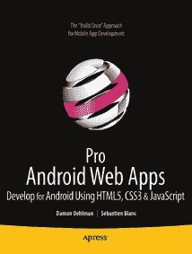

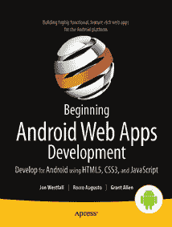

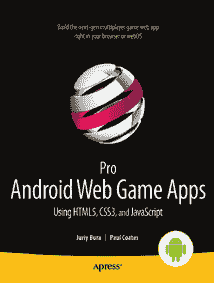

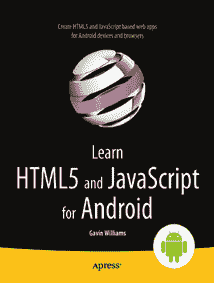

*为了方便起见，Apress 将部分前言材料放在索引之后。请使用“书签”和“目录简介”链接来访问它们。*

## 引言

欢迎学习 *Learn HTML5 and JavaScript for Android*。本书将介绍 HTML5、JavaScript 和 CSS3，帮助你为 Android 平台和浏览器制作极佳应用所需的必备技能。

作者 Gavin Williams 将一步步引导你创建移动端 Web 应用。你把所学的 HTML5、CSS3 和 JavaScript 技能立即付诸实践，获得宝贵的一手经验，这些经验将有助于你为 Android 智能手机、平板电脑和其他带有浏览器的设备开发你自己的 Android 版 Web 应用。

本书将向你展示如何：

- 使用 HTML5 和 CSS3 让你的 Web 应用外观精美且运行流畅

- 使用 JavaScript 生成更丰富的应用程序，能够响应各种事件

- 采用并使用 Android 封装器 API

- 通过 Canvas、Video 和 Audio 等 HTML5 API 为用户创建深层次的体验

- 逐个案例、分层地为你的 Android 设备和目标受众构建 Web 应用

翻开 *Learn HTML5 and JavaScript for Android*，获取构建在 Android 设备及其浏览器上运行的响应式、动态且趣味的 HTML5 和 JavaScript Web 应用所需的技能。

### 本书适合人群

本书适用于任何具有 Web 开发或原生移动应用开发经验，并希望掌握移动 Web 的人。

### 本书结构

本书分为九章。

- **第 1 章：入门**：本章将引导你搭建环境。

- **第 2 章：为 Android 创建 Web 应用简介**：本章将带你了解移动 Web 的历史以及它与桌面 Web 站的区别。它将通过几个现有移动 Web 站的案例，说明如何改进或更改它们以提升用户体验。

- **第 3 章：HTML5 和 第 4 章：使用 HTML5 开始你的项目**：这些章节将介绍一些专门针对移动端的 HTML5 标签。本章还将教你如何使用 HTML5 嵌入视频和音频。完成 HTML5 章后，工作将带你构建 Web 应用的 HTML 基础。

- **第 5 章：移动端 CSS3 和 第 6 章：奠定 CSS3 基础**：这些章节将向你展示一些 CSS3 移动兼容特性，如变换、动画、阴影和圆角。你还将学习使用 CSS3 预处理器 `SASS`。工作将带你使用 `SASS` 和最佳实践样式你的移动 Web 应用。

- **第 7 章：移动端 JavaScript 和 第 8 章：JavaScript：模型、视图与控制器**：这些章节将教你如何使用 JavaScript 增强你的移动应用程序。本章不涉及 `jQuery`、`Sencha` 或 `jQuery Mobile` 等库。JavaScript 简介章节将教你如何使用原生 JavaScript 构建基础框架，并与画布和音频交互。工作将带你通过添加分页功能和通过 `JSONP` 与第三方 API 通信来增强 Web 应用。

- **第 9 章：测试和部署你的移动端 Web 应用**：本章将向你如何使用 `QUnit` 测试应用，并使用 `Capistrano` 部署应用。

### 下载代码

本书所示示例的代码可以在 Apress 网站 `www.apress.com` 获取。可以在书籍信息页的“Source Code/Downloads”标签下找到该链接。该标签位于“Related Titles”部分下方。

### 联系作者

如果你有任何问题或建议——或者发现了认为我应该知道的错误——可以通过 `gavin@justanotherdeveloper.co.uk` 联系作者，或在 Twitter 上关注 `@fishrodgavin`。

[或访问 http://www.justanotherdeveloper.com.](http://www.justanotherdeveloper.com)

# xiii

# 第 1 章：入门

在 2008 年 9 月第一款 Android 手机发布以及更早的 2007 年 6 月发布第一款 iPhone 手机之前，移动网络浏览器内部缺乏迫切的标准化驱动。播放视频需要 `Flash mobile` 或低质量的 `3GP` 视频版本。

开发者会避开 `JavaScript`，因为 `JavaScript` 在大多数移动网络浏览器中默认是禁用的，而另一些浏览器则完全不支持 `JavaScript`。在 `stackoverflow.com` 上，其中一位开发者评论道，使用 `JavaScript` 简直是一场“噩梦……就像在 90 年代使用 Web 浏览器，但要面对的是未来管理者的预期。”1

1 `Stackoverflow.com`, 由 `annakata` 发布，[`stackoverflow.com/questions/316876/using-javascript-in-mobile-web-application#316920`](http://stackoverflow.com/questions/316876/using-javascript-in-mobile-web-application#316920) [application#316920.](http://stackoverflow.com/questions/316876/using-javascript-in-mobile-web-application#316920)

当时的移动网站仅仅是 `WAP` 时代在黑白移动手机（如 `Motorola V50`）上使用的 `无线标记语言` (`WML`) 页面，只不过增添了一抹色彩。从那时起并没有发生太大变化，大多数移动网站仍然保留了从上到下的相同线性信息流，而且交互性不强。这种设计风格有三个原因：

1. `WAP/GPRS` 和 `EDGE` 都是缓慢的协议，无法处理文件密集型网站，因此设计和内容受到限制，以便快速传送网站及其信息。

2. 旧手机的分辨率和宽高比非常糟糕，以至于你几乎无法在屏幕上放任何任何内容。

3. 传统上使用方向键或按键在移动网站上导航。上下滚动似乎比左右滚动更自然。

我们现在不再依赖于使用硬件控制按钮来浏览移动设备上的内容。随着每一款新款平板电脑和手机的发布，屏幕的尺寸、质量、分辨率、`像素密度/PPI` 和色彩深度不断增加。我们看到桌面浏览器引擎（如 `WebKit` 和 `Geko`）被引入到网络浏览器中，例如我们移动设备上的 `Mobile Safari`、`Android Browser` 和 `Firefox`。这帮助了开发者制作出惊艳的移动网站，它们在现在流行的 `Android` 和 `iOS` 手机和平板设备上视觉和感受都保持一致。

此外，最新的移动浏览器还支持 `GPU 加速`。这意味着移动 Web 应用可以更加精美和交互，因为大部分渲染工作现在可以卸交给图形处理器（这在几年前是闻所未闻）。

考虑到 `Adobe` 最近宣布取消 `Flash Mobile`，结合不断向移动设备中塞入更快的 `CPUs` 和 `RAM` 的竞争，现在是进入移动 Web，而且进入 `HTML5`、`CSS3` 和 `JavaScript` 的最佳时刻。

作为一名移动 Web 开发者，你现在有机会制作接近原生的应用程序。不要被骗了；移动 Web 还有很长的路要走。因此，在整本书中，我将为你提供一些技巧，以避免常见的误区。

如果你只能选择一个设备，请选择最新最强大的。设备本身可以使用一年多。如果你的目标是按一年为周期升级设备，你最终将拥有一组不错的旧设备用于测试，以及与你的用户使用的相同或相似的设备。

选择测试设备

虽然不是必不可少的，但你应该选择购买一个用户未来会升级的设备。再次，这将帮助你针对设备进行测试。

与其他操作系统不同，Android 遭受着所谓的“碎片化”问题。设备碎片化由某些因素引起：

- `加速度`

- `GPS`

- `陀螺仪`

- `屏幕分辨率`

- `像素密度 (PPI)`

- `CPU`

- `RAM`

Aptana 基于 `Eclipse`，因此可以支持大多数（如果不是全部）`Eclipse` 插件；它将管理你的虚拟 Android 测试环境、执行代码补全、验证你的代码并为你部署。

要下载 Aptana，请访问 [`aptana.com/`](http://aptana.com/)，你会看到图 1-1 所示的下载选项。

**图 1-1.** *Aptana 下载选项*

如图 1-1 所示选择“Standalone Version”（独立版本），并点击下载按钮。安装它并继续安装 Android SDK。

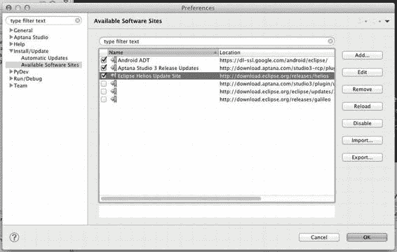

# 第 1 章：入门

6

> **注意:** 你可以根据喜好更改 Aptana 中编辑器的外观（例如，你可能希望为 IDE 设置深色或亮色主题）。要此此，只需进入 `Preferences`。首选项窗口将打开。使用左上角的过滤器输入 `Themes`。点击搜索框下方菜单中的 themes 选项。默认为 `Aptana Studio`，但你可以选择你喜欢的任何主题并点击 `OK`。

## Android SDK

Android SDK 将允你创建虚拟 Android 环境，以便不同的硬件配置和 SDK/OS 版本进行开发。有一个 `Eclipse` 插件允许你从 Aptana 内部管理、创建和配置虚拟 Android 设备，并启动它们。

在安装 `ADT` 之前，你需要在 Aptana 中启用 `Eclipse Helios Update Site`。它包含了 `Eclipse` 的 `Android ADT` 插件的依赖项。

要启用 `Eclipse Helios Update Site`，从 Apple 任务栏进入 `Aptana Studio 3`，然后选择 `Preferences`  `Install/Update`  `Available Software Sites`。会出现一个类似于图 1-2 的屏幕。

**图 1-2.** *启用 Eclipse Helios Update Site*

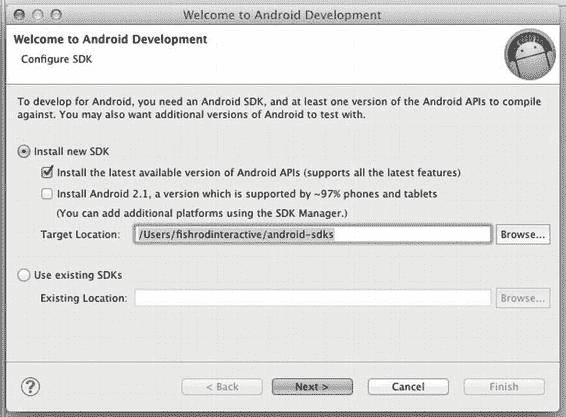

# 第 1 章：入门

7

[要为 Aptana 安装 `ADT`，请访问 http://developer.android.com/sdk/eclipse-adt-](http://developer.android.com/sdk/eclipse-adt.html#downloading)[adt.html#downloading.](http://developer.android.com/sdk/eclipse-adt.html#downloading) 按照说明操作。成功安装 `ADT` 后，`Aptana` 将重启，你将看到一个类似于图 1-3 的屏幕。

**图 1-3.** *ADT 初始启动屏幕*

保持所有默认选项并点击 `Next >`。你可以决定是否向 `Android` 发送使用数据，然后点击 `Finish`。在最后一个屏幕上接受所有选项并再次点击 `Finish`。`ADT` 将开始下载最新的 `SDKs`，这需要几分钟时间。

现在 `ADT` 已安装，你可以安装所有的 `SDKs` 来测试你的 Android Web 应用程序。`Android ADT` 可以在 `Window` 菜单底部找到，如图 1-4 所示。

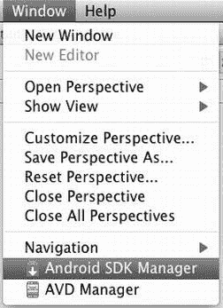

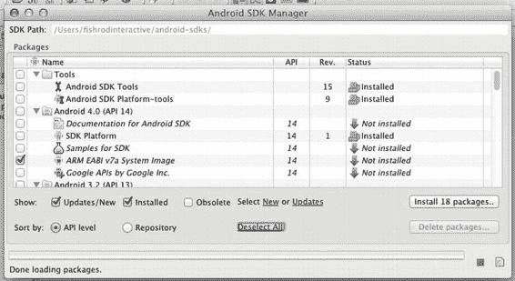

# 第 1 章：入门

8

**图 1-4.** *Aptana 中新的 Android 菜单*

进入 `Android SDK Manager`。你将看到一个需要下载的 `SDKs` 列表，如图 1-5 所示。确保勾选了以下选项：

- Google APIs by Google Inc.

- SDK Platform by Samsung Electronics

**图 1-5.** *Android SDK Manager*

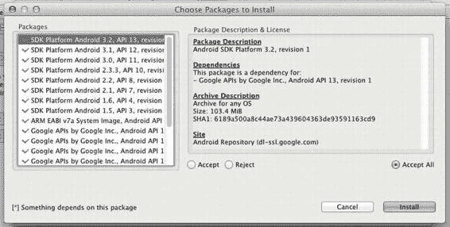

# 第 1 章：入门

9

现在 `ADT` 已安装，你可以安装所有的 `SDKs` 来测试你的 Android Web 应用程序。`Android ADT` 可以在 `Window` 菜单底部找到，如图 1-4 所示。

在这里，你将了解到受众如何影响你设计和布局移动端网站，如何确定内容的优先级，以及为你的目标受众提供最佳功能。

## Web 应用与原生应用

如果你在决定开发纯原生应用、混合应用还是纯 Web 应用之间犹豫不决，那么本节将将带你了解每种解决方案的优缺点。

## 第一行代码：Hello World

最后这一节将带你介绍应用程序的构建模块，例如设置用于自动部署的 `ANT`，构建并压缩 `SASS/CSS` 文件以及 `JavaScript`。

## 移动 Web 有何不同？

为 3.654 亿永久在线用户的潜在受众提供服务，使得移动 Web 成为最令人兴奋的开发平台之一。

为桌面环境创建 Web 应用程序可能是很有趣。然而，用户受限于单一指向设备和键盘与你的工作进行交互。移动 Web 带来了一个全新的可能世界。移动设备是交互式元素的空白画布，用户只需通过触摸即可进行交互。作为开发者，你可以通过接管整个屏幕并让他们沉浸在你的移动 Web 应用的世界中，从而与用户创造出更加亲密的体验。

遗憾的是，尽管移动 Web 带来了许多现实世界的优势，但在平台不断发展的过程中，你将面临与桌面环境中相同的开发和用户体验障碍。

## 对象/特性检测

移动 Web 上开发者可用的 API 碎片化问题可能会成为一个问题。修复跨浏览器 API 差异的最常用解决方案是使用 `JavaScript` 检测浏览器或设备，并根据所使用的浏览器提供不同的样式表或执行特定的 `JavaScript` 代码。这种方法被称为用户代理（UA）嗅探或浏览器嗅探。列出的列表 2-1 显示了一个常见的 UA 嗅探脚本。

**列表 2-1.** 用于 UA 嗅探的 JavaScript 代码

```javascript
// 获取用户代理字符串
var browser = navigator.userAgent;
// 检查字符串中是否包含 Firefox
if(browser.match(/Firefox/) === null){
  // 如果不是 Firefox，将用户重定向到另一个页面
  window.location.href = "sendstandardmessage.html";
} else {
  // 如果是，使用 Mozilla SMS API 发送短信
  navigator.mozSms.send("01234567891", "My Message");
}
```

UA 嗅探可能会有什么问题？虽然你会为 Firefox 提供支持并为其他浏览器提供回退方案，但你无法支持可能具有 Firefox 相同 API 的浏览器。此特定 API 仅在 Firefox `11+` 中可用，因此你还需要确保 UA 嗅探脚本包含该版本。

当你开始增加浏览器检测脚本的粒度时，你也降低了可维护性并增加了复杂性，因为必须不断更新嗅探代码以适应新的浏览器和版本。不知不觉，你的 `JavaScript` 库就变成了不可维护的条条代码。

实现此点的更好方法是通过通过对象检测。改进后的代码见列表 2-2。首先，我们检查 `SMS API` 是否存在。如果不存在，我们将用户引导到另一个页面；如果存在，我们就可以发送短信。

**列表 2-2.** 用于对象检测的 JavaScript 代码

```javascript
// 检查 navigator.mozSms 是否为对象（如果存在）
if (typeof navigator.mozSms === "object"){
  // 如果存在，使用内置 SMS API 发送消息
  navigator.mozSms.send("01234567891", "My Message");
} else {
  // 如果不存在，将用户引导到另一个位置
  window.location.href = "sendstandardmessage.html";
}
```

对象检测方法还允许我们为特定的浏览器 API 提供回退方案。Firefox `11` 夜间版目前仅支持 `SMS API`，但未来可能有其他浏览器和其他设备通过不同的方法或类支持相同的实现。

我们可以使用 `class` 将此转换为应用程序的一个特性。如列表 2-3 所示，我们可以在方法内部委托消息的发送工作。在理论上，这应该允许我们使用自己的 API 在应用程序中发送消息。当浏览器厂商向其浏览器添加 `SMS API` 时，我们只需要在一个位置添加该方法，而不需要在整个应用程序中进行查找和替换。

**列表 2-3.** 使用委托通过我们自己的 Web 服务作为回退发送消息

```javascript
var Message = function Message(message, recipient){
  this.message = message;
  this.recipient = recipient;
  this.sendSMS = function sendSMS(recipient){
    if(typeof navigator.mozSms === "object"){
      // 使用用户的手机发送短信
      navigator.mozSms.send(this.recipient, this.message);
    } else if (typeof navigator.otherSms === "object") {
      // 使用另一个浏览器的 SMS 实现
      navigator.otherSms.sendMessage(this.message, this.recipient);
    } else {
      // 如果无法通过用户的手机发送，
      // 使用第三方 Web 服务发送消息
      this.ajaxSend(this.recipient, this.message);
    }
  }

  function ajaxSend(recipient, message){
    // 通过 Ajax 使用基于 Web 的网关发送短信
  }
}

var messageInst = new Message("message!", "01234567891");
messageInst.sendSMS();
```

从列表 2-3 可以看到，无论浏览能力如何，我们都可以使用对象检测来确保用户无论设备如何都能获得相同或相似的体验。使用 `JavaScript` 检测这些特殊特性很容易。但测试 CSS3 或 HTML5 特性并提供向后兼容性呢？名为 `Modernizr` 的 JavaScript 库可以帮助实现这一点。它使用相同的对象检测方法来检测用户的 HTML/CSS/JavaScript 能力。它通过向 `HTML` 标签添加类来修改 `DOM`，从而为你的 CSS 和 JavaScript 特性检测提供钩子。图 2-1 显示了其在 haz.io 应用。将在第七章详细介绍。

## 屏幕尺寸与像素密度

在开发移动 Web 应用时，你可能希望创建一个在平板设备和移动设备上具有相同功能的应用程序，但呈现不同的视图或布局以利用额的空间或方向。媒体查询可以帮助实现这一点。通过结合媒体查询和弹性设计，你可以产生响应于用户显示的视图，而不是检测用户的设备类型并为其提供视图。这被称为响应式 Web 设计。

这种开发方法比根据用户使用的设备类型决定他们如何查看你的网站要优雅得多。相反，你关注的是可用的空间和像素密度。

像素密度概念允许物理尺寸相同的移动设备根据每英寸像素数量的不同而具有不同的分辨率。Android 设备分为三种像素密度类别：

- 低

- 中

- 高

这对你的移动 Web 应用有什么影响？当你制作图像时

对于普通网站，你会生成单张图像，它不会缩放且无法适用于所有屏幕类型，因为布局会随图像本身缩放以适应固定宽度或弹性布局。

对于移动端网页，你通常会创建一个移动应用程来适应整个视口，并且无论设备的像素密度如何，其尺寸都将保持相同。

例如，如果你为低像素密度屏幕制作了一个宽度为 500 px 的图像，它在高密度屏幕上显示将会更小。这是因为 500 px 在高密度屏幕上占据的空间没有在低密度屏幕上那么大。

移动浏览器解决此问题的方案是根据目标密度来放大或缩小图像。例如，如果你为中等密度屏开发应用程序，浏览器将在低密度屏幕上缩小图像，并在高密度屏幕上放大图像。这会导致在向任一方向缩放时产生开销，并且在放大图像时会出现像素化，缩小图像时可能会出现失真。

为了解决这个问题，我们既可以专门为高密度屏幕创建应用程序，又允许移动端缩小图像。这在 CPU/GPU 消耗网络活动方面可能是非常昂贵的。这两个因素都会影响渲染时间，并可能因为下载不必要的资源而影响用户的钱包。或者，我们可以使用媒体查询来确保为正确的显示类型传递正确的内容。为了做到这一点，你必须将视口元标签的 `target-densitydpi` 属性设置为 `device-dpi`，并使用媒体查询导入特定像素密度的样式表，如列表 2-4 所示。

# 第 2 章：Android 移动 Web 应用简介

## 列表 2-4. *使用媒体查询进行特定像素密度样式设置*

```html
// 设置视口以匹配设备的像素密度和宽度
<meta name="viewport" content="target-densitydpi=device-dpi, width=device-width" />

// 引入主样式表
<link rel="stylesheet" media="screen" href="mobile.css" />

// 引入高、中、低密度样式表以提供特定像素密度图像
<link rel="stylesheet" media="screen and (-webkit-device-pixel-ratio: 1.5)" href="hdpi.css" />
<link rel="stylesheet" media="screen and (-webkit-device-pixel-ratio: 1.0)" href="mdpi.css" />
<link rel="stylesheet" media="screen and (-webkit-device-pixel-ratio: 0.75)" href="ldpi.css" />
```

如列表 2-4 所示，每种显示类型的像素比例如下：

* 低密度：0.75

* 中密度：1.0

* 高密度：1.5

我们使用通用的移动端样式表，以便在设备不匹配任何像素比例时提供回退图像（fallback images）。然后，我们使用每个像素密度类别的样式表来覆盖图像。

像素密度可能是一个棘手的问题，这意味着对于你在应用程序中使用的每张图像，你必须额外制作两个不同尺寸的图像。这也意味着，即使你为今天最高的像素密度创建了图形，明天你可能也要为另一个具有更高密度的显示器重新导出所有内容。在选择图形包创建你的移动 Web 设计时，务必记住这一点。

## 迎合你的受众

记住你在为谁编写应用程序与与他们将用什么与你的工作进行交互同样重要。第一步是确保你理解用户将用你的应用程序做什么。为了做到这一点，你必须对其进行分类。

对你的应用程序进行分类将帮助你根据同类别内其他应用程序的设计以及它们的功能来制定通用的交互规则。这听起来可能像抄袭，但它将帮助用户根据之前的经验快速、直观地发现如何使用你的应用程序，从而以最短的时间让其运行起来。

记住，你可以在这些规则的基础上进行构建，而不必受限于这些规则。只要你能让用户打开你的移动 Web 应用程序，玩几分钟，并立即说“我懂了”，你就完成了你的工作。

移动 Web 应用程序有很多种分类，但大多数属于以下几类：

* 任务驱动型

* 社交型

* 娱乐型

### 任务驱动型

任务驱动型应用程序在本质上非常简单。它们被设计为用于日常使用的省时工具。这可以是从查找火车时刻到查找最近的酒吧或咖啡馆任何内容。

有时，我会站在伦敦沃特卢火车站中心，盯着火车时刻表，看起来迷茫且困惑，然后掏出手机启动“火车时刻表”App 以更快地找到车次。

要记住的一点是，如果用户无法通过你的应用程序在最短时间内完成任务，他们就会关闭你的浏览器窗口，并寻找另一个可以更快完成相同任务的窗口。

对于任务驱动型应用程序，有两个基本信息可以帮助用户更快地完成任务：

* 用户在哪里？

* 他们正在使用什么设备？

这两个关键信息对于你的应用程序来说是很容易获取的，了解它们将产生巨大差异。发现用户的物理位置以及他们在做什么，将帮助你预判他们访问你的移动 Web 应用程序时将要做。

例如，如果你正在创建一个行程规划器，有几点关于用户的特征你应该考虑：

* 用户在哪里？他们的连接是否受限（例如 3G 或）。

* 用户是否正在移动中？他们是否有时间用拇指输入数据来填写表单？

这些因素不仅影响你如何展示交互元素（如输入表单），还影响你如何编写代码以减少用户完成任务所付出的努力。

#### 图 2-2. *TFL 移动网站用户路径*

在图 2-2 中你可以 TFL 行程规划器的移动网站。上面的用户路径描述了一个最坏的情况。该用户正在移动中，容易产生数据输入错误。结果是用户必须通过两次页面加载并填写更多表单才能完成任务。增加两个额外的页面来帮助用户进行验证又有什么问题呢？两个额的页面意味着在 3G 网络下将产生 4 秒以上的加载时间。你还必须考虑到用户处理页面并做出响应的时间。

#### 我们如何改进 TFL 移动网站？

* 增加反馈循环。当用户输入出发地/目的地时，通过自动补全为他们提供建议。他们可以选择适合自己的建议来预填充行程规划器的表单字段。

* 我们可以使用用户的当前位置作为行程起点或终点的建议。

* 如果我们使用本地存储，还可以向用户建议最近的目的地列表。例如，如果我们知道他们刚刚规划了去某地的行程，那么当他们再次打开移动 Web 应用程序时，很有可能想知道如何回去。

#### 图 2-3. *BUSit 移动网站用户路径*

图 2-3 展示了 `busitlondon.co.uk` 的一个良好示例。首次启动移动 Web 应用时，它将尝试为您查找当前的当前位置。

当用户输入起点和终点位置时，它将使用 `Google Maps API` 和自动完成功能为用户提供可供选择的。你始终拥有选择用户当前位置的选项。

在你规划好目的地后，它将向你推荐路线。所有这些信息都包含单个页面中，无需刷新页面。用户可以轻松更改或修改视图，而无需等待图形（地图瓦片除外）加载。这提供了更接近“原生应用程序”的外观和感受。

# 第 2 章：为 Android 创建移动 Web 应用简介 (26 页)

## 社交

社交应用的首要目标是促进与朋友或其他感兴趣的人建立联系和通信的能力。用户在社交移动 Web 应用上花费的时间通常远高于使用工具类应用的时间。

社交媒体应用的主要目标通常有三点：

- 用户访问是为了消费内容。

- 用户访问是为了贡献内容。

- 用户访问是为了参与。

这三条基本规则支撑了当今存在的几乎每一个社交移动应用。如果用户不贡献内容，就没有任何内容供其他用户消费和参与。

仅仅因为用户在社交移动 Web 应上花费的时间更多，并不意味着完成任务（如分享内容）的路径应该与任务型应用有任何不同。应该考虑到用户的情况。它应该既易于分享内容，又易于消费内容。

例如，`Twitter` 和 `Facebook` 在功能集方面是相径径的，但这两个应用在移动 Web 上的主要目标都是让用户轻松地消费、贡献和参与。

图 2-4 显示了 Facebook 触摸移动 Web 网站的三个屏幕（左侧）。登录后，你会看到 `Facebook` 消息送，因此你可以立即消费内容。你还会看到三个清晰且不同的按钮，用于分享内容，例如你的状态、照片和当前位置（签到）。你顶端还有一个工具栏，以模态菜单或弹出窗口的形式为你提供与你特别相关的的内容和更新（`好友请求`、`消息`和`通知`）。进一步的功能位于隐藏菜单中，这为添加更多次要功能和操作留了空间，而不会让应用程序的其他部分变得拥挤。

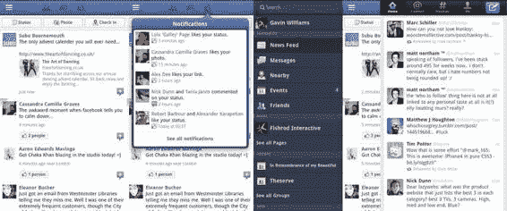

# 第 2 章：为 Android 创建移动 Web 应用简介 (27 页)

**图 2-4.** *Facebook 触摸和 Twitter 移动 Web 网站让分享和消费内容变得简单。*

`Twitter` 的核心功能可以在顶部工具栏找到。一个清晰的内容分享按钮用蓝色突出显示，并带有独特的图标。登录后，如果用户用过 `Twitter` 网站，他们就知道这是一个分享内容的按钮。这种设计模式现在贯穿于 `Twitter` 的桌面端、移动和 Web 版本。

## 娱乐

娱乐类应用的创建主要是为了满足克服某种形式无聊的需求。解决这一问题有多种形式，从显而易见的游戏到提供音乐和视频内容。娱乐应用通常设计为让用户沉浸在应用程序环境中。即使是今天移动 Web 上最基础的 `HTML5` 游戏也可以实现这一点。

## Web 应用 vs 原生应用

过去几年中引起巨大争论和讨论的原因之一是将项目构建为原生应用还是移动 Web 应用。两者都有优缺点。然而，重要的是，你选择的方案应该根据你特定项目的需求以及你作为开发人员的能力来选择。最重要的是，选择能最快完成你项目的方案！

有几个因素可以帮助你决定创建移动 Web 应用还是原生应用：

- 你是否已经知道如何为目标平台开发

- 你的应用程序是否依赖网络连接或存储在线的某些动态数据

- 你的应用程序依赖什么类型的设备功能（例如 `GPS`、`加速度计`、`陀螺仪`、`通讯录`、`日历`、密集 `CPU/GPU` 操作）

- 你的项目现在或将来是否有将功能移植到其他平台的空间（例如 `iOS`、`Blackberry`、`Windows Phone`、桌面）

- 你发布应用程序的频率，以及你如何处理用户不在设备上更新你的应用程序

- 时间和预算

如果你已经如何使用 Web 标准开发，移动 Web 应用可能是最佳解决方案。但如果你已经可以为目标平台进行开发，那么制作原生应用可能会更有优势。然而，这会略微关闭制作可在其他平台上运行的应用的大门，除却你使用如 `Marmalade` 等跨平台应用框架，否则同一个应用需要为所有平台重新创建。

创建移动 Web 应用可以在转换为原生之前，在所有平台上测试或原型化你的应用程序的一种成本效益方法。通过分析，你可以看到应该针对哪些平台使用原生应用。通过用户研究，你可以看到创建一个具有平台特定功能的原生应用是否对你的用户有利。

如果你的应用程序依赖无法通过 Web 浏览器访问的 `APIs`，例如`通讯录`、`日历`、`陀螺仪`或`加速度计`，那么移动 Web 应用可能是不可考虑的，因为这些 `APIs` 目前无法通过大多数移动 Web 浏览器。

如果你的应用程序依赖动态数据，使用 Web 标准开发应用程序可能是一个明智的选择，因为你可以使用 `Ajax` 通过网络向应用程序快速交付内容。你还可以在移动 Web 应用中缓存和存储文件，以便应用程序在没有网络时仍。

如果你频繁为移动应用程序提供更新，可能会遇到用户不按要求更新到最新版本的问题。通过创建移动 Web 应用，只需将更新推送到 Web 服务器，所有用户将立即获得应用程序的最新版本。

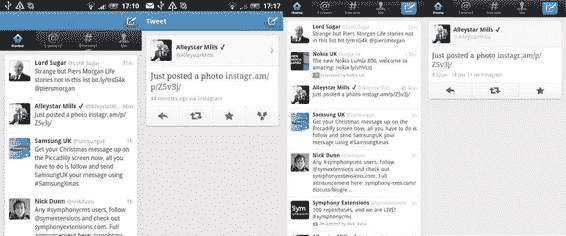

# 第 2 章：为 Android 创建移动 Web 应用简介 (29 页)

在图 2-5 中，你可以看到 `Twitter` 原生应用（左）和移动 Web 应用（右）如何展示了社交应用作为原生应用和移动 Web 应用的区别。正如你所看到的，并没有真正的区别。移动 Web 应用丢弃的主要功能是使用第三方原生应用分享内容。`Twitter` 也删除了移动 Web 应用上分享照片的功能。

`对象/功能检测`可以提供在特定设备上传照片的能力。

**图 2-5.** *Twitter 原生应用（左）和 Twitter 移动 Web 应用（右）* 本节目前收集的信息应该帮助你决定是原生还是移动 Web。

然而，还有第三种选择。多种手机 Web 应用程序框架（如 `PhoneGap`、`Appcelerator` 和 `Rhomobile`）允许你使用 `XHTML/JavaScript` 和 `CSS` 构建应用程序，但利用可能仅适用于原生 Web 应用的 `APIs`。

这些框架为你提供了一个视图，让你可以在其中开发应用，并通过使用 JavaScript 作为两者之间的桥梁，提供指向移动端 API 的代理。图 2-6 显示了多种手机 Web 应用程序框架的结构。

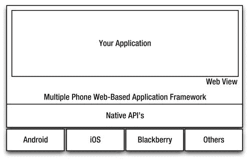

# 第 2 章：为 Android 创建移动 Web 应用简介

**图 2-6.** 多种手机 Web 应用程序框架的结构

我们知道在某个时刻，移动 Web 浏览器将提供与第三方应用程交互，并利用移动设备的硬件（如 CPU/GPU 和摄像头）。因此，继续为浏览器开发是有意义的。然而，手机 Web 应用程序框架有助于将原生应用程序可用的 API 和服务引入 Web 应用程序。

通过这种方式构建应用程序，你可以实现一次编写并部署一个功能有限的移动 Web 应用。然后，你可以在手机 Web 应用程序框架内通过对象/功能检测，将该应用作为原生应用进行渐进增强。这让你兼得两者的优势。

## 第一行代码：Hello World

现在该是你写下第一行代码了。在这个 Hello World 应用中，你只需创建一个包含“Hello World!”的 HTML 网页，并将其显示在 Android 虚拟设备上。

### 设置

首先打开 Aptana Studio。你需要创建一个新项目，因此转到 `File`  `New`  `Web Project`。

你将看到一个与图 2-7 类似的屏幕。输入项目名称并点击 Finish。我选择了 Chapter-2 作为我的项目名。

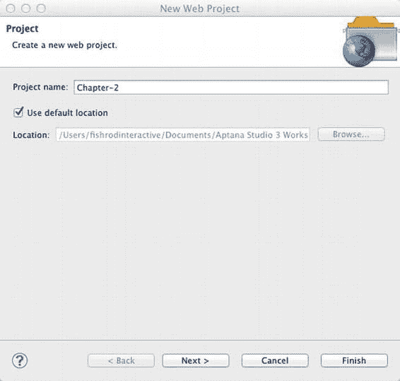

**图 2-7.** Aptana 的 New Web Project 向导

这将在 Aptana 中创建一个新的空项目。新项目将出现在左侧的 App Explorer 面板中。

### HTML

为移动 Web 编写代码与为桌面 Web 编写代码相似。我们将从创建一个基础的 HTML5 文档开始。

以与创建文件夹相同的方式创建一个新文件，只需选择 `File` 而不是 `Folder`。将文件命名为 `index.html`。确保该文件存在于项目的根目录下非常重要。以下代码将构成我们 HTML 文件的基础。

**列表 2-5.** Hello World! 的 HTML 源代码

```html
<!DOCTYPE html>
<html lang="en-GB" dir="ltr">
<head>
<meta charset="UTF-8" />
<meta name="viewport" content="width=device-width; initial-scale=1.0; maximum-scale=1.0; user-scalable=0; target-densitydpi=device-dpi;"/>
<title>My First Mobile Web App</title>
</head>
<body>
<h1>Hello World!</h1>
</body>
</html>
```

如果你不熟悉列表 2-5 所示的某些 `HTML` 元素，第一行是新的 HTML5 文档类型声明（doctype）。在 HTML5 中，你不需要指定 DTD，DTD 通常可以在 XHTML 1.1 页面中找到。列表 2-6 显示了 XHTML 1.1 文档类型声明与 HTML5 文档类型声明之间的区别。

**列表 2-6.** XHTML 1.1 文档类型声明与 HTML5 文档类型声明的区别

```html
<!-- HTML4 Doctype Decleration -->
<!DOCTYPE html PUBLIC "-//W3C//DTD XHTML 1.1//EN" "http://www.w3.org/TR/xhtml11/DTD/xhtml11.dtd">

<!-- HTML5 Doctype Decleration -->
<!DOCTYPE html>
```

如你所见，现在不需要 Google 或记忆 DTD 路径的位置，也不需要指定 HTML 版本。

在 `html` 标签中，我添加了两个属性：`<html lang="en-GB" dir="ltr">`。`lang` 将指定文档内使用的语言，`dir` 规定阅读方向。`dir` 已设置为 `ltr`（从左到右），`lang` 已设置为 `en-GB`（英语 - 英国）。

进入 `head` 元素，有两个 `meta` 标签，如列表 2-7 所示。

**列表 2-7.** 源代码中的 Meta 

```html
<meta charset="UTF-8" />
<meta name="viewport" content="width=device-width; initial-scale=1.0; maximum-scale=1.0; user-scalable=no; target-densitydpi=device-dpi;"/>
```

第一个 `meta` 标�标签指定了文档内使用的字符集。这通常应该是 `UTF-8`，它将涵盖大多数语言字符。

第二个 `meta` 标签专门用于控制移动网站上的布局或视口（viewport）。通过这个 `meta` 标签，我们可以使用 `width` 属性将页面宽度设置为视口（浏览器屏幕的可视区域）相同、更小或更大。

还可以使用 `initial-scale` 和 `maximum-scale` 属性来控制用户对你的 Web 应用进行缩放程度。`user-scalable` 属性是一个标志，用于启用或禁用用户通过捏合或点击来对你的 Web 应用进行放大或缩小。最后，`target-densitydpi` 属性用于根据像素密度规定网页如何扩展。

**列表 2-8.** 完整的视口定义

```html
<meta name="viewport" content="width=device-width; initial-scale=1.0; maximum-scale=1.0; user-scalable=no; target-densitydpi=device-dpi;"/>
```

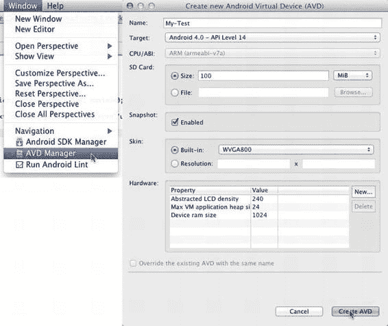

**列表 2-9.** title 标签

```html
<title>My First Mobile Web App</title>
```

**列表 2-10.** body 和 h1 标签

```html
<body>
<h1>Hello World!</h1>
</body>
```

## 测试

在继续之前，你应该使用 Aptana 中的 Android SDK 创建 Android 虚拟设备 (AVD) 来测试你的网站。首先转到 `Window`  `AVD Manager`，如图 2-8 所示。

**图 2-8.** 创建 Android 虚拟设备

当 AVD 窗口出现时，点击右侧的 `new`。在创建新的 Android 虚拟设备 (AVD) 对框中，使用以下参数：

- `Name`: `My-Test`

- `Target`: `Android 4.0 --- API Level 14`

- `SD Card`: `Size: 100 MiB`

- `Snapshot`: `Enabled`

- `Skin`: `Built-in: WVGA800`

- `Hardware`:

    - `Abstracted LCD density`: `240`

    - `Max VM application heap size`: `24`

    - `Device ram size`: `1024`

在设置所有选项后，点击 `Create AVD` 按钮。你的新 AVD 将出现在 Android 设备管理器中。选择它并点击 `Start`。

AVD 以启动和运行极其缓慢而闻名。虽然有替代方案，但本书将不会涵盖它们。几分钟后，你应该有一个运行中的虚拟 Android 设备。

点击互联网图标启动浏览器。

现在你需要将应用程序部署到你的 Web 服务器上。在第 3 章中，你将了解到更多关于自动部署应用程序的知识，但现在你可以使用 Aptana 将项目导出到相应的文件夹。进入 `File  Export`。在导出对话框中，选择 `General  File System` 并点击 `Next`。

选择 `Chapter-2`并在“To directory”中选择 `Browse`。浏览到你主目录下的 Sites 文件夹并选择 `Open`。点击 `Finish`，Aptana 将开始将文档发布到该目录。

你现在可以使用 AVD 内置的浏览器以及你在第 1 章中记录的 URL (http://your-ip-address/~username/Chapter-2/) 来访问该网站。如果一切运行正常（如预期），你应该能在 AVD 屏幕上看到图 2-9 所示的内容。

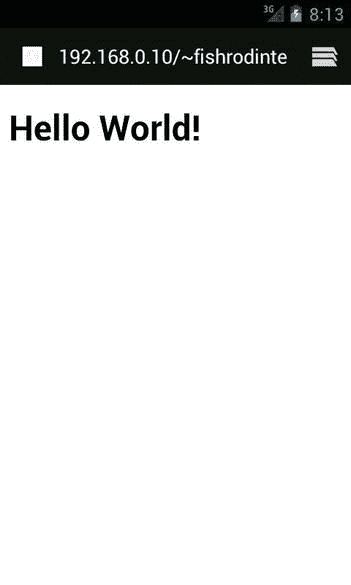

# 第 2 章：Android 移动 Web 应用开发简介

36

**图 2-9.** *Hello World!*

## 总结

在本章中，你应该学习了三种不同类型的 Web 应用：基于任务的、社交类和娱乐类的。

你应该理解用户可能如何与你的应用程序进行交互。在本书之外开发移动 Web 应用时，你还应该理解如何考虑用户的潜在处境，以及这将如何影响你的功能、设计和用户体验。

本章应该让你对 JavaScript 开发的最佳实践有了深入的了解，并对响应式设计有了初步接触。

最后，本章应该让你在项目方向上有所把握，即是作为原生、Web 还是多手机 Web 应用程序框架项目来启动你的项目。

# 第 3 章

## HTML5

随着对跨平台移动应用的需求，HTML5 对移动行业的重要性未曾如此重要。它是创建简单且功能丰富的应用程序的理想选择之一，这些应用程序只需构建和部署一次，即可支持目前所有的主流智能手机和平板电脑设备。

基于 HTML5 的应用程序的一个常见误区是它们运行速度缓慢、无响应，并且无法达到用户对原生移动应用所期望的速度和质量。这种说法只有部分正确，正如你在上一章中所看到的；这取决于所构建的应用程序类型。例如，App Store 上的《Financial Times》应用看起来像是一个原生应用。然而，如果你仔细观察，会发现《Financial Times》应用仅仅是将《Financial Times》移动 Web 应用 (app.ft.com) 封装在原生应用内的 `WebView` 中。

如图 3-1 所示，iPhone 和 Android 的两个应用看起来非常相似。抛开 UI 带来的若干特定平台增强功能不谈，它们实际上是同一个应用程序。

**注意：** 使用诸如 `PhoneGap` 等多手机 Web 应用程序框架构建 Web 应�并将其推向各种应用市场并没有问题。这增加了你应用程序的曝光率，并让用户更容易获取。通过这种方式制作应用程序，当 App Store 的条款和条件发生不利于你的变化时也能为你提供即时的解决方案。

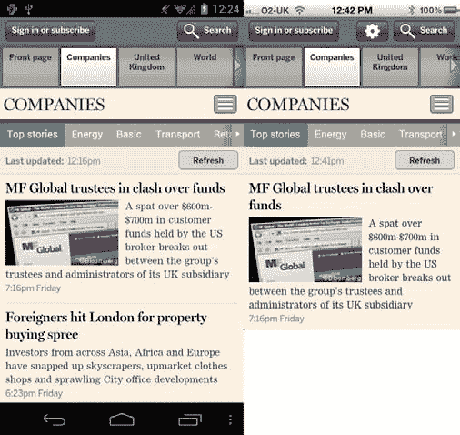

# 第 3 章：HTML5

38

**图 3-1.** *Financial Times 应用（左）和 iOS 应用（右）*

在在本章中，你将学习 HTML5 的基础知识。你还将学习如何使用 `header`、`footer`、`nav`、`section` 和 `article` 元素来表示内容。

## 有什么新？

HTML5 相比 HTML4 有了巨大的飞跃。它引入了新的标签，如 `video`、`audio`、`canvas`、`svg`、`article`、`aside`、`details`、`figure`、`figcaption`、`header`、`mark`、`output`、`progress`、`time`、`video` 和 `section`。

本章将深入探讨如何使用这些新特性创建更好的移动 Web 应用。你还将学习新的 API，如 `geolocation`、`storage`、`web workers` 和 `web sockets`。

正如你从列表 3-2 中看到的，这种标记并没有真正的明显结构。有很多带有关联类（classes）的 `div` 标签；然而，创建这样一个像这样的文档并没有真正的标准。

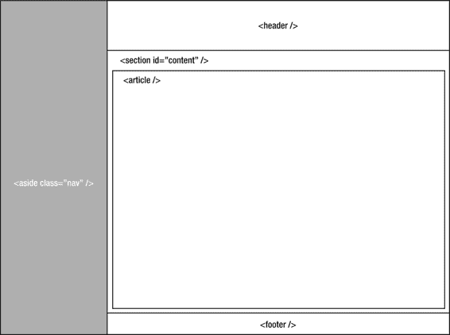

# 第 3 章：HTML5

43

<aside />

`<aside />` 元素可用于表示与网站主要内容无关的内容，例如推文、相关链接、标签和导航元素。这些内容通常出现在文档的左侧或右侧，如图 3-3 所示。

**图 3-3。** *带有 `<aside />` 元素的文档结构（用灰色突出显示）* 我们可以根据屏幕大小隐藏 `aside` 元素来在移动端使用它，并在用户点击按钮显示它时将其显示。这种设计模式可以在 Facebook 移动网页应用中找到，并将在第 4 章的工作坊中进行更深入的探讨。

列表 3-3 显示了应该如何使用 `aside` 元素，列表 3-4 显示了你可能在 HTML4 中是如何编写相同代码的。

# 第 3 章：HTML5

44

**列表 3-3。** *HTML5 中 Aside 的建议结构*

```html
<aside>
<nav>
<h2>要去的地方</h2>
<ul>
<li><a href="somewhere">某处</a></li>
<li><a href="somewhere-else">其他地方</a></li>
</ul>
</nav>
</aside>
<section class="content">
<!-- 你的内容放在此处 -->
</section>
```

正如你从列表 3-3 中看到的，我们使用 `<aside />` 元素来容纳网站的导航，因为它位于由 `<section class="content" />` 元素定义的区域之外。`<aside />` 元素将浮动在内容的左侧。

为 HTML4 编写的相同标记看起来就像列表 3-4 所示。

**列表 3-4。** *HTML4 中 Aside 的建议结构*

```html
<div class="sidebar">
<div class="navigation">
<ul>
<li><a href="somewhere">某处</a></li>
<li><a href="somewhere-else">其他地方</a></li>
</ul>
</div>navigation>
</div>
<div class="content">
<!-- 你的内容放在此处 -->
</div>
```

# 第 3 章：HTML5

45

正如你所见，使用 `div` 代替有意义的标记使得内容初看时更难理解。

<audio />

`<audio />` 元素用于在网页中嵌入音频内容。这是 HTML5 的新功能，在 HTML4 中不可用。对于不支持 HTML5 音频的浏览器，你可以在 `<audio />` 标签内提供 3gp 版本的音频文件的链接。列表 3-5 显示了如何嵌入音频文件。

**列表 3-5。** *在 HTML5 中使用 Audio 标签*

```html
<audio controls="controls">
<source src="media/audio.oga" type="application/ogg">
<source src="media/audio.mp3" type="audio/mpeg">
<p>
您的浏览器不支持 HTML5 音频，
<a href="media/audio.3gp">点击此处下载</a>
</p>
</audio>
```

这将为手机渲染原生音频播放器。在 `<audio />` 标签内，你会看到几个 `<source />` 元素。这些用于为浏览器提供不同的音频格式，如 MP3、OGG 或 WAV。你应该指定音频文件的 mime 类型，以便浏览器选择正确的音频文件。

图 3-4 显示了 `<audio />` 元素在 Android 4 中的外观观。

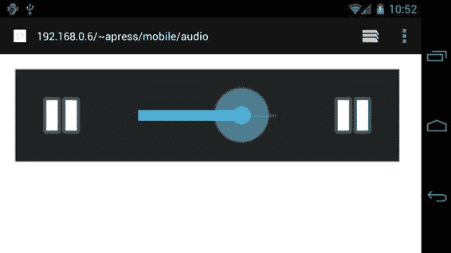

# 第 3 章：HTML5

46

**图 3-4。** *Android 4 三层冰中的 `<audio />` 元素* `<audio />` 标签还支持几个额外的媒体属性。

表格 3-1 显示了这些属性及其描述。

**表格 3-1。** *HTML5 音频属性*

| 属性 | 值 | 描述 |

| :--- | :--- | :--- |

| src | — | 用于指指定单个音频文件，而不是使用 `<source />` 标签。 |

| preload | none \| metadata \| auto | 用于指定是否预加载音频文件。建议设置为 none 或 metadata。这将防止浏览器在用户不知情的情况下下载整个音频文件。 |

| autoplay | autoplay | 用于告诉浏览器自动播放音频文件。如果你不想让音频自动播放，请不要添加此元素。 |

| loop | loop | 用于指定音频是否连续循环。此属性不接受数字。如果你想让音频循环特定次数，可以使用 JavaScript 音频 API 实现。 |

| muted | muted | 将静音音频。注意，在 Android 浏览器中似乎不支持此项。 |

| controls | controls | 用于告诉浏览器是否渲染默认控制控件。如果你为自己的音频播放器制作了 UI，这会非常有用。 |

# 第 3 章：HTML5

47

## 支持的媒体格式

并不是所有的媒体格式都能 Android 上运行。表格 3-2 显示了应该在大多数（如果不是全部）手机上运行的格式。

**表格 3-2。** *支持的 HTML5 音频格式*

| 格式 | Mime 类型 | 文件扩展名 |

| :--- | :--- | :--- |

| OGG | audio/ogg | .ogg |

| MP3 | audio/mpeg | .mp3 |

| WAV | audio/wav | .wav |

| 3GP | audio/3gp | .3gp |

| MP4 | audio/m4a | .m4a |

| AAC | audio/aac | .aac |

| WMA | audio/x-msw | .wma |

列表 3-10 显示了如何在 HTML4 中实现相同的功能。

**列表 3-10.** *在 HTML4 中创建页脚*

```html
<div id="footer">
</div>
```

图 3-6 显示了 `<footer />` 通常在 DOM 中被渲染的位置。

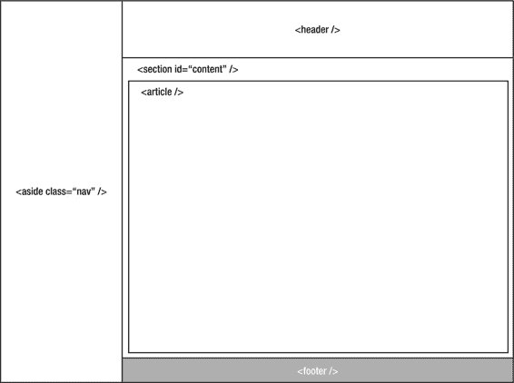

# 第 3 章：HTML5

50

**图 3-6.** *带有 <footer /> 元素的文档结构*

```html
<header />
```

## Header 元素

`<header />` 元素可以用于在文档中创建页头。`<header />` 标签在文档中可以使用多次。它通常包含一个 Logo 和/或一组页头元素。`<header />` 元素最常见的用途是在页面顶部添加 Logo 和导航。列表 3-11 显示了如何操作。

虽然不是强制性的，但你可以用 `<nav />` 元素包裹通常用于导航的 `<ul />` 元素。这会让阅读你代码的开发者清楚地这是一个导航元素。

**列表 3-11.** *在 HTML5 文档中创建页头*

```html
<header>

<nav>
<h2>CHAPTER 3: HTML5</h2>
51
<ul>
<li><a href="/home.html">首页</a>/</li>
<li><a href="/about.html">关于我们</a>/</li>
<li><a href="/contact.html">联系我们</a>/</li>
</ul>
</nav>
</header>
```

使用列表 3-12 中的代码在 HTML4 中实现相同的结果。

**列表 3-12.** *在 HTML4 中创建页头*

```html
<div id="header ">

<ul class="navigation">
<li><a href="/home.html">首页</a>/</li>
<li><a href="/about.html">关于我们</a>/</li>
<li><a href="/contact.html">联系我们</a>/</li>
</ul>
</div>
<hgroup />
```

## Hgroup 元素

`<hgroup />` 元素可以将相关的标题分组在一起，例如用于标题的 `<h1 />` 元素和用于副标题的 `<h2 />` 元素。<hgroup />` 元素不应包含头部元素以外的任何元素（即 `<h1 />`、`<h2 />`、`<h3 />`、`<h4 />` 等）。

`<hgroup />` 在文档中的级别由该 `<hgroup />` 中排名头部元素定义。

列表 3-13 显示了如何在 HTML5 中使用 `<hgroup />`，列表 3-14 显示你可能如何在 HTML4 中对标题分组。

# 第 3 章：HTML5

52

**列表 3-13.** *使用 Hgroup 在 HTML5 中定义页头*

```html
<hgroup>
<h1>我的页头</h1>
<h2>我的副标题</h2>
</hgroup>
```

**列表 3-14.** *在 HTML4 中定义一组页头*

```html
<div class="header-grouping">
<h1>我的页头</h1>
<h2>我的副标题</h2>
</div>
<mark />
```

## Mark 元素

`<mark />` 元素可以用于突出文档中的文本。列表 3-15 显示了如何在 HTML5 中使用它，列表 3-16 显示了在 HTML4 中如何结合 CSS 和 HTML 实现它。

**列表 3-15.** *在 HTML5 中使用 Mark 标签*

```html
<p>这是给 Inga Lyon 的一个 <mark>重要</mark>提醒</p>
```

**列表 3-16.** *在 HTML4 中高亮文本*

```html
<p>这是给 Inga Lyon 的一个 <em class="highlight">重要</em>提醒</p>
<style type="text/css">
em.highlight {
background: yellow;
}
</style>
```

## Nav 元素

`<nav />` 元素可以定义页面内的导航链接。`<nav />` 元素应该只用于定义页面主要导航元素，例如主导航或侧边/子导航。你可以在 `<nav />` 元素中添加任何内容，只要它包含指向网站内部内容的链接。列表 3-17 显示了如何在 HTML5 中使用 `<nav />` 元素，列表 3-18 显示你可能如何在 HTML4 中定义导航。

**列表 3-17.** *在 HTML5 中创建 Nav*

```html
<nav>
<ul>
<li><a href="/home.html">首页</a>/</li>
<li><a href="/about.html">关于我们</a>/</li>
<li><a href="/contact.html">联系我们</a>/</li>
</ul>
</nav>
```

**列表 3-18.** *在 HTML4 中创建导航*

```html
<ul class="navigation">
<li><a href="/home.html">首页</a>/</li>
<li><a href="/about.html">关于我们</a>/</li>
<li><a href="/contact.html">联系我们</a>/</li>
</ul>
```

## Output 元素

`<output />` 元素可以显示计算结果。`<output />` 元素在显示表单结果时非常有用。**注意：**提交 `<output />` 标签不会发送计算结果。列表 3-19 显示了如何在 HTML5 中使用 `<output />` 元素，列表 3-20 显示你可能如何在 HTML4 中实现。

**列表 3-19.** *在 HTML5 中使用 Output 元素*

```html
<output for="calc">结果</output>
```

**列表 3-20.** *创建类似 Output 的*

```html
<span id="result">结果</span>
```

# 第 3 章：HTML5

53 到 57

## Section 元素

`<section />` 元素可以定义文档中的章节。一个误解是用 `<section />` 替换所有的 `<div>` 元素。如果你使用 `<section />` 是为了样式而不是创建语义文档，你应该使用带有类的 `<div>`。

从列表 3-21 可以看出，你可以在 `<section />` 元素中嵌套 `<article>` 元素。实际上，你可以在 `<section />` 中添加任何喜欢的 HTML 元素。

**列表 3-21.** *在 HTML5 中使用 Section 元素*

```html
<section>
<article>
<header>
<h1>文章标题</h1>
<p>
<h2>第 3 章：HTML5</h2>
57
由 Daniel Carpenter 创建于 <time pubdate="2012-03-15">2012 年 3 月 15 日</time>
</p>
</header>
<p>文章内容</p>
<section class="comments">
<article id="comment-1">
<header>
<p>
来自 Becci，于 <time pubdate="2012-03-20">2012 年 3 月 20 日</time>
</p>
</header>
<p>这是一篇很棒的文章，Dan，可能需要改进一下 :D</p>
</article>
</section>
<footer>
<address>
<p>
作者：<a rel="author" href="mailto:daniel.carpenter@somewhere.com">Daniel Carpenter</a>
<br />
在 Twitter 上关注他
<a rel="author" href="http://www.twitter.com/mrdanc">Twitter</a>
</p>
</address>
</footer>
</article>
</section>
```

# HTML5

`<video />` 元素可用于在页面嵌入视频。我将在本章稍后的“使用 HTML5 嵌入视频”部分介绍这一内容。

`<video />` 元素提供了一种使用 Flash 在 HTML 文档中嵌入视频的替代方案。它还具有几个 JavaScript API 来控制视频的播放。在 Android 4（Ice Cream Sandwich）之前的版本的 Android 浏览器中，播放的视频会自动进入全屏，但在 Android 4 及以上版本中将保持在原位。

表 3-3 显示了 `<video />` 元素的可用属性。

**表 3-3.** *HTML5 视频属性*

| 属性 | 值 | 描述 |

| :--- | :--- | :--- |

| `src` | — | 用于指定单个视频文件，而不是使用 `<source />` 标签。 |

| `preload` | `none \| metadata \| auto` | 用于指定是否预加载视频文件。建议将其设置为 `none` 或 `metadata`。这可以防止浏览器在用户不知的情况下下载整个视频文件。 |

| `autoplay` | `autoplay` | 用于告诉浏览器自动播放视频文件。如果你不想让视频自动播放，请不要添加此元素。 |

| `loop` | `loop` | 用于指定视频是否连续循环。此属性不接受数字。如果你想音频循环特定次数，可以使用 JavaScript 视频 API 实现。 |

| `muted` | `muted` | 这将静音音频。注意，这在 Android 浏览器中似乎不受支持。 |

| `controls` | `controls` | 用于告诉浏览器是否渲染默认控件。如果你为自己的视频播放器制作了 UI，这会非常有用。 |

| `height` | `像素单位的高度` | 指定视频元素的初始高度。 |

| `width` | `像素单位的宽度` | 指定视频元素的初始宽度。 |

| `poster` | `海报图 URL` | 这是视频播放前在视频图像 `tag` 标签内使用的图像路径。 |

`<video />` 元素目前还支持大多数流行的视频容器和编码器。表 3-4 显示了 Android 浏览器目前支持的格式和 MIME 类型。如何为这些格式编码将在本章稍后介绍。

**表 3-4.** *HTML5 视频支持的格式*

| 容器 | 扩展名 | MIME | 备注 |

| :--- | :--- | :--- | :--- |

| MPEG-1 | `.mpg, .mpeg, .mpv` | `video/mpeg` | — |

| MP4 | `.mp4` | `video/mp4` | — |

| OGG | `.ogv, .ogg` | `application/ogg` | — |

| WebM | `.webm` | `video/webm` | 仅在 Android 4 (Ice Cream Sandwich) 中支持 |

| MKV | `.mkv` | `video/x-matroska` | — |

| Windows Media | `.wmv` | `video/x-ms-wmv` | — |

## 在 HTML5 中处理多媒体

随着移动设备速度不断提高，移动网络浏览器支持越来越多的视频音频容器和编码器，现在是探索为移动 Web 应用添加视频的最佳时机。

在为移动网站添加视频时，有几点是你需要考虑的。遗憾的是，这并不是为特定的文件扩展名或格式编码视频音频那么简单。在为 HTML5 编码视频音频时，有四点是你应该考虑的：

- 设备支持的容器

- 设备上支持的编码器和解码器

- 最终视频和音频的质量

- 最终视频和音频的文件大小

为了播放视频，你需要使用目标设备可以理解并播放的编码器对视频音频进行编码。

**注意：** 编码器由两部分组成：编码器和解码器。当你使用特定编码器压缩视频时，需要相同的编码器来解压视频以准备播放。不同的编码器能够实现不同类型和质量的压缩（例如，`H.264` 编码视频的方式与 `VP8` 不同）。由于压缩视频的方式不同，不同的编码器会对文件大小和质量产生影响。

编码视频的质量取决于你设置的比特率；这也会直接影响文件大小。如果你有一个目标文件大小，可以计算视频的比特率应该是多少，并从此开始工作。以下公式可以帮助你计算：

```
((video bitrate [kb/sec] + audio bitrate [kb /sec]) * length [seconds]) * 0.125) = file size [Kb]
```

网络上有各种比特率计算器，它们可以根据许多其他因素帮助你计算视频或音频文件应该是什么比特率。这在使用如 `FFmpeg` 或 `Mencoder` 等命令行编码工具时非常有用。

压缩/未解压缩的视频音频外部是一个容器。容器通常会提供关于视频多个轨道的详细信息。一条轨道将用于视频本身，第二条轨道将用于视频音频。容器并不一定描述视频或音频文件是如何编码的，但它可能会定义某种标准，规定如何为该特定容器编码视频。

在选择容器时，选择一个支持有限数量编码器的容器是重要的。这将编码变得简单得多，因为你不需要研究哪些编码器是可用的。例如，马特罗卡 (`MKV`) 容器支持几乎任何视频编码器，而 WebM 只支持 `VP8` 视频和 `Vorbis` 音频。为了避免混淆，表 3-5 显示了你应该支持的最流行的编码器和容器。

**表 3-5.** *HTML5 建议视频容器和编码器组合*

| 容器 | 编码器 | 音频编码器 | MIME |

| :--- | :--- | :--- | :--- |

| MP4 | H.264 (Baseline) | AAC | `video/mp4` |

| WebM | VP8 | Vorbis | `video/webm` |

Android 文档还根据质量建议了以下分辨率，见表 3-6。

**表 3-6.** *HTML5 建议分辨率*

| 质量 | 分辨率 | 每秒帧 (FPS) |

| :--- | :--- | :--- |

| SD (低质量) | 176 × 144px | 12 |

| SD (高质量) | 480 × 360px | 30 |

| HD (并非所有设备) | 1280 × 720px | 30 |

表 3-7 显示了安卓音频容器和编码器。

**表 3-7.** *HTML5 建议音频容器和编码器组合*

| 容器 | 编码器 | MIME |

| :--- | :--- | :--- |

| MP3 | MP3 | `audio/mpeg` |

| OGG | Vorbis | `application/ogg` |

支持这些容器和编码器应该能够满足所有 Android 设备，而无需进行大量的编码和测试。

## 为移动 Web 优化视频

现在你已经了解为 Web 编码视频的复杂性。有很多应用程序允许你为 Web 编码视频。其中一些是免费开源的桌面应用程序（例如适用于 Mac/Windows 的 `Easy HTML5 Video` 以及新的适用于 Mac/Windows 的 `Miro Video Encoder`），另一些是托管的基于 Web 的解决方案，并提供在线托管视频的支持。你应该使用最适合你需求的编码解决方案。

### 托管解决方案

托管解决方案对于按需编码，以及如果你希望将大量网站流量转移到另一个服务器来说是完美的。这些托管解决方案中最简单用的是 `bitsontherun.com`，虽然

`encoding.com` 和 `zencoder.com` 提供了更多关于视频编码的控制，如图 3-7 所示。

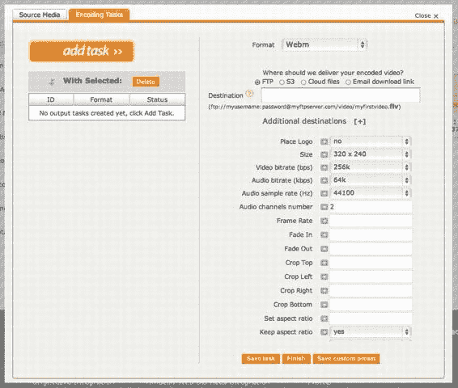

# 第 3 章：HTML5

62

**图 3-7.** *encoding.com 上的编码选项*

如你所示，`bitsontherun.com` 通过提供基本选项来创建编码设置要简单得多，如图 3-8 所示。如果你想对视频的压缩选项有更多的控制权，那么 `encoding.com` 和 `zencoder.com` 将提供最佳选项。如果你只是想编码视频而不担心各种压缩选项，那么 `bitsontherun.com` 是最佳选择。如果你没有非常强大的机器并想要快速编码视频，或者你有大量的视频需要编码，那么托管式编码解决方案将提供最佳方案。托管解决方案中提供的预设也在不断地完善和调优。

使用托管解决方案的缺点是，你需要根据上传和下载的量付费，在 `zencoder.com` 的情况下，你根据编码的视频小时数付费。

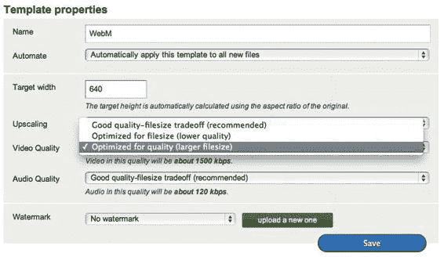

第 3 章：HTML5

63

**图 3-8.** *bitsontherun.com 上的编码选项*

### 桌面解决方案

桌面编码解决方案非常适合小规模的编码运行。如果你有一台低配置电脑，请准备去最近的酒吧喝两瓶啤酒，同时在电脑旁边开个风扇防止它过热！

视频编码需要大量的处理能力，渲染单帧可能需要几秒钟。这个过程非常耗时。你电脑的处理器越好，编码时间就越短。

使用命令行工具（如 `FFMPEG` 和 `Mencoder`）而不是提供界面的 GUI 会有其优势。例如，它让你能够从一个用 `Python`、`PHP` 或 `Ruby` 编写的服务器端脚本触发编码任务。你还可以将各种编码参数封装在 `bash` 脚本中。这允许你可能一次性批量编码整个装满视频的文件夹。

Windows 和 Mac 上最简单的免费桌面解决方案是 `Miro Video Converter`，如图 3-9 所示。

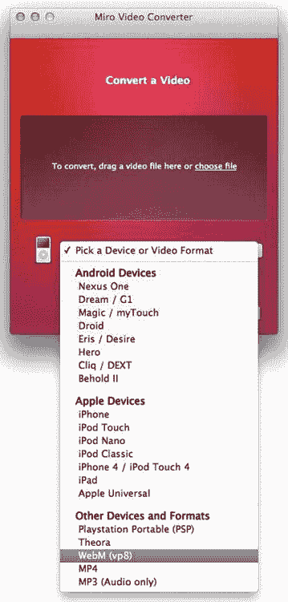

第 3 章：HTML5

64

**图 3-9.** *Mac 版 Miro Video Converter*

如你所见，它有一个简单的拖放式 UI，并可以转换为多种不同的格式。为基于桌的 HTML5 网站编码视频时，`Miro` 是完美的；然而，你可能希望在不损害质量的情况下，尽可能为移动网页视频挤榨出更多空间。目前，`Miro` 不允许你调整任何输出设置。

正因如此，目前的最佳选项是使用 `bitsontherun.com` 为移动网页编码视频。

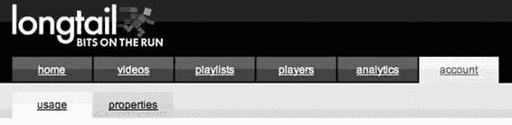

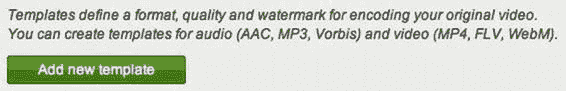

第 3 章：HTML5

65

### 使用 Bits on the Run 编码视频

首先要做的是访问 `www.bitsontherun.com` 并创建一个免费账户。免费账户每月将为你提供高达 1 小时的视频存储空间和 20 小时的流媒体时间。这对于这本书来说足够了。如果你需要更多，可以随时升级到专业账户。

创建账户后，你将为你的编码任务创建模板。模板允许你为视频和音频创建自定义的编码模板。你可以创建一个模板，并将其用于所有的视频和音频文件。

**注意：** 遗憾的是，如果你创建了模板，必须手动使用新模板重新编码任何视频。有一种通过 `Bits on the Run API` 规避这个问题的方法。

登录并进入账户页面，如图 3-10 所示。

**图 3-10.** *bitsontherun.com 上的账户选项*

点击账户页面上的 `properties` 选项卡（同样如图 3-10 所示）。在账户属性下，点击 `Templates` 选项卡。

从这里，你将创建两个模板。一个用于 `MP4 (H.264)`，另一个用于 `WebM (VP8)`。

点击“Add new template”（添加新模板）按钮，你可以在页面底部找到它，如图 3-11 所示。

**图 3-11.** “添加新模板”按钮

h

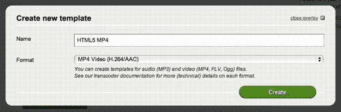

第 3 章：HTML5

66

随后你将看到一个与图 3-12 所示类似的“Create new template”（创建新模板）对话框。确保已设置以下设置：

- Name: `HTML5 MP4`

- Format: `MP4 (H.264/AAC)`

点击。

**图 3-12.** “创建新模板”对话框

类似于图 3-13 所示的“properties”页面将呈现在你面前。确保设置了以下选项：

- Automate: Automatically apply this template to new videos

- Target Width: `480`

- Upscaling: Always build this template, even if the original is smaller

- Video Quality: Good

- Audio Quality: Good

- Watermark: No

点击 `Save`（保存）。

你将需要为 `WebM` 重复此过程。在“Create new template”对话框中输入以下信息：

- Name: `HTML5 WebM`

- Format: `WebM (VP8/Vorbis)`

在“properties”页面上输入以下信息：

- Automate: Automatically apply this template to new videos

- Target Width: `480`

- Upscaling: Always build this template, even if the original is smaller

- Video Quality: Good

- Audio Quality: Good

- Watermark: No

点击 `Save`。

你现在应该准备好向账户上传视频了。为了完成操作，进入 `videos` 选项卡，并点击右侧栏的“Upload video”，如图 3-10 所示。

**图 3-13.** *属性*

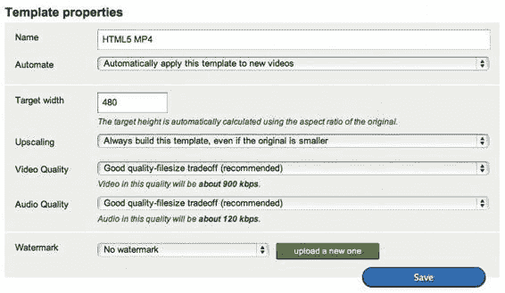

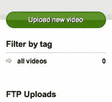

第 3 章：HTML5

67

你将看到一个与图 3-14 所示类似的“Upload video: Step 1”对话框。

**图 3-14.** “上传视频：第一步”对话框

在字段中输入适当的信息。由于这是测试视频，你可以选择任何内容。从现在开始，“My Video”指的是你上传的视频。点击“Continue to upload”按钮。

你现在应该处于“Upload video”对话框的第 2 步。点击 `Browse` 按钮，如图 3-15 所示选择你想要作为示例的视频。确保选择的视频小于 100 MB；否则你可能需要等待很长时间才能完成测试视频的上传。

**图 3-15.** “上传视频：第二步”对话框

上传完成后，Bits on the Run 将开始编码过程。你的视频现在已准备好嵌入。你可以下载视频并将其复制到你的移动网页项目中，或者使用 `<video />` 元素的 `src` 属性直接链接。下载视频的好处是，你不需要担心 Bits on the Run 在你达到限额时中断服务。

### 使用 HTML5 嵌入视频

在网页上嵌入视频曾是一个非常漫的过程。在 Flash 流行之前，所有的浏览器、电脑甚至同一操作系统的不同版本对编码器和容器的支持各不相同。当时没有真正的通用格式，你无法嵌入同一个视频的多种格式以便浏览器能够为用户选择正确的视频。

Flash 的出现解决了大部分这些问题。通过只需要一个插件就能播放所有格式，它成为了网络视频领域的“闪光骑士”。以至于几乎每个网站都使用它来向用户提供视频。

后来智能手机的出现让移动端 Flash 变成了一场噩梦。它需要大量的 CPU，这会消耗手机电池。

就像吸血鬼一样。Flash 在几乎任何便携设备上的情况也是如此，它会消耗大量的 CPU 资源，这不仅影响了机器的性能，还会影响由于 CPU 散热和供电带来的电池消耗。时至今日，Flash 在 Mac 上仍然消耗大量的 CPU 资源。

此外，开发者在制作 Flash 内容时，往往并没有考虑手机终端。因此，当你在手机上观看针对桌面设备设计的视频时，你通常会得到一个 500 MB 的高清视频，而该视频并没有针对你的手机进行优化。这对于用户的钱包也有影响，因为每月 500 MB 的流量计划在几分钟内就会被一个视频耗尽。

`HTML5` 诞生了。终于，焦点转向了浏览器、标准和硬件加速，而不再需要第三方插件。

HTML5 带来了 HTML5 视频。HTML5 视频为浏览器提供在浏览器内支持视频解码的方法，无论平台支持何种解码器。这意味着，如果用户使用 Android 浏览器，他们将绝对支持 `WebM` 或 `MP4`；如果他们使用 Safari 浏览器，他们将绝对支持 `MP4` 但不支持 `WebM`。不仅如此，HTML5 视频还支持多种不同类型的视频源。这意味着你可以提供针对每个解码器和容器优化的视频文件。浏览器将从源列表中选择最佳解码器和容器，对其进行流式传输，并交付给用户的浏览器。

# 第 3 章：HTML5

HTML5 规范的新特性还包括在视频源中支持媒体查询（media queries）。这可以确保如果你使用平板电脑设备，你可以获得分辨率更高的视频，而无需手动选择想要查看的媒体画质。如果你使用的是手机终端，你将获得针对手机优化且文件大小较小的视频，这样它就不会耗尽你所有的流量额度。

**注意：** HTML5 规范中确实存在视频媒体查询，但目前似乎还没有任何浏览器支持它。

在 HTML5 中嵌入视频相对简单。你使用 `video` 标签并指指定视频的 `width` 和 `height` 属性。然后，你可以为视频指定 `poster`（海报）帧。封面帧是视频中的单幅静态图像，你可以在用户点击播放按钮之前将其显示给他们。

在 Aptana 中创建一个名为 `tutorials` 的新文件夹，并在其中创建一个名为 `video` 的文件夹。此文件夹将用于本次练习。在 `video` 文件夹中，创建一个 `media` 文件夹。将你从 Bits on Run 编码并下载的视频和封面图像文件拷贝到 `media` 文件夹，并将其重命名如下：

- `video.webm`

- `video.mp4`

- `poster.jpg`

在 `video` 文件夹中创建一个名为 `index.html` 的新文件。你的文件夹结构应该如下：

- `tutorials`

- `video`

- `media`

    - `video.webm`

    - `video.mp4`

    - `poster.jpg`

- `index.html`

在 Aptana 中打开 `index.html` 并输入列表 3-23 中的 HTML 代码。

**列表 3-23。** *在 HTML5 中嵌入视频*

```html
<!DOCTYPE html>
<html>
<head>
<meta charset="utf-8">
<meta name="viewport" content="width=device-width, initial-scale=1, maximum-scale=1">
<title>练习视频</title>
</head>
<body>
<video controls width="480" height="270" poster="media/poster.jpg">
<source src="media/video.mp4" type="video/mp4">
<source src="media/video.webm" type="video/webm">
<p>
您的浏览器不支持 HTML5 视频，<a href="media/video.mkv">点击此处下载</a>
</p>
</video>
</body>
</html>
```


保存并导出你的视频。在 Android 浏览器中打开该文件。URL 应该是 `http://<你的电脑 IP 地址>/tutorials/video/media/`。你应该看到一个与图 3-17 类似的屏幕。

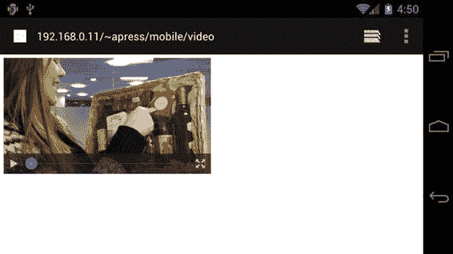

**图 3-17。** *与内容内联的 HTML5 视频*

点击播放按钮，视频将开始缓冲并播放。从 Android 4+ 开始，Android 浏览器将内联内容播放视频，而不是自动全屏。这带来了一个小问题，因为它导致新旧设备处理视频的方式不一致。解决方案是使用 JavaScript  API 自动将视频全屏。这将在第 7 章中介绍。

## 为移动 Web 优化音频

幸运的是，Bits on Run 也支持网页的音频编码和托管。然而，由于音频编码的 CPU 消耗远低于视频编码，你可以使用桌面软件来完成。最流行的免费跨平台音频应用程序是 `Audacity`。你可以从 Audacity 网站 `http://audacity.sourceforge.net/download/` 下载并安装当前的稳定 Beta 版本。

为移动 Web 编码音频时适用相同的规则：

- 确保文件大小很小。

- 确保最终音频的质量足以通过耳机和小型扬声器听到。

与视频编码一样，你需要在质量和文件大小之间找到平衡点。与用户必须同时关注质量和文件大小的视频不同，音频用户主要是在听音频，因此音频质量至关重要。这意味着必须更加小心地确保每个轨道都经过转码和压缩。

**注意：** 压缩有两种类型：无损（lossless）和有损（lossy）。无损压缩尝试以这种方式编码音频使其编码后具有更小的文件尺寸，但在解码时与之前相同。有损压缩将分析音频内容并移除可能听不到的部分。这意味着无论使用何种技术，有损压缩都会丢失信息。

### 使用 Audacity 编码音频

使用 `Audacity` 编码音频是一个非常简单的过程。为了本示例，你需要下载一个未压缩的音频文件，因此前往 SoundCloud (`www.soundcloud.com`)。在 SoundCloud 上搜索你喜欢的任何音乐轨道，并确保如图 3-18 所示选择以下选项：

- 未压缩文件

- 轨道应为：可下载

- 仅搜索 Creative Commons 许可的轨道

- 它们应该是：可商用

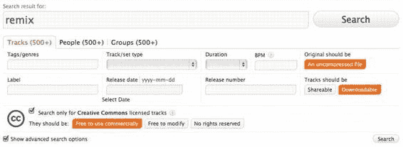

**图 3-18。** *soundcloud.com 搜索选项*

选择任何具有高范围的歌曲（dubstep 类的歌曲是一个很好的选择）并下载它。这将给你一个可以实验的未压缩 WAV 或 AIFF 文件。

我们对这段音乐轨道的目标是将其每分钟音频的文件大小控制在 0.5 MB 到 1 MB 之间。这意味着在 HSDPA 上加载 1 分钟音频需要 4--8 秒，在 3G 上需要 1---2 秒。

**表 3-8。音频平均下载时间**

| 连接类型 | 平均下载速度 | 平均下载时间（每 MB） |

| :--- | :--- | :--- |

| 3G | 4 Mbps | 2 秒 |

| HSDPA | 1 Mbps | 8 秒 |

本书使用的示例轨道是一个 `WAV` 文件，其设置如下：大小 86.1 MB，时长 4:59，平均每分钟 18.75 MB。该轨道在每种格式下的目标文件大小将在 4 到 5 MB 之间。

## 编码 OGG

你将首先把音频文件编码为 `OGG` 格式。这是两种格式中较简单的，因为 Audacity 仅提供了一个选项进行配置。打开 Audacity，通过 `File -> Open` 打开文件并选择你刚刚下载的文件。如果显示图 3-19 所示的警告，请确保勾选了“编辑前创建文件的副本（更安全）”和“不再再次询问并始终使用我的上方选择”。

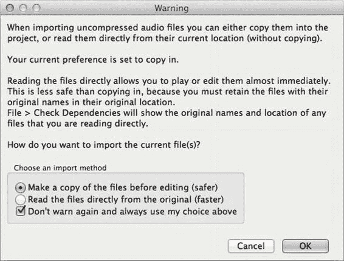

# 第 3 章：HTML5

75

**图 3-19. Audacity 的警告对话框**

当文件处理完成后，你将看到该文件的波形图，类似于图 3-20。

你现在可以将音频文件导出为 `OGG Vorbis` 音频文件。转到 `File -> Export`。在格式下，选择“Ogg Vorbis Files”，并点击选择右侧的“Options…”按钮。

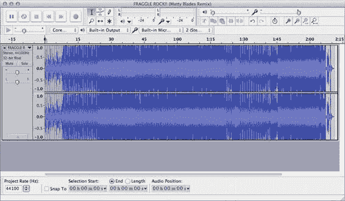

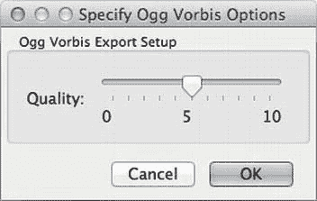

# 第 3 章：HTML5

76

**图 3-20 轨道的波形**

你将看到一个类似于图 3-21 的选项对话框。选择最低质量并点击 OK。Vorbis 是可变比特率（VBR）编码的一种。VBR 会根据每个段音频的复杂性在整个轨道中使用不同的比特率。与以固定比特率编码（质量相同由于音频复杂性导致文件大小大得多）的文件相比，这种方法可能会产生一个质量合理的非常小的文件。

**图 3-21. Ogg Vorbis 导出选项**

这种编码的结果应该是一个音频轨道，听起来与原始 `WAV` 文件相似，但文件大小小于 3 MB。本书使用的测试轨道在 `OGG` 最低质量设置下编码时，结果文件大小为 2.5 MB，音质没有明显差异。

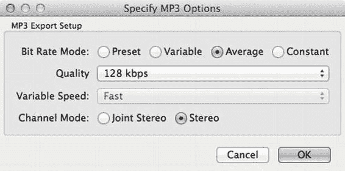

# 第 3 章：HTML5

77

## 编码 MP3

编码 `MP3` 音频的过程与导出 Vorbis 音频类似。按照相同的步骤打开原始 `WAV` 文件，并到 `File -> Export`。在格式下拉菜单中选择 `MP3 Files`（而不是 `Ogg Vorbis Files`）。点击 `Options…` 按钮。你将看到一个与图 3-22 类似的导出对话框。

`MP3 VBR` 编码的效果似乎没有 `OGG Vorbis` 好。即使在最高压缩设置下，音频文件的大小仍然 `OGG Vorbis` 压缩输出的两倍。使用 128 kbps 的平均比特率模式将为你提供与最低 `OGG Vorbis` 压缩选项相同或相似的质量，但文件大小更大，且仍处于每分钟音频 0.5 到 1 MB 可接受的文件大小范围内。

**图 3-22. MP3 导出选项**

点击 OK 并保存。如果你想在下一个屏幕输入元数据，请继续输入；否则，再次点击 OK，音频文件将开始导出。

## 在 HTML5 中嵌入音频

使用 HTML5 嵌入音频非常简单。在 HTML5 之前，没有真正的标准方法来嵌入具有不同解码器的音频，尤其是在移动端。在移动端，首选方法是使用 Flash 或提供指向 `3GP` 文件的链接，这种格式被移动设备广泛支持。随着在移动设备上传输和播放高质量音乐的能力变得流行，`audio` 标签将开始被广泛使用。

在 HTML5 中嵌入音频的过程与嵌入视频类似。你使用 `audio` 标签并指定多个源，让浏览器选择正确的源。

# 第 3 章：HTML5

78

在 `tutorials` 文件夹创建一个名为 `audio` 的新文件夹，然后在 `audio` 文件夹中创建一个名为 `media` 的新文件夹，并创建一个名为 `index.html` 的新文件。将转换后的音频文件复制到 `media` 文件夹并将它们重命名为 `audio.ogg` 和 `audio.mpg`。你的你的文件夹结构看起来如下：

- tutorials

- audio

    - media

        - audio.mp3

        - audio.ogg

    - index.html

打开 `index.html` 文件并使用列表 3-24 中的代码。

**列表 3-24. 在 HTML5 中嵌入音频**

```html
<!DOCTYPE html>
<html>
<head>
<meta charset="utf-8">
<meta name="viewport" content="width=device-width, initial-scale=1, maximum-scale=1">
<title>Testing Audio</title>
</head>
<body>
<audio controls>
<source src="media/audio.ogg" type="application/ogg">
<source src="media/audio.mp3" type="audio/mpeg">
<p>
您的浏览器不支持 HTML5 音频，<a href="media/audio.mp3">点击此处</a>
</p>
</audio>
</body>
```

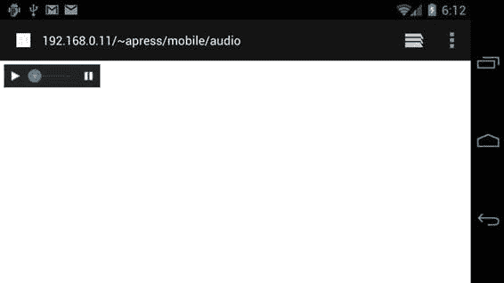

# 第 3 章：HTML5

79

```html
</body>
```


# 第 3 章：HTML5

79

**图 3-23. HTML5 中的音频**

## HTML5 移动端

表单可能是很枯燥的话题，但请记住 HTML5 将在第 7 章介绍。处理表单需要考虑屏幕大小对标签和字段的影响。图 3-24 显示了移动端和桌面端的差异。

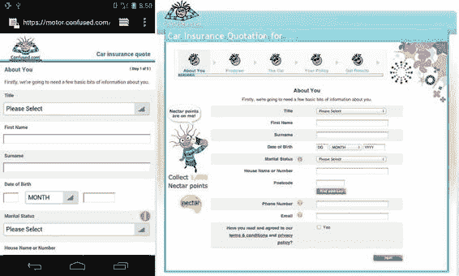

# 第 3 章：HTML5

80

**图 3-24. 移动端（左）和桌面端（右）表单**

## 不同类型的字段

根据所需的字段类型和数据，可以使用不同的输入类型。表 3-9 显示 HTML5 字段类型在 Android 浏览器中的支持情况。

| 字段类型 | 支持 |

| :--- | :--- |

| color | no |

| datalist | no |

| date | no |

| datetime | no |

| email | yes |

| number | yes |

| range | no |

| search | no |

| tel | yes |

| url | no |

**表 3-9. Android 浏览器支持的字段类型**

# 第 3 章：HTML5

81

所示，Android 浏览器目前支持的字段类型只有 `email`、`number` 和 `tel`。其他字段类型应该在未来的某个时刻实现。你可以现在实现它们并绕过不支持的问题，但在支持最终到来后可能会遇到问题。

你可以通过在设备上测试这一点，在你的项目内创建一个名为 `forms` 的新文件夹。在该文件夹内创建一个名为 `index.html` 的文件。列表 3-25 显示了产生三种不同输入表单类型的代码。

**列表 3-25. 输入类型代码**

```html
<!DOCTYPE html>
<html
<head>
<meta charset="utf-8">
<title>Form Fields</title>
</head>
<body>
<form>
<fieldset>
<legend>HTML5 输入类型</legend>
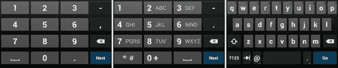
<p>
<label for="email">Email</label>
<input type="email" name="email" placeholder="someone@somewhere.com">
</p>
<p>
<label for="number">Number</label>
<input type="number" name="number">
</p>
<p>
<label for="telephone">Telephone</label>
<input type="tel" name="telephone" placeholder="+44012345678901">
</p>
</fieldset>
</form>
</body>
</html>
```

# 第 3 章：HTML5

这是一个标准的 HTML5 表单。你可能会注意到，某些字段上有一个名为 `placeholder` 的属性。`placeholder` 属性允许你为表单输入显示实用的示例文本，帮助用户确定他们需要在表单字段中输入什么。当用户点击以填充表单字段时，`placeholder` 文本将会消失。

根据输入类型的不同，系统会呈现不同的键盘，帮助用户更快地输入信息。图 3-25 显示了用于支持的三种输入类型的不同键盘布局。

**图 3-25。** 数字（左）、电话（中）和电子邮件（右）的键盘布局。在你的手机浏览器中加载新网页进行测试。

## 总结

到此，Android 的 HTML5 学习宣告结束。通过本章，你应该已经获得了许多关于为网页和移动网络编码视频和音频的知识。你现在应该对编码媒体的不同方式有了基本的了解，并且知道你并不需要一台强大的机器来编码媒体，只需要一个快速的互联网连接即可。

本章带你学习了 Android 浏览器目前支持的所有新 HTML5 元素以及如何有效地使用它们。希望这一章能为你书中后续的内容做好准备，因为我们将开始更详细地探索交互性。HTML 本身提供了基础，我们在书中后续将使用 CSS 进行展示，使用 JavaScript 进行交互，并在基础上进行构建。

在下一章中，你将通过创建 HTML 框架来关注移动 Web 应用的开端。在本书中，你将学习移动 Web 开发的一个特定方面，并使用这些知识来构建和增强你的应用程序。这被称为渐进增强（progressive enhancement），是 Web 开发采用的一种实践，以确保你的应用程序无论功能如何都能在所有平台上运行。

你还将学习移动 Web 的三种不同的展示解决方案，包括为应用程序的每个页面使用标准 HTML 页面、使用所有页面都位于单个 HTML 文件中的 `<div />` 容器的卡片系统，以及使用 Ajax 加载每个页面。

下一章非常实用，所以打开 Aptana Studio 准备好编写代码吧！

# 第 4 章：启动你的项目

## 使用 HTML5

HTML 为任何网络项目提供了一个良好的起点。它本质上为你提供了一个骨架，以便你使用 CSS（视觉样式）和 JavaScript（交互性）增强网页。对于书中的三个工作坊（HTML5、CSS 和 JavaScript），你将逐步增强一个名为 `MoMemo` 的移动 Web 应用。`MoMemo` 将利用以下 HTML/HTML5 特性：

* Canvas

* JavaScript APIs

* CSS3 过渡

* 媒体查询

* HTML5 视频/音频

* 离线存储

在本章中，你将学习三种不同的网页布局方法，取决于你正在制作的移动 Web 应用类型。你还将开始在 HTML 中为 `MoMemo` 应用创建框架。在此之前，你将学习如何将移动应用从想法、需求收集、信息架构（IA），最后在 HTML5 中进行编码。你还将简要介绍应用程序缓存，该功能允许你指定哪些元素缓存在用户的移动设备上，以及在没有网络连接时如何退回到不应缓存的文件。

## 分页策略

在 HTML 中创建页面的三种主要方法：

* 标准 HTML：创建标准的 HTML 页面并链接到它们

* 单页 Ajax：使用单个页面并使用 AJAX 加载后续页面

* 单页容器：使用单个页面作为容器，将多个页面放在 `<div />` 容器中，并使用 JavaScript 在之间切换

每种方法都有其优缺点。例如，一个具有许多页面和资源（图像、CSS、JavaScript）的移动 Web 应用在使用单页容器方法时可能会遇到性能问题，因为所有资源和页面都会在首次加载页面时被加载。因此，Ajax 或标准 HTML 方法可能提供更好的性能和加载速度。

对于小型应用程序和原型设计，单页容器方法可能是首选。CSS3/JavaScript 可以处理页面之间的动画过渡，而且由于资源数量可能很小，它对页面加载不会产生很大影响。这可能是更优的，因为终端用户不需要等待通过 Ajax 或标标准 HTML 方法加载页面。这创建了更像 App 的体验。

对于更简单的应用程序，标准 HTML 方法可能是首选。然而，页面之间的动画可能变得不切实际，而且在页面间进行导航时，页面和资源的加载会有短暂的等待时间。

**注意：** 为了完成本章的练习，请在你的 Aptana 项目中创建一个名为 `exercises` 的新文件夹，并在其中创建一个名为 `chapter4` 的文件夹。我们将在示例中将其称为“章节文件夹”。

### 使用标准 HTML 进行分页

创建标准 HTML 分页的方法非常简单。首先，在项目中的 `chapter folder` 中创建一个名为 `standard` 的新文件夹，并创建两个基础的移动友好网页，命名为 `index.html` 和 `index2.html`，如列表 4-1 所示。

**列表 4-1。** 基础 HTML 移动网页

```html
<!DOCTYPE html>
<html lang="en-GB" dir="ltr">
<head>
<meta charset="UTF-8" />
<meta name="viewport" content="width=device-width; initial-scale=1.0; maximum-scale=1.0; user-scalable=0; target-densitydpi=device-dpi;"/>
<title>Standard Paging</title>
</head>
<body>
</body>
</html>
```

这里没什么特别的，正如第 1 章解释的那样，我们设置了 `charset` 和 `viewport` 标记以确保页面能够相应比例并防止用户用手指缩放。我们还为了起见设置了页面标题。在 `index.html` 的主体创建一个链接和标题，如列表 4-2 所示。

**列表 4-2。** 在 index.html 中创建链接

```html
<h1>Page 1</h1>
<a href="./index2.html">Page 2</a>
```

在 `index2.html` 的主体中创建另一个返回上一个页面的链接，如列表 4-3 所示。

**列表 4-3。** 在 index2.html 中返回 index.html

```html
<h1>Page 2</h1>
<a href="./index.html">Page 1</a>
```

在你的手机浏览器中加载并测试。就是如此。链接到其他 HTML 页面并没有特别之处。

### 使用单页 Ajax 进行分页

使用单页 Ajax 创建移动应用需要更多的思考和努力。Ajax 允许从用户所在的当前网页之外的文件或页面中动态拉取内容。这可以使应用程序更具扩展性，因为你不需要将多个页面放在单个页面中。相反，你可以在需要时拉取它们。这样做的好处是当用户移动页面时可以使用 CSS3 应用动画。列表 4-4 显示了通过 Ajax 加载 HTML 页面的基础知识。

**列表 4-4。** 使用 Ajax 加载 HTML

```html
<div id="container">
<div id="card">
<h1>Page 1</h1>
<a href="index2.html" data-method="xhr">Page 2</a>
</div>
</div>

<script>
/**
* 此方法将绑定 ID 为 container 的 div 内部的所有链接。
* 查询器还将匹配那些具有 data-method 属性且值为 xhr 的链接。
* 即：<a href="index2.html" data-method="xhr">Page 2</a>
 */
function bindLinks(){

/**
* 这将在查询选择器的上下文中调用 forEach。
* 如果你熟悉 jQuery，它等同于
```

```javascript
$('#container a[data-method="xhr"]).each(...);
*/

[].forEach.call(document.querySelectorAll('#container a[data-method="xhr"]'), function(el){
  /**
   * 对于每一个匹配的元素，此匿名方法都将被
   * 调用。forEach 方法的回调接受返回的
   * 对象作为参数。在这种情况下，它将是当前
   * 赋值给 el 的匹配元素。
   */
  /**
   * 在这里你为对象添加一个事件监听器。有
   * 几个触摸事件监听器，如 touchend、touchcancel 
   * 和 touchstart，它们在第 5 章中都得到了解释。
   */
  el.addEventListener("touchend", function requestCard(event){
    /**
     * 这调用 loadCard 方法，并将目标
     * 链接位置作为参数（index2.html）。
     */
    loadCard(event.target.href);
    /**
     * 这可以防止链接的原始路径被
     * 浏览器处理。
     */
    event.preventDefault();
  });
});
}

/**
 * 此方法将根据通过路径参数传递的
 * 路径，从牌组中动态加载一个卡片。
 */
function loadCard(path){
  /**
   * 这创建了一个新的 XMLHttpRequest 请求。这
   * 将用于使用 JavaScript 动态拉取 HTML 。
   */
  var xhr = new XMLHttpRequest();
  /**
   * 创建一个 GET 请求（可以是 POST 或 GET）。POST
   * 请求用于发送大量数据；GET 请求应被
   * 用于使用基于参数的 URI 从服务器获取信息。
   * 第三个参数将请请求设置为异步。
   * 将其设置为 false 或不包含它将阻塞 UI 
   * 并阻止用户与应用程交互。这不会 
   * 立即发送请求。你必须调用 xhr.send()。
   */
  xhr.open("GET", path, true);
  /**
   * 这为请求状态改变时设置回调。
   * 状态可以通过 this.readyState 确定。在
   * 此实例中，它是 event。不同的状态为：
   *
   * DONE – 请请求完成
   * LOADING – 请求加载中
   * HEADERS_RECIEVED – 头部已加载但请求体未加载
   * OPENED – open 方法已被调用
   * UNSENT – XMLHttpRequest 对象已实例化
   *
   * 你可以使用 switch 语句为每个 readyState
   * 创建条件。
   */
  xhr.onreadystatechange = function contentLoaded(){
    /** 在这里你检查请求状态 **/
    if (this.readyState === this.DONE) {
      /**
       * 在这里你选择将被
       * 填充新内容的容器元素。
       */
      var container = document.querySelector("#container");
      /**
       * 这将检查响应状态，200 表示 OK。
       * 你可以在此处找到各种 HTTP 状态码：
       * [`www.w3.org/Protocols/HTTP/HTRESP.html`](http://www.w3.org/Protocols/HTTP/HTRESP.html)
       */
      if (this.status === 200) {
        /**
         * 在这里你创建一个 DOMParser 对象，它
         * 将解析返回的 HTML 以便对其
         * 进行遍历。
         */
        var domParser = new DOMParser(),
        /**
         * 目前，通过 XMLHttpRequest 获取的 HTML
         * 返回为字符串。为了将其转换为
         * 可遍历的 DOM 文档，需要对其
         * 进行转换。
         */
        externalDocument = domParser.parseFromString(this.responseText, 'text/html'),
        /**
         * 下一步工作是从 parseFromString
         * 返回的 DOM 文档中选择卡片。
         * DOMParser 允许使用 DOM 方法
         * 遍历任何由 XMLHttpRequest
         * 返回的 HTML。
         */
        card = externalDocument.querySelector("#card").outerHTML;
        /**
         * 接下来只需调用 setCardContent
         * 方法，它在下方定义，并将卡片
         * 中的 HTML 以字符串的形式传入。
         */
        setCardContent(card);
        /**
         * 最后，你重新绑定所有链接，以便
         * 任何新的内容链接都绑定
         * XMLHttpRequest 调用。
         */
        bindLinks();
      } else {
        /**
         * 如果请求失败，你只需设置 div
         * 的内容以显示错误消息。
         */
        setCardContent('<div id="card"><h1>Oops</h1><p>Something went wrong!</p></div>');
      }
    }
  }
  /**
   * 最后，发送请求。随着请求状态的改变，
   * 回调方法将被调用。
   */
  xhr.send();
}

/**
 * 这将容器的内容设置为请求的 HTML
 * 文件中的卡片。POSH 仅仅是 Plain Old Semantic HTML（纯语义 HTML）的缩写。
 */
function setCardContent(posh){
  container.innerHTML = posh;
}

/**
 * 最后，你调用 bindLinks()，它将绑定当前
 * 在页面上的链接。
 */
bindLinks();
/**
 * 遗憾的是，某些 Android 浏览器不支持 DOMParser 的 text/html
 * 类型。下方的方法通过原型支持
 * text/html 类型。
 */
/*
 * DOMParser extension
 * 2012-02
 * Public domain.
 * NO WARRANTY EXPRESSED.
 * USE AT YOUR OWN RISK.
 */
(function(DOMParser) {
  "use strict";
  var DOMParser_proto = DOMParser.prototype;
  real_parseFromString = DOMParser_proto.parseFromString;

  try {
    // Firefox/IE 对不支持的类型抛出错误
    if ((new DOMParser).parseFromString("", "text/html")) {
    }
  } catch (ex) {
    // WebKit 对不支持的类型返回 null
    DOMParser_proto.parseFromString = function(markup, type) {
      if (/^\s*text\/html\s*(?:;|$)/i.test(type)) {
        var doc = document.implementation.createHTMLDocument("");
        doc.documentElement.innerHTML = markup;
        first_elt = doc.documentElement;
        if (doc.childCount === 1 && first_elt.localName.toLowerCase() === "html") {
          doc.replaceChild(first_elt, doc);
        }
        return doc;
      } else {
        return real_parseFromString.apply(this, arguments);
      }
    };
}(DOMParser));
</script>
```

## 第 4 章：使用 HTML5 启动你的项目

列表 4-4 中的代码看起来可能有些复杂且冗长，但它允许你像处理普通文档一样加载并遍历 DOM。它还绑定了任何 `data-method` 属性设置为 `xhr` 的链接。

与使用 XML 或 JSON 相比，这样做的好处是，如果你想让 Web 应用程序用于不支持 JavaScript 的设备，你不需要创建一个视图，只需删除 JavaScript 代码即可切换页面。

为了实现这一点，我们的第一项工作是设置如下所示的页面：

```html
<div id="container">
  <div id="card">
    <h1>页面 1</h1>
    <a href="index2.html" data-method="xhr">页面 2</a>
  </div>
</div>
```

这创建了一个容器来存放卡片。在容器内部，有一个包含标题和链接的基础卡片。HTML5 允许我们使用数据属性在标记中设置自定属性。

接下来，你必须使用下面的代码将所有链接绑定到 JavaScript 方法：

```javascript
function bindLinks(){
  [].forEach.call(document.querySelectorAll("#container a[data-method]"), function(el){
    if(el.getAttribute("data-method") == "xhr"){
      el.addEventListener("click", function requestCard(event){
        loadCard(this.href);
        event.preventDefault();
      });
    }
  });
}
```

在查询返回的 `NodeList` 上下文中，使用对象的 `forEach` 方法。`forEach` 方法接受一个回调函数作为第一个参数。

该回调函数还接受以下三个参数：

- 当前正在迭代的元素

- 当前元素在数组中的索引

- 实际数组

你只需要当前元素，以便在回调函数中使用它；该元素被命名为 `el`。

该方法中的第三行检查属性 `data-method` 是否存在，以及其值是否为 `xhr`。如果为真，它会在链接上添加一个事件监听器。这允许你手动指定哪些链接应该通过 Ajax 抓取。

第四行为 `click` 事件添加了事件监听器。`click` 事件的作用与桌面端非常相似，不同之处在于，如果用户将手指移开链接，将取消该事件。你使用一个具名函数来执行此操作，以便在 Android 浏览器或 Android 版 Chrome 中进行调试时，可以在调用堆栈中对其进行追踪。

在事件监听器函数内部，当用户点击链接时，会调用 `loadCard` 方法，并传入一个包含链接目标路径的参数 `event.target.getAttribute("href")`。该路径是从链接的 `href` 属性获取的。

`event.preventDefault()` 阻止浏览器跟随链接，并防止按通常方式加载下一个页面。

下一个代码段中显示的 `loadCard` 函数将使用 `XMLHttpRequest` 从路径参数加载 html，获取页面内的卡片，并使用 `setCardContent` 方法用新内容替换当前页面上的卡片。完成后后，该方法将重新绑定事件处理程序到链接，以便所有后续页面都以相同的方式加载，因为新内容中的任何新链接都不会带上事件处理程序。

```javascript
function loadCard(path){
  var xhr = new XMLHttpRequest();
  xhr.open("GET", path, true);
  xhr.onreadystatechange = function contentLoaded(){
    if (this.readyState === this.DONE) {
      var container = document.querySelector("#container");
      if (this.status === 200) {
        var domParser = new DOMParser(),
          externalDocument = domParser.parseFromString(this.responseText, 'text/html'),
        card = externalDocument.querySelector("#card").outerHTML;
        setCardContent(card);
        bindLinks();
      } else {
        setCardContent('<div id="card"><h1>Oops</h1><p>Something went wrong!</p></div>');
      }
    }
  }
  xhr.send();
}
```

该函数的第一行实例化了一个新的 `XMLHttpRequest` (`xhr`) 对象。第二行设置了 `xhr` 请求。`open` 方法接受以下五个参数：

- 方法：`GET`、`POST`

- URL

- 异步：`true`、`false`（默认为 `true`，并在调用 `send` 方法后将继续运行 JavaScript。如果设置为 `false`，它将在运行 `send` 方法后冻结浏览器直到请求完成）

- 用户（如果请求受 HTTP 用户名和密码保护，你可以在此处输入用户名）

- 密码（如果请求受 HTTP 用户名和密码保护，你可以在此处输入密码）

调用 `open` 不会导致 Ajax 请求。第四行设置了 `onreadystatechange` 事件的处理器。

## 使用单页容器进行分页

使用单页容器进行分页允许你在单个 HTML 页面中在一个牌中创建一个一组卡片，并使用 JavaScript 在它们之间导航。随着应用程序的增长，这在尝试管理包含多个卡片的众多部分/功能时可能会产生潜在问题。解决方案是将每个牌组或一组功能分成多个 HTML 页面。

在每个 HTML 页面中，将有一组与特定功能相关的卡片。为了在不同的牌组之间导航，你可以通过 Ajax 将它们抓取进来，或者使用标准 HTML 在它们之间跳转而无需动画。

创建一个单页容器移动端 Web 应用是简单的，其工作方式与 Ajax 方法类似。

首先，在练习文件夹内创建一个名为 `container` 的文件夹。在该文件夹内，创建一个名为 `css` 的文件夹。创建一个名为 `mobile.css` 的新 CSS 文件，并添加列表 4-5 中的 CSS 代码。

**列表 4-5. 单页容器的 CSS**

```css
/**
* 设置 body, html 和 deck 元素的样式
*/
body, html, #deck {
  height: 100%; /** 将文档高度设置为视口的 100% **/
  overflow: hidden; /** 设置使所有流到外部的内容被隐藏 **/
  margin: 0; /** body 的外边距通常不为 0，因此这移除了任何外边距 **/
  position: realtive; /** 卡片将相对于 deck 定位 **/
}

/**
* deck 内部的卡片样式
*/
#deck .card {
  overflow: auto; /** 如果内容过多，这允用户进行滚动 **/
  height: 100%; /** 将卡片高度设置为 100% **/
  position: absolute; /** 允许卡片进行绝对定位 **/
  left: -100%; /** 将默认位置设置为屏幕外（隐藏） **/
  width: 100%; /** 将卡片宽度设置为 deck 的宽度 **/
}

/**
* 设置激活卡片的样式，以便当类被添加到它时它是可见的
*/
#deck .card.active {
  left: 0; /** 将卡片移回视图 **/
}
```

如你从这段代码中看到的，卡片的 id 被设置为 `card-index`。

你使用 `card` 作为前缀来帮助牌组卡片命名。这可以防止你无意中在另一个 HTML 元素上 `index`（例如），从而导致分页问题。列表 4-9 显示了如何使用 JavaScript 来激活页面。

**列表 4-9。** *在牌组内激活卡片*

```javascript
/**
* 其工作原理与之前的方法非常相似。它将遍历所有匹配的
*元素并调用回调方法。
*/
[].forEach.call(document.querySelectorAll('.card a[data-method="push"]'), function(el){
/**
* 如你所见，回调方法是有命名的。我们没有使用 function(event){
*而是使用了 function pushCard(event)。这有助于调试；例如，在
* JavaScript 堆栈跟踪中，你可以看到函数名称而不是
*匿名函数。
*/
el.addEventListener("click", function pushCard(event){
/**
* 这获取链接中 href 的哈希 (#card-second-page)元素
* 并将其赋值给 pageid。href 对象具有各种
*属性，所有属性可以在此处找到
* http://www.w3.org/TR/html5-author/urls.html#url-decomposition-idl-
* attributes
*/
var pageid = this.href.hash;
/**
* 这调用了 goToCard 方法，该方法将加载带有
* 指定 pageID 内容。
*/
goToCard(pageid);

/**
* 这将阻止浏览器跟随 URL。
*/
event.preventDefault();
});
});
```

你使用与 Ajax 方法相同的 JavaScript 风格将事件绑定到带有 push-data 属性的链接。在事件监听器内部，你使用 `this.href.hash` 从链接中获取哈希。它被传递给列表 4-5 中的 `goToCard` 方法，该方法会移除可见卡片的 active 类，并将其添加到要显示给用户的卡片中。完整的代码示例可以在列表 4-10 中看到。

**列表 4-10。** *完整的单页容器示例*

```html
<!DOCTYPE html>
<html lang="en-GB" dir="ltr">
<head>
<meta charset="UTF-8" />
<meta name="viewport" content="width=device-width; initial-scale=1.0; maximum-scale=1.0; user-scalable=0; target-densitydpi=device-dpi;"/>
<title>Single Page Container</title>
<link rel="stylesheet" type="text/css" href="css/mobile.css" />
</head>
<body>
<div id="deck">
<section class="card active" id="card-index">
<h1>Page 1</h1>
<a data-method="push" href="#card-second-page">Page 2</</a>
</section>
<section class="card" id="card-second-page">
<h1>Page 2</h1>
<a data-method="push" href="#card-third-page">Page 3</</a>
</section>
<section class="card" id="card-third-page">
<h1>Page 3</h1>
<a data-method="push" href="#card-index">Page 1</</a>
</section>
</div>
<script>
[].forEach.call(document.querySelectorAll('.card a[data-method="push"]'), function(el){
el.addEventListener("click", function pushCard(event){
var pageid = this.href.hash;
goToCard(pageid);
event.preventDefault();
});
});
function goToCard(to){
document.querySelectorAll('.card.active')[0].classList.remove('active');
document.querySelectorAll(to)[0].classList.add('active');
}
</script>
</body>
</html>
```

如你所见，移动端分页有几种实用的方法。虽然这些示例是分开的，但你可以将它们结合。例如，你可以将容器方法和 Ajax 方法结合，以分离应用程序的不同部分和功能。你还可以使用 `Ajax` 配合本章提到的任何方法使用 `JSON/XML` 动态加载内容和数据以生成新的动态视图。

下一节将带你进入创建 MoMemo 应用的第一阶段。

## 创建应用

创建一个可用的移动 Web 应用程序的关键在于规划。决定你的移动 Web 具有哪些核心功能，以及用户如何访问重要功能和数据，将帮助你决定如何使用分页技术、设计和 UI 来实现应用程序本身。如果你不喜欢规划，这可能是一项辛苦且无聊的任务，但它将帮助你在开始开发和设计之前解决问题。

### 规划 MoMemo

此过程的第一步是用一句话定义该应用程序。在用一句话定义应用时，你应该尝试避免包含具体的功能或技术细节。句子应该简单地描述该应用及其目标。对于 MoMemo，应用定义如下：MoMemo 是一个允许用户快速记录他们在电影院中看到的电影预告片，并在电影上映时提醒他们的应用程序。

下一步是定义有助于满足应用程序主要目标的必须具备的功能。MoSCoW 法（必须有、应该有、可以有、不包含）是定义应用功能和特性良好方法。

- **必须有（Must have）**：

    - 允许用户从个人列表中快速添加和删除电影

    - 允许用户查看列表中的电影

- **应该有（Should have）**：

    - 在用户输入时提供电影建议列列表

    - 显示电影信息，包括简介、发行日期、演员表

- **可以有（Could have）**：

    - 允许用户查看电影预告片

    - 允许用户播放电影音频片段

    - 允许用户将添加到列表的项目分享到社交网络

    - 在查看备忘录时显示用户最近的电影院地图

- **不包含（Won’t have）**：

    - 在电影上映时向用户发送通知

    - 允许用户在观看后对电影评分

    - 允许用户邀请其他用户去电影院看电影

104

既然我们已经对应用程序目前应该如何运行有了清晰的认识，我们可以开始创建 UI 了。

### 创建 UI 和 HTML

如果你曾经专门为 Android 开发过应用（原生或 Web 端），你就会知道某些设计原则与你对其他移动操作系统（如 iOS 或 Windows Mobile）的预期的有所不同。例如，在 Google Galaxy Nexus 和 Samsung Galaxy Tab 上，系统栏（导航栏和组合栏）位于屏幕底部，并且在使用 Android 浏览器时它们始终处于激活或可见状态。一个良好的设计原则是不要将工具栏堆叠在系统栏之上；这可以防止用户在实际上想要与你的应用程序交互时，无意中触碰到系统按钮。

为了让用户方便使用此应用程序，为用户提供一种清晰的方式来添加和查看电影是有意义的，同时也要为你未来添加新功能留出空间。

LinkedIn 提供了一个很好且清晰的示例。从图 4-4 所示，可以明显看出，移动端 Web 应用的主要用途是搜索人员并查看最新更新。如果你想访问更多功能，搜索栏旁边“in”图标下方隐藏着一个工具栏。

如果你想更新你的 LinkedIn 状态，可以点击右上角的消息气泡图标。

**图 4-4。** *LinkedIn 为整洁落地页/首页提供的解决方案*

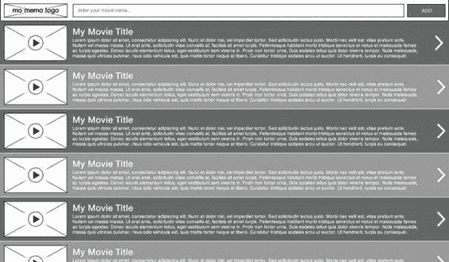

## 第 4 章：使用 HTML5 启动你的项目

105

此顶部在应用程序的每个页面上都是可见的。在设计任何基于移动的网站时，你应该记住，它将在横屏或竖屏模式下的各种屏幕尺寸上显示。

**注意：** 截至目前，尚无已知方法可以将浏览器的方向锁定为横屏或竖屏。因此，当你设计移动 Web 应用时，应该考虑到方向发生变化。

### 创建电影列表

MoMemo 应用程序的 UI 围绕屏幕顶部的搜索栏。图 4-5 和图 4-6 显示了应用程序的电影列表部分，包括适用于平板电脑和移动设备的任务栏。

**图 4-5。** *横屏平板电脑的电影列表*

从图 4-5 所示，可以在浏览已添加到列表的电影时，访问搜索和添加电影的功能。对于用户来说也很清楚，这将向列表添加项目，而不是在现有列表中进行搜索，因为提交表单的按钮标记为 ADD 而不是搜索。

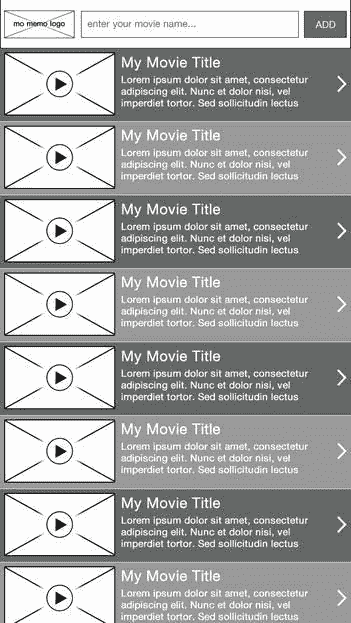

## 第 4 章：使用 HTML5 启动你的项目

106

图 4-6 以相同的方式呈现信息，但针对较小的屏幕；然而，列表项略大，以适应用户手指点击准确性可能较低的情况。虽然列表项聚集在一起，但用户必须点击以查看更多电影信息的目标仍然足够大。将任务栏放置在顶部还允许用户自然、轻松地翻阅其保存的电影列表，而不必过于担心意外激活应用程序的另一个部分。该应用程序的两个 UI 原型模型在 HTML 方面是相同的，但我们可以使用 CSS 媒体查询来针对特定的显示尺寸和方向。你还可以利用流式布局来确保应用程序能够对方向和屏幕尺寸的变化做出正确响应。

**图 4-6。** *竖屏移动设备的电影列表*

## 第 4 章：使用 HTML5 启动你的项目

107

在 HTML 中进行这些标记非常简单。首先，在项目的根目录下创建一个名为 `application` 的文件夹。在该文件夹内，再创建三个名为 `css`、`img` 和 `js` 的文件夹。`css` 文件夹将存储你的 CSS/SASS，`img` 将存储所有的图像和精灵图，`js` 将存储你所有的库和应用程序 JavaScript。

你还需要在 `js` 中创建两个名为 `lib` 和 `app` 的文件夹，在 `js/app/` 文件夹中创建一个名为 `bootstrap.js` 的文件，并在 `css` 文件夹中创建一个名为 `mobile.scss` 的文件。

在 `application` 文件夹中创建一个名为 `index.html` 的新文件；列表 4-11 中的代码将帮助引导应用程序。

**列表 4-11。** *初始 Bootstrap HTML*

```
<!DOCTYPE html>
<html lang="en-GB" dir="ltr">
<head>
<meta charset="UTF-8" />
<meta name="viewport" content="width=device-width; initial-scale=1.0; maximum-scale=1.0; user-scalable=0; target-densitydpi=device-dpi;"/>
<title>Mo Memo</title>
<link rel="stylesheet" type="text/css" href="css/mobile.css" />
<link rel="apple-touch-icon-precomposed" href="img/home-screen-icon.png">
</head>
<body>
<div id="shoe">
<div id="deck">
</</div>
</</div>
<!-- 此脚本将实例化任何必要的 JavaScript -->
<script src="js/app/bootstrap.js"></script>
</body>
</html>
```

如你所见，有一个包裹 `deck` 的 `div` 称为 `shoe`。这将有助于包含出现在每个页面上的全局元素，例如顶部任务栏，如果应用程序未来需要扩展，它将持有多个 `deck`。

## 第 4 章：使用 HTML5 启动你的项目

108

你可以使用任何命名规范。

**注意：** 这是应用程序的头部。现在是创建应用程序的头部了。列表 4-12 中的代码应该添加到 `div id="shoe"` 元素内部，但在 `div id="deck"` 元素之前。

**列表 4-12。** *头部代码*

```
<header id="taskbar">
<h1 class="branding">Mo Memo</h1>
<form method="post">
<input type="text" name="query" placeholder="输入电影名称..." />
<input type="submit" value="ADD" />
</form>
</header>
```

这将简单供用户搜索的标题和表单，如图 4-7 所示。使用 CSS，这将放置在屏幕顶部。


## 第 4 章：使用 HTML5 启动你的项目

109

**图 4-7。** *无样式的任务栏*

现在是向 deck 添加第一个卡片了——电影列表卡。这通过通过列表 4-13 中的代码创建一个无序数据列表来实现。

**列表 4-13。** *保存的电影列表*

```
<ul class="list alternating medium">
<li>
<a href="path/to/movie/">
<video poster="img/video.jpg" title="Movie Title">
<source type="video/webm" src="path/to/video.webm" />
</video>
<h2>我的电影标题</h2>
<p>我的电影描述</p>
</a>
</li>
<li>
<a href="path/to/movie/">
<video poster="img/video.jpg" title="Movie Title">
<source type="video/webm" src="path/to/video.webm" />
</video>
<h2>我的电影标题</h2>
<p>我的电影描述</p>
</a>
</li>
</ul>
```

在 HTML5 中，你可以用 `<a>` 标签包裹块级元素。这使得将整个列表项内容变为指向另一个资源的链接变得更加简单。


## 第 4 章：使用 HTML5 启动你的项目

110

如你从图 4-8 所示，页面看起来非常无聊。下一个工作坊将涵盖如何使用 CSS 为应用程序进行样式设置。

**图 4-8。** *完整的电影列表页面*

电影搜索与添加

随着电影列表（Movie List）功能的实现，现在是时候处理搜索和添加电影的任务了。可以通过两种方式之一完成。

*   用户搜索电影并显示出一个列表。用户从该列表中点击电影，这将他们带到电影信息（Movie Info）屏幕。从该屏幕，用户可以将电影添加到列表中并返回到电影列表。

*   第二种方案是向用户提供建议，允许他们点击适合自己的建议，并点击添加按钮。用户可以在稍后的某天查看电影信息。

这两种方案都没有错，但最优方案仍然取决于用户搜索电影时所处的场景。为了回答这个问题，你需要重新参考项目的 MoSCoW 需求。其中一个必须有（must-have）的需求是“允许用户快速地向其个人列表中添加和删除电影”。用户很可能会打开应用程序、搜索电影、添加它、关闭应用程序，并在稍后更详绒地查看电影列表。根据此，图 4-9 和图 4-10 显示了平板电脑和手机上的搜索功能样式。

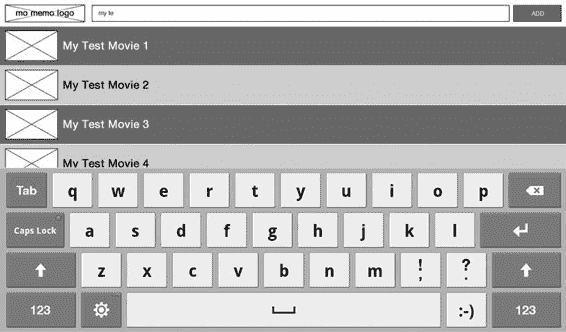

# 第 4 章：使用 HTML5 开始你的项目

**图 4-9.** 平板电脑电影列表

搜索和显示搜索结果将是 JavaScript 的任务（将在第 8 章介绍）。

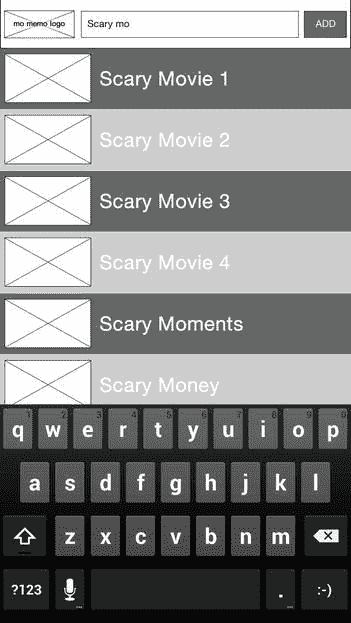

**图 4-10.** 手机电影列表

## 电影信息

MoMemo 应用程序最后部分是电影信息部分。它包含几个子功能，包括电影简介、片段、演员表、原声带和最近的院。你可以将这些信息放在不同的卡片上，但在大屏幕设备（如平板电脑）上查看小区域（如简介）时，你会发现大量的空白。

为了解决这个问题，你可以将所有内容放在同一个视图中，但在竖屏设备上允许用户横向滚动内容以利用垂直空间，并在横屏下正常滚动。图 4-11 和图 4-12 显示了应该如何呈现这些。

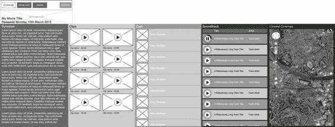

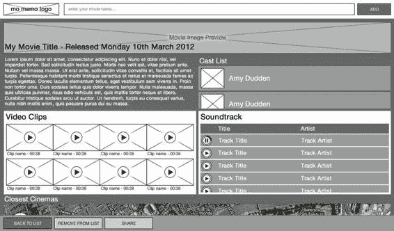

**图 4-11.** 竖屏手机设备上的电影信息

**图 4-12.** 横屏平板设备上的电影信息

虽然两种视图的呈现方式略有不同，但内容是相同的，可以使用 CSS 媒体查询进行重新定位，以适应设备的方向。创建一个 id 为 `card-movie_info` 的新卡片，并添加列表 4-14 中的 HTML 代码。

**列表 4-14.** 电影信息头部

```html
<header>
  
  <hgroup>
    <h2>My Movie Title</h2>
    <p>Released: 2012 年 3 月 10 日，周一</p>
  </hgroup>
</header>
```

这将创建一个头部的标记，根据设备的方向使用 CSS 以不同的方式呈现该头部。你使用 `hgroup` 来分组发布日期信息，这些信息不应该包含在 `h2` 元素中。

列表 4-15 显示了简介块，它将仅包含文本。块块内部有一个类为 `content` 的 `div` 包围着内容，但排除了主头部。这样做是为了让内容可以滚动，而头部始终保持在视野中。

**列表 4-15.** 简介块

```html
<section class="block" id="block-synopsis">
  <div class="content">
    <p>Hello world,这是我的简介</p>
  </div>
</section>
```

列表 4-16 显示了演员表块。根据设计，演员列表在块块内应该是滚动的；然而，头部应该始保持在顶部。此块还显示了列表将标准化，以减少 CSS 中的冗余。

**列表 4-16.** 演员表块

```html
<section class="block" id="block-cast">
  <h3>Cast List</h3>
  <div class="content">
    <ul class="list scrolling medium">
      <li>
        
        <p>Actor Name</p>
      </li>
    </ul>
  </div>
</section>
```

然后你进入视频块，如列表 4-17 所示。在两个线框图中，视频都以网格格式显示，但它们具有灵活性，因为一行可能包含两个或四个视频，这使得使用表格变得不灵活。对于此，你会选择使用普通列表并根据设备的方向使用 CSS 进行进行格式化。

**列表 4-17.** 视频块

```html
<section class="block" id="block-video">
  <h3>Video Clips</h3>
  <div class="content">
    <ul class="list grid">
      <li>
        <video poster="path/to/poster.jpg" title="Clip Title">
          <source src="path/to/video.webm" type="video/webm" />
        </video>
        <p>Clip 00:38</p>
      </li>
    </ul>
  </div>
</section>
```

原声带块非常简单，因为它在两种方向下以及平板电脑和手机上都是相似的。这在列表 4-18 中所示。

**列表 4-18.** 原声带块

```html
<section class="block" id="block-soundtrack">
  <h3>Soundtrack</h3>
  <div class="content">
    <table class="alternating">
      <thead>
        <tr>
          <th>&nbsp;</th>
          <th>Title</th>
          <th>Artist</th>
        </tr>
      </thead>
      <tbody>
        <!-- rows -->
      </tbody>
    </table>
  </div>
</section>
```

最后，列表 4-19 显示了最近块。它由一个类为 `map` 的 `div` 组成。此任务将使用 Google Maps API。

**列表 4-19.** 最近的电影院

```html
<section class="block" id="block-closest_cinemas">
  <h3>Closest Cinemas</h3>
  <div class="content">
    <div class="map"></div>
  </div>
</section>
```

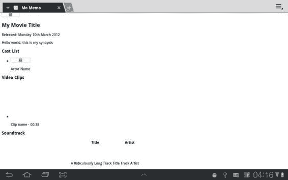

这结束了 MoMemo 的标记创建。任务栏对应用程序的响应将在第 8 章介绍。如果你看到与图 4-13 所示类似的内容，请不要惊讶。你将在第 5 章中学习如何使用 SASS 生成模块化的 CSS。

## 总结

通过本章，你应该已经了如何在移动 Web 应用中管理分页，以及根据项目需求选择合适的分页策略。你应该还理解如何开始构建应用程序——从想法到需求，从信息架构/线框到编写 HTML 基础代码，以及设备的方向和屏幕尺寸如何影响你对应用程序的设计。

在第 5 章中，你将接下来学习 CSS 如何改变你对移动 Web 应用的样式、动画处理和性能优化，以及 SASS 如何帮助组织你的 CSS 规则并生成结构化的 CSS 文件。

# 第 5 章：用于移动端的 CSS3

移动开发最令人兴奋的方面之一是通过最新智能手机浏览器对 CSS3 的支持。在 CSS3 之前，我们依赖使用 JavaScript 来提供惊艳的动画和过渡效果，仅仅将样式应用于 DOM 元素，例如父元素内的最后一个元素或交替的表格行。

在本章中，你将学习一些新的 CSS3 特性，例如动画和过渡。你将学习 CSS3 如何提供与最基础的动画概念——关键帧（keyframing）类似的功能。你将学习如何在移动 Web 应用中导入新字体，这将为你的观众提供更广泛的字体。你还将查看一些关键的 CSS3 特性，如文本阴影、选择器、渐变和新的边框属性。此外，你将简要接触 CSS 媒体查询，这将帮助你根据屏幕分辨率和像素密度应用样式。

最后，你将看到 CSS 预编译器的威力，其形式为 Syntactically Awesome Stylesheets (SASS)，通过它将学习如何简化你的 CSS 工作流并减少编码时间。

## 厂商特定属性

在编写本文时，许多 CSS3 属性（如 `border-radius` 和 `opacity`）已经标准化。然而，浏览器厂商可以开发新 CSS 属性的自己的实现。为了避免语法差异引起的冲突，尚未标准化的新 CSS 属性通常会有一个厂商前缀（vendor prefix）。例如，在 `border-radius` 标准化之前，在 CSS3 中有几种声明方式：

- `-moz-border-radius`

- `-o-border-radius`

- `-webkit-border-radius`

- `border-radius`

如你所见，列表中的最后一个声明是现在的标准版本，而厂商特定的实现带有前缀：基于 Gecko 的浏览器（Firefox）使用 `-moz-`，Opera 使用 `-o-`，基于 Webkit 的浏览器（Chrome、Android 浏览器、Dolphin）使用 `-webkit-`。

虽然有更多特定的厂商特定前缀，但通常对于 Android 来说，`-moz-`、`-o-` 和 `-webkit-` 就足够了。始终包含标准实现是非常重要的。当你需要声明所有四个 CSS 属性时，有方法可以避免这样做，我将在本章稍后的“CSS 预编译器 (SASS)”章节中解释。

## CSS 动画与过渡

CSS3 为 DOM 元素引入了 CSS 过渡（transitions）和变换（transforms）。你可以使用这些来取代传统的通过 JavaScript 中的定时器操纵其 CSS 属性来为 DOM 元素制作动画的方法。你可能会问自己，为什么要用 CSS 做动画而不是 JavaScript？显然，CSS 应该用于样式，而 JavaScript 应该用于交互。事实是，通过使用 CSS3 进行动画，你可以将许多通常通过 JavaScript 交给设备 CPU 的重负载任务转移到设备的 GPU（如果设备的话）。这可以让动画变得更加流畅。

### 过渡 (Transitions)

CSS 过渡允许你在两种 CSS 样式之间创建过渡。你通过创建一个 CSS 样式并为其添加另一个样式来触发过渡。CSS 过渡将处理两个状态之间的变化。

在 CSS3 中创建过渡非常简单。首先，你创建一个 `div` 元素。

```html
<div class="test"></div
```

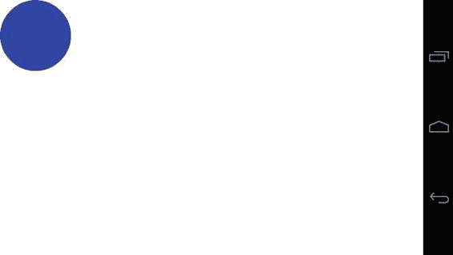

接下来，为 CSS 元素创建一个样式。在此样式中，你将 `width` 和 `height` 设置为 `100px`，并将 `position` 设置为 `absolute`，因为你要把元素移动到页面上的不同位置。你还可以通过将 `border-radius` 设置为 `50px` 将正方形变为圆形。你还显式地将 `top` 和 `left` 位置设置为 `0px`，并将 `background-color` 设置为 `blue`。

```css
.test {
width: 100px;
height: 100px;
position: absolute;
top: 0px;
left: 0px;
border-radius: 50px;
background-color: blue;
}
```

这将渲染出类似于图 5-1 所示的内容。

**图 5-1.** CSS 圆形的渲染

现在你需要为小球设置下一个状态。这与创建一个具有不同属性的新样式一样简单。

```css
.second-position {
left: 50%;
background-color: yellow;
}
```

如你所见，新属性将圆形置在屏幕中间，且 `background-color` 设置为 `yellow`。将此 CSS 类添加到测试 `div` 中。

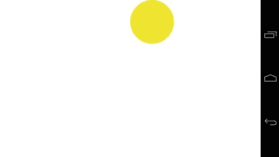

```html
<div class="test second-position"></div>
```

现在你将看到一个类似于图 5-2 所示的屏幕。

**图 5-2.** 测试 div 的最终位置

最后要做的工作是在 `.test` 类中添加过渡。这将决定如何以及哪些属性应该进行过渡，以及过渡的时间间隔。

`transition` 属性目前是厂商特定的，一如往常，包含所有厂商属性是一个良好的做法。以下代码将为测试元素的所有属性创建一个过渡。

```css
.test {
width: 100px;
height: 100px;
position: absolute;
top: 0px;
left: 0px;
border-radius: 50px;
background-color: blue;
}
```

（注：此处原文代码块似乎遗漏了 transition 属性内容，根据下文推断应包含 transition 声明，此处按原文处理）

为了让过渡生效，你需要动态添加 `second-position` 类。你可以使用 JavaScript。以下脚本将查找类名为 `test` 的元素并添加 `second-position` 类。

```html
<div class="test"></div>
<script>
document.getElementsByClassName('test')[0].classList.add('second-position');
</script>
```

当你在移动设备上加载时，圆形应该动画到屏幕中心并逐渐变为黄色。你还可以通过指定属性、持续时间和函数和延迟来控制哪些属性应该过渡，如下例所示：

`-moz-|-o-|-webkit-transition: property duration function delay`

你可以使用这种简写方法指定尽可能多的的属性。表 5-1 列出了可能的值。

**表 5-1.** CSS 过渡属性

| 属性 | 描述 | 值/选项 |

| :--- | :--- | :--- |

| `-moz-|-o-|-webkit-transition-property` | 要制作动画的 CSS 属性 | all, width, height, opacity 等 |

| `-moz-|-o-|-webkit-transition-duration` | 过渡的持续时间 | *X s 秒；默认为 0 |

| `-moz-|-o-|-webkit-transition-timing-function` | 使用的时间函数 | linear, ease, ease-in, ease-out, ease-in-out, cubic-function bezier |

| `-moz-|-o-|-webkit-transition-delay` | 延迟过渡的秒数 | *X s |

例如，你可能在颜色过渡开始五秒后开始过渡左位置，并平滑淡出。在这种情况下，你将使用以下代码。

```css
.test {
width: 100px;
height: 100px;
position: absolute;
top: 0px;
left: 0px;
border-radius: 50px;
background-color: blue;
transition: left 5s ease-out 5s, background-color 5s ease 0s;
-moz-transition: left 5s ease-out 5s, background-color 5s ease 0s;
-webkit-transition: left 5s ease-out 5s, background-color 5s ease 0s;
-o-transition: left 5s ease-out 5s, background-color 5s ease 0s;
}
```

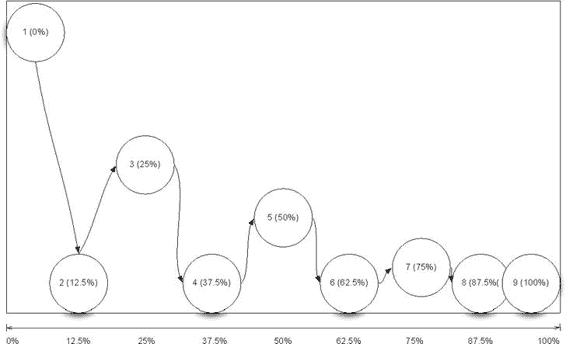

### 动画 (Animations)

有时，你可能对动画有更多的控制需求。例如，

如果你可以从一个位置移动到另一个位置，同时在动画的特定点更改某些 CSS 属性，那不是很好吗？这被称为关键帧（keyframing）。如果你有 Flash 动画经验，你会对它更熟悉，即为在 Flash 时间轴上对对象进行重大更改，并在它们之间创建补间动画（tweens）。现在 CSS 中也支持关键帧。一如既往，在编写时这些属性是特定厂商的，因此请使用所有可用的厂商前缀以确保兼容性。在演示中，你将让屏上的圆形移动并让它跳动。

在深入创建跳动球动画之前，请看图 5-3 所示的预期动画。

**图 5-3.** *预期的动画序列*

从图 5-3 的动画序列可以看出，其意图是模拟一个跳动球。CSS 关键帧功能允许你按百分比增量指定想要制作动画的 CSS 样式。我们可以利用图 5-3 显示的信息来创建关键帧规则。

你首先使用 `@keyframes` 规则和关键帧名称创建一个新的关键帧定义，如下代码所示。

```css
@keyframes bouncyball {

}
```

接下来，你使用百分比标记和 CSS 样式指定动画关联的元素从哪里开始。

```css
@keyframes bouncyball {
0% { top: 0px; left: 0px; }
}
```

在这里，你指定关联元素应从左上角开始。

接下来，你指定动画中的各个分段。以图 5-3 为指导，存在 `0%`、`12.5%`、`25%`、`37.5%`、`50%`、`62.5%`、`75%`、`87.5%` 和 `100%` 对应的 CSS 规则。

```css
@keyframes bouncyball {
0% { bottom: 100%; left: 0px; }
12.5% { bottom: 0px; left: 12.5%; }
25% { bottom: 50%; left: 25%; }
37.5% { bottom: 0px; left: 37.5%; }
50% { bottom: 25%; left: 50%; }
62.5% { bottom: 0px; left: 62.5% }
75% { bottom: 12.5%; left: 75% }
87.5% { bottom: 0px; left: 87.5% }
100% { bottom: 0px; left: 100% }
}
```

现在是时候为你的球创建一个新的 CSS 规则了。以下代码将正方形变为圆形，并将动画应用到该元素上。

```css
.ball {
background: black;
width: 100px;
height: 100px;
position: absolute;
border-radius: 50px;
animation: bouncyball 2s ease-in-out;
-moz-animation: bouncyball 2s ease-in-out;
-webkit-animation: bouncyball 2s ease-in-out;
}
```

示例中的 `animation` CSS 属性是以简写形式写的，并且再次是特定厂商的。表 5-2 列出了 `animation` 属性按顺序接受的参数。

**表 5-2.** *CSS 动画属性*

| 属性 | 说明 | 数值/选项 |

| :--- | :--- | :--- |

| `[-moz-|-webkit-]animation` | 应用于元素的动画名称 | name |

| `[-moz-|-webkit-]animation` | 动画的持续时间 *X* 秒 | duration |

| `[-moz-|-webkit-]animation` | 使用的时间函数；linear, ease, ease-in, ease-out, ease-in-out, cubic-bezier | timing-function (默认为 ease) |

| `[-moz-|-webkit-]animation` | 转换延迟的秒数 *X* | delay |

| `[-moz-|-webkit-]animation` | 动画重复的次数；默认为 1 | iteration-count (整数) |

| `[-moz-|-webkit-]animation` | 告诉动画是正常、交替还是不在交替周期中反向播放动画；例如，如果你指定 animation-iteration-count 为 2，则动画将在第二次迭代时反向播放 | direction |

| `[-moz-|-webkit-]animation` | 指定正在运行或暂停的动画是否正在播放；可以使用 JavaScript 修改 | play-state |

当你在设备上加载动画时，它应该会自动播放。这并不是一个非常流畅的跳动球，但这仅仅是为了证明 CSS 是一个非常强大的动画工具，只需少少努力。你还可以使用 `JavaScript` 动态编写 CSS 动画。对于更复杂的动画，还有 HTML5 Canvas。

### 新的 CSS3 特性

除了动画、变换（transforms）和过渡（transitions）之外，CSS3 规范中还有几个值得关注的新特性。在本节中，你将学习如何使用 `@font-face` 通过导入字体文件为你的移动 Web 应用引入新字体。

你还将学习如何使用几种新的边框框样式元素，例如 `border-radius`（它允许你在不需要额外标记或 JavaScript 的情况下为元素创建圆角框）、`box-shadow` 和 `border-image`。

你还将学习如何创建 CSS 渐变...（注：原文此处似乎不完整，已按样翻译）

Android 浏览器在编写此时，仅支持 `TTF` 和 `SVG` 字体，这是目前两种最大的且未压缩的字体格式。其他格式包括 `EOT` 和 `WOFF`。在声明 `@font-face` 时，包含所有字体格式以支持其他浏览器，并且当 Android 浏览器开始支持其他格式时，它们可以在无需更改代码的情况下加载。顺序应该按大小喜好排列（最小在前），因为 Android 浏览器将选择第一个可用的格式使用。万一 Android 设备已经包含了你想在设备上使用的字体，你可以：

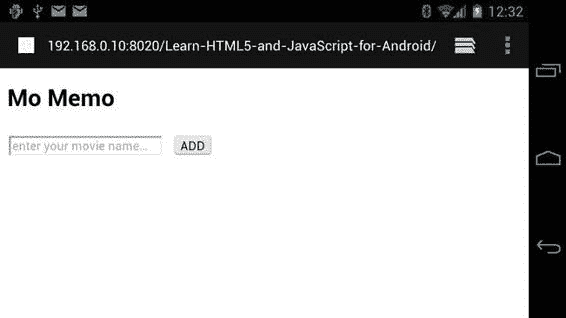

# 第 4 章：使用 HTML5 启动你的项目

109

**图 4-7.** 无样式的任务栏

现在是时候向牌组添加第一张卡片了——电影列表卡片。这很简单，通过创建一个数据的无序列表即可，如列表 4-13 中的代码所示。

**列表 4-13.** 保存的电影列表

```html
<ul class="list alternating medium">
  <li>
    <a href="path/to/movie/">
      <video poster="img/video.jpg" title="Movie Title">
        <source type="video/webm" src="path/to/video.webm" />
      </video>
      <h2>我的电影标题</h2>
      <p>我的电影描述</p>
    </a>
  </li>
  <li>
    <a href="path/to/movie/">
      <video poster="img/video.jpg" title="Movie Title">
        <source type="video/webm" src="path/to/video.webm" />
      </video>
      <h2>我的电影标题</h2>
      <p>我的电影描述</p>
    </</a>
  </li>
</ul>
```

在 HTML5 中，你可以用 `href` 标签包裹块级元素。这使得将列表项的整个内容变成指向另一个资源的链接变得更容易。

# 第 5 章：用于移动端的 CSS3

131

以下代码示例显示了如何使用 `@font-face` 的完整声明。

```css
@font-face {
  font-family: "My Font With Spaces";
  src: local("My Font With Spaces"),
       url("/path/to/fonts/my-font-with-spaces.woff") format("woff"),
       url("/path/to/fonts/my-font-with-spaces.eot") format("embedded-opentype"),
       url("/path/to/fonts/my-font-with-spaces.svg") format("svg"),
       url("/path/to/fonts/my-font-with-spaces.ttf") format("truetype");
  font-style: normal;
  font-weight: normal;
}
```

## text-shadow 和 text-stroke

`text-shadow` 允许你使用 CSS 在文字后创建不同量的阴影。`text-stroke` 允许你在文字的内边缘绘制轮廓。`text-shadow` 和 `text-stroke` 也可以用于 `@font-face` 字体。

若要在文字周围创建一个基础阴影，你只需要在 CSS 中添加 `text-shadow` 属性。该属性接受以下值和格式。

`text-shadow: horizontal-offset vertical-offset blur color;`

例如，以下 CSS 样式将产生与图 5-7 所示类似的结果。

```css
h1 {
  text-shadow: 10px 10px 10px #000000;
}
```

你也可以对阴影的位置使用负数。这会让水平偏移使阴影向左移动，垂直偏移使阴影向顶部移动。

你通过指定像素的描边宽度及其颜色来定义 `text-stroke` 属性。`text-stroke` 属性接受以下值和格式。

`text-stroke: width color;`

它的用法与 `text-shadow` 非常相似，如下面的代码段所示。

```css
h1 {
  text-stroke: 1px #000000;
}
```

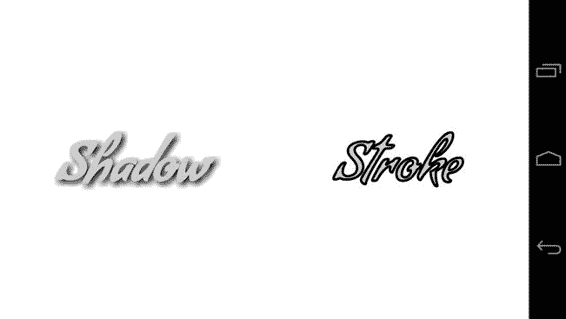

# 第 5 章：用于移动端的 CSS3

132

**图 5-7.** 文字阴影效果（左）和描边效果（右）

## 选择器


# 选择器

选择器允许你使用 CSS 对 DOM 元素应用样式。通常有两种类型的选择器：普通的 CSS 类、元素和 ID 选择器，例如 `.elementclass`、`#elementid` 和 `element`。还有伪类选择器，例如 `:link`、`:visited`、`:hover` 和 `:active`。

CSS3 引入了几个新选择器，允许你根据属性值、输入状态以及元素在 DOM 中的位置来选择元素。

## 有用的表单选择器

表单选择器将允许你根据状态或类型对表单输入应用样式。在 CSS3 之前，你需要手动为文本、复选框、单选按钮和提交字段以及按钮分配类，因为没有明确的方法为这些字段应用样式。这是因为它们都是 `<input />` 元素，所以任何为输入元素创建全局样式的尝试都会让所有类型的字段样式完全相同。

有了 CSS3，你现在可以使用新的属性选择器对特定的输入类型应用样式。表 5-3 给出了属性选择器的格式。

### 表 5-3. 属性选择器

| 选择器 | 描述 |
| :--- | :--- |
| `element[attribute="value"]` | 匹配属性完全等于 value 的元素。 |
| `element[attribute*="value"]` | 匹配属性包含 value 的元素并应用样式。 |
| `element[attribute^="value"]` | 匹配属性以 value 开头的元素并应用样式。 |
| `element[attribute$="value"]` | 匹配属性以 value 结尾的元素并应用样式。 |

## 替换 JavaScript 的有用选择器

使用 JavaScript 选择另一个元素的最后一个孩子并为其应用类以移除浮动元素的边距或内边距是很常见的。如果你有多行的三列布局，可以使用 JavaScript 选择元素内的每第三个孩子并为其应用类。有了 CSS3，你不再需要这样做。你可以使用 `:last-child` 类选择元素的最后一个孩子。

```css
ul li:last-child {
  margin-right: 0px;
}
```

你也可以用同样的方法选择任何元素的第 n 个孩子。使用 `:nth-child`、`:nth-last-child`、`:nth-of-type` 和 `:nth-last-of-type`，你可以根据子索引和子类型进行选择，如表 5-5 所示。

### 表 5-5. nth 选择器

| 选择器 | 描述 |
| :--- | :--- |
| `:nth-child(index)` | 选择位于父元素指定索引处的元素。 |
| `:nth-last-child(index)` | 选择从父元素末尾开始位于指定索引处的元素。 |
| `:nth-of-type(index)` | 选择位于父元素指定索引处的同类型元素。 |
| `:nth-last-of-type(index)` | 选择从父元素末尾开始位于指定索引处的同类型元素。 |

# 第 5 章：用于移动端的 CSS3

## 渐变

创建根据屏幕尺寸和方向进行缩放的渐变背景。CSS3 渐变目前是特定厂商的。每个厂商似乎都有自己自己的生成 CSS3 渐变的方法。本节将重点介绍 WebKit 的实现。

在 CSS3 中你可以使用两种类型的渐变：线性（linear）和径向（radial）。

线性渐变将从屏幕的一侧流向另一侧，而径向渐变将从一个中心点向外散发，如图 5-8 所示。

**图 5-8.** 线性（左）和径向（右）渐变

### 线性渐变

线性渐变具有以下语法，必须使用 `background` 属性作为背景应用。

```css
.box {
  background: -webkit-linear-gradient(start, start-color, end-color);
}
```

你可以将起始位置指定为单位置（`left`、`top`、`right`、`bottom`）或这些位置的组合。例如，要从左下角开始线性渐变，可以使用以下代码。

```css
.box {
  background: -webkit-linear-gradient(bottom left, green, red);
}
```

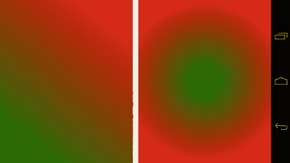

图 5-9 显示了此代码段的结果。

**图 5-9.** 以左下角为起始点的线性渐变

你也可以用角度指定渐变的起始点。例如，将起始点设置为 `45deg` 将产生将起始点设置为 `bottom left` 相同的结果。

```css
.box {
  background: -webkit-linear-gradient(45deg, green, red);
}
```

除了标准的双色渐变外，你还可以在渐变背景中使用多种颜色。你只需要在位置之后指定更多颜色即可。例如，以下代码将使用线性渐变创建一个爱尔兰旗，如图 5-10 所示。

```css
.box {
  background: -webkit-linear-gradient(left, green, white, orange);
}
```

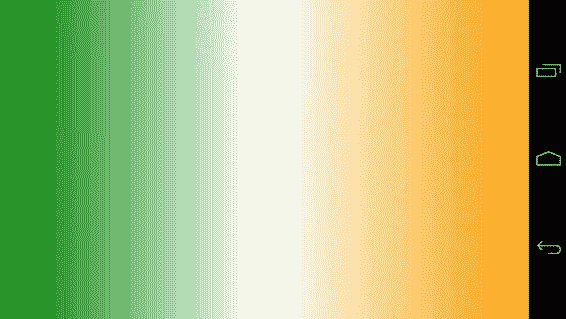

**图 5-10.** 使用 CSS3 渐变创建爱尔兰旗

CSS3 渐变还支持颜色停止点（color stops）。颜色停止点允许你指定渐变沿渐变线在哪里停止。例如，你可以使用停止点在 CSS3 中不使用任何渐变就创建一个真实的爱尔兰旗。为了实现这一点，你需要指定绿色在元素的 `33%`（三分之一）处停止，然后白色从 `33%` 处开始并在 `33%` 处停止。这将在绿色和白色之间创建一条立即的颜色线，而不是渐变。从这里开始，你将使用另一种白色并指定在屏幕的 `66%` 处停止；最后是橙色，它将在 `66%` 处停止，创建另一条颜色线。

代码看起来类似于下面，你可以在图 5-11 中看到结果。

```css
.box {
  background: -webkit-linear-gradient(left, green 33.3%, white 33.3%, white 66.6%, orange 66.6%);
}
```


**图 5-11.** 使用 CSS3 渐变颜色停止点创建爱尔兰旗

### 径向渐变

径向渐变比线性渐变稍微复杂。你可以指定渐变的位置从哪里开始以及它的形状。径向渐变具有以下语法。

```css
.box {
  background: -webkit-radial-gradient(center, [circle|ellipse] [closest-side|closest-corner|farthest-side|farthest-corner|contain|cover], start-color, stop-color);
}
```

你可以用像素指定中心位置，或者百分比左和顶部位置。第二个参数接受形状关键字，可以是 `circle` 或 `ellipse`。第二个参数还接受尺寸关键字，这些是 `closest-side`、`closest-corner`、`farthest-side`、`farthest-corner`、`contain` 和 `cover`。最后，渐变还接受作为十六进制、关键字、RGB 或 RGBA 颜色的起始和停止颜色。

例如，你可以使用以下代码用 CSS3 创建日本旗，其结果可以在图 5-12 中看到。

```css
.box {
  background: -webkit-radial-gradient(center, circle contain, red, white);
}
```


**图 5-12.** 带有径向渐变的日本旗

你可以使用线性渐变示例中相同的颜色停止技术来移除径向渐变上的渐变并创建一个圆圆。你可以使用以下代码来实现这一点，图 5-13 显示了结果。

```css
.box {
  background: -webkit-radial-gradient(center, circle contain, #C00C00 70%, white 70%);
}
```

**图 5-13.** 移除了径向渐变的日本旗

## 框

在 CSS3 中，你现在可以指定圆角的位置从哪里开始以及它的形状。

### 圆角

在 CSS3 中，你可以使用 `border-radius` 和 `box-shadow` 来应用新的框样式。`border-radius` 允许你创建圆角。使用 `border-radius: 10px`。以下代码将产生类似效果：

```css
.box {
  border-radius: 10px;
}
```


**图 5-14.** 圆角

### 阴影

`box-shadow` 属性与 `text-shadow` 相同，如果你指定了负偏移值，阴影将渲染在屏幕的左侧和上方。`box-shadow` 具有以下格式：

`box-shadow: horizontal-offset vertical-offset blur spread color`

`horizontal-offset` 和 `vertical-offset` 属性决定阴影的位置（像素），`blur` 设置模糊程度（像素），`spread` 设置扩散，`color` 设置阴影的颜色，`inset` 设置阴影是在元素内部还是外部。例如，以下代码将产生类似于图 5-15 的效果：

```css
.box {
  width: 100px;
  height: 100px;
  border: 1px solid #000000;
  box-shadow: 10px 10px 20px 5px #000000;
}
```

## 媒体查询

`[max-|min-]device-aspect-ratio` cm（用于打印）的宽高比，像素设备屏幕比例（基于 `device-width`、`device-height`）

`[max-|min-]device-pixel-ratio` 设备的像素比例；它可以用于为高像素密度设备引入高分辨率图像；该属性也可能是 `-moz-device-pixel-ratio`、`-o-device-pixel-ratio`、`-webkit-device-pixel-ratio`

## 响应式网页设计

创建媒体查询的理念并不一定是为了针对特定设备构建媒体查询（例如，不是专门针对平板电脑或手机），而是为了适应特定的屏幕尺寸并调整内容以适应它。

通过这种方式，你可以确保 CSS 应用于可用空间而不是目标设备。我们将其称为响应式网页设计。

Daniel Vane 的网站 (`http://danielvane.com/`) 展示了响应式网页设计的绝佳示例。通过为所有视口大小提供样式、为最大 `480px` 的显示提供样式以及为最大 `768px` 的显示提供样式，该网站能够对任何手机或平板电脑设备的可用空间做出适当响应，如图 5-16 和图 5-17 所示。


**图 5-16.** 横屏下的 Daniel Vane 响应式网站（左侧为平板，右侧为手机）。
**图 5-17.** 竖屏下的 Daniel Vane 响应式网站（左侧为平板，右侧为手机）。

Andy Clarke 和 Keith Clark 设计了一组媒体查询，你可以用来针对逐渐变大的显示器。其后的想法是使用颜色和字体对最小屏幕尺寸进行样式设计，然后按照特定的屏幕增量逐步增强网站，直到达到超过 `992px` 的屏幕尺寸。这组媒体查询还包含一个针对高像素密度显示器的媒体查询。

```html
<!-- 用于所有浏览器 -->
<link rel="stylesheet" href="css/style.css">
<link rel="stylesheet" media="print" href="css/print.css">
<!-- 用于逐渐变大的显示器 -->
<link rel="stylesheet" media="only screen and (min-width: 480px)" href="css/480.css">
<link rel="stylesheet" media="only screen and (min-width: 600px)" href="css/600.css">
<link rel="stylesheet" media="only screen and (min-width: 768px)" href="css/768.css">
<link rel="stylesheet" media="only screen and (min-width: 992px)" href="css/992.css">
<!-- 用于 Retina 显示器 -->
<link rel="stylesheet" media="only screen and (-webkit-min-device-pixel-ratio: 1.5), only screen and (-o-min-device-pixel-ratio: 3/2), only screen and (min-device-pixel-ratio: 1.5)" href="css/2x.css">
```

你应该检查他们的 GitHub 项目以获取这组规则的更新，项目地址为 `https://github.com/malarkey/320andup/`。

# CSS 预处理器 (SASS)

如果你过去有 CSS 经验，就会知道它的某些局限性。例如，你无法定义影响 CSS 呈现方式的变量，无法复用代码元素。随着应用程序的增长，在 CSS 中生成并维护很长的继承链也可能是非常痛苦的，如下代码所示，一个元素内部有多个元素需要相似的样式。

```css
/**
* CSS 中为块设置样式的常用方法
**/
.block {
/** 在此处设置 block 样式 **/
}
.block h1.heading {
/** 在此处设置 header 样式 **/
}
.block ul.alternating {
/** 在此处设置 block ul 样式 **/
}
.block ul.alternating li {
/** 在此处设置 alternating li 样式 **/
}
.block ul.alternating li a {
/** 在此处设置 li 样式 **/
}
/** 继续 **/
```

Syntactically Awesome Stylesheets (SASS) 通过使用嵌套、变量、混合器（mixins）和选择器继承来帮助消除这些冗余。SASS 并不是 CSS，需要编译器来将其编译为 CSS。

如你从前面的 CSS 中看到的，很多代码都是重复的。遗憾的是，没有办法以浏览器可以识别的方式移除这些冗余，但有一种方法可以让你编写的 CSS 更易于维护和迁移。这在 SASS 中被称为嵌套（nesting）。

在本节中，你将学习如何使用 SASS 生成组织化、可复用且具体的 CSS。你将学习 SASS 如何改进你的开发工作流并改变你对 CSS 的思考。

你还将学习 SASS 如何消除整个样式表中使用相似 CSS 样式的大量重复工作，并为面向对象的 CSS 铺道路。

## 嵌套

嵌套允许你将 CSS 样式嵌套在彼此内部。例如，前面的 CSS 看起来如下：

```scss
.block {
  /** 在此处设置 block 样式 **/
  h1.heading {
    /** 在此处设置 header 样式 **/
  }
  ul.alternating {
    /** 在此处设置 block ul 样式 **/
    li {
      /** 在此处设置 alternating li 样式 **/
      a {
        /** 在此处设置 li 样式 **/
      }
    }
  }
}
```

这段代码要容易维护得多。如果你需要添加更多元素，只需要添加以下 SCSS 格式：

```scss
.block {
  /** 在此处设置 block 样式 **/
  h1.heading {
    /** 在此处设置 header 样式 **/
  }
  ul.alternating {
    /** 在此处设置 block ul 样式 **/
    li {
      /** 在此处设置 alternating li 样式 **/
      a {
        /** 在此处设置 li 样式 **/
      }
    }
  }
}
```

## 编译

前面的代码需要编译成 CSS 浏览器才能理解。你不需要直接将 SASS 文件链接到 HTML 文档中；相反，你链接的是生成的 CSS 文件。你可以使用 Aptana Studio 的内置工具直接编译 SASS 文件。


要在 Aptana Studio 中编译 SASS 文件，请在项目中的任何位置创建一个名为 `mobile.scss` 的新文件（完成后可以删除它），并添加以下代码：

```scss
.test {
  background: #000000;
}
.test2 {
  background: #FFFFFF;
}
```

点击 `Commands > Sass > Compile`。这将在 SCSS 文件相同的位置生成一个新的 CSS 文件。你需要刷新资源管理器才能看到新文件。编译 SASS 的快捷键是 `Cmd + Shift + R`（Windows 和 Linux 上为 `Ctrl + Shift + R`）。当出现图 5-18 所示的对话框时按 `1`。

**图 5-18.** 使用 Cmd + Shift + R 命令编译 SASS

当新 CSS 文件出现后，打开它。你应该看到以下代码：

```css
.test {
  background: #000000; }
.test .test2 {
  background: #FFFFFF;
}
```

## 部分文件

大型 SASS 文件可能会变得难以维护且滚动非常长！在 Aptana Studio 中，你可以使用代码折叠来显示和隐藏 SASS 样式以便浏览，如图 5-19 所示。


**图 5-19.** Aptana 中 SCSS 文件的代码折叠

虽然这种方式很方便，但 SASS 也支持使用与普通 CSS 相同的 `@import` 语法从外部 SASS 文件导入部分样式表。SASS 实现与普通样式表实现之间的区别在于，SASS 在编译时引入文件，而不是通过 HTTP 请求逐个加载普通 CSS 文件中的所有文件。这为在编译时导入特定对象或区域的部分文件提供了范围。

以下代码展示了一个示例。

```scss
/** mobile.scss **/

@import "partials/tablet";

@import "partials/phone";

/** partials/_tablet.scss **/

.test-tablet {
  background: url('../themes/mytheme/common/logo.png') no-repeat top left #FFFFFF;
}

/** partials/_phone.scss **/

.test-phone {
  background: url('../themes/mytheme/common/logo.png') no-repeat top left #FFFFFF;
}
```

编译后，CSS 将看起来如下所示。

```css
.test-tablet {
  background: url("../themes/mytheme/common/logo.png") no-repeat top left white; }
.test-phone {
  background: url("../themes/mytheme/common/logo.png") no-repeat top left white; }
```

从这个示例可以看出，每个部分文件的文件名应该以 `_`（下划线）为开头，并且 `import` 中的引用应该包含相对文件夹和部分名称，但不需要包含 `_` 前缀或 SCSS 文件名。你可能会注意到 SASS 在编译后的 CSS 中将 `#FFFFFF` 转换为 `white`。

## 变量与插值

你最终会编写基于颜色/主题的样式表（即，同一个样式表可能引用相同的图像，但来自不同的图像文件夹，或者具有不同的颜色主题）。传统上，你会使用 `PHP`、`Python` 或 `.NET` 来动态生成这些样式表。SASS 通过使用变量消除了这种需求。

SASS 中的变量作用方式与任何其他语言非常相似。它们可以是任何类型（字符串、CSS 属性值、整数、测量值如像素、em、% 等），并被添加到 SCSS 样式中，以便对你的样式表进行全局更改。

例如，取 partials 部分示例中的代码，我们可以对其进行修改，这样就可以从主（移动端）样式表中更改主题文件夹和颜色。

```scss
/** mobile.scss **/

$theme: "bentley";

$color: #000000;

@import "partials/tablet";

@import "partials/phone";

/** partials/_tablet.scss **/

.test-tablet {
  background: url('../themes/#{$theme}/common/logo.png') no-repeat top left $color;
}

/** partials/_phone.scss **/

.test-phone {
  background: url('../themes/#{$theme}/common/logo.png') no-repeat top left $color;
}
```

正如你在 `mobile.scss` 中看到的，你定义了一个字符串为 `"bentley"` 的主题变量。接着在下一行定义了黑色。然后使用 `@import` 导入这些部分。在每个部分内部，你会发现 `background` 声明已按如下修改。

```css
background: url('../themes/#{$theme}/common/logo.png') no-repeat top left $color;
```

向 SASS 文件添加变量的方法有两种。要将变量作为 CSS 字符串的一部分（例如背景图像路径）添加，你使用以下语法：

`#{$myvariable}`

这被称为“插值”，你也可以用它来更改 CSS 属性而不是其值。例如，`border-#{$position}-radius:`，其中 `position` 是变量定义的定义。

第二种方法是简单重复变量名 `$myvariable`。当你定义 CSS 属性值（如 `color`、`width` 或 `height`）时，应该使用这种方法。

## Mixins（混合器）

SASS 最受欢迎的功能之一是 Mixin。Mixin 允许你在一个地方定义一段代码，并在 SASS 样式表的任何地方使用它。例如，你可能有一个用于跨浏览器渐变的巨型 CSS 声明，如下代码所示。

```css
.myelement {
  background: rgb(206,220,231);
  background: -moz-linear-gradient(-45deg, rgba(206,220,231,1) 0%, rgba(89,106,114,1) 100%);
  background: -webkit-gradient(linear, left top, right bottom, color-stop(0%,rgba(206,220,231,1)), color-stop(100%,rgba(89,106,114,1)));
  background: -o-linear-gradient(-45deg, rgba(206,220,231,1) 0%, rgba(89,106,114,1) 100%);
  background: -ms-linear-gradient(-45deg, rgba(206,220,231,1) 0%, rgba(89,106,114,1) 100%);
  background: linear-gradient(-45deg, rgba(206,220,231,1) 0%, rgba(89,106,114,1) 100%);
}
```

那是大量的代码。如果你想在其他地方使用它怎么办？最有效的方法是简单向你想使用它的定义中添加更多类。

```css
.myelement, .mysecondelement {
  background: rgb(206,220,231);
  background: -moz-linear-gradient(-45deg, rgba(206,220,231,1) 0%, rgba(89,106,114,1) 100%);
  background: -webkit-gradient(linear, left top, right bottom, color-stop(0%,rgba(206,220,231,1)), color-stop(100%,rgba(89,106,114,1)));
  background: -o-linear-gradient(-45deg, rgba(206,220,231,1) 0%, rgba(89,106,114,1) 100%);
  background: -ms-linear-gradient(-45deg, rgba(206,220,231,1) 0%, rgba(89,106,114,1) 100%);
  background: linear-gradient(-45deg, rgba(206,220,231,1) 0%, rgba(89,106,114,1) 100%);
}
```

你可以使用 mixin 来定义渐变并使用以下代码包含包含样式中：

```scss
@mixin specialgradient {
  background: rgb(206,220,231);
  background: -moz-linear-gradient(-45deg, rgba(206,220,231,1) 0%, rgba(89,106,114,1) 100%);
  background: -webkit-gradient(linear, left top, right bottom, color-stop(0%,rgba(206,220,231,1)), color-stop(100%,rgba(89,106,114,1)));
  background: -o-linear-gradient(-45deg, rgba(206,220,231,1) 0%, rgba(89,106,114,1) 100%);
  background: -ms-linear-gradient(-45deg, rgba(206,220,231,1) 0%, rgba(89,106,114,1) 100%);
  background: linear-gradient(-45deg, rgba(206,220,231,1) 0%, rgba(89,106,114,1) 100%);
}

#my-first-element {
  @include specialgradient;
}

#my-second-element {
  @include specialgradient;
}
```

然而，这将是一个坏主意，因为生成的 CSS 将在样式表中包含两次渐变，这增加了冗余，并不是我们想要的。这种情况下，选择器继承应该是首选。当你有一段会在其他 CSS 规则中重复的 CSS 时，或者更好，当你有贯穿整个样式表的重复 CSS 时（例如特定浏览器的样式，如渐变和边界图像，需要为每个浏览器多次定义相同的 CSS）。

要实现这一点，你可以将参数传递到 mixins 中。现在你可以使用以下代码在 SASS 文件中的任何地方生成 CSS 渐变。

```scss
@mixin gradient($start, $stop, $degrees) {
  background: rgba($start, 1);
  background: -moz-linear-gradient($degrees, $start 0%, $stop 100%);
  background: -webkit-gradient(linear, left top, right bottom, color-stop(0%, $start), color-stop(100%, $stop));
  background: -o-linear-gradient($degrees, $start 0%, $stop 100%);
  background: -ms-linear-gradient($degrees, $start 0%, $stop 100%);
  background: linear-gradient($degrees, $start 0%, $stop 100%);
}

#my-first-element {
  @include gradient(rgba(206,220,231,0.5), rgba(89,106,114,1), -45deg);
}

#my-second-element {
  @include gradient(rgba(206,220,231,1), rgba(89,106,114,1), -45deg);
}
```

正如你看到的，你首先定义了一个名为 `gradient` 的 mixin，它接受三个参数：`$start`、`$stop` 和 `$degrees`。在这个 mixin 内部，你首先为不支持渐变的设备定义标准背景。使用 `rgba` SASS 函数定义背景颜色的值。在这里，你显式地将背景颜色设置为无 alpha 透明度的起始颜色。通过使用以下行，你只需将起始颜色、停止颜色和角度传递给相应的厂商渐变声明。现在你可以在样式表的任何地方使用 `@include gradient(start-color, finish-color, degrees);` 来调用带参数的渐变。生成的 CSS 如下所示。

```css
#my-first-element {
  background: #cedce7;
  background: -moz-linear-gradient(-45deg, rgba(206,220,231,0.5) 0%, #596a72 100%);
  background: -webkit-gradient(linear, left top, right bottom, color-stop(0%, rgba(206,220,231,0.5)), color-stop(100%, #596a72));
  background: -o-linear-gradient(-45deg, rgba(206,220,231,0.5) 0%, #596a72 100%);
  background: -ms-linear-gradient(-45deg, rgba(206,220,231,0.5) 0%, #596a72 100%);
  background: linear-gradient(-45deg, rgba(206, 220, 231, 0.5) 0%, #596a72 100%); 
}

#my-second-element {
  background: #cedce7;
  background: -moz-linear-gradient(-45deg, #cedce7 0%, #596a72 100%);
  background: -webkit-gradient(linear, left top, right bottom, color-stop(0%, #cedce7), color-stop(100%, #596a72));
  background: -o-linear-gradient(-45deg, #cedce7 0%, #596a72 100%);
  background: -ms-linear-gradient(-45deg, #cedce7 0%, #596a72 100%);
  background: linear-gradient(-45deg, #cedce7 0%, #596a72 100%); 
}
```

注意观察 `#my-first-element` 中的 CSS，第一个描述符中的背景颜色是普通的十六进制颜色，而其余部分是 RGBA 颜色。此外，尽管在 mixin 调用中使用了 RGBA 设置了停止颜色，但它仍然是十六进制颜色，因为透明度被设置为 1，而起始颜色被设为 0.5。SASS 将选择最高效的方式来输出你的颜色。

## 选择器继承

当然，在整个 SASS 文件中使用 mixins 是极具诱惑力的，尽管生成的 CSS 可能完全相同。选择器继承允许你在放置在 SASS 文件其他位置的规则中重用相同的 CSS 规则。例如，在 CSS 中你可以使用以下代码。

```css
.my-element-one, .my-element-two, .my-element-three {
  /** 在此处插入公共的 CSS 样式 **/
}
```

虽然这种方法很高效，但很容易丢失哪些 CSS 规则与一组规则相关联。你可能必须在文档中处处寻找那组规则以及与它关联的元素、类和 ID。更令人困惑的是，样式可能位于不同的 CSS 文件中。

选择器继承有助于克服这个问题。选择器继承允许你生成与上面所示相同的代码，但方式要对开发人员友好得多。

使用 mixins 部分的示例，你可以定义一种渐变，并在 SASS 文件中任何相关的规则地方使用它，而不会导致生成的渐变在 CSS 文件中生成多次。

```scss
.block {
  @include gradient(rgba(206,220,231,0.5), rgba(89,106,114,1), -45deg);
}

.sidebar-block {
  border-radius: 10px;
  @extend .block;
}
```

如你所见，除了圆角框外，`.sidebar-block` 与 `.block` 规则相似。生成的 CSS 如下。

```css
.block, .sidebar-block {
  background: #cedce7;
  background: -moz-linear-gradient(-45deg, rgba(206, 220, 231, 0.5) 0%, #596a72 100%);
  background: -webkit-gradient(linear, left top, right bottom, color-stop(0%, rgba(206, 220, 231, 0.5)), color-stop(100%, #596a72));
  background: -o-linear-gradient(-45deg, rgba(206, 220, 231, 0.5) 0%, #596a72 100%);
  background: -ms-linear-gradient(-45deg, rgba(206, 220, 231, 0.5) 0%, #596a72 100%);
  background: linear-gradient(-45deg, rgba(206, 220, 231, 0.5) 0%, #596a72 100%); 
}

.sidebar-block {
  border-radius: 10px; 
}
```

你可以看到，`.sidebar-block` 与 `.block` 规则相似，除了圆角边框。

你可以看到 SASS 将 `border-radius` 属性分离出来，并将其放在 `.sidebar-block` 独立的 CSS 规则中。

你也可以为元素添加链式类，它将为 `.sidebar-block` 和 `.block` 规则同时生成边缘情况。

```scss
/**
* mobile.scss
*/
.block {
  @include gradient(rgba(206,220,231,0.5), rgba(89,106,114,1), -45deg);
}

.block.wide {
  width: 100px;
}

.sidebar-block {
  border-radius: 10px;
  @extend .block;
}

/**
* mobile.css
 */
.block, .sidebar-block {
  background: #cedce7;
  background: -moz-linear-gradient(-45deg, rgba(206, 220, 231, 0.5) 0%, #596a72 100%);
  background: -webkit-gradient(linear, left top, right bottom, color-stop(0%, rgba(206, 220, 231, 0.5)), color-stop(100%, #596a72));
  background: -o-linear-gradient(-45deg, rgba(206, 220, 231, 0.5) 0%, #596a72 100%);
  background: -ms-linear-gradient(-45deg, rgba(206, 220, 231, 0.5) 0%, #596a72 100%);
  background: linear-gradient(-45deg, rgba(206, 220, 231, 0.5) 0%, #596a72 100%); 
}

.sidebar-block {
  border-radius: 10px; 
}
```

# 第 6 章：奠定 CSS3 基础

## 总结

通过本章，你应该掌握了 CSS3 的一些新特性以及如何使用它们。


## 创建 SASS 文件结构

在编译 `mobile.scss` 文件之前，你将需要创建相应的 SASS 文件。

* `mixins/_animations.scss`
* `mixins/_box-sizing.scss`
* `mixins/_gradient.scss`
* `partials/_forms.scss`
* `partials/_highres.scss`
* `partials/_layout.scss`
* `partials/_reset.scss`
* `partials/_typography.scss`

现在去创建这些文件吧，记住 SASS 部分文件（partials）的文件需要以 `_`（下划线）开头以便被识别并导入。

你需要创建图 6-2 所示的空文件。

**图 6-2.** SASS 部分文件

你会注意到有一个名为 `_reset.scss` 的文件。如果你熟悉 Eric Meyer 的重置 CSS 文件，那么重置样式表用于为跨浏览器的 CSS 样式创建一个公平的运行环境。这是因为浏览器对某些元素（如不同的外边距、内边距和字体大小）可能会有不同的默认样式。重置样式表为最常用的 HTML 元素设置了新的可预测默认值。请注意，某些样式表（特别是 Eric Meyer 的）会重置字体，使其完全没有样式，这很有用，但你必须记住，对于具有默认字体样式的元素（如 `<pre />`），它们将具有 `<body />` 相同的字体族。

在 `mixins` 文件夹中，你会看到几个看起来像应该是 CSS 属性的文件，例如 `_animation.scss` 和 `_gradient.scss`。这些文件的存在是为了通过混合入（mixins）创建属性的通用版本，从而避免某些厂商特定的 CSS 污染主 SASS 文件。你可以开始向这些文件中添加内容了。

### 创建 Mixins 文件

打开空的 `_animations.scss` 文件。这个混合入将用于创建动画并将其应用到所有厂商。如果创建了新的厂商特定动画属性，可以在一个地方添加它，而不是在你的 SASS 文件中多处添加。将以下代码添加到已打开的文件。

```scss
@mixin animation ($values) {
  animation: $values;
  -moz-animation: $values;
  -webkit-animation: $values;
}
```

如你所见，它仅仅充当基于标准的、Mozilla 和 webkit 动画属性的代理，接收一组属性并将它们传递给厂商特定的动画属性。保存并关闭文件。

打开空的 `_box-sizing.scss` 文件。这个混合入提供了对盒模型（box-sizing）的支持。CSS 弹性布局中最令人沮丧的问题之一是，当一个元素设置为 100% 宽（父元素的宽度）并带有内边距时，浏览器通常会将内边距添加到元素的宽度中，即使宽度指定为 100% 也是如此，因此结果是你的元素会因为你添加的内边距而过度延伸，有时会将元素略微推出屏幕或超出其父元素。`box-sizing` 属性通过以下方式帮助解决这个问题：

* 使用 `content-box` 值时，从元素的宽度和高度中排除任何内边距、外边距或边框
* 使用 `padding-box` 值时，将任何内边距包含在元素的宽度和高度中
* 使用 `border-box` 值时，将任何内边距和边框宽度包含在元素的宽度和高度中

```scss
@mixin box-sizing ($value) {
  -moz-box-sizing: $value;
  -webkit-box-sizing: $value;
  box-sizing: $value;
}
```

再次，这个混合入仅仅通过将值传递给属性来充当厂商特定属性的代理。

最后，打开 `_gradient.scss` 文件并将其添加以下代码。

```scss
@mixin gradient($start, $stop, $degrees) {
  background: rgba($start, 1);
  background: -moz-linear-gradient($degrees, $start 0%, $stop 100%);
  background: -webkit-gradient(linear, left top, left bottom, color-stop(0%, $start), color-stop(100%, $stop));
  background: -o-linear-gradient($degrees, $start 0%, $stop 100%);
  background: -ms-linear-gradient($degrees, $start 0%, $stop 100%);
  background: linear-gradient($degrees, $start 0%, $stop 100%);
}
```

你可能在上一章中见过这个混合入。它仅仅是为厂商特定的渐变代码创建 CSS 渐变。它比其他混合入稍微复杂，因为在编写时，每个厂商都有自己的 CSS 渐变实现，这使得接受单个值并将其传递给厂商属性变得不可能。

### 创建部分文件

创建混合入后，现在是创建部分文件了。如前所述，部分文件将有助于将 CSS 的不同部分分离到不同的文件中，而不会通过在普通 CSS 文件中使用传统的 `@import` 来影响终端用户（这对加载时间有很大影响）。

你可以从打开 `partials` 目录下的空 `_reset.scss` 文件开始。

你不需要手动在该 SASS 文件中输入以下代码，可以从 Eric Meyer 的网站 `http://meyerweb.com/eric/thoughts/2011/01/03/reset-revisited/` 复制。

打开 `_typography.scss` 文件。此文件将控制应用程序内的字体排版。

```scss
body {
  font-size: 0.75em;
  font-family: Arial, sans-serif;
}

h1, h2, h3, h4 {
  font-family: 'Arimo', sans-serif;
  font-weight: bold;
  margin-bottom: 0.5em;
  font-size: 1em;
}

h3 { font-size: 1.25em; }
h2 { font-size: 1.5em; }
h1 { font-size: 1.9em; }
```

你使用 em 而不是像素作为字体大小。将 body 的字体设置为 0.75em 等同于 12px，如上面的代码段所示，此处字体声明为 em。1em 等同于浏览器的默认字体大小，即 16px。要计算 10px 在 em 中是多少，你需要使用 10 / 16，结果等于 0.625，因此 10px 为 0.625em。em 很有用，因为值是相对的。例如，如果你将一个 div 的字体大小设置为 0.75em (12px)，然后将该元素内的任何元素设置为 1em，那么该字体大小将相对于父元素的字体大小。因此，子元素中的 1em 变成了父元素的 0.75em。尝试弄出 em 的字体大小可能是一场噩梦，`http://riddle.pl/emcalc/` 有一个解决方案，允许你构建一个基于像素单位的字体大小 DOM 树，该 Web 应用将为你将它们转换为 em，并考虑父元素的字体大小。

保存并关闭 `_typography.scss` 文件。打开 `_layout.scss` 文件。`_layout.scss` 文件将控制应用程序内元素的定位、尺寸、颜色和整体布局。

第一要工作是为应用程序的 `body`、`html`、`#shoe` 和 `.deck` 元素设置样式。你在顶部对这些元素设置样式，以便在样式表的后部分对其进行覆盖。

```scss
body, html, #shoe, .deck {
  height: 100%;
  width: 100%;
  overflow: hidden;
  margin: 0px;
}
```

如你所见，高度和宽度已设置为 100%，以便跨越整个屏幕的宽高。添加 `overflow: hidden;` 是为了让任何溢出元素的内容被截断且不影响布局；为了保险起见，还添加了 0px 的外边距以防止元素之间出现任何间隙。

下一步的工作是为 `#card-movie_search_results` 卡片设置样式。在搜索时，卡片应该显示在页面所有元素之上。你可以通过设置 `z-index` 来实现这一点。`z-index` 决定了元素在元素堆栈中的位置。设置一个高数值通常会将元素置于堆栈顶部。本例中使用了 50。

```scss
/**
* 单个卡片样式
*/
#card-movie_search_results {
  z-index: 50;
}
```

下一步是设置 deck 和卡片的样式。如你所见，这里使用了 SASS 嵌套将不同的卡片状态嵌套在 deck 内部。当 SASS 文件渲染时，将生成相应的 CSS。你希望将 deck 的位置设置为 `relative`（相对）。这允许 deck 内部的绝对定位的卡片相对于父级 deck 进行定位，而不是相对于整个视口。

```scss
/**
* Deck 样式
*/
.deck {
  position: relative;
}
```

你现在也需要为任何带有 `.card` 类的元素设置样式。每张卡片的宽度和高度应与 deck 相同，但位置应位于屏幕之外，以便用户最初无法看到它。当给任何 `.card` 元素添加 `.active` 类时，它应该被带回视野。这可以通过将初始左位置设置为负值来实现，该值等同于卡片的宽度，在本例中为 -100%。当你想要将卡片带回视野时，为 `.active` 样式设置了 0px 的位置。

```scss
/**
* Deck 样式
*/
.deck {
  position: relative;
}
.card {
  height: 100%;
  width: 100%;
  left: -100%;
  position: absolute;
}
.card.active {
  left: 0px;
}
```

接下来要设置的元素是状态栏（screen bars）。状态栏将位于屏幕的顶部和底部。这些需要以统一的方式设置样式，以便用户能够轻松找到它们。如下所示，使用了渐变混合（mixin）来为该元素的背景创建一个 CSS3 渐变。

```scss
/**
* 头部任务栏样式
*/
.screenbar {
  @include gradient(#7D9DCE, #ABC1E1, 90deg);
}
```

任务栏相当复杂，因为它包含了应用程序的 Logo、搜索字段和一个清除按钮。任务栏的需要与屏幕等宽，搜索字段需要是灵活的，以便无论屏幕多大，它都能占据大部分空间。

从下面的代码可以看出，你将任务栏的字体颜色设置为白色，并将 `overflow` 设置为隐藏（hidden），以便它能包裹任何浮动元素。任务栏还有 10px 的内边距和底部的红色边框。

```scss
header#taskbar {
  color: #FFFFFF;
  overflow: hidden;
  padding: 10px;
  border-bottom: 1px solid #BF2628;
}
```

你现在可能想为应用程序的品牌/Logo 设置样式。为了实现这一点，你可以使用一个 `header` (`h1`) 元素，然后使用图像替换技术来显示 Logo。这可以通过将 `h1` 的宽度和高度设置为与 Logo 相同的宽高来实现，将 `text-indent` 属性设置为一个很大的任意负值，使文本定位在屏幕外——在本例中使用了 -10000px。最后，将 Logo 的背景设置为 Logo 图片。`h1` 元素也浮动到任务栏的左侧，以便搜索表单占据剩余空间。

```scss
header#taskbar {
  ...
  h1.branding {
    margin: 0px;
    float: left;
    width: 73px;
    height: 32px;
    text-indent: -10000px;
    overflow: hidden;
    background: url('../img/momemo.png') no-repeat top left;
  }
}
```

下一步工作是设置清除搜索链接。你使用与之前相同的图像替换技术来替换清除搜索链接。这次按钮浮动在右侧并隐藏，以确保它不显示。

```scss
header#taskbar {
  ...
  h1.branding {
    ...
  }
  .clear-search {
    float: right;
    width: 35px;
    height: 35px;
    display: none;
    overflow: hidden;
    text-indent: -10000px;
    background: url('../img/clear.png') 50% 50%;
  }
}
```

最后添加到 `_layout.scss` 的内容是 `searchactive` 覆盖。当你向 `header#taskbar` 添加该 CSS 类时，它将防止搜索按钮掉到新的一行。

以下代码仅对搜索字段进行样式处理。如你所见，`background-size` 在这里首次使用。`background-size` 属性允许你指定背景的大小，可以是像素，也可以是背景所添加元素的百分比。

```scss
input.search {
  padding-left: 30px;
  background: url('../img/search.png') 5px 50% no-repeat transparent;
  background-size: auto 50%;
  border: none;
  border-bottom: 1px solid #BF2628;
  color: #FFFFFF;
  font-size: 1.5em;
}
```

`background-size` 属性接受宽度和高度，两个属性都可以使用不同的单位。例如，在这个示例中，宽度被设置为 `auto`，高度被设置为 `50%`。这允许高度为元素高度的 `50%`，但宽度将根据背景图像的高度等比例调整，使其不会出现变形。

以下样式使用了特定厂商的伪类。`-webkit-input-placeholder` 和 `-moz-placeholder` 允许你对输入元素上使用的占位符文本进行样式设置。例如，在蓝色背景上搜索框的背景是透明的，因此默认的灰色几乎可见。文本需要是白色，所以占位符伪类允许你自定义占位符文本的呈现方式。

```scss
input.search::-webkit-input-placeholder, input.search::-moz-placeholder {
  color: rgba(255, 255, 255, 0.5);
}
```

虽然在 Android 4 上不会立即显示，但下面的样式会在后台搜索电影时在搜索框中加载加载。

```scss
input.search.loading {
  background-image: url('../img/loading.gif');
}
```

你的最终 `_forms.scss` 文件应该看起来像下面的代码。

```scss
input, select, textarea, button {
  @include box-sizing(border-box);
}

input[type="text"] {
  border: 1px solid #000000;
  padding: 5px;
}

input.full-width {
  width: 100%;
}

form#add-movie {
  margin-left: 80px;
}

input.search {
  padding-left: 30px;
  background: url('../img/search.png') 5px 50% no-repeat transparent;
  background-size: auto 50%;
  border: none;
  border-bottom: 1px solid #BF2628;
  color: #FFFFFF;
  font-size: 1.5em;
}

input.search::-webkit-input-placeholder, input.search::-moz-placeholder {
  color: rgba(255, 255, 255, 0.5);
}

input.search.loading {
  background-image: url('../img/loading.gif');
}
```

保存并关闭你的文件。最后，你需要打开 `_highres.scss` 文件。此文件将仅用于替换高分辨率器上的任何图形，以便它们看起来清晰。向文件中添加以下代码。

```scss
header#taskbar {
  h1.branding {
    background-image: url('../img/highres/momemo.png');
    background-size: 73px 32px;
  }
}
```

如你所见，这里需要使用 `background-size`，因为尽管高分辨率文件的分辨率是低分辨率图像的两倍，但 CSS 在作为背景图像使用时仍仍图像的原始尺寸。这将确保背景图像被缩放到正确的像素大小。不使用它和使用它之间的区别可以在下面的图 6-3 中所示。


**图 6-3.** 高密度显示器上的高分辨率图像（下）与低分辨率图像（上）

### 在 Aptana 中自动编译 Sass

到目前为止，你还没有在 Aptana Studio 中编译过任何 SASS。在上一章节中，你了解了如何使用 SASS 内置的 SASS 编译器命令来编译 SASS 文件。每当你想要修改 SASS 文件时，这可能会变得非常麻烦。你可以通过使用 SASS 命令行自动编译 SASS 文件来绕过这个问题。为了做到这一点，在 Aptana Studio 的 App Explorer 中点击你的应用程序文件夹，然后点击 Commands 图标，它看起来像齿轮，如图 6-4 所示。

**图 6-4.** 命令菜单

点击 Open Terminal 菜单项。这将打开一个类似于图 6-5 的终端视图。

**图 6-5.** 终端视图


在终端视图中，输入以下命令并按回车。

```bash
sass --watch css/*.scss
```

这将查找你的 SASS 文件中的任何更改。你应该会看到类似于图 6-6 的内容。

**图 6-6.** sass --watch 输出

**图 6-7.** 使用 CSS 的 Momemo

# 第 7 章：用于移动端的 JavaScript

## 面向对象 JavaScript

JavaScript 是处理和响应移动网站用户交互的极佳语言。与为桌面网页编写 JavaScript 的方式类似，你也可以在移动端使用相同的设计模式和编写方法。你可以通过两种方式编写 JavaScript。其中一种方法是过程式的，如下代码所示。

```javascript
function sayHelloWorld(foo) {
  alert(foo);
}
```

第二种方法是面向对象的，如下所示。

```javascript
var World = function(){
  this.say = function say(hello){
    alert(hello);
  }
}

var myworld = new World();
myworld.say('Hello');
```

如你所见，面向对象的方法可能需要编写更多的代码，但它有许多优点：

* 面向对象的方法允许对代码进行扩展。
* 面向对象的方法可以更有组织性。
* 面向对象的方法允许封装，这意味着对象内部的变量或属性可以是公共的或私有的。
* 面向对象的方法允许你将对象传递给其他对象。这通常被称为对象依赖。

**注意：** 在 Java、Objective-C 和 PHP 等类语言中，类（Class）在通过 `new ClassName` 实例化之前是一个对象。对象（Object）是类在实例化后的一个实例。

JavaScript 拥有创建对象的内置方法，遗憾的是，它原生并不完全支持封装、继承、抽象和接口。你可能需要创建自己的方法和实践来实现这些功能。JavaScript 也是一种基于对象的语言，因此尽管你觉得是在创建类，但实际上你是在代码中创建结构，让你的对象从中形成形态。

```javascript
var World = function(_name){
  var name = _name;
  this.greet = function(guest){
    alert('Hello ' + guest + ' my name is ' + name);
  }
}

var venus = new World('Venus');
var mars = new World('Mars');
venus.greet('Antony');
venus.greet('Dan');
```

从上面的示例中，你可以看到在 JavaScript 中，创建一个对象像创建一个函数一样简单。通过使用函数的参数，你创建了一个所谓的 `constructor`（构造函数）。构造函数是一种在实例化时向对象传递参数的方法。这些参数通常用于将变量赋值给对象内部的属性。

在普通的面向对象编程中，属性可以被声明为公共或私有。在 JavaScript 中，属性没有此类声明。因此，属性既可以是实例变量（私有），也可以是公共属性（公共）。在此实例中，`name` 属性是一个实例变量，这意味着你无法从对象外部（例如通过 `venus.name`）访问它。这通常被称为封装。对象的属性是一个变量，可以通过对象作用域内部的 `this.propertyname` 访问，也可以在对象外部通过 `object.propertyname` 访问。例如，如果你尝试从对象外部访问 `name` 实例变量，你将得到输出 `undefined`。

你还可以创建对象方法，这些函数可以通过对象内部的 `this` 访问，也可以在对象外部通过赋值给实例化对象的变量来访问。使用之前的示例，`this.greet` 是一个公共对象方法，可以在对象外部被访问。

从这里开始，你可以看到对象允许代码更具维护性。对象的属性存在于全局命名空间之外，因此你避免了特定对象的变量名冲突和其他细节问题。你还可以更进一步，为你的应用程序对象创建自定义的命名空间。这有助于避免其他 JavaScript 库可能覆盖它们。接下来的示例展示了为你的对象创建应用级命名空间的最基本方法。

```javascript
var app = app || {};

app.world = function(_name){
  var name = _name;
  this.greet = function(guest){
    alert('Hello ' + guest + ' my name is ' + name);
  }
}
```

这允许你在单独的文件创建属于你应用程序的类。上述代码样本的第一行在全局命名空间中声明变量 `app`，如果 `app` 全局变量已经存在，则将其赋值给它。如果不存在，它将创建一个空对象供你开始填充你的对象。如果你在开发过程中将对象组织为存储在单独的文件中，然后在生产环境中进行合并，这会非常有用。

你甚至可以进一步，根据功能对对象进行命名空间处理。这些是面向对象 JavaScript 的基础，现代移动浏览器支持这些。

你这种方式编写代码（而不是创建 jQuery 插件），是因为它将你的应用程序代码与特定供应商的代码分离，并减少了对第三方代码的依赖。你可以更进一步，遵循模型-视图控制器（MVC）模式，将用户交互与领域逻辑（真实世界对象）以及呈现给用户的视图分离开来。

除了设计模式和面向对象之外，JavaScript 是一种事件驱动的语言。这意味着在应用程序某部分触发的事件可以在运行时触发应用程序完全不同部分的代码。在最简单的形式中，事件可以通过用户交互来触发。在移动端，这通常表现为触摸事件，用户通过手指通过浏览器与你的应用程序交互。浏览器注册该事件，然后将事件及其信息（例如事件源自元素）传递给应用程序中的任何订阅者。对于桌面环境，这些被称为鼠标事件。

## 处理触摸事件

JavaScript 在处理桌面端事件方面并不逊色，移动端也是如此。事件可以由用户级事件（如触摸和拖拽）组成，也可以由设备级事件（如方向变化或设备位置变化）组成。最基本的事件是用户级事件。它们可以在任何 DOM 元素上进行跟踪。对于移动设备，有四个主要的触摸事件：

* `touchstart`
* `touchend`
* `touchmove`
* `touchcancel`

当用户触摸屏幕上的元素时，会触发 `touchstart` 事件。当用户在触摸屏幕上的元素后抬起手指时，会触发 `touchend` 事件。`touchmove` 事件会跟踪用户的移动并在每次移动时触发事件。当用户通过移动目标边界并释放屏幕取消触摸事件时，会触发 `touchcancel` 事件。这个事件似乎不可用。

为了响应事件，你必须使用 `element.addEventListener(event, callbackfunction)` 为它们创建事件监听器。该方法接收事件名称（如 `touchstart`、`touchend` 等）和回调函数。有时，你可能希望防止事件的默认操作。例如，如果你在链接上添加事件监听器，你可能不希望在点击时打开新页面。要实现这一点，你必须为回调函数添加一个名为 `e` 的参数，并在函数末尾调用 `e.preventDefault()`。这还将防止元素滚动并干扰 `touchmove` 事件，如下代码片段所示。

```html
<div id="touch-plane" style="width: 100%; height: 100%; background: #000000; color: #FFFFFF;">
  <span id="coordinates">x: 0 y: 0</span> - <span id="touching">not touching</span>
</div>
```

```javascript
<script>
document.getElementById('touch-plane').addEventListener('touchmove', function(e){
  document.getElementById('coordinates').innerText = 'x: ' + e.touches[0].clientX + ' y: ' + e.touches[0].clientY;
  e.preventDefault();
});

document.getElementById('touch-plane').addEventListener('touchstart', function(e){
  document.getElementById('touching').innerText = 'touching';
});

document.getElementById('touch-plane').addEventListener('touchend', function(e){
  document.getElementById('touching').innerText = 'not touching';
});
</script>
```

这段代码将屏幕填充为黑色，并用白色文字显示用户手指的当前坐标以及用户是否正在触摸屏幕。你可以通过访问传递给 `touchmove` 事件监听器的事件中的 `touches` 列表来获取当前坐标。你可以从列表中获取第一个触摸点，并使用 `clientX` 和 `clientY` 来获取 X 和 Y 坐标，如下：

`e.touches[0].clientX, e.touches[0].clientY`

如你所见，你可以通过调用以下代码来防止文档滚动：

```javascript
e.preventDefault();
```

另外两个事件监听器 `touchstart` 和 `touchend` 会在用户触摸屏幕和抬起手指时被调用。

**图 7-1.** 检测触摸和移动

## 获取用户位置

当你知道用户需要在应用程序中输入他们的当前位置时，获取用户的位置将非常方便。这对于寻找和搜索他们周围的物品（如活动、地点和其他人）很有用。

位置 API 非常简单，它利用了移动设备内置的 GPS 芯片。

要获取用户的位置，可以使用以下代码。它是异步且非阻塞的，因此当设备搜索用户位置时，你可以继续在以前台或后台处理 JavaScript 事件。

```javascript
var showCurrentPosition = function(position){
  alert('Lat: ' + position.coords.longitude + ' Lon: ' + position.coords.latitude);
}
```

这是一个在移动设备获取用户位置后会被调用的函数。传递回调函数的参数是一个扩展了 `Coordinates` 接口的对象，具有表 7-1 所示的属性。

### 表 7-1. Coordinates 对象属性

| 属性 | 描述 |
| :--- | :--- |
| `Coordinates.timestamp` | 获取位置的时间 |
| `Coordinates.coords` | 坐标对象 |
| `Coordinates.coords.accuracy` | 经纬度结果的精度水平 |
| `Coordinates.coords.altitude` | 如果可用，设备的高度（米制）；如果无法确定，则返回 null |
| `Coordinates.coords.altitudeAccuracy` | 高度结果的精度；如果无法确定，则返回 null |
| `Coordinates.coords.heading` | 设备的航向，或以度为单位的方向。如果无法确定航向，该属性的值为 null |
| `Coordinates.coords.latitude` | 以十进制度表示的设备纬度 |
| `Coordinates.coords.longitude` | 以十进制度表示的设备经度 |


| `Coordinates.coords.speed` | 水平移动速度（米/秒）；如果无法确定，则返回 `null` |

若要获取设备的坐标，查询设备用户位置的简单用例如下：

```javascript
navigator.geolocation.getCurrentPosition(showCurrentPosition);
```

如果用户尚未授权你的应用程序访问其位置，他们首先会被要求批准位置请求。图 7-2 显示了该对话框的样子。


**图 7-2. 位置请求**

这带来了一个问题，因为你应该考虑到某些用户可能不想共享他们的当前位置并可能点击拒绝按钮；或者获取用户当前位置时可能存在问题。这可以使用错误事件处理器处理，它是 `getCurrentPosition()` 方法的第二个参数。为了处理获取用户当前位置时的错误，你必须创建一个错误处理器，它将接受错误对象。

```javascript
var handleLocationError = function(error){
  alert(error.message);
}

navigator.geolocation.getCurrentPosition(showCurrentPosition, handleLocationError);
```

错误对象是 `PositionError` 接口的一部分，具有表 7-2 所示的属性。

**表 7-2. PositionError 属性和常量**

| 属性/常量 | 说明 |

| :--- | :--- |

| `PositionError.code` | 错误返回的代码；使用以下常量来确定错误代码 |

| `PositionError.PERMISSION_DENIED` | 用户拒绝了获取权限的请求 |

| `PositionError.POSITION_UNAVAILABLE` | 由于其他设备问题无法确定位置 |

| `PositionError.TIMEOUT` | 由于请求超时，无法确定位置 |

| `PositionError.message` | 错误的详细消息 |

你应该使用 `PositionError` 常量 `PERMISSION_DENIED`、`POSITION_UNAVAILABLE` 和 `TIMEOUT` 来妥善处理错误，而不是依赖错误消息或将错误代码与硬编码的整数进行比较。下一个代码示例显示了如何使用 `handleLocationError` 函数和 `switch` 语句处理错误。

```javascript
var handleLocationError = function(error){
  switch(error.code){
    case error.PERMISSION_DENIED:
      /**
       * 在处处理拒绝权限的响应，
       * 可能向用户显示对话框
       */
      var confirmed = confirm("我们确实需要您的位置!");
      if(confirmed){
        navigator.getCurrentPosition(showCurrentPosition, handleLocationError);
      }
      break;
    case error.POSITON_UNAVAILABLE:
      /**
       * 在处处理位置不可用的响应，
       * 可能向用户显示对话框并
       * 让他们手动输入位置
       */
      var tryagain = confirm("抱歉，出了严重问题，你想重试一次吗？");
      if(tryagain){
        navigator.getCurrentPosition(showCurrentPosition, handleLocationError);
      }
      break;
    case error.TIMEOUT:
      /**
       * 对延迟表示歉并尝试
       * 重新获取位置
       */
      navigator.getCurrentPosition(showCurrentPosition, handleLocationError);
      break;
  }
}
```

这些是非常简单的错误处理器，如果发生错误，可以扩展它们以为用户提供更好的体验。然后你可以将坐标传递给地图服务（如 Google Maps），以显示用户的当前位置。以下示例使用 Google Maps 静态 API 生成一张显示在移动设备上的用户位置图像。

```html


<script>
var showCurrentPosition = function(position){
  document.getElementById('map').src = 'http://maps.google.com/maps/api/staticmap?center=' + position.coords.latitude + ',' + position.coords.longitude + '&zoom=10&markers=' + position.coords.latitude + ',' + position.coords.longitude + '&size=' + window.innerWidth + 'x' + window.innerHeight + '&sensor=true';
}

var handleLocationError = function(error){
  alert(error.message);
}

navigator.geolocation.getCurrentPosition(showCurrentPosition, handleLocationError);
</script>
```

结果见图 7-3。当然，你也可以订阅用户当前位置的显著变化。你可以通过 `navigator.geolocation.watchPosition` 方法来实现这一点。它会监听用户当前位置的重要变化，并在每次位置发生变化时调用回调函数。`watchPosition` 方法接受与 `getCurrentPosition` 方法相同的参数。

## 使用 Canvas 绘制

HTML5 Canvas 允许你使用 JavaScript 绘制矢量形状。HTML5 Canvas 元素本身不提供很多功能，但它提供了一个供你绘制对象的基础。你可以把它想象成设备上的白板。下一个练习将引导你如何创建画布、如何使用 JavaScript 开始绘制基础形状，以及如何让它们动起来。

首先，在本章节文件夹内创建一个名为 `canvas` 的新文件夹。在 `canvas` 目录根目录下创建一个 `js` 文件夹，其中包含一个名为 `canvas.js` 的新 JavaScript 文件和一个 `index.html` 文件，其内容如下：

```html
<!DOCTYPE html>
<html lang="en">
<head>
<meta charset="UTF-8" />
<meta name="viewport" content="width=device-width; initial-scale=1.0; maximum-scale=1.0; user-scalable=0; target-densitydpi=device-dpi;"/>
<title>Canvas</title>
<style type="text/css" media="screen">
body, html {
margin: 0;
height: 100%;
width: 100%;
}
CHAPTER 7: JavaScript for Mobile
187
</style>
</head>
<body>
<canvas id="play" width="100" height="100"></canvas>
<script src="js/canvas.js"></script>
</body>
</html>
```

这将创建一个 `id` 为 `play` 的 `Canvas` 元素，宽度为 100 像素，高度为 100 像素。你不应尝试使用 CSS 为 `Canvas` 元素设置大小，因为无法达到预期的效果。此 HTML 还链接到 `canvas.js` 文件。

打开 `canvas.js` 文件，它将用于控制你的画布。你将使用面向对象的 JavaScript 来创建和控制播放按钮。

在这个示例中，你需要两个对象：`track` 对象（用于模拟实际的音频轨道）和一个 `playButton` 对象（用于控制显示轨道进度以及播放/暂停轨道）。`track` 对象应该负责以下工作：

- 跟踪轨道的总长度

- 维护轨道的当前状态（播放/暂停/停止）

- 如果轨道正在播放，则维护轨道的当前时间

- 播放、暂停和停止轨道

此示例中的 `playButton` 对象将负责以下工作：

- 绘制绘制播放按钮

- 显示播放进度

- 显示轨道的播放状态

- 通过显示播放或停止符号来表示轨道的状态

- 通过移动播放头来表示轨道的播放进度

灵感来自如图 7-4 所示的 iTunes 播放控制，你将创建一个类似的东西。


CHAPTER 7: JavaScript for Mobile

188

**图 7-4.iTunes 预览播放控制**

首先，在你的 `canvas.js` 文件中创建这两个对象，如下代码段所示：

```javascript
var app = app || {};

app.playButton = function(id, track){
}

app.track = function(length){
}
```

如你所示，`playButton` 的构造函数接收一个 `id`（这将是 `Canvas` 元素的 `ID`）和一个 `track`（这将是 `app.track` 类的实例）。`track` 构造函数仅接收以秒为单位的轨道 `length`。

由于 `track` 需要先实例化，你将从创建 `track` 类的代码开始。首先，在 `track` 类中创建一个名为 `this.state` 的新属性，如下：

```javascript
app.track = function(length){
this.state = {
  STOPPED: 0,
  PLAYING: 1,
  PAUSED: 2
};
}
```

`state` 属性包含可以确定应用程序当前状态的变量。执行此操作的替代方案是将当前状态存储为字符串（例如：播放、暂停或停止）。当你向应用程序中添加更多状态或更改状态名称时，这可能会产生问题。通过这样做，更改应用程序的状态只需使用 `state = this.state.STOPPED`。这也有帮助，因为当你输入 `this.state.` 时，代码补全将会出现并向你显示可能的状态，这比翻遍代码来查找哪些可用状态要更好也更高效。

接下来，你在 `track` 类的作用域内定义几个变量，如下代码段所示：

CHAPTER 7: JavaScript for Mobile

189

```javascript
app.track = function(length){
...
var length = (length * 1000),
currentTime = 0,
interval,
_self = this,
state = this.state.STOPPED,
updateInterval = 1000 / 30;
}
```

在 JavaScript 中，你可以通过逗号分隔变量在单行内声令多个变量。这在移动设备上同样有效。

你的第一个变量 `length` 将通过乘以 1000，将传递给类的轨道长度从秒转换为毫秒。你还将 `currentTime` 设置为 0，并声明了一个名为 `interval` 的变量。`interval` 变量负责持有定义的间隔的引用，以反复调整轨道的计时。

这看起来很奇怪，但你还声明了一个名为 `_self` 的变量并将 `this` 赋值给它。这创建了一个全局变量，以便事件监听器在对象作用范围之外调用的任何回调事件仍然能够访问父类，因为这将回调事件或目标的作用范围内，而不是在父类范围内（在本例中，父类是 `track`）。

然后你声明了应用程序的当前状态，并将其默认状态设置为 `this.state.STOPPED`。

最后，你创建了一个名为 `updateInterval` 的新变量，用于设置每秒更新时间的次数。例如，如果你想每秒更新 500 次间隔，则可以将 `updateInterval` 设置为 `updateInterval = 1000 / 500`。

```javascript
this.stop = function(){
  window.clearInterval(interval);
  state = _self.state.STOPPED;
  setCurrentTime(0);
  _self.callbacks.didStop.call(_self);
};

this.play = function(){
  if(state != _self.state.PLAYING){
    interval = window.setInterval(updateTime, updateInterval);
    state = _self.state.PLAYING;
    _self.callbacks.didStartPlaying.call(_self);
  }
};

this.pause = function(){
  window.clearInterval(interval);
  state = _self.state.PAUSED;
  _self.callbacks.didPause.call(_self);
};
```

`this.stop` 将停止轨道并使用 `window.clearInterval(interval)` 清除定时计时器。`stop` 方法还将通过 `state = _self.state.STOPPED` 将轨道的当前状态设置为 0 或 `STOPPED`。该方法还将重置当前时间并调用 `didStop` 回调方法。

### 第 7 章：用于移动端的 JavaScript

`this.play` 将通过检查当前状态来检查轨道是否正在播放。如果轨道没有在播放，它将创建一个新的定时计时器。

`window.setInterval` 接受两个参数：回调方法和以毫秒为单位的间隔时间。如果你想要分配一个设置初始间隔的函数获取参数的回调，可以使用以下代码：

```javascript
var globalParam = 'foo';
window.setInterval(function(){
  callbackFunction.call(this, globalParam);
}, intervaltime);
```

记住 `globalParam` 必须用 `var` 声明，以便它在闭包中存在。

最后，你定义了默认回调函数。

```javascript
app.track = function(length){
  ...
  this.callbacks = {
    didUpdateTime: function(time){},
    didStartPlaying: function(){},
    didPause: function(){},
    didStop: function(){}
  };
};
```

如你所见，这些是空函数。这允许即使在这些函数没有被赋值的情况下调用它们。共有四个回调函数：`this.callbacks.didUpdateTime`、`this.callbacks.didStartPlaying`、`this.callbacks.didPause` 和 `this.callbacks.didStop`。

现在是时候开始创建播放按钮并研究 Canvas 了！在开始之前，重要的是理解 Canvas 到底是如何工作的。为了在画布上绘图，你需要获取它的上下文（context）。如果你不熟悉什么是上下文，它就像一个你可以在其中绘图的隐藏空间。在你完成在其上的绘图后，上下文将呈现给用户。目前 `Canvas API` 中只有一个上下文，所有的形状都绘制在其上面。在理想的世界中，你将会有几个上下文，将各个组件绘制在它们上面，并将每个上下文合并到一个单个上下文中。目前这是不可能的，在本章的后续部分进一步解释。

Canvas 上下文基于基于坐标的系统，0,0 起于左上角，如图 7-5 所示。


### 第 7 章：用于移动端的 JavaScript

**图 7-5.** *Canvas 网格*

要开始，你需要定义几个全局变量。

```javascript
app.playButton = function(id, track){
  var canvas = document.getElementById(id),
  context = canvas.getContext('2d'),
  track = track,
  _self = this;
}
```

如你所见，你通过 `getElementById` 获取 Canvas 元素。然后你通过 `canvas.getContext('2d')` 获取 Canvas 上下文，这将为你返回一个 2d Canvas 上下文供你绘制。然后你显式声明 `track` 变量，并再次将 `_self` 定义为 `this` 以供任何回调方法使用。

你可以通过为 Canvas 元素创建新属性来更容易计算它的某些方面。这是通过以下代码实现的：

```javascript
app.playButton = function(id, track){
  ...
  canvas.center = {
    x: (canvas.offsetHeight / 2),
    y: (canvas.offsetHeight / 2)
  };
  canvas.dimensions = {
    width: (canvas.offsetWidth),
    height: (canvas.offsetHeight)
  };
}
```

现在允许你快速检索画布的中心坐标以及宽度和高度，无需将它们存储在全局变量中。例如，你只需使用 `canvas.center.x` 来获取画布的中心 x 坐标。

接下来，你需要为轨道更新计时器以及轨道暂停时分配回调函数。

```javascript
app.playButton = function(id, track){
  ...
  track.callbacks.didUpdateTime = function(time){
    _self.draw();
  };
  track.callbacks.didPause = function(){
    _self.draw();
  }
}
```

如你所见，两个回调都简单地调用了 `playButton` 类中的 `draw` 方法。

接下来，你需要创建播放控制方法。这将用于播放按钮播放和停止轨道。这也允许其他对象或函数通过播放按钮启动或停止轨道。

```javascript
app.playButton = function(id, track){
  ...
  this.togglePlay = function(){
    switch(track.getState()){
      case track.state.STOPPED:
      case track.state.PAUSED:
        track.play();
        break;
      case track.state.PLAYING:
        track.pause();
        break;
    }
  };

  this.play = function(){
    track.play();
  };

  this.stop = function(){
    track.stop();
  };
}
```

如你所见，`togglePlay` 方法使用 `track.getState()` 来切换播放和停止。

现在是时候绘制停止按钮了。绘制方法在 `this.draw` 方法中被调用，上下文来自类中的私有变量。

### 绘制停止图标

停止按钮是 20px × 20px，应该是一个填充矩形。为了绘制任何比例的矩形，你可以使用 `context.fillRect()` 方法。`fillRect` 方法接受表 7-3 所示的四个参数。

**表 7-3.** *fillRect 方法参数*

| 参数 | 说明 |

| :--- | :--- |

| x | 相对于画布放置放置矩形左上角 x 坐相对于画布宽度的位置 |

| y | 矩形左上角 y 坐标相对于画布宽度的位置 |

| 矩形的宽度 | 矩形的高度 |

要绘制一个 20px × 20px 的简单矩形，你会使用以下代码：

```javascript
context.fillStyle = '#000000';
context.fillRect(0, 0, 20, 20);
```

这将产生一个与图 7-6 所示类似的矩形。


**图 7-6.** *一个 20px × 20px 的矩形*

`context.fillStyle` 将将任何新闭合形状（如矩形或圆形）的填充颜色设置为黑色或 `#000000`。

在用于播放按钮上绘制停止符号矩形的代码中，你需要考虑停止符号相对于画布的位置。你希望将停止符号直接放置在画布中央。为了让停止符号居中，你需要计算停止符号左上角的 `x` 和 `y` 偏移量。为了计算这一点，你需要将画布的宽度和高度减半以得到偏移量。然后，你可以从形状的中心减去画布的中心得到 `x` 和 `y` 坐标。这种方法实际上是将要绘制形状的中心与画布的中心对齐。

以下代码将根据画布本身的大小将停止图标在画布居中。

```javascript
app.playButton = function(id, track){
  ...
  this.drawStop = function(){
    var width = 20,
    height = 20,
    x = canvas.center.x - (width / 2),
    y = canvas.center.y - (height / 2);
    context.beginPath();
    context.fillStyle = '#A0A0A0';
    context.fillRect(x, y, width, height);
  };
}
```

如你所示，你将停止图标的 `width` 和 `height` 声明为 `20`以便后续引用。你还通过获取画布中心 x 坐标减去矩形宽度的一半来计算 `x` 坐标。这将使停止图标水平居中。

接下来，`y` 坐标的设置类似，通过将画布的高度（其中心）减半并减去停止图标高度的一半来设置。这会将停止图标垂直放置在画布中心，如图 7-7 所示。将这两个计算结合起来将使停止图标在画布内完全居中。


**图 7-7.** *沿 x 轴和 y 轴居中停止图标*

在开始 Canvas 中绘制新形状之前，调用 `context.beginPath()` 是一个好习惯。这会在上下文中创建一个新路径供你开始绘制。这相当于在纸上画一个新形状之前将笔抬离开纸。

接下来，你需要设置即将绘制的形状的 `fillStyle`。2D 上下文 API 有几种绘制方法。API 最基本的方法和属性如表 7-4 和表 7-5 所示。

### 表 7-4 基础 2D Context 属性

| 属性 | 描述 |

| :--- | :--- |

| `context.fillStyle` | 设置绘制形状的填充颜色。可以使用十六进制（`#000000`）、RGB 颜色（`rgb(0,0,0)`）或带透明道的颜色（`rgba(0,0,0,0.5)`）的实色。 |

| `context.lineWidth` | 将设置此后绘制的任何线条的宽度。值可以是双点数，例如 `1.5`。 |

| `context.lineCap` | 将设置任何线条的端点样式。有效值为 `butt`、`round` 和 `square`。 |

| `context.strokeStyle` | 这是上下文的描边样式。它设置设置此后绘制的任何线条的颜色。可以使用十六进制（`#000000`）、RGB 颜色（`rgb(0,0,0)`）或带透明道的颜色（`rgba(0,0,0,0.5)`）的实色。 |

### 表 7-5 基础 2D Context 方法

| 方法 | 描述 |

| :--- | :--- |

| `context.fillRect(x, y, width, height)` | 将创建一个具有指属性的矩形。 |

| `context.strokeRect(x, y, width, height)` | 将创建一个没有填充但具有指定属性描边的矩形。 |

| `context.clearRect(x, y, width, height)` | 将绘制一个具有指定属性的“白色”矩形。 |

| `context.arc(x, y, center, start angle, end angle, anticlockwise)` | 将使用指定属性绘制弧。起始和结束角度以弧度定义。`anticlockwise` 是一个布尔值，用于指定绘制圆弧的方向。 |

### 绘制播放图标

播放按钮稍微复杂一些。要绘制播放按钮，你需要使用路径。为了绘制路径，你使用 `moveTo` 和 `lineTo` 方法。这些方法允许你移动到某点而不画线，并在纸上画一个新形状之前移动画线。

```javascript
app.playButton = function(id, track){
  ...
  this.drawPlay = function(){
    var width = 20,
    height = 20,
    x = canvas.center.x - (width / 2),
    y = canvas.center.y - (height / 2);
    context.beginPath();
    context.moveTo(x, y);
    context.lineTo(x + width, y);
    context.lineTo(x, y + height);
    context.closePath();
    context.fillStyle = '#A0A0A0';
    context.fill();
  };
}
```

如你所示，你将停止图标的 `width` 和 `height` 声明为 `20`以便后续引用。你还通过获取画布中心 x 坐标减去矩形宽度的一半来计算 `x` 坐标。这将使停止图标水平居中。

接下来，`y` 坐标的设置类似，通过将画布的高度（其中心）减半并减去停止图标高度的一半来设置。这会将停止图标垂直放置在画布中心，如图 7-7 所示。将这两个计算结合起来将使停止图标在画布内完全居中。

*(注：此处由于原文提供的代码块逻辑与描述有出入，翻译已严格遵循“不翻译代码块”原则，保留代码结构，仅对描述性文字进行翻译。)*


这应该输出类似于“Suzanne has 2 pets. She has a dog called Jack a dog called Snoop”的内容。

记住，你的模型仅仅是 JavaScript 对象，因此你可以添加任何方法来操作它们内部的变量或以特定方式输出内容。

MoMemo 内部的模型并不多。解释模型之间如何相互作用的最佳方法是通过类图。

尽管 JavaScript 是一种没有类的语言，但你仍然可以使用类的类比，通过在类对象内部创建构造函数、方法和实例变量来描述对象是如何构建的。类图显示了一个类将拥有哪些方法和属性，以及它们如何与其他类相互作用。

**注意：** 为了使本书的内容尽可能简单，我将只介绍如何阅读基础 UML 类图，包括属性、方法和常见的关联。如果你想了解更多关于 UML 和各种图表的知识，请随时查看 [www.agilemodeling.com/essays/umlDiagrams.htm](http://www.agilemodeling.com/essays/umlDiagrams.htm)。


图 8-2 显示了 MoMemo 的基础类图。

**图 8-2.** *类图中的类*

从图 8-2 可以看到，每个框顶部都显示一个名称（例如，Movie、Actor 等），这代表每个类的名称。在框名称正下方是几行带有 `-` 符号的前缀线。这些是类的属性。属性名称前的符号决定了属性应该是公共的 (+) 还是私有的 (-)。在 UML 类图中，你还可以为属性指定类型和其他属性。

在属性正下方，有一条线，后面跟着一个方法名。在图 8-2 的示例中，你可以看到 `Movie` 的唯一方法是 `isFavorite`，它返回一个布尔值并判断该电影是否收藏。

类旁边的黑色菱形表示 `Movie` 类与 `Actor` 和 `Video` 类之间存在关联。黑色菱形告诉你该关联是组合的（composite），意味着 `Movie` 类拥有 `Actor` 和 `Video`，并且在该应用程序的上下文中，如果没有 `Movie`，`Actor` 和 `Video` 就无法存在。组合关联还表示，如果父类（在本例中为 `Movie`）死亡，则子类（Actor/Video）也将停止存在。始终重要的是，在类之间创建关联时，这些关联是在应用程序的上下文中创建的。其他类型的关联列在表 8-1 中。


**表 8-1.** *不同的 UML 关联类型*

| 符号 | 名称 |  |
| :--- | :--- | :--- |
| | 组合 (Composite) | 父类拥有子类，子类没有父类无法存在。如果父类被毁，子类也会被毁。这被称为“包含”（contains a）关系。 |
| | 聚合 (Aggregate) | 父类不拥有子类，但子类没有父类也可以存在。如果父类被毁，子类仍然存在。这被称为“拥有”（has a）关系。 | 关联 (Association) | 这是一种松散关联，意味着实体之间没有所有权，它们可以独立存在。每个实体可以关联多个实体。 | | 多重性 (Multiplicity) | 在关联线旁边你会看到 `1` 或 `0*`。这表示类之间关联的类型。`1` 表示只有一个对象，`0*` 表示零或多个对象。在图 8-2 的示例中，`Actor` 只有一个 `Movie`，但 `Movie` 有零或多个 `Actors`。`Movie` 有零或多个 `Videos`，但 `Video` 只能有一个 `Movie`。 |

通常，UML 图还会显示属性的 getter 和 setter。使用之前的模型，你可以开始创建 MoMemo 的模型。

### 视频源模型

视频源模型是 MoMemo 中所有模型中最简单的。视频源模型用于存储视频的不同格式。与其在 `Video` 模型中添加 `webm`、`mp4` 和 `ogv` 属性，不如将视频与视频源关联更为合理。

想象发布了一个新的网络浏览器，支持几种新格式。如果你想支持这些格式，你需要修改 `Video` 模型，这会对你的应用程序产生不利影响。通过与视频源关联，当新格式出现时你不需要担心修改代码，因为你只需为新格式创建实例，并将它们添加到 `Video` 模型的关联中。为了更加方便，你可以在视图中（本文将详细讨论）创建一个循环，这样你不需要修改应用程序来支持新格式。

首先，在 `js/app/model/` 文件夹中为视频源模型创建一个名为 `videosource.js` 的新 JavaScript 文件。你现在可以使用以下代码定义你的模型结构。

```javascript
var app = app || {};

app.model = app.model || {};

/**

* 视频内部使用的视频源

* 实例化后你必须将此对象添加到视频

* @param {String} url

* @param {app.type.format} format

*/

app.model.videosource = function appModelVideoSource(url, format){

// 你的实现在这里

}
```

你可以看到，模型的声明方式与 pets 模型相似，只是你对所有模型都使用了 `app.model` 命名空间。

构造函数接收视频的 URL，以及一种可以是 `webm`、`ogv`、`mp4` 等格式。

接下来要做的工作是声明实例变量。回顾一下，实例变量是只存在于对象实例范围内的变量。在实例外部，无法访问或修改实例变量，除非为该实例变量创建了 getter（get 器）或 setter（Setter）。

...

```javascript
app.model.videosource = function appModelVideoSource(url, format){

  /**

  * 视频源的实例变量

  */

  var _url,

  _format,

  _self = this;

}
```

第 8 章：JavaScript：模型、视图与控制器

233

如你所见，只有两个实例变量对应构造函数的参数。实例变量以下划线（`_`）开头，这样它们就不会与通过构造函数传递变量冲突。你还使用 `_self = this` 对实例进行引用，因为 `this` 关键字引用的是特权方法而不是对象。

接下来要做的工作是创建一个实例化方法，该方法会在模型的末尾被调用。代码如下：

```javascript
app.model.videosource = function appModelVideoSource(url, format){

  ...

  /**

  * 使用构造函数的参数设置实例变量

  */

  this.init = function(){

    this.setUrl(url);

    this.setFormat(format);

  }

  // 插入 getters 和 setters

  this.init();

}
```

如你所见，`init` 方法简单地调用了通过构造函数传递的属性的 setter。

**注意：** 通过构造函数传递的变量位于构造函数以及包含在其中的的特权方法的范围内。这意味着构造参数可以在特权方法中使用并修改。当你在特权方法中创建新变量时，使用 `var` 声明它们是非常重要的，以防止特权方法修改构造函数参数。

这防止了代码重复，因为当你从对象外部修改实例变量时，你可能会执行其他操作，例如错误检查或根据条件更改值。

你可能在想，为什么不直接像上一个代码示例那样，在 JavaScript 对象顶部不使用 `init` 方法包裹，而是直接调用 setter 呢？简单的答案是 setter 尚未声明，因此调用这些方法将产生 JavaScript 错误。

当你在 JavaScript 中声明一个普通的命名函数时，解释器会在调用它时查找该函数，无论它位于脚本的哪个位置。

然而，当你函数赋值给变量时，你必须等到该赋值发生后才能调用该函数。

为了解决这个问题，你要么将所有的初始化代码放在对象的末尾，要么将其封装在顶部的方法中并从底部调用它。我选择了后者，因为 getter 和 setter 往往会产生大量的“白噪音”，而为了找到主代码而滚动浏览大量感觉无意义的代码是有点让人心烦的。你可以看到，在上一个示例中，`init` 方法是在对象的末尾被调用的。

接下来要做的工作是创建 getter 和 setter。这是一个非常简单的任务。回顾一下，getter 返回实例变量，而 setter 则像对象外部的任何东西为实例变量赋值。getter 和 setter 无法从对象内部修改实例变量。getter 和 setter 所示：

```javascript
app.model.videosource = function appModelVideoSource(url, format){

  ...

  /**

  * Getters 和 setters

  */

  /**

  * 获取源的 url

  * @return {String}

  */

  this.getUrl = function(){

    return _url;

  }

  /**

  * 设置源的 url

  * @param {String}

  */

  this.setUrl = function(url){

    _url = url;

  }

  /**

  * 获取格式

  * @return {String}

  */

  this.getFormat = function(){

    return _format;

  }

  /**

  * 设置格式

  * @param {String}

  */

  this.setFormat = function(format){

    _format = format;

  }

}
```

第 8 章：JavaScript：模型、视图与控制器

235

```javascript
app.model.videosource = function appModelVideoSource(url, format){

  ...

}
```

第 8 章：JavaScript：模型、视图与控制器

236

```javascript
app.model.video = function appModelVideoSource(url, format){

  /**

  * 视频的实例变量

  */

  var _title,

  _length,

  _posterframe,

  _sources = [],

  _self = this;

}
```

```javascript
/**

 * 获取所有源

 * @return {Array}

 */

this.getSources = function(){

  return _sources;
}

/**

 * 使用数组设置所有源

 * @param {Array}

 */

this.setSources = function(sources){

  /**

   * 清空源数组

   */

  _sources.length = 0;

  /**

   * 与其一次性设置所有源，

   * 使用 addSource 方法，它可以在添加到对象之前

   * 处理任何验证

   */

  for(var i = 0; i < sources.length; i++){

    _self.addSource(sources[i]);

  }
}

/**

 * 将源添加到源数组中

 * @param {app.model.videosource} source

 */

this.addSource = function(source){

  _sources.push(source);
}
```

第 8 章：JavaScript：模型、视图与控制器

237

```javascript
/**

 * 设置以毫秒为单位的视频长度

 * @param {Integer} length

 */

this.setLength = function(length){

  /**

   * 在这里使用 parseInt 只是确保长度

   * 是整数。如果不是，它将返回 NaN。

   * isNaN 方法将检查该值

   * 是否不是数字。

   */

  _length = parseInt(length);

  if(isNaN(_length)){

    _length = 0;

  }
}
```

你现在可以完成 Video 模型，它的 own 应该如下。

```javascript
var app = app || {};

app.model = app.model || {};

/**

* 与电影关联的视频

* 你必须添加视频源才能播放视频

* @param {String} title 标题

* @param {Integer} length 长度

* @param {String} posterframe 海报帧

*/

app.model.video = function appModelVideo(title, length, posterframe){

  /**

  * 视频的实例变量

  */

  var _title,

  _length,

  _posterframe,

  _sources = [],

  _self = this;

  /**

  * 使用构造函数的参数设置实例变量

  */

  this.init = function(){

    this.setTitle(title);

    this.setLength(length);

    this.setPosterframe(posterframe);

  }

  /**

  * getter 和 setter

  */

  /**

  * 获取视频标ITLE

  * @return {String}

  */

  this.getTitle = function(){

    return _title;

  }

  /**

  * 设置视频标题

  * @param {String} title

  */

  this.setTitle = function(title){

    _title = title;

  }

  /**

  * 获取以毫秒为单位的视频长度

  * @return {Integer}

  */

  this.getLength = function(){

    return _length;

  }

  /**

  * 设置以毫秒为单位的视频长度

  * @param {Integer} length

  */

  this.setLength = function(length){

    /**

    * 使用使用 parseInt 确保长度

    * 是整数。如果不是，它将返回

    * NaN。isNaN 方法将检查

    * 该值是否不是数字。

    */

    _length = parseInt(length);

    if(isNaN(_length)){

      _length = 0;

    }

  }

  /**

  * 获取用于在 POSH 中嵌入视频的所有视频源

  * @return {Array}

  */

  this.getSources = function(){

    return _sources;

  }

  /**

  * 使用数组设置所有视频源

  * @param {Array} sources

  */

  this.setSources = function(sources){

    _sources.length = 0;

    /**

    * 与其一次性设置所有源，

    * 你使用 addSource 方法，它可以在

    * 将每个源添加到对象之前

    * 处理任何验证。

    */

    for(var i = 0; i < sources.length; i++){

      _self.addSource(sources[i]);

    }

  }

  /**

  * 获取特定索引处的源

  * @param {Integer} index 索引

  * @return {app.model.videosource} 源

  */

  this.getSource = function(index){

    return _sources[index];

  }

  /**

  * 删除特定索引处的源

  * @param {Integer} index 索引

  */

  this.removeSource = function(index){

    _sources.splice(index, 1);

  }

  /**

  * 向 sources 数组添加源

  * @param {app.model.videosource} source 源

  */

  this.addSource = function(source){

    _sources.push(source);

  }

  this.init();

}
```

完成 Video 模型后，你可以继续下一个最后一个小模型：Actor 模型。

# Actor 模型

Actor 模型是另一个简单的对象，仅包含演员的名称和在电影中的角色。在 `/js/app/models/` 目录下创建一个名为 `actor.js` 的新文件。这里没什么好解释的，直接创建模型即可。

它应该有两个名为 `_name` 和 `_role` 的实例变量，通过构造函数设置。你的完整代码看起来如下。

```javascript
var app = app || {};

app.model = app.model || {};

/**

* 演员对象处理电影的演员

* 演员应该只出现在完整的电影列表中

* @param {String} name 姓名

* @param {String} role 角色

*/

app.model.actor = function appModelActor(name, role){

  /**

  * 演员的实例变量

  */

  var _name,

  _role,

  _self = this;

  /**

  * 使用构造函数的参数设置实例变量

  */

  this.init = function(){

    this.setName(name);

    this.setRole(role);

  }

  /**

  * getter 和 setter

  */

  /**

  * 返回演员的全名

  * @return {String}

  */

  this.getName = function(){

    return _name;

  }

  /**

  * 设置演员的全名

  * @param {String} name 姓名

  */

  this.setName = function(name){

    _name = name;

  }

  /**

  * 获取演员与关联电影的

  * 角色

  * @return {String}

  */

  this.getRole = function(){

    return _role;

  }

  /**

  * 设置演员在关联电影中的* 角色

  * @param {String} role 角色

  */

  this.setRole = function(role){

    _role = role;

  }

  this.init();

}
```

# Movie 模型

Movie 模型是应用中的一个模型，它与 Actor 和 Video 模型有关系。它包含电影的元数据，如标题、发布日期、评分等。在 `/js/app/models/` 目录下创建一个 `movie.js` 文件。为了开始，你需要验证参数。

**注意：** 只有部分 Rotten Tomatoes API 会被涵盖。关于 API，你可以访问 [`developer.rottentomatoes.com/`](http://developer.rottentomatoes.com/)。

以下代码片段展示了你需要创建 setter 的实例变量。

```javascript
var app = app || {};

app.model = app.model || {};

/**

* 用于应用程序中电影的模型

*

* @alias app.model.movie

* @constructor

* @param {String} title 标题

* @param {String} rtid ID

* @param {String} posterframe 海报帧

* @param {String} synopsis 简介

*/

app.model.movie = function appModelMovie(title, rtid, posterframe, synopsis) {

  /**

  * 电影的实例变量

  */

  var _title,

  _rtid,

  _posterframe,

  _synopsis,

  _releaseDate,

  _videos = [],

  _actors = [],

  _rating,

  _favorite = false,

  _self = this;

}
```

### 验证

遗憾的是，JavaScript 不支持所谓的类型提示（type hinting）。类型提示是指定方法接受的参数类型的过程。在其他语言中，类型提示允许你在方法声明中指定类型。例如，在 PHP 中，你可以像下面这样指定参数应该是数组或对象：

```php
function doSomething(MyObject $object, array $myarray){
/** 使用实现 **/
}
```

这减少了执行大量验证以检查传递给方法的对象是否为特定类型的需求，因为如果不是，方法会自动抛出异常或错误。

为了解决这个问题，你需要对传递给 setter 的参数进行验证。

常见的验证类型是验证类型。你可以检查值是否为对象、数组、数字或字符串。

你可能会多次使用这些验证器，因此创建一个对象来存储所有的验证方法是值得的。为此，在 `js/app/utility` 目录下创建一个名为 `validator.js` 的 JavaScript 文件。

你创建一个没有构造函数的对象。这允许你在无需实例化的情况下使用对象的方法。使用以下代码片段开始创建你的验证对象。

```javascript
var app = app || {};

app.utility = app.utility || {};

/**

* Validator 对象具有静态方法

* 用于方便验证值

*/

app.utility.validator = {}
```

有了验证工具类，我们就可以开始创建验证方法了。

第一个简单的验证方法是检查一个值是否为空。在验证器中创建一个名为 `isEmpty` 的新方法，如下面的代码所示。

```javascript
app.utility.validator = {

  /**

   * 检查一个值是否为空

   * 如果为空则返回 true，否则返回 false

   * @param {String|Object} value

   * @return {Bool}

   */

  isEmpty: function(value){

    return false;

  }

}
```

第 8 章节：JavaScript：模型、视图与控制器
245

如你所见，`isEmpty` 方法接受一个参数，即为待验证的值。默认情况下，它会返回 `false`，除非后续实现返回 `true`。

使用以下验证代码完成验证器。

```javascript
app.utility.validator = {

  /**

   * 检查一个值是否为空

   * 如果为空则返回 true，否则返回 false

   * @param {String|Object} value

   * @return {Bool}

   */

  isEmpty: function(value){

    if(value == '' || value == null || value === false){

      return true;

    }

    return false;

  }

}
```

从前面的实现中你可以看到，如果值为空字符串、`null` 或 `false`，则条件语句将返回 `true`。

**注意：** 如你所见，我使用了 `===` 来将值与 `false` 进行比较。`==` 比较是松散的比较。例如，`0 == false` 将返回 `true`。`0` 并不一定是一个空值，因此使用 `0 === false` 将返回 `false`，因为 `0` 和 `false` 是两个完全不同的类型。

isTypeOf

下一个验证器将检查一个值是否为对象类型。这是一个相对简单的方法。它使用 `instanceof` 来检查一个对象是否是另一个对象的实例。该方法接受一个值和一个类型。然而，该类型不能是字符串，而必须是原始对象，如下代码段所示。

第 8 章节：JavaScript：模型、视图与控制器
246

```javascript
app.utility.validator = {

  ...

  /**

   * 检查一个值是否为对象类型

   * 如果是则返回 true，否则返回 false

   * @param {Object} value

   * @param {Object} type

   * @return {Bool}

   */

  isTypeOf: function(value, type){

    if(value instanceof type){

      return true;

    }

    return false;

  }

}
```

这很棒，但当你想要检查布尔值、字符串和数字等原始类型时会发生什么？仅仅为了检查这些类型创建一个新方法会令人困惑且有些困恼。为了解决这个问题，你可以使用 `typeof` 运算符。它会检查变量的类型。由于字符串、数字和布尔值是原始类型，你可以通过允许类型参数接受字符串来检查这些类型。要做到这一点，只需添加以下代码。

```javascript
app.utility.validator = {

  ...

  /**

   * 检查一个值是否为对象类型

   * 如果是则返回 true，否则返回 false

   * @param {Object} value

   * @param {Object} type

   * @return {Bool}

   */

  isTypeOf: function(value, type){

    // 首先检查类型是否为字符串

    if(typeof type == "string"){

      // 如果是，我们可能正在检查一个原始类型

      if(typeof value == type){

        return true;

      }

    } else {

      // 我们正在处理对象比较

      if(value instanceof type){

        return true;

      }

      第 8 章节：JavaScript：模型、视图与控制器

247

    }

    return false;

  }

}
```

从前面的代码中可以看出，主要的更改是 `isTypeOf` 方法检查 `type` 参数是否为字符串类型。如果它是字符串，则假设你想要检查一个原始类型；否则，你正在检查对象类型。如果原始类型与你要求的类型相同，它将返回 `true`。

这绝非不是一个万无一失的解决方案。目前有许多库可以进行更好的类型检查。其核心思想是，当你开始需要更多验证技术时，可以根据需要随时向验证对象中添加内容。如果你创建的验证方法不完全符合特定的边缘情况，你可以进行调整以补偿。有了这些措施，我们现在可以根据 UML 类图在模型的访问器方法中强制执行类型检查。

## 在模型上应用验证

当你对模型应用验证时，你有两个选择：要么在验证失败时静默失败，要么抛出异常并允许调用者处理它。我更倾向于后者。没有什么比更令人沮丧的，当你的应用程序发生严重问题而你却完全不知情，因此无法在代码中做出反应。

### 抛出和处理异常

异常应该被认为是由用户代码抛出的关键错误。

你不应该在你写的每部分代码中抛出异常，因为你必须在调用该代码的代码中使用 `try/catch` 块来包裹该代码。

未捕获的抛出异常将出现在控制台中。

抛出异常相当简单。它由 `throw` 运算符以及字符串、整数或（你所信的）对象组成。

```javascript
// 抛出字符串
if(true !== false){
  throw "不等于 false"
}

// 抛出对象
if(true !== false){
  throw {
    message: "不等于 false",
    type: "validation_exception",
    code: 1000
  }
}
```

如果你想知道抛出了什么类型的异常，下一步是捕获抛出的异常。为了测试这一点，你可以将条件语句封装在一个函数中并在 `try/catch` 块中调用它，以展示它在现实情况下的如何工作。

```javascript
function doSomething(){
  if(true !== false){
    throw {
      message: "不等于 false",
      type: "validation_exception",
      code: 1000
    }
  }
}

try {
  doSomething();
} catch (e){
  alert(e.message);
}
```

如果你尝试这段代码，你会发现异常被抛出了，`e.message` 将为你获取消息并将其显示。重要的是，异常应该只在你的代码块中没有其他处理方式时才使用。

### 强化模型

下一节将带你通过强化模型，使得设置器在传递错误类型的值时抛出异常。为了方便阅读，省略了读取。

新的验化规则（在下面的代码中**加粗**）简单地检查类型。如果值不是特定类型，它将抛出验证异常并跳出方法。这防止了实例变量被无效值设置。

此外，为了方便，`app.utility.validator` 对象已赋值给 `validator` 变量。这使得访问验证方法变得更容易，而无需不断输入极长的命名空间。因为它是一个实例变量，所以特权方法也可以访问。

```javascript
app.model.videosource = function appModelVideoSource(url, format){

  /**

   * 视频源的实例变量

   */

  var _url,

      _format,

      _self = this,

      validator = app.utility.validator;

  ...

  /**

   * 设置视频源的 url

   * @param {String} url

   */

  this.setUrl = function(url){

    // 检查值是否为原始字符串类型

    if(!validator.isTypeOf(url, "string")){

      throw {

        message: "videosource 模型中的 url 属性需要

        'string' 类型",

        type: "validation_exception"

      }

    }

    return;

  }

}
```

```javascript
_url = url;

...

/**

* 设置视频源的 mime 类型

* @param {app.type.format} format

*/

this.setFormat = function(format){

  // 检查值是否为 app.type.format

  if(!validator.isTypeOf(format, app.type.format)){

    throw {

      // 第 8 章：JavaScript：模型、视图和控制器

      // 250

      message: "videosource 模型中的 format 属性需要一个 'app.type.format' 类型",

      type: "validation_exception"

    }

    return;

  }

  _format = format;

}

this.init();

}
```

根据这个示例，你现在应该能够根据书中的代码注释，为你的设置器（setters）添加验证。可以自由地为每个模型添加这些验证。

### 创建新类型

JavaScript 目前可用的类型非常棒。然而，有时你可能会发现处于这样一种情况：你想要向模型传递一个结构化对象，而该对象本身并不一定是一个模型。这些通常被称为类型（types），并在整个应用程序中具有相同的结构。例如，你可能想创建一个新的位置类型来存储位置信息，并以一种可预测的方式检索它。

从模型的注释中，你会看到应用程序中有两种自定类型：`format` 和 `releaseDate`。`format` 仅允许你存储视频格式，以便于获取 mime 类型、文件格式（如 `mp4`、`webm` 等）以及用于引用的格式名称。`releaseDate` 类型则简单地存储电影的院映日期和 DVD 发映日期。

要创建新类型，只需在 `js/app/type` 目录下创建两个名为 `format.js` 和 `releaseDate.js` 的新文件。（如果该目录不存在，你应该创建它。）

在 `format.js` 文件中，添加以下代码。

```javascript
var app = app || {};

app.type = app.type || {};

/**

* 媒体类型，可用于

* 定义对象的 mime 类型

* @param {String} name

* 第 8 章：JavaScript：模型、视图和控制器

* 251

* @param {String} format

* @param {String} mime

*/

app.type.format = function(name, format, mime){

  /**

  * 媒体的实例变量

  */

  var _name,

  _format,

  _mime,

  _self = this;

  /**

  * 使用构造函数的参数设置实例变量

  */

  this.setName(name);

  this.setFormat(format);

  this.setMime(mime);

  /**

  * 获取器和设置器

  */

  /**

  * 获取媒体类型的名称

  * @return {String}

  */

  this.getName = function(){

    return _name;

  }

  /**

  * 设置媒体类型的名称

  * @param {String} name

  */

  this.setName = function(name){

    _name = name;

  }

  /**

  * 获取媒体的格式（例如 webm, ogv）

  * @return {String}

  */

  this.getFormat = function(){

    return _format;

  }

  /**

  * 第 8 章：JavaScript：模型、视图和控制器

  * 252

  * 设置媒体的格式

  * @param {String} format

  */

  this.setFormat = function(format){

    _format = format;

  }

  /**

  * 获取媒体的 mime 类型

  * @return {String}

  */

  this.getMime = function(){

    return _mime;

  }

  /**

  * 设置媒体的 mime 类型

  * @param {String} mime

  */

  this.setMime = function(mime){

    _mime = mime;

  }

}
```

如你所见，只有三个名为 `mime`、`format` 和 `name` 的实例变量。通过访问器（accessors），这就是创建新类型所需的所有。你可以以同样的方式创建发布类型，只需向 `releaseDate.js` 中添加以下代码。

```javascript
var app = app || {};

app.type = app.type || {};

/**

* 电影发行日期

* 构造函数接收院映日期和 DVD 发映日期

* @param {Date} cinema

* @param {Date} dvd

*/

app.type.releaseDate = function(cinema, dvd){

  /**

  * 发行日期实例变量

  */

  var _dvd,

  _cinema;

  /**

  * 使用设置器设置实�变量

  * 第 8 章：JavaScript：模型、视图和控制器

  * 253

  */

  this.setDvd(_dvd);

  this.setCinema(_cinema);

  /**

  * 获取 DVD 发映日期

  */

  this.getDvd = function(){

    return _dvd;

  }

  /**

  * 设置 DVD 发映日期

  */

  this.setDvd = function(dvd){

    _dvd = dvd;

  }

  /**

  * 获取院映日期

  */

  this.getCinema = function(){

    return _cinema;

  }

  /**

  * 设置院映日期

  */

  this.setCinema = function(cinema){

    _cinema = cinema;

  }

}
```

正如你所看到的，只有 `mime`、`format` 和 `name` 这三个实例变量。通过访问器，这就是创建新类型所需的所有。你可以以同样的方式创建发布类型，只需向 `releaseDate.js` 中添加以下代码。

正如你所看到的，只有 `mime`、`format` 和 `name` 这三个实例变量。通过访问器，这就是创建新类型所需的所有。你可以以同样的方式创建发布类型，只需向 `releaseDate.js` 中添加以下代码。

正如你所看到的，只有 `mime`、`format` 和 `name` 这三个实例变量。通过访问器，这就是创建新类型所需的所有。。

## 应用程序工具

正如你所看到的，除了 `validator` 之外，还有三种工具。这些工具是：

- `deck.js`：该工具用于管理卡片。
- `layout.js`：该工具允许你刷新页面。
- `jsonp.js`：该工具允许你跨域请求。

### 管理卡片（Deck）

这种对象被用于显示和隐藏卡片。为了这种方法，你可能想使用 CSS3 动画来实现淡入淡出。在 `js/app/utility` 目录下创建一个名为 `deck.js` 的新文件，包含以下代码。

```javascript
var app = app || {};

app.utility = app.utility || {};

app.utility.deck = (function(){

  // 将所有卡片在局部作用域内

  var _cards = document.getElementsByClassName('card');

  // 返回一个对象

  return {

    // 通过添加 active 类显示卡片

    showCard: function(id){

      document.getElementById(id).classList.add('active');

    },

    // 通过移除 active 类隐藏卡片

    hideCard: function(id){

      document.getElementById(id).classList.remove('active');

    },

    /*

    * 通过遍历列表列表并移除 active 类来隐藏所有卡片

    */

    hideAllCards: function(){

      for(var i = 0; i < _cards.length; i++){

        // 第 8 章：JavaScript：模型、视图和控制器

        // 255

        _cards[i].classList.remove('active');

      }

    }

  }

})();
```

该对象简单地暴露了向特定 ID 的元素添加或移除 active 类的方法。还有一个方便隐藏 deck 中所有卡片的方法。`_cards` 实例变量持有 中所有卡片的列表。

正如你看到的，而不是创建一个匿名函数，函数本身被括号括起来，函数本身返回一个带有方法的对象。这被称为揭示模块模式（revealing module pattern）。它与 JavaScript 创建对象的普通方式不同，通过创建一个函数并使用 `this.methodName` 来创建方法。函数内部的代码在脚本加载时自动执行并返回一个对象。

```javascript
var myObject = (function(){

  return {

    sayHi: function(){

      alert('Hi!');

    }

  }

})();
```

这意味着你不需要使用 `new` 运算符来创建一个新对象。你只需通过使用分配的变量（在本例中为 `myObject`）来调用对象，因为构造函数已经执行完毕。你可以以任何对象的方式访问公共方法。

```javascript
myObject.sayHi();
```

有时你可能需要从你自己的外部 Web 服务拉取数据。为了实现这一点，你通常会使用 `Ajax`。如果另一个服务器支持跨源资源共享（CORS），你将能够发送远程 Ajax 请求。遗憾的是，并不是所有的 Web 服务都支持此。

为了解决这个问题，某些 Web 服务支持 `JSONP`。`JSONP` 允许你向 Web 服务发送一个回调参数。通常，你会在 JSON 请求的一部分中接收到一个 JSON 对象，如下所示。

# 第 8 章：JavaScript：模型、视图与控制器
```json
{
  " name": " Dave",
  "occupation": " General Manager"
}
```

使用 `JSONP` 时，由于创建请请求的方法，这些数据变得无法访问。在 `Ajax` 请求中，你发送请请求并创建一个回调方法作为事件监听器。而在 `JSONP` 中，你实际上是将请求作为 `<script />` 嵌入到 Web 页面中。作为脚本的一部分，你将追加一个回调方法。

生成的 HTML 看起来如代码片段所示：

```html
<script src="http://myservice.com/staff/101/?callback=showProfile" async="async"></script>
```

这将加载脚本，Web 服务将结果封装在方法中，响应将如下所示：

```javascript
showProfile({
  "name": "Dave",
  "occupation": " General Manager"
});
```

随后 `showProfile` 函数将带有数据作为其参数进行执行。创建一个 `JSONP` 请求是一项繁琐的工作，而 `jsonp.js` 可以为你处理这项工作。首先在 `js/app/utility/` 内部创建一个名为 `jsonp.js` 的新 JavaScript 文件。添加以下代码：

```javascript
var app = app || {};

app.utility = app.utility || {};

app.utility.jsonp = function(url, callbackmethod){

  /**

   * 创建一个新的 _src 变量，将回调参数追加到 url

   */

  var _src = url + '&callback=' + callbackmethod;

  /**

   * 创建脚本元素

   */

  var _script = document.createElement('script');

  /**

   * 将脚本元素的源设置为与上面指定的相同

   */

  _script.src = _src;

  /**

   * 为了防止脚本阻塞其他请求，尽可能

   * 异步加载它

   */

  _script.async = "async";

  /**

   * 一旦脚本加载完成，函数将执行，

   * 脚本标签可以从文档头中移除

   */

  _script.onload = _script.onreadystatechange = function(load){

    var script = document.head.removeChild(load.target);

    script = null;

  }

  /**

   * 这个特权方法将通过将脚本追加到

   * DOM 来发送请求

   */

  this.send = function(){

    document.head.appendChild(_script);

  }

}
```

该工具本身并不复杂。它简单地创建一个脚本元素并将其嵌入文档中。脚本加载完成后，`onload` 事件监听器会自动将其从 DOM 中移除。要发送请求，只需调用：

```javascript
var request = new app.utility.jsonp("http://myservice.com/staff/101/", "showProfile");

request.send();
```

`JSONP` 的问题在于，与 `Ajax` 不同，你无法取消请求。因此，如果你经常为自动补全字段发送请求，可能会发现发送了多个请求，但它们返回的顺序并不是你预期的顺序。如何处理此将在本章后后部分的 `Movies Controller` 中介绍。

## 控制布局和处理大小调整

有时，你可能会发现仅用 CSS 无法产生你想要的布局。例如，页面上可能有三个高度不可预测的元素。使用 JavaScript 来处理这种情况真的应该被视为最后的手段，因为在你的页面加载和布局工具调整元素尺寸之间可能存在延迟。

该工具的代码看起来与其他对象略有不同。它使用一个自执行函数，这样脚本一加载完成，它就会自动执行。在 `js/app/utility/` 内部创建一个名为 `layout.js` 的新文件，包含以下代码：

```javascript
var app = app || {};

app.utility = app.utility || {};

app.utility.layout = (function(){

  /**

   * 此方法将调整所有卡片（decks）的高度

   * 以为顶部任务栏留出空间，

   * 任务栏的高度是不可预测的

   */

  var fixdeckheight = function(){

    /**

     * 首先遍历每个卡片

     */

    [].forEach.call(document.getElementsByClassName('deck'), function(el){

      /**

       * 通过从文档主体的高度中减去

       * 任务栏的高度设置卡片的高度

       */

      el.style.height = (document.body.offsetHeight – document.getElementById('taskbar').offsetHeight) + 'px';

    });

  };

  /**

   * 创建超时变量，因为在某些浏览器中

   * 新尺寸可能需要一些时间来更新

   */

  var timeout;

  /**

   * 为窗口添加事件监听器，这样当

   * 它被调整大同时，它将清除超时

   */

  window.addEventListener('resize', function(){

    /**

     * 为了防止脚本阻塞其他请求，尽可能

     * 异步加载它

     */

    clearTimeout(timeout);

    /**

     * 一旦脚本加载完成，函数将执行，

     * 脚本标签可以从文档头中移除

     */

    timeout = setTimeout(function(){

      fixdeckheight();

    }, 100);

  });

  // 第一次调用 fixdeckheight

  fixdeckheight();

})();
```

从注释中可以看出，自执行函数包含一个名为 `fixdeckheight` 的方法。它简单地将卡片的高度设置为窗口的大小，并考虑了任务栏。

## 视图

当我第一次遇到 JavaScript 中的视图时，我假设视图只是 Web 页面上的 HTML，就像 PHP。我对视图的观点已经演变。我能对 JavaScript 视图最好的解释是，它是应用程序内部复用的 HTML 片。视图可能包含一些逻辑，但不多。视图背后的想法是任何 HTML 都不会在模型或控制器中。基于此，视图是封装在 JavaScript 对象中的 HTML 片，并在渲染之前对其进行修改。控制器将创建一个新视图并将相应的变量传递给构造函数。视图示例如下：

```javascript
var view = function(name){

  /**

   * 创建根元素。这允许你使用 innerHTML

   * 添加内容，这样你就不需要为大量的 HTML

   * 块手动创建 DOM 元素

   */

  var _rootElement = document.createElement('div');

  /**

   * 你可以在这里向根元素添加内容。如你所见，

   * 不是拼接很长的字符串，而是使用数组。

   * 这比长字符串更整洁、更易读。.join('') 用于

   * 将数组合并为没有空格的字符串。

   */

  _rootElement.innerHTML = [

    '<p>Hello, my name is ', name, '</p>'

  ].join('');

  this.render = function(){

    return _rootElement;

  }

}
```

如你所示，构造函数接受一个名为 `name` 的参数。你可以有任何数量的参数，然后在视图本身中使用它们。第二行创建一个元素并将其赋值给实例变量 `_rootElement`。这很有用，因为对于添加到根元素中的任何新元素，都不需要 DOM 解析器来遍历 DOM。

`join('')` 用于将数组合并为字符串，以便 `innerHTML` 接收它。

视图中唯一的特权方法是 `this.render`，它简单地返回 `_rootElement`。你可以在之后添加方法，在视图实例化后对其进行操作。要获取完整的视图，你可以在控制器中对该对象运行 `render` 方法，它将返回一个 DOM 对象。

需要注意的是，视图并不非要是完整的卡片才能在牌组（deck）中使用；它们也可以是嵌套在其他视图中的部分视图。

例如，在 MoMemo 中，有两种类型的电影列表：收藏电影和电影搜索结果。

列表本身的呈现方式可能有所不同，但由于单个电影行是相同的，因此为每个电影列表项重复 HTML 是没有意义的。这就是在视图中使用视图大派用用场的地方。我们的控制器不需要知道如何渲染每种列表；由视图负责即可。

# 第 8 章：JavaScript：模型、视图和控制器

我们可以利用原始 HTML 文件中使用的 HTML 来为我们创建视图。

MoMemo 应用中有三个视图：`movielistitem`、`movielist` 和 `movie`。我们接下来将讨论这些。

## 电影列表项视图 (Movie List Item View)

电影列表项视图非常简单。与其以后为不同的电影列表创建相同的电影列表项，不如在不同的电影列表中使用该视图，以避免为每个视图重写 POSH。

在 `js/app/view` 内部创建一个名为 `movielistitem.js` 的新文件。（如果文件夹不存在，请创建它。）

向该文件添加以下代码。

```javascript
var app = app || {};

app.view = app.view || {};

/**

* 为电影列表项创建一个新视图

* @param {app.model.movie} movie

*/

app.view.movielistitem = function(movie){

  var _movie = movie,

  _rootElement = document.createElement('li');

  _rootElement.innerHTML = [

    '<a data-controller="movies" data-action="find'

    data-params="{&quot;id&quot;: &quot;', movie.getRtid() ,'&quot;}"

    class="more" href="movie/view/", movie.getRtid() ,'">',

    '<div class="preview-image">',

    '',

    '</div>',

    '<h2>', movie.getTitle(), '</h2>',

    '<p>', movie.getSynopsis(), '</p>',

    '</a>'

  ].join('');

  this.render = function(){

    return _rootElement;

  }

}
```

你可以看到，它遵循与普通视图相同的标准结构。根元素是一个列表项 (`li`)），视图接受一个 `movie` 模型。在 POSH 的数组中，你可以看到使用数组值分隔符（逗号）来分隔电影访问器和 POSH 本身。这比使用连接字符串更易阅读和维护。在电影的链接中，你可以看到创建了各种数据属性。

```html
<a data-controller="movies" data-action="find"
data-params="{&quot;id&quot;: &quot;', movie.getRtid() ,'&quot;}"
class="more" href="movie/view/", movie.getRtid() ,'"> 参数将用于应用程序的事件委托，以触发控制器事件/动作并将参数传递给它们。
```

代码的其余部分非常简单，创建一个列表项来存放电影的标题、简介和预览图/海报帧。

## 电影列表视图 (Movie List View)

电影列表视图简单地用于包含各种电影的无序列表。

在此应用程序中，电影列表视图一次用于收藏列表，一次用于搜索结果列表。这再次概述了使用视图的益处。如果你不创建此视图，你将需要在应用程序中的两个地方创建并维护相同的 POSH。

在 `js/app/view/` 文件夹中创建一个名为 `movielist.js` 的新文件并添加以下代码。

```javascript
var app = app || {};

app.view = app.view || {};

/**

* 根据搜索结果创建新视视图

* @param {Array} results

*/

app.view.movielist = function(results){

  var _results = results,

  _rootElement;

  // 创建根 UL 元素

  _rootElement = document.createElement('ul');

  _rootElement.classList.add('list');

  _rootElement.classList.add('movie-list');

  for(var i = 0; i < results.length; i++){

    var itemView = new app.view.movielistitem(results[i]);

    _rootElement.appendChild(itemView.render());

  }

  this.render = function(){

    return _rootElement;

  }

}
```

你可以看到，视图构造函数接受结果数组。此视图内没有对数组中的每个模型进行错误检查，但你可以使用验证器工具来强制执行。从代码中可以看出，根元素是一个无序列表。

```javascript
_rootElement = document.createElement('ul');

_rootElement.classList.add('list');

_rootElement.classList.add('movie-list');
```

从这里开始，稍后会添加几个类。然后你遍历数组中的每个模型并创建一个新的 `movielistitem`。

```javascript
for(var i = 0; i < results.length; i++){

  var itemView = new app.view.movielistitem(results[i]);

  _rootElement.appendChild(itemView.render());

}
```

结果是一个填充了电影的无序列表。

## 电影视图 (Movie View)

电影视图在用户点击其收藏或搜索中的电影时，用于持有电影的完整视图。它比其他视图稍微复杂，因为它可以滚动以便用户获取更多关于电影的信息。这是一个大视图，我们将逐行分析。

首先，在 `js/app/view/movie.js` 中使用以下代码创建标准视图对象布局。

```javascript
var app = app || {};

app.view = app.view || {};

/**

* 为电影列表项创建一个新视图

* @param {app.model.movie} movie

*/

app.view.movie = function(movie){

  var _rootElement = document.createElement('div');

  _rootElement.innerHTML = [].join('');

  this.render = function(){

    return _rootElement;

  }

}
```

你可以看到，根元素是一个 `div`。应该创建的第一部分是电影视图的头部。它包含了海报帧、电影标题、从收藏中移除电影的按钮以及电影发布日期。然而，有一个限制，因为添加太多块和无限滚动会让用户感到很痛苦。

```javascript
_rootElement.innerHTML = [

'<header class="movie-header">',

'',

'<hgroup class="movie-title">',

// ... 头部其余部分

// data-params=\'{"id": "' + movie.getRtid() + '\', "title": "' + escape(movie.getTitle()) + '\', "synopsis": "' + escape(movie.getSynopsis()) + '\', "posterframe": "' + movie.getPosterframe() + '"}\'

// ...

'</hgroup>',

'</header>',

].join('');
```

接下来要创建的是电影内容区块。这些区块包含了电影信息，例如简介、演员表和视频。

```javascript
app.view.movie = function(movie){

...

_rootElement.innerHTML = [

...

'<div class="movie-content">',

'<div class="block-container span-three">',

'<section class="block" id="block-synopsis">',

'<div class="content">',

'<p>', movie.getSynopsis() ,'</p>',

'</div>',

'</section>',

'<section class="block" id="block-cast">',

'<div class="content">',

'<h3>Cast List</h3>',

'<ul class="list"></ul>',

'</div>',

'</section>',

'<section class="block" id="block-video">',

'<div class="content">',

'<h3>Video Clips</h3>',

'<ul class="list grid"></ul>',

'</div>',

'</section>',

'</div>',

'</div>',

].join(‘’);

...
}
```

这一部分的 POSH 非常简单；它只是输出电影的简介。演员表和视频片段保持为空，因为这些稍后会被填充数据。

最后，你需要创建一个页脚导航按钮以返回收藏页面。

```javascript
app.view.movie = function(movie){

...

_rootElement.innerHTML = [

...

'<footer class="footer screenbar">',

'<a class="back" href="/" data-controller="favorites" data-action="list">my favorites</a>',

'</footer>'

].join('');

...
}
```

接下来的几行代码将检查电影是否在用户的收藏中。如果是，它将更改收藏按钮中的的状态、数据属性和文本。

```javascript
app.view.movie = function(movie){

...

// 检查电影是否在用户的收藏中

if(movie.isFavorite()){

var _favoriteButton = _rootElement.querySelector('a.btn-favorite');

_favoriteButton.setAttribute('data-action', 'remove');

_favoriteButton.classList.remove('add');

_favoriteButton.classList.add('remove');

_favoriteButton.textContent = 'un-favorite';

}

...
}
```

最后但同样重要的是，你需要遍历电影中的所有演员，并将他们添加到演员表列表中。

```javascript
app.view.movie = function(movie){

...

for(var i = 0; i < movie.getActors().length; i++){

var actor = movie.getActor(i);

var element = document.createElement('li');

element.innerHTML = [

'<p>', actor.getName(), '<br />',

'<em>', actor.getRole(), '</em></p>'

].join('');

_rootElement.querySelector('#block-cast ul.list').appendChild(element);

}

...
}
```

# 第 8 章：JavaScript：模型、视图与控制器

## 引导程序（Bootstrap）与控制器

与其他 MVC 框架不同，JavaScript 中的控制器并不非要分配给路由或 URI/URL。在本书中，控制器也可以分配给事件。控制器管理数据在应用程序中的流转，将这些信息传递给视图，然后负责使用 DOM 操作将其渲染回用户。控制器还负责处理用户事件。在我之前尝试为 JavaScript 创建 MVC 框架时，事件是在控制器之外处理的，这导致了代码变得混乱。常见事件（例如绑定到链接以触发控制器操作）应该在一个地方处理；然而，其他独特事件（例如表单事件）应该由控制器本身绑定。虽然有更高效的方法来实现此，但对于本书所开发的应用程序而言，这样做是有意义的。其他替代方案包括使用一个名为 `Sammy.js` 的库，它可以基于哈希锚（hashbangs，例如 `index.html#/mypage`）创建 RESTful URL。`Sammy` 可以获取这些 URL 并根据路由规则执行 JavaScript。如果你想了解更多关于 `Sammy.js` 的信息，请访问 `http://sammyjs.org`。

控制器的构建非常简单；它只是一个带有特权方法的对象，这些方法作为事件动作。控制器可以与应用程中的特定实体相关联。在 `MoMemo` 中，有一个控制器来管理电影，另一个控制器来管理你的收藏。

## 引导程序（Bootstrap）

引导程序是一个大对象，因为它处理将链接事件委托给应用程序的不同部分。它负责初始化所有控制器，并成为从其他其他访问控制器的唯一入口。

首先在 `js/` 目录下创建一个名为 `bootstrap.js` 的新文件，并写入以下代码。

```javascript
var app = app || {};

app.bootstrap = (function(){

})();
```

首先声明一个名为 `_controller` 的实例变量。

```javascript
var app = app || {};

app.bootstrap = (function(){

/**

* 创建控制器对象

* 你显式声明了电影和收藏

* 控制器

*/

var _controller = {

movies: null,

favorites: null

}

})();
```

这将持有控制器对象。显式创建这是一个好主意，这样你就知道应用程序中应该存在哪些控制器。

下一步是创建一个控制器。（注意：此处原文似乎有重复，但请遵循提供的逻辑）。

```javascript
var app = app || {};

app.bootstrap = (function(){

...

```

当你触碰屏幕上的某个项目时，事件监听器并不一定返回你点击的链接；它更有可能返回链接内部的元素。为了实现这一点，你需要向上遍历 DOM 树。这将目标赋值为当前目标的父元素。

```javascript
document.addEventListener("click", function(event){

var target = event.target;

/**

* 从目标向上遍历 DOM 树，直到

* 找到包裹该目标的链接

*/

while(target.nodeName !== "A" && target.getAttribute('data-controller')

== null && target.getAttribute('data-action') == null){

// 我们到达了 body 元素，停止！

if(target.parentNode.nodeName == 'HTML'){

target = null;

break;

}

// 将 target.parentNode 赋值给 target 变量

target = target.parentNode;

}

});
```

如果你有一个 `target`，现在需要调用控制器的动作并将参数（如果有）传递给它。

```javascript
var app = app || {};

app.bootstrap = (function(){

...

if(target){

/**

* 你已经有了目标链接，所以现在阻止

* 链接继续跳转是有意义的

* 这将允许任何 JavaScript 静默失败！

*/

event.preventDefault();

}

})();
```

```javascript
// 从元素中获取 controller、action 和 params

var controller = target.getAttribute('data-controller'),

action = target.getAttribute('data-action'),

params = target.getAttribute('data-params');

}

...

})();
```

随后，你需要验证 `controller` 和 `action` 是否存在。检查 `controller` 是否存在于 `_controller` 实例变量中，以及 `action` 是否存在 `controller` 内部，如下面的条件语句所示。

```javascript
var app = app || {};

app.bootstrap = (function(){

...

/**

* 如果存在 target，则处理链接动作

*/

if(target){

...

/*

* 检查 controller 是否存在

* bootstrap 中，以及 action 是否可用

*/

if(typeof _controller[controller] === 'undefined'

|| typeof _controller[controller][action] === 'undefined'){

// 如果它们不存在，则抛出异常

throw "Action " + action + " for controller " + controller + " doesn't appear to exist";

return;

}

}

...

})();
```

你可以像访问数组一样访问对象中的属性。不同之处不是传递索引，而是传递字符串或变量。例如：

`_controller["movie"]["show"]`

等同于调用

`_controller.movie.show`

只不过你现在可以在第一个示例的括号中使用变量来执行调用。

传递给 controller action 的参数需要从字符串转换为 JSON 对象。你可以使用 `JSON.parse()` 方法来实现这一点，如下面的代码所示。

```javascript
var app = app || {};

app.bootstrap = (function(){

...

/**

* 如果存在 target，则处理链接动作

*/

if(target){

...

// 检查 params 是否存在

if(params){

try {

// 如果存在，则将其解析为 JSON

params = JSON.parse(params);

} catch (e) {

/*

* 如果发生解析异常，则将

* params 设置为 null

*/

params = null;

return;

}

}

}

...

})();
```

如果 JSON 验证失败，`JSON.parse` 将抛出异常。你需要捕获此异常并将 `params` 设置为 null。

最后要做的是执行 controller action。

```javascript
app.bootstrap = (function(){

...

/**

* 如果存在 target，则处理链接动作

*/

if(target){

...

/**

* 在 target 的上下文中执行 controller。

* 这允许你从 controller action 访问

* 原始元素。同时从 data-params

* 属性中传递参数。

*/

_controller[controller][action].call(target, params);

}

...

})();
```

由于应用程序使用了 `localStorage` 来存储电影收藏，你需要初始化本地存储变量。

```javascript
app.bootstrap = (function(){

...

/**

* 通过检查 favorites 节点是否存在

* 来设置本地存储

*/

if(!localStorage.getItem('favorites')){

// 如果不存在，创建一个空数组并将其赋值给存储

var favorites = [];

localStorage.favorites = JSON.stringify(favorites);

}

})();
```

如前所述，你需要创建方法来访问这些 并初始化它们。

`getController` 方法接受一个字符串参数，代表带有命名空间的 controller 名称。它将使用点（.）将字符串拆分成多个部分，然后遍历这些命名空间，逐步将其构建成对象。

```javascript
app.bootstrap = (function(){

...

return {

/**

* 为 controller 创建一个访问器，

* 它接受 controller 命名空间的

* 字符串表示

*/

getController: function(name){

/**

* 使用 . 字符将字符串拆分成数组

*/

var parts = name.split('.');

/**

* 最初将返回的 controller 设置为 null

*/

var returnController = null;

/**

* 如果部分数量大于 0

*/

if(parts.length > 0){

/**

* 将返回 controller 设置为父对象

*/

returnController = _controller;

/**

* 遍历每个部分，逐渐将 action

* 赋值给 return controller

*/

for(var i = 0; i < parts.length; i++){

returnController = returnController[parts[i]];

}

}

/**

* 返回 controller

*/

return returnController;

},

/**

* 初始化所有的 controller。你可能不想

* 自动这样做，因此可以使用 `initScripts` 方法来执行它。

*/

initScripts: function(){

_controller.movies = new app.controller.movies();

_controller.favorites = new app.controller.favorites();

_controller.favorites.list();

}

}

})();
```

```javascript
returnController = _controller;

/**

* 遍历每个部分，逐渐将操作分配给

* 返回控制器

*/

for(var i = 0; i < parts.length; i++){

  returnController = returnController[parts[i]];

}

}
```

# 第 8 章：JavaScript：模型、视图与控制器

```javascript
/**

* 返回控制器

*/

return returnController;

},

/**

* 初始化所有控制器。你可能不想自动执行

* 这一点，因此你可以使用 initScripts 方法执行它。

*/

initScripts: function(){

  _controller.movies = new app.controller.movies();

  _controller.favorites = new app.controller.favorites();

  _controller.favorites.list();

}

}

})();


## 电影控制器 (The Movies Controller)

电影控制器相当复杂，因为它处理了通过 Rotten Tomatoes API 搜索电影，并在用户输入字符时通过 JSONP 提供结果列表的功能。

首先，在 `js/app/controller` 目录下创建一个名为 `movies.js` 的新控制器，并包含以下代码。

```javascript
var app = app || {};

app.controller = app.controller || {};

app.controller.movies = function(){

  this.init = function(){}

  this.init();

}
```

所有控制器都包含一个 `init` 方法，该方法在对象结束时执行。你希望声明几个实例变量。

- `_searchfield`-----包含搜索字段的 DOM 元素
- `_searchform`-----包含搜索表单的 DOM 元素
- `_searchresultcard`----包含搜索结果卡片的 DOM 元素
- `_searchTimeout`----包含搜索超时计时器
- `_viewScrolls`-----包含视图的 iScroll 对象
- `_searchScroll`----包含搜索结果的 iScroll 对象

使用以下代码声明这些实例变量。

```javascript
var app = app || {};

app.controller = app.controller || {};

app.controller.movies = function(){

  var _self = this,

  _searchfield = document.querySelector('#add-movie input[name="query"]'), _searchform = document.getElementById('add-movie'),

  _searchresultscard = document.getElementById('card-movie_search_results'),

  _searchTimeout,

  _viewScrolls = [],

  _searchScroll = null;

  this.init = function(){}

  this.init();

}
```

## 绑定搜索表单 (Binding the Search Form)

你将创建第一个方法是将事件监听器绑定到搜索表单。

```javascript
var app = app || {};

app.controller = app.controller || {};

app.controller.movies = function(){

  ...

  /**

  * 绑定搜索表单

  */

  this.bindSearchForm = function(){

  }

  ...

}
```

当用户聚焦于搜索字段时，如果文本框中有搜索查询内容，你将希望使用 deck 工具类向用户显示当前结果。

```javascript
var app = app || {};

app.controller = app.controller || {};

app.controller.movies = function(){

  ...

  /**

  * 绑定搜索表单

  */

  this.bindSearchForm = function(){

    /**

    * 在这里你使用 focus 事件监听器为搜索字段

    * 添加事件监听器。如果有值，则显示

    * 结果。

    */

    _searchfield.addEventListener('focus', function(){

      if(this.value.length > 0){

        app.utility.deck.showCard('card-movie_search_results');

      }

    });

  }

  ...

}
```

你下一个需要绑定的事件是表单提交。这是为了防止用户意外按下 Android 键盘上的完成按钮并通过浏览器提交表单。相反，将执行搜索，且应用程序将不再等待输入超时。

```javascript
var app = app || {};

app.controller = app.controller || {};

app.controller.movies = function(){

  ...

  /**

  * 为表单的提交添加事件监听器。

  * 这将防止表单被提交

  * 并发送到另一个页面。相反，我们捕获

  * 事件并触发搜索操作。

  */

  _searchform.addEventListener('submit', function(e){

    e.preventDefault();

    // 清除 _searchTimeout 超时

    clearTimeout(_searchTimeout);

    var value = _searchfield.value;

    if(value.length > 0){

      _self.search(value);

    }

  });

  ...

}
```

最后，你将需要为实际输入字段绑定一个事件。这将从字段中获取值，清除搜索超时（如果已设置），检查值字符串的长度是否大于零，然后设置一个超时来执行搜索。

```javascript
var app = app || {};

app.controller = app.controller || {};

app.controller.movies = function(){

  ...

  _searchfield.addEventListener('input', function(){

    /**

    * 这是输入字段的值

    */

    var value = this.value;

    /**

    * 这将清除搜索超时

    */

    clearTimeout(_searchTimeout);

    /**

    * 你不希望在每次按键后

    * 立即运行搜索。这将设置一个 1 秒的超时

    * 在调用搜索函数之前。

    */

    if(value.length > 0){

      document.getElementById('taskbar').classList.add('searchactive');

    } else {

      document.getElementById('taskbar').classList.remove('searchactive');

    }

    _searchTimeout = setTimeout(function(){

      _self.search(value);

    }, 1000);

  });

  ...

}
```

在输入字段上设置超时是为了防止用户每输入一个字母就发送请求，通过设置一秒的计时器可以避免在短时间内产生大量请求。bindSearchForm 方法的完整代码如下所示：

```javascript
/**

* 绑定搜索表单

*/

this.bindSearchForm = function(){

  /**

  * 在这里你使用 focus 事件监听器为搜索字段

  * 添加事件监听器。如果有值，则显示

  * 结果。

  */

  _searchfield.addEventListener('focus', function(){

    if(this.value.length > 0){

      app.utility.deck.showCard('card-movie_search_results');

    }

  });

  /**

  * 为表单的提交添加事件监听器。

  * 这将防止表单被提交

  * 并发送到另一个页面。相反，我们捕获

  * 事件并触发搜索操作。

  */

  _searchform.addEventListener('submit', function(e){

    e.preventDefault();

    // 清除 _searchTimeout 超时

    clearTimeout(_searchTimeout);

    var value = _searchfield.value;

    if(value.length > 0){

      _self.search(value);

    }

  });

  _searchfield.addEventListener('input', function(){

    /**

    * 这是输入字段的值

    */

    var value = this.value;

    /**

    * 这将清除搜索超时

    */

    clearTimeout(_searchTimeout);

    /**

    * 你不希望在每次按键后

    * 立即运行搜索。这将设置一个 1 秒的超时

    * (1000 ms) 在调用搜索函数之前。

    */

    if(value.length > 0){

      document.getElementById('taskbar').classList.add('searchactive');

    } else {

      document.getElementById('taskbar').classList.remove('searchactive');

    }

    _searchTimeout = setTimeout(function(){

      _self.search(value);

    }, 1000);

  });

}
```

## 执行搜索 (Performing a Search)

搜索操作将根据搜索值对 Rotten Tomatoes 执行 JSONP 请求。

```javascript
var app = app || {};

app.controller = app.controller || {};

app.controller.movies = function(){

  ...

  this.search = function(query){

    // 检查查询长度是否大于 0 个字符

    if(query.length > 0){

      /*

      * 对查询进行编码以便通过 URL

      * 传递

      */

      query = encodeURIComponent(query);

      /**

      * 创建一个新的 JSONP 请求

      */

      var jsonp = new app.utility.jsonp(

        ['http://api.rottentomatoes.com/api/public/v1.0/movies.json?apikey=YOURAPIKEY&q=' + query, 

        'app.bootstrap.getController("movies").showSearchResults'

      ]);

      /**

      * 发送请求

      */

      jsonp.send();

      /**

      * 为搜索字段添加加载 类

      */

      _searchfield.classList.add('loading');

    }

  }

  ...

}
```

你需要将 JSONP 请求 URI 中的 `YOURAPIKEY` 替换为你的 Rotten Tomatoes API 密钥。如你所见，你使用引导程序获取电影控制器并在结果加载后执行 `showSearchResults`。

## 显示结果

`showSearchResults` 方法/事件接受一个 Rotten Tomatoes 结果集。

## 第 8 章：JavaScript：模型、视图和控制器

284

**注意：** 如果你想查看 Rotten Tomatoes API 结果集中的所有值，请查看 API 文档中的：

[`developer.rottentomatoes.com/docs/read/json/v10/Movies_S`](http://developer.rottentomatoes.com/docs/read/json/v10/Movies_S) 搜索。

接下来，它将遍历结果并根据数据创建在应用程序使用的电影模型。然后它将为结果创建视图，最后用结果 HTML 替换搜索结果 `div` 的内容。

```javascript
var app = app || {};

app.controller = app.controller || {};

app.controller.movies = function(){

...

/**

* 在搜索结果卡片中显示搜索结果

*/

this.showSearchResults = function(rtresults){

/**

* 这是 Rotten Tomatoes API 数据。

* 下面的代码将处理返回的数据

* 并将其转换为应用程序

* 可以理解的模型。

* 你可以将这些 API 调用封装到

* 独立的库中，但目前将它们

* 放在控制器中就足够。

*/

// 首先，创建一个空数组来存放结果

var results = [];

// 接下来，遍历 Rotten Tomatoes 的结果

for(var i = 0; i < rtresults.movies.length; i++){

var rtmovie = rtresults.movies[i];

// 为每个结果创建一个新的电影对象

var title = rtmovie.title || '', rtid = rtmovie.id, posterframe =

rtmovie.posters.original || '', synopsis = rtmovie.synopsis || '';

results.push(new app.model.movie(title, rtid, posterframe, synopsis));

}

// 使用数据创建视图

var view = new app.view.movielist(results);

```

## 第 8 章：JavaScript：模型、视图和控制器

285

```javascript

// 设置搜索结果 div 的内容

_searchresultscard.innerHTML = '';

_searchresultscard.appendChild(view.render());

// 控制页面需要由它自己的工具或类来处理

_searchresultscard.classList.add('active');

_searchfield.classList.remove('loading');

results = null;

// 检查搜索滚动是否为空

if(_searchScroll !== null){

// 如果不是，则销毁它

_searchScroll.destroy();

_searchScroll = null;

}

// 为结果卡片初始化搜索滚动

_searchScroll = new iScroll(_searchresultscard);

}

...

}
```

如你所见，一个名为 `iScroll` 的 JavaScript 库处理了滚动功能。Honeycomb 以下的 Android 浏览器不支持 CSS 中的 `overflow, hidden`，因此使用 `iScroll` 来实现这一点。你需要下载最新版本的 `iScroll` 并将其置于 `js/lib/cubiq` 文件夹中（如果目录不存在，请创建它）。将文件命名为 `iscroll.js`。

# 查看电影

为了查看电影，你需要向 Rotten Tomatoes 请求电影信息，然后在控制器的事件处理程序处理结果。将以下代码添加到控制器中。

```javascript
var app = app || {};

app.controller = app.controller || {};

app.controller.movies = function(){

...

this.find = function(data){

// 检查 ID 是否存在操作参数/数据中

if(typeof data.id === 'undefined'){

throw "向视图控制器的 find 操作未提供 ID";

return;

}

```

## 第 8 章：JavaScript：模型、视图和控制器

286

```javascript

// 创建一个新的 JSONP 请请求

var jsonp = new app.utility.jsonp(

['http://api.rottentomatoes.com/api/public/v1.0/movies/' + data.id + '.json?apikey=YOURAPIKEY,

'app.bootstrap.getController("movies").view');

// 发送请求

jsonp.send();

}

this.view = function(rtresult){

// 检查是否返回了对象

if(!app.utility.validator.isTypeOf(reresult, 'object')){

// 如果不是对象，不显示电影

return;

}

// 创建一个新的电影对象

var movie = new app.model.movie(rtresult.title,

rtresult.id, rtresult.posters.original, rtresult.synopsis),

// 获取电影信息卡片

viewcard = document.getElementById('card-movie_info');

/**

* 设置 DVD 和电影上映日期

*/

var releaseDate = new app.type.releaseDate(

new Date(rtresult.release_dates.theater),

new Date(rtresult.release_dates.dvd));

movie.setReleaseDate(releaseDate);

/**

* 设置电影评分

*/

movie.setRating(rtresult.mpaa_rating);

/**

* 通过遍历收藏 localStorage 对象

* 检查电影是否在用户的收藏夹中

*/

var _favorites = JSON.parse(localStorage);

for(var i = 0; i < _favorites.length; i++){

if(_favorites[i].id == movie.getR()){

第 8 章：JavaScript：模型、视图和控制器

287

```javascript
// 如果找到匹配项，将标记设置为 true
movie.setFavorite(true);
}
}

/**
* 将电影添加到收藏
*/
var cast = (typeof characters === 'undefined') ? '' : characters[0];

var actor = new app.model.actor(cast);

// 创建电影视图
var view = new app.view.movie(movie);

viewcard.innerHTML = view.render();

// 初始化 iScroll
_viewScrolls.push(new iScroll(viewcard.querySelector('.movie-content'),
{vScroll: false}));

/**
* 为窗口添加监听器。如果它调整大小，
* 重置 iScroll 以适应新大小。
*/
window.addEventListener('resize', function(){

setTimeout(function(){

_searchScroll.refresh();

if(_searchScroll !== null){

_searchScroll.refresh();
}

}

}, 100);

});

/**
* 隐藏所有卡片
*/
app.utility.deck.hideAllCards();

/**
* 显示电影信息卡片
*/
app.utility.deck.showCard('card-movie_info');
}

...
}
```

最后，你需要将 `this.bindSearchForm()` 调用添加到 `init` 方法中。

```javascript
var app = app || {};

app.controller = app.controller || {};

app.controller.movies = function(){

...

this.init = function(){

this.bindSearchForm();
}

...
this.init();

}
```

## 收藏控制器

收藏控制器比电影控制器简单得多。它只需处理列出用户的收藏、从用户的收藏中添加或删除项目。

首先在 `js/app/controller` 中创建一个名为 `favorite.js` 的新文件并包含以下代码。

```javascript
var app = app || {};

app.controller = app.controller || {};

app.controller.favorites = function(){

var _listScroll = null;

this.init = function(){}

this.init();

}
```

`_listScroll` 实例变量将持有用于收藏滚动的 `iScroll` 对象。

## 列出收藏

你需要创建第一个操作/事件是 `list`。这将列出所有的收藏。

首先在收藏控制器中创建一个名为 `list` 的操作。

```javascript
var app = app || {};

app.controller = app.controller || {};

app.controller.favorites = function(){

...

this.list = function(){

}

...
}
```

接下来你需要做的是从 `localStorage` 获取收藏。正如你在引导文件中所见，你创建了一个空的收藏 `localStorage` 属性以及一个空数组。这将允许你获取应用程序的收藏，而无需检查该属性是否存在，然后在整个代码中创建它。你可能需要创建一个

用于存储数据的 `localStorage` 工具函数；这部分不会在书中进行介绍，因为你只会在应用程序中的三个地方存储和检索 `localStorage` 属性。

```javascript
var app = app || {};

app.controller = app.controller || {};

app.controller.favorites = function(){

# 第 8 章：JavaScript：模型、视图和控制器

290

...

this.list = function(){

// 从本地存储中获取收藏

var _favorites = JSON.parse(localStorage.favorites),

// 创建一个空的 movies 变量

_movies = [],

// 从 DOM 中获取 favoritesList 卡片

_favoriteslist = document.getElementById('card-favorite_list');

}

...

}
```

从代码中可以看出，你还创建了一个空的 `movies` 数组。这个数组在随后的代码中将用于存放从用户收藏中创建的所有电影模型。你还将获取收藏卡片列表 DOM 元素。

下一步要做的是遍历从 `localStorage` 获取的每个收藏。这个 `for` 循环看起来可能有点奇怪，因为你会在每次运行 `for` 循环时都从迭代器中减去 1。这本质上反转了数组，使得最后一个/最近的元素首先被遍历。

```javascript
var app = app || {};

app.controller = app.controller || {};

app.controller.favorites = function(){

...

this.list = function(){

...

/**
* 反向遍历每个收藏
* 以确保最近的收藏
* 显示在列表顶部
*/
for(var i = _favorites.length; i > 0; i--){

var _favorite = _favorites[i - 1];

// 将电影模型推入 movies 数组

_movies.push(new app.model.movie(unescape(_favorite.title),

_favorite.id, _favorite.posterframe, unescape(_favorite.synopsis)))

}

...

}

...
}
```

# 第 8 章：JavaScript：模型、视图和控制器

291

如你从代码中看到的，`unescape` 方法用于转义每个收藏属性中使用的字符。这是因为 `add` 方法会对每个属性值进行转义，以便该对象可以存储在 `localStorage` 中。

下一步是根据电影数组创建一个电影视view。

```javascript
var app = app || {};

app.controller = app.controller || {};

app.controller.favorites = function(){

...

this.list = function(){

...

/**
* 使用 _movies 模型创建一个新的 movielist 
*/
var view = new app.view.movielist(_movies);

// 设置搜索结果 div 的内容

_favoriteslist.innerHTML = '';

// 将视图添加到收藏列表

_favoriteslist.appendChild(view.render());

...

}

...
}
```

最后，你将需要为视图创建一个新的 `iScroll` 对象并显示它。这将允许 Honeycomb 之前的旧设备上的用户能够对长列表进行滚动。

```javascript
var app = app || {};

app.controller = app.controller || {};

app.controller.favorites = function(){

...

this.list = function(){

...

// 如果 listScroll 存在则销毁它
if(_listScroll !== null){

_listScroll.destroy();

_listScroll = null;

# 第 8 章：JavaScript：模型、视图和控制器

292

}

// 创建一个新的

_listScroll = new iScroll(_favoriteslist);

// 隐藏所有卡片

app.utility.deck.hideAllCards();

// 只显示收藏卡片

app.utility.deck.showCard('card_favorite_list');

...

}

...
}
```

你的最终 list 方法应该像下面的代码。

```javascript
var app = app || {};

app.controller = app.controller || {};

app.controller.favorites = function(){

...

this.list = function(){
// 从本地存储中获取收藏

var _favorites = JSON.parse(localStorage.favorites),

// 创建一个空的 movies 变量

_movies = [],

// 从 DOM 中获取 favoritesList 卡片

_favoriteslist = document.getElementById('card-favorite_list');

/**
* 反向遍历每个收藏
* 以确保最近的收藏
* 显示在列表顶部
*/
for(var i = _favorites.length; i > 0; i--){

var _favorite = _favorites[i - 1];

// 将电影模型推入 movies 数组

_movies.push(new app.model.movie(unescape(_favorite.title),

_favorite.id, _favorite.posterframe, unescape(_favorite.synopsis)))

}

/**
* 使用 _movies 模型创建一个新的 movielist 视图
# 第 8 章：JavaScript：模型、视图和控制器

293
*/
var view = new app.view.movielist(_movies);

// 设置搜索结果 div 的内容

_favoriteslist.innerHTML = '';

// 将视图添加到收藏列表

_favoriteslist.appendChild(view.render());

// 如果 listScroll 存在则销毁它
if(_listScroll !== null){

_listScroll.destroy();

_listScroll = null;

}

// 创建一个新的

_listScroll = new iScroll(_favoriteslist);

// 隐藏所有卡片

app.utility.deck.hideAllCards();

// 只显示收藏卡片

app.utility.deck.showCard('card-favorite_list');

}

...

}
```

# 添加收藏

在电影列表完成后，你现在需要一个操作来将收藏添加到列表中。这非常简单，因为它会遍历 `localStorage` 中的收藏来检查它是否存在。如果不存在，它会将电影添加到收藏中而无需刷新页面。

```javascript
var app = app || {};

app.controller = app.controller || {};

app.controller.favorites = function(){

...

this.add = function(data){

// 获取电影

var _movie = data;

// 从 localStorage 加载收藏

var _favorites = JSON.parse(localStorage.favorites);
# 第 8 章：JavaScript：模型、视图和控制器

294

/**
* 检查电影
*已经在收藏中
*/
for(var i = 0; i < _favorites.length; i++){

if(_favorites[i].id == _movie.id){

return;

}

}

/**
* 修改按钮
*/
if(this.nodeName == 'A'){

this.setAttribute('data-action', 'remove');

this.classList.remove('add');

this.classList.add('remove');

this.textContent = '取消收藏';

}

// 将电影推入数组

_favorites.push(_movie);

// 保存到 localStorage

localStorage.favorites = JSON.stringify(_favorites);

}

...

}
```

## 移除收藏

现在添加功能已经到位，你将需要一个从用户收藏中移除项目的操作。这是一个非常简单的过程，该方法与添加操作相似。不同之处在于当你遍历检查收藏是否存在时，如果收藏在数组中，就会将其移除。代码如下。

```javascript
var app = app || {};

app.controller = app.controller || {};

app.controller.favorites = function(){

...

this.remove = function(data){

// 获取要移除收藏的 ID

var _id = data.id;

// 从 localStorage 获取用户的收藏

var _favorites = JSON.parse(localStorage.favorites);
// 遍历收藏

for(var i = 0; i < _favorites.length; i++){

// 如果匹配

if(_favorites[i].id == _id){

// 使用 splice 从收藏中移除项

_favorites.splice(i, 1);

}

}

// 将更改后的收藏对象保存回 localStorage

localStorage.favorites = JSON.stringify(_favorites);

/**
* 修改添加/移除收藏按钮
* 以便它可以添加/移除
* 收藏中的项目
*/
if(this.nodeName == 'A'){

this.setAttribute('data-action', 'add');

this.classList.remove('remove');

this.classList.add('add');

this.textContent = '收藏';

}

}

...

}
```

## 内容样式化

即使你已经为 JavaScript 框架付出了这么多努力，Memo 看起来还是很丑。在第 6 章中，我们提到过使用 SASS 来创建一个基础框架。现在我们将把这些付诸实践，进一步为应用程序的各种元素设置样式。

我们将从设置电影列表开始，因为它是用户交互的第一个元素。

电影列表将用于 `MoMemo` 应用程序中的两个地方。其中一个位于搜索结果中，另一个位于主屏幕的收藏列表中。由于有两个列表，你可能希望对它们进行不同的样式化处理。

# 第 8 章：JavaScript：模型、视图与控制器

我们可以为列表提取出通用样式，例如每个列表项的大小及其公共子元素在“全局”列表类中的位置，这些样式可以使用特殊性（specificity）进行覆盖。

### 第一，创建列表的全局样式。

```css
.list {
  margin: 0;
  padding: 0;
  li {
    padding: 10px;
    overflow: hidden;
    height: 82px;
    display: block;
    border-bottom: 1px solid #CCCCCC;
    background: #FFFFFF;
    .preview-image {
      float: left;
      width: 60px;
      height: 82px;
      text-align: center;
      margin-right: 10px;
    }
  }
}
```

`.list` 样式为所有列表提供了样式化的框架。如果你知道某个特定的设计组件可能会被多次使用，但不一定外观相同，那么这就是设计 Web 应用的一种良好方法。你可以只创建一个电影列表样式，然后使用特殊性来覆盖它，但新样式中可能包含某些你不希望保留的 CSS 样式，这意味着需要额外的代码来重置它们。将上一个代码片段中的 SASS 样式添加到 `css/partials/_layout.scss` SASS 文件中 deck 样式的下方。

重新编译 SASS 文件并在移动浏览器中重新加载 Web 应用，搜索一个电影。结果应该像图 8-3 所示。


**图 8-3。** *原生搜索结果*

接下来的工作是为电影列表设置样式，使其看起来更好一些。在电影列表的视图中，你可以看到它被分配了多个类，如下：

```javascript
_rootElement.classList.add('list');
_rootElement.classList.add('movie-list');
```

这些类为 CSS 样式提供了挂载的必要钩子。接下来的 SASS/CSS 样式将为每个列表项中的额外内容设置样式，例如截断简介使其超出列表项的高度。

```css
.movie-list {
  li {
    background: #A5CCEB;
    border-bottom-colour: #FFFFFF;
    .more {
      display: block;
      height: 100%;
      overflow: hidden;
      text-decoration: none;
      h2 {
        margin: 0 0 10px;
        color: #BF2628;
      }
      p {
        margin: 0;
        color: #000000;
      }
    }
    li:nth-child(odd) {
      background: #97B2D9;
    }
  }
}
```

将上述代码添加到你的 SASS 文件中，紧接在 `.list` 样式的下方。如果你将其放在 `.list` 样式之前，那么你想要覆盖的样式将被位于 `.movie-list` 样式（在此例中为 `.list`）下样式覆盖。正如你看到的，有一个 `li:nth-child(odd)` 样式，它将为每个奇数列表项设置样式。这将为每个奇数列表项设置不同的背景颜色，帮助用户区分列表中的不同项目，并让他们更容易确定点击的位置。

你最终的电影列表和列表 SASS 应该如下代码所示：

```css
/**
* 标准列表
*/
.list {
  margin: 0;
  padding: 0;
  li {
    padding: 10px;
    overflow: hidden;
    height: 82px;
    display: block;
    border-bottom: 1px solid #CCCCCC;
    .preview-image {
      float: left;
      width: 60px;
      height: 82px;
      text-align: center;
      margin-right: 10px;
    }
  }
}

/**
* 电影列表
 */
.movie-list {
  li {
    background: #A5CCEB;
    border-bottom-color: #FFFFFF;
    .more {
      display: block;
      height: 100%;
      overflow: hidden;
      text-decoration: none;
      h2 {
        margin: 0 0 10px;
        color: #BF2628;
      }
      p {
        margin: 0;
        color: #000000;
      }
    }
    li:nth-child(odd) {
      background: #97B2D9;
    }
  }
}
```

完成后，重新加载移动浏览器并进行再次搜索。结果视图将像图 8-4 所示。你现在可以开始为电影视图设置样式。


**图 8-4。** *最终搜索结果视图*

## 设置电影视图样式

电影视图与电影列表视图略有不同，因为它稍微复杂一点。（注：原文此处开始大量重复，此处已按意译处理）。

刷新你的移动浏览器，通过搜索电影并点击它来查看。它现在看起来应该像图 8-5。

**图 8-5。** *电影头部*

下一个任务是为电影本身的内容设置样式。由于这些块结构相对相同，所以不需要大量的代码就能实现。

# 第 8 章：JavaScript：模型、视图与控制器

304

让我们从为 `.movie-content` 元素设置样式开始。

```scss
.movie-content {
  height: 80%;
  width: 100%;
  padding-bottom: 40px;
  @include box-sizing(border-box);
}
```

没什么特别的。我们只是将高度设置为屏幕高度的 80%，以容留电影头部 20% 的高度。还有一个 40px 的 `padding-bottom`，这使得电影脚可以位于底部，且不会有内容出现在其后面。

包含所有块元素的块容器需要是：屏幕宽度 × 元素数量 --- 每个块元素宽度的差值。在 SASS 中实现这一点非常容易，因为你可以创建一个变量来存储每个块元素的宽度，然后创建一个等式来设置容器元素的宽度，如下。

```scss
$blockWidth: 33%;
$blocks: 3;
...

.block-container {
  width: (100% * $blocks) - (100% - 33%);
  ...
}
```

我们现在可以为块及其内容设置样式了。这部分非常简单，唯一复杂的地方是确保块的宽度根据之前设置的变量进行设置。将以下代码添加到 `.movie-content` 样式中。

```scss
.movie-content {
  ...
  .block-container {
    $blockWidth: 33%;
    $blocks: 3;
    width: (100% * $blocks) - (100% - 33%);
    height: 100%;
    .block {
      width: 33%;
      float: left;
      height: 100%;
      font-size: 1.3em;
      line-height: 2em;
      

      .content {
        @include box-sizing(border-box);
      }
      h3 {
        padding: 10px 10px 0 10px;
      }
      .content {
        padding: 10px;
      }
    }
  }
}
```

刷新你的浏览器，你的 Web 应用现在应该看起来像图 8-6。

**图 8-6。** *电影块样式设置*

你需要为头部动画创建关锠帧。这一切只是让海报图像反复上下移动。我们使用百分比是为了这样根据屏幕的大小，图像将按比例进行移动。将以下代码添加到你的 SASS 文件中。

```scss
@keyframes posteranimation {
  0% { top: 0%; }
  100% { top: -80%; }
}
```


```scss
@-moz-keyframes posteranimation {
  0% { top: 0%; }
  100% { top: -80%; }
}

@-webkit-keyframes posteranimation {
  0% { top: 0%; }
  100% { top: -80%; }
}
```

最后但同样重要的是，我们需要为电影底部设置样式，这是一个非常简单的样式。它将页脚位于视图底部。页脚还可以包含一个返回按钮，该按钮需要用图片设置样式。将附录中列表 A-2 的代码放在 SASS 文件的末尾。

你的最终电影视图看起来应该像图 8-7。

**图 8-7。** *最终电影信息页*

## 整合一切

所有的 JavaScript 和 SASS 文件都就绪后，现在是时候更新 HTML 以使用所有新代码了。这是一个非常简单的过程。打开 `index.html` 文件，并将以下代码添加到底部 `body` 结束标签之前。

```html
...
<!-- 加载所有 JavaScript 依赖 -->

<!-- 加载任何库文件 -->
<script src="js/lib/eligrey/classlist.js"></script>
<script src="js/lib/cubiq/iscroll.js"></script>
<!-- 加载工具文件 -->
<script src="js/app/utility/validator.js"></script>
<script src="js/app/utility/layout.js"></script>
<script src="js/app/utility/deck.js"></script>
<script src="js/app/utility/jsonp.js"></script>
<!-- 加载自定义类型 -->
<script src="js/app/type/format.js"></script>
<script src="js/app/type/releaseDate.js"></script>
<!-- 加载模型 -->
<script src="js/app/model/actor.js"></script>
<script src="js/app/model/movie.js"></script>
<script src="js/app/model/video.js"></script>
<!-- 加载视图 -->
<script src="js/app/view/movie.js"></script>
<script src="js/app/view/movielitem.js"></script>
<script src="js/app/view/movist.js"></script>
<!-- 加载控制器 -->
<script src="js/app/controller/movies.js"></script>
<script src="js/app/controller/favorites.js"></script>
<!-- 引导应用 -->
<script src="js/app/bootstrap.js"></script>
```

<!-- 加载应用的 JavaScript -->

```html
<script src="js/app.dev.js"></script>

<script>
app.bootstrap.initScripts();
</script>
</body>
</html>
```

如果你刷新手机浏览器，一切都应该能够正常工作。

## 压缩 (Minifying)

压缩（minification）是指尽可能从代码中移除空白和注释的过程。这听起来很愚蠢，但这些额外的数据可能占你 JavaScript 文件大小很大比例。

# 第 8 章：JavaScript：模型、视图与控制器

在 Aptana 中右键点击 `app.dev.js` 文件并选择 `Properties`（属性）来查看其大小。它大约是 54,000 字节，即约 53KB。你可以通过运行压缩脚本来进一步减小生产环境的文件大小。

与合并（concatenation）一样，你也可以在服务器端或使用 `YUI compressor` 自动压缩你的 JavaScript。对于书中的示例，你将使用位于 `http://jscompress.com/` 的在线 JavaScript 压缩工具。

在 `js/` 文件夹内创建一个名为 `app.min.js` 的新文件。这将包含你生产环境所需的压缩代码。从 `app.dev.js` 复制代码并粘贴到 `http://jscompress.com/` 上名为 `Javascript Code Input` 的文本框中，然后点击 `Compress Javascript` 按钮。

复制压缩后的输出并粘贴到 `app.min.js`。保存文件，然后在应用资源管理器中右键点击它并选择 `Properties`。你应该看到文件大小大幅缩小，从约 54,000 字节减少到约 24,318 字节。文件大小缩减了大约一半。

你还可以利用 `SASS` 的 `--style compress` 选项来压缩 CSS 文件。要这样做，从应用程序文件夹打开终端并输入以下命令：

```bash
sass ./css/*.scss ./css/mobile.min.css --style compress
```

这将将 CSS 文件的压缩版本输出到 CSS 目录。要使用它，将 `index.html` `head` 部分 CSS 样式表的 `href` 从 `mobile.css` 改为 `mobile.min.css`。你的新 `head` 现在应该看起来像下面的代码：

```html
<head>
  <meta charset="UTF-8" />
  <meta name="viewport" content="width=device-width; initial-scale=1.0; maximum-scale=1.0; user-scalable=0; target-densitydpi=device-dpi;"/>
  <title>Mo Memo</title>
  <link rel="stylesheet" type="text/css" href="css/mobile.min.css" />
  <link href='http://fonts.googleapis.com/css?family=Arimo' rel='stylesheet' type='text/css'>
  <link rel="apple-touch-icon-precomposed" href="img/home-screen-icon.png">
</head>
```

## 缓存 (Caching)

所有的文件保存技术对于减少应用程序每次页面加载占用的带宽都是完美的。现在，如果用户只需对那些偶尔变化一次的发送请求，那不是完美吗？你可以通过缓存清单（cache manifest）来实现这一点。

# 第 8 章：JavaScript：模型、视图与控制器

我们在第 4 章中简要提到过这一点。缓存很有用，但当你需要清理它时也会很头疼。坦率地说，应用程序缓存有一个 JavaScript `API` 允许你动态清理它。

你不仅可以缓存来自 Web 应用程序的文件，还可以缓存从外部网站引用的文件，例如用户的收藏电影图片。但请注意，在某些设备上，应用程序的缓存可能会受到限制。

打开你在第 4 章创建的 `momemo.cache` 文件。我们知道应用程序文件（如图像、JavaScript 文件和 CSS）需要缓存，因此更新 `momemo.cache` 以使得以下文件被缓存：

- `index.html`

- `css/mobile.min.css`

- `js/app.min.css`

- `img/`

你的清单文件现在应该看起来像下面的代码：

```text
CACHE MANIFEST
# 我们将使这些文件可缓存
CACHE:
index.html
css/mobile.min.css
js/app.min.js
img/highres/momemo.png
img/lowres/momemo.png
img/back.png
img/clear.png
img/loading.gif
img/search.png

# 这些文件需要网络连接
NETWORK:
http://api.rottentatoes.com/
```

你甚至可以打开 JavaScript 控制台并输入 JavaScript 代码，这些代码会直接影响手机上的页面，如图 8-11 和 8-12 所示。


# 第 8 章：JavaScript：模型、视图与控制器

**图 8-11.** JavaScript 控制台

**图 8-12.** Chrome 警框

这是一个非常棒的工具。如果你想进行快速调试或快速测试 CSS 的更改，直接在浏览器中进行调整要比不断保存并重新加载你的移动 Web 应用要快得多。

**注意：** 由于 Android 版 Chrome 仍处于 beta 阶段，你最终使用的调试方法可能会发生变化。要获取最新的指令，请访问 `https://developers.google.com/chrome/mobile/docs/debugging`。

## 总结

这一章深入探讨了在过程化语言世界之外，你使用 JavaScript 能够实现什么。

现在你应该已经掌握了 MVC 以及如何使用它来提供一个坚固的框架进行工作。记住其背后的原理非常重要，因为这将帮助你进一步理解其他的 JavaScript 框架和设计模式，这些模式可以让你的生活变得简单得多。

本章还带你介绍了如何将代码分组在工具对象中以减少代码重复。

你还应该对 JavaScript 对象和作用域有更深入的理解，以及如何利用这些优势。

# 第 9 章：测试与部署

## 你的移动 Web 应用

信不由，这是开发周期中最重要但也容易被忽视的方面之一。

最基本的测试和部署方法是使用 `FTP`（文件传输协议）客户端将你的移动 Web 应用上传到公开的 Web 服务器。通常情况下，你会在手机的 Web 浏览器中测试上传的应用，通过操作它来确保一切都运行正常。

如果出现任何问题，你就在本地机器上进行修改，进行测试，然后重新上传更改后的文件。

这对于小型应用程序和极小团队有效；然而，随着你的应用程序和开发团队的扩大，彻底测试每个功能方面以及跟踪代码更改将变得非常耗时。

自然的“快速修复”演进方案是开始使用文件共享软件或服务，如 `AFP`（Apple 文件共享协议）、`Samba` 或 `Dropbox`，来管理小组代码并在开发团队之间共享项目。这最终会变得非常繁琐，因为熟悉这种技术的人都知道——文件冲突并不罕见，而且解决它们极其困难且费力。此外，没有代码所有权或归责机制。如果一个开发者破坏了某个功能，没有人可以指责，且代码修复或回滚需要更长的时间。

持续集成原理有助于解决这个问题。持续集成包含了用于团队内代码管理的 `SCM`（版本控制管理）、自动化测试、环境测试和自动化部署。

这些原则中的某些可能看起来很陌生，但本章将进行全面介绍。没有任何项目或开发团队是大到或小到无法利用持续集成。

本章首先解释这些持续集成元素各是什么。然后你将得到一个实操练习，向你展示如何创建单元测试、与 `SCM` 系统 `Git` 工作，最后使用 `Capistrano` 将你的应用程序部署到生产服务器。

## 版本控制管理

版本控制管理是持续集成的核心。到目前，有多种 `SCM` 实现，包括以下：

* `Git`

* `SVN` (Apache Subversion)

* `Mercurial`

`SCM` 提供了一种存储源文件版本的方法。`SCM` 通过在初始提交/保存时存储原始文件来实现。随后，`SCM` 仅存储后续提交中每个文件之间的更改/差异。这节省了磁盘空间和带宽，因为除非文件是新的，否则不需要每次提交都保存整个文件。

当你使用 `SCM` 存储项目时，它们仍然可以从电脑访问，就像任何其他文件一样。区别在于，对于基于 `SCM` 项目，你可以提交任何文件更改（包括图像、视频等），以便它们可以进行版本化，并在需要时回滚或对比。

要使用 `SCM` 提交更改，你需要一个 `SCM` 客户端，如 `Git` 或 `SVN`。`SCM` 系统通常还会作为项目的一部分存储额外文件。

在使用过 `Git` 和 `SVN` 后，`Git` 是我首选的 `SCM`，因为它只在根目录下存储单一的 `.git` 文件夹，可以轻松删除；相比之下，`SVN` 会在项目的每个文件夹中存储 `.svn` 文件夹，删除它们可能变得非常痛苦。

目前有两种类的 `SCM`：集中式和分布式。集中式系统将所有代码存储在中央服务器上。当开发者进行提交时，更改在服务器上合并，而不是在开发机器上。`SVN` 是一个集中式 `SCM` 系统。分布式系统没有中央服务器。提交可以在任何开发者的机器上进行。如果开发者想共享他的代码，另一个开发者可以将其仓库克隆到自己的机器上。

`Git` 是一个分布式 `SCM` 系统。通常，`Git` 仓库有一个主远程仓库，所有开发者都在那里推送和拉取更改。像 Git 等系统的优势是，你可以在没有网络的情况下进行项目，但仍然向本地仓库提交更改。一旦有了网络，你就可以拉取并合并任何更改，进行测试，然后将更改推送到远程仓库。这对于你有中央构建系统非常有帮助。

`SCM` 还允许为每次提交存储注释，这样当你查看项目提交历史时，可以看到谁对哪些文件进行了更改以及每次提交的原因。`Git` 等 `SCM` 系统默认要求提交注释，而 `SVN` 则不然。`Git` 在开发社区非常受欢迎，这就是为什么它是本章的重点。

### 分支与标签

大多数 `SCM` 系统遵循分支和标签的方法。`Git` 中的 master 分支是主代码；它通常总是生产就绪的并包含了项目代码的最新版本。当需要添加新功能时，通常从主分支创建一个分支。这些分支通常有代名；有些开发团队使用流行动画片的名称（如 Peter、Meg 或 Stewie），另一些则使用行星名称（如 Saturn、Jupiter 或 Mars）。你可以使用任何你喜欢的命名规范，只要每个分支都有唯一的名称。重要的是你在创建分支时做的注释。必须清楚该分支的用途以及它应该包含的内容。

分支只是主分支的一个副本或快照，这样新功能就不会干扰生产就绪的代码。通常，主分支会定期合并到新分支。这样做是为了确保主库的更改与分支中的功能更改兼容。当新分支中的功能实现并测试后，它将合并到主分支，准备投入生产。

一个 `tag` 简单来说是你项目主分支的一个重要快照，你将其保留以备将来参考。这些通常是你的项目的重大版本。如果其他开发者不断在主分支上工作，而你又想进行一次可行的部署，这就会非常有用。

# 第 9 章：测试和部署你的移动 Web 应用

## 测试

测试移动 Web 应用是新 Web 开发者开发中最容易被忽视的方面之一。大多数新的移动 Web 开发者简单地在移动设备上加载网站，然后通过操作来查看它是否正常工作。随着你添加更多功能，这可能会变得非常费力，而且你并不知道代码内部到底发生了什么。当你开始编写更多的面向对象代码时，你会看到应用程序的复杂性在增加（以一种组织的方式）。你可以根据输入的内容和预期的输出，对每个代码单元进行测试。

例如，在之前的章节中，你接触了创建模型来在应用程序中存储数据。你展示的完整性和应用程序背后的逻辑实际上取决于这些模型如何通过 `getters`、`setters` 以及其他基于模型的方法接收和输出数据。你可以围绕每个代码单元，根据输入和预期的返回结果编写测试套件。这种测试方法被称为 `unit testing`（单元测试）。`Unit testing` 允许你测试应用程中的每个方法。你为项目的每个方面编写的单元测试越多，你就越应该相信应用程序将会正常工作。这被称为 `code coverage`（代码覆盖率）。请记住，单元测试只会覆盖你代码的一定比例，你的目标应该是至少达到 80% 的 `code coverage`。

通过创建单元测试，你可以一次性运行一系列测试，针对每一个目标 浏览器。这应该让你有信心你的代码正按预期工作。当发布新浏览器或新浏览器版本时，这特别有帮助，因为你可以通过在其中运行单元测试来确保你的 `JavaScript` 代码与新浏览器兼容。

## 部署你的应用程序

你的应用程序可以通过多种方式部署。最常见的方法是通过 `FTP`（文件传输协议）或 `SFTP`（安全文件传输协议）进行部署。通常情况下，你会拥有一个存放生产代码的生产服务器、一个测试最新集成代码的开发服务器，以及一个本地开发服务器。你可能还想创建其他环境，例如预生产服务器（它将模拟生产服务器的完全配置），你可能还想创建一个 `staging server`（阶段服务器），让客户或测试人员在最终代码投入生产之前进行测试。

管理所有这些环境及其代码库可能会出现问题，每次提交时手动向多个环境部署代码更改可能会变得费力且容易出现人为错误。你可能还必须为每个环境执行任务，例如 `CSS` 预编译、`JavaScript` 和 `CSS` 压缩和合并等。

你可以将此中的许多工作交给部署应用程序，例如 `Capistrano`。`Capistrano` 允许你为每个环境编写部署脚本，并通过单个命令将应用程序部署到任何环境。`Capistrano` 还允许你将任何更改回滚到之前的可用版本，就像每次部署一样，`Capistrano` 会存储每个版本的副本，以便你随时回滚。

## 持续集成服务器

将所有这些应用程序和实践结合在一起的胶水是良好的持续集成环境。持续集成环境会检测应用程序代码的变化，并自动构建和部署它，同时执行其他任务。这意味着你可以专注于生产世界级的 Web 应用程序并将重复性的部署和测试任务留给持续集成服务器。

本书选择的持续集成服务器是 Atlassian的 `Bamboo`。选择此产品是因为它易于安装、拥有许多插件、设置简单，并且与 Atlassian 其他流行的软件开发工具兼容，如 `JIRA`、`Crucible` 和 `FishEye`。

## 你的第一个持续集成项目

第一次创建持续集成项目可能会相当费力。你首先将在 `Aptana Studio 3` 中创建一个新项目。要这样做，打开 `Aptana Studio` 并进入 `File ➤ New ➤ Web Project`。将项目命名为 `ci`。

在项目内创建一个名为 `js` 的文件夹。在该内部创建两个名为 `app` 和 `tests` 的文件夹。在 `app` 文件夹中，通过 `File ➤ New ➤ File` 创建一个名为 `calculator.js` 的空 JavaScript 文件。你现在不需要向其添加任何内容。`TDD`（测试驱动开发）规定你必须先编写单元测试，以便它们在你编写代码之前先失败。这意味着你所有的预期结果都写在测试中，以便你的代码在编写时能够满足这些结果。这是一个良好的习惯。当你在单元测试中编写逻辑规则时，你如何实现最终代码并不重要，只要输出满足单元测试即可。

这种工作方法确实有助于你编写出更整洁的代码，因为你的代码现在是为了满足预期输出而编写的。

## 编写你的第一个单元测试

你可以选择编写自己的单元测试框架，也可以使用现成的框架。本书选择的是 `QUnit`。它由 `jQuery` 社区开发并有定期更新。不仅如此，它还可以从浏览器中运行，或者可选地使用名为 `PhantomJS` 的程序从命令行运行。

为 `calculator` 设置 `QUnit` 单元测试，首先在 `tests` 中创建一个名为 `calculator.html` 的新文件，包含以下 HTML：

```html
<!DOCTYPE html>
<html>
<head>
<meta http-equiv="Content-type" content="text/html; charset=utf-8"/>
<title>calculator unit tests</title>
<meta name="viewport" content="width=device-width; initial-scale=1.0; maximum-scale=1.0; user-scalable=0; target-densitydpi=device-dpi;"/>
<!-- Include the latest QUnit JavaScript file -->
<script src="http://code.jquery.com/qunit/qunit-git.js"></script>
<!-- Include calculator JavaScript file -->
<script src="../app/calculator.js"></script>
<!-- Include the latest QUnit CSS file -->
<link href="http://code.jquery.com/qunit/qunit-git.css" rel="stylesheet" type="text/css" />
</head>
<body>
<h1 id="qunit-header">calculator unit tests</h1>
<h2 id="qunit-banner"></h2>
<div id="qunit-testrunner-toolbar"></div>
<h2 id="qunit-userAgent"></h2>
<ol id="qunit-tests"></ol>
<div id="qunit-fixture"><!-- If you have any DOM that needs to be manipulated as part of any test, this is where it should go --></div>
</body>
</html>
```

这段代码代表了运行基础空单元测试所需的 HTML。如你所见，它不包含任何移动端标记。在 `body` 标签内，你可以看到带有 ID 的 HTML 元素。这些元素在表 9-1 中描述。

表 9-1. *HTML 测试元素*

| 元素 | 描述 |

| :--- | :--- |

| qunit-header | 测试套件的标题或标题 |

| qunit-banner | 根据单元测试的状态改变颜色（绿色表示通过，红色表示失败） |

| qunit-testrunner-toolbar | 包含允许显示或隐藏测试的控件 |

| qunit-userAgent | 显示当前测试的浏览器信息 |

| qunit-tests | 在运行后包含通过或失败的测试列表 |

| qunit-fixture | 如果在任何测试中需要操作 DOM，则使用此元素 |

你需要在移动网络浏览器中运行测试。为了实现这一点，必须先配置 Aptana，使其内部服务器绑定到计算机的 IP 地址，而不是其本地 IP 地址 `127.0.0.1`。执行此操作，请前往 Aptana Studio 3 ➤ `Preferences` ➤ `Aptana Studio` ➤ `Web Servers` ➤ `Built-in`。你将看到一个屏幕和一个下拉菜允许你选择内部 Web 服务器应该绑定的 IP 地址，如图 9-1 所示。


# 第 9 章：测试和部署你的移动 Web 应用

324

**图 9-1.** 内置服务器偏好

选择与你的计算机 IP 地址匹配的一个（通常是顶部的），点击 `OK`，退出 Aptana Studio 并重新启动，使更改生效。

在 Aptana 启动完成后，你可以通过右键点击 Aptana Studio App 资源管理器中的 `calculator.html` 并选择 `Run As` ➤ `JavaScript Web Application` 在 浏览器中运行该应用程序。这将启动 Firefox。将 Firefox 地址栏中的 URL 输入到你移动设备的默认浏览器中。你应该能看到标题栏下方的条是绿色的，并且运行了 0/0 个测试，如图 9-2 所示。现在是时候开始编写单元测试了。

**图 9-2.** 在浏览器中运行 QUnit 测试

# 第 9 章：测试和部署你的移动 Web 应用

325

如果 `calculator.html`尚未打开，请在 Aptana Studio 中打开它。单元测试简单地运行几个断言，检查方法或属性的输出值是否与基于可预测输入的预期值。本章中的计算器示例非常简单，因为很容易预测出 `1+1` 应该始终等于 `2`。没有额的变量会影响预期结果，因此 `2` 应该始终是预期结果。当结果不是 `2` 时，你就知道应用程序在某处出了问题。

在 `calculator.html` 中，在闭合的 `body` 标签之前创建一个新的 `script` 标签。

```html
<div id="qunit-fixture"><!-- 如果你有需要操作的 DOM，应该将其放在这里 --></div>

<!-- 这是你新的 script 标签 -->

<script>

</script>

</body>

</html>
```

在 `script` 标签内，你可以开始编写第一组单元测试。虽然计算器代码还没有编写，但你已经开始通过单元测试规定代码中应该存在哪些方法和属性，以及它们应该如何行为。一个基础计算器应该执行以下操作：

* 加法

* 减法

* 除法

* 乘法

计算器通常会取一个初始值来执行这些方法，并在每个方法上返回一个结果。你还能够清除计算器。基于此基础，应该实现以下方法：

* `add`

* `subtract`

* `divide`

* `multiply`

* `clear`

* `getResult`

然后你可以将对应用程序的这些描述转换为单元测试。

# 第 9 章：测试和部署你的移动 Web 应用

326

因此，为了创建相应的单元测试，请在你的 `<script />` 标签内结束以下代码和注释，作为关于构造函数的第一个单元测试。

```javascript
test('calculator constructor', function(){

/**
* 指定此测试将运行多少个断言
* 如果断言由于任何原因未运行，
* 此测试将失败
*/
expect(1);

/**
* 你创建一个新的计算器实例并设置
* 初始值为 10
*/
var calculator = new app.calculator(10);

/**
* 然后你断言 10 被保留为
* 当前结果
*/
equal(calculator.getResult(), 10, 'the result should equal 10 with no
operation');
});
```

如你所见，测试方法是 `QUnit` 的一部分，接受一个描述和一个回调函当测试执行时，会调用回调函数并执行测试。在测试内部，你可以看到几个方法。`expect()` 指定了测试内将运行多少个断言。你还实例化了 `calculator` 类，以便在测试中使用它。每个测试按创建创建的变量都会被销毁，且不能在另一个测试中使用。然而，它们可以在测试内的任何断言中使用。最后，`equal()` 是一个断言。断言简单地接收一个结果并检查产生或返回的值是否与预期值匹配。在此例中，`equal` 断言检查新计算器是否以 10 作为初始结果。

单元测试就此结束。有多种断言可用。请参表 9-2 的重要断言列表。

# 第 9 章：测试和部署你的移动 Web 应用

327

**表 9-2.** QUnit 断言

| 断言描述 | 描述 |

| :--- | :--- |

| `ok( *state*, *message*)` | 检查一个值 (`state`) 是否为真；如果为真，则断言通过。 |

| `equal( *actual*, *expected*, *message*)` | 检查实际值是否等于预期值。 |

| `notEqual( *actual*, *expected*, *message*)` | 检查实际值是否不等于预期值。 |

| `deepEqual( *actual*, *expected*, *message*)` | 检查实际值是否等于预期值。当你想要比较实例化对象及其值时，此断言特别有用。 |

| `strictEqual( *actual`, *expected*, *message*)` | 检查实际值是否等于预期值。此断言特别有用。 |

| `raises( *block`, *expected`, *message*)` | 检查块内执行的代码是否抛出异常，以及该异常是否匹配预期值。 |


# 第 9 章：测试和部署你的移动 Web 应用

328

如你所见，断言倾向于遵循具有实际值的模式。如果你现在通过刷新移动浏览器中的 Web 页面运行第一个测试，你可以看到绿色条现在应该变为红色，如图 9-3 所示。

**图 9-3.** 失败的单元测试

如你所见，失败的测试还会告诉你测试在哪里失败以及为什么失败，这对于调试非常有帮助。

有了第一个断言，你现在可以跟随接下来的代码，完成计算器其余部分的单元测试。

```javascript
test('calculator add', function(){

/**
* 指定此测试将运行多少个断言
* 如果断言由于任何原因未运行，
* 此测试将失败
*/
expect(2);

/**
* 创建一个新的计算器实例并设置初始值为 10
*/
```

```javascript
var calculator = new app.calculator(10);

/**
* 断言操作的返回值和 getResult
* 方法都返回 20
 */
equal(calculator.add(10), 20, '10 + 10 should equal 20');

equal(calculator.getResult(), 20, '10 + 10 should result in 20');

});

test('calculator subtract', function(){

/**
* 指定此单元测试将运行多少次断言。
* 如果由于任何原因没有运行断言，则此
* 测试将失败
 */
expect(2);
/**
* 创建一个新的计算器实例并将初始值设置为 10
 */
var calculator = new app.calculator(10);

/**
* 断言操作的返回值和 getResult
* 方法都返回 5
 */
equal(calculator.subtract(5), 5, '10 - 5 should equal 5');
equal(calculator.getResult(), 5, '10 - 5 should equal 5');
});

test('calculator divide', function(){

/**
* 指定此单元测试将运行多少次断言。
* 如果由于任何原因没有运行断言，则此
* 测试将失败
 */
expect(2);
/**
* 创建一个新的计算器实例并将初始值设置为 10
 */
var calculator = new app.calculator(10);

/**
* 断言操作的返回值和 getResult
* 方法都返回 5
 */
equal(calculator.divide(2), 5, '10 / 2 should equal 5');
equal(calculator.getResult(), 5, '10 / 2 should equal 5');
});

test('calculator multiply', function(){

/**
* 指定此单元测试将运行多少次断言。
* 如果由于任何原因没有运行断言，则此
* 测试将失败
 */
expect(2);
/**
* 创建一个新的计算器实例并将初始值设置为 10
 */
var calculator = new app.calculator(10);

/**
* 断言操作的返回值和 getResult
* 方法都返回 20
 */
equal(calculator.multiply(2), 20, '10 * 2 should equal 20');
equal(calculator.getResult(), 20, '10 * 2 should equal 20');

});
</script>
```

如你所见，有很多断言，但这是为了确保应用程序的每一个方面都得到覆盖。你可以在单元测试中进行更深入的操作，例如确保在向方法传递字母等无效值时会抛出错误；然而，本章将不会涵盖这些内容。

单元测试完成后，现在是时候编写计算器的代码了。

由于本节的重点是创建单元测试，因此不会对计算器的 JavaScript 代码进行详细解释。代码注释应该能帮助你稍微一下。


```javascript
var app = app || {};

app.calculator = function(_initialValue){

/**
* 计算器的当前结果
 */
var _result = _initialValue;

/**
* 获取计算器的当前结果
 */
this.getResult = function(){
return _result;
}

/**
* 在当前结果上加上一个值并返回新值
 */
this.add = function(value){
_result = _result + value;
return _result;
}

/**
* 从当前结果中减去一个值并返回新值
 */
this.subtract = function(value){
_result = _result - value;
return _result;
}

/**
* 将当前结果乘以一个值并返回新值

 */
this.multiply = function(value){
_result = _result * value;
return _result;
}

/**
* 从当前结果中除以一个值并返回新值
 */
this.divide = function(value){
_result = _result / value;
return _result;
}
}
```

现在，当你在移动浏览器中运行单元测试时，当你刷新移动网页浏览器时，结果栏应该变为绿色，如图 9-4 所示。

你可以点击任何单元测试结果来查看运行的断言。

**图 9-4。** *通过的单元测试*

单元测试就绪后，现在是时候为你的计算器项目创建一个本地 Git 仓库了。

### 使用 Git 和 GitHub

现在你的项目里有了几个文件，是时候时候创建一个本地仓库了。正如本章开头提到的，Git 是一个分布式版本控制系统（SCM）。这允许你在没有网络连接的情况下提交到本地仓库，然后 ![Image 123] 将你的更改推送到远程仓库，例如托管在 `github.com` 上的仓库。

创建本地仓库很容易；只需点击 Aptana Studio 中 App Explorer 上方的 Commands（命令）图标，然后点击 Initialize Git Repository（初始化 Git 仓库）。将在后台运行相应的命令 `git init`，这样你就可以开始提交文件了。

**注意：** 记住 Git 作为一个系统不会提交空文件夹。要初始化 Git 仓库，请点击 Commands 图标。现在 Git 仓库已经初始化，你将在下拉菜单中看到几个新命令。滚动到 Commit 项并点击它。将弹出一个新窗口，如图 9-5 所示。

**图 9-5。** *Git 提交窗口*

![Image 124]

如图 9-5 所示，有四个主要的框：Commit 提交框（顶部）、Unstaged 未暂存框（左下）、Commit Message 提交信息框（底部中间）和 Staged 已暂存框（右下）。Commit 框显示了 Unstaged 框中选中文件与仓库中当前版本之间的差异。Unstaged 框显示了自上次提交以来所有更改的文件。文件有三种状态：

- 白色：新文件

- 红色：已删除文件

- 绿色：已更改文件

提交信息框允许你添加提交信息；每次提交都需要添加添加提交信息。Staged 框显示了将随当前提交一起提交的所有文件。为了提交文件，你必须将它们从 Unstaged 框移动到 Staged 框。通常情况下，你会想要提交所有的文件。点击 Unstaged 框旁边的 `>>` 按钮。这将自动移动所有文件到 Staged 框。输入提交信息并点击按钮。这将所有更改提交到本地仓库。

当你在 Aptana Studio 中更改文件时，你会看到它们在 App Explorer 中的颜色会发生变化，如图 9-6 所示。

**图 9-6。** *App Explorer 中的更改文件*

文件或文件夹旁边的星号 (`*`) 表示有更改。根据你的 Aptana Studio 主题，文件的背景颜色也会改变以指示文件的当前状态。如果你想查看你特定主题中这些颜色的含义，请查看 Aptana Studio 偏好设置中的 Themes（主题）偏好，并查找 Unstaged Files 和 Staged Files 元素，如图 9-7 所示。

**图 9-7。** *查看暂存/未暂存文件的颜色方案*

![Image 125]

文件现在已提交到本地仓库，现在是时候将其推送到远程仓库了。即使你只是为了自己开发一个项目，使用远程仓库也是个好习惯。这样做的主要原因是，如果你的电脑出了问题，你不仅拥有项目的备份，还有你之前所有提交和更改的备份。

首先，前往 github.com 注册一个免费账户，并创建一个名为 `ci` 的公共仓库。按照说明为你的本地机器设置 Git SSH 密钥。

- Mac: [http://help.github.com/mac-set-up-git/]

- Windows: [http://help.github.com/win-set-up-git/]

- Linux: [http://help.github.com/linux-set-up-git/]

在设置好 SSH 密钥并尝试通过终端登录 github.com 成功完成测试后，返回你在 github.com 上的项目页面。你应该能看到类似于图 9-8 的内容。


# 第 9 章：测试和部署你的移动 Web 应用

336

**图 9-8.** 默认 GitHub 项目页面

你可以不使用命令行将项目推送到 GitHub，而是使用 Aptana Studio 内置的 Git 客户端。要这样做，请复制项目的 GitHub 远程 URI。该地址类似于 `git@github.com:gavinwilliams-fishrod/ci.git`。它是“Next Steps”（后续步骤）部分倒数第二个个 URI。

在 Aptana Studio 中，前往 `Commands` ➤ `More` ➤ `Add Remote...`，如图 9-9 所示。

**图 9-9.** 添加远程仓库


# 第 9 章：测试和部署你的移动 Web 应用

337

将弹出一个对话框，如图 9-10 所示。将 GitHub 远程 URI 粘贴到 `Remote URI` 框中并按下 OK 按钮。

**图 9-10.** 添加 Git 远程对话框

虽然 Aptana Studio 不会对它刚刚完成的操作给出太明显的提示，但它已经以 `origin` 为别名为你的项目添加了一个远程仓库。当你现在打开 `Commands` 菜单时，会有几项新的激活项目，如 `Push` 和 `Pull`，如图 9-11 所示。

**图 9-11.** 新的激活远程命令

遗憾的是，Aptana Studio 中的 Git 客户端不会自动推送到新的远程仓库。为了绕过这个问题，你需要通过 Project Explorer（项目资源管理器）进行首次推送。前往 `Window` ➤ `Show View` ➤ `Project Explorer`。在 Project Explorer 中右键点击 `ci` 项目，前往 `Team` ➤ `Push to Remote` ➤ `Origin`。你的项目现在应该已经在 GitHub 上了，你现在可以使用 `Commands` 菜单中的 `Push` 和 `Pull` 命令了。尽可能多地提交（commit）并在工作日结束时推送你的更改是非常重要的。

前往 github.com 上的你的项目，你应该能看到项目已经推送到 GitHub 了。

使用 Git 和 GitHub 可以做很多事情，以至于有许多关于如何真正利用该系统的文章和书籍。你可以在 [http://help.github.com/] 找到更多信息。

现在你已经了解了使用 GitHub 的基础知识，是时候去熟悉 Capistrano 了，它是目前日益受欢迎的 Web 应用部署平台。


# 第 9 章：测试和部署你的移动 Web 应用

338

## 熟悉 Capistrano

Capistrano 是一个部署平台，有助于消除一些重复的部署任务。对于一个小型移动 Web 应用，使用 Capistrano 可以被看作是使用大锤敲钉子。随着你的应用程序的增长，你最终需要在应用程序中配置更多的环境和细节时，Capistrano 突然让你感到如沐春风。

在本节中，你将专注于如何使用 Capistrano 将你的应用程序部署到生产环境。

本书首选的托管供应商是 theserve.com，首选服务器操作系统是 CentOS 5；但是，你可以自由使用任何提供 SSH 访问的托管主机。在遵循第 1 章的设置指南后，你应该已经安装了 Ruby。

Capistrano 是一个 Ruby gem。要安装它，从 App Explorer 访问 `Commands` ➤ `Open Terminal`。一个终端窗口将在窗口右侧打开。输入以下命令安装 Capistrano、Capistrano Rsync With Remote Cache 和 Capistrano Multistage：

- Windows: `gem install capistrano capistrano_rsync_with_remote_cache capistrano-ext`

- Mac/Linux: `sudo gem install capistrano capistrano_rsync_with_remote_cache capistrano-ext`

在 Capistrano 和所有需要的 gem 安装完成后，你现在可以对项目进行 `capify` 操作了。返回 App Explorer，确保没有选中/高亮任何项目，然后前往 `Commands` ➤ `Open Terminal`。一个终端窗口将打开，如图 9-12 所示。

**图 9-12.** 终端窗口

这将确保任何运行的命令都将在项目根目下运行。要验证这一点，请确保图 9-12 中显示了 `ci`。


# 第 9 章：测试和部署你的移动 Web 应用

339

## 部署设置

为了使用 Capistrano，你需要创建一组配置文件。Capistrano 可以自动完成这些。在本节中，你将专注于如何使用 Capistrano 将你的应用程序部署到生产环境。

为了使用 Capistrano，你需要创建一组配置文件。Capistrano 可以自动完成这些。在本节中，你将专注于如何使用 Capistrano 将你的应用程序部署到生产环境。

为了使用 Capistrano，你需要创建一组配置文件。Capistrano 可以自动完成这些。在本节中，你将专注于如何使用 Capistrano 将你的应用程序部署到生产环境。

为了使用 Capistrano，你需要创建一组配置文件。Capistrano 可以自动完成这些。在本节中，你将专注于如何使用 Capistrano 将你的应用程序部署到生产环境。

为了使用 Capistrano，你需要创建一组配置文件。Capistrano 可以自动完成这些。在本节中，你将专注于如何使用 Capistrano 将你的应用程序部署到生产环境。

位于底部，然后按住 `Shift + I`（插入）。到达底部后，将公钥粘贴到文件中，如图 9-19 所示。


# 第 9 章：测试和部署你的移动 Web 应用

**图 9-19.** 添加公钥

你现在需要保存文件。按下键盘上的 `Esc` 键，然后按住 `Shift + :`。输入 `wq`（写入并退出），然后按下键盘上的 `Enter` 键。你应该看到与图 9-20 类似的内容。

**图 9-20.** 在 vi 中写入文件

最后，你需要为新文件设置适当的权限。使用命令 `cd ../` 返回主目录。`.ssh` 文件夹需要所有者的读/写/执行权限。要执行此操作，运行命令：

```bash
chmod 0700 ./.ssh
```

接下来，`authorized_keys` 文件需要所有者的读/写权限。要执行此操作，运行命令 `chmod 0600 ./ssh/authorized_keys`，如图 9-21 所示。


**图 9-21.** 设置 .ssh 文件夹的权限

在命令行中执行 `exit` 命令退出你的远程服务器。现在你应该能够无密码重新登录，如图 9-22 所示。

**图 9-22.** 无密码 SSH

设置好无密码 SSH 后，现在是时候配置 Capistrano 部署到生产服务器了。

回到 Aptana Studio，双击 `config` 文件夹中新的 `deploy.rb` 文件。它包含了你项目的部署配置。它是用 Ruby 编写的，但你不一定了解很多 Ruby 就能理解并配置它。

默认的 `deploy.rb` 文件是专为 Ruby 项目设置的，这并不是你想使用的。首先，删除文件内容。`deploy.rb` 文件中的新第一行将是应用程序名称。可以使用以下 Ruby 代码进行配置：

```ruby
set :application, "continuousintegration" # 应用程序名称
```

这在目前没有实际功能作用，但你可以在配置任务和选项中使用此变量。

接下来，你需要使用以下 Ruby 代码引入 multistaging 和 Capistrano-offroad 宝石：

```ruby
require 'capistrano/ext/multistage'
require 'capistrano-offroad'
```

这将包含适当的代码，允许你从单条命令行部署并控制多个环境。除了提供标准的、Web 友好的部署配置外，Capistrano-offroad 还允许你在 Ruby 项目之外使用 Capistrano。

接下来，你将使用以下代码行配置 Capistrano 多阶段：

```ruby
set :stages, %w(production)
set :default_stage, "production"
```

`stages` 行决定了你想要部署到哪些环境。你可以拥有任意数量的环境，只要它们像下面所示用空格隔开即可：

```ruby
set :stages, %w(production staging development testing preprod)
```

阶段环境的名称应该用作配置文件的文件名，如在本章稍后的部分所示，只要它只包含字母字符且没有空格或特殊字符，你就可以为环境命名为任何名称。`default_stage` 变量设置了如果在执行 `cap` 命令时排除阶段名称，则默认阶段环境将是什么。

接下来，你指定部署使用哪些 offroad 模块。`offroad_defaults` 模块将覆盖许多默认的 Capistrano 钩子（hooks），例如创建 `capistrano` 在版本之间共享而不是覆盖的共享文件/文件夹定义。这对于日志、配置选项和用户数据通常非常有用。如果需要，你可以重新实现这些钩子，但对于没有服务器端代码的应用，包含这些是没有意义的。

```ruby
offroad_modules 'defaults'
```

现在你必须配置 Git。Capistrano 将从 Git/GitHub 检出指定的最新分支以便上传。`:repository` 变量是项目的 GitHub URI，用于从 GitHub 检出最新代码。

```ruby
set :repository, "git@github.com:gavinwilliams-fishrod/ci.git" # git 仓库 URI
set :scm, :git # 告诉 capistrano 使用 GIT
set :branch, "master" # 告诉 capistrano 使用哪个分支
```

`:scm` 变量只是告诉 Capistrano 将使用 Git 作为 SCM 系统。

你可以通过修改 `:branch` 配置选项来指定使用哪个分支。例如，要使用名为 `special` 的分支，使用以下设置：

```ruby
set :branch, "special" # 告诉 capistrano 使用哪个分支
```

下一个变量将告诉 Capistrano 如何部署应用程序。在此例中，将使用 `rsync_with_remote_cache`。这将克隆 Git 仓库并使用 `rsync` 将部署到生产服务器。如果你的服务器阻止入站流量，这会非常有用。

```ruby
set :deploy_via, :rsync_with_remote_cache # 告诉 capistrano 通过 rsync 部署
```

rsync 是一个在远程服务器上比较并同步文件夹的应用程序。在编写时，rsync 有一个 bug 会阻止你同步带有空格的文件夹。为了解决这个问题，你需要指定一个替代临时位置：

```ruby
set :local_cache, '/tmp/ci/' # 设置存储 rsync 缓存的目录
```

最后，以下 Capistrano 配置选项接收变量：

```ruby
role :web, { domain } #  HTTP 服务器，Apache 等
role :app, { domain } # 这可能与你的 Web 服务器相同
role :db, { domain } # Rails 迁移运行在此
set :keep_releases, 5 # 告诉 capistrano 保留多少版本
```

为了让你有一个概览，完整的配置文件应该如下所示：

```ruby
set :application, "continuousintegration" # 应用程序名称
require 'capistrano/ext/multistage'
require 'capistrano-offroad'

set :stages, %w(production)
set :default_stage, "production"

offroad_modules 'defaults'

set :repository, "git@github.com:gavinwilliams-fishrod/ci.git" # git 仓库 URI
set :scm, :git # 告诉 capistrano 使用 GIT
set :branch, "master" # 告诉 capistrano 使用哪个分支
set :deploy_via, :rsync_with_remote_cache # 告诉 capistrano 通过 rsync 部署
set :local_cache, '/tmp/ci/' # 设置存储 rsync 缓存的目录

role :web, { domain } # HTTP 服务器，Apache 等
role :app, { domain } # 这可能与你的 Web 服务器相同
role :db, { domain } # Rails 迁移在此运行
set :keep_releases, 5 # 告诉 capistrano 保留多少版本
```

`set :domain, "ci.fishrod.co.uk"` # 应用程序的域名。上一行代码设置了应用程序的域名，它将用于登录服务器。

`set :deploy_to, "~/application/"` # 部署应用程序的路径

`:deploy_to` 设置应用程部署到远程服务器上的路径。在本例中，SSH 用户的 Web 路径位于用户目录，因此使用了 `~`。如果你的 Web 路径在其他地方，你应该使用该路径。例如，在大多数空白服务器上，它将存在于 `/var/www/application/` 下。首先，你需要在服务器上创建应用程序文件夹。


# 第 9 章：测试和部署你的移动端 Web 应用

347

`set :user, "ci.fishrod.co.uk"` # 网站的 SSH 用户 `set :deploy_group, "ci.fishrod.co.uk"`

`set :use_sudo, false` # 告诉 Capistrano 不要以 root 身份运行命令

`:user` 将设置用于登录远程服务器的用户。`:deploy_group` 将设置 Capistrano 为任何上传的文件设置的权限组。

`:use_sudo` 将阻止 Capistrano 以 root 用户身份上传和更改文件。

在完全配置 Capistrano 后，现在是时候为部署设置你的生产服务器了。

为了做到这一点，请再次登录你的远程服务器，然后进入 Web 服务器文档根目录的上一级文件夹。例如，你的根目录可能是 `/var/www/html`，所以你应该进入 `/var/www` 目录。如果你在共享主机上，你应该进入 `~`，这将是你的家目录。

在该目录中创建一个名为 `application` 的新目录，并删除你的文档根文件夹，如图 9-24 所示。你的文档根文件夹可能命名为 `htdocs`、`html` 或 `public_html`；在本章中，它将统称为 `public_html`。

**图 9-24。** *创建应用程序目录并删除文档根目录*

在最终确定 Capistrano 配置之前，你需要在远程服务器上设置 Capistrano 文件夹。要完成操作，返回 Aptana Studio 并打开终端视图。运行以下命令：

```
cap production deploy:setup
```

这将登录到你的远程服务器并为你创建适当的文件和文件夹。你将看到类似于图 9-25 中的输出内容。


# 第 9 章：测试和部署你的移动端 Web 应用

348

**图 9-25。** *Capistrano deploy:setup 输出*

现在你可以部署你的应用程序了。运行以下命令即可：

```
cap production deploy
```

如果一切顺利，你将看到类似于图 9-26 所示的最终输出。

**图 9-26。** *最终 Capistrano deploy 输出*

最后要做的是在 Web 根目录和当前发布版本之间创建一个符号链接。这允许你在服务器上保留代码版本，并并在部署过程中发生任何故障时让 Capistrano 进行回滚。

要执行此，返回连接到服务器的终端窗口（即用于创建应用程序文件夹和删除 `public_html` 文件夹的窗口），并运行以下命令：

```
ln -s application/current/ public_html
```


# 第 9 章：测试和部署你的移动端 Web 应用

349

通过运行 `ls` 命令验证符号链接是否已创建，如图 9-27 所示。

**图 9-27。** *新的 public_html 符号链接*

现在，使用以下 URL 访问远程服务器上的你的单元测试，当然，将 *yourdomain* 替换为你自己的域名：

`http://yourdomain*/js/tests/calculator.html`

如你所见，Capistrano 是一个强大的工具。它不仅可以用于部署，还可以用于在不直接登录服务器的情况下在远程服务器上运行命令。这对于重新编译 SASS 文件或合并和压缩 JavaScript 文件非常有用。Capistrano 更棒的一点是，由于它是从命命令行运行的，因此它可以集成到如 Hudson 或 Bamboo 之类的持续集成服务器中。

## 总结

通过本章，你应该对持续集成以及它如何影响你测试和部署应用程序有了基本的了解。

尽管这本书本书没有介绍如何实现持续集成服务器，但这是一个值得追求的主题，即使是作为一个独立开发者也是如此。当你有最后时刻的代码更改时，你可以确信当你提交代码后，一旦它到达生产环境，它已经经过了充分测试。你也可以确信，由于自动化的存在，如果它第一次成功部署了，它应该再次成功、再次、再成功，除非你破坏了应用程序的某些元素。在这种情况下，你失败的测试将指出哪部分代码运行不符合预期。

仅通过这一章，你就应该真正掌握如何使用 QUnit 创建 JavaScript 单元测试的基础。市面上还有其他更先进的测试产品，例如 Test Swarm ([`github.com/jquery/testswarm) 和 Jasmine`](https://github.com/jquery/testswarm).

```javascript
/**
* 设置 Rotten Tomatoes 引用 ID
* @param {String} rtid
*/
this.setRtid = function(rtid){
  _rtid = rtid;
}

/**
* 获取海报 URL/路径
* @return {String}
 */
this.getPosterframe = function(){
  return _posterframe;
}

/**
* 设置海报 URN/路径
* @param {String} posterframe
 */
this.setPosterframe = function(posterframe){
  _posterframe = posterframe;
}

/**
* 获取不含 HTML 格式的字符串简介
* @return {String}
 */
this.getSynopsis = function(){
  return _synopsis;
}

/**
* 设置简介，必须传递不含 HTML 的字符串
* @param {String} synopsis
 */
this.setSynopsis = function(synopsis){
  _synopsis = synopsis;
}

/**
* 获取与电影关联的所有视频
* @return {Array}
 */
this.getVideos = function(){
  return _videos;
}

/**
* 设置与电影关联的所有视频
* @param {Array} videos
 */
this.setVideos = function(videos){
  _videos.length = 0;
  /**
  * 与其一次性设置所有视频，
  * 你可以使用 addVideo 方法，该方法可以在
  * 将视频添加到对象之前对
  * 每个视频进行任何验证
  */
  for(var i = 0; i < videos.length; i++){
    _self.addVideo(videos[i]);
  }
}

/**
* 向电影中添加视频
* @param {app.model.video} video
 */
this.addVideo = function(video){
  /**
  * 在视频添加到电影之前，
  * 你可以在此处添加任何视频验证
  */
  _videos.push(video);
}

/**
* 获取与电影关联的所有演员
* @return {Array}
 */
this.getActors = function(){
  return _actors;
}

/**
* 获取指定索引的演员
* @param {Integer} index
* @return {app.model.actor}
 */
this.getActor = function(index){
  return _actors[index];
}

/**
* 设置与电影关联的所有演员
* @param {Array} actors
 */
this.setActors = function(actors){
  _actors.length = 0;
  /**
  * 与其一次性设置所有演员，
  * 你可以使用 addActor 方法，该方法可以在
  * 将演员添加到对象之前对
  * 每个演员进行任何验证
  */
  for(var i = 0; i < actors.length; i++){
    _self.addActor(actors[i]);
  }
}

/**
* 向电影中添加演员
* @param {app.model.actor} actor
 */
this.addActor = function(actor){
  /**
  * 在演员添加到电影之前，
  * 你可以在此处添加任何演员验证
  */
  _actors.push(actor);
}

/**
* 设置发行日期
 */
this.setReleaseDate = function(releaseDate){
  _releaseDate = releaseDate;
}

/**
* 获取发行日期
* @return {app.type.releaseDate}
 */
this.getReleaseDate = function(){
  return _releaseDate;
}

/**
* 获取电影评分
* @return {String}
 */
this.getRating = function(){
  return _rating;
}

/**
* 设置电影评分
* @param {String} rating
 */
this.setRating = function(rating){
  _rating = rating;
}

/**
* 检查电影是否在
* 用户的收藏列表中
* @return {Bool}
 */
this.isFavorite = function(){
  return _favorite;
}

/**
* 设置电影是否在
* 用户的收藏列表中
* @param {Bool} value
 */
this.setFavorite = function(value){
  _favorite = value;
}

this.init();
}
```

### 列表 A-2

```scss
.footer {
  height: 40px;
  width: 100%;
  text-align: center;
  position: absolute;
  bottom: 0;
  .back {
    height: 100%;
    display: block;
    background: url('../img/back.png') no-repeat 10px 50%;
    text-indent: -10000px;
  }
}
```

你的最终 SASS 文件应该看起来如下代码所示。

```scss
body, html, #shoe, .deck {
  height: 100%;
  width: 100%;
  overflow: hidden;
  margin: 0px;
}

/**
* 单个卡片样式
 */
#card-movie_search_results {
  z-index: 50;
}

/**
* 卡牌组样式
 */
.deck {
  position: relative;
  .card {
    height: 100%;
    width: 100%;
    left: -100%;
    position: absolute;
  }
  .card.active {
    left: 0px;
  }
}

/**
* 列表样式
 */
/**
* 标准列表
 */
.list {
  margin: 0;
  padding: 0;
  li {
    padding: 10px;
    overflow: hidden;
    height: 82px;
    display: block;
    border-bottom: 1px solid #CCCCCC;
    .preview-image {
      float: left;
      width: 60px;
      height: 82px;
      text-align: center;
      margin-right: 10px;
    }
  }
}

/**
* 电影列表
 */
.movie-list {
  li {
    background: #A5CCEB;
    border-bottom-color: #FFFFFF;
    .more {
      display: block;
      height: 100%;
      overflow: hidden;
      text-decoration: none;
      h2 {
        margin: 0 10px;
        color: #BF268;
      }
      p {
        margin: 0;
        color: #000000;
      }
    }
  }
  li:nth-child(odd) {
    background: #97BD9;
  }
}

/**
* 头部栏样式
 */
.screenbar {
  @include gradient(#7D9CE, #ABCE1, 90deg);
}
header#taskbar {
  color: #FFFFFF;
  overflow: hidden;
  padding: 10px;
  border-bottom: 1px solid #BF268;
  h1.branding {
    margin: 0px;
    float: left;
    width: 73px;
    height: 32px;
    text-indent: -10000px;
    overflow: hidden;
    background: url('../img/lowres/momemo.png') no-repeat top left;
  }
  .clear-search {
    float: right;
    width: 35px;
    height: 35px;
    display: none;
    overflow: hidden;
    text-indent: -10000px;
    background: url('../img/clear.png') 50% 50% no-repeat;
  }
}
header#taskbar.searchactive {
  .clear-search {
    display: block;
  }
}
form#add-movie {
  margin-right: 40px;
}

/**
* 电影视图
 */
/**
* 海报头的动画
 */
@keyframes posteranimation {
  0% { top: 0%; }
  100% { top: -80%; }
}
@-moz-keyframes posteranimation {
  0% { top: 0%; }
  100% { top: -80%; }
}
@-webkit-keyframes posteranimation {
  0% { top: 0%; }
  100% { top: -80%; }
}
.movie-header {
  position: relative;
  overflow: hidden;
  height: 20%;
  .poster {
    position: absolute;
    top: 0%;
    @include animation(posteranimation 10s ease 0 alternate);
  }
  .movie-title {
    position: absolute;
    bottom: 0px;
    background: rgba(255, 255, 255, 0.75);
    padding: 5px;
    bottom: 0;
    left: 0;
    width: 100%;
    @include box-sizing(border-box);
    .btn-favorite {
      float: right;
      padding: 10px;
      color: #FFFFFF;
      background: #7D9CE;
      font-weight: bold;
      border-radius: 5px;
      text-decoration: none;
      border: 1px solid #A5CCEB;
    }
    .movie-release-date {
      text-transform: uppercase;
      font-weight: bold;
    }
  }
}
.movie-content {
  height: 80%;
  width: 100%;
  padding-bottom: 40px;
  @include box-sizing(border-box);
  .block-container {
    width: 280%;
    height: 100%;
    .block {
      width: 33%;
      float: left;
      height: 100%;
      font-size: 1.3em;
      line-height: 2em;
      .content {
        @include box-sizing(border-box);
      }
      h3 {
        padding: 10px 10px 0 10px;
      }
      .content {
        padding: 10px;
      }
    }
  }
}
.footer {
  height: 40px;
  width: 100%;
  text-align: center;
  position: absolute;
  bottom: 0;
  .back {
    height: 100%;
    display: block;
    background: url('../img/back.png') no-repeat 10px 50%;
    text-indent: -10000px;
  }
}
```

# 索引

**A**

- advantages, 28

- Actor model, 240–24, 2

- factors, 27, 28

- add method, 291

- multiple phone structure, 30

- addPet method, 229

- Twitter native and mobile web

- Ajax/XMLHttpRequest, 222

- application, 29

- Android, 13, 3, 6

- Apache, 10, 11

- audience, 14

- `app.utility.validator`, 249

- entertainment-based

- appendChild method, 263

- applications, 27

- Aptana, 5, 6

- social application, 26, 2, 7

- `<article />` element

- task based applications (see HTML4, 42)

- Task-based mobile web

- mobile web site document, 39, 40

- applications)

- nest information, 39

- Eclipse Helios Update Site, 6

# 索引

- 结构, 39–41

- Hello World, 代码, 14

- `<aside />` 元素

- Aptana 的新 Web 项目

- HTML4, 44

- 向导, 31

- 结构, 43, 44

- HTML 源代码, 32

- Audacity

- meta 元素, 33

- 平均下载时间, 74

- 测试, 34, 35

- MP3, 77

- title 和 link 标筘, 34

- OGG 格式, 74–76

- viewport meta 标签定义

- SoundCloud, 73, 74

- 33

- `<audio />` 元素

- XHTML 1.1 vs HTML5 文档类型

- Android 4 Ice Cream Sandwich,

- 声明, 32

- 46

- JavaScript APIs, 13

- 属性, 46

- 移动端网页（参见 Mobile web）

- Audio 标筘, 45

- SDK

- 3gp 版本, 45

- ADT 启动屏幕, 7

- 媒体格式, 47

- Android SDK Manager, 8

- 音频优化

- Aptana, Android 菜单, 7, 8

- audacity

- Web 应用 vs 原生应用, 14

- 平均下载时间, 74

- 音频优化, audacity（续）

- 主主目录, 340

- MP3, 77

- 无密码 SSH, 343

- OGG, 74–76

- `production.rb`, 346

- 公钥, 341, 3, 42

- 无损与有损压缩

- `public_html`, 347

- 73

- `public_html` 符号链接, 349

- 规则, 72

- PuTTy 应用, 340

- 仓库变量, 344

### B

- `rsync_with_remote_cache`, 345

- Bootstrap

- Ruby 安装, 338

- `bootstrap.js` 文件, 267

- `:scm` 变量, 345

- 点击事件监听器, 268

- `.ssh` 目录, 340, 341

-控制器动作, 269

- `.ssh` 文件夹, 342, 343

- OSX 终端, 339

- 控制器与动作, 终端窗口, 338

- `:use_sudo`, 347

- `_controller` 变量, 267

- `/var/www` 目录, 347

- 坏链, 270

- yourdomain, 349

- DOM 树, 268

- Android 版 Chrome

- 完整的 Bootstrap 代码, 274–277

- Android 4+, 312

- `get method`, 273

- Chrome alert, 315

- `init method`, 274

- Chrome 页面调试

- JSON 对象, 271

- 选择, 313

- 本地存储变量, 272

- 调试控制台, 313

- 属性访问, 271

- 高亮元素, 314

- `while loop`, 268

- JavaScript 控制台, 315

- 浏览器嗅探脚本, 15

- 持续集成

- Aptana Studio 3

- 应用与测试, 321

### C

- App Explorer, 334

- 回调方法, 256

- 内置服务器设置

- `<canvas />` 元素, 47, 324

- Capistrano

- 计算器代码, 331–333, 32

- App Explorer, 339

- `calculator.html`, 322, 323, 325

- `authorized_keys` 文件, 341

- Capistrano（参见 Capistrano）

- capify 输出, 339

- 颜色方案

- 配置选项, 345, 346

- 已暂存/未暂存文件, 335

- `default_stage` 变量集, 344

- 调试, 328–331

- `deploy.rb` 文件, 343

- 默认 GitHub 页面

- `:setup output`, 347, 348, 336

- `:deploy_to sets`, 346

- `equal() 断言`, 326

- 文档根, 347

- `expect()`, 326

- 最终输出, 348

- 单元测试失败, 328

- Firefox, 324

- Git 提交窗口, 333

- Daniel 网站, 143

- Git SSH 密钥, 335

- HTML 测试, 323

- 大显示器, 144

- `http://docs.jquery.com/QUnit` 属性, 142, 328

- 响应式网页设计, 143

- 初始化 Git 仓库, 333

- nth 选择器, 134

- `js`, 321

- 伪类器, 133

- 新远程命令, 径向渐变, 138–139, 337

- Syntactically Awesome 通过的单元测试, 332

- 样式表 (SASS)

- QUnit 断言, 327

- 编译, 147

- QUnit 单元测试, 322

- mixins, 151–154, 54

- 远程仓库, 335, 336

- 嵌套, 146–147, 150

- 远程 URI 框, 337

- 局部, 148–150

- `script 标签`, 325, 3, 26

- 选择器继承, 154–157, 56

- 已暂存更改, 334

- 变量与插值

- 服务器, 321, 150–153, 1

- 源码控制管理

- 文字阴影与描边

- 分支与标签, 319, 131–135, 2

- Git/SVN, 318

- 过渡

- 测试

- 颜色过渡, 123

- Capistrano, 321

### CSS

- 圆形渲染, 121](#index_split_001.html_p124)

### FTP

- 320

### div

- 元素创建, 120](#index_split_001.html_p123)

- 单位测试, 320](#index_split_003.html_p321)

### JavaScript

- 122

- 控制器函数, 267](#index_split_002.html_p268)

- 新属性, 121, 122

### 跨域资源共享

- 简写方法, 123

- (CORS), 255

### 样式创建

- 创建, 121](#index_split_001.html_p124)

### CSS3

- 测试类, 122](#index_split_001.html_p125)

- 动画, 124–126,](#index_split_001.html_p127) 254

- 测试元素代码, 122](#index_split_001.html_p125)

- 属性选择器, 133](#index_split_001.html_p136)

- 厂商特定属性, 119–

- 圆角, 140–141

- 120

- 阴影, 141–142

### @font-face

### D

- 文件大小, 129](#index_split_001.html_p132)

- Date 对象, 264](#index_split_002.html_p265)

- Google 中的字体负载

- 抽片管理器, 254–2](#index_split_002.html_p255)55

- Chrome, Android, 130](#index_split_001.html_p133)

- div, 264](#index_split_002.html_p265)

- Google 字体字体, 129](#index_split_001.html_p132)

- Hello World 网页字体, 127,](#index_split_001.html_p130)

- 128

### E

- 新字体声明, 130](#index_split_001.html_p133)

- ECMAScript, 221](#index_split_002.html_p222)

- 字体类型, 127](#index_split_001.html_p130)

- `e.message`, 248](#index_split_002.html_p249)

- 线性渐变, 135–138](#index_split_001.html_p138)

# 索引

366

### F

- `<aside />` 元素

- Facebook touch 和 Twitter 移动

- HTML4, 44

- 网站, 26,](#index_split_000.html_p30) 27

- 结构, 43,](#index_split_000.html_p47) 44

- 喜爱的电影, 260](#index_split_002.html_p261)

- `<audio />` 元素

- 收藏控制器

- Android 4](#index_split_000.html_p9) 冰淇淋

- 添加收藏, 293–2](#index_split_002.html_p294)94

- 明治, 46

- `favorite.js` 文件, 288](#index_split_002.html_p289)

- 属性, 46](#index_split_000.html_p50)

- 列出收藏

- Audio 标筘, 45](#index_split_000.html_p49)

- 空的 localStorage 属性,

- 289, 290

- 媒体格式, 47](#index_split_000.html_p51)

- 最终代码, 292–293](#index_split_002.html_p293)

- 滚动对象, 291,](#index_split_002.html_p292)

- 元素, 39](#index_split_000.html_p43)

- 292

- `<figure />` 和 `<figcaption />`

- 动作, 289](#index_split_002.html_p290)

- 元素, 48](#index_split_000.html_p52)

- 循环, 290](#index_split_002.html_p291)

- `<footer />` 元素, 49](#index_split_000.html_p53)

- 电影视图, 291](#index_split_002.html_p292)

- `<header />` 元素, 50,](#index_split_000.html_p54) 51

- 移除收藏, 294–2](#index_split_002.html_p295) 95

- `<hgroup />` 元素, 51,](#index_split_000.html_p255) 52

- `<figure />` 和 `<figcaption />`

- HTML4/XHTML1.1, 38](#index_split_000.html_p42)

- 元素, 48](#index_split_000.html_p52)

- `<mark />` 元素, 52](#index_split_000.html_p56)

- 文件传输协议 (FTP), 320](#index_split_003.html_p321)

- 移动表单

- `fixdeckheight`, 259](#index_split_002.html_p260)

- `<footer />` 元素, 49](#index_split_000.html_p53)

- 移动和和桌面, 79,](#index_split_000.html_p83) 80

- 格式, 250](#index_split_002.html_p251)

- 数据类型, 80–](#index_split_000.html_p84) 82

- MoMemo, 85](#index_split_000.html_p88)

### application

- 定义, 100,](#index_split_000.html_p103)

### G

- 101

- `getController` 方法, 273](#index_split_002.html_p274)

- 永恒项目综合症, 101](#index_split_000.html_p104)

### H

- 主要功能, 102](#index_split_000.html_p105)

- 硬件控制, 2](#index_split_000.html_p7)

- 次要功能, 103](#index_split_000.html_p106)

- hashbangs, 267](#index_split_002.html_p268)

- 值功能, 103](#index_split_000.html_p106)

- `<header />` 元素, 50,](#index_split_000.html_p54) 51

- 电影列表创建

- `<hgroup />` 元素, 51,](#index_split_000.html_p255) 52

- 应用清单属性,

- HTML 移动端网页, 87](#index_split_000.html_p90)

- 117

- HTML5, 83](#index_split_000.html_p87)

- `bootstrap.js` 文件, 107](#index_split_000.html_p110)

- android 和 iOS 网页应用, 37,](#index_split_000.html_p41) 38

- 缓存清单文件, 118](#index_split_001.html_p121)

- `<article />` 元素

- 投放块, 114](#index_split_000.html_p114)

- HTML4, 42](#index_split_000.html_p46)

- 距离块, 116](#index_split_001.html_p119)

- 移动网页文档, 39,](#index_split_000.html_p43)

- 竖屏移动设备, 105,](#index_split_000.html_p108) 106

- header 代码, 108](#index_split_000.html_p111)

- 信息, 39](#index_split_000.html_p43)

- 横屏平板设备, 105](#index_split_000.html_p108)

- 结构, 39–](#index_split_000.html_p43) 41

- 横屏平板设备, 信息, 112,](#index_split_000.html_p115) 113

# 索引

367

- 列表页, 110](#index_split_000.html_p113)

- 电影信息头部, 114](#index_split_000.html_p117)

- 电影列表卡, 109](#index_split_000.html_p112)

- 无样式的任务栏, 109](#index_split_000.html_p112)

- 竖屏移动设备, 信息, 12,](#index_split_000.html_p115) 13

### I

- IE6, 312](#index_split_003.html_p313)

- samsung galaxy tab, 117](#index_split_001.html_p120)

- `innerHTML`, 260](#index_split_002.html_p261)

- 搜索并添加, 110–11](#index_split_000.html_p113) 2

- `instanceof`, 245](#index_split_002.html_p246)

- 原声块, 115, 116](#index_split_000.html_p118)

### 集成开发环境

- 摘要块, 114](#index_split_000.html_p117)

- `(IDE)`, 5](#index_split_000.html_p10)

- UI 型图, 106](#index_split_000.html_p109)

- `iScroll`, 285](#index_split_002.html_p286)

- 视频块, 115](#index_split_000.html_p118)

- `isEmpty`, 244–](#index_split_002.html_p245) 245

- 多媒体

- `isTypeOf`, 245–](#index_split_002.html_p246) 247

- 音频嵌入, 77–79](#index_split_000.html_p81)

- 容器和编码器组合, 60,](#index_split_000.html_p64) 61

### J, K

- 编码器和解码器, 59](#index_split_000.html_p63)

- JavaScript MVC. 参见 Model View

- 移动网页（查看 Mobile web）

- 控制器 (MVC)

- 分辨率, 60](#index_split_000.html_p64)

- JavaScript 对象表示

- 视频比特率, 59](#index_split_000.html_p63)

- 填充 (JSON), 255–257](#index_split_002.html_p256)

- 视频嵌入（参见 Video jQuery, 222](#index_split_002.html_p223)

- `JSON.parse()` 方法, 271](#index_split_002.html_p272)

- Vorbis 音频代码, 60](#index_split_000.html_p64)

- VP8 视频解码器, 60](#index_split_000.html_p64)

### L

- `<nav />` 元素, 52,](#index_split_000.html_p256) 53

- `_listScroll` 变量, 289](#index_split_002.html_p290)

# 索引 368

## A

- 应用工具

- 跨站请求, `255–25`, `7`

- SMS API, `16`

### L

- `loadCard` 函数, `94, 95`

- 分页策略

- `localhost:922[2, 313]`

- 优势与

- `localStorage`, `272,`, `288`

- 劣势, `86`

- 单页 Ajax 创建, `86`

### M

- 单页容器创建

- Mac OS X Linux, `5` (参见单页容器元素，`52`，创建)

- Miro 视频转换器, `63, 6`, `4`

- 标准 HTML 页面创建

- 移动 Web, `86, 87`

- 音频优化

- `<section>` 元素, `55,`, `56`

- audacity (参见 Audacity)

- `<time>` 元素, `56`

- 无损与有损压缩, `73`

- `<video>` 元素 `72`

- UI 创建, `104, 105`

### D

- Android 4, `57`

- 对象/特性检测

- 属性, `57`

- haz.io 操作, `17`

- 支持的格式, `58`

- 消息委托, `16`

- 移动 Web, 对象/特性检测 (续)

- 幻牌管理器, `254–255`

- UA 嗅探脚本, `15`

- `JSONP`, `255–2`, `57`

- 现实世界的优势, `15`

- 布局与调整大小, `257–2`, `59`

- 屏幕尺寸与像素密度,缓存, `310–3`, `12`

- 清理 `index.html`, `220–2`, `21`

## V / 视频优化

- 视频优化

- 合并, `308–309`

- “添加新模板”按钮，控制器, `65`

- bootstrap (参见 Bootstrap)

- bitsontherun.com, 账号

- 收藏 (参见 收藏选项，`65`, true)

- “创建新模板”对话桂, `66`

- 电影 (参见 Movies controller)

- HTML 更新, `306–308`

- 桌面解决方案, `63,`, `64`

- 代码压缩/压缩, `309`

- 托管解决方案, `61–63`

- `model` (参见 Model)

- “模板属性”页面，MVC 和 JavaScript, `221–`, `66, 67`

- `MVC` 图, `223`

- “上传新视频”按钮, `67, 68` (参见 Styling)

- 移动 Web 开发者, `2`

- 描述, `250`

- 移动端网站，`format.js` 代码, `250–2`, `52`

- `releaseDate.js` 代码, `252–2`, `53`

-  Actor 模型, `240–24`

- 类图, `229–230` (参见 View)

- `Memo`, `230,`, `231,`, `242,`, `261,`, `295`

- 电影模型, `242–24`

- 电影列表项视图, `261–`, `262`

- 用户模型中的宠物数组, `226–`

- 电影列表视图, `262–26`, `229`

- 电影模型, `242–24`

- 宠物模型, `225`

- 电影搜索结果, `260`

- UML 关联类型, `230–231`

- 电影视图

- 用户模型, `224–225`

- 演员列表, `266`

- 验证, `243–250`

- 页脚导航按钮, `265`

- 错误处理, `247–248`

- 页头部, `264`

- `isEmpty`, 244–, `245`

- 电影内容块, `265`

- `isTypeOf`, 245–, `247`

- 对象布局代码, `263`

- 对象创建, `244`

- `POSH`, 265

- 增强模型, 248–, 250

- 用户喜喜欢的电影, 266

- 异常, 247–248

- Movies controller

- 提示, 243

- 实例, 277, 278

- `movies.js` 文件, 277

- 视频模型, 235–24

- 搜索操作, 282–83

- 视频源模型, 231–35

- `Model` 视图 (MVC)

- 事件监听器, 278

- 完整代码, 281–282

- `rootElement` 变量, 260

- 搜索查诨, 279

- Rotten Tomatoes API (参见 Movies controller)

- 提交, 279, 280

- 显示结果, 283

- 视频代码, 285–286

- `Sammy.js`, 267

- 多媒体

- 搜索输出, 280

- 音频嵌入, 77–79

- `<section>` 元素, 55,`, 56`

- 容器与编码器

- `setCardContent` 方法, 94

- 组合, 60,`, 61`

- `setPets` 方法, 228

- 编码器与解码器, 59

- `showProfile` 函数, 256

- 移动 Web (参见 移动 Web)

- 单页 Ajax

- 分辨率, 60

- 回调函数, 94

- 视频比特, 59

- 事件监听函数, 94

- HTML 加载, 88–93

- 嵌入 (参见 视频嵌入)

- JavaScript 方法, 93

- Vorbis 音频代码, 60

- `loadCard` 函数, 94, 95

- VP8 视频解码器, 60

- `XML/JSON`, 93

- 多重性, 231

- XMLHttpRequest (xhr) 对象, 95

- 单页容器创建

## **N**

- 卡片激活, 98, 9`, 9`

# 为安卓学习 HTML5 和 JavaScript

## 目录

### `nav` 元素

- CSS 文件

- 幻灯、卡片加载

### O

- `goToCard` 方法

- OGG

- JavaScript

- 跟踪波形

- `JSON/XML`

- Vorbis 导出选项

### 源代码管理 (SCM)

- 警告对话框

- 分支与标记

- `onload` 事件监听器

- Git/SVN

### `output` 元素

- 样式

- 电影列表

- 最终代码

### P, Q

- 最终搜索结果视图

- 参数

- 全局样式

- `parseInt` 方法

- SASS 样式

### POSH

- `SASS/CSS` 样式

- 电影列表项视图

- 电影视图

- `view`

- 最终电影信息页

- 头部关键帧创建

### R

- 动画

- `releaseDate.format`

- 电影块和内容

- `揭露模块模式`

- 样式

### 样式、电影视图 (*续*)

- 最终代码

- 电影头部样式

- 实例变量

- setter 实现

### T

- `video.js` 创建

- 基于任务的移动 Web 应用程序

- 视频优化

- BUSit 移动网站

- “添加新模板”按钮

- 行程规划器

- `bitsontherun.com` 账户

- TFL 移动网站

- 选项

- 用户任务性能

- “创建新模板”对话框

- `this.bindSearch()`

- 桌面解决方案

- `this.render`

- 托管解决方案-`time` 元素

- `bitsontherun.com`

- 类型提示

- `encoding.com`

- “模板属性”页

### U

- “上传新视频”按钮

- `unescape` 方法

- 用户代理 (UA) 探测脚本

- 视�源模型

### V, W, X

- getters 和 setters

- 原生搜索

- 实例变量声明

- `video` 元素

- Android 4

- 实例化方法创建、属性

- 支持的格式

- `videosource.js` 文件创建

### 视图 (View)

- 安卓浏览器

- 示例

- `Aptana`

- 电影列表项视图

- CPU 性能

- 电影列表视图

- 基于 Flash 的内容

- 电影视视图

- `WebM/44`

### 视频模型

### Y, Z

- 访问器 (accessors)

- `YOURAPIKEY`

## 版权信息

**Learn HTML5 and JavaScript for Android**

Copyright © 2012 Gavin Williams

本作品受版权保护。出版者保留所有权利，无论材料整体还是部分，特别是翻译、重印、插图重用、朗诵、广播、在微胶片或其他任何其他物理方式上的复制，以及传输或信息存储和检索、电子适配、计算机软件，或通过目前已知或此后开发的类似或不同方法。本法律保留的豁免适用于评论或学术分析相关的简短摘录，或专门为了在计算机系统上输入和执行而提供的、供作品购买者专用的材料。本出版物或其部分的复制仅在出版者所在地现行版本版权法的规定允许，且必须始终获得 Springer 的使用许可。可以通过版权许可中心的 RightsLink 获取使用许可。违反者将根据相应的版权法受到起诉。

编辑：Vanessa Moore

排版：Bytheway Publishing Services

索引：SPi Global

美术：SPi Global

封面设计：Anna Ishchenko

由 Springer Science+Business Media 在全球范围内分销，地址：233 Spring Street, 6th Floor, New York, NY 10013。电话 1-800-SPRINGER，传真 (201) 348-4505，电子邮箱-orders-ny@springer-sbm.com，或访问 it

[www.springeronline.com.](http://www.springeronline.com)

有关翻译的信息，请发送电子邮件至 rights@apress.com，或或访问 [www.apress.com.](http://www.apress.com)

Apress 以及 ED 友人的书籍可以根据学术、企业或促销目的批量购买。大多数书目也提供 eBook 版本和许可。更更多信息，请参阅我们的[特种批量销售–电子书许可](http://www.apress.com/bulk-sales) 网页。

作者在本文中提到的任何源代码或其他补充材料均可在以下处获取：

[www.apress.com. 有关如何](http://www.apress.com) 定位您书籍源代码的详细信]息，请访问 www.apress.com/source-code。

ii

献给我的父亲，他在退休后花了数小时阅读我的书，尽管完全看不懂一行 `HTML/JavaScript` 或 `CSS`，但他仍然觉得很有趣 :D。

# 目录

## 关于作者.................................................................................... x

## 关于技术审核员 .............................................................. xi

## 引言 ......................................................................................... xii

## 第一章：入门 .................................................................... 1

### 选择测试设备......................................................................................2

### 设置你的开发环境 ...................................................................5

#### Aptana .................................................................................................................................................................... 5

#### Android SDK............................................................................................................................................................ 6

#### SASS....................................................................................................................................................................... 9

#### Apache.................................................................................................................................................................. 10

#### 总结......................................................................................................................11

## 第二章：为 Android 创建移动 Web 应用简介... 13[](#index_split_000.html_p17)

### 移动 Web 有何不同之处？ .....................................................................14

### 对象/功能检测...................................................................................................................................................... 15

### 屏幕尺寸与像素密度 ............................................................................................................................ 18

### 迎合你的观众 ...........................................................................................20

### 任务导型 ........................................................................................................................................................... 21

### 社交................................................................................................................................................................................ 26

### 娱乐....................................................................................................................................................................... 27

### Web 应用 vs 原生应用 ...........................................................................................27

### 第一行代码：Hello World..............................................................................30

### 设置............................................................................................................................................................................. 30

### HTML .................................................................................................................................................................... 31

### 测试.................................................................................................................................................................. 34

### 总结......................................................................................................................36

## 第三章：HTML5................................................................................ 37[](#index_split_000.html_p41)

### 有什么新？................................................................................................................38

### <article /> ............................................................................................................................ 39


### <aside />

目录

<audio /> ............................................................................................................................................................. 45
<canvas /> ........................................................................................................................................................... 47
<figure /> 和 <figcaption />.............................................................................................................................................. 48
<footer />............................................................................................................................................................. 49
<header /> ........................................................................................................................................................... 50
<hgroup /> ........................................................................................................................................................... 51
<mark /> .............................................................................................................................................................. 52
<nav />........................................................................................................................................................................ 52

## 在 HTML5 中处理多媒体

## 为移动 Web 优化视频

### 使用 HTML5 嵌入视频

## 为移动 Web 优化音频

## 使用 HTML5 嵌入音频

# HTML5 移动表单

## 针对不同数据类型的字段

## 总结

# 第 4 章：使用 HTML5 启动项目

## 分页策略

### 使用标准 HTML 分页

### 使用单页 Ajax 分页

### 使用单页容器分页

## 创建应用

### 规划 MoMemo

### 创建 UI 和 HTML

### 创建电影列表

## 总结

# 第 5 章：移动端 CSS3

## 厂商特定属性

## CSS 动画与过渡

### 过渡

### 动画

## 新 CSS3 特性

### `@font-face`

### `text-shadow` 和 `text-stroke`

## 选择器

### 渐变

### 边框

### CSS 媒体查询

## CSS 预处理器 (SASS)

### 嵌套

### 编译

### 局部文件 (Partials)

## 变量与插值

### 混合入 (Mixins)

### 选择器继承

## 总结

# 第 6 章：奠定 CSS3 基础

## 组织结构

# 创建局部 (161)

# 在 Aptana 中自动编译 Sass (171)

# 总结 (173)

# 第 7 章：移动端 JavaScript (175)

## 面向对象的 JavaScript (175)

### 处理触摸事件 (179)

### 获取用户位置 (181)

### 使用 Canvas 绘图 (186)

### 绘制停止图标 (197)

### 绘制播放图标 (202)

### 绘制播放头 (204)

### 存储数据 (213)

## 移动端 JavaScript 库 (214)

### 文件大小 (216)

### 文件数量 (216)

### 活跃度 (216)

### CSS3 支持 (217)

## 总结 (217)

# 第 8 章：JavaScript：模型、视图与控制器 (219)

## 清理你的代码 (220)

## MVC 和 JavaScript 入门 (221)

### 模型 (Model) (224)

#### 视频源模型 (231)

#### 视频模型 (235)

#### 演员模型 (Actor Model) (240)

#### 电影模型 (243)

### 验证 (244)

#### 在模型上应用验证 (248)

#### 抛出与处理异常 (248)

### 强化模型 (250)

#### 创建新类型 (251)

#### 应用工具类 (254)

### 管理队列 (255)

### 发送跨站请求 (256)

### 控制布局与处理缩放 (259)

## 视图 (View) (260)

### 电影列表项视图 (262)

### 电影列表视图 (263)

### 电影视图 (264)

### Bootstrap 与控制器 (268)

#### Bootstrap 初始化 (268)

#### 电影控制器 (278)

#### 收藏控制器 (289)

## 内容样式化 (296)

### 电影列表样式化 (296)

# 样式化电影视图 [301]

# 整合一切 [307]

## 合并、压缩与缓存 [309]

### 合并 [309]

### 压缩 [310]

### 缓存 [311] 

## 使用 Android 版 Chrome 进行调试 [313]

## 总结 [317]

# 第 9 章：测试和部署你的移动 Web 应用 [317]

## 源码管理 [318]

### 分支与标签 [319]

### 测试 [320]

## 部署你的应用程序 [320]

### 持续集成服务器 [321]

### 你的持续集成项目 [321]

### 编写你的第一个单元测试 [322]

### 使用 Git 和 GitHub [332]

### 熟悉 Capistrano [338]

## 总结 [349]

# 附录 [351]

### 代码列表 A-1 [351]

### 代码列表 A-2 [356]

# 索引 [363]

## 关于作者

**Gavin Williams** 从 14 岁就开始 Web 行业工作，当时他首选的编辑器是 `Microsoft Front Page` 或 `Notepad`。他主要使用 `HTML`、`PHP` 和 `CSS` 工作。在完成计算机认证以及其他几项 A-level 后，他在进入大学前休息了一年，在 `Agency.com`担任 Web 开发人员。在这里，他服务过 `IKEA`、`英国航空`、`Channel 5` 和宝洁等等客户。

随后，他进入大学学习交互媒体制作，在那里产生了对移动端和移动 Web 的热爱。他凭借 `WiDrive` 获得了英国交互媒体奖，这是一种仅使用 `iPhone` 即可通过 `WiFi` 控制的遥控汽车。不久后，他与大学的好友之一 Siobhan Bentley 一起创立了 `Fishrod Interactive`，为 `British Sky Broadcasting`、`WWE`、`Johnson & Johnson` 以及其他一些小型公司开发移动网站、应用程序和交互式装置，例如 `Soulcialize`（一家位于伦敦水晶宫的纸杯蛋糕公司）和 `Streetfit.tv`（一家街舞健身公司）。

Gavin Williams 是一位全能型开发者，喜欢学习新技术并将其推向极致。好奇心是他的弱点，因为他很容易被开发世界中的新奇事物所分散注意力。

## 关于技术评审员

**James Graham** 于 1989 年毕业于德克萨斯农工大学，获得电子科学学士学位，专攻电信方向。在校期间，他的文章发表在国际通信协会 1988 年的 `ICA Communique` 上（《快速数据包交换：理论与性能概述》）。他的工作经验包括：在伊利诺伊州芝加哥的 `Amoco Corporation` `Network Design Group` 担任助理网络工程师；在佛罗里达州福特沃尔顿滩的 `Tybrin Corporation` 担任高级网络工程师；以及在`第 16 特种作战翼`担任情报系统分析师。

# 文档大纲

* 封面

* 目录概览

* 目录

* 关于作者

* 关于技术评审员

* 引言

    * 本书的读者

    * 本书的结构

    * 下载代码

    * 联系作者

* 入门

    * 选择测试设备

    * 设置开发环境

        * Aptana

        * Android SDK

        * SASS

        * Apache

    * 总结

* 创建 Android 移动 Web 应用简介

    * 移动 Web 有何不同？

        * 对象/功能检测

        * 屏幕尺寸与像素密度

    * 迎合你的观众

        * 任务型

        * 社交

        * 娱乐

    * Web 应用与原生应用

    * 第一行代码：Hello World

        * 设置

        * HTML

        * 测试

## 总结

# HTML5

## 新新特性

### `<article />`

### `<aside />`

### `<audio />`

### `<canvas />`

### `<figure />` 和 `<figcaption />`

### `<footer />`

### `<header />`

### `<hgroup />`

### `<mark />`

### `<nav />`

### `<output />`

### `<section />`

### `<time />`

### `<video />`

## 在 HTML5 中处理多媒体

## 为移动 Web 优化视频

### 使用 HTML5 嵌入视频

## 为移动 Web 优化音频

### 使用 HTML5 嵌入音频

## HTML5 移动表单

### 不同数据类型的字段

## 总结

# 使用 HTML5 开始你的项目

## 分页策略

### 使用标准 HTML 分页

### 使用单页 Ajax 分页

### 使用单页容器分页

## 创建应用

### 规划 MoMemo

### 创建 UI 和 HTML

### 创建电影列表

## 总结

## 移动端 CSS3

## 厂商属性

## CSS 动画与过渡

### 过渡

### 动画

## 新 CSS3 特性

### `@font-face`

### `text-shadow` 和 `text-stroke`

## 选择器

### 渐变

### 边框

## CSS 媒体查询

## CSS 预处理器 (SASS)

### 嵌套

### 编译

### 部分文件

## 变量与插值

### Mixins

### 选择器继承

## 总结

## 奠定 CSS3 基础

## 组织结构

## 创建部分文件

### 在 Aptana 中自动编译 Sass

## 总结

# 移动端 JavaScript

## 面对象 JavaScript

## 事件处理

### 获取用户位置

## 使用 Canvas 绘制

### 绘制停止图标

### 绘制播放图标

### 绘制指针

### 存储数据

## 移动端 JavaScript 库

### 文件大小

### 文件数量

### 活跃

### CSS3 支持

## 总结

# JavaScript：模型、视图与控制器 (MVC)

## 清理代码

## MVC 与 JavaScript 入门

## 模型

### 视频源模型

### 视频模型

###  Actor 模型

### 电影模型

### 验证

## 在模型中应用验证

### 抛出与处理异常

### 强化模型

### 创建新类型

## 应用工具

### 管理牌组

### 发送跨站请求

### 控制布局与处理大小调整

## 视View

### 电影列表项视图

### 电影列表视图

### 电影视图

## Bootstrap 与控制器

### Bootstrap 初始化

### 电影控制器

## 收藏控制器

## 内容样式化

### 电影列表样式化

### 电影视图样式化

## 整合一切

## 合并、极压缩与缓存

### 合并

### 极压缩

### 缓存

## 使用 Chrome 调试

## 总结

# 测试与部署你的移动应用

## 源码管理

### 分支与标签

## 测试

## 部署你的应用

## 持续集成服务器

## 你的持续集成项目

## 编写你的第一个单元测试

### 使用 `Git` 和 `GitHub`

### 熟悉 `Capistrano`

## 总结

# 附录

### 代码列表 A-1

### 代码列表 A-2

# 索引

### A

### B

### C

### D

### E

### F

### G

### H

### I

### J, K

### L

* M

* N

* O

* P, Q

* R

* S

* T

* U

* V, W, X

* Y, Z
