# 24 小时学会 HTML、CSS 和 JavaScript 全合指南


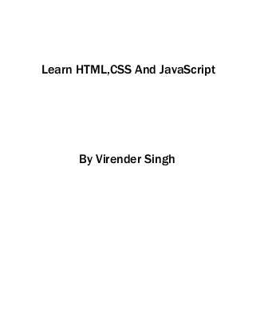


---

注意 在开始之前，你可能想回顾一下在 Web 服务器上放置文件的基础知识。`<a>` 标签的 `href` 属性标识你所链接的页面地址。在目录组中创建链接时，了解这些信息很重要。

## 如何在页面之间链接

无论你如何在目录中组织内容，都可以使用相对地址，相对地址仅包含从一个页面找到另一个页面所需的信息。相对地址描述了从完整（或绝对）互联网地址开始的路径。

警告 HTML 中始终使用正斜杠 `/` 来分隔目录。不要使用 `\` 反斜杠（通常在 Windows 中使用）来分隔目录。记住，网络中的一切都是向前的，所以请使用正斜杠。

## 如何链接到外部内容

如果你还记得第 1 章，Web 服务器的文档根是被指定为网页内容的顶层目录。在网址中，该文档根由正斜杠 `/` 表示。所有后续的目录级都由相同的正斜杠分隔。例如：`/directory/subdirectory/subsubdirectory/`

假设你在文档根目录下创建一个名为 `zoo.html` 的页面，并想链接到 `elephants` 子目录下的名为 `african.html` 和 `asian.html` 的页面。链接将如下：
```html
<a href="/elephants/african.html">了解非洲象</a>
<a href="/elephants/asian.html">了解亚洲象</a>
```
这些特定的地址实际上被称为“相对根地址”，因为它们是缺少整个域名的相对地址，但它们特异地相对于正斜杠所指定的文档根。使用普通的相对地址，你可以跳过初始的正斜杠。这种类型的地址允许链接相对于它们所在的任何目录变得有效——它可能是文档根，也可以是相对于文档根深一或多级的其他目录：
```html
<a href="elephants/african.html">了解非洲象</a>
<a href="elephants/asian.html">了解亚洲象</a>
```


可以通过以下两种方式链接回主 `zoo.html` 页面：

```html
<a href=”http://www.yourdomain.com/zoo.html”>Return to the zoo.</a
<a href=”/zoo.html”>Return to the zoo.</a>
<a href=”../zoo.html”>Return to the zoo.</a>
```

第一个链接是**绝对链接**（absolute link）。使用绝对链接时完全不需要疑问链接应该去向何，因为提供了完整的 URL——包括域名。

第二个链接是**相对根链接**（relative-root link）。它相对于你当前浏览的域名，因此不需要协议类型（例如 `http://`）和域名（例如 `www.yourdomain.com`），但提供了开头的斜杠表示该地址从文档根目录开始。

在第三个链接中，双点（`..`）是一个特殊命令，表示包含当前文件夹的文件夹——换句话说，就是父文件夹。每当你看到双点，只需心里想在目录结构中“向上一级”。

关于相对路径的通用规则是：当你链接存储在一起的文件（例如都是你网站的一部分的文件）时，应该使用相对路径。如果你在整个网页中始终使用相对路径，你就可以页面移动到另一个文件夹、磁盘驱动器或网络服务器，而无需更改链接。当你链接到其他地方的文件时，应使用绝对路径。

如有必要，相对地址可以跨越相当复杂的目录结构——另一台计算机、另一个磁盘驱动器，或者更常见的互联网上的另一个网站。第 27 章“网站的组织与管理”为组织和链接大量网页提供了更详细的建议。

### 亲自尝试一试

希望到现在，在学习这些章节时，你已经创建了自己的一两个页面。按照以下步骤添加更多几个页面并将它们链接在一起：创建一个简单的站点架构。

1. 使用首页作为主入口和中心枢纽，你所有的其他页面都连接在这里。如果你创建了一个关于你自己或你业务的页面，请使用该页面作为你的首页。你现在也也想为此目的创建一个新页面。
2. 在首页上，列出指向你创建的其他 HTML 文件的链接列表（或计划很快创建的 HTML 文件的占位符）。确保每个链接中的文件名拼写（包括任何大小写）都是正确的。
3. 在首页之外的每一个页面上，都在底部（或顶部）包含一个返回首页的链接。这使得在站点中导航变得简单快捷。
4. 你可能还想包含一个指向相关或有趣网站的链接列表，可以放在你的首页上，也可以放在单独的链接页面上。人们经常会在自己的首页列出朋友的个人页列表。然而，企业应该小心不要太快将潜在客户引导到其他网站——无法保证他们会记得在你自己的页面之间的链接使用相对路径，在指向其他网站的链接使用绝对路径。

### 使用锚点在页面内链接

`<a>` 标签——负责 Web 超链接的标签——其名称源于“anchor”（锚点）一词，意味着链接作为网页中某处的标记。在本书目前为止的所有示例中，你已经学习了如何使用 `<a>` 标签链接到其他地方，但这只是它用处的一半。让我们开始学习链接同一页面内内容的锚点链接。

#### 使用锚点识别页面中的位置

`<a>` 标签可以将页面上的某个位置标记为锚点，使能够创建一个指向该精确位置的链接。列表 7.1（在本章稍后给出）演示了指向页面内锚点的链接。为了查看如何制作此类链接，让我们先看一眼列表中的第一个 `<a>` 标签：

```html
<a id="top"></a>
```

注意：`<a>` 标签通常使用 `href` 属性来指定超链接目标。旧版本的 HTML 不使用 `id`，而是使用 `name`。`<a href>` 是你点击的地方，而 `<id>` 是你点击后去的地方。新版本的 HTML 和 XHTML 已经弃用了 `name` 属性，改为使用 `id`。在这个示例中，`<a>` 标签仍然指定了目标，但没有创建实际链接。相反，`<a>` 标签为标签所在的特定点指定了一个名称。必须包含 `</a>` 标签，并且必须为 `id` 属性分配一个唯一的名称，但 `<a>` 和 `</a>` 之间不需要任何文本。

#### 链接到锚点位置

列表 7.1 显示了一个在单个页面内放置了各种锚点的站点。查看 7.1 中的最后一个 `<a>` 标签以查看：

```html
<a href="#top">Return to Index.</a>
```

符号 `#` 意味着单词 `top` 指的是文档内一个命名的锚点而不是单独的页面。当用户点击此处时，浏览器将显示从 `<a id="top"></a>` 开始的页面部分。

```html
<?xml version="1.0" encoding="UTF-8"?>
<!DOCTYPE html PUBLIC "-//W3C//DTD XHTML 1.0//EN" "http://www.w3.org/TR/xhtml1/DTD/xhtml1.dtd">
<html lang="en">
<head>
<title>Alphabetical</title>
</head>
<body>
<h1 id="top">First Lines of Sonnets</h1>
<ul>
<li><a href="#top">A woman’s face with nature’s own hand painted,</a>
</li>
<li><a href="#top">Accuse me thus, that I have scanted all,</a>
</li>
<li><a href="#top">Against my love shall be as I am now,</a>
</li>
<li><a href="#top">Against that time (if ever that time come)</a>
</li>
<li><a href="#top">Ah wherefore with infection should he live,</a>
</li>
<li><a href="#top">Alack what poverty my muse brings forth,</a>
</li>
<li><a href="#top">Alas ‘tis true, I have gone here and there,</a>
</li>
<li><a href="#top">As a decrepit father takes delight,</a>
</li>
<li><a href="#top">As an unperfect actor on the stage,</a>
</li>
<li><a href="#top">As fast as thou shalt wane so fast thou grow’st,</a>
</li>
</ul>
<!-- 此段文本将出现在你的源代码中，但浏览器不会显示它。 -->
</body>
</html>
```


使用文本（如 `photo1`、`photo2` 等）而不是简单的 `1`、`2`，

<!-- 继续使用字母表 -->

### Z 等。纯数字

（没有哪首十四行诗是以 Z 开头的。）

锚点 ID 在 `<a href=”#top"><em>返回索引。</a></a>` 浏览器中可以工作，但它们不属于有效的 XHTML 代码。

</body></html>`

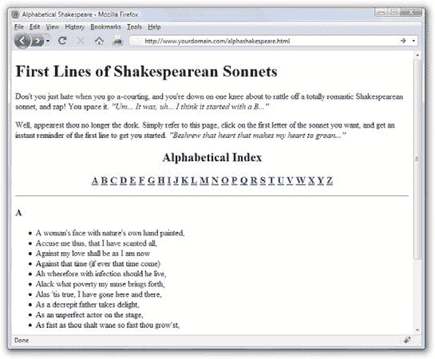 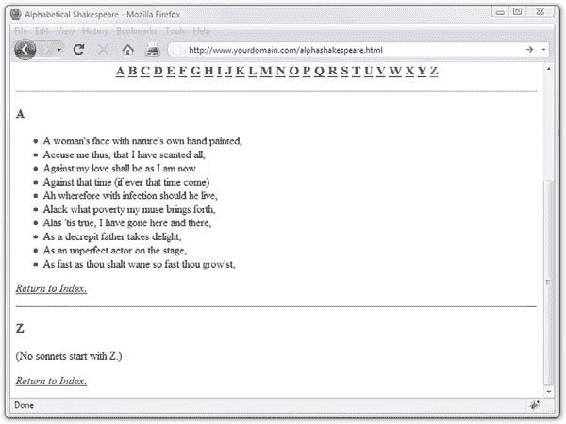 

#### 128 第 7 章 使用外部和内部链接

列表 7.1 中的每个 `<a href> ` 链接都会创建一个带下划线的链接，指向相应的 `<a id>` 锚点——如果我填充了所有文本，它本该如此。在这个示例中，只有 `A` 和 `Z` 有效，因为只有 `A` 和 `Z` 链接有对应的文本可以链接，但欢迎你自行填充其余部分！例如，点击图 7.1 中“字母索引”下的字母 `Z`，会将你带到图 7.2 所示的页面部分。

**图 7.1**
列表 7.1 中的 `<a id>` 标签在网页上完全没有出现。<a href>` 标签显示为带下划线的链接。

ptg999

**图 7.2**
点击图 7.1 所示页面上的字母 `Z` 将你带到同一页面的相应章节。

#### 在自己的网页内容之间建立链接 129

掌握了链接单页内文本段的概念后，你现在可以学习链接其他网页内容了。正如你在本章早期学到的，当链接到域名内的内容（或如果你在本地查看网站）时，不需要在 `href` 属性指定的每个地址之前包含 `http://`。当你从同一域名或同一台计算机上的一个文件创建到另一个另一个文件的链接时，你不需要指定完整的 Internet 地址。事实上，如果两个文件存储在同一个文件夹中，你只需使用 HTML 文件的文件名即可：

`<a href=”pagetwo.html">前往第 2 页。</a>`

例如，列表 7.2 和图 7.3 显示了一个测验页面，其中有一个指向列表 7.3 和图 7.4 中答案页的链接。答案页包含一个返回测验页面的链接。由于列表 7.2 中的页面链接到同一目录下的另一个页面，因此可以使用文件名代替完整地址。

**列表 7.2 historyanswers.html 文件**

```xml
<?xml version=”1.0” encoding=”UTF-8"?>
<!DOCTYPE html html PUBLIC “-//W3C//DTD XHTML 1.1//EN”
“http://www.w3.org/TR/xhtml11/DTD/xhtml11.dtd”>
<html xmlns=”http://www.w3.org/1999/xhtml” xml:lang=”en”>
<head>
<title>历史测验</title>
</head>
<body>
<h1>历史测验</h1>
<p>完成以下韵律诗句。（例如：征服者威廉在……一六六六年对撒克逊人使用了残忍的手段。）</p>
<ol>
<li>哥伦布航行在蓝色的海洋中，在……</li>
<li>西班牙 Armada 舰队在……遭遇了命运，</li>
<li>伦敦像腐烂木木一样燃烧，在……</li>
</ol>
<p style=”text-align: center;font-weight: bold;”>
<a href=”historyanswers.html">检查你的答案！</a>
</p>
</body>
</html>
```

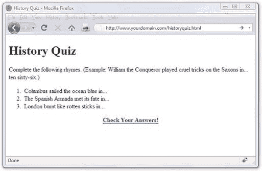 

#### 130 第 7 章 使用外部和内部链接

**图 7.3**
这是列表 7.2 中列出的 `historyquiz.html` 文件，并被列表 7.3 中的链接引用。

**列表 7.3 historyquiz.html 链接到的 historyanswers.html 文件**

```xml
<?xml version=”1.0” encoding=”UTF-8"?>
<!DOCTYPE html html PUBLIC “-//W3C//DTD XHTML 1.1//EN”
“http://www.w3.org/TR/xhtml11/DTD/xhtml11.dtd”>
ptg999
<html xmlns=”http://www.w3.org/1999/xhtml” xml:lang=”en”>
<head>
<title>历史测验答案</title>
</head>
<body>
<h1>历史测验答案</h1>
<ol>
<li>……一四九二二年。</li>
<li>……一五八八年。</li>
<li>……一六六六年。</li>
</ol>
<p style=”text-align: center;font-weight: bold;”>
<a href=”historyquiz.html">返回索引。</a>
</p>
</body>
```

#### 链接到你的网页内容 131

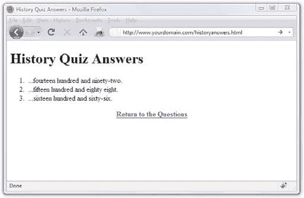 

### 在自己的网页内容之间建立链接

**图 7.4**
列表 7.2 中列出的 `historyanswers.html` 文件，并被列表 7.3 中的链接引用。


她可以输入信息并立即发送给你——无论对方使用什么电子邮件程序来收发邮件，系统都会自动调用。

### 链接到电子邮件地址 133

你可以在链接中提供一些额外信息，使得邮件的主题和正文也有默认值。你可以通过向 `mailto` 链接中添加 `subject` 和 `body` 变量来实现。你使用问号（`?`）将变量与电子邮件地址分开，使用等号（`=`）将值与变量分开，然后使用和符号（`&`）将每对变量值对隔开。目前你不需要理解变量/值的这些术语。以下是为前面的邮件示例指定主题和正文的示例：

```html
<a href=”mailto:author@somedomain.com?subject=Book Question&body=When is the next edition coming out?”>author@somedomain.com</a>
```

当用户点击此链接时，将创建一个电子邮件消息，其中 `author@somedomain.com` 为收件人，`Book Question` 为邮件主题，`When is the next edition coming out?` 为邮件正文。如果你只想指定邮件主题而不指定正文，可以只省略和符号、正文变量、等号和值文本字符串。

在你冲出去开始把你的电子邮件地址贴在所有网页上之前，我必须先给你一个小警告，然后教你一个实用的小技巧。你一定熟悉那些垃圾邮件发送者，他们建立电子邮件地址数据库，然后向其发送垃圾邮件广告。垃圾邮件发送者采集电子邮件地址的一种方法是使用自动搜索网页中 `mailto` 链接的程序。

幸运的是，有一个小技巧可以阻止大多数垃圾邮件发送者。这个技巧涉及使用字符实体（character entities）对你的电子邮件地址进行编码，这会混淆试图从你的网页中采集地址的爬虫程序。例如，取电子邮件地址 `jcmeloni@gmail.com`。如果你将地址中的字母替换为相应的字符实体，大多数邮件采集程序都会失效。小写 ASCII 字符实体从字母 `a` 的 `&#97;` 开始，按字母表顺序增加。例如，字母 `j` 是 `&#106;`，`c` 是 `&#99;`，以此此类推。将所有字符替换为它们的 ASCII 属性将产生如下结果：通常习惯在每个网页的底部放置一个指向网页作者的邮件链接。

```html
<a href=”mailto:&#106;&#099;&#109;&#101;&#108;&#111;&#110;&#105;&#064;&#103;&#109;&#097;&#105;&#108;&#046;&#099;&#111;&#109;">Send me an email message.</a>
```

这不仅让别人方便与你联系，还让他们有机会向你反馈测试中可能遗漏的页面任何问题。因为浏览器将字符编码解释为……嗯，字符，从浏览器的角度来看，结果是相同的。然而，自动邮件采集程序会在原始 HTML 代码中搜索页面，在这种情况下，页面显示的是看起来相当杂乱的电子邮件地址。如果你不想为自己的地址计算字符编码，只需在搜索引擎中输入 `email address encoder`，你就能找到一些在线服务可以为你生成编码后的字符串。

第 7 章 使用外部和内部链接

### 在新浏览器窗口中打开链接

现在你已经掌握了如何为链接创建地址——包括内部链接（站内）和外部链接（站外）——还有一种额外的链接方法：强制用户在新窗口中打开链接。你一定听过弹出窗口，即那种在未经用户许可的情况下自动打开并显示的浏览器窗口——通常用于投放产品或服务的广告。然而，在某些情况下，打开另一个窗口或将目标指向另一个位置确实有正当的用途。例如，你可能希望在一个较小的次要浏览器窗口中展示信息，但仍然允许用户在主窗口中查看信息。这在点击指向动画演示、电影片段或其他多媒体元素的链接时通常如此。当你链接到站外内容时，可能也希望目标一个新浏览器窗口。

然而，代表用户打开新浏览器窗口——尤其是当它是全屏新窗口时——违背了一些易用性和可访问性原则。当人们打开新窗口时，通常是通过使用 `<a>` 标签的 `target` 属性实现的。在严格的 XHTML1.1 规范中，`target` 属性已从 `<a>` 标签中移除。虽然可以在遵循易用性和可访问性原则的同时实现相同结果，但这些方法需要 JavaScript 和其他技术。

### 使用 CSS 为链接设置样式

网页上文本超链接的默认显示是蓝色下划线文本。你可能还注意到访问过的链接显示为紫色下划线文本——那种颜色也是默认的。如果你在 Web 上待过任何时间，你会注意到可以使用 CSS 让你的链接呈现任何你想要的样子。例如，`<a>` 标签常见的伪类有 `link`、`visited`、`hover` 和 `active`。你可以用记忆诀“Love-Hate”（爱恨）来记住它们：LV (love) HA (hate)。

- `a:link`:描述以前未访问过的超链接样式。
- `a:visited`:描述已访问且存在于浏览器内存中的超链接样式。
- `a:hover`:描述用户鼠标悬停在链接上时（在点击之前）的样式。
- `a:active`:描述正在被点击但尚未松开鼠标的超链接样式。

例如，假设你想创建一个具有以下样式的链接：
- 字体为加粗的 Verdana（且没有下划线，意味着没有文本装饰）
- 基础颜色为浅蓝色
- 当用户悬停或点击时，颜色为红色
- 当用户访问后，颜色为灰色

你的样式表条目可能如下：

```css
a {
  font-family: Verdana, sans-serif;
  font-weight: bold;
  text-decoration: none;
}

a:link {
  color: #6479A0;
}

a:visited {
  color: #CCCCCC;
}

a:hover {
  color: #E03A3E;
}

a:active {
  color: #E03A3E;
}
```

因为示例链接无论处于何种状态都是 Verdana 加粗（且没有下划线），所以这三组属性值对可以放在 `a` 选择器的规则中。然而，由于每个伪类必须有一个


## 第 7 章：使用外部和内部链接

与其相关的特定颜色，我们为每个伪类使用了一个规则，如代码示例所示。伪类会继承父规则的样式，除非该伪类的规则专门地覆盖（override）了该规则。换句话说，上一个示例中的所有伪类都将是 Verdana 粗体（且不带下划线）。然而，如果我们为 `hover` 伪类使用了以下规则，当用户将鼠标悬停在链接上时，文本将以 Comic Sans 字体显示（如果用户确实安装了 Comic Sans 字体）：

```css
a:hover {
  font-family: “Comic Sans MS”;
  color: #E03A3E;
}
```

此外，由于 `active` 和 `hover` 伪类使用相同的字体颜色，你可以将它们的样式规则合并：

```css
a:hover, a:active {
  color: #E03A3E;
}
```

列表 7.4 将这些代码段组合在一起，生成一个使用样式化伪类的页面；该代码的结果可以在图 7.5 中看到。

### 列表 7.4 使用样式显示链接伪类

```xml
<?xml version=”1.0” encoding=”UTF-8"?>
<!DOCTYPE html PUBLIC “-//W3C//DTD XHTML 1.1//EN”
“http://www.w3.org/TR/xhtml11/DTD/xhtml11.dtd”>
<html xmlns=”http://www.w3.org/1999/xhtml” xml:lang=”en”>
<head>
  <title>示例链接样式</title>
  <style type=”text/css">
    a {
      font-family: Verdana, sans-serif;
      font-weight: bold;
      text-decoration: none;
    }
    a:link {
      color: #6479A0;
    }
    a:visited {
      color: #CCCCCC;
    }
    a:hover, a:active {
      color: #FF0000;
    }
  </style>
</head>
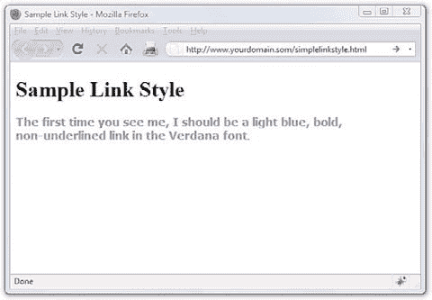 
<body>
  <h1>示例链接样式</h1>
  <p><a href=”simplelinkstyle.html">当你第一次看到我时，我应该是一个浅蓝色、粗体、不带下划线的 Verdana 字体链接</a>。</p>
</body>
</html>
```

**图 7.5**
链接可以使用特定的样式来控制视觉显示。

如果你在网络浏览器中查看此示例，链接确实应该是浅蓝色、粗体、不带下划线的 Verdana 字体。当你将鼠标悬停在链接上，或者在不松开鼠标的情况下点击链接时，它应该会变成红色。如果你点击并释放链接，页面将简单地刷新，因为该链接指向同名文件。然而，此时链接将存在于浏览器的内存中，因此将显示为已访问过的链接——它将显示为灰色而不是蓝色。

你可以使用 CSS 对你的链接应用广泛的文本相关更改。你可以更改字体、大小、粗细、装饰等。有时你可能希望在样式表中使用几组不同的链接样式。在这种情况下，你可以创建类（classes）；你并不局限于为 `<a>` 标签使用一组样式。以下示例是为 `footerlink` 类的一组样式表规则，用于我可能想要放置在网站页脚区域链接：

```css
a.footerlink {
  font-family: Verdana, sans-serif;
  font-weight: bold;
  font-size: 75%;
  text-decoration: none;
}
a.footerlink:link, a.footerlink:visited {
  color: #6479A0;
}
a.footerlink:hover, a.footerlink:active {
  color: #E03A3E;
}
```

正如接下来的示例所示，类名 `footerlink` 出现在选择器名称 `a` 之后，用点隔开，并在伪类名 `hover` 之前，用冒号隔开：

`selector.class:pseudoclass`
`a.footerlink:hover`

## 总结

`<a>` 标签是使文本变为“超”（hyper）的关键。通过它，你可以创建页面之间的链接以及指向任何页面上特定锚点的链接。本章侧重于使用相对地址或绝对地址识别页面，从而创建并设置指向其他页面的简单链接。

你学习到，当你创建指向他人页面的链接时，在 `<a href="...">` 标签中包含每个页面的完整 Internet 地址很重要。对于你自己页面之间的链接，只需包含文件名以及从一个页面跳转到另一个页面所需的目录信息。

你发现了如何在页面内创建命名的锚点，以及如何创建指向特定锚点的链接。你还学习了如何链接到你的电子邮件地址，以便用户方便地向你发送消息。你甚至学习了如何保护你的电子邮件免受垃圾邮件攻击。最后，你学习了使用 CSS 控制链接显示的方法。

表格 7.1 总结了本章讨论的 `<a>` 标签。

### 表格 7.1 本章涵盖的 HTML 标签和属性

| 标签 | 功能 |
| :--- | :--- |
| `<a>...</a>` | 创建指向 |
| `href="address"` | 链接的地址 |
| `id="name"` | 锚点的名称 |

## 问答

**Q：如果我链接到互联网上的另一个页面，对方删除了该页面会发生什么？**
A：这取决于该页面维护者是如何设置的。

**Q：内部链接在电脑上运行正常，但当我把页面放在网上时就不行了。**
A：这些是可能的罪魁祸首：
- **大小写问题**：在 Windows 电脑上，链接 `MyFile.html` 使用 `<a href="myfile.html">` 是有效的。更糟糕的是某些文本编辑器和文件传输程序会更改大小写而不通知你。最好的解决方案是坚持使用小写。
- **文件名中的空格**：大多数 Web 服务器不允许包含空格。例如，你不应该将网页命名为 `my page.html`。应该将其命名为 `mypage.html` 或 `my_page.html`（使用下划线代替空格）。
- **本地绝对地址**：如果由于某种原因使用本地绝对地址链接，例如 `C:\mywebsite\news.html`，当文件放在网上时链接将无法工作。你不应该使用本地绝对地址；当这种情况发生时，通常是为了测试页面部分而创建临时链接。

**Q：我可以在同一个 `<a>` 标签中同时放置 `href` 和 `id` 吗？我有理由需要这样做吗？**
A：可以，如果你有一个命名的锚点和一个链接相互指向，这可能会节省一些打字时间。然而，通常最好分开使用，以避免混淆，因为它们在 HTML 文档中扮演的角色完全不同。

**Q：我不小心写错了锚点名称或忘记在前面加 `#` 会发生什么？**
A：如果你链接到一个页面内不存在的锚点名称或写错了锚点名称，链接将跳转到页面顶部。

### 练习

练习包含测试题和练习，旨在帮助巩固对所涵盖内容的理解。在查看后面的“答案”部分之前，尝试回答所有问题。

### 测试

1. 你的小学同学在互联网上发现了你，说想交换主页链接。你如何在你的页面上放置指向他网站 `www.supercheapsuits.com/~billybob/` 的链接？
2. 使用什么 HTML 可以让点击页面顶部的“作者简介”字样的人跳转到列表？


页面其他地方的致谢？

3. 如果你的电子邮件地址是 `bon@soir.com`，你如何将文本“goodnight greeting”（晚安问候）变成一个人们可以点击以编写并发送电子邮件给你的链接？

### 答案

1. 在你的页面上放置以下内容：
```html
ptg999
<a href=”http://www.supercheapsuits.com/~billybob/>Billy Bob’s site</a>
```

2. 在页面顶部输入内容：
```html
<a href=”#credits”>About the Authors</a>
```
在致谢部分的开头输入内容：
```html
<a id=”credits”></a>
```

3. 在你的网页上输入以下内容：
```html
Send me a <a href=”mailto:bon@soir.com”>goodnight greeting</a>!
```

### 练习

- 创建一个 HTML 文件，其中包含你喜喜网站的格式化列表。你可能已经在浏览器中收藏了这些网站，在这种情况下，你可以访问它们并在浏览器的地址栏中找到准确的 URL。
- 如果你为某个网站创建了任何页面，请检查它们并考虑文中是否有任何地方你希望人们方便联系你。在那个地方包含一个指向你电子邮件地址的链接。你永远无法给人们提供足够的联系的机会并告诉他们需要什么或他们对你产品的看法——尤其是当你经营业务时。

# 第 8 章：使用颜色、图像和多媒体

这个列表看起来可能很长，但这些任务每一个都短小精悍，并将帮助你将你的 Web 开发经验从本书目前为止的白背景/黑文字示例转向更有趣（或至少是色彩斑纷）的示例。但并不是说浅色背景上的深色文字不好——事实上，这是你在网上最常见的颜色组合。

虽然关注配色方案和制作具有视觉吸引力的网站很重要，但你不需要成为职业艺术家就能在你的网页上放置高影响力的图形。更重要的是，你不需要在软件上花费数百或数千美元。本章将帮助你开始创建一些可以在网站使用的图像。虽然本章中的示例使用的是适用于 Windows、Mac 和 Linux 用户的免费图形程序（GNU 图像处理程序，或 GIMP），但你可以将本章中学的知识应用于任何主要的 Windows 或 Macintosh 图形应用程序——尽管菜单和选项看起来略有不同。

在你学会创建图形本身之后，你将学习如何使用 HTML 和 CSS 整合你的图形。在章节的最后，你将学习一些关于将额外的媒体或多媒体集成到你的网站的内容。

### 你在本章中将学习：

- 如何为你的网站选择适用于 Web 的颜色
- 如何使用 CSS 设置背景颜色、文本边框
- 如何为在线使用准备照片
- 如何创建横幅和按钮
- 如何减少图像中的颜色数量
- 如何创建透明图像
- 如何为平铺背景准备图像
- 如何在网页上放置图像
- 如何用文本描述图像
- 如何指定图像的高度和宽度
- 如何对齐图像
- 如何使用背景图像
- 如何使用图像映射
- 如何使用多媒体文件

## 选择颜色的最佳实践

我不能准确告诉你在网站中应该使用哪些颜色，但我可以帮助你理解自己在选择这些颜色时应该考虑的因素。你使用的颜色会极大影响你的访问者；如果你经营一个电子商务网站，你将希望使用诱导用户查看你的目录并最终购买东西的颜色。为此，你想要确保颜色的使用是谨慎且尊重的。你可能会奇怪在谈论颜色时“尊重”是如何参与其中的，但请记住万维网是一个国际社区，解释方式各异；例如，粉色在日本是非常流行的颜色，但在东欧国家非常不受欢迎。同样，绿色在美国是金钱的颜色，但绝大多数其他国家的纸币是多颜色的，使得“金钱的颜色”根本不是单一颜色，因此这种比喻对他们来说毫无价值。

除了使用具有文化敏感性的颜色外，其他最佳实践包括以下内容：

- **使用自然的色板。** 这并不意味着你应该使用大地色调，而是指使用人们在镇上闲逛时自然看到的颜色——避免使用会导致引起眼睛疲劳的超亮颜色。
- **使用较小的色板。** 你不需要使用 15 种不同的颜色来实现你的目标。事实上，如果你的页面包含 15 种不同颜色的文本和图像，你可能需要重新评估你试图传达的信息。专注于三四个主颜色，最多配合几种互补色。
- **考虑你的人口特征。** 你可能无法控制你的人口特征，因此必须找到一个兼顾所有人的折中方案。年轻人喜欢的颜色并不一定是老年人喜欢的，就像男性和女性之间以及不同地区的人之间存在颜色偏好一样。

色轮是一个以圆形方式组织颜色的图表。这种显示方法试图帮助你可视化原色、间色和互补色之间的关系。配色方案是根据色轮的使用开发的；理解配色方案可以帮助你确定在整个网站中一致使用的色板。一些常见的配色方案如下：

- **类比色**：色轮上相互相邻的颜色，例如黄色和绿色。一种颜色作为主色，它的类比色用于丰富视觉效果。
- **互补色**：色轮上相互相反的颜色，例如暖色（红色）和冷色（绿色）。own
- **三角色**：在色轮上等间距的三种颜色。三角色方案在提供平衡的同时，仍允许丰富的色彩使用。

有整本书籍和课程致力于理解颜色理论，因此在书中继续讨论这个话题确实是离题。然而，如果你打算从事 Web 设计和开发，对颜色理论基础的牢理解将让你受益匪浅。花些时间阅读它——在线搜索将提供丰富的信息。

在网页上指定白色以外的背景颜色比你想象的要简单得多。例如，要在页面上指定蓝色作为背景颜色，在 `<body>` 标签内部放入 `style="background-color:blue"`。有关 140 种描述性颜色名称的完整列表，其标签或在样式表的 body 规则中。当然，你可以使用`十六进制代码`，并将颜色的示例作为 dis-


除了蓝色外的许多颜色。事实上，你的浏览器支持的 W3C 标准中列出了 16 种颜色：青色（aqua）、黑色（black）、蓝色（blue）、品红色（fuchsia）、灰色（gray）、绿色（green）、柠檬绿（lime）、栗红色（maroon）、海军蓝（navy）、橄榄绿（olive）、`http://www.w3schools.com/`紫色（purple）、红色（red）、银色（silver）、蓝绿色（teal）、白色（white）和黄色（yellow）。HTML/html 颜色名称。

显然，网页上显示的颜色远不止这 16 种。事实上，有 140 种颜色名称你可以放心使用，所有浏览器都会以相似的方式显示这些颜色。以下是部分 140 个描述性颜色名称列表：天蓝色（azure）、杏色（bisque）、花蓝色（cornflowerblue）、深鲑橙色（dark-salmon）、砖红色（firebrick）、蜜色（honeydew）、柠檬奶油色（lemonchiffon）、木瓜色（papayawhip）、桃粉色（peachpuff）、马鞍棕（saddlebrown）、蓟色（thistle）、西红柿色（tomato）、小麦色（wheat）和烟白色（whitesmoke）。

# 第 8 章：处理颜色、图像和多媒体

**提示** 但名称是主观的——例如，如果你查看 140 种跨浏览器颜色对照表，你将无法区分品红色（fuchsia）和洋红色（magenta）。这时你会发现，这两个术语（fuchsia 和 magenta）相关的十六进制颜色值是完全相同的：`#FF00FF`。你将在下一节中学习十六进制颜色值，但现在请记住，如果你想符合标准，应该尽可能使用十六进制颜色代码。

因此，`Black`、`black` 和 `BLACK` 颜色值都是黑色，尽管大多数网页设计师倾向于使用小写或混合大小写（如果他们使用了颜色名称的话；由于大多数设计师会使用超过 W3C 标准规定的 16 种颜色，因此使用十六进制表示法可以对颜色的使用进行更细致的处理）。事实上，通过十六进制颜色代码可以实现 1600 万种颜色。然而，大多数现代计算机显示器“只能”显示 16,384 种。但 16,384 仍然比 140 或 16 多得多。你应该意识到，并不是所有的计算机显示器显示的颜色色调都是相同的。在你的显示器上看起来是漂亮的浅蓝色背景色，在另一个用户的显示器上可能更偏紫色调。中性大地色系颜色（如中灰色、褐色和象牙色）在许多计算机显示器上可能会产生更不可预测的结果。根据房间的光线条件或一天中的时间，这些颜色在显示器上甚至可能发生变化。

除了将页面背景更改为白色以外的颜色外，你还可以更改文本链接的颜色，包括链接的各种属性（例如用户悬停在链接上颜色与用户点击链接时的颜色——正如你在之前的章节中所学的那样）。你还可以设置容器元素（如段落、div、引用块和单元格）的背景颜色，并可以使用颜色来指定这些元素的边框。你将在本章后面的部分看到一些颜色和容器元素的示例。

网络上有许多非常糟糕的网站，有些是由认真的人创建的，完全没有任何讽刺意味。然而，图 8.1 所示的“世界上糟糕的网站”是专门为了展示网站设计中一些更严重的罪过，特别是其对色彩的使用。截图并不能体现它的全部特征——请访问并在 `http://www.angelfire.com/super/badwebs/main.htm` 亲自体验该网站。

如果你在搜索引擎中搜索 `bad website examples`（糟糕网站示例），你会发现许多网站收集了糟糕设计的示例，并解释了了为什么此类网站应该进入“耻辱柱”而不是“名人堂”。许多网站因为其视觉显示被认为是糟糕的，而这种显示是从颜色选择开始的。因此，理解颜色以及它们在规范和使用的细微差别，是创建一个优秀网站的关键步骤。

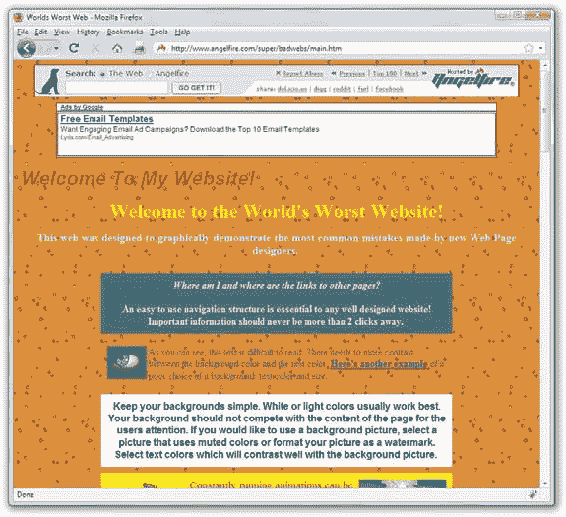

图 8.1：“世界上糟糕的网站”的部分截图。

## 使用十六进制值表示颜色

为了符合标准并保持对网站中颜色的精确控制，你可以通过其十六进制值来引用颜色。颜色的`十六进制值`表示了每种颜色中应该混合多少的红光、绿光和蓝光。它的原理有点像橡皮泥——只需混合你所需的红色、蓝色和绿色量即可获得相应的颜色。

十六进制颜色格式为 `#rrggbb`，其中 `rr`、`gg` 和 `bb` 是颜色的红色（`rr`）、绿色（`gg`）和蓝色（`bb`）组件的两位十六进制值。如果你不熟悉十六进制，不用担心。只需记住 `FF` 是最大值 `00` 是最小值。为每个组件使用以下代码之一：

- `FF` 意味着全亮度。
- `CC` 意味着 80% 亮度。
- `99` 意味着 60% 亮度。
- `66` 意味着 40% 亮度。
- `33` 意味着 20% 亮度。
- `00` 意味着没有。

例如，亮红色是 `#FF0000`，深绿色是 `#003300`，紫色是 `#660099`，中灰色是 `#999999`。要创建一个红色背景和绿色文本的页面，HTML 看起来如下：

```html
<body style="background-color:#FF0000; color:#003300">
```

虽然这里只显示了六个两位值的示例，但实际上三个组件中的每个都有 256 个可能的值——从 `0` 到 `F` 成对出现。

在选择颜色时（无论是通过图形程序还是在网上找到你喜欢的颜色），你可能会看到十六进制颜色进制。如果你在搜索引擎中输入 `hexadecimal color converter`（十六进制颜色转换器），你会发现许多帮助你将颜色值转换为可以在样式表中使用的选项。

正如之前讨论的，十六进制表示法对应某些数值。因此，白色（`#FFFFFF`）对应红色值 255、绿色值 255 和蓝色值 255。同样，黑色（`#000000`）对应红色值 0、绿色值 0 和蓝色值 0。真红 `#FF0000`（全红、无绿、无蓝），真绿 `#00FF00`（无红、全绿、无蓝），真蓝 `#0000FF`（无红、无绿、全蓝）。

## 使用 CSS 设置背景、文本和边框颜色

在使用 CSS 时，有三种可以使用颜色值的情况：指定元素的背景颜色、文本颜色或边框颜色时。之前的章节包含指定颜色的示例，但没有深入讨论颜色概念或颜色理论。例如，在第 7 章“使用外部和内部链接”中，你学习了如何为各种链接状态使用颜色。

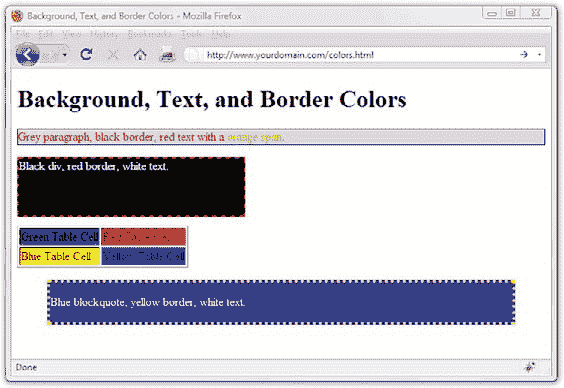

图 8.2：都可以使用 CSS 设置背景、文本和边框颜色。


# Colors

```xml
<?xml version="1.0" encoding="UTF-8"?>
<!DOCTYPE html PUBLIC "-//-//W3C//DTD XHTML 1.1//EN"
"http://www.w3.org/TR/xhtml11/DTD/xhtml11.dtd">
<html xmlns="http://www.w3.org/1999/xhtml" xml:lang="en">
<head>
<title>Background, Text, and Border Colors</title>
</head>
<body>
<h1>Background, Text, and Border Colors</h1>
<p style="background-color:#CCCCCC;border:1px solid #000000; color:#FF0000">
Grey paragraph, black border, red text with a
<span style="color:#FFA500">orange span</span></p>
<div style="width:300px; height:75px;background-color:#000000; border:2px dashed #FF0000;color: #FFFFFF">
Black div, red border, white text. </div>
<table border="1">
<tr>
<td style="background-color: #00FF00">Green Table Cell</td>
<td style="background-color: #FF0000">Red Table Cell</td>
</tr>
<tr>
<td style="background-color: #FFFF00">Blue Table Cell</td>
<td style="background-color: #0000FF">Yellow Table Cell</td>
</tr>
</table>
<blockquote style="background-color:#0000FF;border:4px dotted #FFFF00; color:#FFFFFF"><p>Blue blockquote,
yellow border, white text.</p></blockquote>
</body>
</html>
```

通过观察 `Listing 8.1` 中使用的样式，你应该能够推断出几乎所有的内容，除了一些边框样式之外。在 CSS 中，边框在没有指定宽度和类型的情况下是不能指定颜色的；在 `Listing 8.1` 显示的第一个示例中，边框宽度为 `1px`，边框类型为 `solid`（实线）。在 `Listing 8.1` 显示的第二个示例中，边框宽度为 `2px`，边框类型为 `dashed`（虚线）。在 `Listing 8.1` 显示的第四个示例中，边框宽度为 `4px`，边框类型为 `dotted`（点线）。

为你的网站选择颜色时，请记住少用是多——如果你非常喜欢某种亮丽且夺目的颜色，请将其用作 `accentcolor`（强调色），而不是贯穿整个主要设计元素。为了可读性，请记住浅色背景深文字比深色背景浅文字更容易阅读。

最后，考虑到你的受众中有一部分不容忽视的色盲群体。为了无障碍访问，你可以考虑使用 `http://colorfilter.wickline.org/`  `Colorblind Web Page Filter` 工具，查看你的网站在色盲人士眼中是什么样的。然而，如果你没有处理计算机图形的经验，这将非常昂贵且复杂。更多关于 Adobe 产品的信息，请访问 Adobe 网站 `http://www.adobe.com/`。如果你想购买他们的产品之一，可以从他们的网站下载免费的评估版本。

图形学最少需要的知识

在接下来的章节中，你将学习任何维护网站的人都应该快速掌握的一些基本操作，这是节省时间的最好方法之一。

你可以使用几乎任何图形程序来为你的网站创建和编辑图像，从计算机操作系统通常自带的简单画图程序到像 `Adobe Photoshop` 这样昂贵的专业程序。同样，如果你的电脑连接了数字相机或扫描仪，它可能自带了一些能够创建网页图形的图形软件。还有几种可以下载的免费图像编辑器——甚至可以作为 Web 应用程序在线使用——它们专门处理照片元素的编辑。

如果你已经有了你认为可能有助于创建网页图形的软件，请尝试用它来完成后续章节中描述的所有操作。如果你的软件无法完成这里涵盖的一些任务，那么它可能不是一个良好的网页图形工具。在那种情况下，请从 `http://www.gimp.org` 下载并安装 `GIMP`。

选择图形软件

为你的网站选择整体配色方案是一回事；而创建或编辑用于这些模板的图像则是另一回事——而且超出了本书的范围（或者说，超出了单本书的范围）。

使用其他网站的素材

创建网页的图形和媒体文件的最好的方法显然是完全避免创建它们。从任何网页上获取图形只需右键点击它（或在 Macintosh 鼠标上点击并按住按钮）并选择 `图像另存为` 或 `图片另存为`（取决于你的浏览器）。从页面提取背景图像同样简单：右键点击它并选择 `背景另存为`。然而，你绝不要在没有者明确许可的情况下使用图像，可以通过寻找 `Creative Commons`（知识共享）许可协议来实现。


下载时间会更长，而且图像会经过处理以压缩重复模式。图像压缩的数学原理非常复杂，但基本思想是当图像存储在磁盘上时，重复的模式或大面积的颜色可以被压缩。这使得图像文件小得多，而且在设计网站时，显示尺寸或传输大小是你应该考虑的因素。这使得图像可以在互联网上传输得更快。然后，网络浏览器在显示图像时会恢复图像的原始外观。

在接下来的章节中，你将学习如何创建视觉冲击力强但文件大小较小的图形。你实现这一目标的技术取决于每张图像的内容和用途。网络图形的用途与网页的数量一样多，但四种类型的图形是最常见的：

1. 人、产品或场所的照片
2. 图形横幅和 Logo
3. 用于指示操作和提供链接的按钮或图标
4. 容器元素的背景纹理

## 准备摄影图像

**提示**：要在你的网页上放置照片，你需要将打印的照片转换为数字图像，或使用数码相机拍摄数字照片。如果你没有扫描仪或数码相机，几乎所有的冲洗店都提供一种服务，可以以少量费用将照片从 35mm 胶片传输到 CD-ROM 或 DVD-ROM。你可能需要使用扫描仪或相机自带的自定义软件将图片保存到硬盘上，或者你可以直接将文件从 CD-ROM 或 DVD-ROM 复制到硬盘，并将相机中的文件拖入硬盘。如果你正在使用扫描仪创建打印照片的数字版本，你可以从你选择的图形程序直接控制扫描仪的任何方面——详情请参见软件文档——然后使用你的图形程序打开并修改图像文件。

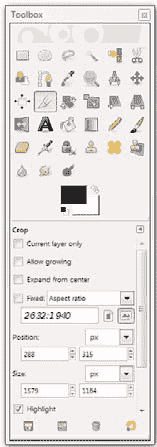 

准备摄影图像 151

在你将数字图像文件传输到计算机后，你可以使用图形程序对其进行裁剪、调整大小、色彩校正和压缩，以便准备在你的网站中使用。

### 裁剪图像

由于你希望网页图形尽可能紧凑，你通常需要对数字照片进行裁剪。当你 `crop`（裁剪）一张照片时，你选择想要显示的区域，并裁剪掉其余部分。

**动手试试** ▼

GIMP 工具箱提供了快速访问裁剪工具及其可能属性。找到一个图像文件——无论是你用相机拍摄并存储在硬盘上的数字图像，还是你在网上找到的图像。在 GIMP 中打开图像后，执行以下步骤在 GIMP 中对其裁剪：

1. 在 GIMP 工具箱中，点击 `crop tool`（裁剪工具）（见图 8.3）。根据你选择的工具，可能会额外的可以选择的属性。例如，图 8.3 显示了裁剪工具的属性（如比例、位置、尺寸等）。

ptg999
图 8.3
从工具箱选择裁剪工具。

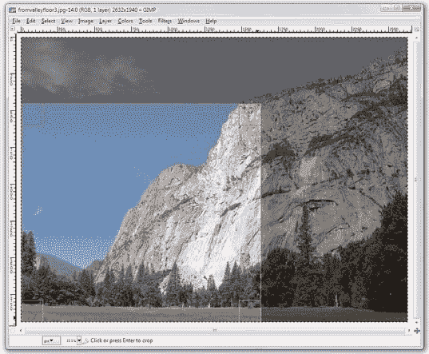 

152 第 8 章 颜色、图像和多媒体处理

▼ 动手试试

2. 在你想要裁剪的图像中，点击想要保留部分的左上角，并按住左鼠标键向下拖到右下角，为选择区域画一个框（见图 8.4）。

图 8.4
选择你想要显示的图像区域。

ptg999

3. 点击选择区域的一个角来应用裁剪。你的你的图形程序可能会有与所示不同的方法，但原理是相同的：选择要保留的区域，然后裁剪掉其余部分。

**提示**：即使图像已经过裁剪，它可能仍然比网页所需的尺寸要大。取决于特定网页的设计，你可能希望将大图像限制在不超过 800×600 像素（如果它单独显示在页面上，例如产品目录中），甚至是 640×480 像素或更小。当与文本并排显示时，图像的宽度通常在 250 到 350 像素之间，这样就有足够的空间给文本。在某些情况下，你可能还想提供图像的缩略图并链接到较大的版本，在这种情况下，你可能会在缩略图的最大尺寸上更接近 100 像素。

你的图形软件可能在图像窗口本身的某处有一个无处不在的尺寸显示。在 GIMP 中，可以在窗口的右下角或左下角查看当前图像尺寸。你可能还会看到窗口中的放大倍率以及更改它的功能（通过放大或缩小）。

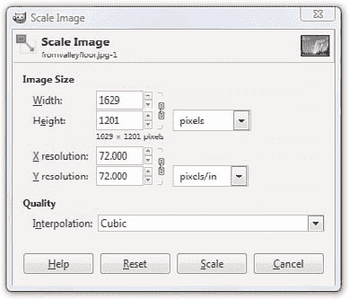 

准备摄影图像 153

### 调整图像大小

更改图像尺寸所需的精确工具取决于你正在使用的程序。在 GIMP 中，转到 `Image`（图像）菜单并点击 `Scale Image`（缩图像）打开 `Scale Image` 对话框（见图 8.5）。

图 8.5
使用 Scale Image 对话框更改图像尺寸。

ptg999

你几乎总是希望使用现有的比例来调整大小，这意味着当你输入想要图像的宽度时，高度将自动计算（反之亦然），以保持图像不变形。在 GIMP 中，默认情况下比例是锁定的，如包含图像的窗口中显示的 `Width`（宽度）和 `Height`（高度）选项旁边的链条链接所示。

**注意**：像 GIMP 中的许多功能一样，`Scale Image` 对话框显示在窗口前面。图 8.5 点击链条即可解锁它，允许你在 `Width`（宽度）和 `Height`（高度）选项中...

在大多数（如果不是所有）图形程序中，你还可以根据百分比而不是特定的像素尺寸来调整图像。例如，如果我的图像最初是 1629×1487，而我不想计算将其减为一半所需的数值，我只需选择 `Percent`（百分比）（在此实例是从图 8.5 旁边的下拉菜单中），并将默认设置 100 改为 50。那么图像宽度将变为 815 像素，高度为 744 像素——我不需要计算。

### 调整图像颜色

如果你是在编辑摄影图像而不是创建自己的图形，你可能需要使用一些色彩校正工具使照片达到完美状态。像许多图像编辑程序一样，GIMP 提供了调整图像亮度、对比度和色彩平衡的多种选项，还有一个用于消除讨厌红眼的过滤器。要在 GIMP 中消除红眼，转到 `Filters`（过滤器），点击 `Enhance`（增强），然后点击 `Red Eye Removal`（消除红眼）。大多数选项都非常直观。如果你想要图像更亮，就调整亮度。如果你想要图像中有更多红色，就调整色彩平衡。在 GIMP 中，`Colors` 菜单让你可以使用许多工具。与上一节描述的 Scale Image 对话框一样，每个工具都会在工作区的前景显示一个对话框。当你调整颜色时，图像会反映这些变化。这种预览功能是大多数图像编辑软件都包含的功能。

图 8.6 显示了 `Adjust Hue/Lightness/Saturation`（调整色相/亮度/饱和度）工具，它是 `Colors` 菜单提供的许多工具之一。如图所示，许多


颜色相关的更改是通过使用对话框中的各种滑块来调整你正在操作的值的。`Preview`（预览）功能让你在操作的同时看到效果。`Reset Color`（重置颜色）按钮可以将图像恢复到原始状态，不应用任何更改。

ptg999

图 8.6

`Adjust Hue/Lightness/Saturation`（调整色调/亮度/饱和度）工具是 GIMP 中许多基于滑块的修改工具之一。由于可以使用许多工具，而且每个工具都有预览功能，稍微尝试一下是发现每个工具功能的最佳方法。


# 创建横幅和按钮 155

## 控制 JPEG 压缩

网络上的照片如果保存为 `JPEG` 格式而非 `GIF`，效果最好；`JPEG` 允许你在保留文件中颜色数量的同时，将整体文件大小保持在可接受的范围内。当你完成照片尺寸和外观的调整后，选择 `File`（文件）、`Save As`（另存为）并选择 `JPEG` 作为文件类型。你的图形程序可能会为你提供另一个对话框，你可以在其中控制各种 `JPEG` 选项，例如压缩。

图 8.7 显示了你在 GIMP 中保存 `JPEG` 时看到的 `Save as JPEG`（另存为 JPEG）对话框。你可以看到，通过调整 `Quality`（质量）滑块在 `1`（低质量，小文件）和 `100`（高质量，大文件）之间，你可以控制保存 `JPEG` 文件的压缩率。

图 8.7

GIMP 允许你通过以 `JPEG` 格式保存来减少文件大小的同时保留图像质量。

pt999

你可能想实验一下看看不同的 `JPEG` 压缩级别如何影响图像质量，但对于大多数照片来说，85% 的质量（或 15% 的压缩）通常是文件大小（以及下载速度）与质量之间很好的折中方案。

## 创建横幅和按钮

从零开始创建的图形（如横幅和按钮）需要你考虑与照片完全不同的独特因素。156 第 8 章 处理颜色、图像和多媒体

**提示** 制作横幅或按钮时需要做出的第一个决定是（多年来设计时的）它应该有多大。现在访问 Web 的大多数人拥有 `800×600` 的屏幕分辨率，或者电脑屏幕分辨率至少为 `1024×768` 像素，甚至大得多。例如，我的屏幕目前设置为 `1440×900` 像素。仍请记住这个低位数值，因为许多人不会以全屏模式打开应用程序。你通常应该规划你的图形，使其始终能够适应较小的屏幕（`1024×768`），并为滚动条和页边距留出空间。

然而，为基准为 `1024×768` 的屏幕分辨率设计并不是一个坏主意。关键的尺寸限制是页面的水平宽度，因为水平滚动页面对网络用户来说是一个巨大的麻烦和困惑之源。垂直滚动页面要接受得多，所以如果你的页面比最小屏幕尺寸高也没关系。

假设你的目标最小分辨率是 `800×600` 像素，那么全尺寸横幅和标题图形的宽度不超过 `770` 像素，高度不超过 `430` 像素，这是在考虑到滚动条、工具栏和浏览器窗口的其他部分后，页面的最大可视区域。

在页面内，普通照片和艺术品的每个维度应在 `100` 到 `300` 像素之间，较小的按钮和图标宽高应为 `20` 到 `100` 像素。显然，如果你为 `1024×768` 分辨率设计，你有更多的屏幕“空地”可以操作，但横幅、按钮和其他辅助图形的尺寸指南仍然有效。ptg999

要在 GIMP 中创建新图像，进入 `File` 并选择 `New`。会显示 `Create a New Image` 对话框（见图 8.8）。如果不确定图像需要多大，只需接受 `640×480` 的默认尺寸。或者你也可以从 `Template`（模板）下拉列表中选择其他预定义尺寸之一，例如 `Web banner common 468×60` 或 `Web banner huge 728×90`。这两个设置确实被认为是网站横幅的“常见”和“巨大”。否则，输入新图像的宽度和高度。

对于图像的背景颜色，你通常应该选择白色，以匹配大多数网络浏览器用于网页的背景（尽管正如你在上一章中学到的，那种颜色是可以更改的）。当你知道你将创建一个非白色背景的页面时，可以为图像选择不同的背景颜色。或者你可能想创建一个完全没有背景的图像，在这种情况下将选择 `Transparency`（透明）作为背景颜色。当图像背景透明时，图像背后的网页允许显示图像的这些区域。在 GIMP 中，通过打开 `Create a New Image` 对话框中的 `Advanced Options`（高级选项），为你的新图像选择背景颜色。


# 减少图像中的颜色数量 157

图 8.8

在开始制作之前，你需要决定图像的尺寸。当你输入像素的宽度和高度并点击 OK 时，你面对的是空白画布——如果你像我们大多数人一样，这令人令畏的！然而，由于有许多图像教程（甚至是整本书）可以指导你，我决定放手让你自己。本节并不一定教你具体如何操作，因为熟悉你所选择的工具是第一步。

## 减少图像中的颜色数量（续）

减少图像尺寸（因此减少下载时间）的最有效方法之一是减少图像使用的颜色数量。这会极大降低某些照片的视觉质量，但对于大多数横幅、按钮和其他图标效果非常好。

你会很高兴地发现有一种针对有限颜色图像的特殊文件格式；它被称为图形交换格式（`GIF`）。当你将图像保存为 `GIF` 时，可能会被提示合并图或通过转换为索引图像来减少颜色数量，如图 8.9 所示。

**提示** 抖动（Dithering）是图像编辑程序的一种技术，通过交替使用相似像素来模拟调色板不存在的颜色。例如，抖动的粉色将由红色和白色像素交替组成，产生粉色的整体印象。抖动在某些情况下可以让图像看起来更好，但在网页图形中通常应该避免。为什么呢？它大大增加了图像的信息复杂性，这通常会导致更大的文件和更慢的下载。

图 8.9

在保存图像为 GIF 时，可能会被提示将其转换为索引调色板。ptg999

记住，`GIF` 图像格式设计用于包含纯色区域的图像，例如网页标题和其他插图；`GIF` 格式并不适合照片。

`PNG`（读作“ping”）是另一种支持的实用文件格式


所有主要的网络浏览器。尽管 GIF 图像格式允许你指定单一透明颜色（这意味着网页的背景将透过图像的这些区域显示），但 PNG 格式更胜一楼，允许你指定不同程度的透明度。

## 使用透明图像

你可能见过某些网站，它们在容器元素中使用了背景颜色或图像，但在前景中也存在图像，允许背景透过前景图形的某些部分显示。在这些情况下，前景图像的某些是透明的，因此图像本身（它们始终位于矩形画布上）不会显示画布上未出现设计的区域。你通常会想要使用这些类型的半透明图像，以让图形在可能设置的任何背景颜色或背景图像上看起来良好。

## 创建平铺背景

要使图像的某部分透明，必须将图像保存为 GIF 或 PNG 文件格式。正如本章前面提到的，大多数支持 GIF 格式的图形程序允许你指定一种颜色为透明，而 PNG 图像允许范围内的透明度。

很大程度上是因为这种透明度范围，PNG 格式优于 GIF。所有最新的网络浏览器都已支持 PNG 图像。有关 PNG 图像格式的更多信息，请访问 `http://www.libpng.org/pub/png/pngintro.html`。

创建透明图像的过程取决于你创建的图像类型（GIF 或 PNG）以及你用于创建它的图形软件。有关说明，请查看你图形程序的帮助文件，或在你的搜索引擎中输入 `transparent images with [your program here]`。

任何 GIF 或 JPEG 图像都可以作为容器元素内的背景平铺。然而，在你开始创建平铺背景（尤其是具有高度图案的平铺背景）之前，请问问自己：该平铺背景为你网站的整体视觉效果增加了什么，而且更重要的是——问问自己，当文本放在该图案上时，是否可以易于阅读。

想想你每天访问的网站，并考虑到很少有网站在其整个页面使用平铺图案背景的事实。如果你将浏览限制在公司、产品、运动队或其他以信息（主要是文本）为优先的网站上，那么具有平铺图案背景的网站数量将进一步减少。

尽管 Web 赋予每个人设计上的个性化权利，但如果你是为自己的业务创建一个网站，你可能想避免使用带有对比色文字的高图案背景。

如果你确实为整个网站使用了平铺图案背景图像，请记住，当你看不出来它们是平铺图像时，平铺效果最好。换句话说，当背景平铺的顶边缘与底部无缝衔接，左边缘与右边缘匹配时，你就知道你有一张很好的图像。

图 8.10 和 8.11 显示了背景平铺的应用，两者都有无缝背景，但效果程度不同。

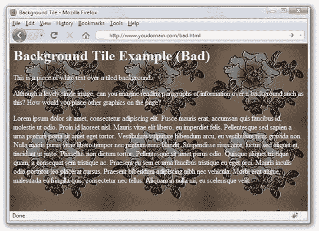 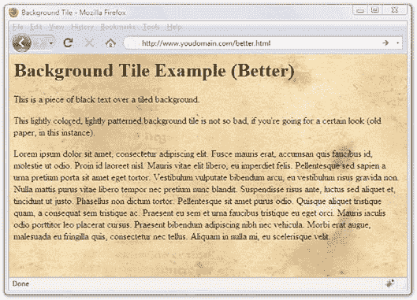

**图 8.10**
这是一个无缝背景图像的示例，你可以看出背景是平铺的，因为你可以看到六个相同的形状。

**图 8.11**
这也是无缝背景图像的示例，只是看不出来它是平铺的。

**提示**：在本章的后续部分，你将学习如何将背景图像放置在容器元素中。尽管我在本节中出了警告，但实际上，背景图像有时可以是你设计库中强大的武器——只是不是作为整个页面的背景时。

如果你真的想使用背景平铺，但似乎无法得到你想要的图案，你可以查看互联网上提供的数百个网站，这些网站提供免费或廉价但经过专业设计的公领域背景图像。

## 创建动画 Web 图

GIF 图像格式允许你创建动画图像，可以添加一些动作来为任何网页增色。动画 GIF 图像的传输速度也比大多数用于类似效果的视频或多媒体文件快。使用 GIMP，你可以通过在图像中创建多个图来创建动画 GIF，然后在保存文件时修改动画 GIF 选项。此外，如果你有一系列想要制作的图像，可以使用 Gickr 的免费网络 GIF 动画服务 (`http://www.gickr.com/`)。

创建 GIF 动画的第一步是创建一系列逐继显示的图像——或者一系列图，取决于你具体的软件程序。这些图像中的每一个被称为一个 `frame`（帧）。顺便说一下，`frame` 一词的使用与你在第 20 章“使用窗口和框架”中将学的 `frames` 没有任何关系。相反，把帧想象成电影或动画片是如何组合的——你在屏幕上看到的图像是由许多外观略有差异的单个帧组成的。一旦你构思好了帧，将它们组合在一起的过程相对简单——最困难的是规划阶段。

**尝试一下**：你现在应该准备好两三张图像，以便在你跟随本章后续内容时尝试将它们放在你自己的页面上。

## 在网页上放置图像

要将图像放在网页上，首先将图像文件移动到与 HTML 相同的文件夹中，或者命名为 `images` 的目录中以便组织。

**注意**：在文本中你想让图像出现插入以下 HTML 标签。对于网络服务器、网络浏览器或用户来说，你将图像放在哪里并不重要，只要你知道它们在哪里，并且你在 HTML 代码中使用了正确的路径。

```html

```

如果你的图像文件位于文档根目录下的 images 目录，你将使用：

```html

```


`` 标签还支持 `alt` 属性，允许你指定关于图像的描述性文本；另一个 `title` 属性也用于描述图像。与 `alt` 不同，`alt` 旨在在 `alt` 属性失效时作为图像的替代方案，而 `title` 是用户无法查看图像时显示的。你稍后将在“用文本描述图像”章节中阅读更多关于 `alt` 属性的知识。

假设 `alt` 是如何使用 `` 标签的示例，并提供一个图像描述，列表 8.2 插入了一张可见的图像。`alt` 属性位于页面顶部，在文本段落之前。每当网页浏览器显示列表 8.2 中的 HTML 文件时，它都会自动检索并显示图像文件，如图 8.12 所示。`alt` 属性是强制性的，并且它主要在图像无法显示时起作用，例如当盲人用户使用辅助屏幕阅读软件“查看”页面时。

### 列表 8.2 使用 `` 标签在网页上上放置图像

```xml
<?xml version="1.0" encoding="UTF-8"?>
<!DOCTYPE html PUBLIC "-////W3C//DTD XHTML 1.1//EN"
"http://www.w3.org/TR/xhtml11/DTD/xhtml11.dtd">
<html xmlns="http://www.w3.org/1999/xhtml" xml:lang="en">
<head>
<title>壮丽的优塞米风景</title>
</head>
<body>
<h1>壮丽的优塞米风景</h1>
<p></p>
<p><strong>半圆顶</strong>是优塞米国家公园内的一个花岗岩圆顶，位于加利福尼亚州马里波萨县的东北部，优塞米谷的东端。该花岗岩山脊比山谷高出 4,737 英尺（1,444 米）。</p>
<p>这一特定的视角是从华伯恩点看到的半圆顶。</p>
</body>
</html>
```

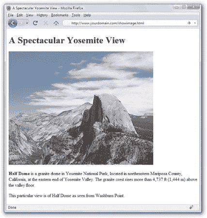

**图 8.12**
当网页浏览器显示列表 8.2 所示 HTML 代码时，它会渲染 `hd.jpg` 图像。

**注意**
理论上，你可以在自己的页面中包含来自任何网站的图像。在这种情况下，每当你的页面显示时，图像都会从另一个页面的 Web 服务器检索。你可以这样做，但你不应该这样做！这不仅是不礼貌的，因为你正在利用他人的带宽来获取个人利益，它还会让你的页面显示速度变慢。

如果你猜测 `img` 代表 `image`（图像），你是对的。`src` 代表 `source`（源），它是对图像文件位置的引用。正如本书开头讨论的那样，图像始终存储在与文本分离的文件，尽管在浏览器中查看时它似乎是同一个页面的一部分。你也没有办法控制它何时可能被更改或删除。

就像用于超链接的 `<a href>` 标签一样，你可以在 `` 标签的 `src` 属性中指定任何完整的 Internet 地址。或者，如果图像与 HTML 文件位于同一个文件夹中，你可以只指定文件名。你还可以使用相对地址，例如 `/images/birdy.jpg` 或 `../smiley.gif`，而不是使用 `` 代替 ``。

列表 8.2 中的每个 `` 标签都包含一条短消息，例如 `alt="Half Dome"`。`alt` 代表 `alternate text`（备用文本），当图像未加载时显示在图像本身位置的消息。如果地址错误、用户在网络浏览器偏好中关闭了自动下载图像，或者 Internet 连接非常慢且数据尚未传输，图像可能无法加载。图 8.13 显示了每个图像使用 `alt` 文本替代图像的示例，且每个 URL 地址都包含了 Flickr 的域名。

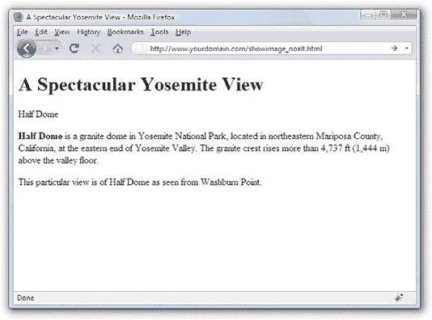 163

**图 8.13**
当图像未出现时，用户将看到 `alt` 信息。

### 用文本描述图像 164

`alt` 属性允许你指定关于图像的描述性文本；另一个 `title` 属性也用于描述图像。与 `alt` 不同，`alt` 旨在在 `alt` 属性失效时作为图像的替代方案，而 `title` 是用户无法查看图像时显示的。你稍后将在“用文本描述图像”章节中阅读更多关于 `alt` 属性的知识。

假设 `alt` 是如何使用 `` 标签的示例，并提供一个图像描述，列表 8.2 插入了一张可见的图像。`alt` 属性位于页面顶部，在文本段落之前。每当网页浏览器显示列表 8.2 中的 HTML 文件时，它都会自动检索并显示图像文件，如图 8.12 所示。`alt` 属性是强制性的，并且它主要在图像无法显示时起作用，例如当盲人用户使用辅助屏幕阅读软件“查看”页面时。

`alt` 属性是强制性的，并且它主要在图像无法显示时起作用，你可以提供 `alt` 和 `title` 属性以确保图像得到良好的描述。

如果你猜测 `img` 代表 `image`（图像），你是对的。`src` 代表 `source`（源），它是对图像文件位置的引用。正如本书开头讨论的那样，图像始终存储在与文本分离的文件，尽管在浏览器中查看时它似乎是同一个页面的一部分。你也没有办法控制它何时可能被更改或删除。

就像用于超链接的 `<a href>` 标签一样，你可以在 `` 标签的 `src` 属性中指定任何完整的 Internet 地址。或者，如果图像与 HTML 文件位于同一个文件夹中，你可以只指定文件名。你还可以使用相对地址，例如 `/images/birdy.jpg` 或 `../smiley.gif`，而不是使用 `` 代替 ``。

列表 8.2 中的每个 `` 标签都包含一条短消息，例如 `alt="Half Dome"`。`alt` 代表 `alternate text`（备用文本），当图像未加载时显示在图像本身位置的消息。如果地址错误、用户在网络浏览器偏好中关闭了自动下载图像，或者 Internet 连接非常慢且数据尚未传输，图像可能无法加载。图 8.13 显示了每个图像使用 `alt` 文本替代图像的示例，且每个 URL 地址都包含了 Flickr 的域名。

服务 (http://www.flickr.com/) 为你提供了每个图像的 URL，且每个 URL 地址都包含了 Flickr 的域名，用于托管你的图像——像 Flickr 这样的存储库。

由于文本在 Internet 上的传输比图形快得多，大多数浏览器在显示图像之前先显示页面文本。这让用户在等待图片显示时有可读，使得整个页面看起来加载速度更快。通过显式指定每个图像的高度和宽度，你可以确保页面上的所有内容尽可能快速出现并位于正确的位置。这样，网页浏览器在等待图像传输完成时，就可以立即准确地为每个图像留出空间。对于你想包含在网站中的每个图像，你可以使用图形程序确定其精确的像素高度和宽度。你也可以通过系统工具找到这些图像属性。例如，在 Windows 中，你可以通过右键点击图像、选择“属性”然后选择“详细信息”来查看图像的高度和宽度。然而，这通常不是好主意，因为浏览器并不擅长缩放图像。如果你想让图像显示得较小，最好在图像编辑器中对其进行缩放。


使用特殊属性。你不仅可以对图像进行水平对齐，还可以使其相对于周围的文本和其他图像进行垂直对齐。

## 图片的水平对齐

正如第 5 节“使用字体、文本块和列表”中所讨论的，你可以使用 `<div style="text-align:center">``<div style="text-align:right">` 和 `<div style="text-align:left">` 将元素对齐到中心、右边距或左边距。这些样式设置同时影响文本和图像，也可以在 `<p>` 标签内使用。

与文本一样，图像通常与左边缘对齐，除非设置了 `style="text-align:center"` 或 `style="text-align:right"` 表明它们应该居中或右对齐。换句话说，`left` 是 `text-align` 样式属性的默认值。

> **注意** 你还可以使用 `float` 样式属性让文本环绕图像。`float` 样式属性直接位于 `` 标签内。它的功能实际上比这里描述的更强大；事实上，在列表 8.3 中，`` 将第一张图像对齐到左侧，并让环绕在其右侧，正如你预期的那样。你可以创意地使用 `float` 样式属性，同样，`` 将第二张图像对齐到右侧，让文本环绕在其左侧。图 8.14 显示了这些设置如何在网页上形成一些有趣的页面布局。并没有将图像浮动到中心的概念，因为正如你将在书中后面学到的，没有办法确定如何在图像的每一侧环绕文本。

> **注意 列表 8.3 使用 `text-align` 样式对齐网页上的图像**：注意列表 8.3 中使用的两个 `` 标签的样式属性中添加了内边距（padding）。

```html
<?xml version="1.0" encoding="UTF-8"?>
<!DOCTYPE html PUBLIC "-////W3C//DTD XHTML 1.1//EN" "http://www.w3.org/TR/xhtml11/DTD/xhtml11.dtd">
<html xmlns="http://www.w3.org/1999/xhtml" xml:lang="en">
<head>
<title>More Spectacular Yosemite Views</title>
</head>
<body>
<h1>More Spectacular Yosemite Views</h1>
<p><<strong>El Capitan</strong> 是优塞米国家公园内一个高 3000 英尺（910 米）的垂直岩层，位于优塞米山谷北侧，靠近其西部。这座花岗岩单体是世界各地攀岩者最喜爱的挑战之一。马里波萨团在 1851 年探索该山谷时，将其命名为“酋长岩”。</p>
<p><<strong>Tunnel View</strong> 是州道 41 号公路上的一个景点，从南进入优塞米山谷时位于瓦索纳隧道的正东侧。该视野向东望优塞米山谷，包括酋长岩的西南面、半圆顶和婚纱瀑布。对许多人来说，这是对优塞米热门景点的初次印象。</p>
</body>
</html>
```

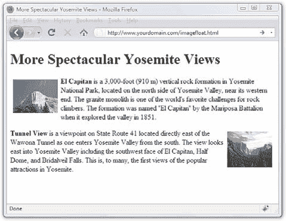

图 8.14：显示了列表 8.3 中的图像对齐方式。

## 图片的垂直对齐

> **注意** 有时，你可能想在一行文本中间插入一张小图像；或者你可能想在图像旁边放置单行文本作为说明。在任何一种情况下，控制文本和图像的垂直对齐方式都是方便的。图像的底部应该与字母的底部对齐，还是应该让文本和图像都排列使其中间对齐？你可以在这些以及其他几个选项之间进行选择：
> 1. 要将图像顶部与同一行中最高的图像或字母的顶部对齐，使用 ``。
> 2. 要将图像底部与文本的底部对齐，使用 ``。
> 3. 要将图像中间与行上所有内容的垂直中心对齐，使用 ``。
> 4. 要将图像底部与文本的基线对齐，使用 ``。

这四个选项都用于列表 8.4，并显示在图 8.15 中。现在四张缩略图垂直地列在页面上，每张图像旁边都有描述性文本。使用了 `vertical-align` 样式属性的各种设置来对齐每张图像及其相关文本。

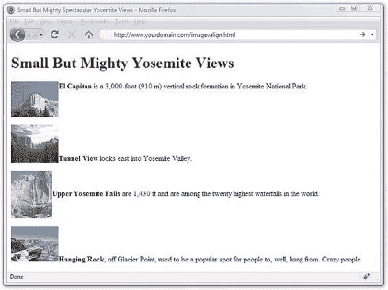

> **提示 列表 8.4 使用 `vertical-align` 样式对齐文本与图像**：如果你在 `` 标签中不包含任何 `align` 属性，图像的底部将与行上任何文本的基线对齐。这意味着你实际上不需要输入 `baseline`，因为它是默认值。然而，如果你为图像指定了外边距并打算让对齐更精确一些，你可能需要使用 `vertical-align` 属性。

```html
<?xml version="1.0" encoding="UTF-8"?>
<!DOCTYPE html PUBLIC "-////W3C//DTD XHTML 1.1//EN" "http://www.w3.org/TR/xhtml11/DTD/xhtml11.dtd">
<html xmlns="http://www.w3.org/1999/xhtml" xml:lang="en">
<head>
<title>More Spectacular Yosemite Views</title>
</head>
<body>
<h1>More Spectacular Yosemite Views</h1>
<p><<strong>El Capitan</strong> 是优塞米国家公园内一个高 3000 英尺（910 米）的垂直岩层，位于优塞米山谷北侧，靠近其西部。这座花岗岩单体是世界各地攀岩者最喜爱的挑战之一。马里波萨团在 1851 年探索该山谷时，将其命名为“酋长岩”。</p>
<p><<strong>Tunnel View</strong> 是州道 41 号公路上的一个景点，从南进入优塞米山谷时位于瓦索纳隧道的正东侧。该视野向东望优塞米山谷，包括酋长岩的西南面、半圆顶和婚纱瀑布。对许多人来说，这是对优塞米热门景点的初次印象。</p>
<p><<strong>Upper Yosemite Falls</strong> 高 1430 英尺，是世界上最高的瀑布之一。</p>
<p><<strong>Hanging Rock</strong> 位于冰川点（Glacier Point），曾经是人们……额的，悬挂在上面的热门地点。疯狂的人。</p>
</body>
</html>
```

## 将图像转换为链接

你可能在图 8.12 中注意到页面上的图像很大，这在这个特定的示例中是可以的，但当你尝试展示多张图像时并不理想。在这种情况下，创建较小的图像缩略图并链接到每个图像的较大版本更为合理。然后，你可以在页面上安排这些缩略图，让访客轻松看到所有内容，即使他们看到的实际（较大）图像的较小版本。缩略图是你使用图像链接丰富页面内容的许多方法之一。


使用你之前使用的 `<a>` 标签来创建文本链接。

## 8.5

列表 8.5 包含了对列表 8.3 的修改代码——该列表已经使用了缩略图——现在的修改是为了提供指向图像较大版本的链接。为了确保用户知道需要点击缩略图，图像和一些辅助文本被封装在一个 `<div>` 中，如图 8.16 所示。

### 列表 8.5 使用缩略图实现有效的图像链接

```xml
<?xml version=”1.0” encoding=”UTF-8"?> ptg999
<!DOCTYPE html PUBLIC “-//W3C//DTD XHTML 1.1//EN” “http://www.w3.org/TR/xhtml11/DTD/xhtml11.dtd”>
<html xmlns=”http://www.w3.org/1999/xhtml” xml:lang=”en”>
<head>
<title>更壮丽的优美地风景</title>
<style type=”text/css”>
div.imageleft {
float:left;
clear: all;
text-align:center;
font-size:9px;
font-style:italic;
}
div.imageright {
float:right;
clear: all;
text-align:center;
font-size:9px;
font-style:italic;
}
img {
padding: 6px;
border: none;
}
</style>
</head>
<body
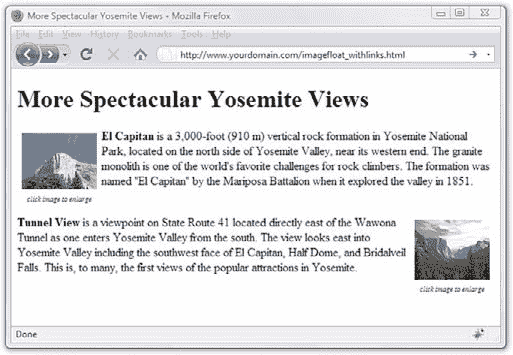 
170 第 8 章 使用颜色、图像和多媒体
列表 8.5 续
<h1>更壮丽的优美地风景</h1>
<p><div class=”imageleft”>
<a href=”http://www.flickr.com/photos/nofancyname/614253439/”></a>
<br/>点击图像放大</<div><<strong>El Capitan</strong>
是优美地国家公园内的一座高 3 3,00 英尺（910 米）的垂直岩石，位于优美地谷的北侧，靠近其西端。这座花岗岩单体是世界上攀岩登山者最喜欢的挑战之一。马里波萨营团在 1851 年探索山谷时，将该岩层命名为“El Capitan”。</p>
<p><div class=”imageright”>
<a href=”http://www.flickr.com/photos/nofancyname/614287355/”></a>
<br/>点击图像放大</<div><<strong>Tunnel View</strong> 是一个观点，位于从南进入优美地谷时 Wawona 隧道的正东侧。该视野向东望向优美地谷，包括酋长岩石的西南面、半圆顶和婚纱瀑布。对许多人来说，这是优美地国家公园热门景点的首次印象。</p>
</body>
</html>
```

图 8.16 ptg999
使用缩略图作为链接可以改进使用大型图像的页面布局。

列表 8.5 中的代码使用了额外的样式，这些样式将在后面的章节中进行详细解释，但你应该能够推断出基础知识：

- `<a>` 标签将这些特定图像链接到较大版本，在这种情况下，这些版本存储在外部服务器上（位于 Flickr）。
- `<div>` 标签及其样式用于对齐这些图形和说明文本（并包含一些内边距）。

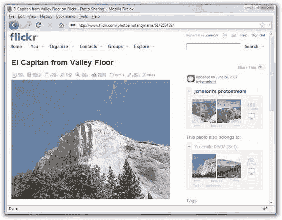 

使用背景图像 171

除非另有说明，否则网络浏览器会在每个图像链接周围显示一个彩色矩形。与文本链接一样，矩形通常对最近未访问过的链接显示蓝色，对访问过的链接显示紫色——除非你在样式表中指定了不同颜色的链接。因为你很少希望在链接的图像周围出现这种难看的线条，所以你通常应该在链接内的任何 `` 标签中包含 `style="border:none"`。在这种情况下，`border:none` 样式被作为 `img` 元素的样式表条目的一部分，因为我们使用了相同的样式。

当你点击所示示例页面上的缩略图图像之一时，将在浏览器中打开链接，如图 8.17 所示。

图 8.17
点击链接的缩略图图像将打开链接的目标。

ptg999
使用背景图像

正如你之前在本章中学到的那样，你可以使用背景图像作为容器元素中的某种壁纸，以便文本或其他图像显示在这些底层设计之上。协同工作创建背景的基本样式属性如下：

- `background-color`——指定元素的背景颜色。虽然与图像无关，但它是背景相关属性集的一部分
172 第 8 章 使用颜色、图像和多媒体
- `background-image`——使用以下格式指定用作背景的图像：`url('文件名.gif')`。
- `background-repeat`——指定图像如何在水平和垂直方向重复。默认情况下，它在两个方向都重复。其他选项有 `no-repeat`、`repeat-x` 和 `repeat-y`。
- `background-position`——指定图像初始放置的位置。选项包括像素和百分比值。

```css
body {
background: #ffffff url('imagename.gif') no-repeat top-right;
}
```

在上一个示例中，背景属性的另一个用途是创建列表符号：

```css
ul {
list-style-type: none;
padding-left: 0;
}
```

接下来，将 `li` 标签的声明改为：

```css
li {
background: url('mybullet.gif') left center no-repeat;
}
```

确保 `mybullet.gif`（或者你命名的图形）位于 Web 服务器上。我们将在第三部分“使用 CSS 进行高级网页设计”中重新讨论背景属性的使用。

### 使用图像映射

### 使用图像映射

有时你可能希望将图像作为导航


要创建任何类型的图像映射（imagemap），你都需要确定图像中你想转换为可点击链接的每个区域的数值像素坐标。这些可点击链接也称为 `areas`（区域）。你的图形程序可能为你提供一种简单的方法来找到这些坐标。或者，你可能想使用独立的图像映射工具，例如 `Mapedit` (`http://www.boutell.com/mapedit/`) 或位于 `http://www.image-maps.com/` 的在线图像映射制作器。除了可以帮助你映射坐标外，这些工具还提供了使地图运行所需的 HTML 代码。

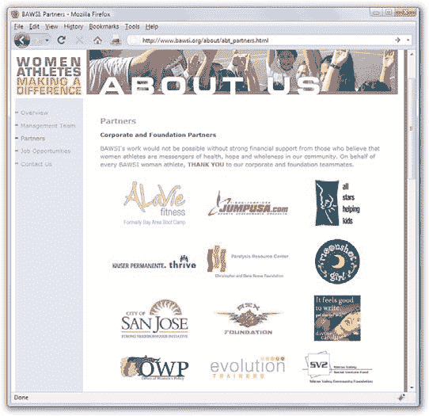 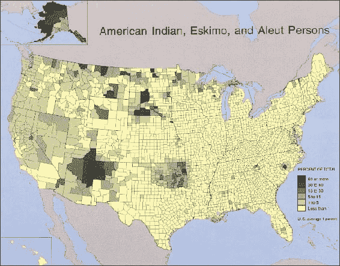 

# 174 第 8 章 颜色、图像和多媒体处理工作

### 图 8.18
一个带有 12 个不同 Logo 的网页；这可以作为一个单一图像映射呈现，也可以分为 12 个独立的部分。

### 图 8.19
一张不适合切切的图像——最好把它制成图像映射。

使用图像映射工具通常就像使用鼠标在你想要成为链接的区域周围画一个矩形（或自定义形状）一样简单。图 8.20 显示了矩形选择之一的结果，如 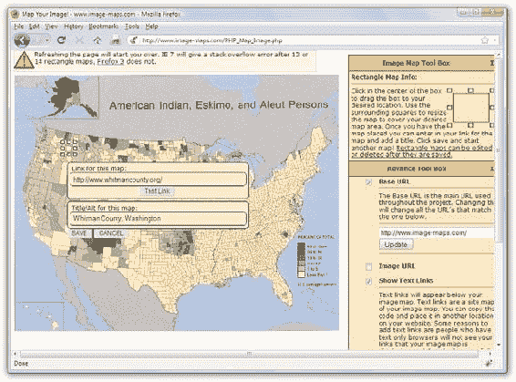，以及添加此链接的 URL 和标题或替代文本（alternate text）的界面。创建图像映射的 HTML 需要几项关键信息：坐标、目标 URL、链接标题和链接的替代文本。

### 图 8.20
使用图像映射工具创建单个图形的链接区域。

### 试一试 ▼
如果你在继续学习本章节时，获取自己的图像并将其转换为图像映射，你更有可能记住如何制作图像映射：`创建你自己的图像映射`。

* 作为初，，选择一张较大且在视觉上大致分为矩形区域的图像是最简单的。
* 如果你手头没有合适的图像，请使用你喜欢的图形程序来制作一张。也许可以使用一张显示几个人的单照，并将每个人都作为图像映射的一个区域。
* 尝试几个不同的图像映射工具，以确定你最喜欢哪一个。从独立软件开始，如 `MapEdit` (`http://www.boutell.com/mapedit/`)，然后转向在线图像映射制作器 `http://www.image-maps.com/`。还有其他工具；使用你喜欢的搜索引擎查找图像映射软件主题的变体。

# 176 为图像映射创建 HTML
如果你使用图像映射生成器，你已经有了创建图像映射所需的 HTML。然而，理解代码的部分是一个好主意，这样你可以检查它的准确性。启动任何图像映射都需要以下 HTML 代码：

```html
<map name="mapname">
```

请记住，你可以为 `<map>` 标签的 `name` 使用任何你喜欢的，尽管尽可能具有描述性会很有帮助。接下来，你为图像的每个区域需要一个 `<area />` 标签。以下是用于 mapping-a-map 图像映射示例中的单个 `<area />` 标签示例：

```html
<area shape="rect" coords="100,136,116,152" href="http://www.whitmancounty.org/" alt="Whitman County, WA" title="Whitman County, WA" />
```

此 `<area />` 标签有五个属性，你将在图像映射中描述的每个区域中使用它们：

* `shape` 表明区域是矩形（`shape="rect"`）、圆形（`shape="circle"`）还是不规则多边形（`shape="poly"`）。
* `coords` 提供区域的精确像素坐标。对于矩形，给出左上角的 `x,y` 坐标，然后是右下角的 `x,y` 坐标。对于圆形，给出 `x,y` 中心点，然后是以像素为单位的半径。对于多边形，按连点顺序列出所有顶点的 `x,y` 坐标。
* `href` 指定区域链接到的页面。你可以使用在普通 `<a href>` 标签中使用的任何地址或文件名。
* `alt` 允许你提供一段与形状关联的文本。大多数浏览器（Firefox 除外）在用户将鼠标悬停在形状上时，会在会在一个小框中显示此文本。此文本为那些可能没有意识到自己正在看图像映射的用户添加了微妙但重要的视觉提示。Firefox 正确地在使用 `alt` 属性外还使用了 `title` 属性来提供视觉提示，这就是为什么正如本章之前提到的，你应该同时使用这两个属性。

图像映射中的每个不同可点击区域必须被描述为单个区域，这意味着典型的图像映射由区域列表组成。在编写了`<area />` 标签后，你就完成了图像映射的定义，因此用闭合标签 `</map>` 结束工作。

# 177 图像映射
创建图像映射的最后一步将其连接到实际图像上。然而，有一个额外的 `usemap` 属性，编码如下：

```html

```

在指定 `usemap` 属性的值时，使用你在 `<map>` 标签中使用的名称（不要忘记 `#` 符号）。

# 177 使用图像映射
`usemap` 属性是 map map 特有的。事实上，在 XHTML 1.1 中不允许使用 `#` 符号。然而，在 XHTML 1.0 中允许使用 `#` 符号，以满足当前的浏览器；此特定的示例使用了 XHTML 1.0 文。

```xml
<?xml version="1.0" encoding="UTF-8"?>
<!DOCTYPE html PUBLIC "-//W3C//DTD XHTML 1.0 Transitional//EN" "http://www.w3.org/TR/xhtml1/transitional.dtd">
<html xmlns="http://www.w3.org/1999/xhtml" xml:lang="en">
<head>
<title>测试图像映射</title>
</head>
<body>
<p style="text-align:center">点击 Logo 进入县的网站。</p>
<map name="countymap">
<area shape="rect" coords="100,136,116,152" href="http://www.whitmancounty.org/" alt="Whitman County, WA" title="Whitman County, WA" />
<area shape="rect" coords="29,271,42,283" href="http://www.sccgov.org/" alt="Santa Clara County, CA" title="Santa Clara County, CA" />
<area shape="rect" coords="535,216,548,228" href="http://www.visitingmincounty.com/" alt="Miflin County, PA" title="Miflin County, PA" />
</map>

</body>
</html>
```

# 178 定义图像映射的区域
如果你使用图像映射生成器，你已经有了创建图像映射所需的 HTML。然而，理解代码的部分是一个好主意，这样你可以检查它的准确性。

## 图 8.21
图 8.21 显示了运行中的图像映射。注意浏览器窗口底部，你的浏览器（在此示例中为 Firefox）显示鼠标悬停的任何区域的链接地址。此外，当鼠标悬停在区域上时，该区域的 `alt` 或 `title` 文本（在此示例中为 Whitman County）将显示在在图像映射上。


## 图 8.21

在列表 8.6 中定义的映射图像在网页上的显示效果。

**注意**
有一种制作映射图像的方法完全依赖于 CSS 而不是 HTML `<map>` 标签。你将在第 11 章“使用 CSS 增强列表、文本和导航的样式”中学习更多相关内容。

## 将多媒体集成到你的网站

现在你已经学会了如何处理静态图像，下一步就是处理多媒体。`multimedia`（多媒体）一词涵盖了我们在网页上看到和听到的所有内容：音频、视频和动画，以及静态图像和文本。在本节中，你不会学习如何创建任何特定的音频、视频或动画，但你将学习如何通过链接或嵌入内容将此类文件包含在你的网站中。

但请记住，并不是每个用户都拥有播放你媒体类型的设备，也不是所有用户都拥有允许这些大文件快速传输的宽带连接。务必提醒访问者，他们点击的链接将带他们进入多媒体文件，并让他们选择查看或收听内容——不要强加文件给他们。

创建任何类型的多媒体都可能是一项挑战性且复杂的任务。如果你计划从零开始创建自己的内容，你需要比这本书多得多的才能成为一名卓越的多媒体开发人员。然而，在你拥有内容后，本节将向你展示如何将你的新作品放入网页页面中。

对于我们这些在艺术方面欠缺的人来说，有几种替代方法可以获取用的多媒体资产。除了显而易见的（如聘请艺术家），这里是一些建议：

- 互联网上的大部分材料都是免费的。当然，向作者或内容的当前所有者双重检查是一个好主意；你不想因侵犯版权而被起诉。此外，美国政府的各个机构产生的内容根据法律属于所有美国人。（例如，在网上找到任何 NASA 视频素材都是供你免费使用的。）
- 许多搜索引擎（`google.com`、`yahoo.com`、`bing.com` 等）具有寻找多媒体文件的特定搜索功能。只要你留心版权问题，这就是寻找与特定主题相关的多媒体的简单方法。只需搜索 `sample Flash animations`、`sample QuickTime movie` 或 `sample audio` 文件就会产生多到你处理不过的结果。
- 如果你很有创作倾向，请确定你最喜欢的媒介——对于你们中的一些人来说，可能是视频制作，另一些人可能喜欢音频制作，还有一些人想尝试动画。在确定起点后，研究各种类型的软件，这些软件将让你创作出这样的艺术杰作。许多公司提供多媒体软件，如 Adobe (`http://www.adobe.com/`）和 Apple (`http://www.apple.com/`）。

## 链接到多媒体文件

将视频或音频文件整合到你的网站中最简单且可靠的是直接使用 `<a href>` 将其链接，就像你链接到另一个 HTML 文件一样。无论本节中显示的将多媒体集成到网页中的特定媒体类型，无论你选择哪种媒体格式都是相似的。

例如，可以使用以下行提供一个曲球比赛章节的 MOV 视频：

```html
<a href="hockey.mov">View the hockey video clip.</a>
```

**注意**
当用户点击 `View the hockey video clip.` 字词时，QuickTime 视频文件将从你的网络服务器传输到她的计算机。无论她安装了哪种辅助应用程序或插件，文件下载完成后，它会自动启动。如果找不到兼容的辅助程序或插件，网络浏览器将提供一个机会让她下载它无法自行处理的文件，或者下载适当的插件或将视频保存到她的硬盘上以便稍后查看。

通常，与文件类型相关的辅助应用程序在网络浏览器无法自行显示该类型文件时被调用。它会调用合适的辅助应用程序。

`Plug-ins`（插件）是一种特殊的辅助应用程序，直接安装在网络浏览器中，它们允许你在浏览器窗口内直接查看多媒体内容。

正如你可能猜到的，这种使用简单链接播放多媒体文件的方法提供了最好的后兼容性，因为浏览器承担了确定如何播放多媒体片段的所有责任。

这种方法的缺点是，你对片段的播放方式没有太大控制权。

**注意**
如果你的浏览器不支持 QuickTime，你可以从 Apple 的 `http://www.apple.com/quicktime/` 免费下载 QuickTime 播放。即使你安装了 QuickTime，某些浏览器可能直接在窗口中播放 QuickTime 电影。

## 嵌入多媒体文件

Internet Explorer 和 Firefox 都能通过插件在浏览器窗口中直接播放 QuickTime 电影，而 Opera 则将 QuickTime 作为辅助应用程序（简称辅助程序），它们是网络浏览器调用的外部程序。如果你将链接从 `pond.wmv`（Windows Media）更改为 `pond.mov`（QuickTime），你的浏览器处理链接的方式将不同。QuickTime 插件不再启动另一个程序，而是允许你直接在浏览器窗口中查看电影片段。

以下是使用 `<object>` 标签嵌入 pond 视频的代码：

```html
<object classid="6BF52A52-394A-11D3-B153-00C04F9FAA6" width="320" height="305">
  <param name="type" value="video/x-ms-wmv" />
  <param name="URL" value="pond.wmv" />
  <param name="uiMode" value="full" />
  <param name="autoStart" value="false" />
</object>
```

**注意**
需要注意的是 Windows Media Player 是一种智能媒体播放器，可以自动流多媒体文件，这意味着它在加载前几秒内容后就会开始播放。这种想法是在你观看或收听早期部分时，其余内容会在后台加载。结果是访问者在查看或收听你的多媒体片段时，不需要等待漫长的下载时间。

考虑到它字面上地将视频直接嵌入到你的网页中，这段代码并不算复杂。

你可能在某些 HTML 中仍然看到的 `<embed />` 标签是在网页中嵌入任何类型多媒体的旧方法。该标签被用来代替 `<object>` 标签。


`<object>` 标签允许你在网页上嵌入视频片段，同时指定由哪种媒体播放器进行播放。

`<object>` 标签的 `width` 和 `height` 属性决定了嵌入的 Windows Media Player 窗口的大小。如果你忽略这些属性，某些浏览器会自动调整嵌入播放器的大小以适应内容，而另一些浏览器则什么都不显示。为了稳见起见，请将它们设置为适合正在播放的多媒体内容的大小。

在 `<object>` 标签内部有四个 `<param>` 标签，负责关于片段播放方式的额外细节。每个标签都有两个属性：`name` 和 `value`，用于将数据（value）与特定设置（name）关联起来。在这个示例中，媒体剪辑的 `URL` 被设置为 `pond.wmv`。第三个参数 `uiMode` 决定了 Windows Media Player 提供哪些按钮和用户界面选项——`full` 表示启用所有用户界面功能，如控制按钮和音量滑块。最后，`autoStart` 参数设置为 `false`，这样视频片段在浏览器中打开页面时就不会自动播放。

`type` 参数可能是最难处理的。它识别正在显示的媒体类型，在本例中是 Windows Media Video (WMV) 文件。这种媒体类型必须指定为标准的 Internet MIME 类型之一。

`MIME type` 是用于唯一标识 Internet 上不同类型媒体对象的标识符。MIME 代表多用途邮件扩展（Multipurpose Internet Mail Extensions），这个名字源于 MIME 类型最初用于识别电子邮件附件。这些 MIME 类型应该用在 `<object>` 标签的 `type` 属性中，以识别 `data` 属性中引用的多媒体对象类型。

以下是你可能在网页中使用的常用音频和视频格式的 MIME 类型：

- `WAV` 音频—`audio/x-wav`
- `AU` 音频—`audio/basic`
- `MP3` 音频—`audio/mpeg`
- `MIDI` 音频—`audio/midi`
- `WMA` 音频—`audio/x-ms-wma`
- `RealAudio`—`audio/x-pn-realaudio-plugin`
- `AVI`—`video/x-msvideo`
- `WMV`—`video/x-ms-wmv`
- `MPEG` 视频—`video/mpeg`
- `QuickTime`—`video/quicktime`

列表 8.7 显示了 pond 网页的相关代码，你可以在其中看到在上下文中出现的 `<object>` 标签。

### 列表 8.7 使用 <object> 标签直接嵌入 WMV 视频片段

```xml
<?xml version=”1.0” encoding=”UTF-8"?>
<!DOCTYPE html PUBLIC “-//W3C//DTD XHTML 1.1//EN” 
“http://www.w3.org/TR/xhtml11/DTD/xhtml11.dtd”>
<html xmlns=”http://www.w3.org/1999/xhtml” xml:lang=”en”>
<head>
<title>池塘中的乐趣</title>
</head>
<body>
<h1>池塘中的乐趣</h1>
<div style="float:left; padding:0px">
<object width=”320” height=”305” type=”video/x-ms-wmv">
<param name=”URL” value=”pond.wmv” />
<param name=”uiMode” value=”full” />
<param name=”autoStart” value=”false” />
<embed src=”http://www.microsoft.com/windows/media/plugin” 
controls=”All” loop=”false” autostart=”false” />
</object>
</div>
<p>迈克尔后院的池塘不仅是一个有趣的爱好，还是一个既有创意又放松的持续改进项目。</p>
<p>他的池塘里有很多鱼，来自远远的日本、以色列和澳大利亚等不同地方。虽然它们不会吠叫、打噜或捡回食物以外的任何东西，但这些鱼确实是很好的鱼。</p>
</body>
</html>
```

你可能会注意到，`<object>` 标签示例中没有出现一些额外的代码。遗憾的是，正如之前讨论的，并不是所有的浏览器对 `<object>` 标签的支持都是完全一致的。因此，有必要包含 `<embed>` 标签以考虑到浏览器的一致性。添加任何多媒体文件将遵循相同的流程。如果你仔细观察，你会发现 `<embed>` 标签包含了与 `<object>` 标签相同的信息，以及额外的参数（在 `<param>` 标签中）。`<object>` 标签比这里展示的要复杂一些。然而，你不需要为了播放多媒体内容就学习如何使用 `<object>` 标签更高级的方面。换句话说，对于在包含 Real Audio、QuickTime、Flash 或你想要的任何内容的网页上分享一些多媒体片段来说，成为一个多媒体专家并不重要。

### 使用多媒体的额外提示

在向你的网站添加视频、音频或动画之前，先问问自己是否真的应该这样做。当你使用这些类型的多媒体时，请确保是因为某个原因。无意义的声音和视频就像无意义的图像一样，可能会损害整体信息。但话说回来，如果你的信息是“看看我做的视频”或“听我的音乐并下载一些歌曲”，那么多媒体必须在你的网站中发挥作用。

这里有几个需要记住的额外提示：

- 不要在页面中包含多媒体并将其设置为页面加载时自动播放。始终给用户启动（停止）声音或视频的选项。
- 如果可能，给用户提供媒体播放器的选择。不要把自己限制为只能在一种操作系统上通过一种播放器播放的多媒体内容。
- 多媒体文件比典型的图形文本文件大，这意味着你需要空间来存储它们，还需要足够的带宽通过你的网站传输给请求它们的人。
- 如果你的网站完全是音频或视频，且提供的文本或图形很少，请理解由于系统或带宽的限制，部分观众无法看到或听到你想展示的内容。为这些用户提供获取信息的额外选项。
- 利用免费的在线视频托管服务，例如 YouTube (`http://www.youtube.com/`)。YouTube 不仅为你的视频片段提供存储，还会提供将视频嵌入你自己的网页所需的代码。例如，图 8.23 显示了世界上可爱的小狗的 YouTube 页面。如果你复制并粘贴图中显示的嵌入区域的文本，你将得到如下：

```
<object width=”425” height=”344”>
<param name=”movie” value=”http://www.youtube.com/v/yPxiHd2BOpo
rel=0&color1=0xb1b1b1&color2=0xcfcfcf&feature=player_profilepage
&fs=1”></param>
<param name=”allowFullScreen” value=”true”></param>
<param name=”allowScriptAccess” value=”always”></param>
<embed
src=”http://www.youtube.com/v/yPxiHd2BOpo&rel=0&color1=0xb1b1b1&color2=0xcfcfcf&feature=player_profilepage&fs=1”
type=”application/x-shockwave-flash” allowfullscreen=”true”
allowScriptAccess=”always” width=”425” height=”344”></embed>
</object>
```


然后你可以将代码插入到网页中。

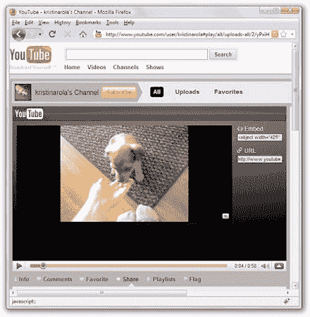

### 总结 185

### 图 8.23
YouTube 提供你的视频文件存储，以及用于在你自己的页面中的链接和 `<object>` 代码。

### 总结 ptg999
在本章中，你学习了关于颜色使用的一些最佳实践，以及如何使用色轮来帮助寻找与文本互补的颜色。此外，你还学习了颜色的十六进制表示法——所有颜色都通过与其红、绿、蓝含量相关的表示法来表达——以及十六进制表示法如何让你对元素应用细微的颜色。更重要的是，你学习了三个与颜色相关的样式属性，可以使用 CSS 将颜色应用于容器背景、边框和文本。

你还学习了为网页准备图形的基础知识。至少，你学到了这是一个非常复杂的主题，而你在本章中学的到的仅足以吊起你的胃口。本章中的示例使用了流行的（且免费的！）GIMP 软件软件包，但请根据需要自由使用最适合你需求的图形软件。你学习的操作包括裁剪、调整大小和调整图像颜色，你还学习了不同的文件格式。在网站中包含图形时，你有许多必须考虑的问题，包括图形大小和分辨率，以及如何使用透明度、动画 GIF 和平铺背景。

在你创建或编辑了一些图像后，可以将它们放置在网页中，你也学习了如何通过 `` 标签来实现。你学习了如何包含一条短文本消息，该消息会在图像加载时代替图像显示，并在用户将鼠标指针移动到图像上时再次出现。你还发现了如何控制每个图像的水平和垂直对齐，以及如何在图像左侧或右侧环绕文本。

你学习了如何将图像作为链接——在图像周围使用 `<a>` 标签或通过创建图像映射（imagemaps）。你还学习了一点关于如何在容器元素的背景中使用图像。

最后，你学习了如何将视频和声音嵌入到网页中。你发现了如何使用指向多媒体文件的简单链接，这是播放媒体内容支持最广泛但活性最低的选项。然后你学习了如何使用 `<object>` 标签直接在网页中嵌入媒体播放器。不仅如此，你发现为了获得最大的浏览器兼容性，使用 `<embed />` 标签辅助 `<object>` 标签会有帮助。`<object>` 和 `<embed />` 标签可以包含大量的媒体类型，包括 WAV、MP3、RealAudio 和 MIDI 文件——更不用说 AVI、WMV 和 QuickTime 视频了。

表 8.1 总结了本章涵盖的标签和属性。

### 表 8.1 本章涵盖的标签和属性

| 标签 | 功能 |
| :--- | :--- |
| `` | 在页面放置图像文件。 |
| `<map>...</map>` | 由 `` 引用的客户端图像映射。包含一个或多个 `<area />` 标签。 |
| `<area />` | 在客户端图像映射中定义可点击链接。 |
| `<embed />` | 嵌入多媒体文件供插件应用程序读取或显示；此标签在技术上已废弃，但由于浏览器尚未完全支持 `<object>` 标签，它仍然很有用。 |
| `<object>...</object>` | 在文档中插入图像、视频、Java Applet、ActiveX 控制或其他对象。 |
| `<param>...</param>` | 对象的运行时设置，例如其在页面上占据区域的宽度和高度。 |

| 属性/样式 | 功能 |
| :--- | :--- |
| `style="background-"` | 设置元素的背景颜色（例如 `color:color` `<body>`、`<p>`、`<div>`、`<blockquote> 和其他容器）。 |
| `style="color:color"` | 设置元素内文本的颜色。 |
| `style="border:size` | 设置元素周围四个边框的颜色。 |
| `type color` | 在不指定边框宽度和类型的情况下，无法使用边框颜色。 |
| `src="address"` | 图像的地址或文件名。 |
| `alt="altdescription"` | 图像的替代描述，在图像显示的位置显示，主要用于无法查看图像本身的用户。 |
| `title="title"` | 作为图像标题显示的文本消息，通常在图像上方的小弹出框（工具提示）中。 |
| `width="width"` | 图像的宽度（像素）。 |
| `height="height"` | 图像的高度（像素）。 |
| `style="border:attributes"` | 如果图像作为链接，则去除图像周围的边框。 |
| `style="vertical-text-align:alignment"` | 将图像垂直对齐到 `text-top`、`top`、`text-bottom`、`bottom`、`middle` 或 `baseline`。 |
| `style="float:float"` | 将图像浮动在一侧以便文本可以环绕它。可能值为 `left`、`right`。 |
| `usemap="name"` | 图像映射的名称。 |
| `shape="value"` | 在 `<area />` 标签内，指定点击区域的形状。 |
| `coords="values"` | 在 `<area />` 标签内，指定图像的坐标。 |
| `href="linkurl"` | 在 `<area />` 标签内，指定点击区域时应加载的 URL。 |
| `name="name"` | 命名属性。 |
| `value="value"` | 与命名属性关联的值。 |
| `width="width"` | 嵌入对象的宽度。 |
| `height="height"` | 嵌入对象的高度。 |
| `type="mimetype"` | 多媒体内容的 MIME 类型。 |
| `src="mediaurl"` | 要嵌入的文件 URL。 |
| `controls="controls"` | 媒体播放器的用户输入配置；使用 `all` 启用所有。 |
| `loop="loop"` | 播放一次媒体剪辑或循环播放；设置为 `true` 或 `false`。 |
| `autostart=` | 打开页面时播放媒体剪辑；设置为 `true` 或 `false`。 |
| `plugins="pluginurl"` | 播放媒体片段所需的插件 URL。 |

## 问答
**Q.** 与其我自己学习所有这些东西，我不应该直接雇请一个图形设计师来设计我的页面吗？

**A.** 这是一个很难回答的问题，这并不是因为我在这里有利益冲突——我在一家网页开发和设计机构工作，所以我推荐机构符合我的利益。但机构并不总是最佳解决方案。聘请图形设计师需要时间和金钱。此外，许多图形艺术家并不创作适用于 Web 的作品——他们是专门从事印刷的艺术家，而印刷世界与在线世界完全不同。此外，请一位自认为是图形设计师的人来创建网站可能无法发挥该特定设计师的长处。换句话说，他可能擅长设计网站的图形元素，但作为内容架构师或处理 HTML 和 CSS 可能并不擅长。如果你的网站只是一个个人网站，专业设计可能不是你想要花钱的地方。但如果你的网站旨在推广业务、产品、学校或任何形象对你的成功至关重要的东西，那么咨询网页设计专业人士是值得投入时间和金钱的。

**Q.** 我在纸张上制作过图形。网页图形有什么不同吗？

**A.** 有的。事实上，许多印刷图形的规则在 Web 上是反的。网页图形必须是低分辨率，而印刷图形应该尽可能高分辨率。


在电脑屏幕上，黑色不会像在纸上那样向白色晕溢。此外，当图形内容只下载了一半时，某些用户可能会停止网页的加载。如果你做过很多打印图形设计，请尽量避免掉这些旧习惯。

## 工作坊

**问。** 我按照你的建议使用了 `` 标签，但当我查看页面时，只看到一个包含一些形状的小方框。这是怎么的了？

**答。** 你看到的损坏图像图标可能意味着两种情况之一：要么网络浏览器找不到图像文件，要么图像保存的格式浏览器无法识别。要解决这些问题，请先检查确保图像确实位于它应该所在的位置。如果是，请在你的图形编辑器中打开图像，并将其重新保存为 `GIF`、`JPG` 或 `PNG` 格式。

**问。** 如果我在图像映射（imagemap）上重叠区域会发生什么？

**答。** 你被允许在图像映射上重叠区域。只需记住，在确定遵循哪个链接时，一个区域的优先级高于另一个区域。优先级是根据区域在图像映射中的列表顺序分配的。例如，地图中的第一个区域优先级高于第二个区域，这意味着点击区域的重叠部分将链接到第一个区域。如果你在图像映射中有一个不链接到任何内容的区域（称为“死区域”），可以使用这种重叠技巧来故意防止该区域链接到任何内容。要做到这一点，只需将死区域放在其他区域之前，让死区域重叠它们，然后将它的 `href` 属性设置为 `""`。

**问。** 我听到很多关于流媒体视频和音频。那什么意思？

**答。** 在过去，通过大多数调制解调器获取视频和音频文件需要几分钟甚至几小时，这严重限制了在网页中使用视频和音频。大家都在迈向的目标是流媒体视频或音频，即在接收数据的同时进行播放。换句话说，你不需要完全下载片段后就可以开始观看或收听。

流式播放现在得到了大多数媒体播放器的广泛支持，包括独立版本和插件。当你使用 `<object>` 标签嵌入媒体对象时，如果播放器支持流式传输，底层的媒体播放器会自动流传输媒体片段。

### 测验

工作坊包含测验题和练习，帮助你巩固对所涵盖内容的理解。在查看随后的“答案”部分之前，请尝试回答所有问题。

1. 你如何给网页设置黑色背景并将所有文本设为亮绿色？根据你在本章中学到的知识，你还会想使用这种颜色组合吗？
2. 你有一张马的扫描照片，需要把它放在网页上。你应该把它做成多大？应该用什么文件格式保存它？
3. 你如何在网页的顶部插入一个 `elephant.jpg` 图像文件？
4. 你如何让浏览器在无法显示实际 `elephant.jpg` 图像时，显示 `Elephant` 单词？

### 答案

1. 在网页开头放置以下内容，或为 `body` 元素使用样式规则：
```html
<body style="background-color:#000000; color:#00FF00">
```
2. 根据图像对你页面的重要性，你应该将其缩小到 100×40 像素，或放大到 300×120 像素。压缩率约为 85% 的 `JPEG` 格式最好。当然，你也可以提供指向较大图像的缩略图链接，单独查看该图像。
3. 将图像文件复制到与 HTML 文本文件相同的文件夹下。在 HTML 文本文件的 `<body>` 标签之后立即输入：
```html
<p></p>
```
4. 使用以下 HTML：
```html

```

### 练习

1. 选择一个你喜欢的底色——也许是优美的蓝色或大地色调——使用 `http://colorscheme-designer.com/` 上的配色方案生成器生成一组可以在网站中使用的颜色。我推荐使用四色调（tetrad）或强调类比（accented analogic）方案类型。
2. 在获得一组颜色（或几种颜色组合方案）后，创建一个包含 `<h1>` 元素、段落文本和一些列表项的基础 HTML 页面。使用你在本章中学到的颜色相关样式来更改页面背景颜色以及各种块级元素的文本，看看这些颜色组合是如何协同工作的的。观察它们如何相互作用，并决定哪些颜色最适合容器，哪些颜色最适合正文、标题文本和链接文本。
3. 在为重要的商业网站设计图形之前，尝试装饰一下你自己的个人主页。这将给你一个学习 GIMP 的机会（或者让你有一个使用图形软件的机会），这样你在处理工作任务时就知道自己在做什么了。


`margin` 属性作用于元素外部的空间。

以下是设置外边距的样式属性：

- `margin-top`—设置上外边距
- `margin-right`—设置右外边距
- `margin-bottom`—设置下外边距
- `margin-left`—设置左外边距
- `margin`—作为单个属性设置上、右、下、左外边距

你可以使用任何单独的外边距属性或使用单个 `margin` 属性来指定外边距。外边距可以设置为 `auto`，这意味着由浏览器根据特定的长度（像素、磅、em）或百分比设置外边距。如果你决定将外边设置为百分比，请记住百分比是基于整个页面计算计算，而不是元素的大小。因此，如果你将 `margin-left` 属性设置为 `25%`，则元素的左外边距将是整个页面宽度的 25%。

你可以通过至少两种方式来记住简写顺序。首先，如果你将元素看作一个矩形，从顶部开始顺时针绕四周移动：使用首字母助记法并记住 “TRBL”（读作 “trouble”），这也代表了如果你忘记外边距属性的顺序可能会出现的状态。

列表 9.1 中的代码在页面上生成四个矩形，每个宽 250 像素，高 100 像素，并带有 5 像素的实黑色边框（见图 9.2）。每个矩形（在此例中为 `<div>`）具有不同的背景颜色。我们希望每个 `<div>` 周围的外边距各为 15 像素，因此可以使用以下代码：

### Margin（外边距）
你也可以使用 `margin` 属性简写：`margin:15px 15px 15px 15px;`。同样注意，TRBL 顺序也适用于内边距（padding）属性和边框（border）属性。

当你使用 `margin` 属性（或 padding、border）且希望四个值都相同时，你可以进一步简化并使用：`margin:15px;`。

在使用简写设置外边距、内边距或边框时，实际上有三种方法，取决于你在设置属性时使用了多少个值：

- 单值值—所有外边距的大小
- 双值—上/下外边距和左/右外边距的大小（按此顺序）
- 四值—上、右、下、左外边距的大小（按此顺序）

你可能会发现坚持使用一个值或全部四个值会更容易，但这显然不是强制要求的。

#### 列表 9.1 用于生成带边框和外边距的四个彩色 <div> 的简单代码

```xml
<?xml version=”1.0” encoding=”UTF-8”?>
<!DOCTYPE html PUBLIC “-//W3C//DTD XHTML 1.1//EN” “http://www.w3.org/TR/xhtml11/DTD/xhtml11.dtd”>
<html xmlns=”http://www.w3.org/1999/xhtml” xml:lang=”en”>
<head>
<title>Color Blocks</title>
<style type=”text/css”>
div {
width:250px;
height:100px;
border:5px solid #000000;
color:black;
font-weight:bold;
text-align:center;
}
div#d1 {
background-color:red;
margin:15px;
}
div#d2 {
background-color:green;
margin:15px;
}
div#d3 {
background-color:blue;
}
div#d4 {
background-color:yellow;
margin:15px;
}
</style>
</head>
<body>
<div id=”d1”>DIV #1</div>
<div id=”d2”>DIV #2</div>
<div id=”d3”>DIV #3</div>
<div id=”d4”>DIV #4</div>
</body>
</html>
```

你可以在图 9.2 中看到列表 9.1 的输出结果。

接下来，通过操作列表 9.1 中样式表条目中的 `margin` 属性，让我们移动外边距。在这个示例中，你实际上无法看到任何这些 `<div>` 元素的右侧外边距，因为它们右侧没有任何东西，而且它们没有右对齐。考虑到这一点，让我们将所有元素的 `margin-right` 设置为 `0px`。除此之外，下一个目标是产生以下效果：

- 第一个颜色块周围没有外边距。
- 第二个颜色块左外边距为 15 像素，上外边距为 5 像素，周围没有外边距。
- 第三个颜色块左外边距为 75 像素，周围没有外边距。
- 第四个颜色块左外边距为 250 像素，周围没有外边距。

基础页面显示四个颜色块，每个都有相等的外边距。对颜色块进行修改（见图 9.2）似乎很简单——除非我们希望外边距与第一个块完全对齐。

另一个需要记住的“坑”是，如果你有带边框的元素堆叠在一起但之间没有外边距，它们看起来会有双倍边框。你可能考虑将顶部元素的底部边框设置为宽度的一半，并将底部元素的顶部边框设置为宽度的一半。如果你这样做，边框看起来将与其他侧的宽度相同。

之前代码的结果（见图 9.3）似乎很简单——除非我们希望外边距与第一个块完全对齐。

将样式改为后续代码所示将产生图 9.4 所示的间距。这些更改使 `<body>` 元素具有零外边距，从而确保一个


`margin-left` 值为 25 像素，确实距离浏览器框架边缘 25 像素。它还显示了堆叠在一起的第二个和第三个色块，但对边框元素进行了修改，以防止出现双倍边框。此外，第四个色块从第三个色块结束的地方开始。

### 图 9.4 ptg999

对色块的第三次修改使元素之间的关系更加紧密。

如图 9.4 所示，第三个色块的右边缘与第四个色块的左边缘之间存在一些重叠。如果色块的宽度为 250 像素，第三个色块 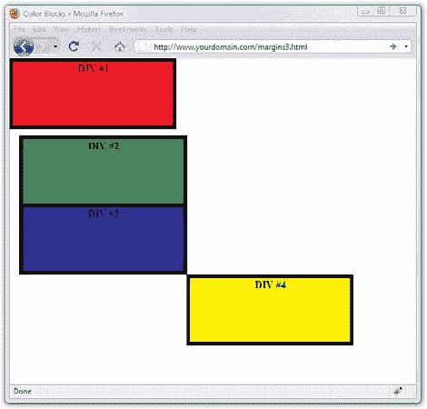 的 `margin-left` 值为 15 像素，而第四个色块的左侧本应该有 265 像素的外边距，那么为什么会这样呢？嗯，它确实有这 265 像素的外边距，但这个外边距的大小还不够，因为我们还必须考虑 6 像素的边框。如果我们将第四个色块的 `margin` 属性更改为如下代码，第三和第四个块将按照计划对齐（见图 9.5）：

```
margin:0px 0px 0px 276px;
```

### 图 9.5 修改外边距以允许 11 像素的边框宽度。ptg999

如这些示例所示，外边距设置对于元素定位非常有用，但在设置这些规格时必须非常小心。

## 内边距元素 (Padding Elements)

内边距（Padding）与外边距（margins）相似，都会为元素添加额外的空间，但主要的区别在于这些空间的位置。如果你还记得，外边距被添加到元素的外部。另一方面，内边距被添加到元素矩形区域内部。例如，如果你为元素创建一个样式规则，设定宽度为 50 像素、高度为 30 像素，然后将该规则的内边距设置为 5 像素，剩余的内容区域将变为 40 像素乘以 20 像素。此外，由于元素的内边距显示在元素的内容区域内，它将与元素内容相同的样式，包括背景颜色。

200 第 9 章 处理外边距、内边距、对齐和浮动

你使用 `padding` 属性之一来指定样式规则的 `padding`，这些属性的工作方式与 `margin` 属性非常相似。以下 padding 属性可设置样式规则的内边距：

* `padding-top`——设置顶部内边距
* `padding-right`——设置右侧内边距
* `padding-bottom`——设置底部内边距
* `padding-left`——设置左侧内边距
* `padding`——使用单个属性设置上、右、下、左内边距

与外边距一样，可以使用单独 padding 属性或单一的 `padding` 属性设置样式规则的内边距。内边距也可以使用测量单位或百分比来表示。

以下是一个如何设置样式规则左侧和右内边距的示例，以便元素内容的每侧留有 10 像素的内边距：

```
padding-left:10px; ptg999
padding-right:10px;
```

与外边距一样，你可以使用单个属性（`padding` 属性）设置元素的所有内边距。要设置 padding 属性，你可以使用与 `margin` 属性相同的三个方法。以下是如何为样式规则设置垂直内边距（上/下）为 12 像素、水平内边距（左/右）为 8 像素的示例：

```
padding:12px 8px;
```

以下是更显式的代码，通过指定所有内边距值来执行相同任务：

```
padding:12px 8px 12px 8px;
```

在之前所有的图中，你都会注意到文本 `DIV #1`、`DIV #2` 等出现在色块的顶部，边框和文本之间只有的一点点微小空间。这部分空间并不是通过任何 padding 值指定的，而是它作为元素内部的一种默认值而出现。但如果你想对元素的内边距进行精确控制，列表 9.2 显示了一些示例。所有的色块宽度均为 250 像素，高度为 100 像素，具有 5 像素的实线黑色边框，并有 25 像素的外边距（见图 9.6）。有趣的事情发生在每个单独的 `<div>` 的 padding 值中。

内边距元素 201

### 列表 9.2 生成带有边框、外边距和内边距的四个彩色 `<<div>`s 的简单代码

```xml
<?xml version=”1.0” encoding=”UTF-8”?>
<!DOCTYPE html PUBLIC “-//W3C//DTD XHTML 1.1//EN”
“http://www.w3.org/TR/xhtml11/DTD/xhtml11.dtd”>
<html xmlns=”http://www.w3.org/1999/xhtml” xml:lang=”en”>
<head>
<title>Color Blocks</title>
<style type=”text/css”>
body {
margin:0px;
}
div {
width:250px;
height:100px;
border:5px solid #000000;
color:black;
font-weight:bold;
margin:25px;
}
div#d1 {
background-color:red;
ptg999
text-align:center;
padding:15px;
}
div#d2 {
background-color:green;
text-align:right;
padding:25px;
}
div#d3 {
background-color:blue;
text-align:left;
padding:6px;
}
div#d4 {
background-color:yellow;
text-align:center;
padding:50px 6px;
}
</style>
</head>
<body>
<div id="d1">DIV #1</div>
<div id="d2">DIV #2</div>
<div id="d3">DIV #3</div>
<div id="d4">DIV #4</div>
</body>
</html>
```

### 图 9.6 色块示例显示了具有不同内边距的色块。

### 图 9.7 显示内边距与文本的关系。ptg999

保持对对齐

203 知道网页上的内容并不总是填充其所在的矩形区域的整个宽度，因此控制内容的对齐通常很有帮助。即使矩形区域内的文本延伸到多行，对齐仍然非常重要，因为你可能希望文本左对齐、右对齐或居中。有两个样式属性允许你控制对齐：`text-align` 和 `vertical-align`。

你在第 8 章“处理颜色、图像和多媒体”中见过这些样式属性的应用实例（对齐图像），但在这里再次提到这些属性也没有坏，因为布局在整个页面设计中也起着作用。

作为回顾，使用 `text-align` 在边界区域内水平对齐元素，并可以设置为 `left`、`right`、`center` 或 `justify`。`vertical-align` 属性与 `text-align` 相似，但它用于垂直对齐元素。`vertical-align` 属性指定元素如何与其父元素对齐，在某些情况下是与页面上的当前行对齐。当前行指的是出现在同一个父元素内的元素的垂直位置——也就是说，内联元素。

204 第 9 章 处理外边距、内边距、对齐和浮动

内联元素出现在同一行，你


将它们的垂直对齐方式设置为相同，以便进行垂直对齐。一个很好的例子是一行接继出现的图像——`vertical-align` 属性允许你对它们进行垂直对齐。

以下是 `vertical-align` 属性的常用值：

- `top`—将元素的顶部与当前行对齐
- `middle`—将元素的中间部分与其父元素的中间部分对齐
- `bottom`—将元素的底部与当前行对齐
- `text-top`—将元素的顶部与父元素的顶部对齐
- `baseline`—将元素的基线与父元素的基线对齐
- `text-bottom`—将元素的底部与父元素的底部对齐

对齐方式通常与外边距（margins）、内外边距（padding）以及（正如你将在下一节中学到的）`float` 属性结合使用，以便你能够对自己的设计保持控制。

## 理解 float 属性

理解 `float` 属性是理解基于 CSS 的布局和设计的基础；它是所有这些元素如何组合在一起的拼图中的最后碎片之一。简单来说，`float` 属性允许元素在设计中移动，使得其他元素可以环绕它们。你经常会发现 `float` 与图像结合使用（正如你在第 8 章中看到的），但你可以——而且许多设计师也是这样做——在布局中浮动各种元素。

元素是水平浮动的，而不是垂直浮动的，因此你只需要关注两个可能的值：`right` 和 `left`。当使用时，浮动的元素将向容器元素允许的最右侧或最左侧（取决于 `float` 的值）浮。例如，如果你有三个 `float` 值为 `left` 的 `<div>`，它们将全部对齐在容器 `<body>` 元素的左侧。如果你将 `<div>` 放在另一个 `<div>` 内部，它们将对齐在那个元素的左侧，即使该元素本身被浮动到右侧。

通过查看几个示例是理解浮动的最佳方式，因此让我们来看列表 9.3。此列表简单地定义了三个矩形 `<div>` 并让它们并排浮动（向左浮动）。

### 列表 9.3 使用 `float` 放置 `<div>`

```xml
<?xml version="1.0" encoding="UTF-8"?>
<!DOCTYPE html PUBLIC "-//-//W3C//DTD XHTML 1.1//EN" "http://www.w3.org/TR/xhtml11/DTD/xhtml11.dtd">
<html xmlns="http://www.w3.org/1999/xhtml" xml:lang="en">
<head>
<title>Color Blocks</title>
<style type="text/css">
body {
margin:0px;
}
div {
width:250px;
height:100px;
border:5px solid #000000;
color:black;
font-weight:bold;
margin:25px;
}
div#d1 {
background-color:red;
float:left;
}
div#d2 {
background-color:green;
float:left;
}
div#d3 {
background-color:blue;
float:left;
}
</style>
</head>
<body>
<div id="d1">DIV #1</div>
<div id="d2">DIV #2</div>
<div id="d3">DIV #3</div>
</body>
</html>
```

生成的页面如图 9.8 所示，你已经可以看到一个问题了——这三个颜色块本应该是并排浮动的。实际上，它们确实是并排浮动的，只是浏览器窗口不足以显示这三个宽度为 250 像素且它们之间留有 25 像素外边距的色块。因为它们是浮动的，第三个直接浮到了下一行。

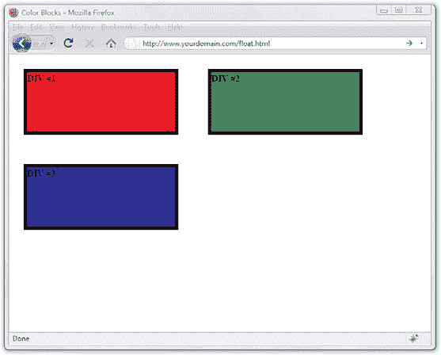

**图 9.8** 使用 `float` 放置颜色块。

你可以想象这在专门设计的视觉布局中可能会是一个问题，因此在目标浏览器窗口大小内测试的同时，请注意你的外边距、内外边距、对齐和浮动。诚然，图 9.8 所示的浏览器窗口很小——这是为了说明浮动元素在没有足够空间时会移动到下一行的这一点。换句话说，如果你用更大的浏览器窗口打开同一个 HTML 文件，你可能看不到这个问题——这就是为什么你还应该在不同的分辨率下检查你的网站，看看是否需要修复。这里的修复方法是调整你的 `<div>` 的外边距和其他尺寸相关的属性。

图 9.9 显示了使用 `float` 属性时的另一种可能。与列表 9.3 相比，代码的唯一更改是将颜色块变为 100 像素宽，将外边距缩小为 10px，并将第二个颜色块的 `float` 对齐方式改为 `right`（而不是 `left`）。

然而，发生了一些非常有趣的事情。第二个颜色块现在在视觉上看起来像第三个颜色块，因为它右对齐了。第二个颜色块的 `float` 值为 `right`，所以它一直浮到了最右侧。第一个和第三个颜色块无论 HTML 中的 `<div>` 代码以什么顺序，都会尽可能地向左浮动，其代码如下：

```html
<div id="d1">DIV #1</div>
<div id="d2">DIV #2</div>
<div id="d3">DIV #3</div>
```


**图 9.9** 使用 `float` 放置颜色块。

浮动通过查看几个示例能被理解，特别是当有很多元素而不只是几个颜色块时。例如，当加入一个基础段落时会发生什么？浮动元素之后的元素将环绕该元素。避免这种情况，请使用 `clear` 属性。


在进入下一章之前，我们介绍了间距和浮动的方式与类型。下一章将整体讨论 CSS 盒模型，它包含了本章讨论的各个项目。

趁此机会，请练习在你目前为止学过的每个块级元素上应用 `margins` 和 `padding`。习惯将图像放入文本块中，并在图像周围设置 `margins`，这样文本就不会紧贴着图片的边缘。

# 第 10 章：理解 CSS 盒模型和定位

在上一章中，我提到了几次 CSS 盒模型——本节的`你将学到`将从对盒模型的讨论开始，并解释了你在上一章中学习的知识如何帮助你理解`本章：`。

## 如何概念化 CSS 盒模型
通过学习盒模型，当你创建一个设计时，就不会因为发现元素没有对齐，或者它们看起来有点“不对劲”而抓狂头发了。你会知道，在几乎所有情况下，某些东西——无论是 `margin`、`padding` 还是 `border`——只需要稍微调整一下就能解决问题。

## 如何管理文本流
你还将学习更多关于 CSS 定位的知识，包括以三维方式（而不是垂直方式）将元素堆叠。最后，你将学习如何使用 `float` 属性控制元素周围的文本流。

## CSS 盒模型
`HTML` 中的每一个元素都被视为一个“盒子”，无论它是段落、一个 `<div>`、一张图像还是其他。无论我们是否能看到它们，也无论在样式表中是否显式指定了它们，盒子都具有一致的属性。它们是始终存在的，作为设计者，我们在创建布局时必须考虑到它们的存在。

图 10.1 是盒模型的图解。盒模型描述了每个 `HTML` 块级元素如何具有 `border`、`padding` 和 `margin` 的潜力，以及这些 `border`、`padding` 和 `margin` 是如何应用的。换句话说，所有元素在 `content` 和元素的 `border` 之间都有一些 `padding`。此外，`border` 可能可见也不可见，但它占留了空间，就像元素的 `border` 与元素外的任何其他内容之间存在 `margin` 一样。

**图 10.1**
`HTML` 中的每个元素都由 CSS 盒模型表示。
```
MARGIN
BORDER
PADDING
CONTENT GOES HERE
```

这里是对盒模型的另一种解释，从外向内看：

- `margin` 是元素外围的区域。它永远没有颜色；始终是透明的。
- `border` 延伸到元素周围，位于任何 `padding` 的外边缘。`border` 可以有多种类型、宽度和颜色。
- `padding` 位于 `content` 周围，并继承 `content` 区域的背景颜色。
- `content` 被 `padding` 包围。

棘手的地方在这里：要确定元素的真实宽高，你必须考虑盒模型的所有元素。如果你还记得上一章的例子，尽管专门指定 `<div>` 宽度为 250 像素、高度为 100 像素，但该 `<div>` 必须变大以容纳使用的 `padding`。

你已经知道如何使用 `width` 和 `height` 属性设置元素的 `width` 和 `height`。下面的示例显示了如何定义一个宽 250 像素、高 100 像素、具有红色背景并有黑色单像素 `border` 的 `<div>`：

```css
div {
  width: 250px;
  height: 100px;
  background-color: #ff0000;
  border: 1px solid #000000;
}
```

这个简单的 `<div>` 显示在图 10.2 中。

**图 10.2**
这是一个简单的 `<div>`。

如果我们定义一个具有相同属性的第二个元素，但添加了特定尺寸的 `margin` 和 `padding` 属性，开始看到元素尺寸的变化。这是由于盒模型的原因。第二个 `<div>` 的定义如下，仅为元素增加了 10 像素的 `margin` 和 10 像素的 `padding`：

```css
div#d2 {
  width: 250px;
  height: 100px;
  background-color: #ff0000;
  border: 5px solid #000000;
  margin: 10px;
  padding: 10px;
}
```

图 10.3 所示的第二个 `<div>` 定义为与第一个相同的高度和宽度，但当 `margins` 和 `padding` 起作用时，围绕元素本身的整个盒子的总高总宽大得多。

**图 10.3**
（图片省略）

## 盒模型元素总结
- `margin` 是元素外围的区域。
- `border` 延伸到元素周围，位于任何 `padding` 的外边缘。
- `padding` 位于 `content` 周围。
- `content` 被 `padding` 包围。

要确定元素的真实宽高，你必须考虑盒模型的所有元素。

- 总宽度 = `width` + `padding-left` + `padding-right` + `border-left` + `border-right`
- 总高度 = `height` + `padding-top` + `padding-bottom` + `border-top` + `border-bottom`


页面。虽然绝对定位让你能够自由地指定元素出现的精确位置，但该位置仍然相对于页面上出现的任何父元素。换句话说，绝对定位允许你相对于其父元素的区域来指定元素矩形区域的精确位置，这与相对定位非常不同。

由于可以自由地在页面的任何地方放置元素，你可能会遇到重叠问题，即一个元素占据了另一个元素所在的空间。没有什么可以阻止你指定元素的绝对位置以使它们重叠。在这种情况下，CSS 依赖于每个元素的 `z-index` 来决定哪个元素在顶部，哪个元素在底部。你将在本章稍后部分学习更多关于元素 `z-index` 的知识。现在，让我们具体看看你是如何控制样式规则使用相对定位还是绝对定位的。

特定样式规则所使用的定位类型（相对或绝对）由 `position` 属性决定，该属性可以取以下两个值之一：`relative`（相对）或 `absolute`（绝对）。在指定了定位类型后，你通过以下属性提供具体的位置：

* `left`—左侧位置偏移
* `right`—右侧位置偏移
* `top`—顶部位置偏移
* `bottom`—底部位置偏移

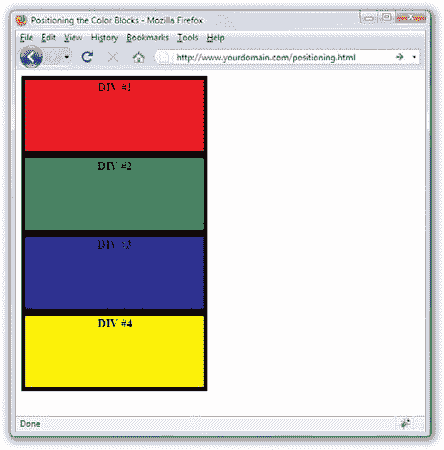 

214 第 10 章 理解 CSS 盒模型和定位

你可能认为这些位置属性仅对绝对定位有意义，但它们实际上适用于两种定位类型。在相对定位下，元素的位置被指定为相对于元素原始位置的偏移量。因此，如果你将元素的 `left` 属性设置为 `25px`，则元素的左侧将从其原始（相对）位置向右移动 25 像素。另一方面，绝对位置是相对于应用该样式的元素的父元素指定的。因此，如果你在绝对定位下将元素的 `left` 属性设置为 `25px`，则该元素的左侧将出现在父元素左边缘的右侧 25 像素处。此外，使用相同值的 `right` 属性将使元素定位，使其其右侧位于父元素右边缘的右侧 25 像素处。

让我们回到颜色块示例来展示定位是如何工作的。在代码列表 10.1 中，四个颜色块都指定了相对定位。如图 10.4 所示，这些块是垂直排列的。

图 10.4
颜色块垂直排列，一个一个叠在另一个上面。

代码列表 10.1 使用四个颜色块显示相对定位

```xml
<?xml version=”1.0” encoding=”UTF-8"?>
<!DOCTYPE html PUBLIC “-//W3C//DTD XHTML 1.1//EN” “http://www.w3.org/TR/xhtml11/DTD/xhtml11.dtd”>
<html xmlns=”http://www.w3.org/1999/xhtml” xml:lang=”en">
<head>
<title>定位颜色块</title>
<style type=”text/css”>
div {
position:relative;
width:250px;
height:100px;
border:5px solid #000;
color:black;
font-weight:bold;
text-align:center;
}
div#d1 {
background-color:red;
}
div#d2 {
background-color:green;
}
div#d3 {
background-color:blue;
}
div#d4 {
background-color:yellow;
}
</style>
</head>
<body>
<div id=”d1”>DIV #1</div>
<div id=”d2”>DIV #2</div>
<div id=”d3”>DIV #3</div>
<div id=”d4”>DIV #4</div>
</body>
</</html>
```

为 `<div>` 元素本身的样式表条目将 `<div>` 元素的 `position` 样式属性设置为 `relative`。由于剩余的样式规则继承自 `<div>` 样式规则，它们继承了它的相对定位。事实上，其他样式规则唯一的区别在于它们具有不同的背景颜色。

注意图 10.4，`<div>` 元素是一个接一个地显示，这是你预期的相对定位结果。但为了让事情更有趣（这也是我们在这里要做的），你可以将定位改为绝对，并显式地指定颜色的位置。在代码列表 10.2 中，样式表条目更改为使用绝对定位来排列颜色块。

216 第 10 章 理解 CSS 盒模型和定位

代码列表 10.2 使用颜色块的绝对定位

```xml
<?xml version=”1.0” encoding=”UTF-8"?>
<!DOCTYPE html PUBLIC “-//W3C//DTD XHTML 1.1//EN” “http://www.w3.org/TR/xhtml11/DTD/xhtml11.dtd”>
<html xmlns=”http://www.w3.org/1999/xhtml” xml:lang=”en">
<head>
<title>定位颜色块</title>
<style type=”text/css”>
div {
position:absolute;
width:250px;
height:100px;
border:5px solid #000;
color:black;
font-weight:bold;
text-align:center;
}
div#d1 {
background-color:red;
}
div#d2 {
background-color:green;
}
div#d3 {
background-color:blue;
}
div#d4 {
background-color:yellow;
}
</style>
</head>
<body>
<div id=”d1”>DIV #1</div>
<div id=”d2”>DIV #2</div>
<div id=”d3”>DIV #3</div>
<div id=”d4”>DIV #4</div>
</body>
</</html>
```

为 `<div>` 元素本身的样式表条目将 `<div>` 元素的 `position` 样式属性设置为 `absolute`。由于剩余的样式规则继承自 `<div>` 样式规则，它们继承了它的相对定位。然而，在这种情况下，每个元素都设置了 `z-index`。

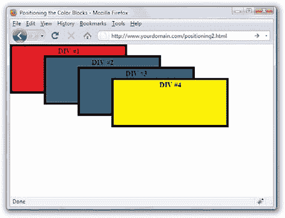 

217 第 10 章 理解 CSS 盒模型和定位

你可能认为这些位置属性仅对绝对定位有意义，但它们实际上适用于两种定位类型。在相对定位下，元素的位置被指定为相对于元素原始位置的偏移量。因此，如果你将元素的 `left` 属性设置为 `25px`，则元素的左侧将从其原始（相对）位置向右移动 25 像素。另一方面，绝对位置是相对于应用该样式的父元素指定的。因此，如果你在绝对定位下将元素的 `left` 属性设置为 `25px`，则该元素的左侧将出现在父元素左边缘的右侧 25 像素处。此外，使用相同值的 `right` 属性将使元素定位，使其其右侧位于父元素右边缘的右侧 25 像素处。

让我们回到颜色块示例来展示定位是如何工作的。在代码列表 10.1 中，四个颜色块都指定了相对定位。如图 10.4 所示，这些块是垂直排列的。

图 10.4
颜色块垂直排列，一个一个叠在另一个上面。

控制堆叠方式

某些情况下，你希望仔细控制元素重叠的方式。`z-index` 属性允许你设置一个数值来指示元素的相对顺序。虽然 `z-index` 这个名字听起来有点奇怪，但它指的是除了横跨（X）和向下（Y）屏幕的两个维度外，指向计算机屏幕的第三个维度（Z）的概念。`z-index` 的另一种思考方式是杂志在杂志堆叠中的相对位置。堆叠顶部的杂志比堆叠底部的杂志具有更高的 `z-index`。同样，具有较高 `z-index` 的重叠元素显示在具有较低 `z-index` 的元素之上。

注意：`z-index` 属性用于设置指示元素相对顺序的数值。分配给 `z-index` 的数字仅相对于样式表中的其他样式规则有意义，这意味着为单个规则设置 `z-index` 并没有太大意义。另一方面，如果你为适用于重叠元素的多个样式规则设置了 `z-index`，则具有较高 `z-index` 值的元素将出现在具有较低 `z-index` 元素之上。

代码列表 10.3 包含了另一个版本的颜色块样式表和 HTML，它使用 `z-index` 设置来改变元素的自然重叠。


### 列表 10.3 使用 z-index 改变色块示例中元素的显示

```xml
<?xml version="1.0" encoding="UTF-8"?>
<!DOCTYPE html PUBLIC "-//-//W3C//DTD XHTML 1.1//EN"
"http://www.w3.org/TR/xhtml11/DTD/xhtml11.dtd">
<html xmlns="http://www.w3.org/1999/xhtml" xml:lang="en">
<head>
<title>定位色块</title>
<style type="text/css">
div {  ptg999
position:absolute;
width:250px;
height:100px;
border:5px solid #000;
color:black;
font-weight:bold;
text-align:center;
}
div#d1 {
background-color:red;
left:0px;
top:0px;
z-index:0;
}
div#d2 {
background-color:green;
left:75px;
top:25px;
z-index:3;
}
div#d3 {
background-color:blue;
left:150px;
top:50px;
z-index:2;
}
div#d4 {
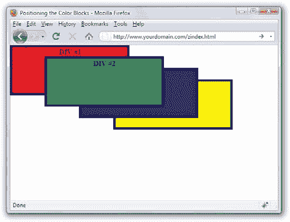 
控制堆叠方式 219
background-color:yellow;
left:225px;
top:75px;
z-index:1;
}
</style>
</head>
<body>
<div id="d1">DIV #1</</div>
<div id="d2">DIV #2</</div>
<div id="d3">DIV #3</</div>
<div id="d4">DIV #4</</div>
</body>
</html>
```

这段代码与你在列表（Listing 10.2）中看到的代码相比，唯一的变化是在每个带编号的 `div` 样式类中添加了 `z-index` 属性。

注意，第一个编号的 `div` 的 `z-index` 设置为 `0`，这应该让它在 `z-index` 方面成为最低元素，而第二个 `div` 具有最高的 `z-index`。图 10.6 显示了使用此样式表显示的色块页面，它清楚地展示了 `z-index` 如何影响显示的内容，并使得仔细控制元素的重叠成为可能。

### 图 10.6
使用 z-index 改变色块的显示。

虽然示例显示的是简单的 `<div>` 元素色块，但 `z-index` 样式属性可以影响任何 HTML 内容，包括图像。

## 管理文本流

现在你已经看到将元素相对于其他元素放置或进行绝对放置的一些示例，现在是时候重新审视元素周围的内容流了。概念上的“当前行”（current line）是一条用于在页面上放置元素的隐形线。这条线与页面上元素的流有关；当元素跨越页面并向下相邻排列时，它就会发挥作用。元素流的一部分是页面上文本的流。当你将文本与其他元素（如图像）混合时，控制文本如何环绕这些其他元素流是非常重要的。

你已经在第 9 章“处理外边距、内边距、对齐和浮动”中看到了这些样式属性中的两个。以下是一些提供对文本流控制的样式属性：

* `float`——确定文本如何环绕元素流
* `clear`——停止文本在元素周围的流
* `overflow`——当元素太小无法包含所有文本时控制文本的溢出

`float` 属性用于控制文本如何环绕元素流。它可以设置为 `left` 或 `right`。这些值决定了元素相对于流动文本的的位置。因此，将图像的 `float` 属性设置为 `left` 会将图像放置在流动文本的左侧。

正如你在上一节中学的那样，你可以使用 `clear` 属性防止文本流到元素旁边，该属性可以设置为 `none`、`left`、`right` 或 `both`。`clear`属性的默认值为 `none`，表示文本流向时不对该元素进行任何特殊考虑。`left` 值导致文本停止环绕元素流，直到页面左侧没有该元素。同样，`right` 值意味着文本不会环绕元素的右侧流。`both` 值表示文本不会环绕元素的任何一侧流。

`overflow` 属性处理溢出文本，即无法放入其矩形区域内的文本；如果你设置的元素 `width` 和 `height` 太小时，就会发生这种情况。`overflow` 属性可以设置为 `visible`、`hidden` 或 `scroll`。`visible` 设置会自动放大元素，使溢出文本能够容于其中；这是该属性的默认设置。`hidden` 值保持元素的大小不变，允许溢出文本保持不可视状态。也许最有趣的值是 `scroll`，它为元素添加滚动条，以便你可以移动并查看文本。

## 总结

本章从关于 CSS 盒模型的重要讨论开始，讨论了在考虑外边距、内边距和边框时如何计算元素的宽度和高度。本章通过解决绝对定位继续，然后你学习了使用 `z-index` 进行定位。你还发现了一些能够控制页面文本流的巧妙样式属性。

本章虽然简短，但充满了关于网站设计的基础信息。值得重新阅读并练习示例，为你的工作打良好基础。

## 问答

**问**：我如何判断何时使用相对定位，何时使用绝对定位？

**答**：虽然在使用相对定位和绝对定位方面没有固定的指南，但通常的想法是，当你想要实施更精细的控制时，才需要绝对定位。这并不是说相对定位做得不好；它意味着绝对定位更容易受到无法控制的屏幕大小的影响。

**问**：如果我没有为重叠的元素指定 `z-index`，我如何知道哪个元素会在上面？

**答**：如果没有设置 `z-index` 属性，后出现的元素将出现在上面。记住这一点的简单方法是想象网络浏览器在读取 HTML 文档时在页面上绘制每个元素；后读取的元素绘制在先读取的元素之上。

## 工作坊

工作坊包含问题和练习，帮助你巩固对内容的理解。在查看后面的“答案”部分之前，尝试回答所有问题。

1. 相对定位和绝对定位的区别是什么？
2. 哪个 CSS 样式属性控制元素叠加？
3. 你可以使用什么 HTML 代码将“Where would you like to”位于浏览器窗口的左上角，并在下方 80 像素、向右 20 像素处用大字体显示“GO TODAY?”？

1. 在相对定位中，内容根据页面流显示，每个元素在物理上出现在 HTML 代码中前一个元素之后。另一方面，绝对定位允许你设置页面上内容的精确位置。
2. `z-index` 样式属性用于控制元素叠加的方式。
3. 你可以使用以下代码：

```html
<span style="position:absolute;left:0px;top:0px">
Where would you like to
</</span>
<h1 style="position:absolute;left:80px;top:20px">GO TODAY?</h1>
```

### 练习

1. 通过创建一系列具有不同外边距、内边距和边框的元素，练习处理 CSS 盒模型的复杂细节。


查看这些属性如何影响它们的高度和宽度。

1. 找到一组你喜欢的图片，使用绝对定位和 `ptg999`，甚至可以使用一些 `z-index` 值将它们排列成类似画廊的形式。
2. 尝试放置你的图片，使其形成某种设计（如正方形、三角形或圆形）。

本页特意留。

ptg999

# 第 11 章：使用 CSS 增强列表、文本和导航

## 你在本章中将学到什么：
在第 5 章“处理字体、文本块和列表”中，你学习了三种 HTML 列表；在第 9 章“处理边距、内边距、对齐和浮动”中，你学习了元素的边距、内边距和对齐。在本章中，你将学习 CSS 盒盒模型如何影响列表。如何将边距、内边距和对齐样式应用到不同类型的 HTML 列表，如何自定义列表指示符以帮助你纯通过 HTML 和 CSS 制作一些强大的设计元素。如何使用列表项来创建图像映射。

具体而言，你将学习如何修改列表元素的外观——超出你在第 5 章中学到的 `list-style-type` 属性的使用——以及如何使用 CSS 样式的列表来替换你在第 8 章“处理颜色、图像和多媒体”中学习的客户端图像映射。你将实践迄为止学到的许多 CSS 样式，在本章中获得的知识将直接引导你将列表用于不仅仅是简单的展示一组项目符号或编号的项目。你将学习将列表作为垂直或水平导航的许多方法之一，包括如何使用列表创建下拉菜单。

本章解释的方法仅代表了使用列表可以创建的众多且多样的导航方法中的一小部分。然而，它们的概念上都是相似的；不同的结果源于你对这些基本概念的创造和应用。为了帮助你激发灵感，我将在本章末提供其他基于 CSS 的导航示例提示。

226 页 第 11 章 使用 CSS 增强列表、文本和导航

## HTML 列表复习
正如你在第 5 章中学到的，有三种基本类型的 HTML 列表。每种列表根据其类型和上下文以略有不同的方式呈现内容：

- **有序列表 (ordered list)** 是一种缩进列表，在每个列表项之前显示数字或字母。有序列表由 `<ol>` 和 `</ol>` 标签包裹，列表项包含在 `<li></li>` 标签对中。这种列表类型通常用于显示编号的步骤或内容的层级。
- **无序列表 (unordered list)** 是一种缩进列表，在每个列表项之前显示项目符号或其他符号。无序列表由 `<ul>` 和 `</ol>` 标签包裹，列表项包含在 `<li></li>` 标签对中。这种列表类型通常用于提供视觉提示，显示后面将会有简短但具体的信息。
- **定义列表 (definition list)** 通常用于显示术语及其含义，从而在列表本身的范围内提供信息层级——类似于有序列表，但没有编号。定义列表由 `<dl>` 和 `</dl>` 标签包裹，其中 `<dt>` 和 `</dt>` 标签包裹术语，`<dd>` 和 `</dd>` 标签包裹定义。

当内容需要时，你可以嵌套有序和无序列表——或者将列表放置在其他列表中。嵌套列表会产生内容层级，因此请仅在你的内容确实具有想要显示的层级时（如内容大纲或目录）预留使用空间。或者，正如你在本章后面的部分学到的，当你的网站导航包含子导航元素时，你可以使用嵌套列表。

> 注意
> 某些旧版浏览器对 `margins` 和 `padding` 的处理不同，特别是在列表和列表项周围。然而，在编写时，本书中及其他章节中的 HTML 和 CSS 在当前主流网络浏览器（Apple Safari、Google Chrome、Internet Explorer、Mozilla Firefox 和 Opera）中的显示是相同的。

特定的列表相关样式包括 `list-style-image`（用于将图像作为列表项标记）、`list-style-position`（指定放置列表项标记的位置）和 `list-style-type`（列表项标记的类型）。当然，还有 `marker` 本身。尽管这些样式控制列表和列表项的结构，但在发布到网上之前，你应该在所有浏览器中检查你的网页内容，不过为了适应浏览器渲染特殊性而“黑科技”样式表的需求正在消失。

### CSS 盒模型如何影响列表
在第 9 章中，你学到每个元素在内容和元素边界之间都有一些 `padding`；你还学到元素边界和任何内容之间存在 `margin`。对于列表也是如此，当你对列表设置样式时，你必须记住“列表”实际上是由这些

```html
<?xml version="1.0" encoding="UTF-8"?>
<!DOCTYPE html PUBLIC "-//W3C//DTD HTML 1.1//EN" "http://www.w3.org/TR/xhtml1/DTD/xhtml11.dtd">
<html xmlns="http://www.w3.org/1999/xhtml" xml:lang="en">
<head>
<title>List Test</title>
<style type="text/css">
ul {
  background-color: #6666ff;
  border: 1px solid #000000;
  width: 100px;
}
li {
  background-color: #cccccc;
  border: 1px solid #ffff00;
}
</style>
</head>
<body>
<h1>List Test</h1>
<ul>
<li>Item #1</li>
<li>Item #2</li>
<li>Item #3</li>
</ul>
</body>
</html>
```

227 页 ptg999

列表 11.1 创建带有颜色和边框的基础列表
查看这些属性如何影响它们的高度和宽度。

1. 找到一组你喜欢的图片，使用绝对定位和 `ptg999`，甚至可以使用一些 `z-index` 值将它们排列成类似画廊的形式。
2. 尝试放置你的图片，使其形成某种设计（如正方形、三角形或圆形）。

本页特意留。

ptg999

228 页 第 11 章 使用 CSS 增强列表、文本和导航

图 11.1 使用颜色和边框设置列表和列表项

如图 11.1 所示，`<ul>` 创建了一个包含单个列表项的框。在这个例子中，整个框都是蓝色背景。但请注意，单个列表项（在本例中，它们使用灰色背景和黄色边框）并没有延伸到 `<ul>` 创建的框的左边缘。

这是因为浏览器会自动添加一定量的 `padding-left`。你可以通过创建一个如列表 11.1 所示的简单测试文件来测试默认的 `padding-left` 值。


`<ul>` 的左侧。浏览器不会向外边距（margin）添加内边距（padding），因为那样会在框外部。它们会在框内部添加内边距，且仅在左侧。该内边距值约为 40 像素。

无论列表类型如何，默认左侧内边距值保持不变。如果你在样式表中添加以下行，创建一个没有项目指示器的列表，你会发现内边距保持不变（见图 11.2）：

```css
list-style-type: none;
```

图 11.2
无论是否有列表项目指示器，默认的左侧内边距保持不变。

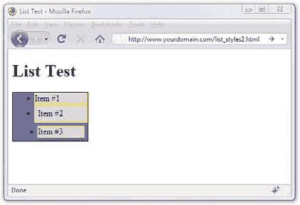

放置列表项目指示器 229

当你创建一个包含任何类型列表的页面布局时，可以尝试调整内边距，使项目在页面上的位置“恰到好处”。同样，仅仅因为列表没有关联默认的外边距，并不意味着你不能为显示分配一些外边距；为 `ul` 选择器的声明添加 `margin` 值将提供额外的布局控制能力。

但请记住，到目前为止我们只处理了列表定义本身；我们还没有处理样式在单个列表项目上的应用。在图 11.1 和 11.2 中，列表项目的灰色背景和黄色边框显示没有默认的内边距或外边距。图 11.3 显示了对列表项目应用内边距或外边距值而非整个列表“框”本身所产生的不同效果。

图 11.3
不同的值影响列表项目的内边距和外边距。

ptg999

第一个列表项目是基础项目，没有应用内边距或外边距。然而，第二个列表项目使用了 `style="padding: 6px;"`，你可以看到四周都有 6 像素的内边距（内容与围绕元素的黄色边框之间）。注意，符号的位置与第一个列表项目保持相同。第三个列表项目使用 `style="margin: 6px;"` 在列表项目周围应用了 像素的外边距；此外边距允许 `<ul>` 的蓝色背景显示出来。

### 放置列表项目指示器

所有关于外边距和内边距的讨论引发了其他问题：列表项目指示器（使用时）的控制，以及文本如何在其周围换行（或不换行）。`list-style-position` 属性的默认值为“outside”（外部）——这种放置意味着符号、数字或其他指示器保持在文本左侧，位于 `<li></li>` 标签对创建的框之外。

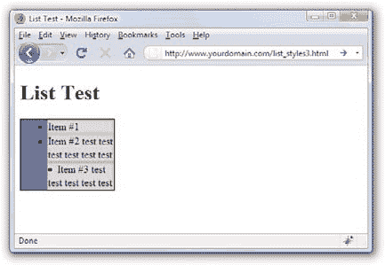

230 第 11 章 使用 CSS 增强列表、文本和导航的功能

当文本在列表项目内部换行时，它会在该框内换行，并与元素的左边界左对齐。

但当 `list-style-position` 的值为“inside”（内部）时，指示器位于 `<li></li>` 标签对创建的框内部。列表项目指示器不仅缩进得更深（它们本质上变成了文本的一部分），文本还会换行到每个项目指示器的下方。

图 11.4 显示了 `outside` 和 `inside` `list-style-position` 的示例。列表 11.1 与生成图 11.4 示例的代码之间的唯一区别（不包括添加到“项目 #2”和“项目 #3”的填充文本）是，第二个列表项目包含 `style="list-style-position: outside;"`，第三个列表项目包含 `style="list-style-position: inside;"`。

图 11.4
`list-style-position` 的 `outside` 和 `inside` 值之间的区别。

ptg999

第二个列表项目使用的额外填充文本显示了当列表宽度定义窄到无法在一行显示所有时，文本是如何换行的。如果不使用 `style="list-style-position: outside;"` 也会相同的结果，因为在代码中没有显式语句的情况下，那是 `list-style-position` 的默认值。

然而，当你使用“inside”位置时可以清楚地看到区别。在第三个列表项目中，符号和文本都在黄色边界的灰色区域内——即列表项目本身。当 `list-style-position` 的值为 `inside` 时，外边距和内边距对列表项目的影响也不同（见图 11.5）。

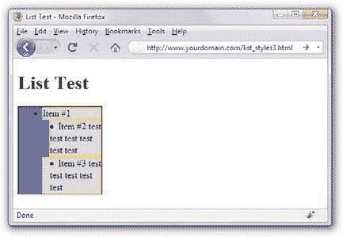

使用列表项目和 CSS 2 创建图像映射 231

图 11.5
外边距和内边距改变了使用 `inside` `list-style-position`的项目显示。

在图 11.5 中，第二个和第三个列表项目的 `list-style-position` 值均为 `inside`。然而，第二个列表项目的 `margin-left` 值为 12 像素，而第三个列表项目的 `padding-left` 值为 12 像素。尽管两个内容块（列表指示器加文本）都显示文本围绕符号换行，且这些块在定义列表项目的灰色区域内的位置是相同的，但受影响的区域列表内部的列表项目。ptg999

正如你预期的，具有 12 像素 `margin-left` 值的列表项目显示 12 像素。同样，具有 12 像素 `padding-left` 值的列表项目也显示 12 像素。内边距在元素内部；外边距在元素外部。

通过理解外边距和内边距如何影响列表，你应该能够创建垂直和水平菜单。在第 8 章，你学习了如何使用`<map>` 标签切分图像。然而，你也可以使用 CSS 创建垂直和水平菜单。

232 第 11 章 使用 CSS 增强列表、文本和导航的功能

列表 11.2 中的代码产生的类似于图 11.6 中的图像（为了突出显示区域添加了边框）。当代码在网页浏览器中渲染时，它看起来就像一个放置了图片的网页。当鼠标悬停在“热点”区域上时会发生动作。

列表 11.2 创建图像映射

```html
<?xml version="1.0" encoding="UTF-8"?>
<!DOCTYPE html PUBLIC "-//W3C//DTD HTML 1.1//EN" "http://www.w3.org/TR/xhtml11/DTD/xhtml11.dtd">
<html xmlns="http://www.w3.org/1999/xhtml" xml:lang="en">
<head>
<title>CSS Image Map</title>
<style type="text/css">
#theImg {
width:500px;
height:375px;
background:url(tea_shipment.jpg) no-repeat;
position:relative;
border: 1px solid #00000;
}
#theImg ul {
margin:0px;
padding:0px;
list-style:none;
}
#theImg a {
position:absolute;
text-indent: -1000em;
}
#theImg a:hover {
border: 1px solid #ffffff;
}
#ss a {
top:0px;
left:5px;
width:80px;
height:225px;
}
#gn a {
top:226px;
left:15px;
width:70px;
height:110px;
}
#ib a {
top:225px;
left:85px;
width:60px;
height:90px;
}
#iTEA1 a {
top:100px;
left:320px;
width:178px;
height:125px;
}
#iTEA2 a {
top:225px;
left:375px;
width:123px;
height:115px;
}
</style>
</head>
<body>

<div id="theImg">

<ul>
```


```html
<<ul>
  <li id="ss"><a href="[some URL]"" title="Sugarshots">Sugarshots</a></li>
  <li id="gn"><a href="[some URL]"" title="Golden Needle">Golden Needle</a></li> ptg999
  <li id="ib"><a href="[some URL]"" title="Irish Breakfast">Irish Breakfast</a></li>
  <li id="iTEA1"><a href="[some URL]"" title="IngenuiTEA">IngenuiTEA</a></li>
  <li id="iTEA2"><a href="[some URL]"" title="IngenuiTEA">IngenuiTEA</a></li>
</ul>
</div></body>
</html>
```

如列表 11.2 所示，样式表包含相当多的条目，但实际的 HTML 代码非常短。这里使用列表项创建了五个不同的点击区域；这些“区域”是赋予了特定高度和宽度的列表项，并放置在背景图像之上。如果从包裹列表的 `<div>` 背景中移除图像，列表项仍然存在且仍然可以点击。

让我们检读一下样式表，以便你理解构成这个 XHTML 和 CSS 图像地图的组件，它在最基础的层面上仅仅是一个链接列表。

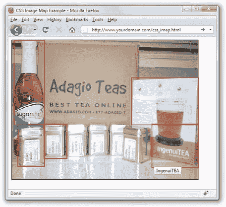 

234 第 11 章 使用 CSS 增强列表、文本和导航的功能

图 11.6
CSS 允许你在图像地图中定义热点。

链接列表被封装在一个名为“theImg”的 `<div>` 中。在样式表中，这个 `<div>` 被定义为块级元素，宽度 500 像素，高度 375 像素，ptg999，并且有一个 1 像素的实黑色边框。该元素的背景是一张名为 `tea_shipment.jpg` 的图像，位于固定位置且不重复。你看到的下一段 HTML 是无序列表（`<ul>`）的开始。在样式表中，该无序列表四周被设置了 0 像素的外边距和内边距，并且 `list-style` 设置为 `none`——列表项前面不会有任何图标。

由于样式表中对 `<div>` 内所有 `<a>` 标签采用了以下技巧，列表项文本本身永远不会显示给用户：

```
text-indent: -1000em;
```

通过将文本向左负缩进 1000 em，可以确保文本永远不会出现。它确实存在，但存在于浏览器窗口左侧 1000 em 处的非视区域区域。换句话说，如果你举起左手并放在电脑显示器侧面，`text-indent:-1000em` 会将文本放置在你小指头左侧的某个地方。但这正是我们想要的，因为我们不需要看到文本链接。我们只需要定义一个区域作为链接，这样用户的光标在悬停时就会像悬停在网站的任何链接上一样发生变化。

当用户光标悬停在包含链接的列表项上时，该列表项会显示 1 像素的实白色边框，这得益于样式表中的这一条目：

导航列表与普通列表的区别 235

```css
#theImg a:hover {
  border: 1px solid #ffffff;
}
```

然后，根据图像中应作为点击区域的区域，定义并将列表项本身放置在特定位置。例如，具有“ss” ID 的“Sugarshots”列表项（图中显示的项目名称），其左上角距离 `<div>` 顶部 0 像素，距离 `<div>` 左边缘 5 像素。该列表项宽 80 像素，高 225 像素。对于 `#gn`、`#ib`、`#iTEA1` 和 `#iTEA2` 列表项也进行了类似的样式声明，使得与这些 ID 相关的链接区域相对于图像出现在特定位置。

### 导航列表与普通列表的区别

当我们谈论使用列表创建导航元素时，我们实际上是指使用 CSS 以网站访问者预期的导航外观来显示内容 ptg999——简而言之，它不同于简单的项目符号或编号列表。虽然一组导航元素本质上是一个链接列表，但这些链接通常以这种方式显示，让用户清楚应该与内容进行交互：

*   用户的鼠标光标会变化，指示该元素是可点击的。
*   当鼠标悬停在元素上时，元素周围的外观会发生变化。
*   内容区域在视觉上与普通文本区分开来。

创建导航的老方法往往依赖于图像——例如带有倒角边缘的图形，以及背景和文本使用对比色——加上使用 JavaScript 进行客户端编程以根据鼠标动作处理图像切换。但使用纯 CSS 从列表元素创建导航可以产生一种更易用、更灵活且对搜索引擎友好的显示效果，方便各种设备的用户访问。

无论你的网站布局如何（无论是水平的还是垂直的）——本章都讨论了两个级别的导航：例如，假设你为网站创建了一个模板，你可能会发现自己在主区域和次要未使用水平或垂直导航。

使用 CSS 创建导航 236

```xml
<?xml version="1.0" encoding="UTF-8"?>
<!DOCTYPE html PUBLIC "-//W3C//DTD HTML 1.1//EN" "http://www.w3.org/TR/REC-html11/dtd">
<html xmlns="http://www.w3.org/1999/xhtml" lang="en">
<head>
  <title>About Us</title>
  <style type="text/css">
    body {
      font: 12pt Verdana, Arial, sans-serif;
    }
    #nav {
      width: 150px;
      float: left;
    }
    #content {
      width: 550px;
      float: left;
    }
  </style>
</head>
<body>
  <div id="nav">
    <ul>
      <li><a href="#">Mission</a></li>
      <li><a href="#">History</a></li>
      <li><a href="#">Executive Team</a></li>
      <li><a href="#">Contact Us</a></li>
    </ul>
  </div>
  <div id="content">
    <h1>About Us</h1>
    <p>在主区域的介绍页上，重复辅助导航并提供更多背景可能是很有用的，例如：</p>
    <ul>
      <li><a href="#">Mission</a>：了解我们的使命和慈善努力。</li>
      <li><a href="#">History</a>：阅读我们的公司历史以及我们如何成为国家最大的部件制造商。</li>
      <li><a href="#">Executive Team</a>：我们的执行团队让公司运行得像精滑的机器（对制造部件也有用）。</li>
      <li><a href="#">Contact Us</a>：在这里你可以找到多种联系我们的方式（我们真的在乎你的想法）。</li>
    </ul>
  </div>
</body>
</html>
```
列表 11.3 带有列表垂直导航的基础页面

图 11.7
起点：未设置样式的列表导航。

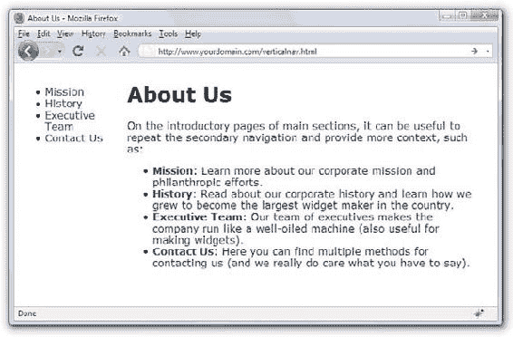 

此页的内容设置在两个相邻的 `<div>` 元素中：一个被赋予了 ID 值 `nav`，另一个被赋予了 `id`。


`content` 的值。在这个基础页面中，分配给任何内容的样式只有与每个 `<div>` 相关的宽度、外边距（margin）和浮动（float）。列表元素没有应用任何样式。

为了区分内容区域列表中的链接与侧边导航列表中的链接，请在样式表中添加样式：

```css
#nav a {
  text-decoration: none;
}

#content a {
  text-decoration: none;
  font-weight: bold;
}
```

这些样式仅表示：`id` 为 `nav` 的 `<div>` 中的所有 `<a>` 链接都没有下划线，而 `id` 为 `content` 的 `<div>` 中的所有 `<a>` 链接都没有下划线且加粗。差异如图 11.8 所示。

图 11.8：使用 CSS 区分列表元素。

但要真正让侧边导航列表与与众，你必须深入研究样式表。

## 使用 CSS 创建垂直导航

### 为单级垂直导航设置样式

这组特定导航元素的目标仅仅是将它们呈现为一组没有项目符号的链接块，并根据其链接状态（普通链接、访问过的链接、悬停在链接上或激活链接）更改背景色和文本颜色。过程的第一步已经完成：将导航与内容分离。我们通过将导航放在 `id` 为 `nav` 的 `<div>` 中实现了这一点。

接下来，你需要修改定义 `nav` `<div>` 内链接的 `<ul>`。去掉列表指示器，并确保除了上边距外没有多余的外边距或内边距（padding）。该上边距用于将导航顶部与页面内容区域中“关于我们”标题的顶部对齐：

```css
#nav ul {
  list-style: none;
  margin: 12px 0px 0px 0px;
  padding: 0px;
}
```

由于导航列表项本身显示为有色的区域，请为每个列表项添加底部边框，以便内容之间产生视觉上的分离：

```css
#nav li {
  border-bottom: 1px solid #ffffff;
}
```

现在构建其余的列表项。思路是：当列表项仅作为链接存在时，它们将呈现为特殊的蓝色，并配有粗体白色文字（尽管字体大小比正文本身小）。要实现这一点，请添加内容：

```css
#nav li a:link, #nav li a:visited {
  font-size: 10pt;
  font-weight: bold;
  display: block;
  padding: 3px 0px 3px 3px;
  background-color: #628794;
  color: #ffffff;
}
```

之前使用的所有样式你应该都很熟悉，也许样式表条目中的 `display: block;` 例。将 `display` 属性设置为 `block` 可以确保当用户鼠标悬停在元素上时，整个 `<li>` 元素都会起作用。图 11.9 显示了应用这些新样式的垂直列表菜单。

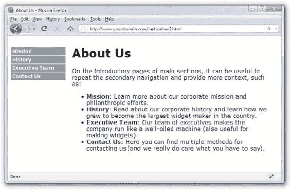

图 11.9：垂直列表开始看起来像导航菜单。

当用户的鼠标悬停在导航列表元素上时，思路是发生某种视觉变化，让用户知道该元素是可以点击的。这类似于大多数软件菜单在用户光标悬停在菜单项上时改变颜色的方式。在这种情况下，我们将更改列表项的背景颜色，并更改列表项的文本颜色；它们将与之前显示的蓝色和白色不同。

```css
#nav li a:hover, #nav li a:active {
  font-size: 10pt;
  font-weight: bold;
  display: block;
  padding: 3px 0px 3px 3px;
  background-color: #6cac46;
  color: #000000;
}
```

图 11.10 显示了目前为止所有样式工作的结果。通过使用样式表中的几条记录，简单的列表已转换为视觉差异化的菜单。

### 为多级垂直导航设置样式

如果你的网站架构需要另一层你希望用户随时看到的导航级呢？这通过嵌套列表（你在之前的章节中学习过）和更多的样式表条目来实现。在这种情况下，假设“执行团队”（Executive Team）链接下有四个导航元素。在 HTML 中，如下修改列表：

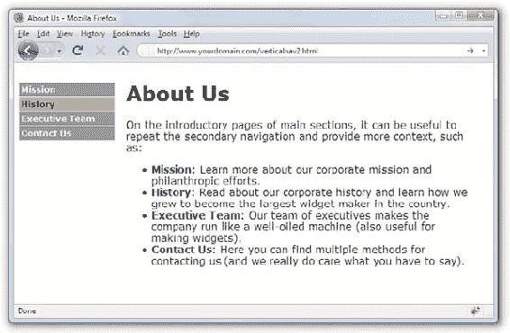

```html
<ul>
  <li><a href="#">">使命</a></li>
  <li><a href="#">">历史</a></li>
  <li><a href="#">">执行团队</a>
    <ul>
      <li><a href="#">">&raquo; CEO</a></li>
      <li><a href="#">">&raquo; CFO</a></li>
      <li><a href="#">">&raquo; COO</a></li>
      <li><a href="#">">&raquo; 其他</a></li>
    </ul>
  </li>
  <li><a href="#">">联系我们</a></li>
</ul>
```

图 11.10：执行团队下的嵌套列表。

列表项现在当鼠标悬停在其上方时会改变颜色。为了确保两组项都经过正确样式，请再次修改样式表添加一些缩进。图 11.1 显示了执行团队下的嵌套列表。图 11.1 显示了执行团队下的嵌套列表。图 11.1 显示了执行团队下的嵌套列表。图 11.1 显示了执行团队下的嵌套列表。图 11.1 显示了执行团队下的嵌套列表。图 11.1 显示了执行团队下的嵌套列表。图 11.1 显示了执行团队下的嵌套列表。图 11.1 显示了执行团队下的嵌套列表。图 11.1 显示了执行团队下的嵌套列表。图 11.1 显示了执行团队下的嵌套列表。图 11.1 显示了执行团队下的嵌套列表。图 11.1 显示了执行团队下的嵌套列表。图 11.1 显示了执行团队下的嵌套列表。图 11.1 显示了执行团队下的嵌套列表。图 11.1 显示了执行团队下的嵌套列表。图 11.1 显示了执行团队下的嵌套列表。图 11.1 显示了执行团队下的嵌套列表。图 11.1 显示了执行团队下的嵌套列表。图 11.1 显示了执行团队下的嵌套列表。图 11.1 显示了执行团队下的嵌套列表。图 11.1 显示了执行团队下的嵌套列表。图 11.1 显示了执行团队下的嵌套列表。图 11.1 显示了执行团队下的嵌套列表。图 11.1 显示了执行团队下的嵌套列表。图 11.1 显示了执行团队下的嵌套列表。图 11.1 显示了执行团队下的嵌套列表。图 11.1 显示了执行团队下的嵌套列表。图 11.1 显示了执行团队下的嵌套列表。图 11.1 显示了执行团队下的嵌套列表。图 11.1 显示了执行团队下的嵌套列表。图 11.1 显示了执行团队下的嵌套列表。图 11.1 显示了执行团队下的嵌套列表。图 11.1 显示了执行团队下的嵌套列表。图 11.1 显示了执行团队下的嵌套列表。图 11.1 显示了执行团队下的嵌套列表。图 11.1 显示了执行团队下的嵌套列表。图 11.1 显示了执行团队下的嵌套列表。图 11.1 显示了执行团队下的嵌套列表。图 11.1 显示了执行团队下的嵌套列表。

```xml
<!DOCTYPE html>
<html lang="en">
<head>
<meta charset="UTF-8">
<title>关于我们</title>
<style type="text/css">
body {
  font: 12pt Verdana, Arial, Georgia, sans-serif;
}

#nav {
  width:150px;
  float:left;
}

#content {
  width:550px;
  float:left;
}

#nav a {
  text-decoration: none;
}

#content a {
  text-decoration: none;
  font-weight: bold;
}

#nav ul {
  list-style: none;
  margin: 12px 0px 0px 0px;
  padding: 0px;
}

#nav li {
  border-bottom: 1px solid #ffffff;
}

#nav li a:link, #nav li a:visited {
  font-size: 10pt;
  font-weight: bold;
  display: block;
  padding: 3px 0px 3px 3px;
  background-color: #628794;
  color: #ffffff;
}

#nav li a:hover, #nav li a:active {
  font-size: 10pt;
  font-weight: bold;
  display: block;
  padding: 3px 0px 3px 3px;
  background-color: #6cac46;
  color: #000000;
}

#nav ul ul {
  margin: 0px;
  padding: 0px;
}

#nav ul li li {
  border-bottom: none;
}

#nav ul li a:link, #nav ul li a:visited {
  font-size: 8pt;
  font-weight: bold;
  display: block;
  padding: 3px 0px 3px 18px;
  background-color: #628794;
  color: #ffffff;
}

#nav ul li a:hover, #nav ul li a:active {
  font-size: 8pt;
  font-weight: bold;
  display: block;
  padding: 3px 0px 3px 18px;
  background-color: #6cac46;
  color: #000000;
}
</style>
</head>
<body>
</html>
```


# 关于我们

在主要章节的介绍页面上，重复二级导航并提供更多上下文是非常有用的，例如：

*   **使命**：了解关于我们的公司使命和慈善事业。
*   **历史**：阅读我们的公司历史，了解我们是如何成为国家最大的小部件制造商的。
*   **执行团队**：我们的执行团队让公司像运行润滑的机器一样运转（对于制造小部件也有帮助）。
*   **联系我们**：在这里你可以找到多种联系我们的方式（我们真的很在意你的意见）。

这种样式化垂直导航的不同方法仅限于你的创造力。你可以使用颜色、外边距、内边距、背景图像以及任何有效的 CSS 来生成非常灵活且易于修改的垂直导航。如果你在搜索引擎中输入 `CSS vertical navigation`，你将找到成千上万的示例——而且它们都基于你在本章中学到的简单原理。

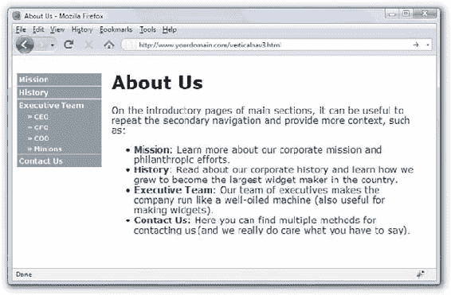

# 使用 CSS 创建水平导航 245

图 11.12 使用 CSS 创建两层级的垂直导航。

使用 CSS 创建水平导航

导航的课程从垂直导航开始，因为当导航看起来仍然像你可能在纸上垂直书写的项目列表（如杂货清单）时，将列表转换为导航的概念更容易理解。在创建水平导航时，你仍然使用 HTML `list` 元素，但不再通过对两个 `<ul>` 和 `<li>` 使用 `display` 属性的 `inline` 值来实现垂直显示，而是使用 `display` 属性的 `block` 值。其实就这么简单。

列表 11.5 显示了一个具有水平导航的页面的起点。该页面包含两个主要的 `<div>` 元素：一个用于页眉，一个用于内容。页眉 `<div>` 包含一个标志 `<div>` 和一个并排浮动的导航 `<div>`。在导航 `<div>` 中出现的列表，其 `<ul>` 及其列表项的 `display` 属性值均为 `inline`。你可以在图 11.13 中看到这些元素及其布局。

列表 11.5 来自列表的基础水平导航

```xml
<?xml version="1.0" encoding="UTF-8"?>
<!DOCTYPE html PUBLIC "-//W3C//DTD XHTML 1.1//EN"
"http://www.w3.org/TR/xhtml11/DTD/xhtml11.dtd">
<html xmlns="http://www.w3.org/1999/xhtml" xml:lang="en">
<head>
<title>ACME Widgets LLC</title>
246 第 11 章 使用 CSS 让列表、文本和导航发挥更多功能
列表 11.5 继续
<style type="text/css">
body {
font: 12pt Verdana, Arial, Georgia, sans-serif;
}
#header {
width: auto;
}
#logo {
float:left;
}
#nav {
float:left;
}
#nav ul {
list-style: none;
display: inline;
}
#nav li {
display: inline;
}
#content {
width: auto;
float: left;
clear: left;
}
#content a {
text-decoration: none;
font-weight: bold;
}
</style>
</head>
<body>
<div id="header">
<div id="logo">

</div>
<div id="nav">
<ul>
<li><a href="#">关于我们</a></li>
<li><a href="#">产品</a></li>
<li><a href="#">支持</a></li>
<li><a href="#">媒体中心</a></li>
</ul>
</div>
</div>
<div id="content">
<p><strong>ACME Widgets LLC</strong> 是这片土地上最伟大的小部件（widget-maker）制造商。</p>

使用 CSS 创建水平导航 247
列表 11.5 继续
<ul>
<li><a href="#">关于我们</a>：了解关于我们的公司使命和慈善事业。</li>
<li><a href="#">产品</a>：阅读我们的公司历史，了解我们是如何成为国家最大的小部件制造商的。</li>
<li><a href="#">支持</a>：我们的执行团队让公司像运行润滑的机器一样运转（对于制造小部件也有帮助）。</li>
<li><a href="#">媒体中心</a>：在这里你可以找到多种联系我们的方式（我们真的很在意你的意见）。</li>
</ul>
</div>
</body>
</html>
```


关于边距（margins）和内边距（padding）的“黑科技”，特别是列表和列表元素周围。你确定不需要使用黑科技吗？

A. 在本章的开始，你已经了解到本章（以及其他章节）中的 HTML 和 CSS 在主流网络浏览器的当前版本中看起来都是相同的。这是在现代浏览器开始根据 CSS 规范而非自身的特性来处理事务之前，多年 Web 开发人员不得不进行代码黑科技和其他技巧的结果。此外，目前有一项日益增长的运动，旨在让互联网用户摆弃那些老旧的浏览器，而正是这些旧浏览器导致了大多数黑科技的产生。因此，虽然我不一定建议你只针对主流网络浏览器的当前版本进行设计，但也不建议你花费大量时间为旧版本的浏览器实现黑科技——这些浏览器的使用人数不到互联网人口的 5%。你应该继续编写验证并遵循设计原则的稳健代码，在最能反映你受众的一系列浏览器中测试你的页面，并将网站发布到世界上。

Q. CSS 图像映射（image map）看起来工作量很大。`<map/>` 标签真的那么糟糕吗？

A. `<map/>` 标签一点也不糟，在 XHTML 和 HTML5 中都是有效的。然而，客户端图像映射中所使用的坐标确定可能是困难的，尤其是在没有图形软件或专门用于创建客户端图像映射的软件的情况下。CSS 版本为你定义和显示可点击区域提供了更多选项，而你在这里只看到了其中一种。

Q. 我可以在导航菜单中使用图形作为自定义列表指示器吗？

A. 可以。你可以在列表项的 HTML 文本中使用图形，或者作为 `<li>` 元素内的背景图像。你可以像为任何其他列表元素一样为你的导航元素设置样式。HTML 无序列表与基于 CSS 的水平或垂直导航列表之间的唯一区别在于，你称其为导航列表，并且你在正文之外的特定用途使用了该无序列表。此外，你还可以对列表进行样式处理，向用户展示它确实与不同——你可以使用小图形来突出你的列表。

Q. 我可以在哪里找到更多关于对列表可以做什么的示例？

A. 我上一次检查时，在搜索引擎中输入 `CSS navigation` 返回了大约 4400 万条结果。这里有几个起点：

1. List Apart 的 CSS 文章，位于 `http://www.alistapart.com/topics/code/`
2. Maxdesign 的 CSS Listamatic，位于 `http://css.maxdesign.com.au/listamatic/`
3. Vitaly Friedman 的 CSS Showcase，位于 `http://www.alvit.de/css-showcase/`

## 工作坊

工作坊包含测验题和活动，帮助你巩固对所涵盖材料的理解。在查看随后的“答案”部分之前，尝试回答所有问题。

### 测验

1. `list-style-position` 的 `inside` 和 `outside` 取值之间有什么区别？哪一个是默认值？
2. 值为 `none` 的 `list-style` 是否仍然会生成结构化列表（无论是有序还是无序列表）？
3. 在创建基于列表的导航时，你可以使用多少层的嵌套列表？
4. 在创建任何类型的导航列表时，`a` 选择器的四个伪类（pseudoclasses）可以具有相同的值吗？

### 答案

1. `list-style-position` 的值 `inside` 将列表项指示器放置在列表项创建的块内部。值 `outside` 将列表项指示器放置在块外部。当为 `inside` 时，内容会绕到列表项指示器下方。默认值是 `outside`。
2. 是。唯一的区别是列表项内部的内容之前没有列表项指示器。
3. 从技术上讲，你可以随需要深度嵌套列表。但从可用性的角度来看，你想要嵌套的层数是有限制的。三层通常是极限——超过三层你就有可能创建一个组织混乱的网站的风险，或者简单地给用户提供了比他们一直需要看到的更多的选项。
4. 当然，但这样你可能会面临用户没有意识到你精美的菜单确实是菜单的情况（因为鼠标操作不会发生任何视觉显示）。

### 练习

- 找到一张图片，并尝试使用本章所示的技术对区域进行映射。选择一张具有可以使用热点（hot spots）或通向你网站上其他页面或他人网站的可点击区域的图片。然后创建 HTML 和 CSS 来定义这些可点击区域以及它们应该指向的 URL。
- 使用本章中所示的多级垂直列表技术，为章节末尾创建的垂直列表添加子导航项目。
- 查看网站中使用的许多基于 CSS 的导航示例，寻找一些看起来很复杂的动作。使用 Web 浏览器的“查看源代码”功能，查看这些网站使用的 CSS，并尝试为自己实现类似的内容。

# 第 12 章：创建固定或流式布局

到目前，你已经学习了许多关于内容设计的知识，从字体大小、颜色到图像、块元素、列表等。但尚未讨论的是页面布局的高级概述。通常情况下，布局有两种类型——固定布局（fixed）和流式布局（liquid），但还有一种两者的结合布局，其中某些元素是固定的，而另一些是流动的。在本章中，你将首先学习这两个类型的特征并看到它们的示例。在章节结束处，你将看到一个结合了这些布局类型的模板。最终，决定使用哪种布局类型取决于你——只要你的网站遵循 HTML 和 CSS 标准，很难出错。

## 理解固定布局

固定布局（或固定宽度布局）顾其实名：一种页面主体设置为特定宽度的布局。该宽度通常由一个包含所有内容的主“包装器”（wrapper）`<div>` 控制。该 `<div>` 的宽度属性将设置在样式属性中，或者如果该 `<div>` 被赋予了如 `main` 或 `wrapper` 的 ID 值，则设置在样式表条目中（尽管名称由你决定）。

**注意**：创建固定宽度布局时，最重要的决定是确定你想要适应的最小屏幕分辨率。记住，多年来 800×600 一直是网络窗口的“最小公分数”（包括设计者的滚动条），这导致典型的固定宽度约为 760 像素。


然而，如果你目标是 1024 像素宽的屏幕分辨率，但自 2007 年以来，使用 `800×600` 屏幕分辨率的人数已低于 8%（目前约为 4%）。考虑到这一点，你实际上无法完全利用这 1024 个像素，因此网页设计师将 `1024×768` 视为目前的最小屏幕分辨率，导致了宽度在 800 到 1000 像素之间的固定宽度设计。

创建固定宽度布局的主要原因是你可以对内容区域的外观进行精确控制。然而，如果用户访问你的固定宽度站点时，其屏幕分辨率比你设计时预想的要小或大得多，他们可能会遇到滚动条（如果他们的分辨率较小）或大量的空白空间（如果他们的分辨率较大）。

目前的 `ESPN.com` 首页页提供了此问题的视觉示例；它的内容区域固定为 964 像素宽。在图 12.1 中，浏览器窗口的宽度略小于 800 像素。在图像右侧，重要内容被截断了（在图底部，浏览器中显示了水平滚动条）。

然而，图 12.2 显示了当浏览器窗口超过 1400 像素宽时该网站的样子：在主体内容的两侧有很多空白空间（或称为“版地”）。

在创建固定宽度布局时还有另一个考虑因素：是将内容左对齐还是将其居中。将内容左对齐只会在右侧产生额外空间；将内容区域居中则会在两侧产生额外空间。

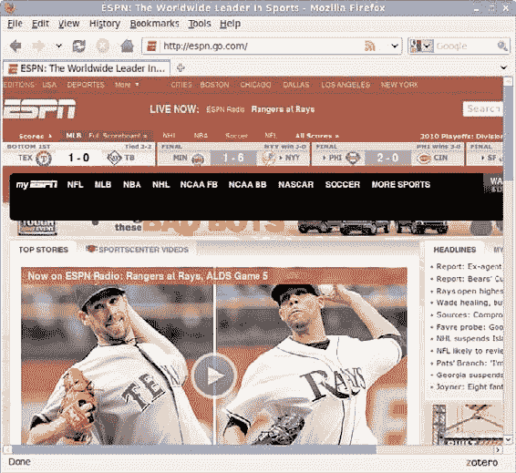 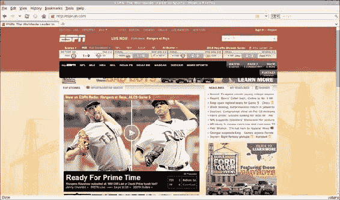 

**图 12.1**
较小屏幕尺寸的固定宽度示例。

**图 12.2**
较大屏幕尺寸的固定宽度示例。

## 理解流式布局（Liquid Layouts）

流式布局——也称为流体布局（fluid layout）是指页面主体不使用指定像素宽度的布局，尽管它可能包含在一个使用百分比宽度的主“包装器”（wrapper）`<div>` 中。

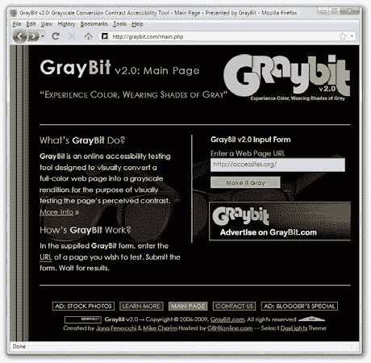 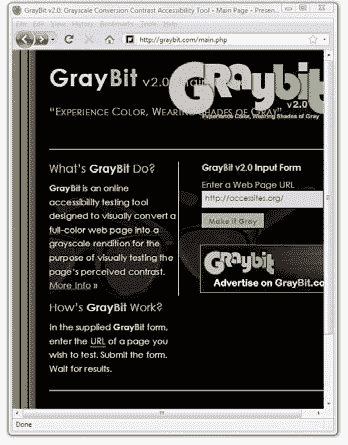

流式布局背后的理念是，即使使用户的屏幕非常小或非常宽，它也可以保持完美可用并保留整体设计美学。图 12.3、12.4 和 12.5 显示了流式布局运行的三个示例。

**图 12.3**
在较小屏幕上查看的流式布局。

**图 12.4**
在极小屏幕上查看的流式布局。

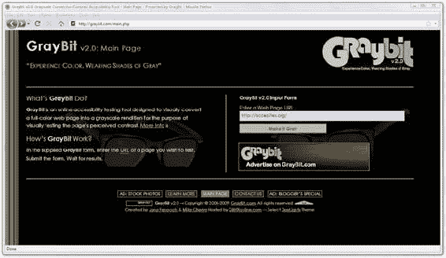 

**图 12.5**
在宽屏幕上查看的流式布局。

在图 12.3 中，浏览器窗口宽度约为 770 像素。这个示例显示了在出现水平滚动条之前一个合理的最小屏幕宽度。事实上，只有当浏览器宽度达到 735 像素时，滚动条才会出现。另一方面，图 12.4 显示了一个非常小的浏览器窗口（宽度为 545 像素）。

在图 12.4 中，你可以看到一个水平滚动条；在页面内容的头部区域，Logo 图形开始覆盖文字并显示在文字上方。但页面的大部分仍然相当可用。页面左侧的信息内容仍然可见，并且它与右侧的输入表共享可用空间。

图 12.5 显示了同一个页面在极宽屏幕上的样子。在图 12.5 中，浏览器窗口宽度约为 1330 像素。有充足的空间让页面上的所有内容铺开。这种流式布局之所以实现，是因为所有设计元素都指定了百分比宽度（而不是固定宽度）。通过这样做，布局利用了所有可用浏览器版地。

流式布局方法乍看似乎是最佳方法——毕竟，谁不想利用所有可用的屏幕空间呢？利用空间与不让内容“呼吸”（如果可以）之间存在微妙的界限。内容过多会让人无所适从；开放空间内内容太少则显得意不足。纯粹的流式布局可能令人印象深刻，但它需要大量的测试来确保它在不同屏幕分辨率的各种浏览器中都是可用的。你可能没有时间和精力来制作这样的设计；在这种情况下，合理的折中方案是固定/流式混合布局。

## 创建固定/流式混合布局

固定/流式混合布局包含两种类型的元素。例如，你可以有固定宽的侧边栏和页脚，但有一个流式的内容区域。

首先，注意此布局的样式表是通过 `<link>` 标签链接的，而不是包含在模板中。因为一个模板被用于多个页面，你希望以最有组织的方式控制模板的显示元素。这意味着你只需要在一个地方——样式表——更改这些元素的定义。

接下来，你会发现基础的 HTML 仅仅是如此：极其基础。而且，老实说，这种基础 HTML 可以用于固定布局、流式布局，或你将看到的混合布局，因为使布局固定、流式或混合的所有样式都发生在样式表中。

你在 12.1 中的 HTML 结构实际上是你想要包含在站点中的区域识别。这种规划对于任何开发都是至关重要的；在考虑要使用的布局类型之前，你必须知道你想包含什么。

### 从基础布局开始

```html
<?xml version="1.0" encoding="UTF-8"?>
<!DOCTYPE html PUBLIC "-W3C//DTD HTML 4.1//EN" "http://www.w3.org/TR/html41/loose.dtd">
<html xmlns="http://www.w3.org/1999/xhtml" lang="en">
<head>
  <title>Sample Layout</title>
  <link href="layout.css" rel="stylesheet" type="text/css" />
</head>
<body>
  <div id="header">HEADER</div>
  <div id="wrapper">
    <div id="content_area">CONTENT</div>
    <div id="left_side">LEFT SIDE</div>
    <div id="right_side">RIGHT SIDE</div>
  </div>
  <div id="footer">FOOTER</div>
</body>
</html>
```

在此阶段，layout.css 文件仅包含此条目：

```css
body {
  margin:0;
  padding:0;
}
```

如果你查看 12.1 中的 HTML 并对自己说“但如果没有任何样式，这些 `<div>` 元素将只是堆叠在一起”，你是正确的。如图 12.6 所示，没有任何布局可言。

## 在固定/流式混合布局中定义两列

我们可以先从简单的事情开始。因为这种布局应该是


对于液体布局，我们知道无论在页头（header）和页脚（footer）区域放置什么，都会扩展窗口的宽度，无论窗口有多窄。

在样式表中添加以下代码，可以让页头和页脚区域的宽度均为 100%，并具有相同的背景颜色：

```css
#header {
  float: left;
  width: 100%;
  background-color: #7152F4;
}

#footer {
  float: left;
  width: 100%;
  background-color: #7152F4;
}
```

现在事情变得有点复杂了。我们必须在 `ptg999` 的两侧定义两个固定列，以及中间的列。在 HTML 中，注意有一个 `<div>` 包裹了这三个元素，称为 `wrapper`。该元素的定义如下：

```css
#wrapper {
  float: left;
  padding-left: 200px;
  padding-right: 125px;
}
```

使用两个内边距（padding）定义的本质是为了为页面左右的两个固定宽度列留出空间。左侧列宽为 200 像素，右侧列宽 125 像素，且每个列具有不同的背景颜色。但我们还必须相对于元素在 HTML 未样式时的位置对它们进行定位（见图 12.6）。这意味着要在每个列的样式表条目中添加 `position: relative`。此外，我们指示 `<div>` 元素应该向左浮动（float）。

但在 `left_side` `<div>` 的情况下，我们还指示希望最右侧的边距距离边缘 200 像素（这除了列本身被定义为 200 像素宽之外）。我们还希望左侧的外页边距（margin）为完全的负边距；这将将其拉到到位（你很快就会看到）。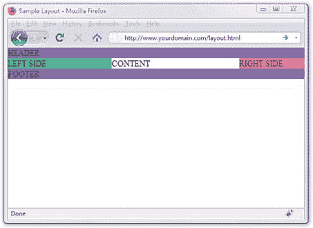

创建固定/液体混合布局 261

`right_side` `<div>` 不包含右侧的值，但它在右侧包含一个负边距：

```css
#left_side {
  position: relative;
  float: left;
  width: 200px;
  background-color: #52f471;
  right: 200px;
}

#right_side {
  position: relative;
  float: left;
  width: 125px;
  background-color: #f452d5;
}
```

此时，让我们也定义内容区域，使其具有白色背景，占据可用区域的 100%，并相对于其位置向左浮动：

```css
#content_area {
  ptg999-fixed
  position: relative;
  float: left;
  background-color: #ffffff;
  width: 100%;
}
```

此时，基础布局将看起来像图 12.7 所示，区域界限清晰。

图 12.7
应用某些样式后的基础 HTML 模板。

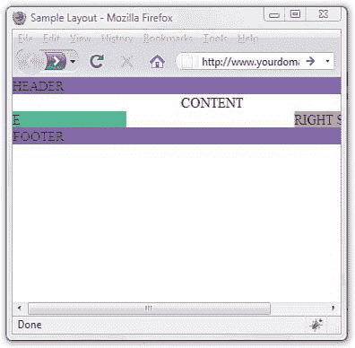

262 第 12 章 创建固定或液体布局

然而，如果窗口缩减到某个宽度以下，这个模板就会出现问题。因为左侧列宽为 200 像素，右侧列宽为 125 像素，而且你希望内容区域至少有一些文本，你可以想象当窗口仅有 350 到 400 像素宽时，此页面将会崩溃。图 12.8 显示了当窗口缩小到略低于 400 像素（确切说是 390 像素）时发生的情况。

图 12.8
缩减到 400 像素以下的基础 HTML 模板：糟糕！

ptg999
### 设置布局的最小宽度

尽管用户不太可能使用小于 400 像素的浏览器访问你的网站，但该示例在本书范围内起到了作用。你可以推断并广泛应用这些信息：即使在固定/液体混合网站中，除非你采取某些措施，否则你的布局会在某一点崩溃。

那个“措施”就是使用 `min-width` 属性。`min-width` 属性设置元素的最小宽度，不包括内边距、边框或边距。图 12.9 显示了将 `min-width` 应用于 `<body>` 元素时发生的情况。

图 12.9 显示了向右滚动后右侧列的一小部分，但关键在于，当缩小到最小宽度以下时，布局不会崩溃。在这种情况下，最小宽度为 525 像素：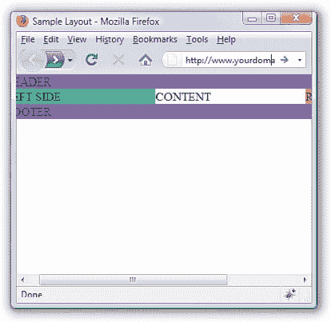 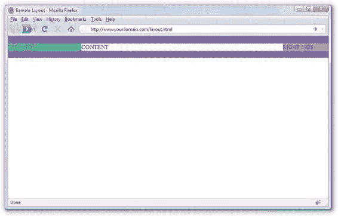

创建固定/液体混合布局 263

```css
body {
  margin: 0;
  padding: 0;
  min-width: 525px;
}
```

图 12.9
缩减到 400 像素以下的基础 HTML 模板：更好！

ptg999
此示例中出现水平滚动条是因为浏览器小于 500 像素。当浏览器略大于 525 像素时，滚动条会消失（见图 12.10）。水平滚动条在所示示例中出现是因为浏览器小于 500 像素。当浏览器略大于 525 像素时，滚动条会消失（见图 12.10）。水平滚动条在所示示例中出现是因为浏览器小于 500 像素。当浏览器略大于 525 像素时，滚动条会消失（见图 12.10）。

图 12.10
尽管是 800 像素，颜色字段现在可见。

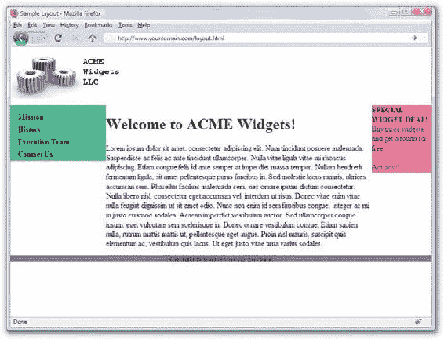

264 第 12 章 创建固定或液体布局

### 处理固定布局中的列高度

这个示例一切良好，但存在一个问题：它没有内容。如图 12.11 所示，列的高度随内容而变。

图 12.11
列的高度仅随内容-

ptg999
由于你无法指望于用户的浏览器具有特定的高度，你可能会认为这给固定布局带来了了问题。首先，在样式表中为 `left_side`、`right_side` 和 `content_area` ID 添加以下定义：

```css
padding-bottom: 2000px;
```

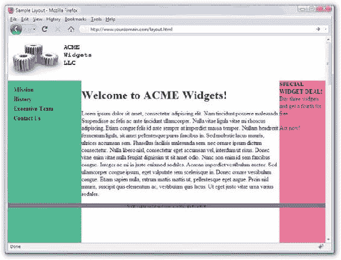

创建固定/液体混合布局 265

这些定义增加了大量的内边距，并为所有三个元素分配了巨大的外边距。你还在样式表中为 `footer` ID 添加 `position: relative`，以便即使有这些内边距它是可见的。

这不是我们想要的，但更接近了。

图 12.12
颜色字段现在可见尽管-

ptg999
此时，页面看起来像图 12.12——为了裁剪掉多余的颜色，在 `wrapper` ID 的样式表中添加以下内容：

```css
overflow: hidden;
```

图 12.13 显示了最终结果：具有必要的列间距的固定/液体布局。完整的 HTML 代码见列表 12.2，最终的样式表见列表 12.3。

图 12.13
恭喜！这是一个固定-

液体布局。

LISTING 12.2
基础固定/液体布局结构（带内容）

ptg999
```xml
<?xml version="1.0" encoding="UTF-8"?>
<!DOCTYPE html PUBLIC "-//W3C//DTD XHTML 1.1//EN"
"http://www.w3.org/TR/xhtml11/DTD/xhtml11.dtd">
<html xmlns="http://www.w3.org/1999/xhtml" xml:lang="en">
<head>
<title>示例布局</title>
<link href="layout.css" rel="stylesheet" type="text/css" />
</head>
<body>

<div id="header"></</div>
<div id="wrapper">
<div id="content_area">
<h1>欢迎来到 ACME Widgets！</h1>
<p>Lorem ipsum dolor sit amet, consectetur adipiscing elit.
Nam tincidunt posuere malesuada. Suspendisse ac felis ac ante
tincidunt ullamcorper. Nulla vitae ligula vitae mi rhoncus
adipiscing. Etiam congue felis id ante semper at imperdiet
massa tempor. Nullam hendrerit fermentum ligula, sit amet
pellentesque faucibus in. Sed molestie lacus mauris,
ultrices accumsan sem. Nulla libero, consectetur eget accumsan vel, interdum ut risus. Donec
vitae enim vitae nulla feugiat dignissim ut sit amet odio.
Nunc non enim id sem faucibus congue. Integer ac mi in justo
euismod sodales. Aenean imperdiet vestibulum auctor. Sed
```

创建固定/液体混合布局 267
LISTING 12.2  继续


ullamcorper congue ipsum, eget vulputate sem scelerisque in.

Donec ornare vestibulum congue. Etiam sapien nulla, rutrum
mattis mattis ut, pellentesque eget augue. Proin nisl mauris,
suscipit quis elementum ac, vestibulum quis lacus. Ut eget
justo vitae urna varius sodales. </p>

</div>

<div id="left_side">

<ul>
<li><a href="#">任务使命</a></li>
<li><a href="#">历史介绍</a></li>
<li><a href="#">执行团队</a></li>
<li><a href="#">联系我们</a></li>
</ul>

</div>

<div id="right_side"><strong>特种小部件优惠！</strong><br/>
购买三个小部件，免费送第四个。<br/><br/>
立即行动！
</div>

</div>

<div id="footer"> 版权信息通常位于此处。</div>

</body>

</html>

ptg999

代码列表 12.3 适用于固定/流式混合布局的完整样式表

```css
body {
margin:0;
padding:0;
min-width: 525px;
}
#header {
float: left;
width:100%;
background-color: #ffffff;
}
#footer {
float: left;
width:100%;
background-color: #7152f4;
font-size: 8pt;
font-weight: bold;
text-align: center;
position: relative;
}
#wrapper {
float: left;
padding-left: 200px;
padding-right: 125px;
overflow: hidden;
}
```

268 第 12 章 创建固定或流式布局

代码列表 12.3（续）

```css
#left_side {
position: relative;
float: left;
width: 200px;
background-color: #52f471;
right: 200px;
padding-bottom: 2000px;
}
#right_side {
position: relative;
float: left;
width: 125px;
background-color: #f452d5;
padding-bottom: 2000px;
}
#content_area {
position: relative;
float: left;
background-color: #ffffff;
width: 100%;
padding-bottom: 2000px;
}
#left_side ul {
list-style: none;
margin: 12px 0px 0px 12px;
padding: 0px;
}
#left_side li a:link, #nav li a:visited {
font-size: 12pt;
font-weight: bold;
padding: 3px 0px 3px 3px;
color: #000000;
text-decoration: none;
display: block;
}
#left_side li a:hover, #nav li a:active {
font-size: 12pt;
font-weight: bold;
padding: 3px 0px 3px 3px;
color: #ffffff;
text-decoration: none;
display: block;
}
```

### 总结 269

在本章中，你看到了三种主要布局类型的实际示例：固定布局、流式布局以及固定/流式混合布局。在章的第三部分中，你看到了一个扩展示例，它带你一步步演示了创建固定/流式混合布局的过程，在该布局中 HTML 和 CSS 均通过了验证。记住，创建布局最重要的部分是确定你认为在设计中可能需要考虑的内容区域。

ptg999

270 第 12 章 创建固定或流式布局

## 问答

问：我听说过一种叫“弹性布局”（elastic layout）的东西。它和流式布局（liquid layout）有什么不同？

答：弹性布局是一种当用户调整文本大小时其内容区域也会调整大小的布局。弹性布局使用 `em`，它 本质上与文本和字体大小成正比。`em` 是一种排版单位，等于当前字体的字号。在弹性布局中使用 `ems` 时，如果用户通过按 Ctrl 键并使用鼠标滚轮强制文本大小增大或缩小，包含文本的区域将按比例增大或减小。弹性布局非常难以实现，由于完善它们需要花费大量时间，它们更多地出现在作品集中，而不是实际实践中。

问：你花了大量时间谈论流式布局或混合布局。它们比纯粹的固定布局更好吗？

答：“更好”是一个主观的术语；在书中，我们关注的是符合标准的代码。大多数设计师会告诉你，流式布局的创建（和完善）需要更长的时间，但可用性的提升是值得的。在什么情况下时间可能不值呢？如果你的客户没有特定意见，而且他们支付的是固定费用而不是按小时计费，那么可能就不值了。在这种情况下，你工作仅仅是为了展示你自己的技能——

总结

在本章中，你看到了三种主要布局类型的实际示例：固定布局、流式布局以及固定/流式混合布局。在章的第三部分中，你看到了一个扩展示例，它带你一步步演示了创建固定/流式混合布局的过程，在该布局中 HTML 和 CSS 均通过了验证。记住，创建布局最重要的部分是确定你认为在设计中可能需要考虑的内容区域。

270 第 12 章 创建固定或流式布局

## 问答

问：我听说过一种叫“弹性布局”的东西。它和流式布局有什么不同？

答：弹性布局是一种当用户调整文本大小时其内容区域也会调整大小的布局。弹性布局使用 `em`，它本质上与文本和字体大小成正比。`em` 是一种排版单位，等于当前字体的字号。在弹性布局中使用 `ems` 时，如果用户通过按 Ctrl 键并使用鼠标滚轮强制文本大小增大或缩小，包含文本的区域将按比例增大或减小。弹性布局非常难以实现，由于完善它们需要花费大量时间，它们更多地出现在作品集中，而不是实际实践中。问：你花了大量时间谈论流式布局或混合布局。它们比纯粹的固定布局更好吗？

答：“更好”是一个主观的术语；在书中，我们关注的是符合标准的代码。大多数设计师会告诉你，流式布局的创建（和完善）需要更长的时间，但可用性的提升是值得的。在什么情况下时间可能不值呢？如果你的客户没有特定意见，而且他们支付的是固定费用而不是按小时计费，那么可能就不值了。在这种情况下，你工作仅仅是为了展示你自己的技能——总结 269

在本章中，你看到了三种主要布局类型的实际示例：固定布局、流式布局以及固定/流式混合布局。在章的第三部分中，你看到了一个扩展示例，它带你一步步演示了创建固定/流式混合布局的过程，在该布局中 HTML 和 CSS 均通过了验证。记住，创建布局最重要的部分是确定你认为在设计中可能需要考虑的内容区域。270 第 12 章 创建固定或流式布局

## 问答

问：我听说过一种叫“弹性布局”的东西。它和流式布局有什么不同？

答：弹性布局是一种当用户调整文本大小时其内容区域也会调整大小的布局。弹性布局使用 `em`，它本质上与文本和字体大小成正比。`em` 是一种排版单位，等于当前字体的字号。在弹性布局中使用 `ems` 时，如果用户通过按 Ctrl 键并使用鼠标滚轮强制文本大小增大或缩小，包含文本的区域将按比例增大或减小。弹性布局非常难以实现，由于完善它们需要花费大量时间，它们更多地出现在作品集中，而不是实际实践中。问：你花了大量时间谈论流式布局或混合布局。它们比纯粹的固定布局更好吗？

答：“更好”是一个主观的术语；在书中，我们关注的是符合标准的代码。大多数设计师会告诉你，流式布局的创建（和完善）需要更长的时间，但可用性的提升是值得的。在什么情况下时间可能不值呢？如果你的客户没有特定意见，而且他们支付的是固定费用而不是按小时计费，那么可能就不值了。在这种情况下，你工作仅仅是为了展示你自己的技能——总结 269

在本章中，你看到了三种主要布局类型的实际示例：固定布局、流式布局以及固定/流式混合布局。在章的第三部分中，你看到了一个扩展示例，它带你一步步演示了创建固定/流式混合布局的过程，在该布局中 HTML 和 CSS 均通过了验证。记住，创建布局最重要的部分是确定你认为在设计中可能需要考虑的内容区域。ptg999

270 第 12 章 创建固定或流式布局

## 问答

问：我听说过一种叫“弹性布局”的东西。它和流式布局有什么不同？

答：弹性布局是一种当用户调整文本大小时其内容区域也会调整大小的布局。弹性布局使用 `em`，它本质上与文本和字体大小成正比。`em` 是一种排版单位，等于当前字体的字号。在弹性布局中使用 `ems` 时，如果用户通过按 Ctrl 键并使用鼠标滚轮强制文本大小增大或缩小，包含文本的区域将按比例增大或减小。弹性布局非常难以实现，由于完善它们需要花费大量时间，它们更多地出现在作品集中，而不是实际实践中。问：你花了大量时间谈论流式布局或混合布局。它们比纯粹的固定布局更好吗？

答：“更好”是一个主观的术语；在书中，我们关注的是符合标准的代码。大多数设计师会告诉你，流式布局的创建（和完善）需要更长的时间，但可用性的提升是值得的。在什么情况下时间可能不值呢？如果你的客户没有特定意见，而且他们支付的是固定费用而不是按小时计费，那么可能就不值了。在这种情况下，你工作仅仅是为了展示你自己的技能——

总结

在本章中，你看到了三种主要布局类型的实际示例：固定布局、流式布局以及固定/流式混合布局。在章的第三部分中，你看到了一个扩展示例，它带你一步步演示了创建固定/流式混合布局的过程，在该布局中 HTML 和 CSS 均通过了验证。记住，创建布局最重要的部分是确定你认为在设计中可能需要考虑的内容区域。

# 理解动态网站

`dynamic` 一词意味着活跃的，或者能够激励用户采取行动——阅读更多、购买产品等。在本章中，你将学习一些使网站动态化的不同交互类型，包括关于服务器端和客户端脚本的信息（以及书中后续所有专门针对 JavaScript 编程章节的实际示例）。


包含以下内容（欲了解更多信息，请访问此处列出的网站）：

- `Java`：由 Sun Microsystems 于 1995 年发布，`Java` 是一种与服务器端脚本语言密切相关的编程语言。
- `PHP`（PHP: 超文本预处理器)—http://www.php.net/
- `JSP`（Java 服务器页面)—http://java.sun.com/products/jsp/
- `JavaScript` 由 Netscape Communications 同样于 1995 年创建，命名是为了表示其外观与 Java 相似，但与其之间没有直接联系。
- `ASP`（活动服务器页面)—http://www.asp.net/
- `Perl`—http://www.perl.org/
- `Python`—http://www.python.org/
- `Ruby`—http://www.ruby-lang.org/

另一方面，`client-side scripting`（客户端脚本）指的是运行在你的网络浏览器中的脚本；这些脚本的运行不需要与 Web 服务器进行交互。到目前为止，最流行的客户端脚本语言是 `JavaScript`。多年来的研究表明，超过 93% 的所有网络浏览器都启用了 `JavaScript`。

另一种客户端脚本语言是微软的 `VBScript`（Visual Basic 脚本版）。这种语言仅在 Microsoft Internet Explorer 浏览器可用，因此，除非你确定用户将使用该浏览器访问你的网站（例如在封闭的企业内部环境中），否则不应使用它。

## 在 HTML 中引入 JavaScript

本章的大部分内容是对第 4 章的回顾；我认为在 HTML 和 CSS 章节之后、重型客户端应用编程开始之前，重新回顾 `JavaScript` 的基础知识是一个好主意。

如果你还记得，`JavaScript` 代码可以存在于文件中的两个位置之一：
- 在具有 `.js` 扩展名的独立文件中
- 直接在你的 HTML 文件中

外部文件通常用于脚本库（你可以在许多页面中重用的代码），而直接出现在 HTML 文件中的代码往往用于实现特定于这些独立页的功能。

无论你的 `JavaScript` 位于何处，浏览器都会通过使用 `<script></script>` 标签对感知它的存在。

当你将 `JavaScript` 存储在外部文件中时，以如下方式引用它：

```html
<script type="text/javascript" src="/path/to/script.js">
```

这些 `<script></script>` 标签通常放置在 `<head></head>` 标签之间，因为严格来说，它们不属于页面 `<body>` 中的内容。相反，`<script>` 提供了一组 `JavaScript` 函数或其他信息，页面的其余部分随后可以使用这些信息。不过，你也可以将将 `JavaScript` 函数或代码段封装在 `<script>` 中，并根据需要放置在页面的任何位置。列表 13.1 显示了一个放置在 HTML 文档 `<body>` 中的 `JavaScript` 代码段示例。

### 列表 13.1 使用 JavaScript 打印某些文本

```html
<?xml version="1.0" encoding="UTF-8"?>
<!DOCTYPE html PUBLIC "-//-//W3C//DTD XHTML 1.1//EN" "http://www.w3.org/TR/xhtml11/DTD/xhtml11.dtd">
<html xmlns="http://www.w3.org/1999/xhtml" xml:lang="en">
<head>
    <title>JavaScript Example</title>
</head>
<body>
    <h1>JavaScript Example</h1>
    <p>This text is HTML.</p>
    <script type="text/javascript">
        <!-- Hide the script from old browsers
        document.write('<p>This text comes from JavaScript.</p>');
        // Stop hiding the script -->
    </script>
</body>
</html>
```

在 `<script></script>` 标签之间是一个单一的 `JavaScript` 命令，输出输出 HTML：

```html
<p>This text comes from JavaScript.</p>
```

当浏览器渲染此 HTML 页面时，它会看到 `<script></script>` 标签之间的 `JavaScript`，停止几毫秒执行该命令，然后返回渲染现在包含 `JavaScript` 命令输出的 HTML 输出。图 13.1 显示，该页面的外观与其他任何 HTML 页面并无异。它是一个 HTML 页面，但 HTML 的一小部分来自 `JavaScript` 命令。

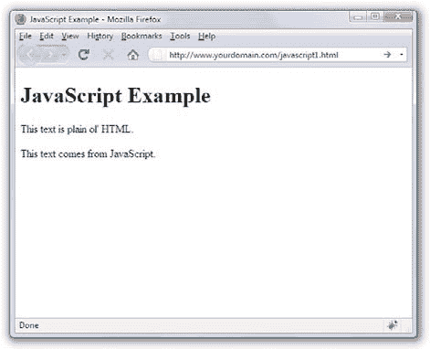

**图 13.1**：`JavaScript` 代码段的输出与其他任何输出一样。

**注意**：你可能注意到了列表 13.1 中的这两行：
```html
<!-- Hide the script from old browsers
// Stop hiding the script -->
```
这是一个 HTML 注释。`<!--` 开始到 `-->` 结束之间的任何内容在源代码中可见，但不会被浏览器渲染。在这种情况下，`JavaScript` 代码被 HTML 注释包围，以防你的访问者运行非常旧的网络浏览器或关闭了 `JavaScript`。

## 显示随机内容

你可以使用 `JavaScript` 在每次翻页时显示不同的内容。也许你有一组你觉得有趣的文本或图像想包含在你的页面中？为了创建一个每次加载都发生变化的页面，你必须先将所有的引言收集到一个数组，JavaScript 用来随机提取引言。

### 列表 13.2 随机引言页面

```html
<?xml version="1.0" encoding="UTF-8"?>
<!DOCTYPE html PUBLIC "-//-//W3C//DTD XHTML 1.1//EN" "http://www.w3.org/TR/xhtml11/DTD/xhtml11.dtd">
<html xmlns="http://www.w3.org/1999/xhtml" xml:lang="en">
<head>
    <title>Quotable Quotes</title>
    <script type="text/javascript">
        <!-- Hide the script from old browsers
        function getQuote() {
            // Create the arrays
            quotes = new Array(4);
            sources = new Array(4);
            // Initialize the arrays with quotes
            quotes[0] = "When I was a boy of 14, my father was so ignorant...but I got to 21, I was astonished at how much he had learned in 7 years.";
            sources[0] = "Mark Twain";
            quotes[1] = "Everybody is ignorant. Only on subjects.";
            sources[1] = "Will Rogers";
            quotes[2] = "They say such nice things about people at funerals that it makes me sad that I’m going to miss mine by a few days.";
            sources[2] = "Garrison Keillor";
            quotes[3] = "What’s another word for thesaurus?";
            sources[3] = "Steven Wright";
            // Get a random index into the arrays
            i = Math.floor(Math.random() * quotes.length);
            // Write out the quote as HTML
            document.write("<dl style='background-color: lightpink'>\n");
            document.write("<dt><em>" + quotes[i] + "</em></dt>\n");
            document.write("<dd>- " + sources[i] + "</dd>\n");
            document.write("</dl>\n");
        }
        // Stop hiding the script -->
    </script>
</head>
<body>
    <h1>Quotable Quotes</h1>
    <p>Following is a random quotable quote. To see a new quote just reload this page.</p>
    <script type="text/javascript">
        <!-- Hide the script from old browsers
        getQuote();
        // Stop hiding the script -->
    </script>
</body>
</html>
```

尽管这段代码看起来很长，但如果你仔细观察，你会发现很大一部分是显示在页面上的四个引言。在忽略长度因素后，代码本身并不十分复杂。在第一组 `<script></script>` 标签之间的大量行创建了一个名为 `getQuote()` 的函数。函数定义后，可以在同一页面的其他地方调用它。注意，如果该函数存在于外部文件中，则可以从你所有的页面调用该函数。


如果你仔细观察代码，你会看到类似这样的行：

```javascript
// Create the arrays

// Initialize the arrays with quotes
```

这些是代码注释。开发者使用这些注释在代码中留记，以便任何阅读代码的人都能知道代码在特定位置在做什么。在第一条关于创建数组的注释之后，你可以看到了两个数组——一个名为 `quotes`，另一个名为 `sources`——每个数组都包含四个元素：

```javascript
quotes = new Array(4);
sources = new Array(4);
```

在第二条注释（关于用引号初始化数组）之后，数组中被添加了四个 `ptg999` 项。我们将仔细查看其中一个，即马克·吐宾因的第一句名言：

```javascript
quotes[0] = “When I was a boy of 14, my father was so “ +
“ignorant...but when I got to be 21, I was astonished at “ +
“how much he had learned in 7 years.”;
sources[0] = “Mark Twain”;
```

你已经知道数组被命名为 `quotes` 和 `sources`。但赋值值的变量（在此例中）被称为 `quotes[0]` 和 `sources[0]`。因为 `quotes` 和 `sources` 是数组，所以数组中的每个项都有它们自己的位置。在使用数组时，数组中的第一个项不在 #1 号槽，而是在 #0 号槽。换句话说，计数从 0 开始而不是 1。因此，第一个引言的文本（一个值）被赋值给 `quotes[0]`（一个变量）。同样，第一个来源的文本被赋值给 `source[0]`。

文本字符串用引号包裹。但在 JavaScript 中，换行表示命令的结束，因此以下内容会导致代码出现问题：

```javascript
quotes[0] = “When I was a boy of 14, my father was so
ignorant...but when I got to be 21, I was astonished at
how much he had learned in 7 years.”;
```

因此，你会看到字符串是由系列带引号的字符串构建的，并用加号（`+`）连接字符串。

下一段代码看起来最像编程；这一行获取了一个随机数：

```javascript
i = Math.floor(Math.random() * quotes.length);
```

但你不能随便挑选任何随机数，因为随机数的目的是确定应该打印哪句引言和来源——而只有四句引言。所以，这行 JavaScript 代码执行了以下操作：

* 使用 `Math.random()` 获取一个 0 到 1 之间的随机数。例如，0.5482749 可能是 `Math.random()` 的结果。
* 将随机数乘以 `quotes` 数组的长度，当前长度为 4；数组的长度是数组中元素的数量。如果随机数是 0.5482749（如之前所示），将其乘以 4 结果是 2.1930996。
* 使用 `Math.floor()` 将结果向下取整到最近的整数。换句话说，2.1930996 变成了 2。`ptg999`。
* 给变量 `i` 赋值为 2。

函数的其余部分看起来很熟悉，但有几个例外。首先，正如你在本章早期学到的，`document.write()` 被用于写入 HTML，然后由浏览器进行渲染。接下来，字符串被分开了，以便在需要以不同方式处理时保持清晰，例如在需要字面打印引号时使用反斜杠（\`）进行转义，或者在替换变量值时。打印的实际引言和来源是 `quotes[i]` 和 `sources[i]` 匹配的那个，其中 `i` 是由之前显示的数学函数数字。

但仅仅编写函数并不意味着会产生任何输出。在 HTML 的后续部分，你可以看到两个 `<script></script>` 标签之间有 `getQuote()`；这就是调用函数的方式。在任何调用该函数的地方，函数的输出就会被放置在那里。在这个示例中，输出显示在介绍引言的段落下方。

图 13.2 显示了在 Web 浏览器加载时的 Quotable Quotes 页面。当页面重新加载时，有四分之一的机会显示不同的引言——毕竟，它是随机的！

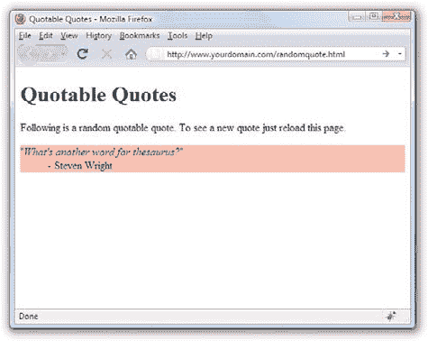

280 第 13 章 理解动态网站

图 13.2 Quotable Quotes 页面每次加载时都会显示一条随机引言。

记住，你可以轻松地修改此页面以包含你自己的引言或其他你想随机显示的文本。你还可以通过在代码的 `quotes` 和 `sources` 数组中添加更多条目来增加可用引言的数量。`ptg999`。

如果你将 Quotable Quotes 页面作为一个起点，你可以轻松地修改脚本并创建你自己的有趣的变体。如果你在这个过程中犯了错，那就错了。克服错误的诀窍是分析代码。

### 理解文档对象模型 (DOM)

DOM 是你能够引用元素及其关联对象的框架。显然，这是对某些相当复杂内容的简要概述。

### 根据用户交互更改图像

在第 11 章中，你接触了不同类型的用户交互事件，例如 `onclick`、`onmouseover`、`onmouseout` 等。在那个章节中，你根据用户交互触发了文本变化；在本节中，你将看到一个可见交互类型的示例，它是既实用又动态的。

图 13.3 显示了收藏品公司在线目录的一个页面。目录中的每页都显示一张大图、有关物品的信息以及页面底部的一组小图。在此类目录中，物品细节的特写图像对潜在买家很重要，但从显示和带宽的角度来看，页面上的几张大图片会变得难以处理。

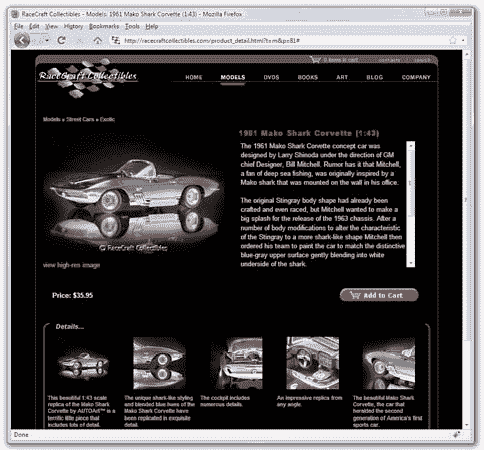

图 13.3 用户首次加载目录物品页面。

页面上的大图使用此 `` 标签调用：`ptg999`

```html

```

你可以看到，这张图片被命名为 `product_img`。因此，这张图片在 DOM 中存在于 `document.product_img`。这很重要。


因为少量的 JavaScript 功能使我们能够动态更改 `document.product_img.src` 的值，这就是图像的源 (`src`）。

下面的代码段创建了图 13.3 底部显示的五张图像中的第四张小图。`onmouseover` 事件表示，当用户鼠标悬停在这张小图上时，`document.product_img.src`（即大图区域）将填充为匹配的大图路径。

```html
<a href=”#” onmouseover=”javascript:document.product_img.src = ‘/path/to/large4.jpg’”">
</a>
```

图 13.4 显示了相同的页面（用户无需重新加载），当用户悬停在页面底部的较小图像时，大图槽会被不同的图像填充。鼠标指针悬停在从右数第二张图像上。当用户悬停在内部照片的小版本上时，其大版本将显示在页面的顶部区域。


**图 13.4**
当用户悬停在较小的图像上时，大图会被替换。

## 总结
在本简短的章节中，你回顾了服务器端脚本与客户端脚本之间的区别，并复习了在 HTML 文件中引入 JavaScript 以为你的网站添加一些交互性。你还学习了如何使用 JavaScript 的 `document.write()` 方法在页面加载时显示随机引言。最后，你了解了 DOM 的本质。

通过应用之前章节中中学的知识，你学习了如何使用客户端脚本让网页上的图像对鼠标移动做出响应。这些任务都不需要太多的编程技能，但它们应该激励你继续读完本书，并学习更多 JavaScript，以为你的页面提供更复杂的交互功能。

## 问答
**Q.** 如果我想使用本章中的随机引言脚本，但我想要有一个包含大量引言的库，我必须把所有引言都放在每个页面中吗？

**A.** 是的。数组中的每一项都必须存在。从这里你可以开始看到客户端处理的内容与更适合在服务器端处理的内容之间的临界点。如果你有一个真正的随机引言库，并且在任何时候只展示其中一个，最好是将这些项存储在数据库表中，并使用一小段服务器端脚本连接到数据库、检索文本并打印到页面上。或者，你也可以一直通过 JavaScript 携带所有引言，但你至少应该将该 JavaScript 函数放在一个不同的文件中，以便与文本分开单独维护。

**Q.** 我看到一些在线目录，它们在似乎是网站内容上方的层中显示大图像。我看到下方的普通网站内容，但焦点在大图上。这是如何实现的？

**A.** 描述听起来像是由名为 `Lightbox` 的 JavaScript 库创建的效果。`Lightbox` 库允许你在放置在网站内容之上的层中显示图像或图像画廊。这是一个流行的库，用于显示大图像的细节，或仅仅一组足够重要而展示在内容“之上”的图像。（要安装和使用它，请遵循软件附带的说明。）

## 工作坊
工作坊包含问题和练习，帮助你巩固对内容的理解。

1. 你是否有任何页面，如果导航图标在鼠标经过时改变颜色，看起来会更酷炫或更容易理解？如果是这样，尝试使用本章提供的信息创建一些版本。
2. 你将如何修改第 1 题编写的代码，以便在用户移开鼠标时按钮闪烁？
3. 你可以像在本章较早时候学过的那样，显示随机图像（例如图形广告）。不要打印文本，而是打印你想要展示的图像的 `` 标签。

### 答案
1. 你的代码可能像这样：
```html
<a href=”gohere.html” onmouseover=”javascript:document.product_img.src = ‘/path/to/large4.jpg’”">
</a>
```
2. 你的代码可能像这样：
```html
<a href=”gohere.html” onmouseover=”javascript:document.product_img.src = ‘/path/to/large4.jpg’”" onmouseout=”javascript:document.product_img.src = ‘/path/to/small4.jpg’”">
</a>
```
3. 加号 (`+`）用于连接两个字符串。
```javascript
document.write('This is a string ' + 'that I have created.');
```

---

# 第 14 章：开始学习 JavaScript

### 基础概念
在整本书中，你会遇到一些基础概念和术语。在接下来的章节中，你将学习 JavaScript 的基本构建块。

### 语句
语句是 JavaScript 程序的基本单元。语句是执行单个操作的代码段。例如，以下三个语句来自第 4 章中的日期和时间示例：

```javascript
hours = now.getHours();
mins = now.getMinutes();
secs = now.getSeconds();
```

虽然语句通常是单行 JavaScript，但这并不是规则——你可以将一个语句跨越多行，也可以在单行中包含多个语句。

分号标记语句的结束。如果你在语句后新起的一行，也可以省略分号。如果你将多个语句合并到同一行，则必须使用分号来分隔它们。

### 使用函数组合任务
你将学习如何定义、调用以及从函数返回返回值。在目前的基础脚本中，你已经看到一些带有括号区域的语句，如下：


# 使用 JavaScript 函数和对象

`document.write("Testing.");`

这是一个函数的示例。函数提供了一种处理任务的简单方法，例如向网页添加输出内容。JavaScript 包含了各种内置函数，你将在整本书中学习这些内容。像前面的示例中那样使用函数的语句被称为函数调用。

函数接收参数（括号内的表达式）来告诉它们要执行什么操作。此外，函数可以向等待结果的变量返回一个值。例如，接下来的函数调用会提示用户输入响应并将其存储在 `text` 变量中：

```javascript
text = prompt(“Enter some text.”)
```

你也可以创建自己的函数。这非常有用，主要基于以下两点： 
1. 首先，你可以将脚本的逻辑部分分开，使其更容易理解。 
2. 其次，更重要的是，你可以多次使用该函数或使用不同的数据使用它，以避免重复脚本语句。

## 变量

在第 4 章中，你学习了变量是用于存储数字、文本字符串或其他值的容器。例如，以下语句创建了一个名为 `fred` 的变量并为其赋值了值 `27`：

```javascript
var fred = 27;
```

JavaScript 变量可以包含数字、文本字符串和其他值。你将在第 16 章“使用 JavaScript 变量、字符串和数组”中学习更多关于它们的知识。

## 理解对象

JavaScript 还支持 `objects`。像变量一样，对象可以存储数据——它可以同时存储两个或多个数据。

存储在对象中的数据项被称为对象的 `properties`（属性）。例如，你可以使用对象来存储人的信息，比如地址簿。每个人物对象的属性可能包括姓名、地址和电话号码。

JavaScript 使用点来分隔对象名和属性名。例如，对于名为 `Bob` 的人物对象，属性可能包括 `Bob.address` 和 `Bob.phone`。

对象还可以包含 `methods`（方法）。这些是处理 `document` 对象数据方法的函数。例如，我们用于地址簿的人物对象可能包含一个 `display()` 方法，用于显示人的信息。在 JavaScript 术语中，语句 `Bob.display()` 将显示 Bob 的详细信息。

如果这听起来很困惑，不要担心——你将在本书的后后部分更详细地探索对象。现在，你只需要了解基础知识。JavaScript 支持三种对象：

1. **内置对象**是构建在 JavaScript 语言中的。你已经在第 2 章“理解 HTML 和 XHTML 连接”中遇到过其中一个，即 `Date`。其他内置对象还包括 `Array` 和 `String`（你将在第 16 章探索它们），以及在第 17 章中解释的 `Math`。
2. **DOM（文档对象模型）对象**代表浏览器和当前 HTML 文档的各种组件。例如，你在本章稍之前使用的 `alert()` 函数实际上是 `window` 对象的一个方法。你将在第 15 章“处理文档对象模型 (DOM)”中更详细地探索它们。
3. **自定义对象**是你自己创建的对象。例如，正如本节前面提到的，你可以创建一个 `person` 对象。

## 条件语句

尽管事件处理程序在当某事情发生时会通知你的脚本，但你可能想自己检查某些条件。例如，用户是否输入了有效的电子邮件地址？JavaScript 支持 `conditional statements`（条件语句），这让你能够回答这类问题。一个典型的条件使用 `if` 语句，如下例所示：

```javascript
if (count==1) alert(“The countdown has reached 1.”);
```

这会将变量 `count` 与常量 `1` 进行比较，如果它们相同，则向用户显示警报消息。你将在大部分脚本中使用像这样的条件语句。

## 循环

JavaScript（以及大多数其他编程语言）另一个有用功能是创建 `loops`（循环）的能力，即重复特定次数的语句组。例如，这些语句会显示 10 次相同的警报，极大地干扰了用户：

```javascript
for (i=1; i<=10; i++) {
  alert(“Yes, it’s yet another alert!”);
}
```

`for` 语句是 JavaScript 用于循环的几种语句之一。这是计算机应该擅长的领域——执行重复性任务。你将在许多脚本中使用循环，其方式比这个示例有用得多。

## 事件处理程序

正如第 1 章提到的，并不是所有的脚本都位于 `<script>` 标签内。你也可以将脚本作为 `event handlers`（事件处理程序）。尽管这听起来像是一个复杂的编程术语，但它的意思其实就是如此：事件处理程序就是处理事件的脚本。

## JavaScript 语法规则

每个事件处理程序都与特定的浏览器对象关联，你可以在定义对象的标签中指定事件处理程序。例如，图像和文本链接都有一个事件 `onMouseOver`，它在鼠标指针移动到对象上时会发生。这是一个带有事件处理程序的典型 HTML 图像标签：

```html

```

你将事件处理程序作为 HTML 标签的属性指定，并在引号内包含处理事件的 JavaScript 语句。这是函数的理想用例，因为函数名短小直击主题，并且可以引用整系列语句。

## 哪个脚本先运行？

你实际上可以在 Web 文档包含多个脚本：一个或多组 `<script>` 标签、外部 JavaScript 文件以及任意数量的事件处理程序。有了所有这些脚本，你可能会想知道浏览器如何知道先执行哪一个。幸运的是，这是以逻辑方式完成的：

1. HTML 文档 `<head>` 部分内的 `<script>` 标签集首先被处理，无论它们包含嵌入代码还是引用 JavaScript 文件。


网页，它是定义函数以供以后使用的良好地方。

- HTML 文档中 `<body>` 区域内的 `<script>` 标签会在 `<head>` 区域的标签之后执行，这些是在网页正在加载和显示时执行的。如果 `<body>` 中有多个脚本，它们将按顺序执行。
- 事件处理器在相应的事件发生时执行。例如，`onLoad` 事件处理器会在网页主体加载完毕时执行。由于`<head>` 区域在任何事件发生之前加载，你可以在那里定义函数并在事件处理器中使用它们。

## JavaScript 语法规则

JavaScript 是一种简单的语言，但你确实需要小心地使用它的语法——即定义你如何使用该语言的规则。本书其余部分将涵盖 JavaScript 语法的许多方面，但为了避免错误，你应该理解一些基本规则。

## 大小写敏感

JavaScript 中的几乎所有内容对大小写都敏感，这意味着你不能交替使用小写字母和大写字母。以下是一些通用规则：

- JavaScript 关键字（如 `for` 和 `if`）始终是小写的。
- 内置对象（如 `Math` 和 `Date`）的首字母是大写的。
- DOM 对象名称通常是小写的，但它们的方法通常是大写和小写字母的组合。通常除了第一个单词以外的所有单词都使用大写字母，例如 `toLowerCase` 和 `getElementById`。

在有疑问时，请遵循本书或其他 JavaScript 参考资料中使用的确切大小。如果你使用了错误的大小，浏览器通常会显示错误消息。

## 变量、对象和函数名称

当你定义自己的变量、对象或函数时，可以选择它们的名称。名称可以包含大写字母、小写字母、数字和下划线（`_`）字符。名称必须以字母或下划线开头。

你可以决定在变量中使用大写还是小写，但记住 JavaScript 是大小写敏感的：`score`、`Score` 和 `SCORE` 被视为三个不同的变量。确保每次引用变量时都使用相同的名称。

## 保留字

关于变量名的另一个规则：它们不能是保留字。这些字包括构成 JavaScript 语言的词（如 `if` 和 `for`）、DOM 对象名称（如 `window` 和 `document`）以及内置对象名称（如 `Math` 和 `Date`）。

## 空格

空白区域（程序员称为 `whitespace`）会被 JavaScript 忽略。你可以在一行中包含空格和制表符，或者包含空行，而不会引起错误。空白通常会让脚本更具可读性。

## 使用注释

JavaScript 注允许你在脚本中包含文档。如果其他人尝试理解该脚本，或者即使是在很长时间之后你尝试理解它，这都是非常有用的。要在 JavaScript 程序中包含注释，请以两个斜杠开头一行，如下例所示：

```
//this is a comment.
```

你也可以在行的中间用两个斜杠开始注释，这对于记录脚本很有用。在这种情况下，斜杠之后该行上的所有内容都被视为注释并被浏览器忽略。例如，

```javascript
a = a + 1; // 给 a 的值加 1
```

JavaScript 还支持 C 风格的注释，它以 `/*` 开始并以 `*/` 结束。这些注释可以跨越多行，如下所示：

```javascript
/*This script includes a variety
of features, including this comment. */
```

由于注释内的 JavaScript 语句会被忽略，C 风格的注释通常用于注释掉代码段。如果你在调试脚本时想临时让某些行 JavaScript 失效，你可以在该部分的开头添加 `/*` 并在结尾添加 `*/`。这些只在 `<script>` 标签内部或外部 JavaScript 文件中有效。

## JavaScript 最佳实践

你现在应该熟悉编写有效 JavaScript 的基本规则了。除了遵循规则，遵循最佳实践也是一个好主意。以下实践可能不是强制要求的，但如果你遵循它们，将为你自己和其他省去一些麻烦。

- 大量地使用注释——这些注释让你的代码更容易被他人理解，在你以后编辑它们时也更容易理解。它们对于标记脚本的主要划分也有用。
- 在每个语句的末尾使用分号，并且每行仅使用一个语句——这会让你的脚本更容易调试。
- 尽可能使用独立的 JavaScript 文件——这可以将 JavaScript 与 HTML 分离，使调试更容易，并鼓励你编写可以重用的模块化脚本。
- 避免特定浏览器——随着你对 JavaScript 的深入，你会学习一些仅在一个浏览器中运行的功能。除非绝对必要，否则请避免它们，并始终在多个浏览器中测试你的代码。
- 保持 JavaScript 可选——不要使用 JavaScript 来执行网站上的核心功能——例如主导航链接。只要可能，没有 JavaScript 的用户也应该能够使用你的网站，尽管它可能没有那么吸引或方便。这种策略被称为渐进增强（progressive enhancement）。

## 尝试一下

在结束本章之前，这里有一个事件处理器的示例。列表 14.1 显示了一个包含简单事件处理器的 HTML 文档。

### 列表 14.1 带有简单事件处理器的 HTML 文档

```html
<?xml version="1.0" encoding="UTF-8"?>
<!DOCTYPE html PUBLIC "-//W3C//DTD XHTML1.1//EN" "http://www.w3.org/TR/xhtml11/DTD/xhtml11.dtd">
<html xmlns="http://www.w3.org/1999/xhtml" xml:lang="en">
<head>
<title>Event Handler Example</title>
</head>
<body>
<h1>Event Handler Example</h1>
<p>
<a href="http://www.google.com/" onclick="alert('Aha! An Event!');">Go Google</a>
</p>
</body>
</html>
```

事件处理器在定义链接的 `<a>` 标签中通过以下 `onclick` 属性定义：`onclick="alert('Aha! An Event!');"`

该事件处理器使用内置的 `alert()` 函数在点击链接时显示消息。在更复杂的脚本中，你通常会定义自己的函数作为事件处理器。图 14.1 显示了此示例的操作。

总结

在本章中，你接触了 JavaScript 编程和语法的几个组件：函数、对象、事件处理器、条件和循环。你还学习了如何使用 JavaScript 注释让你的脚本更容易读，并查看了事件处理器的简单示例。

## 问答

**问：** 我听过将面向对象一词应用于 C++ 和 Java 等语言。如果 JavaScript 支持对象，它是面向对象的语言吗？

**答：** 是的，尽管它可能不符合某些人的严格定义。JavaScript


对象并不支持 C++ 和 Java 等语言支持的所有功能，尽管最新版本的 JavaScript 已经增加了更多面向对象的特性。

**问.** 拥有多个在不同时间执行的脚本似乎很令人困惑。我为什么要使用事件处理器呢？

**答.** 事件处理器是处理网页内小部件（如按钮、复选框和文本字段）的理想方式（在 JavaScript 中也是唯一的方式）。通过这种方式处理它们实际上更方便。与其编写一个静静等待按钮被点击的脚本，你只需创建一个事件处理器，并让浏览器为你完成等待即可。

### 工作坊 ptg999

工作坊包含测验题和练习，旨在帮助你巩固对涵盖内容的理解。在查看随后的“答案”部分之前，请尝试回答所有问题。

### 测验
1. 用户点击鼠标按钮时执行的脚本是哪种情况的示例？
   a. 对象
   b. 事件处理器
   c. 不可能
2. 下列哪些是 JavaScript 函数的功能？
   a. 接受参数
   b. 返回值
   c. 以上两者都是
3. 浏览器首先执行的是哪一个？
   a. `<head>` 部分中的脚本
   b. `<body>` 部分中的脚本
   c. 按钮的事件处理器

### 答案
1. b. 用户点击鼠标按钮时执行的脚本是一个事件处理器。
2. c. 函数既可以接受参数也可以返回结果。
3. a. HTML 文档 `<head>` 部分中定义的脚本由浏览器首先执行。

### 练习
* 检查你在第 4 章中创建的日期和时间脚本，找到任何使用函数和对象的示例。`ptg999`
* 为日期和时间脚本添加 JavaScript 注释，以便更地说明每一行的作用。验证脚本仍然运行正常。

本页特意留空
ptg999

# 第 15 章：操作文档

## 对象模型 (DOM)

上一章向你介绍了 JavaScript 编程的基本概念；本章将帮助你更好地理解文档对象模型 (DOM)，它是 JavaScript 属性和方法显式控制的框架，使你能够更容易地开发出更丰富的用户体验。

### `window` 的基础
* `document` DOM 对象的基础
* `history` DOM 对象的基础

JavaScript 优于纯 HTML 的优势是，这些客户端脚本可以在内容加载后直接在浏览器中操作网页文档及其内容。你的脚本可以向浏览器加载新页面，与浏览器窗口和文档的部分进行交互，打开新窗口，甚至动态修改页面内的文本。

为了操作浏览器和文档，JavaScript 使用了一种称为 DOM 的父子对象层次级结构。这些对象被组织成树形结构，代表了网页的所有内容和组件。

DOM 中的对象具有 `properties`（属性）——描述网页或文档的变量——以及 `methods`（方法）——允许你操作网页部分的函数。

当你引用一个对象时，你使用父对象名称，后跟子对象名称或名称，并用点号分隔。例如，JavaScript 将表示文档中图像的对象存储为 `document` 对象的子。以下引用 `image9` 对象，它是 `document` 对象的子，同时也是 `window` 对象的子：

```
window.document.image9
```

#### 注意：使用 `window` 对象
DOM 并不是 JavaScript 或任何其他编程语言的一部分——而是构建在浏览器中的 API（应用程序编程接口）。在浏览器对象层次结构的顶端是 `window` 对象，它代表一个浏览器窗口。你已经使用过至少一个 `window` 对象的方法：`method` 方法，或简单称为 `alert()`，它会在警告框中显示消息。

可以同时存在多个 `window` 对象，每个对象代表一个打开的浏览器窗口。框架（Frames）也由 `window` 对象表示。你将在第 20 章“使用窗口和框架”中学习更多知识。

`window` 对象是我们在本章中将看到的所有对象的父对象。图 15.1 显示了 DOM 对象层次结构中的 `window` 部分及其各种对象。

**图 15.1 DOM 对象层次结构中的 `window` 部分。**
* `document`
* `anchors[]`
* `images[]`
* `window`
* `parent`, `children`, `siblings`
* `history`
* `forms[]`
* `self`
* `top`

### 如何操作节点、父节点、子节点和兄弟节点
### 如何访问和使用 DOM 节点的属性
### 如何访问和使用 DOM 节点方法
### 如何使用 JavaScript 控制定位
### 如何使用 JavaScript 隐藏和显示对象
### 如何使用 JavaScript 修改页面内的文本
### 如何向页面添加文本

#### 获取文档信息
`document` 对象的多个属性包含了关于当前文档的一般信息：
* `document.URL`:指定文档的 URL。这是一个简单的文本字段。你无法更改此属性。如果你需要将用户引导到位置，请使用 `window.location` 对象，你将进一步学习。
* `document.title`:列出当前页面的标题，由 HTML `<title>` 标签定义。
* `document.referrer`:用户在访问当前页面之前所在的页面 URL——通常是带有当前页面链接的页面。
* `document.lastModified`:文档最后修改的日期。该日期随页面一起发送。
* `document.cookie`:允许你为 `document` 读取或设置 cookie。
* `document.images`:返回 `document` 中使用的图像集合。

作为文档属性的一个示例，列表 15.1 显示了一个使用 JavaScript 显示最后修改日期的短 HTML 文档。

**列表 15.1 显示最后修改日期**
```html
<?xml version="1.0" encoding="UTF-8"?>
<!DOCTYPE html PUBLIC "-//W3C//DTD XHTML 1.1//EN"
"http://www.w3.org/TR/xhtml11/DTD/xhtml11.dtd">
<html xmlns="http://www.w3.org/1999/xhtml" xml:lang="en">
<head>
<title>显示最后修改日期</title>
</head>
<body>

<h1>显示最后修改日期</h1>
<p>此页面最后修改于：</p>
<script type="text/javascript">
```


```javascript
document.write(document.lastModified);
```
</script>
</body>
</html>


# 第 15 章 文档对象模型 (DOM) 操作

图 15.2 显示了列表 15.1 的输出。

### 图 15.2
查看文档的最后修改日期。

**注意** 如果你使用 JavaScript 来显示此 `document` 属性的值，你可能会发现，当你选择将此信息展示给用户时，就不需要记住在每次修改页面时都去更新日期了。（你也可以使用脚本始终打印当前日期而不是最后修改日期，但那属于作弊。）该值是从 Web 服务器接收的，某些服务器并不会正确维护修改日期。

## 在文档中编写文本

简单的 `document` 对象方法也是你最经常使用的方法。事实上，在本书到为止最基础的示例中，你已经使用过其中之一了。`document.write` 方法将文本作为文档窗口中 HTML 的一部分打印。另一种语句 `document.writeln` 也会打印文本，但它在末尾包含一个换行符（`\n`）。当你希望文本是该行的最后内容时，这种方法非常有用。

**注意** 请记住，换行符在浏览器中显示为空格，`<pre>` 容器内部除外。如果你需要实际换行，则需要使用 `<br/>` 标签。

你只能在网页的 body 部分使用这些方法，因此它们会在页面加载时执行。你无法在不重新加载的情况下使用这些方法向已加载的页面添加内容。然而，正如下一节所解释，你可以为文档编写新内容。

**注意** `document.write` 方法可以在文档的 `<script>` 标签内使用，直接修改 HTML 文档的 `body`。你也可以在函数中使用它，只要你在文档体中包含了对该函数的调用，正如你在列表 15.1 中看到的那样（DOM 的高级特性，你将在本章的晚些部分学习它们）。

## 使用链接和锚点

`document` 对象的另一个子对象是 `link` 对象。实际上，文档中可以存在多个 `link` 对象。每个对象都包含有关指向另一个位置或锚点的链接信息。

你可以通过 `links` 数组访问 `link` 对象。数组的每个成员都是当前页面中的一个 `link` 对象。数组的属性 `document.links.length` 表示页面中链接的数量。

每个 `link` 对象（或 `links` 数组的成员）都有一个定义 URL 的属性列表。`href` 属性包含整个 URL，而其他属性定义了它的部分内容。这些属性与在本章后面定义的 `location` 对象属性相同。

你可以通过指定链接编号和属性名称来引用属性。例如，以下语句将第一个链接的完整 URL 赋值给变量 `link1`：

```javascript
link1 = links[0].href;
```

`anchor` 对象也是 `document` 对象的子对象。每个 `anchor` 对象代表当前文档中的一个锚点——一个可以直接跳转的特定位置。

与链接一样，你可以通过数组 `anchors` 访问锚点。该数组的每个元素都是一个 `anchor` 对象。`document.anchors.length` 属性提供 `anchors` 数组元素的数量。

## 访问浏览器历史

`history` 对象是 `window` 对象的另一个子对象（属性）。该对象存储了之前访问过的 URL 信息，并包含 `previous` 和 `next` 属性，用于存储历史列表中的文档 URL，它包含了跳转到上一个或下一个位置的方法。

`history` 对象有一个你可以访问的属性：`history.length` 用于跟踪历史列表长度——换句话说，就是用户访问的不同位置的数量。`history` 对象有三个你可以用于在历史列表中移动的方法：

1. `history.go()` 从历史列表中打开一个 URL。要使用此方法，请在括号中指定正数或负数。例如，`history.go(-2)` 等同于点击两次后退按钮。
2. `history.back()` 加载历史列表中的上一个 URL——等同于点击后退按钮。
3. `history.forward()` 如果可用，则加载历史列表中的下一个 URL。等同于点击前进按钮。

你可以使用 `history` 对象的 `back` 和 `forward` 方法在网页上添加你自己的后退和前进按钮。**注意** 然而，出于安全和隐私考虑，这些对象通常无法被浏览器访问。

## 操作 Location 对象

`window` 对象的第三个子对象是 `location` 对象。该对象存储了存储在窗口中的当前 URL 信息。例如，以下语句将 URL 加载到当前窗口：

```javascript
window.location.href="http://www.google.com";
```

该语句中 `href` 属性包含了窗口当前位置的完整 URL。你也可以通过 `location` 对象的各种属性访问 URL 的。为了解释这些属性，考虑以下 URL：`http://www.google.com:80/search?q=javascript`

以下属性代表 URL 的部分：

- `location.protocol` 是 URL 的协议部分（示例中的 `http:`）。
- `location.hostname` 是 URL 的主机名（示例中的 `www.google.com`）。
- `location.port` 是 URL 的端口号（示例中的 `80`）。
- `location.pathname` 是 URL 的文件名部分（示例中的 `/search`）。
- `location.search` 是 URL 的查询部分（如果有的话）。


（示例中的 javascript）。

### 注意事项
在本示例中未使用但也可以访问的属性有：

尽管 `location.href` 和 `location.host` 是 URL 的主机名加端口号，但该属性通常包含与 `document.URL` 相同的 URL。`location.hash` 是 URL 中使用的锚点名称，如果有的话（在示例中之前描述的 `#anchor` 属性）。

在本章中，你无法更改 `document.URL` 属性。在本章早期介绍的 `link` 对象也包含了此 ptg999 列表。

始终使用 `location.href` 属性来访问 URL 的各个部分以加载新页面。

`location` 对象有三个方法：

- `location.assign()` 按照如下方式使用时会加载新文档：
```
location.assign“http://www.google.com”）
```
- `location.reload()` 重新加载当前文档。这与浏览器工具栏上的“刷新”按钮相同。如果你可选地包含 `true` 参数，它将忽略浏览器缓存并无论文档是否发生变化都强制刷新。
- `location.replace()` 将当前位置替换为新位置。这类似于手动设置 `location` 对象的属性。区别是 `replace` 方法不会影响浏览器的历史记录。换句话说，无法使用“返回”按钮回到上一个位置。这对于启动屏或返回没有意义的临时页面非常有用。

### 更多关于 DOM 结构

在本章之前，你已经学习了一些重要的 DOM 对象是如何组织的：`window` 对象包含 `document` 对象，等等。尽管这些对象是最初唯一可用的对象，但现代 DOM 为页面的每个元素在 `document` 对象下添加了对象。

为了更好地理解这个概念，让我们看看列表 15.3 中的简单 HTML 文档。该文档具有标准的 `<head>` 和 `<body>` 部分、一个标题和一个段落文本。

#### 列表 15.3 一个简单的 HTML 文档
```html
<?xml version=”1.0” encoding=”UTF-8”?>
<!DOCTYPE html PUBLIC “-//W3C//DTD XHTML 1.1//EN”
“http://www.w3.org/TR/xhtml11/DTD/xhtml11.dtd”>
<html xmlns=”http://www.w3.org/1999/xhtml” xml:lang=”en”>
<head>
  <title>A Simple HTML Document</title>
</head>
<body>
  <h1>This is a Level-1 Heading.</h1>
  <p>This is a simple paragraph.</p>
</body>
</html>
```

ptg999

与所有的 HTML 文档一样，这个文档也由各种`containers`及其内容组成。`<html>` 标签形成一个包含整个文档的容器，`<body>` 标签包含页面的主体，等等。

在 DOM 中，页面中的每个容器及其内容都由一个对象表示。这些对象被组织成树形结构，`document` 对象本身位于树的根部，标题和文本段落等单个元素位于树的叶节点。图 15.4 显示了这些关系的图。

**注意**：如果这个树形结构让你感到困惑，不要担心；只需为元素分配 ID 并引用它们，就可以完成任何操作。

在接下来的章节中，你将更仔细地检查 DOM 的结构。本书中的示例。之后，你将看到更复杂的示例，这些要求你理解 Node 在 DOM 中的组织方式。

文档中的每个容器或元素在 DOM 中被称为一个 `node`。在图 15.4 的示例中，框中的每个对象都是一个节点，线表示节点之间的关系。

你经常需要在脚本中引用单个节点。你可以通过分配 ID 或使用节点之间的关系在树中导航来完成。

 

308 第 15 章 使用文档对象模型 (DOM) 工作

图 15.4：DOM 如何表示 HTML 文档。

### 父节点和子节点

正如你已经学到的，每个 JavaScript 对象都可以有一个 `parent`——包含它的对象——并且还可以有 `children`——它包含的对象。DOM 使用了相同的术语。

在图 15.4 中，`document` 对象是其余对象的父对象，它本身没有父对象。`html` 对象是 `head` 和 `body` 对象的父对象，`h1` 和 `p` 对象是 `body` 对象的子对象。

文本节点的工作略有不同。段落中的实际文本本身 true 节点，是 `p` 对象的子节点。同样，`<h1>` 标签内的文本是 `h1` 对象的子节点。

### 兄弟节点

DOM 还使用另一个术语来组织对象：`siblings`。正如你所期的，这指的是具有相同父对象的对象——换句话说，是 DOM 树中相同层级的对象。在图 15.4 中，`h1` 和 `p` 对象是兄弟节点，因为它们都是 `html` 对象的子对象。

### 操作 DOM 节点

309

**注意**：正如你所看到的，DOM 将网页中的对象组织成树形结构。这棵树中的每个节点（对象）都可以在 JavaScript 中访问。在接下来的章节中，你将学习当前浏览器支持的节点的重要属性和方法。

#### 节点属性

文档中的每个容器或元素都有许多可以检查或设置的基础属性。这些包括：

- `nodeName`：是节点的名称（不是 ID）。对于基于 HTML 标签的节点，例如 `<p>` 或 `<body>`，名称是标签名：`p` 或 `body`。对于文档节点，名称是特殊代码：`#document`。同样，文本节点的名称为 `#text`。
- `nodeType`：是一个描述节点类型的整数：普通 HTML 标签为 1，文本节点为 3，文档节点为 9。
- `nodeValue`：是文本节点包含的实际文本。此属性对于其他类型的节点无效。
- `innerHTML`：是任何节点的 HTML 内容。你可以将包含 HTML 标签的值赋值给此属性，并动态地更改节点的 DOM 对象。你也可以通过删除和创建以更标准的方式来实现这一点。

#### 节点关系属性

除了之前描述的基础属性外，每个节点都有许多描述与其他节点关系的属性。这些包括：

- `firstChild`：是节点的第一个子节点。对于包含文本的节点，如 `<h1>` 或 `<p>`，包含实际文本的文本节点是第一个子节点。
- `lastChild`：是节点的最后一个子节点。
- `childNodes`：是一个包含节点所有子节点的数组。你可以对此数组使用循环来处理给定节点下的所有节点。
- `previousSibling`：是当前节点之前的兄弟节点（相同层级的节点）。
- `nextSibling`：是当前节点之后的兄弟节点。

### 文档方法

`document` 本身有许多你可能会发现很有用的方法。你已经使用了了其中一个，`getElementById`，通过它来引用 DOM 对象。


它们的 ID 属性。`document` 节点的方法包括以下几个：

* `getElementById(id)` 返回具有指定 `id` 属性的元素。
* `getElementsByTagName(tag)` 返回一个包含所有指定标签名称的元素的数组。你可以使用通配符 `*` 返回一个包含文档中所有节点的数组。
* `createTextNode(text)` 创建一个包含指定文本的新文本节点，然后你可以将其添加到文档中。
* `createElement(tag)` 为指定的 `tag` 创建一个新的 `HTMLElementElement`。与 `createTextNode` 一样，你需要在创建元素后将其添加到文档。你可以通过更改其子对象或 `innerHTML` 属性来为元素分配内容。

## 节点方法 (Node Methods)

页面中的每个节点都有许多可用方法。其中哪些有效取决于节点在页面中的位置以及它是否具有父节点或子节点。这些方法包括：

* `appendChild(new)` 将指定的新节点附加到对象的所有现有节点之后。
* `insertBefore(new, old)` 在指定的旧子节点之前插入指定的新子节点，旧子节点必须已经存在。
* `replaceChild(new, old)` 用新节点替换指定的旧子节点。
* `removeChild(node)` 从对象的子节点集中移除一个子节点。
* `hasChildNodes()` 如果对象拥有一个或多个子节点，则返回布尔值 `true`，否则返回 `false`。
* `cloneNode()` 创建现有节点的副本。如果提供了参数 `true`，则副本将包含原始节点的任何子节点。

# 创建可定位元素（层/Layers）

现在你已经对 DOM 的结构有了进一步的了解，你应该能够开始考虑如何控制 页面中的任何元素，例如段落或图像。例如，你可以使用 DOM 来更改元素的位置、可见性和其他属性。

在 W3C DOM 和 CSS2 标准出现之前，你只能重新定位“层”（layers），即用专有标签定义的特殊元素组。虽然你现在可以定位任何元素，但在许多情况下，处理一组元素仍然非常有用。

你可以使用在本书早期学过的 `<div>` 或 `<span>` 标签有效地创建一个层，或者说可以作为一个整体控制的 HTML 对象组。

要使用 `<div>` 创建层，请将层的内容封装在两个 `<div>` 标签之间，并在 `style` 属性中指定层的属性。正如你在前面的章节中所学的那样，你可以指定 CSS 属性，例如 `position` 属性和其他层属性。这里有一个简单的示例：

```html
<div id="layer1" style="position:absolute; left:100px; top:100px">
  <p>这是层的内容。</p>
</div>
```

注意：这段代码定义了一个名为 `layer1` 的层。这是一个可以移动的 HTML 标签层，被放置在浏览器窗口左上角向下 100 像素、向右 100 像素的位置。这里显示的代码段使用了 `<style>` 块、外部样式表或 `style` 属性中的属性。

你已经在本书的第二部分和第三部分学习了定位属性，并在 `style` 属性而非实际操作中看到了它们。这包括设置对象大小（如 `height` 和 `width`）和位置（如 `absolute` 或 `relative`）、对象的可见性以及对象的背景和边框。本章中的剩余示例将继续使用 HTML 和 CSS，与你在书中看到的非常相似，但它们将向你展示基于 JavaScript 的 DOM 交互。

## 使用 JavaScript 控制定位

使用上一节的代码片段，你将看到如何使用 JavaScript 控制对象定位属性的示例。

这是我们的示例层（一个 `<div>`）：

```html
<div id="layer1" style="position:absolute; left:100px; top:100px">
  <p>这是层的内容。</p>
</div>
```

要使用 JavaScript 在页面内上下移动此层，你可以更改它的 `style.top` 属性。例如，以下语句将该层从其原始位置向下移动 100 像素：

```javascript
var obj = document.getElementById("layer1");
obj.style.top=200;
```

`document.getElementById()` 方法返回对应于层 `<div>` 标签的对象，第二条语句将对象的 `top` 定位属性设置为 200px；你也可以将这两个语句结合：

```javascript
document.getElementById("layer1").style.top = 200;
```

注意：这仅仅是为层设置了 `style.top` 属性，而没有分配某些 CSS 属性（例如 `<div>` 标签的颜色）。

### 列表 15.4：可移动层的文档

```html
<?xml version="1.0" encoding="UTF-8"?>
<!DOCTYPE html PUBLIC "-//W3C//DTD HTML 4.01//EN" "http://www.w3.org/TR/html4/strict.dtd">
<html lang="en">
<head>
  <title>使用 JavaScript 定位元素</title>
  <script type="text/javascript" src="position.js"></script>
  <style>
    #buttons {
      text-align:center;
    }
    #square {
      position:absolute;
      top:150px;
      left:100px;
      width:200px;
      height:200px;
      border:2px solid black;
      padding:10px;
      background-color:#e0e0e0;
    }
  </style>
</head>
<body>
  <h1>元素定位</h1>
  <form action="" name="form1">
    <div id="buttons">
      <input type="button" value="左" onclick="pos(-1,0)">
      <input type="button" value="右" onclick="pos(1,0)">
      <input type="button" value="上" onclick="pos(0,-1)">
      <input type="button" value="下" onclick="pos(0,1)">
      <input type="button" value="隐藏" onclick="hideSquare()">
      <input type="button" value="显示" onclick="showSquare()">
    </div>
  </form>
  <hr />
  <div id="square">
    <p>这个正方形是一个绝对定位层，你可以通过上面的按钮移动它。</p>
  </div>
</body>
</html>
```

### 列表 15.5：position.js

```javascript
function pos(x, y) {
  var obj = document.getElementById("layer1");
  obj.style.top = (parseInt(obj.style.top) + y) + "px";
  obj.style.left = (parseInt(obj.style.left) + x) + "px";
}

function hideSquare() {
  document.getElementById("square").style.display = "none";
}

function showSquare() {
  document.getElementById("square").style.display = "block";
}
```


# 314 第 15 章 使用文档对象模型 (DOM)

使用这些操作的能力。当你将列表 15.4 中的代码加载到浏览器中时，它看起来应该像图 15.5 一样。

**图 15.5**: 可移动层已准备好移动。

列表 15.5 显示了列表 15.4 的 HTML 中调用的 JavaScript 变量和函数。这段代码（通过 `<script>` 标签）预期位于名为 `position.js` 的文件中。

### 列表 15.5 可移动层示例的脚本
```javascript
var x=100,y=150;

function pos(dx,dy) {
  if (!document.getElementById) return;
  x += 10*dx;
  y += 10*dy;
  obj = document.getElementById(“square”);
  obj.style.top=y + “px”;
  obj.style.left=x + “px”;
}

function hideSquare() {
  if (!document.getElementById) return;
  obj = document.getElementById(“square”);
  obj.style.display=”none”;
}

function showSquare() {
  if (!document.getElementById) return;
  obj = document.getElementById(“square”);
  obj.style.display=”block”;
}
```


## 创建可定位元素（层）

脚本开头的 `var` 语句定义了变量 `x` 和 `y`，它们将存储层的当前位置。`pos` 函数由四个移动按钮的事件处理器调用。

`pos()` 函数的参数 `dx` 和 `dy` 告诉脚本层应该如何移动：如果 `dx` 为负数，则会从 `x` 中减去一个数字，使层向左移动。如果 `dx` 为正数，则会在 `x` 上加上一个数字，使层向右移动。同样，`dy` 指向向上还是向下移动。

`pos()` 函数首先确保支持 `getElementById()` 函数，这样它就不会在旧版浏览器中尝试运行。然后，它将 `dx` 和 `dy` 乘以 10（使移动更明显），并将它们应用到 `x` 和 `y`。最后，它将 `top` 和 `left` 属性设置为新位置（包括指示测量单位的“px”），从而移动层。

另外两个函数 `hideSquare()` 和 `showSquare()` 通过将其 `display` 属性设置为“none”（隐藏）或“block”（显示）来隐藏或显示层。要使用此脚本，将其保存为 `position.js`，然后将列表 15.4 中的 HTML 文档加载到浏览器中。图 15.6 显示了该脚本的运行情况——至少是在操作之后。图 15.6 显示了在按下七次右按钮和十次下按钮后的脚本状态。

**图 15.6**: 可移动层已经移动。

## 隐藏和显示对象

在上一个示例中，你看到了一些可以隐藏或显示“方形”的函数。在本节中，我们将仔细查看页面内对象的隐藏和显示。

复习一下，对象有一个 `visibility` 样式属性，用于指定它们当前在页面内是否可见：

```javascript
Object.style.visibility=”hidden”; // 隐藏对象
Object.style.visibility=”visible”; // 显示对象
```

使用此属性，你可以在任何浏览器中创建一个隐藏或显示对象的脚本。列表 15.6 显示了允许两个标题显示或隐藏的脚本的 HTML 文档。

### 列表 15.6 隐藏和显示对象
```xml
<?xml version=”1.0” encoding=”UTF-8”?>
<!DOCTYPE html PUBLIC “-//W3C//DTD XHTML 1.1//EN” “http://www.w3.org/TR/xhtml11/DTD/xhtml11.dtd”>
<html xmlns=”http://www.w3.org/1999/xhtml” xml:lang=”en”>
<head>
  <title>隐藏或显示对象</title>
  <script type=”text/javascript”>
  function ShowHide() {
    if (!document.getElementById) return;
    var head1 = document.getElementById(“head1”);
    var head2 = document.getElementById(“head2”);
    var showhead1 = document.form1.head1.checked;
    var showhead2 = document.form1.head2.checked;
    head1.style.visibility=(showhead1) ? “visible” : “hidden”;
    head2.style.visibility=(showhead2) ? “visible” : “hidden”;
  }
  </script>
</head>
<body>
  <h1 id=”head1”>这是第一个标题</h1>
  <h1 id=”head2”>这是第二个标题</h1>
  <p>使用 W3C DOM，你可以通过下面的复选框选择显示或隐藏此页面上的标题。</p>
  <form action=”” name=”form1”>
    <div>
      <input type=""checkbox” name=""head1” onclick=""ShowHide()” checked />
      <input type=""checkbox” name=""head2” onclick=""ShowHide()” />
    </div>
  </form>
</body>
</html>
```

## 修改页面内的文本

接下来，你可以创建一个允许更改标题的脚本。列表 15.7 显示了完整的脚本。

### 列表 15.7 修改文本的示例
```xml
<?xml version=”1.0” encoding=”UTF-8”?>
<!DOCTYPE html PUBLIC “-//W3C//DTD XHTML 1.1//EN” “http://www.w3.org/TR/xhtml11/DTD/xhtml11.dtd”>
<html xmlns=”http://www.w3.org/1999/xhtml” xml:lang=”en”>
<head>
  <title>动态文本</title>
  <script type=”text/javascript”>
  function ChangeTitle() {
    if (!document.getElementById) return;
    var newtitle = document.form1.newtitle.value;
    var head1 = document.getElementById(“head1”);
    head1.firstChild.nodeValue=newtitle;
  }
  </script>
</head>
<body>
  <h1 id=”head1”>动态文本</h1>
  <p>使用 W3C DOM，你可以动态更改页面顶部的标题。输入新标题并点击更改 按钮。</p>
  <form action=”” name=""form1”>
    <div>
      <input type=""text” name=""newtitle” size=""40” />
      <input type=""button” value=""更改!” onclick=""ChangeTitle()” />
    </div>
  </form>
</body>
</html>
```


图 15.8 显示了在输入新标题并点击 `Change!` 按钮后的页面效果。

 

# 向页面中添加文本 319

**图 15.8**
标题修改示例的演示。

**向页面中添加文本**
`ptg999`

接下来，你可以创建一个实际向页面添加文本的脚本。要实现这一点，你必须先创建一个新的文本节点。此语句创建了一个内容为“this is a test”的新文本节点：

```javascript
var node=document.createTextNode(“this is a test”);
```

接下来，你可以将此节点添加到文档中。要实现这一点，你使用 `appendChild` 方法。文本可以添加到任何可以包含文本的元素中，但我们将使用段落。以下语句将之前定义的文本节点添加到标识符为 `p1` 的段落中：

```javascript
document.getElementById(“p1”).appendChild(node);
```

列表 15.8 显示了使用此技术的完整示例的 HTML 文档，该示例使用表单允许用户指定要添加到页面的文本。

**列表 15.8 向页面中添加文本**

```html
<?xml version=”1.0” encoding=”UTF-8”?>
<!DOCTYPE html PUBLIC “-//W3C//DTD XHTML 1.1//EN” “http://www.w3.org/TR/xhtml11/DTD/xhtml11.dtd”>
<html xmlns=”http://www.w3.org/1999/xhtml” xml:lang=”en”>
<head>
<title>向页面中添加文本</title>
320 第 15 章 使用文档对象模型 (DOM)
**列表 15.8 续**
<script type=”text/javascript”>
function AddText() {
  if (!document.getElementById) return;
  var sentence=document.form1.sentence.value;
  var node=document.createTextNode(“ “ + sentence);
  document.getElementById(“p1”).appendChild(node);
  document.form1.sentence.value=””;
}
</script>
</head>
<body>
<h1 id=”head1”>创建你自己的内容</h1>
<p id=”p1”> 使用 W3C DOM，你可以动态地向此段落添加句子。输入一个句子并点击 Add! 按钮。</p>
<form action=”” name=”form1”>
  <div>
    <input type=”text” name=”sentence” size=”65” />
    <input type=”button” value=”Add!” onclick=”AddText();” />
  </div>
</form>
</body>
</html>
```

`ptg999`

在这个示例中，`<p>` 部分定义了将包含添加文本的段落。`<form>` 部分定义了一个表单，其中包含一个名为 `sentence` 的文本字段和一个 Add 按钮，该按钮会调用 `AddText()` 函数。该函数在头部（header）中定义。

`AddText()` 函数首先将 `sentence` 变量赋值为文本框中输入的文本。接下来，它创建一个包含该句子的新文本节点，并将该新文本节点添加到段落中。

将此文档加载到浏览器中进行测试，并尝试通过输入句子并点击 Add 按钮来添加几个句子。图 15.9 显示了在段落中添加几个句子后的该文档。

 

**图 15.9**
文本添加示例的演示。

## 总结
`ptg999`

在本章中，你学习了 DOM，即 JavaScript 的网页对象层次结构。你学习了如何使用 `document` 对象来处理文档，并使用了 `history` 和 `location` 对象来控制浏览器中显示的当前 URL。

此外，你还学习了用于管理 DOM 对象的函数和属性，并使用了示例脚本在页面内隐藏和显示元素、修改文本以及添加文本。你还学习了如何使用 HTML 和 CSS 定义可定位层，以及如何使用 JavaScript 动态地使用定位属性。

这些关于 DOM 的基础知识让你做好了准备（此处并非双关），以便以更高级的方式使用 JavaScript，正如你将在后续章节中中学到的那样。

322 第 15 章 使用文档对象模型 (DOM)

## 问答

**Q. 我可以避免为每个想要用脚本处理的 DOM 对象都分配 `id` 属性吗？**
**A.** 可以的。虽然本章中的脚本通常为了方便而使用 `id` 属性，但实际上你可以通过组合节点属性（如 `firstChild` 和 `nextSibling`）来定位页面上的任何对象。但请记住，对 HTML 进行的任何更改都会改变元素在 DOM 层次结构中的位置，因此 `id` 属性是处理此问题的可靠推荐方法。

**Q. 我可以使用 `history` 和 `document` 代替 `window.history` 和 `window.document`。在其他情况下我可以省略 `window` 对象吗？**
**A.** 可以。例如，你可以使用 `alert` 代替 `window.alert` 来显示消息。`window` 对象包含当前脚本，因此它被视为——

**Q. [原文内容截断/损坏，逻辑根据上下文继续]**
**A.** 可以。例如，你可以使用 `alert` 代替 `window.alert` 来显示消息。`window` 对象包含当前脚本

*（注：原文在问答部分存在部分重复，已根据提供的逻辑进行了格式清理。）*

## 工作坊
工作坊包含测试题和练习，有助于巩固对材料的理解。

### 测验
1. **哪个 DOM 对象没有父对象？**
   a. body
   b. div
   c. document
2. **获取带有 `head1` 的标题对象的正确语法是哪个？**
   a. getgetElementById("head1")
   b. GetElementByID("head1")
   c. getById("head1")
3. **以下标签可以创建层？**
   a. `<layer>`
   b. `<div>`
   c. `<style>`
4. **哪个属性控制元素的左右位置？**
   a. left
   b. width
   c. lrpos
5. **以下哪条 CSS 规则会创建一个当前不可见的标题？**
   a. h1 {visibility: invisible;}
   b. h1 {display: none;}
   c. h1 {style: invisible;}

### 答案
1. **c.** `document` 对象是 DOM 树的根，没有父对象。
2. **a.** `getElementById` 的开头是小写 `g`，结尾是小写 `d`，不标准的英语语法。
3. **b.** `<div>` 标签可以创建层。
4. **a.** `left` 属性控制元素的左右位置。
5. **b.** `display` 属性的 `none` 值会使其不可见。

### 练习
如果你想获得更多使用本章学习的 DOM 功能的经验，请尝试以下操作：
- 修改列表 15.2 中的后退前进示例，在后退和前进按钮旁边添加一个重载按钮。（该按钮将触发 `location.reload()` 方法。）
- 修改列表 15.4 和 15.5 中的定位示例，使正方形每次移动 1 像素，而不是每次 10 像素。
- 在列表 15.6 中添加第三个复选框，允许显示或隐藏文本段落。你需要为 `<p>` 标签添加 `id` 属性，在表单中添加复选框，并在脚本中添加相应的行。


# 使用 JavaScript 变量、字符串和数组

现在你已经学习了 JavaScript 的基础知识以及在 DOM 中将学习的内容，现在是时候深入研究 JavaScript 语言的细节了。本章：

## 如何命名和声明
在本章中，你将学习 JavaScript 中存储数据的三个工具：用于存储数字或文本的`variables`变量；用于处理文本的特殊变量`strings`字符串；以及你可以通过数字引用的多个变量`arrays`数组。

## 如何选择使用局部变量还是全局变量
## 如何给变量赋值
## 如何在不同数据类型之间转换
## 如何在表达式中使用变量和字面量
## 字符串是如何存储的
## 如何创建和使用 `String` 对象

## 使用变量
除非你跳过了本书开头与 JavaScript 相关的章节，否则你已经使用过几个变量。你可能也可以在没有任何帮助的情况下学会使用更多几个。尽管如此，变量的某些方面是你还没有学习过的。我们现在来看 `String` 对象的某些细节。

### 选择变量名
`Variables`（变量）是命名的容器，可以存储数据（例如数字、文本字符串或对象）。正如你在书的前面学到的，每个变量都有一个名称。在选择变量名时，你必须遵循特定的规则：

- 变量名可以包含字母，包括大写和小写。它们还可以包含数字 0–9 和下划线字符（`_`）。
- 变量名不能包含空格或任何其他标点符号。
- 变量名的第一个字符必须是字母或下划线。你可以选择使用友好、易读的名字，也可以使用完全晦涩的名字。
- 名称是大小写敏感的——`totalnum`、`Totalnum` 和 `TotalNum` 是不同的变量名。
- 变量名的长度没有官方限制，但它们必须在一行内。

注意：为自己着想：尽可能使用较长且友好的名称。虽然你现在可能记得 `a`、`b`、`x` 和 `x1` 之间的区别，但睡了一个好觉之后，你可能就会忘记。根据这些规则，以下是有效变量名的示例：

```
total_number_of_fish
LastInvoiceNumber
temp1
a
_var39
```

### 使用局部变量和全局变量
某些计算机语言要求你在在使用变量之前对其进行声明。JavaScript 包含了 `var` 关键字，可以用于声明变量。在许多情况下，你可以省略 `var`；当你第一次给变量赋值时，该变量仍然会被声明。

为了理解在何声明变量，你需要理解 `scope`（作用域）的概念。变量的作用域是脚本中该变量可以使用区域。变量有两种类型：

- `Global variables`（全局变量）拥有整个脚本（以及同一 HTML 文档中的其他脚本）的作用域。它们可以在任何地方使用，即使是在函数内部。
- `Local variables`（局部变量）以单个函数作为作用域。它们只能在创建它们的函数内部使用。

要创建一个全局变量，你可以在主脚本中声明它，在任何函数之外。你可以使用 `var` 关键字来声明变量，例如：

```
var students = 25;
```

这条语句声明了一个名为 `students` 的变量并赋值赋值为 `25`。如果该语句在函数外部使用，它会创建一个全局变量。在这种情况下，`var` 关键字是可选的，因此此语句等同于上一个：

```
students = 25;
```

在你养成省略 `var` 关键字的习惯之前，务必确切理解何时需要它。实际上，始终使用 `var` 关键字是一个好主意——你会避免错误并让你的脚本更易读，而且通常不会引起任何麻烦。

局部变量属于某个特定的函数。你在函数中使用 `var` 关键字声明的任何变量都是局部变量。此外，函数参数列表中的变量总是局部变量。要在函数内部创建局部变量，你必须使用 `var` 关键字。这强制 JavaScript 创建一个局部变量，即使存在一个同名的全局变量。

你现在应该理解局部变量和全局变量之间的区别了。如果你仍然有些困惑，不要担心——如果你每次都使用 `var` 关键字，你通常会得到正确类型的变量。

## 给变量赋值
正如你在第 4 章“理解 JavaScript”中学习到的那样，你可以使用等号给变量赋值。例如，这条语句将值 40 赋值给变量 `lines`：

```
lines = 40;
```

你可以在等号右侧使用任何表达式，包括其他变量。你之前已经用过这种语法来给变量加 1：

```
lines = lines + 1;
```

由于变量的递增或递减非常常见，JavaScript 为这种语法包含了两种简写形式。第一种是 `+=` 运算符，它允许你创建上述示例的更短版本：

```
lines += 1;
```

同样地，你可以使用 `-=` 运算符从变量中减去数字：

```
lines -= 1;
```

如果你仍然觉得那输入太多了，JavaScript 还包含了递增和递减运算符 `++` 和 `--`。这条语句将 `lines` 的值加 1：

```
lines++;
```

同样，这条语句从 `lines` 的值中减 1：

```
lines--;
```

你也可以交替地在变量之前使用 `++` 或 `--` 运算符，例如 `++lines` 或 `--lines`。区别在于递增或递减发生的时机：

- 如果运算符在变量名之后，递增或递减发生在表达式评估之后。
- 如果运算符在变量名之前，递增或递减发生在表达式评估之前。

注意：这种差异仅在表达式中使用变量时才会产生问题。例如，假设你给 `lines` 变量赋值 40。以下两条语句的效果不同：

```
alert(lines++);
alert(++lines);
```

第一语句显示值 40，然后将 `lines` 增加 41。第二条语句先将 `lines` 增加 41，然后显示值 41。

### 理解表达式和运算符
表达式是变量和值的组合，JavaScript 解释器可以将其评估为单个值。用于组合这些值的字符（如 `+` 和 `/`）以及在表达式中返回结果的调用被称为运算符。

## 使用 JavaScript 运算符
你已经使用了一些运算符，例如加法符号 `+` 以及递增和递减运算符。表 16.1 列出了你在 JavaScript 表达式中使用一些最重要的运算符。

表 16.1 常用 JavaScript 运算符

| 运算符 | 描述 | 示例 |
| :--- | :--- | :--- |
| `+` | 拼接（连接字符串） | `message="this is" + "a test";` |
| `+` | 加 | `result = 5 + 7;` |
| `-` | 减 | `score = score - 1;` |
| `*` | 乘 | `total = quantity * price;` |
| `/` | 除 | `average = sum / 4;` |
| `%` | 取模（余数） | `remainder = sum % 4;` |
| `++` | 递增 | `tries++;` |
| `--` | 递减 | `total--;` |


语句；你将在第 18 章“使用条件和循环控制流程”中学习这些内容。

## 运算符优先级

当你在表达式中使用多个运算符时，JavaScript 使用`operator precedence`规则来决定如何计算值。表 16.1 如果你熟悉任何其他编程语言，你会发现运算符列表是按照优先级从低到高的顺序排列的，优先级最高的运算符先求值。例如，考虑此语句：

`result = 4 + 5 * 3;`

在大多数情况下，这与 C、C++、Java 以及 PHP 等 Web 脚本语言相同，如果你尝试计算这个结果，有两种方法。你可以先相乘 `5 * 3` 然后加 `4`（结果为 `19`），或者先相加 `4 + 5` 再乘以 `3`（结果为 `27`）。JavaScript 通过遵循优先级规则来解决这一困境：因为乘法的优先级高于加法，所以它会先相乘 `5 * 3`，然后加 `4`，产生结果 `19`。

有时候，运算符优先级并不会产生你想要的结果。例如，考虑此语句：

`result = a + b + c + d / 4;`

这是一个试图通过将四个数字相加然后除以四来计算平均值的尝试。然而，因为 JavaScript 的除法优先级高于加法，它会在加上其他数字之前先将变量 `d` 除以 `4`，从而产生一个错误的结果。

**提示** 你可以使用括号来控制优先级。这里是计算平均值的正确语句：`result = (a + b + c + d) / 4;`。如果你不确定运算符优先级，可以使用括号确保运行结果符合你的预期，并提高脚本的可读性。括号确保了四个变量先被相加，然后将总和除以四。

## JavaScript 中的数据类型

**注意** 在某些计算机语言中，你必须指定变量将存储的数据类型，例如数字或字符串。在 JavaScript 中，大多数情况下你不需要指定数据类型。然而，你应该了解 JavaScript 可以处理的数据类型。

这些是基础的 JavaScript 数据类型：

1. `Numbers`，例如 `3`、`25` 或 `1.4142138`——JavaScript 支持整数和浮点数。
2. `Boolean`，或逻辑值——它们可以有两个值：`true` 或 `false`。这些值用于指示某个条件是否为真。
3. `Strings`，例如“I am a jelly doughnut”——它们由一个或多个文本字符组成。（严格来说，这些是 `String` 对象，你将在本章的稍后部分中学习它们。）
4. `null` 值，由关键字 `null` 表示——这是未定义变量的值。例如，如果变量 `fig` 之前没有被使用或定义，语句 `document.write(fig)` 将产生此值（以及一条错误消息）。

**注意** 尽管 JavaScript 会跟踪每个变量中当前存储的数据类型，但它并未限制你在中途更改类型。虽然 JavaScript 的这一特性既方便又强大，但也可能让你很容易出错。例如，假设你通过给变量赋值来声明一个变量：

`total = 31;`

此语句声明了一个名为 `total` 的变量并给其赋值为 `31`。这是一个数值变量。现在假设你更改了 `total` 变量的值，并在之后将其用于数学计算，结果将是无效的——但 JavaScript 不会警告你犯了这个错误：

`total = “albatross”;`

这为 `total` 分配了一个字符串值，替换了数值。当执行此语句时，JavaScript 不会显示错误；它是完全有效的，尽管这可能不是一个很有用的 `total`。

## 数据类型之间的转换

只要可能，JavaScript 会为你处理数据类型之间的转换。例如，你已经使用过这样的语句：

`document.write(“The total is “ + total);`

此语句会打印类似“The total is 40”的消息。因为 `document.write` 函数处理字符串，JavaScript 解释器会在执行函数之前自动将表达式中的任何非字符串（在此例中为 `total` 的值）转换为字符串。

这对于浮点数和布尔值同样有效。然而，在某些情况下它不起作用。例如，如果 `total` 的值为 `40`，以下语句将正常工作：

`average = total / 3;`

然而，`total` 变量也可能包含字符串；在这种情况下，前面的语句会导致错误。

在某些情况下，可能会得到一个包含数字的字符串，并需要将其转换为普通的数值变量。JavaScript 包含了两个用于此目的函数：

- `parseInt()`——将字符串转换为整数。
- `parseFloat()`——将字符串转换为浮点数。

这两个函数都会从字符串的开头读取数字。如果没有找到有效数字，函数将返回特殊值 `NaN`，意味着“不是数字”。执行这些语句后，变量 `numvar` 包含数字 30。字符串中的非数字部分被忽略。

## 使用字符串对象

你在之前的章节中已经使用了多个字符串。字符串存储一组文本字符，其命名方式与其他变量类似。作为一个简单的示例，此语句将字符串“This is a test”赋值给名为 `test` 的字符串变量：

`test = “This is a test”;`

### 创建字符串对象

创建新的 `String` 对象有两种方法。第一种是你已经使用过的，而第二种使用面向对象的语法。以下两个语句创建相同的字符串：

```javascript
test = “This is a test”;
test = new String(“This is a test");
```

**注意** 第二条语句使用了 `new` 关键字，你用它创建对象。这告诉浏览器创建一个包含“This is a test”文本的新 `String` 对象，并将其赋值给变量 `test`。标准的 JavaScript 语法更简单，两种方法创建的字符串没有区别。


```html
<html xmlns="http://www.w3.org/1999/xhtml" xml:lang="en">
<head>
<title>String Text</title>
</head>
<body>
<h1>String Test</h1>
<script type="text/javascript">
test1 = "This is a test. ";
test2 = "This is only a test.";
both = test1 + test2;
alert(both);
</script>
</body>
</html>
```

此脚本为两个字符串变量 `test1` 和 `test2` 赋值，然后显示它们合并后的值的警告框。如果你在浏览器中加载此 HTML `ptg999` 文档，输出应该类似于图 16.1。

**图 16.1**
字符串示例脚本的输出。

> **注意**：除了使用 `+` 运算符连接两个字符串外，你还可以使用 `+=` 运算符向字符串添加文本。在 JavaScript 中，加号（`+`）也用于 `+=` 运算符添加数字。例如，此语句向字符串 `sentence` 的当前内容添加一个句号：
`sentence += ".";`

浏览器根据你配合加号时使用的数据类型来决定使用加法还是拼接。如果你在数字和字符串之间使用它，数字将转换为字符串并进行拼接。

### 计算字符串的长度

有时你可能会发现知道字符串变量包含多少个字符很有用。你可以通过 `String` 对象的 `length` 属性来实现这一点，该属性适用于任何字符串。要使用此属性，输入字符串名称后跟 `.length`。

> **注意**：例如，`test.length` 指的是 `test` 字符串的长度。下面是该属性的示例：
`test = "This is a test.";`
`document.write(test.length);`

第一条语句将字符串 `This is a test` 赋值给变量 `test`。第二条语句显示字符串的长度——在这种情况下为 15 个字符。`length` 属性是只读，因此你无法为它赋值来更改字符串的长度。

### 转换字符串的大小

`String` 对象的两种方法允许你将字符串的内容转换为全大写或全小写：

1. `.toUpperCase()`——将字符串中的所有字符转换为大写。
2. `.toLowerCase()`——将字符串中的所有字符转换为小写。

> **注意**：注意，这些方法的语法与之前介绍的 `length` 属性相似。区别在于方法始终使用括号，而属性则不然。`toUpperCase` 和 `toLowerCase` 方法不接受任何参数，但你仍然需要使用括号。

例如，以下语句以小写形式显示变量 `test` 的值：
`document.write(test.toLowerCase());`

假设该变量包含文本 `This Is A Test`，结果将是以下字符串：
`this is a test`

注意，该语句并没有更改 `text` 变量的值。这些方法返回字符串的大写或小写形式版本，但它们不会更改字符串本身。如果你想更改字符串的值，可以使用像这样的语句：
`test = test.toLowerCase();`

### 处理子字符串

到目前为止，你处理的是整个字符串。JavaScript 还允许你处理 `substrings`（子字符串），即字符串的一部分。你可以使用 `substring` 方法获取字符串的某个，或使用 `charAt` 方法获取单个字符。这些将在接下来的章节中解释。

#### 使用字符串的局部

`substring` 方法返回一个字符串，该字符串由原始字符串两个索引值之间的部分组成，你必须在括号中指定这两个值。例如，以下语句显示 `text` 字符串的第四到第六个字符：
`document.write(text.substring(3,6));`

此时，你可能在想 `3` 和 `6` 都是从哪里来的。关于索引参数，你需要理解三点：

1. 索引从字符串的第一个字符开始为 `0`，因此第四个字符实际上是索引 `3`。
2. 第二个索引是不包含在内的。第二个索引 `6` 包含到索引 `5`（即第六个字符）。
3. 你可以以任何顺序指定两个索引。较小的那个将被假设为第一个索引。在之前的示例中，`(6,3)` 将产生相同的结果。当然，很少有理由使用反序。

作为另一个例子，假设你定义了一个名为 `alpha` 的字符串来存储字母表：
`alpha = "ABCDEFGHIJKLMNOPQRSTUVWXYZ";`

以下是使用该字符串的 `substring()` 方法的示例：

* `alpha.substring(0,4)` 返回 `ABCD`。
* `alpha.substring(10,12)` 返回 `KL`。
* `alpha.substring(12,10)` 返回 `KL`。
* `alpha.substring(10,24)` 返回 `MNOP`。
* `alpha.substring(6,7)` 返回 `G`。
* `alpha.substring(24,26)` 返回 `YZ`。
* `alpha.substring(0,26)` 返回字母表。
* `alpha.substring(6,6)` 返回空字符串。

#### 获取单个字符

`charAt` 方法是从字符串中抓取单个字符的简单方法。你在括号中指定字符的索引或位置。索引从第一个字符开始为 0。这里是使用 `alpha` 字符串的一些示例：

* `alpha.charAt(0)` 返回 `A`。
* `alpha.charAt(12)` 返回 `M`。
* `alpha.charAt(25)` 返回 `Z` 返回空字符串，因为该位置没有字符。

> **注意**：与大多数 JavaScript 方法和属性名一样，`indexOf` 是大小写敏感的。在使用它时，确保按照所示方式输入。

子字符串的另一个用途是在另一个字符串中查找字符串。实现此操作的一种方法是使用 `indexOf` 方法。要使用此方法，将 `indexOf` 添加到要搜索的字符串并在括号中指定要搜索的字符串。此示例在 `test` 字符串中搜索“this”：
`loc = test.indexOf("this");`

变量 `loc` 返回的值是字符串的索引，类似于查找第一次出现。找到第一次出现后，使用该索引通过 `substring` 方法查找第二次。你可以指定可选的第二个参数来指示开始搜索的索引值。例如，此语句从第 20 个字符开始在 `temp` 字符串中搜索 `fish`：
`location = temp.indexOf("fish",19);`

第二个方法 `lastIndexOf()` 工作原理相同，但查找字符串的最后一次出现。它从最后一个字符开始反向搜索。例如，此语句在 `names` 字符串中查找最后的 `Fred`：
`location = names.lastIndexOf("Fred");`

类似于 `indexOf()`，你可以指定一个位置作为第二个参数。在这种情况下，字符串将从该位置反向搜索。

### 使用数字数组

数组 `array` 是一组编号的数据项，你可以将其作为一个单元来处理。例如，你可能会使用一个名为 `scores` 的数组来存储游戏的多个分数。数组可以包含字符串、数字、对象或其他类型的数据。数组中的每个项被称为数组的 `element`（元素）。

#### 创建数字数组

与大多数其他 JavaScript 变量不同，你通常需要在使用数组之前对其进行声明。以下示例创建了一个包含四个元素的数组：
`scores = new Array(4);`


从 0 开始，因此此示例中的数组元素将标记为 0 到 3。这些语句为数组的四个元素赋值赋值：

```javascript
scores[0] = 39;
scores[1] = 40;
scores[2] = 100; // TIP
scores[3] = 49;
```

记住在声明数组时使用括号。

你也可以使用 `new` 关键字同时声明数组并为元素指定值，例如 `a=new Array(3,4,5)`。该语句可以在单行内创建与 `scores` 相同的数组：`scores = new Array(39,40,100,49)`；而你也可以在不使用 `new` 的情况下声明数组，例如 `a=[3,4,5]`。否则，你将遇到 JavaScript 错误。

你还可以使用简写语法来声明数组并指定其内容。以下语句是创建 `scores` 数组的另一种方式：

```javascript
scores = [39,40,100,49];
```

## 理解数组长度

和字符串一样，数组有一个 `length` 属性。它告诉你数组中元素的数量。如果你在创建数组时指定了长度，该值将成为 `length` 属性的值。例如，这些语句将打印数字 30：

```javascript
scores = new Array(30);
document.write(scores.length);
```

你可以声明一个没有特定长度的数组，稍后通过给元素赋值或更改 `length` 属性来改变长度。例如，这些语句创建了一个新数组并为其中两个元素赋值：

```javascript
test = new Array();
test[0]=21;
test[5]=22;
```

TIP: 在此示例中，由于目前分配的最大索引数字是 5，因此数组的 `length` 属性为 6——记住，元素是从 0 开始编号的。显示大型数组的所有元素是不方便的。这是循环的理想工作，循环允许你使用不同的值多次执行相同的语句。

## 访问数组元素

你可以使用与赋值时相同的表示法来读取数组的内容。例如，以下语句将显示 `scores` 数组前三个元素的值。你将在第 18 章学习关于循环的全部知识。

```javascript
scoredisp = “Scores: “ + scores[0] + “,” + scores[1] + “,” + scores[2];
document.write(scoredisp);
```

## 使用字符串数组

到目前为止，你使用的是数字数组。JavaScript 也允许你使用字符串数组（即字符串列表）。这是一个强大的功能，让你能够同时处理大量字符串。

### 创建字符串数组

你声明字符串数组的方式与数字数组相同——事实上，JavaScript 并不区分它们：

```javascript
names = new Array(30);
```

然后你可以为数组元素分配字符串值：

```javascript
names[0] = “Henry J. Tillman”;
names[1] = “Sherlock Holmes”;
```

和数字数组一样，你也可以在创建字符串数组时指定其内容。以下任一语句都会创建与示例示例相同的字符串数组：

```javascript
names = new Array(“Henry J. Tillman”, “Sherlock Holmes”);
names = [“Henry J. Tillman”, “Sherlock Holmes”];
```

你可以在任何使用字符串的地方使用字符串数组元素。甚至可以使用之前引入的字符串方法。例如，以下语句打印 `names` 数组第一个元素的前五个字符，结果为 `Henry`：

```javascript
document.write(names[0].substring(0,5));
```

### 分割字符串

JavaScript 包含名为 `split` 的字符串方法，它可以将字符串拆分成组成部分。要使用此方法，请指定要分割的字符串和一个用于部分的字符：

```javascript
test = “John Q. Public”;
parts = test.split(“ “);
```

在此示例中，`test` 字符串包含姓名 `John Q. Public`。第二个语句中的 `split` 方法在每个空格处分割字符串，生成三个字符串。这些字符串存储在一个名为 `parts` 的字符串数组中。执行示例语句后，`parts` 的元素包含以下内容：

* `parts[0] = “John”`
* `parts[1] = “Q.”`
* `parts[2] = “Public”`

JavaScript 还包含一个数组方法 `join`，执行相反的功能。该语句将 `parts` 数组重新组合成字符串：

```javascript
fullname = parts.join(“ “);
```

括号中的值指定了用于分隔数组部分的字符。在这种情况下，使用了空格，生成了最终字符串 `John Q. Public`。如果你不指定字符，则使用逗号。

### 排序字符串数组

JavaScript 还包含一个用于数组的 `sort` 方法，它返回一个按字母排序的数组版本。例如，以下语句初始化了一个包含四个名字的数组并对其排序：

```javascript
names[0] = “Public, John.”;
names[1] = “Doe, Jane”;
names[2] = “Duck, Daisy”;
names[3] = “Mouse, Mickey”;
sortednames = names.sort();
```

NOTE: 由于 `sort` 方法按字母排序，它对数字数组的工作方式可能不像你预期的那样。如果数组包含数字，它将将其视为字符串进行排序。例如，10 会排在 2 之前。要对数字进行数值排序，你需要提供一个比较函数：

```javascript
function numcompare(a, b) {
    return a - b;
}
nums.sort(numcompare);
```


列表 16.3 提供了排序过程所需的 JavaScript 代码。

### 列表 16.3 排序示例的 JavaScript 文件

```javascript
// 初始化计数器和数组
var numnames=0;
var names = new Array();

function SortNames() {
    // 从文本框中获取名称
     
    // 排序然后
    var thename=document.theform.newname.value;
    // 显示名称 // 将名称添加到数组
    names[numnames]=thename;
    // 计数器加 1
    numnames++;
    // 排序
    names.sort();
    document.theform.sorted.value=names.join("\n");
}
```

脚本首先使用 `var` 关键字定义了两个变量：`numnames` 是一个计数器，每添加一个名称它就会加 1，而 `names` 数组将存储这些名称。

当你在文本框中输入一个名称并点击按钮时，`onclick` 事件处理器会调用 `SortNames` 函数。该函数将文本框的值存储在变量 `thename` 中，然后使用 `numnames` 作为索引将该名称添加到 `names` 数组中。随后它增加 `numnames` 以为下一个名称做准备。

脚本的最后部分对名称进行排序并显示。首先，使用 `sort()` 方法对 `names` 数组进行排序。接下来，使用 `join()` 方法合并名称，用换行符分隔并显示在文本区域中。

要测试该脚本，请将其保存为 `sort.js`，然后将之前创建的 `sort.html` 文件加载到浏览器中。你可以添加一些名称并测试脚本。图 16.2 显示了排序几个名称后的结果。

### 图 16.2
名称排序示例的输出。

## 总结

在本章中，你重点学习变量以及 JavaScript 如何处理变量。你学习了如何命名变量、如何声明变量，以及局部变量与全局变量之间的区别。你还探索了 JavaScript 支持的数据类型以及如何在它们之间转换。

你还学习了 JavaScript 更复杂的变量、字符串和数组，并查看了允许你对它们进行操作的功能，例如将字符串转换为大写或对数组进行排序。

在下一章中，你将继续你的 JavaScript 基础教育，学习另外两个关键功能：函数和对象。

## 问答

**Q. `var` 关键字的重要性体现在？我应该一直使用它来声明变量吗？**
**A.** 你只需要在函数内部使用 `var` 来定义局部变量。但是，如果你有任何不确定，使用 `var` 总是安全的。一致地使用它有助于你保持脚本有条理且无错误。

**Q. 是否有什么理由我想使用 `var` 关键字创建一个与全局变量同名的局部变量？**
**A.** 不是刻意为。使用 `var` 的主要目的是为了避免与你可能不知道的全局变量发生冲突。例如，你将来可能会添加全局变量，或者可能在页面上添加另一个使用相似变量名的脚本。这在大型、复杂的脚本中是一个问题。

**Q. 布尔（Boolean）变量有什么用？**
**A.** 在脚本中，你通常需要一个变量来指示某事是否发生——例如，用户输入的电话号码格式是否正确。布尔变量非常适合这种情况；在处理条件时它们也有用，正如你在第 18 章中看到的那样。

**Q. 我可以在数组中存储其他类型的数据吗？例如，我可以有一个日期数组吗？**
**A.** 绝对可以。JavaScript 允许你在数组中存储任何数据类型。

**Q. 二维数组呢？**
**A.** 这些是具有两个索引的数组（例如列和行）。JavaScript 不直接支持这种数组，但你可以使用对象来实现相同的效果。你将在下一章学习更多关于对象的知识。

## 工作坊

工作坊包含测验题和练习，帮助你巩固对所涵盖材料的理解。在查看后面的“答案”部分之前，尝试回答所有问题。

### 测验

1. **下列哪个不是有效的 JavaScript 变量名？**
   a. `2names`
   b. `first_and_last_names`
   c. `FirstAndLast`

2. **如果语句 `var fig=2` 出现在函数中，它声明的是什么类型的变量？**
   a. 全局变量
   b. 局部变量
   c. 常量变量

3. **如果字符串 `test` 包含值 `The eagle has landed.`，那么 `test.length` 的值是多少？**
   a. 4
   b. 21
   c. The

4. **使用相同的示例字符串，以下哪个语句会返回单词 `eagle`？**
   a. `test.substring(4,9)`
   b. `test.substring(5,9)`
   c. `test.substring("eagle")`

5. **`31 + " angry bears"` 的结果将是什么？**
   a. 错误消息
   b. 32
   c. `"31 angry bears”`

### 答案

1. a. `2names` 是一个无效的变量名，因为它以数字开头。其他都是有效的，尽管它们可能不是理想的选择。
2. b. 因为变量是在函数内部声明的，所以它是局部变量。
3. b. 字符串的长度为 21。
4. a. 正确的语句是 `test.substring(4,9)`。记住索引从 0 开始，且第二个索引是不包含在内的。
5. c. JavaScript 将整个表达式转换为字符串 `"31 angry bears"`（对极熊没有无意，它们很少成群出现）。

### 练习

1. 修改 16.3 中的排序示例，在排序和显示之前将名称转换为全大写。
2. 修改列表 16.3，在文本区域中显示编号列表。

# 第 17 章
## 使用函数和对象

在本章中，你将学习另外两个在本书其余部分中将反复使用的关键功能。首先，你将学习函数的细节，函数允许你将任意数量的语句分组为一个块。这对于重复代码段非常有用，你还可以创建接受参数并返回值的函数。

函数允许你对代码分组，而对象允许你对数据分组——你可以它们将相关数据项和处理数据的函数结合在一起。你将学习如何定义和使用对象及其方法，并将专门处理两个内置对象和值：`Math` 和 `Date`。

## 使用函数

函数是可以视为单个单元的 JavaScript 语句组


# 使用 JavaScript 函数和对象

要使用函数，必须先定义它。这里有一个函数定义的简单示例：

```javascript
function Greet() {
  alert("Greetings.");
}
```

这段代码段定义了一个向用户显示警报消息的函数。

它以 `function` 关键字开始。函数的名称为 `Greet`。

注意函数名称后的括号。正如你接下来将学到的，括号之间的空间并不总是空的。

函数定义的第一行和最后一行包含大括号（`{` 和 `}`）。你使用大括号来包裹函数中的所有语句。浏览器使用大括号来确定函数的开始和结束位置。

**注意**：在大括号之间，这个特定的函数包含单行。它使用了内置的 `alert` 函数，该函数会显示一条警报消息。消息将包含文本“Greetings.”。

函数名是区分大小写的。如果你定义了一个带有大写字母的函数如 `Greet`，请确保在调用相同内容时使用完全相同的名称。当前的 `Greet` 函数总是执行相同的操作：每次你使用它，它都会显示相同的消息。虽然这避免了一些输入工作，但并没有提供多少优势。为了让你的函数更灵活，你可以添加参数，也称为参数（arguments）。这些是函数每次被调用时接收的变量。

例如，你可以添加一个名为 `who` 的参数，告诉函数要问候的人的名字。这里是修改后的 `Greet` 函数：

```javascript
function Greet(who) {
  alert("Greetings, " + who);
}
```

该值将被赋值给函数内部的变量 `who`。

## 使用函数

当然，要使用此函数，你应该将其包含在 HTML 文档中。传统上，函数定义的最佳位置是文档的 `<head>` 部分。因为 `<head>` 部分中的语句会首先执行，这确保了函数在在使用之前已经定义。

列表 17.1 显示了嵌入在 HTML 文档头部部分的 `Greet` 函数。

### 列表 17.1 HTML 文档中的 Greet 函数

```xml
<?xml version="1.0" encoding="UTF-8"?>
<!DOCTYPE html PUBLIC "-////W3C//DTD XHTML 1.1//EN" "http://www.w3.org/TR/xhtml11/DTD/xhtml11.dtd">
<html xmlns="http://www.w3.org/1999/xhtml" xml:lang="en">
<head>
  <title>Functions</title>
  <script type="text/javascript">
    function Greet(who) {
      alert("Greetings, " + who);
    }
  </script>
</head>
<body>
  <p>This is the body of the page.</p>
</body>
</html>
```

## 调用函数

你现在已经定义了一个函数并将其放置在 HTML 文档中。然而，如果你在浏览器中加载列表 17.1，你会发现它什么也没做。这是因为函数已经定义了——已准备好被使用——但我们还没有使用过它。

使用函数被称为“调用”（`calling`）函数。要调用函数，请在脚本中使用函数名作为一条语句。你需要包含括号以及函数参数的值。

例如，这里有一条调用 `Greet` 函数的语句：

```javascript
Greet("Fred");
```

**提示**：这告诉 JavaScript 解释器将控制权转移到 `Greet` 函数中的第一条语句。它还将参数“Fred”传递给函数。函数可以有多个参数。要定义具有多个参数的函数，请为每个参数列出变量名，并用逗号分隔。列表 17.2 显示了一个完整的 HTML 文档，它包含了函数定义以及页面主体中实际调用函数的第二个脚本。要调用函数，请为每个参数指定用逗号分隔的值。为了演示函数的用处，我们将调用它两次来问候两个不同的人。

### 列表 17.2 完整函数示例

```xml
<?xml version="1.0" encoding="UTF-8"?>
<!DOCTYPE html PUBLIC "-////W3C//DTD XHTML 1.1//EN" "http://www.w3.org/TR/xhtml11/DTD/xhtml11.dtd">
<html xmlns="http://www.w3.org/1999/xhtml" xml:lang="en">
<head>
  <title>Functions</title>
  <script type="text/javascript">
    function Greet(who) {
      alert("Greetings, " + who);
    }
  </script>
</head>
<body>
  <h1>Function Example</h1>
  <p>Prepare to be greeted twice.</p>
  <script type="text/javascript">
    Greet("Fred");
    Greet("Ethel");
  </script>
</body>
</html>
```

此列表在页面主体中包含了第二组 `<script>` 标签。第二个脚本包含了两次对 `Greet` 函数的调用，每次都有一个不同的名字。

现在你已经有了一个可以实际执行操作的脚本，尝试将其加载到浏览器中。你应该看到类似于图 17.1 的内容，它显示了问候脚本在浏览器中初始加载时。

**图 17.1**：问候示例的输出。

**注意**：注意，在点击警报按钮之前，第二个警报消息不会显示。这是因为 JavaScript 处理在警报显示时停止了。

## 返回值

你创建的函数向用户显示消息，但函数也可以向调用它们的脚本返回值。例如，你可以创建一个平均四个数字的函数。函数应该以 `function` 关键字、函数名称以及它接受的参数开始。这里是函数的第一行：

```javascript
function Average(a,b,c,d) {
```

接下来，函数需要计算这些数字的平均值。你可以通过将它们相加然后除以参数的数量（在这种情况下为 4）。因此，这是函数的下一行：

```javascript
result = (a + b + c + d) / 4;
```

该语句创建一个名为 `result` 的变量并计算结果（括号是为了执行加法）。为了将此结果传回调用函数的脚本，你需要使用 `return` 关键字。这里是函数的最后部分：

```javascript
return result;
}
```

列表 17.3 显示了 HTML 文档中完整的 `Average` 函数。该 HTML 文档在 `<body>` 部分还包含了一个小型脚本，它调用 `Average` 函数并显示结果。

### 列表 17.3 HTML 文档中的 Average 函数

```xml
<?xml version="1.0" encoding="UTF-8"?>
<!DOCTYPE html PUBLIC "-////W3C//DTD XHTML 1.1//EN" "http://www.w3.org/TR/xhtml11/DTD/xhtml11.dtd">
<html xmlns="http://www.w3.org/1999/xhtml" xml:lang="en">
<head>
  <title>Function Example: Average</title>
  <script type="text/javascript">
    function Average(a,b,c,d) {
      result = (a + b + c + d) / 4;
      return result;
    }
  </script>
</head>
<body>
  <h1>Function Example: Average</h1>
  <p>The following is the result of the function call.</p>
  <script type="text/javascript">
    score = Average(3,4,5,6);
    document.write("The average is: " + score);
  </script>
</body>
</html>
```

**提示**：你可以在函数调用中使用变量，如列表所示。你也可以使用函数 `Average`语句计算 3、4、5 和 6 的平均值，并将结果存储在名为 `score` 的变量中：


例如，你可以使用 `score = Average(3,4,5,6);`

使用 `alert` 语句来显示函数的执行：

```
alert(Average(1,2,3,4))
```

## 介绍对象

在上一章中，你学习了如何使用变量在 JavaScript 中表示不同类型的数据。JavaScript 还支持 `objects`（对象），这是一种复杂的变量类型，可以存储多个数据项和函数。

虽然一个变量在同一时间只有一个值，但对象可以包含多个值，以及处理这些值的函数。这使你能够相关的数据项和处理这些数据的函数分组到单个对象中。

在本章中，你将学习如何定义和使用你自己的对象。你已经接触过其中一些对象，包括：

- `DOM` 对象——允许你的脚本与网页进行交互。你在第 15 章“操作文档对象模型 (DOM)”中学习过这些内容。
- `Built-in`（内置）对象——包括 `strings` 和 `arrays`，你在第 16 章“使用 JavaScript 变量、字符串和数组”中学习过它们。

处理这三种类型对象（`DOM` 对象、内置对象和自定义对象）的语法是相同的，因此即使你最终没有创建自己的对象，也应该对 JavaScript 的对象术语和语法有良好的理解。

## 创建对象

当你在上一章创建一个数组时，你使用了以下 JavaScript 语句：

```
scores = new Array(4);
```

`new` 关键字告诉 JavaScript 解释器使用一个函数（在本例中为内置的 `Array` 函数）来创建一个对象。你将在本章的后半部分为自定义对象创建一个函数。

## 对象属性和值

每个对象都有一个或多个 `properties`（属性）——本质上是存储在对象内部变量。例如，在第 15 章中，你学习到 `location.href` 属性提供当前文档的 URL。`href` 属性是 DOM 中 `location` 对象的属性之一。

你还使用过 `String` 对象的 `length` 属性，如下一章中的示例：

```
test = “This is a test.”;
document.write(test.length);
```

和变量一样，每个对象属性都有一个 `value`（值）。要读取属性的值，你只需要在任何表达式中包含对象名和属性名，并用点隔开，如之前的 `test.length` 所示。你可以使用 `=` 运算符更改属性的值，就像操作变量一样。下面的示例通过更改 `location.href` 属性将浏览器发送到新的 URL：

```
location.href=”http://www.google.com/”;
```

## 理解方法

除了属性之外，每个对象还可以有一个或多个 `methods`（方法）。这些是处理对象数据的函数。例如，下面的 JavaScript 语句会重新加载当前文档，正如你在第 15 章中所学习的那样：

```
location.reload();
```

当你使用 `reload()` 时，你正在使用 `location` 对象的一个方法。像普通函数一样，方法可以接受括号中的参数并可以返回值。

# 使用对象简化脚本编写

尽管 JavaScript 的变量和数组是存储数据的灵活方式，但有时你需要一个更复杂的结构。例如，假设你正在编写一个脚本来处理一个名片数据库，该数据库包含各种人的姓名、地址和电话号码。

如果你使用普通变量，你将需要数据库中的每一个人准备几个独立的变量：一个姓名变量、一个地址变量等。这会非常困惑。

数组会稍微改善情况。你可以有一个 `names` 数组、一个 `addresses` 数组和一个电话号码数组。数据库中的每个人在每个数组中都有一条目。这会更方便，但仍完美。

通过对象，你可以让存储数据库的变量在逻辑上像名片一样。每一个人由一个 `Card` 对象表示，该对象具有姓名、地址和电话号码的属性。你甚至可以给对象添加方法来显示或处理这些信息。

在接下来的章节中，你将使用 JavaScript 实际创建 `Card` 对象及其属性和方法。在本章稍后，你将在脚本中使用 `Card` 对象来显示数据库中几个成员的信息。

## 定义对象

创建对象的第一步是为对象及其属性命名。我们已经决定将该对象称为 `Card` 对象。每个对象将具有以下属性：

- `name`
- `address`
- `workphone`
- `homephone`

在 JavaScript 程序中使用此对象的第一步是创建一个函数来创建新的 `Card` 对象。这个函数被称为对象的 `constructor`（构造函数）。以下是 `Card` 对象的构造函数：

```javascript
function Card(name,address,work,home) {
    this.name = name;
    this.address = address;
    this.workphone = work;
    this.homephone = home;
}
```

构造函数是一个简单的函数，它接受参数来初始化新对象并将它们分配给相应的属性。

# 定义对象方法

接下来，你将创建一个方法来处理 `Card` 对象。由于所有 `Card` 对象都具有相同的属性，拥有一个能以整洁格式打印属性的函数可能会很有用。我们将此函数命名为 `PrintCard`。

你的 `PrintCard` 函数将作为 `Card` 对象的方法使用，因此你不需要参数。相反，你可以再次使用 `this` 关键字来引用当前对象。以下是 `PrintCard()` 函数的定义：

```javascript
function PrintCard() {
    line1 = “Name: “ + this.name + “<br/>\n”;
    line2 = “Address: “ + this.address + “<br/>\n”;
    line3 = “Work Phone: “ + this.workphone + “<br/>\n”;
    line4 = “Home Phone: “ + this.homephone + “<hr/>\n”;
    document.write(line1, line2, line3, line4);
}
```

此函数简单地从当前对象（`this`）读取属性，带上标题打印每个属性，并跳到新行。

你现在有一个可以打印卡片的函数，但它还不是 `Card`对象的正式方法。你需要做的最后件事是让 `PrintCard` 成为 `Card` 对象定义的一部分。以下是修改后的函数定义：

```javascript
function Card(name,address,work,home) {
    this.name = name;
    this.address = address;
    this.workphone = work;
    this.homephone = home;
    this.PrintCard = PrintCard;
}
```

**提示**：添加的语句看起来就像另一个属性定义，但它引用 `PrintCard` 函数。只要 `PrintCard` 有它自己的函数定义，这种方法就能生效。方法本质上是定义函数而非简单值的属性。

# 创建对象实例

现在让我们使用你刚刚创建的对象定义和方法。要使用对象定义，你需要创建一个新对象。这是通过 `new` 关键字完成的。这和你已经用于创建 `Date` 和 `Array` 对象的关键字相同。


以下语句创建了一个名为 `tom` 的新 `Card` 对象：

```javascript
tom = new Card(“Tom Jones”, “123 Elm Street”, “555-1234”, “555-9876”);
```

如你所见，创建一个对象非常简单。你只需要调用 `Card()` 函数（对象的定义）并按照定义的相同顺序向其提供所需的属性。在该语句执行后，将创建一个新对象来存储 Tom 的信息。这被称为 `Card` 对象的实例（instance of the `` object）。就像程序中可以有多个字符串变量一样，你定义的对象也可以有多个实例。

与其使用 `new` 关键字为卡片指定所有信息，不如你可以在事后为它们赋值。例如，以下脚本创建了一个名为 `holmes` 的空 `Card` 对象，然后为其分配了属性：

```javascript
holmes = new Card();
holmes.name = “Sherlock Holmes”;
holmes.address = “221B Baker Street”;
holmes.workphone = “555-2345”;
holmes.homephone = “555-3456”;
```

使用上述两种方法之一创建 `Card` 对象的实例后，你就可以使用 `PrintCard()` 方法来显示它的信息。例如，该语句显示了 `tom` 卡片的属性：

```javascript
tom.PrintCard();
```

## 扩展内置对象

JavaScript 包含了一项功能，允许你扩展内置对象的定义。例如，如果你认为 `String` 对象并不完全符合你的需求，你可以扩展它，添加新的属性或方法。如果你正在创建一个使用了大量字符串的大型脚本，这可能会非常有用。

你可以通过使用 `prototype` 关键字向现有对象添加属性和方法。（`prototype` 是对象定义或构造函数的另一个名称。）`prototype` 关键字允许你在构造函数之外更改对象的定义。

举个例子，让我们为 `String` 对象的定义添加一个方法。你将创建一个名为 `heading_heading` 的方法，该方法会将字符串转换为 HTML 标题。以下语句定义了一个名为 `title` 的字符串：

```javascript
title = “Fred’s Home Page”;
```

该语句会将 `title` 字符串的内容作为 HTML 1 级标题输出：

```javascript
document.write(title.heading(1));
```

列表 17.4 为 `String` 对象的定义添加了一个 `heading` 方法，该方法将字符串显示为标题，然后使用该方法显示三个标题。

### 列表 17.4 为 String 对象添加方法

```xml
<?xml version=”1.0” encoding=”UTF-8”?>
<!DOCTYPE html PUBLIC “-//W3C//DTD XHTML 1.1//EN”
“http://www.w3.org/TR/xhtml11/DTD/xhtml11.dtd”>
<html xmlns=”http://www.w3.org/1999/xhtml” xml:lang=”en”>
<head>
<title>Test of Heading Method</title>
</head>
<body>
<script type=”text/javascript”>
function addhead (level) {
html = “h” + level;
text = this.toString();
start = “<” + html + “>”;
stop = “</” + html + “>”;
return start + text + stop;
}
String.prototype.heading = addhead;
document.write (“This is a heading 1”.heading(1));
document.write (“This is a heading 2”.heading(2));
document.write (“This is a heading 3”.heading(3));
</script>
</body>
</html>
```

首先，你定义了 `addhead()` 函数，它将作为新的字符串方法。它接受一个数字来指定标题级别。`start` 和 `stop` 变量用于存储 HTML 的“开始标题”标签和“结束标题”标签，例如 `<h1>` 和 `</h1>`。

在定义函数后，使用 `prototype` 关键字将其添加为 `String` 对象的方法。然后你就可以在任何 `String` 对象或（事实上是）任何 JavaScript 字符串上使用该方法。最后三个语句演示了这一点，它们将带引号的文本字符串作为第 1、2 和 3 级标题显示出来。

### ▼ 试一试

现在你已经创建了一个用于存储名片的新对象以及一个打印它们的方法。作为对象、属性、函数和方法的最后一个演示，你现在将在网页中使用此对象来显示几张卡片的数据。你的脚本需要包含 `PrintCard` 的函数定义，以及 `Card` 对象的函数定义。然后你将在文档主体创建三张卡片并打印出来。我们将为此示例使用单独的 HTML 和 JavaScript 文件。列表 17.5 显示了完整的脚本。

### 列表 17.5 使用 Card 对象的示例脚本

```javascript
// 定义函数
function PrintCard() {
line1 = “<strong>Name: </strong>” + this.name + “<br/>”;
line2 = “<strong>Address: </strong>” + this.address + “<br/>”;
line3 = “<strong>Work Phone: </strong>” + this.workphone + “<br/>”;
line4 = “<strong>Home Phone: </strong>” + this.homephone + “<br/>”;
document.write(line1, line2, line3, line4);
}

function Card(name, address, workphone, homephone) {
this.name = name;
this.address = address;
this.workphone = workphone;
this.homephone = homephone;
}

// 创建对象
tom = new Card(“Tom Jones”, “123 Elm Street”, “555-1234”, “555-9876”);
holmes = new Card(“Sherlock Holmes”, “221B Baker Street”, “555-2345”, “555-3456”);
wat = new Card(“John Watson”, “221B Baker Street”, “555-3456”, “555-3457”);

// 打印它们
tom.PrintCard();
holmes.PrintCard();
wat.PrintCard();
```

## 使用 Math 对象

`Math` 对象是一个内置的 JavaScript 对象，包含了数学常数和函数。你不需要创建 `Math` 对象；它在任何 JavaScript 程序中自动存在。`Math` 对象的属性代表数学常量，其方法是数学函数。

### 四舍五入与截断

`Math` 对象三个常用的方法允许你对小数进行向上或向下舍：

- `Math.ceil()` 将数字向上取整到整数。
- `Math.floor()` 将数字向下取整到整数。
- `Math.round()` 将数字四舍入到最近的整数。

所有这些方法都接受要舍入的数字作为其唯一参数。你可能注意到缺少了一个功能：舍入特定小数位的能力，例如用于金额。幸运的是，你可以轻松地模拟这种功能。这里有一个将数字舍入到两位小数的简单函数：

```javascript
function round(num) {
return Math.round(num * 100) / 100;
}
```

该函数将值乘以 100 以移动小数点，然后...


将数字舍入到最近整数。最后，将该值除以 100 以恢复小数的原始位置。

### 生成随机数

`Math` 对象最常用的方法之一是 `Math.random()` 方法，它可以生成一个随机数。该方法不需要任何参数。它返回的是 0 到 1 之间的随机小数。

你通常需要一个 1 到某个值之间的随机数。你可以使用通用的随机数函数来实现。以下是一个生成 1 到你传递的参数值之间随机数的函数：

```javascript
function rand(num) {
  return Math.floor(Math.random() * num) + 1;
}
```

### 使用 Math 函数

此函数将随机数与 `num` 参数中指定的值相乘，然后使用 `Math.floor()` 方法将其转换为 1 到该数字之间的整数。

### 其他 Math 函数

`Math` 对象包含了许多你在此处未看到的函数。例如，`Math.sin()` 和 `Math.cos()` 计算正弦和余弦。`Math` 对象还包含了各种数学常数的属性，例如 `Math.PI`。

### 使用 Math 函数

`Math.random` 方法生成一个 `0` 到 `1` 之间的随机数。然而，计算机很难生成真正随机的数字。（对人类来说也很难——这就是为什么发明了骰子。）现在的计算机在生成随机数方面表现得不错，但 JavaScript 的 `Math.random` 函数到底有多好？测试它的的一种方法是生成许多随机数并计算它们的所有平均值。

理论上，平均值应该在 `.5` 附近，即 `0` 和 `1` 之间的中间。你生成的随机值越多，平均值就越接近这个中间值。

作为使用 `Math` 对象方法的一个示例，你可以创建一个测试 JavaScript 随机数函数的脚本。为了这一点，你将生成 5,000 个随机数并计算它们的平均值。这个示例将使用循环，你将在下一章中学习更多关于循环的内容。但这是一个足够简单的示例，你应该能够跟上。在这种情况下，循环将生成随机数。你会对 JavaScript 执行此操作的速度感到惊讶的。

要开始你的脚本，你将初始化一个名为 `total` 的变量。该变量将存储所有随机值的累加总和，因此让它从 `0` 开始是非常重要的：

```javascript
total = 0;
```

接下来，开始一个执行 5,000 次的循环。使用 `for` 循环是因为你希望它执行固定次数：

```javascript
for (i=1; i<=5000; i++) {
```

在循环内部，你需要创建一个随机数并将其值加到 `total` 中。以下是执行此操作并继续循环迭代的语句：

```javascript
num = Math.random();
total += num;
```

上一个代码中的 `%` 符号是取模运算符，它给你一个数除以另一个数后的余数。在这里它用于寻找 1,000 的偶倍数。为了确保程序正在运行，脚本每隔 1,000 个数字显示一条状态消息：

```javascript
if (i % 1000 == 0) {
  document.write("Generated " + i + " numbers...<br/>");
}
```

脚本的最后部分将通过将 `total` 除以 5,000 来计算平均值。你的脚本还可以将平均值舍入到三位小数：

```javascript
average = total / 5000;
average = Math.round(average * 1000) / 1000;
document.write("<h2>Average of 5000 numbers: " + average + "</h2>");
```

要测试此脚本并看看这些数字有多随机，可以将完整的脚本与 HTML 文档和 `<script>` 标签结合。`Listing 17.7` 显示了完整的随机数测试脚本。

#### 列表 17.7 一个测试 JavaScript 随机数函数的脚本

```html
<?xml version="1.0" encoding="UTF-8"?>
<!DOCTYPE html PUBLIC "-//W3C//DTD XHTML 1.1//EN" "http://www.w3.org/TR/xhtml11/DTD/xhtml11.dtd">
<html xmlns="http://www.w3.org/1999/xhtml" xml:lang="en">
<head>
  <title>Math Example</title>
</head>
<body>
  <h1>Math Example</h1>
  <p>JavaScript 的随机数有多随机？让我们生成 5000 个并找出答案。</p>
  <script type="text/javascript">
    total = 0;
    for (i=1; i<=5000; i++) {
      num = Math.random();
      total += num;
      if (i % 1000 == 0) {
        document.write("Generated " + i + " numbers...<br/>");
      }
    }
    average = total / 5000;
    average = Math.round(average * 1000) / 1000;
    document.write("<h2>Average of 5000 numbers: " + average + "</h2>");
  </script>
</body>
</html>
```


存储在对象中。然后你可以使用下一节中描述的 `set` 方法来设置这些值。

### 设置日期值

多种 `set` 方法允许你为 `Date` 对象的各个组件设置值：

* `setDate()` 设置月份中的某一天。
* `setMonth()` 设置月份。JavaScript 的月份从 0 到 11 数字，从 1 月 (0) 开始。
* `setFullYear()` 设置年份。
* `setTime()` 通过指定自 1970 年 1 月 1 日以来的毫秒数来设置时间（以及日期）。
* `setHours()`、`setMinutes()` 和 `setSeconds()` 设置时间。

### 处理日期 365

例如，以下语句将名为 `holiday` 的 `Date` 对象的年份设置为 2010 年：

```javascript
holiday.setFullYear(2010);
```

### 读取日期值 注意

你可以使用 `get` 方法从 `Date` 对象中获取值。这是获取这些值的唯一方法，因为它们无法以标准的四位年份形式直接提供。除了只需要四位年份的 `setFullYear` 和 `getFullYear` 之外，JavaScript 还包含了使用两位数字年份值的 `setYear` 和 `getYear` 方法。你应该始终使用四位年份的版本，以避免 2000 年问题。

以下是用于日期的可用 `get` 方法：

* `getDate()` 获取月份中的某一天。
* `getMonth()` 获取月份。
* `getFullYear()` 获取年份。
* `getTime()` 获取自 1970 年 1 月 1 日以来的毫秒数作为时间（以及日期）。
* `getHours()`、`getMinutes()`、`getSeconds()` 和 `getMilliseconds()` 获取时间的各个组件。

ptg999

### 处理时区

最后，有几个函数可以帮助你的 `Date` 对象与本地时间值和时区配合：

* `getTimeZoneOffset()` 函数提供本地时区相对于 UTC（协调世界时，基于旧的格林尼威治标准时间标准）的偏移量。在这种情况下，`local` 指浏览器的位置。（当然，这只有在用户准确设置了系统时钟的情况下才起作用。）
* `toUTCString()` 函数使用 UTC 将日期对象的时间值转换为文本。该方法在 JavaScript 1.2 中引入，用于取代 `toGMTString` 方法，后者仍然可用，但应避免使用。
* `toLocalString()` 函数使用本地时间将日期对象的时间值转换为文本。

除了这些基础函数外，JavaScript 1.2 及更高版本还包含了之前描述的几个函数的 UTC 版本。这些版本与普通命令相同，但它们使用的是 UTC 而不是本地时间：

* `getUTCDate()` 函数获取 UTC 时间的月份中的某天。
* `getUTCDay()` 函数获取 UTC 时间的星期几。
* `getUTCFullYear()` 函数获取 UTC 时间的四位年份。
* `getUTCMonth()` 函数返回 UTC 时间的月份。
* `getUTCHours()`、`getUTCMinutes()`、`getUTCSeconds()` 和 `getUTCMilliseconds()` 返回 UTC 时间的各个组件。
* `setUTCDate()`、`setUTCFullYear()`、`setUTCMonth()`、`setUTCHours()`、`setUTCMinutes()`、`setUTCSeconds()` 和 `setUTCMilliseconds()` 设置 UTC 时间。

### 在日期格式之间进行转换

`Date` 对象的两个特殊方法允许你在日期格式之间进行转换。你不是在你创建的 `Date` 对象上使用这些方法，而是对内置对象 `Date` 本身使用。这些包括：

* `Date.parse()` 方法将日期字符串（例如 2010 年 11 月 1 日）转换为 `Date` 对象（自 1970/1/1 以后的毫秒数）。
* `Date.UTC()` 方法执行相反的操作。它将 `Date` 对象的值（毫秒数）转换为 UTC (GMT) 时间。ptg999

## 总结

在本章中，你学习了 JavaScript 的几个重要特性。首先，你学习了如何使用函数来组合 JavaScript 语句，以及如何调用函数并使用它们返回的值。接下来，你学习了 JavaScript 的面向对象特性——使用构造函数定义对象、创建对象实例，以及处理属性、属性值和方法。作为这些面向对象特性的示例，你仔细查看了 JavaScript 内置的 `Math` 和 `Date` 对象，并学习了关于随机数比你想了解的还要多的知识。

### 工作坊 367

## 问答

**Q.** JavaScript 中的许多对象（如 DOM 对象）包含父对象和子对象。我可以在自定义对象定义中包含子对象吗？
**A.** 可以的。只需为子对象创建一个构造函数，然后向父对象添加一个与其对应的属性即可。例如，如果你在卡片文件示例中创建了一个 `Nicknames` 对象来存储一个人的多个昵称，你可以将其作为子对象添加到 `Card` 对象的构造函数中：`this.nick = new Nicknames();`。

**Q.** 我可以创建一个包含自定义对象的数组吗？
**A.** 可以的。首先创建一个数组并定义所需的元素数量。然后为每个元素分配一个新对象（`array[1] = new Card();`）。

**Q.** 我可以修改属性吗？
**A.** 对于自定义对象，是可以的——但这取决于内置对象。

**Q.** 随机数生成得太快了，我无法确定它在运行。有办法让它慢下来吗？
**A.** 有的。如果你在示例中添加一个或多个表单字段并在生成数据时显示它们。

工作坊

工作坊包含测试题和活动，帮助你巩固对材料的理解。

### 测试题

1. 使用哪个 JavaScript 关键字创建对象的实例？
a. object
b. new
c. instance

2. JavaScript 中 `this` 关键字的含义是？
a. 当前对象。
b. 当前脚本。
c. 没有含义。

3. 下列哪些对象不能配合 `new` 关键字？
a. Date
b. Math
c. String

4. JavaScript 如何在 `Date` 对象中存储日期？
a. 自 1970 年 1 月 1 日以来的毫秒数
b. 自 1900 年 1 月 1 日以来的数
c. 自 Netscape 上市以来

5. `Math.random` 函数生成的随机数范围是多少？
a. 1 到 100 之间
b. 1 到自 1970 年 1 月 1 日以来的毫秒数
c. 0 到 1 之间

答案

1. b. `new` 关键字创建对象实例。
2. a. `this` 关键字指的是当前对象。
3. b. `Math` 对象是静态的；你不能创建 `Math` 对象。
4. a. 日期存储为自 1970 年 1 月 1 日以来的毫秒数。
5. c. JavaScript 的随机数在 0 到 1 之间。

练习

1. 修改 `Greet` 函数以接收两个参数 `who1` 和 `who2`，并在单个对话框中包含这两个名字。修改列表 17.2 以使用单个函数调用该新函数。
2. 修改 `Card` 对象的定义，添加一个名为 `email` 的属性用于存储电子邮件地址。修改列表 17.5 中的 `PrintCard` 函数以包含此属性。
3. 修改列表 17.7 中的随机数脚本使其运行三次，计算总共 15,000 个随机数，并为每组 5,000 个数显示单独的。（你需要使用另一个封装大部分脚本的 `for` 循环。）

第 18 章

使用条件和循环控制流程

JavaScript 程序中的语句通常按照它们出现的顺序执行。在本节中你将学习


它们一个接一个地出现。由于这种方式并不总是可行，大多数编程语言都提供了流控制语句，让你能够控制代码执行的顺序。你在上一章中学习过的函数就是其中一种流控制——尽管函数可能在代码的最开始处定义，但它的语句可以在脚本的任何地方执行。

在本章中，你将查看 JavaScript 中另外两种类型的流控制：条件（conditions），它们允许根据某个值选择不同的选项；以及循环（loops），它们允许执行重复语句。

## `if` 语句

计算机语言最重要的特性之一是测试和比较值的能力。这使得你的脚本能够根据变量的值或用户的输入产生不同的行为。

`if` 语句是 JavaScript 中主要的条件语句。该语句在 JavaScript 中的意思与英语非常相似——例如，这里有一个典型的英语条件语句：

如果电话响了，接听。

这个语句由两部分组成：条件（`If the phone rings`）和一个动作（`answer it`）。JavaScript 中的 `if` 语句工作方式非常相似。这是一个基础 `if` 语句的示例：

```
if (a == 1) window.alert(“Found a 1!”);
```

这条语句包含一个条件（`if `a` equals `1`）和一个动作（显示消息）。该语句检查变量 `a`，如果它的值为 `1`，则显示警报消息。否则，它什么都不做。

如果你像前面的示例那样使用 `if` 语句，可以使用单个语句作为动作。你也可以通过将多个语句封装在大括号（`{}`）中来作为动作，如下所示：

```
if (a == 1) {
    window.alert(“Found a 1!”);
    a = 0;
}
```

这段语句块再次检查变量 `a`。如果发现其值为 `1`，它会显示一条消息并将 `a` 设置回 `0`。

## 条件运算符

注意 `if` 语句的动作部分可以包含你已经学过的任何 JavaScript 语句（以及任何其他语句），但语句的条件部分使用它自己的语法。这被称为条件表达式。

你可以比较一个变量和一个值，或者比较两个变量。条件表达式通常包含两个要比较的值（在前面的示例中，这两个值是 `a` 和 `1`）。这些值可以是变量、常量，甚至是表达式本身（但通常没有理由这么做）。

在两个要比较的值之间是一个条件运算符。该运算符告诉 JavaScript 如何比较这两个值。例如，`==` 运算符用于测试两个值是否相等。提供了多种条件等价运算符：

- `==`—等于
- `!=`—不等于
- `<`—小于
- `>`—大于
- `>=`—大于或等于
- `<=`—小于或等于

注意 务必不要将等价运算符（`==`）与赋值运算符（`=`）混淆，尽管它们都可能被读作“等于”。记住在给变量赋值时使用 `=`，在比较值时使用 `==`。混淆这二者是 JavaScript 编程中最常见的错误之一。

## 使用逻辑运算符结合多个条件

通常，你可能想要检查一个变量是否具有多个可能的值，或者同时检查多个变量。JavaScript 包含了逻辑运算符（也称为布尔运算符）用于此目的。例如，以下两个语句检查不同的条件并使用相同的动作：

```javascript
if (phone == “”) window.alert(“error!”);
if (email == “”) window.alert(“error!”);
```

使用逻辑运算符，你可以将它们合并为单个语句：

```javascript
if ((phone == "") || (email == "")) window.alert(“Something’s Missing!”);
```

这条语句使用逻辑“或”（Or）运算符（`||`）来结合条件。翻译成英语，就是：“如果电话号码为空或邮箱地址为空，则显示错误消息。”

另一个逻辑运算符是“与”（And）运算符 `&&`。考虑此条语句：

```javascript
if ((phone == "") && (email == "")) window.alert(“Both are Missing!”);
```

这条语句使用了 `&&`，因此只有当邮箱地址和电话号码变量都时，才会显示错误消息。（在这种情况下，`Or` 是更好的选择。）

第三个逻辑运算符是感叹号（`!`），它表示“非”（Not）。它可以用来反转表达式——换句话说，一个真的表达式变为假，一个假的表达式变为真。例如，这里有一个使用它的语句：

```javascript
if (!(phone == "")) alert(“phone is OK”);
```

在这条语句中，`!` 反转了条件，因此只有当电话号码不为空时才会执行 `if` 语句的动作。

## `else` 关键字

`if` 语句的附加功能是 `else` 关键字。与其英语对应词一样，`else` 告诉 JavaScript 解释器当条件不成立时做什么。以下是 `else` 关键字作用的简单示例：

```javascript
if (a == 1) {
    alert(“Found a 1!”);
    a = 0;
} else {
    alert("Incorrect value: “ + a);
}
```

注意 这是上一个示例的修改版本。与 `if` 语句一样，如果满足条件，`else` 可以显示消息并重置变量 `a`。如果条件不满足（如果 `a` 不为 `1`），则显示不同的消息。其后面跟着单个语句，或者是封装在大括号中的多个语句。

## 使用简写条件表达式

除了 `if` 语句外，JavaScript 还提供了简写类型的条件表达式，你可以用它来快速决策。它使用一种在其他语言（如 C）中也能找到特殊语法。条件表达式看起来如下：

```javascript
variable = (condition) ? (true action) : (false action);
```


这会将两个值之一赋给变量：如果条件为真，则赋值一个；如果为假，则赋值另一个。这是一个条件表达式的示例：

```
value = (a == 1) ? 1 : 0;
```

这条语句看起来可能很困惑，但它等同于以下 `if` 语句：

```javascript
if (a == 1) {
    value = 1;
} else {
    value = 0;
}
```

换句话说，如果条件为真，将使用问号（`?`）后面的值；如果条件为假，将使用冒号（`:`）后面的值。冒号代表该语句的 `else` 部分，与 `if` 语句的 `else` 部分一样，它是可选的。

## 使用 if 和 else 测试多个条件

这些简写表达式可以用任何 JavaScript 期望值的地方。它们提供了一种对值进行简单决策的简便方法。例如，这里有一种显示关于变量语法正确信息的简单方法：

```javascript
document.write(“Found “ + counter + ((counter == 1) ? “ word.” : “ words.”));
```

如果 `counter` 变量的值为 `1`，这将打印消息 `Found 1 word`；如果其值为 `2` 或更大，则将打印 `Found 2 words`。这是条件表达式最常见的用途之一。

## 使用 if 和 else 测试多个条件

你现在可以使用 `if` 和 `else` 创建一个示例脚本了。在第 4 章“理解 JavaScript”中，你创建了一个显示当前日期和时间的简单脚本。这个示例将使用条件来显示取决于时间的问候语：“早上好”、“下午好”、“晚上好”或“日好”。为了实现这一点，你可以使用多个 `if` 语句的组合：

```javascript
if (hours < 10) {
    document.write(“Good morning.”);
} else if (hours >= 14 && hours <= 17) {
    document.write(“Good afternoon.”);
} else if (hours >= 17) {
    document.write(“Good evening.”);
} else {
    document.write(“Good day.”);
}
```

第一条语句检查变量 `hours`的值是否小于 10——换句话说，它检查当前时间是否在上午 10:00 之前。如果是，它显示问候语“Good morning.”

第二条语句检查时间是否在下午 2:00 到下午 5:00 之间，如果是，则显示“Good afternoon.”这条语句使用 `else if` 表示只有在在上一个条件失败时才会测试此条件——如果是上午，就没需要检查是否是下午。同样，第三条语句检查下午 5:00 之后的时间，并显示“Good evening.”

最后一条语句使用简单的 `else`，这意味着如果没有任何一个条件匹配，则将执行该语句。这涵盖了上午 10:00 到下午 2:00 之间的时间（其他语句忽略了部分），并显示“Good day.”

## HTML 文件

为了在浏览器中尝试此示例，你需要一个 HTML 文件。我们将保持 JavaScript 代码分离，因此列表 18.1 是完整的 HTML 文件。将其保存为 `timegreet.html`，但在下一节准备好 JavaScript 文件之前，请不要将其加载到浏览器。

**列表 18.1 用于时间和和问候示例的 HTML 文件**

```html
<?xml version=”1.0” encoding=”UTF-8”?>
<!DOCTYPE html PUBLIC “-//W3C//DTD XHTML 1.1//EN” “http://www.w3.org/TR/xhtml11/DTD/xhtml11.dtd”>
<html xmlns=”http://www.w3.org/1999/xhtml” xml:lang=”en”>
<head>
<title>Time Greet Example</title>
</head>
<body>
<h1>Current Date and Time</h1>
<script type=”text/javascript” src=”timegreet.js” > </script>
</body>
</html>
```

## JavaScript 文件

列表 18.2 显示了时间问候示例的完整 JavaScript 文件。它使用内置的 `Date` 对象函数查找当前日期并将其存储在 `hours`、`mins` 和 `secs` 变量中。接下来，`document.write` 语句显示当前时间，之前介绍的 `if` 和 `else` 语句显示相应的问候语。

**列表 18.2 用于显示当前时间和问候语的脚本**

```javascript
// 获取当前日期
now = new Date();
// 分解为小时、分、秒
hours = now.getHours();
mins = now.getMinutes();
secs = now.getSeconds();
// 显示时间
document.write(“<h2>”);
document.write(hours + “:” + mins + “:” + secs);
document.write(“</h2>”);
// 显示问候语
document.write(“<p>”);
if (hours < 10) {
    document.write(“Good morning.”);
} else if (hours >= 14 && hours <= 17) {
    document.write(“Good afternoon.”);
} else if (hours >= 17) {
    document.write(“Good evening.”);
} else {
    document.write(“Good day.”);
}
document.write(“</p>”);
```


- 第二个参数（示例中的 `var < 10`）是一个必须保持为真以维持循环运行的条件。这被称为循环的条件。
- 第三个参数（示例中的 `var++`）是一个在循环的每次迭代时执行的语句。这被称为增量表达式，因为它通常用于递增计数器。`ptg999` 增量表达式在每次循环迭代结束时执行。

在指定了这三个参数后，使用左大括号（`{`）表示代码块的开始。右大括号（`}`）表示块的结束。大括号之间的所有语句将在循环的每次迭代中执行。

`for` 循环的参数听起来可能有点困惑，但在你习惯之后，你会频繁地使用 `for` 循环。这里是这种类型循环的简单示例：

```javascript
for (i=0; i<10; i++) {
  document.write(“This is line “ + i + “<br />”);
}
```

这些语句定义了一个使用变量 `i` 的循环，将其初始化为零，并且只要 `i` 的值小于 10 就会一直循环。增量表达式 `i++` 在每次循环迭代时给 `i` 的值加 1。由于这发生在循环结束时，输出将列出从零到九的数字。

378 第 18 章 使用条件和循环控制流

**提示**：当循环在大括号之间只包含单个语句时（如示例所示），如果你愿意，可以省略大括号。以下语句在所有循环中带大括号，定义了与省略大括号相同的循环，无论它们包含一个语句还是多个语句。这使得以后向循环添加语句而不会引起语法错误。

```javascript
for (i=0; i<10; i++) {
  document.write(“This is line “ + i + “<br />”);
}
```

示例中的循环包含一个反复执行的 `document.write` 语句。要查看此循环的具体作用，你可以将其添加到 HTML 文档的 `<script>` 部分，如列表 18.3 所示。

### 列表 18.3 使用 `for` 关键字的循环

```xml
<?xml version=”1.0” encoding=”UTF-8”?>
<!DOCTYPE html PUBLIC “-//W3C//DTD XHTML 1.1//EN” “http://www.w3.org/TR/xhtml11/DTD/xhtml11.dtd”>
<html xmlns=”http://www.w3.org/1999/xhtml” xml:lang=”en”>
<head>
  <title>Using a for Loop</title>
</head>
<body>
  <h1>Using a for Loop</h1>
  <p>The following is the output of the `for` loop:</p>
  <script type=”text/javascript”>
    for (i=1;i<10;i++) {
      document.write(“This is line “ + i + “<br />”);
    }
  </script>
</body>
</html>
```

此示例在每次迭代期间显示带有循环计数器的消息。列表 18.3 的输出如图 18.2 所示。

注意，循环只执行了九次。这是因为条件是 `i<10`。当计数器（`i`）递增到 10 时，该表达式不再为真。如果你需要循环计数到 10，可以更改条件；`i<=10` 或 `i<11` 都可以正常工作。

`for` 循环传统上用于从一个数字计数到另一个数字，但你可以使用任何语句进行初始化、条件和增量。然而，正如下一节所述的，通常使用 `while` 关键字执行其他类型的循环有更好的方法。


### 使用 `while` 循环
379

JavaScript 中 `for` 循环的另一个关键字是 `while`。与 `for` 循环不同，`while` 循环并不一定使用变量来计数。相反，只要条件为真，它们就会一直执行。事实上，如果条件开始为假，语句将完全不会执行。

`while` 语句将条件包含在括号中，后面跟着大括号内的语句块，就像 `for` 循环一样。这里是一个简单的 `while` 循环：

```javascript
while (total < 10) {
  n++;
  total += values[n];
}
```

此循环使用计数器 `n` 来遍历 `values` 数组。然而，它不是停止在某个计数，而是在值的总和达到 10 时停止。

你可能已经注意到你可以用 `for` 循环做相同的事情：

```javascript
for (n=0;total < 10; n++) {
  total += values[n];
}
```

事实上，`for` 循环只不过是一种特殊的 `while` 循环，它为你处理了初始化和增量。

380 第 18 章 使用条件和循环控制流

### 使用 `do...while` 循环
`for` 和 `while` 循环让你对循环有相当大的控制。在接下来的章节中，我们将查看无限循环以及 `break` 和 `continue` 语句，它们提供了更多的控制。

JavaScript 与许多其他语言一样，包含了第三种循环：`do...while` 循环。`do...while` 循环与 `while` 循环相似，区别在于条件是在循环结束时测试的。这意味着即使条件为假，循环语句也会执行一次。这里有一个典型的 `do...while` 循环：

```javascript
do {
  n++;
  total += values[n];
} while (total < 10);
```

### 创建无限循环
`for` 和 `while` 循环让你对循环有相当大的控制。在某些情况下，如果你不小心，这会导致问题。例如，看下面的代码：

```javascript
while (i < 10) {
  n++;
  values[n] = 0;
}
```

这创建了一个无限循环。`while` 循环的条件引用变量 `i`，但该变量在循环期间没有变化。

无限循环无法由用户停止，除非退出浏览器——某些循环甚至阻止浏览器对用户的响应。

显然，无限循环是应该避免的。它们也难以发现，因为 JavaScript 不会给你提示无限循环的错误。

偶尔，你可能故意创建一个无限循环。这可能包括你希望程序一直运行直到用户停止，或者你正在使用 `break` 语句提供退出路径。这里有一个无限循环的简单方法：

```javascript
while (true) {
}
```

由于值 `true` 是条件，此循环将始终发现其条件为真。

### 退出循环
无限循环有一个出口。你可以在循环期间使用 `break` 语句来立即退出循环，并继续执行循环后的第一个语句。这里是使用 `break` 的简单示例：

```javascript
while (true) {
  n++;
  if (values[n] == 1) break;
}
```

尽管 `while` 语句被设置为了无限循环，但 `if` 语句检查数组的相应值。如果找到了值 1，它就会退出循环。


当 JavaScript 解释器遇到 `break` 语句时，它会跳过循环的剩余部分，并从循环结束处右括号后的第一个语句继续执行脚本。你可以在任何类型的循环（无论是否为无限循环）中使用 `break` 语句。这为发生错误或满足另一个条件时提供了一种简易的退出方法。

### 继续循环

还有另一条语句可以帮助你控制循环中语句的执行。`continue` 语句会跳过循环的剩余部分，但与 `break` 不同，它会继续循环的下一次迭代。这里有一个简单的示例：

```
for (i=1; i<21; i++) {
  if (score[i]==0) continue;
  document.write(“Student number “,i, “ Score: “, score[i], "\n”);
}
```

该脚本使用 `for` 循环打印存储在 `score` 数组中的 20 个学生的成绩。`if` 语句用于检查分值为 `0` 的分数。脚本假设分数为 `0` 表示该学生没有参加考试，因此它将继续循环而不打印该分数。

### 遍历对象属性

JavaScript 中还有另一种类型的循环。`for...in` 循环不像普通的 `for` 或 `while` 循环那样灵活。相反，它专门设计用于对对象的每个属性执行操作。

例如，`navigator` 对象包含了描述用户浏览器的属性。你可以使用 `for...in` 来显示该对象的属性：

```
for (i in navigator) {
  document.write(“property: “ + i);
  document.write (“ value: “ + navigator[i] + "<br>”);
}
```

与普通的 `for` 循环一样，这种类型的循环使用索引变量（示例中的 `i`）。在循环的每次迭代中，该变量都会被设置为对象的下一个属性。当你需要检查或修改对象的每个属性时，这会变得非常容易。

### 亲手尝试一下

为了应用你对循环的知识，你现在将创建一个使用循环处理数组的脚本。在编写此脚本的过程中，试着想象如果没有 JavaScript 的循环功能，工作将变得多么困难。

#### 亲手尝试一下

这个简单的脚本将提示用户输入一系列名称。在输入所有名称后，它将以编号列表的形式显示这些名称。

要开始编写脚本，请初始化一些变量：

```
names = new Array();
i = 0;
```

`names` 数组将存储用户输入的名称。你不知道会输入多少个名称，因此不需要为数组指定维度。`i` 变量将在循环中用计数器。

接下来，使用 `prompt` 语句提示用户输入一系列名称。使用循环对每个名称重复提示。你希望用户至少输入一个名称，因此 `do` 循环是理想的：

```
do {
  next = prompt(“Enter the Next Name”, “”);
  if (next > “ “) names[i] = next;
  i = i + 1;
} while (next > “ “);
```

此循环提示一个名为 `next` 的字符串。如果输入了名称且为空，它将被存储为 `names` 数组中的下一个条目。然后 `i` 计数器加 1。循环将一直重复，直到用户不再输入名称或点击提示对话框中的“取消（Cancel）”。记住，你可以使用自增运算符`++`）将 `i = i + 1` 与前一个语句合并：`names[i++]=1`。

接下来，你的脚本可以显示输入的名称数量：

```
document.write(“<h2>” + (names.length) + “ names entered.</h2>);
```

该语句显示 `names` 数组的 `length` 属性，并由二级标题标签包裹。

接下来，脚本应该按照输入顺序显示所有名称。由于名称在数组中，`for...in` 循环是一个很好的选择：

```
document.write(“<ol>”);
for (i in names) {
  document.write(“<li>” + names[i] + “</li>”);
}
document.write(“</ol>”);
```

这里你有一个 `for...in` 循环遍历 `names` 数组，并将计数器 `i` 赋值给每个索引。脚本然后在 `<li>` 标签之间打印名称作为有序列表的项目。在循环之前和之后，脚本打印了 `<ol>` 标签。

你现在拥有了运行该脚本所需的所有内容。列表 18.4 显示示例的 HTML 文件，列表 18.5 显示 JavaScript 文件。

### 列表 18.4 提示并显示名称的脚本 (HTML)
```html
<?xml version="1.0" encoding="UTF-8"?>
<!DOCTYPE html PUBLIC "-//W3C//DTD XHTML 1.0//EN" "http://www.w3.org/TR/xhtml11/loose.dtd">
<html lang="en">
<head>
  <title>Loops</title>
</head>
<body>
  <h1>Loops</h1>
  <p>输入一系列名称，我将把它们显示在编号列表中。</p>
  <script type="text/javascript" src="loops.js"></script>
</body>
</html>
```

### 列表 18.5 提示并显示名称的脚本 (JavaScript)
```javascript
names = new Array();
i = 0;
do {
  next = prompt(“Enter the Next Name”, "");
  if (next > “ “) names[i] = next;
  i = i + 1;
} while (next > “ “);

document.write(“<h2>” + (names.length) + “ names entered.</h2>”);

document.write(“<ol>”);
for (i in names) {
  document.write(“<li>” + names[i] + “</li>”);
}
document.write(“</ol>”);
```


语句被视为真，并且 `a` 的值丢失了。

### Q. 似乎我可以使用 `for` 循环来替换任何其他循环方法（`while`、`do` 等）。为什么有这么多选择？

A. 你说得对。在大多数情况下，`for` 循环都可以工作，如果你愿意，完全可以用这种方式完成所有的循环。事实上，你也可以用 `while` 来替换 `for` 循环。你可以使用任何对你的应用程序最有意义的循环方法。

## 工作坊

工作坊包含了测验题和练习题，帮助你巩固对所涵盖内容的理解。在查看后面的“答案”部分之前，尝试回答所有问题。

## 工作坊 387

### 测验

在查看后面的“答案”部分之前，尝试回答所有问题。

1. 在 JavaScript 中，哪个运算符表示“不等于”？
   a. `!`
   b. `!=`
   c. `<>`

2. `switch` 语句的作用是什么？
   a. 测试变量的多个不同的值
   b. 开启或关闭变量
   c. 让普通的 `if` 语句变得更长且更复杂

3. 哪种 JavaScript 循环在循环的`结束` 检查条件？
   a. `for`
   b. `while`
   c. `do...while`

4. 在循环内部，`break` 语句的作用是什么？
   a. 浏览器崩溃
   b. 重新开始循环
   c. 完全退出循环

5. 语句 `while (3==3)` 是以下内容的示例：
   a. 拼写错误
   b. 无限循环
   c. 非法的 JavaScript 语句

### 答案

1. b. `!=` 运算符表示不等于。
2. a. `switch` 语句对同一个变量或表达式测试多个不同的值。
3. c. `do...while` 循环在循环结束后使用条件。
4. c. `break` 语句退出循环。
5. b. 因为条件 `(3==3)` 始终为真，此语句创建了一个无限循环。

### 练习

* 修改列表 18.4，在显示名称之前按字母顺序对其进行排序。你可以使用第 16 章“使用 JavaScript 变量、字符串和数组”中描述的 `Array` 对象的 `sort` 方法。
* 修改列表 18.4，提示输入正好 10 个名称。如果你点击“取消”按钮而不是输入名称会发生什么？

# 第 19 章响应事件

在你目前为止的 JavaScript 中，你编写的大多数脚本都是以平静、有序的方式执行的，从第一条语句到最后一条。你在示例脚本中见过一些事件处理器，用以将你的注意力集中在编程的其他方面，你很可能根据常识跟上了这些操作。这说明了在 HTML 中使用 JavaScript 事件处理器是相对简单方便的。

**你将在本章中学习到什么：**
* 事件处理器是如何工作的
* 事件处理器如何与对象相关联
* 如何创建事件处理器
* 如何检测鼠标和键盘操作
* 如何使用 `onclick` 更改 `<div>` 的外观

在本章中，你将学习使用 JavaScript 支持的各种事件处理器。使用事件处理器的脚本不是按顺序执行的，而是与用户直接交互。在本书的剩余部分，你编写的几乎每个脚本都会使用事件处理器，事实上，它们可能会出现在你编写的大多数脚本中，占据核心地位。

## 理解事件处理器

正如你在第 14 章“JavaScript 编程入门”中学到的那样，JavaScript 程序不必按顺序执行。你还学习了它们可以检测 `events`（事件）并对其做出反应。事件是发生在浏览器上的事情——用户点击按钮、鼠标指针移动、或者从服务器加载网页或图像。

各种事件使你的脚本能够对鼠标、键盘和其他情况做出响应。事件是 JavaScript 用于使网页文档交互化的关键方法。

你用于检测和响应事件的脚本被称为 `event handler` 事件处理器。事件处理器是 JavaScript 最强大的功能之一。幸运的是，它们也是最容易学习和使用的功能之一——通常，一个实用的事件处理器只需要语句。

## 对象与事件

正如你在第 15 章“处理文档对象模型 (DOM)”中学习的字节，JavaScript 使用一组对象来存储关于网页各个部分的信息——按钮、链接、图像、窗口等。一个事件通常可能发生在多个地方（例如，用户可以点击页面上的任何一个链接），因此每个事件都与一个对象关联。

每个事件都有一个名称。例如，`onMouseOver` 事件在鼠标指针移动到页面上的对象上时发生。当指针移动到特定链接上时，如果该链接有事件处理器，`onMouseOver` 事件将发送给该链接的事件处理器。

> **注意** 要定义事件处理器，请在事件名称开头添加单词 `on`。注意事件名称中的单词是大写的。但是，为了完全符合 HTML 标准，你必须完全用小写编写这些事件处理器。

例如，这里有一个包含 `onmouseover` 事件处理器的链接：

```html
<a href="http://www.google.com/" onmouseover="alert('You moved over the link.');">这是一个链接</a>
```

这里看到的示例使用单引号包裹文本。这是必要的，因为双引号被用于包裹事件处理器本身。（你也可以使用单引号，但如果你需要多条语句，最好使用函数。只需在文档头部定义该函数，然后像这样调用该函数作为事件处理器：）

```html
<a href="#bottom" onmouseover="DoIt();">将鼠标移动到此链接上</a>
```

此示例在用户移动移动到链接上时调用函数 `DoIt()`。使用函数非常方便，因为可以使用更长、可读性更好的 JavaScript 程序作为事件处理器。

### 使用 JavaScript 定义事件处理器

与其在 HTML 文档中指定事件处理器，不如使用 JavaScript 将函数赋值为事件处理器。这允许你有条件地设置事件处理器、开启和关闭它们，以及动态更改处理事件的函数。然而，在大多数情况下，使用函数执行语句更为简单。

要以此方式定义事件处理器，你首先定义一个函数，然后将其赋值为 `document` 对象或其他接收事件的对象的属性。例如，这些语句定义了一个名为 `mousealert` 的函数，然后将其作为文档的 `onMouseDown` 事件处理器：

```javascript
function mousealert() {
  alert("鼠标按钮被按下了!");
}
document.onmousedown = mousealert;
```


```javascript
function mousealert() {
  general: 它允许你使用
  alert (“你点击了鼠标！”);  一个外部的 JavaScript 文件来
}  定义该函数并设置
document.onmousedown = mousealert;  该事件，使 JavaScript 代码与 HTML 文件完全分离。
}
```

你可以使用这种技术为任何 HTML 元素设置事件处理程序，但需要额外多过一个步奏：你必须先找到与该元素对应的对象。要实现这一点，请使用 `document.getElementById` 函数。

首先，在 HTML 文档中定义一个元素并指定一个 `id` 属性：`ptg999`
```html
<a href=”http://www.google.com/” id=”link1”>
```

接下来，在 JavaScript 代码中，找到该对象并应用事件处理程序：
```javascript
obj = document.getElementById(“link1”);
obj.onclick = MyFunction;
```

只要你已经在 HTML 文件中用一个唯一的 `id` 属性定义了该对象，你就可以对任何对象执行此操作。使用这种技术，你可以轻松地将同一个函数分配给多个对象来处理事件，而不会给你的 HTML 代码增加紊乱。

### 支持多个事件处理程序

如果你在点击元素时希望发生多一件事该怎么办？例如，假设你希望在点击按钮时让名为 `update` 和 `display` 的两个函数都执行。你不能将两个函数分配给 `onclick` 属性。一种解决方案是定义一个调用这两个函数的函数：

```javascript
function UpdateDisplay() {
  update();
  display();
}
```

这并不总是处理此类问题的理想方式。例如，如果你正在使用两个第三方脚本，并且它们都想向页面上添加一个 `onLoad` 事件，那么应该有一种方法可以同时添加这两者。W3C DOM 标准定义了一个函数 `addEventListener` 用于此目的。该函数为特定的事件和对象定义了一个 `listener`（监听器），你可以根据需要添加任意数量的监听函数。

遗憾的是，Internet Explorer 不支持 `addEventListener`，因此在那个浏览器中你必须使用另一个函数 `attachEvent`。请参阅第 21 章“使用非侵入式 JavaScript”，获取一个结合了两者用于跨浏览器事件添加脚本的函数。

### 使用 event 对象

当事件发生时，你可能需要了解更多关于该事件的信息——例如，对于键盘事件，你需要知道按了哪个键。DOM 包含一个 `event` 对象，它可以提供这些信息。要使用 `event` 对象，你可以将其传递给你的事件处理程序函数。例如，此条语句定义了一个 `onKeyPress` 事件，它将 `event` 对象传递给函数：

```html
<body onkeypress="getkey(event)">
```

然后你可以定义你的函数来接受事件作为参数：

```javascript
function getkey(e) {
  ...
}
```

在 Firefox、Safari、Opera 和 Chrome 中，`event` 对象会自动传递给事件处理程序函数，因此即使你使用 JavaScript 而不是 HTML 来定义事件，它也能正常工作。在 Internet Explorer 中，最近的事件存储在 `window.event` 中。HTML 将此对象传递给事件处理程序。如果你用 JavaScript 定义事件处理程序，这将是不可能的，因此你需要使用一些代码来找到正确的对象：

```javascript
function getkey(e) {
  if (!e) e=window.event;
  ...
}
```

这会检查变量 `e` 是否已经定义。如果没有，它将获取 `window.event` 对象并将其存储在 `e` 中。这确保了你在任何浏览器中都有有效的 `event` 对象。

### 理解事件处理程序

遗憾的是，尽管 Internet Explorer 和非 Internet Explorer 浏览器都支持 `event` 对象，但它们支持的属性不同。两个浏览器中相同的同一个属性是 `event.type`，这仅仅是事件的名称，例如 `click`。对于 `mouseover` 和 `keypress` 事件，这总是可用的。除非发生某些异情况，否则总是如此。以下是 `event` 对象的常用属性。

### Internet Explorer 事件属性

以下是 Internet Explorer 中 `event` 对象的常用属性：
- `event.button`: 被点击的鼠标键。其值为 `1` 表示左键，`2` 表示右键。
- `event.clientX`: 事件发生时的水平像素坐标。
- `event.clientY`: 事件发生时的垂直像素坐标。
- `event.altkey`: 指明是否按了 Alt 键。
- `event.ctrlkey`: 指明是否按了 Ctrl 键。
- `event.shiftkey`: 指明是否按了 Shift 键。
- `event.keyCode`: 键盘事件的键码。
- `event.srcElement`: 事件发生时的元素。

### 非 Internet Explorer 事件属性

以下是非 Internet Explorer 浏览器中 `event` 对象的常用属性：
- `event.modifiers`: 指明在事件发生期间按下了哪些修饰键（Shift、Ctrl 等）。
- `event.pageX`: 事件在网页中的水平像素坐标。
- `event.pageY`: 事件在网页中的垂直像素坐标。
- `event.which`: 键盘事件的键码或鼠标事件中被点击的键。
- `event.button`: 被点击的鼠标键。
- `event.target`: 事件发生时的元素，不总是元素的精确位置。

### 使用鼠标事件

DOM 包含了许多用于检测鼠标动作的事件处理器。你的脚本可以检测鼠标指针的移动以及按钮的点击、释放或两者兼有。其中某些对你来说已经熟悉，因为你在之前的章节中已经见过它们。最常见的用途之一是创建滚动效果——当鼠标悬停时改变的图像。你将在本章后面学习如何创建这些效果。

你已经见过第一个最常见的事件处理程序 `onMouseOver`。当鼠标指针悬在链接或其他对象上时，该处理器会被调用。`onMouseOut` 处理器则相反——它在指针移出对象边界时调用。在这种情况下，对象可以是链接，也可以是表单元素。除非发生异常，否则这总会在 `onMouseOver` 事件调用之后发生。如果你的脚本在指针悬停在对象上时发生了更改，该处理器就特别有用——例如在状态栏中显示消息或更改图像。你可以使用 `onMouseOut` 处理器在指针移开时撤销操作。

### 点击、释放和按下

你还可以使用事件来检测鼠标键何时被点击。用于此的基本事件处理器是 `onClick`。当在相应的对象上点击鼠标键时，该事件处理器会被调用。例如，你可以使用以下事件处理器在点击链接时显示警报：

```html
<a href=”http://www.google.com/” onclick=”alert(‘你即将离开此网站！);”>离开</a>
```

在这种情况下，`onClick` 事件处理器会在链接页面加载到浏览器之前运行。这对于制作条件链接或在启动链接页面之前显示免责声明非常有用。


如果你的 `onClick` 事件处理程序返回 `false` 值，则链接将不会跳转。例如，下面是一个会显示确认对话框的链接。如果你点击“取消”，链接就不会跳转；如果你点击“确定”，则会加载新页面：

```html
<a href=”http://www.google.com/” onclick=”return(window.confirm(‘Are you sure?’));”>Go Away</a>
```

此示例使用 `return` 语句来包裹事件处理程序。这确保了当用户点击“取消”时返回的 `false` 值能够从事件处理程序返回，从而防止链接跳转。

`onDblClick` 事件处理程序与此类似，但它仅在用户双击某个对象时使用。由于链接通常只需要单击，你可以使用它来让链接根据点击次数执行两种不同的操作。（不言而喻，这可能会引起困惑。）你还可以检测对图像和其他对象的双击。

为了让你能更精确地控制按下鼠标键时发生的情况，还包含了另外两个事件：

* `onMouseDown` 用于用户按下鼠标键时。
* `onMouseUp` 用于用户释放鼠标键时。

这两个事件是鼠标点击的两个部分。如果你想检测整个点击过程，请使用 `onClick`。使用 `onMouseUp` 和 `onMouseDown` 则仅检测其中之一。

### 注意事项

要检测按下的是哪个鼠标键，你可以使用 `event` 对象的 `button` 属性。浏览器通常都会检测。对于左键的 `onClick` 或 `onDblClick` 事件，该属性被赋值为 `0` 或 `1`；对于右键，该属性被赋值为 `2`。在 `onClick`、`onDblClick`、`onMouseUp` 和 `onMouseDown` 中使用该属性是最可靠的方法。

作为这些事件处理程序的示例，你可以创建一个脚本，显示有关鼠标键事件的信息并确定按下的是哪个按键。列表 19.1 显示了鼠标事件脚本。

### 列表 19.1 鼠标点击示例的 JavaScript 文件

```javascript
function mousestatus(e) {
    if (!e) e = window.event;
    btn = e.button;
    whichone = (btn < 2) ? “Left” : “Right”;
    message=e.type + “ : “ + whichone + “\n”;
    document.form1.info.value += message;
}

// 列表 19.1 继续
obj=document.getElementById(“testlink”);
obj.onmousedown = mousestatus;
obj.onmouseup = mousestatus;
obj.onclick = mousestatus;
obj.ondblclick = mousestatus;
```

此脚本包含一个检测鼠标事件的函数 `mousestatus`。该函数使用 `event` 对象的 `button` 属性来确定按下的是哪个按键。它还使用 `type` 属性来显示事件类型，因为该函数将用于处理多种事件类型。

在函数之后，脚本找到 `id` 属性为 `testlink` 的链接对象，并将其 `onmousedown`、`onmouseup`、`onclick` 和 `ondblclick` 事件分配给 `mousestatus` 函数。

将此脚本保存为 `click.js`。接下来，你需要一个 HTML 文档来配合脚本使用，如列表 19.2 所示。

### 列表 19.2 鼠标点击示例的 HTML 文件

```html
<?xml version=”1.0” encoding=”UTF-8”?>
<!DOCTYPE html PUBLIC “-//W3C//DTD XHTML 1.1//EN” “http://www.w3.org/TR/xhtml11/DTD/xhtml11.dtd”>
<html xmlns=”http://www.w3.org/1999/xhtml” xml:lang=”en”>
<head>
    <title>Mouse Click Text</title>
</head>
<body>
    <h1>Mouse Click Test</h1>
    <p>点击下方的测试链接。消息将指示点击了哪个按键。</p>
    <h2><a href=”#” id=”testlink”>Test Link</a></h2>
    <form action=”” name=”form1”>
        <div>
            <textarea rows=”10” cols=”70” name=”info”></textarea>
        </div>
    </form>
    <script type=”text/javascript” src=”click.js”></script>
</body>
</html>
```

该文件定义了一个具有 `id` 属性 `testlink` 的测试链接，该属性在脚本中用于分配事件处理程序。它还定义了一个表单和一个用于脚本显示事件的文本。要测试此文档，请将其保存到与之前创建的 JavaScript 文件相同的文件夹中，并将 HTML 文档加载到浏览器中。结果如图 19.1 所示。


图 19.1：运行中的鼠标点击示例。

### 使用键盘事件

注意：单击左鼠标键会触发三个事件：`onMouseDown`、`onMouseUp` 和 `onClick`。

JavaScript 也可以检测键盘操作。主要的事件处理程序是 `onkeypress`，它在按住按键时发生。你可能会发现知道按下的是哪个键很有用。在 Internet Explorer 中，`event.keyCode` 属性存储了按下键的 ASCII 代码。在非 IE 浏览器中，`event.which` 属性存储了键码。

由于浏览器返回键码的方式不同，你可以使用 `fromCharCode()` 方法将它们转换为字符。例如，下面的 `DisplayKey` 函数接收 `event` 对象，如果存在则将其存储在 `keycode` 变量中。否则，它假设浏览器不是 Internet Explorer 并将 `keycode` 赋值给 `innerHTML` 属性。

函数的其余部分将键码转换为字符并将其添加到页面落中。列表 19.3 显示了使用该函数的完整示例。

### 列表 19.3 显示输入的字符

```html
<?xml version=”1.0” encoding=”UTF-8”?>
<!DOCTYPE html PUBLIC “-//W3C//DTD XHTML 1.1//EN” “http://www.w3.org/TR/xhtml11/DTD/xhtml11.dtd”>
<html xmlns=”http://www.w3.org/1999/xhtml” xml:lang=”en”>
<head>
    <title>Displaying Keypresses</title>
    <script type=”text/javascript”>
        function DisplayKey(e) {
            if (e.keyCode) keycode=e.keyCode;
            else keycode=e.which;
            character=String.fromCharCode(keycode);
            k = document.getElementById(“keys”);
            k.innerHTML += character;
        }
    </script>
</head>
<body onkeypress=”DisplayKey(event)”>
    <h1>Displaying Typed Characters</h1>
    <p>在键盘上输入，字符将出现在下方：</p>
    <div id="keys"></div>
</body>
</html>
```


你在下方段落中输入的按键。输入几个键来尝试一下。

<p id="keys"></p>

<body>

</html>

 

## 使用 `onLoad` 和 `onUnload` 事件

当你加载此示例时，请观察你输入的字符是如何出现在文档的某个段落中的。图 19.2 显示了该示例的运行情况。

**图 19.2**
显示被按下的按键。

## 使用 `onLoad` 和 `onUnload` 事件

你可能经常使用的另一个事件是 `onLoad`。当当前页面（包括其所有图像）从服务器加载完成时，就会触发此事件。因为 `onLoad` 事件发生在 HTML 文档加载完成并显示之后，这是一个事件处理器。

`onLoad` 事件与 `window` 对象相关，要定义它，你需要在 `<body>` 标签中使用事件处理器。例如，以下代码是一个 `<body>` 标签，它使用一个简单的事件处理器在页面加载完成后显示一个警告框：你不能在 `onLoad` 事件处理器中使用 `document.write` 或 `document.open` 语句，这会覆盖当前文档。

```html
<body onload="alert('Loading complete.');">
```

图像也可以拥有 `onLoad` 事件处理器。当你为 `` 标签定义 `onLoad` 事件处理器时，一旦指定的图像完全加载，它就会被触发。

要使用 JavaScript 设置 `onLoad` 事件，你需要将一个函数赋值给 `window` 对象的 `onload` 属性：

```javascript
window.onload = MyFunction;
```

## 使用 `onUnload`

你也可以为 `<body>` 标签指定 `onUnload` 事件。当浏览器卸载当前文档时，此事件就会被触发——这发生在加载另一个页面或关闭浏览器窗口时。在下一节中，你将看到一个事件处理器的实际运行情况，其背景是你在开发自己的网站时可能会遇到的功能。

## 使用 `onclick`  `<div>` 外观

正如你所看到的，`onclick` 事件可以用来调用各种操作；你可能将鼠标点击视为通过点击按钮来提交表单的方法，但你也可以捕获此事件并利用它为你的页面提供交互性。在这个示例中，你将看到如何使用 `onclick` 事件来显示或隐藏 `<div>` 中包含的信息。在这种情况下，你通过允许用户在点击一段文本时显示之前隐藏的信息，从而为你的页面添加了交互性。

这被称为 `一段文本`，是因为严格来说，这段文字并不是链接。这意味着，它看起来像链接，作用也像链接，但它没有在 `<a>` 标签内被标记。

列表 19.4 提供了此示例的完整代码，如图 19.3 初始所示。

**列表 19.4 使用 `onclick` 显示或隐藏内容**

```xml
<?xml version="1.0" encoding="UTF-8"?>
<!DOCTYPE html PUBLIC "-////W3C//DTD XHTML 1.1//EN" "http://www.w3.org/TR/xhtml11/DTD/xhtml11.dtd">
<html xmlns="http://www.w3.org/1999/xhtml" xml:lang="en">
<head>
<title>Steptoe Butte</title>
<style type="text/css">
a {
  text-decoration: none;
  font-weight: bold;
  color: #7a7abf;
}
#hide_e {
  display: none;
}
#elevation {
  display: none;
}
#hide_p {
  display: none;
}
#photos {
  display: none;
}
#show_e {
  display: block;
}
#show_p {
  display: block;
}
.fakelink {
  cursor:pointer;
  text-decoration: none;
  font-weight: bold;
  color: #E03A3E;
}
</style>
</head>
<body>
<h1>Steptoe Butte</h1>
<p>Steptoe Butte 是一座石英岩岛，从于华盛顿州惠特曼县充满粉质的黄土的<a class="tip" href="http://en.wikipedia.org/wiki/Palouse">Palouse <<span>了解更多关于 Palouse 的信息！</span></a>丘陵中。形成该丘的岩石有 4 亿多年的历史，相比之下，构成 Palouse 其他部分的 1500 万到 700 万年的<a href="http://en.wikipedia.org/wiki/Columbia_River">Columbia River</a>玄武岩（此类古代岩石“岛屿”被称为 tes，即顶部平坦且宽度不超过高度的小丘）。</p>
<p>Davis 建造的酒店从 1888 年到 1908 年位于 Steptoe 之顶，在关闭几年后被烧毁。1946 年，Virgil McCros 捐赠了 120 英亩（0.49 平方公里）的土地形成了 Steptoe 州公园，后来增加到 150 英亩（0.61 平方公里）。Steptoe 因其独特的价值目前被认为是国家地标。它是为了纪念<a href="http://en.wikipedia.org/wiki/Colonel_Steptoe">Steptoe 军上</a>命名的。</p>
<div id="keys">你在下方段落中输入的按键。输入几个键来尝试一下。</div>
<div id="hide_e" class="fakelink" onclick="alert('Loading complete.');">Steptoe Butte</div>
<div id="show_e" class="fakelink">Steptoe Butte</div>
<div id="hide_p" class="fakelink" onclick="document.getElementById('photos').style.display='block'; document.getElementById('hide_p').style.display='none';">Steptoe Butte</div>
<div id="show_p" class="fakelink" onclick="document.getElementById('photos').style.display='none'; document.getElementById('show_p').style.display='block';">Steptoe Butte</div>
<div id="elevation" class="fakelink" onclick="document.getElementById('photos').style.display='block'; document.getElementById('hide_p').style.display='none';">Steptoe Butte</div>


`class` 被命名为 `fakelink`，如这段代码段所示：

```html
<div class=”fakelink”
  id=”show_e”
  onclick=”this.style.display=’none’;
  document.getElementById(‘hide_e’).style.display=’block’;
  document.getElementById(‘elevation’).style.display=’inline';">&raquo; Show Elevation</div>
```

`fakelink` 类确保文本被渲染为无下划线、加粗且红色；`cursor: pointer` 使鼠标指针发生变化，使用户认为该文本是通常包含在 `<a></a>` 标签中的类型链接。但当我们在 `<div>` 上关联一个 `onclick` 属性时，真正有趣的事情就发生了。在刚刚显示的示例片段中，`onclick` 属性的值是一系列改变 CSS 元素当前值的命令。

### 让我们分别查看它们：

```javascript
this.style.display=’none’;
document.getElementById(‘hide_e’).style.display=’block’;
document.getElementById(‘elevation’).style.display=’inline’;
```

你正在看到的是用于更改特定元素的不同 JavaScript 方法。在第一行中，`this` 关键字指向元素本身。换句话说，`this` 指向 ID 为 `show_e` 的 `<div>`。关键字 `style` 指向样式对象；`style` 对象包含了分配给元素的所有 CSS 样式。在这种情况下，我们最感兴趣的是显示样式（display）。因此，`this.style.display` 意味着“`show_e` ID 的显示样式”，我们在这里做的是点击文本本身时，将显示样式的值设置为 `none`。

但这并不是我们所做的全部，因为在 `onclick` 属性中发生了三个动作。另外两个动作以 `document.getElementByID()` 开始，并在括号内包含一个特定的 ID 名称。我们使用 `document.getElementByID()` 而不是 `this`，是因为第二和第三个动作为非父元素的元素设置 CSS 样式属性。如代码段所示，在第二和第三个动作中，我们为 ID 为 `hide_e` 和 `elevation` 的元素 `ptg999` 设置显示属性值。总而言之，当用户点击当前可见的名为 `show_e` 的 `<div>` 时：

*   `show_e` `<div>` 变为隐藏。
*   `hide_e` `<div>` 变为并并块（block）形式显示。
*   `elevation` `<div>` 变为并以行内（inline）形式显示。

这些动作的结果如图 19.4 所示。

在列表 19.3 的代码中还有一组 `<div>` 元素，它们用于控制额外照片的可见性。这些元素不受高度相关元素中 `onclick` 动作的影响。也就是说，当你点击“显示高度”（Show Elevation）或“隐藏高度”（Hide Elevation）任一时，与照片相关的 `<div>` 元素完全不会改变。你可以显示高度而不显示照片（如图 19.4 所示），显示照片而不显示高度，或者同时显示高度和照片（见图 19.5）。

 

**图 19.4**
点击“Show Elevation”后，它以及其他 `<div>` 元素的可见性根据 `onclick` 属性中的命令发生了变化。

`ptg999`

**图 19.5**
在 Steptoe Butte 顶部同时点击“Show Elevation”和“Show Photos”后的页面。

`ptg999`

## 总结

在本章中，你学习了如何使用事件来检测鼠标动作、键盘动作以及其他事件（例如页面加载）。你可以使用事件处理器在事件发生时执行简单的 JavaScript 语句，或调用更复杂的函数。

JavaScript 还包含了许多其他事件。其中许多事件与表单有关，你将在第 26 章中学习更多内容。在本章末尾的一个较长示例中，你看到了如何使用 `onclick` 来显示或隐藏包含有某些设计元素的页面中的文本。引入了一些新的 CSS：`cursor` 属性的使用。将 `cursor` 属性赋值为 `pointer` 使你能够向用户指示特定文本正作为链接使用，尽管它并没有你习惯看到的那样被包含在 `<a></a>` 标签中。

在下一章中，你将学习与窗口、框架和层相关的对象，以及它们如何与 JavaScript 工作。

`ptg999`

## 工作坊

工作坊包含测验题和练习，帮助你巩固理解。在查看“答案”部分之前，尝试回答所有问题。

**测验**

1. 以下哪项是检测链接上鼠标点击的正确事件处理器？
   a. `onMouseUp`
   b. `onLink`
   c. `onClick`

2. `<body>` 标签的 `onLoad` 事件处理器在何时执行？
   a. 当图像加载完成时
   b. 当整个页面加载完成后
   c. 当用户尝试加载另一个页面时

3. 在 Internet Explorer 中，以下哪个 `event` 对象属性指示了 `onKeyPress` 事件中按了哪个键？
   a. `event.which`
   b. `event.keyCode`
   c. `event.onKeyPress`

**答案**

1. c. 点击事件的事件处理器是 `onClick`。
2. b. `<body>` 在页面及其所有图像加载完成后执行。
3. b. 在 Internet Explorer 中，`event.keyCode` 属性存储了每个键的字符代码。

**练习**

1. 为列表 19.4 中的 `onclick` 属性添加命令，使得一次只有一个 `<div>` 元素（高度或照片）可见的。


在第 15 章“使用文档对象模型 (DOM)”中，你已经学习了可以使用 DOM 对象来表示浏览器窗口和当前 HTML 文档的不同部分。你还学习了 `history`、`document` 和 `location` 对象都是 `window` 对象的子对象。还涵盖了如何使用 JavaScript 处理帧（frames）和窗口。

在本章中，你将更深入地观察 `window` 对象本身。正如你现在可能猜到的那样，这意味着你将处理浏览器窗口。`window` 对象的变体也允许你处理帧，正如你在本章稍后将看到的样。

`window` 对象始终引用当前窗口（包含脚本的窗口）。`self` 关键字也是当前窗口的同义词。正如你将在接下来的章节中学到的，屏幕上可以同时有多个窗口，并可以使用不同的名称来引用它们。

### `window` 对象的属性

虽然通常只有一个 `window` 对象，但如果你在使用弹出窗口或帧，可能会有多个。正如你在第 15 章中所学习的，`document`、`history` 和 `location` 对象是 `window` 对象的属性（或子对象）。除了这些之外，每个 `window` 对象还具有以下属性：

*   `window.closed`——指示窗口是否已关闭。这在处理多个窗口时才有意义，因为当前窗口包含脚本，不结束脚本的情况下无法关闭。
*   `window.defaultstatus` 和 `window.status`——状态行的默认消息以及显示在状态行上的临时消息。一些最近的浏览器默认禁用了状态行的更改，因此你可能无法使用它们。
*   `window.frames[]`——一个帧对象的数组，如果窗口包含帧的话。你将在本章稍后学习更多关于帧的知识。
*   `window.name`——为帧或由脚本打开的窗口指定的名称。

**注意**

`window.opener` 的属性——在由脚本打开的窗口中，这是对打开该窗口的脚本所在窗口的引用。

*   `window.parent`——对于帧，指向包含该帧的父窗口的引用。
*   `window.screen`——一个存储窗口所在屏幕信息的子对象——包括它的高度、宽度、`availHeight`、`availWidth` 和 `colorDepth`，后者指示显示器的颜色支持情况：`8` 表示 8 位颜色，`32` 表示 32 位颜色，依此类推。
*   `window.self`——当前 `window` 对象的同义词。
*   `window.top`——在使用帧时，指向顶层窗口的引用。

### 创建新窗口

`window` 对象最方便的用途之一创建一个新窗口。你可以借此显示文档——例如，弹出广告或游戏说明——而无需清空当前窗口。你还可以为特定目的创建窗口，例如导航窗口。

你可以使用 `window.open()` 方法创建一个新的浏览器窗口。一个打开新窗口的典型语句如下：

```
WinObj=window.open(“URL”, “WindowName”, “LIST_OF_FEATURES”);
```

以下是上例中 `window.open()` 语句的组成部分：

*   变量 `WinObj` 用于存储新的 `window` 对象。你可以通过这个名称访问新对象的方法和属性。
*   `window.open()` 方法的第一个参数是 URL，它将被加载到新窗口中。如果留空，则不会加载任何网页。在这种情况下，你可以使用 JavaScript 为窗口填充内容。
*   第二个参数指定窗口名称（这里是 `WindowName`）。它被赋值给 `window` 对象的 `name` 属性，并用于引用窗口。
*   第三个参数是用逗号分隔的可选项列表。你可以通过选择是否包含工具栏、状态行和其他功能来自定义新窗口。这允许你创建各种“悬浮”窗口，这些窗口看起来可能与典型的浏览器窗口完全不同。

`window.open()` 方法第三个参数中的可用功能包括 `width` 和 `height`（用于按像素设置窗口大小），以及几个可以设置为 `yes` (1) 或 `no` (0) 的功能：`toolbar`、`location`、`directories`、`status`、`menubar`、`scrollbars` 和 `resizable`。你可以只列出你想更改默认的功能。

此示例创建了一个没有工具栏或状态行的小窗口：

```
SmallWin = window.open(“”,”small”,”width=100,height=120,toolbar=0,status=0);
```

### 打开和关闭窗口

当然，你也可以使用 JavaScript 关闭窗口。`window.close()` 方法关闭窗口。浏览器通常不允许脚本关闭它们并非自己创建的窗口。例如，列表 20.1 显示了一个允许你关闭窗口的 HTML 文档。

```html
<?xml version="1.0" encoding="UTF-8"?>
<!DOCTYPE html PUBLIC "-//W3C//DTD XHTML 1.1//EN" "http://www.w3.org/TR/xhtml11/DTD/xhtml11.dtd">
<html xmlns="http://www.w3.org/1999/xhtml" xml:lang="zh">
<head>
<title>创建新窗口</title>
</head>
<body>
<h1>创建新窗口</h1>
<p>使用下面的按钮通过 JavaScript 打开和关闭窗口。</p>
<form name="winform" action="">
<p><input type="button" value="打开新窗口" onclick="NewWin=window.open('small','width=100,height=120,toolbar=0,status=0);" /></p>
<p><input type="button" value="关闭新窗口" onclick="NewWin.close();" /></p>
<p><input type="button" value="关闭主窗口" onclick="window.close();" /></p>
</form>
</body>
</html>
```

此示例通过为每个按钮提供不同的事件处理程序来完成其工作。列表 20.1

### 移动和调整窗口大小

DOM 还允许你移动或调整窗口大小。你可以对任何 `window` 对象使用以下方法来实现此操作：

*   `window.moveTo()` 将窗口移动到新位置。参数指定 `x`（列）和 `y`（行）位置。
*   `window.moveBy()` 相对于当前位置移动窗口。`x` 和 `y` 参数可以是正的或负的，并加到当前值上到达新位置。
*   `window.resizeTo()` 根据指定的宽度和高度调整窗口大小。
*   `window.resizeBy()` 根据当前大小调整窗口大小。参数用于修改当前的宽度和高度。


## 列表 20.2 移动和调整当前窗口的大小

```xml
<?xml version="1.0" encoding="UTF-8"?>
<!DOCTYPE html PUBLIC "-//-//W3C//DTD XHTML 1.1//EN" "http://www.w3.org/TR/xhtml11/DTD/xhtml11.dtd">
<html xmlns="http://www.w3.org/1999/xhtml" xml:lang="en">
<head>
<title>Moving and Resizing Windows</title>
<script type="text/javascript">
function doIt() {
  if (document.form1.w.value && document.form1.h.value) {
    self.resizeTo(document.form1.w.value, document.form1.h.value);
  }
  if (document.form1.x.value && document.form1.y.value) {
    self.moveTo(document.form1.x.value, document.form1.y.value);
  }
}
</script>
</head>
<body>
<h>Moving and Resizing Windows</h1>
<form name="form1">
  <p><strong>调整大小为：</strong> <br/>
  <input size="5" type="text" name="w" /> 像素宽和 <br/>
  <input size="5" type="text" name="h" /> 像素高 </p>
  <p><strong>— 和/或 —</strong></p>
  <p><strong>移动到：</strong> <br/>
  X 位置: <input size="5" type="text" name="x" />
  Y 位置: <input size="5" type="text" name="y" /> </p>
  <div><input type="button" value="Change Window" onclick="doIt();" /></div>
</form>
</body>
</html>
```

**注意** 在此示例中，当你点击“Change Window”（更改窗口）按钮时，`doIt` 函数作为事件处理程序被调用。该函数会检查你是否指定了宽度和高度值。如果你指定了，它将使用 `self.resizeTo()` 方法来调整当前窗口的大小。同样，如果你指定了 `x` 和 `y` 值，它将使用 `self.moveTo()` 来移动窗口。如果你设置了这两组值，脚本将同时对你的窗口进行调整和移动。根据设置，某些浏览器可能不允许你的脚本调整或移动主窗口的大小。特别是 Firefox，可以配置为禁止此类操作。你可以通过选择菜单中的“Options”（选项）来启用它。选择“Content”（内容）选项卡，点击“Enable JavaScript”旁边的“Advanced”（高级）按钮，并启用或禁用“Move or Resize Existing Windows”（移动或调整现有窗口）选项。其他浏览器可能在 Options 或 Preferences（偏好）菜单中有类似的选项。

调整或移动弹出窗口的大小是一个你应该仔细考虑是否使用的功能。因为大多数用户会觉得这非常烦人，请确保你的脚本在不调整大小的情况下仍然有效。

## 使用超时（Timeouts）

**注意** 有时让脚本执行的操作最困难的事情是在特定时间内什么都不做。幸运的是，JavaScript 包含一个内置函数来实现这一点。`window.setTimeout` 方法允许你指定时间延迟以及在延迟结束后执行的命令。你通过调用 `setTimeout()` 方法开始一个超时，该方法有两个参数。第一个参数是包含在引号中的 JavaScript 语句或语句组。第二个参数是以毫秒（秒的千分之一）计算的等待时间。例如，以下语句将在 10 秒后显示警报对话框：

```javascript
ident=window.setTimeout("alert('Time’s up!')",10000);
```

一个变量（在此示例中 `ident`）存储超时的标识符。这允许你设置多个超时，每个超时都有自己的标识符。在超时结束之前，你可以使用 `clearTimeout()` 方法停止它，并指定要停止的超时标识符：

```javascript
window.clearTimeout(ident);
```

通常，超时只会发生一次，因为你在 `setTimeout` 语句中指定的语句只执行一次。但通常，你希望语句能够反复执行。例如，你的脚本可能更新时钟或倒计时，需要每秒执行一次。你可以通过在超时调用的函数中再次发出 `setTimeout()` 方法来让超时重复。列表 20.3 显示了一个演示循环超时的 HTML 文档。

### 列表 20.3 使用超时每秒更新一次页面

```html
<?xml version="1.0" encoding="UTF-8"?>
<!DOCTYPE html PUBLIC "-//-//W3C//DTD XHTML 1.1//EN" "http://www.w3.org/TR/xhtml11/DTD/xhtml11.dtd">
<html xmlns="http://www.w3.org/1999/xhtml" xml:lang="en">
<head>
<title>Timeout Example</title>
<script type="text/javascript">
var counter = 0;
function Update() {
  counter++;
  textField = document.getElementById("showText");
  textField.innerHTML = "The counter is now at " + counter;
  ID=window.setTimeout("Update();",2000);
}
</script>
</head>
<body>
<h>Timeout Example</h>
<p>计数器每秒更新一次。</p>
<p>按下 RESET 或 STOP 重新开始或停止计数。</p>
<hr/>
<form name="form1">
  <p id="showText"></p>
  <div><input type="button" value="RESET" onclick="counter = 0;" />
  <input type="button" value="STOP" onclick="window.clearTimeout(ID);" /></div>
</form>
</body>
</html>
```
ID=window.setTimeout("Update();
```

此程序每秒在 `<p>` 标签内显示一次消息，包含一个每次递增的计数器。`<p>` 标签被赋予 `id` 值为 `showText`，`Update()` 函数包含了两行告诉脚本将文本放在这些标签之间的：第一行创建一个变量 `textField`，它持有 `id` 值为 `showText` 的元素的值。第二行表示在给定值的基础上，关于计数器的文本和计数器数字应该放置在元素的起始和结束标签内部——这就是 `innerHTML` 方法的作用。

脚本在页面加载时调用 `setTimeout()` 方法，并在每次更新时再次调用。`Update()` 函数执行更新，计数器加 1 并设置下一次超时。RESET 按钮将计数器置零，STOP 按钮演示了 `clearTimeout()` 方法。

图 20.2 显示了计数器运行一段时间后超时示例的显示。

## 显示对话框

**注意** `window` 对象包含了三个用于显示消息和与用户交互的方法。在引用这些方法时，你已经在某些 `window` 对象中使用过它们，因为它是脚本的默认上下文。以下是总结：

- `window.alert(message)` 显示警报对话框。该对话框只是给用户提供一条消息。（例如，`alert("text")`）。
- `window.confirm(message)` 显示确认对话框。该对话框显示消息并包含 OK 和 Cancel 按钮。如果点击 OK，方法返回 `true`；如果点击 Cancel，则返回 `false`。


`window.prompt(message,default)` 显示一条消息并提示用户输入。它返回用户输入的文本。如果用户没有输入任何内容，则使用默认值。

要使用 `confirm` 和 `prompt` 方法，请使用一个变量来接收用户的响应。例如，此陈述会显示一个提示框，并将用户输入的的文本存储在 `text` 变量中：

```
text = window.prompt(“Enter some text”,”Default value”);
```

为了进一步说明这些类型的对话框，列表 20.4 显示了一个使用按钮和事件处理程序的 HTML 文档，允许你测试对话框。

### 列表 20.4 一个使用 JavaScript 显示警报、确认和提示的 HTML 文档

```xml
<?xml version=”1.0” encoding=”UTF-8”?>
<!DOCTYPE html PUBLIC “-//W3C//DTD XHTML 1.1//EN” “http://www.w3.org/TR/xhtml11/DTD/xhtml11.dtd”>
<html xmlns=”http://www.w3.org/1999/xhtml” xml:lang=”en”>
<head>
<title>Alerts, Confirmations, and Prompts</title>
</head>
<body>
<h1>Alerts, Confirmations, and Prompts</h1>
<p>使用下面的按钮来测试 JavaScript 中的对话框。</p>
<form name=”winform”>
<div>
<input type=”button” value=”Display an Alert” onclick=”window.alert(‘This is a test alert.’)” />
<input type=”button” value=”Display a Confirmation” onclick=”window.confirm(‘Would you like to confirm?’);” />
<input type=”button” value=”Display a Prompt” onclick=”window.prompt(‘Enter Text:’,‘This is the default.’);” />
</div>
</form>
</body>
</html>
```

此文档显示了三个按钮，每个按钮都使用一个事件处理程序来显示对话框之一。图 20.3 显示了列表 20.4 中脚本的运行情况。目前显示的是提示对话框并显示默认值。

**图 20.3**
对话框示例的输出，包含一个提示对话框。

#### 使用框架（Frames）

浏览器还支持 `frames`，它允许你将浏览器窗口分为多个窗格。每个框架可以包含单独的 URL 或脚本的输出。

你可能访问过某些网站，其浏览器窗口似乎允许你在几个不同的页面之间移动。事实是，浏览器实际上通过将浏览器窗口划分为包含单独网页的区域，从而允许你同时查看多个页面；每个区域被称为 `frame`。当然，从用户的角度来看，所有内容都组合成了一个单一的网络内容窗口，但实际上有独立的页面在运行。

`frame` 是浏览器窗口内的一个矩形区域，它与其他框架中的其他页面并排显示一个网页。从初看之下，图 20.4 看起来像一个普通的网页，但它实际上是两个独立的 HTML 页面，都显示在同一个 浏览器窗口中。每个页面都显示在自己的 `frame` 中，水平排列并由水平条隔开。

**图 20.4**
框架允许同时显示多个网页。

如果使用框架，通常是用来创建一个带框架的站点，以利用静态导航链接 set 的优势；你可以在图 20.4 的顶部框架中看到这些链接。当点击此示例中的任何一个链接时，顶部框架不会改变；新页面将加载并显示在底部框架中（见图 20.5）。

**图 20.5**
点击“产品”会弹出一个新的底部页面，但顶部框架保持不变。

你应该意识到，长期以来，框架一直一直是 Web 设计中一个棘手的问题。它的优点从未真正大于过缺点，但由于浏览器对 HTML 和 CSS 标准的支持差异，尽管存在缺陷，框架仍被视为实现某些目标的方法。作为一名 Web 开发者，我不建议使用框架，原因如下：

*   框架违背了 Web 的基本概念，即通过单个网络地址（`URL`）访问的各个网络内容实例之间的超文本连接。
*   打印框架站点的部分非常困难；除非你点击了想要打印的特定框架，并从右键菜单（如果有的话）中选择“打印此帧”，否则打印出来的将是框架集 本身，其中没有任何内容。
*   如果框架缺乏适当的编码，或者虽然编码正确但代码被用于不法目的，用户可能会困在框架站点内部，无法查看框架外部的外部内容。
*   框架在历史上曾被替代标准方法。

### 创建框架集文档（Frameset Document）

`frameset` 文档是一个 HTML 页面，它指示浏览器将其窗口分为多个框架，并指定在每个框架中显示哪个网页。`frameset` 文档实际上没有内容。它只告诉浏览器要加载哪些页面以及如何排列它们。

### 列表 20.5 20.4 和 20.5 所示站点的框架集文档

```xml
<?xml version=”1.0” encoding=”UTF-8”?>
<!DOCTYPE html PUBLIC “-//W3C//DTD XHTML 1.0 Frameset//EN” “http://www.w3.org/TR/xhtml11/DTD/xhtml11.dtd”>
<html xmlns=”http://www.w3.org/1999/xhtml” xml:lang=”en”>
<head>
<title>Sample Framed Site</title>
</head>
<frameset rows=”50,*">
<frame src=”top.html” name=”top” />
<frame src=”home.html” name=”main” />
<noframes>
<body>
<h1>Sample Framed Site</h1>
您的浏览器不支持框架。抱歉！
</body>
</noframes>
</frameset>
</html>
```

请注意，此示例页面使用的 DTD 不是熟悉的 XHTML 1.1。列表 20.4 使用 `<frameset>` 标签而不是 `<body>` 标签。通常包含在 `<body>` 标签中的任何标签都不能放在 `<frameset>` 标签中。此示例中的 `<frameset>` 标签包含 `rows` 属性，这意味着框架应该像表格行一样垂直排列。如果你想让框架并排排列，请使用 `cols` 属性（代替 `rows` 属性）。要验证带框架的页面，你必须使用 XHTML 1.0 Frameset DTD。


你必须指定 `rows` 或 `cols` 的大小，可以是精确的像素值，也可以是专门为浏览器窗口总大小设计的 DTD 百比。你也可以使用带有框架的页面。

使用星号（`*`）表示该帧应该填充窗口中所有可用空间。如果有多个帧具有 `*` 值，则剩余空间将在它们之间平均平分。

在代码列表 20.5 中，`<frameset rows="50,*">` 将窗口垂直拆分为两个帧。顶部帧的高度恰好为 50 像素，底部帧将占据窗口中所有剩余空间。顶部帧包含文档 `top.html`（参见代码列表 20.6），底部帧包含 `home.html`（参见代码列表 20.7）。

### 代码列表 20.6 示例框架网站的 `top.html` 导航栏

在代码列表 20.6 的 `frameset` 之后，`<body>` 和 `</body>` 标签之间有一个完整的网页。请注意，该页面的 `<html xmlns="http://www.w3.org/1999/xhtml" xml:lang="en">` 内容在图 20.4 或图 20.5 中完全没有出现。所有支持框架的浏览器都会忽略 `<noframes>` 和 `</noframes>` 标签之间的任何内容。如今大多数主流浏览器都支持框架，因此框架的兼容性问题现在比以前要次要得多。尽管如此，包含 `<noframes>` 标签以覆盖少数可能仍在使用老旧浏览器的用户也是容易的——如果你确实使用了框架的话。

```xml
<?xml version="1.0" encoding="UTF-8"?>
<!DOCTYPE html PUBLIC "-//W3C//DTD XHTML 1.0 Transitional//EN" "http://www.w3.org/TR/xhtml11/DTD/xhtml1-transitional.dtd">
<html xmlns="http://www.w3.org/1999/xhtml" xml:lang="en">
<head>
<title>Sample Framed Site</title>
<style type="text/css">
body { background-color:#5F9F9F; }
a { color: #FFFFFF; }
.main { text-align:center; color:#FFFFFF; font-weight:bold; font-size:16pt; }
</style>
</head>
<body>
<div class="main">
<a href="home.html" target="main">HOME</a>
<a href="products.html" target="main">PRODUCTS</a>
<a href="services.html" target="main">SERVICES</a>
<a href="contact.html" target="main">CONTACT</a>
</</div>
</body>
</html>
```

### 代码列表 20.7 示例框架网站内部的 `home.html` 单一内容帧

```xml
<?xml version="1.0" encoding="UTF-8"?>
<!DOCTYPE html PUBLIC "-//W3C//DTD XHTML 1.1//EN" "http://www.w3.org/TR/xhtml11/DTD/xhtml11.dtd">
<html xmlns="http://www.w3.org/1999/xhtml" xml:lang="en">
<head>
<title>Sample Framed Site</title>
</head>
<body>
<h1 style="text-align:center">Sample Framed Site: Home</h1>
<p style="text-align:center">This is an example of the "home" page.</p>
</body>
</html>
```

### 帧与窗口之间的链接

在这个示例中，顶部的导航帧具有 50 像素的固定高度。但由于你无法预测用户查看网页时的窗口大小，因此使用百分比而不是精确的像素值来规定行和列的大小通常更方便。例如，要让左帧占据浏览器窗口宽度的 20%，右帧占据剩余的 80%，你需要输入以下内容：

```html
<frameset cols="20%,80%">
```

当你以像素指定任何帧的大小时，在同一个 `frameset` 中至少包含一个具有变量（`*`）宽度的帧是一个好主意，这样文档就可以扩展以填充任何大小的窗口。

### 添加单个帧

在 `<frameset>` 和 `</frameset>` 标签内部，你应该有一个 `<frame />` 标签来指示显示哪个文档。请注意，如果 `<frame />` 标签的数量少于 `<frameset>` 标签中定义的帧数，任何剩余的帧将是空白的。如果你只需要一个带有该内容的帧，请在每个 `<frame />` 中包含 `src` 属性并指定要加载的网页地址。

### 帧与窗口之间的链接

当你给一个帧一个唯一的 `name` 时，框架的真正威力就会显现。你可以使用链接上的 `target` 属性来更改该帧的内容。例如，代码列表 20.6 显示了如下链接：

```html
<a href="home.html" target="main">HOME</a>
```

从技术上说，代码列表 20.6 和代码列表 20.7 分别使用了 XHTML 1.0 Transitional 和 XHTML 1.1 DTD。XHTML 1.1 DTD 更新，但代码列表 20.6 中 `target` 属性的使用需要 XHTML 1.0 Transitional。

### 修改帧边界

有一些 HTML 属性可以与你的帧代码一起使用，通过减少边距来为帧获取更多空间，并强制帧不显示滚动条。代码列表 20.8 显示了在 `<frame />` 标签中添加以下属性后的修改版本：`scrolling="no"` 和 `frameborder="0"`。

```xml
<?xml version="1.0" encoding="UTF-8"?>
<!DOCTYPE html PUBLIC "-//W3C//DTD XHTML 1.0 Transitional//EN" "http://www.w3.org/TR/xhtml11/DTD/xhtml1-transitional.dtd">
<html xmlns="http://www.w3.org/1999/xhtml" xml:lang="en">
<head>
<title>Sample Framed Site</title>
<style type="text/css">
body { background-color:#5F9F9F; }
a { color: #FFFFFF; }
.main { text-align:center; color:#FFFFFF; font-weight:bold; font-size:16pt; }
</style>
</head>
<body>
<div class="main">
<a href="home.html" target="main">HOME</a>
<a href="products.html" target="main">PRODUCTS</a>
<a href="services.html" target="main">SERVICES</a>
<a href="contact.html" target="main">CONTACT</a>
</</div>
</body>
</html>
<frameset rows="50,*">
<frame src="top.html" name="top" scrolling="no" frameborder="0" />
<frame src="home.html" name="main" scrolling="no" frameborder="0" />
<noframes>
<body>
<h1>Sample Framed Site</h1>
Your browser does not support frames. Sorry!
</body>
</noframes>
</frameset>
```

### 使用 JavaScript 对象处理帧

当一个窗口包含多个帧时，每个帧在 JavaScript 中都通过一个 `frame` 对象表示。该对象等同于 `window` 对象，但它专门用于处理该帧。`frame` 对象的名字与你在 `<frame>` 标签中赋予它的 `NAME` 属性相同。

还记得指向当前窗口的 `window` 和 `self` 关键字吗？当你使用框架时，这些关键字将指代当前帧。另一个关键字 `parent` 允许你引用主窗口。

假设你使用以下 HTML 定义了一组帧：

```html
<frameset rows="*,*" cols="*,*">
<frame name="topleft" src="topleft.html">
```


`<frame name="topright" src="topright.html">` 发送包含以下内容的帧集：

`<frame name="bottomleft" src="botleft.html">` 当前帧，以及顶部-

`<frame name="bottomright" src="botright.html">` 主帧集，它

`</frameset>` 包含了所有其他帧。

这简单地将窗口划分为四部分。如果你在 `topleft.html` 文件中有一个 JavaScript 脚本，它可以通过 `parent.topright`、`parent.bottomleft` 等引用其他窗口。关键字 `window` 和 `self` 将指向 `topleft` 帧。

# 426 第 20 章 使用窗口和帧

## frames 数组

与其通过名称引用文档中的帧，不如你可以使用 `frames` 数组。该数组存储了文档中每个帧的信息。帧的索引从 0 开始，并从 frameset 文档中的第一个 `<frame>` 标签开始。

例如，你可以使用数组引用来引用上一个示例中定义的帧：

* `parent.frames[0]` 等同于 `topleft` 帧。
* `parent.frames[1]` 等同于 `topright` 帧。
* `parent.frames[2]` 等同于 `bottomleft` 帧。
* `parent.frames[3]` 等同于 `bottomright` 帧。

你可以交叉使用这两种方法引用帧，取决于你的应用程序，你应该使用最方便的方法。例如，一个包含 10 个帧的文档可能通过数字更易使用，但如果帧有意义的名字，简单的双帧文档则更容易使用。

## 使用内联帧

内联帧没有普通帧那样的可用性问题，但使用内联帧的原因不同。`<<iframe>` 并不是纯粹的布局技巧，而是类似于 `<object>` 标签——用于在现有文档中放置某些内容。在 `<object>` 标签的情况下，该“内容”通常是多媒体。你可以使用 `<<iframe>>` 嵌入完全独立的 HTML 文档、图像或其他源。列表 20.9 和列表 20.10 显示了生成图 20.7 所示内联帧的代码。

### 列表 20.9 调用 <iframe> 的 XHTML 代码

```xml
<?xml version="1.0" encoding="UTF-8"?>
<!DOCTYPE html PUBLIC "-////W3C//DTD XHTML 1.0 Transitional//EN" "http://www.w3.org/TR/xhtml1/DTD/xhtml1-transitional.dtd">
<html xmlns="http://www.w3.org/1999/xhtml" xml:lang="en">
<head>
<title>Using an iframe</title>
<style type="text/css">
body { background-color:#CCCCCC; }
iframe {
width:500px;
height:100px;
border:1px solid black;
background-color:#FFFFFF;
}
</style>
</head>
<body style="background:#CCCCCC">
<h1 style="text-align:center">Inline Frame Example</h1>
<div style="text-align:center">
<iframe src="iframe_src.html">
<p>Uh oh...your browser does not support iframes.</p>
</iframe>
</div>
</body>
</</html>
```

### 列表 20.10 列表 20.9 中调用的 <iframe> 的源

```xml
<?xml version="1.0" encoding="UTF-8"?>
<!DOCTYPE html PUBLIC "-////W3C//DTD XHTML 1.1//EN" "http://www.w3.org/TR/xhtml1/DTD/xhtml11.dtd">
<html xmlns="http://www.w3.org/1999/xhtml" xml:lang="en">
<head>
<title>iframe source</title>
<style type="text/css">
body { background-color:#FFFFFF; }
p {
color: #FF0000;
font-weight: bold;
}
</style>
</head>
<body>
<p>I AM A SOURCE DOCUMENT...inside an iframe.</p>
</body>
</</html>
```

你在列表 20.9 中尚未遇到过的唯一 XHTML 代码就是 `<<iframe>` 本身。你可以看到它需要 `src` 属性的值——源，并且可以使用样式来定义宽度、高度、边框类型和背景颜色（以及其他属性）。列表 20.10 显示了 `<<iframe>` 的源，它只是一个包含一些和样式的普通文件。

 

# 428 第 20 章 使用窗口和帧

**图 20.7**：列表 20.9 调用了代码位于列表 20.10 的内联帧。

**使用内联帧**：内联帧经常用于从其他网站引入内容。常见用途包括向用户投放广告（使用帧）。

**图 20.8**：用于显示搜索结果 `<<iframe>>` 实例。

# 429 ... 

**使用内联帧**：内联帧经常用于从其他网站引入内容。常见用途包括向用户投放广告（使用帧）。

如果你仔细观察 20.8——你可以看到 `<<iframe>` 本身周围有一个细微的边框。

## 总结

在本章中，你学习了如何使用 `window` 对象来处理帧。你学习了如何创建更改任何帧内容的链接。你还学习了几个控制帧外观的可选设置。最后，你学习了如何使用内联帧来显示网站。

表 20.1 总结了本章涵盖的标签和属性。

# 430 第 20 章 使用窗口和帧

## 表 20.1 第 20 章涵盖的 HTML 标签和属性

| 标签/属性 | 功能 |
| :--- | :--- |
| `<frame />` | 在 `<frameset>` 中定义单个帧。 |
| `src="url"` | 在帧中显示的文档的 URL。 |
| `id="name"` | 用于通过 `<a>` 链接的 `target` 属性定位此帧的名称；符合 XHTML 标准。 |
| `name="name"` | 用于通过 `<a>` 链接的 `target` 属性定位此帧的名称。最终将被 `id` 取代，但在目前的浏览器中仍然有效。 |
| `scrolling="yes/no/auto"` | 帧是否具有滚动条。可选值为 `yes`、`no` 和 `auto`。 |
| `noresize="noresize"` | 防止用户用鼠标调整此帧（以及可能的相邻帧）的大小。 |
| `<frameset>...</frameset>` | 将主窗口划分为帧，每个帧可以显示一个独立的文档。 |
| `rows="numrows"` | 将窗口或帧集垂直划分为指定数的行，可以是数字（如 7）、总宽度的百分比（如 25%）或星号 (*) 表示帧应占据剩余空间或划分帧之间的空间（如果指定了多个 `*` 帧）。 |
| `cols="numcols"` 与 `rows` 类似，但窗口或帧集水平划分为列。 |
| `frameborder="1/0"` | 指定是否为帧显示边框。选项为 `1`（是）和 `0`（否）。 |
| `<noframes>...</noframes>` 为不支持帧的浏览器在 `<frameset>` 文档提供替代文档主体（通常包含 `<body>...</body>`）。 |
| `<iframe>...</iframe>` | 创建内联帧；接受与 `<frame />` 相同的所有属性并可以使用 CSS 进行样式设置。 |

# 431 工作坊

## 问答

问：当脚本运行在另一个脚本创建的窗口中时，它如何引用原始窗口？


答. JavaScript 包含 `window.opener` 属性，允许你引用打开当前窗口的窗口。

问. 当用户点击单个链接时，我如何同时更新两个框架？

答. 你可以通过使用事件处理器并包含两个语句，将 URL 加载到不同的框架中来实现这一点。

问. 我是否可以同时在一个框架中显示其他用户的网页，在另一个框架中显示我自己的页面？如果那些其他网站也使用框架怎么办？

答. 你可以将从互联网（或内网）任何地方的任何文档加载到框架中。如果该文档是一个 `frameset`，则它的框架大小将调整为以适应你将其加载入的现有框架。

例如，你可以在一个框架中放置你喜爱的链接列表，并使用单独的框架来显示这些链接所指向的页面。ptg999

这使得为其他网站提供链接变得简单，而又不用担心用户会迷路且再也回到你的网站。

你还应该意识到，将他人的页面嵌入使其看起来像你自己网站的一部分可能会导致你陷入法律纠纷，因此，对于任何你计划放入框架中的他人页面，请务必获得对方的明确书面许可（就像你将他们网站的图像或文本放在自己的页面上时一样）。

## 工作坊 (Workshop)

工作坊包含测验题和练习，帮助你巩固对所涵盖内容的理解。在查看后面的“答案”部分之前，尝试回答所有问题。

### 测验

1. 下列哪种方法会显示带有确定和取消按钮的对话框并等待响应？
a. `window.alert`
b. `window.confirm`
c. `window.prompt`

432 第 20 章 使用窗口和框架

2. `window.setTimeout` 方法的作用是什么？
a. 在延迟后执行 JavaScript 语句
b. 锁定浏览器指定的时间
c. 设置浏览器自动退出前的时间长度

3. 你正在处理一个包含三个名称命名为 `first`、`second` 和 `third` 框架的文档。如果第二个框架中的脚本需要引用第一个框架，正确的语法是什么？
a. `window.first`
b. `parent.first`
c. `frames.first`

4. 哪段 `<iframe>` 代码会产生一个无边框、白色背景、占据页面宽度 98% 且高度为 250 像素的 `<iframe>`？

### 答案 ptg999

1. b. `window.confirm` 方法显示带有确定和取消按钮的对话框。
2. a. `window.setTimeout` 方法在延迟后执行 JavaScript 语句。
3. b. 第二个框架中的脚本将使用 `parent.first` 来引用第一个框架。
4. 使用以下代码：

```html
<iframe src=”some_source.html” style=”width:98%;height:250px;border:none; background-color:#FFFFFF;">">
<p>对于看不到内联框架的人在此处放置消息。</p>
</iframe>
```

### 练习

1. 使用超时和 JavaScript 显示日期和时间（你之前在书中学过的），创建一个脚本，每隔一或两秒自动加载一次，以显示“实时”时钟。
2. 思考一些你可以在网站中使用一个或两个 `<iframe>` 的方法——也许用于广告，或者利用你可以提供给用户的免费 Google 站点搜索。在你的设计中为该元素留出空间。

## 第 21 章 使用非侵入式 JavaScript

在本章中，你将学习一些创建易于维护、易于使用并遵循网络标准的脚本和页面指南。这被称为非侵入式脚本（unobtrusive scripting）：脚本在添加功能的同时，不会阻碍用户、维护代码的开发人员或构建网站布局的设计师。你还将学习如何确保你的脚本在多个浏览器中正常工作，并且当新浏览器出现时不会停止工作。遵循网络标准创建跨浏览器脚本。

### 脚本编写最佳实践

当你开始开发更复杂的脚本时，了解一些脚本编写的最佳实践是非常重要的。这些是经验丰富的程序员通过教训总结出的 JavaScript 使用准则。以下是遵循这些最佳实践的几处好处：

* 你的代码将具有可读性且易于维护，无论你是将页面交给别人，还是仅仅试图记住你一年前做了什么。
* 你创建的代码将遵循标准，且不会因为特定浏览器的新版本发布而瘫痪。
* 你将创建出在没有 JavaScript 的情况下也能运行的页面。
* 将你为一个网站创建的代码适配到另一个网站或项目将变得非常容易。
* 你的用户将感谢你创建了一个易于使用且在出现问题时易于修复的网站。

434 第 21 章 使用非侵入式 JavaScript

无论你是编写整个 AJAX Web 应用程序，还是仅仅用脚本增强页面，了解一些编写复杂系统的人员经常考虑的概念都是有用的。以下章节介绍了部分部分内容：

### 内容、表现层和行为

当你创建一个网页，特别是整个网站时，你正在处理三个三个关键领域：内容、表现层和行为——你已经学习过这些内容。

* 内容（Content）由访问者可以阅读的文字组成。你创建文本创建内容并使用 HTML 对进行标记，以定义不同类型的内容——标题、段落、链接等。
* 表现层（Presentation）是每个页面上文字的外观和布局——文本格式、字体、颜色和图形。虽然在 Web 早期，仅使用 HTML 创建表现层很常见，但现在你可以使用层叠样式表（CSS）来定义表现层。
* 行为（Behavior）是你与页面交互时发生的情况——鼠标悬停时的显示、可以提交的表单等。这是 JavaScript 发挥用场的地方，以及像 PHP 这样的语言。

在创建大型网站时，记住这三个区域是一个很好的主意。理想情况下，你希望内容、表现层和行为尽可能分离。一种很好的方法是为表现层创建一个外部 CSS 文件，为行为创建一个外部 JavaScript 文件，并将它们链接到 HTML 中。这种分离使得维护大型网站变得更容易——例如，如果你需要更改标题颜色，只需对 CSS 文件进行快速编辑，而无需在所有 HTML 标记中寻找。它还让你可以在网站的多个页面上复用相同的 CSS 和 JavaScript。最后，这将鼓励你在最适合的地方使用相应语言，使你的工作变得轻松。

### 渐进增强 (Progressive Enhancement)

Web 设计的一个旧术语是“优雅降级”（graceful degradation）。该理念是你可以构建一个使用最新浏览器所有功能的网站，只要它在旧浏览器上能够“优雅地降级”并工作即可。这主要意味着在几个旧浏览器上进行测试并希望结果良好，而且在不支持最新功能的浏览器中总是存在问题。

讽刺的是，你可能认为缺乏最新功能的浏览器是旧的、不流行的浏览器，但一些最大的问题实际上来自于全新的浏览器——手机手机和其他新设备自带的浏览器，它们与计算机上运行的最新浏览器相比都是原始的。解决这种问题的另一种新 Web 设计方法被称为


渐进式增强。其思想是让 HTML 文档尽可能简单，这样它们即使在最原始的浏览器中也能正常工作。在你完成测试并确保基础功能可用后，可以添加一些功能，让使用新浏览器的用户觉得网站更易用或外观更佳。

如果你以不侵入的方式添加这些功能，它们几乎不会影响网站以其原始 HTML 形式运行。以下是关于渐进式增强的一些指南：

1. 通过在单独的 CSS 文件中添加规则来增强演示效果。尽量避免严格将 HTML 标记用于演示，例如使用 `<em>` 来表示加粗或使用 `<blockquote>` 来表示缩进部分。
2. 通过在外部 JavaScript 文件中添加脚本来增强行为。
3. 在不使用内联事件处理程序的情况下添加事件，如第 19 章“响应事件”以及本章稍后部分所述，网站 `http://hesketh.com/` 所示。
4. 使用本章稍后描述的特性检测（feature sensing），确保 JavaScript 代码仅在支持所需功能的浏览器上执行。

注意：“渐进式增强”一词最早出现在 Steve Champeon 关于该主题的演示和文章中。原始文章以及更多网页设计文章可以在他的公司网站上找到。

### 添加事件处理程序

在第 19 章中，你学习了设置事件处理程序的多种方法。最简单的方法是将它们直接添加到 HTML 标签中。例如，这个 `<body>` 标签有一个事件处理程序，调用了一个名为 `Startup` 的函数。

```html
<body onLoad="Startup();">
```

这种方法仍然有效，但它意味着将 JavaScript 代码放在 HTML 页面中，这意味着你没有完全分离内容和行为。为了保持完全分离，你可以在 JavaScript 文件中设置事件处理程序，使用如下所示的语法：

```javascript
window.onload=Startup;
```

目前，这通常是设置事件的最佳方式：它将 JavaScript 排除在 HTML 文件之外，并且在所有现代浏览器中都能运行。然而，它确实存在一个问题：你不能为页面的同一个元素挂载多个事件。例如，你不能有两个在页面加载时都执行的不同的 `onLoad` 事件处理程序。

当你是唯一编写脚本的人时，这并不是大问题——你可以将两者合并为一个函数。但当你尝试在页面上使用两个或三个第三方脚本，并且它们都想为 `body` 添加一个 `onLoad` 事件处理程序时，你就有问题了。

### W3C 事件模型

为了解决这个问题并标准化事件处理，W3C 作为 DOM 层 2 标准的一部分创建了事件模型。它使用方法 `addEventListener()` 将处理程序挂载到任何元素上的任何事件上。例如，下面的代码使用 W3C 模型来设置与之前示例相同的 `onLoad` 事件处理程序：

```javascript
window.addEventListener('load', Startup, false);
```

`addEventListener()` 的第一个参数是不带 `on` 前缀的事件名称——`load`、`click`、`mouseover` 等。第二个参数指定处理事件的函数，第三个参数是一个高级标志，指示如何处理多个事件。（`false` 在大多数情况下都是有效的）。

通过这种方式，可以向事件上挂载任意数量的函数。由于一个事件处理程序不会替换另一个，因此你使用单独的函数 `removeEventListener()`，它使用相同的参数：

```javascript
window.removeEventListener('load', Startup, false);
```

W3C 模型的问题在于，Internet Explorer（第 6、7 和 8 版本）不支持它（它在 IE9 中被引入）。相反，它支持一种专有方法 `attachEvent()`，其功能与其相似。以下是微软风格定义的 `Startup` 事件处理程序：

```javascript
window.attachEvent('onload', Startup);
```

`attachEvent()` 方法有两个参数。第一个是带有 `on` 前缀的事件——`onload`、`onclick`、`onmouseover` 等。第二个是用于处理事件的函数。Internet Explorer 还支持具有相同参数的 `detachEvent()` 方法来移除事件处理程序。

### 以跨浏览器方式附加事件

正如你看到的，用这种新方式挂载事件是复杂的，并且需要不同的浏览器需要不同的代码。在大多数情况下，使用传统方法挂载事件更好，这种方法也用于本书中的大多数示例。然而，如果你确实需要支持多个事件处理程序，可以使用一些 `if` 语句来使用 W3C 方法或微软的方法。例如，以下代码为具有 `id` 属性 `btn` 的元素添加 `ClickMe()` 函数作为事件：

```javascript
obj = document.getElementById("btn");
if (obj.addEventListener) {
    obj.addEventListener('click', ClickMe, false);
} else if (obj.attachEvent) {
    obj.attachEvent('onclick', ClickMe);
} else {
    obj.onclick=ClickMe;
}
```

这会检查 `addEventListener()` 方法，如果找到则使用它。否则，它检查 `attachEvent()` 方法并使用它。如果哪者都没有找到，则使用传统方法挂载事件处理程序。这种技术被称为 `feature sensing`（特性检测），在本章稍后部分进行了详细解释。许多通用函数可以弥补缺乏一致的附加事件方法。如果你正在使用第三方库，很有可能它包含一个可以简化此过程的事件函数。

### 网页标准：避免特定化

Web 构建在标准之之上，例如由 W3C 开发的 HTML 标准、DOM 以及定义 JavaScript 语法的 ECMAScript 标准。现在涉及许多标准——微软、Mozilla 项目、Google 以及其他浏览器开发者都支持网页标准，但总会有某些浏览器特定的、非标准的功能，而且最新标准的部分在不同浏览器之间的支持并不一致。

注意：无论付出什么代价让它工作，应尽可能遵循标准而不是浏览器特定的技术。这确保了页面可以被搜索引擎更好地解释，并且你的代码将在支持标准的未来浏览器中运行，而浏览器特定的功能可能会在新版本中消失。

### 代码文档说明

随着你创建越来越复杂的脚本，不要忘记在代码中包含注释来说明它们的作用，特别是当某些代码看起来很困惑或难以运行时。对 JavaScript 或 CSS 进行文档说明也是一个好主意——记录大型脚本中所有数据结构、变量和函数参数。注释是组织代码的好方法，并将帮助你以后维护该脚本。如果你以此为生，你绝对需要使用注释，以便他人能够像你一样容易地处理你的代码。


当你为网站添加酷炫的功能时，不要忘记易用性——即让你的网站的用户操作变得尽可能简单、符合逻辑且方便。尽管有许多关于易用性信息的书籍和网站，但一点点常识也能大有裨益。

例如，假设你使用下拉列表作为在网站页面间导航的唯一方式。这是 `JavaScript` 的常见用法，而且效果良好，但它真的好用吗？尝试将其与页面顶部的一组简单链接进行对比。

* 链接列表可以让你一目了然网站包含的内容；而下拉列表需要你点击才能查看相同的列表。
* 用户期望看到链接并能快速发现它们——下拉列表更有可能是表单的一部分而非导航工具，因此当他们想要导航你的网站时，它不会是他们寻找的第一选择。
* 使用链接导航只需点击一次——使用下拉列表导航至少需要点击两次。

每当你向网站添加 `JavaScript` 时，请记住考虑用户的角度，并确保你正在让网站变得更容易用——或者至少没有变得更难用。此外，确保网站在没有 `JavaScript` 的情况下也能易用；虽然这可能只适用于一小部分用户，但这部分用户很可能包括使用屏幕阅读器或其他视觉残障人士辅助软件包的用户。

## 设计模式

如果你学习更多关于易用性的知识，无疑会看到“设计模式”。这是一个计算机科学术语，意味着“解决常见问题的解决方案”。在 Web 开发中，设计模式是网站管理员反复遇到的网站某部分的设计和实现方式。

例如，如果你有一个显示多页数据的的网站，你将会有“下一页”（Next Page）和“上一页”（Previous Page）链接，可能还有每个页面的数字链接。这是一种常见的设计模式——许多 Web 设计师都必须解决过这个问题，并且有一个通认的解决方案。其他常见的 Web 设计模式还包括登录表单、搜索引擎或网站的导航链接列表。

当然，你可以完全原创，创建一个看起来与任何其他东西都完全不一样的搜索引擎、购物车或登录表单，但除非你有办法让它们变得更加易用，否则你最好遵循模式，给你的用户提供符合他们预期的体验。

尽管你只需通过浏览与你类似的网站并注意它们是如何解决特定问题的就能找到一些常见的设计模式，但有些网站专门记录其网络网站中使用的这些模式，如果你需要关于让你的网站运行的想法，这些网站是一个很好的起点，其中许多是使用 `JavaScript` 实现的：`http://developer.yahoo.net/patterns/`。

## 可访问性

易用性的最后一个需要考虑方面是可访问性——让你的网站对所有用户（包括残障人士）尽可能可用。例如，盲人可能使用文本读取程序来读取你的网站，该程序会忽略图像和脚本。可访问性不仅仅是礼貌，在某些国家还是法律强制要求的。

**确保网站在没有 JavaScript 的情况下运行**

可访问性主题很复杂，但你可以通过遵循渐进增强的哲学来实现大部分目标：关于可访问性的更多信息，请参阅 `http://www.w3.org/WAI/`。保持 `HTML` 尽可能简单，将 `JavaScript` 和 `CSS` 分离，并让 `JavaScript` 成为使用网站的增强而非必要条件。

## 读取浏览器信息

在第 15 节“使用文档对象模型 (DOM)”中，你学习了代表浏览器窗口部分和当前 Web 文档的各种对象（如 `window` 和 `document`）。`JavaScript` 还包含一个名为 `navigator` 的对象，你可以用它来读取有关用户浏览器的信息。

`navigator` 对象不属于 DOM，所以你可以直接引用它。它包含了许多属性，每个属性都能告诉你一些关于浏览器的信息。这些信息包括：

* `navigator.appCodeName` 是浏览器的内部代号，例如 `Mozilla`。
* `navigator.appName` 是浏览器的名称，例如 `Netscape` 或 `Microsoft Internet Explorer`。
* `navigator.appVersion` 是正在使用的浏览器版本——例如 5.0 (Windows)。
* `navigator.userAgent` 是用户代理头，是浏览器在请求网页时发送到 Web 服务器的字符串。它包含了完整的版本信息——例如 `Mozilla/5.0 (Windows NT 6.1; WOW64; rv:5.0) Gecko/20100101 Firefox/5.0`。
* `navigator.language` 是浏览器的语言（如英语或西班牙语）。它以代码的形式存储，例如代表美国英语的 `en_US`。此属性被 `Chrome`、`Firefox`、`Opera` 和 `Safari` 支持。

`navigator` 对象以最初支持 `JavaScript` 的浏览器 `Netscape Navigator` 命名。幸运的是，这个对象也受到 `Internet Explorer` 和大多数最新浏览器的支持。
* `navigator.platform` 是当前浏览器的计算机平台。这是一个短字符串，如 `Linux i686`、`Win32` 或 `MacPPC`。你可以用它来启用任何特定平台的功能——例如，...

### 显示浏览器信息

作为如何读取 `navigator` 对象属性的示例，列表 21.1 显示了一个显示当前浏览器属性列表及其值的脚本。

**列表 21.1 一个用于显示浏览器信息的脚本**

```xml
<?xml version="1.0" encoding="UTF-8"?>
<!DOCTYPE html PUBLIC "-////W3C//DTD XHTML 1.1//EN"
"http://www.w3.org/TR/xhtml11/DTD/xhtml11.dtd">
<html xmlns="http://www.w3.org/1999/xhtml" xml:lang="en">
<head>
<title>Browser Information</title>
</head>
<body>
<<h1>>Browser Information</h1>
<p>The navigator object contains the following information about the browser:</p>
<script type="text/javascript">
document.write("<ul>");
document.write("<li><strong>Code Name:</strong> " + navigator.appCodeName);
document.write("<li><strong>App Name:</strong> " + navigator.appName);
document.write("<li><strong>App Version:</strong> " + navigator.appVersion);
document.write("<li><strong>User Agent:</strong> " + navigator.userAgent);
document.write("<li><strong>Language:</strong> " + navigator.language);
document.write("<li><strong>Platform:</strong> " + navigator.platform);
document.write("</ul>");
document.write();
</script>
</body>
</html>
```

作为如何读取 `navigator` 对象属性的示例，图 21.1 显示了脚本显示当前浏览器的属性列表及其值。

要尝试此脚本，请将其加载到你选择的浏览器中。如果你有多个浏览器或浏览器版本可供，请在每个浏览器中尝试一下。


因为此属性不受 Internet Explorer 支持。

更重要的是，你会注意到 `Mozilla` 一词出现在代码名称（Code Name）和用户代理（User Agent）字段中。完整的用户代理字符串如下：

`Mozilla/4.0 (compatible; MSIE 6.0; Windows 98)`

图 21.2
Internet Explorer 6 如何显示浏览器信息脚本。

ptg999

信不信由，微软这样做确实有一个充分的理由。在浏览器战争的高时期，大约在 Netscape 3.0 和 `IE` 3.0 发布期间，看到“仅限 Netscape”的页面变得常见。一些使用框架（frames）和 JavaScript 等功能的网站管理员会将服务器设置为：拒绝任何用户代理字符串中不包含 `Mozilla` 的浏览器。这样做的问题在于，这些功能中的大部分 Internet Explorer 也支持。

### 跨浏览器脚本 443

微软在 `IE` 4.0 中解决了这个问题，通过让 `IE` 的用户代理显示为 `Mozilla` 并在括号中附上 `compatible` 一词。这允许 `IE` 用户能够查看那些页面，但仍然包含了足够的细节来告知 Web 服务器正在使用哪种浏览器。

你可能已经注意到了 IE 6.0 用户代理字符串的另一个问题：显示 `Mozilla/4.0` 的部分。`IE` 不仅声称自己是 Netscape，而且伪装成 4.0 版本。为什么？

事实证明，这是微软为了在浏览器战争中领先一步的另一种努力，尽管这种做法看起来并不那么合理。由于某些编写得糟糕的脚本会专门针对动态 HTML 页面检查 `Mozilla/4`，微软担心其 5.0 版本无法运行这些页面。由于现在更改它只会引起更多困惑，这种传统在 `IE` 6.0 中延续了下去。

虽然这是浏览器战争史中两个有趣的插曲，但这一切对你意味着什么呢？嗯，当你的脚本试图区分 `IE` 与 Netscape 以及不同版本时，你需要小心。你需要检查特定的组合，而不仅仅是检查 `navigator.appVersion` 的值。幸运的是，这里的 `ptg999` 有更好的处理此问题的方法，你将在下一节中学习到。

### 跨浏览器脚本

如果所有关于检测不同浏览器版本的细节看起来让你很困惑，那么这里有一个好消息——在大多数情况下，你可以编写跨浏览器脚本，而无需引用 `navigator` 对象。这不仅更容易，而且更好，因为检查浏览器的代码会被新版本的浏览器搞混，并且在每次发布新浏览器时都要更新。

#### 特性检测

检查浏览器版本有时被称为浏览器检测（browser sensing）。处理多个更好的器的方法被称为特性检测（feature sensing）。在特性检测中，不是检查特定的浏览器，而是检查特定的特性。例如，假设你的脚本需要使用 `document.getElementById()` 函数。你可以用 `if` 语句开始脚本，检查该函数是否存在：

```javascript
if (document.getElementById) {
// 执行某些操作
}
```

444 第 21 章 使用非侵入式 JavaScript

如果 `getElementById` 函数存在，括号之间的代码块将被执行。另一种使用特性检测的常用方法是在使用该特性函数的开头：

```javascript
function changeText() {
if (!document.getElementById) return;
// 如果支持该特性，则执行函数的其余部分
}
```

你不需要在使用每个功能之前都检查它——例如，在大多数情况下，验证 `window` 对象是否存在并没有太大意义。你也可以假设一个功能的存在意味着其他功能也受到了支持：如果支持 `getElementById()`，很有可能其余的 W3C DOM 函数也受到了支持。

**注意**
特性检测是保持你的 JavaScript 非侵入式的一种的一种非常可靠的方法——如果浏览器支持该特性，它就能工作；如果浏览器不支持，你的脚本就不会干涉。这比尝试跟踪数百个不同浏览器版本及其支持的内容要容易得多。你可以检查属于库的对象或函数是否存在，以验证在脚本使用其特性之前库文件已经加载。

那么，既然特性检测优于浏览器检测，为什么你仍然需要了解 `navigator` 对象呢？有一种情况它仍然有用，尽管如果你运气好，可能不会遇到这种情况。

**提示**
当你开发复杂的脚本并在多个浏览器中测试它时，可能会遇到这样做的情况：你完美的标准代码在一个浏览器中正常工作，而在另一个浏览器中失效。假设你已经排除了脚本问题的可能性，你至少遇到了浏览器 bug 或浏览器之间的功能差异。针对这种情况，这里有一些建议：
1. 反复检查你自己代码中的 bug。
2. 搜索 Web 查看是否可以规避该 bug。
3. 如果问题是某个浏览器缺少某特性，使用特性检测来检查该特性。
4. 当所有其他方法都失败时，使用 `navigator` 对象检测特定浏览器并替换某些代码。

特性检测在处理第三方库时也非常方便，正如第 22 章所讨论的那样。Peter-Paul Koch 的 QuirksMode (http://www.quirksmode.org) 是你寻找有关浏览器 bug 特定信息的好地方。

### 支持非 JavaScript 浏览器 445

访问你网站的一些访客将使用完全不支持 JavaScript 的浏览器。这些不仅仅是使用旧浏览器的顽——实际上，不支持 JavaScript 的浏览器比你想的要多：
1. 大多数现代浏览器（如 Internet Explorer、Firefox 和 Chrome）包含关闭 JavaScript 的选项，有些用户会这样做。更多时候，浏览器可能是由雇主默认关闭了 JavaScript，通常是出于增加安全的错误尝试。
2. 某些公司防火墙和个人杀病毒软件会阻止 JavaScript。
3. 某些广告拦截软件会阻止脚本，即使它们与广告无关。
4. 现在越来越多的手机自带了网络浏览器，其中大多数手机支持很少或不支持 JavaScript。
5. 某些视障用户使用特殊浏览器或纯文本浏览器，这些浏览器可能不支持 JavaScript。ptg999

**注意**
搜索引擎另一种经常访问你网站的“浏览器”，它们通常不关注 JavaScript。如果你想搜索引擎完全索引你的网站，那么避免将 JavaScript 作为必要条件是关重要的。

对非 JavaScript 浏览器友好的一种方法是使用 `<noscript>` 标签。该标签受大多数现代浏览器支持，向非 JavaScript 浏览器显示消息。支持 JavaScript 的浏览器会忽略 `<noscript>` 标签之间的文本，而其他则会显示。

这是一个简单的示例：

```html
<noscript>
此页面需要 JavaScript。你可以切换到支持 JavaScript 的浏览器，开启浏览器的脚本支持，或者切换到页面的 <a href="nojs.html">非 JavaScript</a> 版本。
</noscript>
```

尽管这种方法可行，但问题在于并不是所有支持 JavaScript 的浏览器都一致支持 `<noscript>`。另一种方法


避免的方法是不让支持 JavaScript 的用户重定向到另一个页面。这可以通过一个 JavaScript 语句来实现：

```html
<script type="text/javascript">
window.location="JavaScript.html";
</script>
```

此脚本会将用户重定向到不同的页面。如果浏览器不支持 JavaScript，当然，脚本将不会执行，页面的其余部分可以显示警告消息来解释该情况。

## 让 JavaScript 成为可选的

尽管你可以检测支持 JavaScript 的浏览器并向其他用户显示消息，但最好的选择是简单地让你的脚本是非侵入性的（unobtrusive）。使用 JavaScript 来增强功能，而不是将其作为核心特性；将 JavaScript 保留在单独的文件中并在 JavaScript 文件中分配事件处理器，而不是在 HTML 中。不支持 JavaScript 的浏览器将简单地忽略你的脚本。

在那些绝对需要 JavaScript 的少数情况下（例如 AJAX 应用程序或 JavaScript 游戏），你可以提示用户需要 JavaScript。不过，提供一种不需要 JavaScript 的替代方案来使用你的网站仍然是一个好主意，特别是如果它是你业务所赖的电子商务网站或业务网站。不要因为编程偷懒而推开客户。

### 注意

你绝对不应该要求使用 JavaScript 的地方是网站的导航栏。尽管你可以创建下拉菜单和其他花哨的界面，但使用 JavaScript 的导航工具最著名的用途之一是它们会阻止非 JavaScript 浏览器的用户查看你网站的所有页面。它们还会阻止搜索引擎查看整个网站，从而损害了你获得搜索流量的机会。

Google 提供了一种可以在没有 JavaScript 的情况下使用的 Basic HTML 视图。这允许 Google 支持旧版浏览器和手机，而不会损害那些使用现代浏览器的用户的体验。

## 避免错误

如果你已经确保 JavaScript 只是你网站的增强，而不是必要条件，那么出于什么原因不支持 JavaScript 的浏览器用户仍然可以浏览你的网站。最后一点需要担心的是：JavaScript 可能会导致错误或误导这些浏览器错误地显示你的页面。

这对于部分支持 JavaScript 的浏览器（例如手机浏览器）是一个特别的问题。它们可能会解释 `<script>` 标签并启动脚本，但可能不支持完整的 JavaScript 语言或 DOM。以下是避免错误的某些指南：


1.  为所有脚本使用单独的 JavaScript 文件。这是确保浏览器在不支持 JavaScript 的情况下完全忽略你的脚本的最佳方法。`Firefox` 和 `Internet Explorer` 包含一种方便的测试关闭 JavaScript 的方法。
2.  当你的脚本尝试使用新的 DOM 特性（如 `document.getElementById()`）时，请使用特性检测（features sensing）。
    > **提示**：Firefox 和 Internet Explorer 的开发者工具栏包含一种方便的测试关闭 JavaScript 的方法。
3.  在关闭浏览器 JavaScript 支持的情况下测试你的页面。确保没有地方看起来很奇怪，并确保你仍然可以浏览网站。

## 动手尝试一下

作为非侵入性脚本的一个示例，你可以创建一个脚本，通过 JavaScript 为页面添加功能，而不会损害其在旧版浏览器中的性能。在这个示例中，你将创建一个脚本，创建图形复选框来作为普通复选框的替代方案。

### 创建非侵入性脚本

让我们从最终结果开始：图 21.3 显示了该示例在 Firefox 中的外观。第一个复选框是普通的 HTML 复选框，第二个是由 JavaScript 管理的图形复选框。

**图 21.3 图形复选框示例正在运行，图形复选框已被选中。**

图形复选框只是一个较大的图形，你可以点击它来显示图形的已选中或未选中版本。虽然这可能只是一个像复选框的简单 JavaScript 模拟，但它要复杂一些。查看列表 21.2 中此示例的 HTML。

### 列表 21.2 图形复选框示例的 HTML 文件

```html
<?xml version="1.0" encoding="UTF-8"?>
<!DOCTYPE html PUBLIC "-//W3C//DTD HTML 4.0 Transitional//EN" "http://www.w3.org/TR/REC-html40.dtd">
<html xmlns="http://www.w3.org/1999/xhtml">
<head>
  <title>Graphic Checkboxes</title>
</head>
<body>
  <h1>Graphicbox Example</h1>
  <form action="" method="post">
    <p><input type="checkbox" name="check1"/> 普通复选框</p>
    <p><input type="checkbox" name="check2"/> 图形复选框</p>
  </form>
  <script type="text/javascript" src="checkbox.js"></script>
</body>
</html>
```

如果你仔细查看 HTML，你会发现使用 `<input>` 标签定义的两个复选框方式完全相同。为了替代复选框，此脚本实际上是将普通复选框替换为图形版本。该示例的脚本位于 21.3。

### 列表 21.3 图形复选框示例的 JavaScript 文件

```javascript
function graphicBox(box) {
  if (!document.getElementById) return;
  obj = document.getElementById(box);
  parentobj = obj.parentNode;
  obj.style.visibility = "hidden";
  img = document.createElement("img");
  img.src = "unchecked.gif";
  img.id = "img" + box;
  parentobj.insertBefore(img,obj);
}

function Toggle(e) {
  if (!e) e=window.event;
  img = (e.target) ? e.target : e.srcElement;
  checkid = img.id.substring(3);
  checkbox = document.getElementById(checkid);
  checkbox.click();
  if (checkbox.checked) file = "checked.gif";
  else file="unchecked.gif";
  img.src=file;
}

graphicBox("check2");
```

此脚本包含三个主要部分：

1.  `graphicBox()` 函数将普通复选框转换为图形复选框。它首先通过更改 `style.visibility` 属性隐藏现有的复选框，然后创建一个包含 `unchecked.gif` 图形的新图像节点，并将其插入到原始复选框旁边。它赋予图像一个 `id` 属性，包含 `img` 以及复选框的 `id` 属性，以便以后查找复选框。
2.  `Toggle()` 函数被 `graphicBox()` 指定为新图像 `onClick` 事件的处理器。此函数从图像的 `id` 属性中移除 `img` 以找到真实复选框的 `id`。它在复选框上执行 `click()` 方法，切换其值。最后，根据真实复选框的状态将图像改为 `unchecked.gif` 或 `checked.gif`。
3.  脚本文件的最后一行运行 `graphicBox()` 函数来替换 `id` 属性为 `check2` 的第二个复选框。


复选框仍然在页面上但处于隐藏状态，当表单提交到服务器端脚本时，它将正常工作。最后但同样重要的是，你可以通过在 HTML 文件中定义普通的复选框并添加对 `graphicBox()` 调用来转换每一个，从而轻松创建任意数量的图形复选框。

要尝试此示例，请将 JavaScript 文件保存为 `checkbox.js`，并确保 HTML 文件位于同一个文件夹中。你还需要在同一文件夹中准备两个大小相同的图形：`unchecked.gif` 和 `checked.gif`。

# 第 21 章：使用非侵入式 JavaScript

## 总结
在本章中，你学习了许多指南，用于编写能够在尽可能浏览器中运行的脚本，并学习了在处理不同浏览器时如何避免错误和头疼的问题。最重要的是，你学会了如何在使用 JavaScript 的同时保持页面精简、高效并符合 Web 标准。

## 问答

**Q.** 是否可能创建 100% 非侵入式的 JavaScript，既能增强页面又不会给任何人带来任何麻烦？

**A.** 不完全是。例如，本章“自己尝试”部分中的非侵入式脚本就很接近了——它在最新浏览器中可以工作，而普通的复选框即使在古老的浏览器中也能正常显示和工作。然而，如果使用现代浏览器的用户关闭了图像，它仍然可能失效：由于支持 JavaScript，脚本会隐藏复选框，但图像将不会显示。这是一种罕见的情况，但它说明了你添加的任何功能都可能为极小部分用户带来问题。

**Q.** 我可以使用 `navigator` 对象或其他技术来检测用户的电子邮件地址吗？

**A.** 不，目前没有可靠的方法可以使用 JavaScript 来检测用户的电子邮件地址。（如果可以的话，每当你浏览他们的页面时，你的邮箱箱每天都会收到来自检测到你地址的公司的发来的数百封广告邮件。）你可以使用签名脚本来获取用户的电子邮件地址，但这需要用户的许可，并且仅在某些版本的 Netscape 中有效。

## 工作坊
工作坊包含测验题和练习题，以帮助你巩固对所涵盖内容的理解。在查看随后的“答案”部分之前，尝试回答所有问题。

### 测验
1. 下列哪项是放置 JavaScript 代码的最佳位置？
   a. 直接放在 HTML 文档中
   b. 放在单独的 JavaScript 文件中
   c. 放在 CSS 文件中
2. 下列哪项是你使用 JavaScript 无法实现的？
   a. 将不支持某功能的浏览器重定向到另一个页面
   b. 将 Internet Explorer 用户重定向到另一个页面
   c. 将非 JavaScript 浏览器的用户重定向到另一个页面
3. 下列哪项是定义适用于所有现代浏览器的事件处理程序的最佳方法？
   a. `<body onLoad="MyFunction()">`
   b. `window.onload=MyFunction;`
   c. `window.attachEvent('load',MyFunction,false);`

### 答案
1. **b.** JavaScript 的最佳位置是放在单独的 JavaScript 文件中。
2. **c.** 你不能使用 JavaScript 将非 JavaScript 浏览器的用户重定向到另一个页面，因为脚本根本不会执行。
3. **b.** 代码 `window.onload=MyFunction;` 在所有现代浏览器中定义了一个事件处理程序。这比使用 (a) 中的内联事件处理程序更好，因为它将 JavaScript 与 HTML 文档分离了。选项 (c) 使用了 W3C 的标准方法，但在 Internet Explorer 中不起作用。

### 练习
1. 在列表 21.2 的 HTML 文档中添加几个复选框，并在列表 21.3 的脚本中添加相应的函数调用，将它们全部替换为图形复选框。
2. 修改列表 21.3 中的脚本，将所有 `class` 值为 `graphic` 的复选框转换为图形复选框。你可以使用 `getElementsByTagName()` 然后检查每个项目是否具有正确的 `className` 属性。

# 第 22 章：使用第三方库

第三方 JavaScript 库（或由第三方编写并维护以便在自己的代码中轻松实现的代码库）具有许多优势。首先最重要的是，使用这些库可以让你避免在常见任务上重复造轮子。此外，这些库允许你实现跨浏览器脚本和复杂的用户界面元素，而无需先成为 JavaScript 专家。在应用程序中使用第三方 JavaScript 库。

## 使用第三方库
当你使用 JavaScript 内置的 `Math` 和 `Date` 函数时，JavaScript 完成了大部分工作——你不需要思考如何在不同格式之间转换日期或计算余弦值。第三方库不包含在 JavaScript 中，但它们有类似的作用：让你能够仅用少量的代码就能完成复杂的事情。

使用这些库之一通常只需只需将一个或多个文件复制到你的网站，并在文档中包含 `<script>` 标签来加载该库。接下来的章节中将讨论几个流行的 JavaScript 库。

### Prototype
Prototype 由 Sam Stephenson 创建，是一个 JavaScript 库，它简化了诸如处理 DOM 对象、处理表单数据和远程脚本 (AJAX) 等任务。通过在文档中包含单个 `prototype.js` 文件，你就可以访问基础 JavaScript 的许多改进。例如，你曾使用过 `document.getElementById` 方法来获取网页内元素的 DOM 对象。Prototype 在 `$()` 函数中包含了此方法的改进版本。它不仅输入起来更方便，而且比内置函数更高级。Prototype 是免费开源软件。你可以从它的官方网站 `http://www.prototypejs.org/` 下载。将 Prototype 添加到你的页面只需要一个文件 `prototype.js`，并包含在：

```html
<script type="text/javascript" src="prototype.js"></script>
```

### Ruby on Rails
用于服务器端语言 Ruby 的 Ruby on Rails 框架——更多信息请参阅 `http://www.rubyonrails.com/`。

### jQuery
jQuery 的第一个实现于 2006 年引入。它最初是一个简单的跨浏览器 DOM 操作，后来变成了一个稳定、强大的库，不仅包含 DOM 操作工具，还包含许多让跨浏览器编码更加直接和高效的额外功能。jQuery 的主页位于 `http://jquery.com/`，你可以在那里下载最新版本，还可以获得大量的文档和示例代码。

**提示：** 辅助 UI 库...

与之前描述的 Prototype 类似，jQuery 的核心是复杂的跨浏览器元素选择方法。获取元素的选择器基于简单 CSS 选择器样式的组合，因此凭借你在第三部分中学到的 CSS 技术，你上手 jQuery 应该没有问题。

如果你不想在自己的计算机上下载并存储 jQuery 库，可以使用远程托管版本，例如 Google 提供的。例如，如果你想获取 ID 为 `someElement` 的元素，你只需要使用：

```javascript
$("#someElement")
```


在你的页面头部（head）中，请使用以下代码：或者返回一个具有 `someClass` 类元素的集合，

`<script>` 你可以直接使用以下内容：

```html
<script src=”http://ajax.googleapis.com/ajax/libs/jquery/1.6.2/jquery.min.js” type=”text/javascript”></script>
```

我们可以非常简单地获取或设置与所选元素关联的值。

`</script>`

例如，假设我们想要隐藏所有类名为 `hideMe` 的元素。我们只需要一行代码就能以完全跨浏览器的方式实现这一点：在许多情况下，这比托管你自己的版本具有更好的性能，因为 `$(“.hideMe”).hide();` 使用的 Google 服务器已经针对低延迟、大规模并行内容分输了优化。

### 使用第三方库

操纵 HTML 和 CSS 属性同样简单。例如，要在所有段落元素（paragraph）中添加“powered by jQuery”短语，我们只需编写以下代码：

```javascript
$(“p”).append(“ powered by jQuery”);
```

随后更改这些相同元素的背景颜色，我们可以直接操作它们的 CSS 属性：

```javascript
$(“p”).css(“background-color”,”yellow”);
```

此外，jQuery 还包含简单的跨浏览器方法，用于判断元素是否具有某个类、添加和删除类、获取和设置元素的文本或 `innerHTML`、导航 DOM、获取和设置 CSS 属性，以及处理易的跨浏览器事件。相关的 UI 库还提供了大量的 UI 组件（如日期选择器、滑块、对话框和进度条）、动画工具、拖放能力以及许多其他功能。

### Script.aculo.us

在本书结束时，你将学习如何使用 JavaScript 完成一些实用的操作，通常会使用复杂的代码。但你也可以使用预构建的库在页面中加入令人惊叹的效果。这让你仅需几行代码就能使用这些精彩的效果。

由 Thomas Fuchs 开发的 `Script.aculo.us` 就是这样的库之一。它包含了简化拖放任务的函数，例如重新排列项目列表。它还包含许多组合效果，让你能够在页面中使用高亮和动画过渡。例如，页面的某个新部分可以短暂显示为黄色以吸引用户的注意力，或者页面的某个部分淡出或滑出屏幕。

在你包含了适当的文件后，使用效果就像使用任何 JavaScript 内置方法一样简单。例如，以下语句使用 `Script.aculo.us` 来淡出页面中 `id` 值为 `test` 的元素：

```javascript
obj = document.getElementById(“test”);
new Effect.Fade(obj);
```

**注意**

`Script.aculo.us` 构建在上一节描述的 Prototype 框架之上，并包含了 Prototype 的所有函数，因此你也可以通过使用 `$` 函数进一步简化：

```javascript
new Effect.Fade($(“test”));
```

请查看本章稍后的“动手尝试一下”章节。

### AJAX 框架

`AJAX`（异步 JavaScript 和 XML），也称为远程脚本，使 JavaScript 能够与运行在 Web 服务器上的程序通信。这使得 JavaScript 能够执行传统上无法的任务，例如从数据库动态加载信息，或在不刷新页面的情况下将数据存储在服务器上。

`AJAX` 需要复杂的脚本，特别是因为你用于与服务器通信的方法取决于所使用的浏览器。幸运的是，已经创建了许多库来满足简单使用 `AJAX` 的需求，你将在本书的后部分尝试尝试。

**注意**

之前描述的 `jQuery` 和 `Prototype` 库都包含 `AJAX` 功能。还有许多专门的 `AJAX` 库。最流行的远程脚本及第三方库之一是 `SA AJAX`（Simple AJAX），它是一个开源工具包，让 JavaScript 使用 `AJAX` 与 `PHP`、`Perl` 和其他语言进行通信。访问 `SA AJAX` 网站获取详情：`http://www.modernmethod.com/sajax`。

### 其他库

世界上还有许多 JavaScript 库，随着 JavaScript 作为一种应用程序语言受到越来越多的重视，更多的库不断出现。这里是你可能想要探索的更多库：

*   `Dojo` (`http://www.dojotoolkit.org/`) 是一个开源工具包，它增强了 JavaScript 的功能以简化应用程序和用户界面的构建。它增加了从额外的字符串和数学函数到动画和 AJAX 等功能。
*   `Yahoo! UI Library` (`http://developer.yahoo.net/yui/`) 由 `Yahoo!` 开发，并根据开源许可提供给大家。它包含了动画、DOM 特性、事件管理以及易用的用户界面元素（如日历和滑块）。
*   `MochiKit` (`http://mochikit.com/`) 是一个轻量级库，增加了处理 DOM、颜色、字符串格式化和 AJAX 的功能。它还支持一种良好的日志机制用于调试脚本。
*   `MooTools` (`http://mootools.net/`) 是一个紧凑、模块化的 JavaScript 框架，允许你使用易于理解、文档齐全的 API 构建强大、灵活且跨浏览器的代码。

#### 示例

为了查看使用外部库有多简单，你现在将创建一个包含 `Script.aculo.us` 库的脚本，并使用事件处理器来演示几种可用的效果。

#### 下载库

要使用该库，你需要下载它并将所需文件复制到存储脚本的相同文件夹中。你可以从 `http://script.aculo.us/downloads` 下载 `Script.aculo.us` 库。下载以 Zip 格式提供。在 Zip 文件中，你会发现遵循 `scriptulous-js-x.x.x` 命名规则的文件夹，每个 `x` 代表版本的一部分（本文编写时的版本为 1.9.0）。你需要以下文件夹中的文件：

*   来自 `lib` 文件夹的 `prototype.js`（Prototype 库）
*   来自 `src` 文件夹的 `effects.js`（效果函数）

将这两个文件复制到计算机上的某个文件夹中，并确保你的演示脚本也位于该文件夹中。

**注意**

`Script.aculo.us` 下载包含许多其他文件，但如果你打算使用所有功能，可以包含整个库。

#### 引入文件

要将库添加到你的 HTML 文档，只需使用 `<script>` 标签包含你复制的两个 JavaScript 文件：对于此示例，你只需要这里描述的两个文件。

```html
<script type=”text/javascript” src=”prototype.js”></script>
<script type=”text/javascript” src=”effects.js”></script>
```

如果你将这些语句作为文档 `<head>` 部分的最先内容，那么库函数将可以在页面任何地方的其他脚本或事件处理器中使用。

#### 使用效果

在包含该库后，你只需要包含一点 JavaScript 来触发效果。我们将使用一个包裹在...的页面部分。


一个 `id` 值为 `test` 的 `<div>` 标签，用于演示效果。这种效果这种示例将通过按钮上的简单事件处理器触发。例如，这段代码展示了六种效果：`Fade`（定义了 `Fade Out` 按钮）、`Appear`、`SlideUp`、`SlideDown`、`Highlight` 和 `Shake`。还有更多

`<input type=”button” value=”Fade Out” onclick=”new Effect.Fade($(‘test’))”>` 库中超过 16 种效果，外加方法

这使用了 `Prototype` 内置的 `$` 函数来获取 `id` 值为 `test` 的元素对象，然后将其传递给 `Effect.Fade` 函数和其他其他功能。详情请参阅内置的 `Script.aculo.us`。`http://script.aculo.us`。

# 458 第 22 章 使用第三方库

## ▼ 尝试一下

### 编写脚本

#### 使用库添加效果
包含库后，你可以将它们与事件处理器以及一些示例文本结合，创建一个完整的 `Script.aculo.us` 效果连续演示。此示例的完整 HTML 文档所示于列表 22.1。

#### 列表 22.1 完整的库效果示例
```xml
<?xml version=”1.0” encoding=”UTF-8”?>
<!DOCTYPE html PUBLIC “-//W3C//DTD XHTML 1.1//EN” “http://www.w3.org/TR/xhtml11/DTD/xhtml11.dtd”>
<html xmlns=”http://www.w3.org/1999/xhtml” xml:lang=”en”>
<head>
<title>Testing script.aculo.us effects</title>
<script type=”text/javascript” src=”prototype.js”></script>
<script type=”text/javascript” src=”effects.js”></script>
</head>
<body
<h1>Testing script.aculo.us Effects</h1>
<form name=”form1”>
<input type=”button” value=”Fade Out” onclick=”new Effect.Fade($(‘test’))”>
<input type=”button” value=”Fade In” onclick=”new Effect.Appear($(‘test’))”>
<input type=”button” value=”Slide Up” onclick=”new Effect.SlideUp($(‘test’))”>
<input type=”button” value=”Slide Down” onclick=”new Effect.SlideDown($(‘test’))”>
<input type=”button” value=”Highlight” onclick=”new Effect.Highlight($(‘test’))”>
<input type=”button” value=”Shake” onclick=”new Effect.Shake($(‘test’))”>
</form>
<div id=”test” style=”background-color:#CCC; margin:20px; padding:10px;”>
<h2>Testing Effects</h2>
<hr/>
<p>文档的此部分位于一个 &lt;div&gt; 元素内，其 <strong>id</strong> 值为 <strong>test</strong>。上方按钮上的事件处理器会将此对象发送到 <a href=”http://script.aculo.us/”>script.aculo.us</a> 库以执行效果。点击按钮查看效果。</p>
</div>
</body>
</html>
```


## 总结 459

### ▼ 尝试一下
本文从两个 `<script>` 标签开始，包含库的文件。效果通过为六个按钮中的每一个定义的事件处理器触发。结尾的 `<div>` 部分定义了用于演示效果的 `test` 元素。

要尝试此示例，请确保 `Script.aculo.us` 的 `prototype.js` 和 `effects.js` 文件存储在与脚本相同的文件夹中，然后将其加载到浏览器中。显示应该类似于图 22.1，你可以使用页面顶部的六个按钮来触发效果。

#### 图 22.1
库效果示例。

## 总结
在本章中，你学习了许多可用的 JavaScript 第三方库。这些库可以提供许多优势，包括易于跨浏览器脚本、HTML 和 CSS 值的选择与编辑、动画，以及更复杂的用户界面工具（如拖放）。

# 460 第 22 章 使用第三方库

## 问答

**Q. 我如何将第三方 JavaScript 库引入我的页面中？**
**A.** 过程根据库的不同而略有不同。通常简单地将一个或多个外部 `.js` 文件引入 Web 页面的 `<head>` 部分即可。具体细节请参阅你所选库所提供的文档。

**Q. 我可以在同一个脚本中使用多个第三方库吗？**
**A.** 是的，理论上可以：如果这些库编写得良好且设计为互互不干扰，那么将它们结合就没有问题。在实践中，这取决于你需要的库以及它们是如何编写的。

**Q. 我可以构建自己的库来简化脚本编写吗？**
**A.** 是的，随着你处理的脚本变得复杂，你会发现自己在反复使用相同的函数。这只需要创建一个 `.js` 文件一样简单。

## 工作坊
工作坊包含测验题和练习题，以帮助巩固你的知识。

#### 测验题
1. 下面哪个对象不是 JavaScript 库？
a. `MooTools`
b. `Prototype`
c. `AJAX`
2. 你如何扩展 jQuery？
a. 它不能被扩展。
b. 通过编写服务器端脚本。
c. 通过编写插件。
3. `Script.aculo.us` 还使用了哪些其他第三方库？
a. `Prototype`
b. `Dojo`
c. `jQuery`

### 答案
1. `c`
2. `c`
3. `a`

#### 练习题
1. 使用 `jQuery` 分地和远程编写一个简单的脚本。
2. 访问 `Script.aculo.us` 页面查找效果的列表。修改列表 22.1 为一个或多个效果添加按钮。
3. 你能看到性能上的差异吗？

# 第 23 章 Greasemonkey：使用 JavaScript 增强 Web

##介绍 Greasemonkey
最近的趋势之一是 JavaScript 正在以新的方式在浏览器内外使用。在本章中，你将介绍 Greasemonkey，这是一种扩展，允许你编写脚本来修改你访问的网站的外观和行为。在插件正确的情况下，用户脚本也可以 Internet Explorer、Opera 和 Safari 中运行，Chrome 原生支持用户脚本。

## API
用户脚本可以设计为适用于所有网页，或仅影响特定的网站。以下是用户脚本可以做的一些事情：
- 改变一个或多个网站的外观——颜色、字体大小等。
- 使用 JavaScript 改变一个或多个网站的行为。
- 在网站作者修复之前修复网站的 bug。
- 为你的浏览器添加功能，例如文本宏——参见本章稍后的“尝试一下”部分的示例。

作为一个简单的示例，Greasemonkey 提供了一个名为 `Linkify` 的用户脚本。它影响你访问的所有页面并将未链接的 URL 转换为超链接。换句话说，脚本会寻找任何类似于的


页面中的 URL，如果发现了未包含在 `<a>` 标签中的 URL，它将修改 DOM 为该 URL 添加链接。

Greasemonkey 脚本从简单的（如 `Linkify`）到复杂的不等，后者可以为浏览器添加功能、重新排列网站以提高易用性，或消除网站上弹出广告等烦人的功能。

Greasemonkey 由 Aaron Boodman 于 2004 年创建。它的官方网站为 `http://www.greasespot.net/`。在写作时，请访问它以查看当前版本。请记住，Greasemonkey 不会对你访问的网站进行任何操作——它严格影响你对网站的个人体验。通过这种方式，它的版本与其他浏览器自定义类似，例如个人样式表和浏览器字体设置。

Greasemonkey 版本为 `0.9.10`。

### 在 Firefox 中安装 Greasemonkey

Greasemonkey 适用于 Windows、Macintosh 和 Linux 平台的 Firefox。你可以通过访问 `http://www.greasespot.net/` 并点击 Download 链接来安装。使用“Add To Firefox”按钮安装 Greasemonkey（见图 23.1）。安装后，你可能被要求重启 Firefox 才能使用 Greasemonkey。

图 23.1
使用 Add To Firefox 按钮安装 Greasemonkey。

**注意**
当你首次安装 Greasemonkey 时，该扩展不会执行任何操作——你需要安装一个或多个用户脚本（如本章后面“使用用户脚本”部分描述的那样），使其变得有用。

### 介绍 Greasemonkey 46

### 适用于 Internet Explorer 的 Trixie

Greasemonkey 扩展是作为 Firefox 扩展编写的，不支持其他浏览器（尽管在合适的辅助工具下用户脚本可以运行）。幸运的是，对于那些偏好 Internet Explorer 的用户有一个替代方案：Trixie 是一个支持用户脚本的 Internet Explorer 插件。你可以从其官方网站 `http://www.bhelpuri.net/Trixie/` 免费下载。要安装 Trixie，你需要确保已安装 `.NET Framework`。

Trixie 支持 Greasemonkey 的大部分功能，Greasemonkey 的用户脚本通常无需修改即可在 Trixie 上运行；但由于 Firefox 和 Internet Explorer 之间的差异，所有的 Greasemonkey 脚本都无法在 IE 中运行。有关安装和运行 Trixie 的详细信息，请查看 Trixie 网站。

### 其他浏览器

用户脚本功能也出现在其他浏览器中。除了 IE 版 Trixie，其他一些浏览器也可以支持用户脚本：

*   **Opera**，来自 Opera Software ASA 的跨平台浏览器，内置对用户脚本的支持并在许多情况下支持 Greasemonkey 脚本。详情请访问 Opera 网站 `http://www.opera.com/`。
*   **Chrome**，从 4.0 版本开始，Google Chrome 浏览器包含了对 Greasemonkey 脚本的原生支持。在后台，这些脚本被转换为 Chrome 扩展。
*   **Creammonkey** 是支持 Apple Safari 浏览器用户脚本的 beta 版插件。你可以在 `http://8-p.info/CreamMonkey/index.html.en` 找到它。

### 用户脚本安全

在接触用户脚本之前，提个警告：除非你理解脚本在做什么，或者你从可靠来源获取它，否则不要安装脚本。尽管 Greasemonkey 的开发者花费了大量时间消除安全漏洞，但恶意脚本仍然可能给你带来麻烦——至少，它可以将你访问的网站信息发送到第三方网站。

为了最大限地减少安全风险，请确保你运行的是最新版本的 Greasemonkey 或 Trixie。仅启用你正在使用的脚本，并将对你不信任的脚本限制在特定页面，以免它们在你访问的每个页面上运行。

### 使用用户脚本

用户脚本是处理 JavaScript 的一种全新方式——你不是将它们上传到自己的网站使用，而是将其安装在浏览器中供个人使用。以下章节将向你如何寻找常用的脚本以及安装和管理它们。

#### 查找脚本

任何人都可以编写用户脚本，而且已经很多人这样做了。Greasemonkey 助了 `http://userscripts.org/` 用户脚本目录。你可以在那里浏览或搜索脚本，或者提交你编写的脚本。

脚本存档中有数千可用脚本。除了通用脚本外，许多脚本旨在为特定网站添加功能或移除讨厌的功能。

#### 安装脚本

找到你想要安装的脚本后，可以从 Web 安装它：

*   在带有 Greasemonkey 的 Firefox 中，在浏览器中打开脚本，然后从菜单中选择 `Tools`、`Install This User Script`。
*   在带有 Trixie 的 IE 中，将脚本下载到 Trixie 安装文件夹下的 `Scripts` 目录。默认情况下，路径为 `Program Files\Bhelpuri\Trixie\Scripts`。然后进入 `Tools` 菜单并选择 `Trixie Options` (`Alt-T, X`)。这将显示 Trixie 选项，你可以在那里安装新脚本。

#### 管理脚本

使用 Greasemonkey 安装一个或多个脚本后，可以通过从菜单中选择 Greasemonkey、`Manage Scripts` 来管理它们。Manage Scripts 对话框如图 23.2 所示。

图 23.2
在 Greasemonkey 中管理用户脚本

你可以使用的用户脚本列在右侧。点击脚本名称进行管理：

*   使用 `Enable/Disable` 按钮启用或禁用脚本。
*   点击 `Remove` 按钮删除脚本。
*   右键点击并选择 `Edit` 用文本编辑器打开脚本。保存后，它将立即在你加载的页面生效。

Trixie for IE 有类似的对话框。Trixie Options 可用于管理已安装的脚本。如图 23.3 所示，通过该对话框你可以查看已安装的脚本、启用或禁用脚本以及重新加载脚本。

图 23.3
Trixie Options

#### 测试用户脚本

如果你启用了脚本，一旦加载匹配该脚本指定的包含页面的，它就会激活（脚本在页面加载后、`onload` 事件之前运行）。如果你想确保 Greasemonkey 正在运行，可以尝试可用脚本，或输入下一节中的简单脚本。

#### 激活和禁用 Greasemonkey 或 Trixie

有时当脚本已启用时，一旦加载匹配你想要关闭 Greasemonkey 的页面，它就会激活。要这样做，右键点击浏览器窗口下角的猴图标，选择 Enabled 选项以取消选择。猴图标将变为灰色的难脸，且不会运行任何用户脚本。你可以随时通过相同的选项重新启用。

对于 Internet Explorer 的 Trixie，使用 Explorer 的 Manage Add-Ons 菜单禁用 Trixie。

### 创建自己的用户脚本

你已经学习了创建用户脚本的大部分知识，因为它们是用 JavaScript 编写的。在本节中，你将创建一个并测试简单的脚本，并查看在创建更高级脚本时用到的某些功能。

#### 创建简单用户脚本

使用 Greasemonkey 解决网站烦恼问题的最佳用途之一是


你访问的网站。例如，某个网站可能在橙色背景上使用绿色文字。尽管你可以联系网站管理员恳求更改颜色，但用户脚本让你能够快速地自己解决问题。作为用户脚本的一个简单演示，你可以创建一个用户脚本，更改你访问的网站中段落的文本和背景颜色。列表 23.1 显示了这个用户脚本。

# 创建你自己的用户脚本

### 列表 23.1 修改段落颜色的简单用户脚本

```javascript
// 修改每个段落的颜色
var zParagraphs = document.getElementsByTagName(“p”);
for (var i=0; i<zParagraphs.length; i++) {
  zParagraphs[i].style.backgroundColor=”000000”;
  zParagraphs[i].style.color=”ffffff”;
}
```

此脚本使用 `getElementsByTagName()` DOM 方法找到当前文档中的所有段落标签，并将它们的对象存储在 `zParagraphs` 数组中。`for` 循环遍历数组，并更改每个标签的 `style.color` 和 `style.backgroundColor` 属性。

## 描述用户脚本

Greasemonkey 支持在脚本开头使用 `metadata`。这些是不会被脚本执行的 JavaScript 注释，但为 Greasemonkey 提供信息。要使用此功能，请将注释包含在 `// ==UserScript==` 和 `// ==/UserScript` 注释之间。

元数据部分可以包含以下任何指令。所有这些都是可选的，但使用它们会使你的用户脚本更易安装和使用。

- `@name`——脚本的短名称，安装后显示在 Greasemonkey 的脚本列表中。
- `@namespace`——脚本作者网站的可选 URL。它被用作脚本的命名空间：只要命名空间不同，两个脚本可以同名。
- `@description`——对脚本用途的单行描述。
- `@include`——应使用脚本的网站 URL。你可以指定任意数量的 URL，每个 URL 独占一行 `@include`。你也可以使用通配符 `*` 在所有网站上运行脚本，或使用带有通配符的部分 URL 在一组网站上运行脚本。
- `@exclude`——不应使用该脚本的网站 URL。你可以为 `@include` 指定通配符，然后排除一个或多个与脚本不兼容的网站。`@exclude` 指令也可以使用通配符。

列表 23.2 显示了顶部添加了完整元数据注释的颜色更改示例。

### 列表 23.2 带有元数据注释的颜色更改脚本

```javascript
// ==UserScript==
// @name WhiteOnBlack
// @namespace http://www.thickbook.com/
// @description 在黑色背景上显示白色文字段落
// @include *
// ==/UserScript==

// 修改每个段落的颜色
var zParagraphs = document.getElementsByTagName(“p”);
for (var i=0; i<zParagraphs.length; i++) {
  zParagraphs[i].style.backgroundColor=”000000”;
  zParagraphs[i].style.color=”ffffff”;
}
```

## 测试你的脚本

现在你已经添加了元数据，安装脚本非常简单。按照以下步骤在 Firefox 中安装脚本：

1. 将脚本文件保存为 `colors.user.js`。文件名必须以 `.user.js` 结尾才能被识别为 Greasemonkey 脚本。
2. 在 Firefox 中，从菜单选择`文件`(File)、`打开` (Open)。
3. 在`打开文件`对话框中选择你的脚本。
4. 脚本在浏览器中显示后，选择`工具`(Tools)、`安装此用户脚本`。
5. 将弹出一个提示框通知你安装成功。新的用户脚本现在运行在所有网站上。

Greasemonkey 和针对 IE 的 Trixie 都会在你安装时使用你指定的元数据来设置脚本包含的页面、描述和其他选项。

安装并启用脚本后，你加载的任何页面其段落都将以黑色背景上的白色文字形式显示。例如，图 23.4 显示了用户脚本对简单的“Hello World”脚本的效果。由于正文被包含在 `<p>` 标签中，因此以黑底白字显示。


**图 23.4**: 被颜色更改用户脚本修改的基础页面。

> **注意**：你可能不想对访问的所有网站进行如此剧烈的更改。相反，你可以使用 `@include` 让此脚本仅影响一两个两个你认为颜色难以阅读的网站。别忘记你也可以将脚本中的颜色更改为你自己的喜好。

## Greasemonkey API 函数

你可以使用本书中涵盖的所有 DOM 方法在用户脚本中处理页面，并结合 JavaScript 的内置函数。除了这些，Greasemonkey 定义了一个 API（应用程序编程接口），包含几个可以专门在用户脚本中使用的函数：

- `GM_log(message, level)`——向 JavaScript 控制台插入消息。`level` 参数表示消息的严重程度：0 表示信息，1 表示警告，2 表示错误。
- `GM_setValue(variable, value)`——设置由 Greasemonkey 存储的变量。这些变量存储在本地机器上。它们特定于设置它们的脚本，并可以在将来使用。
- `GM_getValue(variable)`——获取之前由 `GM_setValue` 设置的值。
- `GM_registerMenuCommand(command, function)`向浏览器菜单添加命令。`command` 参数是菜单中名称，`function` 是你的脚本中会被激活的函数。
- `GM_xmlhttpRequest(details)`——从远程服务器请求文件，类似于第 24 章描述的 AJAX 功能。`details` 参数是一个可以包含许多属性的对象。参见 Greasemonkey 文档所有你可以指定的。

## 创建特定网站脚本

你可能想使用用户脚本为特定网站修复问题或添加功能。例如，你可能想移除 Facebook 个人页上显示的所有广告——userscripts.org 有许多解决此类问题的脚本。

要创建此类脚本，除了使用 `@include` 指定网站 URL 外，你还需要了解该网站的 DOM。你可以使用 Firefox 中的 DOM 器（或 IE 开发工具的类似功能）浏览网站的 DOM 并找到你想处理的对象。根据它们的标记方式，你可以通过 DOM 访问它们：

- 如果元素具有 `id` 属性，你可以简单地在脚本中使用 `getElementById()` 找到它的对象。
- 如果附近的元素定义了 `id`，你可以使用 DOM 方法找到它——例如，如果父元素具有 `id`，你可以使用 `firstChild()` 等方法找到你需要的对象。
- 如果其他方法都失败，你可以使用 `document.getElementsByTagName()` 找到特定类型的对象——例如所有段落。如果你需要引用特定的一个，可以使用循环并检查每个对象的属性。

### 列表 23.3 自动填充表单字段的用户脚本

```javascript
// ==UserScript==
// @name AutoForm
// @namespace http://www.thickbook.com/
// @description 自动填充表单
// @include *
// ==/UserScript==

// 此函数填充表单字段
var zTextFields = document.getElementsByTagName(“input”);
for (var i=0; i<zTextFields.length; i++) {
  thefield=zTextFields[i].name;
}
```


```javascript
if (!thefield) thefield=zTextFields[i].id;

// 在此处设置你的自动填充值

if (thefield == “yourname”) zTextFields[i].value=”Your Name Here”;

if (thefield == “phone”) zTextFields[i].value=”(xxx) xxx-xxxx”;

alert(“field:” + thefield + “ value: “ + zTextFields[i].value);

}
```

# 创建自己的用户脚本 473

此脚本使用 `getElementsByTagName()` 来查找文档中所有的 `<input>` 元素，包括文本框。它使用 `for` 循环检查每个元素。如果找到 `name` 或 `id` 值为“yourname”或“phone”的字段，它将插入相应的值。

要测试此脚本，请将其保存为 `autoform.user.js` 并按照本章早些描述的方法安装用户脚本。为了进行测试，请将列表 23.4 保存为 `form.html` 并将其加载到 Firefox 中——它恰好包含了脚本查找的两个字段名称。`yourname` 和 `phone` 字段将自动填充警报框中首先显示的值，如图 23.5 所示。

## 列表 23.4 用于测试 AutoForm 的 HTML 表单

```html
<?xml version=”1.0” encoding=”UTF-8”?>
<!DOCTYPE html PUBLIC “-//W3C//DTD XHTML 1.1//EN” “http://www.w3.org/TR/xhtml11/DTD/xhtml11.dtd”>
<html xmlns=”http://www.w3.org/1999/xhtml” xml:lang=”en”>
<head>
<title>自动填充表单示例</title>
</head>
<body>
<h1>自动填充表单示例</h1>
<p>请输入以下信息：</p>
<form method=”post” action=””>
<p><strong>姓名：</strong>
<input type=""text” size=”20” name=”yourname” /></p>
<p><strong>地址：</strong>
<input type=""text” size=”20” name=""address” /></p>
<p><strong>电话：</strong>
<input type=""text” size=""20” name=""phone” /></p>
<p><input type=""button” value=""显示” onclick=""display();” /></p>
</form>
</body>
</html>
```

为了方便测试，列表 23.3 没有在 `@include` 行中包含特定站点。要创建一个真正的特定站点的脚本，你需要找到特定站点的字段名称，在脚本中添加 `if` 语句来填充这些字段，并使用 `@include` 确保脚本只在该站点上运行。


474 第 23 章 Greasemonkey：使用 JavaScript 增强网页

## 图 23.5

运行中的表单填充用户脚本。

# 调试用户脚本

调试用户脚本与调试普通的 JavaScript 程序非常相似——错误会显示在 Firefox 的 JavaScript 控制台中或 Internet Explorer 的错误消息中。这里是几个调试技巧：

- 与普通脚本一样，你也可以使用 `alert()` 方法来显示脚本中正在发生的情况的信息。
- 浏览器可能会随错误消息显示行号，但当你处理用户脚本时，这些行号是没有意义的——它们既不是你用户脚本中的行，也不是你当前查看的页面。
- 使用本章前面提到的 `GM_log()` 方法将脚本信息（例如变量的内容）记录到 JavaScript 控制台中。
- 如果你正尝试编写跨浏览器的用户脚本，请注意特定于浏览器的方法。有关跨浏览器问题的信息，请参阅第 21 章“使用非侵入式 JavaScript（Using Unobtrusive JavaScript）”。
- 注意脚本是否与页面上的任何现有脚本发生冲突。
- 如果你使用多个用户脚本，请确保它们不冲突。在你的脚本中使用唯一的变量和函数名称。

用户脚本的大多数问题与普通 JavaScript 的问题相同。创建自己的用户脚本 475

## 亲手试试 <span style="font-size:0;">▼</span>

现在你已经掌握了 Greasemonkey 的基础，可以尝试一个更复杂且更有用的用户脚本示例。

## 创建用户脚本

如果你在网页上花费大量时间，你会发现自己经常需要填写 Web 表单，并且你可能反复在表单中输入某些内容——如你的姓名或 URL。你在这里创建的用户脚本将允许你在任何文本区域中定义供使用的宏（macros）。当你输入一个宏关键字（点后跟一段代码），然后输入另一个字符时，该宏词将立即替换为你定义的文本。例如，你可以定义一个宏，使得每次你输入 `.cu` 时，它都会展开为文本“See you later.”。它在某些时刻可能会停止工作。

列表 23.5 显示了文本区域用户脚本。

```javascript
// 此脚本已 Firefox 的 Greasemonkey 0.9.10 上测试过。由于浏览器和扩展总是在变化，
// 列表 23.5 文本区域用户脚本
// ==UserScript==
// @name TextMacro
// @namespace http://www.example.com
// @description 在输入时展开宏
// @include *
// ==/UserScript==

function textmacro(e) {
// 在此处定义你的宏
zmacros = [
[“.mm”, “Moncur”],
[“.js”, “JavaScript”],
[“.cu”, “See you later.”]
];

// 我们在哪个文本区域中？
thisarea = (e.target) ? e.target : e.srcElement;

// 替换文本
for (i=0; i<zmacros.length; i++) {
vv = thisarea.value;
vv = vv.replace(zmacros[i][0],zmacros[i][1]);
}

thisarea.value=vv;
}

// 安装事件处理器
var zTextAreas = document.getElementsByTagName("textarea");
for (i=0; i<zTextAreas.length; i++) {
  if (zTextAreas[i].addEventListener)
    zTextAreas[i].addEventListener("keydown",textmacro);
else if (zTextAreas[i].attachEvent)
    zTextAreas[i].attachEvent("onkeydown",textmacro);
}
```


# 工作坊 477

## 问答

**Q. 有什么办法防止用户在查看我的网站时使用 Greasemonkey 吗？**

A. 因为 Greasemonkey 只影响安装它的用户，所以允许它运行通常是无害的。如果你仍然想阻止其使用，这很困难但并非不可能，并且取决于 Greasemonkey 的不同版本。请搜索网络以查找当前的解决方案。

**Q. 如果我想做更复杂的操作，例如修改 Firefox 的菜单怎么办？**

A. Greasemonkey 不具备这种能力，但 Firefox 扩展也是用 JavaScript 编写的。事实上，你可以将用户脚本编译为 Firefox 扩展，然后添加更高级的功能。详情请参阅 http://www.ghacks.net/2009/08/31/greasemonkey-to-firefox-add-on-compiler/

**Q. 当 Firefox 或 Internet Explorer 发布新版本时会发生什么？**

A. 虽然我信任 Greasemonkey 的开发者，但无法保证该扩展在未来的浏览器版本中仍然有效。如果你担心这一点，你可能想编写自己的 Firefox 扩展。ptg999

**Q. 使用 Greasemonkey 修改页面有限制吗？**

A. 没有——事实上，你可以使用 `innerHTML` 属性将整个页面的 DOM 内容提取出来，并将其替换为你选择的 HTML。当然，要让生成的内容像原页面一样好用，你得做很多工作。

## 工作坊

工作坊包含测验题和练习，帮助你巩固对所涵盖内容的理解。在查看后面的“答案”部分之前，尝试回答所有问题。

### 测验

1. 下列哪项为 Microsoft Internet Explorer 提供用户脚本支持？
   a. Greasemonkey
   b. Microsoft Live Scripting Toolbar
   c. Trixie

2. 下列哪项不是有效的 Greasemonkey API 函数？
   a. `GM_log()`
   b. `GM_alert()`
   c. `GM_setValue()`

3. 哪个 `@include` 指令可以同时在 `www.google.com` 和 `google.com` 上运行脚本？
   a. `@include *.google.com`
   b. `@include www.google.com.*`
   c. `@include google.com`

### 答案

1. c. `Trixie` 是 Internet Explorer 的用户脚本插件。
2. b. 没有 `GM_alert()` 方法，尽管标准的 `alert()` 方法在用户脚本中可行。ptg999
3. a. 使用 `@include *.google.com` 将将在 `google.com` 域名下任何网站的任何页面上运行脚本。

### 练习

1. 修改列表 23.2 中的更改颜色用户脚本，使用不同的颜色并添加另一个样式属性——例如，使用 `style.fontSize` 来更改字体大小。
2. 更改颜色的示例在段落上有效，但文本通常出现在其他地方，例如项目列表。修改列表 23.2，使其对 `<li>` 标签和段落进行更改。
3. 目前，“亲手尝试”部分中的宏示例仅对使用 `<textarea>` 标签的文本输入有效。修改列表 23.3 中的脚本，使其也适用于 `<input>` 标签。（你需要添加第二个 `getElementsByTagName()` 调用和一个循环来添加事件处理程序。）

# 第 24 章
## AJAX: 远程脚本

远程脚本，也称为 AJAX（异步 JavaScript 和 XML），是一种浏览器功能，它允许 JavaScript 跳越其客户端边界，并与 Web 服务器上的文件或服务器端程序进行交互。在本章中，你将学习 AJAX 如何工作，并创建两个运行示例：用于与服务器端程序和文件通信的 JavaScript。

### 引入 AJAX

使用 XMLHttpRequest 对象的属性

从传统上，JavaScript 的主要局限性之一是它无法与 Web 服务器通信，因为它是一种客户端技术——它留在浏览器内部。例如，你可以用 JavaScript 创建一个游戏，但要在服务器上存储高分列表，需要将页面提交到服务器端的表单，而 JavaScript 无法做到这一点（因为它的设计初衷并非如此）。

调试 AJAX 

单从用户交互的角度来看，普通网页的一个局限性是从用户处获取数据到服务器，或从服务器获取数据到用户，通常需要加载并显示新页面。但在 2011 年，你可能每天遇到这样的网站，它们允许你在每次点击或提交按钮时无需加载新页面即可与内容进行交互。

AJAX 是这两个问题的答案。AJAX 指 JavaScript 使用内置对象 `XMLHttpRequest` 与 Web 服务器通信的能力，而无需提交表单或加载页面。此对象受 Internet Explorer、Firefox、Chrome 以及所有其他浏览器的支持。

尽管 `AJAX` 一术成立于 2005 年，但 `XMLHttpRequest` 已被浏览器支持多年——尽管如此，由于支持它的浏览器，它最近才成为一种流行的应用程序开发方式。这种技术的另一种名称是远程脚本。Adaptive Path 的 James Garrett 在 2005 年 2 月 18 日的在线文章在这里：http://www.adaptivepath.com/ideas/ajax-new-approach-web/

### JavaScript 客户端（前端）

`AJAX` 中的 `A` 代表 `asynchronous`（异步），这意味着浏览器（以及用户）不需要挂起等待服务器响应。典型的 AJAX 请求工作原理如下：

1. 脚本创建一个 `XMLHttpRequest` 对象并将其发送到 Web 服务器。脚本可以在发送后继续执行。
2. 服务器通过发送文件内容或服务器端程序的输出做出响应。
3. 当响应从服务器返回时，触发 JavaScript 函数来处理数据。
4. 因为目标是提供响应迅速的用户界面，脚本通常使用 DOM 显示来自服务器的数据，从而消除了刷新页面。

在实践中，这种操作发生很快，即使服务器很慢，它仍然可以工作。

### 服务器端脚本（后端）

位于 Web 服务器上的应用程序部分被称为后端。最简单的后端是服务器上的静态文件——JavaScript 可以通过 `XMLHttpRequest` 请求该文件，然后读取并处理其内容。更多情况下，后端是运行 PHP、Perl 或 Ruby 等语言的服务器端程序。

JavaScript 使用 `GET` 或 `POST` 方法向服务器端程序发送数据，这与 HTML 表单的工作方式相同。在 `GET` 请求中，数据编码在加载程序的 URL 中。在 `POST` 请求中，数据单独发送并可以包含更多数据。

### 引入 AJAX

XML

`AJAX` 中的 `X` 代表 `XML`（可扩展标记语言），这是构建最新版本 HTML 的通用标记语言。服务器端文件或程序可以以 XML 格式发送数据，JavaScript 使用其处理 XML 的方法处理这些数据。这些方法和你已经使用的 DOM 方法相似——例如，你可以使用 `getElementsByTagName()` 方法找到数据中特定标记的元素。

JSON（JavaScript 对象格式）

`AJAX` 中的 `J` 代表 `JSON`（JavaScript 对象格式）将在 JavaScript 中编码数据的想法形式化了。


请记住，XML 只是发送数据的一种方式，并不总是最简单的方法。服务器同样可以发送纯文本，脚本可以显示它；或者发送 HTML，脚本可以使用 `innerHTML` 属性将其插入到页面中。有些程序员甚至使用服务器端脚本来返回 JavaScript 格式的数据，这些数据可以使用 `eval` 函数轻松执行。

## AJAX 的常见示例

尽管通常使用 HTML 和 JavaScript 来构建网页和网站，但 AJAX 技术通常产生 Web 应用程序——即为用户执行工作的基于网络的服务。以下是 AJAX 的一些知名示例：

- Google 的 Gmail 邮件客户端 (`http://mail.google.com/`) 使用 AJAX 构建了一个响应快速的电子邮件应用程序。你可以删除消息并执行其他任务，而无需等待新页面加载。
- Amazon.com 在某些功能上使用了 AJAX。例如，如果你点击产品评论中的某个“是/否”投票按钮，它会将你的投票发送到服务器，并在按钮旁边显示一条感谢你的消息，而整个过程无需加载页面。
- Digg (`http://www.digg.com`) 是一个用户可以在其中提交新闻故事并通过投票决定哪些故事显示在首页的网站。投票发生在每个故事旁边的页面内部。

这些只是几个例子。细微的远程脚本正出现在 Web 的各个角落，你可能甚至不会注意到它们——你只会觉得等待页面加载时少那么烦心一点。

## 注意：AJAX 框架和库

请参阅第 22 节“使用第三方库”获取有关使用第三方库的信息。由于远程脚本可能非常复杂，特别是考虑到你在本节之后将学到的浏览器差异，已经开发了若干 JavaScript 框架和库来简化使用 JavaScript 进行 AJAX 编程。

首先，本书较早描述的三个库 `JQuery`、`Prototype` 和 `Script.aculo.us` 包含了简化远程脚本的函数。还有一些针对 `PHP`、`Python` 和 `Ruby` 等语言的专用库。

有些库设计用于为 JavaScript 添加服务器端功能，而另一些则设计用于为 `PHP` 等语言添加 JavaScript 交互性。你将在本节晚些时候构建一个简单的库，用于处理本节示例中的远程脚本函数。

## AJAX 的局限性

远程脚本是一项相对新的技术，因此它有一些做不到的事情，以及一些需要注意的地方。以下是 AJAX 的一些局限性和潜在问题：

- 脚本和它请求数据的 XML 数据或服务器端程序必须位于同一域上。
- 一些旧浏览器和一些不常用的浏览器（如移动浏览器）不支持 `XMLHttpRequest`，因此你不能保证它对所有用户都可用。
- 要求 AJAX 可能会损害残障用户对网站的可访问性。
- 用户可能习惯于每次更改内容时看到新页面加载，因此对他们来说，理解 AJAX 应用可能有一个学习曲线。

与 JavaScript 的其他高级用法一样，最佳方法是非侵入性的——确保在可能的情况下，仍有无需 AJAX 支持即可使用该网站的方法，并使用特性检测（feature sensing）来防止不支持它的浏览器上发生错误。更多细节请参阅第 21 节“使用非侵入式 JavaScript”。

## 使用 XMLHttpRequest

现在你将查看如何使用 `XMLHttpRequest` 与服务器通信。这看起来可能有点复杂，但对于任何请求来说，过程都是相同的。稍后，你将创建一个重用的代码库来简化这个过程。

### 创建请求

第一步是创建一个 `XMLHttpRequest` 对象。为了做到这一点，你像其他 JavaScript 对象一样使用 `new` 关键字。以下语句在某些浏览器中创建一个请求对象：

```javascript
ajaxreq = new XMLHttpRequest();
```

上一个示例在 Firefox、Chrome、Internet Explorer 7 和 8 以及其他现代浏览器中有效，但在 Internet Explorer 5 或 6 中无效。是否要支持这些浏览器取决于你，因为它们的使用率非常低。然而，某些机构的计算机工作站上可能仍安装了大量的 IE6 浏览器，所以你的实际情况可能会有所不同。

从现在开始，示例代码将仅支持 IE7 及更高版本（现代浏览器），但如果你想支持这些旧浏览器，就必须使用 ActiveX 语法：

```javascript
ajaxreq = new ActiveXObject("Microsoft.XMLHTTP");
```

本节晚些时候的库部分将演示如何根据使用的浏览器使用正确的方法。无论哪种情况，你使用的变量（示例中的 `ajaxreq`）都存储了 `XMLHttpRequest` 对象。你将使用该对象的方法来打开和发送请求，如下文后续所示所示。

### 打开 URL

`XMLHttpRequest` 对象的 `open()` 方法指定文件名以及数据发送到服务器的方法：`GET` 或 `POST`。这些与 Web 表单支持的方法相同。

```javascript
ajaxreq.open("GET", "filename");
```

对于 `GET` 方法，你发送的数据包含在 URL 中。例如，此命令打开 `search.php` 程序并为 `query` 参数发送值“John”：

```javascript
ajaxreq.open("GET", "search.php?query=John");
```

### 发送请求

你使用 `XMLHttpRequest` 对象的 `send()` 方法将请求发送到服务器。如果你使用 `POST` 方法，要发送的数据是 `send()` 的参数。对于 `GET` 请求，你可以使用 `null` 值代替：

```javascript
ajaxreq.send(null);
```

### 等待响应

请求发送后，你的脚本将继续执行而无需等待结果。由于结果可能随时到达，你可以通过事件处理器来检测它。

> **注意**：像通常处理事件处理器一样，务必指定函数事件处理器。`XMLHttpRequest` 对象有一个不带括号的 `readystatechange` 处理器名称用于此目的。你可以创建一个处理响应的函数并将其设置为该事件的处理器。带括号表示表示引用的是函数本身：

```javascript
ajaxreq.onreadystatechange = MyFunc;
```

请求对象有一个属性 `readyState`，指示其状态，每当 `readyState` 属性发生变化时就会触发此事件。`readyState` 的值范围从新请求的 `0` 到完成请求的 `4`，因此你的事件处理函数通常需要关注值 `4`。

尽管请求已完成，但它可能并没有成功。`status` 属性在请求成功时设置为 200，在失败时设置为错误代码。`statusText` 属性存储了错误的文本说明或成功的“OK”。

### 解析响应数据

当 `readyState` 属性达到 `4` 且请求完成时，从服务器返回的数据可以通过两个属性供脚本使用：`responseText` 是原始文本形式的响应，`responseXML` 是 XML 对象的响应。如果数据不是 XML 格式，则只有 `responseText` 属性。

JavaScript 的 DOM 方法用于 XML，因此你可以配合 `responseXML` 属性使用它们。在本节之后，你将使用 `getElementsByTagName()` 方法从 XML 中提取数据。

## 创建简单的 AJAX 库

你应该意识到 AJAX 请求可能有点复杂。为了方便，你可以创建一个 AJAX 库。这是一个提供了处理请求和接收结果函数的 JavaScript 文件，你可以在需要 AJAX 函数时随时重用它。


此库将用于在本章随后的两个示例。列表 24.1 显示了完整的 AJAX 库，包括针对旧版浏览器的特殊处理。

### 列表 24.1 AJAX 库

```javascript
// 用于跟踪请求的全局变量
// 以及在完成后时调用的函数
var ajaxreq=false, ajaxCallback;

// ajaxRequest: 设置请求
function ajaxRequest(filename) {
  try {
    // Firefox / IE7 / 其他浏览器
    ajaxreq= new XMLHttpRequest();
  } catch (error) {
    try {
      // IE 5 / IE 6
      ajaxreq = new ActiveXObject(“Microsoft.XMLHTTP”);
    } catch (error) {
      return false;
    }
  }
  ajaxreq.open(“GET”, filename);
  ajaxreq.onreadystatechange = ajaxResponse;
  ajaxreq.send(null);
}

// ajaxResponse: 等待响应并调用函数
function ajaxResponse() {
  if (ajaxreq.readyState !=4) return;
  if (ajaxreq.status==200) {
    // 如果请求成功...
    if (ajaxCallback) ajaxCallback();
  } else alert(“Request failed: “ + ajaxreq.statusText);
  return true;
}
```

接下来的章节解释了该库的工作原理以及如何使用它。

### `ajaxRequest` 函数

`ajaxRequest` 函数处理创建和发送 `XMLHttpRequest` 所需的所有步骤。首先，它创建一个 `XMLHttpRequest` 对象。如前所述，这对于旧版浏览器需要不同的命令，如果执行了错误的命令将导致错误，因此使用 `try` 和 `catch` 来创建请求。首先使用标准方法，如果发生错误，则尝试 ActiveX 方法。如果该方法仍然报错，则将 `ajaxreq` 设置为 `false` 以表示不支持 AJAX。

### `ajaxResponse` 函数

`ajaxResponse` 函数用作 `onreadystatechange` 事件处理程序。该函数首先检查 `readyState` 属性的值是否为 `4`。如果为其他值，函数将返回且不执行任何操作。接下来，它检查 `status` 属性是否为 `200`，这表示请求成功。如果是，它将运行存储在 `ajaxCallback` 变量中的函数。如果不是，它会在 alert 框中显示错误消息。

### 使用该库

要使用此库，请遵循以下步骤：

1. 将库文件保存为 `ajax.js`，并放在与 HTML 文档和脚本相同的文件夹中。
2. 使用 `<script src>` 标签在文档中引入脚本。它应该在任何使用其功能的脚本之前包含。
3. 在你的脚本中，创建一个在请求完成后调用的函数，并将 `ajaxCallback` 变量设置为该函数。
4. 调用 `ajaxRequest()` 函数。其参数是服务器端程序或文件的文件名。（此库仅支持 `GET` 请求，因此你不需要指定方法。）
5. 当请求成功完成时，你在 `ajaxCallback` 中指定的函数将被调用，全局变量 `ajaxreq` 将把数据存储在它的 `responseXML` 和 `responseText` 属性中。

本章中剩下的两个示例将使用此库创建 AJAX 应用程序。

### 使用库创建 AJAX 测验

**注意**：与书中的大多数脚本不同，此示例需要一个 Web 服务器。由于浏览器的安全限制，它无法在本地机器上运行。

现在你已经有了一个可重用的 AJAX 库，可以利用它创建利用远程脚本的 JavaScript 应用。第一个示例在页面上显示测验问题并提示你输入答案。

此示例没有将问题包含在脚本中，而是从服务器上的 XML 文件中读取测验问题和答案，以此作为 AJAX 的演示。

## HTML 文件

此示例的 HTML 非常直观。它定义了一个带有 Answer（答案）字段和 Submit（提交）按钮的简单表单，以及一些用于脚本的钩子。此示例的 HTML 所示于列表 24.2。

### 列表 24.2 测验示例的 HTML 文件

```xml
<?xml version=”1.0” encoding=”UTF-8”?>
<!DOCTYPE html PUBLIC “-//W3C//DTD XHTML 1.1//EN” “http://www.w3.org/TR/xhtml11/DTD/xhtml11.dtd”>
<html xmlns=”http://www.w3.org/1999/xhtml” xml:lang=”en”>
<head>
  <title>Ajax Quiz Test</title>
  <script type=”text/javascript” src=”ajax.js”></script>
</head>
<body>
  <h1>Ajax Quiz Example</h1>
  <form method=”post” action=””>
    <p><input type=""button” value=""Start the Quiz” id=""startq” /></p>
    <p><strong>Question:（问题：）</strong>
    <span id=""question”>[点击按钮开始测验]</span></p>
    <p><strong>Answer:（答案：）</strong>
    <input type=""text” name=""answer” id=""answer” /></p>
    <p><input type=""button” value=""Submit Answer” id=""submit” /></p>
  </form>
  <script type=""text/javascript” src=""quiz.js”></script>
</body>
</html>
```

此示例的 HTML 包含以下内容：
- `<head>` 中的 `<script>` 标签包含了 `ajax.js` 文件。
- `<body>` 中的 `<script>` 标签包含了 `quiz.js` 文件，用于包含测验。
- `<span id="question">` 标签设置了问题的插入位置。
- `id="answer"` 的 `type="text"` 是用户回答问题的地方。
- `id="submit"` 的 `<input>` 按钮将提交答案。
- `id="startq"` 的 `<input>` 按钮将启动测验。

#### XML 文件

测验的 XML 文件所示列表 24.3。我在这里填充了几个问题，但它可以很容易地用于其他用途。

### 列表 24.3 包含问题和答案的 XML 文件

```xml
<?xml version=""1.0” encoding=”UTF-8”?>
<questions>
  <q>哪个 DOM 对象包含了窗口的 URL 信息？</q>
  <a>location</a>
  <q>document 对象的哪个方法可以找到元素？</q>
  <a>getElementById</a>
  <q>如果你在函数外部声明变量，它是全局的还是局部的？</q>
  <a>global</a>
  <q>JavaScript 语言的正式标准称为什么什么？</q>
  <a>ECMAScript</a>
</questions>
```

`<questions>` 标签包围了整个文件，每个问题和答案都包含在 `<q>` 和 `<a>` 标签中。记住，这是 XML 而不是 HTML——这些不是标准的 HTML 标签。

## JavaScript 文件

由于你有一个独立的库来处理处理 AJAX 请求和接收响应的复杂性，此示例的脚本只需要处理测验本身。列表 24.4 显示此示例的 JavaScript 文件。

### 列表 24.4 测验示例的 JavaScript 文件

```javascript
// 全局变量 qn 是当前的问题编号
var qn=0;

// 从 XML 文件加载问题
function getQuestions() {
  obj=document.getElementById(“question”);
  obj.firstChild.nodeValue=""（请稍候）”;
  ajaxCallback = nextQuestion;
  ajaxRequest(“questions.xml”);
}

// 显示下一个问题
function nextQuestion() {
```


```javascript
questions = ajaxreq.responseXML.getElementsByTagName(“q”);

obj=document.getElementById(“question”);

if (qn < questions.length) {
  q = questions[qn].firstChild.nodeValue;
  obj.firstChild.nodeValue=q;
} else {
  obj.firstChild.nodeValue=”(no more questions)”;
}

}

// 检查用户的答案
function checkAnswer() {
  answers = ajaxreq.responseXML.getElementsByTagName(“a”);
  a = answers[qn].firstChild.nodeValue;
  answerfield = document.getElementById(“answer”);
  if (a == answerfield.value) {
    alert(“正确!”);
  }
  else {
    alert(“错误. 正确的答案是: “ + a);
  }
  qn = qn + 1;
  answerfield.value="";
  nextQuestion();
}

// 为按钮设置事件处理程序
obj=document.getElementById(“startq”);
obj.onclick=getQuestions;
ans=document.getElementById(“submit”);
ans.onclick=checkAnswer;
```

此脚本由以下部分组成：

- 第一个 `var` 定义了一个全局变量 `qn`，它将跟踪当前显示的是哪道题目。它的初始值设置为零，对应第一个问题。
- 当用户点击“开始测试”（Start Quiz）按钮时，会调用 `getQuestions()` 函数。该函数使用 AJAX 库请求 `questions.xml` 文件的内容。它将变量 `ajaxCallback` 设置 `nextQuestion()` 函数。
- 当 AJAX 请求完成后，会调用 `nextQuestion()` 函数。该函数使用 `responseXML` 属性上的 `getElementsByTagName()` 方法来找到所有问题（`<q>` 标签），并将它们存储在 `questions` 数组中。
- 当用户提交答案时，会调用 `checkAnswer()` 函数。它使用 `getElementsByTagName()` 将答案（`<a>` 标签）存储在 `answers` 数组中，然后将当前题目的答案与用户的答案进行比较，并弹出提示显示其正确或错误。
- 脚本中在该函数之后的命令设置了两个事件处理程序。一个将 `getQuestions()` 函数绑定到“开始测试”按钮上以设置测试；另一个将 `checkAnswer()` 函数绑定到“提交”（Submit）按钮上。

### 测试测试

要尝试此示例，你需要在同一个文件夹中拥有四个文件：`ajax.js`（AJAX 库）、`quiz.js`（测试函数）、`questions.xml`（问题）以及 HTML 文档。除了 HTML 文档外，其他文件都需要具有正确的文件名才能正常工作。此外请记住，由于使用了 AJAX，此示例需要一个 Web 服务器。


图 24.1 显示了测试的运行情况。第二个问题刚刚被回答。

**图 24.1**
在 浏览器中加载的测试示例。

### 调试 AJAX 应用

处理远程脚本意味着要同时处理多种语言——JavaScript、PHP 等服务器端语言、XML 以及当然 HTML。因此，当你发现错误时，可能很难追踪。以下是调试 AJAX 应用的一些技巧：

- 确保所有文件名正确，并且应用程序的所有文件都在服务器的同一个文件夹中。
- 如果你使用服务器端语言，请在不运行脚本的情况下进行测试：在浏览器中加载并确保它运行正常；尝试在 URL 中向其传递变量并检查结果。
- 检查 `statusText` 属性以获取请求结果——`alert` 消息在这里很有帮助。通常是一个像“未找到文件”这样清晰的消息，可以解释问题。
- 如果你使用第三方 AJAX 库，请检查其文档——许多库都有内置的调试功能，你可以启用它们来检查发生的情况。

#### 尝试你自己

#### 实时搜索

AJAX 最令人印象深刻的功能之一是实时搜索：当用户输入字母或按退格键时，实时搜索会显示结果。**注意**
由于使用了 AJAX，此示例需要一个 Web 服务器。为了简单起见，列表被存储在 PHP 程序中——这 24.5。

**示例 24.5 实时搜索的 HTML 文件**
```html
<?xml version="1.0" encoding="UTF-8"?>
<!DOCTYPE html PUBLIC "-//W3C//DTD XHTML 1.0//EN" "http://www.w3.org/TR/xhtml1/DTD/xhtml1-strict.dtd">
<html xmlns="http://www.w3.org/1999/xhtml" lang="en">
<head><script type="text/javascript" src="ajax.js"></script>
  <title>Ajax 测试</title>
</head>
<body>
  <h1>Ajax 测试</h1>
  <form method="get" action="">
    <p><strong>搜索:</strong></p>
    <input type="text" size="40" id="searchlive" />
    <div id="results">
      <ul id="list">
        <!-- 结果将在此显示 -->
      </ul>
    </div>
  </form>
</body>
</html>
```

#### PHP 后端

接下来，你需要一个服务器端程序来生成搜索结果。该 PHP 程序包含一个列表。它将以 XML 格式响应 JavaScript 查询。例如，这是 PHP 程序搜索“smith”的输出：

```xml
<names>
<name>John Smith</name>
<name>Jane Smith</name>
</names>
```

虽然为了简单起见，列表存储在 PHP 程序中，但在实际应用程序中它可能会存储在数据库中——此脚本可以轻松地改为适用于包含成千上万条记录的数据库。

**示例 24.6 实时搜索的 PHP 代码**
```php
<?php
header("Content-type: text/xml");
$names = array (
  "John Smith", "John Jones", "Jane Smith", "Jane Tillman",
  "Abraham Lincoln", "Sally Johnson", "Kilgore Trout",
  "Bob Atkinson", "Joe Cool", "Dorothy Barnes",
  "Elizabeth Carlson", "Frank Dixon", "Gertrude East",
  "Harvey Frank", "Inigo Montoya", "Jeff Austin",
  "Lynn Arlington", "Michael Washington", "Nancy West"
 );

if (!$query) {
  $query=$_GET['query'];
}

echo "<?xml version=\"1.0\" ?>\n";
echo "<names>\n";
while (list($k,$v)=each($names)) {
  if (stristr($v,$query)) {
    echo "<name>$v</name>\n";
  }
}
echo "</names>\n";
?>
```


如果你想在不更改其他代码的情况下学习更多名称列表。

关于 PHP，请参考《Sams Teach PHP》。该程序会查找名为 `query` 的 `GET` 变量，并使用循环输出所有匹配查询的名称。

《PHP, MySQL and Apache All-in-One》(ISBN: 067232976X)。……由于 PHP 可以嵌入到 HTML 文件中，`<?php` 和 `?>` 标签表示它们之间的代码应被解释为 PHP。

将 `PHP` 程序保存为 `search.php`，并放在与 HTML 文件相同的文件夹中。

你可以通过在浏览器 URL 栏中输入类似 `search.php?query=John` 的查询来测试它。使用“查看源代码”命令可以查看 XML 结果。

# JavaScript 前端

最后，本示例的 `JavaScript` 如列表 24.7 所示。

pt999

列表 24.7 实时搜索示例的 JavaScript 文件

```javascript
// 用于管理超时的全局变量
var t;

// 每次按键时启动超时
function StartSearch() {
  if (t) window.clearTimeout(t);
  t = window.setTimeout("LiveSearch()",200);
}

// 执行搜索
function LiveSearch() {
  // 组合 PHP 文件名
  query = document.getElementById("searchlive").value;
  filename = "search.php?query=" + query;
  // DisplayResults 将处理 Ajax 响应
  ajaxCallback = DisplayResults;
  // 发送 Ajax 请求
  ajaxRequest(filename);
}

// 显示搜索结果
function DisplayResults() {
  // 旧列表
  ul = document.getElementById("list");
  div = document.getElementById("results");
  div.removeChild(ul);
}
```

调试 AJAX  495

自己尝试 ▼

列表 24.7 续

```javascript
// 创建新列表并制作实时搜索表单
ul = document.createElement("ul");
ul.id="list";
names = ajaxreq.responseXML.getElementsByTagName("name");
for (i = 0; i < names.length; i++) {
  li = document.createElement("li");
  name = names[i].firstChild.nodeValue;
  text = document.createTextNode(name);
  li.appendChild(text);
  ul.appendChild(li);
}
if (names.length==0) {
  li = document.createElement("li");
  li.appendChild(document.createTextNode("No results"));
  ul.appendChild(li);
}
// 显示新列表
div.appendChild(ul);
}

// 设置事件处理器
obj=document.getElementById("searchlive");
obj.onkeydown = StartSearch;
```
ptg999

此脚本包含以下组件：

- 定义了一个全局变量 `t`。它将存储一个指向脚本稍后使用的超时的指针。
- 当用户按下键时，会调用 `StartSearch()` 函数。该函数使用 `setTimeout()` 在 200 毫秒后调用 `LiveSearch()` 函数。这种延迟是必要的，以便让用户输入的按键有时间显示在搜索字段中。
- `LiveSearch()` 函数组合了一个文件名，该文件名将 `search.php` 与搜索字段中的查询相结合，并使用库的 `ajaxRequest()` 函数启动 AJAX 请求。
- 当 AJAX 请求完成后，会调用 `DisplayResults()` 函数。它会删除 `<div id="results">` 部分中的项目符号列表，然后使用 W3C DOM 和 AJAX 结果组合一个新列表。如果没有结果，它会在列表中显示“无结果”的消息。
- 脚本的最后几行将 `StartSearch()` 函数设为搜索字段 `onkeydown` 事件的事件处理器。

 

496 第 24 章 AJAX：远程脚本

▼ 自己尝试

# 让一切运行起来

制作实时搜索。要尝试此示例，你需要在 Web 服务器上准备三个文件：`ajax.js`（表单库）、`search.js`（搜索脚本）和 HTML 文件。图 24.2 显示了该示例的运行情况。

图 24.2
浏览器中显示的实时搜索示例。

ptg999

## 总结

在本章中，你学习了 AJAX（或远程脚本）如何允许 JavaScript 与 Web 服务器通信。你创建了一个可重用的 AJAX 库，可以用于创建任意数量的 AJAX 应用，并创建一个使用 XML 文件的示例。最后，你使用 AJAX 和 PHP 创建了一个实时搜索表单。

## 工作坊 497

## 问答

问：如果服务器很慢，或者从不响应请求会发生什么？
答：这是你应该将 AJAX 作为可选功能的另一个原因——无论是由服务器引起还是用户连接引起，总会有请求响应缓慢或从不响应的时候。在这种情况下，回调函数将被延迟调用或根本不调用。这可能会导致请求重叠的问题；例如，在实时搜索示例中，不稳定的服务器可能会导致输入的前几个字符的响应间隔几秒到达，从而让用户困惑。

你可以通过检查 `readyState` 属性来解决这个问题，在启动另一个请求之前确保当前请求不在进行中。

问：在实时搜索示例中，为什么需要 `onkeydown` 处理器？`onchange` 事件不是更好吗？
答：虽然 `onchange` 告诉你字段发生了变化，但它在用户移动到另一个字段时才会触发——这对于“实时”搜索不起作用，所以必须监控按键。`onkeypress` 处理器可以工作，但在某些浏览器中无法检测退格键。

### 测试

1. AJAX 中的 A 是什么？
a. 高级 (Advanced)
b. 异步 (Asynchronous)
c. 应用 (Application)

2. `XMLHttpRequest` 对象的哪个属性表示请求已成功？
a. status
b. readyState
c. success

3. 判断对或错：为了支持旧版本的 Internet Explorer，在使用 AJAX 时必须创建一个 ActiveX 对象而不是 `XMLHttpRequest` 对象。

### 答案

1. b. AJAX 代表异步 JavaScript 和 XML。
2. a. `status` 属性表示请求是否成功；`readyState` 表示请求是否完成。
3. 对。Internet Explorer 5 和 6 需要 ActiveX，而 7 之后的版本原生支持 `XMLHttpRequest` 对象。

### 练习

1. 构建你自己的问答 XML 文件并对其进行测试。
2. 使用 AJAX 库为你的网站添加 AJAX 功能，或创建一个自己的简单示例。


# 打印友好内容-

对它们进行修改，以便它们在打印页面上看起来更美观。这里是一些可以考虑的想法：

- 即使违背了之前章节的警告，你是否仍有使用带图案背景图像或具有对比文本的非常规背景色的页面？这种页面可能因为背景原因而难以打印，因此你可能考虑提供一个打印友好版本的页面，该版本不使用自定义背景图像或颜色，而是简单使用黑色文本。在为打印准备页面时，尽可能坚持在白色背景上使用黑色文本。
- 你的页面是否包含大量链接？如果是，你可能考虑更改打印时链接的外观，使其不要那么突兀——例如，移除任何下划线。记住，你没法点击一张纸！
- 最后，你页面上的每张图像都是绝对必不可少的吗？在大多数打印机上，彩色图像会消耗昂贵的墨水，因此你可能考虑从打印友好页面中移除某些甚至全部图像。

## 什么让页面具有打印友好性？

需要指出的是，某些网页本身已经是打印友好的。如果你的页面使用白色背景、深色对比文本且图像较少，你可能根本不需要担心特殊的打印友好版本。相反，具有深色背景、动态链接和多张图像的页面对于普通打印机来说可能难以处理。

在考虑如何让你的页面更具打印友好性时，需要记住的最要点是媒介带来的局限性。换句话说，打印页面的什么特性让它与计算机屏幕与众不同？明显的区别是尺寸——打印页面是固定尺寸，通常为 8 1/2 比 11 英寸，而屏幕的大小可以变化很大。除了尺寸之外，打印页面还有颜色限制（即使在彩色打印机上也是如此）。极少用户在他们只想打印页面上的文本时，愿意浪费打印全彩色背景所需的所需的墨水。


大多数用户对打印页面焦点文本以外的其他内容也不感兴趣。例如，图 25.1 显示了从密苏里州独立市到俄勒冈州俄勒冈市的旅行路线图（历史俄勒冈小径的近似图）。

**图 25.1**
由于表单输入和带有独立显示控件的大图像，此页面并不非常打印友好。

图 25.1 所示的页面包含表单输入字段、一个可以自行控制（移动、缩放等）的大图像，以及你在网络内容中预想到的其他辅助项目。地图上方出现了一组你可以执行的操作，其中一个就是打印页面的链接。此时，你可能会奇怪为什么你不能直接点击网络浏览器上的 `Print` 按钮。你确实可以这样做，但该命令会按页面在屏幕上显示的样子打印页面——带有表单输入字段和图形元素，而你真正想知道的只是驾驶这条路线时需要转哪些弯。

如果你点击页面正文中的 `Print` 链接，你的网络浏览器将显示一个页面（见图 25.2），该页面是 Google 专门为打印格式化的。

如图所示，页面的打印友好版本相比原作有了显著改进，至少从打印机的角度来看。所有的表单输入和图像都被移除了。


**图 25.2**
页面的打印友好版本分离了行驶指令的文本，以便单独打印。

> **注意**
> 如果打印特定页面的字体是无衬线字体，某些网页设计师建议将字体更改为衬线字体，这被认为在打印时更易读。如果你在页面上使用无衬线字体，则由你决定是否想在打印时保持页面的核心外观——这意味着你不需要将字体更改为衬线字体。

为了让你更具体地掌握在创建打印友好页面时具体应该考虑的哪些内容，以下是一份你至少应该考虑的更改列表：

- 移除页面的背景，这实际上为打印页面提供了白色背景。
- 将文本颜色更改为黑色；文本中包含一些颜色是可以的，但首选是黑色。
- 确保字体足够足够大，以便页面在打印时易于阅读。你可能需要测试不同的尺寸。
- 移除链接格式或简单地恢复到基本的带下划线链接。有些设计师喜欢保留下划线，以便访问者知道原始页面上存在链接。
- 移除所有非本质图像。这通常包括任何对传达页面内容至关重要的图像，例如导航按钮、大多数广告和动画图像。

除了这些建议外，你可能会发现添加一个包含作者信息的署名很有用，这些信息在用户离开你的网站后可能会丢失。

## 应用特定媒体的样式表

你可能现在还没有对你的页面进行这些更改。其意图是种下什么是打印友好页面的种子。你将在下一节中学到这一点。

### 应用特定媒体样式

图 25.1 显示了带有链接的小型打印图标如何让你查看页面的特殊打印友好版本。这种图标在许多新闻网站上很流行，它是一项重要功能，因为你可能不想为了打印页面并在伴随文章的图形上浪费纸张和墨水。虽然打印图标链接的方法非常直观且效果良好，但还有一种方案不需要这些指向打印友好内容的链接。

这种方案涉及使用打印特定的样式表，当用户选择打印时，该样式表会自动应用于页面。CSS 支持媒体特定样式表的概念，这种表针对特定的媒介，如屏幕或打印机。然而，CSS 并不止于这两种媒介形式。查看以下 CSS 2 允许你通过特定样式表支持的媒体类型：

- `all`: 适用于所有设备
- `aural`: 适用于语音合成器
- `braille`: 适用于盲文触觉反馈设备
- `embossed`: 适用于页式盲文打印机
- `handheld`: 适用于屏幕尺寸和带宽有限的手持设备
- `print`: 适用于打印材料和在屏幕上以预览模式查看的文档
- `projection`: 适用于投影演示
- `screen`: 适用于彩色计算机屏幕
- `tty`: 适用于使用固定字符网格的设备
- `tv`: 适用于电视类设备，这些设备通常较低

也许这些媒体中最有趣的可能是 `aural` 类型，它允许网页被朗读或以其他方式听。显然，CSS 的架构师设想的 Web 范围比我们目前主要为计算机屏幕设计页面时所认为的要广得多。


目前还没有页面设计，但它对我们未来可能出现的内容提供了很好的提示。

关于应用于其他媒体的样式表，好消息是它们不需要你学习任何新知识。好吧，也许在音频网页的情况下，你可能需要学习一些新技巧，但目前你可以使用已经学习过的相同样式属性来创建特定打印的样式表。技巧在于知道如何为特定媒体应用样式表。

如果你还记得，`<link />` 标签用于将外部样式表链接到网页中。此标签支持一个名为 `media` 的属性，你还没有见过它。该属性用于指定样式表所应用的媒体名称。默认情况下，该属性被设置为 `all`，这意味着

注意 如果你不指定，则外部样式表将用于所有媒体。

ptg999

你也可以使用 `@import` 命令。其他可接受的属性值对应之前列表中提供的链接特定媒体的 `media` 样式表列表。例如，为网页建立特定打印样式表涉及使用两个之前的 `<link />` 代码标签：一个用于打印机，另一个用于其余每种媒体。以下是处理此任务的代码：

```css
@import url(player_print.css)
print;
<link rel=”stylesheet” type=”text/css” href=”standard.css” media=”all” />
<link rel=”stylesheet” type=”text/css” href=”for_print.css” media=”print”
/>
```

### 注意

在此示例中，有两个样式表被链接到网页中。第一个样式表通过将 `media` 属性设置为 `all` 来针对所有媒体。如果你没有在第一个链接的样式表中显式指定 `media="screen"`，那么 `standard.css` 样式表将应用于所有媒体。然而，第二个样式表的存在导致了 `for_print.css` 样式表被用于打印页面。

你可能曾受到诱惑，认为它在普通网页浏览器中查看页面时就能工作，但如果用户使用手持浏览器或任何其他类型的媒体查看页面，就会产生问题。你可以通过用逗号分隔类型在单个 `<link />` 标签中指定多个媒体类型，如下：

```html
<link rel=”stylesheet” type=”text/css” href=”for_pp.css” media=”print, projector” />
```

换句话说，样式表仅适用于 `media` 属性中提到的特定媒体类型，不再适用于其他。并且仅适用于 `print` 和 `projector` 媒体类型，不再适用于其他。

### 设计打印样式表

此代码导致了 `for_pp.css` 样式表仅适用于 `print` 和 `projector` 媒体类型，不再适用于其他。

 

# 设计打印页面的样式表 505

## 设计打印样式表

使用打印友好型网页所需的推荐修改列表，是时候尝试创建一个打印友好型样式表了。让我们先看一个使用普通（屏幕）样式表显示的页面（见图 25.3）。

### 图 25.3

在普通网页浏览器中查看的 CSS 样式页面。

### 提示

即使你没有链接到外部版本，也可以为你的样式表指定媒体类型。`<style>` 标签也使用与 `<link />` 标签相同的 `media` 属性。ptg999

此图展示了该页面在普通网页浏览器中的外观。实际上，此页面距离打印就绪状态并不远，但它仍然可以从一些改进中受益。以下更改可以帮助此网页更具打印友好：

- 将所有文本的颜色改为黑色。
- 移除链接格式（粗体和颜色）。
- 将两个播放器信息部分垂直堆叠，因为它们在打印页面上不太可能水平排列。
- 完全移除联系链接。

对普通样式表的的前两个更改是直观的；它们主要涉及更改或撤销现有样式。然而，第三个更改需要一些思考。因为你知道打印的页面是固定大小的，所以你应该对打印页面上的所有元素使用绝对定位。这使得将内容部分精确地放置在你想放置的地方变得容易得多。最后，列表中的最后一项通过简单将 `content` 元素的 `display` 样式属性设置为 `none` 就能轻松满足。更具体地说，如果你的页面包含超过一个打印页面容量的内容，那么使用相对定位并让内容流到多个页面会更好。

列表 25.1 显示了 `player_print.css` 样式表的 CSS 代码，它将这些更改整合到一个非常适合打印冰球球员页面的样式表中。

### 列表 25.1 打印特定样式表的 CSS 代码

```css
body {
  font-family:Verdana, Arial;
  font-size:12pt;
  color:black;
}

div {
  padding:3px;
}

div.title {
  font-size:18pt;
  font-weight:bold;
  font-variant:small-caps;
  letter-spacing:2px;
}

div.image {
  position:absolute;
  left:0in;
}

div.info {
  position:absolute;
  left:0in;
}

div.favorites {
  position:absolute;
  left:0in;
}

div.footer {
  position:absolute;
  left:0in;
}

table.stats {
  width:100%;
}

div.contact {
  display:none;
}

.label {
  font-weight:bold;
  font-variant:small-caps;
}

div.heading {
  font-variant:small-caps;
  background-color:black;
  color:white;
}

tr.light {
  background-color:white;
}

tr.dark {
  background-color:#EEEE;
}

th.season, td.season {
  text-align:left;
}

a, a:link, a:visited {
  color:black;
  font-weight:normal;
  text-decoration:none;
}
```

506 第 25 章 创建打印友好型网页

### 注意

由于绝对定位适用于冰球球员示例页面，但它对于样式化打印页面并不总是个好主意。更具体地说，如果你的页面包含超过一个打印页面容量的内容，那么使用相对定位并让内容流到多个页面会更好。

 

## 总结

为了向你展示打印友好页面如何在实际情况中使用，请查看图 25.5。此图显示了相同的冰球球员页面作为 PDF 文档，可以在 Adobe Acrobat Reader 中查看。

### 图 25.5

通过打印为 Adobe PDF 将冰球球员页面转换为 PDF 文档。

Adobe 虚拟打印机可用于“打印”冰球球员网页到 PDF 文档。你可能还会发现诸如 DoPDF 等 PDF 转换器以比 Adobe Acrobat 软件低的成本为你工作。要了解更多关于 Acrobat 的信息请访问 http://www.adobe.com/products/acrobat/。


一种易于电子化共享并打印的打印友好型网页格式。

## 总结

本章重点介绍了 CSS 的一种实际应用，它解决了一个常见需求：打印网页。在章节开始时，你学习了究竟什么构成一个打印友好型网页。从那里开始，你学习了 CSS 内置的机制，该机制允许页面区分其渲染所在的媒体类型，然后你学习了如何相应地选择样式表。最后，你创建了一个打印特定的样式表，专门用于为打印页面进行样式设置。尽管大多数用户倾向于在大型电脑屏幕上查看页面而不是在纸上阅读，但在某些情况下，打印网页是必须的。务必通过提供打印友好型页面，为你的网页访问者提供最大的灵活性。

## 第 25 章 创建打印友好型网页

## 问答

**问：我可以使用 `<link />` 标签的 `media` 属性创建一个专门用于在手持设备上查看网页的样式表吗？**

**答：可以。通过将 `<link />` 标签的 `media` 属性设置为 `handheld`，你可以专门针对手持设备提供样式表。你很可能会看到所有移动网站最终都会转向这种方法来提供移动页面，而不是使用像 WML（无线标记语言）这样的专门的标记语言。

**问：我仍然需要在页面上提供打印图标以便它们可以被打印吗？**

**答：不需要。你在本章中学习的链接样式表技术允许你在不使用任何特殊链接的情况下支持打印友好型网页。然而，如果你想让用户在浏览器中查看页面的打印友好版本，你可以链接到页面的另一个版本，使用打印特定的样式表作为其主（浏览器）样式表。或者你可以在页面上提供一些“小字”，指示用户使用浏览器的打印预览功能来查看页面的打印友好版本。

## 工作坊

工作坊包含测试题和活动，帮助你巩固对所涵盖内容的理解。在查看后面的“答案”部分之前，尝试回答所有问题。

### 测验

1. 拥有指向打印友好型页面的按钮意味着该页面真的是打印友好的吗？
2. 链接到没有指定任何 `media` 属性外部样式表会发生什么？
3. 你将如何将名为 `freestyle.css` 的样式表链接到页面中，使其仅在电视上查看页面时生效？

### 答案

1. 不——你仍然必须链接到一个应用了特定样式表的页面，以便它看起来看起来是打印友好的。
2. `media` 属性假设其默认值为 `all`，这会导致样式表针对所有媒体类型。
3. 在 HTML 的 `<head>` 部分使用以下代码：
```html
<link rel="stylesheet" type="text/css" href="freestyle.css" media="tv" />
```

### 练习题

* 为一个具有相当数量颜色和图片的页面创建一个打印友好型样式表。确保在页面上添加一个额外的 `<link />` 标签来链接打印特定的样式表。
* 如果你感到野心勃勃，可以尝试使用 `<link />` 标签的 `media` 属性的 `handheld` 值为你的其中一个网页创建一个手持特定版本。这个概念与创建打印友好型页面相同，只是在这种情况下你处理的是极度受限的屏幕尺寸，而不是打印页面。你可以通过发布页面然后在手机或手持浏览器上打开它来测试页面。

## 第 26 章使用基于 Web 的表单

到目前，书中的几乎所有内容都侧重于将信息传递给他人。但你也可以利用你的网页从阅读网页的人那里收集信息。

**你将在本章中学习到：**
* HTML 表单如何工作
* 如何创建 HTML 表单的前端
* 如何为表单数据命名
* 如何创建表单的后端（使用 PHP 和 JavaScript）
* 如何在表单中包含隐藏数据
* 如何选择正确的表单输入控件
* 如何提交表单数据
* 使用 JavaScript 使用表单对象
* 通过电子邮件发送表单结果
* 使用 JavaScript 验证表单

Web 表单允许你从访问网页的用户那里接收反馈、订单或其他信息。如果你曾经用过 Google、Yahoo! 或 Bing 等搜索引擎，你对 HTML 表单并不陌生——就是那些带有一个按钮的单字段输入表单，点击按钮后，它们会给你你寻找的所有信息甚至更多。产品订单表也是表单的一种非常流行的用途；如果你在 Amazon.com 上订过任何东西或从 eBay 卖家处买过东西，你就使用过表单。在本章中，你将学习如何创建自己的表单，但你只学习了如何创建这些表单的前端。

处理表单的后端需要编程语言知识，这超出了本书的范围。然而，在某些情况下 JavaScript 可以在表单处理中发挥作用，例如基础的表单内容交付和验证。

### HTML 表单如何工作

HTML 表单是网页的一部分，包含用户可以输入信息的区域，将其发送给你、发送到你指定的另一个电子邮件地址、发送到你管理的数据库或发送到如 Salesforce.com 等其他第三方系统。

在学习用于创建自己表单的 HTML 标签之前，你至少应该在概念上理解这些表单信息是如何返回给你的。实际的后台（服务器端）过程需要至少一种服务器端编程语言知识；PHP 是最流行的服务器端语言；任何可靠的虚拟主机提供商都支持它。在过程的这一阶段，你应该与具有技术优势的人合作，或者自己学习基础知识。简单的表单处理一点也不困难，你的虚拟主机提供商可能有几个可以少少自定义即可使用的后端脚本。

通过 `http://www.php.net/` 了解更多关于 PHP 的信息，或者你可以直接通过《PHP, MySQL and Apache All in One》从零开始学习这种编程语言（加上数据库交互）（ISBN: 067232976X）。虽然市面上有很多关于 PHP 及其相关技术的书籍，但我偏爱这一本，因为它是我写的。它是面向 PHP 初学者的。


这样做，完全是为了确保您的客户数据安全。不带服务器端的数据。

这不是一项你想要轻率尝试的操作；你需要编写脚本，并且将学习那种方法——该方法所需的知识超过了本书提供的范围。

`action` 属性中的 `mailto` 链接。

在将表单发布到网上之前，你应该查看用户指南中关于 `<form>` 使用的说明（在本章的后部分）。但在你尝试时，请把自己想象成一个网络托管提供商，看看他们在表单处理方面提供了什么，并意识到这可能会产生无关紧道的脚本。你可能会发现一个现成的 `Perl` 或 `PHP` 脚本，只需极少配置即可使用。结果并不一致；不同的网络浏览器以及个人安全设置都可能导致 `action` 的响应与你的预期不符。

# 创建表单

每个表单必须以 `<form>` 标签开头，该标签可以位于 HTML 文档 `body` 的任何位置。`<form>` 标签通常有三个属性：`name`、`method` 和 `action`：

```html
<form name="form1" method="post" action="/myprocessingscript.php">
```

最常见的 `method` 是 `post`，它将表单输入结果作为文档发送。在某些情况下，你可能需要使用 `method="get"`，它会将结果作为 URL 头部的一部分提交。例如，当从 Web 表单向搜索引擎提交查询时，有时会使用 `get`。由于你还不是表单专家，除非你的网络托管提供商的文档另有说明，否则直接使用 `post`。

`action` 属性指定了发送表单数据的地址。这里有两个选择：

1. 你可以在 Web 服务器上输入表单处理程序或脚本的位置，然后表单数据将发送到该程序。
2. 你可以输入 `mailto:` 后跟上你的电子邮件地址，每当有人填写表单时，表单数据将直接发送给你。然而，这种方法完全取决于用户的计算机是否正确配置了电子邮件客户端。从没有电子邮件客户端的公共计算机访问你网站的人将无法参与（被被冷在外）。

```html
<form method="post" action="mailto:me@mysite.com">
```

你 HTML 页面中的每个表单在 JavaScript 中都由一个 `form` 对象表示，该对象的名称与你定义它时使用的 `<form>` 标签中的 `name` 属性相同。

或者，你可以使用 `forms` 数组来引用表单。该数组包含每个表单元素的一个项，索引从 0 开始计数。例如，如果文档中的第一个表单名称为 `form1`，你可以通过以下两种方式之一引用它：

```javascript
document.form1
document.forms[0]
```

除了元素之外，每个 `form` 对象还有一有一个属性列表，其中大多数属性由相应的 `<form>` 标签定义。你也可以从 JavaScript 内部设置这些属性。它们包括：

* `action` 是表单的 `action` 属性，或将提交表单数据的程序。
* `encoding` 是表单的 `MIME` 类型，通过 `enctype` 属性指定。在大多数情况下，这是不需要的（除非你使用表单上传文件）。
* `length` 是表单中元素的数量。你不能更改此属性。
* `method` 是用于提交表单的方法，可以是 `GET` 或 `POST`。这决定了用于将表单结果发送到 CGI 脚本的数据格式，且不影响 JavaScript。
* `target` 指定了显示表单结果（来自 CGI 脚本）的窗口。通常，这是在主窗口中进行的，替换表单本身，但你可以使用此属性来处理弹出窗口或帧。

列表 26.1 中创建并在图 26.1 中显示的表单包含了你目前可以在 HTML 表单上使用的几乎所有的用户输入组件。在阅读后续对每种输入元素类型的说明时，请参考此列表和图形。

### 列表 26.1 带有各种用户输入组件的表单

```xml
<?xml version="1.0" encoding="UTF-8"?>
<!DOCTYPE html PUBLIC "-//-//W3C//DTD XHTML 1.1//EN" "http://www.w3.org/TR/xhtml11/DTD/xhtml11.dtd">
<html xmlns="http://www.w3.org/1999/xhtml" xml:lang="en">
<head>
  <title>访客簿</title>
  <style type="text/css">
    .formlabel {
      font-weight:bold;
      width: 250px;
      float: left;
      text-align: left;
      clear: left;
    }
    .formfield {
      font-weight:normal;
      float: left;
      text-align: left;
    }
    input, textarea, select {
      border: 1px solid black;
    }
  </style>
</head>
<body>
  <h1>我的访客簿</h1>
  <p>请在我的访客簿上签名。谢谢！</p>
  <form name="gbForm" method="post" action="URL_to_script">
    <div class="formlabel">您贵什么什么？</div>
    <div class="formfield"><input type="text" name="name" size="50" /></div>
    <div class="formlabel">您的电子邮件地址是什么？</div>
    <div class="formfield"><input type="text" name="email" size="50" /></div>
    <div class="formlabel">请勾选所有适用：</div>
    <div class="formfield">
      <input type="checkbox" name="website_response[]" value="我非常喜欢您的网站。" />我非常喜欢您的网站。<br>
      <input type="checkbox" name="website_response[]" value="我见过的最好的网站之一。" />我见过的最好的网站之一。<br>
      <input type="checkbox" name="website_response[]" value="我希望我的网站能像您的一样好。" />我希望我的网站也能像您的一样好。<br>
    </div>
  </form>
</body>
</html>
```


# 为每个表单数据命名

`Listing 26.1` 中的代码使用了 `<form>` 标签，其中包含了许多 `<input />` 标签。每个 `<input />` 标签对应特定的用户输入组件，例如复选框或单选按钮。`input`、`select` 和 `text area` 元素在样式中有框，因此很容易看到表单元素的轮廓。请记住，你可以对这些元素应用各种 CSS。

接下来的几节将详细介绍 `<input />` 以及其他表单相关的标签。

## 接受文本输入

要在表单中向用户询问特定信息，请使用 `<input />` 标签。该标签必须位于 `<form>` 和 `</form>` 标签之间。如果你想让用户输入文本，但它可以在页面上相对于文本、图像和其他文本的任何位置，且不在屏幕上显示文本，可以使用 `HTML` 标签。例如，为了询问别人的姓名，你可以输入以下文本，紧接着输入一个 `<input />` 字段：

```html
<p>What’s your name? <input type="text" size="50" name="user_name" maxlength="100" /></p>
```

星号（`***`）将显示在用户输入的文本处。`type` 属性指示要显示什么种类型的表单元素——在这种情况下，是一个简单的单行文本输入框。（本章将单独讨论每个元素类型）。`type="password"` 的工作原理与 `type="text"` 完全相同。

`size` 属性表示文本输入框大约有多少个字符宽。如果你使用等宽字体，输入的宽度将取决于用户输入的内容。如果输入内容过长而无法放进框内，大多数网络浏览器将自动将文本向左滚动。请记住，这种隐藏密码的技术只提供了视觉保护；对于传输的密码，没有加密或其他保护。

`maxlength` 属性决定了允许用户在文本框输入的字符数。如果用户尝试输入超过指定的长度，额外的字符将不会出现。你可以指定一个比文本框物理尺寸长、更短或相等的长度。`size` 和 `maxlength` 属性仅用于 `type="text"`，因为其他输入类型（复选框、单选按钮等）具有固定尺寸。

## 为每个表单数据命名

无论输入元素是什么类型，你都必须为它收集的数据命名。你可以为每个输入项使用任何喜欢的名称，只要表单上的每个项都是不同的（单选按钮和复选框除外，它们将在本章稍后的部分讨论）。当表单处理脚本被后端脚本处理时，每个数据项通过名称进行识别。该名称变成一个变量，并被填充值。该值可以是用户在表单中输入的内容，也可以用户选择的元素关联的值。

提供给处理脚本的变量的精确外观（或名称）取决于该脚本的编程语言。例如，如果用户在之前定义的文本框中输入 `Jane Doe`，则会将一个变量发送到表单处理脚本；变量为 `user_name`，变量的值为 `Jane Doe`。表单处理脚本通过这些类型的变量名和值工作。

在 JavaScript 中使用此（或其他）文本字段时，请记住输入元素的文本对象值使用的是 `name` 属性；在后端中引用上一个代码片段中字段的值的方式应为：

```javascript
document.formname.user_name.value
```

本章全文将涵盖更多名称/值对的示例。

## 在表单中包含隐藏数据

想将某些数据项发送到处理表单的服务器脚本，但不想让用户看到这些数据？使用带有 `type="hidden"` 属性的 `<input />` 标签。此属性对显示没有影响；它只是在提交表单并将你指定的任何名称和值添加到表单结果中。

如果你正在使用网络托管供应商提供的表单处理脚本，你可能会使用此属性告诉脚本将表单结果发送到邮箱。例如，包含以下代码将在表单提交后将结果发送到 `me@mysite.com`：

```html
<input type="hidden" name="mailto" value="me@mysite.com" />
```

你有时可能会看到脚本使用隐藏输入元素携带额外数据，这些数据在你收到表单提交结果时可能有用；隐藏表单字段的一些示例包括电子邮件地址和邮件主题。如果你使用的是网络托管供应商提供的脚本，请咨询该脚本提供的文档以获取有关可能需要的隐藏字段的更多信息。

## 探索表单输入控件

可以使用各种输入控件从用户那里获取信息。你已经看到了一种文本输入选项，接下来的几节将向你介绍设计表单时可以使用的大多数表单输入选项。

### 复选框

最简单的输入类型是复选框，它显示为一个小正方形。用户可以点击复选框来选择或取消选择一组中的一个或多个项目。例如，`Listing 26.1` 中列出的复选框显示在标签“请勾选所有适用项”之后，这意味着用户确实勾选所有适用项。

`Listing 26.1` 中复选框的 HTML 显示，所有复选框的 `name` 属性值都是相同的：`website_response[]`。

```html
<input type="checkbox" name="website_response[]" value="I really like your Web site." />I really like your Web site.
<input type="checkbox" name="website_response[]" value="One of the best sites I’ve seen." />One of the best sites I’ve seen.
<input type="checkbox" name="website_response[]" value="I sure wish my site looked as good as yours." />I sure wish my site looked as good as yours.
<input type="checkbox" name="website_response[]" value="I have no taste and I’m pretty dense, so your site didn’t do much for me." />I have no taste and I’m pretty dense, so your site didn’t do much for me.
```

`name` 属性中括号 `[]` 的用法指示处理脚本将一系列值放入这一个变量中，而不是仅仅一个值（嗯，如果用户只选择了一个复选框，它可能只有一个值）。如果用户选择了第一个复选框，文本字符串“I really like your Web site.”将被放入 `website_response[]` 桶中。如果用户选择了第三个复选框，文本字符串“I sure wish my site looked as good as yours.”也会放入 `website_response[]` 桶中。

处理脚本随后将该变量作为数据数组进行处理，而不是单条目。

然而，你可能会看到某些复选框组为组内的变量使用单独的名称。例如，以下是复选框组的另一种写法：

```html
<input type="checkbox" name="liked_site" value="yes" /> I really like
```


你的网站。

```html
<input type="checkbox" name="best_site" value="yes" /> 我见过的最棒网站之一。
<input type="checkbox" name="my_site_sucks" value="yes" /> 我真希望我的网站看起来像你的一样好。
<input type="checkbox" name="am_dense" value="yes" /> 我没有审美而且人很迟钝，所以你的网站对我没什么大影响。
```

在之前的复选框中，第一个复选框的变量名是 `liked_site`，其值（如果被勾选）为 `yes`。

如果你希望复选框在 浏览器渲染表单时默认被选中，请包含 `checked` 属性。例如，XHTML 要求所有属性都必须有一个等号，后跟一个值。以下代码创建了两个复选框，其中第一个默认被选中：

```html
<input type="checkbox" name="website_response[]" value="我非常喜欢你的网站。" checked="checked" />
<input type="checkbox" name="website_response[]" value="我见过的最棒网站之一。" checked="checked" />
```

这解释了为什么使用 `checked="checked"` 来表示复选框被选中（而不是仅仅用 `checked`）。在这个示例中，标记为“我非常喜欢你的网站。”的复选框默认是被选中的。

你在 HTML 中可能会遇到的所有布尔属性（`true/false`、`on/off`、`yes/no` 等）。用户必须点击复选框来表示他们对你的网站有不同的意见。标记为“我见过的最棒网站之一。”的复选框默认未勾选，因此用户必须点击它来开启。未被选中的复选框不会出现在表单输出中。

### 复选框对象

如果你想在 JavaScript 中处理来自 `checkbox` 对象的值，该对象具有以下四个属性：

1. `name` 是复选框的名字，也是对象的名称。
2. `value` 是复选框的“真”值——通常为 `on`。此值被服务器端程序用于指示复选框是否被选中。在 JavaScript 中，你应该使用 `checked` 属性。
3. `defaultChecked` 是复选框的默认状态，由 HTML 中的 `checked` 属性赋值。
4. `checked` 是当前值。这是一个布尔值：已选中为 `true`，未选中为 `false`。

要操作复选框或使用其值，你可以使用 `checked` 属性。例如，此语句会开启名为 `order` 的表单中名为 `same_address` 的复选框：

```javascript
document.order.same.checked = true;
```

复选框有一个方法：`click()`。该方法模拟对框进行点击。它还拥有一个事件 `onClick`，每当复选框被点击时就会发生一次。无论框是开启还是关闭，这都会发生，所以你需要通过 JavaScript 检查 `checked` 属性来查看实际发生了什么操作。

### 单选按钮

单选按钮一次只能选择一个选项，其实现方式与复选框一样简单。单选按钮最简单的用法是是/否问题，或者在只能选择一个候选人的情况下投票。

要创建单选按钮，只需使用 `type="radio"` 并为每个选项提供自己的 `<input />` 标签。在一组单选按钮中使用相同的 `name`，但不要使用你在复选框中用过的 `[]`：

```html
<input type="radio" name="vote" value="yes" checked="checked" /> 是
<input type="radio" name="vote" value="no" /> 否
```

`value` 可以选择的任何名称或代码。如果你包含了 `checked` 属性，该按钮将默认被选中。具有相同 `name` 的单选按钮最多只能有一个被选中。这就像旧式按按钮收音机上的按钮，它们使用机械结构，使得当你按下一个按钮时，其他按钮就会弹出。

在设计表单并在复选框和单选按钮之间进行选择时，问问自己：“这个问题是否只有一种答案？”如果是，请使用单选按钮。

至于脚本，单选按钮与复选框相似，不同之处在于整组按钮共享同一个名称和同一个对象。你可以引用 `radio` 对象的以下属性：

1. `name` 是所有单选按钮共有的名称。
2. `length` 是该组中单选按钮的数量。

在 JavaScript 中访问单个按钮时，你将 `radio` 对象视为数组。按钮从 `0` 开始索引。每个单独的按钮具有以下属性：

1. `value` 是分配给按钮的值。
2. `defaultChecked` 表示 `checked` 属性的值和按钮的默认状态。
3. `checked` 是当前状态。

例如，你可以用此语句检查 `form1` 表单中 `radio1` 组中的第一个单选按钮：

```javascript
document.form1.radio1[0].checked = true;
```

然而，如果你这样做，请务必根据需要将其他值设置为 `false`。这并不是自动完成的。你可以使用 `click()` 方法一步到位完成这两项操作。

像复选框一样，单选按钮也有 `click()` 方法和 `onClick` 事件处理器。每个单选按钮都可以为该事件编写一个单独的语句。

### 列表

滚动列表和下拉选择列表都是用 `<select>` 标签创建的。你将该标签配合 `<option>` 标签一起使用，如下所示：

```html
<select size="3" name="sales">
  <option value="Millions, for sure." selected>数百万，肯定的。</option>
  <option value="100,000+ (would be Oprah’s favorite)">10 万+（奥普拉最喜欢的）</option>
  <option value="Thousands (an-appreciated classic)">数千（被冷见的经典）</option>
  <option value="Very few: not enough for today’s public">很少：对今天的大众来说不够</option>
  <option value="Sell? None. Everyone will download it for free$">大家都可以免费下载。</option>
</select>
```

在 `<select>` 和 `</select>` 之间不应该出现 `<option>` 和 `</option>`以外的标签。如果你漏掉 `size` 属性或指定 `size="1"`，列表将创建一个下拉列表。与 `text` 输入类型不同，这里的 `size` 属性决定了选择列表中一次显示多少项。选择列表不允许选择多个选项；它们在逻辑上等同于一组单选按钮。如果前面的代码使用了 `size="2"`，`multiple` 属性允许用户一次选择多个选项；`selected` 属性使某个选项初始时被选中。

```html
<select name="vote">
  <option value="yes">是</option>
  <option value="no">否</option>
</select>
```

选择列表的对象是 `select` 对象。对象本身具有以下属性：

1. `name` 是选择列表的名称。
2. `length` 是列表中选项的数量。
3. `options` 是选项的数组。每个可选选项在数组中都有一个条目。
4. `selectedIndex` 返回当前选中项的索引值。你可以用它轻松地检查值。在多选列表中，这指示第一个被选中的项目。

`options` 数组自身有一个属性 `length`，表示选择的数量。此外，`options` 数组中的每项具有以下属性：


- `index` 是指向数组的索引。
- `defaultSelected` 表示 `selected` 属性的状态。
- `selected` 是选项的当前状态。将此属性设置为 `true` 即可选中该选项。如果 `<select>` 标签中包含了 `multiple` 属性，用户可以选择多个选项。
- `name` 是 `name` 属性的值。该值供服务器使用。
- `text` 是显示在选项中的文本。

`select` 对象有两个方法——`blur()` 和 `focus()`——它们的作用与 `text` 对象的对应方法相同。你可以通过事件处理器 `onBlur`、`onFocus` 和 `onChange` 来更改选择列表，这与其它动态对象也类似——例如，在一个列表中选择一个产品，可以控制另一个列表中可用的选项。

读取被选中项的值是一个两步过程。你首先使用可用的 `selectedIndex` 属性，然后使用 `value` 属性来查找选中选项的值。以下是一个示例：

```
ind = document.mvform.choice.selectedIndex;
val = document.mvform.choice.options[ind].value;
```

这使用 `ind` 变量存储选中的索引，然后将 `val` 变量赋值给选中选项的值。对于多选择，情况会复杂一些；你必须单独测试每个选项的 `selected` 属性。

## 文本字段与文本区域

本章提到的 `<input type="text">` 属性允许用户输入单行文本。当你想要在单个输入项中允许多行文本时，请使用 `<textarea>` 和 `</textarea>` 标签创建一个文本区域，而不是简单的文本字段。包含在这两个标签之间的任何文本都将显示为默认输入。以下是一个示例：

```html
<textarea name="comments" rows="4" cols="20">Your message here.</textarea>
```

正如你可能猜到的那样，`rows` 和 `cols` 属性控制输入框内容纳文本的行数和列数`cols` 属性没有 `rows` 那么精确，它近似于一行文本容纳的字符数。然而，文本区域框具有滚动条，因此用户输入的文本可以超过显示区域。

`text` 和 `textarea` 对象还有几个你可以使用的方法：
- `focus()` 将焦点设置到字段。这会将光标置于字段中并使其成为当前字段。
- `blur()` 是反操作；它从字段中移除焦点。
- `select()` 选中字段中的文本，就像用户用鼠标操作一样。所有文本都会被选中；没有办法选中部分文本。

你还可以使用事件处理器来检测文本字段值的变化。`text` 和 `textarea` 对象支持以下事件处理器：
- `onFocus` 事件在文本字段获得焦点时发生。
- `onBlur` 事件在文本字段失去焦点时发生。
- `onChange` 事件在用户更改字段中的文本并离开该字段时发生。
- `onSelect` 事件在用户选取字段中的部分或全部文本时发生。遗憾的是，没有办法确切知道选中了文本的哪部分。（如果使用前述的 `select()` 方法选取文本，则不会触发此事件。）

如果使用这些事件处理器，它们应该被包含在 `<input>` 标签的声明中。例如，以下是一个包含 `onChange` 事件并显示警框的文本字段：

```html
<input type="text" name="text1" onChange="window.alert('Changed.');" />
```

## 提交表单数据

表单通常包含一个按钮，用于将表单数据提交到服务器上的脚本或调用 JavaScript 操作。你可以通过 `value` 属性在提交按钮上放置任何喜欢的标签：

```html
<input type="submit" value="Place My Order Now!" />
```

灰色按钮将根据你放在 `value` 属性中的标签调整大小以适应适应。当用户点击它时，表单上的所有数据项将发送到表单 `action` 属性指定的电子邮件地址或脚本。

你还可以包含一个重置按钮，它可以清除表单上的所有条目，以便用户在改变主意或出错时重新开始。使用以下代码：

```html
<input type="reset" value="Clear This Form and Start Over" />
```

如果你觉得标准的提交和重置按钮看起来有点单调，请记住可以使用 CSS 对它们进行样式设置。如果这还不够，你会很高兴知道有一种简单的方法可以用自己的图形替换这些按钮。要使用自定义的图像作为提交按钮，请使用以下：

```html
<input type="image" src="button.gif" alt="Order Now!" />
```

`button.gif` 将显示在页面上，当用户点击 `button.gif` 图像时，表单将提交。你还可以包含通常用于 `` 标签的属性，如 `alt` 和 `style`。

表单元素还包含一种通用的按钮类型。在 `<input />` 标签中使用 `type="button"` 时，你将得到一个本身不执行任何操作的按钮，但可以使用 JavaScript 事件处理器为其分配操作。

## 使用 JavaScript 处理表单事件

注意：`form` 对象有两个方法：`submit()` 和 `reset()`。你可以使用这些方法手动提交数据或重置表单，而不需要用户将数据发送到服务器或按下按钮。这样做的原因之一是在当用户点击图像或执行其他通常不会提交表单的操作时提交表单。没有办法在用户背后实现这一点。

`form` 对象有两个事件处理器：`onSubmit` 和 `onReset`。你可以在定义表单的 `<form>` 标签内为这些事件指定一组 JavaScript 语句或函数调用。

如果你为 `onSubmit` 事件指定了语句或函数，则会在数据提交到服务器脚本之前调用该语句。你可以通过从 `onSubmit` 事件处理器返回 `false` 值来阻止提交。如果语句返回 `true`，则数据将提交。同样地，你可以通过 `onReset` 事件处理器阻止重置按钮工作。

## 使用 JavaScript 访问表单元素

注意：`form` 对象最重要的属性是 `elements` 数组，它包含每个表单元素的对应对象。你可以通过元素的名称或其在数组中的索引来引用单个元素。例如，以下表达式都引用列表 26.1 中表单第一个元素：

```
document.gbForm.elements[0]
document.gbForm.name
```

本章中的示例使用表单元素名称而不是数组引用。如果你确实将表单和元素视为数组，可以使用 `length` 属性来确定数组中对象的数量：`document.forms.length` 是文档中表单的数量，`document.gbForm.elements.length` 是 `gbForm` 表单中元素的数量。


这允许你无需先找到表单对象即可快速访问表单元素。你可以为 `<form>` 标签分配一个 `id`，如果需要处理表单的属性和方法，就可以找到相应的对象。

 显示表单数据

作为使用表单的一个简单示例，列表 26.2 显示了一个包含姓名、地址和电话字段的表单，以及一个在弹出窗口中显示表单数据的 JavaScript 函数。

 显示表单数据 529

**列表 26.2** `一个在弹窗中显示数据的表单`

```xml
<?xml version=”1.0” encoding=”UTF-8”?>
<!DOCTYPE html PUBLIC “-//W3C//DTD XHTML 1.1//EN”
“http://www.w3.org/TR/xhtml11/DTD/xhtml11.dtd”>
<html xmlns=”http://www.w3.org/1999/xhtml” xml:lang=”en”>
<head>
<title>Form Display Example</title>
<script type=”text/javascript”>
function display() {
dispWin = window.open(‘’,’NewWin’,‘toolbar=no,status=no,width=300,height=200’)
message = “<ul><li><<strong>>NAME: </strong>” +
document.form1.name.value;
message += “<li><strong>ADDRESS: </strong>” +
document.form1.address.value;
message += “<li><strong>PHONE: </strong>” +
document.form1.phone.value + “</ul>”;
dispWin.document.write(message);
}
</script>
</head>
<body>
<h1>Form Display Example</h>
<p>输入以下信息。当点击 Display 按钮时，你输入的数据将在弹出窗口中显示。</p>
<form name=""form1” method=""get” action=""”>
<p>NAME: <input type=""text” name=""name” size=""50” /></p>
<p>ADDRESS: <input type=""text” name=""address” size=""50” /></p>
<p>PHONE: <input type=""text” name=""phone” size=""50” /></p>
<p><input type=""button” value=""Display” onclick=""display();” /></p>
</form>
</body>
</html>
```

以下是该 HTML 文档和脚本工作原理的说明：

1. 文档头部的 `<script>` 部分定义了一个名为 `display()` 的函数，该函数打开一个新窗口并显示表单信息。
2. `<form>` 标签开始表单。由于此表单完全由 JavaScript 处理，因此表单的 `action` 和 `method` 没有值。
3. `<input />` 标签定义了表单三个字段：`name`、`address` 和 `phone`。最后一个 `<input />` 标签定义了 Display 按钮，并设置为运行 `display()` 函数。

图 26.2 显示此表单的运行情况。Display 按钮已被点击 ，弹出窗口显示了结果。

**图 26.2**
在弹出窗口中显示表单数据。

## 通过电子邮件发送表单结果

使用表单的一种简单方法是通过电子邮件发送结果。你可以在不使用任何 JavaScript 的情况下做到这一点，尽管你可以使用 JavaScript 来验证输入的信息（你将在在本章稍后的部分学习）。

要通过电子邮件发送表单结果，你在表单的 `action` 属性中使用 `mailto:` 。列表 26.3 是列表 26.2 中姓名和地址表单的修改版本，它将通过电子邮件发送结果。

**列表 26.3** `通过电子邮件发送表单结果`

```xml
<?xml version=”1.0” encoding=”UTF-8”?>
<!DOCTYPE html PUBLIC “-//W3C//DTD XHTML 1.1//EN”
“http://www.w3.org/TR/xhtml11/DTD/xhtml11.dtd”>
<html xmlns=”http://www.w3.org/1999/xhtml” xml:lang=”en”>
<head>
<title>Form Submit Example</title>
</head>
<body>
<h1>Form Submit Example</h1>
<p>输入以下信息。当点击 Send 按钮时，你输入的数据将通过电子邮件发送。</p>
<form name=""form1” method=""post” action=""mailto:user@domain.com” enctype=""text/plain”>>
<p>NAME: <input type=""text” name=""name” size=""50” /></p>
<p>ADDRESS: <input type=""text” name=""address” size=""50” /></p>
<p>PHONE: <input type=""text” name=""phone” size=""50” /></p>
</form>
```

**列表 26.3 继续**
**注意**：由于这种技术在所有浏览器上并不都能稳定工作，我不建议使用它。如果你想使用此功能，请务必阅读有关电子邮件表单的信息，并将 `user@domain.com` 修改为你所需的电子邮箱地址。

**列表 26.4** `带有验证脚本的表单`

```xml
<NAME: <input type=""text” name=""name” size=""50” /></p>
<ADDRESS: <input type=""text” name=""address” size=""50” /></p>
<PHONE: <input type=""text” name=""phone” size=""50” /></p>
<input type=""submit” value=""Submit Form” /></p>
```
（注：列表 26.4 提供的文本是碎片化的；上面的结构是根据描述的验证逻辑上下文重构的)。

此表单使用名为 `validate()` 的函数来检查表单每个字段中的数据。该函数中的每个 `if` 语句都会检查字段的长度。如果字段足够长以有效，就可以提交表单；否则将停止提交并显示警告消息。

**提示**：`<form>` 标签使用 `onsubmit` 事件处理器来调用 `validate()` 函数。这允许在发送之前对字段进行验证。


点击 `Submit` 按钮。…… `return` 关键字确保 `validate()` 返回的值将决定表单是否被提交。

图 26.3 显示了该脚本的运行情况。除了名称外，表单已所有内容都已填写，一个对话框提示需要输入名称。


### 总结 533

#### 动手一试 ▼
**表单验证继续**

图 26.3 运行中的表单验证示例。

## 总结
本章演示了如何创建 HTML 表单，这些表单允许你的访问者向你提供信息。

你学习了所有主要的表单元素，以及表单处理脚本如何解释这些元素的 `name` 和 `value` 属性。当你准备好尝试后端表单处理脚本时，你现在已经精通了前端细节。

你还学习了如何将表单元素与 JavaScript 使用。你学习了 `form` 对象以及各种表单元素的对象，并在几个示例脚本中使用了它们。

我们没有对这些信息进行任何深入的操作，因为表单处理需要外部脚本来处理该表单。你确实学习了通过电子邮件发送简单表单数据的方法，以及如何使用 JavaScript 在提交之前对表单验证。

表 26.1 总结了本章涵盖的 HTML 标签和属性。

534 第 26 章 使用 Web 表单

#### 表 26.1 第 26 章涵盖的 HTML 标签和属性

| 标签/属性 | 功能 |
| :--- | :--- |
| `<form>...</form>` | 表示输入表单。 |
| **属性** | |
| `action="scripturl"` | 处理此表单输入的脚本的地址。 |
| `method="post/get"` | 表单输入如何发送到服务器的方式。通常设置为 `post` 而不是 `get`。 |
| `<input />` | 表单的输入元素。 |
| **属性** | |
| `type="controltype"` | 输入控件的类型。可能的值有 `checkbox`、`hidden`、`radio`、`reset`、`submit`、`text` 和 `image`。 |
| `name="name"` 项目的唯一名称，将传递给脚本。 |
| `value="value"` 文本或隐藏项的默认值。对于复选框或单选按钮，它是随表单提交的值。对于重置或提交按钮，它是按钮本身的标签。 |
| `src="imageurl"` | 图像的源文件。 |
| `checked="checked"` | 用于复选框和单选按钮。表示该项目已被选中。 |
| `size="width"` | 文本输入区域的宽度，以字符为单位。 |
| `maxlength` | 文本区域可以输入的最大字符数。 |
| `<textarea>...</textarea>` | 表示多行文本输入表单元素。可以包含默认文本。 |
| **属性** | |
| `name="name"` | 传递给脚本的名称。 |
| `rows="numrows"` | 此文本区域显示的行数。 |
| `cols="numchars"` | 此文本区域显示的列数（字符数）。 |
| `<select>...</select>` | 创建可能项目的菜单或滚动列表。 |
| **属性** | |
| `name="name"` | 传递给脚本的名称。 |
| `size="numelements"` 显示的元素数量。如果指定了 `size`，选择将变为滚动列表。如果没有给出 `size`，则选择为下拉选择列表。 |
| `multiple="multiple"` 允许从列表中选择多个项。 |
| `<option>...</option>` | 表示 `<select>` 元素中可能的项目。 |
| **属性** | |
| `selected="selected"` 包含此属性后，`<option>` 将在列表中默认选中。 |
| `value="value"` 当表单提交时如果此 `<option>` 被选中，则要提交的值。 |

#### 工作坊 535
## 问答
**问。如果我使用 JavaScript 为表单添加验证和其他功能，使用非 JavaScript 浏览器的用户还能使用该表单吗？**
**答。可以的，只要你足够小心。务必使用 `Submit` 按钮而不是 `submit` 操作。此外，服务器端脚本可能会接收到未验证的数据，因此确保在 CGI 脚本中包含相同的验证。非 JavaScript 用户将可以使用该表单，但不会获得关于错误的即时反馈。**

**问。是否有任何方法可以创建大量的文本字段，而无需处理它们中的每一个不同的名称？**
**答。有的。如果你在表单的几个元素中使用相同的 `name`，它们的对象将形成一个数组。例如，如果你定义了 20 个名称为 `member` 的文本字段，你可以通过 `member[0]` 到 `member[19]` 来引用它们。这也适用于其他类型的表单元素。**

**问。是否有方法在表单加载或我的验证程序显示错误消息后，将光标放置在特定字段上？**
**答。可以。你可以使用字段的 `focus()` 方法将光标发送到那里。要在页面加载时执行此操作，可以使用 `<body>` 标签中的 `onLoad` 方法。但是，没有方法可以将光标放在字段内的特定位置。**

## 工作坊
工作坊包含了问题和活动，帮助你巩固知识。

### 测验
**1. 如果我使用 JavaScript 为表单添加验证和其他功能，使用非 JavaScript 浏览器的用户还能使用该表单吗？**
**答。可以的，只要你足够小心。务必使用 `Submit` 按钮而不是 `submit` 操作。此外，服务器端脚本可能会接收到未验证的数据，因此确保在 CGI 脚本中包含相同的验证。非 JavaScript 用户将可以使用该表单，但不会获得关于错误的即时反馈。**

**2. 是否任何方法可以创建大量的文本字段，而无需处理它们中的每一个不同的名称？**
**答。有的。如果你在表单的几个元素中使用相同的 `name`，它们的对象将形成一个数组。例如，如果你定义了 20 个名称为 `member` 的文本字段，你可以通过 `member[0]` 到 `member[19]` 来引用它们。这也适用于其他类型的表单元素。**

**3. 是否方法在表单加载或我的验证程序显示错误消息后，将光标放置在特定字段上？**
**答。可以。你可以使用字段的 `focus()` 方法将光标发送到那里。要在页面加载时执行此操作，可以使用 `<body>` 标签中的 `onLoad` 方法。但是，没有方法可以将光标放在字段内的特定位置。**

### 答案
**1. 你将使用什么 HTML 代码来创建一个询问姓名和性别的留言板表单？假设你设置了 `/scripts/formscript` 并且包含以下隐藏元素来告诉脚本发送到哪里：**
```html
<form name="form1" method="post" action="/scripts/formscript">
<input type="hidden" name="mailto" value="you@oursite.com" />
<p>姓名：<input type="text" name="name" size="50" /></p>
<p>性别：
<input type="radio" name="gender" value="male" /> 男
<input type="radio" name="gender" value="female" /> 女
<input type="radio" name="gender" value="mind your business" /> 隐私</p>
<p><input type="submit" value="提交" /></p>
</form>
```

**2. 如果你创建了一个名为 `submit.gif` 的图像，你会如何将其用作提交按钮？**
将 `<input type="submit" value="提交" />` 替换为 `<input type="image" src="submit.gif" />`。

**3. `<form>` 标签的哪个属性决定发送到哪里？**
a. action
b. method
c. name

**4. 你在哪里放置 `onsubmit` 事件处理程序来验证表单？**
a. 在 `<body>` 标签中
b. 在 `<form>` 标签中
c. 在提交按钮的 `<input />` 标签中

### 练习
1. 使用不同类型的输入元素和选择列表创建一个表单，以确保你理解每一个是如何工作的。
2. 修改列表 26.4 中的 `validate` 函数，以便在显示字段错误消息后，将光标移动到该字段。（对相应的表单元素使用 `focus` 方法。）
3. 在列表 26.4 的表单中添加一个电子邮件地址文本字段。在 `validate` 函数中添加一个功能，验证电子邮件地址至少有五个字符并且包含 `@` 符号。
4. 调查你的 Web 托管商提供的表单处理选项，并使用托管商提供的脚本处理你在上一个练习中创建的表单。


内容的生命周期，在本章中，你将学习如何从整体上查看所有的内容工作。

# 如何组织一个简单的网站

本章将向你展示如何思考组织和呈现内容。如何组织一个较大的多网页，以便访问者能够在网站之间导航而不会感到困惑。你还将学习如何让你的网站足够有吸引力，让人们反复访问。网页开发者使用 `sticky` code（粘性代码）一词来描述那些人们不想离开的页面。希望本章能帮助你开始学习版本控制，并让你的网站变得极具吸引力！

由于网站可以（而且通常应该）频繁更新，创建易于维护的页面至关重要。本章将向你如何在页面中添加注释和其他文档，以便你——或团队中的其他人——能够理解并修改你的页面，同时也向你介绍版本控制，以便你可以个人或作为团队的一部分进行创新，而不会覆盖你可能想要保存的工作。

## 尝试一下

读到这里时，你应该已经掌握了足够的 `HTML`、`CSS` 和 `JavaScript` 知识来制作你网站的大部分。你可能已经创建了大量的页面，甚至可能将它们发布到了网上。

当你阅读本章时，思考一下你现在的页面是如何组织的，以及你可以如何改进这种组织。你是否在 `HTML` 和 `JavaScript` 中使用了注释，或者创建了一份文档来向未来的网站维护者展示你的组织结构？如果没有，现在是一个开始这样做的好时机。在此过程中，如果你决定进行涉及更改几乎所有页面的重新设计，请不要惊讶——结果可能非常值得这些努力！

## 单页就足够了

构建和组织一个吸引人且有效的网站并不总是一项复杂的任务。如果你是为单个实体（例如本地活动）创建一个网络呈现，且它只需要少量非常具体的信息，你可以在单个页面上有效地呈现这些信息，而不需要许多华丽的图形。事实上，单页网站有几个明显的优点：

* 网站上的所有信息下载速度都比更广泛的网站更快。
* 整个网站可以通过一个 `print` 命令打印在纸上，即使它有几页纸。
* 访问者可以轻松将网站保存到硬盘中以备后参考，特别是当它使用的图形很少时。
* 同一页面不同部分之间的链接通常比指向其他页面的链接响应更快。

图 27.1 显示了网页的第一部分，作为一个长页面，它比作为一个多页网站更好地服务于其目标受众。该页面像大多数介绍性页面一样，首先简要地解释该页面的主题以及谁会想要阅读它。详细的目录允许访问者直接跳转到他们感兴趣的参考材料。它包含了大约八页纸长度的文本，解释了如何开始购房流程——这是访问者可能会考虑打印出来稍后阅读的内容，可能还会做笔记。

 

**图 27.1: 良好的目录可以让长页面易于导航。**

如图 27.2 所示，页面的每个短章节之后都跟着一个指向返回目录的链接，因此在页面上导航的感觉与在多页网站上导航的感觉非常相似。因为页面的目的是作为一个方便的参考，访问者无疑更倾向于使用书签或保存单个页面的便利性，而不是几个独立的页面。

**图 27.2: 在长网页的每个章节之后，始终提供一个返回目录的链接。**

在看了书中的所有花哨图形和布局后，你可能容易忘记，一个良好的、老式的大纲通常是组织网站内长网页最清晰、最高的方法。

## 组织一个简单的网站

虽然单页网站有其用处，但大多数公司和个人通过将网站划分为短小的、快速阅读的页面来更好地服务读者，这些页面环绕着图形导航，允许他们在几次点击内获取几乎他们想要的所有信息。

此外，使用多个页面而不是一系列非常长的页面可以减少在页面上的反复滚动，这对于使用移动设备查看网站或显示器分辨率较低（低于 800×600）的访问者来说，这可能尤为疲惫。

首页的目标仅仅是让组织结构在互联网上可见，而且——更重要的是——作为进入网站内部包含信息的门户。网站的主页应该为用户提供足够的信息，以清晰展示组织的情况，以及传统的地址、电话联系信息以及一个用于咨询问题或反馈的电子邮件地址。它还应该为针对多个受众的高度结构化信息提供清晰的路径。无论你的网站有多大，充分组织你的资源都是一个好主意。例如，将图像放在名为 `images` 的文件夹中。同样，如果你有可下载的文件，请将它们放在名为 `downloads` 的文件夹中。这使得根据特定类型（`HTML` 页面、`GIF` 图像等）跟踪网页资源更容易。此外，如果你将网站组织成章节（如 `Company`、`Products`、`Press` 等），请将单独页面放在类似名的目录中。让你的页面具有记忆点并被识别为一个凝聚的网站的唯一方法，就是让你所有页面都遵循独特且独一无二的视觉主题。换句话之，努力与其他网站相比保持独特性，同时保持网站内部的统一。作为统一性如何帮助网站更具凝聚力的例子，想想你可能访问过的大型热门网站，例如 ESPN.com。如果你访问 ESPN.com 的 MLB 部分（见图 27.4）和 NFL 部分（见图 27.5），你会注意到由于相同的原因，它们具有非常相似的结构（例如 `company`、`products`、`press` 等）。

 

**图 27.3: 这个大学主页使用基础的设计、简约但实用的图形和清晰的结构来吸引用户探索更多信息。**


**图 27.4: ESPN.com 的 MLB 部分。**

**图 27.5: ESPN.com 的 NFL 部分。**

在两个例子中，你看到页面顶部的导航元素（包括一些子导航元素），页面中间的


这是一个用于特色条目图的页面，右侧有一个矩形，包含指向当前热门故事的链接，在热门故事链接下方有第二个矩形，用于显示广告。`MLB` 节与 `NFL` 部分之间的唯一区别在于配色方案：`MLB` 部分是以蓝色为主的配色方案的一部分，而 `NFL` 部分则以绿色为主。然而，在这两个部分中，你都清楚如果你想阅读热门新闻，只需看页面的右侧。如果你想导航到网站的另一个部分或网站主页，则查看页面左上角的导航元素。

这些一致的元素有助于确保用户能够放心地贯穿你的内容中进行导航。从维护的角度来看，一致的结构模板允许你复用代码段。这种代码复用通常发生在本书范围之外的动态服务端编程中，但一般来说，这意味着你不需要反复复制和粘贴相同的 `HTML` 和 `JavaScript`，该客户端代码只存在于一个地方，并动态应用到内容中。因此，你不需要修改成千上万个文件，只需要修改一次即可。


# 组织大型网站 543

## 组织大型网站

对于复杂的网站，如果能在所有页面中一致地使用复杂的布局和图形，有助于组织并改进网站的外观。为了了解如何让美学和组织并肩工作，让我们来看看几个向多个不同受众展示大量信息的网站导航（以及底层的组织）示例。

图 27.6 显示了 `Amazon.com` 的主页，特别是选定了侧边导航的情况。Amazon 的业务是销售产品，简单明了。因此，Amazon 将产品类别作为主要的导航元素（如图所示）是有合逻辑的。

图 27.6
Amazon.com 将产品类别作为主要导航元素。ptg999

尽管 Amazon 的业务是销售产品，但它仍然必须提供有关它是谁、如何联系它以及其他次要但重要的信息，以增强企业与消费者之间的关系。此类信息的链接出现在 `Amazon.com` 网站的页脚（或底部部分）——位于此截图的视区域之外。在创建你的网站模板时，你必须确定最重要的内容区域以及如何组织这些内容；还要记住为用户提供基本信息——特别是如果这些信息能够提升你的形象，并让用户觉得你重视他们的话。


544 第 27 章 管理和管理网站

下一个示例是 `Starbucks.com` 网站内部的二级页面。`Starbucks.com` 网站的所有页面都遵循呈现导航和子导航的常见类型之一：主导航的水平条，该部分的二级元素位于左侧的垂直列中。如图 27.7 所示，用户当前正在浏览的部分（关于我们）被高亮显示。这种视觉指示有助于用户在网站内进行定位。使用视觉指示是一种实用的策略，因为你的用户可能会通过搜索引擎或来自另一个网站的链接到达某个页面。在用户到达后，你希望他们到达那里后感到宾如家——或者至少感觉自己相对于你的网站处于什么位置。

图 27.7
此 Starbucks.com 二级页面显示了选中的主导航元素，页面左侧有次级导航。ptg999

从这些不同的主导航元素——`我们的咖啡`、`我们的门店`、`星巴克卡`、`在家中`、`商务`、`关于我们`和`在线购物`——你可以看到，星巴克网站必须满足许多因许多原因访问网站的许多类型人的需求。在你组织自己的网站内容时，请确定对你最重要的信息，以及对你的用户最重要的信息，并创建一个在两者之间找到良好平衡的导航方案。


组织大型网站 545

图 27.8 显示了另一种导航风格的示例，这次对标准的顶部导航/左侧导航方案进行了变体。在这个示例中，左侧导航（在这种情况下是次级导航）也出现在主导航下方的下拉菜单中（请参阅第 11 章“使用 CSS 为列表、文本和导航实现更多功能”，获取如何进行此类操作的信息）。将鼠标悬停在任何其他主导航元素上都会显示类似的菜单。这种方案使用户在指尖就拥有一个整个网站地图，因为他们从任何其他页面点击一下即可到达网站的任何地方。

图 27.8
`BAWSI.org` 网站显示了在每个主导航元素上的子导航。ptg999

你还会注意到侧边导航窗口中的 `Overview`（概述）链接样式稍有不同——紫色文字较粗——与窗口中的其他链接相比，指示访问者他们正处于哪个页面。这种视觉细节与你在星巴克网站上看到的类似，是以不显眼的方式告知访问者他们所处的位置。

有许多不同的导航样式和指示用户所处位置的方法。请记住以下事实：研究反复表明，当人们一次面对超过七个选择时，会感到困惑和烦恼，而人们面对五个或更少的选择时感到最舒服。因此，如果可能，你应该避免一次性相邻展示超过七个链接（无论在列表中还是作为图形图标）。当你需要在列表中展示超过七个链接时，请将其分成多个列表，并为每个列表设置单独的标题，正如图 27.6 中的 Amazon 示例所示。

如果你避免让任何页面距离主页超过两个（最多三个）点击，也将有助于读者无混乱地导航你的网站。在阅读子页面后，你应该始终引导读者返回分类页面（或主页）。换句话说，尝试设计一种相对扁平的链接结构，大多数页面的深度只有一个或两个点击。你不希望访问者频繁或完全依赖浏览器的后退按钮来导航你的网站。

# 编写可维护的代码

如果你在阅读此书之前做过任何编程，就已经知道编写可维护的代码是多么重要了——也就是说，你或其他人以后看你的代码时，不会被完全困扰。挑战在于让你的代码尽可能地直观易懂。总会有一天，你回看自己写的一个页面，而你完全不知道当时在想什么，或者为什么要那样编写代码。幸运的是，有一种方法可以对抗这种表性的记忆丢失的问题！

要在 JavaScript 脚本中包含注释，请在每行注释的开头加上 `//`。（JavaScript 注释不需要结束标记。）

```javascript
// 这是一个注释
```


# 使用注释为代码编写文档

样式表，用 `/*` 开始注释并用 `*/` 结束。

HTML 使用 `<!--` 和 `-->` 标签。每当你开发 HTML 页面或 JavaScript 代码段时，请记住，这些标签在你自己或其他人几乎肯定需要修改的脚本或样式表中将无法正常工作！总有一天，简单的纯文本网页通常易于阅读和修改，但你也可以也应该这样做，包含图形、表格和其他布局技巧的复杂页面可能非常难以解读。

请在 `<script>` 或 `<style>` 标签之后立即包含一个 `<!--` 标签，在匹配的 `</script>` 或 `</style>` 之前包含一个 `-->` 标签。为了看看我在说什么，请在网络浏览器中访问几乎任何页面并查看其源代码。使用 Internet Explorer，点击“查看 (View)”菜单，然后点击“源代码 (Source)”。使用 Firefox，点击“查看 (View)”菜单，然后点击“页面源代码 (Page Source)”。你可能会看到一堆杂乱的代码，如果将它们视为普通文本并在页面上作为纯 HTML 显示，将很难解读。这可能是因为标记是由内容管理软件系统动态生成的。也可能是因为其人工维护者没有关注结构、易读性、代码注释以及其他使代码易于人类的方法。为了维护你自己的页面，我鼓励你对你的 HTML 标记施加更多的秩序。JavaScript 也是如此：正确的缩进是你（以及你未来的开发伙伴）的好帮手。

### 提示
正如你在本书的多个不同章节中看到的那样，你需要隐藏网页中目前正在建设中的部分。注释的一个方便用法是，你可以将写给自己的或合作者的注释包含在 `<!--` 和 `-->` 标签之间。这些注释在用浏览器查看时不会显示在网页上，但任何通过文本编辑器或网络浏览器的“查看源代码”（或“查看页面源代码”）功能检查 HTML 代码的人都可以阅读它们。以下示例提供了一个简短的复，只需向你展示注释是如何编码的：

```html
<!-- This image needs to be updated daily. -->

```

正如这段代码所示，`` 标签之前的注释提供了一种逐步处理页面部分的好方法，并在完成后向世界展示最终结果。当有人阅读这段代码时，他会立即知道这是一必须每天更新的图片。注释中的文本会被网络浏览器完全忽略 pt999。

### 亲自尝试 ▼
现在花时间检查你所创建的所有网页、脚本和样式表，并添加其他人在修改它们时可能觉得有帮助的注释，将是非常值得的：

1. 在标签之后立即放置一个 `<!--` 标签以使其突出显示。
2. 在标签之前使用 `-->` 标签来总结其功能。
3. 在标签附近放置解释其用途的注释。
4. 使用注释（例如十六进制代码）来描述这是什么颜色。
5. 使用注释指示单元格是如何组合在一起的。
6. 缩进你的注释以帮助它们脱颖而出。

# 编写可维护的代码 547

## 为了清晰而对代码缩进
代码缩进可以很明显地看出行是如何划分的。在本书中，你已经注意到 HTML 的缩进是非常重要的。如果你与他人合作，这更为重要。一致的编码风格。如果你使用三个或四个空格而不是两个，那是没问题的。如果你想一起工作，也不必认同这种特定的缩进策略。

## 思考版本控制
如果你用过 Google Docs，你就遇到过某种版本控制；在 Google Docs 中，Google 会自动保存你工作的修订。这与仅仅保存你的工作不同（尽管它也会这样做），因为你可以恢复到过程中的任何修订。

版本控制不仅仅是修订历史。当你开始使用版本控制系统来维护你的代码时，你会听到这些术语：

- `Commit/check-in and checkout (提交/签入和检出)`：当你将一个对象放入代码库时，你正在提交该文件；当你检出一个文件时，你正在从仓库（存储了所有当前和历史版本的地方）获取它并进行处理，直到你准备好再次提交或签入文件。
- `Branch (分支)`：你受版本控制的文件可以在任何一点进行分支或分叉 (fork)，从而创建两个或多个开发路径。


你想尝试一些新的显示布局或表单交互，但又不想让现有网站出现任何修改。你可能从一组主文件开始，但随后为新网站分叉（fork）了这些文件，并继续独立开发它们。如果你继续开发原始文件集，那就是在操作 `trunk`（主干）。

### Change/diff（更改/差异）
这是在版本控制下进行的修改的术语（`change` 或 `diff`）。你可能还会听到 `diff` 被当作动词使用，例如“我 diff 了文件（我对比了文件差异）”，指的是比较对象两个版本的动作。（有一个名为 `diff` 的底层 UNIX 命令。）

除了这里列出的这几个，还有许多其他术语，但如果你能概念化仓库（repository）、本地工作副本（working copy）以及文件的提交（check in）和检出（check out）过程，你就已经在为数字对象实现版本控制的道路上了。

## 使用版本控制系统
虽然有几种不同的版本控制系统可用——有些是免费开源的，有些是专有的——但两个最流行的系统是 Subversion (`http://subversion.apache.org`) 和 Git (`http://git-scm.com`)。如果你有一个允许你安装 Subversion 的网络托管服务，你就可以创建自己的仓库并使用 Subversion 客户端连接到它。

但 Git 是一种日益流行的工具，它是一种去中心化的版本控制方法，并为想要开始使用仓库但不一定想要/需要/理解随之产生的所有额外安装和维护开销的用户提供了许多工具和托管选项。Git 仓库的一种此类托管选项是 GitHub (`http://github.org`)，它允许用户创建账户并免费存储和维护他们想要的任意数量的代码仓库（只要它们是开源的），同时为想要维护私有代码仓库的用户提供付费解决方案。

对于任何想要开始学习版本控制的人，我推荐 Git 和 GitHub，因为它们相对易于使用，并提供了免费的跨平台工具。GitHub 帮助网站是一个很棒的起点：`http://help.github.com/`。已经免费的 GitHub 账户还有一个额外好处，可以使用 Gist (`http://gist.github.com`)，这是一种与他人分享代码片段（或整个页面）的方法，而这些代码片段本身就是 git 仓库，因此它们有自己的版本控制并且可以被分叉。GitHub 仓库（包括 Gists）都是开始对你的工作进行版本控制的极佳方式。

## 总结
本章提供了示例和解释，帮助你将网页组织成一个连贯的、信息丰富的、吸引人的且易于导航的网站。网络用户在预期设计良好的网站方面已经变得非常精明，如果他们遇到难以导航的糟糕设计，他们会迅速放弃你的网站。

本章还讨论了通过添加注释和缩进来使代码易于维护的重要性。注释不仅可以在你以后重新查看代码时起到提醒作用，当其他人继承你的代码时还可以起到说明作用。缩进可能看起来像是一个美学问题，但它真的可以帮助你一眼就能快速分析并理解网页的结构。由于你可能很快就会为了自己或为了你自己加上小组中的其他开发者需要代码管理工具，因此我们向你介绍了版本控制的几个概念。版本控制让你能够在不丢失稳固的、生产级质量工作的情况下进行创新，并为其他开发者在你的代码库中工作提供更多机会。

## 工作坊
## 问答
**Q.** 我见过有些页面要求观众在继续访问主页之前更改浏览器窗口宽度或调整其他设置。他们为什么要这样做？

**A.** 一个尖酸的回答是，网站创建者不在乎用户。永远不要强迫用户以与他们使用浏览器不同的方式操作，特别是千万、千万不要自动调整浏览器大小。这些是最大的可用性大忌之一。当网站要求你更改设置时，是因为网站创建者认为如果他们获得对用户窗口或字体大小的特定控制权，就能提供更好的展示。当然，当被要求更改设置时，很少有人会去改（他们本就不应该这样做），所以这些网站通常看起来很奇怪或不可读。使用你在书中学的技巧来让你的网站在任何窗口大小和各种浏览器设置下都易读且吸引人，你会好得多。你的网站组织得越好，访问者的实用性就越高。

**Q.** 大量的注释和空格会让我的页面在有人查看时加载变慢吗？

**A.** 与其他庞大的网页资源（如图像和多媒体）相比，页面中少量额外文本的大小是可以忽略不计的。此外，较慢的拨号调制器连接在传输文本时通常能很好地压缩文本，因此添加空格来格式化你的 `HTML` 通常不会改变传输时间。你必须输入数百个注释单词才会导致页面加载延迟一秒。请记住，对于现在许多人拥有的宽带连接（电缆、DSL 等），文本传输速度极快。减慢页面速度的是图形，所以请尽可能压缩你的图像，但要自由使用文本。

## 工作坊
工作坊包含测验题和活动，帮助你巩固对材料的理解。在查看“答案”部分之前，尝试回答所有问题。

### 测验
1. 确保你的所有页面组成一个单一网站的三种方法是什么？
2. 你的页面应该始终包含哪两类信息？
3. 你想对网页未来的编辑者说：“不要改这张照片。这是我获得永生的唯一机会”，但你不想查看页面的用户看到这条信息。你会如何做？

### 答案
1. 使用一致的背景、颜色和样式。在链接所指向的页面顶部，重复相同的链接文字或图形。
2. 使用足够的标识信息，让用户能够立即看到网站名称和内容。此外，无论你想传达给目标受众的最重要信息是什么，都要直接简洁地陈述出来。
3. 在 `` 标签之前放置以下注释：
```html
<!-- Don’t change this image of me. It’s my only chance at immortality. -->
```

### 练习
拿一支笔（老式那种），将你的网站草绘成一组带有箭头的各种矩形。通过在文字所在的地方画波浪线、在图像的地方画涂鸦，简单勾勒出每个页面的概述。每个箭头都应该从与箭头指向的页面导航按钮对应的涂鸦图标开始。即使你拥有最先进的网站管理工具（这些工具通常比创建网站本身还要麻烦），手绘你的网站也能让你更直观地掌握网站上哪些页面易于访问，以及相邻页面布局如何协同工作——这一切都在投入时间编写连接页面的实际 HTML 之前。


有时候，纸笔是不可替代的！

-   打开构成你当前网站的 HTML 文件，并检查所有文件中的注释和代码缩进。是否有某些区域需要向未来可能查看代码的人进行解释？如果是，请添加解释性注释。你是否很难看出代码的分级结构？是否很难看出标题和章节？如果是，请对 HTML 进行缩进，使结构与层级相匹配，从而让你能够快速跳转到需要编辑的章节。

# 第 28 章：帮助人们找到你的网页

## 本章你将学到
你网页的实用性最终取决于它们的访问性——如果没有人找到你的页面，你为创建实用架构、提供有趣内容以及正确编写代码所付出的努力将是徒劳。

- 如何推广你的网站
你在本章中发现的额外 HTML 标签不会在你的网页上产生任何可见的区别，但它们极其重要，因为它们将帮助你的读者更容易找到你的网页。
- 如何在主要的搜索网站上列出你的页面
- 如何优化你的网站

对于大多数网站创建者来说，这可能是书中最简单——也是最重要的一章。你将学习如何向页面添加元素，以及如何构建你的网站架构，以增加当人们搜索与你的主题或公司相关的词汇时，搜索引擎返回你网站链接的可能性；这被称为搜索引擎优化（`SEO`）。

与你可能从向你推销 `SEO` 服务的公司那里听到的不同，并没有什么魔术能保证你位列每个搜索结果列表的顶部。然而，有一系列免费的实践你可以自己完成，以确保你的网站尽可能易于找到。

## 推广你的网站

Pres，你希望你的网站吸引人们的注意力，否则你从根本就不会去创建它。然而，如果你只是将页面放置在本地网络或企业内网上，或者你仅在可移动存储介质上分发你的网站，那么帮助用户找到你的页面可能不是大问题。但如果你将你网站的内容添加到被搜索引擎索引的数十亿个其他页面中，将你的目标受众带到你的网站确实是一个巨大的挑战。

为了解决这个问题，你需要基本了解大多数人是如何决定查看哪些页面的。人们意识到你的网站基本上有三种方式：

1. 有人告诉他们并给他们地址；他们直接在 Web 浏览器中输入该地址。
2. 他们从他人的网站、聚合和推荐服务（如 `Digg` 或 `Reddit`），或从社交网络网站（如 `Facebook`、`Twitter` 或 `Google+`）上的链接或提到跳转到你的网站。
3. 他们在驱动 `Google`、`Bing` 或 `Yahoo!` 搜索引擎（以及其他）的数据库中发现了你的索引网站。

你可以通过一点时间和努力来增加网站的流量。要增加通过口碑听到你消息的人数，请用你的嘴——以及你可以使用的任何其他通信渠道。如果你有现有的联系人数据库或邮件列表，向这些人宣布你的网站。将网站地址添加到你的名片或公司宣传物中。如果你有钱，去买电视和广播广告来播放你的互联网地址。简而言之，做营销该做的事。老式的口碑营销即使在互联网上仍然是最好的——我们只是在网上拥有了越来越多可工具。

> **注意**：增加从其他网站指向你网站的入链链接是一种非常流行、高流量且相当直接的方法——尽管这并不意味着不需要努力。如果你的主题有专门的目录（无论在线还是纸质的），请确保你已列入其中。参与社交网络，包括为你的服务或业务实施 `Facebook` 粉丝页（如果适用）。创建一个 `Twitter` 账户来发布新闻并与客户联系——再次，如果这适用于你的在线形象的话。商业用户参考 Mashable：`http://www.mashable.com/`。进入你的客户可能所在的空间，例如评论你特定感兴趣主题的博客，并参与这些社区。这并不是说你应该找到一个关于你主题或服务的论坛并向其用户发送你网站的垃圾链接。作为你所在领域的专家，提供建议和推荐以及你自己的网站 URL。在本章中，我没有太多话可以帮助你这一点，除了出去去执行。

我能帮助你的主要事情是确保你的内容被搜索引擎正确地收集和索引。有一个合理的假设：如果你的内容不在 `Google` 的数据库中，你就有麻烦了。

## 在主要的搜索网站上列出你的页面

搜索引擎基本上是巨大的数据库，索引互联网上尽可能多的内容——包括视频和其他富媒体。它们使用自动化处理来搜索网站，使用称为 `robots` 或“蜘蛛虫”的程序搜索页面内容并构建数据库。在内容被索引后，搜索应用程序本身使用高度复杂的页面排名技术来决定当用户输入搜索词时，首先、第二、第三等显示哪些内容。

当搜索引擎处理用户查询时，它会寻找包含用户正在寻找的关键词和短语的内容。但这不是简单的匹配，不像“如果此页面包含此短语，则将其作为结果返回”，因为内容是根据关键词和短语的频率、上下文，以及来自其他网站提供信度的链接数量进行排名的。本章将教你几种方法，以根据你提供的内容和上下文确保你的内容适当地地出现在搜索引擎中。

### 在列出页面之前

但等一下！在你立刻冲出去提交列出请求之前，请阅读本章的剩余部分。否则，你已经错过了解决问题的最佳机会。

为了让你明白我的意思，请想象这样一个场景：你发布了一个销售自动蟑螂压扁器的页面。我是一个备有蟑螂问题的互联网用户，而且对杀虫喷剂过敏。我打开笔记本电脑，拍掉键盘上的蟑子，登录我最喜欢的搜索网站，并输入 `cockroach` 作为搜索词。搜索引擎迅速向我展示了包含 10,400,000 个网页的包含目录中的前 10 个。（你是如何找到这些专门目录的？当然是通过主要的搜索网站！）


# 你已提交了列表

尽管在主要搜索引擎中提交列表既简单又快速，但它可能需要请求，这样你就知道你的页面位于该列表的某个地方。这可能会让人有些困惑：每个搜索引擎使用不同的术语来标识你应该点击哪里来注册你的页面。以下列表可能（我提到过我很富吗？我提到过我脚上有只蟑螂在交配吗？）能为你节省一些烦恼；它包含了某些免费包含你网站的搜索引擎地址，以及你应该点击以注册的链接的准确字样：甚至在我地区提供当日送达。你是希望你的页面排在列表第 3 位还是第 8542 位？好了，现在你明白问题所在了。

- Google—访问 `http://www.google.com/addurl/`，输入你的网站地址和简要描述，然后输入页面显示的波浪验证文本，即 `CAPTCHA`（或全自动区分计算机与人类的图灵测试）。然后点击 `Add URL` 按钮将你的网站添加到 Google。

- Yahoo! Search—访问 `http://siteexplorer.search.yahoo.com/submit`，点击 `Submit a Website`（提交网站）或 `Webpage`（网页），输入你的网站地址，然后点击 `Submit URL` 按钮。

- Bing—访问 `http://www.bing.com/docs/submit.aspx`，输入验证文本，输入你的网站地址，然后点击 `Submit URL` 按钮。

- AllTheWeb—AllTheWeb `http://www.submitexpress.com/` 搜索结果由 Yahoo! Search 提供，所以只需确保像之前解释的那样将你的网站提交到 Yahoo! Search。

- AltaVista—`http://www.hypersubmit.com/` 是那些试图向你出售付费服务的网站示例，这些服务会将你列在许多其他目录和索引中。`http://www.scrubtheweb.com/` 搜索结果也由 Yahoo! Search 提供，所以只需像之前解释的那样将你的网站提交到 Yahoo! Search。取决于你的目标受众，这些服务可能有价值，但我建议你直接访问右侧列出的主要搜索引擎，并使用他们的表单提交你的列表请求。

## 为搜索引擎提供提示

事实：你完全无法保证你的网站会出现在任何主要搜索引擎中某个特定单词或短语的搜索结果前 10 名（除非从搜索引擎网站购买广告位）。这样你就可以确保准确地回答这些问题（每个网站的问题略有不同），否则谁想排在列表第一名呢？毕竟，如果有这样的保证，为什么大家不能也这样做呢？你能做的是避免排在列表最后，并给自己一个和别人一样一样好的夺名机会；这被称为 SEO，或优化页面的内容和结构，使搜索引擎更青睐你的页面而非其他页面。

每个搜索引擎使用不同的方法来确定哪些页面可能最相关，因此应该被排在搜索结果列表的最顶部。不过，你不需要太纠结于这些差异，因为它们都使用了相同基本标准的组合。以下列表几乎包含了任何搜索引擎在尝试评估哪些页面最匹配一个或多个关键词时所考虑的所有因素：

- 关键词是否出现在页面的 `<title>` 标签中？
- 关键词是否出现在页面的前几行中？
- 关键词是否出现在页面的 `<meta />` 标签中？
- 关键词是否出现在页面的 `<h1>` 标题中？
- 关键词是否出现在页面图像文件名和图片的 `alt` 文本中？
- 网站内有多少个其他页面链接到该页面？
- 其他网站中有多少个页面链接到该页面？又有多少个页面链接到那些页面？一些过度狂热的网页作者会在页面上重复几十次甚至上百次同一个单词，有时使用小字或难以察觉的颜色，仅仅为了获取排名。
- 用户有多少次从之前的搜索列表结果选择了此页面？

显然，为了提高排名你所能做的最重要的事情，是让搜索引擎在用户考虑你的目标受众最可能输入的关键词时，将该页面置于列表顶部。我建议你不要关注像 `food` 这样常见的单词搜索；它们生成的列表通常长得离谱，试图进入顶端就像买彩票。相反，请关注那些最可能与你的主题相关的非常用词汇，以及两个或三个词的组合。这种做法被称为搜索引擎垃圾。

注意：在搜索引擎中收录是不够的——你需要努力提高排名。


 标签内似乎不完整（在代码处中断了），我将根据您提供的逻辑为您翻译了已有的文本部分。

[content]
仅在帮助文档中页面描述有长度限制。`<meta />` 标签的长度通常在 100 到 200 个字符之间。对于关键词，推荐的长度在 200 到 400 个字符之间。专家还建议不要在关键词之间浪费空格，这在蟑螂的例子中显而易见。最后，不要在关键词字段的多个短语中疯狂地重复相同的关键词——某些搜索引擎会因为你尝试过度优化而惩罚你。

为了给你提供一个如何改进搜索引擎结果的具体示例，请考虑列表 28.1 所示的页面。该页面应该很容易被找到，因为它处理的是特定主题，并且包含了某些常用的技术术语，对该主题感兴趣的用户很可能会搜索这些术语。然而，你可以采取以下几种措施来提高该页面在搜索引擎结果列表中排名靠前的几率：

### 列表 28.1 一个在网站搜索中可见度极低的页面

```xml
<?xml version="1.0" encoding="UTF-8"?>
<!DOCTYPE html PUBLIC "-//-//W3C//DTD XHTML 1.1//EN" "http://www.w3.org/TR/xhtml11/DTD/xhtml11.dtd">
<html xmlns="http://www.w3.org/1999/xhtml" xml:lang="en">
<head>
<title>Fractal Central</title>
<meta name="robots" content="noindex,noindex" />
</head>
<body
<div style="text-align:center">
    
</div>
<div style="width:133px; float:left; padding:6px; text-align:center; border-width:4px; border-style:ridge">
    Discover the latest software, books and more at our<br />
    <a href="orderform.html"></a>
</div>
<div style="float:left; padding:6px">
    <h2>A Comprehensive Guide to the Art and Science of Chaos and Complexity</h2>
    <p>What’s that? You say you’re hearing about “fractals” and “chaos” all over the place, but still aren’t too sure what they are? How about a quick summary of some key concepts:</p>
    <ol>
        <li>每当一个过程被反复“迭代”时（使用每一步的结果作为下一步的起点），即使是最简单的系统也会变得极其复杂且充满美感。大自然就是这样从一个指甲大小的种子创造出一棵细节极其精美的 300 英尺红杉树的。</li>
        <li>大多数“迭代系统”在计算机上很容易被模拟，但只有少数是可以预测和控制的。为什么呢？因为一个微小的影响，比如“蝴蝶扇动翅膀”，可能会被奇异地放大，产生重大后果，例如完全改变世界另一地区明天的天气。</li>
        <li>分形可以无限放大而不丢失细节，因此依赖于直线的数学方法对它们来说是没用的。然而，它们赋予了我们一个被称为“分形维度”的新概念，该概念可以衡量从海岸线到风云的任何对象的纹理和复杂度。</li>
        <li>虽然分形在图形展上获奖，但它们的混沌模式出现在科学的各个分支中。物理学家发现绘图仪输出了美丽的艺术品。具有分形湍流的“奇异吸引子”出现在天体力学中。当分形节律失去同步时，生物学家会诊断出“动力疾病”。甚至是纯数学家也会带着他们研究的惊艳视频进行巡演。</li>
    </ol>
</div>
<div style="text-align:center">
    <a href="http://netletter.com/nonsense/"></a>
</div>
</body>
</html>
```

在极少数情况下，如果你完全不想让页面被包含在搜索引擎数据库中，可以在该页面的 `<head>` 部分放入以下 `<meta />` 标签：这会导致某些搜索机器人忽略该页面。为了更有力地防止窥探的机器人，请要求管理你 Web 服务器的人员将你的页面地址包含在服务器的 `robots.txt` 文件中。（她知道这意味着以及如何操作；如果不知道，你可以参考 `http://www.robotstxt.org/` 实用信息。）所有主要的搜索引擎爬虫都将确保忽略你的页面。这可能适用于你不希望通过公共搜索轻易访问的公司内部页面。现在将列表 28.1 中的页面与列表 28.2 中页面所做的更改进行比较。以下列表总结了更改的内容以及这些更改如何影响页面的可见性：

### 列表 28.2 页面的改进

```xml
<?xml version="1.0" encoding="UTF-8"?>
<!DOCTYPE html PUBLIC "-//-//W3C//DTD XHTML 1.1//EN" "http://www.w3.org/TR/xhtml11/DTD/xhtml11.dtd">
<html xmlns="http://www.w3.org/1999/xhtml" xml:lang="en">
<head>
<title>Fractal Central: A Guide to Fractals, Chaos, and Complexity</title>
<meta name="description" content="A comprehensive guide to fractal geometry, chaos science and complexity.” />
<meta name="keywords" content="fractal,fractals,chaos,chaos theory,fractal geometry,complexity,complexity theory.” />


# 从一颗种子长成 300 英尺高的红杉树

只有指指盖大小。

* 大多数“迭代系统”在计算机上都很容易模拟，但只有少数是可以预测和受控的。为什么？因为一个微小的影响，比如“蝴蝶扇动翅膀”，可能会奇异地放大，从而产生重大后果，例如完全改变世界上某地区明天的天气。
* 分形可以无限放大而不丢失细节，因此依赖于直线的数学对它们来说是没用的。然而，它们给了我们一个称为“分形维度”的新概念，可以衡量从海岸线到风云的任何对象的纹理复杂性。
* 虽然分形在图形学领域屡获，但它们的混沌模式出现在科学的每一个分支中。物理学家发现绘图仪画出了美的艺术品。天体力学中出现了奇异吸引子。当分形节奏失去同步时，生物学家会诊断出“动力学疾病”。即使是纯数学家也会展示他们研究的迷人视频。

你觉得这些人可能发现了什么秘密吗？

## 帮助人们找到你的页面

这些更改将有助于此网站的内容更有可能被正确索引。除了良好的内容外，请记住内容的质量——以及链接你网站的其他网站数量同样重要。

### 搜索引擎优化的额外提示

关于 SEO，我能给你的最重要的建议是：不要付钱让 SEO 公司执行你的任务，如果他们承诺你的网站将成为 Google 搜索结果的第一名；记住，结果在特定的一周内可能会改变多次。这并不是说所有的 SEO 公司都是艺术家。一些合法的网站内容提供者和顾问与发送未经请求邮件的垃圾邮件者混为一谈，就像这样：

```
Dear google.com, I visited your website and noticed that you are not listed in most of the major engines and directories...
```

这封示例邮件作为 Google 网站站长指南中的示例，并附带了提示：“对关于搜索引擎的垃圾邮件保持与对其他垃圾邮件同样的怀疑态度”。要获得更多来自 Google 的建议，请访问 `http://www.google.com/webmasters/`。这里是你免费采取的一些额外行动，以为搜索引擎优化你的内容：

1. 使用准确的页面标题。你的标题应该简短，但要具有描述性且是唯一的。不要尝试在标题中填充关键词。
2. 创建人类友好的 URL，例如包含用户可以轻松记住的单词。与类似 `http://www.mycompany.com?c=p&id=4&id=49f8sd73fea` 的地址相比，`http://www.mycompany.com/products/super_widget.html` 这样的 URL 更容易记忆——搜索引擎更容易以相关的方式索引。
3. 创建反映你目录结构的 URL。这假设你已经有一个目录结构，而你应该有一个。
4. 如果可能，使用文本而不是图形元素进行导航。
5. 如果你的内容有几层深，使用面包屑导航（breadcrumb trail），让用户找到返回之路。面包屑导航还为搜索引擎提供了更多可索引的词。例如，如果你正在查看一个食品类网站“南方烹饪”类别下的饼干食谱，该页面的面包屑导航可能像这样：`Home > Southern Cooking > Recipes > Biscuits`。
6. 在页面内容中，恰当地使用标题（`<h1>`, `<h2>`, `<h3>`）。

除了为用户提供丰富且实用的内容外，你应该遵循这些提示来提高你的网站在页面排名中的位置。

## 总结

本章通过探索如何向搜索引擎（如 Google、Bing 和 Yahoo!）提供提示，以便用户能够更容易地找到你的页面，涵盖了一些极其重要的领域。你还看到了一个为了使完全合理的网页更符合搜索引擎友好而做的背后的 HTML 示例。最后，你还学习了更多用于优化你网站整体索引的技巧。表 28.1 列出了本章涵盖的标签和属性。

#### 表 28.1 第 28 章涵盖的 HTML 标签和属性

| 标签/属性 | 功能 |
| :--- | :--- |
| `<meta />` | 指明关于本文档的元信息（关于文档本身的信息）。最常用于添加页面描述和指定关键词。用于文档的 `<head>` 中。 |

**属性**
* `name="name"`：可以指定 `content` 属性中关于文档的何种类型的信息。例如，`name="keywords"` 页面的关键词位于 `content` 中。
* `content=`：为 "value" `http-equiv` 或 `name` 指定的信息提供实际消息或值。例如，如果 `http-equiv` 属性设置为 `refresh`，则 `content` 属性应设置为等待的秒数，随后是加载的页面地址。

## 问答

* **Q**: 我的网站里有很多页面。我需要为每个搜索网站的每个页面都填写单独的表单吗？
**A**: 不需要。如果你只提交你的首页（假设它链接到所有其他页面），搜索爬虫将爬取页面上的所有链接（以及所有页面上的所有链接，依此类推），直到它们索引了所有页面。
* **Q**: 我向搜索引擎提交了列入请求，但当我搜索我的页面时，我的页面从未出现过——即使我输入了公司的唯一名称也没有。我该怎么办？
**A**: 大多数大型搜索引擎都提供一个可以填写的表单，可以立即检查特定地址是否包含在内。如果你发现没有包含，可以再次提交请求。在提交请求后，爬虫可能需要几天甚至几周的时间才会索引你的页面。
* **Q**: 当我在 `<meta />` 标签中放入关键词时，需要包含所有可能的拼写和大小写变体吗？
**A**: 不要担心大小写；几乎所有的搜索都是小写字母。将明显的变体或常见的拼写错误作为单独关键词即可。在操作 `<meta />` 标签方面，可用的策略比我在本章中涵盖的要得多。访问 `http://en.wikipedia.org/wiki/Meta_element` 获取关于该标签各种属性及其使用方法的良好信息。
* **Q**: 我听说可以使用 `<meta />` 标签让页面每隔几秒或几分钟自动重新加载。是真的吗？
**A**: 是的，但除非你的 Web 服务器上设置了某种程序或脚本为页面提供新信息，否则这样做没有意义。如果是这样，你很有可能可以使用 AJAX 以不同的方式进行这种刷新（请参第 24 章“AJAX：远程脚本”了解 AJAX 基本知识）。出于可用性考虑，使用 `<meta />` 刷新内容受到 W3C 和普通用户的反对。


## 工作坊

本工作坊包含测验题和活动，帮助你巩固对所涵盖内容的理解。在查看随后的“答案”部分之前，尝试回答所有问题。

## 工作坊 565

### 测验

1. 如果你发布了一个关于领养幼狗的页面，你如何帮助确保在所有主要互联网搜索网站上输入 `puppy`、`dog` 和/或 `adoption` 的用户能够找到该页面？
2. 假设你决定在 `HTML` 代码中粘贴数百次你的关键词，并使用白色背景背景白色白色字体，这样你的读者就看不见它们。搜索引擎爬虫将如何处理这种情况？
3. 将所有内容放在一个目录中，还是将它们组织到几个目录中更好？

### 答案

1. 确保 `puppy`、`dog` 和 `adoption` 都在你的主页上频繁出现（可能已经这样了），并将你的页面命名为类似“Puppy Dog Adoption”（幼狗领养）的标题。顺便提一下，请在页面的 `<head>` 部分放入以下 `<meta />` 标签：
```html
<meta name=”description” content=”dog adoption information and services” /> ptg999
<meta name=”keywords” content=”puppy, dog, adoption” />
```
将你的页面发布到网上，然后访问每个主要搜索引擎（在本章前面列出）的站点提交页面，填写站点提交表。
2. 搜索引擎爬虫会忽略重复内容，并可能将你从索引中拉黑，并将你标记为垃圾信息发送者。
3. 绝对要把你的内容组织到几个目录中。这将易于维护你的内容，同时让你通过具有合理目录结构创建人类可读的 URL。它还创建了导航面包屑路径。

### 练习题

1. 你已经到达书的末尾。如果你有一个准备好面向世界的网站，请检查内容和结构以进行可能的最佳优化，然后将地址提交给所有主要搜索引擎。

本页故意留空

ptg999

# 索引

**符号**
- 绝对定位 (absolute positioning)，213；测验构建示例
- display 属性 (CSS)，53；`HTML` 文件，487-488
- `/` (正斜杠)，`HTML` 和, 124；定位属性 (positioning property)，214-217；`JavaScript` 文件，489-490
- `JavaScript` 语句中的 `+` (加号)，73；可访问性 (accessibility)，`JavaScript` 最佳测试，490-491；实践 (practices)，439；`XML` 文件，488-489
- `+=` 运算符，327
- `;` (分号)，72, 287

**A**
- `addEventListener` 函数，392 ptg999
- 调整色调/亮度/饱和度工具 (GIMP)，154；创建，483
- Adobe Photoshop，148；前端，480, 494-495
- `AJAX`，71, 479。另另 `JavaScript` 数字
- `AJAX` 框架
- `JavaScript` 客户端，480；库，456；140 跨浏览器颜色名称，发送，484；服务器端脚本，480，示例，481；493-495；框架，482；库，482；`XML` 和，481
- `XMLHttpRequest`
- `ajaxRequest` 函数，486；等待响应...
- `ajaxResponse` 函数，486；请求，484
- A Small Orange 网站托管服务商，7；创建，485-486；创建请求，483
- `<a>` 标签 (`HTML`)，170；锚点位置 (anchor locations)，链接到，使用，486, 126-129；局限性，482；命名，127；实时搜索表单，创建，496；网页，前端识别位置，495 内，126
- `HTML` 文件示例，493；网页的绝对地址和 `HTML` 表单，492, 124-125；网页的绝对链接，124；`PHP` 后端，493-494, 568
- 对齐数值数组，337, 340-342；`align` 属性 (CSS)，191, 203-204；图像排序，340-342；水平对齐，165-166；垂直对齐，167-168
- 对齐文本，`.asp` 文件扩展名，27-28-30；属性，92-93, 123；块级元素，93-95；段落，93-95
- 布尔值 (`JavaScript`)，330；`text-align 属性 (CSS)`,56；`text-align 样式规则 (CSS)`,93-95；`text-decoration 属性 (CSS)`,56
- AllTheWeb
- AltaVista
- 备用文本 (alternate text)，304；配色方案，163, 164
- `锚点对象 (DOM)`，303；锚点标签 (anchor tags)，命名
- 动画图形，160-161
- 锚点对象 (DOM)，303；锚点标签 (anchor tags)，命名
- 动画图形，160-161
- 锚点对象 (DOM)，303；锚点标签 (anchor tags)，命名
- 动画图形，160-161
... (后续内容根据篇幅省略)


# 索引与参考文献

- `剪贴画`, 149
- 356-359
- `不诚实的浏览器`, 442-443
- `闭合标签 (HTML)`, 30
- `日期对象`
- `显示信息`, `关闭/打开浏览器窗口`,
- 440-441
- `转换日期格式`, 366
- 411-412
- `Internet Explorer`, 9
- `创建`, 364
- `cm 值` (CSS 高度/宽度)
- `事件属性`, 393, `本地时间值`, 365-366, `属性`, 53
- `Trixie`, 465-468
- `读取日期值`, 365
- `颜色链接`, `在新浏览器窗口中打开`, 140
- `设置日期值`, 364-365
- `跨浏览器颜色名称`, 143, `窗口`, 134
- 143-144
- `列表`, `显示在`, 97
- `扩展`, 359
- `类比色方案`, 143
- `外距和`, 226-229
- `数学对象`, 361
- `生成随机数`, `背景颜色样式`, 360-363
- `属性`, 171
- `非 Internet Explorer 事件属性`, 393-394
- `避免错误的非 JavaScript 浏览器`, 446-449
- `小数四舍五入`, 360
- `小数截断`, 360
- `最佳实践`, 141-143
- `检测`, 445-446
- `JavaScript 可选性`, 446
- `按钮`, `创建`, 156
- `购买域名`, 6
- 146
- `边框颜色 (表格)`, CSS 和, 146-148
- `<noscript> 标签`, 445-446
- `<script> 标签`, 457
- 570

## 色彩方案生成器

- `网站`, 143
- `颜色样式规则 (CSS)`, `字体和`, 86-87
- `色彩理论`, 142
- `色轮`, 142
- `清除属性`, `文本流和`, 220
- `色盲网页滤镜`
- `颜色`, `通过 CSS 指定`, 146-148
- `工具`, 148
- `创建`, 2-3
- `互补色方案`, 143
- `图形`, `调整中的颜色`, 154
- `十六进制颜色代码`, 144-146
- `链接和`, 144
- `列表`, `样式化`, 227-228
- `float 属性`, 191, 204-207, 220
- `显示器和`, 144
- `表格和`, 115
- `background-color 属性`, 55
- `border 属性`, 54-55
- 6-8, 26
- `CSS 和`, 146-148
- `样式表中的格式`, 46
- `三元色方案`, 143
- `控制面板`, `使用`, 141-143
- `W3C 颜色标准`, 143
- `列`, `固定/流混合布局`, `定义`, 260-262
- `高度`, `设置`, 264-268
- `组合字符串大小 (JavaScript)`, 334
- `字符串对象值`, 332-334
- `任务。`
- `本地查看`, 5
- `文本网络托管提供商`, `选择`,
- `border-bottom 属性`, 54-55
- `border-color 属性`, 54-55
- `border-left 属性`, 54-55
- `border-right 属性`, 54-55
- `border-style 属性`, 54-55
- `border-top 属性`, 54-55
- `border-width 属性`, 54
- `color 属性`, 56
- `font 属性`, 56
- `font-family 属性`, 55
- `font-size 属性`, 55
- `font-style 属性`, 56
- `font-weight 属性`, 56
- `line-height 属性`, 56
- `padding 属性`, 56
- `text-align 属性`, 55-56
- `text-decoration 属性`, 56
- `text-indent 属性`, 55
- `图像地图`, `创建`, 231-235
- `特征感知`, 437, 443-444
- `条件表达式`, 317-373
- `align 属性`, 191, 203
- `display 属性`, 52-53
- `盒模型`, 209
- `固定布局`, 254
- `固定/流混合布局`, 258-268
- `height 属性`, 53
- `width 属性`, 53
- `<link />`, 50
- `链接`, `样式化`, 134-138
- `水平导航`, 245-248
- `list-style-type 属性`, 226-231
- `导航列表`, 236-244
- `垂直导航`, 236-244
- `margin 属性`, 191-199
- `媒体特定样式表`, 50-60
- `overflow 属性`, 503-504
- `padding 属性`, 191, 199-202
- `positioning`, 213-217
- `positioning 属性`, 213
- `relative 定位`, 213-215
- `z-index 属性`, 217-219
- `当前行`, 220
- `自定义 HTML 标签`, `创建`, 58
- `自定义对象 (JavaScript)`, 289
- `客户服务`, 6
- `Cyberduck FTP 客户端`, 11
- `创建输出`, 73
- `样式类`, 57-58
- `样式 ID`, 59
- `样式属性`, 57
- `样式规则`, 46, 50
- `color style rule`, 86-87
- `<script> 标签`, 71-72
- `font weight 样式规则`, 83
- `font-family 样式规则`, 86
- `font-size 样式规则`, 86-87
- `DisplayKey function()`, `键盘事件`, 398-399
- `分发浏览器`, 18
- `dithering`, 158
- `<div> 标签 (CSS)`, 46, 170
- `do`, `while 循环 (JavaScript)`, 380
- `DOCTYPE 声明`, 212
- `document 对象 (DOM)`, 300
- `document 信息`, `显示`, 301-302
- `document 根`, 13-16
- `document.write`, 语句
- `anchor 对象`, 303, 306
- `content (web)`, 30
- `methods of`, 302
- `naming`, 299
- `parents`, 308
- `siblings`, 308
- `structure of`, 306-307
- `properties of`, 301
- `referencing`, 299
- `showing/隐藏`, 316-317
- `嵌入多媒体文件`, 180-183
- `强调文本`
- `在文档中写入`, 302
- `添加到`, 319-321
- `修改修改`, 317-318

## JavaScript 与 HTML

- `HTML`, `JavaScript` 和, 276
- `列表和 (JavaScript)`, 289
- `条件 (for 循环)`, 377
- `构造函数 (JavaScript)`, 354
- `容器`, 307
- `交付`, 3-5
- `CSS 2`, 47
- `CSS 盒模型`, 210
- `CSS Zen Garden`, 191-192, 253
- `CSS1`, 47
- `JavaScript 脚本最佳实践`, 434
- `continue 语句 (JavaScript)`, 382
- `continue 循环 (JavaScript)`, 382
- `数据格式 (JavaScript 日期对象)`, 366
- `数据类型 (JavaScript)`, 331
- `计数器 (JavaScript)`, `for 循环`, 377
- `Creammonkey 扩展`, `Greasemonkey`
- `知识共享许可协议`, 149
- `裁剪图像`, 151-152
- `跨浏览器脚本`, 546-547
- `条件语句`
- `确认 (对话框)`, 417-418
- `调试浏览器`, 444
- `调试`, 444
- `定义`, 359
- `定义`, 45
- `设计模式`, 96
- `声明变量 (JavaScript)`, 326
- `变量递减/递增`, 327
- `事件处理器,JavaScript`, 444
- `事件属性`, 393
- `外部样式表`, 46
- `格式属性`, 53
- `样式表中的格式`, 46
- `字体和`, 86-87
- `图形和`, 149
- `内联样式`
- `内联样式和`, 60-61
- `内部样式表`, 46, 59
- `JavaScript`, 293
- `通过...维护代码`, 546-547
- `本地时间值`, 365-366
- `本地`, 18-19
- `本地查看`, 5
- `location 对象`, 305-306
- `list-style-type 属性`, 226-231
- `条件运算符 (JavaScript)`, 370
- `else 关键字 (JavaScript)`, 测试多个条件, 372-373
- `示例 (JavaScript 示例)`, 72


# documents ptg999

### 属性
- `properties`,54
- `ESPN.com`,254,540-542
- `anchors`,303
- `double value (CSS border-style 属性)`

## Web 开发
- `欧洲语言,文本格式化`
- `添加后退/前进按钮`,54-55
- `for`,89-91
- `304-305`
- `下载 JavaScript 库`,457
- `事件处理器`,389
- `信息,在动态网站中显示`
- `创建`,390-391`
- `301-302`
- `客户端脚本`,274`
- `定义`,390-391`
- `链接`,303,306`
- `DOM`,280-281`
- `事件对象`,392`
- `在文档内写入文本`,302`
- `通过用户交互更改图像`,484
- `Dojo JavaScript 库`,456
- `tion`,281-283`
- `JavaScript 和`,68-70,
- `DOM`,280-281`
- `服务端脚本`,274`
- `290-291,435`
- `子节点`,308`
- `通过 JavaScript 打印文本`,275`
- `alert()` 函数,295
- `通过 JavaScript 显示随机 Web 内容`,276-280
- `最佳实践`,294-295
- `通过...控制定位`

## JavaScript 核心
- `跨浏览器脚本`,437`
- `JavaScript`,311-315``
- `W3C 事件模型`,436-437`
- `创建`,311`
- `键盘事件`,397-399`
- `可移动层`,311-315`
- `鼠标事件`
- `节点`,307,309-310`
- `mousestatus 函数`,396`
- `对象`,352`
- `编辑器,博客`,19`
- `锚点对象`,303`
- `效果 (JavaScript)`,70`
- `文档对象`,300-303,306`
- `元素,定义`,46`
- `隐藏/显示`,316-317`
- `历史对象`,303-305`
- `格式化`,573
- `鼠标悬停图像`,394`
- `多个事件处理器`,391-392`
- `命名`,390`
- `onLoad 事件`,399`
- `onUnload 事件`,400`
- `括号和`,484`
- `引号和`,390`
- `...的语法`,390`
- `Yahoo! UI 库`,437`

## 事件处理
- `...的事件对象`
- `事件处理器和`,392`
- `Internet Explorer 事件属性`,393`
- `非 Internet Explorer 事件属性`,393-394`
- `事件 (JavaScript)`,69`
- `表达式 (JavaScript)`,328`
- `扩展内置对象定义`,359`
- `外部脚本 (JavaScript)`,69`
- `外部样式表 (CSS)`,46-51`
- `循环`
- `break 语句`,381`
- `continue 语句`,382`
- `转义`,381`
- `使用多个条件进行 switch 语句`
- `特征检测`,437,443-444`
- `Fetch FTP 客户端`,11`
- `查找子字符串 (JavaScript)`,336-337`
- `用户脚本`,466`
- `Firebug`,77`
- `Firefox`,9`
- `安装 Greasemonkey`,464
- `FireFTP FTP 客户端`,10-11
- `FireZilla FTP 客户端`,11
- `固定布局`,254`
- `固定/流式布局,列`
- `在...中定义`,260-262
- `设置高度`,264-268
- `样式表`,46,50
- `文本对齐`,92-95
- `大号文本`,82
- `粗体文本`,82
- `样式表颜色`,46
- `在 HTML 中自定义字体`,85-89
- `定义列表`,96
- `外外语言`,89-91`
- `斜体文本`,82
- `等宽文本`,84-85`
- `多级列表`

## CSS 与样式化
- `设置最小宽度`,262-263`
- `font-style 属性`,56`
- `...的结构`,258-259`
- `font-weight 属性`,56`
- `font-weight 样式规则`,83`
- `float 属性 (CSS)`,191,204-207,220`
- `float style 属性`,166`
- `流控制 (JavaScript)`,369`
- `break 语句`,381`
- `case 语句`,376`
- `continue 语句`,382`
- `do,while 循环`,380`
- `for 循环`,377-378`
- `for 循环 (JavaScript)`,377-378`
- `if 语句`,369`
- `else 关键字`,372-375`
- `逻辑运算符`,371`
- `测试多个条件`,373-375`
- `外语言,文本格式化`,89-91
- `格式化 pt999`
- `无限循环`,380-381`
- `background-color 属性`,55`
- `border 属性`,54-55`
- `border-bottom 属性`,54-55`
- `border-color 属性`,54-55`
- `border-left 属性`,54-55`
- `border-right 属性`,54-55`
- `border-style 属性`,54-55`
- `border-top 属性`,54-55`
- `border-width 属性`,54`
- `color 属性`,56`
- `font 属性`,56`
- `font-family 属性`,55`
- `font-family 样式规则`,86`
- `font-size 属性`,55`
- `font-size 样式规则`,87`
- `font-weight 属性`,56`
- `line-height 属性`,56`
- `padding 属性`,56`
- `text-align 属性`,55`
- `text-decoration 属性`,56`
- `text-indent 属性`,55`

## 交互元素
- `onClick`,394-397,400-404`
- `onDblClick`,395`
- `onMouseDown`,395-397`
- `onMouseOut`,394`
- `onMouseOver`,394`
- `onMouseUp`,395-397`
- `鼠标悬停图像`,394`
- `mousestatus 函数`,396`
- `alert()` 函数,295`
- `最佳实践`,294-295`
- `通过 JavaScript 显示内容`,276-280


# 目录

## 通用主题
- `版权与`, 149
- `Greasemonkey`, 463
- `网络托管提供商`, 选取, 6
- `知识共享许可协议`, 149
- `API 函数`, 471
- `辅助性程序`, 180
- `裁剪`, 151-152
- `浏览器支持`, 465
- `十六进制颜色代码`, 144-146
- `抖动`, 158
- `安装`, 464
- `隐藏表单数据`, 520
- `文件大小`, 150
- `元数据`, 470
- `隐藏/显示 DOM 对象`
- `Flickr`, 161-163, 316-317
- `开启/关闭`, 468
- `GIFs`, 157-158
- `历史对象 (DOM)`, 303-305
- `用户脚本`

### 用户脚本
- `动画图形`, 160-161
- `水平图像对齐`, 165-166
- `创建`, 468, 475
- `平铺背景`, 159-160
- `水平导航`, 245-248
- `调试用户脚本`
- `透明图像`, 159, 474-476
- `水平线标签 (HTML)`, 33
- `<hr />` 标签, 33
- `GIMP`, 149
- `描述`, 469-470
- `调整图像颜色`, 154
- `查找`, 466
- `横幅`, 156
- `按钮`, 156
- `裁剪图像`, 151-152
- `JPEG 压缩`, 155
- `缩放图像大小`, 153
- `Google 图片`, 161
- `Google Picasa`, 149, 475-476, 576
- `文本区域宏用户脚本`

## HTML & CSS
- `CSS` 复选框, 521-523
- `CSS 盒模型`, 209-212
- `外部样式表`, 51
- `将样式表链接到 HTML`
- `文档`, 50
- `开发`, 1-2, 38
- `事件处理程序`
- `JavaScript`, 435-437
- `文档`, 73-74
- `Yahoo! UI 库`, 437
- `通过用户更改图像`
- `样板代码`, 28-30
- `比较网页 HTML 代码`, 37
- `文本格式化`, 33-35
- `html 文件扩展名`, 27, `.js` 文件
- `HTML 标签`, 27-33
- `与 HTML 兼容的文字处理器`, 27

## 布局
- `文本缩进`, 35
- `固定布局`, 254
- `换行`, 32-33
- `固定/流式混合布局`
- `使用 HTML 标签命名文件`, 27
- `标题`, 34-36
- `概述`, 29
- `段落`, 32-33
- `使用 HTML 标签保存文件`, 27
- `模板`, 31
- `TextEdit`, 27
- `Word`, 27
- `WYSIWYG 编辑器`, 27
- `使用 FTP 客户端的文件`, 11-13
- `索引页`, 9-10
- `图形`, 14
- `Hello World` 示例
- `查看`, 10-13
- `组织`, 14-16
- `单元格`, 113
- `单元格`, 111-113
- `内部颜色`, 115
- `标题`, 创建, 108
- `图像在`, 116
- `通过...页面布局`, 116-117
- `行`, 创建, 107
- `调整大小`, 110-113
- `调整边框大小`, 107
- `边框间距`, 116
- `内部跨越`, 115
- `用途`, 107
- `标签`, 5
- `<a>` 标签, 126-129, 170
- `属性`, 92-93, 123
- `<tr>` 标签, 107
- `<tt>` 标签, 84-85
- `<big>` 标签, 83
- `组织`, 123-124
- `<<body>>` 标签, 27, 31-33
- `<br />` 标签, 32-33, 85
- `<b>` 标签, 81-83
- `结束标签`, 30
- `创建自定义标签`, 58
- `<div>` 标签, 170
- `<em>` 标签, 83
- `空标签`, 30, 33
- `<em>` 标签, 83
- `事件处理程序`, 68, 291
- `<font>` 标签, 81, 86
- `JavaScript 对象`, 425
- `链接到框架`, 423-424
- `修改边框`, 424, 425
- `嵌套框架`, 425
- `选择 FTP 客户端`, 11
- `在新浏览器中打开链接`, 134
- `相对根链接`, 124
- `图像映射`, 162, 176-178
- `函数`, 68
- `定义列表`, 27, 276
- `历史`, 1-2
- `html 文件扩展名`, 27
- `有序列表`, 97-100
- `无序列表`, 95-96
- `旧 HTML 标签`, 81-100
- `无序列表`, 95-96
- `水平线标签`, 33
- `<hr />` 标签, 33
- `<html>` 标签, 27, 31-33
- `标题`, 34-36
- `无序列表`, 95-100
- `特殊字符`, 89-91
- `下标文本`, 83
- `上标文本`, 83
- `` 标签, 162
- `small 文本`, 83
- `<strike>` 标签, 84
- `<strong>` 标签, 83
- `sub` 标签, 83
- `<table>` 标签, 107
- `<td>` 标签, 107
- `<th>` 标签, 108
- `<title>` 标签, 27, 31-33
- `lang` 属性, 31
- `xmlns` 属性, 31

## JavaScript & 数据
- 在弹出窗口中显示数据, 528-530
- `隐藏数据`, 520
- `JavaScript 事件`, 527-528
- `命名表单数据`, 519-520
- `下拉选择列表`, 523-524
- `单选按钮`, 524-525
- `滚动列表`, 524-525
- `选择列表`, 524-525
- 通过邮件发送数据, 276-280
- `提交表单数据`, 527
- `文本区域`, 526
- `文本字段`, 526
- `文本输入`, 519
- `用户输入`, 519
- `验证`, 531-532
- `正斜杠 (/)`, 124
- `框架`, 418-420
- `添加单个框架`, 423
- `流式布局`, 253-257
- `创建框架文档`, 421-423
- `通过框架组织内容`
- `框架数组`, 426
- `绝对链接`, 124
- `锚点标签`, 126-129
- `图像作为`, 134
- `链接网页内容`
- `链接到外部网页内容`, 131-132
- 在新浏览器中打开链接
- `相对根链接`, 124
- 通过 CSS 样式化, 134-138
- `网站架构`, 创建,125
- `JavaScript 和`, 274
- 在 HTML 文档中添加库, 457
- 在 HTML 文档中添加脚本, 73-74
- `注释和 JavaScript`, 276
- `容器`, 307
- `描述`, 469-470
- `查找`, 466
- `管理`, 466-467
- `元数据和`, 469-470
- `特定站点用户脚本`, 472-473
- `测试`, 468-471
- `文本区域宏用户脚本`, 475-476
- `JavaScript 的优势在于`, 299
- `链接到 .js 文件`, 69
- `显示随机网页内容`, 281-283
- `通过 JavaScript 打印文本, 其优势在于`, 275
- `测验构建示例`, 487-488
- `实时搜索表单`, 492


# 消除红眼，154

## 图像
- 图像事件属性, 393
- 重新发布, 163
- 对齐 Internet Explorer 6.0，`JavaScript`
- 调整尺寸, 153
- 测试, 74
- 水平对齐, 165-166
- 分辨率, 150
- Trixie, 465
- 垂直对齐, 167-168
- 悬停图像, 394
- 安装用户脚本, 466
- 动画图像, 160-161
- 表格, 116
- 管理用户脚本, 467
- 自动加载图像，浏览器, 20
- 文本描述, 163-164
- 开启/关闭, 468
- 背景图像, 171-172
- 透明图像, 158
- 解释型语言, 66
- 背景用途, 150
- 背景图像, 171-172
- 网页选择, 25-26
- 平铺背景, 159-160
- 从...获取图像, 149
- *斜体文本*, 56, 82-83
- 创建横幅, 156
- 在网页上放置图像, 161-163
- 创建按钮, 156
- 图像 (Google), 161
- 将图像传输到 CD-ROM, 150

## JavaScript
- `JavaScript` 579
- 数据类型, 330-331
- 事件对象, 392
- Date 对象，时间显示检查-
- 键盘事件, 397-399
- `JavaScript`, 274. 另见 `AJAX` 插件, 72
- 鼠标事件, 394-397
- 可访问性, 439
- 设计模式, 439, 400-404
- `AJAX`, 71
- 开发, 66
- 执行，`while` 循环, 380, 391-392
- 创建实时搜索表单, 494-496
- `document.write` 语句, 68, 73
- 命名, 390
- 测验构建示例, 489-490
- 代码文档, 438
- `onLoad` 事件, 399
- 请求, 480, 494-495
- `DOM`, 280-281
- `onUnload` 事件, 400
- `arrays` 向网页添加文本, 319-321
- 引号和, 390
- 访问元素的元素, 338
- 声明, 337
- 锚点对象, 303
- 子元素, 308
- 长度, 338
- 数值数组, 337, 340-342
- 文档对象, 300-303, 306
- 隐藏/显示对象, 316-317
- 历史对象, 303-305
- 图层, 311-315
- 链接对象, 303, 306
- 位置对象, 305-306
- 继续循环, 382
- 命名对象, 299
- 节点, 307-310
- 对象方法, 299
- 对象属性, 299
- 对象, 352
- 父元素, 308
- 优先级, 437-438
- 引用对象, 299
- `break` 语句, 381
- 浏览器优先级，Web 标准, 437-438
- 表单元素，访问, 528
- 表单事件, 527-528
- 表单，验证, 70
- 能力, 66, 70
- 函数调用语句, 288
- `case` 语句, 376
- 函数, 68, 288
- 注释, 293, 438
- `alert()` 函数, 295
- 条件表达式, 370-373
- 条件运算符, 370-371
- `else` 关键字, 372-375
- 测试多个条件, 373-375
- 变量, 288, 292
- 图像，通过用户交互进行更改, 281-283
- 自定义对象, 289
- 无限循环, 380-381
- `date object`, 364-366
- `.js` 文件, 69
- `JSON`, 481
- `layers` 控制定位, 311-315
- `link objects (DOM)` 581
- `switch` 语句，语法, 376
- 使用多个条件, 375-376

## 核心概念与逻辑
- 可访问性, 439
- 行为, 434
- 注释, 438
- 内容, 434
- 设计模式, 439
- 代码文档, 438
- 事件处理器, 435-437
- 呈现, 434
- “渐进增强”, 435
- 可用性, 438-439
- Web 标准与浏览器
- `do`, `while` 循环, 380
- 转义循环, 381
- `for` 循环, 377-378
- `for`, `in` 循环, 382-384
- `if` 语句, 369-375
- 无限循环, 380-381
- `switch` 语句, 375-376
- `while` 循环, 379-380
- `break` 语句, 381
- `case` 语句, 376
- `continue` 语句, 382

## 库与框架
- `AJAX`, 71
- `Gmail`, 446
- `Dojo`, 456
- `jQuery`, 454
- `Mochikit`, 456
- `MooTools`, 456
- `Prototype`, 453-454
- `Yahoo! UI Library`, 456
- `Script.aculo.us`, 455-459

## 技术细节
- `arrays` 向网页添加文本, 319-321
- 声明, 337
- 数值数组, 337, 340-342
- 字符串数组, 338-340
- `document.write` 语句, 68, 73
- 代码文档, 438
- 表达式, 328
- 外部脚本, 69
- 错误处理, 76-78
- 构造函数, 354
- 数学函数, 361
- 取模运算符, 362
- 子字符串, 335-37
- `join()` 方法, 342
- `parseFloat()` 函数, 331
- `parseInt()` 函数, 331
- `toLowerCase()` 方法, 334
- `toUpperCase()` 方法, 334


# Web 开发索引参考

- `.txt` 文件扩展名，`74` 层 (`DOM`) 脚本，`构建`，`458-459`
- “非干扰式脚本”，`433`，创建，`311` `Yahoo! UI Library`，`456`
- `447-449` 可移动层，`311-315` 换行，`网页创建`，`32-33`
- 可用性和，`438-439` `定位`，通过 `line-height` 属性控制 (`CSS`)，`56`
- `使用`，`68` `JavaScript`，`311-315` `删除线文本`，样式表，`56`
- `变量`，`288` `布局` `<link />` 标签 (`CSS`)，`50`
- `给变量赋值`，`CSS` 布局属性，`52-53` `link` 对象 (`DOM`)，`303`，`306`
- `327-328` 固定布局，`254`
- `582` `链接`

- `链接` 普通列表对比，`235` `文档根`，`15-16`
- `绝对链接`，`124` `次级导航`，`236` `首页`，`16-18`
- `锚点标签` `垂直导航`，`236-244` `用户脚本`，`466-467`
- `识别网页内的位置` `嵌套列表`，`97-100`，`226` `网页`，标题，`34-36`
- 通过...访问页面，`126` `有序列表`，`95-96`，`226` `网站`
- 链接到锚点位置，`大纲`，通过列表创建，`98-100` `代码清晰度`，`548`
- `126-129`
- `无序列表`，`95-96`，`226` `注释`，`546-547`
- `命名`，`127`
- `实时搜索表单` `代码文档`，`546-547`
- `颜色和`，`144`
- `AJAX`，通过创建，`496` `代码缩进`，`548`
- `文档`，`303`，`306`
- `HTML 表单`，`492` `可维护代码`，`546-548`
- `电子邮件地址`，`132-133`
- `JavaScript 前端`，`494-495` `版本控制`，`548-550`
- `图像`，`134`，`169-171`
- `PHP 后端`，`493-494` `margin` 属性 (`CSS`)，`191-199`
- `.js` 文件，`69`
- `示例`，对于...的要求，`496` `margins`
- `多媒体/网站集成`，`179-180` `LiveScript`，`JavaScript 开发`，`66` `浏览器和`，`226-229`
- `加载网页内容`，`计时`，`20` `CSS 盒模型`，`210`
- `窗口`，`134` `本地时间值`，`date` 对象 `HTML 中的标记文本`，`2`
- `相对根链接`，`124` (`JavaScript`) 和，`365-366` `Mashable.com`，`网站宣传`
- `通过 CSS 样式化`，`134-138` `局部变量` (`JavaScript`)，`326` `通过`，`554`
- `网页内容` `localtime` 变量 (`JavaScript`)，`72` `math` 对象 (`JavaScript`) `小数`
- `ptg999`
- `在之间链接`，`129-131` `location` 对象 (`DOM`)，`305-306`
- `链接到外部网页` `内容`，`131-132` `流性布局`，`253-257`
- `list-item value` (`CSS` `display` 属性)，`53`
- `继续`，`382`
- `列表`
- `do`, `while` 循环，`380`
- `边框`，`样式化`，`227-228`
- `转义`，`381`
- `颜色``样式化`，`227-228`
- `for` 循环，`377-378`
- `for`, `in` 循环，`382-384`
- `定义列表`，`96`，`226`
- `无限循环`，`380-381`
- `列表项目指示器`，放置，`229-231`
- `while` 循环，`379-380`
- `LunarPages 网站托管供应商`，`7`
- `list-style-image` 属性 (`CSS`)，`226`
- `list-style-position` 属性 (`CSS`)，`226`，`229-231`
- `list-style-type` 属性 (`CSS`)，`226`
- `list-style-type` 样式 (`CSS`)，`99-101`
- `MIME 类型`，`182`


# 索引参考

`原型`，`357-358` `属性`，`172`

`Amazon.com`，`543`

`方法`，`定义`，`355-356` `CD-ROM，将照片传输到`，`150`

`BAWSI.org`，`545`

`命名`，`292` `裁剪`，`151-152`

`ESPN.com`，`540-542`

`属性`，`288` `Flickr`，`161-163`

`更大的网站`，`543-546`

`原型`，`357-358` `Google Images，`161`

`简单网站`，`540-542`

`值`，`353` `指定高度/宽度`，`165`

`单页网站`，`538-539`

`原型`，`357-358` `图像地图`，`173-178`

`Starbucks.com`，`544`

`脚本化`，`简化` `链接，将图像转换为`，`169-171`

`通过通过列表创建轮廓`，`98-100`

`创建对象实例`，`356` `去红眼`，`154`

`外边距值 (CSS 边框样式`

`定义对象方法`，`重新发布`，`163`

`属性)`，`54`

`355-356`  `调整大小`，`153`

`定义对象`，`354-355`

`<script>` 标签 (JavaScript) `585`

`文本描述`，`163-164` `编程语言`，`字符串`，`72` `单选框按钮（表单）`，`523-524`

`在网页上放置照片`，“渐进式增强” `生成随机数`，`360-363`

`161-163` `策略对于`，`294` `去红眼`，`154`

`Photoshop (Adobe)`，`148` `网页设计与`，`435` `关系属性 (DOM`

`节点)`，`309`

`PHP`，`274`，`514` `提示（对话框）`，`417-418`

`创建 AJAX 实时搜索表单`，`属性` `相对地址与网页`，

`493-494` `124-125` 

`DOM 对象`，`299`

`.php` 文件扩展名，`27` `相对定位`，`213-215`

`文档对象`，`301`

`Picasa (Google)`，`149` `显示属性 (CSS)`，`53`

`历史对象`，`303`

`Picnik`，`149` `定位属性`，`214`

`位置对象`，`305-306`

“纯”文本，`26`，`34`，`82`

`关系属性`，`309`

`插件`，`180` `页面`，`124`

`JavaScript 对象`，`288`

`加号` (`+`)，`JavaScript 语句`，`73` `相对根根链接与网页`，`124`

`原型`，`357-358` `可靠性`，`网络托管提供商`，`6`

`PNGs`，`158-159`

`值`，`353` `远程脚本`，`71`。另见 `AJAX`

`弹出窗口`，`134`，`528-530`

`Prototype JavaScript 库`，`453-454` `重新发布图像`，`163`

`可定位元素`。另见 `层`

`原型 (JavaScript 对象)`，`保留字`，`JavaScript 语法`，`292`

`定位`，`357-358`

`绝对定位`，`213-217`

`伪类`，`134-138`

`重叠元素`，`213` `浏览器窗口`，`413-414`

`pt 值 (CSS 高度/宽度属性)`，`53`  `217-219`  `图像`，`153` `ptg999`

`定位属性`，`213` `发布网站`，`553-555` `分辨率（图形）`，`150`

`相对定位`，`213-215` `发布网页内容` `脊线型值 (CSS 边框样式属性)`，`54` `博客发布`，`19` `实践`，`434` `鼠标悬停图像`，`394` `本地发布`，`18-19`

`<pre>` 标签 (HTML)，`84-85`

`下拉选择列表 (表单)`，`524-525`

`定价`，`网络托管提供商`，`6` `行（表格）`，`创建`，`107`

`购买域名`，`6` `主导航`，`236` `Ruby 脚本语言`，`274`

`px 值 (CSS 高度/宽度属性)`，`53` `打印预览` `在查看网页`，`508-509` `打印友好网页`，`499` `打印友好标准`，`500-503`

`为打印设计样式表` `页面`，`505-508` `QuickTime`，`180` `媒体特定样式表`，`带有 HTML 标签的文件`，`27` `503-504`

`QuirksMode`, `调试代码`，`444` `测验构建示例 (AJAX)` `.js` 文件，`69` `HTML 文件`，`487-488` `JavaScript 文件`，`489-490` `在打印预览中查看网页`，`508-509` `通过 JavaScript 文本`，`275` `时间显示示例`，`71-72` `586`

`Script.aculo.us` JavaScript 库，`站点特定用户脚本`，`通过显示随机网页内容`，`276-280` `脚本` `测试用户脚本`，`469-471` `document.write 语句`，`475-476` `68` `开启/关闭`，`468` `脚本代码`，`438` `解释型语言`，`66` `DOM`，`278-281` `JavaScript`，`274` `409-418` `无性`，`439` `向网页添加脚本`，`73-74` `向网页添加内容`，`67` `前端`，`480` `495` `数组`，`337-340` `case 语句`，`376` `客户端脚本`，`274-363` `条件表达式`，`328-330` `条件运算符`，`370-375` `功能性`，`437-444` `continue 语句`，`381-382` `持续循环`，`382-384` `创建 .js 文件`，`69` `创建输出`，`73` `跨浏览器脚本`，`437-444` `调试用户脚本`，`474-476` `描述用户脚本`，`469-470` `开发性`，`66` `587` `查找用户脚本`，`466-467` `安装用户脚本`，`464-449` `管理用户脚本`，`288-292` `元数据用户脚本`，`364-366` `修改脚本`，`74-76` `导航网站`，`70` `非 JavaScript 浏览器`，`457` `对象`，`288-292` `运算符`，`328-330` `parseFloat() 函数`，`331` `parseInt() 函数`，`331` `语句中的加号 (+)`，`73` `通过... 打印文本`，`275` `编程语言对比脚本语言`，`66` “渐进式增强” `策略`，`294` `读取浏览器信息`，`440-443` `远程脚本`，`71` `587` `安全性，用户脚本`，`465` `特殊特效`，`70` `服务端脚本`，`274`, `480`, `72,287` `性性, 289` `Trixie, 465` `安装用户脚本`，`466` `管理用户脚本`，`467` `for 语句`，`290` `函数调用`，`288` `循环`，`290` `开启/关闭`，`468` `脚本代码`，`438` `解释型语言`，`66` `DOM`，`278-281` `JavaScript`，`274` `409-418` `无性`，`439` `向网页添加脚本`，`73-74` `向网页添加内容`，`67` `前端`，`480` `495` `数组`，`337-340` `case 语句`，`376` `客户端脚本`，`274-363` `条件表达式`，`328-330` `条件运算符`，`370-375` `功能性`，`437-444` `continue 语句`，`381-382` `持续循环`，`382-384` `创建 .js 文件`，`69` `创建输出`，`73` `跨浏览器脚本`，`437-444` `调试用户脚本`，`474-476` `描述用户脚本`，`469-470` `开发性`，`66` `587` `查找用户脚本`，`466-467` `安装用户脚本`，`464-449` `管理用户脚本`，`288-292` `元数据用户脚本`，`364-366` `修改脚本`，`74-76`


# 用户脚本与语法

- `用户脚本 (user scripts)` “uptime”, 6
- `switch 语句 (switch statements)`, 375-376
- `创建 (creating)`, 468, 475
- `网络主机托管提供商 (web hosting providers)`, `选择 (selecting)`, 6
- `语法 (syntax)`, `大小写敏感 (case-sensitivity)`, 292
- `调试 (debugging)`, 474-476
- `简写条件表达式 (shorthand conditional expressions)`
- `语法 (syntax)`, `函数 (functions)`, 292 (JavaScript), 372-373
- `描述 (describing)`, 469-470
- `语法 (syntax)`, `对象 (objects)`, 292
- `兄弟节点 (DOM) (siblings DOM))`, 308
- `查找 (finding)`, 466
- `语法 (syntax)`, `关键字 (reserved words)`, 292
- `单页网站 (single-page websites)`, 538-539
- `Greasemonkey`, 463-476
- `语法 (syntax)`, `间距 (spacing)`
- `特定网站用户脚本 (site-specific user scripts)`, 472-473
- `(空白字符) (whitespace)`, 292
- `安装 (installing)`, 466
- `管理 (managing)`, 466-467
- `语法 (syntax)`, `变量 (variables)`, 292
- `元数据与 (metadata and)`, 469-470
- `测试脚本 (testing scripts)`, 74
- `脚本编写 (scripting)`, 465
- `浏览器窗口 (browser windows)`, 413-414
- `时间显示示例 (time display example)`, 71-78
- `特定网站脚本 (site-specific scripts)`, 472-473
- `toLowerCase()` 方法, 334
- `测试 (testing)`, 468-471
- `toUpperCase()` 方法, 334
- `Trixie`, 465-468
- `文本区域宏用户脚本 (text area macro user scripts)`, 475-476
- `图像 (images)`, 153
- `“非侵入式脚本” (unobtrusive scripting)`, 433
- `表格 (tables)`, 110-113
- `VBScript`, 274

# CSS 与样式

- `样式表 (style sheets)`, 50
- `颜色 (color)`, `通过样式表指定 (specifying via style sheets)`,
- `字体大小样式规则 (CSS) (font-size style rule CSS))`, 86-87
- `大小 (case)`, `转换 (converting)`, 334
- `长度 (length of)`, `计算 (calculating)`, 334
- `创建 (creating)`, 47, 49-52
- `骨架页面 (skeleton pages)`.` 参见 `模板 (templates)`
- `字符串数组 (string arrays)`, 338
- `<small> 标签 (HTML)`, 83
- `小字体 (small text)`, 83
- `实线值 (CSS 边框样式属性) (solid value CSS border-style properties))`, 54-55
- `数组排序 (JavaScript) (sorting arrays JavaScript)`
- `数字数组 (numeric arrays)`, 340-342
- `字符串数组 (string arrays)`, 340
- `编辑器、博客与 (source editors, blogs and)`, 19
- `间距 (空白字符) (spacing whitespace))`, JavaScript
- `获取单个字符 (getting single characters)`, 336
- `垃圾邮件搜索引擎 (spamming search engines)`, 557
- `使用字符串的一部分 (using parts of strings)`, 335-336
- `使用表格跨越 (spanning with tables)`, 115
- `<strong> 标签 (HTML)`, 83
- `特效 (JavaScript) (special effects JavaScript)`, 70
- `粗体文本 (strong text)`.` 参见 `粗体文本 (boldface text)`
- `分割字符串数组 (JavaScript) (splitting string arrays JavaScript)`, 339
- `样式类 (CSS) (style classes CSS)`, 57-58
- `Starbucks.com 网站`
- `组织 (organization)`, 544
- `ptg999`
- `样式属性 (CSS) (style properties CSS)`, 57
- `样式规则 (CSS) (style rules CSS)`, 46, 50
- `语句 (JavaScript) (statements JavaScript)`, 287
- `条件语句 (conditional statements)`, 289
- `for 语句 (for statements)`, 290
- `函数调用 (function calls)`, 288
- `循环 (loops)`, 290
- `对象 (objects)`, 288
- `内置对象 (built-in objects)`, 289
- `自定义对象 (custom objects)`, 289
- `DOM 对象 (DOM objects)`, 289
- `命名 (naming)`, 292
- `中的加号 (+) (in)`, 73
- `分号 (semicolons)`, 72
- `变量 (variables)`, 288, 292
- `Stephenson, Sam`, 453
- `列表与 (lists and)`, 226-229
- `流媒体媒体 (streaming multimedia)`, 181
- `<strike> 标签 (HTML)`, 84
- `删除线文本，样式表 (strikethrough text, style sheets)`, 56
- `内边距 (padding)`, 210
- `元素尺寸调整 (sizing elements)`, 210-212
- `清除属性，文本流与 (clear property, text flow and)`, 220
- `高 属性 (height property)`, 53
- `流体布局 (liquid layouts)`, 253- 257
- `宽度属性 (width property)`, 53
- `划线文本 (line-through text)`, 56
- `链接 (links)`, 134
- `样式化 (styling)`, 134
- `水平导航 (horizontal navigation)`, 245
- `导航列表 (navigation lists)`, 236
- `垂直导航 (vertical navigation)`, 244
- `叠加元素 (overlapping elements)`, 213
- `绝对定位 (absolute positioning)`, 217
- `相对定位 (relative positioning)`, 213
- `使用多个条件 (multiple conditions, using)`,
- `设计样式表 (designing style sheets)`,
- `属性 (properties)`, 57
- `容器 (containers)`
- `样式类 (style classes)`, 57-58
- `样式 ID (CSS) (style IDs CSS)`, 59
- `样式规则 (CSS) (style rules CSS)`, 46, 50
- `颜色样式规则 (color style rule)`
- `字体权重样式规则 (font weight style rule)`, 83
- `字体族样式规则 (font-family style rule)`, 86
- `列表样式类型样式规则 (list-style-type style rule)`, 99-101
- `在多个样式属性中 (multiple style properties in)`, 58
- `文本对齐样式规则 (text-align style rule)`, 93-95
- `对齐 属性 (align property)`, 191, 203-204
- `边框 (borders)`, 210
- `内容 (content)`, 210
- `列表与 (lists and)`, 226
- `布局 (layouts)`
- `外边距 (margins)`, 210
- `字符串数组，排序 (string arrays, sorting)`, 340
- `字符串 (strings)`, 72
- `标签 (HTML) (tags HTML)`, 589
- `文本创建 (text creating)`, 107-110
- `格式化颜色 (formatting color)`, 46
- `尺寸调整 (sizing)`, 50
- `创建标题 (headings, creating)`, 108
- `图像中的 (images in)`, 116
- `下线文本 (underline text)`, 56
- `验证 (validating)`, 61
- `z-index 属性 (z-index property)`, 217
- `list-style-type 属性 (list-style-type property)`, 226
- `下标文本 (subscript text)`, 83
- `上标文本 (superscript text)`, 83
- `无序列表 (unordered lists)`, 95-96
- `网页创建 (web page creation)`, 33-35
- `表单接受文本输入 (forms, accepting text in)`, 519
- `图形与 (graphics and)`, 163-164
- `颜色，CSS (color, CSS)`, 56, 146-48
- `HTML，空白字符 (HTML, whitespace)`, 32
- `网页创建 (indenting, web page creation)`, 35
- `流动文本 (flowing text)`, 220
- `行高属性 (line height property)`
- `Arial 字体，86 (CSS) (Arial font CSS)`, 56
- `颜色样式规则 (CSS) (color style rule CSS)`, 86-87
- `字体属性 (CSS) (font property CSS)`, 56
- `删除线文本，样式表 (line-through text, style sheets)`, 56
- `字体族属性 (CSS) (font-family property CSS)`, 55
- `字体大小属性 (CSS) (font-size property CSS)`, 55
- `字体样式属性 (CSS) (font-style property CSS)`, 56
- `字体权重属性 (CSS) (font-weight property CSS)`, 56
- `行高属性 (line-height property)`, 56
- `内边距属性 (padding property)`, 56
- `文本对齐属性 (text-align property)`, 55-56
- `文本装饰属性 (text-decoration property)`, 56
- `文本缩进属性 (text-indent property)`, 55

# JavaScript 详细信息

- `语法，函数 (syntax, functions)`, 292
- `JavaScript`, 372-373
- `描述 (describing)`, 469-470
- `语法，对象 (syntax, objects)`, 292
- `兄弟节点 (DOM) (siblings DOM))`, 308
- `查找 (finding)`, 466
- `语法，关键字 (syntax, reserved words)`, 292
- `单页网站 (single-page websites)`, 538-539
- `Greasemonkey`, 463-476
- `语法，间距 (syntax, spacing)`
- `特定网站用户脚本 (site-specific user scripts)`, 472-473
- `(空白字符) (whitespace)`, 292
- `安装 (installing)`, 466
- `管理 (managing)`, 466-467
- `语法，变量 (syntax, variables)`, 292
- `元数据与 (metadata and)`, 469-470
- `测试脚本 (testing scripts)`, 74
- `脚本编写 (scripting)`, 465
- `浏览器窗口 (browser windows)`, 413-414
- `时间显示示例 (time display example)`, 71-78
- `特定网站脚本 (site-specific scripts)`, 472-473
- `toLowerCase()` 方法, 334
- `测试 (testing)`, 468-471
- `toUpperCase()` 方法, 334
- `Trixie`, 465-468
- `文本区域宏用户脚本 (text area macro user scripts)`, 475-476
- `图像 (images)`, 153
- `“非侵入式脚本” (unobtrusive scripting)`, 433
- `表格 (tables)`, 110-113
- `VBScript`, 274
- `字符串 (JavaScript) (strings JavaScript)`, 330
- `赋值 (assigning values)`, 332-334
- `数组排序 (JavaScript) (sorting arrays JavaScript)`
- `数字数组 (numeric arrays)`, 340-342
- `字符串数组 (string arrays)`, 340
- `编辑器、博客与 (source editors, blogs and)`, 19
- `间距 (空白字符) (spacing whitespace))`, JavaScript
- `获取单个字符 (getting single characters)`, 336
- `垃圾邮件搜索引擎 (spamming search engines)`, 557
- `使用字符串的一部分 (using parts of strings)`, 335-336
- `使用表格跨越 (spanning with tables)`, 115
- `特效 (JavaScript) (special effects JavaScript)`, 70
- `分割字符串数组 (JavaScript) (splitting string arrays JavaScript)`, 339
- `语句 (JavaScript) (statements JavaScript)`, 287
- `条件语句 (conditional statements)`, 289
- `for 语句 (for statements)`, 290
- `函数调用 (function calls)`, 288
- `循环 (loops)`, 290
- `对象 (objects)`, 288
- `内置对象 (built-in objects)`, 289
- `自定义对象 (custom objects)`, 289
- `DOM 对象 (DOM objects)`, 289
- `命名 (naming)`, 292
- `变量 (variables)`, 288, 292
- `Stephenson, Sam`, 453
- `列表与 (lists and)`, 226-229
- `流媒体媒体 (streaming multimedia)`, 181
- `字符串 (strings)`, 72
- `标签 (HTML) (tags HTML)`, 589
- `打印，JavaScript 与 (printing, JavaScript and)`, 275


# 文档索引与指南

## 文本格式与样式
- `文本对齐`, 92-95
- `小文本对齐`, 83
- `大号文本`, 83, 475-476
- `粗体文本`, 82-83
- `斜体文本`, 82-83
- `等宽字体`, 84-85 (参考 `typewriter font`)
- `下划线文本`, `style sheets`, 56
- `在 HTML 中自定义字体`, `text-decoration property` (CSS), 56
- `text-indent property` (CSS), 55
- `在...中修改文本`, 317-318
- `小数截断`, 360
- `typewriter font`, 等宽字体

## HTML 标签与结构
- `<object>` 标签, 180-183
- `<td>` 标签 (HTML), 107
- `<th>` 标签 (HTML), 108
- `<tt>` 标签 (HTML), 84-85
- `<u>` 标签 (HTML), 84
- `<script>` 标签, 71-72
- `<title>` 标签, 27, 31-33, 36
- `<tr>` 标签 (HTML), 107
- `块级元素`, 93-95
- `定义列表`, 96, 226
- `有序列表`, 95-96, 226
- `无序列表`, 95-96, 226
- `轮纲`, 98-100
- `嵌套列表`, 97-100, 226
- `多级列表`, 100-101
- `平贴背景`, 159-160
- `图像映射`, 173-178

## 表单与交互
- `文本区域 (表单)`, 526
- `文本字段 (表单)`, 526
- `用户输入`, 在表单中接受, 519
- `表单`, 70, 531-532
- `弹出窗口`, 134
- `复选框`, 521-523
- `单选按钮`, 523-524
- `下拉选择列表`, 524-525
- `选择列表`, 524-525
- `滚动列表`, 524-525
- `隐藏数据`, 520-528
- `提交表单数据`, 527
- `在弹出窗口中显示数据`, 528
- `通过电子邮件发送数据`, 530-531

## JavaScript 编程
- `JavaScript 脚本`, `Internet Explorer`, 74
- `变量 (JavaScript)`, 591, 288
- `全局变量`, 326
- `局部变量`, 326
- `localtime 变量`, 72
- `UTC 变量 (JavaScript)`, 72
- `toLowerCase() 方法 (JavaScript)`, 33
- `toUpperCase() 方法 (JavaScript)`, 334
- `Date 对象`, 72
- `错误处理`, 76-78
- `超时 (浏览器窗口)`, 414-416
- `声明`, 326
- `递增/减`, 327
- `调试`, 474-476
- `显示 (JavaScript 示例)`, 71
- `时区`, 365
- `JavaScript 最佳实践`, 438-439
- `API 函数`, 471

## 框架与库
- `AJAX 框架`, 456
- `Dojo`, 456
- `jQuery`, 454-455
- `Mochikit`, 456
- `MooTools`, 456
- `Prototype`, 453-454
- `Script.aculo.us`, 455-459
- `Yahoo! UI 库`, 456
- `第三方 JavaScript 库`

## 用户脚本与扩展管理
- `用户脚本`, 468, 470-471
- `文本区域宏用户脚本`, 475-476
- `Greasemonkey`, 468, 463
- `Trixie`, 465, 468
- `管理用户脚本`, 466-467
- `特定特定用户脚本`, 472-473
- `安装用户脚本`, 466
- `开启/关闭`, 468
- `测试用户脚本`, 468-471
- `元数据与用户脚本`, 469-470
- `非侵入性脚本`, 433, 447-449

## Web 开发与优化
- `Web 内容`, 19-20, 36-37
- `网页`, 19-20
- `网站`, 多个浏览器
- `添加到网页`, 319-321
- `创建简历`, 87-89
- `创建 HTML 文件`, 27 (通过 `TextEdit`)
- `文本编辑器`, 74
- `网页创建`, 31
- `AJAX 测验构建示例`, 490-491
- `CSS 盒模型`, 209
- `样式规则`, 51
- `易用性`, 438


# 网页设计与技术索引指南

## CSS 属性与布局
- `margin property (CSS)`: 191-199
- `padding property (CSS)`: 191, 199-202
- `overflow property (CSS)`: 文本流
- `aligning via align property (CSS)`: 通过齐属性对齐
- `clear property (CSS)`: 文本流
- `float property (CSS)`: 191
- `layout properties`: 52-53
- `selectors`: 57
- `style classes`: 57-58
- `style IDs`: 59
- `style properties`: 57
- `style rules`: 46-50-51

## 文本与输入
- `text input`: 519
- `user input`: 519
- `text descriptions`: 163-164, 180-183
- `aligning text`: 92-95
- `big text`: 83
- `boldface text`: 82-83
- `customizing fonts in `HTML``: 在 `HTML` 中自定义字体
- `italic text`: 82-83
- `monospaced text`: 84-85
- `formatting text color`: 46
- `sizing text`: 50
- `small text`: 83
- `subscript text`: 83
- `superscript text`: 83
- `special characters`: 89-91

## 多媒体与图形处理
- `multimedia`: `integrating with`, 178
- `embedded multimedia files`: 验证，531-532
- `graphics`:
    - `transparent graphics`: 158
    - `animated graphics`: 160-161
    - `background graphics`: 171-172
    - `aligning graphics`: 165-168
    - `adjusting color`: 154
    - `turning graphics into links`: 组织，123-124, 538
- `tiled backgrounds`: 159-160
- `images`: `changing images via user`
- `banners`: 156
- `buttons`: 156
- `clip art`: 149

## 网页开发与工具
- `Adobe Photoshop`: 148, 169-171
- `LunarPages`: 7
- `GIMP`: 7
- `browsers and`: 226-228
- `search engines`: 网页列表 85-89
- `JavaScript`: 276-280
- `W3C color standards`: 143
- `Colorblind Web Page Filter tool`: 148

## 样式表与架构
- `style sheets`:
    - `internal style sheets`: 46, 59-61
    - `external style sheets`: 46-51
    - `media-specific style sheets`: 503-504
- `inline styles`: 60-61
- `definition lists`: 96, 226
- `ordered lists`: 95-96, 226
- `unordered lists`: 95-96, 226
- `multitiered lists`: 100-101
- `nested lists`: 97-100
- `website architectures`: 创建，125

## 打印与内容预览
- `Print Preview`: 预览网页内容
- `print-friendly web pages`: 499
- `criteria for print-friendliness`: 500-503
- `page layout via`: 通过 116-117
- `designing style sheets for print`: 为打印设计样式表

## 核心设计概念
- `“graceful degradation”`: 434
- `“progressive enhancement”`: 435
- `interaction`: 281-283
- `links`: 179-180
- `absolute links`: 124
- `anchor tags`: 126-129
- `email addresses`: 132-133
- `domain names`: 购买，6
- `reliability`: 6


# HTML 与样式基础

- `在 HTML 中自定义字体`
- `脚本`，`添加到网页中` 85-89
- `(JavaScript)`, 73-74
- `定义列表`, 96, 226
- `边框`, 210
- `搜索引擎`，`列出网页`
- `流式`, 220
- `内容`, 210
- `带有`, 555-562
- `列表与`, 226-229
- `外语言`, 89-91
- `样式表`
- `外边距`, 210
- `斜体文本`, 82-83
- `创建`, 47-52
- `修改`, 317-318
- `定义`, 45
- `调整元素大小`, 210-212
- `等宽字体`, 84-85
- `外部样式表`, 46-51
- `动态网站`
- `多级列表`, 100-101
- `嵌套列表`, 97-100, 226
- `格式属性`, 53-56
- `通过用户交互更改图像`
- `格式化文本颜色`, 46
- `旧版 HTML 标签`, 81
- `内联样式`, 60-61
- `有序列表`, 95-96, 226
- `内部样式表`, 46, 59-61
- `轮廓`, 98-100
- `布局属性`, 52-53
- `简历`，`创建`, 87-89
- `链接到 HTML 文档`, 50
- `小号文本`, 83
- `网站`, 597
- `通过 JavaScript 打印文本`, 275
- `GIF`, 157-161
- `CSS 盒模型与`, 226-229
- `服务器端脚本`, 274
- `浮动属性 (CSS)`, 191, 204-207, 220
- `表单`, 513
- `JavaScript`, 528
- `复选框`, 521-523
- `创建`, 514-519
- `Google 图片`, 161
- `在弹出窗口中显示数据`, 528-530
- `隐藏数据`, 520
- `图像映射`, 173-178
- `JavaScript 事件`, 527-528
- `JPEG`, 155, 159-160
- `表单数据命名`, 519-520
- `Picnik`, 149
- `下拉选择列表`, 524-525
- `单选按钮`, 523-524
- `滚动列表`, 524-525
- `PNG`, 158-159
- `选择列表`, 524-525
- `去眼圈`, 154
- `重发布`, 163
- `提交表单数据`, 527
- `调整大小`, 153
- `文本区域`, 526
- `文本字段`, 526
- `文本输入`, 519
- `指定高度/宽度`, 165
- `文本描述`, 163-164
- `平铺背景`, 159-160
- `透明图形`, 158
- `“渐进降级”`, 434
- `将图形转换为链接`
- `图形`, 169-171
- `调整颜色`, 154
- `对齐图形`, 165-168
- `动画图形`, 160-161
- `背景图形`, 171-172
- `横幅`, 156
- `按钮`, 156
- `选择软件`, 149
- `剪贴画`, 149
- `压缩`, 150
- `版权与`, 149
- `知识共享许可协议`, 149
- `颜色`, 227
- `创建`, 47-52
- `定义`, 45
- `开发`, 40
- `文件大小`, 150
- `固定/流式布局`, 150
- `框架`, 423-424
- `从网页抓取`, 149
- `在网页上放置图形`, 226-229
- `浏览器与`, 226-229
- `相对根节点链接`, 124
- `相对根地址`, 124
- `相对地址`, 124-125
- `网页开发`, 2
- `适合打印的网页`, 499-509
- `在打印预览中查看`, 508-509
- `YouTube`, 184
- `YouTube 与`, 184
- `while 循环 (JavaScript)`, 379-380

# 图像与多媒体

- `JavaScript`, 149
- `GIMP`, `调整颜色`, 154
- `GIMP`, `横幅`, 156
- `GIMP`, `按钮`, 156
- `GIMP`, `裁剪`, 151-152
- `GIMP`, `压缩`, 155
- `GIMP`, `调整大小`, 153
- `Google 图片`, 149
- `Adobe Photoshop`, `动画图形`, 160-161
- `Adobe Photoshop`, `背景图形`, 171-172
- `Adobe Photoshop`, `GIF`, 157-161
- `Adobe Photoshop`, `JPEG`, 155, 159-160
- `Adobe Photoshop`, `图像映射`, 173-178
- `Adobe Photoshop`, `PNG`, 158-159
- `Adobe Photoshop`, `去眼圈`, 154
- `Adobe Photoshop`, `分辨率`, 150
- `Adobe Photoshop`, `嵌入`, 173-178
- `Adobe Photoshop`, `平铺背景`, 159-160
- `Adobe Photoshop`, `透明图形`, 158
- `Adobe Photoshop`, `将图形转换为链接`
- `Adobe Photoshop`, `图形`, 169-171
- `JavaScript`, 73-74
- `JavaScript`, `客户端端脚本`, 274
- `JavaScript`, `服务器端脚本`, 274
- `JavaScript`, `通过...打印文本`, 275
- `JavaScript`, `在弹出窗口中显示数据`, 528-530
- `JavaScript`, `事件`, 527-528
- `JavaScript`, `while 循环`, 379-380
- `AJAX`, 481
- `XMLHttpRequest`, 483
- `JavaScript`, 292

# CSS 布局与样式

- `CSS 盒模型`, 209
- `CSS 盒模型与`, 226-229
- `CSS 盒模型，`调整...`, 2
- `边框`, 210
- `流式`, 220
- `外边距`, 210
- `内边距`, 210
- `调整元素大小`, 210-212
- `格式属性`, 53-56
- `布局属性`, 52-53
- `浮动属性 (CSS)`, 191
- `外边距属性 (CSS)`, 191-199
- `溢出属性 (CSS)`, 191
- `内边距属性 (CSS)`, 191
- `z-index 属性 (CSS)`, 217-219
- `XHTML`, 253

# 导航与列表

- `有序列表`, 95-96, 226
- `嵌套列表`, 97-100, 226
- `多级列表`, 100-101
- `列表与`, 226-229
- `导航`, 235-248
- `水平导航`, 245-248
- `垂直导航`, 236-244
- `列表项目指示`, 229-231

# 网站开发与优化

- `搜索引擎`，`列出网页`
- `SEO`, 553
- `Google 图片`, 161
- `Amazon.com`, 543
- `ESPN.com`, 540-542
- `链接`
- `外部样式表`, 46-51
- `内部样式表`, 46, 59-61
- `内联样式`, 60-61
- `绝对链接`, 124
- `锚点标签`, 126-129
- `电子邮件地址`, 132
- `相对根节点链接`, 124
- `相对根地址`, 124
- `相对地址`, 124-125
- `单页网站`, 538-539
- `大型网站`, 543-546
- `简单网站`, 540-542
- `Starbucks.com`, 544
- `WordPress 主题库`
- `Flickr`, 161
- `Picnik`, 149
- `.WMV 视频片段`, 182
- `Word`，`创建 HTML 文件`, 27

# 代码质量与文档维护

- `模板代码`, 30
- `验证`, 531-532
- `验证表单数据`, `527`
- `代码清晰度`, 548
- `注释`, 546-547
- `代码文档化`, 546-547
- `代码缩进`, 548
- `可维护代码`, 546-548
- `版本控制`, 548-550
- `设计模式`, 439

