# JavaScript 和 Ajax 学习指南

## 作者/编辑

### w3schools
w3schools的使命是基于W3C Web标准发布组织良好且易于理解的在线教程。

### Hege Refsnes
Hege是w3schools的作家和编辑。她致力于提高Web的可用性和可访问性。Hege自1998年以来一直为w3schools撰写教程。

### Ståle Refsnes
Ståle拥有十年的互联网开发经验，为挪威手球联合会开发了所有基于Web的解决方案。Ståle自1999年以来一直为w3schools撰写教程。

### Kai Jim Refsnes
Kai Jim从小就接触计算机，自14岁起就与计算机打交道。他自2005年完成信息技术学士学位以来，一直为w3schools撰写教程。

### Jan Egil Refsnes
Jan Egil是w3schools的总裁和创始人。他是一名高级系统开发人员，拥有信息技术硕士学位和超过30年的计算经验。"Jani"监督了许多对Amoco、英国石油公司、ELF、哈里伯顿和Brown & Root等石油公司至关重要的开发项目。他还为超过20个政府机构（如国家图书馆、挪威高中、州立医院等）开发了基于计算机的解决方案。Jani于1998年创立了w3schools。

## 致谢
- 组稿编辑：Scott Meyers
- 副总裁兼执行集团出版商：Richard Swadley
- 制作：Abshier House
- 副总裁兼执行出版商：Barry Pruett
- 技术编辑：Harry Buss
- 副出版商：Jim Minatel
- 文字编辑：Abshier House
- 项目协调、封面：Lynsey Stanford
- 市场副总监：David Mayhew
- 校对和索引：Abshier House
- 制作经理：Tim Tate
- 封面设计师：Michael Trent

### 引言
欢迎阅读《使用 w3schools 学习 JavaScript 和 Ajax》。本书面向希望学习使用 JavaScript 和 Ajax 为网页添加交互功能的网站设计师和构建者。

w3schools (www.w3schools.com) 是学习 JavaScript 和许多其他关键网络语言的顶级网站之一。自1998年创立以来，w3schools 的教程在全球100多所大学和高中被列为推荐阅读。本书是 w3schools 网站上 JavaScript 和 Ajax 教程的绝佳伴侣，这些教程由 Jan Egil Refsnes、Ståle Refsnes、Kai Jim Refsnes 和 Hege Refsnes 编写。

与 w3schools 的在线教程一样，本书的特点是对每个主题进行简要介绍，以丰富的示例代替冗长的讲解来展示每个关键特性。本书以及由 Wiley 出版的其他 w3schools 书籍，都提供了对每个主题直接而简洁的教程，初学者可以轻松学习。所有内容均源自 w3schools 经过用户验证的准确内容，每月有数百万学习者使用。

## JavaScript
JavaScript 是 Web 上的脚本语言。它被数百万网页用于添加功能、验证表单、检测浏览器等等。JavaScript 是互联网上最流行的脚本语言，可在所有主流浏览器中运行，如 Internet Explorer、Firefox、Chrome、Opera 和 Safari。

### 您应该已经知道什么
在继续之前，您应该对 HTML 有基本的了解。如果您想先学习这个主题，请阅读《使用 w3schools 学习 HTML 和 CSS》。

### 什么是 JavaScript？
- JavaScript 旨在为 HTML 页面添加交互性。
- JavaScript 是一种脚本语言。
- 脚本语言是一种轻量级的编程语言。
- JavaScript 通常直接嵌入到 HTML 页面中。
- JavaScript 是一种解释性语言（意味着脚本无需初步编译即可执行）。
- 任何人都可以使用 JavaScript，无需购买许可。

### Java 和 JavaScript 是一回事吗？
不，它们不是。Java 和 JavaScript 在概念和设计上是两种完全不同的语言。Java（由 Sun Microsystems 开发）是一种功能强大且复杂得多的编程语言，与 C 和 C++ 属于同一类别。

### JavaScript 能做什么？
- JavaScript 为 HTML 设计者提供了编程工具。HTML 作者通常不是程序员，但 JavaScript 是一种语法非常简单的脚本语言。几乎任何人都可以在他们的 HTML 页面中放入小段代码。
- JavaScript 可以将动态文本放入 HTML 页面。像 `document.write("<h1>" + name + "</h1>")` 这样的 JavaScript 语句可以将变量文本写入 HTML 页面。
- JavaScript 可以对事件做出反应。可以设置一个 JavaScript 脚本在特定事件发生时执行，例如当页面加载完成或用户点击 HTML 元素时。
- JavaScript 可以读取和写入 HTML 元素。JavaScript 脚本可以读取和更改 HTML 元素的内容。
- JavaScript 可用于验证数据。JavaScript 脚本可用于在将表单数据提交到服务器之前进行验证。这节省了服务器的额外处理。
- JavaScript 可用于检测访问者的浏览器。JavaScript 脚本可用于检测访问者的浏览器，并根据浏览器的不同，加载专为该浏览器设计的另一个页面。
- JavaScript 可用于创建 cookie。JavaScript 脚本可用于在访问者的计算机上存储和检索信息。

### 真实名称是 ECMAScript
JavaScript 的官方名称是 ECMAScript，由 ECMA International 组织开发和维护。该语言由 Netscape 公司的 Brendan Eich 发明（随 Navigator 2.0 推出），自 1996 年以来，它出现在所有 Netscape 和 Microsoft 浏览器中。ECMA-262 是官方的 JavaScript 标准。ECMA-262 的开发始于 1996 年，第一版于 1997 年 6 月被 ECMA 大会采纳。该标准于 1998 年被批准为国际 ISO（ISO/IEC 16262）标准。该标准的开发仍在进行中。

## AJAX
AJAX 等于异步 JavaScript 和 XML。AJAX 基于 JavaScript 和 HTTP 请求。AJAX 不是一种新的编程语言，而是一种使用现有标准的新方式。AJAX 是一种与 Web 服务器交换数据的艺术，它可以在不重新加载整个页面的情况下更改页面的部分内容。

### 您应该已经知道什么
在继续之前，您应该对以下内容有基本的了解：
- HTML
- JavaScript
如果您想先学习这些主题，请在 w3schools 主页上查找教程。

### AJAX = 异步 JavaScript 和 XML
AJAX 不是一种新的编程语言，而是一种创建更好、更快、更具交互性的 Web 应用程序的新技术。通过 AJAX，JavaScript 可以使用 `XMLHttpRequest` 对象直接与服务器通信。通过这个对象，JavaScript 可以在不重新加载页面的情况下与 Web 服务器交换数据。AJAX 使用浏览器和 Web 服务器之间的异步数据传输（HTTP 请求），允许网页向服务器请求小块信息，而不是整个页面。AJAX 技术使互联网应用程序更小、更快、更友好。

### AJAX 基于互联网标准
AJAX 基于以下 Web 标准：
- JavaScript
- XML
- HTML
- CSS
AJAX 应用程序与浏览器和平台无关。

### AJAX 旨在打造更好的互联网应用程序
互联网应用程序相比桌面应用程序有很多优势：它们可以触及更广泛的受众；它们更容易安装和支持；并且它们更容易开发。然而，互联网应用程序并不总是像传统桌面应用程序那样“丰富”和用户友好。有了 AJAX，互联网应用程序可以变得更丰富、更用户友好。

### 今天就开始使用 AJAX
没有什么新东西需要学习。AJAX 基于现有标准。这些标准已被开发人员使用多年。

### 如何使用本书
在整本书中，您会看到几个图标：
- “自己试试”图标表示一个让您练习刚刚学到的知识的机会。此图标下的代码和示例来自 w3schools 网站上的示例，允许您更改代码并立即看到结果。您无需输入本书中的代码示例；您可以在 w3schools 网站上找到它们。
- w3schools 图标表示在 w3schools 网站上有更多信息可用。
- 此图标表示您可以在本书其他地方更深入地涵盖的主题中找到更多信息。

本书分为五个部分：
- 第一部分：JavaScript 基础
- 第二部分：JavaScript 对象
- 第三部分：JavaScript 高级
- 第四部分：AJAX 基础
- 第五部分：AJAX 高级

### 引言
如果您渴望改进您的网页并添加一些交互性，请直接进入 JavaScript 基础部分。那里有大量的示例和动手实践的机会，w3schools 会随时为您提供帮助！

# 第一部分：JavaScript 基础
- 第 1 章：JavaScript 入门与使用
- 第 2 章：JavaScript 语句和注释
- 第 3 章：JavaScript 变量
- 第 4 章：JavaScript 运算符
- 第 5 章：JavaScript 比较
- 第 6 章：JavaScript If...Else 语句
- 第 7 章：JavaScript 循环
- 第 8 章：JavaScript 流程控制语句
- 第 9 章：JavaScript Switch 语句和弹出框
- 第 10 章：JavaScript 函数
- 第 11 章：JavaScript 事件
- 第 12 章：JavaScript Try...Catch 和 Throw 语句
- 第 13 章：JavaScript 特殊字符和准则

# 第1章：JavaScript 的使用方法与放置位置

## 本章内容
- 如何将 JavaScript 插入 HTML 页面
- 如何处理不支持 JavaScript 的简单浏览器
- JavaScript 的放置位置
- 使用外部 JavaScript 文件

HTML 的 `<script>` 标签用于将 JavaScript 插入 HTML 页面。

### 如何将 JavaScript 插入 HTML 页面
以下示例展示了如何使用 JavaScript 在网页上显示文本。此脚本的运行结果如图 1.1 所示。

```html
<html>
<body>
<script type="text/javascript">
document.write("Hello world!");
</script>
</body>
</html>
```

**图 1.1**

#### 通过 W3Schools 学习 JavaScript 和 Ajax
这是你第一次有机会个性化 JavaScript。将 "Hello World" 文本改为 "Happy, Happy, Joy, Joy!"，看看会发生什么。修改后的结果如图 1.2 所示。

```html
<html>
<body>
<script type="text/javascript">
document.write("Happy, Happy, Joy, Joy!");
</script>
</body>
</html>
```

**图 1.2**

以下示例展示了如何在 JavaScript 中添加 HTML 标签。此代码的运行结果如图 1.3 所示。

```html
<html>
<body>
<script type="text/javascript">
document.write("<h1>Hello world!</h1>");
</script>
</body>
</html>
```

**图 1.3**

继续使用我们更欢快的代码版本，将 "Hello World!" 文本改为 "Happy, Happy, Joy, Joy!"，看看会发生什么。修改后的结果如图 1.4 所示。

```html
<html>
<body>
<script type="text/javascript">
document.write("<h1>Happy, Happy, Joy, Joy!</h1>");
</script>
</body>
</html>
```
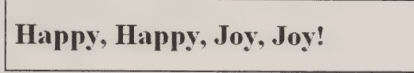
**图 1.4**

要将 JavaScript 插入 HTML 页面，我们使用 `<script>` 标签。在 `<script>` 标签内，我们使用 `type` 属性来定义脚本语言。因此，`<script type="text/javascript">` 和 `</script>` 标记了 JavaScript 的开始和结束位置：

```html
<html>
<body>
<script type="text/javascript">
...
</script>
</body>
</html>
```

`document.write` 命令是一个标准的 JavaScript 命令，用于向页面输出内容。当你在 `<script>` 和 `</script>` 标签之间输入 `document.write` 命令时，浏览器会将其识别为 JavaScript 命令并执行该代码行。在这种情况下，浏览器会在页面上显示 Hello World!：

```html
<html>
<body>
<script type="text/javascript">
document.write("Hello World!");
</script>
</body>
</html>
```

> 注意：如果我们没有输入 `<script>` 标签，浏览器会将 `document.write("Hello world!")` 命令视为纯文本，并将整行内容直接显示在页面上，如图 1.5 所示。
> `document.write("Hello World!");`
> **图 1.5**

### 如何处理简单浏览器
不支持 JavaScript 的浏览器会将 JavaScript 作为页面内容显示。为了防止这种情况发生，并且作为 JavaScript 标准的一部分，应该使用 HTML 注释标签来“隐藏” JavaScript。只需在第一条 JavaScript 语句前添加 HTML 注释标签 `<!--`，在最后一条 JavaScript 语句后添加注释结束标签 `-->`，如下所示：

```html
<html>
<body>
<script type="text/javascript">
<!--
document.write("Hello world!");
// -->
</script>
</body>
</html>
```
注释行末尾的两个正斜杠 (`//`) 是 JavaScript 的注释符号。这可以防止 JavaScript 执行 `-->` 标签。

### JavaScript 的放置位置
页面中的 JavaScript 会在页面加载到浏览器时立即执行。这并不总是我们想要的。有时我们希望在页面加载时执行脚本，或者在之后的事件中执行，例如当用户点击按钮时。在这种情况下，我们将脚本放在函数内部。你将在第10章“JavaScript 函数”中学习关于函数的内容。

#### 在 `<head>` 中放置脚本
需要在被调用时或事件触发时执行的脚本，应放置在函数中。将你的函数放在 head 部分。这样它们都集中在一个地方，并且不会干扰页面内容。生成的警报框如图 1.6 所示。

```html
<html>
<head>
<script type="text/javascript">
function message()
{
alert("This alert box was called with the onload event");
}
</script>
</head>
<body onload="message()">
</body>
</html>
```


#### 在 `<body>` 中放置脚本
如果你不希望脚本放在函数内部，或者你的脚本需要编写页面内容，则应将其放在 body 部分。图 1.7 展示了结果。

```html
<html>
<head>
</head>
<body>
<script type="text/javascript">
document.write("This message is written by JavaScript");
</script>
</body>
</html>
```
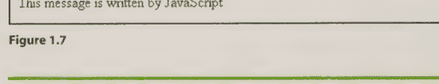

#### 在 `<head>` 和 `<body>` 中同时放置脚本
你可以在文档中放置任意数量的脚本，因此你可以在 body 和 head 部分都放置脚本。

```html
<html>
<head>
<script type="text/javascript">
function message()
{
alert("This alert box was called with the onload event");
}
</script>
</head>
<body onload="message()">
<script type="text/javascript">
document.write("This message is written by JavaScript");
</script>
</body>
</html>
```

### 使用外部 JavaScript 文件
如果你想在多个页面上运行相同的 JavaScript，而无需在每个页面上编写相同的脚本，你可以将 JavaScript 写在一个外部文件中。将外部 JavaScript 文件保存为 `.js` 扩展名。你的结果如图 1.8 所示。

> **注意：**外部脚本不能包含 `<script>` 标签！

要使用外部脚本，请在 `<script>` 标签的 `src` 属性中指向 `.js` 文件，如下所示：

```html
<html>
<head>
<script type="text/javascript" src="xxx.js"></script>
</head>
<body>
</body>
</html>
```
> 这段文字是由外部脚本编写的！
> **图 1.8**

> **注意：**请务必将脚本放在你通常编写脚本的位置！

# 第2章：JavaScript 语句和注释

## 本章内容
- JavaScript 代码
- JavaScript 代码块
- JavaScript 多行注释
- 使用注释防止代码执行
- 在行末使用注释

JavaScript 是由浏览器执行的一系列语句。与 HTML 不同，JavaScript 区分大小写；因此，在编写 JavaScript 语句以及创建或调用变量、对象和函数时，请务必注意大小写。

### JavaScript 语句
JavaScript 语句是给浏览器的命令。该命令的目的是告诉浏览器做什么。以下 JavaScript 语句告诉浏览器在网页上显示 "Hello Dolly"：
`document.write("Hello Dolly");`

在每条可执行语句后添加分号是常规做法。大多数人认为这是良好的编程习惯，并且在网上的 JavaScript 示例中经常看到。分号是可选的（根据 JavaScript 标准），浏览器应该将行尾解释为语句的结束。你经常会看到没有末尾分号的示例。

> 注意：使用分号可以将多个语句写在一行上，尽管良好的编程实践鼓励每行只写一个语句。

### JavaScript 代码
JavaScript 代码（或简称 JavaScript）是一系列 JavaScript 语句的集合。每条语句都按照其编写的顺序由浏览器执行。此示例将在网页上显示一个标题和两个段落，如图 2.1 所示。

```html
<html>
<body>
<script type="text/javascript">
document.write("<h1>This is a heading</h1>");
document.write("<p>This is a paragraph.</p>");
document.write("<p>This is another paragraph.</p>");
</script>
</body>
</html>
```
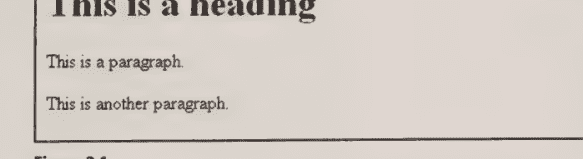

### JavaScript 代码块
JavaScript 语句可以组合在代码块中。代码块以左花括号 `{` 开始，以右花括号 `}` 结束。代码块的目的是使一系列语句一起执行。以下示例在网页上显示一个标题和两个段落，如图 2.2 所示。

```html
<html>
<body>
<script type="text/javascript">
{
document.write("<h1>This is a heading</h1>");
document.write("<p>This is a paragraph.</p>");
document.write("<p>This is another paragraph.</p>");
}
</script>
</body>
</html>
```
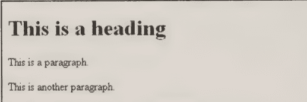
**图 2.2**

上面的示例不太实用。它只是演示了代码块的用法。通常，代码块用于在函数或条件中将语句组合在一起（在满足条件时执行一组语句）。您将在第6章和第10章了解更多关于函数和条件的知识。

### JavaScript 注释
JavaScript注释可用于解释JavaScript脚本或提高代码的可读性。单行注释以 `//` 开头。以下示例使用单行注释来解释代码。您的结果显示在图2.3中。

```html
<html>
<body>
<script type="text/javascript">
// 写入一个标题
document.write("<h1>This is a heading</h1>");
// 写入两个段落：
document.write("<p>This is a paragraph.</p>");
document.write("<p>This is another paragraph.</p>");
</script>
</body>
</html>
```
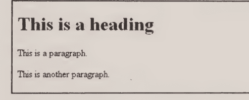
**图 2.3**

### JavaScript 多行注释
多行注释以 `/*` 开头，以 `*/` 结尾。以下示例使用多行注释来解释代码。您的结果显示在图2.4中。

```html
<html>
<body>
<script type="text/javascript">
/*
下面的代码将写入
一个标题和两个段落
*/
document.write("<h1>This is a heading</h1>");
document.write("<p>This is a paragraph.</p>");
document.write("<p>This is another paragraph.</p>");
</script>
</body>
</html>
```
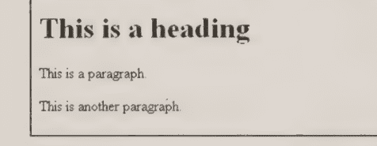
**图 2.4**

### 使用注释阻止执行
在以下示例中，注释用于阻止单行代码的执行（可用于调试）：您的结果显示在图2.5中。

```html
<html>
<body>
<script type="text/javascript">
//document.write("<h1>This is a heading</h1>");
document.write("<p>This is a paragraph.</p>");
document.write("<p>This is another paragraph.</p>");
</script>
</body>
</html>
```
This is a paragraph.
This is another paragraph.
**图 2.5**

在以下示例中，注释用于阻止代码块的执行（可用于调试）：

```html
<html>
<body>
<script type="text/javascript">
/*
document.write("<h1>This is a heading</h1>");
document.write("<p>This is a paragraph.</p>");
document.write("<p>This is another paragraph.</p>");
*/
</script>
</body>
</html>
```
您的结果将是一个空白屏幕。

### 在行末使用注释
在以下示例中，注释放在代码行的末尾。您的结果显示在图2.6中。

```html
<html>
<body>
<script type="text/javascript">
document.write("Hello"); // 写入 "Hello"
document.write(" Dolly!"); // 写入 " Dolly!"
</script>
</body>
</html>
```
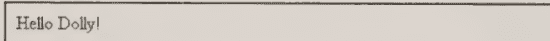
**图 2.6**

# 第3章：JavaScript 变量

## 本章内容
- 还记得学校的代数吗？
- JavaScript 变量
- 声明（创建）JavaScript 变量
- 为未声明的 JavaScript 变量赋值
- 重新声明 JavaScript 变量
- JavaScript 算术

变量是存储信息的“容器”。

## 还记得学校的代数吗？
你还记得学校里的代数吗？`x = 5, y = 6, z = x + y`。你还记得一个字母（比如 `x`）可以用来保存一个值（比如 5），并且你可以利用给定的信息计算出 `z` 的值是 11 吗？这些字母被称为**变量**。变量可以用来保存值（`x = 5`）或表达式（`z = x + y`）。

## JavaScript 变量
与代数一样，JavaScript 变量用于保存值或表达式。变量可以有一个简短的名称，如 `x`，或者一个更具描述性的名称，如 `carname`。

JavaScript 变量名规则：
- 变量名区分大小写（`y` 和 `Y` 是两个不同的变量）。
- 变量名必须以字母、下划线字符或美元符号开头。（`$` 字符主要由代码生成工具使用。）
- 后续字符可以是字母、数字、下划线或美元符号。

> **注意** 有 59 个保留字不能用作合法的变量名。
> **提示** 由于 JavaScript 区分大小写，变量名也是区分大小写的。

变量的值可以在脚本执行过程中更改。你可以通过变量名来引用变量以显示或更改其值。您的结果显示在图3.1中。

```html
<html>
<body>
<script type="text/javascript">
var firstname;
firstname="Hege";
document.write(firstname);
document.write("<br />");
firstname="Tove";
document.write(firstname);
</script>
<p>上面的脚本声明了一个变量，为其赋值，显示该值，更改该值，然后再次显示该值。</p>
</body>
</html>
```
Hege
Tove
上面的脚本声明了一个变量，为其赋值，显示该值，更改该值，然后再次显示该值。
**图 3.1**

## 声明（创建）JavaScript 变量
在 JavaScript 中创建变量通常被称为“声明”变量。你可以使用 `var` 语句来声明 JavaScript 变量：
`var x;`
`var carname;`

在上述声明之后，变量是空的。（它们还没有值。）但是，你也可以在声明变量时为它们赋值：
`var x=5;`
`var carname="volvo";`

执行上述语句后，变量 `x` 将保存值 **5**，而 `carname` 将保存值 **Volvo**。

> **注意** 当你将文本值赋给变量时，请使用引号将值括起来。

## 为未声明的 JavaScript 变量赋值
如果你为尚未声明的变量赋值，这些变量将自动被声明。以下语句：
`x=5;`
`carname="volvo";`
与以下语句具有相同的效果：
`var x=5;`
`var carname="volvo";`

## 重新声明 JavaScript 变量
如果你重新声明一个 JavaScript 变量，它不会丢失其原始值。
`var x=5;`
`var x;`
执行上述语句后，变量 *x* 仍将保持值为 5。当你重新声明它时，*x* 的值不会被重置（或清除）。

## JavaScript 算术
与代数一样，你可以对 JavaScript 变量进行算术运算：
`y=x-5;`
`z=y+5;`

> **注意** 有时结果似乎无法预测。如果赋值表达式右侧的至少一个变量包含字符串值，则结果将是一个字符串，并且 "+" 运算符将作为连接运算符应用于变量的 `toString()` 值。只有当赋值运算符右侧的所有变量都是数字时，结果才是数字。

 你将在第4章“JavaScript 运算符”中了解更多关于可以使用的运算符的信息。

# 第4章：JavaScript 运算符

## 本章内容
- JavaScript 算术运算符
- JavaScript 赋值运算符
- + 运算符在字符串上的应用
- 字符串和数字相加

赋值运算符 `=` 用于为 JavaScript 变量赋值，如以下代码的前两行所示。算术运算符 `+` 用于将值相加，如以下代码的最后一行所示。
`y = 5;`
`z = 2;`
`x = y+z;`
执行上述语句后，x 的值为 7。

## JavaScript 算术运算符
算术运算符用于在变量和/或值之间执行算术运算。假设 y = 5，下表解释了算术运算符。

| 运算符 | 描述 | 示例 | 结果 |
| :--- | :--- | :--- | :--- |
| `+` | 加法 | `x = y+2` | `x = 7` |
| `-` | 减法 | `x = y-2` | `x = 3` |
| `*` | 乘法 | `x = y*2` | `x = 10` |
| `/` | 除法 | `x = y/2` | `x = 2.5` |
| `%` | 取模（除法的余数） | `x = y%2` | `x = 1` |
| `++` | 自增 | `x = ++y` | `x = 6` |
| `--` | 自减 | `x = --y` | `x = 4` |

## JavaScript 赋值运算符
赋值运算符用于为 JavaScript 变量赋值。假设 *x* = 10 且 *y* = 5，下表解释了赋值运算符：

| 运算符 | 示例 | 等同于 | 结果 |
| :--- | :--- | :--- | :--- |
| `=` | `x = y` | | `x = 5` |
| `+=` | `x += y` | `x = x + y` | `x = 15` |
| `-=` | `x -= y` | `x = x - y` | `x = 5` |
| `*=` | `x *= y` | `x = x * y` | `x = 50` |
| `/=` | `x /= y` | `x = x / y` | `x = 2` |
| `%=` | `x %= y` | `x = x % y` | `x = 0` |

## 用于字符串的 + 运算符
`+` 运算符也可用于将字符串变量或文本值连接在一起。要将两个或多个字符串变量连接在一起，请使用 `+` 运算符：
`txt1="what a very";`
`txt2="nice day";`
`txt3=txt1+txt2;`
执行上述语句后，变量 txt3 包含 “What a verynice day”。

要在两个字符串之间添加空格，请在其中一个字符串中插入空格：
`txt1="what a very ";`
`txt2="nice day";`
`txt3=txt1+txt2;`
或者在表达式中插入空格：
`txt1="what a very";`
`txt2="nice day";`
`txt3=txt1+" "+txt2;`
执行上述语句后，变量 txt3 包含：“What a very nice day”。

## 字符串与数字相加
规则如下：如果你将一个数字与一个字符串相加，结果将是一个字符串！结果如图 4.1 所示。

```html
<html>
<body>
<script type="text/javascript">
x=5+5;
document.write(x);
document.write("<br />");
x="5"+"5";
document.write(x);
document.write("<br />");
x=5+"5";
document.write(x);
document.write("<br />");
x="5"+5;
document.write(x);
document.write("<br />");
</script>
<p>规则是：如果你将一个数字与一个字符串相加，结果将是一个字符串。</p>
</body>
</html>
```
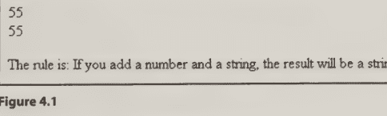
**图 4.1**

# 第5章：JavaScript 比较运算符

## 本章内容
- 比较运算符
- 如何使用比较运算符
- 逻辑运算符
- 条件运算符

比较和逻辑运算符用于测试真或假。

## 比较运算符
比较运算符用于逻辑语句中，以确定变量或值之间的相等性或差异性。假设 *x* = 5，下表解释了比较运算符：

| 运算符 | 描述 | 示例 |
| :--- | :--- | :--- |
| `==` | 值相等 | `x == 8` 为 false |
| `===` | 值和类型都完全相等 | `x === 5` 为 true，`x === "5"` 为 false |
| `!=` | 不相等 | `x != 8` 为 true |
| `>` | 大于 | `x > 8` 为 false |
| `<` | 小于 | `x < 8` 为 true |
| `>=` | 大于或等于 | `x >= 8` 为 false |
| `<=` | 小于或等于 | `x <= 8` 为 true |

## 如何使用比较运算符
比较运算符可用于条件语句中，以比较值并根据结果执行操作：
`if (age<18) document.write("Too young");`
你将在下一章学习更多关于条件语句的使用。

## 逻辑运算符
逻辑运算符用于确定变量或值之间的逻辑关系。假设 *x* = 6 且 *y* = 3，下表解释了逻辑运算符：

| 运算符 | 描述 | 示例 |
| :--- | :--- | :--- |
| `&&` | 与 | `(x < 10 && y > 1)` 为 true |
| `||` | 或 | `(x == 5 || y == 5)` 为 false |
| `!` | 非 | `!(x == y)` 为 true |

## 条件运算符
JavaScript 还包含一个条件运算符，它根据某个条件为变量赋值。语法如下：
`variablename=(condition)?value1:value2`
例如，
`greeting=(visitor=="PRES")?"Dear President ":"Dear ";`
如果变量 *visitor* 的值为 “PRES”，则变量 *greeting* 将被赋值为 “Dear President ”，否则将被赋值为 “Dear”。

# 第6章：JavaScript If...Else 语句

## 本章内容
- 条件语句
- if 语句
- if...else 语句
- if...else if...else 语句

条件语句用于根据不同的条件执行不同的操作。

## 条件语句
当你编写代码时，通常需要为不同的决策执行不同的操作。你可以在代码中使用条件语句来实现这一点。JavaScript 具有以下条件语句：
- **if 语句。** 使用此语句仅在指定条件为真时执行某些代码。
- **if...else 语句。** 使用此语句在条件为真时执行某些代码，在条件为假时执行另一段代码。
- **if...else if....else 语句。** 使用此语句选择多个代码块之一来执行。
- **switch 语句。** 使用此语句选择多个代码块之一来执行。

> 提示：使用条件语句时，`{ }` 代码块必须包含要执行的语句。如果省略了花括号，则只会执行紧接着的下一条语句，这是一个非常常见的编程错误。

```javascript
if (condition)
{
    statement 1;
    statement 2;
    statement 3;
} // 三条语句都会被执行

if (condition)
    statement 1;
    statement 2;
    statement 3;
    // 只有语句 1 会被执行
```

## if 语句
使用 if 语句仅在指定条件为真时执行某些代码。语法如下：
```javascript
if (condition)
{
    条件为真时要执行的代码
}
```
结果如图 6.1 所示。

> 提示：`if` 必须使用小写字母编写。使用大写字母（`IF`）会导致 JavaScript 错误！

```html
<html>
<body>
<script type="text/javascript">
var d = new Date();
var time = d.getHours();
if (time < 10)
{
    document.write("<b>Good morning</b>");
}
</script>
<p>此示例演示了 If 语句。</p>
<p>如果你浏览器上的时间小于 10，你将收到 “Good morning” 的问候。</p>
</body>
</html>
```
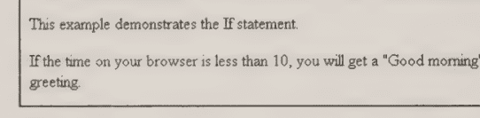
**图 6.1**

> **注意：** 此语法中没有 `..else..`。你告诉浏览器仅在指定条件为真时执行某些代码。

## if...else 语句
使用 if....else 语句在条件为真时执行某些代码，在条件不为真时执行另一段代码。语法如下：
```javascript
if (condition)
{
    条件为真时要执行的代码
}
else
{
    条件不为真时要执行的代码
}
```

```html
<html>
<body>
<script type="text/javascript">
var d = new Date();
var time = d.getHours();
if (time < 10)
{
document.write("<b>Good morning</b>");
}
else
{
document.write("<b>Good day</b>");
}
</script>
<p>此示例演示了 If...Else 语句。</p>
<p>如果你浏览器上的时间小于 10，你将收到 “Good morning” 的问候。否则你将收到 “Good day” 的问候。</p>
</body>
</html>
```
结果如图 6.2 所示。
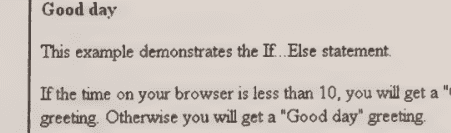
**图 6.2**

以下示例演示了一个随机链接。当你点击该链接时，它会将你带到 w3schools.com 或 RefsnesData.no。每个链接都有 50% 的概率。结果如图 6.3 所示。

```html
<html>
<body>
<script type="text/javascript">
var r=Math.random();
if (r>0.5)
{
document.write("<a href='http://www.w3schools.com'>Learn Web Development!</a>");
}
else
{
document.write("<a href='http://www.refsnesdata.no'>visit Refsnes Data!</a>");
}
</script>
</body>
</html>
```

**图 6.3**

## if...else if...else 语句
使用 if...else if...else 语句选择多个代码块之一来执行。语法如下：
```javascript
if (condition1)
{
条件1为真时要执行的代码
}
else if (condition2)
{
    条件2为真时要执行的代码
}
else
{
    条件1和条件2都不为真时要执行的代码
}
```
结果如图 6.4 所示。

```html
<html>
<body>
<script type="text/javascript">
var d = new Date();
var time = d.getHours();
if (time<10)
{
document.write("<b>Good morning</b>");
}
else if (time>=10 && time<16)
{
document.write("<b>Good day</b>");
}
else
{
document.write("<b>Hello world!</b>");
}
</script>
<p>此示例演示了 if..else if...else 语句。</p>
</body>
</html>
```

**图 6.4**

# 第7章：JavaScript 循环

## 本章内容
- for 循环
- while 循环
- do...while 循环

循环用于在指定条件为真时，或指定次数内执行一段代码块。编写代码时，你常常需要让同一段代码连续多次运行。与其在脚本中添加多行几乎相同的代码，不如使用循环来执行此类任务。JavaScript 中有两种循环：
- **for.** 循环指定次数以执行一段代码块
- **while.** 在指定条件为真时，循环执行一段代码块

## for 循环
当你预先知道脚本应运行多少次时，可以使用 for 循环。语法如下：
```javascript
for (var=startvalue; var<=endvalue; var=var+increment)
{
    要执行的代码
}
```
下面的示例定义了一个从 i = 0 开始的循环。只要 *i* 小于或等于 5，循环就会持续运行。每次循环运行时，*i* 将增加 1。结果如图 7.1 所示。

> 注意：增量参数也可以是负数，且 `<=` 可以是任何比较语句。

```html
<html>
<body>
<script type="text/javascript">
for (i = 0; i <= 5; i++)
{
document.write("数字是 " + i);
document.write("<br />");
}
</script>
<p>解释：</p>
<p>这个 for 循环从 i=0 开始。</p>
<p>只要 <b>i</b> 小于或等于 5，循环就会继续运行。</p>
<p>每次循环运行时，<b>i</b> 将增加 1。</p>
</body>
</html>
```
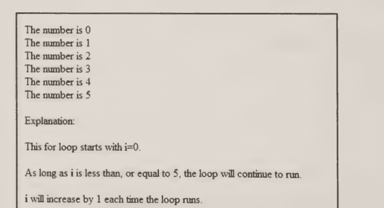
**图 7.1**

在下面的示例中，你将遍历六个不同的 HTML 标题。结果如图 7.2 所示。

```html
<html>
<body>
<script type="text/javascript">
for (i = 1; i <= 6; i++)
{
document.write("<h" + i + ">这是标题 " + i);
document.write("</h" + i + ">");
}
</script>
</body>
</html>
```
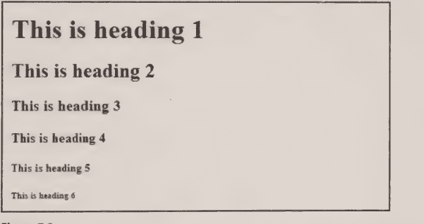
**图 7.2**

## while 循环
while 循环会在指定条件为真时，或指定次数内循环执行一段代码块。语法如下：
```javascript
while (var<=endvalue)
{
    要执行的代码
}
```
> **注意** `<=` 可以是任何比较语句。
> **提示** for 和 while 的区别在于：for 循环的条件是已知且可以预先指定的。而 while 循环用于初始条件已知，但终止条件在代码块执行过程中才能确定的情况。

下面的示例定义了一个从 i = 0 开始的循环。只要 *i* 小于或等于 5，循环就会持续运行。每次循环运行时，*i* 将增加 1，如图 7.3 所示。

```html
<html>
<body>
<script type="text/javascript">
i=0;
while (i<=5)
{
document.write("数字是 " + i);
document.write("<br />");
i++;
}
</script>
<p>解释：</p>
<p><b>i</b> 等于 0。</p>
<p>只要 <b>i</b> 小于或等于 5，循环就会继续运行。</p>
<p>每次循环运行时，<b>i</b> 将增加 1。</p>
</body>
</html>
```
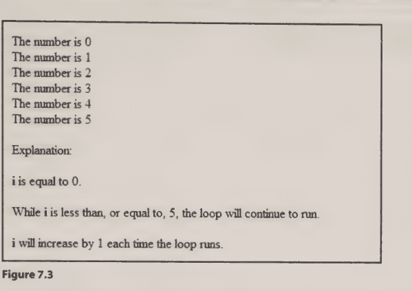
**图 7.3**

## do...while 循环
do...while 循环是 while 循环的一个变体。此循环会先执行一次代码块，然后只要指定条件为真，就会重复执行循环。语法如下：
```javascript
do
{
    要执行的代码
}
while (var<=endvalue);
```
下面的示例使用 do...while 循环。do...while 循环至少会执行一次，即使条件为假，因为语句在条件测试之前执行。结果如图 7.4 所示。

> **提示** while 和 do...while 循环的区别在于条件是在代码块执行之前还是之后检查。对于 while 循环，条件首先被检查，因此如果为假，代码块将不会执行。在 do...while 循环中，条件在代码块执行*之后*检查；因此代码块至少会执行一次。

```html
<html>
<body>
<script type="text/javascript">
i = 0;
do
{
document.write("数字是 " + i);
document.write("<br />");
i++;
}
while (i <= 5)
</script>
<p>解释：</p>
<p><b>i</b> 等于 0。</p>
<p>循环将运行</p>
<p>每次循环运行时，<b>i</b> 将增加 1。</p>
<p>只要 <b>i</b> 小于或等于 5，循环就会继续运行。</p>
</body>
</html>
```
数字是 0
数字是 1
数字是 2
数字是 3
数字是 4
数字是 5
解释：
i 等于 0。
循环将运行
每次循环运行时，i 将增加 1。
只要 i 小于或等于 5，循环就会继续运行。
**图 7.4**

# 第8章：附加的 JavaScript 流程控制语句

## 本章内容
- break 语句
- continue 语句
- JavaScript for...in 语句
- JavaScript switch 语句

**break** 和 **continue** 语句用于控制循环执行。**break** 语句可用于在遇到错误等情况时停止循环执行。**continue** 语句用于开始循环的下一次迭代，而不执行代码块中的所有语句。

## break 语句
**break** 语句将终止循环的执行，并继续执行循环之后的代码（如果有的话）。结果如图 8.1 所示。

```html
<html>
<body>
<script type="text/javascript">
var i=0;
for (i=0;i<=10;i++)
{
if (i==3)
{
break;
}
document.write("数字是 " + i);
document.write("<br />");
}
</script>
<p>解释：当 i=3 时，循环将中断。</p>
</body>
</html>
```
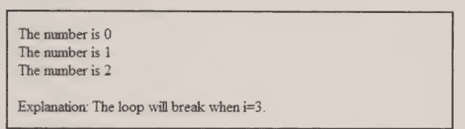
**图 8.1**

## continue 语句
`continue` 语句将终止当前迭代，并使用下一个值重新启动循环。结果如图 8.2 所示。

```html
<html>
<body>
<script type="text/javascript">
var i=0;
for (i=0;i<=10;i++)
{
if (i==3)
{
continue;
}
document.write("数字是 " + i);
document.write("<br />");
}
</script>
<p>解释：当 i=3 时，循环将中断当前迭代，并继续使用下一个值。</p>
</body>
</html>
```
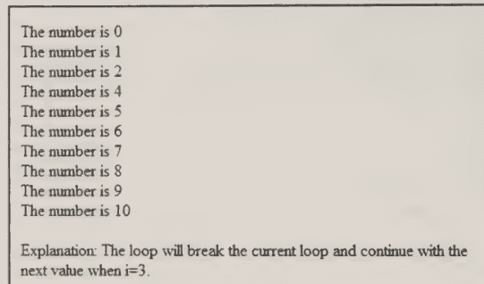
**图 8.2**

## JavaScript for...in 语句
for...in 语句用于遍历数组的元素或对象的属性。语法如下：
```javascript
for (variable in object)
{
    要执行的代码
}
```
> **注意** for...in 循环体内的代码会对每个元素/属性执行一次。
> **注意** variable 参数可以是命名变量、数组元素或对象的属性。

数组将在第17章“JavaScript 数组对象”中更全面地讨论。在下面的示例中，使用 for...in 语句遍历一个数组。结果如图 8.3 所示。

```html
<html>
<body>
<script type="text/javascript">
var x;
var mycars = new Array();
mycars[0] = "Saab";
mycars[1] = "Volvo";
mycars[2] = "BMW";
for (x in mycars)
{
document.write(mycars[x] + "<br />");
}
</script>
</body>
</html>
```
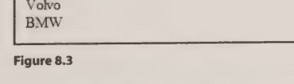
**图 8.3**

## JavaScript switch 语句
使用 `switch` 语句可以从多个代码块中选择一个来执行。语法如下：
```javascript
switch(n)
{
case 1:
  execute code block 1
  break;
case 2:
  execute code block 2
  break;
default:
  code to be executed if n is different from case 1 and 2
}
```
其工作原理如下：首先，有一个单独的表达式 `n`（通常是一个变量），它只会被求值一次。然后，该表达式的值将与结构中的每个 `case` 的值进行比较。如果匹配，则执行与该 `case` 关联的代码块。执行将继续，直到到达 `switch` 块的末尾或遇到 `break` 语句。例如：

```html
<html>
<body>
<script type="text/javascript">
var i = 1;
switch (i)
{
case 0:
  document.write("<b>i == 0</b><br>");
case 1:
  document.write("<b>i == 1</b><br>");
case 2:
  document.write("<b>i == 2</b><br>");
  break;
case 3:
  document.write("<b>i == 3</b><br>");
  break;
default:
    document.write("<b>i > 3</b><br>");
}
</script>
<p>Note that when i == 1 execution begins with case 1: but continues until the break statement is encountered.</p>
</body>
</html>
```
你的结果如图 8.4 所示。

```html
<html>
<body>
<script type="text/javascript">
var d = new Date();
theDay=d.getDay();
switch (theDay)
{
case 5:
    document.write("<b>Finally Friday</b>");
    break;
case 6:
    document.write("<b>Super Saturday</b>");
    break;
case 0:
    document.write("<b>Sleepy Sunday</b>");
    break;
default:
    document.write("<b>I'm really looking forward to this weekend!</b>");
}
</script>
</body>
</html>
```
这段 JavaScript 将根据当前是星期几生成不同的问候语。注意，星期日=0，星期一=1，星期二=2，以此类推。
**超级星期六**
这段 JavaScript 将根据当前是星期几生成不同的问候语。注意，星期日=0，星期一=1，星期二=2，以此类推。
**图 8.4**

# 第9章：JavaScript 弹出框

## 本章内容
- 弹出框
- 警告框
- 确认框
- 提示框

## 弹出框
JavaScript 有三种类型的弹出框：警告框、确认框和提示框。

### 警告框
当你想向用户显示信息时，经常使用警告框。当警告框弹出时，用户必须点击“确定”才能继续。语法如下：
`alert("sometext");`
你的结果如图 9.1 所示。当你点击按钮时，图 9.2 中的警告框会弹出。

```html
<html>
<head>
<script type="text/javascript">
function show_alert()
{
alert("Hello! I am an alert box!");
}
</script>
</head>
<body>
<input type="button" onclick="show_alert()" value="Show alert box" />
</body>
</html>
```

**图 9.1**
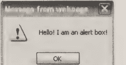
**图 9.2**

以下示例创建了一个带有换行符的警告框。你的结果如图 9.3 和图 9.4 所示。

```html
<html>
<head>
<script type="text/javascript">
function disp_alert()
{
alert("Hello again! This is how we" + '\n' + "add line breaks to an alert box!");
}
</script>
</head>
<body>
<input type="button" onclick="disp_alert()" value="Display alert box" />
</body>
</html>
```
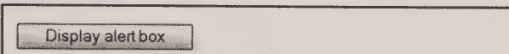
**图 9.3**
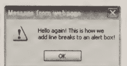
**图 9.4**

### 确认框
如果你想让用户验证或接受某些内容，通常使用确认框。当确认框弹出时，用户必须点击“确定”或“取消”才能继续。如果用户点击“确定”，则框返回 `true`。如果用户点击“取消”，则框返回 `false`。语法如下：
`confirm("sometext");`
你的结果如图 9.5 和图 9.6 所示。

```html
<html>
<head>
<script type="text/javascript">
function show_confirm()
{
var r = confirm("Press a button!");
if (r == true)
{
    alert("You pressed OK!");
}
else
{
    alert("You pressed Cancel!");
}
}
</script>
</head>
<body>
<input type="button" onclick="show_confirm()" value="Show a confirm box" />
</body>
</html>
```

**图 9.5**
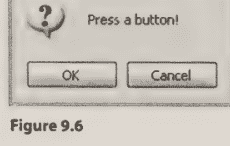
**图 9.6**

### 提示框
如果你想让用户在页面上或从页面输入一个值，通常使用提示框。当提示框弹出时，用户在输入值后必须点击“确定”或“取消”才能继续。如果用户点击“确定”，则框返回输入的值。如果用户点击“取消”，则框返回 `null`。语法如下：
`prompt("sometext","defaultvalue");`
你的结果如图 9.7 所示。

```html
<html>
<head>
<script type="text/javascript">
function disp_prompt()
{
var fname=prompt("Please enter your name:","Your name")
document.getElementById("msg").innerHTML="Greetings, " + fname
}
</script>
</head>
<body>
<input type="button" onclick="disp_prompt()" value="Display a prompt box" />
<br /><br />
<div id="msg"></div>
</body>
</html>
```

**图 9.7**

# 第10章：JavaScript 函数

## 本章内容
- 如何定义函数
- JavaScript 函数示例
- return 语句
- JavaScript 变量的生命周期

函数将由事件或通过显式调用该函数来执行。为了防止浏览器在页面加载时执行脚本，可以将脚本放入函数中。函数包含将由事件或通过调用该函数执行的代码。你可以从页面中的任何位置调用函数（如果函数嵌入在外部 .js 文件中，甚至可以从其他页面调用）。函数可以在文档的 `<head>` 和 `<body>` 部分中定义。但是，为确保函数在被调用前已被浏览器读取/加载，应将其放置在 `<head>` 部分。

## 如何定义函数
语法如下：
```javascript
function functionname(var1, var2, ..., varX)
{
    some code
}
```
参数 *var1*、*var2* 等，是传入函数的变量或值。`{` 和 `}` 定义了函数的开始和结束。

> **注意** 没有参数的函数必须在函数名后包含括号 `()`。
> **提示** 不要忘记 JavaScript 中大写字母的重要性！单词 `function` 必须用小写字母书写，否则会出现 JavaScript 错误。另外，请注意，调用函数时必须使用与函数声明中完全相同的大写形式。

## JavaScript 函数示例
在以下示例中，如果 `alert("Hello world!!")` 这一行没有放在函数内，它将在该行加载后立即执行。现在，在用户点击输入按钮之前，脚本不会被执行。如果点击了输入按钮，则函数 `displaymessage()` 将被执行。你的结果如图 10.1 和图 10.2 所示。

```html
<html>
<head>
<script type="text/javascript">
function displaymessage()
{
alert("Hello world!");
}
</script>
</head>
<body>
<form>
<input type="button" value="Click me!" onclick="displaymessage()" />
</form>
</body>
</html>
```
通过按下上面的按钮，将调用一个函数。该函数将显示一条警告消息。
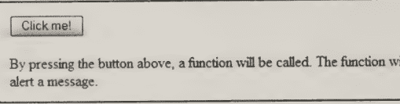
**图 10.1**
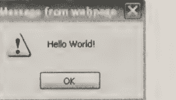
**图 10.2**

> 你将在第 11 章 “JavaScript 事件” 中学习更多关于 JavaScript 事件的知识。

以下带参数的函数示例展示了如何将变量传递给函数并在函数中使用该变量。你的结果如图 10.3 和图 10.4 所示。

```html
<html>
<head>
<script type="text/javascript">
function myfunction(txt)
{
alert(txt);
}
</script>
</head>
<body>
<form>
<input type="button" onclick="myfunction('Hello')" value="Call function">
</form>
<p>通过按下上方按钮，将以"Hello"作为参数调用一个函数。该函数将显示这个参数的警告框。</p>
</body>
</html>
```
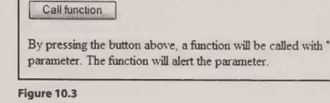
**图 10.3**
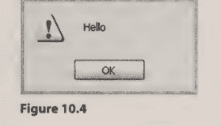
**图 10.4**

以下示例展示了如何让函数返回一个值。结果如图10.5所示。

```html
<html>
<head>
<script type="text/javascript">
function myFunction()
{
return ("Hello world!");
}
</script>
</head>
<body>
<script type="text/javascript">
document.write(myFunction())
</script>
</body>
</html>
```
Hello world!
**图 10.5**

## return语句
`return`语句用于指定从函数返回的值。因此，将要返回值的函数必须使用`return`语句。在不返回值的函数中，也可以使用`return`语句在函数中的任何给定点终止执行；例如，遇到错误条件时：
```javascript
var globalName;
function setGlobalName(name)
{
    if (name.length == 0)
    {
        alert("no name specified")
        return;
    }
    globalName = name;
}
```

以下示例返回两个数字（a和b）的乘积。结果如图10.6所示。

```html
<html>
<head>
<script type="text/javascript">
function product(a,b)
{
return a*b;
}
</script>
</head>
<body>
<script type="text/javascript">
document.write(product(4,3));
</script>
<p>主体部分的脚本使用两个参数（4和3）调用一个函数。</p>
<p>该函数将返回这两个参数的乘积。</p>
</body>
</html>
```
**图 10.6**

## JavaScript变量的生命周期
如果在函数内部声明一个变量，则该变量只能在该函数内部访问。当退出该函数时，该变量将被销毁。这些变量称为**局部变量**。你可以在不同的函数中使用同名的局部变量，因为每个变量只能被声明它的函数识别。如果在函数外部声明一个变量，则你页面上的所有函数都可以访问它。这些变量称为**全局变量**。这些变量的生命周期从声明时开始，到页面关闭时结束。

# 第11章：JavaScript事件

## 本章内容
- onLoad和onUnload
- onFocus、onBlur和onChange
- onSubmit
- onMouseOver和onMouseOut
- onClick

事件是JavaScript可以检测到的操作。通过使用JavaScript，我们能够创建动态网页。网页上的每个元素都有特定的事件可以触发JavaScript。例如，我们可以使用按钮元素的`onClick`事件来表示当用户点击按钮时将运行一个函数。我们在HTML标签中定义事件。

事件示例：
- 鼠标点击
- 网页或图片加载
- 鼠标悬停在网页的热点上
- 选择HTML表单中的输入字段
- 提交HTML表单

> **注意** 事件通常与函数结合使用，并且在事件发生之前，函数不会被执行！

## onLoad和onUnload
当用户进入或离开页面时，会触发`onLoad`和`onUnload`事件。`onLoad`事件通常用于检查访问者的浏览器类型和版本，并根据这些信息加载适当版本的网页。`onLoad`和`onUnload`事件通常用于处理用户进入或离开页面时应该设置的Cookie。例如，你可以设置一个弹出窗口，在用户首次访问你的页面时询问用户的姓名。然后将姓名存储在Cookie中。下次访问者来到你的页面时，你可以弹出另一个窗口，显示类似“欢迎，约翰·多伊！”这样的信息。

## onFocus、onBlur和onChange
`onFocus`、`onBlur`和`onChange`事件通常与表单字段的验证结合使用。`onFocus`和`onBlur`事件是互补的，它们由用户点击当前窗口、框架或表单元素外部，或使用Tab键在字段或元素之间移动触发。当用户离开一个元素时，该元素会触发blur事件。当用户移动到新元素时，该元素会触发focus事件。以下是使用`onChange`事件的示例。每当用户更改字段内容时，都会调用`checkEmail()`函数：
`<input type="text" size="30" id="email" onchange="checkEmail()">`

## onSubmit
`onSubmit`事件可用于在提交表单之前验证表单字段。
> 由于程序员控制在`onSubmit`时执行的函数，因此他可以根据自己的需要验证部分、全部或不验证输入。

以下是使用`onSubmit`事件的示例。当用户在表单中点击“提交”按钮时，将调用`checkForm()`函数。如果字段值不被接受，则应取消提交。函数`checkForm()`返回`true`或`false`。如果返回`true`，则提交表单；否则，将取消提交：
`<form method="post" action="xxx.htm" onsubmit="return checkForm()">`

## onMouseOver和onMouseOut
`onMouseOver`和`onMouseOut`常用于创建翻转按钮。以下是`onMouseOver`事件的示例。当检测到`onMouseOver`事件时，会出现一个警告框：
`<a href="http://www.w3schools.com" onmouseover="alert('An onMouseOver event');return false"></a>`

## onClick
当用户鼠标点击屏幕上的可见元素时，会发生`onClick`事件。当用户请求时，以下示例可用于翻译页面上的文本：
`<input type="button" name="language" value="Click for Spanish" onclick="translate()">`

# 第12章：JavaScript的try...catch和throw语句

## 本章内容
- JavaScript—捕获错误
- try...catch语句
- throw语句

`try...catch`语句使你能够捕获在执行代码块期间发生的错误。

## JavaScript—捕获错误
在浏览互联网上的网页时，我们都见过JavaScript警告框告诉我们存在运行时错误，并询问“你希望调试吗？”。这样的错误消息对开发者可能有用，但对用户则不然。当用户看到错误时，他们通常会离开网页。本章教你如何捕获和处理JavaScript错误消息，这样你就不会失去你的观众。

## try...catch语句
`try...catch`语句使你能够捕获在执行代码块期间发生的错误。`try`块包含要运行的代码，而`catch`块包含发生错误时要执行的代码。语法如下：
```javascript
try
{
    //Run some code here
}
catch(err)
{
    //Handle errors here
}
```
> **注意** 请注意`try...catch`是用小写字母编写的。使用大写字母将生成JavaScript错误！

以下示例本应在点击按钮时显示"Welcome guest!"警告框。但是，`message()`函数中有一个拼写错误。`alert()`被误写为`addlert()`。这会产生JavaScript错误。`catch`块捕获该错误并执行自定义代码来处理它。代码显示自定义错误消息，告知用户发生了什么。结果如图12.1和12.2所示。

```html
<html>
<head>
<script type="text/javascript">
var txt="";
function message()
{
try
    {
    addlert("welcome guest!");
    }
catch(err)
    {
    txt="There was an error on this page.\n\n";
    txt+="Error message: " + err.message + "\n\n";
    txt+="Click OK to continue.\n\n";
    alert(txt);
    }
}
</script>
</head>
<body>
<input type="button" value="查看消息" onclick="message()"/>
</body>
</html>
```

**图 12.1**
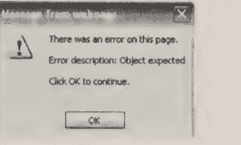
**图 12.2**

下一个示例使用确认框显示一条自定义消息，告知用户可以点击“确定”继续查看页面，或点击“取消”返回首页。如果 `confirm` 方法返回 `false`，表示用户点击了“取消”，代码会将用户重定向。如果 `confirm` 方法返回 true，代码则不执行任何操作。结果显示在图 12.3 和 12.4 中。

```html
<html>
<head>
<script type="text/javascript">
var txt="";
function message()
{
try
  {
  addlert("welcome guest!");
  }
catch(err)
  {
txt="There was an error on this page.\n\n";
txt+="Click OK to continue viewing this page.\n";
txt+="or Cancel to return to the home page.\n\n";
if(!confirm(txt))
{
document.location.href="http://www.w3schools.com/";
}
}
}
</script>
</head>
<body>
<input type="button" value="查看消息" onclick="message()"/>
</body>
</html>
```

**图 12.3**
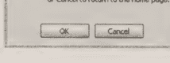
**图 12.4**

## throw 语句
`throw` 语句允许你创建一个异常。如果你将此语句与 `try ... catch` 语句结合使用，你可以控制程序流程并生成准确的错误消息。语法如下：
`throw(exception)`
异常可以是字符串、整数、布尔值或一个对象。

> **注意** `throw` 使用小写字母书写。使用大写字母将导致 JavaScript 错误！

以下示例确定一个名为 *x* 的变量的值。如果 *x* 的值大于 10、小于 0 或者不是数字，我们将抛出一个错误。然后该错误会被 catch 参数捕获，并显示相应的错误消息：

```html
<html>
<body>
<script type="text/javascript">
var x=prompt("Enter a number between 0 and 10:","");
try
{
if(x>10)
  {
    throw "Err1";
  }
else if(x<0)
  {
    throw "Err2";
  }
else if(isNaN(x))
  {
    throw "Err3";
  }
}
catch(er)
{
if(er=="Err1")
  {
    alert("Error! The value is too high");
  }
if(er=="Err2")
  {
    alert("Error! The value is too low");
  }
if(er=="Err3")
{
alert("Error! The value is not a number");
}
}
</script>
</body>
</html>
```

# 第13章：JavaScript 特殊字符与准则

## 本章内容
- 插入特殊字符
- JavaScript 区分大小写
- 空格
- 分行书写代码

在 JavaScript 中，你可以使用反斜杠字符向文本字符串添加特殊字符。此外，在使用 JavaScript 进行脚本编程时，你还应该了解一些其他重要的准则。

## 插入特殊字符
反斜杠 (`\`) 用于向文本字符串中插入撇号、换行符、引号和其他特殊字符。查看以下 JavaScript 代码：

```javascript
var txt="we are the so-called \"vikings\" from the north.";
document.write(txt);
```

在 JavaScript 中，字符串的开始和结束可以使用单引号或双引号。这意味着前面的字符串将被截断为 *We are the so-called*。要解决此问题，必须在 "Viking" 中的每个双引号前放置一个反斜杠 (`\`)。这会将每个双引号转换为字符串字面量：


```javascript
var txt="we are the so-called \"vikings\" from the north.";
document.write(txt);
```

JavaScript 现在将输出正确的文本字符串：`We are the so-called "Vikings" from the north.`

这里是另一个示例：

```javascript
document.write("You \& I are singing!");
```

前面的示例将产生以下输出：

`You & I are singing!`

下表列出了其他可以使用反斜杠符号添加到文本字符串中的特殊字符：

| 代码 | 输出 |
|---|---|
| `\'` | 单引号 |
| `\"` | 双引号 |
| `\&` | 和号 |
| `\\` | 反斜杠 |
| `\n` | 换行符 |
| `\r` | 回车符 |
| `\t` | 制表符 |
| `\b` | 退格符 |
| `\f` | 换页符 |

## JavaScript 区分大小写

名为 `myfunction` 的函数与 `myFunction` 不同，名为 `myVar` 的变量与 `myvar` 也不同。

JavaScript 区分大小写；因此，在创建或调用变量、对象和函数时，请密切注意大小写。

## 空格

JavaScript 会忽略多余的空格。你可以向脚本中添加空格以使其更易于阅读。以下几行是等效的：

```javascript
name="Hege";
name = "Hege";
```

## 分行书写代码

代码语句中引号内的文本称为字符串字面量。除非在需要断行的位置插入反斜杠字符 (`\`)，否则字符串字面量不能跨行书写：

```javascript
document.write("Hello \
world!");
```

以下将生成“未终止的字符串字面量”脚本错误：

```javascript
document.write("Hello world!");
```

另一个选项是使用连接运算符 (`+`) 来分割字符串：

```javascript
document.write("Hello "+ "world!");
```

代码语句可以跨行书写，但在这种情况下不能使用反斜杠字符。

以下是合法的 JavaScript：

```javascript
document.write
("Hello "
+
"world!"
);
```

通常，只有当行或字面量的长度使其难以阅读时，才跨行书写代码语句或字符串字面量。

你可以使用反斜杠在`文本字符串内`分行书写代码。以下示例将正确显示：

```javascript
document.write("Hello \ world!");
```

但是，你不能像这样分行书写代码：

```javascript
document.write \ ("Hello world!");
```

# 第二部分 JavaScript 对象

- 第14章：JavaScript 对象简介
- 第15章：JavaScript 字符串对象
- 第16章：JavaScript 日期对象
- 第17章：JavaScript 数组对象
- 第18章：JavaScript 布尔对象
- 第19章：JavaScript 数学对象
- 第20章：JavaScript 正则表达式对象

# 第14章

## JavaScript 对象简介

## 本章内容

- 面向对象编程
- 属性
- 方法

JavaScript 作为一种编程语言，具有强大的面向对象能力。面向对象（OOL）语言使你能够使用由属性和操作这些属性的方法组成的对象来对数据进行建模。

### 面向对象编程

创建自己的对象将在本节后面的“高级 JavaScript”部分进行说明。我们首先了解 JavaScript 的内置对象及其使用方式。接下来的几页将详细解释每个内置 JavaScript 对象。

请注意，对象只是一种特殊的数据。对象具有属性和方法。

### 属性

属性是与对象关联的值。

在以下示例中，我们使用 `String` 对象的 `length` 属性返回字符串中的字符数：

```html
<script type="text/javascript">
var txt="Hello world!";
document.write(txt.length);
</script>
```

前面代码的输出将是 `12`

### 方法

方法是可以在对象上执行的操作。

在以下示例中，我们使用 `String` 对象的 `toUpperCase()` 方法以大写字母显示文本：

```html
<script type="text/javascript">
var str="Hello world!";
document.write(str.toUpperCase());
</script>
```

前面代码的输出将是 `HELLO WORLD!`

# 第15章

## JavaScript 字符串对象

## 本章内容

- 字符串对象
- 示例

`String` 对象用于操作存储的文本片段。

## 字符串对象

以下示例使用 `String` 对象的 `length` 属性查找字符串的长度：

```javascript
var txt="Hello world!";
document.write(txt.length);
```

前面的代码将产生以下输出：

`12`

以下示例使用 `String` 对象的 `toUpperCase()` 方法将字符串转换为大写字母：

```javascript
var txt="Hello world!";
document.write(txt.toUpperCase());
```

前面的代码将产生以下输出：

`HELLO WORLD!`

# 示例

以下示例展示了如何返回字符串的长度。结果如图 15.1 所示。

```html
<html>
<body>

<script type="text/javascript">
var txt = "Hello world!";
document.write(txt.length);

</script>

</body>
</html>
```

`12`

图 15.1

以下示例演示了如何使用 `String` 对象的方法来设置字符串样式。结果如图 15.2 所示。

```html
<html>
<body>

<script type="text/javascript">
var txt = "Hello world!";
document.write("<p>Big: " + txt.big() + "</p>");
document.write("<p>Small: " + txt.small() + "</p>");

document.write("<p>Bold: " + txt.bold() + "</p>");
document.write("<p>Italic: " + txt.italics() + "</p>");

document.write("<p>Fixed: " + txt.fixed() + "</p>");
document.write("<p>Strike: " + txt.strike() + "</p>");

document.write("<p>Fontcolor: " + txt.fontcolor("green") + "</p>");
document.write("<p>Fontsize: " + txt.fontsize(6) + "</p>");

document.write("<p>Subscript: " + txt.sub() + "</p>");
document.write("<p>Superscript: " + txt.sup() + "</p>");

document.write("<p>Link: " + txt.link("http://www.w3schools.com") + "</p>");

document.write("<p>Blink: " + txt.blink() + " (does not work in IE, Chrome, or Safari)</p>");

</script>

</body>
</html>
```

## 输出

`Big: Hello World!`

`Small: Hello World!`

`Bold: **Hello World!**`

`Italic: *Hello World!*`

`Fixed: Hello World!`

`Strike: ~~Hello World!~~`

`Fontcolor: Hello World!`

`Fontsize: Hello World!`

`Subscript: Hello World!`

`Superscript: Hello World!`

`Link: [Hello World!](Hello World!)`

`Blink: Hello World! (does not work in IE, Chrome, or Safari)`

图 15.2

以下示例演示了字符串到小写或大写的转换。结果如图 15.3 所示。

亲自试一试 >>

```html
<html>
<body>

<script type="text/javascript">

var txt="Hello world!";
document.write(txt.toLowerCase() + "<br />");
document.write(txt.toUpperCase());

</script>
</body>
</html>
```

## 输出

`hello world!`

`HELLO WORLD!`

图 15.3

以下示例演示了如何在字符串中搜索指定的值。结果如图 15.4 所示。

亲自试一试 >>

```html
<html>
<body>

<script type="text/javascript">
var str="Hello world!";
document.write(str.match("world") + "<br />");
document.write(str.match("world") + "<br />");
document.write(str.match("worlld") + "<br />");
document.write(str.match("world!"));
</script>

</body>
</html>
```

## 输出

`world`

`null`

`null`

`world!`

图 15.4

以下示例展示了如何在字符串中用另一个值替换指定的值。结果如图 15.5 所示。

**亲自试一试 >>**

```html
<html>
<body>

<script type="text/javascript">

var str="Visit Microsoft!";
document.write(str.replace("Microsoft","w3schools"));

</script>
</body>
</html>
```

## 输出

`Visit w3schools!`

**图 15.5**

以下示例演示了如何查找字符串中指定值第一次出现的位置。结果如图 15.6 所示。

**亲自试一试 >>**

```html
<html>
<body>

<script type="text/javascript">
var str="Hello world!";
document.write(str.indexOf("Hello") + "<br />");
document.write(str.indexOf("WORLD") + "<br />");
document.write(str.indexOf("world"));
</script>

</body>
</html>
```

## 输出

`0`

`-1`

`6`

图 15.6

有关可与 `String` 对象一起使用的所有属性和方法的完整参考，请参阅附录 A 中的 String 对象参考。

该参考包含每个属性和方法的简要描述和用法示例！

# JavaScript Date 对象

**本章内容**

- 创建 Date 对象
- 设置日期
- 比较两个日期
- 示例

`Date` 对象用于处理日期和时间。

**创建 Date 对象**

`Date` 对象用于处理日期和时间。

`Date` 对象通过 `Date()` 构造函数创建。

有四种实例化日期的方式：

```javascript
new Date() // 当前日期和时间
new Date(milliseconds) // 距离 1970/01/01 的毫秒数
new Date(dateString)
new Date(year, month, day, hours, minutes, seconds, milliseconds)
```

大多数前述参数是可选的。

如果未指定参数，则默认向方法传递 `0`。

`Date` 对象创建后，许多方法使您能够对其进行操作。

大多数方法允许您使用本地时间或 UTC（通用时间或 GMT 时间）获取和设置对象的年、月、日、小时、分钟、秒和毫秒。

所有日期都以距离 1970 年 1 月 1 日 00:00:00 通用时间 (UTC) 的毫秒数计算，一天包含 `86,400,000` 毫秒。

一些实例化日期的示例：

```javascript
today = new Date()
d1 = new Date("October 13, 1975 11:13:00")
d2 = new Date(79,5,24)
d3 = new Date(79,5,24,11,33,0)
```

> 有关可与 `Date` 对象一起使用的所有属性和方法的完整参考，请参阅附录 A 中的完整 Date 对象参考。

该参考包含每个属性和方法的简要描述和使用示例！

## 设置日期

我们可以使用 `Date` 对象提供的方法轻松操作日期。

在以下示例中，我们将一个 `Date` 对象设置为特定日期（2010 年 1 月 14 日）：

```javascript
var myDate=new Date();
myDate.setFullYear(2010,0,14);
```

在以下示例中，我们将一个 `Date` 对象设置为未来五天后：

```javascript
var myDate=new Date();
myDate.setDate(myDate.getDate()+5);
```

注意：如果给日期增加五天导致月份或年份发生变化，这些更改将由 `Date` 对象本身自动处理！

## 比较两个日期

`Date` 对象也用于比较两个日期。

以下示例将今天的日期与 2010 年 1 月 14 日进行比较：

```javascript
var myDate=new Date();
myDate.setFullYear(2010,0,14);
var today = new Date();
if (myDate>today)
{
alert("Today is before 14th January 2010");
}
else
{
alert("Today is after 14th January 2010");
}
```

# 示例

以下示例演示了如何使用 `Date()` 方法获取今天的日期。结果如图 16.1 所示。

```html
<html>
<body>

<script type="text/javascript">

var d=new Date();
document.write(d);

</script>

</body>
</html>
```

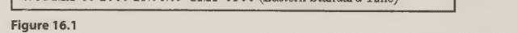

以下示例演示了如何使用 `getTime()` 计算自 1970 年以来的毫秒数。结果如图 16.2 所示。

```html
<html>
<body>
<script type="text/javascript">
var d=new Date();
document.write(d.getTime() + " milliseconds since 1970/01/01");
</script>
</body>
</html>
```

> `1268280218119 milliseconds since 1970/01/01`

图 16.2

以下示例展示了如何使用 `setFullYear()` 设置特定日期。结果如图 16.3 所示。

亲自试一试 >>

```html
<html>
<body>
<script type="text/javascript">
var d = new Date();
d.setFullYear(1992,11,3);
document.write(d);
</script>
</body>
</html>
```

> `Tue Nov 03 1992 23:05:36 GMT-0500 (Eastern Standard Time)`

图 16.3

以下示例演示了如何使用 `toUTCString()` 将今天的日期（根据 UTC）转换为字符串。结果如图 16.4 所示。

**亲自试一试 >>**

```html
<html>
<body>

<script type="text/javascript">

var d=new Date();
document.write("Original form: ");
document.write(d + "<br />");
document.write("To string (universal time): ");
document.write(d.toUTCString());

</script>

</body>
</html>
```

> `Original form: Wed Mar 10 2010 23:07:53 GMT-0500 (Eastern Standard Time)`

> `To string (universal time): Thu, 11 Mar 2010 04:07:53 GMT`

图 16.4

`getDay()` 方法将星期几作为数字返回，其中星期日 = 0。以下示例演示了如何使用 `getDay()` 和数组将星期几显示为文本字符串而不是数字，如图 16.5 所示。

**亲自试一试 >>**

```html
<html>
<body>

<script type="text/javascript">

var d=new Date();
var weekday=new Array(7);
weekday[0]="Sunday";
weekday[1]="Monday";
weekday[2]="Tuesday";
weekday[3]="wednesday";
weekday[4]="Thursday";
weekday[5]="Friday";
weekday[6]="Saturday";

document.write("Today is " + weekday[d.getDay()]);

</script>

</body>
</html>
```

```
Today is Wednesday
```

**图 16.5**

以下示例演示了如何在您的网页上显示一个时钟。您的结果显示在图 16.6 中。

亲自试试 >>

```html
<html>
<head>
<script type="text/javascript">
function startTime()
{
var today=new Date();
var h=today.getHours();
var m=today.getMinutes();
var s=today.getSeconds();
// 在小于10的数字前添加一个零
m=checkTime(m);
s=checkTime(s);
document.getElementById('txt').innerHTML=h+":"+m+":"+s;
t=setTimeout('startTime()',500);
}

function checkTime(i)
{
if (i<10)
{
  i="0" + i;
}
return i;
}
</script>
</head>
<body onload="startTime()">
<div id="txt"></div>
</body>
</html>
```


**图 16.6**

# 第17章：JavaScript数组对象

## 本章内容

- ☐ 什么是数组？
- ☐ 创建数组
- ☐ 访问数组
- ☐ 修改数组中的值
- ☐ 示例

`Array` 对象用于在单个变量中存储多个值。

## 什么是数组？

数组是一种特殊的变量，可以一次保存多个值。

如果您有一个物品列表（例如，一个汽车名称列表），将汽车存储在单个变量中可能如下所示：

```javascript
cars1="Saab";
cars2="Volvo";
cars3="BMW";
```

然而，如果您想遍历汽车并找到特定的一辆怎么办？而且如果您不是有三辆车，而是300辆呢？

这里的最佳解决方案是使用数组。数组可以在一个名称下保存您的所有变量值。您可以通过引用数组名称来访问这些值。

数组中的每个元素都有自己的ID，因此可以轻松访问。

## 创建数组

数组可以通过三种方式定义。

以下代码创建了一个名为 `myCars` 的 `Array` 对象：

1.  ```javascript
    var myCars=new Array();
        // 创建一个没有元素的新数组
        // new Array(n); 将创建一个长度为 n 的新数组
    myCars[0]="Saab";
    myCars[1]="Volvo";
    myCars[2]="BMW";
    ```

2.  ```javascript
    var myCars=new Array("Saab","Volvo","BMW");
    // 创建一个具有指定元素的新数组
    ```

3.  ```javascript
    var myCars=["Saab","Volvo","BMW"];
    // 示例2和示例3在功能上是等效的
    ```

> **注意** 如果您在数组中指定了数字或 true/false 值，那么变量类型将是 `Number` 或 `Boolean`，而不是 `String`。

## 访问数组

您可以通过引用数组名称和索引号来引用数组中的特定元素。索引号从0开始。

以下代码行

```javascript
document.write(myCars[0]);
```

将产生以下输出：

`Saab`

## 修改数组中的值

要修改现有数组中的值，只需为给定索引的元素指定一个新值。

```javascript
myCars[0]="Opel";    // 覆盖 myCars[0] 的当前值
```

现在，以下代码行：

`document.write(myCars[0]);`

将产生以下输出：

`Opel`

# 示例

以下示例演示了如何创建数组、为其赋值并将值写入输出。

您的结果显示在图 17.1 中。

亲自试试 >>

```html
<html>
<body>

<script type="text/javascript">
var mycars = new Array();
mycars[0] = "Saab";
mycars[1] = "Volvo";
mycars[2] = "BMW";

for (i=0;i<mycars.length;i++)
{
document.write(mycars[i] + "<br />");
}
</script>

</body>
</html>
```

**图 17.1**

以下示例演示了如何使用 `for...in` 语句遍历数组的元素。

您的结果显示在图 17.2 中。

> 亲自试试 >>

```html
<html>
<body>
<script type="text/javascript">
var x;
var mycars = new Array();
mycars[0] = "Saab";
mycars[1] = "Volvo";
mycars[2] = "BMW";

for (x in mycars)
{
document.write(mycars[x] + "<br />");
}
</script>
</body>
</html>
```

| Saab |
| --- |
| Volvo |
| BMW |

**图 17.2**

以下示例演示了如何连接两个数组。您的结果显示在图 17.3 中。

```html
<html>
<body>

<script type="text/javascript">

var parents = ["Jani", "Tove"];
var children = ["Cecilie", "Lone"];
var family = parents.concat(children);
document.write(family);

</script>
</body>
</html>
```


**图 17.3**

以下示例演示了如何连接三个数组。您的结果显示在图 17.4 中。

```html
<html>
<body>

<script type="text/javascript">

var parents = ["Jani", "Tove"];
var brothers = ["Stale", "Kai Jim", "Borge"];
var children = ["Cecilie", "Lone"];
var family = parents.concat(brothers, children);
document.write(family);

</script>

</body>
</html>
```


**图 17.4**

以下示例向您展示了如何将数组的所有元素连接成一个字符串。您的结果显示在图 17.5 中。

```html
<html>
<body>

<script type="text/javascript">

var fruits = ["Banana", "Orange", "Apple", "Mango"];
document.write(fruits.join() + "<br />");
document.write(fruits.join("+") + "<br />");
document.write(fruits.join(" and "));

</script>

</body>
</html>
```

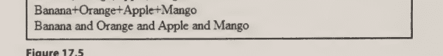

**图 17.5**

以下示例演示了如何删除数组的最后一个元素，图 17.6 显示了您的结果。

```html
<html>
<body>

<script type="text/javascript">

var fruits = ["Banana", "Orange", "Apple", "Mango"];
document.write(fruits.pop() + "<br />");
document.write(fruits + "<br />");
document.write(fruits.pop() + "<br />");
document.write(fruits);

</script>

</body>
</html>
```

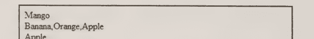

**图 17.6**

以下示例演示了如何将新元素添加到数组的末尾。您的结果显示在图 17.7 中。

```html
<html>
<body>

<script type="text/javascript">

var fruits = ["Banana", "Orange", "Apple", "Mango"];
document.write(fruits.push("Kiwi") + "<br />");
document.write(fruits.push("Lemon", "Pineapple") + "<br />");
document.write(fruits);

</script>

</body>
</html>
```

| 5 |
| 7 |
| Banana,Orange,Apple,Mango,Kiwi,Lemon,Pineapple |

**图 17.7**

在以下示例中，您将看到如何反转数组中元素的顺序。您的结果显示在图 17.8 中。

```html
<html>
<body>

<script type="text/javascript">

var fruits = ["Banana", "Orange", "Apple", "Mango"];
document.write(fruits.reverse());

</script>

</body>
</html>
```

| Mango,Apple,Orange,Banana |

**图 17.8**

以下示例演示了如何删除数组的第一个元素。您的结果显示在图 17.9 中。

```html
<html>
<body>

<script type="text/javascript">
var fruits = ["Banana", "Orange", "Apple", "Mango"];
document.write(fruits.shift() + "<br />");
document.write(fruits + "<br />");
document.write(fruits.shift() + "<br />");
document.write(fruits);

</script>

</body>
</html>
```

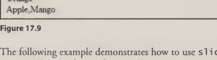

**图 17.9**

以下示例演示了如何使用 `slice()` 从数组中选择元素。您的结果显示在图 17.10 中。

```html
<html>
<body>

<script type="text/javascript">

var fruits = ["Banana", "Orange", "Apple", "Mango"];
document.write(fruits.slice(0,1) + "<br />");
document.write(fruits.slice(1) + "<br />");
document.write(fruits.slice(-2) + "<br />");
document.write(fruits);

</script>

</body>
</html>
```

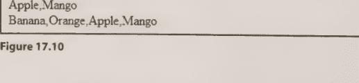

**图 17.10**

以下三个示例演示了如何使用 `sort()`。第一个 `sort()` 示例展示了如何按字母顺序和升序排序。您的结果显示在图 17.11 中。

```html
<html>
<body>

<script type="text/javascript">

var fruits = ["Banana", "Orange", "Apple", "Mango"];
document.write(fruits.sort());

</script>

</body>
</html>
```

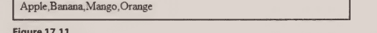

**图 17.11**

下一个 `sort()` 示例演示了如何按数字和升序排序。您的结果显示在图 17.12 中。

```html
<html>
<body>

<script type="text/javascript">

function sortNumber(a, b)
{
return a - b;
}

var n = ["10", "5", "40", "25", "100", "1"];
document.write(n.sort(sortNumber));

</script>

</body>
</html>
```

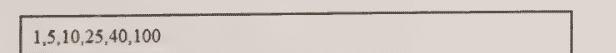

**图 17.12**

# 通过 w3schools 学习 JavaScript 和 Ajax

第三个 `sort()` 示例演示了如何进行数字降序排序。

你的结果显示在图 17.13 中。

```html
<html>
<body>

<script type="text/javascript">

function sortNumber(a, b)
{
    return b - a;
}

var n = ["10", "5", "40", "25", "100", "1"];
document.write(n.sort(sortNumber));

</script>

</body>
</html>
```

> `100,40,25,10,5,1`

图 17.13

以下示例演示了如何使用 `splice()` 向数组的第二个位置添加一个元素。你的结果显示在图 17.14 中。

```html
<html>
<body>

<script type="text/javascript">

var fruits = ["Banana", "Orange", "Apple", "Mango"];
document.write("Removed: " + fruits.splice(2,0,"Lemon") +
    "<br />");
document.write(fruits);

</script>

</body>
</html>
```

# 第 17 章：JavaScript 数组对象

`Removed:`

`Banana, Orange, Lemon, Apple, Mango`

图 17.14

以下示例向你展示了如何将数组转换为字符串。你的结果显示在图 17.15 中。

```html
<html>
<body>

<script type="text/javascript">

var fruits = ["Banana", "Orange", "Apple", "Mango"];
document.write(fruits.toString());

</script>

</body>
</html>
```

`Banana, Orange, Apple, Mango`

图 17.15

以下示例向你展示了如何向数组的开头添加新元素。图 17.16 显示了你的结果。

```html
<html>
<body>

<script type="text/javascript">

var fruits = ["Banana", "Orange", "Apple", "Mango"];
document.write(fruits.unshift("Kiwi") + "<br />");
document.write(fruits.unshift("Lemon","Pineapple") + "<br />");
document.write(fruits);

</script>

</body>
</html>
```

<p><b>注意：</b> `unshift()` 方法在 Internet Explorer 中不能正常工作，它只返回 `undefined`！</p>

（续）

# 通过 w3schools 学习 JavaScript 和 Ajax

（续）

```html
</body>
</html>
```

```text
5
7
Lemon,Pineapple,Kiwi,Banana,Orange,Apple,Mango
```

图 17.16

> 注意 `unshift()` 方法在 Internet Explorer 中不能正常工作，它只返回 `undefined`，如图 17.17 所示。

```text
undefined
undefined
Lemon,Pineapple,Kiwi,Banana,Orange,Apple,Mango
```

图 17.17


你可以在 w3Schools 网站上跟进这些示例。


有关 `Array` 对象所有可用属性和方法的完整参考，请转到附录 A 中的完整 Array 对象参考。

# 第 18 章 JavaScript 布尔对象

## 本章内容

- 创建布尔对象
- 示例

`Boolean` 对象用于将非布尔值转换为布尔值（`true` 或 `false`）。

## 创建布尔对象

`Boolean` 对象表示两个值：`true` 或 `false`。

以下代码创建一个名为 `myBoolean` 的布尔对象：

```javascript
var myBoolean=new Boolean();
```

> **注意** 如果布尔对象没有初始值，或者初始值为 `0`、`-0`、`null`、`""`、`false`、`undefined` 或 `NaN`，则该对象被设置为 `false`。否则，它为 `true`（即使是字符串“false”）！

以下所有代码行都创建初始值为 `false` 的布尔对象：

```javascript
var myBoolean=new Boolean();
var myBoolean=new Boolean(0);
var myBoolean=new Boolean(null);
var myBoolean=new Boolean("");
var myBoolean=new Boolean(false);
var myBoolean=new Boolean(NaN);
```

通过 w3schools 学习 JavaScript 和 Ajax

以下所有代码行都创建初始值为 `true` 的布尔对象：

```javascript
var myBoolean=new Boolean(true);
var myBoolean=new Boolean("true");
var myBoolean=new Boolean("false");
var myBoolean=new Boolean("Richard");
```

> 有关 `Boolean` 对象所有可用属性和方法的完整参考，请转到附录 A 中的完整 Boolean 对象参考。

# 示例

以下示例演示了如何检查布尔对象是 `true` 还是 `false`。你的结果显示在图 18.1 中。


```html
<html>
<body>

<script type="text/javascript">
var b1=new Boolean(0);
var b2=new Boolean(1);
var b3=new Boolean("");
var b4=new Boolean(null);
var b5=new Boolean(NaN);
var b6=new Boolean("false");

document.write("0 is boolean "+ b1 +"<br />");
document.write("1 is boolean "+ b2 +"<br />");
document.write("An empty string is boolean "+ b3 +"<br />");
document.write("null is boolean "+ b4+"<br />");
document.write("NaN is boolean "+ b5 +"<br />");
document.write("The string 'false' is boolean "+ b6 +"<br />");
</script>

</body>
</html>
```

第 18 章：JavaScript 布尔对象

```text
0 is boolean false
1 is boolean true
An empty string is boolean false
null is boolean false
NaN is boolean false
The string 'false' is boolean true
```

图 18.1

# 第 19 章 JavaScript 数学对象

## 本章内容

- 数学对象
- 数学常量
- 数学方法
- 示例

`Math` 对象允许你执行数学任务。

## 数学对象

`Math` 对象允许你执行数学任务。

`Math` 对象包含若干数学常量和方法。

使用 `Math` 属性/方法的语法如下：

```javascript
var pi_value=Math.PI;
var sqrt_value=Math.sqrt(16);
```

> 注意 `Math` 对象由 JavaScript 提供，不需要由程序员创建。事实上，尝试使用 `new()` 创建 `Math` 对象将导致 JavaScript 错误。

## 数学常量

JavaScript 提供了八个可以从 `Math` 对象访问的数学常量。它们是 E、PI、2 的平方根、1/2 的平方根、2 的自然对数、10 的自然对数、E 的以 2 为底的对数和 E 的以 10 为底的对数。

你可以在 JavaScript 中这样引用这些常量：

# 第 19 章：JavaScript 数学对象

- `Math.E`
- `Math.PI`
- `Math.SQRT2`
- `Math.SQRT1_2`
- `Math.LN2`
- `Math.LN10`
- `Math.LOG2E`
- `Math.LOG10E`

## 数学方法

除了可以从 `Math` 对象访问的数学常量外，还有几种方法可用。

以下示例使用 `Math` 对象的 `round()` 方法将一个数字四舍五入到最接近的整数：

```javascript
document.write(Math.round(4.7));
```

上面的代码产生以下输出：

```text
5
```

以下示例使用 `Math` 对象的 `random()` 方法返回一个介于 0 和 1 之间的随机数：

```javascript
document.write(Math.random());
```

上面的代码可能产生以下输出：

```text
0.07730209357983464
```

以下示例使用 `Math` 对象的 `floor()` 和 `random()` 方法返回一个介于 0 和 10 之间的随机数：

```javascript
document.write(Math.floor(Math.random()*11));
```

上面的代码可能产生以下输出：

```text
1
```

> 有关 `Math` 对象所有可用属性和方法的完整参考，请转到附录 A 中的完整 Math 对象参考。

通过 w3schools 学习 JavaScript 和 Ajax

# 示例

以下示例演示了如何使用 `round()`。你的结果显示在图 19.1 中。

亲自试一试 >>

```html
<html>
<body>

<script type="text/javascript">

document.write(Math.round(0.60) + "<br />");
document.write(Math.round(0.50) + "<br />");
document.write(Math.round(0.49) + "<br />");
document.write(Math.round(-4.40) + "<br />");
document.write(Math.round(-4.60));

</script>

</body>
</html>
```

| 输出 |
|--------|
| 1 |
| 1 |
| 0 |
| -4 |
| -5 |

图 19.1

以下示例演示了如何使用 `random()` 返回一个介于 0 和 1 之间的随机数，如图 19.2 所示。

亲自试一试 >>

```html
<html>
<body>

<script type="text/javascript">

//返回一个介于 0 和 1 之间的随机数
document.write(Math.random() + "<br />");

//返回一个介于 0 和 10 之间的随机整数
document.write(Math.floor(Math.random()*11));

</script>

</body>
</html>
```

`112`

# 第 19 章：JavaScript 数学对象

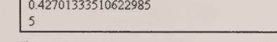

**图 19.2**

以下示例演示了如何使用 `max()` 返回指定值中的最大值。你的结果显示在图 19.3 中。

```html
<html>
<body>

<script type="text/javascript">

document.write(Math.max(5,10) + "<br />");
document.write(Math.max(0,150,30,20,38) + "<br />");
document.write(Math.max(-5,10) + "<br />");
document.write(Math.max(-5,-10) + "<br />");
document.write(Math.max(1.5,2.5));
</script>

</body>
</html>
```

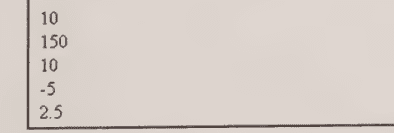

**图 19.3**

# 第20章

## JavaScript RegExp 对象

## 本章内容

- 什么是 RegExp？
  - RegExp 修饰符
  - `test()`
  - `exec()`

`RegExp` 是正则表达式的缩写。

### 什么是 RegExp？

正则表达式是一种描述字符模式的对象。当您在文本中搜索时，可以使用模式来描述您要查找的内容。

简单的模式可以是单个字符。更复杂的模式可以包含多个字符，可用于解析、格式检查、替换等。

正则表达式用于对文本执行强大的模式匹配和查找替换功能。

语法如下：

`var txt=new RegExp(pattern,modifiers);`

或更简单：

`var txt=/pattern/modifiers;`

语法遵循一些通用准则：

- 模式指定表达式的模式。
- 修饰符指定搜索是否应为全局的、区分大小写的等。

### RegExp 修饰符

修饰符用于执行不区分大小写的全局搜索。

`i` 修饰符用于执行不区分大小写的匹配。

`g` 修饰符用于执行全局匹配（查找所有匹配项，而不是在第一个匹配后停止）。

以下示例演示如何在字符串中不区分大小写地搜索 "w3schools"：

```javascript
var str="visit W3Schools";
var patt1=/w3schools/i;
```

您的结果如图 20.1 所示。

```html
<html>
<body>

<script type="text/javascript">
var str = "visit w3Schools";
var patt1 = /w3schools/i;
document.write(str.match(patt1));
</script>

</body>
</html>
```

`W3Schools`

图 20.1

以下示例演示如何全局搜索 "is"：

```javascript
var str="Is this all there is?";
var patt1=/is/g;
```

您的结果如图 20.2 所示。

亲自试一试 >>

```html
<html>
<body>

<script type="text/javascript">

var str="Is this all there is?";
var patt1=/is/g;
document.write(str.match(patt1));

</script>

</body>
</html>
```


以下示例演示如何全局、不区分大小写地搜索 "is"：

```javascript
var str="Is this all there is?";
var patt1=/is/gi;
```

您的结果如图 20.3 所示。

亲自试一试 >>

```html
<html>
<body>
<script type="text/javascript">

var str="Is this all there is?";
var patt1=/is/gi;
document.write(str.match(patt1));

</script>

</body>
</html>
```

`Is,is,is`

图 20.3

### `test()`

`test()` 方法搜索字符串以查找指定的值，并根据结果返回 `true` 或 `false`。

以下示例在字符串中搜索字符 "e"：

```javascript
var patt1=new RegExp("e");
document.write(patt1.test("The best things in life are free"));
```

因为字符串中有一个 "e"，所以前面代码的输出如下：

`true`

您的结果如图 20.4 所示。

亲自试一试 >>

```html
<html>
<body>

<script type="text/javascript">
var patt1=new RegExp("e");
document.write(patt1.test("The best things in life are free"));
</script>

</body>
</html>
```

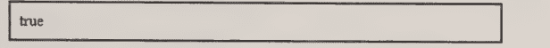

图 20.4

### `exec()`

`exec()` 方法搜索字符串以查找指定的值，并返回找到的值的文本。如果未找到匹配项，则返回 `null`。

以下示例在字符串中搜索字符 "e"：

```javascript
var patt1=new RegExp("e");
document.write(patt1.exec("The best things in life are free"));
```

因为字符串中有一个 "e"，所以前面代码的输出是：

`e`

您的结果如图 20.5 所示。

**亲自试一试 >>**

```html
<html>
<body>

<script type="text/javascript">
var patt1=new RegExp("e");

document.write(patt1.exec("The best things in life are free"));
</script>

</body>
</html>
```


图 20.5

> 有关 `RegExp` 对象可用的所有属性和方法的完整参考，请转到附录 A 中的完整 RegExp 对象参考。

## # 第三部分

### JavaScript 高级

- 第 21 章：JavaScript 浏览器检测
- 第 22 章：JavaScript Cookies
- 第 23 章：JavaScript 表单验证
- 第 24 章：JavaScript 动画
- 第 25 章：JavaScript 图像映射
- 第 26 章：JavaScript 定时事件
- 第 27 章：使用 JavaScript 创建自己的对象

# 第21章

## JavaScript 浏览器检测

## 本章内容

- 浏览器检测
  - Navigator 对象

`Navigator` 对象包含有关访问者浏览器的信息。

### 浏览器检测

本教程中的几乎所有内容都适用于所有支持 JavaScript 的浏览器。但是，某些功能在某些浏览器上根本无法工作——尤其是在旧版浏览器上。

因此，有时检测访问者的浏览器并提供相应的信息非常有用。

最好的方法是使您的网页足够智能，以便在某些浏览器中呈现一种外观，在其他浏览器中呈现另一种外观。`Navigator` 对象可用于此目的。

`Navigator` 对象包含有关访问者浏览器名称、版本等信息。

> **注意** 没有适用于 `Navigator` 对象的公共标准，但所有主流浏览器都支持它。

### Navigator 对象

`Navigator` 对象包含有关访问者浏览器的所有信息。我们将研究 `Navigator` 对象的两个属性：

- `appName`—保存浏览器的名称
- `appVersion`—保存浏览器的版本等信息

您的结果如图 21.1 所示。

亲自试一试 >>

```html
<html>
<body>
<script type="text/javascript">
var browser=navigator.appName;
var b_version=navigator.appVersion;
var version=parseFloat(b_version);
document.write("Browser name: "+ browser);
document.write("<br />");
document.write("Browser version: "+ version);
</script>
</body>
</html>
```


前面示例中的变量 "browser" 保存浏览器的名称，即 "Netscape" 或 "Microsoft Internet Explorer"。

前面示例中的 `appVersion` 属性返回一个字符串，其中包含比版本号多得多的信息，但目前我们只对版本号感兴趣。为了从字符串中提取版本号，我们使用了一个名为 `parseFloat()` 的函数，该函数从字符串中提取第一个看起来像十进制数字的内容并返回它。

> 提示：要在 IE 5.0 及更高版本中查找版本号，您需要更深入地研究 `appVersion` 或 `userAgent` 属性。IE 版本的格式将是 "MSIE x.x"，因此请使用正则表达式，例如 `/MSIE \d+\.\d+/.exec(navigator.userAgent)` 来返回包含特定 IE 版本的字符串。

以下示例根据访问者的浏览器显示不同的警报。警报框如图 21.2 所示。

```html
<html>
<head>
<script type="text/javascript">
function detectBrowser()
{
  var browser=navigator.appName;
  var b_version=navigator.appVersion;
  var version=parseFloat(b_version);
  if ((browser=="Netscape"||browser=="Microsoft Internet Explorer") && (version>=4))
    {
      alert("Your browser is good enough!");
    }
  else
    {
      alert("It's time to upgrade your browser!");
    }
}
</script>
</head>
<body onload="detectBrowser()">
</body>
</html>
```

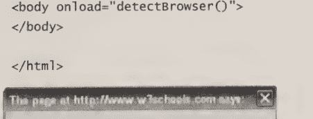

**图 21.2**

## 第21章：JavaScript浏览器检测

通过w3schools学习JavaScript和Ajax

以下示例提供了更多关于访客浏览器的规则。您的结果显示在图21.3中。

```html
<html>
<body>
<script type="text/javascript">
document.write("<p>Browser: ");
document.write(navigator.appName + "</p>");

document.write("<p>Browserversion: ");
document.write(navigator.appVersion + "</p>");

document.write("<p>Code: ");
document.write(navigator.appCodeName + "</p>");

document.write("<p>Platform: ");
document.write(navigator.platform + "</p>");

document.write("<p>Cookies enabled: ");
document.write(navigator.cookieEnabled + "</p>");

document.write("<p>Browser's user agent header: ");
document.write(navigator.userAgent + "</p>");
</script>
</body>
</html>
```

`浏览器：Netscape`

`浏览器版本：5.0 (Windows; en-US)`

`代码：Mozilla`

`平台：Win32`

`Cookie已启用：true`

`浏览器的用户代理头：Mozilla/5.0 (Windows; U; Windows NT 5.1; en-US; rv:1.9.1.5) Gecko/20091102 Firefox/3.5.5 (.NET CLR 3.5.30729)`

图21.3

以下示例提供了关于访客浏览器的*所有*详细信息。您的结果显示在图21.4中。

自己试试 >>

```html
<html>
<body>

<script type="text/javascript">
var x = navigator;
document.write("CodeName=" + x.appCodeName);
document.write("<br />");
document.write("MinorVersion=" + x.appMinorVersion);
document.write("<br />");
document.write("Name=" + x.appName);
document.write("<br />");
document.write("Version=" + x.appVersion);
document.write("<br />");
document.write("CookieEnabled=" + x.cookieEnabled);
document.write("<br />");
document.write("CPUClass=" + x.cpuClass);
document.write("<br />");
document.write("OnLine=" + x.onLine);
document.write("<br />");
document.write("Platform=" + x.platform);
document.write("<br />");
document.write("UA=" + x.userAgent);
document.write("<br />");
document.write("BrowserLanguage=" + x.browserLanguage);
document.write("<br />");
document.write("SystemLanguage=" + x.systemLanguage);
document.write("<br />");
document.write("UserLanguage=" + x.userLanguage);
</script>

</body>
</html>
```

`127`

通过w3schools学习JavaScript和Ajax

```
CodeName=Mozilla
MinorVersion=undefined
Name=Netscape
Version=5.0 (Windows; en-US)
CookieEnabled=true
CPUClass=undefined
OnLine=true
Platform=Win32
UA=Mozilla/5.0 (Windows; U; Windows NT 5.1; en-US; rv:1.9.1.5) Gecko/20091102 Firefox/3.5.5 (NET CLR 3.5.30729)
BrowserLanguage=undefined
SystemLanguage=undefined
UserLanguage=undefined
```

图21.4

# 第22章：JAVASCRIPT COOKIES

## 本章内容

- 什么是Cookie？
- 创建和存储Cookie

Cookie通常用于识别用户。

## 什么是Cookie？

Cookie是存储在访客计算机上的一个变量。每次同一台计算机通过浏览器请求页面时，它也会发送Cookie。使用JavaScript，您可以创建和检索Cookie值。

Cookie的示例：

- **名称Cookie。** 当访客第一次访问您的网页时，她必须填写她的名字。然后名字被存储在一个Cookie中。下次访客访问您的页面时，她可以收到一条欢迎消息，例如“欢迎Jane Doe！”名字是从存储的Cookie中检索出来的。

- **密码Cookie。** 当访客第一次访问您的网页时，她必须填写一个密码。然后密码被存储在一个Cookie中。下次访客访问您的页面时，密码从Cookie中检索出来。

- **日期Cookie。** 当访客第一次访问您的网页时，当前日期被存储在一个Cookie中。下次访客访问您的页面时，她可以收到一条消息，例如“您上次访问是在2005年8月11日，星期二！”日期是从存储的Cookie中检索出来的。

## 创建和存储Cookie

在此示例中，我们创建一个存储访客姓名的Cookie。当访客第一次访问该网页时，系统会要求她填写她的名字。然后名字被存储在一个Cookie中。下次访客访问同一页面时，她会看到一条欢迎消息。

首先，我们创建一个函数，将访客的姓名存储在Cookie变量中：

```javascript
function setCookie(c_name,value,expiredays)
{
var exdate=new Date();
exdate.setDate(exdate.getDate()+expiredays);
document.cookie=c_name+ "=" +escape(value)+
((expiredays==null) ? "" : ";expires="+exdate.toGMTString());
}
```

上述函数的参数分别是Cookie的名称、Cookie的值以及Cookie过期前的天数。

在上面的函数中，我们首先将天数转换为有效日期，然后添加Cookie应过期的天数。之后，我们将Cookie名称、Cookie值和过期日期存储在`document.cookie`对象中。

然后我们创建另一个函数来检查Cookie是否已设置：

```javascript
function getCookie(c_name)
{
if (document.cookie.length>0)
  {
  c_start=document.cookie.indexOf(c_name + "=");
  if (c_start!=-1)
    {
    c_start=c_start + c_name.length+1;
    c_end=document.cookie.indexOf(";",c_start);
    if (c_end==-1) c_end=document.cookie.length;
    return unescape(document.cookie.substring(c_start,c_end));
    }
  }
return "";
}
```

上述函数首先检查`document.cookie`对象中是否存储了Cookie。如果`document.cookie`对象包含一些Cookie，那么检查我们的特定Cookie是否已存储。如果找到我们的Cookie，则返回其值；如果没有，则返回一个空字符串。

最后，我们创建一个函数：如果设置了Cookie，则显示欢迎消息；如果未设置Cookie，则显示一个提示框询问用户的姓名：

```javascript
function checkCookie()
{
username=getCookie('username');
if (username!=null && username!="")
  {
  alert('Welcome again '+username+'!');
  }
else
  {
  username=prompt('Please enter your name:',"");
  if (username!=null && username!="")
    {
    setCookie('username',username,365);
    }
  }
}
```

以下示例在页面加载时运行`checkCookie()`函数。结果对话框如图22.1所示。

```html
<html>
<head>
<script type="text/javascript">
function getCookie(c_name)
{
if (document.cookie.length>0)
  {
  c_start=document.cookie.indexOf(c_name + "=");
  if (c_start!=-1)
    {
    c_start=c_start + c_name.length+1;
    c_end=document.cookie.indexOf(";",c_start);
    if (c_end==-1) c_end=document.cookie.length;
    }
  }
return unescape(document.cookie.substring(c_start, c_end));
}

function setCookie(c_name, value, expiredays)
{
var exdate = new Date();
exdate.setDate(exdate.getDate() + expiredays);
document.cookie = c_name + "=" + escape(value) + ((expiredays == null) ? "" : "; expires=" + exdate.toGMTString());
}

function checkCookie()
{
username = getCookie('username');
if (username != null && username != "")
{
alert('welcome again ' + username + '!');
}
else
{
username = prompt('Please enter your name:', "");
if (username != null && username != "")
{
setCookie('username', username, 365);
}
}
}
</script>
</head>
<body onLoad="checkCookie()">
</body>
</html>
```

第22章：JavaScript Cookies

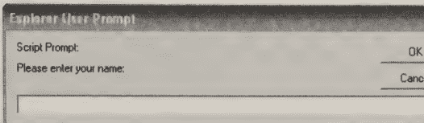

图22.1

# 第23章：JAVASCRIPT表单验证

## 本章内容

- 必填字段
- 电子邮件验证

JavaScript可用于在将内容发送到服务器之前验证HTML表单中的数据。

JavaScript通常检查的表单数据可能包括：

- 用户是否将必填字段留空？
- 用户是否输入了有效的电子邮件地址？
- 用户是否输入了有效的日期？
- 用户是否在数字字段中输入了文本？

## 必填字段

以下函数检查必填字段是否被留空。如果必填字段为空，则显示警告，并且函数返回`false`。如果输入了值，则函数返回`true`（表示数据有效）：

```javascript
function validate_required(field,alerttxt)
{
with (field)
{
if (value==null||value=="")
{
alert(alerttxt);return false;
}
else
{
return true;
}
}
}
```

## 第23章：JavaScript表单验证

```javascript
{
    return true;
}
}
```

包含HTML表单的完整脚本可能如下所示：

```html
<html>
<head>
<script type="text/javascript">
function validate_required(field,alerttxt)

{
with (field)
  {
  if (value==null||value=="")
    {alert(alerttxt);return false;}
  else
    {
    return true;
    }
  }
}

function validate_form(thisform)
{
with (thisform)
  {
  if (validate_required(email,"Email must be filled out!")==false)
  {email.focus();return false;}
  }
}
</script>
</head>
<body>

<form action="submit.htm" onsubmit="return validate_form(this)" method="post">
Email: <input type="text" name="email" size="30">
<input type="submit" value="Submit">
</form>
</body>
</html>
```

## 电子邮件验证

以下函数检查内容是否遵循电子邮件地址的通用语法。

> **注意** 此函数仅检查内容是否看起来是格式正确的电子邮件。它不验证电子邮件地址是否实际存在。

这意味着输入数据必须至少包含一个`@`符号和一个点（`.`）。此外，`@`不能是电子邮件地址的第一个字符，并且最后一个点必须在`@`符号之后至少一个字符的位置：

```javascript
function validate_email(field,alerttxt)
{
with (field)
{
apos=value.indexOf("@");
dotpos=value.lastIndexOf(".");
if (apos<1||dotpos-apos<2)
{alert(alerttxt);return false;}
else {return true;}
}
}
```

包含HTML表单的完整脚本可能如下所示：

```html
<html>
<head>
<script type="text/javascript">
function validate_email(field,alerttxt)
{
with (field)
  {
  apos=value.indexOf("@");
  dotpos=value.lastIndexOf(".");
  if (apos<1||dotpos-apos<2)
    {alert(alerttxt);return false;}
  else {return true;}
  }
}

function validate_form(thisform)
{
with (thisform)
  {
  if (validate_email(email,"Not a valid e-mail address!")==false)
    {email.focus();return false;}
  }
}
</script>
</head>

<body>
<form action="submit.htm" onsubmit="return validate_form(this);" method="post">
Email: <input type="text" name="email" size="30">
<input type="submit" value="Submit">
</form>
</body>

</html>
```

`137`

# 第24章：JavaScript动画

## 本章内容

- HTML代码
- JavaScript代码
- 完整代码

使用JavaScript，我们可以创建动画图像。

技巧是让JavaScript在不同的事件之间切换不同的图像。

在下面的示例中，我们添加一个应作为网页上链接按钮的图像。然后，我们添加一个`onMouseOver`事件和一个`onMouseOut`事件，这两个事件将运行两个JavaScript函数，在图像之间进行切换。

## HTML代码

HTML代码如下：

```html
<a href="http://www.w3schools.com" target="_blank">
</a>
```

请注意，我们为图像提供了一个id，以便JavaScript稍后可以引用它。

`onMouseOver`事件告诉浏览器，一旦鼠标悬停在图像上，浏览器应执行一个函数，将图像替换为另一个图像。

`onMouseOut`事件告诉浏览器，一旦鼠标移开图像，应执行另一个JavaScript函数。此函数再次插入原始图像。

## JavaScript代码

图像之间的切换通过以下JavaScript完成：

```javascript
<script type="text/javascript">
function mouseOver()
{
document.getElementById("b1").src ="b_blue.gif";
}
function mouseOut()
{
document.getElementById("b1").src ="b_pink.gif";
}
</script>
```

函数`mouseOver()`使图像切换到"b_blue.gif"。

函数`mouseOut()`使图像切换到"b_pink.gif"。

## 完整代码

在下面的示例中，我们将HTML和JavaScript代码结合起来制作动画。

最终的动画如图24.1所示。

> 你可以在www.w3schools.com网站上尝试此示例，或者在你的html源文件目录中包含你自己的图形文件，替换html源代码中的`b_blue`和`b_pink`。

自己试试吧 >>

```html
<html>
<head>
<script type="text/javascript">
function mouseOver()
{
document.getElementById("b1").src ="b_blue.gif";
}
function mouseOut()
{
document.getElementById("b1").src ="b_pink.gif";
}
</script>
</head>

<body>
<a href="http://www.w3schools.com" target="_blank">
</a>
</body>
</html>
```


# 第25章：JavaScript图像映射

## 本章内容

- HTML图像映射
- 添加一些JavaScript

图像映射是具有可点击区域的图像。

## HTML图像映射

如果你阅读过*通过w3schools学习HTML和CSS*或完成了w3schools网站上的HTML教程，你就知道图像映射是具有可点击区域的图像。通常，每个区域都有一个关联的超链接。点击其中一个区域会带你到相应的链接。查看这个简单的HTML图像映射。

图像映射的结果如图25.1所示。

自己试试吧 >>

```html
<html>

<body>


<map name="planetmap">
<area shape="rect" coords="0,0,82,126"
href="sun.htm" target="_blank" alt="Sun" />

<area shape="circle" coords="90,58,3"
href="mercur.htm" target="_blank" alt="Mercury" />

<area shape="circle" coords="124,58,8"
href="venus.htm" target="_blank" alt="Venus" />
</map>

</body>
</html>
```


图25.1

## 添加一些JavaScript

我们可以向图像映射内的`<area>`标签添加事件（可以调用JavaScript）。`<area>`标签支持`onClick`、`onDblClick`、`onMouseDown`、`onMouseUp`、`onMouseOver`、`onMouseMove`、`onMouseOut`、`onKeyPress`、`onKeyDown`、`onKeyUp`、`onFocus`和`onBlur`事件。


这是一个添加了一些 JavaScript 的 HTML 图像映射示例。你的结果如图 25.2 所示。

自己试试吧 >>

```html
<html>
<head>
<script type="text/javascript">
function writeText(txt)
{
document.getElementById("desc").innerHTML=txt;
}
</script>
</head>

<body>


<map name="planetmap">
<area shape="rect" coords="0,0,82,126"
onMouseOver="writeText('The Sun and the gas giant planets like Jupiter are by far the largest objects in our Solar System.')"
href="sun.htm" target="_blank" alt="Sun" />

<area shape="circle" coords="90,58,3"
onMouseOver="writeText('The planet Mercury is very difficult to study from the Earth because it is always so close to the Sun.')"
href="mercur.htm" target="_blank" alt="Mercury" />

<area shape="circle" coords="124,58,8"
onMouseOver="writeText('Until the 1960s, Venus was often considered a twin sister to the Earth because Venus is the nearest planet to us, and because the two planets seem to share many characteristics.')"
href="venus.htm" target="_blank" alt="Venus" />
</map>

<p id="desc"></p>

</body>
</html>
```


图 25.2

# 第 26 章：JavaScript 定时事件

## 本章内容

- `setTimeout()` 方法
- `clearTimeout()` 方法

使用 JavaScript，可以在指定的时间间隔后执行一些代码。这称为定时事件。

在 JavaScript 中设置事件定时非常简单。使用的两个关键方法如下：

- `setTimeout()` – 在未来某个时间执行代码
- `clearTimeout()` – 取消 `setTimeout()`

> 注意：`setTimeout()` 和 `clearTimeout()` 都是 HTML DOM `Window` 对象的方法。

## `setTimeout()` 方法

语法如下：

```javascript
var t = setTimeout("javascript statement", milliseconds);
```

`setTimeout()` 方法返回一个值。在前面的语句中，该值存储在一个名为 `t` 的变量中。如果你想取消此 `setTimeout()`，可以使用变量名引用它。

`setTimeout()` 的第一个参数是一个包含 JavaScript 语句的字符串。此语句可以是像 `"alert('5 seconds!')"` 这样的语句，也可以是函数调用，如 `"alertMsg()"`。

第二个参数表示你希望从现在起多少毫秒后执行第一个参数。

> **注意** 1 秒等于 1000 毫秒。

在以下示例中，当按钮被点击时，将在 3 秒后显示一个提示框。

你的结果如图 26.1 所示。

**自己动手试试 >>**

```html
<html>
<head>
<script type="text/javascript">
function timedMsg()
{
var t = setTimeout("alert('I am displayed after 3 seconds!')", 3000);
}
</script>
</head>

<body>
<form>
<input type="button" value="Display alert box!"
onClick="timedMsg()" />
</form>
</body>

</html>
```


要让计时器在一个无限循环中工作，你必须编写一个调用自身的函数。

在下面的例子中，当按钮被点击时，输入字段将开始（无限地）从 0 开始计数。

请注意，你还有一个函数用于检查计时器是否已经在运行，以避免在按钮被多次点击时创建额外的计时器。

你的结果如图 26.2 所示。

```html
<html>
<head>
<script type="text/javascript">
var c = 0;
var t;
var timer_is_on = 0;

function timedCount()
{
document.getElementById('txt').value = c;
c = c + 1;
t = setTimeout("timedCount()", 1000);
}

function doTimer()
{
if (!timer_is_on)
  {
  timer_is_on = 1;
  timedCount();
  }
}
</script>
</head>

<body>
<form>
<input type="button" value="Start count!"
  onClick="doTimer()">
<input type="text" id="txt">
</form>
<p>点击上面的按钮。输入字段将从 0 开始无限计数。</p>
</body>
</html>
```

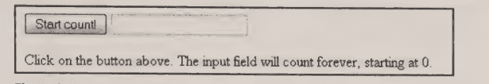

以下示例是使用 `setTimeout()` 方法的另一个简单计时。你的结果如图 26.3 所示。

**自己动手试试 >>**

```html
<html>
<head>
<script type="text/javascript">
function timedText()
{
var t1 = setTimeout("document.getElementById('txt').value='2 seconds!'", 2000);
var t2 = setTimeout("document.getElementById('txt').value='4 seconds!'", 4000);
var t3 = setTimeout("document.getElementById('txt').value='6 seconds!'", 6000);
}
</script>
</head>
<body>
<form>
<input type="button" value="Display timed text!"
onclick="timedText()" />
<input type="text" id="txt" />
</form>
<p>点击上面的按钮。输入字段将告诉你
两秒、四秒和六秒何时过去。</p>
</body>
</html>
```

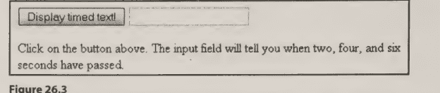

以下示例显示了使用定时事件创建的时钟。你的结果如图 26.4 所示。

**自己动手试试 >>**

```html
<html>
<head>
<script type="text/javascript">
function startTime()
{
var today = new Date();
var h = today.getHours();
var m = today.getMinutes();
var s = today.getSeconds();
// 在数字小于 10 前加一个零
m = checkTime(m);
s = checkTime(s);
document.getElementById('txt').innerHTML = h + ":" + m + ":" + s;
t = setTimeout('startTime()', 500);
}

function checkTime(i)
{
if (i < 10)
  {
  i = "0" + i;
  }
return i;
}
</script>
</head>
<body onload="startTime()">
<div id="txt"></div>
</body>
</html>
```

21:34:38

图 26.4

## `clearTimeout()` 方法

语法如下：

`clearTimeout(setTimeout_variable)`

以下示例与之前的无限循环示例相同。唯一的区别是我们现在添加了一个“停止计数！”按钮来停止计时器。你的结果如图 26.5 所示。

**自己动手试试 >>**

```html
<html>
<head>
<script type="text/javascript">
var c = 0;
var t;
var timer_is_on = 0;

function timedCount()
{
document.getElementById('txt').value = c;
c = c + 1;
t = setTimeout("timedCount()", 1000);
}

function doTimer()
{
if (!timer_is_on)
{
timer_is_on = 1;
timedCount();
}
}

function stopCount()
{
clearTimeout(t);
timer_is_on = 0;
}
</script>
</head>

<body>
<form>
<input type="button" value="Start count!" onclick="doTimer()"/>
<input type="text" id="txt"/>
<input type="button" value="Stop count!" onclick="stopCount()"/>
</form>
<p>
点击上面的“开始计数！”按钮来启动计时器。
输入字段将从 0 开始无限计数。点击
“停止计数！”按钮来停止计数。点击
“开始计数！”按钮来重新启动计时器。
</p>
</body>
</html>
```

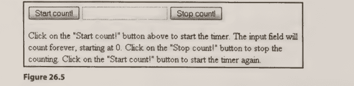

# 第 27 章：用 JavaScript 创建你自己的对象

## 本章内容

- JavaScript 对象
- 创建你自己的对象

对象对于组织信息很有用。

## JavaScript 对象

在本书前面，你了解到 JavaScript 有几个内置对象，如 `String`、`Date`、`Array` 等。除了这些内置对象外，你还可以创建自己的对象。

对象只是一种特殊的数据，是属性和方法的集合。

让我们用一个例子来说明，创建一个模拟人的对象。属性是与对象相关联的值。这个人的属性包括姓名、身高、体重、年龄、肤色、眼睛颜色等。所有的人都有这些属性，但这些属性的值因人而异。对象也有方法。方法是可以对对象执行的操作。这个人的方法可以是 `eat()`、`sleep()`、`work()`、`play()` 等。

### 属性

访问对象属性的语法如下：

`objName.propName`

你可以通过简单地赋予一个值来为对象添加属性。假设 `personObj` 已经存在；你可以如下给它添加名为 `firstname`、`lastname`、`age` 和 `eyecolor` 的属性：

```javascript
personObj.firstname = "John";
personObj.lastname = "Doe";
personObj.age = 30;
personObj.eyecolor = "blue";
```

```javascript
document.write(personObj.firstname);
```

上面的代码生成以下输出：

John

### 方法

对象也可以包含方法。

你可以使用以下语法调用方法：

`objName.methodName()`

> 注意：方法所需的参数可以在括号之间传递。

为 `personObj` 调用名为 `sleep()` 的方法：

```javascript
personObj.sleep();
```

如果 `sleep()` 方法接受一个表示小时数的参数，可以这样调用：

```javascript
personObj.sleep(8)
```

### 创建你自己的对象

有两种方法可以创建新对象：你可以创建一个对象的直接实例，或者你可以创建一个对象的模板。

### 创建对象的直接实例

以下代码创建一个对象的实例并为其添加四个属性：

```javascript
personObj = new Object();
personObj.firstname = "John";
personObj.lastname = "Doe";
personObj.age = 50;
personObj.eyecolor = "blue";
```

为 `personObj` 添加方法也很简单。以下代码为 `personObj` 添加了一个名为 `eat()` 的方法：

```javascript
personObj.eat = eat;
```

在下面的例子中，你创建了一个对象的直接实例。

你的结果如图 27.1 所示。

```html
<html>
<body>

<script type="text/javascript">
personObj = new Object();
personObj.firstname = "John";
personObj.lastname = "Doe";
personObj.age = 50;
personObj.eyecolor = "blue";

document.write(personObj.firstname + " is " + personObj.age +
    " years old.");
</script>

</body>
</html>
```

John is 50 years old.

图 27.1

### 创建对象的模板

模板定义了对象的结构，以便你可以更容易地创建该对象的多个实例：

```javascript
function person(firstname, lastname, age, eyecolor)
{
this.firstname = firstname;
this.lastname = lastname;
this.age = age;
this.eyecolor = eyecolor;
}
```

请注意，模板只是一个函数。

它也被称为**构造函数**。在构造函数内部，你添加将属于该对象每个后续实例的属性和方法。当你使用 `person` 作为多个对象的构造函数时，你必须包含 `this` 关键字。JavaScript 使用 `this` 将属性分配给使用 `new` 关键字创建的特定对象。

在下面的例子中，你创建了一个对象的模板。

你的结果如图 27.2 所示。

**自己动手试试 >>**

```html
<html>
<body>

<script type="text/javascript">
function person(firstname, lastname, age, eyecolor)
{
this.firstname = firstname;
this.lastname = lastname;
this.age = age;
this.eyecolor = eyecolor;
}

myFather = new person("John", "Doe", 50, "blue");

document.write(myFather.firstname + " is " + myFather.age + " years old.");
</script>
</body>
</html>
```


图 27.2

有了模板后，你就可以创建该对象的新实例，如下所示：

```javascript
myFather = new person("John", "Doe", 50, "blue");
myMother = new person("Sally", "Rally", 48, "green");
```

你也可以为 `person` 对象添加一些方法。这也是在模板内完成的：

```javascript
function person(firstname, lastname, age, eyecolor) {
    this.firstname = firstname;
    this.lastname = lastname;
    this.age = age;
    this.eyecolor = eyecolor;

    this.newlastname = newlastname;
}
```

请注意，方法只是附加到对象上的函数。然后你需要编写 `newlastname()` 函数：

```javascript
function newlastname(new_lastname) {
    this.lastname = new_lastname;
}
```

`newlastname()` 函数定义了人的新姓氏并将其赋给该人。JavaScript 通过使用 `this` 来知道你指的是哪个人。所以，现在你可以这样写：`myMother.newlastname("Doe")`。

# 第四部分：AJAX 基础

- 第 28 章：AJAX XMLHttpRequest
- 第 29 章：AJAX 浏览器支持
- 第 30 章：AJAX — XMLHttpRequest 对象的方法和属性
- 第 31 章：AJAX 服务器

# 第 28 章：AJAX XMLHttpRequest

## 本章内容

- AJAX 使用 XMLHttpRequest 对象
- XMLHttpRequest 对象
- AJAX 示例
- 你的第一个 AJAX 应用

### AJAX 使用 XMLHttpRequest 对象

要使用传统 JavaScript 从/向服务器上的数据库或文件获取或发送信息，你将需要创建一个 HTML 表单。用户必须单击提交按钮来发送/获取信息，并等待服务器响应。然后一个加载结果的新页面将会加载。由于服务器每次用户提交输入时都会返回一个新页面，传统的 Web 应用程序可能运行缓慢，并且往往不太用户友好。

使用 AJAX，你的 JavaScript 通过 JavaScript `XMLHttpRequest` 对象直接与服务器通信。

通过 `XMLHttpRequest` 对象，一个网页可以向 Web 服务器发出请求并获得响应——而无需重新加载页面。用户将停留在同一页面，并且不会注意到脚本在后台请求页面或将数据发送到服务器。

### XMLHttpRequest 对象

通过使用 `XMLHttpRequest` 对象，Web 开发者可以在页面加载后用服务器的数据更新页面！

### 通过 W3Schools 学习 JavaScript 和 Ajax

AJAX 在 2005 年由 Google（通过 Google Suggest）推广开来。

Google Suggest 使用 `XMLHttpRequest` 对象创建了一个非常动态的 Web 界面：当你在 Google 的搜索框中开始输入时，JavaScript 会将字母发送到服务器，服务器返回一个建议列表。

`XMLHttpRequest` 对象在所有主要浏览器（Internet Explorer、Firefox、Chrome、Opera 和 Safari）中都受支持。

### 你的第一个 AJAX 应用

为了理解 AJAX 的工作原理，我们将创建一个小型 AJAX 应用。

我们将从头开始创建一个 AJAX 应用。该应用将使用两个点击按钮从服务器获取数据，并在不重新加载页面本身的情况下在网页中显示信息。

首先，创建一个包含短 `<div>` 部分的 HTML 页面。该 `<div>` 部分将用于显示从服务器请求的替代信息。

为了标识 `<div>` 部分，我们使用 `id="test"` 属性：

```html
<html>
<body>

<div id="test">
<h2>Click to let AJAX change this text</h2>
</div>

<body>
</html>
```

然后我们添加两个简单的 `<button>`。当它们被点击时，按钮将调用函数 `loadXMLDoc()`：

```html
<button type="button" onclick="loadXMLDoc('test1.txt')">Click Me</button>
<button type="button" onclick="loadXMLDoc('test2.txt')">Click Me</button>
```

最后，我们在页面的 `<head>` 部分添加一个 `<script>` 来包含 `loadXMLDoc()` 函数：

```html
<head>
<script type="text/javascript">
function loadXMLDoc(url)
{
.... 你的 AJAX 脚本放在这里 ...
}
</script>
</head>
```


接下来的章节将解释脚本（使用 AJAX）以及如何使应用工作。


在完成本教程的在线练习时（在 www.w3schools.com），各种支持文件和图像，包括 `test1.txt` 和 `test2.txt` 文件，都是可以访问的。

你的结果显示在图 28.1 中。

**自己试试 >>**

```html
<html>
<head>
<script type="text/javascript">
function loadXMLDoc(url)
{
if (window.XMLHttpRequest)
  {// code for IE7+, Firefox, Chrome, Opera, Safari
  xmlhttp = new XMLHttpRequest();
  }
else
  {// code for IE6, IE5
  xmlhttp = new ActiveXObject("Microsoft.XMLHTTP");
  }
xmlhttp.open("GET", url, false);
xmlhttp.send(null);
document.getElementById('test').innerHTML = xmlhttp.responseText;
}
</script>
</head>

<body>

<div id="test">
<h2>Click to let AJAX change this text</h2>
</div>
<button type="button" onclick="loadXMLDoc('test1.txt')">Click Me</button>
<button type="button" onclick="loadXMLDoc('test2.txt')">Click Me</button>
</body>
</html>
```

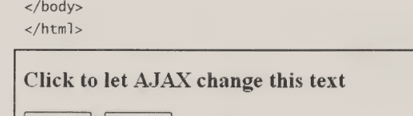

图 28.1

# 第 29 章：AJAX 浏览器支持

## 本章内容

- XMLHttpRequest
- 现在全部结合起来

AJAX 的基石是 `XMLHttpRequest` 对象。

## XMLHttpRequest

所有新浏览器都支持一个新的内置 JavaScript `XMLHttpRequest` 对象（IE5 和 IE6 使用 `ActiveXObject`）。

`XMLHttpRequest` 对象可用于从服务器请求信息（数据）。

让我们在 `<head>` 部分使用 JavaScript 更新我们的 HTML 文件：

```javascript
function loadXMLDoc(url)
{
if (window.XMLHttpRequest)
  {// code for IE7+, Firefox, Chrome, Opera, Safari
  xmlhttp = new XMLHttpRequest();
  }
else
  {// code for IE6, IE5
  xmlhttp = new ActiveXObject("Microsoft.XMLHTTP");
  }
xmlhttp.open("GET", url, false);
xmlhttp.send(null);
document.getElementById('test').innerHTML = xmlhttp.responseText;
}
```

尝试创建一个 `XMLHttpRequest` 对象：

`xmlhttp = new XMLHttpRequest()`

如果不行（如果是 IE5 或 IE6），创建一个 `ActiveXObject`：

`xmlhttp = new ActiveXObject("Microsoft.XMLHTTP")`

打开请求对象：

`xmlhttp.open("GET", url, false)`

向你的服务器发送请求：

`xmlhttp.send(null)`

用服务器的响应更新你的页面：

`document.getElementById('test').innerHTML = xmlhttp.responseText`

> **注意** 前面的代码可以在每次需要创建 `XMLHttpRequest` 对象时使用，所以需要时只需复制粘贴即可。

在第 30 章 "AJAX — XMLHttpRequest 对象" 中，你将了解更多关于 `XMLHttpRequest` 的内容。

## 现在全部结合起来

以下示例将你所学的一切结合起来。你的结果显示在图 29.1 中。

**自己试试 >>**

```html
<html>
<head>
<script type="text/javascript">
function loadXMLDoc(url)
{
if (window.XMLHttpRequest)
  {// code for IE7+, Firefox, Chrome, Opera, Safari
  xmlhttp = new XMLHttpRequest();
  }
else
  {// code for IE6, IE5
  xmlhttp = new ActiveXObject("Microsoft.XMLHTTP");
  }
xmlhttp.open("GET", url, false);
xmlhttp.send(null);
document.getElementById('test').innerHTML = xmlhttp.responseText;
}
</script>
</head>

<body>

<div id="test">
<h2>Click to let AJAX change this text</h2>
</div>
<button type="button" onclick="loadXMLDoc('test1.txt')">Click Me</button>
<button type="button" onclick="loadXMLDoc('test2.txt')">Click Me</button>

</body>
</html>
```

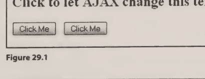

图 29.1

# 第 30 章：AJAX — XMLHttpRequest 对象的方法和属性

## 本章内容

- 重要方法
- 向服务器发送 AJAX 请求
- 重要属性
- `responseText` 属性
- `XMLHttpRequest` Open — 使用 False
- `XMLHttpRequest` Open — 使用 True
- `readyState` 属性
- `onreadystatechange` 属性

在本章中，你将了解 `XMLHttpRequest` 对象的重要**方法**和**属性**。

## 重要方法

`XMLHttpRequest` 对象有两个重要方法：

- `open()` 方法
- `send()` 方法

## 向服务器发送 AJAX 请求

要向 Web 服务器发送请求，请使用 `open()` 和 `send()` 方法。

`open()` 方法接受三个参数。第一个参数定义使用哪种方法（GET 或 POST）。第二个参数指定服务器资源的名称（URL）。第三个参数指定请求是否应以异步方式处理。

`send()` 方法将请求发送到服务器。如果我们假设请求的文件名为 `time.asp`，代码将是：

```javascript
url = "time.asp";
xmlhttp.open("GET", url, true);
xmlhttp.send(null);
```

在该示例中，我们假设当前网页和请求的资源位于同一文件目录中。

## 重要属性

`XMLHttpRequest` 对象有三个重要属性：

- `responseText` 属性
- `readyState` 属性
- `onreadystatechange` 属性

## `responseText` 属性

`XMLHttpRequest` 对象将其通过服务器请求从服务器检索到的任何数据存储在其 `responseText` 属性中。

在上一章中，你使用以下语句将 `responseText` 属性的内容复制到你的 HTML 中：

```javascript
document.getElementById('test').innerHTML = xmlhttp.responseText;
```

## `XMLHttpRequest` Open — 使用 False

在前面的示例中，我们使用了这种简化的语法：

```javascript
xmlhttp.open("GET", url, false);
xmlhttp.send(null);
document.getElementById('test').innerHTML = xmlhttp.responseText;
```

`open` 调用中的第三个参数为 `"false"`。这告诉 `XMLHttpRequest` 对象在执行下一条语句之前，要等待服务器请求完成。

对于小型应用程序和简单的服务器请求，这可能是可以的。但如果请求耗时很长或无法完成，这可能会导致你的 Web 应用程序挂起或停止。

## `XMLHttpRequest` Open — 使用 True

通过将 `open` 调用中的第三个参数改为 `"true"`，你告诉 `XMLHttpRequest` 对象在向服务器发送请求后继续执行。

因为你不能在确信请求已完成之前就开始使用服务器请求的响应，所以你需要将 `XMLHttpRequest` 的 `onreadystatechange` 属性设置为一个函数（或函数名称），该函数将在请求完成后执行。

在此 `onreadystatechange` 函数中，你必须在测试 `readyState` 属性后才能使用服务器调用的结果。

只需将代码更改为：

```javascript
xmlhttp.onreadystatechange = function()
{
if (xmlhttp.readyState == 4)  // request is complete
   {document.getElementById('test').innerHTML = xmlhttp.responseText;}
}
xmlhttp.open("GET", url, true);
xmlhttp.send(null);
```

## `readyState` 属性

`readyState` 属性保存服务器响应的状态。

`readyState` 属性的可能值如下表所示。

| 状态 | 描述 |
| :--- | :--- |
| 0 | 请求未初始化 |
| 1 | 请求已建立 |
| 2 | 请求已发送 |
| 3 | 请求正在进行中 |
| 4 | 请求已完成 |

## `onreadystatechange` 属性

`onreadystatechange` 属性存储一个函数（或函数名），该函数在 `readyState` 属性每次更改时自动调用。

你可以像这样在属性中定义整个函数：

```javascript
xmlhttp.onreadystatechange = function()
{
if (xmlhttp.readyState == 4)
   {document.getElementById('test').innerHTML = xmlhttp.responseText;}
}
xmlhttp.open("GET", url, true);
xmlhttp.send(null);
```

或者，你可以简单地存储在其他地方定义的函数名，如下所示：

```javascript
xmlhttp.onreadystatechange = state_change;
xmlhttp.open("GET", url, true);
xmlhttp.send(null);
...
...
...
function state_Change()
{
if (xmlhttp.readyState == 4)
   {document.getElementById('test').innerHTML = xmlhttp.responseText;}
}
```

# 第 31 章：AJAX 服务器

## 本章内容

- `XMLHttpRequest` 对象可以请求任何数据
- 请求文件
- 提交表单

实际上并不存在所谓的 AJAX 服务器。

## `XMLHttpRequest` 对象可以请求任何数据

使用 `XMLHttpRequest` 对象，你可以向服务器请求任何 Web 资源。你可以请求 TXT 文件、HTML 文件、XML 文件、图片或任何可从互联网访问的数据。

> 注意：AJAX 的核心在于创建能够利用数据的智能应用程序。

## 请求文件

许多 AJAX 应用程序请求纯文本来检索应用程序的数据。一种非常常见的 AJAX 方法是请求 XML 文件来检索应用程序数据。请求 ASP 或 PHP 文件是访问数据库信息的最常见方式。

请求 HTML 文件是向网页填充不同信息的一种常用方法。

## 提交表单

使用 AJAX，你可以轻松地提交表单数据，而无需重新加载页面。

- 在接下来的章节中，我们将请求数据和文件，并学习如何提交表单。

# 第五部分：AJAX 高级

- 第 32 章：AJAX 建议
- 第 33 章：AJAX 数据库示例
- 第 34 章：AJAX XML 示例
- 第 35 章：AJAX ResponseXML 示例

# 第 32 章：AJAX 建议

## 本章内容

- HTML 表单
- `showHint()` 函数
- `GetXmlHttpObject()` 函数
- `stateChanged()` 函数
- AJAX 建议源代码

AJAX 可用于创建更具交互性的应用程序。

以下 AJAX 示例演示了当用户在 HTML 表单中输入数据时，网页如何与 Web 服务器进行通信。

在此示例中，使用名称 “Kelly”。注意在输入框中输入名称时会发生什么，如图 32.1 所示。

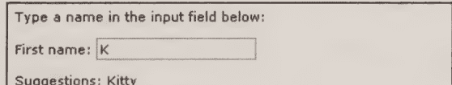

图 32.1

## HTML 表单

上述表单具有以下 HTML 代码：

```html
<form>
First Name: <input type="text" id="txt1"
    onkeyup="showHint(this.value)" />
</form>
<p>Suggestions: <span id="txtHint"></span></p>
```

它只是一个简单的 HTML 表单，其中包含一个名为 “txt1” 的输入字段。

## 通过 w3schools 学习 JavaScript 和 Ajax

输入字段的事件属性定义了一个由 `onkeyup` 事件触发的函数。

表单下方的段落包含一个名为 “txtHint” 的 span。该 span 用作从 Web 服务器检索的数据的占位符。

当用户输入数据时，名为 “showHint()” 的函数将被执行。该函数的执行由 “onkeyup” 事件触发。换句话说，每次用户在输入字段内按下并释放一个键时，函数 `showHint` 就会被调用。

## `showHint()` 函数

`showHint()` 函数是一个非常简单的 JavaScript 函数，放置在 HTML 页面的 `<head>` 部分：

```javascript
var xmlhttp;

function showHint(str)
{
    if (str.length == 0)
    {
        document.getElementById("txtHint").innerHTML = "";
        return;
    }
    xmlhttp = GetXmlHttpObject();
    if (xmlhttp == null)
    {
        alert ("Your browser does not support XMLHTTP!");
        return;
    }
    var url = "gethint.asp";
    url = url + "?q=" + str;
    url = url + "&sid=" + Math.random();
    xmlhttp.onreadystatechange = stateChanged;
    xmlhttp.open("GET", url, true);
    xmlhttp.send(null);
}
```

上述函数在每次向输入字段输入字符时执行。

如果输入字段中有输入（`str.length` > 0），**`showHint()`** 函数将执行以下操作：

- 定义要发送到服务器的 URL（`filename`）
- 将一个参数（`q`）添加到 URL，参数内容为输入字段的内容
- 添加一个随机数以防止服务器使用缓存文件
- 创建一个 `XMLHttpRequest` 对象，并告诉该对象在触发更改时执行名为 **`stateChanged`** 的函数
- 使用给定的 URL 打开 `XMLHttpRequest` 对象
- 向服务器发送 HTTP 请求

如果输入字段为空，该函数将简单地清空 `txtHint` 占位符的内容。

## `GetXmlHttpObject()` 函数

**`showHint()`** 函数调用一个名为 **`GetXmlHttpObject()`** 的函数。

**`GetXmlHttpObject()`** 函数的目的是解决为不同浏览器创建不同 `XMLHttpRequest` 对象的问题：

```javascript
function GetXmlHttpObject()
{
if (window.XMLHttpRequest)
    {
    // code for IE7+, Firefox, Chrome, Opera, Safari
    return new XMLHttpRequest();
    }
if (window.ActiveXObject)
    {
    // code for IE6, IE5
    return new ActiveXObject("Microsoft.XMLHTTP");
    }
return null;
}
```

## `stateChanged()` 函数

**`stateChanged()`** 函数包含以下代码：

```javascript
function stateChanged()
{
if (xmlhttp.readyState == 4)
{
    document.getElementById("txtHint").innerHTML = xmlhttp.responseText;
}
}
```

`stateChanged()` 函数在每次 `XMLHttpRequest` 对象状态改变时执行。

当状态变为 4（“完成”）时，`txtHint` 占位符的内容将用响应文本填充。

## AJAX 建议功能源代码

以下源代码属于之前的 AJAX 示例。你可以复制并粘贴它，自己尝试一下。

> 注意：请务必在启用 ASP 或 PHP 的服务器上尝试。

## AJAX HTML 页面

这是 HTML 页面。它包含一个简单的 HTML 表单和一个指向 JavaScript 的链接。

```html
<html>
<head>
<script src="clienthint.js"></script>
</head>
<body>

<form>
First Name: <input type="text" id="txt1" 
onkeyup="showHint(this.value)" />
</form>
<p>Suggestions: <span id="txtHint"></span></p>

</body>
</html>
```

## AJAX JavaScript

这是 JavaScript 代码，存储在 `clienthint.js` 文件中：

```javascript
var xmlhttp;

function showHint(str)
{
if (str.length == 0)
  {
  document.getElementById("txtHint").innerHTML = "";
  return;
  }
xmlhttp = GetXmlHttpObject();
if (xmlhttp == null)
  {
  alert ("Your browser does not support XMLHTTP!");
  return;
  }
var url = "gethint.asp";
url = url + "?q=" + str;
url = url + "&sid=" + Math.random();
xmlhttp.onreadystatechange = stateChanged;
xmlhttp.open("GET", url, true);
xmlhttp.send(null);
}

function stateChanged()
{
if (xmlhttp.readyState == 4)
  {
  document.getElementById("txtHint").innerHTML = xmlhttp.responseText;
  }
}

function GetXmlHttpObject()
{
if (window.XMLHttpRequest)
  {
  // code for IE7+, Firefox, Chrome, Opera, Safari
  return new XMLHttpRequest();
  }
if (window.ActiveXObject)
  {
  // code for IE6, IE5
  return new ActiveXObject("Microsoft.XMLHTTP");
  }
return null;
}
```

## AJAX 服务器页面 — ASP 和 PHP

不存在所谓的 AJAX 服务器。AJAX 页面可以由任何 Internet 服务器提供。

上一个示例中 JavaScript 调用的服务器页面是一个名为 `gethint.asp` 的简单 ASP 文件。

以下是两个服务器页面代码示例，一个用 ASP 编写，另一个用 PHP 编写。

## AJAX ASP 示例

`gethint.asp` 页面中的代码是为 Internet Information Server (IIS) 编写的 VBScript。它检查一个名称数组，并将相应的名称返回给客户端：

```asp
<%
response.expires = -1
dim a(30)
'Fill up array with names
a(1) = "Anna"
a(2) = "Brittany"
a(3) = "Cinderella"
a(4) = "Diana"
a(5) = "Eva"
a(6) = "Fiona"
a(7) = "Gunda"
a(8) = "Hege"
a(9) = "Inga"
a(10) = "Johanna"
a(11) = "Kitty"
a(12) = "Linda"
a(13) = "Nina"
a(14) = "Ophelia"
a(15) = "Petunia"
a(16) = "Amanda"
a(17) = "Raquel"
a(18) = "Cindy"
a(19) = "Doris"
a(20) = "Eve"
a(21) = "Evita"
a(22) = "Sunniva"
a(23) = "Tove"
a(24) = "Unni"
a(25) = "Violet"
a(26) = "Liza"
a(27) = "Elizabeth"
a(28) = "Ellen"
a(29) = "wenche"
a(30) = "vicky"

'get the q parameter from URL
q = ucase(request.querystring("q"))

'lookup all hints from array if length of q > 0
if len(q) > 0 then
  hint = ""
  for i = 1 to 30
    if q = ucase(mid(a(i), 1, len(q))) then
      if hint = "" then
        hint = a(i)
      else
        hint = hint & ", " & a(i)
      end if
    end if
  next
end if

'Output "no suggestion" if no hint were found
'or output the correct values
if hint = "" then
  response.write("no suggestion")
else
  response.write(hint)
end if
%>
```

## AJAX PHP 示例

前面的代码可以用 PHP 重写：

> 要在 PHP 中运行整个示例，请记得将 `clienthint.js` 中 `url` 变量的值从 `"gethint.asp"` 更改为 `"gethint.php"`。

```php
<?php
// Fill up array with names
$a[] = "Anna";
$a[] = "Brittany";
$a[] = "Cinderella";
$a[] = "Diana";
$a[] = "Eva";
$a[] = "Fiona";
$a[] = "Gunda";
$a[] = "Hege";
$a[] = "Inga";
$a[] = "Johanna";
$a[] = "Kitty";
$a[] = "Linda";
$a[] = "Nina";
$a[] = "Ophelia";
$a[] = "Petunia";
$a[] = "Amanda";
$a[] = "Raquel";
$a[] = "Cindy";
$a[] = "Doris";
$a[] = "Eve";
$a[] = "Evita";
$a[] = "Sunniva";
$a[] = "Tove";
$a[] = "Unni";
$a[] = "Violet";
$a[] = "Liza";
$a[] = "Elizabeth";
$a[] = "Ellen";
$a[] = "wenche";
$a[] = "vicky";

// get the q parameter from URL
$q = $_GET["q"];

// lookup all hints from array if length of q > 0
if (strlen($q) > 0)
  {
  $hint = "";
  for ($i = 0; $i < count($a); $i++)
    {
    if (strtolower($q) == strtolower(substr($a[$i], 0, strlen($q))))
      {
      if ($hint == "")
        {
        $hint = $a[$i];
        }
      else
        {
        $hint = $hint . " , " . $a[$i];
        }
      }
    }
  }

// Set output to "no suggestion" if no hint were found
// or to the correct values
if ($hint == "")
  {
  $response = "no suggestion";
  }
else
  {
  $response = $hint;
  }

// output the response
echo $response;
?>
```

# 第 33 章：AJAX 数据库示例

## 本章内容

- AJAX JavaScript
- AJAX 服务器页面

AJAX 可用于与数据库进行交互式通信。

图 33.1 所示的示例演示了网页如何使用 AJAX 技术从数据库获取信息。

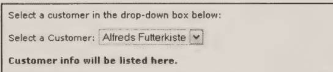

前面的示例包含一个简单的 HTML 表单和一个指向 JavaScript 的链接：

```html
<html>
<head>
<script type="text/javascript" src="selectcustomer.js"></script>
</head>
<body>
<form>
Select a Customer:
<select name="customers" onchange="showCustomer(this.value)">
<option value="ALFKI">Alfreds Futterkiste</option>
<option value="NORTS ">North/South</option>
<option value="WOLZA">Wolski Zajazd</option>
</select>
</form>

<div id="txtHint"><b>Customer info will be listed here.</b></div>

</body>
</html>
```

如你所见，它只是一个简单的 HTML 表单，其中有一个名为 `customers` 的下拉框。

表单下方的 `<div>` 将用作从 Web 服务器检索信息的占位符。

当用户选择数据时，会执行一个名为 `showCustomer()` 的函数。函数的执行是由 `onchange` 事件触发的。换句话说，每次用户更改下拉框中的值时，都会调用函数 `showCustomer()`。

## AJAX JavaScript

这是存储在 `selectcustomer.js` 文件中的 JavaScript 代码：

```javascript
var xmlhttp;

function showCustomer(str)
{
xmlhttp = GetXmlHttpObject();
if (xmlhttp == null)
  {
  alert ("Your browser does not support AJAX!");
  return;
  }
var url = "getcustomer.asp";
url = url + "?q=" + str;
url = url + "&sid=" + Math.random();
xmlhttp.onreadystatechange = stateChanged;
xmlhttp.open("GET", url, true);
xmlhttp.send(null);

function stateChanged()
{
if (xmlhttp.readyState == 4)
  {
  document.getElementById("txtHint").innerHTML = xmlhttp.responseText;
  }
}

function GetXmlHttpObject()
{
if (window.XMLHttpRequest)
  {
  // code for IE7+, Firefox, Chrome, Opera, Safari
  return new XMLHttpRequest();
  }
if (window.ActiveXObject)
  {
  // code for IE6, IE5
  return new ActiveXObject("Microsoft.XMLHTTP");
  }
return null;
}
```

## AJAX 服务器页面

前面 JavaScript 脚本调用的服务器页面是一个名为 `getcustomer.asp` 的 ASP 文件。

该 ASP 页面是为 Internet Information Server (IIS) 编写的 VBScript。它也可以很容易地用 PHP 或其他服务器语言重写。

该代码对数据库运行查询，并将结果以 HTML 表格形式返回：

```asp
<%
response.expires = -1
sql = "SELECT * FROM CUSTOMERS WHERE CUSTOMERID="
sql = sql & "'" & request.querystring("q") & "'"
set conn = Server.CreateObject("ADODB.Connection")
conn.Provider = "Microsoft.Jet.OLEDB.4.0"
conn.Open(Server.Mappath("/db/northwind.mdb"))
set rs = Server.CreateObject("ADODB.recordset")
rs.Open sql, conn

response.write("<table>")
do until rs.EOF
  for each x in rs.Fields
    response.write("<tr><td><b>" & x.name & "</b></td>")
    response.write("<td>" & x.value & "</td></tr>")
  next
  rs.MoveNext
loop

response.write("</table>")
%>
```

# 第 34 章：AJAX XML 示例

## 本章内容

- AJAX JavaScript
- AJAX 服务器页面
- XML 文件

AJAX 可用于与 XML 文件进行交互式通信。图 34.1 中的示例演示了如何使用 AJAX 技术从 XML 文件中获取信息。

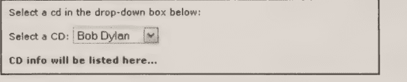

图 34.1

上述示例包含一个简单的 HTML 表单和一个指向 JavaScript 的链接：

```html
<html>
<head>
<script src="selectcd.js"></script>
</head>
<body>
<form>
Select a CD:
<select name="cds" onchange="showCD(this.value)">
<option value="Bob Dylan">Bob Dylan</option>
<option value="Bonnie Tyler">Bonnie Tyler</option>
<option value="Dolly Parton">Dolly Parton</option>
</select>
</form>

<div id="txtHint"><b>CD info will be listed here.</b></div>

</body>
</html>
```

如你所见，这只是一个带有简单下拉框（名为 `cds`）的 HTML 表单。

表单下方的 `<div>` 将用作从 Web 服务器检索到的信息的占位符。

当用户选择数据时，会执行一个名为 `showCD` 的函数。该函数的执行由 `onchange` 事件触发。换句话说，每次用户更改下拉框中的值时，都会调用 `showCD` 函数。

## AJAX JavaScript

这是存储在文件 `selectcd.js` 中的 JavaScript 代码：

```javascript
var xmlhttp;

function showCD(str)
{
xmlhttp = GetXmlHttpObject();
if (xmlhttp == null)
  {
  alert ("Your browser does not support AJAX!");
  return;
  }
var url = "getcd.asp";
url = url + "?q=" + str;
url = url + "&sid=" + Math.random();
xmlhttp.onreadystatechange = stateChanged;
xmlhttp.open("GET", url, true);
xmlhttp.send(null);
}

function stateChanged()
{
if (xmlhttp.readyState == 4)
{
document.getElementById("txtHint").innerHTML = xmlhttp.responseText;
}
}

function GetXmlHttpObject()
{
if (window.XMLHttpRequest)
{
// code for IE7+, Firefox, Chrome, Opera, Safari
return new XMLHttpRequest();
}
if (window.ActiveXObject)
{
// code for IE6, IE5
return new ActiveXObject("Microsoft.XMLHTTP");
}
return null;
}
```

## AJAX 服务器页面

上述 JavaScript 调用的服务器页面是一个名为 `getcd.asp` 的 ASP 文件。该页面是为 Internet Information Server (IIS) 使用 VBScript 编写的。它也可以轻松地用 PHP 或其他服务器语言重写。

该代码对 XML 文件运行查询，并以 HTML 格式返回结果：

```asp
<%
response.expires = -1
q = request.querystring("q")

set xmlDoc = Server.CreateObject("Microsoft.XMLDOM")
xmlDoc.async = "false"
xmlDoc.load(Server.MapPath("cd_catalog.xml"))

set nodes = xmlDoc.selectNodes("CATALOG/CD[ARTIST='" & q & "']")
for each x in nodes
  for each y in x.childnodes
    response.write("<b>" & y.nodename & ":</b> ")
    response.write(y.text)
    response.write("<br />")
  next
next
%>
```

## XML 文件

示例中使用的 XML 文件是 `cd_catalog.xml`。此文档包含一个 CD 集合，内容如下：

```xml
<!-- Edited by XMLSpy® -->
<CATALOG>
<CD>
<TITLE>Empire Burlesque</TITLE>
<ARTIST>Bob Dylan</ARTIST>
<COUNTRY>USA</COUNTRY>
<COMPANY>Columbia</COMPANY>
<PRICE>10.90</PRICE>
<YEAR>1985</YEAR>
</CD>
<CD>
<TITLE>Hide your heart</TITLE>
<ARTIST>Bonnie Tyler</ARTIST>
<COUNTRY>UK</COUNTRY>
<COMPANY>CBS Records</COMPANY>
<PRICE>9.90</PRICE>
<YEAR>1988</YEAR>
</CD>
<CD>
<TITLE>Greatest Hits</TITLE>
<ARTIST>Dolly Parton</ARTIST>
<COUNTRY>USA</COUNTRY>
<COMPANY>RCA</COMPANY>
<PRICE>9.90</PRICE>
<YEAR>1982</YEAR>
</CD>
<CD>
<TITLE>Still got the blues</TITLE>
<ARTIST>Gary Moore</ARTIST>
<COUNTRY>UK</COUNTRY>
<COMPANY>Virgin records</COMPANY>
<PRICE>10.20</PRICE>
<YEAR>1990</YEAR>
</CD>
<CD>
<TITLE>Eros</TITLE>
<ARTIST>Eros Ramazzotti</ARTIST>
<COUNTRY>EU</COUNTRY>
<COMPANY>BMG</COMPANY>
<PRICE>9.90</PRICE>
<YEAR>1997</YEAR>
</CD>
<CD>
<TITLE>One night only</TITLE>
<ARTIST>Bee Gees</ARTIST>
<COUNTRY>UK</COUNTRY>
<COMPANY>Polydor</COMPANY>
<PRICE>10.90</PRICE>
<YEAR>1998</YEAR>
</CD>
<CD>
<TITLE>Sylvias Mother</TITLE>
<ARTIST>Dr.Hook</ARTIST>
<COUNTRY>UK</COUNTRY>
<COMPANY>CBS</COMPANY>
<PRICE>8.10</PRICE>
<YEAR>1973</YEAR>
</CD>
<CD>
<TITLE>Maggie May</TITLE>
<ARTIST>Rod Stewart</ARTIST>
<COUNTRY>UK</COUNTRY>
<COMPANY>Pickwick</COMPANY>
<PRICE>8.50</PRICE>
<YEAR>1990</YEAR>
</CD>
<CD>
<TITLE>Romanza</TITLE>
<ARTIST>Andrea Bocelli</ARTIST>
<COUNTRY>EU</COUNTRY>
<COMPANY>Polydor</COMPANY>
<PRICE>10.80</PRICE>
<YEAR>1996</YEAR>
</CD>
<CD>
<TITLE>When a man loves a woman</TITLE>
<ARTIST>Percy Sledge</ARTIST>
<COUNTRY>USA</COUNTRY>
<COMPANY>Atlantic</COMPANY>
<PRICE>8.70</PRICE>
<YEAR>1987</YEAR>
</CD>
<CD>
<TITLE>Black angel</TITLE>
<ARTIST>Savage Rose</ARTIST>
<COUNTRY>EU</COUNTRY>
<COMPANY>Mega</COMPANY>
<PRICE>10.90</PRICE>
<YEAR>1995</YEAR>
</CD>
<CD>
<TITLE>1999 Grammy Nominees</TITLE>
<ARTIST>Many</ARTIST>
<COUNTRY>USA</COUNTRY>
<COMPANY>Grammy</COMPANY>
<PRICE>10.20</PRICE>
<YEAR>1999</YEAR>
</CD>
<CD>
<TITLE>For the good times</TITLE>
<ARTIST>Kenny Rogers</ARTIST>
<COUNTRY>UK</COUNTRY>
<COMPANY>Mucik Master</COMPANY>
<PRICE>8.70</PRICE>
<YEAR>1995</YEAR>
</CD>
<CD>
<TITLE>Big Willie style</TITLE>
<ARTIST>Will Smith</ARTIST>
<COUNTRY>USA</COUNTRY>
<COMPANY>Columbia</COMPANY>
<PRICE>9.90</PRICE>
<YEAR>1997</YEAR>
</CD>
<CD>
<TITLE>Tupelo Honey</TITLE>
<ARTIST>Van Morrison</ARTIST>
<COUNTRY>UK</COUNTRY>
<COMPANY>Polydor</COMPANY>
<PRICE>8.20</PRICE>
<YEAR>1971</YEAR>
</CD>
<CD>
<TITLE>Soulsville</TITLE>
<ARTIST>Jorn Hoel</ARTIST>
<COUNTRY>Norway</COUNTRY>
<COMPANY>WEA</COMPANY>
<PRICE>7.90</PRICE>
<YEAR>1996</YEAR>
</CD>
<CD>
<TITLE>The very best of</TITLE>
<ARTIST>Cat Stevens</ARTIST>
<COUNTRY>UK</COUNTRY>
<COMPANY>Island</COMPANY>
<PRICE>8.90</PRICE>
<YEAR>1990</YEAR>
</CD>
<CD>
<TITLE>Stop</TITLE>
<ARTIST>Sam Brown</ARTIST>
<COUNTRY>UK</COUNTRY>
<COMPANY>A and M</COMPANY>
<PRICE>8.90</PRICE>
<YEAR>1988</YEAR>
</CD>
<CD>
<TITLE>Bridge of Spies</TITLE>
<ARTIST>T'Pau</ARTIST>
<COUNTRY>UK</COUNTRY>
<COMPANY>Siren</COMPANY>
<PRICE>7.90</PRICE>
<YEAR>1987</YEAR>
</CD>
<CD>
<TITLE>Private Dancer</TITLE>
<ARTIST>Tina Turner</ARTIST>
<COUNTRY>UK</COUNTRY>
<COMPANY>Capitol</COMPANY>
<PRICE>8.90</PRICE>
<YEAR>1983</YEAR>
</CD>
<CD>
<TITLE>Midt om natten</TITLE>
<ARTIST>Kim Larsen</ARTIST>
<COUNTRY>EU</COUNTRY>
<COMPANY>Medley</COMPANY>
<PRICE>7.80</PRICE>
<YEAR>1983</YEAR>
</CD>
<CD>
<TITLE>Pavarotti Gala Concert</TITLE>
<ARTIST>Luciano Pavarotti</ARTIST>
<COUNTRY>UK</COUNTRY>
<COMPANY>DECCA</COMPANY>
<PRICE>9.90</PRICE>
<YEAR>1991</YEAR>
</CD>
<CD>
<TITLE>The dock of the bay</TITLE>
<ARTIST>Otis Redding</ARTIST>
<COUNTRY>USA</COUNTRY>
<COMPANY>Atlantic</COMPANY>
<PRICE>7.90</PRICE>
<YEAR>1987</YEAR>
</CD>
<CD>
<TITLE>Picture book</TITLE>
<ARTIST>Simply Red</ARTIST>
<COUNTRY>EU</COUNTRY>
<COMPANY>Elektra</COMPANY>
<PRICE>7.20</PRICE>
<YEAR>1985</YEAR>
</CD>
<CD>
<TITLE>Red</TITLE>
<ARTIST>The Communards</ARTIST>
<COUNTRY>UK</COUNTRY>
<COMPANY>London</COMPANY>
<PRICE>7.80</PRICE>
<YEAR>1987</YEAR>
</CD>
<CD>
<TITLE>Unchain my heart</TITLE>
<ARTIST>Joe Cocker</ARTIST>
<COUNTRY>USA</COUNTRY>
<COMPANY>EMI</COMPANY>
<PRICE>8.20</PRICE>
<YEAR>1987</YEAR>
</CD>
</CATALOG>
```

# 第 35 章：AJAX ResponseXML 示例

## 本章内容

- AJAX JavaScript
- AJAX 服务器页面

`responseText` 以字符串形式返回 HTTP 响应。

`responseXML` 以 XML 形式返回响应。

`responseXML` 属性返回一个 XML 文档对象，可以使用 DOM（文档对象模型）对其进行检查和解析。

> 完整的 HTML DOM 对象列表请参阅附录 B。

图 35.1 中的示例演示了如何使用 AJAX 技术从数据库中获取信息。这次从数据库中选择的数据将被转换为一个 XML 文档，然后我们将使用 DOM 来提取要显示的值。


图 35.1

上述示例包含一个 HTML 表单、几个用于保存返回数据的 `<span>` 元素，以及一个指向 JavaScript 的链接：

```html
<html>
<head>
<script src="selectcustomer_xml.js"></script>
</head>
<body>

<form action="">
Select a Customer:
<select name="customers" onchange="showCustomer(this.value)">
<option value="ALFKI">Alfreds Futterkiste</option>
<option value="NORTS">North/South</option>
<option value="WOLZA">Wolski Zajazd</option>
</select>
</form>

<b><span id="companyname"></span></b><br />
<span id="contactname"></span><br />
<span id="address"></span>
<span id="city"></span><br/>
<span id="country"></span>

</body>
</html>
```

上面的示例包含一个带下拉框的 HTML 表单，该下拉框名为 `customers`。

当用户在下拉框中选择一个客户时，一个名为 `showCustomer()` 的函数会被执行。函数的执行由 `onchange` 事件触发。换句话说，每当用户改变下拉框中的值时，函数 `showCustomer()` 就会被调用。

## AJAX JavaScript

这是存储在文件 `selectcustomer_xml.js` 中的 JavaScript 代码：

```javascript
var xmlhttp;

function showCustomer(str)
{
xmlhttp = GetXmlHttpObject();
if (xmlhttp == null)
  {
  alert ("Your browser does not support AJAX!");
  return;
  }
var url = "getcustomer_xml.asp";
url = url + "?q=" + str;
url = url + "&sid=" + Math.random();
xmlhttp.onreadystatechange = stateChanged;
xmlhttp.open("GET", url, true);
xmlhttp.send(null);
}

function stateChanged()
{
if (xmlhttp.readyState == 4)
{
  var xmlDoc = xmlhttp.responseXML.documentElement;
  document.getElementById("companyname").innerHTML =
  xmlDoc.getElementsByTagName("compname")[0].childNodes[0].
  nodeValue;
  document.getElementById("contactname").innerHTML =
  xmlDoc.getElementsByTagName("contname")[0].childNodes[0].
  nodeValue;
  document.getElementById("address").innerHTML =
  xmlDoc.getElementsByTagName("address")[0].childNodes[0].
  nodeValue;
  document.getElementById("city").innerHTML =
  xmlDoc.getElementsByTagName("city")[0].childNodes[0].nodeValue;
  document.getElementById("country").innerHTML =
  xmlDoc.getElementsByTagName("country")[0].childNodes[0].
  nodeValue;
  }
}

function GetXmlHttpObject()
{
if (window.XMLHttpRequest)
  {
  // code for IE7+, Firefox, Chrome, Opera, Safari
  return new XMLHttpRequest();
  }
if (window.ActiveXObject)
  {
  // code for IE6, IE5
  return new ActiveXObject("Microsoft.XMLHTTP");
  }
return null;
}
```

`showCustomer()` 和 `GetXmlHttpObject()` 函数与前面章节中的相同。`stateChanged()` 函数也在本教程的前面使用过；然而，这次我们以 XML 文档的形式返回结果（使用 `responseXML`），并使用 DOM 来提取我们希望显示的值。

## AJAX 服务器页

JavaScript 调用的服务器页是一个名为 `getcustomer_xml.asp` 的 ASP 文件。该页面是为 Internet Information Server (IIS) 用 VBScript 编写的。它也可以轻松地用 PHP 或其他服务器语言重写。代码在数据库上运行查询，并将结果作为 XML 文档返回：

```asp
<%
response.expires = -1
response.contenttype = "text/xml"

sql = "SELECT * FROM CUSTOMERS "
sql = sql & " WHERE CUSTOMERID='" & request.querystring("q") & "'"

on error resume next
set conn = Server.CreateObject("ADODB.Connection")
conn.Provider = "Microsoft.Jet.OLEDB.4.0"
conn.Open(Server.Mappath("/db/northwind.mdb"))
set rs = Server.CreateObject("ADODB.recordset")
rs.Open sql, conn

if err <> 0 then
  response.write(err.description)
  set rs = nothing
  set conn = nothing
else
  response.write("<?xml version='1.0' encoding='ISO-8859-1'?>")
  response.write("<company>")
  response.write("<compname>" & rs.fields("companyname") & "</compname>")
  response.write("<contname>" & rs.fields("contactname") & "</contname>")
  response.write("<address>" & rs.fields("address") & "</address>")
  response.write("<city>" & rs.fields("city") & "</city>")
  response.write("<country>" & rs.fields("country") & "</country>")
  response.write("</company>")
end if
on error goto 0
%>
```

注意 ASP 代码中的第二行：`response.contenttype = "text/xml"`。

`ContentType` 属性设置响应对象的 HTTP 内容类型。

此属性的默认值是 `"text/html"`。这次我们希望内容类型是 XML。

然后，我们从数据库中选择数据，并用这些数据构建一个 XML 文档。

# 附录 A：JavaScript 对象

## 本附录内容

- 数组对象
- 布尔对象
- 日期对象
- Math 对象
- Number 对象
- 字符串对象
- RegExp 对象
- 全局属性和函数

### 数组对象

数组对象用于在单个变量中存储多个值。

关于数组的教程，请参见第 17 章，“JavaScript 数组对象。”

### 数组对象属性

| 属性 | 描述 |
| :--- | :--- |
| `constructor` | 返回创建数组对象原型的函数 |
| `length` | 设置或返回数组中的元素数量 |
| `prototype` | 允许您向对象添加属性和方法 |

### 数组对象方法

| 方法 | 描述 |
| :--- | :--- |
| `concat()` | 连接两个或多个数组，并返回连接后数组的副本 |
| `join()` | 将数组的所有元素连接成一个字符串 |
| `pop()` | 删除数组的最后一个元素，并返回该元素 |
| `push()` | 将新元素添加到数组的末尾，并返回新长度 |
| `reverse()` | 颠倒数组中元素的顺序 |
| `shift()` | 删除数组的第一个元素，并返回该元素 |
| `slice()` | 选择数组的一部分，并返回新数组 |
| `sort()` | 对数组的元素进行排序 |


| 方法 | 描述 |
|---|---|
| `splice()` | 从数组中添加/删除元素 |
| `toString()` | 将数组转换为字符串，并返回结果 |
| `unshift()` | 将新元素添加到数组的开头，并返回新长度 |
| `valueOf()` | 返回数组的原始值，表示为以逗号分隔的值 |

### 布尔对象

布尔对象用于将非布尔值转换为布尔值（true 或 false）。

关于布尔对象的教程，请参见第 18 章，“JavaScript 布尔对象。”

### 布尔对象属性

| 属性 | 描述 |
|---|---|
| `constructor` | 返回创建布尔对象原型的函数 |
| `prototype` | 允许您向对象添加属性和方法 |

### 布尔对象方法

| 方法 | 描述 |
|---|---|
| `toString()` | 将布尔值转换为字符串，并返回结果 |
| `valueOf()` | 返回布尔对象的原始值 |

### 日期对象

日期对象用于处理日期和时间。

日期对象通过 `new Date()` 创建。

实例化日期有四种方式：

```
var d = new Date();
var d = new Date(milliseconds);
var d = new Date(dateString);
var d = new Date(year, month, day, hours, minutes, seconds, milliseconds);
```

关于日期和时间的教程，请参见第 16 章，“JavaScript 日期对象。”

### 日期对象属性

| 属性 | 描述 |
|---|---|
| `constructor` | 返回创建日期对象原型的函数 |
| `prototype` | 允许您向对象添加属性和方法 |

### 日期对象方法

| 方法 | 描述 |
|---|---|
| `getDate()` | 返回月份中的日期（从 1 到 31） |
| `getDay()` | 返回星期几（从 0 到 6） |
| `getFullYear()` | 返回年份（四位数） |
| `getHours()` | 返回小时（从 0 到 23） |
| `getMilliseconds()` | 返回毫秒（从 0 到 999） |
| `getMinutes()` | 返回分钟（从 0 到 59） |
| `getMonth()` | 返回月份（从 0 到 11） |
| `getSeconds()` | 返回秒数（从 0 到 59） |
| `getTime()` | 返回自 1970 年 1 月 1 日午夜以来的毫秒数 |
| `getTimezoneOffset()` | 返回格林威治标准时间与本地时间之间的分钟差 |
| `getUTCDate()` | 返回世界协调时的月份中的日期（从 1 到 31） |
| `getUTCDay()` | 返回世界协调时的星期几（从 0 到 6） |
| `getUTCFullYear()` | 返回世界协调时的年份（四位数） |
| `getUTCHours()` | 返回世界协调时的小时（从 0 到 23） |
| `getUTCMilliseconds()` | 返回世界协调时的毫秒（从 0 到 999） |
| `getUTCMinutes()` | 返回世界协调时的分钟（从 0 到 59） |
| `getUTCMonth()` | 返回世界协调时的月份（从 0 到 11） |
| `getUTCSeconds()` | 返回世界协调时的秒数（从 0 到 59） |
| `getYear()` | 已弃用。请改用 `getFullYear()` 方法 |
| `parse()` | 解析日期字符串并返回自 1970 年 1 月 1 日午夜以来的毫秒数 |
| `setDate()` | 设置月份中的日期（从 1 到 31） |
| `setFullYear()` | 设置年份（四位数字） |
| `setHours()` | 设置小时（从 0-23） |
| `setMilliseconds()` | 设置毫秒（从 0-999） |
| `setMinutes()` | 设置分钟（从 0-59） |
| `setMonth()` | 设置月份（从 0-11） |
| `setSeconds()` | 设置秒数（从 0-59） |
| `setTime()` | 通过向 1970 年 1 月 1 日午夜添加或减去指定毫秒数来设置日期和时间 |
| `setUTCDate()` | 根据通用时间设置月份中的日期（从 1-31） |
| `setUTCFullYear()` | 根据通用时间设置年份（四位数字） |
| `setUTCHours()` | 根据通用时间设置小时（从 0-23） |
| `setUTCMilliseconds()` | 根据通用时间设置毫秒（从 0-999） |
| `setUTCMinutes()` | 根据通用时间设置分钟（从 0-59） |
| `setUTCMonth()` | 根据通用时间设置月份（从 0-11） |
| `setUTCSeconds()` | 根据通用时间设置秒数（从 0-59） |
| `setYear()` | 已弃用。请使用 `setFullYear()` 方法代替 |
| `toDateString()` | 将 Date 对象的日期部分转换为可读字符串 |
| `toGMTString()` | 已弃用。请使用 `toUTCString()` 方法代替 |
| `toLocaleDateString()` | 使用区域设置约定，将 Date 对象的日期部分作为字符串返回 |
| `toLocaleTimeString()` | 使用区域设置约定，将 Date 对象的时间部分作为字符串返回 |
| `toLocaleString()` | 使用区域设置约定，将 Date 对象转换为字符串 |
| `toString()` | 将 Date 对象转换为字符串 |
| `toTimeString()` | 将 Date 对象的时间部分转换为字符串 |
| `toUTCString()` | 根据通用时间，将 Date 对象转换为字符串 |
| `UTC()` | 根据通用时间，返回自 1970 年 1 月 1 日午夜以来的日期字符串中的毫秒数 |
| `valueOf()` | 将 Date 转换为毫秒。与 `getTime()` 相同。 |

# Math 对象

Math 对象允许你执行数学任务。

Math 不是构造函数。所有 Math 的属性/方法都可以通过使用 Math 作为对象来调用，而无需创建它。

语法如下：

```
var x = Math.PI; // 返回 PI
var y = Math.sqrt(16); // 返回 16 的平方根
```

有关 Math 对象的教程，请参见第 19 章 "JavaScript Math 对象"。

# Math 对象属性

| 属性 | 描述 |
|---|---|
| `E` | 返回欧拉数，自然对数的底数（约等于 2.718） |
| `LN2` | 返回 2 的自然对数（约等于 0.693） |
| `LN10` | 返回 10 的自然对数（约等于 2.302） |
| `LOG2E` | 返回以 2 为底 E 的对数（约等于 1.442） |
| `LOG10E` | 返回以 10 为底 E 的对数（约等于 0.434） |
| `PI` | 返回 PI（约等于 3.14159） |
| `SQRT1_2` | 返回 1/2 的平方根（约等于 0.707） |
| `SQRT2` | 返回 2 的平方根（约等于 1.414） |

# Math 对象方法

| 方法 | 描述 |
|---|---|
| `abs(x)` | 返回 x 的绝对值 |
| `acos(x)` | 返回 x 的反余弦值，以弧度表示 |
| `asin(x)` | 返回 x 的反正弦值，以弧度表示 |
| `atan(x)` | 返回 -PI/2 与 PI/2 弧度之间的 x 的反正切值（数值） |
| `atan2(y,x)` | 返回其参数商的反正切值 |
| `ceil(x)` | 将 x 向上舍入到最接近的整数并返回 |
| `cos(x)` | 返回 x 的余弦值（x 以弧度表示） |
| `exp(x)` | 返回 E 的 x 次幂的值 |
| `floor(x)` | 将 x 向下舍入到最接近的整数并返回 |
| `log(x)` | 返回 x 的自然对数（以 E 为底） |
| `max(x,y,z,...,n)` | 返回值最大的数字 |
| `min(x,y,z,...,n)` | 返回值最小的数字 |
| `pow(x,y)` | 返回 x 的 y 次幂的值 |
| `random()` | 返回 0 与 1 之间的随机数 |
| `round(x)` | 将 x 四舍五入到最接近的整数 |
| `sin(x)` | 返回 x 的正弦值（x 以弧度表示） |
| `sqrt(x)` | 返回 x 的平方根 |
| `tan(x)` | 返回 x 的正切值（x 以弧度表示） |

# Number 对象

Number 对象是原始数值的包装对象。

Number 对象通过 `new Number()` 创建。

语法如下：

```
var num = new Number(value);
```

> 注意：如果 value 参数无法转换为数字，则返回 NaN（非数字）。

# Number 对象属性

| 属性 | 描述 |
|---|---|
| `constructor` | 返回创建 Number 对象原型的函数 |
| `MAX_VALUE` | 返回 JavaScript 中可能的最大数字 |
| `MIN_VALUE` | 返回 JavaScript 中可能的最小数字 |
| `NEGATIVE_INFINITY` | 表示负无穷大（溢出时返回） |
| `POSITIVE_INFINITY` | 表示无穷大（溢出时返回） |
| `prototype` | 允许你向对象添加属性和方法 |

# Number 对象方法

| 方法 | 描述 |
|---|---|
| `toExponential(x)` | 将数字转换为指数表示法 |
| `toFixed(x)` | 将数字格式化为小数点后有 x 位数字 |
| `toPrecision(x)` | 将数字格式化为 x 位有效数字 |
| `toString()` | 将 Number 对象转换为字符串 |
| `valueOf()` | 返回 Number 对象的原始值 |

# String 对象

String 对象用于操作存储的文本。

String 对象通过 `new String()` 创建。

语法如下：

```
var txt = new String(string);
```

或者更简单地：

```
var txt = string;
```

> 有关 String 对象的教程，请参见第 15 章 "JavaScript String 对象"。

# String 对象属性

| 属性 | 描述 |
|---|---|
| `constructor` | 返回创建 String 对象原型的函数 |
| `length` | 返回字符串的长度 |
| `prototype` | 允许你向对象添加属性和方法 |

# String 对象方法

| 方法 | 描述 |
|---|---|
| `charAt()` | 返回指定索引处的字符 |
| `charCodeAt()` | 返回指定索引处字符的 Unicode 值 |
| `concat()` | 连接两个或多个字符串，并返回连接后字符串的副本 |
| `fromCharCode()` | 将 Unicode 值转换为字符 |
| `indexOf()` | 返回字符串中指定值首次出现的位置 |
| `lastIndexOf()` | 返回字符串中指定值最后出现的位置 |
| `match()` | 在字符串中使用正则表达式查找匹配项。返回匹配项数组，如果未找到则返回 null。 |
| `replace()` | 在字符串中查找子字符串（或正则表达式）的匹配项，并将匹配的子字符串替换为新的子字符串 |
| `search()` | 在字符串中查找正则表达式的匹配项，并返回匹配的位置；如果未找到则返回 -1 |
| `slice()` | 提取字符串的一部分并返回一个新字符串 |
| `split()` | 将字符串分割为子字符串数组 |
| `substr()` | 从字符串中提取从指定起始位置开始到指定字符数的字符 |
| `substring()` | 提取字符串中两个指定索引之间的字符 |
| `toLowerCase()` | 将字符串转换为小写字母 |
| `toUpperCase()` | 将字符串转换为大写字母 |
| `valueOf()` | 返回 String 对象的原始值 |

# String HTML 包装方法

HTML 包装方法返回包裹在适当 HTML 标签内的字符串。

| 方法 | 描述 |
|---|---|
| `anchor()` | 创建锚点 |
| `big()` | 使用大字体显示字符串 |
| `blink()` | 显示闪烁的字符串 |
| `bold()` | 以粗体显示字符串 |
| `fixed()` | 使用等宽字体显示字符串 |
| `fontcolor()` | 使用指定颜色显示字符串 |
| `fontsize()` | 使用指定大小显示字符串 |
| `italics()` | 以斜体显示字符串 |
| `link()` | 将字符串显示为超链接 |
| `small()` | 使用小字体显示字符串 |
| `strike()` | 为字符串添加删除线 |
| `sub()` | 将字符串显示为下标文本 |
| `sup()` | 将字符串显示为上标文本 |

## 正则表达式对象

正则表达式是描述字符模式的对象。

正则表达式用于对文本执行模式匹配和查找替换功能。

语法如下：

```
var txt=new RegExp(pattern,modifiers);
```

或者更简单地：

```
var txt=/pattern/modifiers;
```

- 模式指定了表达式的模式。
- 修饰符指定搜索是否应为全局搜索、区分大小写等。

关于正则表达式对象的教程，请参见第20章“JavaScript 正则表达式对象”。

## 修饰符

修饰符用于执行不区分大小写和全局搜索：

| 修饰符 | 描述 |
|---|---|
| `i` | 执行不区分大小写的匹配 |
| `g` | 执行全局匹配（查找所有匹配项，而不是在找到第一个后停止） |
| `m` | 执行多行匹配 |

## 方括号

方括号用于查找字符范围：

| 表达式 | 描述 |
|---|---|
| `[abc]` | 匹配方括号之间的任何字符 |
| `[^abc]` | 匹配不在方括号之间的任何字符 |
| `[0-9]` | 匹配 0 到 9 之间的任何数字 |
| `[a-z]` | 匹配小写 a 到小写 z 之间的任何字符 |
| `[A-Z]` | 匹配大写 A 到大写 Z 之间的任何字符 |
| `[a-Z]` | 匹配小写 a 到大写 Z 之间的任何字符 |
| `[adgk]` | 匹配给定集合中的任何字符 |
| `[^adgk]` | 匹配不在给定集合中的任何字符 |
| `[red|blue|green]` | 匹配指定的任何备选方案 |

## 元字符

元字符是具有特殊含义的字符：

| 元字符 | 描述 |
|---|---|
| `.` | 查找单个字符，但不包括换行符或行终止符 |
| `\w` | 匹配任何字母数字字符，包括下划线 |
| `\W` | 匹配任何非字母数字字符 |
| `\d` | 查找数字 |
| `\D` | 查找非数字字符 |
| `\s` | 查找单个空白字符 |
| `\S` | 查找单个非空白字符 |
| `\b` | 在单词的开头/结尾处匹配 |
| `\B` | 在单词的开头/结尾处不匹配 |
| `\0` | 查找 NUL 字符 |
| `\n` | 查找换行符 |
| `\f` | 查找换页符 |
| `\r` | 查找回车符 |
| `\t` | 查找制表符 |
| `\v` | 查找垂直制表符 |
| `\xxx` | 查找由八进制数 xxx 指定的字符 |
| `\xdd` | 查找由十六进制数 dd 指定的字符 |
| `\uxxxx` | 查找由十六进制数 xxxx 指定的 Unicode 字符 |

## 量词

| 量词 | 描述 |
|---|---|
| `+` | 匹配前面的字符 1 次或多次 |
| `*` | 匹配前面的字符 0 次或多次 |
| `?` | 匹配前面的字符 0 次或 1 次 |
| `{x}` | 其中 x 是正整数，匹配前面的字符恰好 n 次 |
| `{x,y}` | 其中 x 和 y 是正整数，匹配前面的字符至少 x 次，最多 y 次 |
| `{x,}` | 其中 x 是正整数，匹配前面的字符至少 n 次 |
| `n$` | 匹配任何以 n 结尾的字符串 |
| `^n` | 匹配任何以 n 开头的字符串 |
| `n(?=m)` | 仅当后面跟着 m 时匹配 n |
| `n(?!m)` | 仅当后面不跟着 m 时匹配 n |

## 正则表达式对象属性

| 属性 | 描述 |
|---|---|
| `global` | 指定是否设置了 "g" 修饰符 |
| `ignoreCase` | 指定是否设置了 "i" 修饰符 |
| `lastIndex` | 下一次匹配开始的索引 |
| `multiline` | 指定是否设置了 "m" 修饰符 |
| `source` | 正则表达式模式的文本 |

## 正则表达式对象方法

| 方法 | 描述 |
|---|---|
| `compile()` | 编译正则表达式 |
| `exec()` | 在字符串中测试匹配。返回结果数组 |
| `test()` | 在字符串中测试匹配。返回 true 或 false |

# JavaScript 全局属性和函数

JavaScript 全局属性和函数可用于所有内置 JavaScript 对象。

## JavaScript 全局属性

| 属性 | 描述 |
|---|---|
| `Infinity` | 一个代表正/负无穷大的数值 |
| `NaN` | “非数字”值 |
| `undefined` | 指示变量尚未被赋值 |

## JavaScript 全局函数

| 函数 | 描述 |
|---|---|
| `decodeURI()` | 解码 URI |
| `decodeURIComponent()` | 解码 URI 组件 |
| `encodeURI()` | 编码 URI |
| `encodeURIComponent()` | 编码 URI 组件 |
| `escape()` | 对字符串进行编码 |
| `eval()` | 计算字符串并将其作为 JavaScript 表达式执行 |
| `isFinite()` | 判断值是否为有限数字 |
| `isNaN()` | 判断值是否为非法数字 |
| `Number()` | 将对象的值转换为数字 |
| `parseFloat()` | 解析字符串并返回浮点数 |
| `parseInt()` | 解析字符串并返回整数 |
| `String()` | 将对象的值转换为字符串 |
| `unescape()` | 对已编码的字符串进行解码 |

# 附录 A：JavaScript 对象

(表格续行见上文)

# 附录 B：HTML DOM 对象

## 本附录内容

- Document 对象
- Event 对象
- Element 对象
- Anchor 对象
- Area 对象
- Base 对象
- Body 对象
- Button 对象（按钮）
- Form 对象
- Frame/IFrame 对象
- Frameset 对象
- Image 对象
- Button 对象
- Checkbox 对象
- FileUpload 对象
- Hidden 对象
- Password 对象
- Radio 对象
- Reset 对象
- Submit 对象
- Text 对象
- Link 对象
- Meta 对象
- Object 对象
- Option 对象
- Select 对象
- Style 对象
- Table 对象
- TableCell 对象
- TableRow 对象
- Textarea 对象

万维网联盟（W3C）是一个国际性社区，负责制定标准以确保网络的长期发展。W3C DOM 页面位于 `http://www.w3.org/DOM/`。

## Document 对象

加载到浏览器窗口中的每个 HTML 文档都成为一个 Document 对象。Document 对象提供了从脚本内部访问页面中所有 HTML 元素的途径。

> **提示** Document 对象也是 Window 对象的一部分，可以通过 `window.document` 属性访问。

## Document 对象集合

W3C: W3C 标准

| 集合 | 描述 | W3C |
|---|---|---|
| `anchors[]` | 返回文档中所有锚点的数组 | 是 |
| `forms[]` | 返回文档中所有表单的数组 | 是 |
| `images[]` | 返回文档中所有图像的数组 | 是 |
| `links[]` | 返回文档中所有链接的数组 | 是 |

## Document 对象属性

| 属性 | 描述 | W3C |
|---|---|---|
| `cookie` | 返回文档中所有 cookie 的名称/值对 | 是 |
| `documentMode` | 返回浏览器用于渲染文档的模式 | 否 |
| `domain` | 返回加载文档的服务器的域名 | 是 |
| `lastModified` | 返回文档最后修改的日期和时间 | 否 |
| `readyState` | 返回文档的（加载）状态 | 否 |
| `referrer` | 返回加载当前文档的文档的 URL | 是 |
| `title` | 设置或返回文档的标题 | 是 |
| `URL` | 返回文档的完整 URL | 是 |

## Document 对象方法

| 方法 | 描述 | W3C |
|---|---|---|
| `close()` | 关闭之前用 `document.open()` 打开的输出流 | 是 |
| `getElementById()` | 访问具有指定 id 的第一个元素 | 是 |
| `getElementsByName()` | 访问具有指定名称的所有元素 | 是 |
| `getElementsByTagName()` | 访问具有指定标签名的所有元素 | 是 |
| `open()` | 打开一个输出流，以收集来自 `document.write()` 或 `document.writeln()` 的输出 | 是 |
| `write()` | 将 HTML 表达式或 JavaScript 代码写入文档 | 是 |
| `writeln()` | 与 `write()` 相同，但在每个语句后添加换行符 | 是 |

## Event 对象

Event 对象为你提供有关已发生事件的信息。

Event 对象表示事件的状态，例如事件发生的元素、键盘按键的状态、鼠标的位置以及鼠标按钮的状态。

事件通常与函数结合使用，函数将在事件发生之前不执行！

## 事件处理程序

HTML 4.0 新增的功能是允许 HTML 事件在浏览器中触发操作，例如当用户单击 HTML 元素时启动 JavaScript。以下是可以插入 HTML 标签以定义事件操作的属性列表。

### 事件处理程序属性

IE：Internet Explorer；F：Firefox；O：Opera；W3C：W3C 标准。

| 属性 | 事件在...时发生 | IE | F | O | W3C |
|---|---|---|---|---|---|
| `onblur` | 元素失去焦点 | 3 | 1 | 9 | 是 |
| `onchange` | 字段的内容发生改变 | 3 | 1 | 9 | 是 |
| `onclick` | 鼠标点击一个对象 | 3 | 1 | 9 | 是 |
| `ondblclick` | 鼠标双击一个对象 | 4 | 1 | 9 | 是 |
| `onerror` | 在加载文档或图像时发生错误 | 4 | 1 | 9 | 是 |
| `onfocus` | 元素获得焦点 | 3 | 1 | 9 | 是 |
| `onkeydown` | 键盘按键被按下 | 3 | 1 | 否 | 是 |
| `onkeypress` | 键盘按键被按下或按住不放 | 3 | 1 | 9 | 是 |
| `onkeyup` | 键盘按键被释放 | 3 | 1 | 9 | 是 |
| `onload` | 页面或图像加载完成 | 3 | 1 | 9 | 是 |
| `onmousedown` | 鼠标按钮被按下 | 4 | 1 | 9 | 是 |
| `onmousemove` | 鼠标被移动 | 3 | 1 | 9 | 是 |
| `onmouseout` | 鼠标从元素上移开 | 4 | 1 | 9 | 是 |
| `onmouseover` | 鼠标移到元素之上 | 3 | 1 | 9 | 是 |
| `onmouseup` | 鼠标按钮被释放 | 4 | 1 | 9 | 是 |
| `onresize` | 窗口或框架被调整大小 | 4 | 1 | 9 | 是 |
| `onselect` | 文本被选中 | 3 | 1 | 9 | 是 |
| `onunload` | 用户退出页面 | 3 | 1 | 9 | 是 |

## 鼠标/键盘属性

| 属性 | 描述 | IE | F | O | W3C |
|---|---|---|---|---|---|
| `altKey` | 返回当事件被触发时，Alt 键是否被按下 | 6 | 1 | 9 | 是 |
| `button` | 返回当事件被触发时，哪个鼠标按钮被点击 | 6 | 1 | 9 | 是 |
| `clientX` | 返回当事件被触发时，鼠标指针的水平坐标 | 6 | 1 | 9 | 是 |
| `clientY` | 返回当事件被触发时，鼠标指针的垂直坐标 | 6 | 1 | 9 | 是 |
| `ctrlKey` | 返回当事件被触发时，Ctrl 键是否被按下 | 6 | 1 | 9 | 是 |
| `metaKey` | 返回当事件被触发时，meta 键是否被按下 | 6 | 1 | 9 | 是 |
| `relatedTarget` | 返回与事件的目标节点相关的节点 | 否 | 1 | 9 | 是 |
| `screenX` | 返回当事件被触发时，鼠标指针相对于屏幕的水平坐标 | 6 | 1 | 9 | 是 |
| `screenY` | 返回当事件被触发时，鼠标指针相对于屏幕的垂直坐标 | 6 | 1 | 9 | 是 |
| `shiftKey` | 返回当事件被触发时，Shift 键是否被按下 | 6 | 1 | 9 | 是 |

## 其他事件属性

| 属性 | 描述 | IE | F | O | W3C |
|---|---|---|---|---|---|
| `bubbles` | 返回一个布尔值，指示事件是否是冒泡事件 | 否 | 1 | 9 | 是 |
| `cancelable` | 返回一个布尔值，指示事件是否可被取消 | 否 | 1 | 9 | 是 |
| `currentTarget` | 返回其事件监听器触发事件的元素 | 否 | 1 | 9 | 是 |
| `eventPhase` | 返回事件传播的当前阶段 | | | | 是 |
| `target` | 返回触发事件的元素 | 否 | 1 | 9 | 是 |
| `timeStamp` | 返回自纪元（系统启动或事件触发）以来的毫秒时间戳 | 否 | 1 | 9 | 是 |
| `type` | 返回事件的名称 | 6 | 1 | 9 | 是 |

## 元素对象

以下表格中的集合、属性、方法和事件可用于所有 HTML 元素。

### 元素对象集合

W3C：W3C 标准。

| 集合 | 描述 | W3C |
|---|---|---|
| `attributes[]` | 返回元素属性的数组 | 是 |
| `childNodes[]` | 返回元素子节点的数组 | 是 |

### 元素对象属性

| 属性 | 描述 | W3C |
|---|---|---|
| `accessKey` | 设置或返回元素的快捷键 | 是 |
| `className` | 设置或返回元素的 class 属性 | 是 |
| `clientHeight` | 返回页面内容的可视高度（不包括边框、边距或滚动条） | 是 |
| `clientWidth` | 返回页面内容的可视宽度（不包括边框、边距或滚动条） | 是 |
| `dir` | 设置或返回元素的文本方向 | 是 |
| `disabled` | 设置或返回元素的 disabled 属性 | 是 |
| `firstChild` | 返回元素的第一个子节点 | 是 |
| `height` | 设置或返回元素的 height 属性 | 是 |
| `id` | 设置或返回元素的 id | 是 |
| `innerHTML` | 设置或返回元素的 HTML 内容（+文本） | 是 |
| `lang` | 设置或返回元素的语言代码 | 是 |
| `lastChild` | 返回元素的最后一个子节点 | 是 |
| `length` | 不适用于所有对象。请参见具体的对象类型。 | 是 |
| `nextSibling` | 返回紧跟在元素之后的元素 | 是 |
| `nodeName` | 返回元素的标签名（大写） | 是 |
| `nodeType` | 返回元素的类型 | 是 |
| `nodeValue` | 返回元素的值 | 是 |
| `offsetHeight` | 返回元素的高度，包括边框和填充（如果有），但不包括边距 | 否 |
| `offsetLeft` | 返回当前元素相对于其偏移容器的水平偏移位置 | 是 |
| `offsetParent` | 返回元素的偏移容器 | 是 |
| `offsetTop` | 返回当前元素相对于其偏移容器的垂直偏移位置 | 是 |
| `offsetWidth` | 返回元素的宽度，包括边框和填充（如果有），但不包括边距 | 否 |
| `ownerDocument` | 返回元素的根元素（文档对象） | 是 |
| `parentNode` | 返回元素的父节点 | 是 |
| `previousSibling` | 返回紧靠在元素之前的元素 | 是 |
| `scrollHeight` | 返回元素的整个高度（包括被滚动条隐藏的区域） | 是 |
| `scrollLeft` | 返回元素的实际左边缘与当前视图中其左边缘之间的距离 | 是 |
| `scrollTop` | 返回元素的实际上边缘与当前视图中其上边缘之间的距离 | 是 |
| `scrollWidth` | 返回元素的整个宽度（包括被滚动条隐藏的区域） | 是 |
| `style` | 设置或返回元素的 style 属性 | 是 |
| `tabIndex` | 设置或返回元素的 tab 键顺序 | 是 |
| `tagName` | 以字符串形式返回元素的标签名（大写） | 是 |
| `title` | 设置或返回元素的 title 属性 | 是 |
| `width` | 设置或返回元素的 width 属性 | 是 |

### 元素对象方法

| 方法 | 描述 | W3C |
|---|---|---|
| `appendChild()` | 在元素子节点列表的末尾添加一个新的子节点 | 是 |
| `blur()` | 从元素移除焦点 | 是 |
| `click()` | 在元素上执行一次点击 | 是 |
| `cloneNode()` | 克隆一个元素 | 是 |
| `focus()` | 为元素赋予焦点 | 是 |
| `getAttribute()` | 返回属性的值 | 是 |
| `getElementsByTagName()` | 通过指定的标签名访问所有元素 | 是 |
| `hasChildNodes()` | 返回元素是否有任何子节点 | 是 |
| `insertBefore()` | 在现有的子节点前插入一个新的子节点 | 是 |
| `item()` | 根据元素在文档树中的索引返回一个元素 | 是 |
| `normalize()` | 将此元素下的所有文本节点（包括属性）置于“规范”形式，其中仅结构（例如，元素、注释、处理指令、CDATA 节和实体引用）分隔文本节点，也就是说，没有相邻的文本节点或空的文本节点 | 是 |
| `removeAttribute()` | 从元素移除指定的属性 | 是 |
| `removeChild()` | 移除一个子节点 | 是 |
| `replaceChild()` | 替换一个子节点 | 是 |
| `setAttribute()` | 为元素添加一个新的属性 | 是 |
| `toString()` | 将元素转换为字符串 | 是 |

### 元素对象事件

| 事件 | 描述 | W3C |
|---|---|---|
| `onblur` | 当元素失去焦点时 | 是 |
| `onclick` | 当鼠标点击元素时 | 是 |
| `ondblclick` | 当鼠标双击元素时 | 是 |
| `onfocus` | 当元素获得焦点时 | 是 |
| `onkeydown` | 当键盘按键被按下时 | 是 |
| `onkeypress` | 当键盘按键被按下或按住不放时 | 是 |
| `onkeyup` | 当键盘按键被释放时 | 是 |
| `onmousedown` | 当鼠标按钮被按下时 | 是 |
| `onmousemove` | 当鼠标被移动时 | 是 |
| `onmouseout` | 当鼠标光标离开元素时 | 是 |
| `onmouseover` | 当鼠标光标进入元素时 | 是 |
| `onmouseup` | 当鼠标按钮被释放时 | 是 |
| `onresize` | 当元素被调整大小时 | 是 |

## 锚点对象

锚点对象表示一个 HTML 超链接。

HTML 文档中的每个 `<a>` 标签都会创建一个锚点对象。

锚点允许你创建指向另一个文档（使用 `href` 属性）或同一文档中不同位置（使用 `name` 属性）的链接。

你可以使用 `getElementById()` 或通过搜索 Document 对象的 `anchors[]` 数组来访问锚点。

### Anchor 对象属性

W3C：W3C 标准。

| 属性 | 描述 | W3C |
|---|---|---|
| `charset` | 设置或返回链接的 charset 属性的值 | 是 |
| `href` | 设置或返回链接的 href 属性的值 | 是 |
| `hreflang` | 设置或返回链接的 hreflang 属性的值 | 是 |
| `name` | 设置或返回链接的 name 属性的值 | 是 |
| `rel` | 设置或返回链接的 rel 属性的值 | 是 |
| `rev` | 设置或返回链接的 rev 属性的值 | 是 |
| `target` | 设置或返回链接的 target 属性的值 | 是 |
| `type` | 设置或返回链接的 type 属性的值 | 是 |

## 标准属性、方法和事件

Anchor 对象还支持标准属性、方法和事件。

### Area 对象

Area 对象代表 HTML 图像映射中的一个区域（图像映射是具有可点击区域的图像）。

HTML 文档中的每个 `<area>` 标签都会创建一个 Area 对象。

### Area 对象属性

W3C：W3C 标准。

| 属性 | 描述 | W3C |
|---|---|---|
| `alt` | 设置或返回区域的 alt 属性的值 | 是 |
| `coords` | 设置或返回区域的 coords 属性的值 | 是 |
| `hash` | 设置或返回 href 属性值的锚点部分 | 是 |
| `host` | 设置或返回 href 属性值的主机名:端口部分 | 是 |
| `hostname` | 设置或返回 href 属性值的主机名部分 | 是 |
| `href` | 设置或返回区域的 href 属性的值 | 是 |
| `noHref` | 设置或返回区域的 nohref 属性的值 | 是 |
| `pathname` | 设置或返回 href 属性值的路径名部分 | 是 |
| `port` | 设置或返回 href 属性值的端口部分 | 是 |
| `protocol` | 设置或返回 href 属性值的协议部分 | 是 |
| `search` | 设置或返回 href 属性值的查询字符串部分 | 是 |
| `shape` | 设置或返回区域的 shape 属性的值 | 是 |
| `target` | 设置或返回区域的 target 属性的值 | 是 |

## 标准属性、方法和事件

Area 对象还支持标准属性、方法和事件。

### Base 对象

Base 对象代表一个 HTML base 元素。

base 元素用于指定页面上所有链接的默认地址或默认目标。

HTML 文档中的每个 `<base>` 标签都会创建一个 Base 对象。

### Base 对象属性

W3C：W3C 标准。

| 属性 | 描述 | W3C |
|---|---|---|
| `href` | 设置或返回 base 元素中 href 属性的值 | 是 |
| `target` | 设置或返回 base 元素中 target 属性的值 | 是 |

## 标准属性、方法和事件

Base 对象还支持标准属性、方法和事件。

### Body 对象

Body 对象代表 HTML body 元素。

Body 元素定义了文档的主体。

Body 元素包含 HTML 文档的所有内容，例如文本、超链接、图像、表格、列表等。

### Body 对象属性

W3C：W3C 标准。

| 属性 | 描述 | W3C |
|---|---|---|
| `aLink` | 设置或返回 body 元素的 alink 属性的值 | 是 |
| `background` | 设置或返回 body 元素的 background 属性的值 | 是 |
| `bgColor` | 设置或返回 body 元素的 bgcolor 属性的值 | 是 |
| `link` | 设置或返回 body 元素的 link 属性的值 | 是 |
| `text` | 设置或返回 body 元素的 text 属性的值 | 是 |
| `vLink` | 设置或返回 body 元素的 vlink 属性的值 | 是 |

## 标准属性、方法和事件

Body 对象还支持标准属性、方法和事件。

### Button 对象（按钮）

Button 对象代表一个 Button 对象（按钮）。

HTML 文档中的每个 `<button>` 标签都会创建一个 Button 对象。

在 HTML Button 元素内部，您可以放置文本或图像等内容。这是该元素与通过 input 元素创建的按钮之间的区别。

## Button 对象属性

W3C：W3C 标准。

| 属性 | 描述 | W3C |
|---|---|---|
| `form` | 返回对包含该按钮的表单的引用 | 是 |
| `name` | 设置或返回按钮的 name 属性的值 | 是 |
| `type` | 设置或返回按钮的类型 | 是 |
| `value` | 设置或返回按钮的 value 属性的值 | 是 |

## 标准属性、方法和事件

Button 对象还支持标准属性、方法和事件。

### Form 对象

Form 对象代表一个 HTML 表单。

HTML 文档中的每个 `<form>` 标签都会创建一个 Form 对象。

表单用于收集用户输入，并包含输入元素，如文本字段、复选框、单选按钮、提交按钮等。表单也可以包含选择菜单、文本区域、字段集、图例和标签元素。

表单用于将数据传递到服务器。

### Form 对象集合

W3C：W3C 标准。

| 集合 | 描述 | W3C |
|---|---|---|
| `elements[]` | 返回表单中所有元素的数组 | 是 |

### Form 对象属性

| 属性 | 描述 | W3C |
|---|---|---|
| `acceptCharset` | 设置或返回表单中 accept-charset 属性的值 | 是 |
| `action` | 设置或返回表单中 action 属性的值 | 是 |
| `enctype` | 设置或返回表单中 enctype 属性的值 | 是 |
| `length` | 返回表单中的元素数量 | 是 |
| `method` | 设置或返回表单中 method 属性的值 | 是 |
| `name` | 设置或返回表单中 name 属性的值 | 是 |
| `target` | 设置或返回表单中 target 属性的值 | 是 |

### Form 对象方法

| 方法 | 描述 | W3C |
|---|---|---|
| `reset()` | 重置表单 | 是 |
| `submit()` | 提交表单 | 是 |

### Form 对象事件

| 事件 | 何时发生 | W3C |
|---|---|---|
| `onreset` | 点击重置按钮时 | 是 |
| `onsubmit` | 点击提交按钮时 | 是 |

## 标准属性、方法和事件

Form 对象还支持标准属性、方法和事件。

### Frame/IFrame 对象

Frame 对象代表一个 HTML 框架。

`<frame>` 标签定义了框架集中的一个特定窗口（框架）。

HTML 文档中的每个 `<frame>` 标签都会创建一个 Frame 对象。

IFrame 对象代表一个 HTML 内联框架。

`<iframe>` 标签定义了一个包含另一个文档的内联框架。

HTML 文档中的每个 `<iframe>` 标签都会创建一个 IFrame 对象。

### Frame/IFrame 对象属性

W3C：W3C 标准。

| 属性 | 描述 | W3C |
|---|---|---|
| `align` | 设置或返回 iframe 中 align 属性的值 | 是 |
| `contentDocument` | 返回由 frame/iframe 生成的 document 对象 | 是 |
| `contentWindow` | 返回由 frame/iframe 生成的 window 对象 | 否 |
| `frameBorder` | 设置或返回 frame/iframe 中 frameborder 属性的值 | 是 |
| `height` | 设置或返回 iframe 中 height 属性的值 | 是 |
| `longDesc` | 设置或返回 frame/iframe 中 longdesc 属性的值 | 是 |
| `marginHeight` | 设置或返回 frame/iframe 中 marginheight 属性的值 | 是 |
| `marginWidth` | 设置或返回 frame/iframe 中 marginwidth 属性的值 | 是 |
| `name` | 设置或返回 frame/iframe 中 name 属性的值 | 是 |
| `noResize` | 设置或返回 frame 中 noresize 属性的值 | 是 |
| `scrolling` | 设置或返回 frame/iframe 中 scrolling 属性的值 | 是 |
| `src` | 设置或返回 frame/iframe 中 src 属性的值 | 是 |
| `width` | 设置或返回 iframe 中 width 属性的值 | 是 |

## 标准属性、方法和事件

Frame 和 IFrame 对象还支持标准属性、方法和事件。

### Frameset 对象

Frameset 对象代表一个 HTML 框架集。

HTML frameset 元素包含两个或多个 frame 元素。每个 frame 元素包含一个独立的文档。

HTML frameset 元素仅规定框架集中将有多少列或行。

### Frameset 对象属性

W3C：W3C 标准。

| 属性 | 描述 | W3C |
|---|---|---|
| `border` | 设置或返回框架之间边框的宽度 | 是 |
| `cols` | 设置或返回 frameset 中 cols 属性的值 | 是 |
| `rows` | 设置或返回 frameset 中 rows 属性的值 | 是 |

### Frameset 对象事件

| 事件 | 描述 | W3C |
|---|---|---|
| `onload` | 文档加载时运行的脚本 | Yes |

## 标准属性、方法和事件

Frameset 对象还支持标准属性、方法和事件。

## Image 对象

Image 对象代表一个嵌入式图像。

对于 HTML 文档中的每个 `` 标签，都会创建一个 Image 对象。

## Image 对象属性

W3C：W3C 标准。

| 属性 | 描述 | W3C |
|---|---|---|
| `align` | 设置或返回如何根据周围文本对齐图像 | Yes |
| `alt` | 设置或返回浏览器无法显示图像时显示的替代文本 | Yes |
| `border` | 设置或返回图像周围的边框 | Yes |
| `complete` | 返回浏览器是否已完成加载图像 | No |
| `height` | 设置或返回图像的高度 | Yes |
| `href` | | |
| `hspace` | 设置或返回图像左右两侧的空白区域 | Yes |
| `isMap` | 返回图像是否是服务器端图像映射 | Yes |
| `longDesc` | 设置或返回包含图像描述的文档的 URL | Yes |
| `lowsrc` | 设置或返回图像低分辨率版本的 URL | No |
| `name` | 设置或返回图像的名称 | Yes |
| `src` | 设置或返回图像的 URL | Yes |
| `useMap` | 设置或返回客户端图像映射的 usemap 属性的值 | Yes |
| `vspace` | 设置或返回图像上下两侧的空白区域 | Yes |
| `width` | 设置或返回图像的宽度 | Yes |

## Image 对象事件

| 事件 | 事件发生于... | W3C |
|---|---|---|
| `onabort` | 图像加载被中断 | Yes |
| `onerror` | 加载图像时发生错误 | Yes |
| `onload` | 图像加载完成 | Yes |

## 标准属性、方法和事件

Image 对象还支持标准属性、方法和事件。

## Button 对象

Button 对象代表 HTML 表单中的一个按钮。

对于 HTML 表单中的每个 `<input type="button">` 标签实例，都会创建一个 Button 对象。

你可以通过搜索表单的 `elements[]` 数组或使用 `document.getElementById()` 来访问按钮。

## Button 对象属性

W3C：W3C 标准。

| 属性 | 描述 | W3C |
|---|---|---|
| `alt` | 设置或返回浏览器不支持按钮时显示的替代文本 | Yes |
| `disabled` | 设置或返回按钮是否应被禁用 | Yes |
| `form` | 返回包含该按钮的表单的引用 | Yes |
| `name` | 设置或返回按钮的名称 | Yes |
| `type` | 返回按钮所属的表单元素类型 | Yes |
| `value` | 设置或返回按钮上显示的文本 | Yes |

## 标准属性、方法和事件

Button 对象还支持标准属性、方法和事件。

## Checkbox 对象

Checkbox 对象代表 HTML 表单中的一个复选框。

对于 HTML 表单中的每个 `<input type="checkbox">` 标签，都会创建一个 Checkbox 对象。

你可以通过搜索表单的 `elements[]` 数组或使用 `document.getElementById()` 来访问复选框。

## Checkbox 对象属性

W3C：W3C 标准。

| 属性 | 描述 | W3C |
|---|---|---|
| `alt` | 设置或返回浏览器不支持复选框时显示的替代文本 | Yes |
| `checked` | 设置或返回复选框是否应被选中 | Yes |
| `defaultChecked` | 返回 checked 属性的默认值 | Yes |
| `disabled` | 设置或返回复选框是否应被禁用 | Yes |
| `form` | 返回包含该复选框的表单的引用 | Yes |
| `name` | 设置或返回复选框的名称 | Yes |
| `type` | 返回复选框所属的表单元素类型 | Yes |
| `value` | 设置或返回复选框的 value 属性的值 | Yes |

## 标准属性、方法和事件

Checkbox 对象还支持标准属性、方法和事件。

## FileUpload 对象

对于 HTML 表单中的每个 `<input type="file">` 标签，都会创建一个 FileUpload 对象。

你可以通过搜索表单的 `elements[]` 数组或使用 `document.getElementById()` 来访问 FileUpload 对象。

## FileUpload 对象属性

W3C：W3C 标准。

| 属性 | 描述 | W3C |
|---|---|---|
| `accept` | 设置或返回一个以逗号分隔的 MIME 类型列表，用于指示文件传输的 MIME 类型 | Yes |
| `alt` | 设置或返回浏览器不支持 `<input type="file">` 时显示的替代文本 | Yes |
| `defaultValue` | 设置或返回 FileUpload 对象的初始值 | Yes |
| `disabled` | 设置或返回 FileUpload 对象是否应被禁用 | Yes |
| `form` | 返回包含该 FileUpload 对象的表单的引用 | Yes |
| `name` | 设置或返回 FileUpload 对象的名称 | Yes |
| `type` | 返回表单元素的类型。对于 FileUpload 对象，它将是 "file" | Yes |
| `value` | 返回用户输入设置文本后 FileUpload 对象的文件名 | Yes |

## FileUpload 对象方法

| 方法 | 描述 | W3C |
|---|---|---|
| `select()` | 选择 FileUpload 对象 | Yes |

## 标准属性、方法和事件

FileUpload 对象还支持标准属性、方法和事件。

## Hidden 对象

Hidden 对象代表 HTML 表单中的一个隐藏输入字段。

对于 HTML 表单中的每个 `<input type="hidden">` 标签，都会创建一个 Hidden 对象。

你可以通过搜索表单的 `elements[]` 数组或使用 `document.getElementById()` 来访问隐藏输入字段。

## Hidden 对象属性

W3C：W3C 标准。

| 属性 | 描述 | W3C |
|---|---|---|
| `alt` | 设置或返回浏览器不支持隐藏字段时显示的替代文本 | Yes |
| `form` | 返回包含该隐藏字段的表单的引用 | Yes |
| `name` | 设置或返回隐藏字段的名称 | Yes |
| `type` | 返回隐藏输入字段所属的表单元素类型 | Yes |
| `value` | 设置或返回隐藏字段的 value 属性的值 | Yes |

## 标准属性、方法和事件

Hidden 对象还支持标准属性、方法和事件。

## Password 对象

Password 对象代表 HTML 表单中的一个密码字段。

对于 HTML 表单中的每个 `<input type="password">` 标签，都会创建一个 Password 对象。

你可以通过搜索表单的 `elements[]` 数组或使用 `document.getElementById()` 来访问密码字段。

## Password 对象属性

W3C：W3C 标准。

| 属性 | 描述 | W3C |
|---|---|---|
| `alt` | 设置或返回浏览器不支持密码字段时显示的替代文本 | Yes |
| `defaultValue` | 设置或返回密码字段的默认值 | Yes |
| `disabled` | 设置或返回密码字段是否应被禁用 | Yes |
| `form` | 返回包含该密码字段的表单的引用 | Yes |
| `maxLength` | 设置或返回密码字段的最大字符数 | Yes |
| `name` | 设置或返回密码字段的名称 | Yes |
| `readOnly` | 设置或返回密码字段是否应为只读 | Yes |
| `size` | 设置或返回密码字段的大小 | Yes |
| `type` | 返回密码字段所属的表单元素类型 | Yes |
| `value` | 设置或返回密码字段的 value 属性的值 | Yes |

## Password 对象方法

| 方法 | 描述 | W3C |
|---|---|---|
| `select()` | 选择密码字段中的文本 | Yes |

## 标准属性、方法和事件

Password 对象还支持标准属性、方法和事件。

## Radio 对象

Radio 对象代表 HTML 表单中的一个单选按钮。

对于 HTML 表单中的每个 `<input type="radio">` 标签，都会创建一个 Radio 对象。

你可以通过搜索表单的 `elements[]` 数组或使用 `document.getElementById()` 来访问 Radio 对象。

## Radio 对象属性

W3C：W3C 标准。

| 属性 | 描述 | W3C |
|---|---|---|
| `alt` | 设置或返回浏览器不支持单选按钮时显示的替代文本 | Yes |
| `checked` | 设置或返回单选按钮的状态 | Yes |
| `defaultChecked` | 返回单选按钮的默认状态 | Yes |
| `disabled` | 设置或返回是否应禁用单选按钮 | 是 |
| `form` | 返回包含单选按钮的表单的引用 | 是 |
| `name` | 设置或返回单选按钮的名称 | 是 |
| `type` | 返回单选按钮所属的表单元素类型 | 是 |
| `value` | 设置或返回单选按钮的 value 属性的值 | 是 |

## 标准属性、方法和事件

Radio 对象也支持标准属性、方法和事件。

## Reset 对象

Reset 对象表示 HTML 表单中的一个重置按钮。

HTML 表单中的每个 `<input type="reset">` 标签都会创建一个 Reset 对象。

你可以通过搜索表单的 `elements[]` 数组或使用 `document.getElementById()` 来访问一个重置按钮。

## Reset 对象属性

W3C：W3C 标准。

| 属性 | 描述 | W3C |
|---|---|---|
| `alt` | 设置或返回当浏览器不支持重置按钮时显示的替代文本 | 是 |
| `disabled` | 设置或返回是否应禁用重置按钮 | 是 |
| `form` | 返回包含重置按钮的表单的引用 | 是 |
| `name` | 设置或返回重置按钮的名称 | 是 |
| `type` | 返回重置按钮所属的表单元素类型 | 是 |
| `value` | 设置或返回重置按钮上显示的文本 | 是 |

## 标准属性、方法和事件

Reset 对象也支持标准属性、方法和事件。

## Submit 对象

Submit 对象表示 HTML 表单中的一个提交按钮。

HTML 表单中的每个 `<input type="submit">` 标签都会创建一个 Submit 对象。

示例：表单验证

你可以通过搜索表单的 `elements[]` 数组或使用 `document.getElementById()` 来访问一个提交按钮。

## Submit 对象属性

W3C：W3C 标准。

| 属性 | 描述 | W3C |
|---|---|---|
| `alt` | 设置或返回当浏览器不支持提交按钮时显示的替代文本 | 是 |
| `disabled` | 设置或返回是否应禁用提交按钮 | 是 |
| `form` | 返回包含提交按钮的表单的引用 | 是 |
| `name` | 设置或返回提交按钮的名称 | 是 |
| `type` | 返回提交按钮所属的表单元素类型 | 是 |
| `value` | 设置或返回提交按钮上显示的文本 | 是 |

## 标准属性、方法和事件

Submit 对象也支持标准属性、方法和事件。

## Text 对象

Text 对象表示 HTML 表单中的一个文本输入字段。

HTML 表单中的每个 `<input type="text">` 标签都会创建一个 Text 对象。

你可以通过搜索表单的 `elements[]` 数组或使用 `document.getElementById()` 来访问一个文本输入字段。

## Text 对象属性

W3C：W3C 标准。

| 属性 | 描述 | W3C |
|---|---|---|
| `alt` | 设置或返回当浏览器不支持文本字段时显示的替代文本 | 是 |
| `defaultValue` | 设置或返回文本字段的默认值 | 是 |
| `disabled` | 设置或返回是否应禁用文本字段 | 是 |
| `form` | 返回包含文本字段的表单的引用 | 是 |
| `maxLength` | 设置或返回文本字段中允许的最大字符数 | 是 |
| `name` | 设置或返回文本字段的名称 | 是 |
| `readOnly` | 设置或返回文本字段是否应为只读 | 是 |
| `size` | 设置或返回文本字段的大小 | 是 |
| `type` | 返回文本字段所属的表单元素类型 | 是 |
| `value` | 设置或返回文本字段的 value 属性的值 | 是 |

## Text 对象方法

| 方法 | 描述 | W3C |
|---|---|---|
| `select()` | 选择文本字段的内容 | 是 |

## 标准属性、方法和事件

Text 对象也支持标准属性、方法和事件。

## Link 对象

Link 对象表示一个 HTML 链接元素。

链接元素定义了两个链接文档之间的关系。

链接元素在 HTML 文档的 head 部分中定义。

## Link 对象属性

W3C：W3C 标准。

| 属性 | 描述 | W3C |
|---|---|---|
| `charset` | 设置或返回目标 URL 的字符编码 | 是 |
| `disabled` | 设置或返回是否应禁用目标 URL | 是 |
| `href` | 设置或返回链接资源的 URL | 是 |
| `hreflang` | 设置或返回目标 URL 的基础语言 | 是 |
| `media` | 设置或返回文档将在何种设备上显示 | 是 |
| `name` | 设置或返回 `<link>` 元素的名称 | 是 |
| `rel` | 设置或返回当前文档与目标 URL 之间的关系 | 是 |
| `rev` | 设置或返回目标 URL 与当前文档之间的关系 | 是 |
| `type` | 设置或返回目标 URL 的 MIME 类型 | 是 |

## 标准属性、方法和事件

Link 对象也支持标准属性、方法和事件。

## Meta 对象

Meta 对象表示一个 HTML meta 元素。

元数据是关于数据的数据。

`<meta>` 标签提供了关于 HTML 文档的元数据。元数据不会显示在页面上，但会以机器可解析的形式存在。

Meta 元素通常用于指定页面描述、关键词、文档作者、最后修改时间以及其他元数据。

`<meta>` 标签始终位于 head 元素内部。

## Meta 对象属性

W3C：W3C 标准。

| 属性 | 描述 | W3C |
|---|---|---|
| `content` | 设置或返回 `<meta>` 元素的 content 属性的值 | 是 |
| `httpEquiv` | 将 content 属性与 HTTP 头关联 | 是 |
| `name` | 将 content 属性与一个名称关联 | 是 |
| `scheme` | 设置或返回用于解释 content 属性值的格式 | 是 |

## 标准属性、方法和事件

Meta 对象也支持标准属性、方法和事件。

## Object 对象

Object 对象表示一个 HTML object 元素。

`<object>` 标签用于将对象（如图像、音频、视频、Java 小程序、ActiveX、PDF 和 Flash）包含到网页中。

## Object 对象属性

W3C：W3C 标准。

| 属性 | 描述 | W3C |
|---|---|---|
| `align` | 设置或返回对象相对于周围文本的对齐方式 | 是 |
| `archive` | 设置或返回可用于为对象实现你自己的存档功能的字符串 | 是 |
| `border` | 设置或返回对象周围的边框 | 是 |
| `code` | 设置或返回包含已编译 Java 类的文件的 URL | 是 |
| `codeBase` | 设置或返回组件的 URL | 是 |
| `codeType` | 设置或检索与对象关联的代码的 Internet 媒体类型。只读。 | 是 |
| `data` | 指定对象数据位置的 URL | 是 |
| `declare` | 声明（供将来参考），但不实例化，此对象 | 是 |
| `form` | 返回对象父表单的引用 | 是 |
| `height` | 设置或返回对象的高度 | 是 |
| `hspace` | 设置或返回对象的水平边距 | 是 |
| `name` | 设置或返回对象的名称 | 是 |
| `standby` | 设置或返回加载对象时显示的消息 | 是 |
| `type` | 设置或返回通过 data 属性下载的数据的内容类型 | 是 |
| `useMap` | 使用客户端图像映射 | 是 |
| `vspace` | 设置或返回对象的垂直边距 | 是 |
| `width` | 设置或返回对象的宽度 | 是 |

## 标准属性、方法和事件

Object 对象也支持标准属性、方法和事件。

## Option 对象

Option 对象表示 HTML 表单中下拉列表中的一个选项。

HTML 表单中的每个 `<option>` 标签都会创建一个 Option 对象。

你可以通过搜索表单的 `elements[]` 数组或使用 `document.getElementById()` 来访问一个 Option 对象。

## Option 对象属性

W3C：W3C 标准。

| 属性 | 描述 | W3C |
|---|---|---|
| `defaultSelected` | 返回 selected 属性的默认值 | 是 |
| `disabled` | 设置或返回是否应禁用一个选项 | 是 |
| `form` | 返回包含该选项的表单的引用 | 是 |
| `index` | 返回一个选项在下拉列表中的索引位置 | 是 |
| `label` | 设置或返回选项的标签（仅用于选项组） | 是 |
| `selected` | 设置或返回 selected 属性的值 | 是 |
| `text` | 设置或返回选项的文本值 | 是 |
| `value` | 设置或返回要发送到服务器的值 | 是 |

## 标准属性、方法和事件

Option 对象也支持标准属性、方法和事件。

## Select 对象

Select 对象代表 HTML 表单中的一个下拉列表。

对于 HTML 表单中的每个 `<select>` 标签，都会创建一个 Select 对象。

你可以通过遍历表单的 `elements[]` 数组或使用 `document.getElementById()` 来访问 Select 对象。

## Select 对象集合

W3C：W3C 标准。

| 集合 | 描述 | W3C |
|---|---|---|
| `options[]` | 返回下拉列表中所有选项的数组 | 是 |

## Select 对象属性

| 属性 | 描述 | W3C |
|---|---|---|
| `disabled` | 设置或返回下拉列表是否应被禁用 | 是 |
| `form` | 返回包含下拉列表的表单的引用 | 是 |
| `length` | 返回下拉列表中选项的数量 | 是 |
| `multiple` | 设置或返回是否可以选择多个项 | 是 |
| `name` | 设置或返回下拉列表的名称 | 是 |
| `selectedIndex` | 设置或返回下拉列表中选中选项的索引 | 是 |
| `size` | 设置或返回下拉列表中可见行数 | 是 |
| `type` | 返回下拉列表是哪种类型的表单元素 | 是 |

## Select 对象方法

| 方法 | 描述 | W3C |
|---|---|---|
| `add()` | 向下拉列表中添加一个选项 | 是 |
| `remove()` | 从下拉列表中移除一个选项 | 是 |

## 标准属性、方法和事件

Select 对象也支持标准属性、方法和事件。

## Style 对象

Style 对象代表一个单独的样式声明。

Style 对象可以从文档或应用该样式的元素中访问。

使用 Style 对象属性的语法：

`document.getElementById("id").style.property="value"`

Style 对象的属性类别如下：

- 背景
- 边框和外边距
- 布局
- 列表
- 杂项
- 定位
- 打印
- 表格
- 文本

## 背景属性

W3C：W3C 标准。

| 属性 | 描述 | W3C |
|---|---|---|
| `background` | 设置所有背景属性 | 是 |
| `backgroundAttachment` | 设置背景图片是固定还是随页面滚动 | 是 |
| `backgroundColor` | 设置元素的背景颜色 | 是 |
| `backgroundImage` | 设置元素的背景图片 | 是 |
| `backgroundPosition` | 设置背景图片的起始位置 | 是 |
| `backgroundPositionX` | 设置 backgroundPosition 属性的 x 坐标 | 否 |
| `backgroundPositionY` | 设置 backgroundPosition 属性的 y 坐标 | 否 |
| `backgroundRepeat` | 设置背景图片是否及如何重复 | 是 |

## 边框和外边距属性

| 属性 | 描述 | W3C |
|---|---|---|
| `border` | 设置四个边框的所有属性 | 是 |
| `borderBottom` | 设置下边框的所有属性 | 是 |
| `borderBottomColor` | 设置下边框的颜色 | 是 |
| `borderBottomStyle` | 设置下边框的样式 | 是 |
| `borderBottomWidth` | 设置下边框的宽度 | 是 |
| `borderColor` | 设置所有四个边框的颜色（可有最多四种颜色） | 是 |
| `borderLeft` | 设置左边框的所有属性 | 是 |
| `borderLeftColor` | 设置左边框的颜色 | 是 |
| `borderLeftStyle` | 设置左边框的样式 | 是 |
| `borderLeftWidth` | 设置左边框的宽度 | 是 |
| `borderRight` | 设置右边框的所有属性 | 是 |
| `borderRightColor` | 设置右边框的颜色 | 是 |
| `borderRightStyle` | 设置右边框的样式 | 是 |
| `borderRightWidth` | 设置右边框的宽度 | 是 |
| `borderStyle` | 设置所有四个边框的样式（可有最多四种样式） | 是 |
| `borderTop` | 设置上边框的所有属性 | 是 |
| `borderTopColor` | 设置上边框的颜色 | 是 |
| `borderTopStyle` | 设置上边框的样式 | 是 |
| `borderTopWidth` | 设置上边框的宽度 | 是 |
| `borderWidth` | 设置所有四个边框的宽度（可有最多四种宽度） | 是 |
| `margin` | 设置元素的外边距（可有最多四个值） | 是 |
| `marginBottom` | 设置元素的下外边距 | 是 |
| `marginLeft` | 设置元素的左外边距 | 是 |
| `marginRight` | 设置元素的右外边距 | 是 |
| `marginTop` | 设置元素的上外边距 | 是 |
| `outline` | 设置所有轮廓属性 | 是 |
| `outlineColor` | 设置元素周围轮廓的颜色 | 是 |
| `outlineStyle` | 设置元素周围轮廓的样式 | 是 |
| `outlineWidth` | 设置元素周围轮廓的宽度 | 是 |
| `padding` | 设置元素的内边距（可有最多四个值） | 是 |
| `paddingBottom` | 设置元素的下内边距 | 是 |
| `paddingLeft` | 设置元素的左内边距 | 是 |
| `paddingRight` | 设置元素的右内边距 | 是 |
| `paddingTop` | 设置元素的上内边距 | 是 |

## 布局属性

| 属性 | 描述 | W3C |
|---|---|---|
| `clear` | 设置元素的哪些侧边不允许出现浮动元素 | 是 |
| `clip` | 设置元素的形状 | 是 |
| `content` | 设置元信息 | 是 |
| `counterIncrement` | 设置计数器名称列表，后跟一个整数。该整数表示每出现一次该元素，计数器递增多少。默认为 1 | 是 |
| `counterReset` | 设置计数器名称列表，后跟一个整数。该整数给出每次出现该元素时计数器被重置到的值。默认为 0 | 是 |
| `cssFloat` | 设置图像或文本在另一个元素中出现（浮动）的位置 | 是 |
| `cursor` | 设置要显示的光标类型 | 是 |
| `direction` | 设置元素的文本方向 | 是 |
| `display` | 设置元素将如何被显示 | 是 |
| `height` | 设置元素的高度 | 是 |
| `markerOffset` | 设置标记框的最近边框边缘与其主要框之间的距离 | 是 |
| `marks` | 设置是否在页面框边缘外渲染交叉标记或裁切标记 | 是 |
| `maxHeight` | 设置元素的最大高度 | 是 |
| `maxWidth` | 设置元素的最大宽度 | 是 |
| `minHeight` | 设置元素的最小高度 | 是 |
| `minWidth` | 设置元素的最小宽度 | 是 |
| `overflow` | 指定对元素框中容纳不下的内容如何处理 | 是 |
| `verticalAlign` | 设置元素中内容的垂直对齐方式 | 是 |
| `visibility` | 设置元素是否应可见 | 是 |
| `width` | 设置元素的宽度 | 是 |

## 列表属性

| 属性 | 描述 | W3C |
|---|---|---|
| `listStyle` | 设置列表的所有属性 | 是 |
| `listStyleImage` | 设置一个图像作为列表项标记 | 是 |
| `listStylePosition` | 定位列表项标记 | 是 |
| `listStyleType` | 设置列表项标记类型 | 是 |

## 杂项属性

| 属性 | 描述 | W3C |
|---|---|---|
| `cssText` | 包含样式表的完整内容。仅 IE 属性 | |

## 定位属性

| 属性 | 描述 | W3C |
|---|---|---|
| `bottom` | 设置元素的底边边缘在父元素底边边缘之上/之下的距离 | 是 |
| `left` | 设置元素的左边边缘在父元素左边边缘之右/之左的距离 | 是 |
| `position` | 将元素放置在静态、相对、绝对或固定位置 | 是 |
| `right` | 设置元素的右边边缘在父元素右边边缘之左/之右的距离 | 是 |
| `top` | 设置元素的顶边边缘在父元素顶边边缘之上/之下的距离 | 是 |
| `zIndex` | 设置元素的堆叠顺序 | 是 |

## 打印属性

| 属性 | 描述 | W3C |
|---|---|---|
| `orphans` | 设置必须留在页面底部的段落最小行数 | 是 |
| `page` | 设置显示元素时使用的页面类型 | 是 |
| `pageBreakAfter` | 设置元素之后的分页行为 | 是 |
| `pageBreakBefore` | 设置元素之前的分页行为 | 是 |
| `pageBreakInside` | 设置元素内部的分页行为 | 是 |
| `size` | 设置页面的方向和大小 | 是 |
| `widows` | 设置必须留在页面顶部的段落最小行数 | 是 |

## 表格属性

| 属性 | 描述 | W3C |
|---|---|---|
| `borderCollapse` | 设置表格边框是合并为单一边框还是像标准 HTML 中那样分离 | 是 |
| `borderSpacing` | 设置单元格边框之间的距离 | 是 |
| `captionSide` | 设置表格标题的位置 | 是 |
| `emptyCells` | 设置是否显示表格中的空单元格 | 是 |
| `tableLayout` | 设置用于显示表格单元格、行和列的算法 | 是 |

## 文本属性

| 属性 | 描述 | W3C |
|---|---|---|
| `color` | 设置文本的颜色 | 是 |
| `font` | 设置所有字体属性 | 是 |
| `fontFamily` | 设置元素的字体 | 是 |
| `fontSize` | 设置元素的字体大小 | 是 |
| `fontSizeAdjust` | 设置/调整文本的大小 | 是 |
| `fontStretch` | 设置如何压缩或拉伸字体 | 是 |
| `fontStyle` | 设置元素的字体样式 | 是 |
| `fontVariant` | 以小型大写字体显示文本 | 是 |
| `fontWeight` | 设置字体的粗细 | 是 |
| `letterSpacing` | 设置字符之间的间距 | 是 |
| `lineHeight` | 设置行之间的距离 | 是 |
| `quotes` | 设置文本中使用哪种引号 | 是 |
| `textAlign` | 对齐文本 | 是 |
| `textDecoration` | 设置文本的装饰效果 | 是 |
| `textIndent` | 缩进文本的第一行 | 是 |
| `textShadow` | 设置文本的阴影效果 | 是 |
| `textTransform` | 设置文本的大小写效果 | 是 |
| `unicodeBidi` | 设置 Unicode 双向属性 | 是 |
| `whiteSpace` | 设置如何处理文本中的换行和空白 | 是 |
| `wordSpacing` | 设置文本中单词之间的间距 | 是 |

## Table 对象

Table 对象表示一个 HTML 表格。

对于 HTML 文档中的每个 `<table>` 标签，都会创建一个 Table 对象。

## Table 对象集合

W3C：W3C 标准。

| 集合 | 描述 | W3C |
|---|---|---|
| `cells[]` | 返回一个包含表格中每个单元格的数组 | 否 |
| `rows[]` | 返回一个包含表格中每一行的数组 | 是 |
| `tBodies[]` | 返回一个包含表格中每个 tbody 的数组 | 是 |

## Table 对象属性

| 属性 | 描述 | W3C |
|---|---|---|
| `border` | 设置或返回表格边框的宽度 | 是 |
| `caption` | 设置或返回表格的标题 | 是 |
| `cellPadding` | 设置或返回单元格边框与单元格内容之间的空间量 | 是 |
| `cellSpacing` | 设置或返回表格中单元格之间的空间量 | 是 |
| `frame` | 设置或返回表格的外部边框 | 是 |
| `rules` | 设置或返回表格的内部边框 | 是 |
| `summary` | 设置或返回表格的描述 | 是 |
| `tFoot` | 返回表格的 tFoot 对象 | 是 |
| `tHead` | 返回表格的 tHead 对象 | 是 |
| `width` | 设置或返回表格的宽度 | 是 |

## Table 对象方法

| 方法 | 描述 | W3C |
|---|---|---|
| `createCaption()` | 为表格创建一个 caption 元素 | 是 |
| `createTFoot()` | 在表格中创建一个空的 tFoot 元素 | 是 |
| `createTHead()` | 在表格中创建一个空的 tHead 元素 | 是 |
| `deleteCaption()` | 从表格中删除 caption 元素及其内容 | 是 |
| `deleteRow()` | 从表格中删除一行 | 是 |
| `deleteTFoot()` | 从表格中删除 tFoot 元素及其内容 | 是 |
| `deleteTHead()` | 从表格中删除 tHead 元素及其内容 | 是 |
| `insertRow()` | 在表格中插入一行 | 是 |


## 标准属性、方法和事件

Table 对象还支持标准属性、方法和事件。

## TableCell 对象

TableCell 对象表示一个 HTML 表格单元格。

对于 HTML 文档中的每个 `<td>` 标签，都会创建一个 TableCell 对象。

## TableCell 对象属性

W3C：W3C 标准。

| 属性 | 描述 | W3C |
| :--- | :--- | :--- |
| abbr | 设置或返回表格单元格中内容的缩写版本 | 是 |
| align | 设置或返回表格单元格内数据的水平对齐方式 | 是 |
| axis | 设置或返回以逗号分隔的相关表格单元格列表 | 是 |
| cellIndex | 返回单元格在行的 cells 集合中的位置 | 是 |
| ch | 设置或返回表格单元格的对齐字符 | 是 |
| chOff | 设置或返回表格单元格对齐字符的偏移量 | 是 |
| colSpan | 设置或返回表格单元格应跨越的列数 | 是 |
| headers | 设置或返回以空格分隔的 header-cell id 列表 | 是 |
| rowSpan | 设置或返回表格单元格应跨越的行数 | 是 |
| scope | 设置或返回此单元格是否提供标题信息 | 是 |
| vAlign | 设置或返回表格单元格内数据的垂直对齐方式 | 是 |
| width | 设置或返回表格单元格的宽度 | 是 |

## 标准属性、方法和事件

TableCell 对象还支持标准属性、方法和事件。

## TableRow 对象

TableRow 对象表示一个 HTML 表格行。对于 HTML 文档中的每个 `<tr>` 标签，都会创建一个 TableRow 对象。

## TableRow 对象集合

W3C：W3C 标准。

| 集合 | 描述 | W3C |
| --- | --- | --- |
| cells[] | 返回一个包含表格行中每个单元格的数组 | 是 |

## TableRow 对象属性

| 属性 | 描述 | W3C |
| --- | --- | --- |
| align | 设置或返回表格行内数据的水平对齐方式 | 是 |
| ch | 设置或返回表格行中单元格的对齐字符 | 是 |
| chOff | 设置或返回表格行中单元格对齐字符的偏移量 | 是 |
| rowIndex | 返回行在表格的 rows 集合中的位置 | 是 |
| sectionRowIndex | 返回行在 tBody、tHead 或 tFoot 的 rows 集合中的位置 | 是 |
| vAlign | 设置或返回表格行内数据的垂直对齐方式 | 是 |

## TableRow 对象方法

| 方法 | 描述 | W3C |
| --- | --- | --- |
| deleteCell() | 删除表格行中的一个单元格 | 是 |
| insertCell() | 在表格行中插入一个单元格 | 是 |

## 标准属性、方法和事件

TableRow 对象还支持标准属性、方法和事件。

## Textarea 对象

Textarea 对象表示 HTML 表单中的一个文本区域。对于 HTML 表单中的每个 `<textarea>` 标签，都会创建一个 Textarea 对象。你可以通过索引表单的 elements 数组（通过数字或名称）或使用 `getElementById()` 来访问 Textarea 对象。

## Textarea 对象属性

W3C：W3C 标准。

| 属性 | 描述 | W3C |
| --- | --- | --- |
| cols | 设置或返回文本区域的宽度 | 是 |
| defaultValue | 设置或返回文本区域中的默认文本 | 是 |
| disabled | 设置或返回文本区域是否应被禁用 | 是 |
| form | 返回对包含该文本区域的表单的引用 | 是 |
| name | 设置或返回文本区域的名称 | 是 |
| readOnly | 设置或返回文本区域是否应为只读 | 是 |
| rows | 设置或返回文本区域的高度 | 是 |
| type | 返回表单元素的类型 | 是 |
| value | 设置或返回文本区域中的文本 | 是 |

## Textarea 对象方法

| 方法 | 描述 | W3C |
| --- | --- | --- |
| select() | 选中文本区域中的文本 | 是 |

## 标准属性、方法和事件

Textarea 对象还支持标准属性、方法和事件。

# 索引

## 符号

`\t`, 74

`;`, 17

`*/`, 19

`/*`, 19

`\c`, 74

`\\`, 74

`\'`, 74

`\"`, 74

`\b`, 74

`\f`, 74

`\n`, 74

`\r`, 74

`}`, 17, 59

`{`, 17, 59

`\` 字符, 73–75

`()`, 函数, 59

`-` 运算符, 27

`--` 运算符, 27

`!` 运算符, 31

`!=` 运算符, 30

`%` 运算符, 27

`%=` 运算符, 28

`&&` 运算符, 31

`*` 运算符, 27

`*=` 运算符, 28

`/` 运算符, 27

`/=` 运算符, 28

`||` 运算符, 31

`+` 运算符, 27–28, 75

`++` 运算符, 27

`+=` 运算符, 28

`<` 运算符, 30

`<=` 运算符, 30, 39, 42

`=` 运算符, 27–28

`-=` 运算符, 28

`==` 运算符, 30

`===` 运算符, 30

`>` 运算符, 30

`>=` 运算符, 30

`//` 符号, 12, 18

`<!--` 标签, 12

## A

`ActiveXObject`, 163–164

添加数组元素, 100–101, 105–106

添加标签, 10–11

`AJAX`, 3–4

应用程序, 创建, 160–162

应用程序, 交互式, 175

浏览器支持, 163–165

数据库示例, 184–187

信息请求, 163–164

请求, 167

`responseXML` 示例, 198–202

服务器, 170

`Suggest` 源代码, 175–183

`ASP` 服务器页面, 180–182

`HTML` 页面, 178–179

`PHP` 服务器页面, 182–183

`XMLHttpRequest` 对象, 3, 159–164

警告框, 53–55, 67–69, 125

代数变量, 23

`&` 符号字符, 74

动画, 138–140

代码示例, 139

id, 图像, 138

图像, 更换, 139

`mouseOut()` 函数, 139

`mouseOver()` 函数, 139

`onMouseOut` 事件, 138

`onMouseOver` 事件, 138

应用程序, `AJAX`, 160–162

应用程序, 交互式, 175

`appName` 属性, 124

`appVersion` 属性, 124

`<area>` 标签, 142

算术运算, 26–27

数组, 49

数组元素, 49

`Array` 对象, 95–106, 151, 203–204

访问, 96

创建, 96–97

定义, 95

元素, 添加, 100–101, 105–106

元素, 合并, 99–100

元素, 移除, 100–102

元素, 反转顺序, 101

`for...in` 语句, 98

合并, 98–99

`slice()` 方法, 102

`sort()` 方法, 103–104

`splice()` 方法, 104–105

字符串, 转换, 105

`unshift()` 方法, 106

值, 赋值, 97

值, 修改, 96–97

值, 写入, 97

变量, 95

变量类型, 96

# 索引

- `ASP` 服务器页面、`AJAX`、180–182

- 赋值运算符、27–28

- 属性、`src`、15

- 反斜杠（`\`）、73–74

- 退格符、74–75

- `E`常数的二进制对数、110–111

- `E`常数的十进制对数、110–111

- 代码块、语句、17–18、21

- `<body>` 部分

  - 函数、58

  - 脚本、13–14

- `Boolean` 对象、107–109、204

  - 创建、107–108

  - 假值、107

  - 无值、107

  - 空值、107

  - 真值、108

- 方括号、210

- `break` 语句、46–47、50

- 代码换行、74–75

- 浏览器

  - 检测、2、123–128

  - `Navigator` 对象、123–128

    - `appName` 属性、124

    - `appVersion` 属性、124

    - `parseFloat()` 函数、124

    - 属性、124

    - `userAgent` 属性、124

  - 支持、12、163–165

- 内置对象、151–152

- 按钮、鼠标悬停、66

- `C`、2

- `C++`、2

- 大小写、74

- 回车符、74

- 区分大小写的搜索、116–118

- 大小写敏感、74

- `catch` 参数、71

- `catch` 代码块、68

- `checkCookie()` 函数、131–133

- `checkEmail()` 函数、65

- `checkForm()` 函数、65

- `Chrome`、1、160

- `clearTimeout()` 方法、144、149–150

- 时钟、显示、93–94

- 代码、语句、17

- 代码换行、74–75

- 命令，参见语句

- 注释、18–22

  - 行尾、22

  - 阻止执行、20–21

  - 多行、19–20

  - 位置、22

  - 单行、18–20

- 注释符号、12

- 注释标签、12

- 日期比较、89–90

- 比较运算符、30–31

- 连接运算符、75

- 条件运算符、31

- 条件语句、31–38、49

  - 花括号、33

  - `if` 语句、32–34

  - `if...else` 语句、32、34–36

  - `if...else if...else` 语句、32、36–38

  - 链接、随机、36

  - 随机链接、36

  - `switch` 语句、32、38

- 确认框、53、55–56、69–70

- 常量、`Math` 对象、110–111

- 构造函数、154–155

- `continue` 语句、46–48

- `cookies`、2、65、129–133

  - `checkCookie()` 函数、131–133

  - 创建、130–133

  - 日期、129

  - 定义、129

  - `document.cookie` 对象、130–131

  - 名称、129–130

  - 密码、129

  - 存储、130–133

- 创建错误、`Math` 对象、110

- 花括号、17、33、59

- 数据库示例、`AJAX`、184–187

- 数据验证、2、134–137

  - 电子邮件验证、136–137

  - 必填字段、134–136

- 表单、提交、171

- 函数、58–63、212–213

  - `<body>` 部分、58

  - 大小写、59

  - `checkCookie()`、131–133

  - `checkEmail()`、65

  - `checkForm()`、65

  - 花括号、59

  - 定义、58–59

  - `displaymessage()`、59–60

  - 错误条件、62

  - 事件、60、64

  - 示例、59–62

  - `GetXmlHttpObject()`、177、201

  - 全局变量、63

  - `<head>` 部分、58

  - 局部变量、63

  - `message()`、68

  - `mouseOut()`、139

  - `mouseOver()`、139

  - 参数、59–60

  - 圆括号、59

  - `parseFloat()`、124

  - 模式匹配、115–116

  - `return` 语句、62–63

  - 查找与替换、115–116

  - `showCD`、189

  - `showCustomer()`、185、199、201

  - `showHint()`、176–177

  - `stateChanged()`、177–178

  - 返回值、61–63

  - 变量、59–60、63

## E

- `E`常数、110–111

- 国际`ECMA`组织、2–3

- `ECMAScript`、2–3

- 布兰登·艾奇、2

- 元素、数组、99–102、105–106

  - 添加、100–101、105–106

  - 连接、99–100

  - 移除、100–102

  - 反转顺序、101

- 电子邮件验证、136–137

- 错误条件、函数、62

- 错误、67–72

- 事件、60、64–66

  - 添加、142–143

  - 表单字段验证、65

  - 函数、60、64

  - `onBlur`、65、142

  - `onChange`、65

  - `onClick`、64、66、142

  - `onDblClick`、142

  - `onFocus`、65、142

  - `onKeyDown`、142

  - `onKeyPress`、142

  - `onKeyUp`、142

  - `onLoad`、64–65

  - `onMouseDown`、142

  - `onMouseMove`、142

  - `onMouseOut`、66、138、142

  - `onMouseOver`、66、138、142

  - `onSubmit`、65

  - `onUnload`、64–65

  - 定时、144–150

    - `clearTimeout()` 方法、144、149–150

    - `setTimeout()` 方法、144–149

  - 验证、表单字段、65

- 异常、`throw` 语句、71

- `exec()` 方法、119–120

- 执行、阻止、20–21

- 外部脚本、15

## F

- `false` 参数、`XMLHttpRequest`、167–168

- 字段、必填、134–136

- 文件、请求、170

- `Firefox`、1、160

- `floor()` 方法、111

## G

- `g` 修饰符、116–117

- `getDay()` 方法、92–93

- `getTime()` 方法、90–91

- `GetXmlHttpObject()` 函数、177、201

- 全局函数、212–213

- 全局属性、212

- 全局搜索、117–118

- 全局变量、63

- `Google Suggest`、160

## H

- `<head>` 部分、13–14

  - 函数、58

- `HTML`、1、3

- `HTML DOM` 对象、214–244

  - `Anchor` 对象、220–221

  - `Area` 对象、221–222

  - `Base` 对象、222

  - `Body` 对象、222–223

  - `Button` 对象（按钮）、223

  - `Button` 对象、227

  - `Checkbox` 对象、227–228

  - `Document` 对象、215–216

  - `Element` 对象、218–220

  - `Event` 对象、216–218

  - `FileUpload` 对象、228–229

  - `Form` 对象、223–224

  - `Frame/IFrame` 对象、224–225

  - `Frameset` 对象、225–226

  - `Hidden` 对象、229

  - `Image` 对象、226–227

  - `Link` 对象、233

  - `Meta` 对象、233–234

  - `Object` 对象、234–235

  - `Option` 对象、235

  - `Password` 对象、229–230

  - `Radio` 对象、230–231

  - `Reset` 对象、231

  - `Select` 对象、236

  - `Style` 对象、236–240

  - `Submit` 对象、231–232

  - `Table` 对象、241–242

  - `TableCell` 对象、242

  - `TableRow` 对象、242–243

  - `Text` 对象、232–233

  - `Textarea` 对象、243–244

- `HTML` 元素、2

- `HTML` 表单、175–176

- `HTML` 页面、`AJAX`、178–179

## I

- `i` 修饰符、116

- id、图像、138

- `if` 语句、32–34

- `if...else` 语句、32、34–36

- `if...else if...else` 语句、32、36–38

- 图像、切换、139

- 图像地图、141–143

  - `<area>` 标签、142

  - 定义、141

  - 事件、添加、142–143

- 递增参数、39

- 信息请求、`AJAX`、163–164

- 交互性、1

- `Internet Explorer`、1、106、124、160

- `Internet Information Server (IIS)`、186、190、201

## J–K

- `Java`、2

- 连接数组、98–100

- `js` 文件扩展名、15

## L

- `length` 属性、79–80

  - `String` 对象、81–82

- 行、注释、22

- 链接、随机、36

- 局部变量、63

- 逻辑运算符、31

- 逻辑语句、30

- 循环、39–45

  - `do...while`、43–45

  - `for`、39–42

  - 递增参数、39

  - `while`、39、41–43

## M

- `Math` 对象、110–114、206–207

  - 常量、110–111

  - 创建错误、110

  - `floor()` 方法、111

  - `max()` 方法、113

  - 方法、111

  - `min()` 方法、114

  - `random()` 方法、111–113

  - `round()` 方法、111–112

- `max()` 方法、113

- `message()` 函数、68

- 元字符、211

- 方法、79–80、151–152、155

  - `clearTimeout()`、144、149–150

  - `Date` 对象、89

  - `Date()`、90

  - `exec()`、119–120

  - `floor()`、111

  - `getDay()`、92–93

  - `getTime()`、90–91

  - `Math` 对象、111

  - `max()`、113

  - `min()`、114

  - `open()`、166–167

  - 参数、152

  - `random()`、111–113

  - `round()`、111–112

  - `send()`、166–167

  - `setFullYear()`、91

  - `setTimeout()`、144–149

  - `slice()`、102

  - `sort()`、103–104

  - `splice()`、104–105

  - `String` 对象、82–84

  - `test()`、118–119

  - `toLowerCase()`、84–85

  - `toUpperCase()`、80–81、84–85

  - `toUTCString()`、91–92

  - `unshift()`、106

  - `XMLHttpRequest`、166–167

- 微软浏览器、2

- `min()` 方法、114

- 修饰符、`RegExp` 对象、116–118、210

- `mouseOut()` 函数、139

- `mouseOver()` 函数、139

- 多行注释、19–20

## N

- 名称 `cookie`、129–130

- 名称、变量、23–24

- 2的自然对数常量、110–111

- 10的自然对数常量、110–111

- `Navigator 2.0`、2

- `Navigator` 对象、123–128

  - `appName` 属性、124

  - `appVersion` 属性、124

  - `parseFloat()` 函数、124

  - 属性、124

  - `userAgent` 属性、124

- `Netscape`、2

- 换行符、74

- 数字、加法、28–29

- `Number` 对象、207–208

## O

- 对象、79、203–213

  - `ActiveXObject`、163

  - `Array` 对象、95–106、151、203–204

    - 访问、96

    - 创建、96–97

    - 定义、95

    - 元素、添加、100–101、105–106

    - 元素、连接、99–100

    - 元素、移除、100–102

    - 元素、反转顺序、101

    - `for...in` 语句、98

    - 连接、98–99

    - `slice()` 方法、102

    - `sort()` 方法、103–104

    - `splice()` 方法、104–105

    - 转换为字符串、105

    - `unshift()` 方法、106

    - 赋值、97

    - 修改、96–97

    - 写入、97

    - 变量、95

    - 变量类型、96

  - `Boolean` 对象、107–109、204

    - 创建、107–108

    - 假值、107

    - 无值、107

    - 空值、107

    - 真值、108

  - 内置、151–152

  - 创建、152–155

    - 构造函数、154–155

    - 直接实例、152–153

    - 模板、154–155

  - `Date` 对象、88–94、151、204–206

    - 时钟、显示、93–94

    - 日期比较、89–90

    - 创建、88–89

    - `Date()` 构造函数、88

    - `Date()` 方法、90

    - `getDay()` 方法、92–93

    - `getTime()` 方法、90–91

    - 方法、89

    - 参数、88

    - `setFullYear()` 方法、91

    - 设置日期、89

    - 时间、88

    - `toUTCString()` 方法、91–92

  - `document.cookie`、130–131

  - `HTML DOM`、214–244

    - `Anchor` 对象、220–221

    - `Area` 对象、221–222

    - `Base` 对象、222

    - `Body` 对象、222–223

    - `Button` 对象（按钮）、223

    - `Button` 对象、227

    - `Checkbox` 对象、227–228

    - `Document` 对象、215–216

    - `Element` 对象、218–220

    - `Event` 对象、216–218

    - `FileUpload` 对象、228–229

    - `Form` 对象、223–224

    - `Frame/IFrame` 对象、224–225

    - `Frameset` 对象、225–226

    - `Hidden` 对象、229

    - `Image` 对象、226–227

    - `Link` 对象、233

    - `Meta` 对象、233–234

    - `Object` 对象、234–235

    - `Option` 对象、235

    - `Password` 对象、229–230

    - `Radio` 对象、230–231

    - `Reset` 对象、231

    - `Select` 对象、236

    - `Style` 对象、236–240

    - `Submit` 对象、231–232

    - `Table` 对象、241–242

    - `TableCell` 对象、242

    - `TableRow` 对象、242–243

    - `Text` 对象、232–233

    - `Textarea` 对象、243–244

# 索引

`Math` 对象，110–114, 206–207

- 常量，110–111

- 创建错误，110

- `floor()` 方法，111

- `max()` 方法，113

- 方法，111

- `min()` 方法，114

- `random()` 方法，111–113

- `round()` 方法，111–112

方法，151

`Navigator` 对象，123–128

- `appName` 属性，124

- `appVersion` 属性，124

- `parseFloat()` 函数，124

- 属性，124

- `userAgent` 属性，124

`Number` 对象，207–208

- 属性，151

`RegExp` 对象，115–120, 210

- 区分大小写的搜索，116–118

- 定义，115–116

- `exec()` 方法，119–120

- `g` 修饰符，116–117

- `i` 修饰符，116

- 全局搜索，117–118

- 修饰符，116–118

- 模式匹配函数，115–116

- 模式，115–116

- 搜索和替换函数，115–116

- `test()` 方法，118–119

`String` 对象，81–87, 151, 208–209

- `length` 属性，81–82

- 方法，82–84

- `toLowerCase()` 方法，84–85

- `toUpperCase()` 方法，81, 84–85

- 首次出现的值，86–87

- 替换值，85–86

- 搜索值，85

`String HTML` 包装方法，209

`XMLHttpRequest` 对象，3, 159–164

- `AJAX` 请求，167

- `false` 参数，167–168

- 方法，166–167

- 属性，167–169

- `true` 参数，168

面向对象语言，79

面向对象编程，79

`onBlur` 事件，65, 142

`onChange` 事件，65

`onClick` 事件，64, 66, 142

`onDblClick` 事件，142

`onFocus` 事件，65, 142

`onKeyDown` 事件，142

`onKeyPress` 事件，142

`onKeyUp` 事件，142

`onLoad` 事件，64–65

`onMouseDown` 事件，142

`onMouseMove` 事件，142

`onMouseOut` 事件，66, 138, 142

`onMouseOver` 事件，66, 138, 142

`onMouseUp` 事件，142

`onSubmit` 事件，65

`onUnload` 事件，64–65

`OOL`，参见面向对象语言

`Opera`，1, 160

运算符，27–29

- `+`，27–28, 75

- 算术运算符，27

- 赋值运算符，27–28

- 比较运算符，30–31

- 连接运算符，75

- 条件运算符，31–38

- 逻辑运算符，31

- 数字相加，28–29

- 添加空格，28

- 字符串相加，28–29

- 连接文本值，28

- 连接变量，28

P

参数

- `Date` 对象，88

- 函数，59–60

圆括号，函数，59

`parseFloat()` 函数，124

`password cookie`，129

模式匹配函数，115–116

模式，115–116

`PHP` 服务器页面、`AJAX`，182–183

`PI` 常量，110–111

放置，脚本，12–14

弹出框，53–57, 65

- 警告框，53–55

- 确认框，53, 55–56

- 提示框，53, 56–57

编程工具，2

提示框，53, 56–57

属性，79–80, 151–152, 212

- `appName`，124

- `appVersion`，124

- `length`，79

- `Navigator` 对象，124

- `onreadystatechange`，169

- `readyState`，168–169

- `responseText`，167

- `responseXML`，198–202

- `userAgent`，124

- `XMLHttpRequest`，167–169

Q

量词，211

引号，25, 73–74

R

随机链接，36

`random()` 方法，111–113

重新声明变量，26

`RegExp` 对象，115–120, 210–212

- 区分大小写的搜索，116–118

- 定义，115–116

- `exec()` 方法，119–120

- `g` 修饰符，116–117

- `i` 修饰符，116

- 全局搜索，117–118

- 修饰符，116–118

- 模式匹配函数，115–116

- 模式，115–116

- 搜索和替换函数，115–116

- `test()` 方法，118–119

正则表达式，参见 `RegExp` 对象

移除数组元素，100–102

请求文件，170

必填字段，134–136

`responseXML` 示例、`AJAX`，198–202

`return` 语句，62–63

反转顺序，数组元素，101

鼠标悬停按钮，66

`round()` 方法，111–112

S

`Safari`，1, 160

`<script>` 标签，11–13, 15

`</script>` 标签，11–12

脚本语言，1

脚本，另见文本，12–15

- `<body>` 部分，13–14

- 外部脚本，15

- `<head>` 部分，13–14

- `js` 文件扩展名，15

- 放置，12–14

- `src` 属性，15

搜索和替换函数，115–116

分号，16–17

`setFullYear()` 方法，91

`setTimeout()` 方法，144–149

设置日期，89

`showCD` 函数，189

`showCustomer()` 函数，185, 199, 201

`showHint()` 函数，176–177

单行注释，18–20

`slice()` 方法，102

`sort()` 方法，103–104

添加空格，28

`<span>` 元素，198

特殊字符，73–74

`splice()` 方法，104–105

1/2 平方根常量，110–111

T

制表符，74

标签，

- `<!--`，12

- 添加，10–11

- `<area>`，142

- 注释标签，12

- `<script>`，11–13, 15

- `</script>`，11–12

- 文本标签，10–11

模板，对象，154–155

`test()` 方法，118–119

连接文本值，28

文本，写入网页，另见脚本，9–12

- 浏览器，12

- 注释符号，12

- 注释标签，12

- `document.write` 命令，11–12

- `<script>` 标签，11–13, 15

- `</script>` 标签，11–12

- 标签，10–11

`throw` 语句，70–72

- `catch` 参数，71

- 异常，71

- `try...catch` 组合，70

时间，88

定时事件，144–150

- `clearTimeout()` 方法，144, 149–150

- `setTimeout()` 方法，144–149

`toLowerCase()` 方法，84–85

`toUpperCase()` 方法，80–81, 84–85

`toUTCString()` 方法，91–92

`true` 参数、`XMLHttpRequest`，168

`try...catch` 语句，67–70

- 大小写，68

- `catch` 块，68

- `message()` 函数，68

U

未声明变量，25–26

`unshift()` 方法，106

`userAgent` 属性，124

通用时间，88–89, 91–92

`UTC`（通用）时间，88–89, 91–92

V

验证，表单字段，65

值

- 数组，96–97

- 首次出现的值，86–87

- 替换值，85–86

- 返回值，61–63

- 搜索值，85

- `String` 对象，85–87

- 变量，24–25

`var` 语句，25

变量，23–26

- 代数变量，23

- 参数，49

- 算术操作，26

- 数组，95

- 连接变量，28

- 声明变量，25

- 函数，59–60, 63

- 全局变量，63

- 生命周期，63

- 局部变量，63

- 名称，23–24, 49

- 引号，25

- 重新声明，26

- 类型，96

- 未声明变量，25–26

- 值，24–25

- `var` 语句，25

`VBScript`，186, 190, 201

W

`w3schools.com`，1

`while` 循环，39, 41–43

空白字符，74

X–Z

`XML` 示例、`AJAX`，188–197

`XMLHttpRequest` 对象，3, 159–164

- `AJAX` 请求，167

- `false` 参数，167–168

- 方法，166–167

  - `open()`，166–167

  - `send()`，166–167

- 属性，167–169

  - `onreadystatechange`，169

  - `readyState`，168–169

  - `responseText`，167

- 请求文件，170

- 提交表单，171

- `true` 参数，168

---

没有比这更快的方式学习 JavaScript 和 Ajax

如果你想立即开始构建交互式网页，你应该从学习如何使用 JavaScript 和 Ajax 开始。w3schools 完善了一种直接的教程方法，通过易于管理的课程为你提供所需的知识，并辅以大量示例。你将在本书中找到这种久经考验的格式，以及一个你将反复使用的详细参考部分。

## 你将学到：

- JavaScript 是什么，不是什么

- 如何将 JavaScript 放入 HTML 页面

- JavaScript 特殊字符和准则

- 如何使用 JavaScript 运算符

- If...else 语句和 do...while 循环

- 关于 JavaScript 对象的一切

- 如何使用 Ajax 属性

- Ajax `XMLHttpRequest` 对象的作用

w3schools 是一个领先的在线学习关键 Web 技术的 Web 目的地。它成立于 1999 年，每月有超过 1000 万独立访客。w3schools 的教程是 100 多所高中和大学的必读材料。

$29.99 美元 / $35.99 加元

ISBN 978-0-470-61194-4

编程语言/JavaScript
