# 学习 JavaScript 和 ReactJS 基础：初学者指南：快速易学学习编程基础的方法

## JavaScript 教程

本 JavaScript 课程让初学者和专家都能轻松学习 JavaScript。

### 什么是 JavaScript 以及如何工作？

JavaScript 是一种用于计算机的动态编程语言。它是一种轻量级的、基于对象的脚本语言。通过 JavaScript，我们可以让网站变得更有活力和吸引力。

Brendan Eich 作为 Netscape 的员工于 1995 年设计了它。它是一种用于创建交互式网站的编程语言。它常用于：

- 客户端验证。
- 动态的下拉菜单。
- 显示当前日期和时间。
- 在将数据传输到服务器之前，验证 HTML 表单中的用户输入。
- 创建无需连接服务器即可响应用户输入的表单。
- 安装和关闭新窗口或帧。
- 使用弹出窗口和对话框显示信息（例如：警告对话框、确认对话框或提示对话框）。
- 创建小型但完整的客户端程序。
- 闹钟和其他计时器。
- 移动设备的游戏和应用开发。

### JavaScript 的特性

- JavaScript 是一种基于对象的脚本语言。
- 该语言对大小写敏感。
- 它非常轻量。
- 在 JavaScript 中，每个语句后面必须紧跟一个分号（`;`）。

### JavaScript 的优势

- JavaScript 是一种解释型脚本语言。不需要编译器，因为没有编译过程。JavaScript 由浏览器作为 HTML 标签进行解释。
- JavaScript 是一种简单的编程语言。对任何人来说都非常容易学习。它被用于创建动态且吸引人的网站。
- 因为 JavaScript 在客户端运行，所以它降低了网站服务器的负载。
- 它包含了条件检查、循环和分支功能，可以使用在网页中。
- 对于终端用户来说，JavaScript 是相对快速。他们不需要等待页面加载即可查看是否漏掉了某些内容。
- 网页现在拥有更多功能。为了给网站提供更多功能，我们可以使用 JavaScript 引入拖放组件。

### JavaScript 示例

```html
<!DOCTYPE html>
<html>
<body>
<h2>Welcome to JavaScript</h2>
<script>
  document.write("Hello JavaScript by Example");
</script>
</body>
</html>
```

**输出：** Welcome to JavaScript Hello JavaScript by Example

### 示例

```html
<!DOCTYPE html>
<html>
<body>
<h2>Welcome to JavaScript</h2>
<script>
  document.write("Hello Friends");
</script>
</body>
</html>
```

**输出：** Welcome to JavaScript Hello Friends

### JavaScript 可以通过在代码中包含 JavaScript 语句来引入

```html
<!DOCTYPE html>
<html>
<body>
<script type="text/javascript">
  document.write("Hello World");
</script>
</body>
</html>
```

**输出：** Hello World

在 JavaScript 中，代码可以写三个地方：

1. 在 HTML 的 `<body>...</body>` 标签之间。
2. 在 HTML 的 `<head>...</head>` 标签之间。
3. 在 `.js` 文件中（外部 JavaScript）。

### 演示（body 标签之间的代码）

在下例示例中，`<body>` 标签包含了 JavaScript 代码。

```html
<!DOCTYPE html>
<html>
<body>
<script type="text/javascript">
  alert("world");
</script>
</body>
</html>
```

### 示例 2（在 head 标签之间，代码）

我们将在下面的示例中创建函数 `msg()`。在 JavaScript 中，你必须编写函数名来定义一个函数。要调用函数，我们必须先创建一个事件。在这种情况下，我们正在使用 `onclick` 事件来调用 `msg()` 函数。

```html
<!DOCTYPE html>
<html>
<head>
<script type="text/javascript">
  function msg() {
    alert("world");
  }
</script>
</head>
<body>
  <p>Welcome to Javascript</p>
  <form>
    <input type="button" value="click" onclick="msg()"/>
  </form>
</body>
</html>
```

### 外部 JavaScript 文件

我们可以创建一个 JavaScript 文件并将其引入到 HTML 文件中。由于单个 JavaScript 文件可以在多个 HTML 页面中使用，因此它允许代码的复用。它改进了网页的性能。文件必须具有 `.js` 扩展名。

**示例：**

```html
<!DOCTYPE html>
<html>
<head>
<script type="text/javascript" src="message.js"></script>
</head>
<body>
  <p>Hello world</p>
  <form>
    <input type="button" value="click" onclick="msg()"/>
  </form>
</body>
</html>
```

### JavaScript 注释

JavaScript 中的注释用于描述代码。它用于包含代码相关的信息，例如警告或建议，以便终端用户可以理解它。

#### 注释类型

1. 单行注释
2. 多行注释

#### 单行注释

双正斜杠（`//`）用于表示单行注释。在程序运行时，双正斜杠（`//`）与行尾之间的任何文本都会被忽略。

**示例：在语句之前的注释。**

```html
<!DOCTYPE html>
<html>
<body>
<script>
// 单行注释 //
  document.write("hello world");
</script>
</body>
</html>
```

**示例：在语句后的注释。**

```html
<!DOCTYPE html>
<html>
<body>
<script>
  var a=10;
  var b=20;
  var c=a+b; // 它相加变量 a 和 b 的值
  document.write(c); // 打印 10 和 20 的和
</script>
</body>
</html>
```

**输出：** 30

#### 多行注释

单行和多行注释都可以通过多行注释来实现。跨多行的注释以 `/*` 开始，以 `*/` 结束。JavaScript 将忽略其中的文本。

```javascript
/* 在此处编写注释 */
```

**示例：**

```html
<!DOCTYPE html>
<html>
<body>
<script>
  /* 这是多行注释。
     它不会被显示 */
  document.write ("Example of JavaScript multi line comment");
</script>
</body>
</html>
```

### JavaScript 变量

值（`name="Ram"`）和表达式（`Sum=x+y`）存储在变量中。在使用变量之前我们必须先声明它。声明变量时，我们如下使用 `var` 关键字：

```javascript
var name;
```

变量有 2 种类型：

1. 局部变量
2. 全局变量

**局部变量** – 它在函数或块内部声明。

```html
<script>
  function abc(){
  var x=10; //局部变量
  }
</script>
```

## 全局变量

它具有全局作用域，意味着可以在 JavaScript 代码的任何地方定义它。

在函数外部声明了一个变量。

### 示例

```html
<!DOCTYPE html>
<html>
<body>
<script>
var data =200; //全局变量
function a(){
  document.writeln(data);
}
function b(){
  document.writeln(data);
}
a();//调用 javascript 函数
b();
</script>
</body>
</html>
```

## 在 JavaScript 中，在函数内部声明全局变量

若想在函数内部声明一个 JavaScript 全局变量，我们必须使用 `window` 对象。

### 示例

`window.value=90;`

现在可以在任何函数内部声明，并在任何函数内部进行访问。

### 示例

```html
<!DOCTYPE html>
<html>
<body>
<script>
function a(){
  window.value=50;//通过 window 对象声明全局变量
}
function b(){
  alert(window.value);//从其他函数访问全局变量
}
a();
b();
</script>
</body>
</html>
```

## JavaScript 数据类型

它有多种数据类型来存储各种类型的值。

在 JavaScript 中，有两种数据类型。

1. 原始数据类型。
2. 非原始数据类型。

由于 JavaScript 是一种动态类型语言，我们不需要定义变量的类型，因为 JavaScript 引擎会动态地使用它。在这种情况下，使用 `var` 指定数据类型。它可以存储任何类型的值，包括数字、字符串和对象。

### 示例

```javascript
var a="Ram"; //字符串
var b=20; //数字
var x={FirstName:'Ram', lastName:'Doe'};//对象
```

### JavaScript - 原始数据类型

在 JavaScript 中，有五种不同的原始数据类型。

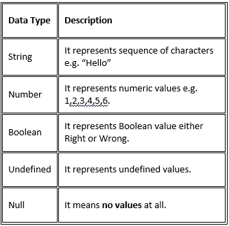

### JavaScript 非原始数据类型

有 3 种非原始数据类型如下：

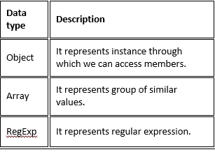

## JavaScript 运算符

运算符是 JavaScript 中的符号，用于对操作数执行操作。简单来说，`3+2` 等于 5。此处的操作数是 `3` 和 `2`，运算符是 `+`。

JavaScript 运算符如下：

1. 算术运算符。
2. 比较（关系）运算符。
3. 位运算符。
4. 逻辑运算符。
5. 赋值运算符。
6. 特殊运算符。

### 算术运算符

我们在算术运算符中对操作数采用算术操作。

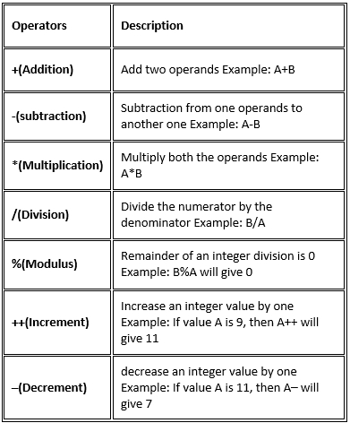

### 比较运算符

在比较运算符中，比较两个操作数 `A` 和 `B`。

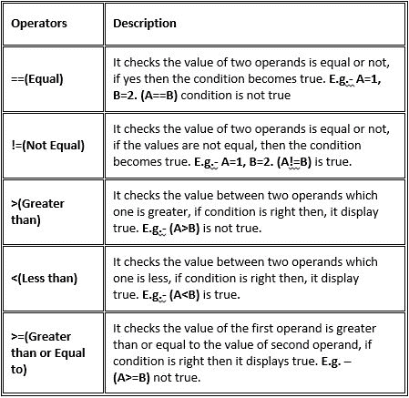

### 赋值运算符

JavaScript 支持以下赋值运算符。

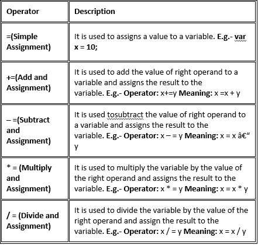

### 位运算符

JavaScript 支持以下位运算符：

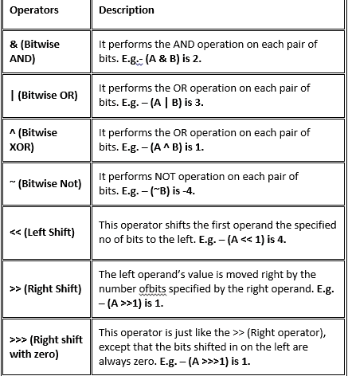

### 逻辑运算符

布尔值通常与逻辑运算符配合使用。

以下是逻辑运算符：

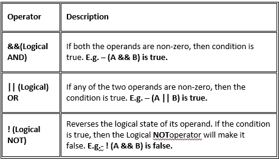

## JavaScript If Else

JavaScript 中的条件语句用于根据标准执行不同的活动。

在 JavaScript 中，有三种类型的语句。

1. `if` 语句。
2. `if else` 语句。
3. `if else if` 语句。

### if 语句

如果条件为真或假，JavaScript 中使用 `if` 语句来运行函数。

```javascript
if (condition){
  //要评估的内容
}
```

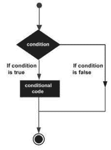

示例：

```html
<!DOCTYPE html>
<html>
<body>
<script>
var x=50;
if(x>30){
  document.write("value of x is greater than 30");
}
</script>
</body>
</html>
```

**输出**

Value of x is greater than 30

### if else 语句

如果任一个条件为真或假，则使用 `if else` 语句。

### 语法

```javascript
if(condition)
{
  //一组语句
}
else
{
  //一组语句
}
```

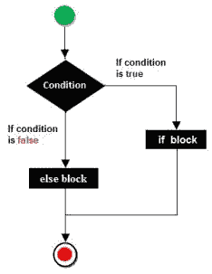

### 示例

```html
<!DOCTYPE html>
<html>
<body>
<script>
var x=20;
if(x%2==0){
  document.write("x is even number");
}
else{
  document.write("is odd number")
}
</script>
</body>
</html>
```

**输出**

X is even number

### else if

它仅仅查看内容以判断表达式是否真。`else if` 是 `if` 语句的复杂版本。

### 语法

```javascript
if (condition1)
{
  如果 condition1 为真则执行的语句
}
else if (condition2)
{
  如果 condition2 为真则执行的语句
}
else if (condition3)
{
  如果 condition3 为真则执行的语句
}
else
{
  如果没有任何条件为真，则执行的语句
}
```

### 示例

```html
<!DOCTYPE html>
<html>
<body>
<script>
var x=50;
if(x>30){
  document.write("value of x is greater than 30");
}
else if(x>20){
  document.write("value of x is greater than 20");
}
else{
  document.write("value of x is less than 20");
}
</script>
</body>
</html>
```

## JavaScript 循环

循环用于重复执行代码块。

### for 循环

`for` 循环用于执行指定次数的代码块。

### 语法

```javascript
for (initialization; condition; increment/decrement)
{
  要执行的代码
}
```

### 示例

```html
<!DOCTYPE html>
<html>
<body>
<script>
for (var i=1; i<=5; i++) {
  document.write(i + "<br/>");
}
</script>
</body>
</html>
```

### 输出

1
2
3
4
5

### while 循环

`while` 循环在指定条件为真时执行代码块。

### 语法

```javascript
while (condition)
{
  要执行的代码
}
```

### 示例

```html
<!DOCTYPE html>
<html>
<body>
<script>
var i=1;
while (i<=5) {
  document.write(i + "<br/>");
  i++;
}
</script>
</body>
</html>
```

### 输出

1
2
3
4
5

### do while 循环

当 `while` 循环无限执行项目时，`do while` 循环只执行一次代码，无论条件是真是假。当我们需要至少执行一次语句块时，使用 `do-while`。

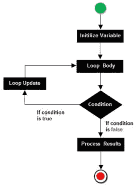

### 语法

```javascript
do{
  code to be executed
  increment/decrement
} while (condition);
```

### 示例

```html
<!DOCTYPE html>
<html>
<body>
<script>
var i=11;
do{
  document.write(i + "<br/>");
  i++;
}while (i<=15);
</script>
</body>
</html>
```

### 输出

11
12
13
14
15

## JavaScript 函数

在 `<script>...</script>` 标签内定义新函数的能力是 JavaScript 的一个重要特性。`function` 关键字用于在 JavaScript 中声明函数。

为了重用代码，我们多次调用 JavaScript 方法。

### 优点 - JavaScript 函数

1. **代码复用性**：我们多次使用同一个方法来节省时间和代码量。
2. **更少的代码**：结果是我们的应用程序被压缩了。当我们执行例行任务时，不需要编写大量的代码。

### 语法

```javascript
function functionName(parameter or not)
{
  statements
}
```

### 示例

```html
<!DOCTYPE html>
<html>
<body>
<script>
function msg()
{
  alert("Hello! world");
}
</script>
<input type="button" onclick="msg()" value="click here"/>
</body>
</html>
```

### 输出

Hello world!

## 带参数的函数

通过传递参数来调用函数。

```html
<!DOCTYPE html>
<html>
<body>
<script>
function getcube(number)
{
  alert(number* number* number);
}
</script>
<form>
  <input type="button" value="click" onclick="getcube(3)"/>
</form>
</body>
</html>
```

### 输出

27

### 示例

```html
<!DOCTYPE html>
<html>
<body>
<script>
function getname()
{
  name=prompt("Enter the Name");
  alert("Welcome Mr/Mrs " + name);
}
</script>
</body>
<form>
  <input type="button" value="Click" onclick="getname()"/>
</form>
</html>
```

## 带返回值的函数

调用返回值的函数并在程序中使用它。

```html
<!DOCTYPE html>
<html>
<body>
<script>
function getInfo()
{
  return "Hello Raj! How are you?";
}
</script>
<script>
  document.write(getInfo());
</script>
</body>
</html>
```

### 输出

Hello Raj! How are you?

## Function() 构造函数

函数语句不仅用于定义新函数，还可以使用 `Function()` 构造函数和 `new` 运算符动态定义函数。

### 语法

```javascript
<script>
  var varilename = new Function(Arg1, Arg2..., "Function Body");
</script>
```

### 示例

```html
<!DOCTYPE html>
<html>
<head>
<script>
var func = new Function("a", "b", "return a+b;");
function secondFunction(){
  var result;
  result = func(50,50);
  document.write (result );
}
</script>
</head>
<body>
  <p>点击按钮调用函数</p>
  <form>
    <input type="button" onclick="secondFunction()" value="Call Function">
  </form>
  <p>在函数内部使用不同的参数并自己尝试一下...</p>
</body>
</html>
```

## 函数字面量

函数字面量概念（构造函数的另一种方式）在 JavaScript 1.2 中引入。它是一个定义没有名称的函数的表达式。函数字面量的语法与函数语句相似，不同之处在于它被用作表达式而不是语句，并且不需要函数名。

### 语法

```javascript
<script>
var varilename = function (Argument){
  Function Body
};
</script>
```

### 示例

```html
<!DOCTYPE html>
<html>
<head>
<script>
var func =function(a,b){return a+b};
function secondFunction(){
  var result;
  result = func(10,20);
  document.write (result );
}
</script>
</head>
<body>
  <p>点击按钮调用函数</p>
  <form>
    <input type="button" onclick="secondFunction()" value="Call Function">
  </form>
  <p>在函数内部使用不同的参数并自己尝试一下...</p>
</body>
</html>
```

## JavaScript 对象

对象是一个包含状态和行为的实体。JavaScript 是一种关注对象的脚本语言。尽管 JavaScript 是基于模板而非基于类的，但它允许我们创建对象。

### 语法 - 添加属性 - 添加对象

`objectName.objectProperty = propertyValue;`

我们使用 `write()` 方法向文档写入对象的属性。

### 示例

以下示例展示了如何创建一个对象。

```html
<!DOCTYPE html>
<html>
<head>
<title>定义的对象</title>
<script type="text/javascript">
var book=new Object(); // 创建对象
book.subject = "5 points someone"; // 属性
book.author = "ChetanBhagat";
</script>
</head>
<body>
<script type="text/javascript">
  document.write("书籍是: " + book.subject + "<br>");
  document.write("作者是: " + book.author + "<br>");
</script>
</body>
</html>
```

### 输出

书籍是: 5 points someone
作者是: ChetanBhagat

## JavaScript 对象的方法

### 示例

```html
<!DOCTYPE html>
<html>
<head>
<title>定义的对象</title>
<script type="text/javascript">
// 定义一个作为方法的函数
function addPrice(amount){
  this.price = amount; // 将方法作为属性
}
function book(title,author){
  this.title=title;
  this.author=author;
  this.price=0;
}
</script>
</head>
<body>
<script type="text/javascript">
myBook=new book("5 Points Someone","ChetanBhagat"); // 创建对象
myBook.addPrice(150); // 方法
  document.write("标题是: " + myBook.title + "<br>");
  document.write("作者是: " + myBook.author + "<br>");
  document.write("价格是: " + myBook.price + "<br>");
</script>
</body>
</html>
```

### 输出

标题是: 5 Points Someone
作者是: ChetanBhagat
价格是: 150

## JavaScript 数组

数组用于表示单个单元或内存区域中的元素集合。进入数组的每个元素将根据从零开始的唯一索引存储在数组中。可以通过索引存储数据。在 JavaScript 中，我们必须使用 `new` 关键字声明数组。我们使用 `new Array` 构造数组 `(n)`。数组中的槽的数量由 `n` 表示。

### 语法

`myarray = new array(n);`

注意：当我们在 JavaScript 中未指定大小构建数组时，我们会构建大小为零的数组对象。

### 示例

```html
<!DOCTYPE html>
<html>
<body>
<script>
var i;
var emp=new Array();
emp[0] = "Ajay";
emp[1] = "Abhay";
emp[2] = "Arun";
emp[3] = "Shipra";
for (i=0; i<emp.length; i++) {
  document.write(emp[i] + "<br>");
}
</script>
</body>
</html>
```

### 输出

Ajay
Abhay
Arun
Shipra

### 示例

```html
<!DOCTYPE html>
<html>
<head>
<script type="text/javascript">
function array() {
  num = new Array(5)
  num[0] = 10;
  num[1] = 20;
  num[2] = 30;
  num[3] = 40;
  num[4] = 50;
  sum = 0;
  for (i=0; i<num.length; i++) {
    sum = sum + num[i];
  }
  alert(sum)
}
</script>
</head>
<body>
  <input type="button" onclick="array()" value="click here">
</body>
</html>
```

## Array 中使用的函数

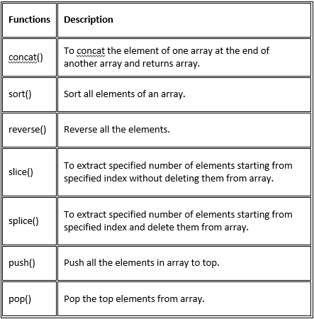

# 学习 ReactJS 基础：初学者教程

学习编程基础的快速简便方法

JP TAM

## ReactJS 简介

ReactJS 教程将教你基础知识以及一些高级思想。

它是目前由一位名为 Jordan Walke 的 Facebook 软件工程师构建的最前端库。

它建立在坚实的基础上，并拥有庞大的社区。Facebook 是第一个构建并维护它的机构，从那时已被包含在 WhatsApp 和 Instagram 等主要产品中。

2011 年，Facebook 首次引入了 React，但直到 2013 年 5 月才开源。

MVC（模型-视图-控制器）架构现在被大量网站使用。MVC 中的“V”代表视图（View），而 React 就是 MVC 中的那个“V”。

构建一个 ReactJS 应用需要各种不同的组件；这些组件是所有 React 应用的核心。

当这些组件与其他部分结合时，它们允许创建复杂的应用程序。

它使用虚拟 DOM 向 HTML DOM 填充数据。由于只需要更改 DOM 的部分组件而不是整个 DOM，所以虚拟 DOM 运行非常快。

我们需要 React 组件来构建 React 应用，这些组件将组织在决定应用结构的层级元素内部。

让我们看一个包含按钮、标签和输入字段的表单示例，看看它是如何工作的。

表单的每个元素都是一个 React 组件，而表单本身是一个定义表单结构的层级组件。

在更新虚拟 DOM 后，React 会确定实际浏览器 DOM 中所需的修改。

正因如此，我们必须编写虚拟组件让 React 将其转换为真实的 DOM，而不是直接将 React 组件写入 DOM 中。

## React 环境搭建步骤详解

本节将教你如何成功地为开发 ReactJS 应用搭建环境：

### ReactJS 的前提条件

1. `NodeJS` 和 `NPM`
2. `React` 和 `React DOM`
3. `Webpack`
4. `Babel`

安装 ReactJS 有两种方法：

1. 使用 `npm` 命令
2. 使用 `create-react-app`

### 使用 npm 命令

**第 1 步：** 安装 `NodeJS`。访问 `https://nodejs.org`

**第 2 步：** 点击 downloads。


**第 3 步：** 安装 Node.js

**第 4 步：** 使用以下命令确定版本。

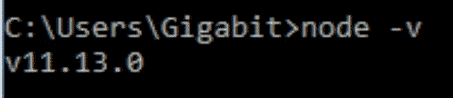

**第 5 步：** 现在，在你所在的目录下创建一个你想要命名的根文件夹。

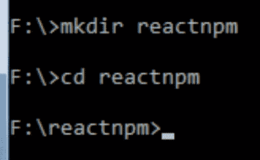

**第 6 步：** 创建一个名为 `package.json` 的文件。该文件对于模块生成是必要的。使用以下命令创建此文件：

```bash
npm init -y
```

**第 7 步：** 使用 `npm` 命令安装 React 相关的 DOM 包：

```bash
npm install react react-dom --save
```

**第 8 步：** 安装 Webpack

Webpack 主要用于模块打包、开发以及生产流水线的自动化。我们必须使用以下命令安装 Webpack：

```bash
npm install webpack webpack-dev-server webpack-cli --save
```

`webpack-dev-server` 用于开发期间，`webpack` 用于制作生产构建，而 `webpack-cli` 在上述命令中提供一组指令。

**第 9 步：** 安装 Babel。

Babel 是一个 JavaScript 编译器，允许你将一种源代码转换为另一种。使用以下命令安装 Babel：

```bash
npm install babel-core babel-loader babel-preset-env babel-preset-react babel-webpack-plugin --save-dev
```

**第 10 步：** 创建文件。以下是文件：

* `index.html`
* `App.js`
* `main.js`
* `webpack.config.js`
* `.babelrc`

#### 配置 Webpack

要配置 Webpack，将以下内容添加到 `webpack.config.js` 中。这是加载器：

```javascript
const path = require('path');
const HtmlWebpackPlugin = require('html-webpack-plugin');

module.exports = {
  entry: './main.js',
  output: {
    path: path.join(__dirname, '/dist'),
    filename: 'index.js'
  },
  devServer: {
    inline: true,
    port: 8080
  },
  module: {
    rules: [
      {
        test: /\.jsx$/,
        exclude: /node_modules/,
        use: {
          loader: "babel-loader"
        }
      }
    ]
  },
  plugins: [
    new HtmlWebpackPlugin({
      template: './index.html'
    })
  ]
};
```

### 启动服务器

现在是时候启动服务器了。要启动服务器，请在命令行提示符中输入以下命令，并确保处于 React 文件所在的文件夹中：

```bash
npm start
```

此命令将显示端口号，这将需要打开浏览器窗口。打开后，你将看到以下：


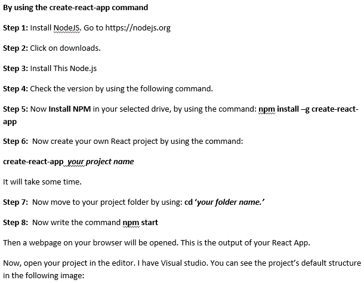

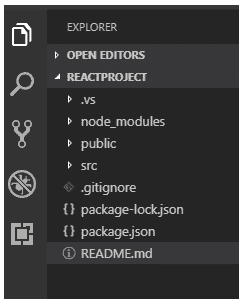

### 使用 create-react-app

`create-react-app` 是 Facebook 官方支持的创建单页 React 应用的方式。它提供了一个现代化的构建设置，无需配置。

**第 1 步：** 安装 `create-react-app`。

```bash
npm install -g create-react-app
```

**第 2 步：** 创建新应用。

```bash
create-react-app my-app
```

**第 3 步：** 进入项目目录并启动。

```bash
cd my-app
npm start
```

### 项目结构

创建 React 应用后，会生成以下文件夹和文件结构：

1. `node_modules`: 此文件夹包含项目所需的所有依赖项。
2. `public`: 此文件夹包含 `index.html`、`favicon.ico` 和 `manifest.json`。`index.html` 是应用的入口点。
3. `src`: 此文件夹包含多个文件，包括 `App.css`、`App.js`、`App.test.js`、`index.css`、`index.js` 和 `serviceWorker.js`。`App.js` 文件始终负责显示 React 输出屏幕。
4. `package-lock.json`: 每当 `npm` 包更改 `package.json` 或 `node modules` 树时，它就会自动生成。它无法被发布。如果发现位置不在顶层包，它将会被忽略。
5. `package.json`: 它包含了项目元数据信息。它向 `npm` 提供信息，用于识别项目的依赖关系以及项目本身。
6. `README.md`: 它还包含了 React 主题的文档。

## React JSX

正如我们所知，所有的 React 组件都有一个 `render` 函数。React 组件的 HTML 输出由 `render` 函数指定。

JavaScript 扩展 `JSX` 允许你编写看起来像 HTML 一样的 JavaScript 代码。`JSX` 是一种 React 特有的类 HTML 语法，它扩展了 `ECMAScript`，允许 HTML 类语法与 JavaScript/React 编程并存。

预处理器（如 `Babel` 等转换器）使用这种语法将 HTML 类语法转换为 JavaScript 引擎可以理解的标准 JavaScript 对象。

它允许你将 HTML/XML 类结构（例如 DOM 类树结构）放在与 JavaScript 代码相同的文件中，然后由预处理器将这些表达式转换为实际的 JavaScript 代码。像 XML/HTML 标签一样，`JSX` 标签具有名称、属性和元素。

## 为什么使用 JSX？

- 它比 JavaScript 快，因为它在翻译成 JavaScript 之前对代码进行了优化。
- React 没有通过将 HTML 和逻辑放在不同的文件中来分离技术，而是使用包含两者的组件。
- 它是类型安全的，因为大多数问题在编译期间就会被发现。
- 它简化了创建模板的过程。

## JSX 中的嵌套元素

如果你想使用多个元素，必须将它们封装在一个容器元素中。这里使用 `div` 作为三个嵌套项目的容器元素。

### App.JSX

```javascript
import React, { Component } from 'react';

class App extends Component{
  render(){
    return(
      <div>
        <h1>Hello World !!</h1>
        <h2>This is TutorialandExample</h2>
        <p>Website with the best tutorials.</p>
      </div>
    )
  }
}

export default App;
```

## JSX 属性

`JSX` 中 HTML 元素的特性与普通 HTML 中的特性相同。在 `JSX` 中，属性名使用驼峰命名法（camelcase），而不是 HTML 的传统命名模式，例如 HTML 中的 `class` 在 `JSX` 中变为 `className`。这是因为在 JavaScript 中，`class` 关键字是一个保留关键字。在 `JSX` 中也可以使用自定义属性。对于自定义属性，我们必须使用 `data-prefix`。

自定义属性 `data-customAttr` 用作下面示例中 `<p>` 标签的属性。

例如：

```javascript
import React, { Component } from 'react';

class App extends Component{
  render(){
    return(
      <div>
        <h1>Hello World !!</h1>
        <h2>This is TutorialandExample</h2>
        <p data-customAttr = "hello">Website with the best tutorials.</p>  
      </div>
    );
  }
}

export default App;
```

## JavaScript 表达式

JavaScript 表达式可以用于 `JSX` 内部。我们需要用大括号 `{}` 将其包裹起来。下一个示例更清晰地演示了这一点。

示例：

```javascript
import React, { Component } from 'react';

class App extends Component{
  render(){
    return(
      <div>
        <h1>{12+28}</h1>
        <h1>Hello World !!</h1>
        <h2>This is TutorialandExample</h2>
        <p data-customAttr = {"hello"}>Website with the best tutorials.</p>
      </div>
    );
  }
}
```

我们不能在 `JSX` 中使用 `if else` 语句；相反，我们必须使用条件（三元）表达式。在下面的示例中，变量 `x` 的值为 `1`，因此浏览器返回 true；但如果我们此此值改为其他，浏览器将返回 false。

例如：

```javascript
import React, { Component } from 'react';

class App extends Component{
  render(){
    var x=1;
    return(
      <div>
        <h1>{x == 1 ? 'True!' : 'False'}</h1>
        <h2>This is TutorialandExample</h2>
        <p data-customAttr = {"hello"}>Website with the best tutorials.</p>
      </div>
    );
  }
} 
```

## JSX 样式

React 推荐使用内联样式。设置内联样式需要使用驼峰命名法。对于特定项目，React 会自动在数值值后附加 `px`。`JSX` 中的样式在下面的示例中演示：

例如：

```javascript
import React, { Component } from 'react';

class App extends Component{
  render(){
    var newStyle = {
      fontSize: 90,
      fontFamily: 'Times New Roman',
      color: '#789067'
    }
    return(  
      <div>
        <h1 style = {newStyle}>www.google.com</h1>
        <h2>This is TutorialandExample</h2>
        <p data-customAttr = {"hello"}>Website with the best tutorials.</p>
      </div>
    );
  }
}

export default App;
```

## JSX 注释

在组合时必须使用大括号。在 `JSX` 中，注释以 `/*` 开始并以 `*/` 结束。

例如：

```javascript
import React, { Component } from 'react';

class App extends Component{
  render(){
    return(
      <div>
        {/* this is a comment */}
        <h1>Hello World</h1>
      </div>
    );
  }
}
```

## React 组件

可以定义一个扩展组件并带有 `render` 函数的类来构建 `Class`。

以下是类组件的示例：

### 示例

在此示例中，我们将创建一个无序组件列表，其中我们将为数据数组中的每个对象动态地附加 `Name`。这里使用了 `EcmaScript6` 箭头语法（`=>`），它比旧的 JavaScript 语法要简洁得多。这有助于我们为元素编写更少的代码行。当我们需要创建大量的项目列表时，它非常有用。

```javascript
import React, { Component } from 'react';

class App extends React.Component {
  constructor() {
    super();
    this.state = {
      data: [
        {
          "name":"Arun"
        },
        {
          "name":"Anup"
        },
        {
          "name":"Anil"
        }
      ]
    }
  }
  render() {
    return (
      <div>
        <Name/>
        <ul>
          {this.state.data.map((item) => <List data = {item} />)}
        </ul>
      </div>
    );
  }
}

class Name extends React.Component {
  render() {
    return (
      <div>
        <h1>Student Names</h1>
      </div>
    );
  }
}

class List extends React.Component {
  render() {
    return (
      <ul>
        <li>{this.props.data.name}</li>
      </ul>
    );
  }
}

export default App;
```

## ReactJS 的优缺点

以下是 `ReactJS` 的一些优点和缺点：

### ReactJS 的优点

1. **易于学习和使用**：`ReactJS` 是一个简单易用且易学习的框架。它带有大量的文档、培训材料和教程。对于具有 JavaScript 经验的开发者来说，它很容易理解，可以在几天内就开始开发应用程序。它是 JavaScript 框架之一，是 `MVC`（模型-视图-控制器）模型中的 `view` 部分。我们不能说 `ReactJS` 的功能极其丰富，但它确实具有开源用户界面（`UI`）库的优势，这有助于任务执行。

2. **创建动态应用程序变得更加简单**：由于需要复杂的编码，使用 HTML 创建动态 Web 应用非常困难，但 `ReactJS` 克服了这个问题并变得简单。它需要更少的代码并提供更多功能。它利用了 `JSX` 扩展，这种允许 HTML 标签语法渲染某些组件的语法。也支持机器可读的代码。

3. **可重用组件**：`ReactJS` 应用程序由多个组件组成，每个组件都有自己的逻辑和控制。这些组件负责生成可以重用的短可重用 HTML 代码。这种可重用的代码使得应用程序的设计和维护变得更容易。`ReactJS` 使用基于虚拟 DOM 的技术向 HTML 填充数据。因为它简单地更改特定的 `DOM` 而不是每次都重新加载，所以虚拟 DOM 是快速的。

4. **性能增强**：由于 `Virtual DOM` 的存在，`ReactJS` 的速度得到了提高。`ReactJS` 极快。由于这一功能，`ReactJS` 变得比其他框架好得多。这一逻辑的背后有一个管理虚拟 DOM 的概念。文档对象模型（`DOM`）是用于 `HTML`、`XML` 和 `XHTML` 的跨平台编程 API。`DOM` 仅包含在内存中。因此，当我们构建任何组件时，我们不会直接将其写入 `DOM`；而是编写转换成 `DOM` 的虚拟组件，从而导致更平滑、更快的性能。

5. **强大的工具支持**：`ReactJS` 还因为提供了实用的工具集而广受欢迎。这些技术提高了可读性并让开发人员的工作变得更容易。这些工具是 Chrome 和 Firefox 的开发者扩展，允许您调查虚拟 DOM 中的 react 组件。

6. **对 SEO 友好**：在涉及 SEO 时，标准框架存在问题。搜索引擎通常难以读取大型 JavaScript 应用程序。`ReactJS` 解决了这个问题，让开发者更容易在搜索引擎中进行导航。React 应用程序可以在服务器上运行，并使用虚拟 DOM 渲染，向浏览器返回标准页面。

7. **拥有 JavaScript 库的益处**：`ReactJS` 提供了丰富的 JavaScript 库，这就是它在 Web 开发者中如此流行的原因。JavaScript 库为 Web 开发者提供了更多的自由。

8. **代码测试范围**：`ReactJS` 应用程序启动简单。它让开发者能够使用原生工具快速测试和调试他们的程序。

## ReactJS 的缺点

1. **高节奏开发**：这既是优点也是缺点。由于环境变化非常快，大多数开发者不想频繁地重新学习处理问题的方法，因此这是一个缺点。跟上所有这些变化和持续更新可能很困难。他们必须保持技能更新，并学习新的处理问题的方法。

2. **文档匮乏**：这是不断变化的技术的另一个共同缺点。由于 React 技术的快速更新，缺乏良好的文档。

3. **视图部分**：`ReactJS` 只处理应用程序的 UI 层。因此，必须选择其他技术来为项目的开发提供全套工具 set。

4. **JSX 成为障碍**：`ReactJS` 使用 `JSX`，这是一种允许 HTML 和 JavaScript 混合在一起的语法扩展。这种策略是有益的，但开发社区的某些成员（尤其是新成员）认为 `JSX` 是一个障碍。开发者对于 `JSX` 有多困难存在争议。

#### ReactJS 的特性

众所周知，`ReactJS` 使用 `JSX`，这使得应用程序更符合用户习惯，代码更易于理解。

`ReactJS` 采用基于组件的方法，允许代码被复用。

它很容易学习和利用。

## 组件

`ReactJS` 由组件组成，每个组件都有自己的逻辑和控制。组件是可复用的，这使得在开发大型项目时代码维护更加容易。

## 性能

`ReactJS` 速度极快。与其他框架相比，`ReactJS` 受益于这一功能。这一原理背后有一个虚拟 DOM 管理的概念。

文档对象模型（`DOM`）是一种用于 `HTML`、`XML` 和 `XHTML` 的跨平台计算机编程 API。`DOM` 仅包含在内存中。

因此，当我们构建任何组件时，我们不会直接将其写入 `DOM`；相反，我们编写虚拟组件，并由其转换为 `DOM`，从而获得更流畅、更快的性能。

## React 和 Vue 的比较

`React` 和 `Vue` 都是知名的 JavaScript 库，如今被用于构建数百个网站。`React` 和 `Vue` 都提供了极其强大的框架，每个框架都有自己的优缺点。

你选择哪一个取决于你的业务需求和用例。`React` 和 `Vue` 都有许多共同点，例如基于组件的设计、虚拟 DOM 的使用、`props` 的使用、使用 `Chrome Dev Tools` 进行调试等。

它们在以下方面有所不同：

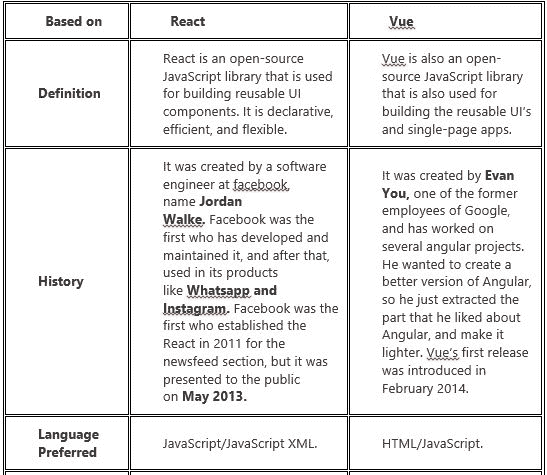

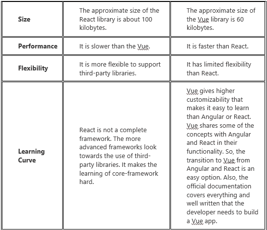

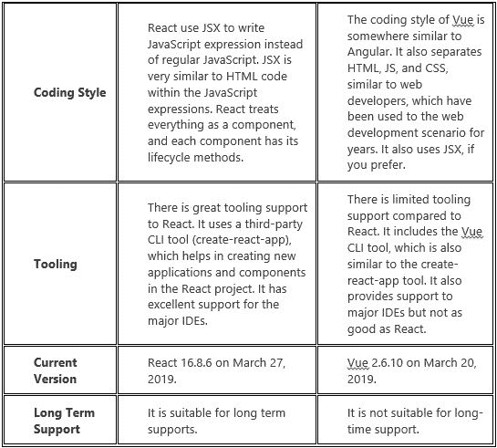

## ReactJS vs AngularJS

### ReactJS 和 AngularJS 之间的区别

### AngularJS

`AngularJS` 是一个开源 JavaScript 框架，可用于创建动态 Web 应用程序。它由 Misko Hovery 和 Adam Abrons 于 2009 年创建，目前由 Google 维护。2019 年 3 月 11 日，`AngularJS` 更新到了 `1.7.8` 版本。它主要用于创建单页应用，并利用了 `HTML` 和 JavaScript 属性。使用 `<script>` 标签将其引入到 `HTML` 页面中。它使用表达式将数据绑定到 `HTML`，并通过使用指令添加内置属性来扩展 `HTML`。

#### AngularJS 的特性

以下是 `AngularJS` 的一些特性：

1. **数据绑定**：`AngularJS` 支持双向数据绑定。模型和显示组件之间的数据同步会自动发生。
2. **POJO 模型**：`AngularJS` 使用的“纯旧 JavaScript 模型”（Plain Old JavaScript Model）缩写为 `POJO`。它提供了自发和计划良好的对象。它使得 `AngularJS` 自包含且易于使用。
3. **MVC 框架（模型视图控制器）**：`MVC` 是一种用于创建 Web 的软件架构范式。`AngularJS` 的功能模型主要基于 `MVC` 概念。`AngularJS` 中的 `MVC` 具有动态、舒适且多功能的架构。
4. **服务**：`AngularJS` 带有许多内置服务，例如 `$http`，可用于 `XMLHttpRequest`。
5. **用于用户界面的 HTML**：`AngularJS` 使用 `HTML` 创建用户界面。`AngularJS` 是一种声明性语言，使用更短、更易理解的标签。它提供了一个整洁、组织良好且结构良好的用户界面。
6. **依赖注入**：`AngularJS` 具有依赖注入子系统，简化了开发者设计、理解和测试应用程序的过程。
7. **Google 的活跃社区**：众所周知，Google 维护着 `AngularJS`，因此一旦出现维护问题，有许多论坛可以解答问题。
8. **路由**：`Routing` 是允许你从一个视图移动到另一个视图的系统。对于单页应用至关重要，因为所有内容都包含在一个页面。开发者不希望每次点击菜单项时都将访问者发送新页面。开发者要求在 URL 更改时在同一页面加载内容。

### ReactJS

这是一个由名为 Jordan Walke 的 Facebook 工程师创建的关键前端库。Facebook 是第一个创建并维护它的实体，随后被集成到 `Whatsapp` 和 `Instagram` 等主要产品中。2011 年，Facebook 首次引入了 `React`，但直到 2013 年 5 月才向公众开放。

`ReactJS` 是一个用于开发单页应用界面的开源 JavaScript 库。根据 `MVC`，`React` 是“V”，代表 View（视图）。制作一个 `ReactJS` 应用需要各种组件；这些组件构成了所有 React 应用的核心。

#### ReactJS 的特性

* **JSX**：JavaScript XML 缩写为 `JSX`。它是一种扩展的 JavaScript 语法。其语法与 `XML` 或 `HTML` 相似。这种语法被转换为 `React` 框架的 JavaScript 调用。它改进了 `ES6`，允许 `HTML` 类文本与 JavaScript React 代码共存。在 `ReactJS` 中不需要使用 `JSX`，但建议使用。
* **单向数据绑定**：`ReactJS` 的构建遵循单向数据流，通常被称为单向数据绑定。单向数据绑定是有益的，因为它允许对整个应用程序进行更多的控制。当数据向反方向流动时，需要额外的特性。它的发生是因为组件是不可变的。
* **虚拟 DOM**：虚拟 DOM 是真实 `DOM` 的副本。它类似于单向数据绑定。每当 Web 应用程序被修改时，整个 UI 都会被重新渲染。然后检查新的 `DOM` 与之前的 `DOM` 之间的差异。完成后，真实的 `DOM` 会修改被更改的对象。这减少了内存占用并加快了应用程序运行。
* **简单性**：众所周知，`ReactJS` 使用 `JSX`，这使得应用程序更符合用户习惯，代码更易于理解。`ReactJS` 采用基于组件的方法，允许代码被复用。它很容易学习和利用。
* **组件**：`ReactJS` 由组件组成，每个组件都有自己的逻辑和控制。组件是可复用的，这使得在开发大型项目时代码维护更加容易。
* **性能**：`ReactJS` 速度极快。与其他框架相比，`ReactJS` 受益于这一功能。这一原理背后有一个虚拟 DOM 管理的概念。虚拟 DOM 是 Flux 模式。

## React Native vs ReactJS

### React Native 和 ReactJS 之间的区别

### React Native

`React Native` 是一个开源 JavaScript 框架，可用于创建 `iOS`、`Android` 和 `Windows` 的移动应用。它使用 JavaScript 创建跨平台移动应用。`React Native` 与 `react` 相似，但不是使用 Web 组件作为构建块，而是采用原生组件。因此，它不是使用浏览器，而是被应用于移动设备。在 2013 年，它也被 Facebook 为其著名的内部黑客松项目开发。Facebook 在 2015 年 3 月表示 `React Native` 是开源的并发布在 `GitHub` 上。

#### React Native 的优势

以下是使用 React Native 的一些优势：

1. **原生组件**：如果我们需要原生功能，则需要编写尚未设计的特定平台代码。
2. **类性能**：`React Native` 的代码被编译成原生代码，使其能够在两个操作系统上运行，并执行相同的功能。
3. **跨平台使用**：它同时兼容 Android 和 iOS 设备。
4. **JavaScript**：它被用于原生移动应用程序的开发。
5. **随时间改进**：社区不断开发最佳实践方案。
6. **社区**：它拥有庞大的社区，可以帮助人们找到所需的答案。
7. **存在的不确定性**：由于该框架是由 Facebook 创建的，其存在性是未知的，因为公司保留了随时终止项目的权利。随着 `React Native` 流行度的增加，这种情况不太可能发生。

#### React Native 的劣势

1. **学习困难**：对于应用开发领域的新手来说，学习是非常困难的。
2. **初始化耗时更多**：即使对于高科技产品和设备，启动也需要长时间。
3. **React Native - 仍然很新 - 不成熟**：`React Native` 仍处于测试阶段，且仅适用于 Android 和 iOS，这对移动应用产生了负面影响。
4. **缺乏 - 安全健壮性**：`React Native` 创建了安全漏洞。专家建议不要使用 `React Native` 开发对安全性要求较高的银行和金融应用。

### ReactJS

`ReactJS` 是一个用于开发单页应用程序界面的开源 JavaScript 库。

根据 MVC 模式，`React` 是“V”，代表 View（视图）。

构建一个 `ReactJS` 应用需要各种组件；这些组件共同构成了所有 `React` 应用的核心。

当这些组件与其他部分结合时，它们允许创建复杂的应用程序。

它是由由名为 Jordan Walke 的 Facebook 软件工程师创建的关键前端库。

Facebook 是第一个创建并维护它的实体，后来它被集成到 Whatsapp 和 Instagram 等主流产品中。

2011 年，Facebook 首次引入了 `React`，但直到 2013 年 5 月才开源。

## ReactJS 的优势

1. **易于 学习和使用**：

`ReactJS` 是一个简单易用且易学习的框架。它带有大量的文档、培训材料和教程。

对于具有 `JavaScript` 经验的开发者来说，它很容易理解，他们可以在几天内开始开发 Web 应用程序。

它是 `JavaScript` 框架之一，是 `MVC`（模型-视图-控制器）模型中的 V（视图部分）。

我们不能说 `ReactJS` 功能非常丰富，但它确实具有开源 JavaScript 用户界面 (UI) 库的优势，这有助于任务执行。

2. **创建动态 - web 应用程序 - 变得更容易**：

由于需要复杂的编码，使用 HTML 字符串创建动态 Web 应用是很困难的，但 `ReactJS` 解决了这个问题并使其变得简单。它需要更少的代码并提供更多功能。它利用了 `JSX`（JavaScript）扩展，这种语法允许使用 HTML 引和 HTML 标签语法来渲染某些子组件。同时也支持机器可读的代码。

3. **可复用组件**：

`ReactJS` Web 应用由多个组件组成，每个组件都有自己的逻辑和控制。

这些组件负责产生短小的、可复用的 HTML 代码。

这种可复用的代码使得应用程序的设计和维护变得更容易。

`ReactJS` 使用基于虚拟 DOM 的技术向 HTML DOM 填充数据。

因为它仅仅是更改特定 DOM 的元素而不是每次都重新加载，所以虚拟 DOM 非常快。

4. **性能增强**：

因为有了虚拟 DOM，`ReactJS` 的速度提高了。`ReactJS` 极快。

由于这一功能，`ReactJS` 明显优于其他框架。

这背后有一个管理虚拟 DOM 的概念。

文档对象模型 (`DOM`) 是一种用于 HTML、XML 和 XHTML 的跨平台计算机编程 API。

`DOM` 仅包含在内存中。

因此，每当我们构建组件时，我们不会直接将其写入 `DOM`；而是编写转换为 `DOM` 的虚拟组件，从而获得更平滑、更快的性能。

5. **便捷工具支持**：

`ReactJS` 也因为提供了实用的工具集而受欢迎。

这些技术提高了可读性并让开发人员工作更容易。

这些工具是 Chrome 和 Firefox 的开发扩展，允许您调查虚拟 DOM 中 react 组件的层次结构。

6. **已知对 SEO 友好**：

在 SEO 方面，标准框架存在问题。

搜索引擎通常难以读取大型 JavaScript 应用。

`ReactJS` 解决了这个问题，让开发者更容易在多个搜索引擎之间导航。

这就是为什么 `React.js` 应用可以在服务器上运行，通过虚拟 DOM 渲染并将标准页面返回给浏览器。

7. **JavaScript 库的优势**：

`ReactJS` 提供了丰富的 JavaScript 库，这就是它在 Web 开发者中如此流行的原因。

JavaScript 库为 Web 开发者提供了更多自由来做自己的事情。

8. **范围 - 代码测试**：

`ReactJS` 应用启动简单。它让开发者能够使用原生工具轻松测试和调试代码。

## ReactJS 的缺点

1. **高节奏开发**：

这既是优势也是劣势。

这是一个劣势，因为环境变化太快，开发者需要不断学习新方法。

跟上这些变化可能很困难。

他们必须与时同步。

2. **文档匮乏**：

这是不断变化的技术的另一个缺点。

由于 React 的快速更新，缺乏良好的文档。

3. **视图部分**：

`ReactJS` 只处理 UI 层。因此，为了提供完整的工具集，必须选择其他技术。

4. **JSX 障碍**：

有些开发者认为 `JSX` 是一个障碍。

## React 组件生命周期

React 组件生命周期分为三个阶段：挂载、更新和卸载。

### 挂载阶段

当组件实例被创建并插入 DOM 时，会依次调用以下方法：

1. `constructor()`
2. `static getDerivedStateFromProps()`
3. `render()`
4. `componentDidMount()`

### 更新阶段

当组件的 props 或 state 发生变化时，会触发更新。会依次调用以下方法：

1. `static getDerivedStateFromProps()`
2. `shouldComponentUpdate()`
3. `render()`
4. `getSnapshotBeforeUpdate()`
5. `componentDidUpdate()`

### 卸载阶段

当组件从 DOM 中移除时，会调用：

1. `componentWillUnmount()`

## React State

`render()` 方法可以渲染 `this.state` 属性。

### 示例

以下示例演示了如何使用 ES6 语法创建一个有状态的组件（Stateful component）：

```javascript
import React, { Component } from 'react'; 

class App extends React.Component { 
  constructor() {
    super()
    this.state = { displayBio: true }
  }

  render() {
    const bio = this.state.displayBio ? ( 
      <div>
        <p><h3>This is tutorialexample website which provides you lot of tutorials.</h3></p>
      </div>
    ) : null;
    return (
      <div>
        <h1> Hello World !!!!!!</h1>
        { bio }
      </div>
    )
  }
}

export default App;
```

在函数 `constructor()` 中必须执行 `super()` 方法来设置状态。这是因为在调用 `super()` 方法之前，`this.state` 是未初始化的。

### 修改状态

可以通过调用 `setState()` 并提供一个新的状态对象作为参数来更新组件的状态。现在，在上述示例中，构建一个新方法 `toggleDisplayBio()` 并将 `this` 绑定到它；否则，在 `toggleDisplayBio()` 方法内部将无法访问。

```javascript
this.toggleDisplayBio=this.toggleDisplayBio.bind(this)
```

### 示例

我们将在下面的示例的 `render()` 方法中添加一个按钮。当点击按钮时，会调用 `toggleDisplayBio()` 方法并显示指定的输出。

```javascript
import React, { Component } from 'react'; 

class App extends React.Component {
  constructor() {
    super()
    this.state = { displayBio: false }
    console.log('Component this', this)
    this.toggleDisplayBio = this.toggleDisplayBio.bind(this)
  }

  toggleDisplayBio() {
    this.setState({displayBio: !this.state.displayBio});
  }

  render() {
    return (
      <div>
        <h1>!! Hello World !!</h1>
        {
          this.state.displayBio ? (
            <div>
              <p><h4>This is tutoriaexample website that has a lot of tutorials. This website provides you a better source of learning.</h4></p>
              <button onClick={this.toggleDisplayBio}> Show Less </button>
            </div>
          ) : (
            <div>
              <button onClick={this.toggleDisplayBio}> Read More </button>
            </div>
          )
        }
      </div>
    )
  }
}

export default App
```

### React Props

“properties”（属性）一词缩写为“prop”。由于 props 是不可变的，因此状态（state）和 props 在本质上是不同的。Props 是只读的组件属性。它是跟踪标签属性值的对象，工作方式类似于 HTML 元素。它促进了数据从一个组件到另一个组件的传输。Props 类似于函数中的参数，因为它们传递给组件的方式与参数传递给函数的方式相同。

组件内部的 props 无法被更改。在组件内部，我们可以添加 props（即属性）。这些属性以 `this.props` 的形式暴露在组件中，并用于在 `render` 方法中渲染动态数据。

当你在组件中需要不可变数据时，请向 ReactJS 项目的 `main.js` 文件中添加 `reactDom.render()` 方法，并在需要的组件中使用该文件。

例如：

**App.js**

```javascript
import React, { Component } from 'react';
class App extends React.Component {
  render() {
    return (
      <div>
        <h1> Hello { this.props.name } </h1>
        <p> <h4> This is tutorialexample website which provides you lot of tutorials </h4></p>
      </div>
    );
  }
}

export default App;
```

**Main.js**

```javascript
import React from 'react';
import ReactDOM from 'react-dom';
import App from './App.js';
ReactDOM.render(<App name = "World" />, document.getElementById('app'));
```

### 默认 Props

并不要求在任何时候在 `reactDom.render()` 元素中包含 props。默认 props（Default props）也可以直接设置在组件函数 `constructor()` 上。在下面的示例中对其进行了详细解释：

### 示例

```javascript
import React, { Component } from 'react';
class App extends React.Component {
  render() {
    return (
      <div>
        <h1>Hello World</h1>
        <h2> Default Pros Example </h2>
        <h3>Welcome to {this.props.name}</h3>
        <p>tutorialexample provides you one of the best tutorials.</p>
      </div>
    );
  }
}

App.defaultProps = {
  name: "tutorialexample"
}
export default App;
```

**Main.js**

```javascript
import React from 'react';
import ReactDOM from 'react-dom';
import App from './App.js';
ReactDOM.render(<App/>, document.getElementById('app'));
```

### 状态与属性 (State and Props)

在应用中，状态和 props 都可以合并。Props 可以用于设置父组件中的状态，然后将其提供给子组件。

例如：

**App.js**

```javascript
import React, { Component } from 'react';
class App extends React.Component {
  constructor(props) {
    super(props);
    this.state = {
      name: "tutorialexample",
    }
  }

  render() {  
    return (
      <div>
        <Tutorial tutorialProp = {this.state.name}/>
      </div>
    );
  }
}  

class Tutorial extends React.Component {
  render() {
    return (
      <div>
        <h1>State and Props</h1>
        <h2>tutorialProp</h2>
        <p>tutorialexample provides you one of the best tutorials.</p>
      </div>
    )
  }
}

export default App
```

## React 组件 API

这是一个非常高级的 API。它在赋予应用代码复用性的同时，使其具有绝对的唯一性。它可以通过多种方式使用：

* 创建元素。
* 转换元素。
* 片段（Fragments）。

现在我们来介绍 React 组件 API 中可用的三个最重要的方法：

* `findDOMNode()`
* `setState()`
* `forceUpdate()`

## findDOMNode()

你必须使用 `ReactDOM` 来操作 DOM。`findDOMNode()` 方法用于定位 DOM 节点。这种方法帮助我们定位或访问底层的 DOM 节点。

### 语法：

`ReactDOM.findDOMNode(component)`

### 示例：

```javascript
App.js
import React, { Component } from 'react';
import ReactDOM from 'react-dom';

class App extends React.Component {
  constructor() {
    super()
    this.findDomNodeHandler1 = this.findDomNodeHandler1.bind(this);
    this.findDomNodeHandler2 = this.findDomNodeHandler2.bind(this);
  };

  findDomNodeHandler1() {
    var div1 = document.getElementById('One');
    ReactDOM.findDOMNode(div1).style.color = 'red';
  }

  findDomNodeHandler2() {
    var div2 = document.getElementById('Two');
    ReactDOM.findDOMNode(div2).style.color = 'blue';
  }

  render() {
    return (
      <div>
        <center>
          <h1>ReactJS Find DOM Node Example</h1>
          <button onClick = {this.findDomNodeHandler1}>Button1</button>
          <button onClick = {this.findDomNodeHandler2}>Button2</button>
          <h3 id = "One">Red Color</h3>
          <h3 id = "Two">Blue Color</h3>
        </center>
      </div>
    )
  }
}
export default App;
```

## setState()

该方法用于更新组件的状态。它不是即时更改状态，而是修改现有状态。它是响应事件处理程序和服务器响应修改用户界面（UI）的主要技术。

### 语法：

`this.setState(object newState[, function callback])`

### 示例：


```javascript
App.js
import React, { Component } from 'react';
import PropTypes from 'prop-types';
class App extends React.Component {
  constructor() {
    super();
    this.state = {
      data: "!!!! Hello World !!!!"
    }
    this.updateSetState = this.updateSetState.bind(this);
  }

  updateSetState() {
    this.setState({
      data:"Welcome to tutorialexample"
    });
  }

  render() {
    return (
      <div>
        <center>
          <h1>{this.state.data}</h1> <button onClick = {this.updateSetState}>SET STATE</button>
        </center>
      </div>
    )
  }
}  
export default App
```

```javascript
Main.js
import React from 'react';
import ReactDOM from 'react-dom';
import App from './App.js';
ReactDOM.render(<App/>, document.getElementById('app'));
```

## forceUpdate()

该方法允许手动更新组件。

### 语法：

`Component.forceUpdate(callback)`

### 示例：

```javascript
App.js
import React, { Component } from 'react';
class App extends React.Component {
  constructor() {
    super()
    this.forceUpdateState = this.forceUpdateState.bind(this);
  }

  forceUpdateState() {
    this.forceUpdate();
  };

  render() {
    return (
      <div>
        <center>
          <h1>Example of Force Update method</h1>
          <h2>Example to Generate Random Number</h2>
          <h3>Random number: {Math.random()}</h3>
          <button onClick = {this.forceUpdateState}>ForceUpdate</button>
        </center>
      </div>
    );
  }
}
export default App;
```

## React 组件生命周期 (Life-Cycle)

在 ReactJS 中，每个组件的构建过程都有多个生命周期函数。这些方法被称为组件的生命周期。组件的生命周期分为四个阶段：

*   初始化阶段 (Initial Phase)

*   挂载阶段 (Mounting Phase)

*   更新阶段 (Updating Phase)

*   卸载阶段 (Unmounting Phase)

生命周期的每个阶段都有自己的一组方法。让我们逐一回顾这些阶段：

### 初始化阶段 (Initial Phase)

ReactJS 组件生命周期的诞生步骤被称为此。组件的初始状态和默认属性（props）包含在此阶段中。这些默认属性在组件的函数 `Object() { [native code] }` 中设置。这是一个一次性步骤，涉及以下方法：

*   `getDefaultProps()`：你在此处设置 `this.props` 的默认值。它在组件创建之前被调用。

*   `getInitialState()`：`this.state` 的默认值通过 `this.state.default` 指定。

### 挂载阶段 (Mounting Phase)

在此阶段，组件的实例被创建并添加到 DOM 中。它包含以下程序：

*   `componentWillMount()`：在组件渲染到 DOM 之前被调用。如果你在此方法中调用 `setState()`，组件将不会重新渲染。

*   `componentDidMount()`：在组件渲染并放置到 DOM 之后立即调用。现在你可以以任何想要的方式查询 DOM。

*   `render()`：每个组件都有其定义。它负责返回一个根 HTML 节点元素。你可以产生 null 或 false 值。

### 更新阶段 (Updating Phase)

这是生命周期的下一步。此阶段与诞生或死亡阶段不同，它会反复进行。它包含以下程序：

*   `componentWillReceiveProps()`：当组件接收到新 props 时，调用此方法。你必须预料状态会发生。

*   `shouldComponentUpdate()`：当组件决定进行更改时随时调用。如果此函数返回 true，则组件将更新。

*   `componentWillUpdate()`：在组件更新发生之前被调用。通过调用它，你可以更改状态。

*   `render()`：检查 `this.props` 和 `this.state`，并返回 React Elements、数组、片段、布尔值或 null、字符串和数字等类型。该函数确保组件显示正确。

*   `componentDidUpdate()`：在组件更新后立即调用。此函数允许你在更新发生时运行其内部的代码。

### 卸载阶段 (Unmounting Phase)

组件的生命周期在此阶段结束。当组件实例被删除并从 DOM 中卸载时，会调用此函数。此阶段包含一个方法，如下：

*   `componentWillUnmount()`：在组件永久删除和卸载之前调用此过程。它执行所需的清理操作，例如失效定时器、事件监听器、取消网络请求和清理 DOM 元素。一旦卸载，将无法重新挂载该组件实例。

### 示例

```javascript
import React,{Component} from 'react';
class App extends React.Component {
  constructor(props) {
    super(props);
    this.state={world:"World"};
    this.changeState=this.changeState.bind(this)
  }

  render(){
    return(
      <center>
        <div>
          <h1>Example of ReactJS components lifecycle</h1>
          <h3>Hello{this.state.world}</h3>
          <button onClick={this.changeState}>ClickHere!</button>
        </div>
      </center>
    );
  }

  componentWillMount(){
    console.log('ComponentWillMOUNT!')
  }

  componentDidMount(){
    console.log('ComponentDidMOUNT!')
  }

  changeState(){
    this.setState({world:"All!!-ItsanexampleofReactJScomponentlifecycle."});
  }

  componentWillReceiveProps(newProps){
    console.log('ComponentWillRecieveProps!')
  }

  shouldComponentUpdate(newProps,newState){
    return true;
  }

  componentWillUpdate(nextProps,nextState){
  }
}
```

```javascript
console.log('ComponentWillUPDATE!');

}

componentDidUpdate(prevProps,prevState){

  console.log('ComponentDidUPDATE!')

}

componentWillUnmount(){

  console.log('ComponentWillUNMOUNT!')
}

}

export default App;
```

# React 构造函数

## 什么是 constructor？

函数 `Object() { [native code] }` 是用于初始化类对象状态的方法。它在类中的对象被创建时被自动调用。

函数 `Object() { [native code] }` 的概念在 React 中也是一样的。React 组件的函数 `Object() { [native code] }` 在组件挂载之前被调用。

在编写 React 组件的函数 `Object() { [native code] }` 时，必须在任何其他行之前调用 `super(pros)` 函数。如果没有调用 `super(pros)`，在函数 `Object() { [native code] }` 中 `this.props` 将是 `undefined`，这可能会导致错误。

### 语法

```javascript
constructor(props){
  super(props);
}
```

构造函数在 React 中主要有两个用途：

1. 通过将对象赋值给 `this.state`，它用于初始化组件的本地状态。

2. 它用于绑定组件拥有的事件处理函数。

如果你不需要为 React 组件初始化状态或绑定方法，则没有必要为 React 组件构建 `Object() { [native code] }` 函数。

函数 `Object() { [native code] }` 不能直接调用 `setState()` 函数。如果组件需要本地状态，你必须在函数 `Object() { [native code] }` 中使用 `this.state` 分配初始状态。函数 `Object() { [native code] }` 使用 `this.state` 分初始状态，而所有其他方法都需要使用 `setState()` 方法。

### 示例

下面的示例演示了构造函数的概念：

**App.js**

```javascript
import React, { Component } from 'react';

class App extends Component {
  constructor(props){
    super(props);
    this.state = {
      data: 'Hello World'
    }
    this.handleEvent = this.handleEvent.bind(this);  
  }

  handleEvent(){
    console.log(this.props);
  }

  render() {
    return (
      <div className="App">  
        <center>
          <h2>Example of React Constructor</h2>
          <input type ="text" value={this.state.data}/>
          <br/><br/>
          <button onClick={this.handleEvent}>Please Click</button> </center>
      </div>
    );
  }
}  

export default App;
```

**Main.js**

```javascript
import React from 'react';
import ReactDOM from 'react-dom';
import App from './App.js';

ReactDOM.render(<App />, document.getElementById('app'));
```

# 箭头函数

这是 ES6 规范中的一项全新新特性。在使用箭头函数时，不需要将任何事件绑定到 `this`，也没有必要在函数 `Object() { [native code] }` 内部绑定 `this`。

### 示例

我们在上一个示例中使用了 `bind()`，但现在我们使用箭头函数，就不需要它了。下面的示例展示了如何使用程序的箭头函数。

```javascript
import React,{Component} from'react';

class App extends Component{
  constructor(props){
    super(props);
    this.state={
      data:'HelloWorld'
    }
    this.handleEvent=this.handleEvent.bind(this);
  }

  handleEvent=()=>{
    console.log(this.props);
  }

  render(){
    return(
      <div className="App">
        <center>
          <h2>Example of React Constructor</h2>
          <input type="text" value={this.state.data}/>
          <br/><br/>
          <button onClick={this.handleEvent}>Please Click</button></center>
      </div>
    );
  }
}

export default App;
```
