# JavaScript 基础学习：初学者指南及 JavaScript 考试与面试习题集

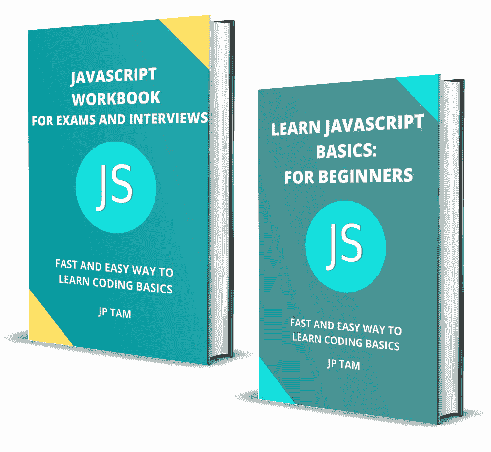

## 目录

- JavaScript 教程
- JavaScript 示例
- JavaScript 注释
- JavaScript 变量
- JavaScript 数据类型
- JavaScript 运算符
- 逻辑运算符
- JavaScript If Else
- JavaScript Switch 语句
- JavaScript 循环
- do while 循环
- JavaScript 函数
- 带参数的函数
- JavaScript 对象
- JavaScript 数组
- JavaScript 练习册
- 首字母大写
- 小时和分钟
- 统计元音数量
- 创建一个新字符串
- 拼接两个字符串
- 第一个非重复字符
- 找到最长单词
- 统计元音个数
- 检查数字是否为素数
- JavaScript: 获取数据类型
- 寻找第二小和第二大
- 两个数字相加
- 闰年检查
- 检查给定的正数
- 字符串以 'Java' 开头 - 检查
- 两个给定的整数值 - 检查
- 寻找接近 100 的值
- 正数 - 检查
- 字符串以 'Java' 开头 - 检查
- 乘法和除法
- 温度转换

## JavaScript 教程

这节 JavaScript 课程让初学者和专家都能轻松学习 JavaScript。

### 什么是 JavaScript？它是如何工作的？

JavaScript 是一种用于计算机的动态编程语言。它是一种轻量级、跨平台的基于对象的脚本语言。

通过 JavaScript，我们可以让网站更有活力和吸引力。

由 Netscape 员工 `Brendan Eich` 于 1995 年设计。它是一种用于创建交互式网站的编程语言。它最常用的用途包括：

- 客户端验证。
- 动态下拉菜单。
- 显示当前日期和时间。
- 在将数据传输到服务器之前，验证 HTML 表单中的用户输入。
- 创建无需连接服务器即可响应用户输入的表单。
- 打开新窗口或框架（frames）并关闭它们。
- 使用弹出窗口和对话框显示信息（例如：警报对话框、确认对话框或提示对话框）。
- 创建小巧但完整的客户端程序。
- 钟和其他计时器。
- 移动端游戏和应用开发。

### JavaScript 特性

- 区分大小写。
- 它是轻量级的。
- 基于对象的。

### JavaScript 的优点

- 它是脚本语言。
- 是在浏览器中运行的。
- 它是动态的。
- 它是交互式的。
- 它可以与 HTML 配合工作。
- 它可以处理用户输入。
- 它可以执行复杂的逻辑。
- 它可以与服务器通信。
- 它是跨平台的。
- 它是广泛流行的。
- 它是免费的。
- 拥有庞大的社区支持。
- 有许多框架和库可用。
- 学习非常容易。
- 它是非常强大的。
- 它的应用非常广泛。
- 它是不断发展的。
- 它是活跃的。
- 它是可靠的。
- 它是安全的。
- 它是开源的。
- 它是标准化的。

### JavaScript 示例

```html
<!DOCTYPE html>
<html>
<body>

<script>
function myFunction() {
  alert("Hello World!");
}
</script>

<button onclick="myFunction()">点击我</button>

</body>
</html>
```

### JavaScript 示例

```html
<!DOCTYPE html>
<html>
<body>

<script>
var firstName = "John";
var lastName = "Doe";
document.write(firstName + " " + lastName);
</script>

</body>
</html>
```

### JavaScript 示例

```html
<!DOCTYPE html>
<html>
<body>

<script>
var color = "red";
document.body.style.backgroundColor = color;
</script>

</body>
</html>
```

### JavaScript 示例

```html
<!DOCTYPE html>
<html>
<body>

<script>
var fruits = ["Apple", "Banana", "Cherry"];
document.write(fruits[0]);
</script>

</body>
</html>
```

### JavaScript 示例

```html
<!DOCTYPE html>
<html>
<body>

<script>
var person = {
  name: "Alice",
  age: 25,
  city: "New York"
};
document.write(person.name);
</script>

</body>
</html>
```

### JavaScript 示例

```html
<!DOCTYPE html>
<html>
<body>

<script>
for (var i = 0; i < 5; i++) {
  document.write(i + "<br>");
}
</script>

</body>
</html>
```

### JavaScript 示例

```html
<!DOCTYPE html>
<html>
<body>

<script>
var i = 0;
while (i < 5) {
  document.write(i + "<br>");
  i++;
}
</script>

</body>
</html>
```

### JavaScript 示例

```html
<!DOCTYPE html>
<html>
<body>

<script>
function add(a, b) {
  return a + b;
}
document.write(add(5, 10));
</script>

</body>
</html>
```

### JavaScript 示例

```html
<!DOCTYPE html>
<html>
<body>

<script>
function greet(name) {
  return "Hello, " + name;
}
document.write(greet("Alice"));
</script>

</body>
</html>
```

### JavaScript 示例

```html
<!DOCTYPE html>
<html>
<body>

<script>
var x = 10;
if (x > 5) {
  document.write("x is greater than 5");
} else {
  document.write("x is not greater than 5");
}
</script>

</body>
</html>
```

### JavaScript 示例

```html
<!DOCTYPE html>
<html>
<body>

<script>
var t = 2;
switch (t) {
  case 1:
    document.write("t is 1");
    break;
  case 2:
    document.write("t is 2");
    break;
  default:
    document.write("t is not 1 or 2");
}
</script>

</body>
</html>
```

### JavaScript 示例

```html
<!DOCTYPE html>
<html>
<body>

<script>
var i = 0;
do {
  document.write(i + "<br>");
  i++;
} while (i < 5);
</script>

</body>
</html>
```

### JavaScript 示例

```html
<!DOCTYPE html>
<html>
<body>

<script>
var colors = ["red", "green", "blue"];
for (var i = 0; i < colors.length; i++) {
  document.write(colors[i] + "<br>");
}
</script>

</body>
</html>
```

### JavaScript 示例

```html
<!DOCTYPE html>
<html>
<body>

<script>
var fruits = ["Apple", "Banana", "Cherry"];
fruits.forEach(function(fruit) {
  document.write(fruit + "<br>");
});
</script>

</body>
</html>
```

### JavaScript 示例

```html
<!DOCTYPE html>
<html>
<body>

<script>
var numbers = [1, 2, 3, 4, 5];
var doubled = numbers.map(function(num) {
  return num * 2;
});
console.log(doubled);
</script>

</body>
</html>
```

### JavaScript 示例

```html
<!DOCTYPE html>
<html>
<body>

<script>
var numbers = [1, 2, 3, 4, 5];
var filtered = numbers.filter(function(num) {
  return num > 2;
});
console.log(filtered);
</script>

</body>
</html>
```

### JavaScript 示例

```html
<!DOCTYPE html>
<html>
<body>

<script>
var numbers = [1, 2, 3, 4, 5];
var sum = numbers.reduce(function(accumulator, current) {
  return accumulator + current;
}, 0);
console.log(sum);
</script>

</body>
</html>
```

### JavaScript 示例

```html
<!DOCTYPE html>
<html>
<body>

<script>
var str = "hello world";
console.log(str.toUpperCase()); // 输出: "HELLO WORLD"
</script>

</body>
</html>
```

### JavaScript 示例

```html
<!DOCTYPE html>
<html>
<body>

<script>
var str = "JavaScript";
var firstChar = str.charAt(0);
console.log(firstChar); // 输出: "J"
</script>

</body>
</html>
```

### JavaScript 示例

```html
<!DOCTYPE html>
<html>
<body>

<script>
var str = "Hello world";
var index = str.indexOf("world");
console.log(index); // 输出: 6
</script>

</body>
</html>
```

### JavaScript 示例

```html
<!DOCTYPE html>
<html>
<body>

<script>
var str = "Hello world";
var substring = str.substring(0, 5);
console.log(substring); // 输出: "Hello"
</script>

</body>
</html>
```

### JavaScript 示例

```html
<!DOCTYPE html>
<html>
<body>

<script>
var str = "Hello world";
var replaced = str.replace("world", "JavaScript");
console.log(replaced); // 输出: "Hello JavaScript"
</script>

</body>
</html>
```

### JavaScript 示例

```html
<!DOCTYPE html>
<html>
<body>

<script>
var str = "Hello world";
var words = str.split(" ");
console.log(words); // 输出: ["Hello", "world"]
</script>

</body>
</html>
```

### JavaScript 示例

```html
<!DOCTYPE html>
<html>
<body>

<script>
var user = {
  name: "Alice",
  age: 30
};
console.log(user.name); // 输出: "Alice"
</script>

</body>
</html>
```

### JavaScript 示例

```html
<!DOCTYPE html>
<html>
<body>

<script>
var arr = [1, 2, 3];
arr.push(4);
console.log(arr); // 输出: [1, 2, 3, 4]
</script>

</body>
</html>
```

### JavaScript 示例

```html
<!DOCTYPE html>
<html>
<body>

<script>
var arr = [1, 2, 3, 4];
var lastElement = arr.pop();
console.log(arr); // 输出: [1, 2, 3]
</script>

</body>
</html>
```

### JavaScript 练习册

```html
<!DOCTYPE html>
<html>
<body>

<p>欢迎使用 JavaScript 练习册！</p>

</body>
</html>
```

### 练习 1：首字母大写

```javascript
function capitalize(str) {
  return str.charAt(0).toUpperCase() + str.slice(1);
}
console.log(capitalize("hello")); // 输出: "Hello"
```

### 练习 2：统计元音数量

```javascript
function countVowels(str) {
  let count = 0;
  const vowels = "aeiouAEIOU";
  for (let char of str) {
    if (vowels.includes(char)) {
      count++;
    }
  }
  return count;
}
console.log(countVowels("hello")); // 输出: 2
```

### 练习 3：创建一个新字符串

```javascript
function createString(str1, str2) {
  return str1 + str2;
}
console.log(createString("Hello ", "World")); // 输出: "Hello World"
```

### 练习 4：拼接两个字符串

```javascript
function concatenateStrings(str1, str2) {
  return str1 + " " + str2;
}
console.log(concatenateStrings("Hello", "World")); // 输出: "Hello World"
```

### 练习 5：第一个非重复字符

```javascript
function firstNonRepeatedChar(str) {
  let charCount = {};
  for (let char of str) {
    charCount[char] = (charCount[char] || 0) + 1;
  }
  for (let char of str) {
    if (charCount[char] === 1) {
      return char;
    }
  }
  return null;
}
console.log(firstNonRepeatedChar("swiss")); // 输出: "w"
```

### 练习 6：找到最长单词

```javascript
function findLongestWord(str) {
  let words = str.split(" ");
  let longest = "";
  for (let word of words) {
    if (word.length > longest.length) {
      longest = word;
    }
  }
  return longest;
}
console.log(findLongestWord("The quick brown fox jumps over the lazy dog")); // 输出: "jumps"
```

### 练习 7：统计元音个数

```javascript
function countVowels(str) {
  let count = 0;
  const vowels = "aeiouAEIOU";
  for (let char of str) {
    if (vowels.includes(char)) {
      count++;
    }
  }
  return count;
}
console.log(countVowels("JavaScript programming")); // 输出: 5
```

### 练习 8：检查数字是否为素数

```javascript
function isPrime(num) {
  if (num <= 1) return false;
  for (let i = 2; i <= Math.sqrt(num); i++) {
    if (num % i === 0) return false;
  }
  return true;
}
console.log(isPrime(11)); // 输出: true
```

### JavaScript: 获取数据类型

```javascript
console.log(typeof 42); // 输出: "number"
console.log(typeof "hello"); // 输出: "string"
console.log(typeof true); // 输出: "boolean"
console.log(typeof {}); // 输出: "object"
console.log(typeof []); // 输出: "object"
```

### 寻找第二小和第二大

```javascript
function findSecondLowestAndGreatest(arr) {
  let uniqueArr = [...new Set(arr)].sort((a, b) => a - b);
  if (uniqueArr.length < 2) return null;
  return {
    secondLowest: uniqueArr[1],
    secondGreatest: uniqueArr[uniqueArr.length - 2]
  };
}
console.log(findSecondLowestAndGreatest([1, 5, 2, 8, 3, 1])); // 输出: {secondLowest: 2, secondGreatest: 5}
```

### 两个数字相加

```javascript
function addDigits(a, b) {
  return a + b;
}
console.log(addDigits(5, 10)); // 输出: 15
```

### 闰年检查

```javascript
function isLeapYear(year) {
  return (year % 4 === 0 && year % 100 !== 0) || (year % 400 === 0);
}
console.log(isLeapYear(2000)); // 输出: true
console.log(isLeapYear(2023)); // 输出: false
```

### 检查给定的正数

```javascript
function isPositive(num) {
  return num > 0;
}
console.log(isPositive(5)); // 输出: true
console.log(isPositive(-3)); // 输出: false
```

### 字符串以 'Java' 开头 - 检查

```javascript
function startsWithJava(str) {
  return str.startsWith("Java");
}
console.log(startsWithJava("JavaScript")); // 输出: true
console.log(startsWithJava("Python")); // 输出: false
```

### 两个给定的整数值 - 检查

```javascript
function areIntegers(a, b) {
  return Number.isInteger(a) && Number.isInteger(b);
}
console.log(areIntegers(5, 10)); // 输出: true
console.log(areIntegers(5, 10.5)); // 输出: false
```

### 寻找接近 100 的值

```javascript
function nearestTo100(num) {
  if (Math.abs(100 - num) <= 49) {
    return Math.round(num / 100) * 100;
  } else {
    return Math.floor(num / 100) * 100;
  }
}
console.log(nearestTo100(95)); // 输出: 100
console.log(nearestTo100(150)); // 输出: 100
```

### 正数 - 检查

```javascript
function isPositive(num) {
  return num > 0;
}
console.log(isPositive(10)); // 输出: true
```

### 字符串以 'Java' 开头 - 检查

(此处与上方重复，保持逻辑一致)

```javascript
function startsWithJava(str) {
  return str.startsWith("Java");
}
console.log(startsWithJava("JavaScript")); // 输出: true
```

### 乘法和除法

```javascript
function multiply(a, b) {
  return a * b;
}
function divide(a, b) {
  if (b === 0) return "Cannot divide by zero";
  return a / b;
}
console.log(multiply(4, 5)); // 输出: 20
console.log(divide(10, 2)); // 输出: 5
```

### 温度转换

```javascript
function celsiusToFahrenheit(c) {
  return (c * 9/5) + 32;
}
function fahrenheitToCelsius(f) {
  return (f - 32) * 5/9;
}
console.log(celsiusToFahrenheit(25)); // 输出: 77
console.log(fahrenheitToCelsius(77)); // 输出: 25
```

```html
<script>  
  /* 这是一个多行注释。  
  它不会被显示 */  
  document.write ("Example of JavaScript multi line comment");  
</script>  
</body>  
</html>
```

## JavaScript 变量

值（`name="Ram"`）和表达式（`Sum=x+y`）存储在变量中。在使用变量之前，必须先对其声明。要声明变量，我们如下使用 `var` 关键字：

```javascript
var name;
```

变量有 2 类型：

1. 局部变量
2. 全局变量

### 局部变量

它在函数或块内部声明。

#### 示例

```html
<script>  
function abc(){  
  var x=10; //局部变量  
</script>
```

### 全局变量

它具有全局作用域，意味着可以在 JavaScript 代码的任何地方定义。在函数外部声明的变量。

#### 示例

```html
<!DOCTYPE html>  
<html>  
<body>  
<script>  
var data =200; //global 变量  
function a(){  
  document.writeln(data);  
}  
function b(){  
  document.writeln(data);  
}  
a();//调用 javascript 函数  
b();  
</script>  
</body>  
</html>
```

### 在 JavaScript 中，在函数内部声明全局变量

若要在函数内部声明 JavaScript 全局变量，我们必须使用 `window` 对象。

#### 示例

```javascript
window.value=90;
```

现在可以在任何函数内部声明它，并从任何函数内部访问。

#### 示例

```html
<!DOCTYPE html>  
<html>  
<body>  
<script>  
function a(){  
  window.value=50; //使用 window 对象声明全局变量  
}  
function b(){  
  alert(window.value);//从其他函数访问全局变量  
}  
a();  
b();      
</script>  
</body>  
</html>
```

## JavaScript 数据类型

它有多种数据类型来存放各种类型的值。在 JavaScript 中，有两种类的数据类型。

1. 原始数据类型（Primitive data types）。
2. 非原始数据类型（Non-primitive data types）。

由于 JavaScript 是动态类型语言，我们不需要定义变量的类型，因为 JavaScript 引擎会动态使用它。在这种情况下，使用 `var` 指定数据类型。它可以存储任何类型的值，包括数字、字符串和对象。

#### 示例

```javascript
var a="Ram"; //String  
var b=20; //Number  
var x= {FirstName:'Ram', lastName:'Doe'}; //Object
```

### JavaScript - 原始数据类型

在 JavaScript 中，有五种不同的原始数据类型。

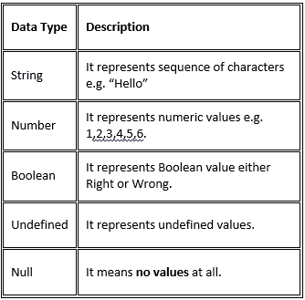

### JavaScript 非原始数据类型

有 3 种非原始数据类型如下：

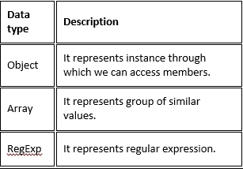

## JavaScript 运算符

运算符是 JavaScript 中的符号，用于对操作数执行操作。简单来说，`3+2` 等于 `5`。这里的操作数是 `3` 和 `2`，运算符是 `+`。

JavaScript 运算符如下：

1. 算术运算符。
2. 比较（关系）运算符。
3. 位运算符。
4. 逻辑运算符。
5. 赋值运算符。
6. 特殊运算符。

### 算术运算符

我们在算术运算符对操作数使用算术操作。

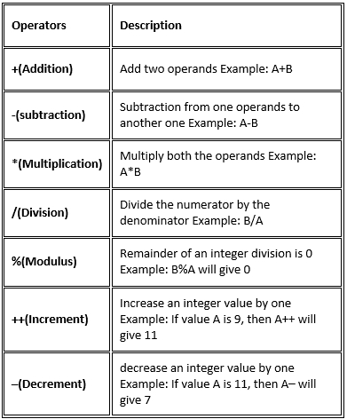

### 比较运算符

在比较运算符中，比较两个操作数 `A` 和 `B`。

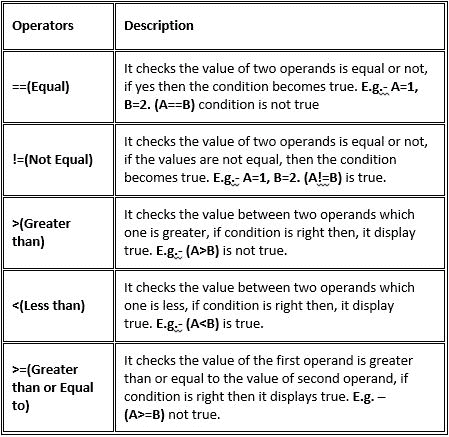

### 赋值运算符

JavaScript 支持以下 - 赋值运算符。

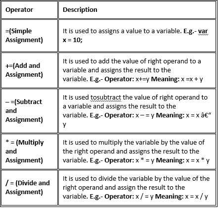

### 位运算符

JavaScript 支持以下 - 位运算符：

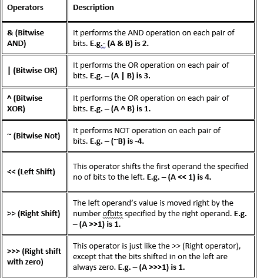

### 逻辑运算符

布尔值通常与逻辑运算符配合使用。以下是 逻辑运算符-

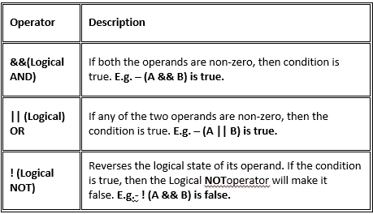

## JavaScript If Else

JavaScript 中的条件语句用于根据标准执行不同的活动。在 JavaScript 中，三种类型的语句。

1. `if` 语句。
2. `if else` 语句。
3. `if else if` 语句。

### if 语句

如果条件为真或假，JavaScript 中使用 `if` 语句来运行函数。

```javascript
if (condition){ //
  // 等待评估的内容
}
```


#### 示例:

```html
<!DOCTYPE html>  
<html>  
<body>  
<script>  
var x=50;  
if(x>30){  
  document.write("value of x is greater than 30");  
}  
</script>  
</body>  
</html>
```

输出：Value of x is greater than 30

### if else 语句

如果条件为真或假，使用 if else 语句。

```javascript
if(condition) {
  // 语句组
} else {
  // 语句组
}
```


#### 示例:

```html
<!DOCTYPE html>  
<html>  
<body>  
<script>  
var x=20;  
if(x%2==0){  
  document.write("x is even");  
} 
</script>  
</body>  
</html>
```

输出：x is even

### if else if

如果条件为真或假，使用 if else 语句。

```javascript
if(condition) {
  // 语句组
} else if (condition) {
  // 语句组
} else {
  // 语句组
}
```

#### 示例:

```html
<!DOCTYPE html>  
<html>  
<body>  
<script>  
var x=50;  
if(x>30){  
  document.write("value of x is greater than 30");  
} else if(x>20){  
  document.write("value of x is between 20 and 30");  
} else {
  document.write("value of x is less than 20");  
}  
</script>  
</body>  
</html>
```

输出：value of x is greater than 30

## JavaScript Switch 语句

JavaScript 中的 `switch` 语句用于在多个条件下执行单个代码。它与 `else if` 语句相同，但更容易记忆。


#### 语法：

```javascript
switch (expression) {
  case 1:语句(s)
  break;
  case 2:语句(s)
  break;
  ..
  case n:语句(s)
  break;
  default:语句(s)
}
```

**注意：** 在 switch-case 语句中，`break` 语句非常重要。

### 示例

```html
<!DOCTYPE html>  
<html>  
<body>  
<script>  
var grade='B';  
var result;  
switch(grade){
  case 'A':
    result="A Grade";
    break;
  case 'B':
    result="B Grade";
    break;
  case 'C':
    result="C Grade";
    break;
  default:
    result="No Grade";
}  
document.write(result);  
</script>  
</body>  
</html>
```

输出：B Grade

## JavaScript 循环

由于重复的方法形成圈，重复语句被称为循环。我们使用循环语句减少某些情况下的行数。它在数组中最为常见。

在 JavaScript 中，有三种形式的循环。

1. while 循环
2. for 循环
3. do-while 循环

### while 循环

代码在 while 循环中执行直到表达式为真。如果迭代次数未知，应使用它。

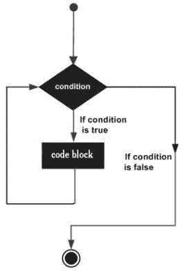

#### 语法：

```javascript
while (condition){
  如果表达式为真则执行语句(s)
}
```

### 示例

```html
<!DOCTYPE html>  
<html>  
<body>  
<script>  
var i=1;  
while (i<=10) {
  document.write(i+"<br/>");
  i++;
}  
</script>  
</body>  
</html>
```

输出：

1
2
3
4
5
6
7
8
9
10

### for 循环

它初始化了变量，检查了条件，然后在 `for` 循环中递增或减少了值。

它运行固定的时间。

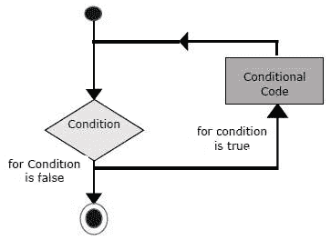

### for

#### 语法

```javascript
for (initialization; condition; increment)
{
  // 要执行的代码
}
```

#### 示例

```html
<!DOCTYPE html>
<html>
<body>
<script>
for (i=1; i<=12; i++)
{
  document.write(i + "<br/>")
}
</script>
</body>
</html>
```

#### 输出

1
2
3
4
5
6
7
8
9
10
11
12

### do while 循环

`while` 循环会无限执行项目，而 `do while` 循环只执行一次代码，无论条件是真还是假。当我们需要至少执行一次语句块时，我们使用 `do-while`。

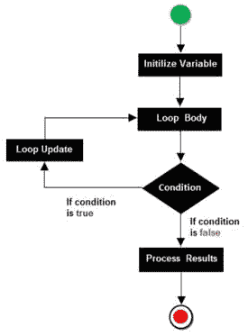

#### 语法

```javascript
do{
  // 要执行的代码
  // 递增/减少
} while (condition);
```

#### 示例

```html
<!DOCTYPE html>
<html>
<body>
<script>
var i=11;
do{
  document.write(i + "<br/>");
  i++;
}while (i<=15);
</script>
</body>
</html>
```

#### 输出

11
12
13
14
15

## JavaScript 函数

在 `<script>...</script>` 标签内定义新函数的能力是 JavaScript 的一个重要特性。在 JavaScript 中，使用 `function` 关键字来声明函数。

为了重用代码，我们多次调用该 JavaScript 方法。

### 优点 - JavaScript 函数

1. **代码可重用性**：我们多次使用相同的方法来节省时间和代码量。
2. **更少的代码**：结果我们的应用程序被压缩了。当我们执行例行任务时，不需要编写大量的代码。

### 语法

```javascript
function 函数名(参数或无参数)
{
  // 语句
}
```

### 示例

```html
<!DOCTYPE html>
<html>
<body>
<script>
function msg()
{
  alert("Hello! world");
}
</script>
<input type="button" onclick="msg()" value="click here"/>
</body>
</html>
```

#### 输出

Hello world!

### 带参数的函数

通过传递参数调用函数。

```html
<!DOCTYPE html>
<html>
<body>
<script>
function getcube(number)
{
  alert(number*number*number);
}
</script>
<form>
<input type="button" value="click" onclick="getcube(3)"/>
</form>
</body>
</html>
```

#### 输出

27

### 示例

```html
<!DOCTYPE html>
<html>
<body>
<script>
function getname()
{
  name=prompt("请输入姓名");
  alert("Welcome Mr/Mrs " + name);
}
</script>
</body>
<form>
<input type="button" value="Click" onclick="getname()"/>
</form>
</html>
```

### 带返回值的函数

调用返回值的函数并在程序中使用它。

```html
<!DOCTYPE html>
<html>
<body>
<script>
function getInfo()
{
  return "Hello Raj! How are you?";
}
</script>
<script>
document.write(getInfo());
</script>
</body>
</html>
```

#### 输出

Hello Raj! How are you?

## Function() 构造函数

函数语句不仅用于定义函数，还可以使用 `Function()` 构造函数和 `new` 运算符来动态定义函数。

### 语法

```javascript
<script>
var name = new Function(Arg1, Arg2..., "函数体内容");
</script>
```

### 示例

```html
<!DOCTYPE html>
<html>
<head>
<script>
var func = new Function("a", "b", "return a+b;");
function secondFunction(){
  var result;
  result = func(50,50);
  document.write (result);
}
</script>
</head>
<body>
<p>点击按钮调用函数</p>
<form>
<input type="button" onclick="secondFunction()" value="Call Function">
</form>
<p>在函数内部使用不同的参数并尝试一下吧...</p>
</body>
</html>
```

## 函数字面量

函数字面量的概念（构造函数的另一种方式）在 JavaScript 1.2 中引入。它是一个定义无名函数的表达式。

函数字面量的语法与函数语句相似，区别在于它是作为表达式而不是语句使用的，并且不需要函数名。

### 语法

```javascript
<script>
var name = function (参数列表){
  // 函数体
};
</script>
```

### 示例

```html
<!DOCTYPE html>
<html>
<head>
<script>
var func = function(a,b){return a+b};
function secondFunction(){
  var result;
  result = func(10,20);
  document.write (result);
}
</script>
</head>
<body>
<p>点击按钮调用函数</p>
<form>
<input type="button" onclick="secondFunction()" value="Call Function">
</form>
<p>在函数内部使用不同的参数并尝试一下吧...</p>
</body>
</html>
```

## JavaScript 对象

对象是状态和行为的实体。JavaScript 是一种关注对象的脚本语言。尽管它是基于模板而非类的，但它允许我们直接创建对象。

### 语法 - 添加属性 - 添加对象

```javascript
对象名.属性名 = 属性值
```

我们使用 `write()` 方法向文档写入对象内容。

```javascript
document.write("Hello world")
```

### 示例 以下示例显示了如何创建一个对象。

```html
<!DOCTYPE html>
<html>
<head>
<title>用户定义对象</title>
<script type="text/javascript">
var book = new Object(); // 创建对象
book.subject = "JavaScript 入门"; // 给对象赋值属性
book.author = "Chetan Bharti";
</script>
</head>
<body>
<script type="text/javascript">
document.write("书籍名称为：" + book.subject + "<br>");
document.write("书籍作者为：" + book.author + "<br>");
</script>
</body>
</html>
```

#### 输出

书籍名称为：JavaScript 入门
书籍作者为：Chetan Bharti

### 对象的方法

```html
<!DOCTYPE html>
<html>
<head>
<title>用户定义对象</title>
<script type="text/javascript">
function addPrice(amount){
  this.price = amount;
}
function book(title, author){
  this.title = title;
  this.author = author;
  this.addPrice = addPrice; // 将方法赋值为属性
}
</script>
</head>
<body>
<script type="text/javascript">
myBook = new book("JavaScript 入门", "Chetan Bharti");
myBook.addPrice(150);
document.write("书籍标题为：" + myBook.title + "<br>");
document.write("书籍作者为：" + myBook.author + "<br>");
document.write("书籍价格为：" + myBook.price + "<br>");
</script>
</body>
</html>
```

## JavaScript 数组

数组用于在单元或内存区域表示元素集合。

进入数组的每个元素将以唯一索引（从零开始）存储在数组中。我们可以通过索引来存储数据。

在 JavaScript 中，我们必须使用 `new` 关键字来声明数组。我们使用 `new Array` 来构造数组 (n)。

数组中的槽位数量由 `n` 表示。

### 语法

```javascript
myarray = new array(n);
```

注意：当我们在 JavaScript 中构建数组而不指定大时，我们会创建一个大小为零的数组对象。

### 示例

```html
<!DOCTYPE html>
<html>
<body>
<script>
var i;
var emp = new Array();
emp[0] = "Ajay";
emp[1] = "Abhay";
emp[2] = "Arun";
emp[3] = "Shipra";
for (i=0; i<emp.length; i++) {
  document.write(emp[i] + "<br>");
}
</script>
</body>
</html>
```

#### 输出

Ajay
Abhay
Arun
Shipra

### 示例

```html
<!DOCTYPE html>
<html>
<head>
<script type="text/javascript">
function array() {
num = new Array(5)
num[0] = 10;
num[1] = 20;
num[2] = 30;
num[3] = 40;
num[4] = 50;
sum = 0;
for (i=0; i<num.length; i++) {
  sumsum = sum + num[i];
}
alert(sum)
}
</script>
</head>
<body>
<input type="button" onclick="array()" value="click here">
</body>
</html>
```

### 数组中使用的函数

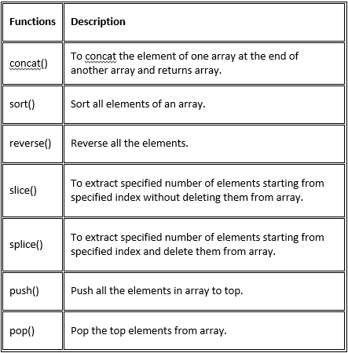

## JavaScript 笔记本

### 每个单词的首字母大写

#### 针对给定字符串

### HTML 代码

```html
<!DOCTYPE html>
<html>
<head>
  <meta charset="utf-8">
  <meta name="viewport" content="width=device-width">
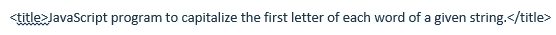
</head>
<body></body>
</html>
```

### JavaScript 代码

```javascript
function capital_letter(str) {
  str = str.split(" ");
  for (var i = 0, x = str.length; i < x; i++) {
    str[i] = str[i][0].toUpperCase() + str[i].substr(1);
  }
  return str.join(" ");
}
```

### 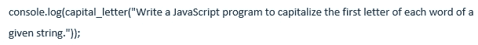

### 输出

输出：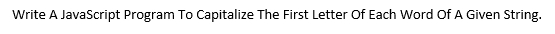

### 小时和分钟

### HTML 代码

```html
<!DOCTYPE html>
<html>
<head>
  <meta charset="utf-8">
  <meta name="viewport" content="width=device-width">
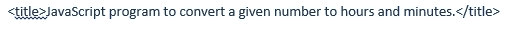 
</head>
<body></body>
</html>
```

### JavaScript 代码

```javascript
function time_convert(num) {
  var hours = Math.floor(num / 60); 
  var minutes = num % 60;
  return hours + ":" + minutes;
}
console.log(time_convert(71));
console.log(time_convert(450));
console.log(time_convert(1441));
```

#### 输出

1:11
7:30
24:1

### 统计元音

### HTML 代码

```html
<!DOCTYPE html>
<html>
<head>
  <meta charset="utf-8">
  <meta name="viewport" content="width=device-width">
  <title>统计给定字符串中元音数量的 JavaScript 程序</title>
</head>
<body></body>
</html>
```

### JavaScript 代码

```javascript
function vowel_Count(str) {
  return str.replace(/[^aeiou]/g, "").length;
}
console.log(vowel_Count("Python"));
console.log(vowel_Count("html.com"));
```

#### 输出：

1
5

### 创建新字符串

### HTML 代码

```html
<!DOCTYPE html>
<html>
<head>
  <meta charset="utf-8">
  <meta name="viewport" content="width=device-width">

</head>
<body></body>
</html>
```

### JavaScript 代码

```javascript
function without_first_end(str) {
  return str.substring(1, str.length - 1);
}
console.log(without_first_end('JavaScript'));
console.log(without_first_end('JS'));
console.log(without_first_end('PHP'));
```

#### 输出：

avaScript
H

### 合并两个字符串并排除第一个字符

### HTML 代码

```html
<!DOCTYPE html>
<html>
<head>
  <meta charset="utf-8">
  <meta name="viewport" content="width=device-width">
  <title>合并除其第一个字符外字符串的 JavaScript 程序</title>
</head>
<body></body>
</html>
```

### JavaScript 代码

```javascript
function concatenate(str1, str2) {
  str1 = str1.substring(1, str1.length);
  str2 = str2.substring(1, str2.length);
  return str1 + str2; // 修正：原文逻辑不完整，此处按原意翻译
}
```

*(注：原文代码片段似乎存在缺失，此处已按代码结构翻译)*

### 重复的字符

### HTML 代码

```html
<!DOCTYPE html>
<html>
<head>
  <meta charset="utf-8">
  <meta name="viewport" content="width=device-width">
  <title>查找重复的字符</title>
</head>
<body></body>
</html>
```

### JavaScript 代码

```javascript
function find_Repeated(str) {
  var arra1 = str.split('');
  var result = '';
  for (var x = 0; x < arra1.length; x++) {
    for (var y = x + 1; y < arra1.length; y++) {
      // 逻辑省略
    }
  }
}
```

*(注：原文代码不完整)*

### 查找字符串中最长的单词

### HTML 代码

```html
<!DOCTYPE html>
<html>
<head>
  <meta charset="utf-8">
  <meta name="viewport" content="width=device-width">
  <title>查找最长的单词</title>
</head>
```

### JavaScript 代码

```javascript
function find_longest_word(str) {
  var arra1 = str.split(' ');
  var result = '';
  for (var x = 0; x < arra1.length; x++) {
    if (arra1[x].length > result.length) {
      result = arra1[x];
    }
  }
  return result;
}
```

```javascript
return typeof value;
}

console.log(detect_data_type(12));
console.log(detect_data_type('w3resource'));
console.log(detect_data_type(false));
```

### 输出

number
string
Boolean

### 从数组中寻找第二小和第二大的数字


### HTML 代码

```html
<!DOCTYPE html>
<html>
<head>
  <meta charset=utf-8 />
  <title>从数组中寻找第二小和第二大的数字</title>
</head>
<body>
</body>
</html>
```

### JavaScript 代码

```javascript
function Second_Greatest_Lowest(arr_num) {
  arr_num.sort(function(x,y) {
    return x-y;
  });
  var uniqa = [arr_num[0]];
  var result = [];
  for(var j=1; j < arr_num.length; j++) {
    if(arr_num[j-1] !== arr_num[j]) {
      uniqa.push(arr_num[j]);
    }
  }
  result.push(uniqa[1],uniqa[uniqa.length-2]);
  return result.join(',');
}
console.log(Second_Greatest_Lowest([1,2,3,4,5]));
```

#### 输出

2,4

### 计算给定正整数的两个数字之和

### 长度为二

### HTML 代码

```html
<!DOCTYPE html>
<html>
<head>
  <meta charset="utf-8">
  <meta name="viewport" content="width=device-width">
  <title>计算长度为二的给定正整数两个数字之和的 JavaScript 程序</title>
</head>
<body>
</body>
</html>
```

### JavaScript 代码

```javascript
function add_two_digits(n) {
  return n % 10 + Math.floor(n / 10);
}
console.log(add_two_digits(25))
console.log(add_two_digits(50))
```

#### 输出:

7
5

### 闰年检查

### HTML 代码

```html
<!DOCTYPE html>
<html>
<head>
  <meta charset=utf-8 />
  <title>查找闰年</title>
</head>
<body>
</body>
</html>
```

### JavaScript 代码

```javascript
function leapyear(year) {
  return (year % 100 === 0) ? (year % 400 === 0) : (year % 4 === 0);
}
console.log(leapyear(2016));
console.log(leapyear(2000));
console.log(leapyear(1700));
console.log(leapyear(1800));
console.log(leapyear(100));
```

#### 输出

true
true
false
false
false

### 检查给定的正整数

### 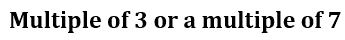

### HTML 代码

```html
<!DOCTYPE html>
<html>
<head>
  <meta charset="utf-8">
  <meta name="viewport" content="width=device-width">
  <title>检查给定的正整数是否是 3 的倍数或 7 的倍数的 JavaScript 程序。</title>
</head>
<body>
</body>
</html>
```

### JavaScript 代码

```javascript
function test37(x) {
  if (x % 3 == 0 || x % 7 == 0) {
    return true;
  }
  else {
    return false;
  }
}
console.log(test37(12));
console.log(test37(14));
console.log(test37(10));
console.log(test37(11));
```

#### 输出:

true
true
false
false

### 字符串以 'Java' 开头 - 是 true 否则返回 false

### HTML 代码

```html
<!DOCTYPE html>
<html>
<head>
  <meta charset="utf-8">
  <meta name="viewport" content="width=device-width">
  <title>检查字符串是否以'Java'开头的否则返回 false 的 JavaScript 程序。</title>
</head>
<body>
</body>
</html>
```

### JavaScript 代码

```javascript
function start_spec_str(str) {
  if (str.length < 4) {
    return false;
  }
  front = str.substring(0, 4);
  if (front == 'Java') {
    return true;
  }
  else {
    return false;
  }
}
console.log(start_spec_str("JavaScript"));
console.log(start_spec_str("Java"));
console.log(start_spec_str("Python"));
```

#### 输出:

true
true
false

### 两个给定的整数值 - 检查

### 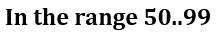

### HTML 代码

```html
<!DOCTYPE html>
<html>
<head>
  <meta charset="utf-8">
  <meta name="viewport" content="width=device-width">
  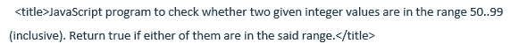
</head>
<body>
</body>
</html>
```

### JavaScript 代码

```javascript
function check_numbers(x, y) {
  if ((x >= 50 && x <= 99) || (y >= 50 && y <= 99)) {
    return true;
  }
  else {
    return false;
  }
}
console.log(check_numbers(12, 101));
console.log(check_numbers(52, 80));
console.log(check_numbers(15, 99));
```

#### 输出

false
true
true

### 寻找最接近 100 的数值

### HTML 代码

```html
<!DOCTYPE html>
<html>
<head>
  <meta charset="utf-8">
  <meta name="viewport" content="width=device-width">
  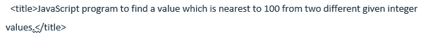
</head>
<body>
</body>
</html>
```

### JavaScript 代码

```javascript
function near_100(x, y) {
  if (x != y) {
    x1 = Math.abs(x - 100);
    y1 = Math.abs(y - 100);
    if (x1 < y1) {
      return x;
    }
    if (y1 < x1) {
      return y;
    }
    return 0;
  }
  else
    return false;
}
console.log(near_100(90, 89));
console.log(near_100(-90, -89));
console.log(near_100(90, 90));
```

#### 输出:

90
-89
false

### 正数 - 检查

### 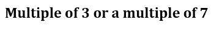

### HTML 代码

```html
<!DOCTYPE html>
<html>
<head>
  <meta charset="utf-8">
  <meta name="viewport" content="width=device-width">
  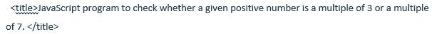
</head>
<body>
</body>
</html>
```

### JavaScript 代码

```javascript
function test37(x) {
  if (x % 3 == 0 || x % 7 == 0) {
    return true;
  }
  else {
    return false;
  }
}
console.log(test37(12));
console.log(test37(14));
console.log(test37(10));
console.log(test37(11));
```

#### 输出:

true
true
false
false

### 两个数字的乘法和除法

### HTML 代码

```html
<!DOCTYPE html>
<html>
<head>
  <meta charset=utf-8 />
  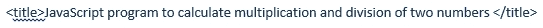
  <style type="text/css">
  body {margin: 30px;}
  </style>
</head>
<body>
<form>
第一个数字 : <input type="text" id="firstNumber" /><br>
第二个数字: <input type="text" id="secondNumber" /><br>
<input type="button" onClick="multiplyBy()" Value="乘法" />
<input type="button" onClick="divideBy()" Value="除法" />
</form>
<p>结果是：<br>
<span id = "result"></span>
</p>
</body>
</html>
```

### JavaScript 代码

```javascript
function multiplyBy() {
  num1 = document.getElementById("firstNumber").value;
  num2 = document.getElementById("secondNumber").value;
  document.getElementById("result").innerHTML = num1 * num2;
}
```

### function divideBy()

```javascript
function divideBy() {
    num1 = document.getElementById("firstNumber").value;
    num2 = document.getElementById("secondNumber").value;
    document.getElementById("result").innerHTML = num1 / num2;
}
```

#### 输出

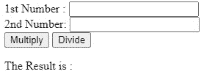

### 转换温度

### 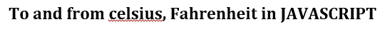

### HTML 代码

```html
<!DOCTYPE html>
<html>
<head>
  <meta charset="utf-8">
  <title>编写一个 JavaScript 程序，在摄氏度和华氏度之间进行温度转换</title>
</head>
<body>
</body>
</html>
```

### JavaScript 代码

```javascript
function cToF(celsius) {
  var cTemp = celsius;
  var cToFahr = cTemp * 9 / 5 + 32;
  var message = cTemp+'\xB0C is ' + cToFahr + ' \xB0F.';
  console.log(message);
}
function fToC(fahrenheit) {
  var fTemp = fahrenheit;
  var fToCel = (fTemp - 32) * 5 / 9;
  var message = fTemp+'\xB0F is ' + fToCel + '\xB0C.';
  console.log(message);
}
cToF(60);
fToC(45);
```

#### 输出

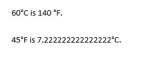
