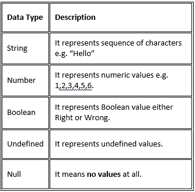
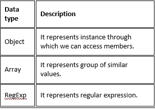
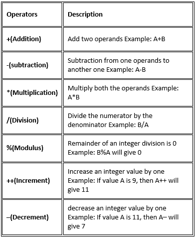
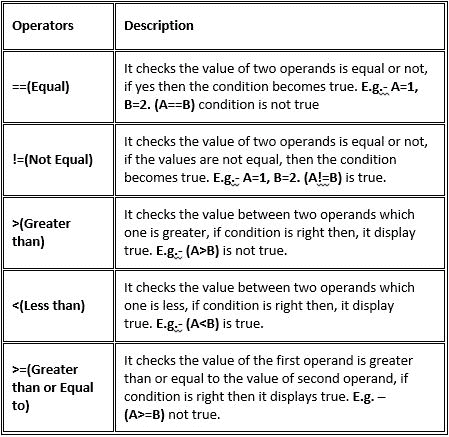
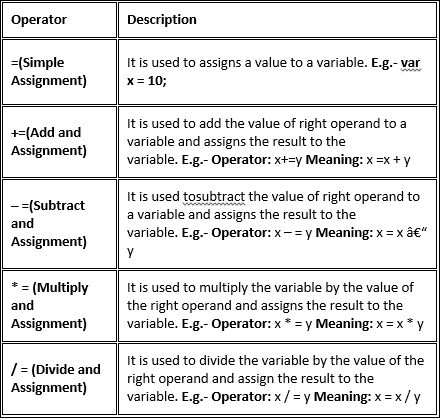
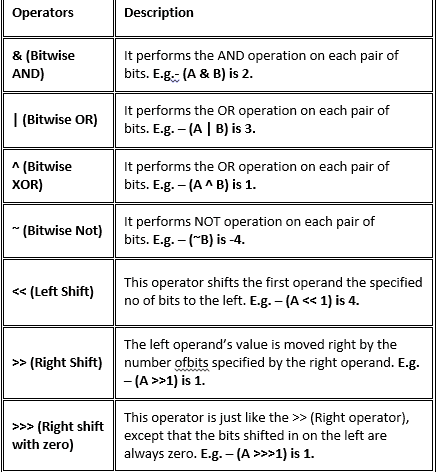
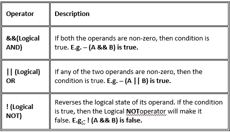
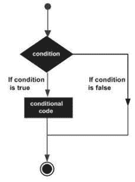
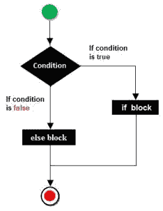
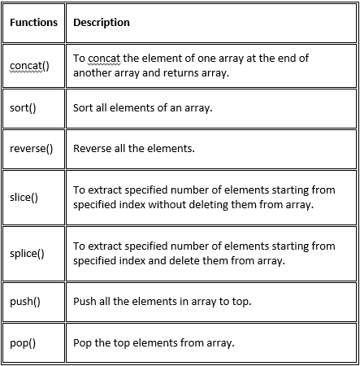

# JavaScript 基础：初学者指南


## JavaScript 教程

这节 JavaScript 课程让初学者和专家都能轻松学习 JavaScript。

### 什么是 JavaScript？它是如何工作的？

JavaScript 是一种用于计算机的动态编程语言。它是一种轻量级的跨基于对象的脚本语言。

通过 JavaScript，我们可以让网站更具活力和吸引力。

由 Netscape 员工 Brendan Eich 在 1995 年设计了它。这是一种用于创建交互式网站的编程语言。它最常用于：

- 客户端验证。

- 下拉菜单是动态的。

- 显示当前日期和时间。

- 在数据传输到服务器之前，验证 HTML 表单中的用户输入。

- 创建无需连接服务器即可响应用户输入的表单。

- 开启新窗口或帧并关闭它们。

- 使用弹出窗口和对话框显示信息（例如：警报对话框、确认对话框或提示对话框）。

- 创建短小但完整的客户端程序。

- 闹钟和其他计时器。

- 移动设备的游戏和应用开发。

### JavaScript 的特性

- JavaScript 是一种基于对象的脚本语言。

- 该语言区分大小敏感。

- 它是轻量级的。

- 在 JavaScript 中，每个语句后面都必须跟一个分号（`;`）。

### JavaScript 的优势

- JavaScript 是一种解释型脚本语言。不需要编译器，因为没有编译过程。JavaScript 被浏览器当作 HTML 标签进行解释。

- JavaScript 是一种简单的编程语言。对任何人来说都非常容易学习。它被用于创建动态且吸引人的网站。

- 因为 JavaScript 在客户端运行，所以它降低了网站服务器的负载。

- 它包含了可以在网页中使用的条件检查、循环和分支功能。

- 对于终端用户来说，JavaScript 是相对快速。他们不需要等待页面加载来检查是否漏掉了某些内容。

- 网页现在拥有更多功能。为了给网站访问者提供更多功能，我们可以使用 JavaScript 包含拖放组件和滑块。

## JavaScript 示例

```html
<h2>欢迎来到 JavaScript</h2>
<script>
  document.write("Hello JavaScript by TutorialandExample");
</script>
```

**输出：**

欢迎来到 JavaScript

Hello JavaScript by TutorialandExample

### JavaScript 示例

```html
<!DOCTYPE html>
<html>
<body>
  <h2>欢迎来到 JavaScript</h2>
  <script>
  document.write("Hello Friends");
  </script>
</body>
</html>
```

**输出：**

欢迎来到 JavaScript

Hello Friends

可以通过在代码中包含 JavaScript 语句来实现引入 JavaScript：`<script>...</script>`。

```html
<!DOCTYPE html>
<html>
<body>
  <script type="text/javascript">
  document.write("Hello World");
  </script>
</body>
</html>
```

**输出：**

Hello World

在 JavaScript 中，代码可以写在三个地方：

1. 在 HTML 的 `<body>`...`</body>` 标签之间。

2. 在 HTML 的 `<head>`...`</head>` 标签之间。

3. 在 `.js` 文件中（外部 JavaScript）。

#### 示例说明（body 标签之间的代码）

在下面的示例中，body 标签包含了 JavaScript 代码。

```html
<!DOCTYPE html>
<html>
<body>
  <script type="text/javascript">
  alert("Hello world");
  </script>
</body>
</html>
```

#### 示例 2（head 标签之间的代码）

我们将在下面的示例中创建函数 `msg()`。在 JavaScript 中，你必须编写函数名来定义一个函数。要调用函数，我们必须先创建一个事件。在这种情况下，我们正在使用 `onclick` 事件来调用 `msg()` 函数。

```html
<!DOCTYPE html>
<html>
<head>
  <script type="text/javascript">
  function msg(){
    alert("Hello world");
  }
  </script>
</head>
<body>
  <p>欢迎来到 JavaScript</p>
  <form>
    <input type="button" value="click" onclick="msg()"/>
  </form>
</body>
</html>
```

#### 外部 JavaScript

我们可以创建一个 JavaScript 文件并将其包含在 HTML 文件中。由于单个 JavaScript 文件可以被多个 HTML 页面使用，因此它允许代码复用。提高了网页的性能。该文件必须具有 `.js` 扩展名。

```html
<!DOCTYPE html>
<html>
<head>
  <script type="text/javascript" src="message.js"></script>
</head>
<body>
  <p>Hello world</p>
  <form>
    <input type="button" value="click" onclick="msg()"/>
  </form>
</body>
</html>
```

## JavaScript 注释

JavaScript 中的注释用于描述代码。它用于包含代码相关信息，例如警告或建议，以便终端用户可以理解它。

### 类型

1. 单行注释

2. 多行注释

### 单行注释

使用双正斜线 `//` 来表示单行注释。在程序运行时，双斜线之间的任何文本都会被忽略。

**例 1：在语句前添加注释：**

```html
<!DOCTYPE html>
<html>
<body>
  <script>
  // 单行注释
  document.write("hello world");
  </script>
</body>
</html>
```

**例 2：在语句后添加注释：**

```html
<!DOCTYPE html>
<html>
<body>
  <script>
  var a=10;
  var b=20;
  var c=a+b; //添加 a 和 b 变量的和
  document.write(c); //打印 10 和 20 的和
  </script>
</body>
</html>
```

**输出：** 30

### 多行注释

单行和多行注释都可以通过多行注释来实现。跨多行的注释以 `/*` 开始，以 `*/` 结束。JavaScript 将忽略其中的文本。

**示例：**

```html
<!DOCTYPE html>
<html>
<body>
  <script>
  /* 这是多行注释。
     不会显示 */
  document.write ("Example of JavaScript line comment");
  </script>
</body>
</html>
```

## JavaScript 变量

值（`name="Ram"`）和表达式（`Sum=x+y`）存储在变量中。在使用变量之前必须先声明它。要声明变量，我们使用 `var` 关键字，如下：

`var name;`

变量有 2 类：

1. 局部变量

2. 全局变量

### 局部变量

它定义在函数或块内部。

**示例：**

```javascript
<script>
function abc(){
  var x=10; //局部变量
}
</script>
```

### 全局变量

它具有全局作用域，意味着它可以在 JavaScript 代码的任何地方定义。在函数外部声明变量。

**示例：**

```html
<!DOCTYPE html>
<html>
<body>
  <script>
  var data =200; //全局变量
  function a(){
    document.writeln(data);
  }
  function b(){
    document.writeln(data);
  }
  a();//调用 javascript 函数
  b();
  </script>
</body>
</html>
```

### 在 JavaScript 中在函数内部声明全局变量

要在函数内部声明 JavaScript 全局变量，我们必须使用 `window` 对象。

**示例：**

```javascript
window.value=90;
```

现在它可以在任何函数内部声明，并在任何函数内部访问。

```html
window.value=50; //使用 window 对象声明全局变量

}

function b(){

alert(window.value);//从其他函数访问全局变量

}

a();

b();      

</script>

</body>

</html
```

# JavaScript 数据类型

它有多种数据类型来存储各种类型的值。

在 JavaScript 中，有两种数据类型。

1. 基本数据类型。

2. 非基本数据类型。

由于 JavaScript 是一种动态类型语言，我们不需要定义变量的类型，因为 JavaScript 引擎动态使用它。在这种情况下，使用 `var` 指定数据类型。它可能存储任何类型的值，包括数字、字符串和对象。

### 示例

```javascript
var a=Ram; //String
var b=20; //Number
var x= {FirstName:'Ram', lastName:'Doe'}; //Object
```

### JavaScript - 基本数据类型

在 JavaScript 中，有五种不同的基本数据类型。



### JavaScript 非基本数据类型

有 3 种非基本数据类型如下：



# JavaScript 操作符

运算符是 JavaScript 中用于对操作数执行操作的符号。简单来说 `3+2` 等于 `5`。这里的操作数是 `3` 和 `2`，运算符是 `+`。

JavaScript 运算符如下：

1. 算术运算符。

2. 比较（关系）运算符。

3. 位运算符。

4. 逻辑运算符。

5. 赋值运算符。

6. 特殊运算符。

## 算术运算符

我们在算术运算符中对操作数进行算术操作。



### 比较运算符

在比较运算符中，比较两个操作数 `A` 和 `B`。



### 赋值运算符

JavaScript 支持以下 赋值运算符。



### 位运算符

JavaScript 支持以下 - 位运算符：



### 逻辑运算符

布尔值通常与逻辑运算符配合使用。

以下是 - 逻辑运算符-



## JavaScript If Else

JavaScript 中的条件语句用于根据标准执行不同的活动。

在 JavaScript 中，有三种类型的语句。

1. `if` 语句。

2. `if else` 语句。

3. `if else if` 语句。

### if 语句

如果条件为真或假，在 JavaScript 中 `if` 语句来运行函数。

```javascript
if (condition){
    // 要评估的内容
}
```



**示例：**

```html
<!DOCTYPE html>
<html>
<body>
<script>
var x=50;
if(x>30){
document.write("value of x is greater than 30");
}
</script>
</body>
</html>
```

**输出：** Value of x is greater than 30

### if else 语句

如果任一条件为真或假（此处指逻辑分支），使用 `if else` 语句。

### 语法

```javascript
if(condition)
{
// 一组语句
}
else
{
// 一组语句
}
```



**示例**

```html
<!DOCTYPE html>
<html>
<body>
<script>
var x=20;
if(x%2==0){
document.write("x is even number");
}
else{
document.write("a is odd number")
}
</script>
</body>
</html>
```

**输出：** X is even number

### If else if

它仅仅查看内容以检查在许多表达式中表达式是否为真。`otherwise if` 是 `if else` 语句的更复杂版本。

### 语法

```javascript
If (condition1)
{
如果 condition 1 为真，则执行语句
}
else if (condition 2)
{
如果 condition 2 为真，则执行语句
}
else if (condition 3)
{
如果 condition 3 为真，则执行语句
}
else
{
如果没有没有条件为真，则执行语句
}
```

**示例**

```html
<!DOCTYPE html>
<html>
<body>
<script>
var x=50;
if (x==10){
document.write("x is equal to 10");
}
else if(x==50){
document.write("x is equal to 50");
}
else if(x==30){
document.write("x is equal to 30");
}
else{
document.write("a is not equal to 10, 50 or 30");
}
</script>
</body>
</html>
```

**输出：** x is equal to 50

## JavaScript Switch 语句

在 JavaScript 中，`switch` 语句用于在多个条件下执行单个代码。它与 `else if` 语句相同，但比 `else if` 语句更容易记忆。


### 语法

```javascript
switch (expression)
{
case 1:
语句(s)
break
case 2:
语句(s)
break
case n:
语句(s)
break
default:
语句(s)
}
```

**注意：** 在 `switch` 中，`break` 是重要的。

**示例**

```html
<!DOCTYPE html>
<html>
<body>
<script>
var grade='B';
var result;
switch(grade){
case 'A':
result="A";
break
case 'B':
result="B";
break
case 'C':
result="C";
break
default:
result="No Grade";
}
document.write(result);
</script>
</body>
</html>
```

**输出：** B

## JavaScript 循环

重复操作的形式被称为循环。在 JavaScript 中，有三种形式：

1. `while` 循环

2. `for` 循环

3. `do-while` 循环

### while 循循环

`while` 循环执行代码直到表达式为真。如果迭代次数未知，则应该使用它。


### 语法

```javascript
while (condition)
{
语句(s)
}
```

**示例**

```html
<!DOCTYPE html>
<html>
<body>
<script>
var i=1;
while(i<=10){
document.write(i+"<br/>");
i++;
}
</script>
</body>
</html>
```

**输出：** 1 2 3 4 5 6 7 8 9 10

### for 循环

它在 `for` 循环中初始化变量、检查条件并增加或减少值。它运行固定的时间。


### 语法

```javascript
for (initialization; condition; increment)
{
要执行的代码
}
```

**示例**

```html
<!DOCTYPE html>
<html>
<body>
<script>
for (i=1; i<=12; i++)
{
document.write(i+"<br/>")
}
</script>
</body>
</html>
```

**输出：** 1 2 3 4 5 6 7 8 9 10 11 12

### do while 循环

虽然 `while` 循环无限执行，但 `do while` 循环无论条件真假都只执行一次。当我们至少需要重复语句块时，我们使用 `do-while`。


### 语法

```javascript
do{
要执行的代码
增加/减小
}
while (condition);
```

**示例**

```html
<!DOCTYPE html>
<html>
<body>
<script>
var i=11;
do{
document.write(i+"<br/>");
i++;
}while (i<=15);
</script>
</body>
</html>
```

**输出：** 11 12 13 14 15

## JavaScript 函数

在 <script>.....</script> 标签内定义新函数是 JavaScript 的一项重要功能。`function` 关键字用于在 JavaScript 中声明函数。

为了复用代码，我们多次调用 JavaScript 方法。

### 优点 - JavaScript 函数

1. **代码可重用性**：我们多次使用同一个方法来节省时间和代码量。

2. **更少的代码**：结果是我们的应用程序被压缩了。当我们执行常规任务时，不需要编写大量的代码。

### 语法

```javascript
function functionName(parameter or not) 
{
  statements
}
```

### 示例

```html
<!DOCTYPE html>
<html>
<body
<script>
function msg() {
  alert("Hello! world");
}
</script>
<input type="button" onclick="msg()" value="click here"/>
</body>
</html>
```

### 输出

Hello world!

### 带参数的函数

通过传递参数来调用函数。

```html
<!DOCTYPE html>
<html>
<body
<script>
function getcube(number) {
  alert(number*number*number);
}
</script>
<form>
  <input type="button" value="click" onclick="getcube(3)"/>
</form>
</body>
</html>
```

### 输出

27

### 示例

```html
<!DOCTYPE html>
<html>
<head>
<script>
function getname() {
  name=prompt("Enter the Name");
  alert("Welcome Mr/Mrs " + name);
}
</script>
</body>
<form>
  <input type="button" value="Click" onclick="getname()"/>
</form>
</html>
```

### 带返回值的函数

调用返回值的函数，并在程序中使用它。

```html
<!DOCTYPE html>
<html>
<body
<script>
function getInfo() {
  return "Hello Raj! How are you?";
}
</script>
<script>
  document.write(getInfo());
</script>
</body>
</html>
```

### 输出

Hello Raj! How are you?

### Function() 构造函数

函数语句不仅用于定义新函数，还可以使用 `Function()` 构造函数和 `new` 运算符来动态定义函数。

### 语法

```javascript
<script>
    var varilename = new Function(Arg1, Arg2..., "Function Body" );
</script>
```

### 示例

```html
<!DOCTYPE html>
<html>
<head>
<script>
var func = new Function("a", "b", "return a+b;");
function secondFunction(){
  var result;
  result = func(50,50);
  document.write ( result );
}
</script>
</head>
<body>
  <p>点击按钮调用函数</p>
  <form>
    <input type="button" onclick="secondFunction()" value="Call Function">
  </form>
  <p>在函数内部使用不同的参数并尝试一下吧...</p>
</body>
</html>
```

### 函数字面量 (Function Literals)

函数字面量的概念（构造函数的另一种方式）在 JavaScript 1.2 中被引入。它是一个表达式，定义了一个没有名字的函数。

函数字面量的语法与函数语句相似，不同之处在于被用作表达式而不是语句，并且不需要函数名。

### 语法

```javascript
<script>
var variablename = function (Argument List){
  Function Body
};
</script>
```

### 示例

```html
<!DOCTYPE html>
<html>
<head>
<script>
var func = function(a,b){return a+b};
function secondFunction(){
  var result;
  result = func(10,20);
  document.write ( result );
}
</script>
</head>
<body>
  <p>点击按钮调用函数</p>
  <form>
    <input type="button" onclick="secondFunction()" value="Call Function">
  </form>
  <p>在函数内部使用不同的参数并尝试一下吧...</p>
</body>
</html>
```

### JavaScript 对象

对象是一个包含状态和行为的实体。JavaScript 是一种专注于对象的脚本语言。虽然 JavaScript 更多基于模板而非基于类，但它允许我们创建对象。

### 语法 - 添加属性 - 添加对象

`objectName.objectProperty = propertyValue;`

我们使用 `write()` 方法来记录对象，以便在文档上写入任何内容。

`document.write("Hello world")`

### 示例 以下示例展示了如何创建一个对象。

```html
<!DOCTYPE html>
<html>
<head>
<title>用户自定义对象</title>
<script type="text/javascript">
var book = new Object(); // 创建了对象
book.subject = "5 points someone"; // 将属性赋值给对象
book.author = "Chetanagat";
</script>
</head>
<body>
  <script type="text/javascript">
    document.write("Book Name is: " + book.subject + "<br>");
    document.write("Book Author is: " + book.author + "<br>");
  </script>
</body>
</html>
```

### 输出

Book Name is : 5 points someone

Book Author is : Chetanagat

### 对象的方法

```html
<!DOCTYPE html>
<html>
<head>
<title>用户自定义对象</title>
<script type="text/javascript">
// 定义作为方法的函数
function addPrice(amount){
  this.price = amount;
}
function book(title, author){
  this.title = title;
  this.author = author;
  .addPrice = addPrice; // 将该方法作为属性
}
</script>
</head>
<body>
  <script type="text/javascript">
    var myBook = new book("5 points", "Chetanagat");
    myBook.addPrice(150);
    document.write("Book Name is: " + myBook.title + "<br>");
    document.write("Book Author is: " + myBook.author + "<br>");
    document.write("Book Price is: " + myBook.price + "<br>");
  </script>
</body>
</html>
```

### 数组 (array)

数组用于表示单个单元或内存区域中的元素集合。元素从零开始唯一索引。我们通过索引存储数据。在 JavaScript 中，必须使用 `new` 关键字来声明数组。我们使用 `new` 来构造数组。数组中的槽的数量由 `n` 表示。

### 语法

```javascript
array = new array(n);
```

注意：当我们在 JavaScript 中构建数组时不指定大小，我们会构造一个零大小的数组。

### 示例

```html
<!DOCTYPE html>
<html>
<body>
<script>
var i;
var emp = new Array();
emp[0] = "Ajay";
emp[1] = "Abhay";
emp[2] = "Arun";
emp[3] = "Shipra";
for(i=0; i<emp.length; i++) {
  document.write(emp[i] + "<br>");
}
</script>
</body>
</html>
```

### 输出

Ajay

Abhay

Arun

Shipra

### 示例

```html
<!DOCTYPE html>
<html>
<head>
<script type="text/javascript">
function array() {
  num = new Array(5);
  num[0] = 10;
  num[1] = 20;
  num[2] = 30;
  num[3] = 40;
  num[4] = 50;
  sum = 0;
  for(i=0; i<num.length; i++) {
    sum = sum + num[i];
  }
  alert(sum);
}
</script>
</head>
<body>
  <input type="button" onclick="array()" value="click here">
</body>
</html>
```

### 数组中使用的函数


